# C++ 编程：包含数据结构的程序设计（MindTap 课程列表）

## 目录

我的父母


## 附录 E：在线附加 C++ 主题
### 非负整数的二进制（基 2）表示 ................................ E-1
  - 将基 10 数转换为二进制数（基 2） E-1
  - 将二进制数（基 2）转换为基 10 E-3
  - 将二进制数（基 2）转换为八进制（基 8）和十六进制（基 16） E-4
### 关于文件输入/输出的更多内容 E-6
  - 二进制文件 E-6
  - 随机文件访问 E-12

- 第 11 章 ................................ 1625
- 第 12 章 ................................ 1628
- 第 13 章 ................................ 1630
- 第 14 章 ................................ 1632
- 第 15 章 ................................ 1635
- 第 16 章 ................................ 1636
- 第 17 章 ................................ 1637
- 第 18 章 ................................ 1640
- 第 19 章 ................................ 1642
- 第 20 章 ................................ 1644
- 第 21 章 ................................ 1646
- 索引 .................................... 1647


## 前言

欢迎使用 C++ *程序设计：包含数据结构的程序设计* 第八版。本书专为计算机科学（CS1 和 CS2）的第一门 C++ 课程设计，为你和你的学生带来一股清新之风。CS1 和 CS2 课程是计算机科学课程的基石。我的首要目标是激励并激发所有入门编程学生的学习热情，无论他们处于何种水平。动力催生学习热情。动力和热情是编程学生取得成功的关键因素。本书是我在五十多个学期里向计算机科学学生成功教授编程的课堂笔记的总结与发展。

> **警告：** 可以预期，本书会大幅减少你在答疑时间收到的编程求助需求。其他副作用包括：学生在学习编程时对他人的依赖显著降低。

C++ *程序设计：包含数据结构的程序设计* 最初是一系列简短示例、练习和冗长编程示例的集合，用来补充我们大学当时使用的教材。它很快发展成一个规模足够大、可以组织成一本教材的集合。*事实上，本书采用的方法是由学生对清晰性和可读性的需求所驱动的。* 这些材料经过反复编写和修改，直到学生觉得易于接受为止。本书中的大多数示例都源于课堂上的学生互动。

与任何职业一样，实践至关重要。烹饪专业的学生练习菜谱。初露头角的小提琴手练习音阶。新程序员必须练习解决问题和编写代码。这不是一本 C++ 烹饪书。我们不是简单地列出 C++ 语法，然后给出一个示例；我们会剖析所有概念背后的“为什么？”。每个主题在首次介绍时，都会回答“为什么？”这一关键问题。这种方法为学习 C++ 架起了一座桥梁。学生必须理解“为什么？”，才能产生学习动力。


## 第八版的变化

第八版新增了300多个新的和更新的练习题，需要新的解答，以及20多个新的编程练习。

本版还引入了C++14数字分隔符（第3章）、C++11类内联函数（第10章）、更新的C++11类数据成员声明时初始化（第10章），以及C++11随机数生成器（第13章）。诸如**strcpy**、**strcmp**和**strcat**等C字符串函数已被弃用，在程序中使用时可能会产生警告消息。此外，**strncpy**和**strncmp**函数可能并未在所有C++版本中实现。因此，在第13章中，我们修改了编程示例**newString**，通过包含复制字符数组的函数来反映这些变化。

## 方法

编程语言C++从C发展而来，已不再被视为仅面向行业的语言。许多学院和大学在首门编程语言课程中使用C++。C++是结构化编程和面向对象编程的结合，本书涵盖这两种类型。

本书面向计算机科学的两学期课程CS1和CS2。前10或11章可在第一门课程中讲授，其余章节在第二门课程中讲授。

1998年7月，ANSI/ISO标准C++正式获批。本书重点关注ANSI/ISO标准C++。尽管标准C++和ANSI/ISO标准C++的语法非常相似，但第7章讨论了ANSI/ISO标准C++中一些标准C++不具备的特性。

第1章简要回顾了计算机和编程语言的历史。读者可以快速浏览本章，熟悉计算机的一些硬件组件和软件部分。本章包含一节关于处理C++程序的内容，还描述了结构化编程和面向对象编程。

第2章讨论C++的基本元素。完成本章后，学生将熟悉C++的基础知识，并能够编写足以进行某些计算的复杂程序。输入/输出是任何编程语言的基础，在第3章中较早引入并详细讲解。

第4章和第5章介绍控制结构，以改变顺序执行流程。第6章研究用户自定义函数。建议没有编程背景的读者在第6章上额外花费时间。书中提供了多个示例，帮助读者理解参数传递和标识符作用域的概念。

第7章讨论用户定义简单数据类型（枚举类型）、ANSI/ISO标准C++的`namespace`机制以及**string**类型。早期版本的C不包含枚举类型。枚举类型的使用非常有限，其主要目的是使程序可读。本书的组织方式使读者可以在首次阅读时跳过枚举类型部分而不会感到不连贯，然后稍后再阅读这一部分。

第8章详细讨论数组。本章还讨论基于范围的for循环（C++11标准的一个特性），并解释如何使用它们处理数组元素。同时讨论了基于范围的for循环在作为参数传递给函数的数组上的局限性。第8章还讨论顺序搜索算法和选择排序算法。第9章介绍记录（struct）。本书中struct的引入类似于C语言中的struct。本章是可选的，它不是其余任何章节的先修内容。

第10章开始研究面向对象编程（OOP）并引入类。本章前半部分展示如何在程序中定义和使用类，后半部分介绍抽象数据类型（ADT）。本章引入了类的内联函数。此外，“数据成员的类内初始化和默认构造函数”一节已更新。而且，本章展示了C++中的类如何自然地实现ADT。第11章继续介绍面向对象设计（OOD）和OOP的基础知识，并讨论继承和组合。它解释了C++中的类如何为OOD提供自然机制，以及C++如何支持OOP。第11章还讨论了如何在给定问题中找到对象。

第12章详细研究指针。在介绍指针及其在程序中的使用之后，本章重点介绍具有指针数据成员的类的特殊性以及如何避免这些问题。此外，本章讨论如何创建和使用动态二维数组，并解释为什么基于范围的for循环不能用于动态数组。第12章还讨论抽象类和通过虚函数实现的一种多态。

第13章继续研究OOD和OOP，特别是研究C++中的多态性。本章具体讨论两种多态——重载和模板。此外，本章引入了C++11随机数生成器。

第14章详细讨论异常处理。第15章介绍并讨论递归。此外，这是一章独立的章节，可以在第9章之后的任何时间学习。

第16章和第17章专门研究数据结构。第16章详细讨论链表，第17章讨论栈和队列。这些章节中开发的编程代码是通用的。这些章节有效使用了OOD的基础知识。

第18章讨论各种搜索和排序算法。除了展示这些算法的工作原理外，还提供了有关算法性能的相关分析和结果。算法分析允许用户决定在特定应用中使用哪种算法。本章还包括几种排序算法。教师可以决定覆盖哪些算法。

第19章介绍二叉树。讨论并说明了各种遍历算法以及二叉树的基本性质。介绍了特殊的二叉树，称为二叉搜索树。描述并说明了在二叉搜索树中进行搜索、插入和删除项的操作。第19章还讨论非递归二叉树遍历算法。此外，为了增强遍历算法的灵活性，它展示了如何构造函数并作为参数传递给其他函数。本章还详细讨论了AVL（高度平衡）树。由于篇幅限制，AVL树的讨论作为单独一节提供，并可在本书配套网站上获取。

图算法在第20章讨论。在介绍基本图论术语后，讨论了图在计算机内存中的表示。本章还讨论图遍历算法、最短路径算法和最小生成树算法。拓扑排序也在本章讨论，并可在本书配套网站上获取。

C++配备了一个强大的库——标准模板库（STL）——包含数据结构和算法，可有效用于各种应用。第21章详细描述STL。在介绍STL的三个基本组件后，它展示了如何在程序中使用序列容器。还讨论了特殊容器，如栈和队列。本章后半部分展示了如何在程序中使用各种STL算法。这一章相当长；根据时间可用性，教师至少可以覆盖序列容器、迭代器、`stack`和`queue`类以及某些算法。

附录A列出了C++中的保留字。附录B展示了C++运算符的优先级和结合性。附录C列出了ASCII（美国信息交换标准码）和EBCDIC（扩展二进制编码十进制交换码）字符集。附录D列出了可重载的C++运算符。


在线提供的附录E有三个目标。首先，我们讨论如何将数字从十进制转换为二进制，以及从二进制转换为十进制。然后详细讨论二进制文件和随机存取文件。最后，描述ANSI/ISO标准C++和标准C++中头文件的命名约定。附录F讨论一些最常用的库例程，并包括标准C++头文件的名称。附录G中的程序展示如何打印系统中内置数据类型的内存大小。附录H提供进一步学习的精选参考文献。附录I提供本书中奇数编号习题的答案。

## 如何使用本书

本书可以多种方式使用。图1展示各章的依赖关系。

在图1中，虚线表示前一章用于该章的某一节中，而不一定是下一章的先修内容。例如，第8章详细讨论数组。在第9章和第10章中，我们分别展示数组与结构体、数组与类之间的关系。然而，如果先学习第10章再学习第8章，那么第10章中涉及数组的小节可以跳过，不会造成任何中断。这一特定小节可以在学完第8章之后学习。

建议按顺序学习前六章。学完前六章后，如果读者有兴趣尽早学习面向对象设计（OOD）和面向对象编程（OOP），那么可以在第6章之后立即学习第10章。第7章可以在学完第6章后的任意时间学习。

按顺序学完前六章后，有以下几种学习路径：

- 1. 按以下顺序学习各章：8, 9, 10, 11, 12, 13, 14, 15, 16, 17, 18, 19, 20, 21。
- 2. 按以下顺序学习各章：8, 10, 12, 13, 11, 15, 16, 17, 14, 18, 19, 20, 21。
- 3. 按以下顺序学习各章：10, 8, 12, 13, 11, 15, 16, 17, 14, 18, 19, 20, 21。

如章依赖关系图所示，第17章和第18章可按任意顺序学习。不过，通常第17章和第18章按顺序学习。理想情况下，应按顺序学习第16、17、18和19章。第20章和第21章可按任意顺序学习。

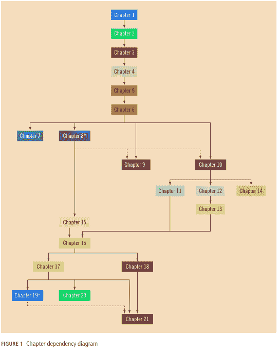

**图 1** 章依赖关系图

## 本书特色

```cpp
if (guess == num)
{
    cout << "Winner! You guessed the correct number."
         << endl;
    isGuessed = true;
}
else if (guess < num)
    cout << "Your guess is lower than the number.\n"
         << endl;
else
    cout << "Your guess is higher than the number.\n"
         << endl;
} // end while
```

还告诉你在while循环后加入以下代码，以防用户在五次尝试内猜不中正确数字：

```cpp
if (!isGuessed)
    cout << "You lose! The correct number is " << num << endl;
```

本章末尾的编程练习15要求你编写完整的C++程序来实现猜数字游戏，其中用户最多有五次机会猜数字。

从前面的while循环可以看出，while语句中的表达式可能很复杂。while循环的主要目标是重复某些语句，直到满足某些条件。

### 编程示例 1：斐波那契数


到目前为止，你已经看过几个循环示例。回想一下，在C++中，当某些语句必须重复执行直到满足某些条件时，就使用while循环。下面是一个使用while循环求斐波那契数的C++程序。

考虑以下数字序列：

1, 1, 2, 3, 5, 8, 13, 21, 34, …

这个序列称为斐波那契数列。给定该序列的前两个数（a₁ = 1 和 a₂ = 1），该序列中 n ≥ 3 的数 aₙ 由下式给出：

aₙ = aₙ₋₁ + aₙ₋₂

因此：

a₃ = a₂ + a₁ = 1 + 1 = 2，

a₄ = a₃ + a₂ = 2 + 1 = 3，

依此类推。

四色内文设计展示准确的C++代码和相关注释。

CengageBrain.com上每章都有一个视频。每个视频旨在解释程序如何工作。

第2章将程序定义为以完成某些任务为目标的一系列语句。到目前为止你看到的程序都简单直接。要处理一个程序，计算机需要找到第一条可执行语句，并按顺序执行这些语句直到结束。本章你将学习如何让计算机不必遵循简单的顺序语句流；它还可以做出决策，并反复执行某些语句，直到满足某些条件。

## 控制结构

计算机可以按以下方式之一处理程序：按顺序；有选择地，即做出选择（也称为分支）；重复地，即使用称为循环的结构反复执行某条语句；或通过调用函数。图4.1展示了前三种程序流程。（在第6章中，我们将展示函数调用如何工作。）第2章和第3章中的编程示例包括简单的顺序程序。对于这样的程序，计算机从开头开始，按顺序执行语句直到结束。不做选择；没有重复。控制结构为顺序程序执行提供了替代方式，用于改变顺序执行流。两种最常见的控制结构是选择与重复。在选择中，程序根据某些条件执行特定语句。在重复中，程序根据某些条件将特定语句重复一定次数。

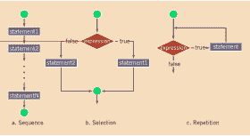

图 4.1 执行流程

300多幅视觉图表，既有广度又有深度，阐释了难点概念。

### 示例 2-11

```cpp
const double CONVERSION = 2.54;
const int NO_OF_STUDENTS = 20;
const char BLANK = ' ';
```

第一条语句告诉编译器分配内存（8字节）来存储double类型的值，将此内存空间称为CONVERSION，并在其中存储值2.54。在使用该语句的整个程序中，每当需要转换公式时，都可以访问内存空间CONVERSION。其他语句的含义类似。

注意，命名常量的标识符使用大写字母。尽管没有成文规则，C++程序员通常更愿意用大写字母命名常量。此外，如果命名常量的名称由多个单词组合而成（称为连写词），则通常用下划线分隔这些单词。例如，在前面的示例中，NO_OF_STUDENTS就是一个连写词。（另请参见本章后面的“程序风格与形式”一节，以正确组织程序。）

> 如前所述，浮点数的默认类型是double。因此，如果声明float类型的命名常量，则必须按如下方式指定该值为float类型：
>
> ```cpp
> const float CONVERSION = 2.54f;
> ```
>
> 否则，编译器将生成警告消息。注意，`2.54f`表示它是float值。回想一下，float值的内存大小为4字节；double值的内存大小为8字节。由于如今内存大小几乎不成问题，如前所述，我们将主要使用double类型处理浮点值。

使用命名常量存储固定数据，而不是直接使用数据值本身，有一个主要优点。如果固定数据发生变化，你不需要编辑整个程序并在使用旧值的所有位置将旧值改为新值。例如，在计算销售税的程序中，销售税率可能会变化。相反，你只需在一处进行更改，重新编译程序，并在整个程序中使用新值执行。此外，通过存储一个值并在需要该值时引用该内存位置，你可以避免一遍又一遍地输入相同的值，并防止意外拼写错误。如果拼错常量位置的名称，计算机会通过错误消息警告你；但如果值输错，它不会警告你。


编号示例通过相关代码阐释关键概念。这些示例中的编程代码后附有示例运行。随后是解释，说明代码中每一行做什么。

注释突出本章所介绍概念的重要事实。


编程示例是本章所有内容融会贯通之处。这些示例包含问题解决技巧，并包括输入、输出、问题分析与算法设计、类设计以及程序清单等具体阶段。所有程序都设计得有条理、一致且用户友好。每个编程示例都以问题分析开始，随后是算法设计和/或类设计，算法的每一步都用 C++ 编码。除了帮助学生学习问题解决技巧之外，这些详细的程序还向学生展示如何在实际的 C++ 程序中实现概念。我们强烈建议学生仔细学习这些编程示例，以便有效地学习 C++。学生通常能从完整解答的程序中学到很多。此外，编程示例大大减少了课外求助的需求，并增强了学生的自信心。

## 编程示例：转换长度


编写一个程序，输入以英尺和英寸表示的长度。然后该程序应将这些长度转换为厘米并输出。假设给定的英尺和英寸长度是整数。

**输入** 以英尺和英寸表示的长度。

**输出** 以厘米表示的等效长度。

长度以英尺和英寸给出，你需要求出以厘米表示的等效长度。1 英寸等于 2.54 厘米。程序需要做的第一件事是将以英尺和英寸给出的长度转换为总英寸。然后，你可以使用换算公式 1 英寸 = 2.54 厘米，求出以厘米表示的等效长度。要将以英尺和英寸表示的长度转换为英寸，需将英尺数乘以 12（因为 1 英尺等于 12 英寸），再加上给定的英寸数。

例如，假设输入是 5 英尺 7 英寸。然后按如下方式计算总英寸：

```
TotalInches = (12 * feet) + inches
              = 12 * 5 + 7
              = 67
```

然后你可以应用换算公式 1 英寸 = 2.54 厘米，求出以厘米表示的长度。

```
centimeters = totalInches * 2.54
             = 67 * 2.54
             = 170.1
```

基于对问题的这一分析，你可以设计如下算法：

- 1. 获取以英尺和英寸表示的长度。
- 2. 将长度转换为总英寸。
- 3. 将总英寸转换为厘米。
- 4. 输出厘米。

该程序的输入是两个数：一个表示英尺，一个表示英寸。因此，你需要两个变量：一个存储英尺，另一个存储英寸。由于程序首先会将给定长度转换为英寸，你还需要另一个变量来存储总英寸。你还需要一个变量来存储以厘米表示的等效长度。总之，你需要以下变量：

```
int feet;              // Variable to hold given feet
int inches;            // Variable to hold given inches
int totalInches;       // Variable to hold total inches
double centimeters;    // Variable to hold length in centimeters
```

练习进一步强化学习，并确保学生确实掌握了这些材料。

## 练习

练习末尾括号中的数字指本章开头列出的学习目标。

- 1. 判断以下陈述为真或假。
  - a. 称为帕斯卡林（Pascaline）的计算设备可以计算最多八位数字的和。(1)
  - b. 所有程序在执行前必须加载到 CPU 中，所有数据在处理前必须加载到主存中。(2)
  - c. 主存是单元的有序序列，每个单元在主存中都有一个随机位置。(2)
  - d. 打开计算机时最先加载的程序称为操作系统。(2)
  - e. 模拟信号用 0 和 1 的序列表示信息。(3)
  - f. 机器语言是 0 和 1 的序列。(3)
  - g. 二进制代码是 0 和 1 的序列。(3)
  - h. 八位序列称为一个字节。(3)
  - i. 1 GB 等于 2^30 MB。(3)
  - j. 在 ASCII 中，A 是第 65 个字符。(3)
  - k. 计算机使用的数制以 2 为基数。(3)
  - l. 汇编器将汇编语言指令翻译成机器语言。(4)
  - m. 编译器将源程序翻译成目标程序。(4)
  - n. 在 C++ 程序中，以符号 # 开头的语句称为预处理指令。(7)
  - o. 目标程序是高级语言程序的机器语言版本。(9)
  - p. 所有逻辑错误（例如除以 0）都会由编译器报告。(9)
  - q. 在面向对象设计（OOD）中，程序是相互交互的对象的集合。(10)
  - r. 对象由数据以及对该数据的操作组成。(10)
  - s. ISO 代表国际标准化组织。(11)
- 2. 哪个硬件组件执行算术运算和逻辑运算？(2)
- 3. 计算机使用哪种数制？(3)
- 4. 什么是目标程序？(5)

- 33. 假设 classStanding 是 char 变量，gpa 和 dues 是 double 变量。编写一个 switch 表达式，按如下方式给 dues 赋值：如果 classStanding 为 'f'，（如果 gpa 至少为 3.75，则 dues 为 $150.00；否则 dues 为 $120.00）；如果 classStanding 为 's'，（如果 gpa 至少为 3.75，则 dues 为 $150.00，否则 dues 为 $120.00）；如果 classStanding 为 'j'，（如果 gpa 至少为 3.75，则 dues 为 $75.00，否则 dues 为 $50.00）。（注意，代码 'f' 代表一年级学生，代码 's' 代表二年级学生，代码 'j' 代表大三学生，代码 'l' 代表大四学生。）(3)

- 34. 假设 billingAmount 是 double 变量，它表示你需要向百货商店支付的金额。如果你全额付款，你将获得 $10.00 或 billingAmount 的 1%（以较小者为准）作为下一张账单的抵扣额。如果你支付至少 billingAmount 的 50%，罚金为余额的 5%；如果你支付至少 billingAmount 的 25% 且少于 billingAmount 的 50%，罚金为余额的 10%；否则罚金为余额的 20%。设计一个算法，提示用户输入账单金额和期望付款额。然后该算法计算并输出抵扣额或剩余余额。如果未全额付款，该算法还应输出罚金金额。(3)

## 编程练习

- 1. 编写一个程序，提示用户输入一个数。然后该程序应输出该数，并输出一条消息说明该数是正数、负数还是零。

- 2. 编写一个程序，提示用户输入三个数。然后该程序应按升序输出这些数。

- 3. 编写一个程序，提示用户输入一个 0 到 35 之间的整数。如果该数小于或等于 9，程序应输出该数；否则，对于 10 应输出 A，对于 11 应输出 B，对于 12 应输出 C，……，对于 35 应输出 Z。（提示：使用运算符 `?:` 或 `switch` 语句。）

- 4. 以下程序中的语句顺序不正确。重新排列这些语句，使它们提示用户输入形状类型（矩形、圆形或圆柱体）以及该形状的相应尺寸。然后程序输出有关该形状的以下信息：对于矩形，输出面积和周长；对于圆形，输出面积和圆周长；对于圆柱体，输出体积和表面积。重新排列语句后，你的程序应具有正确的缩进。

编程练习要求学生编写具有指定结果的 C++ 程序。


## 补充资源

### 教师资源

教师可通过我们的教师配套网站 *sso.cengage.com* 下载以下教学工具。

- **教师手册。**《教师手册》逐章对应教材，以帮助规划和组织一门有效且富有吸引力的课程。该手册包括学习目标、章节概述、讲课笔记、课堂活动想法以及大量额外资源。还提供示例课程大纲。
- **PowerPoint 演示文稿。** 本教材为每章提供 PowerPoint 幻灯片。这些幻灯片可用于指导课堂展示、供学生复习章节或打印为课堂讲义。
- **解答。** 提供复习题和练习的解答，以协助评分。
- **试题库®。** 由 Cognero 提供支持的 Cengage Learning Testing 是一个灵活的在线系统，允许你：
  - 编写、编辑和管理来自多个 Cengage Learning 解决方案的试题库内容
  - 即时创建多个测试版本
  - 从你的 LMS、教室或任何你想要的地方交付测试


## 致谢

© HunThomas/Shutterstock.com

我必须感谢许多人，他们以各种方式为本书的成功做出了贡献。首先，我要感谢所有学生，在本书编写过程中，他们自发地告诉我某些部分是否需要改写，以便更好理解和更清晰阅读。其次，我要感谢那些通过电子邮件发送大量意见、帮助改进下一版的人。我也非常感谢审阅本书早期版本的审稿人，他们提出了许多关于如何改进本书的关键建议。

接下来，我感谢产品副经理 Kate Mason 和项目团队经理 Kristin McNary，感谢他们认识到本项目的重要性和独特性。如果没有内容开发副经理 Alyssa Pratt 的精心规划，这一切都不可能实现。我向 Alyssa 以及内容项目经理 Jennifer Feltri-George 致以诚挚的感谢。我还要感谢 SPi Global 的 S. Chandrasekar 协助我们保持项目按计划进行。我要感谢 MQA 测试员 Danielle Shaw 测试代码并发现拼写错误和错误。

本书献给我的父母，我感谢他们的祝福。

最后，我感谢妻子 Sadhana 的支持，尤其感谢女儿 Shelly。在撰写本书期间，每当我感到不堪重负时，她们都让我振作起来。

欢迎对本书正文提出任何意见。意见可发送至以下电子邮件地址：malik@creighton.edu。

D. S. Malik


## 第1章：计算机与编程语言概述

**本章中，你将：**

- 1. 了解不同类型的计算机
- 2. 探讨计算机系统的硬件和软件组成部分
- 3. 了解计算机语言
- 4. 了解编程语言的演变
- 5. 考察高级编程语言
- 6. 了解什么是编译器以及编译器的作用
- 7. 考察一个 C++ 程序
- 8. 探讨 C++ 程序是如何被处理的
- 9. 了解什么是算法并探讨问题求解技术
- 10. 了解结构化设计与面向对象设计的编程方法学
- 11. 了解 ANSI/ISO 标准 C++、C++11、C++14

### 引言

“互联网”等术语在25年前还不为人熟悉，如今已司空见惯。小学生经常“上网冲浪”，并使用计算机设计和实现课堂项目。许多人使用互联网查找信息并与他人交流。这一切都得益于各种软件（也称为计算机程序）的使用。没有软件，计算机就无法工作。软件是使用编程语言开发的。C++ 是其中一种编程语言，非常适合开发完成特定任务的软件。本书的主要目标是帮助你学习 C++ 编程语言以编写程序。在开始编程之前，了解一些基本术语和计算机的不同组成部分是很有用的。我们从计算机历史的概述开始。

### 计算机历史简要概述

已知最早的用于执行计算的装置是算盘。算盘发明于亚洲，但在古代巴比伦、中国以及直到中世纪晚期的整个欧洲都被使用。算盘使用一种在框架中滑动算珠的系统进行加法和减法。1642年，法国哲学家和数学家布莱兹·帕斯卡发明了一种称为帕斯卡计算器的计算装置。它有八个装在轮子上的可移动表盘，可以计算长达八位数字的和。算盘和帕斯卡计算器都只能执行加法和减法运算。17世纪后期，戈特弗里德·冯·莱布尼茨发明了一种能够加、减、乘、除的装置。1819年，法国织工约瑟夫·雅卡尔发现，他的织布机的编织指令可以存储在打孔的卡片上。当卡片按顺序在织布机中移动时，针穿过孔洞，挑起颜色和质地正确的线。织工可以重新排列卡片，改变所织的图案。本质上，这些卡片为织布机编程，以在布料上产生图案。纺织业似乎与计算机业几乎没有共同之处。然而，通过在卡片上打孔来存储信息的思想，在后来计算机的发展中被证明非常重要。

19世纪初至中期，英国数学家和物理科学家查尔斯·巴贝奇设计了两台计算机器：差分机和分析机。差分机可以自动执行诸如求数字平方之类的复杂运算。巴贝奇制造了差分机的原型，但没有制造实际装置。第一台完整的差分机于2002年在伦敦完成，距离其设计完成已有153年。它由8000个零件组成，重5吨，长11英尺。差分机的一个复制品于2008年完成，并在加利福尼亚州山景城的计算机历史博物馆展出（http://www.computerhistory.org/babbage/）。巴贝奇的大部分工作是通过他的同事、洛夫莱斯伯爵夫人阿达·奥古斯塔的著作而为人所知的。奥古斯塔被认为是第一位计算机程序员。

19世纪末，美国人口普查官员需要帮助来准确制表人口普查数据。赫尔曼·霍列瑞斯发明了一种用电运行并使用打孔卡片存储数据的计算机器。霍列瑞斯的机器取得了巨大成功。霍列瑞斯创立了制表机器公司，该公司后来成为名为 IBM 的计算机和技术公司。

第一台类似计算机的机器是 Mark I。它于1944年由 IBM 和哈佛大学在霍华德·艾肯的领导下联合建造。打孔卡片被用来向机器输入数据。Mark I 长52英尺，重50吨，有75万个零件。1946年，电子数值积分器和计算器（ENIAC）在宾夕法尼亚大学建成。它包含18000个真空管，重约30吨。

我们今天所知的计算机采用约翰·冯·诺依曼在20世纪40年代末给出的设计规则。他的设计包括算术逻辑单元、控制单元、存储器和输入/输出设备等组件。这些组件将在下一节中描述。冯·诺依曼的计算机设计使得将编程指令和数据存储在同一内存空间中成为可能。1951年，通用自动计算机（UNIVAC）建成并出售给美国人口普查局。

1956年，晶体管的发明带来了更小、更快、更可靠且更节能的计算机。这一时期还见证了软件开发行业的兴起，推出了 FORTRAN 和 COBOL 这两种早期编程语言。在下一个重大技术进步中，晶体管被小型集成电路（即“芯片”）取代。芯片比晶体管小得多、效率高得多，而借助当今的新技术，单个芯片可以包含数千个电路。它们赋予计算机极高的处理速度。

1970年，微处理器——将整个中央处理单元（CPU）集成在单个芯片上——被发明出来。1977年，斯蒂芬·沃兹尼亚克和史蒂文·乔布斯在他们的车库里设计并建造了第一台苹果电脑。1981年，IBM 推出了其个人计算机（PC）。20世纪80年代，IBM PC 的兼容机使个人计算机更加负担得起。到20世纪90年代中期，各行各业的人们都能够买得起它们。随着技术进步，计算机继续变得更快、更便宜。

现代计算机功能强大、可靠且易于使用。它们可以接受口头指令，并通过人工智能模仿人类推理。专家系统协助医生进行诊断。移动计算应用正在显著增长。送货司机使用手持设备可以访问全球定位卫星（GPS），以核实取货和送货的客户位置。手机让你可以查看电子邮件、预订机票、查看股票行情、访问银行账户，并通过社交媒体与家人和朋友交流。

尽管计算机有几种类型，例如大型机、中型机和微型机，但所有计算机都共享一些基本要素，下一节将对此进行描述。


## 计算机系统的组成

计算机是一种能够执行命令的电子设备。计算机执行的基本命令包括输入（获取数据）、输出（显示结果）、存储以及执行算术和逻辑运算。计算机系统有两个主要组成部分：硬件和软件。在接下来的几节中，您将简要了解这些组件。我们先来看硬件。

### 硬件

主要硬件组件包括中央处理器（CPU）；主存储器（MM），也称为随机存取存储器（RAM）；输入/输出设备；以及辅助存储器。输入设备的一些例子包括键盘、鼠标和辅助存储器。输出设备的例子包括屏幕、打印机和辅助存储器。让我们更详细地逐一了解这些组件。

### 中央处理器和主存储器

**中央处理器**是计算机的“大脑”，也是计算机中最昂贵的硬件。CPU越强大，计算机运行得越快。算术和逻辑运算在CPU内部执行。图1-1(a)展示了一些硬件组件。

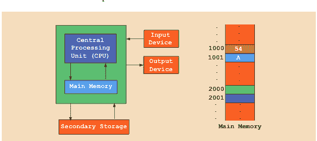

**图 1-1** 计算机的硬件组件和主存储器

**主存储器**，或称**随机存取存储器**，直接与CPU相连。所有程序都必须先加载到主存储器中才能执行。同样，所有数据都必须先调入主存储器，程序才能对其进行操作。当计算机关闭时，主存储器中的所有内容都会丢失。

主存储器是一个有序的单元序列，这些单元称为**存储单元**。每个单元在主存储器中都有一个唯一的位置，称为该单元的**地址**。这些地址帮助您访问存储在单元中的信息。图1-1(b)展示了包含一些数据的主存储器。

当今的计算机配备的主存储器由数百万到数十亿个单元组成。尽管图1-1(b)显示了存储在单元中的数据，但单元的内容可以是编程指令或数据。此外，该图将数据显示为数字和字母。但是，正如本章后面所解释的，主存储器将所有内容存储为0和1的序列。内存地址也表示为0和1的序列。

### 辅助存储器

由于程序和数据在处理前必须加载到主存储器中，并且当计算机关闭时主存储器中的所有内容都会丢失，因此存储在主存储器中的信息必须保存在其他设备中以实现永久存储。永久存储信息的设备（除非设备变得不可用，或者您通过重写来更改信息）称为**辅助存储器**。为了能够将信息从主存储器传输到辅助存储器，这些组件必须直接相互连接。辅助存储器的例子包括硬盘、闪存驱动器和CD-ROM。

### 输入/输出设备

计算机要执行有用的任务，必须能够接收数据和程序，并显示计算结果。将数据和程序输入计算机的设备称为**输入设备**。键盘、鼠标、扫描仪、摄像头和辅助存储器是输入设备的例子。计算机用于显示结果的设备称为**输出设备**。显示器、打印机和辅助存储器是输出设备的例子。

### 软件

软件是编写用于执行特定任务的程序。例如，文字处理器是用于写信、论文甚至书籍的程序。所有软件都是用编程语言编写的。程序有两种类型：系统程序和应用程序。

**系统程序**控制计算机。打开计算机时首先加载的系统程序称为**操作系统**。没有操作系统，计算机毫无用处。操作系统处理计算机的整体活动并提供服务。其中一些服务包括内存管理、输入/输出活动和存储管理。操作系统有一个特殊程序来组织辅助存储器，以便您可以方便地访问信息。一些知名的操作系统包括Windows 10、Mac OS X、Linux和Android。

**应用程序**执行特定任务。文字处理器、电子表格和游戏是应用程序的例子。操作系统是运行应用程序的程序。

## 计算机的语言

当您在键盘上按**A**时，计算机会在屏幕上显示**A**。但是，计算机的主存储器内部实际存储的是什么？计算机的语言是什么？它如何存储您在键盘上键入的任何内容？

请记住，计算机是一种电子设备。计算机内部使用电信号来处理信息。有两种类型的电信号：模拟信号和数字信号。**模拟信号**是连续变化的连续波形，用于表示声音之类的事物。例如，音频磁带以模拟信号存储数据。**数字信号**用0和1的序列表示信息。0表示低电压，1表示高电压。数字信号是比模拟信号更可靠的信息载体，并且可以以精确的精度从一个设备复制到另一个设备。您可能已经注意到，当您复制音频磁带时，副本的音质不如原磁带。另一方面，当您复制CD时，副本与原版相同。计算机使用数字信号。

由于数字信号在计算机内部处理，计算机的语言——称为**机器语言**——是0和1的序列。数字0或1称为**二进制位**，或**位**。有时，0和1的序列被称为**二进制代码**或**二进制数**。

**位：** 一个二进制数字0或1。

八个位的序列称为**字节**。此外，2^10 字节 = 1024 字节称为**千字节**（KB）。表1-1总结了用于描述各种字节数的术语。

**表 1-1** 二进制单位

| 单位 | 符号 | 位/字节 |
|---|---|---|
| 字节 | | 8 位 |
| 千字节 | KB | 2^10 字节 = 1024 字节 |
| 兆字节 | MB | 1024 KB = 2^10 KB = 2^20 字节 = 1,048,576 字节 |
| 吉字节 | GB | 1024 MB = 2^10 MB = 2^30 字节 = 1,073,741,824 字节 |
| 太字节 | TB | 1024 GB = 2^10 GB = 2^40 字节 = 1,099,511,627,776 字节 |
| 拍字节 | PB | 1024 TB = 2^10 TB = 2^50 字节 = 1,125,899,906,842,624 字节 |
| 艾字节 | EB | 1024 PB = 2^10 PB = 2^60 字节 = 1,152,921,504,606,846,976 字节 |
| 泽字节 | ZB | 1024 EB = 2^10 EB = 2^70 字节 = 1,180,591,620,717,411,303,424 字节 |

键盘上的每个字母、数字或特殊符号（例如 * 或 ()）都被编码为位序列，每个都有唯一的表示。个人计算机上最常用的编码方案是*七位* ***美国信息交换标准代码（ASCII）***。ASCII数据集由128个字符组成，编号为0到127。也就是说，在ASCII数据集中，第一个字符的位置是0，第二个字符的位置是1，依此类推。在这个方案中，*A*被编码为二进制数1000001。事实上，*A*是ASCII字符代码中的第66个字符，但其位置是65，因为第一个字符的位置是0。此外，二进制数1000001是65的二进制表示。字符*3*被编码为0110011。请注意，在ASCII字符集中，字符*3*的位置是51，因此字符*3*是ASCII集中的第52个字符。由此也可知，0110011是51的二进制表示。有关可打印ASCII字符集的完整列表，请参阅附录C。

**注意：** 我们日常生活中使用的数制称为**十进制系统**，或**基10**。由于计算机内部的所有内容都表示为0和1的序列，即二进制数，因此计算机使用的数制称为**二进制**，或**基2**。我们在上一段中指出，数字1000001是65的二进制表示。附录E描述了如何将数字从基10转换为基2，以及反之。

在计算机内部，每个字符都表示为*八*位的序列，即一个字节。现在，65的八位二进制表示是01000001。注意，我们在65的*七位*表示的左侧添加了0，以将其转换为八位表示。类似地，我们在51的二进制值中添加一个0，以得到其八位二进制表示00110011。

ASCII是*七位*代码。因此，为了在计算机内部表示每个ASCII字符，必须将ASCII字符的*七位*二进制表示转换为*八位*二进制表示。这是通过在字符的*七位*ASCII编码左侧添加0来实现的。因此，在计算机内部，字符*A*表示为01000001，字符*3*表示为00110011。

还有其他编码方案，例如Unicode。Unicode由65,536个字符组成。要存储属于Unicode的字符，需要16位或两个字节。Unicode的创建是为了表示各种字符，并且不断扩展。它包含英语以外语言中的字符。

### 编程语言的演变

计算机最基本的语言——机器语言，以位的形式提供程序指令。尽管大多数计算机执行相同类型的操作，但计算机的设计者可能选择了不同的二进制代码集来执行这些操作。因此，一台机器的机器语言不一定与另一台机器的机器语言相同。计算机之间唯一的一致性是，在任何现代计算机中，所有数据都以位的形式存储和操作。


以二进制代码表示。早期计算机使用机器语言编程。要了解指令如何用机器语言编写，假设你想使用以下方程：

```
wages = rate · hours
```

来计算周薪。进一步假设二进制代码 `100100` 表示加载，`100110` 表示乘法，`100010` 表示存储。在机器语言中，你可能需要以下指令序列来计算周薪：

```
100100 010001
100110 010010
100010 010011
```

为了用机器语言表示周薪方程，程序员必须记住各种操作的机器语言代码。此外，为了处理数据，程序员还必须记住数据在主存中的位置。这种需要记住特定代码的要求不仅使编程变得非常困难，而且容易出错。

开发汇编语言是为了让程序员的工作更轻松。在汇编语言中，指令是一种易于记忆的形式，称为**助记符**。例如，假设 LOAD 代表机器代码 `100100`，MULT 代表机器代码 `100110`（乘法），STOR 代表机器代码 `100010`。

使用汇编语言指令，你可以按如下方式编写计算周薪的方程：

```
LOAD rate
MULT hours
STOR wages
```

如你所见，用汇编语言编写指令要容易得多。然而，计算机不能直接执行汇编语言指令。这些指令必须先被翻译成机器语言。一个称为**汇编器**的程序将汇编语言指令翻译成机器语言。

**汇编器：** 将用汇编语言编写的程序翻译成等价的机器语言程序的程序。

从机器语言转向汇编语言使编程更容易，但程序员仍然被迫以单条机器指令的思维来思考。使编程更容易的下一步是设计更接近自然语言（如英语、法语、德语和西班牙语）的**高级语言**。BASIC、FORTRAN、COBOL、C、C++、C#、Java 和 Python 都是高级语言。你将在本书中学习高级语言 C++。

在 C++ 中，你按如下方式编写周薪方程：

```
wages = rate * hours;
```

用 C++ 编写的指令要容易理解得多，对于熟悉基本算术的新手用户来说是不言自明的。然而，与汇编语言的情况一样，计算机不能直接执行用高级语言编写的指令。要在计算机上执行，这些 C++ 指令首先需要被翻译成机器语言。一个称为**编译器**的程序将用高级语言编写的指令翻译成机器语言。

**编译器：** 将用高级语言编写的指令翻译成等价的机器语言的程序。

## 处理 C++ 程序

在前面的章节中，我们讨论了机器语言和高级语言，并展示了一条 C++ 语句。因为计算机只能理解机器语言，所以你现在可以回顾处理用 C++ 编写的程序所需的步骤。

考虑以下 C++ 程序：

```cpp
#include <iostream>

using namespace std;

int main()
{
    cout << "My first C++ program." << endl;

    return 0;
}
```

此时，你不必过于关注这个程序的细节。然而，如果你运行（执行）这个程序，它将在屏幕上显示以下行：

```
My first C++ program.
```

回想一下，计算机只能理解机器语言。因此，为了成功运行这个程序，代码必须首先被翻译成机器语言。在本节中，我们回顾执行用 C++ 编写的程序所需的步骤。

如图 1-2 所示，处理 C++ 程序需要以下步骤。

- 1. 你使用文本编辑器，遵循高级语言的规则（即 *语法*）创建 C++ 程序。这个程序称为**源代码**，或**源程序**。该程序必须保存在扩展名为 `.cpp` 的文本文件中。例如，如果你将前面的程序保存在名为 `FirstCPPProgram` 的文件中，那么它的完整名称是 `FirstCPPProgram.cpp`。
  
  **源程序：** 用高级语言编写的程序。

- 2. 上一节给出的 C++ 程序包含语句 `#include <iostream>`。在 C++ 程序中，以符号 `#` 开头的语句称为预处理指令。这些语句由一个称为**预处理器**的程序处理。

- 3. 处理预处理指令之后，下一步是验证程序是否遵守编程语言的规则——也就是说，程序在语法上是否正确——并将程序翻译成等价的机器语言。*编译器*检查源程序中的语法错误，如果没有发现错误，就将程序翻译成等价的机器语言。等价的机器语言程序称为**目标程序**。
  
  **目标程序：** 高级语言程序的机器语言版本。

- 4. 你用高级语言编写的程序是使用集成开发环境（IDE）开发的。IDE 包含许多对创建程序有用的程序。例如，它包含显示程序结果所需的代码（程序）以及若干数学函数，使程序员的工作更容易一些。因此，如果某些代码已经可用，你可以使用这些代码，而不必编写自己的代码。一旦程序开发完成并成功编译，你仍然必须将程序中使用的 IDE 资源代码引入程序，以生成计算机可以执行的最终程序。这种预先编写的代码（程序）位于称为**库**的地方。一个称为**链接器**的程序将目标程序与库中的程序组合起来。
  
  **链接器：** 将目标程序与库中的其他程序组合起来，并在程序中用于创建可执行代码的程序。

- 5. 接下来，你必须将可执行程序加载到主存中以供执行。一个称为**加载器**的程序完成此任务。
  
  **加载器：** 将可执行程序加载到主存中的程序。

- 6. 最后一步是执行程序。

图 1-2 显示了典型的 C++ 程序是如何处理的。

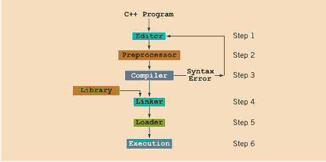

**图 1-2** 处理 C++ 程序

作为程序员，你主要需要关注**第 1 步**。也就是说，你必须学习、理解并掌握编程语言的规则，以创建源程序。

如前所述，程序是使用 IDE 开发的。用于创建高级语言 C++ 程序的知名 IDE 包括 Visual C++ Express（2013 或 2016）、Visual Studio 2015（来自 Microsoft）以及 C++ Builder（来自 Borland）。你也可以使用 Bloodshed Software 的 Dev-C++ IDE 来创建和测试 C++ 程序。这些 IDE 包含用于创建源程序的文本编辑器、用于检查源程序语法错误的编译器、用于将目标代码与 IDE 资源链接的程序，以及用于执行程序的程序。

这些 IDE 相当用户友好。当你编译程序时，编译器不仅会识别语法错误，通常还会建议如何更正它们。此外，只需一个简单的命令，目标代码就会与来自 IDE 的资源链接起来。例如，在 Visual C++ Express（2013 或 2016）和 Visual Studio 2015 上执行链接的命令是**生成**或**重新生成**。（有关这些命令用法的进一步说明，请查看这些 IDE 的文档。）如果程序尚未编译，这些命令中的每一个都会先编译程序，然后链接并生成可执行代码。

网站 http://msdn.microsoft.com/en-us/library/vstudio/ms235629.aspx 说明了如何使用 Visual C++ Express 和 Visual Studio 2015 创建 C++ 程序。

### 使用问题分析—编码—执行周期进行编程

*编程是一个解决问题的过程。* 不同的人使用不同的技术来解决问题。有些技术被很好地概述并且易于遵循。它们不仅解决问题，还让人深入了解解决方案是如何得到的。如果问题的领域发生变化，这些解决问题的技术可以很容易地修改。

要成为优秀的问题解决者和优秀的程序员，你必须遵循良好的问题解决技术。一种常见的问题解决技术包括分析问题、概述问题需求，以及设计称为**算法**的步骤来解决问题。

**算法：** 一种逐步解决问题的过程，在有限的时间内得到解决方案。

在编程环境中，问题解决过程需要以下三个步骤：

- 1. 分析并概述问题及其解决方案需求，并设计解决问题的算法。
- 2. 用编程语言（如 C++）实现该算法，并验证该算法是否有效。


3. 如果问题域发生变化，通过使用和修改程序来维护程序。

图 1-3 总结了该编程过程的前两个步骤。

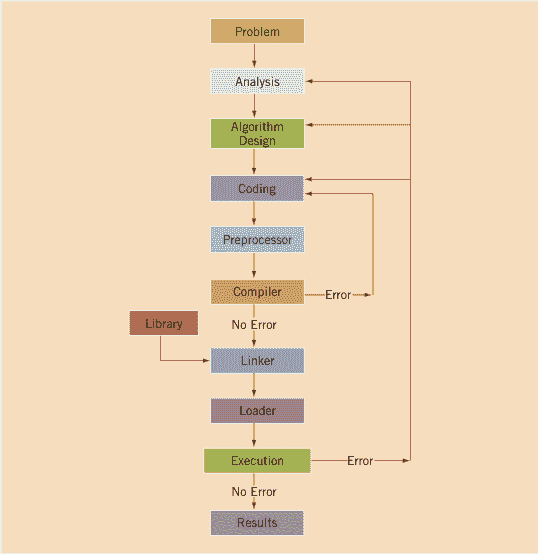

**图 1-3** 问题分析——编码——执行周期

要开发一个解决问题的程序，首先要分析问题。然后设计算法；用高级语言编写程序指令，或者对程序进行编码；再将程序输入计算机系统。分析问题是第一步，也是最重要的一步。这一步要求你完成以下工作：

1. 透彻理解问题。
2. 理解问题需求。需求可以包括程序是否需要与用户交互、是否处理数据、是否产生输出以及输出是什么样子。如果程序处理数据，程序员必须知道数据是什么以及如何表示数据。也就是说，你需要查看示例数据。如果程序产生输出，你应该知道结果应如何生成和格式化。
3. 如果问题复杂，将问题划分为子问题，并重复步骤1和2。也就是说，对于复杂问题，你需要分析每个子问题并理解每个子问题的需求。

在仔细分析问题之后，下一步是设计解决问题的算法。如果你将问题分解为子问题，则需要为每个子问题设计算法。设计算法后，需要检查其正确性。有时可以使用示例数据测试算法的正确性。其他时候，你可能需要执行一些数学分析来测试算法的正确性。

一旦设计好算法并验证其正确性，下一步就是将其转换为等价的编程代码。然后使用文本编辑器将编程代码或程序输入计算机。接下来，必须确保程序遵循语言的语法。为了验证语法的正确性，需要通过编译器运行代码。如果编译器生成错误消息，你必须找出代码中的错误，删除它们，然后再次通过编译器运行代码。当所有语法错误都被删除后，编译器生成等价的机器代码，链接器将机器代码与系统资源链接起来，加载器将程序放入主内存以便执行。

最后一步是执行程序。编译器只保证程序遵循语言的语法。它不保证程序会正确运行。在执行过程中，程序可能由于逻辑错误（例如除以零）而异常终止。即使程序正常终止，它仍可能产生错误的结果。在这种情况下，你可能需要重新检查代码、算法，甚至问题分析。

如果你在尝试编写编程指令之前花足够时间完成问题分析，你的整体编程体验将会成功。通常，你会在纸上用钢笔或铅笔完成这项工作。采用这种细致的编程方法有许多优点。在分析充分、设计良好的程序中查找错误要容易得多。此外，经过仔细分析和设计的程序更容易理解和修改。即使是最有经验的程序员，也会花费大量时间分析问题和调试算法。

在本书中，你不仅将学习用 C++ 编写程序的规则，还将学习解决问题的技巧。大多数章节都包含讨论编程问题的编程示例。这些编程示例教授如何分析和解决问题、设计算法、将算法编码为 C++，并帮助你理解本章讨论的概念。为了充分受益于本书，我们建议你完成这些编程示例。

接下来，我们提供各种问题分析和算法设计技术的示例。

## 例 1-1

在本例中，我们设计一个算法来求矩形的周长和面积。

要求矩形的周长和面积，需要知道矩形的长度和宽度。矩形的周长和面积由以下公式给出：

```text
perimeter = 2 · (length + width)
area = length · width
```

求矩形周长和面积的算法如下：

1. 获取矩形的长度。
2. 获取矩形的宽度。
3. 使用以下等式求周长：

   ```text
   perimeter = 2 · (length + width)
   ```

4. 使用以下等式求面积：

   ```text
   area = length · width
   ```

## 例 1-2

在本例中，我们设计一个算法，计算某个州销售物品的销售税和价格。

销售税计算如下：州销售税部分为 4%，城市销售税部分为 1.5%。如果物品是奢侈品，例如价格超过 50,000 美元的汽车，则需缴纳 10% 的奢侈品税。

要计算物品价格，我们需要计算州销售税部分、城市销售税部分，以及（如果是奢侈品）奢侈品税。假设 `salePrice` 表示物品的销售价格，`stateSalesTax` 表示州销售税，`citySalesTax` 表示城市销售税，`luxuryTax` 表示奢侈品税，`salesTax` 表示总销售税，`amountDue` 表示物品的最终价格。

要计算销售税，我们必须知道物品的销售价格以及该物品是否为奢侈品。

`stateSalesTax` 和 `citySalesTax` 可以使用以下公式计算：

```text
stateSalesTax = salePrice · 0.04
citySalesTax = salePrice · 0.015
```

接下来，可以按如下方式确定 `luxuryTax`：

```text
if (item is a luxury item)
    luxuryTax = salePrice · 0.1
otherwise
    luxuryTax = 0
```

接下来，可以按如下方式确定 `salesTax`：

```text
salesTax = stateSalesTax + citySalesTax + luxuryTax
```

最后，可以按如下方式计算 `amountDue`：

```text
amountDue = salePrice + salesTax
```

因此，确定 `salesTax` 和 `amountDue` 的算法是：

1. 获取物品的销售价格。
2. 确定物品是否为奢侈品。
3. 使用以下公式求州销售税部分：

   ```text
   stateSalesTax = salePrice · 0.04
   ```

4. 使用以下公式求城市销售税部分：

   ```text
   citySalesTax = salePrice · 0.015
   ```

5. 使用以下公式求奢侈品税：

   ```text
   if (item is a luxury item)
       luxuryTax = salePrice · 0.1
   otherwise
       luxuryTax = 0
   ```

6. 使用以下公式求 `salesTax`：

   ```text
   salesTax = stateSalesTax + citySalesTax + luxuryTax
   ```

7. 使用以下公式求 `amountDue`：

   ```text
   amountDue = salePrice + salesTax
   ```


## 例 1-3

在本例中，我们设计一个算法，计算当地百货商店一名销售人员的月薪。

每位销售人员都有基本工资。销售人员还会在每月月底根据以下标准获得奖金：如果该销售人员在该商店工作五年或五年以下，则奖金为每工作一年 10 美元。如果该销售人员在该商店工作超过五年，则奖金为每工作一年 20 美元。销售人员还可以获得额外奖金，具体如下：如果该销售人员当月的总销售额至少为 5,000 美元但低于 10,000 美元，则可获得销售额 3% 的佣金。如果该销售人员当月的总销售额至少为 10,000 美元，则可获得销售额 6% 的佣金。

要计算销售人员的月薪，需要知道基本工资、该销售人员在公司工作的年数以及该销售人员当月完成的总销售额。假设 **baseSalary** 表示基本工资，**noOfServiceYears** 表示该销售人员在商店工作的年数，**bonus** 表示奖金，**totalSales** 表示该销售人员当月完成的总销售额，**additionalBonus** 表示额外奖金。

可以按如下方式确定奖金：

```text
if (noOfServiceYears is less than or equal to five)
    bonus = 10 · noOfServiceYears
otherwise
    bonus = 20 · noOfServiceYears
```

接下来，可以按如下方式确定销售人员的额外奖金：

```text
if (totalSales is less than 5000)
    additionalBonus = 0
otherwise
    if (totalSales is greater than or equal to 5000 and
        totalSales is less than 10000)
        additionalBonus = totalSales · (0.03)
    otherwise
        additionalBonus = totalSales · (0.06)
```

根据以上讨论，你现在可以设计计算销售人员月薪的算法：

1. 获取 **baseSalary**。
2. 获取 **noOfServiceYears**。
3. 使用以下公式计算奖金：

   ```text
   if (noOfServiceYears is less than or equal to five)
       bonus = 10 · noOfServiceYears
   otherwise
       bonus = 20 · noOfServiceYears
   ```


- 4. 获取 `totalSales`。
- 5. 使用以下公式计算 `additionalBonus`：

```text
if (totalSales is less than 5000)
    additionalBonus = 0
otherwise
    if (totalSales is greater than or equal to 5000 and
        totalSales is less than 10000)
        additionalBonus = totalSales * (0.03)
    otherwise
        additionalBonus = totalSales * (0.06)
```

- 6. 使用以下等式计算 `payCheck`：

```text
payCheck = baseSalary + bonus + additionalBonus
```

### 示例 1-4

在这个示例中，我们设计了一个玩猜数字游戏的算法。目标是随机生成一个大于等于 0 且小于 100 的整数。然后提示玩家（用户）猜这个数字。如果玩家猜对了数字，输出相应的消息；否则，检查猜的数字是否小于随机数。如果猜的数字小于生成的随机数，输出消息“你的猜测低于该数字。再猜一次！”；否则输出消息“你的猜测高于该数字。再猜一次！”然后提示玩家输入另一个数字。系统会不断提示玩家猜测随机数，直到玩家输入正确的数字。

第一步是如上所述生成一个随机数。C++ 提供了实现这一功能的方法，这将在第 5 章中讨论。假设 `num` 表示随机数，`guess` 表示玩家猜测的数字。

玩家输入猜测的数字后，你可以按照以下方式将猜测值与随机数进行比较：

```text
if (guess is equal to num)
    Print "You guessed the correct number."
otherwise
    if (guess is less than num)
        Print "Your guess is lower than the number. Guess again!"
    otherwise
        Print "Your guess is higher than the number. Guess again!"
```

现在你可以设计一个算法，如下所示：

- 1. 生成一个随机数，并将其命名为 `num`。
- 2. *重复*以下步骤，直到玩家猜中正确的数字：
  - a. 提示玩家输入 `guess`。
  - b. 检查 `guess` 的值。

    ```text
    if (guess is equal to num)
        Print "You guessed the correct number."
    otherwise
        if (guess is less than num)
            Print "Your guess is lower than the number. Guess again!"
        otherwise
            Print "Your guess is higher than the number. Guess again!"
    ```

在第 5 章中，我们将使用该算法编写一个 C++ 程序来实现猜数字游戏。

### 示例 1-5

一个班有 10 名学生。每名学生参加了五次测试，每次测试满分为 100 分。我们希望设计一个算法来计算每名学生的成绩以及班级平均分。成绩分配规则如下：如果平均测试成绩大于等于 90，则成绩为 A；如果平均测试成绩大于等于 80 且小于 90，则成绩为 B；如果平均测试成绩大于等于 70 且小于 80，则成绩为 C；如果平均测试成绩大于等于 60 且小于 70，则成绩为 D；否则成绩为 F。请注意，数据包括学生的姓名及其测试成绩。

这是一个可以分解为以下子问题的问题：一共有五次测试，因此你可以设计一个算法来计算平均测试成绩。接下来，再设计一个算法来确定成绩。这两个子问题分别是计算平均测试成绩和确定成绩。

首先让我们设计一个计算平均测试成绩的算法。要求平均测试成绩，需要先将五次测试成绩相加，然后用总和除以 5。因此，算法如下：

- 1. 获取五次测试成绩。
- 2. 将五次测试成绩相加。假设 *sum* 表示测试成绩的总和。
- 3. 假设 *average* 表示平均测试成绩。然后

  `average = sum / 5;`

接下来，设计一个算法来确定成绩。假设 *grade* 表示分配给学生的成绩。以下算法确定成绩：

```text
if average is greater than or equal to 90
    grade = A
otherwise
    if average is greater than or equal to 80
        grade = B
    otherwise
        if average is greater than or equal to 70
            grade = C
        otherwise
            if average is greater than or equal to 60
                grade = D
            otherwise
                grade = F
```

你可以使用这些子问题的解决方案来设计主算法，如下所示：
（假设 **totalAverage** 表示每名学生测试平均成绩的总和。）

- 1. **totalAverage = 0;**
- 2. *重复*以下步骤，对班里的每名学生：
  - a. 获取学生的姓名。
  - b. 使用上述算法计算平均测试成绩。
  - c. 使用上述算法确定成绩。
- 3. 将当前学生的平均测试成绩加到 **totalAverage** 上，更新 **totalAverage**。
- 4. 按如下方式计算班级平均成绩：

  **classAverage = totalAverage / 10**

第 8 章中的一个编程练习要求你编写一个 C++ 程序，计算一个班中每名学生的平均测试成绩和成绩。

> **注意**
>
> 在本章前面，我们描述了问题分析、编码和执行周期。在本节中，我们给出了各种示例来演示问题分析和编码周期。必须指出的是，问题分析是编程中最重要的部分。一旦你分析了问题，并用你的母语写出了解决方案的必要步骤，那么，正如你将在全书中看到的那样，编写 C++ 代码来实现你的解决方案就相对容易了。此外，你很快就会认识到，你的解决方案的步骤可以有效地转化为 C++ 代码。而且，一个好的问题分析将产生一个更好、更干净的程序。虽然我们还没有介绍 C++ 的语法，但为了说明如何编写与解决方案步骤相对应的 C++ 代码，让我们考虑示例 1-1 中设计的算法。假设 *length*、*width*、*perimeter* 和 *area* 分别表示矩形的长度、宽度、周长和面积。下面是算法的四个步骤及其对应的 C++ 语句：
>
> | 算法步骤 | C++ 指令（代码） |
> |---|---|
> | 1. 获取矩形的长度。 | `cin >> length;` |
> | 2. 获取矩形的宽度。 | `cin >> width;` |
> | 3. 计算周长。 | `perimeter = 2 * (length + width);` |
> | 4. 计算面积。 | `area = length * width;` |
>
> 考虑第一条语句。在 C++ 中，`cin` 代表通用输入（common input）。在程序执行期间，与其关联的代码指示用户输入数据，如果用户输入了有效数据，则该数据将被存储在内存中，也就是说，内存成为 **length** 的值。第 3 步中的 C++ 代码使用 **length** 和 **width** 的值来计算 **perimeter**，然后将其赋给 **perimeter**。
>
> 为了编写一个完整的 C++ 程序来计算面积和周长，你需要了解 C++ 程序的基本结构，这将在下一章中介绍。但是，如果你好奇完整的 C++ 程序是什么样子，可以访问本书附带的网站，查看存储在文件 `Ch1_Example_1-1_Code.cpp` 中的程序代码。

## 编程方法论

两种流行的编程设计方法是结构化方法和面向对象方法，下面分别进行概述。

### 结构化编程

将一个问题分解为更小的子问题称为**结构化设计**。然后对每个子问题进行分析，并得出解决该子问题的方案。然后将所有子问题的解决方案组合起来解决整体问题。实现结构化设计的过程称为**结构化编程**。结构化设计方法也称为**自顶向下设计**、**自底向上设计**、**逐步求精**和**模块化编程**。

### 面向对象编程

**面向对象设计（OOD）**是一种广泛使用的编程方法。在 OOD 中，解决问题过程的第一步是识别称为对象的组件，这些对象构成了解决方案的基础，并确定这些对象如何相互交互。例如，假设你想编写一个程序，使本地 DVD 商店的 DVD 出租流程自动化。这个问题中的两个主要对象是 DVD 和顾客。

识别出对象后，下一步是为每个对象指定相关数据以及可对该数据执行的操作。例如，对于 DVD 对象，*数据*可能包括：

- 电影名称
- 发行年份
- 制片人
- 制作公司
- 库存副本数量

DVD 对象上的部分*操作*可能包括：

- 查看电影名称
- 出租一份副本后，将库存副本数量减一
- 当顾客归还某张 DVD 后，将库存副本数量加一


这说明每个对象都由数据以及对这些数据执行的操作组成。对象将数据和对数据执行的操作组合成一个单独的单元。在面向对象设计（OOD）中，最终的程序是相互作用的对象集合。实现 OOD 的编程语言称为**面向对象编程（OOP）语言**。在后面的章节中，你将学习 OOD 的诸多优点。

由于对象由数据以及对这些数据执行的操作组成，因此在设计和使用对象之前，你需要学习如何在计算机内存中表示数据、如何操作数据，以及如何实现操作。在第 2 章中，你将学习 C++ 的基本数据类型，并了解如何在计算机内存中表示和操作数据。第 3 章讨论如何将数据输入 C++ 程序，以及如何输出 C++ 程序生成的结果。

要创建操作，你需要编写算法，并使用编程语言实现这些算法。由于复杂程序中的一个数据元素通常具有许多操作，为了将各个操作彼此分离，并以有效且方便的方式使用它们，你可以使用函数来实现算法。在第 2 章和第 3 章进行简要介绍后，你将在第 6 章中学习函数的详细内容。某些算法要求程序做出决策，这一过程称为选择。其他算法可能要求重复执行某些语句，直到满足特定条件，这一过程称为重复。还有一些算法可能同时需要选择和重复。你将在第 4 章和第 5 章中学习选择和重复机制，这些机制称为控制结构。此外，在第 8 章中，你将学习如何使用数组这一机制来操作数据，适用于数据项属于同一类型的情况，例如销售数据列表中的各项。

最后，要处理对象，你需要知道如何将数据以及对这些数据执行的操作组合成一个单独的单元。在 C++ 中，允许你将数据和对数据执行的操作组合成一个单独单元的机制称为**类**。在本书后面的“类与数据抽象”一章中，你将学习类的工作原理、如何使用类，以及如何创建类。

如你所见，在使用 OOD 方法之前，你需要学习相当多的内容。为了让学习更加轻松有效，本书特意将控制结构分为两章（第 4 章——选择；第 5 章——重复）。

对于某些问题，结构化程序设计方法会非常有效。其他问题则更适合使用 OOD。例如，如果一个问题要求使用数学函数操作数字集合，你可以采用结构化设计方法，列出获得解决方案所需的步骤。C++ 库提供了丰富的函数，你可以有效地使用这些函数来操作数字。另一方面，如果你想编写一个使榨汁机正常运行的程序，OOD 方法会更加有效。C++ 的设计尤其适合实现 OOD。此外，**OOD 与结构化设计配合良好。**结构化设计方法和 OOD 方法都要求你掌握编程语言的基本组成部分，才能成为一名高效的程序员。在第 2 章至第 8 章中，你将学习 C++ 的基本组成部分，例如数据类型、输入/输出、控制结构、用户自定义函数和数组；这两种编程方法都需要这些内容。


我们使用结构化程序设计方法来开发并说明这些概念的工作方式。从“类与数据抽象”一章开始，我们将采用并使用 OOD 方法。

## ANSI/ISO 标准 C++

C++ 编程语言源自 C，由贝尔实验室的 Bjarne Stroustrup 于 20 世纪 80 年代初设计。在 20 世纪 80 年代初至 90 年代初期间，有多个 C++ 编译器可供使用。尽管所有编译器中的 C++ 基本特性大致相同，但 C++ 语言在不同编译器中的发展方式略有不同。因此，C++ 程序并不总能从一个编译器移植到另一个编译器。

为了解决这一问题，20 世纪 90 年代初，美国国家标准协会（ANSI）和国际标准化组织（ISO）成立了联合委员会，以标准化 C++ 的语法。1998 年年中，ANSI/ISO C++ 语言标准获得批准。如今的大多数编译器都符合这些新标准。在过去几年中，C++ 委员会多次召开会议，以进一步标准化 C++ 的语法。2011 年，C++ 的第二个标准获得批准。该标准称为 C++11，其主要目标是使 C++ 代码更加简洁和高效。例如，新标准引入了用于处理大整数的数据类型 *long long*、使用初始化语句自动声明变量的功能、增强了 *for* 循环处理数组和容器的功能，并引入了新的算法。本书介绍了其中一些新的 C++ 特性。C++14 是对 C++11 的更新，于 2014 年获得批准。

本书重点介绍 ANSI/ISO 批准的最新 C++ 语法，称为 ANSI/ISO 标准 C++。

## 快速复习

- 1. 计算机是一种能够执行算术运算和逻辑运算的电子设备。
- 2. 计算机系统由两个部分组成：硬件和软件。
- 3. 中央处理器（CPU）和主存储器是硬件组件的示例。
- 4. 所有程序在执行之前都必须被调入主存储器。
- 5. 关闭电源后，主存储器中的所有内容都会丢失。
- 6. 外部存储为信息提供永久存储。硬盘、闪存驱动器和 CD-ROM 都是外部存储的示例。
- 7. 通过输入设备向计算机输入数据。两种常见的输入设备是键盘和鼠标。
- 8. 计算机将输出发送到输出设备，例如计算机屏幕或打印机。
- 9. 软件是由计算机运行的程序。
- 10. 操作系统负责处理计算机的整体活动并提供服务。
- 11. 计算机最基本的语言是由 0 和 1 组成的序列，称为机器语言。每台计算机都能直接理解自己的机器语言。
- 12. 位（bit）是二进制数字 0 或 1。
- 13. 字节（byte）是由 8 个位组成的序列。
- 14. 由 0 和 1 组成的序列称为二进制代码或二进制数。
- 15. 1 千字节（KB）为 2¹⁰ = 1024 字节；1 兆字节（MB）为 2²⁰ = 1,048,576 字节；1 吉字节（GB）为 2³⁰ = 1,073,741,824 字节；1 太字节（TB）为 2⁴⁰ = 1,099,511,627,776 字节；1 拍字节（PB）为 2⁵⁰ = 1,125,899,906,842,624 字节；1 艾字节（EB）为 2⁶⁰ = 1,152,921,504,606,846,976 字节；1 泽字节（ZB）为 2⁷⁰ = 1,180,591,620,717,411,303,424 字节。
- 16. 汇编语言使用易于记忆的指令，这些指令称为助记符。
- 17. 汇编器是将汇编语言编写的程序翻译成机器语言的程序。
- 18. 编译器是将高级语言编写的程序翻译成机器代码的程序，这种机器代码称为目标代码。
- 19. 链接器将目标代码与集成开发环境（IDE）提供的其他程序，以及程序中使用的相关代码连接起来，从而生成可执行代码。
- 20. 通常，执行 C++ 程序需要经过六个步骤：编辑、预处理、编译、链接、加载和执行。
- 21. 加载器将可执行代码传送到主存储器中。
- 22. 算法是一种逐步解决问题的过程，它能够在有限时间内得到解决方案。
- 23. 解决问题的过程包含三个步骤：分析问题并设计算法、使用编程语言实现算法，以及维护程序。
- 24. 在结构化设计中，一个问题会被划分为更小的子问题。每个子问题得到解决，然后将所有子问题的解决方案组合起来，以解决原问题。
- 25. 在面向对象设计（OOD）中，程序是相互作用的对象集合。
- 26. 对象由数据以及对这些数据执行的操作组成。
- 27. ANSI/ISO 标准 C++ 语法于 1998 年年中获得批准。
- 28. C++ 的第二个标准 C++11 于 2011 年获得批准。C++14 于 2014 年获得批准。


## 练习

练习末尾括号中的数字指本章开头列出的学习目标。

- 1. 判断以下陈述为真还是假。
  - a. 称为帕斯卡计算器（Pascaline）的计算设备可以计算长达八位的和。(1)
  - b. 所有程序在执行前必须加载到CPU中，所有数据在被处理前必须加载到主存中。(2)
  - c. 主存是有序的单元序列，每个单元在主存中都有唯一的位置。(2)
  - d. 打开计算机时最先加载的程序称为操作系统。(2)
  - e. 模拟信号用0和1的序列表示信息。(3)
  - f. 机器语言是0和1的序列。(3)
  - g. 二进制代码是0和1的序列。(3)
  - h. 八位序列称为一个字节。(3)
  - i. 1 GB是2¹⁰ MB。(3)
  - j. 在ASCII中，A是第65个字符。(3)
  - k. 计算机使用的数制是二进制（基2）。(3)
  - l. 汇编器将汇编语言指令翻译成机器语言。(4)
  - m. 编译器将源程序翻译成目标程序。
  - n. 在C++程序中，以符号#开头的语句称为预处理指令。(7)
  - o. 目标程序是高级语言程序的机器语言版本。(9)
  - p. 所有逻辑错误（例如除以0）都会由编译器报告。(9)
  - q. 在面向对象设计（OOD）中，程序是相互交互的对象的集合。(10)
  - r. 对象由数据以及对该数据的操作组成。(10)
  - s. ISO代表国际标准化组织。(11)

- 2. 哪个硬件组件执行算术和逻辑运算？(2)
- 3. 计算机使用哪种数制？(3)
- 4. 什么是目标程序？(5)
- 5. 什么是链接？(8)
- 6. 哪个程序将可执行代码从主存加载到CPU中执行？(8)
- 7. 在C++程序中，预处理指令以哪个符号开头？(8)
- 8. 在C++程序中，哪个程序处理以符号#开头的语句？(8)
- 9. 什么是编程？(9)
- 10. 什么是算法？(9)
- 11. 描述问题求解过程所需的步骤。(9)
- 12. 描述编程分析阶段所需的步骤。(9)
- 13. 设计一个算法，求四个测试成绩的加权平均值。四个测试成绩及其各自的权重按以下格式给出：

  ```text
  testScore weightTestScore
  ...
  ```

  (9)

- 14. 设计一个算法，将25美分、10美分、5美分和1美分硬币组成的零钱换算成1美分硬币。(9)
- 15. 已知披萨的半径（以英寸为单位）和价格，设计一个算法求每平方英寸披萨的价格。(9)
- 16. 一辆汽车的经销商成本是标价的85%。经销商将接受任何至少比经销商成本高500美元的报价。设计一个算法，提示用户输入汽车的标价，并输出经销商愿意接受的最低金额。(9)
- 17. 球的体积是$(4.0 / 3.0)\pi r^3$，表面积是$4.0\pi r^2$，其中$r$是球的半径。已知半径，设计一个算法计算球的体积和表面积。同时使用例1-1提供的C++语句，为算法中的每条语句编写对应的C++语句。（可假设$\pi = 3.141592$。）(9)
- 18. Tom和Jerry开了一家新的草坪服务公司。他们提供三种服务：割草、施肥和植树。割草的费用是每5,000平方码35.00美元，施肥是每次30.00美元，种一棵树是50.00美元。编写一个算法，提示用户输入草坪面积、施肥次数和要种植的树的数量。然后该算法确定账单金额。（假设用户订购全部三项服务。）(9)
- 19. Jason通常使用互联网购买各种物品。如果一次订购的物品总成本为200美元或以上，则运费和处理费免费；否则，运费和处理费为每件物品10美元。设计一个算法，提示Jason输入订购的物品数量和每件物品的价格。然后该算法输出总账单金额。你的算法必须使用循环（重复结构）来获取每件物品的价格。（为简单起见，可以假设Jason一次订购不超过五件物品。）(9)
- 20. 一台ATM允许客户每天最多取款500美元。如果客户取款超过300美元，服务费为超过300美元部分的4%。如果客户账户中没有足够的钱，ATM会告知客户资金不足，并让客户选择支付25.00美元服务费后取款。如果账户中没有钱或账户余额为负，ATM不允许客户取任何钱。如果要取款的金额大于500美元，ATM会告知客户可提取的最大金额。编写一个算法，允许客户输入要取款的金额。然后该算法检查账户总金额，向客户出钞，并从账户中扣除取款金额和任何服务费。(9)
- 21. 设计一个算法，求形如$ax^2 + bx + c = 0$的二次方程的实根，其中$a$、$b$和$c$是实数，且$a$非零。(9)
- 22. 一名学生把周末的大部分时间花在打球和看体育比赛上，因此使他筋疲力尽，导致他睡过头，并经常错过周一早上8点的数学课。假设每学期学费为25,000美元，平均每学期包含15个学分。如果数学课每周上三天，每天一小时，共15周，并且是一门四学分课程，那么每节数学课每小时花掉该学生多少钱？设计一个算法计算每节数学课的成本。(9)
- 23. 给定一个学生姓名及其测试成绩的列表。设计一个算法完成以下任务：
  - a. 计算测试成绩的平均值。
  - b. 确定并输出所有测试成绩低于平均测试成绩的学生的姓名。
  - c. 确定最高测试成绩。
  - d. 输出所有测试成绩与最高测试成绩相同的学生的姓名。

  （a、b、c、d每一部分都必须作为一个子问题求解。主算法组合这些子问题的解。）(9)

在本章中，你将学习C++的基础知识。由于你的目标是学习C++编程语言，自然会产生两个问题。第一，什么是计算机程序？第二，什么是编程？**计算机程序**（或程序）是一系列语句，其目标是完成一项任务。**编程**是规划和创建程序的过程。这两个定义说明了编程的真相，但并未说明全部真相。要给出一个良好且令人满意的编程定义，很可能需要整本书的篇幅。通过类比，你也许能更好地把握编程的本质，因此让我们转向一个几乎每个人都有些了解的主题——烹饪。食谱也是一种程序，任何有一些烹饪经验的人都会同意以下几点：

- 1. 通常遵循食谱比创建食谱更容易。
- 2. 食谱有好有坏。
- 3. 有些食谱容易遵循，有些则不容易遵循。
- 4. 有些食谱能产生可靠的结果，有些则不能。
- 5. 你必须具备一些关于如何使用烹饪工具的知识，才能按照食谱完成烹饪。
- 6. 要创造好的新食谱，你必须拥有大量知识并对烹饪有良好的理解。

同样的六点也适用于编程。让我们把烹饪类比再推进一步。假设你需要教某人如何成为厨师。你会怎么做？你会先让这个人接触美食，希望培养出对美食的品味吗？你会让这个人一个接一个地遵循食谱，希望其中一些东西能潜移默化地学会吗？还是你会先教工具的使用和原料（食物和香料）的性质，并解释它们如何组合在一起？正如在如何教授烹饪上存在分歧一样，在如何教授编程上也存在分歧。

学习一门编程语言就像学习成为厨师或学习演奏乐器。这三者都需要与工具进行直接互动。你不可能仅通过阅读食谱就成为好厨师。同样，你不可能通过阅读关于乐器的书籍就成为音乐家。编程也是如此。你必须具备该语言的基础知识，并且必须在计算机上测试你的程序，以确保每个程序都完成它应该完成的事情。

## 快速浏览一个C++程序

在本章中，你将学习C++编程语言的基本要素和概念，以创建C++程序。除了给出示例来说明各种概念外，我们还会展示C++程序来阐明这些概念。在本节中，我们提供一个计算矩形周长和面积的C++程序示例。此时你不必过于关注这个程序的细节。你只需要了解*输出*语句的作用，本章将介绍该语句。


在例 1-1（第 1 章）中，我们设计了一个算法来求矩形的周长和面积。给定矩形的长和宽，例 2-1 中的 C++ 程序会计算并显示周长和面积。

### 例 2-1

```cpp
//******************************************************************
// Given the length and width of a rectangle, this C++ program
// computes and outputs the perimeter and area of the rectangle.
//******************************************************************

#include <iostream>

using namespace std;

int main()
{
    double length;
    double width;
    double area;
    double perimeter;

    cout << "Program to compute and output the perimeter and "
         << "area of a rectangle." << endl;

    length = 6.0;
    width = 4.0;
    perimeter = 2 * (length + width);
    area = length * width;

    cout << "Length = " << length << endl;
    cout << "Width  = " << width << endl;
    cout << "Perimeter = " << perimeter << endl;
    cout << "Area = " << area << endl;

    return 0;
}
```

**示例运行：**（当你编译并执行此程序时，屏幕上会显示以下五行。）

```text
Program to compute and output the perimeter and area of a rectangle.
Length = 6
Width = 4
Perimeter = 20
Area = 24
```

这些行是通过执行以下语句显示的：

```cpp
cout << "Program to compute and output the perimeter and "
     << "area of a rectangle." << endl;
cout << "Length = " << length << endl;
cout << "Width = " << width << endl;
cout << "Perimeter = " << perimeter << endl;
cout << "Area = " << area << endl;
```

接下来我们解释这是如何发生的。首先考虑以下语句：

```cpp
cout << "Program to compute and output the perimeter and "
     << "area of a rectangle." << endl;
```

这是 C++ *输出*语句的一个示例。它使计算机对符号对 `<<` 之后的*表达式*求值，并将结果显示在屏幕上。

C++ 程序可以包含各种类型的表达式，例如算术表达式和字符串。例如，`length + width` 是一个算术表达式。双引号中的任何内容都是*字符串*。例如，`"Program to compute and output the perimeter and "` 是一个*字符串*。类似地，`"area of a rectangle."` 也是一个*字符串*。通常，*字符串*求值得到其自身。算术表达式根据算术运算规则求值，这些规则通常会在算术课程中学到。在本章后面，我们将解释算术表达式和字符串是如何形成和求值的。

另请注意，在输出语句中，`endl` 会使插入点移动到*下一行的开头*。（请注意，在 `endl` 中，最后一个字母是小写字母 el。另外，在屏幕上，插入点就是*光标*所在的位置。）因此，前面的语句会使系统在屏幕上显示以下行。

`Program to compute and output the area and perimeter of a rectangle.`

现在让我们考虑以下语句：

```cpp
cout << "Length = " << length << endl;
```

这个输出语句由两个表达式组成。第一个表达式（在第一个 `<<` 之后）是 `"Length = "`，第二个表达式（在第二个 `<<` 之后）由标识符 `length` 组成。表达式 `"Length = "` 是一个*字符串*，求值得到其自身。（注意 `=` 后面的空格。）第二个表达式由标识符 `length` 组成，其求值结果为 `length` 的值。由于程序中赋给 `length` 的值是 `6.0`，所以 `length` 求值为 `6.0`。因此，前面语句的输出是：

`Length = 6`

请注意，`length` 的值输出为 `6`，而不是 `6.0`。我们将在下一章解释如何强制程序将 `length` 的值输出为 `6.0`。其余输出语句的含义类似。

最后一条语句，即，

```cpp
return 0;
```

在程序终止时向操作系统返回值 `0`。我们将在本章后面详细说明这条语句。

在我们识别 C++ 程序的各个部分之前，再看一个输出语句。考虑以下语句：

```cpp
cout << "7 + 8 = " << 7 + 8 << endl;
```

在这个输出语句中，表达式 `"7 + 8 = "` 是一个字符串，求值得到其自身。让我们考虑第二个表达式 7 + 8。这个表达式由数字 7 和 8 以及 C++ 算术运算符 + 组成。因此，表达式 7 + 8 的结果是 7 与 8 的和，即 15。于是，前面语句的输出是：

```text
7 + 8 = 15
```

在本章中，在我们解释如何正确构造 C++ 程序之前，我们将使用诸如前面那些输出语句来解释各种概念。学完第 2 章后，你应该能够编写足够好的 C++ 程序来进行一些计算并显示结果。

接下来，请注意关于前面 C++ 程序的以下内容。C++ 程序是函数的集合，其中之一是函数 `main`。粗略地说，*函数*是一组语句，其目标是完成某项任务。前面的程序只包含函数 `main`；所有 C++ 程序都需要函数 `main`。

程序的前四行以符号对 `//`（显示为绿色）开头，它们是注释。注释是给用户看的；它们通常解释程序的目的，也就是语句的含义。（我们将在本章后面详细说明如何在程序中包含注释。）程序的下一行，即，

```cpp
#include <iostream>
```

允许我们使用（预定义对象）`cout` 来生成输出，并使用（操纵符）`endl`。语句

```cpp
using namespace std;
```

允许你在不使用前缀 `std::` 的情况下使用 `cout` 和 `endl`。这意味着，如果你不包含这条语句，那么 `cout` 应写作 `std::cout`，`endl` 应写作 `std::endl`。我们将在本章后面详细说明这一点。

接下来考虑以下行：

```cpp
int main()
```

这是函数 `main` 的头部。下一行由一个左花括号组成。这标志着函数 `main` 的（函数体）开始。右花括号（在程序的最后一行）与这个左花括号匹配，并标志着函数 `main` 函数体的结束。我们将在本书后面解释其他术语的含义，例如以蓝色显示的术语。请注意，在 C++ 中，`<<` 是一个运算符，称为*流插入运算符*。

在结束本节之前，让我们识别图 2-1 中 C++ 程序的某些部分。

```cpp
//************************************************************
// Given the length and width of a rectangle, this C++ program
// computes and outputs the perimeter and area of the rectangle.
//************************************************************

#include <iostream>

using namespace std;

int main()
{
    double length;
    double width;
    double area;
    double perimeter;

    cout << "Program to compute and output the perimeter and "
         << "area of a rectangle." << endl;

    length = 6.0;

    width = 4.0;
    perimeter = 2 * (length + width);

    area = length * width;

    cout << "Length = " << length << endl;
    cout << "Width = " << width << endl;
    cout << "Perimeter = " << perimeter << endl;
    cout << "Area = " << area << endl;

    return 0;
}
```

- 注释
- 变量声明。诸如 `double length;` 这样的语句指示系统分配内存空间并将其命名为 `length`。
- 赋值语句。这条语句指示系统将 6.0 存储到内存空间 `length` 中。
- 赋值语句。这条语句指示系统对表达式 `length * width` 求值，并将结果存储到内存空间 `area` 中。
- 输出语句。输出语句指示系统显示结果。

**图 2-1** C++ 程序的各个部分

你在全文将会遇到、并且也在图 2-1 中标出的术语之一是*变量*。因此，我们在本节介绍这个术语。回顾第 1 章，所有数据在被处理之前都必须加载到主存中。例如，给定长和宽，图 2-1 中的程序会计算并输出矩形的面积和周长。这意味着长和宽的值必须存储在主存中。另外，回顾第 1 章，主存是一个有序的单元序列，每个单元都有一个地址。在计算机内部，内存单元的地址是二进制的。一旦我们将

长度和宽度的值，并且由于这些值在程序中可能在不止一处需要用到，我们想知道这些值存储的位置以及如何访问那些内存位置。C++使程序员很容易指定这些位置，因为程序员可以为每个位置提供一个字母名称。当然，我们必须遵循命名规则。例如，在图2-1的程序中，我们告诉系统分配四个内存空间，并分别将它们命名为`length`、`width`、`area`和`perimeter`。（本章后面将解释以蓝色显示的单词`double`的含义。）本质上，*变量*是一个内容可以更改的内存位置。因此，`length`、`width`、`area`和`perimeter`都是变量。此外，在程序执行期间，系统将分配四个足够大以存储十进制数的内存位置，这些内存位置将分别命名为`length`、`width`、`area`和`perimeter`（见图2-2）。


**图2-2** 内存分配

语句`length = 6.0;`将使系统把6.0存储在与名称`length`相关联（或由名称`length`标识）的内存位置中，见图2-3。例2-14和例2-19进一步说明变量中的数据如何被操作。


**图2-3** 语句`length = 6.0;`执行后的内存空间

随着本章的推进，我们将解释图2-1中标识出的其余部分的含义。

## C++程序基础

上一节中，我们给出了一个C++程序的示例，并标识出了该程序的某些部分。一般来说，C++程序是一个或多个称为函数的子程序的集合。粗略地说，**子程序**或**函数**是语句的集合，当它被激活或执行时，它会完成某些事情。有些函数称为**预定义**函数或**标准**函数，它们已经编写好并作为系统的一部分提供。但是为了完成大多数任务，程序员必须学会编写自己的函数。

每个C++程序都有一个名为`main`的函数。因此，如果一个C++程序只有一个函数，那么它必须是函数`main`。在第6章之前，除了使用一些预定义函数外，你主要会处理函数`main`。到本章结束时，你将学会如何编写仅由函数`main`组成的程序。

如果你从未见过用编程语言编写的程序，那么例2-1中的C++程序可能看起来像一门外语。要用外语造出有意义的句子，你必须学习它的字母表、单词和语法。编程语言也是如此。要编写有意义的程序，你必须学习编程语言的特殊符号、单词和语法规则。**语法规则**告诉你哪些语句（指令）是合法或有效的，也就是哪些会被编程语言接受，哪些不会。你还必须学习**语义规则**，它决定指令的含义。编程语言的规则、符号和特殊单词使你能够编写程序来解决问题。

**编程语言：** 一组规则、符号和特殊单词。

在本节的剩余部分，你将了解C++程序的一些特殊符号。随着后续章节遇到其他概念，还会介绍更多特殊符号。同样，语法和语义规则将在全书中介绍和讨论。

### 注释

你编写的程序不仅应对你清晰，也应对程序的读者清晰。良好编程的一部分是在程序中加入注释。通常，注释可用于标识程序的作者、给出程序编写或修改的日期、简要说明程序，以及解释程序中关键语句的含义。在编程示例中，对于我们编写的程序，我们将不包含程序编写的日期，以符合编写此类书籍的标准惯例。

注释是给读者看的，而不是给编译器看的。因此，当编译器编译程序以检查语法错误时，它会完全忽略注释。在本书中，注释以绿色显示。

例2-1中的程序包含以下注释：

```cpp
//************************************************************
// Given the length and width of a rectangle, this C++ program
// computes and outputs the perimeter and area of the rectangle.
//************************************************************
```

C++程序中有两种常见类型的注释——单行注释和多行注释。

单行注释以`//`开头，可以放在该行的任何位置。该行中`//`之后遇到的所有内容都会被编译器忽略。例如，考虑以下语句：

```
cout << "7 + 8 = " << 7 + 8 << endl;
```

你可以按如下方式在该行末尾添加注释：

```
cout << "7 + 8 = " << 7 + 8 << endl; //prints: 7 + 8 = 15
```

这个注释对初学者可能很有意义。

多行注释括在`/*`和`*/`之间。编译器会忽略`/*`和`*/`之间出现的任何内容。例如，以下是一个多行注释的示例：

```
/*
    You can include comments that can
    occupy several lines.
*/
```

在多行注释中，许多程序员在每一行使用单行注释，以便让注释对读者更醒目（如例2-1的程序中所做的那样）。

### 特殊符号

用任何语言编写的程序中最小的独立单元称为**标记**。C++的标记分为特殊符号、单词符号和标识符。以下是一些特殊符号：

|   |   |   |   |
|---|---|---|---|
| `+` | `-` | `*` | `/` |
| `.` | `;` | `?` | `,` |
| `<=` | `!=` | `==` | `>=` |

第一行包括加、减、乘、除的数学符号。第二行由取自英语语法的标点符号组成。注意，逗号也是一种特殊符号。在C++中，逗号用于分隔列表中的项。分号也是特殊符号，用于结束C++语句。注意，空白（上面未显示）也是一种特殊符号。你通过按键盘上的空格键（只按一次）来创建空白符号。第三行由两个字符组成的标记构成，这两个字符被视为单个符号。标记中的两个字符之间不能出现任何字符，甚至不能出现空白。

### 保留字（关键字）

第二类标记是保留字符号。一些保留字符号包括以下内容：

```
int, float, double, char, const, void, return
```

保留字也称为**关键字**。组成保留字的字母始终是小写。与特殊符号一样，每个保留字都被视为单个符号。此外，保留字不能在任何程序中被重新定义；也就是说，它们除了预期用途外不能用于任何其他用途。保留字的完整列表见附录A。

> **注意** 在本书中，保留字以蓝色显示。

### 标识符

第三类标记是标识符。标识符是程序中出现的各种事物的名称，例如变量、常量和函数。所有标识符都必须遵守C++的标识符规则。

**标识符：** C++标识符由字母、数字和下划线字符（_）组成，并且必须以字母或下划线开头。

有些标识符是预定义的；其他由用户定义。在例2-1的C++程序中，`cout`是预定义标识符，`length`是用户定义标识符。你将经常遇到的两个预定义标识符是`cout`和`cin`。你已经看到了`cout`的作用。本章后面，你将学习用于输入数据的`cin`如何工作。与保留字不同，预定义标识符可以被重新定义，但这样做并不明智。

标识符只能由字母、数字和下划线字符组成；不允许其他符号构成标识符。

> **注意** C++区分大小写——大写字母和小写字母被视为不同。因此，标识符**NUMBER**与标识符`number`不相同。同样，标识符**X**和**x**也不同。

在C++中，标识符可以任意长度。

**例2-2**

以下是C++中的合法标识符：

```
first
conversion
payRate
counter1
```

表2-1展示了一些非法标识符，并解释了它们为什么非法，还给出了正确的标识符。


**表 2-1** 非法标识符示例

| 非法标识符 | 原因 | 正确的标识符 |
|---|---|---|
| `employee Salary` | employee 和 Salary 之间不能有空格。 | `employeeSalary` |
| `Hello!` | 感叹号不能用于标识符中。 | `Hello` |
| `one + two` | 符号 + 不能用于标识符中。 | `onePlusTwo` |
| `2nd` | 标识符不能以数字开头。 | `second` |

> **注意：** 编译器厂商通常会让某些标识符以下划线（`_`）开头。当链接器将目标程序与集成开发环境（IDE）提供的系统资源链接时，可能会发生某些错误。因此，建议程序中标识符不要以下划线（`_`）开头。


## 空白字符

每个 C++ 程序都包含空白字符。空白字符包括空格、制表符和换行符。在 C++ 程序中，空白字符用于分隔特殊符号、保留字和标识符。空白字符是不可打印的，意思是当它们被打印在白纸上时，特殊符号、保留字和标识符之间的空间是白色的。在程序中正确使用空白字符很重要。它们可以用来使程序更易读。

## 数据类型

C++ 程序的目标是操作数据。不同的程序操作不同的数据。一个旨在计算员工工资的程序会进行数字的加、减、乘、除运算，其中一些数字可能表示工作小时数和工资率。同样，一个旨在操作班级名单的程序会操作姓名。你不会用樱桃派食谱来帮你烤饼干。同样，你也不会用一个旨在执行算术计算的程序来操作字母字符。此外，你不会对姓名进行乘法或减法运算。C++ 将这些底层差异反映出来，把数据划分为不同的类型，并且只能对特定类型的数据执行某些操作。虽然一开始这可能看起来令人困惑，但正是通过这种强烈的类型意识，C++ 内置了检查机制来防止错误。

数据类型：一组值以及一组允许的操作。

C++ 数据类型分为以下三类：

- 简单数据类型
- 结构化数据类型
- 指针

在接下来的几章中，你只需关注简单数据类型。

### 简单数据类型

简单数据类型是 C++ 中的基本数据类型，因为它会成为结构化数据类型的构建模块，你将从第 8 章开始学习结构化数据类型。简单数据分为以下三类：

- **整型**，是一种处理整数或没有小数部分的数字的数据类型
- **浮点型**，是一种处理十进制小数的数据类型
- **枚举**，是一种用户定义的数据类型

> **注意**
>
> 枚举类型是 C++ 允许程序员创建自己的简单数据类型的方法。这种数据类型将在第 7 章讨论。

整型数据类型进一步分为以下类别：`char`、`short`、`int`、`long`、`bool`、`unsigned char`、`unsigned short`、`unsigned int`、`unsigned long`、`long long` 和 `unsigned long long`。

为什么同一种数据类型会有这么多类别？每种数据类型都关联着一组不同的值。例如，`char` 数据类型用于表示 −128 到 127 之间的整数。`int` 数据类型用于表示 −2147483648 到 2147483647 之间的整数，而 `short` 数据类型用于表示 −32768 到 32767 之间的整数。使用哪种数据类型取决于程序需要处理的数字有多大。在编程的早期，计算机和主存非常昂贵。只有少量内存可用于执行程序和操作数据。因此，程序员必须优化内存的使用。由于编写程序并使其运行已经是一个复杂的过程，不必担心内存大小就少了一件需要操心的事。为了有效使用内存，程序员可以查看程序将要使用的数据类型，从而确定应使用哪种数据类型。（对于为手表等应用编写的程序，内存限制可能仍然是一个问题。）

表 2-2 给出了某些整型数据类型可能的值范围以及为操作这些值所分配的内存大小。

**表 2-2** 简单数据类型的值及内存分配

| 数据类型 | 值 | 存储空间（字节） |
|---|---|---:|
| `int` | −2147483648 (≡ −2³¹) 到 2147483647 (≡ 2³¹ − 1) | 4 |
| `bool` | `true` 和 `false` | 1 |
| `char` | −128 (≡ −2⁷) 到 127 (≡ 2⁷ − 1) | 1 |
| `long long` | −9223372036854775808 (−2⁶³) 到 9223372036854775807 (2⁶³ − 1) | 8 |

> **注意**
>
> 此表仅供参考。不同的编译器可能允许不同的值范围。请查阅编译器的文档。要查找特定系统上整型数据类型的准确大小，可以运行附录 G（系统内存大小）中给出的程序。此外，要查找这些数据类型的最大值和最小值，可以运行附录 F（头文件 `climits`）中给出的另一个程序。另外，在 C++11 之前的 C++ 标准中，数据类型 `long long` 不可用。

**`int` 数据类型**

本节介绍 `int` 数据类型。这里的讨论也适用于其他整型数据类型。

C++ 中的整数与数学中一样，是如下所示的数字：

```
-6728, -67, 0, 78, 36782, +763
```

请注意这些示例中的以下两条规则：

- 1. 正整数前面不需要加 + 号。
- 2. 整数内部不使用逗号。回想一下，在 C++ 中，逗号用于分隔列表中的项。因此，`36,782` 会被解释为两个整数：`36` 和 `782`。

**`bool` 数据类型**

`bool` 数据类型只有两个值：`true` 和 `false`。此外，`true` 和 `false` 被称为逻辑（布尔）值。这种数据类型的核心目的是操作逻辑（布尔）表达式。逻辑（布尔）表达式将在第 4 章中正式定义并详细讨论。在 C++ 中，`bool`、`true` 和 `false` 是保留字。

**`char` 数据类型**

`char` 数据类型主要用于表示单个字符，即字母、数字和特殊符号。因此，`char` 数据类型可以表示键盘上的每个键。使用 `char` 数据类型时，要将所表示的每个字符括在单引号中。属于 `char` 数据类型的值示例如下：

```
'A', 'a', '0', '*', '+', '$', '&', ' '
```

注意，空白空格是一个字符，写作 `' '`，单引号之间有一个空格。

`char` 数据类型只允许在单引号之间放置一个符号。因此，值 `'abc'` 不属于 `char` 类型。此外，尽管 `'!='` 及类似特殊符号被视为一个符号，它们也不被视为 `char` 数据类型的可能值。键盘上所有可打印的单个符号都可以被视为 `char` 数据类型的可能值。

目前使用着若干种不同的字符数据集。最常见的是美国信息交换标准代码（ASCII）和扩展二进制编码十进制交换代码（EBCDIC）。ASCII 字符集有 128 个值。EBCDIC 字符集有 256 个值，由 IBM 创建。这两个字符集都在附录 C 中描述。

ASCII 字符集的 128 个值中的每一个都表示一个不同的字符。例如，值 65 表示 'A'，值 43 表示 '+'。因此，每个字符都有一个由与该字符关联的数值表示的预定义顺序。这种顺序在字符集中称为排序序列。比较字符时会使用排序序列。例如，表示 'B' 的值是 66，所以 'A' 小于 'B'。同样，'+' 小于 'A'，因为 43 小于 65。

ASCII 字符集中的第 14 个字符称为换行字符，表示为 '\n'。（注意，换行字符在 ASCII 字符集中的位置是 13，因为第一个字符的位置是 0。）尽管换行字符是两个字符的组合，但它被视为一个字符。类似地，水平制表字符在 C++ 中表示为 '\t'，空字符表示为 '\0'（反斜杠后跟零）。此外，ASCII 字符集中的前 32 个字符是不可打印的。（有关这些字符的说明，请参见附录 C。）

### 浮点数据类型

为了处理十进制小数，C++ 提供了浮点数据类型，我们将在本节讨论。为便于讨论，让我们回顾高中或大学代数课程中的一个概念。

你可能熟悉科学记数法。例如：

```
43872918 = 4.3872918 * 10⁷        {10 to the power of seven}
.0000265 = 2.65 * 10⁻⁵             {10 to the power of minus five}
47.9832 = 4.79832 * 10¹             {10 to the power of one}
```

为了表示十进制小数，C++ 使用一种称为**浮点记数法**的科学记数法形式。表 2-3 展示了 C++ 可能如何打印一组十进制

数字，使用一台机器对浮点表示法的解释。在 C++ 浮点表示法中，字母 E 代表指数。

**表 2-3** 科学记数法和 C++ 浮点表示法中的十进制数示例

| 十进制数 | 科学记数法 | C++ 浮点表示法 |
|---|---|---|
| 75.924 | 7.5924 × 10¹ | 7.592400E1 |
| 0.18 | 1.8 × 10⁻¹ | 1.800000E-1 |
| 0.0000453 | 4.53 × 10⁻⁵ | 4.530000E-5 |
| -1.482 | -1.482 × 10⁰ | -1.482000E0 |
| 7800.0 | 7.8 × 10³ | 7.800000E3 |

C++ 提供了三种数据类型来操作十进制数：float、double 和 long double。与整型数据类型的情况一样，数据类型 float、double 和 long double 所能表示的值的集合不同。

> **注意：** 在大多数较新的编译器中，数据类型 double 和 long double 是相同的。因此，这里只描述数据类型 float 和 double。

**float：** 数据类型 float 在 C++ 中用于表示介于 -3.4 × 10³⁸ 和 3.4 × 10³⁸ 之间的任何十进制数。为 float 数据类型的值分配的内存是四个字节。

**double：** 数据类型 double 在 C++ 中用于表示介于 -1.7 × 10³⁰⁸ 和 1.7 × 10³⁰⁸ 之间的任何十进制数。为 double 数据类型的值分配的内存是八个字节。

数据类型 float 和 double 的最大值和最小值取决于系统。要查找特定系统上的这些值，可以查阅编译器的文档，或者运行附录 F（头文件 cfloat）中给出的程序。

除了值的集合之外，数据类型 float 和 double 之间还有一个区别。float 值中的最大有效数字位数——即小数位数——为六位或七位。double 类型的值中的最大有效数字位数为 15 位。

> **注意：** 对于 double 类型的值，为了获得更好的精度，某些编译器可能会给出超过 15 位有效数字。请查阅编译器的文档。

最大有效数字位数称为**精度**。有时 `float` 值被称为**单精度**，而 `double` 类型的值被称为**双精度**。如果你处理的是十进制数，大多数情况下只需要 `float` 类型；如果需要精确到超过六位或七位小数，可以使用 `double` 类型。

> **注意：** 在 C++ 中，默认情况下，浮点数被视为 `double` 类型。因此，如果在程序中使用数据类型 `float` 来操作浮点数，某些编译器可能会给出警告消息，例如“从 double 到 float 的截断”。为避免此类警告消息，应使用 `double` 数据类型。为便于说明并避免编程示例中出现此类警告消息，本书主要使用数据类型 `double` 来操作浮点数。

## 数据类型、变量和赋值语句

既然我们已经知道如何定义标识符、什么是数据类型以及变量这个术语，就可以展示如何声明变量了。当我们声明变量时，不仅要指定变量的名称，还要指定变量可以存储什么类型的数据。声明变量的语法规则是：

```
dataType identifier;
```

例如，考虑以下语句：

```
int counter;
double interestRate;
char grade;
```

在第一条语句中，我们告诉系统分配四个字节的内存空间来存储一个 `int` 值，并将该内存空间命名为 `counter`。也就是说，`counter` 是一个可以存储 `int` 值的变量。类似地，`interestRate` 是一个可以存储 `double` 类型值的变量；而 `grade` 是一个可以存储 `char` 类型值的变量。

将值存储到变量中的一种方法是使用赋值语句，其形式如下：

```
variable = expression;
```

其中 expression 会被求值，并将其值赋给 `variable`。在 C++ 中，`=` 称为**赋值运算符**。

例如，考虑以下语句：

```
counter = 5;
interestRate = 0.05;
grade = 'A';
```

第一条语句将 `5` 存储到变量 `counter` 中，第二条语句将 `0.05` 存储到 `interestRate` 中，第三条语句将字符 `'A'` 存储到 `grade` 中。

我们将在本章后面详细讨论赋值语句。

## 算术运算符、运算符优先级和表达式

计算机最重要的用途之一是其计算能力。你可以使用标准算术运算符来操作整型和浮点数据类型。有五个算术运算符：

**算术运算符：** `+`（加法）、`−`（减法或取负）、`*`（乘法）、`/`（除法）、`%`（取模、模或余数）

这些运算符的工作方式如下：

- 可以将运算符 `+`、`−`、`*` 和 `/` 用于整型和浮点数据类型。这些运算符处理整型和浮点数据的方式与你在大学代数课程中学到的相同。
- 当对整型数据类型使用 `/` 时，它给出普通除法中的商。也就是说，整数除法会截断任何小数部分；不进行舍入。
- 只能对整型数据类型使用 `%`，以求得普通除法中的余数。

例 2-3 展示了运算符 `/` 和 `%` 如何作用于整型数据类型。

**例 2-3**

| 算术表达式 | 结果 | 描述 |
|---|---:|---|
| `5 / 2` | 2 | 在除法 `5 / 2` 中，商为 2，余数为 1。因此，使用整型操作数的 `5 / 2` 求值为商，即 2。 |
| `14 / 7` | 2 | 在除法 `14 / 7` 中，商为 2。 |
| `34 % 5` | 4 | 在除法 `34 / 5` 中，商为 6，余数为 4。因此，`34 % 5` 求值为余数，即 4。 |
| `4 % 6` | 4 | 在除法 `4 / 6` 中，商为 0，余数为 4。因此，`4 % 6` 求值为余数，即 4。 |

在下面的示例中，我们说明如何对整型数据类型使用运算符 `/` 和 `%`。

### 例 2-4

给定以英寸表示的长度，我们编写一个程序，确定并输出等价的以英尺和（剩余）英寸表示的长度。现在一英尺有 12 英寸。因此，100 英寸等于 8 英尺 4 英寸；类似地，55 英寸等于 4 英尺 7 英寸。注意 100 / 12 = 8 且 100 % 12 = 4；类似地，55 / 12 = 4 且 55 % 12 = 7。从这些示例可以看出，我们可以有效地使用运算符 / 和 % 来完成我们的任务。所需的程序如下：

```cpp
// Given length in inches, this program outputs the equivalent
// length in feet and remaining inch(es).

#include <iostream>

using namespace std;

int main()
{
    int inches; // variable to store total inches
    inches = 100; // store 100 in the variable inches
    cout << inches << " inch(es) = "; // output the value of
                                      // inches and the equal sign
    cout << inches / 12 << " feet (foot) and "; // output maximum
                                                // number of feet (foot)
    cout << inches % 12 << " inch(es)" << endl; // output
                                                // remaining inches
    return 0;
}
```

**示例运行：**

```text
100 inch(es) = 8 feet (foot) and 4 inch(es)
```

请注意，每次运行此程序时，它都会输出 100 英寸的值。要转换其他英寸值，需要编辑此程序并在变量 inches 中存储不同的值，这不太方便。在本章后面，我们将说明如何在程序中包含语句来指示用户输入不同的值。不过，如果你此时好奇，可以将语句

```cpp
inches = 100; // store 100 in the variable inches
```

替换为以下语句并重新运行程序：

```cpp
cout << "Enter total inches and press Enter: "; // prompt
                                                  // the user to enter total inches
cin >> inches; // store the value entered by the user
                // into the variable inches
cout << endl;
```

修改后的程序可在本书配套网站上获得，文件名为 Example2_4_Modified.cpp。


## 优先级顺序

考虑以下表达式，这些表达式你从高中起就习惯于使用：-5、8 - 7、3 + 4、2 + 3 * 5、5.6 + 6.2 * 3，以及 x + 2 * 5 + 6 / y，其中 x 和 y 是未知数。这些是**算术表达式**的示例。表达式中出现的数字称为**操作数**。用于计算某个运算符的数字称为该运算符的操作数。

在表达式 -5 中，符号 - 表示数字 5 为负数。在这个表达式中，- 只有一个操作数。只有一个操作数的运算符称为**一元运算符**。

在表达式 8 - 7 中，符号 - 用于从 8 中减去 7。在这个表达式中，- 有两个操作数，8 和 7。有两个操作数的运算符称为**二元运算符**。

**一元运算符**：只有一个操作数的运算符。

**二元运算符**：有两个操作数的运算符。

在表达式 3 + 4 中，3 和 4 是运算符 + 的操作数。在这个表达式中，运算符 + 有两个操作数，是二元运算符。此外，在表达式 +27 中，运算符 + 表示数字 27 为正数。这里，+ 只有一个操作数，因此作为一元运算符。

由前面的讨论可知，- 和 + 都是一元和二元算术运算符。然而，作为算术运算符，*、/ 和 % 是二元运算符，因此必须有两个操作数。

### 优先级顺序

当表达式中使用多个算术运算符时，C++ 使用运算符优先级规则来计算表达式。根据算术运算符的优先级顺序规则，`*`、`/` 和 `%` 的优先级高于 `+` 和 `-`。

注意，运算符 *、/ 和 % 具有相同的优先级。类似地，运算符 + 和 - 具有相同的优先级。

当运算符具有相同优先级时，运算从左到右执行。为避免混淆，可以使用括号对算术表达式分组。例如，使用优先级顺序规则，

```
3 * 7 - 6 + 2 * 5 / 4 + 6
```

表示如下：

```
(((3 * 7) - 6) + ((2 * 5) / 4)) + 6
= ((21 - 6) + (10 / 4)) + 6          (Evaluate *)
= ((21 - 6) + 2) + 6                 (Evaluate /. Note that this is an integer division.)
= (15 + 2) + 6                       (Evaluate -)
= 17 + 6                             (Evaluate first +)
= 23                                 (Evaluate +)
```

注意，第二个示例中使用括号明确了优先级顺序。你也可以使用括号覆盖优先级顺序规则。

由于算术运算符按照优先级规则从左到右计算，除非存在括号，否则算术运算符的**结合性**被称为从左到右。

> **注意**
>
> **（字符算术）** 由于 `char` 数据类型也是整型数据类型，C++ 允许对 `char` 数据执行算术运算。但是，你应谨慎使用这一能力。字符 `'8'` 和整数 `8` 之间存在差异。整数 `8` 的整数值是 `8`。`'8'` 的整数值是 `56`，这是字符 `'8'` 的 ASCII 排序序列值。
>
> 在计算算术表达式时，`8 + 7 = 15`；`'8' + '7' = 56 + 55`，结果为 `111`；而 `'8' + 7 = 56 + 7`，结果为 `63`。此外，由于 `'8' * '7' = 56 * 55 = 3080`，而 ASCII 字符集只有 `128` 个值，因此在 ASCII 字符数据集中 `'8' * '7'` 是未定义的。
>
> 这些示例说明，执行字符算术时可能会出现许多问题。如果必须使用它们，请谨慎对 `char` 数据类型执行算术运算。

以下示例展示算术运算符如何工作。

### 示例 2-5

```cpp
// This program illustrates how arithmetic operators work.

#include <iostream>

using namespace std;

int main()
{
    cout << "2 + 5 = " << 2 + 5 << endl;
    cout << "13 + 89 = " << 13 + 89 << endl;
    cout << "34 - 20 = " << 34 - 20 << endl;
    cout << "45 - 90 = " << 45 - 90 << endl;
    cout << "2 * 7 = " << 2 * 7 << endl;
    cout << "5 / 2 = " << 5 / 2 << endl;
    cout << "14 / 7 = " << 14 / 7 << endl;
    cout << "34 % 5 = " << 34 % 5 << endl;
    cout << "4 % 6 = " << 4 % 6 << endl << endl;

    cout << "5.0 + 3.5 = " << 5.0 + 3.5 << endl;
    cout << "3.0 + 19.4 = " << 3.0 + 19.4 << endl;
    cout << "16.3 - 5.2 = " << 16.3 - 5.2 << endl;
    cout << "4.2 * 2.5 = " << 4.2 * 2.5 << endl;
    cout << "5.0 / 2.0 = " << 5.0 / 2.0 << endl;
    cout << "34.5 / 6.0 = " << 34.5 / 6.0 << endl;
    cout << "34.5 / 6.5 = " << 34.5 / 6.5 << endl;

    return 0;
}
```

### 示例运行

```text
2 + 5 = 7
13 + 89 = 102
34 - 20 = 14
45 - 90 = -45
2 * 7 = 14
5 / 2 = 2
14 / 7 = 2
34 % 5 = 4
4 % 6 = 4

5.0 + 3.5 = 8.5
3.0 + 19.4 = 22.4
16.3 - 5.2 = 11.1
4.2 * 2.5 = 10.5
5.0 / 2.0 = 2.5
34.5 / 6.0 = 5.75
34.5 / 6.5 = 5.30769
```

> **注意**
> 使用负整数操作数计算取模运算符时应小心。你可能得不到预期的答案。例如，`-34 % 5 = -4`，因为在除法 `-34 / 5` 中，商为 `-6`，余数为 `-4`。类似地，`34 % -5 = 4`，因为在除法 `34 / -5` 中，商为 `-6`，余数为 `4`。还有 `-34 % -5 = -4`，因为在除法 `-34 / -5` 中，商为 `6`，余数为 `-4`。

## 表达式

C++ 中有三种类型的算术表达式：

- **整型表达式**——表达式中的所有操作数都是整数。整型表达式产生整型结果。
- **浮点（小数）表达式**——表达式中的所有操作数都是浮点数（小数）。浮点表达式产生浮点结果。
- **混合表达式**——表达式中同时包含整数和小数。

查看一些示例有助于澄清这些定义。

### 示例 2-6

考虑以下 C++ 整型表达式：

```
2 + 3 * 5
3 + x - y / 7
x + 2 * (y - z) + 18
```

在这些表达式中，x、y 和 z 是 int 类型的变量。

### 示例 2-7

考虑以下 C++ 浮点表达式：

```
12.8 * 17.5 - 34.50
x * 10.5 + y - 16.2
```

这里，x 和 y 是 double 类型的变量。

计算整型或浮点表达式很直接。和前面一样，当运算符具有相同优先级时，表达式从左到右计算。你始终可以使用括号对操作数和运算符分组，以避免混淆。

接下来，我们讨论混合表达式。

### 混合表达式

具有不同数据类型操作数的表达式称为**混合表达式**。混合表达式同时包含整数和浮点数。以下表达式是混合表达式的示例：

```
2 + 3.5
6 / 4 + 3.9
5.4 * 2 - 13.6 + 18 / 2
```

在第一个表达式中，运算符 + 有一个整数操作数和一个浮点操作数。在第二个表达式中，运算符 / 的两个操作数都是整数，+ 的第一个操作数是 6 / 4 的结果，+ 的第二个操作数是浮点数。第三个示例是整数和浮点数更复杂的混合。显而易见的问题是：C++ 如何计算混合表达式？

计算混合表达式时适用两条规则：

- 1. 计算混合表达式中的运算符时：
  - a. 如果运算符具有相同类型的操作数（即两个都是整数或两个都是浮点数），则根据操作数类型计算该运算符。因此，整数操作数产生整数结果；浮点数产生浮点数。
  - b. 如果运算符同时具有两种类型的操作数（即一个是整数，另一个是浮点数），则在计算过程中，将整数转换为小数部分为零的浮点数，然后计算该运算符。结果为浮点数。
- 2. 整个表达式根据优先级规则计算；乘法、除法和取模运算符先于加法和减法运算符计算。具有相同优先级的运算符从左到右计算。为清晰起见，允许使用括号分组。

根据这些规则，计算混合表达式时，应使用优先级规则一次集中处理一个运算符。如果要计算的运算符具有相同数据类型的操作数，则使用规则 1(a) 计算该运算符。也就是说，具有整数操作数的运算符将产生整数结果，而具有浮点操作数的运算符将产生浮点结果。如果要计算的运算符有一个整数操作数和一个浮点操作数，则在计算该运算符之前，将整数操作数转换为小数部分为 0 的浮点数。以下示例展示如何计算混合表达式。

### 示例 2-8

| 混合表达式 | 计算 | 应用的规则 |
|---|---|---|
| `3 / 2 + 5.5` | `= 1 + 5.5`<br>`= 6.5` | `3 / 2 = 1`（整数除法；规则 1(a)）<br>`1 + 5.5 = 1.0 + 5.5`（规则 1(b)）<br>`= 6.5` |
| `15.6 / 2 + 5` | `= 7.8 + 5`<br>`= 12.8` | `15.6 / 2 = 15.6 / 2.0`（规则 1(b)）<br>`= 7.8`<br>`7.8 + 5 = 7.8 + 5.0`（规则 1(b)）<br>`= 12.8` |
| `4 + 5 / 2.0` | `= 4 + 2.5`<br>`= 6.5` | `5 / 2.0 = 5.0 / 2.0`（规则 1(b)）<br>`= 2.5`<br>`4 + 2.5 = 4.0 + 2.5`（规则 1(b)）<br>`= 6.5` |
| `4 * 3 + 7 / 5 - 25.5` | `= 12 + 7 / 5 - 25.5`<br>`= 12 + 1 - 25.5`<br>`= 13 - 25.5`<br>`= -12.5` | `4 * 3 = 12`（规则 1(a)）<br>`7 / 5 = 1`（整数除法；规则 1(a)）<br>`12 + 1 = 13`（规则 1(a)）<br>`13 - 25.5 = 13.0 - 25.5`（规则 1(b)）<br>`= -12.5` |


以下 C++ 程序对前面的表达式进行求值：

```cpp
// This program illustrates how mixed expressions are evaluated.
#include <iostream>

using namespace std;

int main()
{
    cout << "3 / 2 + 5.5 = " << 3 / 2 + 5.5 << endl;
    cout << "15.6 / 2 + 5 = " << 15.6 / 2 + 5 << endl;
    cout << "4 + 5 / 2.0 = " << 4 + 5 / 2.0 << endl;
    cout << "4 * 3 + 7 / 5 - 25.5 = "
         << 4 * 3 + 7 / 5 - 25.5
         << endl;

    return 0;
}
```

### 示例运行：

```text
3 / 2 + 5.5 = 6.5
15.6 / 2 + 5 = 12.8
4 + 5 / 2.0 = 6.5
4 * 3 + 7 / 5 - 25.5 = -12.5
```

这些示例表明，除非要运算的运算符有一个整数操作数和一个浮点数操作数，否则整数不会转换为浮点数。

## 类型转换（强制类型转换）

在上一节中，你了解到：在计算算术表达式时，如果运算符具有混合操作数，则整数值会转换为带小数部分的浮点值。当一个数据类型的值自动更改为另一个数据类型时，就称发生了**隐式类型强制转换**。正如上一节中的示例所示，如果不注意数据类型，隐式类型强制转换可能会产生意想不到的结果。

为避免隐式类型强制转换，C++ 提供了通过使用**强制类型转换运算符**进行显式类型转换的方式。强制类型转换运算符也称为**类型转换**或**类型强制转换**，采用以下形式：

```cpp
static_cast<dataTypeName>(expression)
```

首先，对表达式求值。然后，将其值转换为 `dataTypeName` 指定的类型值。在 C++ 中，`static_cast` 是保留字。

使用强制类型转换运算符将浮点数（小数）转换为整数时，只需去掉浮点数的小数部分。也就是说，浮点数被截断。示例 2-9 展示了强制类型转换运算符的工作方式。请务必理解最后两个表达式为何得到那样的求值结果。

### 示例 2-9

| 表达式 | 求值结果 |
|---|---|
| `static_cast<int>(7.9)` | `7` |
| `static_cast<int>(3.3)` | `3` |
| `static_cast<double>(25)` | `25.0` |
| `static_cast<double>(5 + 3)` | `= static_cast<double>(8) = 8.0` |
| `static_cast<double>(15) / 2` | `= 15.0 / 2`（因为 `static_cast<double>(15) = 15.0`）<br>`= 15.0 / 2.0 = 7.5` |
| `static_cast<double>(15 / 2)` | `= static_cast<double>(7)`（因为 `15 / 2 = 7`）<br>`= 7.0` |
| `static_cast<int>(7.8 + static_cast<double>(15) / 2)` | `= static_cast<int>(7.8 + 7.5)`<br>`= static_cast<int>(15.3)`<br>`= 15` |
| `static_cast<int>(7.8 + static_cast<double>(15 / 2))` | `= static_cast<int>(7.8 + 7.0)`<br>`= static_cast<int>(14.8)`<br>`= 14` |

以下 C++ 程序对前面的表达式进行求值：

```cpp
// This program illustrates how explicit type conversion works.
#include <iostream>
using namespace std;

int main()
{
    cout << "static_cast<int>(7.9) = "
         << static_cast<int>(7.9)
         << endl;
    cout << "static_cast<int>(3.3) = "
         << static_cast<int>(3.3)
         << endl;
    cout << "static_cast<double>(25) = "
         << static_cast<double>(25)
         << endl;
    cout << "static_cast<double>(5 + 3) = "
         << static_cast<double>(5 + 3)
         << endl;
    cout << "static_cast<double>(15) / 2 = "
         << static_cast<double>(15) / 2
         << endl;
    cout << "static_cast<double>(15 / 2) = "
         << static_cast<double>(15 / 2)
         << endl;
    cout << "static_cast<int>(7.8 + static_cast<double>(15) / 2) = "
         << static_cast<int>(7.8 + static_cast<double>(15) / 2)
         << endl;
    cout << "static_cast<int>(7.8 + static_cast<double>(15 / 2)) = "
         << static_cast<int>(7.8 + static_cast<double>(15 / 2))
         << endl;

    return 0;
}
```

### 示例运行：

```text
static_cast<int>(7.9) = 7
static_cast<int>(3.3) = 3
static_cast<double>(25) = 25
static_cast<double>(5 + 3) = 8
static_cast<double>(15) / 2 = 7.5
static_cast<double>(15 / 2) = 7
static_cast<int>(7.8 + static_cast<double>(15) / 2) = 15
static_cast<int>(7.8 + static_cast<double>(15 / 2)) = 14
```

请注意，表达式 `static_cast<double>(25)` 的值是 25.0。然而，它输出为 25，而不是 25.0。这是因为我们尚未讨论如何输出小数部分为 0 的十进制数，以显示小数点和末尾的零。第 3 章解释了如何以所需格式输出十进制数。同样，其他小数部分为零的十进制数的输出也不带小数点和 0 小数部分。

> **注意**
>
> 在 C++ 中，强制类型转换运算符也可以采用 `dataType(expression)` 形式。这种形式称为 C 风格强制类型转换。例如，`double(5) = 5.0`，`int(17.6) = 17`。然而，`static_cast` 比 C 风格强制类型转换更稳定。

你也可以使用强制类型转换运算符将 `char` 数据值显式转换为 `int` 数据值，以及将 `int` 数据值转换为 `char` 数据值。要将 `char` 数据值转换为 `int` 数据值，需要使用排序序列。例如，在 ASCII 字符集中，`static_cast<int>('A')` 为 65，`static_cast<int>('8')` 为 56。类似地，`static_cast<char>(65)` 为 'A'，`static_cast<char>(56)` 为 '8'。

在本章前面，你学习了 C++ 中算术表达式是如何形成和求值的。如果要在另一个表达式中使用某个表达式的值，首先必须保存该表达式的值。保存表达式值的原因有很多。有些表达式很复杂，可能需要大量计算机时间进行求值。通过只计算一次值并将其保存以供后续使用，不仅可以节省计算机时间、创建执行更快的程序，还可以避免可能的排版错误。在 C++ 中，表达式会被求值，如果值未被保存，就会丢失。也就是说，除非保存该值，否则表达式的值不能在后续计算中使用。在本章后面，你将学习如何保存表达式的值并在后续计算中使用它。

在结束数据类型讨论之前，我们再讨论一种数据类型——string。

## string 类型

数据类型 **string** 是程序员定义的数据类型。它不像前面讨论的简单数据类型那样可以直接在程序中使用。要使用此数据类型，需要从库中访问程序组件，这将在本章后面讨论。数据类型 **string** 是 ANSI/ISO 标准 C++ 的特性。

> **注意**
>
> 在 ANSI/ISO C++ 语言标准之前，标准 C++ 库不提供 **string** 数据类型。编译器供应商通常提供自己的程序员定义的 **string** 类型，而字符串操作的语法和语义往往因供应商而异。

**string** 是零个或多个字符的序列。C++ 中的字符串用双引号括起来。不包含任何字符的字符串称为 **null** 或**空**字符串。以下是字符串的示例。注意 **""** 是空字符串。

```text
"William Jacob"
"Mickey"
""
```

字符串中的每个字符在字符串中都有一个相对位置。第一个字符的位置是 0，第二个字符的位置是 1，依此类推。字符串的长度是其中字符的数量。确定字符串长度时，还必须计入字符串中的任何空格。

### 示例 2-10

| 字符串 | 字符在字符串中的位置 | 字符串长度 |
|---|---|---|
| **"William Jacob"** | 'W' 的位置是 0。<br>第一个 'i' 的位置是 1。<br>' '（空格）的位置是 7。<br>'J' 的位置是 8。<br>'b' 的位置是 12。 | 13 |
| **"Mickey"** | 'M' 的位置是 0。<br>'i' 的位置是 1。<br>'c' 的位置是 2。<br>'k' 的位置是 3。<br>'e' 的位置是 4。<br>'y' 的位置是 5。 | 6 |

以下字符串的长度是 22。

```text
"It is a beautiful day."
```


**string** 类型非常强大，比简单数据类型更复杂。它不仅提供存储字符串所需的物理空间，还提供许多操作字符串的功能。例如，它提供查找字符串长度、提取字符串的一部分以及比较字符串的操作。你将在接下来几章中学习这种数据类型。

## 变量、赋值语句和输入语句

如前所述，C++ 程序的主要目标是执行计算和处理数据。回想一下，数据必须先加载到主存中才能被处理。在本节中，你将学习如何将数据放入计算机内存。将数据存储在计算机内存中分为两步：

1. 指示计算机分配内存。
2. 在程序中包含语句，将数据放入已分配的内存。

### 使用常量和变量分配内存

当你指示计算机分配内存时，不仅要告诉它为每个内存位置使用什么名称，还要告诉它在这些内存位置中存储什么类型的数据。知道数据的位置至关重要，因为存储在一个内存位置中的数据可能在程序中的多个地方需要用到。如你之前所见，知道所拥有的数据类型对于执行准确的计算至关重要。同样关键的是，要知道你的数据是在整个程序执行期间需要保持不变，还是应该改变。

### 命名常量

有些数据在整个程序中必须保持不变。例如，将英寸转换为厘米的换算公式是固定的，因为 1 英寸始终等于 2.54 厘米。这类数据存储在内存中时，需要保护起来，以免在程序执行期间被意外更改。在 C++ 中，你可以使用**命名常量**来指示程序标记那些在整个程序执行期间数据保持固定的内存位置。

**命名常量：** 其内容在程序执行期间不允许更改的内存位置。

为了分配内存，我们使用 C++ 的声明语句。声明命名常量的语法是：

```cpp
const dataType identifier = value;
```

在 C++ 中，`const` 是一个保留字。应当注意，命名常量的声明和初始化在同一条语句中完成，并且它在声明时*必须*被初始化，因为从这条语句开始，编译器将拒绝任何更改该值的尝试。

### 示例 2-11

考虑以下 C++ 语句：

```cpp
const double CONVERSION = 2.54;
const int NO_OF_STUDENTS = 20;
const char BLANK = ' ';
```

第一条语句告诉编译器分配内存（八个字节）来存储一个 `double` 类型的值，将此内存空间命名为 `CONVERSION`，并在其中存储值 `2.54`。在使用此语句的整个程序中，每当需要换算公式时，都可以访问内存空间 `CONVERSION`。其他语句的含义类似。

注意，命名常量的标识符使用大写字母。尽管没有成文规则，C++ 程序员通常仍倾向于使用大写字母来命名命名常量。此外，如果命名常量的名称由多个单词组合而成（称为*连写词*），那么通常使用下划线分隔这些单词。例如，在上一个示例中，`NO_OF_STUDENTS` 就是一个连写词。（另请参阅本章后面的“程序风格与形式”一节，以正确组织程序。）

> **注意**
>
> 如前所述，浮点数的默认类型是 `double`。因此，如果你声明一个 `float` 类型的命名常量，则必须按如下方式指定该值为 `float` 类型：
>
> ```cpp
> const float CONVERSION = 2.54f;
> ```
>
> 否则，编译器将生成一条警告消息。注意，`2.54f` 表示它是一个 `float` 值。回想一下，`float` 值的内存大小为四个字节；`double` 值的内存大小为八个字节。由于如今内存大小已不太重要，如前所述，我们将主要使用 `double` 类型来处理浮点值。

使用命名常量存储固定数据，而不是直接使用数据值本身，有一个主要优点。如果固定数据发生变化，你无需编辑整个程序，也不必在使用旧值的所有位置将旧值改为新值。（例如，在计算销售税的程序中，销售税率可能会变化。）相反，你可以只在一个位置进行更改，重新编译程序，并在整个程序中使用新值来执行它。此外，通过存储一个值并在需要该值时引用该内存位置，你可以避免反复输入相同的值，并防止意外拼写错误。如果你拼错常量值位置的名称，计算机会通过错误消息警告你；但如果你输错了值，它不会警告你。

### 变量

本章前面，我们介绍了变量这一术语以及如何声明它。现在我们回顾这一概念，并给出声明变量的一般语法。在某些程序中，数据需要在程序执行期间修改。例如，每次测试后，平均测试成绩和已参加测试的次数都会变化。同样，每次加薪后，员工的工资都会变化。这类数据必须存储在那些内容可在程序执行期间修改的内存单元中。在 C++ 中，内容可在程序执行期间修改的内存单元称为变量。

**变量：** 其内容在程序执行期间可以更改的内存位置。

声明一个或多个变量的语法是：

```cpp
dataType identifier, identifier, ...;
```

### 示例 2-12

考虑以下语句：

```cpp
double amountDue;
int counter;
char ch;
int x, y;
string name;
```

第一条语句告诉编译器分配八个字节的内存空间来存储一个 double 类型的值，并将其命名为 amountDue。第二条和第三条语句采用类似的约定。第四条语句告诉编译器分配两个不同的内存空间（每个四字节）来存储 int 类型的值；将第一个内存空间命名为 x，将第二个内存空间命名为 y。第五条语句告诉编译器分配内存空间，并将其命名为 name。

与命名常量命名的情况一样，变量命名也没有成文规则。不过，C++ 程序员通常使用小写字母声明变量。如果变量名由多个单词组合而成，那么除第一个单词外，每个单词的首字母大写。（例如，参见上一个示例中的变量 amountDue。）

从现在起，当我们说“变量”时，我们指的是可变的内存位置。

> **注意** 在 C++ 中，必须先声明所有标识符，然后才能使用它们。如果引用某个标识符而未声明它，编译器将生成一条错误消息（语法错误），指出该标识符未声明。因此，要使用命名常量或变量，必须先声明它。

既然已经定义并讨论了数据类型、变量和常量，现在可以给出简单数据类型的正式定义。如果某种类型的变量或命名常量一次只能存储一个值，则该数据类型称为**简单**数据类型。例如，如果 x 是一个 `int` 变量，那么在给定时间，x 中只能存储一个值。

### 将数据存入变量

既然你知道如何声明变量，下一个问题是：如何将数据放入这些变量？在 C++ 中，可以通过两种方式将数据放入变量：

1. 使用 C++ 的赋值语句。
2. 使用输入（读取）语句。

### 赋值语句

赋值语句采用以下形式：

```cpp
variable = expression;
```

在赋值语句中，**表达式**的值应与**变量**的数据类型匹配。右侧的表达式会被求值，其值被赋给左侧的变量（从而赋给一个内存位置）。

第一次将值放入变量时，称该变量已被**初始化**。

回想一下，在 C++ 中，`=` 被称为**赋值运算符**。

### 示例 2-13

假设你有以下变量声明：

```cpp
int num1, num2;
double sale;
char first;
string str;
```

现在考虑以下赋值语句：

```cpp
num1 = 4;
num2 = 4 * 5 - 11;
sale = 0.02 * 1000;
first = 'D';
str = "It is a sunny day.";
```

对于这些语句中的每一条，计算机首先计算右侧的表达式，然后将该值存储到由左侧标识符命名的内存位置中。第一条语句将值 4 存入 num1，第二条语句将 9 存入 num2，第三条语句将 20.00 存入 sale，第四条语句将字符 D 存入 first。第五条语句将字符串 "It is a sunny day." 赋给变量 str。


以下 C++ 程序展示了前面语句的效果：

```cpp
// This program illustrates how data in the variables are manipulated.

#include <iostream>
#include <string>

using namespace std;

int main()
{
    int num1, num2;
    double sale;
    char first;
    string str;

    num1 = 4;
    cout << "num1 = " << num1 << endl;

    num2 = 4 * 5 - 11;
    cout << "num2 = " << num2 << endl;

    sale = 0.02 * 1000;
    cout << "sale = " << sale << endl;

    first = 'D';
    cout << "first = " << first << endl;

    str = "It is a sunny day.";
    cout << "str = " << str << endl;

    return 0;
}
```

### 示例运行：

```text
num1 = 4
num2 = 9
sale = 20
first = D
str = It is a sunny day.
```

大体而言，前面的程序很直接。让我们看看下面这个输出语句：

```cpp
cout << "num1 = " << num1 << endl;
```

这个输出语句由字符串 `"num1 = "`、运算符 `<<` 和变量 `num1` 组成。这里，首先输出字符串 `"num1 = "` 的值，然后输出变量 `num1` 的值。其他输出语句的含义类似。

像下面这样的 C++ 语句

```cpp
num = num + 2;
```

意思是“求出 `num` 中当前的值，给它加 2，再把新值赋给内存位置 `num`。”右侧的表达式必须首先求值；然后该值被赋给左侧变量所指定的内存位置。因此，下面这组 C++ 语句：

```cpp
num = 6;
num = num + 2;
```

和语句：

```cpp
num = 8;
```

都会把 8 赋给 `num`。注意，如果 `num` 尚未初始化，语句 `num = num + 2` 可能产生意外结果，并且/或者编译器可能生成一条警告消息，指出该变量尚未初始化。一般来说，应避免在变量初始化之前引用或使用它的内容。

语句 `num = 5;` 读作“`num` 变为 5”或“`num` 被赋值为 5”。把该语句读作“`num` 等于 5”是不正确的，尤其是对于 `num = num + 2;` 这样的语句。每当给 `num` 赋一个新值时，旧值都会被覆盖。（回想一下，这些语句中的等号是赋值运算符，而不是表示相等。）

### 示例 2-14

假设 `num1`、`num2` 和 `num3` 是 `int` 变量，并且按顺序执行以下语句。

- 1. `num1 = 18;`
- 2. `num1 = num1 + 27;`
- 3. `num2 = num1;`
- 4. `num3 = num2 / 5;`
- 5. `num3 = num3 / 4;`

下表显示了每条语句执行后各变量的值。（? 表示该值未知。方框中的橙色表示该变量的值已更改。）

| | 变量的值/语句 | 说明 |
|---|---|---|
| **语句 1 之前** | `num1 = ?`，`num2 = ?`，`num3 = ?` | |
| **语句 1 之后** | `num1 = 18`，`num2 = ?`，`num3 = ?`<br>`num1 = 18;` | |
| **语句 2 之后** | `num1 = 45`，`num2 = ?`，`num3 = ?`<br>`num1 = num1 + 27;` | `num1 + 27 = 18 + 27 = 45.` 该值被赋给 `num1`，替换 `num1` 的旧值。 |
| **语句 3 之后** | `num1 = 45`，`num2 = 45`，`num3 = ?`<br>`num2 = num1;` | 将 `num1` 的值复制到 `num2`。 |
| **语句 4 之后** | `num1 = 45`，`num2 = 45`，`num3 = 9`<br>`num3 = num2 / 5;` | `num2 / 5 = 45 / 5 = 9`。该值被赋给 `num3`。因此 `num3 = 9`。 |
| **语句 5 之后** | `num1 = 45`，`num2 = 45`，`num3 = 2`<br>`num3 = num3 / 4;` | `num3 / 4 = 9 / 4 = 2`。该值被赋给 `num3`，替换 `num3` 的旧值。 |

因此，第 5 行语句执行后，`num1 = 45`、`num2 = 45`、`num3 = 2`。

通过一个语句序列追踪值的变化称为**走查（walk-through）**，它是一种很有价值的学习和练习工具。请在上面这个序列中试一试。你将在本章后面进一步了解如何走查一个 C++ 语句序列。

> **注意：** 假设 x、y 和 z 是 `int` 变量。以下语句在 C++ 中是合法的：
>
> ```cpp
> x = y = z;
> ```
>
> 在这个语句中，首先将 z 的值赋给 y，然后将 y 的新值赋给 x。由于赋值运算符 `=` 从右向左求值，因此称**赋值运算符的结合性**为从右到左。

## 保存并使用表达式的值

现在你已经知道如何声明变量并向其中放入数据，接下来可以学习如何保存表达式的值。然后你可以在后续表达式中使用这个值，而不必再次使用表达式本身，从而回答本章前面提出的问题。

要保存表达式的值并在后续表达式中使用它，请执行以下操作：

- 1. 声明一个适当数据类型的变量。例如，如果表达式的结果是整数，则声明一个 `int` 变量。
- 2. 使用赋值语句将表达式的值赋给所声明的变量。此操作将表达式的值保存到该变量中。
- 3. 在需要表达式值的地方，使用保存该值的变量。下面的示例进一步说明这一概念。

### 示例 2-15

假设你有以下声明：

```cpp
int a, b, c, d;
int x, y;
```

再假设你想求表达式 -b + (b² - 4ac) 和 -b - (b² - 4ac) 的值，并分别将这些表达式的值赋给 x 和 y。因为表达式 b² - 4ac 同时出现在两个表达式中，所以你可以先计算该表达式的值并将其保存在 d 中。然后就可以使用 d 的值来求这些表达式的值，如下面的语句所示：

```cpp
d = b * b - 4 * a * c;
x = -b + d;
y = -b - d;
```

前面你已经了解到，如果变量在表达式中被使用，那么只有当该变量首先已经初始化时，表达式才会产生有意义的值。你还了解到，在声明变量之后，可以使用赋值语句对其进行初始化。也可以同时声明和初始化变量。在我们讨论如何使用输入（读取）语句之前，先说明这个重要问题。

## 声明并初始化变量

声明变量时，C++ 可能不会自动在其中放入有意义的值。换句话说，C++ 可能不会自动初始化变量。例如，`int` 和 `double` 变量可能不会像某些编程语言中那样被初始化为 0。然而，这并不意味着变量声明之后其中就没有值。声明变量时，会为它分配内存。

回想第 1 章的内容：主存是一个有序的存储单元序列，每个存储单元都能够存储一个值。还要回想，机器语言是由 0 和 1（即位）组成的序列。因此，内存单元中的数据是一个位序列。这些位只不过是电信号，所以当计算机开启时，有些位是 1，有些位是 0。这些位的状态取决于系统如何运作。然而，当你指示计算机在某个内存单元中存储特定值时，这些位会根据要存储的数据被设置。

在数据处理过程中，计算机取出存储在特定存储单元中的值并执行计算。如果你声明了一个变量但没有向其中存储值，该内存单元仍然有一个值——通常是这些位上次使用时的设置值——而你无法知道这个值是什么。

如果你只声明一个变量，而没有指示计算机将数据放入该变量，那么该变量的值就是垃圾值。然而，计算机不会警告我们，而是把内存中的任何值都视为合法值，并使用内存中的这些值进行计算。在表达式中使用未初始化的变量会产生错误结果。为了避免这些陷阱，C++ 允许在声明变量的同时初始化变量。例如，考虑以下 C++ 语句，其中变量先声明，然后初始化：

```cpp
int first, second;
char ch;
double x;

first = 13;
second = 10;
ch = ' ';
x = 12.6;
```

你可以使用以下 C++ 语句同时声明并初始化这些变量：

```cpp
int first = 13, second = 10;
char ch = ' ';
double x = 12.6;
```

第一个 C++ 语句声明两个 int 变量 first 和 second，并将 13 存入 first，将 10 存入 second。其他语句的含义类似。

现实中，并非所有变量都在声明时初始化。程序的性质或程序员的选择决定了哪些变量应在声明时初始化。关键点是：所有变量都必须在使用前初始化。

## 输入（读取）语句

前面你已经学习了如何使用赋值语句将数据放入变量。在本节中，你将学习如何使用 C++ 的输入（或读取）语句，从*标准输入设备*将数据放入变量。

> **注意**
> 在大多数情况下，标准输入设备是键盘。


当计算机从键盘获取数据时，称用户正在进行交互式操作。

通过使用 `cin` 和运算符 `>>`，可以完成将来自标准输入设备的数据存入变量的操作。`cin` 与 `>>` 一起使用的语法如下：

```cpp
cin >> variable >> variable ...;
```

这称为**输入（读取）语句**。在 C++ 中，`>>` 称为**流提取运算符**。

> **注意**  
> 在语法中，阴影表示定义中可选的部分。此外，在本书中，语法均置于黄色框中。

### 示例 2-16

假设 `miles` 是一个 `double` 类型的变量。再假设输入为 `73.65`。考虑以下语句：

```cpp
cin >> miles;
```

该语句使计算机从标准输入设备获取输入 `73.65`，并将其存入变量 `miles`。也就是说，执行该语句后，变量 `miles` 的值为 `73.65`。

示例 2-17 进一步说明了如何将数值数据输入程序。

### 示例 2-17

假设有如下语句：

```cpp
int feet;
int inches;
```

假设输入为：

```text
23 7
```

接下来，考虑以下语句：

```cpp
cin >> feet >> inches;
```

该语句先将数字 `23` 存入变量 `feet`，再将数字 `7` 存入变量 `inches`。注意，通过键盘输入这些数字时，它们之间用空白分隔。实际上，它们可以用一个或多个空格、换行，甚至制表符分隔。

以下 C++ 程序展示了前面输入语句的效果：

```cpp
// This program illustrates how input statements work.
#include <iostream>
using namespace std;
int main()
{
    int feet;
    int inches;
    cout << "Enter two integers separated by one or more spaces: ";
    cin >> feet >> inches;
    cout << endl;
    cout << "Feet = " << feet << endl;
    cout << "Inches = " << inches << endl;
    return 0;
}
```

**示例运行：** 在此示例运行中，用户输入以阴影显示。

```text
Enter two integers separated by one or more spaces: 23 7
Feet = 23
Inches = 7
```

示例 2-18 中的 C++ 程序说明了如何读取字符串和数值数据。

### 示例 2-18

```cpp
// This program illustrates how to read strings and numeric data.
#include <iostream>                    //Line 1
#include <string>                      //Line 2
using namespace std;                   //Line 3
int main()                             //Line 4
{                                      //Line 5
    string firstName;                  //Line 6
    string lastName;                   //Line 7
    int age;                           //Line 8
    double weight;                     //Line 9
    cout << "Enter first name, last name, age, "  //Line 10
         << "and weight, separated by spaces."    //Line 11
         << endl;                                 //Line 12
    cin >> firstName >> lastName;                 //Line 13
    cin >> age >> weight;                         //Line 14
    cout << "Name: " << firstName << " "          //Line 15
         << lastName << endl;                     //Line 16
    cout << "Age: " << age << endl;               //Line 17
    cout << "Weight: " << weight << endl;         //Line 18
    return 0;                                     //Line 19
}                                                 //Line 20
```

**示例运行：**（在此示例运行中，用户输入以阴影显示。）

```text
Enter first name, last name, age, and weight, separated by spaces.
Sheila Mann 23 120.5
Name: Sheila Mann
Age: 23
Weight: 120.5
```

前面的程序工作原理如下：第 6 行到第 9 行的语句声明了 string 类型的变量 firstName 和 lastName、int 类型的变量 age 以及 double 类型的变量 weight。第 10、11 和 12 行的语句是一条输出语句，用于告诉用户要做什么。（此类输出语句称为提示行。）如示例运行所示，程序的输入为：

```text
Sheila Mann 23 120.5
```

第 13 行的语句先读取字符串 Sheila 并将其存入变量 firstName，然后跳过 Sheila 后的空格，读取字符串 Mann 并将其存入变量 lastName。接下来，第 14 行的语句先跳过 Mann 后的空白，读取 23 并将其存入变量 age，然后跳过 23 后的空白，读取 120.5 并将其存入变量 weight。

第 15、16、17 和 18 行的语句生成示例运行的第三、第四和第五行。

> **注意**  在程序执行期间，如果在一行中输入多个值，这些值必须至少用一个空格或制表符分隔。或者，也可以每行输入一个值。

## 变量初始化

请记住，初始化变量有两种方式：使用赋值语句和使用读取语句。考虑以下声明：

```cpp
int feet;
int inches;
```

考虑以下两组代码：

```cpp
(a)  feet = 35;
     inches = 6;
     cout << "Total inches = "
          << 12 * feet + inches;

(b)  cout << "Enter feet: ";
     cin >> feet;
     cout << endl;
     cout << "Enter inches: ";
     cin >> inches;
     cout << endl;
     cout << "Total inches = "
          << 12 * feet + inches;
```

在（a）中，**feet** 和 **inches** 使用赋值语句初始化；在（b）中，这些变量使用输入语句初始化。然而，除非你编辑源代码、修改值、重新编译并运行，否则每次执行（a）中的代码时，**feet** 和 **inches** 都会被初始化为相同的值。另一方面，在（b）中，每次程序运行时，系统都会提示你输入 **feet** 和 **inches** 的值。因此，读取语句比赋值语句通用得多。

有时有必要使用赋值语句初始化变量。如果变量仅用于内部计算，而不用于读取和存储数据，尤其如此。

回想一下，C++ 在声明变量时不会自动初始化变量。有些变量可以在声明时初始化，而其他变量必须使用赋值语句或读取语句初始化。

> **注意**
> 
> 编译程序时，如果程序在使用某个变量的值之前没有先正确初始化该变量，一些较新的 IDE 可能会给出警告消息。在这种情况下，如果忽略警告并执行程序，程序可能会因错误消息而异常终止。

> **注意**
> 
> 假设你想使用输入语句将一个字符存入 char 变量。在程序执行期间，输入该字符时不要包含单引号。例如，假设 ch 是一个 char 变量。考虑以下输入语句：
> 
> ```cpp
> cin >> ch;
> ```
> 
> 如果你想使用该语句将 K 存入 ch，那么在程序执行期间，只需输入 K。同样，如果你想使用输入语句将一个字符串存入 string 变量，那么在程序执行期间，只需输入该字符串，不要包含双引号。

### 示例 2-19

本示例进一步说明赋值语句和输入语句如何操作变量。考虑以下声明：

```cpp
int count, temp;
double length, width, area;
char ch;
string name;
```

另外，假设以下语句按给定顺序执行。

- 1. `count = 1;`
- 2. `count = count + 1;`
- 3. `cin >> length >> width;`
- 4. `area = length * width;`
- 5. `cin >> name;`
- 6. `length = length + 2;`
- 7. `width = 2 * length - 5 * width;`
- 8. `area = length * width;`
- 9. `cin >> ch;`
- 10. `temp = count + static_cast<int>(ch);`

此外，假设输入为：

10.5 4.0 Amy A

这一行有四个值：10.5、4.0、Amy 和 A，每个值之间用空白分隔。

现在，让我们确定最后一条语句执行后所声明变量的值。为了明确展示某条特定语句如何改变变量的值，下面显示每条语句执行后变量的值。（在图 2-4 中，框中的问号 [?] 表示框中的值未知。）

在执行语句 1 之前，所有变量均未初始化，如图 2-4 所示。


**图 2-4** 执行语句 1 之前的变量

接下来，我们显示每条语句执行后变量的值。

| 执行语句后 | 变量的值/语句 | 说明 |
|---|---|---|
| 1 | `count = 1;`<br>count: 1, temp: ?, length: ?, width: ?, area: ?, ch: ?, name: ? | 将 1 存入 count。 |
| 2 | `count = count + 1;`<br>count: 2, temp: ?, length: ?, width: ?, area: ?, ch: ?, name: ? | count + 1 = 1 + 1 = 2。将 2 存入 count。该语句用这个新值替换 count 的旧值。 |
| 3 | `cin >> length >> width;`<br>count: 2, temp: ?, length: 10.5, width: 4.0, area: ?, ch: ?, name: ? | 读取两个数字 10.5 和 4.0，将第一个数字存入 length，第二个存入 width。 |


| 语句执行后 | 变量/语句的值 | 解释 |
|---|---|---|
| 4 | **count** `2` · **temp** `?` · **length** `10.5` · **width** `4.0` · **area** `42.0` · **ch** `?` · **name** `?`<br><br>`area = length * width;` | `length * width = 10.5 * 4.0 = 42.0。`将 `42.0` 存入 `area`。 |
| 5 | **count** `2` · **temp** `?` · **length** `10.5` · **width** `4.0` · **area** `42.0` · **ch** `?` · **name** `Amy`<br><br>`cin >> name;` | 从键盘读取下一个输入值 Amy，并将其存入 `name`。 |
| 6 | **count** `2` · **temp** `?` · **length** `12.5` · **width** `4.0` · **area** `42.0` · **ch** `?` · **name** `Amy`<br><br>`length = length + 2;` | `length + 2 = 10.5 + 2 = 12.5。`将 `12.5` 存入 `length`。该语句用这个新值替换了 `length` 的旧值。 |
| 7 | **count** `2` · **temp** `?` · **length** `12.5` · **width** `5.0` · **area** `42.0` · **ch** `?` · **name** `Amy`<br><br>`width = 2 * length - 5 * width;` | `2 * length - 5 * width = 2 * 12.5 - 5 * 4.0 = 5.0。`将 `5.0` 存入 `width`。该语句用这个新值替换了 `width` 的旧值。 |
| 8 | **count** `2` · **temp** `?` · **length** `12.5` · **width** `5.0` · **area** `62.5` · **ch** `?` · **name** `Amy`<br><br>`area = length * width;` | `length * width = 12.5 * 5.0 = 62.5。`将 `62.5` 存入 `area`。该语句用这个新值替换了 `area` 的旧值。 |
| 9 | **count** `2` · **temp** `?` · **length** `12.5` · **width** `5.0` · **area** `62.5` · **ch** `A` · **name** `Amy`<br><br>`cin >> ch;` | 从键盘读取下一个输入值 A，并将其存入 `ch`。 |
| 10 | **count** `2` · **temp** `67` · **length** `12.5` · **width** `5.0` · **area** `62.5` · **ch** `A` · **name** `Amy`<br><br>`temp = count`<br>`      + static_cast<int>(ch);` | `count + static_cast<int>(ch) = 2 + static_cast<int>('A') = 2 + 65 = 67。`将 `67` 存入 `temp`。 |

> **注意** 当程序中出现错误，生成的结果不是预期结果时，应当逐条检查那些为变量赋值的语句。示例 2-19 展示了如何逐步检查程序。​这是一种非常有效的调试技术。本书配套网站包含一个 C++ 程序，用于展示示例 2-19 开头列出的 10 条语句所产生的效果。该程序名为 `Example2_19.cpp`。

> **注意**
>
> 如果将一个表达式计算得到的浮点值赋给 `int` 类型的变量，而没有使用强制类型转换运算符，则小数部分会被丢弃。在这种情况下，编译器很可能会针对隐式类型转换发出警告消息。

## 自增和自减运算符

现在你已经了解了如何声明变量以及如何向变量中输入数据。在本节中，你将学习另外两个运算符：**自增运算符**和**自减运算符**。C++ 程序员经常使用这些运算符，它们是非常有用的编程工具。

假设 `count` 是一个 `int` 类型的变量。语句：

```cpp
count = count + 1;
```

会将 `count` 的值增加 1。为了执行这个赋值语句，计算机首先计算右侧的表达式，即 `count + 1`。然后将这个值赋给左侧的变量，即 `count`。

正如你将在后续章节中看到的，这类语句经常用于统计某些事情发生的次数。为了加快这类语句的执行，C++ 提供了**自增运算符** `++`（两个加号），它可以将变量的值增加 1；还提供了**自减运算符** `--`（两个减号），它可以将变量的值减少 1。自增和自减运算符各有两种形式：前置和后置。自增运算符的语法如下：

- **前置自增：** `++variable`
- **后置自增：** `variable++`

自减运算符的语法如下：

- **前置自减：** `--variable`
- **后置自减：** `variable--`

下面来看一些示例。语句：

```cpp
++count;
```

或者：

```cpp
count++;
```

会将 `count` 的值增加 1。同样，语句：

```cpp
--count;
```

或者：

```cpp
count--;
```

会将 `count` 的值减少 1。

由于自增和自减运算符是 C++ 内置的运算符，因此不必使用赋值语句的形式，就可以快速地增加或减少变量的值。

现在，前置自增运算符和后置自增运算符都会将变量的值增加 1。同样，前置自减运算符和后置自减运算符都会将变量的值减少 1。那么，这些运算符的前置形式和后置形式之间有什么区别呢？当使用这些运算符的变量参与表达式运算时，区别就会显现出来。

假设 `x` 和 `y` 是 `int` 类型的变量。请考虑以下语句：

```cpp
x = 5;
y = ++x;
```

第一条语句将值 5 赋给 `x`。为了计算第二条使用前置自增运算符的语句，首先将 `x` 的值增加到 6，然后将这个值 6 赋给 `y`。第二条语句执行后，`x` 和 `y` 的值都是 6。以下语句也会得到相同的结果：

```cpp
x = 5;
x = x + 1;
y = x;
```

现在请考虑以下语句：

```cpp
x = 5;
y = x++;
```

和之前一样，第一条语句将 5 赋给 `x`。在第二条语句中，对 `x` 应用了后置自增运算符。执行第二条语句时，首先使用 `x` 的值 5 计算表达式，然后将 `x` 的值增加到 6。最后，将表达式的值 5 存储到 `y` 中。第二条语句执行后，`x` 的值为 6，`y` 的值为 5。以下语句也会得到相同的结果：

```cpp
x = 5;
y = x;
x = x + 1;
```

如你所见，前置自增语句和后置自增语句之间的唯一差别在于自增发生的时机：是在赋值之前还是之后。

下面的示例将进一步说明自增运算符的前置形式和后置形式是如何工作的。

### 示例 2-20

假设 `a` 和 `b` 是 `int` 类型的变量，并且：

```cpp
a = 5;
b = 2 + (++a);
```

第一条语句将 5 赋给 `a`。为了执行第二条语句，首先计算表达式 `2 + (++a)`。由于对 `a` 应用了前置自增运算符，因此首先将 `a` 的值增加到 6。然后将 2 加到 6 上得到 8，再将 8 赋给 `b`。因此，第二条语句执行后，`a` 的值为 6，`b` 的值为 8。

另一方面，执行以下语句后：

```cpp
a = 5;
b = 2 + (a++);
```

`a` 的值为 6，而 `b` 的值为 7。

## 输出

在前面的章节中，你已经了解了如何将数据放入计算机的内存，以及如何处理这些数据。我们还使用了一些输出语句，将结果显示在*标准输出设备*上。本节将详细介绍如何进一步使用输出语句来生成所需的结果。

> **注意：** 标准输出设备通常是屏幕。

在 C++ 中，使用 `cout` 和运算符 `<<` 可以将内容输出到标准输出设备。`cout` 与 `<<` 一起使用时的一般语法是：

```cpp
cout << expression or manipulator << expression or manipulator...;
```

这称为**输出语句**。在 C++ 中，`<<` 称为**流插入运算符**。使用 `cout` 生成输出时，需要遵循两条规则：

1. 计算表达式，并将其值打印在输出设备当前的插入点处。
2. 使用*操纵器*来格式化输出。最简单的操纵器是 `endl`（最后一个字符是字母 l），它会使插入点移动到下一行的开头。

> **注意：** 在屏幕上，插入点就是光标所在的位置。


下一个示例说明了输出语句是如何工作的。在输出语句中，字符串或仅涉及一个变量或单个值的表达式会求值为其自身。

> **注意**
>
> 当输出语句输出 `char` 值时，它只输出字符本身，而不输出单引号（除非单引号是输出语句的一部分）。
>
> 例如，假设 `ch` 是一个 `char` 变量，并且 `ch = 'A';`。语句：
>
> `cout << ch;`
>
> 或：
>
> `cout << 'A';`
>
> 输出：
>
> `A`
>
> 类似地，当输出语句输出字符串的值时，它只输出字符串本身，而不输出双引号（除非你将双引号作为输出的一部分包含在内）。

### 示例 2-21

考虑以下语句。每条语句的右侧显示了输出。

| 序号 | 语句 | 输出 |
|---|---|---|
| 1 | `cout << 29 / 4 << endl;` | `7` |
| 2 | `cout << "Hello there." << endl;` | `Hello there.` |
| 3 | `cout << 12 << endl;` | `12` |
| 4 | `cout << "4 + 7" << endl;` | `4 + 7` |
| 5 | `cout << 4 + 7 << endl;` | `11` |
| 6 | `cout << 'A' << endl;` | `A` |
| 7 | `cout << "4 + 7 = " << 4 + 7 << endl;` | `4 + 7 = 11` |
| 8 | `cout << 2 + 3 * 5 << endl;` | `17` |
| 9 | `cout << "Hello \nthere." << endl;` | `Hello<br>there.` |

看看语句 9 的输出。回顾一下，在 C++ 中，换行字符是 `\n`；它会使插入点移动到下一行的开头，然后再在那里打印。因此，当 `\n` 出现在输出语句的字符串中时，它会使插入点在输出设备上移动到下一行的开头。这一事实解释了为什么 `Hello` 和 `there.` 被打印在不同的行上。

> **注意**
>
> 在 C++ 中，`\` 被称为转义字符，`\n` 被称为换行转义序列。

回顾一下，所有变量都必须正确初始化；否则，存储在其中的值可能没有多大意义。还要记住，C++ 不会自动初始化变量。

如果 `num` 是一个 `int` 变量，那么以下 C++ 语句的输出：

```
cout << num << endl;
```

是有意义的，前提是 `num` 已被赋予一个值。例如，以下 C++ 语句序列：

```
num = 45;
cout << num << endl;
```

将产生输出 45。

### 示例 2-22

考虑以下 C++ 程序：

```
// This program illustrates how output statements work.
#include <iostream>                         //Line 1
using namespace std;                         //Line 2
int main()                                    //Line 3
{
    int a, b;                                 //Line 5
    a = 65;                                   //Line 6
    b = 78;                                   //Line 7
    cout << 29 / 4 << endl;                  //Line 8
    cout << 3.0 / 2 << endl;                 //Line 9
    cout << "Hello there.\n";                //Line 10
    cout << 7 << endl;                       //Line 11
    cout << 3 + 5 << endl;                   //Line 12
    cout << "3 + 5";                         //Line 13
    cout << " * ";                          //Line 14
    cout << endl;                             //Line 15
    cout << 2 + 3 * 6 << endl;               //Line 16
    cout << "a" << endl;                     //Line 17
    cout << a << endl;                        //Line 18
    cout << b << endl;                        //Line 19

    return 0;                                 //Line 20
}                                             //Line 21
```

在下面的输出中，标有“语句所在行的输出”的列和行号并不是输出的一部分。此列中显示行号是为了便于看出哪个输出对应于哪条语句。

| 语句所在行的输出 |  |
|---|---|
| 7 | 第 8 行 |
| 1.5 | 第 9 行 |
| Hello there. | 第 10 行 |
| 8 | 第 12 行 |
| 3 + 5 * | 第 13 行和第 14 行 |
| 20 | 第 16 行 |
| a | 第 17 行 |
| 65 | 第 18 行 |
| 78 | 第 19 行 |

大部分情况下，输出很直接。看看第 12、13、14 和 15 行中语句的输出。第 12 行中的语句输出 3 + 5 的结果，即 8，并将插入点移动到下一行的开头。第 13 行中的语句输出字符串 3 + 5。注意，第 13 行中的语句只包含字符串 3 + 5。因此，在打印 3 + 5 之后，插入点保持在 5 之后的位置；它不会移动到下一行的开头。第 14 行中语句的下一个输出在插入点处输出一个空格和 `*`，该插入点位于 5 之后。

第 15 行中的输出语句只包含操纵符 endl，它将插入点移动到下一行的开头。因此，当第 16 行中的语句执行时，输出从该行的开头开始。注意，在此输出中，“语句所在行的输出”列不包含第 15 行。这是因为第 15 行中的语句不产生任何可打印输出。它只是将插入点移动到下一行的开头。接下来，第 16 行中的语句输出 2 + 3 * 6 的值，即 20。然后操纵符 endl 将插入点移动到下一行的开头。

> **注意**  在表达式中输出或访问变量的值不会破坏或修改变量的内容。

现在让我们仔细看看换行字符 '\n'。考虑以下 C++ 语句：

```
cout << "Hello there.";
cout << "My name is James.";
```

如果这些语句按顺序执行，输出为：

```
Hello there.My name is James.
```

现在考虑以下 C++ 语句：

```
cout << "Hello there.\n";
cout << "My name is James.";
```

这些 C++ 语句的输出为：

```
Hello there.
My name is James.
```

当在字符串中遇到 `\n` 时，插入点会定位到下一行的开头。还要注意，`\n` 可以出现在字符串中的任何位置。例如，以下语句的输出：

```
cout << "Hello \nthere. \nMy name is James.";
```

为：

```
Hello
there.
My name is James.
```

另外，请注意以下语句的输出：

```
cout << '\n';
```

与以下语句的输出相同：

```
cout << "\n";
```

也与以下语句的输出相同：

```
cout << endl;
```

因此，以下语句序列的输出：

```
cout << "Hello there.\n";
cout << "My name is James.";
```

与以下语句序列的输出相同：

```
cout << "Hello there." << endl;
cout << "My name is James.";
```

### 示例 2-23

考虑以下 C++ 语句：

```
cout << "Hello there.\nMy name is James.";
```

或：

```
cout << "Hello there.";
cout << "\nMy name is James.";
```

或：

```
cout << "Hello there.";
cout << endl << "My name is James.";
```

在每种情况下，这些语句的输出为：

```
Hello there.
My name is James.
```

### 示例 2-24

```
cout << "Count...\n....1\n....2\n....3";
or:
cout << "Count..." << endl << "....1" << endl
     << "....2" << endl << "....3";
is:
Count...
....1
....2
....3
```

### 示例 2-25

假设你想将以下句子作为消息的一部分输出在一行中：

今天阳光明媚、温暖，且没有风。我们可以去打高尔夫球。

显然，你会使用输出语句来产生这个输出。然而，在编程代码中，这条语句作为输出语句的一部分可能无法放在一行中。当然，你可以如下使用多个输出语句：

```
cout << "It is sunny, warm, and not a windy day. ";
cout << "We can go golfing." << endl;
```

注意第一条语句末尾的分号以及第二条语句开头的标识符 cout。另外，注意第一条语句末尾没有操纵符 endl。这里使用了两条输出语句将句子输出在一行中。等价地，你可以使用以下输出语句来输出这个句子：

```
cout << "It is sunny, warm, and not a windy day. "
     << "We can go golfing." << endl;
```

在这条语句中，注意第一行末尾没有分号，并且标识符 cout 没有出现在第二行开头。因为第一行末尾没有分号，这条输出语句在第二行继续。另外，注意每一行句子开头和结尾的双引号。该字符串被分成两个字符串，但两个字符串都是同一条输出语句的一部分。

如果输出语句中出现的字符串很长，而你想在一行中输出该字符串，你可以使用前面两种方法中的任意一种来拆分该字符串。但是，以下语句是不正确的：

```
cout << "It is sunny, warm, and not a windy day.
     We can go golfing." << endl;    //illegal
```


换句话说，键盘上的 Return（或 Enter）键不能成为字符串的一部分。也就是说，在程序代码中，不能使用键盘上的 Return（Enter）键将字符串拆分成多行。

回想一下，换行符是 **\n**，它会使插入点移动到下一行的开头。C++ 中有许多转义序列，可以用来控制输出。表 2-4 列出了一些常用的转义序列。

**表 2-4  常用的转义序列**

| 转义序列 | 描述 |
|---|---|
| `\n` | 换行——光标移动到下一行的开头 |
| `\t` | 制表符——光标移动到下一个制表位 |
| `\b` | 退格——光标向左移动一个位置 |
| `\r` | 回车——光标移动到当前行的开头（而不是下一行） |
| `\\` | 反斜杠——输出反斜杠 |
| `\'` | 单引号——输出单引号 |
| `\"` | 双引号——输出双引号 |

下面的示例展示了其中一些转义序列的效果。

### 示例 2-26

语句：

```cpp
cout << "The newline escape sequence is \\n" << endl;
```

的输出为：

```
The newline escape sequence is \n
```

语句：

```cpp
cout << "The tab character is represented as '\\t'" << endl;
```

的输出为：

```
The tab character is represented as '\t'
```

注意，不使用转义序列也可以输出单引号。因此，前面的语句等价于下面的输出语句：

```cpp
cout << "The tab character is represented as '\\t'" << endl;
```

语句：

```cpp
cout << "The string \"Sunny\" contains five characters." << endl;
```

的输出为：

```
The string "Sunny" contains five characters.
```

> **注意**
>
> 与本书配套的网站包含了展示示例 2-26 中各条语句效果的 C++ 程序。该程序名为 `Example2_26.cpp`。

要在程序中使用 `cin` 和 `cout`，必须包含某个特定的头文件。下一节将解释这个头文件是什么、如何在程序中包含头文件，以及为什么程序需要头文件。第 3 章将详细解释 `cin` 和 `cout`。

## 预处理器指令

C++ 中只有少数操作（例如算术运算和赋值运算）被明确定义。运行 C++ 程序所需的许多函数和符号都作为库的集合提供。每个库都有一个名称，并通过头文件来引用。例如，执行输入/输出（I/O）所需的函数描述包含在头文件 `iostream` 中。类似地，一些非常有用的数学函数（例如幂、绝对值、平方根和正弦）的描述包含在头文件 `cmath` 中。如果想使用 I/O 或数学函数，就需要告诉计算机在哪里查找所需的代码。可以使用预处理器指令和头文件名，告诉计算机库所提供代码的位置。预处理器指令由一个称为**预处理器**的程序进行处理。

预处理器指令是提供给预处理器的命令，它们会使预处理器在 C++ 程序编译之前修改程序文本。所有预处理器命令都以 `#` 开头。预处理器命令末尾没有分号，因为它们不是 C++ 语句。要在 C++ 程序中使用头文件，请使用预处理器指令 `include`。

在 C++ 程序中包含头文件的一般语法（由 IDE 提供）如下：

```cpp
#include <headerFileName>
```

例如，下面的语句将头文件 `iostream` 包含到 C++ 程序中：

```cpp
#include <iostream>
```

用于包含头文件的预处理器指令通常放在程序的第一行，这样就可以在整个程序中使用这些头文件中声明的标识符。（回想一下，在 C++ 中，标识符必须先声明后使用。）

这些头文件中每个头文件的 `namespace` 名称都是 `std`。因此，每当讨论 ANSI/ISO 标准 C++ 中某个头文件的特性时，本书将引用不带 `std::` 前缀的标识符。此外，为了简化程序中标识符的访问，将包含语句 `using namespace std;`。如果程序使用多个头文件，则只需要一条 `using` 语句。这条 `using` 语句通常放在所有头文件之后。

### 在程序中使用 `string` 数据类型

回想一下，`string` 数据类型是由程序员定义的数据类型，不能直接在程序中使用。要使用 `string` 数据类型，需要从头文件 `string` 中访问其定义。因此，要在程序中使用 `string` 数据类型，必须包含以下预处理器指令：

```cpp
#include <string>
```

## 创建 C++ 程序

在前面的章节中，你已经学习了足够多的 C++ 概念，可以编写有实际意义的程序。现在可以开始创建一个完整的 C++ 程序了。

C++ 程序是由多个函数组成的，其中一个函数是 `main` 函数。因此，如果一个 C++ 程序只包含一个函数，那么这个函数必须是 `main` 函数。此外，函数是一组用于完成特定任务的指令。在第 6 章之前，你将主要学习 `main` 函数。

用于声明变量的语句、用于处理数据的语句（例如赋值语句）以及用于输入和输出数据的语句，都放在 `main` 函数中。用于声明命名常量的语句通常放在 `main` 函数之外。

本书中使用的 `main` 函数语法如下：

```cpp
int main()
{
    statement_1
    .
    .
    statement_n

    return 0;
}
```

在 `main` 函数的语法中，每条语句（`statement_1`、……、`statement_n`）通常都是声明语句或可执行语句。语句 `return 0;` 必须包含在 `main` 函数中，并且必须是最后一条语句。如果语句 `return 0;` 在 `main` 函数体中的位置不正确，程序生成的结果可能不会符合预期。语句 `return 0;` 的完整含义将在第 6 章中讨论。现在，可以将这条语句理解为程序结束语句。在 C++ 中，`return` 是一个保留字。

C++ 程序可能会使用 IDE 提供的资源，例如输入数据所需的代码，这就要求程序包含某些头文件。因此，可以将 C++ 程序分为两部分：预处理器指令和程序。预处理器指令告诉编译器要将哪些头文件包含到程序中。程序包含能够产生实际结果的语句。预处理器指令和程序语句合在一起构成 C++ 源代码。回想一下，要使源代码有用，必须将其保存在文件扩展名为 `.cpp` 的文件中。例如，如果源代码保存在文件 `firstProgram` 中，那么该文件的完整名称就是 `firstProgram.cpp`。包含源代码的文件称为源代码文件或源文件。

编译程序时，编译器会生成目标代码，并将其保存在文件扩展名为 `.obj` 的文件中。当目标代码与系统资源链接后，就会生成可执行代码，并将其保存在文件扩展名为 `.exe` 的文件中。通常，包含目标代码的文件名和包含可执行代码的文件名，与包含源代码的文件名相同。例如，如果源代码位于名为 `firstProg.cpp` 的文件中，那么包含目标代码的文件名就是 `firstProg.obj`，包含可执行代码的文件名就是 `firstProg.exe`。

上一段中给出的扩展名（即 `.cpp`、`.obj` 和 `.exe`）取决于系统。此外，有些 IDE 会以项目的形式维护项目。项目名称和源文件名称不一定相同。可执行文件的名称可能就是项目名称，扩展名为 `.exe`。要确定具体情况，请查阅系统或 IDE 的文档。

由于编程指令都放在 `main` 函数中，下面将进一步介绍这个函数。

`main` 函数的基本组成部分是函数头和函数体。`main` 函数的第一行，即：

```cpp
int main()
```

称为 `main` 函数的**函数头**。

花括号（`{` 和 `}`）之间的语句构成 `main` 函数的函数体。`main` 函数的函数体包含两种类型的语句：

- 声明语句
- 可执行语句

**声明语句**用于声明变量等内容。


在 C++ 中，标识符（例如变量）可以在程序中的任何位置声明，但必须先声明才能使用。

### 示例 2-27

以下语句是变量声明的示例：

```cpp
int a, b, c;
double x, y;
```

**可执行语句**执行计算、操作数据、生成输出、接受输入等。

到目前为止，你遇到的一些可执行语句包括赋值语句、输入语句和输出语句。

### 示例 2-28

以下语句是可执行语句的示例：

```cpp
a = 4;                                      //assignment statement
cin >> b;                                   //input statement
cout << a << " " << b << endl;             //output statement
```

从骨架形式看，C++ 程序如下所示：

```cpp
//comments, if needed

preprocessor directives to include header files
using statement
named constants, if needed
int main()
{
    statement_1
    .
    .
    .
    statement_n
    return 0;
}
```

示例 2-29 中的 C++ 程序展示了 include 语句、声明语句、可执行语句等通常出现在程序中的位置。

### 示例 2-29

```cpp
/********************************************************************
// Author: D.S. Malik
//
// This program shows where the include statements, using
// statement, named constants, variable declarations, assignment
// statements, and input and output statements typically appear.
********************************************************************/
#include <iostream>                                      //Line 1
using namespace std;                                     //Line 2
const int NUMBER = 12;                                   //Line 3
int main()                                                //Line 4
{
    int firstNum;                                         //Line 6
    int secondNum;                                        //Line 7

    firstNum = 18;                                        //Line 8
    cout << "Line 9: firstNum = " << firstNum
         << endl;                                         //Line 9
    cout << "Line 10: Enter an integer: ";              //Line 10
    cin >> secondNum;                                     //Line 11
    cout << endl;                                         //Line 12

    cout << "Line 13: secondNum = " << secondNum
         << endl;                                         //Line 13
    firstNum = firstNum + NUMBER + 2 * secondNum;         //Line 14
    cout << "Line 15: The new value of "
         << "firstNum = " << firstNum << endl;           //Line 15
    return 0;                                             //Line 16
}                                                        //Line 17
```

**示例运行：** 在此示例运行中，用户输入以阴影显示。

```text
Line 9: firstNum = 18
Line 10: Enter an integer: 15

Line 13: secondNum = 15

Line 15: The new value of firstNum = 60
```

前面的程序工作方式如下：第 1 行的语句包含头文件 `iostream`，以便程序可以执行输入/输出。第 2 行的语句使用 `using namespace` 语句，以便头文件 `iostream` 中声明的标识符（如 `cin`、`cout` 和 `endl`）无需使用前缀 `std::` 即可使用。第 3 行的语句声明命名常量 `NUMBER` 并将其值设为 12。第 4 行的语句包含函数 `main` 的头部，第 5 行的左花括号标记函数 `main` 的开始。第 6 行和第 7 行的语句声明变量 `firstNum` 和 `secondNum`。第 8 行的语句将 `firstNum` 的值设为 18，第 9 行的语句输出 `firstNum` 的值。接下来，第 10 行的语句提示用户输入一个整数。第 11 行的语句读取该整数并将其存储到变量 `secondNum` 中，在示例运行中该值为 15。第 12 行的语句将屏幕上的光标定位到下一行的开头。第 13 行的语句输出 `secondNum` 的值。第 14 行的语句计算表达式 `firstNum + NUMBER + 2 * secondNum`，并将该表达式的值赋给变量 `firstNum`，在示例运行中该值为 60。第 15 行的语句输出 `firstNum` 的新值。第 16 行的语句包含 `return` 语句，这是最后一条可执行语句。第 17 行的右花括号标记函数 `main` 的结束。

## 调试：理解并修复语法错误

本章前面的小节介绍了 C++ 程序的基本组成部分。输入程序时，很可能会出现拼写错误和无意的语法错误。因此，编译程序时，编译器会识别语法错误。本节展示如何识别并修复语法错误。

考虑以下 C++ 程序：

```cpp
#include <iostream>

using namespace std;

int main()
{
    int num

    num = 18;

    tempNum = 2 * num;

    cout << "Num = " << num << ", tempNum = " < tempNum << endl;

    return ;
}
```

（注意，左侧的数字 1 到 16 不是程序的一部分。为便于引用，我们给语句编了号。）该程序包含语法错误。编译该程序时，编译器会产生以下错误。（该程序使用 Microsoft Visual Studio 2015 编译。）

```text
ExampleCh2_Syntax_Errors.cpp
c:\examplech2_syntax_errors.cpp(9): error C2146: syntax error:
missing ';' before identifier 'num'
c:\examplech2_syntax_errors.cpp(11): error C2065: 'tempNum':
undeclared identifier
c:\examplech2_syntax_errors.cpp(13): error C2065: 'tempNum':
undeclared identifier
c:\examplech2_syntax_errors.cpp(13): error C2563: mismatch in
formal parameter list
c:\examplech2_syntax_errors.cpp(13): error C2568: '<<': unable to
resolve function overload
    c:\examplech2_syntax_errors.cpp(13): note: could be
    'std::basic_ostream<_Elem,_Traits> &
    &std::endl( std::basic_ostream<_Elem,_Traits> & )'
c:\examplech2_syntax_errors.cpp(15): error C2561: 'main': function
must return a value
    c:\examplech2_syntax_errors.cpp(5): note: see declaration of 'main'
```

最好尝试按自上而下的方式纠正错误，因为第一个错误可能会使编译器困惑，并在较早的某一行实际上只有一个错误时标记出多个后续错误。因此，我们先考虑以下错误：

```text
c:\examplech2_syntax_errors.cpp(9): error C2146: syntax error: missing ';' before identifier 'num'
```

表达式 `c:\examplech2_syntax_errors.cpp(9)` 表明第 9 行存在错误。该错误的其余部分指出，在标识符 `num` 之前缺少 `;`。如果查看第 7 行，我们会发现语句 `int num` 末尾缺少分号。因此，必须在第 7 行的语句末尾插入 `;`。

接下来，考虑第二个错误：

```text
c:\examplech2_syntax_errors.cpp(11): error C2065: 'tempNum': undeclared identifier
```

该错误发生在第 11 行，并指出标识符 `tempNum` 未声明。查看代码时，我们发现该标识符尚未声明。因此，必须将 `tempNum` 声明为 `int` 变量。

以下错误：

```text
c:\examplech2_syntax_errors.cpp(13): error C2065: 'tempNum': undeclared identifier
```

发生在第 13 行，并指出标识符 `tempNum` 未声明。与上一个错误一样，必须声明 `tempNum`。注意，一旦声明 `tempNum` 并重新编译，此错误和上一个错误都会消失。

下一个错误是：

```text
c:\examplech2_syntax_errors.cpp(13): error C2563: mismatch in formal parameter list
```

该错误发生在第 13 行，并表明某个形参列表不匹配。对初学者而言，这个错误有点难以理解。（第 13 章将解释运算符 `<<` 的形参列表。）不过，随着练习，你将学会如何解释并纠正语法错误。如果查看下一个错误，其中一部分如下，这个错误就会变得清楚：

```text
c:\examplech2_syntax_errors.cpp(13): error C2568: '<<': unable to resolve function overload
    c:\examplech2_syntax_errors.cpp(13): note: could be
    'std::basic_ostream<_Elem,_Traits> &
    &std::endl( std::basic_ostream<_Elem,_Traits> & )'
```

它告诉我们，此错误与运算符 `<<` 有关。当我们仔细查看第 13 行的语句时，该语句为：

```cpp
cout << "Num = " << num << ", tempNum = " < tempNum << endl;
```

我们会发现在表达式 `< tempNum` 中，无意间使用了 `<` 代替 `<<`。因此必须纠正此错误。

让我们看看最后一个错误，即：

```text
c:\examplech2_syntax_errors.cpp(15): error C2561: 'main': function must return a value
    c:\examplech2_syntax_errors.cpp(5): note: see declaration of 'main'
```

该错误发生在第 15 行。然而，此时给出的解释，尤其是对初学者来说，有些不清楚。不过，如果查看第 15 行的语句 `return ;`，并记住函数 `main` 的语法以及本书给出的所有程序，我们会发现缺少数字 0，也就是说，该语句必须是 `return 0;`。

从编译器报告的错误中可以看出，编译器不仅识别错误，还指定错误发生的行号和错误类型。我们可以有效利用这些信息来修复语法错误。

纠正所有语法错误后，正确的程序如下：

```cpp
#include <iostream>

using namespace std;

int main()
{
    int num;
    int tempNum;

    num = 18;

    tempNum = 2 * num;

    cout << "Num = " << num << ", tempNum = " << tempNum << endl;

    return 0;
}
```

输出为：

```text
Num = 18, tempNum = 36
```


当你学习 C++ 并练习编写和执行程序时，你将学会如何发现并修正语法错误。编译器报告的错误列表可能比程序本身还长。这是因为，如上所述，某一行的语法错误可能导致后续行出现语法错误。在这种情况下，按错误列出的顺序修正语法错误，并在必要时在每次修正后编译程序。你会看到语法错误列表迅速缩短。重要的是不要惊慌。

在下一节中，我们将介绍一些可以遵循的简单规则，以便你的程序具有正确的结构。

## 程序风格与形式

在前面的章节中，你已经学习了足够的 C++ 概念来编写有意义的程序。然而，在开始编写程序之前，你需要学习程序的正确结构等内容。为 C++ 程序使用正确的结构可以使其更易于理解，并在随后更易于修改。没有什么比试图理解并可能修改一个语法正确但没有结构的程序更令人沮丧的了。

此外，每个 C++ 程序都必须满足该语言的某些规则。C++ 程序必须包含函数 main。它还必须遵循语法规则；这些规则就像文法规则一样，说明语言中什么是正确的、什么是错误的，以及什么是合法的、什么是非法的。其他规则则用于赋予语言精确的含义；也就是说，它们支持语言的语义。

以下各节旨在帮助你学习如何使用目前已学到的 C++ 编程元素来创建一个可运行的程序。这些小节涵盖语法；空白的使用；分号、括号和逗号的使用；语义；标识符命名；提示行；文档化（包括注释）；以及形式和风格。

### 语法

一种语言的语法规则说明什么是合法的、什么是不合法的。语法错误会在编译期间被检测到。例如，考虑以下 C++ 语句：

```cpp
int x;            //Line 1
int y            //Line 2
double z;         //Line 3

y = w + x;        //Line 4
```

编译这些语句时，第 2 行会出现编译错误，因为变量 y 的声明后缺少分号。第 4 行会出现第二个编译错误，因为使用了标识符 w，但未声明它。

如第 1 章所述，你通过使用文本编辑器将程序输入计算机。输入程序时，错误几乎不可避免。因此，编译程序时，你很可能会看到语法错误。某一特定位置的语法错误很可能导致后续若干语句出现语法错误。单个字符的遗漏导致四五条错误消息是非常常见的。然而，当第一个语法错误被消除并重新编译程序后，由该语法错误引起的后续语法错误可能会消失。因此，你应该按照编译器列出它们的顺序修正语法错误。随着你对 C++ 越来越熟悉、经验越来越丰富，你将学会如何快速发现并修正语法错误。此外，编译器不仅会发现语法错误，还会给出提示，有时还会告诉用户语法错误的位置以及如何修正它们。

### 空白的使用

在 C++ 中，输入数据时使用一个或多个空白来分隔数字。空白还用于将保留字和标识符彼此分隔开，并将它们与其他符号分隔开。空白绝不能出现在保留字或标识符内部。

### 分号、括号和逗号的使用

所有 C++ 语句都必须以分号结尾。分号也称为**语句结束符**。

注意，花括号 { 和 } 本身并不是 C++ 语句，尽管它们经常出现在没有其他代码的行上。你可以把括号视为分隔符，因为它们包围函数体，并将其与程序的其他部分分隔开。括号还有其他用途，将在第 4 章中解释。

回想一下，逗号用于分隔列表中的项。例如，当你在一个数据类型后声明多个变量时，会使用逗号。

### 语义

赋予语言含义的规则集合称为**语义**。例如，算术运算符的优先级规则就是语义规则。

如果程序包含语法错误，编译器会警告你。当程序包含语义错误时会发生什么？完全有可能消除程序中的所有语法错误，但程序仍然无法运行。而即使它运行了，也可能不会做你希望它做的事。例如，下面两行代码都是语法正确的表达式，但它们具有不同的含义：

```cpp
2 + 3 * 5
```

和：

```cpp
(2 + 3) * 5
```

如果你在程序中将其中一行代码替换为另一行，你将不会得到相同的结果——即使数字相同，语义也不同。你将在本书中学习语义。

### 标识符命名

考虑以下两组语句：

```cpp
const double A = 2.54;        //conversion constant
double x;                     //variable to hold centimeters
double y;                     //variable to hold inches

x = y * A;
```

和

```cpp
const double CENTIMETERS_PER_INCH = 2.54;
double centimeters;
double inches;
```

```cpp
centimeters = inches * CENTIMETERS_PER_INCH;
```

第二组语句中的标识符，例如 `CENTIMETERS_PER_INCH`，通常称为自文档化标识符。如你所见，自文档化标识符可以减少注释的必要性。

考虑自文档化标识符 `annualsale`。这个标识符称为**连写词**。在使用自文档化标识符时，你可能会无意中包含连写词，这可能会降低文档的清晰度。你可以通过将每个新单词的首字母大写，或在新单词前插入下划线，使连写词更容易理解。例如，你可以使用 `annualSale` 或 `annual_sale` 来创建更清晰的标识符。

回想一下，在本章前面，我们规定了命名常量和变量命名的一般规则。例如，用于命名命名常量的标识符全部大写。如果该标识符是连写词，则单词之间用下划线字符分隔，例如 `CENTIMETERS_PER_INCH`。

### 提示行

良好文档的一部分是使用清晰编写的提示，以便用户在与程序交互时知道该做什么。没有什么比坐在运行中的程序前，却完全不知道是否该输入内容或该输入什么更令人沮丧的了。**提示行**是告知用户该做什么的可执行语句。例如，考虑以下 C++ 语句，其中 `num` 是 `int` 变量：

```cpp
cout << "Please enter an integer between 1 and 10 and "
     << "press the return key" << endl;
cin >> num;
```

当这两条语句按给定顺序执行时，首先输出语句会使以下文本行显示在屏幕上：

```text
Please enter an integer between 1 and 10 and press the return key
```


看到这一行后，用户就知道必须输入一个整数并按回车键。如果程序只包含第二条语句，用户将不知道必须输入一个整数，计算机将永远等待输入。前面的输出语句就是提示行的一个例子。

在程序中，每当需要用户输入时，你必须包含必要的提示行。此外，这些提示行应尽可能多地包含有关可接受输入的信息。例如，前面的提示行不仅告诉用户输入一个数字，还告知用户该数字应在 1 到 10 之间。

### 文档化

你编写的程序不仅应对你清晰，也应对其他任何人清晰。因此，你必须正确地文档化你的程序。文档良好的程序更容易理解和修改，即使在你最初编写它很久之后也是如此。你使用注释来文档化程序。程序中应出现注释，以解释程序的目的、标明作者，并解释特定语句或语句组的目的。

### 形式与风格

你可能会认为 C++ 的规则太多了。然而，在实践中，这些规则赋予 C++ 很大的自由度。例如，考虑以下两种声明变量的方式：

```cpp
int feet, inches;
double x, y;
```

和：

```cpp
int feet,inches; double x,y;
```

计算机理解这两种格式都没有困难，但第一种形式更易于阅读和遵循。当然，在任一格式中漏掉一个逗号或分号都可能导致各种奇怪的错误消息。

那么空格呢？它们在哪些地方有意义，在哪些地方没有意义？考虑以下两条语句：

```cpp
int a,b,c;
```

和：

```cpp
int a, b, c;
```

这两种声明含义相同。在这里，第二条语句中标识符之间的空白没有意义。另一方面，考虑以下语句：

```cpp
intab,c;
```


该语句包含语法错误。`int` 与标识符 `a` 之间缺少空格，使保留字 `int` 和标识符 `a` 变成了一个新的标识符 `inta`。

语法和语义规则的清晰性使你能够采用令你满意且更易于理解的格式。

下面的示例进一步说明了这一点。

### 示例 2-30

考虑以下 C++ 程序：

```cpp
//An improperly formatted C++ program.

#include <iostream>
#include <string>

using namespace std;

int main()
{
int num; double height;
string name;
cout << "Enter an integer: "; cin >> num; cout << endl;
    cout<<"num: "<<num<<endl;
cout<<"Enter the first name: "; cin>>name;
    cout<<endl; cout <<"Enter the height: ";
cin>>height; cout<<endl;

cout<<"Name: "<<name<<endl;cout<<"Height: "
<<height; cout <<endl; return 0;
}
```

该程序在语法上是正确的；C++ 编译器读取和编译该程序不会有任何困难。然而，这个程序非常难以阅读。你编写的程序应当正确缩进并格式化。注意重新格式化该程序后的区别：

```cpp
//A properly formatted C++ program.

#include <iostream>
#include <string>

using namespace std;

int main()
{
    int num;
    double height;
    string name;
    cout << "Enter an integer: ";
    cin >> num;
    cout << endl;

    cout << "num: " << num << endl;

    cout << "Enter the first name: ";
    cin >> name;
    cout << endl;

    cout << "Enter the height: ";
    cin >> height;
    cout << endl;

    cout << "Name: " << name << endl;
    cout << "Height: " << height << endl;

    return 0;
}
```

如你所见，这个程序更易于阅读。你的程序应当正确缩进并格式化。为了说明变量，程序员通常每行声明一个变量。此外，始终在运算符前后各放一个空格。当你使用 IDE 输入程序时，通常程序会自动缩进。

## 关于赋值语句的更多内容

到目前为止你见过的赋值语句称为**简单赋值语句**。在某些情况下，你可以使用称为**复合赋值语句**的特殊赋值语句，以更简洁的记法编写简单赋值语句。

对应于五个算术运算符 +、-、*、/ 和 %，C++ 分别提供了五个复合运算符：+=、-=、*=、/= 和 %=。考虑以下简单赋值语句，其中 x 和 y 是 int 变量：

```cpp
x = x * y;
```

使用复合运算符 *=，该语句可以写成：

```cpp
x *= y;
```

通常，使用复合运算符 *=，你可以将以下简单赋值语句：

```cpp
variable = variable * (expression);
```

改写为：

```cpp
variable *= expression;
```

其他算术复合运算符也有类似的约定。例如，使用复合运算符 `+=`，你可以将以下简单赋值语句：

```
variable = variable + (expression);
```

改写为：

```
variable += expression;
```

复合赋值语句通过将算术运算符与赋值运算符组合，使你能够以简洁的方式编写简单赋值语句。

### 示例 2-31

此示例展示了若干与简单赋值语句等价的复合赋值语句。

| 简单赋值语句 | 复合赋值语句 |
|---|---|
| `i = i + 5;` | `i += 5;` |
| `counter = counter + 1;` | `counter += 1;` |
| `sum = sum + number;` | `sum += number;` |
| `amount = amount * (interest + 1);` | `amount *= interest + 1;` |
| `x = x / (y + 5);` | `x /= y + 5;` |

> **注意**
>
> 任何复合赋值语句都可以转换为简单赋值语句。然而，简单赋值语句可能无法（轻松地）转换为复合赋值语句。例如，考虑以下简单赋值语句：
>
> ```
> x = x * y + z - 5;
> ```
>
> 要将该语句写成复合赋值语句，变量 `x` 必须是右侧的公因子，但这里并非如此。因此，你不能立即将该语句转换为复合赋值语句。事实上，等价的复合赋值语句是：
>
> ```
> x *= y + (z - 5)/x;
> ```
>
> 它比简单赋值语句更复杂。此外，在前面的复合语句中，`x` 不能为 0。我们建议避免此类复合表达式。

## 编程示例：转换长度


编写一个程序，输入以英尺和英寸表示的长度。然后，该程序应将长度转换为厘米并输出。假设给定的英尺和英寸长度是整数。

**输入** 以英尺和英寸表示的长度。

**输出** 等价的厘米长度。

### 问题分析与算法设计

长度以英尺和英寸给出，你需要求出等价的厘米长度。1 英寸等于 **2.54** 厘米。程序需要做的第一件事是将以英尺和英寸给出的长度转换为总英寸数。然后，你可以使用换算公式 1 英寸 = **2.54** 厘米，求出等价的厘米长度。要将以英尺和英寸表示的长度转换为英寸，需将英尺数乘以 12（因为 1 英尺等于 12 英寸），再加上给定的英寸数。

例如，假设输入是 5 英尺 7 英寸。然后按如下方式计算总英寸数：

```text
totalInches = (12 * feet) + inches
            = 12 * 5 + 7
            = 67
```

然后，你可以应用换算公式 1 英寸 = **2.54** 厘米，求出以厘米表示的长度。

```text
centimeters = totalInches * 2.54
            = 67 * 2.54
            = 170.1
```

基于对问题的这一分析，你可以设计如下算法：

- 1. 获取以英尺和英寸表示的长度。
- 2. 将长度转换为总英寸数。
- 3. 将总英寸数转换为厘米。
- 4. 输出厘米数。

### 变量

该程序的输入是两个数字：一个表示英尺，一个表示英寸。因此，你需要两个变量：一个存储英尺，另一个存储英寸。由于程序会先将给定长度转换为英寸，你还需要另一个变量来存储总英寸数。你还需要一个变量来存储等价的厘米长度。总之，你需要以下变量：

```cpp
int feet;                 // variable to hold given feet
int inches;               // variable to hold given inches
int totalInches;          // variable to hold total inches
double centimeters;      // variable to hold length in centimeters
```

### 命名常量

要计算等价的厘米长度，需要将总英寸数乘以 2.54。与其在程序中直接使用值 2.54，不如将该值声明为命名常量。类似地，要计算总英寸数，需要将英尺数乘以 12 再加上英寸数。与其在程序中直接使用 12，你也应将该值声明为命名常量。使用命名常量使以后修改程序更容易。

```cpp
const double CENTIMETERS_PER_INCH = 2.54;
const int INCHES_PER_FOOT = 12;
```

### 主算法

在前面的几节中，我们分析了问题并确定了用于计算的公式。我们还确定了必要的变量和命名常量。现在，我们可以扩展“问题分析与算法设计”一节中给出的算法，以解决本编程示例开头给出的问题。

- 1. 提示用户输入。（如果没有提示行，用户将面对空白屏幕，不知道要做什么。）
- 2. 获取数据。
- 3. 回显输入——也就是说，输出程序读取到的输入。（如果没有这一步，程序执行后，你将不知道输入是什么。这也是确保程序正确接收输入的好方法。）
- 4. 求出以英寸表示的长度。
- 5. 输出以英寸表示的长度。
- 6. 将长度转换为厘米。
- 7. 输出以厘米表示的长度。

### 综合起来

既然问题已经分析完毕，算法也已经设计好，下一步就是将算法转换为 C++ 代码。由于这是你编写的第一个完整的 C++ 程序，让我们按顺序回顾必要的步骤。

程序将以说明其目的和功能的注释开始。由于该程序既有输入（以英尺和英寸表示的长度），又有输出（等价的厘米长度），你将使用系统资源进行输入/输出。换句话说，程序将使用输入语句将数据读入程序，并使用输出语句打印结果。由于数据将从键盘输入，输出将显示在屏幕上，程序必须包含头文件 `iostream`。因此，在如上所述的注释之后，程序的第一条语句将是包含该头文件的预处理指令。

该程序需要两类内存位置来进行数据操作：命名常量和变量。通常，命名常量保存特殊数据，例如

为 **CENTIMETERS_PER_INCH**。根据命名常量的性质，它可以放在 main 函数之前，也可以放在 main 函数内部。如果命名常量要在整个程序中使用，那么通常放在 main 函数之前。我们将在第6章一般性讨论用户自定义函数时，进一步评论在程序中放置命名常量的位置。在此之前，通常我们会将命名常量放在 main 函数之前，以便它们可以在整个程序中使用。

该程序只有一个函数，即 main 函数，其函数体将包含所有编程指令。此外，程序需要变量来处理数据，这些变量将在 main 函数的函数体中声明。在 main 函数体中声明变量的原因将在第6章解释。main 函数的函数体还将包含实现该算法的 C++ 语句。因此，main 函数的函数体具有以下形式：

```cpp
int main()
{
    declare variables

    statements

    return 0;
}
```

要编写完整的长度转换程序，请按照以下步骤操作：

- 1. 以用于文档说明的注释开始程序。
- 2. 包含头文件（如果程序中使用了任何头文件）。
- 3. 声明命名常量。
- 4. 编写 main 函数的定义。

## 完整程序清单

```cpp
//***********************************************************
// Author: D. S. Malik
//
// Program: Convert Measurements: This program converts
// measurements in feet and inches into centimeters using
// the formula that 1 inch is equal to 2.54 centimeters.
//***********************************************************

//header file
#include <iostream>
using namespace std;

//named constants
const double CENTIMETERS_PER_INCH = 2.54;
const int INCHES_PER_FOOT = 12;

int main()
{
    //declare variables
    int feet, inches;
    int totalInches;
    double centimeters;

    //Statements: Step 1 - Step 7
    cout << "Enter two integers, one for feet and "
         << "one for inches: ";                 //Step 1
    cin >> feet >> inches;                        //Step 2
    cout << endl;

    cout << "The numbers you entered are " << feet
         << " for feet and " << inches
         << " for inches. " << endl;              //Step 3

    totalInches = INCHES_PER_FOOT * feet + inches; //Step 4

    cout << "The total number of inches = "
         << totalInches << endl;                   //Step 5

    centimeters = CENTIMETERS_PER_INCH * totalInches; //Step 6

    cout << "The number of centimeters = "
         << centimeters << endl;                  //Step 7

    return 0;
}
```

**示例运行：** 在此示例运行中，用户输入以底纹显示：

```text
Enter two integers, one for feet, one for inches: 15 7

The numbers you entered are 15 for feet and 7 for inches.
The total number of inches = 187
The number of centimeters = 474.98
```

## 编程示例：找零

编写一个程序，输入任何以美分表示的零钱。然后计算应找回的半美元、25美分硬币、10美分硬币、5美分硬币和1美分硬币的数量，按顺序尽可能多地返回半美元，然后是25美分硬币、10美分硬币、5美分硬币和1美分硬币。例如，483美分应返回为9个半美元、1个25美分硬币、1个5美分硬币和3个1美分硬币。

- **输入：** 以美分表示的零钱。
- **输出：** 等值的半美元、25美分硬币、10美分硬币、5美分硬币和1美分硬币零钱。

## 问题分析与算法设计

假设给定的零钱是 **646** 美分。要找出半美元的数量，用 **646** 除以50，得到商12和余数46。商12是半美元的数量，余数46是剩余零钱。

接下来，将剩余零钱除以25以找出25美分硬币的数量。由于剩余零钱是 **46**，除以25得到商1，即25美分硬币的数量，余数为21，即剩余零钱。对10美分硬币和5美分硬币继续此过程。要计算整数除法中的余数，使用取模运算符 %。

将此讨论应用于646美分，得到以下计算：

- 1. 零钱 = **646**
- 2. 半美元数量 = **646 / 50 = 12**
- 3. 剩余零钱 = **646 % 50 = 46**
- 4. 25美分硬币数量 = **46 / 25 = 1**
- 5. 剩余零钱 = **46 % 25 = 21**
- 6. 10美分硬币数量 = **21 / 10 = 2**
- 7. 剩余零钱 = **21 % 10 = 1**
- 8. 5美分硬币数量 = **1 / 5 = 0**
- 9. 1美分硬币数量 = 剩余零钱 = **1 % 5 = 1**

上述讨论可转化为以下算法：

- 1. 获取以美分表示的零钱。
- 2. 找出半美元的数量。
- 3. 计算剩余零钱。
- 4. 找出25美分硬币的数量。
- 5. 计算剩余零钱。
- 6. 找出10美分硬币的数量。
- 7. 计算剩余零钱。
- 8. 找出5美分硬币的数量。
- 9. 计算剩余零钱，即1美分硬币的数量。

## 变量

从上述讨论和算法来看，程序似乎需要变量来保存半美元、25美分硬币等的数量。然而，半美元、25美分硬币等的数量在后续计算中并不使用，因此程序可以简单地输出这些值，而不必将每个值保存在变量中。唯一不断变化的是零钱，所以程序实际上只需要一个变量：

```cpp
int change;
```

## 命名常量

为了计算等值零钱，程序使用半美元的值50、25美分硬币的值25、10美分硬币的值10和5美分硬币的值5进行计算。由于这些数据特殊，且程序多次使用这些值，因此将它们声明为命名常量是合理的。使用命名常量还简化了程序后续的修改：

```cpp
const int HALF_DOLLAR = 50;
const int QUARTER = 25;
const int DIME = 10;
const int NICKEL = 5;
```

## 主算法

根据前面的讨论，我们可以如下设计主算法。使用前面指定的变量和命名常量，在编写主算法步骤的同时，我们也给出相应的 C++ 语句。

| 算法 | 对应的 C++ 语句 |
| --- | --- |
| 1. 提示用户输入。 | `cout << "Enter change in cents: ";` |
| 2. 获取输入。 | `cin >> change;` |
| 3. 通过在屏幕上显示输入的零钱来回显输入。 | `cout << "The change you entered is " << change << endl;` |
| 4. 计算并打印半美元的数量。 | `cout << "The number of half-dollars to be returned " << "is " << change / HALF_DOLLAR << endl;` |
| 5. 计算剩余零钱。 | `change = change % HALF_DOLLAR;` |
| 6. 计算并打印25美分硬币的数量。 | `cout << "The number of quarters to be returned is " << change / QUARTER << endl;` |
| 7. 计算剩余零钱。 | `change = change % QUARTER;` |
| 8. 计算并打印10美分硬币的数量。 | `cout << "The number of dimes to be returned is " << change / DIME << endl;` |
| 9. 计算剩余零钱。 | `change = change % DIME;` |
| 10. 计算并打印5美分硬币的数量。 | `cout << "The number of nickels to be returned is " << change / NICKEL << endl;` |
| 11. 计算剩余零钱。 | `change = change % NICKEL;` |
| 12. 打印剩余零钱。 | `cout << "The number of pennies to be returned is " << change << endl;` |

## 完整程序清单

```cpp
//********************************************************
// Author: D. S. Malik
//
// Program Make Change: Given any amount of change expressed
// in cents, this program computes the number of half-dollars,
// quarters, dimes, nickels, and pennies to be returned,
// returning as many half-dollars as possible, then quarters,
// dimes, nickels, and pennies in that order.
//********************************************************

    //header file
#include <iostream>

using namespace std;
```


```cpp
//named constants
const int HALF_DOLLAR = 50;
const int QUARTER = 25;
const int DIME = 10;
const int NICKEL = 5;

int main()
{
    //declare variable
    int change;

    //Statements: Step 1 - Step 12
    cout << "Enter change in cents: ";                    //Step 1
    cin >> change;                                        //Step 2
    cout << endl;

    cout << "The change you entered is " << change
         << endl;                                         //Step 3

    cout << "The number of half-dollars to be returned "
         << " is " << change / HALF_DOLLAR
         << endl;                                         //Step 4
    change = change % HALF_DOLLAR;                        //Step 5

    cout << "The number of quarters to be returned is "
         << change / QUARTER << endl;                     //Step 6
    change = change % QUARTER;                            //Step 7

    cout << "The number of dimes to be returned is "
         << change / DIME << endl;                        //Step 8
    change = change % DIME;                               //Step 9

    cout << "The number of nickels to be returned is "
         << change / NICKEL << endl;                      //Step 10
    change = change % NICKEL;                             //Step 11

    cout << "The number of pennies to be returned is "
         << change << endl;                               //Step 12

    return 0;
}
```

**示例运行：** 在此示例运行中，用户输入以阴影显示。

```
Enter change in cents: 583

The change you entered is 583
The number of half-dollars to be returned is 11
The number of quarters to be returned is 1
The number of dimes to be returned is 0
The number of nickels to be returned is 1
The number of pennies to be returned is 3
```

## 快速复习

- 1. C++ 程序是函数的集合。
- 2. 每个 C++ 程序都有一个名为 `main` 的函数。
- 3. 单行注释以符号对 `//` 开头，可位于该行的任意位置。
- 4. 多行注释括在 `/*` 和 `*/` 之间。
- 5. 编译器会忽略注释。
- 6. 保留字不能用作程序中的标识符。
- 7. C++ 中的所有保留字都由小写字母组成（见附录 A）。
- 8. 在 C++ 中，标识符是事物的名称。
- 9. C++ 标识符由字母、数字和下划线组成，并且必须以字母或下划线开头。
- 10. 空白字符包括空格、制表符和换行符。
- 11. 数据类型是一组值以及一组允许的操作。
- 12. C++ 数据类型分为以下三类：简单、结构化和指针。
- 13. 简单数据有三类：整型、浮点型和枚举。
- 14. 整型数据类型分为以下类别：`char`、`short`、`int`、`long`、`bool`、`unsigned char`、`unsigned short`、`unsigned int`、`unsigned long`、`long long` 和 `unsigned long long`。
- 15. 属于 `int` 数据类型的值是 -2147483648（=−2^31）到 2147483647（=2^31 − 1）。
- 16. 数据类型 `bool` 只有两个值：`true` 和 `false`。
- 17. 最常见的字符集是 ASCII（有 128 个值）和 EBCDIC（有 256 个值）。
- 18. 字符的排序序列是它在字符数据集中的预设编号。
- 19. C++ 提供了三种数据类型来操作十进制数：`float`、`double` 和 `long double`。
- 20. C++ 中使用数据类型 `float` 表示介于 -3.4 * 10^38 和 3.4 * 10^38 之间的任何实数。为 `float` 数据类型的值分配的内存为四字节。
- 21. C++ 中使用数据类型 `double` 表示介于 -1.7 * 10^308 和 1.7 * 10^308 之间的任何实数。为 `double` 数据类型的值分配的内存为八字节。
- 22. C++ 中的算术运算符有加法（+）、减法（-）、乘法（*）、除法（/）和取模（%）。
- 23. 取模运算符 % 只接受整数操作数。
- 24. 算术表达式使用优先级规则和算术运算符的结合性求值。
- 25. 整型表达式或整数表达式中的所有操作数都是整数，浮点表达式中的所有操作数都是十进制数。
- 26. 混合表达式是同时包含整数和十进制数的表达式。
- 27. 在计算表达式中的运算符时，仅当该运算符具有混合操作数时，整数才转换为小数部分为 0 的浮点数。
- 28. 可以使用强制类型转换运算符将值从一种数据类型显式转换为另一种数据类型。
- 29. 字符串是由零个或多个字符组成的序列。
- 30. C++ 中的字符串用双引号括起来。
- 31. 不含任何字符的字符串称为空字符串或空串。
- 32. 字符串中的每个字符在字符串中都有一个相对位置。第一个字符的位置是 0，第二个字符的位置是 1，依此类推。
- 33. 字符串的长度是其中字符的数量。
- 34. 在程序执行期间，命名常量的内容不能更改。
- 35. 命名常量通过使用保留字 `const` 来声明。
- 36. 命名常量在声明时必须初始化。
- 37. 所有变量必须先声明后使用。
- 38. C++ 不会自动初始化变量。
- 39. 每个变量都有一个名称、一个值、一个数据类型和一个大小。
- 40. 当给变量赋新值时，旧值会丢失。
- 41. 只有赋值语句或输入（读取）语句可以更改变量的值。
- 42. 在 C++ 中，`>>` 称为流提取运算符。
- 43. 从标准输入设备输入通过使用 `cin` 和流提取运算符 `>>` 来完成。
- 44. 当在程序中输入数据时，数据项（例如数字）通常由空格、行或制表符分隔。


- 45. 在 C++ 中，`<<` 称为流插入运算符。
- 46. 程序向标准输出设备输出通过使用 `cout` 和流插入运算符 `<<` 来完成。
- 47. 操纵符 `endl` 将插入点定位到输出设备下一行的开头。
- 48. 在表达式中输出或访问变量的值不会破坏或修改变量的内容。
- 49. 字符 `\` 称为转义字符。
- 50. 序列 `\n` 称为换行转义序列。
- 51. 所有预处理命令都以符号 `#` 开头。
- 52. 预处理命令在程序进入编译器之前由预处理器处理。
- 53. 预处理命令 `#include <iostream>` 指示预处理器在程序中包含头文件 `iostream`。
- 54. 要使用 `cin` 和 `cout`，程序必须包含头文件 `iostream`，并包含语句 `using namespace std;`，或者将这些标识符称为 `std::cin` 和 `std::cout`。
- 55. 所有 C++ 语句都以分号结尾。C++ 中的分号称为语句终止符。
- 56. 一个 C++ 系统有三个组成部分：环境、语言和标准库。
- 57. 标准库不是 C++ 语言的一部分。它们包含执行操作（如数学运算）的函数。
- 58. 包含 C++ 程序的文件通常以扩展名 `.cpp` 结尾。
- 59. 提示行是告诉用户要做什么的可执行语句。
- 60. 对应于五个算术运算符 `+`、`-`、`*`、`/` 和 `%`，C++ 分别提供了五个复合运算符：`+=`、`-=`、`*=`、`/=` 和 `%=`。

## 练习

练习末尾括号中的数字指的是本章开头列出的学习目标。

- 1. 将下列陈述标记为真或假。
  - a. 标识符必须以字母开头，并且可以是任意字符序列。(1)
  - b. 在 C++ 中，保留字和预定义标识符之间没有区别。(1)
  - c. C++ 标识符不能以数字开头。(1)


- d. 字符的排序序列是它在字符数据集中的预设编号。(2)
- e. 模运算符的操作数中只需要有一个是 int 类型。(3)
- f. 如果 `a = 4;` 且 `b = 3;`，那么执行语句 `a = b;` 后，`b` 的值被擦除。(6)
- g. 如果输入为 7 且 `x` 是 `int` 类型的变量，那么语句 `cin >> x;` 将值 7 赋给 `x`。(6)
- h. 在输出语句中，换行字符可以是字符串的一部分。(10)
- i. 在 C++ 中，所有变量在声明时都必须初始化。(7)
- j. 在混合表达式中，所有操作数都被转换为浮点数。(4)
- k. 假设 `x = 5`。执行语句 `y = x++;` 后，`y` 为 5，`x` 为 6。(9)
- l. 假设 `a = 5`。执行语句 `++a;` 后，`a` 的值仍为 5，因为表达式的值没有保存到另一个变量中。(9)

- **2.** 以下哪些是有效的 C++ 标识符？(1)

|  |  |
|---|---|
| a. `firstC++Prog` | b. `travel_Time` |
| c. `3feetInAYard` | d. `_number` |
| e. `CPP_Assignment` | f. `InchesInOneCentimeter` |
| g. `Monthly Pay` | h. `Jack'sHomework` |
| i. `first#` | j. `bonusAmount$` |

- **3.** 以下哪个不是 C++ 中的保留字？(1)

|  |  |  |
|---|---|---|
| a. `int` | b. `include` | c. `double` |
| d. `const` | e. `cin` | f. `bool` |

- **4.** 保留字和用户定义标识符之间有什么区别？(1)

- **5.** 标识符 `quizNo1` 和 `quizno1` 相同吗？(1)

- **6.** 求下列表达式的值。(3, 4)

|  |  |  |
|---|---|---|
| a. `25 + 4 - 7` | b. `8 / 3` | c. `13 / 3 * 6 - 10` |
| d. `3 + 5 % 6` | e. `28 / 4.0` | f. `20 - 13 % 2 + 18 / 9` |
| g. `42 % 36 - 6 + 36 / 7 * 4` | h. `5 / 9 * (32.6 - 4.5)` | i. `13.5 + 2.0 * 4.0 / 4.0` |

- **7.** 如果 `int x = 10;`、`int y = 7;`、`double z = 4.5;` 和 `double w = 2.5;`，请尽可能求值下列各语句。如果无法求值，请说明原因。(3, 4)

  - a. `(x + y) % x`
  - b. `x % y + w`
  - c. `(z - y) / w`
  - d. `(y + z) % x`
  - e. `(x % y) * z`
  - f. `x % y % z`
  - g. `(x + y) % z`
  - h. `(x % y + z) / w`

- **8.** 已知：(3, 6)

```cpp
int num1, num2, newNum;
double x, y;
```

以下哪些赋值有效？如果赋值无效，请说明原因。

  - a. `num1 = 35;`
  - b. `newNum = num1 - num2;`
  - c. `num1 = 5; num2 = 2 + num1; num1 = num2 / 3;`
  - d. `num1 * num2 = newNum;`
  - e. `x = 12 * num1 - 15.3;`
  - f. `num1 * 2 = newNum + num2;`
  - g. `x / y = x * y;`
  - h. `num2 = num1 % 2.0;`
  - i. `newNum = static_cast<int> (x) % 5;`
  - j. `x = x + y - 5;`
  - k. `newNum = num1 + static_cast<int> (4.6 / 2);`

- **9.** 假设 x、y、z 和 w 是 int 变量。下列语句执行后，x、y、z 和 w 中存储的值分别是什么？(3, 6)

```cpp
x = 9;
y = x - 4;
z = (y + 7) % 6;
w = (x * z) / y - 3;
z = w + (x - y + 2) % x;
```

- **10.** 以下哪些变量声明是正确的？如果变量声明不正确，请给出原因并提供正确的变量声明。(1, 7)

```cpp
double conversion = 2.5;                 //Line 1
char grade = 'B+';                         //Line 2
double 28.5 = num;                         //Line 3
string message = "First C++ course";       //Line 4
int age = 18 years;                         //Line 5
int perfectSquare;                          //Line 6
float x, y, decimal;                        //Line 7
```

- **11.** 以下哪些是有效的 C++ 赋值语句？假设 `i` 是 `int` 变量，`x` 和 `percent` 是 `double` 变量。(6)

  - a. `x = 2 + i + 4;`
  - b. `i++ = i;`
  - c. `x = x + x * percent;`
  - d. `percent% = 0.1;`

- **12.** 编写完成下列任务的 C++ 语句。(6, 7)

  - a. 声明 `int` 变量 `x` 和 `y`。将 `x` 初始化为 25，将 `y` 初始化为 18。
  - b. 声明并初始化一个 `int` 变量 `temp` 为 10，以及一个 `char` 变量 `ch` 为 `'A'`。
  - c. 通过给 `int` 变量 `x` 加 5 来更新其值。
  - d. 声明并初始化一个 `double` 变量 `payRate` 为 `12.50`。
  - e. 将 `int` 变量 `firstNum` 的值复制到 `int` 变量 `tempNum` 中。
  - f. 交换 `int` 变量 `x` 和 `y` 的内容。（如有必要，声明额外的变量。）
  - g. 假设 `x` 和 `y` 是 `double` 变量。输出 `x`、`y` 以及表达式 `x + 12 / y - 18` 的内容。
  - h. 声明一个 `char` 变量 `grade`，并将 `grade` 的值设置为 `'A'`。
  - i. 声明用于存储四个整数的 `int` 变量。
  - j. 将 `double` 变量 `z` 的值四舍五入到最接近的整数，并复制到 `int` 变量 `x` 中。

- **13.** 将下列各项写成 C++ 表达式。(3, 4, 6)

  - a. 9.0 除以 5 乘以 `c` 再加 32。
  - b. 字符 `+` 的整数值。
  - c. 将十进制数 `x` 四舍五入到最接近的整数。
  - d. 将字符串 `C++ Programming is exciting` 赋给变量 `str`。
  - e. 将 12 乘以 `feet` 再加 `inches` 的值赋给 `totalInches`。
  - f. 将 `int` 变量 `i` 的值增加 1。
  - g. `v = 4/3(3.1416r³)`。
  - h. `s = 2(3.1416r²) + 2(3.1416r)h`。
  - i. `a + (b-c)/(def - gh)`。
  - j. `(-b + (b² - 4ac)) / 2a`。

- **14.** 假设 `x`、`y`、`z` 和 `w` 是 `int` 变量。最后一条语句执行后，这些变量各自被赋什么值？(4, 6)

```cpp
x = 7; y = 2 * x - 3;
z = x + y - 3;
x = z / y;
y = z - x;
w = x + y + 2 * z;
w--;
y = 2 * w + z - x;
```

- **15.** 假设 x、y 和 z 是 `int` 变量，w 和 t 是 `double` 变量。最后一条语句执行后，这些变量各自被赋什么值？(4, 6)

```cpp
x = 8;
y = x + 3;
z = x * y + 2 * x;
x = z - y % 4;
w = 2.5 * z - x;
t = w / 2 + 13 / 4 - y % 5;
```

- **16.** 假设 x、y 和 z 是 `int` 变量，且 x = 18、y = 5、z = 4。下列各语句的输出分别是什么？(3, 4, 10)

  - a. `cout << "x = " << x << ", y = " << y << ", z = " << z << endl;`
  - b. `cout << "5 * x - y = " << 5 * x - y << endl;`
  - c. `cout << "Product of " << x << " and " << z << " is " << x * z << endl;`
  - d. `cout << "x - y / z = " << x - y / z << endl;`
  - e. `cout << x << " square = " << x * x << endl;`

- **17.** 假设 a 和 b 是 `int` 变量，c 是 `double` 变量，且 a = 25、b = 20、c = 5.0。下列语句的输出是什么？(3, 4, 10)

  - a. `cout << a * 2 * b << endl;`
  - b. `cout << a + b / 2.0 + 1.5 * c << endl;`
  - c. `cout << a / static_cast<double>(b) << endl;`
  - d. `cout << 62 % 28 + a / c << endl;`
  - e. `cout << static_cast<int>(c) % 3 + 7 << endl;`
  - f. `cout << 22.5 / 2 + 14.0 * 3.5 + 28 << endl;`
  - g. `cout << 2 / (c - static_cast<int>(c + 1.2)) << endl;`

- **18.** 编写完成下列任务的 C++ 语句。(10)

  - a. 输出换行符。
  - b. 输出制表符。
  - c. 输出双引号。

- **19.** 以下哪些是正确的 C++ 语句？(10)

  - a. `cout << "Programming with C++!" << endl;`
  - b. `cout << "Programming " << " with " <<`
    `<< " C++" << endl;`
  - c. `cout << "Programming "`
    `<< " with C++!" << '\n';`
  - d. `cout << "Programming with C++! " << endl;`

- **20.** 为下列变量给出有意义的标识符，并编写合适的 C++ 声明和初始化为合理的值。(1, 6, 7)

  - a. 用于存储字母等级（A、B、C、D 或 F）的变量。
  - b. 用于存储物品销售税价格的变量。
  - c. 用于存储售出衣物件数的变量。
  - d. 用于存储就诊账单金额的变量。
  - e. 用于存储平均绩点（GPA）的变量。

- **21.** 编写 C++ 语句以完成下列任务。(7, 8, 10)

  - a. 声明 `int` 变量 `num1` 和 `num2`。
  - b. 提示用户输入两个整数。
  - c. 将第一个数输入到 `num1`，第二个数输入到 `num2`。
  - d. 输出 `num1`、`num2` 以及 2 乘以 `num1` 再减去 `num2` 的结果。输出中必须标识每个数字和该表达式。

- **22.** 下列程序存在语法错误。请改正它们。在后续每一行中，假设前面任何错误均已改正。(12)

```cpp
#include<iostream>

using std;

const double DECIMAL# = 5.50;
const string blanks = "   "

int main()
{
    int height, weight;
    double 10%discount
    double billingAmount$;
    double bonus;
    int hoursWorked = 45;

    height = 6.2;
    weight = 156;
```


```cpp
cout << height << " " << weight << endl;

discount = (2 * height + weight) % 10.0
price = 49.99;

billingAmount = price * (1 - discount) - DECIMAL ;
DECIMAL = 7.55;

cout << price << blanks << "$" << billingAmount << endl;

bonus = hoursWorked * PAY_RATE / 50;

cout << "Bonus = " << bonus << endl;

}
return 0;
```

- **23.** 以下程序存在语法错误。请改正它们。在后续每一行中，假设前面所有错误都已改正。(12)

```cpp
const char * STAR = '*'
const int PRIME = 71;

int main
{
    int count, sum;
    double x;

    count = 1;
    sum = count + PRIME;
    x = 25.67
    newNum = count + ONE + 2;
    sum + count + sum;
    (x + sum)++;
    x = x + sum * COUNT;
    sum += 3 - ;
    cout << " count = " << count << ", sum = " << sum
         << ", PRIME = " << Prime << endl;
}
```

- **24.** 以下程序存在语法错误和/或语句顺序不正确。请改正它们。在后续每一行中，假设前面所有错误都已改正。(12)

```cpp
using namespace std;

#include <iostream>

int main()
{
    int num1, num2;
    string str1;

    cout << "Enter a string without any blanks in it ";
    cin >> string;
    cout << endl;

    cout << "Enter two integers: ";
    cin << num1, num2;
    cout << endl;

    return 0;

    cout << str1 << " "
         << "num1 * num2 = " << num1 * num2 << endl
}
```

- **25.** 在程序中使用变量之前，必须采取哪些操作？(7)

- **26.** 预处理指令以以下哪个符号开头？(12)

  - a. `*`
  - b. `#`
  - c. `$`
  - d. `!`
  - e. 以上都不是。

- **27.** 如果可能，编写等价的复合语句。(14)

  - a. `x = x + 5;`
  - b. `x = 2 * x * y;`
  - c. `totalPay = totalPay + currentPay;`
  - d. `z = z * x + 2 * z;`
  - e. `y = y / (x + 5);`

- **28.** 将以下复合语句改写为等价的简单语句。(14)

  - a. `x += 5 - z;`
  - b. `y *= 2 * x + 5 - z;`
  - c. `w += 2 * z + 4;`
  - d. `x -= z + y - t;`
  - e. `sum += num;`

- **29.** 假设 a、b 和 c 是 `int` 变量，且 a = 7、b = 2。每条语句执行时，各变量被赋了什么值？如果某个变量在某条语句处未定义，请报告 UND（未定义）。(6, 9)

| 语句 | a | b | c |
|---|---|---|---|
| `a = ++b + 5;` | ___ | ___ | ___ |
| `c = a + b-- + 1;` | ___ | ___ | ___ |
| `b = (a++) - (--c);` | ___ | ___ | ___ |


- **30.** 假设 a、b 和 sum 是 int 变量，c 是 double 变量。每条语句执行后，各变量被赋了什么值？假设 a = 6、b = 3、c = 2.2。(14)

| 语句 | a | b | c | sum |
| --- | --- | --- | --- | --- |
| `sum = static_cast<int>(a + b + c);` | — | — | — | — |
| `b += c * a;` | — | — | — | — |
| `c -= a;` | — | — | — | — |
| `a *= 2 * b - c;` | — | — | — | — |

- **31.** 以下程序会输出什么？假设输入为：

35 10.5 27 B

```cpp
#include <iostream>

using namespace std;

const int NUM = 10;
const double X = 20.5;

int main()
{
    int firstNum, secondNum;
    double z;
    char grade;

    firstNum = 62;

    cout << "firstNum = " << firstNum << endl;

    cout << "Enter three numbers: ";
    cin >> firstNum >> z >> secondNum;
    cout << endl;

    cout << "The numbers you entered are "
         << firstNum << ", " << z << ", and "
         << secondNum << endl;

    z = z - X + 2 * firstNum - secondNum;
    cout << "z = " << z << endl;

    cout << "Enter grade: ";
    cin >> grade;
    cout << endl;

    cout << "The letter that follows your grade is: "
         << static_cast<char>(static_cast<int>(grade) + 1)
         << endl;

    return 0;
}
```

```cpp
int main()
{
    string employeeID;
    string department;
    int num;
    double salary;

    cout << "Enter employee ID: ";
    cin >> employeeID;
    cout << endl;

    cout << "Enter department: ";
    cin >> department;
    cout << endl;

    cout << "Enter a positive integer less than 80: ";
    cin >> num;
    cout << endl;

    salary = num * X;
    cout << "ID: " << employeeID << endl;
    cout << "Star: " << STAR << endl;
    cout << "Wages: $" << salary << endl;
    cout << "X = " << X << endl;
    cout << "X+Y = " << X + Y << endl;

    return 0;
}
```

- **34.** 以下程序需要什么类型的输入，以及需要按什么顺序提供输入？(8, 10, 11)

```cpp
#include <iostream>

using namespace std;

int main()
{
    int invoiceNumber;
    double salesTaxRate;
    double productPrice;
    string productName;

    cin >> productName;
    cin >> salesTaxRate >> productPrice;
    cin >> invoiceNumber;

    return 0;
}
```

## 编程练习

- **1.** 编写一个程序，产生以下输出：

```text
*****************************
* Programming Assignment 1    *
* Computer Programming I      *
*         Author: ???         *
* Due Date: Thursday, Jan. 24 *
*****************************
```

在你的程序中，用你自己的姓名替换 ???。如有必要，调整星号的位置和数量以生成一个矩形。

- **2.** 编写一个程序，产生以下输出：

```text
ccccccccc        ++                 ++
cc               ++                 ++
cc          ++++++++++++++++    ++++++++++++++++
cc          ++++++++++++++++    ++++++++++++++++
cc               ++                 ++
cc               ++                 ++
ccccccccc        ++                 ++
```

- **3.** 考虑以下程序段：

```cpp
//include statement(s)
//using namespace statement

int main()
{
    //variable declaration

    //executable statements

    //return statement
}
```

  - a. 编写一条包含头文件 iostream 的 C++ 语句。
  - b. 编写一条 C++ 语句，使你无需使用前缀 std:: 即可使用 cin、cout 和 endl。
  - c. 编写 C++ 语句，声明以下变量：类型为 int 的 num1、num2、num3 和 average。
  - d. 编写 C++ 语句，将 125 存入 num1，将 28 存入 num2，将 -25 存入 num3。
  - e. 编写一条 C++ 语句，将 num1、num2 和 num3 的平均值存入 average。
  - f. 编写 C++ 语句，输出 num1、num2、num3 和 average 的值。
  - g. 编译并运行你的程序。

- **4.** 重复编程练习 3，但将 num1、num2 和 num3 以及 average 声明为 double 类型。将 75.35 存入 num1，将 -35.56 存入 num2，将 15.76 存入 num3。

- **5.** 考虑以下 C++ 程序，其中语句的顺序不正确。重新排列这些语句，使其提示用户输入圆的半径，并输出该圆的面积和周长。

```cpp
#include <iostream>
{
    int main()

    cout << "Enter the radius: ";
    cin >> radius;
    cout << endl;

    double radius;
    double area;

    using namespace std;

    return 0;

    cout << "Area = " << area << endl;

    area = PI * radius * radius;

    circumference = 2 * PI * radius;

    cout << "Circumference = " << circumference << endl;

    const double PI = 3.14;

    double circumference;
}
```

- **6.** 考虑以下程序段：

```cpp
//include statement(s)
//using namespace statement

int main()
{
    //variable declaration

    //executable statements

    //return statement
}
```

  - a. 编写 C++ 语句，包含头文件 `iostream` 和 `string`。
  - b. 编写一条 C++ 语句，使你无需使用前缀 `std::` 即可使用 `cin`、`cout` 和 `endl`。
  - c. 编写 C++ 语句，声明以下变量：类型为 `string` 的 `name` 和类型为 `double` 的 `studyHours`。
  - d. 编写 C++ 语句，提示并将一个字符串输入到 `name`，将一个 `double` 值输入到 `studyHours`。
  - e. 编写一条 C++ 语句，用合适的文本输出 `name` 和 `studyHours` 的值。例如，如果 name 的值为 "Donald"、studyHours 的值为 4.5，则输出为：

    你好，Donald！星期六你需要为考试学习 4.5 小时。

  - f. 编译并运行你的程序。

- **7.** 编写一个程序，提示用户输入一个十进制数，并输出四舍五入到最接近整数的结果。

- **8.** 考虑以下程序段：

```cpp
//include statement(s)
//using namespace statement
int main()
{
    //variable declaration
    //executable statements
    //return statement
}
```

  - a. 编写 C++ 语句，包含头文件 `iostream` 和 `string`。
  - b. 编写一条 C++ 语句，使你无需使用前缀 `std::` 即可使用 `cin`、`cout` 和 `endl`。
  - c. 编写 C++ 语句，声明并初始化以下具名常量：类型为 `int`、初始化为 11 的 `SECRET`，以及类型为 `double`、初始化为 12.50 的 `RATE`。
  - d. 编写 C++ 语句，声明以下变量：类型为 `int` 的 `num1`、`num2` 和 `newNum`；类型为 `string` 的 `name`；以及类型为 `double` 的 `hoursWorked` 和 `wages`。
  - e. 编写 C++ 语句，提示用户输入两个整数，并将第一个数存入 `num1`，第二个数存入 `num2`。
  - f. 编写 C++ 语句，输出 `num1` 和 `num2` 的值，并指明哪个是 `num1`、哪个是 `num2`。例如，如果 `num1` 为 8、`num2` 为 5，则输出为：

    num1 的值为 8，num2 的值为 5。

  - g. 编写一条 C++ 语句，将 `num1` 的值乘以 2，再加上 `num2` 的值，然后将结果存入 `newNum`。然后，编写一条输出 `newNum` 值的 C++ 语句。
  - h. 编写一条 C++ 语句，通过将具名常量 `SECRET` 的值加到 `newNum` 上来更新 `newNum` 的值。然后，编写一条带合适消息输出 `newNum` 值的 C++ 语句。
  - i. 编写 C++ 语句，提示用户输入一个人的姓氏，然后将该姓氏存入变量 `name`。


## 输入/输出

**本章中，你将：**

- 1. 学习什么是流，并考察输入流和输出流
- 2. 探索如何从标准输入设备读取数据
- 3. 学习如何在程序中使用预定义函数
- 4. 探索如何使用输入流函数 `get`、`ignore`、`putback` 和 `peek`
- 5. 熟悉输入失败
- 6. 学习如何将数据写入标准输出设备
- 7. 了解如何在程序中使用操纵符格式化输出
- 8. 学习如何对 string 数据类型执行输入和输出操作
- 9. 学习如何调试逻辑错误
- 10. 熟悉文件输入和输出

在第2章中，你已经接触到一些 C++ 的输入/输出（I/O）指令，这些指令用于将数据输入程序并将结果打印到屏幕上。你使用 `cin` 和提取运算符 `>>` 从键盘获取数据，并使用 `cout` 和插入运算符 `<<` 将输出发送到屏幕。由于 I/O 操作是任何编程语言的基础，因此在本章中，你将更详细地学习 C++ 的 I/O 操作。首先，你将学习从标准输入设备提取输入并向标准输出设备发送输出的语句。然后，你将学习如何使用操纵符格式化输出。此外，你还将了解与标准 I/O 设备相关的 I/O 操作的局限性，并学习如何将这些操作扩展到其他设备。

### I/O 流与标准 I/O 设备

程序执行三种基本操作：获取数据、处理数据并输出结果。在第2章中，你学习了如何使用算术运算处理数值数据。在后续章节中，你将学习如何处理非数值数据。由于编写 I/O 程序相当复杂，C++ 通过提供大量预编写的 I/O 操作，为 I/O 操作提供了广泛支持，其中一些你在第2章中已经遇到。在本章中，你将学习各种 I/O 操作，它们可以极大增强程序的灵活性。

在 C++ 中，I/O 是从源到目的地的一系列字节，称为流。这些字节通常是字符，除非程序需要其他类型的信息，例如图形图像或数字语音。因此，**流**是从源到目的地的一系列字符。有两种类型的流：

- **输入流：** 从输入设备到计算机的一系列字符。
- **输出流：** 从计算机到输出设备的一系列字符。

回想一下，标准输入设备通常是键盘，标准输出设备通常是屏幕。为了从键盘接收数据并将输出发送到屏幕，每个 C++ 程序都必须使用头文件 `iostream`。除其他内容外，该头文件还包含两个数据类型的定义：`istream`（输入流）和 `ostream`（输出流）。该头文件还包含两个变量声明，一个用于 `cin`（读作“see-in”），它代表 **通用输入**；另一个用于 `cout`（读作“see-out”），它代表 **通用输出**。

这些变量声明类似于以下 C++ 语句：

```
    istream cin;
    ostream cout;
```

要使用 `cin` 和 `cout`，每个 C++ 程序都必须使用预处理指令：

```
    #include <iostream>
```

- j. 编写 C++ 语句，提示用户输入一个 0 到 70 之间的十进制数，然后将输入的数值存储到 `hoursWorked` 中。

- k. 编写一条 C++ 语句，将命名常量 `RATE` 的值与 `hoursWorked` 的值相乘，然后将结果存储到变量 `wages` 中。

- l. 编写 C++ 语句，产生以下输出：

```
Name:           //output the value of the variable name
Pay Rate: $     //output the value of the RATE
Hours Worked:   //output the value of the variable
                //hoursWorked

Salary: $       //output the value of the variable
                //wages
```

例如，如果 name 的值为 "Rainbow"，hoursWorked 为 45.50，则输出为：

```
Name: Rainbow
Pay Rate: $12.50
Hours Worked: 45.50
Salary: $568.75
```

- m. 编写一个 C++ 程序，测试你在 a 到 l 部分编写的每条 C++ 语句。将这些语句放在本题开头给出的 C++ 程序段的适当位置。用以下输入数据测试你的程序（两次）：

```
a. num1 = 13, num2 = 28; name = "Jacobson";
   hoursWorked = 48.30.

b. num1 = 32, num2 = 15; name = "Crawford";
   hoursWorked = 58.45.
```

- 9. 编写一个程序，提示用户输入五个测试分数，然后打印平均测试分数。（假设测试分数为小数。）

- 10. 编写一个程序，提示用户输入五个小数。程序随后应将这五个小数相加，将和转换为最接近的整数，并打印结果。

- 11. 编写一个程序，提示用户输入汽车油箱容量（以加仑为单位）以及汽车每加仑可行驶的英里数。程序输出汽车无需加油可行驶的英里数。

- 12. 编写一个 C++ 程序，提示用户输入某个事件经过的时间（以秒为单位）。程序随后输出以小时、分钟和秒表示的经过时间。（例如，如果经过时间为 9,630 秒，则输出为 2:40:30。）

- 13. 为了盈利，当地商店按一定百分比提高商品价格。编写一个 C++ 程序，读取所售商品的原始价格、加价百分比和销售税率。程序随后输出商品原始价格、加价百分比、商店的商品售价、销售税率、销售税以及商品的最终价格。（商品的最终价格是售价加上销售税。）

- 14. **（硬盘存储容量）** 如果你购买一块 40 GB 的硬盘，那么硬盘的实际存储容量很可能不是 40 GB。这是因为制造商通常将 1,000 字节作为 1K 字节的值，将 1,000 K 字节作为 1 MB 的值，将 1,000 MB 作为 1 GB 的值。因此，一块 40 GB 的硬盘包含 40,000,000,000 字节。然而，在计算机内存中，如表 1-1（第1章）所示，1 KB 等于 1,024 字节，依此类推。所以一块 40 GB 硬盘的实际存储容量约为 27.375 GB。（下次购买硬盘时，你也许愿意阅读一下细则。）编写一个程序，提示用户输入制造商在硬盘包装盒上标明的硬盘大小，并输出该硬盘的实际存储容量。

- 15. 编写一个程序，实现并测试你为第1章习题15设计的算法。（你可以假设 π = 3.141593。在程序中，声明一个命名常量 PI 来存储该值。）

- 16. 一个牛奶纸盒可装 3.78 升牛奶。每天早晨，一家奶牛场将一盒盒牛奶运送到当地杂货店。生产一升牛奶的成本为 $0.38，每盒牛奶的利润为 $0.27。编写一个程序，执行以下操作：

  - a. 提示用户输入早晨生产的牛奶总量。
  - b. 输出容纳牛奶所需的牛奶纸盒数量。（将答案四舍五入到最接近的整数。）
  - c. 输出生产牛奶的成本。
  - d. 输出生产牛奶的利润。

- 17. 重做编程习题16，使用户还能输入生产一升牛奶的成本以及每盒牛奶的利润。

- 18. 你找到了一份为期五周的令人兴奋的暑期工作。假设时薪为 $15.50。假设你暑期工作收入需缴纳的总税额为 14%。缴税后，你用净收入的 10% 购买新衣服和其他下一学年的配件，用 1% 购买学习用品。购买衣服和学习用品后，你用剩余钱的 25% 购买储蓄债券。你每花 1 美元购买储蓄债券，你的父母就花 $0.50 为你购买额外的储蓄债券。编写一个程序，提示用户输入每小时工资率以及你每周工作的小时数。程序随后输出以下内容：

  - a. 你暑期工作税前和税后的收入。
  - b. 你花在衣服和其他配件上的钱。
  - c. 你花在学习用品上的钱。
  - d. 你用于购买储蓄债券的钱。
  - e. 你父母为你购买额外储蓄债券所花的钱。

- 19. 编写一个程序，提示用户输入 25 美分硬币、10 美分硬币和 5 美分硬币的数量。程序随后输出这些硬币以美分为单位的总价值。

- 20. 对于销售人员售出的每辆二手车，佣金按以下方式支付：$20 加上超出汽车成本部分的售价的 30%。通常，汽车的最低售价为汽车成本加 $200，最高售价为汽车成本加 $2,000。编写一个程序，提示用户输入销售人员的固定佣金、佣金百分比、汽车的采购成本、为确定最低和最高售价而加到采购成本上的最低和最高金额，并输出汽车的最低和最高售价以及销售人员的佣金范围。

- 21. 牛顿定律指出，质量分别为 $M_1$ 和 $M_2$ 的两个物体之间的力 $F$ 由下式给出：
  
  $$
  F = k \left( \frac{M_1M_2}{d^2} \right),
  $$
  
  其中 $k$ 是万有引力常数，$d$ 是两物体之间的距离。$k$ 的值约为 $6.67 \times 10^{-8}\ \text{dyn. cm}^2/\text{g}^2$。编写一个程序，提示用户输入两物体的质量以及它们之间的距离。程序随后输出两物体之间的力。

- 22. 一公吨约等于 2,205 磅。编写一个程序，提示用户输入一个袋子可装的大米量（以磅为单位）。程序输出存储一公吨大米所需的袋子数量。

- 23. Cindy 利用一家经纪公司的服务买卖股票。该公司对每笔交易（买入或卖出）的总金额收取 1.5% 的服务费。当 Cindy 卖出股票时，她想知道


> **注意。** 从第2章回顾，你一直使用语句 `using namespace std;`，并且包含头文件 `iostream` 来使用 `cin` 和 `cout`。如果没有语句 `using namespace std;`，则需将这些标识符称为 `std::cin` 和 `std::cout`。在第7章中，你将详细了解语句 `using namespace std;` 的含义。

`istream` 类型的变量称为**输入流变量**；`ostream` 类型的变量称为**输出流变量**。流变量要么是输入流变量，要么是输出流变量。

由于 `cin` 和 `cout` 已经定义并具有特定含义，为避免混淆，绝不应在程序中重新定义它们。

变量 `cin` 可以访问可用于从标准输入设备提取数据的运算符和函数。你已经简要使用过提取运算符 `>>` 从标准输入设备输入数据。下一节将详细说明提取运算符 `>>` 如何工作。在后续各节中，你将学习如何使用函数 `get`、`ignore`、`peek` 和 `putback` 以特定方式输入数据。

## cin 与提取运算符 >>

在第2章中，你看到了如何通过 `cin` 和提取运算符 `>>` 从标准输入设备输入数据。假设 `payRate` 是 `double` 变量。考虑以下 C++ 语句：

```cpp
cin >> payRate;
```

当计算机执行该语句时，它会输入键盘上键入的下一个数字，并将该数字存储到 `payRate` 中。因此，如果用户键入 `15.50`，则存储在 `payRate` 中的值是 `15.50`。

提取运算符 `>>` 是二元运算符，因此接受两个操作数。左侧操作数必须是输入流变量，例如 `cin`。由于输入语句的目的是读取值并将其存储到内存位置，而只有变量引用内存位置，因此右侧操作数是变量。

> **注意。** 提取运算符 `>>` 仅被定义为将数据放入简单数据类型的变量中。因此，提取运算符 `>>` 的右侧操作数是简单数据类型的变量。然而，C++ 允许程序员扩展提取运算符 `>>` 的定义，以便通过输入语句将数据放入其他类型的变量中。你将在本书后面的第13章学习这一机制。

使用 `cin` 和提取运算符 `>>` 的输入语句语法为：

```cpp
cin >> variable >> variable...;
```

如前面的语法所示，单条输入语句可以通过多次使用运算符 `>>` 读取多个数据项。每次出现 `>>` 都会从输入流中提取下一个数据项。例如，可以使用以下代码通过单条输入语句同时读取 `payRate` 和 `hoursWorked`：

```cpp
cin >> payRate >> hoursWorked;
```

前面的输入语句与以下两条输入语句之间没有区别。使用哪种形式只是便利性和风格问题。

```cpp
cin >> payRate;
cin >> hoursWorked;
```

提取运算符 `>>` 如何工作？在扫描下一个输入时，`>>` 会跳过所有空白字符。回顾一下，空白字符由空格和某些不可打印字符（如制表符和换行符）组成。因此，无论你用行还是空格分隔输入数据，提取运算符 `>>` 都只是找到输入流中的下一个输入数据。例如，假设 `payRate` 和 `hoursWorked` 是 `double` 变量。考虑以下输入语句：

```cpp
cin >> payRate >> hoursWorked;
```

无论输入是：

```
15.50 48.30
```

还是：

```
15.50	48.30
```

还是：

```
15.50
48.30
```

前面的输入语句都会将 15.50 存储到 `payRate` 中，将 48.30 存储到 `hoursWorked` 中。注意，第一个输入由空格分隔，第二个输入由制表符分隔，第三个输入由行分隔。

现在假设输入是 2。提取运算符 `>>` 如何区分字符 2 和数字 2？提取运算符 `>>` 的右侧操作数做出了这种区分。如果右侧操作数是 `char` 数据类型的变量，则输入 2 被当作字符 `'2'` 处理，在这种情况下，存储的是 `'2'` 的 ASCII 值。如果右侧操作数是 `int` 或 `double` 数据类型的变量，则输入 2 被当作数字 2 处理。

接下来，考虑输入 25 和语句：

```cpp
cin >> a;
```

其中 `a` 是某种简单数据类型的变量。如果 `a` 是 `char` 数据类型，则只有单个字符 `'2'` 存储到 `a` 中。如果 `a` 是 `int` 数据类型，则 25 存储到 `a` 中。如果 `a` 是 `double` 数据类型，则输入 25 被转换为十进制数 25.0。

**表 3-1 简单数据类型变量的有效输入**

| `a` 的数据类型 | `a` 的有效输入 |
|---|---|
| `char` | 一个可打印字符，空格除外。 |
| `int` | 一个整数，前面可以带有 + 或 − 号。 |
| `double` | 一个十进制数，前面可以带有 + 或 − 号。如果实际数据输入是整数，则该输入会被转换为小数部分为零的十进制数。 |

当向 `char` 变量读取数据时，在跳过所有前导空白字符后，提取运算符 >> 只找到并存储下一个字符；读取在单个字符后停止。要向 `int` 或 `double` 变量读取数据，在跳过所有前导空白字符并读取正负号（如果有）后，提取运算符 >> 读取数字的各位数字，对于浮点变量还包括小数点，并在遇到空白字符或非数字字符时停止。

### 示例 3-1

假设有如下变量声明：

```cpp
int a, b;
double z;
char ch;
```

以下语句展示了提取运算符 >> 如何工作。

| 序号 | 语句 | 输入 | 内存中存储的值 |
|---:|---|---|---|
| 1 | `cin >> ch;` | `A` | `ch = 'A'` |
| 2 | `cin >> ch;` | `AB` | `ch = 'A'`，`'B'` 留待后续输入 |
| 3 | `cin >> a;` | `48` | `a = 48` |
| 4 | `cin >> a;` | `46.35` | `a = 46`，`.35` 留待后续输入 |
| 5 | `cin >> z;` | `74.35` | `z = 74.35` |
| 6 | `cin >> z;` | `39` | `z = 39.0` |
| 7 | `cin >> z >> a;` | `65.78 38` | `z = 65.78`，`a = 38` |
| 8 | `cin >> a >> b;` | `4 60` | `a = 4`，`b = 60` |
| 9 | `cin >> a >> z;` | `46 32.4 68` | `a = 46`，`z = 32.4`，`68` 留待后续输入 |

### 示例 3-2

假设有如下变量声明：

```cpp
int a;
double z;
char ch;
```

以下语句展示了提取运算符 >> 如何工作。

| 序号 | 语句 | 输入 | 内存中存储的值 |
|---:|---|---|---|
| 1 | `cin >> a >> ch >> z;` | `57 A 26.9` | `a = 57, ch = 'A', z = 26.9` |
| 2 | `cin >> a >> ch >> z;` | `57 A`<br>`26.9` | `a = 57, ch = 'A', z = 26.9` |
| 3 | `cin >> a >> ch >> z;` | `57`<br>`A`<br>`26.9` | `a = 57, ch = 'A', z = 26.9` |
| 4 | `cin >> a >> ch >> z;` | `57A26.9` | `a = 57, ch = 'A', z = 26.9` |

注意，对于语句 1 到 4，输入语句相同；然而，数据的输入方式不同。对于语句 1，数据在同一行输入，并用空格分隔。对于语句 2，数据分两行输入；前两个输入值由两个空格分隔，第三个输入在下一行。对于语句 3，所有三个输入值都由行分隔；对于语句 4，所有三个输入值都在同一行，但它们之间没有空格。注意，第二个输入是非数字字符。这些语句的工作方式如下。

语句 1、2 和 3 很容易理解。让我们看看语句 4。

在语句 4 中，首先提取运算符 >> 从输入流中提取 57 并将其存储到 a 中。然后，提取运算符 >> 从输入流中提取字符 'A' 并将其存储到 ch 中。接下来，提取 26.9 并存储到 z 中。

注意，语句 1、2 和 3 说明，无论输入是用空格分隔还是用行分隔，提取运算符 >> 总是会找到下一个输入。


## 示例 3-3

假设你有以下变量声明：

```cpp
int a, b;
double z;
char ch, ch1, ch2;
```

以下语句展示了提取运算符 `>>` 的工作方式。

| 语句 | 输入 | 内存中存储的值 |
|---|---|---|
| 1 | `cin >> z >> ch >> a;` | `36.78B34` | `z = 36.78, ch = 'B', a = 34` |
| 2 | `cin >> z >> ch >> a;` | `36.78`<br>`B34` | `z = 36.78, ch = 'B', a = 34` |
| 3 | `cin >> a >> b >> z;` | `11 34` | `a = 11, b = 34, computer waits for the next number` |
| 4 | `cin >> a >> z;` | `78.49` | `a = 78, z = 0.49` |
| 5 | `cin >> ch >> a;` | `256` | `ch = '2', a = 56` |
| 6 | `cin >> a >> ch;` | `256` | `a = 256, computer waits for the input value for ch` |
| 7 | `cin >> ch1 >> ch2;` | `A B` | `ch1 = 'A', ch2 = 'B'` |

在语句 1 中，因为 `>>` 的第一个右侧操作数是 `z`，它是一个 `double` 变量，所以从输入流中提取 `36.78`，并将值 `36.78` 存入 `z`。接下来，提取 `B` 并存入 `ch`。最后，提取 `34` 并存入 `a`。语句 2 的工作原理类似。

在语句 3 中，`11` 被存入 `a`，`34` 被存入 `b`，但输入流中没有足够的输入数据来填充每个变量。在这种情况下，计算机会等待（等啊等，等啊等……）下一个输入被输入。直到输入下一个值，计算机才会继续执行。

在语句 4 中，提取运算符 `>>` 的第一个右侧操作数是 `int` 类型的变量，而输入为 `78.49`。对于 `int` 变量，在输入数字的各位数字后，读取会在第一个空白字符或非数字字符处停止。因此，运算符 `>>` 将 `78` 存入 `a`。`>>` 的下一个右侧操作数是变量 `z`，其类型为 `double`。因此，运算符 `>>` 将值 `.49` 作为 `0.49` 存入 `z`。

在语句 5 中，提取运算符 `>>` 的第一个右侧操作数是 `char` 变量，因此从输入流中提取第一个非空白字符 `2`。字符 `2` 被存入变量 `ch`。提取运算符 `>>` 的下一个右侧操作数是 `int` 变量，因此提取下一个输入值 `56` 并存入 `a`。

在语句 6 中，提取运算符 `>>` 的第一个右侧操作数是 `int` 变量，因此从输入流中提取第一个数据项 `256` 并存入 `a`。现在，计算机等待变量 `ch` 的下一个数据项。

在语句 7 中，`'A'` 被存入 `ch1`。然后提取运算符 `>>` 跳过空格，`'B'` 被存入 `ch2`。

> **注意**
>
> 回想一下，在程序执行期间输入字符数据（例如字母）时，不要在字符周围输入单引号。

如果输入流中的数据项多于程序所需，会发生什么？程序终止后，输入流中剩余的任何值都会被丢弃。输入数据处理时，数据值应与输入语句中变量的数据类型相对应。回想一下，为 `double` 变量输入数字时，输入数字不必包含小数部分。如果输入数字是整数且没有小数部分，则会转换为十进制值。然而，计算机不能容忍任何其他类型的不匹配。例如，将 `char` 值输入 `int` 或 `double` 变量会导致严重错误，称为**输入失败**。本章后面将讨论输入失败。

提取运算符在输入流中扫描下一个输入时，会跳过空白，例如空格和换行符。然而，有些情况下这些字符也必须被存储和处理。例如，如果你按行处理文本，就必须知道换行符在输入流中的位置。如果不识别换行符的位置，程序就不知道一行在哪里结束、另一行在哪里开始。接下来几节将教你如何使用输入函数（如 `get`、`ignore`、`putback` 和 `peek`）将数据输入程序。这些函数与数据类型 `istream` 相关联，称为**istream 成员函数**。I/O 函数（如 `get`）通常称为**流成员函数**或**流函数**。

在了解本章使用的输入函数 `get`、`ignore`、`putback`、`peek` 以及其他 I/O 函数之前，你需要先理解什么是函数以及它如何工作。你将在第 6 章详细学习函数，并学习如何编写自己的函数。

## 在程序中使用预定义函数

正如第 2 章所述，函数（也称为子程序）是一组指令。函数执行时会完成某些任务。如第 2 章所示，`main` 函数在运行程序时自动执行。其他函数仅在它们被激活（即被调用）时执行。C++ 提供了大量已编写好的函数，称为**预定义函数**。本节将学习如何使用 C++ 系统提供的一些预定义函数。本章后面将学习如何使用流函数执行特定的 I/O 操作。

回想第 2 章，预定义函数被组织为一系列库，称为头文件。一个特定的头文件可能包含多个函数。因此，要使用特定函数，你需要知道函数名以及其他一些信息，稍后将对此进行描述。

一个非常有用的函数 **pow**（称为幂函数）可用于在程序中计算 x^y。也就是说，pow(x, y) = x^y。例如，pow(2.0, 3.0) = 2.0^3.0 = 8.0，pow(4.0, 0.5) = 4.0^0.5 = √4.0 = 2.0。在函数 pow 中使用的数字 x 和 y 称为函数 pow 的**参数**（arguments 或 parameters）。例如，在 pow(2.0, 3.0) 中，参数是 2.0 和 3.0。

像 pow(2.0, 3.0) 这样的表达式称为**函数调用**，它会使附加到预定义函数 pow 的代码执行，在本例中计算 2.0^3.0。头文件 cmath 包含函数 pow 的规范。

要在程序中使用预定义函数，你需要知道包含该函数规范的头文件的名称，并将该头文件包含在程序中。此外，你需要知道函数名、函数接受的参数数量以及每个参数的类型。你还必须了解函数将要做什么。例如，要使用函数 pow，必须包含头文件 cmath。函数 pow 有两个参数，均为十进制数。该函数计算第一个参数的第二个参数次幂。（附录 F 描述了一些常用的头文件和预定义函数。）

以下示例中的程序说明了如何在程序中使用预定义函数。更具体地说，我们使用头文件 cmath 中的一些数学函数，以及头文件 string 中的字符串函数 length。注意，函数 length 确定字符串的长度。

### 示例 3-4

```cpp
//How to use predefined functions.
//This program uses the math functions pow and sqrt to determine
//and output the volume of a sphere, the distance between two
//points, respectively, and the string function length to find
//the number of characters in a string.

//If the radius of the sphere is r, then the volume of the sphere
//is (4/3)*PI*r^3. If (x1,y1) and (x2,y2) are the coordinates of two
//points in the XY-plane, then the distance between these points is
//sqrt((x2-x1)^2 + (y2-y1)^2).

#include <iostream>              //Line 1
#include <cmath>                 //Line 2
#include <string>                //Line 3

using namespace std;

const double PI = 3.1416;
int main()
{
    double sphereRadius;
    double sphereVolume;
    double point1X, point1Y;
    double point2X, point2Y;
    double distance;

    string str;

    cout << "Line 14: Enter the radius of the sphere: ";
    cin >> sphereRadius;
    cout << endl;

    sphereVolume = (4 / 3) * PI * pow(sphereRadius, 3);

    cout << "Line 18: The volume of the sphere is: "
         << sphereVolume << endl << endl;

    cout << "Line 19: Enter the coordinates of two "
         << "points in the X-Y plane: ";
    cin >> point1X >> point1Y >> point2X >> point2Y;
    cout << endl;

    distance = sqrt(pow(point2X - point1X, 2)
                  + pow(point2Y - point1Y, 2));

    cout << "Line 23: The distance between the points "
         << "(" << point1X << ", " << point1Y << ") and "
         << "(" << point2X << ", " << point2Y << ") is: "
         << distance << endl;

    str = "Programming with C++";

    cout << "Line 25: The number of characters, "
         << "including blanks, in \n"
         << "\"" << str
         << "\" is: " << str.length() << endl;

    return 0;
}
```

**示例运行：** 在此示例运行中，用户输入以底纹显示。

```text
Line 14: Enter the radius of the sphere: 3.3

Line 18: The volume of the sphere is: 112.9

Line 19: Enter the coordinates of two points in the X-Y plane: 3 -1 8 11

Line 23: The distance between the points (3, -1) and (8, 11) is: 13

Line 25: The number of characters, including blanks, in "Programming with C++" is: 20
```


前面的程序按如下方式工作。第8行到第13行的语句声明了程序中使用的变量。第14行的语句提示用户输入球的半径，第15行的语句将半径存入变量 sphereRadius。第17行的语句使用函数 pow 计算球的体积并将其存入变量 sphereVolume。第18行的语句输出该体积。第19行的语句提示用户输入 X-Y 平面上两个点的坐标，第20行的语句将这些坐标分别存入变量 point1x、point1y、point2x 和 point2y。第22行的语句使用函数 sqrt 和 pow 确定两点之间的距离。第23行的语句输出两点之间的距离。第24行的语句将字符串 "Programming with C++" 存入 str。第25行的语句使用字符串函数 length 确定并输出 str 的长度。注意函数 length 是如何使用的。本章后面我们将解释 str.length() 这类表达式的含义。

由于 I/O 对任何编程语言都是基础，而且编写执行特定 I/O 操作的指令并非人人都能胜任，所以每种编程语言都提供了一组有用的函数来执行特定的 I/O 操作。在本章的剩余部分，你将学习如何在程序中使用其中一些函数。作为程序员，你必须密切关注这些函数的使用方式，以便充分发挥它们的作用。你在这里将学习的第一个函数是 get 函数。

## cin 与 get 函数

如你所见，提取运算符在扫描下一个输入值时跳过所有前导空白字符。考虑以下变量声明：

```
char ch1, ch2;
int num;
```

以及输入：

```
A 25
```

现在考虑以下语句：

```
cin >> ch1 >> ch2 >> num;
```

当计算机执行这条语句时，'A' 被存入 ch1，空白被提取运算符 >> 跳过，字符 '2' 被存入 ch2，5 被存入 num。然而，如果你本意是将 'A' 存入 ch1、将空白存入 ch2、将 25 存入 num，那会怎样？显然，你不能使用提取运算符 >> 来输入这些数据。

如前所述，有时你需要处理整个输入，包括空白字符，例如空格和换行符。例如，假设你想逐行处理输入的数据。由于提取运算符 >> 会跳过换行符，除非程序捕获换行符，否则计算机不知道一行在哪里结束、下一行从哪里开始。

变量 `cin` 可以访问流函数 `get`，它用于读取字符数据。`get` 函数从输入流中输入紧接着的下一个字符（包括空白字符），并将其存储在其参数所指示的内存位置中。函数 `get` 有多种形式。接下来，我们讨论用于读取一个字符的那种形式。

`cin` 与用于读取一个字符的 `get` 函数一起使用的语法如下：

```
cin.get(varChar);
```

在 `cin.get` 语句中，`varChar` 是一个 `char` 变量。出现在函数名之后括号中的 `varChar` 被称为函数的**实参**或**形参**。前一条语句的作用是将下一个输入字符存入变量 `varChar`。

现在再次考虑以下输入：

```
    A 25
```

要将 'A' 存入 `ch1`、将空白存入 `ch2`、将 `25` 存入 `num`，你可以按如下方式有效使用 `get` 函数：

```
cin.get(ch1);
cin.get(ch2);
cin >> num;
```

由于 `get` 函数的这种形式只有一个参数，并且只读取一个字符，而你需要从输入流中读取两个字符，因此需要调用该函数两次。注意，你不能使用 `get` 函数将数据读入变量 `num`，因为 `num` 是 `int` 变量。`get` 函数的前述形式只能读取 `char` 数据类型的值。

前面那组 `cin.get` 语句等价于以下语句：

```
cin >> ch1;
cin.get(ch2);
cin >> num;
```

> **注意**
>
> 函数 `get` 还有其他形式，其中一种将在第8章学习。
> 在接下来几章中，你只需要这里介绍的函数 `get` 的形式。

## `cin` 与 `ignore` 函数

当你只想处理部分数据（例如一行内的数据）时，可以使用流函数 `ignore` 丢弃输入的一部分。使用函数 `ignore` 的语法是：

```
cin.ignore(intExp, chExp);
```

这里，**intExp** 是一个产生整数值的整数表达式，**chExp** 是一个产生 char 值的 char 表达式。实际上，表达式 **intExp** 的值指定了一行中要忽略的最大字符数。

假设 **intExp** 产生的值为 100。这条语句表示忽略接下来的 100 个字符，或者忽略输入直到遇到 **chExp** 指定的字符，以先发生者为准。具体来说，考虑以下语句：

```
cin.ignore(100, '\n');
```

当这条语句执行时，它会忽略接下来的 100 个字符，或者忽略所有字符直到找到换行符，以先发生者为准。例如，如果接下来的 120 个字符中不包含换行符，那么只会丢弃前 100 个字符，下一个输入数据是第 101 个字符。然而，如果第 75 个字符是换行符，那么前 75 个字符会被丢弃，下一个输入数据是第 76 个字符。类似地，执行以下语句：

```
cin.ignore(100, 'A');
```

会忽略前 100 个字符，或者忽略所有字符直到找到字符 'A'，以先发生者为准。

### 示例 3-5

考虑以下声明：

```
int a, b;
```

以及输入：

```
25 67 89 43 72
12 78 34
```

现在考虑以下语句：

```
cin >> a;
cin.ignore(100, '\n');
cin >> b;
```

第一条语句 `cin >> a;` 将 25 存入 a。第二条语句 `cin.ignore(100, '\n');` 丢弃第一行中所有剩余的数值。第三条语句 `cin >> b;` 将（下一行中的）12 存入 b。

### 示例 3-6

考虑以下声明：

```
char ch1, ch2;
```

以及输入：

```
Hello there. My name is Mickey.
```

- a. 考虑以下语句：

    ```
    cin >> ch1;
    cin.ignore(100, '.');
    cin >> ch2;
    ```

    第一条语句 `cin >> ch1;` 将 'H' 存入 ch1。第二条语句 `cin.ignore(100, '.');` 会丢弃所有字符直到 .（句点）。第三条语句 `cin >> ch2;` 将字符 'M'（来自同一行）存入 ch2。（记住，提取运算符 >> 会跳过所有前导空白字符。因此，提取运算符跳过 .（句点）后的空格，并将 'M' 存入 ch2。）

- b. 假设我们有以下语句：

    ```
    cin >> ch1;
    cin.ignore(5, '.');
    cin >> ch2;
    ```

    第一条语句 `cin >> ch1;` 将 'H' 存入 ch1。第二条语句 `cin.ignore(5, '.');` 会丢弃接下来的五个字符，也就是直到 t。第三条语句 `cin >> ch2;` 将字符 't'（来自同一行）存入 ch2。

当函数 ignore 不带任何参数使用时，它只跳过紧接着的下一个字符。例如，以下语句将跳过紧接着的下一个字符：

```
cin.ignore();
```

这条语句通常用于跳过换行符。

## putback 和 peek 函数

假设你正在处理由数字和字符混合组成的数据。此外，数字必须作为数字读取和处理。你还查看了许多组样本数据，却无法确定下一个输入是字符还是数字。你可以逐个字符地读取整个数据集，并检查某个字符是否为数字。如果找到数字，你就可以接着读取该数字剩余的各位数字，并以某种方式将这些字符转换为数字。这样的编程代码会有些复杂。幸运的是，C++ 提供了两个非常有用的流函数，可以在这类情况下有效使用。

流函数 putback 允许你将 get 函数从输入流中提取的最后一个字符放回输入流。流函数 peek 会查看输入流，并告诉你下一个字符是什么，而不会把它从输入流中移除。通过使用这些函数，在确定下一个输入是数字之后，你可以将其作为数字读取。你不必先把该数字的各位数字作为字符读取，然后再将这些字符转换为该数字。


使用函数 `putback` 的语法如下：

```
istreamVar.putback(ch);
```

其中，`istreamVar` 是输入流变量，例如 `cin`，而 `ch` 是 `char` 变量。

`peek` 函数返回输入流中的下一个字符，但不会从该流中移除该字符。换言之，peek 函数会查看输入流，并检查下一个输入字符是什么。此外，在检查输入流中的下一个输入字符后，它可以将该字符存储到指定的内存位置，而不将其从输入流中移除。也就是说，使用 peek 函数时，下一个字符保持不变，即使你现在已经知道它是什么。

使用函数 `peek` 的语法如下：

```
ch = istreamVar.peek();
```

其中，`istreamVar` 是输入流变量，例如 `cin`，而 `ch` 是 `char` 变量。

注意 `peek` 函数是如何使用的。首先，`peek` 函数用在赋值语句中。它不像 `get`、`ignore` 和 `putback` 那样是独立语句。其次，`peek` 函数带有空括号。在你能够熟练使用函数并学会如何编写函数之前，请密切注意如何使用预定义函数。

下面的示例说明如何使用 `peek` 和 `putback` 函数。

### 示例 3-7

```cpp
//Functions peek and putback

#include <iostream>                                      //Line 1

using namespace std;                                     //Line 2

int main()                                               //Line 3
{
        char ch;                                         //Line 5

        cout << "Line 6: Enter a string: ";             //Line 6
        cin.get(ch);                                     //Line 7
        cout << endl;                                    //Line 8
        cout << "Line 9: After first cin.get(ch): "    //Line 9
             << "ch = " << ch << endl;

        cin.get(ch);                                     //Line 10
        cout << "Line 11: After second cin.get(ch): "  //Line 11
             << "ch = " << ch << endl;

        cin.putback(ch);                                 //Line 12
        cin.get(ch);                                     //Line 13
        cout << "Line 14: After putback and then " << "cin.get(ch); ch = " << ch << endl; //Line 14

        ch = cin.peek();                                //Line 15
        cout << "Line 16: After cin.peek(); ch = "
             << ch << endl;                              //Line 16

        cin.get(ch);                                     //Line 17
        cout << "Line 18: After cin.get(ch); ch = "
             << ch << endl;                              //Line 18

        return 0;                                        //Line 19
}                                                        //Line 20
```

**示例运行：** 在此示例运行中，用户输入以阴影显示。

- 第 6 行：输入一个字符串：`abcd`
- 第 9 行：第一次 cin.get(ch) 之后；ch = a
- 第 11 行：第二次 cin.get(ch) 之后；ch = b
- 第 14 行：执行 putback 后再执行 cin.get(ch)；ch = b
- 第 16 行：执行 cin.peek() 之后；ch = c
- 第 18 行：执行 cin.get(ch) 之后；ch = c

用户输入 abcd 可以让你看到前面程序中 get、putback 和 peek 函数的效果。第 6 行中的语句提示用户输入一个字符串。第 7 行中，语句 cin.get(ch); 从输入流中提取第一个字符，并将其存入变量 ch。因此，第 7 行执行后，ch 的值为 'a'。

第 9 行中的 cout 语句输出 ch 的值。第 10 行中的语句 cin.get(ch); 从输入流中提取下一个字符，即 'b'，并将其存入 ch。此时，ch 的值为 'b'。

第 11 行中的 cout 语句输出 ch 的值。第 12 行中的 cin.putback(ch); 语句将由 get 函数先前提取的字符（即 'b'）放回输入流。因此，接下来从输入流中提取的字符是 'b'。

第 13 行中的 cin.get(ch); 语句从输入流中提取下一个字符，该字符仍然是 'b'，并将其存入 ch。现在 ch 的值为 'b'。第 14 行中的 cout 语句将 ch 的值输出为 'b'。

第 15 行中，语句 ch = cin.peek(); 检查输入流中的下一个字符，即 'c'，并将其存入 ch。现在 ch 的值为 'c'。第 16 行中的 cout 语句输出 ch 的值。第 17 行中的 cin.get(ch); 语句从输入流中提取下一个字符，并将其存入 ch。第 18 行中的 cout 语句输出 ch 的值，该值仍为 'c'。

注意，第 15 行中的语句 ch = cin.peek(); 并没有从输入流中移除字符 'c'；它只是窥视了输入流。第 16 行和第 18 行的输出展示了这一功能。

## I/O 流变量与 I/O 函数之间的点表示法：注意事项

在前面的各节中，你学习了如何操作输入流以将数据读入程序。你还学习了如何使用 `get`、`ignore`、`peek` 和 `putback` 函数。重要的是要完全按照所示方式使用这些函数。例如，要使用 `get` 函数，你使用了如下语句：

```
cin.get(ch);
```

省略点——即变量 `cin` 与函数名 `get` 之间的句点——会导致语法错误。例如，在语句：

```
cin.get(ch);
```

`cin` 和 `get` 是由一个点分隔的两个独立标识符。在语句：

```
cinget(ch);
```

`cinget` 变成了一个新标识符。如果你在程序中使用 `cinget(ch);`，编译器会尝试解析一个未声明的标识符，从而产生错误。同样，像 `cin.get` 这样缺少括号也会导致语法错误。另外，请记住，必须将输入函数与输入流变量一起使用。如果你试图单独使用任何输入函数——即不使用输入流变量——编译器可能会生成诸如“未声明的标识符”之类的错误消息。例如，语句 `get(ch);` 可能导致语法错误。

如你所见，有多个函数与 `istream` 变量相关联，每个函数执行特定的任务。回想一下，`get`、`ignore` 等函数是数据类型 `istream` 的成员。这个点被称为**点表示法**，它将输入流变量名与成员名（或函数名）分隔开。事实上，在 C++ 中，点是一个称为**成员访问运算符**的运算符。

> **注意：** C++ 对数据类型 `istream` 和 `ostream` 有一个特殊名称。数据类型 `istream` 和 `ostream` 称为类。变量 `cin` 和 `cout` 也有特殊名称，称为对象。因此，`cin` 称为 `istream` 对象，`cout` 称为 `ostream` 对象。事实上，流变量称为流对象。你将在本书后面的第 11 章学习这些概念。

## 输入失败

程序执行期间可能有很多地方出错。语法正确的程序可能会产生不正确的结果。例如，假设一名兼职员工的工资按以下公式计算：

```
wages = payRate * hoursWorked;
```

如果你不小心将 `*` 输入成了 `+`，计算出的工资将不正确，即使包含 `+` 的语句在语法上是正确的。

那么尝试读取无效数据会怎样呢？例如，如果你试图将字母输入到 `int` 变量中，会发生什么？如果输入数据与相应的变量不匹配，程序就会遇到问题。例如，试图将字母读入 `int` 或 `double` 变量会导致**输入失败**。考虑以下语句：

```cpp
int a, b, c;
double x;
```

如果输入是：

```
W 54
```

那么语句：

```cpp
cin >> a >> b;
```

会导致输入失败，因为你试图将字符 'W' 输入到 `int` 变量 `a` 中。如果输入是：

```
35 67.93 48
```

那么输入语句：

```cpp
cin >> a >> x >> b;
```

会将 35 存入 `a`，67.93 存入 `x`，48 存入 `b`。

现在考虑使用前面的输入（包含三个值的输入）执行以下读取语句：

```cpp
cin >> a >> b >> c;
```

该语句将 35 存入 `a`，将 67 存入 `b`。读取在 `.`（小数点）处停止。由于下一个变量 `c` 的数据类型是 `int`，计算机会尝试将 `.` 读入 `c`，这是一个错误。随后输入流进入一种称为**失败状态**的状态。

当输入流进入失败状态时，实际会发生什么？一旦输入流进入失败状态，使用该流的所有后续 I/O 语句都会被忽略。不幸的是，程序会悄然继续使用变量中存储的任何值执行，并产生不正确的结果。示例 3-8 中的程序演示了输入失败。此程序在你的系统上可能会产生不同的结果。

### 示例 3-8

```cpp
//Input Failure program

#include <iostream>        //Line 1
#include <string>          //Line 2

using namespace std;       //Line 3
```


```cpp
int main()                                      //Line 4
{                                               //Line 5
    string name;                                //Line 6
    int age = 0;                                //Line 7
    int weight = 0;                             //Line 8
    double height = 0.0;                        //Line 9

    cout << "Line 10: Enter name, age, weight, and " //Line 10
         << "height: ";                        //Line 11
    cin >> name >> age >> weight >> height;     //Line 12
    cout << endl;

    cout << "Line 13: Name: " << name << endl;  //Line 13
    cout << "Line 14: Age: " << age << endl;    //Line 14
    cout << "Line 15: Weight: " << weight << endl; //Line 15
    cout << "Line 16: Height: " << height << endl; //Line 16

    return 0;                                   //Line 17
}                                               //Line 18
```

**示例运行：** 在这些示例运行中，用户输入以阴影显示。

### 示例运行 1

```
Line 10: Enter name, age, weight, and height: Sam 35 q56 6.2

Line 13: Name: Sam
Line 14: Age: 35
Line 15: Weight: 0
Line 16: Height: 0
```

第6、7、8和9行的语句声明变量 name、age、weight 和 height，并初始化变量 age、weight 和 height。第10行的语句提示用户输入一个人的姓名、年龄、体重和身高；第11行的语句将这些值分别输入变量 name、age、weight 和 height。

在此示例运行中，第三个输入是 q56，cin 语句试图将其输入变量 weight。然而，输入 q56 以字符 'q' 开头，而 weight 是 int 类型的变量，因此 cin 进入失败状态。注意，变量 weight 和 height 的打印值保持不变，如第15和16行语句的输出所示。

### 示例运行 2

```
Line 10: Enter name, age, weight, and height: Sam 35.0 156 6.2

Line 13: Name: Sam
Line 14: Age: 35
Line 15: Weight: 0
Line 16: Height: 0
```

在此示例运行中，将 Sam 输入 name、将 35 输入 age 后，第11行的 cin 语句在读取到小数点时停止。接下来，cin 语句试图将小数点输入 weight，而 weight 是 int 变量。因此，输入流进入失败状态，**weight** 和 **height** 的值保持不变，如第15和16行语句的输出所示。

## clear 函数

当输入流进入失败状态时，系统会忽略使用该流的所有后续 I/O。你可以使用流函数 `clear` 将输入流恢复到工作状态。

使用函数 `clear` 的语法是：

```
istreamVar.clear();
```

这里，`istreamVar` 是输入流变量，例如 `cin`。

使用函数 `clear` 将输入流恢复到工作状态后，你仍然需要清除输入流中剩余的垃圾数据。这可以通过使用函数 `ignore` 来完成。示例 3-9 说明了这种情况。

### 示例 3-9

```cpp
//Input failure and the clear function
#include <iostream>                                      //Line 1
#include <string>                                        //Line 2

using namespace std;                                     //Line 3

int main()                                               //Line 4
{
    string name;                                         //Line 5
    int age = 0;                                         //Line 6
    int weight = 0;                                       //Line 7
    double height = 0.0;                                  //Line 8

    cout << "Line 10: Enter name, age, weight, and "
         << "height: ";                                  //Line 10
    cin >> name >> age >> weight >> height;               //Line 11
    cout << endl;                                         //Line 12

    cout << "Line 13: Name: " << name << endl;           //Line 13
    cout << "Line 14: Age: " << age << endl;             //Line 14
    cout << "Line 15: Weight: " << weight << endl;       //Line 15
    cout << "Line 16: Height: " << height << endl;       //Line 16

    cin.clear();                         //Restore input stream; Line 17

    cin.ignore(200,'\n');                    //Clear the buffer; Line 18

    cout << "\nLine 19: Enter name, age, weight, "
         << "and height: ";                              //Line 19
    cin >> name >> age >> weight >> height;          //Line 20
    cout << endl;                                      //Line 21

    cout << "Line 22: Name: " << name << endl;        //Line 22
    cout << "Line 23: Age: " << age << endl;          //Line 23
    cout << "Line 24: Weight: " << weight << endl;    //Line 24
    cout << "Line 25: Height: " << height << endl;    //Line 25

    return 0;                                          //Line 26
}                                                   //Line 27
```

**示例运行：** 在此示例运行中，用户输入以阴影显示。

```
Line 10: Enter name, age, weight, and height: Sam 35 q56 6.2

Line 13: Name: Sam
Line 14: Age: 35
Line 15: Weight: 0
Line 16: Height: 0

Line 19: Enter name, age, weight, and height: Sam 35 156 6.2

Line 22: Name: Sam
Line 23: Age: 35
Line 24: Weight: 156
Line 25: Height: 6.2
```

第6、7、8和9行的语句声明变量 name、age、weight 和 height，并初始化变量 age、weight 和 height。第10行的语句提示用户输入一个人的姓名、年龄、体重和身高；第11行的语句将这些值分别输入变量 name、age、weight 和 height。

如示例 3-8 中那样，当 cin 语句试图将 q56 输入 weight 时，它进入失败状态。第17行的语句通过使用函数 clear 恢复输入流，第18行的语句忽略剩余的输入。第19行的语句再次提示用户输入一个人的姓名、年龄、体重和身高；第20行的语句将这些值分别存储到 name、age、weight 和 height 中。接下来，第22至25行的语句输出 name、age、weight 和 height 的值。

## 输出与格式化输出

除了编写高效的程序外，生成所需的输出是程序员最重要的任务之一。第2章简要介绍了在标准输出设备上生成输出所涉及的过程。更准确地说，你学习了如何使用插入运算符 `<<` 和操纵符 `endl` 在标准输出设备上显示结果。

然而，输出远不止显示结果。有时，浮点数必须以特定方式输出。例如，工资单必须打印到两位小数，而科学实验的结果可能要求将浮点数输出到六位、七位，甚至十位小数。此外，你可能希望将数字按特定列对齐，或用空白以外的字符填充字符串与数字之间的空白。例如，在编制目录时，章节标题和页码之间的空白可能需要用点或短划线填充。在本节中，你将学习各种输出函数和操纵符，它们允许你以所需的方式格式化输出。

回想一下，`cout` 与插入运算符 `<<` 一起使用时的语法是：

```
cout << expression or manipulator << expression or manipulator...;
```

其中，`expression` 会被求值，其值被打印，而 `manipulator` 用于格式化输出。到目前为止你使用过的最简单的操纵符是 `endl`，它用于将插入点移动到下一行的开头。

其他值得关注的输出操纵符包括 `setprecision`、`fixed`、`showpoint` 和 `setw`。接下来几节将介绍这些操纵符。

### setprecision 操纵符

使用 `setprecision` 操纵符来控制浮点数的输出。通常，浮点数的默认输出是科学记数法。某些集成开发环境（IDE）可能对浮点数的默认输出使用最多六位小数。然而，当打印员工工资单时，期望的输出是最多两位小数。要将浮点输出打印到两位小数，可使用 `setprecision` 操纵符将精度设置为 2。

`setprecision` 操纵符的一般语法是：

```
setprecision(n)
```

其中 n 是小数位数。

将 `setprecision` 操纵符与 `cout` 和插入运算符一起使用。例如，语句：

```
cout << setprecision(2);
```

将十进制数的输出格式化为两位小数，直到后续语句更改精度。注意，小数位数（即精度值）作为参数传递给 `setprecision`。

要使用 `setprecision` 操纵符，程序必须包含头文件 `iomanip`。因此，需要以下 include 语句：

```
#include <iomanip>
```


### fixed 操纵符

为了进一步控制浮点数的输出，还可以使用其他操纵符。要按定点十进制格式输出浮点数，可以使用操纵符 fixed。下面的语句将标准输出设备上浮点数的输出设置为定点十进制格式：

```cpp
cout << fixed;
```

执行上述语句后，所有浮点数都会以定点十进制格式显示，直到禁用操纵符 fixed。可以通过流成员函数 unsetf 禁用操纵符 fixed。例如，要在标准输出设备上禁用操纵符 fixed，可以使用下面的语句：

```cpp
cout.unsetf(ios::fixed);
```

禁用操纵符 fixed 后，浮点数的输出会恢复为默认设置。操纵符 scientific 用于以科学格式输出浮点数。

> **注意**
> 
> 在某些编译器上，语句 `cout << fixed;` 和 `cout << scientific;` 可能不起作用。在这种情况下，可以用 `cout.setf(ios::fixed);` 代替 `cout << fixed;`，并用 `cout.setf(ios::scientific);` 代替 `cout << scientific;`。

下面的示例展示了在不使用操纵符 setprecision 时，操纵符 scientific 和 fixed 如何工作。

**示例 3-10**

```cpp
//Example: scientific and fixed

#include <iostream>

using namespace std;

int main()
{
        double hours = 35.45;
        double rate = 15.00;
        double tolerance = 0.01000;

        cout << "hours = " << hours << ", rate = " << rate
             << ", pay rate = " << hours * rate
             << ", tolerance = " << tolerance << endl << endl;

        cout << scientific;
        cout << "Scientific notation: " << endl;
        cout << "hours = " << hours << ", rate = " << rate
             << ", pay = " << hours * rate
             << ", tolerance = " << tolerance << endl << endl;

    cout << fixed;
    cout << "Fixed decimal notation: " << endl;
    cout << "hours = " << hours << ", rate = " << rate
         << ", pay = " << hours * rate
         << ", tolerance = " << tolerance << endl << endl;

    return 0;
}
```

**示例运行结果：**

```text
hours = 35.45, rate = 15, pay = 531.75, tolerance = 0.01

Scientific notation:
hours = 3.545000e+01, rate = 1.500000e+01, pay = 5.317500e+02,
tolerance = 1.000000e-02

Fixed decimal notation:
hours = 35.450000, rate = 15.000000, pay = 531.750000, tolerance =
0.010000
```

示例运行结果表明，当未设置 `scientific` 或 `fixed` 操纵符而打印 rate 和 tolerance 的值时，不会显示末尾零；对于 rate，连小数点也不显示。设置操纵符后，这些值会打印到六位小数。下一节将介绍操纵符 `showpoint`，它强制系统显示小数点和末尾零。然后我们会给出一个示例，说明如何使用操纵符 `setprecision`、`fixed` 和 `showpoint` 来获得所需的输出。

### showpoint 操纵符

假设一个十进制数的小数部分为零。在这种情况下，当指示计算机以定点十进制格式输出该十进制数时，输出可能不会显示小数点和十进制小数部分。要强制输出显示小数点和末尾零，可以使用操纵符 `showpoint`。下面的语句将标准输出设备上十进制数的输出设置为显示小数点和末尾零：

```cpp
cout << showpoint;
```

当然，下面的语句将标准输出设备上浮点数的输出设置为定点十进制格式，并显示小数点和末尾零：

```cpp
cout << fixed << showpoint;
```

示例 3-11 中的程序说明了如何使用操纵符 `setprecision`、`fixed` 和 `showpoint`。

**示例 3-11**

```cpp
//Example: setprecision, fixed, showpoint

#include <iostream>                                  //Line 1
#include <iomanip>                                   //Line 2

using namespace std;                                  //Line 3

const double PI = 3.14159265;                        //Line 4

int main()                                            //Line 5
{                                                     //Line 6
        double radius = 12.67;                        //Line 7
        double height = 12.00;                        //Line 8

        cout << fixed << showpoint;                   //Line 9

        cout << setprecision(2)
             << "Line 10: setprecision(2)" << endl;  //Line 10
        cout << "Line 11: radius = " << radius << endl;  //Line 11
        cout << "Line 12: height = " << height << endl;  //Line 12
        cout << "Line 13: volume = "
             << PI * radius * radius * height << endl;    //Line 13
        cout << "Line 14: PI = " << PI << endl << endl;   //Line 14

        cout << setprecision(3)
             << "Line 15: setprecision(3)" << endl;  //Line 15
        cout << "Line 16: radius = " << radius << endl;  //Line 16
        cout << "Line 17: height = " << height << endl;  //Line 17
        cout << "Line 18: volume = "
             << PI * radius * radius * height << endl;    //Line 18
        cout << "Line 19: PI = " << PI << endl << endl;   //Line 19

        cout << setprecision(4)
             << "Line 20: setprecision(4)" << endl;  //Line 20
        cout << "Line 21: radius = " << radius << endl;  //Line 21
        cout << "Line 22: height = " << height << endl;  //Line 22
        cout << "Line 23: volume = "
             << PI * radius * radius * height << endl;    //Line 23
        cout << "Line 24: PI = " << PI << endl << endl;   //Line 24

        cout << "Line 25:"
             << setprecision(3) << radius << ", "
             << setprecision(2) << height << ", "
             << setprecision(5) << PI << endl;        //Line 25

        return 0;                                      //Line 26
}                                                     //Line 27
```

**示例运行结果：**

```text
Line 10: setprecision(2)
Line 11: radius = 12.67
Line 12: height = 12.00
Line 13: volume = 6051.80
Line 14: PI = 3.14

Line 15: setprecision(3)
Line 16: radius = 12.670
Line 17: height = 12.000
Line 18: volume = 6051.797
Line 19: PI = 3.142

Line 20: setprecision(4)
Line 21: radius = 12.6700
Line 22: height = 12.0000
Line 23: volume = 6051.7969
Line 24: PI = 3.1416

Line 25: 12.670, 12.00, 3.14159
```

在这个程序中，第 2 行的语句包含了头文件 `iomanip`，第 4 行的语句声明了命名常量 `PI` 并将其值设置为八位小数。第 7 行和第 8 行的语句声明并初始化了变量 `radius` 和 `height`，用于存储圆柱底面的半径和圆柱的高。第 9 行的语句将浮点数的输出设置为定点十进制格式，并显示小数点和末尾零。

第 11、12、13 和 14 行的语句将 `radius`、`height`、`volume` 和 `PI` 的值输出到两位小数。

第 16、17、18 和 19 行的语句将 `radius`、`height`、`volume` 和 `PI` 的值输出到三位小数。

第 21、22、23 和 24 行的语句将 `radius`、`height`、`volume` 和 `PI` 的值输出到四位小数。

第 25 行的语句将 `radius` 的值输出到三位小数，将 `height` 的值输出到两位小数，并将 `PI` 的值输出到五位小数。

请注意第 11、16 和 21 行中 `radius` 的值的打印方式。第 16 行打印的 `radius` 值包含末尾的 0。这是因为 `radius` 的存储值只有两位小数；在第三位小数处打印了一个 0。类似地，第 12、17 和 22 行中打印了 `height` 的值。

另外请注意，第 13、18 和 23 行的语句如何计算 `volume` 并将其分别输出到两位、三位和四位小数。

注意，第 24 行打印的 `PI` 值经过了四舍五入。

第 25 行的语句首先将浮点数的输出设置为三位小数，然后将 `radius` 的值输出到三位小数。之后

在打印`radius`的值之后，第25行的语句将浮点数的输出设置为两位小数，然后以两位小数输出`height`的值。接着，它将浮点数的输出设置为五位小数，然后以五位小数输出`PI`的值。

如果省略第9行的语句并重新编译运行程序，你将看到十进制数的默认输出。更具体地说，计算体积的表达式的值可能会以科学计数法打印。

## C++14 数字分隔符

读写长数字容易出错。例如，假设你正在处理数字`87523872918`。通常，这个数字写作`87,523,872,918`。然而，在C++中，逗号不能用来分隔数字的各位。为了使长数字的读写更容易，C++14引入了数字分隔符`'`（单引号字符）。因此，在C++14中，数字`87523872918`可以表示为`87'523'872'918`。下面示例中的程序进一步说明了这一点。

### 示例 3-12

下面的程序演示了如何在程序中使用数字分隔符。

```cpp
//C++ 14 Digit Separator

#include <iostream>
#include <iomanip>

using namespace std;

int main()
{
    int x = 7'087'625;
    long long y = 28'087'523'872'918;
    double z = 47'034'612'982.688'741;

    cout << fixed << showpoint << setprecision(5);

    cout << "x = " << x << endl;
    cout << "y = " << y << endl;
    cout << "z = " << z << endl;
    cout << "1'2'3'4'5'6'7'8'9'0" << endl;
    cout << "8'403 * 3'600 = " << 8'403 * 3'600 << endl;

    return 0;
}
```

示例运行：

```text
x = 7087625
y = 28087523872918
z = 47034612982.68874
1'2'3'4'5'6'7'8'9'0
8'403 * 3'600 = 30250800
```

上述输出不言自明。我们将细节留作练习。

## setw

操纵符`setw`用于在指定列数内输出表达式的值。表达式的值既可以是字符串也可以是数字。表达式`setw(n)`在n列中输出下一个表达式的值。输出是右对齐的。因此，例如，如果你指定列数为8，而输出只需要4列，则前4列将留空。此外，如果指定的列数少于输出所需的列数，输出会自动扩展到所需的列数；输出不会被截断。例如，如果x是一个int变量，下面的语句会在标准输出设备上以5列输出x的值：

```cpp
cout << setw(5) << x << endl;
```

要使用操纵符`setw`，程序必须包含头文件`iomanip`。因此，需要以下include语句：

```cpp
#include <iomanip>
```

与`setprecision`（它控制所有浮点数的输出，直到被重置）不同，`setw`只控制下一个表达式的输出。

### 示例 3-13

```cpp
//Example: This example illustrates how the function setw works

#include <iostream>                                      //Line 1
#include <iomanip>                                       //Line 2

using namespace std;                                     //Line 3

int main()                                               //Line 4
{                                                        //Line 5
    int miles = 245;                                     //Line 6
    int speed = 55;                                      //Line 7
    double hours = 35.45;                                //Line 8
    double error = 3.7564;                               //Line 9

    cout << fixed << showpoint;                          //Line 10
    cout << "123456789012345678901234567890" << endl;   //Line 11

    cout << setw(5) << miles << endl;                    //Line 12

    cout << setprecision(2);                             //Line 13
    cout << setw(5) << miles << setw(5) << speed
         << setw(6) << hours
         << setw(7) << error << endl << endl;            //Line 14

    cout << setw(5) << speed << setw(5) << miles
         << setw(4) << hours
         << setw(7) << error << endl << endl;            //Line 15

    cout << setw(2) << miles << setw(6) << hours
         << setw(7) << error << endl << endl;            //Line 16

    cout << setw(2) << miles
         << setw(7) << "error"
         << error << endl;                              //Line 17
    return 0;                                           //Line 18
}                                                       //Line 19
```

示例运行：

```text
123456789012345678901234567890
  245
  245   55 35.45   3.76

   55  24535.45   3.76

245 35.45   3.76

245  error3.76
```

第6、7、8和9行的语句声明了变量miles、speed、hours和error，并将这些变量分别初始化为245、55、35.45和3.7564。第10行的语句将浮点数的输出设置为固定小数格式，带小数点和尾随零。第11行语句的输出显示了打印特定值时的列位置；它是输出的第一行。

第12行的语句以5列输出miles的值。因为miles只有3位数字，所以只需3列即可输出其值。因此，在输出的第二行中，前两列留空。

第13行的语句将浮点数的输出设置为两位小数。第14行的语句在前5列输出miles的值，在接下来的5列输出speed的值，在接下来的6列输出hours的值，在接下来的7列输出error的值。由于hours包含4位数字和一个小数点，输出hours的值需要5列。另外，因为setw函数将hours的输出设置为6列，所以第一列留空。类似地，error的值以7列输出，前3列留空。输出的第四行是空白的，因为操纵符endl在第14行的语句中出现了两次。

第15行的语句在前5列输出speed的值，在接下来的5列输出miles的值，在接下来的4列输出hours的值，在接下来的7列输出error的值，从而形成第五行输出。注意，输出hours的值至少需要5列，但程序只指定了4列，因此hours的输出会扩展为所需的列数。还要注意，在打印miles的值之后，hours的值会在当前光标位置打印（见输出的第五行）。

第16行的语句将miles的输出设置为2列。但是，miles的值包含3位数字，因此miles的值会扩展为正确的列数。在打印miles的值之后，hours的值在接下来的6列中打印，随后error的值在接下来的7列中打印。

第17行的语句将miles的输出设置为2列。但是，miles的值包含3位数字，因此miles的值会扩展为正确的列数。在打印miles的值之后，字符串“error”的值在接下来的7列中打印，随后是error的值。由于没有指定输出error值的列数，因此在打印字符串“error”后，error的值会被打印（见输出的最后一行）。

## 附加输出格式工具

在上一节中，你学习了如何使用操纵符`setprecision`、`fixed`和`showpoint`来控制浮点数的输出，以及如何使用操纵符`setw`在指定列中显示输出。尽管这些操纵符足以生成一份漂亮的报表，但在某些情况下，你可能还想做更多事情。在本节中，你将学习能够让你更好地控制输出的附加格式化工具。

### setfill 操纵符

回顾一下，在操纵符`setw`中，如果指定的列数超过表达式所需的列数，表达式的输出是右对齐的，左侧未使用的列会填充空格。输出流变量可以使用操纵符`setfill`来用空格以外的字符填充未使用的列。

使用操纵符`setfill`的语法是：

```cpp
ostreamVar << setfill(ch);
```

其中`ostreamVar`是一个输出流变量，`ch`是一个字符。例如，语句：

```cpp
cout << setfill('#');
```

将标准输出设备上的填充字符设置为'#'。

要使用操纵符`setfill`，程序必须包含头文件`iomanip`。


示例 3-14 中的程序说明了在程序中使用 `setfill` 的效果。

### 示例 3-14

```cpp
//This program illustrates how the function setfill works.

#include <iostream>                                      //Line 1
#include <string>                                        //Line 2
#include <iomanip>                                       //Line 3

using namespace std;                                     //Line 4

int main()                                               //Line 5
{
    string name = "Jessica";                            //Line 7
    double gpa = 3.75;                                   //Line 8
    int scholarship = 7850;                              //Line 9

    cout << "123456789012345678901234567890" << endl;   //Line 10
    cout << fixed << showpoint << setprecision(2);      //Line 11

    cout << setw(10) << name << setw(7) << gpa
         << setw(8) << scholarship << endl;              //Line 12

    cout << setfill('*');                                //Line 13
    cout << setw(10) << name << setw(7) << gpa
         << setw(8) << scholarship << endl;              //Line 14

    cout << setw(10) << name << setfill('#')
         << setw(7) << gpa
         << setw(8) << scholarship << endl;              //Line 15

    cout << setw(10) << setfill('@') << name
         << setw(7) << setfill('#') << gpa
         << setw(8) << setfill('^') << scholarship
         << endl;                                        //Line 16

    cout << setfill(' ');                                //Line 17
    cout << setw(10) << name << setw(7) << gpa
         << setw(8) << scholarship << endl;              //Line 18

    return 0;                                            //Line 19
}                                                       //Line 20
```

### 运行示例：

```text
123456789012345678901234567890
    Jessica   3.75    7850
***Jessica***3.75****7850
***Jessica###3.75####7850
@@@Jessica##3.75^^^7850
    Jessica   3.75    7850
```

第 7、8、9 行的语句声明并初始化变量 `name`、`gpa` 和 `scholarship`，分别赋值为 `"Jessica"`、`3.75` 和 `7850`。第 10 行语句的输出——输出的第一行——显示了后续语句输出变量值时的列位置。第 11 行语句将十进制数的输出设置为带小数点的定点小数格式，并保留两位小数。第 12 行语句在十列中输出 `name` 的值，在七列中输出 `gpa` 的值，在八列中输出 `scholarship` 的值。在该语句中，填充字符为空白字符，如输出的第二行所示。

第 13 行语句将填充字符设置为 `*`。第 14 行语句在十列中输出 `name` 的值，在七列中输出 `gpa` 的值，在八列中输出 `scholarship` 的值。因为 `"Jessica"` 是长度为 7 的字符串，而分配了十列来输出其值，所以前三列未使用，因此由填充字符 `*` 填充。类似地，`gpa` 和 `scholarship` 的值未使用的列由 `*` 填充。

第 15 行语句的输出——输出的第四行——与第 14 行语句的输出类似，不同之处在于 `gpa` 和 `scholarship` 的填充字符是 `#`。在第 16 行语句的输出（输出的第五行）中，`name` 的填充字符是 `@`，`gpa` 的填充字符是 `#`，`scholarship` 的填充字符是 `^`。操纵器 `setfill` 设置这些填充字符。

第 17 行语句将填充字符设置为空白。第 18 行语句使用空白填充字符输出 `name`、`gpa` 和 `scholarship` 的值，如输出的第六行所示。

## left 和 right 操纵器

回想一下，如果 `setw` 操纵器中指定的列数超过下一个表达式所需的列数，默认输出是右对齐的。有时，你可能希望输出左对齐。要使输出左对齐，应使用操纵器 `left`。

设置操纵器 `left` 的语法为：

```cpp
ostreamVar << left;
```

其中 `ostreamVar` 是输出流变量。例如，以下语句将标准输出设备上的输出设置为左对齐：

```cpp
cout << left;
```

可以使用流函数 `unsetf` 禁用操纵器 `left`。禁用操纵器 `left` 的语法为：

```cpp
ostreamVar.unsetf(ios::left);
```

其中 `ostreamVar` 是输出流变量。禁用操纵器 `left` 会将输出恢复为默认输出格式的设置。例如，以下语句在标准输出设备上禁用操纵器 `left`：

```cpp
cout.unsetf(ios::left);
```

设置操纵器 `right` 的语法为：

```cpp
ostreamVar << right;
```

其中 `ostreamVar` 是输出流变量。例如，以下语句将标准输出设备上的输出设置为右对齐：

```cpp
cout << right;
```

> **注意**
>
> 在某些编译器上，语句 `cout << left;` 和 `cout << right;` 可能无法工作。在这种情况下，可以使用 `cout.setf(ios::left);` 代替 `cout << left;`，并使用 `cout.setf(ios::right);` 代替 `cout << right;`。

示例 3-15 中的程序说明了操纵器 `left` 和 `right` 的效果。

### 示例 3-15

```cpp
//Example: left justification

#include <iostream>                                      //Line 1
#include <string>                                        //Line 2
#include <iomanip>                                       //Line 3

using namespace std;                                     //Line 4

int main()                                               //Line 5
{                                                        //Line 6
    string name = "Jessica";                            //Line 7
    double gpa = 3.75;                                   //Line 8
    int scholarship = 7850;                              //Line 9

    cout << "123456789012345678901234567890" << endl;   //Line 10
    cout << fixed << showpoint << setprecision(2);      //Line 11

    cout << left;                                        //Line 12

    cout << setw(10) << name << setw(7) << gpa
         << setw(8) << scholarship << endl;             //Line 13

    cout << setfill('*');                                //Line 14
    cout << setw(10) << name << setw(7) << gpa
         << setw(8) << scholarship << endl;             //Line 15

    cout << setw(10) << name << setfill('#')
         << setw(7) << gpa
         << setw(8) << scholarship << endl;              //Line 16

    cout << setw(10) << setfill('@') << name
         << setw(7) << setfill('#') << gpa
         << setw(8) << setfill('^') << scholarship
         << endl;                                      //Line 17

    cout << right;                                     //Line 18
    cout << setfill(' ');                              //Line 19
    cout << setw(10) << name << setw(7) << gpa
         << setw(8) << scholarship << endl;            //Line 20

    return 0;                                          //Line 21
}                                                      //Line 22
```

### 运行示例：

```text
123456789012345678901234567890
Jessica   3.75   7850
Jessica***3.75***7850****
Jessica###3.75###7850####
Jessica@@@3.75@@@7850^^^
   Jessica   3.75   7850
```

该程序的输出与示例 3-14 的输出相同。这里唯一的区别是，对于第 13 行到第 17 行的语句，输出为左对齐。建议你逐步走查该程序。

> **注意**
>
> 本章讨论若干流函数和流操纵器。要在程序中使用 `get`、`ignore`、`fill` 和 `clear` 等流函数，程序必须包含头文件 `iostream`。
>
> 操纵器有两种类型：带参数的和不带参数的。带参数的操纵器称为**参数化流操纵器**。例如，`setprecision`、`setw` 和 `setfill` 等操纵器是参数化的。另一方面，`endl`、`fixed`、`scientific`、`showpoint` 和 `left` 等操纵器没有参数。
>
> 要在程序中使用参数化流操纵器，必须包含头文件 `iomanip`。不带参数的操纵器是 `iostream` 头文件的一部分，因此不需要包含头文件 `iomanip`。

## 输入/输出与 `string` 类型

可以使用输入流变量（如 `cin`）和提取运算符 `>>` 将字符串读入 `string` 数据类型的变量。例如，如果输入是字符串 `"Shelly"`，以下代码会将该输入存储到 `string` 变量 `name` 中：

```cpp
string name;   //variable declaration
cin >> name;   //input statement
```

回想一下，提取运算符会跳过所有前导空白字符，并且读取会在空白字符处停止。因此，你不能使用

提取运算符读取包含空格的字符串。例如，假设变量 name 的定义如上所述。如果输入是：

```text
Alice Wonderland
```

那么在执行以下语句之后：

```cpp
cin >> name;
```

执行后，变量 name 的值为 "Alice"。

要读取包含空格的字符串，可以使用函数 getline。

使用函数 getline 的语法是

```cpp
getline(istreamVar, strVar);
```

其中 istreamVar 是输入流变量，strVar 是字符串变量。读取以换行符 '\n' 为分隔。

getline 函数读取直到当前行的末尾。换行符也会被读取，但不会存储在字符串变量中。

考虑以下语句：

```cpp
string myString;
```

如果输入是 29 个字符：

```text
bbbbHello there. How are you?
```

其中 b 表示一个空格，在执行以下语句之后：

```cpp
getline(cin, myString);
```

myString 的值为：

```cpp
myString = "    Hello there. How are you?"
```

全部 29 个字符（包括前四个空格）都会存储到 myString 中。

类似地，你可以使用输出流变量（例如 cout）和插入运算符 << 来输出 string 数据类型变量的内容。

## 调试：理解逻辑错误并使用 `cout` 语句进行调试

在第 2 章的调试部分，我们说明了如何理解和纠正语法错误。正如我们所见，语法错误由编译器报告，编译器不仅报告语法错误，还会对错误给出一些解释。另一方面，逻辑错误通常不会被编译器捕获，除非是诸如使用未正确初始化的变量之类的简单错误。在本节中，我们说明如何使用 cout 语句发现并纠正逻辑错误。


假设我们要编写一个程序，输入华氏温度，输出等效的摄氏温度。温度转换公式为 *摄氏温度 = 5 / 9 * (华氏温度 − 32)。* 因此，考虑以下程序：

```cpp
#include <iostream>                                      //Line 1

using namespace std;                                     //Line 2

int main()                                               //Line 3
{
    int fahrenheit;                                      //Line 5
    int celsius;                                         //Line 6

    cout << "Enter temperature in Fahrenheit: ";        //Line 7
    cin >> fahrenheit;                                   //Line 8
    cout << endl;                                        //Line 9

    celsius = 5 / 9 * (fahrenheit - 32);                 //Line 10

    cout << fahrenheit << " degree F = "
         << celsius << " degree C." << endl;             //Line 11

    return 0;                                            //Line 12
}                                                        //Line 13
```

**示例运行 1：** 在此示例运行中，用户输入以阴影显示。

```text
Enter temperature in Fahrenheit: 32
32 degree F = 0 degree C.
```

**示例运行 2：** 在此示例运行中，用户输入以阴影显示。

```text
Enter temperature in Fahrenheit: 110
110 degree F = 0 degree C.
```

第一次计算显示的结果看起来正确。然而，第二次计算的结果显然不正确，尽管使用的是同一个公式，因为 110 华氏度 = 43 摄氏度。这意味着第 10 行计算出的 celsius 值不正确。现在，celsius 的值由表达式 5 / 9 * (fahrenheit − 32) 给出。因此，我们应该仔细查看这个表达式。为了查看该表达式的效果，我们可以分别打印两个表达式 5/9 和 fahrenheit − 32 的值。这可以通过临时插入一条输出语句来实现，如下面的程序所示：

```cpp
#include <iostream>                                      //Line 1

using namespace std;                                     //Line 2

int main()                                               //Line 3
{
    int fahrenheit;                                      //Line 5
    int celsius;                                         //Line 6

    cout << "Enter temperature in Fahrenheit: ";        //Line 7
    cin >> fahrenheit;                                   //Line 8
    cout << endl;                                        //Line 9

    cout << "5 / 9 = " << 5 / 9
         << "; fahrenheit - 32 = "
         << fahrenheit - 32 << endl;                     //Line 9a

    celsius = 5 / 9 * (fahrenheit - 32);                 //Line 10

    cout << fahrenheit << " degree F = "
         << celsius << " degree C." << endl;             //Line 11

    return 0;                                            //Line 12
}                                                        //Line 13
```

**示例运行：** 在此示例运行中，用户输入以阴影显示。

```text
Enter temperature in Fahrenheit: 110
5 / 9 = 0; fahrenheit - 32 = 78
110 degree F = 0 degree C.
```

让我们看看示例运行。我们看到 5 / 9 = 0，且 fahrenheit - 32 = 78。因为 fahrenheit = 110，所以表达式 fahrenheit - 32 的值是正确的。现在让我们看看表达式 5 / 9。该表达式的值为 0。由于运算符 / 的两个操作数 5 和 9 都是整数，使用整数除法，该表达式的值为 0。也就是说，表达式 5 / 9 = 0 的值也是正确计算出来的。因此，根据运算符的优先级，无论 fahrenheit 的值是多少，表达式 5 / 9 * (fahrenheit - 32) 的值将始终为 0。所以问题出在整数除法上。我们可以将表达式 5 / 9 替换为 5.0 / 9。在这种情况下，表达式 5.0 / 9 * (fahrenheit - 32) 的值将是小数。因为 fahrenheit 和 celsius 是 int 变量，我们可以使用强制转换运算符将此值转换为整数，也就是说，我们使用以下表达式：

```cpp
celsius = static_cast<int> (5.0 / 9 * (fahrenheit - 32) + 0.5);
```

（注意，在前面的表达式中，我们加上了 0.5，以将该数字四舍五入到最接近的整数。）

修改后的程序是：

```cpp
#include <iostream>                         //Line 1

using namespace std;                         //Line 2

int main()                                    //Line 3
{
    int fahrenheit;                           //Line 5
    int celsius;                              //Line 6

    cout << "Enter temperature in Fahrenheit: ";    //Line 7
    cin >> fahrenheit;                               //Line 8
    cout << endl;                                    //Line 9

    celsius = static_cast<int>
              (5.0 / 9 * (fahrenheit - 32) + 0.5);   //Line 10

    cout << fahrenheit << " degree F = "
         << celsius << " degree C. " << endl;        //Line 11
    return 0;                                        //Line 12
}                                                    //Line 13
```

**示例运行：** 在此示例运行中，用户输入以阴影显示。

```text
Enter temperature in Fahrenheit: 110
110 degree F = 43 degree C.
```

正如我们所见，使用临时的 cout 语句，我们能够找到问题。纠正问题后，临时 cout 语句会被移除。

温度转换程序包含逻辑错误，而不是语法错误。使用 cout 语句打印表达式和/或变量的值以查看计算结果，是发现并纠正逻辑错误的一种有效方法。

## 文件输入/输出

前面的章节较为详细地讨论了如何从键盘（标准输入设备）获取输入，以及如何将输出发送到屏幕（标准输出设备）。然而，从键盘获取输入和将输出发送到屏幕存在一些限制。只要输入量非常小，在程序中从键盘输入数据就很方便。如果数据量很小（不超过屏幕大小），并且你不希望以打印格式将输出分发给他人，那么将输出发送到屏幕效果很好。

然而，如果输入数据量很大，每次运行程序时都在键盘上键入数据是低效的。除了键入大量数据的不便之外，键入还可能产生错误，而无意的拼写错误会导致错误结果。你必须通过某种方式从其他来源将数据送入程序。通过使用替代数据源，你可以在运行程序之前准备好数据，并且程序每次运行时都可以访问这些数据。

假设你想在会议上展示程序的输出。分发程序输出的打印副本比在屏幕上显示输出更好。例如，你可以在重要会议之前向委员会的每位成员提供一份打印报告。此外，有时必须保存输出，以便一个程序产生的输出可以作为其他程序的输入。

本节讨论如何从其他输入设备（例如闪存盘，即辅助存储器）获取数据，以及如何将输出保存到闪存盘。C++ 允许


一个直接从辅助存储器获取数据并将输出直接保存到辅助存储器的程序。程序可以使用文件I/O从文件读取数据或向文件写入数据。正式地，文件定义如下：

**文件：** 辅助存储器中用于保存信息的区域。

标准I/O头文件`iostream`包含仅用于从标准输入设备输入和向标准输出设备输出的数据类型和变量。此外，C++提供了一个名为`fstream`的头文件，用于文件I/O。除其他内容外，`fstream`头文件包含两种数据类型的定义：`ifstream`，表示输入文件流，类似于`istream`；以及`ofstream`，表示输出文件流，类似于`ostream`。

变量`cin`和`cout`已经定义并与标准I/O设备关联。此外，`>>`、`get`、`ignore`、`putback`、`peek`等可以与`cin`一起使用，而`<<`、`setfill`等可以与`cout`一起使用。这些相同的运算符和函数也适用于文件I/O，但头文件`fstream`并未声明使用它们的变量。您必须声明称为**文件流变量**的变量，其中包括用于输入的`ifstream`变量和用于输出的`ofstream`变量。然后您将这些变量与`>>`、`<<`或其他I/O函数一起使用。请记住，C++不会自动初始化用户定义的变量。一旦您声明了`fstream`变量，就必须将这些文件变量与I/O源关联起来。

文件I/O是一个五步过程：

- 1. 在程序中包含头文件`fstream`。
- 2. 声明文件流变量。
- 3. 将文件流变量与I/O源关联。
- 4. 将文件流变量与`>>`、`<<`或其他I/O函数一起使用。
- 5. 关闭文件。

我们现在将详细描述这五个步骤。然后一个骨架程序展示了这些步骤在程序中可能出现的形式。

步骤1要求在程序中包含头文件`fstream`。以下语句完成此任务：

```cpp
#include <fstream>
```

步骤2要求您声明文件流变量。考虑以下语句：

```cpp
ifstream inData;
ofstream outData;
```

第一条语句声明`inData`为输入文件流变量。第二条语句声明`outData`为输出文件流变量。


步骤3要求您将文件流变量与I/O源关联。此步骤称为**打开文件**。流成员函数`open`用于打开文件。打开文件的语法是：

```cpp
fileStreamVariable.open(sourceName);
```

这里，`fileStreamVariable`是文件流变量，`sourceName`是I/O文件的名称。

假设您在程序中包含了步骤2中的声明。进一步假设输入数据存储在名为**prog.dat**的文件中。以下语句将`inData`与**prog.dat**关联，将`outData`与**prog.out**关联。也就是说，文件**prog.dat**被打开以输入数据，文件**prog.out**被打开以输出数据。

```cpp
inData.open("prog.dat");   //打开输入文件；第1行
outData.open("prog.out"); //打开输出文件；第2行
```

> **注意**
>
> 诸如Visual Studio .NET之类的IDE以项目形式管理程序。也就是说，您首先创建一个项目，然后将源文件添加到项目中。第1行的语句假设文件**prog.dat**与您的项目位于同一目录（子目录）中。但是，如果它位于不同的目录（子目录）中，那么您必须指定文件所在的路径以及文件名。例如，假设文件**prog.dat**位于H盘的一个闪存中。那么第1行的语句应修改如下：
>
> ```cpp
> inData.open("h:\\prog.dat");
> ```
>
> 注意在`h:`之后有两个`\\`。回想第2章，在C++中，`\`是转义字符。因此，要在字符串中生成`\`，您需要`\\`。（要绝对确定指定输入文件存储源（如驱动器`h:\\`）的方式，请查看您系统的文档。）
>
> 第2行的语句也有类似的约定。

> **注意**
>
> 假设程序从文件读取数据。由于不同计算机的驱动器标号不同，为简单起见，在整本书中，我们假设包含数据的文件和从文件读取数据的程序位于同一目录（子目录）中。

> **注意**
>
> 我们通常使用**.dat**、**.out**或**.txt**作为输入和输出文件的扩展名，并使用记事本、写字板或TextPad来创建和打开这些文件。您也可以使用IDE的编辑器（如果有的话）来创建**.txt**（文本）文件。（要绝对确定这一点，请查看您IDE的文档。）

步骤4通常如下工作。您将文件流变量与`>>`、`<<`或其他I/O函数一起使用。将`>>`或`<<`与文件流变量一起使用的语法与使用`cin`和`cout`的语法完全相同。不过，不是使用`cin`和`cout`，而是使用已声明的文件流变量名。例如，语句：

```cpp
inData >> payRate;
```

从文件`prog.dat`读取数据并将其存储到变量`payRate`中。语句：

```cpp
outData << "The paycheck is: $" << pay << endl;
```

将输出——The paycheck is: $565.78——存储到文件`prog.out`中。此语句假设计算出的工资为565.78。

一旦I/O完成，步骤5要求关闭文件。关闭文件意味着文件流变量与存储区域解除关联并被释放。一旦这些变量被释放，它们可以重新用于其他文件I/O。此外，关闭输出文件可确保整个输出都发送到文件；也就是说，缓冲区被清空。您可以使用流函数`close`关闭文件。例如，假设程序包含步骤2和步骤3中列出的声明，关闭文件的语句为：

```cpp
inData.close();
outData.close();
```

> **注意**
>
> 在某些系统上，不必关闭文件。当程序终止时，文件会自动关闭。尽管如此，自己关闭文件仍是一种良好实践。另外，如果您想使用同一个文件流变量打开另一个文件，则必须关闭用该文件流变量打开的第一个文件。

在骨架形式中，使用文件I/O的程序通常采用以下形式：

```cpp
#include <fstream>

//添加您使用的其他头文件

using namespace std;

int main()
{
                //声明文件流变量，例如以下变量
        ifstream inData;
        ofstream outData;
        .
        .
        .

                //打开文件
        inData.open("prog.dat");  //打开输入文件
        outData.open("prog.out"); //打开输出文件

                //数据操作代码

                //关闭文件
        inData.close();
        outData.close();

        return 0;
}
```

回想一下，步骤3要求为文件I/O打开文件。打开文件会将程序中声明的文件流变量与源处的物理文件（如闪存驱动器）关联。对于输入文件，该文件必须在打开语句执行之前存在。如果文件不存在，打开语句失败，输入流进入失败状态。输出文件在打开之前不必存在；如果输出文件不存在，计算机会准备一个空文件用于输出。如果指定的输出文件已经存在，默认情况下，打开文件时旧内容会被清除。


要在现有文件的末尾添加输出，您可以使用选项`ios::app`，如下所示。假设`outData`按之前声明，并且您想在现有文件（例如`firstProg.out`）的末尾添加输出。打开此文件的语句是：

```cpp
outData.open("firstProg.out", ios::app);
```

如果文件`firstProg.out`不存在，则系统会创建一个空文件。


附录E讨论了二进制文件和随机访问文件。

## 编程示例：电影票销售与慈善捐款


当地影院的一部电影需求旺盛。为了帮助当地慈善机构，影院老板决定将这部电影产生的总票房收入的一部分捐给慈善机构。本示例设计并实现一个程序，提示用户输入电影名称、成人票价、儿童票价、成人票售出数量、儿童票售出数量以及捐给慈善机构的总金额百分比。程序的输出如下所示。

| | |
|---|---|
| 电影名称： | 前往火星 |
| 售出票数： | 2650 |
| 总金额： | $ 9150.00 |
| 捐赠总金额百分比： | 10.00% |
| 捐赠金额： | $ 915.00 |
| 净销售额： | $ 8235.00 |

注意，第一列中的字符串（如“电影名称：”）为左对齐，右列中的数字为右对齐，十进制数字输出为两位小数。

- **输入：** 程序的输入包括电影名称、成人票价、儿童票价、成人票售出数量、儿童票售出数量以及捐给慈善机构的总金额百分比。
- **输出：** 输出如上所示。


## 问题分析与算法

要计算捐赠给当地慈善机构的金额和净销售额，首先需要确定总金额。要计算总金额，需将售出的成人票数量乘以成人票价格，将售出的儿童票数量乘以儿童票价格，然后将这两个数相加。即：

```
grossAmount = adultTicketPrice * noOfAdultTicketsSold
              + childTicketPrice * noOfChildTicketsSold;
```

接下来，确定捐赠给慈善机构的金额百分比，然后通过从总金额中减去捐赠金额来计算净销售额。计算捐赠金额和净销售额的公式如下。该分析得出以下算法：

- 1. 获取电影名称。
- 2. 获取成人票价格。
- 3. 获取儿童票价格。
- 4. 获取售出的成人票数量。
- 5. 获取售出的儿童票数量。
- 6. 获取捐赠给慈善机构的总金额百分比。
- 7. 使用以下公式计算总金额：

    ```
    grossAmount = adultTicketPrice * noOfAdultTicketsSold
                  + childTicketPrice * noOfChildTicketsSold;
    ```

- 8. 使用以下公式计算捐赠给慈善机构的金额：

    ```
    amountDonated = grossAmount * percentDonation / 100;
    ```

- 9. 使用以下公式计算净销售额：

    ```
    netSaleAmount = grossAmount - amountDonated;
    ```

## 变量

根据前面的讨论，需要变量来存储电影名称、成人票价格、儿童票价格、售出的成人票数量、售出的儿童票数量、捐赠给慈善机构的总金额百分比、总金额、捐赠金额和净销售额。因此，需要以下变量：

```cpp
string movieName;
double adultTicketPrice;
double childTicketPrice;
int noOfAdultTicketsSold;
int noOfChildTicketsSold;
double percentDonation;
double grossAmount;
double amountDonated;
double netSaleAmount;
```

因为 `movieName` 被声明为 `string` 变量，所以需要包含头文件 `string`。因此，程序除其他内容外，还需要以下 include 语句：

```cpp
#include <string>
```

## 格式化输出

在输出中，第一列左对齐，第二列中的数字右对齐。因此，在第一列打印值时，使用操纵器 `left`；在第二列打印值之前，使用操纵器 `right`。第一列和第二列之间的空白用点填充；程序使用操纵器 `setfill` 来实现此目标。在显示总金额、捐赠金额和净销售额的行中，`$` 符号和数字之间的空格用空白填充。因此，在打印美元符号之前，程序使用操纵器 `setfill` 将填充字符设置为空白。以下语句实现所需输出：

```cpp
cout << "*-*-*-*-*-*-*-*-*-*-*-*-*-*-*-*-*-*-*"
     << "*-*-*-*-*-*-*-*-*-*-*-*-*-*-*-*-*-*-*" << endl;
cout << setfill('.') << left << setw(35) << "Movie Name: "
     << right << " " << movieName << endl;
cout << left << setw(35) << "Number of Tickets Sold: "
     << setfill(' ') << right << setw(10)
     << noOfAdultTicketsSold + noOfChildTicketsSold
     << endl;
cout << setfill('.') << left << setw(35) << "Gross Amount: "
     << setfill(' ') << right << " $" 
     << setw(8) << grossAmount << endl;
cout << setfill('.') << left << setw(35)
     << "Percentage of Gross Amount Donated: "
     << setfill(' ') << right
     << setw(9) << percentDonation << '%' << endl;
cout << setfill('.') << left << setw(35) << "Amount Donated: "
     << setfill(' ') << right << " $"
     << setw(8) << amountDonated << endl;
cout << setfill('.') << left << setw(35) << "Net Sale: "
     << setfill(' ') << right << " $"
     << setw(8) << netSaleAmount << endl;
```

## 主算法

在前面的章节中，我们分析了问题并确定了用于计算的公式。我们还确定了必要的变量和命名常量。现在，我们可以扩展之前的算法，以解决本编程示例开头给出的问题。

- 1. 声明变量。
- 2. 将浮点数的输出设置为固定小数格式，保留两位小数，并带有小数点和尾随零。包含头文件 `iomanip`。

```cpp
int main()
{
        //Step 1
        string movieName;
        double adultTicketPrice;
        double childTicketPrice;
        int noOfAdultTicketsSold;
        int noOfChildTicketsSold;
        double percentDonation;
        double grossAmount;
        double amountDonated;
        double netSaleAmount;

        cout << fixed << showpoint << setprecision(2);  //Step 2

        cout << "Enter the movie name: ";                 //Step 3
        getline(cin, movieName);                          //Step 4
        cout << endl;

        cout << "Enter the price of an adult ticket: ";  //Step 5
        cin >> adultTicketPrice;                          //Step 6
        cout << endl;

        cout << "Enter the price of a child ticket: ";  //Step 7
        cin >> childTicketPrice;                          //Step 8
        cout << endl;

        cout << "Enter the number of adult tickets "
             << "sold: ";                                //Step 9
        cin >> noOfAdultTicketsSold;                      //Step 10
        cout << endl;

        cout << "Enter the number of child tickets "
             << "sold: ";                                //Step 11
        cin >> noOfChildTicketsSold;                      //Step 12
        cout << endl;

        cout << "Enter the percentage of donation: ";    //Step 13
        cin >> percentDonation;                           //Step 14
        cout << endl;

                    //Step 15
        grossAmount = adultTicketPrice * noOfAdultTicketsSold +
                      childTicketPrice * noOfChildTicketsSold;

                    //Step 16
        amountDonated = grossAmount * percentDonation / 100;

        netSaleAmount = grossAmount - amountDonated;      //Step 17

        //Step 18: Output results
        cout << "-*-*-*-*-*-*-*-*-*-*-*-*-*-*-*-*-*-*-*"
             << "-*-*-*-*-*-*-*-*-*-*-*-*-*-*-*-*-*-*-*" << endl;
        cout << setfill('.') << left << setw(35) << "Movie Name: "
             << right << " " << movieName << endl;
        cout << left << setw(35) << "Number of Tickets Sold: "
             << setfill(' ') << right << setw(10)
             << noOfAdultTicketsSold + noOfChildTicketsSold
             << endl;
        cout << setfill('.') << left << setw(35)
             << "Gross Amount: "
             << setfill(' ') << right << " $"
             << setw(8) << grossAmount << endl;
        cout << setfill('.') << left << setw(35)
             << "Percentage of Gross Amount Donated: "
             << setfill(' ') << right
             << setw(9) << percentDonation << '%' << endl;
        cout << setfill('.') << left << setw(35)
             << "Amount Donated: "
             << setfill(' ') << right << " $"
             << setw(8) << amountDonated << endl;
        cout << setfill('.') << left << setw(35) << "Net Sale: "
             << setfill(' ') << right << " $"
             << setw(8) << netSaleAmount << endl;

        return 0;
}
```

**示例运行：** 在此示例运行中，用户输入以底纹显示。

```text
Enter movie name: Journey to Mars

Enter the price of an adult ticket: 4.50

Enter the price of a child ticket: 3.00

Enter number of adult tickets sold: 800

Enter number of child tickets sold: 1850

Enter the percentage of donation: 10

.-.-.-.-.-.-.-.-.-.-.-.-.-.-.-.-.-.-.-.
Movie Name: ................... Journey to Mars
Number of Tickets Sold: ........ 2650
Gross Amount: ................... $ 9150.00
Percentage of Gross Amount Donated: 10.00%
Amount Donated: ................. $ 915.00
Net Sale: ....................... $ 8235.00
```

请注意，输出的前六行获取必要数据，以按要求生成输出的后六行。


## 编程示例：学生成绩

编写一个程序，读取一个学生姓名，随后读取五个测试成绩。该程序应输出学生姓名、五个测试成绩以及平均测试成绩。输出平均测试成绩时保留两位小数。

要读取的数据存储在名为 test.txt 的文件中。输出应存储在名为 testavg.out 的文件中。

**输入** 一个包含学生姓名和五个测试成绩的文件。示例输入为：

```text
Andrew Miller 87.50 89 65.75 37 98.50
```

**输出** 学生姓名、五个测试成绩以及五个测试成绩的平均值，保存到文件中。

### 问题分析与算法设计

要计算五个测试成绩的平均值，需将五个测试成绩相加，再除以 5。输入数据形式如下：学生姓名后跟五个测试成绩。因此，必须先读取学生姓名，然后读取五个测试成绩。这一分析可转化为以下算法：

- 1. 读取学生姓名和五个测试成绩。
- 2. 输出学生姓名和五个测试成绩。
- 3. 计算平均值。
- 4. 输出平均值。

以保留两位小数的定点十进制格式输出平均测试成绩。

**变量**

该程序需要读取学生的名和姓以及五个测试成绩。因此，需要两个变量存储学生姓名，五个变量存储五个测试成绩。

为求平均值，必须将五个测试成绩相加，然后除以 5。因此，需要一个变量存储平均测试成绩。此外，由于输入数据在文件中，需要一个 ifstream 变量来打开输入文件。由于程序输出将存储在文件中，需要一个 ofstream 变量来打开输出文件。因此，程序至少需要以下变量：

```cpp
ifstream inFile;       //input file stream variable
ofstream outFile;      //output file stream variable

double test1, test2, test3, test4, test5; //variables to
                                          //read the five test scores

double average;        //variable to store the average test score
string firstName;      //variable to store the first name
string lastName;       //variable to store the last name
```

### 主算法

在前面的小节中，我们分析了问题并确定了执行计算所需的公式。我们还确定了必要的变量和命名常量。现在可以扩展前面的算法，以解决本编程示例开头给出的问题：

- 1. 声明变量。
- 2. 打开输入文件。
- 3. 打开输出文件。
- 4. 要以带小数点和尾随零的定点十进制格式输出浮点数，请设置操纵器 `fixed` 和 `showpoint`。此外，要以两位小数输出浮点数，请将精度设置为两位小数。
- 5. 读取学生姓名。
- 6. 输出学生姓名。
- 7. 读取五个测试成绩。
- 8. 输出五个测试成绩。
- 9. 计算平均测试成绩。
- 10. 输出平均测试成绩。
- 11. 关闭输入文件和输出文件。

由于该程序从文件读取数据并向文件输出数据，因此必须包含头文件 `fstream`。由于程序将平均测试成绩输出为两位小数，需要将精度设置为两位小数。因此，程序使用操纵器 `setprecision`，这要求包含头文件 `iomanip`。由于 `firstName` 和 `lastName` 是 string 变量，必须包含头文件 `string`。程序还包含头文件 `iostream`，以便在屏幕上打印消息，这样程序执行时你就不会盯着空白屏幕。

### 完整程序清单

```cpp
//***************************************************************
// Author: D. S. Malik
//
// Program to calculate the average test score.
// Given a student's name and five test scores, this program
// calculates the average test score. The student's name, the
// five test scores, and the average test score are stored in
// the file testavg.out. The data is input from the file
// test.txt.
//***************************************************************
```

### 示例运行

```text
Input File (contents of the file test.txt):
Andrew Miller 87.50 89 65.75 37 98.50

Output File (contents of the file testavg.out):
Student name: Andrew Miller
Test scores: 87.50 89.00 65.75 37.00 98.50
Average test score: 75.55
```

> **注意**
>
> 前面的程序使用五个变量——`test1`、`test2`、`test3`、`test4` 和 `test5`——读取五个测试成绩，然后计算平均测试成绩。本书配套网站包含该程序的一个修改版本，该版本仅使用一个变量 `testScore` 读取测试成绩，并使用另一个变量 `sum` 计算测试成绩之和。该程序名为 `Ch3_AverageTestScoreVersion2.cpp`。

## 快速回顾

- 1. C++ 中的流是从源到目的地的无限字符序列。
- 2. 输入流是从源到计算机的流。
- 3. 输出流是从计算机到目的地的流。
- 4. `cin` 代表通用输入，是一个输入流对象，通常初始化为标准输入设备，即键盘。
- 5. `cout` 代表通用输出，是一个输出流对象，通常初始化为标准输出设备，即屏幕。
- 6. 当二元运算符 `>>` 与输入流对象（如 `cin`）一起使用时，称为流提取运算符。`>>` 的左侧操作数必须是输入流变量（如 `cin`）；右侧操作数必须是变量。
- 7. 当二元运算符 `<<` 与输出流对象（如 `cout`）一起使用时，称为流插入运算符。`<<` 的左侧操作数必须是输出流变量（如 `cout`）；`<<` 的右侧操作数必须是表达式或操纵器。
- 8. 将数据输入变量时，运算符 `>>` 会跳过所有前导空白字符。
- 9. 要使用 `cin` 和 `cout`，程序必须包含头文件 `iostream`。
- 10. 函数 `get` 用于逐字符读取数据，并且不跳过任何空白字符。
- 11. 函数 `ignore` 用于跳过一行中的数据。
- 12. 函数 `putback` 将由函数 `get` 取回的最后一个字符放回输入流。
- 13. 函数 `peek` 返回输入流中的下一个字符，但不从输入流中移除该字符。
- 14. 尝试将无效数据读入变量会导致输入流进入失败状态。
- 15. 一旦发生输入失败，可使用函数 `clear` 将输入流恢复到工作状态。
- 16. 操纵器 `setprecision` 将浮点数的输出格式化为指定的小数位数。
- 17. 操纵器 `fixed` 以定点十进制格式输出浮点数。
- 18. 操纵器 `showpoint` 输出带小数点和尾随零的浮点数。
- 19. 在 C++ 中，`'`（单引号）是数字分隔符。
- 20. 操纵器 `setw` 将表达式的输出格式化为指定列数；默认输出为右对齐。
- 21. 如果 `setw` 参数中指定的列数少于打印表达式值所需的列数，则输出不会被截断，表达式的输出会扩展到所需列数。
- 22. 操纵器 `setfill` 用于用空格以外的字符填充输出设备上未使用的列。
- 23. 如果 `setw` 操纵器中指定的列数超过下一个表达式所需的列数，则输出为右对齐。要使输出左对齐，可使用操纵器 `left`。
- 24. 要将流函数 `get`、`ignore`、`putback`、`peek`、`clear` 和 `unsetf` 用于标准 I/O，程序必须包含头文件 `iostream`。
- 25. 要使用操纵器 `setprecision`、`setw` 和 `setfill`，程序必须包含头文件 `iomanip`。
- 26. 头文件 `fstream` 包含 `ifstream` 和 `ofstream` 的定义。
- 27. 对于文件 I/O，必须使用语句 `#include <fstream>` 在程序中包含头文件 `fstream`。还必须执行以下操作：声明用于文件输入的 `ifstream` 类型变量和用于文件输出的 `ofstream` 类型变量，并使用打开语句打开输入文件和输出文件。可以将 `<<`、`>>`、`get`、`ignore`、`peek`、`putback` 或 `clear` 与文件流变量一起使用。


28. 要关闭由 `ifstream` 变量 `inFile` 所指示的文件，使用语句 `inFile.close();`。要关闭由 `ofstream` 变量 `outFile` 所指示的文件，使用语句 `outFile.close();`。

## 练习

练习末尾括号中的数字指本章开头列出的学习目标。

1. **判断以下语句为真或假。**
   - a. 输出流是从计算机到输出设备的字符序列。(1)
   - b. 要在程序中使用 `cin` 和 `cout`，程序必须包含头文件 `iostream`。(1, 2)
   - c. 假设 `pay` 是 `double` 类型的变量。语句 `cin >> pay;` 要求输入一个小数。(2)
   - d. 语句 `cin >> length;` 和 `length >> cin;` 等价。(2)
   - e. 当语句 `cin >> num1 >> num2;` 执行时，在向变量 `num1` 输入一个数字后，程序会跳过所有尾随空白字符。(2)
   - f. 要在程序中使用预定义函数 `sqrt`，程序必须包含头文件 `math`。(3)
   - g. 语句 `cin.get(ch);` 将下一个非空白字符输入到变量 `ch` 中。(4)
   - h. 当输入流进入失败状态时，程序会以错误消息终止。(5)
   - i. 要使用操纵符 `fixed` 和 `showpoint`，程序不需要包含头文件 `iomanip`。(6)
   - j. 语句 `cin >> right;` 使仅下一个变量的输入右对齐。(7)
   - k. 要从文件输入数据，程序必须包含头文件 `fstream`。(10)

2. 假设 `x`、`y` 和 `z` 是 `int` 变量，`ch` 是 `char` 变量。考虑以下输入：(2)

   ```
   78 86 18 #42 &
   ```

   以下每条语句执行后，分别会给 `x`、`y`、`z` 和 `ch` 赋予什么值（如果有）？（每条语句使用相同的输入。）

   - a. `cin >> x >> y >> z >> ch;`
   - b. `cin >> ch >> x >> y >> z;`
   - c.
     ```cpp
     cin >> x;
     cin.get(ch);
     cin >> y >> z;
     ```
   - d.
     ```cpp
     cin >> x >> ch >> y >> z;
     cin.get(ch);
     ```
   - e.
     ```cpp
     cin >> x >> y >> z;
     ```

3. 假设 `int1` 和 `int2` 是 int 变量，`dec1` 和 `dec2` 是 double 变量。假设有以下输入数据：(2)

   ```
   56.50 67 48 62.72
   ```

   以下每条语句执行后，分别会给 `int1`、`int2`、`dec1` 和 `dec2` 赋予什么值（如果有）？（每条语句使用相同的输入。）

   - a. `cin >> dec1 >> int1 >> int2 >> dec2;`
   - b. `cin >> int1 >> dec1 >> dec2 >> int1;`
   - c. `cin >> dec1 >> dec2 >> int1 >> int2;`
   - d. `cin >> int1 >> dec1 >> int2 >> dec2;`
   - e. `cin >> int1 >> int2 >> dec1 >> dec2;`

4. 假设 `x` 和 `y` 是 int 变量，`symbol` 是 char 变量。假设有以下输入数据：

   ```
   38 26 * 67 33
   24 $ 55 # 34
   # & 63 85
   ```

   以下每条语句执行后，分别会给 `x`、`y` 和 `symbol` 赋予什么值（如果有）？（每条语句使用相同的输入。）

   (2, 3, 4)

   - a.
     ```cpp
     cin >> x >> y;
     cin.ignore(100, '\n');
     cin >> symbol;
     ```
   - b.
     ```cpp
     cin >> x;
     cin.ignore(100, '*');
     cin >> y;
     cin.get(symbol);
     ```
   - c.
     ```cpp
     cin >> y;
     cin.ignore(100, '\n');
     cin >> x >> symbol;
     ```
   - d.
     ```cpp
     cin.get(symbol);
     cin.ignore(100, '*');
     cin >> x;
     cin.ignore(100, '\n');
     cin >> y;
     ```
   - e.
     ```cpp
     cin.ignore(100, '\n');
     cin >> x >> symbol;
     cin.ignore(100, '\n');
     cin.ignore(100, '&');
     cin >> y;
     ```

5. 给定输入：

   ```
   Samantha 168.5 46
   ```

   以及变量声明：(2, 8)

   ```cpp
   double dec = 2.7;
   int num = 45;
   string str = "***";
   ```

   输出是什么（如果有）？每个部分使用相同的输入。

   - a.
     ```cpp
     cin >> str >> dec >> num;
     cout << str << " " << dec << " " << num << endl;
     ```
   - b.
     ```cpp
     cin >> str >> num >> dec;
     cout << str << " " << dec << " " << num << endl;
     ```
   - c.
     ```cpp
     cin >> dec >> str >> num;
     cout << str << " " << dec << " " << num << endl;
     ```

6. 假设 int1 和 int2 是 int 变量，dec 是 double 变量，ch 是 char 变量。假设输入语句为：

   ```cpp
   cin >> int1 >> ch >> int2 >> dec;
   ```

   如果输入为以下内容，那么 int1、int2、dec 和 ch 中分别存储什么值（如果有）：(2)

   - a. 13 24 16.2
   - b. 45 $36 9.2
   - c. 16 #.75 72

7. 函数 `pow` 的作用是什么？使用函数 `pow` 必须包含哪个头文件？(3)

8. 函数 `sqrt` 的作用是什么？使用函数 `sqrt` 必须包含哪个头文件？(3)

9. 操纵符 `setprecision` 的用途是什么？使用函数 `setprecision` 必须包含哪个头文件？(7)

10. 使用操纵符 `fixed` 和 `showpoint` 必须包含哪个头文件？(7)

11. 操纵符 `setw` 的用途是什么？使用函数 `setw` 必须包含哪个头文件？(7)

12. 以下程序的输出是什么？(2, 3, 6, 8)

    ```cpp
    #include <iostream>
    #include <cmath>
    #include <string>
    #include <iomanip>

    using namespace std;

    int main()
    {
        double x, y;
        string str;

        x = 9.0;
        y = 3.2;

        cout << fixed << showpoint << setprecision(2);

        cout << x << "^" << y << " = " << pow(x, y) << endl;
        cout << "5.0^2.5 = " << pow(5.0, 2.5) << endl;
        cout << "sqrt(48.35) = " << sqrt(48.35) << endl;

        cout << "static_cast<int>(sqrt(pow(y, 4))) = "
             << static_cast<int>(sqrt(pow(y, 4))) << endl;

        str = "Predefined functions simplify programming code!";

        cout << "Length of str = " << str.length() << endl;

        return 0;
    }
    ```

13. 要在程序中使用函数 `peek` 和 `putback`，程序中必须包含哪个（些）头文件？(4)

14. 假设 `num` 是 `int` 变量，`discard` 是 `char` 变量。假设有以下输入数据：

    ```
    #34
    ```

    以下每条语句执行后，分别会给 `num` 和 `discard` 赋予什么值（如果有）？（每条语句使用相同的输入。）(2, 4)

    - a.
      ```cpp
      cin.get(discard);
      cin >> num;
      ```
    - b.
      ```cpp
      discard = cin.peek();
      cin >> num;
      ```
    - c.
      ```cpp
      cin.get(discard);
      cin.putback(discard);
      cin >> discard;
      cin >> num;
      ```

15. 假设 `name` 是 `string` 类型的变量。以下语句的作用是什么？(8)

    ```cpp
    getline(cin, name);
    ```

16. 编写一条 C++ 语句，使用操纵符 `setfill` 输出一行包含 35 个星号的内容，如下行所示：(7)

    ```
    ***********************************
    ```

17. 假设 `height` 是 `double` 变量，`name` 是 `string` 变量。以下输入语句执行后，`height` 和 `name` 的值分别是什么：(8)

    ```cpp
    cin >> height;
    getline(cin, name);
    ```

    如果输入为：

    - a. `5.4 Christy Miller`
    - b.
      ```
      5.4
      Christy Miller
      ```

18. 假设 `height` 是 `double` 变量，`ch` 是 `char` 变量，`name` 是 `string` 变量。以下输入语句执行后，`height` 和 `name` 的值分别是什么：(8)

    ```cpp
    cin >> height;
    cin.get(ch);
    getline(cin, name);
    ```

    如果输入为：

    - a. `5.4 Christy Miller`
    - b.
      ```
      5.4
      Christy Miller
      ```

19. 以下程序本应从名为 `input.txt` 的文件中读取矩形的长度和宽度，并将这些数字的面积和周长写入名为 `output.txt` 的文件。然而，它未能做到这一点。重写该程序，使其完成预期功能。（同时，包含关闭文件的语句。）(10)

    ```cpp
    #include <iostream>

    using namespace std;

    int main()
    {
        double length, width;
        ofstream outfile;

        infile.open("input.txt");

        infile >> length >> width;
        outfile << "Area = " << length * width
                << ", Perimeter = " << 2 * (length + width) << endl;
        return 0;
    }
    ```


20. 哪些情况可能导致输入流进入失败状态？输入流进入失败状态后会发生什么？（5）

21. 在使用数据类型 `ifstream` 和 `ofstream` 的程序中，需要包含哪个头文件？（10）

22. 假设 `infile` 是一个 `ifstream` 变量，而 `employee.dat` 是一个包含员工信息的文件。请写出使用变量 `infile` 打开该文件的 C++ 语句。（10）

23. 某程序从名为 `inputFile.dat` 的文件中读取数据，经过一些计算后，将结果写入名为 `outFile.dat` 的文件。回答以下问题：（10）

- a. 程序执行后，文件 `inputFile.dat` 的内容是什么？
- b. 如果程序执行前文件 `outFile.dat` 为空，程序执行后该文件的内容是什么？
- c. 如果程序执行前文件 `outFile.dat` 包含 100 个数字，程序执行后该文件的内容是什么？
- d. 如果程序执行前文件 `outFile.dat` 不存在，会发生什么？

24. 假设 `infile` 是一个 `ifstream` 变量，并且它与包含以下数据的文件相关联：`27306 savings 7503.35`。请写出读取并存储数据的 C++ 语句：将第一个输入存储到 `int` 变量 `acctNumber` 中，将第二个输入存储到 `string` 变量 `accountType` 中，将第三个输入存储到 `double` 变量 `balance` 中。（10）

25. 假设有以下语句：（10）

```cpp
ofstream outfile;
int numOfJuiceBottlesSold = 35;
double costOfaJuiceBottle = 0.75;
double revenue;
```

利用这些信息，编写 C++ 语句完成以下操作：

- a. 使用变量 `outfile` 打开文件 `sales.dat`。
- b. 编写语句，将 `outfile` 中的输出格式设置为定点格式，并保留两位小数。
- c. 计算销售果汁瓶所得的收入，并将其存储在变量 `revenue` 中。
- d. 将变量 `numOfJuiceBottlesSold`、`costOfaJuiceBottle` 和 `revenue` 的值写入文件 `sales.dat`。
- e. 编写语句关闭文件 `sales.dat`。

## 编程练习

### 1. 考虑以下不完整的 C++ 程序：

```cpp
#include <iostream>

int main()
{
    ...
}
```

- a. 编写一条语句，将头文件 `fstream`、`string` 和 `iomanip` 包含到该程序中。

- b. 编写语句，将 `inFile` 声明为 `ifstream` 变量，将 `outFile` 声明为 `ofstream` 变量。

- c. 程序将从文件 `inData.txt` 中读取数据，并将输出写入文件 `outData.txt`。编写语句打开这两个文件，将 `inFile` 与 `inData.txt` 关联，并将 `outFile` 与 `outData.txt` 关联。

- d. 假设文件 `inData.txt` 包含以下数据：

```text
Giselle Robinson Accounting
5600 5 30
450 9
75 1.5
```

第一行包含某人的名字、姓氏以及其工作的部门。第二行中，第一个数字表示月度总工资，后面依次是奖金百分比和税率百分比。第三行包含旅行距离和旅行时间。第四行包含售出的咖啡杯数量以及每杯咖啡的成本。编写语句，使程序执行后，文件 `outData.txt` 的内容如下所示。如有必要，可以声明其他变量。所编写的语句应具有足够的通用性：如果输入文件的内容发生变化，并且无需编辑和重新编译程序即可再次运行，那么程序应输出相应的结果。

```text
Name: Giselle Robinson, Department: Accounting
Monthly Gross Salary: $5600.00, Monthly Bonus: 5.00%, Taxes: 30.00%
Paycheck: $4116.00

Distance Traveled: 450.00 miles, Traveling Time: 9.00 hours
Average Speed: 50.00 miles per hour

Number of Coffee Cups Sold: 75, Cost: $1.50 per cup
Sales Amount = $112.50
```

- e. 编写语句关闭输入文件和输出文件。

- f. 编写一个 C++ 程序，测试 a 至 e 部分中的语句。

### 2. 考虑以下程序，其中语句的顺序不正确。重新排列这些语句，使程序提示用户输入圆柱体的高度和底面半径，并输出圆柱体的体积和表面积。将输出格式设置为保留两位小数。

```cpp
#include <iomanip>
#include <cmath>

int main()
{
    double height;

    cout << "Volume of the cylinder = "
         << PI * pow(radius, 2.0) * height << endl;

    cout << "Enter the height of the cylinder: ";
    cin >> radius;
    cout << endl;

    return 0;

    double radius;

    cout << "Surface area: "
         << 2 * PI * radius * height + 2 * PI * pow(radius, 2.0)
         << endl;
    cout << fixed << showpoint << setprecision(2);

    cout << "Enter the radius of the base of the cylinder: ";
    cin >> height;
    cout << endl;

#include <iostream>
const double PI = 3.14159;

using namespace std;
```

### 3. 编写一个程序，提示用户输入某人的体重（单位：千克），并输出相应的体重（单位：磅）。将两个体重都四舍五入到小数点后两位输出。（注意：1 千克 = 2.2 磅。）将输出格式设置为保留两位小数。

### 4. 每年夏天，John 和 Jessica 都会在后院种植蔬菜，并从当地苗圃购买种子和肥料。该苗圃出售各种类型、不同袋装规格的蔬菜肥料。购买某种肥料时，他们希望知道每磅肥料的价格，以及每平方英尺的施肥成本。

下面的程序提示用户输入肥料袋的重量（单位：磅）、肥料袋的价格，以及一袋肥料可以覆盖的面积（单位：平方英尺）。程序应输出所需的结果。但是，该程序包含逻辑错误。请找出并修正这些逻辑错误，使程序能够正确运行。

```cpp
// Logic errors.

#include <iostream>
#include <iomanip>

using namespace std;

int main()
{
    double cost;
    double area;

    double bagSize;

    cout << fixed << showpoint << setprecision(2);

    cout << "Enter the amount of fertilizer, in pounds, "
         << "in one bag: ";
    cin >> bagSize;
    cout << endl;

    cout << "Enter the cost of the " << bagSize
         << " pound fertilizer bag: ";
    cin >> cost;
    cout << endl;

    cout << "Enter the area, in square feet, that can be "
         << "fertilized by one bag: ";
    cin >> area;
    cout << endl;

    cout << "The cost of the fertilizer per pound is: $"
         << bagSize / cost << endl;
    cout << "The cost of fertilizing per square foot is: $"
         << area / cost << endl;

    return 0;
}
```

### 5. 某公司有三名员工有资格获得特别加薪。现有一个文件，例如 **Ch3_Ex5Data.txt**，其中包含以下数据：

| 姓名 | 工资 | 加薪比例 |
|---|---:|---:|
| Miller Andrew | 65789.87 | 5 |
| Green Sheila | 75892.56 | 6 |
| Sethi Amit | 74900.50 | 6.1 |

每个输入行包含员工的姓氏、名字、当前工资和加薪百分比。例如，在第一行输入中，员工的姓氏是 **Miller**，名字是 **Andrew**，当前工资是 **65789.87**，加薪比例为 **5%**。编写一个程序，从指定文件中读取数据，并将输出存储到文件 `Ch3_Ex5Output.dat` 中。对于每名员工，必须按照以下格式输出数据：`firstName lastName updatedSalary`。将十进制数的输出格式设置为保留两位小数。

### 6. 编写一个程序，输入物体的质量（单位：克）和密度（单位：克/立方厘米），并使用以下公式输出物体的体积：*体积 = 质量 / 密度*。将输出格式设置为保留两位小数。

### 7. 信用卡未偿余额的利息根据每日平均余额计算。假设 *netBalance* 是账单上显示的余额，*payment* 是支付金额，*d1* 是计费周期中的天数，*d2* 是付款日距离计费周期结束的天数。那么，每日平均余额为：

*averageDailyBalance = (netBalance × d1 − payment × d2) / d1*

如果月利率为 0.0152，那么未偿余额的利息为：

*interest = averageDailyBalance × 0.0152*

编写一个程序，输入 *netBalance*、*payment*、*d1*、*d2* 和月利率。程序输出利息。将输出格式设置为保留两位小数。

### 8. Linda 正在创办一家新的化妆品和服装企业。她希望在支付所有费用后获得约 10% 的净利润，这些费用包括商品成本、店铺租金、员工工资以及店铺的电费。她想知道商品应加价多少，才能在年底支付所有费用后，获得约为商品成本 10% 的净利润。请注意，商品加价后，她还希望将商品以 15% 的折扣价出售。编写一个程序，提示 Linda 输入商品总成本、员工工资（包括她自己的工资）、年租金以及预计电费。然后，程序输出商品应加价的金额，使 Linda 能够获得期望的利润。

### 9. Dairy Farm 决定使用立方体形状的容器，而不是圆柱体形状的容器来运输牛奶。编写一个程序，提示用户输入


圆柱形容器的底面半径和高，并输出与圆柱形容器体积相同的立方体的边长。

- 10. Paula 和 Danny 想沿着院子后侧种常青树。他们不想种过多的树。编写一个程序，提示用户输入以下内容：
  - a. 院子的长度。
  - b. 一棵成年树的半径。
  - c. 成年树之间所需的间距。

  程序输出院子里可以种植的树木数量，以及成年树将占据的总空间。

- 11. 一个矩形巨型糖果棒的尺寸为 l × w × h。由于可可成本上涨，糖果棒的体积要减少 p%。为此，管理层决定保持糖果棒的厚度 h 不变，并将长度和宽度减少相同的量。例如，如果 l = 12、w = 7、h = 3 且 p = 10，那么糖果棒的新尺寸为 11.39 × 6.64 × 3。编写一个程序实现此功能。

- 12. 两辆汽车 A 和 B 同时离开一个十字路口。汽车 A 以平均速度 x 英里/小时向西行驶，汽车 B 以平均速度 y 英里/小时向南行驶。编写一个程序，提示用户输入两辆汽车的平均速度以及经过的时间（以小时和分钟为单位），并输出两车之间的（最短）距离。


## 控制结构 I（选择）

本章中，你将：

- 1. 学习控制结构
- 2. 考察关系运算符
- 3. 了解如何使用选择控制结构 `if` 和 `if ... else`
- 4. 考察 `int` 和 `bool` 数据类型以及逻辑（布尔）表达式
- 5. 考察逻辑运算符
- 6. 探索如何构造和求值逻辑（布尔）表达式
- 7. 学习关系运算符如何用于 `string` 类型
- 8. 了解短路求值
- 9. 学习条件运算符 `?:` 如何工作
- 10. 学习如何使用伪代码开发、测试和调试程序
- 11. 了解如何在程序中使用 switch 语句
- 12. 学习如何通过避免一知半解的概念来避免错误
- 13. 学习使用 `assert` 函数终止程序

第 2 章将程序定义为一系列语句，其目标是完成某项任务。到目前为止你研究过的程序都很简单直接。为了处理程序，计算机从第一条可执行语句开始，按顺序执行语句直到结尾。在本章和第 5 章中，你将学习如何告诉计算机它不必遵循简单的语句顺序；它还可以做出决策，并重复执行某些语句，直到满足特定条件。

### 控制结构

计算机可以通过以下方式之一处理程序：按顺序；有选择地，通过做出选择，这也称为分支；重复地，通过使用称为循环的结构反复执行某条语句；或通过调用函数。图 4-1 说明了前三种程序流程。（在第 6 章中，我们将展示函数调用如何工作。）第 2 章和第 3 章中的编程示例包括简单的顺序程序。对于这样的程序，计算机从开头开始，按顺序执行语句直到结尾。不做出选择；没有重复。控制结构为顺序程序执行提供了替代方案，并用于改变执行的顺序流程。最常见的两种控制结构是选择和重复。在*选择*中，程序根据某些条件执行特定语句。在*重复*中，程序根据某些条件将特定语句重复一定次数。

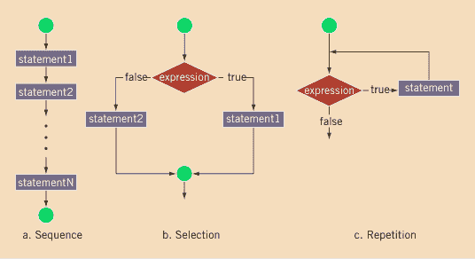

**图 4-1** 执行流程

### 选择：if 和 if...else

图 4-1(b) 和 4-1(c) 表明，执行选择语句或重复语句需要求值一个逻辑表达式。因此，首先我们需要学习逻辑表达式以及如何对它们求值。

**逻辑表达式：** 求值为 `true` 或 `false` 的表达式称为逻辑表达式。

例如，因为“8 大于 3”为真，所以表达式 `8 > 3` 是逻辑表达式。注意，`>` 是 C++ 中的运算符，称为“大于”，是关系运算符的一个例子。表 4-1 列出了 C++ 关系运算符。

### 表 4-1 C++ 中的关系运算符

| 运算符 | 描述 |
|---|---|
| `==` | 等于 |
| `!=` | 不等于 |
| `<` | 小于 |
| `<=` | 小于或等于 |
| `>` | 大于 |
| `>=` | 大于或等于 |

> 在 C++ 中，由两个等号组成的符号 `==` 称为相等运算符。回想一下，符号 `=` 称为赋值运算符。记住，相等运算符 `==` 判断两个表达式是否相等，而赋值运算符 `=` 将表达式的值赋给变量。

每个关系运算符都是二元运算符；也就是说，它需要两个操作数。因为比较的结果是 `true` 或 `false`，所以使用这些运算符的表达式总是求值为 `true` 或 `false`。

### 关系运算符与简单数据类型

你可以将关系运算符用于所有三种简单数据类型。在下面的示例中，表达式同时使用整数和实数：

### 例 4-1

| 表达式 | 含义 | 值 |
|---|---|---|
| `8 < 15` | 8 小于 15 | `true` |
| `6 != 6` | 6 不等于 6 | `false` |
| `2.5 > 5.8` | 2.5 大于 5.8 | `false` |
| `5.9 <= 7.5` | 5.9 小于或等于 7.5 | `true` |
| `7 <= 10.4` | 7 小于或等于 10.4 | `true` |

### 比较字符

对于 char 值，使用关系运算符的表达式求值为 `true` 还是 `false` 取决于机器的排序序列。一些字符的排序序列如下：

| ASCII 值 | 字符 | ASCII 值 | 字符 | ASCII 值 | 字符 | ASCII 值 | 字符 |
|---:|:---:|---:|:---:|---:|:---:|---:|:---:|
| 32 | `' '` | 61 | `=` | 81 | Q | 105 | i |
| 33 | `!` | 62 | `>` | 82 | R | 106 | j |
| 34 | `"` | 65 | A | 83 | S | 107 | k |
| 42 | `*` | 66 | B | 84 | T | 108 | l |
| 43 | `+` | 67 | C | 85 | U | 109 | m |
| 45 | `-` | 68 | D | 86 | V | 110 | n |
| 47 | `/` | 69 | E | 87 | W | 111 | o |
| 48 | 0 | 70 | F | 88 | X | 112 | p |
| 49 | 1 | 71 | G | 89 | Y | 113 | q |
| 50 | 2 | 72 | H | 90 | Z | 114 | r |
| 51 | 3 | 73 | I | 97 | a | 115 | s |
| 52 | 4 | 74 | J | 98 | b | 116 | t |
| 53 | 5 | 75 | K | 99 | c | 117 | u |
| 54 | 6 | 76 | L | 100 | d | 118 | v |
| 55 | 7 | 77 | M | 101 | e | 119 | w |
| 56 | 8 | 78 | N | 102 | f | 120 | x |
| 57 | 9 | 79 | O | 103 | g | 121 | y |
| 60 | `<` | 80 | P | 104 | h | 122 | z |

ASCII 字符集在附录 C 中描述。

现在，因为 `32 < 97`，并且 `' '` 的 ASCII 值是 `32`，`'a'` 的 ASCII 值是 `97`，所以 `' ' < 'a'` 为 `true`。类似地，使用前面的 ASCII 值：

```
'R' > 'T' is false
'+' < '*' is false
'A' <= 'a' is true
```

注意，比较不同数据类型的值可能会产生不可预测的结果。例如，下面的表达式比较一个整数和一个字符：

```
8 < '5'
```

在这个表达式中，在特定机器上，`8` 将与 `'5'` 的排序序列值比较，即 `53`。也就是说，`8` 与 `53` 比较，这使得这个特定表达式求值为 `true`。

表达式 `4 < 6` 和 `'R' > 'T'` 是逻辑（布尔）表达式。当 C++ 对逻辑表达式求值时，如果逻辑表达式求值为 `true`，则返回整数值 `1`；否则返回整数值 `0`。在 C++ 中，任何非零值都被视为 `true`。

> **注意**
>
> 第 2 章介绍了数据类型 `bool`。回想一下，数据类型 `bool` 有两个值：`true` 和 `false`。在 C++ 中，`true` 和 `false` 是保留字。标识符 `true` 被设置为 1，标识符 `false` 被设置为 0。为了可读性，只要使用逻辑表达式，这里都将使用标识符 `true` 和 `false` 作为逻辑表达式的值。

既然我们知道关系运算符如何工作，就可以开始学习如何在 C++ 程序中实现决策。尽管只有两个逻辑值 `true` 和 `false`，但它们非常有用，因为它们允许程序纳入会改变处理流程的决策。本章余下部分讨论将决策纳入程序的方法。在 C++ 中，有两种选择或分支控制结构：`if` 语句和 `switch` 结构。本节讨论如何使用 `if` 和 `if...else` 语句创建单向选择、双向选择和多分支选择。`switch` 结构将在本章后面讨论。

### 单向选择

银行希望在客户的支票账户余额低于所需最低余额时向客户发送通知。也就是说，如果账户余额低于所需最低余额，就应向客户发送通知；否则，不应做任何事。类似地，如果保险保单的保单持有人不吸烟，公司希望对该保单保费给予 10% 的折扣。


这两个示例都涉及单向选择。在 C++ 中，单向选择通过 `if` 语句实现。单向选择的语法是：

```
    if (expression)
        statement
```

注意此语法的各个元素。它以保留字 `if` 开头，后面是包含在圆括号中的**表达式**，再后面是**语句**。注意，表达式两侧的圆括号是语法的一部分。**表达式**有时被称为**决策者**，因为它决定是否执行其后的**语句**。**表达式**通常是逻辑表达式。如果**表达式**的值为 `true`，则执行**语句**。如果值为 `false`，则不执行**语句**。**表达式**后面的**语句**有时被称为**动作语句**。图 4-2 显示了 `if` 语句（单向选择）的执行流程。

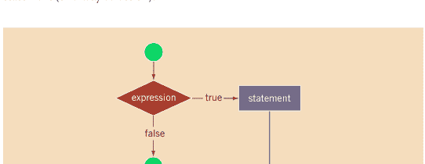

图 4-2 单向选择

## 示例 4-2

```
    if (score >= 60)
        grade = 'P';
```

在此代码中，如果表达式 `(score >= 60)` 求值为 `true`，则执行赋值语句 `grade = 'P';`。如果表达式求值为 `false`，则不执行该赋值语句。例如，如果 `score` 的值为 65，则赋给变量 `grade` 的值为 `'P'`。

第 7 行到第 10 行的语句声明程序中使用的变量。第 12 行的语句提示用户输入信用卡账单金额。第 13 行的语句将该金额输入到变量 `creditCardBalance` 中。第 15 行的语句提示用户输入还款金额。第 16 行的语句将还款金额输入到变量 `payment` 中。第 18 行的语句计算未付余额。第 19 行的 `if` 语句判断未付余额是否为正。如果未付余额为正，则第 20 行的语句计算罚金。第 21 行和第 22 行的语句输出结果。该程序假设未付余额的年利率为 18%（即每月 1.5%）。如你所见，未付余额的利息会迅速累积，不仅会毁掉你的信用评级，还会使你陷入财务困境。

## 示例 4-4

考虑以下语句：

```
if score >= 60        //syntax error
    grade = 'P';
```

该语句展示了一个错误版本的 `if` 语句。逻辑表达式两侧的圆括号缺失，这是语法错误。

在 `if` 语句中，在表达式后面的圆括号之后（即语句之前）放置分号是语义错误。如果分号紧跟在右圆括号之后，`if` 语句将作用于空语句。

## 示例 4-5

考虑以下 C++ 语句：

```
if (score >= 60);        //Line 1
    grade = 'P';          //Line 2
```

因为表达式末尾有分号（见第 1 行），所以第 1 行的 `if` 语句结束。这个 `if` 语句的动作为空，并且第 2 行的语句不属于第 1 行的 `if` 语句。因此，无论 `if` 语句求值结果如何，第 2 行的语句都会执行。

## 双向选择

在许多编程情形中，你必须在两个备选方案之间做出选择。例如，如果兼职员工加班，则工资按加班工资公式计算；否则，工资按常规公式计算。这是一个双向选择的例子。为了在两个备选方案之间进行选择——也就是实现双向选择——C++ 提供了 `if...else` 语句。双向选择使用以下语法：

```cpp
if (expression)
    statement1
else
    statement2
```

花点时间检查此语法。它以保留字 `if` 开头，后面是包含在圆括号中的逻辑表达式，再后面是一个语句，再后面是保留字 `else`，最后是第二个语句。语句1和语句2可以是任何有效的 C++ 语句。在双向选择中，如果表达式的值为 `true`，则执行语句1。如果表达式的值为 `false`，则执行语句2。图 4-3 显示了 `if...else` 语句（双向选择）的执行流程。

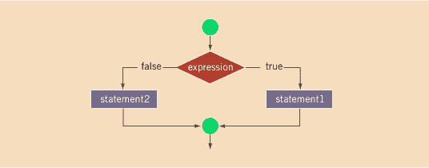

图 4-3 双向选择

## 示例 4-6

考虑以下语句：

```cpp
if (hours > 40.0)                         //Line 1
    wages = 40.0 * rate +
            1.5 * rate * (hours - 40.0);  //Line 2
else                                      //Line 3
    wages = hours * rate;                 //Line 4
```

如果变量 hours 的值大于 40.0，则工资包含加班费。假设 hours 为 50。第 1 行 if 语句中的表达式求值为 true，因此执行第 2 行的语句。另一方面，如果 hours 为 30 或任何小于等于 40 的数，则第 1 行 if 语句中的表达式求值为 false。在这种情况下，程序跳过第 2 行的语句并执行第 4 行的语句——也就是执行保留字 else 后面的语句。

## 示例 4-7

以下程序确定员工的周工资。如果工作小时数超过 40，则工资包含加班费。

```cpp
//Program: Weekly wages

#include <iostream>                                      //Line 1
#include <iomanip>                                       //Line 2

using namespace std;                                     //Line 3

int main()                                               //Line 4
{                                                        //Line 5
    double wages, rate, hours;                           //Line 6

    cout << fixed << showpoint << setprecision(2);       //Line 7
    cout << "Line 8: Enter working hours and rate: ";    //Line 8
    cin >> hours >> rate;                                //Line 9

    if (hours > 40.0)                                    //Line 10
        wages = 40.0 * rate +                            //Line 11
                1.5 * rate * (hours - 40.0);             //Line 12
    else                                                 //Line 13
        wages = hours * rate;                            //Line 13
    cout << endl;                                        //Line 14
    cout << "Line 15: The wages are $" << wages << endl; //Line 15
    return 0;                                            //Line 16
}                                                        //Line 17
```

**示例运行：** 在此示例运行中，用户输入以阴影显示。

```
Line 8: Enter working hours and rate: 50.00 12.50
Line 15: The wages are $687.50
```

第 6 行的语句声明程序中使用的变量。第 7 行的语句将浮点数的输出设置为固定小数格式，带小数点、尾随零和两位小数。第 8 行的语句提示用户输入工作小时数和工资率。第 9 行的语句分别将这些值输入到变量 hours 和 rate 中。第 10 行的语句检查变量 hours 的值是否大于 40.0。如果 hours 大于 40.0，则工资由第 11 行的语句计算，其中包含加班费。否则，工资由第 13 行的语句计算。第 15 行的语句输出工资。

在双向选择语句中，在表达式之后、语句1之前放置分号会产生语法错误。如果 if 语句以分号结束，则 `statement1` 不再属于 `if` 语句，而 `if...else` 语句的 `else` 部分会单独存在。C++ 中没有独立的 `else` 语句。也就是说，它不能与 `if` 语句分离。

## 示例 4-8

以下语句展示了一个语法错误的示例：

```cpp
if (hours > 40.0);                         //Line 1
    wages = 40.0 * rate +
            1.5 * rate * (hours - 40.0);     //Line 2
else                                        //Line 3
    wages = hours * rate;                    //Line 4
```

`if` 语句末尾的分号（见第 1 行）结束了 `if` 语句，因此第 2 行的语句将 `else` 子句与 `if` 语句分隔开。也就是说，`else` 单独存在。因为 C++ 中没有独立的 `else` 语句，所以此代码会产生语法错误。如示例 4-5 所示，在单向选择中，`if` 语句末尾的分号是逻辑错误；而如本示例所示，在双向选择中，它是语法错误。

现在让我们考虑另一个 `if` 语句的示例，并检查可能发生的一些语义错误。

## 示例 4-9

考虑以下语句：

```cpp
if (score >= 60)                    //Line 1
    cout << "Passing" << endl;      //Line 2
    cout << "Failing" << endl;      //Line 3
```

如果表达式 (`score >= 60`) 求值为 `false`，则不执行第 2 行的输出语句。因此输出将是 Failing。也就是说，这组语句执行的操作与 `if...else` 语句相同。它将执行第 3 行的输出语句，而不是第 2 行的输出语句。例如，如果 score 的值为 50，这些语句将输出以下行：

```
Failing
```

然而，如果表达式 (`score >= 60`) 求值为 `true`，程序将执行两个输出语句，得到非常不令人满意的结果。例如，如果 score 的值为 70，这些语句将输出以下行：

```
Passing
Failing
```

`if` 语句只控制第 2 行语句的执行。第 3 行的语句总是执行。


现在，逻辑（布尔）表达式 `(score >= 60)` 的求值结果为 `true` 或 `false`。因此，我们使用了两个不同的 `score` 值——一个使该逻辑（布尔）表达式的求值结果为 `true`，另一个使其求值结果为 `false`。这是一个对代码进行全面测试的示例。

根据 `score` 的值打印 Passing 或 Failing 的正确代码是：

```cpp
if (score >= 60)
    cout << "Passing" << endl;
else
    cout << "Failing" << endl;
```

## `int` 数据类型与逻辑（布尔）表达式

早期版本的 C++ 并未提供具有逻辑（或布尔）值 `true` 和 `false` 的内置数据类型。由于逻辑表达式的求值结果为 1 或 0，因此逻辑表达式的值存储在 `int` 数据类型的变量中。因此，你可以使用 `int` 数据类型来操作逻辑（布尔）表达式。

回想一下，非零值被视为 `true`。现在，考虑以下声明：

```cpp
int legalAge;
int age;
```

以及赋值语句：

```cpp
legalAge = 21;
```

如果你将 `legalAge` 视为逻辑变量，那么该语句赋给 `legalAge` 的值就是 `true`。

赋值语句：

```cpp
legalAge = (age >= 21);
```

如果 `age` 的值大于或等于 21，则该语句将值 1 赋给 `legalAge`。如果 `age` 的值小于 21，则该语句将值 0 赋给 `legalAge`。

有趣的是，`!true` 的求值结果为 `false`。然而，`!(36)` 的求值结果为 0，因为作为逻辑表达式，36 的求值结果为 1，所以 `!(36)` 的求值结果为 0，而 `!(0)` 的求值结果为 1。

## `bool` 数据类型与逻辑（布尔）表达式

较新版本的 C++ 包含一种内置数据类型 `bool`，它具有逻辑（布尔）值 `true` 和 `false`。因此，你可以使用 `bool` 数据类型来操作逻辑（布尔）表达式。回想一下，在 C++ 中，`bool`、`true` 和 `false` 是保留字。此外，标识符 `true` 的值为 1，标识符 `false` 的值为 0。现在，考虑以下声明：

```cpp
bool legalAge;
int age;
```

语句：

```cpp
legalAge = true;
```

将变量 `legalAge` 的值设置为 `true`。语句：

```cpp
legalAge = (age >= 21);
```

如果 `age` 的值大于或等于 21，则将值 `true` 赋给 `legalAge`。如果 `age` 的值小于 21，则该语句将值 `false` 赋给 `legalAge`。例如，如果 `age` 的值为 25，则赋给 `legalAge` 的值为 `true`——也就是 1。同样，如果 `age` 的值为 16，则赋给 `legalAge` 的值为 `false`——也就是 0。


你可以使用 `int` 变量或 `bool` 变量来存储逻辑表达式的值。为清晰起见，本书使用 `bool` 变量来存储逻辑表达式的值。

## 逻辑（布尔）运算符与逻辑表达式

示例 4-3 和 4-7 展示了如何在程序中加入选择语句。然而，这些示例中使用的逻辑表达式只涉及单个关系运算符的求值。有些情况下，逻辑表达式是两个或更多逻辑表达式的组合。例如，假设 `weight` 和 `height` 是 double 变量。考虑以下逻辑表达式：

```
weight > 180 and height < 6.0
```

这个逻辑表达式是逻辑表达式 `weight > 180` 和 `height < 6.0` 的组合，并且这些逻辑表达式使用单词“and”组合起来。那么，我们如何在 C++ 中求值和实现这样的表达式呢？本节介绍如何构造和求值由其他逻辑表达式组合而成的逻辑表达式。**逻辑（布尔）运算符**使你能够组合逻辑表达式。C++ 有三种逻辑（布尔）运算符，如表 4-2 所示。

**表 4-2** C++ 中的逻辑（布尔）运算符

| 运算符 | 描述 |
|---|---|
| `!` | 非 |
| `&&` | 与 |
| `\|\|` | 或 |

逻辑运算符只接受逻辑值作为操作数，并且只产生逻辑值作为结果。运算符 `!` 是一元运算符，因此它只有一个操作数。运算符 `&&` 和 `||` 是二元运算符，并且这些运算符内部不能有空格。表 4-3 至表 4-5 定义了这些运算符。


表 4-3 定义了运算符 `!`（非）。当你使用 `!` 运算符时，`!true` 为 `false`，`!false` 为 `true`。将 `!` 放在逻辑表达式前面会反转该逻辑表达式的值。

**表 4-3** `!`（非）运算符

| 表达式 | `!(Expression)` |
|---|---|
| `true (nonzero)` | `false (0)` |
| `false (0)` | `true (1)` |

**示例 4-10**

| 表达式 | 值 | 说明 |
|---|---|---|
| `!('A' > 'B')` | `true` | 因为 `'A' > 'B'` 为 false，所以 `!('A' > 'B')` 为 true。 |
| `!(6 <= 7)` | `false` | 因为 `6 <= 7` 为 true，所以 `!(6 <= 7)` 为 false。 |

表 4-4 定义了运算符 `&&`（与）。从该表可知，`Expression1 && Expression2` 为 true 当且仅当 `Expression1` 和 `Expression2` 都为 true；否则，`Expression1 && Expression2` 的求值结果为 false。

**表 4-4** `&&`（与）运算符

| 表达式1 | 表达式2 | 表达式1 && 表达式2 |
|---|---|---|
| `true (nonzero)` | `true (nonzero)` | `true (1)` |
| `true (nonzero)` | `false (0)` | `false (0)` |
| `false (0)` | `true (nonzero)` | `false (0)` |
| `false (0)` | `false (0)` | `false (0)` |

**示例 4-11**

| 表达式 | 值 | 说明 |
|---|---|---|
| `(14 >= 5) && ('A' < 'B')` | `true` | 因为 `(14 >= 5)` 为 true，`('A' < 'B')` 为 true，且 `true && true` 为 true，所以该表达式的求值结果为 true。 |
| `(24 >= 35) && ('A' < 'B')` | `false` | 因为 `(24 >= 35)` 为 false，`('A' < 'B')` 为 true，且 `false && true` 为 false，所以该表达式的求值结果为 false。 |

表 4-5 定义了运算符 `||`（或）。从该表可知，`Expression1 || Expression2` 为 true 当且仅当 `Expression1` 或 `Expression2` 中至少有一个表达式为 true；否则，`Expression1 || Expression2` 的求值结果为 `false`。

**表 4-5** `||`（或）运算符

| 表达式1 | 表达式2 | 表达式1 \|\| 表达式2 |
|---|---|---|
| `true (nonzero)` | `true (nonzero)` | `true (1)` |
| `true (nonzero)` | `false (0)` | `true (1)` |
| `false (0)` | `true (nonzero)` | `true (1)` |
| `false (0)` | `false (0)` | `false (0)` |

**示例 4-12**

| 表达式 | 值 | 说明 |
|---|---|---|
| `(14 >= 5) \|\| ('A' > 'B')` | `true` | 因为 `(14 >= 5)` 为 true，`('A' > 'B')` 为 false，且 `true \|\| false` 为 true，所以该表达式的求值结果为 `true`。 |
| `(24 >= 35) \|\| ('A' > 'B')` | `false` | 因为 `(24 >= 35)` 为 false，`('A' > 'B')` 为 false，且 `false \|\| false` 为 false，所以该表达式的求值结果为 `false`。 |
| `('A' <= 'a') \|\| (7 != 7)` | `true` | 因为 `('A' <= 'a')` 为 true，`(7 != 7)` 为 false，且 `true \|\| false` 为 true，所以该表达式的求值结果为 `true`。 |

## 优先级顺序

复杂的逻辑表达式可能难以求值。考虑以下逻辑表达式：

`11 > 5 || 6 < 15 && 7 >= 8`

这个逻辑表达式会产生不同的结果，具体取决于先对 `||` 还是 `&&` 求值。如果先对 `||` 求值，该表达式的求值结果为 `false`。如果先对 `&&` 求值，该表达式的求值结果为 `true`。

一个表达式可能包含算术运算符、关系运算符和逻辑运算符，如以下表达式：

`5 + 3 <= 9 && 2 > 3`

为了处理复杂的逻辑表达式，必须有一套用于运算符求值的优先级方案。表 4-6 展示了一些 C++ 运算符的优先级顺序，包括算术运算符、关系运算符和逻辑运算符。（所有 C++ 运算符的优先级见附录 B。）

**表 4-6** 运算符的优先级

| 运算符 | 优先级 |
|---|---|
| `!, +, -`（一元运算符） | 第一 |
| `*, /, %` | 第二 |
| `+, -` | 第三 |
| `<, <=, >=, >` | 第四 |
| `==, !=` | 第五 |
| `&&` | 第六 |
| `\|\|` | 第七 |
| `=`（赋值运算符） | 最后 |

> **注意**  
> 在 C++ 中，`&` 和 `|` 也是运算符。这些运算符的含义与 `&&` 和 `||` 的含义不同。使用 `&` 代替 `&&`，或使用 `|` 代替 `||`——这可能是由于打字错误造成的——会产生非常奇怪的结果。

在表达式中使用优先级规则时，关系运算符和逻辑运算符从左到右求值。由于关系运算符和逻辑运算符从左到右求值，因此这些运算符的结合性被称为从左到右。

示例 4-13 说明了由变量构成的逻辑表达式如何求值。

**示例 4-13**

假设你有以下声明：

```cpp
bool found = true;
int age = 20;
double hours = 45.30;
double overTime = 15.00;
int count = 20;
char ch = 'B';
```


可以在表达式中插入圆括号以明确其含义。也可以使用圆括号覆盖运算符的优先级。按照标准优先级顺序，表达式：

```text
11 > 5 || 6 < 15 && 7 >= 8
```

等价于：

```text
11 > 5 || (6 < 15 && 7 >= 8)
```

在这个表达式中，`11 > 5` 为 true，`6 < 15` 为 true，`7 >= 8` 为 false。将这些值代入表达式 `11 > 5 || (6 < 15 && 7 >= 8)`，得到 true || (true && false) = true || false = true。因此，表达式 `11 > 5 || (6 < 15 && 7 >= 8)` 的求值结果为 true。

在 C++ 中，逻辑（布尔）表达式可以通过以下两种方式之一进行操作或处理：使用 int 变量或使用 bool 变量。以下各节将介绍这些方法。

### 示例 4-14

通常，在经济舱航班上，如果行李箱尺寸（长 + 宽 + 高）超过 108 英寸，或者重量超过 50 磅，那么航空公司可能会向乘客收取额外费用。下面的程序在 if 语句中使用逻辑运算符 ||（或），以判断是否可能对行李箱收取额外费用。

```cpp
//Chapter 4: Example 4-14
//Program to determine if additional charges are applicable on
//a suitcase accompanying a passenger on an economy flight.

#include <iostream>                                      //Line 1
#include <iomanip>                                       //Line 2

using namespace std;                                     //Line 3

int main()                                               //Line 4
{                                                        //Line 5
        double suitcaseDimension;                        //Line 6
        double suitcaseWeight;                            //Line 7
        double additionalCharges = 0.0;                  //Line 8

        cout << fixed << showpoint << setprecision(2);   //Line 9
        cout << "Line 10: Enter suitcase dimensions "
             << "(length + width + depth) in inches: "; //Line 10
        cin >> suitcaseDimension;                        //Line 11
        cout << endl;                                    //Line 12

        cout << "Line 13: Enter suitcase weight in pounds: "; //Line 13
        cin >> suitcaseWeight;                            //Line 14
        cout << endl;                                    //Line 15

        if (suitcaseDimension > 108 || suitcaseWeight > 50)    //Line 16
            additionalCharges = 50.00;                         //Line 17

        cout << "Line 18: Additional suitcase charges: $"
             << additionalCharges << endl;                    //Line 18

        return 0;                                              //Line 19
}                                                      //Line 20
```

### 示例运行：

```text
Line 10: Enter suitcase dimensions (length + width + depth) in inches: 110

Line 13: Enter suitcase weight: 49

Line 18: Additional suitcase charges: $50.00
```

## 关系运算符与 **string** 类型

关系运算符可应用于 string 类型的变量。string 类型的变量会逐字符进行比较，从第一个字符开始，并使用 ASCII 排序序列。逐字符比较会持续进行，直到发现不匹配，或者比较到最后一个字符且相等为止。下面的示例展示了如何比较 string 类型的变量。

### 示例 4-15

假设有如下语句：

```cpp
string str1 = "Hello";
string str2 = "Hi";
string str3 = "Air";
string str4 = "Bill";
string str5 = "Big";
```

下面的表达式展示了 string 关系表达式的求值方式。

| 表达式 | 值/说明 |
|---|---|
| `str1 < str2` | **true**<br>`str1 = "Hello"` 且 `str2 = "Hi"`。`str1` 和 `str2` 的第一个字符相同，但 `str1` 的第二个字符 `'e'` 小于 `str2` 的第二个字符 `'i'`。因此，`str1 < str2` 为 true。 |
| `str1 > "Hen"` | **false**<br>`str1 = "Hello"`。`str1` 和 `"Hen"` 的前两个字符相同，但 `str1` 的第三个字符 `'l'` 小于 `"Hen"` 的第三个字符 `'n'`。因此，`str1 > "Hen"` 为 false。 |
| `str3 < "An"` | **true**<br>`str3 = "Air"`。`str3` 和 `"An"` 的第一个字符相同，但 `"Air"` 的第二个字符 `'i'` 小于 `"An"` 的第二个字符 `'n'`。因此，`str3 < "An"` 为 true。 |
| `str1 == "hello"` | **false**<br>`str1 = "Hello"`。`str1` 的第一个字符 `'H'` 小于 `"hello"` 的第一个字符 `'h'`，因为 `'H'` 的 ASCII 值为 72，而 `'h'` 的 ASCII 值为 104。因此，`str1 == "hello"` 为 false。 |
| `str3 <= str4` | **true**<br>`str3 = "Air"` 且 `str4 = "Bill"`。`str3` 的第一个字符 `'A'` 小于 `str4` 的第一个字符 `'B'`。因此，`str3 <= str4` 为 true。 |
| `str2 > str4` | **true**<br>`str2 = "Hi"` 且 `str4 = "Bill"`。`str2` 的第一个字符 `'H'` 大于 `str4` 的第一个字符 `'B'`。因此，`str2 > str4` 为 true。 |

如果比较两个长度不同的字符串，并且逐字符比较一直相等，直到到达较短字符串的最后一个字符，那么较短字符串会被认为小于较长字符串，如下所示。

| 表达式 | 值/说明 |
|---|---|
| `str4 >= "Billy"` | **false**<br>`str4 = "Bill"`。它有四个字符，而 `"Billy"` 有五个字符。因此，`str4` 是较短字符串。`str4` 的所有四个字符都与 `"Billy"` 对应的前四个字符相同，且 `"Billy"` 是较长字符串。因此，`str4 >= "Billy"` 为 false。 |
| `str5 <= "Bigger"` | **true**<br>`str5 = "Big"`。它有三个字符，而 `"Bigger"` 有六个字符。因此，`str5` 是较短字符串。`str5` 的所有三个字符都与 `"Bigger"` 对应的前三个字符相同，且 `"Bigger"` 是较长字符串。因此，`str5 <= "Bigger"` 为 true。 |

本书配套网站上的程序 `Ch4_StringComparisons.cpp` 展示了前面这些表达式的结果。

## 复合（块）语句

`if` 和 `if...else` 结构一次只控制一条语句。然而，假设当 `if` 或 `if...else` 语句中的表达式求值为 true 时，你希望执行多条语句。为了允许更复杂的语句，C++ 提供了一种称为 **复合语句** 或 **语句块** 的结构。复合语句采用以下形式：

```text
{
    statement_1
    statement_2
       .
       .
       .
    statement_n
}
```

一般来说，复合语句由一条或多条语句组成，这些语句括在花括号 `{` 和 `}` 中。在 `if` 或 `if...else` 结构中，复合语句的作用就像单条语句一样。因此，不必采用类似以下代码的简单双向选择：

```cpp
if (age >= 18)
    cout << "Eligible to vote." << endl;
else
    cout << "Not eligible to vote." << endl;
```

而可以包含类似以下代码的复合语句：

```cpp
if (age >= 18)
{
    cout << "Eligible to vote." << endl;
    cout << "No longer a minor." << endl;
}
else
{
    cout << "Not eligible to vote." << endl;
    cout << "Still a minor." << endl;
}
```

复合语句非常有用，并将在本书的大多数结构化语句中使用。

## 多重选择：嵌套 `if`

在前面的各节中，你学习了如何在程序中实现单向和双向选择。有些问题需要实现多于两个的备选方案。例如，假设如果支票账户余额超过 $50,000，利率为 7%；如果余额在 $25,000 到 $49,999.99 之间，利率为 5%；如果余额在 $1,000 到 $24,999.99 之间，利率为 3%；否则，利率为 0%。这个特定问题有四个

备选方案——即多重选择路径。如果操作语句本身是 `if` 或 `if...else` 语句，则可以通过使用 `if...else` 结构在程序中包含多个选择路径。当一个控制语句位于另一个控制语句内部时，就称其为**嵌套**。

示例 4-16 说明了如何使用嵌套的 `if...else` 结构来实现多重选择。

### 示例 4-16

假设 `balance` 和 `interestRate` 是 `double` 类型的变量。以下语句根据 `balance` 的值确定 `interestRate`：

```cpp
if (balance > 50000.00)                 //Line 1
    interestRate = 0.07;                //Line 2
else                                   //Line 3
    if (balance >= 25000.00)            //Line 4
        interestRate = 0.05;            //Line 5
    else                               //Line 6
        if (balance >= 1000.00)         //Line 7
            interestRate = 0.03;        //Line 8
        else                           //Line 9
            interestRate = 0.00;        //Line 10
```

嵌套的 `if...else` 结构要求回答一个重要问题：如何知道哪个 `else` 与哪个 `if` 配对？回想一下，在 C++ 中不存在独立的 `else` 语句。每个 `else` 语句都必须与一个 `if` 配对。将 `else` 与 `if` 配对的规则如下：

**将 `else` 与 `if` 配对：** 在嵌套 `if` 语句中，C++ 会将一个 `else` 与最近一个尚未完成的 `if`（即最近一个尚未与 `else` 配对的 `if`）关联起来。

使用该规则，在示例 4-16 中，第 3 行中的 `else` 与第 1 行中的 `if` 配对。第 6 行中的 `else` 与第 4 行中的 `if` 配对，第 9 行中的 `else` 与第 7 行中的 `if` 配对。这意味着每个 `else` 对应的块从该 `else` 一直延伸到第 10 行。

为了避免过度缩进，示例 4-16 中的代码可以改写如下：

```cpp
if (balance > 50000.00)                 //Line 1
    interestRate = 0.07;                //Line 2
else if (balance >= 25000.00)           //Line 3
    interestRate = 0.05;                //Line 4
else if (balance >= 1000.00)            //Line 5
    interestRate = 0.03;                //Line 6
else                                   //Line 7
    interestRate = 0.00;                //Line 8
```

以下示例将帮助你了解使用嵌套 `if` 结构实现多重选择的各种方式。

### 示例 4-17

假设 score 是 `int` 类型的变量。以下代码根据 `score` 的值输出成绩等级：

```cpp
if (score >= 90)
    cout << "The grade is A." << endl;
else if (score >= 80)
    cout << "The grade is B." << endl;
else if (score >= 70)
    cout << "The grade is C." << endl;
else if (score >= 60)
    cout << "The grade is D." << endl;
else
    cout << "The grade is F." << endl;
```

### 示例 4-18

假设所有变量都已正确声明，并考虑以下语句：

```cpp
if (temperature >= 50)                              //Line 1
    if (temperature >= 80)                          //Line 2
        cout << "Good day for swimming." << endl;   //Line 3
    else                                             //Line 4
        cout << "Good day for golfing." << endl;    //Line 5
else                                                 //Line 6
    cout << "Good day to play tennis." << endl;     //Line 7
```

在此 C++ 代码中，第 4 行中的 `else` 与第 2 行中的 `if` 配对，第 6 行中的 `else` 与第 1 行中的 `if` 配对。注意，第 4 行中的 `else` 不能与第 1 行中的 `if` 配对。如果将第 4 行中的 `else` 与第 1 行中的 `if` 配对，则第 2 行中的 `if` 会成为第 1 行中 `if` 的操作语句部分，从而使第 6 行中的 `else` 悬空。此外，第 2 行到第 5 行中的语句构成第 1 行中 `if` 的语句部分。缩进并不决定配对关系，但应当用来传达这种配对关系。

### 示例 4-19

假设所有变量都已正确声明，并考虑以下语句：

```cpp
if (temperature >= 70)                              //Line 1
    if (temperature >= 80)                          //Line 2
        cout << "Good day for swimming." << endl;   //Line 3
    else                                             //Line 4
        cout << "Good day for golfing." << endl;    //Line 5
```

在此代码中，第 4 行中的 `else` 与第 2 行中的 `if` 配对。注意，对于第 4 行中的 `else`，最近一个尚未完成的 `if` 位于第 2 行。在此代码中，第 1 行中的 `if` 没有 `else`，是一个单向选择。再次说明，缩进并不决定配对关系，但它传达这种配对关系。注意，如果 `temperature` 的值小于 70，则此代码不作出任何判断。

### 示例 4-20

假设所有变量都已正确声明，并考虑以下语句：

```cpp
if (gender == 'M')                         //Line 1
    if (age < 21)                           //Line 2
        policyRate = 0.05;                  //Line 3
    else                                    //Line 4
        policyRate = 0.35;                  //Line 5
else if (gender == 'F')                     //Line 6
    if (age < 21)                           //Line 7
        policyRate = 0.04;                  //Line 8
    else                                    //Line 9
        policyRate = 0.30;                  //Line 10
```

在此代码中，第 4 行中的 `else` 与第 2 行中的 `if` 配对。注意，对于第 4 行中的 `else`，最近一个尚未完成的 `if` 是第 2 行中的 `if`。第 6 行中的 `else` 与第 1 行中的 `if` 配对。第 9 行中的 `else` 与第 7 行中的 `if` 配对。再次说明，缩进并不决定配对关系，但它传达这种配对关系。

## 比较 `if...else` 语句与一系列 `if` 语句

考虑以下 C++ 程序段，它们都完成相同的任务：

```cpp
a.  if (month == 1)                         //Line 1
        cout << "January" << endl;          //Line 2
    else if (month == 2)                     //Line 3
        cout << "February" << endl;         //Line 4
    else if (month == 3)                     //Line 5
        cout << "March" << endl;            //Line 6
    else if (month == 4)                     //Line 7
        cout << "April" << endl;             //Line 8
    else if (month == 5)                     //Line 9
        cout << "May" << endl;               //Line 10
    else if (month == 6)                     //Line 11
        cout << "June" << endl;              //Line 12
```

**短路求值**（针对逻辑表达式）：一种过程，其中计算机从左到右对逻辑表达式求值，一旦该表达式的最终值已知就停止。

### 示例 4-21

考虑以下表达式：

```cpp
(age >= 21) || (x == 5)              //Line 1
(grade == 'A') && (x >= 7)             //Line 2
```

对于第 1 行中的表达式，假设 age 的值为 25。因为 (25 >= 21) 为真，且该表达式中使用的逻辑运算符是 ||，所以该表达式求值为真。由于短路求值，计算机不会计算表达式 (x == 5)。类似地，对于第 2 行中的表达式，假设 grade 的值为 'B'。因为 ('B' == 'A') 为假，且该表达式中使用的逻辑运算符是 &&，所以该表达式求值为假。计算机不会计算 (x >= 7)。

## 比较浮点数是否相等：一项注意事项

比较浮点数是否相等的行为可能与你预期的不一样。例如，考虑以下程序：

```cpp
#include <iostream>
#include <iomanip>
#include <cmath>

using namespace std;

int main()
{
    double x = 1.0;
    double y = 3.0 / 7.0 + 2.0 / 7.0 + 2.0 / 7.0;

    cout << fixed << showpoint << setprecision(17);

    cout << "3.0 / 7.0 + 2.0 / 7.0 + 2.0 / 7.0 = "
         << 3.0 / 7.0 + 2.0 / 7.0 + 2.0 / 7.0 << endl;

    cout << "x = " << x << endl;
    cout << "y = " << y << endl;

    if (x == y)
        cout << "x and y are the same." << endl;
    else
        cout << "x and y are not the same." << endl;

    if (fabs(x - y) < 0.000001)
        cout << "x and y are the same within the tolerance "
             << "0.000001." << endl;
```


```cpp
else
    cout << " x and y are not the same within the "
         << "tolerance 0.000001." << endl;

    return 0;
}
```

### 示例运行：

```text
3.0 / 7.0 + 2.0 / 7.0 + 2.0 / 7.0 = 0.99999999999999989
x = 1.0000000000000000
y = 0.99999999999999989
x and y are not the same.
x and y are the same within the tolerance 0.000001.
```

在这个程序中，x 被初始化为 1.0，y 被初始化为 3.0 / 7.0 + 2.0 / 7.0 + 2.0 / 7.0。由于舍入，如输出所示，该表达式的求值结果为 0.99999999999999989。因此，表达式 (x == y) 的求值结果为 false。然而，如果你用纸笔手工计算表达式 3.0 / 7.0 + 2.0 / 7.0 + 2.0 / 7.0，你会得到 3.0 / 7.0 + 2.0 / 7.0 + 2.0 / 7.0 = (3.0 + 2.0 + 2.0) / 7.0 = 7.0 / 7.0 = 1.0。也就是说，y 的值应设为 1.0，并且 x 应等于 y。

前面的程序及其输出表明，在比较浮点数是否相等时应小心。检查两个浮点数是否相等的一种方法是检查它们之差的绝对值是否小于某个容差。例如，假设容差为 0.000001。那么，如果 (x − y) 的绝对值小于 0.000001，则 x 和 y 相等。要求绝对值，你可以使用头文件 cmath 中的函数 fabs（求浮点数的绝对值），如程序所示。因此，表达式 fabs (x − y) < 0.000001 判断 (x − y) 的绝对值是否小于 0.000001。

## 关系运算符的结合性：注意事项

有时逻辑表达式的行为并不像你预期的那样，如下面的程序所示，该程序判断一个数是否在 0 到 10 之间（含 0 和 10）。

```cpp
#include <iostream>

using namespace std;

int main()
{
    int num;

    cout << "Enter an integer: ";
    cin >> num;
    cout << endl;

    if (0 <= num <= 10)
        cout << num << " is within 0 and 10." << endl;
    else
        cout << num << " is not within 0 and 10." << endl;

    return 0;
}
```

### 示例运行：

在这些示例运行中，用户输入以阴影显示。

### 示例运行 1：

```text
Enter an integer: 5
5 is within 0 and 10.
```

### 示例运行 2：

```text
Enter an integer: 20
20 is within 0 and 10.
```

### 示例运行 3：

```text
Enter an integer: -10
-10 is within 0 and 10.
```

显然，示例运行 1 是正确的，而示例运行 2 和 3 不正确。现在，`if` 语句本应判断一个整数是否在 0 到 10 之间。看起来情况并非如此。所以问题出在 `if` 语句中的表达式里。让我们看看这个表达式，即：

```cpp
0 <= num <= 10
```

尽管该语句是合法的 C++ 表达式，但你得不到期望的结果。让我们针对 `num` 的某些值来求值这个表达式。假设 `num` 的值为 5。那么：

| 表达式 | 计算 | 说明 |
|---|---|---|
| 0 <= num <= 10 | = 0 <= 5 <= 10 |  |
|  | = (0 <= 5) <= 10 | （因为关系运算符从左到右求值） |
|  | = 1 <= 10 | （因为 0 <= 5 为真，0 <= 5 的求值结果为 1） |
|  | = 1 (true) |  |

现在，假设 `num = 20`。那么：

| 表达式 | 计算 | 说明 |
|---|---|---|
| 0 <= num <= 10 | = 0 <= 20 <= 10 |  |
|  | = (0 <= 20) <= 10 | （因为关系运算符从左到右求值） |
|  | = 1 <= 10 | （因为 0 <= 20 为真，0 <= 20 的求值结果为 1） |
|  | = 1 (true) |  |

现在，你可以看出为什么当 num 为 20 时该表达式的求值结果为 true。类似地，如果 num 为 -10，表达式 0 <= num <= 10 的求值结果为 true。事实上，无论 num 是什么，这个表达式将始终求值为 true。这是因为表达式 0 <= num 的求值结果为 0 或 1，而 0 <= 10 为真，1 <= 10 也为真。那么表达式 0 <= num <= 10 错在哪里？它缺少逻辑运算符 &&。在 C++ 中编写该表达式的一种正确方式是：

```cpp
0 <= num && num <= 10
```

利用运算符的优先级，表达式 0 <= num && num <= 10 与 (0 <= num) && (num <= 10) 相同。

在构造逻辑表达式时必须小心。创建复杂逻辑表达式时，必须使用正确的逻辑运算符。

### 通过避免一知半解的概念和技术来避免缺陷

第 2 章和第 3 章的调试部分说明了如何理解和修复语法错误与逻辑错误。在本节中，我们说明如何通过避免一知半解的概念和技术来避免缺陷。

到目前为止你编写的程序应该已经说明，像变量声明末尾漏掉分号，或使用变量而没有正确声明这样的小错误，都可能使程序无法成功编译。类似地，使用变量而没有正确初始化它，可能使程序无法正确运行。回想一下，与 `if` 语句关联的条件必须括在圆括号中。因此，下面的表达式会导致语法错误：

```cpp
if score >= 90
```

示例 4-8 说明了下面 `if` 语句条件后意外多出的分号：

```cpp
if (hours > 40.0);
```

可能会妨碍成功编译或正确执行。

你解决问题所采用的方法必须正确使用概念和技术；否则，你的解决方案要么不正确，要么有缺陷。使用一知半解的概念和技术的问题可以通过下面的程序来说明。

假设我们想编写一个分析学生 GPA 的程序。如果 GPA 大于或等于 3.9，该学生进入院长荣誉名单。如果 GPA 小于 2.00，则向该学生发送一封警告信，说明其 GPA 低于毕业要求。因此，考虑下面的程序：

```cpp
//GPA program with bugs.
#include <iostream>                                      //Line 1
using namespace std;                                      //Line 2

int main()                                                //Line 3
{                                                         //Line 4
    double gpa;                                            //Line 5

    cout << "Enter the GPA: ";                            //Line 6
    cin >> gpa;                                            //Line 7
    cout << endl;                                          //Line 8

    if (gpa >= 2.0)                                        //Line 9
        if (gpa >= 3.9)                                    //Line 10
            cout << "Dean's Honor List." << endl;          //Line 11
    else                                                    //Line 12
        cout << "The GPA is below the graduation "
             << " requirement. \nSee your "
             << "academic advisor." << endl;              //Line 13

    return 0;                                              //Line 14
}                                                         //Line 15
```

**示例运行：** 在这些示例运行中，用户输入以阴影显示。

### 示例运行 1：

```text
Enter the GPA: 3.91
Dean's Honor List.
```

### 示例运行 2：

```text
Enter the GPA: 3.8
The GPA is below the graduation requirement.
See your academic advisor.
```

### 示例运行 3：

```text
Enter the GPA: 1.95
```

让我们看看这些示例运行。显然，示例运行 1 中的输出是正确的。在示例运行 2 中，输入是 3.8，而输出表明该 GPA 低于毕业要求。然而，GPA 为 3.8 的学生会以某种荣誉毕业。所以，示例运行 2 中的输出不正确。在示例运行 3 中，输入是 1.95，而输出没有显示任何警告信息。因此，示例运行 3 中的输出也不正确。这意味着第 9 行到第 13 行的 `if...else` 语句不正确。让我们看看这些语句，即：

```cpp
if (gpa >= 2.0)                                      //Line 9
    if (gpa >= 3.9)                                  //Line 10
        cout << "Dean's Honor List." << endl;        //Line 11
```


```cpp
else                                      //第12行
    cout << "The GPA is below the graduation "
         << "requirement. \nSee your "
         << "academic advisor." << endl;    //第13行
```

按照 `else` 与 `if` 配对的原则，第12行的 `else` 与第10行的 `if` 配对。换句话说，使用正确的缩进后，代码如下：

```cpp
if (gpa >= 2.0)                         //第9行
    if (gpa >= 3.9)                      //第10行
        cout << "Dean's Honor List." << endl;  //第11行
    else                                 //第12行
        cout << "The GPA is below the graduation "
             << "requirement. \nSee your "
             << "academic advisor." << endl;     //第13行
```

现在我们可以看到，第9行的 `if` 语句是一个单分支选择。因此，如果输入的数字小于2.0，不会发生任何操作，也就是说，不会打印任何警告信息。现在，假设输入是3.8。那么第9行的表达式计算结果为 `true`，因此会继续计算第10行的表达式，其计算结果为 `false`。这意味着第13行的输出语句会执行，从而产生不令人满意的结果。

实际上，程序只应在 GPA 小于2.0时打印警告信息，并且当 GPA 大于或等于3.9时，应打印以下信息：

Dean's Honor List.

为了达到这个结果，第12行的 `else` 需要与第9行的 `if` 配对。要将第12行的 `else` 与第9行的 `if` 配对，需要使用复合语句，如下所示：

```cpp
if (gpa >= 2.0)                         //第9行
{
    if (gpa >= 3.9)                      //第10行
        cout << "Dean's Honor List." << endl;  //第11行
}                                        //第12行
else
    cout << "The GPA is below the graduation "
         << "requirement. \nSee your "
         << "academic advisor." << endl;    //第13行
```

正确的程序如下：

```cpp
//正确的GPA程序。

#include <iostream>                     //第1行

using namespace std;                    //第2行

int main()                                //第3行
{
    double gpa;                           //第5行

    cout << "Enter the GPA: ";        //第6行
    cin >> gpa;                         //第7行
    cout << endl;                       //第8行

    if (gpa >= 2.0)                     //第9行
    {
        if (gpa >= 3.9)                 //第11行
            cout << "Dean's Honor List." << endl; //第12行
    }
    else                                //第14行
        cout << "The GPA is below the graduation "
             << "requirement. \nSee your "
             << "academic advisor." << endl;        //第15行

    return 0;                           //第16行
}                                   //第17行
```

**示例运行：** 在这些示例运行中，用户输入以阴影显示。

### 示例运行1：

```cpp
Enter the GPA: 3.91
Dean's Honor List.
```

### 示例运行2：

```cpp
Enter the GPA: 3.8
```

### 示例运行3：

```cpp
Enter the GPA: 1.95
The GPA is below the graduation requirement.
See your academic advisor.
```

在这种情况下，一般规则是：你不能查看块内部（即花括号内部）来将 `else` 与 `if` 配对。第14行的 `else` 不能与第11行的 `if` 配对，因为第11行的 `if` 语句被花括号括起来，而第14行的 `else` 不能查看这些花括号内部。因此，第14行的 `else` 与第9行的 `if` 配对。

在本书中，C++编程概念和技术按逻辑顺序呈现。在使用某个概念或技术之前完全理解它，将为你节省大量的调试时间。

## 输入失败与 `if` 语句

在第3章中，你了解到尝试读取无效数据会导致输入流进入失败状态。一旦输入流进入失败状态，所有与该输入流相关的后续输入语句都会被忽略，计算机继续执行程序，从而产生错误结果。你可以使用 `if` 语句来检查输入流变量的状态，如果输入流进入失败状态，则包含停止程序执行的指令。

除了读取无效数据之外，其他事件也可能导致输入流进入失败状态。另外两个常见的输入失败原因是：

- 尝试打开不存在的输入文件
- 尝试读取超过输入文件末尾的数据

解决输入失败原因的一种方法是检查输入流变量的状态。你可以通过在 `if` 语句中将输入流变量作为逻辑表达式来检查其状态。如果最后一次输入成功，输入流变量的计算结果为 `true`；如果最后一次输入失败，其计算结果为 `false`。

语句：

```cpp
if (cin)
    cout << "Input is OK." << endl;
```

如果标准输入设备的最后一次输入成功，则打印：

```cpp
Input is OK.
```

类似地，如果 `infile` 是一个 ifstream 变量，语句：

```cpp
if (!infile)
    cout << "Input failed." << endl;
```

如果与流变量 `infile` 相关的最后一次输入失败，则打印：

```cpp
Input failed.
```

假设一个输入流变量尝试打开一个文件以将数据输入到程序中。如果输入文件不存在，你可以使用输入流变量的值，结合 `return` 语句来终止程序。

回想一下，函数 `main` 中包含的最后一条语句是：

```cpp
return 0;
```

当程序终止时，该语句向操作系统返回一个值0。值0表示程序正常终止，并且在程序执行期间没有发生错误。除0以外的 `int` 类型值也可以通过 `return` 语句返回给操作系统。但是，返回任何非0值都表示程序执行期间出现了问题。

`return` 语句可以出现在程序中的任何位置。每当执行 `return` 语句时，它会立即退出该语句所在的函数。对于函数 `main`，当 `return` 语句执行时，程序终止。你可以利用 `return` 语句的这些特性，在输入流失败时终止函数 `main`。当程序尝试打开输入文件时，这种技术尤其有用。请考虑以下语句：

```cpp
ifstream infile;

infile.open("inputdat.dat");    //打开文件 inputdat.dat

if (!infile)
{
    cout << "Cannot open the input file. "
         << "The program terminates." << endl;
    return 1;
}
```

假设文件 `inputdat.dat` 不存在。打开该文件的操作失败，导致输入流进入失败状态。作为逻辑表达式，文件流变量 `infile` 的计算结果为 `false`。由于 `infile` 的计算结果为 `false`，表达式 `!infile`（在 `if` 语句中）的计算结果为 `true`，因此 `if` 语句的主体执行。屏幕会打印以下信息：

Cannot open the input file. The program terminates.

然后 `return` 语句通过向操作系统返回值 `1` 来终止程序。

现在，让我们在第3章的 *编程示例：学生成绩* 中包含这些功能，使用响应输入失败的代码。回想一下，该程序根据输入文件中的数据计算平均测试分数，然后将结果输出到另一个文件。以下编程代码与第3章中的代码相同，不同之处在于它包含了一旦输入文件不存在就退出程序的语句。

```cpp
//计算平均测试分数的程序。

#include <iostream>
#include <fstream>
#include <iomanip>
#include <string>

using namespace std;

int main()
{
    ifstream inFile;    //输入文件流变量
    ofstream outFile;   //输出文件流变量

    double test1, test2, test3, test4, test5;
    double average;

    string firstName;
    string lastName;
```


```cpp
inFile.open("test.txt"); //open the input file

if (!inFile)
{
    cout << "Cannot open the input file. "
         << "The program terminates." << endl;
    return 1;
}

outFile.open("testavg.out");  //open the output file

outFile << fixed << showpoint;
outFile << setprecision(2);

cout << "Processing data" << endl;

inFile >> firstName >> lastName;
outFile << "Student name: " << firstName
        << " " << lastName << endl;

inFile >> test1 >> test2 >> test3
       >> test4 >> test5;
outFile << "Test scores: " << setw(4) << test1
        << setw(4) << test2 << setw(4) << test3
        << setw(4) << test4 << setw(4) << test5
        << endl;

average = (test1 + test2 + test3 + test4 + test5) / 5.0;

outFile << "Average test score: " << setw(6)
        << average << endl;

inFile.close();
outFile.close();

return 0;
}
```

## 相等运算符（==）与赋值运算符（=）之间的混淆

回想一下，如果 if 结构中的决策表达式求值为 `true`，则执行 if 结构的语句部分。此外，该表达式通常是逻辑表达式。然而，C++ 允许你将任何可以求值为 `true` 或 `false` 的表达式用作 if 结构中的表达式。考虑以下语句：

```cpp
if (x = 5)
    cout << "The value is five." << endl;
```

`if` 语句中的**表达式**——也就是决策判断部分——是 `x = 5`。表达式 `x = 5` 被称为赋值表达式，因为表达式中出现了运算符 `=`，并且末尾没有分号。

该表达式的求值过程如下。首先，求运算符 `=` 右侧的值，其结果为 5。然后将值 5 赋给 `x`。此外，值 5——也就是 `x` 的新值——也成为 `if` 语句中表达式的值——即赋值表达式的值。因为 5 是非零值，所以 `if` 语句中的表达式求值为 `true`，因此 `if` 语句的语句部分输出：**值为五。** 一般来说，表达式 `x = a`（其中 `a` 是非零整数）总是求值为 `true`。然而，表达式 `x = 0` 将求值为 `false`。

无论程序员多么有经验，几乎每个人都会在某个时候犯下用 `=` 代替 `==` 的错误。这两个运算符经常被混淆的一个原因是，一些编程语言使用 `=` 作为相等运算符。因此，使用这类编程语言的经验可能会造成混淆。有时这种错误仅仅是打字错误，这也是输入代码时要小心的另一个原因。

尽管赋值表达式可以用作表达式，但在程序中使用赋值运算符代替相等运算符可能会导致严重问题。例如，假设汽车保险保单的折扣基于投保人的驾驶记录。驾驶记录为 1 表示驾驶员无事故，并获得保单 25% 的折扣。以下语句：

```
if (drivingCode == 1)
    cout << "The discount on the policy is 25%." << endl;
```

输出：

**保单折扣为 25%。**

仅当 `drivingCode` 的值为 1 时。然而，以下语句：

```
if (drivingCode = 1)
    cout << "The discount on the policy is 25%." << endl;
```

总是输出：

**保单折扣为 25%。**

因为赋值表达式右侧求值为 1，它是非零值，因此求值为 `true`。所以，`if` 语句中的表达式求值为 `true`，输出以下文本行：**保单折扣为 25%。** 同时，值 1 被赋给变量 `drivingCode`。假设在 `if` 语句执行之前，变量 `drivingCode` 的值为 4。在 `if` 语句执行之后，不仅输出是错误的，而且新值还替换了旧的驾驶记录代码。

用 `=` 代替 `==` 的做法就像**沉默的杀手**。它不是语法错误，因此编译器不会警告你出错。相反，它是逻辑错误。

> **注意** 使用 `=` 代替 `==` 可能导致严重问题，尤其是当它发生在循环语句中时。第 5 章讨论循环结构。

在程序中使用相等运算符代替赋值运算符也可能导致错误。例如，假设 **x**、**y** 和 **z** 是 `int` 变量。以下语句：

```
x = y + z;
```

将表达式 **y + z** 的值赋给 **x**。以下语句：

```
x == y + z;
```

将表达式 **y + z** 的值与 **x** 的值进行比较；然而，**x** 的值保持不变。如果程序中的其他地方你期望 **x** 的值为 **y + z**，就会发生逻辑错误，程序输出将不正确，并且编译器不会对此情况发出警告。编译器只提供关于语法错误的反馈，而不提供关于逻辑错误的反馈。因此，在使用相等运算符和赋值运算符时必须格外小心。

## 条件运算符（`?:`）

> **注意** 读者可以跳过本节，不会造成任何不连贯。

某些 `if...else` 语句可以通过使用 C++ 的条件运算符写得更简洁。**条件运算符**写作 `?:`，是一种**三元运算符**，这意味着它接受三个参数。使用条件运算符的语法是：

```
expression1 ? expression2 : expression3
```

这类表达式称为**条件表达式**。条件表达式的求值如下：如果 **表达式1** 求值为非零整数（即 `true`），则条件表达式的结果为 **表达式2**。否则，条件表达式的结果为 **表达式3**。

考虑以下语句：

```
if (a >= b)
    max = a;
else
    max = b;
```

你可以使用条件运算符来简化这个 `if...else` 语句的写法，如下所示：

```
max = (a >= b) ? a : b;
```

## 程序风格与形式（再论）：缩进

在第 2 章的“程序风格与形式”一节中，我们规定了一些编写程序的指导原则。既然我们已经开始讨论控制结构，在本节中，我们将给出一些关于正确缩进程序的一般性指导原则。

在编写程序时，打字错误和错误是不可避免的。如果你的程序缩进得当，就可以快速发现并修正错误，正如本章中几个示例所示。通常，你使用的 IDE 会自动缩进你的程序。如果由于某种原因你的 IDE 没有缩进程序，你可以自己缩进程序。

适当的缩进可以显示语句的自然分组和从属关系。你应在自然分隔的语句之间插入一个空行。在本书中，花括号内的语句、选择结构的语句，以及 if 语句中的 if 语句，都向右缩进四个空格。在整本书中，我们使用四个空格来缩进语句，尤其是为了显示其他控制结构内部的控制结构层级。注意，对于更大、更复杂的程序，由于续行，缩进间距和可读性之间存在权衡。如果存在多个从属层级，一些程序只缩进两个或三个空格。

花括号的放置有两种常用风格。在本书中，我们将花括号单独放在一行。此外，匹配的左花括号和右花括号位于同一列，也就是说，它们距离左边距的空格数相同。这种花括号放置风格可以轻松显示语句的分组，也便于匹配左右花括号。你也可以遵循这种风格来放置和缩进花括号。

在第二种花括号放置风格中，左花括号不必单独占一行。通常，对于控制结构，左花括号放在（逻辑）表达式的最后一个右括号之后，而右花括号单独占一行。这种风格可能节省一些垂直空间。然而，有时这种风格可能不会立即显示语句的分组或语句块，并导致可读性稍差。

无论你使用哪种缩进风格，都应在程序中保持一致，并且缩进应显示程序的结构。

## 使用伪代码开发、测试和调试程序

开发程序有几种方法。一种方法涉及使用 C++ 和普通语言的非正式混合体，称为伪代码，或简称伪码。有时，伪码提供了一种有用的方式，可以在将程序转换为正式 C++ 代码之前概述和完善程序。当你构建涉及复杂嵌套控制结构的程序时，伪码可以帮助你快速开发正确的程序结构，并避免犯常见错误。

一个有用的程序段确定两个整数中较大的一个。如果 x 和 y 是整数，使用伪码，你可以快速写出以下内容：

-   a. 如果 (x > y) 那么
    x 较大
-   b. 如果 (y > x) 那么
    y 较大

如果 (a) 中的语句为真，那么 x 较大。如果 (b) 中的语句为真，那么 y 较大。然而，若要让这段代码协同工作以确定两个整数中较大的一个，计算机需要求值这两个表达式：

```
(x > y)      and      (y > x)
```

即使第一条语句为真也是如此。当第一条语句为真时仍然求值两个表达式，会浪费计算机时间。

让我们按如下方式重写这段伪代码：

```
if (x > y) then
    x is larger
else
    y is larger
```

这里只需要对一个条件进行求值。这段代码看起来没问题，那么我们把它改写成 C++ 程序。

```
#include <iostream>

using namespace std;

int main()
{
    if (x > y)
```

等等……一旦你开始把伪代码翻译成 C++ 程序，你应该立刻注意到没有地方存储 x 或 y 的值。变量没有被声明，这是一个非常常见的疏忽，尤其是对新手程序员而言。如果检查一下伪代码，你会看到程序需要三个变量，你最好让它们具有自说明性。让我们重新开始编写程序代码：

```
#include <iostream>

using namespace std;

int main()
{
    int num1, num2, larger;      //Line 1

    if (num1 > num2);            //Line 2; error
        larger = num1;           //Line 3
    else                         //Line 4
        larger = num2;           //Line 5

    return 0;
}
```

编译这个程序会识别出一个常见的语法错误（在第 2 行）。回想一下，`if...else` 语句中的表达式后面不能出现分号。然而，即使你修正了这个语法错误，程序仍然不会产生令人满意的结果，因为它试图使用没有值的标识符。变量没有被初始化，这是另一个常见错误。此外，由于没有输出语句，你将无法看到程序的运行结果。

由于程序中错误太多，你应该进行一次走查，看看它到底能否工作。你应该在多次走查中使用各种各样的值，尽可能在多种不同情况下评估程序。例如，如果一个数是零，如果一个数为负另一个为正，如果两个数都为负，或者如果两个数相同，这个程序还能工作吗？检查程序后，你可以看到它并没有检查两个数是否相等。考虑到所有这些要点，你可以按如下方式重写程序：

```cpp
//Program: Compare Numbers
//This program compares two integers and outputs the largest.

#include <iostream>

using namespace std;

int main()
{
    int num1, num2;

    cout << "Enter any two integers: ";
    cin >> num1 >> num2;
    cout << endl;

    cout << "The two integers entered are " << num1
         << " and " << num2 << endl;

    if (num1 > num2)
        cout << "The larger number is " << num1 << endl;
    else if (num2 > num1)
        cout << "The larger number is " << num2 << endl;
    else
        cout << "Both numbers are equal." << endl;

    return 0;
}
```

**示例运行：** 在此示例运行中，用户输入以阴影显示。

```text
Enter any two integers: 78 90
The two integers entered are 78 and 90
The larger number is 90
```

从前面的程序中你可以学到一点：你必须先用纸和笔来开发程序。虽然一个首先写在纸上的程序不能保证第一次就能成功运行，但这一步骤仍然是一个好的起点。在纸上，更容易发现错误并改进程序，尤其是对于大型程序。

## switch 结构

回顾一下，C++ 中有两种选择结构，也叫分支结构。第一种选择结构通过 `if` 和 `if...else` 语句实现，通常需要对（逻辑）表达式进行求值。第二种选择结构不需要对逻辑表达式求值，称为 **switch 结构**。C++ 的 `switch` 结构让计算机能够在众多候选项中做出选择。

`switch` 语句的一般语法如下：

```
switch (expression)
{
case value1:
    statements1
    break;
.
.
.
case value2:
    statements2
    break;
.
.
.
case valuen:
    statementsn
    break;
default:
    statements
}
```

在 C++ 中，`switch`、`case`、`break` 和 `default` 都是保留字。在 switch 结构中，首先对**表达式**进行求值。然后使用**表达式**的值来选择和执行保留字 `case` 后面语句中指定的操作。回想一下，在语法中，阴影表示定义中可选的部分。

虽然并非必须如此，**表达式**通常是一个标识符。无论它是标识符还是表达式，其值只能是整型。**表达式**有时也被称为**选择器**。它的值决定选择哪条语句执行。某个特定的 `case` 值只能出现一次。一个 `case` 标签后面可以跟一条或多条语句，因此你不需要用花括号将多条语句合并成一条复合语句。每条语句后面可以有 `break` 语句，也可以没有。展示 `switch` 语句语法的总体图并不是一目了然的，因为在 `case` 标签后面可能跟有语句和/或 `break` 语句，也可能没有。牢记这些之后，图 4-4 展示了 **switch** 语句的执行流程。请注意，在图中，跟随在 case 值后面的、包含**语句**的框和/或包含 **break** 的框可能出现，也可能不出现。在该图之后，我们给出 **switch** 语句遵循的一般规则。

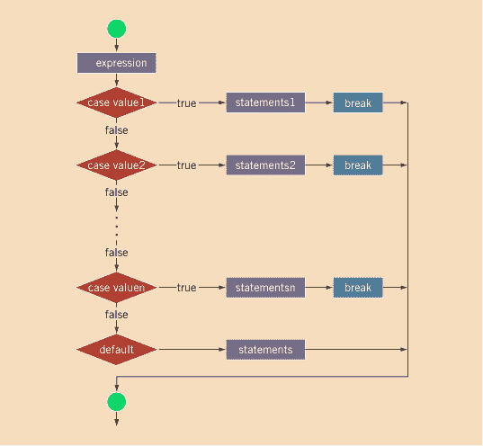

**图 4-4**  *switch 语句*

**switch** 语句按照以下规则执行：

-   1. 当**表达式**的值与某个 case 值（也称为标签）匹配时，语句将一直执行，直到遇到 **break** 语句或到达 **switch** 结构的末尾为止。
-   2. 如果**表达式**的值与任何 case 值都不匹配，则执行 **default** 标签后面的语句。如果 **switch** 结构没有 **default** 标签，并且**表达式**的值与任何 case 值都不匹配，则 **switch** 语句不执行任何操作。
-   3. **break** 语句会导致从 **switch** 结构中立即*退出*。

### 示例 4-22

考虑以下语句，其中 `grade` 是 `char` 类型的变量：

```cpp
switch (grade)
{
case 'A':
    cout << "The grade point is 4.0.";
    break;
case 'B':
    cout << "The grade point is 3.0.";
    break;
case 'C':
    cout << "The grade point is 2.0.";
    break;
case 'D':
    cout << "The grade point is 1.0.";
    break;
case 'F':
    cout << "The grade point is 0.0.";
    break;
default:
    cout << "The grade is invalid.";
}
```

在这个 `switch` 语句中，表达式 `grade` 是一个 `char` 类型的变量，`char` 是一种整型。`grade` 的可能取值是 `'A'`、`'B'`、`'C'`、`'D'` 和 `'F'`。每个 case 标签都根据 `grade` 的值指定一个不同的操作。如果 `grade` 的值是 `'A'`，则输出为：

`The grade point is 4.0.`

### 示例 4-23

下面的程序说明了 `break` 语句的作用。它要求用户输入一个介于 0 和 7 之间的数字。

```cpp
//Program: Effect of break statements in a switch structure

#include <iostream>                        //Line 1

using namespace std;                       //Line 2

int main()                                 //Line 3
{                                          //Line 4
    int num;                               //Line 5

    cout << "Enter an integer between 0 and 7: "; //Line 6
    cin >> num;                            //Line 7
```


```cpp
cout << endl;                                      //Line 8

switch(num)                                         //Line 9
{                                                   //Line 10
case 0:                                              //Line 11
case 1:                                              //Line 12
    cout << "Learning to use ";                    //Line 13
case 2:                                              //Line 14
    cout << "C++'s ";                              //Line 15
case 3:                                              //Line 16
    cout << "switch structure." << endl;           //Line 17
    break;                                          //Line 18
case 4:                                              //Line 19
    break;                                          //Line 20
case 5:                                              //Line 21
    cout << "This program shows the effect ";      //Line 22
case 6:                                              //Line 23
case 7:                                              //Line 24
    cout << "of the break statement." << endl;     //Line 25
    break;                                          //Line 26
default:                                             //Line 27
    cout << "The number is out of range." << endl; //Line 28
}                                                   //Line 29

cout << "Out of the switch structure." << endl;    //Line 30

return 0;                                           //Line 31
}                                                   //Line 32
```

**示例运行：** 这些输出是通过多次执行前面的程序得到的。在每次示例运行中，用户输入以底纹显示。

## 示例运行 1：

```
Enter an integer between 0 and 7: 0

Learning to use C++'s switch structure.
Out of the switch structure.
```

## 示例运行 2：

```
Enter an integer between 0 and 7: 2

C++'s switch structure.
Out of the switch structure.
```

## 示例运行 3：

```
Enter an integer between 0 and 7: 4

Out of the switch structure.
```

## 示例运行 4：

```
This program shows the effect of the break statement.
Out of the switch structure.
```

## 示例运行 5：

```
Enter an integer between 0 and 7: 7

of the break statement.
Out of the switch structure.
```

## 示例运行 6：

```
Enter an integer between 0 and 7: 8

The number is out of range.
Out of the switch structure.
```

使用 `switch` 表达式 `num` 的某些值来逐步讲解这个程序，可以帮助你理解 `break` 语句如何起作用。如果 `num` 的值为 0，则 `switch` 表达式的值与 `case` 值 0 匹配。`case 0:` 之后的所有语句都会执行，直到出现 `break` 语句。

第一个 `break` 语句出现在第 18 行，正好在 `case` 值 4 之前。即使 `switch` 表达式的值与 `case` 值 1、2 或 3 中的任何一个都不匹配，这些值之后的语句仍会执行。

当 `switch` 表达式的值与某个 `case` 值匹配时，所有语句都会执行，直到遇到 `break`，并且程序会跳过其间的所有 `case` 标签。同样，如果 `num` 的值为 3，它匹配 `case` 值 3，并且该标签之后的语句会执行，直到在第 18 行遇到 `break` 语句。如果 `num` 的值为 4，它匹配 `case` 值 4。在这种情况下，动作是空的，因为 `case` 值 4 之后只有第 20 行的 `break` 语句。

## 示例 4-24

尽管 `switch` 结构的 `case` 值（标签）是有限的，但 `switch` 语句的表达式可以按需要任意复杂。例如，考虑以下 `switch` 语句：

```cpp
switch (score / 10)
{
case 0:
case 1:
case 2:
case 3:
case 4:
case 5:
    grade = 'F';
    break;
}
```

这些值对应成绩 'F'。如果将全部 60 个值都列为 case 值，`switch` 语句可能会非常长。然而，除以 10 可将这 60 个值减少到只有 6 个值：0、1、2、3、4 和 5。

如果值的范围包含无限多个值，并且无法将它们缩减为包含有限个值的集合，则必须使用 `if...else` 结构。例如，如果 `score` 恰好是 `double` 变量，并且可能存在小数分数，那么 0 到 60 之间的值的数量是无限的。然而，你可以使用表达式 `static_cast<int>(score) / 10`，仍可将这无限多个值缩减为仅仅六个值。

## 通过避免一知半解的概念和技术来避免缺陷（重访）

在本章前面，我们讨论了对某个概念或技术的一知半解如何导致程序中的错误。在本节中，我们给出另一个示例，以说明使用一知半解的概念和技术所带来的问题。在示例 4-24 中，我们说明了如何根据 0 到 100 之间的考试分数评定成绩。接下来，考虑以下根据考试分数评定成绩的程序：

```cpp
//Grade program with bugs.

#include <iostream>                                      //Line 1

using namespace std;                                     //Line 2

int main()                                               //Line 3
{
    int testScore;                                       //Line 4
                                                         //Line 5
    cout << "Enter the test score: ";                   //Line 6
    cin >> testScore;                                    //Line 7
    cout << endl;                                        //Line 8

    switch (testScore / 10)                              //Line 9
    {                                                    //Line 10
    case 0:                                              //Line 11
    case 1:                                              //Line 12
    case 2:                                              //Line 13
    case 3:                                              //Line 14
    case 4:                                              //Line 15
    case 5:                                              //Line 16
        cout << "The grade is F." << endl;              //Line 17
    case 6:                                              //Line 18
        cout << "The grade is D." << endl;              //Line 19
    case 7:                                              //Line 20
        cout << "The grade is C." << endl;              //Line 21
    case 8:                                              //Line 22
        cout << "The grade is B." << endl;              //Line 23
```

我们再次可以看到，一知半解的概念可能导致程序中出现严重错误。因此，花时间彻底理解每个概念和技术，将为你节省数小时的调试时间。

## 使用 **assert** 函数终止程序

程序中可能会出现某些非常难以捕获的错误。例如，使用你到目前为止学过的任何编程技术，都可能难以捕获除零错误。C++ 包含一个预定义函数 **assert**，它在某些难以察觉的错误发生时停止程序执行方面很有用。在除零的情况下，你可以使用 **assert** 函数来确保程序终止时给出适当的错误消息，指出错误类型以及错误发生的程序位置。

考虑以下语句：

```cpp
int numerator;
int denominator;
int quotient;
double hours;
double rate;
double wages;
char ch;
```

- 1. `quotient = numerator / denominator;`
- 2. `if (hours > 0 && (0 < rate && rate <= 15.50))`  
  `wages = rate * hours;`
- 3. `if ('A' <= ch && ch <= 'Z')`

在第一条语句中，如果 **分母** 为 0，从逻辑上讲不应执行除法。然而在执行期间，计算机仍会尝试执行除法。如果分母为 0，程序会停止，并给出错误消息，指出发生了非法操作。

第二条语句设计为仅在 hours 大于 0 且 rate 为正数且小于或等于 15.50 时才计算工资。第三条语句设计为仅当 ch 是大写字母时才执行某些语句。

对于所有这些语句（就此而言，在任何情况下），如果条件不满足，那么终止程序执行并给出消息指出程序中发生错误的位置，将会很有用。你可以通过在程序中包含输出语句和 return 语句来处理这类情况。然而，C++ 通过 **assert** 函数提供了一种有效方法，在所需条件不满足时终止程序。

使用 **assert** 函数的语法是：

```cpp
assert(expression);
```


这里，**表达式**可以是任意逻辑表达式。如果**表达式**求值为**真**，则执行下一条语句。如果**表达式**求值为**假**，则程序终止并指出程序中发生错误的位置。

**assert** 函数的规范位于头文件 **cassert** 中。因此，程序要使用 **assert** 函数，必须包含以下语句：

```
#include <cassert>
```

使用 **assert** 函数的语句有时称为 **assert 语句**。

回到前面的语句，你可以使用 assert 函数重写语句 1（quotient = numerator / denominator;）。因为只有当 denominator 非零时才应计算 quotient，所以要在赋值语句之前加入一条 **assert** 语句，如下所示：

```
assert(denominator);
quotient = numerator / denominator;
```

现在，如果 denominator 为 0，assert 语句会终止程序执行，并给出类似以下内容的错误消息：

```
Assertion failed: denominator, file c:\temp\assertfunction\assertfunction.cpp, line 20
```

此错误消息表明对 denominator 的断言失败。错误消息还给出包含源代码的文件名以及断言失败所在的行号。

为便于阅读，前面使用 assert 语句的代码也可以写成：

```
assert(denominator != 0);
quotient = numerator / denominator;
```

错误消息会略有不同：

```
Assertion failed: denominator != 0, file c:\temp\assertfunction\assertfunction.cpp, line 20
```

也可以使用断言语句重写语句 2，如下所示：

```
assert(hours > 0 && (0 < rate && rate <= 15.50));
if (hours > 0 && (0 < rate && rate <= 15.50))
    wages = rate * hours;
```

如果 assert 语句中的表达式失败，程序会终止并给出类似以下内容的错误消息：

```
Assertion failed: hours > 0 && (0 < rate && rate <= 15.50), file c:\temp\assertfunction\assertfunction.cpp, line 26
```

在程序开发和测试期间，assert 语句对于强制执行编程约束非常有用。如你所见，assert 语句不仅会终止程序，还会指出断言失败的表达式、包含源代码的文件名以及断言失败所在的行号。


尽管 assert 语句在程序开发期间很有用，但程序开发完成并投入使用后，如果某个 assert 语句因某种原因失败，最终用户将不知道错误是什么意思。因此，在开发和测试程序之后，你可能希望删除或禁用 assert 语句。在非常大的程序中，删除开发期间使用的所有 assert 语句可能很繁琐，甚至不可能。此外，如果你计划将来修改程序，可能希望保留 assert 语句。因此，合乎逻辑的选择是保留这些语句但禁用它们。可以使用以下预处理指令禁用 assert 语句：

```
#define NDEBUG
```

这个预处理指令 `#define NDEBUG` 必须放在指令 `#include <cassert>` 之前。

## 编程示例：有线电视公司计费


本编程示例演示一个计算本地有线电视公司客户账单的程序。客户有两种类型：住宅客户和企业客户。计算有线电视账单有两种费率：一种针对住宅客户，一种针对企业客户。对于住宅客户，适用以下费率：

- 账单处理费：$4.50
- 基本服务费：$20.50
- 付费频道：每频道 $7.50

对于企业客户，适用以下费率：

- 账单处理费：$15.00
- 基本服务费：前 10 个连接 $75.00，每增加一个连接 $5.00
- 付费频道：无论连接数多少，每频道 $50.00

程序应要求用户输入账号（整数）和客户代码。假设 R 或 r 代表住宅客户，B 或 b 代表企业客户。

**输入**  客户的账号、客户代码、用户订阅的付费频道数量，以及（对于企业客户）基本服务连接数。

**输出**  客户的账号和账单金额。

### 问题分析与算法设计

本程序的目的是计算并打印账单金额。要计算账单金额，需要知道为哪个客户计算账单金额（该客户是住宅客户还是企业客户）以及该客户订阅的付费频道数量。对于企业客户，还需要知道基本服务连接数和付费频道数量。计算账单所需的其他数据，例如账单处理费和付费频道费用，都是已知量。程序应把账单金额打印到小数点后两位，这是货币金额的标准做法。此问题分析可转化为以下算法：

- 1. 将精度设置为小数点后两位。
- 2. 提示用户输入账号和客户类型。
- 3. 根据客户类型，确定付费频道数量和基本服务连接数，计算账单并打印账单：
  - a. 如果客户类型为 `r` 或 `R`，
    - i. 提示用户输入付费频道数量。
    - ii. 计算账单。
    - iii. 打印账单。
  - b. 如果客户类型为 `b` 或 `B`，
    - i. 提示用户输入基本服务连接数和付费频道数量。
    - ii. 计算账单。
    - iii. 打印账单。

### 变量

因为程序将要求用户输入客户账号、客户代码、付费频道数量和基本服务连接数，所以需要变量来存储所有这些信息。另外，因为程序将计算账单金额，所以需要一个变量来存储账单金额。因此，程序至少需要以下变量来计算并打印账单：

```cpp
int accountNumber;       // variable to store the customer's
                         // account number
char customerType;       // variable to store the customer code
int numOfPremChannels;   // variable to store the number
                         // of premium channels to which the
                         // customer subscribes
int numOfBasicServConn;  // variable to store the
                         // number of basic service connections
                         // to which the customer subscribes
double amountDue;        // variable to store the billing amount
```

### 命名常量

如你所见，账单处理费、基本服务连接费用和付费频道费用是固定的，并且计算账单需要这些值。尽管这些值在程序中是常量，但有线电视公司可能几乎不预先通知就更改它们。为了简化以后修改程序的过程，不应在程序中直接使用这些值，而应将它们声明为命名常量。根据问题分析，需要声明以下命名常量：

```cpp
//Named constants -- residential customers
const double RES_BILL_PROC_FEES = 4.50;
const double RES_BASIC_SERV_COST = 20.50;
const double RES_COST_PREM_CHANNEL = 7.50;

//Named constants -- business customers
const double BUS_BILL_PROC_FEES = 15.00;
const double BUS_BASIC_SERV_COST = 75.00;
const double BUS_BASIC_CONN_COST = 5.00;
const double BUS_COST_PREM_CHANNEL = 50.00;
```

### 公式

程序使用若干公式来计算账单金额。要计算住宅客户账单，只需知道用户订阅的付费频道数量。以下语句计算住宅客户的账单金额：

```cpp
amountDue = RES_BILL_PROC_FEES + RES_BASIC_SERV_COST
          + numOfPremChannels * RES_COST_PREM_CHANNEL;
```

要计算企业客户账单，需要知道基本服务连接数和用户订阅的付费频道数量。如果基本服务连接数小于或等于 10，则基本服务连接费用是固定的。如果基本服务连接数超过 10，则必须加上超过 10 的每个连接的费用。以下语句计算企业客户的账单金额：

```cpp
if (numOfBasicServConn <= 10)
    amountDue = BUS_BILL_PROC_FEES + BUS_BASIC_SERV_COST
              + numOfPremChannels * BUS_COST_PREM_CHANNEL;

else
    amountDue = BUS_BILL_PROC_FEES + BUS_BASIC_SERV_COST
              + (numOfBasicServConn - 10)
              * BUS_BASIC_CONN_COST
              + numOfPremChannels * BUS_COST_PREM_CHANNEL;
```

### 主算法

基于前面的讨论，现在可以编写主算法。

- 1. 要以带小数点和尾随零的固定小数格式输出浮点数，请设置操纵符 `fixed` 和 `showpoint`。另外，要以两位小数输出浮点数

位，将精度设置为两位小数。回想一下，要使用这些操纵符，程序必须包含头文件 `iomanip`。

- 2. 提示用户输入账号。
- 3. 获取客户账号。
- 4. 提示用户输入客户代码。
- 5. 获取客户代码。
- 6. 如果客户代码为 `r` 或 `R`，
    - a. 提示用户输入付费频道数量。
    - b. 获取付费频道数量。
    - c. 计算账单金额。
    - d. 打印账号和账单金额。
- 7. 如果客户代码为 `b` 或 `B`，
    - a. 提示用户输入基本服务连接数量。
    - b. 获取基本服务连接数量。
    - c. 提示用户输入付费频道数量。
    - d. 获取付费频道数量。
    - e. 计算账单金额。
    - f. 打印账号和账单金额。
- 8. 如果客户代码不是 `r`、`R`、`b` 或 `B`，则输出错误消息。

对于步骤 6 和 7，程序使用 `switch` 语句计算所需客户的账单。

## 完整程序清单

```cpp
//************************************************************
// Author: D. S. Malik
//
// Program: Cable Company Billing
// This program calculates and prints a customer's bill for
// a local cable company. The program processes two types of
// customers: residential and business.
//************************************************************

#include <iostream>
#include <iomanip>

using namespace std;

//Named constants - residential customers
const double RES_BILL_PROC_FEES = 4.50;
const double RES_BASIC_SERV_COST = 20.50;
const double RES_COST_PREM_CHANNEL = 7.50;

//Named constants - business customers
const double BUS_BILL_PROC_FEES = 15.00;
const double BUS_BASIC_SERV_COST = 75.00;
const double BUS_BASIC_CONN_COST = 5.00;
const double BUS_COST_PREM_CHANNEL = 50.00;

int main()
{
    //Variable declaration
    int accountNumber;
    char customerType;
    int numOfPremChannels;
    int numOfBasicServConn;
    double amountDue;

    cout << fixed << showpoint;                         //Step 1
    cout << setprecision(2);                            //Step 1

    cout << "This program computes a cable bill." << endl;

    cout << "Enter account number (an integer): ";       //Step 2
    cin >> accountNumber;                               //Step 3
    cout << endl;

    cout << "Enter customer type: "
         << "R or r (Residential), "
         << "B or b (Business): ";                     //Step 4
    cin >> customerType;                                //Step 5
    cout << endl;

    switch (customerType)
    {
    case 'r':                                            //Step 6
    case 'R':
        cout << "Enter the number"
             << " of premium channels: ";              //Step 6a
        cin >> numOfPremChannels;                       //Step 6b
        cout << endl;

        amountDue = RES_BILL_PROC_FEES                  //Step 6c
                    + RES_BASIC_SERV_COST
                    + numOfPremChannels *
                      RES_COST_PREM_CHANNEL;

        cout << "Account number: "
             << accountNumber
             << endl;                         //Step 6d
        cout << "Amount due: $"
             << amountDue
             << endl;                         //Step 6d
        break;

    case 'b':                                  //Step 7
    case 'B':
        cout << "Enter the number of basic "
             << "service connections: ";      //Step 7a
        cin >> numOfBasicServConn;             //Step 7b
        cout << endl;

        cout << "Enter the number"
             << " of premium channels: ";     //Step 7c
        cin >> numOfPremChannels;              //Step 7d
        cout << endl;

        if (numOfBasicServConn <= 10)           //Step 7e
            amountDue = BUS_BILL_PROC_FEES
                      + BUS_BASIC_SERV_COST
                      + numOfBasicServConn *
                        BUS_BASIC_CONN_COST
                      + numOfPremChannels *
                        BUS_COST_PREM_CHANNEL;
        else
            amountDue = BUS_BILL_PROC_FEES
                      + BUS_BASIC_SERV_COST
                      + (numOfBasicServConn - 10) *
                        BUS_BASIC_CONN_COST
                      + numOfPremChannels *
                        BUS_COST_PREM_CHANNEL;

        cout << "Account number: "
             << accountNumber << endl;          //Step 7f
        cout << "Amount due: $" << amountDue
             << endl;                           //Step 7f
        break;

    default:
        cout << "Invalid customer type." << endl; //Step 8
    }//end switch

    return 0;
}
```

### 示例运行：

在此示例运行中，用户输入以阴影显示。

```cpp
This program computes a cable bill.
Enter account number (an integer): 12345
Enter customer type: R or r (Residential), B or b (Business): b

Enter the number of basic service connections: 16

Enter the number of premium channels: 8

Account number: 12345
Amount due: $520.00
```

## 快速复习

- 1. 控制结构会改变正常的执行流程。
- 2. 两种最常见的控制结构是选择和重复。
- 3. 选择结构在程序中包含决策。
- 4. 关系运算符包括 ==（等于）、<（小于）、<=（小于或等于）、>（大于）、>=（大于或等于）和 !=（不等于）。
- 5. 在关系运算符 ==、<=、>= 和 != 中包含空格会导致语法错误。
- 6. 字符使用机器的排序序列进行比较。
- 7. 逻辑表达式的求值结果为 1（或非零值）或 0。逻辑值 1（或任何非零值）被视为真；逻辑值 0 被视为假。
- 8. C++ 中有两种选择结构。
- 9. 单向选择采用以下形式：
    
    ```cpp
    if (expression)
        statement
    ```
    
    如果 expression 为真，则执行该语句；否则，不执行该语句。
- 10. 双向选择采用以下形式：
    
    ```cpp
    if (expression)
        statement1
    else
        statement2
    ```
    
    如果 expression 为真，则执行 statement1；否则，执行 statement2。
- 11. if 或 if...else 结构中的表达式通常是逻辑表达式。
- 12. 在单向选择的语句前包含分号会导致语义错误。在这种情况下，if 语句的动作是空的。
- 13. 在双向选择的 `statement1` 前包含分号会导致语法错误。
- 14. C++ 中没有独立的 `else` 语句。每个 `else` 都有一个相关的 `if`。
- 15. 一个 `else` 会与最近的、尚未与任何其他 `else` 配对的 `if` 配对。
- 16. 在 C++ 中，`int` 变量可用于存储逻辑表达式的值。
- 17. 在 C++ 中，`bool` 变量可用于存储逻辑表达式的值。
- 18. 在 C++ 中，逻辑运算符是 `!`（非）、`&&`（与）和 `||`（或）。
- 19. 包含在花括号 `{` 和 `}` 之间的一系列语句称为复合语句或语句块。复合语句被视为单条语句。
- 20. 可以在 `if` 语句中使用输入流变量来确定输入流的状态。
- 21. 使用赋值运算符代替相等运算符会导致语义错误。这可能在程序中导致严重错误。
- 22. `switch` 结构用于处理多路选择。
- 23. 在 `switch` 语句中执行 `break` 语句会立即退出 `switch` 结构。
- 24. 如果程序中的某些条件未满足，可以使用 `assert` 函数终止程序。

## 练习

练习末尾括号中的数字指本章开头列出的学习目标。

- 1. 将以下陈述标记为真或假。
    - a. 语句在程序中执行的顺序称为控制流。(1)
    - b. 在 C++ 中，`=` 是相等运算符。(2)
    - c. 在单向选择中，如果在 `if` 语句的表达式后放置分号，则 `if` 语句中的表达式始终为真。(3)
    - d. 每个 `if` 语句都必须有对应的 `else`。(3)
    - e. `if` 语句中的表达式：(3)
        
        ```cpp
        if (score = 30)
            grade = 'A';
        ```
        
        始终求值为真。


**f.** 表达式：(2, 5)

```cpp
(ch >= 'A' && ch <= 'Z')
```

如果 `ch < 'A'` 或 `ch > 'Z'`，则求值为 false。

**g.** 假设输入为 5。以下代码的输出：(3)

```cpp
cin >> num;
if (num > 5)
{
    cout << num;
    num = 0;
}
else
    cout << "Num is zero" << endl;
```

为：`Num is zero`

**h.** 逻辑表达式的结果不能赋给 `int` 变量。(4)

**i.** 表达式 `(!x > 0)` 仅在 x 为负数时为 true。(5)

**j.** 在 C++ 中，`!` 和 `!=` 都是逻辑运算符。(5)

**k.** switch 语句中的表达式应求值为简单数据类型的值。(11)

2. 计算下列表达式的值。(2)

- a. `4 * 7 == 74 / 3`
- b. `4 + 7 / 2 <= 9 - 15 % 6`
- c. `'K' < 'k'`
- d. `'+' <= '-'`
- e. `'5' <= '6'`
- f. `3.9 / 4 - 6 >= 8 - 6.2 * 1.5`

3. 假设 x、y 和 z 是 `int` 变量，且 `x = 13`、`y = 45`、`z = 20`。判断下列表达式的求值结果是 true 还是 false。(2, 5)

- a. `!(x - y <= 10)`
- b. `x + y > 10 || z < 15`
- c. `(x != y) && (x <= z)`
- d. `(y - x >= z) || (2 * z <= y - x)`

4. 假设 str1、str2 和 str3 是字符串变量，且 `str1 = "Low"`、`str2 = "High"`、`str3 = "Medium"`。计算下列表达式的值。(2, 7)

- a. `str1 <= str2`
- b. `str1 != "low"`
- c. `str2 <= str1`
- d. `str3 > "Medium"`
- e. `str3 <= "Light"`

5. 假设 x、y、z 和 w 是 int 变量，且 x = 25、y = 3、z = 12、w = 4。下列语句的输出是什么？(2, 5)

- a.

```cpp
cout << "x == z : " << (x == z) << endl;
```

- b.

```cpp
cout << "y != z : " << (y != z) << endl;
```

- c.

```cpp
cout << "x - y == z + 10: " << (x - y == z + 10) << endl;
```

- d.

```cpp
cout << "!(z < w): " << !(z < w) << endl;
```

- e.

```cpp
cout << "w - y < x - 2 * z: " << (w - y < x - 2 * z)
     << endl;
```

6. 下列哪些不是关系运算符？(2)

- a. `>`  b. `==`  c. `=`  d. `!=`  e. `|`

7. 下列语句的输出是什么？(2, 3)

- a.

```cpp
if ('+' < '-')
    cout << "+-";
    cout << "+" << endl;
```

- b.

```cpp
if (12 / 2 == 4 + 1)
    cout << "6 ";
    cout << "12 / 2 != 4 + 1" << endl;
```

- c.

```cpp
if ('*' >= '/')
    cout << "/";
    cout << "*";
    cout << endl;
```

- d.

```cpp
if ("C++" <= "++C")
    cout << "C++" << endl;
    cout << "C++" << endl;
```

- e.

```cpp
if ("low" <= "high")
    cout << "low" << endl;
    cout << "high" << endl;
```

8. 下列哪些是逻辑（布尔）运算符？(5)

- a. `&&`  b. `!=`  c. `!`  d. `||`  e. `<>`

9. 下列语句的输出是什么？(3, 5)

```cpp
if ('K' > '%' || '@' <= '?')
    cout << "?%";
cout << "!!";
cout << endl;
```

```cpp
if ('8' < 'B' && 15 > -13)
    cout << "a b c d" << endl;
cout << "###" << endl;
```

```cpp
if ("Fly" >= "Flying" && "Programming" >= "Coding")
    cout << "Fly Programming" << endl;
cout << "Flying Coding" << endl;
```

10. 下列代码的输出是什么？(2, 4)

```cpp
int num = 17;                         //Line 1
double gpa = 3.85;                    //Line 2
bool done;                             //Line 3

done = (num == static_cast<int>(2 * gpa + 9.3));   //Line 4
cout << "The value of done is: " << done << endl;  //Line 5
```

11. 如果将第 4 行的语句替换为以下语句，练习 10 的输出会如何变化？(2, 4)

```cpp
done = (num == static_cast<int>(2 * gpa)
              + static_cast<int>(9.3));        //Line 4
```

12. 下列程序的输出是什么？(2)

```cpp
#include <iostream>

using namespace std;

int main()
{
    int firstNum = 28;
    int secondNum = 25;

    cout << firstNum << " " << secondNum << endl;
    cout << (firstNum = 38 - 7) << endl;
    cout << (firstNum <= 75) << endl;
    cout << (firstNum > secondNum + 10) << endl;
    cout << (firstNum >= 3 * secondNum - 100) << endl;
    cout << (secondNum - 1 == 2 * firstNum) << endl;
    cout << firstNum << " " << secondNum << endl;

    return 0;
}
```

13. 改正以下代码，使其输出正确的消息。(3)

```cpp
if (score <= 60)
    cout << "Pass" << endl;
else
    cout << "Fail" << endl;
```

14.

- a. 编写 C++ 语句：如果 standing 为 'F'，输出 First Year；如果 standing 为 'S'，输出 Sophomore；否则输出 Junior or Senior。(3)
- b. 编写 C++ 语句：如果 standing 为 '1' 或 '2'，输出 First Year 和 Sophomore；如果 standing 为 '3' 或 '4'，输出 Junior or Senior；否则输出 Graduate Student。(3)

15. 如果购买的商品数量少于 5，则每件购买商品的运费为 $7.00；如果购买的商品数量至少为 5 但少于 10，则每件购买商品的运费为 $3.00；如果购买的商品数量至少为 10，则免运费。改正以下代码，使其计算正确的运费。(3, 5, 6)

```cpp
if (numOfItemsBought > 10)
    shippingCharges = 0.0;
else if (5 <= numOfItemsBought || numOfItemsBought <= 10);
    shippingCharges = 3.00 * numOfItemsBought;
else if (0 < numOfItemsBought || numOfItemsBought < 5)
    shippingCharges = 7.00 * numOfItemsBought;
```

16. 下列 C++ 代码的输出是什么？(2, 5, 6)

```cpp
int x = 15;
int y = 3;
if (x + y > 17 || y - x < 20)
{
    y = x - y;
    x = y + x;
    cout << x << " " << y << " " << x + y << " " << y - x << endl;
}
else
{
    x = y - x + x % 5;
    cout << x << " " << y << " " << x - y << " " << x + y << endl;
}
```

17. 下列程序的输出是什么？(2, 3, 5)

```cpp
#include <iostream>
using namespace std;

int main()
{
    int first = 16;
    int second = 8;

    if ((first / second == 2) || (second / first == 3))
    {
        second = 10;
        first = 20;
    }
    else if ((first % second == 2 || second % first == 1))
    {
        second = 15;
        first = 5;
    }
    else
    {
        first = -10;
        second = -20;
    }

    cout << first << " " << second << endl;

    return 0;
}
```

18.

- a. 如果 `first = 16` 且 `second = 5`，练习 17 中程序的输出是什么？(2, 3, 5)
- b. 如果 `first = 26` 且 `second = 8`，练习 17 中程序的输出是什么？(2, 3, 5)

19. 假设 `sale` 和 `bonus` 是 double 变量。编写一个 if...else 语句，按如下方式给 `bonus` 赋值：如果 `sale` 大于 $20,000，则赋给 `bonus` 的值为 0.10，即 10%；如果 `sale` 大于 $10,000 且小于或等于 $20,000，则赋给 `bonus` 的值为 0.05，即 5%；否则赋给 `bonus` 的值为 0，即 0%。(3)

20. 假设 `overSpeed` 和 `fine` 是 double 变量。按如下方式给 `fine` 赋值：如果 0 < overSpeed <= 5，则赋给 fine 的值为 $20.00；如果 5 < overSpeed <= 10，则赋给 fine 的值为 $75.00；如果 10 < overSpeed <= 15，则赋给 fine 的值为 $150.00；如果 overSpeed > 15，则赋给 fine 的值为 $150.00 加上超过 15 的每英里 $20.00。(3)

21. 假设 `score` 是一个 `int` 变量。考虑以下 if 语句。

```cpp
if (score >= 90);
    cout << "Discount = 10%" << endl;
```

- a. 如果 `score` 的值为 95，输出是什么？说明理由。
- b. 如果 `score` 的值为 85，输出是什么？说明理由。

22. 假设 `score` 是一个 `int` 变量。考虑以下 if 语句。

```cpp
i.  if (score == 70)
        cout << "Grade is C." << endl;

ii. if (score < 70)
        cout << "Grade is C." << endl;
```

### 回答以下问题

- a. 如果 score 的值为 70，(i) 和 (ii) 的输出分别是什么？if 语句执行后 score 的值是什么？
- b. 如果 score 的值为 80，(i) 和 (ii) 的输出分别是什么？if 语句执行后 score 的值是什么？

23. 使用条件运算符重写下列表达式。（假设所有变量都已正确声明。）(9)

- a.

```cpp
if (x == y)
    z = x + y;
else
    z = (x + y) / 2;
```

- b.

```cpp
if (hours >= 40.0)
    wages = 40 * 7.50 + 1.5 * 7.5 * (hours - 40);
else
    wages = hours * 7.50;
```

- c.

```cpp
if (loanAmount >= 200000)
    closingCosts = 10000;
else
    closingCosts = 8000;
```

24. 使用 if...else 语句重写下列表达式。（假设所有变量都已正确声明。）(9)

- a. `(overSpeed > 10) ? fine = 200 : fine = 75;`
- b. `(fuel >= 10) ? drive = 150 : drive = 30;`
- c. `(bill >= 50.00) ? tip = 0.20 : tip = 0.10;`

25. 假设有以下条件表达式。（假设所有变量都已正确声明。）(9)

```cpp
(0 < backyard && backyard <= 5000) ? fertilizingCharges = 40.00
    : fertilizingCharges = 40.00 + (backyard - 5000) * 0.01;
```

- a. 如果 backyard 的值为 3000，fertilizingCharges 的值是多少？
- b. 如果 backyard 的值为 5000，fertilizingCharges 的值是多少？
- c. 如果 backyard 的值为 6500，fertilizingCharges 的值是多少？


26. 判断以下是否为有效的 `switch` 语句。如果不是，请解释原因。假设 `n` 和 `digit` 是 `int` 变量。(11)

a.

```cpp
switch (n <= 2)
{
    case 0:
        cout << "Draw." << endl;
        break;
    case 1:
        cout << "Win." << endl;
        break;
    case 2:
        cout << "Lose." << endl;
        break;
}
```

b.

```cpp
switch (digit / 4)
{
    case 0:
    case 1:
        cout << "low." << endl;
        break;
    case 1:
    case 2:
        cout << "middle." << endl;
        break;
    case 3:
        cout << "high." << endl;
}
```

c.

```cpp
switch (n % 6)
{
    case 1:
    case 2:
    case 3:
    case 4:
    case 5:
        cout << n;
        break;
    case 0:
        cout << endl;
        break;
}
```

d.

```cpp
switch (n % 10)
    case 2:
    {
    case 4:
    case 6:
    case 8:
        cout << "Even";
        break;
    case 1:
    case 3:
    case 5:
    case 7:
        cout << "Odd";
        break;
    }
```

27. 假设 alpha 是 int 变量。考虑以下 C++ 代码。(3, 11)

```cpp
cin >> alpha;
switch (alpha % 9)
{
case 0: case 3:
    alpha = alpha / 3;
    break;
case 1: case 5: case 7:
    alpha = alpha / 2;
    break;
case 2: case 4:
    ++alpha;
    break;
case 6:
    alpha = (alpha / 9) * (alpha / 9);
    break;
case 8:
    alpha = (alpha % 9) * (alpha % 9);
    break;
default:
    alpha--;
}
cout << alpha << endl;
```

- a. 如果输入为 16，输出是什么？

- b. 如果输入为 8，输出是什么？

- c. 如果输入为 1，输出是什么？

- d. 如果输入为 25，输出是什么？

28. 假设 `beta` 是 `int` 变量。考虑以下 C++ 代码。(11)

```cpp
cin >> beta;
switch (beta % 10)
{
case 0: case 1:
    beta = beta - 2;
    break;
case 2: case 8:
    beta = beta + beta;
    break;
case 3: case 5:
    beta--;
    break;
case 6: case 7:
    beta = static_cast<int>(pow(beta, 3.0));
    break;
case 4: case 9:
    beta = static_cast<int>(sqrt(beta * 1.0));
    break;
default:
    beta = -5;
}
cout << beta << endl;
```

- a. 如果输入为 4，输出是什么？

- b. 如果输入为 23，输出是什么？

- c. 如果输入为 1，输出是什么？

- d. 如果输入为 89，输出是什么？

29. 假设 `num` 是 `int` 变量。考虑以下 C++ 代码。(3, 11)

```cpp
cin >> num;
if (num >= 0)
    switch (num % 3)
    {
    case 0:
        num--;
        break;
    case 1:
        ++num;
        break;
    case 2:
        num = static_cast<int>(pow(num, 3.0));
        break;
    }
else
{
    num = -num;
    num = static_cast<int>(sqrt(num * 1.0));
}
cout << num << endl;
```

- a. 如果输入为 7，输出是什么？

- b. 如果输入为 23，输出是什么？

- c. 如果输入为 20，输出是什么？

- d. 如果输入为 -9，输出是什么？

30. 在以下代码中，不添加新语句，改正任何会阻止程序编译或运行的错误。(3, 11)

```cpp
#include <iostream>

using namespace;

int main
{
    int num1, num2;
    bool found = false;

    cout << "Enter two integers: ";
    cin >> num1 >> num2;
    cout << endl;

    found = (num1 > num2);

    if (found
        switch (num1 % num2);
        {
        case 0:
            num2 = num1 / 2;
            break;
        case 1:
            num1 = num2 / 2;
            break;
        default:
            num1 = num1 / num2;
            num2 = num1 * num2;
        };
    else
    {
        num1 = num1 - num2;
        num2 = (num1 + num2) / 10;
    }

    cout << num1 << " " << num2 << endl;

    return;
}
```

改正代码后，回答以下问题。（如有需要，可插入提示行来告知用户输入。）

- a. 如果输入为 `16 5`，输出是什么？

- b. 如果输入为 `13 27`，输出是什么？

31. 以下程序包含错误。改正这些错误，使程序能够运行并输出 `w = 25`。(3, 11)

```cpp
#include <iostream>

using namespace std;

const int SECRET = 5

main ()
{
        int x, y, w, z;
        z == 13;

        if (z < 15);
                x = 12; y = 8, w = x + y + SECRET;
        else
                x = 12; y = 8, w = x + y + SECRET;

        cout << "w = " << w << endl;
}
```

32. 在以下程序中编写缺失的语句，使其提示用户输入两个数。如果其中一个数为 0 或负数，程序输出两个数都必须为正数。如果两个数相等，则输出这两个数之和；如果第一个数小于或等于 2 且两个数不相等，则输出第二个数的第一个数次幂；否则输出这两个数的乘积。(3)

```cpp
#include <iostream>
//Include additional header files, if necessary

using namespace std;

int main()
{
        double firstNum, secondNum;

        cout << "Enter two nonzero numbers: ";
        cin >> firstNum >> secondNum;
        cout << endl;

        //Missing statements

        return 0;
}
```

33. 假设 `classStanding` 是 char 变量，`gpa` 和 `dues` 是 double 变量。编写一个 `switch` 表达式，按如下方式分配会费：如果 `classStanding` 为 `'f'`，会费为 $150.00；如果 `classStanding` 为 `'s'`，（如果 gpa 至少为 3.75，会费为 $75.00；否则会费为 $120.00）；如果 `classStanding` 为 `'j'`，（如果 gpa 至少为 3.75，会费为 $50.00；否则会费为 $100.00）；如果 `classStanding` 为 `'n'`，（如果 gpa 至少为 3.75，会费为 $25.00；否则会费为 $75.00）。（注意，代码 `'f'` 代表一年级学生，代码 `'s'` 代表二年级学生，代码 `'j'` 代表三年级学生，代码 `'n'` 代表四年级学生。）(3)

34. 假设 `billingAmount` 是 double 变量，表示你需要向百货商店支付的金额。如果你全额支付，你可获得 $10.00 或 `billingAmount` 的 1%（以较小者为准），作为下一期账单的抵扣额；如果你支付至少 `billingAmount` 的 50%，罚金为余额的 5%；如果你支付至少 `billingAmount` 的 20% 且少于 `billingAmount` 的 50%，罚金为余额的 10%；否则罚金为余额的 20%。设计一个算法，提示用户输入账单金额和期望支付金额。然后该算法计算并输出抵扣额或剩余余额。如果未全额支付，算法还应输出罚金金额。(3)

## 编程练习

- 1. 编写一个程序，提示用户输入一个数。然后程序应输出该数，并输出一条消息说明该数是正数、负数还是零。

- 2. 编写一个程序，提示用户输入三个数。然后程序应按升序输出这些数。

- 3. 编写一个程序，提示用户输入一个 0 到 35 之间的整数。如果该数小于或等于 9，程序应输出该数；否则，对于 10 应输出 A，11 应输出 B，12 应输出 C，……，35 应输出 Z。（提示：对于大于等于 10 的数，使用强制类型转换运算符 `static_cast<char>()`。）

- 4. 以下程序中的语句顺序不正确。重新排列这些语句，使其提示用户输入形状类型（矩形、圆形或圆柱体）以及该形状的相应尺寸。然后程序输出以下关于该形状的信息：对于矩形，输出面积和周长；对于圆形，输出面积和周长；对于圆柱体，输出体积和表面积。重新排列语句后，程序应正确缩进。

```cpp
using namespace std;

#include <iostream>

int main()
{
    string shape;
    double height;

    #include <string>

    cout << "Enter the shape type: (rectangle, circle, cylinder) ";
    cin >> shape;
    cout << endl;

    if (shape == "rectangle")
    {
        cout << "Area of the circle = "
             << PI * pow(radius, 2.0) << endl;

        cout << "Circumference of the circle: "
             << 2 * PI * radius << endl;

        cout << "Enter the height of the cylinder: ";
        cin >> height;
        cout << endl;

        cout << "Enter the width of the rectangle: ";
        cin >> width;
        cout << endl;

        cout << "Perimeter of the rectangle = "
             << 2 * (length + width) << endl;
        double width;
    }

    cout << "Surface area of the cylinder: "
         << 2 * PI * radius * height + 2 * PI * pow(radius, 2.0)
         << endl;
}
else if (shape == "circle")
{
    cout << "Enter the radius of the circle: ";
    cin >> radius;
    cout << endl;

    cout << "Volume of the cylinder = "
         << PI * pow(radius, 2.0)* height << endl;
    double length;
}
return 0;
```


```cpp
else if (shape == "cylinder")
{
    double radius;

    cout << "Enter the length of the rectangle: ";
    cin >> length;
    cout << endl;

    #include <iomanip>

    cout << "Enter the radius of the base of the cylinder: ";
    cin >> radius;
    cout << endl;

    const double PI = 3.1416;
    cout << "Area of the rectangle = "
         << length * width << endl;

else
    cout << "The program does not handle " << shape << endl;
    cout << fixed << setprecision(2);

#include <cmath>
}
```

- 5. 在直角三角形中，一条边的长度的平方等于另外两条边长度的平方和。编写一个程序，提示用户输入三角形三条边的长度，然后输出一条消息，说明该三角形是否为直角三角形。

- 6. 一盒饼干可装 24 块饼干，一个容器可装 75 盒饼干。编写一个程序，提示用户输入饼干总数、每盒饼干数以及每个容器中的饼干盒数。然后程序输出运送这些饼干所需的盒数和容器数。注意，每盒必须包含指定数量的饼干，每个容器必须包含指定数量的盒子。如果最后一盒饼干中的饼干数少于指定数量，可以丢弃它，并输出剩余饼干数。同样，如果最后一个容器中的盒子数少于指定数量，可以丢弃它，并输出剩余盒子数。

- 7. 二次方程 $ax^2 + bx + c = 0$，$a \ne 0$ 的根由以下公式给出：

  $$\frac{-b \pm \sqrt{b^2 - 4ac}}{2a}$$

  在这个公式中，项 \(b^2 - 4ac\) 称为**判别式**。如果 \(b^2 - 4ac = 0\)，则方程有一个（重）根。如果 \(b^2 - 4ac > 0\)，则方程有两个实根。如果 \(b^2 - 4ac < 0\)，则方程有两个复根。编写一个程序，提示用户输入 \(a\)（\(x^2\) 的系数）、\(b\)（\(x\) 的系数）和 \(c\)（常数项）的值，并输出方程根的类型。此外，如果 \(b^2 - 4ac \ge 0\)，程序应输出二次方程的根。*（提示：使用头文件 cmath 中的函数 pow 计算平方根。第3章解释了函数 pow 的用法。）*

- 8. 编写一个模拟计算器的程序。该程序应输入两个整数以及要执行的运算。然后应输出这些数、运算符和结果。（对于除法，如果分母为零，则输出适当的消息。）一些示例输出如下：

```text
3 + 4 = 7
13 * 5 = 65
```

- 9. 重做练习8，使其能处理浮点数。（将输出格式化为两位小数。）

- 10. 重做第2章编程练习18，并考虑你的父母会按如下方式为你购买额外的储蓄债券：

  - a. 如果你不花任何钱购买储蓄债券，那么由于你做了暑期工作，你的父母会为你购买储蓄债券，金额等于你在缴税以及购买衣服、其他配饰和学习用品后节省下来的钱的1%。

  - b. 如果你将不超过净收入的25%用于购买储蓄债券，你的父母会为你每花1美元购买储蓄债券支付 $0.25，再加上相当于你在缴税以及购买衣服、其他配饰和学习用品后节省下来的钱的1%的金额。

  - c. 如果你将超过净收入的25%用于购买储蓄债券，你的父母会为你每花1美元购买储蓄债券支付 $0.40，再加上相当于你在缴税以及购买衣服、其他配饰和学习用品后节省下来的钱的2%的金额。

- 11. 编写一个程序，实现示例1-3（第1章）中给出的算法，该算法确定销售员的月工资。

- 12. 编写一个程序，实现你在本章练习34中设计的算法。

- 13. 一张纸上可打印的行数取决于纸张尺寸、一行中每个字符的磅值、行是双倍行距还是单倍行距、上下页边距以及纸张的左右页边距。假设所有字符具有相同的磅值，并且所有行均为单倍行距或双倍行距。注意 1 英寸 = 72 磅。此外，假设各行沿纸张的宽度方向打印。例如，如果纸张长度为11英寸、宽度为8.5英寸，则一行的最大长度为8.5英寸。编写一个程序，根据用户输入的以下内容计算一行中的字符数以及一张纸上可打印的行数：

  - a. 纸张的长度和宽度（以英寸为单位）
  - b. 上、下、左、右页边距
  - c. 一行的磅值
  - d. 如果行是双倍行距，则将每个字符的磅值加倍

- 14. 国际机场的短期（0-24小时）停车费 *F* 由以下公式给出：

  $$F = \begin{cases} 5, & \text{if } 0 \le h \le 3 \\ 6 \times \operatorname{int}(h+1), & \text{if } 3 < h \le 9 \\ 60, & \text{if } 9 < h \le 24 \end{cases}$$

  其中 *int*(h + 1) 是 *h* + 1 的整数值。例如，*int*(3.2) = 3，*int*(4.8) = 4。编写一个程序，提示用户输入汽车在机场停放的小时数，并输出停车费。

- 15. 编写一个程序，实现你在第1章练习22中设计的算法。（假设账户余额存储在文件 Ch4_Ex15_Data.txt 中。）你的程序应输出取款前和取款后的账户余额以及服务费。还要将取款后的账户余额保存到文件 Ch4_Ex15_Output.txt 中。

- 16. 一位新作者正在就一部新言情小说的合同进行谈判。出版商提供三种选择。在第一种选择中，作者在交付最终手稿时获得 $5,000，小说出版时获得 $20,000。在第二种选择中，每售出一本小说，作者获得小说净价的12.5%。在第三种选择中，前4,000本售出的小说按净价的10%支付给作者，超过4,000本的部分按净价的14%支付。作者对将售出的本数有一些想法，并希望估算每种选择下产生的版税。编写一个程序，提示作者输入每本小说的净价以及预计售出的本数。然后程序输出每种选择下的版税以及作者可以选择的最佳选择。（使用适当的命名常量存储特殊值，例如版税率和固定版税。）

- 17. 萨曼莎和维卡斯正在一个新开发项目中看房。在看过各种户型后，他们喜欢的三款户型是殖民地式、错层入口式和单层式。建筑商向他们提供了这三款户型的基础价格和完工面积（平方英尺）。他们想知道每平方英尺价格最低的户型。编写一个程序，输入这三款户型的基础价格和完工面积（平方英尺）。程序输出每平方英尺价格最低的户型。

- 18. 确定一个人健康程度的一种方法是测量其体脂。确定女性和男性体脂的公式如下：

  女性体脂公式：  
  A1 =（体重 × 0.732）+ 8.987  
  A2 = 腕围（最粗处）/ 3.140  
  A3 = 腰围（肚脐处）× 0.157  
  A4 = 臀围（最粗处）× 0.249  
  A5 = 前臂围（最粗处）× 0.434  
  B = A1 + A2 - A3 - A4 + A5  
  体脂 = 体重 - B  
  体脂百分比 = 体脂 × 100 / 体重

  男性体脂公式：  
  A1 =（体重 × 1.082）+ 94.42  
  A2 = 腕围 × 4.15  
  B = A1 - A2  
  体脂 = 体重 - B  
  体脂百分比 = 体脂 × 100 / 体重

  编写一个程序计算一个人的体脂。


- 19. Ron 买了几英亩农田，用于种植和销售蔬菜。假设 Ron 最多想种植两种蔬菜。编写一个程序，提示 Ron 或用户执行以下操作：
  - 1. 输入农田的总面积（以英亩为单位）。
  - 2. 用户想要种植的蔬菜种类数（一种或两种）。
  - 3. 如果用户想种植两种蔬菜，则以百分比形式指定农田中用于种植每种蔬菜的面积比例。
  - 4. 输入每英亩的种子成本、种植成本、施肥成本和劳动力成本。
  - 5. 输入每英亩蔬菜的销售价格。
  - 6. 输出总收入。
  - 7. 输出利润或亏损。

- 20. 假设酒店客房的租金为每晚 100.00 美元。对于婚礼或会议等特殊场合，酒店提供如下特别折扣：如果预订的房间数至少为 10 间，则折扣为 10%；至少为 20 间，则折扣为 20%；至少为 30 间，则折扣为 30%。此外，如果房间预订至少 3 天，则额外享受 5% 的折扣。编写一个程序，提示用户输入单间客房的租金、预订的房间数、房间预订的天数以及销售税（百分比）。程序输出单间客房的租金、每间客房的折扣百分比、预订的房间数、房间预订的天数、房间总费用、销售税以及账单总金额。程序必须使用适当的具名常量来存储各种折扣等特殊值。

- 21. 设 *l* 为 *x-y* 平面上的一条直线。如果 *l* 是垂直线，则其方程为 *x = a*，其中 *a* 是某个实数。假设 *l* 不是垂直线，且其斜率为 *m*。那么 *l* 的方程为 *y = mx + b*，其中 *b* 为 y 轴截距。如果 *l* 经过点 (*x₀, y₀*)，则直线方程可以写成 *y − y₀ = m(x − x₀)*。如果 (*x₁, y₁*) 和 (*x₂, y₂*) 是 *x-y* 平面上的两个点，且 *x₁ ≠ x₂*，则经过这两点的直线斜率为 *m = (y₂ − y₁) / (x₂ − x₁)*。编写一个程序，提示用户输入 *x-y* 平面上的两个点。程序输出直线方程，并使用 *if* 语句判断和输出该直线是垂直的、水平的、递增的还是递减的。如果 *l* 是非垂直线，则以 *y = mx + b* 的形式输出其方程。

- 22. 前 11 个素整数是 2、3、5、7、11、13、17、19、23、29 和 31。一个介于 1 和 1000（含）之间的正整数，如果不是前 11 个素整数之一，并且不能被 2、3、5、7、11、13、17、19、23、29 和 31 整除，那么它就是素数。编写一个程序，提示用户输入一个介于 1 和 1000（含）之间的正整数，并输出该数是否为素数。如果该数不是素数，则输出前 11 个素整数列表中能够整除该数的所有数字。

- 23. 电视机的屏幕尺寸由矩形对角线的长度表示。传统电视采用 4:3 的比例，即长度与宽度之比为 4:3。这意味着，如果长度为 *x* 英寸，则宽度为 (3/4)*x。液晶电视采用 16:9 的比例。编写一个程序，提示用户输入屏幕对角线的长度（英寸），并允许用户选择想要计算的电视屏幕类型、屏幕长度、屏幕宽度和屏幕面积。让程序显示所需的结果。


## 第 5 章

## 控制结构 II（重复）

### 本章内容：

- 1. 了解重复（循环）控制结构
- 2. 学习如何在程序中使用 `while` 循环
- 3. 探索如何构造和使用计数控制、哨兵控制、标志控制和 EOF 控制的重复结构
- 4. 学习如何在程序中使用 `for` 循环
- 5. 学习如何使用 `do...while` 循环
- 6. 研究 `break` 和 `continue` 语句
- 7. 了解如何构造和使用嵌套控制结构
- 8. 学习如何通过避免打补丁来避免错误
- 9. 学习如何调试循环

第 4 章讨论了如何将决策纳入程序。本章讨论如何将重复纳入程序。

### 为什么需要重复？

David 需要降低胆固醇水平，以保持身体健康并降低心脏病发作的风险。他希望通过定期锻炼来实现这一目标。他决定加入一家健身房，并采取包括记录每次使用健身房时消耗的卡路里数在内的多种措施。每周结束时，他希望确定每天平均消耗的卡路里数。我们需要编写一个程序，让 David 可以输入每天消耗的卡路里数，并输出每天平均消耗的卡路里数。假设某一周每天消耗的卡路里数分别为：375、425、270、190、350、200 和 365。要计算每天平均消耗的卡路里数，我们必须将这些数字相加，再将总数除以 7。根据目前所学的内容，我们可以编写以下程序来计算每天平均消耗的卡路里数。

```cpp
#include <iostream>

using namespace std;

int main()
{
    int calBurnedDay1, calBurnedDay2, calBurnedDay3,
        calBurnedDay4, calBurnedDay5, calBurnedDay6,
        calBurnedDay7;
    int calBurnedInAWeek;

    cout << "Enter calories burned day 1: ";
    cin >> calBurnedDay1;
    cout << endl;

    cout << "Enter calories burned day 2: ";
    cin >> calBurnedDay2;
    cout << endl;

    cout << "Enter calories burned day 3: ";
    cin >> calBurnedDay3;
    cout << endl;

    cout << "Enter calories burned day 4: ";
    cin >> calBurnedDay4;
    cout << endl;

    cout << "Enter calories burned day 5: ";
    cin >> calBurnedDay5;
    cout << endl;

    cout << "Enter calories burned day 6: ";
    cin >> calBurnedDay6;
    cout << endl;

    cout << "Enter calories burned day 7: ";
    cin >> calBurnedDay7;
    cout << endl;

    calBurnedInAWeek = calBurnedDay1 + calBurnedDay2 + calBurnedDay3
                     + calBurnedDay4 + calBurnedDay5 + calBurnedDay6
                     + calBurnedDay7;

    cout << "Average number of calories burned each day: "
         << calBurnedInAWeek / 7 << endl;

    return 0;
}
```

**示例运行：**在本次示例运行中，用户输入部分带有阴影。

```
Enter calories burned day 1: 375
Enter calories burned day 2: 425
Enter calories burned day 3: 270
Enter calories burned day 4: 190
Enter calories burned day 5: 350
Enter calories burned day 6: 200
Enter calories burned day 7: 365

Average number of calories burned each day: 310
```

如你所见，该程序需要声明 7 个变量来存储 7 个数字。如果 David 现在想确定一个月中每天平均消耗的卡路里数，那么我们就需要对大约 30 个数字求和并计算平均值，这将要求我们至少声明 30 个变量，在 `cin` 语句中再次列出这些变量，并且可能还要在输出语句中再次列出它们。这会耗费大量的代码行和时间。此外，如果你想使用不同数量的数值再次运行该程序，就必须重写程序。

接下来，让我们看看是否存在更好的替代方案。我们想要相加的数字是：375、425、270、190、350、200 和 365。

请考虑以下语句，其中 `calBurnedInAWeek` 和 `calBurnedInOneDay` 是 `int` 类型的变量。

- 1. `calBurnedInAWeek = 0;`
- 2. `cin >> calBurnedInOneDay;`
- 3. `calBurnedInAWeek = calBurnedInAWeek + calBurnedInOneDay;`

第一条语句将 `calBurnedInAWeek` 初始化为 0。接下来，让我们执行语句 2 和 3 三次。

| 语句 | 语句的执行 | 结果 |
| --- | --- | --- |
| 2 | `cin >> calBurnedInOneDay;` | `calBurnedInOneDay = 375` |
| 3 | `calBurnedInAWeek =`<br>`calBurnedInAWeek +`<br>`calBurnedInOneDay;` | `calBurnedInAWeek = 0 + 375`<br>`= 375` |
| 2 | `cin >> calBurnedInOneDay;` | `calBurnedInOneDay = 425` |
| 3 | `calBurnedInAWeek =`<br>`calBurnedInAWeek +`<br>`calBurnedInOneDay;` | `calBurnedInAWeek = 375 + 425`<br>`= 800` |
| 2 | `cin >> calBurnedInOneDay;` | `calBurnedInOneDay = 270` |
| 3 | `calBurnedInAWeek =`<br>`calBurnedInAWeek +`<br>`calBurnedInOneDay;` | `calBurnedInAWeek = 800 + 270`<br>`= 1070` |

从该表可以清楚地看出，执行语句 2 和 3 三次后，`calBurnedInAWeek` 中存储的是前 3 天消耗的卡路里总数。如果执行这两条语句 7 次，那么 `calBurnedInAWeek` 中存储的就是一周消耗的卡路里总数。

如果你想计算 30 天内消耗的卡路里数，就可以将语句 2 和 3 重复 30 次；如果想计算 100 天内消耗的卡路里数，就可以将语句 2 和 3 重复 100 次。无论哪种情况，都不需要像前面的 C++ 程序那样声明额外的变量。然而，按照目前的写法，对于想要加入 `calBurnedInAWeek` 的每个 `calBurnedInOneDay` 值，我们都必须重新编写语句 2 和 3。我们需要一种结构，告诉计算机重复执行这两条语句 7 次、30 次或 100 次，也就是按照我们所需的重复次数执行。这样，我们就可以使用这段 C++ 代码来累加*任意数量*的值，而前面的代码只能累加特定数量的值；如果要改变值的数量，就必须大幅修改代码。

还有许多其他情况需要重复执行一组语句。例如，对于班级中的每一名学生，确定课程成绩所使用的公式都是相同的。C++ 有三种重复结构或循环结构，可以让你不断重复执行语句，直到满足某些条件。本章将介绍这三种循环（重复）结构。下一节将讨论第一种重复结构，即 `while` 循环。


## while 循环（重复）结构

在上一节中，你已经看到有时需要重复执行一组语句若干次。C++ 有三种重复结构（或称循环结构），允许你重复执行一组语句，直到满足某些条件。本节讨论第一种循环结构，称为 while 循环。

while 语句的一般形式为：

```cpp
while (expression)
    statement
```

在 C++ 中，while 是保留字。当然，语句可以是简单语句或复合语句。表达式充当决策者，通常是逻辑表达式。该语句称为循环体。注意，表达式两侧的圆括号是语法的一部分。图 5-1 展示了 while 循环的执行流程。


图 5-1 while 循环

表达式为循环提供入口条件。如果它最初求值为 true，则语句执行。然后重新求值循环条件——即该表达式。如果它再次求值为 true，则语句再次执行。语句（循环体）会继续执行，直到表达式不再为 true。无限持续执行的循环称为无限循环。为了避免无限循环，请确保循环体包含某些语句，保证入口条件——即 while 语句中的表达式——最终会变为 false。

现在我们已经知道如何使用 while 循环重复语句，接下来重写程序，以确定一周内平均消耗的卡路里数。

```cpp
#include <iostream>

using namespace std;

int main()
{
    int calBurnedInADay;
    int calBurnedInAWeek;
    int day;

    day = 1;
    calBurnedInAWeek = 0;

    while (day <= 7)
    {
        cout << "Enter calories burned day " << day << ": ";
        cin >> calBurnedInADay;
        cout << endl;

        calBurnedInAWeek = calBurnedInAWeek + calBurnedInADay;
        day = day + 1;
    }

    cout << "Average number of calories burned each day: "
         << calBurnedInAWeek / 7 << endl;

    return 0;
}
```

**示例运行：** 在此示例运行中，用户输入以阴影显示。

```text
Enter calories burned day 1: 375
Enter calories burned day 2: 425
Enter calories burned day 3: 270
Enter calories burned day 4: 190
Enter calories burned day 5: 350
Enter calories burned day 6: 200
Enter calories burned day 7: 365
Average number of calories burned each day: 310
```

在考虑更多 *while* 循环示例之前，在下一个示例中，我们说明 *while* 语句中表达式的几点注意事项。

### 例 5-1

考虑以下 C++ 程序段：

```cpp
int i = 0;              //Line 1

while (i <= 20)         //Line 2
{                       //Line 3
    cout << i << " ";   //Line 4
    i = i + 5;          //Line 5
}                       //Line 6

cout << endl;           //Line 7
```

在这个程序段中，第 1 行的语句将 `i` 声明为 `int` 变量，并将其初始化为 0。第 2 行到第 6 行的语句构成 `while` 循环。`while` 语句中的 `expression`，即 `i <= 20`，位于第 2 行；`while` 循环的循环体是第 3 行到第 6 行。只要 `expression` `i <= 20` 求值为 `true`，`while` 循环的循环体就会继续执行。下表展示了 `while` 循环的迭代过程。

| 迭代 | `i` 的值 | 第 2 行中的表达式 | 第 4 行和第 5 行中的语句 |
|---|---|---|---|
| 1 | `i = 0` | `i <= 20` 为真 | 输出：0<br>`i = i + 5 = 0 + 5 = 5` |
| 2 | `i = 5` | `i <= 20` 为真 | 输出：5<br>`i = i + 5 = 5 + 5 = 10` |
| 3 | `i = 10` | `i <= 20` 为真 | 输出：10<br>`i = i + 5 = 10 + 5 = 15` |
| 4 | `i = 15` | `i <= 20` 为真 | 输出：15<br>`i = i + 5 = 15 + 5 = 20` |
| 5 | `i = 20` | `i <= 20` 为真 | 输出：20<br>`i = i + 5 = 20 + 5 = 25` |
| 6 | `i = 25` | `i <= 20` 为假 | 循环终止 |

前面的 `while` 循环产生以下输出：

```text
0 5 10 15 20
```

表达式中的变量 `i`（在第 2 行）称为**循环控制变量**。此外，我们还要注意以下几点：

- a. 在第六次迭代中，`i` 变为 25，但没有被打印，因为入口条件为 `false`。

- b. 如果从循环体中省略语句：

  ```cpp
  i = i + 5;
  ```

  则会出现无限循环，不断打印一行行的零。

- c. 必须在执行循环之前初始化循环控制变量 `i`。如果省略语句：

  ```cpp
  i = 0;
  ```

  （在第 1 行），则循环可能根本不执行。（回顾一下，C++ 中的变量不会自动初始化。）

- d. 如果循环体中的两条语句，即第 4 行和第 5 行，互换位置，可能会极大地改变结果。例如，考虑以下语句：

  ```cpp
  i = 0;

  while (i <= 20)
  {
      i = i + 5;
      cout << i << " ";
  }

  cout << endl;
  ```

  这里，输出为：

  ```text
  5 10 15 20 25
  ```

- e. 如果在 `while` 循环末尾（逻辑表达式之后）放置分号，那么 `while` 循环的动作语句为空或空语句。例如，以下 `while` 循环的动作语句为空。

  ```cpp
  int i = 0;

  while (i <= 20);
  {
      i = i + 5;
      cout << i << " ";
  }

  cout << endl;
  ```

  大括号内的语句不构成 `while` 循环的循环体。

## 设计 `while` 循环

如例 5-1 所示，仅当 `while` 语句中的**表达式**求值为 `true` 时，`while` 的循环体才会执行。通常，该表达式检查一个称为**循环控制变量（LCV）**的变量是否满足某些条件。例如，在例 5-1 中，`while` 语句中的表达式检查 `i <= 20` 是否成立。在遇到 `while` 循环之前，必须正确初始化 LCV，并且它最终应使表达式求值为 `false`。我们通过在 `while` 循环的循环体中更新 LCV 或为其赋新值来实现这一点。因此，通常 `while` 循环按以下形式编写：

```cpp
//initialize the loop control variable(s)

while (expression)  //expression tests the LCV
{
    .
    .
    .
    // update the LCV
    .
    .
    .
}
```

例如，在例 5-1 中，第 1 行的语句将 LCV `i` 初始化为 0。第 2 行中的表达式 `i <= 20` 检查 `i` 是否小于或等于 20。第 5 行的语句更新 `i` 的值，最终使 `i` 大于 20，并使表达式 `i <= 20` 求值为 `false`。

`while` 语句中的表达式可能包含多个用于控制循环的变量。在这种情况下，循环具有多个 LCV，并且所有 LCV 都必须正确初始化并更新。

### 例 5-2

考虑以下 C++ 程序段：

```cpp
i = 20;                 //Line 1
while (i < 20)          //Line 2
{                       //Line 3
    cout << i << " ";   //Line 4
    i = i + 5;          //Line 5
}                       //Line 6
cout << endl;           //Line 7
```

很容易忽略此示例与例 5-1 之间的差异。在此示例中，第 1 行将 `i` 初始化为 20，这使得 `while` 语句（第 2 行）中的表达式 `i < 20` 求值为 `false`。由于最初循环入口条件 `i < 20` 为 `false`，因此 `while` 循环的循环体永远不会执行。因此，不会输出任何值，并且 `i` 的值仍为 20。此示例说明了 LCV 初始化值的重要性。

```cpp
#include <iostream>                                      //Line 1
#include <string>                                         //Line 2
#include <iomanip>                                        //Line 3

using namespace std;                                      //Line 4

int main()                                               //Line 5
{                                                         //Line 6
    string name;                                          //Line 7
    int numOfVolunteers;                                  //Line 8
    int numOfBoxesSold;                                   //Line 9
    int totalNumOfBoxesSold;                              //Line 10
    int counter;                                          //Line 11
    double costOfOneBox;                                  //Line 12

    cout << fixed << showpoint << setprecision(2);         //Line 13

    cout << "Line 14: Enter the number of "
         << "volunteers: ";                              //Line 14
    cin >> numOfVolunteers;                               //Line 15
    cout << endl;                                         //Line 16

    totalNumOfBoxesSold = 0;                              //Line 17
    counter = 0;                                          //Line 18

    while (counter < numOfVolunteers)                     //Line 19
    {                                                     //Line 20
        cout << "Line 21: Enter the volunteer's name"
             << " and the number of boxes sold: ";       //Line 21
        cin >> name >> numOfBoxesSold;                    //Line 22
        cout << endl;                                     //Line 23
        totalNumOfBoxesSold = totalNumOfBoxesSold
                            + numOfBoxesSold;             //Line 24
        counter++;                                        //Line 25
    }                                                     //Line 26

    cout << "Line 27: The total number of boxes sold: "
         << totalNumOfBoxesSold << endl;                  //Line 27

    cout << "Line 28: Enter the cost of one box: ";      //Line 28
    cin >> costOfOneBox;                                  //Line 29
    cout << endl;                                         //Line 30

    cout << "Line 31: The total money made by selling "
         << "cookies: $"
         << totalNumOfBoxesSold * costOfOneBox << endl;   //Line 31

    if (counter != 0)                                     //Line 32
        cout << "Line 33: The average number of "
             << "boxes sold by each volunteer: "
             << totalNumOfBoxesSold / counter << endl;    //Line 33
```


```cpp
else                                      //Line 34
    cout << "Line 35: No input." << endl; //Line 35

return 0;                                 //Line 36
}                                         //Line 37
```

### 示例运行：
在此示例运行中，用户输入以底纹显示。

```cpp
Line 14: Enter the number of volunteers: 5

Line 21: Enter the volunteer's name and the number of boxes sold: Sara 120

Line 21: Enter the volunteer's name and the number of boxes sold: Lia 128

Line 21: Enter the volunteer's name and the number of boxes sold: Cindy 359

Line 21: Enter the volunteer's name and the number of boxes sold: Nicole 267

Line 21: Enter the volunteer's name and the number of boxes sold: Blair 165

Line 27: The total number of boxes sold: 1039
Line 28: Enter the cost of one box: 3.50

Line 31: The total money made by selling cookies: $3636.50
Line 33: The average number of boxes sold by each volunteer: 207
```

该程序的工作方式如下。第7行至第12行的语句声明程序中使用的变量。第14行的语句提示用户输入学生志愿者人数。第15行的语句将该数字输入变量`numOfVolunteers`。第17行和第18行的语句初始化变量`totalNumOfBoxesSold`和`counter`。（变量counter是循环控制变量。）

第19行的while语句检查counter的值，以确定已读取多少名学生的数据。如果counter小于`numOfVolunteers`，则while循环继续下一次迭代。第21行的语句提示用户输入学生姓名以及该学生销售的盒数。第22行的语句将学生姓名输入变量`name`，并将该学生销售的盒数输入变量`numOfBoxesSold`。第24行的语句通过将`numOfBoxesSold`的值加到其当前值来更新`totalNumOfBoxesSold`的值，第25行的语句将`counter`的值递增1。第27行的语句输出销售的总盒数，第28行的语句提示用户输入一盒饼干的价格，第29行的语句将该价格输入变量`costOfOneBox`。第31行的语句输出销售饼干所得的总金额，第32行至第35行的语句输出每位志愿者平均销售的盒数。

注意，在此程序中，`totalNumOfBoxesSold`在第17行被初始化为0。在第22行，读取某位学生销售的盒数后，程序将其加到当前盒数之前所有已销售盒数的总和中。该

```cpp
//Program: Sentinel-Controlled Loop
//This program computes and outputs the total number of boxes of
//cookies sold, the total revenue, and the average number of
//boxes sold by each volunteer.

#include <iostream>                                      //Line 1
#include <string>                                         //Line 2
#include <iomanip>                                        //Line 3

using namespace std;                                      //Line 4

const string SENTINEL = "-1";                             //Line 5

int main()                                               //Line 6
{                                                        //Line 7
    string name;                                          //Line 8
    int numOfVolunteers;                                   //Line 9
    int numOfBoxesSold;                                    //Line 10
    int totalNumOfBoxesSold;                               //Line 11
    double costOfOneBox;                                   //Line 12

    cout << fixed << showpoint << setprecision(2);         //Line 13

    cout << "Line 14: Enter each volunteer's name and "
         << " the number of boxes "
         << " sold by each volunteer, ending "
         << " with -1." << endl;                         //Line 14

    totalNumOfBoxesSold = 0;                               //Line 15
    numOfVolunteers = 0;                                   //Line 16

    cin >> name;                                           //Line 17

    while (name != SENTINEL)                               //Line 18
    {                                                      //Line 19
        cin >> numOfBoxesSold;                             //Line 20
        totalNumOfBoxesSold = totalNumOfBoxesSold          //Line 21
                            + numOfBoxesSold;

        numOfVolunteers++;                                 //Line 22
        cin >> name;                                       //Line 23
    }                                                      //Line 24

    cout << endl;                                          //Line 25

    cout << "Line 26: The total number of boxes sold: "
         << totalNumOfBoxesSold << endl;                   //Line 26

    cout << "Line 27: Enter the cost of one box: ";        //Line 27
    cin >> costOfOneBox;                                   //Line 28
    cout << endl;                                          //Line 29

    cout << "Line 30: The total money made by selling "
         << "cookies: $"
         << totalNumOfBoxesSold * costOfOneBox << endl; //Line 30

    if (numOfVolunteers != 0)                              //Line 31
        cout << "Line 32: The average number of "
             << "boxes sold by each volunteer: "
             << totalNumOfBoxesSold / numOfVolunteers       //Line 32
             << endl;
    else                                                   //Line 33
        cout << "Line 34: No input." << endl;              //Line 34

    return 0;                                               //Line 35
}                                                       //Line 36
```

### 示例运行：
在此示例运行中，用户输入以底纹显示。

第14行：输入每位志愿者的姓名以及每位志愿者销售的盒数，以-1结束：

```
Sara 120
Lisa 128
Cindy 359
Nicole 267
Blair 165
Abby 290
Amy 190
Megan 450
Elizabeth 280
Meridith 290
Leslie 430
Chelsea 378
-1
```

```
Line 26: The total number of boxes sold: 3347
Line 27: Enter the cost of one box: 3.50

Line 30: The total money made by selling cookies: $11714.50
Line 32: The average number of boxes sold by each volunteer: 278
```

该程序的工作方式如下。第8行至第12行的语句声明程序中使用的变量。第14行的语句提示用户输入以-1结尾的数据。第15行和第16行的语句初始化变量totalNumOfBoxesSold和numOfVolunteers。第17行的语句读取第一个姓名并将其存入name。第18行的while语句检查name是否不等于SENTINEL。（变量name是循环控制变量。）如果name不等于SENTINEL，则执行while循环体。第20行的语句读取学生销售的盒数并将其存入变量totalNumOfBoxesSold，第21行的语句通过将numOfBoxesSold加到其中来更新totalNumOfBoxesSold的值。第22行的语句将numOfVolunteers的值递增1，第23行的语句读取下一个姓名并将其存入name。第20行至第23行的语句重复执行，直到程序读到SENTINEL。第26行的语句输出销售的总盒数，第27行的语句提示用户输入一盒饼干的价格，第28行的语句将该价格输入变量`costOfOneBox`。第30行的语句输出销售饼干所得的总金额，第31行至第34行的语句输出每位志愿者平均销售的盒数。

注意，第17行的语句初始化循环控制变量（LCV）`name`。第18行的表达式`name != SENTINEL`检查`name`的值是否不等于`SENTINEL`。第23行的语句更新循环控制变量（LCV）`name`。

接下来，考虑哨兵控制`while`循环的另一个示例。在此示例中，提示用户输入要处理的值。如果用户想要停止程序，可以输入哨兵值。

## 示例 5-5
### 电话数字
下面的程序读取字母代码A到Z，并打印对应的电话数字。该程序使用哨兵控制的`while`循环。要停止程序，会提示用户输入哨兵值，即#。这也是一个嵌套控制结构的示例，其中`if...else`和`while`循环嵌套在一起。

```cpp
//************************************************************
// Program: Telephone Digits
// This is an example of a sentinel-controlled loop. This
// program converts uppercase letters to their corresponding
// telephone digits.
//************************************************************

#include <iostream>                                      //Line 1

using namespace std;                                     //Line 2

int main()                                               //Line 3
{                                                        //Line 4
    char letter;                                         //Line 5
    int digit, num;                                      //Line 6

    cout << "Program to convert uppercase letters to "
         << "their corresponding telephone digits."
         << endl;                                        //Line 8

    cout << "To stop the program enter #." << endl;      //Line 9

    cout << "Enter an uppercase letter: ";              //Line 10
    cin >> letter;                                       //Line 11
    cout << endl;                                        //Line 12
```


Enter another uppercase letter to find its corresponding telephone digit.
To stop the program enter #.
Enter a letter: Q

Letter: Q, Corresponding telephone digit: 7
```

```text
Enter another uppercase letter to find its corresponding telephone digit.
To stop the program enter #.
Enter a letter: V

Letter: V, Corresponding telephone digit: 8
```

```text
Enter another uppercase letter to find its corresponding telephone digit.
To stop the program enter #.
Enter a letter: Y

Letter: Y, Corresponding telephone digit: 9
```

```text
Enter another uppercase letter to find its corresponding telephone digit.
To stop the program enter #.
Enter a letter: #
```

该程序的工作方式如下。第8行和第9行的语句告诉用户该做什么。第10行的语句提示用户输入一个字母；第11行的语句读取该字母并将其存储到变量 `letter` 中。第13行的 `while` 循环检查 `letter` 是否为 `#`。如果用户输入的字母不是 `#`，则执行 `while` 循环体。第15行的语句输出用户输入的字母。第17行的语句确定该字母在英文字母表中的位置。（注意，A的位置是0，B的位置是1，依此类推。）第18行的 `if` 语句检查用户输入的字母是否为大写。如果用户输入的字母是大写，则第19行到第27行之间的语句确定并输出对应的电话数字。如果用户输入的字母无效，则执行 `else` 语句（第28行）。

让我们看看第19行到第27行的语句如何确定对应的电话数字。现在，字母A、B和C对应电话数字2，字母D、E和F对应电话数字3，依此类推。注意，字母P、Q、R和S对应电话数字7，字母W、X、Y和Z对应电话数字9。字母A、B和C的ASCII值分别是65、66和67。我们从这些值中减去65，得到0、1和2。如果我们将这些数字分别除以3，则商为0，因此我们在商上加2，得到对应的电话数字。同样，字母D、E和F的ASCII值分别是68、69和70。我们从这些值中减去65，得到3、4和5。我们再次将3、4和5除以3，得到商1，然后加2，得到对应的电话数字，即3。第18行到第23行的语句处理四个字母（如P、Q、R和S）对应一个电话数字的情况。我们将细节留作练习。

处理完当前字母后，第30行和第31行的语句再次告知用户接下来该做什么。第32行的语句提示用户输入一个字母；第33行的语句读取该字母并将其存储到变量 `letter` 中。第34行的语句（位于 `while` 循环末尾）执行后，控制权回到 `while` 循环顶部，相同的过程再次开始。当用户输入 `#` 时，程序终止。

注意，在此程序中，变量 `letter` 是循环控制变量。首先，它在第11行由输入语句初始化，然后在第33行更新。第13行的表达式检查 `letter` 是否为 `#`。

第17行到第29行的语句可以通过检查每个字母并输出对应的电话数字，使用 `switch` 语句编写如下：

```cpp
if (letter >= 'A' && letter <= 'Z')
    switch (letter)
    {
    case 'A':
    case 'B':
    case 'C':
        cout << 2 << endl;
        break;
    case 'D':
    case 'E':
    case 'F':
        cout << 3 << endl;
        break;
    .
    .
    .
```

然而，这段代码会非常长，并占用相当大的空间。

## 案例3：标志控制的 `while` 循环

标志控制的 `while` 循环使用一个 `bool` 变量来控制循环。标志变量是一个 `bool` 变量，用于指示某个条件是 `true` 还是 `false`。它通常根据该条件的 `true` 状态来命名；例如 `isFound`、`isTallEnough` 和 `isFull`。假设 `isFound` 是一个 `bool` 变量。标志控制的 `while` 循环采用以下形式：

```cpp
isFound = false;        //initialize the loop control variable

while (!isFound)        //test the loop control variable
{
    .
    .
    .
    if (expression)
        isFound = true; //update the loop control variable
    .
    .
    .
}
```

示例5-6进一步说明了标志控制的 `while` 循环的用法。

## 示例 5-6

### 猜数字游戏

以下程序随机生成一个大于或等于0且小于100的整数。然后，程序提示用户猜这个数字。如果用户猜对了数字，程序会输出一条合适的消息。否则，程序检查所猜数字是否小于随机数。如果所猜数字小于程序生成的随机数，程序输出消息“你猜的数字比这个数小。再猜一次！”；否则，程序输出消息“你猜的数字比这个数大。再猜一次！”。然后程序提示用户输入另一个数字。程序会一直提示用户猜这个随机数，直到用户输入正确的数字。

要生成随机数，可以使用头文件 `cstdlib` 中的函数 `rand`。例如，表达式 `rand()` 返回一个介于0和32767之间的 `int` 值。因此，语句：

```cpp
cout << rand() << " " << rand() << endl;
```

将输出两个看起来随机的数字。然而，每次运行程序时，这条语句都会输出相同的随机数。这是因为函数 `rand` 使用的算法在同一个系统上每次执行程序时都会产生相同的随机数序列。为了在每次执行程序时生成不同的随机数，还要使用头文件 `cstdlib` 中的函数 `srand`。函数 `srand` 接受一个 `unsigned int` 作为输入，它充当算法的种子。通过指定不同的种子值，每次执行程序时，函数 `rand` 将生成不同的随机数序列。要指定不同的种子，可以使用头文件 `ctime` 中的函数 `time`，它返回自1970年1月1日以来经过的秒数。例如，考虑以下语句：

```cpp
srand(time(0));
num = rand() % 100;
```

第一条语句设置种子，第二条语句生成一个大于或等于0且小于100的随机数。注意函数 `time` 是如何使用的。它使用一个实参，即参数0。

程序使用 `bool` 变量 `isGuessed` 来控制循环。`bool` 变量 `isGuessed` 初始化为 `false`。当用户猜对数字时，它被设置为 `true`。

```cpp
//Flag-controlled while loop.
//Number guessing game.

#include <iostream>                         //Line 1
#include <cstdlib>                          //Line 2
#include <ctime>                            //Line 3
using namespace std;            //Line 4

int main()                      //Line 5
{                               //Line 6
    //declare the variables     //Line 7
    int num;                    //variable to store the random
                                //number
    int guess;                  //variable to store the number
                                //guessed by the user
    bool isGuessed;             //boolean variable to control
                                //the loop

    srand(time(0));             //Line 11
    num = rand() % 100;         //Line 12

    isGuessed = false;          //Line 13

    while (!isGuessed)          //Line 14
    {                           //Line 15
        cout << "Enter an integer greater"
             << " than or equal to 0 and "
             << "less than 100: ";  //Line 16

        cin >> guess;           //Line 17
        cout << endl;           //Line 18

        if (guess == num)       //Line 19
        {                       //Line 20
            cout << "You guessed the correct " //Line 21
                 << "number." << endl;        //Line 22
            isGuessed = true;   //Line 23
        }                       //Line 24
        else if (guess < num)
            cout << "Your guess is lower than the " //Line 25
                 << "number.\n Guess again!"       //Line 26
                 << endl;
        else
            cout << "Your guess is higher than " //Line 27
                 << "the number.\n Guess again!"  //Line 28
                 << endl;
    } //end while              //Line 29

    return 0;                   //Line 30
}
```

**示例运行：** 在此示例运行中，用户输入以阴影显示。

```text
Enter an integer greater than or equal to 0 and less than 100: 45

Your guess is higher than the number.
  Guess again!
Enter an integer greater than or equal to 0 and less than 100: 20
```


```
Your guess is lower than the number.
Guess again!
Enter an integer greater than or equal to 0 and less than 100: 35

Your guess is higher than the number.
Guess again!
Enter an integer greater than or equal to 0 and less than 100: 28

Your guess is lower than the number.
Guess again!
Enter an integer greater than or equal to 0 and less than 100: 32

You guessed the correct number.
```

前面的程序按如下方式工作：第 12 行的语句创建一个大于或等于 0 且小于 100 的整数，并将该数存储在变量 `num` 中。第 13 行的语句将 bool 变量 `isGuessed` 设置为 `false`。第 14 行 `while` 循环中的表达式对表达式 `!isGuessed` 求值。如果 `isGuessed` 为 `false`，则 `!isGuessed` 为 `true`，并执行 `while` 循环体；如果 `isGuessed` 为 `true`，则 `!isGuessed` 为 `false`，因此 `while` 循环终止。我们也可以使用 `isGuessed == false` 作为测试表达式，但 `!isGuessed` 做同样的事情并且更短。

第 16 行的语句提示用户输入一个大于或等于 0 且小于 100 的整数。第 17 行的语句将用户输入的数存储在变量 `guess` 中。第 19 行 `if` 语句中的表达式判断 `guess` 的值是否与 `num` 相同，也就是说，用户是否猜对了数。如果 `guess` 的值与 `num` 相同，则第 21 行的语句输出消息：

```
You guessed the correct number.
```

第 22 行的语句将变量 `isGuessed` 设置为 `true`。然后控制权回到第 14 行。如果第 19 行的表达式求值为 `false`，则第 24 行的 `else` 语句判断 `guess` 的值是小于还是大于 `num`，并输出相应的消息。

## 情形 4：EOF 控制的 while 循环

如果数据文件经常被修改（例如经常添加或删除数据），最好不要使用哨兵值来读取数据。有人可能会意外删除哨兵值或在哨兵值之后添加数据，尤其是当程序员和数据录入人员不是同一个人时。此外，有时很难选择一个好的哨兵值。在这种情况下，可以使用由文件结束符（EOF）控制的 `while` 循环。

到目前为止，我们一直使用输入流变量（例如 `cin`）和提取运算符 `>>` 来读取数据并将其存储到变量中。然而，输入流变量在读取数据后也可以返回一个值，如下所示：

1. 如果程序已到达输入数据的末尾，则输入流变量返回逻辑值 `false`。
2. 如果程序读取到任何错误数据（例如将 `char` 值读入 `int` 变量），则输入流进入失败状态。一旦流进入失败状态，使用该流进行的任何进一步 I/O 操作都被视为空操作；也就是说，它们没有效果。不幸的是，计算机不会停止程序，也不会给出任何错误消息。它只是继续执行程序，默默忽略每一次额外使用该流的尝试。在这种情况下，输入流变量返回值 `false`。
3. 除 (1) 和 (2) 以外的情况，输入流变量返回逻辑值 `true`。

可以使用输入流变量返回的值来判断程序是否已到达输入数据的末尾。由于输入流变量返回逻辑值 `true` 或 `false`，因此在 `while` 循环中，它可以被视为一个逻辑表达式。

以下是一个由 EOF 控制的 `while` 循环示例：

```cpp
cin >> variable;       //initialize the loop control variable

while (cin)             //test the loop control variable
{
    .
    .
    .
    cin >> variable;    //update the loop control variable
    .
    .
    .
}
```

请注意，在这里，变量 `cin` 充当循环控制变量。

### eof 函数

除了检查输入流变量（例如 `cin`）的值来判断是否已到达文件末尾之外，C++ 还提供了一个函数，可以将其与输入流变量一起使用来判断文件结束状态。该函数称为 `eof`。与第 3 章讨论的 I/O 函数（例如 `get`、`ignore` 和 `peek`）一样，函数 `eof` 是数据类型 `istream` 的成员。

使用函数 eof 的语法是：

```cpp
istreamVar.eof()
```

其中 `istreamVar` 是输入流变量，例如 `cin`。

假设有如下声明：

`ifstream infile;`


进一步假设你使用变量 `infile` 打开了一个文件。考虑以下表达式：

```
infile.eof()
```

这是一个逻辑（布尔）表达式。如果程序已读过输入文件 `infile` 的末尾，则该表达式的值为 `true`；否则，该表达式的值为 `false`。

如果输入是文本，使用函数 `eof` 判断文件结束状态效果最好。如果输入由数值数据组成，则前面判断文件结束状态的方法效果最好。

假设有如下声明：

```
ifstream infile;
char ch;

infile.open("inputDat.dat");
```

只要程序尚未到达文件末尾，以下 `while` 循环就会继续执行：

```
infile.get(ch);

while (!infile.eof())
{
    cout << ch;
    infile.get(ch);
}
```

只要程序尚未到达输入文件末尾，表达式 `infile.eof()` 就为 `false`，因此 `while` 语句中的表达式 `!infile.eof()` 为 true。当程序读过输入文件末尾时，表达式 `infile.eof()` 变为 true，因此 `while` 语句中的表达式 `!infile.eof()` 变为 `false`，循环终止。

> **注意**  在 Windows 控制台环境中，使用 `Ctrl+z` 输入文件结束标记（按住 `Ctrl` 键并按 `z`）。

### 示例 5-7

以下代码使用由 EOF 控制的 `while` 循环求一组数的和：

```
    int sum = 0;
    int num;

    cin >> num;

    while (cin)
    {
        sum = sum + num;    // Add the number to sum
        cin >> num;         // Get the next number
    }

    cout << "Sum = " << sum << endl;
```

### 示例 5-8

假设给定一个文件，其中包含学生姓名及其测试分数（0 到 100（含）之间的数）。文件中的每一行由学生姓名后跟测试分数组成。我们正在编写一个程序，输出每个学生的姓名、测试分数和等级。该程序还需要输出班级的平均测试分数。考虑以下程序：

```
    // This program reads data from a file consisting of students'
    // names and their test scores. The program outputs each student's
    // name followed by the test score followed by the grade. The
    // program also outputs the average test score for all the students.

    #include <iostream>                                      //Line 1
    #include <fstream>                                       //Line 2
    #include <string>                                        //Line 3
    #include <iomanip>                                       //Line 4

    using namespace std;                                     //Line 5

    int main()                                               //Line 6
    {
        //Declare variables to manipulate data                //Line 7
        string firstName;                                    //Line 8
        string lastName;                                     //Line 9
        double testScore;                                    //Line 10
        char grade = ' ';                                    //Line 11
        double sum = 0;                                      //Line 12
        int count = 0;                                       //Line 13
```


```cpp
//Declare stream variables
ifstream inFile;                    //Line 14
ofstream outFile;                   //Line 15

//Open input file
inFile.open("Ch5_stData.txt");      //Line 16

if (!inFile)                        //Line 17
{                                   //Line 18
    cout << "Cannot open input file. "
         << "Program terminates!" << endl; //Line 19
    return 1;                       //Line 20
}                                   //Line 21

//Open output file
outFile.open("Ch5_stData.out");     //Line 22

outFile << fixed << showpoint << setprecision(2); //Line 23

inFile >> firstName >> lastName;  //read the name    Line 24
inFile >> testScore;              //read the test score Line 25

while (inFile)                      //Line 26
{                                   //Line 27
    sum = sum + testScore; //update sum  Line 28
    count++;               //increment count Line 29

    //determine the grade
    switch (static_cast<int> (testScore) / 10) //Line 30
    {                                //Line 31
    case 0:                          //Line 32
    case 1:                          //Line 33
    case 2:                          //Line 34
    case 3:                          //Line 35
    case 4:                          //Line 36
    case 5:                          //Line 37
        grade = 'F';                 //Line 38
        break;                       //Line 39
    case 6:                          //Line 40
        grade = 'D';                 //Line 41
        break;                       //Line 42
    case 7:                          //Line 43
        grade = 'C';                 //Line 44
        break;                       //Line 45
    case 8:                          //Line 46
        grade = 'B';                 //Line 47
        break;                       //Line 48
    case 9:                          //Line 49
    case 10:                         //Line 50
        grade = 'A';                 //Line 51
        break;                       //Line 52
    default:
        cout << "Invalid score." << endl;                 //Line 53
    }//end switch                                           //Line 55

    outFile << left << setw(12) << firstName
            << setw(12) << lastName
            << right << setw(4) << testScore
            << setw(2) << grade << endl;                   //Line 56

    inFile >> firstName >> lastName;    //read the name     Line 57
    inFile >> testScore;                //read the test score Line 58
}//end while                                             //Line 59

outFile << endl;                                        //Line 60

if (count != 0)                                         //Line 61
    outFile << "Class Average: " << sum / count
            << endl;                                    //Line 62
else                                                    //Line 63
    outFile << "No data." << endl;                     //Line 64

inFile.close();                                         //Line 65
outFile.close();                                        //Line 66

return 0;                                               //Line 67
}                                                       //Line 68
```

## 示例运行：

### 输入文件：

```
Steve Gill 89
Rita Johnson 91.5
Randy Brown 85.5
Seema Arora 76.5
Samir Mann 73
Samantha McCoy 88.5
```

### 输出文件：

```
Steve       Gill        89.00 B
Rita        Johnson     91.50 A
Randy       Brown       85.50 B
Seema       Arora       76.50 C
Samir       Mann        73.00 C
Samantha    McCoy       88.50 B

Class Average: 84.00
```

上述程序的工作方式如下。第8行到第13行的语句声明并初始化程序所需的变量。第14行和第15行的语句将inFile声明为ifstream变量，将outFile声明为ofstream变量。

注意，$a_2 = 1$ 且 $a_1 = 1$。然而，给定任意前两个数，使用此过程，你可以确定此类序列的第$n$个数$a_n$，其中$n \ge 3$。我们将再次称这样的序列为**斐波那契数列**。假设$a_2 = 6$且$a_1 = 3$。

那么：

$a_3 = a_2 + a_1 = 6 + 3 = 9$; $a_4 = a_3 + a_2 = 9 + 6 = 15$。

接下来，我们编写一个程序，在给定前两个数的情况下确定第$n$个斐波那契数。

**输入**  前两个斐波那契数以及所需的斐波那契数。

**输出**  第$n$个斐波那契数。

## 问题分析与算法设计

例如，要找出一个序列的第10个斐波那契数，你必须先找出$a_9$和$a_8$，这又需要你找出$a_7$和$a_6$，依此类推。因此，要找出$a_{10}$，你必须先找出$a_3, a_4, a_5, \ldots, a_9$。上述讨论可转化为以下算法：

- 1. 获取前两个斐波那契数。
- 2. 获取所需的斐波那契位置。也就是说，获取该斐波那契数在序列中的位置$n$。
- 3. 通过将斐波那契数列的前两个元素相加来计算下一个斐波那契数。
- 4. 重复步骤3，直到找到第$n$个斐波那契数。
- 5. 输出第$n$个斐波那契数。
- 6.
  - a. `if (nthFibonacci == 1)`  
    所需的斐波那契数是第一个斐波那契数。将**previous1**的值复制到**current**。
  - b. `else if (nthFibonacci == 2)`  
    所需的斐波那契数是第二个斐波那契数。将**previous2**的值复制到**current**。
  - c. 否则，按如下方式计算所需的斐波那契数：  
    由于你已经知道该序列的前两个斐波那契数，因此从确定第三个斐波那契数开始。
    - c.1. 将**counter**初始化为3，以跟踪已计算的斐波那契数。
    - c.2. 按如下方式计算下一个斐波那契数：
      ```cpp
      current = previous2 + previous1;
      ```
    - c.3. 将**previous2**的值赋给**previous1**。
    - c.4. 将**current**的值赋给**previous2**。
    - c.5. 将**counter**递增1。

注意，该程序假设斐波那契数列的第一个数小于或等于斐波那契数列的第二个数，并且这两个数均为非负数。此外，该程序还假设用户为所需斐波那契数在序列中的位置输入了有效值；也就是说，该值为正整数。（参见本章末尾的编程练习11。）

### 变量

由于必须知道前两个数才能求出当前斐波那契数，因此你需要以下变量：两个变量——例如`previous1`和`previous2`——用于保存斐波那契数列的前两个数；以及一个变量——例如`current`——用于保存当前斐波那契数。算法步骤2重复的次数取决于你正在计算的斐波那契数的位置。例如，如果你想计算第10个斐波那契数，则必须执行步骤3八次。（请记住——用户给出斐波那契数列的前两个数。）因此，你需要一个变量来存储步骤3应执行的次数。你还需要一个变量来跟踪步骤3已执行的次数，即循环控制变量。因此，进行数据操作需要五个变量：

```cpp
int previous1;   //variable to store the first Fibonacci number
int previous2;   //variable to store the second Fibonacci number
int current;     //variable to store the current Fibonacci number
int counter;      //loop control variable
int nthFibonacci; //variable to store the desired
                  //Fibonacci number
```

要计算第三个斐波那契数，请将**previous1**和**previous2**的值相加，并将结果存储在**current**中。要计算第四个斐波那契数，请将第二个斐波那契数的值（即**previous2**）与第三个斐波那契数的值（即**current**）相加。因此，当计算第四个斐波那契数时，你不再需要第一个斐波那契数。无需声明额外的变量（否则可能太多），在计算出一个斐波那契数以确定下一个斐波那契数之后，将**previous1**设为**previous2**，并将**previous2**设为**current**。因此，你可以再次使用变量**current**来存储下一个斐波那契数。重复此过程，直到计算出所需的斐波那契数。最初，**previous1**和**previous2**是用户提供的序列前两个元素。根据上述讨论可知，你需要五个变量。

### 主算法

- 1. 提示用户输入前两个数——即**previous1**和**previous2**。
- 2. 将前两个数读入（输入）**previous1**和**previous2**。
- 3. 输出前两个斐波那契数。（回显输入。）
- 4. 提示用户输入所需斐波那契数的位置。
- 5. 将所需斐波那契数的位置读入**nthFibonacci**。
- 6.
  - a. `if (nthFibonacci == 1)`  
    所需的斐波那契数是第一个斐波那契数。将**previous1**的值复制到**current**。
  - b. `else if (nthFibonacci == 2)`  
    所需的斐波那契数是第二个斐波那契数。将**previous2**的值复制到**current**。
  - c. 否则，按如下方式计算所需的斐波那契数：  
    由于你已经知道该序列的前两个斐波那契数，因此从确定第三个斐波那契数开始。
    - c.1. 将**counter**初始化为3，以跟踪已计算的斐波那契数。
    - c.2. 按如下方式计算下一个斐波那契数：
      ```cpp
      current = previous2 + previous1;
      ```
    - c.3. 将**previous2**的值赋给**previous1**。
    - c.4. 将**current**的值赋给**previous2**。
    - c.5. 将**counter**递增1。


重复步骤 c.2 到 c.5，直到计算出所需的斐波那契数。

下面的 `while` 循环执行步骤 c.2 到 c.5，并确定*第 n 个*斐波那契数。

```cpp
while (counter <= nthFibonacci)
{
    current = previous2 + previous1;
    previous1 = previous2;
    previous2 = current;
    counter++;
}
```

- 7. 输出第 nthFibonacci 个数，它存储在变量 current 中。

## 完整程序清单

```cpp
//******************************************************************
// Author: D. S. Malik
//
// Program: nth Fibonacci number
// Given the first two numbers of a Fibonacci sequence, this
// determines and outputs the desired number of the Fibonacci
// sequence.
//******************************************************************

#include <iostream>

using namespace std;

int main()
{
        //Declare variables
        int previous1;
        int previous2;
        int current;
        int counter;
        int nthFibonacci;

        cout << "Enter the first two Fibonacci "
             << "numbers: ";                         //Step 1
        cin >> previous1 >> previous2;                //Step 2
        cout << endl;

        cout << "The first two Fibonacci numbers are "
             << previous1 << " and " << previous2
             << endl;                                 //Step 3

        cout << "Enter the position of the desired "
             << " Fibonacci number: ";               //Step 4
        cin >> nthFibonacci;                          //Step 5
        cout << endl;

        if (nthFibonacci == 1)
            current = previous1;
        else if (nthFibonacci == 2)
            current = previous2;
        else
        {
            counter = 3;
            while (counter <= nthFibonacci)
            {
                current = previous2 + previous1;
                previous1 = previous2;
                previous2 = current;
                counter++;
            }//end while
        }//end else

        cout << "The Fibonacci number at position "
             << nthFibonacci << " is " << current
             << endl;

        return 0;
}//end main
```

## 示例运行：

### 示例运行 1：

```text
Enter the first two Fibonacci numbers: 12 16
The first two Fibonacci numbers are 12 and 16
Enter the position of the desired Fibonacci number: 10
The Fibonacci number at position 10 is 796
```

### 示例运行 2：

```text
Enter the first two Fibonacci numbers: 1 1
The first two Fibonacci numbers are 1 and 1
Enter the position of the desired Fibonacci number: 15
The Fibonacci number at position 15 is 610
```

## for 循环（重复）结构

上一节讨论的 while 循环足够通用，可以实现大多数形式的重复。这里讨论的 C++ for 循环结构是 while 循环的一种特殊形式。其主要目的是简化计数器控制循环的编写。因此，for 循环通常称为计数循环或索引 for 循环。

`for` 语句的一般形式为：

```cpp
for (initial statement; loop condition; update statement)
    statement
```

括号内的初始语句、循环条件和更新语句（称为 `for` 循环控制语句）控制 `for` 语句的循环体（语句）。图 5-2 展示了 `for` 循环的执行流程。

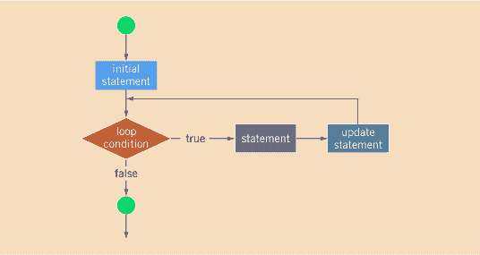

**图 5-2** `for` 循环

`for` 循环的执行过程如下：

- 1. 执行 `initial statement`。
- 2. 计算 `loop condition`。如果 `loop condition` 的值为 `true`：
  - i. 执行 `for` 循环语句。
  - ii. 执行 `update statement`（括号中的第三个表达式）。
- 3. 重复步骤 2，直到 `loop condition` 的值为 `false`。

`initial statement` 通常初始化一个变量（称为 `for` 循环控制变量或 `for` 索引变量）。

在 C++ 中，`for` 是保留字。

> **注意** 顾名思义，`for` 循环中的初始语句是第一条执行的语句；它只执行一次。

### 示例 5-9

下面的 `for` 循环输出前 10 个非负整数：

```cpp
for (i = 0; i < 10; i++)
    cout << i << " ";
cout << endl;
```

初始语句 `i = 0;` 将 `int` 变量 `i` 初始化为 0。接着，计算循环条件 `i < 10`。因为 `0 < 10` 为真，所以输出语句执行并输出 0。然后执行更新语句 `i++`，将 `i` 的值设为 1。再次计算循环条件，结果仍为真，如此继续。当 `i` 变为 10 时，循环条件的值为 `false`，`for` 循环终止，并执行 `for` 循环之后的第一条语句。

`for` 循环的循环体可以是简单语句或复合语句。

下面的示例进一步说明 `for` 循环如何执行。

### 示例 5-10

- 1. 下面的 `for` 循环输出 `Hello!` 和星号（各占一行）五次：
  
  ```cpp
  for (i = 1; i <= 5; i++)
  {
      cout << "Hello!" << endl;
      cout << "*" << endl;
  }
  ```
  
- 2. 考虑下面的 `for` 循环：
  
  ```cpp
  for (i = 1; i <= 5; i++)
      cout << "Hello!" << endl;
      cout << "*" << endl;
  ```
  
  这个 `for` 循环的输出为：
  
  ```text
  Hello!
  Hello!
  Hello!
  Hello!
  Hello!
  *
  ```
  
  该 `for` 循环只控制第一个输出语句，因为这两个输出语句没有用花括号组成复合语句。因此，第一个输出语句执行五次，因为 `for` 循环体执行五次。`for` 循环执行完后，第二个输出语句只执行一次。编译器会忽略缩进，但这里的缩进仍然具有误导性。

### 示例 5-12

如果 `for` 循环控制表达式设置正确，就可以使用 `for` 循环倒计数。

例如，考虑下面的 `for` 循环：

```cpp
for (i = 10; i >= 1; i--)
    cout << " " << i;
cout << endl;
```

输出为：

```text
10  9  8  7  6  5  4  3  2  1
```

在这个 `for` 循环中，变量 `i` 初始化为 10。每次循环迭代后，`i` 减 1。只要 `i >= 1`，循环就继续执行。

### 示例 5-13

可以按任意固定数值递增（或递减）循环控制变量。在下面的 `for` 循环中，变量 `i` 初始化为 1；在 `for` 循环末尾，`i` 增加 2。这个 `for` 循环输出前 10 个正奇数。

```cpp
for (i = 1; i <= 20; i = i + 2)
    cout << " " << i;
cout << endl;
```

输出为：

```text
1  3  5  7  9  11  13  15  17  19
```

### 示例 5-14

假设 `i` 是一个 `int` 变量。

- 1. 考虑下面的 `for` 循环：
  
  ```cpp
  for (i = 10; i <= 9; i++)
      cout << i << " ";
  cout << endl;
  ```
  
  在这个 `for` 循环中，初始语句将 `i` 设为 10。由于循环条件（`i <= 9`）初始为 `false`，所以不会发生任何操作。
  
- 2. 考虑下面的 `for` 循环：
  
  ```cpp
  for (i = 9; i >= 10; i--)
      cout << i << " ";
  cout << endl;
  ```
  
  在这个 `for` 循环中，初始语句将 `i` 设为 9。由于循环条件（`i >= 10`）初始为 `false`，所以不会发生任何操作。
  
- 3. 考虑下面的 `for` 循环：
  
  ```cpp
  for (i = 10; i <= 10; i++)        //Line 1
      cout << i << " ";             //Line 2
  cout << endl;                     //Line 3
  ```
  
  在这个 `for` 循环中，初始语句将 `i` 设为 10。循环条件（`i <= 10`）的值为 `true`，因此第 2 行的输出语句执行，输出 10。接着，更新语句将 `i` 的值增加 1，所以 `i` 的值变为 11。此时循环条件的值为 `false`，`for` 循环终止。注意，第 2 行的输出语句只执行一次。
  
- 4. 考虑下面的 `for` 循环：
  
  ```cpp
  for (i = 1; i <= 10; i++);        //Line 1
      cout << i << " ";             //Line 2
  cout << endl;                     //Line 3
  ```
  
  这个 `for` 循环对第 2 行的输出语句没有影响。`for` 语句末尾的分号终止了 `for` 循环；因此 `for` 循环的动作是空的。输出语句完全独立，只执行一次。
  
- 5. 考虑下面的 `for` 循环：
  
  ```cpp
  for (i = 1; ; i++)
      cout << i << " ";
  cout << endl;
  ```
  
  在这个 `for` 循环中，由于 `for` 语句中省略了循环条件，循环条件始终为 `true`。这是一个无限循环。
  
- 6. 下面的 `for` 循环输出不超过 100 的 2 的正整数次幂。
  
  ```cpp
  for (i = 2; i < 100; i = 2 * i)
      cout << i << " ";          //output power of 2
  cout << endl;
  ```
  
  输出为：
  
  ```text
  2 4 8 16 32 64
  ```


## 示例 5-15

在此示例中，一个 `for` 循环读取五个数字，并求出它们的和与平均值。考虑以下程序代码，其中 `i`、`newNum`、`sum` 和 `average` 是 int 变量：

```
sum = 0;

for (i = 1; i <= 5; i++)
{
    cin >> newNum;
    sum = sum + newNum;
}

average = sum / 5;
cout << "The sum is " << sum << endl;
cout << "The average is " << average << endl;
```

在上述 `for` 循环中，读取一个 `newNum` 后，会将该值加到当前数字之前读取的所有数字的先前计算出的（部分）和中。变量 `sum` 在 `for` 循环之前初始化为 0。因此，程序读取第一个数字并将其加到 `sum` 的值之后，变量 `sum` 中保存的就是第一个数字的正确和。

**注意**

`for` 循环的语法如下：

```
for (initial expression; logical expression; update expression)
    statement
```

它在功能上等价于以下 `while` 语句：

```
initial expression
while (expression)
{
    statement
    update expression
}
```

例如，以下 `for` 循环和 `while` 循环是等价的：

```
for (int i = 0; i < 10; i++)
    cout << i << " ";
cout << endl;
```

```
int i = 0;
while (i < 10)
{
    cout << i << " ";
    i++;
}
cout << endl;
```

如果循环的迭代次数已知或可以预先确定，程序员通常会使用 `for` 循环。

## 示例 5-16（斐波那契数程序：重访）

上一节给出的编程示例：斐波那契数使用 `while` 循环来确定所需的斐波那契数。你可以用等价的 `for` 循环替换 `while` 循环，如下所示：

```
for (counter = 3; counter <= nthFibonacci; counter++)
{
    current = previous2 + previous1;
    previous1 = previous2;
    previous2 = current;
}//end for
```

使用 `for` 循环确定所需斐波那契数的程序的完整程序清单，见本书配套网站。该程序名为 `Ch5_FibonacciNumberUsingAForLoop.cpp`。

在以下 C++ 程序中，我们建议你逐步演练每个步骤。

## 示例 5-17

以下 C++ 程序求前 n 个正整数的和。

```
//Program to determine the sum of the first n positive numbers.

#include <iostream>                                      //Line 1

using namespace std;                                     //Line 2

int main()                                                //Line 3
{
    int counter; //loop control variable                  //Line 5
    int sum;     //variable to store the sum of numbers   //Line 6
    int N;       //variable to store the number of       //Line 7
                //first positive integers to be added

    cout << "Line 8: Enter the number of positive "
         << "integers to be added: ";                    //Line 8
    cin >> N;                                             //Line 9
    sum = 0;                                              //Line 10
    cout << endl;                                         //Line 11

    for (counter = 1; counter <= N; counter++)            //Line 12
        sum = sum + counter;                              //Line 13

    cout << "Line 14: The sum of the first " << N
         << " positive integers is " << sum
         << endl;                                         //Line 14

    return 0;                                             //Line 15
}                                                        //Line 16
```

**示例运行：** 在此示例运行中，用户输入以阴影显示。

```
    Line 8: Enter the number of positive integers to be added: 100
    Line 14: The sum of the first 100 positive integers is 5050
```

第 8 行的语句提示用户输入要相加的正整数个数。第 9 行的语句将用户输入的数字存入 `N`，第 10 行的语句将 `sum` 初始化为 `0`。第 12 行的 `for` 循环执行 `N` 次。在 `for` 循环中，`counter` 初始化为 `1`，并在循环每次迭代后递增 `1`。因此，`counter` 的范围从 `1` 到 `N`。每次循环时，`counter` 的值都被加到 `sum` 中。变量 `sum` 初始化为 `0`，`counter` 的范围从 `1` 到 `N`，并且 `counter` 的当前值被加到 `sum` 的值中。因此，`for` 循环执行后，`sum` 包含前 `N` 个值的和，在示例运行中即 100 个正整数。

> 回顾一下，将一个控制结构语句放在另一个控制结构语句内部称为*嵌套*。以下编程示例演示了一个简单的嵌套实例。它还很好地演示了计数。

### 编程示例：对数字分类

该程序读取给定的一组整数，然后打印奇数和偶数的个数。它还输出零的个数。

该程序读取 20 个整数，但你可以轻松修改它以读取任意一组数字。事实上，你可以修改程序，使其先提示用户指定要读取多少个整数。

| 输入 | 输出 |
| --- | --- |
| 20 个整数——正数、负数或零。 | 零、偶数和奇数的个数。 |

### 问题分析与算法设计

读取一个数字后，你需要检查它是偶数还是奇数。假设该值存储在 `number` 中。将 `number` 除以 2 并检查余数。如果余数为 `0`，则 `number` 是偶数。递增偶数计数，然后检查 `number` 是否为 `0`。如果是，则递增零计数。如果余数不为 `0`，则递增奇数计数。

程序使用 `switch` 语句来判断 `number` 是奇数还是偶数。假设 `number` 是奇数。如果 `number` 是正数，除以 2 得到余数 `1`；如果它是负数，则得到余数 `-1`。如果 `number` 是偶数，则无论 `number` 是正数还是负数，除以 2 都得到余数 `0`。你可以使用取模运算符 `%` 来求余数。例如：

```
    6 % 2 = 0; -4 % 2 = 0; -7 % 2 = -1; 15 % 2 = 1
```

对列表中的每个数字重复上述分析数字的过程。上述讨论可转化为以下算法：

- 1. 对列表中的每个数字：
  - a. 获取该数字。
  - b. 分析该数字。
  - c. 递增相应的计数。
- 2. 打印结果。

### 变量

由于你要统计零、偶数和奇数的个数，因此需要三个 int 类型变量——例如 zeros、evens 和 odds——来跟踪计数。你还需要一个变量——例如 number——来读取和存储要分析的数字，以及另一个变量——例如 counter——来统计已分析的数字个数。因此，程序中需要以下变量：

```
    int counter;    //loop control variable
    int number;     //variable to store the number read
    int zeros;      //variable to store the zero count
    int evens;      //variable to store the even count
    int odds;       //variable to store the odd count
```

### 主算法

显然，必须将变量 zeros、evens 和 odds 初始化为零。你可以在声明这些变量时初始化它们。

- 1. 声明并初始化变量。
- 2. 提示用户输入 20 个数字。
- 3. 对列表中的每个数字：
  - a. 读取该数字。
  - b. 输出该数字（回显输入）。
  - c. 如果该数字是偶数：
    - i. 递增偶数计数。
    - ii. 如果该数字为零，则递增零计数。
  - 否则
    - 递增奇数计数。
- 4. 打印结果。

在编写 C++ 程序之前，让我们更详细地描述步骤 1–4。这样，你用 C++ 编写指令就会容易得多。

- 1. 初始化变量。你可以在声明变量 zeros、evens 和 odds 时初始化它们。
- 2. 使用输出语句提示用户输入 20 个数字。
- 3. 对于步骤 3，你可以使用 `for` 循环来处理和分析这 20 个数字。用伪代码表示，该步骤写为：

```text
for (counter = 1; counter <= 20; counter++)
{
    read the number;
    output number;

    switch (number % 2)    // check the remainder
    {
    case 0:
        increment even count;
        if (number == 0)
            increment zero count;
        break;
    case 1:
    case -1:
        increment odd count;
    }//end switch
}//end for
```

- 4. 打印结果。输出变量 zeros、evens 和 odds 的值。

### 完整程序清单

```cpp
//**********************************************************
// Author: D.S. Malik

// Program: Counts zeros, odds, and evens
// This program counts the number of odd and even numbers.
// The program also counts the number of zeros.
//**********************************************************

#include <iostream>
#include <iomanip>

using namespace std;

const int N = 20;

int main ()
{
        //Declare variables
        int counter;       //loop control variable
```


```cpp
int number;             //variable to store the new number

int zeros = 0;                                      //Step 1
int odds = 0;                                       //Step 1
int evens = 0;                                      //Step 1

cout << "Please enter " << N << " integers, "
     << "positive, negative, or zeros."
     << endl;                                       //Step 2

cout << "The numbers you entered are:" << endl;

for (counter = 1; counter <= N; counter++)         //Step 3
{
    cin >> number;                                  //Step 3a
    cout << number << " ";                          //Step 3b

          //Step 3c
    switch (number % 2)
    {
    case 0:
        evens++;
        if (number == 0)
            zeros++;
        break;
    case 1:
    case -1:
        odds++;
    } //end switch
} //end for loop

cout << endl;

                              //Step 4
cout << "There are " << evens << " evens, "
     << "which includes " << zeros << " zeros."
     << endl;
cout << "The number of odd numbers is: " << odds
     << endl;

return 0;
}
```

**示例运行：** 在此示例运行中，用户输入以阴影显示。

```text
Please enter 20 integers, positive, negative, or zeros.
The numbers you entered are:
0 0 -2 -3 -5 6 7 8 0 3 0 -23 -8 0 2 9 0 12 67 54
0 0 -2 -3 -5 6 7 8 0 3 0 -23 -8 0 2 9 0 12 67 54
There are 13 evens, which includes 6 zeros.
The number of odd numbers is: 7
```

我们建议您使用上述示例输入对该程序进行一次走查。

## do...while 循环（重复）结构

本节介绍第三种循环或重复结构，称为 `do...while` 循环。`do...while` 语句的一般形式如下：

```cpp
do
    statement
while (expression);
```

当然，`statement` 可以是简单语句或复合语句。如果是复合语句，请将其括在花括号中。图5-3 展示了 `do...while` 循环的执行流程。

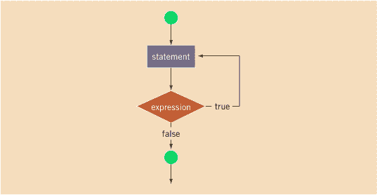

图5-3 `do...while` 循环

在 C++ 中，`do` 是保留字。

`statement` 先执行，然后计算 `expression`。如果 `expression` 的计算结果为 `true`，则再次执行 `statement`。只要 `do...while` 语句中的 `expression` 为 `true`，语句就会执行。为避免无限循环，你必须再次确保循环体包含一个最终使 `expression` 为 `false` 并保证其正确退出的语句。

在（a）中，`while` 循环不产生任何结果，语句从不执行。在（b）中，`do...while` 循环输出数字 11，并将 `i` 的值改为 16。这是符合预期的，因为在 `do...while` 循环中，语句必须至少执行一次。

`do...while` 循环可用于输入验证。假设程序提示用户输入一个测试分数，该分数必须大于或等于 0 且小于或等于 50。如果用户输入的分数小于 0 或大于 50，则应提示用户重新输入分数。以下 `do...while` 循环可用于实现此目标：

```cpp
int score;

do
{
    cout << "Enter a score between 0 and 50: ";
    cin >> score;
    cout << endl;
}
while (score < 0 || score > 50);
```

### 示例 5-20：3 和 9 的整除性测试

假设 *m* 和 *n* 是整数，且 *m* 非零。那么，如果存在某个整数 *t* 使得 *n = mt*，则称 *m* 为 *n* 的**约数**；也就是说，当 *m* 整除 *n* 时，余数为 0。

设 *n = aₖaₖ₋₁...a₂a₁a₀* 为一个整数。设 *s = aₖ + aₖ₋₁ + aₖ₋₂ + ... + a₁ + a₀* 为 *n* 的各位数字之和。已知如果 *s* 能被 3 和 9 整除，则 *n* 能被 3 和 9 整除。换句话说，一个整数能被 3 和 9 整除当且仅当其各位数字之和能被 3 和 9 整除。

例如，假设 *n = 27193257*。那么 *s = 2 + 7 + 1 + 9 + 3 + 2 + 5 + 7 = 36*。因为 36 能被 3 和 9 同时整除，所以 27193257 能被 3 和 9 同时整除。

接下来，我们编写一个程序，它先求出正整数的各位数字之和，然后检查该和是否能被 3 和 9 整除，以此判断该正整数是否能被 3 和 9 整除。

要求一个正整数的各位数字之和，我们需要提取该数的每一位数字。考虑数字 **951372**。注意 **951372 % 10 = 2**，这是 **951372** 的最后一位数字。还要注意 **951372 / 10 = 95137**；也就是说，当该数除以 10 时，会去掉最后一位数字。接下来，我们对数字 **95137** 重复此过程。当然，我们需要将提取出的数字相加。

**示例运行：** 在这些示例运行中，用户输入以阴影显示。

**示例运行 1**

输入一个正整数：`27193257`

各位数字之和 = 36

27193257 能被 3 和 9 整除

**示例运行 2**

输入一个正整数：`609321`

各位数字之和 = 21

609321 能被 3 整除，但不能被 9 整除

**示例运行 3**

输入一个正整数：`161905102`

各位数字之和 = 25

161905102 不能被 3 或 9 整除

## 选择合适的循环结构

这三种循环在 C++ 中都有各自的用途。如果你知道，或者程序可以预先确定所需的重复次数，那么 `for` 循环是正确的选择。如果你不知道，并且程序无法预先确定所需的重复次数，而且重复次数可能为 0，那么 `while` 循环是正确的选择。如果你不知道，并且程序无法预先确定所需的重复次数，而且重复次数至少为 1，那么 `do...while` 循环是正确的选择。

## break 和 continue 语句

`break` 语句在 `switch` 结构中执行时，会立即退出该 `switch` 结构。同样，你可以在 `while`、`for` 和 `do...while` 循环中使用 `break` 语句来立即退出循环结构。`break` 语句通常用于两个目的：

- 提前退出循环。
- 跳过 `switch` 结构的剩余部分。

`break` 语句执行后，程序继续执行该结构之后的第一个语句。在循环中使用 `break` 语句可以省去某些（标志）变量的使用。以下 C++ 代码段有助于说明这一思想。（假设所有变量均已正确声明。）

```cpp
sum = 0;
isNegative = false;

cin >> num;

while (cin && !isNegative)
{
    if (num < 0)    //if num is negative, terminate the loop
                    //after this iteration
    {
        cout << "Negative number found in the data." << endl;
        isNegative = true;
    }
    else
    {
        sum = sum + num;
        cin >> num;
    }
}
```

这个 while 循环本应求出一组正数之和。如果数据集中包含负数，循环会终止并给出适当的错误消息。这个 while 循环使用标志变量 isNegative 来表示出现了负数。变量 isNegative 在 while 循环之前初始化为 false。在将 num 加到 sum 之前，会检查 num 是否为负数。如果 num 为负数，屏幕上会显示错误消息，并将 isNegative 设为 true。在下一次迭代中，当计算 while 语句中的表达式时，其结果为 false，因为 !isNegative 为 false。（注意，因为 isNegative 为 true，所以 !isNegative 为 false。）

以下 while 循环未使用变量 isNegative：

```cpp
sum = 0;
cin >> num;

while (cin)
{
    if (num < 0)    //if num is negative, terminate the loop
    {
        cout << "Negative number found in the data." << endl;
        break;
    }

    sum = sum + num;
    cin >> num;
}
```

在这种形式的 while 循环中，当发现负数时，if 语句中的表达式计算结果为 true；在打印适当的消息后，break 语句会终止循环。（在循环中执行 break 语句后，循环中剩余的语句将被丢弃。）


## 示例 5-21

假设你想创建以下图案：

```text
*
**
***
****
*****
```

显然，你想打印五行星号。第一行打印一个星号，第二行打印两个星号，依此类推。因为要打印五行，所以从下面的 `for` 语句开始：

```cpp
for (i = 1; i <= 5; i++)
```

第一次迭代中 i 的值为 1，第二次迭代中为 2，依此类推。你可以将 i 的值用作嵌套在此循环中的另一个 `for` 循环的限制条件，以控制一行中的星号数量。稍加思考便可得到以下代码：

```cpp
for (i = 1; i <= 5; i++)       //Line 1
{                              //Line 2
    for (j = 1; j <= i; j++)   //Line 3
        cout << "*";           //Line 4
    cout << endl;               //Line 5
}                              //Line 6
```

逐行分析这段代码可知，第 1 行的 `for` 循环从 i = 1 开始。当 i 为 1 时，第 3 行的内层 `for` 循环输出一个星号，插入点移到下一行。然后 i 变为 2，内层 `for` 循环输出两个星号，第 5 行的输出语句将插入点移到下一行，依此类推。此过程持续到 i 变为 6，循环停止。

如果将第 1 行的 `for` 语句替换为以下内容，这段代码会产生什么图案？

```cpp
for (i = 5; i >= 1; i--)
```

## 示例 5-22

假设你想创建以下乘法表：

|   |   |   |   |   |   |   |   |   |   |
|---|---|---|---|---|---|---|---|---|---|
| 1 | 2 | 3 | 4 | 5 | 6 | 7 | 8 | 9 | 10 |
| 2 | 4 | 6 | 8 | 10 | 12 | 14 | 16 | 18 | 20 |
| 3 | 6 | 9 | 12 | 15 | 18 | 21 | 24 | 27 | 30 |
| 4 | 8 | 12 | 16 | 20 | 24 | 28 | 32 | 36 | 40 |
| 5 | 10 | 15 | 20 | 25 | 30 | 35 | 40 | 45 | 50 |

这个乘法表有五行。因此，如同示例 5-21 那样，我们使用 `for` 语句输出这些行，如下所示：

```cpp
for (i = 1; i <= 5; i++)
    //output a line of numbers
```

第一行要打印 1 的乘法表，第二行要打印 2 的乘法表，依此类推。注意，第一行以 1 开头，打印这一行时 i 的值为 1。类似地，第二行以 2 开头，打印这一行时 i 的值为 2，依此类推。如果 i 为 1，则 i * 1 为 1；如果 i 为 2，则 i * 2 为 2；依此类推。因此，要打印一行数字，我们可以将 i 的值作为起始数字，并将 10 作为限制值。也就是说，考虑下面的 for 循环：

```cpp
for (j = 1; j <= 10; j++)
    cout << setw(3) << i * j;
```

让我们看看这个 for 循环。假设 i 为 1，那么我们正在打印乘法表的第一行。同时，j 从 1 到 10，因此这个 for 循环输出数字 1 到 10，也就是乘法表的第一行。类似地，如果 i 为 2，我们正在打印乘法表的第二行。同时，j 从 1 到 10，因此这个 for 循环输出乘法表的第二行，依此类推。

稍加思考便可得到以下嵌套循环，以输出所需的网格：

```cpp
for (i = 1; i <= 5; i++)              //Line 1
{                                    //Line 2
    for (j = 1; j <= 10; j++)        //Line 3
        cout << setw(3) << i * j;    //Line 4

    cout << endl;                    //Line 5
}                                    //Line 6
```

## 示例 5-23

考虑以下数据：

```text
65 78 65 89 25 98 -999
87 34 89 99 26 78 64 34 -999
-999
23 99 98 97 26 78 100 63 87 23 -999
62 35 78 99 12 93 19 -999
```

每行末尾的数字 -999 充当哨兵，因此不属于数据。我们的目标是求每一行中数字的和并输出该和。此外，假设这些数据要从文件中读取，比如 Exp_5_23.txt。我们假设输入文件已使用文件流变量 infile 打开。

这个特定数据集有五行输入。因此，我们可以使用 for 循环或计数器控制的 while 循环来处理每一行数据。让我们使用 while 循环来处理这五行。由此，while 循环采用以下形式：

```cpp
counter = 0;              //Line 1
while (counter < 4)       //Line 2
{                         //Line 3
```

因为我们不知道输入行数，所以必须使用 EOF 控制的 `while` 循环来处理数据。在这种情况下，所需代码如下。（假设所有变量都已正确声明，并且输入文件已使用输入文件流变量 `infile` 打开。）

```cpp
counter = 0;                              //Line 1
infile >> num;                            //Line 2
while (infile)                             //Line 3
{                                          //Line 4
    sum = 0;                               //Line 5
    while (num != -999)                    //Line 6
    {                                      //Line 7
        sum = sum + num;                   //Line 8
        infile >> num;                     //Line 9
    }                                      //Line 10

    counter++;                             //Line 11
    cout << "Line " << counter
         << ": Sum = " << sum << endl;   //Line 12
    infile >> num;                         //Line 13
}                                          //Line 14
```

注意，我们再次使用了变量 counter，这次是为了让我们在输出每行和时同时打印行号。

## 示例 5-25

考虑以下数据：

```text
101
John Smith
65 78 65 89 25 98 -999
102
Peter Gupta
87 34 89 99 26 78 64 34 -999
103
Buddy Friend
23 99 98 97 26 78 100 63 87 23 -999
104
Doctor Miller
62 35 78 99 12 93 19 -999
...
```

一行末尾的数字 -999 充当哨兵，因此不属于数据。

假设这是某些竞选学生会主席职位的候选人的数据。对于每位候选人，数据采用以下形式：

- **ID**
- **姓名**
- **票数**

目标是求出该候选人获得的总票数。我们假设数据从大小未知的文件 `Exp_5_25.txt` 输入。我们还假设输入文件已使用输入文件流变量 `infile` 打开。

由于输入文件的长度未指定，我们使用 EOF 控制的 `while` 循环。对于每位候选人，第一个数据项是单独占一行的 `int` 类型 ID；第二个数据项是姓名，可能由多个单词组成；第三行包含从各部门获得的票数。

为了读取 ID，我们使用提取运算符 `>>`；为了读取姓名，我们使用流函数 `getline`。注意，读取 ID 后，读取标记位于 ID 之后，而 ID 之后的字符是换行符。因此，读取 ID 后，读取标记位于 ID 之后、换行符（包含 ID 的那一行的换行符）之前。

函数 `getline` 会一直读取到行尾。因此，如果我们在读取 ID 后立即读取姓名，那么存储在变量 name 中的就是（ID 之后的）换行符。由此可知，要读取姓名，我们必须读取并丢弃 ID 之后的换行符，这可以使用流函数 `get` 来完成。因此，读取 ID 和姓名的语句如下：

```cpp
infile >> ID;                //read the ID
infile.get(ch);              //read the newline character after the ID
getline(infile, name);       //read the name
```

（假设 `ch` 是 `char` 类型的变量。）处理数据的通用循环为：

```cpp
infile >> ID;                //Line 1
while (infile)               //Line 2
{                            //Line 3
    infile.get(ch);          //Line 4
    getline(infile, name);   //Line 5

    //process the numbers in each line    //Line 6
    //output the name and total votes
    infile >> ID;            //begin processing the next line
}
```

读取并汇总投票数据的代码如下：

```cpp
sum = 0;                     //Line 6
infile >> num;               //Line 7; read the first number
while (num != -999)          //Line 8
{                            //Line 9
    sum = sum + num;         //Line 10; update sum
    infile >> num;           //Line 11; read the next number
}                            //Line 12
```


现在，我们可以编写以下嵌套循环来按如下方式处理数据：

```cpp
infile >> ID;                //Line 1
while (infile)               //Line 2
{                            //Line 3
    infile.get(ch);          //Line 4
    getline(infile, name);   //Line 5
    sum = 0;                 //Line 6
    infile >> num;           //Line 7; read the first number
    while (num != -999)      //Line 8
    {                        //Line 9
        sum = sum + num;     //Line 10; update sum
        infile >> num;       //Line 11; read the next number
    }
    cout << "Name: " << name
         << ", Votes: " << sum
         << endl;            //Line 12
    infile >> ID;            //Line 13; begin processing the next line
}
```

## 通过避免补丁来避免错误

前几章中的调试部分说明了如何调试语法错误和逻辑错误，以及如何避免一知半解的概念。在本节中，我们将说明如何避免使用软件补丁来修复代码。软件补丁是在现有代码之上编写的一段代码，旨在修复原始代码中的错误。

假设文件 Ch5_LoopWithBugsData.txt 中包含以下数据。

```text
87 78 83 94
23 89 92 70
92 78 34 56
```

目标是求每一行中数字的和。对于每一行，输出这些数字及其和。让我们考虑以下程序：

```cpp
#include <iostream>
#include <fstream>

using namespace std;

int main()
{
    ifstream infile;

    int i;
    int j;
    int sum;
    int num;

    infile.open("Ch5_LoopWithBugsData.txt");

    for (i = 1; i <= 4; i++)
    {
        sum = 0;

        for (j = 1; j <= 4; j++)
        {
            infile >> num;
            cout << num << " ";
            sum = sum + num;
        }

        cout << "sum = " << sum << endl;
    }

    return 0;
}
```

### 示例运行：

```text
87 78 83 94  sum = 342
23 89 92 70  sum = 274
92 78 34 56  sum = 260
56 56 56 56  sum = 224
```

示例运行表明程序中存在错误，因为文件包含三行输入，而输出包含四行。此外，最后一行的数字56重复了四次。显然，程序中存在错误，我们必须修复代码。有些程序员，尤其是一些初学者，通过添加软件补丁来处理问题的症状。在这种情况下，输出应只包含三行。初学者可能会通过添加软件补丁来手动截去不需要的第四行，从而修复代码，如下面的修改后程序所示：

```cpp
#include <iostream>
#include <fstream>

using namespace std;

int main()
{
    ifstream infile;

    int i;
    int j;
    int sum;
    int num;

    infile.open("Ch5_LoopWithBugsData.txt");

    for (i = 1; i <= 4; i++)
    {
        sum = 0;

        if (i != 4)        //software patch
        {
            for (j = 1; j <= 4; j++)
            {
                infile >> num;
                cout << num << " ";
                sum = sum + num;
            }

            cout << "sum = " << sum << endl;
        }
    }
    return 0;
}
```

### 示例运行：

```text
87 78 83 94  sum = 342
23 89 92 70  sum = 274
92 78 34 56  sum = 260
```

显然，程序现在运行正确。

正如我们所见，程序员只是观察到了症状，并通过添加软件补丁来解决问题。然而，如果查看代码，程序不仅执行了多余的语句，它还是一个一知半解概念的示例。看来程序员并没有很好地理解为什么先前的程序产生四行而不是三行。添加补丁消除了症状，但这是一种糟糕的编程实践。程序员必须弄清楚为什么程序会产生四行。仔细查看程序，我们可以看到产生四行是因为外层循环执行了四次。赋给循环控制变量 i 的值是1、2、3和4。这是经典的“差一”（off-by-one）问题的示例。（在“差一”问题中，循环要么多执行一次，要么少执行一次。）我们可以通过正确设置循环控制变量的值来消除这个问题。例如，我们可以将循环重写如下：

```cpp
for (i = 1; i <= 3; i++)
{
    sum = 0;

    for (j = 1; j <= 4; j++)
    {
        infile >> num;
        cout << num << " ";
        sum = sum + num;
    }

    cout << "sum = " << sum << endl;
}
```

## 调试循环

这段代码在不使用软件补丁的情况下修复了原始问题。它也体现了良好的编程实践。完整的修改后程序可在本书配套网站上获得，名称为 Ch5_LoopWithBugsCorrectedProgram.cpp。

正如我们在前面的调试部分中所见，无论程序设计和编码得多么仔细，错误都可能发生。如果存在语法错误，编译器会识别它们。然而，如果存在逻辑错误，我们必须仔细查看代码，甚至可能查看设计，并尝试找出错误。为了提高程序的可靠性，必须在程序发布给用户之前发现并修复错误。

算法编写完成后，下一步是验证它能否正确工作。如果算法是简单的顺序流程或包含分支，可以手工追踪，也可以使用 IDE 提供的调试器（如果有）。通常，循环更难调试。循环的正确性可以通过使用循环不变式来验证。循环不变式是一组语句，每次执行循环体时都保持为真。设 `p` 为循环不变式，`q` 为循环语句中的（逻辑）表达式。那么，在循环的每次迭代之前，`p && q` 保持为真；在循环终止之后，`p && !(q)` 为真。关于循环不变式的完整讨论超出了本书的范围。不过，你可以在《*离散数学：理论与应用（修订版）*》，D.S. Malik 和 M.K. Sen，Cengage Learning Asia，新加坡，2010 一书中学习循环不变式。这里，我们给出一些可用于调试循环的提示。

正如上一节所讨论的，与循环相关的最常见错误是差一错误。如果循环变成无限循环，错误很可能出在控制循环执行的逻辑表达式中。仔细检查逻辑表达式，看看是否把不等号写反了，是否在应使用相等运算符的地方出现了赋值语句符号，或者是否在应使用 `||` 的地方出现了 `&&`。如果循环改变了变量的值，你可以在每次迭代之前和/或之后打印变量的值，或者使用 IDE 的调试器（如果有），并在每次迭代期间观察变量的值。

本书中的调试部分旨在帮助你理解调试过程。然而，你会意识到，调试可能是一个令人疲惫的过程。如果你的程序非常糟糕，不要调试它。把它扔掉，重新开始。

## 快速回顾

- 1. C++ 有三种循环（重复）结构：`while`、`for` 和 `do...while`。
- 2. `while` 语句的语法是：
  
  ```cpp
  while (expression)
      statement
  ```
- 3. 在 C++ 中，`while` 是保留字。
- 4. 在 `while` 语句中，`expression`（决策者）两边的圆括号很重要；它们标记表达式的开始和结束。
- 5. `statement` 称为循环体。
- 6. `while` 循环的循环体必须包含一条最终将表达式设置为 `false` 的语句。
- 7. 计数器控制的 `while` 循环使用计数器来控制循环。
- 8. 在计数器控制的 `while` 循环中，必须在循环之前初始化计数器，并且循环体必须包含一条改变计数器变量值的语句。
- 9. 哨兵是一个特殊值，用于标记输入数据的结束。哨兵必须与所有数据项相似，但又有所不同。
- 10. 哨兵控制的 `while` 循环使用哨兵来控制循环。`while` 循环继续执行，直到读入哨兵。
- 11. EOF 控制的 `while` 循环使用文件结束标记来控制循环。`while` 循环继续执行，直到程序检测到文件结束标记。
- 12. 在 Windows 控制台环境中，使用 `Ctrl+z`（按住 `Ctrl` 键并按 `z`）输入文件结束标记。
- 13. `for` 循环简化了计数器控制的 `while` 循环的编写。
- 14. 在 C++ 中，`for` 是保留字。
- 15. `for` 循环的语法是：
  
  ```cpp
  for (initialize statement; loop condition; update statement)
      statement
  ```
  
  `statement` 称为 `for` 循环的循环体。
- 16. 在 `for` 循环末尾（`for` 循环体之前）放置分号是一个语义错误。在这种情况下，`for` 循环的动作是空的。
- 17. `do...while` 语句的语法是：
  
  ```cpp
  do
      statement
  while (expression);
  ```
  
  `statement` 称为 `do...while` 循环的循环体。
- 18. `while` 和 `for` 循环都称为前测试循环。`do...while` 循环称为后测试循环。
- 19. `while` 和 `for` 循环的循环体可能根本不执行，但 `do...while` 循环体总是至少执行一次。
- 20. 在循环体中执行 `break` 语句会立即终止循环。
- 21. 在循环体中执行 `continue` 语句会跳过循环剩余的语句，并继续下一次迭代。


3. 以下 C++ 代码的输出是什么？(2, 3)

```cpp
int count = 0;
int sum = 0;
while (count <= 5)
{
    sum = sum + count * (count - 1);
    count++;
}
cout << sum << endl;
```

4. 以下 C++ 代码的输出是什么？(2, 3)

```cpp
int num = 1;
while (num * num <= 50)
{
    cout << num << " ";
    num = num + 2;
}

cout << endl;
```

5. 以下 while 循环何时终止？(2, 3)

```cpp
char ch = 'D';
while ('A' <= ch && ch <= 'Z')
    ch = static_cast<char>(static_cast<int>(ch) + 1);
```

6. 假设输入为 0 0 8 12 50 7 13 -1。以下代码的输出是什么？(2, 3)

```cpp
int num, sum, count;
cin >> sum;
cin >> count;
cin >> num;

while (count <= 4)
{
    sum = sum + num;
    count++;
    cin >> num;
}
cout << "Sum = " << sum << endl;
```

7. 假设输入为 0 5 6 4 9 8 -1。以下代码的输出是什么？(2, 3)

```cpp
int num = 0;
int sum;
cin >> sum;

while (num != -1)
{
    cin >> num;
}
sum = sum + 2 * static_cast<int>(sqrt(num));
cout << "Sum = " << sum << endl;
```

8. 假设输入为 0 5 6 4 9 8 -1。以下代码的输出是什么？(2, 3)

```cpp
int num;
int sum;

cin >> num;
sum = num;

while (num != -1)
{
    sum = sum + num * (num - 1);
    cin >> num;
}
cout << "Sum = " << sum << endl;
```

9. 假设输入为 20 -16 -5 15 6 0。以下代码的输出是什么？(2, 3)

```cpp
int num;
int temp = 0;

cin >> num;

while (num != 0)
{
    if (num % 2 == 0)
        temp = temp + num;
    else
        temp = temp - num;
    cin >> num;
}
cout << "temp = " << temp << endl;
```

10. 改正以下代码，使其读取并求出 20 个数的和。(2, 3)

```cpp
int count = 0;
int sum = 0;

while (count <= 20);
{
    sum = sum + count;
    count++;
    cin >> num;
}
```

11. 考虑以下程序。(2, 3)

```cpp
#include <iostream>

using namespace std;

int main()
{
    int num1, num2;
    int temp = 0;

    cout << "Enter two integers: ";
    cin >> num1 >> num2;
    cout << endl;

    while ((num1 + num2) % 2 != (num1 + num2) % 3)
    {
        temp = num1 + num2;
        num1 = num2;
        num2 = temp;
        cout << temp << " ";
    }
    cout << " *" << endl;

    return 0;
}
```

- a. 如果输入为 `10 10`，输出是什么？
- b. 如果输入为 `4 11`，输出是什么？
- c. 如果输入为 `12 29`，输出是什么？
- d. 如果输入为 `10 17`，输出是什么？

12. 假设输入为：

`32 53 -10 45 -56 -87 132 165 -999`

以下程序的输出是什么？(2, 3)

```cpp
#include <iostream>

using namespace std;

int main()
{
    int num;
    int count = 0;

    cin >> num;

    while (num != -999)
    {
        cout << num % (count + 1) << " ";
        cin >> num;
        count++;
    }

    cout << endl;

    return 0;
}
```

13. 以下程序旨在输入两个数并输出它们的和。它会询问用户是否愿意运行该程序。如果答案为 Y 或 y，则提示用户输入两个数。在将数字相加并显示结果后，它会再次询问用户是否愿意继续添加更多数字。然而，该程序未能做到这一点。请改正程序，使其正常工作。(2, 3)

```cpp
#include <iostream>
#include <iomanip>

using namespace std;

int main()
{
    char response;
    double num1;
    double num2;

    cout << "This program adds two numbers." << endl;
    cout << "Would you like to run the program: (Y/y) ";
    cin >> response;
    cout << endl;

    cout << fixed << showpoint << setprecision(2);

    while (response == 'Y' && response == 'y')
    {
        cout << "Enter two numbers: ";
        cin >> num1 >> num2;
        cout << endl;

        cout << num1 << " + " << num2 << " = " << (num1 - num2)
             << endl;

        cout << "Would you like to add again: (Y/y) ";
        cin >> response;
        cout << endl;
    }

    return 0;
}
```

14. 以下程序段的输出是什么？(2, 3)

```cpp
int count = 0;

while (++count < 5)
    cout << count + 1 << " ";
cout << endl;
```

15. 以下程序段的输出是什么？(2, 3)

```cpp
int count = 0;

while (count++ < 5)
    cout << count + 1 << " ";
cout << endl;
```

16. 以下程序段的输出是什么？(2, 3)

```cpp
int count = 5;

while (--count > 0)
    cout << 2 * count << " ";
cout << endl;
```

17. 以下程序段的输出是什么？(2, 3)

```cpp
int count = 0;
while (count++ <= 5)
    cout << (count - 1) * (count - 2) << " ";

cout << endl;
```

18. 在下列每种情况下，你将使用哪种类型的循环，例如计数器控制循环或哨兵控制循环？(3)

- a. 求以下级数之和：1 + (2 / 1) + (3 / 2) + (4 / 3) + (5 / 4) + ... + (10 / 9)
- b. 求以下数字之和，但不包括最后一个数字：17, 32, 62, 48, 58, -1
- c. 一个文件包含员工工资。更新员工工资。

19. 考虑以下 *for* 循环。(4)

```cpp
int j, s;

s = 0;
for (j = 1; j <= 10; j++)
    s = s + j * (j - 1);
```

在这个 *for* 循环中，指出循环控制变量、初始化语句、循环条件、更新语句，以及更新 s 值的语句。

- c.
  ```cpp
  for (i = 1; i <= 1; i--)
      cout << "**";
  cout << endl;
  ```

- d.
  ```cpp
  for (i = 12; i >= 9; i--)
      cout << "**";
  cout << endl;
  ```

- e.
  ```cpp
  for (i = 0; i <= 5; i++)
      cout << "**";
  cout << endl;
  ```

- f.
  ```cpp
  for (i = 1; i <= 5; i++)
  {
      cout << "**";
      i = i + 1;
  }
  cout << endl;
  ```

24. 编写一个 `for` 语句，求 1 到 1000 之间所有能被 3 或 5 整除的数之和。(4)

25. 以下代码的输出是什么？变量 x 和 y 之间有关系吗？如果有，请说明该关系？输出是什么？(4)

```cpp
int x = 19683;
int i;
int y = 0;

for (i = x; i >= 1; i = i / 3)
    y++;
cout << "x = " << x << ", y = " << y << endl;
```

26. 以下代码的输出是什么？(4)

```cpp
for (int k = 2; k <= 10000; k = k * k)
    cout << k << " ";
cout << endl;
```

27. 以下 C++ 程序段的输出是什么？假设所有变量都已正确声明。(4)

```cpp
for (j = 0; j < 8; j++)
{
    cout << j * 25 << " - ";

    if (j != 7)
        cout << (j + 1) * 25 - 1 << endl;
    else
        cout << (j + 1) * 25 << endl;
}
```

28. 假设输入为 6 -2 4 9 -5 8。以下代码的输出是什么？(4)

```cpp
int num, count, temp = 1;

cin >> num;

for (count = 1; count <= 4; count++)
{
    temp = temp + temp * (num + count);
    cin >> num;
}
cout << "temp = " << temp << endl;
```

29. 以下哪些仅适用于 while 循环？哪些仅适用于 do...while 循环？哪些两者都适用？(2, 5)

- a. 它被视为条件循环。
- b. 循环体至少执行一次。
- c. 控制循环的逻辑表达式在进入循环之前求值。
- d. 循环体可能完全不执行。

30. 以下程序包含会阻止其编译和/或运行的错误。请改正所有此类错误。(4)

```cpp
#include <stream>

#using namespace sdt;

const int LIMIT = 35;

int main();
{
    long long num1, num2;
    double first, second;

    cout >> "Enter two integers less than 100: "
    cin << num1 >> num2;
    cout >> endl;

    for (count = 1; count < Limit; count+)
    {
        first = (num1 * num2) / 2.0;
        if (num1 / num2 == 0)
            second = (num1 - num2) % 2.0;
        else
            second = num1 + num;
        num1 = num1 + num2;
        num2 := num2 * (count - LIMIT)
    }
}
```


```cpp
cout << num1 << " " << num2 << " " << first % 5
     << " " << (second % 7) << endl;

return;
}
```

- 31. 预测试循环和后测试循环有什么区别？(2, 4, 5)

- 32. 下列每个循环将执行多少次？每种情况下的输出是什么？(5)

  - a.
    ```cpp
    x = 5; y = 50;

    x = x + 10;
    while (x < y)
        cout << x << " " << y << endl;
    ```
  - b.
    ```cpp
    x = 5; y = 80;
    do
        x = x * 2;
    while (x < y);
    cout << x << " " << y << endl;
    ```
  - c.
    ```cpp
    x = 5; y = 20;
    do
        x = x + 2;
    while (x >= y);
    cout << x << " " << y << endl;
    ```
  - d.
    ```cpp
    x = 5; y = 35;
    while (x < y)
        x = x + 10;
    cout << x << " " << y << endl;
    ```
  - e.
    ```cpp
    x = 5; y = 30;
    while (x <= y)
        x = x * 2;
    cout << x << " " << y << endl;
    ```
  - f.
    ```cpp
    x = 5; y = 30;
    while (x <= y)
        x = x + 2;
    cout << x << " " << y << endl;
    ```

- 33. 编写一个输入语句验证循环，提示用户输入一个小于20或大于75的数。(2, 4, 5)

- 34. 将以下代码改写为for循环。(2, 4)

  ```cpp
  int i = 0, value = 0;

  while (i <= 20)
  {
      if (i % 2 == 0 && i <= 10)
          value = value + i * i;
      else if (i % 2 == 0 && i > 10)
          value = value + i;
      else
          value = value - i;
      i = i + 1;
  }

  cout << "value = " << value << endl;
  ```

  这个循环的输出是什么？

- 35. 将练习34中的while循环改写为do...while循环。(2, 5)

- 36. 下列程序中的do...while循环本应读取一些数，直到遇到哨兵值（本例中为-1）。它本应将除哨兵值之外的所有数相加。如果数据如下所示：(5)

  12    5    30    48    -1

  程序没有正确地将这些数相加。请改正程序，使其正确地将这些数相加。

  ```cpp
  #include <iostream>

  using namespace std;
  int main()
  {
      int total = 0,
          count = 0,
          number;

      do
      {
          cin >> number;
          total = total + number;
          count++;
      }
      while (number != -1);

      cout << "The number of data read is " << count << endl;
      cout << "The sum of the numbers entered is " << total
           << endl;

      return 0;
  }
  ```

- 37. 使用与练习36相同的数据，下面的循环也会失败。请改正它。(2)

  ```cpp
  cin >> number;
  while (number != -1)
      total = total + number;
      cin >> number;
      cout << endl;
      cout << total << endl;
  ```

- 38. 使用与练习36相同的数据，下面的循环也会失败。请改正它。(2)

  ```cpp
  cin >> number;
  while (number != -1)
  {
      cin >> number;
      total = total + number;
  }
  cout << endl;
  cout << total << endl;
  ```

- 39. 给定以下程序段：(2, 4, 5)

  ```cpp
  for (number = 1; number <= 10; number++)
      cout << setw(3) << number;
  ```

  编写一个while循环和一个do...while循环，使其具有相同的输出。

- 40. 给定以下程序段：(2, 4, 5)

  ```cpp
  int i;
  int value = 3;

  for (i = 0; i < 5; i++)
      value = value * (i + 1) + i;

  cout << "value = " << value << endl;
  ```

  编写一个while循环和一个do...while循环，使其具有相同的输出。

- 41. 考虑以下程序。(5)

  ```cpp
  #include <iostream>

  using namespace std;

  int main()
  {
      int num1, num2;
      int temp;

      cout << "Enter two integers: ";
      cin >> num1 >> num2;
      cout << endl;

      do
      {
          temp = 2 * (num1 + num2);
          num1 = num2;
          num2 = temp;
          cout << temp << " ";
      }
      while (((temp + num1) % 3) != 0);

      cout << endl;

      return 0;
  }
  ```

  - a. 如果输入为7 11，输出是什么？
  - b. 如果输入为-4 6，输出是什么？
  - c. 如果输入为6 9，输出是什么？
  - d. 如果输入为22 27，输出是什么？

- 42. 为了了解嵌套`for`循环如何工作，请对以下程序段进行一次走查，并在每种情况下确定确切的输出。(4, 7)

  - a.
    ```cpp
    int i, j;

    for (i = 1; i <= 5; i++)
    {
        for (j = 1; j <= 5; j++)
            cout << setw(3) << i;
        cout << endl;
    }
    ```
  - b.
    ```cpp
    int i, j;
    for (i = 1; i <= 5; i++)
    {
        for (j = (i + 1); j <= 5; j++)
            cout << setw(5) << j;
        cout << endl;
    }
    ```
  - c.
    ```cpp
    int i, j;
    for (i = 1; i <= 5; i++)
    {
        for (j = 1; j <= i; j++)
            cout << setw(3) << j;
        cout << endl;
    }
    ```
  - d.
    ```cpp
    const int M = 10;
    const int N = 10;
    int i, j;

    for (i = 1; i <= M; i++)
    {
        for (j = 1; j <= N; j++)
            cout << setw(3) << M * (i - 1) + j;
        cout << endl;
    }
    ```

## 编程练习

- 1. 编写一个程序，提示用户输入一个整数，然后输出该数的各位数字以及这些数字的和。例如，它应将`3456`的各位数字输出为`3 4 5 6`，将`8030`的各位数字输出为`8 0 3 0`，将`2345526`的各位数字输出为`2 3 4 5 5 2 6`，将`4000`的各位数字输出为`4 0 0 0`，并将`-2345`的各位数字输出为`2 3 4 5`。

- 2. π的值可以用以下级数近似：

  $$\pi = 4\left(1 - \frac{1}{3} + \frac{1}{5} - \frac{1}{7} + \cdots + \frac{1}{2n-1} + \frac{1}{2n+1}\right)$$

  下列程序使用该级数求π的近似值。但是，语句顺序不正确，而且程序中还有一个错误。重新排列语句并删除错误，使该程序可用于近似π。

  ```cpp
  #include <iostream>
  #include <iomanip>

  using namespace std;

  int main()
  {
      double pi = 0;
      long i;
      long n;

      cin >> n;
      cout << "Enter the value of n: ";
      cout << endl;

      if (i % 2 == 0)
          pi = pi + (1 / (2 * i + 1));
      else
          pi = pi - (1 / (2 * i + 1));

      for (i = 0; i < n; i++)
      {
          pi = 0;
          pi = 4 * pi;
      }

      cout << endl << "pi = " << pi << endl;

      return 0;
  }
  ```

- 3. 程序Telephone Digits只输出与大写字母对应的电话数字。重写该程序，使其同时处理大写和小写字母，并输出相应的电话数字。如果输入不是大写或小写字母，程序必须输出适当的错误消息。

- 4. 为了使电话号码更容易记住，一些公司使用字母来表示其电话号码。例如，使用字母，电话号码438-5626可以表示为GET LOAN。在某些情况下，为了使电话号码有意义，公司可能会使用超过七个字母。例如，225-5466可以显示为CALL HOME，其中使用了八个字母。编写一个程序，提示用户输入以字母表示的电话号码，并输出相应的数字电话号码。如果用户输入的字母超过七个，则只处理前七个字母。还要在第三位数字后输出-（连字符）。允许用户使用大写和小写字母以及单词之间的空格。此外，程序应处理用户想要处理的任意多个电话号码。

- 5. 编写一个程序，提示用户输入两个整数。程序输出这两个整数之间（含这两个整数）有多少个数是3的倍数，有多少个数是5的倍数。

- 6. 编写一个程序，提示用户输入一个正整数。然后输出一条消息，指出该数是否为素数。（注意：偶数如果是2，则为素数。奇数整数如果不是能被任何小于或等于该数平方根的奇数整除，则为素数。）

- 7. 设n = aₖaₖ₋₁aₖ₋₂…a₁a₀是一个整数，且t = a₀ − a₁ + a₂ − … + (−1)ᵏaₖ。已知n能被11整除当且仅当t能被11整除。例如，假设n = 8784204。则t = 4 − 0 + 2 − 4 + 8 − 7 + 8 = 11。因为11能被11整除，所以8784204能被11整除。如果n = 54063297，则t = 7 − 9 + 2 − 3 + 6 − 0 + 4 − 5 = 2。因为2不能被11整除，所以54063297不能被11整除。编写一个程序，提示用户输入一个正整数，然后使用此判定标准确定该数是否能被11整除。

- 8. 编写一个程序，使用while循环执行以下步骤：

  - a. 提示用户输入两个整数：`firstNum`和`secondNum`（`firstNum`必须小于`secondNum`）。
  - b. 输出`firstNum`和`secondNum`之间的所有奇数。
  - c. 输出`firstNum`和`secondNum`之间所有偶数的和。
  - d. 输出1到10之间的数及其平方。


- e. 输出 **firstNum** 与 **secondNum** 之间各奇数的平方和。
- f. 输出所有大写字母。

- 9. 使用 `for` 循环重做编程练习 8。

- 10. 使用 `do...while` 循环重做编程练习 8。

- 11. “编程示例：斐波那契数”中的程序没有检查用户输入的第一个数是否小于或等于第二个数，也没有检查这两个数是否均为非负数。此外，该程序没有检查用户为斐波那契数列中所需数字的位置输入的值是否有效。重写该程序，使其检查这些事项。

- 12. A 镇的人口少于 B 镇的人口。然而，A 镇的人口增长速度比 B 镇快。编写一个程序，提示用户输入每个城镇的人口和增长率。程序输出经过多少年后 A 镇的人口将大于或等于 B 镇的人口，以及届时两个城镇的人口。（示例输入为：A 镇的人口 = 5,000，A 镇的增长率 = 4%，B 镇的人口 = 8,000，B 镇的增长率 = 2%。）

- 13. 假设一个序列的第一个数为 x，其中 x 是整数。定义 a₀ = x；若 aₙ 为偶数，则 aₙ₊₁ = aₙ / 2；若 aₙ 为奇数，则 aₙ₊₁ = 3aₙ + 1。那么存在一个整数 k，使得 aₖ = 1。编写一个程序，提示用户输入 x 的值。程序输出使 aₖ = 1 的整数 k，以及数 a₀, a₁, a₂, …, aₖ。（例如，若 x = 75，则 k = 14，而数 a₀, a₁, a₂, …, a₁₄ 分别为 75, 226, 113, 340, 170, 85, 256, 128, 64, 32, 16, 8, 4, 2, 1。）针对以下 x 值测试你的程序：75、111、678、732、873、2048 和 65535。

- 14. 增强你在编程练习 13 中编写的程序，使其输出序列 a₀, a₁, a₂, …, aₖ 中最大数的位置和该最大数。（例如，序列 75, 226, 113, 340, 170, 85, 256, 128, 64, 32, 16, 8, 4, 2, 1 中的最大数是 340，其位置是 4。）针对以下 x 值测试你的程序：75、111、678、732、873、2048 和 65535。

- 15. 示例 5-6 中的程序实现了猜数字游戏。然而，在该程序中，用户有任意多次尝试来猜出正确数字。重写该程序，使用户最多有五次尝试来猜出正确数字。你的程序应输出适当消息，例如“你赢了！”或“你输了！”

- 16. **示例 5-6** 实现了猜数字游戏程序。如果所猜数字不正确，程序会输出一条消息，指示所猜数字是偏低还是偏高。按如下方式修改该程序：假设变量 `num` 和 `guess` 如示例 5-6 中声明，且 `diff` 是 `int` 变量。令 `diff` 为（`num - guess`）的绝对值。如果 `diff` 为 0，则 `guess` 正确，程序输出一条消息，指示用户猜对了数字。假设 `diff` 不为 0。那么程序按如下方式输出消息：
  - a. 如果 `diff` 大于或等于 50，程序输出消息，指示猜测值非常高（如果 `guess` 大于 `num`）或非常低（如果 `guess` 小于 `num`）。
  - b. 如果 `diff` 大于或等于 30 且小于 50，程序输出消息，指示猜测值偏高（如果 `guess` 大于 `num`）或偏低（如果 `guess` 小于 `num`）。
  - c. 如果 `diff` 大于或等于 15 且小于 30，程序输出消息，指示猜测值中等偏高（如果 `guess` 大于 `num`）或中等偏低（如果 `guess` 小于 `num`）。
  - d. 如果 `diff` 大于 0 且小于 15，程序输出消息，指示猜测值稍高（如果 `guess` 大于 `num`）或稍低（如果 `guess` 小于 `num`）。
  
  与编程练习 15 一样，使用户最多有五次尝试来猜数字。（要计算 `num - guess` 的绝对值，请使用表达式 `abs(num - guess)`。函数 `abs` 来自头文件 `cstdlib`。）

- 17. 编写一个程序，实现你在第 1 章练习 19 中设计的算法。你的程序应允许用户购买任意数量的商品。

- 18. 示例 5-4 中的程序使用哨兵控制循环处理饼干销售数据。假设数据由文件提供，且文件第一行指定一盒饼干的价格。修改该程序，使其使用 EOF 控制的循环处理数据。

- 19. 增强你在练习 18 中编写的程序，按如下方式修改：当学生们开始销售饼干时，他们被告知，售出盒数最多的学生将把他们所筹资金的 10% 捐赠给他们最喜欢的慈善组织。因此，除了程序在练习 18 中生成的输出外，你的程序还应输出所有售出盒数最多的学生的姓名，以及将捐赠给他们最喜欢的慈善组织的金额。

- 20. 当你借钱买房、买车或用于其他目的时，你会在一定时期内通过定期还款来偿还贷款。当然，贷款公司会就贷款收取利息。每笔定期还款由贷款利息和偿还本金部分组成。具体来说，假设你以每年 7.2% 的利率借款 $1,000，并且按月还款。假设你的月还款额为 $25。现在，年利率为 7.2%，按月还款，因此月利率为 7.2/12 = 0.6%。$1,000 的第一个月利息为 1000 × 0.006 = 6。由于还款额为 $25，而第一个月利息为 $6，偿还本金的金额为 25 − 6 = 19。这意味着进行第一次还款后，贷款金额为 1,000 − 19 = 981。对于第二次还款，利息基于 $981 计算。因此第二个月的利息为 981 × 0.006 = 5.886，即约 $5.89。这意味着偿还本金的金额为 25 − 5.89 = 19.11，第二次还款后的剩余余额为 981 − 19.11 = 961.89。重复此过程，直到贷款还清。编写一个程序，接受贷款金额、年利率和月还款额作为输入。（以百分比形式输入利率。例如，如果年利率为 7.2%，则输入 7.2。）程序随后输出还清贷款所需的月数。（注意，如果月还款额小于第一个月的利息，那么每次还款后，贷款金额都会增加。在这种情况下，程序必须警告借款人月还款额过低，并且以该月还款额，贷款无法还清。）

- 21. 增强你在练习 20 中编写的程序：先告诉用户最低月还款额，然后提示用户输入月还款额。你的最后一次还款可能超过剩余贷款金额及其利息。在这种情况下，输出最后一次还款前的贷款金额和最后一次还款的实际金额。此外，输出支付的总利息。

- 22. 编写一个完整程序，以测试示例 5-21 中的代码。

- 23. 编写一个完整程序，以测试示例 5-22 中的代码。

- 24. 编写一个完整程序，以测试示例 5-23 中的代码。

- 25. 编写一个完整程序，以测试示例 5-24 中的代码。

- 26. 编写一个完整程序，以测试示例 5-25 中的代码。

- 27. **（锥形纸杯问题）** 你获得了一份制作随瓶装水提供的小锥形杯的合同。这些杯子将由半径为 4 英寸的圆形涂蜡纸制成，通过

当利息连续复利时累积的金额。它也出现在与指数增长和衰减相关的问题中。已知 $e$ 是无理数。$e$ 精确到小数点后九位的值是 $e = 2.718281828$。编写一个程序，计算表达式 $\lim_{n \to \infty} \left(1 + \frac{1}{n}\right)^n$ 在某些 $n$ 值之间的值，然后将这些值与 $e$ 进行比较。例如，可以以 100 为增量计算 100 到 10,000 之间表达式的值，或以 1,000 为增量计算 1,000 到 1,000,000 之间的值。

- 31. 练习 30 定义了数 $e$。$e$ 的值可以用以下表达式近似：

  $$2 + \frac{1}{2!} + \frac{1}{3!} + \cdots + \frac{1}{n!},$$

  其中 $n$ 是正整数。编写一个程序，使用该公式近似计算 $e$ 的值。对 $n = 4, 8, 10,$ 和 $12$ 测试你的程序。

- 32. 练习 30 定义了数 $e$，练习 31 展示了如何使用不同的表达式近似计算 $e$ 的值。有趣的是，$e$ 的值也可以用以下表达式近似：

  $$2 + \frac{1}{1 + \frac{1}{2 + \frac{2}{3 + \frac{3}{4 + \frac{4}{5 + \frac{5}{\ddots + \frac{n-1}{(n-1) + \frac{n-1}{n+n}}}}}}}}$$

  编写一个程序，使用该公式近似计算 $e$ 的值。对 $n = 3, 5, 10, 50,$ 和 $100$ 测试你的程序。

- 33. Bianca 正在为女儿的生日准备特别的菜肴。她准备第一道菜需要 $a$ 分钟，之后每道菜都比前一道菜多花 $b$ 分钟。她有 $t$ 分钟来准备这些菜。例如，如果第一道菜需要 $a = 10$ 分钟，$b = 5$，那么第二道菜需要 15 分钟，第三道菜需要 20 分钟，依此类推。如果她有 80 分钟准备这些菜，那么她可以准备四道菜，因为 $10 + 15 + 20 + 25 = 70$。编写一个程序，提示用户输入 $a$、$b$ 和 $t$ 的值，并输出 Bianca 可以准备的菜肴数量。


## 第 6 章

## 用户自定义函数

本章中，你将：

- 1. 了解标准（预定义）函数，并发现如何在程序中使用它们
- 2. 了解用户自定义函数
- 3. 考查有返回值的函数，包括实参和形参
- 4. 探索如何在程序中构造和使用有返回值的用户自定义函数
- 5. 了解函数原型
- 6. 了解如何在程序中构造和使用 void 函数
- 7. 发现值参数和引用参数之间的区别
- 8. 探索引用参数和有返回值的函数
- 9. 了解标识符的作用域
- 10. 考查局部标识符和全局标识符之间的区别
- 11. 发现静态变量
- 12. 了解如何使用驱动程序和桩程序调试程序
- 13. 了解函数重载
- 14. 探索带默认参数的函数

一些预定义数学函数是 `pow(x, y)`、`sqrt(x)` 和 `floor(x)`。

*幂*函数 `pow(x, y)` 计算 x^y；也就是说，`pow(x, y) = x^y` 的值。例如，`pow(2.0, 3) = 2.0³ = 8.0` 和 `pow(2.5, 3) = 2.5³ = 15.625`。因为 `pow(x, y)` 的值是 double 类型，所以我们说函数 pow 是 double 类型，或者说函数 pow 返回 double 类型的值。此外，x 和 y 被称为函数 pow 的参数（或实参）。函数 pow 有两个参数。

*平方根*函数 `sqrt(x)` 计算 x 的非负平方根，其中 x ≥ 0.0。例如，`sqrt(2.25) is 1.5`。函数 sqrt 是 double 类型，并且只有一个参数。

*向下取整*函数 `floor(x)` 计算小于或等于 x 的最大整数。例如，`floor(48.79) is 48.0`。函数 floor 是 double 类型，并且只有一个参数。

在 C++ 中，预定义函数被组织到独立的库中。例如，头文件 `<iostream>` 包含 I/O 函数，头文件 `<cmath>` 包含数学函数。表 6-1 列出了一些更常用的预定义函数、可在其中找到每个函数规范的头文件名称、参数的数据类型以及函数类型。函数类型是函数返回的值的数据类型。（有关其他预定义函数的列表，请参阅附录 F。）

**表 6-1 — 预定义函数**

| 函数 | 头文件 | 用途 | 参数类型 | 结果 |
|---|---|---|---|---|
| `abs(x)` | `<cmath>` | 返回其参数的绝对值：`abs(-7) = 7` | `int`<br>`(double)` | `int`<br>`(double)` |
| `ceil(x)` | `<cmath>` | 返回不小于 x 的最小整数：`ceil(56.34) = 57.0` | `double` | `double` |
| `cos(x)` | `<cmath>` | 返回角度 x 的余弦：`cos(0.0) = 1.0` | `double`<br>`(radians)` | `double` |
| `exp(x)` | `<cmath>` | 返回 eˣ，其中 e = 2.718：`exp(1.0) = 2.71828` | `double` | `double` |
| `fabs(x)` | `<cmath>` | 返回其参数的绝对值：`fabs(-5.67) = 5.67` | `double` | `double` |
| `floor(x)` | `<cmath>` | 返回不大于 `x` 的最大整数：`floor(45.67) = 45.00` | `double` | `double` |
| `islower(x)` | `<cctype>` | 如果 `x` 是小写字母，则返回 true；否则返回 false；`islower('h')` 为 true | `int` | `int` |
| `isupper(x)` | `<cctype>` | 如果 `x` 是大写字母，则返回 true；否则返回 false；`isupper('K')` 为 true | `int` | `int` |
| `pow(x, y)` | `<cmath>` | 返回 xʸ；如果 x 为负数，则 y 必须是整数：`pow(0.16, 0.5) = 0.4` | `double` | `double` |
| `sqrt(x)` | `<cmath>` | 返回 x 的非负平方根；x 必须非负：`sqrt(4.0) = 2.0` | `double` | `double` |
| `tolower(x)` | `<cctype>` | 如果 x 是大写，则返回 x 的小写值；否则返回 x | `int` | `int` |
| `toupper(x)` | `<cctype>` | 如果 x 是小写，则返回 x 的大写值；否则返回 x | `int` | `int` |

要在程序中使用预定义函数，必须通过 include 语句包含含有该函数规范的头文件。例如，要使用函数 `pow`，程序必须包含：

```
#include <cmath>
```

例 6-1 展示了如何使用一些预定义函数。

### 例 6-1

```cpp
// How to use predefined functions.
#include <iostream>                                      //Line 1
#include <cmath>                                         //Line 2
#include <cctype>                                        //Line 3
#include <iomanip>                                       //Line 4

using namespace std;                                     //Line 5

int main()                                               //Line 6
{
    int num;                                             //Line 8
    double firstNum, secondNum;                          //Line 9
    char ch = 'T';                                       //Line 10

    cout << fixed << showpoint << setprecision(2)
         << endl;                                        //Line 11

    cout << "Line 12: Is " << ch
         << " a lowercase letter? "
         << islower(ch) << endl;                         //Line 12
    cout << "Line 13: Uppercase a is "
         << static_cast<char>(toupper('a')) << endl;     //Line 13

    cout << "Line 14: 4.5 to the power 6.0 = "
         << pow(4.5, 6.0) << endl;                      //Line 14

    cout << "Line 15: Enter two decimal numbers: ";     //Line 15
    cin >> firstNum >> secondNum;                        //Line 16
    cout << endl;                                        //Line 17

    cout << "Line 18: " << firstNum
         << " to the power of " << secondNum
         << " = " << pow(firstNum, secondNum) << endl;  //Line 18

    cout << "Line 19: 5.0 to the power of 4 = "
         << pow(5.0, 4) << endl;                        //Line 19

    firstNum = firstNum + pow(3.5, 7.2);                 //Line 20
    cout << "Line 21: firstNum = " << firstNum << endl;  //Line 21

    num = -32;                                           //Line 22
    cout << "Line 23: Absolute value of " << num
         << " = " << abs(num) << endl;                  //Line 23

    cout << "Line 24: Square root of 28.00 = "
         << sqrt(28.00) << endl;                        //Line 24

    return 0;                                            //Line 25
}                                                       //Line 26
```


**示例运行：** 在此示例运行中，用户输入以底纹显示。

```
Line 12: Is T a lowercase letter? 0
Line 13: Uppercase is A
Line 14: 4.5 to the power of 6.0 = 8303.77
Line 15: Enter two decimal numbers: 24.7 3.8

Line 18: 24.70 to the power of 3.80 = 195996.55
Line 19: 5.0 to the power of 4 = 625.00
Line 21: firstNum = 8290.60
Line 23: Absolute value of -32 = 32
Line 24: Square root of 28.00 = 5.29
```

该程序的工作原理如下。第1行到第4行的语句包含使用程序中函数所需的头文件。第8行到第10行的语句声明程序中使用的变量。第11行的语句将十进制数的输出设置为保留两位小数的定点十进制格式。第12行的语句使用函数 **islower** 判断并输出 ch 是否为小写字母。第13行的语句使用函数 **toupper** 输出与 'a' 对应的大写字母，即 A。注意，函数 **toupper** 返回一个 int 值。因此，表达式 **toupper('a')** 的值为 65，即 'A' 的 ASCII 值。要打印字符 A 而不是值 65，需要像第13行的语句那样应用强制类型转换运算符。第14行的语句使用函数 **pow** 输出 4.5^6.0。用 C++ 术语来说，就是使用参数 4.5 和 6.0 调用函数 pow。第15行到第17行的语句提示用户输入两个十进制数，并将用户输入的数存储到变量 firstNum 和 secondNum 中。在第18行的语句中，使用函数 pow 输出 firstNum^secondNum。在这种情况下，使用参数 firstNum 和 secondNum 调用函数 pow，并将 firstNum 和 secondNum 的值传递给函数 pow。其他语句含义类似。再次注意，该程序包含头文件 cctype 和 cmath，因为它使用了这些头文件中的函数 islower、toupper、pow、abs 和 sqrt。

## 用户定义函数

正如例6-1所示，在程序中使用函数可以极大地提高程序的可读性，因为它降低了函数 main 的复杂性。此外，一旦编写并正确调试了一个函数，就可以在程序（或其他程序）中反复使用它，而不必反复重写相同的代码。例如，在例6-1中，函数 pow 被多次使用。

由于 C++ 不会提供你将来可能需要的每一个函数，而且设计者不可能知道用户的具体需求，因此你必须学会编写自己的函数。

C++ 中的用户定义函数分为两类：

- **值返回函数**——具有返回类型的函数。这些函数使用 `return` 语句返回特定数据类型的值，我们稍后将对此进行说明。注意，在我们目前看到的每个程序中，函数 `main` 都使用了 `return` 语句返回 0。
- **无返回值函数**——没有返回类型的函数。这些函数*不*使用 `return` 语句返回值。

我们将首先讨论值返回函数。关于值返回函数讨论的许多概念也适用于无返回值函数。

## 值返回函数

上一节介绍了一些预定义的 C++ 函数，例如 `pow`、`abs`、`islower` 和 `toupper`。这些是值返回函数的示例。要在程序中使用这些函数，你必须知道包含函数声明的头文件的名称。你需要使用 include 语句将此头文件包含到程序中，并了解以下内容：

- 1. 函数的名称
- 2. **参数**（如果有）
- 3. 每个参数的数据类型
- 4. 函数计算（即返回）的值的数据类型，称为函数的类型

由于值返回函数只返回一个值，你自然会以下列三种方式之一使用该值：

- 保存该值以供进一步计算。例如，`x = pow(3.0, 2.5);`
- 在某些计算中使用该值。例如，`area = PI * pow(radius, 2.0);` 或
- 输出该值。例如，`cout << abs(-5) << endl;`

这表明值返回函数用于

- 赋值语句中。
- 作为函数调用中的参数。
- 输出语句中。

也就是说，值返回函数在表达式中使用（调用）。在查看用户定义的值返回函数的语法之前，让我们先考虑与这类函数相关的内容。除了前面描述的四个属性之外，函数（无论是值返回函数还是无返回值函数）还与另一个内容相关：前四个属性构成所谓的函数**首部**（也称为**函数头**）；第五个属性称为函数**体**。这五个属性共同构成所谓的函数**定义**。例如，对于函数 `abs`，其首部可能如下所示：

```cpp
int abs(int number)
```

类似地，函数 `abs` 可能有以下定义：

```cpp
int abs(int number)
{
    if (number < 0)
        number = -number;

    return number;
}
```

在函数 `abs` 的首部中声明的变量称为函数 `abs` 的**形式参数**。因此，`abs` 的形式参数是 `number`。

例6-1中的程序包含若干使用函数 `pow` 的语句。也就是说，用 C++ 术语来说，函数 `pow` 被调用多次。本章后面将讨论调用函数时会发生什么。

假设函数 `pow` 的首部为：

```cpp
double pow(double base, double exponent)
```

从函数 `pow` 的首部可知，`pow` 的形式参数是 **base** 和 **exponent**。考虑以下语句：

```cpp
double u = 2.5;
double v = 3.0;
double x, y;
```

```cpp
x = pow(u, v);                                      //Line 1
y = pow(2.0, 3.2) + 5.1;                           //Line 2
cout << u << " to the power of 7 = " << pow(u, 7) << endl;  //Line 3
```

在第1行中，使用参数 `u` 和 `v` 调用函数 `pow`。在这种情况下，`u` 和 `v` 的值被传递给函数 `pow`。实际上，`u` 的值被复制到 `base` 中，`v` 的值被复制到 `exponent` 中。第1行中对函数 `pow` 的调用中出现的变量 `u` 和 `v` 称为该调用的**实际参数**。在第2行中，使用参数 `2.0` 和 `3.2` 调用函数 `pow`。在此调用中，值 `2.0` 被复制到 `base` 中，`3.2` 被复制到 `exponent` 中。此外，在这次对函数 `pow` 的调用中，实际参数分别是 `2.0` 和 `3.2`。类似地，在第3行中，函数 `pow` 的实际参数是 `u` 和 `7`；`u` 的值被复制到 `base` 中，`7.0` 被复制到 `exponent` 中。

现在我们可以正式给出两个定义：

- **形式参数：** 在函数首部中声明的变量。
- **实际参数：** 在函数调用中列出的变量或表达式。

对于预定义函数，你只需要关心前四个属性。软件公司通常不会给出实际的源代码，即函数体。

### 语法：值返回函数

值返回函数的语法为：

```cpp
functionType functionName(formal parameter list)
{
    statements
}
```

其中 statements 通常是声明语句和/或可执行语句。在此语法中，functionType 是函数返回值的类型。functionType 也称为值返回函数的数据类型或返回类型。此外，花括号之间的语句构成函数体。

### 语法：形式参数列表

形式参数列表的语法为：

```cpp
dataType identifier, dataType identifier, ...
```

考虑本章前面给出的函数 abs 的定义。图6-1标出了该函数的各个部分。

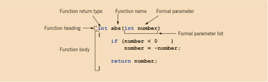

图6-1 函数 abs 的各个部分

### 函数调用

调用值返回函数的语法为：

```cpp
functionName(actual parameter list)
```

例如，在表达式 x = abs(-5); 中，调用了函数 abs。


## 语法：实际参数列表

实际参数列表的语法如下：

```cpp
表达式或变量, 表达式或变量, ...
```

（在此语法中，表达式可以是单个常量值。）因此，要调用一个返回值函数，需要使用函数名，并将实际参数（如果有）放在括号中。

函数的形参列表可以为空。但是，如果形参列表为空，括号仍然需要。因此，如果形参列表为空，返回值函数的函数头形式如下：

```cpp
函数类型 函数名()
```

如果返回值函数的形参列表为空，则函数调用中的实际参数列表也为空。在这种情况下（即形参列表为空），在函数调用中，空的括号仍然需要。因此，对形参列表为空的返回值函数的调用形式为：

```cpp
函数名()
```

在函数调用中，实际参数的个数及其数据类型必须按顺序与形参匹配。也就是说，实际参数和形参是一一对应的。（本章后面会讨论带默认参数的函数。）

如前所述，返回值函数在表达式中被调用。该表达式可以是赋值语句或输出语句的一部分，也可以是函数调用中的一个参数。程序中的函数调用会导致被调用函数的函数体执行。

## return 语句

一旦返回值函数计算出该值，函数会通过 return 语句将该值返回。换句话说，它通过 return 语句将该值传递到函数外部。

### 语法：return 语句

return 语句的语法如下：

```cpp
return 表达式;
```

其中，表达式是一个变量、常量值或表达式。该表达式会被求值，并返回其值。表达式计算出的值的数据类型必须与函数类型匹配。在 C++ 中，`return` 是一个保留字。

当函数中的 return 语句执行时，函数立即终止，控制权返回给调用函数。此外，函数调用语句会被 return 语句返回的值替换。当 `main` 函数中的 return 语句执行时，程序终止。

为了将上述讨论付诸实践，让我们编写一个确定两个数中较大者的函数。由于该函数比较两个数，因此该函数有两个参数，且这两个参数都是数字。我们假设这些数字的数据类型是浮点数（小数），例如 `double`。因为较大的数类型为 `double`，所以函数的数据类型也是 `double`。我们将此函数命名为 `larger`。你只需完成函数体即可。因此，根据函数的语法，可以按如下方式编写该函数：

```cpp
double larger(double x, double y)
{
    double max;

    if (x >= y)
        max = x;
    else
        max = y;

    return max;
}
```

请注意，函数 `larger` 使用了一个额外的变量 `max`（称为局部声明，其中 `max` 是函数 `larger` 的局部变量）。图 6-2 描述了函数 `larger` 的各部分。

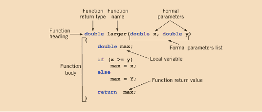

**图 6-2** 函数 `larger` 的各部分

假设 num、num1 和 num2 是 double 类型的变量。还假设 num1 = 45.75，num2 = 35.50。图 6-3 显示了调用函数 `larger` 的几种方式。

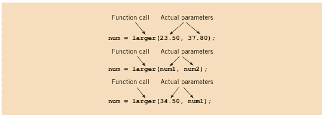

在图 6-3 中，第一条语句中，函数 `larger` 确定 23.50 和 37.80 中的较大者，赋值语句将结果存储在 num 中。另外两条语句的含义类似。

你也可以将函数 `larger` 的定义编写如下：

```cpp
double larger(double x, double y)
{
    if (x >= y)
        return x;
    else
        return y;
}
```

由于函数中 return 语句的执行会终止该函数，因此上面的 `larger` 函数也可以写成（不带 else 关键字）：

```cpp
double larger(double x, double y)
{
    if (x >= y)
        return x;
    return y;
}
```

请注意，这些形式的 `larger` 函数不需要声明任何局部变量。

> **注意**
> 1. 在函数 `larger` 的定义中，x 和 y 是形式参数。
> 2. return 语句可以出现在函数的任意位置。请记住，一旦 return 语句执行，之后的所有语句都会被跳过。因此，最好在计算出值后立即返回它。

## 示例 6-2

现在函数 `larger` 已经写好，下面的 C++ 代码演示了如何使用它：

```cpp
double num1 = 13.00;
double num2 = 36.53;
double maxNum;
```

考虑以下语句：

```cpp
cout << "The larger of 5 and 6 is " << larger(5, 6)
     << endl;                                      //Line 1

cout << "The larger of " << num1 << " and " << num2
     << " is " << larger(num1, num2) << endl;      //Line 2

cout << "The larger of " << num1 << " and 29 is "
     << larger(num1, 29) << endl;                  //Line 3

maxNum = larger(38.45, 56.78);                     //Line 4
```

- 第 1 行中的表达式 `larger(5, 6)` 是一个函数调用，5 和 6 是实际参数。当表达式 `larger(5, 6)` 执行时，5 被复制到 `x`，6 被复制到 `y`。因此，第 1 行中的语句输出 5 和 6 中的较大者。

- 第 2 行中的表达式 `larger(num1, num2)` 是一个函数调用。这里，`num1` 和 `num2` 是实际参数。当表达式 `larger(num1, num2)` 执行时，`num1` 的值被复制到 `x`，`num2` 的值被复制到 `y`。因此，第 2 行中的语句输出 `num1` 和 `num2` 中的较大者。

- 第 3 行中的表达式 `larger(num1, 29)` 也是一个函数调用。当表达式 `larger(num1, 29)` 执行时，`num1` 的值被复制到 `x`，29 被复制到 `y`。因此，第 3 行中的语句输出 `num1` 和 29 中的较大者。请注意，第一个参数 `num1` 是一个变量，而第二个参数 29 是一个常量值。

- 第 4 行中的表达式 `larger(38.45, 56.78)` 是一个函数调用。在此调用中，实际参数是 38.45 和 56.78。在此语句中，函数 `larger` 返回的值被赋值给变量 `maxNum`。

> **注意**
>
> 在函数调用中，只需指定实际参数，而无需指定其数据类型。例如，在示例 6-2 中，第 1、2、3 和 4 行中的语句展示了如何通过实际参数调用函数 `larger`。但是，以下语句包含对函数 `larger` 的错误调用，会导致语法错误。（假设所有变量均已正确声明。）
>
> ```cpp
> x = larger(int one, 29);              //非法
> y = larger(int one, int 29);          //非法
> cout << larger(int one, int two);      //非法
> ```

函数原型*不是*定义。它向程序提供函数的名称、参数的数量和数据类型以及返回值的数据类型：这些信息足以让 C++ 使用该函数。它也是一种承诺，即完整的定义将在程序后面出现。如果你忽略了函数定义的编写，程序也许能够编译，但无法运行。

**函数原型：** 函数头以分号 `;` 结尾，不包含函数体。

## 语法：函数原型

返回值函数函数原型的一般语法是：

```cpp
函数类型 函数名(参数列表);
```

（请注意，函数原型以分号结尾。）

对于函数 `larger`，其原型为：

```cpp
double larger(double x, double y);    // 函数原型
```

> **注意**
> 在编写函数原型时，不必在参数列表中指定变量名。但是，必须指定每个参数的数据类型。

你可以将函数 `larger` 的函数原型重写如下：

```cpp
double larger(double, double);  // 函数原型
```

## 完整程序

现在你已经有足够的知识来编写整个程序、编译并运行它。下面的程序使用函数 `larger`、`compareThree` 和 `main` 来确定两个或三个数中的较大者。

```cpp
// 程序：三个数中的最大值

#include <iostream>                                      //第 1 行

using namespace std;                                     //第 2 行

// 函数原型
double larger(double x, double y);                        //第 3 行
double compareThree(double x, double y, double z);       //第 4 行

int main()                                                //第 5 行
{
        double one, two;                                  //第 7 行

        cout << "Line 8: The larger of 5 and 10 is "
             << larger(5, 10) << endl;                    //第 8 行
```


```cpp
cout << "Line 9: Enter two numbers: ";             //Line 9
cin >> one >> two;                                      //Line 10
cout << endl;                                           //Line 11

cout << "Line 12: The larger of " << one
     << " and " << two << " is "
     << larger(one, two) << endl;                       //Line 12

cout << "Line 13: The largest of 43.48, 34.00, "
     << " and 12.65 is "
     << compareThree(43.48, 34.00, 12.65)
     << endl;                                           //Line 13

return 0;                                               //Line 14
}                                                       //Line 15

double larger(double x, double y)
{
    double max;

    if (x >= y)
        max = x;
    else
        max = y;

    return max;
}

double compareThree (double x, double y, double z)
{
    return larger(x, larger(y, z));
}
```

**示例运行：** 在此示例运行中，用户输入部分以底纹显示。

```text
Line 8: The larger of 5 and 10 is 10
Line 9: Enter two numbers: 37.93 26.785

Line 12: The larger of 37.93 and 26.785 is 37.93
Line 13: The largest of 43.48, 34.00, and 12.65 is 43.48
```

> **注意：** 在上一个程序中，函数 `larger` 和 `compareThree` 的函数原型出现在它们的函数定义之前。因此，函数 `larger` 和 `compareThree` 的定义可以以任意顺序出现。

## 有返回值的函数：一些特殊之处

有返回值的函数必须返回一个值。考虑以下函数 `secret`，它接受一个 `int` 值作为参数。如果参数 `x` 的值大于 5，则返回 `x` 值的两倍。

```cpp
int secret(int x)
{
    if (x > 5)        //Line 1
        return 2 * x; //Line 2
}
```

由于这是一个 `int` 类型的有返回值函数，它必须返回一个 `int` 类型的值。假设 `x` 的值为 10。那么第 1 行中的表达式 `x > 5` 求值为 `true`。因此第 2 行中的 `return` 语句返回 20。现在假设 `x` 为 3。第 1 行中的表达式 `x > 5` 现在求值为 `false`。因此 `if` 语句失败，第 2 行中的 `return` 语句*不*执行。然而，函数体中已没有更多要执行的语句。在这种情况下，函数会返回一个奇怪的值。由此可知，如果 `x` 的值小于或等于 5，该函数不包含任何有效的 `return` 语句来返回 `int` 类型的值。

函数 `secret` 的正确定义是：

```cpp
int secret(int x)
{
    if (x > 5)        //Line 1
        return 2 * x; //Line 2

    return x;         //Line 3
}
```


这里，如果 `x` 的值小于或等于 5，则第 3 行中的 `return` 语句执行，返回 `x` 的值。另一方面，如果 `x` 的值比如为 10，则第 2 行中的 `return` 语句执行，返回 20，并终止该函数。

回顾一下，在有返回值的函数中，`return` 语句返回该值。考虑以下 `return` 语句：

```cpp
return x, y;    //only the value of y will be returned
```

这是一个合法的 `return` 语句。你可能会认为这个 `return` 语句返回的是 `x` 和 `y` 的值。然而，事实并非如此。记住，一个 `return` 语句*只*返回一个值，即使该 `return` 语句包含多个表达式。如果一个 `return` 语句包含多个表达式，*只*返回*最后*一个表达式的值。因此，对于上面的 `return` 语句，返回的是 `y` 的值。以下程序进一步说明这个概念：

```cpp
// This program illustrates that a value-returning function
// returns only one value, even if the return statement
// contains more than one expression. This is a legal, but not
// a recommended code.

#include <iostream>

using namespace std;

int funcRet1();
int funcRet2(int z);

int main()
{
    int num = 4;

    cout << "Line 1: The value returned by funcRet1: "
         << funcRet1() << endl;                         // line 1
    cout << "Line 2: The value returned by funcRet2: "
         << funcRet2(num) << endl;                       // line 2

    return 0;
}

int funcRet1()
{
    int x = 45;

    return 23, x;   //only the value of x is returned
}

int funcRet2(int z)
{
    int a = 2;
    int b = 3;

    return 2 * a + b, z + b; //only the value of z + b is returned
}
```

### 示例运行

```text
Line 1: The value returned by funcRet1: 45
Line 2: The value returned by funcRet2: 7
```

尽管 return 语句可以包含多个表达式，但程序中的 return 语句应只包含一个表达式。在 return 语句中包含多个表达式可能会导致冗余、浪费代码以及令人困惑的语法。

## 更多有返回值的函数示例

### 示例 6-3

在这个示例中，我们编写函数 `courseGrade` 的定义。该函数接受一个 `int` 值作为参数，指定课程分数，并返回该课程的等级，即 `char` 类型的值。（我们假设考试分数是 0 到 100（含）之间的值。）

```c
char courseGrade(int score)
{
    switch (score / 10)
    {
    case 0:
    case 1:
    case 2:
    case 3:
    case 4:
    case 5:
        return 'F';
    case 6:
        return 'D';
    case 7:
        return 'C';
    case 8:
        return 'B';
    case 9:
    case 10:
        return 'A';
    }
}
```

你也可以编写函数 `courseGrade` 的等价定义，使用 `if...else` 结构来确定课程等级。

### 示例 6-4（掷一对骰子）

在这个示例中，我们编写一个函数，反复掷一对骰子，直到掷出的数字之和为某个特定数字。我们还想知道为了得到期望的和而掷骰子的次数。

每个骰子上的最小数字是 1，最大数字是 6。因此掷出的数字之和最小为 2，最大为 12。假设我们有以下声明：

```c
int die1;
int die2;
int sum;
int rollCount = 0;
```

我们使用第 5 章讨论的随机数生成器，随机生成一个 1 到 6 之间的数字。然后，下面的语句随机生成一个 1 到 6 之间的数字，并将该数字存入 `die1`，它成为 `die1` 掷出的数字。

```cpp
die1 = rand() % 6 + 1;
```

类似地，下面的语句随机生成一个 1 到 6 之间的数字，并将该数字存入 `die2`，它成为 die2 掷出的数字。

```cpp
die2 = rand() % 6 + 1;
```

两个骰子掷出的数字之和为：

```cpp
sum = die1 + die2;
```

接下来，我们判断 `sum` 是否等于骰子掷出的数字的期望和。（假设 `int` 变量 `num` 包含要掷出的期望和。）如果 `sum` 不等于 `num`，则再次掷骰子。这可以通过以下 `do...while` 循环实现。

```cpp
do
{
    die1 = rand() % 6 + 1;
    die2 = rand() % 6 + 1;
    sum = die1 + die2;
    rollCount++;
}
while (sum != num);
```

现在我们可以编写函数 `rollDice`，它接受要掷出的数字的期望和作为参数，并返回为掷出期望和而掷骰子的次数。

```cpp
int rollDice(int num)
{
    int die1;
    int die2;
    int sum;
    int rollCount = 0;

    srand(time(0));

    do
    {
        die1 = rand() % 6 + 1;
        die2 = rand() % 6 + 1;
        sum = die1 + die2;
        rollCount++;
    }
    while (sum != num);

    return rollCount;
}
```

以下程序展示如何在程序中使用函数 `rollDice`：

```cpp
//Program: Roll dice

#include <iostream>
#include <cstdlib>
```


```cpp
#include <ctime>

using namespace std;

int rollDice(int num);

int main()
{
    cout << "The number of times the dice are rolled to "
         << "get the sum 10 = " << rollDice(10) << endl;
    cout << "The number of times the dice are rolled to "
         << "get the sum 6 = " << rollDice(6) << endl;

    return 0;
}

int rollDice(int num)
{
    int die1;
    int die2;
    int sum;
    int rollCount = 0;

    srand(time(0));

    do
    {
        die1 = rand() % 6 + 1;
        die2 = rand() % 6 + 1;
        sum = die1 + die2;
        rollCount++;
    }
    while (sum != num);

    return rollCount;
}
```

### 示例运行：

```text
The number of times the dice are rolled to get the sum 10 = 11
The number of times the dice are rolled to get the sum 6 = 7
```

我们将其留作练习：修改该程序，使用户可以输入希望掷出的骰子点数之和。（参见本章末尾的编程练习 10。）

## 示例 6-5（斐波那契数）

在第 5 章的第一个编程示例中，我们设计并实现了一个算法来求斐波那契数列中的某个数。在本例中，我们通过编写一个函数来计算并返回所需的斐波那契数，从而修改主程序。由于我们已经设计并讨论了如何确定斐波那契数列中的特定数，接下来给出实现该算法的函数定义。

给定第一个数、第二个数以及所需斐波那契数的位置，下面的函数返回该斐波那契数：

```cpp
int nthFibonacciNum(int first, int second, int nthFibNum)
{
    int current;
    int counter;

    if (nthFibNum == 1)
        current = first;
    else if (nthFibNum == 2)
        current = second;
    else
    {
        counter = 3;

        while (counter <= nthFibNum)
        {
            current = second + first;
            first = second;
            second = current;
            counter++;
        }//end while
    }//end else

    return current;
}
```

下面展示如何在程序中使用该函数。

```cpp
//Program: Fibonacci number

#include <iostream>

using namespace std;

int nthFibonacciNum(int first, int second, int position);

int main()
{
    int firstFibonacciNum;
    int secondFibonacciNum;
    int nthFibonacci;

    cout << "Enter the first two Fibonacci "
         << "numbers: ";
    cin >> firstFibonacciNum >> secondFibonacciNum;
    cout << endl;

    cout << "The first two Fibonacci numbers are "
         << firstFibonacciNum << " and "
         << secondFibonacciNum
         << endl;

    cout << "Enter the position of the desired "
         << "Fibonacci number: ";
    cin >> nthFibonacci;
    cout << endl;

    cout << "The Fibonacci number at position "
         << nthFibonacci << " is "
         << nthFibonacciNum(firstFibonacciNum, secondFibonacciNum,
                             nthFibonacci)
         << endl;

    return 0;
}

int nthFibonacciNum(int first, int second, int nthFibNum)
{
    int current;
    int counter;

    if (nthFibNum == 1)
        current = first;
    else if (nthFibNum == 2)
        current = second;
    else
    {
        counter = 3;

        while (counter <= nthFibNum)
        {
            current = second + first;
            first = second;
            second = current;
            counter++;
        }//end while
    }//end else

    return current;
}
```

### 示例运行：

在这些示例运行中，用户输入以阴影显示。

### 示例运行 1：

```text
Enter the first two Fibonacci numbers: 12 16
The first two Fibonacci numbers are 12 and 16
Enter the position of the desired Fibonacci number: 10
The Fibonacci number at position 10 is 796
```

## 示例 6-7（有线电视公司）

第 4 章包含一个计算有线电视公司账单的程序。在那个程序中，所有编程指令都集中在 main 函数中。这里，我们使用用户自定义函数重写同一个程序，进一步说明结构化编程。

由于有两类客户：住宅用户和商业用户，该程序包含两个独立的函数：一个用于计算住宅用户的账单，另一个用于计算商业用户的账单。两个函数都计算账单金额，然后将账单金额返回给 main 函数。main 函数打印应付金额。我们将计算住宅用户账单的函数称为 residential，将计算商业用户账单的函数称为 business。计算账单的公式与之前相同。

**residential 函数：** 要计算住宅用户账单，需要知道客户订阅的付费频道数。根据付费频道数，可以计算账单金额。计算账单金额后，该函数使用 return 语句返回账单金额。以下四个步骤描述了该函数：

- a. 提示用户输入付费频道数。
- b. 读取付费频道数。
- c. 计算应付金额。
- d. 返回应付金额。

该函数包含一条提示用户输入付费频道数的语句（步骤 a）和一条读取付费频道数的语句（步骤 b）。计算账单金额所需的其他项，例如基本服务连接费用和账单处理费，被定义为命名常量（在 main 函数定义之前）。因此，为了计算账单金额，该函数不需要从 main 函数获取任何值。所以，该函数没有参数。

由前面的讨论可知，residential 函数需要局部变量来存储付费频道数和账单金额。该函数只需要这两个局部变量来计算账单金额：

```cpp
int noOfPChannels;    //number of premium channels
double bAmount;       //billing amount
```

现在可以将 residential 函数的定义写成如下形式：

```cpp
double residential()
{
    int noOfPChannels;    //number of premium channels
    double bAmount;       //billing amount

    cout << "Enter the number of premium "
         << " channels used: ";
    cin >> noOfPChannels;
    cout << endl;

    bAmount = RES_BILL_PROC_FEES +
              RES_BASIC_SERV_COST +
              noOfPChannels * RES_COST_PREM_CHANNEL;

    return bAmount;
}
```

**business 函数：** 要计算商业用户账单，需要知道客户订阅的基本服务连接数和付费频道数。然后，根据这些数字计算账单金额。随后使用 return 语句返回账单金额。以下六个步骤描述了该函数：

- a. 提示用户输入基本服务连接数。
- b. 读取基本服务连接数。
- c. 提示用户输入付费频道数。
- d. 读取付费频道数。
- e. 计算应付金额。
- f. 返回应付金额。

该函数包含提示用户输入基本服务连接数和付费频道数的语句（步骤 a 和 c）。该函数还包含输入基本服务连接数和付费频道数的语句（步骤 b 和 d）。计算账单金额所需的其他项，例如基本服务连接费用和账单处理费，被定义为命名常量（在 main 函数定义之前）。因此，为了计算账单金额，该函数不需要从 main 函数获取任何值。所以，它没有参数。

由前面的讨论可知，business 函数需要变量来存储基本服务连接数、付费频道数以及账单金额。实际上，该函数只需要这三个局部变量来计算账单金额：

```cpp
int noOfBasicServiceConnections;
int noOfPChannels;  //number of premium channels
double bAmount;     //billing amount
```

现在可以将 business 函数的定义写成如下形式：

```cpp
double business()
{
    int noOfBasicServiceConnections;
    int noOfPChannels;  //number of premium channels
    double bAmount;     //billing amount
```


```cpp
cout << "Enter the number of basic "
     << " service connections: ";
cin >> noOfBasicServiceConnections;
cout << endl;

cout << "Enter the number of premium "
     << " channels used: ";
cin >> noOfPChannels;
cout << endl;

if (noOfBasicServiceConnections <= 10)
    bAmount = BUS_BILL_PROC_FEES + BUS_BASIC_SERV_COST +
              noOfPChannels * BUS_COST_PREM_CHANNEL;
else
    bAmount = BUS_BILL_PROC_FEES + BUS_BASIC_SERV_COST +
              (noOfBasicServiceConnections - 10) *
              BUS_BASIC_CONN_COST +
              noOfPChannels * BUS_COST_PREM_CHANNEL;

return bAmount;
}
```

主程序的算法如下：

- 1. 要以带小数点和尾随零的固定小数格式输出浮点数，请设置操纵符 **fixed** 和 **showpoint**。
- 2. 要将浮点数输出到小数点后两位，请将精度设置为小数点后两位。
- 3. 提示用户输入账号。
- 4. 获取账号。
- 5. 提示用户输入客户类型。
- 6. 获取客户类型。
- 7.
    - a. 如果客户类型为 **R** 或 **r**，
        - i. 调用函数 **residential** 计算账单。
        - ii. 打印账单。
    - b. 如果客户类型为 **B** 或 **b**，
        - i. 调用函数 **business** 计算账单。
        - ii. 打印账单。
    - c. 如果客户类型不是 **R**、**r**、**B** 或 **b**，则为无效客户类型。

## 程序清单

```cpp
/************************************************************
// Author: D. S. Malik
//
// Program: Cable Company Billing
// This program calculates and prints a customer's bill for
// a local cable company. The program processes two types of
// customers: residential and business.
************************************************************/

#include <iostream>
#include <iomanip>
using namespace std;

        //Named constants - residential customers
const double RES_BILL_PROC_FEES = 4.50;
const double RES_BASIC_SERV_COST = 20.50;
const double RES_COST_PREM_CHANNEL = 7.50;

        //Named constants - business customers
const double BUS_BILL_PROC_FEES = 15.00;
const double BUS_BASIC_SERV_COST = 75.00;
const double BUS_BASIC_CONN_COST = 5.00;
const double BUS_COST_PREM_CHANNEL = 50.00;

double residential();    //Function prototype
double business();        //Function prototype

int main()
{
        //declare variables
        int accountNumber;
        char customerType;
        double amountDue;

        cout << fixed << showpoint;                     //Step 1
        cout << setprecision(2);                         //Step 2

        cout << "This program computes a cable bill."
             << endl;
        cout << "Enter account number: ";               //Step 3
        cin >> accountNumber;                            //Step 4
        cout << endl;

        cout << "Enter customer type: R, r "
             << "(Residential), B, b (Business): ";      //Step 5
        cin >> customerType;                             //Step 6
        cout << endl;

switch (customerType)                                      //Step 7
{
case 'r':                                                   //Step 7a
case 'R':                                                   //Step 7a.i
    amountDue = residential();
    cout << "Account number = "
         << accountNumber << endl;                         //Step 7a.ii
    cout << "Amount due = $"
         << amountDue << endl;                              //Step 7a.iii
    break;
case 'b':                                                   //Step 7b
case 'B':                                                   //Step 7b.i
    amountDue = business();
    cout << "Account number = "
         << accountNumber << endl;                         //Step 7b.ii
    cout << "Amount due = $"
         << amountDue << endl;                              //Step 7b.iii
    break;
default:
    cout << "Invalid customer type." << endl;               //Step 7c
}

return 0;
}

//Place the definitions of the functions residential and business here.
```

**示例运行：** 在此示例运行中，用户输入以底纹显示。

```
This program computes a cable bill.
Enter account number: 21341

Enter customer type: R, r (Residential), B, b (Business): B

Enter the number of basic service connections: 25

Enter the number of premium channels used: 9

Account number = 21341
Amount due = $615.00
```

## 编译与执行流程

如前所述，C++ 程序是函数的集合。回想一下，函数可以以任意顺序出现。你唯一需要记住的是，必须先声明标识符，然后才能使用它。编译器从头到尾按顺序编译程序。因此，如果函数 main 出现在任何其他用户定义函数之前，那么它会首先被编译。然而，如果 main 出现在程序的末尾（或中间），那么所有定义（而非原型）出现在函数 main 之前的函数，都会按照它们出现的顺序，在函数 main 之前被编译。函数原型出现在任何函数定义之前，因此编译器会先编译这些原型。然后编译器才能正确转换函数调用。*然而，当程序执行时，函数 main 中的第一条语句总是最先执行，无论函数 main 在程序中被放置在何处。* 其他函数仅在被调用时执行。

函数调用将控制权转移到函数体中的第一条语句。通常，在被调用函数的最后一条语句执行后，控制权会传递到紧接函数调用之后的位置。有返回值的函数会返回一个值。因此，在执行有返回值的函数后，当控制权返回调用者时，函数返回的值会替换函数调用语句。执行从紧接函数调用之后的位置继续。

假设一个程序包含函数 funcA 和 funcB，并且 funcA 包含一条调用 funcB 的语句。假设程序调用 funcA。当包含对 funcB 的调用的语句执行时，funcB 执行；在 funcB 执行期间，funcA 当前调用的执行会暂停，直到 funcB 完成。

## 编程示例：最大数

在此编程示例中，函数 larger 用于从一组数中确定最大数。为便于说明，本程序从 10 个数中确定最大数。你可以轻松增强此程序，以处理任意一组数。

**输入** — 一组 10 个数。

**输出** — 10 个数中的最大数。

假设输入数据为：

```
10  56  73  42  22  67  88  26  62  11
```

读取数据集的第一个数。由于这是到目前为止读取的唯一一个数，你可以假定它是目前的最大数，并称其为 max。读取第二个数，并称其为 num。现在比较 max 和 num，并将较大的数存入 max。此时 max 包含前两个数中较大的那个。读取第三个数。将其与 max 比较，并将较大的数存入 max。此时，max 包含前三个数中的最大数。读取下一个数，将其与 max 比较，并将较大的数存入 max。对数据集中剩余的每个数重复此过程。最终，max 将包含数据集中的最大数。此讨论可转化为以下算法：

- 1. 读取第一个数。由于这是到目前为止你读取的唯一一个数，所以它是目前的最大数。将其保存到名为 max 的变量中。

```cpp
double larger(double x, double y)
{
    if (x >= y)
        return x;
    else
        return y;
}
```

**示例运行：** 在此示例运行中，用户输入以底纹显示。

```
Enter 10 numbers.
20 36 71 89 11 65 55 90 44 65
The largest number is 90
```

## void 函数

在本章前面，你学习了如何使用有返回值的函数。在本节中，你将一般性地探讨用户定义函数，特别是那些没有数据类型的 C++ 函数，称为 void 函数。

void 函数和有返回值的函数具有相似的结构。二者都有函数头和函数体。像有返回值的函数一样，你可以将用户定义函数放在函数 main 之前或之后。然而，程序执行总是从函数 main 中的第一条语句开始。如果你将用户定义的 void 函数放在函数 main 之后，则应将函数原型放在函数 main 之前。void 函数没有数据类型。因此，void 函数头部中的 functionType——即返回类型——以及函数体中的 return 语句都没有意义。不过，在 void 函数中，你可以使用不带任何值的 return 语句；它通常用于提前退出函数。像有返回值的函数一样，void 函数可以有也可以没有形式参数。

由于 void 函数没有数据类型，因此它们不会在表达式中使用（调用）。对 void 函数的调用是一条独立语句。因此，要调用 void 函数，应在一条独立语句中使用函数名以及实际参数（如果有）。在给出 void 函数的示例之前，下面先给出 void 函数的语法。

### 函数定义

带参数的 void 函数的函数定义具有以下语法：

```cpp
void functionName(formal parameter list)
{
    statements
}
```


其中语句通常是声明语句和/或可执行语句。形式参数列表可以为空，在这种情况下，函数头中仍然需要空括号。

## 形式参数列表

形式参数列表具有以下语法：

```
dataType variable, dataType variable, ...
```

你必须在形式参数列表中同时指定数据类型和变量名。dataType 之后的符号 & 具有特殊含义；有些参数会带有 &，有些则不会，本章后面将解释原因。

## 函数调用

函数调用具有以下语法：

```
functionName(actual parameter list);
```

## 实际参数列表

实际参数列表具有以下语法：

```
expression or variable, expression or variable, ...
```

其中表达式可以由单个常量值组成。与有返回值函数一样，在函数调用中，实际参数的数量及其数据类型必须按给定顺序与形式参数匹配。实际参数与形式参数一一对应。（带默认参数的函数将在本章末尾讨论。）函数调用会导致执行被调用函数的主体。

示例 6-8 展示了一个带参数的 void 函数。

### 示例 6-8

```cpp
void funExp(int a, double b, char c, int x)
{
    .
    .
    .
}
```

函数 funExp 有四个参数。

## 参数类型

参数在调用函数（例如 **main**）与被调用函数之间提供通信链路。它们使函数每次被调用时都能操作不同的数据。通常，形式参数有两种类型：**值参数**和**引用参数**。

- **值参数：** 接收相应实际参数内容副本的形式参数。
- **引用参数：** 接收相应实际参数的位置（内存地址）的形式参数。

在函数的形参列表中，当你在 **dataType** 后附加 & 时，该 **dataType** 后面的变量就成为引用参数。

示例 6-9 展示了一个同时具有值参数和引用参数的 void 函数。

### 示例 6-9

考虑以下函数定义：

```cpp
void areaAndPerimeter(double length, double width,
                      double& area, double& perimeter)
{
    area = length * width;
    perimeter = 2 * (length + width);
}
```

函数 **areaAndPerimeter** 有四个参数：length 和 width 是 **double** 类型的值参数；area 和 perimeter 是 **double** 类型的引用参数。

图 6-4 描述了函数 **areaAndPerimeter** 的各个部分。

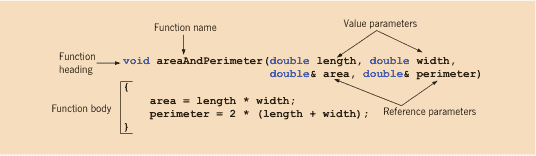

**图 6-4** 函数 **areaAndPerimeter** 的各个部分

```cpp
void printStars(int blanks, int starsInLine)
{
    int count;

    //print the number of blanks before the stars in a line
    for (count = 1; count <= blanks; count++)
        cout << ' ';

    //print the number of stars with a blank between stars
    for (count = 1; count <= starsInLine; count++)
        cout << " *";

    cout << endl;
} //end printStars
```

第一个参数 blanks 决定在星号前打印多少个空格；第二个参数 starsInLine 决定一行中打印多少个星号。例如，如果参数 blanks 的值为 30，那么函数 printStars 中的第一个 for 循环执行 30 次并打印 30 个空格。另外，因为要在星号之间打印一个空格，函数 printStars 中第二个 for 循环的每次迭代都会打印字符串 " *"——一个空格后跟一个星号。

接下来，考虑以下语句：

```cpp
int numberOfLines = 15;
int numberOfBlanks = 30;

for (counter = 1; counter <= numberOfLines; counter++)
{
    printStars(numberOfBlanks, counter);
    numberOfBlanks--;
}
```

该 for 循环调用函数 printStars。这个 for 循环的每次迭代使用变量 numberOfBlanks 和 counter 指定要在一行中打印的空格数以及随后的星号数。每次调用函数 printStars 时，收到的空格数比上一次调用少一个，星号数比上一次调用多一个。例如，函数 main 中 for 循环的第一次迭代指定 30 个空格和 1 个星号（它们作为参数 numberOfBlanks 和 counter 传递给函数 printStars）。然后，该 for 循环通过执行语句 `numberOfBlanks--;` 将空格数减 1。在 for 循环结束时，星号数会为下一次迭代增加 1。这是通过执行 for 语句中的更新语句 counter++ 完成的，它使变量 counter 的值增加 1。换句话说，函数 printStars 的第二次调用接收 29 个空格和 2 个星号作为参数。因此，前面的语句将打印一个由 15 行组成的星号三角形。

```cpp
//Program: Print a triangle of stars

#include <iostream>

using namespace std;

void printStars(int blanks, int starsInLine);

int main()
{
    int noOfLines;     //var to store the number of lines
    int counter;       //var for loop control variable
    int noOfBlanks;    //var to store the number of blanks

    cout << "Enter the number of star lines (1 to 20) "
         << " to be printed: ";
    cin >> noOfLines;

    while (noOfLines < 0 || noOfLines > 20)
    {
        cout << "Enter the number of star lines "
             << "(1 to 20) to be printed: ";
        cin >> noOfLines;
    }

    cout << endl << endl;
    noOfBlanks = 30;

    for (counter = 1; counter <= noOfLines; counter++)
    {
        printStars(noOfBlanks, counter);
        noOfBlanks--;
    }

    return 0;
}

void printStars(int blanks, int starsInLine)
{
    int count;

    for (count = 1; count <= blanks; count++)
        cout << ' ';

    for (count = 1; count <= starsInLine; count++)
        cout << " *";

    cout << endl;
}
```

**示例运行：** 在此示例运行中，用户输入以阴影显示。

```
Enter the number of star lines (1 to 20) to be printed: 15
              *
             * *
            * * *
           * * * *
          * * * * *
         * * * * * *
        * * * * * * *
       * * * * * * * *
      * * * * * * * * *
     * * * * * * * * * *
    * * * * * * * * * * *
   * * * * * * * * * * * *
  * * * * * * * * * * * * *
 * * * * * * * * * * * * * *
* * * * * * * * * * * * * * *
```

在函数 main 中，首先要求用户指定要打印多少行星号（第 9 行）。（在此程序中，用户被限制为最多 20 行，因为最多 20 行的三角形网格可以很好地适应屏幕。）由于程序被限制为最多 20 行，第 11 行到第 15 行的 `while` 循环确保：如果行数在 1 到 20 之间，程序只打印该星号三角形网格。

### 值参数

上一节定义了两种类型的参数——值参数和引用参数。示例 6-10 展示了一个使用带参数函数的程序。在考虑更多带参数的 void 函数示例之前，让我们对值参数作以下观察。调用函数时，对于值参数，实际参数的值会被复制到相应的形式参数中。因此，如果形式参数是值参数，那么在复制实际参数的值之后，形式参数与实际参数之间没有联系；也就是说，形式参数是一个单独的变量，拥有自己的数据副本。因此，在程序执行期间，形式参数操作的是存储在其自身内存空间中的数据。示例 6-12 中的程序进一步说明了值参数如何工作。

### 示例 6-12

以下程序展示了简单数据类型的形式参数如何工作。

```cpp
// Example 6-12: Program illustrating how a value parameter works.
#include <iostream>                                      //Line 1
using namespace std;                                     //Line 2
```


```cpp
void funcValueParam(int num);                     //Line 3

int main()                                        //Line 4
{                                                 //Line 5
    int number = 6;                               //Line 6

    cout << "Line 7: Before calling the function "
         << "funcValueParam, number = " << number
         << endl;                                  //Line 7

    funcValueParam(number);                        //Line 8

    cout << "Line 9: After calling the function "
         << "funcValueParam, number = " << number
         << endl;                                  //Line 9

    return 0;                                      //Line 10
}                                                  //Line 11

void funcValueParam(int num)                       //Line 12
{                                                  //Line 13
    cout << "Line 14: In the function funcValueParam, "
         << "before changing, num = " << num
         << endl;                                  //Line 14

    num = 15;                                      //Line 15

    cout << "Line 16: In the function funcValueParam, "
         << "after changing, num = " << num
         << endl;                                  //Line 16
}                                                  //Line 17
```

## 示例运行：

```text
Line 7: Before calling the function funcValueParam, number = 6
Line 14: In the function funcValueParam, before changing, num = 6
Line 16: In the function funcValueParam, after changing, num = 15
Line 9: After calling the function funcValueParam, number = 6
```

本程序的工作过程如下。执行从函数 main 开始。第 6 行的语句声明并初始化 int 变量 number。第 7 行的语句在调用函数 funcValueParam 之前输出 number 的值；第 8 行的语句调用函数 funcValueParam。随后，变量 number 的值被传递给形式参数 num。控制权现在转移到函数 funcValueParam。

第 14 行的语句在改变 num 的值之前输出 num 的值。第 15 行的语句将 num 的值改为 15；第 16 行的语句输出 num 的值。执行完该语句后，函数 funcValueParam 退出，控制权回到函数 main。

```cpp
void getScore(int& score)                                      //Line 13
{                                                              //Line 14
    cout << "Line 15: Enter course score: ";                  //Line 15
    cin >> score;                                              //Line 16
    cout << endl << "Line 17: The course score is "           //Line 17
         << score << endl;                                     //Line 17
}                                                              //Line 18

void printGrade(int cScore)                                   //Line 19
{                                                              //Line 20
    cout << "Line 21: The course grade is: ";                //Line 21

    if (cScore >= 90)                                         //Line 22
        cout << "A." << endl;                                //Line 23
    else if (cScore >= 80)                                    //Line 24
        cout << "B." << endl;                                //Line 25
    else if (cScore >= 70)                                    //Line 26
        cout << "C." << endl;                                //Line 27
    else if (cScore >= 60)                                    //Line 28
        cout << "D." << endl;                                //Line 29
    else                                                       //Line 30
        cout << "F." << endl;                                //Line 31
}                                                              //Line 32
```

**示例运行：** 在此示例运行中，用户输入以底纹显示。

```text
Line 8: Based on the course score,
          this program computes the course grade.
Line 15: Enter course score: 85

Line 17: The course score is 85
Line 21: The course grade is: B.
```

本程序的工作过程如下。程序从第 8 行开始执行，该行打印输出的第一行（见示例运行）。第 9 行的语句调用函数 getScore，实际参数为 courseScore（在 main 中声明的变量）。由于函数 getScore 的形式参数 score 是引用参数，courseScore 的地址（即变量 courseScore 的内存位置）被传递给 score。因此，score 和 courseScore 现在都指向同一内存位置，即 courseScore（见图 6-5）。


图 6-5 变量 courseScore 与参数 score

然后程序执行第 21 行的语句，该语句输出第四行。第 22 行至第 31 行的 `if...else` 语句确定并输出课程成绩。由于第 7 行的输出语句不包含换行符或操纵符 `endl`，`if...else` 语句的输出构成输出的第四行的一部分。执行完 `if...else` 语句后，控制权回到函数 `main`。由于函数 `main` 中接下来要执行的语句是函数 `main` 的最后一条语句，程序终止。

在此程序中，函数 `main` 首先调用函数 `getScore` 从用户处获取课程分数。然后函数 `main` 调用函数 `printGrade`，根据该课程分数计算并打印成绩。课程分数由函数 `getScore` 获取；随后，该课程分数由函数 `printGrade` 使用。由于 `getScore` 函数获取的值稍后会在程序中使用，函数 `getScore` 必须将该值传递到函数外部。由于 `getScore` 被编写为 void 函数，保存该值的形式参数必须是引用参数。

## 值与引用参数及内存分配

调用函数时，其形式参数以及函数体中声明的变量（称为**局部变量**）的内存会在函数数据区中分配。回想一下，对于值参数，实际参数的值被复制到其对应形式参数的内存单元中。对于引用参数，实际参数的地址被传递给形式参数。也就是说，形式参数的内容是一个地址。在数据操作期间，形式参数中存储的地址指示计算机操作该地址处内存单元中的数据。因此，对于引用参数，实际参数和形式参数都指向同一内存位置。因此，在程序执行期间，形式参数所做的更改会永久改变实际参数的值。

> **注意**
> 流变量（例如 `ifstream` 和 `ofstream`）应通过引用传递给函数。打开输入/输出文件后，或读取和/或输出数据后，输入和/或输出流的状态随后可以传递到函数外部。

由于参数传递是任何编程语言的基础，示例 6-14 和 6-15 进一步说明这一概念。每个示例涵盖不同的场景。

## 示例 6-14

以下程序展示引用参数和值参数如何工作。

```cpp
//Example 6-14: Reference and value parameters

#include <iostream>                                      //Line 1

using namespace std;                                     //Line 2

void funOne(int a, int& b, char v);                      //Line 3
void funTwo(int& x, int y, char& w);                     //Line 4

int main()                                               //Line 5
{
    int num1, num2;                                       //Line 7
    char ch;                                              //Line 8

    num1 = 10;                                            //Line 9
    num2 = 15;                                            //Line 10
    ch = 'A';                                             //Line 11

    cout << "Line 12: Inside main: num1 = " << num1
         << ", num2 = " << num2 << ", and ch = "
         << ch << endl;                                   //Line 12

    funOne(num1, num2, ch);                               //Line 13

    cout << "Line 14: After funOne: num1 = " << num1
         << ", num2 = " << num2 << ", and ch = "
         << ch << endl;                                   //Line 14

    funTwo(num2, 25, ch);                                 //Line 15

    cout << "Line 16: After funTwo: num1 = " << num1
         << ", num2 = " << num2 << ", and ch = "
         << ch << endl;                                   //Line 16

    return 0;                                             //Line 17
}                                                        //Line 18

void funOne(int a, int& b, char v)                       //Line 19
{
    int one;                                              //Line 21

    one = a;                                              //Line 22
    a++;                                                  //Line 23
    b = b * 2;                                            //Line 24
    v = 'B';                                              //Line 25
```


```cpp
cout << "Line 26: Inside funOne: a = " << a
     << ", b = " << b << ", v = " << v
     << ", and one = " << one << endl;        //Line 26
}
                                                //Line 27
void funTwo(int& x, int y, char& w)             //Line 28
{
    x++;                                        //Line 29
    y = y * 2;                                   //Line 30
    w = 'G';                                     //Line 31
                                                //Line 32
    cout << "Line 33: Inside funTwo: x = " << x
         << ", y = " << y << ", and w = " << w
         << endl;                               //Line 33
}                                               //Line 34
```

## 示例运行

```text
Line 12: Inside main: num1 = 10, num2 = 15, and ch = A
Line 26: Inside funOne: a = 11, b = 30, v = B, and one = 10
Line 14: After funOne: num1 = 10, num2 = 30, and ch = A
Line 33: Inside funTwo: x = 31, y = 50, and w = G
Line 16: After funTwo: num1 = 10, num2 = 31, and ch = G
```

让我们逐步分析这个程序。变量的值显示在每条语句执行之前和/或之后。

恰好在第 9 行语句执行之前，只为函数 main 的变量分配了内存；这些内存未被初始化。第 11 行语句执行后，变量如图 6-9 所示。


**图 6-9** 第 11 行语句执行后变量的值

第 12 行语句产生以下输出：

```text
Line 12: Inside main: num1 = 10, num2 = 15, and ch = A
```

第 13 行语句是对函数 funOne 的调用。现在函数 funOne 有三个参数（a、b 和 v）和一个局部变量（one）。为函数 funOne 的参数和局部变量分配内存。因为形参 b 是引用参数，所以它接收对应实参 num2 的地址（内存位置）。另外两个形参是值参数，因此它们复制对应实参的值。恰好在第 22 行语句执行之前，变量如图 6-10 所示。


**图 6-10** 第 22 行语句执行之前变量的值

下面展示了第 22 行至第 25 行每条语句执行后变量如何被操作。

| 行号 | 变量的值 | 语句与效果 |
|---|---|---|
| 22 | **main**：`num1 = 10`，`num2 = 15`，`ch = 'A'`<br>**funOne**：`a = 10`，`b` 引用 `num2`，`v = 'A'`，`one = 10` | `one = a;`<br>将 `a` 的值复制到 `one`。 |
| 23 | **main**：`num1 = 10`，`num2 = 15`，`ch = 'A'`<br>**funOne**：`a = 11`，`b` 引用 `num2`，`v = 'A'`，`one = 10` | `a++;`<br>将 `a` 的值加 1。 |
| 24 | **main**：`num1 = 10`，`num2 = 30`，`ch = 'A'`<br>**funOne**：`a = 11`，`b` 引用 `num2`，`v = 'A'`，`one = 10` | `b = b * 2;`<br>将 `b` 的值乘以 2，并将结果存入 `b`。由于 `b` 是引用参数并包含 `num2` 的地址，因此 `num2` 的值被更新。 |
| 25 | **main**：`num1 = 10`，`num2 = 30`，`ch = 'A'`<br>**funOne**：`a = 11`，`b` 引用 `num2`，`v = 'B'`，`one = 10` | `v = 'B';`<br>将 `'B'` 存入 `v`。 |

第 26 行语句产生以下输出：

**第 26 行：在 funOne 内：a = 11，b = 30，v = B，one = 10**

第 26 行语句执行后，控制返回到 main 中的第 14 行，并且为函数 funOne 的变量分配的内存被释放。图 6-11 显示了函数 main 的变量值。


**图 6-11** 第 14 行语句执行后变量的值

第 14 行产生以下输出：

**第 14 行：调用 funOne 后：num1 = 10，num2 = 30，ch = A**

第 15 行语句是对函数 funTwo 的调用。现在 funTwo 有三个参数：x、y 和 w。此外，x 和 w 是引用参数，y 是值参数。因此，x 接收其对应实参 num2 的地址，w 接收其对应实参 ch 的地址。变量 y 将值 25 复制到其内存单元中。图 6-12 显示了第 30 行语句执行前的值。


**图 6-12** 第 30 行语句执行之前变量的值

下面展示了第 30 行至第 32 行每条语句执行后变量如何被操作。

| 行号 | 变量的值 | 语句与效果 |
|---|---|---|
| 30 | **main**：`num1 = 10`，`num2 = 31`，`ch = 'A'`；**funTwo**：`x = 31`，`y = 25`，`w = 'A'` | `x++;` 将 x 的值加 1。由于 x 是引用参数并包含 `num2` 的地址，因此 `num2` 的值加 1。 |
| 31 | **main**：`num1 = 10`，`num2 = 31`，`ch = 'A'`；**funTwo**：`x = 31`，`y = 50`，`w = 'A'` | `y = y * 2;` 将 y 的值乘以 2，并将结果存入 y。 |
| 32 | **main**：`num1 = 10`，`num2 = 31`，`ch = 'G'`；**funTwo**：`x = 31`，`y = 50`，`w = 'G'` | `w = 'G';` 将 'G' 存入 w。由于 w 是引用参数并包含 ch 的地址，因此 ch 的值被更新。 |

第 33 行产生以下输出：

```text
Line 33: Inside funTwo: x = 31, y = 50, and w = G
```

第 33 行语句执行后，控制转到第 16 行。为函数 funTwo 的变量分配的内存被释放。函数 main 的变量值如图 6-13 所示。


**图 6-13** 第 16 行语句执行后变量的值

第 16 行产生以下输出：

```text
Line 16: After funTwo: num1 = 10, num2 = 31, and ch = G
```

第 16 行语句执行后，程序终止。

## 示例 6-15

本示例还展示了引用参数如何操作实参。

```cpp
//Example 6-15: Reference and value parameters.
//Program: Makes you think.

#include <iostream>                                      //line 1

using namespace std;                                     //line 2

void addFirst(int& first, int& second);                  //line 3
void doubleFirst(int one, int two);                      //line 4
void squareFirst(int& ref, int val);                     //line 5

int main()                                               //line 6
{
    int num = 5;                                         //line 8

    cout << "Line 9: Inside main: num = " << num
         << endl;                                        //line 9

    addFirst(num, num);                                  //line 10
    cout << "Line 11: Inside main after addFirst:"
         << " num = " << num << endl;                   //line 11

    doubleFirst(num, num);                               //line 12
    cout << "Line 13: Inside main after "
         << "doubleFirst: num = " << num << endl;       //line 13

    squareFirst(num, num);                               //line 14
    cout << "Line 15: Inside main after "
         << "squareFirst: num = " << num << endl;       //line 15

    return 0;                                            //line 16
}                                                       //line 17

void addFirst(int& first, int& second)                   //line 18
{                                                       //line 19
    cout << "Line 20: Inside addFirst: first = "
         << first << ", second = " << second << endl;   //line 20

    first = first + 2;                                   //line 21

    cout << "Line 22: Inside addFirst: first = "
         << first << ", second = " << second << endl;   //line 22

    second = second * 2;                                 //line 23

    cout << "Line 24: Inside addFirst: first = "
         << first << ", second = " << second << endl;   //line 24
}                                                       //line 25
```


```cpp
void doubleFirst(int one, int two)                         //Line 26
{
    cout << "Line 28: Inside doubleFirst:  one = "       //Line 27
         << one << ", two = " << two << endl;            //Line 28

    one = one * 2;                                         //Line 29

    cout << "Line 30: Inside doubleFirst:  one = "
         << one << ", two = " << two << endl;            //Line 30

    two = two + 2;                                         //Line 31

    cout << "Line 32: Inside doubleFirst:  one = "
         << one << ", two = " << two << endl;            //Line 32
}                                                          //Line 33

void squareFirst(int& ref, int val)                        //Line 34
{                                                          //Line 35
    cout << "Line 36: Inside squareFirst: ref = "
         << ref << ", val = " << val << endl;             //Line 36

    ref = ref * ref;                                        //Line 37

    cout << "Line 38: Inside squareFirst: ref = "
         << ref << ", val = " << val << endl;             //Line 38

    val = val + 2;                                         //Line 39

    cout << "Line 40: Inside squareFirst: ref = "
         << ref << ", val = " << val << endl;             //Line 40
}                                                          //Line 41
```

### 示例运行：

```text
Line 9: Inside main:  num = 5
Line 20: Inside addFirst:  first = 5, second = 5
Line 22: Inside addFirst:  first = 7, second = 7
Line 24: Inside addFirst:  first = 14, second = 14
Line 11: Inside main after addFirst: num = 14
Line 28: Inside doubleFirst:  one = 14, two = 14
Line 30: Inside doubleFirst:  one = 28, two = 14
Line 32: Inside doubleFirst:  one = 28, two = 16
Line 13: Inside main after doubleFirst: num = 14
Line 36: Inside squareFirst: ref = 14, val = 14
Line 38: Inside squareFirst: ref = 196, val = 14
Line 40: Inside squareFirst: ref = 196, val = 16
Line 15: Inside main after squareFirst: num = 196
```

函数 `addFirst` 的两个参数都是引用参数，而函数 `doubleFirst` 的两个参数都是值参数。语句：

```cpp
addFirst(num, num);
```

在函数 `main` 中（第 10 行）将 `num` 的引用传递给函数 `addFirst` 的两个形参 `first` 和 `second`，因为这两个形参对应的实参相同。也就是说，变量 `first` 和 `second` 指向同一个内存位置，即 `num`。图 6-14 说明了这种情况。


**图 6-14** 函数 `addFirst` 的参数

`first` 对其值所做的任何修改都会立即改变 `second` 和 `num` 的值。同样，`second` 对其值所做的任何修改都会立即改变 `first` 和 `num`，因为这三个变量都指向同一个内存位置。（注意，`num` 被初始化为 5。）

函数 `doubleFirst` 的形参是值参数。因此，语句：

```cpp
doubleFirst(num, num);
```

在函数 `main` 中（第 12 行）将 `num` 的值复制到 one 和 two，因为这两个形参对应的实参相同。图 6-15 说明了这种情况。


**图 6-15** 函数 `doubleFirst` 的参数

因为 `one` 和 `two` 都是值参数，所以 one 对其值所做的任何修改都不会影响 `two` 和 `num` 的值。同样，`two` 对其值所做的任何修改也不会影响 `one` 和 `num`。（注意，在函数 `doubleFirst` 执行之前，`num` 的值是 14。）

函数 `squareFirst` 的形参 `ref` 是引用参数，形参 `val` 是值参数。变量 `ref` 接收其对应实参的地址，即 `num`，而变量 `val` 复制其对应实参的值，该值也是 `num`。因此，`num` 和 `ref` 都指向同一个内存位置，即 `num`。图 6-16 说明了这种情况。

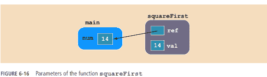

**图 6-16** 函数 `squareFirst` 的参数

`ref` 所做的任何修改都会立即改变 `num`。`val` 所做的任何修改都不会影响 `num`。（注意，在函数 `squareFirst` 执行之前，`num` 的值是 14。）

我们建议你走查示例 6-15 中的程序。输出显示了语句执行的顺序。

## 引用参数与有返回值函数

本章前面在讨论有返回值函数时，你学习了如何仅使用值参数。你也可以在有返回值函数中使用引用参数，尽管不推荐这种做法。根据定义，有返回值函数返回单个值；该值通过 `return` 语句返回。如果一个函数需要返回多个值，按照良好编程风格的惯例，应将其改为 `void` 函数，并使用适当的引用参数来返回这些值。

## 标识符的作用域

前面的小节给出了几个带有用户自定义函数的程序示例。标识符可以在函数头中、块内或块外声明。自然会产生一个问题：是否允许在程序中的任何位置访问任何标识符？答案是否定的。访问标识符必须遵循一定的规则。标识符的作用域是指标识符在程序中可访问（可见）的位置。回想一下，标识符是 C++ 中某个事物的名称，例如变量名或函数名。

本节考察标识符的作用域。首先，我们定义以下两个术语：

- **局部标识符：** 在函数（或块）内声明的标识符。
  局部标识符在函数（块）外不可访问。
- **全局标识符：** 在每个函数定义之外声明的标识符。

此外，C++ 不允许函数嵌套。也就是说，不能将一个函数的定义包含在另一个函数体中。

通常，访问标识符时适用以下规则：

1. **全局标识符**（如变量）在满足以下条件时可由函数或块访问：
   a. 该标识符在函数定义（块）之前声明，
   b. 函数名与该标识符不同，
   c. 函数的所有形参名都与该标识符名不同，并且
   d. 所有局部标识符（如局部变量）的名称都与该标识符名不同。
2. **（嵌套块）** 在块内声明的标识符可访问的范围是：
   a. 仅在该块内，从声明点直到该块结束；并且
   b. 如果嵌套块没有与外部块（包围该嵌套块的块）同名的标识符，则由嵌套在该块内的块访问。
3. 函数名的作用域类似于在任何块之外声明的标识符的作用域。也就是说，函数名的作用域与全局变量的作用域相同。

在考虑用示例解释这些作用域规则之前，首先注意在 `for` 语句中声明的标识符的作用域。C++ 允许程序员在 `for` 语句的初始化语句中声明变量。例如，以下 `for` 语句：

```cpp
for (int count = 1; count < 10; count++)
    cout << count << endl;
```

声明变量 count 并将其初始化为 1。变量 count 的作用域仅限于 `for` 循环体。

> **注意**  
> 在 `for` 语句中声明的变量的这条作用域规则可能不适用于标准 C++，即非 ANSI/ISO 标准 C++。在标准 C++ 中，在 `initialize` 语句中声明的变量的作用域可以从声明点一直延伸到紧邻包围该 `for` 语句的块的末尾。（为了绝对确定，请查阅编译器的文档。）

以下 C++ 编程代码有助于说明这些作用域规则：

```cpp
#include <iostream>

using namespace std;
```


```c
const double RATE = 10.50;
int z;
double t;

void one(int x, char y);
void two(int a, int b, char x);
void three(int one, double y, int z);

int main()
{
    int num, first;
    double x, y, z;
    char name, last;
    .
    .
    .
    return 0;
}

void one(int x, char y)
{
    .
    .
    .
}

int w;

void two(int a, int b, char x)
{
    int count;
    .
    .
    .
}

void three(int one, double y, int z)
{
    char ch;
    int a;
    .
    .
    //Block four
    {
        int x;
        char a;
        .
    }//end Block four
    .
    .
    .
}
```

表 6-2 总结了这些标识符的作用域（可见性）。

### 表 6-2 标识符的作用域（可见性）

| 标识符 | 在 one 中的可见性 | 在 two 中的可见性 | 在 three 中的可见性 | 在 Block four 中的可见性 | 在 main 中的可见性 |
|---|---|---|---|---|---|
| RATE（在 main 之前） | Y | Y | Y | Y | Y |
| z（在 main 之前） | Y | Y | N | N | N |
| t（在 main 之前） | Y | Y | Y | Y | Y |
| main | Y | Y | Y | Y | Y |
| main 的局部变量 | N | N | N | N | Y |
| one（函数名） | Y | Y | N | N | Y |
| x（one 的形参） | Y | N | N | N | N |
| y（one 的形参） | Y | N | N | N | N |
| w（在函数 two 之前） | N | Y | Y | Y | N |
| two（函数名） | Y | Y | Y | Y | Y |
| a（two 的形参） | N | Y | N | N | N |
| b（two 的形参） | N | Y | N | N | N |
| x（two 的形参） | N | Y | N | N | N |
| two 的局部变量 | N | Y | N | N | N |
| three（函数名） | Y | Y | Y | Y | Y |
| one（three 的形参） | N | N | Y | Y | N |
| y（three 的形参） | N | N | Y | Y | N |
| z（three 的形参） | N | N | Y | Y | N |
| ch（three 的局部变量） | N | N | Y | Y | N |
| a（three 的局部变量） | N | N | Y | N | N |
| x（Block four 的局部变量） | N | N | N | Y | N |
| a（Block four 的局部变量） | N | N | N | Y | N |

注意，函数 **three** 不能调用函数 **one**，因为函数 **three** 有一个名为 **one** 的形参。类似地，函数 **three** 中标记为 **four** 的块不能使用在函数 **three** 中声明的 `int` 变量 **a**，因为块 **four** 有一个名为 **a** 的标识符。

在结束本节之前，让我们注意以下关于全局变量的几点：

- 1. 第 2 章指出，C++ 不会自动初始化变量。然而，一些编译器会将 *全局变量* 初始化为其默认值。例如，如果全局变量的类型为 `int`、`char` 或 `double`，则它会被初始化为零。

- 2. 在 C++ 中，`::` 被称为 *作用域解析运算符*。通过使用作用域解析运算符，在函数（块）定义之前声明的全局变量可以被该函数（或块）访问，即使该函数（或块）有一个与变量同名的标识符。在前面的程序中，通过使用作用域解析运算符，函数 `main` 可以将全局变量 `z` 称为 `::z`。类似地，假设在函数（例如 `funExample`）的定义之前声明了一个全局变量 `t`。那么，即使 `funExample` 有一个标识符 `t`，`funExample` 也可以使用作用域解析运算符访问变量 `t`。使用作用域解析运算符时，`funExample` 将该变量称为 `::t`。此外，在前面的程序中，使用作用域解析运算符，函数 `three` 可以调用函数 `one`。

- 3. C++ 提供了一种访问在函数定义之后声明的全局变量的方法。在这种情况下，函数不能包含任何与全局变量同名的标识符。在前面的程序中，全局变量 `w` 是在函数 `one` 的定义之后声明的。函数 one 不包含任何名为 `w` 的标识符；因此，只有在 one 内部将 `w` 声明为 **外部变量** 时，函数 one 才能访问 `w`。要在函数 one 内部将 `w` 声明为外部变量，函数 one 必须包含以下语句：

```
extern int w;
```

在 C++ 中，`extern` 是保留字。上述语句中的 `extern` 一词声明 `w` 是在别处声明的全局变量。因此，当调用函数 one 时，不会为在 one 内部声明的 `w` 分配内存。在 C++ 中，外部声明还有另一种用途，但本书不讨论。

## 全局变量、命名常量和副作用

C++ 程序可以包含全局变量，你可能会倾向于将程序中的所有变量都设为全局变量，这样就不必担心函数对某个特定变量了解什么。然而，使用全局变量会有副作用。如果多个函数使用同一个全局变量并且出现了错误，就很难发现出了什么错以及在哪里出错。程序某一区域由全局变量引起的问题可能会被误解为另一区域引起的问题。

例如，考虑以下程序：

```cpp
//Global variable

#include <iostream>                                      //Line 1

using namespace std;                                     //Line 2

int t;   //global variable                              //Line 3

void funOne(int& a);                                     //Line 4

int main()                                               //Line 5
{                                                        //Line 6
        t = 15;                                          //Line 7

        cout << "Line 8: In main: t = " << t << endl;  //Line 8

        funOne(t);                                       //Line 9

        cout << "Line 10: In main after funOne: "
             << " t = " << t << endl;                  //Line 10

        return 0;                                        //Line 11
}                                                        //Line 12

void funOne(int& a)                                      //Line 13
{                                                        //Line 14
        cout << "Line 15: In funOne: a = " << a
             << " and t = " << t << endl;              //Line 15

        a = a + 12;                                      //Line 16
        cout << "Line 17: In funOne: a = " << a
             << " and t = " << t << endl;              //Line 17

        t = t + 13;                                      //Line 18

        cout << "Line 19: In funOne: a = " << a
             << " and t = " << t << endl;              //Line 19
}                                                        //Line 20
```

### 示例运行：

```text
Line 8: In main: t = 15
Line 15: In funOne: a = 15 and t = 15
Line 17: In funOne: a = 27 and t = 27
Line 19: In funOne: a = 40 and t = 40
Line 10: In main after funOne: t = 40
```

这个程序有一个变量 **t**，它是在任何函数定义之前声明的。由于没有任何函数有标识符 **t**，变量 **t** 可在程序中的任何位置访问。此外，该程序包含一个带引用形参的 void 函数。

在第 9 行，函数 **main** 调用函数 **funOne**，传递给 **funOne** 的实参是 **t**。因此，**funOne** 的形参 **a** 接收 **t** 的地址。**a** 对其值所做的任何更改都会立即改变 **t**，因为 **t** 可以在程序中的任何位置直接访问。在第 18 行，函数 **funOne** 通过使用 **a** 本身来改变 **t** 的值。因此，你可以通过使用引用形参 **a** 或 **t** 本身来操纵 **t** 的值。

在前面的程序中，如果 **t** 的最终值不正确，就很难确定出了什么错以及程序中哪一部分出错。我们强烈建议你 *不要使用全局变量*；而应使用适当的形参。

在本书给出的程序中，我们通常将命名常量放在函数 **main** 之前、每个函数定义之外。也就是说，我们使用的命名常量是 *全局命名常量*。与全局变量不同，全局命名常量没有副作用，因为它们的值在程序执行期间不能改变。此外，将命名常量放在程序开头可以提高可读性，即使它只在一个函数中使用。如果你以后需要修改程序并更改命名常量的值，将它放在程序开头会更容易找到。

## 例 6-16（二次多项式的因式分解）

在代数课程中，人们会学习如何使用各种技巧对多项式进行因式分解。在本例中，我们编写一个程序来对形如 $x^2 + bx + c$ 的二次多项式进行因式分解，即写成 $x^2 + bx + c = (x - u)(x - v)$。为简单起见，我们将此程序限制为对 $b$、$c$、$u$ 和 $v$ 均为整数的多项式进行因式分解。例如，$x^2 + 5x + 6 = (x + 2)(x + 3)$、$x^2 + 10x - 24 = (x + 12)(x - 2)$ 以及 $x^2 - 25 = (x + 5)(x - 5)$。

可以证明，$u$ 和 $v$ 的值由下式给出

$$u = \frac{-b + \sqrt{b^2 - 4c}}{2}$$

$$v = \frac{-b - \sqrt{b^2 - 4c}}{2}$$

如果 $b^2 - 4c < 0$，则 $u$ 和 $v$ 是复数；如果 $b^2 - 4c > 0$ 且 $b^2 - 4c$ 不是某个整数的平方，则 $u$ 和 $v$ 不是整数。此外，如果 $b^2 - 4c$ 是某个整数的平方，并且 $-b + \sqrt{b^2 - 4c}$ 和 $-b - \sqrt{b^2 - 4c}$ 不能被 2 整除，则 $u$ 和 $v$ 不是整数。由此可知，要使 $u$ 和 $v$ 为整数，$-b + \sqrt{b^2 - 4c}$ 和……

$-b - \sqrt{b^2 - 4c}$ 必须能被 2 整除。下面的函数将 b 和 c 的值作为参数，并返回 u 和 v 的值，同时指出该多项式是否可因式分解。

```cpp
void factorization(int b, int c, int& u1, int& v1, bool& isFactorable)
{
    double discriminant;
    int temp;

    isFactorable = true;

    discriminant = b * b - 4 * c;

    if (discriminant < 0)
        isFactorable = false;
    else
    {
        temp = static_cast<int>(sqrt(discriminant));

        if (temp * temp != discriminant)
            isFactorable = false;
        else
        {
            if (((-b + temp) % 2 != 0) || ((-b - temp) % 2 != 0))
                isFactorable = false;
            else
            {
                u1 = (-b + temp) / 2;
                v1 = (-b - temp) / 2;
            }
        }
    }
}
```

下面的程序展示了如何在程序中使用函数 factorization。

```cpp
//Program: Second degree polynomial factorization

#include <iostream>
#include <cmath>

using namespace std;

void factorization(int b, int c, int& u1, int& v1, bool& isFactorable);

int main()
{
    int coeffOfX;
    int constantTerm;
    int u;
    int v;
    bool isPolynomialFactorable;

    cout << "Enter the coefficient of x: ";
    cin >> coeffOfX;
    cout << endl;

    cout << "Enter the constant term: ";
    cin >> constantTerm;
    cout << endl;

    factorization(coeffOfX, constantTerm, u, v,
                  isPolynomialFactorable);

    if (isPolynomialFactorable)
    {
        cout << "x^2";

        if (coeffOfX > 0)
            cout << " + " << coeffOfX << "x";
        else if (coeffOfX < 0)
            cout << " - " << abs(coeffOfX) << "x";

        if (constantTerm > 0)
            cout << " + " << constantTerm;
        else if (constantTerm < 0)
            cout << " - " << abs(constantTerm);

        cout << " = (x";

        if (u > 0)
            cout << " - " << u << ")(x";
        else if (u < 0)
            cout << " + " << abs(u) << ")(x";

        if (v > 0)
            cout << " - " << v << ")" << endl;
        else if (v < 0)
            cout << " + " << abs(v) << ")" << endl;
    }
    else
        cout << "The polynomial is not factorable." << endl;

    return 0;
}
```

```cpp
//Place the definition of the function factorization here.
```

**示例运行：** 在这些示例运行中，用户输入以阴影显示。

**示例运行 1：**

输入 x 的系数：`5`
输入常数项：`6`
x^2 + 5x + 6 = (x + 3)(x + 2)

**示例运行 2：**

输入 x 的系数：`0`
输入常数项：`-25`
x^2 - 25 = (x - 5)(x + 5)

**示例运行 3：**

```text
Enter the coefficient of x: 8
Enter the constant term: 16
x^2 + 8x + 16 = (x + 4)(x + 4)
```

**示例运行 4：**

```text
Enter the coefficient of x: -13
Enter the constant term: 20
The polynomial is not factorable.
```

### 示例 6-17（菜单驱动程序）

下面是一个菜单驱动程序的示例。程序执行时，会向用户提供一个可供选择的选项列表。该程序进一步说明了值参数和引用参数如何工作。它将长度从英尺和英寸转换为米和厘米，反之亦然。该程序包含三个函数：showChoices、feetAndInchesToMetersAndCent 和 metersAndCentToFeetAndInches。函数 showChoices 告知用户如何使用该程序。用户可以根据自己的意愿多次运行该程序。

```cpp
//Menu driven program.

#include <iostream>

using namespace std;

const double CONVERSION = 2.54;
const int INCHES_IN_FOOT = 12;
const int CENTIMETERS_IN_METER = 100;

void showChoices();

void feetAndInchesToMetersAndCent(int f, int in,
                                  int& mt, int& ct);
void metersAndCentToFeetAndInches(int mt, int ct,
                                  int& f, int& in);

int main()
{
    int feet, inches;
    int meters, centimeters;
    int choice;

    do
    {
        showChoices();
        cin >> choice;
        cout << endl;

        switch (choice)
        {
        case 1:
            cout << "Enter feet and inches: ";
            cin >> feet >> inches;
            cout << endl;
            feetAndInchesToMetersAndCent(feet, inches,
                                         meters, centimeters);

            cout << feet << " feet(foot), "
                 << inches << " inch(es) = "
                 << meters << " meter(s), "
                 << centimeters << " centimeter(s)." << endl;
            break;

        case 2:
            cout << "Enter meters and centimeters: ";
            cin >> meters >> centimeters;
            cout << endl;
            metersAndCentToFeetAndInches(meters, centimeters,
                                         feet, inches);

            cout << meters << " meter(s), "
                 << centimeters << " centimeter(s) = "
                 << feet << " feet(foot), "
                 << inches << " inch(es)."
                 << endl;
            break;

        case 99:
            break;

        default:
            cout << "Invalid input." << endl;
        }
    } while (choice != 99);

    return 0;
}

void showChoices()
{
    cout << "Enter--" << endl;
    cout << "1: To convert from feet and inches to meters "
         << "and centimeters." << endl;
    cout << "2: To convert from meters and centimeters to feet "
         << "and inches." << endl;
    cout << "99: To quit the program." << endl;
}

void feetAndInchesToMetersAndCent(int f, int in,
                                  int& mt, int& ct)
{
    int inches;

    inches = f * INCHES_IN_FOOT + in;
    ct = static_cast<int>(inches * CONVERSION);
    mt = ct / CENTIMETERS_IN_METER;
    ct = ct % CENTIMETERS_IN_METER;
}

void metersAndCentToFeetAndInches(int mt, int ct,
                                  int& f, int& in)
{
    int centimeters;

    centimeters = mt * CENTIMETERS_IN_METER + ct;
    in = static_cast<int>(centimeters / CONVERSION);
    f = in / INCHES_IN_FOOT;
    in = in % INCHES_IN_FOOT;
}
```

**示例运行：** 在此示例运行中，用户输入以阴影显示。

```text
Enter--
1: To convert from feet and inches to meters and centimeters.
2: To convert from meters and centimeters to feet and inches.
99: To quit the program.
2

Enter meters and centimeters: 6 28

6 meter(s), 28 centimeter(s) = 20 feet(foot), 7 inch(es).
Enter--
1: To convert from feet and inches to meters and centimeters.
2: To convert from meters and centimeters to feet and inches.
99: To quit the program.
1

Enter feet and inches: 18 7

18 feet(foot), 7 inch(es) = 5 meter(s), 66 centimeter(s).
Enter--
1: To convert from feet and inches to meters and centimeters.
2: To convert from meters and centimeters to feet and inches.
99: To quit the program.
99
```

函数 main 中的 do...while 循环在用户未输入 99 时会继续执行，这允许用户按自己的意愿多次运行程序。前面的输出不言自明。

## 静态变量和自动变量

到目前为止讨论的变量遵循两条简单规则：

- 1. 只要程序执行，全局变量的内存就保持分配状态。
- 2. 在块内声明的变量的内存会在进入块时分配，并在退出块时释放。例如，函数的形参和局部变量的内存会在调用函数时分配，并在函数退出时释放。

在进入块时分配内存、在退出块时释放内存的变量称为**自动变量**。只要程序执行就保持内存分配的变量称为**静态变量**。全局变量是静态变量；默认情况下，在块内声明的变量是自动变量。可以使用保留字 `static` 在块内声明静态变量。声明静态变量的语法是：

```cpp
static dataType identifier;
```

语句：

```cpp
static int x;
```

将 x 声明为 int 类型的静态变量。

在块内声明的静态变量是该块的局部变量，其作用域与该块中任何其他局部标识符的作用域相同。

大多数编译器会将 `static` 变量初始化为其默认值。例如，`static int` 变量会被初始化为 0。不过，最好自行初始化 `static` 变量，尤其是当初始值不是默认值时。在这种情况下，`static` 变量会在声明时初始化。语句：

```cpp
static int x = 0;
```

将 x 声明为 int 类型的静态变量，并在第一次调用函数时将 x 初始化为 0。

### 示例 6-18

下面的程序展示了静态变量和自动变量的行为。

```cpp
//Program: Static and automatic variables
#include <iostream>

using namespace std;

void test();
```


```cpp
int main()
{
    int count;

    for (count = 1; count <= 5; count++)
        test();

    return 0;
}
void test()
{
    static int x = 0;
    int y = 10;

    x = x + 2;
    y = y + 1;

    cout << "Inside test x = " << x << " and y = "
         << y << endl;
}
```

**示例运行：**

```text
Inside test x = 2 and y = 11
Inside test x = 4 and y = 11
Inside test x = 6 and y = 11
Inside test x = 8 and y = 11
Inside test x = 10 and y = 11
```

在函数 test 中，x 是一个初始化为 0 的静态变量，y 是一个初始化为 10 的自动变量。函数 main 调用函数 test 五次。每次调用函数 test 时，都会为变量 y 分配内存，并在函数退出时释放该内存。因此，每次调用函数 test 时，它打印的 y 值都相同。然而，因为 x 是静态变量，只要程序执行，为 x 分配的内存就会一直保留。变量 x 在第一次调用该函数时被初始化一次为 0。后续对函数 test 的调用使用程序上一次离开（执行完）函数 test 时 x 所具有的值。

由于静态变量的内存在函数调用之间保持分配，静态变量使你能够将一个函数调用中的变量值用于另一个函数调用。尽管如果你希望在某些函数调用之间使用特定值，可以使用全局变量，但静态变量的局部作用域可防止其他函数操纵其值。

## 调试：使用驱动程序和桩

在本章和前面的章节中，你学习了如何编写函数来将问题划分为子问题、求解每个子问题，然后组合这些函数形成完整程序，从而得到问题的解决方案。一个程序可能包含若干函数。在复杂程序中，通常编写完一个函数后，会单独测试和调试它。你可以编写一个单独的程序来测试该函数。用于测试函数的程序称为驱动程序。例如，示例 6-15 中的程序包含将长度从英尺和英寸转换为米和厘米以及反向转换的函数。在编写完整程序之前，你可以编写单独的驱动程序，以确保每个函数都能正常工作。

有时，一个函数计算出的结果需要在另一个函数中使用。在这种情况下，依赖于另一个函数的函数无法单独测试。例如，考虑以下用于确定注满游泳池所需时间的程序。

```cpp
#include <iostream>
#include <iomanip>

using namespace std;

const double GALLONS_IN_A_CUBIC_FOOT = 7.48;

double poolCapacity(double len, double wid, double dep);
void poolFillTime(double len, double wid, double dep,
                  double fRate, int& fTime);
void print(int fTime);

int main()
{
    double length, width, depth;
    double fillRate;
    int fillTime;

    cout << fixed << showpoint << setprecision(2);

    cout << "Enter the length, width, and the depth of the "
         << "pool, (in feet): ";
    cin >> length >> width >> depth;
    cout << endl;

    cout << "Enter the rate of the water, (in gallons per minute): ";
    cin >> fillRate;
    cout << endl;

    poolFillTime(length, width, depth, fillRate, fillTime);
    print(fillTime);

    return 0;
}
```

```cpp
double poolCapacity(double len, double wid, double dep)
{
    double volume;
    double poolWaterCapacity;

    volume = len * wid * dep;
    poolWaterCapacity = volume * GALLONS_IN_A_CUBIC_FOOT;

    return poolWaterCapacity;
}

void poolFillTime(double len, double wid, double dep,
                  double &rate, int &ftime)
{
    double poolWaterCapacity;

    poolWaterCapacity = poolCapacity(len, wid, dep);
    ftime = static_cast<int> (poolWaterCapacity / rate + 0.5);
}

void print(int ftime)
{
    cout << "The time to fill the pool is approximately: "
         << ftime / 60 << " hour(s) and " << ftime % 60
         << " minute(s)." << endl;
}
```

**示例运行：** 在此示例运行中，用户输入以阴影显示。

输入游泳池的长度、宽度和深度（单位：英尺）：`30 15 10`

输入水的流速（单位：加仑/分钟）：`100`

注满游泳池所需时间约为：5 小时 37 分钟。

如你所见，该程序包含函数 *poolCapacity*，用于求注满游泳池所需的水量；包含函数 *poolFillTime*，用于求注满游泳池所需的时间；还包含其他一些函数。现在，要计算注满游泳池的时间，你必须知道所需的水量以及水注入游泳池的速率。因为函数 *poolFillTime* 中需要函数 *poolCapacity* 的结果，所以函数 *poolFillTime* 无法单独测试。这是否意味着我们必须按特定顺序编写这些函数？不一定，尤其是当不同的人分别处理程序的不同部分时。在这种情况下，我们使用函数桩。**函数桩**是一个尚未完整编码的函数。对于 void 函数，函数桩可能只包含一个函数头和一对空花括号 {}；对于有返回值的函数，它可能只包含一个 return 语句，并带有一个合理且易于使用的返回值。例如，函数 *poolCapacity* 的函数桩可以是：

```cpp
double poolCapacity(double len, double wid, double dep)
{
    return 1000.00;
}
```

这允许在编写程序期间调用函数 `poolCapacity`。最终，函数 `poolCapacity` 的桩会被替换为一个根据参数值正确计算注满游泳池所需水量的函数。在此期间，函数桩允许继续处理程序中调用函数 `poolCapacity` 的其他部分。

因为桩看起来很像一个可用的函数，所以必须适当地为其编写文档，以提醒你用实际定义替换它。如果你忘记用实际定义替换桩，程序将产生错误结果，有时这可能会令人尴尬。

在我们看一些编程示例之前，还有另一个关于函数的概念值得提及：函数重载。

## 函数重载：简介

在 C++ 程序中，多个函数可以具有相同的名称。这称为**函数重载**，或**重载函数名**。在我们说明重载函数的规则之前，让我们先定义以下内容：

如果两个函数满足以下条件，则称它们具有**不同的形参列表**：

- 形参数量不同，或
- 形参数量相同，且按所列顺序，形参的数据类型至少在一个位置上不同。

例如，考虑以下函数头：

```cpp
void functionOne(int x)
void functionTwo(int x, double y)
void functionThree(double y, int x)
int functionFour(char ch, int x, double y)
int functionFive(char ch, int x, string name)
```

这些函数都具有不同的形参列表。

现在考虑以下函数头：

```cpp
void functionSix(int x, double y, char ch)
void functionSeven(int one, double u, char firstCh)
```

函数 `functionSix` 和 `functionSeven` 都有三个形参，并且对应参数的数据类型相同。因此，这些函数具有相同的形参列表。注意，检查的是*数据类型*，而不是*参数名*或*返回类型*。

要重载一个函数名，该函数的任意两个定义必须具有不同的形参列表。为每个函数使用相同的名称——比如 **larger**——；也就是说，你可以重载函数 **larger**。因此，你可以简单地将前面的函数原型写成如下形式：

```cpp
int larger(int x, int y);
char larger(char first, char second);
double larger(double u, double v);
string larger(string first, string second);
```

例如，如果调用是 `larger(5, 3)`，则执行具有 `int` 形参的版本。如果调用是 `larger('A', '9')`，则执行具有 `char` 形参的版本，依此类推。

当你对不同数据集执行相同操作时，会使用函数重载。当然，要使函数重载起作用，你必须为每个函数提供单独的定义。

### 带默认参数的函数

> **注意**
> 
> 本节到第 10 章才会用到。

本节讨论带默认参数的函数。回顾一下，调用函数时，实参和形参的数量必须相同。C++ 对带默认参数的函数放宽了这一条件。当函数名第一次出现时（通常是在原型中），你指定默认参数的值。一般来说，以下规则适用于带默认参数的函数：

- 如果你没有指定某个默认参数的值，则对该参数使用默认值。
- 所有默认参数都必须是函数最右侧的参数。
- 假设一个函数有多个默认参数。在函数调用中，如果没有指定某个默认参数的值，那么必须省略其右侧的所有实参。
- 默认值可以是常量、全局变量或函数调用。
- 调用者可以选择为任何默认参数指定不同于默认值的值。
- 不能将常量值作为默认值赋给引用参数。

考虑以下函数原型：

```cpp
void funcExp(int t, int u, double v, char w = 'A', int x = 67,
     char y = 'G', double z = 78.34);
```

函数 `funcExp` 有七个参数。参数 `w`、`x`、`y` 和 `z` 是默认参数。如果在调用函数 `funcExp` 时没有为 `w`、`x`、`y` 和 `z` 指定值，则使用它们的默认值。

假设有如下语句：

```cpp
int a, b;
char ch;
double d;
```

以下函数调用是合法的：

- 1. `funcExp(a, b, d);`
- 2. `funcExp(a, 15, 34.6, 'B', 87, ch);`
- 3. `funcExp(b, a, 14.56, 'D');`

在语句 1 中，使用了 `w`、`x`、`y` 和 `z` 的默认值。在语句 2 中，`w` 的默认值被替换为 `'B'`，`x` 的默认值被替换为 `87`，`y` 的默认值被替换为 `ch` 的值，并且使用 `z` 的默认值。在语句 3 中，`w` 的默认值被替换为 `'D'`，并且使用 `x`、`y` 和 `z` 的默认值。

以下函数调用是非法的：

- 1. `funcExp(a, 15, 34.6, 46.7);`
- 2. `funcExp(b, 25, 48.76, 'D', 4567, 78.34);`

在语句 1 中，因为省略了 `w` 的值，所以所有其他默认值也必须省略。在语句 2 中，因为省略了 `y` 的值，所以 `z` 的值也应省略。

以下带默认参数的函数原型是非法的：

- 1. `void funcOne(int x, double z = 23.45, char ch, int u = 45);`
- 2. `int funcTwo(int length = 1, int width, int height = 1);`
- 3. `void funcThree(int x, int& y = 16, double z = 34);`

在语句 1 中，因为第二个参数 `z` 是默认参数，所以 `z` 之后的所有其他参数也必须是默认参数。在语句 2 中，因为第一个参数是默认参数，所以所有参数都必须是默认参数。在语句 3 中，不能将常量值赋给 `y`，因为 `y` 是引用参数。

示例 6-19 进一步说明了带默认参数的函数。

## 示例 6-19

```cpp
#include <iostream>  //Line 1
#include <iomanip>   //Line 2

using namespace std;  //Line 3

int volume(int l = 1, int w = 1, int h = 1);        //Line 4
void funcOne(int& x, double y = 12.34, char z = 'B'); //Line 5
```

```cpp
int main()
{
    int a = 23;                                      //Line 7
    double b = 48.78;                                //Line 8
    char ch = 'M';                                   //Line 9
                                                     //Line 10
    cout << fixed << showpoint << setprecision(2);   //Line 11

    cout << "Line 12: a = " << a << ", b = "
         << b << ", ch = " << ch << endl;           //Line 12
    cout << "Line 13: Volume = " << volume()
         << endl;                                    //Line 13
    cout << "Line 14: Volume = " << volume(5, 4)
         << endl;                                    //Line 14
    cout << "Line 15: Volume = " << volume(34)
         << endl;                                    //Line 15
    cout << "Line 16: Volume = "
         << volume(6, 4, 5) << endl;                 //Line 16
    funcOne(a);                                      //Line 17
    funcOne(a, 42.68);                               //Line 18
    funcOne(a, 34.65, 'Q');                          //Line 19
    cout << "Line 20: a = " << a << ", b = "
         << b << ", ch = " << ch << endl;           //Line 20

    return 0;                                        //Line 21
}                                                    //Line 22
```

```cpp
int volume(int l, int w, int h)                      //Line 23
{                                                    //Line 24
    return l * w * h;                                //Line 25
}                                                    //Line 26
```

```cpp
void funcOne(int& x, double y, char z)               //Line 27
{                                                    //Line 28
    x = 2 * x;                                       //Line 29
    cout << "Line 30: x = " << x << ", y = "
         << y << ", z = " << z << endl;             //Line 30
}                                                    //Line 31
```

示例运行：

```text
Line 12: a = 23, b = 48.78, ch = M
Line 13: Volume = 1
Line 14: Volume = 20
Line 15: Volume = 34
Line 16: Volume = 120
Line 30: x = 46, y = 12.34, z = B
Line 30: x = 92, y = 42.68, z = B
Line 30: x = 184, y = 34.65, z = Q
Line 20: a = 184, b = 48.78, ch = M
```

**注意**  在本书的程序中，并且按照推荐做法，函数 `main` 的定义放在任何用户定义函数的定义之前。因此，必须在函数原型中指定参数的默认值，并且只能在函数原型中指定，而不能在函数定义中指定，因为这必须发生在函数名第一次出现时。

## 编程示例：数字分类

在本示例中，我们使用函数重写一个程序，该程序从给定的整数列表中确定奇数和偶数的数量。该程序最初是在第 5 章编写的。

主算法保持不变：

- 1. 将变量 `zeros`、`odds` 和 `evens` 初始化为 0。
- 2. 读取一个数字。
- 3. 如果该数字是偶数，则递增偶数计数；如果该数字同时也是零，则递增零计数；否则，递增奇数计数。
- 4. 对列表中的每个数字重复步骤 2 和 3。

程序的主要部分是：初始化变量、读取并分类数字，然后输出结果。为了简化函数 `main` 并进一步说明参数传递，该程序包含：

- 一个函数 `initialize`，用于初始化变量，例如 `zeros`、`odds` 和 `evens`。
- 一个函数 `getNumber`，用于获取数字。
- 一个函数 `classifyNumber`，用于判断数字是奇数还是偶数（以及是否同时为零）。该函数还会递增相应的计数。
- 一个函数 `printResults`，用于打印结果。

现在让我们描述这些函数中的每一个。

### initialize

函数 `initialize` 将变量初始化为其初始值。我们需要初始化的变量是 `zeros`、`odds` 和 `evens`。和之前一样，它们的初始值都是 0。显然，该函数有三个参数。因为初始化这些变量的形参的值必须从函数外部传入，所以这些形参必须是引用参数。本质上，该函数是：

```cpp
void initialize(int& zeroCount, int& oddCount, int& evenCount)
{
    zeroCount = 0;
    oddCount = 0;
    evenCount = 0;
}
```

该函数不修改变量的值，而只是打印它们。形参是值参数。该函数的定义是：

```cpp
void printResults(int zeroCount, int oddCount, int evenCount)
{
    cout << "There are " << evenCount << " evens, "
         << "which includes " << zeroCount << " zeros"
         << endl;

    cout << "The number of odd numbers is: " << oddCount
         << endl;
} //end printResults
```

### 主算法

现在我们给出主算法，并展示函数 main 如何调用这些函数。

- 1. 调用函数 `initialize` 初始化变量。
- 2. 提示用户输入 20 个数字。
- 3. 对列表中的每个数字：
  - a. 调用函数 `getNumber` 读取一个数字。
  - b. 输出该数字。
  - c. 调用函数 `classifyNumber` 对该数字进行分类并递增相应的计数。
- 4. 调用函数 `printResults` 打印最终结果。

### 完整程序清单

```cpp
///////////////////////////////
// Author: D.S. Malik
//
// Program: Classify Numbers
// This program reads 20 numbers and outputs the number of
// zeroes, odd, and even numbers.
///////////////////////////////

#include <iostream>
#include <iomanip>

using namespace std;

const int N = 20;

    //Function prototypes
void initialize(int& zeroCount, int& oddCount, int& evenCount);
void getNumber(int& num);
void classifyNumber(int num, int& zeroCount, int& oddCount,
                   int& evenCount);
void printResults(int zeroCount, int oddCount, int evenCount);
```


```cpp
case 1:
    case -1:
        oddCount++;
    } // end switch
} // end classifyNumber

void printResults(int zeroCount, int oddCount, int evenCount)
{
    cout << "There are " << evenCount << " evens, "
         << "which includes " << zeroCount << " zeros"
         << endl;
    cout << "The number of odd numbers is: " << oddCount
         << endl;
} // end printResults
```

**示例运行：** 在此示例运行中，用户输入用底纹表示。

请输入20个整数。
您输入的数字是：

```
18  0  7  5  17  0  24  88  36  0  9  31  26  62  0  1  92  55  0
18  0  7  5  17  0  24  88  36  0  9  31  26  62  0  1  92  55  0
There are 13 evens, which includes 6 zeros
The number of odd numbers is: 7
```

> **注意**
>
> 在之前的程序中，因为假定数据是从标准输入设备（键盘）输入的，并且函数 `getNumber` 只返回一个值，所以也可以将函数 `getNumber` 写成有返回值的函数。如果写成有返回值的函数，函数 `getNumber` 的定义为：
>
> ```cpp
> int getNumber()
> {
>     int num;
>
>     cin >> num;
>
>     return num;
> }
> ```
>
> 在这种情况下，语句（函数调用）：
>
> ```cpp
> getNumber(number);
> ```
>
> 在函数 `main` 中应替换为语句：
>
> ```cpp
> number = getNumber();
> ```
>
> 当然，还需要更改函数原型。

## 编程示例：**数据比较**


此编程示例说明了以下内容：

- 如何在同一个程序中读取多个文件中的数据。
- 如何将输出发送到文件。
- 如何生成条形图。
- 借助函数和参数传递，如何在不同（但相似）的数据集上使用相同的程序段。
- 如何使用结构化设计解决问题以及如何执行参数传递。

此程序分为两部分。首先，学习如何从多个文件读取数据。其次，学习如何生成条形图。

当地一所大学的两组学生在夏季学期选修了某些特殊课程。这些课程首次开设，由不同的教师授课。学期结束时，两组学生参加相同课程的相同测试，他们的成绩记录在各自独立的文件中。每个文件中的数据格式如下：

```
courseNo score1, score2, ..., scoreN -999
courseNo score1, score2, ..., scoreM -999
.
.
.
```

让我们编写一个程序，求出每个组每门课程的平均分。输出形式如下：

| 课程编号 | 组号 | 课程平均分 |
| --- | --- | --- |
| CSC | 1 | 83.71 |
|  | 2 | 80.82 |
| ENG | 1 | 82.00 |
|  | 2 | 78.20 |
| . | . | . |
| . | . | . |
| . | . | . |

第1组平均分：82.04
第2组平均分：82.01

**输入** 由于两组数据记录在独立的文件中，因此输入数据出现在两个独立的文件中。

**输出** 如上所示。

## 问题分析与算法设计

从两个文件读取输入数据很直接。假设第1组的数据存储在文件 `group1.txt` 中，第2组的数据存储在文件 `group2.txt` 中。处理完一个组的数据后，我们可以处理同一课程第二个组的数据，并继续直到数据用完。处理每门课程的数据类似，分为两步：

- 1.
  - a. 求该课程分数之和。
  - b. 统计该课程的学生人数。
  - c. 用总分除以学生人数，求出课程平均分。
- 2. 输出结果。

我们只比较每个组中对应课程的平均分，并且每个文件中的数据都按课程ID排序。为确保只比较对应课程的平均分，我们比较每个组的课程ID。如果对应的课程ID不同，则输出错误消息并终止程序。

上述讨论表明，我们应该编写一个函数 `calculateAverage` 来求课程平均分。还应编写另一个函数 `printResult`，以给定形式输出数据。通过传递适当的参数，我们可以使用相同的函数 `calculateAverage` 和 `printResult` 来处理两个组中每门课程的数据。（在程序的第二部分，我们修改函数 `printResult`。）

前面的讨论可转化为以下算法：

- 1. 初始化变量。
- 2. 获取第1组和第2组的课程ID。
- 3. 如果课程ID不同，则输出错误消息并退出程序。
- 4. 计算第1组和第2组的课程平均分。
- 5. 按上述给定形式输出结果。
- 6. 对每门课程重复步骤2至5。
- 7. 输出最终结果。

### 变量（函数 main）

前面的讨论表明，程序在函数 main 中需要以下变量进行数据操作：

```cpp
string courseId1;    //course ID for group 1
string courseId2;    //course ID for group 2
int numberOfCourses;
double avg1;         //average for a course in group 1
double avg2;         //average for a course in group 2
double avgGroup1;    //average group 1
double avgGroup2;    //average group 2
ifstream group1;     //input stream variable for group 1
ifstream group2;     //input stream variable for group 2

ofstream outfile;    //output stream variable
```

接下来，我们讨论函数 `calculateAverage` 和 `printResult`。然后，我们将函数 `main` 组合起来。

### calculateAverage

该函数计算一门课程的平均分。由于输入存储在文件中，并且输入文件在函数 `main` 中打开，因此必须将与输入文件关联的 `ifstream` 变量传递给该函数。此外，在计算课程平均分后，该函数必须将课程平均分传回函数 `main`。因此，该函数有两个参数，并且两个参数都必须是引用参数。

为求课程平均分，我们必须先求出该课程所有分数的总和以及选修该课程的学生人数，然后用总和除以学生人数。因此，我们需要一个变量求分数总和，一个变量统计学生人数，以及一个变量读取和存储分数。当然，必须将求总和的变量和统计学生人数的变量初始化为0。

在前面关于数据操作的讨论中，我们为函数 `calculateAverage` 确定了三个变量：

```cpp
double totalScore = 0.0;
int numberOfStudents = 0;
int score;
```

### 局部变量：（函数 calculateAverage）

上述讨论转化为函数 `calculateAverage` 的以下算法：

- 1. 声明并初始化变量。
- 2. 获取（下一门）课程分数 `score`。
- 3. `while` 分数不等于 -999
  - a. 将课程分数加到 `totalScore` 上以更新 `totalScore`。
  - b. 将 `numberOfStudents` 增加1。
  - c. 获取（下一门）课程分数 `score`。
- 4. `courseAvg = totalScore / numberOfStudents;`

现在可以编写函数 `calculateAverage` 的定义了。

```cpp
void calculateAverage(ifstream& inp, double& courseAvg)
{
    double totalScore = 0.0;
    int numberOfStudents = 0;
    int score;

    inp >> score;
    while (score != -999)
    {
        totalScore = totalScore + score;
        numberOfStudents++;
        inp >> score;
    } //end while

    courseAvg = totalScore / numberOfStudents;
} //end calculateAverage
```

函数 `printResult` 输出该组的课程ID、组号和课程平均分。输出存储在文件中。因此，必须向该函数传递四个参数：与输出文件关联的 `ofstream` 变量、组号、课程ID以及该组的课程平均分。`ofstream` 变量必须按引用传递。由于该函数只使用其他变量的值，其余三个参数应为值参数。另外，从输出可以清楚看出，我们只在组号之前输出课程ID。

用伪代码表示，算法为：

```
if (group number == 1)
    print course ID
else
    print a blank

print group number and course average
```

函数 `printResult` 的定义如下：

```cpp
void printResult(ofstream& out, string courseID, int groupNo,
                 double avg)
{
    if (groupNo == 1)
        out << "  " << courseID << "  ";
    else
        out << "          ";

    out << setw(8) << groupNo << setw(17) << avg << endl;
} //end printResult
```

现在我们已经设计并定义了函数 `calculateAverage` 和 `printResult`，可以描述函数 `main` 的算法了。不过，在概述算法之前，我们注意以下事项：两个输入文件中的数据都完全可能按课程ID排序，但一个文件可能包含另一文件中没有的一门或多门额外课程。直到处理完两个文件并发现其中一个文件还有未处理的数据时，我们才会发现这个错误。在输出最终答案（即第1组和第2组的平均分）之前，务必检查此错误。

### 主算法：函数 main

- 1. 声明变量（局部声明）。
- 2. 打开输入文件。
- 3. 如果无法打开文件，则输出消息并终止程序。
- 4. 打开输出文件。


- 5. 要以定点小数格式输出浮点数并保留小数点和尾随零，设置操纵符 `fixed` 和 `showpoint`。此外，要将浮点数输出到两位小数，将精度设置为两位小数。
- 6. 将第 1 组的课程平均分初始化为 `0.0`。
- 7. 将第 2 组的课程平均分初始化为 `0.0`。
- 8. 将课程数量初始化为 `0`。
- 9. 打印标题。
- 10. 获取第 1 组的课程 ID `courseId1`。
- 11. 获取第 2 组的课程 ID `courseId2`。
- 12. 对于第 1 组和第 2 组中的每门课程，
  - a. `if (courseId1 != courseId2)`
    ```cpp
    {
        cout << "Data error: Course IDs do not match.\n";
        return 1;
    }
    ```
  - b. `else`
    ```cpp
    {
    ```
    - i. 计算第 1 组的课程平均分（调用函数 `calculateAverage` 并传入适当参数）。
    - ii. 计算第 2 组的课程平均分（调用函数 `calculateAverage` 并传入适当参数）。
    - iii. 打印第 1 组的结果（调用函数 `printResult` 并传入适当参数）。
    - iv. 打印第 2 组的结果（调用函数 `printResult` 并传入适当参数）。
    - v. 更新第 1 组的平均分。
    - vi. 更新第 2 组的平均分。
    - vii. 增加课程数量。
    ```cpp
    }
    ```
  - c. 获取第 1 组的课程 ID `courseId1`。
  - d. 获取第 2 组的课程 ID `courseId2`。
- 13. a. 如果第 1 组为 `not_end_of_file` 且第 2 组为 `end_of_file`，打印“第 2 组的数据在第 1 组之前用完”
  - b. `else` 如果第 1 组为 `end_of_file` 且第 2 组为 `not_end_of_file`，打印“第 1 组的数据在第 2 组之前用完”
  - c. `else` 打印第 1 组和第 2 组的平均分。
- 14. 关闭输入和输出文件。

## 完整程序清单

```cpp
/*******************************************************
// Author: D.S. Malik
//
// Program: Comparison of Class Averages
// This program computes and compares the class averages of
// two groups of students.
********************************************************/
#include <iostream>
#include <iomanip>
#include <fstream>
#include <string>
using namespace std;

        //function prototypes
void calculateAverage(ifstream& inp, double& courseAvg);
void printResult(ofstream& outp, string courseId,
                 int groupNo, double avg);

int main()
{
        //Step 1
    string courseId1;          //course ID for group 1
    string courseId2;          //course ID for group 2
    int numberOfCourses;
    double avg1;               //average for a course in group 1
    double avg2;               //average for a course in group 2
    double avgGroup1;          //average group 1
    double avgGroup2;          //average group 2
    ifstream group1;           //input stream variable for group 1
    ifstream group2;           //input stream variable for group 2
    ofstream outfile;           //output stream variable

    group1.open("group1.txt");                         //Step 2
    group2.open("group2.txt");                         //Step 2

    if (!group1 || !group2)                              //Step 3
    {
        cout << "Unable to open files." << endl;
        cout << "Program terminates." << endl;
        return 1;
    }

    outfile.open("student.out");                       //Step 4
    outfile << fixed << showpoint;                      //Step 5
    outfile << setprecision(2);                         //Step 5

    avgGroup1 = 0.0;                                     //Step 6
    avgGroup2 = 0.0;                                     //Step 7
    numberOfCourses = 0;                                      //Step 8

    outfile << "Course No   Group No    "
           << "Course Average" << endl;                       //Step 9

    group1 >> courseId1;                                      //Step 10
    group2 >> courseId2;                                      //Step 11
    while (group1 && group2)                                  //Step 12
    {
        if (courseId1 != courseId2)                            //Step 12a
        {
            cout << "Data error: Course IDs "
                 << "do not match." << endl;
            cout << "Program terminates." << endl;
            return 1;
        }
        else                                                  //Step 12b
        {
            calculateAverage(group1, avg1);                   //Step 12b.i
            calculateAverage(group2, avg2);                   //Step 12b.ii
            printResult(outfile, courseId1,
                        1, avg1);                             //Step 12b.iii
            printResult(outfile, courseId2,
                        2, avg2);                             //Step 12b.iv
            avgGroup1 += avg1;                    //Step 12b.v
            avgGroup2 += avg2;                    //Step 12b.vi
            outfile << endl;
            numberOfCourses++;                                //Step 12b.vii
        }
        
        group1 >> courseId1;                                  //Step 12c
        group2 >> courseId2;                                  //Step 12d
    } // end while

    if (group1 && !group2)                                    //Step 13a
        cout << "Ran out of data for group 2 "
             << "before group 1." << endl;
    else if (!group1 && group2)                              //Step 13b
        cout << "Ran out of data for group 1 "
             << "before group 2." << endl;
    else                                                   //Step 13c
    {
        outfile << "Avg for group 1: "
                << avgGroup1 / numberOfCourses
                << endl;
        outfile << "Avg for group 2: "
                << avgGroup2 / numberOfCourses
                << endl;
    }

    group1.close();                         //Step 14
    group2.close();                         //Step 14
    outfile.close();                         //Step 14

    return 0;
}

void calculateAverage(ifstream& inp, double& courseAvg)
{
    double totalScore = 0.0;
    int numberOfStudents = 0;
    int score;

    inp >> score;
    while (score != -999)
    {
        totalScore = totalScore + score;
        numberOfStudents++;
        inp >> score;
    } //end while

    courseAvg = totalScore / numberOfStudents;
} //end calculateAverage

void printResult(ofstream& outp, string courseId, int groupNo,
                double avg)
{
    if (groupNo == 1)
        outp << "  " << courseId << "  ";
    else
        outp << "             ";

    outp << setw(8) << groupNo << setw(17) << avg << endl;
} //end printResult
```

## 示例运行：

| 课程编号 | 组号 | 课程平均分 |
|---|---:|---:|
| CSC | 1 | 83.71 |
|  | 2 | 80.82 |
| ENG | 1 | 82.00 |
|  | 2 | 78.20 |
| HIS | 1 | 77.69 |
|  | 2 | 84.15 |
| MTH | 1 | 83.57 |
|  | 2 | 84.29 |
| PHY | 1 | 83.22 |
|  | 2 | 82.60 |

```text
Avg for group 1: 82.04
Avg for group 2: 82.01
```

## 输入数据组 1

```text
CSC 80 100 70 80 72 90 89 100 83 70 90 73 85 90 -999
ENG 80 90 80 94 90 74 78 63 83 80 90 -999
HIS 90 70 80 70 90 50 89 83 90 68 90 60 80 -999
MTH 74 80 75 89 90 73 90 82 74 90 84 100 90 79 -999
PHY 100 83 93 80 63 78 88 89 75 -999
```

## 输入数据组 2

```text
CSC 90 75 90 75 80 89 100 60 80 70 80 -999
ENG 80 80 70 68 70 78 80 90 90 76 -999
HIS 100 80 80 70 90 76 88 90 90 75 90 85 80 -999
MTH 80 85 85 92 90 90 74 89 83 65 72 90 84 100 -999
PHY 90 93 73 85 68 75 67 100 87 88 -999
```

## 条形图

在商业世界中，公司高管通常喜欢以某种可视化形式查看结果，例如条形图。许多当前可用的软件包可以分析多种形式的数据，然后以可视化形式显示结果，例如条形图或饼图。该程序的第二部分旨在以条形图形式显示先前得到的结果，如下所示：

```text
Course        Course Average
  ID      0    10    20    30    40    50    60    70    80    90   100
          |....|....|....|....|....|....|....|....|....|....|
  CSC     ******************************************
          ########################################
  ENG     ******************************************
          ########################################
    .
    .
    .
  Group 1 -- ****
  Group 2 -- ####

  Avg for group 1: 82.04
  Avg for group 2: 82.01
```

条形图中的每个符号（* 或 #）代表两分。如果课程平均分小于 2，则不打印任何符号。

由于输出采用条形图形式，我们需要修改函数 `printResult`。

## 打印条形

函数 printResult 打印课程 ID 以及表示某门课程平均分的条形图。输出存储在文件中。因此，必须向该函数传递四个参数：与输出文件关联的 ofstream 变量、组

编号（用于打印 * 或 #）、课程 ID 以及该系的课程平均分。

要打印条形图，我们可以使用循环，每两个点打印一个符号。要确定需要打印的符号数，可以使用如下整数除法：

```cpp
numberOfSymbols = static_cast<int>(average) / 2;
```

例如，`static_cast<int>(78.45) / 2 = 78 / 2 = 39`。如果平均分为 78.45，则必须打印 39 个符号来表示该平均分。

根据上述讨论，函数 `printResult` 的定义为：

```cpp
void printResult(ofstream& outp, string courseID,
                 int groupNo, double avg)
{
    int noOfSymbols;
    int count;

    if (groupNo == 1)
        outp << setw(4) << courseID << "    ";
    else
        outp << "        ";

    noOfSymbols = static_cast<int>(avg) / 2;

    if (groupNo == 1)
        for (count = 1; count <= noOfSymbols; count++)
            outp << '*';
    else
        for (count = 1; count <= noOfSymbols; count++)
            outp << '#';

    outp << endl;
} // end printResult
```

我们还包括一个函数 `printHeading`，用于打印输出的前两行。该函数的定义为：

```cpp
void printHeading(ofstream& outp)
{
    outp << "Course        Course Average" << endl;
    outp << "  ID    0   10   20   30   40   50   60   70"
         << "    80   90  100" << endl;
    outp << "       |....|....|....|....|....|....|....|....|....|....|"
         << endl;
} // end printHeading
```

替换前面程序中的函数 `printResult`，包含函数 `printHeading`，加入输出——Group 1 --**** 和 Group 2 --####——的语句，然后重新运行程序。你的程序应生成与前面所示条形图类似的条形图。（完整程序清单可在本书配套网站上获取。）

## 快速复习

- 1. 函数也称为模块，类似于微型程序。
- 2. 函数使你能够将程序划分为可管理的任务。
- 3. C++ 系统提供标准（预定义）函数。
- 4. 要使用标准函数，必须
  - i. 知道包含该函数声明的头文件名称，
  - ii. 在程序中包含该头文件，并且
  - iii. 知道函数的名称和类型，以及参数（实参）的数量和类型。
- 5. 用户定义函数有两种类型：有返回值函数和 `void` 函数。
- 6. 在函数头中定义的变量称为形式参数。
- 7. 在函数调用中使用的表达式、变量或常量值称为实参。
- 8. 在函数调用中，实参的数量及其类型必须按给定顺序与形式参数匹配。
- 9. 要调用函数，应使用其名称以及实参列表。
- 10. 有返回值函数返回一个值。因此，有返回值函数用于（被调用）表达式、输出语句或作为函数调用中的参数。
- 11. 用户定义函数的通用语法为：

  ```cpp
  functionType functionName(formal parameter list)
  {
      statements
  }
  ```

- 12. 行 `functionType functionName(formal parameter list)` 称为函数头（或函数头部）。括在花括号（`{` 和 `}`）之间的语句称为函数体。
- 13. 函数头和函数体称为函数的定义。
- 14. 如果函数没有参数，仍然需要在函数头和函数调用中保留空括号。
- 15. 有返回值函数通过 return 语句返回其值。
- 16. 一个函数可以有多个 return 语句。然而，每当函数中的某个 return 语句执行时，其余语句会被跳过，函数退出。
- 17. return 语句只返回一个值。
- 18. 函数原型是省略函数体的函数头；函数原型以分号结尾。
- 19. 函数原型声明函数类型，以及函数中使用的参数类型和数量。
- 20. 在函数原型中，形式参数列表中的变量名是可选的。
- 21. 函数原型帮助编译器正确翻译每个函数调用。
- 22. 在程序中，函数原型放在每个函数定义之前，包括函数 `main` 的定义之前。
- 23. 使用函数原型时，用户定义函数在程序中可以以任意顺序出现。
- 24. 程序执行时，执行总是从函数 `main` 中的第一条语句开始。
- 25. 函数只在被调用时执行。
- 26. 对函数的调用将控制权从调用者转移到被调用函数。
- 27. 在函数调用语句中，只指定实参，不指定其数据类型或函数类型。
- 28. 函数退出时，控制权返回给调用者。
- 29. 没有数据类型的函数称为 `void` 函数。
- 30. 无值的 return 语句可用于 `void` 函数。如果在 `void` 函数中使用 return 语句，通常用于提前退出函数。
- 31. `void` 函数的函数头以单词 `void` 开头。
- 32. 在 `C++` 中，`void` 是保留字。
- 33. `void` 函数可以有参数，也可以没有参数。
- 34. 对 `void` 函数的调用是一条独立语句。
- 35. 要调用 `void` 函数，应在一条独立语句中使用函数名及实参。
- 36. 形式参数有两种类型：值参数和引用参数。
- 37. 值参数接收其对应实参的副本。
- 38. 引用参数接收其对应实参的地址（内存位置）。
- 39. 值参数对应的实参可以是表达式、变量或常量值。
- 40. 常量值不能传递给引用参数。
- 41. 引用参数对应的实参必须是变量。
- 42. 在形式参数的数据类型后包含 `&` 时，该形式参数成为引用参数。
- 43. 流变量应按引用传递给函数。
- 44. 如果形式参数需要更改实参的值，则必须在函数头中将该形式参数声明为引用参数。
- 45. 标识符的作用域是指程序中可访问该标识符的那些部分。
- 46. 在函数（或块）内声明的变量称为局部变量。
- 47. 在每个函数定义（和块）之外声明的变量称为全局变量。
- 48. 函数名的作用域与在任何块之外声明的标识符的作用域相同。
- 49. 参见本章中的作用域规则（“标识符的作用域”一节）。
- 50. C++ 不允许嵌套函数定义。
- 51. 自动变量是指在进入函数（或块）时为其分配内存、在退出函数（或块）时释放内存的变量。
- 52. 静态变量是指在整个程序执行期间始终为其保留已分配内存的变量。
- 53. 默认情况下，全局变量是静态变量。
- 54. 在 C++ 中，函数可以重载。
- 55. 如果两个函数满足以下任一条件，则称它们具有不同的形式参数列表：
  - 形式参数的数量不同，或
  - 形式参数数量相同，但按所列顺序，形式参数的数据类型至少在一个位置上不同。
- 56. 函数的签名由函数名及其形式参数列表组成。如果两个函数具有不同的名称或不同的形式参数列表，则它们具有不同的签名。
- 57. 如果函数被重载，则在对该函数的调用中，函数的形式参数列表决定执行哪个函数。
- 58. C++ 允许函数具有默认参数。
- 59. 如果未指定默认参数的值，则对该参数使用默认值。
- 60. 所有默认参数必须是函数最右侧的参数。
- 61. 假设一个函数有多个默认参数。在函数调用中，如果未指定某个默认参数的值，则必须省略其右侧的所有实参。


- c. `static_cast<char>(toupper('3'))`

- d. `static_cast<char>(toupper('-'))`

- e. `static_cast<char>(tolower('T'))`

- f. `static_cast<char>(tolower(':'))`

- g. `static_cast<char>(tolower('u'))`

- h. `static_cast<char>(tolower('{'))`

### 3. 确定下列每个表达式的值。（对于小数，将答案四舍五入到小数点后两位。）(1)

- a. `abs(-18)`

- b. `fabs(20.5)`

- c. `fabs(-87.2)`

- d. `pow(4, 2.0)`

- e. `pow(8.4, 3.5)`

- f. `sqrt(7.84)`

- g. `sqrt(196.0)`

- h. `sqrt(38.44) * pow(2.4, 2.4)`

- i. `fabs(-3.2)`

- j. `ceil(19.2)`

- k. `floor(12.45) + ceil(6.7)`

- l. `floor(-8.9) + ceil(3.45)`

- m. `floor(9.6) / ceil(3.7)`

- n. `pow(-4.0, 6.0)`

- o. `pow(10, -2.0)`

- p. `pow(9.2, 1.0 / 2)`

### 4. 使用表6-1中描述的函数，将下列各项写成C++表达式。（括号中的表达式(e)表示3x² − 2y的绝对值。）(1)

- a. `9.2⁴·⁰`

- b. `√(5x − 3xy)`

- c. `∛(a + b)`

- d. `(-b + √(b² − 4ac)) / 2a`

- e. `|3x² − 2y|`

### 5. 考虑以下函数定义。(4, 6)

```cpp
double funcTest(string name, char u, int num, double y)
{
}
```

以下哪些是函数`funcTest`的正确函数原型？

- a. `double funcTest(string, char, int, double);`

- b. `double funcTest(string n, char ch, int x, double t);`

- c. `double funcTest(name, u, num, y);`

- d. `int funcTest(string, char, int, double)`

### 6. 考虑以下程序。(1)

```cpp
#include <iostream>
#include <iomanip>
#include <cmath>

using namespace std;

int main()
{
    double num1;
    double num2;

    cout << fixed << showpoint << setprecision(2);

    cout << "Enter two decimal numbers: ";
    cin >> num1 >> num2;
    cout << endl;

    if (num1 > 0 && num2 > 0)
        cout << sqrt(num1 * num2) << endl;
    else if (num1 < 0 && num2 >= 0)
        cout << floor(num1) + sqrt(num2) << endl;
    else if (num2 < 0 && num1 >= 0)
        cout << ceil(num1) + ceil(num2) << endl;
    else
        cout << floor(num1) + ceil(num2) << endl;

    return 0;
}
```

- a. 如果输入为12.5 8.0，输出是什么？

- b. 如果输入为15.5 -6.5，输出是什么？

- c. 如果输入为-18.35 34.6，输出是什么？

- d. 如果输入为-20.90 -10.4，输出是什么？

### 7. 考虑以下语句：

```cpp
int num1, num2, num3;
double length, width, height;
double volume;

num1 = 6; num2 = 7; num3 = 4;
length = 6.2; width = 2.3; height = 3.4;
```

以及函数原型：

```cpp
double box(double, double, double);
```

以下哪些语句是有效的？如果无效，请解释原因。(4)

- a. `volume = box(length, width, height);`

- b. `volume = box(length, 3.8, height);`

- c. `cout << box(num1, num3, num2) << endl;`

- d. `cout << box(length, width, 7.0) << endl;`

- e. `volume = box(length, num1, height);`

- f. `cout << box(6.2, 7, height) << endl;`

- g. `volume = box(length + width, height);`

- h. `volume = box(num1, num2 + num3);`

### 8. 考虑以下函数：(4)

```cpp
int hidden(int num1, int num2)
{
    if (num1 > 20)
        num1 = num2 / 10;
    else if (num2 > 20)
        num2 = num1 / 20;
    else
        return num1 - num2;

    return num1 * num2;
}
```

```cpp
int compute(int one, int two)
{
    int secret = one;

    for (int i = one + 1; i <= two % 2; i++)
        secret = secret + i;

    return secret;
}
```

下列每个程序段的输出是什么？

- a. `cout << hidden(15, 10) << endl;`

- b. `cout << compute(3, 9) << endl;`

- c. `cout << hidden(30, 20) << endl;`
  `cout << compute(10, hidden(30, 20)) << endl;`

- d. `x = 2; y = 8;`
  `cout << compute(y, x) << endl;`

### 9. 考虑以下函数原型：(3, 4)

```cpp
double first(double, double);
int second(char, double, double);
string third(string, string, int, double);
char grade(double, double);
```

回答以下问题。

- a. 函数`first`有多少个参数？函数`first`的类型是什么？

- b. 函数`second`有多少个参数？函数`second`的类型是什么？

- c. 函数`third`有多少个参数？函数`third`的类型是什么？


- d. 函数`grade`有多少个参数？函数`grade`的类型是什么？

- e. 调用函数`third`需要多少个实际参数？每个实际参数的类型是什么，并且在调用函数`third`时应按什么顺序使用这些参数？

- f. 编写一条C++语句，使用实际参数2.5和7.8打印函数`first`返回的值。

- g. 编写一条C++语句，分别使用实际参数82.50和92.50打印函数`grade`返回的值。

- h. 编写一条C++语句，打印函数`third`返回的字符串。（使用你自己的实际参数。）

### 10. 为什么在包含用户定义函数的程序中需要包含函数原型？(5)

### 11. 编写一个函数的定义，该函数接受一个`char`值作为输入，如果该字符是空白字符则返回`true`；否则返回`false`。(4)

### 12. 考虑以下函数：(1, 4)

```cpp
double mystery(int x, double y, char ch)
{
    if (x > 0 && isupper(ch))
        return(sqrt(x * 1.0) + (static_cast<int>(ch) - 65));
    else
        return(pow(y,3) + x + static_cast<int>(ch));
}
```

以下C++语句的输出是什么？（假设小数输出设置为两位小数。）

- a. `cout << mystery(16, 2.0, 'A') << endl;`

- b. `cout << mystery(5, 3.0, '*') << endl;`

- c. `cout << mystery(-7, 2.5, 'T') << endl;`

### 13. 考虑以下函数：(4)

```cpp
int secret(int m, int n)
{
    int temp = n;

    for (int i = 1; i < abs(m); i++)
        temp = temp + n;
    if (m < 0)
        temp = -temp;

    return temp;
}
```

- a. 以下C++语句的输出是什么？
  - i. `cout << secret(18, 4) << endl;`
  - ii. `cout << secret(-10, 20) << endl;`

- b. 函数secret做什么？

### 14. 编写一个函数的定义，该函数接受三个数字作为输入。如果前两个数字乘积的下取整等于第三个数字的下取整，则函数返回`true`；否则返回`false`。（假设这三个数字的类型为`double`。）(4)

### 15. 考虑以下C++程序：(1, 4)

```cpp
#include <iostream>
#include <cmath>

using namespace std;

int main()
{
    int temp = 0;

    for (int counter = 1; counter <= 100; counter++)
        if (pow(floor(sqrt(counter / 1.0)), 2.0) == counter)
            temp = temp + counter;

    cout << temp << endl;

    return 0;
}
```

- a. 该程序的输出是什么？

- b. 该程序做什么？

### 16. 以下程序的输出是什么？(4)

```cpp
#include <iostream>

using namespace std;

int mystery(int x, int y, int z);

int main()
{
    cout << mystery(4, 18, 12) << endl;
    cout << mystery(6, -3, 45) << endl;
    cout << mystery(-5, 12, -7) << endl;
    cout << mystery(1, 0, 0) << endl;
    cout << mystery(10, 10, 10) << endl;

    return 0;
}

int mystery(int x, int y, int z)
{
    if (x <= y && x <= z && x != 0)
        return (y + z) / x;
    else if (y <= z && y <= x && y != 0)
        return (z + x) / y;
    else if (z <= x && z <= y && z != 0)
        return (x + y) / z;
    else
        return x + y + z;
}
```

### 17. 编写一个函数的定义，该函数接受两个小数作为输入，并返回第一个数的第二个数次幂加上第二个数的第一个数次幂。(4)

### 18. 考虑以下C++函数。(4)

```cpp
int mystery(int num1, int num2)
{
    if (num1 > 0)
    {
        for (int i = 1; i <= num1; i++)
            num2 = num2 * i;
        return num2;
    }
    else if (num2 > 0)
    {
        for (int i = 0; i <= num2; i++)
            num1 = num1 + i;
        return num1;
    }

    return 0;
}
```

以下语句的输出是什么？

- a. `cout << mystery(4, -5) << endl;`

- b. `cout << mystery(-8, 9) << endl;`

- c. `cout << mystery(2, 3) << endl;`

- d. `cout << mystery(-2, -4) << endl;`

### 19.

- a. 你会如何在void函数中使用return语句？(6)

- b. 为什么你会想在void函数中使用return语句？(6)

### 20. 识别下面所示编程代码中的以下各项：(5, 6)

- a. 函数原型、函数头、函数体和函数定义。


- b. 函数调用语句、形参和实参。
- c. 值参数和引用参数。
- d. 局部变量和全局变量。
- e. 命名常量。

```cpp
#include <iostream>                               //Line 1

using namespace std;                              //Line 2

const double RATE = 15.50;                        //Line 3
const char STAR = '*';                            //Line 4

double temp;                                      //Line 5

void func(int, int, double&, char&);              //Line 6

int main()                                        //Line 7
{                                                 //Line 8
    int s = 50;                                   //Line 9
    int t = 6;                                    //Line 10
    double d;                                     //Line 11
    char ch = STAR;                               //Line 12

    func(s, t, d, ch);                            //Line 13
    cout << "d = " << d << ", ch = " << ch << endl; //Line 14
    func(75, 8, d, ch);                           //Line 15
    cout << "d = " << d << ", ch = " << ch << endl; //Line 16

    return 0;                                     //Line 17
}                                                 //Line 18

void func(int speed, int time,                    //Line 19
          double& distance, char& c)              //Line 20
{                                                 //Line 21
    double num;                                   //Line 22

    distance = speed * time;                      //Line 23
    num = static_cast<int>(c);                    //Line 24
    c = static_cast<char>(num + 1);               //Line 25
}                                                 //Line 26
```

这个程序的输出是什么？

- 21.
  - a. 解释实参和形参之间的区别。
    (4, 6, 7, 10)
  - b. 解释值参数和引用参数之间的区别。
  - c. 解释局部变量和全局变量之间的区别。

- 22. 以下程序的输出是什么？(6)

```cpp
#include <iostream>
using namespace std;

void func1();
void func2();

int main()
{
    int num;

    cout << "Enter 1 or 2: ";
    cin >> num;
    cout << endl;

    cout << "Take ";

    if (num == 1)
        func1();
    else if (num == 2)
        func2();
    else
        cout << "Invalid input. You must enter a 1 or 2" << endl;

    return 0;
}

void func1()
{
    cout << "Programming I." << endl;
}

void func2()
{
    cout << "Programming II." << endl;
}
```

- a. 如果输入为 1，输出是什么？
- b. 如果输入为 2，输出是什么？
- c. 如果输入为 3，输出是什么？
- d. 如果输入为 -1，输出是什么？

- 23. 编写一个 void 函数的定义，该函数接收一个整数作为输入，如果该数是偶数，则输出该数的两倍；否则输出该数的五倍。(6, 7, 8)

- 24. 编写一个 void 函数的定义，该函数接收三个十进制数作为输入。该函数返回这三个数的和与平均值。如果平均值大于或等于 70，则返回 "Pass"；否则返回 "Fail"。(6, 7, 8)

- 25. 编写一个 void 函数的定义，该函数具有三个引用参数，类型分别为 int、double 和 string。该函数将 int 和 double 变量的值设置为 0，并将 string 变量的值设置为空字符串。(6, 7, 8)

- 26. 编写一个 void 函数的定义，该函数接收两个整数值，例如 n 和 m。该函数返回 n 和 m 之间（含 n 和 m）所有数的和与平均值。(6, 7, 8)

- 27. 以下程序的输出是什么？(6, 7, 8)

```cpp
#include <iostream>
using namespace std;

void compute(int x, int& y, int& z);

int main()
{
    int one = 7;
    int two = 5;
    int three = 6;

    compute(one, two, three);
    cout << one << ", " << two << ", " << three << endl;

    compute(two, one, three);
    cout << one << ", " << two << ", " << three << endl;

    compute(three, two, one);
    cout << one << ", " << two << ", " << three << endl;

    compute(two, three, one);
    cout << one << ", " << two << ", " << three << endl;

    return 0;
}

void compute(int x, int& y, int& z)
{
    int w = x + y - z;

    y = w % 2;
    x = y + w;
    z = x * y;
}
```

- 28. 以下程序的输出是什么？(6, 7, 8)

```cpp
#include <iostream>
using namespace std;

int temp;

void sunny(int&, int);
void cloudy(int, int&);

int main()
{
    int num1 = 6;
    int num2 = 10;
    temp = 20;

    cout << num1 << " " << num2 << " " << temp << endl;

    sunny(num1, num2);
    cout << num1 << " " << num2 << " " << temp << endl;

    cloudy(num1, num2);
    cout << num1 << " " << num2 << " " << temp << endl;
    return 0;
}

void sunny(int& a, int b)
{
    int w;
    temp = (a + b) / 2;
    w = a / temp;
    b = a + w;
    a = temp - b;
}

void cloudy(int u, int& v)
{
    temp = 2 * u + v;
    v = u;
    u = v - temp;
}
```

- 29. 在以下程序中，给标记的语句编号，以显示它们将执行的顺序（逻辑执行顺序）。另外，如果输入为 10，输出是什么？(6, 7, 8)

```cpp
#include <iostream>

using namespace std;

int secret(int, int);

void func(int x, int& y);

int main()
{
    int num1, num2;

    num1 = 6;
    cout << "Enter a positive integer: ";
    cin >> num2;
    cout << endl;
    cout << secret(num1, num2) << endl;
    num2 = num2 - num1;
    cout << num1 << " " << num2 << endl;
    func(num2, num1);
    cout << num1 << " " << num2 << endl;

    return 0;
}

int secret(int a, int b)
{
    int d;

    d = a + b;
    b = a * d;

    return b;
}

void func(int x, int& y)
{
    int val1, val2;

    val1 = x + y;
    val2 = x * y;
    y = val1 + val2;
    cout << val1 << " " << val2 << endl;
}
```

- 30. 考虑以下程序。(6, 7, 8)

```cpp
#include <iostream>
#include <cmath>
#include <iomanip>

using namespace std;

void trackVar(double& x, double y);

int main()
{
    double one, two;

    cout << fixed << showpoint << setprecision(2);

    cout << "Enter two numbers: ";
    cin >> one >> two;
    cout << endl;

    trackVar(one, two);
    cout << "one = " << one << ", two = " << two << endl;
    trackVar(two, one);
    cout << "one = " << one << ", two = " << two << endl;

    return 0;
}

void trackVar(double& x, double y)
{
    double z;

    z = floor(x) + ceil(y);
    x = x + z;
    y = y - z;

    cout << "z = " << z << ", ";
}
```

- a. 如果输入为 3 5，输出是什么？
- b. 如果输入为 4 11，输出是什么？
- c. 如果输入为 10 10，输出是什么？

- 31. 练习 30 中的函数 trackVar 输出 z 的值。修改该函数的定义，使其不打印 z 的值，而是将其值送回调用环境，并由调用环境打印 z 的值。(6, 7, 8)

- 32. 在练习 30 中，确定每个标识符的作用域。(9)

- 33. 以下代码段的输出是什么？(9)

```cpp
int num1 = 3;
int num2 = 5;

cout << num1 << " " << num2 << endl;

if (num1 + num2 > 7)
{
    int num2 = 12;
    int num3;

    num3 = num2 - num1;
    num1 = num2 * num3;
    num2 = num3 / num1;
    cout << num1 << " " << num2 << endl;
}
cout << num1 << " " << num2 << endl;
```

- 34. 考虑以下程序。它的确切输出是什么？像例 6-14 那样，显示每行执行后变量的值。(6, 7, 8)

```cpp
#include <iostream>                                      //Line 1
using namespace std;                                      //Line 2

void funOne(int& a);                                      //Line 3

int main()                                                //Line 4
{                                                         //Line 5
    int num1, num2;                                       //Line 6

    num1 = 10;                                            //Line 7

    num2 = 20;                                            //Line 8

    cout << "Line 9: In main: num1 = " << num1
         << ", num2 = " << num2 << endl;                //Line 9

    funOne(num1);                                         //Line 10
    cout << "Line 11: In main after funOne: num1 = "
         << num1 << ", num2 = " << num2 << endl;         //Line 11

    return 0;                                             //Line 12
}                                                         //Line 13

void funOne(int& a)                                       //Line 14
{                                                         //Line 15
    int x = 12;                                           //Line 16
    int z;                                                //Line 17

    z = a + x;                                             //Line 18

    cout << "Line 19: In funOne: a = " << a
         << ", x = " << x
         << ", and z = " << z << endl;                   //Line 19

    x = x + 5;                                             //Line 20

    cout << "Line 21: In funOne: a = " << a
         << ", x = " << x
         << ", and z = " << z << endl;                   //Line 21

    a = a + 8;                                             //Line 22

    cout << "Line 23: In funOne: a = " << a
         << ", x = " << x
         << ", and z = " << z << endl;                   //Line 23
}                                                         //Line 24
```

- 35. 以下程序的输出是什么？(11)

```cpp
#include <iostream>
using namespace std;

void trackStaticVar(int& x);
```


```cpp
int main()
{
    int temp = 1;

    for (int count = 1; count < 5; count++)
        trackStaticVar(temp);

    return 0;
}

void trackStaticVar(int& x)
{
    static int stVar = 1;
    int u = 3;

    if (x >= u)
        stVar = 2 * stVar;
    else
        stVar = 3 * stVar;
    x++;

    cout << "stVar = " << stVar << ", u = " << u << ", x = "
         << x << endl;
}
```

- 36. 函数的签名是什么？(13)

- 37. 考虑以下函数原型：(14)

```cpp
void funcDefaultParam(int num, char ch = '*', double y = 2.5,
                      string z = "*");
```

以下哪个函数调用是正确的？

- a. `funcDefaultParam();`

- b. `funcDefaultParam(10);`

- c. `funcDefaultParam(10, 3.8, 'u', "*");`

- d. `funcDefaultParam(20, 'a', 2.8);`

- e. `funcDefaultParam(28, "**");`

- 38. 考虑以下函数定义：(14)

```cpp
void defaultParam(char ch, int num, double x)
{
    int temp;

    cout << fixed << showpoint << setprecision(2);

    temp = num + static_cast<int>(ch);
    x = x + temp;

    cout << temp << ", " << x << endl;
}
```

以下函数调用的输出是什么？

- a. `defaultParam('A');`
- b. `defaultParam('*', 9);`
- c. `defaultParam('+', 10, 7.5);`
- d. `defaultParam('%', -5, 6.5);`

## 编程练习

- 1.
  - a. 编写一个使用示例 6-6（回文）中给出的函数 `isPalindrome` 的程序。使用以下字符串测试程序："madam"、"abba"、"22"、"67876"、"444244" 和 "trymueymrt"。
  - b. 修改示例 6-6 中的函数 `isPalindrome`，使其在判断字符串是否为回文时忽略大小写，也就是说，将大写字母和小写字母视为相同。

- 2. 编写一个返回值函数 `isVowel`。如果给定字符是元音字母，则返回值 `true`；否则返回 `false`。

- 3. 编写一个程序，提示用户输入一串字符，并输出其中元音字母的数量。（使用编程练习 2 中编写的函数 `isVowel`。）

- 4. 编写一个程序，定义命名常量 `PI`：`const double PI = 3.14159;`，用于存储 π 的值。程序应使用 `PI` 以及表 6-1 中列出的函数完成以下任务：
  - a. 输出 √π 的值。
  - b. 提示用户输入 `double` 变量 `r` 的值，该变量存储球体的半径。然后程序输出以下内容：
    - i. 4.0πr² 的值，即球体的表面积。
    - ii. (4.0/3.0)πr³ 的值，即球体的体积。

- 5. 编写一个程序，测试本章练习 11 和练习 14 中描述的函数。

- 6. 编写一个程序，测试本章练习 23 和练习 26 中描述的函数。

- 7. 编写一个程序，提示用户输入两个小于 1,000,000,000 的正整数，并输出这两个整数之间所有素数的和。如果两个素数之差为 2 或 −2，则称它们为孪生素数。让程序输出这两个整数之间的所有孪生素数以及孪生素数的数量。

- 8. 下面的程序旨在求矩形的面积、圆的面积或圆柱的体积。但是：(a) 语句的顺序不正确；(b) 函数调用不正确；(c) `while` 循环中的逻辑表达式不正确；(d) 函数定义不正确。请重写程序，使其能够正确运行。程序必须正确缩进。（注意，该程序由菜单驱动，并且允许用户根据需要重复运行程序。）

```cpp
#include <iostream>

using namespace std;

const double PI = 3.1419;

double rectangle(double l, double w);

#include <iomanip>

int main()
{
    double radius;
    double height;

    cout << fixed << showpoint << setprecision(2) << endl;
    cout << "This program can calculate the area of a rectangle, "
         << "the area of a circle, or volume of a cylinder." << endl;
    cout << "To run the program enter: " << endl;
    cout << "1: To find the area of a rectangle." << endl;
    cout << "2: To find the area of a circle." << endl;
    cout << "3: To find the volume of a cylinder." << endl;
    cout << "-1: To terminate the program." << endl;
    cin >> choice;
    cout << endl;

    int choice;

    while (choice == -1)
    {
        {
            case 1:
                cout << "Enter the radius of the base and the "
                     << "height of the cylinder: ";
                cin >> radius >> height;
                cout << endl;

                cout << "Area = " << circle(length, height) << endl;
                break;

            case 3:
                double length, width;
                cout << "Enter the radius of the circle: ";
                cin >> radius;
                cout << endl;

                cout << "Area = " << rectangle(radius)
                     << endl;
                break;

            case 2:
                cout << "Enter the length and the width "
                     << "of the rectangle: ";
                cin >> length >> width;
                cout << endl;

                cout << "Volume = " << cylinder(radius, height)
                     << endl;

                break;
            default:
                cout << "Invalid choice!" << endl;
        }
        switch (choice)
    }

    double circle(double r)
    double cylinder(double bR, double h);

    cout << "To run the program enter: " << endl;
    cout << "1: To find the area of a circle." << endl;
    cout << "2: To find the area of a rectangle." << endl;
    cout << "3: To find the volume of a cylinder." << endl;
    cout << "-1: To terminate the program." << endl;
    cin >> choice;
    cout << endl;

    return 0;
}

double rectangle(double l, double w)
{
    return l * r;
}

double circle(double r)
{
    return PI * r * w;
}

double cylinder(double bR, double h)
{
    return PI * bR * bR * l;
}
```

- 9. 编写函数 `reverseDigit`，该函数接受一个整数作为参数，并返回其数字反转后的结果。例如，`reverseDigit(12345)` 的值为 54321；`reverseDigit(5600)` 的值为 65；`reverseDigit(7008)` 的值为 8007；`reverseDigit(-532)` 的值为 -235。

- 10. 修改示例 6-4 中的掷骰子程序，使其允许用户输入要掷出的骰子点数之和。同时允许用户根据需要多次调用 `rollDice` 函数。

- 11. 以下公式给出了笛卡尔平面上两点 \((x_1, y_1)\) 和 \((x_2, y_2)\) 之间的距离：

$$\sqrt{(x_2 - x_1)^2 + (y_2 - y_1)^2}$$

已知圆心和圆上的一点，可以使用该公式求出圆的半径。编写一个程序，提示用户输入圆心和圆上的一点。然后程序应输出圆的半径、直径、周长和面积。程序至少必须包含以下函数：

  - a. **距离**：该函数接受四个数字作为参数，这些数字表示平面上的两个点，并返回两点之间的距离。
  - b. **半径**：该函数接受四个数字作为参数，这些数字表示圆心和圆上的一点；调用距离函数求出圆的半径，并返回圆的半径。
  - c. **周长**：该函数接受一个表示圆半径的数字作为参数，并返回圆的周长。（如果 \(r\) 是半径，则周长为 \(2\pi r\)。）
  - d. **面积**：该函数接受一个表示圆半径的数字作为参数，并返回圆的面积。（如果 \(r\) 是半径，则面积为 \(\pi r^2\)。）

假设 \(\pi = 3.1416\)。

- 12. 编写一个程序，输入五个数字，并输出这些数字的均值（平均值）和标准差。如果这些数字为 \(x_1, x_2, x_3, x_4,\) 和 \(x_5\)，则均值为 \(\bar{x} = (x_1 + x_2 + x_3 + x_4 + x_5) / 5\)，标准差为：

$$s = \sqrt{\frac{(x_1 - \bar{x})^2 + (x_2 - \bar{x})^2 + (x_3 - \bar{x})^2 + (x_4 - \bar{x})^2 + (x_5 - \bar{x})^2}{5}}$$

程序至少必须包含以下函数：一个用于计算并返回均值的函数，以及一个用于计算标准差的函数。

- 13. 当你借钱买房、买车或用于其他用途时，通常需要通过定期还款来偿还贷款。假设贷款金额为 \(L\)，每年的利率为 \(r\)，一年中的还款次数为 \(m\)，贷款期限为 \(t\) 年。假设 \(i = (r / m)\)，且 \(r\) 使用小数表示。那么每期还款额为：

$$R = \frac{L i}{1 - (1 + i)^{-m t}},$$


你还可以计算在进行若干次还款后的未偿还贷款余额。例如，进行 $k$ 次还款后的未偿还余额为：

$$L' = R\left[\frac{1-(1+i)^{-(m-k)}}{i}\right]$$

其中 $R$ 是定期还款额。（注意，如果还款是按月进行，则 $m = 12$。）

编写一个程序，提示用户输入 $L$、$r$、$m$、$t$ 和 $k$ 的值。然后程序输出相应的值。你的程序必须包含至少两个函数，并带有适当的参数，用于计算定期还款额和进行若干次还款后的未偿还余额。使程序由菜单驱动，并使用循环，以便用户可以对不同的值重复运行程序。

- 14. 在报税季，每周五，J&J 会计师事务所都会为自行准备纳税申报表的人提供帮助。他们的收费如下：

  - a. 如果个人收入较低（<= 25,000），且咨询时间小于或等于 30 分钟，则不收费；否则，服务费为超过 30 分钟部分时间的常规小时费率的 40%。

  - b. 对于其他人，如果咨询时间小于或等于 20 分钟，则不收取服务费；否则，服务费为超过 20 分钟部分时间的常规小时费率的 70%。

  （例如，假设某个人收入较低，花费了 1 小时 15 分钟，小时费率为 $70.00。则账单金额为 $70.00 × 0.40 × (45 / 60) = $21.00。）

  编写一个程序，提示用户输入小时费率、总咨询时间以及该人是否属于低收入。程序应输出账单金额。你的程序必须包含一个函数，该函数以小时费率、总咨询时间和一个表示该人是否属于低收入的值作为输入。该函数应返回账单金额。你的程序可以提示用户以分钟为单位输入咨询时间。

- 15. 在非常寒冷的冬季，通常每个人都想知道风寒指数，尤其是在出门前。气象学家使用以下公式计算风寒指数 $W$：

  $$W = 35.74 + 0.6215 \times T - 35.75 \times V^{0.16} + 0.4275 \times T \times V^{0.16},$$

  其中 $V$ 是风速，单位为英里/小时，$T$ 是温度，单位为华氏度。编写一个程序，提示用户输入风速（英里/小时）和温度（华氏度）。然后程序输出风寒指数。你的程序必须包含至少两个函数：一个用于获取用户输入，另一个用于确定风寒指数。

- 16. 考虑函数 `main` 的定义：

  ```c
  int main()
  {
      int x, y;
      char z;
      double rate, hours;
      double amount;
      .
      .
      .
  }
  ```

  下面 a 到 f 项中提到的变量 `x`、`y`、`z`、`rate` 和 `hours` 是函数 `main` 的变量。所描述的每个函数都必须具有适当的参数来访问这些变量。编写以下定义：

  - a. 编写函数 `initialize` 的定义，该函数将 `x` 和 `y` 初始化为 0，将 `z` 初始化为空白字符。

  - b. 编写函数 `getHoursRate` 的定义，该函数提示用户输入工作小时数和每小时费率，以初始化函数 `main` 的变量 `hours` 和 `rate`。

  - c. 编写有返回值的函数 `payCheck` 的定义，该函数根据工作小时数和每小时费率计算并返回应支付给员工的金额。工作小时数和每小时费率分别存储在函数 `main` 的变量 `hours` 和 `rate` 中。计算应支付金额的公式如下：前 40 小时，费率为给定费率；超过 40 小时的部分，费率为给定费率的 1.5 倍。

  - d. 编写函数 `printCheck` 的定义，该函数打印工作小时数、每小时费率和工资。

  - e. 编写函数 `funcOne` 的定义，该函数提示用户输入一个数。然后，该函数通过将表达式“`x` 的（旧）值的两倍加上 `y` 的值再减去用户输入的值”的值赋给 `x`，来改变 `x` 的值。

  - f. 编写函数 `nextChar` 的定义，该函数将 `z` 的值设置为存储在 `z` 中的下一个字符。

  - g. 编写函数 `main` 的定义，以测试这些函数中的每一个。

- 17. 考虑以下 C++ 代码：

  ```cpp
  #include <iostream>
  #include <cmath>
  #include <iomanip>

  using namespace std;

  void func1();
  void func2(/*formal parameters*/);

  int main()
  {
      int num1, num2;
      double num3;

      int choice;

      cout << fixed << showpoint << setprecision(2);

      do
      {
          func1();
          cin >> choice;
          cout << endl;

          if (choice == 1)
          {
              func2(num1, num2, num3);
              cout << num1 << ", " << num2 << ", " << num3 << endl;
          }
      } while (choice != 99);

      return 0;
  }

  void func1()
  {
      cout << "To run the program, enter 1." << endl;
      cout << "To exit the program, enter 99." << endl;
      cout << "Enter 1 or 99: ";
  }

  void func2(/*formal parameters*/)
  {
      //Write the body of func2.
  }
  ```

  函数 func2 有三个参数，类型分别为 int、int 和 double，假设分别称为 a、b 和 c。编写 func2 的定义，使其操作如下：

  

  ```cpp
  while (response == 'y' || response == 'Y')
  {
      cout << "Enter employee's name: ";
      getline(cin, employeeName);
      cout << endl;

      if (isAM == 'y' || isAM == 'Y')
          arrivalAM = true;
      else
          arrivalAM = false;

      cout << "Enter departure hour: ";
      cin >> departureHr;
      cout << endl;
      cout << "Enter departure minute: ";
      cin >> departureMin;
      cout << endl;
      cout << "Enter (y/Y) if departure is before 12:00PM: ";
      cin >> isAM;
      cout << endl;

      if (isAM == 'y' || isAM == 'Y')
          departureAM = true;
      else
          departureAM = false;

      cout << employeeName << endl;
      timeOnJob(arrivalHr, arrivalMin, arrivalAM,
          departureHr, departureMin, departureAM);

      cout << "Enter arrival hour: ";
      cin >> arrivalHr;
      cout << endl;
      cout << "Enter arrival minute: ";
      cin >> arrivalMin;
      cout << endl;
      cout << "Enter (y/Y) if arrival is before 12:00PM: ";
      cin >> isAM;
      cout << endl;

      int arrivalMin;
      bool arrivalAM;
      cout << "Run program again (y/Y): ";
      cin >> response;
      cout << endl;
      cin.get(discard);
  }
  }

  void timeOnJob(int arrHr, int arvMin, bool arvIsAM,
                 int depHr, int depMin, bool depIsAM)
  {
      int arvTimeInMin;
      int depTimeInMin;
      int timeOnJobInMin;

      else if (arvIsAM == true && depIsAM == false)
      {
          arvTimeInMin = arrHr * 60 + arvMin;
          depTimeInMin = depHr * 60 + depMin;

          timeOnJobInMin = (720 - arvTimeInMin) + depTimeInMin;
          cout << "Time spent on job: "
               << timeOnJobInMin / 60 << " hour(s) and "
               << timeOnJobInMin % 60 << " minutes." << endl;
      }
      else
          if (arvTimeInMin <= depTimeInMin)
          {
              timeOnJobInMin = depTimeInMin - arvTimeInMin;
              cout << "Time spent on job: "
                   << timeOnJobInMin / 60 << " hour(s) and "
                   << timeOnJobInMin % 60 << " minutes." << endl;
          }
          else
              cout << "Invalid input." << endl;
      if ((arvIsAM == true && depIsAM == true)
          || (arvIsAM == false && depIsAM == false))
      {
          cout << "Invalid input." << endl;
      }

      void timeOnJob(int arrHr, int arvMin, bool arvIsAM,
                     int depHr, int depMin, bool depIsAM);
  }
  ```

- 19. 示例 6-13 中的函数 `printGrade` 被编写为 void 函数，用于计算并输出课程成绩。课程分数作为参数传递给函数 `printGrade`。将函数 `printGrade` 重写为有返回值的函数，使其计算并返回课程成绩。（课程成绩必须在函数 `main` 中输出。）另外，将该函数重命名为 `calculateGrade`。

- 20. 在本练习中，你要修改本章中的“分类数字”编程示例。按照当前写法，该程序从标准输入设备（键盘）输入数据，并将结果输出到标准输出设备（屏幕）。该程序只能处理 20 个数字。重写该程序，以满足以下要求：

  - a. 程序的数据从长度未指定的文件输入；也就是说，程序事先不知道文件中有多少个数字。


+ b. 将程序的输出保存到文件中。

- c. 修改函数`getNumber`，使其从输入文件（在函数`main`中打开）读取一个数字，将该数字输出到输出文件（在函数`main`中打开），并将读取到的数字发送给函数`main`。每行只打印10个数字。

- d. 让程序求出这些数字的和与平均值。

- e. 修改函数`printResult`，使其将最终结果输出到输出文件（在函数`main`中打开）。除了输出相应的计数之外，函数`printResult`的这个新定义还应输出这些数字的和与平均值。

21. 编写一个程序，给定形式为月-日-年的日期，打印出该日期是一年中的第几天。例如，如果输入是1-1-2006，则天数是1；如果输入是12-25-2006，则天数是359。程序应检查闰年。如果年份能被4整除但不能被100整除，则该年是闰年。例如，1992和2008能被4整除，但不能被100整除。能被100整除的年份如果也能被400整除，则是闰年。例如，1600和2000能被400整除。然而，1800不是闰年，因为1800不能被400整除。

22. 编写一个程序，读取一个字符串并输出其中每个小写元音字母出现的次数。程序必须包含一个函数，其参数之一是`string`变量，并返回每个小写元音字母在其中出现的次数。还要编写一个程序来测试你的函数。（注意，如果`str`是`string`类型的变量，那么`str.at(i)`返回第i个位置上的字符。第一个字符的位置是0。此外，`str.length()`返回`str`的长度，即`str`中的字符数。）

23. 按如下方式重做编程练习22。编写一个程序，读取一个字符串并输出其中每个小写元音字母出现的次数。程序必须包含一个函数，其参数之一是`char`变量，并且如果该字符是元音字母，则递增该元音字母的计数。

24. 编写一个函数，将一个整数（作为`long long`值）作为参数，并返回奇数、偶数和零数字的个数。还要编写一个程序来测试你的函数。

25. 成为健身中心会员的费用如下：(a) 老年人折扣为30%；(b) 如果购买并支付12个月或以上的会员费，折扣为15%；以及(c) 如果购买并支付超过五次私人训练课程，每节课的折扣为20%。编写一个菜单驱动程序来确定新会员的费用。你的程序必须包含一个函数，用于显示健身中心及其

从角落切去正方形并折叠边（见图6-17）。你的目标是确定尺寸，即长度和宽度，以及要从角落切去的正方形的边长，使得最终得到的盒子体积最大。

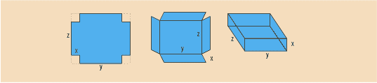

**图6-17** 纸板盒

编写一个程序，提示用户输入平坦纸板的面积。然后程序输出纸板的长度和宽度，以及要从角落切去的正方形的边长，使得最终得到的盒子体积最大。将答案计算到三位小数。你的程序必须包含一个函数，该函数以纸板的长度和宽度作为输入，并返回为最大化体积而应切去的正方形的边长。该函数还返回最大体积。

30. **(电站问题)** 一座电站位于一条宽半英里的河的一岸，而一家工厂位于河对岸下游8英里处（见图6-18）。在陆地上铺设电力线每英尺花费7美元，在水下铺设每英尺花费9美元。你的目标是确定铺设电力线的最经济路径。也就是说，确定电力线应在水下铺设多长、在陆地上铺设多长，以实现铺设电力线的最小总成本。

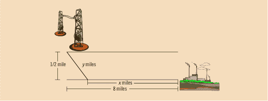

**图6-18** 电站、河流和工厂

编写一个程序，提示用户输入以下内容：

- a. 河流的宽度
- b. 工厂在河对岸下游的距离
- c. 在水下铺设电力线的成本
- d. 在陆地上铺设电力线的成本

然后程序输出应在水下铺设的电力线长度和应在陆地上铺设的长度，使建造电力线的成本最低。程序还应输出建造电力线的总成本。

31. **(管道问题，需要三角学)** 一根管道需要绕过两条相交走廊的直角拐角。假设两条相交走廊的宽度分别为5英尺和8英尺（见图6-19）。你的目标是求出能够水平绕过该直角拐角的最长管道的长度，并四舍五入到最接近的英尺。


**图6-19** 管道问题

编写一个程序，提示用户输入两条走廊的宽度。然后程序输出能够水平绕过该直角拐角的最长管道的长度，并四舍五入到最接近的英尺。（注意，管道长度由 \(l = AB + BC = 8/\sin(\theta) + 5/\cos(\theta)\) 给出，其中 \(0 < \theta < \pi/2\)。）

32. 设**a**和**b**为整数，且**a**或**b**非零。**a**和**b**的最大公约数，记作\(gcd(a,b)\)，是能同时整除**a**和**b**的最大正整数。你的程序必须包含一个函数，该函数以两个整数作为输入，并返回这些整数的\(gcd\)。

33. 例6-16展示了如何编写程序来因式分解形式为\(ax^2 + bx + c\)的多项式，其中**a**、**b**和**c**是整数。修改该程序，使其也能因式分解形式为\(ax^2 + bx + c\)的多项式，其中**a**、**b**和**c**是整数。注意，多项式\(-2x^2 - 3x + 2\)可以因式分解为：\(-2x^2 - 3x + 2 = (-2x + 1)(x + 2) = -(2x - 1)(x + 2)\)。

在第2章中，你了解到C++的简单数据类型分为三类：整型、浮点型和`enum`。在后续章节中，你主要使用整型和浮点型数据类型。在本章中，你将学习`enum`类型。此外，语句`using namespace std;`（在第2章中讨论过）用于每个使用ANSI/ISO标准C++风格头文件的C++程序。本章后半部分考察该语句的用途。实际上，你将了解`namespace`机制是什么。你还将学习`string`类型以及许多可用于有效操作字符串的有用函数。

## 枚举类型

> **注意：** 本节可以跳过，不会影响连续性。

第2章将数据类型定义为一组值以及对这些值的一组操作。例如，`int`数据类型由从-2,147,483,648到2,147,483,647的整数以及对这些数字的操作集合——即算术运算（`+`、`-`、`*`、`/`和`%`）组成。因为程序的主要目标是操作数据，所以数据类型的概念对任何编程语言都是基础性的。通过提供数据类型，你指定了哪些值是合法的，并告诉用户允许对这些值进行哪些类型的操作。因此，系统为你提供了内置的错误检查。

到目前为止，你使用过的数据类型大多是`int`、`bool`、`char`和`double`。尽管这些数据类型足以解决几乎任何问题，但有时会出现这些数据类型不足以解决特定问题的情况。C++提供了一种机制，让用户创建自己的数据类型，这大大增强了编程语言的灵活性。

在本节中，你将学习如何创建自己的简单数据类型，称为枚举类型。在接下来的章节中，你将学习更高级的技术来创建复杂的数据类型。

要定义**枚举类型**，你需要以下各项：

- 数据类型的名称
- 数据类型的一组值
- 对这些值的一组操作

C++允许你定义一个新的简单数据类型，在其中指定其名称和值，但不指定操作。防止用户创建自己的操作有助于避免潜在的系统故障。

你为数据类型指定的值必须是标识符。


枚举类型的语法为：

```cpp
enum typeName {value1, value2, ...};
```

其中 `value1`、`value2`、……是称为**枚举器**的标识符。在 C++ 中，`enum` 是保留字。

通过列出花括号之间的所有值，你也指定了这些值之间的顺序。也就是说，`value1 < value2 < value3 < ...`。因此，枚举类型是一个有序的值集合。此外，分配给这些枚举器的默认值从 0 开始。也就是说，分配给 `value1` 的默认值是 0，分配给 `value2` 的默认值是 1，依此类推。（在定义枚举类型时，可以为枚举器分配不同于默认值的其他值。）还要注意，枚举器 `value1`、`value2`、…… *不是*变量。

### 示例 7-1

语句：

```cpp
enum colors {BROWN, BLUE, RED, GREEN, YELLOW};
```

定义了一个名为 `colors` 的新数据类型，属于该数据类型的值为 **BROWN、BLUE、RED、GREEN** 和 **YELLOW**。

### 示例 7-2

语句：

```cpp
enum standing {FRESHMAN, SOPHOMORE, JUNIOR, SENIOR};
```

将 `standing` 定义为枚举类型。属于 `standing` 的值为 **FRESHMAN、SOPHOMORE、JUNIOR** 和 **SENIOR**。

### 示例 7-3

考虑以下语句：

```cpp
enum grades {'A', 'B', 'C', 'D', 'F'}; //illegal enumeration type
enum places {1ST, 2ND, 3RD, 4TH}; //illegal enumeration type
```

这些是非法的枚举类型，因为这些值都不是标识符。然而，以下这些是合法的枚举类型：

```cpp
enum grades {A, B, C, D, F};
enum places {FIRST, SECOND, THIRD, FOURTH};
```

如果一个值已经在某个枚举类型中使用过，那么同一块中的任何其他枚举类型都不能再使用它。同样的规则适用于在任何块之外声明的枚举类型。示例 7-4 说明了这一概念。

### **示例 7-4**

考虑以下语句：

```cpp
enum mathStudent {JOHN, BILL, CINDY, LISA, RON};
enum compStudent {SUSAN, CATHY, JOHN, WILLIAM}; //illegal
```

假设这些语句位于同一程序中的同一块中。第二个枚举类型 compStudent 不被允许，因为值 JOHN 已在之前的枚举类型 mathStudent 中使用过。

### 声明变量

一旦定义了数据类型，就可以声明该类型的变量。声明枚举类型变量的语法与之前相同：

```cpp
dataType identifier, identifier,...;
```

语句：

```cpp
enum sports {BASKETBALL, FOOTBALL, HOCKEY, BASEBALL, SOCCER,
             VOLLEYBALL};
```

定义了一个名为 sports 的枚举类型。语句：

```cpp
sports popularSport, mySport;
```

将 popularSport 和 mySport 声明为 sports 类型的变量。

### 赋值

一旦声明了变量，就可以在其中存储值。假设有前面的声明，语句：

```cpp
popularSport = FOOTBALL;
```

将 FOOTBALL 存储到 popularSport 中。语句：

```cpp
mySport = popularSport;
```

将 popularSport 的值复制到 mySport 中。

### 枚举类型的操作

枚举类型不允许进行算术运算。因此以下语句是非法的：

```cpp
mySport = popularSport + 2;             //illegal
popularSport = FOOTBALL + SOCCER;        //illegal
popularSport = popularSport * 2;         //illegal
```

此外，枚举类型不允许进行递增和递减运算。因此以下语句是非法的：

```cpp
popularSport++;  //illegal
popularSport--;  //illegal
```

假设你想将 popularSport 的值递增 1。可以按如下方式使用强制类型转换运算符：

```cpp
popularSport = static_cast<sports>(popularSport + 1);
```

当使用类型名时，编译器假定用户清楚自己在做什么。因此，前面的语句会被编译，并且在执行期间会将 popularSport 的值推进到列表中的下一个值。考虑以下语句：

```cpp
popularSport = FOOTBALL;
popularSport = static_cast<sports>(popularSport + 1);
```

执行第二条语句后，popularSport 的值为 HOCKEY。类似地，语句：

```cpp
popularSport = FOOTBALL;
popularSport = static_cast<sports>(popularSport - 1);
```

会将 BASKETBALL 存储到 popularSport 中。

### 关系运算符

因为枚举是一个有序的值集合，所以关系运算符可用于枚举类型。再次假设你有前面定义的枚举类型 sports 以及变量 popularSport 和 mySport。那么：

```cpp
FOOTBALL <= SOCCER is true
HOCKEY > BASKETBALL is true
BASEBALL < FOOTBALL is false
```

假设：

```cpp
popularSport = SOCCER;
mySport = VOLLEYBALL;
```

那么：

```cpp
popularSport < mySport is true
```

### 枚举类型与循环

回想一下，枚举类型是整型，并且使用强制类型转换运算符（即类型名），可以递增、递减和比较枚举类型的值。因此，可以在循环中使用这些枚举类型。假设 `mySport` 是前面声明的变量。考虑以下 `for` 循环：

```cpp
for (mySport = BASKETBALL; mySport <= SOCCER; mySport =
                                      static_cast<sports>(mySport + 1))
.
.
.
```

这个 `for` 循环有五次迭代。

在循环中使用枚举类型可以提高程序的可读性。

### 枚举类型的输入/输出

由于输入和输出仅为 `int`、`char`、`double` 等内置数据类型定义，因此枚举类型不能（直接）输入或输出。不过，可以间接地输入和输出枚举。示例 7-5 说明了这一概念。

### 示例 7-5

假设有以下语句：

```cpp
enum courses {ALGEBRA, BASIC, PYTHON, CPP, PHILOSOPHY, ANALYSIS,
             CHEMISTRY, HISTORY};
courses registered;
```

第一条语句定义了枚举类型 `courses`；第二条语句声明了一个 courses 类型的变量 registered。你可以借助 `char` 数据类型来读取（即输入）枚举类型。注意，只需读取第一个字符，就能区分枚举类型 courses 的某些值；而另一些值则需要读取前两个字符来区分。例如，只需读取第一个字符，就能区分 `ALGEBRA` 和 `BASIC`；读取前两个字符，就能区分 `ALGEBRA` 和 `ANALYSIS`。要从（比如）键盘读取这些值，可以读取两个字符，然后使用选择结构将值赋给变量 `registered`。因此，需要声明两个 `char` 类型的变量。

```cpp
char ch1, ch2;
cin >> ch1 >> ch2;  //Read two characters
```

以下 `switch` 语句将适当的值赋给变量 `registered`：

```cpp
switch (ch1)
{
case 'a':
    if (ch2 == 'l')
        registered = ALGEBRA;
    else
        registered = ANALYSIS;
    break;
case 'b':
    registered = BASIC;
    break;
case 'c':
    if (ch2 == 'h')
        registered = CHEMISTRY;
    else
        registered = CPP;
    break;
case 'h':
    registered = HISTORY;
    break;
case 'p':
    if (ch2 == 'y')
        registered = PYTHON;
    else
        registered = PHILOSOPHY;
    break;
default:
    cout << "Illegal input." << endl;
}
```

也可以使用 `string` 类型向变量 `registered` 输入值。例如，以下代码实现了这一点：

```cpp
string course;

cin >> course;

if (course == "algebra")
    registered = ALGEBRA;
else if (course == "analysis")
    registered = ANALYSIS;
else if (course == "basic")
    registered = BASIC;
else if (course == "chemistry")
    registered = CHEMISTRY;
else if (course == "cpp")
    registered = CPP;
else if (course == "history")
    registered = HISTORY;
else if (course == "python")
    registered = PYTHON;
else if (course == "philosophy")
    registered = PHILOSOPHY;
else
    cout << "Illegal input." << endl;
```

类似地，可以间接地输出枚举类型：

```cpp
switch (registered)
{
case ALGEBRA:
    cout << "Algebra";
    break;
case ANALYSIS:
    cout << "Analysis";
    break;
case BASIC:
    cout << "Basic";
    break;
case CHEMISTRY:
    cout << "Chemistry";
    break;
case CPP:
    cout << "CPP";
    break;
case HISTORY:
    cout << "History";
    break;
case PYTHON:
    cout << "Python";
    break;
case PHILOSOPHY:
    cout << "Philosophy";
}
```

> **注意**
> 
> 如果尝试直接输出枚举器的值，计算机将输出分配给该枚举器的值。例如，假设 `registered = ALGEBRA;`。以下语句将输出值 0，因为分配给 `ALGEBRA` 的（默认）值为 0：

```cpp
cout << registered << endl;
```

类似地，以下语句将输出 4：

```cpp
cout << PHILOSOPHY << endl;
```


如前所述，你还可以在函数 `readCourses` 中使用 `string` 类型，将值输入到 `courses` 类型的变量中。我们将细节留作练习。

下面的函数输出一个枚举类型值：

```cpp
void printEnum(courses registered)
{
    switch (registered)
    {
    case ALGEBRA:
        cout << "Algebra";
        break;
    case ANALYSIS:
        cout << "Analysis";
        break;
    case BASIC:
        cout << "Basic";
        break;
    case CHEMISTRY:
        cout << "Chemistry";
        break;
    case CPP:
        cout << "CPP";
        break;
    case HISTORY:
        cout << "History";
        break;
    case PYTHON:
        cout << "Python";
        break;
    case PHILOSOPHY:
        cout << "Philosophy";
        break;
    }//end switch
}//end printEnum
```

## 在定义枚举类型时声明变量

在前面的章节中，你先定义了一个枚举类型，然后声明了该类型的变量。C++ 允许将这两个步骤合并为一个步骤。也就是说，你可以在定义枚举类型时声明该枚举类型的变量。例如，语句：

```cpp
enum grades {A, B, C, D, F} courseGrade;
```

定义了枚举类型 `grades`，并声明了一个类型为 `grades` 的变量 `courseGrade`。

类似地，语句：

```cpp
enum coins {PENNY, NICKEL, DIME, HALFDOLLAR, DOLLAR} change, usCoins;
```

定义了枚举类型 `coins`，并声明了两个类型为 `coins` 的变量 `change` 和 `usCoins`。

## 匿名数据类型

如果在变量声明中直接指定值而不给出类型名，这样的数据类型称为**匿名类型**。下面的语句创建了一个匿名类型：

```cpp
enum {BASKETBALL, FOOTBALL, BASEBALL, HOCKEY} mySport;
```

这条语句指定了值并声明了一个变量 mySport，但没有为数据类型指定名称。

然而，创建匿名类型有缺点。首先，由于该类型没有名称，你不能将匿名类型作为参数传递给函数，函数也不能返回匿名类型的值。其次，一个匿名类型中使用的值可以在另一个匿名类型中使用，但这些类型的变量会被区别对待。考虑以下语句：

```cpp
enum {ENGLISH, FRENCH, SPANISH, GERMAN, RUSSIAN} languages;
enum {ENGLISH, FRENCH, SPANISH, GERMAN, RUSSIAN} foreignLanguages;
```

尽管变量 languages 和 foreignLanguages 具有相同的值，编译器仍将它们视为不同类型的变量。因此，下面的语句是非法的：

```cpp
languages = foreignLanguages;  //Illegal
```

尽管这些功能可用，但应谨慎使用。为避免混淆，请先定义枚举类型，然后声明变量。

现在介绍 C++ 中的 `typedef` 语句。

## typedef 语句

在 C++ 中，可以使用 `typedef` 语句为先前定义的数据类型创建同义词或别名。`typedef` 语句的一般语法是：

```cpp
typedef existingTypeName newTypeName;
```

在 C++ 中，`typedef` 是保留字。注意，`typedef` 语句不会创建新的数据类型；它只为现有数据类型创建别名。

### 示例 7-6

语句：

```cpp
typedef int integer;
```

为数据类型 int 创建了一个别名 integer。类似地，语句：

```cpp
typedef double real;
```

为数据类型 `double` 创建了一个别名 `real`。语句：

```cpp
typedef double decimal;
```

为数据类型 `double` 创建了一个别名 `decimal`。

### 示例 7-7

回顾第 4 章，C++ 中的逻辑（布尔）表达式求值为 1 或 0，它们实际上是 `int` 值。作为逻辑值，1 表示 `true`，0 表示 `false`。考虑以下语句：

```cpp
typedef int Boolean;        //Line 1
const Boolean TRUE = 1;     //Line 2
const Boolean FALSE = 0;    //Line 3
Boolean flag;               //Line 4
```

第 1 行的语句为数据类型 `int` 创建了一个别名 `Boolean`。第 2 行和第 3 行的语句声明了命名常量 `TRUE` 和 `FALSE`，并分别将它们初始化为 1 和 0。第 4 行的语句声明 `flag` 为 `Boolean` 类型的变量。由于 `flag` 是 `Boolean` 类型的变量，下面的语句是合法的：

```cpp
flag = TRUE;
```

## 编程示例：石头、剪刀、布游戏


孩子们经常玩石头、剪刀、布游戏。该游戏有两名玩家，每人从三个对象中选择一个：石头、布或剪刀。如果玩家 1 选择石头，玩家 2 选择布，则玩家 2 赢得游戏，因为布包住石头。游戏按照以下规则进行：

- 如果两名玩家选择相同的对象，则本局为平局。
- 如果一名玩家选择石头，另一名玩家选择剪刀，则选择石头的玩家赢得本局，因为石头砸坏剪刀。
- 如果一名玩家选择石头，另一名玩家选择布，则选择布的玩家赢得本局，因为布包住石头。
- 如果一名玩家选择剪刀，另一名玩家选择布，则选择剪刀的玩家赢得本局，因为剪刀剪布。

编写一个交互式程序，允许两个人玩这个游戏。

### 输入

该程序有两类输入：

- 询问用户是否要玩游戏时用户的回答。
- 玩家的选择。

### 输出

玩家的选择以及每局的获胜者。游戏结束后，还应输出总局数以及每名玩家获胜的次数。

### 问题分析与算法设计

两名玩家玩这个游戏。玩家通过键盘输入他们的选择。每名玩家输入 R 或 r 表示石头，P 或 p 表示布，S 或 s 表示剪刀。当第一名玩家输入选择时，第二名玩家应看向别处。两个输入都完成后，如果输入有效，程序会输出玩家的选择并宣布本局获胜者。游戏会一直继续，直到其中一名玩家决定退出游戏。游戏结束后，程序输出总局数以及每名玩家获胜的次数。上述讨论可转化为以下算法：

- 1. 简要说明游戏及其玩法。
- 2. 询问用户是否想玩该游戏。
- 3. 获取两名玩家的选择。
- 4. 如果选择有效，输出选择与获胜者。
- 5. 更新游戏总次数和获胜次数。
- 6. 当用户同意继续玩游戏时，重复步骤 2 到 5。
- 7. 输出局数以及每名玩家获胜的次数。

我们将使用以下枚举类型来描述这些对象。

```cpp
enum objectType {ROCK, PAPER, SCISSORS};
```

### 变量（函数 main）

显然，在函数 main 中需要以下变量：

```cpp
int gameCount;  //variable to store the number of
                  //games played
int winCount1;  //variable to store the number of games
                //won by player 1
int winCount2;  //variable to store the number of games
                //won by player 2
int gamewinner;
char response;   //variable to get the user's response to
                 //play the game
char selection1;
char selection2;
objectType play1;  //player1's selection
objectType play2;  //player2's selection
```

该程序分为以下函数，后续各节将详细介绍这些函数。

- **displayRules：** 此函数显示有关游戏及其规则的一些简要信息。
- **validSelection：** 此函数检查玩家的选择是否有效。唯一有效的选择是 `R`、`r`、`P`、`p`、`S` 和 `s`。
- **retrievePlay：** 由于枚举类型不能直接读取，此函数会转换输入的选择（`R`、`r`、`P`、`p`、`S` 或 `s`），并返回相应的对象类型。
- **gameResult：** 此函数输出玩家的选择以及游戏的获胜者。
- **convertEnum：** 此函数由函数 `gameResult` 调用，用于输出枚举类型值。
- **winningObject：** 此函数确定并返回获胜对象。
- **displayResults：** 游戏结束后，此函数显示最终结果。

### 函数 `displayRules`

此函数没有参数。它仅由解释游戏和游戏规则的输出语句组成。本质上，该函数的定义是：

```cpp
void displayRules()
{
    cout << "Welcome to the game of Rock, Paper, "
         << "and Scissors." << endl;
    cout << "This is a game for two players. For each "
         << "game, each" << endl;
    cout << "A player selects one of the objects, Rock, "
         << "Paper or Scissors." << endl;
    cout << "The rules for winning the game are: " << endl;
    cout << "1. If both players select the same object, it "
         << "is a tie." << endl;
    cout << "2. Rock breaks Scissors: So player who selects "
         << "Rock wins." << endl;
    cout << "3. Paper covers Rock: So player who selects "
         << "Paper wins." << endl;
    cout << "4. Scissors cut Paper: So player who selects "
         << "Scissors wins." << endl;
    cout << "Enter R or r to select Rock, P or p to select "
         << "Paper, and S or s to select Scissors." << endl;
}
```

### 函数 `validSelection`

此函数检查玩家的选择是否有效。

```
if selection is 'R' or 'r' or 'S' or 's' or 'P' or 'p', then it
    is a valid selection;
otherwise the selection is invalid.
```


我们使用 `switch` 语句检查选择是否有效。该函数的定义如下：

```cpp
bool validSelection(char selection)
{
    switch (selection)
    {
    case 'R':
    case 'r':
    case 'P':
    case 'p':
    case 'S':
    case 's':
        return true;
    default:
        return false;
    }
}
```

由于不能直接读取枚举类型，该函数会转换输入的选项（R、r、P、p、S 或 s），并返回相应的对象类型。因此，该函数有一个 `char` 类型的参数。它是一个有返回值的函数，返回 `objectType` 类型的值。用伪代码表示，该函数的算法为：

函数 retrievePlay

```text
if selection is 'R' or 'r'
    return Rock;

if selection is 'P' or 'p'
    return Paper;

if selection is 'S' or 's'
    return Scissors
```

函数 retrievePlay 的定义为：

```cpp
objectType retrievePlay(char selection)
{
    objectType object;

    switch (selection)
    {
    case 'R':
    case 'r':
        object = ROCK;
        break;
    case 'P':
    case 'p':
        object = PAPER;
        break;
```

```cpp
cout << " and player 2 selected ";
convertEnum(play2);
cout << ". ";

//Decide the winner
if (play1 == winnerObject)
    winner = 1;
else if (play2 == winnerObject)
    winner = 2;

//Output the winner
cout << "Player " << winner << " wins this game."
     << endl;
    }
}
```

由于枚举类型不能直接输出，我们来编写函数 convertEnum，以输出枚举类型 objectType 的对象。该函数有一个 objectType 类型的参数。它输出与 objectType 对应的字符串。用伪代码表示，该函数为：

函数 convertEnum

```text
if object is ROCK
    output "Rock"

if object is PAPER
    output "Paper"

if object is SCISSORS
    output "Scissors"
```

函数 convertEnum 的定义为：

```cpp
void convertEnum(objectType object)
{
    switch (object)
    {
        case ROCK:
            cout << "Rock";
            break;
        case PAPER:
            cout << "Paper";
            break;
        case SCISSORS:
            cout << "Scissors";
    }
}
```

函数 winningObject

要决定游戏的赢家，需要查看玩家的选择，然后依据游戏规则判断。例如，如果一名玩家选择 ROCK，另一名玩家选择 PAPER，那么选择 PAPER 的玩家获胜。换句话说，获胜对象是 PAPER。函数 winningObject 接收两个对象，判断并返回获胜对象。显然，该函数有两个 objectType 类型的参数，返回值也是 objectType 类型。该函数的定义为：

```cpp
objectType winningObject(objectType play1, objectType play2)
{
    if ((play1 == ROCK && play2 == SCISSORS)
        || (play2 == ROCK && play1 == SCISSORS))
        return ROCK;
    else if ((play1 == ROCK && play2 == PAPER)
        || (play2 == ROCK && play1 == PAPER))
        return PAPER;
    else
        return SCISSORS;
}
```

函数 displayResults

游戏结束后，该函数输出最终结果，即总对局数以及每位玩家获胜的对局数。总对局数存储在变量 gameCount 中，玩家 1 获胜的对局数存储在变量 winCount1 中，玩家 2 获胜的对局数存储在变量 winCount2 中。该函数有三个参数，分别对应这三个变量。该函数的定义本质上如下：

```cpp
void displayResults(int gCount, int wCount1, int wCount2)
{
    cout << "The total number of plays: " << gCount
         << endl;
    cout << "The number of plays won by player 1: "
         << wCount1 << endl;
    cout << "The number of plays won by player 2: "
         << wCount2 << endl;
}
```

现在可以编写函数 main 的算法了。

### 主算法

- 1. 声明变量。
- 2. 初始化变量。
- 3. 显示规则。
- 4. 提示用户开始游戏。
- 5. 获取用户是否进行游戏的响应。
- 6. `while (response is yes)`
  - {
  - a. 提示玩家 1 做出选择。
  - b. 获取玩家 1 的选择。
  - c. 提示玩家 2 做出选择。
  - d. 获取玩家 2 的选择。
  - e. 如果双方的选择均合法：
    - {
    - i. 总对局数加 1。
    - ii. 判定该局游戏的赢家。
    - iii. 将赢家的获胜对局数加 1。
    - }
  - f. 提示用户确定是否想再玩一局。
  - g. 获取玩家的响应。
  - }
- 7. 输出游戏结果。

## 程序清单

```cpp
//*************************************************************
// Author: D.S. Malik
//
// Program: Rock, Paper, and Scissors
// This program plays the game of rock, paper, and scissors.
//*************************************************************

#include <iostream>

using namespace std;

enum objectType{ROCK, PAPER, SCISSORS};

    //Function prototypes
void displayRules();
objectType retrievePlay(char selection);
bool validSelection(char selection);
void convertEnum(objectType object);
objectType winningObject(objectType play1, objectType play2);
void gameResult(objectType play1, objectType play2, int& winner);
void displayResults(int gCount, int wCount1, int wCount2);

int main()
{
    //Step 1
    int gameCount; //variable to store the number of
                   //games played
    int winCount1; //variable to store the number of games
                   //won by player 1
    int winCount2; //variable to store the number of games
                   //won by player 2
    int gamewinner;
    char response; //variable to get the user's response to
                   //play the game
    char selection1;
    char selection2;
    objectType play1; //player1's selection
    objectType play2; //player2's selection

    //Initialize variables; Step 2
    gameCount = 0;
    winCount1 = 0;
    winCount2 = 0;

    displayRules();                                      //Step 3

    cout << "Enter Y/y to play the game: ";              //Step 4
    cin >> response;                                     //Step 5
    cout << endl;

    while (response == 'Y' || response == 'y')           //Step 6
    {
        cout << "Player 1 enter your choice: ";         //Step 6a
        cin >> selection1;                               //Step 6b
        cout << endl;

        cout << "Player 2 enter your choice: ";         //Step 6c
        cin >> selection2;                               //Step 6d
        cout << endl;

        //Step 6e
        if (validSelection(selection1)
              && validSelection(selection2))
        {
            play1 = retrievePlay(selection1);
            play2 = retrievePlay(selection2);
            gameCount++;
            gameResult(play1, play2, gamewinner);        //Step 6e.1

            if (gamewinner == 1)                         //Step 6e.iii
                winCount1++;
            else if (gamewinner == 2)
                winCount2++;
        } //end if

        cout << "Enter Y/y to play the game: ";   //Step 6f
        cin >> response;                         //Step 6g
        cout << endl;
    }//end while

    displayResults(gameCount, winCount1,
                   winCount2);               //Step 7

    return 0;
}//end main
//Place the definitions of the functions displayRules,
//validSelection, retrievePlay, convertEnum, winningObject,
//gameResult, and displayResults as described previously here.
```

### 命名空间

1998 年 7 月，ANSI/ISO 标准 C++ 获得正式批准。大多数较新的编译器也与 ANSI/ISO 标准 C++ 兼容。（要完全确定，请查阅编译器的文档。）Standard C++ 和 ANSI/ISO 标准 C++ 这两个标准实际上几乎相同。ANSI/ISO 标准 C++ 语言有一些 Standard C++ 中没有的特性，本章剩余部分将讨论这些特性。在后续章节中，除非另有说明，C++ 语法适用于这两个标准。首先，我们讨论 ANSI/ISO 标准 C++ 的 `namespace` 机制，该机制在第 2 章中介绍过。

当程序中包含头文件（例如 `iostream`）时，头文件中的全局标识符也会成为程序中的全局标识符。因此，如果程序中的某个全局标识符与头文件中的某个全局标识符同名，编译器就会生成语法错误（例如“标识符重定义”）。如果程序使用第三方库，也可能出现同样的问题。为了解决这个问题，第三方供应商会让其全局标识符以特殊符号开头。在第 2 章中你已经了解到，由于编译器供应商会让其全局标识符名称以下划线（`_`）开头，为了避免链接错误，你不应让程序中的标识符名称以下划线（`_`）开头。

ANSI/ISO 标准 C++ 试图通过 `namespace` 机制解决全局标识符名称重叠的问题。

`namespace` 语句的一般语法为：

```cpp
namespace namespace_name
{
    members
}
```

其中 `members` 通常是命名常量、变量声明、函数或另一个命名空间。注意 `namespace_name` 是 C++ 标识符。


在 C++ 中，`namespace` 是保留字。

### 示例 7-8

该语句：

```cpp
namespace globalType
{
    const int N = 10;
    const double RATE = 7.50;
    int count = 0;
    void printResult();
}
```

将 `globalType` 定义为一个包含四个成员的命名空间：命名常量 N 和 RATE、变量 count，以及函数 `printResult`。

命名空间成员的作用域局限于该命名空间。通常可以通过下面介绍的两种方式之一，在该命名空间之外访问命名空间成员。

访问命名空间成员的一般语法是：

```cpp
namespace_name::identifier
```

回想一下，在 C++ 中，`::` 称为作用域解析运算符。

要访问命名空间 `globalType` 的成员 RATE，需要以下语句：

```cpp
globalType::RATE
```

要访问成员 `printResult`（它是一个函数），需要以下语句：

```cpp
globalType::printResult();
```

因此，要访问命名空间的成员，需使用 `namespace_name`，后跟作用域解析运算符，再跟成员名。

为简化对命名空间成员的访问，ANSI/ISO 标准 C++ 提供了 `using` 语句的使用。使用 `using` 语句的语法如下：

- a. 简化对所有 `namespace` 成员的访问：

    ```cpp
    using namespace namespace_name;
    ```

- b. 简化对特定 `namespace` 成员的访问：

    ```cpp
    using namespace_name::identifier;
    ```

例如，以下 `using` 语句：

```cpp
using namespace globalType;
```

简化了对 `namespace globalType` 所有成员的访问。而以下语句：

```cpp
using globalType::RATE;
```

简化了对 `namespace globalType` 的成员 `RATE` 的访问。

在 C++ 中，`using` 是保留字。

通常将 `using` 语句放在 `namespace` 声明之后。例如，对于 `namespace globalType`，通常按如下方式编写代码：

```cpp
namespace globalType
{
    const int N = 10;
    const double RATE = 7.50;
    int count = 0;
    void printResult();
}
using namespace globalType;
```

在 `using` 语句之后，要访问 `namespace` 成员，不必在 `namespace` 成员前放置 `namespace_name` 和作用域解析运算符。然而，如果 `namespace` 成员与程序中的全局标识符同名，则要在程序中访问该 `namespace` 成员，必须在 `namespace` 成员前加上 `namespace_name` 和作用域解析运算符。类似地，如果 `namespace` 成员与块中的标识符同名，则要在块中访问该 `namespace` 成员，必须在 `namespace` 成员前加上 `namespace_name` 和作用域解析运算符。

示例 7-9 至 7-12 有助于阐明 `namespace` 机制的用法。

### 示例 7-9

考虑以下 C++ 代码：

```cpp
#include <iostream>

using namespace std;
.
.
.
int main()
{
    .
    .
    .
}
.
.
.
```

在此示例中，可以引用头文件 `iostream` 的全局标识符，如 `cin`、`cout` 和 `endl`，而无需在标识符名称前使用前缀 `std::`。明显的限制是，引用该全局标识符（头文件 `iostream` 的全局标识符）的块（或函数）中不得包含与该全局标识符同名的任何标识符。

### 示例 7-10

考虑以下 C++ 代码：

```cpp
#include <cmath>

int main()
{
    double x = 15.3;
    double y;

    y = std::pow(x, 2);
    .
    .
    .
}
```

此示例访问头文件 `cmath` 中的函数 `pow`。

### 示例 7-11

考虑以下 C++ 代码：

```cpp
#include <iostream>
.
.
int main()
{
    using namespace std;
    .
    .
}
.
.
```

在此示例中，函数 `main` 可以引用头文件 `iostream` 的全局标识符，而无需在标识符名称前使用前缀 `std::`。`using` 语句出现在函数 `main` 内部。因此，其他函数（如果有）应在头文件 `iostream` 的全局标识符名称前使用前缀 `std::`，除非该函数有类似的 `using` 语句。

### 示例 7-12

考虑以下 C++ 代码：

```cpp
#include <iostream>

using namespace std;                 //Line 1

int t;                               //Line 2
double u;                            //Line 3

namespace expN
{
    int x;                            //Line 4
    char t;                           //Line 5
    double u;                         //Line 6
    void printResult();               //Line 7
}

using namespace expN;

int main()
{
    int one;                          //Line 8
    double t;                         //Line 9
    double three;                     //Line 10

    .
    .
    .
}

void expN::printResult() //Definition of the function printResult
{
    .
    .
    .
}
```

在此 C++ 程序中：

- 1. 要在 `main` 中引用第 2 行的变量 `t`，请使用*作用域解析运算符*，即 `::`（也就是说，将 `t` 称为 `::t`），因为函数 `main` 中有一个名为 `t` 的变量（在第 9 行声明）。例如，要将 `x` 的值复制到 `t`，可以使用语句 `t = x;`。

- 2. 要在 `main` 中引用命名空间 `expN` 的成员 `t`（在第 5 行声明），请在 `t` 前使用前缀 `expN::`（也就是说，将 `t` 称为 `expN::t`），因为有一个名为 `t` 的全局变量（在第 2 行声明），并且 `main` 中也有一个名为 `t` 的变量。

- 3. 要在 `main` 中引用命名空间 `expN` 的成员 `u`（在第 6 行声明），请在 `u` 前使用前缀 `expN::`（也就是说，将 `u` 称为 `expN::u`），因为有一个名为 `u` 的全局变量（在第 3 行声明）。

- 4. 在 `main` 中，既可以将命名空间 `expN` 的成员 `x`（在第 4 行声明）引用为 `x`，也可以引用为 `expN::x`，因为不存在名为 `x` 的全局标识符，并且函数 `main` 也不包含任何名为 `x` 的标识符。

- 5. 作为命名空间成员的函数（例如 `printResult`）的定义通常写在该命名空间之外，如前述程序所示。要编写函数 `printResult` 的定义，函数头中的函数名可以是 `printResult` 或 `expN::printResult`（因为没有其他全局标识符名为 `printResult`）。

> **注意**
>
> 系统提供的头文件（如 `iostream`、`cmath` 和 `iomanip`）中的标识符定义在命名空间 `std` 中。因此，为简化从这些头文件访问标识符，我们在编写的程序中一直使用以下语句：
>
> ```cpp
> using namespace std;
> ```

## `string` 类型

在第 2 章中，已经介绍了数据类型 `string`。回想一下，在 ANSI/ISO C++ 语言标准之前，标准 C++ 库并不提供 `string` 数据类型。编译器供应商通常提供自己的、由程序员定义的 `string` 类型，而字符串操作的语法和语义往往因供应商而异。

数据类型 `string` 是程序员定义的类型，并不是 C++ 语言的一部分；它由 C++ 标准库提供。在使用数据类型 `string` 之前，程序必须包含头文件 `string`，如下所示：

```cpp
#include <string>
```

回想一下，在 C++ 中，字符串是零个或多个字符的序列，并且字符串用双引号括起来。

该语句：

```cpp
string name = "William Jacob";
```

将 name 声明为字符串变量，并将 name 初始化为 "William Jacob"。name 中第一个字符 W 的位置是 0；第二个字符 i 的位置是 1；依此类推。也就是说，字符串变量中第一个字符的位置从 0 开始，而不是从 1 开始。

变量 name 可以存储（几乎）任意大小的字符串。

第 3 章讨论了对 string 类型的 I/O 操作；第 4 章解释了对 string 类型的关系运算。建议重新阅读第 3 章和第 4 章，复习 string 类型上的 I/O 操作和关系运算。

其他运算符，例如二元运算符 +（用于允许字符串连接操作）和数组索引（下标）运算符 []，也已为数据类型 string 定义。下面看看这些运算符如何作用于 string 数据类型。假设有如下声明：

```cpp
string str1, str2, str3;
```

该语句：

```cpp
str1 = "Hello There";
```

将字符串 "Hello There" 存入 str1。而以下语句：

```cpp
str2 = str1;
```

将 str1 的值复制到 str2。

如果 str1 = "Sunny"，则以下语句：

```cpp
str2 = str1 + " Day";
```

将字符串 "Sunny Day" 存入 str2。

假设 str1 = "Hello" 且 str2 = "There"。则以下语句：

```cpp
str3 = str1 + " " + str2;
```

将 "Hello There" 存入 str3。此语句等价于以下语句：

```cpp
str3 = str1 + ' ' + str2;
```

另外，以下语句：

```cpp
str1 = str1 + " Mickey";
```

通过将字符串 "Mickey" 追加到 str1 的旧值后面，更新 str1 的值。因此，str1 的新值为 "Hello Mickey"。


> **注意**
> 
> 要使运算符 + 能够与 **string** 数据类型一起使用，+ 的操作数中至少有一个必须是 **string** 变量。例如，以下语句将无法运行：
> ```cpp
> str1 = "Hello " + "there!"; //illegal
> str2 = "Sunny Day" + '1';     //illegal
> ```

如果 `str1 = "Hello there"`，语句：

```cpp
str1[6] = 'T';
```

会将字符 t 替换为字符 T。回想一下，**string** 变量中第一个字符的位置是 0。因此，由于 t 是 str1 中的第七个字符，所以它的位置是 6。

在 C++ 中，[] 称为**数组下标运算符**。

如前所示，将数组下标运算符与字符的位置结合使用，可以访问 **string** 中的单个字符。

### 示例 7-13

以下程序展示了前面语句的效果。

```cpp
//Example string operations

#include <iostream>                 //Line 1
#include <string>                   //Line 2

using namespace std;                //Line 3

int main()                          //Line 4
{                                   //Line 5
    string name = "William Jacob";  //Line 6
    string str1, str2, str3, str4;  //Line 7

    cout << "Line 8: Name = " << name << endl; //Line 8

    str1 = "Hello There";           //Line 9
    cout << "Line 10: str1 = " << str1 << endl; //Line 10

    str2 = str1;                    //Line 11
    cout << "Line 12: str2 = " << str2 << endl; //Line 12

    str1 = "Sunny";                 //Line 13
    str2 = str1 + " Day";           //Line 14
    cout << "Line 15: str2 = " << str2 << endl; //Line 15

    str1 = "Hello";                 //Line 16
    str2 = "There";                 //Line 17
    str3 = str1 + " " + str2;       //Line 18
    cout << "Line 19: str3 = " << str3 << endl; //Line 19

    str3 = str1 + ' ' + str2;
    cout << "Line 21: str3 = " << str3 << endl;

    str1 = str1 + " Mickey";
    cout << "Line 23: str1 = " << str1 << endl;

    str1 = str1 + " ";
    cout << "Line 25: str1[6] = " << str1[6]
         << endl;

    str1[6] = 'T';
    cout << "Line 27: str1 = " << str1 << endl;

    //string input operations
    cout << "Line 28: Enter a string with "
         << " no blanks: ";
    cin >> str1;

    char ch;
    cin.get(ch);        //Read the newline character
    cout << endl;

    cout << "Line 33: The string you entered = "
         << str1 << endl;

    cout << "Line 34: Enter a sentence: ";
    getline(cin, str2);
    cout << endl;

    cout << "Line 37: The sentence is: " << str2
         << endl;

    return 0;
}
```

**示例运行：**在以下示例运行中，用户输入部分以阴影显示。

```
Line 8: Name = William Jacob
Line 10: str1 = Hello There
Line 12: str2 = Hello There
Line 15: str2 = Sunny Day
Line 19: str3 = Hello There
Line 21: str3 = Hello There
Line 23: str1 = Hello Mickey
Line 25: str1[6] = e
Line 27: str1 = Hello There
Line 28: Enter a string with no blanks: Programming

Line 33: The string you entered = Programming
Line 34: Enter a sentence: Testing string operations

Line 37: The sentence is: Testing string operations
```

前面的输出是不言自明的，具体分析留作练习。

## 其他 `string` 操作

`string` 数据类型包含一个数据类型 `string::size_type` 和一个命名常量 `string::npos`，定义如下：

|  |  |
|---|---|
| `string::size_type` | 一种无符号整数（数据）类型 |
| `string::npos` | `string::size_type`（数据）类型的最大值，在许多机器上是类似 `4294967295` 的数值 |

`string` 数据类型还包含若干用于字符串操作的其他函数。表 7-1 描述了其中一些函数。在此表中，我们假设 `strVar` 是一个字符串变量，而 `str` 是字符串变量、字符串常量或字符数组。（数组将在第 8 章讨论。）

### 表 7-1. 一些 `string` 函数

| 表达式 | 作用 |
|---|---|
| `strVar.at(index)` | 返回由 `index` 指定位置的元素。 |
| `strVar[index]` | 返回指定位置的元素。 |
| `strVar.append(n, ch)` | 将 `ch` 的 `n` 个副本追加到 `strVar`，其中 `ch` 是 `char` 变量或 `char` 常量。 |
| `strVar.append(str)` | 将 `str` 追加到 `strVar`。 |
| `strVar.clear()` | 删除 `strVar` 中的所有字符。 |
| `strVar.compare(str)` | 如果 `strVar > str`，则返回 1；如果 `strVar == str`，则返回 0；如果 `strVar < str`，则返回 −1。 |
| `strVar.empty()` | 如果 `strVar` 为空，则返回 `true`；否则返回 `false`。 |
| `strVar.erase()` | 删除 `strVar` 中的所有字符。 |
| `strVar.erase(pos, n)` | 从位置 `pos` 开始，删除 `strVar` 中的 `n` 个字符。 |
| `strVar.find(str)` | 返回 `str` 在 `strVar` 中第一次出现的位置索引。如果未找到 `str`，则返回特殊值 `string::npos`。 |
| `strVar.find(str, pos);` | 返回 `str` 在 `strVar` 中出现的位置索引，该位置是从 `pos` 开始或之后的第一次出现位置。 |
| `strVar.find_first_of(str, pos)` | 返回 `str` 中任意字符在 `strVar` 中第一次出现的位置索引。搜索从 `pos` 开始。 |
| `strVar.find_first_not_of(str, pos)` | 返回 `str` 中不属于 `strVar` 的任意字符第一次出现的位置索引。搜索从 `pos` 开始。 |
| `strVar.insert(pos, n, ch);` | 在 `strVar` 的索引 `pos` 处插入字符 `ch` 的 `n` 个副本；`pos` 和 `n` 的类型为 `string::size_type`，而 `ch` 是一个字符。 |
| `strVar.insert(pos, str);` | 将 `str` 中的所有字符插入到 `strVar` 的索引 `pos` 处。 |
| `strVar.length()` | 返回 `string::size_type` 类型的值，表示 `strVar` 中的字符数。 |
| `strVar.replace(pos, n, str);` | 从索引 `pos` 开始，用 `str` 中的所有字符替换 `strVar` 接下来的 `n` 个字符。如果 `n` 大于 `strVar` 的长度，则替换从该位置到 `strVar` 末尾的所有字符。 |
| `strVar.substr(pos, len)` | 返回一个字符串，该字符串是从 `pos` 开始的 `strVar` 子字符串。子字符串的长度最多为 `len` 个字符。如果 `len` 过大，则表示取 `strVar` 中从该位置到字符串末尾的内容。 |
| `strVar.size()` | 返回 `string::size_type` 类型的值，表示 `strVar` 中的字符数。 |
| `strVar.swap(str1);` | 交换 `strVar` 和 `str1` 的内容。`str1` 是一个字符串变量。 |

下面介绍其中一些函数的工作方式。

### 示例 7-14（clear、empty、erase、length 和 size 函数）

考虑以下语句：

```cpp
string firstName = "Elizabeth";
string name = firstName + " Jones";
string str1 = "It is sunny.";
string str2 = "";
string str3 = "computer science";
string str4 = "C++ programming.";
string str5 = firstName + " is taking " + str4;
string::size_type len;
```

下面展示 clear、empty、erase、length 和 size 函数的作用。

| 语句 | 作用 |
|---|---|
| `str3.clear();` | `str3 = "";` |
| `str1.empty();` | 返回 `false` |
| `str2.empty();` | 返回 `true` |
| `str4.erase(11, 4);` | `str4 = "C++ program.";` |
| `cout << firstName.length() << endl;` | 输出 9 |
| `cout << name.length() << endl;` | 输出 15 |
| `cout << str1.length() << endl;` | 输出 12 |
| `cout << str5.size() << endl;` | 输出 36 |
| `len = name.length();` | len 的值为 15 |

下面的程序演示了 length 函数的用法。

```cpp
//Example: clear, empty, erase, length, and size functions

#include <iostream>                                      //Line 1
#include <string>                                        //Line 2

using namespace std;                                     //Line 3

int main()                                               //Line 4
{                                                        //Line 5
    string firstName = "Elizabeth";                     //Line 6
    string name = firstName + " Jones";                  //Line 7
    string str1 = "It is sunny.";                        //Line 8
    string str2 = "";                                    //Line 9
    string str3 = "computer science";                    //Line 10
    string str4 = "C++ programming.";                    //Line 11
    string str5 = firstName + " is taking " + str4;      //Line 12
```


由函数 `length` 返回。这是因为函数 `length` 返回 `string::size_type` 类型的值。如果不使用强制类型转换运算符，一些编译器可能会给出以下警告消息：

`conversion from 'size_t' to 'unsigned int', possible loss of data`

## 示例 7-15（find 函数）

假设 `str1` 和 `str2` 是 string 类型。以下是函数 `find` 的有效调用：

```cpp
str1.find(str2)
str1.find("the")
str1.find('a')
str1.find(str2 + "xyz")
str1.find(str2 + 'b')
```

考虑以下语句：

```cpp
string sentence = "Outside it is cloudy and warm.";
string str = "cloudy";
string::size_type position;
```

接下来，我们展示 find 函数的效果。

| 语句 | 效果 |
|---|---|
| `cout << sentence.find("is") << endl;` | 输出 11 |
| `cout << sentence.find('s') << endl;` | 输出 3 |
| `cout << sentence.find(str) << endl;` | 输出 14 |
| `cout << sentence.find("the") << endl;` | 输出 `string::npos` 的值 |
| `cout << sentence.find('i', 6) << endl;` | 输出 8 |
| `position = sentence.find("warm");` | 将 25 赋给 `position` |

注意，搜索区分大小写。因此，字母 o（小写 o）在字符串 `sentence` 中的位置是 16。

以下程序评估前面的语句。

```cpp
//Example: find function
#include <iostream>                         //Line 1
#include <string>                           //Line 2

using namespace std;                        //Line 3

int main()                                      //Line 4
{                                               //Line 5
    string sentence = "Outside it is cloudy and warm.";  //Line 6
    string str = "cloudy";                      //Line 7

    string::size_type position;                 //Line 8

    cout << "Line 9: sentence = \"" << sentence
         << "\"" << endl;                       //Line 9

    cout << "Line 10: The position of \"is\" in sentence = "
         << static_cast<unsigned int> (sentence.find("is"))
         << endl;                                //Line 10

    cout << "Line 11: The position of 's' in sentence = "
         << static_cast<unsigned int> (sentence.find('s'))
         << endl;                                //Line 11

    cout << "Line 12: The position of \"" << str
         << "\" in sentence = "
         << static_cast<unsigned int> (sentence.find(str))
         << endl;                                //Line 12

    cout << "Line 13: The position of \"the\" in sentence = "
         << static_cast<unsigned int> (sentence.find("the"))
         << endl;                                //Line 13

    cout << "Line 14: The first occurrence of \'i\' in "
         << "sentence \n"
         << " after position 6 = "
         << static_cast<unsigned int> (sentence.find('i', 6))
         << endl;                                //Line 14

    position = sentence.find("warm");            //Line 15
    cout << "Line 16: Position = " << position << endl;      //Line 16

    return 0;                                     //Line 17
}                                               //Line 18
```

### 示例运行：

```text
Line 9: sentence = "Outside it is cloudy and warm."
Line 10: The position of "is" in sentence = 11
Line 11: The position of 's' in sentence = 3
Line 12: The position of "cloudy" in sentence = 14
Line 13: The position of "the" in sentence = 4294967295
Line 14: The first occurrence of 'i' in sentence
    after position 6 = 8
Line 16: Position = 25
```

该程序的输出不言自明。细节留作练习。注意，该程序使用 static_cast 运算符输出函数 find 返回的值。这是因为函数 find 返回 `string::size_type` 类型的值。如果不使用强制类型转换运算符，一些编译器可能会给出以下警告消息：

`conversion from 'size_t' to 'unsigned int', possible loss of data`

## 示例 7-16（insert 和 replace 函数）

假设你有以下语句：

```cpp
string firstString = "Cloudy and warm.";
string secondString = "Hello there";
string thirdString = "Henry is in programming I.";
string str1 = "very ";
string str2 = "Lisa";
```

接下来，我们展示 insert 和 replace 函数的效果。

| 语句 | 效果 |
|---|---|
| `firstString.insert(10, str1);` | `firstString = "Cloudy and very warm."` |
| `secondString.insert(11, 5, '!');` | `secondString = "Hello there!!!!!"` |
| `thirdString.replace(0, 5, str2);` | `thirdString = "Lisa is in programming I."` |

以下程序评估前面的语句。

```cpp
//Example: insert and replace functions

#include <iostream>                                  //Line 1
#include <string>                                    //Line 2

using namespace std;                                 //Line 3

int main()                                             //Line 4
{                                                      //Line 5
    string firstString = "Cloudy and warm.";          //Line 6
    string secondString = "Hello there";              //Line 7
    string thirdString = "Henry is in programming I."; //Line 8
    string str1 = "very ";                             //Line 9
    string str2 = "Lisa";                              //Line 10

    cout << "Line 11: firstString = " << firstString  //Line 11
         << endl;
    firstString.insert(10, str1);                      //Line 12

    cout << "Line 13: After insert; firstString = "
         << firstString << endl;                  //Line 13

    cout << "Line 14: secondString = " << secondString
         << endl;                                 //Line 14
    secondString.insert(11, 5, '!');              //Line 15
    cout << "Line 16: After insert; secondString = "
         << secondString << endl;                 //Line 16

    cout << "Line 17: thirdString = " << thirdString
         << endl;                                 //Line 17
    thirdString.replace(0, 5, str2);              //Line 18
    cout << "Line 19: After replace, thirdString = "
         << thirdString << endl;                  //Line 19

    return 0;                                     //Line 20
}                                             //Line 21
```

### 示例运行：

```text
Line 11: firstString = Cloudy and warm.
Line 13: After insert; firstString = Cloudy and very warm.
Line 14: secondString = Hello there
Line 16: After insert; secondString = Hello there!!!!!
Line 17: thirdString = Henry is in programming I.
Line 19: After replace, thirdString = Lisa is in programming I.
```

该程序的输出不言自明。细节留作练习。

## 示例 7-17（substr 函数）

考虑以下语句：

```cpp
string sentence;

string str;

sentence = "It is cloudy and warm.";
```

接下来，我们展示 substr 函数的效果。

| 语句 | 效果 |
|---|---|
| `cout << sentence.substr(0, 5) << endl;` | 输出：It is |
| `cout << sentence.substr(6, 6) << endl;` | 输出：cloudy |
| `cout << sentence.substr(6, 16) << endl;` | 输出：cloudy and warm. |
| `cout << sentence.substr(17, 10) << endl;` | 输出：warm. |
| `cout << sentence.substr(3, 6) << endl;` | 输出：is clo |
| `str = sentence.substr(0, 8);` | `str = "It is cl"` |
| `str = sentence.substr(2, 10);` | `str = " is cloudy"` |

以下程序说明如何使用 **string** 函数 `substr`。

```cpp
//Example: substr function
#include <iostream>                                      //line 1
#include <string>                                        //line 2

using namespace std;                                     //line 3

int main()                                               //line 4
{
    string sentence;                                     //Line 6
    string str;                                          //Line 7

    sentence = "It is cloudy and warm.";                //Line 8

    cout << "Line 9: substr(0, 5) in \""
         << sentence << "\" = \""
         << sentence.substr(0, 5) << "\"" << endl;       //line 9

    cout << "Line 10: substr(6, 6) in \""
         << sentence << "\" = \""
         << sentence.substr(6, 6) << "\"" << endl;       //line 10

    cout << "Line 11: substr(6, 16) in \""
         << sentence << "\" = " << endl
         << "             " << sentence.substr(6, 16)
         << "\"" << endl;                                //line 11

    cout << "Line 12: substr(17, 10) in \""
         << sentence << "\" = \""
         << sentence.substr(17, 10) << "\"" << endl;      //line 12

    cout << "Line 13: substr(3, 6) in \""
         << sentence << "\" = \""
         << sentence.substr(3, 6) << "\"" << endl;        //line 13

    str = sentence.substr(0, 8);                          //line 14
    cout << "Line 15: " << "str = \"" << str
         << "\"" << endl;                                //line 15

    str = sentence.substr(2, 10);                         //line 16
    cout << "Line 17: " << "str = \"" << str
         << "\"" << endl;                                //line 17

    return 0;                                             //line 18
}                                                        //line 19
```

### 示例运行：

```text
Line 9: substr(0, 5) in "It is cloudy and warm." = "It is"
Line 10: substr(6, 6) in "It is cloudy and warm." = "cloudy"
```


```
Line 11: substr(6, 16) in "It is cloudy and warm." = 
         "cloudy and warm."
Line 12: substr(17, 10) in "It is cloudy and warm." = "warm."
Line 13: substr(3, 6) in "It is cloudy and warm." = "is clo"
Line 15: str = "It is cl"
Line 17: str = " is cloudy"
```

该程序的输出不言自明。细节留作练习。

## 示例 7-18

swap 函数用于交换——也就是互换——两个字符串变量的内容。

假设有以下语句：

```
string str1 = "Warm";
string str2 = "Cold";
```

执行以下语句后，str1 的值为 "Cold"，str2 的值为 "Warm"。

```
str1.swap(str2);
```

> 更多字符串函数在**附录 F**（头文件 *string*）中描述。

## 编程示例：Pig Latin 字符串

在这个编程示例中，我们编写一个程序，提示用户输入一个字符串，然后以 Pig Latin 形式输出该字符串。将字符串转换为 Pig Latin 形式的规则如下：

- 1. 如果字符串以元音开头，则在字符串末尾添加字符串 "-way"。例如，字符串 "eye" 的 Pig Latin 形式是 "eye-way"。
- 2. 如果字符串不以元音开头，首先在字符串末尾添加 "-"。然后每次旋转字符串一个字符；也就是说，将字符串的第一个字符移到字符串末尾，直到字符串的第一个字符变成元音。然后在末尾添加字符串 "ay"。例如，字符串 "There" 的 Pig Latin 形式是 "ere-Thay"。
- 3. 诸如 **"by"** 这样的字符串不含元音。在这种情况下，字母 **y** 可以被视为元音。因此，对于本程序，元音是 **a、e、i、o、u、y、A、E、I、O、U 和 Y**。因此，**"by"** 的 Pig Latin 形式是 **"y-bay"**。
- 4. 诸如 **"1234"** 这样的字符串不含元音。字符串 **"1234"** 的 Pig Latin 形式是 **"1234-way"**。也就是说，不含元音的字符串的 Pig Latin 形式是该字符串后跟字符串 **"-way"**。

**输入**  程序的输入是一个字符串。

**输出**  程序的输出是采用 Pig Latin 形式的字符串。

## 问题分析与算法设计

假设 **str** 表示一个字符串。要将 **str** 转换为 Pig Latin，检查 **str** 的第一个字符 **str[0]**。如果 **str[0]** 是元音，则在 **str** 末尾添加 **"-way"**——即 **str = str + "-way"**。

假设 **str** 的第一个字符 **str[0]** 不是元音。首先，在字符串末尾添加 **"-"**。然后，移除 **str** 的第一个字符并将其放到 **str** 的末尾。现在，**str** 的第二个字符成为 **str** 的第一个字符。重复这一过程：检查 **str** 的第一个字符，如果 **str** 的第一个字符不是元音，就将其移到 **str** 的末尾；直到 **str** 的第一个字符是元音，或者 **str** 的所有字符都已处理完（在这种情况下，**str** 不含任何元音）。

在这个程序中，我们编写一个函数 **isVowel** 来判断一个字符是否为元音，编写一个函数 **rotate** 将 **str** 的第一个字符移到 **str** 的末尾，并编写一个函数 **pigLatinString** 来求 **str** 的 Pig Latin 形式。前面的讨论转化为以下算法：

- 1. 获取 **str**。
- 2. 使用函数 **pigLatinString** 找到 **str** 的 Pig Latin 形式。
- 3. 输出 **str** 的 Pig Latin 形式。

在编写主算法之前，下面详细描述这些函数中的每一个。

### 函数 isVowel

该函数接受一个字符作为参数，如果该字符是元音则返回 **true**，否则返回 **false**。函数 **isVowel** 的定义是：

```
bool isVowel(char ch)
{
    switch (ch)
    {
    case 'A':
    case 'E':
    case 'I':
    case 'O':
    case 'U':
    case 'Y':
    case 'a':
    case 'e':
    case 'i':
    case 'o':
    case 'u':
    case 'y':
        return true;
    default:
        return false;
    }
}
```

### 函数 rotate

该函数接受一个字符串作为参数，移除字符串的第一个字符，并将其放到字符串末尾。具体做法是：提取从位置 1（即第二个字符）开始直到字符串末尾的子串，然后加上字符串的第一个字符。新字符串作为该函数的值返回。本质上，函数 rotate 的定义是：

```
string rotate(string pStr)
{
    string::size_type len = pStr.length();

    string rStr;

    rStr = pStr.substr(1, len - 1) + pStr[0];

    return rStr;
}
```

### 函数 `pigLatinString`

该函数接受一个字符串 pStr 作为参数，并返回 pStr 的 Pig Latin 形式。假设 pStr 表示要转换为 Pig Latin 形式的字符串。有三种可能情况：pStr[0] 是元音；pStr 包含元音且 pStr 的第一个字符不是元音；或者 pStr 不含元音。假设 pStr[0] 不是元音。将 pStr 的第一个字符移到 pStr 的末尾。重复这一过程，直到 pStr 的第一个字符变成元音，或者 pStr 的所有字符都已检查完（在这种情况下，pStr 不含任何元音）。这一讨论转化为以下算法：

- 1. 如果 pStr[0] 是元音，在 pStr 末尾添加 "-way"。
- 2. 假设 pStr[0] 不是元音。
- 3. 将 pStr 的第一个字符移到 pStr 的末尾。pStr 的第二个字符成为 pStr 的第一个字符。现在 pStr 可能包含元音，也可能不包含。我们使用一个 bool 变量 `foundVowel`，如果 `pStr` 包含元音则将其设为 `true`，否则设为 `false`。
  - a. 假设 `len` 表示 `pStr` 的长度。
  - b. 将 `foundVowel` 初始化为 `false`。
  - c. 如果 `pStr[0]` 不是元音，则通过调用函数 `rotate` 将 `pStr[0]` 移到 `pStr` 的末尾。
  - d. 重复步骤 c，直到 `pStr` 的第一个字符变成元音，或者 `pStr` 的所有字符都已检查完。
- 4. 将 `pStr` 转换为 Pig Latin 形式。
- 5. 返回 `pStr`。

函数 `pigLatinString` 的定义是：

```cpp
string pigLatinString(string pStr)
{
    string::size_type len;

    bool foundVowel;

    string::size_type counter;

    if (isVowel(pStr[0]))
        pStr = pStr + "-way";                           //Step 1
    else                                                //Step 2
    {
        pStr = pStr + '-';
        pStr = rotate(pStr);                            //Step 3

        len = pStr.length();                            //Step 3.a
        foundVowel = false;                             //Step 3.b

        for (counter = 1; counter < len - 1;             //Step 3.d
                     counter++)
            if (isVowel(pStr[0]))
            {
                foundVowel = true;
                break;
            }
            else
                pStr = rotate(pStr);                    //Step 3.c

        if (!foundVowel)                                //Step 4
            pStr = pStr.substr(1, len) + "-way";
        else
            pStr = pStr + "ay";
    }

    return pStr;                                        //Step 5
}
```

## 主算法

- 1. 获取字符串。
- 2. 调用函数 `pigLatinString` 找到字符串的 Pig Latin 形式。
- 3. 输出字符串的 Pig Latin 形式。

## 程序清单

```cpp
//*********************************************************************
// Author: D.S. Malik
//
// Program: Pig Latin Strings
// This program reads a string and outputs the pig Latin form
// of the string.
//*********************************************************************

#include <iostream>
#include <string>

using namespace std;

bool isVowel(char ch);
string rotate(string pstr);
string pigLatinString(string pstr);

int main()
{
    string str;

    cout << "Enter a string: ";
    cin >> str;
    cout << endl;

    cout << "The pig Latin form of " << str << " is: "
         << pigLatinString(str) << endl;

    return 0;
}
//Place the definitions of the functions isVowel, rotate, and
//pigLatinString as described previously here.
```

**示例运行：** 在这些示例运行中，用户输入以阴影显示。

### 示例运行 1：

输入一个字符串：`eye`

eye 的 Pig Latin 形式为：eye-way


- 15. 在 `namespace` 外部访问 `namespace` 成员的一种方法是在 `namespace` 成员名之前加上 `namespace` 名称和作用域解析运算符。
- 16. 在 C++ 中，`namespace` 是保留字。
- 17. 要使用 `namespace` 机制，程序必须包含 ANSI/ISO 标准 C++ 头文件——即不带扩展名 h 的头文件。
- 18. `using` 语句简化了对 `namespace` 成员的访问。
- 19. 在 C++ 中，`using` 是保留字。
- 20. 关键字 `namespace` 必须出现在 `using` 语句中。
- 21. 当不使用 `using` 语句访问 `namespace` 成员时，`namespace` 名称和作用域解析运算符必须位于该 `namespace` 成员名称之前。
- 22. 若要使用标准头文件中声明的标识符而不带 `namespace` 名称，则在包含所有必要的头文件之后，程序中必须出现以下语句：
  
  ```cpp
  using namespace std;
  ```
  
- 23. 字符串是由零个或多个字符组成的序列。
- 24. C++ 中的字符串用双引号括起来。
- 25. 要使用 `string` 类型，程序必须包含头文件 `string`。程序中使用的其他头文件应为 ANSI/ISO 标准 C++ 风格的头文件。
- 26. 赋值运算符可用于 `string` 类型。
- 27. 运算符 `+` 可用于连接两个 `string` 类型的值。要使运算符 `+` 能用于字符串数据类型，`+` 的操作数之一必须是字符串变量。
- 28. 第 4 章讨论的关系运算符可应用于 `string` 类型。
- 29. 在字符串中，第一个字符的位置是 0，第二个字符的位置是 1，依此类推。
- 30. 字符串的长度是字符串中的字符数。
- 31. 在 C++ 中，`[]` 称为数组下标运算符。
- 32. 要访问字符串中的单个字符，请将数组下标运算符与该字符的位置一起使用。
- 33. `string` 类型包含 `at`、`append`、`clear`、`compare`、`erase`、`find`、`find_first_of`、`find_first_not_of`、`insert`、`length`、`replace`、`size`、`substr` 和 `swap` 等函数，用于操作字符串。这些函数在表 7-1 中描述。

## 练习

习题末尾括号中的数字指本章开头列出的学习目标。

- 1. 判断以下陈述的真假。 (1)
  - a. 以下是一个有效的 C++ 枚举类型： (1)
    
    ```cpp
    enum romanNumerals {I, V, X, L, C, D, M};
    ```
    
  - b. 给定以下声明：
    
    ```cpp
    enum cars {FORD, GM, TOYOTA, HONDA};
    cars domesticCars = FORD;
    ```
    
    则语句：
    
    ```cpp
    domesticCars = domesticCars + 1;
    ```
    
    会将 `domesticCars` 的值设置为 GM。 (1, 2)
    
  - c. 枚举类型取值域中的值称为枚举量。 (1)
  - d. 枚举类型唯一允许的算术运算是递增和递减。 (2)
  - e. 可以直接从标准输入设备输入枚举类型的值。 (4)
  - f. 函数可以返回枚举类型的值。 (6)
  - g. 以下语句在 C++ 程序的同一代码块中是合法的 C++ 语句： (1)
    
    ```cpp
    enum mathStudent {BILL, JOHN, LISA, RON, CINDY, SHELLY};
    enum historyStudent {AMANDA, BOB, JACK, TOM, SUSAN};
    ```
    
  - h. 以下语句创建一个匿名类型： (8)
    
    ```cpp
    enum {A, B, C, D, F} studentGrade;
    ```
    
  - i. 假设 `str = "ABCD"`。执行语句 `str[1] = 'a';` 后，`str` 的值为 `"aBCD"`。 (11)
  - j. 假设 `str = "abcd"`。执行以下语句后：
    
    ```cpp
    str = str + "ABCD";
    ```
    
    `str` 的值为 `"abcdABCD"`。 (11)

- 2. 编写完成以下操作的 C++ 语句： (1, 2, 3, 4, 5)
  - a. 定义一个枚举类型 `flowerType`，其值为 `ROSE`、`DAISY`、`CARNATION`、`FREESIA`、`GARDENIA`、`ALUM`、`TULIP`、`IRIS`、`SUNFLOWER`、`LILAC` 和 `ORCHID`。
  - b. 声明一个 `flowerType` 类型的变量 `flower`。
  - c. 将 `TULIP` 赋给变量 `flower`。
  - d. 使用 c 部分将 `IRIS` 赋给 `flower`。
  - e. 将 `flower` 递减到列表中的前一个值。
  - f. 输出变量 `flower` 的值。
  - g. 向变量 `flower` 中输入值。

- 3. 给定：
  
  ```cpp
  enum currencyType {DOLLAR, POUND, FRANC, LIRA, MARK};
  currencyType currency;
  ```
  
  以下哪些语句是合法的？ (1, 2, 3, 4, 5)
  
  - a. `currency = DOLLAR;`
  - b. `cin >> currency;`
  - c. `currency = static_cast<currencyType>(currency + 1);`
  - d. `for (currency = DOLLAR; currency <= MARK; currency++)`
    `cout << "* ";`

- 4. 考虑以下声明：
  
  ```cpp
  enum fruitType {ORANGE, APPLE, BANANA, GRAPE, STRAWBERRY,
                  MANGO, GUAVA, PINEAPPLE, KIWI};
  fruitType fruit;
  ```
  
  回答以下问题。 (1, 2, 3, 5)
  
  - a. `static_cast<int>(STRAWBERRY)` 的值是什么？
  - b. 以下表达式的值（如果有）是什么？
    `static_cast<fruitType>(static_cast<int>(MANGO) - 2)`
  - c. 以下表达式的值（如果有）是什么？
    `static_cast<fruitType>(static_cast<int>(GRAPE) + 2)`
  - d. 表达式 `BANANA <= KIWI` 的值（如果有）是什么？
  - e. 以下代码的输出（如果有）是什么？
    
    ```cpp
    for (fruit = BANANA; fruit < PINEAPPLE; fruit++)
        cout << static_cast<int>(fruit) << ", ";
    cout << endl;
    ```

- 5. 假设 `enum flowerType` 如练习 2 中所定义。编写一个 C++ 函数，用于向 `flowerType` 类型的变量中输入值。 (7)

- 6. 假设 `enum flowerType` 如练习 2 中所定义。编写一个 C++ 函数，用于输出 `flowerType` 类型的变量的值。 (7)

- 7. 匿名类型有哪些缺点？ (8)

- 8. 定义枚举类型 **quadrilateralType**，其值为 **SQUARE**、**RECTANGLE**、**RHOMBUS**、**TRAPEZOID**、**PARALLELOGRAM**、**QUADRILATERAL** 和 **KITE**。同时在定义该类型时声明 **quadrilateralType** 类型的变量 **quadrilateral**。 (7)

- 9. 以下程序有什么错误？ (10)
  
  ```cpp
  #include <istream>                         //Line 1
  
  using namespace std;                        //Line 2
  
  int main()                                  //Line 3
  {                                           //Line 4
      cout << "$0$" << endl;                  //Line 5
  
      return 0;                               //Line 6
  }                                           //Line 7
  ```

- 10. 以下程序有什么错误？ (10)
  
  ```cpp
  #include <iostream>                         //Line 1
  #include <strings>                          //Line 2
  
  int main()                                  //Line 3
  {                                           //Line 4
      string str;                             //Line 5
      std::cin >> str;                        //Line 6
      cout << str << endl;                    //Line 7
      return 0;                               //Line 8
  }                                           //Line 9
  ```

- 11. 以下程序有什么错误？ (10)
  
  ```cpp
  #include <iostream>                         //Line 1
  
  using namespace sdt;                        //Line 2
  
  int main()                                  //Line 3
  {                                           //Line 4
      int x;                                  //Line 5
      std::cin >> x;                          //Line 6
      cout << "x = " << x << endl;            //Line 7
  
      return;                                 //Line 8
  }                                           //Line 9
  ```

- 12. 以下程序有什么错误？ (10)
  
  ```cpp
  #include <iostream>                         //Line 1
  
  using namespace mySpace                     //Line 2
  {                                           //Line 3
      const double PRIZE = 50000.00;          //Line 4
      int x;                                  //Line 5
  }                                           //Line 6
  ```

```cpp
using namespace std;                                      //Line 7

int main()                                                  //Line 8
{                                                          //Line 9
        double num;                                        //Line 10

        num = 2 * PRIZE;                                   //Line 11
        mySpace::x = static_cast<num>;                     //Line 12
        cout << PRIZE << " " << mySpace::x << " "         //Line 13
             << num << endl;

        return 0;                                          //Line 14
}                                                          //Line 15
```

13. 以下程序有什么问题？(10)

```cpp
#include <iostream>                                      //Line 1

namespace aaa                                             //Line 2
{                                                          //Line 3
        const int x = 0;                                  //Line 3
        double y;                                          //Line 4
}                                                          

using namespace std;                                       //Line 5

int main()                                                  //Line 6
{                                                          
        y = 34.50;                                         //Line 7
        cout << "x = " << x << ", y = " << y             //Line 8
             << endl;                                      
        return 0;                                          //Line 9
}                                                          
```

14. 以下程序有什么问题？(10)

```cpp
#include <iostream>                                      //Line 1
#include <math>                                           //Line 2

using nameSpace std;                                      //Line 3

void main()                                               //Line 4
{                                                          //Line 5
        cout << floor(sqrt(14.56)) << std::endl;           //Line 6
        return 0;                                          //Line 7
}                                                          //Line 8
```

15. 考虑以下 C++ 代码。(11)

```cpp
string str1, str2;
char ch;
int pos;

cin >> str1 >> str2 >> pos;
ch = str1[pos];
str1[pos] = str2[pos];
str2[pos] = ch;

cout << str1 << " " << str2 << endl;
```

回答以下问题。

- a. 如果输入是 **Summer Vacation 1**，输出是什么？
- b. 如果输入是 **Temporary Project 4**，输出是什么？
- c. 如果输入是 **Social Network 0**，输出是什么？

16. 假设有以下语句：

```cpp
string str, str1, str2;

cin >> str1 >> str2;

if (str1 == str2)
    str = str1 + " = " + str2;
else if (str1 > str2)
    str = str1 + " > " + str2;
else
    str = str1 + " < " + str2;
```

回答以下问题。(11)

- a. 如果输入是 **Temporary Storage**，**str** 的值是什么？
- b. 如果输入是 **Main Memory**，**str** 的值是什么？
- c. 如果输入是 **run! run!**，**str** 的值是什么？

17. 以下程序的输出是什么？(11)

```cpp
#include <iostream>
#include <string>

using namespace std;

int main()
{
    string str = "Regular exercise can reduce health insurance cost.";
    string str1;
    string str2 = "low fat diet";
    string newStr;

    string::size_type index;

    index = str.find("can");
    str1 = str.substr(0, index - 1);
    cout << str1 << endl;

    newStr = str1 + " and " + str2;
    cout << newStr << endl;
    cout << newStr.length() << endl;

    cout << str1.find("ex") << endl;
    cout << str2.find('d') << endl;

    index = str.find("health");
    newStr = str.substr(index, 17);

    cout << newStr << endl;
    cout << newStr.substr(7, 14) << endl;

    index = str.find("cost");
    cout << str.replace(index, 4, "$$$$") << endl;

    str = "Social Media!!";
    cout << str << endl;
    cout << str.length() << endl;

    str[0] = 'S';
    index = str.find('N');
    str[index] = 'M';

    cout << str << endl;

    return 0;
}
```

**18.** 考虑以下语句。

```cpp
string str = "This summer we will drive across the country!";
```

以下语句的输出是什么？（假设各部分彼此独立。）(11)

- a.

  ```cpp
  cout << str.size() << endl;
  ```

- b.

  ```cpp
  cout << str.substr(12, 20) << endl;
  ```

- c.

  ```cpp
  string::size_type ind = str.find('s');
  str.replace(ind + 2, 6, "spring");
  cout << str << endl;
  ```

- d.

  ```cpp
  str.erase(20, 25);
  str.insert(20, "enjoy Caribbean cruise!");
  cout << str << endl;
  ```

## 编程练习

- 1.
  - **a.** 定义枚举类型 `triangleType`，其值为 `scalene`、`isosceles`、`equilateral` 和 `noTriangle`。
  - **b.** 编写函数 `triangleShape`，它接受三个数字作为参数，每个数字表示三角形一条边的长度。该函数
  - **c.** 编写程序，提示用户输入三角形各边的长度，并输出三角形的形状。

- 2. 重做第 4 章的编程练习 16，使所有命名常量都在 `namespace` 中定义。

- 3. 编程示例：Pig Latin 字符串将字符串转换为 pig Latin 形式，但它只处理一个单词。重写该程序，使其可用于处理长度未指定的文本。如果一个单词以标点符号结尾，则在 pig Latin 形式中，将标点符号放在字符串末尾。例如，`Hello!` 的 pig Latin 形式是 `ello-Hay!`。假设文本包含以下标点符号：`,`（逗号）、`.`（句号）、`?`（问号）、`;`（分号）和 `:`（冒号）。（你的程序可以将输出存储在文件中。）

- 4. 编写程序，提示用户输入一个字符串。然后程序使用函数 `substr` 从字符串中删除所有元音字母。例如，如果 `str = "There"`，则删除所有元音字母后，`str = "Thr"`。删除所有元音字母后，输出该字符串。你的程序必须包含一个删除所有元音字母的函数，以及一个判断字符是否为元音字母的函数。

- 5. 编写一个可用于计算联邦税的程序。税额计算如下：对于单身人士，标准免税额为 $4,000；对于已婚人士，标准免税额为 $7,000。个人还可以将其总收入的最高 6% 存入养老金计划。税率如下：如果应税收入为：
  - 在 $0 到 $15,000 之间，税率为 15%。
  - 在 $15,001 到 $40,000 之间，税额为 $2,250 加上超过 $15,000 的应税收入的 25%。
  - 超过 $40,000，税额为 $8,460 加上超过 $40,000 的应税收入的 35%。

  提示用户输入以下信息：

  - 婚姻状况
  - 如果婚姻状况为“已婚”，询问 14 岁以下子女的数量
  - 总工资（如果婚姻状况为“已婚”且配偶双方都有收入，请输入合并工资。）
  - 向养老基金缴纳的总收入百分比

  你的程序必须至少包含以下函数：

  - a. 函数 `getData`：该函数要求用户输入相关数据。
  - b. 函数 `taxAmount`：该函数计算并返回应缴税额。

  要计算应税收入，减去标准免税额、向养老金计划缴纳的金额以及个人免税额（每人 $1,500）之和。（注意，如果一对已婚夫妇有两个 14 岁以下子女，则个人免税额为 $1,500 × 4 = $6,000。）

- 6. 编写一个程序，使用随机数生成器生成一个两位正整数，并允许用户执行以下一项或多项操作：
  - a. 将数字加倍。
  - b. 反转数字的各位。
  - c. 将数字提高到 2、3 或 4 次幂。
  - d. 求数字各位之和。
  - e. 如果该数字是两位数，则将第一位数字提高到第二位数字的幂。
  - f. 如果该数字是三位数且最后一位数字小于或等于 4，则将前两位数字提高到末位数字的幂。

  执行操作后，如果数字小于 10，则给数字加 10。此外，每次操作后判断该数字是否为素数。

  每个后续操作都应基于上一次操作生成的数字执行。你的程序不应包含任何全局变量，并且这些操作中的每一个都必须由单独的函数实现。此外，你的程序应由菜单驱动。

- 7. **（分数计算器）** 编写一个程序，让用户对分数执行算术运算。分数形式为 *a/b*，其中 *a* 和 *b* 是整数，且 *b ≠ 0*。你的程序必须由菜单驱动，允许用户选择运算（+、-、* 或 /），并输入每个分数的分子和分母。此外，你的程序必须至少包含以下函数：
  - a. **函数 menu：** 该函数向用户说明程序用途，解释如何输入数据，并允许用户选择运算。
  - b. **函数 addFractions：** 该函数接受四个整数作为输入，分别表示两个分数的分子和分母，将分数相加，并返回结果的分子和分母。（注意，该函数总共有六个参数。）
  - c. **函数 subtractFractions：** 该函数接受四个整数作为输入，分别表示两个分数的分子和分母，将分数相减，并返回结果的分子和分母。（注意，该函数总共有六个参数。）
  - d. **函数 multiplyFractions：** 该函数接受四个整数作为输入，分别表示两个分数的分子和分母，将分数相乘，并返回结果的分子和分母。（注意，该函数总共有六个参数。）


- **e. 函数 `divideFractions`**：该函数接收四个整数作为输入，分别表示两个分数的分子和分母，对这两个分数做除法，并返回结果的分子和分母。（注意，该函数总共有六个参数。）

一些示例输出为

```text
3 / 4 + 2 / 5 = 23 / 20
2 / 3 * 3 / 5 = 6 / 15
```

你的答案不必化为最简形式。

- **8.** 编写一个程序，读入一行内容，其中包含学生的姓名、社会安全号码、用户 ID 和密码。程序输出一个字符串，其中社会安全号码的所有数字和密码中的所有字符都替换为 `x`。（社会安全号码的形式为 `000-00-0000`，用户 ID 和密码不包含任何空格。）你的程序不应使用运算符 `[]` 来访问字符串元素。使用表 7-1 中描述的适当函数。

- **9.** 给定一个文件，其中包含以下形式的学生姓名：

  `lastName firstName middleName`

  （注意，学生可能没有中间名。）编写一个程序，将每个姓名转换为以下形式：`firstName middleName lastName`。你的程序必须将每个学生的完整姓名读入一个变量，并且必须包含一个函数，该函数接收由学生姓名组成的字符串作为输入，并返回由修改后姓名组成的字符串。使用 `string` 函数 `find` 查找空格的索引，使用函数 `length` 查找字符串长度，并使用函数 `substr` 提取 `firstName`、`middleName` 和 `lastName`。

- **10.** 当水下炼油厂管道破裂、将石油泵入水中时，就会发生浮油。泄漏的石油浮在水面上，造成自然灾害。为简单起见，假设石油以圆形浮在水面上。编写一个程序，提示用户输入破裂管道每分钟泵油量（加仑）、水面上石油的厚度，以及泄漏石油覆盖该区域的天数。程序输出每天之后泄漏面积（平方公里）和水面上石油的体积（加仑）。

- **11.** 编写一个程序，提示用户输入一个字符串。程序输出该字符串中字符值（排序序列或 ASCII 值）之和。例如，如果字符串是 `"spring"`，那么字符值之和为 115 + 112 + 114 + 105 + 110 + 103 = 659。


## 数组与字符串

**本章中，你将：**

- 1. 了解使用数组的原因
- 2. 探索如何声明数组并将数据操作到数组中
- 3. 理解“数组索引越界”的含义
- 4. 学习如何声明和初始化数组
- 5. 熟悉数组处理中的限制
- 6. 了解如何将数组作为参数传递给函数
- 7. 学习如何搜索数组
- 8. 学习如何排序数组
- 9. 了解自动声明
- 10. 学习基于范围的 `for` 循环
- 11. 学习 C 字符串
- 12. 考察使用字符串函数处理 C 字符串
- 13. 了解如何向 C 字符串输入数据以及从 C 字符串输出数据
- 14. 学习并行数组
- 15. 了解如何操作二维数组中的数据
- 16. 学习多维数组

在前几章中，你使用了简单数据类型。在第 2 章中，你了解到 C++ 数据类型分为三类：简单类型、结构化类型和指针。其中一类是结构化数据类型。本章及接下来几章重点讨论结构化数据类型。

回顾一下，如果某种类型的变量一次只能存储一个值，则该数据类型称为**简单**数据类型。相反，在**结构化数据类型**中，每个数据项都是其他数据项的集合。简单数据类型是结构化数据类型的构建块。我们将讨论的第一种结构化数据类型是数组。在第 9 章和第 10 章中，我们将讨论其他结构化数据类型。

在正式定义数组之前，让我们考虑以下问题。我们想编写一个 C++ 程序，读入五个数字，求它们的和，并按相反顺序打印这些数字。

在第 5 章中，你学习了如何读取数字、打印数字以及求和与平均值。假设给定五个测试分数，要求你编写一个程序，求出平均测试分数，并输出所有低于平均测试分数的测试分数。（为简单起见，我们只考虑五个测试分数。在介绍数组之后，我们将展示如何高效地处理任意数量的测试分数。）

```cpp
//Program to find the average test score and output the
//average test score and all the test scores that are
//less than the average test score.

#include <iostream>
#include <iomanip>
using namespace std;

int main()
{
    int test0, test1, test2, test3, test4;
    double average;

    cout << fixed << showpoint << setprecision(2);

    cout << "Enter five test scores: ";
    cin >> test0 >> test1 >> test2 >> test3 >> test4;
    cout << endl;

    average = (test0 + test1 + test2 + test3 + test4) / 5.0;

    cout << "The average test score = " << average << endl;

    if (test0 < average)
        cout << test0 << " is less than the average "
             << "test score." << endl;

    if (test1 < average)
        cout << test1 << " is less than the average "
             << "test score." << endl;

    if (test2 < average)
        cout << test2 << " is less than the average "
             << "test score." << endl;
```

形式。本节只讨论一维数组。二维或更多维的数组将在本章后面讨论。

声明一维数组的一般形式为：

```cpp
dataType arrayName[intExp];
```

其中 `intExp` 指定数组中分量的个数，可以是任何求值为正整数的常量表达式。

### 例 8-1

语句：

```cpp
int num[5];
```

声明一个包含五个分量的数组 num。每个分量的类型为 int。分量名称为 num[0]、num[1]、num[2]、num[3] 和 num[4]。图 8-1 展示了数组 num。


**图 8-1** 数组 num

> **注意** 为节省空间，我们也按图 8-2(a) 或 8-2(b) 所示绘制数组。

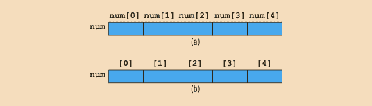

**图 8-2** 数组 num

### 访问数组分量

访问数组分量所用的一般形式（语法）为：

```cpp
arrayName[indexExp]
```

其中 `indexExp` 称为*索引*，是任何值为非负整数的表达式。索引值指定该分量在数组中的位置。

在 C++ 中，`[]` 是一个称为**数组下标运算符**的运算符。此外，在 C++ 中，数组索引从 0 开始。

考虑以下语句：

```cpp
int list[10];
```

该语句声明一个包含 10 个分量的数组 list。这些分量是 `list[0]`、`list[1]`、……、`list[9]`。换句话说，我们声明了 10 个变量（见图 8-3）。

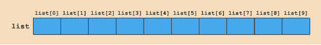

**图 8-3** 数组 list

赋值语句：

```cpp
list[5] = 34;
```

将 34 存入 `list[5]`，它是数组 `list` 的*第六个*分量（见图 8-4）。

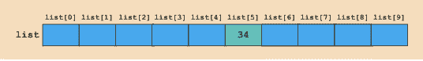

**图 8-4** 执行语句 `list[5] = 34;` 后的数组 list

假设 `i` 是一个 `int` 变量。那么，赋值语句：

```cpp
list[3] = 63;
```

等价于以下赋值语句：

```cpp
i = 3;
list[i] = 63;
```

接下来，考虑以下语句：

```cpp
list[3] = 10;
list[6] = 35;
list[5] = list[3] + list[6];
```

第一条语句将 10 存入 list[3]，第二条语句将 35 存入 list[6]，第三条语句将 list[3] 和 list[6] 的内容相加，并将结果存入 list[5]（见图 8-5）。

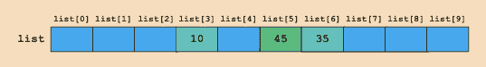

**图 8-5** 执行语句 list[3] = 10、list[6] = 35 和 list[5] = list[3] + list[6]; 后的数组 list

由此可见，数组分量是各自独立的变量，可以像其他变量一样使用，而 list[0] 是数组中某个独立变量的名称。

现在，如果 `i` 为 4，那么赋值语句：

```cpp
list[2 * i - 3] = 58;
```

将 58 存入 list[5]，因为 2 * i - 3 的求值结果为 5。先对索引表达式求值，得到该分量在数组中的位置。

### 例 8-2

也可以按如下方式声明数组：

```cpp
const int ARRAY_SIZE = 10;
int list[ARRAY_SIZE];
```

也就是说，可以先声明一个命名常量，然后使用该命名常量的值来声明数组并指定其大小。


> **注意**
>
> 声明数组时，必须指定其大小。例如，不能执行以下操作：

```cpp
int arraySize; //Line 1

cout << "Enter the size of the array: "; //Line 2
cin >> arraySize; //Line 3
cout << endl; //Line 4

int list[arraySize]; //Line 5; not allowed
```

第 2 行中的语句要求用户在程序执行时输入数组的大小。第 3 行中的语句将数组的大小输入到 **arraySize** 中。当编译器编译第 1 行时，变量 **arraySize** 的值是未知的。因此，当编译器编译第 5 行时，数组的大小未知，编译器将不知道为该数组分配多少内存空间。在第 12 章中，你将学习如何在程序执行期间指定数组的大小，然后使用指针声明该大小的数组。在程序执行期间使用指针创建的数组称为 **动态数组**。目前，无论何时声明数组，其大小都必须是已知的。

## 处理一维数组

对一维数组执行的一些基本操作包括初始化、输入数据、输出数组中存储的数据，以及查找最大和/或最小元素。此外，如果数据是数值型的，另一些基本操作是求数组元素的和与平均值。这些操作中的每一个都需要能够遍历数组的元素。使用循环可以轻松实现这一点。例如，假设我们有以下语句：

```cpp
int list[100];        //list is an array of size 100
int i;
```

下面的 `for` 循环遍历数组 `list` 的每个元素，从 `list` 的第一个元素开始：

```cpp
for (i = 0; i < 100; i++)        //Line 1
    //process list[i]            //Line 2
```

如果处理 `list` 需要将数据输入到 `list` 中，则第 2 行中的语句采用输入语句的形式，例如 `cin` 语句。例如，以下语句从键盘读取 100 个数字并将这些数字存储到 `list` 中：

```cpp
for (i = 0; i < 100; i++)        //Line 1
    cin >> list[i];              //Line 2
```

类似地，如果处理 `list` 需要输出数据，则第 2 行中的语句采用输出语句的形式。例如，以下语句输出存储在 `list` 中的数字。

```cpp
for (i = 0; i < 100; i++)    //Line 1
    cout << list[i] << " ";   //Line 2
cout << endl;
```

示例 8-3 进一步说明了如何处理一维数组。

### 示例 8-3

此示例展示如何使用循环处理数组。以下声明贯穿本示例使用：

```cpp
double sales[10];
double largestSale, sum, average;
```

第一条语句声明了一个包含 10 个分量的数组 sales，每个分量的类型为 double。其他语句的含义很明确。

- a. **初始化数组：** 以下循环将数组 sales 的每个分量初始化为 0.0。

  ```cpp
  for (int index = 0; index < 10; index++)
      sales[index] = 0.0;
  ```

- b. **将数据读入数组：** 以下循环将数据输入到数组 sales 中。为简单起见，我们假设数据从键盘输入。

  ```cpp
  for (int index = 0; index < 10; index++)
      cin >> sales[index];
  ```

- c. **打印数组：** 以下循环输出数组 sales。为简单起见，我们假设输出到屏幕。

  ```cpp
  for (int index = 0; index < 10; index++)
      cout << sales[index] << " ";
  ```

- d. **求数组的和与平均值：** 因为数组 sales 正如其名，表示某些销售数据，所以很自然地要求总销售额和平均销售额。以下 C++ 代码求数组 sales 的元素之和与平均销售额：

  ```cpp
  sum = 0;

  for (int index = 0; index < 10; index++)
      sum = sum + sales[index];
  average = sum / 10;
  ```

- e. **数组中的最大元素：** 我们现在讨论查找数组中最大元素第一次出现的算法——即第一个具有最大值的数组分量。然而，一般来说，用户更感兴趣的是确定数组中最大元素的位置。当然，如果你知道位置（即数组中最大元素的下标），你就可以轻松确定数组中最大元素的值。因此，让我们描述确定数组中最大元素第一次出现下标的算法——特别是数组 `sales` 中最大销售额的下标。我们将使用数组中最大元素第一次出现的下标来查找最大销售额。

  我们假设 `maxIndex` 将包含数组 `sales` 中最大元素第一次出现的下标。一般算法很直接。最初，我们假设列表中的第一个元素是最大元素，因此 `maxIndex` 初始化为 0。然后，我们将 `maxIndex` 指向的元素与列表中的每个后续元素进行比较。每当我们发现数组中有一个元素大于 `maxIndex` 指向的元素时，就更新 `maxIndex`，使其指向新的更大元素。算法如下：

  ```cpp
  maxIndex = 0;
  for (int index = 1; index < 10; index++)
      if (sales[maxIndex] < sales[index])
          maxIndex = index;

  largestSale = sales[maxIndex];
  ```

  让我们用一个例子演示该算法如何工作。假设数组 `sales` 如 图 8-6 所示。

  | sales | [0] | [1] | [2] | [3] | [4] | [5] | [6] | [7] | [8] | [9] |
  |---|---:|---:|---:|---:|---:|---:|---:|---:|---:|---:|
  |  | 12.50 | 8.35 | 19.60 | 25.00 | 14.00 | 39.43 | 35.90 | 98.23 | 66.65 | 35.64 |

  *图 8-6* 数组 `sales`

  这里，我们确定数组 `sales` 中的最大元素。在 `for` 循环开始之前，`maxIndex` 初始化为 0，而 `for` 循环将 `index` 初始化为 1。下面，我们展示 `for` 循环每次迭代期间 `maxIndex`、`index` 以及某些数组元素的值。

```cpp
cout << fixed << showpoint << setprecision(2);

cout << "Enter five test scores: ";

for (index = 0; index < 5; index++)
{
    cin >> test[index];
    sum = sum + test[index];
}

cout << endl;

average = sum / 5.0;

cout << "The average test score = " << average << endl;

for (index = 0; index < 5; index++)
    if (test[index] < average)
        cout << test[index]
             << " is less than the average "
             << " test score." << endl;
return 0;
}
```

**示例运行：** 在此示例运行中，用户输入以阴影显示。

```text
Enter five test scores: 78 87 65 94 60

The average test score = 76.80
65 is less than the average test score.
60 is less than the average test score.
```

## 数组下标越界

考虑以下声明：

```cpp
double num[10];
int i;
```

分量 num[i] 是有效的，也就是说，如果 i = 0、1、2、3、4、5、6、7、8 或 9，则 i 是有效下标。

数组的下标——比如 index——如果 index 在 0 和 ARRAY_SIZE − 1 之间，即 0 <= index <= ARRAY_SIZE − 1，则是在界内的。如果 index 为负数或 index 大于 ARRAY_SIZE − 1，则我们说该下标越界。

不幸的是，C++ 不检查下标值是否在范围内——即在 0 和 ARRAY_SIZE − 1 之间。如果下标越界并且程序试图访问该下标指定的分量，那么无论该下标指示哪个内存位置，都会访问该位置。这种情况可能导致修改或访问你从未打算修改或访问的内存位置的数据，或者导致试图访问受保护的内存位置，从而使程序立即停止。因此，如果下标在执行期间越界，可能会发生一些奇怪的事情。确保下标在界内完全是程序员的责任。


考虑以下语句：

```cpp
int list[10];
```

像下面这样的循环可能会使 list 的索引越界：

```cpp
for (int i = 0; i <= 10; i++)
    list[i] = 0;
```

当 i 变为 10 时，循环测试条件 i <= 10 求值为 true，循环体执行，从而将 0 存入 list[10]。从逻辑上讲，list[10] 并不存在。

> **注意** 在某些新编译器上，如果程序中的数组索引越界，程序可能会终止并显示错误消息。例如，参见程序 `Example_ArrayIndexOutOfBoundsA.cpp` 和 `Example_ArrayIndexOutOfBoundsB.cpp` 以及本书配套网站。

## 声明期间的数组初始化

像任何简单变量一样，数组可以在声明时初始化。例如，以下 C++ 语句声明了一个包含五个分量的数组 sales，并初始化这些分量。

```cpp
double sales[5] = {12.25, 32.50, 16.90, 23, 45.68};
```

这些值放在花括号之间并用逗号分隔——这里，sales[0] = 12.25，sales[1] = 32.50，sales[2] = 16.90，sales[3] = 23.00，sales[4] = 45.68。

在声明数组时进行初始化，不必指定数组的大小。大小由花括号中初始值的数量决定。但是，必须包含数组名后的方括号。因此，前一条语句等价于：

```cpp
double sales[] = {12.25, 32.50, 16.90, 23, 45.68};
```

尽管如果在声明期间初始化数组，则不必指定数组的大小，但这样做是一种良好实践。

## 声明期间数组的部分初始化

当同时声明并初始化数组时，不需要初始化数组的所有分量。此过程称为**声明期间数组的部分初始化**。但是，如果在声明期间部分初始化数组，则必须谨慎。以下示例有助于解释在声明并部分初始化数组时会发生什么。

语句：

```cpp
int list[10] = {0};
```

### 示例 8-5

考虑以下函数：

```cpp
void funcArrayAsParam(int listOne[], double listTwo[])
{
    .
    .
    .
}
```

函数 `funcArrayAsParam` 有两个形参：(1) `listOne`，一个类型为 `int` 的一维数组（即分量类型为 `int`）；(2) `listTwo`，一个类型为 `double` 的一维数组。在此声明中，两个数组的大小均未指定。

有时，数组中的元素数量可能小于数组的大小。例如，存储学生数据的数组中的元素数量可能随着学生退课或加课而增加或减少。在这种情况下，我们只想处理数组中保存实际数据的分量。要编写处理此类数组的函数，除了将数组声明为形参外，还要声明另一个形参来指定数组中的元素数量，如下面的函数所示：

```cpp
void initialize(int list[], int listSize)
{
    for (int count = 0; count < listSize; count++)
        list[count] = 0;
}
```

函数 `initialize` 的第一个参数是任意大小的 `int` 数组。调用函数 `initialize` 时，实际数组的大小作为函数 `initialize` 的第二个参数传入。

## 常量数组作为形参

回想一下，当形参是引用参数时，每当形参改变，实参也会改变。然而，尽管数组总是按引用传递，你仍然可以阻止函数更改实参。为此，在形参声明中使用保留字 `const`。考虑以下函数：

```cpp
void example(int x[], const int y[], int sizeX, int sizeY)
{
    .
    .
    .
}
```

这里，函数 `example` 可以修改数组 x，但不能修改数组 y。任何更改 y 的尝试都会导致编译时错误。如果不希望函数修改数组，则将数组声明为常量形参是一种良好的编程实践。

### 示例 8-6

此示例展示如何编写用于数组处理的函数，以及如何将数组声明为形参。

```cpp
//Function to initialize an int array to 0.
//The array to be initialized and its size are passed
//as parameters. The parameter listSize specifies the
//number of elements to be initialized.
void initializeArray(int list[], int listSize)
{
    for (int index = 0; index < listSize; index++)
        list[index] = 0;
}

//Function to read and store the data into an int array.
//The array to store the data and its size are passed as
//parameters. The parameter listSize specifies the number
//of elements to be read.
void fillArray(int list[], int listSize)
{
    for (int index = 0; index < listSize; index++)
        cin >> list[index];
}

//Function to print the elements of an int array.
//The array to be printed and the number of elements
//are passed as parameters. The parameter listSize
//specifies the number of elements to be printed.
void printArray(const int list[], int listSize)
{
    for (int index = 0; index < listSize; index++)
        cout << list[index] << " ";
}

//Function to find and return the sum of the
//elements of an int array. The parameter listSize
//specifies the number of elements to be added.
int sumArray(const int list[], int listSize)
{
    int sum = 0;

    for (int index = 0; index < listSize; index++)
        sum = sum + list[index];

    return sum;
}

//Function to find and return the index of the first
//largest element in an int array. The parameter listSize
//specifies the number of elements in the array
int indexLargestElement(const int list[], int listSize)
{
    int maxIndex = 0; //assume the first element is the largest

    for (int index = 1; index < listSize; index++)
        if (list[maxIndex] < list[index])
            maxIndex = index;

    return maxIndex;
}

//Function to copy some or all of the elements of one array
//into another array, starting at the position specified
//by src, the elements of list1 are copied into list2,
//starting at the position specified by tar. The parameter
//numOfElements specifies the number of elements of list1 to
//be copied into list2. Starting at the position specified
//by tar, list2 must have enough components to copy the
//elements of list1. The following call copies all of the
//elements of list1 into the corresponding positions in
//list2: copyArray(list1, 0, list2, 0, numOfElements);
void copyArray(int list1[], int src, int list2[],
               int tar, int numOfElements)
{
    for (int index = src; index < src + numOfElements; index++)
    {
        list2[tar] = list1[index];
        tar++;
    }
}
```

## 数组的基地址与计算机内存中的数组

数组的**基地址**是第一个数组分量的地址（即内存位置）。例如，如果 `list` 是一维数组，则 `list` 的基地址是分量 `list[0]` 的地址。

考虑以下语句：

```cpp
int myList[5];       //Line 1
```

此语句将 **myList** 声明为一个包含五个 **int** 类型分量的数组。这些分量是 **myList[0]**、**myList[1]**、**myList[2]**、**myList[3]** 和 **myList[4]**。计算机为这些分量分配五个内存空间，每个空间都足以存储一个 int 值。此外，这五个内存空间是连续的。

数组 **myList** 的基地址是分量 **myList[0]** 的地址。假设数组 **myList** 的基地址是 1000。那么，分量 **myList[0]** 的地址是 1000。通常，为 int 变量分配的内存为四个字节。回顾第 1 章，主存是单元的有序序列，每个单元都有唯一地址。通常，每个单元为一个字节。因此，要将值存储到从地址 1000 开始的 **myList[0]** 中，接下来的四个字节分配给 **myList[0]**。由此可知，**myList[1]** 的起始地址是 1004，**myList[2]** 的起始地址是 1008，依此类推（见图 8-7）。

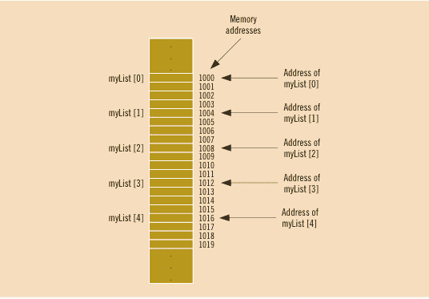

**图 8-7** 数组 *myList* 及其分量的地址

现在 **myList** 是数组的名称。还有一个与标识符 **myList** 关联的内存空间，数组的基地址存储在该内存空间中。考虑以下语句：

```cpp
cout << myList << endl;        //Line 2
```

前面我们说过，此语句不会给出期望的结果。也就是说，此语句不会输出 **myList** 的*分量*的值。事实上，该语句

输出存储在 `myList` 中的值，即该数组的基地址。这就是该语句不会产生语法错误的原因。

假设你还有以下语句：

```cpp
int yourList[5];
```

那么，在以下语句中：

```cpp
if (myList <= yourList)             //Line 3
.
.
.
```

表达式 `myList <= yourList` 在数组 `myList` 的基地址小于数组 `yourList` 的基地址时求值为 true；否则求值为 false。它并不判断 `myList` 的元素是否小于或等于 `yourList` 的对应元素。

> **注意**
>
> 本书配套网站包含程序 `BaseAddressOfAnArray.cpp`，它阐明了诸如第 2 行和第 3 行中的语句。

你可能想知道为什么数组的基地址如此重要。原因是，当你声明一个数组时，计算机记住的关于该数组的信息只有数组名、它的基地址、每个分量的数据类型，以及（可能还有）分量个数。计算机使用数组的基地址、数组分量的下标以及每个分量的字节大小，计算特定分量的地址。例如，假设你想访问 `myList[3]` 的值。现在，`myList` 的基地址是 1000。`myList` 的每个分量都是 `int` 类型，因此用一个四字节来存储一个值，而所需分量的下标是 3。要访问 `myList[3]` 的值，计算机计算地址 `1000 + 4 * 3 = 1000 + 12 = 1012`。也就是说，这是 `myList[3]` 的起始地址。因此，从 1012 开始，计算机访问接下来的四个字节：1012、1013、1014 和 1015。

当你将数组作为参数传递时，实际数组的基地址会传递给形参。例如，假设你有以下函数：

```cpp
void arrayAsParameter(int list[], int size)
{
    .
    .
    .

    list[2] = 28;       //Line 4
...
...
...
}
```

另外，假设你有以下对该函数的调用：

```cpp
arrayAsParameter(myList, 5);  //Line 5
```

在这条语句中，`myList` 的基地址被传递给形参 `list`。因此，`list` 的基地址是 `1000`。该函数的定义包含语句 `list[2] = 28;`。这条语句将 `28` 存入 `list[2]`。要访问 `list[2]`，计算机按如下方式计算地址：`1000 + 4 * 2 = 1008`。因此，从地址 `1008` 开始，计算机访问接下来的四个字节并存入 `28`。注意，实际上 `1008` 是 `myList[2]` 的地址（见图 8-7）。由此可知，在第 5 行语句执行期间，第 4 行语句将值 `28` 存入 `myList[2]`。同样可知，在第 5 行函数调用语句执行期间，`list[index]` 和 `myList[index]` 指代同一内存空间，其中 `0 <= index` 且 `index < 5`。

> **注意**
>
> 如果 C++ 允许按值传递数组，那么在调用函数时，计算机就必须为形参的分量分配内存，并将实际数组的内容复制到相应的形参中。如果数组很大，这个过程既浪费内存，也浪费复制数据所需的计算机时间。这就是在 C++ 中数组总是按引用传递的原因。

## 函数不能返回数组类型的值

C++ 不允许函数返回数组类型的值。注意，前面描述的函数 `sumArray` 和 `indexLargestElement` 返回 `int` 类型的值。

## 示例 8-7

假设物体在时间 `t = a₁` 行驶的距离为 `d₁`，在时间 `t = a₂` 行驶的距离为 `d₂`，其中 `a₁ < a₂`。那么物体从时间 `a₁` 到 `a₂` 的平均速度，也就是在区间 `[a₁, a₂]` 上的平均速度，为 `(d₂ − d₁)/(a₂ − a₁)`。假设物体在某些时刻行驶的距离由下表给出：

| 时间 | 0 | 10 | 20 | 30 | 40 | 50 |
|---|---:|---:|---:|---:|---:|---:|
| 行驶距离 | 0 | 18 | 27 | 38 | 52 | 64 |

```cpp
for (int index = 0; index < length; index++)
{
    cout << "Enter total distance traveled at time "
         << index * 10 << " units: ";
    cin >> list[index];
    cout << endl;
}
}

void averageSpeedOverTimeInterval(double list[], int length,
                                  double avgSpeed[])
{
    for (int index = 0; index < length - 1; index++)
        avgSpeed[index] = (list[index + 1] - list[index]) / 10;
}

double maxAvgSpeed(double avgSpeed[], int length)
{
    double max = avgSpeed[0];

    for (int index = 1; index < length - 1; index++)
        if (avgSpeed[index] > max)
            max = avgSpeed[index];

    return max;
}

double minAvgSpeed(double avgSpeed[], int length)
{
    double min = avgSpeed[0];

    for (int index = 1; index < length - 1; index++)
        if (avgSpeed[index] < min)
            min = avgSpeed[index];

    return min;
}

void print(double list[], int length, double avgSpeed[])
{
    cout << setw(7) << "Time " << setw(20) << "Distance Traveled "
         << setw(10) << "Average Speed / Time Interval" << endl;

    cout << setw(5) << 0
         << setw(14) << list[0] << setw(6) << " "
         << setw(10) << 0 << " [0, 0]" << endl;

    for (int index = 1; index < length; index++)
        cout << setw(5) << index * 10
             << setw(14) << list[index] << setw(6) << " "
             << setw(10) << avgSpeed[index - 1]
             << " [" << (index - 1) * 10 << ", "
             << index * 10 << "]" << endl;
}
```

**示例运行：** 在此示例运行中，用户输入以阴影显示。

```text
Enter the total distance traveled after every 10 units of time.
Enter total distance traveled at time 0 units: 0

Enter total distance traveled at time 10 units: 30

Enter total distance traveled at time 20 units: 45

Enter total distance traveled at time 30 units: 58

Enter total distance traveled at time 40 units: 67

Enter total distance traveled at time 50 units: 80

Time   Distance Traveled   Average Speed / Time Interval
 0          0.00                 0   [0, 0]
10         30.00                3.00  [0, 10]
20         45.00                1.50  [10, 20]
30         58.00                1.30  [20, 30]
40         67.00                0.90  [30, 40]
50         80.00                1.30  [40, 50]
Maximum average speed: 3.00
Minimum average speed: 0.90
```

## 整型数据类型与数组下标

> **注意**
>
> 理解本节需要先阅读第 7 章的“枚举类型”和“typedef 语句”两节。

除整数外，C++ 允许任何整型用作数组下标。这一特性可以极大增强程序的可读性。考虑以下语句：

```cpp
enum paintType {GREEN, RED, BLUE, BROWN, WHITE, ORANGE, YELLOW};
double paintSale[7];
paintType paint;
```

以下循环将数组 `paintSale` 的每个分量初始化为 0：

```cpp
for (paint = GREEN; paint <= YELLOW;
                 paint = static_cast<paintType>(paint + 1))
    paintSale[paint] = 0.0;
```

以下语句更新 RED 涂料的销售量：

```cpp
paintSale[RED] = paintSale[RED] + 75.69;
```

如你所见，上面的代码比使用整数作为下标的代码更容易理解。因此，只要可能，就应使用枚举类型或其他整型数据类型作为数组下标。注意，当使用枚举类型作为数组下标时，应使用枚举类型中标识符的默认值。也就是说，第一个标识符的值必须为 0，依此类推。（回顾第 7 章可知，枚举类型中标识符的默认值从 0 开始；不过，这些标识符也可以设置为其他值。）

### 声明数组的其他方式

假设一个班级有 20 名学生，你需要记录他们的成绩。由于学生人数可能每学期变化，因此可以在声明数组时不指定数组大小，而按如下方式声明数组：

```cpp
const int NO_OF_STUDENTS = 20;
int testScores[NO_OF_STUDENTS];
```

用于声明数组的其他形式包括：

```cpp
const int SIZE = 50;        //Line 1
typedef double list[SIZE];  //Line 2

list yourList;              //Line 3
list myList;                //Line 4
```

第 2 行的语句定义了一个数据类型 list，它是一个包含 50 个 double 类型分量的数组。第 3 行和第 4 行的语句声明了两个变量 yourList 和 myList。两者都是包含 50 个 double 类型分量的数组。当然，这些语句等价于：

```cpp
double yourList[50];
double myList[50];
```

### 在数组中查找特定项

在列表中查找给定项是对列表执行的最常见操作之一。我们描述的查找算法称为 **顺序查找** 或 **线性查找**。顾名思义，你从第一个数组元素开始，顺序查找数组。你将 **searchItem** 与数组（即 **list**）中的元素进行比较，并继续查找，直到找到该项，或者 **list** 中不再有数据可与 **searchItem** 比较。

考虑图 8-8 所示的包含七个元素的列表。


假设你想确定 27 是否在列表中。顺序查找的工作方式如下：首先，将 27 与 list[0] 比较，也就是将 27 与 35 比较。因为 list[0] ≠ 27，接着将 27 与 list[1] 比较，也就是与列表中的第二项 12 比较。因为 list[1] ≠ 27，再将 27 与列表中的下一个元素比较，也就是将 27 与 list[2] 比较。因为 list[2] = 27，查找停止。这次查找成功。

现在查找 10。和之前一样，查找从列表的第一个元素开始，也就是从 list[0] 开始。按之前的方式继续，我们看到，这一次查找项 10 会与列表中的每一项进行比较。最终，列表中没有更多数据可与查找项比较。这是一次不成功的查找。

由此可知，一旦在列表中找到等于查找项的元素，就必须停止查找并报告成功。（在这种情况下，通常还要报告在列表中找到查找项的位置。）否则，在查找项与列表中的每个元素比较均不成功后，必须停止查找并报告失败。

假设包含列表元素的数组名为 `list`。前面的讨论可转化为以下顺序查找算法：

```text
found is set to false
loc = 0;

while (loc < listLength and not found)
    if (list[loc] is equal to searchItem)
        found is set to true
    else
        increment loc

if (found)
    return loc;
else
    return -1;
```

下面的函数对列表执行顺序查找。具体来说，为便于说明，我们假设列表元素为 `int` 类型。

```cpp
int seqSearch(const int list[], int listLength, int searchItem)
{
    int loc;
    bool found = false;

    loc = 0;

    while (loc < listLength && !found)
        if (list[loc] == searchItem)
            found = true;
        else
            loc++;

    if (found)
        return loc;
    else
        return -1;
}
```

如果函数 seqSearch 返回大于或等于 0 的值，则是一次成功查找；否则，是一次不成功查找。

从这段代码可以看到，查找从将 searchItem 与列表中的第一个元素比较开始。如果 searchItem 等于列表中的第一个元素，就退出循环；否则，loc 递增 1，指向列表中的下一个元素。然后将 searchItem 与列表中的下一个元素比较，依此类推。

## 示例 8-8

```cpp
// This program illustrates how to use a sequential search in a
// program.

#include <iostream>                                   //Line 1

using namespace std;                                  //Line 2

const int ARRAY_SIZE = 10;                            //Line 3

int seqSearch(const int list[], int listLength,
              int searchItem);                        //Line 4

int main()                                            //Line 5
{                                                     //Line 6
    int intList[ARRAY_SIZE];                          //Line 7
    int number;                                       //Line 8

    cout << "Line 9: Enter " << ARRAY_SIZE
         << " integers." << endl;                     //Line 9

    for (int index = 0; index < ARRAY_SIZE; index++) //Line 10
        cin >> intList[index];                        //Line 11

    cout << endl;                                     //Line 12

    cout << "Line 13: Enter the number to be "
         << "searched: ";                             //Line 13
    cin >> number;                                    //Line 14
    cout << endl;                                     //Line 15

    int pos = seqSearch(intList, ARRAY_SIZE, number); //Line 16

    if (pos != -1)                                    //Line 17
        cout << "Line 18: " << number
             << " is found at index " << pos
             << endl;                                 //Line 18
    else                                              //Line 19
        cout << "Line 20: " << number
             << " is not in the list." << endl;      //Line 20

    return 0;                                        //Line 21
}                                                    //Line 22

//Place the definition of the function seqSearch
//given previously here.
```

**示例运行 1：** 在此示例运行中，用户输入以阴影显示。

```text
Line 9: Enter 10 integers.
16 45 37 29 80 32 67 78 10 30

Line 13: Enter the number to be searched: 29

Line 18: 29 is found at index 3
```

**示例运行 2：**

```text
Line 9: Enter 10 integers.
16 45 37 29 80 32 67 78 10 30

Line 13: Enter the number to be searched: 12

Line 20: 12 is not in the list.
```

## 排序

上一节讨论了一种查找算法。本节讨论如何使用一种称为**选择排序**的算法对数组排序。

顾名思义，在**选择排序**算法中，我们通过选择列表中的一个元素并将其移到合适位置来重新排列列表。该算法找到列表中未排序部分最小元素的位置，并将其移到该未排序部分的顶部。第一次，我们定位整个列表中的最小项。第二次，我们从列表中的第二个元素开始定位列表中的最小项，依此类推。

假设你有一个如图 8-9 所示的列表。


*图 8-9* 八个元素的列表

图 8-10 显示了第一次迭代中 `list` 的元素。

最初，整个列表是未排序的。因此，我们找到列表中的最小项。最小项位于位置 6，如图 8-10(a) 所示。由于这是最小项，必须将其移到位置 0。因此，我们交换 16（即 `list[0]`）与 5（即 `list[6]`），如图 8-10(b) 所示。交换这些元素后，得到的列表如图 8-10(c) 所示。

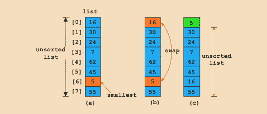

*图 8-10* 第一次迭代期间列表的元素

图 8-11 显示了第二次迭代期间列表的元素。

现在未排序列表是 `list[1]...list[7]`。因此，我们找到未排序列表中的最小元素。最小元素位于位置 3，如图 8-11(a) 所示。因为未排序列表中的最小元素位于位置 3，所以必须将其移到位置 1。因此，我们交换 7（即 `list[3]`）与 30（即 `list[1]`），如图 8-11(b) 所示。交换 `list[1]` 与 `list[3]` 后，得到的列表如图 8-11(c) 所示。

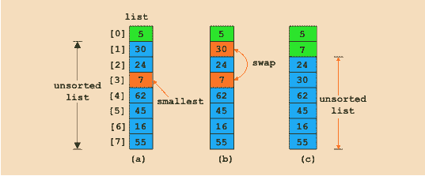

*图 8-11* 第二次迭代期间列表的元素

现在，未排序列表是 `list[2]...list[7]`。因此，我们重复上述过程：在列表的未排序部分找到最小元素（的位置），并将其移到该未排序部分的开头。因此，选择排序包括以下步骤。

在列表的未排序部分中：

- a. 找到最小元素的位置。
- b. 将最小元素移到未排序列表的开头。

最初，整个列表（即 `list[0]...list[length - 1]`）是未排序列表。执行步骤 a 和 b 一次后，未排序列表是 `list[1]...list[length - 1]`。第二次执行步骤 a 和 b 后，未排序列表是 `list[2]...list[length - 1]`，依此类推。这样，我们可以跟踪列表的未排序部分，并借助 `for` 循环重复步骤 a 和 b，如下面的伪代码所示：

```text
for (index = 0; index < length - 1; index++)
{
    a. Find the location, smallestIndex, of the smallest element in
       list[index]...list[length - 1].

    b. Swap the smallest element with list[index]. That is, swap
       list[smallestIndex] with list[index].
}
```

第一次循环时，我们定位 `list[0]...list[length - 1]` 中的最小元素，并将最小元素与 `list[0]` 交换。第二次循环时，我们定位 `list[1]...list[length - 1]` 中的最小元素，并将最小元素与 `list[1]` 交换，依此类推。

步骤 a 类似于本章前面讨论的查找列表中最大项索引的算法。（另见本章末尾的编程练习 2a。）这里，我们查找列表中最小项的索引。步骤 a 的一般形式为：

```text
smallestIndex = index;    // assume first element is the smallest

for (location = index + 1; location < length; location++)
    if (list[location] < list[smallestIndex])
        smallestIndex = location;    // current element in the list
                                      // is smaller than the smallest so
                                      // far, so update smallestIndex
```

步骤 b 交换 `list[smallestIndex]` 与 `list[index]` 的内容。以下语句完成此任务：

```text
temp = list[smallestIndex];
list[smallestIndex] = list[index];
list[index] = temp;
```

由此可见，要交换这些值，需要三次项赋值。下面的函数 `selectionSort` 实现了选择排序算法。


```cpp
void selectionSort(int list[], int length)
{
    int index;
    int smallestIndex;
    int location;
    int temp;

    for (index = 0; index < length - 1; index++)
    {
        //Step a
        smallestIndex = index;

        for (location = index + 1; location < length; location++)
        {
            if (list[location] < list[smallestIndex])
                smallestIndex = location;
        }
        //Step b
        temp = list[smallestIndex];
        list[smallestIndex] = list[index];
        list[index] = temp;
    }
}
```

示例 8-9 中的程序演示了如何在程序中使用选择排序算法。

### 示例 8-9

```cpp
//选择排序

#include <iostream>                                      //第1行

using namespace std;                                     //第2行

void selectionSort(int list[], int length);              //第3行

int main()                                                //第4行
{
    int list[] = {2, 56, 34, 25, 73, 46, 89,           //第5行
                  10, 5, 16};                           //第6行

    int i;                                                //第7行

    selectionSort(list, 10);                              //第8行

    cout << "After sorting, the list elements are:"
         << endl;                                        //第9行

    for (i = 0; i < 10; i++)                              //第10行
        cout << list[i] << " ";                          //第11行

    cout << endl;                                 //第12行
    return 0;                                    //第13行
}                                            //第14行

//将前面给出的函数selectionSort的定义放在此处。
```

**示例运行：**
**排序后，列表元素为：**
**2 5 10 16 25 34 46 56 73 89**

第6行的语句声明并将 `list` 初始化为包含10个 `int` 类型分量的数组。第8行的语句使用函数 `selectionSort` 对 `list` 进行排序。注意，`list` 及其长度（其中元素的数量，即10）都作为参数传递给函数 `selectionSort`。第10行和第11行的 for 循环输出 `list` 的元素。为了在本程序中演示选择排序算法，我们声明并初始化了数组 `list`。不过，你也可以在程序运行期间提示用户输入数据。

对于长度为 *n* 的列表，选择排序恰好进行 $\frac{n(n-1)}{2}$ 次键比较和 3(*n* - 1) 次元素赋值。因此，如果 *n* = 1,000，那么对该列表排序时，选择排序约进行 500,000 次键比较和约 3,000 次元素赋值。

## 自动声明与基于范围的 for 循环

C++11 引入了元素的自动声明（auto declaration），允许程序员在不指定类型的情况下声明并初始化变量。例如，下面的语句声明变量 `num` 并在其中存储 15：

```cpp
auto num = 15;
```

因为初始值 15 是一个 `int` 值，所以 `num` 的类型将是 `int`。

从第一个元素开始逐一处理数组元素的一种方法是使用一个初始化为 0 的索引变量和一个循环。例如，要处理数组 `list` 的元素，可以使用如下 for 循环：

```cpp
for (int index = 0; index < length; index++)
    //处理 list[index]
```

本章使用这类循环来处理数组的元素。C++11 提供了一种特殊类型的 for 循环来处理数组的元素。使用这种 for 循环处理数组元素的语法为：

```cpp
for (dataType identifier : arrayName)
    statements
```

其中，**identifier** 是一个变量，且 **identifier** 的数据类型与数组元素的数据类型相同。这种形式的 for 循环称为*基于范围的* for 循环。

例如，假设你有以下声明：

```cpp
double list[25];
double sum;
```

下面的代码计算 `list` 的元素之和：

```cpp
sum = 0;                    //第1行

for (double num : list)     //第2行
    sum = sum + num;        //第3行
```

第2行中的 for 语句读作“对 list 中的每个 num”。变量 `num` 被初始化为 `list[0]`。在下一次迭代中，`num` 的值为 `list[1]`，依此类推。由此可见，变量 `num` 被赋值为每个数组元素的*内容*，而不是其索引值，并且该循环默认从 0 开始并遍历整个数组。

你也可以在基于范围的循环中使用自动声明来处理数组元素。例如，使用基于范围的 for 循环，查找数组 `list` 中最大元素的 for 循环可以写为：

```cpp
for (auto num : list)
{
    if (max < num)
        max = num;
}
```

假设 `list` 被声明为处理数组的函数的形参。具体来说，考虑以下声明：

```cpp
void doSomething(int list[])
{
    //处理 list 的代码
}
```

那么在函数 `doSomething` 的定义中，基于范围的 for 循环不能应用于 `list`。回顾一下，在 C++ 中，数组作为参数时是按引用传递的。因此，当函数 `doSomething` 被调用时，`list` 获得实参的基地址，也就是说，实参数组的基地址被复制到内存空间 `list` 中。所以形参 `list` 实际上并不是数组，而是一个用于存储内存位置地址的变量，因此它没有第一个元素（即 `list[0]`）和最后一个元素。

## C-字符串（字符数组）

到目前为止，我们一直避免讨论字符数组，原因很简单：字符数组具有特殊性，并且你处理它们的方式不同于处理其他数组。C++ 提供了许多（预定义的）函数，可用于字符数组。

**字符数组：** 分量类型为 `char` 的数组。

最广泛使用的字符集是 ASCII 和 EBCDIC。ASCII 字符集中的第一个字符是 null 字符，它是不可打印的。另外，在 C++ 中，null 字符表示为 `'\0'`，即反斜杠后跟一个零。

语句：

`ch = '\0';`

将 null 字符存储在 `ch` 中，其中 `ch` 是一个 `char` 变量。

正如你将看到的，null 字符在处理字符数组时起着重要作用。因为 null 字符的排序序列为 0，所以 null 字符小于 `char` 数据集中的任何其他字符。

字符数组最常用的术语是 c-string。然而，字符数组与 C-字符串之间存在细微差别。回顾一下，字符串是零个或多个字符的序列，并且字符串用双引号括起来。在 C++ 中，c-string 以 null 结尾；也就是说，c-string 中的最后一个字符始终是 null 字符。字符数组可能不包含 null 字符，但 c-string 的最后一个字符始终是 null 字符。正如你将看到的，null 字符不应出现在 c-string 中除最后一个位置以外的任何位置。此外，c-string 存储在一维字符数组中。

以下是 c-string 的示例：

```text
"John L. Johnson"
"Hello there."
```

从 c-string 的定义可以清楚地看出，'A' 和 "A" 之间存在区别。前者是字符 A；后者是 c-string A。由于 c-string 以 null 结尾，所以 "A" 表示两个字符：'A' 和 '\0'。类似地，c-string "Hello" 表示六个字符：'H'、'e'、'l'、'l'、'o' 和 '\0'。要存储 'A'，我们只需要一个 `char` 类型的内存单元；要存储 "A"，我们需要两个 `char` 类型的内存单元——一个用于 'A'，一个用于 '\0'。类似地，要在计算机内存中存储 c-string "Hello"，我们需要六个 `char` 类型的内存单元。

考虑以下语句：

`char name[16];`

该语句声明了一个名为 `name` 的数组，包含 16 个 `char` 类型的分量。由于 c-string 以 null 结尾，且 `name` 有 16 个分量，因此 `name` 中能存储的最大字符串长度为 15，以便为结尾的 '\0' 留出空间。如果你在 `name` 中存储长度为 10 的 c-string，那么 `name` 的前 11 个分量会被使用，后 5 个分量则未使用。

语句：

`char name[16] = {'J', 'o', 'h', 'n', '\0'};`


声明一个数组 name，它包含 16 个 `char` 类型的分量，并将 C 字符串 **"John"** 存储在其中。在声明 `char` 数组变量时，C++ 还允许在初始化语句中使用 C 字符串表示法。因此，上述语句等价于：

```cpp
char name[16] = "John";    //Line A
```

回想一下，如果在声明期间初始化数组，则可以省略数组的大小。

该语句：

```cpp
char name[] = "John";    //Line B
```

声明一个名为 name 的 C 字符串变量，其长度足够大——在本例中为 5——并将 **"John"** 存储在其中。最后两条语句之间存在差异：两条语句都将 **"John"** 存储在 name 中，但 A 行语句中 name 的大小为 16，而 B 行语句中 name 的大小为 5。

适用于其他数组的大多数规则也适用于字符数组。考虑以下语句：

```cpp
char studentName[26];
```

假设你想将 **"Lisa L. Johnson"** 存储到 `studentName` 中。由于数组不允许赋值和比较等聚合操作，因此以下语句不合法：

```cpp
studentName = "Lisa L. Johnson";  //illegal
```

C++ 提供了一组可用于 C 字符串操作的函数。头文件 `cstring` 定义了这些函数。表 8-1 描述了其中一些函数。

### 表 8-1 一些 C 字符串函数

| 函数 | 作用 |
|---|---|
| `strcpy(s1, s2)` | 将字符串 `s2` 复制到字符串变量 `s1` 中。<br>`s1` 的长度至少应与 `s2` 一样大。<br>不检查以确保 `s1` 与 `s2` 一样大 |
| `strncpy(s1, s2, limit)` | 将字符串 `s2` 复制到字符串变量 `s1` 中。<br>最多将 `limit` 个字符复制到 `s1` 中。 |
| `strcmp(s1, s2)` | 如果 `s1` 小于 `s2`，则返回小于 0 的值。<br>如果 `s1` 和 `s2` 相同，则返回 0。<br>如果 `s1` 大于 `s2`，则返回大于 0 的值 |
| `strncmp(s1, s2, limit)` | 这与上一个函数 `strcmp` 相同，只是最多比较 `limit` 个字符。 |
| `strlen(s)` | 返回字符串 `s` 的长度，不包括空字符 |

要使用这些函数，程序必须通过 `include` 语句包含头文件 `cstring`。也就是说，程序中必须包含以下语句：

```cpp
#include <cstring>
```

> **注意** 在某些编译器中，函数 `strcpy` 和 `strcmp` 已被弃用，在程序中使用时可能会给出警告消息。此外，函数 `strncpy` 和 `strncmp` 可能并未在所有 C++ 版本中实现。为确保无误，请查阅编译器的文档。

## 字符串比较

在 C++ 中，C 字符串使用系统的排序序列逐字符进行比较。假设你使用 ASCII 字符集。

- 1. C 字符串 `"Air"` 小于 C 字符串 `"Boat"`，因为 `"Air"` 的第一个字符小于 `"Boat"` 的第一个字符。
- 2. C 字符串 `"Air"` 小于 C 字符串 `"An"`，因为两个字符串的第一个字符相同，但 `"Air"` 的第二个字符 `'i'` 小于 `"An"` 的第二个字符 `'n'`。
- 3. C 字符串 `"Bill"` 小于 C 字符串 `"Billy"`，因为 `"Bill"` 和 `"Billy"` 的前四个字符相同，但 `"Bill"` 的第五个字符是 `\0`（空字符），它小于 `"Billy"` 的第五个字符 `'y'`。（回想一下，C++ 中的 C 字符串以空字符结尾。）
- 4. C 字符串 `"Hello"` 小于 `"hello"`，因为 C 字符串 `"Hello"` 的第一个字符 `'H'` 小于 C 字符串 `"hello"` 的第一个字符 `'h'`。

如你所见，函数 `strcmp` 将其第一个 C 字符串参数与第二个 C 字符串参数逐字符进行比较。

### 示例 8-10

假设你有以下语句：

```cpp
char studentName[21];
char myname[16];
char yourname[16];
```

以下语句展示了字符串函数如何工作：

| 语句 | 作用 |
|---|---|
| `strcpy(myname, "John Robinson");` | `myname = "John Robinson"` |
| `strlen("John Robinson");` | 返回 13，即字符串 `"John Robinson"` 的长度 |
| `int len;` |  |
| `len = strlen("Sunny Day");` | 将 9 存储到 `len` 中 |
| `strcpy(yourname, "Lisa Miller");` | `yourname = "Lisa Miller"` |
| `strcpy(studentName, yourname);` | `studentName = "Lisa Miller"` |
| `strcmp("Bill", "Lisa");` | 返回小于 0 的值 |
| `strcpy(yourname, "Kathy Brown");` | `yourname = "Kathy Brown"` |
| `strcpy(myname, "Mark G. Clark");` | `myname = "Mark G. Clark"` |
| `strcmp(myname, yourname);` | 返回大于 0 的值 |

> **注意**
> 
> 在本章中，我们将 C 字符串定义为零个或多个字符的序列。C 字符串用双引号括起来。我们还说过，C 字符串以空字符结尾，因此 C 字符串 "Hello" 有六个字符，尽管双引号中只括了五个字符。因此，要将 C 字符串 "Hello" 存储到计算机内存中，必须使用大小为 6 的字符数组。C 字符串的长度是双引号中实际包含的字符数；例如，C 字符串 "Hello" 的长度是 5。因此，从逻辑意义上讲，C 字符串是零个或多个字符的序列，但从物理意义上讲（也就是说，要将 C 字符串存储到计算机内存中），C 字符串至少有一个字符。因为 C 字符串的长度是双引号中实际包含的字符数，所以我们将 C 字符串定义为零个或多个字符的序列。但是，你必须记住，存储在计算机内存中 C 字符串末尾的空字符在我们比较 C 字符串时起着关键作用，尤其是比较诸如 "Bill" 和 "Billy" 这样的 C 字符串时。

## 字符串的读取和写入

如前所述，适用于数组的大多数规则也适用于 C 字符串。数组不允许赋值和比较等聚合操作。甚至数组的输入/输出也是逐元素进行的。然而，C++ 允许对数组进行聚合操作的一个地方是 C 字符串（即字符数组）的输入和输出。

我们将使用以下声明进行讨论：

```cpp
char name[31];
```

### 字符串输入

由于允许对 C 字符串输入进行聚合操作，因此以下语句：

```cpp
cin >> name;
```

将下一个输入的 C 字符串存储到 name 中。输入的 C 字符串长度必须小于或等于 30。如果输入字符串的长度为 4，计算机将存储输入的四个字符以及空字符 '\0'。如果输入的 C 字符串长度超过 30，那么由于没有检查数组索引边界，计算机会将存储该字符串的字符放入 name 之后的任意内存单元中。此过程可能导致严重问题，因为相邻内存单元中的数据将被破坏。

> **注意** 当你使用输入设备（如键盘）输入 C 字符串时，不要在其两侧包含双引号，除非双引号是字符串的一部分。例如，C 字符串 `"Hello"` 输入为 `Hello`。

回想一下，提取运算符 `>>` 会跳过所有前导空白字符，并且一旦遇到第一个空白字符或无效数据，就停止将数据读入当前变量。因此，包含空格的 C 字符串无法使用提取运算符 `>>` 读取。例如，如果名字和姓氏由空格分隔，则它们无法读入 `name` 中。

如何将包含空格的 C 字符串输入到字符数组中？函数 `get` 再次帮了我们。回想一下，函数 `get` 用于读取字符数据。到目前为止，你使用过的 `get` 函数形式（第 3 章）只读取单个字符。然而，函数 `get` 也可以用于读取字符串。要读取 C 字符串，需使用带两个参数的 `get` 函数形式。第一个参数是 C 字符串变量；第二个参数指定要读入该字符串变量的字符数。

要读取 C 字符串，`get` 函数与输入流变量（如 `cin`）一起使用的一般形式（语法）为：

```cpp
cin.get(str, m + 1);
```

该语句将接下来的 `m` 个字符，或直到找到换行符 `\n` 之前的所有字符，存储到 `str` 中。换行符不会存储到 `str` 中。如果输入的 C 字符串少于 `m` 个字符，则读取在换行符处停止。

考虑以下语句：

```cpp
char str[31];
cin.get(str, 31);
```

如果输入为：

```text
William T. Johnson
```

那么 `"William T. Johnson"` 会存储到 `str` 中。假设输入为：

```text
Hello there. My name is Mickey Blair.
```

这是一个长度为 37 的字符串。由于 `str` 最多只能存储 30 个字符，因此 C 字符串 `"Hello there. My name is Mickey"` 会存储到 `str` 中。

现在，假设我们有如下语句：

```cpp
char str1[26];
char str2[26];
char discard;
```

以及两行输入：

```text
Summer is warm.
Winter will be cold.
```

此外，假设我们想把第一个 C 字符串存储到 `str1` 中，把第二个 C 字符串存储到 `str2` 中。`str1` 和 `str2` 都能存储长度最多为 25 个字符的 C 字符串。由于第一行中的字符数为 15，读取会在 `'\n'` 处停止。此时换行符仍留在输入缓冲区中，必须手动丢弃。因此，为了把第二行存储到 `str2` 中，你必须读取并丢弃第一行末尾的换行符。下面的语句序列将第一行存储到 `str1` 中，将第二行存储到 `str2` 中：

```cpp
cin.get(str1, 26);
cin.get(discard);
cin.get(str2, 26);
```

要读取并存储一行输入（包括空白字符），还可以使用流函数 `getline`。假设你有以下声明：

```cpp
char textLine[100];
```

下面的语句将读取接下来的 99 个字符（或直到换行符为止）并存储到 `textLine` 中。空字符会自动追加为 `textLine` 的最后一个字符。

```cpp
cin.getline(textLine, 100);
```

## 字符串输出

C 字符串的输出是另一个允许对数组进行聚合操作的地方。你可以使用输出流变量（例如 `cout`）以及插入运算符 `<<` 来输出 C 字符串。例如，语句：

```cpp
cout << name;
```

会在屏幕上输出 `name` 的内容。插入运算符 `<<` 会持续写出 `name` 的内容，直到遇到空字符为止。因此，如果 `name` 的长度为 4，上述语句只输出四个字符。如果 `name` 不包含空字符，那么你会看到奇怪的输出，因为插入运算符会继续输出与 `name` 相邻的内存中的数据，直到找到 `\0` 为止。例如，请参见以下程序的输出。（注意，在你的计算机上，输出可能不同。）

```cpp
#include <iostream>

using namespace std;

int main()
{
    char name[5] = {'a', 'b', 'c', 'd', 'e'};
    int x = 50;
    int y = -30;

    cout << name << endl;

    return 0;
}
```

**输出：**

```text
abcde|¦|¦|¦|¦|¦
```

## 在执行时指定输入/输出文件

在第 3 章中，你学习了如何从文件中读取数据。在后续章节中，输入文件名被包含在 open 语句中。这样做时，程序总是从同一个输入文件接收数据。在实际应用中，数据可能实际上是在多个位置收集并存储在不同文件中的。此外，为了进行比较，有人可能希望分别处理每个文件，然后将输出存储到不同文件中。为了高效地完成这项任务，用户更愿意在执行时指定输入和/或输出文件的名称，而不是在程序代码中指定。C++ 允许用户这样做。

考虑以下语句：

```cpp
cout << "Enter the input file name: ";
cin >> fileName;

infile.open(fileName);    //open the input file
// ...
cout << "Enter the output file name: ";
cin >> fileName;

outfile.open(fileName);  //open the output file
```

本章后面给出的编程示例“代码检测”进一步说明了如何在程序执行期间指定输入文件和输出文件的名称。

## string 类型与输入/输出文件

在第 7 章中，我们讨论了数据类型 `string`。现在我们要指出，`string` 类型的值（即字符串）不是以空字符结尾的。`string` 类型的变量也可以用来读取和存储输入/输出文件的名称。但是，函数 open 的参数必须是以空字符结尾的字符串——即 C 字符串。因此，如果我们使用 `string` 类型的变量读取输入/输出文件的名称，然后使用该变量打开文件，则该变量的值必须（首先）转换为 C 字符串（即以空字符结尾的字符串）。头文件 `string` 包含函数 `c_str`，它把 `string` 类型的值转换为以空字符结尾的字符数组（即 C 字符串）。使用函数 `c_str` 的语法是

```cpp
strVar.c_str()
```

其中 `strVar` 是 `string` 类型的变量。

以下语句说明了如何在程序执行期间使用 `string` 类型的变量读取输入/输出文件的名称并打开这些文件：

```cpp
ifstream infile;
string fileName;

cout << "Enter the input file name: ";
cin >> fileName;

infile.open(fileName.c_str());  //open the input file
```

当然，你还必须在程序中包含头文件 `string`。输出文件也有类似的约定。

## 并行数组

如果两个（或更多）数组的对应分量保存相关信息，则称它们为**并行**数组。

假设你需要跟踪学生的课程成绩及其 ID 号，以便在学期末公布他们的成绩。此外，假设一个班最多有 50 名学生，他们的 ID 为 5 位数字。由于可能有 50 名学生，你需要 50 个变量来存储学生的 ID，以及 50 个变量来存储他们的成绩。你可以声明两个数组：`int` 类型的 `studentId` 和 `char` 类型的 `courseGrade`。每个数组都有 50 个分量。此外，`studentId[0]` 和 `courseGrade[0]` 将存储第一个学生的 ID 和课程成绩，`studentId[1]` 和 `courseGrade[1]` 将存储第二个学生的 ID 和课程成绩，依此类推。

以下语句：

```cpp
int studentId[50];
char courseGrade[50];
```

声明这两个数组。

假设你需要将数据输入这些数组，而数据以以下形式提供在文件中。例如，一个示例数据集是：

| 学生 ID | 课程成绩 |
|---|---|
| 23456 | A |
| 86723 | B |
| 22356 | C |
| 92733 | B |
| 11892 | D |
| ... | ... |

假设输入文件使用 **ifstream** 变量 `infile` 打开。因为每个数组的大小是 50，所以每个数组最多可以存储 50 个元素。此外，班里学生人数可能少于 50。因此，在读取数据时，我们还要统计学生人数，并确保数组下标不越界。以下循环将数据读入并行数组 `studentId` 和 `courseGrade`：

```cpp
int noOfStudents = 0;

infile >> studentId[noOfStudents] >> courseGrade[noOfStudents];

while (infile && noOfStudents < 50)
{
    noOfStudents++;
    infile >> studentId[noOfStudents]
           >> courseGrade[noOfStudents];
}
```

注意，通常在一个数组中交换值时，并行数组中的对应值也必须交换。

## 二维数组和多维数组

本章剩余部分讨论二维数组以及处理多维数组的方法。

在上一节中，你学习了如何使用一维数组来操作数据。如果数据以列表形式提供，你可以使用一维数组。然而，有时数据以表格形式提供。例如，假设你想跟踪当地经销商库存中某种颜色的汽车数量。该经销商销售五种不同颜色的六种车型。图 8-12 显示了示例数据。

| inStock | 红色 | 棕色 | 黑色 | 白色 | 灰色 |
|---|---|---|---|---|---|
| GMC | 10 | 7 | 12 | 10 | 4 |
| FORD | 18 | 11 | 15 | 17 | 10 |
| TOYOTA | 12 | 10 | 9 | 5 | 12 |
| BMW | 16 | 6 | 13 | 8 | 3 |
| NISSAN | 10 | 7 | 12 | 6 | 4 |
| VOLVO | 9 | 4 | 7 | 12 | 11 |

**图 8-12** inStock 表

你可以看到数据是表格格式。该表有 30 个条目，每个条目都是整数。由于表中的条目都是同一类型，你可以声明一个包含 30 个 `int` 类型分量的一维数组。一维数组的前五个分量可以存储表格第一行的数据，接下来的五个分量可以存储表格第二行的数据，依此类推。换句话说，你可以用一维数组模拟以表格格式给出的数据。


如果这样做，那么在一维数组中操作数据的算法就会有些复杂，因为必须知道一行在哪里结束、另一行从哪里开始。还必须正确计算特定元素的索引。C++ 通过使用二维数组简化了以表格形式操作数据的处理。本节首先讨论如何声明二维数组，然后介绍操作二维数组中数据的方法。

**二维数组：** 由固定数量的分量按行和列（即二维）排列而成的集合，其中所有分量都具有相同类型。

声明二维数组的语法是：

```cpp
dataType arrayName[intExp1][intExp2];
```

其中 `intExp1` 和 `intExp2` 是产生正整数值的常量表达式。这两个表达式 `intExp1` 和 `intExp2` 分别指定数组中的行数和列数。

语句：

```cpp
double sales[10][5];
```

声明了一个 10 行 5 列的二维数组 `sales`，其中每个分量的类型都是 `double`。与一维数组一样，行编号为 0……9，列编号为 0……4（见图 8-13）。

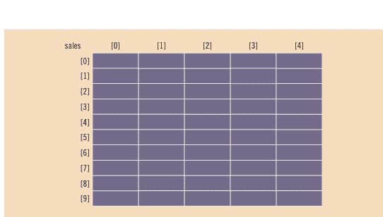

**图 8-13** 二维数组 sales

## 访问数组分量

要访问二维数组的分量，需要一对索引：一个用于行位置（在前），一个用于列位置（在后）。

访问二维数组分量的语法是：

```cpp
arrayName[indexExp1][indexExp2]
```

其中 `indexExp1` 和 `indexExp2` 是产生非负整数值的表达式。`indexExp1` 指定行位置，`indexExp2` 指定列位置。

语句：

```cpp
sales[5][3] = 25.75;
```

将 25.75 存入数组 `sales` 的第 5 行第 3 列（即第六行第四列）（见图 8-14）。

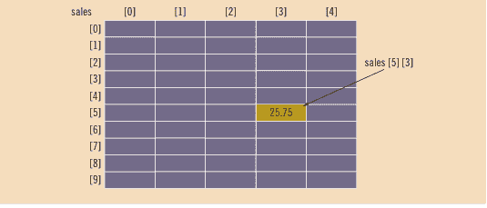

假设：

```cpp
int i = 5;
int j = 3;
```

那么，前面的语句：

```cpp
sales[5][3] = 25.75;
```

等价于：

```cpp
sales[i][j] = 25.75;
```

因此，索引也可以是变量。

## 声明时初始化二维数组

与一维数组一样，二维数组可以在声明时初始化。下面的例子有助于说明这一概念。考虑以下语句：

```cpp
int board[4][3] = {{2, 3, 1},
                   {15, 25, 13},
                   {20, 4, 7},
                   {11, 18, 14}};
```

该语句将 `board` 声明为一个 4 行 3 列的二维数组。第一行的元素分别是 2、3 和 1；第二行的元素分别是 15、25 和 13；第三行的元素分别是 20、4 和 7；第四行的元素分别是 11、18 和 14。图 8-15 展示了数组 `board`。


| board | [0] | [1] | [2] |
|---|---:|---:|---:|
| [0] | 2 | 3 | 1 |
| [1] | 15 | 25 | 13 |
| [2] | 20 | 4 | 7 |
| [3] | 11 | 18 | 14 |

**图 8-15** 二维数组 board

在声明二维数组时初始化它：

- 1. 每一行的元素都包含在一对花括号中，并用逗号分隔。
- 2. 所有行的集合包含在花括号中。
- 3. 对于数值数组，如果未指定某一行的所有分量，则未指定的分量会被初始化为 0。在这种情况下，必须至少给出一个值来初始化该行的所有分量。

## 二维数组与枚举类型

> **注意**  
> 理解本节需要先阅读第 7 章中的“枚举类型”一节。

也可以将枚举类型用于数组索引。考虑以下语句：

```cpp
const int NUMBER_OF_ROWS = 6;
const int NUMBER_OF_COLUMNS = 5;
enum carType {GM, FORD, TOYOTA, BMW, NISSAN, VOLVO};
enum colorType {RED, BROWN, BLACK, WHITE, GRAY};
int inStock[NUMBER_OF_ROWS][NUMBER_OF_COLUMNS];
```

这些语句定义了 **carType** 和 **colorType** 枚举类型，并将 **inStock** 定义为 6 行 5 列的二维数组。假设 **inStock** 中的每一行对应一种汽车类型，每一列对应一种颜色类型。也就是说，第一行对应汽车类型 **GM**，第二行对应汽车类型 **FORD**，依此类推。类似地，第一列对应颜色类型 **RED**，第二列对应颜色类型 **BROWN**，依此类推。进一步假设 **inStock** 中的每个条目表示特定类型和颜色的汽车数量（见图 8-16）。

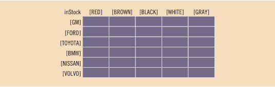

**图 8-16** 二维数组 `inStock`

语句：

```cpp
inStock[1][3] = 15;
```

等价于以下语句（见图 8-17）：

```cpp
inStock[FORD][WHITE] = 15;
```

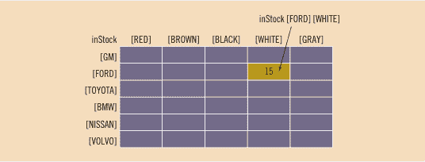

**图 8-17** `inStock[FORD][WHITE]`

第二条语句可以轻松传达信息——即，将 **WHITE FORD** 汽车的数量设置为 15。这个例子说明，枚举类型可以有效地用于使程序可读且易于管理。

## 处理二维数组

可以通过四种方式处理二维数组：

- 1. 处理单个元素。
- 2. 处理整个数组。
- 3. 处理数组的特定行，称为**行处理**。
- 4. 处理数组的特定列，称为**列处理**。

处理单个元素就像处理单个变量。初始化数组和打印数组是处理整个二维数组的示例。查找一行（列）中的最大元素或求一行（列）的和，是行（列）处理的示例。我们将在讨论中使用以下声明：

```cpp
const int NUMBER_OF_ROWS = 7;        //This can be set to any number.
const int NUMBER_OF_COLUMNS = 6;     //This can be set to any number.

int matrix[NUMBER_OF_ROWS][NUMBER_OF_COLUMNS];
int row;
int col;
int sum;
int largest;
int temp;
```

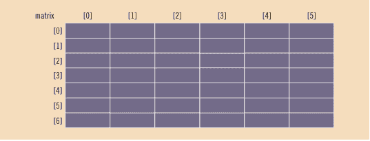

**图 8-18** 二维数组 *matrix*

二维数组的所有分量，无论是行还是列，类型都相同。如果单独看一行，可以看出它只是一个一维数组。单独看一列也是一个一维数组。因此，在处理二维数组的特定行或列时，我们使用与处理一维数组类似的算法。我们将借助前面声明的二维数组进一步解释这一概念。

假设要处理 `matrix` 的第 5 行（即 `matrix` 的第六行）。`matrix` 第 5 行的元素是：

`matrix[5][0]`、`matrix[5][1]`、`matrix[5][2]`、`matrix[5][3]`、`matrix[5][4]` 和 `matrix[5][5]`

可以看到，在这些分量中，第一个索引（行位置）固定为 5。第二个索引（列位置）的范围是 0 到 5。因此，可以使用以下 `for` 循环来处理第 5 行：

```cpp
for (col = 0; col < NUMBER_OF_COLUMNS; col++)
    process matrix[5][col]
```

显然，这个 `for` 循环等价于以下 `for` 循环：

```cpp
row = 5;
for (col = 0; col < NUMBER_OF_COLUMNS; col++)
    process matrix[row][col]
```

类似地，假设要处理 `matrix` 的第 2 列，即 `matrix` 的第三列。这一列的元素是：

`matrix[0][2]`、`matrix[1][2]`、`matrix[2][2]`、`matrix[3][2]`、`matrix[4][2]`、`matrix[5][2]` 和 `matrix[6][2]`

这里，第二个索引（即列位置）固定为 2。第一个索引（即行位置）的范围是 0 到 6。在这种情况下，可以使用以下 `for` 循环来处理 `matrix` 的第 2 列：

```cpp
for (row = 0; row < NUMBER_OF_ROWS; row++)
    process matrix[row][2]
```

显然，这个 `for` 循环等价于以下 `for` 循环：

```cpp
col = 2;
for (row = 0; row < NUMBER_OF_ROWS; row++)
    process matrix[row][col]
```

接下来，我们讨论具体的处理算法。

### 初始化

假设要将第 4 行（即第五行）初始化为 0。如前所述，以下 `for` 循环可以完成此操作：

```cpp
row = 4;
for (col = 0; col < NUMBER_OF_COLUMNS; col++)
    matrix[row][col] = 0;
```

如果要将整个 `matrix` 初始化为 0，还可以将第一个索引（即行位置）放入循环中。通过使用以下嵌套的 `for` 循环，我们可以将 `matrix` 的每个分量初始化为 0：

```cpp
for (row = 0; row < NUMBER_OF_ROWS; row++)
    for (col = 0; col < NUMBER_OF_COLUMNS; col++)
        matrix[row][col] = 0;
```


## 输出

通过使用嵌套的`for`循环，可以输出`matrix`的元素。以下嵌套的`for`循环打印`matrix`的元素，每行输出一行：

```cpp
for (row = 0; row < NUMBER_OF_ROWS; row++)
{
    for (col = 0; col < NUMBER_OF_COLUMNS; col++)
        cout << setw(5) << matrix[row][col] << " ";
    cout << endl;
}
```

## 输入

以下`for`循环将数据输入到第4行，即`matrix`的第五行：

```cpp
row = 4;

for (col = 0; col < NUMBER_OF_COLUMNS; col++)
    cin >> matrix[row][col];
```

和前面一样，通过将行号放入循环中，可以将数据输入到`matrix`的每个分量中。以下`for`循环将数据输入到`matrix`的每个分量中：

```cpp
for (row = 0; row < NUMBER_OF_ROWS; row++)
    for (col = 0; col < NUMBER_OF_COLUMNS; col++)
        cin >> matrix[row][col];
```

## 按行求和

以下`for`循环求`matrix`第4行的和；也就是说，它将第4行的各分量相加：

```cpp
sum = 0;
row = 4;
for (col = 0; col < NUMBER_OF_COLUMNS; col++)
    sum = sum + matrix[row][col];
```

同样，通过将行号放入循环中，我们可以分别求出每一行的和。以下是求每一行各自之和的C++代码：

```cpp
//Sum of each individual row
for (row = 0; row < NUMBER_OF_ROWS; row++)
{
    sum = 0;
    for (col = 0; col < NUMBER_OF_COLUMNS; col++)
        sum = sum + matrix[row][col];

    cout << "Sum of row " << row + 1 << " = " << sum << endl;
}
```

## 按列求和

与按行求和的情况一样，以下嵌套的`for`循环求出每一列各自的和。

```cpp
//Sum of each individual column
for (col = 0; col < NUMBER_OF_COLUMNS; col++)
{
    sum = 0;
    for (row = 0; row < NUMBER_OF_ROWS; row++)
        sum = sum + matrix[row][col];

    cout << "Sum of column " << col + 1 << " = " << sum
         << endl;
}
```

## 每行和每列中的最大元素

如前所述，二维数组的另外两种操作是查找每一行和每一列中的最大元素。接下来，我们给出执行这些操作的C++代码。

以下`for`循环确定第4行中的最大元素：

```cpp
row = 4;
largest = matrix[row][0]; //Assume that the first element of
                          //the row is the largest.

for (col = 1; col < NUMBER_OF_COLUMNS; col++)
    if (matrix[row][col] > largest)
        largest = matrix[row][col];
```

以下C++代码确定每一行和每一列中的最大元素：

```cpp
//Largest element in each row
for (row = 0; row < NUMBER_OF_ROWS; row++)
{
    largest = matrix[row][0]; //Assume that the first element
                               //of the row is the largest.

    for (col = 1; col < NUMBER_OF_COLUMNS; col++)
        if (matrix[row][col] > largest)
            largest = matrix[row][col];

    cout << "The largest element in row " << row + 1 << " = "
         << largest << endl;
}

//Largest element in each column
for (col = 0; col < NUMBER_OF_COLUMNS; col++)
{
    largest = matrix[0][col]; //Assume that the first element
                              //of the column is the largest.

    for (row = 1; row < NUMBER_OF_ROWS; row++)
        if (matrix[row][col] > largest)
            largest = matrix[row][col];

    cout << "The largest element in column " << col + 1
         << " = " << largest << endl;
}
```

## 将二维数组作为参数传递给函数

二维数组可以作为参数传递给函数，并且它们按引用传递。基地址（即实际参数第一个分量的地址）被传递给形式参数。如果`matrix`是二维数组的名称，那么`matrix[0][0]`是`matrix`的第一个分量。

当将二维数组存储在计算机内存中时，C++使用行序形式。也就是说，先存储第一行，然后是第二行，然后是第三行，依此类推。

对于一维数组，当将其声明为形式参数时，我们通常省略数组的大小。由于C++以行序形式存储二维数组，为了正确计算某个分量的地址，编译器必须知道一行在哪里结束以及下一行在哪里开始。因此，当将二维数组声明为形式参数时，可以省略第一维的大小，但不能省略第二维；也就是说，必须指定列数。

假设有如下声明：

```cpp
const int NUMBER_OF_ROWS = 6;
const int NUMBER_OF_COLUMNS = 5;
```

考虑以下函数`printMatrix`的定义：

```cpp
void printMatrix(int matrix[][NUMBER_OF_COLUMNS],
                 int noOfRows)
{
    for (int row = 0; row < noOfRows; row++)
    {
        for (int col = 0; col < NUMBER_OF_COLUMNS; col++)
            cout << setw(5) << matrix[row][col] << " ";
        cout << endl;
    }
}
```

该函数接受一个行数未指定、列数为5的二维数组作为参数，并输出该二维数组的内容。在函数调用期间，实际参数的列数必须与形式参数的列数匹配。

类似地，以下函数输出一个元素类型为`int`的二维数组每一行元素的和：

```cpp
void sumRows(int matrix[][NUMBER_OF_COLUMNS], int noOfRows)
{
    int sum;

    //Sum of each individual row
    for (int row = 0; row < noOfRows; row++)
    {
        sum = 0;
        for (int col = 0; col < NUMBER_OF_COLUMNS; col++)
            sum = sum + matrix[row][col];
        cout << "Sum of row " << (row + 1) << " = " << sum
             << endl;
    }
}
```

以下函数确定每一行中的最大元素：

```cpp
void largestInRows(int matrix[][NUMBER_OF_COLUMNS],
                  int noOfRows)
{
    int largest;

    //Largest element in each row
    for (int row = 0; row < noOfRows; row++)
    {
        largest = matrix[row][0]; //Assume that the first element
                                  //of the row is the largest.
        for (int col = 1; col < NUMBER_OF_COLUMNS; col++)
            if (largest < matrix[row][col])
                largest = matrix[row][col];

        cout << "The largest element of row " << (row + 1)
             << " = " << largest << endl;
    }
}
```

同样，你可以编写函数来求每一列元素的和、将数据读入二维数组、查找每一行或每一列中的最大和/或最小元素，等等。

示例8-11展示了如何在程序中使用函数`printMatrix`、`sumRows`和`largestInRows`。

### 示例 8-11

以下程序说明如何将二维数组作为参数传递给函数。

```cpp
// Two-dimensional arrays as parameters to functions.

#include <iostream>                                      //Line 1
#include <iomanip>                                       //Line 2

using namespace std;                                     //Line 3

const int NUMBER_OF_ROWS = 6;                    //Line 4
const int NUMBER_OF_COLUMNS = 5;                 //Line 5

void printMatrix(int matrix[][NUMBER_OF_COLUMNS],
                 int noOfRows);            //Line 6
void sumRows(int matrix[][NUMBER_OF_COLUMNS],
             int noOfRows);                //Line 7
void largestInRows(int matrix[][NUMBER_OF_COLUMNS],
                   int noOfRows);          //Line 8

int main()                                       //Line 9
{                                                //Line 10
    int board[NUMBER_OF_ROWS][NUMBER_OF_COLUMNS]
        = {{17, 8, 24, 10, 28},
           {9, 20, 16, 55, 90},
           {25, 45, 35, 8, 78},
           {5, 0, 96, 45, 38},
           {76, 30, 8, 14, 28},
           {9, 60, 55, 62, 10}};
    printMatrix(board, NUMBER_OF_ROWS);          //Line 11
    cout << endl;                                //Line 12
    sumRows(board, NUMBER_OF_ROWS);              //Line 13
    cout << endl;                                //Line 14
    largestInRows(board, NUMBER_OF_ROWS);        //Line 15
    cout << endl;                                //Line 16
    return 0;                                    //Line 17
}                                                //Line 18

//Place the definitions of the functions printMatrix,
//sumRows, and largestInRows as described previously here.
```

### 运行示例：

```text
17   8   24   10   28
9   20   16   55   90
25   45   35    8   78
5    0   96   45   38
76   30    8   14   28
9   60   55   62   10

Sum of row 1 = 87
Sum of row 2 = 190
Sum of row 3 = 191
Sum of row 4 = 184
Sum of row 5 = 156
Sum of row 6 = 196

The largest element of row 1 = 28
The largest element of row 2 = 90
The largest element of row 3 = 78
The largest element of row 4 = 96
The largest element of row 5 = 76
The largest element of row 6 = 62
```

在该程序中，第11行的语句声明并初始化`board`为一个*六行五列*的二维数组。第12行的语句使用了

函数 `printMatrix` 用于输出 `board` 的元素（参见“示例运行”的前六行）。第14行的语句使用函数 `sumRows` 计算并打印每一行的和。第16行的语句使用函数 `largestInRows` 查找并打印每一行中的最大元素。

## 字符串数组

假设你需要执行某项操作，例如按字母顺序排列姓名列表。由于每个姓名都是字符串，存储姓名列表的一种便捷方式是使用数组。在 C++ 中，可以使用数据类型 `string` 或字符数组（C 字符串）来操作字符串。本节说明操作字符串列表的这两种方式。

### 字符串数组与 `string` 类型

使用数据类型 `string` 处理字符串列表很直接。假设列表最多包含100个姓名。可以按如下方式声明一个包含100个 `string` 类型分量的数组：

```cpp
string list[100];
```

赋值、比较和输入/输出等基本操作都可以对 `string` 类型的值执行。因此，`list` 中的数据可以像本章第一部分讨论的任何一维数组一样处理。

### 字符串数组与 C 字符串（字符数组）

假设列表中最长的字符串（例如姓名）长度为15个字符，并且列表中有100个字符串。可以按如下方式声明一个100行16列的二维字符数组（见图8-19）：

```cpp
char list[100][16];
```

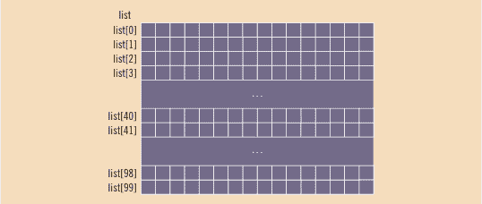

图 8-19. 字符串数组列表

现在，对于每个 j（0 <= j <= 99），list[j] 都是长度至多15个字符的字符串。下面的语句将 "Snow White" 存储到 list[1] 中（见图8-20）：

```cpp
strcpy(list[1], "Snow White");
```

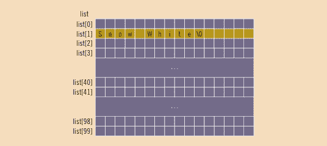

图 8-20 数组 list，显示 list[1]

假设你想读取数据并存储到 list 中，并且每行有一个条目。下面的 for 循环完成此任务：

```cpp
for (int j = 0; j < 100; j++)
    cin.get(list[j], 16);
```

下面的 for 循环输出每一行中的字符串：

```cpp
for (int j = 0; j < 100; j++)
    cout << list[j] << endl;
```

还可以使用其他字符串函数（如 strcmp 和 strlen）以及 for 循环来操作 list。

> **注意**  数据类型 `string` 为其定义了赋值、拼接和关系运算等操作。

## 声明二维数组的另一种方式

> **注意**  可以跳过本节，而不会影响内容的连续性。

如果知道程序将要处理的表的大小，那么可以使用 `typedef` 先定义二维数组数据类型，再声明该类型的变量。

例如，考虑以下内容：

```cpp
const int NUMBER_OF_ROWS = 20;
const int NUMBER_OF_COLUMNS = 10;

typedef int tableType[NUMBER_OF_ROWS][NUMBER_OF_COLUMNS];
```

前面的语句定义了二维数组数据类型 `tableType`。现在可以声明该类型的变量。因此：

```cpp
tableType matrix;
```

声明了一个20行10列的二维数组 `matrix`。

在声明形式参数时也可以使用此数据类型，如下面的代码所示：

```cpp
void initialize(tableType table)
{
    for (int row = 0; row < NUMBER_OF_ROWS; row++)
        for (int col = 0; col < NUMBER_OF_COLUMNS; col++)
            table[row][col] = 0;
}
```

此函数接受任何 `tableType` 类型的变量作为实参，该类型是一个包含20行10列的二维数组，并将该数组初始化为0。

通过先定义数据类型，在将二维数组声明为变量或形式参数时，或在函数调用期间将数组作为参数传递时，就不必反复检查确切的列数。

## 多维数组

在本章中，我们将数组定义为由固定数量的同类型元素（称为分量）组成的集合。一维数组是元素以列表形式排列的数组；在二维数组中，元素以表格形式排列。我们也可以定义三维或更高维的数组。在 C++ 中，除内存空间的限制外，数组的维数没有限制。以下是数组的一般定义。

*n* 维数组：由固定数量的分量按 *n* 个维度排列而成的集合（*n* >= 1）。

声明 *n* 维数组的一般语法是：

```cpp
dataType arrayName[intExp1][intExp2] . . . [intExpn];
```

其中 intExp1、intExp2、…… 和 intExpn 是产生正整数值的常量表达式。

访问 *n* 维数组分量的语法是：

```cpp
arrayName[indexExp1][indexExp2] . . . [indexExpn]
```

其中 indexExp1、indexExp2、…… 和 indexExpn 是产生非负整数值的表达式。indexExpn 给出数组分量在第 *n* 维中的位置。

例如，语句：

```cpp
double carDealers[10][5][7];
```

将 carDealers 声明为一个三维数组。第一维的大小是10，第二维的大小是5，第三维的大小是7。第一维的范围是0到9，第二维的范围是0到4，第三维的范围是0到6。数组 carDealers 的基地址是第一个数组分量的地址，即 carDealers[0][0][0] 的地址。数组 carDealers 中分量的总数是 10 * 5 * 7 = 350。

语句：

```cpp
carDealers[5][3][2] = 15564.75;
```

将 carDealers[5][3][2] 的值设置为15564.75。

可以使用循环来处理多维数组。例如，下面的嵌套 `for` 循环：

```cpp
for (int i = 0; i < 10; i++)
    for (int j = 0; j < 5; j++)
        for (int k = 0; k < 7; k++)
            carDealers[i][j][k] = 0.0;
```

将整个数组初始化为0.0。

在函数中将多维数组声明为形式参数时，可以省略第一维的大小，但不能省略其他维的大小。作为参数，多维数组仅按引用传递，并且函数不能返回数组类型的值。没有检查来确定数组索引是否在边界内，因此通常建议包含某种形式的“索引在范围内”检查。

## 编程示例：代码检测

当消息以秘密代码通过传输通道传输时，通常以比特序列（即0和1）发送。由于传输通道中的噪声，传输的消息可能会损坏。也就是说，目的地接收到的消息与发送的消息不相同；某些比特可能已经改变。有多种技术可以在目的地检查所传输消息的有效性。一种技术是两次发送同一消息。在目的地，将消息的两个副本逐位比较。如果对应比特相同，则接收到的消息无差错。

我们来编写一个程序，检查在目的地接收到的消息是否无差错。为简单起见，假设表示消息的秘密代码是数字序列（0到9），且消息的最大长度为250位数字。此外，消息中的第一个数字是消息的长度。例如，如果秘密代码是：

```text
7 9 2 7 8 3 5 6
```

那么实际消息长度为7位数字。

上述消息按如下方式传输：

```text
7 9 2 7 8 3 5 6 7 9 2 7 8 3 5 6
```

**输入**  一个包含秘密代码及其副本的文件

**输出**  秘密代码、其副本，以及一条消息（如果接收到的代码无差错），格式如下：

| 代码数字 | 代码数字副本 |
|---:|---:|
| 9 | 9 |
| 2 | 2 |
| 7 | 7 |
| 8 | 8 |
| 3 | 3 |
| 5 | 5 |
| 6 | 6 |

```text
Message transmitted OK.
```

### 问题分析与算法设计

由于必须比较秘密代码及其副本的对应数字，我们首先读取秘密代码并将其存储在一个数组中。然后读取副本的第一个数字，并将其与秘密代码的第一个数字比较，依此类推。如果任何对应数字不相同，我们通过在数字旁边打印一条消息来指出这一事实。由于消息的最大长度为250，我们使用大小为250的数组。秘密代码和秘密代码副本中的第一个数字都表示代码的长度。上述讨论可转化为以下算法：


- 1. 打开输入文件和输出文件。
- 2. 如果输入文件不存在，则退出程序。
- 3. 读取秘密代码的长度。
- 4. 如果秘密代码的长度大于 250，则终止程序，因为本程序中代码的最大长度为 250。
- 5. 读取秘密代码并将其存储到数组中。
- 6. 读取副本的长度。
- 7. 如果秘密代码及其副本的长度相同，则比较这些代码并输出相应消息。否则，打印错误消息。

为了简化函数 main，我们编写一个函数 readCode 来读取秘密代码，并编写另一个函数 compareCode 来比较这些代码。

### readCode

该函数首先读取秘密代码的长度。如果秘密代码的长度大于 250，则将 bool 变量 lenCodeOk（它是一个引用参数）设为 false，并终止该函数。lenCodeOk 的值会传递给调用函数，以指示是否成功读取了秘密代码。如果代码长度小于 250，则 readCode 函数读取秘密代码并将其存储到数组中。由于输入存储在文件中，且该文件是在函数 main 中打开的，因此与输入文件对应的输入流变量必须作为参数传递给该函数。此外，在读取秘密代码的长度和代码本身之后，readCode 函数必须将这些值传递给函数 main。因此，该函数有四个参数：一个输入文件流变量、一个用于存储秘密代码的数组、代码长度以及 bool 参数 lenCodeOk。函数 readCode 的定义如下：

```cpp
void readCode(ifstream& infile, int list[], int& length,
              bool& lenCodeOk)
{
    lenCodeOk = true;

    infile >> length;   //get the length of the secret code

    if (length > MAX_CODE_SIZE)
    {
        lenCodeOk = false;
        return;
    }

    //Get the secret code.
    for (int count = 0; count < length; count++)
        infile >> list[count];
}
```

### compareCode

该函数将秘密代码与其副本进行比较。因此，它必须能够访问包含秘密代码的数组以及秘密代码的长度。秘密代码的副本及其长度存储在输入文件中。因此，与输入文件对应的输入流变量必须作为参数传递给该函数。此外，compareCode 函数会比较秘密代码与副本，并打印相应消息。由于输出将存储在文件中，与输出文件对应的输出流变量也必须作为参数传递给该函数。因此，该函数有四个参数：一个输入文件流变量、一个输出文件流变量、包含秘密代码的数组以及秘密代码的长度。上述讨论可转化为函数 compareCode 的以下算法：

- a. 声明变量。
- b. 将 `bool` 变量 `codeOk` 设为 `true`。
- c. 读取秘密代码副本的长度。
- d. 如果秘密代码及其副本的长度不相同，则输出相应的错误消息并终止该函数。
- e. 对于输入文件中的每一位数字：
  - 1. 读取秘密代码副本的下一位数字。
  - 2. 输出秘密代码及其副本中的对应数字。
  - 3. 如果对应数字不相同，则输出错误消息，并将 `bool` 变量 `codeOk` 设为 `false`。
- f. 如果 `bool` 变量 `codeOk` 为 `true`：
  输出一条消息，表明秘密代码已正确传输。
  
  否则
  
  输出错误消息。

按照该算法，函数 compareCode 的定义如下：

```cpp
void compareCode(ifstream& infile, ofstream& outfile,
                 const int list[], int length)
{
        //Step a
        int length2;
        int digit;
        bool codeOk;

        codeOk = true;                         //Step b

        infile >> length2;                     //Step c

        if (length != length2)                         //Step d
        {
            cout << "The original code and its copy "
                 << "are not of the same length."
                 << endl;
            return;
        }

        outfile << "Code Digit    Code Digit Copy"
                << endl;

        for (int count = 0; count < length; count++)    //Step e
        {
            infile >> digit;
            outfile << setw(5) << list[count]           //Step e.1
                    << setw(17) << digit;              //Step e.2

            if (digit != list[count])                   //Step e.3
            {
                outfile << "  The code digits are not the same"
                        << endl;
                codeOk = false;
            }
            else
                outfile << endl;
        }

        if (codeOk)                                     //Step f
            outfile << "Message transmitted OK."
                    << endl;
        else
            outfile << "Error in transmission. "
                    << "Retransmit!!" << endl;
}
```

以下是函数 main 的算法：

## 主算法

- 1. 声明变量。
- 2. 打开文件。
- 3. 调用函数 `readCode` 读取秘密代码。
- 4. `if`（秘密代码长度 <= 250）
  调用函数 `compareCode` 比较这些代码。
- 5. `else`
  输出相应的错误消息。

```cpp
{
    cout << "Cannot open the input file." << endl;
    return 1;
}

cout << "Enter the output file name: ";
cin >> outputFile;
cout << endl;

outcode.open(outputFile);

readCode(incode, codeArray, codeLength,
         lengthCodeOk);                    //Step 3

if (lengthCodeOk)                          //Step 4
    compareCode(incode, outcode, codeArray,
                codeLength);
else
    cout << "Length of the secret code "
         << "must be <= " << MAX_CODE_SIZE
         << endl;                          //Step 5

incode.close();
outcode.close();

return 0;
}

//Place the definitions of the functions readCode and
//compareCode, as described previously, here.
```

**示例运行：** 在此示例运行中，用户输入以阴影表示。

请输入输入文件名：`Ch8_SecretCodeData.txt`

请输入输出文件名：`Ch8_SecretCodeOut.txt`

**输入文件数据：**（Ch8_SecretCodeData.txt）

7 9 2 7 8 3 5 6 7 9 2 7 8 3 5 6

**输出文件数据：**（Ch8_SecretCodeOut.txt）

| 代码数字 | 代码数字副本 |
|---:|---:|
| 9 | 9 |
| 2 | 2 |
| 7 | 7 |
| 8 | 8 |
| 3 | 3 |
| 5 | 5 |
| 6 | 6 |

消息传输正常。

该程序的算法如下：

- 1. 声明变量。
- 2. 打开输入文件和输出文件。
- 3. 初始化变量。
- 4. 当输入文件中还有更多数据时：
  - 4.1 对于一行中的每个字符：
    - 4.1.1 读取并写入该字符。
    - 4.1.2 增加相应字母的计数。
  - 4.2 增加行计数。
- 5. 输出行计数和字母计数。
- 6. 关闭文件。

为了简化函数 `main`，我们将其划分为四个函数：

- 函数 `initialize`
- 函数 `copyText`
- 函数 `characterCount`
- 函数 `writeTotal`

以下各节将详细描述这些函数中的每一个。然后，借助这些函数，我们描述函数 `main` 的算法。

### initialize

该函数将变量 `lineCount` 和数组 `letterCount` 初始化为 0。因此，它有两个参数：一个对应于变量 `lineCount`，另一个对应于数组 `letterCount`。显然，对应于 `lineCount` 的参数必须是引用参数。该函数的定义如下：

```cpp
void initialize(int& lc, int list[])
{
    lc = 0;

    for (int j = 0; j < 26; j++)
        list[j] = 0;
} // end initialize
```

### copyText

该函数读取一行并输出该行。读取一个字符后，它调用函数 `characterCount` 来更新字母计数。显然，该函数有四个参数：一个输入文件流变量、一个输出文件流变量、一个 `char` 变量以及用于更新字母计数的数组。

注意，`copyText` 函数并不执行字母计数，但我们仍然将数组 `letterCount` 传递给它。我们采取这一步是因为该函数调用


函数 `characterCount` 需要数组 `letterCount` 来更新相应的字母计数。因此，我们必须将数组 `letterCount` 传递给 `copyText` 函数，以便它可以将该数组传递给函数 `characterCount`。

```cpp
void copyText(ifstream& intext, ofstream& outtext, char& ch,
              int list[])
{
    while (ch != '\n')       //process the entire line
    {
        outtext << ch;        //output the character

        characterCount(ch, list);   //call the function
                                    //character count
        intext.get(ch);       //read the next character
    }
    outtext << ch;            //output the newline character
} //end copyText
```

`characterCount` 该函数递增字母计数。为了递增相应的字母计数，它必须知道该字母是什么。因此，`characterCount` 函数有两个参数：一个 `char` 变量和用于更新字母计数的数组。

用伪代码表示，该函数为：

- a. 将字母转换为大写。
- b. 找到与该字母对应的数组索引。
- c. 如果索引有效，则递增相应的计数。在此步骤中，我们必须确保该字符是字母。我们只统计字母，因此其他字符——如逗号、连字符和句点——将被忽略。

按照此算法，该函数的定义如下：

```cpp
void characterCount(char ch, int list[])
{
    int index;

    ch = toupper(ch);                         //Step a

    index = static_cast<int>(ch)
          - static_cast<int>('A');            //Step b

    if (0 <= index && index < 26)             //Step c
        list[index]++;
} //end characterCount
```

`writeTotal` 该函数输出行数和字母计数。它有三个参数：输出文件流变量、行数以及用于输出字母计数的数组。该函数的定义如下：


```cpp
void writeTotal(ofstream& outtext, int lc, int list[])
{
    outtext << endl;
    outtext << "The number of lines = " << lc << endl;

    for (int index = 0; index < 26; index++)
        outtext << static_cast<char>(index
                    + static_cast<int>('A'))
                << " count = " << list[index] << endl;
} //end writeTotal
```

现在我们描述 main 函数的算法。

## 主算法

- 1. 声明变量。
- 2. 打开输入文件。
- 3. 如果输入文件不存在，则退出程序。
- 4. 打开输出文件。
- 5. 初始化变量，例如 lineCount 和数组 letterCount。
- 6. 读取第一个字符。
- 7. 当（未到达输入文件末尾）时：
  - 7.1 处理下一行；调用函数 copyText。
  - 7.2 递增行数。（递增变量 lineCount。）
  - 7.3 读取下一个字符。
- 8. 输出行数和字母计数。调用函数 writeTotal。
- 9. 关闭文件。

## 完整程序清单

```cpp
//***************************************************************
// Author: D.S. Malik
//
// Program: Line and Letter Count
// This program reads a text, outputs the text as is, and also
// prints the number of lines and the number of times each
// letter appears in the text. An uppercase letter and a
// lowercase letter are treated as being the same; that is,
// they are tallied together.
//***************************************************************

#include <iostream>
#include <fstream>
#include <cctype>

using namespace std;

void initialize(int& lc, int list[]);
void copyText(ifstream& intext, ofstream& outtext, char& ch,
              int list[]);
void characterCount(char ch, int list[]);
void writeTotal(ofstream& outtext, int lc, int list[]);

int main()
{
        //Step 1: Declare variables
        int lineCount;
        int letterCount[26];
        char ch;
        ifstream infile;
        ofstream outfile;

        infile.open("textin.txt");                         //Step 2

        if (!infile)                                      //Step 3
        {
                cout << "Cannot open the input file."
                     << endl;
                return 1;
        }

        outfile.open("textout.out");                     //Step 4

        initialize(lineCount, letterCount);                //Step 5

        infile.get(ch);                                    //Step 6

        while (infile)                                     //Step 7
        {
                copyText(infile, outfile, ch, letterCount); //Step 7.1
                lineCount++;                               //Step 7.2
                infile.get(ch);                            //Step 7.3
        }

        writeTotal(outfile, lineCount, letterCount);       //Step 8

        infile.close();                                    //Step 9
        outfile.close();                                   //Step 9

        return 0;
}

void initialize(int& lc, int list[])
{
    lc = 0;

    for (int j = 0; j < 26; j++)
        list[j] = 0;
} //end initialize

void copyText(ifstream& intext, ofstream& outtext, char& ch,
              int list[])
{
    while (ch != '\n')       //process the entire line
    {
        outtext << ch;       //output the character

        characterCount(ch, list);       //call the function
                                       //character count
        intext.get(ch);       //read the next character
    }
    outtext << ch;           //output the newline character
} //end copyText

void characterCount(char ch, int list[])
{
    int index;

    ch = toupper(ch);                           //Step a

    index = static_cast<int>(ch)
          - static_cast<int>('A');             //Step b

    if (0 <= index && index < 26)              //Step c
        list[index]++;
} //end characterCount

void writeTotal(ofstream& outtext, int lc, int list[])
{
    outtext << endl;
    outtext << "The number of lines = " << lc << endl;

    for (int index = 0; index < 26; index++)
        outtext << static_cast<char>(index
                         + static_cast<int>('A'))
                << " count = " << list[index] << endl;
} //end writeTotal
```

## 快速复习

- 1. 如果某种类型的变量一次只能保存一个值，则该数据类型是简单数据类型。
- 2. 在结构化数据类型中，每个数据项是其他数据项的集合。
- 3. 数组是组件数量固定的结构化数据类型。每个组件类型相同，组件通过其在数组中的相对位置访问。
- 4. 一维数组的元素以列表形式排列。
- 5. 不检查数组索引是否越界。
- 6. 在 C++ 中，数组索引从 0 开始。
- 7. 数组索引可以是任何求值为非负整数的表达式。索引值必须始终小于数组大小。
- 8. 除字符数组（C 字符串）的输入/输出外，数组没有聚合操作。
- 9. 数组可在声明时初始化。如果初始值少于数组大小，其余元素初始化为 0。
- 10. 数组的基地址是第一个数组组件的地址。例如，如果 `list` 是一维数组，`list` 的基地址是 `list[0]` 的地址。
- 11. 声明一维数组为形式参数时，通常省略数组大小。如果在形式参数声明中指定一维数组的大小，编译器会忽略该大小。
- 12. 在函数调用语句中，将数组作为实际参数传递时，只使用其名称。
- 13. 作为函数参数，数组仅按引用传递。
- 14. 因为作为参数，数组仅按引用传递，所以声明数组为形式参数时，不要在数据类型后使用符号 `&`。
- 15. 函数不能返回数组类型的值。
- 16. 尽管作为参数，数组按引用传递，但在声明数组为形式参数时，在数据类型前使用保留字 `const` 可防止函数修改数组。
- 17. 单个数组组件可作为参数传递给函数。
- 18. 顺序查找算法在列表中查找给定项，从列表中的第一个元素开始。它继续将查找项与列表中的其他元素比较，直到找到该项或列表中没有更多元素可与查找项比较为止。


## 练习

习题末尾括号中的数字指的是本章开头列出的学习目标。

1. 判断以下陈述是否正确。
- a. `double` 类型是简单数据类型的一个例子。(1)
- b. 一维数组是结构化数据类型的一个例子。(1)
- c. 数组的大小在编译时确定。(1, 6)
- d. 给定声明：
    ```cpp
    int list[10];
    ```
    语句：
    ```cpp
    list[5] = list[3] + list[2];
    ```
    会更新数组 `list` 的第五个分量的内容。(2)
- e. 如果数组索引越界，程序总是会因错误而终止。(3)
- f. 对 `int` 数组唯一允许的聚合操作是自增和自减操作。(5)
- g. 数组既可以按值也可以按引用作为参数传递给函数。(6)
- h. 函数可以返回数组类型的值。(6)
- i. 在 `C++` 中，字符串允许某些聚合操作。(11, 12, 13)
- j. 声明：
    ```cpp
    char name[16] = "John K. Miller";
    ```
    将 `name` 声明为包含 15 个字符的数组，因为字符串 "John K. Miller" 只有 14 个字符。(11)
- k. 声明：
    ```cpp
    char str = "Sunny Day";
    ```
    将 `str` 声明为长度未指定的字符串。(11)
- l. 作为参数，二维数组既可以按值传递，也可以按引用传递。(15, 16)

2. 考虑以下声明：(1, 2)
    ```cpp
    double currentBalance[91];
    ```
    在此声明中，指出以下内容：
- a. 数组名
- b. 数组大小
- c. 每个数组分量的数据类型
- d. 数组索引的取值范围
- e. 第一个、中间和最后一个元素的索引分别是什么？

3. 指出以下数组声明中的错误（如果有）。如果语句不正确，请提供正确的语句。(1, 2)
- a. `int primeNum[99];`
- b. `int testScores[0];`
- c. `string names[60];`
- d. `int list100[0..99];`
- e. `double [50] gpa;`
- f.
    ```cpp
    const double LENGTH = 26;
    double list[LENGTH - 1];
    ```
- g.
    ```cpp
    const long SIZE = 100;
    int list[2 * SIZE];
    ```

4. 判断以下数组声明是否有效。如果声明无效，请解释原因。(1, 2)
- a. `int list[61];`
- b. `strings names[20];`
- c. `double gpa[];`
- d. `double[-50] ratings[];`
- e. `string flowers[35];`
- f.
    ```cpp
    int SIZE = 10;
    double sales[2 * SIZE];
    ```
- g.
    ```cpp
    int MAX_SIZE = 50;
    double sales[100 - 2 * MAX_SIZE];
    ```

5. 大小为 65 的数组，其索引的有效范围是什么？第一个、中间和最后一个元素的索引分别是什么？(1, 3)

6. 编写 C++ 语句以完成以下操作：(1, 2)
- a. 声明一个包含 50 个 `int` 类型分量的数组 `alpha`。
- b. 将 `alpha` 的每个分量初始化为 −1。
- c. 输出数组 `alpha` 的第一个分量的值。
- d. 将数组 `alpha` 的第 25 个分量的值设置为 62。
- e. 将 `alpha` 的第 10 个分量的值设置为 `alpha` 第 50 个分量的值的三倍再加 10。
- f. 使用 `for` 循环输出 `alpha` 中索引为 2 或 3 的倍数的分量的值。

```cpp
for (int i = 2; i < 8; i++)
{
    list[i] = list[i - 1] * list[i - 2];
    if (i > 5)
        list[i] = list[i] - list[i - 1];
}
```

10. 以下 C++ 代码执行后，myList 中存储的是什么？(2)

```cpp
double myList[6];

myList[0] = 2.5;

for (int i = 1; i < 6; i++)
{
    myList[i] = i * myList[i - 1];
    if (i > 3)
        myList[i] = myList[i] / 2;
}
```

11. 改正以下代码，使其正确地将 myList 每个元素的值设置为该元素的索引。(2, 3)

```cpp
int myList[10];

for (int i = 1; i > 10; i++)
    myList[i] = i;
```

12. 改正以下代码，使其正确地初始化和输出数组 intList 的元素。(2, 3)

```cpp
int intList[5];

for (int i = 0; i > 5; i--)
    cin >> intList[i];

for (int i = 0; i < 5; i--)
    cout << intList << " ";
cout << endl;
```

13. 什么是数组索引越界？C++ 会检查数组索引是否在边界内吗？(3)

14. 假设 points 是一个包含 10 个 `double` 类型分量的数组，并且
points = {9.9, 9.6, 8.5, 8.5, 7.8, 7.7, 6.5, 5.8, 5.8, 4.6}

以下代码本应确保 points 的元素按非递增顺序排列。这段代码的输出是什么？代码中存在错误。请找出并改正错误。(1, 2, 3)

```cpp
for (int i = 0; i < 10; i++)
    if (points[i + 1] >= points[i])
        cout << "points[" << i << "] and points[" << (i + 1)
             << "] are out of order." << endl;
```

15. 编写 C++ 语句来定义并初始化以下数组。(4)
- a. 包含 10 个 `double` 类型分量的数组 heights。将该数组初始化为以下值：`5.2, 6.3, 5.8, 4.9, 5.2, 5.7, 6.7, 7.1, 5.10, 6.0`。
- b. 包含 7 个 `int` 类型分量的数组 weights。将该数组初始化为以下值：`120, 125, 137, 140, 150, 180, 210`。
- c. `char` 类型的数组 `specialSymbols`。将该数组初始化为以下值：`'$'`, `'#'`, `'%'`, `'@'`, `'!'`, `'&'`, `'^'`。
- d. 包含 4 个 `string` 类型分量的数组 `seasons`。将该数组初始化为以下值：`"fall"`, `"winter"`, `"spring"`, `"summer"`。

16. 判断以下数组声明是否有效。如果声明有效，请确定数组的大小。(4)
- a. `int list[] = {18, 13, 14, 16};`
- b. `int x[10] = {1, 7, 5, 3, 2, 8};`
- c. `double y[4] = {2.0, 5.0, 8.0, 11.0, 14.0};`
- d. `double lengths[] = {8.2, 3.9, 6.4, 5.7, 7.3};`
- e. `int list[7] = {12, 13, , 14, 16, , 8};`
- f. `string name[8] = {"John", "Lisa", "Chris", "Katie"};`

17. 假设你有以下声明：(4)

```cpp
int alpha[5] = {3, 12, -25, 72};
```

如果此声明有效，alpha 的五个分量中分别存储了什么？

18. 考虑以下声明。(2)

```cpp
int list[] = {3, 8, 10, 13, 6, 11};
```

- a. 编写一段 C++ 代码，输出 `list` 每个分量中存储的值。
- b. 编写一段 C++ 代码，按如下方式设置 `list` 前五个分量的值：第 *i* 个分量的值等于第 *i* 个分量的值减去第 (*i*+1) 个分量的值的三倍。

19. 以下 C++ 代码的输出是什么？(2)

```cpp
#include <iostream>

using namespace std;

int main()
{
    int alpha[6] = {5};
```

```cpp
cout << setw(7) << "Quantity" << " " << setw(9)
     << "Unit Cost" << " " << setw(6)
     << "Amount" << endl;

for (int i = 0; i < 5; i++)
    cout << setw(4) << quantity[i] << " "
         << unitCost[i] << " " << setw(9) << price[i]
         << endl;

cout << "Total due:          $" << billingAmount << endl;

return 0;
}
```

27. 以下 C++ 代码的输出是什么？(2, 4)

```cpp
const double PI = 3.14159;
double cylinderRadii[5] = {3.5, 7.2, 10.5, 9.8, 6.5};
double cylinderHeights[5] = {10.7, 6.5, 12.0, 10.5, 8.0};
double cylinderVolumes[5];

cout << fixed << showpoint << setprecision(2);

for (int i = 0; i < 5; i++)
    cylinderVolumes[i] = 2 * PI * cylinderRadii[i]
                       * cylinderHeights[i];

for (int i = 0; i < 5; i++)
    cout << (i + 1) << " " << cylinderRadii[i] << " "
         << cylinderHeights[i] << " " << cylinderVolumes[i]
         << endl;
```

28. 当数组作为实参传递给函数时，实际传递的是什么？(6)

29. 在 C++ 中，作为实参，数组可以按值传递吗？(6)

30. 使用本章讨论的选择排序算法对以下列表进行排序。显示外层 for 循环每次迭代后的列表。(8)
- 12, 50, 68, 30, 46, 5, 92, 10, 38

31. 以下 C++ 程序段的输出是什么？(9, 10)

```cpp
int list[] = {15, 18, 3, 65, 11, 32, 60, 55, 9};

for (auto num: list)
    cout << num % 2 << " ";
cout << endl;
```

32. 以下 C++ 程序段的输出是什么？(9, 10)

```cpp
string names[] = {"Blair, Cindy", "Johnson, Chris",
                 "Mann, Sheila"};
string str1, str2;
char ch = ' ';
int pos, length;
```


```cpp
for (auto &str: names)
{
    pos = str.find(ch);
    length = str.length();
    str1 = str.substr(0, pos);
    str2 = str.substr(pos + 2, length - pos - 1);
    str = str2 + ' ' + str1;
}

for (auto str: names)
    cout << str << endl;
```

- 33. 考虑以下函数头。（9, 10）

```cpp
void modifyList(int list[], int length)
```

在函数 `modifyList` 的定义中，能否使用基于范围的 for 循环来处理 `list` 的元素？请说明理由。

- 34. 给定以下声明：

```cpp
char name[30];
```

请将下列语句标记为有效或无效。如果语句无效，请解释原因。（11）

  - a. `name = "Bill William";`
  - b. `strcmp(name, "Tom Jackson");`
  - c. `strcpy(name, "Jacksonville");`
  - d. `cin >> name;`
  - e. `name[0] = 'K';`
  - f. `bool flag = (name >= "Cynthia");`

- 35. 给定以下声明：

```cpp
char str1[20];
char str2[15] = "Fruit Juice";
```

请将下列语句标记为有效或无效。如果语句无效，请解释原因。（11, 12）

  - a. `strcpy(str1, str2);`
  - b.
    ```cpp
    if (strcmp(str1, str2) == 0)
        cout << "str1 is the same as str2" << endl;
    ```
  - c.
    ```cpp
    if (strlen(str1) >= strlen(str2))
        str1 = str2;
    ```
  - d.
    ```cpp
    if (str1 > str2)
        cout << "str1 > str2." << endl;
    ```

- 36. 给定以下声明：

```cpp
char name[8] = "Shelly";
```

如果下列语句输出 `Shelly`，请标记为“是”。否则，请将该语句标记为“否”，并解释为什么它不输出 `Shelly`。（11）

  - a. `cout << name;`
  - b.
    ```cpp
    for (int j = 0; j < 6; j++)
        cout << name[j];
    ```
  - c.
    ```cpp
    int j = 0;
    while (name[j] != '\0')
        cout << name[j++];
    ```
  - d.
    ```cpp
    int j = 0;
    while (j < 8)
        cout << name[j++];
    ```

- 37. 给定以下声明：（11, 12）

```cpp
char myStr[26];
char yourStr[26] = "Arrays and Strings";
```

  - a. 编写一条 C++ 语句，将“Summer Vacation”存储到 `myStr` 中。
  - b. 编写一条 C++ 语句，输出 `yourStr` 的长度。
  - c. 编写一条 C++ 语句，将 `yourStr` 的值复制到 `myStr` 中。
  - d. 编写一条 C++ 语句，比较 `myStr` 与 `yourStr`，并将结果存储到名为 `result` 的 `int` 变量中。

- 38. 假设有以下声明：（11, 12, 13）

```cpp
char name[21];
char yourName[21];
char studentName[31];
```

请将下列语句标记为有效或无效。如果语句无效，请解释原因。

  - a. `cin >> name;`
  - b. `cout << studentName;`
  - c. `yourName[0] = '\0';`
  - d. `yourName = studentName;`
  - e.
    ```cpp
    if (yourName == name)
        studentName = name;
    ```
  - f. `int x = strcmp(yourName, studentName);`
  - g. `strcpy(studentName, name);`
  - h.
    ```cpp
    for (int j = 0; j < 21; j++)
        cout << name[j];
    ```

- 39. 定义一个名为 `matrix` 的二维数组，类型为 `double`，4 行 3 列，使得第一行初始化为 2.5、3.2、6.0；第二行初始化为 5.5、7.5、12.6；第三行初始化为 11.25、16.85、13.45；第四行初始化为 8.75、35.65、19.45。（15）

- 40. 假设数组 `matrix` 如练习 39 中所定义。编写 C++ 语句完成以下操作：（15）

  - a. 输入 `matrix` 第一行的数字。
  - b. 输出 `matrix` 最后一列的内容。
  - c. 输出 `matrix` 中第一行最后一列元素的内容。
  - d. 将 13.6 加到 `matrix` 最后一行最后一列的元素上。

- 41. 考虑以下声明：（15）

```cpp
const int CAR_TYPES = 5;
const int COLOR_TYPES = 6;

double sales[CAR_TYPES][COLOR_TYPES];
```

  - a. 数组 `sales` 有多少个分量？
  - b. 数组 `sales` 的行数是多少？
  - c. 数组 `sales` 的列数是多少？
  - d. 要按 `CAR_TYPES` 对销售额求和，需要何种处理？
  - e. 要按 `COLOR_TYPES` 对销售额求和，需要何种处理？

- 42. 编写完成以下操作的 C++ 语句：（15）

  - a. 声明一个类型为 `int`、10 行 20 列的数组 `alpha`。
  - b. 将数组 `alpha` 初始化为 0。
  - c. 在第一行存储 1，在其余行存储 2。
  - d. 在第一列存储 5，并确保后续每一列的值是前一列值的两倍。
  - e. 逐行打印数组 `alpha`，每行一行。
  - f. 逐列打印数组 `alpha`，每行一列。

- 43. 考虑以下声明：（15）

```cpp
int beta[3][3];
```

下列每条语句执行后，`beta` 中存储的是什么？

  - a.
    ```cpp
    for (int i = 0; i < 3; i++)
        for (int j = 0; j < 3; j++)
            beta[i][j] = 0;
    ```
  - b.
    ```cpp
    for (int i = 0; i < 3; i++)
        for (int j = 0; j < 3; j++)
            beta[i][j] = i + j;
    ```
  - c.
    ```cpp
    for (int i = 0; i < 3; i++)
        for (int j = 0; j < 3; j++)
            beta[i][j] = i * j;
    ```
  - d.
    ```cpp
    for (int i = 0; i < 3; i++)
        for (int j = 0; j < 3; j++)
            beta[i][j] = 2 * (i + j) % 4;
    ```
  - e.
    ```cpp
    for (int i = 2; i >= 0; i--)
        for (int j = 0; j < 3; j++)
            beta[i][j] = (i * j) % 3;
    ```

- 44. 假设有以下声明：（15）

```cpp
int flowers[28][10];
int animals[15][10];
int trees[100][10];
int inventory[30][10];
```

  - a. 编写函数 `readIn` 的定义，该函数可用于向这些数组输入数据。同时编写调用该函数向这些数组输入数据的 C++ 语句。
  - b. 编写函数 `sumRow` 的定义，该函数可用于对每个数组的每一行元素求和。同时编写调用该函数求这些数组每一行元素之和的 C++ 语句。
  - c. 编写函数 `print` 的定义，该函数可用于输出这些数组的内容。同时编写调用该函数输出这些数组内容的 C++ 语句。

## 编程练习

- 1. 编写一个 C++ 程序，声明一个类型为 `double`、包含 50 个分量的数组 `alpha`。初始化该数组，使前 25 个分量等于索引变量的平方，后 25 个分量等于索引变量的三倍。输出该数组，使每行打印 10 个元素。

- 2. 编写一个 C++ 函数 `smallestIndex`，该函数以 `int` 数组及其大小为参数，并返回数组中最小元素第一次出现的索引。同时编写一个程序测试该函数。

- 3. 编写一个 C++ 函数 `lastLargestIndex`，该函数以 `int` 数组及其大小为参数，并返回数组中最大元素最后一次出现的索引。同时编写一个程序测试该函数。

- 4. 编写一个程序，读取一个文件，该文件包含学生考试成绩，范围 0–200。然后确定分数位于以下各范围的学生人数：0–24、25–49、50–74、75–99、100–124、125–149、150–174 和 175–200。输出分数范围和学生人数。（用以下输入数据运行程序：76, 89, 150, 135, 200, 76, 12, 100, 150, 28, 178, 189, 167, 200, 175, 150, 87, 99, 129, 149, 176, 200, 87, 35, 157, 189。）

- 5. 编写一个程序，提示用户输入一个字符串，并以大写字母输出该字符串。（使用字符数组存储该字符串。）

- 6. 你学校的历史老师需要帮助批改一份判断题试卷。学生 ID 和测试答案存储在一个文件中。文件中的第一条记录包含该测试的答案，形式如下：

```text
TFFTFTTTTFFFTFTFTTT
```

文件中的其他每条记录依次为：学生 ID、一个空格，然后是学生的作答。例如，记录：

```text
ABC54301 TFFTFTTT TFTFTFTFTT
```

表示学生 ID 为 ABC54301，第 1 题答案为正确，第 2 题答案为错误，依此类推。该学生未回答第 9 题。考试有 20 道题，班级有 150 多名学生。每答对一题得两分，每答错一题扣一分，未作答得零分。编写一个程序处理测试数据。输出应依次为：学生 ID、答案、测试分数、测试等级。假设等级标准如下：90%–100% 为 A；80%–89.99% 为 B；70%–79.99% 为 C；60%–69.99% 为 D；0%–59.99% 为 F。

- 7. 编写一个程序，允许用户输入地方选举中五名候选人的姓氏以及每位候选人获得的票数。然后程序应输出每位候选人的姓名、获得的票数以及该候选人所得票数占总票数的百分比。程序还应输出选举获胜者。示例输出如下：

| 候选人 | 获得票数 | 占总票数百分比 |
|---|---:|---:|
| 约翰逊 | 5000 | 25.91 |
| 米勒 | 4000 | 20.73 |
| 达菲 | 6000 | 31.09 |
| 罗宾逊 | 2500 | 12.95 |
| 阿什顿 | 1800 | 9.33 |
| **总计** | **19300** |  |

选举获胜者是达菲。


- 8. 考虑以下函数 `main`：

  ```cpp
  int main()
  {
      int alpha[20];
      int beta[20];
      int matrix[10][4];
      .
      .
      .
  }
  ```

  - a. 编写函数 `inputArray` 的定义，该函数提示用户输入20个数字，并将这些数字存储到 `alpha` 中。

  - b. 编写函数 `doubleArray` 的定义，该函数将 `beta` 的元素初始化为 `alpha` 中对应元素的两倍。确保该函数不会修改 `alpha` 的元素。

  - c. 编写函数 `copyAlphaBeta` 的定义，该函数将 `alpha` 存储到 `matrix` 的前五行，将 `beta` 存储到 `matrix` 的后五行。确保该函数不会修改 `alpha` 和 `beta` 的元素。

  - d. 编写函数 `printArray` 的定义，该函数打印任意 `int` 类型的一维数组。每行打印15个元素。

  - e. 编写一个 C++ 程序，测试函数 `main` 以及 a 到 d 部分讨论的函数。（根据需要添加其他函数，例如打印二维数组。）

- 9. 编写一个程序，使用二维数组存储一年中每个月的最高和最低温度。程序应输出年度平均高温、平均低温以及年度最高和最低温度。你的程序必须包含以下函数：

  - a. 函数 `getData`：该函数读取数据并将其存储到二维数组中。

  - b. 函数 `averageHigh`：该函数计算并返回年度平均高温。

  - c. 函数 `averageLow`：该函数计算并返回年度平均低温。

  - d. 函数 `indexHighTemp`：该函数返回数组中最高高温的索引。

  - e. 函数 `indexLowTemp`：该函数返回数组中最低低温的索引。

  这些函数都必须具有适当的参数。

- 10. 第6章中的编程练习10要求你求五个数字的均值和标准差。扩展此编程练习，以求最多100个数字的均值和标准差。假设 *n* 个数字 \(x_1, x_2, \ldots, x_n\) 的均值（平均数）为 \(\bar{x}\)。那么这些数字的标准差为：

  \[
  s = \sqrt{\frac{(x_1-\bar{x})^2 + (x_2-\bar{x})^2 + \cdots + (x_i-\bar{x})^2 + \cdots + (x_n-\bar{x})^2}{n}}
  \]

- 11. **大整数相加**

  在 C++ 中，最大的 `int` 值是 `2147483647`。因此，比它更大的整数不能作为整数存储和处理。类似地，如果两个正整数的和或积大于 `2147483647`，结果将不正确。存储和操作大整数的一种方法是将该数字的每一位数字存储在数组中。编写一个程序，输入两个最多20位的正整数，并输出这两个数之和。如果这两个数之和超过20位，则输出该和并给出适当的消息。你的程序必须至少包含一个函数，用于读取数字并将其存储到数组中；还必须包含另一个函数，用于输出这些数字之和。*（提示：将数字作为字符串读取，并按逆序存储该数字的各位数字。）*

- 12. Jason、Samantha、Ravi、Sheila 和 Ankit 正在为即将到来的马拉松做准备。一周中的每一天，他们都会跑一定数量的英里，并把它们写进笔记本。周末时，他们想知道每天跑的英里数、本周总英里数以及每天平均跑的英里数。编写一个程序来帮助他们分析数据。你的程序必须包含并行数组：一个数组存储跑步者的姓名，一个5行7列的二维数组存储每位跑步者每天跑的英里数。此外，你的程序必须至少包含以下函数：一个用于读取并存储跑步者姓名以及每天跑步英里数的函数；一个用于求每位跑步者跑的总英里数以及每天平均跑步英里数的函数；一个用于输出结果的函数。（你可以假设输入数据存储在文件中，且每行数据格式如下：`runnerName milesDay1 milesDay2 milesDay3 milesDay4 milesDay5 milesDay6 milesDay7`。）

- 13. 编写一个程序，计算学生的平均测试成绩及其等级。你可以假设输入数据如下：

  | 学生 | 测试1 | 测试2 | 测试3 | 测试4 | 测试5 |
  |---|---|---|---|---|---|
  | Johnson | 85 | 83 | 77 | 91 | 76 |
  | Aniston | 80 | 90 | 95 | 93 | 48 |
  | Cooper | 78 | 81 | 91 | 90 | 73 |
  | Gupta | 92 | 83 | 30 | 69 | 87 |
  | Blair | 23 | 45 | 96 | 38 | 59 |
  | Clark | 60 | 85 | 45 | 39 | 67 |
  | Kennedy | 77 | 31 | 52 | 74 | 83 |
  | Bronson | 93 | 94 | 89 | 77 | 97 |
  | Sunny | 79 | 85 | 28 | 93 | 82 |
  | Smith | 85 | 72 | 49 | 75 | 63 |

- 14. 编写一个程序，提示用户输入50个整数并将它们存储在数组中。然后程序确定并输出数组中的哪些数是另外两个数组元素之和。如果一个数组元素是另外两个数组元素之和，那么对于该数组元素，程序应输出所有这样的数对。

- 15. 重做编程练习14：先对数组排序，然后再确定哪些数组元素是另外两个元素之和。使用本章讨论的选择排序算法对数组排序。

- 16. （选5彩票）编写一个程序来模拟选5彩票游戏。你的程序应生成5个1到9（含1和9）之间互不相同的数字，并将它们存储到数组中。程序提示用户输入五个1到9之间互不相同的数字，并将这些数字存储到另一个数组中。然后程序比较并确定这两个数组是否相同。如果两个数组相同，则用户赢得游戏；否则程序输出匹配数字的数量及其在数组中的位置。

  你的程序必须包含一个随机生成选5彩票号码的函数。此外，在你的程序中，包含顺序查找函数，以确定生成的彩票号码是否已经生成过。

- 17. 一家公司雇用了10名按小时计酬的临时工，并给你一个数据文件，其中包含员工的姓氏、每位员工每周工作的小时数以及每位员工的每小时工资率。要求你编写一个程序，计算每位员工的周薪以及所有工人的平均工资。然后程序输出每位员工的周薪、平均周薪，以及所有周薪大于或等于平均工资的员工姓名。如果一周工作的小时数超过40，则超过40小时部分的工资率是正常时薪的1.5倍。使用两个并行数组：一个一维数组存储所有员工的姓名，一个10行3列的二维数组存储员工每周工作的小时数、每小时工资率和周薪。你的程序必须至少包含以下函数——一个从文件读取数据到数组的函数，一个确定周薪的函数，一个输出所有周薪大于或等于平均周薪的员工姓名的函数，以及一个输出每位员工数据的函数。

- 18. 孩子们经常玩一种记忆游戏，其中使用一副包含匹配对的卡片。卡片被洗牌并面朝下放在桌子上。然后玩家轮流一次选择两张牌。如果两张牌匹配，则它们保持正面朝上；否则，这些牌被面朝下放回相同位置。一旦玩家看到所选择的一对牌，并且如果这些牌不匹配，那么他们可以记住这些牌，并利用记忆选择下一对牌。游戏持续到所有卡片都正面朝上为止。编写一个程序来玩这个记忆游戏。使用一个4行4列的二维数组表示一副16张牌、包含8个匹配对的牌组。你可以使用数字1到8来标记卡片。（如果你使用6×6数组，那么将需要18个匹配对，依此类推。）使用随机数生成器将配对随机存储在数组中。在程序中使用适当的函数，主程序应仅仅是对函数的调用。

- 19. （飞机座位分配）编写一个可用于为商用飞机分配座位的程序。该飞机有13排，每排有六个座位。第1排和第2排是头等舱，第3排到第7排是商务舱，第8排到第13排是经济舱。你的程序必须提示用户输入以下信息：

  - a. 票类型（头等舱、商务舱或经济舱）
  - b. 期望座位

  以下列形式输出座位表：

  | | A | B | C | D | E | F |
  |---|---|---|---|---|---|---|
  | 第1排 | * | * | X | * | X | X |
  | 第2排 | * | X | * | X | * | X |
  | 第3排 | * | * | X | X | * | X |
  | 第4排 | X | * | X | * | X | X |
  | 第5排 | * | X | * | X | * | * |
  | 第6排 | * | X | * | * | * | X |
  | 第7排 | X | * | * | * | X | X |
  | 第8排 | * | X | * | X | X | * |
  | 第9排 | X | * | X | X | * | X |
  | 第10排 | * | X | * | X | X | X |
  | 第11排 | * | * | X | * | X | * |
  | 第12排 | * | * | X | X | * | X |
  | 第13排 | * | * | * | * | X | * |

  这里，* 表示座位可用；X 表示座位已被占用。将此程序做成菜单驱动式程序；显示用户的选择，并允许用户做出适当的选择。


## 记录（结构体）

本章中，你将：

- 1. 了解记录（结构体）
- 2. 考察对结构体的各种操作
- 3. 探索使用结构体操作数据的方法
- 4. 了解结构体与函数之间的关系
- 5. 考察数组与结构体之间的区别
- 6. 了解数组如何在结构体中使用
- 7. 学习如何创建由结构体项组成的数组
- 8. 学习如何在结构体内部构造结构体

## 记录（`structs`）

在第 8 章中，你学习了如何使用数组将相同类型的值分组。你还学习了如何处理存储在数组中的数据，以及如何执行列表操作，例如搜索和排序。

> **注意**
>
> 本章可以跳过，不会造成任何不连贯。

在本章中，你将学习如何将类型不同但相关的值分组。C++ 提供了另一种结构化数据类型，称为 `struct`（有些语言使用术语“记录”），用于将类型不同但相关的项分组。数组是齐次数据结构；`struct` 通常是异质数据结构。本章对 `struct` 的讲解与 C 语言中对 `struct` 的讲解类似。因此，本章中的 `struct` 是类 C 的 `struct`。第 10 章将介绍并讨论另一种结构化数据类型，称为 `class`。

假设你想编写一个程序来处理学生数据。一条学生记录包含学生的姓名、学号、GPA、所修课程和课程成绩等内容。因此，一个学生关联着各种组成部分。然而，这些组成部分的类型都不同。例如，学生姓名是字符串，而 GPA 是浮点数。由于这些组成部分类型不同，你不能使用数组将与学生关联的所有项分组。C++ 提供了一种称为 `struct` 的结构化数据类型，用于将类型不同的项分组。将相关但类型不同的组成部分分组具有若干优点。例如，单个变量可以将所有组成部分作为参数传递给函数。

`struct`：由固定数量的组成部分构成的集合，其中各组成部分通过名称访问。这些组成部分可以具有不同的类型。

`struct` 的组成部分称为 `struct` 的成员。C++ 中 `struct` 的一般语法为：

```cpp
struct structName
{
    dataType1 identifier1;
    dataType2 identifier2;
    .
    .
    .
    dataTypen identifiern;
};
```

在 C++ 中，`struct` 是保留字。结构体的成员即使括在花括号中（也就是说，它们形成一个块），也不被视为构成复合语句。因此，右花括号后的分号对于结束 `struct` 语句是必不可少的。所以，`struct` 末尾的分号是语法的一部分。

语句：

```cpp
struct houseType
{
    string style;
    int numOfBedrooms;
    int numOfBathrooms;
    int numOfCarsGarage;
    int yearBuilt;
    int finishedSquareFootage;
    double price;
    double tax;
};
```

定义了一个具有八个成员的结构体 houseType。成员 style 的类型为 string，成员 numOfBedrooms、numOfBathrooms、numOfCarsGarage、yearBuilt 和 finishedSquareFootage 的类型为 int，成员 price 和 tax 的类型为 double。

像任何类型定义一样，结构体是一种定义，而不是声明。也就是说，它只定义一种数据类型；不会分配内存。

一旦定义了数据类型，就可以声明该类型的变量。

例如，下列语句将 newHouse 定义为 houseType 类型的结构体变量：

```cpp
//variable declaration
houseType newHouse;
```

分配的内存足够存储 style、numOfBedrooms、numOfBathrooms、numOfCarsGarage、yearBuilt、finishedSquareFootage、price 和 tax（见图 9-1）。


**图 9-1** `struct newHouse`

> **注意**
>
> 定义 `struct` 时也可以声明 `struct` 变量。例如，考虑下列语句：

```cpp
struct houseType
{
    string style;
    int numOfBedrooms;
    int numOfBathrooms;
    int numOfCarsGarage;
    int yearBuilt;
    int finishedSquareFootage;
    double price;
    double tax;
} tempHouse;
```

这些语句定义了 `struct` **houseType**，同时将 **tempHouse** 声明为 **houseType** 类型的变量。

通常，在程序中，`struct` 会在程序中所有函数的定义之前定义，以便该 `struct` 可以在整个程序中使用。因此，如果你在定义 `struct` 的同时声明 `struct` 变量（如上述语句所示），那么该 `struct` 变量就会成为全局变量，从而可以在程序中的任何位置访问。考虑到全局变量的副作用，你应该先只定义 `struct`，然后再声明 `struct` 变量。

### 访问 `struct` 成员

在数组中，你通过使用数组名以及该组成部分的相对位置（索引）来访问一个组成部分。数组名和索引使用方括号分隔。要访问结构体成员（组成部分），你使用 `struct` 变量名以及成员名；这些名称用点（句点）分隔。访问 `struct` 成员的语法为：

`structVariableName.memberName`

`structVariableName.memberName` 就像任何其他变量一样。例如，`newStudent.courseGrade` 是 `char` 类型的变量，`newStudent.firstName` 是字符串变量，等等。因此，你可以对 `struct` 成员执行几乎所有通常对变量执行的操作。例如，你可以在赋值语句或输入/输出（在允许的情况下）语句中使用它们。

在 C++ 中，点（.）是一个运算符，称为**成员访问运算符**。

考虑下列语句：

- 20. 示例 8-7 中的程序输出长度为 10 的各时间区间上的平均速度。修改该程序，使用户可以存储所需时刻行驶的距离，例如时刻 0、10、16、20、30、38 和 45。然后程序计算并输出物体在由记录距离的时刻所指定的相继时间区间上的平均速度。例如，对于前面的时刻列表，计算时间区间 0 到 16、16 到 20、20 到 30、30 到 38 和 38 到 45 上的平均速度。
- 21. 如果正整数 *n* > 1 且 *n* 的因子只有 1 和 *n*，则称 *n* 为素数。已知：如果正整数 *n* > 1 不能被任何满足 *m* ≤ √*n* 的素数整数 *m* 整除，则 *n* 是素数。第 1230 个素数是 10,007。设 *t* 是一个满足 2 ≤ *t* ≤ 100,000,000 的整数。那么，如果 *t* 等于前 1,230 个素数之一，或者 *t* 不能被前 1,230 个素数中的任何一个整除，则 *t* 是素数。编写一个程序，声明一个大小为 1,230 的数组，并将前 1,230 个素数存储在该数组中。然后程序使用前 1,230 个素数判断 2 到 100,000,000 之间的一个数是否为素数。如果一个数不是素数，则输出它的至少一个素因子。
- 22. 如果正整数 *m* = *ab*，其中 *a* 和 *b* 是满足 *a* ≠ 1 且 *b* ≠ 1 的正整数，则称 *m* 为合数。如果 *m* 是合数，那么 *m* 可以写成素数乘积。设 *m* 是一个满足 2 ≤ *m* ≤ 100,000,000 的整数。修改习题 21 中的程序，使得如果 *m* 不是素数，程序输出 *m* 的素数乘积形式。
- 23. 编写一个程序，使用一个 3 × 3 数组，并将 1 到 9 的每个整数随机放入九个方格中。程序通过将数组中的所有数字相加，然后将和除以 3 来计算幻数。如果每一行、每一列和每条对角线之和都等于该幻数，则该 3 × 3 数组是一个幻方。你的程序至少必须包含以下函数：一个用这些数字随机填充数组的函数，以及一个判断该数组是否为幻方的函数。将这些函数运行很多次，比如 1,000 次、10,000 次或 1,000,000 次，看看该数组成为幻方的次数。
- 24. 编写一个程序，随机生成一个 20 × 20 的二维数组 *board*，其类型为 *int*。如果元素 `board[i][j]` 的所有邻居（任意单元格应有 3、5 或 8 个邻居）都小于 `board[i][j]`，或者都大于 `board[i][j]`，则该元素是一个峰值（极大值或极小值）。程序应输出 *board* 中所有为峰值的元素及其索引。还应输出该峰值是极大值还是极小值。


```
struct studentType
{
    string firstName;
    string lastName;
    char courseGrade;
    int testScore;
    int programmingScore;
    double GPA;
};

//variables
studentType newStudent;
studentType student;
```

假设你想将 `newStudent` 的成员 GPA 初始化为 0.0。下面的语句完成此任务：

```
newStudent.GPA = 0.0;
```

类似地，以下语句：

```
newStudent.firstName = "John";
newStudent.lastName = "Brown";
```

将 "John" 存储到 `newStudent` 的成员 `firstName` 中，将 "Brown" 存储到 `newStudent` 的成员 `lastName` 中。

执行前面三条赋值语句后，`newStudent` 如图 9-2 所示。

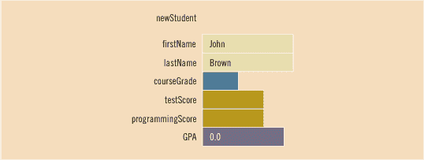

**图 9-2**  `struct newStudent`

语句：

```
cin >> newStudent.firstName;
```

从标准输入设备读取下一个字符串，并将其存储到：

```
newStudent.firstName
```

语句：

```
cin >> newStudent.testScore >> newStudent.programmingScore;
```

从键盘读取两个整数值，并分别存储到 `newStudent.testScore` 和 `newStudent.programmingScore` 中。

假设 `score` 是一个 `int` 类型的变量。语句：

```
score = (newStudent.testScore + newStudent.programmingScore) / 2;
```

将 `newStudent.testScore` 和 `newStudent.programmingScore` 的平均值赋给 `score`。

以下语句确定课程成绩，并将其存储到 `newStudent.courseGrade` 中：

```
if (score >= 90)
    newStudent.courseGrade = 'A';
else if (score >= 80)
    newStudent.courseGrade = 'B';
else if (score >= 70)
    newStudent.courseGrade = 'C';
else if (score >= 60)
    newStudent.courseGrade = 'D';
else
    newStudent.courseGrade = 'F';
```

## 示例 9-1

考虑上一节给出的 `struct houseType` 的定义以及以下语句：

```
houseType ryanHouse;
houseType anitaHouse;

ryanHouse.style = "Colonial";
ryanHouse.numOfBedrooms = 3;
ryanHouse.numOfBathrooms = 2;
ryanHouse.numOfCarsGarage = 2;
ryanHouse.yearBuilt = 2005;
ryanHouse.finishedSquareFootage = 2250;
ryanHouse.price = 290000;
ryanHouse.tax = 5000.50;
```

前两条语句将 `ryanHouse` 和 `anitaHouse` 声明为 `houseType` 类型的变量。接下来的八条语句将字符串 "Colonial" 存储到 `ryanHouse.style`，将 3 存储到 `ryanHouse.numOfBedrooms`，将 2 存储到 `ryanHouse.numOfBathrooms`，依此类推。

接下来，考虑以下语句：

```
cin >> anitaHouse.style >> anitaHouse.numOfBedrooms
   >> anitaHouse.price;
```

如果输入为：

```
Ranch 4 350000
```

那么字符串 "Ranch" 会存储到 `anitaHouse.style`，4 会存储到 `anitaHouse.numOfBedrooms`，350000 会存储到 `anitaHouse.price`。

## 赋值

我们可以使用赋值语句将一个结构体变量的值赋给另一个同类型的结构体变量。假设 `newStudent` 如图 9-3 所示。

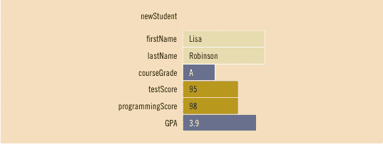

**图 9-3**  `struct newStudent`

语句：

```
student = newStudent;
```

将 `newStudent` 的内容复制到 `student`。执行此赋值语句后，`student` 的值如图 9-4 所示。


**图 9-4**  执行 `student = newStudent` 后的 `student`

事实上，赋值语句：

```cpp
student = newStudent;
```

等价于以下语句：

```cpp
student.firstName = newStudent.firstName;
student.lastName = newStudent.lastName;
student.courseGrade = newStudent.courseGrade;
student.testScore = newStudent.testScore;
student.programmingScore = newStudent.programmingScore;
student.GPA = newStudent.GPA;
```

## 比较（关系运算符）

要比较 `struct` 变量，需要逐个成员进行比较。与数组一样，不会对 `struct` 执行聚合关系运算。例如，假设 `newStudent` 和 `student` 按前面所示声明。此外，假设你想判断 `student` 和 `newStudent` 是否指同一个学生。现在，如果它们具有相同的名和相同的姓，则 `newStudent` 和 `student` 指同一个学生。要比较 `student` 和 `newStudent` 的值，必须按如下方式逐个成员比较：

```cpp
if (student.firstName == newStudent.firstName &&
    student.lastName == newStudent.lastName)
```

尽管可以使用赋值语句将一个 `struct` 的内容复制到另一个同类型的 `struct`，但不能对 `struct` 变量使用关系运算符。因此，以下写法是非法的：

```cpp
if (student == newStudent)    //illegal
```

## 输入/输出

不允许对 `struct` 变量进行聚合输入/输出操作。`struct` 变量中的数据必须一次读取一个成员。类似地，`struct` 变量的内容必须一次写入一个成员。

我们已经了解如何将数据读入 `struct` 变量。现在来看看如何输出 `struct` 变量。语句：

```cpp
cout << newStudent.firstName << " " << newStudent.lastName
     << " " << newStudent.courseGrade
     << " " << newStudent.testScore
     << " " << newStudent.programmingScore
     << " " << newStudent.GPA << endl;
```

输出 `struct` 变量 `newStudent` 的内容。

## 结构体变量与函数

回顾一下，数组只能按引用传递，并且函数不能返回数组类型的值。但是：

- `struct` 变量既可以按值传递，也可以按引用作为参数传递，并且
- 函数可以返回 `struct` 类型的值。

以下函数读取并存储学生的名、姓、测验成绩、编程成绩和 GPA。它还确定学生的课程成绩，并将其存储到成员 `courseGrade` 中。

```cpp
void readIn(studentType& student)
{
    int score;

    cin >> student.firstName >> student.lastName;
    cin >> student.testScore >> student.programmingScore;
    cin >> student.GPA;

    score = (student.testScore + student.programmingScore) / 2;

    if (score >= 90)
        student.courseGrade = 'A';
    else if (score >= 80)
        student.courseGrade = 'B';
    else if (score >= 70)
        student.courseGrade = 'C';
    else if (score >= 60)
        student.courseGrade = 'D';
    else
        student.courseGrade = 'F';
}
```

语句：

```cpp
readIn(newStudent);
```

调用函数 `readIn`。函数 `readIn` 将相应信息存储到变量 `newStudent` 中。

类似地，我们可以编写一个函数来打印 `struct` 变量的内容。例如，以下函数在屏幕上输出 `studentType` 类型的 `struct` 变量的内容：

```cpp
void printStudent(studentType student)
{
    cout << student.firstName << " " << student.lastName
         << " " << student.courseGrade
         << " " << student.testScore
         << " " << student.programmingScore
         << " " << student.GPA << endl;
}
```

## 数组与 `struct`s 的对比

前面的讨论表明，`struct` 和数组既有相似之处，也有不同之处。表 9-1 总结了这些讨论。

**表 9-1** 数组与 `struct`s 的对比

| 聚合操作 | 数组 | `struct` |
|---|---|---|
| 算术 | 否 | 否 |
| 赋值 | 否 | 是 |
| 输入/输出 | 否（字符串除外） | 否 |
| 比较 | 否 | 否 |
| 参数传递 | 仅按引用 | 按值或按引用 |
| 函数返回值 | 否 | 是 |

## `struct` 中的数组

列表是同一类型元素的集合。因此，列表有两个相关属性：值（即元素）和长度。由于值和长度都与列表相关，我们可以定义一个包含这两个项的 `struct`。

```cpp
const int ARRAY_SIZE = 1000;
struct listType
{
    int listElem[ARRAY_SIZE];    // array containing the list
    int listLength;              // length of the list
};
```

以下语句将 `intList` 声明为 `listType` 类型的 `struct` 变量（见图 9-5）：

```cpp
listType intList;
```


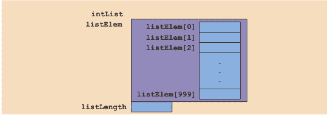

图 9-5  struct 变量 intList

变量 intList 有两个成员：listElem，一个包含 1,000 个 int 类型分量的数组；以及 int 类型的 listLength。此外，intList.listElem 访问成员 listElem，intList.listLength 访问成员 listLength。

考虑以下语句：

```cpp
intList.listLength = 0;            //Line 1
intList.listElem[0] = 12;          //Line 2
intList.listLength++;              //Line 3
intList.listElem[1] = 37;          //Line 4
intList.listLength++;              //Line 5
```

第 1 行中的语句将成员 listLength 的值设置为 0。第 2 行中的语句将 12 存入数组 listElem 的第一个分量。第 3 行中的语句将 listLength 的值增加 1。其他语句的含义类似。这些语句执行后，intList 如图 9-6 所示。

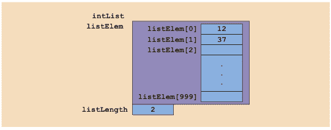

图 9-6  第 1 行至第 5 行的语句执行后的 intList

接下来，我们编写顺序查找算法，以确定给定项是否在列表中。如果在列表中找到了 **searchItem**，则函数返回它在列表中的位置；否则，函数返回 -1。

```cpp
int seqSearch(const listType& list, int searchItem)
{
    int loc;

    bool found = false;

    for (loc = 0; loc < list.listLength; loc++)
        if (list.listElem[loc] == searchItem)
        {
            found = true;
            break;
        }

    if (found)
        return loc;
    else
        return -1;
}
```

在这个函数中，因为 **listLength** 是 **list** 的成员，所以我们通过 **list.listLength** 访问它。类似地，我们可以通过 **list.listElem[loc]** 访问 **list** 的一个元素。

注意，函数 **seqSearch** 的形参 **list** 被声明为常量引用参数。这意味着 **list** 接收对应实参的地址，但 **list** 不能修改该实参。

回想一下，当变量按值传递时，形参会复制实参的值。因此，如果形参修改了数据，这种修改不会影响实参的数据。

假设一个 **struct** 有若干数据成员，需要大量内存来存储数据，而你需要按值传递该 **struct** 类型的变量。相应的形参随后会接收该变量数据的一份副本。然后编译器必须为形参分配内存，以便复制实参的值。除了大量存储空间外，此操作还可能耗费相当多的计算机时间，用于将实参的值复制到形参中。

另一方面，如果变量按引用传递，形参只接收实参的地址。因此，将变量作为参数传递的一种高效方式是按引用传递。如果变量按引用传递，那么当形参改变时，实参也会改变。然而，有时你并不希望函数能够改变实参的值。在 C++ 中，你可以按引用传递变量，同时仍然阻止函数改变其值。这是通过在形参声明中使用关键字 **const** 来实现的，如函数 **seqSearch** 的定义所示。

同样，我们也可以重写排序函数以及其他列表处理函数。

每位员工的数据都存储在一个文件中，比如 `employee.dat`。以下 C++ 代码将数据加载到 employees 数组中。我们假设初始时 `yearToDatePaid` 为 0，并且月度奖金每月根据绩效确定。

```cpp
ifstream infile; //input stream variable
                 //assume that the file employee.dat
                 //has been opened

for (int counter = 0; counter < 50; counter++)
{
    infile >> employees[counter].firstName
           >> employees[counter].lastName
           >> employees[counter].personID
           >> employees[counter].deptID
           >> employees[counter].yearlySalary;
    employees[counter].monthlySalary =
           employees[counter].yearlySalary / 12;
    employees[counter].yearToDatePaid = 0.0;
    employees[counter].monthlyBonus = 0.0;
}
```

假设对于某个月份，每位员工的记录中已经存有月度奖金，而我们需要计算月度工资并更新 `yearToDatePaid` 金额。以下循环计算并打印该员工当月的工资：

```cpp
double payCheck; //variable to calculate the paycheck

for (int counter = 0; counter < 50; counter++)
{
    cout << employees[counter].firstName << " "
         << employees[counter].lastName << " ";

    payCheck = employees[counter].monthlySalary +
               employees[counter].monthlyBonus;

    employees[counter].yearToDatePaid =
               employees[counter].yearToDatePaid +
               payCheck;

    cout << setprecision(2) << payCheck << endl;
}
```

## 结构体中的结构体

你已经看到 `struct` 和数组数据结构如何组合起来组织信息。你也看到了这样的示例：`struct` 的成员是数组，而数组类型是 `struct`。在本节中，你将学习在哪些情形下，用另一个 `struct` 来组织某个 `struct` 中的数据会更有优势。

让我们考虑以下员工记录：

```cpp
struct employeeType
{
    string firstname;
    string middlename;
    string lastname;
    string empID;
    string address1;
    string address2;
    string city;
    string state;
    string zip;
    int hiremonth;
    int hireday;
    int hireyear;
    int quitmonth;
    int quitday;
    int quityear;
    string phone;
    string cellphone;
    string fax;
    string pager;
    string email;
    string deptID;
    double salary;
};
```

如你所见，一个 `struct` 中打包了大量信息。这个 `struct` 有 22 个成员。这个 `struct` 的某些成员会比其他成员被更频繁地访问，有些成员之间的关联也比其他成员更紧密。此外，有些成员会具有相同的底层结构。例如，入职日期和离职日期都是 `int` 类型。让我们按如下方式重新组织这个 `struct`：

```cpp
struct nameType
{
    string first;
    string middle;
    string last;
};
```

```cpp
struct addressType
{
    string address1;
    string address2;
    string city;
    string state;
    string zip;
};
```

```cpp
struct dateType
{
    int month;
    int day;
    int year;
};
```

```cpp
struct contactType
{
    string phone;
    string cellphone;
    string fax;
    string pager;
    string email;
};
```

我们已经将员工的姓名、地址和联系方式类型分到了子类别中。此外，我们还定义了一个 `struct dateType`。让我们按如下方式重建员工记录：

```cpp
struct employeeType
{
    nameType name;
    string empID;
    addressType address;
    dateType hireDate;
    dateType quitDate;
    contactType contact;
    string deptID;
    double salary;
};
```

这个员工 `struct` 中的信息比前一个更容易管理。这个 `struct` 中的一部分可以复用来构建另一个 `struct`。例如，假设你想定义客户记录。每位客户都有名、姓和中间名，以及地址和联系方式。因此，你可以使用 `nameType`、`addressType`、`contactType` 这些 `struct` 以及客户特有的成员，快速组合出客户记录。

接下来，让我们声明一个 `employeeType` 类型的变量，并讨论如何访问它的成员。

考虑以下语句：

```cpp
employeeType newEmployee;
```

这条语句将 `newEmployee` 声明为 `employeeType` 类型的 `struct` 变量（见图 9-8）。


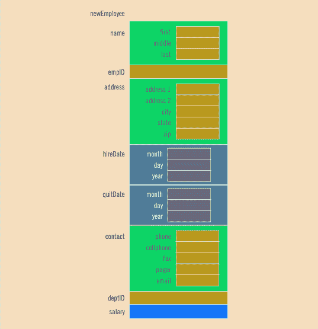

**图 9-8** —— 结构体变量 `newEmployee`

语句：

```cpp
newEmployee.salary = 45678.00;
```

将 `newEmployee` 的工资设置为 45678.00。以下语句：

```cpp
newEmployee.name.first = "Mary";
newEmployee.name.middle = "Beth";
newEmployee.name.last = "Simmons";
```

分别将 `newEmployee` 的名字、中间名和姓氏设置为“Mary”、“Beth”和“Simmons”。注意，`newEmployee` 有一个名为 `name` 的成员。我们通过 `newEmployee.name` 访问这个成员。还要注意，`newEmployee.name` 是一个 `struct`，并且有三个成员。我们应用成员访问规则来访问结构体 `newEmployee.name` 的成员 `first`。因此，`newEmployee.name.first` 是存储名字的成员。

语句：

```cpp
cin >> newEmployee.name.first;
```

读取一个字符串并将其存储到 `newEmployee.name.first` 中。语句：

```cpp
newEmployee.salary = newEmployee.salary * 1.05;
```

更新 `newEmployee` 的工资。

以下语句将 employees 声明为包含 100 个分量的数组，其中每个分量的类型为 `employeeType`：

```cpp
employeeType employees[100];
```

for 循环：

```cpp
for (int j = 0; j < 100; j++)
    cin >> employees[j].name.first >> employees[j].name.middle
        >> employees[j].name.last;
```

读取 100 名员工的姓名，并将它们存储到数组 `employees` 中。因为 `employees` 是一个数组，所以访问某个分量时，我们使用索引。例如，`employees[50]` 是数组 `employees` 的第 51 个分量（回忆一下，数组索引从 0 开始）。因为 `employees[50]` 是一个结构体，所以我们应用成员访问规则来选择特定成员。

## 编程示例：销售数据分析

一家公司有六名销售人员。每月，他们外出销售公司产品。每月月底，每名销售人员的总销售额，连同该销售人员的 ID 和月份，都会记录在一个文件中。每年年底，公司经理希望看到以下表格格式的报告：

-----------年度销售报告-----------

| ID | QT1 | QT2 | QT3 | QT4 | 总计 |
|---|---|---|---|---|---|
| 12345 | 1892.00 | 0.00 | 494.00 | 322.00 | 2708.00 |
| 32214 | 343.00 | 892.00 | 9023.00 | 0.00 | 10258.00 |
| 23422 | 1395.00 | 1901.00 | 0.00 | 0.00 | 3296.00 |
| 57373 | 893.00 | 892.00 | 8834.00 | 0.00 | 10619.00 |
| 35864 | 2882.00 | 1221.00 | 0.00 | 1223.00 | 5326.00 |
| 54654 | 893.00 | 0.00 | 392.00 | 3420.00 | 4705.00 |
| 总计 | 8298.00 | 4906.00 | 18743.00 | 4965.00 | |

销售人员最大销售额：ID = 57373，金额 = $10619.00
季度最大销售额：季度 = 3，金额 = $18743.00

在本报告中，QT1 表示第 1 季度（第 1 至 3 月），QT2 表示第 2 季度（第 4 至 6 月），QT3 表示第 3 季度（第 7 至 9 月），QT4 表示第 4 季度（第 10 至 12 月）。

销售人员的 ID 存储在一个文件中；销售数据存储在另一个文件中。销售数据的形式如下：

```text
salesPersonID month saleAmount
.
.
.
```

此外，销售数据没有特定顺序；它不是按 ID 排序的。

销售数据示例为：

```text
12345 1 893
32214 1 343
23422 3 903
57373 2 893
.
.
.
```

让我们编写一个程序，以指定格式生成输出。

|  |  |
|---|---|
| **输入** | 一个包含每个销售人员 ID 的文件，以及另一个包含销售数据的文件。 |
| **输出** | 一个包含上述格式年度销售报告的文件。 |

## 问题分析与算法设计

根据问题要求，很明显每名销售人员的主要分量是销售人员 ID、季度销售金额和年度总销售金额。因为这些分量具有不同的类型，我们可以借助结构体将它们组合起来，定义如下：

```cpp
struct salesPersonRec
{
    string ID;                  // salesperson’s ID
    double saleByQuarter[4];    // array to store the total
                                // sales for each quarter
    double totalSale;           // salesperson’s yearly sales amount
};
```

因为有六名销售人员，所以我们使用一个包含六个分量的数组，其中每个分量的类型为 `salesPersonRec`，定义如下：

```cpp
salesPersonRec salesPersonList[NO_OF_SALES_PERSON];
```

其中 `NO_OF_SALES_PERSON` 的值为 6。

因为程序要求我们求出公司每个季度的总销售额，所以我们需要一个包含四个分量的数组来存储数据。注意，这些数据将用于确定销售额最高的季度。因此，程序还需要以下数组：

```cpp
double totalSaleByQuarter[4];
```

回忆一下，在 C++ 中，数组索引从 0 开始。因此，`totalSaleByQuarter[0]` 存储第 1 季度的数据，`totalSaleByQuarter[1]` 存储第 2 季度的数据，依此类推。

在整篇讨论中，我们将引用这些变量。

数组 `salesPersonList` 如图 9-9 所示。

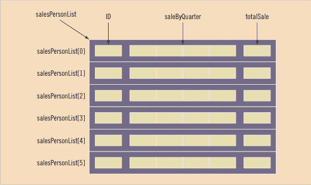

**图 9-9** 数组 `salesPersonList`

程序的第一步是将销售人员的 ID 读入数组 `salesPersonList`，并将每名销售人员的季度销售额和总销售额初始化为 0。完成这一步后，数组 `salesPersonList` 如图 9-10 所示。

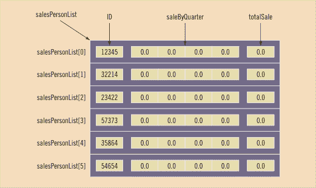

**图 9-10** 初始化后的数组 `salesPersonList`

下一步是处理销售数据。处理销售数据相当直接。对于包含销售数据的文件中的每个条目：

- 1. 读取销售人员的 ID、月份以及该月的销售金额。
- 2. 在数组 `salesPersonList` 中搜索，以定位对应该销售人员的分量。
- 3. 确定该月份对应的季度。
- 4. 通过加上该月的销售金额来更新该季度的销售额。

处理完销售数据文件后：

- 1. 计算每个销售人员的总销售额。
- 2. 计算每个季度的总销售额。
- 3. 打印报告。

上述讨论转化为以下算法：

- 1. 初始化数组 `salesPersonList`。
- 2. 处理销售数据。
- 3. 计算每个季度的总销售额。
- 4. 计算每个销售人员的总销售额。
- 5. 打印报告。
- 6. 计算并打印每个销售人员的最大销售额。
- 7. 计算并打印每个季度的最大销售额。

为了降低主程序的复杂性，让我们为这七个步骤分别编写一个单独的函数。

### 函数 `initialize`

该函数从输入文件中读取销售人员的 ID，并将销售人员的 ID 存储到数组 `salesPersonList` 中。它还将每名销售人员的季度销售金额和总销售金额初始化为 0。该函数的定义如下：

```cpp
void initialize(ifstream& indata, salesPersonRec list[],
                int listSize)
{
    for (int index = 0; index < listSize; index++)
    {
        indata >> list[index].ID; //get salesperson’s ID

        for (int quarter = 0; quarter < 4; quarter++)
            list[index].saleByQuarter[quarter] = 0.0;

        list[index].totalSale = 0.0;
    }
} //end initialize
```

### 函数 `getData`

该函数从输入文件中读取销售数据，并将相应信息存储到数组 `salesPersonList` 中。该函数的算法如下：

- 1. 读取销售人员的 ID、月份以及该月的销售金额。
- 2. 在数组 `salesPersonList` 中搜索，以定位对应该销售人员的分量。（因为销售人员的 ID 未排序，所以我们将使用顺序搜索来搜索该数组。）
- 3. 确定该月份对应的季度。
- 4. 通过加上该月的销售金额来更新该季度的销售额。

假设读取到的条目为：

```text
57373 2 350
```

这里，销售人员的 ID 是 57373，月份是 2，销售金额是 350。假设数组 `salesPersonList` 如图 9-11 所示。


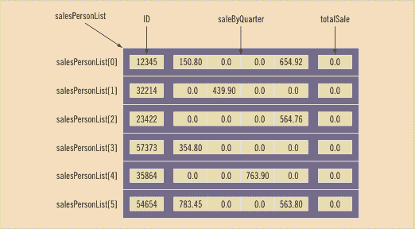

**图 9-11** *数组 salesPersonList*

现在，编号 **57373** 对应数组分量 *salesPersonList[3]*，月份 2 对应第 1 季度。因此，将 350 加到 354.80 上，得到新金额 704.80。处理完这条记录后，数组 *salesPersonList* 如图 9-12 所示。

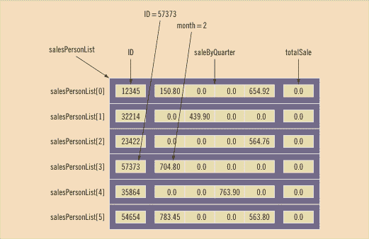

**图 9-12** *处理条目 57373, 2, 350 后的数组 salesPersonList*

函数 `getData` 的定义为：

```cpp
void getData(ifstream& infile, salesPersonRec list[],
             int listSize)
{
    int index;
    int quarter;
    string sID;
    int month;
    double amount;

    infile >> sID;   //get salesperson's ID

    while (infile)
    {
        infile >> month >> amount;  //get the sale month and
                                    //the sales amount

        for (index = 0; index < listSize; index++)
            if (sID == list[index].ID)
                break;

        if (1 <= month && month <= 3)
            quarter = 0;
        else if (4 <= month && month <= 6)
            quarter = 1;
        else if (7 <= month && month <= 9)
            quarter = 2;
        else
            quarter = 3;

        if (index < listSize)
            list[index].saleByQuarter[quarter] += amount;
        else
            cout << "Invalid salesperson's ID" << endl;

        infile >> sID;
    } //end while
} //end getData
```

## 函数 `saleByQuarter`

该函数用于计算公司每个季度的总销售额。要得到每个季度的总销售额，我们将该季度每个销售人员的销售额相加。显然，该函数必须能够访问数组 `salesPersonList` 和数组 `totalSaleByQuarter`。该函数还需要知道每个数组的行数。因此，该函数有三个参数。其定义如下：

```cpp
void saleByQuarter(salesPersonRec list[], int listSize,
                   double totalByQuarter[])
{
    for (int quarter = 0; quarter < 4; quarter++)
        totalByQuarter[quarter] = 0.0;

    for (int quarter = 0; quarter < 4; quarter++)
        for (int index = 0; index < listSize; index++)
            totalByQuarter[quarter] +=
                         list[index].saleByQuarter[quarter];
} //end saleByQuarter
```

## 函数 `totalSaleByPerson`

该函数用于计算每个销售人员的年销售额。要得到某位员工的年销售额，我们将该员工四个季度的销售额相加。显然，该函数必须能够访问数组 `salesPersonList`。该函数还需要知道数组的大小。因此，该函数有两个参数。

其定义如下：

```cpp
void totalSaleByPerson(salesPersonRec list[], int listSize)
{
    for (int index = 0; index < listSize; index++)
        for (int quarter = 0; quarter < 4; quarter++)
            list[index].totalSale +=
                         list[index].saleByQuarter[quarter];
} //end totalSaleByPerson
```

## 函数 `printReport`

该函数按指定格式打印年度报告。伪代码如下：

- 1. 打印标题——即输出的前三行。
- 2. 打印每位销售人员的数据。
- 3. 打印表格的最后一行。

请注意，接下来的两个函数将生成输出的最后两行。

显然，`printReport` 函数必须能够访问数组 `salesPersonList` 和数组 `totalSaleByQuarter`。此外，由于输出将保存到文件中，该函数必须能够访问与输出文件关联的 `ofstream` 变量。因此，该函数有四个参数：一个对应数组 `salesPersonList`，一个对应数组 `totalSaleByQuarter`，一个指定数组的大小，还有一个对应 `ofstream` 变量。其定义如下：

```cpp
void printReport(ofstream& outfile, salesPersonRec list[],
                 int listSize, double saleByQuarter[])
{
    outfile << "--------- Annual Sales Report ---------"
            << "-----" << endl;
    outfile << endl;
    outfile << " ID        QT1        QT2        QT3     "
            << "QT4      Total" << endl;
    outfile << "-----------------------------------------------"
            << "------" << endl;

    for (int index = 0; index < listSize; index++)
    {
        outfile << list[index].ID << "  ";

        for (int quarter = 0; quarter < 4; quarter++)
            outfile << setw(10)
                    << list[index].saleByQuarter[quarter];

        outfile << setw(10) << list[index].totalSale << endl;
    }

    outfile << "Total  ";

    for (int quarter = 0; quarter < 4; quarter++)
        outfile << setw(10) << saleByQuarter[quarter];

    outfile << endl << endl;
} //end printReport
```

## 函数 `maxSaleByPerson`

该函数用于打印销售额最高的销售人员的姓名。为识别该销售人员，我们需要查看每位销售人员的销售总额，并找出最大的销售额。由于每位员工的销售总额保存在数组 `salesPersonList` 中，因此该函数必须能够访问数组 `salesPersonList`。此外，由于输出将保存到文件中，该函数必须能够访问与输出文件关联的 `ofstream` 变量。因此，该函数有三个参数：一个对应数组 `salesPersonList`，一个指定该数组的大小，还有一个对应输出文件。

查找最大销售额的算法与查找数组中最大元素的算法类似（见第 8 章）。该函数的定义如下：

```cpp
void maxSaleByPerson(ofstream& outData, salesPersonRec list[],
                     int listSize)
{
    int maxIndex = 0;

    for (int index = 1; index < listSize; index++)
        if (list[maxIndex].totalSale < list[index].totalSale)
            maxIndex = index;

    outData << "Max Sale by SalesPerson: ID = "
            << list[maxIndex].ID
            << ", Amount = $" << list[maxIndex].totalSale
            << endl;
} // end maxSaleByPerson
```

## 函数 `maxSaleByQuarter`

该函数用于打印销售额最高的季度。为识别该季度，我们需要查看每个季度的总销售额，并找出最大的销售额。由于每个季度的销售总额保存在数组 `totalSaleByQuarter` 中，因此该函数必须能够访问数组 `totalSaleByQuarter`。此外，由于输出将保存到文件中，该函数必须能够访问与输出文件关联的 `ofstream` 变量。因此，该函数有两个参数：一个对应数组 `totalSaleByQuarter`，一个对应输出文件。

查找最大销售额的算法与查找数组中最大元素的算法相同（见第 8 章）。该函数的定义如下：

```cpp
void maxSaleByQuarter(ofstream& outData,
                      double saleByQuarter[])
{
    int maxIndex = 0;

    for (int quarter = 0; quarter < 4; quarter++)
        if (saleByQuarter[maxIndex] < saleByQuarter[quarter])
            maxIndex = quarter;

    outData << "Max Sale by Quarter: Quarter = "
            << maxIndex + 1
            << ", Amount = $" << saleByQuarter[maxIndex]
            << endl;
} // end maxSaleByQuarter
```

为了使程序更加灵活，我们将在程序执行过程中提示用户指定输入文件和输出文件。

现在我们可以编写函数 `main` 的算法了。

## 主算法

- 1. 声明变量。
- 2. 提示用户输入包含销售人员编号数据的文件名。
- 3. 读取输入文件名。
- 4. 打开输入文件。
- 5. 如果输入文件不存在，则退出程序。
- 6. 初始化数组 `salesPersonList`。调用函数 `initialize`。
- 7. 关闭包含销售人员编号数据的输入文件，并清空输入流。
- 8. 提示用户输入包含销售数据的文件名。
- 9. 读取输入文件名。
- 10. 打开输入文件。
- 11. 如果输入文件不存在，则退出程序。
- 12. 提示用户输入输出文件名。
- 13. 读取输出文件名。
- 14. 打开输出文件。
- 15. 要以带小数点和尾随零的定点十进制格式输出浮点数，请设置操纵符 `fixed` 和 `showpoint`。此外，要将浮点数输出到两位小数，请将精度设置为两位小数。
- 16. 处理销售数据。调用函数 `getData`。
- 17. 计算各季度的总销售额。调用函数 `saleByQuarter`。
- 18. 计算每位销售人员的总销售额。调用函数 `totalSaleByPerson`。
- 19. 以表格形式打印报告。调用函数 `printReport`。
- 20. 查找并打印全年销售额最高的销售人员。调用函数 `maxSaleByPerson`。
- 21. 查找并打印全年销售额最高的季度。调用函数 `maxSaleByQuarter`。
- 22. 关闭文件。


## 程序清单

```cpp
/************************************************************
// Author: D.S. Malik
//
// Program: Sales Data Analysis
// This program processes sales data for a company. For each
// salesperson, it outputs the ID, the total sales by each
// quarter, and the total sales for the year. It also outputs
// the salesperson's ID generating the maximum sale for the
// year and the sales amount. The quarter generating the
// maximum sale and the sales amount is also output.
************************************************************/

#include <iostream>
#include <fstream>
#include <iomanip>
#include <string>

using namespace std;

const int NO_OF_SALES_PERSON = 6;

struct salesPersonRec
{
    string ID;              //salesperson's ID
    double saleByQuarter[4]; //array to store the total
                             //sales for each quarter
    double totalSale;        //salesperson's yearly sales amount
};

void initialize(ifstream& indata, salesPersonRec list[],
                int listSize);
void getData(ifstream& infile, salesPersonRec list[],
             int listSize);
void saleByQuarter(salesPersonRec list[], int listSize,
                   double totalByQuarter[]);
void totalSaleByPerson(salesPersonRec list[], int listSize);
void printReport(ofstream& outfile, salesPersonRec list[],
                 int listSize, double saleByQuarter[]);
void maxSaleByPerson(ofstream& outData, salesPersonRec list[],
                   int listSize);
void maxSaleByQuarter(ofstream& outData, double saleByQuarter[]);

int main()
{
    //Step 1
    ifstream infile;        //input file stream variable
    ofstream outfile;       //output file stream variable
getData(infile, salesPersonList,
        NO_OF_SALES_PERSON);              //Step 16
saleByQuarter(salesPersonList,
              NO_OF_SALES_PERSON,
              totalSaleByQuarter);        //Step 17
totalSaleByPerson(salesPersonList,
                  NO_OF_SALES_PERSON);    //Step 18

printReport(outfile, salesPersonList,
            NO_OF_SALES_PERSON,
            totalSaleByQuarter);          //Step 19
maxSaleByPerson(outfile, salesPersonList,
                NO_OF_SALES_PERSON);      //Step 20
maxSaleByQuarter(outfile, totalSaleByQuarter); //Step 21

infile.close();                           //Step 22
outfile.close();                          //Step 22

return 0;
}
//Place the definitions of the functions initialize,
//getData, saleByQuarter, totalSaleByPerson,
//printReport, maxSaleByPerson, and maxSaleByQuarter here.
```

**示例运行：** 在此示例运行中，用户输入以底纹显示。

输入销售人员 ID 文件名：Ch9_SalesManID.txt

输入销售数据文件名：Ch9_SalesData.txt

输入输出文件名：Ch9_SalesDataAnalysis.txt

**输入文件：销售人员的 ID**

- 12345
- 32214
- 23422
- 57373
- 35864
- 54654

**输入文件：销售人员的数据**

```text
12345 1 893
32214 1 343
23422 3 903
57373 2 893
35864 5 329
54654 9 392
12345 2 999
32214 4 892
23422 4 895
23422 2 492
57373 6 892
35864 10 1223
54654 11 3420
12345 12 322
35864 5 892
54654 3 893
12345 8 494
32214 8 9023
23422 6 223
23422 4 783
57373 8 8834
35864 3 2882
```

**输出文件：** `Ch9_SalesDataAnalysis.txt`

### 年度销售报告

| ID | 第1季度 | 第2季度 | 第3季度 | 第4季度 | 总计 |
|---|---:|---:|---:|---:|---:|
| 12345 | 1892.00 | 0.00 | 494.00 | 322.00 | 2708.00 |
| 32214 | 343.00 | 892.00 | 9023.00 | 0.00 | 10258.00 |
| 23422 | 1395.00 | 1901.00 | 0.00 | 0.00 | 3296.00 |
| 57373 | 893.00 | 892.00 | 8834.00 | 0.00 | 10619.00 |
| 35864 | 2882.00 | 1221.00 | 0.00 | 1223.00 | 5326.00 |
| 54654 | 893.00 | 0.00 | 392.00 | 3420.00 | 4705.00 |
| **总计** | **8298.00** | **4906.00** | **18743.00** | **4965.00** | |

按销售人员统计的最大销售额：ID = 57373，金额 = $10619.00
按季度统计的最大销售额：季度 = 3，金额 = $18743.00

## 快速复习

- 1. `struct` 是固定数量组件的集合。
- 2. `struct` 的组件可以具有不同的类型。
- 3. 定义 `struct` 的语法是：

```cpp
struct structName
{
    dataType1 identifier1;

    dataType2 identifier2;
    .
    .
    .
    dataTypen identifiern;
};
```

- 4. 在 C++ 中，`struct` 是保留字。
- 5. 在 C++ 中，`struct` 是一种定义；不会分配内存。只有在声明 `struct` 变量时，才会为它们分配内存。
- 6. `struct` 的组件称为 `struct` 的成员。
- 7. `struct` 的组件通过名称访问。
- 8. 在 C++ 中，点（.）运算符称为成员访问运算符。
- 9. `struct` 的成员通过使用点（.）运算符访问。例如，如果 `employeeType` 是一个 `struct`，`employee` 是 `employeeType` 类型的变量，而 `name` 是 `employee` 的成员，那么表达式 `employee.name` 访问名为 name 的成员。也就是说，`employee.name` 是一个变量，可以像其他变量一样进行操作。
- 10. 对 `struct` 的唯一内置操作是赋值和成员访问操作。
- 11. 不允许对 `struct` 进行算术运算或关系运算。
- 12. 作为函数的参数，`struct` 可以按值传递，也可以按引用传递。
- 13. 函数可以返回 `struct` 类型的值。
- 14. 一个 `struct` 可以是另一个 `struct` 的成员。

## 练习

练习末尾括号中的数字指本章开头列出的学习目标。

- 1. 将下列陈述标记为正确或错误。
  - a. `struct` 的所有成员必须具有不同的类型。(1)
  - b. `struct` 是一种定义，而不是声明。(1)
  - c. `struct` 变量必须在 `struct` 定义之后声明。(1)
  - d. `struct` 成员通过使用运算符 :: 访问。(2)
  - e. 对 `struct` 唯一允许的操作是赋值和成员选择。(2)
  - f. 因为 `struct` 具有有限数量的组件，所以允许对 `struct` 进行关系运算。(2)
  - g. 允许对 `struct` 变量进行某些聚合输入/输出操作。(2)
  - h. `struct` 变量可以作为参数按值或按引用传递。(4)
  - i. 函数不能返回 `struct` 类型的值。(4)
  - j. 数组可以是 `struct` 的成员。(6, 7)
  - k. `struct` 的成员可以是另一个 `struct`。(8)

- 2. 定义一个 `struct` `computerType`，用于存储有关计算机的以下数据：制造商（`string`）、型号类型（`string`）、处理器类型（`string`）、RAM（`int`，单位为 GB）、硬盘大小（`int`，单位为 GB）、计算机生产年份（`int`）以及价格（`double`）。(1)

- 3. 假设已给出练习 2 的定义。声明一个 `computerType` 变量，并编写 C++ 语句存储以下信息：制造商——Computer Corporation，型号——Desk Top，处理器类型——Core I7，RAM——12 GB，硬盘大小——500 GB，计算机生产年份——2016，以及价格——875.00。(2)

- 4. 考虑本章给出的 `struct` `houseType` 的声明。编写 C++ 语句完成以下操作：(2, 3)
  - a. 声明 `houseType` 类型的变量 `oldHouse` 和 `newHouse`。
  - b. 将以下信息存储到 `oldHouse` 中：风格——两层，卧室数量——5，浴室数量——3，车库可停车数量——4，建造年份——1975，完工平方英尺——3500，价格——675000，以及税 = 12500。
  - c. 将 `oldHouse` 各组件的值复制到 `newHouse` 的对应组件中。

- 5. 考虑本章给出的 `struct` `houseType` 的声明。假设 `firstHouse` 和 `secondHouse` 是 `houseType` 类型的变量。编写 C++ 语句比较 `firstHouse` 和 `secondHouse` 的风格和价格。如果对应值相同，则输出 `true`；否则输出 `false`。(2, 3)

- 6. 定义一个 `struct` `fruitType`，用于存储有关水果的以下数据：水果名称（`string`）、颜色（`string`）、脂肪（`int`）、糖（`int`）以及碳水化合物（`int`）。(1)

- 7. 假设已给出练习 6 的定义。声明一个 `fruitType` 类型的变量，以存储以下数据：水果名称——banana，颜色——yellow，脂肪——1，糖——15，碳水化合物——22。(2)

- 8. 假设已给出练习 6 的定义。
  - a. 编写一个 C++ 函数 `getFruitInput`，用于读取数据并将其存储到 `fruitType` 类型的变量中。
  - b. 编写一个 C++ 函数 `printFruitInfo`，用于输出存储在 `fruitType` 类型变量中的数据。使用适当的标签标识每个组件。(4)

- 9. 哪些允许对 `struct` 变量使用的聚合操作不允许对数组变量使用？(5)


### 10. 考虑以下语句：

```cpp
struct nameType
{
    string first;
    string last;
};

struct courseType
{
    string name;
    int callNum;
    int credits;
    char grade;
};

struct studentType
{
    nameType name;
    double gpa;
    courseType course;
};

studentType student;
studentType classList[100];
courseType course;
nameType name;
```

将以下语句标记为有效或无效。如果语句无效，请解释原因。(2, 3, 6, 7, 8)

- a. `student.gpa = 3.76;`
- b. `student.name.last = "Anderson";`
- c. `classList[1].name = student;`
- d. `classList[0].callNum = 0;`
- e. `student.name = classList[10].name;`
- f. `course = classList[0];`
- g. `cin >> classList[0];`
- h.
  
  ```cpp
  for (int j = 0; j < 100; j++)
      classList[j].course = course;
  ```
- i. `classList.name.last = "";`
- j. `course.credits = studentType.course.credits;`

### 11.

- a. 假设练习10中的声明。编写C++语句将以下信息存储到`classList[0]`中。(2, 3, 6, 7, 8)
  
  ```text
  name: Jessica Miller
  gpa: 3.8
  course name: Data Structure
  course call number: 8340
  course credits: 3
  course grade: B
  ```
- b. 编写一条C++语句，将`classList[0]`的值复制到变量`student`中。

### 12. 假设练习10中的声明。编写C++语句完成以下操作。(2, 3, 6, 7, 8)

- a. 将以下信息存储到`course`中：
  
  ```text
  name: Programming I
  callNum: 13452
  credits: 3
  grade: ""
  ```
- b. 在数组`classList`中，将每个`gpa`初始化为`0.0`。
- c. 将数组`classList`第31个分量的信息复制到`student`中。
- d. 将数组`classList`中第10名学生的`gpa`在其原值基础上增加`0.75`。

### 13. 考虑以下语句（`nameType`如练习10中所定义）：

```cpp
struct employeeType
{
    nameType name;
    int performanceRating;
    int pID;
    string dept;
    double salary;
};
employeeType employees[100];
employeeType newEmployee;
```

将以下语句标记为有效或无效。如果语句无效，请解释原因。(2, 3, 6, 7, 8)

- a. `newEmployee.name = "John Smith";`
- b. `cout << newEmployee.name;`
- c. `employees[35] = newEmployee;`
- d.
  ```cpp
  if (employees[45].pID == 555334444)
      employees[45].performanceRating = 1;
  ```
- e. `employees.salary = 0;`

### 14. 假设练习10和练习13中的声明。编写C++语句完成以下操作。(2, 3, 6, 7, 8)

- a. 将以下信息存储到`newEmployee`中：
  
  ```text
  name: Mickey Doe
  pID: 111111111
  performanceRating: 2
  dept: ACCT
  salary: 34567.78
  ```
- b. 在数组`employees`中，将每个`performanceRating`初始化为`0`。
- c. 将数组`employees`第20个分量的信息复制到`newEmployee`中。
- d. 将数组`employees`中第50名员工的工资在其原值基础上增加`$735.87`。

- d. 编写一个有返回值函数的定义，该函数将数据输入到`tourType`类型的变量中。
- e. 编写一个void函数的定义，该函数带有一个`tourType`类型的引用参数，用于将数据输入到`tourType`类型的变量中。

## 编程练习

- 1. 假设练习2中定义了`struct computerType`。编写一个程序，声明一个`computerType`类型的变量，提示用户输入关于一台计算机的数据，并输出该计算机的数据。

- 2. 编写一个程序，读取学生姓名及其测试成绩。程序应输出每个学生的姓名、测试成绩和相应等级。还应找出并打印最高测试成绩以及获得最高测试成绩的学生姓名。
  
  学生数据应存储在`studentType`类型的`struct`变量中，该结构体有四个分量：string类型的`studentFName`和`studentLName`，int类型的`testScore`（`testScore`在0到100之间），以及char类型的`grade`。假设该班有20名学生。使用一个包含20个`studentType`类型分量的数组。
  
  程序必须至少包含以下函数：
  
  - a. 一个将学生数据读入数组的函数。
  - b. 一个为每名学生分配相应等级的函数。
  - c. 一个找出最高测试成绩的函数。
  - d. 一个打印获得最高测试成绩的学生姓名的函数。
  
  程序必须按以下形式输出每个学生的姓名：姓后跟逗号，再跟一个空格，再跟名；姓名必须左对齐。此外，除了声明变量以及打开输入和输出文件之外，函数`main`应只包含一系列函数调用。

- 3. 定义一个`struct` `menuItemType`，它有两个分量：string类型的`menuItem`和double类型的`menuPrice`。

- 4. 编写一个程序，帮助当地一家餐厅实现早餐计费系统自动化。程序应完成以下操作：
  
  - a. 向顾客显示餐厅提供的不同早餐项目。
  - b. 允许顾客从菜单中选择多个项目。
  - c. 计算并打印账单。
  
  假设餐厅提供以下早餐项目（每个项目的价格显示在项目右侧）：
  
  | 项目 | 价格 |
  |---|---:|
  | 普通鸡蛋 | $1.45 |
  | 培根和鸡蛋 | $2.45 |
  | 松饼 | $0.99 |
  | 法式吐司 | $1.99 |
  | 水果篮 | $2.49 |
  | 麦片 | $0.69 |
  | 咖啡 | $0.50 |
  | 茶 | $0.75 |
  
  使用`menuItemType`类型的数组`menuList`，如编程练习3所定义。程序必须至少包含以下函数：
  
  - 函数`getData`：该函数将数据加载到数组`menuList`中。
  - 函数`showMenu`：该函数显示餐厅提供的不同项目，并告诉用户如何选择项目。
  - 函数`printCheck`：该函数计算并打印账单。（注意账单金额应包含5%的税。）
  
  示例输出为：
  
  ```text
  Welcome to Johnny's Restaurant
  Bacon and Egg             $2.45
  Muffin                    $0.99
  Coffee                    $0.50
  Tax                       $0.20
  Amount Due                $4.14
  ```
  
  输出保留两位小数。输出中每个项目的名称必须左对齐。可以假设用户对每种特定类型只选择一个项目。

- 5. 重做练习4，使顾客可以选择某一特定类型的多个项目。此情况下的示例输出为：
  
  ```text
  Welcome to Johnny's Restaurant
  1   Bacon and Egg             $2.45
  2   Muffin                    $1.98
  1   Coffee                    $0.50
      Tax                       $0.25
      Amount Due                $5.18
  ```

- 6. 编写一个程序，其主函数仅是一组变量声明和函数调用的集合。该程序读取一个文本，并输出字母及其计数，具体如下文函数`printResult`所述。（不能有全局变量！所有信息都必须在函数之间传入和传出。使用结构体存储信息。）程序必须至少包含以下函数：
  
  - 函数`openFile`：打开输入文件和输出文件。必须将文件流作为参数传递（当然是通过引用）。如果文件不存在，程序应打印适当消息并退出。程序必须向用户询问输入文件和输出文件的名称。
  - 函数`count`：统计在函数`openFile`中打开的文本文件中大写字母A-Z和小写字母a-z的每次出现。这些信息必须存入一个结构体数组。该数组必须作为参数传递，文件标识符也必须作为参数传递。
  - 函数`printResult`：打印大写字母和小写字母的数量，以及每个字母A-Z的大写字母百分比和每个字母a-z的小写字母百分比。百分比应如下所示："25%"。这些信息必须来自一个结构体数组，并且该数组必须作为参数传递。

- 7. 编写一个程序，声明一个`struct`来存储一名橄榄球运动员的数据（球员姓名、球员位置、达阵次数、接球次数、传球码数、接球码数和冲球码数）。声明一个包含10个分量的数组，用于存储10名橄榄球运动员的数据。程序必须包含一个输入数据的函数和一个输出数据的函数。添加函数来搜索数组以找到特定球员的索引，并更新某名球员的数据。（可以假设输入数据存储在文件中。）在程序终止前，让用户选择将数据保存到文件。程序应采用菜单驱动，向用户提供各种选择。


## 第10章

## 类与数据抽象

**本章你将：**

1. 了解类
2. 了解类的私有、保护和公有成员
3. 探索类是如何实现的
4. 认识访问器函数和修改器函数
5. 考查构造函数和析构函数
6. 了解抽象数据类型（ADT）
7. 探索如何使用类实现 ADT
8. 认识结构体和类之间的区别
9. 了解信息隐藏
10. 探索信息隐藏在 C++ 中如何实现
11. 认识类的内联函数
12. 了解类的静态成员

在第 9 章中，你学习了如何使用 `struct` 对不同类型的数​​据项进行分组。第 9 章给出的 `struct` 定义类似于 C 结构体的定义。然而，C++ `struct` 的成员既可以是数据项，也可以是函数。C++ 提供了另一种结构化数据类型，称为 `class`，它专门用于对数据和函数进行分组。本章首先介绍类并说明如何使用它们，然后讨论 `struct` 和 `class` 之间的异同。

> **注意**
> 第 9 章不是本章的先修内容。事实上，`struct` 和 `class` 具有相似的能力，本章“`struct` 与 `class`”一节对此进行了讨论。

### 类

第 1 章介绍了一种称为**面向对象设计（OOD）**的问题求解方法。在 OOD 中，第一步是识别组件，这些组件称为**对象**。对象将数据和作用于这些数据的操作组合成一个单元。在 C++ 中，允许你将数据和作用于这些数据的操作组合成一个单元的机制称为类。现在你已经知道如何在计算机内存中存储和操作数据，以及如何构造自己的函数，因此可以学习对象是如何构造的。本章及后续章节将使用 OOD 开发和实现程序。本章首先解释如何定义类并在程序中使用它。

**类**是固定数量组件的集合。类的组件称为类的**成员**。

定义类的一般语法是：

```cpp
class classIdentifier
{
    classMembersList
};
```

其中 **classMembersList** 由变量声明和/或函数组成。也就是说，类的成员可以是变量（用于存储数据）或函数（用于操作数据）。

例如，以下语句定义了 `class` `courseType`，其中包含变量和函数，用于实现课程的基本属性。

```cpp
class courseType
{
public:
    void setCourseInfo(string cName, string cNo, int credits);
    void print() const;
    int getCredits();
    string getCourseNumber();
    string getCourseName();

private:
    string courseName;
    string courseNo;
    int courseCredits;
};
```

请注意以下几点：

- 如果类的成员是变量，就像声明任何其他变量一样声明它。另外，在 C++11 之前的 C++ 版本中，在类的定义中，不能在声明变量时初始化它。
- 如果类的成员是函数，通常使用函数原型来声明该成员。
- 如果类的成员是函数，它可以（直接）访问该类的任何成员——成员变量和成员函数。也就是说，当你编写成员函数的定义时，可以直接访问该类的任何成员变量，而不需要将其作为参数传递。唯一条件是必须先声明标识符才能使用它。

在 C++ 中，class 是保留字，并且它只定义一种数据类型；不分配内存。它宣告一个类的声明。此外，注意右花括号后的分号（;）。分号是语法的一部分。因此，缺少分号将导致语法错误。

类的成员分为三类：private、public 和 protected。本章主要讨论前两种类型：private 和 public。

在 C++ 中，private、protected 和 public 是保留字，称为**成员访问说明符**。

以下是关于类的 public 和 private 成员的一些事实：

- 默认情况下，类的所有成员都是 private。
- 如果类的成员是 private，则不能从类外部直接访问它。（示例 10-1 说明了这一概念。）
- public 成员可在类外部访问。（示例 10-1 说明了这一概念。）
- 要使类的成员成为 public，使用成员访问说明符 public 加冒号 :。

假设我们想定义一个类，在程序中实现一天中的时间。因为时钟给出一天中的时间，我们把这个类称为 **clockType**。此外，为了在计算机内存中表示时间，我们使用三个 **int** 变量：一个表示小时，一个表示分钟，一个表示秒。

假设这三个变量是：

```cpp
int hr;
int min;
int sec;
```

我们还希望对时间执行以下操作：

1. 设置时间。
2. 获取时间。
3. 打印时间。
4. 将时间增加一秒。
5. 将时间增加一分钟。
6. 将时间增加一小时。
7. 比较两个时间是否相等。

为了实现这七个操作，我们将编写七个函数——setTime、getTime、printTime、incrementSeconds、incrementMinutes、incrementHours 和 equalTime。

从上述讨论可以清楚地看出，类 clockType 有 10 个成员：三个成员变量和七个成员函数。

类 clockType 的一些成员将是 private；另一些将是 public。决定哪个成员设为 public、哪个设为 private 取决于成员的性质。一般规则是，任何需要在类外部直接访问的成员都声明为 public；任何不应由用户直接访问的成员都应声明为 private。例如，用户应能够设置时间和打印时间。因此，设置时间和打印时间的成员应声明为 public。

类似地，用于增加时间和比较时间是否相等的成员应声明为 public。另一方面，为了防止直接操作成员变量 hr、min 和 sec，我们将它们声明为 private。此外，请注意，如果用户可以直接访问成员变量，则不需要 setTime 之类的成员函数。本章第二部分（从“信息隐藏”一节开始）解释了为什么一些成员需要是 public，而另一些成员应是 private。

以下语句定义了类 clockType：

```cpp
class clockType
{
public:
    void setTime(int, int, int);
    void getTime(int&, int&, int&) const;
    void printTime() const;
    void incrementSeconds();
    void incrementMinutes();
    void incrementHours();
    bool equalTime(const clockType&) const;

private:
    int hr;
    int min;
    int sec;
};
```

在此定义中：

- 类 `clockType` 有七个成员函数：`setTime`、`getTime`、`printTime`、`incrementSeconds`、`incrementMinutes`、`incrementHours` 和 `equalTime`。它有三个成员变量：`hr`、`min` 和 `sec`。
- 三个成员变量——`hr`、`min` 和 `sec`——是类的 `private` 成员，不能在类外部访问。（示例 10-1 说明了这一概念。）
- 七个成员函数——`setTime`、`getTime`、`printTime`、`incrementSeconds`、`incrementMinutes`、`incrementHours` 和 `equalTime`——是 `public` 成员，可以在类外部直接访问。它们也可以直接访问成员变量（`hr`、`min` 和 `sec`）。换句话说，当我们编写这些函数的定义时，不把这些成员变量作为参数传递给成员函数。
- 在函数 `equalTime` 中，形参是常量引用参数。也就是说，在调用函数 `equalTime` 时，形参接收实参的地址，但形参不能修改实参的值。你本可以把形参声明为值参数，但那样会要求形参复制实参的值，可能导致性能不佳。（解释见本章“引用参数和类对象（变量）”一节。）
- 成员函数 `getTime`、`printTime` 和 `equalTime` 末尾的 `const` 一词规定，这些函数不能修改 `clockType` 类型变量的成员变量。

> **注意**
> `private` 和 `public` 成员可以按任意顺序出现。如果愿意，你可以先声明 `private` 成员，再声明 `public` 成员。本章“类的 public 和 private 成员的顺序”一节讨论了这一问题。

> **注意**
> 在类 `clockType` 的定义中，所有成员变量都是 `private`，所有成员函数都是 `public`。然而，成员函数也可以是 `private`。例如，如果一个成员函数只用于实现该类的其他成员函数，而用户不需要访问这个函数，就把它设为 `private`。类似地，类的成员变量也可以是 `public`。

注意，我们还没有编写该类成员函数的定义。你很快就会学习如何编写它们。


函数 `setTime` 将三个成员变量——`hr`、`min` 和 `sec`——设置为给定值。给定的值作为参数传递给函数 `setTime`。函数 `printTime` 打印时间，即 `hr`、`min` 和 `sec` 的值。函数 `incrementSeconds` 将时间增加一秒，函数 `incrementMinutes` 将时间增加一分钟，函数 `incrementHours` 将时间增加一小时，函数 `equalTime` 比较两个时间是否相等。

注意，函数 `equalTime` 只有一个参数，尽管进行比较需要两个对象。我们将在本章后面的“成员函数的实现”一节中借助一个例子来说明这一点。

## 统一建模语言类图

类及其成员可以用称为**统一建模语言**（UML）表示法的符号以图形方式描述。例如，图10-1显示了类 `clockType` 的UML类图。

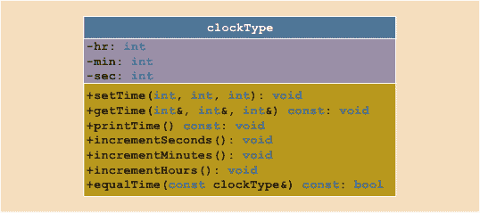

**图10-1** 类 `clockType` 的UML类图

顶部方框包含类的名称。中间方框包含成员变量及其数据类型。最后一个方框包含成员函数名称、参数列表和函数的返回类型。成员名称前面的+（加号）表示该成员是**公有**成员；-（减号）表示该成员是**私有**成员。成员名称前面的符号#表示该成员是**受保护**成员。

## 变量（对象）声明

一旦定义了类，就可以声明该类型的变量。在C++术语中，类变量称为**类对象**或**类实例**。为了帮助你熟悉这一术语，从现在起，我们将使用术语类对象，或简称为**对象**，来指代类变量。

声明类对象的语法与声明任何其他变量的语法相同。以下语句声明了两个 `clockType` 类型的对象：

```
clockType myClock;
clockType yourClock;
```

每个对象有10个成员：7个成员函数和3个成员变量。每个对象为 `hr`、`min` 和 `sec` 分配了单独的内存。

实际上，内存仅为每个类对象的成员变量分配。C++编译器只为类的成员函数生成一份物理副本，每个类对象执行同一份成员函数副本。因此，每当绘制类对象的图形时，我们将只显示成员变量。例如，图10-2显示了对象 myClock 和 yourClock 及其成员变量中的值。


图10-2 对象 myClock 和 yourClock

## 访问类成员

一旦声明了类对象，它就可以访问类的成员。对象访问类成员的一般语法是：

```
classObjectName.memberName
```

类对象可以访问的类成员取决于对象声明的位置。

- 如果对象是在类的成员函数定义中声明的，那么该对象可以同时访问**公有**和**私有**成员。（我们将在本章后面的“成员函数的实现”一节中编写类 `clockType` 的成员函数 `equalTime` 的定义时详细说明。）
- 如果对象在其他地方声明（例如，在用户程序中），那么该对象只能访问类的**公有**成员。

回忆一下，在C++中，点号（.）是一个称为**成员访问运算符**的运算符。

示例10-1说明了如何访问类的成员。

### 示例10-1

假设我们有以下声明（例如，在用户程序中）：

```
clockType myClock;
clockType yourClock;
```

考虑以下语句：

```
myClock.setTime(5, 2, 30);
myClock.printTime();
yourClock.setTime(x, y, z);    //assume x, y, and z are
                              //variables of type int
if (myClock.equalTime(yourClock))
.
.
.
```

这些语句是合法的；也就是说，它们在语法上是正确的。

在第一条语句 `myClock.setTime(5, 2, 30);` 中，执行成员函数 `setTime`。值5、2和30作为参数传递给该函数，函数使用这些值将 `myClock` 的 `hr`、`min` 和 `sec` 三个成员变量的值分别设置为5、2和30。类似地，第二条语句执行成员函数 `printTime` 并输出 `myClock` 的三个成员变量的内容。在第三条语句中，变量 x、y 和 z 的值用于设置 `yourClock` 的三个成员变量的值。

在第四条语句中，执行成员函数 `equalTime`，将 `myClock` 的三个成员变量与 `yourClock` 的相应成员变量进行比较。因为在此语句中 `equalTime` 是对象 `myClock` 的成员，所以它可以直接访问 `myClock` 的三个成员变量。因此它还需要一个对象来进行比较，这里就是 `yourClock`。实质上，`equalTime` 需要两个对象进行比较。它通过点号连接的对象 `myClock` 是其中一个，参数 `yourClock` 是另一个。这就解释了为什么函数 `equalTime` 只有一个参数。

对象 `myClock` 和 `yourClock` 只能访问类 `clockType` 的**公有**成员。因此，以下语句是非法的，因为 `hr` 和 `min` 被声明为类 `clockType` 的**私有**成员，因此对象 `myClock` 和 `yourClock` 无法访问它们：

```
myClock.hr = 10;                 //illegal
myClock.min = yourClock.min;     //illegal
```

### 类的内置操作

C++的大多数内置操作不适用于类。不能使用算术运算符对类对象执行算术运算（除非它们被重载；参见第13章）。例如，不能使用运算符+来添加两个类对象，比如 `clockType` 类型的对象。同样，也不能使用关系运算符来比较两个类对象是否相等（除非它们被重载；参见第13章）。

对类对象有效的两个内置操作是成员访问（.）和赋值（=）。你已经看到了如何通过使用类对象的名称、点号和成员名称来访问类的单个成员。（例如，如果 `myClock` 是一个 `clockType` 对象，在语句 `myClock.incrementSeconds();` 中，`myClock` 访问成员 `incrementSeconds`。）

现在我们通过一个例子来说明赋值语句是如何工作的。

### 赋值运算符和类

假设 `myClock` 和 `yourClock` 是如前定义的 `clockType` 对象。此外，假设 `myClock` 和 `yourClock` 的值如图10-3(a)所示。

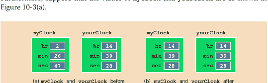

图10-3 执行语句 myClock = yourClock; 之前和之后的 myClock 和 yourClock

语句：

```cpp
myClock = yourClock;      //Line 1
```

将 `yourClock` 的值复制到 `myClock` 中。也就是说，

- `yourClock.hr` 的值被复制到 `myClock.hr`，
- `yourClock.min` 的值被复制到 `myClock.min`，以及
- `yourClock.sec` 的值被复制到 `myClock.sec`。

换句话说，`yourClock` 的三个成员变量的值被复制到 `myClock` 对应的三个成员变量中。因此，赋值语句执行的是成员逐个复制。第1行语句执行后，`myClock` 和 `yourClock` 的值如图10-3(b)所示。

## 类的作用域

`class` 对象可以是自动的（即每次控制到达其声明时创建，控制退出包含它的块时销毁）或静态的（即控制到达其声明时创建一次，程序终止时销毁）。此外，还可以声明 `class` 对象的数组。`class` 对象与其他变量具有相同的作用域。`class` 的成员与 `struct` 的成员具有相同的作用域。也就是说，`class` 的成员是 `class` 的局部成员。通过使用 `class` 对象名称和成员访问运算符（`.`）可以在 `class` 外部访问 `class` 成员。

## 函数和类

以下规则描述了函数和类之间的关系：

- 类对象可以作为参数传递给函数，也可以作为函数值返回。
- 作为函数参数，类对象可以按值传递，也可以按引用传递。
- 如果类对象按值传递，则实际参数的成员变量的内容被复制到形式参数的相应成员变量中。

## 引用参数和类对象（变量）

回忆一下，当变量按值传递时，形式参数复制实际参数的值。也就是说，为形式参数分配内存空间以复制实际参数的值。作为参数，类对象可以按值传递。

假设一个类有几个成员变量，需要大量的内存来存储数据，并且你需要按值传递一个变量。相应的形式参数就会接收该变量数据的副本。也就是说，编译器必须为形式参数分配内存，以便复制实际参数的成员变量的值。除了需要大量的存储空间外，此操作可能还需要大量的计算机时间将实际参数的值复制到形式参数中。

另一方面，如果变量按引用传递，形式参数只接收实际参数的地址。因此，将变量作为参数传递的一种有效方式是按引用传递。如果变量按引用传递，那么当形式参数改变时，实际参数也会改变。然而，有时你不希望函数能够改变成员变量的值。在C++中，可以通过按引用传递变量并在形式参数声明中使用关键字 `const` 来防止函数修改其值。例如，考虑以下函数定义：


接下来，让我们编写 `class clockType` 成员函数的定义。也就是说，我们将编写函数 `setTime`、`getTime`、`printTime`、`incrementSeconds`、`equalTime` 等的定义。由于标识符 `setTime`、`printTime` 等是类私有的，我们不能在类外部（直接）引用它们。为了引用这些标识符，我们使用**作用域解析运算符** `::`（双冒号）。在函数定义的头行中，函数名由类名、作用域解析运算符和函数名依次组成。例如，函数 `setTime` 的定义如下：

```cpp
void clockType::setTime(int hours, int minutes, int seconds)
{
    if (0 <= hours && hours < 24)
        hr = hours;
    else
        hr = 0;

    if (0 <= minutes && minutes < 60)
        min = minutes;
    else
        min = 0;

    if (0 <= seconds && seconds < 60)
        sec = seconds;
    else
        sec = 0;
}
```

注意，函数 `setTime` 的定义检查了 `hours`、`minutes` 和 `seconds` 的合法性。如果这些值超出范围，成员变量 `hr`、`min` 和 `sec` 将被初始化为 0。现在让我们解释成员函数 `setTime` 在由 `clockType` 类型的对象访问时是如何工作的。

成员函数 `setTime` 是一个 void 函数，并且有三个参数。因此：

-   对这个函数的调用是一个独立的语句。
-   在调用这个函数时，我们必须使用三个参数。

此外，回想一下，由于 `setTime` 是 `class clockType` 的成员，它可以直接访问成员变量 `hr`、`min` 和 `sec`，如 `setTime` 的定义所示。

假设 `myClock` 是一个 `clockType` 类型的对象（如前所述）。对象 `myClock` 有三个成员变量，如图 10-4(a) 所示。

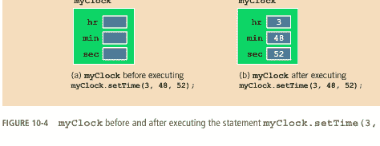

考虑下面的语句：

```cpp
myClock.setTime(3, 48, 52);
```

现在函数 `setTime` 被调用，参数为 3、48 和 52。因此，函数 `setTime` 的形参 `hours`、`minutes` 和 `seconds` 的值分别为 3、48 和 52。接下来，在语句 `myClock.setTime(3, 48, 52);` 中，`setTime` 由对象 `myClock` 访问。因此，函数 `setTime` 函数体中所引用的三个变量——`hr`、`min` 和 `sec`——就是 `myClock` 的三个成员变量。当函数 `setTime` 的函数体执行时，`hours` 的值被复制到 `myClock.hr`，`minutes` 的值被复制到 `myClock.min`，`seconds` 的值被复制到 `myClock.sec`。本质上，前面语句中作为参数传递的值 3、48 和 52，由函数 `setTime` 赋值给 `myClock` 的三个成员变量（参见函数 `setTime` 的函数体）。在前面的语句执行后，对象 `myClock` 如图 10-4(b) 所示。

接下来，让我们给出 `class clockType` 的其他成员函数的定义。这些函数的定义简单且易于理解：

```cpp
void clockType::getTime(int& hours, int& minutes,
                        int& seconds) const
{
    hours = hr;
    minutes = min;
    seconds = sec;
}

void clockType::printTime() const
{
    if (hr < 10)
        cout << "0";
    cout << hr << ":";

    if (min < 10)
        cout << "0";
    cout << min << ":";

    if (sec < 10)
        cout << "0";
    cout << sec;
}

void clockType::incrementHours()
{
    hr++;
    if (hr > 23)
        hr = 0;
}

void clockType::incrementMinutes()
{
    min++;
    if (min > 59)
    {
        min = 0;
        incrementHours();
    }
}

void clockType::incrementSeconds()
{
    sec++;

    if (sec > 59)
    {
        sec = 0;
        incrementMinutes();
    }
}
```

从函数 `incrementMinutes` 和 `incrementSeconds` 的定义可以清楚地看出，类的成员函数可以调用该类的其他成员函数。

函数 `equalTime` 的定义如下：

```cpp
bool clockType::equalTime(const clockType& otherClock) const
{
    return (hr == otherClock.hr
            && min == otherClock.min
            && sec == otherClock.sec);
}
```

让我们看看成员函数 `equalTime` 是如何工作的。

假设 `myClock` 和 `yourClock` 是 `clockType` 类型的对象，如前所述。进一步假设 `myClock` 和 `yourClock` 如图 10-5 所示。


图 10-5 对象 myClock 和 yourClock

考虑下面的语句：

```cpp
if (myClock.equalTime(yourClock))
.
.
.
```

在表达式：

```cpp
myClock.equalTime(yourClock)
```

中，对象 `myClock` 访问成员函数 `equalTime`。由于 `otherClock` 是一个引用参数，实参 `yourClock` 的地址被传递给形参 `otherClock`，如图 10-6 所示。

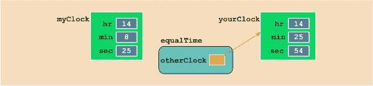

图 10-6 对象 myClock 和参数 otherClock

`otherClock` 的成员变量 `hr`、`min` 和 `sec` 的值分别为 14、25 和 54。换句话说，当函数 `equalTime` 的函数体执行时，`otherClock.hr` 的值为 14，`otherClock.min` 的值为 25，`otherClock.sec` 的值为 54。函数 `equalTime` 是 `myClock` 的一个成员。当函数 `equalTime` 执行时，函数 `equalTime` 函数体中的变量 `hr`、`min` 和 `sec` 是对象 `myClock` 的成员变量。因此，`myClock` 的成员 `hr` 与 `otherClock.hr` 比较，`myClock` 的成员 `min` 与 `otherClock.min` 比较，`myClock` 的成员 `sec` 与 `otherClock.sec` 比较。

同样，从函数 `equalTime` 的定义可以清楚地看出为什么它只有一个参数。

让我们再看一下函数 `equalTime` 的定义。注意，在这个函数的定义中，对象 `otherClock` 访问了成员变量 `hr`、`min` 和 `sec`。然而，这些成员变量是私有的。那么，这是否违反访问规则？答案是否定的。函数 `equalTime` 是 `class clockType` 的一个成员，而 `hr`、`min` 和 `sec` 是成员变量。此外，`otherClock` 是 `clockType` 类型的对象。因此，对象 `otherClock` 可以在函数 `equalTime` 的定义中访问它自己的私有成员变量。

对于类的任何成员函数也是如此。一般来说，当你编写一个类的成员函数（例如 `dummyFunction`）的定义时，假设该类为 `dummyClass`，并且该函数使用了该 `dummyClass` 类的一个对象 `dummyObject`，那么在 `dummyFunction` 的定义中，对象 `dummyObject` 可以访问它自己的私有成员变量（实际上，是该类的任何私有成员）。

一旦一个类被正确定义和实现，它就可以在程序中使用。使用并操作类的对象的程序或软件被称为该类的客户端。

当你声明 `clockType` 类的对象时，每个对象都有自己的一份成员变量 `hr`、`min` 和 `sec` 的副本。在面向对象的术语中，像 `hr`、`min` 和 `sec` 这样的变量被称为类的实例变量，因为每个对象实例都有自己的一份数据副本。

## 访问器函数和修改器函数

让我们看一下 `clockType` 类的成员函数。函数 `setTime` 将成员变量的值设置为用户指定的值。换句话说，它改变或修改了成员变量的值。同样，函数 `incrementSeconds`、`incrementMinutes` 和 `incrementHours` 也修改了成员变量。另一方面，像 `getTime`、`printTime` 和 `equalTime` 这样的函数只访问成员变量的值，并不修改成员变量。因此，我们可以将 `clockType` 类的成员函数分为两类：修改成员变量的成员函数和仅访问但不修改成员变量的成员函数。

这对于任何类来说通常都是如此。也就是说，每个类都有仅访问但不修改成员变量的成员函数，称为访问器函数，以及修改成员变量的成员函数，称为修改器函数。

**访问器函数：** 类的仅访问（即不修改）成员变量值的成员函数。

**修改器函数：** 类的修改成员变量值的成员函数。

由于访问器函数只访问成员变量的值，作为一种安全措施，我们通常会在函数头部的末尾加上保留字 `const`。


这些函数。此外，类的常量成员函数不能修改该类的成员变量。例如，参见类 `clockType` 的成员函数 `getTime`、`printTime` 和 `equalTime` 的函数头。

如果类的成员函数的函数头末尾包含保留字 `const`，则该成员函数称为**常量函数**。例如，类 `clockType` 的成员函数 `getTime`、`printTime` 和 `equalTime` 都是常量函数。类的常量成员函数不能修改该类的成员变量，因此这些是访问器函数。关于常量成员函数需要记住的一点是，类的常量成员函数只能调用该类的其他常量成员函数。因此，在将成员函数设为常量函数时要小心。

示例 10-2 展示了如何在程序中使用类 `clockType`。请注意，我们将类的定义、成员函数的定义和 main 函数组合在一起，创建了一个完整程序。在本章后面，你将学习如何使用三个文件分别存放类 `clockType` 的定义、成员函数的定义和主程序。

### 示例 10-2

```cpp
//The program listing of the program that defines
//and uses the class clockType

#include <iostream>
using namespace std;

class clockType
{
public:
    void setTime(int, int, int);
    void getTime(int&, int&, int&) const;
    void printTime() const;
    void incrementSeconds();
    void incrementMinutes();
    void incrementHours();
    bool equalTime(const clockType&) const;

private:
    int hr;
    int min;
    int sec;
};

int main() //Line 1
{          //Line 2
    clockType myClock;   //Line 3
    clockType yourClock; //Line 4
    int hours;           //Line 5
    int minutes;         //Line 6
    int seconds;         //Line 7

    //Set the time of myClock
    myClock.setTime(5, 4, 30); //Line 8

    cout << "Line 9: myClock: ";                   //Line 9
    myClock.printTime();  //print the time of myClock //Line 10
    cout << endl;                                   //Line 11

    cout << "Line 12: yourClock: ";                //Line 12
    yourClock.printTime(); //print the time of yourClock //Line 13
    cout << endl;                                   //Line 14

    //Set the time of yourClock
    yourClock.setTime(5, 45, 16);                    //Line 15

    cout << "Line 16: After setting, yourClock: "; //Line 16
    yourClock.printTime(); //print the time of yourClock //Line 17
    cout << endl;                                   //Line 18

    //Compare myClock and yourClock
    if (myClock.equalTime(yourClock))               //Line 19
        cout << "Line 20: Both times are equal."
             << endl;                               //Line 20
    else                                             //Line 21
        cout << "Line 22: The two times are not equal." //Line 22
             << endl;

    cout << "Line 23: Enter the hours, minutes, and " //Line 23
         << " seconds: ";
    cin >> hours >> minutes >> seconds;             //Line 24
    cout << endl;                                   //Line 25

    //Set the time of myClock using the value of the
    //variables hours, minutes, and seconds
    myClock.setTime(hours, minutes, seconds);        //Line 26

    cout << "Line 27: New myClock: ";               //Line 27
    myClock.printTime();  //print the time of myClock //Line 28
    cout << endl;                                   //Line 29

    //Increment the time of myClock by one second
    myClock.incrementSeconds();                     //Line 30

    cout << "Line 31: After incrementing myClock by "
         << "one second, myClock: ";                //Line 31
    myClock.printTime();  //print the time of myClock //Line 32
    cout << endl;                                   //Line 33

    //Retrieve the hours, minutes, and seconds of the
    //object myClock
    myClock.getTime(hours, minutes, seconds);                 //Line 34

    //Output the value of hours, minutes, and seconds
    cout << "Line 35: hours = " << hours
         << ", minutes = " << minutes
         << ", seconds = " << seconds << endl;              //Line 35

    return 0;                                                 //Line 36
}//end main                                               //Line 37

void clockType::setTime(int hours, int minutes, int seconds)
{
    if (0 <= hours && hours < 24)
        hr = hours;
    else
        hr = 0;

    if (0 <= minutes && minutes < 60)
        min = minutes;
    else
        min = 0;

    if (0 <= seconds && seconds < 60)
        sec = seconds;
    else
        sec = 0;
}

//Place the definitions of the remaining functions, getTime,
//incrementHours, incrementMinutes, incrementSeconds,
//printTime, and equalTime, of the class clockType, as
//described previously here.
```

**示例运行：** 在此示例运行中，用户输入以阴影显示。

```
Line 9: myClock: 05:04:30
Line 12: yourClock: 0-858993460:0-858993460:0-858993460
Line 16: After setting, yourClock: 05:45:16
Line 22: The two times are not equal.
Line 23: Enter the hours, minutes, and seconds: 8 45 59

Line 27: New myClock: 08:45:59
Line 31: After incrementing myClock by one second, myClock: 08:46:00
Line 35: hours = 8, minutes = 46, seconds = 0
```

输出第二行（第 12 行）打印的 yourClock 值取决于机器；你可能会得到不同的值。

## 类中 *public* 和 *private* 成员的顺序

C++ 对 public 和 private 成员的声明顺序没有固定规定；你可以按任意顺序声明它们。唯一需要记住的是，默认情况下，类的所有成员都是 private。必须使用成员访问说明符 public 才能使成员可供公共访问。对于所有已声明的成员，成员访问权限会保持设定状态，直到被显式重置，因此 public 会将所有成员设为 public，直到被显式改为 private。因此，如果你决定在 public 成员之后声明 private 成员（如 clockType 的情况），则必须使用成员访问说明符 private 来开始 private 成员的声明。

我们可以用三种方式之一声明类 clockType，如示例 10-3 至 10-5 所示。

### 示例 10-3

此声明与之前相同。为完整起见，我们给出类定义：

```cpp
class clockType
{
public:
    void setTime(int, int, int);
    void getTime(int&, int&, int&) const;
    void printTime() const;
    void incrementSeconds();
    void incrementMinutes();
    void incrementHours();
    bool equalTime(const clockType&) const;

private:
    int hr;
    int min;
    int sec;
};
```

### 示例 10-4

```cpp
class clockType
{
private:
    int hr;
    int min;
    int sec;

public:
    void setTime(int, int, int);
    void getTime(int&, int&, int&) const;
    void printTime() const;
    void incrementSeconds();
    void incrementMinutes();
    void incrementHours();
    bool equalTime(const clockType&) const;
};
```

### 示例 10-5

```cpp
class clockType
{
    int hr;
    int min;
    int sec;

public:
    void setTime(int, int, int);
    void getTime(int&, int&, int&) const;
    void printTime() const;
    void incrementSeconds();
    void incrementMinutes();
    void incrementHours();
    bool equalTime(const clockType&) const;
};
```

在示例 10-5 中，由于标识符 **hr**、**min** 和 **sec** 后面没有跟随任何成员访问说明符，因此它们默认是 *private*。

通常的做法是先列出所有 *public* 成员，然后列出 *private* 成员。这样，你可以将注意力集中在 *public* 成员上。

## 构造函数

在示例 10-2 的程序中，当我们没有调用函数 **setTime** 就打印 **yourClock** 的值时，输出是一些奇怪的数字（参见示例运行中第 12 行的输出）。这是因为 C++ 不会自动初始化变量。由于类的 *private* 成员不能在类外部访问（在我们的例子中是成员变量），如果用户忘记通过调用函数 **setTime** 来初始化这些变量，程序将产生错误结果。

为保证类的成员变量被初始化，需要使用构造函数。构造函数有两种类型：带参数和不带参数。不带参数的构造函数称为**默认构造函数**。


构造函数具有以下性质：

- 构造函数的名字与类名相同。
- 构造函数是一个函数，但它没有类型。也就是说，它既不是返回值的函数，也不是 void 函数。
- 一个类可以有多个构造函数。但是，一个类的所有构造函数都具有相同的名字。
- 如果一个类有多个构造函数，那么这些构造函数的形参列表必须不同。也就是说，要么形参个数不同；要么形参个数相同，但按顺序排列的形参数据类型至少有一个位置不同。换句话说，与函数重载类似，构造函数的名字是被重载的。
- 当类对象被声明并进入其作用域时，构造函数会自动执行。由于它们没有类型，不能像其他函数那样被调用。
- 执行哪个构造函数取决于声明类对象时传递给该类对象的值的类型。

让我们扩展 `clockType` 类的定义，加入两个构造函数：

```cpp
class clockType
{
public:
    void setTime(int, int, int);
    void getTime(int&, int&, int&) const;
    void printTime() const;
    void incrementSeconds();
    void incrementMinutes();
    void incrementHours();
    bool equalTime(const clockType&) const;
    clockType(int, int, int);  //带参数的构造函数
    clockType();  //默认构造函数

private:
    int hr;
    int min;
    int sec;
};
```

`clockType` 类的这个定义包含两个构造函数：一个带三个参数，一个不带任何参数。现在让我们编写这些构造函数的定义：

```cpp
clockType::clockType(int hours, int minutes, int seconds)
{
    if (0 <= hours && hours < 24)
        hr = hours;
    else
        hr = 0;

    if (0 <= minutes && minutes < 60)
        min = minutes;
    else
        min = 0;

    if (0 <= seconds && seconds < 60)
        sec = seconds;
    else
        sec = 0;
}
```

```cpp
clockType::clockType()  //默认构造函数
{
    hr = 0;
    min = 0;
    sec = 0;
}
```

从这些构造函数的定义可以看出，默认构造函数将三个成员变量——hr、min 和 sec——设置为 0。此外，带参数的构造函数将成员变量设置为赋给形参的任何值。而且，我们可以通过调用 `setTime` 函数来编写带参数的构造函数的定义，如下所示：

```cpp
clockType::clockType(int hours, int minutes, int seconds)
{
    setTime(hours, minutes, seconds);
}
```

## 调用构造函数

回顾一下，当声明类对象时，构造函数会被自动执行。因为一个类可能有多个构造函数，包括默认构造函数，接下来我们讨论如何调用特定的构造函数。

### 调用默认构造函数

假设一个类包含默认构造函数。调用默认构造函数的语法是：

```cpp
className classObjectName;
```

例如，语句：

```cpp
clockType yourClock;
```

将 `yourClock` 声明为 `clockType` 类型的对象。在这种情况下，由于声明中没有包含参数，默认构造函数会执行，`yourClock` 的成员变量被初始化为 0。

> **注意**
>
> 如果你声明一个对象并希望执行默认构造函数，对象声明语句中不需要在对象名后面加空括号。事实上，如果你不小心加上了空括号，编译器会生成一条语法错误信息。例如，下面声明对象 `yourClock` 的语句是非法的：
>
> ```cpp
> clockType yourClock(); //非法的对象声明
> ```

### 调用带参数的构造函数

假设一个类包含带参数的构造函数。调用带参数的构造函数的语法是：

```cpp
className classObjectName(argument1, argument2, ...);
```

其中 `argument1`、`argument2` 等可以是变量或表达式。

请注意以下几点：

- 参数的数量和类型应与某个构造函数的形参（按给定顺序）匹配。
- 如果参数的类型与任何构造函数的形参（按给定顺序）都不匹配，C++ 会使用类型转换并寻找最佳匹配。例如，整数值可能被转换为小数部分为零的浮点值。任何歧义都会导致编译时错误。

考虑语句：

```cpp
clockType myClock(5, 12, 40);
```

该语句声明了一个 `clockType` 类型的对象 `myClock`。这里，我们传入了三个 `int` 类型的值，这与带参数的构造函数的形参类型相匹配。因此，`clockType` 类中带参数的构造函数会执行，对象 `myClock` 的三个成员变量被设置为 5、12 和 40。

示例 10-6 进一步说明了构造函数是如何执行的。

### 示例 10-6

考虑以下类定义：

```cpp
class inventory
{
public:
    inventory();                         //第1行
    inventory(string);                   //第2行
    inventory(string, int, double);      //第3行
    inventory(string, int, double, int); //第4行

    //添加其他函数

private:
    string name;
    int itemNum;
    double price;
    int unitsInStock;
};
```

这个类有四个构造函数和四个成员变量。假设构造函数的定义如下：

```cpp
inventory::inventory() //默认构造函数
{
    name = "";
    itemNum = -1;
    price = 0.0;
    unitsInStock = 0;
}
```

```cpp
inventory::inventory(string n)
{
    name = n;
    itemNum = -1;
    price = 0.0;
    unitsInStock = 0;
}
```

```cpp
inventory::inventory(string n, int iNum, double cost)
{
    name = n;
    itemNum = iNum;
    price = cost;
    unitsInStock = 0;
}
```

```cpp
inventory::inventory(string n, int iNum, double cost, int inStock)
{
    name = n;
    itemNum = iNum;
    price = cost;
    unitsInStock = inStock;
}
```

考虑以下声明：

```cpp
inventory item1;
inventory item2("Dryer");
inventory item3("Washer", 2345, 278.95);
inventory item4("Toaster", 8231, 34.49, 200);
```

对于 `item1`，由于没有向该变量传递任何值，第 1 行的默认构造函数会执行。对于 `item2`，由于只传递了一个 `string` 类型的参数，并且它与第 2 行的构造函数匹配，因此第 2 行的构造函数会执行。对于 `item3`，由于向 `item3` 传递了三个参数，并且它们与第 3 行的构造函数匹配，因此第 3 行的构造函数会执行。类似地，对于 `item4`，第 4 行的构造函数会执行（参见图 10-7）。

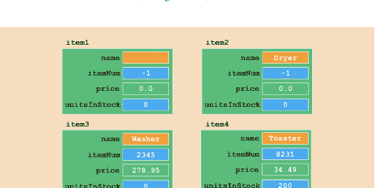

图 10-7  构造函数对对象的影响

> **注意**
>
> 如果传递给类对象的值与任何构造函数的参数都不匹配，并且无法进行类型转换，则会生成编译时错误。

## 构造函数与默认参数

构造函数也可以有默认参数。在这种情况下，声明形参的规则与在函数中声明默认形参的规则相同。此外，向具有默认参数的构造函数传递实际参数时，遵循向具有默认参数的函数传递参数的规则。（第 6 章讨论了具有默认参数的函数。）利用定义默认参数的规则，在 `clockType` 类的定义中，你可以用下面的语句替换两个构造函数

```cpp
clockType(int, int, int);
clockType();
```

（回想一下，在函数原型中，形参的名字是可选的。）

```cpp
clockType(int = 0, int = 0, int = 0);  //第1行
```

在实现文件中，这个构造函数的定义与带参数的构造函数的定义相同。

如果你用第 1 行中的构造函数（带默认参数的构造函数）替换 `clockType` 类的构造函数，那么你可以用零个、一个、两个或三个参数来声明 `clockType` 对象，如下所示：

```cpp
clockType clock1;                 //第2行
clockType clock2(5);              //第3行
clockType clock3(12, 30);         //第4行
clockType clock4(7, 34, 18);      //第5行
```

`clock1` 的成员变量被初始化为 0。`clock2` 的成员变量 `hr` 被初始化为 5，成员变量 `min` 和 `sec` 被初始化为 0。`clock3` 的成员变量 `hr` 被初始化为 12，成员变量 `min` 被初始化为 30，成员变量 `sec` 被初始化为 0。`clock4` 的成员变量 `hr` 被初始化为 7，成员变量 `min` 被初始化为 34，成员变量 `sec` 被初始化为 18。

使用这些约定，我们可以说，没有参数或所有参数都有默认值的构造函数被称为**默认构造函数**。

## 类与构造函数：一个注意事项

如前文所述，构造函数提供了对对象成员变量的有保证的初始化。通常，默认构造函数用于将成员变量初始化为某些默认值，并且该构造函数没有参数。带参数的构造函数用于将成员变量初始化为某些特定值。

我们已经看到，如果一个类没有构造函数，那么创建的对象是未初始化的，因为 C++ 在声明变量时不会自动初始化变量。实际上，如果一个类没有构造函数，C++ 会自动提供默认构造函数。但是，这个默认构造函数**不会**初始化所声明的对象。


关于类和构造函数，需要记住的重要事项如下：

- 如果类没有构造函数，C++会*自动*提供默认构造函数。但是，所声明的对象仍然未初始化。
- 另一方面，假设某个类（比如`dummyClass`）包含带参数的构造函数，但不包含默认构造函数。在这种情况下，C++*不会*为类`dummyClass`提供默认构造函数。因此，当声明类`dummyClass`的对象时，必须在其声明中提供相应的实参。

下面的代码进一步说明了这一点。考虑以下类的定义：

```cpp
class dummyClass
{
public:
    void print() const;

    dummyClass(int dX, int dY);

private:
    int x;
    int y;
};
```

类`dummyClass`有一个带参数的构造函数。它*没有*为其编写默认构造函数，并且C++不会自动提供一个，因为已经为它编写了至少一个构造函数。给定类`dummyClass`的这个定义，以下对象声明是合法的：

```cpp
dummyClass myObject(10, 25);  //object declaration is legal
```

但是，因为类`dummyClass`不包含默认构造函数，以下类声明是不正确的，并且会产生语法错误：

```cpp
dummyClass dummyObject;  //incorrect object declaration
```

因此，为了避免此类陷阱，如果类有构造函数，该类也应该包含默认构造函数。

## 数据成员的类内初始化与默认构造函数

C++11标准允许在类中声明数据成员时对其进行初始化。例如，类`clockType`的定义也可以写成如下形式：

```cpp
class clockType
{
public:
    void setTime(int, int, int);
    void getTime(int&, int&, int&) const;
    void printTime() const;
    void incrementSeconds();
    void incrementMinutes();
    void incrementHours();
    bool equalTime(const clockType&) const;

    clockType() {}
    clockType(int, int, int);  // constructor with parameters

private:
    int hr = 0;
    int min = 0;
    int sec = 0;
};
```

在这个类定义中，数据成员**hr**、**min**和**sec**既被声明也被初始化。这称为数据成员的类内初始化。当声明类**clockType**的对象而不带参数时，则使用类内初始化的值初始化该对象。如果声明对象时带参数，则默认值会被带参数的构造函数覆盖。例如，考虑以下语句：

```cpp
clockType myTime;
clockType yourTime(3, 40, 18);
```

**myTime**的**hr**、**min**和**sec**均设置为0，而**yourTime**的**hr**、**min**和**sec**分别设置为3、40和18。

请注意，即使我们已经初始化了类**clockType**的数据成员，我们仍然包含了默认构造函数。如果你想声明**clockType**对象（例如**myTime**）而不向它们传递任何值，这是必需的。另外，让我们看看类定义中包含默认构造函数的语句：

```cpp
clockType() {}
```

这是默认构造函数的完整定义。`{}`指定默认构造函数定义的空函数体。这是类成员内联函数定义的一个示例。由于完整定义包含在类定义中，我们不需要在实现文件中提供其定义。我们将在本章后面讨论类的内联成员函数。

## 类对象（变量）数组与构造函数

如果类有构造函数，并且你声明该类的对象数组，则该类应该有默认构造函数。默认构造函数通常用于初始化每个（数组）类对象。

例如，如果声明一个包含100个类对象的数组，那么为每个分量指定不同的构造函数是不切实际的（如果不是不可能的话）。（我们将在本节末尾进一步说明这一点。）

假设你有100名按小时计酬的员工，并且需要记录他们的到达和离开时间。你可以声明两个各包含100个分量的数组——**arrivalTimeEmp**和**departureTimeEmp**，其中每个分量都是**clockType**类型的对象。

第4行中的语句以**hr:min:sec**的形式输出某位员工的到达时间。

要记录每位员工的离开时间，可以使用数组**departureTimeEmp**。

同样，你可以使用数组来管理姓名列表或其他对象。


在结束关于类对象数组的讨论之前，我们想指出以下内容：本节开头指出，如果你声明类对象数组并且该类有构造函数，那么该类应该有默认构造函数。编译器使用默认构造函数来初始化对象数组。如果数组规模很大，那么为每个对象指定一个不同的带参数构造函数是不切实际的。对于小规模数组，我们可以设法指定不同的带参数构造函数。

例如，以下语句声明`clocks`为一个包含两个分量的数组。第一个分量的成员变量分别初始化为8、35和42。第二个分量的成员变量分别初始化为6、52和39。

```cpp
clockType clocks[2] = {clockType(8, 35, 42),
                    clockType(6, 52, 39)};
```

事实上，表达式`clockType(8, 35, 42)`创建类`clockType`的一个匿名对象，将其成员变量分别初始化为8、35和42；然后使用逐成员复制来初始化对象`clocks[0]`。

考虑以下语句，它创建对象`myClock`，并将其成员变量分别初始化为10、45和38。这就是我们一直创建和初始化对象的方式。事实上，语句：

```cpp
clockType myClock(10, 45, 38);
```

等价于语句：

```cpp
clockType myClock = clockType(10, 45, 38);
```

但是，第一条语句更高效。它不要求先创建一个匿名对象，然后为了初始化`myClock`而进行逐成员复制。

我们在此强调并在上一节讨论的要点如下：为了避免任何陷阱，如果类有构造函数，它也应该有默认构造函数。

## 析构函数

与构造函数一样，析构函数也是函数。此外，与构造函数一样，析构函数没有类型。也就是说，它既不是返回值函数，也不是void函数。但是，一个类只能有一个析构函数，并且析构函数没有参数。析构函数的名称是*波浪号*字符（`~`），后跟类名。例如，类`clockType`的析构函数名称是：

```cpp
~clockType();
```

当类对象超出作用域时，析构函数会自动执行。析构函数的使用将在后续章节中讨论。

## 数据抽象、类和抽象数据类型

对于我们驾驶的汽车，大多数人想知道如何启动汽车并驾驶它。大多数人不关心发动机工作原理的复杂性。通过将汽车发动机的设计细节与其使用分开，制造商帮助驾驶员专注于如何驾驶汽车。我们的日常生活中还有其他类似的例子。在大多数情况下，我们只关心如何使用某些物品，而不关心它们如何工作。

将设计细节（即汽车发动机如何工作）与其使用分开称为**抽象**。换句话说，抽象关注发动机做什么，而不是它如何工作。因此，抽象是将逻辑属性与实现细节分开的过程。驾驶汽车是一种逻辑属性；发动机的构造构成实现细节。我们对发动机做什么有一种抽象视图，但对发动机的实际实现不感兴趣。

抽象也可以应用于数据。本章前面的小节定义了数据类型**clockType**。数据类型clockType有三个成员变量和以下基本操作：

- 1. 设置时间。
- 2. 返回时间。
- 3. 打印时间。
- 4. 将时间增加一秒。
- 5. 将时间增加一分钟。
- 6. 将时间增加一小时。
- 7. 比较两个时间以查看它们是否相等。

这些操作的实际实现，即类clockType的成员函数的定义，被推迟了。

数据抽象被定义为将数据的逻辑属性与其实现分开的过程。clockType的定义及其基本操作是逻辑属性；在计算机中存储clockType对象以及执行这些操作的算法是clockType的实现细节。

**抽象数据类型（ADT）：**一种将逻辑属性与实现细节分开的数据类型。

像int等其他任何数据类型一样，ADT有三个与之相关的内容：ADT的名称，称为类型名；属于ADT的值的集合，称为

**域**；以及数据上**操作**的集合。（例如，对于数据类型`int`，类型名是`int`，域是−2147483648到2147483647（含端点）之间的整数集合，而`int`类型上的操作是+、−、*、/和%。）遵循这些约定，我们可以如下定义`clockType` ADT：

| 字段 | 定义 |
| --- | --- |
| 数据类型名 | clockType |
| 域 | 每个clockType值都是一天中的时间，形式为小时、分钟和秒。 |
| 操作 | 设置时间。<br>返回时间。<br>打印时间。<br>将时间增加一秒。<br>将时间增加一分钟。<br>将时间增加一小时。<br>比较这两个时间，判断它们是否相等。 |

## 例10-7

列表被定义为同一类型值的集合。由于列表中的所有值都属于同一类型，表示和处理列表的一种便捷方式是使用数组。你可以如下将列表定义为ADT：

| 字段 | 定义 |
| --- | --- |
| 数据类型名 | listType |
| 域 | 每个listType值都是一个数组，比如包含1000个数字 |
| 操作 | 检查列表是否为空。<br>检查列表是否已满。<br>在列表中搜索给定项。<br>从列表中删除一项。<br>在列表中插入一项。<br>对列表排序。<br>销毁列表。<br>打印列表。 |

下一个显而易见的问题是，如何在程序中实现ADT。要实现ADT，必须表示数据并编写执行操作的算法。

上一节使用类将数据和函数组合在一起。此外，我们对类的定义只包含操作的规范；实现操作的函数是单独编写的。因此，我们看到类是实现ADT的一种便捷方式。事实上，在C++中，类就是专门为处理ADT而设计的。

接下来，我们定义`class listType`，以将列表实现为ADT。通常，在列表中，我们不仅存储元素，还记录列表中元素的数量。因此，我们的`class listType`有两个成员变量：一个用于存储元素，另一个用于记录列表中元素的数量。下面的`class`，即`listType`，将列表定义为ADT。

```cpp
class listType
{
public:
    bool isEmptyList() const;
    bool isFullList() const;
    int search(int searchItem) const;
    void insert(int newElement);
    void remove(int removeElement);
    void destroyList();
    void printList() const;
    listType(); //constructor

private:
    int list[1000];
    int length;
};
```

图10-10展示了`class listType`的UML类图。

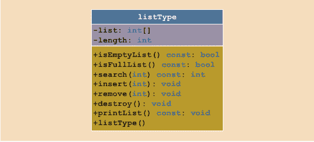

**图10-10** `class listType`的UML类图

## `struct`与`class`的比较

第9章将`struct`定义为组件的固定集合，其中组件可以是不同类型。这种对`struct`中组件的定义只包括成员变量。然而，C++的`struct`与C++的`class`非常相似。

与`class`一样，`struct`的成员也可以是函数，包括构造函数和析构函数。`struct`与`class`的唯一区别是，默认情况下，`struct`的所有成员都是公有的，而`class`的所有成员都是私有的。你可以在`struct`中使用成员访问说明符`private`来使某个成员成为私有。

在C中，`struct`的定义与第9章给出的C++中`struct`的定义相似。由于C++是从C演变而来的，标准C结构体在C++中完全可接受。然而，C++中`struct`的定义已被扩展，以包含成员函数、构造函数和其他函数。将来，由于`class`是语法上独立的实体，专门为处理ADT而设计，`class`的定义可能会以与类C的`struct`定义完全不同的方式演变。

C++的`class`和`struct`都具有相同的能力。然而，大多数程序员限制结构体的使用，以遵循其类C的结构形式，因此不使用它们包含成员函数。换句话说，如果一个`class`的所有成员变量都是公有的，并且该`class`没有成员函数，你通常会使用`struct`来组合这些成员变量。事实上，本书就是这样做的。

## 信息隐藏

上一节定义了`class clockType`，以在程序中实现时间。当我们编写使用`class clockType`的程序时，实际上，我们将`class clockType`与实现操作的函数定义以及函数main组合在一起，从而完成程序。也就是说，`class clockType`的规范和实现细节被直接并入程序中。

将类的规范和实现细节包含在程序中是一种好做法吗？绝对不是。不这样做有几个原因。假设类的定义和成员函数的定义被直接包含在用户程序中。那么用户就可以直接访问类的定义和成员函数的定义。因此，用户可以以任何自己喜欢的方式修改操作。用户也可以以任何自己喜欢的方式修改对象的成员变量。因此，从这个意义上说，对象的`private`成员变量不再是对该对象私有的。

如果多个程序员在项目中使用同一个对象，并且他们可以直接访问该对象的内部部分，那么就无法保证每个程序员都会以完全相同的方式使用同一个对象。因此，我们必须隐藏实现细节。用户应该只知道对象做什么，而不知道它如何做。隐藏实现细节使用户不必在程序中放入这段额外的代码。此外，通过隐藏细节，我们可以确保对象在整个项目中以完全相同的方式使用。此外，一旦对象被编写、调试并经过适当测试，它就会变得（并保持）无错误。


本节讨论如何隐藏对象的实现细节。为便于说明，我们将使用`class clockType`。

要在程序中实现`clockType`，用户必须声明`clockType`类型的对象，并知道允许哪些操作以及这些操作做什么。因此，用户必须能够访问规范细节。由于用户不关心实现细节，我们必须将这些细节放在一个称为**实现文件**的单独文件中。此外，由于规范细节可能太长，我们必须使用户不必将它们直接包含在程序中。然而，用户必须能够查看规范细节，以便正确调用函数等。因此，我们必须将规范细节放在一个单独的文件中。包含规范细节的文件称为**头文件（或接口文件）**。

实现文件包含实现对象操作的函数定义。该文件包含C++语句，以及其他内容（如预处理指令）。由于一个C++程序只能有一个函数`main`，实现文件不包含函数`main`。只有用户程序包含函数`main`。由于实现文件不包含函数`main`，我们无法从该文件生成可执行代码。事实上，我们从实现文件生成所谓的目标代码。然后，用户将实现文件生成的目标代码与使用该类的程序的目标代码链接起来，以创建最终的可执行代码。

最后，头文件的扩展名是`h`，而实现文件的扩展名是`cpp`。假设`class clockType`的规范细节位于一个名为`clockType`的文件中。那么该文件的完整名称应为`clockType.h`。如果`class clockType`的实现细节位于一个文件中——比如`clockTypeImp`——那么该文件的名字必须是`clockTypeImp.cpp`。

文件`clockTypeImp.cpp`只包含函数的定义，而不包含类的定义。因此，为了解决未声明标识符（如函数名和变量名）的问题，我们借助`include`语句在文件`clockTypeImp.cpp`中包含头文件`clockType.h`。任何使用`class clockType`的程序，以及为`class clockType`定义操作的实现文件，都需要下面这条`include`语句：

```cpp
#include "clockType.h"
```

注意，头文件`clockType.h`是用双引号括起来的，而不是尖括号。头文件`clockType.h`称为用户定义的头文件。通常，所有用户定义的头文件都用双引号括起来，而系统提供的头文件（如`iostream`）则括在尖括号之间。另外，请注意，前面的`include`语句假定头文件`clockType.h`与`.cpp`文件（用户程序）位于同一目录中。


实现部分包含函数的定义，而这些定义对用户是隐藏的，因为通常*只*向用户提供目标代码。然而，类的用户应当知道某个特定函数做什么以及如何使用它。因此，在包含函数原型的规范文件中，应包含简要描述该函数并说明任何前置条件和/或后置条件的注释。

**前置条件：** 一条说明在调用函数之前必须为真的条件的语句。

**后置条件：** 一条说明函数调用完成后什么为真的语句。

以下是 *clockType 类* 的规范文件和实现文件：

```cpp
class clockType
{
public:
    void setTime(int hours, int minutes, int seconds);
        //Function to set the time.
        //The time is set according to the parameters.
        //Postcondition: hr = hours; min = minutes;
        //                sec = seconds;
        //                The function checks whether the
        //                values of hours, minutes, and seconds
        //                are valid. If a value is invalid, the
        //                default value 0 is assigned.

    void getTime(int& hours, int& minutes, int& seconds) const;
        //Function to return the time.
        //Postcondition: hours = hr; minutes = min;
        //                seconds = sec;

    void printTime() const;
        //Function to print the time.
        //Postcondition: The time is printed in the form
        //                hh:mm:ss.

    void incrementSeconds();
        //Function to increment the time by one second.
        //Postcondition: The time is incremented by one second.
        //                If the before-increment time is
        //                23:59:59, the time is reset to 00:00:00.

    void incrementMinutes();
        //Function to increment the time by one minute.
        //Postcondition: The time is incremented by one minute.
        //                If the before-increment time is
        //                23:59:53, the time is reset to 00:00:53.

    void incrementHours();
        //Function to increment the time by one hour.
        //Postcondition: The time is incremented by one hour.
        //                If the before-increment time is
        //                23:45:53, the time is reset to 00:45:53.

    bool equalTime(const clockType& otherClock) const;
        //Function to compare the two times.
        //Postcondition: Returns true if this time is equal to
        //               otherClock; otherwise, returns false.

    clockType(int hours, int minutes, int seconds);
        //Constructor with parameters
        //The time is set according to the parameters.
        //Postcondition: hr = hours; min = minutes;
        //               sec = seconds;
        //               The constructor checks whether the
        //               values of hours, minutes, and seconds
        //               are valid. If a value is invalid, the
        //               default value 0 is assigned.

    clockType();
        //Default constructor
        //The time is set to 00:00:00
        //Postcondition: hr = 0; min = 0; sec = 0;

private:
    int hr;  //variable to store the hours
    int min; //variable to store the minutes
    int sec; //variable to store the seconds
};
```

```cpp
//clockTypeImp.cpp, the implementation file

#include <iostream>
#include "clockType.h"

using namespace std;
.
.
.

//Place the definitions of the member functions of the class
//clockType here.
.
.
.
```

接下来，我们描述包含使用 `clockType` 类的程序的用户文件。

```cpp
//The user program that uses the class clockType

#include <iostream>
#include "clockType.h"

using namespace std;
.
.
.
//Place the definitions of the function main and the other
//user-defined functions here
.
.
.
```

> **注意** 为节省篇幅，我们没有提供实现文件以及包含用户程序的文件的完整细节。不过，你可以在本书配套网站上找到这些文件以及规范（头）文件。

## 可执行代码

上一节讨论了如何隐藏类的实现细节。要在程序中使用对象，在执行期间，程序必须能够访问该对象的实现细节（即，实现对对象执行操作的算法）。本节讨论客户程序如何获得对对象实现细节的访问权限。为便于说明，我们将使用 clockType 类。

如前所述，要使用 clockType 类，程序必须通过 include 语句包含头文件 clockType.h。例如，以下程序段包含头文件 clockType.h：

```cpp
//Program test.cpp

#include "clockType.h"
.
.
int main()
{
    .
    .
    .
}
```

程序 testClockClass.cpp 必须只包含头文件，而不能包含实现文件。要创建运行程序 testClockClass.cpp 的可执行代码，需要以下步骤：

- 1. 我们单独编译文件 clockTypeImp.cpp，并创建目标代码文件 clockTypeImp.obj。目标代码文件包含机器语言代码，但该代码不是可执行形式。

假设命令 **cc** 在计算机的系统命令行上调用 C++ 编译器或链接器，或同时调用两者。该命令：

```cpp
cc -c clockTypeImp.cpp
```

会创建目标代码文件 `clockTypeImp.obj`。

- 2. 要为源代码文件 `testClockClass.cpp` 创建可执行代码，我们编译源代码文件 `testClockClass.cpp`，创建目标代码文件 `testClockClass.obj`，然后链接文件 `testClockClass.obj` 和 `clockTypeImp.obj`，以创建可执行文件 `testClockClass.exe`。系统命令行上的以下命令会创建可执行文件 `testClockClass.exe`。

```cpp
cc testClockClass.cpp clockTypeImp.obj
```


- 1. 要为任何源代码文件创建目标代码文件，我们在系统命令行上使用命令行选项 `-c`。例如，要为名为 `exercise.cpp` 的源代码文件创建目标代码文件，我们在系统命令行上使用以下命令。

  `cc -c exercise.cpp`

- 2. 要将多个目标代码文件与一个源代码文件链接，我们在系统命令行上列出所有目标代码文件。例如，要将 `A.obj` 和 `B.obj` 与源代码文件 `test.cpp` 链接，我们使用以下命令：

  `cc test.cpp A.obj B.obj`

- 3. 如果源代码文件被修改，则必须重新编译。

- 4. 如果一个源文件中的修改影响其他文件，则其他文件必须重新编译并重新链接。

- 5. 用户必须能够访问头文件和目标代码文件。需要访问头文件，以查看对象做什么以及如何使用它们。需要访问目标代码文件，以便用户可以将程序与目标代码链接，从而生成可执行代码。用户不需要访问包含实现细节的源代码文件。

如第 1 章所述，IDE Visual C++ Express（2013 或 2016）和 Visual Studio 2015，以及 C++ Builder 将编辑器、编译器和链接器都放入一个包中。使用一条命令，程序就会与其他必要文件一起编译和链接。这些系统还以项目的形式管理多文件程序。因此，一个项目由若干文件组成，这些文件称为项目文件。这些系统通常有一个命令，称为 **build**、**rebuild** 或 **make**。（请查阅你的系统文档。）当对项目应用 build、rebuild 或 make 命令时，系统会自动编译并链接创建可执行代码所需的所有文件。当项目中的一个或多个文件发生变化时，你可以使用这些命令重新编译并重新链接这些文件。


## 类的更多示例

在本节中，我们给出类的各种示例以及如何在程序中使用它们。

### 示例 10-8

以下语句定义了类 `circleType`，以实现圆的基本属性：

```cpp
class circleType
{
public:
    void setRadius(double r);
        //Function to set the radius.
        //Postcondition: if (r >= 0) radius = r;
        //               otherwise radius = 0;

    double getRadius();
        //Function to return the radius.
        //Postcondition: The value of radius is returned.

    double area();
        //Function to return the area of a circle.
        //Postcondition: Area is calculated and returned.

    double circumference();
        //Function to return the circumference of a circle.
        //Postcondition: Circumference is calculated and returned.

    circleType(double r = 0);
        //Constructor with a default parameter.
        //Radius is set according to the parameter.
        //The default value of the radius is 0.0;
        //Postcondition: radius = r;

private:
    double radius;
};
```

成员函数的定义如下：

```cpp
void circleType::setRadius(double r)
{
    if (r >= 0)
        radius = r;
    else
        radius = 0;
}

double circleType::getRadius()
{
    return radius;
}

double circleType::area()
{
    return 3.1416 * radius * radius;
}

double circleType::circumference()
{
    return 2 * 3.1416 * radius;
}

circleType::circleType(double r)
{
    setRadius(r);
}
```

以下说明如何在程序中使用 `class circleType`：

```cpp
//The user program that uses the class circleType
#include <iostream>                         //line 1
#include <iomanip>                          //line 2
#include "circleType.h"                    //line 3

using namespace std;                        //line 4

int main()                                   //line 5
{
    circleType circle1(8);                  //line 7
    circleType circle2;                     //line 8

    double radius;                          //line 9

    cout << fixed << showpoint << setprecision(2);   //line 10

    cout << "Line 11: circle1 - "
         << " radius: " << circle1.getRadius()
         << ", area: " << circle1.area()
         << ", circumference: "
         << circle1.circumference() << endl;         //line 11

    cout << "Line 12: circle2 - "
         << " radius: " << circle2.getRadius()
         << ", area: " << circle2.area()
         << ", circumference: "
         << circle2.circumference() << endl << endl; //line 12

    cout << "Line 13: Enter the radius: ";       //line 13
    cin >> radius;                              //line 14
                                                //line 15

    circle2.setRadius(radius);                         //Line 16

    cout << "Line 17: After setting the radius."
         << endl;                                      //Line 17

    cout << "Line 18: circle2 - "
         << "radius: " << circle2.getRadius()
         << ", area: " << circle2.area()
         << ", circumference: "
         << circle2.circumference() << endl;            //Line 18

    return 0;                                  //Line 19
} //end main                                      //Line 20
```

**示例运行：** 在此示例运行中，用户输入以阴影显示。

```
Line 11: circle1 - radius: 8.00, area: 201.06, circumference: 50.27

Line 12: circle2 - radius: 0.00, area: 0.00, circumference: 0.00

Line 13: Enter the radius: 6.25

Line 17: After setting the radius.

Line 18: circle2 - radius: 6.25, area: 122.72, circumference: 39.27
```

前面的程序按如下方式工作。第 7 行和第 8 行的语句创建对象 circle1 和 circle2。circle1 的半径设置为 8；circle2 的半径通过构造函数使用默认值设置为 0。第 11 行和第 12 行的语句输出 circle1 和 circle2 的数据。第 13 行和第 14 行的语句提示用户输入一个圆的半径，并将该半径存储在变量 radius 中。第 16 行的语句使用成员函数 setRadius 和 radius 的值来设置 circle2 的半径。第 18 行的语句输出 circle2 的（新）数据。

### 示例 10-9

在第 6 章的示例 6-4 中，函数 rollDice 掷一对骰子，直到掷出的数字之和为给定数字。然后它返回为得到所需总和而掷骰子的次数。实际上，我们可以设计一个实现骰子基本属性的类。考虑以下类 die 的定义。

```cpp
class die
{
public:
    die();
        //Default constructor
        //Sets the default number rolled by a die to 1

    void roll();
        //Function to roll a die
        //This function uses a random number generator to randomly
        //generate a number between 1 and 6, and stores the number
        //in the instance variable num.

    int getNum() const;
        //Function to return the number on the top face of the die.
        //Returns the value of the instance variable num.

private:
    int num;
};
```

接下来给出成员函数的定义。

```cpp
die::die()
{
    num = 1;
    srand(time(0));
}

void die::roll()
{
    num = rand() % 6 + 1;
}

int die::getNum() const
{
    return num;
}
```

以下程序展示如何在程序中使用类 die：

```cpp
//The user program that uses the class die

#include <iostream>                     //Line 1
#include "die.h"                        //Line 2

using namespace std;                    //Line 3

int main()                              //Line 4
{                                       //Line 5
    die die1;                           //Line 6
    die die2;                           //Line 7

    cout << "Line 8: die1: " << die1.getNum()
         << endl;                       //Line 8
    cout << "Line 9: die2: " << die2.getNum()
         << endl;                       //Line 9

    die1.roll();                        //Line 10
    cout << "Line 11: After rolling die1: "
         << die1.getNum() << endl;      //Line 11

    die2.roll();                        //Line 12
    cout << "Line 13: After rolling die2: "
         << die2.getNum() << endl;      //Line 13

    cout << "Line 14: The sum of the numbers rolled"
         << " by the dice is: "
         << die1.getNum() + die2.getNum() << endl;  //Line 14

    die1.roll();                                      //Line 15
    die2.roll();                                      //Line 16

    cout << "Line 17: After again rolling, the sum of "
         << "the numbers rolled is: "
         << die1.getNum() + die2.getNum() << endl;  //Line 17

    return 0;                                         //Line 18
}                                                //Line 19
```

**示例运行：**

```
Line 8: die1: 1
Line 9: die2: 1
Line 11: After rolling die1: 4
Line 13: After rolling die2: 3
Line 14: The sum of the numbers rolled by the dice is: 7
Line 17: After again rolling, the sum of the numbers rolled is: 8
```

前面的程序按如下方式工作。第 6 行和第 7 行的语句创建对象 die1 和 die2，并使用默认构造函数将两个骰子都设置为 1。第 8 行和第 9 行的语句输出两个骰子的数字。第 10 行的语句掷 die1，第 11 行的语句输出掷出的数字。类似地，第 12 行的语句掷 die2，第 13 行的语句输出掷出的数字。第 14 行的语句输出 die1 和 die2 掷出的数字之和。第 15 行和第 16 行的语句再次掷两个骰子，第 17 行的语句输出掷出的数字之和。

示例 10-10 中设计的类 personType 非常有用；我们将在后续章节中使用这个类。

### 示例 10-10

一个人最常见的属性是其名和姓。对一个人姓名的典型操作是设置姓名和打印姓名。以下语句定义了一个具有这些属性的类。

```cpp
#include <string>

using namespace std;

class personType
{
public:
    void print() const;
        //Function to output the first name and last name
        //in the form firstName lastName
```


```cpp
void setName(string first, string last);
    //Function to set firstName and lastName according
    //to the parameters.
    //Postcondition: firstName = first; lastName = last

string getFirstName() const;
    //Function to return the first name.
    //Postcondition: The value of firstName is returned.

string getLastName() const;
    //Function to return the last name.
    //Postcondition: The value of lastName is returned.

personType(string first = "", string last = "");
    //Constructor
    //Sets firstName and lastName according to the parameters.
    //The default values of the parameters are null strings.
    //Postcondition: firstName = first; lastName = last

private:
    string firstName; //variable to store the first name
    string lastName;  //variable to store the last name
};
```

图 10-11 展示了类 personType 的 UML 类图。

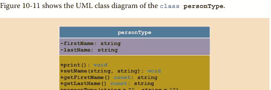

图 10-11  类 personType 的 UML 类图

现在给出类 personType 的成员函数的定义。

```cpp
void personType::print() const
{
    cout << firstName << " " << lastName;
}

void personType::setName(string first, string last)
{
    firstName = first;
    lastName = last;
}
```

```cpp
string personType::getFirstName() const
{
    return firstName;
}

string personType::getLastName() const
{
    return lastName;
}

//constructor
personType::personType(string first, string last)
{
    firstName = first;
    lastName = last;
}
```

### 示例 10-11

在本例中，我们设计并实现一个用于操作整数的类。考虑整数 620385147907652638。可以对该整数执行的一些操作包括：统计偶数数字、奇数数字和零的个数；求各位数字之和；反转各位数字；将该数拆分为三位数块；以及求这些数字之和。下面的类定义了其中一些操作。

```cpp
class integerManipulation
{
public:
    void setNum(long long n);
        //Function to set num.
        //Postcondition: num = n;

    long long getNum();
        //Function to return num.
        //Postcondition: The value of num is returned.

    void reverseNum();
        //Function to reverse the digits of num.
        //Postcondition: revNum is set to num with digits in
        //               the reverse order.

    void classifyDigits();
        //Function to count the even, odd, and zero digits of num.
        //Postcondition: evensCount = the number of even digits
        //                           in num.
        //               oddsCount = the number of odd digits in num.

    int getEvensCount();
        //Function to return the number of even digits in num.
        //Postcondition: The value of evensCount is returned.

    int getOddsCount();
        //Function to return the number of odd digits in num.
        //Postcondition: The value of oddsCount is returned.

    int getZerosCount();
        //Function to return the number of zeros in num.
        //Postcondition: The value of zerosCount is returned.

    int sumDigits();
        //Function to return the sum of the digits of num.
        //Postcondition: The sum of the digits is returned.

    integerManipulation(long long n = 0);
        //Constructor with a default parameter.
        //The instance variable num is set according to the
        //parameter, and other instance variables are
        //set to zero.
        //The default value of num is 0;
        //Postcondition: num = n; revNum = 0; evensCount = 0;
        //              oddsCount = 0; zerosCount = 0;

private:
    long long num;
    long long revNum;
    int evensCount;
    int oddsCount;
    int zerosCount;
};
```

其中一些成员函数的定义如下：

```cpp
void integerManipulation::setNum(long long n)
{
    num = n;
}

long long integerManipulation::getNum()
{
    return num;
}

void integerManipulation::reverseNum()
{
    cout << "See Programming Exercise 9 in Chapter 6." << endl;
}

void integerManipulation::classifyDigits()
{
    long long temp;

    temp = abs(num);

    int digit;

    while (temp != 0)
    {
        digit = temp - (temp / 10) * 10;
        temp = temp / 10;

        if (digit % 2 == 0)
        {
            evensCount++;
            if (digit == 0)
                zerosCount++;
        }
        else
            oddsCount++;
    }
}

int integerManipulation::getEvensCount()
{
    return evensCount;
}

int integerManipulation::getOddsCount()
{
    return oddsCount;
}

int integerManipulation::getZerosCount()
{
    return zerosCount;
}

int integerManipulation::sumDigits()
{
    cout << "See Programming Exercise 1 in Chapter 5." << endl;

    return 0;
}

integerManipulation::integerManipulation(long long n)
{
    num = n;
    revNum = 0;
    evensCount = 0;
    oddsCount = 0;
    zerosCount = 0;
}
```

下面的程序展示了如何在程序中使用这个类。

```cpp
//The user program that uses the class integerManipulation

#include <iostream>                         //Line 1
#include "integerManipulation.h"            //Line 2

using namespace std;                        //Line 3

int main()                                  //Line 4
{                                           //Line 5
    integerManipulation number;             //Line 6

    long long num;                          //Line 7

    cout << "Enter an integer: ";           //Line 8
    cin >> num;                             //Line 9
    cout << endl;                           //Line 10

    number.setNum(num);                     //Line 11

    number.classifyDigits();                //Line 12

    cout << number.getNum() << endl
         << "The number of even digits: "
         << number.getEvensCount() << endl
         << "The number of zeros: "
         << number.getZerosCount() << endl
         << "The number of odd digits: "
         << number.getOddsCount() << endl;  //Line 13

    return 0;                               //Line 14
} //end main                                //Line 15
```

**示例运行：** 在此示例运行中，用户输入以底纹显示。

```
Enter an integer: 6203851479017652638

6203851479017652638
The number of even digits: 10
The number of zeros: 2
The number of odd digits: 9
```

本章末尾的编程练习 24 要求你编写类 `integerManipulation` 中尚未给出的函数定义。

## 内联函数

类 `clockType` 的定义包含数据成员的声明和成员函数的函数原型。成员函数的定义放在实现文件中。不过，在类定义中，你可以给出成员函数的完整定义。这样的成员函数定义称为**内联函数定义**。假设你想加入一个返回时钟小时数的函数。可以按如下方式编写类 `clockType` 的定义：

```cpp
class clockType
{
public:
    void setTime(int hours, int minutes, int seconds);
    void getTime(int& hours, int& minutes, int& seconds) const;
    void printTime() const;

    void incrementSeconds();
    void incrementMinutes();
    void incrementHours();

    bool equalTime(const clockType& otherClock) const;

    int getHours() const
    {
        return hr;
    }

    clockType(int hours = 0, int minutes = 0,
              int seconds = 0);

private:
    int hr;
    int min;
    int sec;
};
```

在这个类定义中，函数 `getHours` 是内联的。内联函数定义通常用于非常短的函数定义。编译器以特殊方式处理内联函数。它通常会在调用该函数的每个位置插入内联函数的代码。调用函数时，会为其参数和局部变量分配内存；函数退出时，这些内存会被释放。因此，调用函数会带来开销。对于内联函数，可以省去函数调用的开销。一般来说，非常短的定义应定义为内联函数。

## 类的静态成员

> **注意**  可以跳过本节，而不会影响后续内容。

在第 6 章中，我们介绍了两种类型的变量：自动变量和静态变量。回顾一下，如果函数中的局部变量是 `static`，那么它在函数调用之间仍然存在。与静态变量类似，类也可以有静态成员、函数或变量。关于类的静态成员，请注意以下几点：

- 如果类中的某个函数是 `static`，则在类定义中，其函数头使用关键字 `static` 声明。


- 如果类的某个成员变量是 `static`，则使用关键字 `static` 声明，如第 6 章所述，并在示例 10-12 中说明。
- 类的 `public static` 成员、函数或变量可以使用类名和作用域解析运算符访问。

示例 10-12 阐明了关键字 `static` 的作用。

## 示例 10-12

考虑以下 `class illustrate` 的定义：

```cpp
class illustrate
{
public:
    static int count;    //public static variable

    void print() const;
        //Function to output x, y, and count.

    void setX(int a);
        //Function to set x.
        //Postcondition: x = a;

    static void incrementY();
        //static function
        //Function to increment y by 1.
        //Postcondition: y = y + 1

    illustrate(int a = 0);
        //constructor
        //Postcondition: x = a;
        //    If no value is specified for a, x = 0;

private:
    int x;
    static int y;   //private static variable
};
```

假设 `class illustrate` 的 `static` 成员变量和成员函数定义如下。（这些语句都放在实现文件中。另外，注意所有 `static` 成员变量都已初始化，如下所示。）

```cpp
int illustrate::count = 0;
int illustrate::y = 0;

void illustrate::print() const
{
    cout << "x = " << x << ", y = " << y
         << ", count = " << count << endl;
}

void illustrate::setX(int a)
{
    x = a;
}

void illustrate::incrementY()
{
    y++;
}

illustrate::illustrate(int a)
{
    x = a;
}
```

因为函数 `incrementY` 是 `static` 且 `public`，所以以下语句合法：

```cpp
illustrate::incrementY();
```

类似地，因为成员变量 `count` 是 `static` 且 `public`，所以以下语句合法：

```cpp
illustrate::count++;
```

接下来，我们进一步详细说明 `static` 成员变量。假设有一个 `class`，比如 `myClass`，它带有成员变量（既有 `static` 的也有非 `static` 的）。当你创建 `myClass` 类型的对象时，只有 `myClass` 的非 `static` 成员变量会成为每个对象的成员变量。对于 `class` 的每个 `static` 成员变量，C++ 只分配一个内存空间。所有 `myClass` 对象都引用同一内存空间。事实上，即使不存在该 `class` 类型的对象，`class` 的 `static` 成员变量也存在。你可以在 `class` 外部访问 `public` `static` 成员变量，如本节前面所述。

接下来，我们解释如何为类的 `static` 和非 `static` 成员变量分配内存空间。

假设你有示例 10-12 中给出的 `class` `illustrate`。此时，`static` 成员变量 `y` 和 `count` 的内存空间已经存在。

考虑以下语句：

```cpp
illustrate illusObject1(3);    //Line 1
illustrate illusObject2(5);    //Line 2
```

第 1 行和第 2 行中的语句将 `illusObject1` 和 `illusObject2` 声明为 `illustrate` 类型的对象（见图 10-12）。

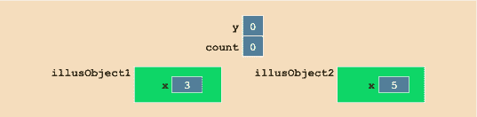

图 10-12  `illusObject1` 和 `illusObject2`

现在，考虑以下语句：

```cpp
illustrate::incrementY();
illustrate::count++;
```

这些语句执行后，对象和静态成员如图 10-13 所示。

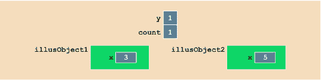

图 10-13  语句 `illustrate::incrementY();` 和 `illustrate::count++;` 执行后的 `illusObject1` 和 `illusObject2`

以下语句的输出：

```cpp
illusObject1.print();
```

为：

```text
x = 3, y = 1, count = 1
```

类似地，以下语句的输出：

```cpp
illusObject2.print();
```

为：

```text
x = 5, y = 1, count = 1
```

注意，函数 `print` 输出每个实例各自的 `x` 值，以及 `y` 和 `count` 的公共静态变量值。现在考虑以下语句：

```cpp
illustrate::count++;
```

该语句执行后，对象和静态成员如图 10-14 所示。


图 10-14  语句 `illustrate::count++;` 执行后的 `illusObject1` 和 `illusObject2`

以下语句的输出：

```cpp
illusObject1.print();
illusObject2.print();
```

为：

```text
x = 3, y = 1, count = 2
x = 5, y = 1, count = 2
```

注意，函数 `print` 对 `illusObject1` 和 `illusObject2` 输出相同的递增后的 `count` 值。

示例 10-13 中的程序进一步说明了类的静态成员如何工作。

## 示例 10-13

```cpp
#include <iostream>                                      //Line 1
#include "illustrate.h"                                  //Line 2

using namespace std;                                      //Line 3

int main()                                                //Line 4
{
    illustrate illusObject1(3);                           //Line 6
    illustrate illusObject2(5);                           //Line 7

    illustrate::incrementY();                             //Line 8
    illustrate::count++;                                  //Line 9
    illusObject1.print();                                 //Line 10
    illusObject2.print();                                 //Line 11

    cout << "Line 12: ***Increment y using "
         << "illusObject1***" << endl;                    //Line 12

    illusObject1.incrementY();                            //Line 13
    illusObject1.setX(8);                                 //Line 14
    illusObject1.print();                                 //Line 15
    illusObject2.print();                                 //Line 16

    cout << "Line 17: ***Increment y using "              //Line 17
         << "illusObject2***" << endl;

    illusObject2.incrementY();                            //Line 18
    illusObject2.setX(23);                                //Line 19
    illusObject1.print();                                 //Line 20
    illusObject2.print();                                 //Line 21

    return 0;                                             //Line 22
}                                                         //Line 23
```

### 示例运行：

```text
x = 3, y = 1, count = 1
x = 5, y = 1, count = 1
Line 12: ***Increment y using illusObject1***
x = 8, y = 2, count = 1
x = 5, y = 2, count = 1
Line 17: ***Increment y using illusObject2***
x = 8, y = 3, count = 1
x = 23, y = 3, count = 1
```

前面的程序按如下方式工作。静态成员变量 y 和 count 被初始化为 0。第 6 行中的语句将 illusObject1 声明为类 illustrate 的对象，并将其成员变量 x 初始化为 3。第 7 行中的语句将 illusObject2 声明为类 illustrate 的对象，并将其成员变量 x 初始化为 5。

第 8 行中的语句使用类 illustrate 的名称和函数 incrementY 来递增 y。现在，count 是类 illustrate 的 public static 成员。因此，第 9 行中的语句使用类 illustrate 的名称直接访问 count 并将其递增 1。第 10 行和第 11 行中的语句输出存储在对象 illusObject1 和 illusObject2 中的数据。注意，两个对象的 y 值相同。类似地，两个对象的 count 值也相同。

第 12 行中的语句是一条输出语句。第 13 行中的语句使用对象 illusObject1 和函数 incrementY 来递增 y。第 14 行中的语句将 illusObject1 的成员变量 x 的值设置为 8。第 15 行和第 16 行输出存储在对象 illusObject1 和 illusObject2 中的数据。注意，两个对象的 y 值相同。类似地，两个对象的 count 值也相同。此外，注意第 14 行中的语句只更改 illusObject1 的成员变量 x 的值，因为 x 不是类 illustrate 的静态成员。

第 18 行中的语句使用对象 `illusObject2` 和函数 `incrementY` 来递增 `y`。第 19 行中的语句将 `illusObject2` 的成员变量 `x` 的值设置为 23。第 20 行和第 21 行输出存储在对象 `illusObject1` 和 `illusObject2` 中的数据。注意，两个对象的 `y` 值相同。类似地，两个对象的 `count` 值也相同。此外，注意第 19 行中的语句只更改 `illusObject2` 的成员变量 `x` 的值，因为 `x` *不是类 `illustrate` 的静态成员*。

> **注意**
>
> 以下是关于类的 `static` 成员的一些补充说明。正如你在本节中所看到的，类的 `static` 成员函数不需要任何对象即可调用。如所示，它可以使用类名和作用域解析运算符来调用。因此，`static` 成员函数不能使用任何依赖于调用对象的内容。换句话说，在 `static` 成员函数的定义中，不能使用非 `static` 成员变量或非 `static` 函数，除非在本地声明了一个对象来访问该非 `static` 成员变量或非 `static` 成员函数。

让我们再次考虑示例 10-12 中定义的类 `illustrate`。这个类同时包含 `static` 和非 `static` 成员变量。当我们声明这个类的对象时，每个对象都有自己的非 `static` 成员变量 `x` 的副本，而所有对象共享 `static` 成员变量 `y` 和 `count`。本章前面，我们使用类 `clockType` 定义了类的术语“实例变量”。然而，当时我们没有讨论类的 `static` 成员变量。一个类可以同时拥有 `static` 和非 `static` 成员变量。因此，我们可以给出一般性陈述：类的非 `static` 成员变量称为该类的实例变量。

## 编程示例：果汁机


购买果汁的一个常见地方是自动售货机。健身房购买了一台新的果汁机，但它运行不正常。这台机器出售以下类型的果汁：橙汁、苹果汁、芒果汁和草莓香蕉汁。有人要求你为这台果汁机编写一个程序，以便它可以投入使用。

该程序应执行以下操作：

- 1. 向顾客显示果汁机出售的不同产品。
- 2. 让顾客进行选择。
- 3. 向顾客显示所选商品的价格。


- 4. 接收顾客支付的金额。
- 5. 放出商品。

| 输入 | 商品选择以及商品价格。 |
| --- | --- |
| 输出 | 所选的商品。 |

果汁机有两个主要组成部分：内置收银机和若干个用于存放和放出商品的分配器。

## 问题分析与算法设计

### 收银机

让我们首先讨论收银机的属性。收银机中有一些备用现金，它接收顾客支付的金额；如果存入的金额超过商品价格，那么——如果可能的话——它会找回零钱。为简单起见，我们假设用户存入的金额大于或等于商品价格。收银机还应能够随时向果汁机所有者显示收银机中的金额。下面的类定义了收银机的属性：

```cpp
class cashRegister
{
public:
    int getCurrentBalance() const;
        //Function to show the current amount in the cash
        //register.
        //Postcondition: The value of cashOnHand is returned.

    void acceptAmount(int amountIn);
        //Function to receive the amount deposited by
        //the customer and update the amount in the register.
        //Postcondition: cashOnHand = cashOnHand + amountIn;

    cashRegister(int cashIn = 500);
        //Constructor
        //Sets the cash in the register to a specific amount.
        //Postcondition: cashOnHand = cashIn;
        //               If no value is specified when the
        //               object is declared, the default value
        //               assigned to cashOnHand is 500.

private:
    int cashOnHand;       //variable to store the cash
                          //in the register
};
```

图 10-15 展示了类 `cashRegister` 的 UML 类图。


**图 10-15**  类 `cashRegister` 的 UML 类图

接下来，我们给出实现类 `cashRegister` 操作的各种函数定义。这些函数的定义非常简单，易于理解。

函数 `getCurrentBalance` 显示收银机中的当前金额。它返回私有成员变量 `cashOnHand` 的值。因此其定义如下：

```cpp
int cashRegister::getCurrentBalance() const
{
    return cashOnHand;
}
```

函数 `acceptAmount` 接收顾客存入的金额。它通过将顾客存入的金额加到收银机中先前的金额上来更新收银机中的现金。本质上，该函数的定义如下：

```cpp
void cashRegister::acceptAmount(int amountIn)
{
    cashOnHand = cashOnHand + amountIn;
}
```

在类 `cashRegister` 的定义中，构造函数带有一个默认值声明。因此，如果用户在声明对象时未指定任何值，则使用默认值初始化成员变量 `cashOnHand`。回想一下，由于我们在类定义中为构造函数的参数指定了默认值，因此在构造函数定义的首部中不再指定默认值。构造函数的定义如下：

```cpp
cashRegister::cashRegister(int cashIn)
{
    if (cashIn >= 0)
        cashOnHand = cashIn;
    else
        cashOnHand = 500;
}
```

注意，构造函数的定义会检查参数 `cashIn` 的有效值。如果 `cashIn` 的值小于 0，则赋给成员变量 `cashOnHand` 的值为 500。

分配器在非空时会放出所选的商品。它应显示分配器中的商品数量以及商品价格。下面的类定义了分配器的属性。我们将这个类称为 `dispenserType`。

```cpp
class dispenserType
{
public:
    int getNoOfItems() const;
        //Function to show the number of items in the machine.
        //Postcondition: The value of numberOfItems is returned.

    int getCost() const;
        //Function to show the cost of the item.
        //Postcondition: The value of cost is returned.

    void makeSale();
        //Function to reduce the number of items by 1.
        //Postcondition: numberOfItems--;

    dispenserType(int setNoOfItems = 50, int setCost = 50);
        //Constructor
        //Sets the cost and number of items in the dispenser
        //to the values specified by the user.
        //Postcondition: numberOfItems = setNoOfItems;
        //              cost = setCost;
        //              If no value is specified for a
        //              parameter, then its default value is
        //              assigned to the corresponding member
        //              variable.

private:
    int numberOfItems;   //variable to store the number of
                         //items in the dispenser
    int cost;            //variable to store the cost of an item
};
```

图 10-16 展示了类 `dispenserType` 的 UML 类图。


由于果汁机销售四种商品，我们将声明四个 `dispenserType` 类型的对象。例如，语句：

```cpp
dispenserType apple(100, 65);
```

将 apple 声明为 `dispenserType` 类型的对象，将分配器中苹果汁瓶的数量设置为 100，并将每瓶苹果汁的价格设置为 65 美分（见图 10-17）。


图 10-17  对象 apple

接下来，我们讨论实现类 `dispenserType` 操作的各种函数定义。

函数 `getNoOfItems` 返回某种特定商品的物品数量。由于分配器中当前物品数量存储在私有成员变量 `numberOfItems` 中，因此该函数返回 `numberOfItems` 的值。该函数的定义如下：

```cpp
int dispenserType::getNoOfItems() const
{
    return numberOfItems;
}
```

函数 `getCost` 返回商品的价格。由于商品价格存储在私有成员变量 `cost` 中，因此该函数返回 `cost` 的值。该函数的定义如下：

```cpp
int dispenserType::getCost() const
{
    return cost;
}
```

当商品售出时，该分配器中的物品数量减少 1。因此，函数 `makeSale` 将分配器中的物品数量减少 1。也就是说，它将私有成员变量 `numberOfItems` 的值减 1。该函数的定义如下：

```cpp
void dispenserType::makeSale()
{
    numberOfItems--;
}
```

构造函数的定义会检查参数的有效值。如果这些值小于 0，则将默认值赋给成员变量。构造函数的定义如下：

```cpp
dispenserType::dispenserType(int setNoOfItems, int setCost)
{
    if (setNoOfItems >= 0)
        numberOfItems = setNoOfItems;
    else
        numberOfItems = 50;

    if (setCost >= 0)
        cost = setCost;
    else
        cost = 50;
}
```

## 主程序

当程序执行时，它必须完成以下操作：

- 1. 显示果汁机销售的不同商品。
- 2. 显示如何选择特定商品。
- 3. 显示如何终止程序。

此外，这些说明必须在处理完每次选择后（退出程序除外）显示，这样用户如果想购买两件或更多商品，就不必记住该怎么做。一旦用户做出适当选择，果汁机必须相应地执行操作。如果用户选择购买某商品且该商品可用，果汁机应显示该商品的价格，并要求用户存入金额。如果存入金额至少达到商品价格，果汁机应售出该商品并显示相应消息。

上述讨论转化为以下算法：

- 1. 向顾客显示选择菜单。
- 2. 获取选择。
- 3. 如果选择有效且与该选择对应的分配器非空，则售出商品。

我们将此程序划分为三个函数：`showSelection`、`sellProduct` 和 `main`。

### showSelection

该函数显示帮助用户选择和购买商品所需的信息。函数 `showSelection` 的定义如下：

```cpp
void showSelection()
{
    cout << "*** Welcome to Shelly's Juice Shop ***" << endl;
    cout << "To select an item, enter " << endl;
```


- d. 如果顾客输入的金额至少等于商品价格，
  - i. 通过加上用户输入的金额来更新收银机中的金额。
  - ii. 出售商品——也就是将分配器中的商品数量减 1。
  - iii. 显示相应的消息。
- e. 如果用户输入的金额小于商品价格，则退还该金额。
- 2. 如果分配器为空，则告诉用户该商品已售罄。

函数 `sellProduct` 的定义如下：

```cpp
void sellProduct(dispenserType& product,
                 cashRegister& pCounter)
{
    int amount;  //variable to hold the amount entered
    int amount2; //variable to hold the extra amount needed

    if (product.getNoOfItems() > 0) //if the dispenser is not
                                   //empty
    {
        cout << "Please deposit " << product.getCost()
             << " cents" << endl;
        cin >> amount;

        if (amount < product.getCost())
        {
            cout << "Please deposit another "
                 << product.getCost() - amount
                 << " cents" << endl;
            cin >> amount2;
            amount = amount + amount2;
        }

        if (amount >= product.getCost())
        {
            pCounter.acceptAmount(amount);
            product.makeSale();
            cout << "Collect your item at the bottom and "
                 << "enjoy!" << endl;
        }
        else
            cout << "The amount is not enough."
                 << "Collect what you deposited." << endl;

        cout << "*-*-*-*-*-*-*-*-*-*-*-*-*-*-*-*-*"
             << endl << endl;
    }
    else
        cout << "Sorry, this item is sold out." << endl;
} //end sellProduct
```

既然我们已经描述了函数 **showSelection** 和 **sellProduct**，接下来描述函数 main。

## main

函数 main 的算法如下：

- 1. 创建收银机——也就是声明一个 **cashRegister** 类型的对象。
- 2. 创建四个分配器——也就是声明四个 **dispenserType** 类型的对象并初始化这些对象。例如，语句：

  ```cpp
  dispenserType orange(100, 50);
  ```

  创建了一个名为 orange 的分配器对象来盛放果汁。该分配器中的商品数量为 100，每件商品的价格为 50 美分。
- 3. 根据需要声明其他变量。
- 4. 显示选项；调用函数 **showSelection**。
- 5. 获取选择项。
- 6. 当未完成时（选择 9 会退出程序），
  - a. 出售商品；调用函数 **sellProduct**。
  - b. 显示选项；调用函数 **showSelection**。
  - c. 获取选择项。

函数 main 的定义如下：

```cpp
int main()
{
    cashRegister counter;
    dispenserType orange(100, 50);
    dispenserType apple(100, 65);
    dispenserType mango(75, 80);
    dispenserType strawberryBanana(100, 85);

    int choice;  //variable to hold the selection

    showSelection();
    cin >> choice;

    while (choice != 9)
    {
        switch (choice)
        {
        case 1:
            sellProduct(orange, counter);
            break;
        case 2:
            sellProduct(apple, counter);
            break;
        case 3:
            sellProduct(mango, counter);
            break;
        case 4:
            sellProduct(strawberryBanana, counter);
            break;
        default:
            cout << "Invalid selection." << endl;
        }//end switch

        showSelection();
        cin >> choice;
    }//end while

    return 0;
}//end main
```

## 完整程序清单

在前面的章节中，我们设计了用于实现收银机的类，以及用于实现果汁机的分配器。在本节中，为完整起见，我们给出这些类、实现文件以及用于实现果汁机的用户程序的完整定义。

```cpp
//***************************************************************
// Author: D. S. Malik
//
// class cashRegister
// This class specifies the members to implement a cash
// register.
//***************************************************************

class cashRegister
{
public:
    int getCurrentBalance() const;
        //Function to show the current amount in the cash
        //register.
        //Postcondition: The value of cashOnHand is returned.

    void acceptAmount(int amountIn);
        //Function to receive the amount deposited by
        //the customer and update the amount in the register.
        //Postcondition: cashOnHand = cashOnHand + amountIn;

    cashRegister(int cashIn = 500);
        //Constructor
        //Sets the cash in the register to a specific amount.
        //Postcondition: cashOnHand = cashIn;
        //              If no value is specified when the
        //              object is declared, the default value
        //              assigned to cashOnHand is 500.

private:
    int cashOnHand;        //variable to store the cash
                           //in the register
};

//************************************************************
// Author: D.S. Malik
//
// class dispenserType
// This class specifies the members to implement a dispenser.
//************************************************************

class dispenserType
{
public:
    int getNoOfItems() const;
        //Function to show the number of items in the machine.
        //Postcondition: The value of numberOfItems is returned.

    int getCost() const;
        //Function to show the cost of the item.
        //Postcondition: The value of cost is returned.

    void makeSale();
        //Function to reduce the number of items by 1.
        //Postcondition: numberOfItems--;

    dispenserType(int setNoOfItems = 50, int setCost = 50);
        //Constructor
        //Sets the cost and number of items in the dispenser
        //to the values specified by the user.
        //Postcondition: numberOfItems = setNoOfItems;
        //              cost = setCost;
        //              If no value is specified for a
        //              parameter, then its default value is
        //              assigned to the corresponding member
        //              variable.

private:
    int numberOfItems;       //variable to store the number of
                             //items in the dispenser
    int cost;                //variable to store the cost of an item
};

//***************************************************************
// Author: D.S. Malik
//
// Implementation file juiceMachine.cpp
// This file contains the definitions of the functions to
// implement the operations of the classes cashRegister and
// dispenserType.
//***************************************************************

#include <iostream>
#include "juiceMachine.h"

using namespace std;

int cashRegister::getCurrentBalance() const
{
    return cashOnHand;
}

void cashRegister::acceptAmount(int amountIn)
{
    cashOnHand = cashOnHand + amountIn;
}

cashRegister::cashRegister(int cashIn)
{
    if (cashIn >= 0)
        cashOnHand = cashIn;
    else
        cashOnHand = 500;
}

int dispenserType::getNoOfItems() const
{
    return numberOfItems;
}

int dispenserType::getCost() const
{
    return cost;
}

void dispenserType::makeSale()
{
    numberOfItems--;
}

dispenserType::dispenserType(int setNoOfItems, int setCost)
{
    if (setNoOfItems >= 0)
        numberOfItems = setNoOfItems;
    else
        numberOfItems = 50;

    if (setCost >= 0)
        cost = setCost;
    else
        cost = 50;
}

//***********************************************************
// Author: D.S. Malik
//
// This program uses the classes cashRegister and
// dispenserType to implement a juice machine.
//***********************************************************

#include <iostream>
#include "juiceMachine.h"

using namespace std;

void showSelection();
void sellProduct(dispenserType& product,
                 cashRegister& pCounter);

int main()
{
    cashRegister counter;
    dispenserType orange(100, 50);
    dispenserType apple(100, 65);
    dispenserType mango(75, 80);
    dispenserType strawberryBanana(100, 85);

    int choice;  //variable to hold the selection

    showSelection();
    cin >> choice;

    while (choice != 9)
    {
        switch (choice)
        {
        case 1:
            sellProduct(orange, counter);
            break;
```


```cpp
case 2:
    sellProduct(apple, counter);
    break;
case 3:
    sellProduct(mango, counter);
    break;
case 4:
    sellProduct(strawberryBanana, counter);
    break;
default:
    cout << "Invalid selection." << endl;
}//end switch

showSelection();
}//end while

return 0;
}//end main

void showSelection()
{
    cout << "*** Welcome to Shelly's Juice Shop ***" << endl;
    cout << "To select an item, enter " << endl;
    cout << "1 for orange juice (50 cents)" << endl;
    cout << "2 for apple juice (65 cents)" << endl;
    cout << "3 for mango juice (80 cents)" << endl;
    cout << "4 for strawberry banana juice (85 cents)" << endl;
    cout << "9 to exit" << endl;
}//end showSelection

void sellProduct(dispenserType& product,
                 cashRegister& pCounter)
{
    int amount;  //variable to hold the amount entered
    int amount2; //variable to hold the extra amount needed

    if (product.getNoOfItems() > 0) //if the dispenser is not
                                    //empty
    {
        cout << "Please deposit " << product.getCost()
             << " cents" << endl;
        cin >> amount;

        if (amount < product.getCost())
        {
            cout << "Please deposit another "
                 << product.getCost() - amount
                 << " cents" << endl;
            cin >> amount2;
            amount = amount + amount2;
        }

        if (amount >= product.getCost())
        {
            pCounter.acceptAmount(amount);
            product.makeSale();
            cout << "Collect your item at the bottom and "
                 << "enjoy." << endl;
        }
        else
            cout << "The amount is not enough. "
                 << "Collect what you deposited." << endl;

        cout << "*-*-*-*-*-*-*-*-*-*-*-*-*-*-*-*-*-*-*"
             << endl << endl;
    }
    else
        cout << "Sorry, this item is sold out." << endl;
}//end sellProduct
```

**示例运行：** 在此示例运行中，用户输入以底纹显示。

```text
*** Welcome to Shelly's Juice Shop ***
To select an item, enter
1 for orange juice (50 cents)
2 for apple juice (65 cents)
3 for mango juice (80 cents)
4 for strawberry banana juice (85 cents)
9 to exit
1
Please deposit 50 cents
50
Collect your item at the bottom and enjoy.
*-*-*-*-*-*-*-*-*-*-*-*-*-*-*-*-*-*-*
```

```text
*** Welcome to Shelly's Juice Shop ***
To select an item, enter
1 for orange juice (50 cents)
2 for apple juice (65 cents)
3 for mango juice (80 cents)
4 for strawberry banana juice (85 cents)
9 to exit
9
```


> 我们将类 cashRegister 和 dispenserType 的定义放在同一个头文件 juiceMachine.h 中。不过，你也可以将这些类的定义放在不同的头文件中，并在使用这些类的文件中包含这些头文件，例如这些类的实现文件和包含主程序的文件。同样，你也可以为这些类创建单独的实现文件。本书配套网站包含这些头文件和实现文件。

## 快速复习

- 1. `class` 是一定数量组件的集合。
- 2. `class` 的组件称为该 `class` 的成员。
- 3. `class` 的成员通过名称访问。
- 4. 在 C++ 中，`class` 是保留字。
- 5. `class` 的成员分为三类之一：`private`、`protected` 和 `public`。
- 6. `class` 的 `private` 成员不能在 `class` 外部直接访问。
- 7. `class` 的 `public` 成员可以在 `class` 外部直接访问。
- 8. 默认情况下，`class` 的所有成员都是 `private`。
- 9. `public` 成员使用成员访问说明符 `public` 和冒号 : 声明。
- 10. `private` 成员使用成员访问说明符 `private` 和冒号 : 声明。
- 11. `class` 的成员可以是函数或变量。
- 12. 如果 `class` 的某个成员是函数，通常使用函数原型来声明它。
- 13. 如果 `class` 的某个成员是变量，则像声明任何其他变量一样声明它。
- 14. 在 C++ 11 之前的 C++ 版本中，在 `class` 的定义中，声明变量时不能初始化该变量。
- 15. 如果 `class` 的成员函数的头部末尾包含保留字 `const`，则该成员函数称为常量函数。此外，`class` 的常量成员函数不能修改该 `class` 的成员变量。
- 16. 在 `class` 的统一建模语言（UML）图中，顶部框包含 `class` 的名称。中间框包含成员变量及其数据类型。最后一个框包含成员函数名、参数列表和函数的返回类型。成员名前面的 +（加号）表示该成员是 `public` 成员。成员名前面的 -（减号）表示该成员是 `private` 成员。成员名前面的 # 符号表示该成员是 `protected` 成员。
- 17. 在 C++ 中，`class` 是一种定义。不会为 `class` 本身分配内存；当你声明 `class` 变量时，才会为这些变量分配内存。
- 18. 在 C++ 中，`class` 变量称为 `class` 对象或 `class` 实例，或简称为对象。
- 19. 访问 `class` 成员时，使用 `class` 变量名，后接点运算符（`.`），再接成员名。
- 20. 对类而言，仅有的内置操作是赋值和成员选择。
- 21. 作为函数参数，类可以按值传递或按引用传递。
- 22. 函数可以返回 `class` 类型的值。例如，函数可以返回 `clockType` 类型的值。
- 23. 任何使用 `class` 的程序（或软件）都称为该 `class` 的客户端。
- 24. 修改成员变量值的 `class` 成员函数称为修改器函数。
- 25. 仅访问（即不修改）成员变量值的 `class` 成员函数称为访问器函数。
- 26. `class` 的常量成员函数只能调用该 `class` 的其他常量成员函数。
- 27. 构造函数保证在声明对象时成员变量被初始化。
- 28. 构造函数的名称与 `class` 的名称相同。
- 29. 一个 `class` 可以有多个构造函数。
- 30. 不带参数的构造函数称为默认构造函数。
- 31. 当 `class` 对象进入其作用域时，构造函数自动执行。
- 32. 当 `class` 对象离开作用域时，析构函数自动执行。
- 33. 在 C++ 11 及更高版本的 C++ 中，可以在 `class` 定义中声明数据成员时初始化该数据成员。
- 34. 一个 `class` 只能有一个析构函数，且析构函数没有参数。
- 35. 析构函数的名称是波浪号（`~`），后接 `class` 名称（中间没有空格）。
- 36. 构造函数和析构函数是没有任何类型的函数；也就是说，它们既不是有返回值的，也不是 void。因此，它们不能像其他函数那样被调用。
- 37. 将逻辑属性与实现细节分离的数据类型称为抽象数据类型（ADT）。
- 38. 在 C++ 中，类就是专门为处理 ADT 而设计的。
- 39. 要实现一个 ADT，必须表示数据并编写相关算法来实现操作。
- 40. 前置条件是一种语句，指明在调用函数之前必须为真的条件。
- 41. 后置条件是一种语句，指明函数调用完成后为真的内容。
- 42. `class` 的 `public static` 成员（函数或变量）可以使用 `class` 名称和作用域解析运算符 `::` 访问。
- 43. 对于 `class` 的每个 `static` 变量，C++ 只分配一个内存空间。该 `class` 的所有对象都引用同一内存空间。
- 44. 即使不存在 `class` 类型的对象，`class` 的 `static` 成员变量也存在。
- 45. `class` 的非静态成员变量称为该 `class` 的实例变量。

## 练习

练习末尾括号中的数字指本章开头列出的学习目标。

- 1. 判断下列陈述正确或错误。
  - a. `class` 的成员变量必须是同一类型。(1)
  - b. `class` 的成员函数必须是 `public`。(2)
  - c. 一个 `class` 可以有多个构造函数。(5)
  - d. 一个 `class` 可以有多个析构函数。(5)
  - e. 构造函数和析构函数都可以有参数。(5)

- 2. 找出下列类定义中的语法错误。(1, 2, 5)

```cpp
class syntaxErrors1                         //Line 1
{
public:                                      //Line 3
    syntaxErrors();                          //Line 4
    void setData(double, double);             //Line 5
    int mult();                               //Line 6
private:                                     //Line 7
    int one;                                  //Line 8
    double two;                               //Line 9
}                                             //Line 10
```

- 3. 找出下列类定义中的语法错误。(1, 2, 5)

```cpp
class syntaxErrors2                         //Line 1
{
public:                                      //Line 3
```


```cpp
bool canGraduate();                         //Line 4
void print() const;                          //Line 5
void syntaxErrors2(int = 0,                 //Line 6
                   double = 0);
private:                                     //Line 7
    int ID;                                  //Line 8
    double gpa;                              //Line 9
};                                           //Line 10
```

## 4. 找出以下类定义中的语法错误。(1, 2, 5)

```cpp
class syntaxErrors3()                     //Line 1
{
public:                                    //Line 3
    void setXY(int, int);                  //Line 4
    isEqual(int a, int b);                 //Line 5
    int multiply();                        //Line 6
    void print() const;                    //Line 7
    syntaxErrors3(int, int = 0);           //Line 8
private:                                   //Line 9
    int x;                                 //Line 10
    int y;                                 //Line 11
};                                        //Line 12
```

## 5. 找出以下类定义中的语法错误。(1, 2, 5)

```cpp
class syntaxErrors4                      //Line 1
{
public:                                   //Line 3
    set(string, int, double);             //Line 4
    void print() const;                   //Line 5
    syntaxErrors4() const;                //Line 6
    syntaxErrors4(string, int, double);   //Line 7
private:                                  //Line 8
    string n;                             //Line 9
    int ID;                               //Line 10
    double bal;                           //Line 11
}                                         //Line 12
```

## 6. 考虑以下声明：(1, 2, 5, 7)

```cpp
class foodType
{
public:
    void set(string, int, double, int, double, double);
    void print() const;
    string getName() const;
    int getCalories() const;
    double getFat() const;
    int getSugar() const;
    double getCarbohydrate () const;
    double getPotassium () const;
    foodType();
    foodType(string, int, double, int, double, double);
private:
    string name;
    int calories;
    double fat;
    int sugar;
    double carbohydrate;
    double potassium;

};

//variable declaration
foodType fruit1;
foodType fruit2("banana", 90, 0.4, 14, 27, 422);
```

- a. 类 `foodType` 有多少个成员？
- b. 类 `foodType` 有多少个私有成员？
- c. 类 `foodType` 有多少个构造函数？
- d. 类 `foodType` 有多少个常量函数？
- e. 哪个构造函数用于初始化对象 `fruit1`？哪个构造函数用于初始化对象 `fruit2`？
- f. 重写类 `foodType` 的定义，使每个数据成员都可以单独设置。
- g. 编写一条 C++ 语句，用一个带默认参数的构造函数替换这些构造函数的定义。

## 7. 假设类 `foodType` 的定义如练习 6 所示。回答以下问题。(1, 2, 3, 5, 6)

- a. 编写成员函数 `set` 的定义，使私有成员根据参数进行设置。`int` 和 `double` 实例变量的值必须非负。
- b. 编写成员函数 `print` 的定义，打印数据成员的值。
- c. 编写成员函数 `getName`、`getCalories`、`getFat`、`getSugar`、`getCarbohydrate`、`getPotassium` 的定义，以返回实例变量的值。
- d. 编写类 `foodType` 的默认构造函数的定义，使私有成员变量分别初始化为 ""、0、0.0、0、0.0、0.0。
- e. 编写类 `foodType` 的带参数构造函数的定义，使私有成员变量根据参数进行初始化。`int` 和 `double` 实例变量的值必须非负。
- f. 编写一条 C++ 语句，打印对象 `fruit2` 的值。
- g. 编写一条 C++ 语句，声明一个类型为 **foodType** 的对象 **myFruit**，并将 **myFruit** 的成员变量分别初始化为 **"Apple"**、52.0、2.0、10、13.8 和 148.0。

## 8. 考虑以下类的定义：

```cpp
class productType                                      //Line 1
{
public:                                                //Line 2
    productType();                                     //Line 3
    productType(int, double, double);                  //Line 4
    productType(string, int, double, double);         //Line 5
    productType(string, string, string,               //Line 6
                int, double, double);                 //Line 7

    void set(string, string, string, int,              //Line 8
             double, double);
    void print() const;                                //Line 9

    void setQuantitiesInStock(int x);                 //Line 10
    void updateQuantitiesInStock(int x);              //Line 11
    int getQuantitiesInStock() const;                 //Line 12

    void setPrice(double x);                          //Line 13
    double getPrice() const;                           //Line 14
    void setDiscount(double d);                       //Line 15
    double getDiscount() const;                       //Line 16

private:                                               //Line 17
    string productName;                                //Line 18
    string id;                                         //Line 19
    string manufacturer;                               //Line 20
    int quantitiesInStock;                             //Line 21
    double price;                                      //Line 22
    double discount;                                   //Line 23
};                                                     //Line 24
```

- a. 给出以下每个声明中执行的构造函数所在的行号。
  - i. `productType product1;`
  - ii. `productType product2("Microwave", "M3562", "General", 35, 175.00, 0.1);`
  - iii. `productType product3("D1290", 25, 375.00, 0.05);`
  - iv. `productType product4(10, 8.50, 0.2);`
- b. 编写第 4 行构造函数的定义，使实例变量分别初始化为 ""、""、""、0、0.0 和 0.0。
- c. 编写第 5 行构造函数的定义，使字符串实例变量初始化为 ""、""、""，以及其他实例变量

## 11. 考虑以下声明：(1, 2, 3, 6, 7)

```cpp
class houseType
{
public:
    void set(string, int, int, int, int, int, double, double);
    void print() const;
    void setStyle(string);
    string getStyle() const;
    void setNumOfBedrooms(int);
    int getNumOfBedrooms() const;
    void setNumOfBathrooms(int);
    int getNumOfBathrooms() const;
    void setNumOfCarsGarage(int);
    int getNumOfCarsGarage() const;
    void setYearBuilt(int);
    int getYearBuilt() const;
    void setFinishedSquareFootage(int);
    int getFinishedSquareFootage() const;
    void setPrice(double);
    double getPrice() const;
    void setTax(double);
    double getTax() const;

    houseType(string = "", int = 0, int = 0, int = 0, int = 0,
              int = 0, double = 0, double = 0);
private:
    string style;
    int numOfBedrooms;
    int numOfBathrooms;
    int numOfCarsGarage;
    int yearBuilt;
    int finishedSquareFootage;
    double price;
    double tax;
};
```

```cpp
houseType newHouse;   //variable declaration
```

- a. 类 houseType 有多少个成员？
- b. 类 houseType 有多少个私有成员？
- c. 类 houseType 有多少个构造函数？
- d. 类 houseType 有多少个常量函数？

## 12. 假设类 houseType 的定义如练习 11 所示。回答以下问题。(1, 2, 3, 5, 7)

- a. 编写成员函数 set 的定义，使私有成员根据参数进行设置。
- b. 编写成员函数 print 的定义，打印数据成员的值。


- c. 编写类 `houseType` 的构造函数定义，使 `private` 成员变量根据参数进行初始化。
- d. 编写一条 C++ 语句，输出对象 `newHouse` 的值。
- e. 编写一条 C++ 语句，声明一个 `houseType` 类型的对象 `house`，并将 `house` 的成员变量分别初始化为 `"Ranch"`、3、2、2、2005、1300、185000.0 和 3600.0。
- f. 哪些函数成员是访问器，哪些是修改器？

13. 考虑以下语句：（1, 2, 3, 5, 7）

```cpp
class temporary
{
public:
    void set(string, double, double);
    void print();
    double manipulate();
    void get(string&, double&, double&);
    void setDescription(string);
    void setFirst(double);
    void setSecond(double);
    string getDescription() const;
    double getFirst() const;
    double getSecond() const;

    temporary(string = "", double = 0.0, double = 0.0);

private:
    string description;
    double first;
    double second;
};
```

- a. 类 `temporary` 有多少个成员？
- b. 类 `temporary` 有多少个私有成员？
- c. 类 `temporary` 有多少个构造函数？这个构造函数能否用于在不指定任何参数的情况下初始化对象？如果可以，请举例说明；否则解释为什么不能用于在不指定任何参数的情况下初始化对象。

14. 假设 `class temporary` 的定义如习题 13 所述。回答以下问题。（1, 2, 3, 5, 7）

- a. 编写成员函数 `set` 的定义，使实例变量根据参数进行初始化。
- b. 编写成员函数 `manipulate` 的定义，使其按如下方式返回一个十进制数：如果 `description` 的值为 `"rectangle"`，则返回 `first * second`；如果 `description` 的值为 `"circle"`，则返回半径为 `first` 的圆的面积；如果 `description` 的值为 `"sphere"`，则返回半径为 `first` 的球的体积；如果 `description` 的值为 `"cylinder"`，则返回半径为 `first`、高为 `second` 的圆柱的体积；否则返回值 `-1`。
- c. 编写函数 `print` 的定义，以输出实例变量的值以及函数 `manipulate` 返回的值。例如，如果 description = `"rectangle"`、first = 8.5、second = 5，则应输出：

```text
rectangle: length = 8.50, width = 5.00, area = 42.50
```

- d. 编写构造函数的定义，使其使用函数 `set` 初始化实例变量。
- e. 编写其余函数的定义，以设置或获取实例变量的值。注意，函数 `get` 返回所有实例变量的值。

15. 假设 `class temporary` 的定义如习题 13 所述。以下语句的效果是什么？（5）

```cpp
temporary object1;                              //Line 1
temporary object2("rectangle", 3.0, 5.0);       //Line 2
temporary object3("circle", 6.5, 0.0);          //Line 3
temporary object4("cylinder", 6.0, 3.5);        //Line 4
```

16. 假设 `class temporary` 的定义如习题 13 所述，并且成员函数和构造函数的定义如习题 14 所指定。以下语句的输出是什么？（3, 5）

```cpp
temporary object1;
temporary object2("rectangle", 8.5, 5);
temporary object3("circle", 6, 0);
temporary object4("cylinder", 6, 3.5);

cout << fixed << showpoint << setprecision(2);

object1.print();
object2.print();
object3.print();
object4.print();

object1.set("sphere", 4.5, 0);
object1.print();
```

17. 类上的内置操作有哪些？（3）

18. 结构体和类之间的主要区别是什么？（8）

19. 给定带构造函数的 `class clockType` 的定义（如本章所述），以下 C++ 代码的输出是什么？（1, 2, 3, 5, 7）

```cpp
clockType myClock(10, 16, 59);
clockType yourClock;

myClock.incrementSeconds();
myClock.printTime();
cout << endl;

yourClock.setTime(23, 59, 29);
yourClock.printTime();
cout << endl;

yourClock.incrementMinutes();
yourClock.printTime();
cout << endl;
```

20. 考虑例 10-11 中给出的 `class integerManipulation` 的定义。以下 C++ 代码的输出是什么？（1, 2, 3, 5, 7）

```cpp
integerManipulation number(3510862895423079232);

number.classifyDigits();
cout << number.getNum() << ": The number of digits---- "
     << endl;
cout << " Even: " << number.getEvensCount() << endl
     << " Zeros: " << number.getZerosCount() << endl
     << " Odd: " << number.getOddsCount() << endl;
```

21. 假设 `class personType` 的定义如本章所述。（1, 3）

- a. 编写一条 C++ 语句，声明 `student` 为一个 personType 对象，并将其名字初始化为 **“巴迪”**，姓氏初始化为 **“阿罗拉”**。
- b. 编写一条 C++ 语句，输出对象 `student` 中存储的数据。
- c. 编写一条 C++ 语句，将 `student` 的名字改为 **“苏珊”**，姓氏改为 **“吉尔伯特”**。

22. 解释为什么一个类中同时需要 `public` 和 `private` 成员。（2, 9, 10）

23. 什么是构造函数？为什么要在类中包含构造函数？（5）

24. 以下哪个字符出现在析构函数名之前？（5）

- a. `#`
- b. `!`
- c. `~`
- d. `$`

25. 什么是析构函数，它的用途是什么？（5）

26. 编写一个类的定义，使其具有以下属性：（1, 2, 3, 5）

- a. 类名为 `stockType`。
- b. 类 `stockType` 具有以下实例变量：`name` 为 `string` 类型，`symbol` 为 `string` 类型；`currentPrice`、`lowPriceOfTheDay`、`highPriceOfTheDay`、`previousDayClosingPrice`、`fiftyTwoWeeksHigh` 和 `fiftyTwoWeeksLow` 为 `double` 类型。
- c. 类 `stockType` 具有以下成员函数。（使每个访问器函数为常量成员函数。）
  - `print`—输出成员变量中存储的数据，并带有适当的标题
  - `setStockName`—设置股票名称的函数
  - `getName`—返回股票名称的返回值函数
  - `setSymbol`—设置股票代码的函数
  - `getSymbol`—返回股票代码的返回值函数
  - `setCurrentPrice`—设置股票当前价格的函数
  - `getCurrentPrice`—返回股票当前价格的返回值函数
  - `setLowPriceOfTheDay`—设置股票当日最低价格的函数
  - `getLowPriceOfTheDay`—返回股票当日最低价格的返回值函数
  - `setHighPriceOfTheDay`—设置股票当日最高价格的函数
  - `getHighPriceOfTheDay`—返回股票当日最高价格的返回值函数
  - `setPreviousDayClosingPrice`—设置股票前一日收盘价的函数
  - `getPreviousDayClosingPrice`—返回股票前一日收盘价的返回值函数
  - `setFiftyTwoWeeksHigh`—设置股票五十二周最高价格的函数

- c. 编写一个程序来测试类 `myClass`。
- d. 重写类 `myClass` 的定义，使函数 `set` 和带参数的构造函数为内联函数。

29. 考虑以下类 `myClass` 的定义：（12）

```cpp
class myClass
{
public:
    void setX(int a);
        //Function to set the value of x.
        //Postcondition: x = a;
    void printX() const;
        //Function to output x.
    static void printCount();
        //Function to output count.
    static void incrementCount();
        //Function to increment count.
        //Postcondition: count++;
    myClass(int a = 0);
        //constructor with default parameters
        //Postcondition: x = a;
        //If no value is specified for a, x = 0;

private:
    int x;
    static int count;
};
```

- a. 编写一条 C++ 语句，将成员变量 `count` 初始化为 0。
- b. 编写一条 C++ 语句，将 `count` 的值增加 1。
- c. 编写一条 C++ 语句，输出 `count` 的值。
- d. 编写类 `myClass` 中函数的定义，如该类定义中所述。
- e. 编写一条 C++ 语句，声明 `myObject1` 为一个 `myClass` 对象，并将其成员变量 `x` 初始化为 5。
- f. 编写一条 C++ 语句，声明 `myObject2` 为一个 `myClass` 对象，并将其成员变量 `x` 初始化为 7。
- g. 以下哪些语句是有效的？（假设 `myObject1` 和 `myObject2` 如 e 和 f 部分所声明。）

```cpp
myObject1.printCount();    //Line 1
myObject1.printX();        //Line 2
myClass.printCount();      //Line 3
myClass.printX();          //Line 4
myClass::count++;          //Line 5
```


假设 **myObject1** 和 **myObject2** 如 e 部分和 f 部分所声明。以下 C++ 代码的输出是什么？

```cpp
myObject1.printX();
cout << endl;
myObject1.incrementCount();
myClass::incrementCount();
myObject1.printCount();
cout << endl;
myObject2.printCount();
cout << endl;
myObject2.printX();
cout << endl;
myObject1.setX(14);
myObject1.incrementCount();
myObject1.printX();
cout << endl;
myObject1.printCount();
cout << endl;
myObject2.printCount();
cout << endl;
```

- 30. 在示例 10-9 中，我们设计了 *die 类*。使用这个类声明一个名为 *rolls*、包含 100 个 *die* 类型分量的数组。编写 C++ 语句掷数组 *rolls* 中的每个 die，找出并输出掷出的最大数字以及该数字被掷出的次数，并找出并输出被掷出次数最多的数字及其次数。还要编写一个程序测试你的语句。(1, 3)

## 编程练习

- 1. 第 9 章定义了 `struct studentType` 来实现学生的基本属性。定义一个 `class studentType`，其组件与 `struct studentType` 相同，并添加成员函数来操作数据成员。（注意，`class studentType` 的数据成员必须是私有的。）编写一个程序说明如何使用 `class studentType`。

- 2. 编写一个程序，使用本章练习 8 和 10 中定义的 `class productType`。

- 3. 编写一个程序，使用本章练习 11 和 12 中定义的 `class houseType`。

- 4. 定义一个 `class counterType` 来实现计数器。你的类必须有一个 `int` 类型的私有数据成员 `counter`，以及用于将 `counter` 设置为用户指定值、将 `counter` 初始化为 0、获取 `counter` 的值，以及将 `counter` 增加 1 和减少 1 的函数。`counter` 的值必须非负。

- 5. 编写一个程序说明如何使用本章练习 13 和 14 中设计的 `class temporary`。你的程序不应使用练习 15 和 16 中给出的语句。此外，你的程序必须包含要求用户输入对象数据的语句，并使用成员函数 set 初始化该对象。

- 6. 编写一个程序，将输入的罗马数字转换为正整数。你的程序应包含一个类，比如 `romanType`。`romanType` 类型的对象应完成以下操作：

  - a. 将该数字存储为罗马数字。

  - b. 将该数字转换并存储为正整数。

  - c. 根据用户要求将该数字打印为罗马数字或正整数。

    罗马数字的整数值为：

    | 罗马数字 | 整数值 |
    |---|---:|
    | M | 1000 |
    | D | 500 |
    | C | 100 |
    | L | 50 |
    | X | 10 |
    | V | 5 |
    | I | 1 |

  - d. 使用以下罗马数字测试你的程序：`MCXXIV`、`CCCLIX` 和 `MDCLXVI`。

- 7. 设计并实现一个 `class dayType`，在程序中实现星期几。`class dayType` 应存储天，例如用 Sun 表示星期日。程序应能对 `dayType` 类型的对象执行以下操作：

  - a. 设置该天。

  - b. 打印该天。

  - c. 返回该天。

  - d. 返回下一天。

  - e. 返回前一天。

  - f. 通过将若干天加到当前天来计算并返回该天。例如，如果当前天是星期一，并且我们加 4 天，则返回的天是星期五。类似地，如果今天是星期二，并且我们加 13 天，则返回的天是星期一。

  - g. 添加适当的构造函数。

- 8. 编写函数定义，以实现编程练习 7 中定义的 `class dayType` 的操作。还要编写一个程序测试这个 `class` 的各种操作。

- 9. 本章定义了 `class clockType`，用于在程序中实现时间。向该类添加函数，使使用该类的程序只能设置小时、分钟或秒，并且只能获取小时、分钟或秒。将获取小时、分钟和秒的函数设为内联。还要编写一个程序测试你的类。

- 10. 通过向 `class clockType` 添加函数来增强编程练习 9，使使用该类的程序可以执行以下操作：
  - a. 返回时钟当天已流逝的时间（以秒为单位）。
  - b. 返回时钟当天剩余的时间（以秒为单位）。
  - c. 确定并输出两个时钟在时间上相隔多远。以 `hr:min:sec` 的形式输出时间。

    还要编写一个程序测试你的类。

- 11. 示例 10-10 定义了 `class personType` 来存储人的姓名。我们包含的成员函数仅打印姓名和设置人的姓名。重新定义 `class personType`，使得除了现有类的功能外，你还可以：
  - a. 仅设置名。
  - b. 仅设置姓。
  - c. 存储并设置中间名。
  - d. 检查给定的名是否与该人的名相同。
  - e. 检查给定的姓是否与该人的姓相同。编写成员函数的定义以实现这个 `class` 的操作。还要编写一个程序测试这个 `class` 的各种操作。

- 12. a. 书的一些特征包括书名、作者、出版商、ISBN、价格和出版年份。设计一个 `class bookType`，将书定义为 ADT。

    - i. `class bookType` 的每个对象可以保存关于一本书的以下信息：书名、最多四位作者、出版商、ISBN、价格和库存册数。为了跟踪作者数量，添加另一个成员变量。

    - ii. 包含成员函数，以对 `bookType` 类型的对象执行各种操作。例如，对书名可执行的常见操作是显示书名、设置书名，以及检查某个书名是否与书的实际书名相同。类似地，对库存册数可执行的典型操作是显示库存册数、设置库存册数、更新库存册数和返回库存册数。为出版商、ISBN、书价和作者添加类似操作。添加适当的构造函数和析构函数（如果需要）。

  - b. 编写 `class bookType` 的成员函数定义。

  - c. 编写一个程序，使用类 **bookType** 并测试 **bookType** 类对象的各种操作。声明一个包含 100 个 **bookType** 类型分量的数组。应执行的一些操作包括按书名搜索一本书、按 ISBN 搜索，以及更新一本书的册数。

- 13. 在本练习中，你将设计一个类 **memberType**。

  - a. **memberType** 的每个对象可以保存人的姓名、成员 ID、购买书的数量和消费金额。

  - b. 包含成员函数，以对 **memberType** 的对象执行各种操作——例如，修改、设置和显示人的姓名。类似地，更新、修改和显示购买书的数量与消费金额。

  - c. 添加适当的构造函数。

  - d. 编写 **memberType** 的成员函数定义。

  - e. 编写一个程序测试你的类 **memberType** 的各种操作。

- 14. 使用编程练习 12 和 13 中设计的类，编写一个程序模拟书店。书店有两类顾客：书店会员和仅偶尔从书店购书的人。每位会员必须支付 10 美元年费，并且每本购买的书享受 5% 折扣。对于每位会员，书店跟踪购买书的数量和总消费金额。会员每购买第 11 本书时，书店取最近购买的 10 本书总金额的平均值，将此金额作为折扣应用，然后将总消费金额重置为 0。编写一个最多可处理 1,000 个书名和 500 名会员的程序。你的程序应包含一个菜单，为用户提供不同选择以有效运行程序；换言之，你的程序应由用户驱动。

- 15. 果汁机编程示例中的方法 **sellProduct** 只给用户两次机会输入足够的钱来购买产品。重写方法 **sellProduct** 的定义，使其只要用户尚未输入足够的钱购买产品，就一直提示用户输入更多钱。还要编写一个程序测试你的方法。


- 16. 编写类 `swimmingPool` 的定义，以实现游泳池的属性。你的 `class` 应包含实例变量，用于存储长度（英尺）、宽度（英尺）、深度（英尺）、向池中注水的速率（加仑/分钟）以及从池中排水的速率（加仑/分钟）。添加适当的构造函数以初始化实例变量。还要添加成员函数来完成以下操作：确定注满空池或部分注满的池所需的水量，确定完全或部分注满或排空池所需的时间，以及在指定时间内加水或排水。

- 17. （井字棋）编写一个程序，允许两名玩家玩井字棋游戏。你的程序必须包含 `class ticTacToe`，以实现 `ticTacToe` 对象。包含一个 3×3 二维数组作为 `private` 成员变量，以创建棋盘。如有需要，包含额外的成员变量。对 `ticTacToe` 对象的一些操作包括打印当前棋盘、获取一步落子、检查落子是否有效，以及每次落子后确定获胜者。根据需要添加其他操作。

- 18. 直线方程的标准形式为 $ax + by = c$，其中 $a$ 和 $b$ 不能同时为零，且 $a$、$b$、$c$ 为实数。若 $b \ne 0$，则 $-a/b$ 是该直线的斜率。若 $a = 0$，则它是一条水平线；若 $b = 0$，则它是一条竖直线。竖直线的斜率未定义。两条直线若斜率相同或均为竖直线，则平行。两条直线若其中一条为水平线、另一条为竖直线，或它们的斜率乘积为 −1，则垂直。设计 `class lineType` 来存储一条直线。要存储一条直线，需要存储 $a$（$x$ 的系数）、$b$（$y$ 的系数）和 $c$ 的值。你的 `class` 必须包含以下操作：
  - a. 如果直线不是竖直线，则确定其斜率。
  - b. 判断两条直线是否相等。（对于两条直线 $a_1x + b_1y = c_1$ 和 $a_2x + b_2y = c_2$，如果 $a_1 = a_2$、$b_1 = b_2$ 且 $c_1 = c_2$，或者存在某个实数 $k$ 使得 $a_1 = ka_2$、$b_1 = kb_2$ 且 $c_1 = kc_2$，则它们相等。）
  - c. 判断两条直线是否平行。
  - d. 判断两条直线是否垂直。
  - e. 如果两条直线不平行，则求交点。

  添加适当的构造函数以初始化 `lineType` 的变量。同时编写一个程序来测试你的 `class`。

- 19. 通常，每个人都会定期存钱，用于退休、买房或其他目的。如果你为退休存钱，那么你存入退休基金的钱享有税收优惠，而且你的雇主也会向你的退休基金缴纳一部分款项。在本练习中，为简单起见，我们假设资金存入一个支付固定利率的账户，并在指定期末将钱存入该账户。假设某人每年向一个账户存入 $m$ 次、每次 $R$ 美元，该账户每年按 $r\%$ 的利率复利 $m$ 次，持续 $t$ 年。那么 $t$ 年末累计的总金额由下式给出

  \[
  R\left[\frac{(1+r/m)^{mt}-1}{r/m}\right].
  \]

  例如，假设你每月末向一个账户存入 $500，该账户年利率为 4.8%，按月复利，持续 25 年。那么该账户累计的总金额为

  \[
  500\left[(1+0.048/12)^{300}-1\right]/(0.048/12)=\$289,022.42.
  \]

  另一方面，假设你想在 $t$ 年内累积 $S$ 美元，并想知道每年 $m$ 次应向一个每年按 $r\%$ 利率复利 $m$ 次的账户存入多少钱。定期支付额由下式给出

  \[
  \frac{S(r/m)}{(1+r/m)^{mt}-1}.
  \]

  设计一个类，使用上述公式确定账户累计总金额，以及为累积特定金额所需的定期存款额。你的类应包含实例变量，用于存储定期存款额、$m$ 的值、利率以及资金将储蓄的年数。添加适当的构造函数以初始化实例变量，添加用于设置实例变量值的函数、获取实例变量值的函数，以及执行必要计算并输出结果的函数。

- 20. 编写一个程序来测试本章习题 26 中定义的类 `stockType`。

- 21. 定义类 `bankAccount`，以实现银行账户的基本属性。该类的对象应存储以下数据：账户持有人姓名（`string`）、账号（`int`）、账户类型（`string`，支票/储蓄）、余额（`double`）和利率（`double`）。（将利率存储为小数。）添加适当的成员函数来操作账户。在类中使用静态成员来自动分配账号。同时声明一个包含 10 个 `bankAccount` 类型元素的数组，以处理最多 10 个客户，并编写一个程序来说明如何使用你的类。

- 22. 假设你掷一组 $n$ 个骰子。那么最小的和为 $n$，最大的和为 $6n$。例如，若 $n=10$，则最小和为 10，最大和为 60。设 $m$ 为所掷点数之和的目标值。那么 $n \le m \le 6n$。若 $n=10$，则 $10 \le m \le 60$。编写一个程序，使用示例 10-9 中的类 `die` 来掷 10 个骰子。（使用大小为 10 的数组来实现 10 个骰子。）程序提示用户输入目标总和以及掷骰子的次数。程序输出掷出目标总和的次数以及掷出目标总和的概率。测试运行你的程序，分别掷 10 个骰子 10000、100000、1000000 和 10000000 次，目标总和分别为 10、25、40 和 60。总和为 10 的情况被掷出多少次？总和为 60 的情况被掷出多少次？

- 23. 编程习题 22 提示用户输入掷骰子的次数和目标总和，程序输出目标总和出现的次数。按如下方式修改编程习题 22：假设你掷 4 个骰子 1000 次。将每次掷出的点数之和存储到一个数组中，然后使用该数组打印条形图（类似于第 6 章编程习题 22 中的条形图）。分别使用 4、5、6 个骰子以及 2500、3000、5000 次投掷来测试运行你的程序。你的条形图形状类似于哪种类型的曲线？

- 24. 编写示例 10-11 中未给出的类 `integerManipulation` 的成员函数定义。还要向该类添加以下操作：（1）从右到左将该数拆分为由 *n* 位数字组成的块，并求这些 *n* 位数字的和。（注意，最后一个块可能不足 *n* 位。如有需要，添加额外的实例变量。）（2）判断该数是否为素数。（3）求该数的质因数分解。


## 第11章：继承与组合

本章中，你将：

- 1. 了解继承
- 2. 了解派生类和基类
- 3. 探讨如何重定义基类的成员函数
- 4. 考察基类和派生类的构造函数如何工作
- 5. 了解基类和派生类的析构函数如何工作
- 6. 学习如何构建派生类的头文件
- 7. 认识流类层次结构
- 8. 探讨三种继承类型：`public`、`protected` 和 `private`
- 9. 了解组合（聚合）
- 10. 熟悉面向对象设计的三个基本原则

### 继承

Songping Yu, Yifan Feng, Hongmei Zhu, and Yue Gao

厦门大学信息学院，中国厦门

### 引言

多模态检索增强生成（Multimodal RAG）已成为一种有前景的方法，它通过利用外部多模态知识来提高生成内容的质量和准确性。本综述旨在全面概述多模态 RAG 的最新进展，涵盖其关键组成部分、方法和应用。


## 例 11-1

假设我们定义了一个名为 **shape** 的类。以下语句指定 **类 circle** 派生自 **shape**，并且是 **公有** 继承。

```cpp
class circle: public shape
{
    .
    .
    .
};
```

另一方面，考虑以下 **类 circle** 的定义：

```cpp
class circle: private shape
{
    .
    .
    .
};
```

这是 **私有** 继承。在此定义中，**shape** 的 **公有** 成员成为 **类 circle** 的 **私有** 成员。因此，任何 **circle** 类型的对象都不能直接访问这些成员。前面 **circle** 的定义等价于：

```cpp
class circle: shape
{
    .
    .
    .
};
```

也就是说，如果我们既不使用 **成员访问说明符** **公有** 也不使用 **私有**，则基类的 **公有** 成员默认被继承为 **私有** 成员。

应牢记以下关于基类和派生类的事实。

- 1. 基类的 **私有** 成员对基类保持 **私有**；因此，派生类的成员不能直接访问它们。换句话说，当你编写派生类成员函数的定义时，即使基类的 **私有** 成员是派生类的成员，派生类也不能直接访问它们。
- 2. 基类的 **公有** 成员可以由派生类继承为 **公有** 成员或 **私有** 成员。也就是说，基类的 **公有** 成员可以成为派生类的 **公有** 或 **私有** 成员。这意味着基类中原本的 **公有** 成员可以在派生类中保持 **公有** 成员，或成为 **私有** 成员。
- 3. 派生类可以包含额外的成员——数据和/或函数。
- 4. 派生类可以重新定义基类的 `public` 成员函数。也就是说，在派生类中，你可以有一个成员函数，其名称、参数数量和类型与基类中的函数相同，但函数体中的代码不同。然而，这种重新定义仅适用于派生类的对象，不适用于基类的对象。
- 5. 基类的所有成员变量也是派生类的成员变量。类似地，基类的成员函数（除非被重新定义）也是派生类的成员函数。（在派生类中访问基类的成员时，请记住规则 1。）

接下来的几节描述与继承相关的两个重要问题。第一个问题是在派生类中重新定义基类的成员函数。在讨论这个问题时，我们还将讨论如何在派生类中访问基类的 `private`（数据）成员。第二个关键的继承问题与构造函数有关。派生类的构造函数不能直接访问基类的 `private` 成员变量。因此，我们需要确保当派生类的构造函数执行时，从基类继承的 `private` 成员变量也被初始化。

## 重新定义（覆盖）基类的成员函数

假设有一个 `class derivedClass` 派生自 `class baseClass`。进一步假设 `derivedClass` 和 `baseClass` 都有一些成员变量。那么，类 `derivedClass` 的成员变量是它自己的成员变量加上 `baseClass` 的成员变量。假设 `baseClass` 包含一个函数 `print`，用于打印 `baseClass` 的成员变量的值。现在 `derivedClass` 除了从 `baseClass` 继承的成员变量之外，还包含成员变量。假设你想包含一个打印 `derivedClass` 的成员变量值的函数。你可以给这个函数任意命名。然而，在类 `derivedClass` 中，你也可以将这个函数命名为 `print`（与 `baseClass` 使用的名称相同）。这称为重新定义（或覆盖）基类的成员函数。接下来，我们通过一个示例说明如何重新定义基类的成员函数。

> **注意** 要在派生类中重新定义基类的公有成员函数，派生类中的对应函数必须具有相同的名称、参数数量和参数类型。换句话说，在派生类中被重新定义的函数必须具有相同的名称和相同的参数集合。如果基类和派生类中的对应函数具有相同的名称但不同的参数集合，那么这就是派生类中的函数重载，这也是允许的。

考虑以下类的定义：

```cpp
class rectangleType
{
public:
    void setDimension(double l, double w);
        //Function to set the length and width of the rectangle.
        //Postcondition: length = l; width = w;

    double getLength() const;
        //Function to return the length of the rectangle.
        //Postcondition: The value of length is returned.

    double getWidth() const;
        //Function to return the width of the rectangle.
        //Postcondition: The value of width is returned.

    double area() const;
        //Function to return the area of the rectangle.
        //Postcondition: The area of the rectangle is
        //                calculated and returned.

    double perimeter() const;
        //Function to return the perimeter of the rectangle.
        //Postcondition: The perimeter of the rectangle is
        //                calculated and returned.

    void print() const;
        //Function to output the length and width of
        //the rectangle.

    rectangleType();
        //Default constructor
        //Postcondition: length = 0; width = 0;

    rectangleType(double l, double w);
        //Constructor with parameters
        //Postcondition: length = l; width = w;

private:
    double length;
    double width;
};
```

图 11-2 显示了类 `rectangleType` 的 UML 类图。


图 11-2 类 `rectangleType` 的 UML 类图

类 `rectangleType` 有 10 个成员。

假设类 `rectangleType` 的成员函数的定义如下：

```cpp
void rectangleType::setDimension(double l, double w)
{
    if (l >= 0)
        length = l;
    else
        length = 0;

    if (w >= 0)
        width = w;
    else
        width = 0;
}

double rectangleType::getLength() const
{
    return length;
}

double rectangleType::getWidth() const
{
    return width;
}

double rectangleType::area() const
{
    return length * width;
}

double rectangleType::perimeter() const
{
    return 2 * (length + width);
}

void rectangleType::print() const
{
    cout << "Length = " << length
         << "; Width = " << width;
}

rectangleType::rectangleType(double l, double w)
{
    setDimension(l, w);
}

rectangleType::rectangleType()
{
    length = 0;
    width = 0;
}
```

现在考虑以下类 `boxType` 的定义，它派生自类 `rectangleType`：

```cpp
class boxType: public rectangleType
{
public:
    void setDimension(double l, double w, double h);
        //Function to set the length, width, and height
        //of the box.
        //Postcondition: length = l; width = w; height = h;

    double getHeight() const;
        //Function to return the height of the box.
        //Postcondition: The value of height is returned.

    double area() const;
        //Function to return the surface area of the box.
        //Postcondition: The surface area of the box is
        //               calculated and returned.

    double volume() const;
        //Function to return the volume of the box.
        //Postcondition: The volume of the box is
        //               calculated and returned.

    void print() const;
        //Function to output the length, width, and height of a box.

    boxType();
        //Default constructor
        //Postcondition: length = 0; width = 0; height = 0;
};
```


```cpp
boxType(double l, double w, double h);
    //Constructor with parameters
    //Postcondition: length = l; width = w; height = h;

private:
    double height;
```

图 11-3 展示了类 `boxType` 的 UML 类图以及继承层次结构。


图 11-3 类 `boxType` 的 UML 类图及继承层次结构

从类 `boxType` 的定义可以清楚地看出，类 `boxType` 派生自类 `rectangleType`，并且是 `public` 继承。因此，类 `rectangleType` 的所有 `public` 成员都是类 `boxType` 的 `public` 成员。类 `boxType` 还重写（重新定义）了函数 `print` 和 `area`。

一般来说，在编写派生类的成员函数定义以指定对基类的 `public` 成员函数的调用时，我们按如下方式操作：

- 如果派生类重写了基类的某个 `public` 成员函数，那么要指定调用基类的该 `public` 成员函数，需使用基类名，后跟作用域解析运算符 `::`，再跟带有适当参数列表的函数名。例如，要调用类 `rectangleType` 的函数 `area`，语句为：`rectangleType::area()`。
- 如果派生类没有重写基类的某个 `public` 成员函数，则你*可以*使用函数名和适当的参数列表来指定对该 `public` 成员函数的调用。（关于在派生类中被重载的基类成员函数，请参见下面的注意。）

> **注意** 如果派生类*重载*了基类的某个 *public* 成员函数，那么在编写派生类的成员函数定义时，要指定调用基类的该（被重载的）成员函数（具体取决于编译器），你可能需要使用基类名，后跟作用域解析运算符 `::`，再跟带有适当参数列表的函数名。有关示例，请参见本节后面给出的类 `boxType` 的函数 `setDimension` 的定义。

接下来，让我们编写类 `boxType` 的成员函数 `print` 的定义。

类 `boxType` 有三个成员变量：length、width 和 height。类 `boxType` 的成员函数 `print` 打印这些成员变量的值。要编写类 `boxType` 的函数 `print` 的定义，请记住以下几点：

- 成员变量 length 和 width 是类 `rectangleType` 的私有成员，因此不能在类 `boxType` 中直接访问。因此，在编写类 `boxType` 的函数 `print` 的定义时，我们不能直接访问 length 和 width。
- 类 `rectangleType` 的成员变量 length 和 width 只能通过类 `rectangleType` 的公有成员函数被类 `boxType` 访问。因此，在编写类 `boxType` 的成员函数 `print` 的定义时，我们必须调用类 `rectangleType` 的成员函数 `print` 来打印 length 和 width 的值。打印 length 和 width 的值之后，我们可以直接输出 height 的值，因为它是类 `boxType` 的成员。

要在类 `boxType` 的成员函数 `print` 的定义中调用 `rectangleType` 的成员函数 `print`，我们必须使用以下语句：

```
rectangleType::print();
```

该语句确保我们调用的是基类 `rectangleType` 的成员函数 `print`，而不是类 `boxType` 的成员函数 `print`。

类 `boxType` 的成员函数 `print` 的定义为：

```cpp
void boxType::print() const
{
    rectangleType::print();
    cout << "; Height = " << height;
}
```

让我们编写类 `boxType` 其余成员函数的定义。

函数 `setDimension` 的定义为：

```cpp
void boxType::setDimension(double l, double w, double h)
{
    rectangleType::setDimension(l, w);
    if (h >= 0)
        height = h;
    else
        height = 0;
}
```

注意，在前面的函数 `setDimension` 定义中，对类 `rectangleType` 的成员函数 `setDimension` 的调用前带有类名和作用域解析运算符，即使类 `boxType` 重载——而不是重写——了函数 `setDimension`。

函数 `getHeight` 的定义为：

```cpp
double boxType::getHeight() const
{
    return height;
}
```

类 `boxType` 的成员函数 `area` 确定一个盒子的表面积。要确定盒子的表面积，我们需要访问盒子的 length 和 width，它们被声明为类 `rectangleType` 的私有成员。因此，我们使用类 `rectangleType` 的成员函数 `getLength` 和 `getWidth` 分别获取 length 和 width。因为类 `boxType` 不包含任何名为 `getLength` 或 `getWidth` 的成员函数，所以我们可以调用类 `rectangleType` 的这些成员函数，而无需将它们与基类名关联。

```cpp
double boxType::area() const
{
    return 2 * (getLength() * getWidth()
              + getLength() * height
              + getWidth() * height);
}
```

类 `boxType` 的成员函数 `volume` 确定一个盒子的体积。要确定盒子的体积，可以将盒子的 length、width 和 height 相乘，或者将盒子底面的面积乘以它的 height。让我们使用第二种方案编写成员函数 `volume` 的定义。为此，可以使用类 `rectangleType` 的成员函数 `area` 来确定底面的面积。因为类 `boxType` 重写了成员函数 `area`，所以要指定调用类 `rectangleType` 的成员函数 `area`，我们使用基类名和作用域解析运算符，如下面的定义所示：

```cpp
double boxType::volume() const
{
    return rectangleType::area() * height;
}
```

在下一节中，我们将讨论在编写派生类的构造函数定义时，如何指定对基类构造函数的调用。


## 派生类和基类的构造函数

派生类可以有自己的 `private` 成员变量，因此派生类可以显式包含自己的构造函数来初始化它们。当我们声明一个派生类对象时，该对象继承基类的成员，但派生类对象不能直接访问基类的 `private`（数据）成员。派生类的成员函数也是如此。也就是说，派生类的成员函数不能直接访问基类的 `private` 成员。

因此，派生类的构造函数（直接）只初始化从派生类的基类继承来的（`public` 数据）成员。因而，当声明一个派生类对象时，它还必须触发执行基类的某个构造函数。此外，这种对基类构造函数的触发是在派生类构造函数的*定义头*中指定的。

首先，让我们编写类 `boxType` 的默认构造函数的定义。回顾一下，如果一个类包含默认构造函数，并且在声明对象时没有指定任何值，则默认构造函数执行并初始化该对象。因为类 `rectangleType` 包含默认构造函数，所以我们在编写类 `boxType` 的默认构造函数定义时，不指定基类的任何构造函数。

```cpp
boxType::boxType()
{
    height = 0.0;
}
```

要编写带参数的类 `boxType` 构造函数的定义，我们首先编写类 `boxType` 构造函数头，其中包含*基类构造函数和派生类构造函数所需的所有参数*；也就是说，包含 `boxType` 和 `rectangleType` 两者所需的所有参数。然后，为了触发带参数的基类构造函数的执行，我们在派生类构造函数的定义头中，在头部后添加一个冒号（`:`），后跟基类构造函数的名称及其参数。实际上，我们通过冒号将基类构造函数“附加”到派生类构造函数上。派生类构造函数获取自身和基类构造函数所需的所有参数，然后将这些参数传递给基类构造函数。

考虑以下类 `boxType` 的带参数构造函数的定义：

```cpp
boxType::boxType(double l, double w, double h)
    : rectangleType(l, w)
{
    if (h >= 0)
        height = h;
    else
        height = 0;
}
```


在这个定义中，我们为 `rectangleType` 指定了一个带两个参数的构造函数。当 `boxType` 的这个构造函数执行时，它会触发类 `rectangleType` 中接受两个 `double` 类型参数的构造函数的执行。

考虑以下语句：

```cpp
rectangleType myRectangle(5.0, 3.0);   //Line 1
boxType myBox(6.0, 5.0, 4.0);          //Line 2
```

第1行语句创建了 `rectangleType` 对象 `myRectangle`。因此，对象 `myRectangle` 有两个成员变量：`length` 和 `width`。第2行语句创建了 `boxType` 对象 `myBox`。因此，对象 `myBox` 有三个成员变量：`length`、`width` 和 `height`（见图 11-4）。


考虑以下语句：

```cpp
myRectangle.print();   //Line 3
cout << endl;          //Line 4
myBox.print();         //Line 5
cout << endl;          //Line 6
```

在第3行语句中，执行类 `rectangleType` 的成员函数 `print`。在第5行语句中，执行与类 `boxType` 关联的函数 `print`。回想一下，如果派生类重写了基类的成员函数，则该重定义只适用于派生类的对象。因此，第3行语句的输出为（如类 `rectangleType` 中所定义）：

`Length = 5.0; Width = 3.0`

第5行语句的输出为（如类 `boxType` 中所定义）：

`Length = 6.0; Width = 5.0; Height = 4.0`

当对象 `myBox` 进入其作用域时，类 `rectangleType` 和 `boxType` 的构造函数都会执行。注意，基类的构造函数不会被派生类继承。因此，如果基类包含 *私有* 数据成员，*只有* 基类的构造函数才能构造基类的数据成员，包括：

```cpp
int main() //Line 6
{ //Line 7
    rectangleType yard; //Line 8
    double fenceCostPerFoot; //Line 9
    double fertilizerCostPerSquareFoot; //Line 10
    double length, width; //Line 11
    double billingAmount; //Line 12

    cout << fixed << showpoint << setprecision(2); //Line 13

    cout << "Line 14: Enter the length and width of the " //Line 14
         << "yard (in feet): ";
    cin >> length >> width; //Line 15
    cout << endl; //Line 16

    yard.setDimension(length, width); //Line 17

    cout << "Line 18: Enter the cost of fence " //Line 18
         << "(per foot): $";
    cin >> fenceCostPerFoot; //Line 19
    cout << endl; //Line 20

    cout << "Line 21: Enter the cost of fertilizer " //Line 21
         << "(per square foot): $";
    cin >> fertilizerCostPerSquareFoot; //Line 22
    cout << endl; //Line 23

    billingAmount = yard.perimeter() * fenceCostPerFoot
                  + yard.area() * fertilizerCostPerSquareFoot; //Line 24

    cout << "Line 25: Amount due: $" << billingAmount
         << endl; //Line 25

    boxType package; //Line 26
    double height; //Line 27
    double wrappingCostPerSquareFeet; //Line 28

    cout << "Line 29: Enter the length, width, and height " //Line 29
         << "of the package (in feet): ";
    cin >> length >> width >> height; //Line 30
    cout << endl; //Line 31

    package.setDimension(length, width, height); //Line 32

    cout << "Line 33: Enter the cost (25 to 50 cents) of " //Line 33
         << "wrapping per square foot: ";
    cin >> wrappingCostPerSquareFeet; //Line 34
    cout << endl; //Line 35

    billingAmount = wrappingCostPerSquareFeet
                  * package.area() / 100; //Line 36

    if (billingAmount < 1.00)                     //Line 37
        billingAmount = 1.00;                     //Line 38

    cout << "Line 39: Amount due: $" << billingAmount
         << endl;                                 //Line 39
    return 0;                                     //Line 40
}                                                 //Line 41
```

**示例运行：** 在此示例运行中，用户输入以阴影显示。

```text
Line 14: Enter the length and width of the yard (in feet): 70 50
Line 18: Enter the cost of fence (per foot): $10.00
Line 21: Enter the cost of fertilizer (per square foot): $0.25
Line 25: Amount due: $3275.00
Line 29: Enter the length, width, and height of the package (in feet): 3 2 0.25
Line 33: Enter the cost (25 to 50 cents) of wrapping per square foot: 25
Line 39: Amount due: $3.63
```

前面的程序工作如下：第8至12行以及第26至28行的语句声明了程序中使用的变量和对象。（注意，第8行语句创建了对象 `yard`，第26行语句创建了对象 `package`。）第14行语句提示用户输入院子的长度和宽度，第15行语句分别将这些值输入变量 `length` 和 `width`。第17行语句使用函数 `setDimension` 初始化对象 `yard` 的实例变量。第18至23行语句提示用户输入搭建围栏和给院子施肥的费用，并将这些值存入变量 `fenceCostPerFoot` 和 `fertilizerCostPerSquareFoot`。第24行语句计算账单金额。注意，该语句使用类 `rectangleType` 的函数 `perimeter` 和 `area` 计算围栏长度和院子面积。然后第25行语句输出账单金额。

第29行语句提示用户输入包裹的长度、宽度和高度，第30行语句分别将这些值输入变量 `length`、`width` 和 `height`。第32行语句使用函数 `setDimension` 初始化对象 `package` 的实例变量。第33行语句提示用户输入包裹包装费用（每平方英尺），第34行语句将该费用存入变量 `wrappingCostPerSquareFoot`。第36行语句计算账单金额。注意，该语句使用类 `boxType` 的函数 `area` 计算包裹的表面积。第37行语句检查账单金额是否小于 $1.00，第38行语句将账单金额设为 1.00。然后第39行语句输出账单金额。

注意，在这个程序中，院子的长度是 70 英尺，宽度是 50 英尺。因此，院子的周长是 2 * (70 + 50) = 240 英尺，院子的面积是 70 * 50 = 3500 平方英尺。搭建围栏和给院子施肥的总费用 = $(240 * 10 + 3500 * 0.25) = $(2400 + 875) = $3275.00。接下来，包裹的长度、宽度和高度分别是 3 英尺、2 英尺和 0.25 英尺。因此，包裹的表面积 = 2 * (3 * 2 + 3 * 0.25 + 2 * 0.25) = 14.50 平方英尺。所以，包裹的包装费用是 $14.50 * 25 / 100 = $3.625 = $3.63（四舍五入到两位小数）。

现在，类 `rectangleType` 和 `boxType` 都有函数 `setDimension` 和 `area`。因此，程序正确地调用每个类的函数 `setDimension` 来初始化对象 `yard` 和 `package`。类似地，对于 `yard`，调用类 `rectangleType` 的函数 `area` 来计算院子的面积；对于 `package`，调用类 `boxType` 的函数 `area` 来计算包裹的表面积。

从该程序的输出可以看出，类 `boxType` 中函数 `setDimension` 和 `area` 的重定义只适用于 `boxType` 类型的对象。

> **注意**
>
> 本书配套网站上的文件夹 `Ch11_InheritanceAndConstructors` 中包含一个程序，进一步说明如何在程序中使用类 `rectangleType` 和 `boxType`。

> **注意**
>
> （带默认参数的构造函数与继承层次结构）回想一下，类可以有带默认参数的构造函数。因此，派生类也可以有带默认参数的构造函数。例如，假设类 `rectangleType` 的定义如下所示。（为节省篇幅，这些定义没有文档说明。）

```cpp
class rectangleType
{
public:
    void setDimension(double l, double w);
    double getLength() const;
    double getWidth() const;
    double area() const;
    double perimeter() const;
    void print() const;
    rectangleType(double l = 0, double w = 0);
    //Constructor with default parameters

private:
    double length;
    double width;
};
```


假设构造函数的定义如下：

```cpp
rectangleType::rectangleType(double l, double w)
{
    setDimension(l, w);
}
```

现在假设类 boxType 的定义如下：

```cpp
class boxType: public rectangleType
{
public:
    void setDimension(double l, double w, double h);
    double getHeight() const;
    double area() const;
    double volume() const;
    void print() const;
    boxType(double l = 0, double w = 0, double h = 0);
    //Constructor with default parameters

private:
    double height;
};
```

可以如下编写类 boxType 的构造函数的定义：

```cpp
boxType::boxType(double l, double w, double h)
    : rectangleType(l, w)
{
    if (h >= 0)
        height = h;
    else
        height = 0;
}
```

注意，这个定义也处理了类 boxType 的默认构造函数。

> **注意**
>
> 假设基类 baseClass 具有私有成员变量和构造函数。进一步假设类 derivedClass 派生自 baseClass，并且 derivedClass 没有成员变量。因此，derivedClass 的成员变量是从 baseClass 继承而来的那些成员变量。构造函数不能像其他函数那样被调用，并且 derivedClass 的成员函数不能直接访问 baseClass 的成员变量。为了保证 derivedClass 类型对象的继承成员变量被初始化，即使 derivedClass 没有成员变量，它也必须具有适当的构造函数。derivedClass 的（带参数的）构造函数仅仅发出对 baseClass 的（带参数的）构造函数的调用。因此，当你编写 derivedClass 的（带参数的）构造函数的定义时，构造函数定义的首部包含对 baseClass 的适当（带参数的）构造函数的调用，而构造函数体为空——也就是说，它只包含左花括号和右花括号。

### 示例 11-3

假设你想定义一个类来归组员工的属性。员工既有全职的，也有兼职的。兼职员工根据工作小时数和小时薪资率获得报酬。假设你想定义一个类来跟踪兼职员工的信息，例如**姓名**、**薪资率**和**工作时长**。然后你可以打印员工姓名及其工资。因为每个员工都是一个人，并且示例 10-10（第 10 章）定义了 `class personType` 来存储名字和姓氏以及对 `name` 的必要操作，所以我们可以基于 `class personType` 定义 `class partTimeEmployee`。你还可以重新定义 `print` 函数以打印适当的信息。

```cpp
class partTimeEmployee: public personType
{
public:
    void print() const;
        //Function to output the first name, last name, and
        //the wages.
        //Postcondition: Outputs
        //               firstName lastName wages are $$$$.$$

    double calculatePay() const;
        //Function to calculate and return the wages.
        //Postcondition: Pay is calculated and returned.

    void setNameRateHours(string first, string last,
                          double rate, double hours);
        //Function to set the first name, last name, payRate,
        //and hoursWorked according to the parameters.
        //Postcondition: firstName = first; lastName = last;
        //               payRate = rate; hoursWorked = hours;

    partTimeEmployee(string first = "", string last = "",
                     double rate = 0, double hours = 0);
        //Constructor with parameters
        //Sets the first name, last name, payRate, and hoursWorked
        //according to the parameters. If no value is specified,
        //the default values are assumed.
        //Postcondition: firstName = first; lastName = last;
        //               payRate = rate; hoursWorked = hours;

private:
    double payRate;      //variable to store the pay rate
    double hoursWorked;  //variable to store the hours worked
};
```

图 11-5 展示了 `class partTimeEmployee` 的 UML 类图和继承层次结构。


图 11-5 类 partTimeEmployee 的 UML 类图和继承层次结构

类 partTimeEmployee 的成员函数定义如下：

```cpp
void partTimeEmployee::print() const
{
    personType::print();  //print the name of the employee
    cout << "'s wages are: $" << calculatePay() << endl;
}

double partTimeEmployee::calculatePay() const
{
    return (payRate * hoursWorked);
}

void partTimeEmployee::setNameRateHours(string first,
    string last, double rate, double hours)
{
    personType::setName(first, last);
    payRate = rate;
    hoursWorked = hours;
}

//Constructor
partTimeEmployee::partTimeEmployee(string first, string last,
    double rate, double hours)
    : personType(first, last)
{
    if (rate >= 0)
        payRate = rate;
    else
        payRate = 0;

    if (hours >= 0)
        hoursWorked = hours;
    else
        hoursWorked = 0;
}
```

## 派生类中的析构函数

回顾第 10 章，类可以有析构函数。正如我们将在下一章看到的，析构函数通常用于释放分配给类对象的动态内存。（在执行期间分配的内存空间称为动态内存空间。下一章解释如何创建和使用动态内存。）假设一个基类及其派生类都有析构函数。当派生类对象离开作用域时，它会自动调用其析构函数。当派生类的析构函数执行时，它会自动调用基类的析构函数。因此，在编写派生类的析构函数的定义时，不需要显式调用基类的析构函数。此外，当派生类的析构函数执行时，它先执行自己的代码，然后调用基类的析构函数。例如，假设类 three 派生自类 two，类 two 派生自类 one，并且这些类都有析构函数。当类 three 的对象离开作用域时，首先执行类 three 的析构函数，然后执行类 two 的析构函数，最后执行类 one 的析构函数。也就是说，析构函数按相反顺序执行。

## 派生类的头文件

上一节解释了如何从先前定义的类派生新类。要定义新类，需要创建新的头文件。基类已经定义，头文件包含它们的定义。因此，要基于先前定义的类创建新类，新类的头文件包含告诉计算机在哪里查找基类定义的命令。回顾一下，要在用户程序中包含系统提供的头文件（例如 `iostream`），需将头文件括在尖括号中；要在程序中包含用户定义的头文件，需将头文件括在双引号中。

假设类 `personType` 的定义放在头文件 `personType.h` 中。要创建类 `partTimeEmployee` 的定义，头文件——比如 `partTimeEmployee.h`——必须包含以下预处理指令：

```cpp
#include "personType.h"
```

位于类 `partTimeEmployee` 的定义之前。具体来说，头文件 `partTimeEmployee.h` 如下所示。

```cpp
//Header file partTimeEmployee

#include "personType.h"

class partTimeEmployee: public personType
{
public:
    void print() const;
    //Function to output the first name, last name, and
    //the wages.
    //Postcondition: Outputs
    //              firstName lastName wages are $$$$.$$


以下程序使用 `class primeFactorization` 来求一个数的质因数分解。注意，此程序不检查用户是否输入了有效数字。你在编程练习14中编写的程序必须确保用户输入有效数字。

```cpp
#include <iostream>
#include "primeFactorization.h"

using namespace std;

int main()
{
    primeFactorization number;

    long long num;

    cout << "Enter an integer between 2 and "
         << "270,000,000,000,000: ";
    cin >> num;
    cout << endl;

    number.setNum(num);

    number.factorization();

    return 0;
} //end main
```

**示例运行：** 在这些示例运行中，用户输入以底纹显示。

### 示例运行 1：

输入一个介于 2 和 270,000,000,000,000 之间的整数：`3614457253`

3614457253 不是质数。它的质因数分解为：
3614457253 = 11 * 29 * 151 * 75037

### 示例运行 2：

输入一个介于 2 和 270,000,000,000,000 之间的整数：`2457829012772`

2457829012772 不是质数。它的质因数分解为：
2457829012772 = 2 * 2 * 7 * 37 * 41 * 67 * 863641

### 示例运行 3：

输入一个介于 2 和 270,000,000,000,000 之间的整数：`151383311`

151383311 是质数。它的质因数分解为：
151383311 = 151383311

## C++ 流类

第3章详细描述了如何使用标准I/O设备和文件I/O执行输入/输出（I/O）。特别地，你使用了对象 `cin`、提取运算符 `>>` 以及诸如 `get` 和 `ignore` 等函数从标准输入设备读取数据。你还使用了对象 `cout` 和插入运算符 `<<` 将输出发送到标准输出设备。为了使用 `cin` 和 `cout`，程序包含了头文件 `iostream`，其中包含类 `istream` 和 `ostream` 的定义。此外，对于文件I/O，程序包含了头文件 `fstream`，并使用 `ifstream` 类型的对象进行文件输入，使用 `ofstream` 类型的对象进行文件输出。本节简要描述流类在C++中如何关联和实现。

在C++中，流类使用继承机制实现，如图11-6所示。


**图11-6** C++流类层次结构

图11-6显示了我们在前几章中遇到的流类。从该图可知，类 `ios` 是所有流类的基类。类 `istream` 和 `ostream` 直接派生自类 `ios`。类 `ifstream` 派生自类 `istream`，类 `ofstream` 派生自类 `ostream`。此外，使用多重继承机制，类 `iostream`（不要与头文件 `iostream` 混淆——它们是不同的东西）和类 `fstream` 派生自类 `iostream`。（本书不讨论类 `iostream` 和 `fstream`。）

类 `ios` 包含格式化标志以及访问和/或修改这些标志设置的成员函数。为了标识I/O状态，类 `ios` 包含一个整数状态字。这个整数状态字持续更新，报告流的状态。

类 `istream` 和 `ostream` 负责提供在内存和设备之间传输数据的操作。类 `istream` 定义了提取运算符 `>>`，以及诸如 `get` 和 `ignore` 等函数。类 `ostream` 定义了插入运算符 `<<`，对象 `cout` 使用它。

**类 ifstream** 派生自**类 istream**，以提供文件输入操作。类似地，**类 ofstream** 派生自**类 ostream**，以提供文件输出操作。ifstream 类型的对象用于文件输入；ofstream 类型的对象用于文件输出。头文件 fstream 包含类 ifstream 和 ofstream 的定义。

## 类的受保护成员

类的私有成员对该类是私有的，不能在类外部直接访问。只有该类的成员函数才能访问私有成员。如前所述，派生类不能直接访问基类的私有成员。然而，有时（例如，为了提高效率和/或简化代码）派生类需要直接访问基类的私有成员。如果将私有成员变为公有，那么任何人都可以访问该成员。回想一下，类的成员分为三类：公有、私有和受保护。派生类可以直接访问基类的受保护成员。因此，为了让基类向派生类授予对某个成员的访问权限，同时仍然防止在类外部直接访问该成员，必须将该成员声明在成员访问说明符 protected 下。因此，类的受保护成员的可访问性介于公有和私有之间。

总结来说，如果基类的某个成员需要被派生类访问，则该成员应声明在成员访问说明符 protected 下。

## 作为公有、受保护或私有继承

假设类 B 派生自类 A。那么，B 不能直接访问 A 的私有成员。也就是说，A 的私有成员在 B 中被隐藏。那么 A 的公有和受保护成员呢？本节给出访问基类成员时通常适用的规则。

考虑以下语句：

```cpp
class B: memberAccessSpecifier A
{
    .
    .
    .
};
```

在此语句中，memberAccessSpecifier 是 public、protected 或 private 之一。

- 1. 如果 **成员访问说明符** 是 **公有**——也就是说，继承是 **公有**——那么：
    - a. **A** 的**公有**成员是 **B** 的**公有**成员。它们可以在类 **B** 中直接访问。
    - b. **A** 的**受保护**成员是 **B** 的**受保护**成员。它们可以由 **B** 的成员函数（以及 **友元** 函数）直接访问。
    - c. **A** 的**私有**成员在 **B** 中被隐藏。它们不能在 **B** 中直接访问。它们可以通过 **A** 的**公有**或**受保护**成员由 **B** 的成员函数（以及 **友元** 函数）访问。
- 2. 如果 **成员访问说明符** 是 **受保护**——也就是说，继承是 **受保护**——那么：
    - a. **A** 的**公有**成员是 **B** 的**受保护**成员。它们可以由 **B** 的成员函数（以及 **友元** 函数）访问。
    - b. **A** 的**受保护**成员是 **B** 的**受保护**成员。它们可以由 **B** 的成员函数（以及 **友元** 函数）访问。
    - c. **A** 的**私有**成员在 **B** 中被隐藏。它们不能在 **B** 中直接访问。它们可以通过 **A** 的**公有**或**受保护**成员由 **B** 的成员函数（以及 **友元** 函数）访问。
- 3. 如果 **成员访问说明符** 是 **私有**——也就是说，继承是 **私有**——那么：
    - a. **A** 的**公有**成员是 **B** 的**私有**成员。它们可以由 **B** 的成员函数（以及 **友元** 函数）访问。
    - b. **A** 的**受保护**成员是 **B** 的**私有**成员。它们可以由 **B** 的成员函数（以及 **友元** 函数）访问。
    - c. **A** 的**私有**成员在 **B** 中被隐藏。它们不能在 **B** 中直接访问。它们可以通过 **A** 的**公有**或**受保护**成员由 **B** 的成员函数（以及 **友元** 函数）访问。

> **注意** 第13章介绍 **友元** 函数。

例11-5说明了派生类的成员函数如何直接访问基类的 **受保护** 成员。

### 例11-5

### 在派生类中访问受保护成员

考虑以下类 **bClass** 的定义：

```cpp
class bClass
{
public:
    void setData(double);
    void setData(char, double);
    void print() const;
```


```cpp
bClass(char ch = '*', double u = 0.0);

protected:
    char bCh;

private:
    double bX;
};
```

类 `bClass` 的定义包含一个类型为 `char` 的受保护成员变量 `bCh` 和一个类型为 `double` 的私有成员变量 `bX`。它还包含一个重载成员函数 `setData`。其中一个版本用于设置两个成员变量；另一个版本仅用于设置私有成员变量。该类还有一个带默认参数的构造函数。假设成员函数和构造函数的定义如下：

```cpp
void bClass::setData(double u)
{
    bX = u;
}

void bClass::setData(char ch, double u)
{
    bCh = ch;
    bX = u;
}

void bClass::print() const
{
    cout << "Base class: bCh = " << bCh << " bX = " << bX
         << endl;
}
```

```cpp
bClass::bClass(char ch, double u)
{
    bCh = ch;
    bX = u;
}
```

接下来，我们使用 `public` 继承从类 `bClass` 派生出一个类 `dClass`，如下所示：

```cpp
class dClass: public bClass
{
public:
    void setData(char, double, int);
    void print() const;

    dClass(char ch = '*', double u = 0.0, int x = 0);

private:
    int dA;
};
```

类 `dClass` 包含一个类型为 `int` 的 `private` 成员变量 `dA`。它还包含一个构造函数、一个带三个参数的成员函数 `setData` 以及函数 `print`。

现在我们来编写函数 `setData` 的定义。因为 `bCh` 是类 `bClass` 的 `protected` 成员变量，所以可以在函数 `setData` 的定义中直接访问它。然而，因为 `bX` 是类 `bClass` 的 `private` 成员变量，函数 `setData` 不能直接访问它。因此，函数 `setData` 必须通过使用类 `bClass` 的函数 `setData` 来设置 `bX`。类 `dClass` 的函数 `setData` 的定义可以写成如下形式：

```cpp
void dClass::setData(char ch, double v, int a)
{
    bClass::setData(v);

    bCh = ch; //Initialize bCh using the assignment statement.
    dA = a;
}
```

注意，函数 `setData` 的定义调用函数 `bClass::setData`，用一个参数设置成员变量 `bX`，然后直接设置 `bCh` 的值。

我们现在编写类 `dClass` 的函数 `print` 的定义。注意，在类 `bClass` 的定义中，成员函数 `print` 并未像成员函数 `setData` 那样被重载。它输出两个成员变量 `bCh` 和 `bX` 的值。成员变量 `bX` 是 `private` 成员变量，因此不能在类 `dClass` 中直接访问。尽管 `bCh` 是 `protected` 成员变量，并且可以在类 `dClass` 中直接访问，但我们必须使用类 `bClass` 的函数 `print` 来输出它的值，因为我们希望这个函数输出 `bCh`（它是 `protected`）和 `bX`（它是 `private` 且 `dClass` 无法访问）两者的值。因此，我们首先调用函数 `bClass::print` 输出 `bCh` 和 `bX`，然后输出 `dA` 的值。

函数 `print` 的定义为：

```cpp
void dClass::print() const
{
    bClass::print();

    cout << "Derived class dA = " << dA << endl;
}
```

构造函数的定义为：

```cpp
dClass::dClass(char ch, double u, int x)
    : bClass(ch, u)
{
    dA = x;
}
```

注意，`dClass` 构造函数的参数涵盖了 `dClass` 和 `bClass` 构造函数所需的所有值；它使用其中一个参数设置自己的成员，然后将剩余参数传给 `bClass` 构造函数。

下面的程序说明 **bClass** 和 **dClass** 的对象如何工作。我们假设类 **bClass** 的定义在头文件 `protectMembClass.h` 中，类 **dClass** 的定义在头文件 `protectMembInDerivedCl.h` 中。

```cpp
//Accessing protected members of a base class in the derived
//class.

#include <iostream>                         //Line 1
#include "protectMembClass.h"              //Line 2
#include "protectMembInDerivedCl.h"         //Line 3

using namespace std;                         //Line 4

int main()                                    //Line 5
{
        bClass bObject;                      //Line 7

        dClass dObject;                       //Line 8

        bObject.print();                     //Line 9
        cout << endl;                        //Line 10

        cout << "*** Derived class object ***" << endl; //Line 11

        dObject.setData('&', 2.5, 7);        //Line 12

        dObject.print();                     //Line 13

        return 0;                            //Line 14
}                                             //Line 15
```

### 示例运行

```text
Base class: bCh = * bX = 0

*** Derived class object ***
Base class: bCh = & bX = 2.5
Derived class dA = 7
```

当你编写类 **dClass** 的成员函数定义时，可以直接访问受保护成员变量 `bCh`。然而，**dClass** 对象不能直接访问 `bCh`。也就是说，下面的语句是非法的（事实上，它是语法错误）：

`dObject.bCh = '&';`

## 组合（聚合）

组合（聚合）是关联两个类的另一种方式。在**组合（聚合）**中，一个类的一个或多个成员是另一个类类型的对象。组合是一种“has-a”关系；例如，“每个人都有出生日期”。

第 10 章中的示例 10-10 定义了一个名为 `personType` 的类。类 `personType` 存储一个人的名和姓。假设我们想跟踪一个人的附加信息，例如个人 ID（例如社会安全号码）和出生日期。因为每个人都有个人 ID 和出生日期，我们可以定义一个新的类，称为 `personInfo`，其中一个成员是 `personType` 类型的对象。我们可以为类 `personInfo` 声明附加成员来存储个人 ID 和出生日期。

首先，我们定义另一个类 `dateType`，仅用于存储一个人的出生日期。然后，我们用类 `personType` 和 `dateType` 构造类 `personInfo`。这样，我们就可以演示如何使用两个类定义一个新类。

要定义类 `dateType`，我们需要三个成员变量——分别存储月份、日号和年份。需要对日期执行的一些操作包括设置日期和打印日期。下面的语句定义了类 `dateType`：

```cpp
class dateType
{
public:
    void setDate(int month, int day, int year);
    //Function to set the date.
    //The member variables dMonth, dDay, and dYear are set
    //according to the parameters.
    //Postcondition: dMonth = month; dDay = day;
    //              dYear = year;

    int getDay() const;
    //Function to return the day.
    //Postcondition: The value of dDay is returned.

    int getMonth() const;
    //Function to return the month.
    //Postcondition: The value of dMonth is returned.

    int getYear() const;
    //Function to return the year.
    //Postcondition: The value of dYear is returned.

    void printDate() const;
    //Function to output the date in the form mm-dd-yyyy.

    dateType(int month = 1, int day = 1, int year = 1900);
    //Constructor to set the date
    //The member variables dMonth, dDay, and dYear are set
    //according to the parameters.
    //Postcondition: dMonth = month; dDay = day; dYear = year;
    //              If no values are specified, the default
    //              values are used to initialize the member
    //              variables.

private:
    int dMonth; // variable to store the month
    int dDay;   // variable to store the day
    int dYear;  // variable to store the year
};
```

图 11-7 显示了类 `dateType` 的 UML 类图。


**图 11-7** 类 `dateType` 的 UML 类图

类 `dateType` 的成员函数定义如下：

```cpp
void dateType::setDate(int month, int day, int year)
{
    dMonth = month;
    dDay = day;
    dYear = year;
}
```

函数 `setDate` 的定义在将日期存入成员变量之前，没有检查日期是否有效。也就是说，它没有确认月份是否在 1 到 12 之间、年份是否大于 0，以及日号是否有效（例如，对于一月，日号应在 1 到 31 之间）。在本章末尾的编程练习 2 中，要求你重写函数 `setDate` 的定义，以便在将日期存入成员变量之前对其进行验证。其余成员函数的定义如下：

```cpp
int dateType::getDay() const
{
    return dDay;
}
```

```cpp
int dateType::getMonth() const
{
    return dMonth;
}
```


```cpp
int dateType::getYear() const
{
    return dYear;
}

void dateType::printDate() const
{
    cout << dMonth << "-" << dDay << "-" << dYear;
}
```

```cpp
//Constructor with parameters
dateType::dateType(int month, int day, int year)
{
    dMonth = month;
    dDay = day;
    dYear = year;
}
```

同样，如同 setDate 的情况一样，在编程练习2中，要求你重写构造函数的定义，使其在将日期存入成员变量之前检查 month、day 和 year 的有效值。

接下来，我们给出类 personalInfo 的定义：

```cpp
class personalInfo
{
public:
    void setpersonalInfo(string first, string last, int month,
                         int day, int year, int ID);
    //Function to set the personal information.
    //The member variables are set according to the
    //parameters.
    //Postcondition: firstName = first; lastName = last;
    //               dMonth = month; dDay = day;
    //               dYear = year; personID = ID;

    void printpersonalInfo() const;
    //Function to print the personal information.

    personalInfo(string first = "", string last = "",
                 int month = 1, int day = 1, int year = 1900,
                 int ID = 0);
    //Constructor
    //The member variables are set according to the
    //parameters.
    //Postcondition: firstName = first; lastName = last;
    //               dMonth = month; dDay = day;
    //               dYear = year; personID = ID;
    //               If no values are specified, the default
    //               values are used to initialize the member
    //               variables.

private:
    personType name;
    dateType bDay;
    int personID;
};
```

图11-8展示了`personalInfo`类与组合（聚合）的UML类图。


**图 11-8** `personalInfo`类与组合（聚合）的UML类图

在给出类`personalInfo`的成员函数定义之前，我们先讨论对象`bDay`和`name`的构造函数是如何被调用的。

回想一下，当类对象进入其作用域时，类构造函数会自动执行。假设我们有以下语句：

```cpp
personalInfo student;
```

当对象`student`进入其作用域时，作为`student`成员的对象`bDay`和`name`也会进入它们的作用域。因此，它们的某个构造函数会被执行。所以，我们需要知道如何向成员对象（即`bDay`和`name`）的构造函数传递实参，而这是在给出类构造函数定义时发生的。回想一下，构造函数没有类型，因此不能像其他函数那样被调用。成员对象（如`bDay`）的构造函数的实参在类构造函数定义的首部中指定。此外，类的成员对象按其声明的顺序（而不是按它们在构造函数的成员初始化列表中列出的顺序）构造（即初始化），并且在包含它们的类对象构造之前构造。另一种理解方式是，构成`personalInfo`实例的所有组成部分都必须先构建，然后实例本身才能构建。因此，在我们的例子中，对象`name`首先被初始化，因为它是列出的第一个成员（在类`personalInfo`定义的私有部分中）；然后是`bDay`（列出的第二个成员）；最后是`student`（我们正在声明的`personalInfo`实例）。

以下语句说明了如何向成员对象 name 和 bDay 的构造函数传递实参：

```cpp
    personalInfo::personalInfo(string first, string last, int month,
                               int day, int year, int ID)
        : name(first, last), bDay(month, day, year)
    {
        .
        .
        .
    }
```

类 personalInfo 的成员函数定义如下：

```cpp
    void personalInfo::setpersonalInfo(string first, string last,
                                       int month, int day, int year, int ID)
    {
        name.setName(first,last);
        bDay.setDate(month,day,year);
        personID = ID;
    }

    void personalInfo::printpersonalInfo() const
    {
        name.print();
        cout << "'s date of birth is ";
        bDay.printDate();
        cout << endl;
        cout << "and personal ID is " << personID;
    }

    personalInfo::personalInfo(string first, string last, int month,
                               int day, int year, int ID)
        : name(first, last), bDay(month, day, year)
    {
        personID = ID;
    }
```

> **注意**
>
> 在继承的情况下，使用类名来调用基类的构造函数。在组合的情况下，使用成员对象名来调用其自身的构造函数。

## 面向对象设计（OOD）与面向对象编程（OOP）

本书前九章使用自顶向下的编程方法（也称为结构化程序设计）来编写程序。问题被分解为模块，每个模块解决该问题的一个特定部分。确定数据需求，并编写函数来操作数据。函数和数据保持分离，函数以被动方式作用于数据。

因此，结构化程序设计存在某些局限性。在结构化程序设计中，函数依赖于数据，并且函数是专门为解决某个特定问题而设计的。要将为一个程序编写的函数复用到另一个程序中是相当困难的，甚至是不可能的。由于其中一些原因，结构化程序设计对于大型软件开发来说不是很高效。第10章从介绍类开始。我们学习了类如何定义和使用。在那一章中，我们重点关注问题的数据需求以及对这些数据的逻辑操作。借助类，我们将数据——以及对数据的操作——合并（即封装）到一个单元中。此外，借助类，我们能够将数据和操作这些数据的算法分开。然而，实现数据操作的函数可以直接访问数据。本章解释如何通过继承和组合从现有类创建新类。此外，对象能够隐藏信息细节。这些是面向对象设计（OOD）的一些特征。

OOD的三个基本原则如下：

- **封装**——将数据和对该数据的操作组合到一个单元中的能力。
- **继承**——从现有对象（类）创建新对象（类）的能力。
- **多态**——使用同一表达式表示不同操作的能力。

在OOD中，类是基本实体；在结构化程序设计中，函数是基本实体。在OOD中，我们调试类；在结构化程序设计中，我们调试函数。在OOD中，程序是相互交互的对象的集合；在结构化程序设计中，程序是相互交互的函数的集合。此外，OOD鼓励代码复用。一旦某个类变得无错误，它就可以在许多程序中复用，因为它是一个自包含的实体。函数也是如此。但是对象包含函数（方法），这些函数并非为解决特定编程问题而设计。它们被构建为将在任何程序中使用的通用服务函数。它们自带一组变量，不需要程序员花时间重新思考要在程序解决方案中放入哪些数据。它们还隐藏实现细节，从而比结构化程序提供对变量值的更强控制。面向对象编程（OOP）实现OOD。

要创建对象，我们必须知道如何表示数据并编写函数来操作这些数据。因此，我们必须掌握第2章到第8章中学到的所有内容。前八章对于任何类型的编程（无论是结构化还是面向对象）都是必不可少的。

C++通过使用类来支持OOP。我们已在本章和第10章中考察了OOP的前两个特征：封装和继承。第13章讨论OOD的第三个特征：多态。多态函数或运算符具有多种形式。


在C++中，函数名以及诸如`+`、`-`、`*`和`/`等运算符都可以重载。函数重载的一个例子是：当调用函数或运算符时，会根据所使用的实参来决定使用哪个具体版本。例如，如果两个操作数都是整数，则除法运算符产生整数结果；否则，除法运算符产生小数结果。假设一个类有构造函数。如果在声明对象时没有向对象传递任何参数，则执行默认构造函数；否则，执行带参数的构造函数之一。然而，所有构造函数都具有相同的名称。

C++还提供了参数化多态。在参数化多态中，（数据）类型保持未指定，然后再进行实例化。模板（在第13章讨论）提供了参数化多态。此外，C++提供虚函数作为在继承层次结构中实现多态的一种手段，它允许在运行时选择合适的成员函数。（第12章讨论虚函数。）

当今存在多种面向对象编程（OOP）语言，包括Ada、Modula-2、Eiffel、C++、Java、Python、C#和Smalltalk。最早的OOP语言是Simula，于1967年开发。OOP术语受到Smalltalk词汇的影响，Smalltalk是20世纪70年代在施乐研究中心大量开发的一种OOP语言。OOP语言使用许多“花哨”的词语，例如方法、消息传递等等。

OOP是一种自然且直观的看待编程过程的方式。当我们观察一个对象时，会立即想到它能做什么。例如，当我们想到汽车时，也会想到对汽车的操作，例如启动汽车和驾驶汽车。当程序员想到列表时，也会想到对列表的操作，例如搜索、排序和插入。OOP允许创建和使用ADT。在C++中，我们通过使用类来实现ADT。对象在声明类变量时创建。对象通过函数调用相互交互。每个对象都有内部状态和外部状态。`private`成员构成内部状态；`public`成员构成外部状态。只有对象本身才能操纵其内部状态。

## 识别类、对象和操作

在本书的前九章中，在问题分析阶段，我们分析问题、识别数据并概述算法。为了降低函数main的复杂性，我们编写函数来操纵数据。在第10章中，我们使用了OOD技术，首先识别构成整个问题的对象。这些对象的设计和实现独立于主程序。OOD中最困难的部分是识别类和对象。在本节中，我们描述一种识别类和对象的常见且简单的技术。

我们从问题的描述开始，然后识别所有名词和动词。我们从名词列表中选择类，并从动词列表中选择操作。

例如，假设我们想编写一个程序来计算并打印圆柱体的体积和表面积。我们可以这样陈述这个问题：

*编写一个* **程序** *来输入* **圆柱体** *的* **尺寸** *，并计算和打印* **表面积** *和* **体积**。

在这个陈述中，名词为粗体，动词为斜体。从名词列表——**程序**、**尺寸**、**圆柱体**、**表面积**和**体积**——我们可以很容易地看出**圆柱体**是一个类——比如*cylinderType*——我们可以从中创建许多具有各种尺寸的圆柱体对象。名词**尺寸**、**表面积**和**体积**是**圆柱体**的特征，因此很难被视为类。

在识别出一个类之后，下一步是确定三类信息：

- 该类型的对象可以执行的操作
- 可以对该类型的对象执行的操作
- 该类型的对象必须维护的信息

从问题描述中识别出的动词列表中，我们选择该类的对象可以执行或已经对自身执行的可能操作列表。例如，从圆柱体问题描述的动词列表——*写、输入、计算*和*打印*——中，圆柱体对象的可能操作是*输入、计算*和*打印*。

对于类**cylinderType**，尺寸表示数据。底面的中心、底面半径和圆柱体的高度是尺寸的特征。你可以通过构造函数或修改器函数向对象输入数据。

动词*计算*适用于确定体积和表面积。由此，你可以推导出操作：**cylinderVolume**和**cylinderSurfaceArea**。类似地，动词*打印*适用于在输出设备上显示体积和表面积。在本章末尾的编程练习3中，要求你设计一个类来实现圆柱体的特征。

通过问题描述中的名词和动词来识别类并不是唯一可行的技术。文献中还有其他几种OOD技术。然而，对于本书中的编程练习，这种技术已经足够。

## 编程示例：成绩报告


这个编程示例进一步说明了继承和组合的概念。

你当地大学的期中时间即将到来。注册办公室希望在学生的成绩被记录后尽快准备成绩报告。然而，一些已注册的学生尚未支付学费。

1. 如果学生已支付学费，成绩会与平均绩点（GPA）一起显示在成绩报告上。
2. 如果学生尚未支付学费，则不打印成绩。对于这些学生，成绩报告包含一条消息，表明由于未支付学费，成绩已被保留。成绩报告还显示账单金额。

注册办公室和财务办公室希望你帮助编写一个程序，该程序可以分析学生数据并打印适当的成绩报告。数据以以下形式存储在文件中：

```
studentCount tuitionRate
studentName studentID isTuitionPaid numberOfCourses
courseName courseNumber creditHours grade
courseName courseNumber creditHours grade
.
.
.
studentName studentID isTuitionPaid numberOfCourses
courseName courseNumber creditHours grade
courseName courseNumber creditHours grade
.
.
.
```

第一行表示已注册的学生人数和每学分小时的学费率。随后给出学生数据。示例输入文件如下：

```
3 345
Lisa Miller 890238 Y 4
Mathematics MTH345 4 A
Physics PHY357 3 B
ComputerSci CSC478 3 B
History HIS356 3 A
.
.
.
```

第一行表示输入文件包含三个学生的数据，学费率为每学分小时345美元。接下来给出学生Lisa Miller的课程数据：Lisa Miller的ID是890238，她已支付学费，并且她正在修四门课程。她所修的数学课程的课程编号是MTH345，该课程有四个学分小时，她的期中成绩是A，等等。每个学生的期望输出格式如下：

```
Student Name: Lisa Miller
Student ID: 890238
Number of courses enrolled: 4
```

| 课程编号 | 课程名称 | 学分 | 成绩 |
|---|---|---|---|
| CSC478 | 计算机科学 | 3 | B |
| HIS356 | 历史 | 3 | A |
| MTH345 | 数学 | 4 | A |
| PHY357 | 物理 | 3 | B |

总学分数：13  
期中GPA：3.54

从这个输出可以清楚地看出，课程必须按课程编号排序。为了计算GPA，我们假设成绩A相当于4分，B相当于3分，C相当于2分，D相当于1分，F相当于0分。

输入：一个包含前述形式数据的文件。为便于参考，我们假设输入文件名为stData.txt。

输出：一个包含前述形式输出的文件。

## 问题分析与算法设计

### 课程

我们必须首先识别程序的主要组成部分。大学有学生，每个学生都要修课程。因此，两个主要组成部分是学生和课程。

让我们首先描述课程组件。

课程的主要特征是课程名称、课程编号和学分小时数。

需要对课程类型的对象执行的一些基本操作如下：

1. 设置课程信息。
2. 打印课程信息。
3. 显示学分小时数。
4. 显示课程编号。

以下类将课程定义为ADT：

```cpp
class courseType
{
public:
    void setCourseInfo(string cName, string cNo, int credits);
    //Function to set the course information.
    //The course information is set according to the
    //parameters.
    //Postcondition: courseName = cName; courseNo = cNo;
    //               courseCredits = credits;
```


```cpp
void print(ostream& outF);
//Function to print the course information.
//This function sends the course information to the
//output device specified by the parameter outF. If the
//actual parameter to this function is the object cout,
//then the output is shown on the standard output device.
//If the actual parameter is an ostream variable, say
//outfile, then the output goes to the file specified by
//outfile.

int getCredits();
//Function to return the credit hours.
//Postcondition: The value of courseCredits is returned.

string getCourseNumber();
//Function to return the course number.
//Postcondition: The value of courseNo is returned.

string getCourseName();
//Function to return the course name.
//Postcondition: The value of courseName is returned.

courseType(string cName = "", string cNo = "",
           int credits = 0);
//Constructor
//The object is initialized according to the parameters.
//Postcondition: courseName = cName; courseNo = cNo;
//              courseCredits = credits;
//

private:
    string courseName;   //variable to store the course name
    string courseNo;     //variable to store the course number
    int courseCredits;   //variable to store the credit hours
};
```

图 11-9 显示了 `courseType` 类的 UML 类图。


**图 11-9** `courseType` 类的 UML 类图

实现 `class courseType` 各操作的函数定义非常直观，易于理解。

函数 `setCourseInfo` 根据参数值设置 `private` 成员变量的值。其定义如下：

```cpp
void courseType::setCourseInfo(string cName, string cNo,
                               int credits)
{
    courseName = cName;
    courseNo = cNo;
    courseCredits = credits;
} //end setCourseInfo
```

函数 `print` 打印课程信息。参数 `outF` 指定输出设备。另外，我们以左对齐方式而不是右对齐方式（默认方式）打印课程名称和课程编号。因此，需要设置左对齐操纵符。在打印学分时之前，将操纵符设置为右对齐。以下步骤描述该函数：

- 1. 设置左对齐操纵符。
- 2. 打印课程编号。
- 3. 打印课程名称。
- 4. 设置右对齐操纵符。
- 5. 打印学分时。

函数 `print` 的定义如下：

```cpp
void courseType::print(ostream& outF)
{
    outF << left;                         //Step 1
    outF << setw(8) << courseNo << "  ";  //Step 2
    outF << setw(15) << courseName;       //Step 3
    outF << right;                        //Step 4
    outF << setw(3) << courseCredits << "  "; //Step 5
} //end print
```


构造函数声明时带有默认值。如果在声明 `courseType` 对象时未指定任何值，则构造函数使用默认值按如下方式初始化对象：`courseNo` 为空，`courseName` 为空，`courseCredits` 为 0。否则，使用对象声明中指定的值来初始化对象。其定义如下：

```cpp
courseType::courseType(string cName, string cNo, int credits)
{
    courseName = cName;
    courseNo = cNo;
    courseCredits = credits;
} //end constructor
```

其余函数的定义如下：

```cpp
int courseType::getCredits()
{
    return courseCredits;
} //end getCredits

string courseType::getCourseNumber()
{
    return courseNo;
} //end getCourseNumber

string courseType::getCourseName()
{
    return courseName;
} //end getCourseName
```

接下来，我们讨论学生组件。

> **注意** 请注意，在类 `courseType` 的定义中，成员函数（如 `print` 和 `getCredits`）是访问器函数。该类还有其他访问器函数。如第 10 章所述，我们通常将访问器函数定义为在其头部末尾带有关键字 `const`。我们将其留作练习，让你重新定义该类，使访问器函数声明为常量函数。（参见本章末尾的编程练习 12。）

## 学生

学生的主要特征包括学生姓名、学生 ID、已注册课程数、已注册课程以及每门课程的成绩。由于每个学生都必须缴纳学费，我们还包括一个成员，用于指示该学生是否已缴纳学费。

每个学生都是一个人，并且每个学生都要修读课程。我们已经设计了一个类 `personType` 来处理一个人的名和姓。我们还设计了一个类来处理课程信息。因此，我们可以看到，可以从类 `personType` 派生出类 `studentType` 来记录学生信息，并且该类的一个成员的类型为 `courseType`。我们可以根据需要添加更多成员。

对 `studentType` 类型对象执行的基本操作如下：

- 1. 设置学生信息。
- 2. 打印学生信息。
- 3. 计算已修学分时数。
- 4. 计算 GPA。
- 5. 计算计费金额。
- 6. 由于成绩报告将按升序打印课程，因此按课程编号对课程排序。

下面的类将 `studentType` 定义为 ADT。我们假设一个学生每学期最多修读六门课程，因此我们将课程信息存储在一个包含六个课程对象的数组中。

```cpp
class studentType: public personType
{
public:
    void setInfo(string fName, string lName, int ID,
                 int nOfCourses, bool isTPaid,
                 courseType courses[], char courseGrades[]);
    //Function to set the student's information
    //Postcondition: The member variables are set
    //              according to the parameters.

    void print(ostream& outF, double tuitionRate);
    //Function to print the student's grade report.
    //If the member variable isTuitionPaid is true, the grades
    //are shown, otherwise those stars are printed. If the
    //actual parameter corresponding to outF is the object
    //cout, then the output is shown on the standard output
    //device. If the actual parameter corresponding to outF
    //is an ofstream object, say outFile, then the output
    //goes to the file specified by outFile.

    studentType();
    //Default constructor
    //The member variables are initialized.

    int getHoursEnrolled();
    //Function to return the credit hours a student is
    //enrolled in.
    //Postcondition: The number of credit hours is
    //              calculated and returned.

    double getGpa();
    //Function to return the grade point average.
    //Postcondition: The GPA is calculated and returned.

    double billingAmount(double tuitionRate);
    //Function to return the tuition fees.
    //Postcondition: The billing amount is calculated
    //and returned.

private:
    void sortCourses();
    //Function to sort the courses.
    //Postcondition: The array coursesEnrolled is sorted.
    //              For each course, its grade is stored in
    //              the array coursesGrade. Therefore, when
    //              the array coursesEnrolled is sorted, the
    //              corresponding entries in the array
    //              coursesGrade are adjusted.

    int sId;                 //variable to store the student ID
    int numberOfCourses;     //variable to store the number
                             //of courses
    bool isTuitionPaid;      //variable to indicate whether the
                             //tuition is paid
    courseType coursesEnrolled[6]; //array to store the courses
    char coursesGrade[6];    //array to store the courses grades
};
```

图 11-10 显示了 `studentType` 类的 UML 类图，以及继承和组合（聚合）关系。


**图 11-10** `studentType` 类的 UML 类图，以及继承和组合（聚合）关系。

在编写类 `studentType` 的成员函数定义之前，我们作如下说明。

> **注意** 请注意，在类 `studentType` 的定义中，成员函数（如 `print` 和 `getGpa`）是访问器函数。该类还有其他访问器函数。如第 10 章所述，我们通常将访问器函数定义为在其头部末尾带有关键字 `const`。我们将其留作练习，让你重新定义该类，使访问器函数声明为常量函数。（参见本章末尾的编程练习 12。）

注意，用于对数组 `coursesEnrolled` 排序的成员函数 `sortCourses` 是类 `studentType` 的私有成员。这是因为该函数是内部数据处理所需要的，而该类的用户不需要访问此成员。


接下来，我们讨论实现 `class studentType` 操作的相关函数定义。

函数 `setInfo` 首先将 `private` 成员变量初始化为传入的参数值。然后，该函数调用函数 `sortCourses`，按课程编号对数组 `coursesEnrolled` 进行排序。`class studentType` 派生自 `class personType`，用于存储名和姓的变量是该类的 `private` 成员变量。因此，我们调用 `class personType` 的成员函数 `setName`，传入适当的变量来设置名和姓。

函数 `setInfo` 的定义如下：

```cpp
void studentType::setInfo(string fName, string lName, int ID,
                           int nOfCourses, bool isTPaid,
                           courseType courses[], char cGrades[])
{
    setName(fName, lName);                 //set the name

    sId = ID;                               //set the student ID
    isTuitionPaid = isTPaid;               //set isTuitionPaid
    numberOfCourses = nOfCourses;          //set the number of courses

          //set the course information
    for (int i = 0; i < numberOfCourses; i++)
    {
        coursesEnrolled[i] = courses[i];
        coursesGrade[i] = cGrades[i];
    }

    sortCourses();   //sort the array coursesEnrolled
} //end setInfo
```

默认构造函数将 `private` 成员变量初始化为默认值。请注意，由于 `private` 成员变量 `coursesEnrolled` 是 `courseType` 类型的数组，`class courseType` 的默认构造函数会自动执行，整个数组会被初始化。

```cpp
studentType::studentType()
{
    numberOfCourses = 0;
    sId = 0;
    isTuitionPaid = false;

    for (int i = 0; i < 6; i++)
        coursesGrade[i] = '*';
} //end default constructor
```

函数 `print` 打印成绩报告。参数 `outF` 指定输出设备。如果学生已缴纳学费，则显示成绩和 GPA。否则，每个成绩的位置打印三个星号，不显示 GPA，并显示一条消息说明因未缴纳学费而暂扣成绩，同时显示应付金额。该函数有以下步骤：

- 1. 输出学生姓名。
- 2. 输出学生 ID。
- 3. 输出学生注册的课程数量。
- 4. 输出标题：
    ```text
    Course No Course Name Credits Grade
    ```
- 5. 打印每门课程的信息。对于每门课程，打印：
  - a. `Course No, Course Name, Credits`
  - b. `if isTuitionPaid is true`
    输出成绩
    `else`
    输出三个星号。
- 6. 打印总学分时数。
- 7. 要以定点小数格式输出 GPA 和账单金额，并保留小数点和尾随零，请设置必要的标志。同时，将精度设置为两位小数。
- 8. `if isTuitionPaid is true`
  输出 GPA
  `else`
  输出账单金额以及关于暂扣成绩的消息。

函数 print 的定义如下：

```cpp
void studentType::print(ostream& outF, double tuitionRate)
{
    outF << "Student Name: " << getFirstName()
         << " " << getLastName() << endl;        //Step 1

    outF << "Student ID: " << sId << endl;       //Step 2

    outF << "Number of courses enrolled: "
         << numberOfCourses << endl;              //Step 3
    outF << endl;

    outF << left;
    outF << "Course No" << setw(15) << " Course Name"
         << setw(8) << "Credits"
         << setw(6) << "Grade" << endl;           //Step 4

    outF << right;

    for (int i = 0; i < numberOfCourses; i++)          //step 5
    {
        coursesEnrolled[i].print(outF);               //step 5a

        if (isTuitionPaid)                            //step 5b
            outF << setw(4) << coursesGrade[i] << endl;
        else
            outF << setw(4) << "****" << endl;
    }
    outF << endl;

    outF << "Total number of credit hours: "
         << getHoursEnrolled() << endl;                //step 6

    outF << fixed << showpoint << setprecision(2);     //step 7

    if (isTuitionPaid)                                //step 8
        outF << "Mid-Semester GPA: " << getGpa()
             << endl;
    else
    {
        outF << "**** Grades are being held for not paying "
             << "the tuition. ****" << endl;
        outF << "Amount Due: $" << billingAmount(tuitionRate)
             << endl;
    }
    outF << "-*-*-*-*-*-*-*-*-*-*-*-*-*-*-*-*-*-*-*"
         << "-*-*-*-*-*" << endl << endl;
} //end print
```

> **注意** 让我们看看函数 `print` 的形式参数。形式参数 `outF` 是类 `ostream` 的对象。我们可以使用此函数将输出发送到标准输出设备（屏幕）或文件。如类定义中所示，如果实际参数是，比如 `cout`，则输出显示在屏幕上。如果实际参数是，比如 `outfile`（类 `ofstream` 的对象），则输出发送到 `outfile` 所指示的设备。正如“C++ 流类”一节所述，类 `ofstream` 派生自类 `ostream`。因此，类 `ostream` 是基类。在 C++ 中，如果形式引用参数的类型是 `ostream`，则它可以引用类 `ostream` 的对象。
> 
> 一般来说，C++ 允许基类类型的形式引用参数引用派生类的对象。当然，对于用户定义的类，要使该机制正常工作，还需要考虑一些其他事项，我们将在第12章（“继承、指针和虚函数”一节）中讨论。

函数 `getHoursEnrolled` 计算并返回学生正在修读的总学分时数。计算 GPA 和账单金额都需要这些学分时数。总学分时数通过将学生所修每门课程的学分时数相加来计算。由于课程的学分时数位于 `courseType` 类型对象的 `private` 成员变量中，我们使用 `class` `courseType` 的成员函数 `getCredits` 来获取学分时数。该函数的定义如下：

```cpp
int studentType::getHoursEnrolled()
{
    int totalCredits = 0;

    for (int i = 0; i < numberOfCourses; i++)
        totalCredits += coursesEnrolled[i].getCredits();

    return totalCredits;
} //end getHoursEnrolled
```

如果学生尚未缴纳学费，函数 `billingAmount` 根据已注册的学分时数计算并返回应付金额。该函数的定义如下：

```cpp
double studentType::billingAmount(double tuitionRate)
{
    return tuitionRate * getHoursEnrolled();
} //end billingAmount
```

现在我们讨论函数 `getGpa`。该函数计算学生的 GPA。为了求出 GPA，我们先求出每个成绩对应的绩点，将绩点相加，然后除以学生正在修读的总学分时数。该函数的定义如下：

```cpp
double studentType::getGpa()
{
    double sum = 0.0;

    for (int i = 0; i < numberOfCourses; i++)
    {
        switch (coursesGrade[i])
        {
        case 'A':
            sum += coursesEnrolled[i].getCredits() * 4;
            break;
        case 'B':
            sum += coursesEnrolled[i].getCredits() * 3;
            break;
        case 'C':
            sum += coursesEnrolled[i].getCredits() * 2;
            break;
        case 'D':
            sum += coursesEnrolled[i].getCredits() * 1;
            break;
        case 'F':
            break;
        default:
            cout << "Invalid Course Grade." << endl;
        }
    }

    return sum / getHoursEnrolled();
} //end getGpa
```

函数 sortCourses 按课程编号对数组 coursesEnrolled 进行排序。为了对该数组排序，我们使用选择排序算法。由于我们将比较课程编号（它们是字符串，并且是类 courseType 的 private 成员变量），我们首先获取课程编号并将其存储在局部变量中。

```cpp
void studentType::sortCourses()
{
    int minIndex;
    courseType temp;       //variable to swap the data
    char tempGrade;        //variable to swap the grades
    string course1;
    string course2;

    for (int i = 0; i < numberOfCourses - 1; i++)
    {
        minIndex = i;

        for (int j = i + 1; j < numberOfCourses; j++)
        {
            //get the course numbers
            course1 = coursesEnrolled[minIndex].getCourseNumber();
            course2 = coursesEnrolled[j].getCourseNumber();

            if (course1 > course2)
                minIndex = j;
        } //end for

        temp = coursesEnrolled[minIndex];
        coursesEnrolled[minIndex] = coursesEnrolled[i];
        coursesEnrolled[i] = temp;

        tempGrade = coursesGrade[minIndex];
        coursesGrade[minIndex] = coursesGrade[i];
        coursesGrade[i] = tempGrade;
    } //end for
} //end sortCourses
```


## 主算法

既然我们已经设计了类 courseType 和 studentType，接下来将使用这些类来完成程序。

我们将程序限制为最多处理 10 名学生。注意，这个程序可以很容易地增强以处理任意数量的学生。

由于类的 print 函数会执行必要的计算来打印最终成绩报告，主程序要做的工作很少。（注意，由于 print 函数的定义，我们已经将大量编程代码从文件作用域中的函数转移到了对象作用域中的函数。）事实上，主程序剩下的全部工作就是声明对象来保存学生数据、将数据加载到这些对象中，然后打印成绩报告。由于输入来自文件，输出将发送到文件，我们声明流变量来访问输入文件和输出文件。本质上，该程序的主算法如下：

- 1. 声明变量。
- 2. 打开输入文件。
- 3. 如果输入文件不存在，则退出程序。
- 4. 打开输出文件。
- 5. 获取注册学生人数和学费费率。
- 6. 加载学生数据。
- 7. 打印成绩报告。

## 变量

该程序最多处理 10 名学生。因此，我们必须声明一个包含 10 个 studentType 类型分量的数组来保存学生数据。我们还需要存储注册学生人数和学费费率。由于数据将从文件中读取，且输出会发送到文件，我们需要两个流变量来访问输入文件和输出文件。因此，我们需要以下变量：

```cpp
studentType studentList[MAX_NO_OF_STUDENTS];  //array to store
                                              //the students' data

int noOfStudents;        //variable to store the number of students
double tuitionRate;      //variable to store the tuition rate

ifstream infile;         //input stream variable
ofstream outfile;        //output stream variable
```

## 函数 getStudentData

该函数有三个参数：一个用于访问输入文件的参数，一个用于访问数组 studentList 的参数，以及一个用于获知注册学生人数的参数。用伪代码表示，该函数的定义如下：

对于大学中的每名学生，

- 1. 获取名、姓、学生 ID 和 `isPaid`。
- 2. `if isPaid is 'Y'`
  - 将 `isTuitionPaid` 设置为 `true`
  - `else`
  - 将 `isTuitionPaid` 设置为 `false`
- 3. 获取该学生正在修读的课程数。
- 4. 对于每门课程：
  - a. 获取课程名称、课程编号、学分时数和成绩。
  - b. 将课程信息加载到 `courseType` 对象中。
- 5. 将数据加载到 `studentType` 对象中。

我们需要声明若干局部变量来读取和存储数据。

函数 getStudentData 的定义为：

```cpp
void getStudentData(ifstream& infile,
                    studentType studentList[],
                    int numberOfStudents)
{
    //local variables
    string fName;       //variable to store the first name
    string lName;       //variable to store the last name
    int ID;             //variable to store the student ID
    int noOfCourses;    //variable to store the number of courses
    char isPaid;        //variable to store Y/N, that is,
                        //is tuition paid
    bool isTuitionPaid; //variable to store true/false

    string cName;       //variable to store the course name
    string cNo;         //variable to store the course number
    int credits;        //variable to store the course credit hours

    courseType courses[6]; //array of objects to store the
                           //course information
    char cGrades[6];       //array to hold the course grades

    for (int count = 0; count < numberOfStudents; count++)
    {
        infile >> fName >> lName >> ID >> isPaid; //Step 1

        if (isPaid == 'Y')                        //Step 2
            isTuitionPaid = true;
        else
            isTuitionPaid = false;
```

```cpp
//The definition of the class courseType goes here.
.
.
.
#endif

//********************************************************
// Author: D.S. Malik
//
// Implementation file courseTypeImp.cpp
// This file contains the definitions of the functions to
// implement the operations of the class courseType.
//********************************************************

#include <iostream>
#include <fstream>
#include <string>
#include <iomanip>
#include "courseType.h"

using namespace std;

//The definitions of the member functions of the class
//courseType go here.
.
.
.
```

```cpp
//********************************************************
// Author: D.S. Malik
//
// class personType
// This class specifies the members to implement a person's
// first name and last name.
//********************************************************

#ifndef H_personType
#define H_personType

#include <string>

using namespace std;

//The definition of the class personType goes here.
.
.
.
#endif
```

```cpp
//***************************************************************
// Author: D.S. Malik
//
// Implementation file personTypeImp.cpp
// This file contains the definitions of the functions to
// implement the operations of the class personType.
//***************************************************************

#include <iostream>
#include <string>
#include "personType.h"

using namespace std;

//The definitions of the member functions of the class
//personType go here.
.
.
.

//***************************************************************
// Author: D.S. Malik
//
// class studentType
// This class specifies the members to implement a student's
// information.
//***************************************************************

#ifndef H_studentType
#define H_studentType

#include <fstream>
#include <string>
#include "personType.h"
#include "courseType.h"

using namespace std;

//The definition of the class studentType goes here.
.
.
.

#endif
```

```cpp
/************************************************************
// Author: D.S. Malik
//
// Implementation file studentTypeImp.cpp
// This file contains the definitions of the functions to
// implement the operations of the class studentType.
//************************************************************

#include <iostream>
#include <iomanip>
#include <fstream>
#include <string>
#include "personType.h"
#include "courseType.h"
#include "studentType.h"

using namespace std;

//The definitions of the member functions of the class
//studentType go here.
.
.
.
```

```cpp
/************************************************************
// Author: D.S. Malik
//
// This program reads students' data from a file and outputs
// the grades. If student has not paid the tuition, the
// grades are not shown, and an appropriate message is
// output. The output is stored in a file.
//************************************************************

#include <iostream>
#include <fstream>
#include <string>
#include "studentType.h"

using namespace std;

const int MAX_NO_OF_STUDENTS = 10;

void getStudentData(ifstream& infile,
                   studentType studentList[],
                   int numberOfStudents);

void printGradeReports(ofstream& outfile,
                       studentType studentList[],
                       int numberOfStudents,
                       double tuitionRate);

int main()
{
    studentType studentList[MAX_NO_OF_STUDENTS];

    int noOfStudents;
    double tuitionRate;

    ifstream infile;
    ofstream outfile;

    infile.open("stData.txt");

    if (!infile)
    {
        cout << "The input file does not exist. "
             << "Program terminates." << endl;
        return 1;
    }

    outfile.open("stDataOut.txt");

    infile >> noOfStudents;  //get the number of students
    infile >> tuitionRate;   //get the tuition rate

    getStudentData(infile, studentList, noOfStudents);
    printGradeReports(outfile, studentList,
                      noOfStudents, tuitionRate);

    return 0;
}

//Place the definitions of the functions getStudentData and
//printGradeReports here.
```

## 示例运行

学生姓名：丽莎·米勒  
学号：890238  
已注册课程数：4

| 课程编号 | 课程名称 | 学分 | 成绩 |
|---|---|---|---|
| CSC478 | 计算机科学 | 3 | B |
| HIS356 | 历史 | 3 | A |
| MTH345 | 数学 | 4 | A |
| PHY357 | 物理 | 3 | B |

总学分时数：13  
期中 GPA：3.54  
-*-*-*-*-*-*-*-*-*-*-*-*-*-*-*-*-*-*-*-*-*-*-

学生姓名：比尔·威尔顿  
学号：798324  
已注册课程数：5


| 课程编号 | 课程名称 | 学分 | 成绩 |
|---|---|---|---|
| BIO234 | 生物学 | 4 | *** |
| CHM256 | 化学 | 4 | *** |
| ENG378 | 英语 | 3 | *** |
| MTH346 | 数学 | 3 | *** |
| PHL534 | 哲学 | 3 | *** |

总学分数：17

*** 成绩因未缴纳学费而被暂扣。 ***

应缴金额：$5865.00

---

学生姓名：Dandy Goat
学号：746333
注册课程数：6

| 课程编号 | 课程名称 | 学分 | 成绩 |
|---|---|---|---|
| BUS128 | 商业 | 3 | C |
| CHM348 | 化学 | 4 | B |
| CSC201 | 计算机科学 | 3 | B |
| ENG328 | 英语 | 3 | B |
| HIS101 | 历史 | 3 | A |
| MTH137 | 数学 | 3 | A |

总学分数：19

期中平均绩点：3.16

---

```
Input File:

3 345
Lisa Miller 890238 Y 4
Mathematics MTH345 4 A
Physics PHY357 3 B
ComputerSci CSC478 3 B
History HIS356 3 A
Bill Wilton 798324 N 5

English ENG378 3 B
Philosophy PHL534 3 A
Chemistry CHM256 4 C
Biology BIO234 4 A
Mathematics MTH346 3 C

Dandy Goat 746333 Y 6
History HIS101 3 A
English ENG328 3 B
Mathematics MTH137 3 A
Chemistry CHM348 4 B
ComputerSci CSC201 3 B
Business BUS128 3 C
```

## 快速回顾

- 1. 继承和组合（聚合）是关联两个或多个类有意义的方式。
- 2. 继承是一种“is-a”关系。
- 3. 组合（聚合）是一种“has-a”关系。
- 4. 在单继承中，派生类仅从一个已存在的类派生，该类称为基类。
- 5. 在多继承中，一个派生类从多个基类派生。
- 6. 基类的私有成员是基类私有的。派生类不能直接访问它们。
- 7. 基类的公有成员可以被派生类继承为公有或私有成员。
- 8. 派生类可以重定义基类的成员函数，但这种重定义仅适用于派生类的对象。
- 9. 对基类构造函数（带参数）的调用在派生类构造函数定义的头部中指定。
- 10. 如果在派生类构造函数定义的头部中没有指定对基类构造函数（带参数）的调用，那么在派生类对象声明和初始化期间，基类的默认构造函数（如果有）将执行。
- 11. 初始化派生类对象时，首先执行基类的构造函数。
- 12. 复习本章给出的继承规则。
- 13. 在组合（聚合）中，类的成员是另一个类的对象。
- 14. 在组合（聚合）中，对成员对象构造函数的调用在类的构造函数定义的头部中指定。
- 15. 面向对象设计的三个基本原则是封装、继承和多态。
- 16. 识别类、对象和操作的一种简单方法是用英语描述问题，然后识别所有的名词和动词。从名词列表中选择类（对象），从动词列表中选择操作。

## 习题

每道题末尾括号中的数字对应章末列出的学习目标。

- 1. 判断下列陈述为真为假。
  - a. 在单继承中，一个基类只能创建一个派生类。(1)
  - b. 基类的`public`成员在派生类中只能被继承为`public`成员。(2)
  - c. 为了在派生类中重定义（或覆盖）基类的成员函数，相应的成员函数必须具有相同的名称、参数数量和参数类型。(3)
  - d. 如果派生类没有覆盖基类的`public`成员函数，你可以使用函数名和适当的参数列表来指定对该`public`成员函数的调用。(3)
  - e. 派生类的构造函数可以在函数定义的头部指定对基类构造函数的调用。(4)
  - f. 派生类的构造函数可以使用类名指定对基类构造函数的调用。(4)
  - g. 假设**x**和**y**是类，**x**的成员变量之一是类型为**y**的对象，且两个类都有构造函数。**x**的构造函数通过使用类型为**y**的对象名指定对**y**构造函数的调用。(4)
  - h. 当派生类的析构函数执行时，它会自动调用基类的析构函数。(5)
  - i. `class ios`是所有流类的基类。(7)
  - j. 在`protected`继承中，基类的私有成员是派生类的保护成员。(8)
  - k. 在组合中，一个类的一个或多个成员是另一个类类型的对象。(9)
- 2. 假设`animal`是一个定义动物基本属性的类。绘制一个类层次结构，其中多个类从`animal`类派生，然后其他类从由`animal`类派生的类再派生。(1, 2)
- 3. 假设`employeeType`类派生自`personType`类（参见第10章示例10-10）。给出可以添加到`employeeType`类的成员（数据和函数）的示例。还要写出你从`personType`类派生的`employeeType`类的定义，以及该类的成员函数的定义。(2, 3, 4)
- 4. 考虑示例10-8（第10章）中定义的`circleType`类。假设`sphereType`类派生自`circleType`类。(2, 3, 4)
  - a. 说出一些可以添加到`sphereType`类的函数和/或数据成员。
  - b. 写出`sphereType`类的定义。
  - c. 写出`sphereType`类的成员函数的定义。
- 5. **考虑以下声明：**

```
class runningShoe: shoe
{
    ...
};
```

  - a. 在此声明中，哪个类是基类，哪个类是派生类。(2)
  - b. 这种继承的类型是什么？(2)
- 6. **考虑以下声明：**

```
class twoStory: protected house
{
    ...
};
```

  - a. 在此声明中，哪个类是基类，哪个类是派生类。(2)
  - b. 这种继承的类型是什么？(2)
- 7. **考虑以下类定义：**

```
class circle                                      class cylinder: public circle
{                                                    {
public:                                              public:
    void print() const;                                 void print() const;
    void setRadius(double);                             void setHeight(double);
    void setCenter(double, double);                     double getHeight();
    void getCenter(double&, double&);                   double volume();
    double getRadius();                                 double area();
    double area();                                      cylinder();
    circle();                                           cylinder(double, double,
    circle(double, double, double);                             double, double);

private:                                             private:
    double xCoordinate;                                 double height;
    double yCoordinate;
    double radius;
};                                                   };
```

假设你有声明：

```
cylinder newCylinder;
```

确定对象newCylinder的私有成员。(2)

- 8. 假设你有习题7中的声明。写出circle和cylinder类的成员函数的定义。指出cylinder类中覆盖circle类成员函数的成员函数。(2, 3, 4)
- 9. **考虑以下类定义：**


```cpp
class employee
{
public:
    void setData(string n = "", string d = "", int a = 0,
                 double p = 0);

    void setName(string n);
    string getName() const;
    void setDepartment(string dept);
    string getDepartment() const;
    void setAge(int a);
    int getAge() const;
    void setPay(double p);
    double getPay() const;

    employee(string n = "", string d = "", int a = 0,
             double p = 0);

private:
    string name;
    string department;
    int age;
    double pay;
};
```

识别并纠正以下类定义中的错误。(2)

```cpp
class hourlyEmployee: public class employee
{
public::
    void setData(string n = "", string d = "", int a = 0,
                 double p = 0, double hrsWk = 0,
                 double payRate = 0.0);
    // 数据成员根据参数进行设置。
    // 赋值给数值数据的值非负。

    void setHoursWorked(double hrsWk) const;
    // 设置工作小时的函数。
    // 如果 hrsWk >= 0，则 hoursWorked = hrsWk；
    // 否则 hoursWorked = 0；

    double getHoursWorked() const;
    // 返回 hoursWorked 的值。

    void setHourlyPayRate(double payRate);
    // 设置小时工资率的函数。
    // 如果 payRate >= 0，则 hourlyPayRate = payRate；
    // 否则 hourlyPayRate = 0；

    double getHourlyPayRate() const;
    // 返回 hourlyPayRate 的值。

    void setPay() const;
    // 设置工资的函数。
    // 如果 hoursWorked >= 0 且 hourlyPayRate >= 0
    //    pay = hoursWorked * hourlyPayRate；
    // 否则 pay = 0.0；
```

14. 考虑以下类定义：(2, 8)

```cpp
class smart
{
public:
    void print() const;
    void set(int, int);
    int sum();
    smart();
    smart(int, int);
private:
    int x;
    int y;
    int secret();
};
```

```cpp
class superSmart: public smart
{
public:
    void print() const;
    void set(int, int, int);
    int manipulate();
    superSmart();
    superSmart(int, int, int);
private:
    int z;
};
```

- a. `smart` 的哪些私有成员（如果有）是 `superSmart` 的公有成员？
- b. `smart` 类的哪些成员、函数和/或数据可以直接在 `superSmart` 类中访问？

15. 假设 `smart` 和 `superSmart` 类的定义如练习 14 所示。假设以下语句位于用户程序（客户端代码）中：

```cpp
smart smartObject;
superSmart superSmartObject;
```

将以下语句标记为有效或无效。如果语句无效，请解释原因。(2, 3, 4)

```cpp
a. int smart::sum()
   {
       return x + y + z;
   }
```

```cpp
b. smartObject.secret();
   superSmartObject.z = 0;
```

```cpp
c. void superSmart::set(int a, int b, int c)
   {
       smart::set(a, b);
       z = c;
   }
```

d. 假设以下语句位于用户程序中。

`smart.print();`

e. 假设以下语句位于用户程序中。

`cout << superSmart.sum() << superSmart.z << endl;`

16. 假设练习 14 中的声明。(3, 4)

- a. 编写 `smart` 默认构造函数的定义，使得 `smart` 的实例变量被初始化为 0。

```cpp
private:
    int x = 0;
    int y = 0;
};
```

- a. `class base` 的哪些成员函数是受保护的？
- b. `class base` 的哪些成员函数是内联的？
- c. 编写将 `class myClass` 从 `class base` 以 `public` 继承方式派生的语句。
- d. 确定 `class base` 的哪些成员在 `class myClass` 中是私有的、受保护的和公有的。

25. 假设练习 24 中的声明。(8)

  - a. 编写将 `class myClass` 从 `class base` 以 `protected` 继承方式派生的语句。
  - b. 确定 `class base` 的哪些成员在 `class myClass` 中是私有的、受保护的和公有的。

26. 假设练习 24 中的声明。(8)

  - a. 编写将 `class dummyClass` 从 `class base` 以 `private` 继承方式派生的语句。
  - b. 确定 `class base` 的哪些成员在 `class dummyClass` 中是私有的、受保护的和公有的。

27. 假设练习 24 中的声明。假设 `class derived` 是使用以下语句从 `class base` 派生的：(8)

```cpp
class derived: base
{
}
```

  - a. 这是什么类型的继承？
  - b. 确定 `class base` 的哪些成员在 `class derived` 中是私有的、受保护的和公有的。

28. 以下代码有什么问题？(8)

```cpp
class classA                         //第1行
{
protected:                           //第2行
    void setX(int a);                //第3行
    //后置条件：x = a;                 //第4行

private:                             //第5行
    int x;                            //第6行
};                                   //第7行
.
.
.
int main()                            //第8行
{
    classA aObject;                   //第9行
                                       //第10行
    aObject.setX(4);                  //第11行
    return 0;                         //第12行
}                                     //第13行
```

29. 考虑以下代码：(3, 8)

```cpp
class base
{
public:
    void print() const;
        // 输出 num 和 x 的值。

    double compute(int n);
        // 返回 n + manipulate(n, n)；

    void setNum(int a);
    int getNum() const;

    void setX(double d);
    double getX() const;

    base(int n = 0, double d = 0);

protected:
    double manipulate(int a, int b);
        // 返回 num * a + x * b；

private:
    int num;
    double x;
};

class derived: public base
{
public:
    void print() const;
        // 输出实例变量的值。

    void setZ(double t);
    double getZ() const;

    double compute(int a, double b);
        // 返回 compute(a) + z * manipulate(0, b)；

    derived(int n = 0, double a = 0, double b = 0);
        // 设置 num = n，x = a，z = b。

private:
    double z;
};
```

添加必要的成员函数和构造函数以使该类可用。同时，编写成员函数和构造函数的定义。最后，编写一个测试程序来测试你的类。

2. 在本章中，类 `dateType` 被设计用于在程序中实现日期，但成员函数 `setDate` 和构造函数在将日期存储到成员变量之前并不检查日期是否有效。重写函数 `setDate` 和构造函数的定义，以便在将日期存储到成员变量之前检查月、日和年的值。添加一个成员函数 `isLeapYear` 来检查某一年是否为闰年。此外，编写一个测试程序来测试你的类。

3. 第 10 章定义了类 `circleType` 来实现圆的基本属性。（向该类添加函数 `print` 以输出圆的半径、面积和周长。）现在每个圆柱体都有一个底面和高度，其中底面是一个圆。设计一个能够捕获圆柱体属性并对其执行常规操作的类 `cylinderType`。从第 10 章设计的类 `circleType` 派生此类。可以对圆柱体执行的一些操作如下：计算并打印体积，计算并打印表面积，设置高度，设置底面半径，以及设置底面圆心。此外，编写一个程序来测试圆柱体的各种操作。

4. Amanda 和 Tyler 开办了一家专门用圆柱形容器运输液体（如牛奶、果汁和水）的企业。运费取决于容器中液体的量。（为简单起见，你可以假设容器被装满。）他们还提供为容器外部涂漆的选项，费用合理。编写一个程序，执行以下操作：

- a. 提示用户输入容器的尺寸（以英尺为单位）（底面半径和高度）。
- b. 提示用户输入每升的运输成本。
- c. 提示用户输入每平方英尺的油漆成本。（假设整个容器包括顶部和底部都需要涂漆。）
- d. 分别输出运输成本和涂漆成本。你的程序必须使用类 `cylinderType`（在编程练习 3 中设计）来存储容器的底面半径和高度。（注意：1 立方英尺 = 28.32 升，或 1 升 = 0.353146667 立方英尺。）

5. 使用类，设计一个在线地址簿，用于记录家人、亲密朋友和某些商业伙伴的姓名、地址、电话号码和出生日期。你的程序应能处理最多 500 条记录。


- a. 定义一个**class addressType**，用于存储街道地址、城市、州和 ZIP 代码。使用适当的函数来打印和存储地址。此外，使用构造函数自动初始化成员变量。

- b. 使用**class personType**（如第 10 章示例 10-10 中所定义）、**class dateType**（如本章编程练习 2 中所设计）和**class addressType**，定义一个**class extPersonType**。向此类中添加一个成员变量，用于将人员分类为家庭成员、朋友或业务联系人。此外，添加一个成员变量来存储电话号码。添加（或重写）函数，以打印和存储相应的信息。使用构造函数自动初始化成员变量。

- c. 使用前面定义的类定义**class addressBookType**。**addressBookType** 类型的对象应能够处理最多 500 条记录。

该程序应执行以下操作：

  - i. 从磁盘将数据加载到地址簿中。
  - ii. 按姓氏对地址簿进行排序。
  - iii. 按姓氏搜索某个人。
  - iv. 打印指定人员的地址、电话号码和出生日期（如果存在）。
  - v. 打印生日在指定月份的人员姓名。
  - vi. 打印姓氏位于两个指定姓氏之间的所有人员姓名。
  - vii. 根据用户的请求，打印所有家庭成员、朋友或业务联系人的姓名。

6. 在编程练习 2 中，设计并实现了**class dateType**，用于记录日期，但它所支持的操作非常有限。重新定义**class dateType**，使其除了能够执行已定义的操作外，还能对日期执行以下操作：

  - a. 设置月份。
  - b. 设置日期中的日。
  - c. 设置年份。
  - d. 返回月份。
  - e. 返回日期中的日。
  - f. 返回年份。
  - g. 判断年份是否为闰年。
  - h. 返回该月份的天数。例如，如果日期为 3-12-2019，则应返回 31，因为三月有 31 天。

- d. 返回月份。
- e. 返回年份。
- f. 打印指定月份的日历。
- g. 添加适当的构造函数，以初始化成员变量。

10.
- **a.** 编写**class calendarType**（在编程练习 9 中设计）的成员函数定义，以实现**class calendarType**的各项操作。
- **b.** 编写一个测试程序，打印指定月份或指定年份的日历。例如，2019 年 9 月的日历如下：

**2019 年 9 月**

| 周日 | 周一 | 周二 | 周三 | 周四 | 周五 | 周六 |
|---:|---:|---:|---:|---:|---:|---:|
| 1 | 2 | 3 | 4 | 5 | 6 | 7 |
| 8 | 9 | 10 | 11 | 12 | 13 | 14 |
| 15 | 16 | 17 | 18 | 19 | 20 | 21 |
| 22 | 23 | 24 | 25 | 26 | 27 | 28 |
| 29 | 30 |  |  |  |  |  |

11. 在本练习中，你将设计各种类，并编写一个程序，使医院的计费系统实现计算机化。

- **a.** 设计**class doctorType**，使其继承第 10 章定义的**class personType**，并添加一个用于存储医生专业的额外数据成员。添加适当的构造函数和成员函数，以初始化、访问和操作这些数据成员。
- **b.** 设计**class billType**，其数据成员用于存储患者的 ID 和患者的医院费用，例如药房药品费用、医生费用和病房费用。添加适当的构造函数和成员函数，以初始化、访问和操作这些数据成员。
- **c.** 设计**class patientType**，使其继承第 10 章定义的**class personType**，并添加数据成员，用于存储患者的 ID、年龄、出生日期、主治医生姓名、患者入院日期以及患者出院日期。（使用**class dateType**存储出生日期、入院日期和出院日期，使用**class doctorType**存储主治医生姓名。）添加适当的构造函数和成员函数，以初始化、访问和操作这些数据成员。
- **d.** 编写一个程序来测试这些类。

12. 在“成绩报告”编程示例中，类**courseType**和**studentType**的定义中，访问函数没有声明为常量；也就是说，它们的函数头末尾没有保留字 `const`。重新定义这些类，使所有访问函数都成为常量函数。相应地修改访问函数的定义，并重新运行程序。

13.

- a. 定义类 `bankAccount`，用于存储银行客户的账号和余额。假设账号的类型为 `int`，余额的类型为 `double`。你的类至少应提供以下操作：设置账号、获取账号、获取余额、存款、取款以及打印账户信息。添加适当的构造函数。
- b. 每家银行都提供支票账户。根据类 `bankAccount`（在 a 部分中设计）派生类 `checkingAccount`。该类从基类继承用于存储账号和余额的成员。支票账户客户通常会获得利息、维持最低余额，并在余额低于最低余额时支付服务费。添加成员变量以存储这些额外信息。除从基类继承的操作外，该类还应提供以下操作：设置利率、获取利率、设置最低余额、获取最低余额、设置服务费、获取服务费、计提利息、验证余额是否低于最低余额、开具支票、取款（重写基类的方法）以及打印账户信息。添加适当的构造函数。
- c. 每家银行都提供储蓄账户。根据类 `bankAccount`（在 a 部分中设计）派生类 `savingsAccount`。该类从基类继承用于存储账号和余额的成员。储蓄账户客户通常会获得利息、存款和取款。除从基类继承的操作外，该类还应提供以下操作：设置利率、获取利率、计提利息、取款（重写基类的方法）以及打印账户信息。添加适当的构造函数。
- d. 编写一个程序，测试在 b 部分和 c 部分中设计的类。

14. 编写类 `primeFactorization` 的函数定义（见示例 11-4），并编写一个程序，使用此类输出一个整数的质因数分解。

15. 编写一个程序，测试本章练习 30 中定义的类 `pointType` 和 `lineType`。向类 `lineType` 添加一个成员函数，用于在两条直线不平行时求它们的交点。

在第 2 章中，你了解到 C++ 的数据类型分为三类：简单数据类型、结构化数据类型和指针数据类型。到目前为止，你只学习了前两种数据类型。本章讨论第三种数据类型，即指针数据类型。你将首先学习如何声明指针变量（简称指针），以及如何操作指针所指向的数据。之后，在学习动态数组和链表时，你将使用这些概念。链表将在第 16 章中讨论。

## 指针数据类型和指针变量

第 2 章将数据类型定义为一组值以及一组操作。回想一下，这组值称为数据类型的取值域。除了这两个属性之外，到目前为止你接触到的所有数据类型还具有另一个相关属性：数据类型的名称。例如，有一种名为 `int` 的数据类型。属于此数据类型的值包括介于 −2147483648 和 2147483647 之间的整数，而允许对这些值执行的操作则是第 2 章中介绍的算术运算符。要处理范围在 −2147483648 到 2147483647 之间的整数数值数据，可以使用单词 `int` 声明变量。数据类型的名称使你能够声明该类型的变量。下面，我们将介绍指针数据类型。

指针数据类型的值是计算机的内存地址。与许多其他语言一样，C++ 中没有与指针数据类型关联的名称。由于取值域——即指针数据类型的值集合——是内存中的地址（位置），因此指针变量是一个内容为地址（即内存位置）的变量，而指针变量被称为指向该内存位置。

**指针变量：** 内容为地址（即内存地址）的变量，因此被称为指向某个内存地址。

### 声明指针变量

如前所述，指针数据类型没有关联的名称。此外，指针变量存储的是内存地址。因此，一个显而易见的问题是：如果指针数据类型没有关联的名称，那么应该如何声明指针变量？

指针变量的值是一个地址或内存空间，而该内存空间通常包含某些数据。因此，声明指针变量时，还要指定指针变量所指向的内存位置中将要存储的值的数据类型。例如，如果一个指针变量包含某个内存位置的地址，而该内存位置存储的是 `int` 值，那么这个指针变量就被称为 `int` 指针，或称为 `int` 类型的指针（变量）。与普通变量一样，指针也绑定到某种数据类型，并且只能包含其被创建用于存储的特定数据类型变量的地址（或指向这些变量）。

在 C++ 中，可以在数据类型和变量名之间使用星号符号（*）来声明指针变量。声明指针变量的一般语法如下：

```
dataType *identifier;
```


作为示例，考虑以下语句：

```
int *p;
char *ch;
```

在这些语句中，p 和 ch 都是指针变量。p 的内容（在正确赋值后）指向一个 int 类型的内存位置，而 ch 的内容指向一个 char 类型的内存位置。因此，p 是 int 类型的指针变量，ch 是 char 类型的指针变量。

在讨论指针如何工作之前，我们先做如下观察。语句：

```
int *p;
```

等价于语句：

```
int* p;
```

也等价于语句：

```
int * p;
```

因此，字符 `*` 可以出现在数据类型名和变量名之间的任何位置。

现在，考虑以下语句：

```
int* p, q;
```

在此语句中，只有 p 是指针变量，q 不是。这里的 q 是一个 int 变量。每个变量都必须在其左侧有自己的 `*` 字符才能成为指针变量。为避免混淆，我们倾向于将 `*` 字符附加到变量名上。因此，前面的语句写作：

```
int *p, q;
```

当然，语句：

```
int *p, *q;
```

声明 p 和 q 都是 int 类型的指针变量。

既然你已经知道如何声明指针，接下来我们将讨论如何让指针指向一个内存空间，以及如何操作存储在这些内存位置中的数据。

因为指针的值是一个内存地址，所以指针可以存储指定类型的内存空间的地址。例如，如果 p 是 int 类型的指针，那么 p 可以存储任何 int 类型内存空间的地址。C++ 提供了两个运算符——取地址运算符（`&`）和解引用运算符（`*`）——用于操作指针。接下来的两节将介绍这些运算符。

## 取地址运算符（&）

在 C++ 中，和号 &，称为**取地址运算符**，是一元运算符，返回其操作数的地址。例如，给定语句：

```
int x;
int *p;
```

语句：

```
p = &x;
```

将 x 的地址赋给 p。也就是说，x 和 p 的值指向同一个内存位置。

让我们比较一下名字和指针。在以下两个声明中，**num1** 和 **num2** 是 `int` 变量，**numPtr** 是一个 `int` 指针的名字：

```
int num1, num2;
int *numPtr;
```

名字 num1 现在代表一个 `int` 内存位置，可以被赋值为 −2147483648 到 2147483647 之间的任何整数。例如，以下语句将 100 存储到 num1 中：

```
num1 = 100;
```

名为 **num1** 的内存位置所保存的值可以使用赋值运算符轻松地直接复制到另一个整数内存位置。例如，如果要将内存位置 num1 处的整数 100 复制到内存位置 num2，我们可以使用这条语句：

```
num2 = num1;
```

在某种意义上，名字 num1 表示“名为 num1 的内存位置中保存的值”。这个值被复制到名为 num2 的内存位置中。

另一方面，当我们使用语句：

```
numPtr = &num1;
```

我们是在请求程序将 num1 的内存位置的地址复制到 numPtr，而不是它保存的整数值。指针 numPtr 将不会包含 100，而是包含操作系统分配给 num1 的实际地址。（从某种意义上说，由于名字 num1 代表 num1 值的内存地址，而 numPtr 包含 num1 的地址，numPtr 实际上保存的是名字 num1。这使得 numPtr 成为对 num1 的*引用*。）

现在，如果我们使用以下语句输出 num1 和 numPtr：

```
cout << num1 << endl;
cout << numPtr << endl;
```

第一行将在屏幕上输出 100，而第二行将输出一个通常以十六进制数字显示的地址。

在下一节中，讨论了解引用运算符之后，我们将解释如何输出其地址存储在 `numPtr` 中的内存位置的值。

## 解引用运算符（*）

到目前为止，每一章都使用星号字符 * 作为二元乘法运算符。C++ 也将 * 用作一元运算符。当用作一元运算符时，* 通常称为**解引用运算符**或**间接运算符**，它指向其操作数（即指针）所指向的对象。例如，给定语句：

```
int x = 25;
int *p;
p = &x; //将 x 的地址存储在 p 中
```

语句

```
cout << *p << endl;
```

打印 p 指向的内存空间中存储的值，也就是 x 的值。

同样，语句

```
*p = 55;
```

将 55 存储到 p 指向的内存位置中——也就是 x 中。

### 示例 12-1

让我们考虑以下语句：

```
int *p;
int num;
```

在这些语句中，p 是一个 int 类型的指针变量，num 是一个 int 类型的变量。让我们假设内存位置 1200 分配给了 p，内存位置 1800 分配给了 num。（见图 12-1。）


图 12-1  变量 p 和 num

考虑以下语句：

- 1. `num = 78;`
- 2. `p = &num;`
- 3. `*p = 24;`

下面显示了每条语句执行后变量的值。

| 执行完语句后 | 变量的值 | 说明 |
| --- | --- | --- |
| 1. | 内存图：地址 1200（p）未初始化；地址 1800（num）包含 78。 | 语句 `num = 78;` 将 78 存储到 `num` 中。 |
| 2. | 内存图：地址 1200（p）包含 1800；地址 1800（num）包含 78。 | 语句 `p = &num;` 将 `num` 的地址（即 1800）存储到 `p` 中。 |
| 3. | 内存图：地址 1200（p）包含 1800；地址 1800（num）包含 24。 | 语句 `*p = 24;` 将 24 存储到 `p` 指向的内存位置。因为 `p` 的值是 1800，所以语句 3 将 24 存储到内存位置 1800。注意，`num` 的值也被改变了。 |

让我们总结一下前面的讨论。

- 1. 像 `int *p;` 这样的声明只为 `p` 分配内存，而不是为 `*p` 分配。稍后你将学习如何为 `*p` 分配内存。
- 2. `p` 的内容只指向 `int` 类型的内存位置。
- 3. `&p`、`p` 和 `*p` 都具有不同的含义。
- 4. `&p` 表示 `p` 的地址——即在图 12-1 中是 1200。
- 5. `p` 表示 `p` 的内容，在语句 `p = &num;` 执行后，它是 1800。
- 6. `*p` 表示 `p` 指向的内存位置的内容。注意，在语句 `p = &num;` 执行后，`*p` 的值是 78；在语句 `*p = 24;` 执行后，`*p` 的值是 24。

### 示例 12-2

考虑以下语句：

```
int *p;
int x;
```

假设我们为 p 和 x 分配的内存如图 12-2 所示。


图 12-2  变量 p 和 x

&p、p、*p、&x 和 x 的值如下：

| 表达式 | 值 |
| --- | --- |
| `&p` | 1400 |
| `p` | ？（未知） |
| `*p` | 不存在（未定义） |
| `&x` | 1750 |
| `x` | ？（未知） |

假设按给定顺序执行以下语句：

```
x = 50;
p = &x;
*p = 38;
```

&p、p、*p、&x 和 x 的值在每条语句执行后如下所示。

执行完语句 **x = 50;** 后，&p、p、*p、&x 和 x 的值如下：

| 表达式 | 值 |
| --- | --- |
| `&p` | 1400 |
| `p` | ？（未知） |
| `*p` | 不存在（未定义） |
| `&x` | 1750 |
| `x` | 50 |

执行完语句 **p = &x;** 后，&p、p、*p、&x 和 x 的值如下：

| 表达式 | 值 |
| --- | --- |
| `&p` | 1400 |
| `p` | 1750 |
| `*p` | 50 |
| `&x` | 1750 |
| `x` | 50 |

执行完语句 **`*p = 38;`** 后，&p、p、*p、&x 和 x 的值如下：（因为 *p 和 x 引用同一个内存空间，所以 x 的值也变为 38。）

| 表达式 | 值 |
| --- | --- |
| `&p` | 1400 |
| `p` | 1750 |
| `*p` | 38 |
| `&x` | 1750 |
| `x` | 38 |


让我们注意以下几点：

- p 是指针变量。
- p 的内容仅指向一个 int 类型的内存位置。
- 内存位置 x 存在，且类型为 int。因此，赋值语句：

```cpp
p = &x;
```

是合法的。执行此赋值语句后，*p 是有效且有意义的。

示例 12-3 中的程序进一步说明了指针变量如何工作。

### 示例 12-3

以下程序说明了指针变量如何工作：

```cpp
//Chapter 12: Example 12-3

#include <iostream>                                   //Line 1
#include <iomanip>                                    //Line 2

using namespace std;                                  //Line 3

const double PI = 3.1416;                             //Line 4

int main()                                            //Line 5
{                                                     //Line 6
    double radius;                                    //Line 7
    double *radiusPtr;                                //Line 8

    cout << fixed << showpoint << setprecision(2);    //Line 9

    radius = 2.5;                                     //Line 10
    radiusPtr = &radius;                              //Line 11

    cout << "Line 12: Radius = " << radius            //Line 12
         << ", area = " << PI * radius * radius
         << endl;

    cout << "Line 13: Radius = " << *radiusPtr        //Line 13
         << ", area = "
         << PI * (*radiusPtr) * (*radiusPtr)
         << endl;

    cout << "Line 14: Enter the radius: ";            //Line 14
    cin >> *radiusPtr;                                //Line 15
    cout << endl;                                     //Line 16

    cout << "Line 17: Radius = " << radius << ", area = "
         << PI * radius * radius << endl;                    //Line 17
    cout << "Line 18: Radius = " << *radiusPtr
         << ", area = "
         << PI * (*radiusPtr) * (*radiusPtr) << endl;         //Line 18

    cout << "Line 19: Address of radiusPtr: "
         << &radiusPtr << endl;                              //Line 19
    cout << "Line 20: Value stored in radiusPtr: "
         << radiusPtr << endl;                                //Line 20
    cout << "Line 21: Address of radius: "
         << &radius << endl;                                  //Line 21
    cout << "Line 22: Value stored in radius: "
         << radius << endl;                                   //Line 22

    return 0;                                                  //Line 23
}                                                         //Line 24
```

**示例运行：** 在此示例运行中，用户输入以阴影显示。

```text
Line 12: Radius = 2.50, area = 19.64
Line 13: Radius = 2.50, area = 19.64
Line 14: Enter the radius: 4.90

Line 17: Radius = 4.90, area = 75.43
Line 18: Radius = 4.90, area = 75.43

Line 19: Address of radiusPtr: 013EFDA4
Line 20: Value stored in radiusPtr: 013EFDB0
Line 21: Address of radius: 013EFD80
Line 22: Value stored in radius: 4.90
```

前面的程序按如下方式工作。第 7 行的语句将 `radius` 声明为 double 类型的变量，第 8 行的语句将 `radiusPtr` 声明为 double 类型的指针变量。第 10 行的语句将 2.5 存储到 `radius` 中，第 11 行的语句将 `radius` 的地址存储到 `radiusPtr` 中。第 12 行的语句使用存储在内存位置 `radius` 中的值输出圆的半径和面积。第 13 行的语句使用 `radiusPtr` 所指向的内存位置中存储的值输出圆的半径和面积。注意，第 12 行和第 13 行语句的输出相同，因为 `radiusPtr` 指向 `radius`。接下来，第 14 行的语句提示用户输入半径，第 15 行的语句将半径存储到 `radiusPtr` 所指向的内存位置中。接下来，与第 12 行和第 13 行的语句类似，第 17 行和第 18 行的语句使用变量 `radius` 和 `radiusPtr` 输出半径和面积。第 19 行至第 22 行的语句输出 `radiusPtr` 的地址、存储在 `radiusPtr` 中的值、`radius` 的地址以及存储在 `radius` 中的值。

从第 20 行和第 21 行语句的输出可知，`radiusPtr` 存储的是变量 `radius` 的地址。（注意，第 19、20 和 21 行的输出分别显示的 `radiusPtr` 的地址、`radiusPtr` 的值以及 `radius` 的地址依赖于机器。当你在自己的机器上运行此程序时，很可能会得到不同的值。此外，指针值（即地址）默认以十六进制打印。）

## 类、结构体和指针变量

在上一节中，你学习了如何声明和操作简单数据类型的指针，例如 `int` 和 `char`。你也可以声明指向其他数据类型的指针，例如类。现在你将学习如何声明和操作指向类和结构体的指针。（回顾一下，类和结构体具有相同的能力。类和结构体之间的唯一区别是：默认情况下，类的所有成员都是 `private`，而默认情况下，`struct` 的所有成员都是 `public`。因此，以下讨论对两者都适用。）

考虑以下 `struct` 的声明：

```cpp
struct studentType
{
    char name[26];
    double gpa;
    int sID;
    char grade;
};

studentType student;
studentType* studentPtr;
```

在前面的声明中，`student` 是 `studentType` 类型的对象，`studentPtr` 是 `studentType` 类型的指针变量。以下语句将 `student` 的地址存储到 `studentPtr` 中：

```cpp
studentPtr = &student;
```

以下语句将 3.9 存储到对象 `student` 的成员 `gpa` 中：

```cpp
(*studentPtr).gpa = 3.9;
```

表达式 `(*studentPtr).gpa` 是指针解引用和类成员选择的混合。在 C++ 中，点运算符 `.` 的优先级高于解引用运算符。

让我们稍作详细说明。在表达式 `(*studentPtr).gpa` 中，运算符 `*` 首先求值，因此表达式 `*studentPtr` 首先求值。因为 `studentPtr` 是 `studentType` 类型的指针变量，所以 `*studentPtr` 指的是 `studentType` 类型的内存空间，而 `studentType` 是一个 `struct`。因此，`(*studentPtr).gpa` 指的是该 `struct` 的成员 `gpa`。

考虑表达式 `*studentPtr.gpa`。让我们看看这个表达式如何求值。因为 `.`（点）的优先级高于 `*`，所以表达式 `studentPtr.gpa` 首先求值。表达式 `studentPtr.gpa` 会导致语法错误，因为 `studentPtr` 不是 `struct` 变量，所以它没有 `gpa` 这样的成员。

如你所见，在表达式 `(*studentPtr).gpa` 中，括号很重要。然而，拼写错误可能会带来问题。因此，为了简化通过指针访问 `class` 或 `struct` 成员的操作，C++ 提供了另一个运算符，称为成员访问运算符箭头 `->`。运算符 `->` 由两个连续符号组成：一个连字符和“大于”号。

使用运算符 `->` 访问 `class`（`struct`）成员的语法是：

```cpp
pointerVariableName->classMemberName
```

因此，语句：

```cpp
(*studentPtr).gpa = 3.9;
```

等价于语句：

```cpp
studentPtr->gpa = 3.9;
```

因此，使用运算符 `->` 通过指针访问 `class`（`struct`）成员，消除了对括号和解引用运算符的使用。由于拼写错误不可避免，而缺少括号可能导致程序异常终止或错误结果，因此在通过指针访问 `class`（`struct`）成员时，本书使用箭头表示法。

示例 12-4 说明了指针如何与类成员函数一起工作。

### 示例 12-4

考虑以下类：

```cpp
class classExample
{
public:
    void setX(int a);
        //Function to set the value of x
        //Postcondition: x = a;
    void print() const;
        //Function to output the value of x

private:
    int x;
};
```


成员函数的定义如下：

```cpp
void classExample::setX(int a)
{
        x = a;
}

void classExample::print() const
{
        cout << "x = " << x << endl;
}
```

考虑以下函数 main：

```cpp
#include <iostream>                    //Line 1
#include "classExample.h"              //Line 2

using namespace std;                    //Line 3

int main()                             //Line 4
{
    classExample *cExpPtr;              //Line 6
    classExample cExpObject;             //Line 7

    cExpPtr = &cExpObject;               //Line 8

    cExpPtr->setX(5);                    //Line 9
    cExpPtr->print();                    //Line 10

    return 0;                            //Line 11
}                                       //Line 12
```

## 运行示例

x = 5

在函数 main 中，第 6 行的语句将 cExpPtr 声明为 classExample 类型的指针，第 7 行的语句将 cExpObject 声明为 classExample 类型的对象。第 8 行的语句将 cExpObject 的地址存入 cExpPtr（见图 12-3）。（注意，在图 12-3 中，箭头从框 cExpPtr 出发并指向框 cExpObject。这意味着 cExpPtr 包含内存位置 cExpObject 的地址，也就是说，cExpPtr 指向 cExpObject。）


**图 12-3** 执行语句 cExpPtr = &cExpObject; 后的 cExpObject 和 cExpPtr

在第 9 行的语句中，指针 **cExpPtr** 访问成员函数 **setX**，以设置成员变量 **x** 的值（见图 12-4）。


**图 12-4** 执行语句 `cExpPtr->setX(5);` 后的 cExpObject 和 cExpPtr

在第 10 行的语句中，指针 **cExpPtr** 访问成员函数 **print** 来打印 **x** 的值，如上所示。

## 初始化指针变量

由于 C++ 不会自动初始化变量，因此如果你不希望指针变量指向任何对象，就必须初始化它们。指针变量使用常量值 0 进行初始化，该值称为**空指针**。因此，语句 `p = 0;` 将空指针存入 p，也就是说，p 不指向任何对象。有些程序员使用命名常量 **NULL** 来初始化指针变量。命名常量 **NULL** 定义在头文件 `cstddef` 中。以下两条语句等价：

```
p = NULL;
p = 0;
```

数字 0 是唯一可以直接赋给指针变量的数字。

## 使用 `nullptr` 初始化指针变量

C++11 标准提供了空指针 **nullptr** 来初始化指针变量。值为 **nullptr** 的指针不指向任何对象，被称为**空指针**。**nullptr** 具有一种特殊的值类型，可以转换为任何指针类型。以下语句将 p 声明为 int 类型的指针，并将其初始化为空指针：

```
int *p = nullptr;
```

由于我们用于测试代码的编译器已实现 C++11 标准的这一特性，因此我们可以使用 int 值 0、使用同类型的另一个指针变量，或使用 **nullptr** 来初始化指针变量。在 C++ 中，**nullptr** 是保留字。

## 动态变量


在前面的几节中，你学习了如何声明指针变量、如何将变量的地址存入与该变量同类型的指针变量，以及如何使用指针操作数据。然而，你学到的只是如何使用指针操作由其他变量创建的内存空间中的数据。换句话说，这些指针操作的是已经存在的内存空间中的数据。但你本来可以通过创建这些内存空间的变量来访问它们。那么，使用指针有什么好处呢？在本节中，你将了解指针背后的强大能力。特别是，你将学习如何在程序执行期间使用指针分配和释放内存。

在程序执行期间创建的变量称为**动态变量**。借助指针，C++ 可以创建动态变量。C++ 提供了两个运算符 `new` 和 `delete`，分别用于创建和销毁动态变量。当程序需要新变量时，使用运算符 `new`。当程序不再需要某个动态变量时，使用运算符 `delete`。

在 C++ 中，`new` 和 `delete` 是保留字。

### 运算符 `new`

运算符 `new` 有两种形式：一种用于分配单个变量，另一种用于分配变量数组。使用运算符 `new` 的语法为：

```cpp
new dataType;        //to allocate a single variable
new dataType[intExp]; //to allocate an array of variables
```

其中 `intExp` 是任何求值为正整数的表达式。

运算符 `new` 分配指定类型的内存（作为一个变量），并返回指向它的指针——即这块已分配内存的地址。此外，分配的内存未初始化。

考虑以下声明：

```cpp
int *p;
char *q;
int x;
```

语句

```cpp
p = &x;
```

将 `x` 的地址存入 `p`。但是，并没有分配新内存。另一方面，考虑以下语句：

```cpp
p = new int;
```

这条语句在程序执行期间于内存中的某处创建一个变量，并将已分配内存的地址存入 `p`。已分配的内存通过指针解引用来访问——即 `*p`。类似地，语句

```
q = new char[16];
```

创建一个包含 16 个 `char` 类型分量的数组，并将该数组的基地址存入 `q`。

由于动态变量未命名，因此不能直接访问它。它通过 `new` 返回的指针进行间接访问。以下语句说明了这一概念：

```
int *p;          //p is a pointer of type int
char *name;      //name is a pointer of type char
string *str;     //str is a pointer of type string

p = new int;     //allocates memory of type int and stores
                 //the address of the allocated memory in p
*p = 28;         //stores 28 in the allocated memory

name = new char[5];       //allocates memory for an array of five
                          //components of type char and stores the
                          //base address of the array in name
strcpy(name, "John");     //stores John in name

str = new string;          //allocates memory of type string
                          //and stores the address of the
                          //allocated memory in str

*str = "Sunny Day";        //stores the string "Sunny Day" in
                          //the memory pointed to by str
```

> **注意** 回想一下，运算符 `new` 分配特定类型的内存空间，并返回已分配内存空间的地址。但是，如果运算符 `new` 无法分配所需的内存空间（例如内存空间不足），那么它会抛出 `bad_alloc` 异常；如果未处理该异常，程序将以错误消息终止。异常将在第 14 章中详细讨论。本章还讨论了 `bad_alloc` 异常。

### 运算符 `delete`

假设你有以下声明：

```
int *p;
```

这条语句将 `p` 声明为 `int` 类型的指针变量。接下来，考虑以下语句：

```
p = new int;      //Line 1
*p = 54;          //Line 2
p = new int;      //Line 3
*p = 73;          //Line 4
```

图 12-5 显示了这些语句的效果。


**图 12-5** 执行各种语句后 *p* 所指向的内存空间

（框顶部的数字 1500 表示该内存空间的地址。）第 1 行的语句分配 `int` 类型的内存空间，并将已分配内存空间的地址存入 *p*。假设已分配内存空间的地址为 1500。那么，执行这条语句后 *p* 的值为 1500（见图 12-5(a)）。第 2 行的语句将 54 存入 *p* 所指向的内存空间，即 1500（见图 12-5(b)）。

接下来，第 3 行的语句执行，它分配一个 `int` 类型的内存空间，并将已分配内存空间的地址存入 *p*。假设这个已分配内存空间的地址为 1800。因此，*p* 的值现在为 1800（见图 12-5(c)）。第 4 行的语句将 73 存入 *p* 所指向的内存空间，即 1800。换句话说，执行第 4 行的语句后，位置 1800 的内存空间中存储的值为 73（见图 12-5(d)）。

现在一个显而易见的问题是：在执行第 1 行的语句后，*p* 原来指向的内存空间 1500 发生了什么？执行第 3 行的语句后，*p* 指向位置 1800 的新内存空间。位置 1500 处先前的内存空间现在无法访问。此外，内存空间 1500 仍被标记为已分配。换句话说，它不能被释放或重新分配。这称为**内存泄漏**。也就是说，存在一块无法被分配使用的未使用内存空间。

想象一下，如果你执行像第 3 行这样的语句几千次或几百万次，会发生什么。将会出现大量内存泄漏。该程序


随后可能会耗尽用于数据操作的内存空间，从而导致程序异常终止。

当前的问题是如何*避免*内存泄漏。当不再需要动态变量时，可以销毁它；也就是说，可以释放其内存。C++ 运算符 `delete` 用于销毁动态变量。使用运算符 `delete` 的语法有两种形式：

```cpp
delete pointerVariable;    //to deallocate a single
                           //dynamic variable
delete [] pointerVariable; //to deallocate a dynamically
                           //created array
```

因此，给定上一节中的声明，以下语句

```cpp
delete p;
delete [] name;
delete str;
```

会释放指针 p、name 和 str 所指向的内存空间。

假设 p 和 name 是如前所声明的指针变量。请注意，像

```cpp
delete p;
```

或

```cpp
delete [] name;
```

这样的表达式只是将这些指针变量所指向的内存空间标记为已释放。取决于具体的操作系统，这些语句执行后，这些指针变量可能仍包含已释放内存空间的地址。在这种情况下，我们说这些指针是**悬空**的。因此，如果之后你通过这些指针访问这些内存空间，却没有正确初始化它们，那么取决于具体系统，程序要么会访问错误的内存空间，这可能破坏当前存储在这些空间中的数据，要么会以错误消息终止。避免这一陷阱的一种方法是在 `delete` 操作之后将这些指针设置为 `nullptr`。还要注意，为了使运算符 `delete` 正常工作，指针必须指向有效的内存空间。

在示例 12-3 中，我们使用指针变量 `radiusPtr` 访问变量 *radius* 的内存位置。然而，在那个示例中，`radiusPtr` 指向的是已存在的内存，而不是在程序执行期间创建的内存。在下面的示例中，我们说明如何使用 `new` 和 `delete` 运算符来分配和释放动态内存。

```cpp
cout << "Line 23: Value stored in radiusPtr: "
     << radiusPtr << endl;                         //Line 23
cout << "Line 24: Value stored in the memory "
     << "location to which radiusPtr is pointing: "
     << *radiusPtr << endl;                        //Line 24
cout << "Line 25: Value stored in lengthPtr: "
     << lengthPtr << endl;                         //Line 25

return 0;                                          //Line 26
}                                                  //Line 27
```

**示例运行：** 在此示例运行中，用户输入以底纹标出。

```
Line 10: Enter the radius: 4.50

Line 13: Radius = 4.50, area = 63.62

Line 14: Address of radiusPtr: 0093F9A0
Line 15: Value stored in radiusPtr: 00DE0230
Line 16: Value stored in the memory location to which
         radiusPtr is pointing: 4.50
Line 20: Address of radiusPtr: 0093F9A0
Line 21: Value stored in radiusPtr: 00DE00A8
Line 22: Value stored in the memory location to which
         radiusPtr is pointing: 5.38
```

大体上，前面的程序与示例 12-3 中的程序相同。不过，请注意以下几点：第 9 行的语句分配 double 类型的内存，并将所分配内存的地址存储在 radiusPtr 中。第 15 行语句的输出表明，所分配内存的地址是 00DE0230。第 17 行的下一条语句释放 radiusPtr 所指向的内存空间。第 20 行的语句分配（另一个）double 类型的内存空间，并将所分配内存空间的地址存储在 radiusPtr 中，第 21 行的语句将 5.38 存储在所分配的内存空间中。第 23 行至第 25 行的语句输出这些地址，如输出所示。（注意，此程序打印的地址取决于机器。当你在自己的机器上运行此程序时，很可能会得到不同的值。）

## 指针变量的运算

允许对指针变量执行的操作包括赋值运算、关系运算以及一些有限的算术运算。一个指针变量的值可以赋给另一个同类型的指针变量。

例如，假设我们有以下语句：

```cpp
int *p, *q;
```

语句

```cpp
p = q;
```

将 q 的值复制到 p 中。此语句执行后，p 和 q 都指向同一内存位置。对 *p 所做的任何更改都会自动改变 *q 的值，反之亦然。

两个同类型的指针变量可以比较是否相等，等等。表达式

```cpp
p == q
```

在 p 和 q 具有相同的值——也就是说，如果它们指向同一内存位置——时求值为 true。类似地，表达式

```cpp
p != q
```

如果 p 和 q 指向不同内存位置，则求值为 true。

可以向指针变量加上或减去整数值。可以从一个指针变量中减去另一个指针变量的值。允许的算术运算不同于对数字的算术运算。首先，让我们用以下语句解释指针变量的递增和递减运算：

```cpp
int *p;
double *q;
char *chPtr;
studentType *stdPtr;    //studentType is as defined before
```

回想一下，为 int 变量分配的内存大小为 4 字节，double 变量为 8 字节，char 变量为 1 字节。那么，为 studentType 类型的变量分配的内存为 40 字节。

语句

```cpp
p++ or p = p + 1;
```

将 p 的值增加 4 字节，因为 p 是 int 类型的指针。类似地，语句

```cpp
q++;
chPtr++;
```

分别将 q 的值增加 8 字节，将 chPtr 的值增加 1 字节。语句

```cpp
stdPtr++;
```

将 stdPtr 的值增加 40 字节。

递增运算符会按指针变量所指向的数据类型或结构的大小来增加该指针变量的值。类似地，递减运算符会按指针变量所指向的数据类型或结构的大小来减少该指针变量的值。

此外，语句

```cpp
p = p + 2;
```

将 p（一个 `int` 指针）的值增加 8 字节。

因此，当向指针变量加上一个整数时，该指针变量的值会增加该整数乘以指针所指向的数据类型或结构的大小。类似地，当从指针变量中减去一个整数时，该指针变量的值会减少该整数乘以指针所指向的数据类型或结构的大小。

> **注意**
> 
> 指针算术可能非常危险。使用指针算术时，程序可能会意外访问其他变量的内存位置并在没有警告的情况下更改其内容，使程序员不得不设法找出哪里出了问题。如果指针变量试图访问其他变量的内存空间或非法内存空间，某些系统可能会以相应的错误消息终止程序。进行指针算术时务必格外小心。

## 动态数组

在第 8 章中，你学习了如何声明和处理数组。第 8 章中讨论的数组称为静态数组，因为它们的大小在编译时就是固定的。静态数组的一个局限是：每次执行程序时，数组的大小都是固定的，因此可能无法用同一个数组处理同一类型的不同的数据集。处理这一局限的一种方法是声明一个足够大的数组，以处理多种数据集。然而，如果数组非常大而数据集很小，这样的声明会造成内存浪费。另一方面，如果在程序执行期间，你能提示用户输入数组大小，然后创建一个合适大小的数组，那将很有帮助。如果你甚至无法猜测数组大小，这种方法尤其有用。在本节中，你将学习如何在程序执行期间创建数组并处理这样的数组。

在程序执行期间创建的数组称为**动态数组**。要创建动态数组，我们使用 `new` 运算符的第二种形式。

语句

```cpp
int *p;
```

将 p 声明为 `int` 类型的指针变量。语句

```cpp
p = new int[10];
```

分配 10 个连续的内存位置，每个位置都是 `int` 类型，并将第一个内存位置的地址存储到 p 中。换句话说，运算符 `new` 创建一个包含 10 个 `int` 类型元素的数组，它返回该数组的基地址，赋值运算符将该数组的基地址存储到 p 中。因此，语句

因为 `list` 的值是 1000，是一个内存地址，所以 `list` 是一个指针变量。然而，`list` 中存储的值 1000 在程序执行期间不能被修改。也就是说，`list` 的值是常量。因此，不能对 `list` 应用自增和自减运算。事实上，任何试图对 `list` 使用自增或自减运算的操作都会导致编译时错误。

注意，这里我们只是说 `list` 的值不能改变。但是，数组 list 中的数据仍可像以前一样操作。例如，语句 `list[0] = 25;` 将 25 存入数组的第一个分量。类似地，语句 `list[3] = 78;` 将 78 存入 `list` 的第四个分量（见图 12-7）。


**图 12-7** 执行语句 `list[0] = 25;` 和 `list[3] = 78;` 后的数组 list

如果 `p` 是 `int` 类型的指针变量，那么语句 `p = list;` 会将 `list` 的值（即 1000，数组的基地址）复制到 `p` 中。与名称 `list` 的情况不同，我们允许对指针 `p` 执行自增和自减运算。

*数组名是常量指针。*

### 示例 12-6

以下程序段说明如何在程序执行期间获取用户对数组大小的响应并创建动态数组。考虑以下语句：

```cpp
int *intList;                  //Line 1
int arraySize;                 //Line 2

cout << "Enter array size: ";  //Line 3
cin >> arraySize;              //Line 4
cout << endl;                  //Line 5

intList = new int[arraySize];  //Line 6
```

第 1 行的语句将 `intList` 声明为 `int` 类型的指针，第 2 行的语句将 `arraySize` 声明为 `int` 变量。第 3 行的语句提示用户输入数组的大小，第 4 行的语句将数组大小输入到变量 `arraySize` 中。第 6 行的语句创建一个由 `arraySize` 指定大小的数组，并将该数组的基地址存储在 `intList` 中。从此以后，你可以像对待任何其他数组一样对待 `intList`。例如，你可以使用数组表示法来处理 `intList` 的元素，并将 `intList` 作为参数传递给函数。

## 数组与基于范围的 `for` 循环（再探）

第 8 章介绍了基于范围的 for 循环，这是 C++11 标准的一项特性，并讨论了如何有效地使用它来处理数组元素。我们还指出，如果函数的形参是数组，则不能在该形参上使用基于范围的 for 循环。本节解释原因。

考虑以下语句：

```cpp
int *list;                         //Line 1

list = new int[5];                 //Line 2

for (int i = 0; i < 5; i++)        //Line 3
    list[i] = i * i;               //Line 4

for (int x: list)                  //Line 5; illegal range-based for loop
    cout << x << " ";              //Line 6
```

第 1 行的语句将 list 声明为 int 类型的指针变量。在执行期间，第 2 行的语句创建一个包含五个 int 类型分量的数组，并将该数组的基地址存入指针 list 中。第 3 行和第 4 行的语句初始化 list 所指向的数组。现在，list 所指向的数组是一个动态数组。因此，在编译时，指针 list 即使将包含数组的基地址，也没有第一个和最后一个元素。所以，在第 5 行的 for 循环中，x 无法初始化为数组 list 的第一个元素。因此，第 5 行中基于范围的 for 循环是非法的，会导致语法（编译器）错误。本质上，基于范围的 for 循环不能用于动态数组。以下代码展示了在动态数组上使用基于范围的 for 循环时编译器生成的语法错误类型。

```cpp
#include <iostream>

using namespace std;

int main()
{
    int *list;

    list = new int[5];

    for (int i = 0; i < 5; i++)
        list[i] = i * i;

    for (auto x : list)
        cout << x << " ";
    cout << endl;

    return 0;
}
```

### 编译器生成的语法错误：

```text
Ch12_Example_RangeBased_For_Loops.cpp
c:\ch12_example_rangebased_for_loops.cpp(15): error C3312: no callable 'end' function found for type 'int *'
c:\ch12_example_rangebased_for_loops.cpp(15): error C3312: no callable 'end' function found for type 'int *'
c:\ch12_example_rangebased_for_loops.cpp(15): error C2065: 'x': undeclared identifier
```

注意，在前面的程序代码中，左侧的数字不是代码的一部分。这些数字只是用来显示行号。编译器生成的语法错误表明语法错误位于第 15 行。这是因为指针 list 没有第一个和最后一个元素，所以不能在 list 上调用函数 begin 和 end。

接下来，考虑以下函数：

```cpp
void testFunc(int *p, int list[])
{
}
```

函数 testFunc 有两个形参：p 是 int 类型的指针变量，list 是 int 类型的数组。现在 p 是 int 类型的指针，因此它可以包含 int 变量的地址和 int 数组的基地址。假设在调用函数 testFunc 时，p 包含数组的基地址。然而，在编译期间 p 没有第一个和最后一个元素，所以在函数 testFunc 的定义中，不能在 p 上使用基于范围的 for 循环。接下来，考虑形参 list。尽管 list 被声明为数组，但它仍然是一个 int 类型的指针，并且只能包含任何 int 类型数组的基地址。然而，在编译期间 list 没有第一个和最后一个元素，所以在函数 testFunc 的定义中，不能在 list 上使用基于范围的 for 循环。

## 函数与指针

指针变量可以按值或按引用作为参数传递给函数。要在函数头中将指针声明为值参数，可以使用与声明变量相同的机制。要使形参成为引用参数，需要在函数头中声明形参时使用 `&`。因此，要将形参声明为引用指针参数，必须在数据类型名和标识符名之间包含 `*` 使标识符成为指针，并包含 `&` 使其成为引用参数。显而易见的问题是：在数据类型名和标识符之间，`&` 和 `*` 应以什么顺序出现，才能将指针声明为引用参数？在 C++ 中，要在函数头中使指针成为引用参数，`*` 出现在数据类型名和标识符之间的 `&` 之前。以下示例说明了这一概念：

```cpp
void pointerParameters(int* &p, double *q)
{
    .
    .
    .
}
```

在函数 pointerParameters 中，p 和 q 都是指针。参数 p 是引用参数；参数 q 是值参数。此外，函数 pointerParameters 可以改变 `*q` 的值，但不能改变 q 的值。然而，函数 pointerParameters 可以改变 p 和 `*p` 的值。

## 指针与函数返回值

在 C++ 中，函数的返回类型可以是指针。例如，函数的返回类型

```cpp
int* testExp(...)
{
    .
    .
    .
}
```

是 int 类型的指针。

## 动态二维数组

本节开头讨论了如何创建动态一维数组。你也可以创建动态多维数组。本节讨论如何创建动态二维数组。动态多维数组的创建方式类似。

可以通过多种方式创建动态二维数组。一种方式如下。考虑以下语句：

```cpp
int *board[4];
```


该语句声明 `board` 为一个包含四个指针的数组，其中每个指针都是 `int` 类型。因为 `board[0]`、`board[1]`、`board[2]` 和 `board[3]` 都是指针，所以现在可以使用这些指针来创建 `board` 的各行。假设 `board` 的每一行有六列。那么，下面的 `for` 循环创建 `board` 的各行。

```cpp
for (int row = 0; row < 4; row++)
    board[row] = new int[6];
```

注意，表达式 `new int[6]` 创建一个包含六个 `int` 类型元素的数组，并返回该数组的基地址。然后赋值语句将返回的地址存入 `board[row]`。因此，在前面的 `for` 循环执行之后，`board` 是一个四行六列的二维数组。

在前面的 `for` 循环中，如果将数字 6 替换为数字 10，则该循环将创建一个四行十列的二维数组。换句话说，`board` 的列数可以在执行期间指定。然而，按照 `board` 的声明方式，行数是固定的。因此实际上，`board` 并不是真正的动态二维数组。

接下来，考虑以下语句：

```cpp
int **board;
```

该语句声明 `board` 为一个指向指针的指针。换句话说，`board` 和 `*board` 都是指针。现在 `board` 可以存储一个指针或一个 `int` 类型指针数组的地址，而 `*board` 可以存储一个 `int` 内存空间或一个 `int` 值数组的地址。

假设你希望 `board` 是一个 10 行 15 列的数组。为此，首先创建一个包含 10 个 `int` 类型指针的数组，并将该数组的地址赋给 `board`。下面的语句完成此操作：

```cpp
board = new int* [10];  // create an array of 10 int pointers
```

因为 `board` 的元素是 `int` 指针，它们中的每一个都可以指向一个 `int` 值数组。

接下来，我们创建 `board` 的列。下面的 `for` 循环完成此操作：

```cpp
for (int row = 0; row < 10; row++)
    board[row] = new int[15];
```

要访问 `board` 的元素，可以使用第 8 章讨论的数组下标表示法。

注意，`board` 的行数和列数可以在程序执行期间指定。下面的程序进一步说明如何创建二维数组。


### 示例 12-7

```cpp
#include <iostream>                                      //Line 1
#include <iomanip>                                       //Line 2

using namespace std;                                     //Line 3

void fill(int **p, int rowsSize, int columnSize);       //Line 4
void print(int **p, int rowsSize, int columnSize);       //Line 5

int main()                                               //Line 6
{
    int **board;                                         //Line 8

    int rows;                                            //Line 9
    int columns;                                         //Line 10

    cout << "Line 11: Enter the number of rows "
         << "and columns: ";                            //Line 11
    cin >> rows >> columns;                              //Line 12
    cout << endl;                                        //Line 13

            //Create the rows of board
    board = new int* [rows];                              //Line 14

            //Create the columns of board
    for (int row = 0; row < rows; row++)                 //Line 15
        board[row] = new int[columns];                   //Line 16

            //Insert elements into board
    fill(board, rows, columns);                          //Line 17

    cout << "Line 18: Board:" << endl;                   //Line 18

            //Output the elements of board
    print(board, rows, columns);                         //Line 19

    return 0;                                             //Line 20
}                                                        //Line 21

void fill(int **p, int rowsSize, int columnSize)
{
    for (int row = 0; row < rowsSize; row++)
    {
        cout << "Enter " << columnSize << " number(s)"
             << " for row number " << row << ": ";
        for (int col = 0; col < columnSize; col++)
            cin >> p[row][col];
        cout << endl;
    }
}

void print(int **p, int rowSize, int columnSize)
{
    for (int row = 0; row < rowSize; row++)
    {
        for (int col = 0; col < columnSize; col++)
            cout << setw(5) << p[row][col];
        cout << endl;
    }
}
```

**样例运行：** 在本次样例运行中，用户输入以底纹显示。

```text
Line 11: Enter the number of rows and columns: 3 4

Enter 4 number(s) for row number 0: 1 2 3 4

Enter 4 number(s) for row number 1: 5 6 7 8

Enter 4 number(s) for row number 2: 9 10 11 12

Line 18: Board:
    1    2    3    4
    5    6    7    8
    9   10   11   12
```

前面的程序包含函数 `fill` 和 `print`。函数 `fill` 提示用户输入一个 `int` 类型二维数组的元素。函数 `print` 输出一个 `int` 类型二维数组的元素。

前面的输出大部分应该很清楚。让我们看看函数 `main` 中的语句。第 8 行的语句声明 `board` 为一个 `int` 类型指针的指针。第 9 行和第 10 行的语句声明 `int` 变量 `rows` 和 `columns`。第 11 行的语句提示用户输入行数和列数。第 12 行的语句将行数存入变量 `rows`，将列数存入变量 `columns`。第 14 行的语句创建 `board` 的行，第 15 行和第 16 行的 `for` 循环创建 `board` 的列。第 17 行的语句使用函数 `fill` 填充数组 `board`，第 19 行的语句使用函数 `print` 输出 `board` 的元素。

## 浅拷贝与深拷贝及指针

在前面的小节中，我们讨论了指针算术，并解释说，如果不小心，一个指针可能会访问另一个（完全无关的）指针的数据。这种情况可能导致未预料或错误的结果。这里，我们讨论指针的另一个特殊之处。为便于讨论，我们将用示意图展示指针及其相关内存。

考虑以下语句：

```cpp
int *first;
int *second;

first = new int[10];
```

前两条语句声明 `first` 和 `second` 两个 `int` 类型指针变量。第三条语句创建一个包含 10 个元素的数组，并将该数组的基地址存入 `first`（见图 12-8）。（注意，`first` 连同箭头表示 `first` 指向已分配的内存。）


**图 12-8** 指针 `first` 及其指向的数组

假设 `first` 指向的数组中存储了一些有意义的数据。具体来说，假设该数组如图 12-9 所示。


**图 12-9** 指针 `first` 及其数组

接下来，考虑以下语句：

```cpp
second = first;        //Line A
```

该语句将 `first` 持有的内存地址复制到 `second`。该语句执行后，`first` 和 `second` 都指向同一个数组，如图 12-10 所示。


**图 12-10** 执行语句 `second = first;` 后的 `first` 和 `second`

接下来执行以下语句：

```cpp
delete [] second;
```

该语句执行后，`second` 指向的数组被删除。此操作导致图 12-11 所示的结果。


**图 12-11** 执行语句 `delete [] second;` 后的 `first` 和 `second`

因为 **first** 和 **second** 指向同一个数组，在语句

```cpp
delete [] second;
```

执行后，**first** 变为无效；也就是说，**first**（以及 **second**）现在是悬空指针。因此，如果程序之后试图访问 **first** 指向的内存，程序要么访问错误的内存，要么以错误终止。这种情况是浅拷贝的一个例子。更正式地说，在**浅拷贝**中，两个或多个同类型指针指向同一内存；也就是说，它们指向相同的数据。

另一方面，假设不是前面的语句 **second = first;**（在行 A 中），而是有以下语句：

```cpp
second = new int[10];

for (int j = 0; j < 10; j++)
    second[j] = first[j];
```

第一条语句创建一个包含 10 个 **int** 类型元素的数组，并将该数组的基地址存入 **second**。第二条语句将 **first** 指向的数组复制到 **second** 指向的数组中（见图 12-12）。


**图 12-12** *first* 和 *second* 都指向各自的数据

**first** 和 **second** 现在都指向各自的数据。如果 **second** 删除其内存，对 **first** 没有影响。这种情况是深拷贝的一个例子。更正式地说，在**深拷贝**中，两个或多个同类型指针各自指向自己的数据副本。

从上述讨论可知，必须知道何时使用浅拷贝、何时使用深拷贝。

## 类与指针：一些特殊之处

在前面的小节中，我们讨论了如果指针变量是类类型，如何使用箭头表示法通过指针访问类成员。因为类可以有指针成员变量，本节讨论此类类的一些特殊之处。为便于讨论，我们将使用以下类：

```cpp
class ptrMemberVarType
{
```


```
public:
  .
  .
  .

private:
  int x;
  int lenP;
  int *p;
};
```

另外，请考虑以下语句（见图12-13）：

```cpp
ptrMemberVarType objectOne;
ptrMemberVarType objectTwo;
```


图12-13 对象 **objectOne** 和 **objectTwo**

## 析构函数

对象 `objectOne` 有一个指针成员变量 `p`。假设在程序执行期间，指针 `p` 创建了一个动态数组。当 `objectOne` 离开作用域时，`objectOne` 的所有成员变量都会被销毁。然而，`p` 创建了一个动态数组，而动态内存必须使用运算符 `delete` 来释放。因此，如果指针 `p` 不使用 `delete` 运算符来释放该动态数组，那么该动态数组的内存空间将仍然被标记为已分配，即使它无法被访问。我们如何确保当 `p` 被销毁时，由 `p` 创建的动态内存也被销毁？假设 `objectOne` 如图12-14所示。


图12-14 对象 **objectOne** 及其数据

回顾一下，如果一个类有析构函数，那么每当类对象离开作用域时，析构函数就会自动执行（见第10章）。因此，我们可以把必要的代码放在析构函数中，以确保当 `objectOne` 离开作用域时，由指针 `p` 创建的内存被释放。例如，类 `ptrMemberVarType` 的析构函数定义如下：

```cpp
ptrMemberVarType::~ptrMemberVarType()
{
    delete [] p;
}
```

当然，必须在类的定义中将析构函数作为该类的成员包含进去。让我们通过包含析构函数来扩展类 `ptrMemberVarType` 的定义。此外，本节余下部分假设析构函数的定义如前所述——也就是说，析构函数释放 `p` 所指向的内存空间。

```cpp
class ptrMemberVarType
{
public:
    ~ptrMemberVarType();
    .
    .
    .

private:
    int x;
    int lenP;
    int *p;
};
```

> **注意：** 为了使析构函数正常工作，指针 `p` 必须有一个有效值。如果 `p` 没有被正确初始化（也就是说，如果 `p` 的值是垃圾值）并且析构函数执行，那么程序要么以错误消息终止，要么析构函数释放一个无关的内存空间。因此，在处理指针时应当格外小心。

## 赋值运算符

本节描述对于具有指针成员变量的类，内置赋值运算符的局限性。假设 `objectOne` 和 `objectTwo` 如图12-15所示。


**图12-15** 对象 `objectOne` 和 `objectTwo`

回顾一下，类上的内置操作之一是赋值运算符。例如，语句：

`objectTwo = objectOne;`

将 `objectOne` 的成员变量复制到 `objectTwo` 中。也就是说，`objectOne.x` 的值被复制到 `objectTwo.x`，`objectOne.p` 的值被复制到 `objectTwo.p`。由于 `p` 是指针，这种逐成员复制数据会导致数据的浅拷贝。也就是说，`objectTwo.p` 和 `objectOne.p` 都将指向同一内存空间，如图12-16所示。


**图12-16** 语句 `objectTwo = objectOne;` 执行后的对象 `objectOne` 和 `objectTwo`

现在，如果 `objectTwo.p` 释放它所指向的内存空间，`objectOne.p` 就会变得无效。如果类 `ptrMemberVarType` 有一个析构函数，当 `ptrMemberVarType` 类型的对象离开作用域时，该析构函数会释放 `p` 所指向的内存空间，那么这种情况很可能发生。这表明必须有一种方法来避免这个陷阱。为了避免具有指针成员变量的类出现这种数据浅拷贝，C++ 允许程序员扩展赋值运算符的定义。这个过程称为重载赋值运算符。第13章解释了如何通过使用运算符重载来完成这项任务。一旦赋值运算符被正确重载，`objectOne` 和 `objectTwo` 就都拥有各自的数据，如图12-17所示。


图12-17 对象 `objectOne` 和 `objectTwo`

## 复制构造函数

在声明类对象时，可以使用同一类型的现有对象的值来初始化它。例如，考虑以下语句：

```cpp
ptrMemberVarType objectThree(objectOne);
```

正在声明对象 `objectThree`，并且也在使用 `objectOne` 的值对它进行初始化。也就是说，`objectOne` 的成员变量的值被复制到 `objectThree` 对应的成员变量中。这种初始化称为默认逐成员初始化。默认逐成员初始化是由编译器提供的复制构造函数完成的。正如赋值运算符的情况一样，由于类 `ptrMemberVarType` 具有指针类型的成员变量，这种默认初始化会导致数据的浅拷贝，如图12-18所示。（假设 `objectOne` 与之前给出的一样。）


图12-18 对象 `objectOne` 和 `objectThree`

在描述如何克服这个缺陷之前，让我们再描述一种也可能导致数据浅拷贝的情况。这两个问题的解决方案是相同的。

回顾一下，作为函数的参数，类对象既可以按引用传递，也可以按值传递。记住，类 `ptrMemberVarType` 有析构函数，它会释放 `p` 所指向的内存空间。假设 `objectOne` 如图12-19所示。


图12-19 对象 objectOne

让我们考虑以下函数原型：

```cpp
void destroyList(ptrMemberVarType paramObject);
```

函数 destroyList 有一个形式值参数 paramObject。现在考虑以下语句：

```cpp
destroyList(objectOne);
```

在这条语句中，objectOne 作为参数传递给函数 destroyList。由于 objectOne 是按值传递给 paramObject 的，复制构造函数会将 objectOne 的成员变量复制到 paramObject 对应的成员变量中。正如前一种情况一样，paramObject.p 和 objectOne.p 将指向同一内存空间，如图12-20所示。


图12-20 对象 objectOne 和 paramObject 的指针成员变量指向同一数组

由于 objectOne 是按值传递的，paramObject 的成员变量应该拥有它们自己的数据副本。特别是，paramObject.p 应该拥有自己的内存空间。我们如何确保事实确实如此？

如果一个类具有指针成员变量：

-   在对象声明期间，如果允许默认的逐成员数据复制，那么使用一个对象的值初始化另一个对象将导致数据的浅拷贝。
-   如果对象作为参数按值传递，并且允许默认的逐成员数据复制，那么将导致数据的浅拷贝。

在这两种情况下，为了强制每个对象拥有自己的数据副本，我们必须覆盖编译器提供的复制构造函数定义；也就是说，我们必须提供自己的复制构造函数定义。通常的做法是在类的定义中包含复制构造函数的声明，然后编写复制构造函数的定义。这样，每当需要执行复制构造函数时，系统就会执行我们提供的定义，而不是编译器提供的定义。因此，对于类 `ptrMemberVarType`，我们可以通过在类 `ptrMemberVarType` 中包含复制构造函数来克服这个浅拷贝问题。例12-8说明了这一点。

复制构造函数会在以下三种情况下自动执行（前两种情况前面已经描述过）：

-   当声明一个对象并使用另一个对象的值初始化它时
-   当对象作为参数按值传递时
-   当函数的返回值是一个对象时

因此，一旦为类 `ptrMemberVarType` 正确定义了复制构造函数，`objectOne.p` 和 `objectThree.p` 都将拥有各自的数据副本。同样，`objectOne.p` 和 `paramObject.p` 也将拥有各自的数据副本，如图12-21所示。


图12-21 对象 `objectOne` 和 `paramObject` 的指针成员变量拥有各自的数据


当函数 `destroyList` 退出时，形参 `paramObject` 离开作用域，对象 `paramObject` 的析构函数释放 `paramObject.p` 所指向的内存空间。然而，这种释放对 `objectOne` 没有影响。

在类定义中包含复制构造函数的一般语法是：

```cpp
className(const className& otherObject);
```

注意，复制构造函数的形参是常量引用参数。

示例 12-8 说明了如何在类中包含复制构造函数以及它如何工作。

## 示例 12-8

考虑下面的类：

```cpp
class ptrMemberVarType
{
public:
    void print() const;
        //Function to output the data stored in the array p.

    void insertAt(int index, int num);
        //function to insert num into the array p at the
        //position specified by index.
        //If index is out of bounds, the program is terminated.
        //If the index is within bounds, but greater than the index
        //of the last item in the list, num is added at the end
        //of the list.

    ptrMemberVarType(int size = 10);
        //Constructor
        //Creates an array of the size specified by the
        //parameter size; the default array size is 10.

    ~ptrMemberVarType();
        //Destructor
        //Deallocates the memory space occupied by the array p.

    ptrMemberVarType(const ptrMemberVarType& otherObject);
        //Copy constructor

private:
    int maxSize;  //variable to store the maximum size of p
    int length;   //variable to store the number of elements in p
    int *p;       //pointer to an int array
};
```

```cpp
p = new int[maxSize];

for (int i = 0; i < length; i++)
    p[i] = otherObject.p[i];
}
```

考虑下面的函数 main。（我们假设类 ptrMemberVarType 的定义在头文件 ptrMemberVarType.h 中。）

```cpp
#include <iostream>                                     //Line 1
#include "ptrMemberVarType.h"                           //Line 2

using namespace std;                                    //Line 3

void testCopyConst(ptrMemberVarType temp);              //Line 4

int main()                                              //Line 5
{                                                       //Line 6
    ptrMemberVarType listOne;                           //Line 7

    int num;                                            //Line 8

    cout << "Line 9: Enter 5 integers." << endl;        //Line 9

    for (int index = 0; index < 5; index++)             //Line 10
    {                                                   //Line 11
        cin >> num;                                     //Line 12
        listOne.insertAt(index, num);                   //Line 13
    }                                                   //Line 14

    cout << "Line 15: listOne: ";                       //Line 15
    listOne.print();                                    //Line 16
    cout << endl;                                       //Line 17

    //Declare listTwo and initialize it using listOne
    ptrMemberVarType listTwo(listOne);                  //Line 18

    cout << "Line 19: listTwo: ";                       //Line 19
    listTwo.print();                                    //Line 20
    cout << endl;                                       //Line 21

    listTwo.insertAt(5, 34);                            //Line 22
    listTwo.insertAt(2, -76);                           //Line 23

    cout << "Line 24: After modifying listTwo: ";       //Line 24
    listTwo.print();                                    //Line 25
    cout << endl;                                       //Line 26

    cout << "Line 27: After modifying listTwo, "
         << "listOne: ";                                //Line 27
    listOne.print();                                    //Line 28
    cout << endl;                                       //Line 29

    cout << "Line 30: Calling the function testCopyConst"     //Line 30
         << endl;

    //Call function testCopyConst
    testCopyConst(listOne);                                      //Line 31

    cout << "Line 32: After a call to the function "
         << "testCopyConst, " << endl
         << "             listOne is: ";                       //Line 32

    listOne.print();                                            //Line 33
    cout << endl;                                                //Line 34

    return 0;                                                    //Line 35
}                                                                //Line 36

void testCopyConst(ptrMemberVarType temp)                        //Line 37
{
    cout << "Line 39: *** Inside the function "
         << "testCopyConst ***" << endl;                        //Line 39

    cout << "Line 40: Object temp data: ";                      //Line 40
    temp.print();                                               //Line 41
    cout << endl;                                               //Line 42

    temp.insertAt(3, -100);                                      //Line 43
    cout << "Line 44: After changing temp: ";                   //Line 44
    temp.print();                                               //Line 45
    cout << endl;                                               //Line 46

    cout << "Line 47: *** Exiting the function "
         << "testCopyConst ***" << endl;                        //Line 47
}                                                                //Line 48
```

**示例运行：** 在此示例运行中，用户输入以阴影显示。

```text
Line 9: Enter 5 integers.
25 10 48 2 40
Line 15: listOne: 25 10 48 2 40
Line 19: listTwo: 25 10 48 2 40
Line 24: After modifying listTwo: 25 10 -76 2 40 34
Line 27: After modifying listTwo, listOne: 25 10 48 2 40
Line 30: Calling the function testCopyConst
Line 39: *** Inside the function testCopyConst ***
Line 40: Object temp data: 25 10 48 2 40
Line 44: After changing temp: 25 10 48 2 -100 40
Line 47: *** Exiting the function testCopyConst ***
Line 32: After a call to the function testCopyConst,
               listOne is: 25 10 48 2 40
```

在前面的程序中，第7行的语句将 **listOne** 声明为 **ptrMemberVarType** 类型的对象。**listOne** 的成员变量是一个大小为 10 的数组，这是默认的数组大小。第10行的 `for` 循环读取五个整数并将它们存储到 `listOne.p` 中。第16行的语句输出存储在 `listOne` 中的数字，即存储在 `p` 中的五个数字。（参见示例运行中标记为 Line 15 的行的输出。）

第18行的语句将 `listTwo` 声明为 `ptrMemberVarType` 类型的对象，并且还使用 `listOne` 的值初始化 `listTwo`。第20行的语句输出存储在 `listTwo` 中的数字。（参见示例运行中标记为 Line 19 的行的输出。）

第22行和第23行的语句修改 `listTwo`，第25行的语句输出 `listTwo` 修改后的数据。（参见示例运行中标记为 Line 24 的行的输出。）第28行的语句输出存储在 `listOne` 中的数据。注意，即使 `listTwo` 修改了其数据，存储在 `listOne` 中的数据仍未改变。由此可见，用于在第18行使用 `listOne` 初始化 `listTwo` 的复制构造函数为 `listTwo` 提供了它自己的数据副本。

第30行到第34行的语句表明，当 `listOne` 按值作为参数传递给函数 `testCopyConst`（参见第31行）时，相应的形参 `temp` 拥有自己的数据副本。注意，函数 `testCopyConst` 修改了对象 `temp`；然而，对象 `listOne` 保持不变。参见示例运行中标记为 Line 30 的行（在调用函数 `testCopyConst` 之前）和标记为 Line 32 的行（在函数 `testCopyConst` 终止之后）的输出。还要注意，当函数 `testCopyConst` 终止时，类 `ptrMemberVarType` 的析构函数释放 `temp.p` 占用的内存空间，这对 `listOne.p` 没有影响。

对于带有指针成员变量的类，通常要做三件事：

- 在类中包含析构函数。
- 为类重载赋值运算符。
- 包含复制构造函数。

第13章讨论重载赋值运算符。在此之前，每当我们讨论带有指针成员变量的类时，在上述三项中，我们将只实现析构函数和复制构造函数。

## 继承、指针和虚函数

回顾一下，作为参数，类对象可以按值或按引用传递。前面的章节还说过，实参和形参的类型必须匹配。然而，对于类而言，C++ 允许用户将派生类的对象传递给基类类型的形参。这是因为派生类以基类为基础。形参识别派生类中的基类部分并允许其通过。


首先，让我们讨论形参是引用参数或指针的情况。具体来说，考虑以下类：

```cpp
class petType
{
public:
    void print() const;
    petType(string n = "");

private:
    string name;
};

class dogType: public petType
{
public:
    void print() const;
    dogType(string n = "", string b = "");

private:
    string breed;
};
```

类 `petType` 有三个成员。类 `dogType` 派生自类 `petType`，并且有自己的三个成员。两个类都有一个成员函数 `print`。假设这两个类的成员函数定义如下：

```cpp
void petType::print() const
{
    cout << "Name: " << name;
}

petType::petType(string n)
{
    name = n;
}

void dogType::print() const
{
    petType::print();
    cout << ", Breed: " << breed << endl;
}

dogType::dogType(string n, string b)
    : petType(n)
{
    breed = b;
}
```

考虑用户程序（客户端代码）中的以下函数：

```cpp
void callPrint(petType& p)
{
    p.print();
}
```

函数 `callPrint` 有一个 `petType` 类型的形参引用 p。你可以使用 `petType` 类型或 `dogType` 类型的对象作为参数来调用函数 `callPrint`。此外，函数 `callPrint` 的函数体调用成员函数 `print`。考虑以下函数 main：

```cpp
int main()                                      //Line 1
{
    petType pet("Lucky");                       //Line 2
    dogType dog("Tommy", "German Shepherd");    //Line 4

    pet.print();                                  //Line 5
    cout << endl;                                 //Line 6
    dog.print();                                  //Line 7

    cout << " *** Calling the function callPrint ***" //Line 8
         << endl;
    callPrint(pet);                               //Line 9
    cout << endl;                                 //Line 10
    callPrint(dog);                               //Line 11
    cout << endl;                                 //Line 12

    return 0;                                     //Line 13
}                                                //Line 14
```

## 示例运行

```text
Name: Lucky
Name: Tommy, Breed: German Shepherd
*** Calling the function callPrint ***
Name: Lucky
Name: Tommy
```

第 3 行到第 8 行的语句非常直接。让我们看看第 9 行和第 11 行的语句。第 9 行的语句调用函数 `callPrint`，并将对象 pet 作为参数传递；它生成输出的第四行。第 11 行的语句也调用函数 `callPrint`，但将对象 dog 作为参数传递；它生成输出的第五行。第 9 行和第 11 行的语句生成的输出只显示 name 的值，尽管每次传递的是不同类的对象作为参数。因为在第 11 行，对象 dog 被作为参数传递给函数 `callPrint`，人们会期望第 11 行语句生成的输出应该与输出的第二行相同。实际发生的是，对于这两个语句（第 9 行和第 11 行），执行的是基类 `petType` 的成员函数 `print`。这是因为函数 `callPrint` 函数体中成员函数 `print` 的绑定发生在编译时。由于函数 `callPrint` 的形参 p 是 `petType` 类型，编译器为语句 `p.print();` 关联类 `petType` 的函数 `print`。更具体地说，在编译时绑定中，调用特定函数所需的代码由编译器生成。（编译时绑定也称为静态绑定或早期绑定。）

对于第 11 行的语句，实际参数的类型是 **dogType**。因此，当函数 **callPrint** 的函数体执行时，逻辑上应该执行对象 dog 的 **print** 函数，但事实并非如此。那么，在程序执行期间，C++ 如何纠正这个调用适当函数的问题呢？C++ 通过提供 **虚函数** 机制来纠正这个问题。虚函数的绑定发生在程序执行时，而不是编译时。这种绑定称为 **运行时绑定、后期绑定或动态绑定**。更正式地说，在运行时绑定中，编译器不生成调用特定函数的代码。相反，它生成足够的信息，使运行时系统能够为适当的函数调用生成特定代码。运行时绑定也称为 **动态绑定**。

在 C++ 中，虚函数使用保留字 `virtual` 声明。让我们使用这个特性重新定义前面的类。

```cpp
class petType
{
public:
    virtual void print() const;        //virtual function
    petType(string n = "");

private:
    string name;
};

class dogType: public petType
{
public:
    void print() const;
    dogType(string n = "", string b = "");

private:
    string breed;
};
```

注意，我们只需要在基类中声明虚函数。

dogType 成员函数 print 的定义与之前相同。因为我们在基类中放置了虚函数声明，基类对象可以使用派生类的定义。例如，如果我们执行经过这些修改的前一个程序，输出如下：

## 示例运行

```text
Name:  Lucky
Name:  Tommy, Breed: German Shepherd
*** Calling the function callPrint ***
Name:  Lucky
Name:  Tommy, Breed: German Shepherd
```

这个输出表明，对于第 11 行的语句，执行的是 dogType 的 print 函数（见输出的最后两行）。

前面的讨论也适用于形参是指向类的指针，并且派生类的指针作为实际参数传递的情况。为了说明这个特性，假设我们有前面的类。（我们假设类 `petType` 的定义在头文件 `petType.h` 中，类 `dogType` 的定义在头文件 `dogType.h` 中。）考虑以下程序：

```cpp
#include <iostream>
#include "petType.h"
#include "dogType.h"

using namespace std;

void callPrint(petType *p);

int main()
{
        petType *q;                                      //Line 1
        dogType *r;                                       //Line 2
                                                        //Line 3
                                                        //Line 4
        q = new petType("Lucky");                        //Line 5
        r = new dogType("Tommy", "German Shepherd");    //Line 6

        q->print();                                      //Line 7
        cout << endl;                                    //Line 8
        r->print();                                      //Line 9

        cout << "*** Calling the function callPrint  ***"
             << endl;                                    //Line 10
        callPrint(q);                                    //Line 11
        cout << endl;                                     //Line 12
        callPrint(r);                                    //Line 13

        return 0;                                        //Line 14
}                                                       //Line 15

void callPrint(petType *p)
{
        p->print();
}
```

## 示例运行

```text
Name: Lucky
Name: Tommy, Breed: German Shepherd
*** Calling the function callPrint ***
Name: Lucky
Name: Tommy, Breed: German Shepherd
```

前面的示例表明，如果形参（比如类类型的 p）是引用参数或指针，并且 p 使用基类的虚函数，我们可以有效地将派生类对象作为实际参数传递给 p。

然而，如果 p 是值参数，那么这种将派生类对象作为实际参数传递给 p 的机制就不起作用，即使 p 使用虚函数。


回顾一下，如果形参是值参数，实参的值会被复制到形参中。因此，如果形参是`class`类型，实际对象的成员变量会被复制到形参对应的成员变量中。

假设我们有上述这些类——即`petType`和`dogType`。考虑下面的函数定义：

```cpp
void callPrint(petType p)   // p is a value parameter
{
    p.print();
}
```

进一步假设我们有以下声明：

```cpp
dogType dog;
```

对象`dog`有两个成员变量：`name`和`breed`。其中成员变量`name`继承自基类。考虑下面的函数调用：

```cpp
callPrint(dog);
```

在这个语句中，由于形参`p`是值参数，`dog`的成员变量会被复制到`p`的成员变量中。然而，由于`p`是`petType`类型的对象，它只有一个成员变量。因此，`dog`中只有成员变量`name`会被复制到`p`的成员变量`name`中。此外，由于函数体中的语句

```cpp
p.print();
```

将`print`绑定到`petType`对象`p`上，所以执行的是`class` `petType`的成员函数`print`。

下面程序的输出进一步说明了这一概念。（和之前一样，我们假设`class` `petType`的定义位于头文件`petType.h`中，`class` `dogType`的定义位于头文件`dogType.h`中。）

```cpp
//Chapter 12: Virtual Functions and value parameters

#include <iostream>
#include "petType.h"
#include "dogType.h"

using namespace std;

void callPrint(petType p);

int main()
{
    petType pet("Lucky");                 //Line 1
    dogType dog("Tommy", "German Shepherd"); //Line 2

    pet.print();                          //Line 5
    cout << endl;                         //Line 6
    dog.print();                          //Line 7
    cout << "*** Calling the function callPrint ***"    //Line 8
         << endl;                                      //Line 9
    callPrint(pet);                                    //Line 10
    cout << endl;                                      //Line 11
    callPrint(dog);                                    //Line 12
    cout << endl;                                      //Line 13

    return 0;                                          //Line 14
}

void callPrint(petType p)    // p is a value parameter
{
    p.print();
}
```

### 示例输出：

```text
Name: Lucky
Name: Tommy, Breed: German Shepherd
*** Calling the function callPrint ***
Name: Lucky
Name: Tommy
```

仔细观察第9行和第11行中语句的输出（即输出的最后两行）。在第11行中，由于形参`p`是值参数，`dog`的成员变量会被复制到`p`对应的成员变量中。然而，由于`p`是基类型`petType`的对象，它只有唯一的成员变量`name`。因此，`dog`中只有成员变量`name`会被复制到`p`的成员变量`name`中。此外，函数`callPrint`中的语句`p.print()`执行的是基类`petType`的`print`函数，而不是派生类`dogType`的`print`函数。因此，输出的最后一行只显示了`name`的值（即`dog`的成员变量）。

> **注意** 基类对象不能传递给派生类类型的形参，因为它缺少派生类的“部分”。

在结束本节之前，我们来讨论另一个与虚函数相关的问题。

假设`class` `petType`的定义与之前相同，而`class` `dogType`的定义稍微修改如下：

```cpp
class dogType: public petType
{
public:
    void print() const;
    void setBreed(string b = "");
    dogType(string n = "", string b = "");

private:
    string breed;
};
```

考虑下面的语句：

```cpp
petType pet("Lucky");
dogType dog("Tommy", "German Shepherd");
```

```cpp
pet = dog;
```

C++ 允许这种赋值，即派生类对象的值可以复制到基类对象中。（注意，反向语句，即`dog = pet;`是不允许的。）现在，由于对象`pet`只有一个数据成员（`name`），`dog`中只有数据成员`name`的值会被复制到`pet`的数据成员`name`中。这称为**切片问题**。下面的语句将导致编译时错误。

```cpp
pet.setBreed("Siberian Husky");
```

C++ 提供指针作为一种方式，可以将`dogType`对象当作`petType`对象处理，同时不会丢失`class` `dogType`的额外属性。

例如，假设你有以下语句：

```cpp
petType *pet;
dogType *dog;

dog = new dogType("Tommy", "German Shepherd");
dog->setBreed("Siberian Husky");

pet = dog;
```

最后一条语句将`dog`的值（即对对象`dog`的引用）复制到`pet`中。于是指针`pet`指向对象`dog`。因此，语句`pet->print();`的输出为：

```text
Name: Tommy, Breed: Siberian Husky
```

## 类与虚析构函数

对于带有指针成员变量的类，推荐的做法之一是这些类应具有析构函数。当类对象超出作用域时，析构函数会自动执行。因此，如果对象创建了动态内存空间，析构函数可以被设计为释放该内存空间。如果派生类对象被传递给基类类型的形参，无论派生类对象是按引用传递还是按值传递，基类的析构函数都会执行。然而，从逻辑上讲，当派生类对象超出作用域时，应该执行派生类的析构函数。

为了纠正这个问题，基类的析构函数必须是虚的。基类的**虚析构函数**会自动使派生类的析构函数成为虚函数。当派生类对象被传递给基类类型的形参时，当对象超出作用域时，派生类的析构函数会执行。派生类析构函数执行完毕后，基类的析构函数会执行。因此，当派生类对象被销毁时，派生类对象中的基类部分（即从基类继承的成员）也会被销毁。

如果基类包含虚函数，请将基类的析构函数设为虚函数。

## 抽象类与纯虚函数

前面的章节讨论了虚函数。除了强制实现函数的运行时绑定之外，虚函数还有另一个用途，本节将对此进行讨论。第11章讨论了面向对象设计（OOD）的第二条原则——继承。通过继承，我们可以派生新类，而无需从头设计它们。派生类除了继承基类的现有成员外，还可以添加自己的成员，也可以重新定义或覆盖基类的公有和受保护成员函数。基类可以包含我们希望每个派生类都实现的函数。在很多场景下，让一个类充当多个派生类的基类是可取的；然而，派生类可能包含一些在基类中没有有意义的定义的函数。

让我们考虑第11章中给出的`shape`类。正如该章所指出的，你可以从`shape`类派生其他类，例如矩形、圆形、椭圆等。每种形状都共有的一些特性包括：它的中心、使用中心将形状移动到不同位置，以及绘制形状。我们可以将这些特性包含在`shape`类中。例如，`shape`类的定义可以类似于以下形式：

```cpp
class shape
{
public:
    virtual void draw();
        //Function to draw the shape.

    virtual void move(double x, double y);
        //Function to move the shape at the position (x, y).

    .
    .
    .
};
```

由于函数`draw`和`move`的定义是针对特定形状的，每个派生类都可以为这些函数提供适当的定义。请注意，我们将函数`draw`和`move`设置为虚函数，以强制这些函数的运行时绑定。

这种`shape`类的定义要求你编写函数`draw`和`move`的定义。然而，此时并没有要绘制或移动的形状。因此，这些函数体没有代码。一种处理方法是让这些函数体为空。这种方案可行，但有一个缺点。一旦我们编写了`shape`类函数的定义，就可以创建该类的对象并调用空的`draw`和`move`函数。由于没有可操作的形状，我们希望阻止用户创建`shape`类的对象。由此可见，我们希望做到以下两件事——不包含函数`draw`和`move`的定义，并阻止用户创建`shape`类的对象。


因为我们不想包含`class shape`的函数**绘制**和**移动**的定义，所以必须将这些函数转换为**纯虚函数**。在这种情况下，这些函数的原型是：

```cpp
virtual void draw() = 0;
virtual void move(double x, double y) = 0;
```

注意分号前的表达式`= 0`。一旦你在`class shape`中将这些函数设为纯虚函数，就不再需要为`class shape`提供这些函数的定义。

一旦一个类包含一个或多个纯虚函数，那么这个类就被称为**抽象类**。因此，`class shape`的抽象定义类似于以下内容：

```cpp
class shape
{
public:
    virtual void draw() = 0;
        //Function to draw the shape. Note that this is a
        //pure virtual function.

    virtual void move(double x, double y) = 0;
        //Function to move the shape at the position (x, y).
        //Note that this is a pure virtual function.
    .
    .
    .

};
```

由于抽象类（或其实现文件）不包含某些函数的定义，因此它*不*是一个完整的类，你不能创建该类的对象。

现在假设我们从`class shape`派生出`class rectangle`。为了使`rectangle`成为非抽象类，以便我们可以创建该类的对象，该类（或其实现文件）必须提供其基类（即`class shape`）的纯虚函数的定义。

注意，除了纯虚函数之外，抽象类还可以包含实例变量、构造函数和非纯虚函数。但是，抽象类必须提供构造函数和非纯虚函数的定义。下面的例子进一步说明了抽象类如何工作。

## 示例 12-9

在第11章中，我们定义了`class partTimeEmployee`，它派生自`class personType`，用以说明继承。我们还注意到有两种类型的员工：全职和兼职。全职员工的基本工资通常一年固定不变。此外，全职员工可能会获得奖金。另一方面，兼职员工的工资通常根据每小时工资率和工作小时数计算。在本例中，我们首先定义class employeeType，它派生自class personType，用于存储员工的姓名和ID。我们包含设置ID和获取ID的函数。我们还包含纯虚函数print和calculatePay，用于打印员工的数据，包括员工的ID、姓名和工资。

从class employeeType派生出类fullTimeEmployee和partTimeEmployee，并提供class employeeType的纯虚函数的定义。

class employeeType的定义如下：

```cpp
class employeeType: public personType
{
public:
    virtual void print() const = 0;
       //Function to output employee's data.

    virtual double calculatePay() const = 0;
       //Function to calculate and return the wages.
       //Postcondition: Pay is calculated and returned

    void setId(long id);
       //Function to set the ID.
       //Postcondition: personId = id

    long getId() const;
       //Function to retrieve the id.
       //Postcondition: returns personId

    employeeType(string first = "", string last = "",
                 long id = 0);
       //Constructor with parameters
       //Sets the first name, last name, payRate, and
       //hoursWorked according to the parameters. If
       //no value is specified, the default values are
       //assumed.
       //Postcondition: firstName = first;
       //               lastName = last; personId = id

private:
    long personId;       //stores the id
};
```

class employeeType的构造函数和非纯虚函数的定义如下：

```cpp
void employeeType::setId(long id)
{
    personId = id;
}

long employeeType::getId() const
{
    return personId;
}

employeeType::employeeType(string first, string last, long id)
        : personType(first, last)
{
    personId = id;
}
```

class fullTimeEmployee的定义如下：

```cpp
class fullTimeEmployee: public employeeType
{
public:
    void set(string first, string last, long id,
             double salary, double bonus);
    //Function to set the first name, last name,
    //id, and salary according to the parameters.
    //Postcondition: firstName = first; lastName = last;
    //                personId = id; empSalary = salary;
    //                empBonus = bonus

    void setSalary(double salary);
    //Function to set the salary.
    //Postcondition: empSalary = salary

    double getSalary();
    //Function to retrieve the salary.
    //Postcondition: returns empSalary

    void setBonus(double bonus);
    //Function to set the bonus.
    //Postcondition: empBonus = bonus

    double getBonus();
    //Function to retrieve the bonus.
    //Postcondition: returns empBonus

    void print() const;
    //Function to output the id, first name, last name,
    //and the wages.
    //Postcondition: Outputs
    //        Id:      id
    //        Name:    firstName lastName
    //        Wages:   $$$$.$$

    double calculatePay() const;
    //Function to calculate and return the wages.
    //Postcondition: Pay is calculated and returned

    fullTimeEmployee(string first = "", string last = "",
                     long id = 0, double salary = 0,
                     double bonus = 0);
        //Constructor with default parameters.
        //Sets the first name, last name, id, salary, and
        //bonus according to the parameters. If
        //no value is specified, the default values are assumed.
        //Postcondition: firstName = first; lastName = last;
        //               personId = id; empSalary = salary;
        //               empBonus = bonus

private:
    double empSalary;
    double empBonus;
};
```

`class fullTimeEmployee`的构造函数和函数的定义如下：

```cpp
void fullTimeEmployee::set(string first, string last,
                           long id,
                           double salary, double bonus)
{
    setName(first, last);
    setId(id);
    empSalary = salary;
    empBonus = bonus;
}

void fullTimeEmployee::setSalary(double salary)
{
    empSalary = salary;
}

double fullTimeEmployee::getSalary()
{
    return empSalary;
}

void fullTimeEmployee::setBonus(double bonus)
{
    empBonus = bonus;
}

double fullTimeEmployee::getBonus()
{
    return empBonus;
}

void fullTimeEmployee::print() const
{
    cout << "Id: " << getId() << endl;
    cout << "Name: ";
    personType::print();
    cout << endl;
    cout << "Wages: $" << calculatePay() << endl;
}

double fullTimeEmployee::calculatePay() const
{
    return empSalary + empBonus;
}

        //constructor
fullTimeEmployee::fullTimeEmployee(string first, string last,
                                    long id, double salary,
                                    double bonus)
    : employeeType(first, last, id)
{
    empSalary = salary;
    empBonus = bonus;
}
```

class partTimeEmployee的定义如下：

```cpp
class partTimeEmployee: public employeeType
{
public:
    void set(string first, string last, long id, double rate,
             double hours);
        //Function to set the first name, last name, id,
        //payRate, and hoursWorked according to the
        //parameters.
        //Postcondition: firstName = first; lastName = last;
        //               personId = id;
        //               payRate = rate; hoursWorked = hours

    double calculatePay() const;
        //Function to calculate and return the wages.
        //Postcondition: Pay is calculated and returned

    void setPayRate(double rate);
        //Function to set the pay rate.
        //Postcondition: payRate = rate

    double getPayRate();
        //Function to retrieve the pay rate.
        //Postcondition: returns payRate

    void setHoursWorked(double hours);
        //Function to set the hours worked.
        //Postcondition: hoursWorked = hours

    double getHoursWorked();
        //Function to retrieve the hours worked.
        //Postcondition: returns hoursWorked

    void print() const;
        //Function to output the Id, first name, last name,
        //and the wages.
        //Postcondition: Outputs
```


```cpp
//              Id: 1
//              Name: firstName lastName
//              Wages: $$$$.$$

partTimeEmployee(string first = "", string last = "",
                 long id = 0,
                 double rate = 0, double hours = 0);

//Constructor with parameters
//Sets the first name, last name, payRate, and
//hoursWorked according to the parameters. If
//no value is specified, the default values are
//assumed.
//Postcondition: firstName = first; lastName = last;
//               personID = id; payRate = rate;
//               hoursWorked = hours
//

private:
    double payRate;       //stores the pay rate
    double hoursWorked;   //stores the hours worked
};
```

类 `partTimeEmployee` 的构造函数和各函数的定义如下：

```cpp
void partTimeEmployee::set(string first, string last, long id,
                           double rate, double hours)
{
    setName(first, last);
    setId(id);
    payRate = rate;
    hoursWorked = hours;
}
```

```cpp
void partTimeEmployee::setPayRate(double rate)
{
    payRate = rate;
}
```

```cpp
double partTimeEmployee::getPayRate()
{
    return payRate;
}
```

```cpp
void partTimeEmployee::setHoursWorked(double hours)
{
    hoursWorked = hours;
}
```

```cpp
double partTimeEmployee::getHoursWorked()
{
    return hoursWorked;
}
```

```cpp
void partTimeEmployee::print() const
{
    cout << "Id: " << getId() << endl;
    cout << "Name: ";
    personType::print();
    cout << endl;
    cout << "Wages: $" << calculatePay() << endl;
}

double partTimeEmployee::calculatePay() const
{
    return (payRate * hoursWorked);
}

//constructor
partTimeEmployee::partTimeEmployee(string first, string last,
                                    long id,
                                    double rate, double hours)
    : employeeType(first, last, id)
{
    payRate = rate;
    hoursWorked = hours;
}
```

下面的函数 `main` 测试这些类：

```cpp
#include <iostream>
#include "partTimeEmployee.h"
#include "fullTimeEmployee.h"

int main()
{
    fullTimeEmployee newEmp("John", "Smith", 75, 56000, 5700);
    partTimeEmployee tempEmp("Andy", "Turner", 275, 15.50, 57);

    newEmp.print();
    cout << endl;
    tempEmp.print();

    return 0;
}
```

## 示例运行：

```text
Id: 75
Name: John Smith
Wages: $61700

Id: 275
Name: Andy Turner
Wages: $883.5
```

前面的输出不言自明。我们将细节留作练习。

## 基于数组的列表

本章前面的一节讨论了如何使用指针创建动态数组。第8章简要说明了如何使用循环处理存储在数组中的元素。此外，本章前面的各节讨论了抽象类。利用这些特性，本节讨论如何使用数组来操作列表。我们首先给出以下定义。

**列表：** 同一类型元素的集合。

列表的**长度**是列表中元素的个数。对列表执行的一些操作如下：

- 1. 创建列表。列表被初始化为空状态。
- 2. 判断列表是否为空。
- 3. 判断列表是否已满。
- 4. 求列表的大小。
- 5. 销毁或清空列表。
- 6. 判断某一项是否与给定的列表元素相同。
- 7. 在列表的指定位置插入一项。
- 8. 从列表的指定位置删除一项。
- 9. 用另一项替换指定位置的项。
- 10. 从列表的指定位置取出（检索）一项。
- 11. 在列表中搜索给定项。

我们创建的列表可以是有序的或无序的。然而，无论列表有序还是无序，实现某些操作的算法是相同的。例如，无论列表有序还是无序，如果列表长度为0，则列表为空。然而，有序列表和无序列表的搜索算法通常不同。因此，接下来我们创建实现其中一些操作的抽象类。我们将分别描述创建有序列表和无序列表的类。但是，我们必须首先决定如何将列表存储在计算机内存中。

由于列表的所有元素都具有相同类型，处理列表的一种有效、方便且常用的方法是将其存储在数组中。最初，存放列表元素的数组大小通常大于列表中的元素个数，以便在后续阶段列表可以增长到特定大小。因此，我们必须知道数组有多满，也就是说，必须记录存储在数组中的列表元素个数。现在，C++允许程序员创建动态数组。因此，我们将让用户指定数组的大小。数组的大小可以在声明列表对象时指定。由此可知，为了在数组中维护和处理列表，我们需要以下三个变量：

- 1. 数组 `list`，用于存放列表元素。
- 2. 变量 `length`，用于存储列表的长度（即当前数组中列表元素的个数）。
- 3. 变量 **最大容量**（maxSize），用于存储数组的大小（即一个数组最多可存储的元素个数）。

既然知道了要对列表执行的操作以及将列表存储到计算机内存中的方法，我们就可以将实现列表的类定义为ADT（抽象数据类型）。为了说明，我们假设列表的元素类型为 `int`。我们将在第13章讨论类模板时去除这一限制；在那里，我们将开发一个可用于处理各种列表的泛型类。

下面的类将基于数组的整数列表定义为ADT。接下来，我们定义抽象类 `arrayListType`，将列表实现为ADT（抽象数据类型）。

```cpp
class arrayListType
{
public:
    bool isEmpty() const;
        //Function to determine whether the list is empty
        //Postcondition: Returns true if the list is empty;
        //               otherwise, returns false.
        //

    bool isFull() const;
        //Function to determine whether the list is full
        //Postcondition: Returns true if the list is full;
        //               otherwise, returns false.
        //

    int listSize() const;
        //Function to determine the number of elements in
        //the list.
        //Postcondition: Returns the value of length.

    int maxListSize() const;
        //Function to determine the maximum size of the list
        //Postcondition: Returns the value of maxSize.

    void print() const;
        //Function to output the elements of the list
        //Postcondition: Elements of the list are output on the
        //               standard output device.

    bool isItemAtEqual(int location, int item) const;
        //Function to determine whether item is the same as
        //the item in the list at the position specified
        //by location.
        //Postcondition: Returns true if list[location]
        //               is the same as item; otherwise,
        //               returns false.
        //
        //               If location is out of range, an
        //               appropriate message is displayed.

    virtual void insertAt(int location, int insertItem) = 0;
        //Function to insert insertItem in the list at the
        //position specified by location.
        //Note that this is an abstract function.
        //Postcondition: Starting at location, the elements of
        //                 the list are shifted down.
        //                 list[location] = insertItem; length++;
        //                 If the list is full or location is
        //                 out of range, an appropriate message
        //                 is displayed.

    virtual void insertEnd(int insertItem) = 0;
        //Function to insert insertItem at the end of
        //the list. Note that this is an abstract function.
        //Postcondition: list[length] = insertItem; and length++;
        //                 If the list is full, an appropriate
        //                 message is displayed.

    void removeAt(int location);
        //Function to remove the item from the list at the
        //position specified by location
        //Postcondition: The list element at list[location] is
        //                 removed and length is decremented by 1.
        //                 If location is out of range, an
        //                 appropriate message is displayed.

    void retrieveAt(int location, int& retItem) const;
        //Function to retrieve the element from the list
        //at the position specified by location
        //Postcondition: retItem = list[location]
        //                 If location is out of range, an
        //                 appropriate message is displayed.

    virtual void replaceAt(int location, int repItem) = 0;
        //Function to replace the elements in the list
        //at the position specified by location.
        //Note that this is an abstract function.
        //Postcondition: list[location] = repItem
        //                 If location is out of range, an
        //                 appropriate message is displayed.

    void clearList();
        //Function to remove all the elements from the list
        //After this operation, the size of the list is zero.
        //Postcondition: length = 0;

    virtual int seqSearch(int searchItem) const = 0;
        //Function to search the list for searchItem.
        //Note that this is an abstract function.
        //Postcondition: If the item is found, it returns the
        //                 location in the array where the item
        //                 is found; otherwise, it returns -1.

    virtual void remove(int removeItem) = 0;
        //Function to remove removeItem from the list.
```


```cpp
//Note that this is an abstract function.
//Postcondition: If removeItem is found in the list,
//              it is removed from the list and
//              length is decremented by one.
//
arrayListType(int size = 100);
//Constructor
//Creates an array of the size specified by the
//parameter size. The default array size is 100.
//Postcondition: The list points to the array,
//              length = 0, and maxSize = size;

arrayListType (const arrayListType& otherList);
//Copy constructor

virtual ~arrayListType();
//Destructor
//Deallocate the memory occupied by the array.

protected:
    int *list;     //array to hold the list elements
    int length;    //variable to store the length of the list
    int maxSize;   //variable to store the maximum
                   //size of the list
};
```

图12-22展示了类`arrayListType`的UML类图。请注意，在UML类图中，抽象类和抽象函数的名称以斜体显示。


```cpp
int arrayListType::maxListSize() const
{
    return maxSize;
} //end maxListSize
```

成员函数`print`输出列表的元素。我们假设输出被发送到标准输出设备：

```cpp
void arrayListType::print() const
{
    for (int i = 0; i < length; i++)
        cout << list[i] << " ";
    cout << endl;
} //end print
```

函数`isItemAtEqual`的定义很直接。如果位置location处的元素与item相同，则返回`true`。如果location超出范围或item不在列表中，则返回`false`。该函数的定义如下：

```cpp
bool arrayListType::isItemAtEqual(int location, int item) const
{
    if (location < 0 || location >= length)
    {
        cout << "The location of the item to be removed "
             << "is out of range." << endl;
        return false;
    }
    else
        return (list[location] == item);
} //end isItemAtEqual
```

函数`removeAt`从列表中的特定位置移除一个元素。要移除元素的位置作为参数传给该函数。从列表中移除该元素后，列表长度减1。如果要移除的元素位于列表中间，移除后我们必须将某些元素向上移动一个数组槽，因为不能在包含列表的数组部分留下空洞。图12-23说明了这一概念。


**图12-23** 数组列表

当前列表中的元素数量为6，因此`length`为6。所以，在移除一个元素后，列表长度为5。假设要移除的元素位于位置3，显然我们必须按顺序将`list[4]`移到`list[3]`，将`list[5]`移到`list[4]`。

函数`removeAt`的定义如下：

```cpp
void arrayListType::removeAt(int location)
{
    if (location < 0 || location >= length)
        cout << "The location of the item to be removed "
             << "is out of range." << endl;
    else
    {
        for (int i = location; i < length - 1; i++)
            list[i] = list[i + 1];

        length--;
    }
} //end removeAt
```

函数`retrieveAt`的定义很直接。要检索元素的索引以及存放检索结果的位置作为参数传给该函数。该函数的定义如下：

```cpp
void arrayListType::retrieveAt(int location, int& retItem) const
{
    if (location < 0 || location >= length)
        cout << "The location of the item to be retrieved is "
             << "out of range" << endl;
    else
        retItem = list[location];
} //end retrieveAt
```

函数`clearList`移除列表中的所有元素，使其为空。由于成员变量`length`表示列表中的元素数量，因此只需将`length`设为0即可移除所有元素。所以，该函数的定义如下：

```cpp
void arrayListType::clearList()
{
    length = 0;
} //end clearList
```

现在来讨论构造函数和析构函数的定义。构造函数创建一个由用户指定大小的数组，并将列表的`length`初始化为0，将`maxSize`初始化为用户指定的数组大小。数组大小作为参数传给构造函数。默认数组大小为100。析构函数释放存储列表元素的数组所占用的内存。构造函数和析构函数的定义如下：

```cpp
arrayListType::arrayListType(int size)
{
    if (size <= 0)
    {
        cout << "The array size must be positive. Creating "
             << "an array of the size 100." << endl;

        maxSize = 100;
    }
    else
        maxSize = size;

    length = 0;
    list = new int[maxSize];
} //end constructor

arrayListType::~arrayListType()
{
    delete [] list;
} //end destructor
```

接下来介绍复制构造函数。回忆一下，当一个对象作为（值）参数传给函数，以及当一个对象用同类型的另一个对象的值来声明并初始化时，会调用复制构造函数。它将实参对象的成员变量值复制到形参和正在创建的对象的相应成员变量中。其定义如下：

```cpp
arrayListType::arrayListType(const arrayListType& otherList)
{
    maxSize = otherList.maxSize;
    length = otherList.length;

    list = new int[maxSize];  //create the array
    for (int j = 0; j < length; j++) //copy otherList
        list[j] = otherList.list[j];
} //end copy constructor
```

## 无序列表

如上一节所述，我们从抽象类`arrayListType`派生出类`unorderedArrayListType`，并实现操作`insertAt`、`insertEnd`、`replaceAt`、`seqSearch`、`insert`和`remove`。

类`unorderedArrayListType`的定义如下：（为节省篇幅，我们仅列出成员函数而不附带文档说明。这些函数的描述与类`arrayListType`中函数的描述相同。）

```cpp
class unorderedArrayListType: public arrayListType
{
public:
    void insertAt(int location, int insertItem);
    void insertEnd(int insertItem);
    void replaceAt(int location, int repItem);
    int seqSearch(int searchItem) const;
    void remove(int removeItem);

    unorderedArrayListType(int size = 100);
    //Constructor
};
```

我们将`unorderedArrayListType`类的UML类图及其继承层次留作练习。

函数`insertAt`在列表中的特定位置插入一个元素。要插入的元素和数组中的插入位置作为参数传给该函数。为了在列表中间插入元素，我们必须先为新元素腾出空间。也就是说，需要将某些元素向下移动一个数组槽。考虑图12-24中的列表。


**图12-24** 数组列表

当前列表中的元素数量为6，所以length为6。因此，在插入一个新元素后，列表长度为7。如果要插入的位置是6，我们可以直接将元素复制到`list[6]`。另一方面，如果要插入的位置是3，我们首先需要将`list[3]`、`list[4]`和`list[5]`向后移动一个数组槽，以便为新元素腾出空间。因此，我们必须按顺序先将`list[5]`复制到`list[6]`，`list[4]`复制到`list[5]`，`list[3]`复制到`list[4]`。然后再将新元素复制到`list[3]`。

当然，特殊情形必须单独处理，例如试图在已满的列表中插入。其中一些情形可以通过其他成员函数来完成。

函数`insertAt`的定义如下：

```cpp
void unorderedArrayListType::insertAt(int location,
                                      int insertItem)
{
    if (location < 0 || location >= maxSize)
        cout << "The position of the item to be inserted "
             << "is out of range." << endl;
    else if (length >= maxSize) //list is full
        cout << "Cannot insert in a full list." << endl;
    else
    {
        for (int i = length; i > location; i--)
            list[i] = list[i - 1]; //move the elements down

        list[location] = insertItem; //insert the item at
                                     //the specified position

        length++; //increment the length
    }
} //end insertAt
```

函数`insertEnd`可以使用函数`insertAt`来实现。然而，函数`insertEnd`不需要移动元素。因此，我们直接给出其定义。


```cpp
        if (loc != -1)
            removeAt(loc);
        else
            cout << "The item to be deleted is not in the list."
                 << endl;
    } //end remove
```

函数 replaceAt 的定义如下：

```cpp
void unorderedArrayListType::replaceAt(int location, int repItem)
{
    if (location < 0 || location >= length)
        cout << "The location of the item to be "
             << "replaced is out of range." << endl;
    else
        list[location] = repItem;
} //end replaceAt
```

构造函数的定义如下：

```cpp
unorderedArrayListType::unorderedArrayListType(int size)
    : arrayListType(size)
{
} //end constructor
```

下面的程序测试无序列表上的各种操作。

### **示例 12-10**

```cpp
#include <iostream>                       //Line 1
#include "unorderedArrayListType.h"       //Line 2

using namespace std;                      //Line 3

int main()                                //Line 4
{                                         //Line 5
    unorderedArrayListType intList(25);   //Line 6

    int number;                           //Line 7

    cout << "Line 8: Enter 8 integers: "; //Line 8

    for (int count = 0; count < 8; count++) //Line 9
    {                                     //Line 10
        cin >> number;                    //Line 11
        intList.insertEnd(number);        //Line 12
    }                                     //Line 13

    cout << endl;                         //Line 14
    cout << "Line 15: intList: ";         //Line 15
    intList.print();                      //Line 16
    cout << endl;                         //Line 17

    cout << "Line 18: Enter the number to be "
         << "deleted: ";                  //Line 18

    cin >> number;                        //Line 19
    cout << endl;                         //Line 20

    intList.remove(number);               //Line 21

    cout << "Line 22: After removing " << number          //Line 22
         << " in intList: ";                              //Line 23
    intList.print();                                      //Line 24
    cout << endl;

    cout << "Line 25: Enter the search item: ";          //Line 25
    cin >> number;                                        //Line 26
    cout << endl;                                         //Line 27

    if (intList.seqSearch(number) != -1)                  //Line 28
        cout << "Line 29: " << number                    //Line 29
             << " found in intList." << endl;
    else                                                  //Line 30
        cout << "Line 31: " << number                    //Line 31
             << " is not in intList." << endl;

    return 0;                                             //Line 32
}                                                         //Line 33
```

**示例运行：** 在此示例运行中，用户输入以底纹显示。

第 8 行：输入 8 个整数：**35 62 18 26 45 72 55 60**

第 15 行：intList：35 62 18 26 45 72 55 60

第 18 行：输入要删除的数字：**62**

第 22 行：从 intList 中删除 62 后：35 18 26 45 72 55 60

第 25 行：输入搜索项：**72**

第 29 行：在 intList 中找到 72。

前面的程序不言自明。我们将细节留作练习。

> **注意** 本书配套网站包含程序 `testProgUnorderedList_II.cpp`，它说明了 `unorderedArrayListType` 对象上的复制构造函数如何工作。

> **注意** **（无序集合）** 回顾一下，列表是同一类型元素的集合。然而，在列表中元素可以重复。也就是说，列表的元素不必互不相同。另一方面，集合也是同一类型元素的集合。然而，集合的元素互不相同。因此，集合是元素互不相同的列表。本节我们描述类 `unorderedArrayListType` 来处理无序列表。注意，函数 `insertAt` 和 `insertEnd` 不检查要插入的项是否已在列表中。类似地，函数 `replaceAt` 不检查要替换的项是否已在列表中。正如可以设计类来操作列表一样，也可以设计类来操作集合。本章末尾的编程练习 12 要求你设计类 `unorderedSetType`，它派生自类 `unorderedArrayListType`，用于操作集合。

```cpp
for (loc = 0; loc < length; loc++)
{
    if (list[loc] == insertItem)
    {
        found = true;
        break;
    }
}

for (int i = length; i > loc; i--)
    list[i] = list[i - 1]; //move the elements down

list[loc] = insertItem; //insert insertItem
length++; //increment the length
} //end insert
```

> **注意**
>
> **（有序集合）** 有序集合是同一类型的不同元素的集合。本章末尾的编程练习 13 要求你设计类 `orderedSetType`，它派生自类 `orderedArrayListType`，用于操作有序集合。

## 取地址运算符与类

本章使用了取地址运算符 &，将变量的地址存入指针变量。取地址运算符也用于创建对象的别名。考虑以下语句：

```cpp
int x;
int &y = x;
```

第一条语句将 x 声明为 int 变量，第二条语句将 y 声明为 x 的别名。也就是说，x 和 y 都引用同一内存位置。因此，y 类似于常量指针变量。语句 `y = 25;` 将 y 的值设为 25，因此也将 x 的值设为 25。类似地，语句 `x = 2 * x + 30;` 更新 x 的值，因此也更新 y 的值。

取地址运算符还可用于返回类的私有成员变量的地址。然而，如果不小心，此操作可能导致程序中出现严重错误。下面的示例有助于说明这一想法。

考虑以下类定义：

```cpp
class testAddress
{
public:
    void setX(int);
    void printX() const;
    int& addressOfX();        //This function returns the address
                              //of the private data member
private:
    int x;
};
```

类 `testAddress` 的成员函数定义如下：

```cpp
void testAddress::setX(int inX)
{
    x = inX;
}

void testAddress::printX() const
{
    cout << x;
}

int& testAddress::addressOfX()
{
    return x;
}
```

因为函数 `addressOfX` 的返回类型是 `int&`，它是一个 `int` 内存位置的地址，所以语句 `return x;` 的效果是返回 `x` 的地址。

接下来，让我们编写一个使用类 `testAddress` 的简单程序，并说明可能出现的问题。稍后，我们将展示如何修复该问题。（我们假设类 `testAddress` 的定义位于文件 `testAdd.h` 中）

```cpp
#include <iostream>
#include "testAdd.h"

using namespace std;

int main()
{
    testAddress a;
    int &y = a.addressOfX();

    a.setX(50);
    cout << "x in class testAddress = ";
    a.printX();
    cout << endl;

    y = 25;
    cout << "After y = 25, x in class testAddress = ";
    a.printX();
    cout << endl;

    return 0;
}
```

### **示例运行：**

```text
x in class testAddress = 50
After y = 25, x in class testAddress = 25
```

在前面的程序中，语句 `int &y = a.addressOfX();` 执行后，y 成为对象 a 的私有成员变量 x 的别名。因此，语句 `y = 25;` 在不使用成员函数 setX 的情况下更改 x 的值。

在第 10 章中，我们看到默认情况下私有成员变量不能在类外访问。然而，通过返回它们的地址，程序员可以使它们可访问。解决此问题的一种方法是永远不要向类的用户提供私有成员变量的地址。然而，有时必须返回私有成员变量的地址，正如我们将在下一章看到的那样。我们如何防止程序直接操纵私有成员变量？为解决此问题，我们在函数的返回类型前使用单词 const。这样，我们仍然可以返回私有成员变量的地址，但同时防止程序员直接操纵私有成员变量。让我们使用此特性重写类 testAddress。

```cpp
class testAddress
{
public:
    void setX(int);
    void printX() const;
    const int& addressOfX();  //This function returns the
                              //address of the private data
                              //member

private:
    int x;
};
```

实现文件中函数 addressOfX 的定义为

```cpp
const int& testAddress::addressOfX()
{
    return x;
}
```

同一个程序现在将产生编译时错误。

## **快速回顾**

- 1. 指针变量将其他变量的地址作为其值。
- 2. 在 C++ 中，指针数据类型没有关联的名称。


- 3. 指针变量通过在数据类型和变量之间使用星号 * 来声明。例如，语句

  ```cpp
  int *p;
  char *ch;
  ```

  声明 p 和 ch 为指针变量。p 的值指向一个 int 类型的内存空间，ch 的值指向一个 char 类型的内存空间。通常，p 称为 int 类型的指针变量，ch 称为 char 类型的指针变量。

- 4. 在 C++ 中，& 称为取地址运算符。

- 5. 取地址运算符返回其操作数的地址。例如，如果 p 是 int 类型的指针变量，num 是 int 变量，则语句

  ```cpp
  p = &num;
  ```

  将 p 的值设置为 num 的地址。

- 6. 当作为一元运算符使用时，* 称为解引用运算符。

- 7. 通过使用解引用运算符 * 来访问指针变量的值所指示的内存位置。例如，如果 p 是 int 类型的指针变量，则语句

  ```cpp
  *p = 25;
  ```

  将 p 的值所指示的内存位置的值设置为 25。

- 8. 可以使用成员访问运算符箭头 -> 来访问指针所指向对象的成员。

- 9. 指针变量使用 0（整数零）、NULL 或同类型变量的地址来初始化。在 C++ 11 及以后标准中，可以使用保留字 nullptr 初始化指针变量。

- 10. 唯一可以直接赋给指针变量的数字是 0。

- 11. 允许对指针变量进行的唯一算术运算包括自增（++）、自减（--）、将整数加到指针变量、从指针变量减去整数，以及从一个指针减去另一个指针。

- 12. 指针算术不同于普通算术。当将一个整数加到指针上时，加到指针变量值上的值是该整数乘以指针所指向对象的大小。类似地，当从指针中减去一个整数时，从指针变量值中减去的值是该整数乘以指针所指向对象的大小。

- 13. 可以使用关系运算符比较指针变量。（比较同类型的指针是有意义的。）

- 14. 一个指针变量的值可以赋给另一个同类型的指针变量。

- 15. 在程序执行期间创建的变量称为动态变量。

- 16. 运算符 `new` 用于创建动态变量。

- 17. 运算符 `delete` 用于释放动态变量占用的内存。

- 18. 在 C++ 中，`new` 和 `delete` 都是保留字。

- 19. 运算符 `new` 有两种形式：一种用于创建单个动态变量，另一种用于创建动态变量数组。

- 20. 如果 p 是 `int` 类型的指针，则语句

  ```cpp
  p = new int;
  ```

  在内存某处分配 `int` 类型的存储空间，并将所分配存储空间的地址存入 p。

- 21. 运算符 `delete` 有两种形式：一种用于释放单个动态变量占用的内存，另一种用于释放动态变量数组占用的内存。

- 22. 如果 p 是 `int` 类型的指针，则语句

  ```cpp
  delete p;
  ```

  释放 p 所指向的内存。

- 23. 数组名是一个常量指针。它始终指向同一个内存位置，即数组第一个分量的位置。

- 24. 要创建动态数组，使用 `new` 运算符中创建动态变量数组的形式。例如，如果 p 是 `int` 类型的指针，则语句

  ```cpp
  p = new int[10];
  ```

  创建一个包含 10 个 `int` 类型分量的数组。数组的基地址存储在 p 中。我们称 p 为动态数组。

- 25. 可以使用数组表示法访问动态数组的分量。例如，假设 p 是一个包含 10 个分量的动态数组。那么，p[0] 指第一个数组分量，p[1] 指第二个数组分量，依此类推。特别地，p[i] 指数组的第 (i + 1) 个分量。

- 26. 在程序执行期间创建的数组称为动态数组。

- 27. 如果 p 是动态数组，则语句

  ```cpp
  delete [] p;
  ```

  释放 p 占用的内存——即 p 的各分量。

- 28. C++ 允许程序创建动态多维数组。

- 29. 在语句 `int **board;` 中，变量 board 是一个指向指针的指针。

- 30. 在浅拷贝中，两个或多个同类型的指针指向同一内存空间；也就是说，它们指向同一数据。

- 31. 在深拷贝中，两个或多个同类型的指针拥有各自的数据副本。

- 32. 如果类有析构函数，则每当类对象离开作用域时，析构函数会自动执行。

- 33. 如果类有指针成员变量，则内置赋值运算符提供数据的浅拷贝。

- 34. 当声明一个对象并使用另一个对象的值初始化它时，以及当一个对象作为参数按值传递时，复制构造函数会执行。

- 35. C++ 允许用户将派生类的对象传递给基类类型的形参。

- 36. 虚函数的绑定发生在执行时，而不是编译时，这称为动态绑定，或称运行时绑定。

- 37. 在 C++ 中，虚函数使用保留字 `virtual` 声明。

- 38. 如果一个类包含一个或多个纯虚函数，则该类称为抽象类。

- 39. 因为抽象类*不*是完整的类——因为它（或其实现文件）不包含某些函数的定义——所以不能创建该类的对象。

- 40. 除纯虚函数外，抽象类还可以包含实例变量、构造函数和非纯虚函数。但是，抽象类必须提供构造函数和非纯虚函数的定义。

- 41. 列表是同一类型元素的集合。

- 42. 对列表常执行的操作如下：创建列表、判断列表是否为空、判断列表是否已满、求列表的大小、销毁或清空列表、判断某一项是否与给定的列表元素相同、在列表中指定位置插入一项、从列表中指定位置删除一项、用另一项替换指定位置的一项、从列表中指定位置检索一项，以及在列表中搜索给定项。

- 43. 取地址运算符可用于返回类中 `private` 成员变量的地址。

## 练习

练习末尾括号中的数字指本章开头列出的学习目标。

- 1. **将下列陈述标记为真或假。**
  - a. 在 C++ 中，pointer 是保留字。(1)
  - b. 在 C++ 中，指针变量使用单词 `pointer` 声明。(2)
  - c. 取地址运算符返回其操作数的地址和值。(3)
  - d. 如果 `p` 是指针变量，那么 `*p` 指 `p` 所指向的内存位置。(3)
  - e. 在 C++ 中，解引用运算符的优先级高于点运算符。(4)
  - f. 在程序执行期间创建的变量称为动态变量。(5)
  - g. 动态变量使用运算符 `new` 销毁。(5, 6)
  - h. 语句 `delete p;` 释放指针变量 `p`。(6)
  - i. 语句 `delete p;` 释放 `p` 所指向的动态变量。(6)
  - j. 如果 `p` 是指针变量，那么语句 `p = p * 2;` 在 C++ 中是合法的。(7)
  - k. 给定声明：
    ```cpp
    int list[10];
    int *p;
    ```
    则语句
    ```cpp
    p = list;
    ```
    在 C++ 中是合法的。(8)
  - l. 给定声明：
    ```cpp
    int *p;
    ```
    则语句
    ```cpp
    p = new int[50];
    ```
    动态分配一个包含 50 个 `int` 类型分量的数组，并且 `p` 包含该数组的基地址。(8)
  - m. 如果指针 `p` 指向动态数组，则可以使用基于范围的 `for` 循环处理 `p` 的元素。(9)
  - n. 在 C++ 中，函数的返回类型可以是指针。(10)
  - o. 在浅拷贝中，两个或多个同类型的指针指向同一内存。(11)
  - p. 虚函数的绑定发生在编译时。(13)

- 2. 给定声明：

  ```cpp
  int num1, num2;
  int *p1;
  ```


```cpp
int *p2;
double *p3;
```

### 2.

将下列语句标记为有效或无效。如果语句无效，请解释原因。(2, 3)

- a. `p1 = &num1;`
- b. `num2 = num1 - *p2;`
- c. `p3 = p2;`
- d. `*p3 = num1;`
- e. `*p3 = *p1;`
- f. `num1 = p2;`
- g. `p1 = &p2;`
- h. `p3 = &num1;`
- i. `num1 = *p3;`
- j. `num2 = &p1;`

### 3.

`*` 如何用于创建指针？请举例说明你的答案。(2)

- b. `*` 如何用于解引用指针？请举例说明你的答案。(2)

### 4.

考虑以下语句：

```cpp
int* p, q;
```

该语句可能导致哪种类型的误解？(2)

### 5.

假设你有声明 `int *numPtr;`。表达式 `*numPtr` 和 `&numPtr` 之间有什么区别？(3)

### 6.

以下 C++ 代码的输出是什么？(2, 3)

```cpp
int int1 = 26;
int int2 = 45;
int *int1Ptr = &int1;
int *int2Ptr = &int2;

*int1Ptr = 89;
*int2Ptr = 62;
int1Ptr = int2Ptr;
*int1Ptr = 80;
int1 = 57;

cout << int1 << " " << int2 << endl;
cout << *int1Ptr << " " << *int2Ptr << endl;
```

### 7.

给定以下语句：

```cpp
int num;
int *numPtr;
```

编写 C++ 语句，使用变量 `numPtr` 递增变量 `num` 的值。(2, 3)

```cpp
cout << "Radius of the base: " << baseRadius << endl;
cout << "Height: " << height << endl;
cout << "Volume: " << 3.14 * (baseRadius) * (baseRadius)
     << endl;
cout << "Surface area: "
     << 2 * 3.14 * (baseRadius) * (height) << endl;
```

### 11.

以下代码旨在求矩形的面积和周长。然而，它未能做到。提供正确的代码以实现预期结果。此外，不要修改代码中赋给变量的数值。修正代码后，输出是什么？(2, 3, 6)

```cpp
double *length;
double *width;

cout << fixed << showpoint << setprecision(2);

length = new double;
length = 6.5;

&width = 3.0;

cout << "Area: " << (*length) * (&width) << ", ";
cout << "Perimeter: " << 2 * (*length + width) << endl;
```

### 12.

以下 C++ 代码的输出是什么？(2, 3, 6)

```cpp
int *myPtr = new int;
int *yourPtr = new int;

*myPtr = 10;
*yourPtr = 2 * *myPtr + 3;
cout << *myPtr << " " << (*yourPtr - *myPtr + 5) << endl;

yourPtr = myPtr;
myPtr = new int;
*yourPtr = 8;
cout << *myPtr << " " << *yourPtr << endl;

*myPtr = 17;
*yourPtr = 4;

cout << *myPtr << " " << *yourPtr << endl;
```

### 13.

以下 C++ 代码的输出是什么？(2, 3, 6)

```cpp
double *trip1Cost = new double;
double *trip2Cost = new double;
double *trip3Cost = new double;
double *max;

*trip1Cost = 100.00;
*trip2Cost = 350.00;
*trip3Cost = trip2Cost;

trip2Cost = trip1Cost;
trip1Cost = new double;
*trip1Cost = 175;
*trip3Cost = 275;

cout << fixed << showpoint << setprecision(2);

cout << "Trip total cost: $"
     << (*trip1Cost + *trip2Cost + *trip3Cost) << endl;

max = trip1Cost;
if (*max < *trip2Cost)
    max = trip2Cost;

if (*max < *trip3Cost)
    max = trip3Cost;

cout << "Highest trip cost: $" << *max << endl;
```

### 14.

以下代码存在语法错误。提供正确的代码和输出。(2, 3, 6)

```cpp
    int *speed = new int;                         //Line 1
    double *travelTime;                            //Line 2
    double *distance;                              //Line 3

    *speed = 65;                                   //Line 4
    *travelTime = 8.5;                             //Line 5

    distance = new double;                        //Line 6

    distance = (*speed) * (*travelTime;            //Line 7

    cout << *distance << endl;                     //Line 8
```

### 15.

以下代码有什么问题？(2, 3, 6)

```cpp
    double *firstPtr = new double;                //Line 1
    double *nextPtr = new double;                 //Line 2

    *firstPtr = 62;                               //Line 3
    nextPtr = firstPtr;                            //Line 4
    delete firstPtr;                               //Line 5
    delete nextPtr;                                //Line 6
    firstPtr = new double;                         //Line 7
    *firstPtr = 28;                                //Line 8

    cout << *firstPtr << " " << *nextPtr << endl;  //Line 9
```

### 16.

以下代码的输出是什么？(2, 3, 6)

```cpp
    int *myPtr = new int;
    int *yourPtr;

    *myPtr = 15;
    yourPtr = new int;
delete myPtr;
myPtr = yourPtr;
*yourPtr = 28;
myPtr = new int;
*myPtr = 49;
*yourPtr = 34;
delete yourPtr;
yourPtr = myPtr;
myPtr = new int;
*myPtr = 54;

cout << *myPtr << " " << *yourPtr << endl;
```

### 17.

以下代码执行后，`numList` 中存储的是什么？(8)

```cpp
int numList[6] = {25, 37, 62, 78, 92, 13};
int *listPtr = numList;
int *temp = listPtr + 2;
int num;

*listPtr = *(listPtr + 1) - *listPtr;
listPtr++;
num = *temp;
temp++;
listPtr++;
*listPtr = *temp;
*temp = num;
listPtr = listPtr + 2;
*listPtr = *(listPtr - 1);
```

### 18.

以下代码的输出是什么：(8)

```cpp
int *intArrayPtr;
int *temp;
intArrayPtr = new int[5];
*intArrayPtr = 7;
temp = intArrayPtr;

for (int i = 1; i < 5; i++)
{
    intArrayPtr++;
    *intArrayPtr = *(intArrayPtr - 1) + 2 * i;
}

intArrayPtr = temp;
for (int i = 0; i < 5; i++)
{
    cout << *intArrayPtr << " ";
    intArrayPtr++;
}

cout << endl;
```

### 19.

假设 `numPtr` 是 int 类型的指针，`gpaPtr` 是 double 类型的指针。进一步假设 `numPtr = 1050` 且 `gpaPtr = 2000`。还假设为 `int` 值分配的内存大小为 4 字节，为 `double` 值分配的内存大小为 8 字节。在语句 `numPtr = numPtr + 2;` 和 `gpaPtr = gpaPtr + 3;` 执行后，`numPtr` 和 `gpaPtr` 的值是什么？(7)

### 20.

运算符 `new` 做什么？(6)

### 21.

运算符 `delete` 做什么？(6)

### 22.

假设输入为：`10 7 20 40 60`。以下代码的输出是什么？(8)

```cpp
int *intList;

intList = new int[5];

for (int i = 0; i < 5; i++)
    cin >> intList[i];

for (int i = 4; i > 0; i--)
    intList[i] = intList[i] + intList[i - 1];

int sum = 0;
for (int i = 0; i < 5; i++)
{
    cout << intList[i] << " ";
    sum = sum + intList[i];
}

cout << endl << "Sum = " << sum << endl;
```

### 23.

考虑以下语句。(8)

```cpp
double *sales;
```

- a. 编写 C++ 语句，动态创建一个包含 50 个 `double` 类型分量的数组，并将该数组的基地址赋给 `sales`。
- b. 编写 C++ 代码，从标准输入设备将数据输入到数组 `sales` 中。
- c. 编写 C++ 代码，找出数组 `sales` 中最大元素的索引。
- d. 编写 C++ 语句，释放 `sales` 所指向数组的内存空间。

### 24.

考虑以下 C++ 代码。(6, 8)

```cpp
string seasons[4] = {"Winter", "Spring", "Summer", "Fall"};
string *strPtr;
strPtr = new string[5];
for (int i = 0; i < 4; i++)
    strPtr[i] = seasons[i];
```

- a. 编写 C++ 代码，输出 `strPtr` 所指向数组的内容。
- b. 编写 C++ 语句，释放 `strPtr` 所指向数组占用的内存空间。

### 25.

解释为什么不能对动态数组使用基于范围的 for 循环。(9)

### 26.

以下代码有什么问题？(9)

```cpp
double *p;                 //Line 1

p = new double[5];         //Line 2

for (int i = 0; i < 5; i++)    //Line 3
    p[i] = pow(i, 2.0);        //Line 4

for (auto x: p)             //Line 5
    cout << x << " ";       //Line 6

cout << endl;               //Line 7
```

### 27.

解释数据浅拷贝和深拷贝之间的区别。(11)

### 28.

在 (a) 和 (b) 给出的 C++ 代码中，找出任何语法或逻辑错误。(8, 11)

```cpp
a.  int *myPtr = new int;             //Line 1
    int *yourPtr;                    //Line 2

    *myPtr = 5;                       //Line 3
    yourPtr = myPtr;                  //Line 4
    cout << *yourPtr << endl;         //Line 5
    delete yourPtr;                   //Line 6
    cout << *myPtr << endl;           //Line 7
```

```cpp
b.  int *myListPtr = new int[10];     //Line 1
    int *yourListPtr;                 //Line 2

    for (int i = 0; i < 10; i++)      //Line 3
        myListPtr[i] = i * (i - 1);   //Line 4

    yourListPtr = myListPtr;          //Line 5

    delete [] yourListPtr;            //Line 6

    for (int i = 0; i < 10; i++)      //Line 7
        cout << myListPtr[1] << " "; //Line 8

        cout << endl;                 //Line 9
```

### 29.

在以下代码中，`myList` 和 `yourList` 都是相同大小的动态数组。代码将数组 `myList` 初始化为某些值。`yourList` 中每个元素的值应为 `myList` 中对应元素值的两倍。然而，该代码的输出会表明并非如此。提供正确的代码以实现预期结果。(8, 11)

```cpp
int *myList;
int *yourList;

myList = new int[5];
myList[0] = 8;
```


```cpp
for (int i = 1; i < 5; i++)
    myList[i] = i * myList[i - 1];

yourList = myList;
for (int i = 0; i < 5; i++)
    yourList[i] = 2 * myList[i];
```

- 30.
  - a. 编写一条语句，声明 votes 为 `int` 类型的指针。（1）
  - b. 编写一个 C++ 代码，动态创建一个 50 行 10 列的二维数组，并且 votes 包含该数组的基地址。（8）
  - c. 编写一个 C++ 代码，将数组 votes 中存储的数据按每行一行输出。（8）
  - d. 编写一个 C++ 代码，释放 votes 所指向的二维数组占用的内存空间。（8）

- 31. 复制构造函数（copy constructor）的用途是什么？（12）

- 32. 说出复制构造函数执行的两种情形。（12）

- 33. 对于带有指针成员变量的类，说出你应该做的三件事。（12）

- 34. 假设你有以下类 `small` 和 `notSmall`：

```cpp
class small
{
public:
    void print() const;
    int add() { return x + y; }
    small() {}
    small(int a, int b) { x = a; y = b; }

private:
    int x = 0;
    int y = 0;
};

void small::print() const
{
    cout << "small: -- " << endl
         << "x: " << x << ", y = " << y << endl;
}

class notSmall: public small
{
public:
    void print() const;
    int add();
    notSmall() {}
    notSmall(int a, int b, int c)
        : small(a, b) { z = c; }

private:
    int z;
};

void notSmall::print() const
{
    small::print();
    cout << "notSmall-- z: " << z << endl;
}

int notSmall::add()
{
    return z + small::add();
}
```

下面函数 `main` 的输出是什么？（4, 12）

```cpp
int main()
{
    small *ptrSmall;
    small objectSmall(2, 3);

    notSmall objectBig(3, 5, 9);

    ptrSmall = &objectSmall;
    cout << ptrSmall->add() << endl;
    ptrSmall->print();

    cout << "*-*-*-*-*-*-*-*-*-*-*" << endl << endl;

    ptrSmall = &objectBig;
    cout << ptrSmall->add() << endl;
    ptrSmall->print();

    return 0;
}
```

- 35. 如果 `small` 的定义替换为以下定义，练习 34 中函数 `main` 的输出是什么？（13）

```cpp
class small
{
public:
    virtual void print() const;
    virtual int add() { return x + y; }
    small() {}
    small(int a, int b) { x = a; y = b; }

private:
    int x = 0;
    int y = 0;
};
```

- 36. 编译时绑定和运行时绑定之间的区别是什么？（12）

- 37. 拥有一个所有成员函数都是纯虚函数的抽象类是否合法？（14）

任意位数的整数。添加操作用于对存储在两个对象中的整数进行加、减、乘和比较。同时添加构造函数以正确初始化对象，以及设置、获取和打印对象值的函数。

- 5. 银行提供各种类型的账户，例如储蓄账户、支票账户、定期存单和货币市场账户，以吸引客户并满足他们的特定需求。最常用的两种账户是储蓄账户和支票账户。这些账户各有不同的选项。例如，你可以有一个不需要最低余额但利率较低的储蓄账户。类似地，你可以有一个限制可签发支票数量的支票账户。另一种用于长期储蓄的账户是定期存单（CD）。

  在这个编程练习中，你使用抽象类和纯虚函数来设计操作各种类型账户的类。为简单起见，假设银行提供三种类型的账户：储蓄账户、支票账户和定期存单，如下所述。

  **储蓄账户：** 假设银行提供两种储蓄账户：一种没有最低余额且利率较低，另一种要求最低余额且利率较高。

  **支票账户：** 假设银行提供三种支票账户：一种有月度服务费、限制支票签发、没有最低余额且不计利息；另一种无月度服务费、要求最低余额、不限支票签发且利率较低；第三种无月度服务费、要求更高的最低余额、利率较高且不限支票签发。

  **定期存单（CD）：** 在这种类型的账户中，资金会被存放一段时间，并且这些账户的利率高于储蓄账户或支票账户。假设你购买了一份六个月期的定期存单。那么我们就说该定期存单将在六个月后到期。提前取款的罚金很高。图 12-25 显示了这些银行账户的继承层次结构。

  

  **图 12-25** 银行账户的继承层次结构

  注意，类 `bankAccount` 和 `checkingAccount` 是抽象的。也就是说，我们不能实例化这些类的对象。图 12-25 中的其他类不是抽象的。

  `bankAccount`：每个银行账户都有一个账号、所有者姓名和余额。因此，实例变量如 `name`、`accountNumber` 和 `balance` 应该在抽象类 `bankAccount` 中声明。所有类型账户共有的一些操作是获取账户所有者姓名、账号和账户余额；存款；取款；以及生成月度对账单。因此包含实现这些操作的功能。其中一些函数将是纯虚函数。

  `checkingAccount`：支票账户是一种银行账户。因此，它继承了银行账户的所有属性。因为支票账户的目标之一是能够签发支票，所以包含纯虚函数 `writeCheck` 来签发支票。

  `serviceChargeChecking`：带服务费的支票账户是一种支票账户。因此，它继承了支票账户的所有属性。为简单起见，假设这种类型的账户不支付任何利息，允许账户持有人每月签发有限数量的支票，并且不要求任何最低余额。在此类中包含适当的命名常量、实例变量和函数。

  `noServiceChargeChecking`：无月度服务费的支票账户是一种支票账户。因此，它继承了支票账户的所有属性。此外，这种类型的账户支付利息，允许账户持有人签发支票，并且要求最低余额。

  `highInterestChecking`：高利息支票账户是一种无月度服务费的支票账户。因此，它继承了无服务费支票账户的所有属性。此外，这种类型的账户支付更高的利息，并且要求比无服务费支票账户更高的最低余额。

  `savingsAccount`：储蓄账户是一种银行账户。因此，它继承了银行账户的所有属性。此外，储蓄账户也支付利息。

  `highInterestSavings`：高利息储蓄账户是一种储蓄账户。因此，它继承了储蓄账户的所有属性。它还要求最低余额。

  `certificateOfDeposit`：定期存单账户是一种银行账户。因此，它继承了银行账户的所有属性。此外，它有实例变量来存储 CD 到期月数、利率和当前 CD 月份。

  编写本编程练习中所述类的定义，以及一个测试你的类的程序。

- 6. 类 `arrayListType` 的函数 `retrieveAt` 被写成 `void` 函数。重写这个函数，使其成为一个返回值的函数，返回所需的项。如果要返回的项的位置超出范围，使用 `assert` 函数终止程序。另外，编写一个程序来测试你的函数。使用类 `unorderedArrayListType` 来测试你的函数。

- 7. 类 `arrayListType` 的函数 `removeAt` 通过移动列表中的元素来移除一个元素。然而，如果要移除的元素


如果要删除的元素位于列表开头，而且列表相当大，则可能耗费大量计算机时间。由于列表元素没有特定顺序，你可以通过将列表最后一个元素与要删除的元素交换，并减少列表长度来简单地删除该元素。使用这种技术重写函数 `removeAt` 的定义。使用 `class unorderedArrayListType` 测试你的函数。

- 8. `class arrayListType` 的函数 `remove` 只删除某个元素的第一次出现。将函数 `removeAll` 作为抽象函数添加到 `class arrayListType` 中，该函数将删除给定元素的所有出现。同时，在 `class unorderedArrayListType` 中编写函数 `removeAll` 的定义，并编写程序测试该函数。

- 9. 将函数 `min` 作为抽象函数添加到 `class arrayListType` 中，以返回列表中的最小元素。同时，在 `class unorderedArrayListType` 中编写函数 `min` 的定义，并编写程序测试该函数。

- 10. 将函数 `max` 作为抽象函数添加到 `class arrayListType` 中，以返回列表中的最大元素。同时，在 `class unorderedArrayListType` 中编写函数 `max` 的定义，并编写程序测试该函数。

- 11. 编写本章未给出的 `class orderedArrayListType` 各函数的定义。同时，编写程序测试该类的各种操作。

- 12. **（无序集合）** 如本章所解释的，集合是相同类型的不同元素的集合。设计 `class unorderedSetType`，它派生自 `class unorderedArrayListType`，用于操作集合。注意，你只需要重新定义函数 `insertAt`、`insertEnd` 和 `replaceAt`。如果要插入的项已经在列表中，函数 `insertAt` 和 `insertEnd` 输出适当消息。类似地，如果要替换的项已经在列表中，函数 `replaceAt` 输出适当消息。同时，编写程序测试你的类。

- 13. **（有序集合）** 编程练习 12 要求你定义 `class unorderedSetType` 来操作集合。`unorderedSetType` 对象的元素互不相同，但没有特定顺序。设计 `class orderedSetType`，它派生自 `class orderedArrayListType`，用于操作有序集合。`orderedSetType` 对象的元素互不相同，并按升序排列。注意，你只需要重新定义函数 `insert` 和 `replaceAt`。如果要插入的项已经在列表中，函数 `insert` 输出适当消息。类似地，如果要替换的项已经在列表中，函数 `replaceAt` 输出适当消息。同时，编写程序测试你的类。


## 第 13 章

© HunThomas/Shutterstock.com

## 重载与模板

本章中，你将：

- 1. 了解重载

- 2. 熟悉运算符重载的限制

- 3. 考察指针 `this`

- 4. 了解 `friend` 函数

- 5. 学习如何将运算符重载为类的成员和非成员

- 6. 探索如何重载各种运算符

- 7. 熟悉带有指针成员变量的类的要求

- 8. 了解模板

- 9. 探索如何构造函数模板和类模板

- 10. 了解 C++11 随机数生成器

大大提高了 `ClockType` 类的灵活性。更具体地说，我们更愿意使用以下语句代替前面的语句：

```
cout << myClock;
```

```
myClock++;
```

```
if (myClock == yourClock)
.
.
.
```

回想一下，类上唯一内置的操作是赋值运算符和成员选择运算符。因此，默认情况下其他运算符不能直接应用于类对象。然而，C++ 允许程序员扩展运算符的定义，例如关系运算符、算术运算符、用于数据输出的插入运算符以及用于数据输入的提取运算符——以便它们可以应用于类。在 C++ 术语中，这称为**运算符重载**。

### 运算符重载

回想一下算术运算符 `/` 是如何工作的。如果 `/` 的两个操作数都是整数，则结果是整数；否则，结果是浮点数。这意味着当两个操作数都是整数时，`/` 运算符有一种定义；而当某个操作数是浮点数时，它有另一种定义。使用哪种定义取决于它所操作的操作数的数据类型。类似地，流插入运算符 `<<` 和流提取运算符 `>>` 也是重载的。运算符 `>>` 既用作流提取运算符，又用作右移运算符。运算符 `<<` 既用作流插入运算符，又用作左移运算符。这些都是运算符重载的示例。（注意，运算符 `<<` 和 `>>` 也已针对各种数据类型进行了重载，例如 `int`、`double` 和 `string`。）

其他重载运算符的例子是 `+` 和 `-`。对于整数运算、浮点运算和指针运算，`+` 和 `-` 的结果是不同的。

C++ 允许用户重载大多数运算符，以便这些运算符在特定应用中有效工作。它不允许用户创建新运算符。大多数现有运算符都可以重载以操作类对象。

为了重载一个运算符，你必须编写函数（即函数头和函数体），以定义重载后的运算符表示应执行什么操作。重载运算符的函数的名称是保留字 `operator` 后跟要重载的运算符。例如，重载运算符 `>=` 的函数名是：

```
operator>=
```

**运算符函数：** 重载运算符的函数。

### 示例 13-1

在本章开头，我们提到，如果能为类重载各种运算符，那么就可以提高类的灵活性。既然我们已经知道了为类重载运算符的语法以及运算符重载的某些限制，在本例中，我们只说明如何为 `class clockType` 重载关系运算符 ==。在一般性地讨论与运算符重载相关的各种概念之后，本章后面的编程示例 `clockType` 中将展示如何为 `class clockType` 重载其他运算符，例如 >>、<< 和 ++（前置递增）。

为 `class clockType` 重载相等运算符的函数的原型是：

```
bool operator==(const clockType& otherClock) const;
```

因此，这条语句必须包含在 `class clockType` 的定义中。由于在本例中我们只说明如何重载运算符 ==，所以不包含用于递增时间的函数。因此，请考虑以下 `class clockType` 的定义：

```
class clockType
{
public:
    void setTime(int hours, int minutes, int seconds);
    void printTime() const;

    bool operator==(const clockType& otherClock) const;
        //Overload the operator ==

    clockType(int = 0, int = 0, int = 0);

private:
    int hr;
    int min;
    int sec;
};
```

接下来，我们必须编写函数 `operator==` 的定义，如下所示：

```
bool clockType::operator==(const clockType& otherClock) const
{
    return (hr == otherClock.hr && min == otherClock.min
                && sec == otherClock.sec);
}
```

注意，函数 `operator==` 的函数体与第 10 章中给出的函数 `equalTime` 的函数体相同。此外，`class clockType` 的其他函数的定义也与第 10 章中给出的相同。


以下程序说明如何使用类 `clockType` 的修改后定义：

```cpp
#include <iostream>                                      //Line 1
#include "clockType.h"                                   //Line 2

using namespace std;                                      //Line 3

int main()                                               //Line 4
{                                                        //Line 5
        clockType myClock(8, 23, 50);                    //Line 6
        clockType yourClock(8, 23, 50);                  //Line 7
        clockType tempClock(9, 16, 25);                  //Line 8

        cout << "Line 9: myClock: ";                    //Line 9
        myClock.printTime();                             //Line 10
        cout << endl;                                    //Line 11

        cout << "Line 12: yourClock: ";                 //Line 12
        yourClock.printTime();                           //Line 13
        cout << endl;                                    //Line 14

        cout << "Line 15: tempClock: ";                 //Line 15
        tempClock.printTime();                           //Line 16
        cout << endl;                                    //Line 17

                //Compare myClock and yourClock
        if (myClock == yourClock)                         //Line 18
                cout << "Line 19: The time of myClock and "
                     << "yourClock are equal." << endl;  //Line 19
        else                                               //Line 20
                cout << "Line 21: The time of myClock and "
                     << "yourClock are not equal." << endl; //Line 21

                //Compare myClock and tempClock
        if (myClock == tempClock)                         //Line 22
                cout << "Line 23: The time of myClock and "
                     << "tempClock are equal." << endl; //Line 23
        else                                               //Line 24
                cout << "Line 25: The time of myClock and "
                     << "tempClock are not equal." << endl; //Line 25

        return 0;                                         //Line 26
} //end main                                           //Line 27
```

### 示例运行结果：

```text
Line 9: myClock: 08:23:50
Line 12: yourClock: 08:23:50
Line 15: tempClock: 09:16:25
Line 19: The time of myClock and yourClock are equal.
Line 25: The time of myClock and tempClock are not equal.
```

该示例运行结果易于理解。不过请注意，第 18 行的语句使用运算符 `==` 比较 `myClock` 和 `yourClock` 的时间。类似地，第 22 行的语句使用运算符 `==` 比较 `myClock` 和 `tempClock` 的时间。第 19 行和第 25 行的语句输出表明，运算符 `==` 已成功为类 `clockType` 重载。

在一般性地讨论运算符重载之前，接下来两节我们将讨论与运算符重载相关的两个重要概念。

## 指针 `this`

类的成员函数可以（直接）访问该类某个给定对象的成员变量。有时，成员函数需要将对象作为一个整体来引用，而不是引用对象的各个成员变量。在成员函数的定义中，尤其当对象不是作为参数传递时，如何将对象作为一个整体（即作为一个单一单元）来引用呢？类的每个对象都维护一个指向自身的（隐藏）指针，这个指针的名称是 `this`。在 C++ 中，`this` 是保留字。成员函数中的指针 `this` 可供你使用。当一个对象调用成员函数时，该成员函数会引用这个对象的指针 `this`。例如，假设 `test` 是一个类，并且有一个名为 `one` 的成员函数。再假设 `one` 的定义如下：

```cpp
test test::one()
{
    .
    .
    .
    return *this;
}
```

如果 `x` 和 `y` 是 `test` 类型的对象，那么语句：

```cpp
y = x.one();
```

将对象 `x` 的值复制到对象 `y` 中。也就是说，`x` 的成员变量被复制到 `y` 的对应成员变量中。当对象 `x` 调用函数 `one` 时，成员函数 `one` 定义中的指针 `this` 指向对象 `x`，因此 `this` 表示 `x` 的地址，而 `*this` 表示 `x` 的内容。另一方面，在语句

```cpp
x = y.one();
```

中，成员函数 `one` 定义中的指针 `this` 指向对象 `y`，因此 `this` 表示 `y` 的地址，而 `*this` 表示 `y` 的内容。所以该语句将对象 `y` 的内容复制到对象 `x` 中。

下面的示例说明指针 `this` 如何工作。

### 示例 13-2

在第 11 章中，我们定义了类 `rectangleType`。我们将向该类添加一个函数，以说明指针 `this` 如何工作。这里不给出该类的完整定义，只展示使用指针 `this` 返回整个对象的函数。完整定义可在本书配套网站上找到。

```cpp
class rectangleType
{
public:
    //The functions setDimension, getLength, getWidth, area,
    //perimeter, print, and the constructors are the same as before.

    rectangleType doubleDimensions();
        //Postcondition: length = 2 * length;
        //              width = 2 * width;

private:
    double length;
    double width;
};
```

假设成员函数 `doubleDimensions` 的定义如下：

```cpp
rectangleType rectangleType::doubleDimensions()
{
    length = 2 * length;
    width = 2 * width;

    return *this;
}
```

函数 `doubleDimensions` 将对象的长度和宽度都加倍，并使用指针 `this` 返回整个对象的值。

考虑下面的函数 `main`：

```cpp
//Chapter 13: this pointer illustration

#include <iostream>                                      //Line 1
#include <iomanip>                                       //Line 2
#include "rectangleType.h"                               //Line 3

using namespace std;                                     //Line 4

int main()                                               //Line 5
{                                                        //Line 6
    rectangleType oldYard(20.00, 10.00);                 //Line 7
    rectangleType newYard;                               //Line 8

    cout << fixed << showpoint << setprecision(2);       //Line 9

    cout << "Line 10: Area of oldYard = "
         << oldYard.area() << endl;        //Line 10

    newYard = oldYard.doubleDimensions();    //Line 11

    cout << "Line 12: Area of newYard = "
         << newYard.area() << endl;        //Line 12

    return 0;                                //Line 13
}                                        //Line 14
```

### 示例运行结果

```text
Line 10: Area of oldYard = 200.00
Line 12: Area of newYard = 800.00
```

大部分输出不言自明。第 7 行的语句创建对象 `oldYard`，并将长度和宽度分别设为 20.00 和 10.00。第 8 行的语句创建对象 `newYard`，并使用默认构造函数将长度和宽度分别设为 0.00 和 0.00。第 10 行的语句输出 `oldYard` 的面积。第 11 行的语句将 `oldYard` 的尺寸加倍，然后指针 `this` 返回具有新长度和宽度的对象 `oldYard`。赋值运算符随后将 `oldYard` 的值复制到 `newYard` 中。第 12 行的语句输出 `newYard` 的面积。

下面的示例展示了指针 `this` 工作的另一种方式。

### 示例 13-3

考虑下面的类：

```cpp
class rectangleType
{
public:
    void setDimension(double l, double w);
    double getLength() const;
    double getWidth() const;
    double area() const;
    double perimeter() const;
    void print() const;

    rectangleType& setLength(double l);
    //Function to set the length.
    //Postcondition: length = l
    //  After setting the length, a reference to the object,
    //  that is, the address of the object, is returned.
```


```cpp
    rectangleType& setWidth(double w);
        //Function to set the width.
        //Postcondition: width = w
        //    After setting the width, a reference to the object,
        //    that is, the address of the object, is returned.

    rectangleType(double l = 0.0, double w = 0.0);

    private:
        double length;
        double width;
    };
```

注意，类 `rectangleType` 的定义与第 11 章给出的相同，不同之处在于，这里在类 `rectangleType` 的定义中，我们添加了函数 `setLength` 和 `setWidth`，以分别设置矩形的长度和宽度，然后返回整个对象。我们还用带默认参数的构造函数替换了原来的构造函数。

函数 `print`、`setDimension`、`getLength`、`getWidth`、`area` 和 `perimeter` 的定义与之前相同。带默认参数的构造函数的定义与带参数的构造函数的定义相同。函数 `setLength` 和 `setWidth` 的定义如下：

```cpp
    rectangleType& rectangleType::setLength(double l)
    {
        length = l;
        return *this;
    }

    rectangleType& rectangleType::setWidth(double w)
    {
        width = w;
        return *this;
    }
```

下面的程序展示了如何使用类 `rectangleType`。（我们假设类 `rectangleType` 的定义在文件 `rectangleType.h` 中。）

```cpp
    //Test Program: class rectangleType

    #include <iostream>                                      //Line 1
    #include <iomanip>                                       //Line 2
    #include "rectangleType.h"                               //Line 3

    using namespace std;                                     //Line 4

    int main()                                               //Line 5
    {                                                        //Line 6
        rectangleType myRectangle;                           //Line 7
        rectangleType yourRectangle;                         //Line 8

        cout << fixed << showpoint << setprecision(2);       //Line 9
```

## 类的友元函数

类的**友元函数**是该类的非成员函数，但可以访问该类的所有成员（公有或非公有）。要使一个函数成为某个类的友元，保留字 `friend` 应位于函数原型之前（在类定义中）。单词 `friend` 只出现在类定义中的函数原型里，而不出现在 `friend` 函数的定义中。换句话说，友元关系总是由类授予的，而不是由函数取得的。

考虑以下语句：

```cpp
class classIllusFriend
{
    friend void two(/*parameters*/);
    .
    .
    .
};
```

在类 `classIllusFriend` 的定义中，`two` 被声明为类 `classIllusFriend` 的友元。也就是说，它是类 `classIllusFriend` 的非成员函数。当你编写函数 `two` 的定义时，任何类型为 `classIllusFriend` 的对象——只要该对象在函数 `two` 的定义中作为 `two` 的局部变量或 `two` 的形参出现——都可以在函数 `two` 的定义中访问其私有成员。（示例 13-4 说明了这一概念。）此外，由于友元函数不是类的成员，其声明可以放在类的私有、受保护或公有部分中。不过，这类声明通常放在任何成员函数声明之前。

### `friend` 函数的定义

编写 `friend` 函数的定义时，类名和作用域解析运算符不会出现在函数头中 `friend` 函数名之前，因为它不是类的成员函数。另外，请记住，单词 `friend` 不会出现在 `friend` 函数定义的头中。因此，前面 `class classIllusFriend` 中函数 `two` 的定义为：

```cpp
void two(/*parameters*/)
{
    .
    .
    .
}
```

当然，我们会将 `friend` 函数的定义放在实现文件中。

下一节将说明，当我们为特定类重载某些运算符时，成员函数与非成员函数（`friend` 函数）之间的区别。

下面的示例展示了 `friend` 函数如何访问类的 `private` 成员。

### 示例 13-4

在这个示例中，我们使用类 `rectangleType` 来说明 `friend` 函数如何工作。在下面的定义中，我们不对函数进行文档说明。该类的完整定义可在本书附带的网站上获取。

```cpp
class rectangleType
{
    friend void rectangleFriend(rectangleType recObject);
public:
    void setDimensions(double l, double w);
    double getLength() const;
    double getWidth() const;
    double area() const;
    double perimeter() const;
    void print() const;

    rectangleType();
    rectangleType(double l, double w);

private:
    double length;
    double width;
};
```

在类 `rectangleType` 的定义中，`rectangleFriend` 被声明为 `friend` 函数。假设函数 `rectangleFriend` 的定义为：

```cpp
void rectangleFriend(rectangleType recFriendObject)
{
    cout << "recFriendObject area: " << recFriendObject.area()
         << endl;

    recFriendObject.length = recFriendObject.length + 5;
    recFriendObject.width = recFriendObject.width + 5;

    cout << "After increasing length and width by 5 units "
         << " each, \n    recFriendObject area: "
         << recFriendObject.area() << endl;
}
```

函数 `rectangleFriend` 包含一个类型为 `rectangleType` 的（值）形参 `recFriendObject`。（注意，由于 `rectangleType` 是值参数，它会复制其实际参数的值。）第一条语句输出对象 `recFriendObject` 的面积。接下来的两条语句将 `recFriendObject` 的长度和宽度增加 5 个单位。下一条语句输出由新的长度和宽度得到的对象 `recFriendObject` 的面积。注意，`rectangleFriend` 访问其 `private` 成员变量 `length` 和 `width`，并将它们的值增加 5 个单位。如果 `rectangleFriend` 没有被声明为类 `rectangleType` 的 `friend` 函数，那么这条语句将导致语法错误，因为对象不能直接访问其 `private` 成员。

类 `rectangleType` 其余函数和构造函数的定义如第 11 章所述。

现在考虑以下函数 `main` 的定义：

```cpp
#include <iostream> //Line 1
#include <iomanip> //Line 2
#include "rectangleType.h" //Line 3

using namespace std; //Line 4

int main() //Line 5
{ //Line 6
    rectangleType myYard(25, 18); //Line 7

    cout << fixed << showpoint << setprecision(2); //Line 8

    cout << "myYard area: " << myYard.area()
         << endl; //Line 9

    cout << "Passing object myYard to the friend "
         << "function rectangleFriend." << endl; //Line 10

    rectangleFriend(myYard); //Line 11

    return 0; //Line 12
} //Line 13
```

### 示例运行

```text
myYard area: 450.00
Passing object myYard to the friend function rectangleFriend.
recFriendObject area: 450.00
After increasing length and width by 5 units each,
    recFriendObject area: 690.00
```

大部分输出不言自明。第 9 行的语句输出 `myYard` 的面积。第 11 行的语句调用函数 `rectangleFriend`（类 `rectangleType` 的 `friend` 函数），并将对象 `myYard` 作为实际参数传递。注意，函数 `rectangleFriend` 生成输出的最后三行。

在本章后面，你将了解到，对于某个类，流插入运算符和流提取运算符只能重载为 `friend` 函数。

## 运算符函数作为成员函数和非成员函数

本章开头指出，在类定义中包含运算符函数时必须遵循某些规则。本节介绍这些规则。

大多数运算符函数既可以是成员函数，也可以是非成员函数——即类的友元函数。要使运算符函数成为类的成员函数或非成员函数，请记住以下事项：

- 1. 为某个类重载运算符 `()`、`[]`、`->` 或 `=` 中任一运算符的函数，必须声明为该类的成员。
- 2. 假设为某个类——比如 `opOverClass`——重载了运算符 `op`。（这里，`op` 表示可以重载的运算符，例如 `+` 或 `>>`。）
  - a. 如果 `op` 的最左操作数是不同类型的对象（即不是 `opOverClass` 类型），那么为 `opOverClass` 重载运算符 `op` 的函数必须是非成员函数——即类 `opOverClass` 的友元。
  - b. 如果为类 `opOverClass` 重载运算符 `op` 的运算符函数是类 `opOverClass` 的成员，那么在对 `opOverClass` 类型的对象应用 `op` 时，`op` 的最左操作数必须是 `opOverClass` 类型。

在类定义中包含运算符函数时，必须遵循这些规则。

你将在本章后面看到，为某个类重载插入运算符 `<<` 和提取运算符 `>>` 的函数必须是非成员函数——即该类的 `friend` 函数。

除前面提到的某些运算符外，运算符既可以重载为成员函数，也可以重载为非成员函数。下面的讨论展示了这两类函数之间的区别。

为便于讨论运算符重载，我们将使用下面给出的类 `rectangleType`。（尽管第 11 章定义了这个类，但第 11 章并不是本章的先修内容。为便于参考，我们重现该类的定义以及成员函数的定义。）

```cpp
class rectangleType
{
public:
    void setDimension(double l, double w);
        //Function to set the length and width of the rectangle.
        //Postcondition: length = l; width = w;

    double getLength() const;
        //Function to return the length of the rectangle.
        //Postcondition: The value of length is returned.
```


```cpp
double getWidth() const;
//Function to return the width of the rectangle.
//Postcondition: The value of width is returned.

double area() const;
//Function to return the area of the rectangle.
//Postcondition: The area of the rectangle is
//              calculated and returned.

double perimeter() const;
//Function to return the perimeter of the rectangle.
//Postcondition: The perimeter of the rectangle is
//              calculated and returned.

void print() const;
//Function to output the length and width of
//the rectangle.

rectangleType();
//Default constructor
//Postcondition: length = 0; width = 0;

rectangleType(double l, double w);
//Constructor with parameters
//Postcondition: length = l; width = w;

private:
    double length;
    double width;
};
```

类 `rectangleType` 的成员函数定义如下：

```cpp
void rectangleType::setDimension(double l, double w)
{
    if (l >= 0)
        length = l;
    else
        length = 0;

    if (w >= 0)
        width = w;
    else
        width = 0;
}

double rectangleType::getLength() const
{
    return length;
}
```

## 重载二元运算符

假设 # 表示一个要针对类 `rectangleType` 重载的二元运算符（算术运算符，如 +；或关系运算符，如 ==）。该运算符既可以重载为该类的成员函数，也可以重载为友元函数。我们将描述这两种重载该运算符的方法。

### 将二元运算符重载为成员函数

假设将 # 重载为类 `rectangleType` 的成员函数。为类 `rectangleType` 重载 # 的函数名为：

```
operator#
```

由于 `myRectangle` 和 `yourRectangle` 都是 `rectangleType` 类型的对象，因此可以执行以下操作：

```
myRectangle # yourRectangle
```

编译器将该表达式转换为以下表达式：

```
myRectangle.operator#(yourRectangle)
```

该表达式清楚地表明，函数 `operator#` 只有一个参数，即 `yourRectangle`。`operator#` 左侧的对象是调用函数 `operator#` 的对象，而 `operator#` 右侧的对象则作为参数传递给该函数。

由于 `operator#` 是类 `rectangleType` 的成员，并且 `myRectangle` 是 `rectangleType` 类型的对象，因此在前一条语句中，`operator#` 可以直接访问对象 `myRectangle` 的私有成员。

### 将二元（算术或关系）运算符重载为成员函数的通用语法

本节描述用于将二元运算符重载为类成员函数的函数的一般形式。

**函数原型**（应包含在类的定义中）：

```
returnType operator#(const className&) const;
```

其中 # 表示要重载的二元算术运算符或关系运算符；`returnType` 是函数返回值的类型；`className` 是要为其重载该运算符的类的名称。

**函数定义：**

```cpp
returnType className::operator#
                         (const className& otherObject) const
{
    //algorithm to perform the operation

    return value;
}
```

> **注意** 重载关系运算符的函数的返回类型是 bool。

### 示例 13-5

让我们为类 `rectangleType` 重载 +、*、== 和 !=。这些运算符被重载为成员函数。

```cpp
class rectangleType
{
public:
    void setDimension(double l, double w);
    double getLength() const;
    double getWidth() const;
    double area() const;
    double perimeter() const;
    void print() const;

    rectangleType operator+(const rectangleType&) const;
        //Overload the operator +
    rectangleType operator-(const rectangleType&) const;
        //Overload the operator -

    bool operator==(const rectangleType&) const;
        //Overload the operator ==
    bool operator!=(const rectangleType&) const;
        //Overload the operator !=

    rectangleType();
    rectangleType(double l, double w);

private:
    double length;
    double width;
};
```

函数 `operator+` 的定义如下：

```cpp
rectangleType rectangleType::operator+
             (const rectangleType& rectangle) const
{
    rectangleType tempRect;

    tempRect.length = length + rectangle.length;
    tempRect.width = width + rectangle.width;

    return tempRect;
}
```

注意，`operator+` 会将两个矩形的对应长度和宽度相加。函数 `operator*` 的定义如下：

```cpp
rectangleType rectangleType::operator*
             (const rectangleType& rectangle) const
{
    rectangleType tempRect;

    tempRect.length = length * rectangle.length;
    tempRect.width = width * rectangle.width;

    return tempRect;
}
```

注意，`operator*` 会将两个矩形的对应长度和宽度相乘。

如果两个矩形的长度和宽度都相等，则这两个矩形相等。因此，重载运算符 `==` 的函数的定义是：

```cpp
bool rectangleType::operator==
             (const rectangleType& rectangle) const
{
    return (length == rectangle.length &&
            width == rectangle.width);
}
```

如果两个矩形的长度不相等或宽度不相等，则这两个矩形不相等。因此，重载运算符 `!=` 的函数的定义是：

```cpp
bool rectangleType::operator!=
             (const rectangleType& rectangle) const
{
    return (length != rectangle.length ||
            width != rectangle.width);
}
```

（注意，在编写完用于*重载*运算符 `==` 的函数的定义后，可以使用它来编写用于重载运算符 `!=` 的函数的定义。我们将细节留作练习。）

考虑以下程序。（我们假设类 `rectangleType` 的定义位于头文件 `rectangleType.h` 中。）

```cpp
//This program shows how to use the class rectangleType.
#include <iostream>                              //Line 1
#include "rectangleType.h"                       //Line 2

using namespace std;                              //Line 3

int main()                                         //Line 4
{
    rectangleType rectangle1(23, 45);             //Line 6
    rectangleType rectangle2(12, 10);             //Line 7
    rectangleType rectangle3;                     //Line 8
    rectangleType rectangle4;                     //Line 9

    cout << "Line 10: rectangle1: ";             //Line 10
    rectangle1.print();                            //Line 11
    cout << endl;                                  //Line 12

    cout << "Line 13: rectangle2: ";             //Line 13
    rectangle2.print();                            //Line 14
    cout << endl;                                  //Line 15

    rectangle3 = rectangle1 + rectangle2;         //Line 16

    cout << "Line 17: rectangle3: ";             //Line 17
    rectangle3.print();                            //Line 18
    cout << endl;                                  //Line 19

    rectangle4 = rectangle1 * rectangle2;         //Line 20

    cout << "Line 21: rectangle4: ";             //Line 21
    rectangle4.print();                            //Line 22
    cout << endl;                                  //Line 23

    if (rectangle1 == rectangle2)                 //Line 24
        cout << "Line 25: rectangle1 and "
             << "rectangle2 are equal." << endl; //Line 25
    else                                           //Line 26
        cout << "Line 27: rectangle1 and "
             << "rectangle2 are not equal."
             << endl;                             //Line 27

    if (rectangle1 != rectangle3)                 //Line 28
        cout << "Line 29: rectangle1 and "
             << "rectangle3 are not equal."
             << endl;                             //Line 29
    else                                           //Line 30
        cout << "Line 31: rectangle1 and "
             << "rectangle3 are equal." << endl; //Line 31

    return 0;                                      //Line 32
}                                                 //Line 33
```


## 示例运行

```text
第10行：rectangle1：长度 = 23；宽度 = 45
第13行：rectangle2：长度 = 12；宽度 = 10
第17行：rectangle3：长度 = 35；宽度 = 55
第21行：rectangle4：长度 = 276；宽度 = 450
第27行：rectangle1 和 rectangle2 不相等。
第29行：rectangle1 和 rectangle3 不相等。
```

总体而言，上述输出不言自明。不过，让我们看一下第16、20、24和28行的语句。第16行的语句使用运算符`+`将`rectangle1`和`rectangle2`的长度与宽度相加，并将结果存储在`rectangle3`中。（也就是说，在该语句执行后，`rectangle3`的长度是`rectangle1`和`rectangle2`长度之和，`rectangle3`的宽度是`rectangle1`和`rectangle2`宽度之和。）第18行的语句输出`rectangle3`的长度和宽度。类似地，第20行的语句使用运算符`*`将`rectangle1`和`rectangle2`的长度与宽度相乘，并将结果存储在`rectangle4`中。（第22行的语句输出`rectangle4`的长度和宽度。）第24行的语句使用关系运算符`==`判断`rectangle1`和`rectangle2`的尺寸是否相同。类似地，第28行的语句使用关系运算符`!=`判断`rectangle1`和`rectangle3`的尺寸是否相同。

## 将二元运算符（算术或关系）重载为非成员函数

假设`#`表示要重载为`rectangleType`类的*非成员*函数的二元运算符（算术或关系）。

进一步假设要执行以下操作：

```text
myRectangle # yourRectangle
```

在这种情况下，表达式会被编译为：

```text
operator#(myRectangle, yourRectangle)
```

在这里，我们看到`myRectangle`和`yourRectangle`都被作为参数传递给函数`operator#`。函数`operator#`不是对象`myRectangle`或对象`yourRectangle`的成员，因此不能被其中任何一个对象调用。

要在类的定义中将运算符函数`operator#`作为类的非成员函数包含进来，必须在函数头之前出现保留字`friend`。此外，函数`operator#`必须为它的两个操作数各提供一个参数。

### 将二元（算术或关系）运算符重载为非成员函数的一般语法

本节描述将二元运算符重载为类的非成员函数的函数的一般语法。

**函数原型**（包含在类的定义中）：

```cpp
friend returnType operator#(const className&,
                             const className&);
```

其中`#`代表要重载的二元运算符；`returnType`是函数返回值类型；`className`是被重载运算符所属类的名称。

**函数定义：**

```cpp
returnType operator#(const className& firstObject,
                     const className& secondObject)
{
    //执行操作的算法

    return value;
}
```

### 示例13-6

此示例说明如何将运算符`+`和`==`重载为`rectangleType`类的非成员函数。

要将运算符函数`operator+`作为`rectangleType`类的非成员函数包含进来，其在`rectangleType`定义中的原型为：

```cpp
friend rectangleType operator+(const rectangleType&,
                               const rectangleType&);
```

函数`operator+`的定义如下：

```cpp
rectangleType operator+(const rectangleType& firstRect,
                       const rectangleType& secondRect)
{
    rectangleType tempRect;

    tempRect.length = firstRect.length + secondRect.length;
    tempRect.width = firstRect.width + secondRect.width;

    return tempRect;
}
```

在前面的定义中，`firstRect`和`secondRect`对应的成员变量相加，结果存储在`tempRect`中。回想一下，类的私有成员是类的局部成员，因此不能在类外访问。如果遵循这条规则，那么因为`operator+`不是`rectangleType`类的成员，所以类似`firstRect.length`这样的表达式在其定义中应当是非法的，因为`length`是`firstRect`的私有成员。然而，由于`operator+`被声明为`rectangleType`类的友元函数，因此`rectangleType`类型的对象可以在`operator+`的定义中访问其私有成员。另外，请注意在函数头中，类名（即`rectangleType`）和作用域解析运算符并没有出现在函数名`operator+`之前，因为函数`operator+`不是类的成员。

要将运算符函数`operator==`作为`rectangleType`类的非成员函数包含进来，其在`rectangleType`定义中的原型为：

```cpp
friend bool operator==(const rectangleType&,
                       const rectangleType&);
```

函数`operator==`的定义如下：

```cpp
bool operator==(const rectangleType& firstRect,
                const rectangleType& secondRect)
{
    return (firstRect.length == secondRect.length &&
            firstRect.width == secondRect.width);
}
```

你可以编写一个类似于示例13-5中的程序，来测试将运算符`+`和`==`重载为非成员函数的效果。

## 重载流插入（<<）和提取（>>）运算符

如果运算符函数是类的成员函数，那么该运算符最左侧的操作数必须是该类的对象。因此，为某个类重载插入运算符`<<`或提取运算符`>>`的运算符函数必须是该类的非成员函数。

考虑表达式：

```cpp
cout << myRectangle;
```

在这个表达式中，`<<`最左边的操作数（即`cout`）是一个`ostream`对象，而不是`rectangleType`类型的对象。由于`<<`最左边的操作数不是`rectangleType`类型的对象，因此为重载`rectangleType`的插入运算符的运算符函数必须是`rectangleType`类的非成员函数。

类似地，为`rectangleType`重载流提取运算符的运算符函数也必须是`rectangleType`类的非成员函数。

### 重载流插入运算符（<<）

下面描述为一个类重载流插入运算符`<<`的一般语法。

**函数原型**（包含在类的定义中）：

```cpp
friend ostream& operator<<(ostream&, const className&);
```

**函数定义：**

```cpp
ostream& operator<<(ostream& osObject, const className& cObject)
{
    //局部声明，如果有的话
    //输出cObject的成员。
    //osObject << . . .

    //返回流对象。
    return osObject;
}
```

在这个函数定义中：

- 两个参数都是引用参数。
- 第一个参数（即`osObject`）是对`ostream`对象的引用。
- 第二个参数通常是对特定类的`const`引用，因为（回顾第10章）将对象作为参数传递给类的最有效方式是通过引用。在这种情况下，形参不需要复制实参的成员变量。在类名之前出现`const`，是因为我们只想打印对象的成员变量。也就是说，该函数不应修改对象的成员变量。
- 函数返回类型是对`ostream`对象的引用。

重载运算符`<<`的函数的返回类型必须是对`ostream`对象的引用，原因如下。

假设运算符`<<`已针对`rectangleType`类重载。语句

```cpp
cout << myRectangle;
```

等价于语句

```cpp
operator<<(cout, myRectangle);
```

这是一个完全合法的语句，因为两个实参都是对象，而不是对象的值。第一个参数`cout`的类型是`ostream`；第二个参数`myRectangle`的类型是`rectangleType`。


现在考虑以下语句：

```cpp
cout << myRectangle << yourRectangle;
```

该语句等价于以下语句：

```cpp
operator<<(operator<<(cout, myRectangle), yourRectangle); //line A
```

因为运算符 `<<` 的结合性是从左到右。

要执行前一条语句，必须首先执行表达式

```cpp
cout << myRectangle
```

也就是表达式

```cpp
operator<<(cout, myRectangle)
```

执行该表达式（它输出 `myRectangle` 的值）后，函数 `operator<<` 返回的任何内容都将成为运算符 `<<` 的左侧参数（即函数 `operator<<` 的第一个参数），以便输出对象 `yourRectangle` 的值（参见 A 行中的语句）。运算符 `<<` 的左侧参数必须是 `ostream` 类型的对象，因此表达式

```cpp
cout << myRectangle
```

必须将对象 `cout`（而不是其值）返回到第二个运算符 `<<` 的左侧，以便输出 `yourRectangle` 的值。

因此，函数 `operator<<` 的返回类型必须是对 `ostream` 类型对象的引用。

## 重载流提取运算符（>>）

下面描述为某个类重载流提取运算符 `>>` 的一般语法。**函数原型**（应包含在类的定义中）：

```cpp
friend istream& operator>>(istream&, className&);
```

### 函数定义：

```cpp
istream& operator>>(istream& isObject, className& cObject)
{
    //local declaration, if any
    //Read the data into cObject.
    //isObject >> ...

    //Return the stream object.
    return isObject;
}
```

在这个函数定义中：

- 两个参数都是引用参数。
- 第一个参数——即 `isObject`——是对 `istream` 对象的引用。
- 第二个参数通常是对特定类的引用。读取的数据将存储在该对象中。
- 函数返回类型是对 `istream` 对象的引用。

出于前面解释过的相同原因（当我们重载插入运算符 `<<` 时），函数 `operator>>` 的返回类型必须是对 `istream` 对象的引用。这样我们就能成功执行以下类型的语句：

```cpp
cin >> myRectangle >> yourRectangle;
```

例 13-7 展示了如何为 `class rectangleType` 重载流插入和提取运算符。

### 例 13-7

`class rectangleType` 的定义以及运算符函数的定义如下：

```cpp
#include <iostream>

using namespace std;

class rectangleType
{
    //Overload the stream insertion and extraction operators
    friend ostream& operator<< (ostream&, const rectangleType &);
    friend istream& operator>> (istream&, rectangleType &);

public:
    void setDimension(double l, double w);
    double getLength() const;
    double getWidth() const;
    double area() const;
    double perimeter() const;
    void print() const;

    rectangleType operator+(const rectangleType&) const;
    //Overload the operator +
    rectangleType operator*(const rectangleType&) const;
    //Overload the operator *

    bool operator==(const rectangleType&) const;
    //Overload the operator ==
};
```

```cpp
cin >> yourRectangle;
cout << endl;

cout << "Line 12: yourRectangle: "
     << yourRectangle << endl;

cout << "Line 13: myRectangle + yourRectangle: "
     << myRectangle + yourRectangle << endl;
cout << "Line 14: myRectangle * yourRectangle: "
     << myRectangle * yourRectangle << endl;

return 0;
}
```

**示例运行：** 在此示例运行中，用户输入以底纹显示。

```text
Line 8: myRectangle: Length = 23; Width = 45
Line 9: Enter the length and width of a rectangle: 28 17

Line 12: yourRectangle: Length = 28; Width = 17
Line 13: myRectangle + yourRectangle: Length = 51; Width = 62
Line 14: myRectangle * yourRectangle: Length = 644; Width = 765
```

第 6 行和第 7 行中的语句声明并初始化 `myRectangle` 和 `yourRectangle`，使其成为 `rectangleType` 类型的对象。第 8 行中的语句使用 `cout` 和插入运算符输出 `myRectangle` 的值。第 10 行中的语句使用 `cin` 和提取运算符将数据输入到 `yourRectangle` 中。第 12 行中的语句使用 `cout` 和插入运算符输出 `yourRectangle` 的值。第 13 行中的 `cout` 语句将 `myRectangle` 和 `yourRectangle` 的长度与宽度相加并输出结果。类似地，第 14 行中的 `cout` 语句将 `myRectangle` 和 `yourRectangle` 的长度与宽度相乘并输出结果。输出表明，流插入运算符和流提取运算符都已被成功重载。

### 重载赋值运算符（=）

类上的内置操作之一是赋值操作。赋值运算符会逐成员复制类的成员变量。例如，语句

```cpp
myRectangle = yourRectangle;
```

等价于以下语句：

```cpp
myRectangle.length = yourRectangle.length;
myRectangle.width = yourRectangle.width;
```

回顾第 12 章可知，内置赋值运算符适用于没有指针成员变量的类，但不适用于有指针成员变量的类。因此，为了避免对带有指针成员变量的类进行数据浅拷贝，我们必须显式重载赋值运算符。

回顾一下，要为某个类重载赋值运算符 `=`，运算符函数 `operator=` 必须是该类的成员。

### 为类重载赋值运算符 `=` 的一般语法

下面描述为某个类重载赋值运算符 `=` 的一般语法。

**函数原型**（应包含在类的定义中）：

```cpp
const className& operator=(const className&);
```

### 函数定义：

```cpp
const className& className::operator=
                    (const className& rightObject)
{
    //local declaration, if any

    if (this != &rightObject)//avoid self-assignment
    {
        //algorithm to copy rightObject into this object
    }

        //Return the object assigned.
    return *this;
}
```

在函数 `operator=` 的定义中：

- 只有一个形参。
- 形参通常是对特定类的 `const` 引用。
- 函数返回类型是对特定类的 `const` 引用。

现在我们解释为什么函数 `operator=` 的返回类型应该是类类型的引用。

假设已经为类 `rectangleType` 重载了赋值运算符 `=`。

语句

```cpp
myRectangle = yourRectangle;
```

等价于语句

```cpp
myRectangle.operator=(yourRectangle);
```

也就是说，对象 `yourRectangle` 成为函数 `operator=` 的实参。

现在考虑以下语句：

```cpp
myRectangle = yourRectangle = tempRect;
```

## 复杂数据的混合效应模型

Richard A. Berk

> “对广泛应用的混合效应模型进行了深刻而透彻的论述。”

本书全面介绍混合效应模型，强调实际数据分析与解释。内容涵盖线性、广义线性和非线性混合效应模型，并详细讨论估计、推断和模型检验。

- 理论与应用的均衡处理
- 来自生态学、医学和社会科学的示例
- 强调模型诊断与解释


| 章节 | 主题 | 页码 |
|---------|-------|-------|
| 1       | 引言 | 1–15 |
| 2       | 线性混合模型 | 16–42 |
| 3       | 广义线性混合模型 | 43–70 |

```r
library(lme4)
model <- lmer(Reaction ~ Days + (1 | Subject), data = sleepstudy)
summary(model)
```


此外，因为`myRectangle`也是函数`operator=`的一个参数，所以形参`rightObject`也指向对象`myRectangle`。因此，在表达式

```cpp
this != &rightObject
```

中，`this`和`&rightObject`都表示`myRectangle`的地址。于是，该表达式的求值结果为`false`，`if`语句的语句体将被跳过。

**注意：** 这个注释说明了运算符函数体必须防止自赋值的另一个原因。让我们考虑下面的类：

```cpp
class arrayClass
{
public:
    const arrayClass& operator=(const arrayClass&);
    .
    .
    .
private:
    int *list;
    int length;
    int maxSize;
};
```

类`arrayClass`有一个指针成员变量`list`，用于创建一个数组来存储整数。假设为类`arrayClass`重载赋值运算符的函数定义没有`if`语句，如下所示：

```cpp
const arrayClass& arrayClass::operator=
                         (const arrayClass& otherList)
{
    delete [] list;                         //Line 1
    maxSize = otherList.maxSize;            //Line 2
    length = otherList.length;              //Line 3

    list = new int[maxSize];                //Line 4

    for(int i = 0; i < length; i++)         //Line 5
        list[i] = otherList.list[i];        //Line 6

    return *this;                           //Line 7
}
```

假设在用户程序中有以下声明：

```cpp
arrayClass myList;
```

考虑以下语句：

```cpp
myList = myList;
```

这是一个自赋值。当该语句在函数`operator=`的函数体中执行时，以下情况成立：

- 1. `list` 表示 `myList.list`，`maxSize` 表示 `myList.maxSize`，`length` 表示 `myList.length`。
- 2. `otherList` 与 `myList` 相同。

第1行的语句销毁了`list`，也就是`myList.list`，因此保存数字的数组不再存在。也就是说，它无效了。问题出在第6行。这里，表达式`list[i] = otherList.list[i]`等价于语句`myList.list[i] = myList.list[i]`。因为`myList.list[i]`没有有效数据（它在第1行被销毁了），所以第6行的语句会产生垃圾数据。

因此，函数`operator=`的定义必须防止自赋值。类`arrayClass`的`operator=`的正确定义如下：

```cpp
const arrayClass& arrayClass::operator=
                   (const arrayClass& otherList)
{
    if (this != &otherList)                  //Line 1
    {
        delete [] list;                       //Line 2
        maxSize = otherList.maxSize;          //Line 3
        length = otherList.length;            //Line 4

        list = new int[maxSize];              //Line 5

        for (int i = 0; i < length; i++)      //Line 6
            list[i] = otherList.list[i];      //Line 7
    }

    return *this;                             //Line 8
}
```

下面的示例说明了如何重载赋值运算符。

### 示例 13-8

考虑下面的类：

```cpp
class cAssignmentOprOverload
{
public:
    const cAssignmentOprOverload&
        operator=(const cAssignmentOprOverload& otherList);
        //Overload assignment operator

    void print() const;
        //Function to print the list

    void insertEnd(int item);
        //Function to insert an item at the end of the list
        //Postcondition: if the list is not full,
        //                 list[length] = item; length++;
        //               if the list is full,
        //                 output an appropriate message

    void destroyList();
        //Function to destroy the list
        //Postcondition: length = 0; maxSize = 0; list = nullptr;

    cAssignmentOprOverload(int size = 50);
        //Constructor
        //Postcondition: length = 0; maxSize = size;
        //               list is an array of size maxSize

private:
    int maxSize;
    int length;
    int *list;
};
```

类`cAssignmentOprOverload`的成员函数定义如下：

```cpp
void cAssignmentOprOverload::print() const
{
    if (length == 0)
        cout << "The list is empty." << endl;
    else
    {
        for (int i = 0; i < length; i++)
            cout << list[i] << " ";
        cout << endl;
    }
}

void cAssignmentOprOverload::insertEnd(int item)
{
    if (length == maxSize)
        cout << "List is full" << endl;
    else
        list[length++] = item;
}

void cAssignmentOprOverload::destroyList()
{
    delete [] list;
    list = nullptr;
    length = 0;
    maxSize = 0;
}

cAssignmentOprOverload::cAssignmentOprOverload(int size)
{
    maxSize = size;
    length = 0;

    if (maxSize == 0)
        list = nullptr;
    else
        list = new int[maxSize];
}

const cAssignmentOprOverload& cAssignmentOprOverload::operator=       //Line 1
                         (const cAssignmentOprOverload& otherList)   //Line 2
{
    if (this != &otherList)                 // avoid self-assignment; //Line 3
    {
        delete [] list;                                               //Line 5
        maxSize = otherList.maxSize;                                  //Line 6
        length = otherList.length;                                    //Line 7

        list = new int[maxSize];                                      //Line 8
        for (int i = 0; i < length; i++)                              //Line 9
            list[i] = otherList.list[i];                              //Line 10
    }                                                                  //Line 11

    return *this;                                                      //Line 12
}                                                                      //Line 13
```

重载赋值运算符的函数工作如下。第3行的语句检查一个对象是否在复制自身。第5行的语句销毁`list`。第6行和第7行的语句分别将`otherList`的成员变量`maxSize`和`length`的值复制到`list`的成员变量`maxSize`和`length`中。第8行的语句创建用于存储数字的数组。第9行的for循环将`otherList`复制到`list`。第12行的语句返回这个对象的地址，因为函数`operator=`的返回类型是引用类型。

下面的程序测试类`cAssignmentOprOverload`：

```cpp
#include <iostream>                                      //Line 1

#include "classAssignmentOverload.h"                     //Line 2

using namespace std;                                      //Line 3

int main()                                               //Line 4
{
    cAssignmentOprOverload intList1(10);                   //Line 6
    cAssignmentOprOverload intList2;                       //Line 7
    cAssignmentOprOverload intList3;                       //Line 8

    int number;                                      //Line 9

    cout << "Line 10: Enter 5 integers: ";            //Line 10

    for (int i = 0; i < 5; i++)                      //Line 11
    {                                                 //Line 12
        cin >> number;                                //Line 13
        intList1.insertEnd(number);                   //Line 14
    }                                                 //Line 15

    cout << endl;                                     //Line 16
    cout << "Line 17: intList1: ";                    //Line 17
    intList1.print();                                 //Line 18

    intList3 = intList2 = intList1;                   //Line 19

    cout << "Line 20: intList2: ";                    //Line 20
    intList2.print();                                 //Line 21

    intList2.destroyList();                           //Line 22

    cout << endl;                                     //Line 23
    cout << "Line 24: intList2: ";                    //Line 24
    intList2.print();                                 //Line 25

    cout << "Line 26: After destroying intList2, "    //Line 26
         << "intList1: ";                             //Line 27
    intList1.print();

    cout << "Line 28: After destroying intList2, "    //Line 28
         << "intList3: ";                             //Line 29
    intList3.print();                                 //Line 30
    cout << endl;

    return 0;                                         //Line 31
}                                                 //Line 32
```

**示例运行：** 在此示例运行中，用户输入以阴影显示。

```text
Line 10: Enter 5 integers: 9 12 3 7 10

Line 17: intList1: 9 12 3 7 10
Line 20: intList2: 9 12 3 7 10

Line 24: intList2: The list is empty.
Line 26: After destroying intList2, intList1: 9 12 3 7 10
Line 28: After destroying intList2, intList3: 9 12 3 7 10
```

第6行的语句创建大小为10的`intList1`；第7行和第8行的语句创建（默认）大小为50的`intList2`和`intList3`。第11行到第15行的语句将数据输入`intList1`，第18行的语句输出`intList1`。


第19行的语句将 intList1 复制到 intList2，然后将 intList2 复制到 intList3。第21行的语句输出 intList2（参见示例运行中的第20行，其中包含第20行和第21行的输出）。第22行的语句销毁 intList2。第25行的语句输出 intList2，此时它为空。（参见示例运行中的第24行，其中包含第24行和第25行的输出。）销毁 intList2 后，程序输出 intList1 和 intList3 的内容（参见示例运行中的第26行和第28行）。示例运行清楚地表明，销毁 intList2 既不影响 intList1，也不影响 intList3，因为 intList1 和 intList3 各自拥有自己的数据。

## 重载一元运算符

重载一元运算符的过程与重载二元运算符的过程类似。唯一的区别在于：对于二元运算符，运算符有两个操作数；对于一元运算符，运算符只有一个操作数。因此，要为某个类重载一元运算符：

- 1. 如果运算符函数是该类的成员，则它没有参数。
- 2. 如果运算符函数是非成员函数——即该类的 `friend` 函数——则它有一个参数。

### 重载自增（++）和自减（--）运算符

自增运算符有两种形式：前置自增（++u）和后置自增（u++），其中 u 是变量，比如 `int` 类型。对于前置自增 ++u，变量 u 的值先加 1，然后 u 的值才在表达式中使用。对于后置自增，u 的值先在表达式中使用，然后才加 1。

*重载前置自增运算符。* 重载前置自增运算符相当直接。在函数定义中，首先将对象的值加 1，然后使用指针 `this` 返回对象的值。

例如，假设我们为 `class rectangleType` 重载前置自增运算符，使矩形的长度和宽度都加 1。还假设运算符函数 `operator++` 是 `class rectangleType` 的成员。那么运算符函数 `operator++` 没有参数，我们使用指针 `this` 返回对象自增后的值：

```cpp
rectangleType rectangleType::operator++()
{
    //increment the length and width
    ++length;
    ++width;

    return *this; //return the incremented value of the object
}
```

因为 **myRectangle** 是 `rectangleType` 类型的对象，所以语句

```cpp
++myRectangle;
```

将 **myRectangle** 的长度和宽度值都加 1。此外，与 **myRectangle** 关联的指针 `this` 返回 **myRectangle** 自增后的值，在此例中该值被忽略。

现在，**yourRectangle** 也是 `rectangleType` 类型的对象，所以语句

```cpp
yourRectangle = ++myRectangle;
```

将 **myRectangle** 的长度和宽度都加 1，并且与 **myRectangle** 关联的指针 `this` 返回 **myRectangle** 自增后的值，该值被复制到 **yourRectangle** 中。

### 将前置自增运算符 ++ 作为成员函数重载的一般语法

下面描述将前置自增运算符 ++ 作为成员函数重载的一般语法。

**函数原型**（应包含在类的定义中）：

```
className operator++();
```

**函数定义：**

```
className className::operator++()
{
    //increment the value of the object by 1
    return *this;
}
```

用于重载前置自增运算符的运算符函数 `operator++` 也可以作为 `rectangleType` 类的非成员函数，下面我们对此进行描述。

如果运算符函数 `operator++` 是 `rectangleType` 类的非成员函数，则它有一个参数，该参数是 `rectangleType` 类型的对象。（和前面一样，我们假设自增运算符使矩形的长度和宽度都加 1。）

```
rectangleType operator++(rectangleType& rectangle)
{

        //increment the length and width of the rectangle
        (rectangle.length)++;
        (rectangle.width)++;

        return rectangle;  //return the incremented
                           //value of the object
}
```

### 将前置自增运算符 ++ 作为非成员函数重载的一般语法

下面描述将前置自增运算符 ++ 作为非成员函数重载的一般语法。

**函数原型**（应包含在类的定义中）：

```
friend className operator++(className&);
```

**函数定义：**

```
className operator++(className& incObj)
{
    //increment incObj by 1
    return incObj;
}
```

### 重载后置自增运算符

现在讨论如何重载后置自增运算符。与前自增运算符的情况一样，我们首先描述将此运算符作为类的成员进行重载。

让我们为 `rectangleType` 类重载后置自增运算符。在前置自增和后置自增两种情况下，运算符函数的名称相同——`operator++`。为了区分前置自增和后置自增运算符重载，我们在运算符函数的函数头中使用一个*哑参数*（类型为 `int`）。该哑参数在函数定义中并不使用。它唯一的用途是区分 `operator++` 的前置自增版本和后置自增版本。因此，`rectangleType` 类的后置自增运算符的函数原型为：

```
rectangleType operator++(int);
```

语句

```
myRectangle++;
```

由编译器编译为语句

```
myRectangle.operator++(0);
```

因此，带参数的函数 `operator++` 会执行。注意，参数 0 仅用于区分前置自增和后置自增运算符函数。

后置自增运算符先在表达式中使用对象的值，然后将对象的值加 1。因此，实现该函数所需的步骤如下：

- 1. 保存对象的值——比如保存在 `temp` 中。
- 2. 将对象的值加 1。
- 3. 返回保存在 `temp` 中的值。

### 将后置自增运算符 ++ 作为非成员函数重载的一般语法

下面描述将后置自增运算符 ++ 作为非成员函数重载的一般语法。

**函数原型**（应包含在类的定义中）：

```
friend className operator++(className&, int);
```

**函数定义：**

```
className operator++(className& incObj, int u)
{
    className temp = incObj; //copy incObj into temp

    //increment incObj

    return temp;  //return the old value of the object
}
```

自减运算符可以用类似的方式重载，具体细节留作练习。

现在让我们编写 `rectangleType` 类的定义，并展示运算符函数在类定义中的样子。由于某些运算符既可以作为成员函数重载，也可以作为非成员函数重载，我们给出 `rectangleType` 类的两个等价定义。在第一个定义中，自增、自减、算术和关系运算符作为成员函数重载。在第二个定义中，自增、自减、算术和关系运算符作为非成员函数重载。

`rectangleType` 类的定义如下：

```
//Definition of the class rectangleType
//The increment, decrement, arithmetic, and relational
//operator functions are members of the class.

#include <iostream>

using namespace std;

class rectangleType
{
    //Overload the stream insertion and extraction operators
    friend ostream& operator<<(ostream&, const rectangleType &);
    friend istream& operator>>(istream&, rectangleType &);

public:
    void setDimension(double l, double w);
    double getLength() const;
```


```cpp
double getWidth() const;
double area() const;
double perimeter() const;

//Overload the arithmetic operators
rectangleType operator+(const rectangleType &) const;
rectangleType operator-(const rectangleType &) const;
rectangleType operator*(const rectangleType &) const;
rectangleType operator/(const rectangleType &) const;

//Overload the increment and decrement operators
rectangleType operator++();             //pre-increment
rectangleType operator++(int);           //post-increment
rectangleType operator--();              //pre-decrement
rectangleType operator--(int);            //post-decrement

//Overload the relational operators
bool operator==(const rectangleType&) const;
bool operator!=(const rectangleType&) const;
bool operator<=(const rectangleType&) const;
bool operator<(const rectangleType&) const;
bool operator>=(const rectangleType&) const;
bool operator>(const rectangleType&) const;

//Constructors
rectangleType();
rectangleType(double l, double w);

private:
    double length;
    double width;
};
```

下面是类 `rectangleType` 的定义，其中自增、自减、算术和关系运算符被重载为非成员函数。

```cpp
//Definition of the class rectangleType
//The increment, decrement, arithmetic, and relational
//operator functions are nonmembers of the class.

#include <iostream>

using namespace std;

class rectangleType
{
    //Overload the stream insertion and extraction operators
    friend ostream& operator<<(ostream&, const rectangleType&);
    friend istream& operator>>(istream&, rectangleType&);

    //Overload the arithmetic operators
    friend rectangleType operator+(const rectangleType&,
                                   const rectangleType&);
    friend rectangleType operator-(const rectangleType&,
                                   const rectangleType&);
    friend rectangleType operator*(const rectangleType&,
                                   const rectangleType&);
    friend rectangleType operator/(const rectangleType&,
                                   const rectangleType&);

    //Overload the increment and decrement operators
    friend rectangleType operator++(rectangleType&);
    //pre-increment
    friend rectangleType operator++(rectangleType&, int);
    //post-increment
    friend rectangleType operator--(rectangleType&);
    //pre-decrement
    friend rectangleType operator--(rectangleType&, int);
    //post-decrement

    //Overload the relational operators
    friend bool operator==(const rectangleType&,
                           const rectangleType&);
    friend bool operator!=(const rectangleType&,
                           const rectangleType&);
    friend bool operator<=(const rectangleType&,
                           const rectangleType&);
    friend bool operator<(const rectangleType&,
                          const rectangleType&);
    friend bool operator>=(const rectangleType&,
                           const rectangleType&);
    friend bool operator>(const rectangleType&,
                          const rectangleType&);

public:
    void setDimension(double l, double w);
    double getLength() const;
    double getWidth() const;
    double area() const;
    double perimeter() const;

    //Constructors
    rectangleType();
    rectangleType(double l, double w);

private:
    double length;
    double width;
};
```

为类 rectangleType 重载运算符的函数定义留作练习。（参见本章末尾的编程练习 1 和 2。）

## 运算符重载：成员函数与非成员函数

前面几节讨论并说明了如何重载运算符。某些运算符必须重载为类的成员函数，而有些必须重载为非成员（友元）函数。那么，那些既可以重载为成员函数、也可以重载为非成员函数的运算符呢？例如，二元算术运算符 `+` 可以重载为成员函数或非成员函数。如果将 `+` 重载为成员函数，那么运算符 `+` 可以直接访问其中一个对象的成员变量，并且只需将一个对象作为参数传入。另一方面，如果将 `+` 重载为非成员函数，则必须将两个对象都作为参数传入。当两个对象都作为参数传入时，代码可能会更清晰一些。因此，除了遵循运算符重载的限制外，将 `+` 重载为成员函数还是非成员函数只是一个偏好问题。在本章剩余部分，如果我们将某个运算符重载为成员函数，就会把它重载为非成员函数的做法留作练习，由你完成。

### 类和指针成员变量（再探）

第12章介绍了带指针成员变量的类的特殊性。既然我们已经讨论了如何重载各种运算符，为了完整起见，让我们回顾一下带指针成员变量的类的特殊性，以及如何避免这些问题。

回顾一下，类上仅有的内置操作是赋值和成员选择。赋值运算符提供数据的逐成员复制。也就是说，一个对象的成员变量被复制到同一类型的另一个对象的对应成员变量中。我们已经看到，这种逐成员复制对于带指针成员变量的类并不适用。带指针成员变量的类可能出现的其他问题，涉及对象离开作用域时释放动态内存，以及按值将类对象作为参数传递。为解决这些问题，带指针成员变量的类必须：

- 显式重载赋值运算符
- 包含复制构造函数
- 包含析构函数

### 运算符重载：最后一点说明

接下来，我们看三个说明运算符重载的示例。在深入研究这些示例之前，你必须记住以下内容：假设为某个 `class`——比如 `rectangleType`——重载了运算符 `op`。每当我们对 `rectangleType` 类型的对象使用运算符 `op` 时，为 `class` `rectangleType` 重载运算符 `op` 的函数体就会执行。因此，你在该函数体中放入什么代码，什么代码就会执行。

### 编程示例：`clockType`


第10章定义了一个类 `clockType`，用于在程序中实现一天中的时间。我们使用函数实现了打印时间、递增时间以及比较两个时间是否相等的操作。本示例重新定义类 `clockType`。它还重载了流插入和流提取运算符。

```cpp
    bool operator>=(const clockType& otherClock) const;
        //Overload the greater than or equal to operator.
        //Postcondition: Returns true if the time of this clock
        //               is greater than or equal to the time of
        //               otherClock; otherwise it returns false.

    bool operator>(const clockType& otherClock) const;
        //Overload the greater than operator.
        //Postcondition: Returns true if the time of this clock
        //               is greater than the time of otherClock,
        //               otherwise it returns false.

    clockType(int hours = 0, int minutes = 0, int seconds = 0);
        //Constructor to initialize the object with the values
        //specified by the user. If no values are specified,
        //the default values are assumed.
        //Postcondition: hr = hours; min = minutes;
        //               sec = seconds;

    private:
        int hr;   //variable to store the hours
        int min;  //variable to store the minutes
        int sec;  //variable to store the seconds
    };
```

图13-1 显示了 `class clockType` 的 UML 类图。


图13-1 类 clockType 的 UML 类图


现在我们来编写实现 `class clockType` 操作的函数定义。注意，`class clockType` 只重载了前置自增运算符。然而，为保持一致，该类还应重载后置自增运算符。这一步留作你的练习。（参见本章末尾的编程练习 5。）

首先，我们编写函数 `operator++` 的定义。将时间增加一秒的算法如下：

- a. 将秒数加 1。
- b. 如果秒数 > 59，
  - b.1. 将秒数设为 0。
  - b.2. 将分钟数加 1。
  - b.3. 如果分钟数 > 59，
    - b.3.1. 将分钟数设为 0。
    - b.3.2. 将小时数加 1。
    - b.3.3. 如果小时数 > 23，
      - b.3.3.1. 将小时数设为 0。
- c. 返回该对象自增后的值。

函数 `operator++` 的定义如下：

```cpp
// Overload the pre-increment operator.
clockType clockType::operator++()
{
    sec++;

    if (sec > 59)
    {
        sec = 0;
        min++;

        if (min > 59)
        {
            min = 0;
            hr++;

            if (hr > 23)
                hr = 0;
        }
    }

    return *this;
}
```

函数 `operator==` 的定义非常简单。如果两个时间的小时、分钟和秒都相同，则这两个时间相同。因此，函数 `operator==` 的定义为：

```cpp
// Overload the equality operator.
bool clockType::operator==(const clockType& otherClock) const
{
    return (hr == otherClock.hr && min == otherClock.min
            && sec == otherClock.sec);
}
```

接下来给出函数 `operator<=` 的定义。如果满足以下条件，则第一个时间小于或等于第二个时间：

- 1. 第一个时间的小时数小于第二个时间的小时数，或
- 2. 第一个时间和第二个时间的小时数相同，但第一个时间的分钟数小于第二个时间的分钟数，或
- 3. 第一个时间和第二个时间的小时数和分钟数相同，但第一个时间的秒数小于或等于第二个时间的秒数。

函数 `operator<=` 的定义为：

```cpp
// Overload the less than or equal to operator.
bool clockType::operator<=(const clockType& otherClock) const
{
    return ((hr < otherClock.hr) ||
            (hr == otherClock.hr && min < otherClock.min) ||
            (hr == otherClock.hr && min == otherClock.min &&
             sec <= otherClock.sec));
}
```

类似地，我们可以按如下方式编写其他关系运算符函数的定义：

```cpp
// Overload the not equal operator.
bool clockType::operator!=(const clockType& otherClock) const
{
    return (hr != otherClock.hr || min != otherClock.min
            || sec != otherClock.sec);
}
```

```cpp
// Overload the less than operator.
bool clockType::operator<(const clockType& otherClock) const
{
    return ((hr < otherClock.hr) ||
            (hr == otherClock.hr && min < otherClock.min) ||
            (hr == otherClock.hr && min == otherClock.min &&
             sec < otherClock.sec));
}
```

```cpp
// Constructor
clockType::clockType(int hours, int minutes, int seconds)
{
    setTime(hours, minutes, seconds);
}
```

现在我们讨论函数 `operator<<` 的定义。时间必须按以下形式输出：

hh:mm:ss

按此格式输出时间的算法与第 10 章给出的 `clockType` 的 `printTime` 函数体相同。这里，在按上述格式输出时间后，我们必须返回 `ostream` 对象。因此，函数 `operator<<` 的定义如下：

```cpp
// Overload the stream insertion operator.
ostream& operator<<(ostream& osObject, const clockType& timeOut)
{
    if (timeOut.hr < 10)
        osObject << '0';
    osObject << timeOut.hr << ':';

    if (timeOut.min < 10)
        osObject << '0';
    osObject << timeOut.min << ':';

    if (timeOut.sec < 10)
        osObject << '0';
    osObject << timeOut.sec;

    return osObject;  // return the ostream object
}
```

现在我们讨论函数 `operator>>` 的定义。程序的输入形式为：

hh:mm:ss

也就是说，输入依次为小时、冒号、分钟、冒号、秒。输入时间的算法如下：

- a. 获取输入（一个数字），并将其存入成员变量 `hr`。同时检查输入是否有效。
- b. 获取下一个输入（一个冒号），并将其丢弃。
- c. 获取下一个输入（一个数字），并将其存入成员变量 `min`。同时检查输入是否有效。
- d. 获取下一个输入（一个冒号），并将其丢弃。
- e. 获取下一个输入（一个数字），并将其存入成员变量 `sec`。同时检查输入是否有效。
- f. 返回 `istream` 对象。

显然，我们需要一个 `char` 类型的局部变量来读取冒号。函数 `operator>>` 的定义如下：

```cpp
// Overload the stream extraction operator
istream& operator>> (istream& is, clockType& timeIn)
{
    char ch;

    is >> timeIn.hr;                         // Step a

    if (timeIn.hr < 0 || timeIn.hr >= 24)    // Step a
        timeIn.hr = 0;

    is.get(ch);                              // Read and discard the colon - Step b

    is >> timeIn.min;                        // Step c

    if (timeIn.min < 0 || timeIn.min >= 60)  // Step c
        timeIn.min = 0;

    is.get(ch);                              // Read and discard the colon - Step d

    is >> timeIn.sec;                        // Step e

    if (timeIn.sec < 0 || timeIn.sec >= 60)  // Step e
        timeIn.sec = 0;

    return is;                               // Step f
}
```

以下测试程序使用了 `clockType` 类：

```cpp
//***************************************************************
// Author: D.S. Malik
//
// This program shows how to use the class clockType.
//***************************************************************

#include <iostream>                                  // Line 1
#include "newClock.h"                                // Line 2

using namespace std;                                  // Line 3

int main()                                           // Line 4
{
    clockType myClock(7, 24, 32);                     // Line 5
    clockType yourClock;                              // Line 7

    cout << "Line 8: myClock = " << myClock
         << endl;                                     // Line 8
    cout << "Line 9: yourClock = " << yourClock
         << endl;                                     // Line 9

    cout << "Line 10: Enter the time in the form "
         << "hr:min:sec ";                            // Line 10
    cin >> myClock;                                   // Line 11
    cout << endl;                                     // Line 12

    cout << "Line 13: The new time of myClock = "
         << myClock << endl;                          // Line 13

    ++myClock;                                        // Line 14

    cout << "Line 15: After incrementing the time, "
         << "myClock = " << myClock << endl;          // Line 15

    yourClock.setTime(13, 35, 38);                    // Line 16

    cout << "Line 17: After setting the time, "
         << "yourClock = " << yourClock << endl;      // Line 17

    if (myClock == yourClock)                         // Line 18
        cout << "Line 19: The times of myClock and "
             << "yourClock are equal." << endl;       // Line 19
    else                                              // Line 20
        cout << "Line 21: The times of myClock and "
             << "yourClock are not equal." << endl;   // Line 21

    if (myClock <= yourClock)                         // Line 22
        cout << "Line 23: The time of myClock is "
             << "less than or equal to " << endl
             << "the time of yourClock." << endl;     // Line 23
    else                                              // Line 24
        cout << "Line 25: The time of myClock is "
             << "greater than the time of "
             << "yourClock." << endl;                 // Line 25

    return 0;                                         // Line 26
}                                                     // Line 27
```

**示例运行：** 在此示例运行中，用户输入以阴影显示。

```
Line 8: myClock = 07:24:32
Line 9: yourClock = 00:00:00
Line 10: Enter the time in the form hr:min:sec 7:48:59

Line 13: The new time of myClock = 07:48:59
Line 15: After incrementing the time, myClock = 07:49:00
Line 17: After setting the time, yourClock = 13:35:38
Line 21: The times of myClock and yourClock are not equal.
Line 23: The time of myClock is less than or equal to
the time of yourClock.
```


## 编程示例：复数

形如 $a + ib$ 的数称为复数，其中 $i^2 = -1$，且 $a$ 和 $b$ 是实数。我们称 $a$ 为 $a + ib$ 的实部，$b$ 为 $a + ib$ 的虚部。复数也可以表示为有序对 $(a, b)$。复数的加法和乘法由以下规则定义：

$(a + ib) + (c + id) = (a + c) + i(b + d)$

$(a + ib)(c + id) = (ac - bd) + i(ad + bc)$

使用有序对记号，这些规则可写为：

$(a, b) + (c, d) = ((a + c), (b + d))$

$(a, b) * (c, d) = ((ac - bd), (ad + bc))$

C++ 没有可用于操作复数的内置数据类型。在本示例中，我们将构造一个可用于处理复数的数据类型 `complexType`。我们将重载流插入和流提取运算符，以便于输入和输出。我们还将重载运算符 + 和 *，以执行复数的加法和乘法。如果 $x$ 和 $y$ 是复数，我们可以求值诸如 $x + y$ 和 $x * y$ 这样的表达式。

类 `complexType` 的定义为：

```cpp
#include <iostream>
using namespace std;

class complexType
{
    //Overload the stream insertion and extraction operators
    friend ostream& operator<<(ostream&, const complexType&);
    friend istream& operator>>(istream&, complexType&);

public:
    void setComplex(const double& real, const double& imag);
        //Function to set the complex numbers according to
        //the parameters.
        //Postcondition: realPart = real; imaginaryPart = imag;

    void getComplex(double& real, double& imag) const;
        //Function to retrieve the complex number.
        //Postcondition: real = realPart; imag = imaginaryPart;

    complexType(double real = 0, double imag = 0);
        //Constructor
        //Initializes the complex number according to
        //the parameters.
        //Postcondition: realPart = real; imaginaryPart = imag;

    complexType operator+
                (const complexType& otherComplex) const;
    //overload the operator +

    complexType operator*
                (const complexType& otherComplex) const;
    //overload the operator *

    bool operator== (const complexType& otherComplex) const;
    //overload the operator ==

private:
    double realPart;       //variable to store the real part
    double imaginaryPart;  //variable to store the
                           //imaginary part
};
```

图 13-2 展示了类 `complexType` 的 UML 类图。


图 13-2 类 `complexType` 的 UML 类图

接下来，我们编写函数定义，以实现类 `complexType` 的各种操作。

这些函数中大多数函数的定义都很直接。我们将只讨论重载流插入运算符 `<<` 和流提取运算符 `>>` 的函数的定义。

要输出如下形式的复数：

`(a, b)`

```cpp
isObject >> complex.imaginaryPart;        //Step d
isObject >> ch;                            //Step e

}
return isObject;  //return the istream object
```

其他函数的定义如下：

```cpp
bool complexType::operator==
                    (const complexType& otherComplex) const
{
    return (realPart == otherComplex.realPart &&
            imaginaryPart == otherComplex.imaginaryPart);
}

//constructor
complexType::complexType(double real, double imag)
{
    realPart = real;
    imaginaryPart = imag;
}

//Function to set the complex number after the object
//has been declared
void complexType::setComplex(const double& real,
                             const double& imag)
{
    realPart = real;
    imaginaryPart = imag;
}

void complexType::getComplex(double& real, double& imag) const
{
    real = realPart;
    imag = imaginaryPart;
}

//overload the operator +
complexType complexType::operator+
                    (const complexType& otherComplex) const
{
    complexType temp;

    temp.realPart = realPart + otherComplex.realPart;
    temp.imaginaryPart = imaginaryPart
                       + otherComplex.imaginaryPart;

    return temp;
}

//overload the operator *
complexType complexType::operator*
                         (const complexType& otherComplex) const
{
    complexType temp;
    temp.realPart = (realPart * otherComplex.realPart)
                  - (imaginaryPart * otherComplex.imaginaryPart);
    temp.imaginaryPart = (realPart * otherComplex.imaginaryPart)
                       + (imaginaryPart * otherComplex.realPart);
    return temp;
}
```

以下程序演示了类 complexType 的使用：

```cpp
//**************************************************************
// Author: D.S. Malik
//
// This program shows how to use the class complexType.
//**************************************************************

#include <iostream>                                  //Line 1
#include "complexType.h"                             //Line 2

using namespace std;                                  //Line 3

int main()                                           //Line 4
{                                                    //Line 5
        complexType num1(21, 18);                    //Line 6
        complexType num2;                             //Line 7
        complexType num3;                             //Line 8

        cout << "Line 9: Num1 = " << num1 << endl;  //Line 9
        cout << "Line 10: Num2 = " << num2 << endl; //Line 10

        cout << "Line 11: Enter a complex number "  //Line 11
             << "in the form (a, b): ";             
        cin >> num2;                                 //Line 12
        cout << endl;                                 //Line 13

        cout << "Line 14: New value of num2 = "     
             << num2 << endl;                         //Line 14

        num3 = num1 + num2;                           //Line 15

        cout << "Line 16: Num3 = " << num3 << endl;  //Line 16
        cout << "Line 17: " << num1 << " + " << num2
             << " = " << num1 + num2 << endl;        //Line 17

        cout << "Line 18: " << num1 << " * " << num2
             << " = " << num1 * num2 << endl;        //Line 18

        return 0;                                     //Line 19
}                                                    //Line 20
```

示例运行：在此示例运行中，用户输入以阴影显示。

```text
Line 9: Num1 = (21, 18)
Line 10: Num2 = (0, 0)
Line 11: Enter a complex number in the form (a, b): (5, 9)

Line 14: New value of num2 = (5, 9)
Line 16: Num3 = (26, 27)
Line 17: (21, 18) + (5, 9) = (26, 27)
Line 18: (21, 18) * (5, 9) = (-57, 279)
```

你可以扩展这个数据类型，以对复数执行减法和除法。

接下来，我们将定义一个名为 `newString` 的类，并重载赋值运算符和关系运算符。也就是说，当我们声明一个 `newString` 类型的变量时，我们将能够使用赋值运算符将一个字符串复制到另一个字符串，并使用关系运算符比较这两个字符串。

不过，在讨论类 `newString` 之前，我们将研究运算符 `[]` 的重载。回想一下，我们已经使用运算符 `[]` 来访问数组的各个分量。为了访问 `newString` 类型字符串中的单个字符，我们必须为类 `newString` 重载运算符 `[]`。

### 重载数组索引（下标）运算符（[]）

回想一下，为类重载运算符 `[]` 的函数必须是该类的成员。此外，由于数组可以声明为常量或非常量，我们需要重载运算符 `[]` 以处理这两种情况。

将运算符函数 `operator[]` 声明为类的成员以处理非常量数组的语法是：

```cpp
Type& operator[](int index);
```

将运算符函数 `operator[]` 声明为类的成员以处理常量数组的语法是：

```cpp
const Type& operator[](int index) const;
```

其中 `Type` 是数组元素的数据类型。

假设 `classTest` 是一个具有数组成员变量的类。为类 `classTest` 重载运算符 `[]` 的定义如下：


```cpp
class classTest
{
public:
    Type& operator[](int index);
        //Overload the operator for nonconstant arrays
    const Type& operator[](int index) const;
        //Overload the operator for constant arrays
    .
    .
    .
private:
    Type *list; //pointer to the array
    int arraySize;
};
```

其中，`Type` 是数组元素的数据类型。

用于为 `classTest` 重载运算符 `[]` 的函数定义如下：

```cpp
    //Overload the operator [] for nonconstant arrays
Type& classTest::operator[](int index)
{
    assert(0 <= index && index < arraySize);
    return list[index]; //return a reference to the
                        //array component
}
```

```cpp
    //Overload the operator [] for constant arrays
const Type& classTest::operator[](int index) const
{
    assert(0 <= index && index < arraySize);
    return list[index]; //return a reference to the
                        //array component
}
```

> **注意**
>
> 上述函数定义使用了 `assert` 语句。（有关 `assert` 语句的解释，请参阅第 4 章或附录。）

考虑以下语句：

```cpp
classTest list1;
classTest list2;
const classTest list3;
```

对于以下语句：

```cpp
list1[2] = list2[3];
```

会执行用于非 const 数组的运算符函数 `operator[]` 的函数体。对于以下语句：

```cpp
list1[2] = list3[5];
```

首先，由于 `list3` 是一个 const 数组，会执行用于 const 数组的运算符函数 `operator[]` 的函数体。接着，为完成对 `list1` 的赋值语句，会执行用于非 const 数组的运算符函数 `operator[]` 的函数体。

## 编程示例：newString

第 8 章讨论了 C 字符串。回顾如下：

1. C 字符串是一个或多个字符组成的序列。
2. C 字符串用双引号括起来。
3. C 字符串以空字符结尾。
4. C 字符串存储在字符数组中。

C 字符串允许执行的聚合操作只有输入和输出。若要使用其他操作，程序员需要包含头文件 `cstring`，该文件包含许多字符串处理函数的声明。

最初，C++ 没有提供任何用于处理 C 字符串的内置数据类型。不过，较新版本的 C++ 提供了一个字符串类，用于处理 C 字符串以及对 C 字符串执行的操作。

本示例的目标是定义一个用于 C 字符串处理的自定义类，同时进一步说明运算符重载。更具体地说，我们重载赋值运算符、关系运算符以及流插入和提取运算符，以便进行简单的输入和输出。我们将此类命名为 `newString`。首先，给出类 `newString` 的定义：

```cpp
#include <iostream>
using namespace std;

class newString
{
    //Overload the stream insertion and extraction operators.
    friend ostream& operator<< (ostream&, const newString&);
    friend istream& operator>> (istream&, newString&);

public:
    const newString& operator=(const newString&);
    //overload the assignment operator
    newString(const char *);
    //constructor; conversion from the char string
    newString();
    //Default constructor to initialize the string to nullptr
    newString(const newString&);
    //Copy constructor
    ~newString();
    //Destructor

    char& operator[](int);
    const char& operator[](int) const;

    //overload the relational operators
    bool operator==(const newString&) const;
    bool operator!=(const newString&) const;
    bool operator<=(const newString&) const;
    bool operator>=(const newString&) const;
    bool operator<(const newString&) const;
    bool operator>(const newString&) const;

private:
    char* strcopy(const char *str2);
    char* strcopy(char * str1, const char *str2);

    char* strPtr;      //pointer to the char array
                       //that holds the string
    int strLength;     //variable to store the length
                       //of the string
};
```

`newString` 类有两个私有成员变量：一个用于存储 C 字符串，另一个用于存储 C 字符串的长度。如第 8 章所述，在许多编译器中，用于将一个字符数组复制到另一个字符数组的函数 `strcpy` 已被弃用，而函数 `strncpy` 可能尚未实现。因此，我们包含了重载的私有成员函数 `strcopy`，用于将一个字符数组复制到 `strPtr` 中。

接下来，给出用于实现 `newString` 操作的函数定义。由于使用了函数 `assert`，实现文件包含头文件 `cassert`。（有关函数 `assert` 的解释，请参阅第 4 章或附录中的头文件 `cassert`。我们假设类 `newString` 的定义位于头文件 `myString.h` 中。）

```cpp
//Implementation file myStringImp.cpp
#include <iostream>
#include <iomanip>
#include <cstring>
#include <cassert>
#include "myString.h"

using namespace std;

//Constructor: conversion from the char string to newString
newString::newString(const char *str)
{
    strLength = strlen(str);
    strPtr = new char[strLength + 1]; //allocate memory to
                                      //store the char string

    strcopy(str);
}

//Default constructor to store the null string
newString::newString()
{
    strLength = 0;
    strPtr = new char[1];
    strPtr[0] = '\0';
}

//copy constructor
newString::newString(const newString& rightStr)
{
    strLength = rightStr.strLength;
    strPtr = new char[strLength + 1];
    strcopy(rightStr.strPtr);
}

newString::~newString()  //destructor
{
    delete [] strPtr;
}

//overload the assignment operator
const newString& newString::operator=(const newString& rightStr)
{
    if (this != &rightStr)  //avoid self-copy
    {
        delete [] strPtr;
        strLength = rightStr.strLength;
        strPtr = new char[strLength + 1];
        strcopy(rightStr.strPtr);
    }
    return *this;
}

char& newString::operator[] (int index)
{
    assert(0 <= index && index < strLength);
    return strPtr[index];
}

const char& newString::operator[] (int index) const
{
    assert(0 <= index && index < strLength);
    return strPtr[index];
}

//Overload the relational operators.
bool newString::operator==(const newString& rightStr) const
{
    return (strcmp(strPtr, rightStr.strPtr) == 0);
}

bool newString::operator<(const newString& rightStr) const
{
    return (strcmp(strPtr, rightStr.strPtr) < 0);
}

bool newString::operator<=(const newString& rightStr) const
{
    return (strcmp(strPtr, rightStr.strPtr) <= 0);
}

bool newString::operator>(const newString& rightStr) const
{
    return (strcmp(strPtr, rightStr.strPtr) > 0);
}

bool newString::operator>=(const newString& rightStr) const
{
    return (strcmp(strPtr, rightStr.strPtr) >= 0);
}

bool newString::operator!=(const newString& rightStr) const
{
    return (strcmp(strPtr, rightStr.strPtr) != 0);
}

//Overload the stream insertion operator <<
ostream& operator<<(ostream& osObject, const newString& str)
{
    osObject << str.strPtr;

    return osObject;
}

//Overload the stream extraction operator >>
istream& operator>> (istream& isObject, newString& str)
{
    char temp[81];

    isObject >> setw(81) >> temp;
    str = temp;
    return isObject;
}

char* newString::strcopy(const char *str)
{
    for (int i = 0; i < strLength; i++)
        strPtr[i] = str[i];
    strPtr[strLength] = '\0';

    return strPtr;
}

char* newString::strcopy(char * str1, const char *str2)
{
    for (int i = 0; i < strlen(str2); i++)
        str1[i] = str2[i];
    str1[strlen(str2)] = '\0';

    return str1;
}
```

请注意函数 `operator>>` 定义中的语句：

```cpp
isObject >> setw(81) >> temp;
```

由于 `temp` 被声明为大小为 81 的数组，因此能够存储到 `temp` 中的最大字符串长度为 80。该语句（即输入语句）中的操纵器 `setw` 确保读入 `temp` 的字符数不会超过 80 个。

这些函数中的大多数都相当直观。下面解释用于重载转换构造函数、赋值运算符和复制构造函数的函数。

转换构造函数是一个单参数函数，用于将其参数转换为该构造函数所属类的对象。在本例中，转换构造函数将一个字符串转换为 `newString` 类型的对象。

请注意，赋值运算符只针对 `newString` 类型的对象进行了显式重载。但是，如果希望将 C 字符串存储到 `newString` 对象中，重载后的赋值运算符同样可以工作。考虑以下声明：

```cpp
newString str;
```

以及以下语句：

```cpp
str = "Hello there";
```

编译器会将此语句转换为：

```cpp
str.operator=("Hello there");
```

1. 首先，编译器自动调用转换构造函数，创建一个 `newString` 类型的对象，用于临时存储字符串 `"Hello there"`。
2. 其次，编译器调用重载后的赋值运算符，将临时的 `newString` 对象赋值给对象 `str`。


因此，没有必要显式重载赋值运算符来将 C 字符串存储到 newString 类型的对象中。

接下来，我们编写一个 C++ 程序，测试 newString 类的一些操作。

```cpp
//***********************************************************
// Author: D.S. Malik
//
// This program shows how to use the class newString.
//***********************************************************

#include <iostream>                                      //Line 1
#include "myString.h"                                    //Line 2

using namespace std;                                     //Line 3

int main()                                               //Line 4
{                                                        //Line 5
    newString str1 = "Sunny";//initialize str1 using
                             // the assignment operator. Line 6
    const newString str2("Warm");//initialize str2
                                 //using the conversion constructor. Line 7
    newString str3; //initialize str3 to the
                    //empty string.                  Line 8
    newString str4; //initialize str4 to the
                    //empty string.                  Line 9

    cout << "Line 10: " << str1 << "    " << str2
         << " ***" << str3 << "###." << endl;        //Line 10

    if (str1 <= str2)        //compare str1 and str2; Line 11
        cout << "Line 12: " << str1 << " is less "
             << "than or equal to " << str2 << endl;//Line 12
    else
        cout << "Line 14: " << str2 << " is less "   //Line 13
             << "than " << str1 << endl;              //Line 14

    cout << "Line 15: Enter a string with a length "
         << "of at least 7: ";                        //Line 15
    cin >> str1;             //input str1;            //Line 16
    cout << endl;                                     //Line 17

    cout << "Line 18: The new value of "
         << "str1 = " << str1 << endl;                //Line 18

    str4 = str3 = "Birth Day";                        //Line 19

    cout << "Line 20: str3 = " << str3
         << ", str4 = " << str4 << endl;              //Line 20
}
```

## 函数重载

上一节讨论了运算符重载。运算符重载为程序员提供了针对用户自定义数据类型的简洁表示法，与运算符用于内置类型时相同。与运算符一起使用的参数类型决定要执行的操作。与运算符重载类似，C++ 允许程序员重载函数名。第 6 章介绍了函数重载。为便于在后续讨论中参考，让我们回顾这一概念。

回想一下，一个类可以有多个构造函数，但一个类的所有构造函数都具有相同的名称，即该类的名称。这是函数重载的一个例子。进一步回想，函数重载指的是具有多个同名但参数列表不同的函数。参数列表决定将执行哪个函数。

要使函数重载生效，我们必须给出每个函数的定义。下一节将教你如何用单个代码段重载函数，并把为各个函数生成代码的工作留给编译器。

## 模板

模板是 C++ 的一项非常强大的特性。它们允许你为一组相关函数编写单个代码段，称为**函数模板**，并为一组相关类编写单个代码段，称为**类模板**。我们用于模板的语法是

```cpp
template <class Type>
declaration;
```

其中 Type 是数据类型的名称，可以是内置类型或用户自定义类型，而 **声明** 是函数声明或类声明。在 C++ 中，`template` 是保留字。标题中的 `class` 一词指任何用户自定义类型或内置类型。**Type** 被称为模板的形式参数。（注意，在第一行 `template <class Type>` 中，关键字 `class` 可以替换为关键字 `typename`。）

与变量作为函数参数类似，类型（即数据类型）是模板的参数。

### 函数模板

在第 6 章中，当我们介绍函数重载时，函数 **larger** 被重载以找出两个整数、字符、浮点数或字符串中较大的一个。要实现函数 **larger**，我们需要为该数据类型编写四个函数定义：一个用于 `int`，一个用于 `char`，一个用于 `double`，一个用于 `string`。然而，每个函数的主体都相似。在这种情况下，C++ 通过提供函数模板简化了函数重载的过程。

函数模板的语法是

```cpp
template <class Type>
function definition;
```

其中 Type 被称为模板的形式参数。它用于指定函数的参数类型和函数的返回类型，并在函数内声明变量。

以下语句：

```cpp
template <class Type>
Type larger(Type x, Type y)
{
        if (x >= y)
                return x;
        else
                return y;
}
```

定义了一个函数模板 larger，它返回两个项中较大的一个。在函数头中，形式参数 x 和 y 的类型是 Type，当调用函数时，该类型将由实际参数的类型指定。语句

`cout << larger(5, 6) << endl;`

是对函数模板 larger 的调用。由于 5 和 6 是 int 类型，因此数据类型 int 被替换为 Type，编译器生成相应的代码。

注意，函数模板 larger 仅适用于已定义运算符 >= 的那些数据类型。

如果在函数模板定义中省略函数体，那么该函数模板照常是原型。

下面的示例说明了函数模板的用法。

**示例 13-9**

下面的程序使用函数模板 larger 确定两个项中较大的一个。

```cpp
//Template larger

#include <iostream>                              //Line 1
#include "myString.h"                           //Line 2

using namespace std;                              //Line 3

template <class Type>                             //Line 4
Type larger(Type x, Type y);                      //Line 5

int main()
{
    cout << "Line 8: Larger of 5 and 6 = "        //Line 6
        << larger(5, 6) << endl;                 //Line 7
    cout << "Line 9: Larger of A and B = "        //Line 8
        << larger('A', 'B') << endl;              //Line 9
    cout << "Line 10: Larger of 5.6 and 3.2 = "   //Line 10
        << larger(5.6, 3.2) << endl;

    newString str1 = "Hello";                    //Line 11
    newString str2 = "Happy";                    //Line 12

    cout << "Line 13: Larger of " << str1 << " and "
        << str2 << " = " << larger(str1, str2)
        << endl;                                  //Line 13

    return 0;                                     //Line 14
}                                                 //Line 15
```

```cpp
template <class Type>
Type larger(Type x, Type y)
{
    if (x >= y)
        return x;
    else
        return y;
}
```

**示例运行：**

```text
Line 8: Larger of 5 and 6 = 6
Line 9: Larger of A and B = B
Line 10: Larger of 5.6 and 3.2 = 5.6
Line 13: Larger of Hello and Happy = Hello
```

### 类模板

与函数模板类似，类模板用于为一组相关类编写单个代码段。例如，在第 10 章中，我们将列表定义为 ADT；我们的列表元素类型是 `int`。如果列表元素类型从 `int` 变为例如 `char`、`double` 或 `string`，我们需要为每种元素类型编写单独的类。在大多数情况下，对列表的操作以及实现这些操作的算法保持不变。使用类模板，我们可以创建泛型类 `listType`，编译器可以为特定实现生成相应的源代码。

我们用于类模板的语法是：

```cpp
template <class Type>
class declaration
```

类模板被称为**参数化类型**，因为根据参数类型会生成特定的类。


以下语句将 `listType` 定义为一个类模板：

```cpp
template<class elemType>
class listType
{
public:
    bool isEmpty() const;
    //Function to determine whether the list is empty.
    //Postcondition: Returns true if the list is empty,
    //               otherwise it returns false.

    bool isFull() const;
    //Function to determine whether the list is full.
    //Postcondition: Returns true if the list is full,
    //               otherwise it returns false.

    bool search(const elemType& searchItem) const;
    //Function to search the list for searchItem.
    //Postcondition: Returns true if searchItem
    //               is found in the list, and
    //               false otherwise.

    void insert(const elemType& newElement);
    //Function to insert newElement in the list.
    //Precondition: Prior to insertion, the list must
    //              not be full.
    //Postcondition: The list is the old list plus
    //               newElement.

    void remove(const elemType& removeElement);
    //Function to remove removeElement from the list.
    //Postcondition: If removeElement is found in the list,
    //               it is deleted from the list, and the
    //               list is the old list minus removeElement.
    //               If the list is empty, output the message
    //               "Cannot delete from the empty list."

    void destroyList();
    //Function to destroy the list.
    //Postcondition: length = 0;

    void printList();
    //Function to output the elements of the list.

    listType();
    //default constructor
    //Sets the length of the list to 0.
    //Postcondition: length = 0;

protected:
    elemType list[100];    //array to hold the list elements
    int length;            //variable to store the number of
                           //elements in the list
};
```

类模板 `listType` 的这个定义是一个通用定义，只包含列表的基本操作。为了从这个列表派生出特定的列表，并添加或重写操作，我们将包含列表元素的数组和列表长度声明为 `protected`。

接下来，我们描述一个具体的列表。假设你想创建一个用于处理整数数据的列表。语句

```cpp
listType<int> intList;                    //line 1
```

将 `intList` 声明为 `listType` 的一个对象。`protected` 成员 `list` 是一个包含 100 个组件的数组，每个组件的类型都是 `int`。类似地，语句

```cpp
listType<newString> stringList;           //line 2
```

将 `stringList` 声明为 `listType` 的一个对象。`protected` 成员 `list` 是一个包含 100 个组件的数组，每个组件的类型都是 `newString`。

在第 1 行和第 2 行的语句中，`listType<int>` 和 `listType<newString>` 被称为*模板实例化*或*类模板 `listType<elemType>` 的实例化*，其中 `elemType` 是模板头中的类参数。模板实例化可以使用内置类型或用户定义类型创建。

类模板的函数成员被视为函数模板。因此，在给出类模板的函数成员的定义时，我们必须遵循函数模板的定义。例如，类 `listType` 的成员 `insert` 的定义为：

```cpp
template <class elemType>
void listType<elemType>::insert(const elemType& newElement)
{
    .
    .
    .
}
```

在成员函数定义的首部中，类名通过参数 `elemType` 来指定。

第 1 行的语句将 `intList` 声明为包含 100 个组件的列表。当编译器为 `intList` 生成代码时，它会将类 `listType` 定义中的 `elemType` 替换为 `int`。类 `listType` 的成员函数定义中的模板参数（例如，`insert` 定义中的 `elemType`）也会被替换为 `int`。

## 类模板的头文件和实现文件

到目前为止，我们都是将类的定义（放在头文件中）和成员函数的定义（放在实现文件中）放在不同的文件中。目标代码由实现文件生成，并与用户代码链接。然而，这种将类定义和成员函数定义分离的机制不适用于类模板。向函数传递参数在运行时产生效果，而向类模板传递参数则在编译时产生效果。由于类的实际参数是在用户代码中指定的，而且编译器在没有模板实际参数的情况下无法实例化函数模板，因此我们不能再独立于用户代码来编译实现文件。

这个问题有几种可能的解决方案。我们可以将类定义和函数模板的定义直接放在客户代码中，或者将类定义和函数模板的定义放在同一个头文件中。另一种替代方案是像通常那样将类定义和函数定义放在不同的文件中，但在头文件的末尾包含一条指向实现文件的指令。在这种情况下，函数定义和客户代码将一起编译。为了便于说明，我们将类定义和函数定义放在同一个头文件中。

## 基于数组的列表（再探）

在第 12 章中，我们设计了 **arrayListType**、**unorderedArrayListType** 和 **orderedArrayListType** 类来处理数组中的列表。然而，第 12 章中设计的这些类只能处理元素类型为 `int` 的列表。既然我们已经讨论了如何使用类模板创建通用列表，在本节中，我们将重新设计这些类，使它们能够处理任何类型的列表。此外，在本章中，我们讨论了如何重载赋值运算符。因此，除了第 12 章讨论的操作之外，我们还为 **arrayListType** 类重载了赋值运算符，因为它有一个指针成员变量。

下面的类模板将抽象类 `arrayListType` 定义为一个 ADT。（为节省篇幅，我们只列出函数。这些函数的文档说明与第 12 章中给出的类似。本书随附网站上的源代码文件包含这些函数的文档说明。）

```cpp
template <class elemType>
class arrayListType
{
public:
    const arrayListType<elemType>&
             operator=(const arrayListType<elemType>&);
    //Overloads the assignment operator

    bool isEmpty() const;
    bool isFull() const;
    int listSize() const;
    int maxListSize() const;
    void print() const;
    bool isItemAtEqual(int location, const elemType& item) const;

    virtual void insertAt(int location, const elemType& insertItem) = 0;
    virtual void insertEnd(const elemType& insertItem) = 0;
    void removeAt(int location);
    void retrieveAt(int location, elemType& retItem) const;
    virtual void replaceAt(int location, const elemType& repItem) = 0;
    void clearList();
    virtual int seqSearch(const elemType& searchItem) const = 0;
    virtual void remove(const elemType& removeItem) = 0;

    arrayListType(int size = 100);
    //Constructor
    arrayListType(const arrayListType<elemType>& otherList);
    //Copy constructor

    virtual ~arrayListType();

protected:
    elemType *list; //array to hold the list elements
    int length;     //variable to store the length of the list
    int maxSize;    //variable to store the maximum
                    //size of the list
};
```

实现类 `arrayListType` 操作的那些函数定义与第 12 章中给出的类似。这里的这些操作函数都是函数模板。例如，函数 `print`、`isItemAtEqual`、`removeAt`、`retrieveAt`、构造函数和析构函数的定义如下：

```cpp
template <class elemType>
void arrayListType<elemType>::print() const
{
    for (int i = 0; i < length; i++)
        cout << list[i] << " ";
    cout << endl;
}   //end print

template <class elemType>
bool arrayListType<elemType>::isItemAtEqual(int location,
                                            const elemType& item) const
{
    if (location < 0 || location >= length)
    {
        cout << "The location of the item to be removed "
             << "is out of range." << endl;
        return false;
    }
    else
        return (list[location] == item);
}   //end isItemAtEqual
```


```cpp
template <class elemType>
void arrayListType<elemType>::removeAt(int location)
{
    if (location < 0 || location >= length)
        cout << "The location of the item to be removed "
             << " is out of range." << endl;
    else
    {
        for (int i = location; i < length - 1; i++)
            list[i] = list[i + 1];

        length--;
    }
}    //end removeAt

template <class elemType>
void arrayListType<elemType>::retrieveAt(int location,
                                         elemType& retItem) const
{
    if (location < 0 || location >= length)
        cout << "The location of the item to be retrieved is "
             << " out of range." << endl;
    else
        retItem = list[location];
}    //end retrieveAt

template <class elemType>
arrayListType<elemType>::arrayListType(int size)
{
    if (size <= 0)
    {
        cout << "The array size must be positive. Creating "
             << " an array of the size 100. " << endl;
        maxSize = 100;
    }
    else
        maxSize = size;

    length = 0;
    list = new elemType[maxSize];
}    //end constructor

template <class elemType>
arrayListType<elemType>::~arrayListType()
{
    delete [] list;
}    //end destructor
```

接下来，因为我们正在为类 `arrayListType` 重载赋值运算符，所以给出用于重载赋值运算符的函数模板定义。

```cpp
template <class elemType>
const arrayListType<elemType>& arrayListType<elemType>::operator=
                                      (const arrayListType<elemType>& otherList)
{
    if (this != &otherList)  //avoid self-assignment
    {
        delete [] list;
        maxSize = otherList.maxSize;
        length = otherList.length;

        list = new elemType[maxSize];

        for (int i = 0; i < length; i++)
            list[i] = otherList.list[i];
    }

    return *this;
}  //end overloading operator=
```

我们将为类 **arrayListType** 提供其余函数模板的定义留作练习。（参见本章末尾的编程练习 22。）

回想一下，类 **arrayListType** 是一个抽象类。因此，不能实例化它的对象。接下来我们描述从类 **arrayListType** 派生出的非抽象类 **unorderedArrayListType**。

```cpp
template <class elemType>
class unorderedArrayListType: public arrayListType<elemType>
{
public:
    void insertAt(int location, const elemType& insertItem);
    void insertEnd(const elemType& insertItem);
    void replaceAt(int location, const elemType& repItem);
    int seqSearch(const elemType& searchItem) const;
    void remove(const elemType& removeItem);

    unorderedArrayListType(int size = 100);
};    //Constructor
```

与类 **arrayListType** 的情况一样，类 **unorderedArrayListType** 的成员函数定义与第 12 章给出的定义类似。例如，函数 insertAt、seqSearch、replaceAt 和 remove 以及构造函数的定义如下：

```cpp
template <class elemType>
void unorderedArrayListType<elemType>::insertEnd
                                      (const elemType& insertItem)
{
    if (length >= maxSize) //the list is full
        cout << "Cannot insert in a full list." << endl;
    else
    {
        list[length] = insertItem; //insert the item at the end
        length++; //increment the length
    } //end insertEnd

template <class elemType>
int unorderedArrayListType<elemType>::seqSearch
                              (const elemType& searchItem) const
{
    int loc;
    bool found = false;

    for (loc = 0; loc < length; loc++)
        if (list[loc] == searchItem)
        {
            found = true;
            break;
        }

    if (found)
        return loc;
    else
        return -1;
} //end seqSearch

template <class elemType>
void unorderedArrayListType<elemType>::remove
                              (const elemType& removeItem)
{
    int loc;

    if (length == 0)
        cout << "Cannot delete from an empty list." << endl;
    else
    {
        loc = seqSearch(removeItem);

        if (loc != -1)
            removeAt(loc);
        else
            cout << "The item to be deleted is not in the list."
                 << endl;
    }
} //end remove

template <class elemType>
void unorderedArrayListType<elemType>::replaceAt(int location,
                                      const elemType& repItem)
{
    if (location < 0 || location >= length)
        cout << "The location of the item to be "
             << "replaced is out of range." << endl;
    else
        list[location] = repItem;
}   //end replaceAt

template <class elemType>
unorderedArrayListType<elemType>::
                 unorderedArrayListType(int size)
                 : arrayListType<elemType>(size)
{
}   //end constructor
```

我们将为类 `unorderedArrayListType` 提供其余函数模板的定义留作练习。（参见本章末尾的编程练习 22。）

下面的示例说明如何使用类 `unorderedArrayListType` 处理一个字符串列表。

## 示例 13-10

下面的程序测试基于数组的列表上的各种操作。

```cpp
#include <iostream>                         //Line 1
#include <string>                           //Line 2
#include "unorderedArrayListType.h"        //Line 3

using namespace std;                        //Line 4

int main()                                  //Line 5
{                                           //Line 6
    unorderedArrayListType<string> stringList(25);   //Line 7

    string str;                             //Line 8

    cout << "Line 9: Enter 5 strings: ";   //Line 9

    for (int count = 0; count < 5; count++) //Line 10
    {                                       //Line 11
        cin >> str;                         //Line 12
        stringList.insertEnd(str);         //Line 13
    }                                       //Line 14

    cout << endl;                           //Line 15

    cout << "Line 16: stringList: ";           //Line 16
    stringList.print();                        //Line 17
    cout << endl;                              //Line 18

    cout << "Line 19: Enter the string to be " //Line 19
         << "deleted: ";                       //Line 20
    cin >> str;                                //Line 21
    cout << endl;                              //Line 22

    stringList.remove(str);                    //Line 23
    cout << "Line 23: After removing " << str //Line 24
         << " stringList: ";                   //Line 25
    stringList.print();                        //Line 26
    cout << endl;                              //Line 27

    cout << "Line 26: Enter the search item: "; //Line 28

    cin >> str;                                //Line 29
    cout << endl;                              //Line 30

    if (stringList.seqSearch(str) != -1)       //Line 29
        cout << "Line 30: " << str             //Line 30
             << " found in stringList." << endl; //Line 31
    else                                       //Line 32
        cout << "Line 32: " << str             //Line 32
             << " is not in stringList." << endl; //Line 33

    return 0;                                  //Line 34
}
```

**示例运行：** 在此示例运行中，用户输入以阴影显示。

```text
Line 9: Enter 5 strings: fall winter spring summer green
Line 16: stringList: fall winter spring summer green
Line 19: Enter the string to be deleted: winter
Line 23: After removing winter stringList: fall spring summer green
Line 26: Enter the search item: summer
Line 30: summer found in stringList.
```

前面的程序按如下方式工作。第 7 行的语句将 `stringList` 声明为 `unorderedArrayListType` 类型的对象。`stringList` 的成员变量 `list` 是一个包含 25 个分量的数组，分量类型为 `string`。第 8 行的语句声明 `string` 变量 `str`。第 9 行的语句提示用户输入 5 个字符串。第 12 行的语句从输入流中获取下一个字符串。第 13 行的语句使用 `stringList` 的成员函数 `insertEnd` 将该字符串存储到 `stringList` 中。第 17 行的语句使用 `stringList` 的成员函数 `print` 输出 `stringList` 的元素。第 19 行的语句提示用户输入要从 `stringList` 中删除的字符串，第 20 行的语句获取要删除的字符串


从输入流中。第22行的语句使用 `stringList` 的成员函数 `remove` 从 `stringList` 中删除该字符串。第24行的语句输出修改后的 `stringList`。第29行到第32行的语句测试函数 `seqSearch`。

**注意** 本书配套网站包含额外的程序，说明如何使用 `class template unorderedArrayListType` 创建 `double` 元素和 `clockType` 对象的列表。

正如我们可以从抽象 `class template arrayListType` 派生出 `class template unorderedArrayListType` 来操作无序列表，我们也可以派生出 `class template orderedArrayListType` 来操作有序列表。（参见本章末尾的编程练习23。）

## C++11 随机数生成器

在第5章中，我们讨论了如何使用函数 `rand` 和 `srand` 生成随机数。然而，从统计上看，函数 `rand` 并不像人们希望的那样随机，而且其结果可以被预测。C++11 提供了许多函数来实现随机数生成器。在本节中，我们简要讨论如何在程序中使用 C++ 随机数生成器工具。

要使用 C++11 随机数生成器函数，我们使用一个引擎和一个分布。引擎返回不可预测的（随机）位。得到 0 位的概率始终与得到 1 位的概率相同。分布返回随机数，其可能性对应特定形状，例如均匀分布或正态分布。考虑以下语句：

```
default_random_engine num{};                         //Line 1
uniform_int_distribution<unsigned int> randomNum{1, 6}; //Line 2
```

第一条语句声明 `num` 为 `default_random_engine` 类型的对象，该类型是一个 `class`。第二条语句声明 `randomNum` 为 `uniform_int_distribution` 类型的对象，该类型是一个 `class template`。括号中的值 1 和 6 指定对象 `randomNum` 随机生成 1 到 6 之间的无符号整数。

以下表达式生成 1 到 6 之间的下一个随机数：

```
randomNum(num)    //Line 3
```

类 `default_random_engine` 和 `uniform_int_distribution` 以及用于生成随机数的其他类的定义包含在头文件 `random` 中。

第1行到第3行的语句在每次运行包含这些语句的程序时，总是生成相同的数字序列。与第5章一样，为了在每次运行程序时生成不同的数字序列，我们使用 `random_device` 类型的对象来获取种子，如下所示。

```
random_device rddevice{};
default_random_engine num{ rddevice() };
```

考虑以下程序：

```
//C++11: Random number generator.

#include <iostream>
#include <random>

using namespace std;

int main()
{
    random_device rddevice{};
    default_random_engine num{ rddevice() };
    uniform_int_distribution<unsigned int> randomNum{1, 6};

    for (unsigned int count = 1; count <= 10; count++)
        cout << randomNum(num) << " ";
    cout << endl;

    return 0;
}
```

### 示例运行

**示例运行 1：**

```
3 2 5 6 5 2 5 5 5 3
```

**示例运行 2：**

```
2 1 6 1 2 5 4 5 3 6
```

声明对象 `rddevice`、`num` 和 `randomNum` 的语句如前所述工作。`for` 循环执行 10 次，使用对象 `randomNum` 和 `num` 生成 10 个随机数的序列。

要生成随机实数，我们使用类 `uniform_real_distribution`，如下所示：

```
random_device rddevice{};
default_random_engine num{ rddevice() };
uniform_real_distribution<double> randomRealNum {1, 40};
```

前两条语句与之前相同。在第三条语句中，对象 `randomRealNum` 随机生成一个 1 到 40 之间、类型为 `double` 的随机数。

注意，C++11 标准库在五个类别中提供了 25 种分布类型。例如，`uniform_int_distribution` 和 `uniform_real_distribution` 属于均匀分布类别。

## 快速复习

1. 一个运算符如果对不同数据类型具有不同含义，就称为被重载。
2. 在 C++ 中，`>>` 被用作流提取运算符和右移运算符。类似地，`<<` 被用作流插入运算符和左移运算符。两者都是运算符重载的示例。
3. 任何重载运算符的函数都称为运算符函数。
4. 运算符函数头部的语法是：
   `returnType operatorSymbol(parameters)`
5. 在 C++ 中，`operator` 是保留字。
6. 运算符函数是有返回值的函数。
7. 除了赋值运算符和成员选择运算符之外，要对类对象使用某个运算符，该运算符必须被重载。赋值运算符执行默认的逐成员复制。
8. 对于带有指针成员变量的类，必须显式重载赋值运算符。
9. 运算符重载为用户定义数据类型提供了与内置数据类型相同的简洁记法。
10. 重载运算符时，不能改变其优先级，不能改变其结合性，不能使用默认参数，不能改变该运算符接受的参数个数，并且运算符与内置数据类型一起工作的方式保持不变。
11. 不可能创建新运算符。只能重载已有运算符。
12. 大多数 C++ 运算符都可以重载。
13. 不能重载的运算符是 `.`、`.*`、`::`、`?:` 和 `sizeof`。
14. 指针 `this` 指代整个对象。
15. 为类重载运算符 `()`、`[]`、`->` 或 `=` 的运算符函数必须是该类的成员。
16. `friend` 函数是类的非成员。
17. `friend` 函数原型的头部前面有单词 `friend`。
18. 在 C++ 中，`friend` 是保留字。
19. 如果运算符函数是类的成员，则该运算符最左边的操作数必须是该运算符所属类的类对象（或对类对象的引用）。
20. 作为类成员的二元运算符函数只有一个参数；作为类的非成员，它有两个参数。
21. 为类重载流插入运算符 `<<` 和流提取运算符 `>>` 的运算符函数必须是该类的 `friend` 函数。
22. 如果运算符函数是类的成员，要为类重载前置自增（`++`）运算符，它必须没有参数。类似地，如果运算符函数是类的成员，要为类重载前置自减（`--`）运算符，它必须没有参数。
23. 如果运算符函数是类的成员，要为类重载后置自增（`++`）运算符，它必须有一个 `int` 类型的参数。用户不为该参数指定任何值。函数头部中的占位参数帮助编译器生成正确的代码。后置自减运算符也有类似的约定。
24. 转换构造函数是单参数函数。
25. 转换构造函数将其参数转换为该构造函数所属类的对象。编译器会隐式调用此类构造函数。
26. 带有指针成员变量的类必须重载赋值运算符，并同时包含复制构造函数和析构函数。
27. 在 C++ 中，函数名可以被重载。
28. 在 C++ 中，`template` 是保留字。
29. 使用模板，你可以为一组相关函数编写单个代码段——称为函数模板。
30. 使用模板，你可以为一组相关类编写单个代码段——称为类模板。
31. 模板的语法是

```
template <class Type>
declaration;
```

其中 `Type` 是用户定义标识符，用于将类型（即数据类型）作为参数传递，`declaration` 是函数或类。头部中的单词 `class` 指任何用户定义数据类型或内置数据类型。

32. 类模板称为参数化类型。
33. 在类模板中，参数 `Type` 指定如何定制泛型类模板以形成特定的模板类。
34. 参数 `Type` 出现在每个类头部和成员函数定义中。


- 35. 假设 **cType** 是一个类模板，**func** 是 **cType** 的成员函数。**func** 的函数定义头为

    ```
    template <class Type>
    funcType cType<Type>::func(parameters)
    ```

    其中 **funcType** 是函数的类型，例如 **void**。

- 36. 假设 **cType** 是一个类模板，它可以接受一个 int 作为参数。语句

    ```
    cType<int> x;
    ```

    声明 **x** 是 **cType** 类型的对象，并且传递给类 **cType** 的类型是 **int**。

- 37. C++11 提供了许多函数来实现随机数生成器。要使用 C++11 随机数生成器函数，我们使用一个引擎和一个分布。

- 38. 引擎返回不可预测的（随机）位。得到 0 位的概率始终与得到 1 位的概率相同。分布返回随机数，其可能性对应于特定形状，例如均匀分布或正态分布。

## 练习

练习末尾括号中的数字指本章开头列出的学习目标。

- 1. 判断下列陈述为真或假。
  - a. 重载运算符的函数称为运算符函数。(1)
  - b. 在 C++ 中，所有运算符都可以为用户定义的数据类型重载。(2)
  - c. 在 C++ 中，不能为内置类型重新定义运算符。(2)
  - d. C++ 允许用户创建自己的运算符。(2)
  - e. 运算符的优先级不能改变，但结合性可以改变。(2)
  - f. 类的友元函数是类的非成员函数，因此它不能访问类的成员。(4)
  - g. 编写友元函数的定义时，关键字 `friend` 必须出现在函数头中。(4)
  - h. 在 C++ 中，所有运算符都可以作为类的成员函数重载。(5)
  - i. 重载函数的每个实例都具有相同数量的参数。(1, 2, 5, 6)
  - j. 对于只有 `int` 成员变量的类，不必重载关系运算符。(1, 5, 6)
  - k. 用于重载前置自增运算符（`++`）和后置自增运算符（`++`）的运算符函数的函数头相同，因为这两个运算符具有相同的符号。(6)
  - l. 模板提供了软件复用的能力。(8)
  - m. `class` 模板的成员函数是函数模板。(9)

- 2. 为类重载运算符需要哪两样东西？(1, 2)

- 3. 下列哪些运算符不能重载？(2)
  a. `+`   b. `::`   c. `[]`   d. `=`   e. `<<`

- 4.
  - a. 在运算符函数的定义中，如何引用整个对象？(3)
  - b. 语句 `return this;` 和 `return *this;` 之间有什么区别？(3)

- 5. 什么是 `friend` 函数？(3)

- 6. 类的 `friend` 函数和类的成员函数之间有什么区别？(3)

- 7. 下列哪些运算符必须作为类的友元函数重载，为什么？(3)
  a. `*`   b. `&&`   c. `++`   d. `>>`   e. `[]`

- 8. 考虑第 11 章给出的类 `dateType` 的定义。(3)
  - a. 编写语句，在类 `dateType` 中包含一个名为 `before` 的 `friend` 函数，它接受两个 `dateType` 类型的对象作为参数，如果第一个对象表示的日期早于第二个对象表示的日期，则返回 `true`；否则该函数返回 `false`。
  - b. 编写在 a 部分定义的函数的定义。

- 9.
  - a. 假设二元运算符 `+` 被重载为类 `strange` 的成员函数。函数 `operator+` 有多少个参数？(5, 6)
  - b. 假设二元运算符 `&&` 被重载为类 `strange` 的非成员函数。函数 `operator&&` 有多少个参数？(5, 6)

- 10. 假设 `*` 被重载为类 `temp` 的成员。当应用于 `temp` 类型的对象时，`*` 最左侧操作数有什么限制？(3)

- 11. 假设二元运算符 `+` 被重载为类 `myClass` 的成员函数，用于将两个 `myClass` 类型对象的对应成员相加，且 `object1` 和 `object2` 是 `myClass` 类型的对象。考虑以下表达式：

    ```
    object1 + object2
    ```

  编译器将该表达式转换为哪个表达式？(3)

- 12. 假设二元运算符 `+` 被重载为类 `myClass` 的非成员函数，用于将两个 `myClass` 类型对象的对应成员相加，且 `object1` 和 `object2` 是 `myClass` 类型的对象。考虑以下表达式：

    ```
    object1 + object2
    ```

  编译器将该表达式转换为哪个表达式？(3)

- 13.
  - a. 将二元运算符 `||`（或）作为类的成员函数为类重载的函数，其返回类型是什么？(6)
  - b. 将二元运算符 `||`（或）作为类的非成员函数为类重载的函数，其返回类型是什么？(6)

- 14. 考虑以下声明：(6)

    ```
    class strange
    {
        .
        .
        .
    };
    ```

  - a. 编写语句，显示在类 `strange` 中声明重载运算符 `>>`。
  - b. 编写语句，显示在类 `strange` 中声明重载运算符 `=`。
  - c. 编写语句，显示在类 `strange` 中将二元运算符 `+` 重载为成员函数。
  - d. 编写语句，显示在类 `strange` 中将运算符 `==` 重载为成员函数。
  - e. 编写语句，显示在类 `strange` 中将后置自增运算符 `++` 重载为成员函数。

- 15. 假设练习 14 的声明。(6)
  - a. 编写语句，显示在类 `strange` 中将二元运算符 `+` 重载为友元函数。
  - b. 编写语句，显示在类 `strange` 中将运算符 `==` 重载为友元函数。
  - c. 编写语句，显示在类 `strange` 中将后置自增运算符 `++` 重载为 `friend` 函数。

- 16. 找出以下代码中的错误：(6)

    ```
    class opOverload                         //Line 1
    {
    public:                                  //Line 3
        opOverload operator*();              //Line 4
            //Overload the binary
            //operator
        opOverload(double = 0);               //Line 5
    private:                                  //Line 6
        double decNum;                        //Line 7
    };                                       //Line 8
    ```

- 17. 找出以下代码中的错误：(6)

    ```
    class myClass                                  //Line 1
    {
    public:                                        //Line 3
        myClass operator+(const int& obj);         //Line 4
            //Returns the object containing the
            //sum of the corresponding members
            //of this object and obj.
        myClass(int = 0, int = 0);                  //Line 5
    private:                                        //Line 6
        int a;                                      //Line 7
        int b;                                      //Line 8
    };                                             //Line 9
    ```

- 18. 找出以下代码中的错误：(6)

    ```
    class discover                                //Line 1
    {
    public:                                        //Line 3
        discover operator+(const discover& a,      //Line 4
                           const discover& b);
            //Returns the object containing the
            //sum of the corresponding members
            //of the objects a and b.

        discover();                                 //Line 5
        discover(int, int);                         //Line 6
    private:                                        //Line 7
        int first;                                  //Line 8
        int second;                                 //Line 9
    };                                             //Line 10
    ```

- 19. 找出以下代码中的错误：(6)

    ```
    class mystery                                  //Line 1
    {
        friend mystery operator+(const mystery& a,
                                 const mystery& b); //Line 3
    ```


```cpp
//如果对象a小于
//对象b，则返回true；否则返回false。
.
.
.
private:
    double r;
};
```

- 20. 找出以下代码中的错误：(6)

```cpp
class mystery
{
    friend mystery operator+(const mystery& a,
                             const mystery& b) const;
    //返回包含对象a和b对应成员之和的对象。
    .
    .
    .

private:
    double r;
};
```

- 21. 找出以下代码中的错误：(6)

```cpp
class findErrors
{
    friend int operator*(const int& a,
                         const int& b);
    //返回包含findError对象a和b对应
    //实例变量乘积的对象。
public:
    findErrors(int = 0, int = 0);
private:
    int first;
    int second;
};

double findErrors::operator*(const findErrors& a,
                             const findErrors& b)
{
    findErrors temp;
    temp.first = first * b.first;
    temp.second = second * b.second;
    return temp;
}
```

- 22.
  - a. 在类中，为什么要将重载流插入运算符`<<`的函数作为友元函数？(5, 6)
  - b. 在类中，为什么要将重载流提取运算符`>>`的函数作为友元函数？(5, 6)

- 23. 类重载运算符`>>`的函数返回什么？(6)

- 24. 类重载运算符`<<`的函数返回什么？(6)

- 25. 如何区分类作为成员函数重载前置和后置递增运算符的函数？(6)

- 26. 在编写类的赋值运算符重载函数的定义时，为什么要使用指针`this`？(6)

- 27.
  - a. 类作为成员函数重载前置递增运算符需要多少个参数？(6)
  - b. 类作为友元函数重载前置递增运算符需要多少个参数？(6)

- 28.
  - a. 类作为成员函数重载前置递增运算符需要多少个参数？(6)
  - b. 类作为友元函数重载后置递增运算符需要多少个参数？(6)

- 29. 设 *a + ib* 是一个复数。*a + ib* 的共轭是 *a − ib*，*a + ib* 的绝对值是 √(*a² + b²*)。扩展“编程示例：复数”中`complexType`类的定义，将运算符`~`和`!`重载为成员函数，使得`~`返回复数的共轭，`!`返回绝对值。同时，写出这些运算符函数的定义。(6)

- 30. 重做练习29，将运算符`~`和`!`重载为非成员函数。(6)

- 31. 类何时应该重载赋值运算符并定义复制构造函数？(7)

- 32. 对于具有指针成员变量的类，你必须做哪三件事？(7)

- 33. 找出以下代码中的错误：(8, 9)

```cpp
template <class type>        //第1行
class strange              //第2行
{
    .
    .
    .
};

strange<int> s1;           //第3行
strange<type> s2;           //第4行
```

- 34. 考虑以下声明：(8, 9)

```cpp
template <class type>
class strange
{
    .
    .
    .
private:
    type a;
    type b;
};
```

  - a. 写一条语句，声明`sObj`为`strange`类型的对象，使得私有成员变量`a`和`b`为`int`类型。
  - b. 写一条语句，展示在类`strange`中将运算符`==`重载为成员函数的声明。
  - c. 假设如果两个`strange`类型的对象的对应成员变量相等，则它们相等。写出类`strange`中重载为成员函数的`operator==`函数的定义。

- 35. 考虑以下函数模板的定义：

```cpp
template <class type>
type surprise(type x, type y)
{
    return x + y;
}
```

  以下语句的输出是什么？(8, 9)

  - a. `cout << surprise(5, 7) << endl;`
  - b. `string str1 = "Sunny";`
    `string str2 = " Day";`
    `cout << surprise(str1, str2) << endl;`

- 36. 考虑以下函数模板的定义：

```cpp
template <class type>
type funcExp(type list[], int size)
{
    type x = list[0];
    type y = list[size - 1];

    for (int j = 1; j < size - 1; j++)
    {
        if (x < list[j])
            x = list[j];
        if (y > list[size - 1 - j])
            y = list[size - 1 - j];
    }

    return y + x;
}
```

  进一步假设你有以下声明：

```cpp
double sales[7] = {280.50, 320.00, 56.00, 78.90, 300.00,
                   100.00, 250.00};
string names[] = {"Mike", "Lisa", "Nancy", "Robinson",
                  "Miller", "Sam"};
```

  以下语句的输出是什么？(8, 9)

  - a. `cout << funcExp(sales, 7) << endl;`
  - b. `cout << funcExp(names, 6) << endl;`

- 37. 写出交换两个变量内容的函数模板的定义。(8, 9)

- 38.
  - a. 为`newString`类重载运算符`+`以实现字符串连接。例如，如果`s1`是"Hello "，`s2`是"there"，语句

```cpp
s3 = s1 + s2;
```

    应该将"Hello there"赋给`s3`，其中`s1`、`s2`和`s3`是`newString`对象。(6)

  - b. 为`newString`类重载运算符`+=`以执行以下字符串连接。假设`s1`是"Hello "，`s2`是"there"。那么语句

```cpp
s1 += s2;
```

    应该将"Hello there"赋给`s1`，其中`s1`和`s2`是`newString`对象。(6)

- 39. 以下语句做什么？

```cpp
random_device rdevice{};
default_random_engine num{ rdevice() };
uniform_int_distribution<unsigned int> randomNum{10, 25};

cout << randomNum(num) << endl;
```

## 编程练习

- 1. 本章使用`class rectangleType`来说明如何重载运算符`+`、`*`、`==`、`!=`、`->`、`>>`和`<<`。在本练习中，首先重新定义`class rectangleType`，将实例变量声明为`protected`，然后按照a至c部分的定义重载额外的运算符。
  - a. 重载前置和后置递增及递减运算符，分别将矩形的长度和宽度增加和减少一个单位。（注意：递减后长度和宽度必须为正。）
  - b. 重载二元运算符`-`，将一个矩形的尺寸减去另一个矩形的对应尺寸。如果结果尺寸不为正，则输出适当的消息并且不执行该操作。
  - c. 运算符`==`和`!=`目前是根据矩形的长度和宽度来重载的。重新定义这些函数，改为根据矩形的面积来重载关系运算符，如下所示：如果两个矩形的面积相同，则它们相同；否则，它们不相同。类似地，如果矩形`yard1`的面积大于矩形`yard2`的面积，则`yard1`大于`yard2`。使用类似的定义重载其余的关系运算符。
  - d. 写出重载a至c部分所定义运算符的函数定义。
  - e. 编写一个测试程序，测试`class rectangleType`上的各种操作。

- 2.
  - a. 重做编程练习1，将运算符重载为`rectangleType`类的非成员函数。
  - b. 编写一个测试程序，测试`class rectangleType`上的各种操作。

- 3.
  - a. 第11章通过扩展`class rectangleType`的定义来定义`class boxType`。在本练习中，从练习1中定义的`class rectangleType`派生`boxType`类，并添加函数以重载运算符`+`、`-`、`*`、`==`、`!=`、`<=`、`<`、`>=`、`>`，以及前置和后置递增与递减运算符，作为`boxType`类的成员。同时重载运算符`<<`和`>>`。通过考虑盒子的体积来重载关系运算符。例如，如果两个盒子的体积相同，则它们相同。
  - b. 写出a部分所定义的`boxType`类的成员函数的定义。
  - c. 编写一个测试程序，测试`class rectangleType`上的各种操作。

- 4.
  - a. 重做编程练习3，将运算符重载为`boxType`类的非成员函数。
  - b. 编写一个测试程序，测试`class boxType`上的各种操作。

- 5.
  - a. 扩展`clockType`类的定义，将后置递增运算符函数重载为`clockType`类的成员。
  - b. 写出a部分定义的`clockType`类重载后置递增运算符的函数的定义。


- 6.
    - a. `class clockType` 中的自增运算符和关系运算符被重载为成员函数。重写 `class clockType` 的定义，使这些运算符被重载为非成员函数。另外，将 `class clockType` 的后置自增运算符重载为非成员函数。
    - b. 编写按 a 部分设计得到的 `class clockType` 的成员函数的定义。
    - c. 编写一个测试程序，测试按 a、b 两部分设计的类上的各种操作。

- 7.
    - a. 扩展 `class complexType` 的定义，使其执行减法和除法运算。为该类将减法运算符和除法运算符重载为成员函数。
      如果 (a, b) 和 (c, d) 是复数：
      \[
      (a, b) - (c, d) = (a - c, b - d)
      \]
      如果 (c, d) 非零：
      \[
      (a, b)/(c, d) = \left(\frac{ac + bd}{c^2 + d^2}, \frac{-ad + bc}{c^2 + d^2}\right)
      \]
    - b. 编写 a 部分中定义的、用于重载运算符 - 和 / 的函数定义。
    - c. 编写一个测试程序，测试 `class complexType` 上的各种操作。答案保留两位小数。

- 8.
    - a. 重写 `class complexType` 的定义，使算术运算符和关系运算符被重载为非成员函数。
    - b. 编写按 a 部分设计得到的 `class complexType` 的成员函数的定义。
    - c. 编写一个测试程序，测试按 a、b 两部分设计的 `class complexType` 上的各种操作。答案保留两位小数。

- 9.
    - a. 按如下方式扩展 `class newString` 的定义：
        - i. 重载运算符 + 和 +=，以执行字符串连接操作。
        - ii. 添加函数 `length`，以返回字符串的长度。
    - b. 编写函数定义，以实现 a 部分中定义的操作。
    - c. 编写一个测试程序，测试 `newString` 对象上的各种操作。

- 10. 有理分数的形式为 a/b，其中 a 和 b 是整数且 b ≠ 0。在本练习中，我们所说的“分数”是指有理分数。
  
  假设 $a/b$ 和 $c/d$ 是分数。分数的算术运算由以下规则定义：
  
  $$
  \begin{aligned}
  a/b + c/d &= (ad + bc)/bd\\
  a/b - c/d &= (ad - bc)/bd\\
  a/b \times c/d &= ac/bd\\
  (a/b)/(c/d) &= ad/bc;\text{ 其中 } b\ne0.
  \end{aligned}
  $$
  
  分数的比较方式如下：若 $ad$ op $bc$，则 $a/b$ op $c/d$，其中 op 是任意关系运算符。例如，$a/b < c/d$ 当且仅当 $ad < bc$。设计一个类——比如 `fractionType`——对分数执行算术运算和关系运算。重载算术运算符和关系运算符，以便可以使用相应的符号执行运算。另外，重载流插入运算符和流提取运算符，以便于输入和输出。
  
  编写一个 C++ 程序，使用 `fractionType` 类对分数执行运算。
  
  除其他事项外，测试以下内容：假设 x、y 和 z 是 `fractionType` 类型的对象。如果输入为 2/3，则语句
  
  `cin >> x;`
  
  应将 2/3 存入 x。语句
  
  `cout << x + y << endl;`
  
  应以分数形式输出 $x + y$ 的值。语句
  
  `z = x + y;`
  
  应以分数形式将 x 和 y 的和存入 z。答案不必化为最简形式。

- 11. 回想一下，在 C++ 中，不会检查数组下标越界。然而，在程序执行期间，数组下标越界可能导致严重问题。另外，在 C++ 中，数组下标从 0 开始。
  
  设计并实现类 `myArray`，它解决数组下标越界问题，并且允许用户从任意整数（正数或负数）开始数组下标。每个 `myArray` 类型的对象都是一个 `int` 类型的数组。执行期间，在访问数组分量时，如果下标越界，程序必须终止并给出适当的错误消息。考虑以下语句：
  
  ```cpp
  myArray<int> list(5);        //Line 1
  myArray<int> myList(2, 13);   //Line 2
  myArray<int> yourList(-5, 9); //Line 3
  ```
  
  第 1 行中的语句将 list 声明为包含五个分量的数组，分量类型为 int，分量为：list[0]、list[1]、...、list[4]；第 2 行中的语句将 `myList` 声明为包含 11 个分量的数组，分量类型为 `int`，分量为：`myList[2]`、`myList[3]`、...、`myList[12]`；第 3 行中的语句将 `yourList` 声明为包含 14 个分量的数组，分量类型为 `int`，分量为：`yourList[-5]`、`yourList[-4]`、...、`yourList[0]`、...、`yourList[8]`。编写一个程序测试类 `myArray`。

- 12. 编程练习 11 只处理 int 数组。使用类模板重新设计 `myArray` 类，使该类可用于任何需要数组处理数据的应用。

- 13. 设计一个类来执行各种矩阵运算。矩阵是按行和列排列的一组数。因此，矩阵的每个元素都有一个行位置和一个列位置。如果 A 是一个五行六列的矩阵，我们说矩阵 A 的大小为 5 × 6，有时将其记为 A₅ₓ₆。显然，存储矩阵的一个方便位置是二维数组。如果两个矩阵大小相同，则它们可以相加和相减。假设 A = [aᵢⱼ] 和 B = [bᵢⱼ] 是大小为 m × n 的两个矩阵，其中 aᵢⱼ 表示 A 中第 i 行第 j 列的元素，依此类推。A 与 B 的和与差由下式给出：
  
  \[
  A + B = [a_{ij} + b_{ij}]
  \]
  
  \[
  A - B = [a_{ij} - b_{ij}]
  \]
  
  A 与 B 的乘法（A * B）仅当 A 的列数与 B 的行数相同时才有定义。如果 A 的大小为 m × n，B 的大小为 n × t，则 A * B = [cᵢₖ] 的大小为 m × t，且元素 cᵢₖ 由以下公式给出：
  
  \[
  c_{ik} = a_{i1}b_{1k} + a_{i2}b_{2k} + \cdots + a_{in}b_{nk}
  \]
  
  设计并实现一个类 `matrixType`，它可以存储任意大小的矩阵。重载运算符 +、- 和 *，以分别执行加法、减法和乘法运算，并重载运算符 << 以输出矩阵。另外，编写一个测试程序，测试矩阵上的各种操作。

- 14.
    - a. 在第 10 章的编程练习 4 中，我们定义了一个类 `romanType`，用于在程序中实现罗马数字。在该练习中，我们还实现了一个函数 `romanToPositiveInteger`，用于将罗马数字转换为其等价的正整数。修改 `romanType` 类的定义，使成员变量声明为 `protected`。使用编程练习 9 中设计的 `newString` 类来操作字符串。此外，重载流插入运算符和流提取运算符，以便于输入和输出。流插入运算符以罗马数字格式输出罗马数字。
      
      另外，包含一个成员函数 `positiveIntegerToRoman`，用于将正整数转换为等价的罗马数字格式。编写成员函数 `positiveIntegerToRoman` 的定义。
      
      为简单起见，我们假设只有字母 I 可以出现在另一个字母前面，并且它只出现在字母 V 和 X 前面。例如，4 表示为 IV，9 表示为 IX，39 表示为 XXXIX，49 表示为 XLIX。另外，40 将表示为 XXXX，190 将表示为 CLXXXX，依此类推。
    - b. 从 `romanType` 类派生一个类 `extRomanType`，以完成以下工作：在 `extRomanType` 类中，重载算术运算符 `+`、`-`、`*` 和 `/`，以便可以对罗马数字执行算术运算。另外，将前置和后置自增及自减运算符重载为 `extRomanType` 类的成员函数。
      
      要对罗马数字进行加（减、乘、除）运算，先对其正整数表示进行加（相应地减、乘、除）运算，然后将结果转换为罗马数字格式。对于减法，如果第一个数小于第二个数，则输出一条消息：“因为第一个数小于第二个数，所以不能相减。” 类似地，对于除法，分子必须大于分母。对自增和自减运算符使用类似的约定。
      
      编写用于重载 b 部分所述运算符的函数定义。
      
      编写一个程序测试你的类。

- 15. 在示例 13-10 中，类模板 `listType` 被设计用于在程序中实现一个列表。为便于说明，该示例只包含了排序操作。扩展该模板的定义，以包含删除和查找操作。编写成员函数的定义，以实现类模板 `listType`。另外，编写一个测试程序，测试列表上的各种操作。

- 16. 考虑第 11 章中给出的类 `dateType`。在该类中，添加函数来重载自增和自减运算符，以分别将日期增加一天和减少一天；


用于比较两个日期的关系运算符；以及便于输入和输出的流运算符。（假设日期以`MM-DD-YYYY`形式输入和输出。）还要编写一个程序来测试你的类。

- 17. 编写一个程序，使用C++11随机数生成器生成10到100之间的25个实数。

- 18. 第11章编程练习15描述了如何设计类`pointType`来实现一个点。重做该编程练习，使类`pointType`：
  - a. 重载流插入运算符`<<`，以便于输出。
  - b. 重载流提取运算符`>>`，以便于输入。（点以`(a, b)`形式输入。）
  - c. 重载赋值运算符，将一个点复制到另一个点。
  - d. 作为成员函数重载二元运算符`+`，使其返回两个点之间的距离。
  - e. 作为成员函数重载运算符`==`，使两个点相同时返回`true`；否则返回`false`。
  - f. 作为成员函数重载运算符`!=`，使两个点不相同时返回`true`；否则返回`false`。
  - g. 编写一个程序来测试你的类。

- 19. 第10章编程练习18描述了如何设计类`lineType`来实现一条直线。重做该编程练习，使类`lineType`：
  - a. 重载流插入运算符`<<`，以便于输出。
  - b. 重载流提取运算符`>>`，以便于输入。（直线`ax + by = c`以`(a, b, c)`形式输入。）
  - c. 重载赋值运算符，将一条直线复制到另一条直线。
  - d. 作为成员函数重载一元运算符`+`，使直线垂直时返回`true`；否则返回`false`。
  - e. 作为成员函数重载一元运算符`-`，使直线水平时返回`true`；否则返回`false`。
  - f. 作为成员函数重载运算符`==`，使两条直线相等时返回`true`；否则返回`false`。
  - g. 作为成员函数重载运算符`||`，使两条直线平行时返回`true`；否则返回`false`。
  - h. 作为成员函数重载运算符`&&`，使两条直线垂直时返回`true`；否则返回`false`。

  编写一个程序来测试你的类。

- 20. 考虑第10章编程示例“果汁机”中给出的类`cashRegister`和`dispenserType`。
  - a. 在类`cashRegister`中，添加函数来重载二元运算符`+`和`-`，以在收银机中增加和减少金额；重载关系运算符，以比较两个收银机中的金额；并重载流插入运算符，以便于输出。
  - b. 第10章编程示例“果汁机”中的类`dispenserType`旨在实现一个用于存放和放出产品的分配器。在该类中，添加函数来重载自增和自减运算符，分别将物品数量增加和减少一，并重载流插入运算符，以便于输出。
  - c. 编写一个程序来测试在a和b部分设计的类。

- 21. **（股市）** 编写一个程序，帮助本地一家股票交易公司实现系统自动化。该公司只投资于股票市场。每个交易日结束时，公司希望生成并发布其股票清单，以便投资者可以看到其持仓当日的表现。我们假设该公司投资于，比如说，10只不同的股票。期望输出是生成两个清单，一个按股票代码排序，另一个按涨幅/跌幅从高到低排序。

  输入数据以以下格式提供在一个文件中：

  ```
  symbol openingPrice closingPrice todayHigh todayLow
  prevClose volume
  ```

  例如，示例数据为：

  ```
  MSMT 112.50 115.75 116.50 111.75 113.50 6723823
  CBA 67.50 75.50 78.75 67.50 65.75 378233
  .
  .
  .
  ```

  第一行表示股票代码为`MSMT`，今日开盘价为`112.50`，收盘价为`115.75`，今日最高价为`116.50`，今日最低价为`111.75`，昨日收盘价为`113.50`，当前持有股份数为`6723823`。

  按股票代码排序的清单必须为以下形式：

  ******** 第一投资者天堂 ********

  ******** 财务报告 ********

  | 股票代码 | 今日开盘 | 今日收盘 | 最高 | 最低 | 前收盘 | 涨幅/跌幅 | 成交量 |
  |---|---:|---:|---:|---:|---:|---:|---:|
  | ABC | 123.45 | 130.95 | 132.00 | 125.00 | 120.50 | 8.67% | 10000 |
  | AOLK | 80.00 | 75.00 | 82.00 | 74.00 | 83.00 | -9.64% | 5000 |
  | CSCO | 100.00 | 102.00 | 105.00 | 98.00 | 101.00 | 0.99% | 25000 |
  | IBD | 68.00 | 71.00 | 72.00 | 67.00 | 75.00 | -5.33% | 15000 |
  | MSET | 120.00 | 140.00 | 145.00 | 140.00 | 115.00 | 21.74% | 30920 |

  收盘资产：$9628300.00

  分两步开发该编程练习。第一步（a部分），设计并实现一个股票对象。第二步（b部分），设计并实现一个用于维护股票列表的对象。

  - a. （股票对象）设计并实现股票对象。将捕获股票对象各种特征的类称为`stockType`。

    股票的主要组成部分是股票代码、股票价格和股份数量。此外，我们需要输出开盘价、收盘价、最高价、最低价、前收盘价以及当日涨幅/跌幅。这些也都是股票的特征。因此，股票对象应存储所有这些信息。

    对每个股票对象执行以下操作：

    - i. 设置股票信息。
    - ii. 打印股票信息。
    - iii. 显示不同的价格。
    - iv. 计算并打印涨幅/跌幅。
    - v. 显示股份数量。

    - a.1. 股票清单的自然顺序是按股票代码排序。重载关系运算符，以按股票代码比较两个股票对象。
    - a.2. 重载插入运算符`<<`，以便于输出。
    - a.3. 由于数据存储在文件中，重载流提取运算符`>>`，以便于输入。

    例如，假设`infile`是一个`ifstream`对象，并且输入文件是使用对象`infile`打开的。再假设`myStock`是一个股票对象。那么语句

    ```
        infile >> myStock;
    ```

    从输入文件读取数据并将其存储到对象**myStock**中。（注意，该语句读取数据并将其存储到**myStock**的相关组成部分中。）

  - b. 既然你已经设计并实现了**类stockType**以在程序中实现股票对象，现在该创建一个股票对象列表了。

    我们将用于实现股票对象列表的类称为**stockListType**。

    **类stockListType**必须派生自**类listType**，后者是你在上一个练习中设计并实现的。然而，**类stockListType**是一个很具体的类，旨在创建股票对象列表。因此，**类stockListType**不再是模板。

    添加和/或重写**类listType**的操作，以实现对股票列表的必要操作。

    以下语句从**类listType**派生**类stockListType**。

    ```
    class stockListType: public listType<stockType>
    {
        member list
    };
    ```

    用于保存列表元素、列表长度和列表最大大小的成员变量在**类listType**中声明为**protected**。因此，这些成员可以在**类stockListType**中直接访问。

    由于公司还要求你生成按涨幅/跌幅排序的清单，你需要按该组成部分对股票列表排序。但是，你不要按涨幅/跌幅组成部分对列表进行物理排序。相反，你将提供关于该组成部分的逻辑排序。

    为此，添加一个成员变量（一个数组），用于保存按涨幅/跌幅组成部分排序的股票列表的索引。将此数组称为**sortIndicesGainLoss**。当打印按涨幅/跌幅组成部分排序的清单时，使用数组**sortIndicesGainLoss**来打印清单。数组**sortIndicesGainLoss**的元素指出接下来要打印股票列表中的哪个元素。

  - c. 编写一个程序，使用这两个类来自动化公司对股票数据的分析。

- 22. 编写本章未给出的**类arrayListType和unorderedArrayListType**的成员函数的定义。另外，编写一个程序来测试你的函数。


- 23. 编写`类模板 orderedArrayListType`的定义，它派生自`类 arrayListType`，用于实现有序列表。与第12章一样，向该类添加函数`insert`。给出非抽象函数的定义。另外，编写一个程序来测试你的类。
- 24. **（无序集合）** 使用模板重做第12章的编程练习12。
- 25. **（有序集合）** 使用模板重做第12章的编程练习13。


## 第14章 异常处理

在本章中，你将：

- 1. 了解什么是异常
- 2. 学习如何在程序内处理异常
- 3. 学习如何使用 try/catch 块处理异常
- 4. 学习如何抛出异常
- 5. 熟悉 C++ 异常类以及如何在程序中使用它们
- 6. 学习如何创建自己的异常类
- 7. 了解如何抛出和重新抛出异常
- 8. 探索异常处理技术
- 9. 探索栈展开

异常是在程序执行过程中检测到的不良情况的发生。例如，除以零就是一种异常。类似地，尝试打开一个不存在的输入文件也是一种异常，数组索引越界也是如此。

到目前为止，我们通过使用`if`语句或`assert`函数处理了某些异常。例如，在示例5-3和示例5-4中，在将 sum 除以 `counter` 或 `count` 之前，我们检查了 `counter` 或 `count` 是否为非零。类似地，在编程示例 `newstring`（第13章）中，我们使用了`assert`函数来确定数组索引是否在边界内。

另一方面，有些地方我们直接忽略了异常。例如，在确定字符串中的子串时（第7章），我们从没检查过子串的起始位置是否在范围内。此外，我们也没有处理数组索引越界异常。然而，在所有这些情况下，如果程序执行过程中发生异常，要么我们包含终止程序的代码，要么程序以适当的错误消息终止。例如，如果我们在函数`main`中打开一个输入文件，而该输入文件不存在，我们终止函数`main`，因此程序被终止。

有些情况下会发生异常，但你并不希望程序简单地忽略异常并终止。例如，一个监控股票表现的程序，如果账户余额低于某一水平，不应该自动卖出。它应该通知股东并请求适当的操作。类似地，一个监控患者心跳的程序，如果血压变得非常高，也不能被终止。一个监控太空中卫星的程序，如果卫星某个部分出现暂时断电，也不能被终止。

处理异常的代码取决于你开发的应用程序类型。提供异常处理代码的一种常见方式是在可能发生错误的地方添加异常处理代码。这种技术允许阅读代码的程序员将异常处理代码与实际代码放在一起查看，并确定错误检查代码是否正确实现。这种方法的缺点是程序可能会被异常处理代码弄得杂乱无章，从而使理解和维护程序变得困难。这可能会分散程序员的注意力，使其无法确保程序正确运行。

### 在程序内处理异常

在第3章中，我们指出，如果你尝试将无效数据输入到变量中，输入流会进入失败状态，因此会发生异常。例如，如果你尝试向`int`变量输入一个字母，就会发生这种情况。第3章还展示了如何清除和恢复输入流。第4章介绍了`assert`函数，并解释了如何使用它来避免某些不可预见的错误，例如除以零。尽管函数`assert`可以检查表达式是否满足所需条件，但如果条件不满足，它会终止程序。如前一节所述，在某些情况下，如果出现问题，程序不应被简单地终止。

本节讨论如何处理异常。然而，首先我们提供一些示例，展示如果异常未处理会发生什么。我们还会回顾一些处理异常的方法。

示例14-1中的程序展示了当发生除以零且该问题未被处理时会发生什么。

### 示例 14-1

```cpp
// 除以零。

#include <iostream>                                  //Line 1

using namespace std;                                  //Line 2

int main()                                             //Line 3
{
    int dividend, divisor, quotient;                  //Line 5

    cout << "Line 6: Enter the dividend: ";           //Line 6
    cin >> dividend;                                   //Line 7
    cout << endl;                                      //Line 8

    cout << "Line 9: Enter the divisor: ";            //Line 9
    cin >> divisor;                                    //Line 10
    cout << endl;                                      //Line 11

    quotient = dividend / divisor;                     //Line 12
    cout << "Line 13: Quotient = " << quotient
         << endl;                                      //Line 13

    return 0;                                          //Line 14
}                                                     //Line 15
```

**示例运行 1：**

Line 6: Enter the dividend: 27

Line 9: Enter the divisor: 4

Line 13: Quotient = 6

**示例运行 2：**

Line 6: Enter the dividend: 15

Line 9: Enter the divisor: 0

CPP_Proj.exe has stopped working  
A problem caused the program to stop working correctly. Windows will close the program and notify you if a solution is available.

在示例运行1中，`divisor`的值为非零，因此不会发生异常。程序计算并输出商，然后正常终止。在示例运行2中，为`divisor`输入的值是0。第12行的语句将`dividend`除以`divisor`。但是，程序在将`dividend`除以`divisor`之前没有检查`divisor`是否为0。因此程序崩溃并显示所示的错误消息。请注意，该错误消息是平台相关的，即IDE相关的。一些IDE可能不会给出此错误消息，而可能只是挂起。

接下来，考虑示例14-2。这与示例14-1中的程序相同，只是在第12行，程序检查了`divisor`是否为零。

### 示例 14-2

```cpp
// 检查除以零。

#include <iostream>                                      //Line 1

using namespace std;                                     //Line 2

int main()                                               //Line 3
{
    int dividend, divisor, quotient;                     //Line 5

    cout << "Line 6: Enter the dividend: ";              //Line 6
    cin >> dividend;                                      //Line 7
    cout << endl;                                         //Line 8

    cout << "Line 9: Enter the divisor: ";               //Line 9
    cin >> divisor;                                       //Line 10
    cout << endl;                                         //Line 11

    if (divisor != 0)                                     //Line 12
    {
        quotient = dividend / divisor;                    //Line 14
        cout << "Line 15: Quotient = " << quotient       //Line 15
             << endl;
    }
    else                                                   //Line 17
        cout << "Line 18: Cannot divide by zero."         //Line 18
             << endl;

    return 0;                                             //Line 19
}                                                        //Line 20
```

**示例运行 1：**

```text
Line 6: Enter the dividend: 17
Line 9: Enter the divisor: 5
Line 15: Quotient = 3
```


### 示例运行 2：

```
Line 6: Enter the dividend: 45
Line 9: Enter the divisor: 0
Line 18: Cannot divide by zero.
```

在示例运行 1 中，除数的值非零，因此不会发生异常。程序计算并输出商，然后正常终止。

在示例运行 2 中，为除数输入的值为 0。在第 12 行，程序检查除数是否为 0。由于除数为 0，`if` 语句中的表达式执行失败，因此执行 `else` 部分，输出示例运行的第三行。

示例 14-3 中的程序使用函数 `assert` 来确定除数是否为零。如果除数为零，函数 `assert` 将显示错误消息并终止程序。

### 示例 14-3

```cpp
// Division by zero and the assert function

#include <iostream>                              //Line 1
#include <cassert>                                //Line 2

using namespace std;                              //Line 3

int main()                                        //Line 4
{
    int dividend, divisor, quotient;              //Line 6

    cout << "Line 7: Enter the dividend: ";       //Line 7
    cin >> dividend;                               //Line 8
    cout << endl;                                  //Line 9

    cout << "Line 10: Enter the divisor: ";      //Line 10
    cin >> divisor;                                //Line 11
    cout << endl;                                  //Line 12

    assert(divisor != 0);                         //Line 13
    quotient = dividend / divisor;                //Line 14

    cout << "Line 15: Quotient = " << quotient   //Line 15
         << endl;

    return 0;                                      //Line 16
}                                                 //Line 17
```

### 示例运行 1：

```
Line 7: Enter the dividend: 46
Line 10: Enter the divisor: 8
Line 15: Quotient = 5
```

### 示例运行 2：

```
Line 7: Enter the dividend: 12
Line 10: Enter the divisor: 0
Assertion failed: divisor != 0, file c:\chapter 14\chapter 14 source code\ch14_exp3.cpp, line 20
```

在示例运行 1 中，除数的值非零，因此不会发生异常。程序计算并输出商，然后正常终止。

在示例运行 2 中，为除数输入的值为 0。在第 13 行，函数 `assert` 检查除数是否非零。由于除数为 0，`assert` 语句中的表达式计算结果为假，函数 `assert` 使用输出第三行所示的错误消息终止程序。

## C++ 异常处理机制

示例 14-1 至示例 14-3 展示了程序中发生异常且未对其进行处理时会发生什么。本节介绍如何在程序中加入处理异常所需的代码。

### try/catch 块

可能生成异常的语句被放置在 `try` 块中。`try` 块还包含在发生异常时不应执行的语句。`try` 块后面跟着一个或多个 `catch` 块。`catch` 块指定它能够捕获的异常类型，并包含异常处理程序。

`try/catch` 块的一般语法如下：

```cpp
try
{
    //statements
}
catch (dataType1 identifier)
{
    //exception-handling code
}
.
.
.
catch (dataTypeN identifier)
{
    //exception-handling code
}
.
.
.
catch (...)
{
    //exception-handling code
}
```

假设有一条可能生成异常的语句，例如除以 0。通常，在执行此类语句之前，我们会检查某些条件是否满足。例如，在执行除法之前，我们会检查除数是否非零。如果条件不满足，我们通常会生成异常；在 C++ 术语中，这称为抛出异常。这通常使用 `throw` 语句来完成，我们稍后将对此进行解释。届时我们会说明通常会抛出什么来生成异常。

现在请注意以下关于 `try`/`catch` 块的内容。

- 如果在 `try` 块中没有抛出异常，则会忽略与该 `try` 块关联的所有 `catch` 块，并在最后一个 `catch` 块之后恢复程序执行。
- 如果在 `try` 块中抛出异常，则会忽略该 `try` 块中剩余的语句。程序按照 `catch` 块在 `try` 块之后出现的顺序搜索它们，并查找适当的异常处理程序。如果抛出异常的类型与某个 `catch` 块中的参数类型匹配，则执行该 `catch` 块中的代码，并忽略位于该 `catch` 块之后的其余 `catch` 块。
- 最后一个带有省略号（三个点）的 `catch` 块用于捕获任何类型的异常。

请考虑下面的 `catch` 块：

```cpp
catch (int x)
{
    //exception-handling code
}
```

在这个 `catch` 块中：

- 标识符 `x` 充当参数。实际上，它被称为 `catch` 块参数。
- 数据类型 `int` 指定该 `catch` 块可以捕获 `int` 类型的异常。
- 一个 `catch` 块最多只能有一个 `catch` 块参数。

本质上，`catch` 块参数会成为所抛出值的占位符。在本例中，`x` 成为所有 `int` 类型抛出值的占位符。换句话说，如果抛出的值被该 `catch` 块捕获，那么这个值就会存储在 `catch` 块参数中。这样，如果异常处理代码需要对该值执行某些操作，就可以通过 `catch` 块参数访问它。

假设在 `catch` 块的标题中只指定了数据类型，也就是说，没有指定 `catch` 块参数。那么，在 `catch` 块的异常处理代码中可能无法访问所抛出的值。

### 抛出异常

为了使异常在 `try` 块中发生并被 `catch` 块捕获，必须在 `try` 块中抛出异常。抛出异常的一般语法是：

```cpp
throw expression;
```

其中，`expression` 是常量值、变量或对象。被抛出的对象可以是特定对象，也可以是匿名对象。因此，在 C++ 中，*异常是一个值*。

在 C++ 中，`throw` 是保留字。

示例 14-4 演示了如何使用 `throw` 语句。

### 示例 14-4

假设有以下声明：

```cpp
int num = 5;
string str = "Something is wrong!!!";
```

| 代码 | 作用 |
|---|---|
| `throw 4;` | 抛出常量值 4。 |
| `throw x;` | 抛出变量 x 的值。 |
| `throw str;` | 抛出对象 str。 |
| `throw string("Exception found!");` | 抛出一个字符串为 **“Exception found!”** 的匿名字符串对象。 |

### `catch` 块的顺序

`catch` 块可以捕获某一特定类型的所有异常，也可以捕获所有类型的异常。`catch` 块的标题指定它所处理的异常类型。如前所述，带有省略号（三个点）的 `catch` 块用于捕获任何类型的异常。因此，如果我们将这个 `catch` 块放在最前面，那么它就可以捕获所有类型的异常。

假设 `try` 块中发生异常，并且该异常被某个 `catch` 块捕获。与该 `try` 块关联的其余 `catch` 块将被忽略。因此，应谨慎安排 `try` 块后面 `catch` 块的列出顺序。例如，请考虑以下 `try`/`catch` 块序列：

```cpp
try                       //Line 1
{
    //statements
}
catch (...)                //Line 2
{
    //statements
}
catch (int x)                 //Line 3
{
    //statements
}
```

假设 `try` 块中抛出了异常。由于第 2 行的 `catch` 块可以捕获所有类型的异常，因此无法执行第 3 行的 `catch` 块。对于这种 `try/catch` 块序列，某些编译器实际上可能会给出语法错误（请查阅编译器文档）。

在一系列 `try/catch` 块中，如果需要使用标题中带有省略号的 `catch` 块，那么它应该是该序列中的最后一个 `catch` 块。

### 在程序中使用 *try/catch* 块

下面我们提供一些示例，说明 `try/catch` 块在程序中可能呈现的形式。

进行数值计算时，一个常见错误是整数值相除时除以零。如果程序执行期间对整数值执行了除零操作，而程序又没有对此进行处理，则程序可能会因错误消息而终止，也可能只是挂起。示例 14-5 展示了如何处理除零异常。

### 示例 14-5

本示例演示如何捕获和处理除零异常，同时也展示了 `try/catch` 块在程序中的可能形式。

```cpp
// Handling division by zero exception.

#include <iostream>                                      //Line 1

using namespace std;                                     //Line 2

int main()                                               //Line 3
{                                                        //Line 4
    int dividend, divisor, quotient;                    //Line 5

    try                                                  //Line 6
    {                                                    //Line 7
        cout << "Line 8: Enter the dividend: ";         //Line 8
        cin >> dividend;                                 //Line 9
        cout << endl;                                    //Line 10

        cout << "Line 11: Enter the divisor: ";         //Line 11
        cin >> divisor;                                  //Line 12
        cout << endl;                                    //Line 13

        if (divisor == 0)                                //Line 14
            throw 0;                                     //Line 15

        quotient = dividend / divisor;                   //Line 16
```


```cpp
cout << "Line 17: Quotient = " << quotient
     << endl;                         //Line 17
}
catch (int)                              //Line 19
{
    cout << "Line 21: Division by 0." << endl; //Line 21
}

return 0;                                //Line 23
}                                        //Line 24
```

**运行示例 1：**在此运行示例中，用户输入以阴影显示。

```text
Line 8: Enter the dividend: 26
Line 11: Enter the divisor: 7
Line 17: Quotient = 3
```

**运行示例 2：**在此运行示例中，用户输入以阴影显示。

```text
Line 8: Enter the dividend: 52
Line 11: Enter the divisor: 0
Line 21: Division by 0.
```

该程序的工作过程如下。第 5 行的语句声明了 `int` 类型的变量 dividend、divisor 和 quotient。`try` 块从第 6 行开始。第 8 行的语句提示用户输入被除数的值；第 9 行的语句将该数存储到变量 dividend 中。第 11 行的语句提示用户输入除数的值，第 12 行的语句将该数存储到变量 divisor 中。第 14 行的语句检查 divisor 的值是否为 0。如果 divisor 的值为 0，第 15 行的语句抛出常量值 0。第 16 行的语句计算商，并将其存储到 quotient 中。第 17 行的语句输出 quotient 的值。

`catch` 块从第 19 行开始，并捕获 `int` 类型的异常。

在运行示例 1 中，程序不会抛出任何异常。

在运行示例 2 中，输入的 `divisor` 值为 0。因此，第 15 行的语句抛出 0，该异常被从第 19 行开始的 `catch` 块捕获。第 21 行的语句输出相应的消息。

示例 14-6 中的程序与示例 14-5 中的程序相同，不同之处在于，`throw` 语句抛出变量 `divisor` 的值。

### 示例 14-6

```cpp
// Handling division by zero exception.

#include <iostream>                         //Line 1
using namespace std;                    //Line 2
```

**运行示例 1：**在此运行示例中，用户输入以阴影显示。

```text
Line 10: Enter the dividend: 21
Line 13: Enter the divisor: 8
Line 23: Quotient = 2
```

**运行示例 2：**在此运行示例中，用户输入以阴影显示。

```text
Line 10: Enter the dividend: 19
Line 13: Enter the divisor: -2
Line 31: Negative divisor.
```

**运行示例 3：**在此运行示例中，用户输入以阴影显示。

```text
Line 10: Enter the dividend: 24
Line 13: Enter the divisor: y
Line 31: The input stream is in the fail state.
```

在此程序中，第 6 行和第 7 行的语句声明了程序中使用的变量。注意，字符串对象 `inpStr` 也被初始化了。

第 10 行到第 15 行的语句将数据输入到变量 `dividend` 和 `divisor` 中。第 16 行的语句检查 `divisor` 是否为 0，第 18 行的语句检查 `divisor` 是否为负数，第 20 行的语句检查标准输入流是否处于失败状态。

第 17 行的语句抛出变量 `divisor`，第 19 行的语句抛出一个包含字符串 `"Negative divisor."` 的匿名字符串对象，第 21 行的语句抛出对象 `inpStr`。

第 25 行的 `catch` 块捕获 `int` 类型的异常，第 29 行的 `catch` 块捕获 `string` 类型的异常。如果异常由第 17 行的语句抛出，则该异常会被第 25 行的 `catch` 块捕获并处理。如果异常由第 19 行或第 21 行的语句抛出，则该异常会被第 29 行的 `catch` 块捕获并处理。

在运行示例 1 中，程序不会遇到任何问题。在运行示例 2 中，程序执行了除以负数的运算。在运行示例 3 中，标准输入流进入失败状态。

## 使用 C++ 异常类

C++ 通过类层次结构提供了处理异常的支持。类 `exception` 是专门用于处理异常的各个类的基类。该类包含 `what` 函数等成员。`what` 函数返回一个包含适当消息的字符串。类 `exception` 的所有派生类都会重写 `what` 函数，以发出各自的错误消息。

有两个类直接派生自类 `exception`：`logic_error` 和 `runtime_error`。这两个类都定义在头文件 `stdexcept` 中。

为了处理程序中的逻辑错误（例如字符串下标超出范围或函数调用中的参数无效），有多个类派生自类 `logic_error`。例如，类 `invalid_argument` 用于处理函数调用中使用的非法参数。类 `out_of_range` 用于处理字符串下标超出范围的错误。如果为字符串对象使用了大于允许最大值的长度，类 `length_error` 将处理此错误。例如，请回忆每个字符串对象都有一个最大长度（参见第 7 章）。如果使用的长度大于字符串允许的最大长度，则会生成 `length_error` 异常。如果运算符 `new` 无法分配内存空间，该运算符会抛出 `bad_alloc` 异常。

类 `runtime_error` 用于处理只能在程序执行期间检测到的错误。例如，为了处理算术上溢和下溢异常，类 `overflow_error` 和 `underflow_error` 派生自类 `runtime_error`。

示例 14-8 和示例 14-9 展示了如何在程序中使用 C++ 的异常类处理异常。

示例 14-8 中的程序展示了如何处理 `out_of_range` 和 `length_error` 异常。注意，在该程序中，这些异常由字符串函数 `substr` 和字符串连接运算符 `+` 抛出。由于异常由这些函数抛出，因此我们没有在 `try` 块中包含任何 `throw` 语句。

### 示例 14-8

```cpp
// Handling out_of_range and length_error exceptions.

#include <iostream>                                      //Line 1
#include <string>                                       //Line 2

using namespace std;                                     //Line 3

int main()                                             //Line 4
{
                                                       //Line 5
    string sentence;                                    //Line 6
    string str1, str2, str3;                            //Line 7

    try                                                //Line 8
    {                                                  //Line 9
        sentence = "Testing string exceptions!";       //Line 10
        cout << "Line 1: sentence = " << sentence
             << endl;                                   //Line 11
        cout << "Line 12: sentence.length() = "
             << static_cast<int>(sentence.length())
             << endl;                                      //Line 12

        str1 = sentence.substr(8, 20);                    //Line 13
        cout << "Line 14: str1 = " << str1 << endl;      //Line 14

        str2 = sentence.substr(28, 10);                   //Line 15
        cout << "Line 16: str2 = " << str2 << endl;      //Line 16

        str3 = "Exception handling. " + sentence;         //Line 17
        cout << "Line 18: str3 = " << str3 << endl;      //Line 18

    }                                                 //Line 19
    catch (out_of_range re)                            //Line 20
    {                                                 //Line 21
        cout << "Line 22: In the out_of_range catch" //Line 22
             << " block: " << re.what() << endl;     //Line 23
    }                                                 //Line 24
    catch (length_error le)                            //Line 25
    {                                                 //Line 26
        cout << "Line 26: In the length error catch" //Line 26
             << " block: " << le.what() << endl;     //Line 27
    }                                                 //Line 27

    return 0;                                         //Line 28
}                                                     //Line 29
```

**运行示例：**

```text
Line 11: sentence = Testing string exceptions!
Line 12: sentence.length() = 26
Line 14: str1 = string exceptions!
Line 22: In the out_of_range catch block: invalid string position
```

在此程序中，第 13 行的语句使用函数 `substr` 确定字符串对象 sentence 中的一个子字符串。字符串 sentence 的长度为 26。由于子字符串的起始位置为 8，小于 26，因此不会抛出异常。然而，在第 15 行的语句中，子字符串的起始位置为 28，大于 26（sentence 的长度）。因此，函数 `substr` 抛出一个 `out_of_range` 异常，该异常被第 20 行的 `catch` 块捕获并处理。注意，在第 22 行的语句中，对象 re 使用 `what` 函数返回错误消息 `invalid string position`。

示例 14-9 中的程序展示了如何处理运算符 `new` 抛出的 `bad_alloc` 异常。


### 示例 14-9

```cpp
// Handling bad_alloc exception thrown by the operator new.

#include <iostream>           //Line 1

using namespace std;          //Line 2

int main()                    //Line 3
{                             //Line 4
    int *list[100];           //Line 5

    try                       //Line 6
    {                         //Line 7
        for (int i = 0; i < 100; i++) //Line 8
        {                     //Line 9
            list[i] = new int[50000000]; //Line 10
            cout << "Line 11: Created list[" << i
                 << "] of 50000000 components." //Line 11
                 << endl;         //Line 12
        }                     //Line 13
    }                         //Line 14
    catch (bad_alloc be)      //Line 15
    {                         //Line 16
        cout << "Line 16: In the bad_alloc catch "
             << "block: " << be.what() << "." //Line 16
             << endl;         //Line 17
    }                         //Line 18

    return 0;                 //Line 19
}                             //Line 19
```

**示例运行结果：**

```text
Line 11: Created list[0] of 50000000 components.
Line 11: Created list[1] of 50000000 components.
Line 11: Created list[2] of 50000000 components.
Line 11: Created list[3] of 50000000 components.
Line 11: Created list[4] of 50000000 components.
Line 11: Created list[5] of 50000000 components.
Line 11: Created list[6] of 50000000 components.
Line 11: Created list[7] of 50000000 components.
Line 16: In the bad_alloc catch block: bad allocation.
```

上述程序的执行过程如下。第5行的语句声明 `list` 为包含100个指针的数组。第8行 `for` 循环体设计为执行100次。在 `for` 循环的每次迭代中，第10行的语句使用运算符 `new` 分配一个包含50000000个 `int` 类型组件的数组。如示例运行结果所示，运算符 `new` 成功创建了8个数组，每个数组包含50000000个组件。在第9次迭代时，运算符 `new` 无法创建该数组，并抛出了一个 `bad_alloc` 异常。

该异常被第14行的 `catch` 块捕获并处理。请注意，表达式 `be.what()` 返回字符串 `bad allocation`。（此外，`be.what()` 返回的字符串取决于IDE。某些IDE可能返回字符串 `bad_alloc`。）在第16行的语句执行后，控制权退出 `try/catch` 块，第18行的语句终止程序。

## 创建你自己的异常类


每当你创建自己的类或编写程序时，都可能会发生异常。如你所见，C++ 提供了大量的异常类来处理这些情况。然而，它并未提供你可能会用到的所有异常类。因此，C++ 允许程序员创建自己的异常类，以处理 C++ 异常类未涵盖的异常以及自身的异常。本节将介绍如何创建你自己的异常类。

C++ 处理你定义的异常时，采用的机制与处理内置异常的机制相同。但是，你必须使用 `throw` 语句来抛出你自己的异常。

在 C++ 中，任何类都可以被视为异常类。因此，异常类本质上就是一个类。它不必继承自 `class exception`。一个类之所以成为异常类，关键在于你如何使用它。

你定义的异常类可以非常简单，即不包含任何成员。例如，以下代码可以被视为一个异常类：

```cpp
class dummyExceptionClass
{
};
```

示例 14-10 中的程序使用了一个用户定义的类（无成员）来抛出异常。

### 示例 14-10

```cpp
// Using a user-defined exception class.

#include <iostream>                  //Line 1

using namespace std;                 //Line 2

class divByZero                      //Line 3
{};                                  //Line 4

int main()                           //Line 5
{                                    //Line 6
    int dividend, divisor, quotient; //Line 7
```

在示例 14-10 中设计并使用的异常类 `divByZero` 没有成员。接下来，我们将说明如何创建带成员的异常类。

如果你想在异常类中包含成员，通常需要包含构造函数和 `what` 函数。请考虑以下 `divisionByZero` 类的定义。

```cpp
// User-defined exception class.

#include <iostream>                         //Line 1
#include <string>                           //Line 2

using namespace std;                        //Line 3

class divisionByZero                        //Line 4
{
public:                                     //Line 6
    divisionByZero()                        //Line 7
    {
        message = "Division by zero";      //Line 9
    }

    divisionByZero(string str)              //Line 11
    {
        message = str;                      //Line 13
    }

    string what()                           //Line 15
    {
        return message;                     //Line 17
    }

private:                                    //Line 19
    string message;                         //Line 20
};                                          //Line 21
```

`divisionByZero` 类的定义包含两个构造函数：默认构造函数和带参数的构造函数。默认构造函数将字符串 "Division by zero" 存储到对象中。带参数的构造函数允许用户创建自己的错误消息。`what` 函数用于返回存储在对象中的字符串。

> **注意**
>
> 在 `divisionByZero` 类的定义中，构造函数也可以写成：
>
> ```cpp
> divisionByZero() : message("Division by zero"){}
> divisionByZero(string str) : message(str){}
> ```

示例 14-11 中的程序使用上述类来抛出异常。

### 示例 14-11

```cpp
// Using user-defined exception class divisionByZero with
// default error message.

#include <iostream>                                      //Line 1
#include "divisionByZero.h"                             //Line 2

using namespace std;                                     //Line 3

int main()                                               //Line 4
{
    int dividend, divisor, quotient;                    //Line 5
                                                         //Line 6
    try                                                //Line 7
    {
        cout << "Line 9: Enter the dividend: ";        //Line 8
        cin >> dividend;                                //Line 10
        cout << endl;                                   //Line 11

        cout << "Line 12: Enter the divisor: ";        //Line 12
        cin >> divisor;                                 //Line 13
        cout << endl;                                   //Line 14

        if (divisor == 0)                               //Line 15
            throw divisionByZero();                     //Line 16

        quotient = dividend / divisor;                  //Line 17
        cout << "Line 18: Quotient = " << quotient
             << endl;                                   //Line 18
    }                                                   //Line 19
    catch (divisionByZero divByZeroObj)                 //Line 20
    {                                                   //Line 21
        cout << "Line 22: In the divisionByZero "
             << "catch block: "
             << divByZeroObj.what() << endl;            //Line 22
    }                                                   //Line 23

    return 0;                                           //Line 24
}                                                       //Line 25
```

**示例运行结果 1：** 在此示例运行中，用户输入以阴影显示。

```text
Line 9: Enter the dividend: 28
Line 12: Enter the divisor: 6
Line 18: Quotient = 4
```


**示例运行2：** 在此示例运行中，用户输入以阴影显示。

第9行：输入被除数：35

第12行：输入除数：0

第22行：在divisionByZero的catch块中：Division by zero

在此程序中，如果用户为除数输入0，则第16行的语句将抛出类`divisionByZero`的一个对象（异常）。该异常被第20行的catch块捕获并处理。catch块中的参数`divByZeroObj`捕获被抛出对象的值，然后使用`what`函数返回存储在对象中的字符串。第22行的语句输出相应的错误消息。

示例14-12中的程序与示例14-11中的程序类似。这里，抛出对象仍然是匿名对象，但错误消息由用户指定（参见第10行的语句）。

## 示例14-12

```cpp
// Using user-defined exception class divisionByZero with a                 //Line 1
// specific error message.                                             

#include <iostream>                                                     //Line 1
#include "divisionByZero.h"                                            //Line 2

using namespace std;                                                    //Line 3

int main()                                                               //Line 4
{                                                                        //Line 5
    int dividend, divisor, quotient;                                    //Line 6

    try                                                                    //Line 7
    {                                                                      //Line 8
        cout << "Line 9: Enter the dividend: ";                         //Line 9
        cin >> dividend;                                                  //Line 10
        cout << endl;                                                      //Line 11

        cout << "Line 12: Enter the divisor: ";                         //Line 12
        cin >> divisor;                                                    //Line 13
        cout << endl;                                                      //Line 14

        if (divisor == 0)                                                  //Line 15
            throw divisionByZero("Found division by 0");                 //Line 16

        quotient = dividend / divisor;                                     //Line 17
        cout << "Line 18: Quotient = " << quotient                       //Line 18
             << endl;                                                       
    }                                                                      //Line 19
    catch (divisionByZero divByZeroObj)                 //Line 20
    {
        cout << "Line 22: In the divisionByZero "
             << "catch block: "
             << divByZeroObj.what() << endl;             //Line 22
    }                                                   //Line 23

    return 0;                                           //Line 24
}                                                       //Line 25
```

**示例运行1：** 在此示例运行中，用户输入以阴影显示。

第9行：输入被除数：**28**

第12行：输入除数：**6**

第18行：商 = 4

**示例运行2：** 在此示例运行中，用户输入以阴影显示。

第9行：输入被除数：**35**

第12行：输入除数：**0**

第22行：在divisionByZero的catch块中：Found division by 0

该程序的运行方式与示例14-11中的程序相同。细节留作练习。

在示例14-11和14-12的程序中，数据处理在函数main中完成。因此，异常在函数main中抛出、捕获和处理。示例14-13中的程序使用用户自定义函数doDivision来处理数据。因此，异常在函数doDivision中抛出、捕获和处理。

## 示例14-13

```cpp
// Handling exception thrown by a function.

#include <iostream>                                  //Line 1
#include "divisionByZero.h"                         //Line 2

using namespace std;                                 //Line 3

void doDivision();                                   //Line 4

int main()                                             //Line 5
{
        doDivision();                                //Line 7

        return 0;                                    //Line 8
}                                                    //Line 9

void doDivision()                                      //Line 10
{                                                     //Line 11
    int dividend, divisor, quotient;                  //Line 12

    try                                               //Line 13
    {                                                 //Line 14
        cout << "Line 15: Enter the dividend: ";    //Line 15
        cin >> dividend;                              //Line 16
        cout << endl;                                 //Line 17

        cout << "Line 18: Enter the divisor: ";     //Line 18
        cin >> divisor;                               //Line 19
        cout << endl;                                 //Line 20

        if (divisor == 0)                             //Line 21
            throw divisionByZero();                   //Line 22

        quotient = dividend / divisor;                //Line 23
        cout << "Line 24: Quotient = " << quotient  //Line 24
             << endl;                                 //Line 25
    }                                                 //Line 26
    catch (divisionByZero divByZeroObj)               //Line 27
    {                                                 //Line 28
        cout << "Line 28: In the function "        
             << "doDivision: "                       
             << divByZeroObj.what() << endl;         //Line 28
    }                                                 //Line 29
}                                                     //Line 30
```

**示例运行1：** 在此示例运行中，用户输入以阴影显示。

第15行：输入被除数：28

第18行：输入除数：6

第24行：商 = 4

**示例运行2：** 在此示例运行中，用户输入以阴影显示。

第15行：输入被除数：35

第18行：输入除数：0

第28行：在函数doDivision中：Division by zero

## 示例14-14

示例10-8定义了`class circleType`来实现圆的基本属性。如果`circleType`对象试图将半径设置为负数，则该类的`setRadius`函数会将半径设置为0。在此示例中，首先定义`class negativeNumber`来处理负数异常，然后如果`circleType`对象试图将半径设置为负数，就使用这个类抛出异常。因此考虑以下类：

```cpp
// User-defined exception class.

#include <iostream>
#include <string>

using namespace std;

class negativeNumber
{
public:
    negativeNumber()
    {
        message = "Number cannot be negative";
    }

    negativeNumber(string str)
    {
        message = str + " cannot be negative";
    }

    string what()
    {
        return message;
    }

private:
    string message;
};
```

注意，类`negativeNumber`的定义与类`divisionByZero`的定义类似。

类`circleType`的定义与示例10-8中的定义相同，除了函数`setRadius`的定义。该函数的修改后的定义如下：

```cpp
void circleType::setRadius(double r)
{
    if (r < 0)
        throw negativeNumber("Radius");

    radius = r;
}
```

如果参数r的值为负数，函数`setRadius`将抛出`negativeNumber`对象。在这种情况下，被抛出对象的实例变量`message`的值是"Radius cannot be negative"。如果该函数抛出异常，用户程序将处理该异常。

考虑以下程序：

```cpp
//The user program that uses the class circleType

#include <iostream>                                      //Line 1
#include <iomanip>                                      //Line 2
```


```cpp
#include "circleType.h"                             //Line 3
#include "negativeNumber.h"                         //Line 4

using namespace std;                                //Line 5

int main()                                          //Line 6
{                                                   //Line 7
    circleType circle;                              //Line 8

    double radius;                                  //Line 9

    cout << fixed << showpoint << setprecision(2);  //Line 10

    try                                             //Line 11
    {                                               //Line 12
        cout << "Line 13: Enter the radius "
             << "of a circle: ";                    //Line 13
        cin >> radius;                              //Line 14
        cout << endl;                               //Line 15

        circle.setRadius(radius);                   //Line 16

        cout << "Line 17: circle - "
             << "radius: " << circle.getRadius()
             << ", area: " << circle.area()
             << ", circumference: "
             << circle.circumference() << endl;     //Line 17
    }                                               //Line 18
    catch (negativeNumber obj)                      //Line 19
    {                                               //Line 20
        cout << "Line 21: " << obj.what() << endl;  //Line 21
    }                                               //Line 22

    return 0;                                       //Line 23
}//end main                                         //Line 24
```

**示例运行 1：** 在此示例运行中，用户输入以底纹显示。

```
Line 13: Enter the radius of a circle: 5.25
Line 17: circle - radius: 5.25, area: 86.59, circumference: 32.99
```

**示例运行 2：** 在此示例运行中，用户输入以底纹显示。

```
Line 13: Enter the radius of a circle: -2.5
Line 21: Radius cannot be negative
```

前面的程序按如下方式工作。第 8 行的语句创建 `circleType` 对象 `circle`，并使用默认构造函数将半径设置为 0.0。第 9 行的语句声明 `double` 变量 `radius`。第 11 行到第 22 行之间的 `try/catch` 块包含提示用户输入圆半径的代码，并根据用户输入的值生成输出。例如，如果用户输入非负半径，第 16 行的语句设置圆的半径，第 17 行的语句输出圆的半径、面积和周长。如果用户输入负数，第 16 行的语句抛出一个异常，该异常是一个 `negativeNumber` 对象，`catch` 块处理该异常。在示例运行 1 中，用户输入 `5.25`（一个非负数），程序输出圆的半径、面积和周长。在示例运行 2 中，用户输入 `-2.5`（一个负数），第 21 行的语句输出半径不能为负。

## 重新抛出和抛出异常

当 `try` 块中发生异常时，控制权立即转移到某个 `catch` 块。通常，`catch` 块要么处理异常，要么部分处理异常然后重新抛出同一异常，要么重新抛出另一个异常以便调用环境处理该异常。示例 14-4 到 14-14 中的 `catch` 块处理该异常。在 `catch` 块捕获异常但无法处理该异常，或者 `catch` 块决定应由调用块或环境处理该异常的情况下，重新抛出或抛出异常的机制非常有用。这允许程序员在一个地方提供异常处理和调用。

要重新抛出或抛出异常，我们使用 `throw` 语句。重新抛出由 `catch` 块捕获的异常的一般语法是

```
throw;
```

（在这种情况下，重新抛出同一异常）或

```
throw expression;
```

其中 `expression` 是常量值、变量或对象。被抛出的对象可以是特定对象或匿名对象。

函数在其头部使用 `throw` 子句指定它抛出的异常（以便在某处处理）。例如，以下函数指定它抛出 `int`、`string` 和 `divisionByZero` 类型的异常，其中 `divisionByZero` 是之前定义的类。

```cpp
void exprThrowExcept(int x) throw (int, string, divisionByZero)
{
    .
    .
    //include the appropriate throw statements
    .
    .
}
```

示例 14-15 中的程序进一步说明函数如何指定它抛出的异常。

### 示例 14-15

```cpp
// Handling exception, in the main function, thrown by another
// function. The function throws the same exception object.

#include <iostream>                                      //Line 1
#include "divisionByZero.h"                              //Line 2

using namespace std;                                     //Line 3

void doDivision() throw (divisionByZero);                //Line 4

int main()                                               //Line 5
{                                                        //Line 6
    try                                                  //Line 7
    {                                                    //Line 8
        doDivision();                                    //Line 9
    }                                                    //Line 10
    catch (divisionByZero divByZeroObj)                  //Line 11
    {                                                    //Line 12
        cout << "Line 13: In main: "                     //Line 13
             << divByZeroObj.what() << endl;             //Line 14
    }                                                    //Line 15
    return 0;                                            //Line 16
}                                                        //Line 17

void doDivision() throw (divisionByZero)                 //Line 18
{                                                        //Line 19
    int dividend, divisor, quotient;                     //Line 20
    try                                                  //Line 21
    {                                                    //Line 22
        cout << "Line 22: Enter the dividend: ";         //Line 23
        cin >> dividend;                                 //Line 24
        cout << endl;                                    //Line 25

        cout << "Line 25: Enter the divisor: ";          //Line 26
        cin >> divisor;                                  //Line 27
        cout << endl;                                    //Line 28

        if (divisor == 0)                                //Line 29
            throw                                        //Line 30
                divisionByZero("Found division by 0!");  //Line 31

        quotient = dividend / divisor;                   //Line 32
        cout << "Line 31: Quotient = " << quotient       //Line 33
             << endl;                                    //Line 34
    }                                                    //Line 35
    catch (divisionByZero)                               //Line 36
    {                                                    //Line 37
        throw;                                           //Line 38
    }                                                    //Line 39
}                                                        //Line 40
```

**示例运行 1：** 在此示例运行中，用户输入以底纹显示。

- 第 22 行：输入被除数：28
- 第 25 行：输入除数：6
- 第 31 行：商 = 4

**示例运行 2：** 在此示例运行中，用户输入以底纹显示。

- 第 22 行：输入被除数：35
- 第 25 行：输入除数：0
- 第 13 行：在 main 中：发现除以 0！

在此程序中，如果 divisor 的值为 0，第 29 行的语句抛出一个 divisionByZero 类型的异常，它是该类的一个匿名对象，消息字符串为：

> “发现除以 0！”

第 35 行（位于 catch 块中）的语句抛出相同的异常值，在此情况下是一个对象。

在示例运行 1 中，没有抛出异常。

让我们看看示例运行 2 中发生了什么。函数 **main** 在 **try** 块中调用函数 **doDivision**。在函数 **doDivision** 中，divisor 的值为 0，因此第 29 行的语句抛出一个异常。该异常被第 33 行的 **catch** 块捕获。第 35 行的语句重新抛出同一异常。换句话说，catch 块捕获并重新抛出同一异常。因此，第 9 行的函数调用语句导致抛出异常。该异常被第 11 行的 catch 块捕获并处理。

### 示例 14-16

```cpp
// Handling exception, in the main function, thrown by another
// function. The function throws a different exception object.

#include <iostream>                              //Line 1
#include "divisionByZero.h"                      //Line 2

using namespace std;                              //Line 3

void doDivision() throw (divisionByZero);        //Line 4

int main()                                           //Line 5
{
    try                                             //Line 6
    {
        doDivision();                               //Line 9
    }                                               //Line 10
```


```cpp
catch (divisionByZero divByZeroObj)                 //Line 11
{                                                   //Line 12
        cout << "Line 13: In main: "              //Line 13
             << divByZeroObj.what() << endl;       //Line 14
}                                                   //Line 14

        return 0;                                  //Line 15
}                                                   //Line 16

void doDivision() throw (divisionByZero)            //Line 17
{                                                   //Line 18
        int dividend, divisor, quotient;            //Line 19

        try                                         //Line 20
        {                                           //Line 21
                cout << "Line 22: Enter the dividend: "; //Line 22
                cin >> dividend;                    //Line 23
                cout << endl;                       //Line 24

                cout << "Line 25: Enter the divisor: ";  //Line 25
                cin >> divisor;                     //Line 26
                cout << endl;                       //Line 27

                if (divisor == 0)                   //Line 28
                        throw divisionByZero();    //Line 29

                quotient = dividend / divisor;      //Line 30
                cout << "Line 31: Quotient = " << quotient //Line 31
                     << endl;                       //Line 32
        }                                           //Line 32
        catch (divisionByZero)                       //Line 33
        {                                           //Line 34
                throw divisionByZero("Division by zero found!"); //Line 35
        }                                           //Line 36
}                                                   //Line 37
```

**示例运行 1：**在此示例运行中，用户输入以阴影显示。

```text
Line 22: Enter the dividend: 28
Line 25: Enter the divisor: 6
Line 31: Quotient = 4
```

**示例运行 2：**在此示例运行中，用户输入以阴影显示。

```text
Line 22: Enter the dividend: 35
Line 25: Enter the divisor: 0
Line 13: In main: Division by zero found!
```

该程序的工作方式与示例 14-15 中的程序相同。唯一的区别是，此处第 33 行的 catch 块重新抛出了一个不同的异常值，也就是一个对象。

示例 14-15 和 14-16 中的程序说明了函数如何重新抛出相同的异常，或者抛出另一个异常供调用函数处理。这种机制非常有用，因为它允许程序在同一个位置处理所有异常，而不是将异常处理代码分散到整个程序中。

## 异常处理技术

当程序中发生异常时，程序员通常有三种选择：终止程序、在程序中加入用于从异常中恢复的代码，或者记录错误并继续运行。以下各节将分别讨论这些情况。

### 终止程序

在某些情况下，发生异常时让程序终止是最好的选择。假设你编写了一个从文件中输入数据的程序。如果程序执行时输入文件不存在，那么继续运行程序就没有意义。在这种情况下，程序可以输出适当的错误消息并终止。

### 修复错误并继续运行

在其他情况下，你可能希望处理异常并让程序继续运行。假设有一个以整数作为输入的程序。如果用户输入了字母而不是数字，输入流就会进入失败状态。这种情况下，你可以加入必要的代码，持续提示用户输入数字，直到输入有效为止。示例 14-17 中的程序说明了这种情况。

### 示例 14-17

```cpp
// Handle exceptions by fixing the errors. The program
// continues to prompt the user until a valid input is entered.

#include <iostream>                              //Line 1

using namespace std;                              //Line 2

int main()                                         //Line 3
{                                                  //Line 4
    int number;                                    //Line 5
    bool done = false;                             //Line 6

    char str[] =
        "The input stream is in the fail state.";  //Line 7

    do                                              //Line 8
    {                                               //Line 9
        try                                         //Line 10
        {                                           //Line 11
            cout << "Line 12: Enter an integer: "; //Line 12
            cin >> number;                          //Line 13
            cout << endl;                           //Line 14
            if (!cin)                         //Line 15
                throw str;                     //Line 16

            done = true;                       //Line 17
            cout << "Line 18: Number = " << number  //Line 18
                 << endl;
        }                                  //Line 19
        catch (const char messageStr[])     //Line 20
        {                                  //Line 21
            cout << "Line 22: " << messageStr  //Line 22
                 << endl;
            cout << "Line 23: Restoring the "  //Line 23
                 << "input stream." << endl;
            cin.clear();                    //Line 24
            cin.ignore(100, '\n');          //Line 25
        }                                  //Line 26
    }                                  //Line 27
    while (!done);                     //Line 28

    return 0;                          //Line 29
}                                  //Line 30
```

**示例运行：**在此示例运行中，用户输入以阴影显示。

```text
Line 12: Enter an integer: c4

Line 22: The input stream is in the fail state.
Line 23: Restoring the input stream.
Line 12: Enter an integer: s7

Line 22: The input stream is in the fail state.
Line 23: Restoring the input stream.
Line 12: Enter an integer: 28

Line 18: Number = 28
```

该程序提示用户输入一个整数。如果输入无效，标准输入流就会进入失败状态。在 try 块中，第 16 行的语句抛出一个异常，该异常是一个字符串。控制权转移到 catch 块，异常随后被捕获并处理。第 24 行的语句将输入流恢复到正常状态，第 25 行的语句清除该行中剩余的输入。do...while 循环会继续提示用户输入，直到用户输入一个有效数字。

### 记录错误并继续运行

发生异常时终止的程序通常假定这种终止是相对安全的。但是，如果程序用于运行核反应堆或持续监控卫星，那么发生异常时就不能终止。这些程序应该报告异常，但程序必须继续运行。

例如，考虑一个分析航空公司票务交易的程序。由于每天会发生大量票务交易，因此每天结束时都会运行一个程序来验证当天的交易。这类程序如果使用异常来识别错误条目，将需要大量时间来处理交易。相反，发生异常时，程序应该将异常写入文件，并继续分析这些交易。

## 栈展开

本章中的示例展示了如何捕获和处理异常。具体来说，你已经学习了如何在同一个块中捕获并处理异常，以及如何在调用环境中处理捕获到的异常。

当异常在某个函数中被抛出时，该函数可以执行以下操作：

- 什么也不做。
- 对异常进行部分处理，然后抛出相同的异常或一个新异常。
- 抛出一个新异常。

在上述每种情况下，函数调用栈都会展开，以便在下一个 try/catch 块中捕获异常。当函数调用栈展开时，未捕获异常和/或未重新抛出异常的函数会终止，其局部变量所占用的内存也会被销毁。栈展开会持续进行，直到某个 try/catch 处理该异常，或者程序没有处理该异常。如果程序没有处理该异常，就会调用 `terminate` 函数来终止程序。

示例 14-18 和 14-19 说明了异常是如何传播的。为此，我们先定义下面的异常类：

```cpp
// User-defined myException class.

#include <string>

using namespace std;

class myException
{
public:
    myException()
    {
        message = "Something is wrong!";
    }

    myException(string str)
    {
        message = str;
```


```cpp
string what()
{
    return message;
}

private:
    string message;
};
```

> **注意**
>
> 在 `class myException` 的定义中，构造函数也可以写成如下形式：
>
> ```cpp
> myException() : message("Something is wrong!") {}
> myException(string str) : message(str) {}
> ```

例14-18中的程序说明了函数中抛出的异常如何在调用环境中得到处理。

## 例14-18

```cpp
// Processing exceptions thrown by a function in the calling
// environment.

#include <iostream>
#include "myException.h"

using namespace std;

void functionA() throw (myException);
void functionB() throw (myException);
void functionC() throw (myException);

int main()
{
    try
    {
        functionA();
    }
    catch (myException me)
    {
        cout << me.what() << " Caught in main." << endl;
    }

    return 0;
}

void functionA() throw (myException)
{
    functionB();
}

void functionB()
{
    try
    {
        functionC();
    }
    catch (myException me)
    {
        cout << me.what() << " Caught in functionB." << endl;
    }
}

void functionC() throw (myException)
{
    throw myException("Exception generated in function C.");
}
```

## 示例运行

在 functionC 中生成的异常。在 functionB 中被捕获。

在这个程序中，异常由 functionB 捕获并处理。尽管 main 函数包含 try/catch 块，但 try 块不会抛出任何异常，因为 functionC 抛出的异常已由 functionB 捕获并处理。

## 快速复习

- 1. 异常是在程序执行期间可以检测到的不希望发生的情况。

- 2. 处理异常的一些典型方法是使用 if 语句或 assert 函数。

- 3. assert 函数可以检查表达式是否满足所需条件。如果不满足条件，它会终止程序。

- 4. try/catch 块用于处理程序中的异常。

- 5. 可能生成异常的语句放在 try 块中。try 块还包含在发生异常时不应执行的语句。

- 6. try 块后跟一个或多个 catch 块。

- 7. catch 块指定它可以捕获的异常类型，并包含异常处理程序。

- 8. 如果 `catch` 块的头部用 `. . .`（省略号）代替参数，那么这个 `catch` 块可以捕获所有类型的异常。

- 9. 如果 `try` 块中没有抛出异常，则与该 `try` 块关联的所有 `catch` 块都会被忽略，程序执行将在最后一个 `catch` 块之后继续。

- 10. 如果 `try` 块中抛出异常，则该 `try` 块中的其余语句将被忽略。程序按 `try` 块之后出现的顺序搜索 `catch` 块，寻找合适的异常处理程序。如果抛出的异常类型与某个 `catch` 块中的参数类型匹配，则执行该 `catch` 块中的代码，并忽略该 `catch` 块之后的其余 `catch` 块。

- 11. `catch` 块参数的数据类型指定该 `catch` 块可以捕获的异常类型。

- 12. 一个 `catch` 块最多只能有一个 `catch` 块参数。

- 13. 如果 `catch` 块头部只指定了数据类型，也就是说没有 `catch` 块参数，那么在 `catch` 块的异常处理代码中可能无法访问抛出的值。

- 14. 为了使异常在 `try` 块中发生并被 `catch` 块捕获，该异常必须在 `try` 块中抛出。

- 15. 抛出异常的一般语法是 `throw expression;`，其中 `expression` 是常量值、变量或对象。被抛出的对象可以是特定对象，也可以是匿名对象。

- 16. C++ 通过类的层次结构提供处理异常的支持。

- 17. `class exception` 是 C++ 提供的异常类的基类。

- 18. 函数 `what` 返回包含 C++ 内置异常类抛出的异常对象的字符串。

- 19. 类 `exception` 包含在头文件 `exception` 中。

- 20. 直接从类 `exception` 派生的两个类是 `logic_error` 和 `runtime_error`。这两个类都定义在头文件 `stdexcept` 中。

- 21. 类 `invalid_argument` 用于处理函数调用中使用的非法参数。

- 22. 类 `out_of_range` 处理字符串下标 `out_of_range` 错误。

- 23. 如果使用的长度大于字符串对象允许的最大长度，类 `length_error` 处理此错误。

- 24. 如果运算符 `new` 无法分配内存空间，该运算符会抛出 `bad_alloc` 异常。

- 25. 类 `runtime_error` 用于处理只能在程序执行期间检测到的错误。例如，为了处理算术上溢和下溢异常，类 `overflow_error` 和 `underflow_error` 派生自类 `runtime_error`。

- 26. `catch` 块通常处理异常或部分处理异常，然后重新抛出同一异常或重新抛出另一个异常，以便调用环境处理该异常。

- 27. C++ 使程序员能够创建自己的异常类，以处理 C++ 异常类未覆盖的异常以及自己的异常。

- 28. C++ 处理你定义的异常所用机制与处理内置异常相同。但是，你必须使用 `throw` 语句抛出自己的异常。

- 29. 在 C++ 中，任何类都可以被视为异常类。它不必继承自类 `exception`。使一个类成为异常类的是它的使用方式。

- 30. 重新抛出由 `catch` 块捕获的异常的一般语法是 `throw;`（在这种情况下，重新抛出同一异常）或 `throw expression;`，其中 `expression` 是常量值、变量或对象。被抛出的对象可以是特定对象，也可以是匿名对象。

- 31. 函数在其头部使用 `throw` 子句指定它抛出的异常。

- 32. 当函数中抛出异常时，函数可以执行以下操作：不做任何事；部分处理异常并抛出同一异常或新异常；或抛出新的异常。在每种情况下，函数调用栈都会展开，以便异常可以在下一个 `try/catch` 块中被捕获。栈展开会持续进行，直到某个 `try/catch` 处理该异常，或者程序不处理该异常。

- 33. 如果程序不处理该异常，则调用函数 `terminate` 来终止程序。

## 练习

练习末尾括号中的数字指本章开头列出的学习目标。

- 1. 判断以下陈述为真或假。
  - a. 除以零是一种异常，而打开不存在的输入文件不是异常。
  - b. 假设你使用 **assert** 函数检查是否满足某些条件。如果不满足条件，则 **assert** 函数会终止程序。(2)
  - c. 处理异常的一种方法是打印错误消息并退出程序。(2)
  - d. 所有异常都需要报告以避免编译错误。(2)
  - e. 每个 `try` 块必须有一个 `catch` 块。(3)
  - f. `catch` 块的列出顺序并不重要。(3)
  - g. 如果在 `try` 块中抛出异常，则在执行 `catch` 块之后，该 `try` 块中的其余语句会被执行。(3)
  - h. 在 C++ 中，异常是一个值。(3)
  - i. `class invalid_range` 处理字符串下标 `out_of_range` 错误。(5)
  - j. 在 C++ 中，一个类可以被视为异常类。(6)
  - k. 异常类必须至少包含一个成员。(6)
  - l. 异常可以在发生它的函数中被捕获，也可以在导致调用该方法的任何函数中被捕获。(7)
  - m. 当函数调用栈展开时，未捕获异常的函数会终止，但其局部变量的内存仍保持分配。(9)

- 2. 什么样的语句放在 `try` 块中？(3)

- 3. 如果抛出异常但未被捕获会发生什么？(3)

- 4. 如果 `try` 块中没有抛出异常会发生什么？(3)

- 5. 一个 `catch` 块可以有多少个参数？(3)

- 6. 哪个 `catch` 块捕获所有类型的异常？(3)

- 7. 如果在 `catch` 块头部只指定了数据类型，也就是说没有 `catch` 块参数，会发生什么？(3)

- 8. 使用哪种类型的语句抛出异常？(4)

- 9. throw 语句抛出哪种类型的对象？(4)

- 10. 以下代码有什么问题？同时提供正确的代码。(3, 4)

    ```cpp
    double balance = 25000;
    double intRate;

    catch (double x)
    {
        cout << "Negative interest rate: " << x << endl;
    }
    ```


```cpp
    if (numOfItems < 0)                         //第9行
        throw numOfItems;                       //第10行

    cout << "Enter the cost of one item: ";    //第11行
    cin >> unitCost;                            //第12行
    cout << endl;                               //第13行

    if (unitCost < 0)                           //第14行
        throw unitCost;                         //第15行

    cout << "Total cost: $"                     //第16行
         << numOfItems * unitCost << endl;      //第16行
}                                               //第17行
catch (int num)                                 //第18行
{                                               //第19行
    cout << "Negative number of items: " << num //第20行
         << endl;
    cout << "Number of items must be nonnegative." //第21行
         << endl;                               //第21行
}                                               //第22行
catch (double dec)                              //第23行
{                                               //第24行
    cout << "Negative unit cost: " << dec       //第25行
         << endl;
    cout << "Unit cost must be nonnegative."    //第26行
         << endl;
}                                               //第28行
```

- a. 在这段代码中，指出`try`块。
- b. 在这段代码中，指出`catch`块。
- c. 在这段代码中，指出`catch`块参数及其类型。
- d. 在这段代码中，指出`throw`语句。

13. 假设习题12中给出的代码。（3，4）

- a. 如果输入是`25 5.50`，输出是什么？
- b. 如果输入是`-55 2.8`，输出是什么？
- c. 如果输入是`37 -4.5`，输出是什么？
- d. 如果输入是`-10 -2.5`，输出是什么？

14. 考虑以下C++代码：（3，4）

```cpp
int lowerLimit;

try
{
    cout << "Entering the try block." << endl;

    if (lowerLimit < 100)
        throw exception("Lower limit violation.");

    cout << "Exiting the try block." << endl;
}
catch (exception eObj)
{
    cout << "Exception: " << eObj.what() << endl;
}
cout << "After the catch block" << endl;
```

如果出现以下情况，输出是什么：

- a. `lowerLimit`的值是50？
- b. `lowerLimit`的值是150？

15. 考虑以下C++代码：（3，4）

```cpp
int totalScore;
int numOfTests;

try
{
    if (numOfTests == 0)
        throw 0;
    if (totalScore < 0 || totalScore > 400)
        throw string("Total score is out of range.");

    cout << totalScore / numOfTests << endl;
    cout << "Exiting the try block." << endl;
}
catch (int x)
{
    cout << "Exception: Division by " << x << endl;
}
catch (string str)
{
    cout << "Exception: " << str << endl;
}
```

如果出现以下情况，输出是什么：

- a. `totalScore`的值是275，`numOfTests`的值是5？
- b. `totalScore`的值是300，`numOfTests`的值是0？
- c. `totalScore`的值是-175，`numOfTests`的值是5？
- d. `totalScore`的值是-250，`numOfTests`的值是0？

16. 说出C++中专门用于处理异常的基类。（5）

- a. 哪个类用于处理字符串下标越界？（5）
- b. 当字符串对象的长度超过最大允许长度时，使用哪个类？
- c. 哪个类用于处理只能在程序执行期间检测到的错误？

18. 如果你定义自己的异常类，该类中通常包含什么？（6）

- 19. 什么类型的语句用于重新抛出异常？（7）
- 20. 定义一个名为`tornadoException`的异常类。该类应包含两个构造函数，包括默认构造函数。如果使用默认构造函数抛出异常，`what`方法应返回**“Tornado: Take cover immediately!”**。另一个构造函数有一个`int`类型的参数，比如`m`。如果使用此构造函数抛出异常，`what`方法应返回**“Tornado: m miles away; and approaching!”**。（6，7）
- 21. 编写一个C++程序来测试习题20中指定的`tornadoException`类。（6，7）
- 22. 假设异常类`myException`定义如下：（6，7）

```cpp
class myException
{
public:
    myException()
    {
        message = "myException thrown!";
        cout << "Immediate attention required!"
             << endl;
    }

    myException(string msg)
    {
        message = msg;
        cout << "Attention required!" << endl;
    }

    string what()
    {
        return message;
    }

private:
    string message;
};
```

假设在用户程序中，`catch`块的形式如下：

```cpp
catch (myException eM)
{
    cout << eM.what() << endl;
}
```

如果使用默认构造函数抛出异常，将产生什么输出？另外，如果使用带有以下实际参数的构造函数抛出异常，将产生什么输出？

“May Day, May Day”

- 23. 如果一个函数抛出异常，它如何指定该异常？（7）
- 24. 说出三种异常处理技术。（8）
- 25. 假设在函数中抛出了一个异常。该函数可以做的三件事是什么？（9）

## 编程练习

- 1. 编写一个程序，提示用户输入以英尺和英寸为单位的长度，并输出等效的厘米长度。如果用户输入负数或非数字，则抛出并处理适当的异常，并提示用户输入另一组数字。
- 2. 重做第4章编程练习8，使你的程序能够处理诸如除零和无效输入之类的异常。
- 3. 重做第7章编程练习7，使你的程序能够处理诸如除零和无效输入之类的异常。
- 4. 编写一个程序，提示用户以12小时制输入时间。然后程序以24小时制输出时间。你的程序必须包含三个异常类：`invalidHr`、`invalidMin`和`invalidSec`。如果用户输入了无效的小时值，程序应抛出并捕获一个`invalidHr`对象。对于无效的分钟和秒值，遵循类似的约定。
- 5. 编写一个程序，提示用户以数字形式输入某人的出生日期，例如8-27-1980。然后程序以以下形式输出出生日期：August 27, 1980。你的程序必须至少包含两个异常类：`invalidDay`和`invalidMonth`。如果用户输入了无效的日值，程序应抛出并捕获一个`invalidDay`对象。对于无效的月和年值，遵循类似的约定。（注意：你的程序必须处理闰年。）

## 第15章
## 递归


© HunThomas/Shutterstock.com

在本章中，你将：

- 1. 学习递归定义
- 2. 探索递归定义中的基线条件（base case）和一般条件（general case）
- 3. 了解什么是递归算法
- 4. 学习递归函数
- 5. 熟悉直接递归和间接递归
- 6. 探索如何使用递归函数实现递归算法
- 7. 了解递归与迭代的区别

在前面的章节中，为了设计问题的解决方案，我们使用了最常见的技术——迭代。然而，对于某些问题，使用迭代技术来获得解决方案相当复杂。本章介绍另一种问题求解技术——递归，并提供几个示例演示递归如何工作。

### 递归定义

通过将问题归约为其自身较小的版本来求解问题的过程称为**递归**。对于某些问题，递归是一种非常强大的求解方式，否则解决方案会非常复杂。让我们考虑一个大多数人都熟悉的问题。

在数学中，非负整数的阶乘定义如下：

0! = 1                         (15-1)

n! = n × (n - 1)! 如果 n > 0       (15-2)

在这个定义中，0! 被定义为1，如果n是大于0的整数，首先我们求 (n - 1)!，然后将其乘以n。为了求 (n - 1)!，我们再次应用该定义。如果 (n - 1) > 0，则使用公式15-2；否则，使用公式15-1。因此，对于大于0的整数n，n! 是通过先求 (n - 1)!（即 n! 被归约为自身较小的版本），然后将 (n - 1)! 乘以n得到的。

让我们应用这个定义来求3!。这里，n = 3。因为 n > 0，我们使用公式15-2得到

3! = 3 × 2!

接下来，我们求2!。这里，n = 2。因为 n > 0，我们使用公式15-2得到

2! = 2 × 1!

现在，为了求1!，我们再次使用公式15-2，因为 n = 1 > 0。因此

1! = 1 × 0!

最后，我们使用公式15-1求0!，其值为1。将0!代入1!得到 1! = 1。这给出 2! = 2 × 1! = 2 × 1 = 2，进而给出 3! = 3 × 2! = 3 × 2 = 6。

公式15-1中的解是直接的——也就是说，等号右边不包含阶乘符号。公式15-2中的解是以自身较小版本的形式给出的。公式15-1和15-2中给出的阶乘定义称为**递归定义**。公式15-1称为**基线条件**（即直接获得解的情况），公式15-2称为**一般条件**。**递归定义：** 一种以自身较小版本来定义某个事物的定义。

从前面的示例（阶乘）可以清楚地看出：

- 1. 每个递归定义必须有一个（或多个）基线条件。


- 2. 一般情况最终必须归约到基本情况。
- 3. 基本情况使递归停止。

计算机科学中的递归概念也类似。这里讨论的是递归算法和递归函数。通过将给定问题归约为其自身更小规模的版本而求得该问题解的算法，称为**递归算法**。递归算法必须有一个或多个基本情况，并且一般情况的解最终必须归约到基本情况。

调用自身的函数称为**递归函数**。也就是说，递归函数体中包含一条语句，该语句会在完成当前调用之前导致同一函数再次执行。递归算法使用递归函数实现。

接下来，让我们编写实现阶乘函数的递归函数。

```cpp
int fact(int num)
{
    if (num == 0)
        return 1;
    else
        return num * fact(num - 1);
}
```

图15-1 跟踪了以下语句的执行过程：

```cpp
cout << fact(3) << endl;
```


图15-1 `fact(3)` 的执行过程

前面 `cout` 语句的输出是：

6

在图15-1中，向下箭头表示对函数 `fact` 的连续调用，向上箭头表示返回给调用者（即调用函数）的值。

让我们从前面涉及阶乘函数的示例中注意以下几点。

- 从逻辑上讲，可以将递归函数看作拥有无限多个自身的副本。
- 对递归函数的每次调用——即每次递归调用——都有自己的代码以及自己的一组参数和局部变量。
- 完成某次特定递归调用后，控制权返回到调用环境，也就是上一次调用。当前（递归）调用必须完全执行完毕后，控制权才会返回到上一次调用。上一次调用中的执行从紧接递归调用之后的那个点开始。

## 直接递归与间接递归

如果函数调用自身，则称为**直接递归**。如果一个函数调用另一个函数，并最终导致对原函数的调用，则称该函数为**间接递归**。例如，如果函数 A 调用函数 B，而函数 B 调用函数 A，那么函数 A 是间接递归的。间接递归可以深达数层。例如，假设函数 A 调用函数 B，函数 B 调用函数 C，函数 C 调用函数 D，函数 D 调用函数 A。此时函数 A 就是间接递归的。

间接递归需要与直接递归同样细致的分析。必须识别基本情况，并为其提供适当的解决方案。然而，追踪间接递归可能很繁琐。因此，在设计间接递归函数时必须格外小心。为简单起见，本书中的问题只涉及直接递归。

如果一个递归函数最后执行的语句是递归调用，则称为**尾递归函数**。函数 `fact` 就是尾递归函数的一个例子。

## 无限递归

图15-1 表明，递归调用序列最终到达了一个不再进行进一步递归调用的调用。也就是说，递归调用序列最终到达了一个基本情况。另一方面，如果每次递归调用都会导致另一次递归调用，则称该递归函数（算法）具有无限递归。理论上，无限递归会永远执行下去。每次调用递归函数都需要系统为局部变量和形参分配内存。系统还会保存这些信息，以便在完成一次调用后，控制权可以转回到正确的调用者。因此，由于计算机内存是有限的，如果在计算机上执行无限递归函数，该函数会一直执行到系统内存耗尽，并导致程序异常终止。

递归函数（算法）必须经过仔细设计和分析。必须确保每次递归调用最终都归约到一个基本情况。本章提供了几个示例，说明如何设计和实现递归算法。

要设计一个递归函数，必须完成以下步骤：

- a. 理解问题需求。
- b. 确定限制条件。例如，对于列表而言，限制条件是列表中元素的数量。
- c. 识别基本情况，并为每个基本情况提供直接解法。
- d. 识别一般情况，并针对每个一般情况用其自身更小规模的版本给出解法。

## 使用递归解决问题

例15-1 至例15-3 说明了如何开发递归算法，以及如何在 C++ 中使用递归函数实现这些算法。

### 例15-1 · 数组中的最大元素

在第8章中，我们使用循环来查找数组中的最大元素。在本例中，我们使用递归算法来查找数组中的最大元素。考虑图15-2 中给出的列表。


图15-2 包含六个元素的列表

图15-2 中列表的最大元素是 10。

假设 `list` 是包含列表元素的数组的名称。还假设 `list[a]...list[b]` 表示数组元素 `list[a]`、`list[a + 1]`、……和 `list[b]`。例如，`list[0]...list[5]` 表示数组元素 `list[0]`、`list[1]`、`list[2]`、`list[3]`、`list[4]` 和 `list[5]`。类似地，`list[1]...list[5]` 表示数组元素 `list[1]`、`list[2]`、`list[3]`、`list[4]` 和 `list[5]`。要编写查找列表中最大元素的递归算法，让我们从递归的角度来思考。

如果 list 的长度为 1，那么 list 只有一个元素，而该元素就是最大元素。假设 list 的长度大于 1。为了查找 list[a]...list[b] 中的最大元素，我们首先查找 list[a + 1]...list[b] 中的最大元素，然后将这个最大元素与 list[a] 进行比较。也就是说，list[a]...list[b] 中的最大元素由下式给出：

```text
maximum(list[a], largest(list[a + 1]...list[b]))
```

让我们应用这个公式来查找图15-2 中所示列表的最大元素。该列表有六个元素，由 list[0]...list[5] 给出。现在，list 中的最大元素是：

```text
maximum(list[0], largest(list[1]...list[5]))
```

也就是说，list 中的最大元素是 list[0] 与 list[1]...list[5] 中最大元素的最大值。为了查找 list[1]...list[5] 中的最大元素，我们再次使用相同的公式，因为这个列表的长度大于 1。于是，list[1]...list[5] 中的最大元素是：

```text
maximum(list[1], largest(list[2]...list[5]))
```

依此类推。我们看到，每次使用前面的公式查找子列表中的最大元素时，下一次调用中子列表的长度都会减一。最终，子列表的长度变为 1；在这种情况下，子列表只包含一个元素，而该元素就是子列表中的最大元素。从这一点开始，我们回溯经过各个递归调用。上述讨论可转化为以下递归算法，该算法以伪代码给出：

```text
Base Case: The size of list is 1
    The only element in list is the largest element
General Case: The size of the list is greater than 1
    To find the largest element in list[a]...list[b]

        a. Find the largest element in list[a + 1]...list[b] and call it max
        b. Compare the elements list[a] and max
            if (list[a] >= max)
                the largest element in list[a]...list[b] is list[a]
            otherwise
                the largest element in list[a]...list[b] is max
```

该算法可转化为以下用于查找数组中最大元素的 C++ 函数：

```cpp
int largest(const int list[], int lowerIndex, int upperIndex)
{
    int max;

    if (lowerIndex == upperIndex) //size of the sublist is one
        return list[lowerIndex];
    else
    {
        max = largest(list, lowerIndex + 1, upperIndex);
```


```cpp
if (list[lowerIndex] >= max)
    return list[lowerIndex];
else
    return max;
}
}
```

考虑图 15-3 中给出的列表。


图 15-3  包含四个元素的列表

让我们跟踪以下语句的执行过程：

```cpp
cout << largest(list, 0, 3) << endl;
```

这里，upperIndex = 3，且该列表有四个元素。图 15-4 跟踪了 largest(list, 0, 3) 的执行过程。


图 15-4  largest(list, 0, 3) 的执行过程

表达式 largest(list, 0, 3) 返回的值为 12，它是列表中的最大元素。

以下 C++ 程序使用函数 largest 来确定列表中的最大元素。

```cpp
//Largest element in an array

#include <iostream>

using namespace std;

int largest(const int list[], int lowerIndex, int upperIndex);

int main()
{
    int intArray[10] = {23, 43, 35, 38, 67, 12, 76, 10, 34, 8};

    cout << "The largest element in intArray: "
         << largest(intArray, 0, 9);
    cout << endl;

    return 0;
}

int largest(const int list[], int lowerIndex, int upperIndex)
{
    int max;

    if (lowerIndex == upperIndex) //size of the sublist is one
        return list[lowerIndex];
    else
    {
        max = largest(list, lowerIndex + 1, upperIndex);

        if (list[lowerIndex] >= max)
            return list[lowerIndex];
        else
            return max;
    }
}
```

### 示例运行：

The largest element in intArray: 76

## 例 15-2  斐波那契数

在第 5 章中，我们设计了一个程序来确定所需的斐波那契数。在本例中，我们编写一个递归函数 `rFibNum` 来确定所需的斐波那契数。函数 `rFibNum` 接受三个数作为参数，分别表示斐波那契序列的前两个数，以及一个数 *n*，即所需的第 *n* 个斐波那契数。函数 `rFibNum` 返回该序列中的第 *n* 个斐波那契数。

回想一下，第三个斐波那契数是前两个斐波那契数之和。序列中的第四个斐波那契数是第二个和第三个斐波那契数之和。因此，要计算第四个斐波那契数，我们将第二个斐波那契数和第三个斐波那契数相加（第三个斐波那契数本身又是前两个斐波那契数之和）。以下递归算法计算第 *n* 个斐波那契数，其中 *a* 表示第一个斐波那契数，*b* 表示第二个斐波那契数，*n* 表示第 *n* 个斐波那契数。

$$
rFibNum(a,b,n)=
\begin{cases}
a & \text{if } n=1\\
b & \text{if } n=2\\
rFibNum(a,b,n-1)+rFibNum(a,b,n-2) & \text{if } n>2
\end{cases}
\qquad (15-3)
$$

假设我们想求

`rFibNum(2, 5, 4)`

这里，*a* = 2，*b* = 5，*n* = 4。也就是说，我们想求第一个数为 2、第二个数为 5 的序列中的第四个斐波那契数。因为 *n* = 4 > 2：

- 1. `rFibNum(2, 5, 4) = rFibNum(2, 5, 3) + rFibNum(2, 5, 2)`
  - 接下来，我们确定 `rFibNum(2, 5, 3)` 和 `rFibNum(2, 5, 2)`。让我们先确定 `rFibNum(2, 5, 3)`。这里，*a* = 2，*b* = 5，*n* = 3。因为 *n* 是 3，
    - 1.a `rFibNum(2, 5, 3) = rFibNum(2, 5, 2) + rFibNum(2, 5, 1)`
      - 这条语句要求我们确定 `rFibNum(2, 5, 2)` 和 `rFibNum(2, 5, 1)`。在 `rFibNum(2, 5, 2)` 中，*a* = 2，*b* = 5，*n* = 2。因此，根据公式 15-3 中给出的定义，可得：
        - 1.a.1 `rFibNum(2, 5, 2) = 5`
          - 为求 `rFibNum(2, 5, 1)`，注意 *a* = 2，*b* = 5，*n* = 1。因此，根据公式 15-3 中给出的定义，
        - 1.a.2 `rFibNum(2, 5, 1) = 2`

我们将 `rFibNum(2, 5, 2)` 和 `rFibNum(2, 5, 1)` 的值代入 (1.a) 得到

```text
`rFibNum(2, 5, 3) = 5 + 2 = 7`
```

接下来，我们确定 `rFibNum(2, 5, 2)`。与 (1.a.1) 中一样，`rFibNum(2, 5, 2) = 5`。我们可以将 `rFibNum(2, 5, 3)` 和 `rFibNum(2, 5, 2)` 的值代入 (1.a) 得到

```text
`rFibNum(2, 5, 4) = 7 + 5 = 12`
```

以下递归函数实现了该算法：

```cpp
int rFibNum(int a, int b, int n)
{
    if (n == 1)
        return a;
    else if (n == 2)
        return b;
    else
        return rFibNum(a, b, n - 1) + rFibNum(a, b, n - 2);
}
```

让我们跟踪以下语句的执行过程：

```text
`cout << rFibNum(2, 3, 5) << endl;`
```

在这条语句中，第一个数是 2，第二个数是 3，我们想求该序列中的第五个斐波那契数。图 15-5 跟踪了表达式 `rFibNum(2, 3, 5)` 的执行过程。返回的值为 13，它是第一个数为 2、第二个数为 3 的序列中的第五个斐波那契数。


图 15-5  `rFibNum(2, 3, 5)` 的执行过程

以下 C++ 程序使用函数 `rFibNum`：

```cpp
// Fibonacci number
#include <iostream>

using namespace std;

int rFibNum(int a, int b, int n);

int main()
{
    int firstFibNum;
    int secondFibNum;
    int nth;

    cout << "Enter the first Fibonacci number: ";
    cin >> firstFibNum;
    cout << endl;

    cout << "Enter the second Fibonacci number: ";
    cin >> secondFibNum;
    cout << endl;

    cout << "Enter the position of the desired Fibonacci number: ";
    cin >> nth;
    cout << endl;

    cout << "The Fibonacci number at position " << nth
         << " is: " << rFibNum(firstFibNum, secondFibNum, nth)
         << endl;

    return 0;
}

int rFibNum(int a, int b, int n)
{
    if (n == 1)
        return a;
    else if (n == 2)
        return b;
    else
        return rFibNum(a, b, n - 1) + rFibNum(a, b, n - 2);
}
```

**示例运行：** 在这些示例运行中，用户输入以阴影显示。

### 示例运行 1

```text
Enter the first Fibonacci number: 2
Enter the second Fibonacci number: 5
Enter the position of the desired Fibonacci number: 7
The Fibonacci number at position 7 is: 50
```

### 示例运行 2

```text
Enter the first Fibonacci number: 3
Enter the second Fibonacci number: 7
Enter the position of the desired Fibonacci number: 5
The Fibonacci number at position 5 is: 27
```

### 示例运行 3

```text
Enter the first Fibonacci number: 12
Enter the second Fibonacci number: 8
Enter the position of the desired Fibonacci number: 10
The Fibonacci number at position 10 is: 524
```

## 例 15-3  汉诺塔

19 世纪，一种名为汉诺塔的游戏在欧洲流行起来。这个游戏代表了梵天神庙中正在进行的工作。据称，在宇宙创造之初，梵天神庙的祭司们得到了三根钻石针，其中一根针上放着 64 个金盘。每个金盘都比它下面的圆盘略小。祭司们的任务是将所有 64 个圆盘从第一根针移到第三根针。移动圆盘的规则如下：

- 1. 一次只能移动一个圆盘。
- 2. 取下的圆盘必须放在其中一根针上。
- 3. 较大的圆盘不能放在较小的圆盘上面。

祭司们被告知，一旦他们将所有圆盘从第一根针移到第三根针，宇宙就会终结。

我们的目标是编写一个程序，打印将圆盘从第一根针转移到第三根针所需的移动序列。图 15-6 展示了有三个圆盘的汉诺塔问题。


图 15-6  有三个圆盘的汉诺塔问题

和之前一样，我们从递归的角度来思考。让我们首先考虑第一根针上只有一个圆盘的情况。在这种情况下，该圆盘可以直接从针 1 移到针 3。那么让我们考虑第一根针上只有两个圆盘的情况。在这种情况下，首先我们将第一个圆盘从针 1 移到针 2，然后将第二个圆盘从针 1 移到针 3。最后，我们将第一个圆盘从针 2 移到针 3。接下来，我们考虑第一根针上有三个圆盘的情况，然后将其推广到 64 个圆盘的情况（实际上，推广到任意数量的圆盘）。

假设针 1 上有三个圆盘。要将 3 号圆盘移到针 3，必须先将上面两个圆盘移到针 2。然后，3 号圆盘可以从针 1 移到针 3。要将上面两个圆盘从针 2 移到针 3，我们使用与之前相同的策略。因此，我们将针 1 用作中间针。图 15-7 展示了有三个圆盘的汉诺塔问题的一个解法。


现在让我们将这个问题推广到64个圆盘的情形。开始时，第一根针包含全部64个圆盘。除非最上面的63个圆盘都在第二根针上，否则编号64的圆盘不能从针1移到针3。因此，首先将最上面的63个圆盘从针1移到针2，然后将编号64的圆盘从针1移到针3。现在最上面的63个圆盘都在针2上。要将编号63的圆盘从针2移到针3，首先将最上面的62个圆盘从针2移到针1，然后将编号63的圆盘从针2移到针3。要移动剩余的62个圆盘，我们使用类似的过程。这一讨论转化为以下用伪代码给出的递归算法。假设针1包含n个圆盘，其中n ≥ 1。

- 1. 将最上面的*n − 1*个圆盘从针1移到针2，以针3作为中间针。
- 2. 将编号*n*的圆盘从针1移到针3。
- 3. 将最上面的*n − 1*个圆盘从针2移到针3，以针1作为中间针。

该递归算法转化为以下C++函数：

```cpp
void moveDisks(int count, int needle1, int needle3, int needle2)
{
    if (count > 0)
    {
        moveDisks(count - 1, needle1, needle2, needle3);
        cout << "Move disk " << count << " from " << needle1
             << " to " << needle3 << " on " << endl;

        moveDisks(count - 1, needle2, needle3, needle1);
    }
}
```

## 汉诺塔：分析

让我们确定将全部64个圆盘从针1移到针3需要多长时间。如果针1包含三个圆盘，那么将全部三个圆盘从针1移到针3所需的移动次数是 $2^3 - 1 = 7$。类似地，如果针1包含64个圆盘，那么将全部64个圆盘从针1移到针3所需的移动次数是 $2^{64} - 1$。因为 $2^{10} \approx 1024 \approx 1000 = 10^3$，我们有：

$2^{64} = 2^4 \times 2^{60} \approx 2^4 \times 10^{18} = 1.6 \times 10^{19}$

一年中的秒数约为 $3.2 \times 10^7$。假设祭司每秒移动一个圆盘且不休息。那么

$1.6 \times 10^{19} = 5 \times 3.2 \times 10^{18} = 5 \times (3.2 \times 10^7) \times 10^{11} = (3.2 \times 10^7) \times (5 \times 10^{11})$

将全部64个圆盘从针1移到针3所需的时间大约为 $5 \times 10^{11}$ 年。据估计，我们的宇宙大约有150亿年历史（$1.5 \times 10^{10}$）。而且，$5 \times 10^{11} = 50 \times 10^{10} \approx 33 \times (1.5 \times 10^{10})$。这一计算表明，我们的宇宙还将持续约33倍于它已经存在的时间。

假设一台计算机每秒可生成10亿（$10^9$）次移动。那么该计算机一年可生成的移动次数为

$(3.2 \times 10^7) \times 10^9 = 3.2 \times 10^{16}$

因此，生成 $2^{64}$ 次移动所需的计算机时间为

$2^{64} \approx 1.6 \times 10^{19} = 1.6 \times 10^{16} \times 10^3 = (3.2 \times 10^{16}) \times 500$

因此，以每秒10亿次移动的速度，计算机生成 $2^{64}$ 次移动大约需要500年。

## 递归还是迭代？

在第5章中，我们设计了一个程序来确定所需的斐波那契数。该程序使用循环进行计算。换句话说，第5章中的程序使用迭代控制结构来重复一组语句。更正式地说，**迭代控制结构**使用循环结构，例如 `while`、`for` 或

## 编程示例：将数从二进制转换为十进制


在第1章中，我们解释过，计算机的语言称为机器语言，是0和1的序列。当你在键盘上按A键时，`01000001`会被存储在计算机中。此外，你知道A在ASCII字符集中的排序序列是65。事实上，A的二进制表示是`01000001`，A的十进制表示是65。

我们使用的记数系统称为十进制系统，或称基10系统。计算机使用的记数系统称为二进制系统，或称基2系统。在本编程示例和下一个编程示例中，我们讨论如何将数从基2转换为基10，以及从基10转换为基2。

### 二进制转十进制

要将数从基2转换为基10，我们首先求出二进制数中每一位的权重。二进制数中每一位的权重从右向左分配。最右位的权重为0。最右位左边紧邻的位的权重为1，再往左紧邻的位的权重为2，依此类推。考虑二进制数1001101。各位的权重如下：

| 权重 | 6 | 5 | 4 | 3 | 2 | 1 | 0 |
|---|---:|---:|---:|---:|---:|---:|---:|
|  | 1 | 0 | 0 | 1 | 1 | 0 | 1 |

我们使用每一位的权重来求等价的十进制数。对于每一位，将该位乘以2的其权重次幂，然后将所有数相加。对于上述二进制数，等价的十进制数为

$1 \times 2^6 + 0 \times 2^5 + 0 \times 2^4 + 1 \times 2^3 + 1 \times 2^2 + 0 \times 2^1 + 1 \times 2^0$

$= 64 + 0 + 0 + 8 + 4 + 0 + 1$

$= 77$

要编写一个将二进制数转换为等价十进制数的程序，我们注意两点：(1) 必须知道二进制数中每一位的权重；(2) 权重从右向左分配。由于我们事先不知道二进制数中有多少位，因此必须从右向左处理各位。处理完一位后，可以将其权重加1，从而得到紧邻其左边的位的权重。此外，必须从二进制数中提取每一位，并乘以2的其权重次幂。要提取一位，可以使用取模运算符。考虑以下递归算法，它以伪代码给出：

```text
if (binaryNumber > 0)
{
    bit = binaryNumber % 10;      //extract the rightmost bit
    decimal = decimal + bit * power(2, weight);
    binaryNumber = binaryNumber / 10; //remove the rightmost
                                      //bit

    weight++;
    convert the binaryNumber into decimal
}
```

该算法假定在使用该算法之前，内存位置`decimal`和`weight`已初始化为0。该算法转化为以下C++递归函数：

```cpp
void binToDec(int binaryNumber, int& decimal, int& weight)
{
    int bit;

    if (binaryNumber > 0)
    {
        bit = binaryNumber % 10;
        decimal = decimal
                  + bit * static_cast<int>(pow(2.0, weight));
        binaryNumber = binaryNumber / 10;
        weight++;
        binToDec(binaryNumber, decimal, weight);
    }
}
```

在此函数中，`decimal`和`weight`都是引用参数。与这些形参对应的实参被初始化为0。提取最右位后，该函数更新十进制数和下一位的权重。假设`decimalNumber`和`bitWeight`是`int`变量。考虑以下语句：

```cpp
decimalNumber = 0;
bitWeight = 0;
binToDec(1101, decimalNumber, bitWeight);
```

图15-8跟踪最后一条语句（即`binToDec(1101, decimalNumber, bitWeight);`）的执行过程。它显示每次函数调用旁边变量`decimalNumber`和`bitWeight`的内容。

```cpp
binaryNumber = binaryNumber / 10;
weight++;
binToDec(binaryNumber, decimal, weight);
}
}
```

示例运行：在本示例运行中，用户输入以底纹显示。

输入二进制数：1100101001

二进制 1100101001 = 十进制 809

## 编程示例：将数从十进制转换为二进制

上一个编程示例讨论并设计了一个程序，用于将数从二进制表示转换为十进制格式——即从基2转换为基10。本编程示例讨论并设计一个程序，该程序使用递归将十进制格式——即基10——的非负整数转换为等价的二进制数——即基2。首先，我们定义一些术语。

设*x*为整数。我们将*x*除以2后的余数称为*x*的**最右位**。

因此，33的最右位是1，因为33 % 2为1；28的最右位是0，因为28 % 2为0。

我们首先借助一个例子说明将基10整数转换为等价二进制格式数的算法。

假设我们要求35的二进制表示。首先，将35除以2。商为17，余数——即35的最右位——为1。接下来，将17除以2。商为8，余数——即17的最右位——为1。接下来，将8除以2。商为4，余数——即8的最右位——为0。我们继续这一过程，直到商变为0。

在打印17的最右位之前，不能打印35的最右位。在打印8的最右位之前，不能打印17的最右位，依此类推。因此，35的二进制表示是17的二进制表示（即35除以2后的商）后接35的最右位。

因此，要将基10整数*num*转换为等价的二进制数，我们首先将商*num* / 2转换为等价的二进制数，然后将*num*的最右位追加到*num* / 2的二进制表示之后。

这一讨论转化为以下递归算法，其中`binary(num)`表示*num*的二进制表示。


- 1. 若 `num = 0`，则 `binary(num) = num`。
- 2. 若 `num > 0`，则 `binary(num) = binary(num / 2)` 后接 `num % 2`。

以下递归函数实现了该算法：

```cpp
void decToBin(int num, int base)
{
    if (num > 0)
    {
        decToBin(num / base, base);
        cout << num % base;
    }
}
```

图15-9 跟踪了以下语句的执行过程：

```cpp
decToBin(13, 2);
```

其中 num 是 13，base 是 2。


图15-9 decToBin(13, 2) 的执行

由于第5次调用中的 `if` 语句失败，这次调用不打印任何内容。第一个输出由第4次调用产生，它打印 1；第二个输出由第3次调用产生，它打印 1；第三个输出由第2次调用产生，它打印 0；第四个输出由第1次调用产生，它打印 1。因此，语句

`decToBin(13, 2);`

的输出是

`1101`

以下 C++ 程序测试函数 `decToBin`。

```cpp
//*********************************************************
// Author: D. S. Malik
//
// Program: Decimal to binary
// This program uses recursion to find the binary
// representation of a nonnegative integer.
//*********************************************************

#include <iostream>

using namespace std;

void decToBin(int num, int base);

int main()
{
    int decimalNum;
    int base;

    base = 2;

    cout << "Enter number in decimal: ";
    cin >> decimalNum;
    cout << endl;

    cout << "Decimal " << decimalNum << " = ";
    decToBin(decimalNum, base);
    cout << " binary" << endl;

    return 0;
}

void decToBin(int num, int base)
{
    if (num > 0)
    {
        decToBin(num / base, base);
        cout << num % base;
    }
}
```

### 示例运行：

在此示例运行中，用户输入以阴影显示。

`Enter number in decimal: 78`

`Decimal 78 = 1001110 binary`

## 快速回顾

- 1. 通过将问题简化为其自身的较小版本来解决问题的过程称为递归。
- 2. 递归定义用其自身的较小版本来定义问题。
- 3. 每个递归定义都有一个或多个基本情况。
- 4. 递归算法通过将问题简化为其自身的较小版本来解决问题。
- 5. 每个递归算法都有一个或多个基本情况。
- 6. 基本情况下的问题解是直接得到的。
- 7. 如果函数调用自身，则称为递归函数。
- 8. 递归算法使用递归函数实现。
- 9. 每个递归函数必须有一个或多个基本情况。
- 10. 一般解法将问题分解为其自身的较小版本。
- 11. 一般情况最终必须被归约为基本情况。
- 12. 基本情况终止递归。
- 13. 跟踪递归函数时：
  - 从逻辑上讲，可以将递归函数视为具有无限多个自身的副本。
  - 对递归函数的每次调用——即每次递归调用——都有自己的代码以及自己的一组参数和局部变量。
  - 完成某个特定递归调用后，控制权返回到调用环境，即上一次调用。当前（递归）调用必须完全执行完毕，控制权才会返回到上一次调用。上一次调用中的执行从紧接递归调用之后的点开始。
- 14. 如果函数调用自身，则称为直接递归。
- 15. 如果一个函数调用另一个函数并最终导致对原函数的调用，则称其为间接递归。
- 16. 如果递归函数最后执行的语句是递归调用，则该函数称为尾递归函数。
- 17. 要设计递归函数，必须执行以下操作：
  - a. 理解问题需求。
  - b. 确定限制条件。例如，对于列表，限制条件是列表中的元素个数。
  - c. 确定基本情况，并为每个基本情况提供直接解法。
  - d. 确定一般情况，并用其自身的较小版本为每个一般情况提供解法。

## 练习

练习末尾括号中的数字指本章开头列出的学习目标。

- 1. 判断以下陈述为真或假。
  - a. 问题的递归解法将问题简化为其自身的较小版本。(1)
  - b. 每个递归定义必须有一个或多个基本情况。(2)
  - c. 一般情况终止递归。(2, 3)
  - d. 在一般情况中，问题的解是直接得到的。(2, 3)
  - e. 递归函数不必有基本情况，因为一般情况提供了解决方案。(2, 4)
  - f. 递归函数总是返回一个值。(4)
  - g. 对递归函数的每次调用都有自己的代码以及自己的一组参数和局部变量。(4)
  - h. 调用自身的函数称为直接递归。(5)

- 2.
  - a. 什么是基本情况？
  - b. 什么是递归情况？(2)

- 3. 什么是递归定义？(2)

- 4. 什么是递归算法？(2)

- 5. 为什么每个递归函数都必须有一个基本情况？(2)

- 6.
  - a. 什么是直接递归？(5)
  - b. 什么是间接递归？(5)
  - c. 什么是尾递归？(1, 5)

- 7. 考虑以下递归函数：(2, 3, 4, 6)

```cpp
int recFunc(int num)                         //Line 1
{
    if (num == 0)                             //Line 3
        return 0;                             //Line 4
    else if (num < 0)                         //Line 5
        return (-num);                        //Line 6
    else                                      //Line 7
        return (num - recFunc(num - 5));      //Line 8
}                                             //Line 9
```

  - a. 确定基本情况。
  - b. 确定一般情况。
  - c. 如果 `recFunc(58)` 是有效调用，其值是什么？如果不是，请解释原因。
  - d. 如果 `recFunc(-24)` 是有效调用，其值是什么？如果不是，请解释原因。
  - e. 如果 `recFunc(0)` 是有效调用，其值是什么？如果不是，请解释原因。

- 8. 考虑以下递归函数：(2, 3, 4, 6)

```cpp
void funcEx8(int u, char v)                 //Line 1
{                                            //Line 2
    if (u == 0)                              //Line 3
        cout << u << " ";                    //Line 4
    else                                     //Line 5
    {                                        //Line 6
        int x = static_cast<int>(v);         //Line 7

        if (v < 'A')                         //Line 8
            v = static_cast<char>(x + 1);    //Line 9
        else if (v > 'Z')                    //Line 10
            v = static_cast<char>(x - 1);    //Line 11

        cout << v << " ";                    //Line 12

        funcEx8(u - 2, v);                   //Line 13
    }                                        //Line 14
}                                            //Line 15
```

回答以下问题：

  - a. 确定基本情况。
  - b. 确定一般情况。
  - c. 如果 `funcEx8(26, '$')` 是有效调用，输出是什么？如果不是，请解释原因。
  - d. 如果 `funcEx8(11, 'B')` 是有效调用，输出是什么？如果不是，请解释原因。
  - e. 如果 `funcEx8(18, '^')` 是有效调用，输出是什么？如果不是，请解释原因。

- 9. 考虑以下递归函数：

```cpp
void recFun(int x)
{
    if (x > 0)
    {
        cout << x % 10 << " ";
        recFun(x / 10);
    }
    else if (x != 0)
        cout << x << endl;
}
```

以下语句的输出是什么？(4, 6)

  - a. `recFun(258);`
  - b. `recFun(7);`
  - c. `recFun(36);`
  - d. `recFun(-85);`

- 10. 考虑以下递归函数：

```cpp
void recFun(int u)
{
    if (u == 0)
        cout << "Zero! ";
    else
    {
        cout << "Negative ";
        recFun(u + 1);
    }
}
```

以下语句的输出是什么（如果有）？(4, 6)

  - a. `recFun(8);`
  - b. `recFun(0);`
  - c. `recFun(-2);`

- 11. 考虑以下递归函数：

```cpp
void recEx11(int x)
{
    if (x > 0)
        if (x % 2 == 0)
        {
            recEx11((x - 3) / 2);
            cout << x << " ";
        }
        else
        {
            recEx11((x - 4) / 2);
            cout << x << " ";
        }
}
```

以下语句的输出是什么？(4, 6)

  - a. `recEx11(28);`
  - b. `recEx11(148);`
  - c. `recEx11(98);`
  - d. `recEx11(-30);`

- 12. 考虑以下函数：

```cpp
int recEx12(int a, int b)
{
    if (a < b)
        return a + b;
    else
        return recEx12(a - b, b + 1);
}
```

以下语句的输出是什么？(4, 6)

  - a. `cout << recEx12(128, 15) << endl;`
  - b. `cout << recEx12(-10, 8) << endl;`
  - c. `cout << recEx12(148, 78) << endl;`
  - d. `cout << recEx12(25, 25) << endl;`


- **13.** 考虑以下函数：

  ```cpp
  int recEx13(int x)
  {
      if (x <= 0)
          return 0;
      else if (x == 1)
          return 2;
      else
          return (recEx13(x - 1) + recEx13(x - 2)
                      + recEx13(x - 3));
  }
  ```

  以下语句的输出是什么？(4, 6)

  - a. `cout << recEx13(-2) << endl;`
  - b. `cout << recEx13(3) << endl;`
  - c. `cout << recEx13(4) << endl;`
  - d. `cout << recEx13(9) << endl;`

- **14.** 考虑以下递归函数：

  ```cpp
  void recFun(int x, int y)
  {
      if (x > 0 && y > 0)
      {
          if (x >= y && y != 0)
          {
              cout << x % y << " ";
              recFun(x - y, y);
          }
          else if (y > x && x != 0)
          {
              cout << y % x << " ";
              recFun(y - x, x);
          }
      }
      else
          cout << x + y << endl;
  }
  ```

  以下语句的输出是什么？(4, 6)

  - a. `recFun(180, 38);`
  - b. `recFun(75, 26);`
  - c. `recFun(13, 86);`
  - d. `recFun(56, 148);`

- **15.** 考虑以下递归函数：

  ```cpp
  int test(int x, int y)
  {
      if (abs(x - y) <= 1)
          return x + y;
      else if (x > y)
          return test(x - 1, y + 1);
      else if (y > x)
          return test(x + 1, y - 1);
  }
  ```

  以下语句的输出是什么？(4, 6)

  - a. `cout << test(8, 2) << endl;`
  - b. `cout << test(5, 16) << endl;`
  - c. `cout << test(-25, 2) << endl;`
  - d. `cout << test(8, -6) << endl;`
  - e. `cout << test(-20, -36) << endl;`

- **16.** 假设 intArray 是一个整数数组，length 指定 intArray 中元素的数量。还假设 low 和 high 是两个整数，满足 0 <= low < length、0 <= high < length，且 low < high。也就是说，low 和 high 是 intArray 中的两个索引。编写一个递归定义，将 intArray 中 low 和 high 之间的元素反转。(2, 3, 4, 6)

- **17.** 编写一个递归算法，使用重复加法计算两个正整数 m 和 n 的乘积。说明基本情况（基准情形）和递归情况。(2, 3, 4, 6)

- **18.** 考虑以下问题：从 10 个人中选出一个四人委员会，有多少种选法？还有许多其他类似问题，要求你求出从给定的一组物品中选择一组物品的方法数。一般问题可以表述如下：求从 n 个物品的集合中选择 r 个不同物品的方法数，其中 r 和 n 是非负整数且 r ≤ n。假设 C(n, r) 表示从 n 个物品的集合中选择 r 个不同物品的方法数。那么 C(n, r) 由以下公式给出：

  C(n, r) = n! / (r!(n − r)!)

  其中感叹号表示阶乘函数。此外，C(n, 0) = C(n, n) = 1。还已知 C(n, r) = C(n − 1, r − 1) + C(n − 1, r)。(2, 3, 4, 6)

  - a. 编写一个递归算法来确定 C(n, r)。指出基本情况（基准情形）和一般情况。
  - b. 使用你的递归算法，确定 C(5, 3) 和 C(9, 4)。

- **19.** 哪种控制结构用于控制递归函数的重复调用？(7)

- **20.** 递归函数的执行在内存空间和计算机时间方面的开销是什么？(7)

## 编程练习

- **1.** 编写一个递归函数，接受一个非负整数作为参数，并生成以下星号图案。如果该非负整数为 4，则生成的图案为：

  ```text
  ****
  ***
  **
  *
  *
  **
  ***
  ****
  ```

  同时，编写一个程序，提示用户输入图案的行数，并使用该递归函数生成图案。例如，指定 4 作为行数会生成上述图案。

- **2.** 编写一个递归函数，生成以下星号图案：

  ```text
     *
    * *
   * * *
  * * * *
   * * *
    * *
     *
  ```

  同时，编写一个程序，提示用户输入图案的行数，并使用该递归函数生成图案。例如，指定 4 作为行数会生成上述图案。

- **3.** 编写一个递归函数 `vowels`，返回字符串中元音字母的数量。同时编写一个程序测试该函数。

- **4.** 编写一个名为 `sumSquares` 的递归函数，返回从 0 到 `num` 的各数平方和，其中 `num` 是一个非负 int 变量。不要使用全局变量；使用适当的参数。同时编写一个程序测试该函数。

- **5.** 编写一个递归函数，求并返回一个 `int` 数组的元素之和。同时编写一个程序测试该函数。

- **6.** 回文是指正着读和反着读都相同的字符串。例如，字符串 "madam" 是一个回文。编写一个程序，使用递归函数检查字符串是否为回文。你的程序必须包含一个带返回值的递归函数：如果字符串是回文则返回 `true`，否则返回 `false`。不要使用任何全局变量；使用适当的参数。

- **7.** 编写一个递归函数，返回一个 `int` 数组中的最小元素和最大元素。同时编写一个程序测试该函数。

- **8.** 编写一个递归函数：如果一个正整数的各位数字按递增顺序排列，则返回 `true`；否则返回 `false`。同时编写一个程序测试该函数。

- **9.** 编写一个递归函数 `reverseDigits`，接受一个整数作为参数，并返回数字反转后的数。同时编写一个程序测试该函数。

- **10.** 编写一个递归函数 `sumDigits`，接受一个整数作为参数，并返回该整数各位数字之和。同时编写一个程序测试该函数。

- **11.** 编写一个递归函数 `power`，接受两个整数 \(x\) 和 \(y\) 作为参数，其中 \(x\) 非零，并返回 \(x^y\)。你可以使用以下递归定义来计算 \(x^y\)：

  $$
  power(x,y)=
  \begin{cases}
  1 & \text{if } y=0\\
  x & \text{if } y=1\\
  x \times power(x,y-1) & \text{if } y>1
  \end{cases}
  $$

  如果 \(y<0\)，

  $$power(x,y)=\frac{1}{power(x,-y)}.$$

  同时，编写一个程序测试该函数。

- **12.** **(最大公约数)** 给定两个整数 \(x\) 和 \(y\)，以下递归定义确定 \(x\) 和 \(y\) 的最大公约数，记作 `gcd(x,y)`：

  $$
  gcd(x,y)=
  \begin{cases}
  x & \text{if } y=0\\
  gcd(y,x\%y) & \text{if } y\ne0
  \end{cases}
  $$

  **注意：** 在此定义中，`%` 是取模运算符。

  编写一个递归函数 `gcd`，接受两个整数作为参数，并返回这两个数的最大公约数。同时，编写一个程序测试该函数。

- **13.** **(阿克曼函数)** 阿克曼函数定义如下：

  $$
  A(m,n)=
  \begin{cases}
  n+1 & \text{if } m=0\\
  A(m-1,1) & \text{if } n=0\\
  A(m-1,A(m,n-1)) & \text{otherwise}
  \end{cases}
  $$

  其中 \(m\) 和 \(n\) 是非负整数。编写一个递归函数实现阿克曼函数。同时编写一个程序测试该函数。当以 \(m=4\) 和 \(n=3\) 调用该函数时会发生什么？

- **14.** 编写一个递归函数，实现习题 16 的递归算法（反转数组中两个索引之间的元素）。同时编写一个程序测试该函数。

- **15.** 编写一个递归函数，实现习题 17 的递归算法（使用重复加法计算两个正整数的乘积）。同时编写一个程序测试该函数。

- **16.** 编写一个递归函数，实现习题 18 的递归算法（确定从给定物品集合中选择一组物品的方法数）。同时编写一个程序测试该函数。

- **17.** 例 15-2 给出了确定序列中斐波那契数的递归算法。图 15-5 展示了表达式 `rFibNum(2, 3, 5)` 的执行过程。从该图可以明显看出，为确定序列的第五个斐波那契数，表达式 `rFibNum(2, 3, 2)` 被计算了不止一次。因此，一般来说，为确定一个斐波那契数，斐波那契序列中的某些数会被计算多次，这会浪费计算机时间并导致函数执行缓慢。防止重复计算某个斐波那契数的一种方法是将其存储到数组中。修改函数 `rFibNum`，使其使用作为参数传入的数组来存储斐波那契数，并防止重复计算某个斐波那契数。你修改后的定义必须是递归的。

- **18.** **(递归顺序查找)** 第 8 章给出的顺序查找算法是非递归的。编写并实现顺序查找算法的递归版本。

- **19.** 在本章给出的编程示例“将数从十进制转换为二进制”中，你学习了如何将十进制数转换为等价的二进制数。另外两种数制——八进制（基 8）和十六进制（基 16）——也受到计算机科学家的关注。事实上，在 C++ 中，你可以指示计算机以八进制或十六进制存储数。（附录 C 描述了这些数制。）

  八进制数系统中的数字是 0、1、2、3、4、5、6 和 7。十六进制数系统中的数字是 0、1、2、3、4、5、6、7、8、9、A、B、C、D、E 和 F。因此，十六进制中的 A 是十进制中的 10，十六进制中的 B 是十进制中的 11，依此类推。

  将正十进制数转换为等价的八进制（或十六进制）数的算法与讨论二进制数时相同。这里，我们将十进制数除以 8（用于八进制），并除以 16（用于十六进制）。假设 \(a_n\) 表示余数，\(a\) 表示以 \(b\) 为基的数。例如，\(75_{10}\) 表示基为 10 的 75（即十进制），\(83_{16}\) 表示基为 16 的 83（即十六进制）。那么 \(753_{10} = 1361_8\)，且 \(753_{10} = 2F1_{16}\)。

  编写一个程序，使用递归函数将十进制数转换为八进制或十六进制数。


- 20. `cmath`头文件中的函数`sqrt`可用于求非负实数的平方根。利用牛顿法，你也可以编写一个算法，在给定容差内求非负实数的平方根，如下所示：假设`x`是一个非负实数，`a`是`x`的近似平方根，`epsilon`是容差。从`a = x`开始。
  - a. 如果`|a^2 - x| ≤ epsilon`，则`a`是在容差内的`x`的平方根；否则：
  - b. 用`(a^2 + x)/(2a)`替换`a`，并重复步骤a，其中`|a^2 - x|`表示`a^2 - x`的绝对值。

编写一个递归函数来实现该算法，以求出非负实数的平方根。另外，编写一个程序来测试你的函数。

你已经看到了如何使用称为*顺序列表*的数组来顺序组织和处理数据。你已经对顺序列表执行了几种操作，例如排序、插入、删除和搜索。你还发现，如果数据未排序，那么在列表中搜索一项可能非常耗时，尤其是当列表很大时。一旦数据排序完毕，你可以使用二分查找来改进搜索算法。然而，在这种情况下，插入和删除会变得耗时，尤其是在处理大列表时，因为这些操作需要移动数据。此外，由于数组大小在执行期间必须固定，只有有空间时才能添加新项。因此，使用数组组织数据时存在局限性。

本章帮助你解决其中一些问题。第12章展示了如何使用指针动态分配和释放内存（变量）。本章使用指针在称为**链表**的列表中组织和处理数据。回想一下，当数据存储在数组中时，数组组件的内存是连续的——也就是说，这些块是一个接一个地分配的。然而，我们将看到，链表中的组件（称为节点）不必是连续的。

## 链表

链表是由称为**节点**的组件组成的集合。每个节点（除了最后一个节点）包含下一个节点的地址。因此，链表中的每个节点都有两个组件：一个用于存储相关信息（即数据），另一个用于存储列表中下一个节点的地址，称为**链接**。列表中第一个节点的地址存储在一个单独的位置，称为**头**或**首**。图16-1是节点的图形表示。


**图16-1** 节点结构

**链表：** 一种称为**节点**的项的列表，其中节点的顺序由存储在每个节点中的地址（称为**链接**）确定。

图16-2中的列表是一个链表示例。


**图16-2** 链表

每个节点中的箭头表示该节点所指向的节点的地址存储在该节点中。最后一个节点中的向下箭头表示该链接字段为**nullptr**。

为了更好地理解这种表示法，假设第一个节点位于内存位置1200，第二个节点位于内存位置1575。因此我们有图16-3。


*图16-3* 链表及链接的值

`head`的值为1200，第一个节点的数据部分为45，第一个节点的链接组件包含1575，即第二个节点的地址。如果不产生混淆，那么每当绘制链表图时，我们将使用箭头表示法。

为了简单、易于理解和清晰起见，图16-3到图16-6使用十进制整数作为内存地址的值。然而，在计算机内存中，内存地址是二进制的。

由于链表的每个节点都有两个组件，我们需要将每个节点声明为`class`或`struct`。每个节点的数据类型取决于具体的应用——也就是说，正在处理什么类型的数据。然而，每个节点的链接组件是一个指针。该指针变量的数据类型是节点类型本身。对于前面的链表，节点的定义如下。（假设数据类型为`int`。）

```cpp
struct nodeType
{
    int info;
    nodeType *link;
};
```

变量声明如下：

```cpp
nodeType *head;
```

### 链表：一些性质

为了帮助你更好地理解链表和节点的概念，接下来介绍链表的一些重要性质。

考虑图16-4中的链表。


*图16-4* 包含四个节点的链表


此链表有四个节点。第一个节点的地址存储在指针`head`中。每个节点有两个组件：`info`，用于存储信息，以及`link`，用于存储下一个节点的地址。为简单起见，我们假设`info`的类型为`int`。

假设第一个节点位于位置2000，第二个节点位于位置2800，第三个节点位于位置1500，第四个节点位于位置3600。因此，`head`的值为2000，第一个节点的`link`组件的值为2800，第二个节点的`link`组件的值为1500，依此类推。此外，最后一个节点的`link`组件中的向下箭头表示该值为`nullptr`。每个节点顶部的数字是该节点的地址。下表显示了`head`以及图16-4所示列表中其他一些节点的值。

|  | 值 | 解释 |
|---|---|---|
| `head` | 2000 | |
| `head->info` | 17 | 因为`head`是2000，且位置2000处的节点的`info`是17 |
| `head->link` | 2800 | |
| `head->link->info` | 92 | 因为`head->link`是2800，且位置2800处的节点的`info`是92 |

假设`current`是一个与指针`head`类型相同的指针。那么，语句

```cpp
    current = head;
```

将`head`的值复制到`current`中（见图16-5）。


显然，在图16-5中：

|  | 值 |
|---|---|
| `current` | 2000 |
| `current->info` | 17 |
| `current->link` | 2800 |
| `current->link->info` | 92 |

这些操作要求对链表进行遍历。也就是说，给定一个指向列表中第一个节点的指针，我们必须逐步遍历列表中的节点。

假设指针head指向列表中的第一个节点，并且最后一个节点的链接为nullptr。我们不能使用指针head来遍历链表，因为如果使用head遍历链表，我们会丢失链表的节点。这个问题之所以发生，是因为链接只是单向的。指针head包含第一个节点的地址，第一个节点包含第二个节点的地址，第二个节点包含第三个节点的地址，依此类推。如果我们把head移动到第二个节点，第一个节点就丢失了（除非我们保存一个指向该节点的指针）。如果我们继续将head向前移动到下一个节点，我们将丢失列表中的所有节点（除非我们在移动head之前保存每个节点的指针，这是不切实际的，因为维护列表需要额外的计算机时间和内存空间）。

因此，我们总是希望head指向第一个节点。因此，我们必须使用另一个相同类型的指针来遍历链表。假设current是一个与head类型相同的指针。下面的代码遍历链表：

```cpp
current = head;

while (current != nullptr)
{
    //Process current
    current = current->link;
}
```

例如，假设head指向一个数字链表。下面的代码输出存储在每个节点中的数据：

```cpp
current = head;

while (current != nullptr)
{
    cout << current->info << " ";
    current = current->link;
}
```

### 项的插入与删除

本节讨论如何在链表中插入一项以及从链表中删除一项。考虑以下节点的定义。（为简单起见，我们假设info类型为int。下一节讨论链表作为使用模板的抽象数据类型（ADT），将使用节点的通用定义。）

```cpp
struct nodeType
{
    int info;
    nodeType *link;
};
```

我们将使用以下变量声明：

```cpp
nodeType *head, *p, *newNode;
```


## 插入

考虑图 16-7 所示的链表。


**图 16-7** 插入项之前的链表

假设 `p` 指向 `info` 为 `65` 的节点，并且要创建一个 `info` 为 `50` 的新节点，并将其插入到 `p` 之后。考虑以下语句：

```cpp
newNode = new nodeType;    //create newNode
newNode->info = 50;        //store 50 in the new node
newNode->link = p->link;
p->link = newNode;
```

表 16-1 展示了这些语句的效果。

**表 16-1** 在链表中插入节点

| 语句 | 效果 |
| --- | --- |
| `newNode = new nodeType;` | 创建一个新节点。链表仍为 `head → 45 → 65 → 34 → 76`，并且 `p` 指向 `65`。 |
| `newNode->info = 50;` | 新节点的 info 字段被设为 `50`；原链表保持不变。 |
| `newNode->link = p->link;` | 包含 `50` 的新节点链接到包含 `34` 的节点；`p` 仍指向 `65`。 |
| `p->link = newNode;` | 新节点插入到 `p` 之后：`head → 45 → 65 → 50 → 34 → 76`。 |

注意，插入节点的语句顺序非常重要，因为要在链表中插入 `newNode`，我们只使用一个指针 `p` 来调整链表节点的链接。假设我们颠倒语句顺序，并按以下顺序执行这些语句：

```cpp
p->link = newNode;
newNode->link = p->link;
```

图 16-8 展示了这些语句执行后得到的链表。


**图 16-8** 执行语句 `p->link = newNode;` 后再执行语句 `newNode->link = p->link;` 后的链表

从图 16-8 可以清楚地看出，`newNode` 指回自身，链表的其余部分丢失。

使用两个指针，可以在一定程度上简化插入代码。假设 `q` 指向 info 为 `34` 的节点（见图 16-9）。


**图 16-9** 带有指针 `p` 和 `q` 的链表

以下语句将 `newNode` 插入到 `p` 和 `q` 之间。

```cpp
newNode->link = q;
p->link = newNode;
```

这些语句的执行顺序无关紧要。为说明这一点，假设我们按以下顺序执行这些语句：

```cpp
p->link = newNode;
newNode->link = q;
```

表 16-2 展示了这些语句的效果。

**表 16-2** 使用两个指针在链表中插入节点

| 语句 | 效果 |
| --- | --- |
| `p->link = newNode;` | 链表示意图，显示 `head`、节点 `45`、`65`、`34`、`76`、指针 `p`、指针 `q`，以及包含 `50` 的 `newNode`。 |
| `newNode->link = q;` | 链表示意图，显示 `newNode` 链接到 `q`。 |

## 删除

考虑图 16-10 所示的链表。


**图 16-10** 要删除的节点具有 `info 34`

假设要从链表中删除 `info 34` 的节点。下面的语句将该节点从链表中移除：

```cpp
p->link = p->link->link;
```

图 16-11 展示了前一条语句执行后得到的链表。


**图 16-11** 执行语句 `p->link = p->link->link;` 后的链表

从图 16-11 可以清楚地看出，`info 34` 的节点已从链表中移除。然而，该节点仍占用内存，而且这块内存无法访问；也就是说，这个节点是悬空节点。要释放内存，我们需要一个指向该节点的指针。下面的语句从链表中删除该节点，并释放该节点占用的内存。

```cpp
q = p->link;
p->link = q->link;
delete q;
```

表 16-3 展示了这些语句的效果。

**表 16-3** 从链表中删除节点

| 语句 | 效果 |
| --- | --- |
| `q = p->link;` | （链表示意图） |
| `p->link = q->link;` | （链表示意图） |
| `delete q;` | （链表示意图） |

## 构建链表

既然已经知道如何在链表中插入节点，接下来看看如何构建链表。首先，一般性地考虑链表。如果读取的数据未排序，则链表也将是未排序的。这样的链表可以通过两种方式构建：正向和反向。正向方式中，新节点总是插入到链表的末尾。反向方式中，新节点总是插入到链表的开头。我们将考虑这两种情况。

### 正向构建链表

假设节点采用通常的 `info`-`link` 形式，并且 `info` 的类型为 `int`。假设我们处理以下数据：

2 15 8 24 34

构建该链表需要三个指针：一个指向链表中的第一个节点，且不能移动；一个指向链表中的最后一个节点；还有一个用于创建新节点。考虑以下变量声明：

```cpp
nodeType *first, *last, *newNode;
int num;
```

假设 `first` 指向链表中的第一个节点。初始时链表为空，因此 `first` 和 `last` 都是 `nullptr`。因此，必须有如下语句

```cpp
first = nullptr;
last = nullptr;
```

将 `first` 和 `last` 初始化为 `nullptr`。

接下来，考虑以下语句：

```cpp
1    cin >> num;                    //read and store a number in num
2    newNode = new nodeType;         //allocate memory of the type nodeType
                                      //and store the address of the
                                      //allocated memory in newNode
3    newNode->info = num;             //copy the value of num into the
                                      //info field of newNode
4    newNode->link = nullptr;         //initialize the link field of
                                      //newNode to nullptr
5    if (first == nullptr)            //if first is nullptr, the list is empty;
     {                                //make first and last point to newNode
5a       first = newNode;
5b       last = newNode;
     }
6    else                            //list is not empty
     {
6a       last->link = newNode;       //insert newNode at the end of the list
6b       last = newNode;              //set last so that it points to the
                                      //actual last node in the list
     }
```

现在执行这些语句。初始时，`first` 和 `last` 都是 `nullptr`。因此，得到图 16-12 所示的链表。


**图 16-12** 空链表

语句 1 执行后，`num` 为 2。随后语句 2 创建一个节点，并将该节点的地址存入 `newNode`。语句 3 将 2 存入 `newNode` 的 `info` 字段，语句 4 将 `nullptr` 存入 `newNode` 的 `link` 字段（见图 16-13）。


**图 16-13** `info` 为 2 的 `newNode`

因为 `first` 是 `nullptr`，所以我们执行语句 5a 和 5b。图 16-14 展示了得到的链表。


**图 16-14** 将 `newNode` 插入链表后的链表

现在我们重复语句 1 到 6b。语句 1 执行后，`num` 为 15。语句 2 创建一个节点，并将该节点的地址存入 `newNode`。语句 3 将 15 存入 `newNode` 的 info 字段，语句 4 将 `nullptr` 赋给 `newNode` 的 link 字段（见图 16-15）。


**图 16-15** 链表和 `info` 为 15 的 `newNode`

因为 `first` 不是 `nullptr`，所以我们执行语句 6a 和 6b。图 16-16 展示了得到的链表。


**图 16-16** 将 `newNode` 插入末尾后的链表

现在再将语句 1 到 6b 重复三次。图 16-17 展示了得到的链表。


**图 16-17** 插入 8、24 和 34 后的链表

要构建链表，可以将前面的语句放入循环中，并执行该循环，直到满足某些条件。事实上，我们可以编写一个 C++ 函数来构建链表。

假设我们读取一串以 -999 结尾的整数。下面的函数 `buildListForward`（以正向方式）构建链表，并返回所构建链表的指针：

```cpp
nodeType *buildListForward()
{
    nodeType *first, *newNode, *last;
    int num;

    cout << "Enter a list of integers ending with -999."
         << endl;
    cin >> num;

    first = nullptr;

    while (num != -999)
    {
        newNode = new nodeType;
        newNode->info = num;
        newNode->link = nullptr;

        if (first == nullptr)
        {
            first = newNode;
            last = newNode;
        }
        else
        {
            last->link = newNode;
            last = newNode;
        }
        cin >> num;
    } //end while

    return first;
} //end buildListForward
```


## 反向构建链表

现在我们考虑反向构建链表的情况。对于前面给出的数据——2、15、8、24 和 34——链表如图 16-18 所示。


图 16-18 反向构建后的链表

由于新节点总是插入到链表的开头，我们不需要知道链表的末尾，因此不需要指针 `last`。另外，将新节点插入到开头后，新节点就成为链表中的第一个节点。因此，我们需要更新指针 `first` 的值，使其正确指向链表中的第一个节点。于是可以看出，构建该链表只需要两个指针：一个指向链表，一个用于创建新节点。由于初始时链表为空，指针 `first` 必须初始化为 `nullptr`。用伪代码表示，算法如下：

1. 将 `first` 初始化为 `nullptr`。
2. 对于链表中的每一项，
   a. 创建新节点 `newNode`。
   b. 将该项存储到 `newNode` 中。
   c. 将 `newNode` 插入到 `first` 之前。
   d. 更新指针 `first` 的值。

下面的 C++ 函数反向构建链表，并返回所构建链表的指针：

```cpp
nodeType* buildListBackward()
{
    nodeType *first, *newNode;
    int num;

    cout << "Enter a list of integers ending with -999." << endl;
    cin >> num;

    first = nullptr;

    while (num != -999)
    {
        newNode = new nodeType; //create a node
        newNode->info = num;    //store the data in newNode
        newNode->link = first;  //put newNode at the beginning
                                //of the list
        first = newNode;        //updates the head pointer of
                                //the list, that is, first
        cin >> num;             //read the next number
    }

    return first;
} //end buildListBackward
```

## 链表作为 ADT

前面的章节介绍了链表的基本性质，以及如何构造和操作链表。由于链表是一种非常重要的数据结构，本节不讨论具体的链表（例如整数链表或字符串链表），而是将链表作为一种抽象数据类型（ADT）来讨论。本节使用模板给出链表的通用定义，该定义将在下一节以及本书后续内容中使用。本章末尾的编程示例也使用了链表的这个通用定义。

链表上的基本操作包括：

1. 初始化链表。
2. 判断链表是否为空。
3. 打印链表。
4. 求链表的长度。
5. 销毁链表。
6. 获取第一个节点中包含的 `info`。
7. 获取最后一个节点中包含的 `info`。
8. 在链表中查找给定项。
9. 在链表中插入一项。
10. 从链表中删除一项。
11. 复制该链表。

一般来说，链表有两种类型——有序链表，其元素按照某种标准排列；以及无序链表，其元素没有特定顺序。对于有序链表和无序链表，实现查找、插入和删除操作的算法略有不同。因此，我们将定义类 `linkedListType`，作为抽象类来实现链表上的基本操作。事实上，利用继承原则，我们将从类 `linkedListType` 派生出两个类——`unorderedLinkedList` 和 `orderedLinkedList`。

类 `unorderedLinkedList` 的对象会以无特定顺序排列链表元素，也就是说，这些链表可能未排序。另一方面，类 `orderedLinkedList` 的对象会按照某种比较标准排列元素，通常为小于或等于。也就是说，这些链表将按升序排列。

此外，在有序链表中插入或删除元素后，得到的链表仍将是有序的。

如果链表是无序的，我们可以在末尾或开头插入新项。此外，你可以按正向方式或反向方式构建这样的链表。函数 `buildListForward` 将新项插入到末尾，而函数 `buildListBackward` 将新项插入到开头。为了支持这两种操作，我们将编写两个函数：`insertFirst` 用于将新项插入到链表开头，`insertLast` 用于将新项插入到链表末尾。另外，为了使算法更高效，我们将在链表中使用两个指针：`first`，指向链表中的第一个节点；以及 `last`，指向链表中的最后一个节点。

## 链表节点的结构

回顾一下，链表的每个节点都必须存储数据以及链表中下一个节点的地址（链表最后一个节点除外）。因此，节点有两个成员变量。为了简化插入和删除等操作，我们将实现链表节点的类定义为 `struct`。`struct` `nodeType` 的定义如下：

```cpp
//Definition of the node

template <class Type>
struct nodeType
{
    Type info;
    nodeType<Type> *link;
};
```

> **注意**
> 用于实现链表节点的类被声明为 `struct`。本章末尾的编程练习 9 要求你重新定义用于实现链表节点的类，使 `class nodeType` 的成员变量为私有。

## `class linkedListType` 的成员变量

为了维护链表，我们使用两个指针：`first` 和 `last`。指针 `first` 指向链表中的第一个节点，`last` 指向链表中的最后一个节点。我们还记录链表中节点的数量。因此，`class linkedListType` 有三个成员变量，如下所示：

```cpp
protected:
    int count;              //variable to store the number of
                            //elements in the list

    nodeType<Type> *first;  //pointer to the first node
    nodeType<Type> *last;   //pointer to the last node
                            //of the list
```

## 链表迭代器

对链表执行的基本操作之一是处理链表中的每个节点。这需要从第一个节点开始遍历链表。此外，特定应用要求以非常特定的方式处理每个节点。实现这一点的一种常用技术是提供迭代器。那么什么是迭代器？迭代器是一种对象，它一次产生容器（例如链表）中的每个元素。迭代器上最常见的两个操作是 ++（递增运算符）和 *（解引用运算符）。递增运算符使迭代器前进到链表中的下一个节点，解引用运算符返回当前节点的信息。

请注意，迭代器是一个对象。因此，我们需要定义一个类，将其称为 `linkedListIterator`，用于为类 `linkedListType` 的对象创建迭代器。迭代器类将有一个成员变量，指向（当前）节点。

```cpp
template <class Type>
class linkedListIterator
{
public:
        linkedListIterator();
        //Default constructor
        //Postcondition: current = nullptr;

        linkedListIterator(nodeType<Type> *ptr);
        //Constructor with a parameter.
        //Postcondition: current = ptr;

        Type operator*();
        //Function to overload the dereferencing operator *.
        //Postcondition: Returns the info contained in the node.

        linkedListIterator<Type> operator++();
        //Overload the pre-increment operator.
        //Postcondition: The iterator is advanced to the next
        //              node

        bool operator==(const linkedListIterator<Type>& right) const;
        //Overload the equality operator.
        //Postcondition: Returns true if this iterator is equal to
        //              the iterator specified by right,
        //              otherwise it returns false.

        bool operator!=(const linkedListIterator<Type>& right) const;
        //Overload the not equal to operator.
        //Postcondition: Returns true if this iterator is not equal
        //              to the iterator specified by right,
        //              otherwise it returns false.

private:
        nodeType<Type> *current; //pointer to point to the current
                                  //node in the linked list
};
```


**图 16-19** 类 `linkedListIterator` 的 UML 类图

类 `linkedListIterator` 的各个函数定义如下：

```cpp
template <class Type>
linkedListIterator<Type>::linkedListIterator()
{
    current = nullptr;
}
```

```cpp
template <class Type>
linkedListIterator<Type>::
                 linkedListIterator(nodeType<Type> *ptr)
{
    current = ptr;
}
```

```cpp
template <class Type>
Type linkedListIterator<Type>::operator*()
{
    return current->info;
}
```

```cpp
template <class Type>
linkedListIterator<Type> linkedListIterator<Type>::operator++()
{
    current = current->link;

    return *this;
}
```

```cpp
template <class Type>
bool linkedListIterator<Type>::operator==
                 (const linkedListIterator<Type>& right) const
{
    return (current == right.current);
}
```

```cpp
template <class Type>
bool linkedListIterator<Type>::operator!=
                  (const linkedListIterator<Type>& right) const
{
    return (current != right.current);
}
```

现在，我们已经定义了用于实现链表节点和链表迭代器的类，接下来我们描述类 `linkedListType`，以实现链表的基本操作。

下面的抽象类将链表的基本属性定义为 ADT：

```cpp
template <class Type>
class linkedListType
{
public:
    const linkedListType<Type>& operator=
                         (const linkedListType<Type>&);
    //Overload the assignment operator.

    void initializeList();
        //Initialize the list to an empty state.
        //Postcondition: first = nullptr, last = nullptr,
        //               count = 0;

    bool isEmptyList() const;
        //Function to determine whether the list is empty.
        //Postcondition: Returns true if the list is empty,
        //               otherwise it returns false.

    void print() const;
        //Function to output the data contained in each node.
        //Postcondition: none

    int length() const;
        //Function to return the number of nodes in the list.
        //Postcondition: The value of count is returned.

    void destroyList();
        //Function to delete all the nodes from the list.
        //Postcondition: first = nullptr, last = nullptr,
        //               count = 0;

    Type front() const;
        //Function to return the first element of the list.
        //Precondition: The list must exist and must not be
        //              empty
        //Postcondition: If the list is empty, the program
        //               terminates; otherwise, the first
        //               element of the list is returned.

    Type back() const;
        //Function to return the last element of the list.
        //Precondition: The list must exist and must not be
        //              empty.
        //Postcondition: If the list is empty, the program
        //               terminates; otherwise, the last
        //               element of the list is returned.
        //

    virtual bool search(const Type& searchItem) const = 0;
        //Function to determine whether searchItem is in the list.
        //Postcondition: Returns true if searchItem is in the
        //               list, otherwise the value false is
        //               returned.
        //

    virtual void insertFirst(const Type& newItem) = 0;
        //Function to insert newItem at the beginning of the list.
        //Postcondition: first points to the new node, newItem is
        //               inserted at the beginning of the list,
        //               last points to the last node in the list,
        //               and count is incremented by 1.
        //

    virtual void insertLast(const Type& newItem) = 0;
        //Function to insert newItem at the end of the list.
        //Postcondition: first points to the new list, newItem
        //               is inserted at the end of the list,
        //               last points to the last node in the
        //               list, and count is incremented by 1.
        //

    virtual void deleteNode(const Type& deleteItem) = 0;
        //Function to delete deleteItem from the list.
        //Postcondition: If found, the node containing
        //               deleteItem is deleted from the list.
        //               first points to the first node, last
        //               points to the last node of the updated
        //               list, and count is decremented by 1.
        //

    linkedListIterator<Type> begin();
        //Function to return an iterator at the beginning of
        //the linked list.
        //Postcondition: Returns an iterator such that current
        //               is set to first.
        //

    linkedListIterator<Type> end();
        //Function to return an iterator one element past the
        //last element of the linked list.
        //Postcondition: Returns an iterator such that current
        //               is set to nullptr.

    linkedListType();
        //Default constructor
        //Initializes the list to an empty state.
        //Postcondition: first = nullptr, last = nullptr,
        //               count = 0;
        //

    linkedListType(const linkedListType<Type>& otherList);
    //copy constructor

    ~linkedListType();
        //Destructor
        //Deletes all the nodes from the list.
        //Postcondition: The list object is destroyed.

protected:
    int count;  //variable to store the number of
                //elements in the list
    nodeType<Type> *first;  //pointer to the first node of the list
    nodeType<Type> *last;   //pointer to the last node of the list

private:
    void copyList(const linkedListType<Type>& otherList);
        //Function to make a copy of otherList.
        //Postcondition: A copy of otherList is created and
        //              assigned to this list.
};
```

图 16-20 展示了类 `linkedListType` 的 UML 类图。


**图 16-20** 类 `linkedListType` 的 UML 类图

注意，通常，在 UML 图中，抽象类和抽象函数的名称以*斜体*显示。

类 `linkedListType` 的实例变量 **first** 和 **last**（如前所定义）是受保护的，而不是私有的，因为如前所述，我们将从类 `linkedListType` 派生类 `unorderedLinkedList` 和 `orderedLinkedList`。由于类 `unorderedLinkedList` 和 `orderedLinkedList` 各自都将提供函数 `search`、`insertFirst`、`insertLast` 和 `deleteNode` 的独立定义，并且这些函数会访问实例变量，为了提供对实例变量的直接访问，这些实例变量被声明为受保护的。

类 `linkedListType` 的定义包含一个用于重载赋值运算符的成员函数。对于包含指针数据成员的类，必须显式重载赋值运算符（见第 12 章和第 13 章）。出于同样的原因，该类的定义还包含一个复制构造函数。

注意，类 `linkedListType` 的定义包含成员函数 `copyList`，它被声明为私有成员。这是因为该函数仅用于实现复制构造函数和重载赋值运算符。

接下来，我们编写类 `linkedListType` 的非抽象函数的定义。

如果 `first` 为 `nullptr`，则链表为空。因此，实现该操作的函数 `isEmptyList` 的定义如下：

```cpp
template <class Type>
bool linkedListType<Type>::isEmptyList() const
{
    return (first == nullptr);
}
```

## 默认构造函数

默认构造函数 `linkedListType` 非常直接。它只是将链表初始化为空状态。回想一下，当声明 `linkedListType` 类型的对象且未传递任何值时，默认构造函数会自动执行。

```cpp
template <class Type>
linkedListType<Type>::linkedListType() //default constructor
{
    first = nullptr;
    last = nullptr;
    count = 0;
}
```

## 销毁链表

函数 `destroyList` 释放每个节点占用的内存。我们从第一个节点开始遍历链表，并通过调用运算符 `delete` 来释放内存。我们需要一个临时指针来释放内存。一旦整个链表被销毁，我们必须将指针 `first` 和 `last` 设置为 `nullptr`，并将 `count` 设置为 0。


```cpp
template <class Type>
void linkedListType<Type>::destroyList()
{
    nodeType<Type> *temp;        //pointer to deallocate the memory
                                 //occupied by the node
    while (first != nullptr)     //while there are nodes in
                                 //the list
    {
        temp = first;            //set temp to the current node
        first = first->link;     //advance first to the next node
        delete temp;             //deallocate the memory occupied by temp
    }
    last = nullptr;              //initialize last to nullptr; first has
                                 //already been set to nullptr by the while loop
    count = 0;
}
```

## 初始化链表

函数 `initializeList` 将链表初始化为空状态。注意，当链表对象被声明时，默认构造函数或拷贝构造函数已经初始化了链表。实际上，这个操作会将链表重新初始化为空状态，因此必须删除链表中的节点（如果有的话）。这个任务可以通过使用 `destroyList` 操作来完成，它同时会将指针 `first` 和 `last` 重置为 `nullptr`，并将 `count` 设为 0。

```cpp
template <class Type>
void linkedListType<Type>::initializeList()
{
    destroyList();  //if the list has any nodes, delete them
}
```

## 打印链表

成员函数 `print` 打印每个节点中包含的数据。为此，我们必须从第一个节点开始遍历链表。因为指针 `first` 始终指向链表中的第一个节点，我们需要另一个指针来遍历链表。如果我们使用 `first` 来遍历链表，整个链表将会丢失。

```cpp
template <class Type>
void linkedListType<Type>::print() const
{
    nodeType<Type> *current;  //pointer to traverse the list

    current = first;           //set current so that it points to
                               //the first node
    while (current != nullptr) //while more data to print
    {
        cout << current->info << " ";
        current = current->link;
    }
}//end print
```

## 链表的长度

链表的长度（即链表中有多少个节点）存储在变量 count 中。因此，这个函数返回该变量的值：

```cpp
template <class Type>
int linkedListType<Type>::length() const
{
    return count;
} //end length
```

## 获取第一个节点的数据

函数 `front` 返回第一个节点中包含的信息，其定义非常直接：

```cpp
template <class Type>
Type linkedListType<Type>::front() const
{
    assert(first != nullptr);

    return first->info; //return the info of the first node
} //end front
```

注意，如果链表为空，assert 语句会终止程序。因此，在调用这个函数之前，需要检查链表是否非空。

## 获取最后一个节点的数据

函数 `back` 返回最后一个节点中包含的信息，其定义非常直接：

```cpp
template <class Type>
Type linkedListType<Type>::back() const
{
    assert(last != nullptr);

    return last->info; //return the info of the last node
} //end back
```

注意，如果链表为空，assert 语句会终止程序。因此，在调用这个函数之前，需要检查链表是否非空。

## Begin 和 End

函数 `begin` 返回指向链表中第一个节点的迭代器，函数 `end` 返回指向链表中最后一个节点之后位置的迭代器。它们的定义如下：

```cpp
template <class Type>
linkedListIterator<Type> linkedListType<Type>::begin()
{
    linkedListIterator<Type> temp(first);
```

```cpp
current = current->link;        //make current point to
                                 //the next node

//copy the remaining list
while (current != nullptr)
{
    newNode = new nodeType<Type>;  //create a node
    newNode->info = current->info;  //copy the info
    newNode->link = nullptr;        //set the link of
                                    //newNode to nullptr
    last->link = newNode;           //attach newNode after last
    last = newNode;                 //make last point to
                                    //the actual last node

    current = current->link;        //make current point
                                    //to the next node
} //end while
} //end else
} //end copyList
```

## 析构函数

当类对象超出作用域时，析构函数会释放链表节点所占用的内存。由于内存是动态分配的，仅重置指针 first 和 last 并不会释放链表中节点所占用的内存。我们必须从第一个节点开始遍历链表，并删除链表中的每个节点。可以通过调用函数 `destroyList` 来销毁链表。因此，析构函数的定义为：

```cpp
template <class Type>
linkedListType<Type>::~linkedListType() //destructor
{
    destroyList();
} //end destructor
```

## 拷贝构造函数

因为类 `linkedListType` 包含指针数据成员，所以该类的定义中包含拷贝构造函数。回想一下，如果形参是值参数，拷贝构造函数会为形参提供一份它自己的数据副本。当使用另一个对象声明并初始化一个对象时，拷贝构造函数也会执行。（更多信息请参见第12章。）

拷贝构造函数会生成链表的一份完全相同的副本。这可以通过调用函数 `copyList` 来完成。因为函数 `copyList` 通过检查 first 的值来判断原链表是否为空，所以在调用函数 `copyList` 之前，我们必须首先将指针 first 初始化为 `nullptr`。

拷贝构造函数的定义如下：

```cpp
template <class Type>
linkedListType<Type>::linkedListType(const linkedListType<Type>& otherList)
{
    first = nullptr;
    copyList(otherList);
}//end copy constructor
```

## 重载赋值运算符

为类 `linkedListType` 重载赋值运算符的函数的定义与拷贝构造函数的定义类似。为了完整性，我们给出它的定义。

```cpp
//overload the assignment operator
template <class Type>
const linkedListType<Type>& linkedListType<Type>::operator=
                         (const linkedListType<Type>& otherList)
{
    if (this != &otherList) //avoid self-copy
    {
        copyList(otherList);
    }//end else

    return *this;
}
```

## 无序链表

如前一节所述，我们从抽象类 `linkedListType` 派生类 `unorderedLinkedList`，并实现操作 search、insertFirst、insertLast 和 deleteNode。

下面的类将无序链表定义为一个 ADT。

```cpp
template <class Type>
class unorderedLinkedList: public linkedListType<Type>
{
public:
    bool search(const Type& searchItem) const;
    //Function to determine whether searchItem is in the list.
    //Postcondition: Returns true if searchItem is in the list;
    //               otherwise, the value false is returned.

    void insertFirst(const Type& newItem);
    //Function to insert newItem at the beginning of the list.
    //Postcondition: first points to the new list, newItem is
    //               inserted at the beginning of the list,
    //               last points to the last node in the
    //               list, and count is incremented by 1.

    void insertLast(const Type& newItem);
    //Function to insert newItem at the end of the list.
    //Postcondition: first points to the new list, newItem
    //               is inserted at the end of the list,
    //               last points to the last node in the
    //               list, and count is incremented by 1.

    void deleteNode(const Type& deleteItem);
    //Function to delete deleteItem from the list.
    //Postcondition: If found, the node containing
    //               deleteItem is deleted from the list.
    //               first points to the first node, last
    //               points to the last node of the updated
    //               list, and count is decremented by 1.
};
```

图16-21显示了类 `unorderedLinkedList` 的 UML 类图和继承层次结构。


**图16-21** 类 `unorderedLinkedList` 的 UML 类图及继承层次结构

接下来，我们给出类 `unorderedLinkedList` 的成员函数的定义。

### 搜索链表

成员函数 `search` 在链表中搜索给定项。如果找到该项，则返回 `true`；否则返回 `false`。由于链表不是随机访问数据结构，我们必须从第一个节点开始顺序搜索链表。

该函数有以下步骤：

1. 将搜索项与链表中的当前节点进行比较。如果当前节点的信息与搜索项相同，则停止搜索；否则，将下一个节点作为当前节点。
2. 重复步骤1，直到找到该项或链表中没有剩余数据可与搜索项进行比较。

```cpp
template <class Type>
bool unorderedLinkedList<Type>::
                         search(const Type& searchItem) const
{
    nodeType<Type> *current; //pointer to traverse the list
    bool found = false;
```


```cpp
current = first; //set current to point to the first
                 //node in the list

while (current != nullptr && !found)  //search the list
    if (current->info == searchItem)  //searchItem is found
        found = true;
    else
        current = current->link;      //make current point to
                                       //the next node

return found;
}//end search
```

> **注意**  函数 `search` 也可以写成如下形式：

```cpp
template <class Type>
bool unorderedLinkedList<Type>::search(const Type& searchItem) const
{
    nodeType<Type> *current; //pointer to traverse the list

    current = first; //set current to point to the first
                     //node in the list

    while (current != nullptr)        //search the list
        if (current->info == searchItem) //searchItem is found
            return true;
        else
            current = current->link;  //make current point
                                       //to the next node

    return false; //the list is empty, return false
}//end search
```

## 插入第一个节点

函数 `insertFirst` 将新项插入到链表的开头——也就是插入到 `first` 所指向的节点之前。实现该函数所需的步骤如下：

- 创建一个新节点。
- 将新项存储到新节点中。
- 将该节点插入到 `first` 之前。
- 将 `count` 加 1。

```cpp
template <class Type>
void unorderedLinkedList<Type>::insertFirst(const Type& newItem)
{
    nodeType<Type> *newNode; //pointer to create the new node
    newNode = new nodeType<Type>; //create the new node
    newNode->info = newItem; //store the new item in the node
    newNode->link = first;    //insert newNode before first;
    first = newNode;          //make first point to
                              //actual first node

    count++;                  //increment count

    if (last == nullptr)      //if the list was empty, newNode is also
                              //the last node in the list
        last = newNode;
}//end insertFirst
```

## 插入最后一个节点

成员函数 `insertLast` 的定义与成员函数 `insertFirst` 的定义类似。这里，我们将新节点插入到 `last` 之后。本质上，函数 `insertLast` 如下所示：

```cpp
template <class Type>
void unorderedLinkedList<Type>::insertLast(const Type& newItem)
{
    nodeType<Type> *newNode; //pointer to create the new node

    newNode = new nodeType<Type>; //create the new node

    newNode->info = newItem; //store the new item in the node
    newNode->link = nullptr; //set the link field of newNode
                              //to nullptr

    if (first == nullptr) //if the list is empty, newNode is
                          //both the first and last node
    {
        first = newNode;
        last = newNode;
        count++;          //increment count
    }
    else                  //the list is not empty. Insert newNode after last
    {
        last->link = newNode; //insert newNode after last
        last = newNode;       //make last point to the actual
                              //last node in the list
        count++;              //increment count
    }
}//end insertLast
```

## 删除节点

接下来，我们讨论成员函数 `deleteNode` 的实现，该函数从链表中删除具有给定 `info` 的节点。我们需要考虑以下几种情况：

- **情况1：** 链表为空。
- **情况2：** 第一个节点就是具有给定 `info` 的节点。在这种情况下，我们需要调整指针 `first`。
- **情况3：** 具有给定 *info* 的节点位于链表中的某个位置。如果要删除的节点是最后一个节点，那么我们必须调整指针 *last*。
- **情况4：** 链表中不包含具有给定 *info* 的节点。

如果链表为空，我们可以简单地输出一条消息，表明链表为空。如果链表不为空，我们在链表中查找具有给定 *info* 的节点，如果找到这样的节点，就删除该节点。删除节点后，*count* 减 1。用伪代码表示，算法为：

```text
if list is empty
    Output(cannot delete from an empty list);
else
{
    if the first node is the node with the given info
        adjust the head pointer, that is, first, and deallocate
        the memory;
    else
    {
        search the list for the node with the given info
        if such a node is found, delete it and adjust the
        values of last (if necessary) and count.
    }
}
```

**情况1：** 链表为空。

如果链表为空，则按伪代码所示输出一条错误消息。

**情况2：** 链表不为空。要删除的节点是第一个节点。

这种情况有两种场景：链表只有一个节点，以及链表有多个节点。考虑如图16-22所示只有一个节点的链表。


*图16-22* —— 只有一个节点的链表

假设我们要删除 37。删除后，链表变为空。因此，删除后，first 和 last 都被设置为 nullptr，并且 count 被设置为 0。

现在考虑如图16-23所示包含多个节点的链表。


图16-23  包含多个节点的链表

假设要删除的节点是 28。删除该节点后，第二个节点成为第一个节点。因此，删除该节点后，指针 `first` 的值发生变化；也就是说，删除后，`first` 包含 info 为 17 的节点的地址，并且 `count` 减 1。图16-24 显示了删除 28 后的链表。


图16-24  删除 info 为 28 的节点后的链表

### 情况3：要删除的节点不是第一个节点，而是在链表中的某个位置。

这种情况有两个子情况：(a) 要删除的节点不是最后一个节点；(b) 要删除的节点是最后一个节点。下面说明这两种情况。

### 情况3a：要删除的节点不是最后一个节点。

考虑如图16-25所示的链表。


图16-25  删除 37 之前的链表

假设要删除的节点是 37。删除该节点后，得到的链表如图16-26所示。（注意，删除 37 不需要改变 **first** 和 **last** 的值。前一个节点——即 **17**——的 link 字段会发生变化。删除后，**info 为 17** 的节点包含 **24** 所在节点的地址。）


图16-26  *删除 37 后的链表*

### 情况3b：要删除的节点是最后一个节点。

考虑如图16-27所示的链表。假设要删除的节点是 **54**。


图16-27  *删除 54 之前的链表*

删除 **54** 后，**info 为 24** 的节点成为最后一个节点。因此，删除 **54** 需要改变指针 **last** 的值。删除 **54** 后，**last** 包含 **info 为 24** 的节点的地址。同时，**count** 减 1。图16-28 显示了结果链表。


图16-28  *删除 54 后的链表*

**情况4：** 要删除的节点不在链表中。在这种情况下，链表不需要调整。我们只需输出一条错误消息，表明要删除的项不在链表中。

由情况2、3和4可知，删除一个节点需要遍历链表。因为链表不是随机访问数据结构，所以我们必须顺序搜索链表。我们单独处理情况1，因为它不需要遍历链表。我们从第二个节点开始顺序搜索链表。如果要删除的节点位于链表中间，我们需要调整紧邻待删除节点之前的那个节点的 link 字段。因此，我们需要一个指向前一节点的指针。当我们在链表中搜索给定 info 时，使用两个指针：一个用于检查当前节点的 info，另一个用于跟踪当前节点之前的节点。如果要删除的节点是最后一个节点，我们必须调整指针 last。

函数 `deleteNode` 的定义如下：

```cpp
template <class Type>
void unorderedLinkedList<Type>::deleteNode(const Type& deleteItem)
{
    nodeType<Type> *current; //pointer to traverse the list
    nodeType<Type> *trailCurrent; //pointer just before current
    bool found;

    if (first == nullptr) //Case 1: the list is empty.
        cout << "Cannot delete from an empty list."
             << endl;
    else
    {
        if (first->info == deleteItem) //Case 2
        {
            current = first;
            first = first->link;
            count--;
            if (first == nullptr) //the list has only one node
                last = nullptr;
            delete current;
        }
        else //search the list for the node with the given info
        {
            found = false;
            trailCurrent = first; //set trailCurrent to point
                                  //to the first node
            current = first->link; //set current to point to
                                   //the second node

            while (current != nullptr && !found)
            {
                if (current->info != deleteItem)
                {
                    trailCurrent = current;
                    current = current->link;
                }
                else
                    found = true;
            } //end while
```


```cpp
void deleteNode(const Type& deleteItem);
//Function to delete deleteItem from the list.
//Postcondition: If found, the node containing
//              deleteItem is deleted from the list.
//              first points to the first node, last
//              points to the last node of the updated
//              list, and count is decremented by 1.
};

//Place the definitions of the functions search,
//insertFirst, insertLast, and deleteNode here.
.
.
.
#endif
```

> **注意** 随书附带的网站包含多个演示如何使用 `unorderedLinkedList` 类的程序。

## 有序链表

上一节介绍了无序链表的操作。本节讨论有序链表。正如前面所述，我们从 `linkedListType` 类派生出 `orderedLinkedList` 类，并提供抽象函数 `insertFirst`、`insertLast`、`search` 和 `deleteNode` 的定义，以利用有序链表中的元素按照某种排序标准排列这一事实。为简单起见，我们假设有序链表中的元素按升序排列。

由于有序链表中的元素按照顺序排列，我们加入 `insert` 函数，以便在有序链表中的适当位置插入元素。

下面的类将有序链表定义为一个 ADT：

```cpp
template <class Type>
class orderedLinkedList: public linkedListType<Type>
{
public:
    bool search(const Type& searchItem) const;
    //Function to determine whether searchItem is in the list.
    //Postcondition: Returns true if searchItem is in the list,
    //              otherwise it returns false.

    void insert(const Type& newItem);
    //Function to insert newItem in the list.
    //Postcondition: first points to the new list, newItem
    //              is inserted at the proper place in the
    //              list, and count is incremented by 1.

    void insertFirst(const Type& newItem);
    //Function to insert newItem in the list.
    //Because the resulting list must be sorted, newItem is
    //inserted at the proper place in the list.
    //This function uses the function insert to insert newItem.
    //Postcondition: First points to the new list, newItem is
    //              inserted at the proper place in the list,
    //              and count is incremented by 1.
    //
    void insertLast(const Type& newItem);
    //Function to insert newItem at the end of the list.
    //Because the resulting list must be sorted, newItem is
    //inserted at the proper place in the list.
    //This function uses the function insert to insert newItem.
    //Postcondition: First points to the new list, newItem is
    //              inserted at the proper place in the list,
    //              and count is incremented by 1.
    //
    void deleteNode(const Type& deleteItem);
    //Function to delete deleteItem from the list.
    //Postcondition: If found, the node containing
    //              deleteItem is deleted from the list;
    //              first points to the first node of the
    //              new list, and count is decremented by 1.
    //              If deleteItem is not in the list, an
    //              appropriate message is printed.
};
```

图 16-29 展示了 `orderedLinkedList` 类的 UML 类图及其继承层次结构。


**图 16-29** `orderedLinkedList` 类的 UML 类图及其继承层次结构

下面给出 `orderedLinkedList` 类成员函数的定义。

### 搜索链表

首先，我们讨论搜索操作。实现搜索操作的算法与前面讨论的一般链表搜索算法类似。这里，由于链表已经排序，我们可以在一定程度上改进搜索算法。与之前一样，我们从链表的第一个节点开始搜索。当找到一个节点，其 `info` 大于或等于搜索项时，或者已经搜索完整个链表时，我们就停止搜索。

下面的步骤描述了该算法：

- 1. 将搜索项与链表中的当前节点进行比较。如果当前节点的 `info` 大于或等于搜索项，则停止搜索；否则，将下一个节点设为当前节点。
- 2. 重复步骤 1，直到找到链表中大于或等于搜索项的项，或者链表中没有更多数据可与搜索项进行比较。

注意，循环不会显式检查搜索项是否等于链表中的某个项。因此，循环执行完毕后，我们必须检查搜索项是否等于链表中的项。

```cpp
template <class Type>
bool orderedLinkedList<Type>::search(const Type& searchItem) const
{
    bool found = false;
    nodeType<Type> *current; //pointer to traverse the list

    current = first; //start the search at the first node

    while (current != nullptr && !found)
        if (current->info >= searchItem)
            found = true;
        else
            current = current->link;

    if (found)
        found = (current->info == searchItem); //test for equality

    return found;
}//end search
```

### 插入节点

要在有序链表中插入一个项，我们首先找到新项应该插入的位置，然后将该项插入链表。为了找到新项的位置，我们像之前一样搜索链表。这里，我们使用两个指针 `current` 和 `trailCurrent` 来搜索链表。指针 `current` 指向其 `info` 正在与待插入项进行比较的节点，而 `trailCurrent` 指向 `current` 前面的节点。由于链表是有序的，搜索算法与之前相同。具体会出现以下几种情况：

- 情况 1：链表最初为空。包含新项的节点是唯一的节点，因此也是链表中的第一个节点。
- 情况 2：新项小于链表中的最小项。新项应插入链表的开头。在这种情况下，我们需要调整链表的头指针，即 `first`。此外，`count` 加 1。
- 情况 3：该项应插入链表中的某个位置。
  - 3a：新项大于链表中的所有项。在这种情况下，新项应插入链表末尾。因此，`current` 的值为 `nullptr`，新项插入到 `trailCurrent` 之后。此外，`count` 加 1。
  - 3b：新项应插入链表中间的某个位置。在这种情况下，新项插入到 `trailCurrent` 和 `current` 之间。此外，`count` 加 1。

下面的语句可以完成情况 3a 和 3b。假设 `newNode` 指向新节点。

```cpp
trailCurrent->link = newNode;
newNode->link = current;
```

下面分别说明这些情况。

情况 1：链表为空。

请考虑图 16-30(a) 所示的链表。


**图 16-30** 链表

假设我们希望将 27 插入链表。为完成此任务，我们创建一个节点，将 27 复制到该节点中，将该节点的链接设置为 `nullptr`，并使 `first` 指向该节点。图 16-30(b) 展示了生成的链表。注意，插入 27 后，`first` 和 `count` 的值都会发生变化。

情况 2：链表不为空，并且待插入项小于链表中的最小项。请考虑图 16-31 所示的链表。


**图 16-31** 插入 10 前的非空链表

假设要插入 10。将 10 插入链表后，包含 `info` 值 10 的节点成为 `list` 的第一个节点。这要求我们改变 `first` 的值。此外，`count` 加 1。图 16-32 展示了生成的链表。


**图 16-32** 插入 10 后的链表

**情况 3：** 链表不为空，并且待插入项大于链表中的第一个项。如前所述，这种情况包含两种情形。

**情况 3a：** 待插入项大于链表中的最大项，也就是说，它应插入链表末尾。请考虑图 16-33 所示的链表。


**图 16-33** 插入 65 前的链表

假设我们希望将 65 插入链表。插入 65 后，生成的链表如图 16-34 所示。


**图 16-34** 插入 65 后的链表


## 情况 3b：要插入的项位于链表中间的某个位置。

考虑图 16-35 所示的链表。


图 16-35  `list` 在插入 27 之前

假设我们想在该链表中插入 27。显然，27 位于 17 和 38 之间，这需要修改包含 17 的节点的链接。插入 27 后，所得链表如图 16-36 所示。


图 16-36  `list` 在插入 27 之后

由情况 3 可知，我们必须首先遍历链表，找到要插入新项的位置。还可推知，我们应该使用两个指针——比如 `current` 和 `trailCurrent`——来遍历链表。指针 `current` 用于遍历链表，并将链表中节点的 `info` 与要插入的项进行比较。指针 `trailCurrent` 指向紧挨在 `current` 之前的节点。例如，在情况 3b 中，当搜索停止时，`trailCurrent` 指向节点 17，`current` 指向节点 38。该项插入在 `trailCurrent` 之后。在情况 3a 中，搜索链表找到 5 的位置后，`trailCurrent` 指向节点 54，而 `current` 为 `nullptr`。

本质上，函数 `insert` 如下所示：

```cpp
template <class Type>
void orderedLinkedList<Type>::insert(const Type& newItem)
{
    nodeType<Type> *current; //pointer to traverse the list
    nodeType<Type> *trailCurrent = nullptr; //pointer used
                                             //before current

    nodeType<Type> *newNode; //pointer to create a node
    bool found;

    newNode = new nodeType<Type>;    //create the node
    newNode->info = newItem;         //store newItem in the node
    newNode->link = nullptr;         //set the link field of the node
                                      //to nullptr

    if (first == nullptr)             //Case 1
    {
        first = newNode;
        last = newNode;
        count++;
    }
    else
    {
        current = first;
        found = false;

        while (current != nullptr && !found)  //search the list
            if (current->info >= newItem)
                found = true;
            else
            {
                trailCurrent = current;
                current = current->link;
            }

        if (current == first)             //Case 2
        {
            newNode->link = first;
            first = newNode;
            count++;
        }
        else                              //Case 3
        {
            trailCurrent->link = newNode;
            newNode->link = current;

            if (current == nullptr)
                last = newNode;

            count++;
        }
    } //end else
} //end insert
```

## 首部插入与尾部插入

函数 `insertFirst` 将新项插入到链表的开头。然而，由于结果链表必须有序，新项必须插入到正确的位置。类似地，函数 `insertLast` 必须将新项插入到正确的位置。

因此，我们使用函数 `insertNode` 将新项插入到其正确位置。这些函数的定义如下：

```cpp
template <class Type>
void orderedLinkedList<Type>::insertFirst(const Type& newItem)
{
    insert(newItem);
}//end insertFirst

template <class Type>
void orderedLinkedList<Type>::insertLast(const Type& newItem)
{
    insert(newItem);
}//end insertLast
```

注意，实际上，函数 `insertFirst` 和 `insertLast` 并不适用于有序链表，因为新项必须插入到链表中正确的位置。但是，由于这些函数在父类中被声明为抽象函数，你必须提供它们的定义。

## 删除节点

要从有序链表中删除给定项，首先我们搜索链表，查看待删除项是否在链表中。实现此操作的函数与一般链表上的删除操作相同。这里，由于链表是有序的，我们可以对有序链表的算法稍作改进。

与 `insertNode` 的情况一样，我们使用两个指针 `current` 和 `trailCurrent` 搜索链表。与操作 `insertNode` 类似，会出现以下几种情况：

- **情况 1：** 链表最初为空。此时出现错误。不能从空链表中删除。
- **情况 2：** 待删除项包含在链表的第一个节点中。必须调整链表的头指针——即 `first`。
- **情况 3：** 待删除项位于链表中的某个位置。在这种情况下，`current` 指向包含待删除项的节点，`trailCurrent` 指向紧挨在 `current` 所指向节点之前的节点。
- **情况 4：** 链表不为空，但待删除项不在链表中。

删除节点后，`count` 减 1。函数 `deleteNode` 的定义如下：

```cpp
template <class Type>
void orderedLinkedList<Type>::deleteNode(const Type& deleteItem)
{
    nodeType<Type> *current; //pointer to traverse the list
    nodeType<Type> *trailCurrent = nullptr; //pointer just
                                            //before current

    bool found;

    if (first == nullptr) //Case 1
        cout << "Cannot delete from an empty list." << endl;
    else
    {
        current = first;
        found = false;

        while (current != nullptr && !found)//search the list
            if (current->info >= deleteItem)
                found = true;
            else
            {
                trailCurrent = current;
                current = current->link;
            }

        if (current == nullptr) //Case 4
            cout << "The item to be deleted is not in the "
                 << "list." << endl;
        else
            if (current->info == deleteItem) //the item to be
                                             //deleted is in the list
            {
                if (first == current)        //Case 2
                {
                    first = first->link;

                    if (first == nullptr)
                        last = nullptr;

                    delete current;
                }
                else                         //Case 3
                {
                    trailCurrent->link = current->link;

                    if (current == last)
                        last = trailCurrent;

                    delete current;
                }
                count--;
            }
            else                             //Case 4
                cout << "The item to be deleted is not in the "
                     << "list." << endl;
    }
} //end deleteNode
```

## 有序链表的头文件

为了完整起见，我们将展示如何创建定义类 orderedLinkedList 的头文件，以及对此类链表的操作。（我们假设类 linkedListType 的定义以及实现这些操作的函数定义位于头文件 linkedList.h 中。）

```cpp
#ifndef H_orderedListType
#define H_orderedListType

#include "linkedList.h"

using namespace std;

template <class Type>
class orderedLinkedList: public linkedListType<Type>
{
public:
    bool search(const Type& searchItem) const;
        //Function to determine whether searchItem is in the list.
        //Postcondition: Returns true if searchItem is in the
        //               list, otherwise it returns false.

    void insert(const Type& newItem);
        //Function to insert newItem in the list.
        //Postcondition: first points to the new list, newItem
        //               is inserted at the proper place in the
        //               list, and count is incremented by 1.

    void insertFirst(const Type& newItem);
        //Function to insert newItem in the list.
        //Because the resulting list must be sorted, newItem is
        //inserted at the proper place in the list.
        //This function uses the function insert to insert newItem.
        //Postcondition: first points to the new list, newItem is
        //               inserted at the proper place in the list,
        //               and count is incremented by 1.

    void insertLast(const Type& newItem);
        //Function to insert newItem in the list.
        //Because the resulting list must be sorted, newItem is
        //inserted at the proper place in the list.
        //This function uses the function insert to insert newItem.
        //Postcondition: first points to the new list, newItem is
        //               inserted at the proper place in the list,
        //               and count is incremented by 1.

    void deleteNode(const Type& deleteItem);
        //Function to delete deleteItem from the list.
        //Postcondition: If found, the node containing
        //               deleteItem is deleted from the list;
        //               first points to the first node of the
        //               new list, and count is decremented by 1.
        //               If deleteItem is not in the list, an
        //               appropriate message is printed.
};
```


```
//Place the definitions of the functions search, insert,
//insertFirst, insertLast, and deleteNode here.
.
.
.
#endif
```

下面的程序测试有序链表上的各种操作：

```cpp
//Program to test the various operations on an
//ordered linked list

#include <iostream>                              //Line 1
#include "orderedLinkedList.h"                   //Line 2

using namespace std;                              //Line 3

int main()                                         //Line 4
{                                                 //Line 5
        orderedLinkedList<int> list1, list2;      //Line 6
        int num;                                   //Line 7

        cout << "Line 8: Enter numbers ending "
             << " with -999." << endl;            //Line 8
        cin >> num;                                //Line 9

        while (num != -999)                        //Line 10
        {                                           //Line 11
                list1.insert(num);                //Line 12
                cin >> num;                        //Line 13
        }                                           //Line 14

        cout << endl;                              //Line 15

        cout << "Line 16: list1: ";               //Line 16
        list1.print();                             //Line 17
        cout << endl;                              //Line 18

        list2 = list1; //test the assignment operator //Line 19

        cout << "Line 20: list2: ";               //Line 20
        list2.print();                             //Line 21
        cout << endl;                              //Line 22

        cout << "Line 23: Enter the number to be "
             << " deleted: " << endl;              //Line 23
        cin >> num;                                //Line 24
        cout << endl;                              //Line 25

        list2.deleteNode(num);                     //Line 26

        cout << "Line 27: After deleting "
             << num << ", list2: " << endl;        //Line 27
        list2.print();                             //Line 28
        cout << endl;                              //Line 29

        return 0;                                   //Line 30
}                                                 //Line 31
```

**示例运行：** 在此示例运行中，用户输入以阴影显示。

```text
Line 8: Enter numbers ending with -999.
23 65 34 72 82 36 55 29 -999

Line 16: list1: 12 23 29 34 36 55 65 72 82
Line 20: list2: 12 23 29 34 36 55 65 72 82
Line 23: Enter the number to be deleted: 23

Line 27: After deleting 23, list2:
12 29 34 36 55 65 72 82
```

前面的输出不言自明。细节留作练习。


> 注意，函数 `insert` 不检查要插入的项是否已经在链表中，也就是说，它不检查重复项。本章末尾的编程练习8要求你修改函数 `insert` 的定义，使其在插入该项之前检查它是否已经在链表中。如果要插入的项已经在链表中，该函数会输出适当的错误消息。换句话说，不允许重复项。

## 逆序打印链表（再探递归）

有序链表（如前面构造的）的节点按升序排列。然而，某些应用可能要求按降序打印数据，这意味着我们必须反向打印链表。现在讨论函数 `reversePrint`。给定指向链表的指针，该函数按逆序打印链表中的元素。

考虑图16-37所示的链表。


**图16-37**  链表

对于图16-37中的链表，输出应采用以下形式：

```text
20 15 10 5
```

由于链接只有一个方向，我们不能从最后一个节点开始反向遍历链表。让我们看看如何有效地利用递归来逆序打印链表。

让我们从递归的角度来思考。在打印完链表的其余部分（即第一个节点的尾部）之前，我们无法打印第一个节点的 `info`。类似地，在打印完第二个节点的尾部之前，我们无法打印第二个节点的 `info`，依此类推。每当我们考虑某个节点的尾部时，链表的大小就减少1。最终，链表的大小将减为零，此时递归将停止。让我们先用伪代码写出算法。（假设 `current` 是指向链表的指针。）

```text
if (current != nullptr)
{
    reversePrint(current->link);   // print the tail
    cout << current->info << endl;  // print the node
}
```

这里，我们没有看到基本情况；它是隐藏的。仅当指向链表的指针不是 `nullptr` 时才打印链表。此外，在 `if` 语句体中，递归调用作用于链表的尾部。由于最终链表的尾部将为空，下一次调用中的 `if` 语句将失败，递归将停止。另外，请注意，递归调用之后没有语句（例如打印节点的 `info`）；因此，当控制返回到调用函数时，我们必须执行剩余的语句。回想一下，函数只有在最后一条语句执行后才退出。（这里的“最后一条语句”不是指物理上的最后一条语句，而是指逻辑上的最后一条语句。）

让我们用C++编写前面的函数，然后将其应用于链表。

```cpp
template <class Type>
void linkedListType<Type>::reversePrint
                         (nodeType<Type> *current) const
{
    if (current != nullptr)
    {
        reversePrint(current->link);   // print the tail
        cout << current->info << " ";  // print the node
    }
}
```

考虑语句

```cpp
reversePrint(first);
```

其中 `first` 是 `nodeType<Type>` 类型的指针。

让我们针对图16-37所示的链表跟踪该语句（这是一个函数调用）的执行过程。因为形参是值参数，所以实参的值被传递给形参。见图16-38。


图16-38  语句 `reversePrint(first);` 的执行

### printListReverse

既然我们已经编写了函数 **reversePrint**，就可以编写函数 **printListReverse** 的定义。其定义如下：

```cpp
template <class Type>
void linkedListType<Type>::printListReverse() const
{
    reversePrint(first);
    cout << endl;
}
```

## 双向链表

双向链表是一种链表，其中每个节点都有一个 next 指针和一个 back 指针。换句话说，每个节点都包含下一个节点的地址（最后一个节点除外），并且每个节点都包含前一个节点的地址（第一个节点除外）（见图16-39）。


图16-39  双向链表

双向链表可以沿任一方向遍历。也就是说，我们可以从第一个节点开始遍历链表，或者，如果给定指向最后一个节点的指针，我们可以从最后一个节点开始遍历链表。

如前所述，双向链表上的典型操作包括：

1. 初始化链表。
2. 销毁链表。
3. 判断链表是否为空。
4. 在链表中查找给定项。
5. 获取链表的第一个元素。
6. 获取链表的最后一个元素。
7. 在链表中插入一项。
8. 从链表中删除一项。
9. 求链表的长度。
10. 打印链表。
11. 复制双向链表。

接下来，我们描述有序双向链表上的这些操作。下面的类将双向链表定义为ADT：

```cpp
//Definition of the node
template <class Type>
struct nodeType
{
    Type info;
    nodeType<Type> *next;
    nodeType<Type> *back;
};
```


```cpp
template <class Type>
class doublyLinkedList
{
public:
    const doublyLinkedList<Type>& operator=
                         (const doublyLinkedList<Type> &);
    //Overload the assignment operator.

    void initializeList();
    //Function to initialize the list to an empty state.
    //Postcondition: first = nullptr; last = nullptr;
    //              count = 0;

    bool isEmptyList() const;
    //Function to determine whether the list is empty.
    //Postcondition: Returns true if the list is empty,
    //              otherwise returns false.

    void destroy();
    //Function to delete all the nodes from the list.
    //Postcondition: first = nullptr; last = nullptr;
    //              count = 0;

    void print() const;
    //Function to output the info contained in each node.

    void reversePrint() const;
    //Function to output the info contained in each node
    //in reverse order.

    int length() const;
    //Function to return the number of nodes in the list.
    //Postcondition: The value of count is returned.

    Type front() const;
    //Function to return the first element of the list.
    //Precondition: The list must exist and must be nonempty.
    //Postcondition: If the list is empty, the program
    //              terminates; otherwise, the first
    //              element of the list is returned.

    Type back() const;
    //Function to return the last element of the list.
    //Precondition: The list must exist and must be nonempty.
    //Postcondition: If the list is empty, the program
    //              terminates; otherwise, the last
    //              element of the list is returned.

    bool search(const Type& searchItem) const;
    //Function to determine whether searchItem is in the list.
    //Postcondition: Returns true if searchItem is found in
    //              the list, otherwise returns false.

    void insert(const Type& insertItem);
    //Function to insert insertItem in the list.
    //Precondition: If the list is nonempty, it must be in
    //    order.
    //Postcondition: insertItem is inserted at the proper place
    //    in the list; first points to the first
    //    node, last points to the last node of the
    //    new list, and count is incremented by 1.

    void deleteNode(const Type& deleteItem);
    //Function to delete deleteItem from the list.
    //Postcondition: If found, the node containing deleteItem
    //    is deleted from the list; first points
    //    to the first node of the new list, last
    //    points to the last node of the new list,
    //    and count is decremented by 1; otherwise,
    //    an appropriate message is printed.

    doublyLinkedList();
    //Default constructor
    //Initializes the list to an empty state.
    //Postcondition: first = nullptr; last = nullptr;
    //    count = 0;

    doublyLinkedList(const doublyLinkedList<Type>& otherList);
    //copy constructor
    ~doublyLinkedList();
    //Destructor
    //Postcondition: The list object is destroyed.

protected:
    int count;
    nodeType<Type> *first;   //pointer to the first node
    nodeType<Type> *last;    //pointer to the last node

private:
    void copyList(const doublyLinkedList<Type>& otherList);
        //Function to make a copy of otherList.
        //Postcondition: A copy of otherList is created and
        //    assigned to this list.
};
```

我们将 `doublyLinkedList` 类的 UML 类图留作练习。实现双向链表操作的函数与之前讨论的类似。这里，由于每个节点都有两个指针 `back` 和 `next`，某些操作需要调整每个节点中的两个指针。对于插入和删除操作，因为我们可以沿任一方向遍历链表，所以只使用一个指针来遍历链表。我们称这个指针为 `current`。我们可以同时使用 `current` 指针和 `current` 所指向节点的 `back` 指针来设置 `trailCurrent` 的值。这里我们给出每个函数的定义，但有四个例外。`copyList` 函数、复制构造函数、赋值运算符重载和析构函数的定义留作练习。（参见本章末尾的编程练习 11。）此外，`copyList` 函数仅用于实现复制构造函数和重载赋值运算符。

### 默认构造函数

默认构造函数将双向链表初始化为空状态。它将 `first` 和 `last` 设置为 `nullptr`，将 `count` 设置为 0。

```cpp
template <class Type>
doublyLinkedList<Type>::doublyLinkedList()
{
    first = nullptr;
    last = nullptr;
    count = 0;
}
```

### isEmptyList

如果列表为空，此操作返回 `true`；否则返回 `false`。

如果指针 `first` 为 `nullptr`，则列表为空。

```cpp
template <class Type>
bool doublyLinkedList<Type>::isEmptyList() const
{
    return (first == nullptr);
}
```

### 销毁列表

此操作删除列表中的所有节点，使列表处于空状态。我们从第一个节点开始遍历列表，然后删除每个节点。此外，`count` 被设置为 0。

```cpp
template <class Type>
void doublyLinkedList<Type>::destroy()
{
    nodeType<Type> *temp; //pointer to delete the node

    while (first != nullptr)
    {
        temp = first;
        first = first->next;
        delete temp;
    }

    last = nullptr;
    count = 0;
}
```

### 初始化列表

此操作将双向链表重新初始化为空状态。这可以通过使用操作 `destroy()` 来完成。函数 `initializeList` 的定义如下：

```cpp
template <class Type>
void doublyLinkedList<Type>::initializeList()
{
    destroy();
}
```

### 列表长度

链表的长度（即列表中节点的数量）存储在变量 `count` 中。因此，此函数返回该变量的值。

```cpp
template <class Type>
int doublyLinkedList<Type>::length() const
{
    return count;
}
```

### 打印列表

函数 `print` 输出每个节点中包含的信息。我们从第一个节点开始遍历列表。

```cpp
template <class Type>
void doublyLinkedList<Type>::print() const
{
    nodeType<Type> *current; //pointer to traverse the list

    current = first; //set current to point to the first node

    while (current != nullptr)
    {
        cout << current->info << " "; //output info
        current = current->next;
    }//end while
}//end print
```

### 逆序打印列表

此函数按逆序输出每个节点中包含的信息。我们从最后一个节点开始，按逆序遍历列表。其定义如下：

```cpp
template <class Type>
void doublyLinkedList<Type>::reversePrint() const
{
    nodeType<Type> *current; //pointer to traverse
                             //the list

    current = last;    //set current to point to the
                       //last node

    while (current != nullptr)
    {
        cout << current->info << " ";
        current = current->back;
    } //end while
} //end reversePrint
```

### 搜索列表

函数 `search` 如果在列表中找到 `searchItem`，则返回 `true`；否则返回 `false`。搜索算法与有序链表的搜索算法完全相同。

```cpp
template <class Type>
bool doublyLinkedList<Type>::
                         search(const Type& searchItem) const
{
    bool found = false;
    nodeType<Type> *current; //pointer to traverse the list

    current = first;

    while (current != nullptr && !found)
        if (current->info >= searchItem)
            found = true;
        else
            current = current->next;

    if (found)
        found = (current->info == searchItem); //test for
                                               //equality

    return found;
} //end search
```

### 第一个和最后一个元素

函数 `front` 返回列表的第一个元素，函数 `back` 返回列表的最后一个元素。如果列表为空，这两个函数都会终止程序。它们的定义如下：

```cpp
template <class Type>
Type doublyLinkedList<Type>::front() const
{
    assert(first != nullptr);

    return first->info;
}
```


```cpp
template <class Type>
Type doublyLinkedList<Type>::back() const
{
    assert(last != nullptr);

    return last->info;
}
```

### 插入节点

因为我们要在双向链表中插入一个项，所以在链表中插入节点需要调整某些节点中的两个指针。和之前一样，我们找到新项应插入的位置，创建节点，存储新项，并调整新节点以及链表中其他特定节点的链接字段。共有四种情形：

- 1. **情形 1：** 在空表中插入
- 2. **情形 2：** 在非空表的开头插入
- 3. **情形 3：** 在非空表的末尾插入
- 4. **情形 4：** 在非空表的某处插入

情形 1 和情形 2 都要求我们改变指针 first 的值。情形 3 和情形 4 类似。插入一个项后，count 增加 1。接下来，我们展示情形 4。

考虑图 16-40 所示的双向链表。


**图 16-40** 插入 20 之前的双向链表

假设要将 20 插入该链表。插入 20 后，结果链表如图 16-41 所示。


从图 16-41 可以看出，需要调整节点 15 的 next 指针、节点 24 的 back 指针，以及节点 20 的 next 和 back 指针。

函数 insert 的定义如下：

```cpp
template <class Type>
void doublyLinkedList<Type>::insert(const Type& insertItem)
{
    nodeType<Type> *current;         //pointer to traverse the list
    nodeType<Type> *trailCurrent;    //pointer just before current
    nodeType<Type> *newNode;         //pointer to create a node
    bool found;

    newNode = new nodeType<Type>;    //create the node
    newNode->info = insertItem;      //store the new item in the node
    newNode->next = nullptr;
    newNode->back = nullptr;

    if (first == nullptr) //if the list is empty, newNode is
                          //the only node
    {
        first = newNode;
        last = newNode;
        count++;
    }
    else
    {
        found = false;
        current = first;

        while (current != nullptr && !found) //search the list
            if (current->info >= insertItem)
                found = true;
            else
            {
                trailCurrent = current;
                current = current->next;
            }

        if (current == first) //insert newNode before first
        {
            first->back = newNode;
            newNode->next = first;
            first = newNode;
            count++;
        }
        else
        {
            //insert newNode between trailCurrent and current
            if (current != nullptr)
            {
                trailCurrent->next = newNode;
                newNode->back = trailCurrent;
                newNode->next = current;
                current->back = newNode;
            }
            else
            {
                trailCurrent->next = newNode;
                newNode->back = trailCurrent;
                last = newNode;
            }
            count++;
        } //end else
    }//end else
}//end insert
```

### 删除节点

该操作从双向链表中删除给定项（如果找到）。和之前一样，我们首先搜索链表，看看要删除的项是否在链表中。搜索算法与之前相同。与 insertNode 操作类似，该操作（如果要删除的项在链表中）需要调整某些节点中的两个指针。删除操作有几种情形：

- 1. **情形 1：** 表为空。
- 2. **情形 2：** 要删除的项位于表的第一个节点中，这将要求我们改变指针 `first` 的值。
- 3. **情形 3：** 要删除的项位于表中的某个位置。
- 4. **情形 4：** 要删除的项不在表中。

删除一个节点后，count 减 1。让我们演示情形 3。

考虑图 16-42 所示的链表。

函数 `deleteNode` 的定义如下：

```cpp
template <class Type>
void doublyLinkedList<Type>::deleteNode(const Type& deleteItem)
{
    nodeType<Type> *current; //pointer to traverse the list
    nodeType<Type> *trailCurrent; //pointer just before current

    bool found;

    if (first == nullptr)
        cout << "Cannot delete from an empty list." << endl;
    else if (first->info == deleteItem) //node to be deleted is
                                        //the first node
    {
        current = first;
        first = first->next;

        if (first != nullptr)
            first->back = nullptr;
        else
            last = nullptr;

        count--;

        delete current;
    }
    else
    {
        found = false;
        current = first;

        while (current != nullptr && !found) //search the list
            if (current->info >= deleteItem)
                found = true;
            else
                current = current->next;

        if (current == nullptr)
            cout << "The item to be deleted is not in "
                 << "the list." << endl;
        else if (current->info == deleteItem) //check for
                                              //equality
        {
            trailCurrent = current->back;
            trailCurrent->next = current->next;

            if (current->next != nullptr)
                current->next->back = trailCurrent;

            if (current == last)
                last = trailCurrent;

            count--;
            delete current;
        }
        else
            cout << "The item to be deleted is not in list."
                 << endl;
    }//end else
}//end deleteNode
```

## 循环链表

最后一个节点指向第一个节点的链表称为**循环链表**。图 16-45 展示了各种循环链表。


**图 16-45** 循环链表

在具有多个节点的循环链表中，如图 16-45(c) 所示，让指针 `first` 指向表的最后一个节点会很方便。然后，通过使用 `first`，你可以访问表的第一个节点和最后一个节点。例如，`first` 指向最后一个节点，而 `first->link` 指向第一个节点。

和之前一样，循环链表的常见操作包括：

- 1. 初始化链表（为空状态）。
- 2. 判断链表是否为空。
- 3. 销毁链表。
- 4. 打印链表。
- 5. 求链表的长度。
- 6. 在链表中搜索给定项。
- 7. 在链表中插入一项。
- 8. 从链表中删除一项。
- 9. 复制链表。

我们将其留作练习，由你设计一个类来实现有序循环链表。（参见本章末尾的编程练习 13。）

## **编程示例：** *DVD 商店*


对于家庭或个人来说，周末或节假日最喜欢去的地方之一就是去 DVD 商店租电影。你附近的一家新 DVD 商店即将开业。然而，它还没有一个用于跟踪其 DVD 和顾客的程序。商店经理希望有人为他们的系统编写一个程序，以便 DVD 商店能够运作。该程序应能够执行以下操作：

- 1. 租借 DVD；也就是说，借出 DVD。
- 2. 归还，或登记归还，DVD。
- 3. 创建商店拥有的 DVD 列表。
- 4. 显示特定 DVD 的详细信息。
- 5. 打印商店中所有 DVD 的列表。
- 6. 检查特定 DVD 是否在商店中。
- 7. 维护顾客数据库。
- 8. 打印每位顾客租借的所有 DVD 的列表。

让我们为 DVD 商店编写一个程序。这个示例进一步说明了面向对象设计方法，特别是继承和重载。

编程需求告诉我们，DVD 商店有两个主要组成部分：DVD 和顾客。我们将详细描述这两个组成部分。我们还需要维护以下列表：

- 商店中所有 DVD 的列表
- 商店所有顾客的列表
- 顾客当前租借的 DVD 列表

我们将分两部分开发该程序。在第 1 部分中，我们设计、实现并测试 DVD 组件。在第 2 部分中，我们设计并实现顾客组件，然后将其添加到第 1 部分开发的 DVD 组件中。也就是说，在完成第 1 部分和第 2 部分后，我们可以执行前面列出的所有操作。

## 第 1 部分：DVD 组件
### DVD 对象

这是第一阶段，我们在此讨论 DVD 组件。与 DVD 相关的常见信息如下：

- 电影名称
- 主演姓名
- 制片人姓名
- 导演姓名


- 制片公司的名称
- 商店中的副本数量

从这个列表可以看出，需要对 DVD 对象执行的一些操作如下：

- 1. 设置 DVD 信息——即标题、主演、制片公司等。
- 2. 显示某张特定 DVD 的详细信息。
- 3. 检查商店中的副本数量。
- 4. 借出（即出租）DVD。换言之，如果副本数量大于零，则将副本数量减一。
- 5. 归还（即还回）DVD。要归还 DVD，首先必须检查商店是否拥有这样的 DVD；如果拥有，则将副本数量加一。
- 6. 检查某张特定 DVD 是否可借——即检查商店当前库存的副本数量是否大于零。

从 DVD 列表中删除某张 DVD 时，需要在列表中搜索要删除的 DVD。因此，我们需要检查 DVD 的标题，以确定要从列表中删除哪张 DVD。为简单起见，我们假设如果两张 DVD 的标题相同，则它们相同。

下面的类将 DVD 对象定义为抽象数据类型（ADT）。

```cpp
//***************************************************************
// Author: D.S. Malik
//
// class dvdType
// This class specifies the members to implement a DVD.
//***************************************************************

#include <iostream>
#include <string>

using namespace std;

class dvdType
{
    friend ostream& operator<< (ostream&, const dvdType&);

public:
    void setDVDInfo(string title, string star1,
                    string star2, string producer,
                    string director, string productionCo,
                    int setInStock);
    //Function to set the details of a DVD.
    //The member variables are set according to the
    //parameters
//Postcondition: dvdTitle = title; movieStar1 = star1;
//               movieStar2 = star2; movieProducer = producer;
//               movieDirector = director;
//               movieProductionCo = productionCo;
//               copiesInStock = setInStock;

int getNoOfCopiesInStock() const;
   //Function to check the number of copies in stock.
   //Postcondition: The value copiesInStock is returned.

void checkOut();
   //Function to rent a DVD.
   //Postcondition: The number of copies in stock is
   //               decremented by one.

void checkIn();
   //Function to check in a DVD.
   //Postcondition: The number of copies in stock is
   //               incremented by one.

void printTitle() const;
   //Function to print the title of a movie.

void printInfo() const;
   //Function to print the details of a DVD.
   //Postcondition: The title of the movie, stars,
   //               director, and so on are displayed
   //               on the screen.

bool checkTitle(string title);
   //Function to check whether the title is the same as the
   //title of the DVD.
   //Postcondition: Returns the value true if the title
   //               is the same as the title of the DVD;
   //               false otherwise.

void updateInStock(int num);
   //Function to increment the number of copies in stock by
   //adding the value of the parameter num.
   //Postcondition: copiesInStock = copiesInStock + num;

void setCopiesInStock(int num);
   //Function to set the number of copies in stock.
   //Postcondition: copiesInStock = num;

string getTitle() const;
   //Function to return the title of the DVD.
   //Postcondition: The title of the DVD is returned.

dvdType(string title = "", string star1 = "",
        string star2 = "", string producer = "",
string director = "", string productionCo = "",
    int setInStock = 0);
//constructor
//The member variables are set according to the
//incoming parameters. If no values are specified, the
//default values are assigned.
//Postcondition: dvdTitle = title; movieStar1 = star1;
//              movieStar2 = star2;
//              movieProducer = producer;
//              movieDirector = director;
//              movieProductionCo = productionCo;
//              copiesInStock = setInStock;

//Overload the relational operators.
bool operator==(const dvdType&) const;
bool operator!=(const dvdType&) const;

private:
    string dvdTitle;       //variable to store the name
                           //of the movie
    string movieStar1;     //variable to store the name
                           //of the star
    string movieStar2;     //variable to store the name
                           //of the star
    string movieProducer;  //variable to store the name
                           //of the producer
    string movieDirector;  //variable to store the name
                           //of the director
    string movieProductionCo; //variable to store the name
                              //of the production company
    int copiesInStock;     //variable to store the number of
                           //copies in stock
};
```

我们将类 `dvdType` 的 UML 图留作练习。

为便于输出，我们将为类 `dvdType` 重载输出流插入运算符 `<<`。

接下来，我们将编写类 `dvdType` 中每个函数的定义。下面给出的这些函数定义非常直接且易于理解。

```cpp
void dvdType::setDVDInfo(string title, string star1,
                          string star2, string producer,
                          string director,
                          string productionCo,
                          int setInStock)
{
    dvdTitle = title;
    movieStar1 = star1;
movieStar2 = star2;
movieProducer = producer;
movieDirector = director;
movieProductionCo = productionCo;
copiesInStock = setInStock;
}

void dvdType::checkOut()
{
    if (getNoOfCopiesInStock() > 0)
        copiesInStock--;
    else
        cout << "Currently out of stock" << endl;
}

void dvdType::checkIn()
{
    copiesInStock++;
}

int dvdType::getNoOfCopiesInStock() const
{
    return copiesInStock;
}

void dvdType::printTitle() const
{
    cout << "DVD Title: " << dvdTitle << endl;
}

void dvdType::printInfo() const
{
    cout << "DVD Title: " << dvdTitle << endl;
    cout << "Stars: " << movieStar1 << " and "
         << movieStar2 << endl;
    cout << "Producer: " << movieProducer << endl;
    cout << "Director: " << movieDirector << endl;
    cout << "Production Company: " << movieProductionCo
         << endl;
    cout << "Copies in stock: " << copiesInStock
         << endl;
}

bool dvdType::checkTitle(string title)
{
    return(dvdTitle == title);
}

void dvdType::updateInStock(int num)
{
    copiesInStock += num;
}

void dvdType::setCopiesInStock(int num)
{
    copiesInStock = num;
}

string dvdType::getTitle() const
{
    return dvdTitle;
}

dvdType::dvdType(string title, string star1,
                 string star2, string producer,
                 string director,
                 string productionCo, int setInStock)
{
    setDVDInfo(title, star1, star2, producer, director,
               productionCo, setInStock);
}

bool dvdType::operator==(const dvdType& other) const
{
    return (dvdTitle == other.dvdTitle);
}

bool dvdType::operator!=(const dvdType& other) const
{
    return (dvdTitle != other.dvdTitle);
}

ostream& operator<< (ostream& osObject, const dvdType& dvd)
{
    osObject << endl;
    osObject << "DVD Title: " << dvd.dvdTitle << endl;
    osObject << "Stars: " << dvd.movieStar1 << " and "
             << dvd.movieStar2 << endl;
    osObject << "Producer: " << dvd.movieProducer << endl;
    osObject << "Director: " << dvd.movieDirector << endl;
    osObject << "Production Company: "
             << dvd.movieProductionCo << endl;
    osObject << "Copies in stock: " << dvd.copiesInStock
             << endl;
    osObject << "__________________________________________"
             << endl;

    return osObject;
}
```

## DVD 列表

本程序要求我们维护商店中所有 DVD 的列表。我们还应该能够向列表中添加新的 DVD。通常，我们不知道商店中有多少张 DVD，而向商店添加或删除 DVD 会改变商店中 DVD 的数量。因此，我们将使用链表来创建 DVD 列表（见图 16-46）。


图 16-46 dvdList

在本章前面，我们定义了类 `unorderedLinkedList` 来创建对象的链表。我们还定义了列表中的基本操作，例如插入和删除 DVD。然而，有些操作是 DVD 列表特有的，例如借出 DVD、归还 DVD、设置 DVD 的副本数量等。这些操作在类 `unorderedLinkedList` 中不可用。因此，我们将从类 `unorderedLinkedList` 派生出一个类 `dvdListType`，并添加这些操作。

类 `dvdListType` 的定义如下：

```cpp
//***************************************************************
// Author: D.S. Malik
//
// class dvdListType
// This class specifies the members to implement a list of
// DVDs.
//***************************************************************

#include <string>
#include "unorderedLinkedList.h"
#include "dvdType.h"

using namespace std;

class dvdListType: public unorderedLinkedList<dvdType>
{
public:
    bool dvdSearch(string title) const;
        //Function to search the list to see whether a
        //particular title is specified by the parameter title.
        //Postcondition: Returns true if the title is found,
        //               and false otherwise.

    bool isDVDAvailable(string title) const;
        //Function to determine whether a copy of a particular
        //DVD is in the store.
        //Postcondition: Returns true if at least one copy of the
        //               DVD specified by title is in the store,
        //               and false otherwise.

    void dvdCheckOut(string title);
        //Function to check out a DVD, that is, rent a DVD.
        //Postcondition: copiesInStock is decremented by one.

    void dvdCheckIn(string title);
        //Function to check in a DVD returned by a customer.
        //Postcondition: copiesInStock is incremented by one.

    bool dvdCheckTitle(string title) const;
        //Function to determine whether a particular DVD is in
        //the store.
        //Postcondition: Returns true if the DVD's title is
        //              the same as title, and false otherwise.

    void dvdUpdateInStock(string title, int num);
        //Function to update the number of copies of a DVD
        //by adding the value of the parameter num. The
        //parameter title specifies the name of the DVD for
        //which the number of copies is to be updated.
        //Postcondition: copiesInStock = copiesInStock + num;

    void dvdSetCopiesInStock(string title, int num);
        //Function to reset the number of copies of a DVD.
        //The parameter title specifies the name of the DVD
        //for which the number of copies is to be reset, and the
        //parameter num specifies the number of copies.
        //Postcondition: copiesInStock = num;

    void dvdPrintTitle() const;
        //Function to print the titles of all the DVDs in
        //the store.

private:
    void searchDVDList(string title, bool& found,
                       nodeType<dvdType>*& current) const;
    //This function searches the DVD list for a
    //particular DVD, specified by the parameter title.
    //Postcondition: If the DVD is found, the parameter
    //              found is set to true, otherwise it is set
    //              to false. The parameter current points
    //              to the node containing the DVD.
};
```

注意，`class dvdListType` 是通过 `public` 继承从 `class unorderedLinkedList` 派生而来的。此外，`unorderedLinkedList` 是一个类模板，我们将 `class dvdType` 作为参数传递给了这个类。也就是说，`class dvdListType` 不是模板。因为我们现在处理的是非常具体的数据类型，所以 `class dvdListType` 不再需要是模板。因此，链表中每个节点的 info 类型现在是 `dvdType`。通过类 `dvdType` 的成员函数，现在可以访问 `dvdType` 类型对象的某些成员，例如 `dvdTitle` 和 `copiesInStock`。

接下来给出实现类 `dvdListType` 操作的函数定义。

DVD 列表的主要操作是归还 DVD 和借出 DVD。这两个操作都需要搜索列表，并在 DVD 列表中找到被归还或借出的 DVD 的位置。其他操作，例如确定某个特定 DVD 是否在店里、更新 DVD 的副本数量等，也需要搜索列表。为了简化搜索过程，我们将编写一个函数，在 DVD 列表中搜索特定的 DVD。如果找到该 DVD，它将参数 `found` 设置为 `true`，并返回一个指向该 DVD 的指针，以便对 DVD 对象执行归还、借出和其他操作。注意，函数 `searchDVDList` 是类 `dvdListType` 的一个 `private` 数据成员，因为它仅用于内部操作。

首先，我们描述搜索过程。

考虑如图 16-47 所示的 DVD 列表节点。


图 16-47 DVD 列表的节点

组件 `info` 的类型是 `dvdType`，包含有关 DVD 的必要信息。实际上，该节点的 `info` 组件有七个成员：`dvdTitle`、`movieStar1`、`movieStar2`、`movieProducer`、`movieDirector`、`movieProductionCo` 和 `copiesInStock`。（参见类 `dvdType` 的定义。）因此，DVD 列表节点的形式如图 16-48 所示。


图 16-48 显示 info 各组件的 DVD 列表节点

这些成员变量都是**私有**的，不能直接访问。**类 dvdType** 数据类型的成员函数将帮助我们检查和/或设置特定组件的值。

假设一个指针——比如 `current`——指向 DVD 列表中的一个节点（见图 16-49）。


图 16-49 指针 current 和 DVD 列表节点

### 现在

```cpp
current->info
```

指的是节点的 info 部分。假设我们想知道存储在此节点中的 DVD 标题是否与变量 title 指定的标题相同。表达式

```cpp
current->info.checkTitle(title)
```

如果存储在此节点中的 DVD 标题与参数 `title` 指定的标题相同，则为 `true`，否则为 `false`。（注意，成员函数 `checkTitle` 是一个返回值的函数。参见其在类 `dvdType` 中的声明。）

再举一个例子，假设我们想将此节点的 `copiesInStock` 设置为 10。由于 `copiesInStock` 是 `private` 成员，不能直接访问。因此，语句

```cpp
current->info.copiesInStock = 10;  //Illegal
```

是不正确的，并且会产生编译时错误。我们必须使用成员函数 `setCopiesInStock`，如下所示：

```cpp
current->info.setCopiesInStock(10);
```

现在我们知道如何访问存储在节点中的 DVD 的成员变量，让我们描述搜索 DVD 列表的算法。

```text
while (not found)
    if the title of the current DVD is the same as the
       desired title, stop the search
    else
        check the next node
```

以下函数定义执行所需的搜索。

```cpp
void dvdListType::searchDVDList(string title, bool& found,
                                 nodeType<dvdType>*& current) const
{
    found = false;  //Set found to false

    current = first; //Set current to point to the first node
                     //in the list

    while (current != nullptr && !found)     //Search the list
        if (current->info.checkTitle(title)) //The item is found
            found = true;
        else
            current = current->link; //Advance current to
                                      //the next node
} //end searchDVDList
```


如果搜索成功，参数 `found` 被设置为 `true`，参数 `current` 指向包含 DVD 信息的节点。如果搜索不成功，`found` 被设置为 `false`，`current` 将为 `nullptr`。类 `dvdListType` 的其他函数定义如下：

```cpp
bool dvdListType::isDVDAvailable(string title) const
{
    bool found;
    nodeType<dvdType> *location;

    searchDVDList(title, found, location);

    if (found)
        found = (location->info.getNoOfCopiesInStock() > 0);
    else
        found = false;

    return found;
}

void dvdListType::dvdCheckIn(string title)
{
    bool found = false;
    nodeType<dvdType> *location;

    searchDVDList(title, found, location); //search the list

    if (found)
        location->info.checkIn();
    else
        cout << "The store does not carry " << title
             << endl;
}

void dvdListType::dvdCheckOut(string title)
{
    bool found = false;
    nodeType<dvdType> *location;

    searchDVDList(title, found, location); //search the list

    if (found)
        location->info.checkOut();
    else
        cout << "The store does not carry " << title
             << endl;
}

bool dvdListType::dvdCheckTitle(string title) const
{
    bool found = false;
    nodeType<dvdType> *location;

    searchDVDList(title, found, location); // search the list

    return found;
}

void dvdListType::dvdUpdateInStock(string title, int num)
{
    bool found = false;
    nodeType<dvdType> *location;

    searchDVDList(title, found, location); // search the list

    if (found)
        location->info.updateInStock(num);
    else
        cout << "The store does not carry " << title
             << endl;
}

void dvdListType::dvdSetCopiesInStock(string title, int num)
{
    bool found = false;
    nodeType<dvdType> *location;

    searchDVDList(title, found, location);

    if (found)
        location->info.setCopiesInStock(num);
    else
        cout << "The store does not carry " << title
             << endl;
}

bool dvdListType::dvdSearch(string title) const
{
    bool found = false;
    nodeType<dvdType> *location;

    searchDVDList(title, found, location);

    return found;
}

void dvdListType::dvdPrintTitle() const
{
    nodeType<dvdType>* current;

    current = first;
    while (current != nullptr)
    {
        current->info.printTitle();
        current = current->link;
    }
}
```

## 第2部分：客户组件

### 客户对象

客户对象存储客户的信息，例如名、姓、账号，以及该客户租借的 DVD 列表。每个客户都是一个人。我们已经在示例 10-10（第10章）中设计了 `class personType`，并描述了针对个人姓名所需的操作。因此，我们可以从 `class personType` 派生出 `class customerType`，并添加所需的额外成员。不过，首先必须重新定义 `class personType`，以利用你已学习过的面向对象设计的新特性，例如运算符重载，然后再派生 `class customerType`。

回想一下，对 `personType` 类型对象的基本操作如下：

- 1. 打印姓名。
- 2. 设置姓名。
- 3. 显示名。
- 4. 显示姓。

类似地，对 `customerType` 类型对象的基本操作如下：

- 1. 打印姓名、账号以及已租借 DVD 的列表。
- 2. 设置姓名和账号。
- 3. 租借 DVD；也就是说，将租借的 DVD 添加到列表中。
- 4. 归还 DVD；也就是说，从列表中删除租借的 DVD。
- 5. 显示账号。

实现客户组件的细节留作练习。（参见本章末尾的编程练习14。）

### 主程序

现在我们将编写主程序来测试 DVD 对象。我们假设 DVD 所需的数据存储在文件中。我们将打开该文件并创建 DVD 商店拥有的 DVD 列表。输入文件中的数据形式如下：

```text
DVD title (that is, the name of the movie)
movie star1
movie star2
movie producer
movie director
movie production co.
number of copies
.
.
.
```

我们将编写一个函数 `createDVDList`，从输入文件读取数据并创建 DVD 列表。我们还将编写一个函数 `displayMenu`，用于显示用户可以做出的不同选择——例如归还电影或租借电影。函数 `main` 的算法是：

- 1. 打开输入文件。
  如果输入文件不存在，则退出程序。
- 2. 创建 DVD 列表（`createDVDList`）。
- 3. 显示菜单（`displayMenu`）。
- 4. 当尚未完成时
  执行各种操作。

打开输入文件很直接。让我们描述步骤2和步骤3，它们通过编写两个单独的函数来完成：`createDVDList` 和 `displayMenu`。

### createDVDList

该函数从输入文件读取数据并创建 DVD 链表。由于数据将从文件读取，并且输入文件已在函数 `main` 中打开，我们将输入文件指针传递给该函数。我们还将函数 `main` 中声明的 DVD 列表指针传递给该函数。这两个参数都是引用参数。接下来，我们读取每个 DVD 的数据，然后将该 DVD 插入列表中。一般算法是：

- a. 读取数据并将其存储到 DVD 对象中。
- b. 将 DVD 插入列表中。
- c. 对文件中的每个 DVD 数据重复步骤 a 和 b。

### displayMenu

该函数告知用户要做什么。它包含以下输出语句：

请选择以下之一：

- 1. 检查商店是否有某部特定 DVD
- 2. 租借 DVD
- 3. 归还 DVD
- 4. 检查某部特定 DVD 是否有库存
- 5. 仅打印所有 DVD 的标题
- 6. 打印所有 DVD 的列表
- 7. 退出

用伪代码表示，步骤4（主程序的）如下：

```text
a. get choice
b. while (choice != 9)
{
    switch (choice)
    {
    case 1:
        a. get the movie name
        b. search the DVD list
        c. if found, report success
               else report "failure"
        break;
    case 2:
        a. get the movie name
        b. search the DVD list
        c. if found, check out the DVD
               else report "failure"
        break;
    case 3:
        a. get the movie name
        b. search the DVD list
        c. if found, check in DVD
               else report "failure"
        break;
    case 4:
        a. get the movie name
        b. search the DVD list
        c. if found
               if number of copies > 0
                       report "success"
               else
                       report "currently out of stock"
           else report "failure"
        break;
    case 5:
        print the titles of the DVDs
        break;
    case 6:
        print all the DVDs in the store
        break;
    default: bad selection
    } //end switch

    displayMenu();
    get choice;
} //end while
```

```cpp
/***************************************************************
// Author: D.S. Malik
//
// This program uses the classes dvdType and dvdListType to
// create a list of DVDs for a DVD store. It also performs
// basic operations such as check in and check out DVDs.
/***************************************************************/

#include <iostream>
#include <fstream>
#include <string>
#include "dvdType.h"
#include "dvdListType.h"

using namespace std;

void createDVDList(ifstream& infile,
                  dvdListType& dvdList);
void displayMenu();

int main()
{
    dvdListType dvdList;
    int choice;
    char ch;
    string title;

    ifstream infile;

    //open the input file
    infile.open("dvdDat.txt");
    if (!infile)
    {
        cout << "The input file does not exist. "
             << "The program terminates!!!" << endl;
        return 1;
    }

    //create the DVD list
    createDVDList(infile, dvdList);
    infile.close();

    //show the menu
    displayMenu();
    cout << "Enter your choice: ";
    cin >> choice;    //get the request
    cin.get(ch);
    cout << endl;
```


```cpp
//process the requests
while (choice != 9)
{
    switch (choice)
    {
    case 1:
        cout << "Enter the title: ";
        getline(cin, title);
        cout << endl;

        if (dvdList.dvdSearch(title))
            cout << "The store carries " << title
                 << endl;
        else
            cout << "The store does not carry "
                 << title << endl;
        break;

    case 2:
        cout << "Enter the title: ";
        getline(cin, title);
        cout << endl;

        if (dvdList.dvdSearch(title))
        {
            if (dvdList.isDVDAvailable(title))
            {
                dvdList.dvdCheckOut(title);
                cout << "Enjoy your movie: "
                     << title << endl;
            }
            else
                cout << "Currently " << title
                     << " is out of stock." << endl;
        }
        else
            cout << "The store does not carry "
                 << title << endl;
        break;

    case 3:
        cout << "Enter the title: ";
        getline(cin, title);
        cout << endl;

        if (dvdList.dvdSearch(title))
        {
            dvdList.dvdCheckIn(title);
            cout << "Thanks for returning "
                 << title << endl;
        }
        else
            cout << "The store does not carry "
                 << title << endl;
        break;

    case 4:
        cout << "Enter the title: ";
        getline(cin, title);
        cout << endl;

        if (dvdList.dvdSearch(title))
        {
            if (dvdList.isDVDAvailable(title))
                cout << title << " is currently in "
                     << "stock." << endl;
            else
                cout << title << " is currently out "
                     << "of stock." << endl;
        }
        else
            cout << "The store does not carry "
                 << title << endl;
        break;

    case 5:
        dvdList.dvdPrintTitle();
        break;

    case 6:
        dvdList.print();
        break;

    default:
        cout << "Invalid selection." << endl;
    }//end switch

    displayMenu();   //display menu

    cout << "Enter your choice: ";
    cin >> choice;   //get the next request
    cin.get(ch);
    cout << endl;
}//end while

return 0;
}
```

```cpp
void createDVDList(ifstream& infile,
                   dvdListType& dvdList)
{
    string title;
    string star1;
    string star2;
    string producer;
    string director;
    string productionCo;
    char ch;
    int inStock;

    dvdType newDVD;

    getline(infile, title);

    while (infile)
    {
        getline(infile, star1);
        getline(infile, star2);
        getline(infile, producer);
        getline(infile, director);
        getline(infile, productionCo);
        infile >> inStock;
        infile.get(ch);
        newDVD.setDVDInfo(title, star1, star2, producer,
                          director, productionCo, inStock);

        dvdList.insertFirst(newDVD);

        getline(infile, title);
    } //end while
} //end createDVDList

void displayMenu()
{
    cout << "Select one of the following:" << endl;
    cout << "1: To check whether the store carries a "
         << "particular DVD." << endl;
    cout << "2: To check out a DVD." << endl;
    cout << "3: To check in a DVD." << endl;
    cout << "4: To check whether a particular DVD is "
         << "in stock." << endl;
    cout << "5: To print only the titles of all the DVDs."
         << endl;
    cout << "6: To print a list of all the DVDs." << endl;
    cout << "9: To exit" << endl;
} //end displayMenu
```

## 快速回顾

1. 链表是项的列表，这些项称为节点，其中节点的顺序由每个节点中存储的地址（称为链接）决定。
2. 指向链表的指针——即指向链表中第一个节点的指针——存储在称为头（head）或首（first）的单独位置。
3. 链表是一种动态数据结构。
4. 链表的长度是链表中节点的数量。
5. 从链表中插入和删除项不需要移动数据；只需调整指针。
6. 一个（单）链表只能沿一个方向遍历。
7. 对链表的搜索是顺序的。
8. 链表的第一个（或头）指针始终固定，指向链表中的第一个节点。
9. 要遍历链表，程序必须使用一个不同于链表头指针的指针，并将其初始化为链表中的第一个节点。
10. 在双向链表中，每个节点有两个链接：一个指向下一个节点，一个指向前一个节点。
11. 双向链表可以沿任一方向遍历。
12. 在双向链表中，插入和删除项需要调整节点中的两个指针。
13. 最后一个节点指向第一个节点的链表称为循环链表。

## 练习

练习末尾括号中的数字指本章开头列出的学习目标。

1. 判断以下陈述为真或假。
   a. 链表中的每个节点都有两个组成部分：一个用于存储相关信息，一个用于存储地址。(1)
   b. 在链表中，元素的顺序由为存储这些元素而创建节点的顺序决定。(1)
   c. 在链表中，为节点分配的内存是连续的。(1, 2)
   d. 在链表中，通常最后一个节点的链接字段指向自身。(1, 2)
   e. 假设链表的节点采用通常的 info-link 形式，并且 `current` 指向链表中的一个节点。那么 `current = current.link;` 会将 `current` 推进到链表中的下一个节点。(2)
   f. 要向链表中插入一个新项，需创建一个节点，将新项存储在该节点中，并将该节点插入链表。(3)
   g. 要正向构建链表，新节点插入到链表末尾。(4)
   h. 单链表可以沿任一方向遍历。(2, 4, 5)
   i. 在链表中，节点总是插入在开头或末尾，因为链表不是随机访问数据结构。(4, 5, 8, 9)
   j. 链表的头指针不应用于遍历链表。(2, 4, 7)
   k. 迭代器上最常见的两个操作是 `++` 和 `*`（解引用运算符）。(6)
   l. 类 `linkedListType` 的函数 `initializeList` 仅通过将指针 `first` 和 `last` 设置为 `nullptr` 来初始化链表。(7)
   m. 类 `unorderedLinkedList` 的函数 `search` 顺序搜索链表，而类 `orderedLinkedList` 的函数 `search` 使用二分搜索算法搜索链表，因为 `orderedLinkedList` 对象中的数据已排序。(8, 9)
   n. 双向链表可以沿任一方向遍历。(10)

2. 描述单链表节点的两个典型组成部分。(1)

3. 非空单链表最后一个节点的链接字段中存储什么？(2)

4. 假设 `first` 是指向链表的指针。`first` 中存储什么？(2)

5. 假设要删除链表的第四个节点，且 `p` 指向第四个节点？为什么需要指向链表第三个节点的指针？(3)

考虑图16-50所示的链表和变量声明，其中 `nodeType` 是一个包含两个分量的 `struct`：类型为 `int` 的 `info` 和类型为 `nodeType` 的 `link`。使用该链表回答练习6至14。


图16-50  练习6–14的链表。

6. 以下各C++语句的输出（如果有）是什么？（对每个部分，使用图16-50中的同一链表。）(3, 4)

```cpp
a. cout << p->info;

b. q = p->link;
   cout << q->info << " " << current->info;

c. cout << current->link->info;

d. trail = current->link->link;
   trail->link = nullptr;
   cout << trail->info;

e. cout << last->link->info;

f. q = current->link;
   cout << q->link->link->info;
```

7. 以下各关系表达式的值是什么？(3, 4)
   a. `p->link->link == current`
   b. `first->link->link->info == 92`
   c. `temp->link == 0`
   d. `last->link == nullptr`
   e. `list->link == p`
   f. `p->link->link->link->info == temp->info`

8. 以下各C++语句的效果（如果有）是什么？(3, 4)

```cpp
a. trail = temp->link;
   trail->link = nullptr;
   delete last;
   last = trail;

b. temp->link = last;

c. first->info = 58;

d. q = current->link;
   current->link = temp;
   delete q;

e. q = p->link->link->link;
   q->info = 60;

f. p->link = temp;
```

9. 编写C++语句完成以下操作。(3, 4)
   a. 将第三个节点的 info 设置为24。
   b. 使 q 指向 info 为80的节点。


- c. 将 `first` 前进到指向下一个节点。
- d. 使 `trail` 指向 `current` 之前的节点。
- e. 使 `p` 指向一个空链表。
- f. 将 `last` 之前的节点的值设置为 `54`。
- g. 编写一个 `while` 循环，使 `first` 指向 `info` 为 `5` 的节点。

10. 将下列每个语句标记为有效或无效。如果语句无效，请解释原因。(3, 4)

- a. `p = list->link;`
- b. `first = list;`
- c. `temp->link = nullptr;`
- d. `current->link = temp->info;`
- e. `p = *last;`
- f. `first = 90;`
- g. `p->link->info = current->info;`
- h. `current->info = temp->link;`
- i. `*list = *temp;`
- j. `temp->link = last->link->link;`
- k. `cout << trail->link->link->info;`

11. 编写 C++ 语句完成以下操作。(3, 4)

- a. 编写一段 C++ 代码，使 `first` 遍历整个链表。
- b. 创建 `info` 为 `17` 的节点，并将其插入到 `current` 之后。
- c. 删除链表的最后一个节点，并释放该节点占用的内存。删除该节点后，使 `last` 指向链表的最后一个节点，且最后一个节点的链接必须为 `nullptr`。
- d. 删除 `info` 为 `92` 的节点。同时，释放该节点占用的内存。
- e. 编写一段 C++ 代码，通过调整链表中节点的链接，将 `info` 为 `46` 的节点移动到 `current` 之后。

12. 以下 C++ 代码的输出是什么？(3, 4)

- a.
```cpp
while (first != last)
{
    cout << first->info << " ";
    first = first->link;
}
cout << last->info << endl;
```

- b.
```cpp
while (current->link != nullptr)
    current = current->link;
    cout << current->info << " ";
cout << endl;
```

- c.
```cpp
while (p != nullptr)
    cout << p->info << " ";
    p = p->link;
cout << endl;
```

13. 如果以下 C++ 代码有效，请给出输出。如果无效，请解释原因。(3, 4)

```cpp
q = current;
current = current->link;
current->link = temp->link;
trail = current->link;
current = trail;
cout << q->info << " " << trail->info
     << " " << current->info << endl;
```

14. 如果以下 C++ 代码有效，请给出输出。如果无效，请解释原因。(3, 4)

```cpp
trail = temp->link;             //Line 1
temp = temp->link->link;         //Line 2
current = temp;                  //Line 3
current = current->link;         //Line 4
trail->link = last->link;        //Line 5
cout << current->info << " "
     << last->info << endl;       //Line 6
```

15. 给出以下 C++ 代码产生的结果。假设节点采用通常的 info-link 形式，且 info 的类型为 int。（first、temp 和 p 是 nodeType 类型的指针。）(3, 4)

```cpp
first = new nodeType;
first->info = 78;
p = new nodeType;
p->info = 26;
first->link = p;
p->link = nullptr;
temp = new nodeType;
temp->info = 39;
temp->link = first;
p = first;
first = temp;
temp = p->link;
cout << first->info << " " << temp->info << " "
     << p->info << endl;
```

16. 给出以下 C++ 代码产生的结果。假设节点采用通常的 info-link 形式，且 info 的类型为 int。（list、trail 和 current 是 nodeType 类型的指针。）(3, 4)

```cpp
current = new nodeType;
current->info = 72;
current->link = nullptr;
trail = current;
current = new nodeType;
current->info = 46;
current->link = trail;
list = current;
current = new nodeType;
current->info = 52;
list->link = current;
current->link = trail;
trail = current;
current = new nodeType;
current->info = 91;
current->link = trail->link;
trail->link = current;
current = list;
while (current != nullptr)
{
    cout << current->info << " ";
    current = current->link;
}
cout << endl;
```

17. 假设链表的节点采用通常的 `info-link` 形式，且 `info` 的类型为 `int`。如下文 (a) 到 (d) 部分所述，以下数据将被插入到一个初始为空的链表中：72、43、8、12。假设 head 是 `nodeType` 类型的指针。创建链表后，head 应指向链表的第一个节点。根据需要声明其他变量。编写 C++ 代码创建该链表。创建链表后，编写代码打印该链表。你的代码的输出是什么？(3, 4)

- a. 将 72 插入空链表。
- b. 在 72 之前插入 43。
- c. 在链表末尾插入 8。
- d. 在 43 之后插入 12。

18. 假设链表的节点采用通常的 `info-link` 形式，且 info 的类型为 `int`。（`list` 和 `ptr` 是 `nodeType` 类型的指针。）以下代码创建一个链表。(3, 4)

```cpp
ptr = new nodeType;
ptr->info = 16;
list = new nodeType;
list->info = 25;
list->link = ptr;
ptr = new nodeType;
ptr->info = 12;
ptr->link = nullptr;
list->link->link = ptr;
```

使用这段代码创建的链表回答以下问题。（这些问题彼此独立。）如果需要，请声明其他指针。

- a. 哪个指针指向链表的第一个节点？
- b. 确定链表中节点的顺序。
- c. 编写 C++ 代码，创建一个 `info 45` 的节点，并将其插入到 `info 16` 的节点之后。
- d. 编写 C++ 代码，创建一个 `info 58` 的节点，并将其插入到 `info 25` 的节点之前。这是否需要你更改原本指向链表第一个节点的指针的值？
- e. 编写 C++ 代码，删除 `info 25` 的节点。这是否需要你更改原本指向链表第一个节点的指针的值？

19.
- a. `class linkedListType` 的函数 begin 做什么？(5, 6)
- b. `class linkedListType` 的函数 end 做什么？(5, 6)

20. `unorderedLinkedList` 类的函数 `insertFirst` 与 `orderedLinkedList` 类的函数 `insertFirst` 有何不同？(7, 8)

21. 考虑以下 C++ 语句。（`unorderedLinkedList` 类如本章所定义。）(6, 8)

```cpp
unorderedLinkedList<int> list;

list.insertFirst(36);
list.insertLast(10);
list.insertFirst(65);
list.insertLast(30);
list.insertFirst(44);
list.deleteNode(10);
list.insertLast(27);
list.insertFirst(15);
list.insertFirst(5);
list.deleteNode(44);
list.deleteNode(87);

linkedListIterator<int> it;

for (it = list.begin(); it != list.end(); ++it)
    cout << *it << " ";
cout << endl;
```

这段程序段的输出是什么？

22. 假设输入为

**45 35 12 83 40 23 11 98 64 120 16 -999**

以下 C++ 代码的输出是什么？（`unorderedLinkedList` 类如本章所定义。）(8)

```cpp
unorderedLinkedList<int> list;
unorderedLinkedList<int> copyList;
int num;

cin >> num;
while (num != -999)
{
    if (num % 4 == 0 || num % 3 == 0)
        list.insertFirst(num);
    else
        list.insertLast(num);
    cin >> num;
}

cout << "list = ";
list.print();
cout << endl;

copyList = list;

copyList.deleteNode(33);
copyList.deleteNode(58);

cout << "copyList = ";
copyList.print();
cout << endl;
```

23. 绘制本章讨论的 `doublyLinkedList` 类的 UML 图。(10)

24. 绘制编程示例 DVD Store 中 `dvdType` 类的 UML 图。

25. 绘制编程示例 DVD Store 中 `dvdListType` 类的 UML 图。

## 编程练习

### 1. **（在线通讯录再探）** 第11章中的编程练习5最多只能处理500条记录。使用链表重做该程序，以处理所需数量的记录。向你的程序添加以下操作：

- a. 向通讯录添加或删除新条目。
- b. 允许用户保存通讯录中的数据。

### 2. 通过添加以下操作扩展 `class linkedListType`：

- a. 查找并删除链表中 `info` 最小的节点。（仅删除第一次出现的节点，并且只遍历链表一次。）
- b. 从链表中查找并删除给定 `info` 的所有出现。（只遍历链表一次。）

将这些函数作为抽象函数添加到 `class linkedListType` 中，并在 `class unorderedLinkedList` 中提供这些函数的定义。同时，编写一个程序测试这些函数。

### 3. 通过添加以下操作扩展 `class linkedListType`：

- a. 编写一个函数，返回链表中第 *k* 个元素的 `info`。如果不存在这样的元素，则终止程序。
- b. 编写一个函数，删除链表中第 *k* 个元素。如果不存在这样的元素，则终止程序。

在 `class linkedListType` 中提供这些函数的定义。同时，编写一个程序测试这些函数。（使用 `class unorderedLinkedList` 或 `class orderedLinkedList` 测试你的函数。）

### 4. （反向打印单链表）

将本章讨论的函数 `reversePrint` 和 `recursiveReversePrint` 包含到 `class linkedListType` 中。同时，编写一个程序函数以反向打印一个（单）链表。（使用 `class unorderedLinkedList` 或 `class orderedLinkedList` 测试你的函数。）

### 5. （将链表分成两个大小几乎相等的子链表）

- a. 按如下方式向 `class linkedListType` 添加操作 `divideMid`：

```cpp
void divideMid(linkedListType<Type>& sublist);
//This operation divides the given list into two sublists
//of (almost) equal sizes.
//Postcondition: first points to the first node and last
//              points to the last node of the first
//              sublist.
//              sublist.first points to the first node
//              and sublist.last points to the last node
//              of the second sublist.
```

考虑以下语句。

```cpp
unorderedLinkedList<int> myList;
unorderedLinkedList<int> subList;
```

假设 myList 指向包含元素 34 65 27 89 12（按此顺序）的链表。语句：

```cpp
myList.divideMid(subList);
```


将 `myList` 分成两个子表：`myList` 指向包含元素 34、65、27 的表，而 `subList` 指向包含元素 89、12 的子表。

- b. 编写函数模板的定义，以实现操作 `divideAt`。同时编写程序测试该函数。

- 6. **（在给定节点处分割链表为两个子表）**
  - a. 向 `class linkedListType` 添加以下操作：

```cpp
void divideAt(linkedListType<Type> &secondList,
              const Type& item);
//Divide the list at the node with the info item into two
//sublists.
//Postcondition: first and last point to the first and
//              last nodes of the first sublist.
//              secondList.first and secondList.last
//              point to the first and last nodes of the
//              second sublist.
```

考虑以下语句：

```cpp
unorderedLinkedList<int> myList;
unorderedLinkedList<int> otherList;
```

假设 `myList` 指向包含元素 34、65、18、39、27、89、12 的表（按此顺序排列）。语句

```cpp
myList.divideAt(otherList, 18);
```

将 `myList` 分成两个子表：`myList` 指向包含元素 34、65 的表，而 `otherList` 指向包含元素 18、39、27、89、12 的子表。

  - b. 编写函数模板的定义，以实现操作 `divideAt`。同时编写程序测试该函数。

- 7.
  - a. 向 `class orderedLinkedList` 添加以下操作：

```cpp
void mergeList(orderedLinkedList<Type> &list1,
               orderedLinkedList<Type> &list2);
//This function creates a new list by merging the
//elements of list1 and list2.
//Postcondition: first points to the merged list
//              list1 and list2 are empty
```

考虑以下语句：

```cpp
orderedLinkedList<int> newList;
orderedLinkedList<int> list1;
orderedLinkedList<int> list2;
```

假设 `list1` 指向包含元素 2、6、7 的表，而 `list2` 指向包含元素 3、5、8 的表。语句

```cpp
newList.mergeList(list1, list2);
```

```cpp
nodeType(const nodeType<Type> &otherNode);
//Copy constructor

~nodeType();
//Destructor

private:
    Type info;
    nodeType<Type> *link;
};
```

编写类 `nodeType` 的成员函数定义。同时编写程序测试该类。

- 10. 编程练习 9 要求重新定义该类，以实现链表节点，使其成员变量为私有成员。因此，类 `linkedListType` 及其派生类 `unorderedLinkedList` 和 `orderedLinkedList` 将无法再直接访问类 `nodeType` 的成员变量。重写这些类的定义，使其使用类 `nodeType` 的成员函数访问节点的 `info` 和 `link` 字段。同时编写程序测试 `unorderedLinkedList` 和 `orderedLinkedList` 类的各种操作。

- 11. 编写类 `doublyLinkedList` 的函数 `copyList`、复制构造函数以及重载赋值运算符的函数定义。

- 12. 编写程序测试类 `doublyLinkedList` 的各种操作。

- 13. **（循环链表）** 本章介绍并定义了循环链表上的各种操作。
  - a. 编写类 `circularLinkedList` 及其成员函数的定义。（可以假设循环链表中的元素按升序排列。）
  - b. 编写程序测试 (a) 中定义的类的各种操作。

- 14. **（DVD 商店编程示例）**
  - a. 完成 DVD 商店编程示例中定义的类 `customerType` 的设计与实现。
  - b. 设计并实现类 `customerListType`，用于创建和维护 DVD 商店的客户列表。

- 15. **（DVD 商店编程示例）** 完成 DVD 商店程序的设计与实现。换句话说，编写一个程序，使用 DVD 商店编程示例以及编程练习 14 中设计的类，使 DVD 商店能够正常运营。

- 16. 向类 `linkedListType` 添加以下函数：

```cpp
void rotate();
//Function to remove the first node of a linked list and
//put it at the end of the linked list.
```

同时编写程序测试该函数。使用类 `unorderedLinkedList` 创建链表。

- 17. 编写一个程序，提示用户输入字符串，然后以 Pig Latin 形式输出该字符串。将字符串转换为 Pig Latin 形式的规则在第 7 章的“编程示例：Pig Latin 字符串”中进行了描述。程序必须将字符串中的字符存储到链表中，并使用编程练习 16 中所述的函数 `rotate` 旋转字符串。

- 18.
  - a. 按如下方式从类 `unorderedLinkedList` 派生类 `intLinkedList`：

```cpp
class intLinkedList: public unorderedLinkedList<int>
{
public:
    void splitEvenOddList(intLinkedList &evenList,
                          intLinkedList &oddList);
    //Function to rearrange the nodes of the linked list so
    //that evenList consists of even integers and oddList
    //consists of odd integers.
    //Postcondition: evenList consists of even integers.
    //              oddList consists of odd integers.
    //              The original list is empty.
};
```

同时编写函数 `splitEvenOddList` 的定义。注意，该函数不会创建任何新节点，而只会重新排列原链表中的节点，使包含偶数的节点位于 `evenList` 中，包含奇数的节点位于 `oddList` 中。

  - b. 编写一个程序，使用类 `intLinkedList` 创建整数链表，然后使用函数 `splitEvenOddList` 将该链表分成两个子表。


## 第 17 章 栈和队列

本章将：

- 1. 学习栈
- 2. 研究各种栈操作
- 3. 学习如何将栈实现为数组
- 4. 学习如何将栈实现为链表
- 5. 学习中缀、前缀和后缀表达式，以及如何使用栈计算后缀表达式
- 6. 学习如何使用栈消除递归
- 7. 学习队列
- 8. 研究各种队列操作
- 9. 学习如何将队列实现为数组
- 10. 学习如何将队列实现为链表
- 11. 了解如何使用队列解决模拟问题

本章讨论两种非常有用的数据结构：栈和队列。栈和队列在计算机科学中都有大量应用。

### 栈

假设你有一个包含多个函数的程序。具体来说，假设程序中有函数 *A*、*B*、*C* 和 *D*。现在假设函数 *A* 调用函数 *B*，函数 *B* 调用函数 *C*，而函数 *C* 调用函数 *D*。当函数 *D* 终止时，控制权返回函数 *C*；当函数 *C* 终止时，控制权返回函数 *B*；当函数 *B* 终止时，控制权返回函数 *A*。在程序执行期间，你认为计算机如何跟踪函数调用？递归函数调用又是怎样的？计算机如何跟踪递归调用？在第 16 章中，我们设计了一个递归函数来逆序打印链表。如果你想编写一个非递归算法来逆序打印链表，该怎么办？

本节讨论一种称为**栈**的数据结构，计算机使用栈来实现函数调用。你也可以使用栈将递归算法转换为非递归算法，尤其是那些不是尾递归的递归算法。栈在计算机科学中有大量应用。在介绍实现栈所需的工具之后，我们将研究栈的一些应用。

栈是一种由同类元素组成的表，其中元素的添加和删除操作只能在一端进行，这一端称为栈的**顶端**。例如，在自助餐厅中，只有先取走最上面的托盘，才能取走一摞托盘中的第二个托盘。再比如，要拿到最喜欢的计算机科学书籍（它位于数学书和历史书的下面），必须先取走数学书和历史书。取走这些书后，计算机科学书就成为最上面的书，也就是栈的顶端元素。图 17-1 展示了栈的一些示例。


栈底元素在栈中停留的时间最长。栈顶元素是最后添加到栈中的元素。由于元素从同一端（即栈顶）添加和删除，因此最后添加的项将最先被删除。因此，栈也被称为**后进先出（LIFO）**数据结构。

**栈：** 一种只能从一端添加和删除元素的数据结构；一种后进先出（LIFO）数据结构。

既然你已经知道什么是栈，下面我们来看看可以对栈执行哪些操作。由于可以向栈中添加新项，我们可以执行称为 **入栈（push）** 的添加操作，将一个元素添加到栈中。类似地，由于可以检索和/或删除栈顶项，我们可以执行 **取栈顶（top）** 操作来获取栈顶元素，并执行 **出栈（pop）** 操作来删除栈顶元素。

**入栈（push）**、**取栈顶（top）** 和 **出栈（pop）** 操作的工作方式如下：假设地板上放着一些箱子，需要把它们堆叠到桌子上。初始时，所有箱子都在地板上，栈为空（见图 17-2）。


**图 17-2** 空栈

首先，我们将箱子 **A** 入栈。执行入栈操作后，栈如图 17-3(a) 所示。


**图 17-3** 栈操作

```cpp
virtual bool isFullStack() const = 0;
//Function to determine whether the stack is full.
//Postcondition: Returns true if the stack is full,
//               otherwise returns false.

virtual void push(const Type& newItem) = 0;
//Function to add newItem to the stack.
//Precondition: The stack exists and is not full.
//Postcondition: The stack is changed and newItem
//               is added to the top of the stack.

virtual Type top() const = 0;
//Function to return the top element of the stack.
//Precondition: The stack exists and is not empty.
//Postcondition: If the stack is empty, the program
//               terminates; otherwise, the top element
//               of the stack is returned.

virtual void pop() = 0;
//Function to remove the top element of the stack.
//Precondition: The stack exists and is not empty.
//Postcondition: The stack is changed and the top
//               element is removed from the stack.
};
```

图 17-4 展示了类 stackADT 的 UML 类图。


**图 17-4** 类 stackADT 的 UML 类图

现在我们考虑抽象栈数据结构的实现。由于栈的所有元素都具有相同类型，栈既可以用数组实现，也可以用链式结构实现。这两种实现都很有用，本章将分别讨论。

## 用数组实现栈

由于栈的所有元素都具有相同类型，可以使用数组来实现栈。栈的第一个元素可以放在数组的第一个槽位，栈的第二个元素放在第二个槽位，依此类推。栈顶是最后添加到栈中的元素的索引。

在这种栈实现中，栈元素存储在数组中，而数组是一种随机访问数据结构；也就是说，你可以直接访问数组中的任意元素。然而，根据定义，栈是一种只能从一端访问（出栈或入栈）元素的数据结构——即后进先出（LIFO）数据结构。因此，栈元素只能通过栈顶访问，而不能通过栈底或中间访问。栈的这一特性极其重要，必须从一开始就认识到。

为了跟踪数组的栈顶位置，我们可以简单地声明另一个名为 stackTop 的变量。

下面的类 stackType 实现了抽象类 stackADT 的功能。通过使用指针，我们可以动态分配数组，因此将数组大小（即栈大小）留给用户指定。我们假设默认栈大小为 100。由于类 stackType 有一个指针成员变量（指向用于存储栈元素的数组的指针），我们必须重载赋值运算符，并包含复制构造函数和析构函数。此外，我们给出栈的泛型定义。根据具体应用，我们可以在声明栈对象时传入栈元素类型。

```cpp
template <class Type>
class stackType: public stackADT<Type>
{
public:
    const stackType<Type>& operator=(const stackType<Type>&);
        //Overload the assignment operator.

    void initializeStack();
        //Function to initialize the stack to an empty state.
        //Postcondition: stackTop = 0

    bool isEmptyStack() const;
        //Function to determine whether the stack is empty.
        //Postcondition: Returns true if the stack is empty,
        //              otherwise returns false.

    bool isFullStack() const;
        //Function to determine whether the stack is full.
        //Postcondition: Returns true if the stack is full,
        //              otherwise returns false.

    void push(const Type& newItem);
        //Function to add newItem to the stack.
        //Precondition: The stack exists and is not full.
        //Postcondition: The stack is changed and newItem
        //              is added to the top of the stack.
        //

    Type top() const;
        //Function to return the top element of the stack.
        //Precondition: The stack exists and is not empty.
        //Postcondition: If the stack is empty, the program
        //              terminates; otherwise, the top element
        //              of the stack is returned.
        //

    void pop();
        //Function to remove the top element of the stack.
        //Precondition: The stack exists and is not empty.
        //Postcondition: The stack is changed and the top
        //              element is removed from the stack.
        //

    stackType(int stackSize = 100);
        //Constructor
        //Create an array of the size stackSize to hold
        //the stack elements. The default stack size is 100.
        //Postcondition: The variable list contains the base
        //              address of the array, stackTop = 0, and
        //              maxStackSize = stackSize.

    stackType(const stackType<Type>& otherStack);
        //Copy constructor

    ~stackType();
        //Destructor
        //Remove all the elements from the stack.
        //Postcondition: The array (list) holding the stack
        //              elements is deleted.

private:
    int maxStackSize;  //variable to store the maximum stack size
    int stackTop;      //variable to point to the top of the stack
    Type *list;        //pointer to the array that holds the
                       //stack elements

    void copyStack(const stackType<Type>& otherStack);
        //Function to make a copy of otherStack.
        //Postcondition: A copy of otherStack is created and
        //              assigned to this stack.
};
```

图 17-5 展示了类 `stackType` 的 UML 类图。


**图 17-5** 类 `stackType` 的 UML 类图

> 由于 C++ 数组从索引 0 开始，我们需要区分 `stackTop` 的值与 `stackTop` 所指示的数组位置。如果 `stackTop` 为 0，则栈为空；如果 `stackTop` 非零，则栈非空，且栈顶元素由 `stackTop` 给出。
> 
> 注意，函数 `copyStack` 被包含为 *私有* 成员。这是因为我们希望仅使用该函数来实现复制构造函数和重载赋值运算符。要将一个栈复制到另一个栈，程序可以使用赋值运算符。

图 17-6 展示了这种数据结构，其中 `stack` 是 `stackType` 类型的对象。注意，`stackTop` 的范围可以从 0 到 `maxStackSize`。如果 `stackTop` 非零，那么 `stackTop - 1` 是栈中第 `stackTop` 个元素的索引。假设 `maxStackSize = 100`。


图17-6 栈的示例

注意，指针`list`包含数组（存放栈元素）的基地址——即第一个数组分量的地址。接下来，我们讨论如何实现类`stackType`的成员函数。

### 初始化栈

让我们考虑`initializeStack`操作。由于`stackTop`的值指示栈是否为空，因此只需将`stackTop`设为0即可初始化栈（见图17-7）。


图17-7 空栈

函数`initializeStack`的定义如下：

```cpp
template <class Type>
void stackType<Type>::initializeStack()
{
    stackTop = 0;
}//end initializeStack
```

### 空栈

我们已经看到，`stackTop`的值指示栈是否为空。如果`stackTop`为0，则栈为空；否则，栈不为空。函数`isEmptyStack`的定义如下：

```cpp
template <class Type>
bool stackType<Type>::isEmptyStack() const
{
    return (stackTop == 0);
}//end isEmptyStack
```

### 满栈

接下来，考虑操作`isFullStack`。由此可知，如果`stackTop`等于`maxStackSize`，则栈为满。函数`isFullStack`的定义如下：

```cpp
template <class Type>
bool stackType<Type>::isFullStack() const
{
    return (stackTop == maxStackSize);
}//end isFullStack
```

### 入栈

向栈中添加（或压入）一个元素是一个两步过程。回顾一下，`stackTop`的值指示栈中元素的数量，而`stackTop - 1`给出栈顶元素的位置。因此，入栈操作如下：

- 1. 将`newItem`存入`stackTop`所指示的数组分量中。
- 2. 递增`stackTop`。

图17-8和图17-9说明了入栈操作。

假设在入栈操作之前，栈如图17-8所示。


图17-8 压入y之前的栈

假设**newItem**为**'y'**。入栈操作之后，栈如图17-9所示。


图17-9 压入y之后的栈


使用前面的算法，函数`push`的定义如下：

```cpp
template <class Type>
void stackType<Type>::push(const Type& newItem)
{
    if (!isFullStack())
    {
        list[stackTop] = newItem;    // add newItem to the
                                      // top of the stack
        stackTop++;                   // increment stackTop
    }
    else
        cout << "Cannot add to a full stack." << endl;
}//end push
```

如果试图向满栈添加新元素，所产生的情况称为**溢出**。溢出错误检查可以通过不同方式处理。一种方式如前面所示。或者，我们可以在调用函数`push`之前检查是否溢出，如下所示（假设`stack`是`stackType`类型的对象）。

```cpp
if (!stack.isFullStack())
    stack.push(newItem);
```

### 返回栈顶元素

操作`top`返回栈顶元素。其定义如下：

```cpp
template <class Type>
Type stackType<Type>::top() const
{
    assert(stackTop != 0);        //if stack is empty,
                                   //terminate the program

    return list[stackTop - 1];     //return the element of the
                                   //stack indicated by
                                   //stackTop - 1
}//end top
```

### 出栈

要从栈中删除（或弹出）一个元素，只需将`stackTop`递减1。

图17-10和图17-11说明了出栈操作。

假设在出栈操作之前，栈如图17-10所示。


图17-10 弹出D之前的栈

出栈操作之后，栈如图17-11所示。


图17-11 弹出D之后的栈


函数pop的定义如下：

```cpp
template <class Type>
void stackType<Type>::pop()
{
    if (!isEmptyStack())
        stackTop--;                    //decrement stackTop
    else
        cout << "Cannot remove from an empty stack." << endl;
}//end pop
```

如果试图从空栈中删除元素，所产生的情况称为下溢。下溢错误检查可以通过不同方式处理。一种方式如函数pop的定义所示。或者，我们可以在调用函数pop之前检查是否下溢，如下所示（假设stack是stackType类型的对象）。

```cpp
if (!stack.isEmptyStack())
    stack.pop();
```

### 复制栈

函数copyStack制作栈的副本。要复制的栈作为参数传递给函数copyStack。实际上，我们将使用该函数实现复制构造函数并重载赋值运算符。该函数的定义如下：

```cpp
template <class Type>
void stackType<Type>::copyStack(const stackType<Type>& otherStack)
{
    delete [] list;
    maxStackSize = otherStack.maxStackSize;
    stackTop = otherStack.stackTop;

    list = new Type[maxStackSize];

        //copy otherStack into this stack
    for (int j = 0; j < stackTop; j++)
        list[j] = otherStack.list[j];
} //end copyStack
```

### 构造函数和析构函数

用于实现构造函数和析构函数的函数很直接。带参数的构造函数将栈大小设置为用户指定的大小，将stackTop设置为0，并创建一个合适的数组来存放栈元素。如果用户未指定用于存放栈元素的数组大小，则构造函数使用默认值100来创建大小为100的数组。析构函数只是释放数组（即栈）所占用的内存，并将stackTop设置为0。构造函数和析构函数的定义如下：

```cpp
template <class Type>
stackType<Type>::stackType(int stackSize)
{
    if (stackSize <= 0)
    {
        cout << "Size of the array to hold the stack must "
             << "be positive." << endl;
        cout << "Creating an array of size 100." << endl;
        maxStackSize = 100;
    }
    else
        maxStackSize = stackSize;    //set the stack size to
                                     //the value specified by
                                     //the parameter stackSize

    stackTop = 0;                    //set stackTop to 0
    list = new Type[maxStackSize];   //create the array to
                                     //hold the stack elements
}//end constructor

template <class Type>
stackType<Type>::~stackType() //destructor
{
    delete [] list; //deallocate the memory occupied
                    //by the array
}//end destructor
```

### 复制构造函数

当栈对象作为（值）参数传递给函数时，会调用复制构造函数。它将实参的成员变量的值复制到形参的对应成员变量中。其定义如下：

```cpp
template <class Type>
stackType<Type>::stackType(const stackType<Type>& otherStack)
{
    list = nullptr;

    copyStack(otherStack);
}//end copy constructor
```

### 重载赋值运算符（=）

回顾一下，对于具有指针成员变量的类，必须显式重载赋值运算符。为类stackType重载赋值运算符的函数定义如下：

```cpp
template <class Type>
const stackType<Type> & stackType<Type>::operator=
                         (const stackType<Type>& otherStack)
```


## 栈头文件

现在你已经知道如何实现栈操作，可以将类的定义和实现栈操作的函数放在一起，创建栈头文件。为了完整起见，我们接下来描述该头文件。（为节省篇幅，仅显示类的定义；不提供文档说明。）假设包含类 stackType 定义的头文件名为 myStack.h。在任何使用栈的程序中，我们都将引用此头文件。

```cpp
//Header file: myStack.h

#ifndef H_StackType
#define H_StackType

#include <iostream>
#include <cassert>

#include "stackADT.h"

using namespace std;

template <class Type>
class stackType: public stackADT<Type>
{
public:
    const stackType<Type>& operator=(const stackType<Type>&);

    void initializeStack();
    bool isEmptyStack() const;
    bool isFullStack() const;

    void push(const Type& newItem);
    Type top() const;
    void pop();

    stackType(int stackSize = 100);
    stackType(const stackType<Type>& otherStack);
    ~stackType();

private:
    int maxStackSize;  //variable to store the maximum stack size
    int stackTop;      //variable to point to the top of the stack
    Type *list;         //pointer to the array that holds the
                       //stack elements
    void copyStack(const stackType<Type>& otherStack);
};

template <class Type>
void stackType<Type>::initializeStack()
{
    stackTop = 0;
}//end initializeStack

template <class Type>
bool stackType<Type>::isEmptyStack() const
{
    return (stackTop == 0);
}//end isEmptyStack

template <class Type>
bool stackType<Type>::isFullStack() const
{
    return (stackTop == maxStackSize);
}//end isFullStack

template <class Type>
void stackType<Type>::push(const Type& newItem)
{
    if (!isFullStack())
    {
        list[stackTop] = newItem;    //add newItem to the
                                     //top of the stack
        stackTop++; //increment stackTop
    }
    else
        cout << "Cannot add to a full stack." << endl;
}//end push

template <class Type>
Type stackType<Type>::top() const
{
    assert(stackTop != 0);           //if stack is empty,
                                     //terminate the program
                                     //return the element of the
                                     //stack indicated by
                                     //stackTop - 1
    return list[stackTop - 1];
}//end top

template <class Type>
void stackType<Type>::pop()
{
    if (!isEmptyStack())             //decrement stackTop
        stackTop--;
    else
        cout << "Cannot remove from an empty stack." << endl;
}//end pop

template <class Type>
stackType<Type>::stackType(int stackSize)
{
    if (stackSize <= 0)
    {
        cout << "Size of the array to hold the stack must "
             << "be positive." << endl;
        cout << "Creating an array of size 100." << endl;

        maxStackSize = 100;
    }
    else
        maxStackSize = stackSize;    //set the stack size to
                                     //the value specified by
                                     //the parameter stackSize

    stackTop = 0;                    //set stackTop to 0
    list = new Type[maxStackSize];   //create the array to
                                     //hold the stack elements
}//end constructor

template <class Type>
stackType<Type>::~stackType() //destructor
{
    delete [] list;             //deallocate the memory occupied
                                //by the array
}//end destructor

template <class Type>
void stackType<Type>::copyStack(const stackType<Type>& otherStack)
{
    delete [] list;
    maxStackSize = otherStack.maxStackSize;
    stackTop = otherStack.stackTop;

    list = new Type[maxStackSize];

                    //copy otherStack into this stack
    for (int j = 0; j < stackTop; j++)
        list[j] = otherStack.list[j];
} //end copyStack

template <class Type>
stackType<Type>::stackType(const stackType<Type>& otherStack)
{
    list = nullptr;
    copyStack(otherStack);
}//end copy constructor

template <class Type>
const stackType<Type>& stackType<Type>::operator=
                              (const stackType<Type>& otherStack)
{
    if (this != &otherStack) //avoid self-copy
        copyStack(otherStack);

    return *this;
} //end operator=

#endif
```

```cpp
    dummyStack = stack; //copy stack into dummyStack
    cout << "The elements of dummyStack: ";
    while (!dummyStack.isEmptyStack()) //print dummyStack
    {
        cout << dummyStack.top() << " ";
        dummyStack.pop();
    }
    cout << endl;
    return 0;
}

void testCopyConstructor(stackType<int> otherStack)
{
    if (!otherStack.isEmptyStack())
        cout << "OtherStack is not empty." << endl
             << "The top element of otherStack: "
             << otherStack.top() << endl;
}
```

## 示例运行

```text
The elements of copyStack: 56 28 85
OtherStack is not empty.
The top element of otherStack: 56
The original stack is not empty.
The top element of the original stack: 56
The elements of dummyStack: 56 28 85
```

建议你对这个程序进行一次走查。

## 编程示例：最高 GPA


在本例中，我们编写一个 C++ 程序，读取一个数据文件，该文件由每个学生的 GPA 后跟学生姓名组成。然后，程序打印最高 GPA 以及所有获得该 GPA 的学生的姓名。程序只扫描输入文件一次。此外，我们假设班级中最多有 100 名学生。

**输入** 程序读取一个输入文件，该文件由每个学生的 GPA 后跟学生姓名组成。示例数据如下：

```text
3.4 Randy
3.2 Kathy
2.5 Colt
3.4 Tom
3.8 Ron
3.8 Mickey
3.6 Peter
```

**输出** 最高 GPA 以及与最高 GPA 关联的所有姓名。例如，对于上述数据，最高 GPA 是 3.8，获得该 GPA 的学生是 Ron 和 Mickey。

我们读取第一个 GPA 和学生姓名。由于该数据是读取的第一项，因此它是目前为止的最高 GPA。接下来，我们读取第二个 GPA 和学生姓名。然后，我们将这个（第二个）GPA 与目前为止的最高 GPA 进行比较。会出现三种情况：

## 问题分析与算法设计

- 1. 新的 GPA 大于目前为止的最高 GPA。在这种情况下，我们
  - a. 更新目前为止的最高 GPA 的值。
  - b. 初始化栈——即从栈中移除学生姓名。
  - c. 将目前为止具有最高 GPA 的学生姓名保存到栈中。
- 2. 新的 GPA 等于目前为止的最高 GPA。在这种情况下，我们将新学生的姓名添加到栈中。
- 3. 新的 GPA 小于目前为止的最高 GPA。在这种情况下，我们丢弃具有该成绩的学生姓名。

然后，我们读取下一个 GPA 和学生姓名，并重复步骤 1 到 3。我们继续此过程，直到到达输入文件的末尾。

从上述讨论可以清楚地看出，我们需要以下变量：

```cpp
    double GPA;               //variable to hold the current GPA
    double highestGPA;        //variable to hold the highest GPA
    string name;              //variable to hold the name of the student
    stackType<string> stack(100);  //object to implement the stack
```

前面的讨论转化为以下算法：

- 1. 声明变量并初始化栈。
- 2. 打开输入文件。
- 3. 如果输入文件不存在，则退出程序。
- 4. 将浮点数的输出设置为固定小数格式，带小数点并保留末尾零。同时，将精度设置为两位小数。
- 5. 读取 GPA 和学生姓名。
- 6. **highestGPA = GPA;**
- 7. `while (not end of file)`

    ```
    {
        7.1 if (GPA > highestGPA)
            {
            7.1.1 clearStack(stack);
            7.1.2 push(stack, student name);
            7.1.3 highestGPA = GPA;
            }
        7.2 else
            if (GPA is equal to highestGPA)
               push(stack, student name);
        7.3 Read GPA and student name;
    }
    ```

- 8. 输出最高 GPA。
- 9. 输出具有最高 GPA 的学生姓名。

## 程序清单

```cpp
/************************************************************
// Author: D.S. Malik
//
// This program uses the class myStack to determine the
// highest GPA from a list of students with their GPA.
// The program also outputs the names of the students
// who received the highest GPA.
************************************************************/

#include <iostream>
#include <iomanip>
#include <fstream>
#include <string>

#include "myStack.h"

using namespace std;

int main()
{
        //Step 1
        double GPA;
        double highestGPA;
        string name;
```


回顾一下，在栈的线性表示中，`stackTop` 的值表示栈中元素的个数，而 `stackTop - 1` 的值指向栈顶元素。借助 `stackTop`，我们可以做很多事情：查找栈顶元素、判断栈是否为空等等。

与线性表示类似，在链式表示中，`stackTop` 用于定位栈顶元素。然而，两者略有不同。在前一种情况下，`stackTop` 给出的是数组的下标；在后一种情况下，`stackTop` 给出的是栈顶元素的地址（内存位置）。

下面的类实现了抽象类 `stackADT` 的功能：

```cpp
//Definition of the node
template <class Type>
struct nodeType
{
    Type info;
    nodeType<Type> *link;
};

template <class Type>
class linkedStackType: public stackADT<Type>
{
public:
    const linkedStackType<Type>& operator=
                   (const linkedStackType<Type>&);
        //Overload the assignment operator.

    bool isEmptyStack() const;
        //Function to determine whether the stack is empty.
        //Postcondition: Returns true if the stack is empty;
        //               otherwise returns false.

    bool isFullStack() const;
        //Function to determine whether the stack is full.
        //Postcondition: Returns false.

    void initializeStack();
        //Function to initialize the stack to an empty state.
        //Postcondition: The stack elements are removed;
        //               stackTop = nullptr;

    void push(const Type& newItem);
        //Function to add newItem to the stack.
        //Precondition: The stack exists and is not full.
        //Postcondition: The stack is changed and newItem
        //               is added to the top of the stack.

    Type top() const;
        //Function to return the top element of the stack.
        //Precondition: The stack exists and is not empty.
        //Postcondition: If the stack is empty, the program
        //              terminates; otherwise, the top
        //              element of the stack is returned.
        //

    void pop();
        //Function to remove the top element of the stack.
        //Precondition: The stack exists and is not empty.
        //Postcondition: The stack is changed and the top
        //              element is removed from the stack.
        //

    linkedStackType();
        //Default constructor
        //Postcondition: stackTop = nullptr;

    linkedStackType(const linkedStackType<Type>& otherStack);
        //Copy constructor

    ~linkedStackType();
        //Destructor
        //Postcondition: All the elements of the stack are
        //              removed from the stack.
        //

private:
    nodeType<Type> *stackTop;  //pointer to the stack

    void copyStack(const linkedStackType<Type>& otherStack);
        //Function to make a copy of otherStack.
        //Postcondition: A copy of otherStack is created and
        //              assigned to this stack.
};
```

> **注意**
> 在这种栈的链式实现中，存储栈元素的内存是动态分配的。从逻辑上讲，栈永远不会满。只有当内存空间耗尽时，栈才会满。因此，实际上，`isFullStack` 函数并不适用于栈的链式实现。然而，`linkedStackType` 类必须提供 `isFullStack` 函数的定义，因为它在父抽象类 `stackADT` 中已经定义。

我们将 `linkedStackType` 类的 UML 类图留作练习。（见本章末尾的练习 32。）

## 示例 17-2

假设 `stack` 是 `linkedStackType` 类型的对象。图 17-12(a) 展示了一个空栈，图 17-12(b) 展示了一个非空栈。


**图 17-12** 空链表栈和非空链表栈

在图 17-12(b) 中，栈顶元素是 c；也就是说，最后一个压入栈的元素是 c。

接下来，我们讨论实现链表栈操作的函数定义。

### 默认构造函数

我们考虑的第一个操作是默认构造函数。当栈对象被声明时，默认构造函数将栈初始化为空状态。因此，该函数将 `stackTop` 设置为 `nullptr`。该函数的定义如下：

```cpp
template <class Type>
linkedStackType<Type>::linkedStackType()
{
    stackTop = nullptr;
}
```

### 空栈与满栈

`isEmptyStack` 和 `isFullStack` 操作非常简单。如果 `stackTop` 是 `nullptr`，则栈为空。此外，由于栈元素的内存是动态分配和释放的，栈永远不会满。（只有内存耗尽时栈才会满。）因此，`isFullStack` 函数总是返回 `false`。实现这些操作的函数定义如下：

```cpp
template <class Type>
bool linkedStackType<Type>::isEmptyStack() const
{
    return (stackTop == nullptr);
} //end isEmptyStack

template <class Type>
bool linkedStackType<Type>::isFullStack() const
{
    return false;
} //end isFullStack
```

回顾一下，在栈的链式实现中，`isFullStack` 函数并不适用，因为从逻辑上讲，栈永远不会满。但是，您必须提供它的定义，因为它是父类 `stackADT` 中的抽象函数。

### 初始化栈

`initializeStack` 操作将栈重新初始化为空状态。由于栈中可能包含一些元素，并且我们使用的是栈的链式实现，因此我们必须释放栈元素占用的内存，并将 `stackTop` 设置为 `nullptr`。该函数的定义如下：

```cpp
template <class Type>
void linkedStackType<Type>::initializeStack()
{
    nodeType<Type> *temp; //pointer to delete the node

    while (stackTop != nullptr) //while there are elements in
                                //the stack
    {
        temp = stackTop;        //set temp to point to the
                                //current node
        stackTop = stackTop->link; //advance stackTop to the
                                   //next node
        delete temp;            //deallocate memory occupied by temp
    }
} //end initializeStack
```

接下来，我们考虑 push、top 和 pop 操作。从图 17-12(b) 可以清楚地看到，`newElement`（在 push 的情况下）将被添加到 `stackTop` 所指向的链表的开头。在 pop 的情况下，`stackTop` 所指向的节点将被移除。在这两种情况下，指针 `stackTop` 的值都会被更新。`top` 操作返回 `stackTop` 所指向节点的 info 字段。

### 入栈（Push）

考虑图 17-13 所示的栈。


**图 17-13** 入栈操作前的栈

图 17-14 展示了入栈操作的步骤。（假设要压入的新元素是 'D'。）


**图 17-14** 入栈操作

以下语句

```cpp
newNode = new nodeType<Type>;  // create the new node
newNode->info = newElement;
```

创建一个节点，将该节点的地址存储到变量 newNode 中，并将 newElement 存储到 newNode 的 info 字段中。参见图 17-14(a)。

语句

```cpp
newNode->link = stackTop;
```

将 newNode 插入到栈顶，如图 17-14(b) 所示。

最后，语句

```cpp
stackTop = newNode;
```

更新 stackTop 的值，结果如图 17-14(c) 所示。

函数 push 的定义如下：

```cpp
template <class Type>
void linkedStackType<Type>::push(const Type& newElement)
{
    nodeType<Type> *newNode;  //pointer to create the new node

    newNode = new nodeType<Type>; //create the node

    newNode->info = newElement; //store newElement in the node
    newNode->link = stackTop;   //insert newNode before stackTop
    stackTop = newNode;         //set stackTop to point to the
                                //top node
} //end push
```

在将元素压入栈之前，我们无需检查栈是否已满，因为在这种实现中，从逻辑上讲，栈永远不会满。

### 返回栈顶元素

返回栈顶元素的操作非常简单。其定义如下：

```cpp
template <class Type>
Type linkedStackType<Type>::top() const
{
    assert(stackTop != nullptr); //if stack is empty,
                                 //terminate the program
    return stackTop->info;       //return the top element
} //end top
```

### 出栈（Pop）

现在我们考虑 pop 操作，该操作移除栈顶元素。考虑图 17-15 所示的栈。


图 17-15 出栈操作前的栈

图 17-16 展示了出栈操作。


图 17-16 出栈操作

语句

```cpp
temp = stackTop;
```

使 temp 指向栈顶。见图 17-16(a)。接下来，语句

```cpp
stackTop = stackTop->link;
```

使栈的第二个元素成为栈顶元素。见图 17-16(b)。

最后，语句

```cpp
delete temp;
```

释放 **temp** 所指向的内存。见图 17-16(c)。

函数 pop 的定义如下：

```cpp
template <class Type>
void linkedStackType<Type>::pop()
{
        nodeType<Type> *temp;    //pointer to deallocate memory

        if (stackTop != nullptr)
        {
                temp = stackTop;        //set temp to point to the top node

                stackTop = stackTop->link;        //advance stackTop to the
                                                  //next node

                delete temp;        //delete the top node
        }
        else
                cout << "Cannot remove from an empty stack." << endl;
}//end pop
```

## 复制栈

函数 **copyStack** 生成栈的完全相同副本。其定义类似于第16章给出的链表函数 **copyList** 的定义。函数 **copyStack** 的定义如下：

```cpp
template <class Type>
void linkedStackType<Type>::copyStack
                    (const linkedStackType<Type>& otherStack)
{
        nodeType<Type> *newNode, *current, *last;

        if (stackTop != nullptr) //if stack is nonempty, make it empty
                initializeStack();

        if (otherStack.stackTop == nullptr)
                stackTop = nullptr;
        else
        {
                current = otherStack.stackTop;  //set current to point
                                                //to the stack to be copied

                //copy the stackTop element of the stack
                stackTop = new nodeType<Type>;  //create the node

                stackTop->info = current->info; //copy the info
                stackTop->link = nullptr;    //set the link field of the
                                              //node to nullptr
                last = stackTop;              //set last to point to the node
                current = current->link;      //set current to point to
                                              //the next node

                //copy the remaining stack
                while (current != nullptr)
                {
                    newNode = new nodeType<Type>;
                    newNode->info = current->info;
                    newNode->link = nullptr;
                    last->link = newNode;
                    last = newNode;
                    current = current->link;
                }//end while
        }//end else
}//end copyStack
```

### 构造函数和析构函数

我们已经讨论了默认构造函数。为了完成栈操作的实现，接下来给出实现复制构造函数、析构函数以及重载赋值运算符的函数的定义。（这些函数类似于第16章中讨论的链表函数。）

```cpp
//copy constructor
template <class Type>
linkedStackType<Type>::linkedStackType
                         (const linkedStackType<Type>& otherStack)
{
    stackTop = nullptr;
    copyStack(otherStack);
}//end copy constructor

//destructor
template <class Type>
linkedStackType<Type>::~linkedStackType()
{
    initializeStack();
}//end destructor
```

### 重载赋值运算符（=）

为类 `linkedStackType` 重载赋值运算符的函数的定义如下：

```cpp
template <class Type>
const linkedStackType<Type>& linkedStackType<Type>::operator=
                         (const linkedStackType<Type>& otherStack)
{
    if (this != &otherStack) //avoid self-copy
        copyStack(otherStack);

    return *this;
}//end operator=
```

前面讨论的栈的定义以及实现栈操作的函数是通用的。此外，与栈的数组表示一样，在栈的链式表示中，我们必须将栈的定义和实现栈操作的函数一起放在一个（头）文件中。客户端程序可以通过 include 语句包含这个头文件。

例17-3说明了如何在程序中使用 linkedStack 对象。

### 例17-3

假设类 `linkedStackType` 的定义以及实现栈操作的函数都包含在头文件 `"linkedStack.h"` 中。

```cpp
//This program tests various operations of a linked stack
#include <iostream>
#include "linkedStack.h"

using namespace std;

void testCopy(linkedStackType<int> OStack);

int main()
{
    linkedStackType<int> stack;
    linkedStackType<int> otherStack;
    linkedStackType<int> newStack;

        //Add elements into stack
    stack.push(28);
    stack.push(94);
    stack.push(37);

        //Use the assignment operator to copy the elements
        //of stack into newStack
    newStack = stack;

    cout << "After the assignment operator, newStack: "
         << endl;

        //Output the elements of newStack
    while (!newStack.isEmptyStack())
    {
        cout << newStack.top() << endl;
        newStack.pop();
    }

//Use the assignment operator to copy the elements
//of stack into otherStack
otherStack = stack;

cout << "Testing the copy constructor." << endl;

testCopy(otherStack);

cout << "After the copy constructor, otherStack: " << endl;

while (!otherStack.isEmptyStack())
{
    cout << otherStack.top() << endl;
    otherStack.pop();
}
return 0;
}

//Function to test the copy constructor
void testCopy(linkedStackType<int> OStack)
{
    cout << "Stack in the function testCopy:" << endl;

    while (!OStack.isEmptyStack())
    {
        cout << OStack.top() << endl;
        OStack.pop();
    }
}
```

### 示例运行：

```text
After the assignment operator, newStack:
37
94
28
Testing the copy constructor.
Stack in the function testCopy:
37
94
28
After the copy constructor, otherStack:
37
94
28
```

## 从 `class unorderedLinkedList` 派生的栈

如果我们将栈的 push 函数与第16章讨论的通用列表的 insertFirst 函数进行比较，就会发现实现这些操作的算法是相似的。比较其他函数——例如 initializeStack 和 initializeList、isEmptyList 和 isEmptyStack 等——可以看出，类 linkedStackType 可以从类 linkedListType 派生。此外，函数 pop 和 isFullStack 可以像上一节那样实现。注意，类 linkedListType 是抽象的，并没有实现所有操作。然而，类 unorderedLinkedListType 派生自类 linkedListType，并提供了类 linkedListType 的抽象函数的定义。因此，我们可以从类 unorderedLinkedListType 派生类 linkedStackType。接下来，我们定义从类 unorderedLinkedList 派生的类 linkedStackType。同时也给出实现栈操作的函数的定义。

```cpp
#include <iostream>
#include "unorderedLinkedList.h"

using namespace std;

template <class Type>
class linkedStackType: public unorderedLinkedList<Type>
{
public:
    void initializeStack();
    bool isEmptyStack() const;
    void push(const Type& newItem);
    Type top() const;
    void pop();
};

template <class Type>
void linkedStackType<Type>::initializeStack()
{
    unorderedLinkedList<Type>::initializeList();
}

template <class Type>
bool linkedStackType<Type>::isEmptyStack() const
{
    return unorderedLinkedList<Type>::isEmptyList();
}

template <class Type>
bool linkedStackType<Type>::isFullStack() const
{
    return false;
}

template <class Type>
void linkedStackType<Type>::push(const Type& newElement)
{
    unorderedLinkedList<Type>::insertFirst(newElement);
}

template <class Type>
Type linkedStackType<Type>::top() const
{
    return unorderedLinkedList<Type>::front();
}

template <class Type>
void linkedStackType<Type>::pop()
{
    nodeType<Type> *temp;

    temp = first;
    first = first->link;
    delete temp;
}
```

## 栈的应用：后缀表达式计算器

编写算术表达式的常用记法（我们在小学学到的记法）称为 **中缀表示法**，其中运算符写在操作数之间。例如，在表达式 $a + b$ 中，运算符 + 位于操作数 $a$ 和 $b$ 之间。在中缀表示法中，运算符具有优先级。也就是说，我们必须从左到右计算表达式，并且乘法和除法的优先级高于加法和减法。如果我们想以不同的顺序计算表达式，就必须使用括号。例如，在表达式 $a + b * c$ 中，我们先用操作数 $b$ 和 $c$ 计算 *，然后用操作数 $a$ 和 $b * c$ 的结果计算 +。

20世纪20年代初，波兰数学家扬·武卡谢维奇（Jan Lukasiewicz）发现，如果把运算符写在操作数之前（**前缀表示法**或**波兰表示法**；例如 $+\ a\ b$），就可以省略括号。20世纪50年代末，澳大利亚哲学家、早期计算机科学家查尔斯·L·汉布林（Charles L. Hamblin）提出了一种运算符跟在操作数之后的方案（后缀运算符），从而产生了 **逆波兰表示法**。其优点是运算符按计算所需的顺序出现。

例如，表达式

$a + b * c$

的后缀表达式为

$a\ b\ c\ *\ +$

下面的示例展示了各种中缀表达式及其等价的后缀表达式。


## 示例 17-4

| 中缀表达式 | 等价的后缀表达式 |
|---|---|
| `a + b` | `a b +` |
| `a + b * c` | `a b c * +` |
| `a * b + c` | `a b * c +` |
| `(a + b) * c` | `a b + c *` |
| `(a − b) * (c + a)` | `a b − c a + *` |
| `(a + b) * (c − d / e) + f` | `a b + c d e / − * f +` |

在 Łukasiewicz 发现后不久，人们意识到后缀表示法在计算机科学中有重要应用。事实上，许多编译器现在会先将算术表达式转换为某种形式的后缀表示法，然后再将该后缀表达式转换为机器代码。后缀表达式可以使用以下算法求值：

从左到右扫描表达式。当遇到运算符时，向后取出所需数量的操作数，执行运算，然后继续扫描。

考虑以下后缀表达式：

```
6 3 + 2 * =
```

下面使用栈和前述算法对该表达式求值。图 17-17 展示了该表达式的求值过程。


图 17-17  对后缀表达式 `6 3 + 2 * =` 求值

读取第一个符号 6，它是一个数字。将该数字压入栈中（见图 17-17(a)）。读取下一个符号 3，它是一个数字。将该数字压入栈中（见图 17-17(b)）。读取下一个符号 +，它是一个运算符。由于运算符求值需要两个操作数，因此连续两次弹出栈顶元素（见图 17-17(c)）。执行运算，并将结果重新压入栈中（见图 17-17(d)）。


读取下一个符号 2，它是一个数字。将该数字压入栈中（见图 17-17(e)）。读取下一个符号 *，它是一个运算符。由于运算符求值需要两个操作数，因此连续两次弹出栈顶元素（见图 17-17(f)）。执行运算，并将结果重新压入栈中（见图 17-17(g)）。

扫描下一个符号 =，这是等号，表示表达式结束。因此，输出结果。表达式的结果位于栈中，所以弹出并输出该结果（见图 17-17(h)）。

表达式 `6 3 + 2 * =` 的值为 18。

从上述讨论可以清楚地看出，当读取到一个非数字符号时，会出现以下情况：

- 1. 我们读取到的符号是以下符号之一：`+`、`-`、`*`、`/` 或 `=`。
  - a. 如果符号是 `+`、`-`、`*` 或 `/`，则该符号是一个运算符，因此必须对其求值。由于运算符需要两个操作数，栈中必须至少有两个元素；否则，表达式存在错误。
  - b. 如果符号是 `=`（等号），则表达式结束，我们必须输出答案。在此步骤中，栈中必须恰好包含一个元素；否则，表达式存在错误。
- 2. 我们读取到的符号不是 `+`、`-`、`*`、`/` 或 `=`。在这种情况下，表达式包含非法运算符。

同样显而易见的是，当表达式中遇到操作数（数字）时，由于运算符位于操作数之后，因此应将该操作数压入栈中。

考虑以下表达式：

- a. `7 6 + 3 ; 6 - =`
- b. `14 + 2 3 * =`
- c. `14 2 3 + =`

表达式 (a) 包含非法运算符，表达式 (b) 没有足够的操作数供 `+` 运算，表达式 (c) 包含过多的操作数。对于表达式 (c)，当遇到等号 (=) 时，栈中将有两个元素；直到准备输出表达式的值时，才能发现该错误。

为了使输入更易于读取，我们假设后缀表达式采用以下形式：

```
#6 #3 + #2 * =
```

符号 `#` 位于表达式中每个数字的前面。如果扫描到的符号是 `#`，则下一个输入是一个数字（即操作数）。如果扫描到的符号不是 `#`，那么它要么是一个运算符（可能是非法运算符），要么是表示表达式结束的等号。此外，我们假设每个表达式只包含 `+`、`-`、`*` 和 `/` 运算符。

该程序会输出完整的后缀表达式以及答案。如果表达式存在错误，则丢弃该表达式。在这种情况下，程序会输出该表达式以及适当的错误消息。由于表达式可能包含错误，因此在处理下一个表达式之前，必须清空栈。此外，还必须初始化栈，也就是说，栈必须为空。

### 主算法

根据前面的讨论，主算法的伪代码如下：

```
Read the first character
while not the end of input data
{
    a. initialize the stack
    b. process the expression
    c. output result
    d. get the next expression
}
```

为了简化 `main` 函数的复杂性，我们编写了四个函数：`evaluateExpression`、`evaluateOpr`、`discardExp` 和 `printResult`。如果可能，函数 `evaluateExpression` 会对表达式求值，并将结果留在栈中。如果后缀表达式没有错误，函数 `printResult` 会输出结果。函数 `evaluateOpr` 对运算符求值，而函数 `discardExp` 会在当前表达式存在任何错误时将其丢弃。

### 函数 `evaluateExpression`

函数 `evaluateExpression` 对每个后缀表达式求值。每个表达式都以符号 = 结尾。一般算法如下：

```
while (ch is not '=')    // process each expression
                         // marks the end of an expression
{
    switch (ch)
    {
    case '#':
        read a number
        output the number;
        push the number onto the stack;
        break;
    default:
        assume that ch is an operation
        evaluate the operation;
    } // end switch

    if no error was found, then
    {
        read next ch;
        output ch;
    }
    else
        Discard the expression
} //end while
```

根据该算法可知，此方法有五个参数：一个用于访问输入文件，一个用于访问输出文件，一个用于访问栈，一个用于传递表达式中的字符，以及一个用于指示表达式是否存在错误。该函数的定义如下：

```
void evaluateExpression(ifstream& inpF, ofstream& outf,
                        stackType<double>& stack,
                        char& ch, bool& isExpOk)
{
    double num;

    while (ch != '=')
    {
        switch (ch)
        {
        case '#':
            inpF >> num;
            outf << num << " ";
            if (!stack.isFullStack())
                stack.push(num);
            else
            {
                cout << "Stack overflow. "
                     << "Program terminates!" << endl;
                exit(0); //terminate the program
            }

            break;
        default:
            evaluateOpr(outf, stack, ch, isExpOk);
        } //end switch

        if (isExpOk) //if no error
        {
            inpF >> ch;
            outf << ch;

            if (ch != '#')
                outf << " ";
        }
        else
            discardExp(inpF, outf, ch);
    } //end while (ch != '=')
} //end evaluateExpression
```

注意，函数 `exit` 会终止程序。

### 函数 `evaluateOpr`

该函数在可能的情况下对表达式求值。对一个运算求值需要两个操作数，而操作数保存在栈中。因此，栈中必须至少包含两个数字。如果栈中的数字少于两个，则表达式存在错误。在这种情况下，将丢弃整个表达式，并输出适当的消息。该函数还会检查是否存在非法运算。该函数的伪代码如下：

```
if stack is empty
{
    error in the expression
    set expressionOk to false
}
else
{
    retrieve the top element of stack into op2
    pop stack
    if stack is empty
    {
        error in the expression
        set expressionOk to false
    }
    else
    {
        retrieve the top element of stack into op1
        pop stack

        //If the operation is legal, perform the
        //operation and push the result onto the stack.
        switch (ch)
        {
        case '+':
            //Perform the operation and push the result
            //onto the stack.
            stack.push(op1 + op2);
            break;
        case '-':
            //Perform the operation and push the result
            //onto the stack.
            stack.push(op1 - op2);
            break;
        case '*':
            //Perform the operation and push the
            //result onto the stack.
            stack.push(op1 * op2);
            break;
        case '/':
            // If (op2 != 0) perform the operation and
            // push the result onto the stack.
            stack.push(op1 / op2);
```


```text
//Otherwise, report the error.
//Set expressionOk to false.
break;
otherwise // operation is illegal
{
    output an appropriate message;
    set expressionOk to false;
}
}
} //end switch
}
```

按照此伪代码，函数 `evaluateOpr` 的定义如下：

```cpp
void evaluateOpr(ostream& out, stackType<double>& stack,
                 char& ch, bool& isExpOk)
{
    double op1, op2;

    if (stack.isEmptyStack())
    {
        out << " (Not enough operands)";
        isExpOk = false;
    }
    else
    {
        op2 = stack.top();
        stack.pop();

        if (stack.isEmptyStack())
        {
            out << " (Not enough operands)";
            isExpOk = false;
        }
        else
        {
            op1 = stack.top();
            stack.pop();

            switch (ch)
            {
            case '+':
                stack.push(op1 + op2);
                break;
            case '-':
                stack.push(op1 - op2);
                break;
            case '*':
                stack.push(op1 * op2);
                break;
            case '/':
                if (op2 != 0)
                    stack.push(op1 / op2);
                else
                {
                    out << " (Division by 0)";
                    isExpOk = false;
                }
                break;
            default:
                out << " (Illegal operator)";
                isExpOk = false;
            } //end switch
        } //end else
    } //end else
} //end evaluateOpr
```

### 函数 `discardExp`

每当在表达式中发现错误时，就会调用此函数。它只读取和写入输入数据，直到输入字符为表达式末尾的 `=` 为止。此函数的定义如下：

```cpp
void discardExp(ifstream& in, ofstream& out, char& ch)
{
    while (ch != '=')
    {
        in.get(ch);
        out << ch;
    }
} //end discardExp
```

### 函数 `printResult`

如果后缀表达式没有错误，函数 `printResult` 将打印结果；否则，它会输出适当的消息。表达式的结果存储在栈中，输出则发送到文件。因此，此函数必须能够访问栈和输出文件。假设方法 `evaluateExpression` 没有遇到任何错误。如果栈中只有一个元素，则表达式没有错误，并打印栈顶元素。如果栈为空或包含多个元素，则后缀表达式中存在错误。在这种情况下，此方法会输出适当的错误消息。此函数的定义如下：

```cpp
void printResult(ofstream& outF, stackType<double>& stack,
                 bool isExpOk)
{
    double result;

    if (isExpOk) //if no error, print the result
    {
        if (!stack.isEmptyStack())
        {
            result = stack.top();
            stack.pop();

            if (stack.isEmptyStack())
                outF << result << endl;
            else
                outF << " (Error: Too many operands)" << endl;
        } //end if
        else
            outF << " (Error in the expression)" << endl;
    }
    else
        outF << " (Error in the expression)" << endl;

    outF << "________________________________________"
         << endl << endl;
} //end printResult
```

## 程序清单

```cpp
//***********************************************************
// Author: D.S. Malik
//
// Program: Postfix Calculator
// This program evaluates postfix expressions.
//***********************************************************

#include <iostream>
#include <iomanip>
#include <fstream>
#include "mystack.h"

using namespace std;

void evaluateExpression(ifstream& infP, ofstream& outF,
                        stackType<double>& stack,
                        char& ch, bool& isExpOk);
void evaluateOpr(ofstream& out, stackType<double>& stack,
                 char& ch, bool& isExpOk);
void discardExp(ifstream& in, ofstream& out, char& ch);
void printResult(ofstream& outF, stackType<double>& stack,
                 bool isExpOk);

int main()
{
    bool expressionOk;
    char ch;
    stackType<double> stack(100);
    ifstream infile;
    ofstream outfile;

    infile.open("RpnData.txt");

    if (!infile)
    {
        cout << "Cannot open the input file. "
             << "Program terminates!" << endl;
        return 1;
    }

    outfile.open("RpnOutput.txt");

    outfile << fixed << showpoint;
    outfile << setprecision(2);

    infile >> ch;
    while (infile)
    {
        stack.initializeStack();
        expressionOk = true;
        outfile << ch;

        evaluateExpression(infile, outfile, stack, ch,
                           expressionOk);
        printResult(outfile, stack, expressionOk);
        infile >> ch; //begin processing the next expression
    } //end while

    infile.close();
    outfile.close();

    return 0;
} //end main

//Place the definitions of the function evaluateExpression,
//evaluateOpr, discardExp, and printResult as described
//previously here.
```

### 示例运行

**输入文件**

```text
#35 #27 + #3 * =
#26 #28 + #32 #2 / = #5 / =
#23 #30 #15 * / =
#2 #3 #4 + =
#20 #29 #9 * =
#25 #23 - + =
#34 #24 #12 #7 / * + #23 - =
```

**输出**

```text
#35.00 #27.00 + #3.00 * = 186.00

#26.00 #28.00 + #32.00 #2.00; (Illegal operator) - #5 / = (Error in the expression)

#23.00 #30.00 #15.00 * / = 0.05

#2.00 #3.00 #4.00 + = (Error: Too many operands)

#20.00 #29.00 #9.00 *; (Illegal operator) = (Error in the expression)

#25.00 #23.00 - + (Not enough operands) = (Error in the expression)

#34.00 #24.00 #12.00 #7.00 / * + #23.00 - = 52.14
```

## 移除递归：反向打印链表的非递归算法

在第 16 章中，我们使用递归来反向打印链表。在本节中，你将学习如何使用栈来设计一种非递归算法，以反向打印链表。

请考虑图 17-18 所示的链表。


**图 17-18**  链表

要反向打印链表，首先需要到达链表的最后一个结点，这可以通过从第一个结点开始遍历链表来实现。然而，一旦到达最后一个结点，我们该如何返回前一个结点呢？特别是当链接只有一个方向时。你可以再次使用适当的循环终止条件遍历链表，但这种方法可能会浪费大量计算机时间，尤其是在链表非常大的情况下。此外，如果对链表中的每个结点都这样做，程序的执行速度可能会非常慢。下面将介绍如何有效地使用栈来反向打印链表。

打印某个结点的信息后，需要移动到紧跟在该结点后面的结点。例如，打印 15 后，需要移动到具有 **信息 10** 的结点。因此，在最初遍历链表并移动到最后一个结点的过程中，必须保存每个结点的指针。例如，对于图 17-18 中的链表，必须保存具有 **信息 5** 和 **10** 的结点的指针。打印 15 后，返回到具有 **信息 10** 的结点；打印 10 后，返回到具有 **信息 5** 的结点。由此可知，我们必须将每个结点的指针保存在栈中，以实现后进先出（LIFO）原则。

由于链表中的结点数通常是未知的，因此我们将使用栈的链式实现。假设栈是 `linkedListType` 类型的对象，并且 `current` 是一个指针，其类型与指针 `first` 相同。请考虑以下语句：

```cpp
current = first;                 //Line 1

while (current != nullptr)       //Line 2
{
    stack.push(current);          //Line 3
    current = current->link;      //Line 4
}
```

执行第 1 行的语句后，`current` 指向第一个结点（见图 17-19）。


**图 17-19**  执行语句 `current = first;` 后的链表

由于 `current` 不等于 `nullptr`，因此第 3 行和第 4 行的语句会执行（见图 17-20）。


**图 17-20**  执行语句 `stack.push(current);` 和 `current = current->link;` 后的链表和栈


第4行的语句执行后，第2行的循环条件被重新计算。因为 `current` 不是 `nullptr`，循环条件的计算结果为 `true`，所以第3行和第4行的语句执行（见图 17-21）。


**图 17-21** 语句 `stack.push(current);` 和 `current = current->link;` 执行后的列表和栈

第4行的语句执行后，第2行的循环条件再次被计算。因为 `current` 不是 `nullptr`，循环条件的计算结果为 `true`，所以第3行和第4行的语句执行（见图 17-22）。


**图 17-22** 语句 `stack.push(current);` 和 `current = current->link;` 执行后的列表和栈

第4行的语句执行后，第2行的循环条件再次被计算。因为 `current` 是 `nullptr`，循环条件的计算结果为 `false`，第2行的 `while` 循环终止。从图 17-22 可知，指向每个节点的指针

第8行的语句输出 `current->info`，其值为 10。接下来，第5行的循环条件被计算。因为循环条件的计算结果为 true，第6、7、8行的语句执行。第6行和第7行的语句执行后，结果如图 17-25 所示。


第8行的语句输出 `current->info`，其值为 5。接下来，第5行的循环条件被计算。因为循环条件的计算结果为 false，while 循环终止。第5行的 while 循环产生以下输出：

15 10 5

## 队列

本节讨论另一种重要的数据结构，称为**队列**。计算机科学中的队列概念与日常生活中的队列概念相同。银行或杂货店里有顾客队列，收费站前有等待通过的汽车队列。类似地，因为计算机发送打印请求的速度可以比打印机打印的速度快，所以经常有文档队列在打印机前等待打印。处理队列元素的一般规则是，排在队首的顾客下一个被服务，而当新顾客到达时，他或她排在队尾。也就是说，队列是一种先进先出（FIFO）数据结构。

队列在计算机科学中有着广泛的应用。只要系统按照 FIFO 原则建模，就会使用队列。在本节末尾，我们将讨论队列最广泛的应用之一——计算机模拟。然而，首先我们需要开发实现队列所需的工具。接下来的几节将讨论如何设计以 ADT 方式实现队列的类。

队列是相同类型元素的集合，元素在一端添加，该端称为**后端**或**队尾**，在另一端删除，该端称为**队首**。例如，考虑银行中一排顾客，他们正在等待取款/存款或办理其他业务。每个新顾客都排在队尾。每当柜员准备好接待新顾客时，队首的顾客就会得到服务。

每当向队列添加新元素时，会访问队列的队尾；每当从队列中删除元素时，会访问队列的队首。

与栈一样，队列的中间元素是不可访问的，即使队列元素存储在数组中也是如此。

**队列：** 一种数据结构，元素在一端（称为队尾）添加，在另一端（称为队首）删除；是一种先进先出（FIFO）数据结构。

### 队列操作

从队列的定义可以看出，两个关键操作是添加和删除。我们将添加操作称为 addQueue，将删除操作称为 deleteQueue。由于既不能从空队列中删除元素，也不能向满队列中添加元素，为了成功实现 addQueue 和 deleteQueue 操作，我们还需要另外两个操作：isEmptyQueue（检查队列是否为空）和 isFullQueue（检查队列是否已满）。

我们还需要一个 initializeQueue 操作来将队列初始化为空状态。此外，为了获取队列的第一个和最后一个元素，我们包含 front 和 back 操作，如下列表所述。队列的一些操作如下：

- **initializeQueue：** 将队列初始化为空状态。
- **isEmptyQueue：** 确定队列是否为空。如果队列为空，则返回 `true`；否则返回 `false`。
- **isFullQueue：** 确定队列是否已满。如果队列已满，则返回 `true`；否则返回 `false`。
- **front：** 返回队首，即队列的第一个元素。此操作的输入由队列组成。在执行此操作之前，队列必须存在且不为空。
- **back：** 返回队列的最后一个元素。此操作的输入由队列组成。在执行此操作之前，队列必须存在且不为空。
- **addQueue：** 将新元素添加到队列的队尾。此操作的输入由队列和新元素组成。在执行此操作之前，队列必须存在且未满。
- **deleteQueue：** 从队列中移除队首元素。此操作的输入由队列组成。在执行此操作之前，队列必须存在且不为空。

与栈的情况一样，队列可以存储在数组或链式结构中。我们将考虑这两种实现。由于元素在一端添加而在另一端移除，我们需要两个指针来跟踪队列的队首和队尾，称为 queueFront 和 queueRear。

下面的抽象类 `class queueADT` 将这些操作定义为 ADT：

```cpp
template <class Type>
class queueADT
{
public:
    virtual bool isEmptyQueue() const = 0;
    //Function to determine whether the queue is empty.
    //Postcondition: Returns true if the queue is empty,
    //              otherwise returns false.

    virtual bool isFullQueue() const = 0;
    //Function to determine whether the queue is full.
    //Postcondition: Returns true if the queue is full,
    //              otherwise returns false.

    virtual void initializeQueue() = 0;

    virtual Type front() const = 0;
    //Function to return the first element of the queue.
    //Precondition: The queue exists and is not empty.
    //Postcondition: If the queue is empty, the program
    //              terminates; otherwise, the first
    //              element of the queue is returned.

    virtual Type back() const = 0;
    //Function to return the last element of the queue.
    //Precondition: The queue exists and is not empty.
    //Postcondition: If the queue is empty, the program
    //              terminates; otherwise, the last
    //              element of the queue is returned.

    virtual void addQueue(const Type& queueElement) = 0;
    //Function to add queueElement to the queue.
    //Precondition: The queue exists and is not full.
    //Postcondition: The queue is changed and queueElement
    //              is added to the queue.

    virtual void deleteQueue() = 0;
    //Function to remove the first element of the queue.
    //Precondition: The queue exists and is not empty.
    //Postcondition: The queue is changed and the first
    //              element is removed from the queue.
};
```

我们留给你作为练习：画出 `class queueADT` 的 UML 类图。

### 用数组实现队列

在给出将队列实现为 ADT 的类定义之前，我们需要确定实现队列需要多少个成员变量。当然，我们需要一个数组来存储队列元素，需要变量 **queueFront** 和 **queueRear** 来跟踪队列的第一个和最后一个元素，还需要变量 **maxQueueSize** 来指定队列的最大容量。因此，我们至少需要四个成员变量。

在编写实现队列操作的算法之前，我们需要决定如何使用 **queueFront** 和 **queueRear** 来访问队列元素。**queueFront** 和 **queueRear** 如何指示队列为空或已满？假设 **queueFront** 给出队列第一个元素的下标，**queueRear** 给出队列最后一个元素的下标。要向队列中添加元素，首先将 **queueRear** 前进到下一个数组位置，然后将元素添加到 **queueRear** 指向的位置。要从队列中删除元素，首先获取 **queueFront** 指向的元素，然后将 **queueFront** 前进到队列的下一个元素。因此，每次 **deleteQueue** 操作后，**queueFront** 都会改变；每次 **addQueue** 操作后，**queueRear** 都会改变。

让我们看看当 **queueFront** 在 **deleteQueue** 操作后改变、**queueRear** 在 **addQueue** 操作后改变时会发生什么。假设用于存储队列元素的数组大小为 100。

最初，队列为空。执行以下操作后

```
addQueue(Queue, 'A');
```

数组如图 17-26 所示。


图 17-26 第一次 addQueue 操作后的队列

再执行两次 **addQueue** 操作

```
addQueue(Queue, 'B');
addQueue(Queue, 'C');
```

数组如图 17-27 所示。


**图 17-27**  再进行两次 `addQueue` 操作后的队列

现在考虑 `deleteQueue` 操作：

```
deleteQueue();
```

执行该操作后，包含队列的数组如图 17-28 所示。


**图 17-28**  执行 `deleteQueue` 操作后的队列

这种队列设计可行吗？假设 A 表示向队列中添加（即 `addQueue`）一个元素，D 表示从队列中删除（即 `deleteQueue`）一个元素。考虑以下操作序列：

```
AAADADADADADADA...
```

该操作序列最终会使索引 `queueRear` 指向数组的最后一个位置，从而让人以为队列已满。然而，队列中只有两三个元素，并且数组前端是空的（见图 17-29）。


**图 17-29**  执行操作序列 `AAADADADADADADA...` 后的队列

这个问题的一种解决方案是：当队列在尾部溢出（即 **queueRear** 指向数组的最后一个位置）时，我们可以检查索引 **queueFront** 的值。如果 **queueFront** 的值表明数组前端还有空间，那么当 **queueRear** 到达数组的最后一个位置时，我们可以将所有队列元素向数组的第一个位置滑动。如果队列规模非常小，这种解决方案很好；否则，程序执行可能会更慢。

这个问题的另一种解决方案是假设数组是环形的——即数组的第一个位置紧跟在最后一个位置之后（见图 17-30）。


**图 17-30**  环形队列

我们将把包含队列的数组视为环形，尽管绘制保存队列元素的数组示意图时仍和以前一样。

假设我们有如图 17-31(a) 所示的队列。


**图 17-31**  添加操作前后的队列

执行操作 **addQueue(Queue, 'Z');** 后，队列如图 17-31(b) 所示。

由于包含队列的数组是环形的，我们可以使用以下语句将 `queueRear`（`queueFront`）推进到下一个数组位置：

```
queueRear = (queueRear + 1) % maxQueueSize;
```

如果 `queueRear < maxQueueSize − 1`，那么 `queueRear + 1 <= maxQueueSize − 1`，所以 `(queueRear + 1) % maxQueueSize = queueRear + 1`。如果 `queueRear == maxQueueSize − 1`（即 `queueRear` 指向数组的最后一个位置），则 `queueRear + 1 == maxQueueSize`，所以 `(queueRear + 1) % maxQueueSize = 0`。在这种情况下，`queueRear` 将被设置为 0，即数组的第一个位置。

这种队列设计似乎运行良好。在编写实现队列操作的算法之前，请考虑以下两种情况。

### 情况 1：

假设经过某些操作后，包含队列的数组如图 17-32(a) 所示。


**图 17-32**  删除操作前后的队列

执行操作 `deleteQueue();` 后，结果数组如图 17-32(b) 所示。

### 情况 2：

现在让我们考虑图 17-33(a) 所示的队列。


**图 17-33**  添加操作前后的队列

执行操作 `addQueue(Queue, 'Z');` 后，结果数组如图 17-33(b) 所示。

图 17-32(b) 和图 17-33(b) 中的数组具有相同的 `queueFront` 和 `queueRear` 值。然而，图 17-32(b) 中的结果数组表示空队列，而图 17-33(b) 中的结果数组表示满队列。这种最新的队列设计又带来了另一个问题：如何区分空队列和满队列。

这个问题有几种解决方案。一种解决方案是维护一个计数。除了成员变量 `queueFront` 和 `queueRear` 之外，我们还需要另一个变量 `count` 来实现队列。每当向队列添加新元素时，`count` 的值递增；每当从队列中删除元素时，`count` 的值递减。在这种情况下，函数 `initializeQueue` 将 `count` 初始化为 0。如果队列的使用者经常需要知道队列中元素的数量，这种解决方案非常有用。

另一种解决方案是让 `queueFront` 表示队列第一个元素*之前*的数组位置的索引，而不是（实际的）第一个元素本身的索引。在这种情况下，假设 `queueRear` 仍然表示队列中最后一个元素的索引，如果 `queueFront == queueRear`，则队列为空。在这种解决方案中，索引 `queueFront` 所指示的槽位（即第一个真实元素之前的槽位）被保留。如果下一个可用空间是 `queueFront` 所指示的特殊保留槽位，则队列将满。最后，由于由 `queueFront` 指示的数组位置要保持为空，因此如果数组大小是，比如说，100，那么队列中可以存储 99 个元素（见图 17-34）。


**图 17-34**  带保留槽位的用于存储队列元素的数组

让我们使用第一种解决方案来实现队列。也就是说，我们使用变量 `count` 来表示队列是空还是满。下面的类实现了抽象类 `queueADT` 的功能。由于数组可以动态分配，我们将让用户指定用于实现队列的数组大小。数组的默认大小为 100。

```cpp
template <class Type>
class queueType: public queueADT<Type>
{
public:
    const queueType<Type>& operator=(const queueType<Type>&);
        //Overload the assignment operator.

    bool isEmptyQueue() const;
        //Function to determine whether the queue is empty.
        //Postcondition: Returns true if the queue is empty,
        //              otherwise returns false.

    bool isFullQueue() const;
        //Function to determine whether the queue is full.
        //Postcondition: Returns true if the queue is full,
        //              otherwise returns false.

    void initializeQueue();
        //Function to initialize the queue to an empty state.
        //Postcondition: The queue is empty.

    Type front() const;
        //Function to return the first element of the queue.
        //Precondition: The queue exists and is not empty.
        //Postcondition: If the queue is empty, the program
        //              terminates; otherwise, the first
        //              element of the queue is returned.

    Type back() const;
        //Function to return the last element of the queue.
        //Precondition: The queue exists and is not empty.
        //Postcondition: If the queue is empty, the program
        //              terminates; otherwise, the last
        //              element of the queue is returned.

    void addQueue(const Type& queueElement);
        //Function to add queueElement to the queue.
        //Precondition: The queue exists and is not full.
        //Postcondition: The queue is changed and queueElement
        //              is added to the queue.

    void deleteQueue();
        //Function to remove the first element of the queue.
        //Precondition: The queue exists and is not empty.
        //Postcondition: The queue is changed and the first
        //              element is removed from the queue.

    queueType(int queueSize = 100);
        //Constructor

    queueType(const queueType<Type>& otherQueue);
        //Copy constructor

    ~queueType();
        //Destructor

private:
    int maxQueueSize;   //variable to store the maximum queue size
    int count;          //variable to store the number of
                        //elements in the queue
    int queueFront;     //variable to point to the first
                        //element of the queue
    int queueRear;      //variable to point to the last
                        //element of the queue
    Type *list;          //pointer to the array that holds
                        //the queue elements
};
```


我们将 `class queueType` 的 UML 类图留作练习。（参见本章末尾的练习34。）

接下来，我们考虑队列操作的实现。

### 空队列和满队列

如前所述，如果 `count == 0`，则队列为空；如果 `count == maxQueueSize`，则队列为满。因此，实现这些操作的函数如下：

```cpp
template <class Type>
bool queueType<Type>::isEmptyQueue() const
{
    return (count == 0);
} //end isEmptyQueue


template <class Type>
bool queueType<Type>::isFullQueue() const
{
    return (count == maxQueueSize);
} //end isFullQueue
```

### 初始化队列

此操作将队列初始化为空状态。第一个元素添加在数组的第一个位置。因此，我们将 `queueFront` 初始化为 0，将 `queueRear` 初始化为 `maxQueueSize - 1`，并将 `count` 初始化为 0（见图17-35）。


函数 `initializeQueue` 的定义如下：

```cpp
template <class Type>
void queueType<Type>::initializeQueue()
{
    queueFront = 0;
    queueRear = maxQueueSize - 1;
    count = 0;
} //end initializeQueue
```

### 队头（FRONT）

此操作返回队列的第一个元素。如果队列非空，则返回由索引 `queueFront` 指示的队列元素；否则，程序终止。

```cpp
template <class Type>
Type queueType<Type>::front() const
{
    assert(!isEmptyQueue());
    return list[queueFront];
} // end front
```

### 队尾（BACK）

此操作返回队列的最后一个元素。如果队列非空，则返回由索引 queueRear 指示的队列元素；否则，程序终止。

```cpp
template <class Type>
Type queueType<Type>::back() const
{
    assert(!isEmptyQueue());
    return list[queueRear];
} // end back
```

### addQueue

接下来，我们实现 addQueue 操作。由于 queueRear 指向队列的最后一个元素，为了向队列添加新元素，我们首先将 queueRear 前进到下一个数组位置，然后将新元素添加到由 queueRear 指示的数组位置。我们还将 count 加 1。因此，函数 addQueue 如下：

```cpp
template <class Type>
void queueType<Type>::addQueue(const Type& newElement)
{
    if (!isFullQueue())
    {
        queueRear = (queueRear + 1) % maxQueueSize; //use mod
                                                    //operator to advance queueRear
                                                    //because the array is circular
        count++;
        list[queueRear] = newElement;
    }
    else
        cout << "Cannot add to a full queue." << endl;
} // end addQueue
```

### deleteQueue

为了实现 deleteQueue 操作，我们访问索引 queueFront。由于 queueFront 指向包含队列第一个元素的数组位置，为了删除第一个队列元素，我们将 count 减 1，并将 queueFront 前进到下一个队列元素。因此，函数 deleteQueue 如下：

```cpp
template <class Type>
void queueType<Type>::deleteQueue()
{
    if (!isEmptyQueue())
    {
        count--;
        queueFront = (queueFront + 1) % maxQueueSize; //use the
                                      //mod operator to advance queueFront
                                      //because the array is circular
    }
    else
        cout << "Cannot remove from an empty queue." << endl;
} //end deleteQueue
```

### 构造函数和析构函数

为了完成队列操作的实现，我们接下来考虑构造函数和析构函数的实现。构造函数从用户处获取 maxQueueSize，将变量 maxQueueSize 设置为用户指定的值，并创建一个大小为 maxQueueSize 的数组。如果用户未指定队列大小，则构造函数使用默认值 100 来创建大小为 100 的数组。构造函数还初始化 queueFront 和 queueRear，以表示队列为空。实现构造函数的函数定义如下：

```cpp
template <class Type>
queueType<Type>::queueType(int queueSize)
{
    if (queueSize <= 0)
    {
        cout << "Size of the array to hold the queue must "
             << "be positive." << endl;
        cout << "Creating an array of size 100." << endl;

        maxQueueSize = 100;
    }
    else
        maxQueueSize = queueSize; //set maxQueueSize to
                                   //queueSize

    queueFront = 0;                 //initialize queueFront
    queueRear = maxQueueSize - 1;   //initialize queueRear
    count = 0;
    list = new Type[maxQueueSize];  //create the array to
                                    //hold the queue elements
} //end constructor
```

用于存储队列元素的数组是动态创建的。因此，当队列对象超出作用域时，析构函数只需释放存储队列元素的数组所占用的内存。实现析构函数的函数定义如下：

```cpp
template <class Type>
queueType<Type>::~queueType()
{
    delete [] list;
} //end destructor
```

复制构造函数的实现和赋值运算符的重载留作练习。（这些函数的定义与讨论过的链表和栈类似。）

## 队列的链式实现

由于用于存储队列元素的数组大小是固定的，因此数组中只能存储有限数量的队列元素。此外，队列的数组实现要求以特殊方式处理数组以及索引 queueFront 和 queueRear 的值。队列的链式实现简化了数组实现的许多特殊情况，并且由于存储队列元素的内存是动态分配的，因此队列永远不会满。本节讨论队列的链式实现。

由于元素在一端添加并从另一端删除，我们需要知道队列的队头和队尾。因此，我们需要两个指针 queueFront 和 queueRear 来维护队列。以下类实现了抽象类 queueADT 的函数：

```cpp
//Definition of the node
template <class Type>
struct nodeType
{
    Type info;
    nodeType<Type> *link;
};

template <class Type>
class linkedQueueType: public queueADT<Type>
{
public:
    const linkedQueueType<Type>& operator=
                          (const linkedQueueType<Type>&);
    //Overload the assignment operator.

    bool isEmptyQueue() const;
    //Function to determine whether the queue is empty.
    //Postcondition: Returns true if the queue is empty,
    //              otherwise returns false.

    bool isFullQueue() const;
    //Function to determine whether the queue is full.
    //Postcondition: Returns true if the queue is full,
    //              otherwise returns false.

    void initializeQueue();
    //Function to initialize the queue to an empty state.
    //Postcondition: queueFront = nullptr; queueRear = nullptr

    Type front() const;
    //Function to return the first element of the queue.
    //Precondition: The queue exists and is not empty.
    //Postcondition: If the queue is empty, the program
    //              terminates; otherwise, the first
    //              element of the queue is returned.

    Type back() const;
    //Function to return the last element of the queue.
    //Precondition: The queue exists and is not empty.
    //Postcondition: If the queue is empty, the program
    //              terminates; otherwise, the last
    //              element of the queue is returned.

    void addQueue(const Type& queueElement);
    //Function to add queueElement to the queue.
    //Precondition: The queue exists and is not full.
    //Postcondition: The queue is changed and queueElement
    //              is added to the queue.

    void deleteQueue();
    //Function to remove the first element of the queue.
    //Precondition: The queue exists and is not empty.
    //Postcondition: The queue is changed and the first
    //              element is removed from the queue.

    linkedQueueType();
    //Default constructor

    linkedQueueType(const linkedQueueType<Type>& otherQueue);
    //Copy constructor

    ~linkedQueueType();
    //Destructor

private:
    nodeType<Type> *queueFront;  //pointer to the front of
                                 //the queue
    nodeType<Type> *queueRear;   //pointer to the rear of
                                 //the queue
};
```

类 `linkedQueueType` 的 UML 类图留作练习。（参见本章末尾的练习35。）

接下来，我们编写类 `linkedQueueType` 的函数的定义。

### 空队列和满队列

如果 `queueFront` 为 `nullptr`，则队列为空。用于存储队列元素的内存是动态分配的。因此，队列永远不会满，所以用于实现的函数


`isFullQueue` 操作返回 `false`。（只有当内存耗尽时队列才会满。）

```cpp
template <class Type>
bool linkedQueueType<Type>::isEmptyQueue() const
{
    return (queueFront == nullptr);
} //end isEmptyQueue
```

```cpp
template <class Type>
bool linkedQueueType<Type>::isFullQueue() const
{
    return false;
} //end isFullQueue
```

注意，实际上在队列的链式实现中，`isFullQueue` 函数并不适用，因为从逻辑上讲，队列永远不会满。但是，由于父类 `queueADT` 中将其声明为抽象函数，你必须提供它的定义。

### 初始化队列

`initializeQueue` 操作将队列初始化为空状态。如果队列中没有元素，则队列为空。注意，构造函数在声明队列对象时已经对队列进行了初始化。因此，此操作必须移除队列中的所有元素（如果有的话）。因此，该操作从第一个节点开始遍历包含队列的链表，并释放这些元素占用的内存。该函数的定义如下：

```cpp
template <class Type>
void linkedQueueType<Type>::initializeQueue()
{
    nodeType<Type> *temp;

    while (queueFront != nullptr)    //while there are elements
                                    //left in the queue
    {
        temp = queueFront;          //set temp to point to the
                                    //current node
        queueFront = queueFront->link;  //advance first to
                                        //the next node
        delete temp;                //deallocate memory occupied by temp
    }

    queueRear = nullptr;            //set rear to nullptr
} //end initializeQueue
```

### addQueue、front、back 和 deleteQueue 操作

`addQueue` 操作在队列末尾添加一个新元素。为了实现该操作，我们需要访问指针 `queueRear`。

如果队列非空，`front` 操作返回队列的第一个元素，即返回由指针 `queueFront` 指示的队列元素。如果队列为空，`front` 函数终止程序。

如果队列非空，`back` 操作返回队列的最后一个元素，即返回由指针 `queueRear` 指示的队列元素。如果队列为空，`back` 函数终止程序。类似地，如果队列非空，`deleteQueue` 操作删除队列的第一个元素，因此我们需要访问指针 `queueFront`。

实现这些操作的函数定义如下：

```cpp
template <class Type>
void linkedQueueType<Type>::addQueue(const Type& newElement)
{
    nodeType<Type> *newNode;

    newNode = new nodeType<Type>;    //create the node

    newNode->info = newElement;      //store the info
    newNode->link = nullptr;         //initialize the link
                                     //field to nullptr

    if (queueFront == nullptr)       //if initially the queue is empty
    {
        queueFront = newNode;
        queueRear = newNode;
    }
    else                             //add newNode at the end
    {
        queueRear->link = newNode;
        queueRear = queueRear->link;
    }
}//end addQueue

template <class Type>
Type linkedQueueType<Type>::front() const
{
    assert(queueFront != nullptr);
    return queueFront->info;
}//end front

template <class Type>
Type linkedQueueType<Type>::back() const
{
    assert(queueRear != nullptr);
    return queueRear->info;
}//end back
```

```cpp
template <class Type>
void linkedQueueType<Type>::deleteQueue()
{
    nodeType<Type> *temp;

    if (!isEmptyQueue())
    {
        temp = queueFront;  //make temp point to the
                            //first node
        queueFront = queueFront->link; //advance queueFront

        delete temp;        //delete the first node

        if (queueFront == nullptr)    //if after deletion the
                                      //queue is empty
            queueRear = nullptr;      //set queueRear to nullptr
    }
    else
        cout << "Cannot remove from an empty queue" << endl;
}//end deleteQueue
```

默认构造函数的定义如下：

```cpp
template <class Type>
linkedQueueType<Type>::linkedQueueType()
{
    queueFront = nullptr;  //set front to nullptr
    queueRear = nullptr;   //set rear to nullptr
} //end default constructor
```

当队列对象超出作用域时，析构函数销毁队列；也就是说，它释放队列元素占用的内存。实现析构函数的函数定义与 `initializeQueue` 函数的定义类似。此外，实现复制构造函数和重载赋值运算符的函数与栈的对应函数类似。实现这些操作留给读者作为练习。

### 示例 17-5

下面的程序测试了队列的各种操作。它使用 `linkedQueueType` 类来实现队列。

```cpp
//Test Program linked queue

#include <iostream>
#include "linkedQueue.h"

using namespace std;

int main()
{
    linkedQueueType<int> queue;
    int x, y;

    queue.initializeQueue();
    x = 20;
    y = 35;
    queue.addQueue(x);
    queue.addQueue(y);
    x = queue.front();
    queue.deleteQueue();
    queue.addQueue(x + 7);
    queue.addQueue(78);
    queue.addQueue(x);
    queue.addQueue(y - 6);

    cout << "Queue Elements: ";

    while (!queue.isEmptyQueue())
    {
        cout << queue.front() << " ";
        queue.deleteQueue();
    }

    cout << endl;

    return 0;
}

Sample Run:

Queue Elements: 35 27 78 20 29
```

## 从 `unorderedLinkedListType` 类派生的队列

从上述实现队列操作的函数定义可以看出，队列的链式实现类似于以正向方式创建的链表的实现（参见第16章）。`addQueue` 操作类似于 `insertFirst` 操作。同样，`initializeQueue` 与 `initializeList`、`isEmptyQueue` 与 `isEmptyList` 都是相似的。`deleteQueue` 操作可以按前述方式实现。指针 `queueFront` 等同于指针 `first`，指针 `queueRear` 等同于指针 `last`。这种对应关系表明，我们可以从 `linkedListType` 类（参见第16章）派生出实现队列的类。注意，`linkedListType` 类是一个抽象类，并未实现所有操作。然而，`unorderedLinkedListType` 类派生自 `linkedListType` 类，并提供了 `linkedListType` 类中抽象函数的定义。因此，我们可以从 `unorderedLinkedListType` 类派生出 `linkedQueueType` 类。

队列是实现 FIFO（先进先出）系统的有效方式。队列是计算机模拟中重要的数据结构。本节研究以队列为基本数据结构的计算机模拟。这些模拟对称为**排队系统**的系统行为进行建模，在排队系统中，对象队列正在等待被各种服务器（服务台）服务。换句话说，排队系统由服务器和等待被服务的对象队列组成。我们每天都要处理各种各样的排队系统。例如，杂货店和银行系统都是排队系统。此外，当你向一台多人共享的网络打印机发送打印请求时，你的打印请求会进入队列。在你的打印请求之前到达的打印请求通常会在你的请求之前完成。因此，当文档队列等待被打印时，打印机充当服务器的角色。

## 设计排队系统

在本节中，我们描述一种排队系统，它可以用于各种应用，例如银行、杂货店、电影院、打印机，或者多人试图使用同一批处理器来执行各自程序的大型机环境。为了描述排队系统，我们使用术语**服务器（server）**来表示提供服务的对象。例如，在银行中，柜员是服务器；在杂货店或电影院，收银员是服务器。我们将接受服务的对象称为**顾客（customer）**，将服务时间——即服务一名顾客所需的时间——称为**事务时间（transaction time）**。

由于排队系统由服务器和等待对象的队列组成，我们将对一个由服务器列表和保存待服务顾客的等待队列组成的系统进行建模。队列前面的顾客等待下一个可用的服务器。当某个服务器空闲时，队列前面的顾客移动到该空闲服务器接受服务。

当第一位顾客到达时，所有服务器都空闲，该顾客移动到第一台服务器。当下一位顾客到达时，如果有一台服务器可用，该顾客立即移动到可用的服务器；否则，该顾客在队列中等待。为了对排队系统建模，我们需要知道服务器的数量、顾客的预期到达时间、顾客到达之间的时间间隔，以及影响系统的事件数量。

让我们再次考虑电影院系统。系统的性能取决于有多少台服务器可用、服务一名顾客需要多长时间，以及顾客到达的频率。如果服务一名顾客花费的时间太长，而顾客到达又很频繁，那么就需要更多的服务器。该系统可以建模为**时间驱动模拟**。在时间驱动的模拟中，时钟被实现为一个计数器，例如，一分钟的流逝可以通过将计数器加1来实现。模拟固定运行一段时间。如果模拟需要运行100分钟，计数器从1开始，一直加到100，这可以通过使用循环来实现。

对于本节描述的模拟，我们希望确定顾客的平均等待时间。要计算顾客的平均等待时间，我们需要将


每个客户的等待时间，然后将总和除以已到达的客户数。当客户到达时，他或她走到队列末尾，该客户的等待时间开始。如果队列为空且服务器空闲，则立即为该客户服务，因此该客户的等待时间为零。另一方面，如果客户到达且队列非空或所有服务器都忙，则该客户必须等待下一个可用的服务器，因此该客户的等待时间开始。我们可以通过为每个客户使用计时器来跟踪客户的等待时间。当客户到达时，计时器设置为 0，并在每个时间单位后递增。

假设平均而言，服务器服务一个客户需要五分钟。当服务器变为空闲且等待客户队列非空时，队列最前面的客户继续开始事务。因此，我们必须跟踪客户与服务器在一起的时间。当客户到达服务器时，事务时间设置为五，并在每个时间单位后递减。当事务时间变为零时，服务器被标记为空闲。因此，实现排队系统的时间驱动计算机模拟所需的两个对象是客户和服务器。

接下来，在设计实现模拟的主算法之前，我们设计类来实现这两个对象中的每一个：*客户*和*服务器*。

## 客户

每个客户都有一个客户编号、到达时间、等待时间、事务时间和离开时间。如果我们知道到达时间、等待时间和事务时间，就可以通过将这三个时间相加来确定离开时间。我们将实现客户对象的类称为 *customerType*。由此可知，类 **customerType** 有四个成员变量：**customerNumber**、**arrivalTime**、**waitingTime** 和 **transactionTime**，每个变量的数据类型均为 **int**。必须对 **customerType** 类型的对象执行的基本操作如下：设置客户的编号、到达时间和等待时间；将等待时间增加一个时间单位；返回等待时间；返回到达时间；返回事务时间；以及返回客户编号。以下类 **customerType** 将客户实现为 ADT：

```cpp
class customerType
{
public:
    customerType(int cN = 0, int arrvTime = 0, int wTime = 0,
                 int tTime = 0);

    //Constructor to initialize the instance variables
    //according to the parameters
    //If no value is specified in the object declaration,
    //the default values are assigned
    //Postcondition: customerNumber = cN;
    //               arrivalTime = arrvTime;
    //               waitingTime = wTime;
    //               transactionTime = tTime

    void setCustomerInfo(int customerN = 0, int inTime = 0,
                         int wTime = 0, int tTime = 0);
    //Function to initialize the instance variables.
    //Instance variables are set according to the parameters.
    //Postcondition: customerNumber = customerN;
    //              arrivalTime = arrvTime;
    //              waitingTime = wTime;
    //              transactionTime = tTime;

    int getWaitingTime() const;
    //Function to return the waiting time of a customer.
    //Postcondition: The value of waitingTime is returned.

    void setWaitingTime(int time);
    //Function to set the waiting time of a customer.
    //Postcondition: waitingTime = time;

    void incrementWaitingTime();
    //Function to increment the waiting time by one time unit.
    //Postcondition: waitingTime++;

    int getArrivalTime() const;
    //Function to return the arrival time of a customer.
    //Postcondition: The value of arrivalTime is returned.

    int getTransactionTime() const;
    //Function to return the transaction time of a customer.
    //Postcondition: The value of transactionTime is returned.

    int getCustomerNumber() const;
    //Function to return the customer number.
    //Postcondition: The value of customerNumber is returned.

private:
    int customerNumber;
    int arrivalTime;
    int waitingTime;
    int transactionTime;
};
```

图 17-36 显示了类 `customerType` 的 UML 类图。

函数 `getWaitingTime` 返回当前等待时间。函数 `getWaitingTime` 的定义如下：

```cpp
int customerType::getWaitingTime() const
{
    return waitingTime;
}
```

函数 `incrementWaitingTime` 递增 `waitingTime` 的值。其定义是

```cpp
void customerType::incrementWaitingTime()
{
    waitingTime++;
}
```

函数 `setWaitingTime`、`getArrivalTime`、`getTransactionTime` 和 `getCustomerNumber` 的定义留作练习。

## 服务器

在任意给定时间单位，服务器要么正忙于服务客户，要么空闲。我们使用一个 `string` 变量来设置服务器的状态。每个服务器都有一个计时器，并且由于程序可能需要知道哪个客户由哪个服务器服务，服务器还存储正在服务的客户的信息。因此，有三个成员变量与服务器关联：状态、transactionTime 和 currentCustomer。必须对服务器执行的一些基本操作如下：检查服务器是否空闲；将服务器设置为空闲；将服务器设置为忙；设置事务时间（即服务该客户需要多长时间）；返回剩余事务时间（以确定是否应将服务器设置为空闲）；如果每个时间单位后服务器仍忙，则将事务时间递减一个时间单位；等等。以下类 serverType 将服务器实现为 ADT：

```cpp
class serverType
{
public:
    serverType();
    //Default constructor
    //Sets the values of the instance variables to their
    //    default values.
    //Postcondition: currentCustomer is initialized by its
    //                default constructor; status == "free"; and
    //                the transaction time is initialized to 0.

    bool isFree() const;
    //Function to determine if the server is free.
    //Postcondition: Returns true if the server is free,
    //              otherwise returns false.

    void setBusy();
    //Function to set the status of the server to busy.
    //Postcondition: status = "busy";

    void setFree();
    //Function to set the status of the server to "free".
    //Postcondition: status = "free";

    void setTransactionTime(int t);
    //Function to set the transaction time according to
    //the parameter t.
    //Postcondition: transactionTime = t;

    void setTransactionTime();
    //Function to set the transaction time according to
    //the transaction time of the current customer.
    //Postcondition:
    //              transactionTime = currentCustomer.transactionTime;

    int getRemainingTransactionTime() const;
    //Function to return the remaining transaction time.
    //Postcondition: The value of transactionTime is returned.

    void decreaseTransactionTime();
    //Function to decrease the transactionTime by 1 unit.
    //Postcondition: transactionTime--;

    void setCurrentCustomer(customerType cCustomer);
    //Function to set the info of the current customer
    //according to the parameter cCustomer.
    //Postcondition: currentCustomer = cCustomer;

    int getCurrentCustomerNumber() const;
    //Function to return the customer number of the current
    //customer.
    //Postcondition: The value of customerNumber of the
    //              current customer is returned.

    int getCurrentCustomerArrivalTime() const;
    //Function to return the arrival time of the current
    //customer.
    //Postcondition: The value of arrivalTime of the current
    //              customer is returned.

    int getCurrentCustomerWaitingTime() const;
    //Function to return the current waiting time of the
    //current customer.
    //Postcondition: The value of transactionTime is
    //              returned.

    int getCurrentCustomerTransactionTime() const;
    //Function to return the transaction time of the
    //current customer.
    //Postcondition: The value of transactionTime of the
    //              current customer is returned.
```


```cpp
private:
    customerType currentCustomer;
    string status;
    int transactionTime;
};
```

图 17-37 展示了类 `serverType` 的 UML 类图。


**图 17-37** 类 `serverType` 的 UML 类图

类 `serverType` 的部分成员函数定义如下：

```cpp
serverType::serverType()
{
    status = "free";
    transactionTime = 0;
}

bool serverType::isFree() const
{
    return (status == "free");
}

void serverType::setBusy()
{
    status = "busy";
}

void serverType::setFree()
{
    status = "free";
}

void serverType::setTransactionTime(int t)
{
    transactionTime = t;
}

void serverType::setTransactionTime()
{
    int time;

    time = currentCustomer.getTransactionTime();

    transactionTime = time;
}

void serverType::decreaseTransactionTime()
{
    transactionTime--;
}
```

我们将函数 getRemainingTransactionTime、setCurrentCustomer、getCurrentCustomerNumber、getCurrentCustomerArrivalTime、getCurrentCustomerWaitingTime 和 getCurrentCustomerTransactionTime 的定义留作读者练习。

因为我们正在设计一个可用于多种应用的模拟程序，所以还需要设计两个类：一个用于创建和处理服务器列表，另一个用于创建和处理等待顾客队列。接下来的两节将分别描述这两个类。

## 服务器列表

服务器列表是一组服务器。在任意给定时刻，一个服务器要么空闲，要么忙碌。对于队列最前面的顾客，我们需要在列表中找到一台空闲的服务器。如果所有服务器都忙碌，那么该顾客必须等待，直到其中一台服务器变为空闲。因此，实现服务器列表的类有两个成员变量：一个用于存储服务器数量，另一个用于维护服务器列表。使用动态数组，根据用户指定的服务器数量，在程序执行期间创建服务器列表。必须对服务器列表执行的一些操作如下：返回空闲服务器的服务器编号；当顾客准备好办理业务且服务器可用时，将该服务器设置为忙碌；模拟结束时，一些服务器可能仍然忙碌，因此返回忙碌服务器的数量；每个时间单位之后，将每个忙碌服务器的 transactionTime 减少一个时间单位；如果某个服务器的 transactionTime 变为零，则将该服务器设置为空闲。下面的类 serverListType 将服务器列表实现为 ADT：

```cpp
class serverListType
{
public:
    serverListType(int num = 1);
//Constructor to initialize a list of servers
//Postcondition: numOfServers = num
//              A list of servers, specified by num,
//              is created and each server is
//              initialized to "free".

~serverListType();
    //Destructor
    //Postcondition: The list of servers is destroyed.

int getFreeServerID() const;
    //Function to search the list of servers.
    //Postcondition: If a free server is found, returns
    //              its ID; otherwise, returns -1.

int getNumberOfBusyServers() const;
    //Function to return the number of busy servers.
    //Postcondition: The number of busy servers is returned.

void setServerBusy(int serverID, customerType cCustomer,
                   int cTime);
    //Function to set a server as busy.
    //Postcondition: The server specified by serverID is
    //              set to "busy", to serve the customer
    //              specified by cCustomer, and the
    //              transaction time is set according to
    //              the parameter cTime.

void setServerBusy(int serverID, customerType cCustomer);
    //Function to set a server as busy.
    //Postcondition: The server specified by serverID is set
    //              to "busy", to serve the customer
    //              specified by cCustomer.

void updateServers(ostream& outFile);
    //Function to update the status of a server.
    //Postcondition: The transaction time of each busy
    //              server is decremented by one unit. If
    //              the transaction time of a busy server
    //              is reduced to zero, the server is set
    //              to "free". Moreover, if the actual
    //              parameter corresponding to outFile is
    //              cout, a message indicating which customer
    //              has been printed on the screen,
    //              together with the customer's departing
    //              time. Otherwise, the output is sent to
    //              a file specified by the user.

private:
    int numOfServers;
    serverType *servers;

};
```

图 17-38 展示了类 `serverListType` 的 UML 类图。


**图 17-38** 类 `serverListType` 的 UML 类图

以下是类 `serverListType` 的成员函数定义。构造函数和析构函数的定义很直接。

```cpp
serverListType::serverListType(int num)
{
    numOfServers = num;
    servers = new serverType[num];
}

serverListType::~serverListType()
{
    delete [] servers;
}
```

函数 `getFreeServerID` 搜索服务器列表。如果找到空闲服务器，则返回该服务器的 ID；否则返回 -1，表示所有服务器都忙碌。该函数的定义如下：

```cpp
int serverListType::getFreeServerID() const
{
    int serverID = -1;

    for (int i = 0; i < numOfServers; i++)
        if (servers[i].isFree())
        {
            serverID = i;
            break;
        }

    return serverID;
}
```

函数 `getNumberOfBusyServers` 搜索服务器列表，确定并返回忙碌服务器的数量。该函数的定义如下：

```cpp
int serverListType::getNumberOfBusyServers() const
{
    int busyServers = 0;

    for (int i = 0; i < numOfServers; i++)
        if (!servers[i].isFree())
            busyServers++;

    return busyServers;
}
```

函数 setServerBusy 将服务器设置为忙碌。该函数被重载。被设置为忙碌的服务器的 serverID 作为参数传递给该函数。一个函数根据参数 tTime 设置服务器的交易时间；另一个函数使用对象 cCustomer 中存储的交易时间进行设置。之后需要交易时间来确定平均等待时间。这些函数的定义如下：

```cpp
void serverListType::setServerBusy(int serverID,
                                    customerType cCustomer,
                                    int tTime)
{
    servers[serverID].setBusy();
    servers[serverID].setTransactionTime(tTime);
    servers[serverID].setCurrentCustomer(cCustomer);
}
```

```cpp
void serverListType::setServerBusy(int serverID,
                                    customerType cCustomer)
{
    int time;

    time = cCustomer.getTransactionTime();

    servers[serverID].setBusy();
    servers[serverID].setTransactionTime(time);
    servers[serverID].setCurrentCustomer(cCustomer);
}
```

函数 updateServers 的定义非常直接。它从第一个服务器开始，在服务器列表中搜索忙碌服务器。找到忙碌服务器后，将其 transactionTime 减 1。如果 transactionTime 减到零，则将该服务器设置为空闲。如果某个忙碌服务器的 transactionTime 减到零，那么该服务器正在服务的顾客的交易就完成了。如果 outFile 对应的实参是 cout，则在屏幕上打印一条消息，指出哪个顾客已被服务，以及该顾客的离开时间。否则，输出发送到用户指定的文件。该函数的定义如下：

```cpp
void serverListType::updateServers(ostream& outFile)
{
    for (int i = 0; i < numOfServers; i++)
        if (!servers[i].isFree())
        {
            servers[i].decreaseTransactionTime();

            if (servers[i].getRemainingTransactionTime() == 0)
            {
                outFile << "From server number " << (i + 1)
                        << " customer number "
                        << servers[i].getCurrentCustomerNumber()
                        << "\n    departed at time unit "
                        << servers[i].
                              getCurrentCustomerArrivalTime()
                           + servers[i].
                              getCurrentCustomerWaitingTime()
                           + servers[i].
                              getCurrentCustomerTransactionTime()
                        << endl;
                servers[i].setFree();
            }
        }
}
```

## 等待顾客队列

当顾客到达时，他或她走到队列末尾。当服务器变为可用时，队列最前面的顾客离开去办理交易。每个时间单位之后，队列中每个顾客的等待时间增加 1。本章设计的 ADT queueType 具有实现队列所需的所有操作，除了将队列中每个顾客的等待时间增加一个时间单位的操作。我们将从类 queueType 派生一个类 waitingCustomerQueueType，并添加附加操作来实现顾客队列。类 waitingCustomerQueueType 的定义如下：

```cpp
class waitingCustomerQueueType: public queueType<customerType>
{
public:
    waitingCustomerQueueType(int size = 100);
        //Constructor
        //Postcondition: The queue is initialized according to
        //              the parameter size. The value of size
        //              is passed to the constructor of queueType.
```


```cpp
void updateWaitingQueue();
    // Function to increment the waiting time of each
    // customer in the queue by one time unit.
};
```

> **注意**
>
> 请注意，类 `waitingCustomerQueueType` 派生自类 `queueType`，后者用数组实现队列。你也可以将它派生自类 `linkedQueueType`，后者用链表实现队列。我们将其中的细节留作练习。

下面给出成员函数的定义。构造函数定义如下：

```cpp
waitingCustomerQueueType::waitingCustomerQueueType(int size)
    : queueType<customerType>(size)
{
}
```

函数 `updateWaitingQueue` 将队列中每个顾客的等待时间增加一个时间单位。类 `waitingCustomerQueueType` 派生自类 `queueType`。由于 `queueType` 的成员变量是私有的，函数 `updateWaitingQueue` 不能直接访问队列中的元素。访问队列元素的唯一方式是使用 `deleteQueue` 操作。在增加等待时间后，可以使用 `addQueue` 操作将元素放回队列。

`addQueue` 操作将元素插入队列末尾。如果对队列中的每个元素先执行 `deleteQueue` 操作，再执行 `addQueue` 操作，那么最终队首元素会再次成为队首元素。鉴于每次 `deleteQueue` 操作后面都紧跟一次 `addQueue` 操作，我们如何确定队列中的所有元素都已处理完毕？我们不能对队列使用 `isEmptyQueue` 或 `isFullQueue` 操作，因为队列永远不会为空或满。

这个问题的一个解决方案是创建临时队列。原队列中的每个元素都被移除、处理并插入到临时队列中。当原队列变为空时，队列中的所有元素都已处理完毕。然后我们可以将元素从临时队列复制回原队列。然而，这个解决方案要求我们使用额外的内存空间，这可能相当可观。此外，如果队列很大，还需要额外的计算机时间将元素从临时队列复制回原队列。让我们看看另一种解决方案。

在第二种解决方案中，开始更新队列元素之前，我们可以插入一个等待时间为 -1 的虚拟顾客。在更新过程中，当遇到等待时间为 -1 的顾客时，我们可以停止更新过程，而不处理这个等待时间为 -1 的顾客。如果我们不处理等待时间为 -1 的顾客，该顾客会被移出队列，并且在处理完队列中的所有元素后，队列中将不包含多余的元素。这个解决方案不需要我们创建临时队列，因此我们

```cpp
cout << "Enter the transaction time: ";
cin >> transTime;
cout << endl;

cout << "Enter the time between customer arrivals: ";
cin >> interCustomerArrival;
cout << endl;
}
```

当服务器空闲且顾客队列非空时，我们可以将队列前面的顾客移到空闲服务器进行服务。此外，当顾客开始交易时，等待时间结束。该顾客的等待时间会加到总等待时间中。开始交易的一般算法（假设 `serverID` 表示空闲服务器的 ID）如下：

- 1. 从队列头部移除顾客。

    ```cpp
    customer = customerQueue.front();
    customerQueue.deleteQueue();
    ```

- 2. 将当前顾客的等待时间加到之前的总等待时间上，更新总等待时间。

    ```cpp
    totalWait = totalWait + customer.getWaitingTime();
    ```

- 3. 将空闲服务器设置为开始交易。

    ```cpp
    serverList.setServerBusy(serverID, customer, transTime);
    ```

为了运行模拟，我们需要知道在给定时间单位内到达的顾客数量，以及服务顾客需要多长时间。我们使用统计学中的泊松分布，它表示在给定时间内发生 y 个事件的概率由以下公式给出：

$$P(y)=\frac{\lambda^y e^{-\lambda}}{y!},\quad y=0,1,2,\ldots,$$

其中 λ 是 y 个事件在该时间发生的期望值。假设平均每四分钟到达一位顾客。在这四分钟期间，顾客可以在任意一分钟到达。假设每一分钟的可能性相同，那么顾客在四分钟中的每一分钟到达的期望值因此为 1/4 = 0.25。接下来，我们需要确定顾客是否在给定的一分钟内实际到达。

现在，$P(0)=e^{-\lambda}$ 是在给定时间没有事件发生的概率。泊松分布的基本假设之一是，在短时间内发生多个结果的概率可以忽略不计。为简单起见，我们假设在给定的时间单位内只有一位顾客到达。因此，我们使用 $e^{-\lambda}$ 作为截止点来判断顾客是否在给定的时间单位内到达。假设平均每四分钟到达一位顾客，那么 $\lambda=0.25$。我们可以使用一种算法生成一个介于 0 和 1 之间的数字。如果生成的数字值 $>e^{-0.25}$，我们可以假设该顾客在特定时间单位到达。例如，假设 *rNum* 是一个随机数，且 0 ≤ *rNum* ≤ 1。如果 *rNum* > $e^{-0.25}$，则顾客在给定的时间单位到达。

我们现在描述实现模拟的函数 `runSimulation`。假设我们运行模拟 100 个时间单位，顾客在时间单位 93、96 和 100 到达。平均交易时间为五分钟，即五个时间单位。为简单起见，假设我们只有一台服务器，并且该服务器在时间单位 97 变为空闲，而且在时间单位 93 之前到达的所有顾客都已得到服务。当服务器在时间单位 97 变为空闲时，在时间单位 93 到达的顾客开始交易。由于在时间单位 93 到达的顾客的交易在时间单位 97 开始，并且完成一笔交易需要五分钟，因此当模拟循环结束时，该顾客仍在服务器上。此外，在时间单位 96 和 100 到达的顾客仍在队列中。为简单起见，我们假设当模拟循环结束时，服务器上的顾客被视为已服务。该函数的一般算法如下：

- 1. 声明并初始化变量，例如模拟参数、顾客编号、时钟、总等待时间和平均等待时间、到达的顾客数、已服务的顾客数、留在等待队列中的顾客数、留在服务器上的顾客数、`waitingCustomersQueue` 以及服务器列表。

- 2. 主循环为

    ```cpp
    for (clock = 1; clock <= simulationTime; clock++)
    {
    ```

    - 2.1. 更新服务器列表，将每个忙服务器的交易时间减少一个时间单位。
    - 2.2. 如果顾客队列非空，将每位顾客的等待时间增加一个时间单位。
    - 2.3. 如果有顾客到达，将顾客数加 1，并将新顾客加入队列。
    - 2.4. 如果服务器空闲且顾客队列非空，从队列头部移除一位顾客，并将该顾客送到空闲服务器。

    ```cpp
    }
    ```

- 3. 打印相应的结果。你的结果必须包括留在队列中的顾客数、仍在服务器上的顾客数、到达的顾客数，以及实际完成交易的顾客数。

一旦你设计好了函数 `runSimulation`，函数 `main` 的定义就简单直接，因为函数 `main` 只调用函数 `runSimulation`。编程练习 18 要求你编写函数 `runSimulation` 的定义。


当我们测试我们版本的模拟程序时，生成了以下结果。我们假设平均交易时间为五分钟，并且平均每四分钟到达一位顾客，我们还使用随机数生成器生成一个 0 到 1 之间的数，以决定在给定时间单位是否有顾客到达。

## 示例运行：

```text
Customer number 1 arrived at time unit 4
Customer number 2 arrived at time unit 8
From server number 1 customer number 1
    departed at time unit 9
Customer number 3 arrived at time unit 9
Customer number 4 arrived at time unit 12
From server number 1 customer number 2
    departed at time unit 14
From server number 1 customer number 3
    departed at time unit 19
Customer number 5 arrived at time unit 21
From server number 1 customer number 4
    departed at time unit 24
From server number 1 customer number 5
    departed at time unit 29
Customer number 6 arrived at time unit 37
Customer number 7 arrived at time unit 38
Customer number 8 arrived at time unit 41
From server number 1 customer number 6
    departed at time unit 42
Customer number 9 arrived at time unit 43
Customer number 10 arrived at time unit 44
From server number 1 customer number 7
    departed at time unit 47
Customer number 11 arrived at time unit 49
Customer number 12 arrived at time unit 51
From server number 1 customer number 8
    departed at time unit 52
Customer number 13 arrived at time unit 52
Customer number 14 arrived at time unit 53
Customer number 15 arrived at time unit 54
From server number 1 customer number 9
    departed at time unit 57
Customer number 16 arrived at time unit 59
From server number 1 customer number 10
    departed at time unit 62
Customer number 17 arrived at time unit 66
From server number 1 customer number 11
    departed at time unit 67
Customer number 18 arrived at time unit 71
From server number 1 customer number 12
    departed at time unit 72
From server number 1 customer number 13
    departed at time unit 77
Customer number 19 arrived at time unit 78
From server number 1 customer number 14
    departed at time unit 82
From server number 1 customer number 15
    departed at time unit 87
Customer number 20 arrived at time unit 90
From server number 1 customer number 16
    departed at time unit 92
Customer number 21 arrived at time unit 92
From server number 1 customer number 17
    departed at time unit 97

The simulation ran for 100 time units
Number of servers: 1
Average transaction time: 5
Average arrival time difference between customers: 4
Total waiting time: 269
Number of customers that completed a transaction: 17
Number of customers left in the servers: 1
The number of customers left in queue: 3
Average waiting time: 12.81
************** END SIMULATION **************
```

## 快速回顾

- 1. 栈是一种数据结构，其中元素只能从一端添加和删除。
- 2. 栈是一种后进先出（LIFO）数据结构。
- 3. 栈的基本操作如下：将元素压入栈、从栈中弹出元素、获取栈顶元素、初始化栈、检查栈是否为空，以及检查栈是否已满。
- 4. 栈可以实现为数组或链表。
- 5. 不应直接访问栈的中间元素。
- 6. 栈是数组和链表的受限版本。
- 7. 后缀表示法不需要使用括号来强制运算符优先级。
- 8. 在后缀表示法中，运算符写在操作数之后。
- 9. 后缀表达式按以下规则求值：
  - a. 从左到右扫描表达式。
  - b. 如果找到运算符，则回退以获取所需数量的操作数，计算该运算符，然后继续。
- 10. 队列是一种数据结构，其中元素从一端添加，从另一端删除。
- 11. 队列是一种先进先出（FIFO）数据结构。
- 12. 队列的基本操作如下：向队列添加元素、从队列删除元素、获取队列的第一个或最后一个元素、初始化队列、检查队列是否为空，以及检查队列是否已满。
- 13. 队列可以实现为数组或链表。
- 14. 不应直接访问队列的中间元素。
- 15. 队列是数组和链表的受限版本。

## 练习

练习末尾括号中的数字指本章开头列出的学习目标。

- 1. 判断以下陈述为真还是假。
  - a. 栈是同质元素的列表，其中元素的添加和删除只发生在一端。(1)
  - b. 栈是一种先进后出数据结构。(1)
  - c. 在栈的数组实现中，stackTop 包含栈中栈顶元素的索引。(2)
  - d. 在栈的数组实现中，要删除栈顶元素，pop 操作在栈非空时将 stackTop 的值减 1。(3)
  - e. 在栈的数组实现中，top 操作返回栈顶元素的索引。(3)
  - f. 在栈的链式实现中，stackTop 包含栈顶元素的地址。(4)
  - g. 在栈的链式实现中，如果栈已满，isFullStack 操作返回 true。(4)
  - h. 在后缀表达式中，操作数写在运算符之后。(5)
  - i. 队列是一种先进先出数据结构。(7)
  - j. 在队列中，新元素添加到队列末尾。(8)
  - k. 在队列的数组实现中，deleteQueue 操作将 count 减 1，并将 queueFront 前进到下一个元素。(9)
  - l. 在队列的链式实现中，如果 queueFront == queueRear，则队列为空。(10)
  - m. 在计算机模拟中，被研究的对象通常表示为操作。(11)
  - n. 模拟问题使用栈来求解。(11)

- 2. 假设 `stack` 是 `stackType<int>` 类型的对象。`stack.top` 和 `stack.top = 1` 之间有什么区别？

- 3. 假设 `stack` 是 `stackType<double>` 类型的对象，`stack.top` 的值为 8，`dec` 是 `double` 类型的变量。
  - a. `stack` 中有多少个元素？
  - b. `stack` 栈顶元素的索引是多少？
  - c. 编写语句，将 `stack` 的栈顶元素赋给 `dec`。
  - d. 编写语句，删除 `stack` 的栈顶元素。

- 4. 假设 `stack` 是 `stackType<string>` 类型的对象，并且向一个初始为空的栈中压入了六个元素。
  - a. `stack.top` 的值是多少？
  - b. `stack` 中最后压入元素的索引是多少？
  - c. 编写语句，输出 `stack` 的栈顶元素。
  - d. 编写语句，将 `"StacksAndQueues"` 添加到 `stack`。

- 5. 以下 C++ 代码的输出是什么：

```
stackType<int> stack;
int temp;

stack.push(28);
stack.push(16);
temp = stack.top();
stack.push(temp - 3);
cout << stack.top() << endl;
stack.push(2 * temp);
stack.push(50);
temp = stack.top() / 3;
stack.pop();
stack.push(32);

while (!stack.isEmptyStack())
{
    cout << stack.top() << " ";
    stack.pop();
}
cout << endl;
cout << "temp = " << temp << endl;
```

- 6. 假设有如下声明：

```
stackType<double> stack(50);
double num;
```

并且输入是

`25 64 -3 6.25 36 -4.5 86 14 -12 9`

编写 C++ 代码按如下方式处理此输入：如果数字非负，则将其平方根压入栈；否则将其平方压入栈。处理完这些数字后，编写 C++ 代码输出栈中的元素。(3)

- 7. 考虑以下语句：

```
linkedStackType<int> stack;
long long num;
int temp;
int secretNum = 0;
```

如果输入是 837298651020706，显示以下代码段输出什么。(4)

```
cin >> num;

num = abs(num);

while (num > 0)
{
    stack.push(num % 100);
    num = num / 100;
}

while (!stack.isEmptyStack())
{
    temp = stack.top();
    stack.pop();
    secretNum = secretNum + temp;
}

cout << "secretNum = " << secretNum << endl;
```

- 8. 练习 7 中的程序段做什么？(4)

- 9. 计算以下后缀表达式：(5)
  - a. 12 18 - 30 + 2 * 3 / =
  - b. 28 5 / 3 + 5 4 * - 8 + =
  - c. 13 18 10 17 2 20 + - + / * =
  - d. 7 3 6 2 + - + 2 * 8 + =
  - e. 29 3 / 6 + 12 - 3 4 * + =

- 10. 将以下中缀表达式转换为后缀表示法：(5)
  - a. x + y + z - w / t
  - b. x - (y + z) * w + (t - u) / s
  - c. ((x + y) / z * (u - v)) / t + w
  - d. x / y / z + (u * v * t) / w - s

- 11. 为以下后缀表达式写出等价的中缀表达式。(5)
  - a. x y * z + t -
  - b. x y z + * w u / -


**12.** 以下程序的输出是什么？

```cpp
#include <iostream>
#include <string>
#include "myStack.h"

using namespace std;

template <class type>
void mystery(stackType<type>& s1, stackType<type>& s2, stackType<type>& s3);

int main()
{
    stackType<string> stack1;
    stackType<string> stack2;
    stackType<string> newStack;

    string fNames[] = {"Chelsea", "Kirk", "David",
                       "Stephanie", "Bianca", "Katie", "Holly"};
    string lNames[] = {"Jackson", "McCarthy", "Miller",
                       "Pratt", "Holman", "Smith", "Klien"};

    for (int i = 0; i < 7; i++)
    {
        stack1.push(fNames[i]);
        stack2.push(lNames[i]);
    }

    mystery(stack1, stack2, newStack);

    while (!newStack.isEmptyStack())
    {
        cout << newStack.top() << endl;
        newStack.pop();
    }
}

template <class type>
void mystery(stackType<type>& s1, stackType<type>& s2,
             stackType<type>& s3)
{
    while (!s1.isEmptyStack() && !s2.isEmptyStack())
    {
        s3.push(s1.top() + " " + s2.top());
        s1.pop();
        s2.pop();
    }
}
```

**13.** 以下程序的输出是什么？

```cpp
#include <iostream>
#include <cmath>
#include "myStack.h"

using namespace std;

void mystery(stackType<int>& s, stackType<double>& t);

int main()
{
    int list[] = {1, 2, 3, 4, 5};

    stackType<int> s1;
    stackType<double> s2;

    for (int i = 0; i < 5; i++)
        s1.push(list[i]);

    mystery(s1, s2);

    while (!s2.isEmptyStack())
    {
        cout << s2.top() << " ";
        s2.pop();
    }
    cout << endl;
}

void mystery(stackType<int>& s, stackType<double>& t)
{
    double x = 1.0;

    while (!s.isEmptyStack())
    {
        t.push(pow(s.top(), x));
        s.pop();
        x = x + 1;
    }
}
```

**14.** 解释为什么在栈的链式实现中，没有必要实现用于判断栈是否已满的操作。

**15.** 假设 stack 是 linkedStackType<int> 类型的对象。语句 stack.top(); 和 stack.pop(); 之间有什么区别。

**16.** 编写函数模板 printListReverse 的定义，它使用栈以逆序打印链表。假设此函数是第 16 章设计的类 linkedListType 的成员。

**17.** 编写方法 second 的定义，它接受一个栈对象作为参数并返回栈的第二个元素。原始栈保持不变。

**18.** 假设 `queue` 是大小为 50 的 `queueType<int>` 类型对象，queue 的第一个元素索引是 7，最后一个元素索引是 25。还假设 `num` 是 `int` 类型变量。(9)

- a. queue 中有多少个元素？
- b. 编写将 queue 的第一个元素赋给 `num` 的语句。
- c. 编写删除 queue 第一个元素的语句。
- d. 编写将 28 插入 queue 的语句。

**19.** 假设 `queue` 是大小为 50 的 `queueType<string>` 类型对象，queue 包含 20 个元素，且 queue 第一个元素索引是 35。(9)

- a. queue 最后一个元素的索引是多少？
- b. 从 queue 中删除下一个元素后，第一个元素的索引是多少？
- c. 编写表达式，如果 queue 非空返回 `true`，否则返回 `false`。
- d. 编写将 **"programming"** 插入 queue 的语句。此插入操作后最后一个元素的索引是多少？

**20.** 以下代码段输出什么：

```cpp
queueType<int> queue;
int temp = 20;

queue.addQueue(15);
queue.addQueue(8);
queue.addQueue(temp);
queue.addQueue(42);
temp = queue.front();
queue.deleteQueue();
queue.addQueue(temp - 10);
queue.addQueue(16);
queue.addQueue(2 * temp);
queue.deleteQueue();

cout << "Queue elements: ";
while (!queue.isEmptyQueue())
{
    cout << queue.front() << " ";
    queue.deleteQueue();
}
cout << endl;
cout << "temp = " << temp << endl;
```


**21.** 考虑以下语句：

```cpp
linkedStackType<int> stack;
linkedQueueType<int> queue;
int num;
```

假设输入为

```
28 30 15 11 10 -9 21 8 -3 33 17 14
```

编写 C++ 代码按如下方式处理这些数字：如果数字是偶数，则将其压入栈。如果数字是奇数且能被 3 整除，则将其加入队列；否则，如果栈中有元素，则移除栈中的元素，并将该数字的平方压入栈。处理完这些数字后，栈和队列中存储的是什么？

**22.** 以下函数做什么？

```cpp
void mystery(queueType<int>& q)
{
    stackType<int> s;

    while (!q.isEmptyQueue())
    {
        s.push(q.front());
        q.deleteQueue();
    }

    while (!s.isEmptyStack())
    {
        q.addQueue(2 * s.top());
        s.pop();
    }
}
```

**23.** 假设 queue 是 queueType 对象，实现 queue 的数组大小为 65。还假设 queueFront 的值为 35，queueRear 的值为 60。(9)

- a. queue 中有多少个元素？
- b. 向 queue 添加一个元素后，queueFront 和 queueRear 的值分别是多少？
- c. 从 queue 删除一个元素后，queueFront 和 queueRear 的值分别是多少？

**24.** 假设 queue 是 queueType 对象，实现 queue 的数组大小为 65。还假设 queueFront 的值为 63，queueRear 的值为 20。(9)

- a. queue 中有多少个元素？
- b. 向 queue 添加一个元素后，queueFront 和 queueRear 的值分别是多少？
- c. 从 queue 删除两个元素后，queueFront 和 queueRear 的值分别是多少？

**25.** 假设 `queue` 是 **queueType** 对象，实现 queue 的数组大小为 65。还假设 **queueFront** 的值是 25，**queueRear** 的值是 55。(9)

- a. queue 中有多少个元素？
- b. 向 queue 添加一个元素后，**queueFront** 和 **queueRear** 的值分别是多少？
- c. 从 queue 删除一个元素后，**queueFront** 和 **queueRear** 的值分别是多少？

**26.** 假设 `queue` 是 **queueType** 对象，实现 queue 的数组大小为 65。还假设 **queueFront** 的值是 64，**queueRear** 的值是 64。(9)

- a. queue 中有多少个元素？
- b. 向 queue 添加一个元素后，**queueFront** 和 **queueRear** 的值分别是多少？
- c. 从 queue 删除一个元素后，**queueFront** 和 **queueRear** 的值分别是多少？

**27.** 假设 `queue` 实现为带有特殊保留槽的数组，如本章所述。还假设实现 queue 的数组大小为 100。如果 **queueFront** 的值是 50，第一个队列元素的位置是什么？(9)

**28.** 假设 `queue` 实现为带有特殊保留槽的数组，如本章所述。假设实现 queue 的数组大小为 100。还假设 **queueFront** 的值是 74，**queueRear** 的值是 99。(9)

- a. 向 queue 添加一个元素后，**queueFront** 和 **queueRear** 的值分别是多少？
- b. 从 queue 删除一个元素后，**queueFront** 和 **queueRear** 的值分别是多少？被删除的队列元素的位置是什么？

**29.** 考虑以下语句：

```cpp
linkedQueueType<int> queue;
linkedStackType<int> stack;
long long num;
int digit1, digit2;
```

如果输入是 837298651020706，以下代码段输出什么。(4, 10)

```cpp
cin >> num;

num = abs(num);

while (num > 0)
{
    stack.push(num % 10);
    num = num / 10;
}

while (!stack.isEmptyStack())
{
    queue.addQueue(stack.top());
    stack.pop();
}

if (!queue.isEmptyQueue())
{
    digit1 = queue.front();
    queue.deleteQueue();
}

while (!queue.isEmptyQueue())
{
    digit2 = queue.front();
    queue.deleteQueue();
    cout << digit1 - digit2 << " ";
    digit1 = digit2;
}
cout << endl;
```

**30.** 练习 29 中的程序段做什么？(4, 10)

**31.** 编写函数模板 `reverseStack`，它接受一个栈对象作为参数，并使用一个队列对象来反转栈中元素。

**32.** 编写函数模板 `reverseQueue`，它接受一个队列对象作为参数，并使用一个栈对象来反转队列中元素。

**33.** 向 `class queueType`（队列的数组实现）添加操作 `queueCount`，它返回队列中元素个数。编写实现此操作的函数模板定义。

**34.** 绘制 `class linkedStackType` 的 UML 图。(4)

**35.** 绘制 `class queueADT` 的 UML 图。(8)

**36.**
- a. 绘制 `class queueType` 的 UML 图。(9)
- b. 绘制 `class linkedQueueType` 的 UML 图。(10)


## 编程练习

- **1.** 如果两个同类型栈具有相同数量的元素，且对应位置上的元素相同，则这两个栈相同。为类 `stackType` 重载关系运算符 `==`：如果两个同类型栈相同则返回 `true`，否则返回 `false`。同时，编写函数模板的定义以重载该运算符。

- **2.** 对类 `linkedStackType` 重复编程练习 1。

- **3.**
    - **a.** 向类 `stackType` 添加以下操作。

        ```cpp
        void reverseStack(stackType<Type>& otherStack);
        ```

        该操作将一个栈中的元素按逆序复制到另一个栈中。

        考虑以下语句：

        ```cpp
        stackType<int> stack1;
        stackType<int> stack2;
        ```

        语句

        ```cpp
        stack1.reverseStack(stack2);
        ```

        将 `stack1` 的元素按逆序复制到 `stack2` 中。也就是说，`stack1` 的栈顶元素成为 `stack2` 的栈底元素，依此类推。`stack2` 的原有内容被销毁，而 `stack1` 保持不变。

    - **b.** 编写函数模板的定义以实现 `reverseStack` 操作。

- **4.** 对类 `linkedStackType` 重复编程练习 3a 和 3b。

- **5.** 编写一个程序，输入一个算术表达式。程序输出该表达式是否包含匹配的分组符号。例如，算术表达式 `{25 + (3 − 6) * 8}` 和 `7 + 8 * 2` 包含匹配的分组符号。然而，表达式 `5 + {(13 + 7) / 8 − 2 * 9` 不包含匹配的分组符号。

- **6.** 编写一个程序，使用栈按降序打印一个正整数的质因数。

- **7.** 第 15 章中的编程示例“将数从二进制转换为十进制”使用递归将二进制数转换为等价的十进制数。编写一个使用栈将二进制数转换为等价十进制数的程序。

- **8.** 第 15 章中的编程示例“将数从十进制转换为二进制”包含一个使用递归将十进制数转换为等价二进制数的程序。编写一个使用栈将十进制数转换为等价二进制数的程序。

- **9.** 编写一个程序，读取一个由正整数或正十进制数组成的字符串，并将该数转换为数值格式。如果该字符串由十进制数组成，则程序必须使用栈将该十进制数转换为数值格式。

- **10. （中缀转后缀）** 编写一个程序，将中缀表达式转换为等价的后缀表达式。

    将中缀表达式转换为等价后缀表达式的规则如下：

    假设 **infx** 表示中缀表达式，**pfx** 表示后缀表达式。将 **infx** 转换为 **pfx** 的规则如下：

    - **a.** 将 **pfx** 初始化为空表达式，并初始化栈。

    - **b.** 从 **infx** 中获取下一个符号 **sym**。

        - **b.1.** 如果 **sym** 是操作数，则将 **sym** 追加到 **pfx**。

        - **b.2.** 如果 **sym** 是 `(`，则将 **sym** 压入栈中。

        - **b.3.** 如果 **sym** 是 `)`，则从栈中弹出并追加所有符号，直到最近的一个左括号为止。弹出并丢弃该左括号。

        - **b.4.** 如果 **sym** 是运算符：

            - **b.4.1.** 从栈中弹出并追加到 **pfx** 中所有位于最近左括号之上且优先级大于或等于 **sym** 的运算符。

            - **b.4.2.** 将 **sym** 压入栈中。

    - **c.** 处理完 **infx** 后，栈中可能还剩下一些运算符。将栈中的所有内容弹出并追加到 **pfx**。

    在本程序中，你将考虑以下（二元）算术运算符：+、-、* 和 /。可以假设你要处理的表达式没有错误。

    设计一个存储中缀和后缀字符串的类。该类必须包含以下操作：

    - **getInfix**：存储中缀表达式。
    - **showInfix**：输出中缀表达式。
    - **showPostfix**：输出后缀表达式。

    你可能需要的其他一些操作如下：

    - **convertToPostfix**：将中缀表达式转换为后缀表达式。得到的后缀表达式存储在 `pfx` 中。
    - **precedence**：确定两个运算符之间的优先级。如果第一个运算符的优先级高于或等于第二个运算符，则返回 `true`；否则返回 `false`。

    包括构造函数和析构函数，以实现自动初始化和动态内存释放。

    在以下表达式上测试你的程序：

    - **a.** `A + B - C;`

    - **b.** `(A + B) * C;`

    - **c.** `(A + B) * (C - D);`

    - **d.** `A + (B + C) * (E - F) - G / (H - I);`

    - **e.** `A + B * (C + D) - E / F * G + H;`

    对于每个表达式，你的答案必须采用以下形式：

    ```text
    Infix Expression: A + B - C;
    Postfix Expression: A B + C
    ```

- **11.** 编写为类 `queueType` 重载赋值运算符和拷贝构造函数的函数定义。同时，编写一个程序来测试这些操作。

- **12.** 编写为类 `linkedQueueType` 重载赋值运算符和拷贝构造函数的函数定义。同时，编写一个程序来测试这些操作。

- **13.** 本章介绍了队列的数组实现，该实现使用一个特殊的数组槽位（称为保留槽位）来区分空队列和满队列。编写该队列设计的类定义以及函数成员定义。同时，编写一个测试程序来测试队列上的各种操作。

- **14.** 编写函数 `moveNthFront` 的定义，该函数接受一个正整数 `n` 作为参数。该函数将队列的第 *n* 个元素移到队首。其余元素的顺序保持不变。例如，假设：

    ```text
    queue = {5, 11, 34, 67, 43, 55} and n = 3.
    ```

    调用函数 `moveNthFront` 后：

    ```text
    queue = {34, 5, 11, 67, 43, 55}
    ```

    将此函数添加到类 `queueType` 中。同时，编写一个程序来测试你的方法。

- **15.** 编写一个程序，读取一行文本，将每个大写字母改为小写字母，并将每个字母同时放入一个队列和一个栈中。然后程序应验证该行文本是否为回文（一组字母或数字，无论正读还是反读都相同）。

- **16.** 本章给出的队列数组实现使用变量 `count` 来判断队列是空还是满。你也可以使用变量 `count` 返回队列中的元素个数。另一方面，类 `linkedQueueType` 不使用这样的变量来跟踪队列中的元素个数。重新定义类 `linkedQueueType`，添加变量 `count` 来跟踪队列中的元素个数。根据需要修改函数 `addQueue` 和 `deleteQueue` 的定义。添加函数 `queueCount` 以返回队列中的元素个数。同时，编写一个程序来测试你所定义类的各种操作。

- **17.** 编写类 `linkedQueueType` 的定义，该类派生自类 `unorderedLinkedList`，如本章所述。同时，编写一个程序来测试该类的各种操作。

- **18.**
    - **a.** 编写在“队列的应用：模拟”一节中定义的类 `customerType` 的函数 `setWaitingTime`、`getArrivalTime`、`getTransactionTime` 和 `getCustomerNumber` 的定义。
    - **b.** 编写在“队列的应用：模拟”一节中定义的类 `serverType` 的函数 `getRemainingTransactionTime`、`setCurrentCustomer`、`getCurrentCustomerNumber`、`getCurrentCustomerArrivalTime`、`getCurrentCustomerWaitingTime` 和 `getCurrentCustomerTransactionTime` 的定义。
    - **c.** 编写函数 `runSimulation` 的定义，以完成计算机模拟程序的设计（参见“队列的应用：模拟”一节）。用多种数据测试运行你的程序。此外，使用随机数生成器来决定顾客是否在给定时间单位到达。


© HishamHussein/Shutterstock.com

## 第18章：查找与排序算法

本章中，你将：

- 1. 了解各种查找算法
- 2. 探讨如何实现顺序查找算法及其性能
- 3. 探讨如何实现二分查找算法及其性能
- 4. 了解算法分析中使用的渐近记号 Big-O
- 5. 熟悉基于比较的查找算法的下界
- 6. 了解各种排序算法
- 7. 探讨如何实现冒泡排序算法及其性能
- 8. 熟悉选择排序算法的性能
- 9. 探讨如何实现插入排序算法及其性能
- 10. 熟悉基于比较的排序算法的下界
- 11. 探讨如何实现快速排序算法及其性能
- 12. 探讨如何实现归并排序算法及其性能

第12章和第13章介绍了如何使用数组将数据组织到计算机内存中，以及如何对该数据执行基本操作。第16章介绍了如何使用链表组织数据。可对列表执行的最重要操作是查找算法。使用查找算法，你可以完成以下操作：

- 确定某个特定项是否在列表中
- 如果数据经过特殊组织（例如已排序），找出列表中可插入新项的位置
- 找出要删除项的位置

因此，查找算法的性能至关重要。如果查找速度慢，完成任务会耗费大量计算机时间；如果查找速度快，你就能快速完成任务。

在本章第一部分，我们介绍查找算法：顺序查找和二分查找。某些查找算法仅适用于已排序的数据。因此，本章后半部分将讨论各种排序算法。

### 查找与排序算法

我们介绍的查找和排序算法是通用的。由于查找和排序需要比较数据，因此这些算法应适用于提供了适当函数来比较数据项的数据类型。现在，数据可以借助数组或链表来组织。你可以创建数据项数组，也可以使用类 `unorderedLinkedList` 来组织数据。我们描述的算法应适用于这两种组织方式。因此，我们将编写函数模板来实现特定算法。本章描述的所有算法（归并排序算法除外）都针对基于数组的列表。由于存储问题和其他一些开销，归并排序算法更适合链表。因此，在描述归并排序算法之后，我们会将其作为函数添加到类 `unorderedLinkedList` 中。我们还将展示如何在类 `unorderedArrayListType` 的对象上使用查找和排序算法。此外，我们会将所有基于数组的查找和排序函数放入头文件 `searchSortAlgorithms.h` 中。因此，如果你需要使用本章设计的某个查找和/或排序函数，你的程序可以包含此头文件并使用该函数。

### 查找算法

第12章、第13章和第16章介绍了如何实现顺序查找算法。本章讨论其他查找算法并对其进行分析。对算法进行分析使程序员能够决定针对特定应用使用哪种算法。在探讨这些算法之前，我们先作以下说明。

数据集中的每个项都关联一个特殊成员，该成员唯一标识数据集中的该项。例如，如果你有一个由学生记录组成的数据集，那么学生ID唯一标识特定学校中的每个学生。项的这个唯一成员称为该项的**关键字**。数据集中的项的关键字用于查找、排序、插入和删除等操作。例如，当我们在数据集中查找特定项时，会将所查找项的关键字与数据集中各项的关键字进行比较。

在分析查找和排序算法时，关键字比较是指将查找项的关键字与列表中某项的关键字进行比较。关键字比较次数是指（在查找和排序等算法中）查找项的关键字与列表中各项的关键字进行比较的次数。

### 顺序查找

基于数组的列表上的顺序查找（也称为线性查找）已在第12章和第13章中描述，链表上的顺序查找已在第16章中介绍。顺序查找在基于数组的列表和链表上的工作方式相同。查找总是从列表的第一个元素开始，并持续到在列表中找到该项或搜索完整个列表为止。

由于我们关注顺序查找的性能（即对这类查找的分析），为便于参考并保证完整性，我们给出基于数组的列表的顺序查找算法（如第12章和第13章所述）。如果找到查找项，则返回其索引（即其在数组中的位置）。如果查找不成功，则返回 -1。注意，下面的顺序查找不要求列表元素按任何特定顺序排列。

```cpp
template <class elemType>
int seqSearch(const elemType list[], int length,
              const elemType & item)
{
    int loc;
    bool found = false;

    loc = 0;

    while (loc < length && !found)
        if (list[loc] == item)
            found = true;
        else
            loc++;

    if (found)
        return loc;
    else
        return -1;
} //end seqSearch
```

**注意** 这里给出的顺序查找算法使用迭代控制结构（`while` 循环）将查找项与列表元素进行比较。你也可以编写递归算法来实现顺序查找算法。（参见本章末尾的编程练习1。）

### 顺序查找分析

本节分析顺序查找算法在最坏情况和平均情况下的性能。

循环之前和之后的语句只执行一次，因此只需很少的计算机时间。`while` 循环中的语句会被重复执行多次。对于循环的每次迭代，都会将查找项与列表中的一个元素进行比较，并执行其他几条语句，包括一些其他比较。显然，一旦在列表中找到查找项，循环就会终止。因此，循环中其他语句的执行与关键字比较的结果直接相关。此外，不同的程序员可能会以不同方式实现同一算法，尽管关键字比较次数通常相同。计算机的速度也很容易影响算法执行所需的时间，但这当然不会影响所需的关键字比较次数。

因此，在分析查找算法时，我们统计关键字比较次数，因为这个次数能提供最有用的信息。此外，统计关键字比较次数的标准同样适用于其他查找算法。

假设 *L* 是一个长度为 *n* 的列表。我们想要确定在列表 *L* 中查找给定项时，顺序查找所进行的关键字比较次数。

如果查找项不在列表中，那么我们将查找项与列表中的每个元素进行比较，共进行 *n* 次比较。这是不成功的情况。

假设查找项在列表中。那么，关键字比较次数取决于查找项在列表中的位置。如果查找项是 *L* 的第一个元素，我们只进行一次关键字比较。这是最好情况。另一方面，如果查找项是列表中的最后一个元素，算法会进行 *n* 次比较。这是最坏情况。每次对 *L* 应用顺序查找时，最好情况和最坏情况都不太可能发生，因此，如果我们能确定算法的平均行为，会更有帮助。也就是说，我们需要确定顺序查找算法在成功情况下进行的平均关键字比较次数。


要确定顺序搜索算法在成功情况下的平均比较次数：

- 1. 考虑所有可能的情况。
- 2. 找出每种情况下的比较次数。
- 3. 将比较次数相加，再除以情况总数。

如果搜索项（称为**目标项**）是列表中的第一个元素，则需要进行一次比较。如果目标项是列表中的第二个元素，则需要进行两次比较。类似地，如果目标项是列表中的第 *k* 个元素，则需要进行 *k* 次比较。我们假设目标项可以是列表中的任意元素；也就是说，列表中的所有元素成为目标项的可能性相同。假设列表中有 *n* 个元素。下面的表达式给出了平均比较次数：

$$\frac{1+2+\cdots+n}{n}$$

已知：

$$1+2+\cdots+n=\frac{n(n+1)}{2}.$$

因此，下面的表达式给出了顺序搜索在成功情况下所进行的平均比较次数：

$$\frac{1+2+\cdots+n}{n}=\frac{1}{n}\frac{n(n+1)}{2}=\frac{n+1}{2}.$$

该表达式表明，平均而言，成功的顺序搜索会搜索列表的一半。因此，如果列表大小为 1,000,000，则顺序搜索平均需要进行 500,000 次比较。由此可见，顺序搜索对于大型列表来说效率不高。

## 二分搜索

如你所见，顺序搜索对于大型列表来说效率不高，因为平均要搜索列表的一半。因此，我们介绍另一种称为**二分搜索**的搜索算法，它的速度非常快。但是，二分搜索只能在已排序的列表上执行。因此，我们假设列表已经排序。在本章后面，我们将介绍几种排序算法。

二分搜索算法使用“分而治之”技术来搜索列表。首先，将搜索项与列表的中间元素进行比较。如果搜索项小于列表的中间元素，则将搜索范围限制在列表的前半部分；否则，搜索列表的后半部分。

考虑图 18-1 中长度为 *12* 的已排序列表。


**图 18-1** 长度为 12 的列表

假设我们想确定列表中是否包含 75。最初，整个列表都是搜索列表（见图 18-2）。


**图 18-2** 搜索列表，list[0] . . . list[11]

首先，我们将 75 与该列表的中间元素 list[5]（即 39）进行比较。由于 75 ≠ list[5] 且 75 > list[5]，因此我们将搜索范围限制为列表 list[6] . . . list[11]，如图 18-3 所示。


**图 18-3** 搜索列表，list[6] . . . list[11]

现在，在列表 list[6] . . . list[11] 上重复此过程，该列表的长度为 *6*。

由于我们需要频繁确定列表的中间元素，因此二分搜索算法通常针对基于数组的列表来实现。要确定列表的中间元素，我们将搜索列表的起始索引 first 和结束索引 last 相加，然后除以 2 来计算中间元素的索引。也就是说，

mid = (first + last) / 2。

### 示例 18-1

考虑图 18-4 中给出的列表。


该列表的大小为 12，也就是说，长度为 12。假设我们正在搜索项 89。表 18-1 显示了每次循环执行过程中 `first`、`last` 和 `mid` 的值。表中还显示了每次循环执行过程中，该项与列表元素进行比较的次数。

**表 18-1** 搜索项 89 时 `first`、`last` 和 `mid` 的值及比较次数

| 迭代次数 | `first` | `last` | `mid` | `list[mid]` | 比较次数 |
|---|---|---|---|---|---|
| 1 | 0 | 11 | 5 | 39 | 2 |
| 2 | 6 | 11 | 8 | 66 | 2 |
| 3 | 9 | 11 | 10 | 89 | 1（`found` 为 `true`） |

该项在位置 10 处找到，总比较次数为 5。

接下来，我们搜索列表中的项 34。表 18-2 显示了每次循环执行过程中 `first`、`last` 和 `mid` 的值。表中还显示了每次循环执行过程中，该项与列表元素进行比较的次数。

**表 18-2** 搜索项 34 时 `first`、`last` 和 `mid` 的值及比较次数

| 迭代次数 | `first` | `last` | `mid` | `list[mid]` | 比较次数 |
|---|---|---|---|---|---|
| 1 | 0 | 11 | 5 | 39 | 2 |
| 2 | 0 | 4 | 2 | 19 | 2 |
| 3 | 3 | 4 | 3 | 25 | 2 |
| 4 | 4 | 4 | 4 | 34 | 1（`found` 为 `true`） |

该项在**位置 4** 处找到，总比较次数为 7。

现在，让我们搜索项 22，如表 18-3 所示。

**表 18-3** 搜索项 22 时 `first`、`last` 和 `mid` 的值及比较次数

| 迭代次数 | `first` | `last` | `mid` | `list[mid]` | 比较次数 |
|---|---|---|---|---|---|
| 1 | 0 | 11 | 5 | 39 | 2 |
| 2 | 0 | 4 | 2 | 19 | 2 |
| 3 | 3 | 4 | 3 | 25 | 2 |
| 4 | 3 | 2 |  | 循环停止（因为 `first > last`） |  |

这是一次不成功的搜索。总比较次数为 6。

示例 18-2 说明了如何在程序中使用二分搜索算法。

### 示例 18-2

```cpp
#include <iostream>                         //Line 1
#include "searchSortAlgorithms.h"            //Line 2

using namespace std;                          //Line 3

int main()                                      //Line 4
{
    int intList[] = {2, 16, 34, 45, 53,       //Line 5
                     56, 69, 70, 75, 96};     //Line 6

    int pos;                                    //Line 7

    pos = binarySearch(intList, 10, 45);       //Line 8

    if (pos != -1)                              //Line 9
        cout << "Line 10: " << 45 << " found"
             << " at position " << pos << endl; //Line 10
    else                                        //Line 11
        cout << "Line 12: " << 45
             << " is not in intList " << endl; //Line 12

    return 0;                                   //Line 13
}                                               //Line 14
```

## 二分搜索算法与 `class orderedArrayListType`

第 13 章中设计的 `class orderedArrayListType` 不包含二分搜索算法。现在，既然你已经了解如何实现二分搜索算法，就可以学习如何在 `class orderedArrayListType` 中使用它。

要在 `class orderedArrayListType` 中使用二分搜索算法，我们向该类添加函数 `binSearch`，并使用适当的参数调用函数 `binarySearch`。

```cpp
#include "arrayListType.h"
#include "searchSortAlgorithms.h"

template <class elemType>
class orderedArrayListType: public arrayListType<elemType>
{
public:
    void insertAt(int location, const elemType& insertItem);
    void insertEnd(const elemType& insertItem);
    void replaceAt(int location, const elemType& repItem);
    void seqSearch(const elemType& searchItem) const;
    void insert(const elemType& insertItem);
    void remove(const elemType& removeItem);

    int binSearch(const elemType& searchItem);

    orderedArrayListType(int size = 100);
        //Constructor
};
```

成员函数 `binSearch` 的定义如下：

```cpp
template <class elemType>
int orderedArrayListType<elemType>::
                         binSearch(const elemType& item) const
{
    return binarySearch(list, length, item);
}
```

## 渐近记号：大 O 记号

正如在编写算法和计算机程序之前需要对问题进行分析一样，算法设计完成后，也应该对其进行分析。通常，设计某一特定算法的方法有多种。有些算法执行时占用的计算机时间非常少，而另一些算法则需要相当长的时间。请考虑下面的示例。


## 例 18-3

考虑以下算法（假设所有变量都已正确声明）：

```cpp
cout << "Enter the first number: ";                 //Line 1
cin >> num1;                                      //Line 2
cout << endl;                                     //Line 3

cout << "Enter the second number: ";              //Line 4
cin >> num2;                                      //Line 5
cout << endl;                                     //Line 6

if (num1 >= num2)                                 //Line 7
    max = num1;                                   //Line 8
else                                               //Line 9
    max = num2;                                   //Line 10

cout << "The maximum number is: " << max << endl; //Line 11
```

第 1 行到第 6 行各有一个操作，即 << 或 >>。第 7 行有一个操作，即 >=。第 8 行或第 10 行会执行；每行各有一个操作。第 11 行有三个操作，即 <<。因此，前面代码中执行的操作总数为 6 + 1 + 1 + 3 = 11。在这个算法中，执行的操作数是固定的。

## 例 18-4

考虑以下算法（假设所有变量都已正确声明）：

```cpp
cout << "Enter positive integers ending with -1"          //Line 1
     << endl;

count = 0;                                             //Line 2
sum = 0;                                               //Line 3

cin >> num;                                            //Line 4

while (num != -1)                                      //Line 5
{
    sum = sum + num;                                   //Line 6
    count++;                                           //Line 7
    cin >> num;                                        //Line 8
}

cout << "The sum of the numbers is: " << sum
     << endl;                                          //Line 9

if (count != 0)                         //Line 10
    average = sum / count;               //Line 11
else                                     //Line 12
    average = 0;                         //Line 13

cout << "The average is: " << average << endl;    //Line 14
```

这个算法在 while 循环之前有五个操作（第 1 行到第 4 行）。类似地，while 循环之后有九个或八个操作，取决于执行的是第 11 行还是第 13 行。

第 5 行有一个操作，而 while 循环内部有四个操作（第 6 行到第 8 行）。因此，第 5 行到第 8 行共有五个操作。如果 while 循环执行 10 次，这五个操作就执行 10 次，另外第 5 行还会多执行一个操作来终止循环。因此，第 5 行到第 8 行执行的操作数为 51。

如果 while 循环执行 10 次，则执行的操作总数为

5 × 10 + 1 + 5 + 9 或 5 × 10 + 1 + 5 + 8。

即，

5 × 10 + 15 或 5 × 10 + 14。

我们可以将其推广到 while 循环执行 *n* 次的情况。如果 while 循环执行 *n* 次，则执行的操作数为

5*n* + 15 或 5*n* + 14。

在这些表达式中，对于非常大的 *n* 值，项 5*n* 成为主导项，而项 15 和 14 变得可以忽略。

通常，在算法中，某些操作是主导的。例如，在例 18-4 的算法中，为了将数字相加，主导操作在第 6 行。类似地，在搜索算法中，因为搜索项要与列表中的项进行比较，所以主导操作将是比较，即关系运算。因此，在搜索算法的情况下，我们统计比较次数。

假设一个算法执行 *f(n)* 个基本操作来完成一项任务，其中 *n* 是问题规模。假设你想确定一个项是否在列表中，并且列表的大小为 *n*。为了确定该项是否在列表中，有多种算法。然而，基本方法是将该项与列表中的项进行比较。因此，算法的性能取决于比较次数。

因此，在搜索的情况下，*n* 是列表的大小，而 *f(n)* 成为计数函数；也就是说，*f(n)* 给出搜索算法所进行的比较次数。假设在某台特定计算机上，执行一个操作需要 *c* 个计算机时间单位。因此，执行 $f(n)$ 个操作所需的计算机时间为 $cf(n)$。显然，常数 $c$ 取决于计算机的速度，因此因计算机而异。然而，$f(n)$，即基本操作数，在每台计算机上是相同的。如果我们知道函数 $f(n)$ 如何随着问题规模的增长而增长，我们就能确定算法的效率。考虑表 18-4。

## 表 18-4  各种函数的增长率

| $n$ | $\log_2 n$ | $n\log_2 n$ | $n^2$ | $2^n$ |
|---:|---:|---:|---:|---:|
| 1 | 0 | 0 | 1 | 2 |
| 2 | 1 | 2 | 2 | 4 |
| 4 | 2 | 8 | 16 | 16 |
| 8 | 3 | 24 | 64 | 256 |
| 16 | 4 | 64 | 256 | 65536 |
| 32 | 5 | 160 | 1024 | 4294967296 |

表 18-4 显示了某些函数如何随着参数 $n$（问题规模）的增长而增长。假设问题规模加倍。由表 18-4 可知，如果基本操作数是函数 $f(n)=n^2$，则基本操作数变为四倍。如果基本操作数是函数 $f(n)=2^n$，则基本操作数变为平方。然而，如果操作数是函数 $f(n)=\log_2 n$，则基本操作数的变化不显著。

假设一台计算机每秒可以执行 10 亿步。表 18-5 显示了该计算机执行 $f(n)$ 步所需的时间。

## 表 18-5  在一台每秒执行 10 亿条指令的计算机上执行 $f(n)$ 条指令所需的时间

| $n$ | $f(n)=n$ | $f(n)=\log_2 n$ | $f(n)=n\log_2 n$ | $f(n)=n^2$ | $f(n)=2^n$ |
|---:|---:|---:|---:|---:|---:|
| 10 | 0.01 μs | 0.003 μs | 0.033 μs | 0.1 μs | 1 μs |
| 20 | 0.02 μs | 0.004 μs | 0.086 μs | 0.4 μs | 1 ms |
| 30 | 0.03 μs | 0.005 μs | 0.147 μs | 0.9 μs | 1 s |
| 40 | 0.04 μs | 0.005 μs | 0.213 μs | 1.6 μs | 18.3 分钟 |
| 50 | 0.05 μs | 0.006 μs | 0.282 μs | 2.5 μs | 13 天 |
| 100 | 0.10 μs | 0.007 μs | 0.664 μs | 10 μs | $4\times10^{13}$ 年 |
| 1000 | 1.00 μs | 0.010 μs | 9.966 μs | 1 ms |  |
| 10000 | 10 μs | 0.013 μs | 130 μs | 100 ms |  |
| 100000 | 0.10 ms | 0.017 μs | 1.67 ms | 10 s |  |
| 1000000 | 1 ms | 0.020 μs | 19.93 ms | 16.7 分钟 |  |
| 10000000 | 0.01 s | 0.023 μs | 0.23 s | 1.16 天 |  |
| 100000000 | 0.1 s | 0.027 μs | 2.66 s | 115.7 天 |  |

在表 18-5 中，1 μs = 10⁻⁶ 秒，1 ms = 10⁻³ 秒。

图 18-5 显示了表 18-5 中函数的增长率。


本节余下部分建立一种记号，用以说明函数 *f(n)* 如何随着 *n* 无界增大而增长。也就是说，我们建立一种有助于描述算法行为的记号，它为我们提供关于算法最有用的信息。首先，我们定义术语“渐近”。

设 *f* 是 *n* 的函数。所谓**渐近**，我们指的是研究函数 *f* 在 *n* 无界增大时的行为。

考虑函数 *g(n) = n²* 和 *f(n) = n² + 4n + 20*。显然，函数 *g* 不包含任何更高次项；也就是说，*g* 中 *n* 的系数为零。考虑表 18-6。

| $n$ | $g(n) = n^2$ | $f(n) = n^2 + 4n + 20$ |
|---:|---:|---:|
| 10 | 100 | 160 |
| 50 | 2500 | 2720 |
| 100 | 10000 | 10420 |
| 1000 | 1000000 | 1004020 |
| 10000 | 100000000 | 100040020 |

显然，随着 *n* 越来越大，*f(n)* 中的项 4*n* + 20 变得不显著，而项 *n*² 成为主导项。对于很大的 *n* 值，我们可以通过观察 *g(n)* 的行为来预测 *f(n)* 的行为。在算法分析中，如果一个函数的复杂度可以用不含线性项的二次函数的复杂度来描述，我们就说该函数为 O(*n*²)，称为 *n*² 的大 O。

设 *f* 和 *g* 为实值函数。假设 *f* 和 *g* 非负；也就是说，对所有实数 *n*，*f(n)* ≥ 0 且 *g(n)* ≥ 0。

**定义：** 我们说 *f(n)* 是 **g(n) 的大 O**，写作 *f(n)* = O(*g(n)*)，如果存在正常数 *c* 和 *n₀*，使得

*f(n)* ≤ *c g(n)* 对所有 *n* ≥ *n₀* 成立。

## 例 18-5

设 *f(n)* = *a*，其中 *a* 是非负实数，且 *n* ≥ 0。注意 *f* 是常数函数。现在

*f(n)* = *a* ≤ *a* · 1 对所有 *n* ≥ *a* 成立。

令 *c* = *a*，*n₀* = *a*，且 *g(n)* = 1。则 *f(n)* ≤ *cg(n)* 对所有 *n* ≥ *n₀* 成立。由此可得 *f(n)* = O(*g(n)*) = O(1)。

由例 18-5 可知，如果 *f* 是非负常数函数，则 *f* 是 O(1)。

## 例 18-6

设 *f(n)* = 2*n* + 5，*n* ≥ 0。注意

*f(n)* = 2*n* + 5 ≤ 2*n* + *n* = 3*n* 对所有 *n* ≥ 5 成立。

令 *c* = 3，*n₀* = 5，且 *g(n)* = *n*。则 *f(n)* ≤ *cg(n)* 对所有 *n* ≥ 5 成立。由此可得 *f(n)* = O(*g(n)*) = O(*n*)。

## 例 18-7

设 *f(n)* = *n*² + 3*n* + 2，*g(n)* = *n*²，*n* ≥ 0。注意

3*n* + 2 ≤ *n*² 对所有 *n* ≥ 4 成立。


这意味着

$f(n)=n^2+3n+2\le n^2+n^2\le 2n^2=2g(n)$ for all $n\ge 4$.

令 $c=2$，$n_0=4$。则对所有 $n\ge 4$，有 $f(n)\le cg(n)$。由此可知 $f(n)=O(g(n))=O(n^2)$。

一般地，我们可以证明以下定理。我们只陈述该定理而不加以证明。

**定理：** 设 $f(n)$ 是一个非负实值函数，且满足：

$f(n)=a_mn^m+a_{m-1}n^{m-1}+\cdots+a_1n+a_0,$

其中 $a_i$ 为实数，$a_m\ne 0$，且 $m$ 是非负整数。则

$f(n)=O(n^m)$。

在示例 18-8 中，我们用上述定理来确定某些函数的 Big-O。

### 示例 18-8

在下表中，$f(n)$ 是一个非负实值函数。

| 函数 | Big-O |
|---|---|
| $f(n)=an+b$，其中 $a$ 和 $b$ 是实数且 $a$ 非零。 | $f(n)=O(n)$ |
| $f(n)=n^2+5n+1$ | $f(n)=O(n^2)$ |
| $f(n)=4n^6+3n^3+1$ | $f(n)=O(n^6)$ |
| $f(n)=10n^7+23$ | $f(n)=O(n^7)$ |
| $f(n)=6n^{15}$ | $f(n)=O(n^{15})$ |

### 示例 18-9

假设 $f(n)=2\log_2 n+a$，其中 $a$ 是实数。可以证明 $f(n)=O(\log n)$。

### 示例 18-10

考虑以下代码，其中 m 和 n 是 int 变量，其值为非负：

```cpp
for (int i = 0; i < m; i++)        //Line 1
    for (int j = 0; j < n; j++)    //Line 2
        cout << i * j << endl;     //Line 3
```

这段代码包含嵌套的 for 循环。外层 for 循环（第 1 行）执行 m 次。对于外层循环的每次迭代，内层循环（第 2 行）执行 n 次。对于内层循环的每次迭代，第 3 行的输出语句都会执行。因此，嵌套 for 循环的总迭代次数为 mn。所以第 3 行的语句执行 mn 次。由此可知，该算法是 O(mn)。注意，如果 m = n，则该算法是 O(n²)。

表 18-7 列出了算法分析中出现的一些常见 Big-O 函数。设 f(n) = O(g(n))，其中 n 是问题规模。

### 表 18-7 — 算法分析中出现的一些 Big-O 函数

| 函数 g(n) | f(n) 的增长率 |
|---|---|
| g(n) = 1 | 增长率为常数，因此不依赖于问题规模 n。 |
| g(n) = log₂ n | 增长率是 log₂ n 的函数。因为对数函数增长缓慢，所以函数 f 的增长率也缓慢。 |
| g(n) = n | 增长率为线性。f 的增长率与问题规模成正比。 |
| g(n) = n log₂ n | 增长率快于线性算法。 |
| g(n) = n² | 此类函数的增长率随问题规模增大而迅速增加。当问题规模翻倍时，增长率变为原来的四倍。 |
| g(n) = 2ⁿ | 增长率为指数级。当问题规模翻倍时，增长率变为原来的平方。 |

> **注意：** 可以证明
>
> O(1) ≤ O(log₂ n) ≤ O(n) ≤ O(n log₂ n) ≤ O(n²) ≤ O(2ⁿ)。

使用本节中介绍的记号，我们可以得出结论：示例 18-3 中的算法是 O(1) 阶的，示例 18-4 中的算法是 O(n) 阶的。表 18-8 总结了前面讨论的搜索算法的算法分析。

在一系列 n - 1 次迭代中，依次比较列表中的连续元素 list[index] 和 list[index + 1]。如果 list[index] 大于 list[index + 1]，则交换元素 list[index] 和 list[index + 1]。

因此，较小的元素向上移动，较大的元素向下移动。

在第一次迭代中，我们考虑 list[0 . . . n - 1]。如你将看到的，第一次迭代后，列表中最大的元素被移到了最后一个位置，即位置 n - 1。在第二次迭代中，我们考虑 list[0 . . . n - 2]。第二次迭代后，列表中第二大的元素被移到位置 n - 2，即列表的倒数第二个位置。在第三次迭代中，我们考虑 list[0 . . . n - 3]，依此类推。如你将看到的，每次迭代后，列表中未排序部分的大小都会缩小。

考虑包含五个元素的列表 list[0 . . . 4]，如图 18-6 所示。


图 18-6 包含五个元素的列表

### 迭代 1：对 list[0 . . . 4] 进行排序。

图 18-7 显示了在第一次迭代中 list 的元素如何重新排列。


图 18-7 第一次迭代期间的列表元素

注意，在图 18-7 的第一幅图中，list[0] > list[1]。因此，交换 list[0] 和 list[1]。在第二幅图中，比较 list[1] 和 list[2]。因为 list[1] < list[2]，它们不交换。图 18-7 的第三幅图比较 list[2] 和 list[3]；由于 list[2] > list[3]，list[2] 与 list[3] 交换。然后，在第四幅图中，我们比较 list[3] 与 list[4]。由于 list[3] > list[4]，交换 list[3] 和 list[4]。

第一次迭代后，最大的元素位于最后一个位置。因此，在下一次迭代中，我们考虑 list[0...3]。

### 迭代 2：对 list[0...3] 进行排序。

图 18-8 显示了在第二次迭代中 list 的元素如何重新排列。


图 18-8 第二次迭代期间的列表元素

元素像第一次迭代一样进行比较和交换。这里只考虑列表元素 list[0] 到 list[3]。第二次迭代后，最后两个元素已就位。因此，在下一次迭代中，我们考虑 list[0...2]。

### 迭代 3：对 list[0...2] 进行排序。

图 18-9 显示了在第三次迭代中 list 的元素如何重新排列。


图 18-9 第三次迭代期间的列表元素

第三次迭代后，最后三个元素已就位。因此，在下一次迭代中，我们考虑 list[0...1]。

### 迭代 4：对 list[0...1] 进行排序。

图 18-10 显示了在第四次迭代中 list 的元素如何重新排列。


图 18-10 第四次迭代期间的列表元素

第四次迭代后，list 已排序。

下面的 C++ 函数实现了冒泡排序算法：

```cpp
template <class elemType>
void bubbleSort(elemType list[], int length)
{
    for (int iteration = 1; iteration < length; iteration++)
    {
        for (int index = 0; index < length - iteration;
             index++)
        {
            if (list[index] > list[index + 1])
            {
                elemType temp = list[index];
                list[index] = list[index + 1];
                list[index + 1] = temp;
            }
        }
    }
} //end bubbleSort
```

示例 18-11 说明了如何在程序中使用冒泡排序算法。

### 示例 18-11

```cpp
#include <iostream>                         //Line 1
#include "searchSortAlgorithms.h"           //Line 2

using namespace std;                          //Line 3

template <class elemType>                    //Line 4
void print(elemType list[], int length);      //Line 5

int main()                                    //Line 6
{                                             //Line 7
    int intList[] = {2, 56, 34, 25, 73,
                     46, 89, 10, 5, 16};    //Line 8
    cout << "Line 9: Before sorting, intList: ";    //Line 9
    print(intList, 10);                             //Line 10
    cout << endl;                                   //Line 11
    bubbleSort(intList, 10);                        //Line 12
    cout << "Line 13: After sorting, intList: ";   //Line 13
    print(intList, 10);                             //Line 14
    return 0;                                       //Line 15
}                                               //Line 16
template <class elemType>                       //Line 17
void print(elemType list[], int length)         //Line 18
{                                               //Line 19
    for (int i = 0; i < length; i++)            //Line 20
        cout << list[i] << " ";                //Line 21
    cout << endl;                               //Line 22
}                                               //Line 23
```

### 示例运行：

```
Line 9: Before sorting, intList: 2 56 34 25 73 46 89 10 5 16
Line 13: After sorting, intList: 2 5 10 16 25 34 46 56 73 89
```

第 8 行的语句声明并初始化 `intList` 为一个包含 10 个 `int` 类型元素的数组。第 10 行的语句在排序前输出数组 `intList` 的值。第 12 行的语句使用函数 `bubbleSort` 对 `intList` 进行排序。注意，`intList` 及其长度（元素个数）都作为参数传递给函数 `bubbleSort`。第 14 行的语句输出排序后的 `intList`。

### 分析：冒泡排序

对于搜索算法，我们只关心关键（元素）比较的次数。排序算法除了进行关键比较外，还会移动数据。因此，在分析排序算法时，我们既关注关键比较次数，也关注数据移动次数。

假设要使用冒泡排序对一个长度为 *n* 的列表 *L* 进行排序。考虑本章中给出的函数 `bubbleSort`。该函数包含嵌套的 `for` 循环。由于 *L* 的长度为 *n*，外层循环执行 *n − 1* 次。对于外层循环的每次迭代，内层循环执行一定次数。让我们考虑外层循环的第一次迭代。在外层循环的第一次迭代期间，内层循环的迭代次数为 *n − 1*。因此有 *n − 1* 次比较。类似地，在外层循环的第二次迭代期间，内层循环的迭代次数为 *n − 2*，依此类推。因此，总比较次数为


$$(n-1)+(n-2)+\cdots+2+1=\frac{n(n-1)}{2}=\frac{1}{2}n^2-\frac{1}{2}n=O(n^2).$$

在最坏情况下，`if` 语句的语句体总是执行。因此，在最坏情况下，赋值次数为

$$\frac{3n(n-1)}{2}=\frac{3}{2}n^2-\frac{3}{2}n=O(n^2).$$

如果列表已经有序，即最佳情况，则赋值次数为 0。

可以证明，平均而言，冒泡排序大约进行 $\frac{n(n-1)}{4}$ 次元素赋值。然而，如本章所述，冒泡排序的比较次数始终为 $\frac{n(n-1)}{2}$。

因此，要对大小为 1000 的列表进行排序，冒泡排序大约进行 500,000 次关键比较和大约 250,000 次元素赋值。下一节介绍的选择排序算法减少了元素赋值的次数。

> **注意** 本章末尾的练习9给出了冒泡排序算法的一个版本，其中最佳情况下的比较次数为 $O(n)$。

## 冒泡排序算法与类 `unorderedArrayListType`

第13章设计的类 `unorderedArrayListType` 不包含任何排序算法。既然你已经知道如何实现冒泡排序算法，就可以学习如何在类 `unorderedArrayListType` 中使用它。

为了在 `class unorderedArrayListType` 中使用二分查找算法，我们将函数 `sort` 添加到该类，并使用适当的参数调用函数 `bubbleSort`。（注意，我们还添加了使用二分查找算法的函数。）

```cpp
template <class elemType>
class unorderedArrayListType: public arrayListType<elemType>
{
public:
    void insertAt(int location, const elemType& insertItem);
    void insertEnd(const elemType& insertItem);
    void replaceAt(int location, const elemType& replaceItem);
    int seqSearch(const elemType& searchItem) const;
    void remove(const elemType& removeItem);
    void sort();
    int binSearch(const elemType& item) const;

    unorderedArrayListType(int size = 100);
        //Constructor
};
```

成员函数 `binSearch` 和 `sort` 的定义如下：

```cpp
template <class elemType>
int unorderedArrayListType<elemType>::
        binSearch(const elemType& item) const
{
    return binarySearch(list, length, item);
}

template <class elemType>
void unorderedArrayListType<elemType>::sort()
{
    bubbleSort(list, length);
}
```

我们把它留作练习，让你编写一个程序来测试成员函数 `sort` 和 `binSearch`。

## 选择排序：基于数组的列表

第8章描述了基于数组的列表的选择排序算法。然而，第8章给出的选择排序算法只适用于 `int` 类型的数组。在本节中，我们使用模板给出一个通用的选择排序算法。注意，这里给出的算法与第8章给出的算法略有不同。

假设 `list` 是要排序的数组，`length` 表示长度，即 `list` 中元素的数量。如第8章所述，选择排序包括以下步骤：

- a. 找到最小元素的位置。
- b. 将最小元素移到未排序列表的开头。

给定列表的起始索引 `first` 和结束索引 `last`，以下 C++ 函数返回 `list[first]...list[last]` 中最小元素的索引。

```cpp
template <class elemType>
int minLocation(elemType list[], int first, int last)
{
    int minIndex;

    minIndex = first;

    for (int loc = first + 1; loc <= last; loc++)
        if (list[loc] < list[minIndex])
            minIndex = loc;

    return minIndex;
}  //end minLocation
```

给定列表中要交换元素的位置，以下 C++ 函数 **swap** 交换这些元素：

```cpp
template <class elemType>
void swap(elemType list[], int first, int second)
{
    elemType temp;

    temp = list[first];
    list[first] = list[second];
    list[second] = temp;
}  //end swap
```

现在我们可以完成函数 **selectionSort** 的定义：

```cpp
template <class elemType>
void selectionSort(elemType list[], int length)
{
    int minIndex;

    for (int loc = 0; loc < length; loc++)
    {
        minIndex = minLocation(list, loc, length - 1);
        swap(list, loc, minIndex);
    }
}  //end selectionSort
```

我们把它留作练习，让你编写一个程序来测试选择排序算法。（参见本章末尾的编程练习6。）

> **注意**
>
> - 1. 选择排序也可以通过选择列表未排序部分中的最大元素并将其移到列表末尾来实现。你可以通过修改函数 `minLocation` 中的 `if` 语句，并在函数 `selectionSort` 中调用相应函数和函数 `swap` 时传递适当的参数，轻松实现这种形式的选择排序。
> - 2. 选择排序也可以应用于链表。一般算法相同，细节留作练习。参见本章末尾的编程练习7。


图18-11  列表

列表的长度为 8。在这个列表中，元素 list[0]、list[1]、list[2] 和 list[3] 是有序的。也就是说，list[0]...list[3] 已排序（参见图18-12）。


图18-12  列表的已排序和未排序部分

接下来，我们考虑元素 list[4]，即未排序列表的第一个元素。因为 list[4] < list[3]，我们需要将元素 list[4] 移到其正确位置。因此，元素 list[4] 应移到 list[2]（参见图18-13）。


图18-13  将 list[4] 移到 list[2]

要将 list[4] 移到 list[2]，首先将 list[4] 复制到 temp，即一个临时内存空间（参见图18-14）。


图18-14  将 list[4] 复制到 temp

接下来，我们将 `list[3]` 复制到 `list[4]`，然后将 `list[2]` 复制到 `list[3]`（参见图18-15）。


图18-15  在将 `list[3]` 复制到 `list[4]`、然后将 `list[2]` 复制到 `list[3]` 之前的列表

在将 `list[3]` 复制到 `list[4]`、将 `list[2]` 复制到 `list[3]` 之后，列表如图18-16所示。


图18-16  在将 `list[3]` 复制到 `list[4]`、然后将 `list[2]` 复制到 `list[3]` 之后的列表

现在我们将 `temp` 复制到 `list[2]`。图18-17显示了结果列表。


图18-17  在将 `temp` 复制到 `list[2]` 之后的列表

现在 `list[0]...list[4]` 已排序，而 `list[5]...list[7]` 未排序。我们通过将未排序列表的第一个元素移到已排序列表中的适当位置，对结果列表重复此过程。

我们把它留作练习，让你编写一个程序来测试插入排序算法。（参见本章末尾的编程练习8。）

> **注意**
>
> 插入排序也可以应用于链表。一般算法相同，细节留作练习。参见本章末尾的编程练习9。

## 分析：插入排序

设 $L$ 是一个长度为 $n$ 的列表。假设要用插入排序对 $L$ 进行排序。`for` 循环执行 $n - 1$ 次。在最佳情况下，当列表已经有序时，对于 `for` 循环的每次迭代，`if` 语句求值为 `false`，因此有 $n - 1$ 次关键比较。因此，在最佳情况下，关键比较次数为 $n - 1 = O(n)$。让我们考虑最坏情况。在这种情况下，对于 `for` 循环的每次迭代，`if` 语句求值为 `true`。此外，对于 `for` 循环的每次迭代，`do...while` 循环执行 `firstOutOfOrder - 1` 次。由此可知，在最坏情况下，关键比较次数为

$1 + 2 + \cdots + (n - 1) = n(n - 1) / 2 = O(n^2)$。

可以证明，插入排序算法中关键比较的平均次数和元素赋值的平均次数为

$\frac{1}{4}n^2 + O(n) = O(n^2)$

表18-9总结了冒泡排序、选择排序和插入排序算法的行为。

**表18-9. 长度为 $n$ 的列表的冒泡排序、选择排序和插入排序算法的平均情况行为**

| 算法 | 比较次数 | 交换次数 |
|---|---|---|
| 冒泡排序 | $\frac{n(n-1)}{2} = O(n^2)$ | $\frac{n(n-1)}{4} = O(n^2)$ |
| 选择排序 | $\frac{n(n-1)}{2} = O(n^2)$ | $3(n-1) = O(n)$ |
| 插入排序 | $\frac{1}{4}n^2 + O(n) = O(n^2)$ | $\frac{1}{4}n^2 + O(n) = O(n^2)$ |


共有 \(n!\) 种不同的排列。这 \(n!\) 种排列中的任意一种都可能是 \(L\) 的正确顺序。因此，比较树必须至少有 \(n!\) 个叶结点。

现在让我们考虑所有基于比较的排序算法的最坏情况。我们不加证明地给出以下结果。

**定理：** 设 \(L\) 是一个包含 \(n\) 个不同元素的列表。任何仅通过比较关键字来排序 \(L\) 的排序算法，在最坏情况下至少进行 \(O(n\log_2 n)\) 次关键字比较。

如前几节所分析，冒泡排序、选择排序和插入排序算法的阶为 \(O(n^2)\)。本章剩余部分讨论平均情况下阶为 \(O(n\log_2 n)\) 的排序算法。

## 快速排序：基于数组的列表

在上一节中，我们注意到基于比较的算法的下界是 \(O(n\log_2 n)\)。本章前面讨论的排序算法——冒泡排序、选择排序和插入排序——的阶为 \(O(n^2)\)。在本节及接下来的两节中，我们讨论阶为 \(O(n\log_2 n)\) 的排序算法。第一个算法是快速排序算法。

快速排序算法使用分治技术对列表进行排序。列表被划分为两个子列表，然后分别排序，再以某种方式合并成一个有序列表，使得合并后的列表是有序的。因此，一般算法如下：

```text
if (the list size is greater than 1)
{
    a. Partition the list into two sublists, say lowerSublist and
       upperSublist.
    b. Quick sort lowerSublist.
    c. Quick sort upperSublist.
    d. Combine the sorted lowerSublist and sorted upperSublist.
}
```

将列表划分为名为 lowerSublist 和 upperSublist 的两个子列表后，使用快速排序算法对这些子列表进行排序。换句话说，我们使用递归来实现快速排序算法。

这里描述的快速排序算法针对基于数组的列表。用于链表的算法可以用类似方式开发，留作练习。

在快速排序算法中，列表的划分方式使得合并已排序的 lowerSublist 和 upperSublist 变得很简单。因此，在快速排序中，所有排序工作都在划分列表时完成。由于所有排序工作都发生在列表划分过程中，我们首先详细描述划分过程。

要将列表划分为两个子列表，首先选择列表中的一个元素，称为 pivot（基准）。pivot 用于将列表划分为两个子列表：lowerSublist 和 upperSublist。lowerSublist 中的元素小于 pivot，而 **上子列表** 中的元素大于或等于 **基准**。例如，考虑图 18-19 中的列表。


图 18-19 划分前的 *列表*

确定 **基准** 有几种方法。然而，选择 **基准** 时希望 **下子列表** 和 **上子列表** 的大小几乎相等。为说明起见，我们选择列表的中间元素作为 **基准**。我们描述的划分过程使用中间元素作为 **基准** 来划分此列表，在我们的例子中为 50，如图 18-20 所示。


图 18-20 划分后的 *列表*

从图 18-20 可以看出，将 **列表** 划分为 **下子列表** 和 **上子列表** 后，**基准** 处于正确位置。因此，在排序 **下子列表** 和 **上子列表** 后，合并两个已排序子列表很简单。

划分算法如下（我们假设 **基准** 选为列表的中间元素）。

- 1. 确定 **基准**，并将 **基准** 与列表的第一个元素交换。

  假设索引 **smallIndex** 指向小于 **基准** 的最后一个元素。索引 **smallIndex** 初始化为列表的第一个元素。
- 2. 对于列表中的其余元素（从第二个元素开始）：
  如果当前元素小于 **基准**，
  - a. 递增 **smallIndex**。
  - b. 将当前元素与 **smallIndex** 指向的数组元素交换。
- 3. 将第一个元素，即 **基准**，与 **smallIndex** 指向的数组元素交换。

步骤 2 可以使用 **for** 循环实现，循环从列表的第二个元素开始。

步骤 1 确定基准并将基准移到第一个数组位置。在步骤 2 执行期间，列表元素按图 18-21 所示排列。（假设包含列表元素的数组名为 `list`。）


图 18-21 步骤 2 执行期间的列表

如图 18-21 所示，`pivot` 位于第一个数组位置。下子列表中的元素小于 `pivot`；上子列表中的元素大于或等于 `pivot`。变量 `smallIndex` 包含下子列表最后一个元素的索引；变量 `index` 包含下一个需要移动的元素的索引，该元素可能在下子列表或上子列表中。如步骤 2 所示，如果列表的下一个元素（即 `list[index]`）小于 `pivot`，我们将 `smallIndex` 前进到下一个数组位置，并交换 `list[index]` 与 `list[smallIndex]`。接下来，我们说明步骤 2。

假设列表如图 18-22 所示。


图 18-22 排序前的列表

步骤 1 要求我们确定 `pivot` 并将其与第一个数组元素交换。对于图 18-22 中的列表，中间元素位于位置 (0 + 13) / 2 = 6。也就是说，`pivot` 位于位置 6。因此，将 `pivot` 与第一个数组元素交换后，列表如图 18-23 所示。（注意，在图 18-23 中，52 与 32 交换。）


图 18-23 将 pivot 移到第一个数组位置后的列表

假设在执行步骤 2 几次后，列表如图 18-24 所示。


图 18-24 步骤 2 迭代几次后的列表

如图 18-24 所示，需要移入子列表的下一个列表元素由 index 指示。因为 `list[index] < pivot`，我们需要将元素 `list[index]` 移入下子列表。为此，我们首先将 `smallIndex` 前进到下一个数组位置，然后交换 `list[smallIndex]` 与 `list[index]`。结果列表如图 18-25 所示。（注意，11 与 96 交换。）


图 18-25 将 11 移入下子列表后的列表

现在考虑图 18-26 中的列表。


图 18-26 将 58 移入子列表前的列表

对于图 18-26 中的列表，`list[index]` 为 58，大于 `pivot`。因此，`list[index]` 应移入上子列表。这通过将 58 留在其位置并将上子列表的大小增加一、延伸到下一个数组位置来实现。将 58 移入上子列表后，列表如图 18-27 所示。

pivot 的位置，以便我们可以确定子列表的起始和结束位置。函数 `partition` 的定义如下：

```cpp
template <class elemType>
int partition(elemType list[], int first, int last)
{
    elemType pivot;

    int smallIndex;

    swap(list, first, (first + last) / 2);

    pivot = list[first];
    smallIndex = first;

    for (int index = first + 1; index <= last; index++)
        if (list[index] < pivot)
        {
            smallIndex++;
            swap(list, smallIndex, index);
        }

    swap(list, first, smallIndex);

    return smallIndex;
} //end partition
```

注意，形参 `first` 和 `last` 分别指定要划分的列表子列表的起始和结束索引。如果 `first = 0` 且 `last = length - 1`，则划分整个列表。

从函数 `partition` 的定义可以看出，列表中某些元素需要交换。下面的函数 `swap` 完成此操作。（注意，此 swap 函数与本章前面为选择排序算法给出的函数相同。）

```cpp
template <class elemType>
void swap(elemType list[], int first, int second)
{
    elemType temp;

    temp = list[first];
    list[first] = list[second];
    list[second] = temp;
} //end swap
```

一旦列表被划分为 `lowerSublist` 和 `upperSublist`，我们再次应用快速排序函数对两个子列表进行排序。因为两个子列表都使用相同的快速排序算法排序，实现此算法的最简单方法是使用递归。因此，本节给出快速排序算法的递归版本。正如所解释的


**表 18-10** 长度为 *n* 的列表的快速排序算法分析

|  | 比较次数 | 交换次数 |
|---|---|---|
| 平均情况 | (1.39)*n* log₂ *n* + O(*n*) = O(*n* log₂ *n*) | (0.69)*n* log₂ *n* + O(*n*) = O(*n* log₂ *n*) |
| 最坏情况 | *n*²/2 − *n*/2 = O(*n*²) | *n*²/2 − 3*n*/2 = O(*n*²) |

## 归并排序：基于链表的列表

上一节中，我们描述了快速排序算法，并指出快速排序的平均情况行为为 O(*n* log₂ *n*)。然而，快速排序的最坏情况行为为 O(*n*²)。本节介绍一种行为始终为 O(*n* log₂ *n*) 的排序算法。

与快速排序算法一样，归并排序算法使用分治技术对列表进行排序。归并排序算法还会将列表划分为两个子表，对子表进行排序，然后将已排序的子表合并为一个有序列表。本节介绍基于链表的列表的归并排序算法。基于数组的列表的归并排序算法留给你来开发，可以使用为链表描述的技术来完成。

归并排序和快速排序算法在划分列表的方式上不同。如前所述，快速排序首先选择列表中的一个元素，称为枢轴（pivot），然后划分列表，使一个子表中的元素小于 pivot，另一个子表中的元素大于或等于 pivot。相比之下，归并排序将列表划分为两个大小几乎相等的子表。例如，考虑元素如下的列表：

```
list: 35 28 18 45 62 48 30 38
```

归并排序算法将此列表划分为两个子表，如下所示：

```
first sublist: 35 28 18 45
second sublist: 62 48 30 38
```

使用与原始列表相同的算法（即归并排序）对这两个子表进行排序。假设我们已经对两个子表进行了排序。也就是说，假设这些列表现在如下所示：

```
first sublist: 18 28 35 45
second sublist: 30 38 48 62
```

接下来，归并排序算法将两个已排序的子表合并（即归并）为一个有序列表。

图 18-30 进一步说明了归并排序过程。

接下来我们描述必要的算法，以

- 将列表划分为两个大小几乎相等的子表。
- 对两个子表进行归并排序。
- 合并已排序的子表。

### 划分

由于数据存储在链表中，我们不知道列表的长度。此外，链表不是随机访问数据结构。因此，要将列表划分为两个子表，我们需要找到列表的中间节点。

考虑图 18-31 中的列表。


**图 18-31**  未排序的链表

为了找到列表的中间位置，我们用两个指针遍历列表——例如，`middle` 和 `current`。指针 `middle` 初始化为列表的第一个节点。由于此列表的节点数多于两个，我们将 `current` 初始化为第三个节点。（回想一下，我们仅当列表具有多于一个元素时才对其进行排序，因为大小为 1 的列表已经有序。此外，如果列表只有两个节点，我们将 `current` 设置为 `nullptr`。）考虑图 18-32 中所示的列表。


**图 18-32**  遍历列表之前的 `middle` 和 `current`

每当我们让 `middle` 前进一个节点，就让 `current` 前进一个节点。在让 `current` 前进一个节点之后，如果 `current` 不是 `nullptr`，我们再次让 `current` 前进一个节点。也就是说，在大多数情况下，每当 `middle` 前进一个节点，`current` 就前进两个节点。最终，`current` 变为 `nullptr`，而 `middle` 指向第一个子表的最后一个节点。例如，对于图 18-32 中的列表，当 `current` 变为 `nullptr` 时，`middle` 指向 `info` 为 25 的节点（见图 18-33）。


现在很容易将列表划分为两个子表。首先，使用 `middle` 的链接，我们将一个指针赋给后面的节点 `first2`。然后我们将 `middle` 的链接设置为 `nullptr`。图 18-34 显示了得到的子表。


以上讨论可转化为以下 C++ 函数 `divideList`：

```cpp
template <class Type>
void unorderedLinkedList<Type>::
                     divideList(nodeType<Type>* first1,
                                 nodeType<Type>*& first2)
{
    nodeType<Type>* middle;
    nodeType<Type>* current;

    if (first1 == nullptr)   //list is empty
        first2 = nullptr;
    else if (first1->link == nullptr)  //list has only one node
        first2 = nullptr;
    else
    {
        middle = first1;
        current = first1->link;

        if (current != nullptr)  //list has more than two nodes
            current = current->link;

        while (current != nullptr)
        {
            middle = middle->link;
            current = current->link;
            if (current != nullptr)
                current = current->link;
        } //end while

        first2 = middle->link;  //first2 points to the first
                                //node of the second sublist
        middle->link = nullptr; //set the link of the last node
                                //of the first sublist to nullptr
    } //end else
} //end divideList
```

现在我们知道如何将列表划分为两个大小几乎相等的子表，接下来我们重点关注合并已排序的子表。回想一下，在归并排序中，大部分排序工作是在合并已排序子表时完成的。

### 合并

一旦子表已排序，归并排序算法的下一步就是合并已排序的子表。通过比较子表中的元素，然后调整具有较小 `info` 的节点的指针，将已排序的子表合并为一个有序列表。让我们在图 18-35 所示的子表上说明此过程。假设 `first1` 指向第一个子表的第一个节点，`first2` 指向第二个子表的第一个节点。


图 18-35 合并前的子表

我们首先比较每个子表的第一个节点的 `info`，以确定合并后列表的第一个节点。我们将 `newHead` 设置为指向合并后列表的第一个节点。我们还使用指针 `lastMerged` 来跟踪合并后列表的最后一个节点。然后，具有较小节点的子表的第一个节点的指针前进到该子表的下一个节点。图 18-36 显示了在设置 `newHead` 和 `lastMerged` 并推进 `first1` 之后图 18-35 的子表。


**图 18-36**  设置 `newHead` 和 `lastMerged` 并推进 `first1` 后的子表

在图 18-36 中，`first1` 指向第一个子表中尚未与第二个子表合并的第一个节点。因此，我们再次比较 `first1` 和 `first2` 所指向的节点，并调整较小节点的链接以及合并后列表的最后一个节点的链接，以便将较小节点移动到合并后列表的末尾。对于图 18-36 所示的子表，在调整必要的链接后，我们得到图 18-37。


**图 18-37**  将 `info` 为 20 的节点放到合并后列表末尾后的合并列表

我们对两个子表的剩余元素继续此过程。每次将一个节点移动到合并后列表时，我们将 `first1` 或 `first2` 推进到下一个节点。最终，`first1` 或 `first2` 变为 `nullptr`。如果 `first1` 变为 `nullptr`，则第一个子表先耗尽，因此我们将第二个子表的剩余节点附加到部分合并列表的末尾。如果 `first2` 变为 `nullptr`，则第二个子表先耗尽，因此我们将第一个子表的剩余节点附加到部分合并列表的末尾。

根据以上讨论，我们现在可以编写 C++ 函数 `mergeList` 来合并两个已排序的子表。子表的第一个节点的指针作为参数传递给函数 `mergeList`。

```cpp
template <class Type>
nodeType<Type>* unorderedLinkedList<Type>::
                      mergeList(nodeType<Type>* first1,
                                nodeType<Type>* first2)
```


```cpp
{
    nodeType<Type> *lastSmall;  //pointer to the last node of
                                 //the merged list
    nodeType<Type> *newHead;     //pointer to the merged list

    if (first1 == nullptr)       //the first sublist is empty
        return first2;
    else if (first2 == nullptr)  //the second sublist is empty
        return first1;
    else
    {
        if (first1->info < first2->info)  //compare the
                                          //first nodes
        {
            newHead = first1;
            first1 = first1->link;
            lastSmall = newHead;
        }
        else
        {
            newHead = first2;
            first2 = first2->link;
            lastSmall = newHead;
        }

        while (first1 != nullptr && first2 != nullptr)
        {
            if (first1->info < first2->info)
            {
                lastSmall->link = first1;
                lastSmall = lastSmall->link;
                first1 = first1->link;
            }
            else
            {
                lastSmall->link = first2;
                lastSmall = lastSmall->link;
                first2 = first2->link;
            }
        } //end while

        if (first1 == nullptr)  //first sublist exhausted first
            lastSmall->link = first2;
        else                     //second sublist exhausted first
            lastSmall->link = first1;
    }

    return newHead;
} //end mergeList
```

最后，我们编写递归归并排序函数 recMergeSort，它使用 divideList 和 mergeList 函数对列表进行排序。待排序列表第一个节点的指针作为参数传递给函数 recMergeSort。

此外，每个子表也可以划分为两个大小相同的子表。每次调用函数 `recMergeSort` 都会对函数 `recMergeSort` 进行两次递归调用，并且每次调用都将子表划分为两个大小相同的子表。假设 $m = 3$，即 $n = 2^3 = 8$。因此原列表的长度为 8。第一次调用函数 `recMergeSort` 将原列表划分为两个子表，每个子表的大小为 4。然后，第一次调用对函数 `recMergeSort` 进行两次递归调用。这些递归调用中的每一次都将大小为 4 的每个子表划分为两个子表，每个子表的大小为 2。现在我们有 4 个子表，每个子表的大小为 2。下一组递归调用将大小为 2 的每个子表划分为大小为 1 的子表。因此我们现在有 8 个子表，每个子表的大小为 1。由此可知，$2^3$ 中的指数 3 表示递归的层次（见图 18-38）。


图18-38 长度为8的列表调用 `recMergeSort` 的递归层次

让我们考虑 $n = 2^m$ 的一般情况。注意递归层数为 $m$。另外注意，要将一个大小为 $s$ 的有序表与一个大小为 $t$ 的有序表合并，最大比较次数为 $s + t - 1$。

考虑函数 `mergeList`，它将两个有序表合并为一个有序表。注意，实际工作（比较和赋值）正是在这里完成的。对函数 `recMergeSort` 的初始调用在第 0 层产生两个子表，每个子表的大小为 $n / 2$。要对这两个表排序后进行合并，最大比较次数为

$$\frac{n}{2} + \frac{n}{2} - 1 = n - 1 = O(n).$$

在第 1 层，我们合并两组有序表，其中每个子表的大小为 $n / 4$。要合并两个大小均为 $n / 4$ 的有序子表，我们最多需要

$$\frac{n}{4} + \frac{n}{4} - 1 = \frac{n}{2} - 1$$

次比较。因此，在递归的第 1 层，比较次数为 $2(n/2 - 1) = n - 2 = O(n)$。一般来说，在递归的第 $k$ 层，总共有 $2^k$ 次对函数 `mergeList` 的调用。这些调用中的每一次都合并两个子表，每个子表的大小为 $n/2^{k+1}$，这最多需要 $(n/2^k) - 1$ 次比较。因此，在递归的第 $k$ 层，最大比较次数为

$$2^k\left(\frac{n}{2^k}-1\right)=n-2^k=O(n).$$

由此可知，递归每一层的最大比较次数为 $O(n)$。因为递归层数为 $m$，所以归并排序算法所做的最大比较次数为 $O(nm)$。现在 $n=2^m$ 意味着 $m=\log_2 n$。因此，归并排序算法所做的最大比较次数为 $O(n\log_2 n)$。

如果 $W(n)$ 表示对 $L$ 排序时最坏情况下的关键字比较次数，则 $W(n)=O(n\log_2 n)$。

设 $A(n)$ 表示平均情况下的关键字比较次数。在平均情况下，合并期间其中一个子表会先于另一个表耗尽。由此可知，平均而言，当合并两个总大小为 $n$ 的有序子表时，比较次数将小于 $n-1$。平均而言，可以证明归并排序的比较次数由以下等式给出：如果 $n$ 是 2 的幂，则 $A(n)=n\log_2 n-1.25n=O(n\log_2 n)$。当 $n$ 不是 2 的幂时，这也是一个很好的近似。

> **注意** 我们还可以通过构造并求解某些方程来分析归并排序算法，如下所示。如前所述，在归并排序中，所有比较都在过程 `mergeList` 中进行，该过程合并两个有序子表。如果一个子表的大小为 $s$，另一个子表的大小为 $t$，那么在最坏情况下合并这些表最多需要 $s+t-1$ 次比较。因此，
>
> $W(n)=W(s)+W(t)+s+t-1.$
>
> 注意 $s=n/2$ 且 $t=n/2$。假设 $n=2^m$。则 $s=2^{m-1}$ 且 $t=2^{m-1}$。由此可得 $s+t=n$。因此
>
> $W(n)=W(n/2)+W(n/2)+n-1=2W(n/2)+n-1;\ n>0.$
>
> 此外，
>
> $W(1)=0$
>
> 已知当 $n$ 是 2 的幂时，$W(n)$ 由以下等式给出：
>
> $W(n)=n\log_2 n-(n-1)=O(n\log_2 n)$。

**（堆排序）** 本章还讨论堆排序算法。必要的材料在文件 Heap_Sort.pdf 中。该文件可在 www.cengagebrain.com 获取。要找到该文件，请通过输入本书的 ISBN 导航到本书页面，然后单击 Free Materials。

## 编程示例：选举结果


你所在大学的学生会主席选举即将举行。选举委员会主席希望将投票计算机化，并请你编写一个程序来分析数据并报告获胜者。

该大学有四个主要分部，每个分部有若干个系。对于这次选举，四个分部分别标记为区域 1、区域 2、区域 3 和区域 4。每个分部中的每个系负责自己的投票，并将每位候选人获得的票数报告给选举委员会。投票按以下形式报告：

```text
firstName lastName regionNumber numberOfVotes
```

选举委员会希望输出采用以下表格形式：

| 候选人姓名 | 区域1 | 区域2 | 区域3 | 区域4 | 总计 |
|---|---:|---:|---:|---:|---:|
| Sheila Bower | 23 | 70 | 133 | 267 | 493 |
| Danny Dillion | 25 | 71 | 156 | 97 | 349 |
| Lisa Fisher | 110 | 158 | 0 | 0 | 268 |
| Greg Goldy | 75 | 34 | 134 | 0 | 243 |
| Peter Lamba | 285 | 56 | 0 | 46 | 387 |
| Mickey Miller | 112 | 141 | 156 | 67 | 476 |

```text
Winner: Sheila Bower, Votes Received: 493
```

```text
Total votes polled: 2216
```

输出中候选人的姓名必须按字母顺序排列。

对于这个程序，我们假设有六名候选人竞选学生会主席职位。该程序可以增强以处理任意数量的候选人。

数据提供在两个文件中。一个文件 candidate.txt 包含竞选主席职位的候选人姓名。该文件中候选人的姓名没有特定顺序。在第二个文件 voteData.txt 中，每一行包含以下形式的投票结果：

```text
firstName lastName regionNumber numberOfVotes
```

文件 `voteData.txt` 中的每一行包含候选人姓名、区域编号以及该候选人在该区域获得的票数。每行一个条目。例如，包含投票数据的输入文件如下所示：

```text
Greg Goldy 2 34
Mickey Miller 1 56
Lisa Fisher 2 56
Peter Lamba 1 78
Danny Dillion 4 29
Sheila Bower 4 78
.
.
.
```

第一行表示 Greg Goldy 从区域 2 获得了 34 票。

**输入** 两个文件：一个包含候选人姓名，另一个包含投票数据，如前所述。

**输出** 以表格形式给出的选举结果，如前所述，以及获胜者的姓名。

从输出中可以清楚地看出，程序必须按区域组织投票数据，并计算每位候选人获得的总票数以及整个选举的总投票数。此外，候选人的姓名必须按字母顺序出现。

## 问题分析与算法设计

这个程序的主要组成部分是候选人。因此，首先我们将设计类 `candidateType` 来实现候选人对象。此外，在这个程序中，我们使用一个 `candidateType` 对象数组来实现候选人列表。

每位候选人都有一个姓名并获得选票。因为有四个区域，我们可以使用一个包含四个分量的数组。在例 10-10（第 10 章）中，我们设计了类 `personType` 来实现一个人的姓名。回想一下，类型为 `personType` 的对象可以存储名和姓。既然我们已经讨论了运算符重载，我们将重新设计类 `personType` 并定义关系运算符，以便可以比较两个人的姓名。我们还将重载赋值运算符以便于赋值，并使用流提取和插入运算符进行输入/输出。因为每位候选人都是一个人，我们将从类 `personType` 派生类 `candidateType`。

### `personType`

类 `personType` 实现一个人的名和姓。因此，类 `personType` 有两个成员变量：`firstName` 用于存储名，`lastName` 用于存储姓。我们将这些声明为 protected，以便类 `personType` 的定义可以轻松扩展，以适应实现人名所需的特定应用要求。类 `personType` 的定义如下。


```cpp
//*****************************************************************
// Author: D.S. Malik
//
// class personType
// This class specifies the members to implement a person's
// name. It overloads the stream insertion and extraction
// operators, and relational operators for comparison.
//*****************************************************************

#include <string>

using namespace std;

class personType
{
    friend istream& operator>>(istream&, personType&);
    friend ostream& operator<<(ostream&, const personType&);

public:
    void setName(string first, string last);
        //Function to set firstName and lastName according
        //to the parameters.
        //Postcondition: firstName = first; lastName = last;

    string getFirstName() const;
        //Function to return the first name.
        //Postcondition: The value of firstName is returned.

    string getLastName() const;
        //Function to return the last name.
        //Postcondition: The value of lastName is returned.

    personType(string first = "", string last = "");
        //Constructor
        //sets firstName and lastName according to the
        //parameters. The default values of the parameters are
        //empty strings.
        //Postcondition: firstName = first; lastName = last;

        //Overload the relational operators
    bool operator==(const personType& right) const;
    bool operator!=(const personType& right) const;
    bool operator<(const personType& right) const;
    bool operator<=(const personType& right) const;
    bool operator>(const personType& right) const;
    bool operator>=(const personType& right) const;

protected:
    string firstName; //variable to store the first name
    string lastName;  //variable to store the last name
};
```

现在我们给出实现`class personType`各种操作的函数定义。

成员函数`setName`、`getFirstName`、`getLastName`以及构造函数的定义与第10章给出的定义相同。因此，我们考虑重载关系运算符和流运算符的函数的定义。

如果两个人的名和姓都相同，则这两个人的姓名相同。因此，重载相等运算符的函数的定义如下：

```cpp
bool personType::operator==(const personType& right) const
{
    return (firstName == right.firstName
            && lastName == right.lastName);
}
```

如果两个人的名或姓不同，则这两个人的姓名不同。因此，重载不等于运算符的函数的定义如下：

```cpp
bool personType::operator!=(const personType& right) const
{
    return (firstName != right.firstName
            || lastName != right.lastName);
}
```

类似地，重载其余关系运算符的函数的定义如下：

```cpp
bool personType::operator<=(const personType& right) const
{
    return (lastName <= right.lastName ||
            (lastName == right.lastName &&
             firstName <= right.firstName));
}
```

```cpp
bool personType::operator<(const personType& right) const
{
    return (lastName < right.lastName ||
            (lastName == right.lastName &&
             firstName < right.firstName));
}
```

```cpp
bool personType::operator>=(const personType& right) const
{
    return (lastName >= right.lastName ||
            (lastName == right.lastName &&
             firstName >= right.firstName));
}
```

```cpp
bool personType::operator>(const personType& right) const
{
    return (lastName > right.lastName ||
            (lastName == right.lastName &&
             firstName > right.firstName));
}
```

接下来给出重载流提取运算符和流插入运算符的函数的定义。

```cpp
istream& operator>>(istream& isObject, personType& pName)
{
    isObject >> pName.firstName >> pName.lastName;

    return isObject;
}
```

```cpp
ostream& operator<<(ostream& osObject, const personType& pName)
{
    osObject << pName.firstName << " " << pName.lastName;

    return osObject;
}
```

如前所述，该程序的主要组成部分是候选人。每位候选人都有一个姓名，并且可以接收选票。由于有四个地区，我们可以使用一个包含四个元素的数组来存储收到的选票。

有六位候选人。因此，我们声明一个包含六位`candidateType`类型候选人的列表。本章通过说明如何纳入本章开发的查找和排序算法，扩展了类`unorderedArrayListType`。我们将使用这个类来维护候选人列表。这个候选人列表将被排序和查找。因此，我们必须为类`candidateType`定义（即重载）赋值运算符和关系运算符，因为查找和排序算法会使用这些运算符。

包含候选人数据的文件中的数据仅由候选人的姓名组成。因此，除了重载赋值运算符以使一个对象的值可以赋给另一个对象之外，我们还为类`candidateType`重载赋值运算符，以便只能将候选人的姓名（`personType`的）赋给一个候选人对象。也就是说，我们重载赋值运算符两次：一次用于`candidateType`类型的对象，一次用于`candidateType`和`personType`类型的对象。

```cpp
//**********************************************************
// Author: D.S. Malik
//
// class candidateType
// This class specifies the members to implement the properties
// of a candidate. It overloads the assignment operator
// and relational operators for comparison.
//***************************************************************

#include <string>
#include "personType.h"

const int NO_OF_REGIONS = 4;

class candidateType: public personType
{
public:
    const candidateType& operator=(const candidateType&);
    //Overload the assignment operator for objects of the
    //type candidateType.

    const candidateType& operator=(const personType&);
    //Overload the assignment operator for objects so that
    //the value of an object of type personType can be
    //assigned to an object of type candidateType

    void updateVotesByRegion(int region, int votes);
    //Function to update the votes of a candidate for a
    //particular region.
    //Postcondition: Votes for the region specified by
    //              the parameter are updated by adding
    //              the votes specified by the parameter
    //              votes.

    void setVotes(int region, int votes);
    //Function to set the votes of a candidate for a
    //particular region.
    //Postcondition: The votes for the region specified by
    //              the parameter are set to the votes
    //              specified by the parameter votes.

    void calculateTotalVotes();
    //Function to calculate the total votes received by a
    //candidate.
    //Postcondition: The votes in each region are added
    //              and assigned to totalVotes.

    int getTotalVotes() const;
    //Function to return the total votes received by a
    //candidate.
    //Postcondition: The value of totalVotes is returned.

    void printData() const;
    //Function to output the candidate's name, the votes
    //received in each region, and the total votes received.

    candidateType();
    //Default constructor
    //Precondition: Candidate's name is initialized to
    //              blank, the number of votes in each
    //              region, and the total votes are
    //              initialized to 0.

    //Overload the relational operators.
    bool operator==(const candidateType& right) const;
    bool operator!=(const candidateType& right) const;
    bool operator<(const candidateType& right) const;
    bool operator<=(const candidateType& right) const;
    bool operator>(const candidateType& right) const;
    bool operator>=(const candidateType& right) const;

private:
    int votesByRegion[NO_OF_REGIONS];  //array to store the
                                       //votes received in
                                       //each region
    int totalVotes;                    //variable to store the total votes
};
```

图18-39展示了类`candidateType`的UML类图。


图18-39  类`candidateType`的UML类图


接下来给出 `class candidateType` 中函数的定义。

要设置特定区域的票数，将区域编号和票数作为参数传递给函数 `setVotes`。因为数组下标从 0 开始，所以区域 1 对应位置 0 的数组元素，依此类推。因此，为了设置正确数组元素的值，需要从区域编号中减去 1。函数 `setVotes` 的定义如下：

```cpp
void candidateType::setVotes(int region, int votes)
{
    votesByRegion[region - 1] = votes;
}
```

要更新特定区域的票数，将区域编号和该区域的票数作为参数传入。然后将这些票数加到该区域先前的值上。函数 `updateVotesByRegion` 的定义如下：

```cpp
void candidateType::updateVotesByRegion(int region, int votes)
{
    votesByRegion[region - 1] = votesByRegion[region - 1]
                              + votes;
}
```

函数 `calculateTotalVotes`、`getTotalVotes`、`printData` 以及默认构造函数的定义相当直接，下面给出。

```cpp
void candidateType::calculateTotalVotes()
{
    totalVotes = 0;

    for (int i = 0; i < NO_OF_REGIONS; i++)
        totalVotes += votesByRegion[i];
}
```

```cpp
int candidateType::getTotalVotes() const
{
    return totalVotes;
}
```

```cpp
void candidateType::printData() const
{
    cout << left
         << setw(8) << firstName << " "
         << setw(8) << lastName << " ";

    cout << right;
    for (int i = 0; i < NO_OF_REGIONS; i++)
        cout << setw(8) << votesByRegion[i] << " ";
    cout << setw(7) << totalVotes << endl;
}
```

```cpp
candidateType::candidateType()
{
    for (int i = 0; i < NO_OF_REGIONS; i++)
        votesByRegion[i] = 0;

    totalVotes = 0;
}
```

要为 `class candidateType` 重载关系运算符，需要比较候选人的姓名。例如，如果两个候选人的姓名相同，则它们相同。这些函数的定义与为 `class personType` 重载关系运算符的函数定义类似，下面给出。

```cpp
bool candidateType::operator==(const candidateType& right) const
{
    return (firstName == right.firstName
            && lastName == right.lastName);
}

bool candidateType::operator!=(const candidateType& right) const
{
    return (firstName != right.firstName
            || lastName != right.lastName);
}

bool candidateType::operator<=(const candidateType& right) const
{
    return (lastName <= right.lastName ||
            (lastName == right.lastName &&
            firstName <= right.firstName));
}

bool candidateType::operator<(const candidateType& right) const
{
    return (lastName < right.lastName ||
            (lastName == right.lastName &&
            firstName < right.firstName));
}

bool candidateType::operator>=(const candidateType& right) const
{
    return (lastName >= right.lastName ||
            (lastName == right.lastName &&
            firstName >= right.firstName));
}

bool candidateType::operator>(const candidateType& right) const
{
    return (lastName > right.lastName ||
            (lastName == right.lastName &&
            firstName > right.firstName));
}
```

```cpp
const candidateType& candidateType::operator=
                                      (const candidateType& right)
{
    if (this != &right)  // avoid self-assignment
    {
        firstName = right.firstName;
        lastName = right.lastName;

        for (int i = 0; i < NO_OF_REGIONS; i++)
            votesByRegion[i] = right.votesByRegion[i];

        totalVotes = right.totalVotes;
    }

    return *this;
}

const candidateType& candidateType::operator=
                                      (const personType& right)
{
    firstName = right.getFirstName();
    lastName = right.getLastName();

    return *this;
}
```

## 主程序

既然 `class` `candidateType` 已经设计和实现完毕，我们现在重点关注主程序的设计。

因为有六名候选人，我们创建一个列表 `candidateList`，其中包含六个 `candidateType` 类型的元素。程序首先应该做的，是从文件 `candData.txt` 中将每位候选人的姓名读入列表 `candidateList`。然后，我们对 `candidateList` 进行排序。

下一步是处理来自文件 `voteData.txt` 的投票数据，该文件保存投票数据。处理完投票数据后，程序应计算每位候选人获得的总票数并打印这些数据，如前所示。因此，总体算法如下：

- 1. 将每位候选人的姓名读入 `candidateList`。
- 2. 对 `candidateList` 排序。
- 3. 处理投票数据。
- 4. 计算每位候选人获得的总票数。
- 5. 打印结果。

下面的语句创建对象 `candidateList`：

```cpp
unorderedArrayListType<candidateType> candidateList(NO_OF_CANDIDATES);
```

图 18-40 显示了对象 `candidateList`。数组列表的每个元素都是 `candidateType` 类型的对象。


**图 18-40** `candidateList`

在图 18-40 中，数组 `votesByRegion` 和变量 `totalVotes` 由 `candidateType` 类的默认构造函数初始化为 0。为了节省空间，在需要时，我们将按图 18-41 所示绘制对象 `candidateList`。


**图 18-41** `candidateList`

程序必须做的第一件事，是将候选人姓名读入 `candidateList`。因此，我们编写一个函数来完成这项任务。文件 `candData.txt` 在函数 `main` 中打开。因此，输入文件名和 `candidateList` 被作为参数传递给函数 `fillNames`。由于对象 `candidateList` 的成员变量 list 是受保护的，不能直接访问。因此，我们创建一个 `candidateType` 类型的对象 temp 来存储候选人姓名，并使用函数 `insertEnd`（属于 list）将每位候选人的姓名存入对象 `candidateList`。函数 `fillNames` 的定义如下：

```cpp
void fillNames(ifstream& inFile,
               unorderedArrayListType<candidateType>& cList)
{
    string firstN;
    string lastN;
    candidateType temp;

    for (int i = 0; i < NO_OF_CANDIDATES; i++)
    {
        inFile >> firstN >> lastN;
        temp.setName(firstN, lastN);
        cList.insertEnd(temp);
    }
}
```

图 18-42 显示了调用函数 `fillNames` 之后的对象 `candidateList`。


**图 18-42** 调用函数 fillNames 后的对象 candidateList

### 对姓名排序

读取候选人姓名后，我们接下来使用本章讨论的任意一种（基于数组的）排序算法，对对象 `candidateList` 的数组列表进行排序。因为 `candidateList` 是 `unorderedArrayListType` 类型的对象，所以我们使用成员函数 `sort` 对 `candidateList` 进行排序。（为便于说明，我们在函数 `sort` 中使用选择排序。实际上，你可以使用本章讨论的任意一种基于数组的排序算法。）下面的语句完成这项任务：

```cpp
candidateList.sort();
```

执行该语句后，`candidateList` 如图 18-43 所示。


**图 18-43** 语句 `candidateList.sort();` 执行后的对象 candidateList

### 处理：投票数据

处理投票数据相当直接。文件 `voteData.txt` 中的每条记录形式如下：

```text
firstName lastName regionNumber numberOfVotes
```

从文件 `voteData.txt` 读取一条记录后，我们在（对象 `candidateList` 的）数组列表中找到与该特定候选人对应的行，并更新由 `regionNumber` 指定的记录。

分量 `votesByRegion` 是数组列表每个元素的私有成员。此外，`list` 是 `candidateList` 的私有成员。更新某位候选人票数的唯一方法是：将该候选人的记录复制到一个临时对象中，更新该对象，然后通过用临时对象的新值替换旧值，将该临时对象复制回 `list`。我们可以使用成员函数 `retrieveAt` 复制需要更新票数的候选人。更新临时对象后，我们可以使用成员函数 `replaceAt` 将临时对象复制回列表。假设接下来读取的记录是

```text
Lisa Fisher  2  35
```

这条记录表示 Lisa Fisher 从区域 2 获得了 35 票。假设在处理这条记录之前，`candidateList` 如图 18-44 所示。


图 18-44 处理条目 Lisa Fisher 2 35 之前的对象 candidateList

我们复制与 Lisa Fisher 对应的行（见图 18-45）。


图 18-45 对象 temp

接下来，下面的语句更新区域 2 的投票数据。（此处，region = 2，votes = 35。）

```cpp
temp.updateVotesByRegion(region, votes);
```

执行该语句后，对象 temp 如图 18-46 所示。


图 18-46 执行 `temp.updateVotesByRegion(region, votes);` 后的对象 temp

现在我们将对象 `temp` 复制到 list 中（见图 18-47）。


图 18-47 复制 temp 后的 candidateList

由于 candidateList 的成员 list 已排序，我们可以使用二分查找算法在 list 中找到需要更新票数的候选人对应的行位置。函数 processVotes 的定义本质上如下：

```cpp
void processVotes(ifstream& inFile,
                  unorderedArrayListType<candidateType>& cList)
{
    string firstN;
    string lastN;
    int region;
    int votes;
    int candLocation;

    candidateType temp;

    inFile >> firstN >> lastN >> region >> votes;

    temp.setName(firstN, lastN);
    temp.setVotes(region, votes);

    while (inFile)
    {
        candLocation = cList.binSearch(temp);

        if (candLocation != -1)
        {
            cList.retrieveAt(candLocation, temp);
            temp.updateVotesByRegion(region, votes);
            cList.replaceAt(candLocation, temp);
        }

        inFile >> firstN >> lastN >> region >> votes;

        temp.setName(firstN, lastN);
        temp.setVotes(region, votes);
    }
}
```

## 累加票数

处理完投票数据后，下一步是找出每位候选人获得的总票数。这通过将每个区域获得的票数相加来完成。

现在，votesByRegion 是 candidateType 的私有成员，而 list 是 candidateList 的受保护成员。因此，为了累加每位候选人的票数，我们使用函数 retrieveAt 为每位候选人的数据创建一个临时副本，在临时对象中累加票数，然后将该临时对象复制回 candidateList。下面的函数完成了这一操作：

```cpp
void addVotes(orderedArrayListType<candidateType> & cList)
{
    candidateType temp;

    for (int i = 0; i < NO_OF_CANDIDATES; i++)
    {
        cList.retrieveAt(i, temp);
        temp.calculateTotalVotes();
        cList.replaceAt(i, temp);
    }
}
```

图 18-48 显示了累加每位候选人票数之后的 candidateList，也就是调用函数 `addVotes` 之后的 candidateList。


图 18-48 调用函数 `addVotes` 后的 `candidateList`

## 打印表头和结果

为了完成该程序，我们加入一个打印表头的函数，它输出结果的前四行。下面的函数完成了该任务：

```cpp
void printHeading()
{
    cout << "        --------------------Election Results-----"
         << "--------------------" << endl << endl;
    cout << "                         Votes" << endl;
    cout << "  Candidate Name   Region1   Region2   Region3"
         << "  Region4   Total" << endl;
    cout << "  --------  --------  -------  -------  -------"
         << "  -------  -------  " << endl;
}
```

我们现在描述函数 `printResults`，它打印结果。假设变量 `sumVotes` 保存本次选举的总投票数，变量 `largestVotes` 保存某位候选人获得的最大票数，变量 `winLoc` 保存获胜候选人在数组 list 中的索引。再假设 `temp` 是 `candidateType` 类型的对象。该函数的算法如下：

- 1. 将 `sumVotes`、`largestVotes` 和 `winLoc` 初始化为零。
- 2. 对于每位候选人：
  - a. 将候选人的数据检索到 `temp` 中。
  - b. 打印候选人的姓名和相关数据。
  - c. 检索该候选人获得的总票数并更新 `sumVotes`。
  - d.
    ```cpp
    if (largestVotes < temp.getTotalVotes())
    {
        largestVotes = temp.getTotalVotes();
        winLoc = i;
    }
    ```
- 3. 输出最后几行结果。

我们将函数 `printResults` 的定义留作练习。（见本章末尾的编程练习 18。）

## 程序清单（主程序）

```cpp
//******************************************************************
// Author: D.S. Malik
//
// This program processes voting data for student council
// president's post. It outputs each candidate's name and the
// votes he or she received. The name of the winner is also printed.
//******************************************************************
#include <iostream>
#include <string>
#include <fstream>
#include "CandidateType.h"
#include "unorderedArrayListType.h"

using namespace std;

const int NO_OF_CANDIDATES = 6;

void fillNames(ifstream& inFile,
               unorderedArrayListType<candidateType>& cList);
void processVotes(ifstream& inFile,
                  unorderedArrayListType<candidateType>& cList);
void addVotes(unorderedArrayListType<candidateType>& cList);
void printHeading();
void printResults(const unorderedArrayListType<candidateType>& cList);
```

```cpp
int main()
{
    unorderedArrayListType<candidateType>
                         candidateList(NO_OF_CANDIDATES);

    candidateType temp;

    ifstream inFile;

    inFile.open("candData.txt");
    if (!inFile)
    {
        cout << "Input file (candData.txt) does not exist. "
             << "Program terminates!!" << endl;
        return 1;
    }

    fillNames(inFile, candidateList);

    candidateList.sort();

    inFile.close();
    inFile.clear();

    inFile.open("voteData.txt");
    if (!inFile)
    {
        cout << "Input file (voteData.txt) does not exist. "
             << "Program terminates!!" << endl;
        return 1;
    }

    processVotes(inFile, candidateList);

    addVotes(candidateList);

    printHeading();
    printResults(candidateList);

    return 0;
}
//Place the definitions of the functions fillNames, addVotes,
//processVotes, and printHeading here. Also, write and place
//the definition of the function printResults here.
```

**示例运行：** 在你编写好类 candidateType 的各函数定义以及函数 printResults 的定义并运行程序后，它应产生以下输出。（见编程练习 18。）

----------------------选举结果----------------------

票数

| 候选人姓名 | 区域1 | 区域2 | 区域3 | 区域4 | 总计 |
| --- | ---: | ---: | ---: | ---: | ---: |
| Sheila Bower | 23 | 70 | 133 | 267 | 493 |
| Danny Dillon | 25 | 71 | 156 | 97 | 349 |
| Lisa Fisher | 110 | 158 | 0 | 0 | 268 |
| Greg Goldy | 75 | 34 | 134 | 0 | 243 |
| Peter Lamba | 285 | 56 | 0 | 46 | 387 |
| Mickey Miller | 112 | 141 | 156 | 67 | 476 |

获胜者：Sheila Bower，获得票数：493

投票总数：2216

## 输入文件

```text
candData.txt

Greg Goldy
Mickey Miller
Lisa Fisher
Peter Lamba
Danny Dillon
Sheila Bower
```

```text
voteData.txt

Greg Goldy 2 34
Mickey Miller 1 56
Lisa Fisher 2 56
Peter Lamba 1 78
Danny Dillon 4 29
Sheila Bower 4 78
Mickey Miller 2 63
Lisa Fisher 1 23
Peter Lamba 2 56
Danny Dillon 1 25
Sheila Bower 2 70
Peter Lamba 4 23
Danny Dillon 4 12
Greg Goldy 3 134
Sheila Bower 4 100
Mickey Miller 3 67
Lisa Fisher 2 67
Danny Dillon 3 67
Sheila Bower 1 23
Mickey Miller 1 56
Lisa Fisher 2 35
Sheila Bower 3 78
Peter Lamba 1 27
Danny Dillon 2 34
```


| 名称 | 值 1 | 值 2 |
|---|---|---|
| Greg Goldy | 1 | 75 |
| Peter Lamba | 4 | 23 |
| Sheila Bower | 3 | 55 |
| Mickey Miller | 4 | 67 |
| Peter Lamba | 1 | 23 |
| Danny Dillion | 3 | 89 |
| Mickey Miller | 3 | 89 |
| Peter Lamba | 1 | 67 |
| Danny Dillion | 2 | 37 |
| Sheila Bower | 4 | 89 |
| Mickey Miller | 2 | 78 |
| Lisa Fisher | 1 | 87 |
| Peter Lamba | 1 | 90 |
| Danny Dillion | 4 | 56 |

## 快速回顾

- 1. 顺序查找算法从列表的第一个元素开始，在列表中查找给定项。它持续将查找项与列表中的元素进行比较，直到找到该项，或者列表中不再有可与之比较的元素为止。
- 2. 平均而言，顺序查找算法会查找列表的一半。
- 3. 对于长度为 \(n\) 的列表，在一次成功查找中，平均而言，顺序查找进行 \(\frac{n+1}{2}=O(n)\) 次比较。
- 4. 对于大型列表，顺序查找效率不高。
- 5. 二分查找比顺序查找快得多。
- 6. 二分查找要求列表元素有序，即已排序。
- 7. 要在长度为 1024 的列表中查找一项，二分查找最多需要 11 次循环迭代，因此最多进行 22 次比较。
- 8. 对于长度为 \(n\) 的列表，在一次成功查找中，平均而言，二分查找进行 \(2\log_2 n - 3\) 次关键字比较。
- 9. 设 \(f\) 是 \(n\) 的函数。所谓渐近，是指研究当 \(n\) 变得越来越大且无界时该函数的行为。
- 10. 设 \(f\) 和 \(g\) 为实值函数。假设 \(f\) 和 \(g\) 非负，即对于所有实数 \(n\)，\(f(n)\ge 0\) 且 \(g(n)\ge 0\)。若存在正常数 \(c\) 和 \(n_0\)，使得对于所有 \(n\ge n_0\)，都有 \(f(n)\le c g(n)\)，则称 \(f(n)\) 是 \(g(n)\) 的大O，记作 \(f(n)=O(g(n))\)。
- 11. 设 \(f(n)\) 是实值函数，满足 \(f(n)=a_mn^m+a_{m-1}n^{m-1}+\cdots+a_1n+a_0\)，其中 \(a_i\) 为实数，\(a_m\ne 0\)，\(n\ge 0\)，且 \(m\) 为非负整数。则 \(f(n)=O(n^m)\)。
- 12. 设 \(L\) 是一个大小为 \(n>1\) 的列表。假设 \(L\) 的元素已排序。若 \(SRH(n)\) 是在最坏情况下，使用基于比较的算法判断元素 \(x\) 是否在 \(L\) 中所需的最少比较次数，则 \(SRH(n) \geq \log_2(n + 1)\)。
- 13. 二分查找算法是使用比较方法求解查找问题的最优最坏情况算法。
- 14. 要构造一个阶低于 \(\log_2 n\) 的查找算法，它不能基于比较。
- 15. 对于长度为 \(n\) 的列表，平均而言，冒泡排序进行 \(\frac{n(n-1)}{2}\) 次关键字比较和约 \(\frac{n(n-1)}{4}\) 次数据项赋值。
- 16. 选择排序算法通过在列表中找到最小（或等价地，最大）元素，然后将其移到列表开头（或末尾）来对列表排序。
- 17. 对于长度为 \(n\) 的列表，其中 \(n > 0\)，选择排序算法进行 \(\frac{1}{2}n^2 - \frac{1}{2}n\) 次关键字比较和 \(3(n-1)\) 次数据项赋值。
- 18. 对于长度为 \(n\) 的列表，其中 \(n > 0\)，平均而言，插入排序算法进行 \(\frac{1}{4}n^2 + O(n)\) 次关键字比较和 \(\frac{1}{4}n^2 + O(n)\) 次数据项赋值。
- 19. 设 \(L\) 是由 \(n\) 个不同元素组成的列表。任何仅通过比较关键字来排序 \(L\) 的排序算法，在最坏情况下至少进行 \(\Omega(n\log_2 n)\) 次关键字比较。
- 20. 快速排序和归并排序算法都通过划分列表来对列表排序。
- 21. 为了划分列表，快速排序算法首先从列表中选择一个称为 *pivot* 的项。然后该算法重新排列元素，使得一个子列表中的元素小于 *pivot*，而另一个子列表中的元素大于或等于 *pivot*。
- 22. 在快速排序中，排序工作是在划分列表时完成的。
- 23. 平均而言，快速排序中的关键字比较次数为 \(O(n\log_2 n)\)。在最坏情况下，快速排序中的关键字比较次数为 \(O(n^2)\)。
- 24. 归并排序算法通过从中间划分列表来划分列表。
- 25. 在归并排序中，排序工作是在合并列表时完成的。
- 26. 归并排序中的关键字比较次数为 \(O(n\log_2 n)\)。

## 练习

每道练习题末尾括号中的数字指本章开头列出的学习目标。

- 1. 将下列陈述标记为真或假。
  - a. 唯一标识一个数据项的数据成员称为该数据项的关键字。(1)
  - b. 列表的顺序查找假设列表元素按升序排序。(2)
  - c. 列表的二分查找假设列表已排序。(3)
  - d. 二分查找在有序列表上更快，在无序列表上更慢。(3)
  - e. 二分查找在大型列表上更快，而顺序查找在小型列表上更快。(2, 3)
  - f. 对于长度为 128 的有序列表，要判断某一项是否在列表中，二分查找算法最多进行 16 次比较。(3)
  - g. 设 \(f(n) = n^4 - 8n^3 + 2\)，其中 \(n\) 为非负整数。则 \(f(n) = O(4n)\)。(4)
  - h. 设 \(n\) 为非负整数。则 \(O(n) \leq O(n\log_2 n)\)。(4)
  - i. 对于长度为 100 的列表，本章给出的冒泡排序对该列表排序时恰好进行 4950 次关键字比较。(7)
  - j. 对于长度为 100 的列表，本章给出的选择排序对该列表排序时恰好进行 297 次数据项赋值。(8)
  - k. 对于长度为 100 的列表，在最坏情况下，本章给出的插入排序对该列表排序时恰好进行 5050 次关键字比较。(9)
  - l. 设 \(L\) 是由 \(n\) 个不同元素组成的列表。任何仅通过比较关键字来排序 \(L\) 的排序算法，在最坏情况下至少进行 \(\Omega(n\log_2 n)\) 次关键字比较。(10)
  - m. 快速排序算法将列表划分为两个子列表，使得第一个子列表中的元素小于 *pivot*，第二个子列表中的元素大于 *pivot*。(11)
  - n. 归并排序算法将列表划分为两个子列表，使得第一个子列表中的元素数少于第二个子列表中的元素数。(12)

- 2. 考虑以下列表：
  
  45, 78, 23, 12, 63, 90, 38, 56, 88, 15
  
  使用本章描述的顺序查找，要判断以下项是否在列表中需要多少次比较？（回顾：这里的比较指项比较，而不是索引比较。）(2)
  
  - a. 90
  - b. 14
  - c. 45
  - d. 23
  - e. 5

- 3.
  - a. 编写一个可用于查找有序列表的顺序查找算法版本。(1, 2)
  - b. 考虑以下列表：
    
    2, 20, 38, 41, 49, 56, 62, 70, 88, 95, 100, 135, 145
    
    使用你在 (a) 中设计的用于有序列表的顺序查找，要判断以下项是否在列表中需要多少次比较？（回顾：比较指项比较，而不是索引比较。）(1, 2)
    
    - i. 2
    - ii. 57
    - iii. 88
    - iv. 70
    - v. 135

- 4. 考虑以下列表：
  
  5, 12, 25, 32, 38, 46, 58, 62, 85, 90, 97, 105, 110
  
  使用本章描述的二分查找，要判断以下项是否在列表中需要多少次比较？显示循环每次迭代后 first、last 和 middle 的值以及比较次数。(3)
  
  - a. 32
  - b. 20
  - c. 105
  - d. 60

- 5. 考虑以下列表：
  
  6, 25, 32, 39, 65, 77, 88, 99, 110, 124, 130
  
  使用二分查找，要判断以下项是否在列表中需要多少次比较？(3)
  
  - a. 5
  - b. 25
  - c. 30
  - d. 65
  - e. 77
  - f. 110
  - g. 134

- 6. 假设 L 是一个有 1024 个元素的有序列表。在一次成功查找中，二分查找判断某一项是否在 L 中最多进行多少次比较？(3)

- 7. 假设 L 是一个有 4096 个元素的有序列表。二分查找判断某一项是否在 L 中最多进行多少次比较？(3)

- 8. 下列每个表达式表示某些算法的操作次数。每个表达式的阶是多少？(4)
  
  - a. n³ − 8n
  - b. 5n⁴ + 2n² + 8
  - c. (n² + n − 1)(8n + 5)
  - d. 8n(6n + 1)
  - e. 7(9 − 5m)

- 9. 设 L 是一个大小为 500 的有序列表。在最坏情况下，要判断元素 x 是否在 L 中，基于比较的查找算法最少进行多少次比较？(5)

- 10. 使用本章讨论的冒泡排序算法对以下列表排序。显示外层 for 循环每次迭代后的列表。(7)
  
  50, 36, 78, 40, 4, 28, 90, 62, 22

- 11.
  - a. 本章给出的冒泡排序算法在最好情况下的比较次数为 \(O(n^2)\)。证明下述版本的冒泡排序算法将冒泡排序算法在最好情况下的比较次数降为 \(O(n)\)。(6)


```cpp
//list - list to be sorted
//elemType - type of the list elements
//length - length of the list

bool isSorted = false;

for (int iteration = 1; (iteration < length) && !isSorted;
                         iteration++)
{
    isSorted = true;   //assume that the sublist is sorted

    for (int index = 0; index < length - iteration; index++)
    {
        if (list[index] > list[index + 1])
        {
            elemType temp = list[index];
            list[index] = list[index + 1];
            list[index + 1] = temp;
            isSorted = false;
        }
    }
}
```

- **b.** 使用第(a)部分给出的算法，求对以下列表进行排序所需的迭代次数：(6)

    `65, 14, 52, 43, 75, 25, 80, 90, 95.`

- **12.** 使用本章讨论的冒泡排序算法对以下列表排序。显示外层 `for` 循环每次迭代后的列表。(7)

    `82, 17, 40, 28, 15, 55, 46, 93, 6, 67, 11, 3`

- **13.** 考虑以下列表：

    `12, 25, 30, 38, 28, 90, 56`

    前四个关键字已经有序。使用本章描述的插入排序将 28 移到其正确位置时，确切执行了多少次关键字比较？(9)

- **14.** 考虑以下列表：

    `8, 14, 40, 52, 60, 65, 2, 90, 23`

    前六个关键字已经有序。(9)

    - **a.** 使用本章描述的插入排序将 2 移到其正确位置时，确切执行了多少次关键字比较？

    - **b.** 将 2 移到其正确位置后，为将 23 移到其正确位置，确切执行了多少次比较？

- **15.** 考虑以下列表：

    `18, 8, 38, 25, 45, 12, 74, 60, 30`

    - **a.** 将使用本章描述的插入排序算法对该列表排序。显示 `for` 循环五次迭代后的列表。(9)

    - b. 在 `for` 循环的前五次迭代期间，确切执行了多少次关键字比较？(9)

- **16.** 回顾本章讨论的插入排序算法。假设以下关键字列表：

    `45, 50, 18, 60, 30, 29, 89, 10, 90, 2, 25, 70`

    - a. 在 `for` 循环的第三次迭代期间，确切执行了多少次关键字比较？(9)

    - b. 在 `for` 循环的第十次迭代期间，确切执行了多少次关键字比较？(9)

    - c. 使用插入排序对该列表排序时，确切执行了多少次关键字比较？(9)

- **17.** 假设 *L* 是包含 6,500 个元素的列表。求冒泡排序、选择排序和插入排序对 *L* 进行排序所做的平均比较次数。(7, 8, 9)

- **18.** 设 *L* 是包含 1024 个不同元素的列表。假设使用基于比较的算法对 *L* 排序。在最坏情况下，对 *L* 排序所需的关键字比较次数的最小值是多少？(10)

- **19.** 归并排序和快速排序算法都通过划分列表来排序。解释归并排序算法在划分列表方面与快速排序算法有何不同。(11, 12)

- **20.** 假设以下关键字列表：

    `80, 30, 78, 55, 48, 70, 35, 60, 90, 8, 15, 75, 10, 62, 58`

    将使用本章讨论的快速排序算法对该列表排序。使用 `pivot` 作为列表的中间元素。(11)

    - a. 第一次调用函数 `partition` 时，`pivot` 是什么？

    - b. 给出调用函数 `partition` 一次后得到的列表。

    - c. 第一次调用函数 `partition` 后的赋值次数是多少？

    - d. 函数 `partition` 创建的两个子列表的大小分别是多少？

- **21.** 假设关键字列表如练习20所示，并将使用本章讨论的快速排序算法对该列表排序。使用 `pivot` 作为列表的中间元素。(11)

    - a. 第二次调用函数 `partition` 时，`pivot` 是什么？

    - b. 给出调用函数 `partition` 两次后得到的列表。

    - c. 第二次调用函数 `partition` 期间的赋值次数是多少？

    - d. 函数 `partition` 创建的两个子列表的大小分别是多少？

- **22.** 假设关键字列表如练习20所示，并使用本章讨论的快速排序算法对该列表排序。(11)

    - a. 为完全排序该列表，函数 `partition` 被调用的次数是多少？

    - b. 完全排序该列表所需的关键字比较次数是多少？

    - c. 完全排序该列表所需的元素赋值次数是多少？

- **23.** 假设以下关键字列表：

    `48, 30, 66, 50, 9, 95, 80, 15, 25, 18, 94, 55, 3, 22, 62`

    将使用本章讨论的快速排序算法对该列表排序。使用 `pivot` 作为列表中 `first`、`last` 和 `middle` 元素的中位数。(11)

    - a. 第一次调用函数 `partition` 时，`pivot` 是什么？

    - b. 给出调用函数 `partition` 一次后得到的列表。

    - c. 第一次调用函数 `partition` 后的赋值次数是多少？

    - d. 函数 `partition` 创建的两个子列表的大小分别是多少？

- **24.** 假设关键字列表如练习23所示，并将使用本章讨论的快速排序算法对该列表排序。使用 `pivot` 作为列表中 `first`、`last` 和 `middle` 元素的中位数。(11)

    - a. 第二次调用函数 `partition` 时，`pivot` 是什么？

    - b. 给出调用函数 `partition` 两次后得到的列表。

    - c. 第二次调用函数 `partition` 期间的赋值次数是多少？

    - d. 函数 `partition` 创建的两个子列表的大小分别是多少？

- **25.** 假设关键字列表如练习23所示，且本章讨论的快速排序算法使用 `pivot` 作为列表中 `first`、`last` 和 `middle` 元素的中位数。(11)

    - a. 为完全排序该列表，函数 `partition` 被调用的次数是多少？

    - b. 完全排序该列表所需的关键字比较次数是多少？

    - c. 完全排序该列表所需的元素赋值次数是多少？

- **26.** 假设 *L* 是包含 11 个元素的列表，并使用归并排序算法对其排序。(12)

    - a. 第一次执行函数 `divide` 后，第一个和第二个子列表的大小分别是多少？

    - b. 为对 *L* 排序，函数 `divide` 被调用多少次？

- **27.** 假设 *L* 是包含 10,000 个元素的列表。求快速排序和归并排序对 *L* 进行排序所做的平均比较次数。(11, 12)

- **28.** 假设列表元素按降序排列，需要将其按升序排列。编写一个 C++ 函数，输入为按降序排列的项数组和数组中的元素个数。该函数将数组元素重新排列为升序。你的函数不得包含任何排序算法，也就是说，不应进行任何项比较。

## 编程练习

- **1.（递归顺序查找）** 本章给出的顺序查找算法是非递归的。编写并实现顺序查找算法的递归版本。

- **2.（递归二分查找）** 本章给出的二分查找算法是非递归的。编写并实现二分查找算法的递归版本。另外，编写一个程序测试你的算法。

- **3.** 编写一个程序来测试你在练习3中设计的函数。

- **4.** 编写一个程序，使用 `binarySearch` 和顺序查找算法按如下方式求出比较次数：

    假设 `list` 是包含 1000 个元素的数组。

    - a. 使用随机数生成器填充 `list`。

    - b. 使用任意排序算法对 `list` 排序。

    - c. 按如下方式在 `list` 中查找一些项：

        - i. 使用二分查找算法查找该列表。（你可能需要修改本章给出的算法以统计比较次数。）

        - ii. 使用二分查找算法查找该列表，当查找列表的大小减小到小于 15 时改用顺序查找。（对有序列表使用顺序查找算法。）

    - d. 打印步骤 c(i) 和 c(ii) 的比较次数。如果在列表中找到该项，则打印其位置。


- 5. **（改进的冒泡排序）** 编写一个完整的 C++ 函数模板，实现本章习题 9 中给出的改进冒泡排序算法。将该函数命名为 `modifiedBubbleSort`。同时，编写一个程序测试该函数。

- 6. 编写一个程序，测试本章给出的针对基于数组的列表的选择排序算法。

- 7. 编写并测试一个针对链表的版本的选择排序算法。

- 8. 编写一个程序，测试本章给出的针对基于数组的列表的插入排序算法。

- 9. 编写并测试一个针对链表的插入排序算法版本。

- 10. 编写一个程序，测试本章给出的针对基于数组的列表的快速排序算法。

- 11. **（C. A. R. Hoare）** 设 L 为大小为 n 的列表。快速排序算法可用于在不完全排序 L 的情况下找出 L 中第 k 小的项，其中 0 < k < n − 1。编写并实现一个 C++ 函数 `kthSmallestItem`，该函数使用快速排序算法的一个版本，在不完全排序 L 的情况下确定 L 中第 k 小的项。

- 12. 使用快速排序算法对包含 10,000 个元素的数组进行排序，具体如下：
  - a. 使用数组的中间元素作为枢轴对数组进行排序。
  - b. 使用数组第一个、最后一个和中间元素的中位数作为枢轴对数组进行排序。
  - c. 使用数组的中间元素作为枢轴对数组进行排序。但是，当任何子列表的大小减小到小于 20 时，使用插入排序对该子列表进行排序。
  - d. 使用数组第一个、最后一个和中间元素的中位数作为枢轴对数组进行排序。当任何子列表的大小减小到小于 20 时，使用插入排序对该子列表进行排序。
  - e. 计算并打印上述四个步骤中每一步的 CPU 时间。要查找当前 CPU 时间，声明一个类型为 `clock_t` 的变量，比如 x。语句 `x = clock();` 将当前 CPU 时间存入 x。你可以检查程序某个特定阶段之前和之后的 CPU 时间。然后，要获得程序该特定阶段的 CPU 时间，请从之后的时间中减去之前的时间。此外，必须包含头文件 `ctime`，才能使用数据类型 `clock_t` 和函数 `clock`。使用随机数生成器初始填充该数组。

- 13. 编写一个程序，测试本章给出的针对链表的归并排序算法。

- 14. 编写并测试一个针对基于数组的列表的归并排序算法版本。

- 15. 编写一个程序，创建三个相同的数组 `list1`、`list2` 和 `list3`，每个数组包含 5000 个元素。然后程序分别使用冒泡排序对 `list1` 排序、使用选择排序对 `list2` 排序、使用插入排序对 `list3` 排序，并输出每种排序算法进行的比较次数和元素赋值次数。

- 16. 编写一个程序，创建三个相同的列表 `list1`、`list2` 和 `list3`，每个列表包含 5000 个元素。然后程序分别使用快速排序对 `list1` 排序、使用插入排序对 `list2` 排序、使用归并排序对 `list3` 排序，并输出快速排序和插入排序进行的比较次数和元素赋值次数，以及归并排序进行的比较次数。

- 17. 编写一个程序，测试你在本章习题 28 中设计的函数。

- 18. 编写“选举结果”编程示例中函数 `printResults` 的定义。同时，编写一个程序，产生该编程示例的示例运行中显示的输出。

- 19. 在“选举结果”编程示例中，类 `candidateType` 包含一个函数 `calculateTotalVotes`，用于计算某位候选人获得的总票数。处理投票数据后，该函数计算某位候选人的总票数。函数 `updateVotesByRegion`（属于类 `candidateType`）只更新某个特定区域的票数。修改该函数的定义，使其同时更新该候选人获得的总票数。这样，主程序中的函数 `addVotes` 就不再需要了。使用修改后的 `updateVotesByRegion` 函数定义修改并运行你的程序。

- 20. 在“选举结果”编程示例中，声明类型为 `unorderedArrayListType` 的对象 `candidateList` 来处理投票数据。插入候选人数据以及更新和检索票数的操作有些复杂。成员变量 `list` 是 `candidateList` 的受保护成员，而 `list` 的每个分量都是私有成员。要更新候选人的票数，需将每位候选人的数据从 `candidateList` 复制到类型为 `candidateType` 的临时对象中，更新该临时对象，然后用该临时对象替换候选人的数据。在本练习中，你要修改“选举结果”编程示例，以简化对候选人数据的访问。按如下方式从类 `unorderedArrayListType` 派生类 `candidateListType`：

    ```cpp
    class candidateListType:
            public unorderedArrayListType<candidateType>
    {
    public:
            candidateListType(int size = 0);
            //constructor
            void processVotes(string fName, string lName, int region,
                              int votes);
            //Function to update the number of votes for
            //a particular candidate for a particular region.
            //The name of the candidate, the region number, and
            //the number of votes are passed as parameter.
            void addVotes();
            //Function to find the total number of votes
            //received by each candidate.
            void printResult();
            //Function to output the voting data.
    };
    ```

    由于类 `candidateListType` 派生自类 `unorderedArrayListType`，并且 `list` 是类 `unorderedArrayListType` 的受保护成员（继承自类 `arrayListType`），因此类 `candidateListType` 的成员可以直接访问 `list`。

    编写类 `candidateListType` 的成员函数的定义。使用类 `candidateListType` 重写并运行你的程序。


## 二叉树

在本章中，你将：

- 1. 学习二叉树
- 2. 学习二叉树中使用的基本术语：左子树和右子树、路径、高度、节点的层次、叶子和节点的父节点
- 3. 探索各种二叉树遍历算法
- 4. 探索如何实现二叉树的基本操作
- 5. 学习二叉搜索树
- 6. 学习如何在二叉搜索树中组织数据
- 7. 学习如何在二叉搜索树中插入和删除项
- 8. 探索非递归二叉树遍历算法
- 9. 探索二叉树遍历算法以及函数作为参数

在组织数据时，程序员的首要任务是采用一种能够使项插入、删除和查找（搜索）都很快的方式来组织数据。你已经了解了如何在数组中存储和处理数据。由于数组是一种随机访问数据结构，如果数据组织得当（例如已排序），那么我们可以使用搜索算法（如二分查找）来有效地从列表中查找和检索项。然而，我们知道将数据存储在数组中也有其局限性。例如，项插入（尤其是数组已排序时）和项删除可能非常耗时，特别是当列表规模非常大时，因为这些操作都需要移动数据。为了加速项插入和删除，我们使用了链表。在链表中插入和删除项不需要任何数据移动；我们只需调整链表中的一些链接。然而，链表的一个缺点是必须按顺序处理它们。也就是说，要插入或删除一个项，或者仅仅在列表中搜索某个特定项，我们都必须从链表的第一个节点开始搜索。如你所知，顺序查找仅适用于非常小的列表，因为顺序查找的平均查找长度是列表大小的一半。

### 二叉树

本章讨论如何动态地组织数据，从而使项插入、删除和查找更加高效。

我们首先介绍一些定义，以便于讨论。

**定义：** 二叉树 *T* 要么为空，要么满足以下条件：

- i. *T* 有一个称为**根**节点的特殊节点；
- ii. *T* 有两组节点 *Lₜ* 和 *Rₜ*，分别称为 *T* 的**左子树**和**右子树**；并且
- iii. *Lₜ* 和 *Rₜ* 都是二叉树。

假设 *T* 是一棵根节点为 A 的二叉树。令 *Lₐ* 表示 A 的左子树，*Rₐ* 表示 A 的右子树。此时 *Lₐ* 和 *Rₐ* 都是二叉树。假设 B 是 *Lₐ* 的根节点，C 是 *Rₐ* 的根节点。B 称为 A 的**左孩子**；C 称为 A 的**右孩子**。此外，A 称为 B 和 C 的**父节点**。

二叉树可以用图示表示。在二叉树的示意图中，二叉树的每个节点用一个圆圈表示，圆圈用该节点标记。二叉树的根节点画在顶部。根节点的左孩子（如果有）画在根节点的下方偏左。类似地，根节点的右孩子（如果有）画在根节点的下方偏右。孩子通过从父节点指向孩子的箭头与父节点相连。箭头通常称为**有向边**或**有向分支**（或简称为**分支**）（见图 19-1）。由于 *Lₐ* 的根节点 B 已经画出，我们采用相同的（递归）过程来绘制 *Lₐ* 的其余部分。*Rₐ* 也类似地绘制。例如，如果一个节点没有左孩子，我们就从该节点向左画一个箭头，末端画三条堆叠线。也就是说，箭头末端的三条线表示该子树为空。


**图19-1** 二叉树

在图19-1中，该二叉树的根节点是 \(A\)。根节点的左子树（我们记为 \(L_A\)）是集合 \(L_A = \{B, D, E, G\}\)，而根节点的右子树（我们记为 \(R_A\)）是集合 \(R_A = \{C, F, H\}\)。\(A\) 的左子树的根节点——也就是 \(L_A\) 的根节点——是节点 \(B\)。\(R_A\) 的根节点是 \(C\)，依此类推。显然，\(L_A\) 和 \(R_A\) 都是二叉树。因为箭头末端的三条线表示该子树为空，所以 \(D\) 的左子树为空。另外，注意对于节点 \(F\)，左孩子是 \(H\)，而节点 \(F\) 没有右孩子。

例19-1展示了非空二叉树。

### 例19-1

图19-2展示了含一个、两个或三个节点的二叉树。


**图19-2** 含一个、两个或三个节点的二叉树

在图19-2(a)的二叉树中，根节点是 \(A\)，\(L_A = \text{empty}\)，且 \(R_A = \text{empty}\)。

在图19-2(b)的二叉树中，根节点是 \(A\)，\(L_A = \{B\}\)，且 \(R_A = \text{empty}\)。\(L_A\) 的根节点是 \(B\)，\(L_B = \text{empty}\)，且 \(R_B = \text{empty}\)。

在图19-2(c)的二叉树中，根节点是 \(A\)，\(L_A = \text{empty}\)，且 \(R_A = \{C\}\)。\(R_A\) 的根节点是 \(C\)，\(L_C = \text{empty}\)，且 \(R_C = \text{empty}\)。

在图19-2(d)的二叉树中，根节点是 \(A\)，\(L_A = \{B\}\)，且 \(R_A = \{C\}\)。\(L_A\) 的根节点是 \(B\)，\(L_B = \text{empty}\)，且 \(R_B = \text{empty}\)。\(R_A\) 的根节点是 \(C\)，\(L_C = \text{empty}\)，且 \(R_C = \text{empty}\)。

### 例19-2

图19-3展示了含三个节点的其他非空二叉树情形。


**图19-3** 含三个节点的各种二叉树

从前面几个例子可以看出，二叉树中的每个节点至多有两个孩子。因此，每个节点除了存储自身信息外，还必须记录其左子树和右子树。这意味着每个节点有两个指针，比如 \(lLink\) 和 \(rLink\)。指针 \(lLink\) 指向该节点左子树的根节点；指针 \(rLink\) 指向该节点右子树的根节点。

以下结构体定义二叉树的节点：

```
template <class elemType>
struct nodeType
{
    elemType info;
    nodeType<elemType> *lLink;
    nodeType<elemType> *rLink;
};
```

从节点的定义可以清楚地看出，对于每个节点：

- 1. 数据存储在 `info` 中。
- 2. 指向左孩子的指针存储在 `lLink` 中。
- 3. 指向右孩子的指针存储在 `rLink` 中。

此外，指向二叉树根节点的指针存储在二叉树外部的一个指针变量中，该变量通常称为**根**，类型为 `nodeType`。因此，一般而言，二叉树看起来如图19-4所示。


**图19-4** 二叉树

为简单起见，我们将继续像以前一样绘制二叉树。也就是说，我们将用圆圈表示节点，用左箭头和右箭头表示链接。和以前一样，箭头末端的三条线表示该子树为空。

在结束本节之前，让我们定义几个术语。

如果二叉树中的一个节点没有左孩子和右孩子，则称该节点为**叶节点**。设 \(U\) 和 \(V\) 是二叉树 \(T\) 中的两个节点。如果存在从 \(U\) 到 \(V\) 的分支，则称 \(U\) 为 \(V\) 的**父节点**。二叉树中从节点 \(X\) 到节点 \(Y\) 的**路径**是一个节点序列 \(X_0, X_1, \ldots, X_n\)，满足

- i. \(X = X_0\)，\(X_n = Y\)
- ii. 对所有 \(i = 1, 2, \ldots, n\)，\(X_{i-1}\) 是 \(X_i\) 的父节点。也就是说，存在从 \(X_0\) 到 \(X_1\)、\(X_1\) 到 \(X_2\)、\(\ldots\)、\(X_{i-1}\) 到 \(X_i\)、\(\ldots\)、\(X_{n-1}\) 到 \(X_n\) 的分支。

如果 \(X_0, X_1, \ldots, X_n\) 是从节点 \(X\) 到节点 \(Y\) 的路径，有时我们将其记为 \(X = X_0 \to X_1 \to \ldots \to X_{n-1} \to X_n = Y\)，或者简记为 \(X \to X_1 \to \ldots \to X_{n-1} \to Y\)。

由于分支只从父节点指向其孩子，因此从前面的讨论可以清楚地看出，在二叉树中，从根到树中每个节点都有唯一路径。

**定义：**二叉树中路径的**长度**是该路径上的分支数。

**定义：**二叉树中节点的**层**是从根到该节点路径上的分支数。

显然，二叉树根节点的层为0，根节点的孩子的层为1。

**定义：**二叉树的**高度**是从根到叶子的最长路径上的节点数。

### 例19-3

考虑图19-5中的二叉树。在本例中，诸如节点A和信息为A的节点这样的说法含义相同。


**图19-5** 二叉树

在该二叉树中，节点I、E和H没有左孩子和右孩子。因此，节点I、E和H是叶子。

从节点A到节点B有一条分支。因此，节点A是节点B的父节点。类似地，节点A是节点C的父节点，节点B是节点D和E的父节点，节点C是节点F的父节点，节点D是节点G的父节点，依此类推。

**A-B-D-G**是从节点A到节点G的路径。因为该路径上有三条分支，所以该路径的长度为3。类似地，**B-D-G-I**是从节点B到节点I的路径。

该二叉树中有三个叶子，分别是I、E和H。此外，从根到这些叶子的路径分别是**A-B-D-G-I**、**A-B-E**和**A-C-F-H**。显然，从根到叶子的最长路径是**A-B-D-G-I**。该路径上的节点数为5。因此，该二叉树的高度为5。

假设给定一个指向二叉树根节点的指针**p**。接下来我们描述一个C++函数**height**，用于求该二叉树的高度。指向根节点的指针作为参数传递给函数**height**。

如果二叉树为空，则高度为0。假设二叉树非空。为求该二叉树的高度，我们首先求左子树的高度和右子树的高度。然后取这两个高度中的最大值并加1，以得到该二叉树的高度。为求左（右）子树的高度，我们采用相同的过程，因为左（右）子树也是一棵二叉树。因此，求二叉树高度的一般算法如下。假设 `height(p)` 表示以**p** 为根的二叉树的高度。

```
if (p is nullptr)
    height(p) = 0
else
    height(p) = 1 + max(height(p->lLink), height(p->rLink))
```

显然，这是一个递归算法。以下函数实现了该算法：

```
template <class elemType>
int height(nodeType<elemType> *p)
{
    if (p == nullptr)
        return 0;
    else
        return 1 + max(height(p->lLink), height(p->rLink));
}
```

函数**height**的定义使用函数**max**来确定两个整数中较大的一个。函数**max**很容易实现。

类似地，我们可以实现用于求二叉树中节点数和叶子数的算法。

## 复制树

对二叉树的一种有用操作是制作一棵二叉树的完全相同副本。二叉树是一种动态数据结构；也就是说，二叉树节点的内存在程序执行期间分配和释放。因此，如果仅使用根节点指针的值来复制一棵二叉树，我们得到的是数据的浅拷贝。要制作一棵二叉树的完全相同副本，我们需要创建与被复制二叉树中节点数量相同的节点。此外，在复制得到的树中，这些节点必须按它们在原二叉树中的相同顺序出现。

给定指向二叉树根节点的指针，接下来我们描述一个函数，该函数用于复制给定的二叉树。该函数在实现复制构造函数和重载赋值运算符时也非常有用，本章后面将对此进行描述（参见“实现二叉树”）。


```cpp
template <class elemType>
void copyTree(nodeType<elemType>* &copiedTreeRoot,
              nodeType<elemType>* otherTreeRoot)
{
    if (otherTreeRoot == nullptr)
        copiedTreeRoot = nullptr;
    else
    {
        copiedTreeRoot = new nodeType<elemType>;
        copiedTreeRoot->info = otherTreeRoot->info;
        copyTree(copiedTreeRoot->lLink, otherTreeRoot->lLink);
        copyTree(copiedTreeRoot->rLink, otherTreeRoot->rLink);
    }
} // end copyTree
```

当我们重载赋值运算符并实现拷贝构造函数时，将使用函数 `copyTree`。

## 二叉树遍历

插入、删除和查找项操作都需要遍历二叉树。因此，对二叉树执行的最常见操作就是遍历二叉树，即访问二叉树的每个节点。从二叉树的示意图可以看出，遍历必须从二叉树的根节点开始。对于每个节点，我们有两种选择：

- 先访问该节点。
- 先访问子树。

这些选择引出了以下三种常用的二叉树遍历方式：

- 中序遍历
- 前序遍历
- 后序遍历

### 中序遍历

在中序遍历中，二叉树的遍历方式如下：

- 1. 遍历左子树。
- 2. 访问该节点。
- 3. 遍历右子树。

### 前序遍历

在前序遍历中，二叉树的遍历方式如下：

- 1. 访问该节点。
- 2. 遍历左子树。
- 3. 遍历右子树。

### 后序遍历

在后序遍历中，二叉树的遍历方式如下：

- 1. 遍历左子树。
- 2. 遍历右子树。
- 3. 访问该节点。

显然，这些遍历算法中的每一个都是递归的。

对二叉树进行中序遍历所产生的节点列表称为**中序序列**。前序遍历所产生的节点列表称为**前序序列**，后序遍历所产生的节点列表称为**后序序列**。

### 例 19-4

考虑图 19-6 中的二叉树。设 T 是一棵二叉树。假设 T 非空，且 T 的根节点为 A。那么 inorder(T) 或 inorder(A) 表示按中序序列列出的 T 的节点，root(T) 表示 T 的根节点。为简单起见，我们假设访问一个节点意味着输出存储在该节点中的数据。在“二叉树遍历与函数作为参数”一节中，我们将说明如何修改二叉树遍历算法，使得通过使用一个函数，用户可以指定在访问节点时对该节点执行的操作。


**图 19-6** 用于中序遍历的二叉树

设 T 表示图 19-6 中的二叉树。则 root(T) = A。因此，我们从 A 开始遍历。也就是说，确定 inorder(A)。由于该二叉树非空，为了确定 inorder(A)，我们执行以下操作：

- 1. 确定 inorder(\(L_A\))，其中 \(L_A\) 是 A 的左子树。注意 \(L_A = \{B, D, F\}\)。
- 2. 访问 *A*。
- 3. 确定 inorder(\(R_A\))，其中 \(R_A\) 是 *A* 的右子树。注意 \(R_A = \{C, E, G\}\)。

现在，在完成步骤 1 之前，我们无法执行步骤 2。

- 1. inorder(\(L_A\))：现在 \(L_A\) 是一棵二叉树，且 root(\(L_A\)) = \(B\)。因此，为了确定 inorder(\(L_A\))，我们执行以下操作：
  - 1.1. 确定 inorder(\(L_B\))，其中 \(L_B = \{D, F\}\)。
  - 1.2. 访问 *B*。
  - 1.3. 确定 inorder(\(R_B\))，其中 \(R_B\) = 空。

和之前一样，我们先完成步骤 1.1，再继续执行步骤 1.2。

- 1.1. inorder(\(L_B\))：现在 \(L_B\) 是一棵二叉树，且 root(\(L_B\)) = \(D\)。因此，为了确定 inorder(\(L_B\))，我们执行以下操作：
  - 1.1.1. 确定 inorder(\(L_D\))，其中 \(L_D\) = 空。
  - 1.1.2. 访问 *D*。
  - 1.1.3. 确定 inorder(\(R_D\))，其中 \(R_D = \{F\}\)。

因为 \(L_D\) = 空，步骤 1.1.1 已完成，所以我们继续执行步骤 1.1.2，该步骤输出 *D*。由于步骤 1.1.2 也已完成，我们继续执行步骤 1.1.3。

- 1.1.3. 确定 inorder(\(R_D\))，其中 \(R_D = \{F\}\)。现在 \(R_D\) 是一棵二叉树，且 root(\(R_D\)) = \(F\)。因此，为了确定 inorder(\(R_D\))，我们执行以下操作：
  - 1.1.3.1. 确定 inorder(\(L_F\))，其中 \(L_F\) = 空。
  - 1.1.3.2. 访问 *F*。
  - 1.1.3.3. 确定 inorder(\(R_F\))，其中 \(R_F\) = 空。

因为 \(L_F\) = 空，步骤 1.1.3.1 已完成，所以我们继续执行步骤 1.1.3.2，该步骤输出 *F*。由于步骤 1.1.3.2 也已完成，我们继续执行步骤 1.1.3.3。因为 \(R_F\) = 空，该步骤也已完成。因此，步骤 1.1.3 已完成，进而完成步骤 1.1。

接下来，我们继续执行步骤 1.2，该步骤输出 *B*。完成步骤 1.2 后，我们继续执行步骤 1.3。现在，步骤 1.3 要求我们确定 inorder(\(R_B\))。然而，\(R_B\) = 空，因此步骤 1.3 已完成，进而完成步骤 1。

- 2. 接下来，我们继续执行步骤 2，该步骤输出 *A*。此时，我们已经完成 inorder(\(L_A\)) 并访问了 *A*。
- 3. 现在，我们继续执行步骤 3，即确定 inorder(\(R_A\))，其中 \(R_A = \{C, E, G\}\)。现在 \(R_A\) 是一棵非空二叉树，且 root(\(R_A\)) = \(C\)，因此为了确定 inorder(\(R_A\))，我们执行以下操作：
  - 3.1. 确定 inorder(\(L_C\))，其中 \(L_C\) = 空。
  - 3.2. 访问 \(C\)。

现在 \(L_C\) = 空，因此步骤 3.1 已完成。接下来，在步骤 3.2 中，我们输出 \(C\)，从而完成该步骤。完成步骤 3.2 后，我们继续执行步骤 3.3。

  - 3.3. 确定 inorder(\(R_C\))，其中 \(R_C = \{E, G\}\)。现在 \(R_C\) 是一棵非空二叉树，且 root(\(R_C\)) = \(E\)。因此，inorder(\(R_C\)) 要求我们完成以下步骤：
    - 3.3.1. 确定 inorder(\(L_E\))，其中 \(L_E = \{G\}\)。
    - 3.3.2. 访问 \(E\)。
    - 3.3.3. 确定 inorder(\(R_E\))，其中 \(R_E\) = 空。

为了完成步骤 3.3.1，我们必须确定 inorder(\(L_E\))，其中 \(L_E = \{G\}\)。现在 \(L_E\) 是一棵二叉树，且 root(\(L_E\)) = \(G\)。因此，为了确定 inorder(\(L_E\))，我们必须完成以下步骤：

    - 3.3.1.1. 确定 inorder(\(L_G\))，其中 \(L_G\) = 空。
    - 3.3.1.2. 访问 \(G\)。
    - 3.3.1.3. 确定 inorder(\(R_G\))，其中 \(R_G\) = 空。

现在 \(L_G\) = 空，因此步骤 3.3.1.1 已完成。接下来，步骤 3.3.1.2 输出 \(G\)，从而完成该步骤。因为 \(R_G\) = 空，步骤 3.3.1.3 也已完成。这进而完成步骤 3.3.1。

完成步骤 3.3.1 后，为了完成步骤 3.3.2，我们输出 \(E\)。接下来，因为 \(R_E\) = 空，步骤 3.3.3 也已完成，进而完成步骤 3.3。

因为步骤 3.3 已完成，步骤 3 也已完成；也就是说，我们已经确定了 inorder(\(R_A\))。由此可得

\(\operatorname{inorder}(A) = DFBACGE\)

类似地，前序遍历和后序遍历按以下顺序输出节点：

\(\operatorname{preorder}(A) = ABDFCEG\)

\(\operatorname{postorder}(A) = FDBGECA\)

从中序遍历的逐步演示中可以看出，在访问一个节点的左子树之后，我们必须回到该节点本身。链接只在一个方向上；也就是说，父节点指向左孩子和右孩子，但每个孩子都没有指向父节点的指针。因此，在前往某个孩子之前，我们必须以某种方式保存指向父节点的指针。一种简便的方法是编写一个递归的中序函数，因为在递归调用中，完成某个特定调用后，控制权会返回到调用者。（稍后，我们将讨论如何编写非递归遍历函数。）实现中序遍历算法的函数的递归定义如下

```cpp
template <class elemType>
void inorder(nodeType<elemType> *p) const
{
    if (p != nullptr)
    {
        inorder(p->lLink);
        cout << p->info << " ";
        inorder(p->rLink);
    }
}
```

要对二叉树进行中序遍历，将二叉树的根节点作为参数传递给函数 inorder。例如，如果 root 指向二叉树的根节点，则对函数 inorder 的调用为

```cpp
inorder(root);
```

类似地，我们可以编写实现前序遍历和后序遍历的函数。这些函数的定义如下：

```cpp
template <class elemType>
void preorder(nodeType<elemType> *p) const
{
    if (p != nullptr)
    {
        cout << p->info << " ";
        preorder(p->lLink);
        preorder(p->rLink);
    }
}
```

```cpp
template <class elemType>
void postorder(nodeType<elemType> *p) const
{
    if (p != nullptr)
    {
        postorder(p->lLink);
        postorder(p->rLink);
        cout << p->info << " ";
    }
}
```

> **注意**
>
> 本节介绍了二叉树遍历算法：中序、前序和后序。如果你想在保留二叉树结构的同时复制一棵二叉树，可以使用前序遍历。要删除二叉树的所有节点，可以使用后序遍历。在本章后面，我们将讨论二叉搜索树。对二叉搜索树进行中序遍历会按排序顺序访问节点。


> **注意** 除了中序、前序和后序遍历之外，二叉树还可以**逐层**遍历，也称为**广度优先遍历**。在第20章中，我们讨论图。二叉树也是一种图。我们讨论如何实现图的广度优先遍历算法。你可以修改该算法，以对二叉树进行广度优先遍历。

## 实现二叉树

前面的各节描述了可以在二叉树上执行的各种操作，以及实现这些操作的函数。本节将二叉树描述为一种抽象数据类型（ADT）。在设计将二叉树作为 ADT 实现的类之前，让我们列出通常在二叉树上执行的各种操作。

- 1. 判断二叉树是否为空。
- 2. 在二叉树中搜索特定项。
- 3. 在二叉树中插入一项。
- 4. 从二叉树中删除一项。
- 5. 求二叉树的高度。
- 6. 求二叉树中的节点数。
- 7. 求二叉树中的叶子数。
- 8. 遍历二叉树。
- 9. 复制二叉树。

项搜索、插入和删除操作都需要遍历二叉树。然而，由于二叉树的节点没有特定顺序，这些算法在任意二叉树上效率不高。也就是说，不存在指导在这些二叉树上进行搜索的准则，正如我们将在下一节中看到的那样。因此，我们将在讨论特殊二叉树时讨论这些算法。

下面的类将二叉树定义为 ADT。节点的定义与之前相同。然而，为了完整性和便于参考，我们先给出节点的定义，然后给出类的定义：

```cpp
//Definition of the node
template <class elemType>
struct nodeType
{
    elemType info;
    nodeType<elemType> *lLink;
    nodeType<elemType> *rLink;
};

//Definition of the class
template <class elemType>
class binaryTreeType
{
public:
    const binaryTreeType<elemType>& operator=
                 (const binaryTreeType<elemType>&);
    //Overload the assignment operator.

    bool isEmpty() const;
    //Function to determine whether the binary tree is empty.
    //Postcondition: Returns true if the binary tree is empty;
    //               otherwise, returns false.

    void inorderTraversal() const;
    //Function to do an inorder traversal of the binary tree.
    //Postcondition: Nodes are printed in inorder sequence.

    void preorderTraversal() const;
    //Function to do a preorder traversal of the binary tree.
    //Postcondition: Nodes are printed in preorder sequence.

    void postorderTraversal() const;
    //Function to do a postorder traversal of the binary tree.
    //Postcondition: Nodes are printed in postorder sequence.

    int treeHeight() const;
    //Function to determine the height of a binary tree.
    //Postcondition: Returns the height of the binary tree.

    int treeNodeCount() const;
    //Function to determine the number of nodes in a
    //binary tree.
    //Postcondition: Returns the number of nodes in the
    //               binary tree.

    int treeLeavesCount() const;
    //Function to determine the number of leaves in a
    //binary tree.
    //Postcondition: Returns the number of leaves in the
    //               binary tree.

    void destroyTree();
    //Function to destroy the binary tree.
    //Postcondition: Memory space occupied by each node
    //               is deallocated.
    //               root = nullptr;

    virtual bool search(const elemType& searchItem) const = 0;
    //Function to determine if searchItem is in the binary
    //tree.
    //Postcondition: Returns true if searchItem is found in
    //               the binary tree; otherwise, returns
    //               false.

    virtual void insert(const elemType& insertItem) = 0;
    //Function to insert insertItem in the binary tree.
    //Postcondition: If there is no node in the binary tree
    //                 that has the same info as insertItem, a
    //                 node with the info insertItem is created
    //                 and inserted in the binary search tree.

    virtual void deleteNode(const elemType& deleteItem) = 0;
    //Function to delete deleteItem from the binary tree
    //Postcondition: If a node with the same info as
    //              deleteItem is found, it is deleted from
    //              the binary tree.
    //              If the binary tree is empty or
    //              deleteItem is not in the binary tree,
    //              an appropriate message is printed.

    binaryTreeType(const binaryTreeType& otherTree);
    //Copy constructor

    binaryTreeType();
    //Default constructor

    ~binaryTreeType();
    //Destructor

protected:
    nodeType<elemType> *root;

private:
    void copyTree(nodeType<elemType>* &copiedTreeRoot,
                  nodeType<elemType>* otherTreeRoot);
    //Makes a copy of the binary tree to which
    //otherTreeRoot points.
    //Postcondition: The pointer copiedTreeRoot points to
    //              the root of the copied binary tree.

    void destroy(nodeType<elemType>* &p);
    //Function to destroy the binary tree to which p points.
    //Postcondition: Memory space occupied by each node, in
    //              the binary tree to which p points, is
    //              deallocated.
    //              p = nullptr;

    void inorder(nodeType<elemType>* p) const;
    //Function to do an inorder traversal of the binary
    //tree to which p points.
    //Postcondition: Nodes of the binary tree, to which p
    //              points, are printed in inorder sequence.

    void preorder(nodeType<elemType>* p) const;
    //Function to do a preorder traversal of the binary
    //tree to which p points.
    //Postcondition: Nodes of the binary tree, to which p
    //              points, are printed in preorder
    //              sequence.

    void postorder(nodeType<elemType> *p) const;
    //Function to do a postorder traversal of the binary
    //tree to which p points.
    //Postcondition: Nodes of the binary tree, to which p
    //              points, are printed in postorder
    //              sequence.

    int height(nodeType<elemType> *p) const;
    //Function to determine the height of the binary tree
    //to which p points.
    //Postcondition: Height of the binary tree to which
    //              p points is returned.

    int max(int x, int y) const;
    //Function to determine the larger of x and y.
    //Postcondition: Returns the larger of x and y.

    int nodeCount(nodeType<elemType> *p) const;
    //Function to determine the number of nodes in
    //the binary tree to which p points.
    //Postcondition: The number of nodes in the binary
    //              tree to which p points is returned.

    int leavesCount(nodeType<elemType> *p) const;
    //Function to determine the number of leaves in
    //the binary tree to which p points
    //Postcondition: The number of leaves in the binary
    //              tree to which p points is returned.
};
```

我们将类 `binaryTreeType` 的 UML 类图留作练习。参见本章末尾的练习33。

函数 `search`、`insert` 和 `deleteNode` 在类 `binaryTreeType` 的定义中被声明为抽象函数。这是因为在本节中，我们讨论的是任意二叉树。对任意二叉树实现这些操作效率不高，甚至不可能，正如我们将在“二叉搜索树”一节中讨论的那样。由于类 `binaryTreeType` 包含抽象函数，因此这个类是抽象类。所以，你不能创建这个类的对象。在“二叉搜索树”一节中，我们将从类 `binaryTreeType` 派生一个类，并提供这些函数的定义。

注意，类 `binaryTreeType` 的定义包含重载赋值运算符、复制构造函数和析构函数的语句。这是因为类 `binaryTreeType` 包含指针成员变量。回想一下，对于具有指针成员变量的类，我们必须显式重载赋值运算符、包含复制构造函数并包含析构函数。

类 `binaryTreeType` 的定义包含若干作为该类私有成员的成员函数。这些函数用于实现该类的公有成员函数。例如，为了进行中序遍历，函数 `inorderTraversal` 调用函数 `inorder` 并传递指针


将 `root` 作为此函数的一个参数。此外，指针 `root` 被声明为受保护成员，这样我们以后就可以派生出特殊的二叉树。

接下来，我们给出类 `binaryTreeType` 的非抽象成员函数的定义。

当 `root` 为 `nullptr` 时，二叉树为空。因此，函数 `isEmpty` 的定义如下：

```cpp
template <class elemType>
bool binaryTreeType<elemType>::isEmpty() const
{
    return (root == nullptr);
}
```

默认构造函数将二叉树初始化为空状态；也就是说，它将指针 `root` 设置为 `nullptr`。因此，默认构造函数的定义如下：

```cpp
template <class elemType>
binaryTreeType<elemType>::binaryTreeType()
{
    root = nullptr;
}
```

其他函数的定义如下：

```cpp
template <class elemType>
void binaryTreeType<elemType>::inorderTraversal() const
{
    inorder(root);
}
```

```cpp
template <class elemType>
void binaryTreeType<elemType>::preorderTraversal() const
{
    preorder(root);
}
```

```cpp
template <class elemType>
void binaryTreeType<elemType>::postorderTraversal() const
{
    postorder(root);
}
```

```cpp
template <class elemType>
int binaryTreeType<elemType>::treeHeight() const
{
    return height(root);
}
```

```cpp
template <class elemType>
int binaryTreeType<elemType>::treeNodeCount() const
{
    return nodeCount(root);
}

template <class elemType>
int binaryTreeType<elemType>::treeLeavesCount() const
{
    return leavesCount(root);
}

template <class elemType>
void binaryTreeType<elemType>::inorder
                    (nodeType<elemType> *p) const
{
    if (p != nullptr)
    {
        inorder(p->lLink);
        cout << p->info << " ";
        inorder(p->rLink);
    }
}

template <class elemType>
void binaryTreeType<elemType>::preorder
                    (nodeType<elemType> *p) const
{
    if (p != nullptr)
    {
        cout << p->info << " ";
        preorder(p->lLink);
        preorder(p->rLink);
    }
}

template <class elemType>
void binaryTreeType<elemType>::postorder
                    (nodeType<elemType> *p) const
{
    if (p != nullptr)
    {
        postorder(p->lLink);
        postorder(p->rLink);
        cout << p->info << " ";
    }
}

template <class elemType>
int binaryTreeType<elemType>::height
                    (nodeType<elemType> *p) const
{
    if (p == nullptr)
        return 0;
    else
        return 1 + max(height(p->lLink), height(p->rLink));
}
```

```cpp
template <class elemType>
int binaryTreeType<elemType>::max(int x, int y) const
{
    if (x >= y)
        return x;
    else
        return y;
}
```

函数 `nodeCount` 和 `leavesCount` 的定义留给你作为练习。请参见本章末尾的编程练习 1 和 2。

接下来，我们给出函数 `copyTree`、`destroy`、`destroyTree` 的定义，以及复制构造函数和析构函数的定义。我们还将重载赋值运算符。

函数 `copyTree` 的定义与之前相同；这里，该函数是类 `binaryTreeType` 的成员。

```cpp
template <class elemType>
void binaryTreeType<elemType>::copyTree
                    (nodeType<elemType>*& copiedTreeRoot,
                     nodeType<elemType>* otherTreeRoot)
{
    if (otherTreeRoot == nullptr)
        copiedTreeRoot = nullptr;
    else
    {
        copiedTreeRoot = new nodeType<elemType>;
        copiedTreeRoot->info = otherTreeRoot->info;
        copyTree(copiedTreeRoot->lLink, otherTreeRoot->lLink);
        copyTree(copiedTreeRoot->rLink, otherTreeRoot->rLink);
    }
} //end copyTree
```

要销毁一棵二叉树，对于每个节点，我们首先销毁它的左子树，然后销毁右子树，最后销毁节点本身。我们必须使用 `delete` 运算符来释放节点所占用的内存。函数 `destroy` 的定义如下：

```cpp
template <class elemType>
void binaryTreeType<elemType>::destroy(nodeType<elemType>*& p)
{
    if (p != nullptr)
    {
        destroy(p->lLink);
        destroy(p->rLink);
        delete p;
        p = nullptr;
    }
}
```

为了实现函数 `destroyTree`，我们使用函数 `destroy`，并将二叉树的根节点传递给函数 `destroy`。函数 `destroyTree` 的定义如下：

```cpp
template <class elemType>
void binaryTreeType<elemType>::destroyTree()
{
    destroy(root);
}
```

请回忆一下，当一个类对象按值传递时，复制构造函数会将实际参数的值复制到形式参数中。由于类 `binaryTreeType` 具有指针成员变量，并且使用指针来创建动态内存，因此我们必须提供复制构造函数的定义，以避免数据的浅复制。下面给出的复制构造函数使用函数 `copyTree`，来创建作为参数传入的二叉树的一个完全相同的副本。

```cpp
//copy constructor
template <class elemType>
binaryTreeType<elemType>::binaryTreeType
              (const binaryTreeType<elemType>& otherTree)
{
    if (otherTree.root == nullptr) //otherTree is empty
        root = nullptr;
    else
        copyTree(root, otherTree.root);
}
```

析构函数的定义相当直接。当 `binaryTreeType` 类型的对象超出作用域时，析构函数会释放二叉树节点所占用的内存。析构函数的定义使用函数 `destroy` 来完成此任务。

```cpp
//Destructor
template <class elemType>
binaryTreeType<elemType>::~binaryTreeType()
{
    destroy(root);
}
```

接下来，我们讨论重载赋值运算符的函数定义。要将一棵二叉树的值赋给另一棵二叉树，我们使用函数 `copyTree`，创建待赋值二叉树的一个完全相同的副本。重载赋值运算符的函数定义如下：

```cpp
//Overload the assignment operator
template <class elemType>
const binaryTreeType<elemType>& binaryTreeType<elemType>::
        operator=(const binaryTreeType<elemType>& otherTree)
{
    if (this != &otherTree) //avoid self-copy
    {
        if (root != nullptr)     //if the binary tree is not empty,
                                  //destroy the binary tree
            destroy(root);
        if (otherTree.root == nullptr) //otherTree is empty
            root = nullptr;
        else
            copyTree(root, otherTree.root);
    }//end else

    return *this;
}
```

## 二叉搜索树

现在，你已经了解了二叉树的基本操作，本节将讨论一种特殊类型的二叉树，称为二叉搜索树。

请考虑图 19-7 中的二叉树。


**图 19-7** 任意二叉树

假设我们想确定 53 是否位于这棵二叉树中。为此，我们可以使用前面介绍的任意一种遍历算法访问每个节点，并将搜索项与节点中存储的数据进行比较。然而，这可能要求我们遍历二叉树的很大一部分，因此搜索会很慢。我们需要访问二叉树中的每个节点，直到找到该项或遍历完整棵二叉树，原因在于不存在能够引导搜索的判定标准。这种情况类似于任意链表：我们必须从第一个节点开始搜索，并继续检查每个节点，直到找到该项或搜索完整个链表。


**图 19-8** 二叉搜索树

另一方面，请考虑图 19-8 中的二叉树。

在图 19-8 所示的二叉树中，每个节点中的数据都：

- 大于其左孩子中的数据。
- 小于其右孩子中的数据。

图 19-8 中的二叉树中的节点具有一定的顺序。假设我们想确定 58 是否位于这棵二叉树中。和之前一样，我们必须从根节点开始搜索。我们将 58 与根节点中的数据进行比较；也就是说，将 58 与 60 进行比较。由于 58 ≠ 60 且 58 < 60，因此可以确定 58 不会位于根节点的右子树中。因此，如果 58 位于这棵二叉树中，那么它一定在根节点的左子树中。我们沿着根节点的左指针，转到信息为 50 的节点。现在，我们在此节点处应用相同的判定标准。由于 58 > 50，我们必须沿着此节点的右指针，转到信息为 58 的节点。在此节点处，我们找到了 58。

这个例子表明，每当我们向下移动到一个孩子节点时，就会从搜索范围中排除该节点的一个子树。如果二叉树构造得比较均衡，那么搜索过程就与数组上的二分搜索非常相似。

图 19-8 所示的二叉树是一种特殊类型的二叉树，称为二叉搜索树。（在下面的定义中，节点的键是指能够唯一标识该数据项的数据项的键。）

**定义：** 二叉搜索树 $T$ 要么为空，要么满足以下条件：

- i. $T$ 有一个称为**根**节点的特殊节点；


- ii. $T$ 有两组节点 $L_T$ 和 $R_T$，分别称为 $T$ 的左子树和右子树；
- iii. 根节点中的键大于左子树中的每个键，并且小于右子树中的每个键；以及
- iv. $L_T$ 和 $R_T$ 都是二叉搜索树。

通常会对二叉搜索树执行以下操作：

- 1. 确定二叉搜索树是否为空。
- 2. 在二叉搜索树中搜索特定项。
- 3. 在二叉搜索树中插入一个项。
- 4. 从二叉搜索树中删除一个项。
- 5. 查找二叉搜索树的高度。
- 6. 查找二叉搜索树中的节点数。
- 7. 查找二叉搜索树中的叶节点数。
- 8. 遍历二叉搜索树。
- 9. 复制二叉搜索树。

显然，每棵二叉搜索树都是一棵二叉树。二叉搜索树的高度与二叉树的高度采用相同的确定方法。同样，查找节点数、查找叶节点数，以及对二叉搜索树进行中序、前序和后序遍历的操作，也都与二叉树的相应操作相同。因此，我们可以从二叉树继承所有这些操作。也就是说，我们可以利用继承原则扩展二叉树的定义，从而定义二叉搜索树。

下面的类通过扩展二叉树的定义，将二叉搜索树定义为一种 ADT：

```cpp
template <class elemType>
class BinarySearchTreeType: public binaryTreeType<elemType>
{
public:
    bool search(const elemType& searchItem) const;
        //Function to determine if searchItem is in the binary
        //search tree.
        //Postcondition: Returns true if searchItem is found in
        //               the binary search tree; otherwise,
        //               returns false.

    void insert(const elemType& insertItem);
        //Function to insert insertItem in the binary search tree.
        //Postcondition: If there is no node in the binary search
        //               tree that has the same info as
        //               insertItem, a node with the info
        //               insertItem is created and inserted in the
        //               binary search tree.

    void deleteNode(const elemType& deleteItem);
        //Function to delete deleteItem from the binary search tree
        //Postcondition: If a node with the same info as
        //               deleteItem is found, it is deleted from
        //               the binary search tree.
        //               If the binary tree is empty or deleteItem
        //               is not in the binary tree, an appropriate
        //               message is printed.

    private:
        void deleteFromTree(nodeType<elemType>*& p);
            //Function to delete the node to which p points is
            //deleted from the binary search tree.
            //Postcondition: The node to which p points is
            //               deleted from the binary search tree.
};
```

我们将类 BinarySearchTreeType 的 UML 类图以及继承层次结构留作练习，具体参见本章末尾的练习 34。接下来，我们将介绍这些操作中的每一个。

### 搜索

函数 search 在二叉搜索树中搜索给定项。如果在二叉搜索树中找到该项，则返回 true；否则返回 false。由于指针 root 指向二叉搜索树的根节点，因此我们必须从根节点开始搜索。此外，由于 root 必须始终指向根节点，所以需要使用一个指针（例如 current）来遍历二叉搜索树。指针 current 被初始化为 root。

如果二叉搜索树非空，我们首先将搜索项与根节点中的信息进行比较。如果二者相同，则停止搜索并返回 true。否则，如果搜索项小于该节点中的信息，则沿着 lLink 进入左子树；否则，沿着 rLink 进入右子树。对于下一个节点，我们重复这一过程。如果搜索项位于二叉搜索树中，搜索将在包含该搜索项的节点处结束；否则，搜索将在一棵空子树处结束。因此，通用算法如下：

```
if root is nullptr
    Cannot search an empty tree, returns false.
else
{
    current = root;
    while (current is not nullptr and not found)
        if (current->info is the same as the search item)
            set found to true;
        else
            if (current->info is greater than the search item)
                follow the lLink of current
            else
                follow the rLink of current
}
```

该伪代码算法转换为以下 C++ 函数：

```cpp
template <class elemType>
bool BinarySearchTreeType<elemType>::search
                      (const elemType& searchItem) const
{
    nodeType<elemType> *current;
    bool found = false;

    if (root == nullptr)
        cout << "Cannot search an empty tree." << endl;
    else
    {
        current = root;

        while (current != nullptr && !found)
        {
            if (current->info == searchItem)
                found = true;
            else if (current->info > searchItem)
                current = current->lLink;
            else
                current = current->rLink;
        }//end while
    }//end else

    return found;
}//end search
```

### 插入

在二叉搜索树中插入一个项后，生成的二叉树必须仍然是一棵二叉搜索树。要插入一个新项，首先要搜索二叉搜索树，找到应插入新项的位置。搜索算法与函数 search 的搜索算法相似。在这里，我们使用两个指针遍历二叉搜索树：一个指针（例如 current）用于检查当前节点，另一个指针（例如 trailCurrent）指向 current 的父节点。由于不允许重复项，因此搜索必须在一棵空子树处结束。然后，我们可以使用指针 trailCurrent 在适当的位置插入新项。要插入的项 insertItem 作为参数传递给函数 insert。通用算法如下：

- a. 创建一个新节点，并将 `insertItem` 复制到新节点中。同时，将新节点的 `lLink` 和 `rLink` 设置为 `nullptr`。
- b. 如果 root 为 `nullptr`，则树为空，因此让 root 指向新节点。

```cpp
else
{
    current = root;
    while (current is not nullptr) //search the binary tree
    {
        trailCurrent = current;

        if (current->info is the same as the insertItem)
            Error: Cannot insert duplicate
            exit
        else
            if (current->info > insertItem)
                Follow lLink of current
            else
                Follow rLink of current
    }

    //insert the new node in the binary tree
    if (trailCurrent->info > insertItem)
        make the new node the left child of trailCurrent
    else
        make the new node the right child of trailCurrent
}
```

该伪代码算法转换为以下 C++ 函数：

```cpp
template <class elemType>
void BinarySearchTreeType<elemType>::insert
                (const elemType& insertItem)
{
    nodeType<elemType> *current; //pointer to traverse the tree
    nodeType<elemType> *trailCurrent = nullptr; //pointer behind current
    nodeType<elemType> *newNode; //pointer to create the node

    newNode = new nodeType<elemType>;
    newNode->info = insertItem;
    newNode->lLink = nullptr;
    newNode->rLink = nullptr;

    if (root == nullptr)
        root = newNode;
    else
    {
        current = root;

        while (current != nullptr)
        {
            trailCurrent = current;

            if (current->info == insertItem)
            {
                cout << "The item to be inserted is already ";
                cout << "in the tree -- duplicates are not ";
                cout << "allowed." << endl;
                return;
            }
            else if (current->info > insertItem)
                current = current->lLink;
            else
```


```cpp
        current = current->rLink;
    }//end while

    if (trailCurrent->info > insertItem)
        trailCurrent->lLink = newNode;
    else
        trailCurrent->rLink = newNode;
}
}//end insert
```

## 删除

和之前一样，首先在二叉搜索树中搜索要删除的节点。为了帮助你更好地理解删除操作，在描述从二叉搜索树中删除项的函​​数之前，让我们先考虑图 19-9 中的二叉搜索树。


**图 19-9**  删除节点前的二叉搜索树

删除所需项（如果它存在于二叉搜索树中）后，得到的树必须仍然是二叉搜索树。删除操作有以下四种情况：

- **情况 1：** 要删除的节点没有左子树和右子树；也就是说，要删除的节点是叶节点。例如，信息为 45 的节点是叶节点。
- **情况 2：** 要删除的节点没有左子树；也就是说，左子树为空，但它有一个非空的右子树。例如，信息为 40 的节点的左子树为空，而其右子树非空。
- **情况 3：** 要删除的节点没有右子树；也就是说，右子树为空，但它有一个非空的左子树。例如，信息为 80 的节点的右子树为空，而其左子树非空。
- **情况 4：** 要删除的节点具有非空的左子树和右子树。例如，信息为 50 的节点的左子树和右子树都非空。

图 19-10 展示了这四种情况。


**图 19-10**  删除不同项后图 19-9 的二叉树

**情况 1：** 假设我们要从图 19-9 的二叉搜索树中删除 45。我们搜索二叉树并到达包含 45 的节点。由于该节点是叶节点，并且是其父节点的左子节点，我们可以简单地将父节点的 `lLink` 设置为 `nullptr`，并释放该节点占用的内存。删除该节点后，图 19-10(a) 显示了得到的二叉搜索树。

**情况 2：** 假设我们要从图 19-9 的二叉搜索树中删除 30。在这种情况下，要删除的节点没有左子树。由于 30 是其父节点的左子节点，我们将父节点的 `lLink` 指向 30 的右子节点，然后释放 30 占用的内存。图 19-10(b) 显示了得到的二叉树。

**情况 3：** 假设我们要从图 19-9 的二叉搜索树中删除 80。包含 80 的节点没有右子节点，并且是其父节点的右子节点。因此，我们将 80 的父节点——即 70——的 `rLink` 指向 80 的左子节点。图 19-10(c) 显示了得到的二叉搜索树。

**情况 4：** 假设我们要从图 19-9 的二叉搜索树中删除 50。信息为 50 的节点有一个非空左子树和一个非空右子树。这里，我们首先按如下方式将此情况归约为情况 2 或情况 3。更准确地说，假设我们将其归约为情况 3——即要删除的节点没有右子树。对于这种情况，我们在此二叉树中找到 50 的直接前驱，即 48。具体做法是先转到 50 的左子节点，然后定位 50 的左子树中最右侧的节点。为此，我们沿着节点的 `rLink` 前进。由于二叉搜索树是有限的，我们最终会到达一个没有右子树的节点。接下来，我们将要删除节点中的信息与其直接前驱的信息交换。在这种情况下，我们交换 48 与 50。这归约为要删除的节点没有右子树的情况。现在我们应用情况 3 删除该节点。（注意：由于我们将从二叉树中删除直接前驱，实际上我们只将直接前驱的信息复制到要删除的节点中。）从图 19-9 的二叉搜索树中删除 50 后，得到的二叉树如图 19-10(d) 所示。

在每种情况下，我们都能清楚地看到，得到的二叉树仍然是二叉搜索树。由以上讨论可知，要从二叉搜索树中删除一项，必须执行以下操作：

1. 找到包含要删除项（如果存在）的节点。
2. 删除该节点。

我们通过一个单独的函数完成第二步，该函数称为 `deleteFromTree`。给定指向要删除节点的指针，该函数会考虑前面四种情况来删除节点。

从前面的示例可以清楚地看出，每当我们从二叉树中删除一个节点时，都要调整父节点的一个指针。由于调整必须在父节点中进行，我们必须使用父节点的适当指针调用函数 `deleteFromTree`。例如，假设要删除的节点是 35，它是其父节点的右子节点。假设 `trailCurrent` 指向包含 30 的节点，即 35 的父节点。对函数 `deleteFromTree` 的调用为

`deleteFromTree(trailCurrent->rLink);`

当然，如果要删除的节点是根节点，那么对函数 `deleteFromTree` 的调用为

`deleteFromTree(root);`

现在，我们如下定义 C++ 函数 `deleteFromTree`：

```cpp
template <class elemType>
void binarySearchTree<elemType>::deleteFromTree
                              (nodeType<elemType>* &p)
{
    nodeType<elemType> *current;   //pointer to traverse the tree
    nodeType<elemType> *trailCurrent;   //pointer behind current
    nodeType<elemType> *temp;      //pointer to delete the node

    if (p == nullptr)
        cout << "Error: The node to be deleted does not exist."
             << endl;
    else if (p->lLink == nullptr && p->rLink == nullptr)
    {
        temp = p;
        p = nullptr;
        delete temp;
    }
    else if (p->lLink == nullptr)
    {
        temp = p;
        p = temp->rLink;
        delete temp;
    }
    else if (p->rLink == nullptr)
    {
        temp = p;
        p = temp->lLink;
        delete temp;
    }
    else
    {
        current = p->lLink;
        trailCurrent = nullptr;

        while (current->rLink != nullptr)
        {
            trailCurrent = current;
            current = current->rLink;
        }//end while

        p->info = current->info;

        if (trailCurrent == nullptr) //current did not move;
                                     //current == p->lLink; adjust p
            p->lLink = current->lLink;
        else
            trailCurrent->rLink = current->rLink;

        delete current;
    } //end else
} //end deleteFromTree
```

接下来，我们描述函数 `deleteNode`。函数 `deleteNode` 首先搜索二叉搜索树，以找到包含要删除项的节点。要删除的项 `deleteItem` 作为参数传递给该函数。如果在二叉搜索树中找到包含 `deleteItem` 的节点，函数 `deleteNode` 会调用函数 `deleteFromTree` 来删除该节点。函数 `deleteNode` 的定义如下。

```cpp
template <class elemType>
void binarySearchTree<elemType>::deleteNode
                                      (const elemType deleteItem)
{
    nodeType<elemType> *current; //pointer to traverse the tree
    nodeType<elemType> *trailCurrent; // pointer behind current
    bool found = false;

    if (root == nullptr)
        cout << "Cannot delete from an empty tree."
             << endl;
    else
    {
        current = root;
        trailCurrent = root;

        while (current != nullptr && !found)
        {
            if (current->info == deleteItem)
                found = true;
            else
            {
                trailCurrent = current;
                if (current->info > deleteItem)
                    current = current->lLink;
                else
                    current = current->rLink;
            }
        } //end while

        if (current == nullptr)
            cout << "The item to be deleted is not in the tree."
                 << endl;
```


确定 $x$ 是否在 $T$ 中所需的比较次数，比将 $x$ 插入 $T$ 中所需的比较次数多一。此外，将 $x$ 插入 $T$ 中所需的比较次数，与不成功查找中所做的比较次数相同，这反映出 $x$ 不在 $T$ 中。由此可得

$$S(n)=1+\frac{U(0)+U(1)+\cdots+U(n-1)}{n} \tag{19-1}$$

此外还已知

$$S(n)=\left(1+\frac{1}{n}\right)U(n)-3 \tag{19-2}$$

求解方程 (19-1) 和 (19-2)，可以证明

$$U(n)\approx 2.77\log_2 n=O(\log_2 n)$$

以及

$$S(n)\approx 2.77\log_2 n=O(\log_2 n)$$

现在可以表述以下结果。

**定理：** 设 $T$ 是一棵有 $n$ 个节点的二叉搜索树，其中 $n>0$。在 $T$ 中一次查找平均访问的节点数约为 $1.39\log_2 n=O(\log_2 n)$，关键字比较次数约为 $2.77\log_2 n=O(\log_2 n)$。

## 非递归二叉树遍历算法

前面几节介绍了如何执行以下操作：

- 使用中序、前序和后序方法遍历二叉树。
- 构造一棵二叉树。
- 向二叉树中插入一个元素。
- 从二叉树中删除一个元素。

前面讨论的遍历算法——中序、前序和后序——都是递归的。由于遍历二叉树是一项基本操作，本节讨论非递归的中序、前序和后序遍历算法。

## 非递归中序遍历

在二叉树的中序遍历中，对于每个节点，先访问左子树，然后访问该节点，最后访问右子树。因此，在中序遍历中，第一个访问的节点是二叉树的最左节点。例如，在图19-12所示的二叉树中，最左节点是 info 为 28 的节点。

为了到达二叉树的最左节点，我们从根节点开始遍历二叉树，然后沿着每个节点的左链接前进，直到某个节点的左链接变为 null。从这里，我们回退到父节点，访问该节点，然后移到右节点。由于链接只沿一个方向，为了回到某个节点，我们必须在移到子节点之前保存指向该节点的指针。此外，回退时必须按照遍历节点的顺序进行。因此，在回退时，必须以“后进先出”的方式访问节点。这可以通过使用栈来完成。因此，我们将指向节点的指针保存在栈中。一般算法如下：

1. `current = root; //start the traversal at the root node`

2.
   ```
   while (current is not nullptr and stack is nonempty)
       if (current is not nullptr)
       {
           push current onto stack;
           current = current->lLink;
       }
       else
       {
           current = stack.top();
           pop stack;
           visit current;            //visit the node
           current = current->rLink; //move to the right child
       }
   ```

以下函数实现了二叉树的非递归中序遍历：

```cpp
template <class elemType>
void binaryTreeType<elemType>::nonRecursiveInTraversal() const
{
    stackType<nodeType<elemType>*> stack;
    nodeType<elemType> *current;
    current = root;

    while ((current != nullptr) || (!stack.isEmptyStack()))
        if (current != nullptr)
        {
            stack.push(current);
            current = current->lLink;
        }
        else
        {
            current = stack.top();
            stack.pop();
            cout << current->info << " ";
            current = current->rLink;
        }
    cout << endl;
} //end nonrecursiveInTraversal
```

## 非递归前序遍历

在二叉树的前序遍历中，对于每个节点，先访问该节点，然后访问左子树，再访问右子树。与中序遍历的情况一样，在访问一个节点之后、移到左子树之前，我们必须保存指向该节点的指针，以便在访问完左子树后可以访问右子树。一般算法如下：

1. `current = root;` //从根节点开始遍历

2. `while (current is not nullptr or stack is nonempty)`

   ```text
   if (current is not nullptr)
   {
       visit current node;
       push current onto stack;
       current = current->lLink;
   }
   else
   {
       current = stack.top();
       pop stack;
       current = current->rLink; //move to the right child
   }
   ```

以下函数实现了非递归前序遍历算法：

```cpp
template <class elemType>
void binaryTreeType<elemType>::nonRecursivePreTraversal() const
{
    stackType<nodeType<elemType>*> stack;
    nodeType<elemType> *current;

    current = root;

    while ((current != nullptr) || (!stack.isEmptyStack()))
        if (current != nullptr)
        {
            cout << current->info << " ";
            stack.push(current);
            current = current->lLink;
        }
        else
        {
            current = stack.top();
            stack.pop();
            current = current->rLink;
        }
    cout << endl;
} // end nonrecursivePreTraversal
```

## 非递归后序遍历

在二叉树的后序遍历中，对于每个节点，先访问左子树，然后访问右子树，最后访问该节点。与中序遍历的情况一样，在后序遍历中，第一个访问的节点是二叉树的最左节点。因为——对于每个节点——在访问该节点之前要先访问左子树和右子树，所以必须向该节点指明左子树和右子树是否已被访问。在访问某个节点的左子树之后、访问该节点之前，必须访问其右子树。因此，从左子树返回后，必须告诉该节点需要访问右子树；访问完右子树后，必须告诉该节点现在可以访问它了。为此，除了保存指向该节点的指针（以便回到右子树和该节点本身）之外，我们还在移到左子树之前保存一个整数值 1，在移到右子树之前保存一个整数值 2。每当从栈中弹出元素时，与该指针关联的整数值也会被弹出。这个整数值表明某个节点的左子树和右子树是否已被访问。

一般算法如下：

1. `current = root;` //从根节点开始遍历
2. `v = 0;`
3. 如果 `current` 为 `nullptr`：
   - 二叉树为空。
4. 如果 `current` 不为 `nullptr`：
   a. `push current onto stack;`
   b. `push 1 onto stack;`
   c. `current = current->lLink;`
   d. `while (stack is not empty)`
      - 如果 `(current is not nullptr and v is 0)`：
        ```cpp
        {
            push current and 1 onto stack;
            current = current->lLink;
        }
        ```
      - 否则：
        ```cpp
        {
            assign the top element of stack to current and v;
            pop stack;
            if (v == 1)
            {
                push current and 2 onto stack;
                current = current->rLink;
                v = 0;
            }
            else
                visit current;
        }
        ```

我们将使用两个（并行）栈：一个用于保存指向节点的指针，另一个用于保存与该指针关联的整数值（1 或 2）。我们将实现上述后序遍历算法的 C++ 函数定义留作练习。参见本章末尾的编程练习 6。

## 二叉树遍历算法与函数作为参数

假设你已经将员工数据存储在二叉搜索树中，并且要在年底为每位员工加薪或发放奖金。这项任务要求访问二叉搜索树中的每个节点，并更新每位员工的工资。前面几节讨论了遍历二叉树的各种方法。然而，在这些遍历算法——中序、前序和后序——中，每当我们访问一个节点时，为简单和说明目的，只输出每个节点中包含的数据。我们如何使用遍历算法访问每个节点并更新每个节点中的数据呢？一种方法是先创建另一棵二叉搜索树，其中每个节点中的数据是原二叉搜索树的更新数据，然后销毁旧的二叉搜索树。这会需要额外的计算机时间，可能还需要额外的内存，因此效率不高。另一种解决方案是编写单独的遍历算法来更新数据。这种解决方案要求你频繁修改实现二叉搜索树的类的定义。然而，如果用户能够编写合适的函数来更新每位员工的数据，然后将该函数作为参数传递给遍历算法，我们就可以显著增强程序的灵活性。本节介绍如何将函数作为参数传递给其他函数。

在 C++ 中，不带任何括号的函数名被视为指向该函数的指针。要将一个函数指定为另一个函数的形式参数，需要指定函数类型，随后是作为指针的函数名，再随后是该函数的参数类型。例如，考虑以下语句：

```cpp
void fParamFunc1(void (*visit) (int));          //Line 1
void fParamFunc2(void (*visit) (elementType&)); //Line 2
```


第 1 行的语句将 `fParamFunc1` 声明为一个函数，该函数接受任意一个 `void` 函数作为参数，而这个 `void` 函数有一个 `int` 类型的值参数。第 2 行的语句将 `fParamFunc2` 声明为一个函数，该函数接受任意一个 `void` 函数作为参数，而这个 `void` 函数有一个 `elemType` 类型的引用参数。

现在，我们可以重写，比如说，类 `binaryTreeType` 的中序遍历函数。或者，我们可以重载现有的中序遍历函数。为了进一步说明函数重载，我们将重载中序遍历函数。因此，我们在类 `binaryTreeType` 的定义中包含以下语句：

```cpp
void inorderTraversal(void (*visit) (elemType&)) const;
    //Function to do an inorder traversal of the binary tree.
    //The parameter visit, which is a function, specifies the
    //action to be taken at each node.
    //Postcondition: The action specified by the function
    //              visit is applied to each node of the
    //              binary tree.
    //
```

```cpp
void inorder(nodeType<elemType> *p,
             void (*visit) (elemType&)) const;
    //Function to do an inorder traversal of the binary tree
    //starting at the node specified by the parameter p.
    //The parameter visit, which is a function, specifies the
    //action to be taken at each node.
    //Postcondition: The action specified by the function visit
    //              is applied to each node of the binary tree
    //              to which p points.
    //
```

这些函数的定义如下：

```cpp
template <class elemType>
void binaryTreeType<elemType>::inorderTraversal
                         (void (*visit) (elemType& item)) const
{
    inorder(root, *visit);
}
```

```cpp
template <class elemType>
void binaryTreeType<elemType>::inorder(nodeType<elemType> *p,
                         void (*visit) (elemType& item)) const
{
    if (p != nullptr)
    {
        inorder(p->lLink, *visit);
        (*visit) (p->info);
        inorder(p->rLink, *visit);
    }
}
```

函数 `inorder` 定义中的语句 `(*visit) (p->info);` 调用由指针 `visit` 指向的、带有一个 `elemType` 类型引用参数的函数。

例 19-5 进一步说明了如何将函数作为参数传递给其他函数。

### 例 19-5

本示例展示如何将用户定义的函数作为参数传递给二叉树遍历算法。为便于说明，我们仅展示如何使用中序遍历函数。

下面的程序使用类 `bSearchTreeType`（它派生自类 `binaryTreeType`）来构建二叉树。遍历函数包含在类 `binaryTreeType` 中，然后由类 `bSearchTreeType` 继承。

```cpp
#include <iostream>                                                     //Line 1
#include "binarySearchTree.h"                                           //Line 2

using namespace std;                                                    //Line 3

void print(int& x);                                                     //Line 4
void update(int& x);                                                    //Line 5

int main()                                                              //Line 6
{                                                                       //Line 7
    bSearchTreeType<int> treeRoot;                                      //Line 8

    int num;                                                            //Line 9

    cout << "Line 10: Enter numbers ending "
         << "with -999." << endl;                                       //Line 10
    cin >> num;                                                         //Line 11

    while (num != -999)                                                 //Line 12
    {                                                                   //Line 13
        treeRoot.insert(num);                                           //Line 14
        cin >> num;                                                     //Line 15
    }                                                                   //Line 16

    cout << endl
         << "Line 17: Tree nodes in inorder: ";                         //Line 17
    treeRoot.inorderTraversal(print);                                   //Line 18
    cout << endl << "Line 19: Tree height: "                            //Line 19
         << treeRoot.treeHeight()
         << endl << endl;

    cout << "Line 20: ******* Update Nodes "
         << "*******" << endl;                                          //Line 20
    treeRoot.inorderTraversal(update);                                  //Line 21

    cout << "Line 22: Tree nodes in inorder "
         << "after the update: " << endl
         << "                         ";              //Line 22
    treeRoot.inorderTraversal(print);                //Line 23
    cout << endl << "Line 24: Tree Height: "
         << treeRoot.treeHeight() << endl;           //Line 24

    return 0;                                        //Line 25
}                                                    //Line 26

void print(int& x)                                   //Line 27
{
    cout << x << " ";                                //Line 29
}                                                    //Line 30

void update(int& x)                                  //Line 31
{
    x = 2 * x;                                       //Line 33
}                                                    //Line 34
```

**示例运行：** 在此示例运行中，用户输入以底纹显示。

```
Line 10: Enter numbers ending with -999.
56 87 23 65 34 45 12 90 66 -999

Line 17: Tree nodes in inorder: 12 23 34 45 56 65 66 87 90

Line 19: Tree Height: 4

Line 20: ******* Update Nodes *******

Line 22: Tree nodes in inorder after the update:
        24 46 68 90 112 130 132 174 180

Line 24: Tree Height: 4
```

该程序的工作方式如下：第 8 行的语句将 treeRoot 声明为一个二叉搜索树对象，其中每个节点的数据均为 int 类型。第 11 行至第 16 行的语句构建该二叉搜索树。第 18 行的语句使用 treeRoot 的成员函数 inorderTraversal 遍历二叉搜索树 treeRoot。第 18 行中传给函数 inorderTraversal 的参数是函数 print（定义于第 27 行）。由于函数 print 输出其参数的值，因此第 18 行的语句输出二叉搜索树 treeRoot 各节点的数据。第 19 行的语句输出该二叉搜索树的高度。

第 21 行的语句使用成员函数 inorderTraversal 遍历二叉搜索树 treeRoot。在第 21 行中，函数 inorderTraversal 的实参是函数 update（定义于第 31 行）。函数 update 将其参数的值加倍。因此，第 21 行的语句通过将该值加倍来更新二叉搜索树每个节点的数据。第 23 行和第 24 行的语句输出该二叉搜索树的节点和高度。

> **注意**
>
> **（AVL 树）** 本章还讨论 AVL 树。所需材料位于文件 AVL Trees.pdf 中。该文件可在 www.cengagebrain.com 获取。要找到该文件，请通过输入本教材的 ISBN 导航到该书页面，然后单击“Free Materials”。

## 编程示例：DVD 商店（再探）


在第 16 章中，我们设计了一个程序，帮助 DVD 商店自动化其 DVD 租赁流程。该程序使用一个（无序）链表来跟踪商店中的 DVD 库存。由于链表上的搜索算法是顺序搜索，而且链表相当大，搜索可能很耗时。在本章中，你学习了如何将数据组织成二叉树。如果二叉树构建得当（也就是说，它不是线性的），那么搜索算法可以显著改进。此外，通常来说，二叉搜索树中的项插入和删除比链表中更快。因此，我们将重新设计 DVD 商店程序，以便可以在二叉树中维护 DVD 库存。与第 16 章一样，我们将客户列表的二叉树设计留作练习。

### DVD 对象

在第 16 章中，使用链表维护商店中的 DVD 列表。由于该链表是无序的，为了查看某个特定 DVD 是否有库存，顺序搜索算法使用相等运算符进行比较。然而，对于二叉树，我们需要其他关系运算符来进行搜索、插入和删除操作。因此，我们将重载所有关系运算符。除这一差异外，类 `dvdType` 与之前相同。为完整起见，我们给出其定义，但不附带文档说明。

```cpp
class dvdType
{
    friend ostream& operator<< (ostream&, const dvdType&);

public:
    void setDVDInfo(string title, string star1,
                    string star2, string producer,
                    string director, string productionCo,
                    int setInStock);
    int getNoOfCopiesInStock() const;
    void checkOut();
    void checkIn();
    void printTitle();
    void printInfo() const;
    bool checkTitle(string title);
    void updateInStock(int num);
    void setCopiesInStock(int num);
    string getTitle() const;
    dvdType(string title = "", string star1 = "",
            string star2 = "", string producer = "",
            string director = "", string productionCo = "",
            int setInStock = 0);
```


```cpp
//Overload relational operators
bool operator==(const dvdType&) const;
bool operator!=(const dvdType&) const;
bool operator<(const dvdType&) const;
bool operator<=(const dvdType&) const;
bool operator>(const dvdType&) const;
bool operator>=(const dvdType&) const;

private:
    string dvdTitle;
    string movieStar1;
    string movieStar2;
    string movieProducer;
    string movieDirector;
    string movieProductionCo;
    int copiesInStock;
};
```

`class dvdType` 的成员函数的定义与第16章相同。因为这里我们重载了所有关系运算符，所以只给出这些成员函数的定义。

```cpp
//Overload the relational operators
bool dvdType::operator==(const dvdType& right) const
{
    return (dvdTitle == right.dvdTitle);
}

bool dvdType::operator!=(const dvdType& right) const
{
    return (dvdTitle != right.dvdTitle);
}

bool dvdType::operator<(const dvdType& right) const
{
    return (dvdTitle < right.dvdTitle);
}

bool dvdType::operator<=(const dvdType& right) const
{
    return (dvdTitle <= right.dvdTitle);
}

bool dvdType::operator>(const dvdType& right) const
{
    return (dvdTitle > right.dvdTitle);
}

bool dvdType::operator>=(const dvdType& right) const
{
    return (dvdTitle >= right.dvdTitle);
}
```

```cpp
private:
    void searchDVDList(string title, bool& found,
                       nodeType<dvdType>* &current) const;

    //This function searches the DVD list for a
    //particular DVD, specified by the parameter title.
    //If the DVD is found, the parameter found is set to
    //true, otherwise false; the parameter current points
    //to the node containing the DVD.

    void inorderTitle(nodeType<dvdType> *p) const;
    //This function prints the titles of all the DVDs
    //in stock.
};
```

类 dvdBinaryTree 的成员函数 isDVDAvailable、dvdCheckIn、dvdCheckOut、dvdCheckTitle、dvdUpdateInStock、dvdSetCopiesInStock 和 dvdSearch 的定义与第16章给出的这些函数的定义类似。唯一的区别是，在这里它们是类 dvdBinaryTree 的成员。你可以在本书配套网站上找到这些函数的完整定义。接下来，我们讨论类 dvdBinaryTree 其余函数的定义。

函数 searchDVDList 使用的搜索算法类似于本章前面给出的二叉搜索树搜索算法。如果在列表中找到搜索项，则返回 true。它还返回一个指向包含搜索项的节点的指针。该函数的定义如下：

```cpp
void dvdBinaryTree::searchDVDList(string title,
                                   bool & found,
                                   nodeType<dvdType>* &current) const
{
    found = false;

    dvdType temp;

    temp.setDVDInfo(title, "", "", "", "", 0);

    if (root == nullptr) //tree is empty
        cout << "Cannot search an empty list. " << endl;
    else
    {
        current = root; //set current point to the root node
                        //of the binary tree
        found = false;  //set found to false

        while (current != nullptr && !found) //search the tree
            if (current->info == temp)        //item is found
                found = true;
            else if (current->info > temp)
                current = current->lLink;
```

```cpp
using namespace std;

void createDVDList(ifstream& infile,
                   dvdBinaryTree& dvdList);
void displayMenu();

int main()
{
    dvdBinaryTree dvdList;
    int choice;
    string title;

    ifstream infile;

    infile.open("dvdData.txt");
    if (!infile)
    {
        cout << "The input file does not exist. "
             << "Program terminates!!" << endl;
        return 1;
    }

    createDVDList(infile, dvdList);
    infile.close();

    displayMenu();                 //show the menu
    cout << "Enter your choice: ";
    cin >> choice;                 //get the request
    cin.ignore(100, '\n');         //ignore the remaining
                                   //characters in the line

    cout << endl;

    while (choice != 9)
    {
        switch (choice)
        {
        case 1:
            cout << "Enter the title: ";
            getline(cin, title);
            cout << endl;

            if (dvdList.dvdSearch(title))
                cout << "The store carries " << title << endl;
            else
                cout << "The store does not carry " << title
                     << endl;
            break;
        case 2:
            cout << "Enter the title: ";
            getline(cin, title);
            cout << endl;

            if (dvdList.dvdSearch(title))
            {
                if (dvdList.isDVDAvailable(title))
                {
                    dvdList.dvdCheckOut(title);
                    cout << "Enjoy your movie: " << title
                         << endl;
                }
                else
                    cout << "Currently " << title
                         << " is out of stock." << endl;
            }
            else
                cout << "The store does not carry " << title
                     << endl;

            break;

        case 3:
            cout << "Enter the title: ";
            getline(cin, title);
            cout << endl;

            if (dvdList.dvdSearch(title))
            {
                dvdList.dvdCheckIn(title);
                cout << "Thanks for returning " << title
                     << endl;
            }
            else
                cout << "The store does not carry " << title
                     << endl;

            break;

        case 4:
            cout << "Enter the title: ";
            getline(cin, title);
            cout << endl;

            if (dvdList.dvdSearch(title))
            {
                if (dvdList.isDVDAvailable(title))
                    cout << title << " is currently in "
                         << "stock." << endl;
                else
                    cout << title << " is currently out "
                         << "of stock." << endl;
            }
            else
                cout << "The store does not carry " << title
                     << endl;

            break;

        case 5:
            dvdList.dvdPrintTitle();
            break;

        case 6:
            dvdList.inorderTraversal();
            break;

        default: cout << "Invalid selection." << endl;
        } //end switch

        displayMenu();          //display the menu
        cout << "Enter your choice: ";
        cin >> choice;           //get the next request
        cin.ignore(100, '\n');   //ignore the remaining
                                 //characters in the line

        cout << endl;
    } //end while

    return 0;
}

void createDVDList(ifstream& infile,
                   dvdBinaryTree& dvdList)
{
    string title;
    string star1;
    string star2;
    string producer;
    string director;
    string productionCo;
    int inStock;

    dvdType newDVD;

    getline(infile, title);

    while (infile)
    {
        getline(infile, star1);
        getline(infile, star2);
        getline(infile, producer);
        getline(infile, director);
        getline(infile, productionCo);
        infile >> inStock;
        infile.ignore(100, '\n');
        newDVD.setDVDInfo(title, star1, star2, producer,
                          director, productionCo, inStock);

        dvdList.insert(newDVD);

        getline(infile, title);
    } //end while
} //end createDVDList
```

- 12. 在后序遍历中，二叉树的遍历方式如下：
  - a. 遍历左子树。
  - b. 遍历右子树。
  - c. 访问该节点。

- 13. 二叉搜索树 \(T\) 要么为空，要么：
  - i. \(T\) 有一个称为根节点的特殊节点；
  - ii. \(T\) 有两组节点 \(L_T\) 和 \(R_T\)，分别称为 \(T\) 的左子树和右子树；
  - iii. 根节点中的键大于左子树中的每个键，并且小于右子树中的每个键；并且
  - iv. \(L_T\) 和 \(R_T\) 是二叉搜索树。

- 14. 要从一棵左右子树均非空的二叉搜索树中删除一个节点，首先定位其直接前驱，然后将该前驱的信息复制到该节点中，最后删除该前驱。

## 练习

练习题末尾括号中的数字指本章开头列出的学习目标。

- 1. 将下列陈述标记为正确或错误。
  - a. 二叉树必须非空。(1, 2)
  - b. 根节点的层为0。(1, 2)
  - c. 如果一棵树只有一个节点，则树的高度为0，因为层数为0。(2)
  - d. 二叉树中节点的层是从根到该节点路径上的分支数。(2)
  - e. 二叉树的中序遍历总是按升序输出数据。(3)
  - f. 在二叉树的前序遍历中，先访问节点，再访问左子树和右子树。(3)
  - g. 在二叉搜索树中，节点中的数据大于其左孩子（如果有）中的数据。(5)
  - h. 在二叉搜索树中，节点的左子树和右子树都是二叉搜索树。(5)
  - i. 要在二叉搜索树中插入新项，首先搜索该二叉搜索树并找到要插入新项的位置。(7)


- j. 通常，使用栈来实现二叉树的非递归遍历算法。（8）

- k. 在 C++ 中，不带任何括号的函数名被视为指向该函数的指针。（9）

- l. 有 14 棵不同的四节点二叉树。画出所有二叉树。（1，2）

图19-13所示的二叉树将用于练习3至20。


**图19-13** 练习3至20用图

- 3. 求 L_A，即 A 的左子树中的节点。（1，2）
- 4. 求 R_A，即 A 的右子树中的节点。（1，2）
- 5. 求 L_C，即 C 的左子树中的节点。（1，2）
- 6. 求 R_B，即 B 的右子树中的节点。（1，2）
- 7. 求 L_H，即 H 的左子树中的节点。（1，2）
- 8. 求以 A 为根的树的高度。（1，2）
- 9. 求以 G 为根的树的高度。（1，2）
- 10. 求节点 A 的层。（1，2）
- 11. 求以 B 为根的树的高度。（1，2）
- 12. 求节点 J 的层。（1，2）
- 13. 列出恰好有一个孩子的节点。（1，2）
- 14. 求以 A 为根的二叉树中的叶子数。（1，2）
- 15. 求以 H 为根的二叉树中的叶子数。（1，2）
- 16. 列出以 C 为根的二叉树中的叶子。（1，2）
- 17. 列出从节点 A 到节点 P 的路径中的节点。（1，2）
- 18. 按中序序列列出这棵二叉树的节点。（3）
- 19. 按前序序列列出这棵二叉树的节点。（3）
- 20. 按后序序列列出这棵二叉树的节点。（3）

图19-14所示的二叉搜索树将用于练习21至25。

*注意：这些练习彼此独立。*


**图19-14** 练习21至25用图

- 21.
  - a. 求以 70 为根的树的高度。
  - b. 求信息为 75 的节点的层。
  - c. 列出从信息为 92 的节点到信息为 78 的节点的路径。（2，5）
- 22. 将信息为 30 的节点插入树中。列出函数 *insert* 为插入 30 而访问的节点。画出插入 30 后的树。插入 30 后树的高度是多少？（7）
- 23. 删除节点 45 并重画二叉树。删除 45 后树的高度是多少？（7）
- 24. 按此顺序删除节点 63 和 82。每次删除后重画二叉树。删除 63 和 82 后树的高度是多少？（7）

- 11. **（DVD 商店程序）** 在第16章中的编程练习14中，你被要求设计并实现一个类，以在链表中维护客户数据。由于对链表的搜索是顺序的，因此可能耗时，所以设计并实现 `class customerBTreeType`，以便这些客户数据可以存储在二叉搜索树中。`class customerBTreeType` 必须派生自本章设计的 `class bSearchTreeType`。（要输出客户租借的 DVD 数量，请编写 `class binaryTreeType` 中函数 `nodeCount` 的定义，如编程练习1那样。）

- 12. **（DVD 商店程序）** 使用类实现 DVD 数据、DVD 列表数据、客户数据和客户列表数据（如本章和编程练习11所设计），设计并完成使 DVD 商店投入运行的程序。（要输出客户租借的 DVD 数量，请编写 `class binaryTreeType` 中函数 `nodeCount` 的定义，如编程练习1那样。）


## 第20章

© HunThomas/Shutterstock.com

## 图

本章中，你将：

- 1. 学习图
- 2. 熟悉图论的基本术语
- 3. 了解如何在计算机内存中表示图
- 4. 探索作为抽象数据类型（ADT）的图
- 5. 研究和实现各种图遍历算法
- 6. 学习如何实现最短路径算法
- 7. 研究和实现最小生成树算法

在前面的章节中，你学习了表示和操作数据的各种方法。本章讨论如何实现和操作图，图在计算机科学中有大量应用。

## 引言

1736年，提出了以下问题。在柯尼斯堡镇（现称加里宁格勒），普雷格尔河（普列戈利亚河）环绕克奈普霍夫岛流动，然后分成两条支流（见图20-1）。


*图20-1* 柯尼斯堡桥问题

这条河有四个陆地区域（A、B、C 和 D），如图所示。这些陆地区域通过桥连接，如图20-1所示。桥分别标记为 a、b、c、d、e、f 和 g。柯尼斯堡桥问题如下：从一个陆地区域出发，是否可能恰好走过每座桥一次并回到出发的陆地区域？1736年，欧拉将柯尼斯堡桥问题表示为一个图，如图20-2所示，并对该问题给出了否定回答。这标志着（据记载）图论的诞生。


*图20-2* 柯尼斯堡桥问题的图表示

> **注意**
> 柯尼斯堡桥问题的解答见附录 H 中列出的 *离散数学：理论与应用（修订版）* 一书。

在过去的200年里，图论已被应用于各种场景。图被用于对电路、化合物、公路地图等进行建模。它们还用于电路分析、寻找最短路线、项目规划、语言学、遗传学、社会科学等。本章中，你将学习图及其在计算机科学中的应用。

## 图的定义与记号

为便于并简化讨论，我们借用集合论中的一些定义和术语。设 $X$ 是一个集合。若 $a$ 是 $X$ 的元素，则记作 $a \in X$。（符号“$\in$”表示“属于”。）若 $Y$ 的每个元素也都是 $X$ 的元素，则称集合 $Y$ 是 $X$ 的**子集**。若 $Y$ 是 $X$ 的子集，则记作 $Y \subseteq X$。（符号“$\subseteq$”表示“是……的子集”。）集合 $A$ 和 $B$ 的**交集**，记作 $A \cap B$，是所有既在 $A$ 中又在 $B$ 中的元素组成的集合；即 $A \cap B = \{x \mid x \in A \text{ and } x \in B\}$。（符号“$\cap$”表示“交集”。）集合 $A$ 和 $B$ 的**并集**，记作 $A \cup B$，是所有在 $A$ 中或在 $B$ 中的元素组成的集合；即 $A \cup B = \{x \mid x \in A \text{ or } x \in B\}$。（符号“$\cup$”表示“并集”。）此外，注意 $x \in A \cup B$ 表示 $x$ 在 $A$ 中，或 $x$ 在 $B$ 中，或 $x$ 同时在 $A$ 和 $B$ 中。此外，符号“$\mid$”读作“使得”。

对于集合 $A$ 和 $B$，集合 $A \times B$ 是 $A$ 和 $B$ 的元素的所有有序对组成的集合；即 $A \times B = \{(a,b) \mid a \in A, b \in B\}$。

**图** $G$ 是一个二元组 $G = (V, E)$，其中 $V$ 是一个有限非空集合，称为 $G$ 的**顶点**集，且 $E \subseteq V \times V$。也就是说，$E$ 的元素是 $V$ 的元素对。$E$ 称为**边**集。

设 $V(G)$ 表示图 $G$ 的顶点集，$E(G)$ 表示图 $G$ 的边集。若 $E(G)$ 的元素是有序对，则 $G$ 称为**有向图**；否则，$G$ 称为**无向图**。在无向图中，对 $(u, v)$ 和 $(v, u)$ 表示同一条边。若 $(u, v)$ 是有向图中的一条边，则有时称顶点 $u$ 为该边的**起点**，顶点 $v$ 为**终点**。

设 $G$ 是一个图。若 $V(H) \subseteq V(G)$ 且 $E(H) \subseteq E(G)$，则称图 $H$ 是 $G$ 的**子图**；也就是说，$H$ 的每个顶点都是 $G$ 的顶点，$H$ 的每条边都是 $G$ 的边。

> **注意**
> 要了解更多关于集合和图论术语的内容，有兴趣的读者可参阅附录 H 中列出的 *离散数学：理论与应用（修订版）* 一书。


**示例 20-2**

图 20-4 展示了一些有向图的示例。


**图 20-4**　各种有向图

对于图 20-4 中的图，有

$V(G_1)=\{1,2,3,4,5\}$  
$E(G_1)=\{(1,2),(1,4),(2,3),(2,5),(4,2),(4,3),(4,5)\}$  
$V(G_2)=\{0,1,2,3,4,5,6,7,8\}$  
$E(G_2)=\{(0,1),(0,3),(1,2),(1,5),(2,0),(2,7),(3,4),(3,6),(4,8),(5,4),(6,0),(8,5),(8,6)\}$

设 $G$ 是一个无向图。设 $u$ 和 $v$ 是 $G$ 中的两个顶点。如果存在一条边连接其中一个顶点和另一个顶点，即 $(u,v)\in E(G)$，则称 $u$ 和 $v$ **相邻**。设 $e=(u,v)$ 是 $G$ 中的一条边。此时称边 $e$ **关联**于顶点 $u$ 和 $v$。与单个顶点关联的边称为**环**。如果两条边 $e_1$ 和 $e_2$ 与同一对顶点相关联，则称 $e_1$ 和 $e_2$ 为**平行边**。没有环且没有平行边的图称为**简单图**。如果存在一个顶点序列 $u_1,u_2,\ldots,u_n$，满足 $u=u_1$、$u_n=v$，并且对于所有 $i=1,2,\ldots,n-1$，$(u_i,u_{i+1})$ 都是一条边，则称存在一条从 $u$ 到 $v$ 的**路径**。如果从 $u$ 到 $v$ 存在一条路径，则称顶点 $u$ 和 $v$ **连通**。**简单路径**是这样一条路径：除第一个和最后一个顶点可能相同外，所有顶点均不相同。$G$ 中的**回路**是第一 个顶点和最后一个顶点相同的简单路径。如果从任意一个顶点到任意其他顶点都存在路径，则称 $G$ 是**连通的**。连通顶点的极大子集称为 $G$ 的一个**分量**。

设 $G$ 是一个有向图，设 $u$ 和 $v$ 是 $G$ 中的两个顶点。如果存在一条从 $u$ 指向 $v$ 的边，即 $(u,v)\in E(G)$，则称 $u$ **邻接于** $v$，称 $v$ **邻接自** $u$。$G$ 中路径和回路的定义与无向图中的类似。如果 $G$ 中任意两个顶点都是连通的，则称 $G$ 是**强连通的**。

考虑图 20-4 中的有向图。在 $G_1$ 中，1-4-2-5 是一条从顶点 1 到顶点 5 的路径。$G_1$ 中没有回路。在 $G_2$ 中，0-3-4-8-5 是一条从顶点 0 到顶点 5 的路径；6-0-1-2-7 是一条从顶点 6 到顶点 7 的路径；0-1-2-0 是一个回路；3-4-8-6-0-3 是一个回路；0-1-5-4-8-6-0 是一个回路。

## 图的表示

要编写处理和操作图的程序，必须将图存储在计算机内存中，也就是说，必须对图进行表示。图可以用多种方式在计算机内存中表示。下面讨论两种常用的方法：邻接矩阵和邻接表。

### 邻接矩阵

设 $G$ 是一个有 $n$ 个顶点的图，其中 $n > 0$。设 $V(G) = \{v_1, v_2, \ldots, v_n\}$。$G$ 的**邻接矩阵** $A_G$ 是一个二维 $n \times n$ 矩阵：如果存在一条从 $v_i$ 到 $v_j$ 的边，则 $A_G$ 的第 $(i,j)$ 个元素为 1；否则，该元素为 0。即：

$$A_G(i,j)=\begin{cases}1 & \text{如果 }(v_i,v_j)\in E(G)\\0 & \text{否则}\end{cases}$$

在无向图中，如果 $(v_i,v_j)\in E(G)$，则 $(v_j,v_i)\in E(G)$，因此 $A_G(i,j)=1=A_G(j,i)$。由此可知，无向图的邻接矩阵是对称的。

**示例 20-3**

考虑图 20-4 中的有向图。有向图 $G_1$ 和 $G_2$ 的邻接矩阵如下：

$$A_{G_1}=\begin{bmatrix}0&1&0&1&0\\0&0&1&0&1\\0&0&0&0&0\\0&1&1&0&1\\0&0&0&0&0\end{bmatrix}\qquad\text{以及}\qquad A_{G_2}=\begin{bmatrix}0&0&1&0&1&0&0&0&0\\1&0&0&1&0&0&1&0&0\\1&0&0&0&0&0&0&1&0\\0&0&0&0&1&0&1&0&0\\0&0&0&0&0&0&0&0&1\\0&0&0&0&1&0&0&0&0\\1&0&0&0&0&0&0&0&0\\0&0&0&0&0&0&0&0&0\\0&0&0&0&1&1&0&0&0\end{bmatrix}$$

### 邻接表

设 $G$ 是一个有 $n$ 个顶点的图，其中 $n > 0$。设 $V(G) = \{v_1, v_2, \ldots, v_n\}$。在邻接表表示中，每个顶点 $v$ 都对应一个链表，链表中的每个节点都包含一个顶点 $u$，满足 $(v, u) \in E(G)$。由于共有 $n$ 个节点，我们使用一个大小为 $n$ 的数组 $A$，使得 $A[i]$ 是一个引用变量，指向包含与 $v_i$ 相邻的顶点的链表的第一个节点。显然，每个节点都有两个组成部分，即顶点和链接。顶点组成部分包含与顶点 $i$ 相邻的顶点的索引。

**示例 20-4**

考虑图 20-4 中的有向图。图 20-5 展示了有向图 $G_1$ 和 $G_2$ 的邻接表。


**图 20-5** 图 20-4 中各图的邻接表

## 图上的操作

现在你已经了解了如何在计算机内存中表示图，下一步显然就是学习图的基本操作。图上通常执行的操作如下：

- 1. 创建图。也就是说，使用特定的图表示方法将图存储在计算机内存中。
- 2. 清空图。此操作将图置为空。
- 3. 确定图是否为空。
- 4. 遍历图。
- 5. 打印图。

在本章后面讨论具体应用或特定图时，我们还会为图添加更多操作。

图在计算机内存中的表示方式取决于具体应用。为便于说明，我们使用图的邻接表（链表）表示。因此，对于每个顶点 $v$，与 $v$ 相邻的顶点（在有向图中也称为直接后继）存储在与 $v$ 关联的链表中。

为了管理链表中的数据，我们使用第 16 章讨论的 `unorderedLinkedList` 类。

图中顶点的标记取决于具体应用。如果处理的是城市组成的图，可以使用城市名称作为顶点的标记。但是，为了编写操作图的算法并简化算法，顶点之间必须具有某种顺序。也就是说，我们必须指定第一个顶点、第二个顶点，依此类推。因此，为简单起见，本章始终假设图中的 $n$ 个顶点编号为 0、1、. . .、$n − 1$。此外，由此可知，我们将设计用于实现图算法的类不会是模板类。

## 作为 ADT 的图

本节将介绍如何将图实现为抽象数据类型（ADT）的类，并给出实现图上各种操作的函数定义。

下面的类将图定义为一个 ADT：

```cpp
class graphType
{
public:
    bool isEmpty() const;
    //Function to determine whether the graph is empty.
    //Postcondition: Returns true if the graph is empty;
    //               otherwise, returns false.

    void createGraph();
    //Function to create a graph.
    //Postcondition: The graph is created using the
    //               adjacency list representation.

    void clearGraph();
    //Function to clear graph.
    //Postcondition: The memory occupied by each vertex
    //               is deallocated.

    void printGraph() const;
    //Function to print graph.
    //Postcondition: The graph is printed.

    void depthFirstTraversal();
    //Function to perform the depth first traversal of
    //the entire graph.
    //Postcondition: The vertices of the graph are printed
    //                         using depth first traversal algorithm.
    //

    void dftAtVertex(int vertex);
    //Function to perform the depth first traversal of
    //the graph at a node specified by the parameter vertex.
    //Postcondition: Starting at vertex, the vertices are
    //                         printed using depth first traversal
    //                         algorithm.
    //

    void breadthFirstTraversal();
    //Function to perform the breadth first traversal of
    //the entire graph.
    //Postcondition: The vertices of the graph are printed
    //                         using breadth first traversal algorithm.
    //

    graphType(int size = 0);
    //Constructor
    //Postcondition: gSize = 0; maxSize = size;
    //                         graph is an array of pointers to linked
    //                         lists.

    ~graphType();
    //Destructor
    //The storage occupied by the vertices is deallocated.

protected:
    int maxSize;  //maximum number of vertices
    int gSize;    //current number of vertices
    unorderedLinkedList<int> *graph; //array to create
                                     //adjacency lists

private:
    void df(int v, bool visited[]);
        //Function to perform the depth first traversal of
        //the graph at a node specified by the parameter vertex.
        //This function is used by the public member functions
        //depthFirstTraversal and dftAtVertex.
        //Postcondition: Starting at vertex, the vertices are
        //                         printed using depth first traversal
        //                         algorithm.
        //
};
```

`graphType` 类的 UML 类图留作练习。

接下来讨论 `graphType` 类中各函数的定义。

如果顶点数为零，也就是说，如果 `gSize` 为 0，则图为空。因此，函数 `isEmpty` 的定义如下：


```cpp
bool graphType::isEmpty() const
{
    return (gSize == 0);
}
```

函数 `createGraph` 的定义取决于数据如何输入到程序中。为便于说明，我们假设程序的数据从文件输入。系统会提示用户输入文件名。文件中的数据形式如下：

```text
5
0 2 4 . . . -999
1 3 6 8 . . . -999
...
```

输入的第一行指定图中顶点的数量。其余各行中的第一个条目指定该顶点，而该行中所有其余条目（最后一项除外）指定与该顶点相邻的顶点。每一行以数字 -999 结束。

使用这些约定，函数 `createGraph` 的定义如下：

```cpp
void graphType::createGraph()
{
    ifstream infile;
    char fileName[50];

    int index;
    int vertex;
    int adjacentVertex;

    if (gSize != 0)    //if the graph is not empty, make it empty
        clearGraph();

    cout << "Enter input file name: ";
    cin >> fileName;
    cout << endl;

    infile.open(fileName);

    if (!infile)
    {
        cout << "Cannot open input file." << endl;
        return;
    }

    infile >> gSize;    //get the number of vertices

    for (index = 0; index < gSize; index++)
    {
        infile >> vertex;
        infile >> adjacentVertex;

        while (adjacentVertex != -999)
        {
            graph[vertex].insertLast(adjacentVertex);
            infile >> adjacentVertex;
        } //end while
    } //end for
    infile.close();
} //end createGraph
```

函数 clearGraph 通过释放每个链表占用的存储空间，然后将顶点数量设置为零，来清空图。

```cpp
void graphType::clearGraph()
{
    int index;

    for (index = 0; index < gSize; index++)
        graph[index].destroyList();

    gSize = 0;
} //end clearGraph
```

函数 printGraph 的定义如下。

```cpp
void graphType::printGraph() const
{
    int index;

    for (index = 0; index < gSize; index++)
    {
        cout << index << " ";
        graph[index].print();
        cout << endl;
    }

    cout << endl;
} //end printGraph
```

构造函数和析构函数的定义如下：

```cpp
//Constructor
graphType::graphType(int size)
{
    maxSize = size;
    gSize = 0;
    graph = new unorderedLinkedList<int>[size];
}

//Destructor
graphType::~graphType()
{
    clearGraph();
}
```

## 图的遍历

处理图需要能够遍历图。本节讨论图的遍历算法。

遍历图类似于遍历二叉树，只是遍历图要稍微复杂一些。回想一下，二叉树没有环。此外，从根节点开始，我们可以遍历整棵树。另一方面，图可能有环，而且我们可能无法从单个顶点遍历整个图（例如，如果图不连通）。因此，我们必须跟踪已经访问过的顶点。我们还必须从图中每个（尚未访问的）顶点出发遍历图。这确保整个图都被遍历。

两种最常见的图遍历算法是**深度优先遍历**和**广度优先遍历**，下面将分别介绍。为简单起见，我们假设访问一个顶点时输出其索引。此外，每个顶点只访问一次。我们使用 `bool` 数组 `visited` 来跟踪已访问的顶点。

### 深度优先遍历

**深度优先遍历**类似于二叉树的前序遍历。一般算法如下：

```text
for each vertex v in the graph
    if v is not visited
        start the depth first traversal at v
```

考虑图 20-6 中的图 G。


**图 20-6.** 有向图 *G*

图 20-6 中图 *G* 的顶点的一种深度优先次序为

0, 1, 4, 3, 2, 5, 7, 8, 6, 9

对于图 20-6 中的图，深度优先搜索从顶点 0 开始。访问完从顶点 0 出发可以到达的所有顶点后，深度优先搜索从下一个尚未访问的顶点开始。从顶点 0 到除顶点 6 和 9 之外的每个其他顶点都存在路径。因此，当深度优先搜索从顶点 0 开始时，除 6 和 9 之外的所有顶点都在访问顶点 6 和 9 之前被访问。完成从顶点 0 开始的深度优先搜索后，深度优先搜索从顶点 6 开始，然后从顶点 9 开始。注意，从顶点 6 到顶点 9 没有路径。因此，完成从顶点 6 开始的深度优先搜索后，深度优先搜索从顶点 9 开始。

在给定节点 v 处进行深度优先遍历的一般算法如下：

- 1. 将节点 **v** 标记为已访问
- 2. 访问该节点
- 3. `for` 与 **v** 相邻的每个顶点 **u**
  - `if` **u** 未被访问
    - 从 **u** 开始深度优先遍历

显然，这是一种递归算法。我们使用递归函数 dft 来实现该算法。深度优先遍历的起始顶点以及 bool 数组 visited 作为参数传递给该函数：

```cpp
void graphType::dft(int v, bool visited[])
{
    visited[v] = true;
    cout << " " << v << " "; //visit the vertex

    linkedListIterator<int> graphIt;

        //for each vertex adjacent to v
    for (graphIt = graph[v].begin(); graphIt != graph[v].end();
                                                    ++graphIt)
    {
        int w = *graphIt;
        if (!visited[w])
            dft(w, visited);
    } //end for
} //end dft
```

在前面的代码中，注意语句

```cpp
linkedListIterator<int> graphIt;
```

声明 graphIt 为一个迭代器。在 for 循环中，我们使用它来遍历指针 graph[v] 所指向的链表（邻接表）。接下来，让我们看下面的语句：

```cpp
int w = *graphIt;
```

表达式 `*graphIt` 返回 graphIt 所指向的、与顶点 v 相邻的顶点的标号。

接下来，我们给出函数 `depthFirstTraversal` 的定义，以实现图的深度优先遍历：

```cpp
void graphType::depthFirstTraversal()
{
    bool *visited; //pointer to create the array to keep
                   //track of the visited vertices

    visited = new bool[gSize];

    int index;

    for (index = 0; index < gSize; index++)
        visited[index] = false;

    //For each vertex that is not visited, do a depth
    //first traversal
    for (index = 0; index < gSize; index++)
        if (!visited[index])
            dft(index, visited);
    delete [] visited;
} //end depthFirstTraversal
```

函数 `depthFirstTraversal` 对整个图执行深度优先遍历。函数 `dftAtVertex` 在给定顶点处执行深度优先遍历，其定义如下：

```cpp
void graphType::dftAtVertex(int vertex)
{
    bool *visited;

    visited = new bool[gSize];

    for (int index = 0; index < gSize; index++)
        visited[index] = false;

    dft(vertex, visited);

    delete [] visited;
} // end dftAtVertex
```

### 广度优先遍历

图的广度优先遍历类似于逐层遍历二叉树（每一层的节点从左到右访问）。在访问第 *i* + 1 层的节点之前，先访问第 *i* 层的所有节点。

图 *G*（图 20-6）的顶点的一种广度优先次序为：

0, 1, 3, 4, 2, 5, 7, 8, 6, 9

对于图 *G*，我们从顶点 0 开始广度遍历。访问顶点 0 之后，接下来访问与它直接相连且尚未访问的顶点，即 1 和 3。接下来，访问与 1 直接相连且尚未访问的顶点，即 4。此后，访问与 3 直接相连且尚未访问的顶点，在此例中为单个顶点 2。此后，访问与 2 直接相连且尚未访问的顶点，依此类推。

与深度优先遍历的情况一样，由于可能无法从单个顶点遍历整个图，广度优先遍历也会从每个尚未访问的顶点出发遍历图。从第一个顶点开始，尽可能多地遍历图；然后转到下一个尚未访问的顶点。为了实现广度优先搜索算法，我们使用一个队列。一般算法如下：

- a. 对于图中的每个顶点 `v`
  - 如果 `v` 未被访问
    - 将 `v` 加入队列 // *从 v 开始广度优先搜索*
- b. 将 `v` 标记为已访问
- c. 当队列非空时
  - c.1. 从队列中移除顶点 `u`
  - c.2. 获取与 `u` 相邻的顶点
  - c.3. 对于与 `u` 相邻的每个顶点 `w`
    - 如果 `w` 未被访问
      - c.3.1. 将 `w` 加入队列
      - c.3.2. 将 `w` 标记为已访问

以下 C++ 函数 `breadthFirstTraversal` 实现了该算法：

```cpp
void graphType::breadthFirstTraversal()
{
    linkedQueueType<int> queue;

    bool *visited;
    visited = new bool[gSize];

    for (int ind = 0; ind < gSize; ind++)
        visited[ind] = false; //initialize the array
                               //visited to false

    linkedListIterator<int> graphIt;

    for (int index = 0; index < gSize; index++)
        if (!visited[index])
        {
            queue.addQueue(index);
            visited[index] = true;
            cout << " " << index << " ";
```


```cpp
while (!queue.isEmptyQueue())
{
    int u = queue.front();
    queue.deleteQueue();

    for (graphIt = graph[u].begin();
         graphIt != graph[u].end(); ++graphIt)
    {
        int w = *graphIt;
        if (!visited[w])
        {
            queue.addQueue(w);
            visited[w] = true;
            cout << " " << w << " ";
        }
    }
} // end while
}
delete [] visited;
} // end breadthFirstTraversal
```

随着我们继续讨论图算法，我们将编写 C++ 函数来实现特定算法，因此我们将从类 **graphType** 派生（使用继承）新类。

## 最短路径算法


图论有许多应用。例如，我们可以用图来展示不同化学物质之间的关系，或展示航线。它们也可以用来表示城市、州或国家的高速公路结构。连接两个顶点的边可以被赋予一个非负实数，称为**边的权重**。如果图表示高速公路结构，权重可以表示两地之间的距离或从一个地方到另一个地方的旅行时间。这样的图称为**加权图**。

设 *G* 是一个加权图。设 *u* 和 *v* 是 *G* 中的两个顶点，并设 *P* 是 *G* 中从 *u* 到 *v* 的一条路径。**路径 P 的权重**是路径 *P* 上所有边的权重之和，也称为**从 u 经 P 到 v 的权重**。

设 *G* 是一个表示高速公路结构的加权图。假设一条边的权重表示旅行时间。例如，为了规划每月的商务旅行，销售人员想找到从她或他的城市到图中其他每个城市的**最短路径**（即权重最小的路径）。许多此类问题都存在，我们想找到从给定顶点（称为**源点**）到图中其他每个顶点的最短路径。

本节介绍由 Dijkstra 提出的**最短路径算法**，也称为**贪心算法**。

设 $G$ 是一个有 $n$ 个顶点的图，其中 $n > 0$。设 $V(G) = \{v_1, v_2, \ldots, v_n\}$。设 $W$ 是一个 $n \times n$ 的二维矩阵，使得：

$$W(i,j)=\begin{cases}w_{ij} & \text{if }(v_i,v_j)\text{ is an edge in }G\text{ and }w_{ij}\text{ is the weight of the edge }(v_i,v_j)\\\infty & \text{if there is no edge from }v_i\text{ to }v_j\end{cases}$$

程序的输入是该图以及与该图关联的权重矩阵。为了更容易输入数据，我们扩展类 `graphType` 的定义（使用继承），并添加函数 `createWeightedGraph` 来创建图以及与该图关联的权重矩阵。我们将这个类称为 `weightedGraphType`。实现最短路径算法的函数也将添加到这个类中。

```cpp
class weightedGraphType: public graphType
{
public:
        void createWeightedGraph();
        // Function to create the graph and the weight matrix.
        // Postcondition: The graph using adjacency lists and
        //               its weight matrix is created.
        //
        void shortestPath(int vertex);
        // Function to determine the weight of a shortest path
        // from vertex that is source, to every other vertex
        // in the graph.
        // Postcondition: The weight of the shortest path from
        //               vertex to every other vertex in the
        //               graph is determined.
        //
        void printShortestDistance(int vertex);
        // Function to print the shortest weight from vertex
        // to the other vertex in the graph.
        // Postcondition: The weight of the shortest path from
        //               vertex to every other vertex in the
        //               graph is printed.
        //
        weightedGraphType(int size = 0);
        // Constructor
        // Postcondition: gSize = 0; maxSize = size;
        //               graph is an array of pointers to linked
        //               lists.
        //               weights is a two-dimensional array to
        //               store the weights of the edges.
        //               smallestWeight is an array to store the
        //               smallest weight from source to vertices.
        //
        ~weightedGraphType();
        // Destructor
        // The storage occupied by the vertices and the arrays
        // weights and smallestWeight is deallocated.
};
```

```cpp
protected:
    double **weights;       // pointer to create weight matrix
    double *smallestWeight; // pointer to create the array to
                            // store the smallest weight from
                            // source to vertices
};
```

我们将类 `weightedGraphType` 的 UML 类图和继承层次结构留作练习。函数 `createWeightedGraph` 的定义也留作练习。接下来，我们描述最短路径算法。

## 最短路径

给定一个顶点，比如 `vertex`（即源点），本节描述最短路径算法。

一般算法如下：

- 1. 初始化数组 `smallestWeight`，使得：
  `smallestWeight[u] = weights[vertex, u]`
- 2. 设置 `smallestWeight[vertex] = 0`。
- 3. 找到距离 `vertex` 最近且尚未确定最短路径的顶点 `v`。
- 4. 将 `v` 标记为（下一个）已找到最小权重的顶点。
- 5. 对于 `G` 中的每个顶点 `w`，若从 `vertex` 到 `w` 的最短路径尚未确定，且存在边 `(v, w)`，如果经 `v` 到 `w` 的路径权重小于其当前权重，则将 `w` 的权重更新为 `v` 的权重加上边 `(v, w)` 的权重。

因为有 $n$ 个顶点，步骤3到5重复 $n - 1$ 次。

示例20-5说明了最短路径算法。（我们使用 `bool` 数组 `weightFound` 来跟踪已经找到从源顶点出发的最小权重的顶点。如果某个顶点从源点出发的最小权重已找到，则此顶点在数组 `weightFound` 中的对应项设为 `true`；否则，对应项为 `false`。）

## **示例 20-5**

设 *G* 为图20-7所示的图。


**图 20-7** 加权图 *G*

假设 *G* 的源顶点为0。该图显示了每条边的权重。步骤1和2执行后，得到的图如图20-8所示。


|  | [0] | [1] | [2] | [3] | [4] |
|---|---:|---:|---:|---:|---:|
| **smallestWeight** | 0 | 16 | 2 | 3 | 3 |
| **weightFound** | T | F | F | F | F |

**图 20-8** 步骤1和2执行后的图

**步骤3到5的第1次迭代：** 在步骤3，我们选择一个距离顶点0最近且尚未找到最短路径的顶点。我们通过在数组 *smallestWeight* 中找到一个权重最小、且在数组 *weightFound* 中对应项为 `false` 的顶点来完成。因此，在这次迭代中，我们选择顶点3。在步骤4，我们将 *weightFound*[3] 标记为 `true`。接下来，在步骤5，我们考虑顶点1和4，因为从顶点3到这些顶点存在边，且从0到这些顶点的最短路径尚未找到。然后检查从顶点0经顶点3到顶点1和4的路径能否改进。从0到1的路径0–3–1的权重小于路径0–1的权重。因此我们将 `smallestWeight[1]` 更新为14。路径0–3–4的权重为2 + 7 = 9，大于路径0–4的权重3。因此我们不更新顶点4的权重。图20-9显示了得到的图。（虚线箭头表示从源点——即从0——到该顶点的最短路径。）


**图 20-9** 步骤3到5第一次迭代后的图

**步骤3到5的第2次迭代：** 在步骤3，我们选择顶点4，因为它是数组 `smallestWeight` 中权重最小、且在数组 `weightFound` 中对应项为 `false` 的顶点。接下来执行步骤4和5。在步骤4，我们将 `weightFound[4]` 设为 `true`。在步骤5，我们考虑顶点1和2，因为从顶点4到这些顶点存在边，且从0到这些顶点的最短路径尚未找到。然后检查从顶点0经顶点4到顶点1和2的路径能否改进。显然，路径0–4–1的权重为13，小于顶点1的当前权重14。因此我们更新 `smallestWeight[1]`。类似地，我们更新 `smallestWeight[2]`。图20-10显示了得到的图。


**图 20-10** 步骤 3 至 5 第二次迭代后的图

步骤 3 至 5 的第 3 次迭代：在步骤 3 中，选中的顶点是 2。在步骤 4 中，我们将 **weightFound[2]** 设置为 **true**。接下来，在步骤 5 中，我们考虑顶点 1，因为顶点 2 与顶点 1 之间存在一条边，并且从 0 到该顶点的最短路径尚未找到。然后，我们检查经过顶点 2 从顶点 0 到顶点 1 的路径是否可以改进。显然，从 0 到 1 的路径 0-4-2-1 的权重为 10，小于当前顶点 1 的权重（13）。因此，我们更新 **smallestWeight[1]**。图 20-11 显示了所得的图。


**图 20-11** 步骤 3 至 5 第三次迭代后的图

**步骤 3 至 5 的第 4 次迭代：**在步骤 3 中，选中顶点 1；在步骤 4 中，将 **weightFound[1]** 设置为 **true**。在本次迭代中，步骤 5 不执行任何操作，因为从顶点 0 到图中其他每个顶点的最短路径都已经确定。图 20-12 显示了最终的图。


**图 20-12** 步骤 3 至 5 第四次迭代后的图

下面的 C++ 函数 **shortestPath** 实现了前面的算法：

```cpp
void weightedGraphType::shortestPath(int vertex)
{
    for (int j = 0; j < gSize; j++)
        smallestWeight[j] = weights[vertex][j];

    bool *weightFound;
    weightFound = new bool[gSize];
    for (int j = 0; j < gSize; j++)
        weightFound[j] = false;
    weightFound[vertex] = true;
    smallestWeight[vertex] = 0;

    for (int i = 0; i < gSize - 1; i++)
    {
        double minWeight = DBL_MAX;
        int v;

        for (int j = 0; j < gSize; j++)
            if (!weightFound[j])
                if (smallestWeight[j] < minWeight)
                {
                    v = j;
                    minWeight = smallestWeight[v];
                }

        weightFound[v] = true;

        for (int j = 0; j < gSize; j++)
            if (!weightFound[j])
                if (minWeight + weights[v][j] < smallestWeight[j])
                    smallestWeight[j] = minWeight + weights[v][j];
    } //end for
} //end shortestPath
```

注意，函数 shortestPath 只记录从源顶点到某个顶点的最短路径权重。至于如何修改此函数，使其同时记录从源顶点到某个顶点的最短路径，则留给读者完成。此外，该函数使用了命名常量 DBL_MAX，该常量定义在头文件 cfloat 中。

函数 printShortestDistance 以及构造函数和析构函数的定义如下：

```cpp
void weightedGraphType::printShortestDistance(int vertex)
{
    cout << "Source Vertex: " << vertex << endl;
    cout << "Shortest Distance from Source to each Vertex."
         << endl;
    cout << "Vertex Shortest_Distance" << endl;

    for (int j = 0; j < gSize; j++)
        cout << setw(4) << j << setw(12) << smallestWeight[j]
             << endl;

    cout << endl;
} //end printShortestDistance

//Constructor
weightedGraphType::weightedGraphType(int size)
                       : graphType(size)
{
    weights = new double*[size];

    for (int i = 0; i < size; i++)
        weights[i] = new double[size];

    smallestWeight = new double[size];
}
```


**图 20-14** 图 20-13 的可能解

图 20-14(a) 中保留其余连接的总成本因子为 33，图 20-14(b) 中为 28，图 20-14(c) 中为 25。在这三个解中，显然，所需的解是图 20-14(c) 所示的解，因为它具有最低的成本因子。图 20-14 中的图称为图 20-13 的生成树。

让我们观察图 20-14 中的图所具有的以下特征。每个图都是图 20-13 的子图，并且从一个节点到任意其他节点都存在唯一的路径。这类图称为树。在许多其他情况下，给定一个带权图，我们也需要确定一个具有最小权重的图，如图 20-14 所示。本节将介绍一种用于确定此类图的算法。不过，首先我们介绍一些术语。

树 T 是一种简单图，称为（自由）树；如果 u 和 v 是 T 中的两个顶点，则从 u 到 v 存在唯一的路径。指定某个顶点作为根的树称为**有根树**。如果为 T 中的边分配了权重，则称 T 为**带权树**。如果 T 是一棵带权树，则 T 的**权重**（记为 W(T)）是 T 中所有边的权重之和。

如果树 T 是图 G 的子图，且 V(T) = V(G)，则称树 T 是图 G 的**生成树**；也就是说，G 的所有顶点都在 T 中。

假设 G 表示图 20-13 中的图。那么，图 20-14 中的图展示了 G 的三棵生成树。下面介绍定理。

**定理：**图 G 有生成树，当且仅当 G 是连通图。

由此定理可知，要确定一个图的生成树，该图必须是连通的。

设 G 是一个带权图。G 的**最小生成树**是具有最小权重的生成树。

Prim 算法和 Kruskal 算法是用于求图的最小生成树的两种著名算法。本节讨论使用 Prim 算法求最小生成树。感兴趣的读者可以在离散结构教材或附录 H 中列出的数据结构教材中找到 Kruskal 算法。

Prim 算法通过不断添加边来迭代地构造树，直到得到一棵最小生成树。我们从一个指定的顶点开始，将其称为源顶点。在每次迭代中，向树中添加一条不会形成环的新边。

设 G 是一个带权图，V(G) = {v_0, v_1, ..., v_{n-1}}，其中 n（顶点数量）为正数。令 v_0 为源顶点。令 T 为正在部分构造的树。最初，V(T) 包含源顶点，E(T) 为空。在下一次迭代中，将一个不在 V(T) 中的新顶点加入 V(T)，要求存在一条从 T 中某个顶点连接到该新顶点的边，并且相应的边具有最小权重。然后将该边加入 E(T)。

Prim 算法的一般形式如下。（令 n 为 G 中的顶点数量。）

- 1. 设置 V(T) = {source}
- 2. 设置 E(T) = empty
- 3. for i = 1 to n
  - 3.1 minWeight = infinity;
  - 3.2 for j = 1 to n
    - 如果 v_j 在 V(T) 中
      - for k = 1 to n
        - 如果 v_k 不在 T 中且 weight[v_j, v_k] < minWeight
          {
              endVertex = v_k;
              edge = (v_j, v_k);
              minWeight = weight[v_j, v_k];
          }
  - 3.3 V(T) = V(T) ∪ {endVertex};
  - 3.4 E(T) = E(T) ∪ {edge};

下面使用图 20-15 中的图 G（该图与图 20-13 中的图相同）来说明 Prim 算法。


**图 20-15** 带权图 G

令 *N* 表示不在 *T* 中的 *G* 的顶点集合。假设源顶点为 0。步骤 1 和步骤 2 执行后，*V(T)*、*E(T)* 和 *N* 如图 20-16(a) 所示。


**图 20-16** 用于求最小生成树的 Prim 算法

在图 20-16(a) 中，步骤 3.2 检查图中所示的边，并确定权重最小的边。图 20-16(b) 显示了所得的图、V(T)、E(T) 和 N。（虚线表示 T 中的边。）在下一次迭代中，步骤 3.2 检查图 20-16(b) 中所示的边，并确定权重最小的边，由此得到图 20-16(c)。因此，在图 20-16 的每个图中，我们都确定 V(T)、E(T) 和 N；确定步骤 3.2 检查的边；并确定权重最小的边。此外，在每个图中，虚线表示 T 中的边。在图 20-16(g) 中，虚线表示权重为 25 的最小生成树 G。

注意，图 20-16(b) 是步骤 3 第一次迭代后得到的图，图 20-16(c) 是步骤 3 第二次迭代后得到的图，依此类推。最后，图 20-16(g) 是步骤 3 第六次迭代后得到的图。

在给出用于实现 Prim 算法的函数定义之前，我们先将生成树定义为一个 ADT。

令 `mstv` 为一个 bool 数组：如果顶点 `v_j` 在 `T` 中，则 `mstv[j]` 为 true，否则为 false。令 `edges` 为一个数组：如果存在连接顶点 `v_j` 和 `v_k` 的边，则 `edges[j] = k`。我们假设边 `(v_j, v_k)` 位于最小生成树中。令 `edgeWeights` 为一个数组：`edgeWeights[j]` 是边 `(v_j, v_k)` 的权重。

根据这些约定，下面的类将生成树定义为一个 ADT：

```cpp
class msTreeType: public graphType
{
public:
    void createSpanningGraph();
        //Function to create the graph and the weight matrix.
        //Postcondition: The graph using adjacency lists and
        //              its weight matrix is created.

    void minimalSpanning(int sVertex);
        //Function to create a minimal spanning tree with
        //root as sVertex.
        //Postcondition: A minimal spanning tree is created.
        //              The weight of the edges is also
        //              saved in the edgeWeights.

    void printTreeAndWeight();
        //Function to output the edges of the minimal
        //spanning tree and the weight of the minimal
        //spanning tree.
        //Postcondition: The edges of a minimal spanning tree
        //              and their weights are printed.

    msTreeType(int size = 0);
        //Constructor
        //Postcondition: gSize = 0; maxSize = size;
        //              graph is an array of pointers to linked
        //              lists.
        //              weights is a two-dimensional array to
```


```cpp
// store the weights of the edges.
// edges is an array to store the edges
// of a minimal spanning tree.
// edgeWeight is an array to store the
// weights of the edges of a minimal
// spanning tree.

~msTreeType();
    //Destructor
    //The storage occupied by the vertices and the arrays
    //weights, edges, and edgeWeights is deallocated.

protected:
    int source;
    double **weights;
    int *edges;
    double *edgeWeights;
};
```

我们将类 `msTreeType` 的 UML 类图和继承层次结构留作练习。函数 `createSpanningGraph` 的定义也留给你作为练习。该函数创建图以及与该图关联的权重矩阵。

下面的 C++ 函数 `minimalSpanning` 实现了前面描述的 Prim 算法：

```cpp
void msTreeType::minimalSpanning(int sVertex)
{
    int startVertex, endVertex;
    double minWeight;

    source = sVertex;

    bool *mstv;
    mstv = new bool[gSize];

    for (int j = 0; j < gSize; j++)
    {
        mstv[j] = false;
        edges[j] = source;
        edgeWeights[j] = weights[source][j];
    }

    mstv[source] = true;
    edgeWeights[source] = 0;

    for (int i = 0; i < gSize - 1; i++)
    {
        minWeight = DBL_MAX;

        for (int j = 0; j < gSize; j++)
            if (!mstv[j])
                for (int k = 0; k < gSize; k++)
                    if (!mstv[k] && weights[j][k] < minWeight)
                    {
                        endVertex = k;
                        startVertex = j;
                        minWeight = weights[j][k];
                    }
        mstv[endVertex] = true;
        edges[endVertex] = startVertex;
        edgeWeights[endVertex] = minWeight;
    } // end for
} // end minimalSpanning
```

函数 `minimalSpanning` 的定义包含三个嵌套的 `for` 循环。因此，在最坏情况下，本节给出的 Prim 算法为 O(n³) 阶。可以设计出 O(n²) 阶的 Prim 算法。本章末尾的编程练习 5 要求你完成这一点。

函数 `printTreeAndWeight` 的定义如下：

```cpp
void msTreeType::printTreeAndWeight()
{
    double treeWeight = 0;

    cout << "Source Vertex: " << source << endl;
    cout << "Edges Weight" << endl;

    for (int j = 0; j < gSize; j++)
    {
        if (edges[j] != j)
        {
            treeWeight = treeWeight + edgeWeights[j];
            cout << "(" << edges[j] << ", " << j << ") "
                 << edgeWeights[j] << endl;
        }
    }

    cout << endl;
    cout << "Minimal Spanning Tree Weight: "
         << treeWeight << endl;
} // end printTreeAndWeight
```

构造函数和析构函数的定义如下：

```cpp
//Constructor
msTreeType::msTreeType(int size)
                : graphType(size)
{
    weights = new double*[size];

    for (int i = 0; i < size; i++)
        weights[i] = new double[size];

    edges = new int[size];
    edgeWeights = new double[size];
}
```

```cpp
//Destructor
msTreeType::~msTreeType()
{
    for (int i = 0; i < gSize; i++)
        delete [] weights[i];
    delete [] weights;
    delete [] edges;
    delete [] edgeWeights;
}
```

> **注意**（拓扑排序）本章还讨论拓扑排序。必要材料位于文件 `TopologicalOrder.pdf` 中。该文件可在 www.cengagebrain.com 获取。要找到该文件，请通过输入本文本的 ISBN 导航到本书页面，然后单击“免费资料”。

## 快速回顾

- 1. 图 $G$ 是一个二元组 $G = (V, E)$，其中 $V$ 是一个有限非空集合，称为 $G$ 的顶点集；$E \subseteq V \times V$，称为边集。
- 2. 在无向图 $G = (V, E)$ 中，$E$ 的元素是无序对。
- 3. 在有向图 $G = (V, E)$ 中，$E$ 的元素是有序对。
- 4. 设 $G$ 是一个图。如果 $H$ 的每个顶点都是 $G$ 的顶点，且 $H$ 中的每条边都是 $G$ 中的边，则图 $H$ 称为 $G$ 的子图。
- 5. 无向图中的两个顶点 $u$ 和 $v$，如果存在从其中一个到另一个的边，则称为邻接的。
- 6. 设 $e = (u, v)$ 是无向图 $G$ 中的一条边。称边 $e$ 关联于顶点 $u$ 和 $v$。
- 7. 关联于单个顶点的边称为自环。
- 8. 在无向图中，如果两条边 $e_1$ 和 $e_2$ 与同一对顶点相关联，则 $e_1$ 和 $e_2$ 称为平行边。
- 9. 如果一个图没有自环也没有平行边，则称为简单图。
- 10. 从顶点 $u$ 到顶点 $v$ 的路径是一个顶点序列 $u_1, u_2, \ldots, u_n$，使得 $u = u_1$、$u_n = v$，且对于所有 $i = 1, 2, \ldots, n - 1$，$(u_i, u_{i+1})$ 是一条边。
- 11. 如果存在从 $u$ 到 $v$ 的路径，则顶点 $u$ 和 $v$ 称为连通的。
- 12. 简单路径是指除第一个和最后一个顶点可能相同外，所有顶点都不同的路径。
- 13. $G$ 中的环是一条首尾顶点相同的简单路径。
- 14. 如果从任一顶点到任一其他顶点都存在路径，则无向图 *G* 称为连通的。
- 15. 一个极大连通顶点子集称为 *G* 的一个连通分量。
- 16. 假设 *u* 和 *v* 是有向图 *G* 中的顶点。如果存在从 *u* 到 *v* 的边，即 (*u*, *v*) ∈ *E*，则称 *u* 邻接到 *v*，且 *v* 从 *u* 邻接。
- 17. 如果有向图 *G* 中任意两个顶点都是连通的，则 *G* 称为强连通的。
- 18. 设 *G* 是一个有 *n* 个顶点的图，其中 *n* > 0。设 *V*(*G*) = { *v*₁, *v*₂, …, *v*ₙ }。邻接矩阵 *A*<sub>G</sub> 是一个二维 *n* × *n* 矩阵，使得如果存在从 *v*ᵢ 到 *v*ⱼ 的边，则 *A*<sub>G</sub> 的第 (*i*, *j*) 个元素为 1；否则，第 (*i*, *j*) 个元素为零。
- 19. 在邻接表表示中，对应于每个顶点 *v* 都有一个链表，使得该链表的每个结点包含顶点 *u*，且 (*v*, *u*) ∈ *E*(*G*)。
- 20. 图的深度优先遍历类似于二叉树的前序遍历。
- 21. 图的广度优先遍历类似于二叉树的逐层遍历。
- 22. 最短路径算法给出给定结点到图中其他每个结点的最短距离。
- 23. 在加权图中，每条边都有一个非负权重。
- 24. 路径 *P* 的权重是路径 *P* 上所有边的权重之和，也称为从 *u* 经 *P* 到 *v* 的权重。
- 25. （自由）树 *T* 是一个简单图，使得如果 *u* 和 *v* 是 *T* 中的两个顶点，则从 *u* 到 *v* 存在唯一路径。
- 26. 如果将树中某个特定顶点指定为根，则该树称为有根树。
- 27. 假设 *T* 是一棵树。如果为 *T* 中的边赋予权重，则 *T* 称为加权树。
- 28. 如果 *T* 是一棵加权树，则 *T* 的权重（记为 *W*(*T*)）是 *T* 中所有边的权重之和。
- 29. 如果 *T* 是图 *G* 的子图且满足 *V*(*T*) = *V*(*G*)，即如果 *G* 的所有顶点都在 *T* 中，则树 *T* 称为图 *G* 的生成树。

## 练习

练习末尾括号中的数字指本章开头列出的学习目标。

- 1. 判断以下陈述的正误。
  - a. 简单图没有自环，也没有平行边。(2)
  - b. 如果有一条边与两个顶点相关联，则这两个顶点称为连通的。(2)
  - c. 如果图 $G$ 中任意两个顶点都是连通的，则图 $G$ 称为强连通的。(2)
  - d. 如果图的邻接矩阵中某个元素为 1，则相应的顶点是邻接的。(3)
  - e. 在图 $G$ 的邻接表表示中，对应于每个顶点 $v$ 都有一个数组，使得从 $v$ 邻接到的每个顶点都存储在该数组中。(3)
  - f. 图的广度优先遍历类似于逐层遍历二叉树。(5)
  - g. 路径的权重是该路径上一条边的最大权重。(6)
  - h. 每个图都有生成树。(7)
  - i. 图的最小生成树是权重最小的生成树。(7)

使用图 20-17 中的图完成练习 2 至 10。


**图 20-17** 练习 2 至 10 的图

- 2. 在图 20-17(a) 中，找出一条从顶点 0 到顶点 10 的路径。(2)
- 3. 在图 20-17(a) 中，找出一条从顶点 4 经由顶点 6 到顶点 10 的路径。你的路径长度是多少？(2)


## 第21章

## 标准模板库（STL）

**本章你将：**

- 1. 了解标准模板库（STL）
- 2. 熟悉 STL 的三个基本组件：容器、迭代器和算法
- 3. 熟悉 vector 对象的基本操作
- 4. 了解所有容器共有的成员函数
- 5. 了解所有序列容器共有的成员函数
- 6. 学习如何使用 copy 算法
- 7. 探讨如何使用基于范围的 for 循环
- 8. 探讨各种容器（如 deque 和 list）如何在程序中用于操作数据
- 9. 了解各种类型的迭代器及其使用方法
- 10. 探讨如何使用关联容器 set、multiset、map 和 multimap
- 11. 探讨如何使用容器适配器：栈和队列
- 12. 熟悉各种类型的 STL 算法
- 13. 了解函数对象：算术函数对象和关系函数对象
- 14. 熟悉插入迭代器
- 15. 探讨如何使用各种泛型算法

第13章详细介绍并考查了模板。借助类模板，我们开发（并使用）了处理列表的泛型代码。例如，我们使用类 `listType` 处理整数列表和字符串列表。在第16章和第17章中，我们研究了三种最重要的数据结构：链表、栈和队列。在这些章节中，我们使用类模板开发了处理链表的泛型代码。此外，利用面向对象编程（OOP）的第二条原则，我们开发了处理有序表的泛型代码。此外，在第17章中，我们使用类模板开发了实现栈和队列的泛型代码。在此过程中，你已看到模板是促进代码复用的强大工具。

ANSI/ISO 标准 C++ 配备了标准模板库（STL）。除其他功能外，STL 还提供了用于处理列表（连续或链式）、栈和队列的类模板。本章讨论 STL 的许多重要特性，并展示如何在程序中使用 STL 提供的工具。

### STL 的组成部分

程序的主要目标是操作数据并生成结果。实现这一目标需要具备将数据存储到计算机内存、访问特定数据以及编写算法来操作数据的能力。

例如，如果所有数据项类型相同，并且我们对数据项的数量有一定了解，就可以使用数组存储数据。然后可以使用索引访问数组的特定组件。使用循环和数组索引，可以遍历数组的元素。诸如初始化数组、排序和搜索之类的算法用于操作存储在数组中的数据。另一方面，如果我们不想关心数据的大小，可以使用链表来处理数据。如果数据需要以后进先出（LIFO）方式处理，可以使用栈。类似地，如果数据需要以先进先出（FIFO）方式处理，可以使用队列。

STL 配备了这些特性，以有效操作数据。更正式地说，STL 有三个主要组件：

- 容器
- 迭代器
- 算法

容器和迭代器是类模板。迭代器用于遍历容器中的元素。算法用于操作数据。以下各节将详细讨论这些组件。

### 容器类型

容器用于管理给定类型的对象。STL 容器分为以下三类：

- 序列容器（也称为顺序容器）
- 关联容器
- 容器适配器

### 序列容器

序列容器中的每个对象都有一个特定位置。三种预定义序列容器如下：

- vector
- deque
- list

在一般性地讨论容器类型之前，让我们先简要描述序列容器 **vector**。我们这样做是因为 vector 容器类似于数组，因而可以像数组一样处理。此外，借助 vector 容器，我们可以描述所有容器共有的若干属性。事实上，所有容器对共同操作使用相同的名称。当然，也有特定于某个容器的操作，这些将在描述特定容器时讨论。

### 序列容器：**vector**

vector 容器在动态数组中存储和管理其对象。由于数组是随机访问数据结构，因此可以随机访问 vector 的元素。在数组中间或开头插入项很耗时，尤其是数组很大时。然而，在末尾插入项相当快。

实现 vector 容器的类名是 **vector**。（回忆一下，容器是类模板。）包含 `class vector` 的头文件名是 **vector**。因此，要在程序中使用 vector 容器，程序必须包含以下语句：

```cpp
#include <vector>
```

此外，要定义 **vector** 类型的对象，必须指定对象的类型，因为 `class vector` 是类模板。例如，语句 `vector<int> intList;` 将 `intList` 声明为 vector，其组件类型为 `int`。类似地，语句 `vector<string> stringList;` 将 `stringList` 声明为 vector 容器，其组件类型为 `string`。

- 4. 在图20-17(a)中，判断该图是否为简单图。并判断该图中是否存在环。(2)
- 5. 在图20-17(a)中，判断顶点2和9是否连通。如果这些顶点连通，找出一条从顶点2到顶点9的路径。(2)
- 6. 在图20-17(b)中，判断顶点1和10是否连通。如果这些顶点连通，找出一条从顶点1到顶点10的路径。(2)
- 7. 在图20-17(b)中，判断顶点0和8是否连通。如果这些顶点连通，找出一条从顶点0到顶点8的路径。(2)
- 8. 在图20-17(b)中，如果存在，找出一条从顶点0到顶点7且包含10条边的路径。(2)
- 9. 在图20-17(b)中，如果存在，找出一条从顶点1到顶点3且包含4条边的路径。(2)
- 10. 在图20-17(b)中，判断该图是否为简单图。并判断该图中是否存在环。(2)

练习11至16使用图20-18中的图。


图20-18 练习11至16的图

- 11. 求图20-18(a)中图的邻接矩阵。(3)
- 12. 画出图20-18(a)中图的邻接表。(3)
- 13. 按深度优先遍历列出图20-18(a)中图的节点。(5)
- 14. 按广度优先遍历列出图20-18(a)中图的节点。(5)
- 15. 按广度优先遍历列出图20-18(b)中图的节点。(5)
- 16. 按深度优先遍历列出图20-18(b)中图的节点。(5)

- 17. 求图20-19中图的权重矩阵。(6)


图20-19 练习17的图

- 18. 考虑图20-20中的图。求从节点0到图中其他每个节点的最短距离。(6)


图20-20 练习18的图

- 19. 求图20-21中的一棵生成树。(7)


图20-21 练习19的图

```text
Prim2(G, W, n, s)
Let T = (V, E), where E = Φ.
for (j = 0; j < n; j++)
{
    edgeWeights[j] = W(s,j);
    edges[j] = s;
    visited[j] = false;
}
edgeWeights[s] = 0;
visited[s] = true;
while (not all nodes are visited)
{
    Choose the node that is not visited and has the smallest weight, and call it k.
    visited[k] = true;
    E = E ∪ {(k, edges[k])}
    V = V ∪ {k}
    for each node j that is not visited
        if (W(k,j) < edgeWeights[j])
        {
            edgeWeights[j] = W(k,j);
            edges[j] = k;
        }
}
return T;
```

编写函数 `Prim2` 的定义以实现该算法，并将该函数添加到类 `msTreeType` 中。此外，编写一个程序测试该版本的 Prim 算法。


现在我们已经知道如何声明向量顺序容器，接下来讨论如何操作存储在向量容器中的数据。为了操作向量容器中的数据，我们必须了解以下基本操作：

- 项插入
- 项删除
- 遍历向量容器的元素

可以使用表21-2中给出的操作直接访问向量容器中的元素。

## 表21-2 访问向量容器元素的操作

| 表达式 | 描述 |
|---|---|
| `vecList.at(index)` | 返回由`index`指定位置处的元素。 |
| `vecList[index]` | 返回由`index`指定位置处的元素。 |
| `vecList.front()` | 返回第一个元素。（不检查容器是否为空。） |
| `vecList.back()` | 返回最后一个元素。（不检查容器是否为空。） |

从表21-2可知，向量中的元素可以像在数组中一样进行处理。参见示例21-1。（回忆一下，在C++中，数组从位置0开始。类似地，向量容器中的第一个元素位于位置0。）

## 示例21-1

考虑以下语句，它声明`intList`为一个大小为5、元素类型为`int`的向量容器：

```cpp
vector<int> intList(5);
```

可以使用如下循环将元素存储到`intList`中：

```cpp
for (int j = 0; j < 5; j++)
    intList[j] = j;
```

类似地，可以使用`for`循环输出`intList`的元素。

`class vector`还包含成员函数，可用于查找容器中当前元素的数量、可插入容器的最大元素数量等。表21-3描述了其中一些操作。在此表中，`vecCont`是一个向量容器。

## 表21-3 确定向量容器大小的操作

| 表达式 | 描述 |
|---|---|
| `vecCont.capacity()` | 返回在不重新分配的情况下可以插入容器`vecCont`的最大元素数量。 |
| `vecCont.empty()` | 如果容器`vecCont`为空，则返回`true`，否则返回`false`。 |
| `vecCont.size()` | 返回容器`vecCont`中当前元素的数量。 |
| `vecCont.max_size()` | 返回可以插入容器`vecCont`的最大元素数量。 |

`class vector`还包含成员函数，可用于在向量容器中操作数据以及插入和删除项。假设`vecList`是一个类型为`vector`的容器。`vecList`中的项插入和删除通过表21-4中给出的操作完成。这些操作实现为`class vector`的成员函数。表21-4还展示了如何使用这些操作。

## 表21-4 向量容器上的各种操作

| 语句 | 效果 |
|---|---|
| `vecList.clear();` | 从容器中删除所有元素。 |
| `vecList.erase(position);` | 删除由`position`指定位置处的元素。 |
| `vecList.erase(beg, end);` | 删除从`beg`开始直到`end - 1`的所有元素。 |
| `vecList.insert(position, elem);` | 在由`position`指定的位置插入`elem`的副本。返回新元素的位置。 |
| `vecList.insert(position, n, elem);` | 在由`position`指定的位置插入`elem`的`n`个副本。 |
| `vecList.insert(position, beg, end);` | 将从`beg`开始直到`end - 1`的元素的副本插入到`vecList`中由`position`指定的位置。 |
| `vecList.push_back(elem);` | 将`elem`的副本插入到`vecList`的末尾。 |
| `vecList.pop_back();` | 删除最后一个元素。 |
| `vecList.resize(num);` | 将元素数量改为`num`。如果大小增加，默认构造函数创建新元素。 |
| `vecList.resize(num, elem);` | 将元素数量改为`num`。如果大小增加，新元素是`elem`的副本。 |

> 在表21-4中，标识符`position`、`beg`和`end`在STL术语中称为迭代器。迭代器就像指针一样。通常，迭代器用于遍历容器的元素。换句话说，借助迭代器，我们可以遍历容器的元素并逐个处理它们。由于迭代器是STL的组成部分，因此将在本章后面“迭代器”一节中讨论。

示例21-1使用`for`循环和数组下标运算符`[]`来访问`intList`的元素。我们声明`intList`为一个大小为5的向量对象。这是否意味着我们只能在`intList`中存储五个元素？答案是否定的。事实上，我们可以向`intList`添加更多元素。然而，由于声明`intList`时指定大小为5，为了在位置4之后添加元素，我们使用函数`push_back`。此外，如果我们最初声明一个向量对象且未指定其大小，那么要向该向量对象添加元素，我们使用函数`push_back`。示例21-2说明了如何使用函数`push_back`。

## 示例21-2

以下语句声明`intList`为一个大小为0的向量对象：

```cpp
vector<int> intList;
```

要向`intList`添加元素，我们可以如下使用函数`push_back`：

```cpp
intList.push_back(34);
intList.push_back(55);
```

这些语句执行后，`intList`的大小为2，并且

```cpp
intList = {34, 55}
```

在示例21-2中，因为`intList`被声明为大小为0，所以我们使用函数`push_back`向`intList`添加元素。然而，我们也可以使用`resize`函数增加`intList`的大小，然后使用数组下标运算符。例如，假设`intList`按示例21-2中那样声明。那么，以下语句将`intList`的大小设置为10：

```cpp
intList.resize(10);
```

类似地，以下语句将`intList`的大小增加10：

```cpp
intList.resize(intList.size() + 10);
```

然而，有时`push_back`函数更方便，因为它不需要知道向量的大小；它只是将元素添加到末尾。

接下来，我们描述如何在向量容器中声明迭代器。

## 声明指向向量容器的迭代器

`vector`类包含一个`typedef` `iterator`，它被声明为`public`成员。指向向量容器的迭代器使用`typedef` `iterator`声明。例如，语句

```cpp
vector<int>::iterator intVecIter;
```

声明`intVecIter`为一个元素类型为`int`的向量容器中的迭代器。

因为**迭代器**是在**vector 类**内部定义的typedef，所以我们必须使用容器名称（即**vector**）、容器元素类型和作用域解析运算符来使用typedef **迭代器**。

表达式

```cpp
++intVecIter
```

将迭代器**intVecIter**前进到容器中的下一个元素，而表达式

```cpp
*intVecIter
```

返回当前迭代器位置处的元素。

注意，这些操作与第12章讨论的指针操作相同。回忆一下，当作为一元运算符使用时，`*`称为解引用运算符。

现在讨论如何在向量容器中使用迭代器来操作存储在向量容器中的数据。

假设我们有以下语句：

```cpp
vector<int> intList;                          // Line 1
vector<int>::iterator intVecIter;             // Line 2
```

第1行的语句声明`intList`为一个向量容器，元素类型为`int`。第2行的语句声明`intVecIter`为一个元素类型为`int`的向量容器中的迭代器。

## 容器与函数begin和end

每个向量都有成员函数`begin`和`end`。函数`begin`返回容器中第一个元素的位置；函数`end`返回容器中最后一个元素之后的位置。此外，这些函数没有参数。

以下语句执行后

```cpp
intVecIter = intList.begin();
```

迭代器`intVecIter`指向容器`intList`中的第一个元素。

以下`for`循环将`intList`的元素输出到标准输出设备。

```cpp
for (intVecIter = intList.begin(); intVecIter != intList.end();
                             ++intVecIter)
    cout << *intVecIter << " ";
```

示例21-3展示了函数`insert`如何作用于向量对象。


### 示例 21-3

考虑以下语句：

```cpp
int intArray[7] = {1, 3, 5, 7, 9, 11, 13};             //Line 1
vector<int> vecList(intArray, intArray + 7);             //Line 2
vector<int>::iterator intVecIter;                       //Line 3
```

第 2 行的语句声明并初始化了 vector 容器 vecList。现在考虑以下语句：

```cpp
intVecIter = vecList.begin();                          //Line 4
++intVecIter;                                           //Line 5
vecList.insert(intVecIter, 22);                        //Line 6
```

第 4 行的语句将迭代器 intVecIter 初始化为 vecList 的第一个元素；第 5 行的语句将 intVecIter 推进到 vecList 的第二个元素。第 6 行的语句在 intVecIter 指定的位置插入 22。第 6 行的语句执行后，vecList = {1, 22, 3, 5, 7, 9, 11, 13}。注意，容器的大小也增加了。

以下示例说明了如何在程序中使用 vector 容器以及如何处理 vector 容器中的元素。

### 示例 21-4

```cpp
#include <iostream>                                      //Line 1
#include <vector>                                        //Line 2

using namespace std;                                     //Line 3

int main()                                               //Line 4
{                                                        //Line 5
    vector<int> intList;                                 //Line 6
    intList.push_back(13);                               //Line 7
    intList.push_back(75);                               //Line 8
    intList.push_back(28);                               //Line 9
    intList.push_back(35);                               //Line 10

    cout << "Line 11: List elements: ";                 //Line 11
    for (int i = 0; i < 4; i++)                          //Line 12
        cout << intList[i] << " ";                      //Line 13
    cout << endl;                                        //Line 14

    for (int i = 0; i < 4; i++)                          //Line 15
        intList[i] *= 2;                                 //Line 16

    cout << "Line 17: List elements: ";                 //Line 17
    for (int i = 0; i < 4; i++)                          //Line 18
        cout << intList[i] << " ";                      //Line 19
    cout << endl;                                        //Line 20

    vector<int>::iterator listIt;                         //Line 21

    cout << "Line 22: List elements: ";                 //Line 22
    for (listIt = intList.begin();
         listIt != intList.end(); ++listIt)              //Line 23
        cout << *listIt << " ";                         //Line 24
    cout << endl;                                        //Line 25

    listIt = intList.begin();                            //Line 26
    ++listIt;                                            //Line 27
    ++listIt;                                            //Line 28

    //Insert 88 at the position specified by listIt
    intList.insert(listIt, 88);                          //Line 29

    cout << "Line 30: List elements: ";                 //Line 30
    for (listIt = intList.begin();
         listIt != intList.end(); ++listIt)              //Line 31
        cout << *listIt << " ";                         //Line 32
    cout << endl;                                        //Line 33

    return 0;                                            //Line 34
}                                                        //Line 35
```

### 运行示例：

```text
Line 11: List elements: 13 75 28 35
Line 17: List elements: 26 150 56 70
Line 22: List elements: 26 150 56 70
Line 30: List elements: 26 150 88 56 70
```

第 6 行的语句声明了一个 int 类型的 vector 容器（简称 vector）intList。第 7 行到第 10 行的语句使用 push_back 操作将四个数字——13、75、28 和 35——插入 intList。第 12 行和第 13 行的语句使用 for 循环和数组下标运算符 [] 输出 intList 的元素。在输出中，请查看标记为 Line 11 的那一行，它包含第 11 行到第 14 行的输出。第 15 行和第 16 行的语句使用 for 循环将 intList 中每个元素的值加倍；第 18 行和第 19 行的语句输出 intList 的元素。在输出中，请查看标记为 Line 17 的那一行，它包含第 17 行到第 20 行的输出。

第 21 行的语句将 listIt 声明为 vector 迭代器，用于处理元素类型为 int 的任何 vector 容器。使用迭代器 listIt，第 23 行和第 24 行的语句输出 intList 的元素。第 26 行的语句执行后，listIt 指向 intList 的第一个元素。第 27 行和第 28 行的语句将 listIt 推进两次；这些语句执行后，listIt 指向 intList 的第三个元素。第 29 行的语句将 88 插入 `intList` 中由迭代器 `listIt` 指定的位置。因为 `listIt` 指向位置 2 的组件（`intList` 的第三个元素），所以 88 被插入到 `intList` 中的位置 2；也就是说，88 成为 `intList` 的第三个元素。第 31 行和第 32 行的语句输出修改后的 `intList`。

## 所有容器共有的成员函数

上一节讨论了 vector 容器。本节讨论所有容器共有的操作。例如，每个容器类都有默认构造函数、若干带参数的构造函数、析构函数、向容器中插入元素的函数，等等。

回想一下，类将数据以及对数据的操作封装为一个单元。因为每个容器都是一个类，所以若干操作直接为容器定义，并作为类定义的一部分提供。另外，回想一下，用于操作数据的操作是在函数的帮助下实现的，这些函数称为类的成员函数。表 21-5 描述了所有容器共有的成员函数；也就是说，这些函数作为实现该容器的类模板的成员包含在内。

假设 `ct`、`ct1` 和 `ct2` 是同一类型的容器。表 21-5 展示了如何调用函数。

**表 21-5** 所有容器共有的操作

| 成员函数 | 描述 |
|---|---|
| 默认构造函数 | 将对象初始化为空状态。 |
| 带参数的构造函数 | 除了默认构造函数外，每个容器还有带参数的构造函数。我们将在讨论具体容器时描述这些构造函数。 |
| 复制构造函数 | 当对象按值作为参数传递时，以及当使用同一类型的另一个对象声明并初始化对象时执行。 |
| 析构函数 | 当对象超出作用域时执行。 |
| `ct.empty()` | 如果容器 `ct` 为空，则返回 `true`，否则返回 `false`。 |
| `ct.size()` | 返回容器 `ct` 中当前元素的数量。 |
| `ct.max_size()` | 返回可以插入容器 `ct` 中的最大元素数量。 |
| `ct1.swap(ct2);` | 交换容器 `ct1` 和 `ct2` 的元素。 |
| `ct.begin()` | 返回指向容器 `ct` 中第一个元素的迭代器。 |
| `ct.end()` | 返回指向容器 `ct` 中最后一个元素之后位置的迭代器。 |
| `ct.rbegin()` | 反向开始。返回指向容器 `ct` 中最后一个元素的指针。此函数用于反向处理 `ct` 的元素。 |
| `ct.rend()` | 反向结束。返回指向容器 `ct` 中第一个元素之前位置的指针。 |
| `ct.insert(position,elem);` | 将元素插入容器 `ct` 中由 `position` 指定的位置。注意，这里的 `position` 是一个迭代器。 |
| `ct.erase(beg, end);` | 从容器 `ct` 中删除 `beg` ... `end - 1` 之间的所有元素。`beg` 和 `end` 都是迭代器。 |
| `ct.clear();` | 删除容器中的所有元素。调用此函数后，容器 `ct` 为空。 |
| **运算符函数** |  |
| `ct1 = ct2;` | 将 `ct2` 的元素复制到 `ct1`。此操作后，两个容器中的元素相同。 |
| `ct1 == ct2` | 如果容器 `ct1` 和 `ct2` 相等，则返回 `true`，否则返回 `false`。 |
| `ct1 != ct2` | 如果容器 `ct1` 和 `ct2` 不相等，则返回 `true`，否则返回 `false`。 |

由于这些操作是所有容器共有的，因此在讨论具体容器时，为节省篇幅，将不再列出这些操作。


## 序列容器共有的成员函数

上一节介绍了所有容器共有的成员函数。除了这些成员函数外，表 21-6 描述了所有序列容器（即 **vector**、**deque** 和 **list** 类型的容器）共有的成员函数。（假设 **seqCont** 是序列容器。）

**表 21-6** 所有序列容器共有的成员函数

| 表达式 | 描述 |
|---|---|
| `seqCont.insert(position, elem);` | 将 `elem` 的一个副本插入到迭代器 `position` 指定的位置。返回新元素的位置。 |
| `seqCont.insert(position, n, elem);` | 将 `elem` 的 `n` 个副本插入到迭代器 `position` 指定的位置。 |
| `seqCont.insert(position, beg, end);` | 将从 `beg` 开始直到 `end-1` 的元素副本插入到 `seqCont` 中迭代器 `position` 指定的位置。此外，`beg` 和 `end` 都是迭代器。 |
| `seqCont.push_back(elem);` | 将 `elem` 的一个副本插入到 `seqCont` 的末尾。 |
| `seqCont.pop_back();` | 删除最后一个元素。 |
| `seqCont.erase(position);` | 删除迭代器 `position` 指定位置上的元素。 |
| `seqCont.erase(beg, end);` | 删除从 `beg` 开始直到 `end-1` 的所有元素。`beg` 和 `end` 都是迭代器。 |
| `seqCont.clear();` | 从容器中删除所有元素。 |
| `seqCont.resize(num);` | 将元素个数改为 `num`。如果 `size` 增大，则新元素由其默认构造函数创建。 |
| `seqCont.resize(num, elem);` | 将元素个数改为 `num`。如果 `size` 增大，则新元素是 `elem` 的副本。 |

### copy 算法

例 21-4 使用 `for` 循环输出 vector 容器的元素。STL 借助函数 `copy` 提供了一种便捷方式来输出容器元素。函数 `copy` 是泛型算法的一部分，可用于任何容器类型。由于我们经常需要输出容器元素，在继续讨论容器之前，先介绍这个函数。

函数 `copy` 的作用不止是输出容器元素。一般来说，它允许我们把元素从一个位置复制到另一个位置。例如，要输出 vector 的元素，或把 vector 的元素复制到另一个 vector，可以使用函数 `copy`。函数模板 `copy` 的原型如下：

```cpp
template <class InputIterator, class OutputIterator>
OutputIterator copy(InputIterator first1, InputIterator last,
                    OutputIterator first2);
```

参数 `first1` 指定开始复制元素的位置；参数 `last` 指定结束位置。参数 `first2` 指定将元素复制到哪里。因此，参数 `first1` 和 `last` 指定源；参数 `first2` 指定目标。

注意，范围 `first1...last-1` 内的元素会被复制。

函数模板 `copy` 的定义包含在头文件 `algorithm` 中。因此，要使用函数 `copy`，程序必须包含语句

```cpp
#include <algorithm>
```

函数 `copy` 的工作方式如下。考虑以下语句：

```cpp
int intArray[] = {5, 6, 8, 3, 40, 36, 98, 29, 75};
```

该语句创建一个包含九个分量的数组 `intArray`。这里，`intArray[0] = 5`、`intArray[1] = 6`，依此类推。

语句

```cpp
vector<int> vecList(9);
```

创建一个包含九个 `int` 类型分量的 `vector` 容器。

回顾一下，数组名 `intArray` 实际上是一个指针，包含数组的基地址。因此，`intArray` 指向数组的第一个分量，`intArray + 1` 指向数组的第二个分量，依此类推。

现在考虑以下语句：

```cpp
copy(intArray, intArray + 9, vecList.begin());
```

该语句将从位置 `intArray`（即数组 `intArray` 的第一个分量）开始，直到 `intArray + 9 - 1`（即 `intArray + 8`，也就是数组 `intArray` 的最后一个元素）的元素复制到容器 `vecList` 中。（注意，这里 `first1` 是 `intArray`，`last` 是 `intArray + 9`，`first2` 是 `vecList.begin()`。）执行前面的语句后：

```cpp
vecList = {5, 6, 8, 3, 40, 36, 98, 29, 75}
```

接下来，考虑以下语句：

```cpp
copy(intArray + 1, intArray + 9, intArray);
```

这里，`first1` 是 `intArray + 1`；也就是说，`first1` 指向数组 `intArray` 第二个元素的位置，而 `last` 是 `intArray + 9`。此外，`first2` 是 `intArray`；也就是说，`first2` 指向数组 `intArray` 第一个元素的位置。因此，第二个数组元素被复制到第一个数组分量中，第三个数组元素被复制到第二个数组分量中，依此类推。执行前面的语句后：

```cpp
intArray = {6, 8, 3, 40, 36, 98, 29, 75, 75}
```

显然，数组 `intArray` 的元素向左移动了一个位置。现在考虑以下语句：

```cpp
copy(vecList.rbegin() + 2, vecList.rend(), vecList.rbegin());
```

回顾一下，函数 `rbegin`（反向开始）返回指向容器中最后一个元素的指针；它用于按逆序处理容器元素。因此，`vecList.rbegin() + 2` 返回指向容器 `vecList` 中倒数第三个元素的指针。类似地，函数 `rend`（反向结束）返回指向容器中第一个元素的指针。前面的语句将容器 `vecList` 的元素向右移动两个位置。执行前面的语句后，容器 `vecList` 为

```cpp
vecList = {5, 6, 5, 6, 8, 3, 40, 36, 98}
```

例 21-5 用一个 C++ 程序展示了上述语句的效果。在讨论例 21-5 之前，让我们描述一种特殊类型的迭代器，称为 ostream 迭代器。这些迭代器与函数 `copy` 配合良好，可将容器元素复制到输出设备。

### *ostream* 迭代器与 *copy* 函数

输出容器内容的一种方法是使用 `for` 循环，用函数 `begin` 初始化 `for` 循环控制变量，并用函数 `end` 设置限制。另一种方法是使用函数 `copy` 输出容器元素。在这种情况下，类型为 ostream 的迭代器指定目标。（本章后面会详细讨论 ostream 迭代器。）创建 ostream 类型的迭代器时，我们还要指定该迭代器将输出的元素类型。

以下语句说明如何创建元素类型为 int 的 ostream 迭代器：

```cpp
ostream_iterator<int> screen(cout, " ");        //Line A
```

该语句创建 `screen`，它是一个元素类型为 `int` 的 `ostream` 迭代器。迭代器 `screen` 有两个参数：对象 `cout` 和一个空格。因此，迭代器 `screen` 使用对象 `cout` 初始化。当该迭代器输出元素时，元素之间用空格分隔。

语句

```cpp
copy(intArray, intArray + 9, screen);
```

将 `intArray` 的元素输出到屏幕上。类似地，语句

```cpp
copy(vecList.begin(), vecList.end(), screen);
```

将容器 `vecList` 的元素输出到屏幕上。

我们将经常使用函数 `copy`，通过 ostream 迭代器输出容器元素。此外，在详细讨论 ostream 迭代器之前，我们将使用类似 A 行的语句来创建 ostream 迭代器。

当然，我们可以在函数 `copy` 中直接指定 ostream 迭代器。例如，语句（前面已展示）

```cpp
copy(vecList.begin(), vecList.end(), screen);
```

等价于语句

```cpp
copy(vecList.begin(), vecList.end(),
              ostream_iterator<int>(cout, " "));
```

最后，语句

```cpp
copy(vecList.begin(), vecList.end(),
              ostream_iterator<int>(cout, ", "));
```

输出 `vecList` 的元素，元素之间用逗号和空格分隔。

例 21-5 展示了如何在程序中使用函数 `copy` 和 ostream 迭代器。

### 例 21-5

```cpp
#include <algorithm>                        //Line 1
#include <vector>                           //Line 2
#include <iterator>                         //Line 3
#include <iostream>                         //Line 4

using namespace std;                        //Line 5

int main()                                  //Line 6
{                                           //Line 7
    int intArray[] = {5, 6, 8, 3, 40,
                      36, 98, 29, 75};      //Line 8

    vector<int> vecList(9);                 //Line 9
```

```cpp
ostream_iterator<int> screen(cout, " ");              //Line 10

cout << "Line 11: intArray: ";                          //Line 11
copy(intArray, intArray + 9, screen);                    //Line 12
cout << endl;                                            //Line 13

copy(intArray, intArray + 9, vecList.begin());           //Line 14

cout << "Line 15: vecList: ";                           //Line 15
copy(vecList.begin(), vecList.end(), screen);            //Line 16
cout << endl;                                            //Line 17

copy(intArray + 1, intArray + 9, intArray);              //Line 18

cout << "Line 19: After shifting the elements"           //Line 19
     << " one position to the left, " << endl
     << "                intArray: ";

copy(intArray, intArray + 9, screen);                    //Line 20

cout << endl;                                            //Line 21

copy(vecList.rbegin() + 2, vecList.rend(),
                         vecList.rbegin());              //Line 22
cout << "Line 23: After shifting the "
     << "elements down by two positions, "
     << endl << "        vecList: ";                    //Line 23

copy(vecList.begin(), vecList.end(), screen);            //Line 24

cout << endl;                                            //Line 25

return 0;                                                //Line 26
}                                                        //Line 27
```

**示例运行：**

```text
Line 11: intArray: 5 6 8 3 40 36 98 29 75
Line 15: vecList: 5 6 8 3 40 36 98 29 75
Line 19: After shifting the elements one position to the left,
          intArray: 6 8 3 40 36 98 29 75 75
Line 23: After shifting the elements down by two positions,
          vecList: 5 6 5 6 8 3 40 36 98
```

## 基于范围的 for 循环

在上一节中，我们描述了如何使用 copy 函数输出 vector 容器的元素。此外，第 8 章介绍了基于范围的 for 循环，这是 C++11 标准的一项特性，并讨论了如何有效地使用它来处理数组的元素。在第 12 章中，我们解释了如果函数的形参是数组，则不能在该形参上使用基于范围的 `for` 循环，并且我们解释了为什么不能在动态数组上使用基于范围的 `for` 循环。然而，基于范围的 `for` 循环可以用于序列容器（例如 vector 对象），即使它们被声明为函数的形参。接下来，我们说明如何使用基于范围的 `for` 循环来处理 vector 对象的元素。

考虑以下语句：

```cpp
vector<int> intList;        //Line 1
intList.push_back(13);     //Line 2
intList.push_back(75);     //Line 3
intList.push_back(28);     //Line 4
intList.push_back(35);     //Line 5
```

与例 21-4 一样，第 1 行的语句声明了类型为 `int` 的 `vector intList`。第 2 行到第 5 行的语句使用函数 `push_back` 将四个数——13、75、28 和 35——插入 `intList`。

接下来，考虑以下 `for` 循环：

```cpp
for (auto p : intList)
    cout << p << " ";
cout << endl;
```

在这个 `for` 循环中，语句 `auto p : intList` 执行后，p 将指向 `intList` 的第一个元素。我们使用 `auto`，以便编译器能够推断出 p 的正确类型。在这个 `for` 循环中，p 遍历 `intList` 的元素。你可以把它读作“对于 `intList` 中的所有 p”。如我们所见，这个 `for` 循环输出 `intList` 的元素。

在例 21-4 中，我们使用 `for` 循环将 `intList` 的每个元素乘以 2。接下来，我们说明如何使用基于范围的 `for` 循环将 `intList` 的每个元素乘以 2。事实上，我们编写一个函数，它使用类型为 `vector<int>` 的形参，将类型为 `int` 的 `vector` 对象的每个元素乘以 2。因此，考虑以下函数：

```cpp
void doubleList(vector<int> &list)
{
    for (auto &p : list)  //p is a reference to allow us to
                           //change the elements of list
        p = p * 2;
}
```

函数 `doubleList` 接受一个对 `vector<int>` 类型对象的引用作为参数。（注意，函数 `doubleList` 的形参 `list` 是引用参数。）该函数体将 `list` 的每个元素乘以 2。注意，这个函数的定义使用基于范围的 `for` 循环来处理 `list` 的元素。

例 21-6 进一步说明如何在 vector 对象上使用基于范围的 `for` 循环。

### 例 21-6

```cpp
#include <iostream>                              //Line 1
#include <vector>                                //Line 2

using namespace std;                             //Line 3

void doubleList(vector<int> &list);              //Line 4
void printList(const vector<int> &list);          //Line 5

int main()                                       //Line 6
{
    vector<int> intList;                         //Line 8

    intList.push_back(13);                       //Line 9
    intList.push_back(75);                       //Line 10
    intList.push_back(28);                       //Line 11
    intList.push_back(35);                       //Line 12

    cout << "intList: ";                         //Line 13
    printList(intList);                          //Line 14

    doubleList(intList);                         //Line 15

    cout << "intList after multiplying each "   //Line 16
         << " element by 2: ";                 //Line 17
    printList(intList);

    cout << endl;                                //Line 18

    return 0;                                    //Line 19
}                                                //Line 20

void printList(const vector<int> &list)           //Line 21
{
    for (auto p : list)                          //Line 23
        cout << p << " ";                        //Line 24
    cout << endl;                                //Line 25
}                                                //Line 26

void doubleList(vector<int> &list)               //Line 27
{
    for (auto &p : list)                         //Line 29
        p = p * 2;                               //Line 30
}                                                //Line 31
```

**示例运行：**

```text
intList: 13 75 28 35
intList after multiplying each element by 2: 26 150 56 70
```

这个示例很容易理解。然而，请注意，前面的程序使用函数 `printList` 输出 `intList` 的元素，并使用函数 `doubleList` 将 `intList` 的每个元素乘以 2。这两个函数都使用基于范围的 `for` 循环来处理 `vector<int>` 类型对象的元素。

## 声明时初始化 `vector` 对象

C++ 允许简单数据类型的变量或数组在声明时初始化。例如，考虑以下语句：

```cpp
int x = 90;
int list[] = {2, 3, 4, 5};
```

第一条语句声明 `x` 为 `int` 变量，并将 `x` 初始化为 90。第二条语句声明 `list` 为包含四个元素的 `int` 数组，并分别将 `list` 的元素初始化为 2、3、4 和 5。在例 21-4 和例 21-6 中，我们声明 `intList` 为 `int` 类型的 `vector` 对象，然后使用函数 `push_back` 将 `int` 值存储到 `intList` 中。具体来说，以下语句用于声明 `intList` 为 `vector<int>` 对象，并在 `intList` 中存储 13、75、28 和 35：

```cpp
vector<int> intList;
intList.push_back(13);
intList.push_back(75);
intList.push_back(28);
intList.push_back(35);
```

C++11 允许在声明 `vector` 对象的同时对其进行初始化。例如，以下语句声明 `intList` 为 `vector<int>` 对象，并在其中存储 13、75、28 和 35。

```cpp
vector<int> intList = {13, 75, 28, 35};
```

也就是说，在 C++11 中，前面用于声明并初始化 `intList` 的五条语句可以用上述语句替换。

## 序列容器：deque

本节介绍 **deque** 序列容器。deque 一词代表双端队列。deque 容器实现为动态数组，因此元素可以在两端插入。于是，deque 可以向任一方向扩展。元素也可以插入到中间。在开头或末尾插入元素很快；然而，在中间插入元素很耗时，因为队列中的元素需要移动。

定义 deque 容器的类名是 **deque**。**class deque** 的定义以及用于对 **deque** 对象实现各种操作的函数，也包含在头文件 **deque** 中。因此，要在程序中使用 **deque** 容器，程序必须包含以下语句：

```cpp
#include <deque>
```

**class deque** 包含多个构造函数。因此，**deque** 对象在声明时可以用多种方式初始化，如表 21-7 所述。

**表 21-7** 声明 deque 对象的各种方式

| 语句 | 描述 |
|---|---|
| `deque<elementType> deq;` | 创建一个空的 deque 容器 **deq**。（调用默认构造函数。） |
| `deque<elementType> deq(otherDeq);` | 创建 deque 容器 **deq**，并将其初始化为 **otherDeq** 的元素；**deq** 和 **otherDeq** 类型相同。 |
| `deque<elementType> deq(size);` | 创建大小为 **size** 的 deque 容器 **deq**。**deq** 使用默认构造函数初始化。 |
| `deque<elementType> deq(n, elm);` | 创建大小为 **n** 的 deque 容器 **deq**。**deq** 使用元素 **elm** 的 **n** 个副本初始化。 |
| `deque<elementType> deq(beg, end);` | 创建 deque 容器 **deq**。**deq** 初始化为范围 `[beg, end)` 中的元素；即范围 `beg, ..., end−1` 中的所有元素。**beg** 和 **end** 都是迭代器。 |


除了所有顺序容器共有的操作（表21-6）之外，表21-8描述了可用于操作deque容器元素的操作。每条语句还展示了如何使用特定函数。假设`deque`是一个deque容器。

## 表21-8 可对deque对象执行的各种操作

| 表达式 | 描述 |
|---|---|
| `deq.assign(n, elem)` | 赋值elem的n个副本。 |
| `deq.assign(beg, end)` | 赋值范围beg...end-1中的所有元素。 |
| `deq.push_front(elem)` | 在deq的开头插入elem。 |
| `deq.pop_front()` | 从deq中移除第一个元素。 |
| `deq.at(index)` | 返回由index指定位置处的元素。 |
| `deq[index]` | 返回由index指定位置处的元素。 |
| `deq.front()` | 返回第一个元素。（不检查容器是否为空。） |
| `deq.back()` | 返回最后一个元素。（不检查容器是否为空。） |

在C++11中，可以声明deque对象，并使用赋值语句对其进行初始化。例如，参见示例21-7程序中第8行的语句。此外，示例21-7说明了如何在程序中使用deque容器。

## 示例21-7

```cpp
//deque Example
#include <iostream>                              //Line 1
#include <deque>                                 //Line 2
#include <algorithm>                             //Line 3
#include <iterator>                              //Line 4

using namespace std;                             //Line 5

int main()
{
    deque<int> intDeq = { 13, 75, 28, 35 };          //Line 6
    ostream_iterator<int> screen(cout, " ");        //Line 7

    cout << "Line 10: intDeq: ";                     //Line 10
    copy(intDeq.begin(), intDeq.end(), screen);      //Line 11
    cout << endl;                                     //Line 12

    intDeq.push_front(0);                             //Line 13
    intDeq.push_back(100);                            //Line 14

    cout << "Line 15: After adding two more "
         << "elements, one at the front " << endl
         << "        and one at the back, intDeq: "; //Line 15
    copy(intDeq.begin(), intDeq.end(), screen);       //Line 16
    cout << endl;                                     //Line 17

    intDeq.pop_front();                               //Line 18
    intDeq.pop_front();                               //Line 19

    cout << "Line 20: After removing the first "
         << "two elements, " << endl
         << "        intDeq: ";                       //Line 20
    copy(intDeq.begin(), intDeq.end(), screen);       //Line 21
    cout << endl;                                     //Line 22

    intDeq.pop_back();                                //Line 23
    intDeq.pop_back();                                //Line 24

    cout << "Line 25: After removing the last "
         << "two elements, " << endl
         << "        intDeq = ";                       //Line 25
    copy(intDeq.begin(), intDeq.end(), screen);       //Line 26
    cout << endl;                                     //Line 27

    deque<int>::iterator deqIt;                       //Line 28

    deqIt = intDeq.begin();                            //Line 29
    ++deqIt;                      //deqIt points to the //Line 30
                                  //second element

    intDeq.insert(deqIt, 444);  //Insert 444 at the    //Line 31
                               //location deqIt

    cout << "Line 32: After inserting 444, "
         << "intDeq: ";                         //Line 32
    copy (intDeq.begin(), intDeq.end(), screen);  //Line 33
    cout << endl;                                 //Line 34

    intDeq.assign(2, 45);                         //Line 36

    cout << "Line 36: After assigning two "
         << "copies of 45, intDeq: ";             //Line 36
    copy (intDeq.begin(), intDeq.end(), screen);  //Line 37
    cout << endl;                                 //Line 38

    intDeq.push_front(-10);                       //Line 39
    intDeq.push_back(-999);                       //Line 40

    cout << "Line 41: After inserting two "
         << "elements, one at the front, " << endl
         << "         and one at the back, intDeq: "; //Line 41
    copy (intDeq.begin(), intDeq.end(), screen);      //Line 42
    cout << endl;                                     //Line 43

    return 0;                                         //Line 44
}                                                 //Line 45
```

### 示例运行：

```text
Line 10: intDeq: 13 75 28 35
Line 15: After adding two more elements, one at the front
          and one at the back, intDeq: 0 13 75 28 35 100
Line 20: After removing the first two elements,
          intDeq: 75 28 35 100
Line 25: After removing the last two elements,
          intDeq: 75 28
Line 32: After inserting 444, intDeq: 75 444 28
Line 36: After assigning two copies of 45, intDeq: 45 45
Line 41: After inserting two elements, one at the front
          and one at the back, intDeq: -10 45 45 -999
```

第8行的语句声明并初始化一个int类型的deque容器intDeq；也就是说，intDeq的所有元素都是int类型。第9行的语句将screen声明为初始化为标准输出设备的ostream迭代器。第11行的语句输出intDeq的元素。在输出中，参见标记为Line 10的那一行，它包含第10行至第12行语句的输出。

第13行的语句在intDeq的开头插入0；第14行的语句在intDeq的末尾插入100。第16行的语句输出修改后的intDeq。

第18行和第19行的语句使用函数pop_front移除intDeq的前两个元素；第21行的语句输出修改后的intDeq。

## 表21-9 声明list对象的各种方式

| 语句 | 描述 |
|---|---|
| `list<elementType> listCont;` | 创建空的list容器`listCont`。（调用默认构造函数。） |
| `list<elementType> listCont(otherList);` | 创建list容器`listCont`，并将其初始化为`otherList`的元素。`listCont`和`otherList`类型相同。 |
| `list<elementType> listCont(size);` | 创建大小为`size`的list容器`listCont`。`listCont`使用默认构造函数初始化。 |
| `list<elementType> listCont(n, elm);` | 创建大小为`n`的list容器`listCont`。`listCont`使用元素`elm`的`n`个副本初始化。 |
| `list<elementType> listCont(beg, end);` | 创建list容器`listCont`。`listCont`被初始化为范围`[beg, end)`中的元素；也就是说，范围`beg...end-1`中的所有元素。`beg`和`end`都是迭代器。 |

表21-5描述了所有容器共有的操作。表21-6描述了所有顺序容器共有的操作。除这些共有操作之外，表21-10描述了`list`容器特有的操作。在此表中，`listCont`是类型为`list`的容器。

## 表21-10 `list`容器特有的各种操作

| 表达式 | 描述 |
|---|---|
| `listCont.assign(n, elem);` | 赋值elem的n个副本。 |
| `listCont.assign(beg, end);` | 赋值范围`beg...end-1`中的所有元素。beg和end都是迭代器。 |
| `listCont.push_front(elem);` | 在`listCont`的开头插入elem。 |
| `listCont.pop_front();` | 从`listCont`中移除第一个元素。 |
| `listCont.front();` | 返回第一个元素。（不检查容器是否为空。） |
| `listCont.back();` | 返回最后一个元素。（不检查容器是否为空）。 |
| `listCont.remove(elem);` | 移除所有等于elem的元素。 |
| `listCont.remove_if(oper);` | 移除所有使oper为`true`的元素。 |
| `listCont.unique();` | 如果`listCont`中连续元素具有相同值，则移除重复项。 |
| `listCont.unique(oper);` | 如果`listCont`中连续元素具有相同值，则移除其中oper为`true`的重复项。 |


**表 21-10  特定于 `list` 容器的各种操作（续）**

| 表达式 | 描述 |
|---|---|
| `listCont1.splice(pos, listCont2);` | `listCont2` 的所有元素被移动到 `listCont1` 中由迭代器 `pos` 指定的位置之前。执行此操作后，`listCont2` 为空。 |
| `listCont1.splice(pos, listCont2, pos2);` | 从 `listCont2` 的 `pos2` 开始的所有元素被移动到 `listCont1` 中由迭代器 `pos` 指定的位置之前。 |
| `listCont1.splice(pos, listCont2, beg, end);` | `listCont2` 的范围 `beg...end-1` 中的所有元素被移动到 `listCont1` 中由迭代器 `pos` 指定的位置之前。`beg` 和 `end` 都是迭代器。 |
| `listCont.sort();` | `listCont` 的元素被排序。排序标准是 `<`。 |
| `listCont.sort(oper);` | `listCont` 的元素被排序。排序标准由 `oper` 指定。 |
| `listCont1.merge(listCont2);` | 假设 `listCont1` 和 `listCont2` 的元素已排序。此操作将 `listCont2` 的所有元素移动到 `listCont1` 中。执行此操作后，`listCont1` 中的元素已排序。此外，执行此操作后，`listCont2` 为空。 |

```cpp
intList2.unique();                                      //Line 46
cout << "Line 47: After removing the "
     << " consecutive duplicates, intList2: "
     << endl << "        ";                         //Line 47
copy(intList2.begin(), intList2.end(), screen);         //Line 48
cout << endl;                                           //Line 49

return 0;                                               //Line 50
}                                                       //Line 51
```

### 示例运行

```text
Line 11: intList1: 23 58 58 58 36 15 93 98 58
Line 15: intList2: 23 58 58 58 36 15 93 98 58
Line 19: After removing the consecutive duplicates,
         intList1: 23 58 36 15 93 98 58
Line 23: After sorting, intList2: 15 23 36 58 58 58 58 93 98
Line 27: intList3: 13 23 25 136 198
Line 31: intList4: -2 -7 -8
Line 35: After moving the elements of intList4 into intList3,
         intList3: -2 -7 -8 13 23 25 136 198
Line 39: After sorting, intList3: -8 -7 -2 13 23 25 136 198
Line 43: After merging intList2 and intList3, intList2:
         -8 -7 -2 13 15 23 25 36 58 58 58 93 98 136 198
Line 47: After removing the consecutive duplicates, intList2:
         -8 -7 -2 13 15 23 25 36 58 93 98 136 198
```

前面程序的输出大部分都很直接。第 8 行的语句声明并将 list 对象 intList1 初始化为 23、58、58、58、36、15、93、98 和 58（按此顺序）。第 14 行的语句将 intList1 的元素复制到 intList2。执行此语句后，intList1 和 intList2 完全相同。第 18 行的语句删除相同元素的任何连续出现。例如，数字 58 连续出现三次。unique 操作删除两个 58 的出现。注意此操作对 intList1 末尾出现的 58 没有影响。

第 22 行的语句对 intList2 排序。第 26 行的语句声明并将 list 对象 intList3 初始化为 13、23、25、136 和 198（按此顺序）。第 30 行的语句声明并将 list 对象 intList4 初始化为 −2、−7 和 −8（按此顺序）。第 34 行的语句使用 splice 操作将 intList4 的元素移动到 intList3 的开头。执行 splice 操作后，intList4 为空。第 38 行的语句对 intList3 排序，第 42 行的语句将 intList2 和 intList3 合并到 intList2 中。执行合并操作后，intList3 为空。其余语句的含义类似。

### 注意

示例 21-6 展示了如何在 vector 对象上使用基于范围的 `for` 循环。现在，基于范围的 `for` 循环是 C++11 标准的一项特性，它们可用于处理任何序列容器对象的元素，例如 `list` 和 `deque`。例如，在示例 21-8 中，第 12 行输出 `intList1` 元素的语句也可以写成如下形式：

```cpp
for (auto p : intList1)
    cout << p << " ";
```

类似地，第 16、20、24 和 28 行的语句也可以使用基于范围的 `for` 循环编写。本书配套网站上提供的文件 `STL_Example21-8_list_Modified.cpp` 包含示例 21-8 中给出的修改后程序，该程序使用基于范围的 `for` 循环输出 `intList1`、`intList2` 和 `intList3` 中 `list` 容器的元素。

示例 21-5、21-7 和 21-8 进一步说明，迭代器对于高效处理容器元素非常重要。在描述关联容器之前，让我们较详细地讨论迭代器。

## 迭代器

迭代器类似于指针。一般来说，迭代器指向容器的元素（序列容器或关联容器）。因此，借助迭代器，我们可以依次访问容器的每个元素。

迭代器上最常见的两个操作是 `++`（递增运算符）和 `*`（解引用运算符）。假设 `cntItr` 是容器中的迭代器。语句

```cpp
++cntItr;
```

使 `cntItr` 前进，使其指向容器中的下一个元素。类似地，语句

```cpp
*cntItr;
```

提供对 `cntItr` 所指向的容器元素的访问。

### 迭代器类型

迭代器有五种类型：

- 输入迭代器
- 输出迭代器
- 前向迭代器
- 双向迭代器
- 随机访问迭代器

以下各节描述这些迭代器。

### 输入迭代器

输入迭代器具有读访问权限，逐个元素向前步进；因此，它们逐个元素返回值。这些迭代器用于从输入流读取数据。

假设 `inputIterator` 是输入迭代器。表 21-11 描述了 `inputIterator` 上的操作。

**表 21-11**  输入迭代器上的操作

| 表达式 | 效果 |
|---|---|
| `*inputIterator` | 提供对 `inputIterator` 所指向元素的访问。 |
| `inputIterator->member` | 提供对该元素的成员的访问。 |
| `++inputIterator` | 向前移动，返回新位置（前置递增）。 |
| `inputIterator++` | 向前移动，返回旧位置（后置递增）。 |
| `inputIt1 == inputIt2` | 如果两个迭代器相同则返回 `true`，否则返回 `false`。 |
| `inputIt1 != inputIt2` | 如果两个迭代器不相同则返回 `true`，否则返回 `false`。 |

### 输出迭代器

输出迭代器具有写访问权限，逐个元素向前步进。这些迭代器用于将数据写入输出流。它们也用作插入器。

假设 `outputIterator` 是输出迭代器。表 21-12 描述了 `outputIterator` 上的操作。

**表 21-12**  输出迭代器上的操作

| 表达式 | 效果 |
|---|---|
| `*outputIterator = value;` | 将值写入 `outputIterator` 指定的位置。 |
| `++outputIterator` | 向前移动，返回新位置（前置递增）。 |
| `outputIterator++` | 向前移动，返回旧位置（后置递增）。 |

> 输出迭代器不能用于对范围进行两次遍历。因此，如果我们在同一位置写入数据两次，则不能保证新值会替换旧值。

### 前向迭代器

前向迭代器结合了输入迭代器的全部功能以及输出迭代器的几乎全部功能。假设 `forwardIterator` 是前向迭代器。表 21-13 描述了 `forwardIterator` 上的操作。

**表 21-13**  前向迭代器上的操作

| 表达式 | 效果 |
|---|---|
| `*forwardIterator` | 提供对 `forwardIterator` 所指向元素的访问。 |
| `forwardIterator->member` | 提供对该元素的成员的访问。 |
| `++forwardIterator` | 向前移动，返回新位置（前置递增）。 |
| `forwardIterator++` | 向前移动，返回旧位置（后置递增）。 |
| `forwardIt1 == forwardIt2` | 如果两个迭代器相同则返回 `true`，否则返回 `false`。 |
| `forwardIt1 != forwardIt2` | 如果两个迭代器不相同则返回 `true`，否则返回 `false`。 |
| `forwardIt1 = forwardIt2` | 赋值 |

> 前向迭代器可以引用同一集合中的同一元素，并多次处理同一元素。

### 双向迭代器

双向迭代器是还可以向后遍历元素的前向迭代器。假设 `bidirectionalIterator` 是双向迭代器。为前向迭代器定义的操作（表 21-13）也适用于双向迭代器。为了向后步进，还为 `bidirectionalIterator` 定义了递减操作。表 21-14 显示了双向迭代器上的其他操作。


**表 21-14** 双向迭代器的附加操作

| 表达式 | 效果 |
| --- | --- |
| `--biDirectionalIterator` | 向后移动，返回新位置（前置递减）。 |
| `biDirectionalIterator--` | 向后移动，返回旧位置（后置递减）。 |

> **注意**
> 双向迭代器可用于 `vector`、`deque`、`list`、`set`、`multiset`、`map` 和 `multimap` 类型的容器。

## 随机访问迭代器

随机访问迭代器是能够随机处理容器元素的双向迭代器。这些迭代器可用于 `vector`、`deque` 和 `string` 类型的容器，以及数组。为双向迭代器定义的操作（例如表 21-13 和表 21-14）也适用于随机访问迭代器。表 21-15 描述了为随机访问迭代器定义的附加操作。假设 `rAccessIterator` 是一个随机访问迭代器。

**表 21-15** 随机访问迭代器的附加操作

| 表达式 | 效果 |
| --- | --- |
| `rAccessIterator[n]` | 访问第 n 个元素。 |
| `rAccessIterator += n` | 如果 n >= 0，则将 `rAccessIterator` 向前移动 n 个元素；如果 n < 0，则向后移动。 |
| `rAccessIterator -= n` | 如果 n >= 0，则将 `rAccessIterator` 向后移动 n 个元素；如果 n < 0，则向前移动。 |
| `rAccessIterator + n` | 返回其后第 n 个元素的迭代器。 |
| `n + rAccessIterator` | 返回其后第 n 个元素的迭代器。 |
| `rAccessIterator - n` | 返回其前第 n 个元素的迭代器。 |
| `rAccessIt1 - rAccessIt2` | 返回迭代器 `rAccessIt1` 和 `rAccessIt2` 之间的距离。 |
| `rAccessIt1 < rAccessIt2` | 如果 `rAccessIt1` 位于 `rAccessIt2` 之前，则返回 `true`，否则返回 `false`。 |
| `rAccessIt1 <= rAccessIt2` | 如果 `rAccessIt1` 位于 `rAccessIt2` 之前或与之相等，则返回 `true`，否则返回 `false`。 |
| `rAccessIt1 > rAccessIt2` | 如果 `rAccessIt1` 位于 `rAccessIt2` 之后，则返回 `true`，否则返回 `false`。 |
| `rAccessIt1 >= rAccessIt2` | 如果 `rAccessIt1` 位于 `rAccessIt2` 之后或与之相等，则返回 `true`，否则返回 `false`。 |

图 21-1 展示了迭代器层次结构。


**图 21-1** 迭代器层次结构

现在你已经了解了不同类型的迭代器，接下来我们描述如何为容器声明迭代器。

## typedef iterator

每个容器（序列容器或关联容器）都包含一个 `typedef` iterator。因此，容器迭代器是使用 `typedef` iterator 声明的。例如，语句

```cpp
vector<int>::iterator intVector;
```

将 `intVector` 声明为 `int` 类型 vector 容器的一个迭代器。

因为 `iterator` 是在容器（即类）如 `vector` 内部定义的 `typedef`，所以我们必须使用合适的容器名、容器元素类型和作用域解析运算符来使用 `typedef` iterator。

## typedef const_iterator

因为迭代器的工作方式类似指针，借助容器迭代器和解引用运算符 `*`，我们可以修改容器中的元素。然而，如果容器被声明为 `const`，那么我们必须防止迭代器修改容器中的元素，尤其是意外修改。为了处理这种情况，每个容器还包含另一个 `typedef const_iterator`。例如，语句

```cpp
vector<int>::const_iterator intConstVecIt;
```

将 `intConstVecIt` 声明为 `vector` 容器的一个迭代器，该容器的元素类型为 `int`。迭代器 `intConstVecIt` 用于处理那些被声明为 `vector<int>` 类型常量 vector 容器的元素。

`const_iterator` 类型的迭代器是只读迭代器。

## typedef reverse_iterator

每个容器还包含 `typedef reverse_iterator`。这种类型的迭代器用于反向遍历容器中的元素。

## typedef const_reverse_iterator

这种类型的迭代器是只读迭代器，用于反向遍历容器中的元素。如果容器被声明为 `const`，并且我们需要反向遍历容器中的元素，则需要这种迭代器。

除了前面的四个 `typedef` 之外，还有其他几个所有容器共有的 `typedef`，表 21-16 对它们进行了描述。

**表 21-16** 所有容器共有的各种 typedef

| typedef | 效果 |
|---|---|
| `difference_type` | 两个指向同一容器的迭代器相减所得结果的类型。 |
| `pointer` | 指向容器中所存储元素类型的指针。 |
| `reference` | 对容器中所存储元素类型的引用。 |
| `const_reference` | 对容器中所存储元素类型的常量引用。const 引用是只读的。 |
| `size_type` | 用于对容器中的元素进行计数的类型。此类型也用于通过序列容器进行索引，但 `list` 容器除外。 |
| `value_type` | 容器元素的类型。 |

## 流迭代器

另一组有用的迭代器是*流迭代器——istream 迭代器和 ostream 迭代器。*本节介绍这两种迭代器。

## istream_iterator

`istream` 迭代器用于从输入流将数据输入到程序中。类 `istream_iterator` 包含输入流迭代器的定义。使用 `istream` 迭代器的一般语法是：

```cpp
istream_iterator<Type> isIdentifier(istream&);
```

其中 `Type` 是内置类型或用户定义的类类型，并且为其定义了输入迭代器。标识符 `isIdentifier` 使用构造函数初始化，该构造函数的参数是 `istream` 类对象（如 `cin`）或任何公开定义的 `istream` 子类型（如 `ifstream`）。

## ostream_iterator

`ostream` 迭代器用于将程序中的数据输出到输出流。这些迭代器在本章前面已经定义过。为完整起见，我们在此回顾它们。

类 `ostream_iterator` 包含输出流迭代器的定义。使用 `ostream` 迭代器的一般语法是

```cpp
ostream_iterator<Type> osIdentifier(ostream&);
```

或

```cpp
ostream_iterator<Type> osIdentifier(ostream&, char* deLimit);
```

其中 `Type` 是内置类型或用户定义的类类型，并且为其定义了输出迭代器。标识符 `osIdentifier` 使用构造函数初始化，该构造函数的参数是 `ostream` 类对象（如 `cout`）或任何公开定义的 `ostream` 子类型（如 `ofstream`）。在用于声明 `ostream` 迭代器的第二种形式中，通过使用初始化构造函数的第二个参数（`deLimit`），我们可以指定一个用于分隔输出的字符。

## 关联容器

本节讨论关联容器。关联容器中的元素会根据某种排序准则自动排序。默认排序准则是关系运算符 <（小于）。用户还可以选择指定自己的排序准则。

由于关联容器中的元素会自动排序，因此当新元素插入容器时，它会被插入到适当的位置。实现这类数据结构的一种方便而快速的方法是使用二叉搜索树。事实上，关联容器就是这样实现的。因此，容器中的每个元素都有一个父节点（根节点除外），并且最多有两个子节点。对于每个元素，父节点中的键大于左子节点中的键，且小于右子节点中的键。

STL 中预定义的关联容器如下：

- 集合
- 多重集合
- 映射
- 多重映射

本书只讨论关联容器 `set` 和 `multiset`。

## 关联容器：set 和 multiset

如前所述，容器 set 和 multiset 都根据某种排序准则自动对其元素排序。默认排序准则是关系运算符 <（小于）；也就是说，元素按升序排列。用户也可以指定其他排序准则。对于用户定义的数据类型（如类），必须正确重载关系运算符。

容器 set 和 multiset 之间的唯一区别是：容器 multiset 允许重复元素，而容器 set 不允许。

定义容器 set 的类名是 set；定义容器 multiset 的类名是 multiset。包含类 set 和 multiset 的定义以及用于实现这些容器各种操作的函数定义的头文件名是 set。因此，要使用这些容器中的任何一个，程序必须包含以下语句：

```cpp
#include <set>
```

## 声明 set 或 multiset 关联容器

类 set 和 multiset 包含多个构造函数，用于声明和初始化这些类型的容器。本节讨论声明和初始化这些类型关联容器的各种方式。表 21-17 描述了如何声明和初始化特定类型的 set/multiset 容器。


### 表 21-17 声明集合/多重集合容器的各种方式

| 语句 | 效果 |
|---|---|
| `ctType<elmType> ct;` | 创建一个空的集合/多重集合容器 `ct`。排序准则为 `<`。 |
| `ctType<elmType, sortOp> ct;` | 创建一个空的集合/多重集合容器 `ct`。排序准则由 `sortOp` 指定。 |
| `ctType<elmType> ct(otherCt);` | 创建一个集合/多重集合容器 `ct`。`otherCt` 的元素被复制到 `ct` 中。排序准则为 `<`。`ct` 和 `otherCt` 的类型相同。 |
| `ctType<elmType, sortOp> ct(otherCt);` | 创建一个集合/多重集合容器 `ct`。`otherCt` 的元素被复制到 `ct` 中。排序准则由 `sortOp` 指定。`ct` 和 `otherCt` 的类型相同。注意，`ct` 和 `otherCt` 的排序准则必须相同。 |
| `ctType<elmType> ct(beg, end);` | 创建一个集合/多重集合容器 `ct`。从位置 `beg` 开始直到位置 `end-1` 的元素被复制到 `ct` 中。`beg` 和 `end` 都是迭代器。 |
| `ctType<elmType, sortOp> ct(beg, end);` | 创建一个集合/多重集合容器 `ct`。从位置 `beg` 开始直到位置 `end-1` 的元素被复制到 `ct` 中。`beg` 和 `end` 都是迭代器。排序准则由 `sortOp` 指定。 |

如果要使用默认以外的排序准则，必须在声明容器时指定该选项。例如，考虑以下语句：

```cpp
set<int> intSet;                                      //Line 1
set<int, greater<int> > otherIntSet;                  //Line 2
multiset<string> stringMultiSet;                      //Line 3
multiset<string, greater<string> > otherStringMultiSet; //Line 4
```

第 1 行的语句声明 `intSet` 为一个空集合容器，元素类型为 `int`，排序准则为默认排序准则。第 2 行的语句声明 `otherIntSet` 为一个空集合容器，元素类型为 `int`，排序准则为大于。也就是说，容器 `otherIntSet` 中的元素将按降序排列。第 3 行和第 4 行的语句采用类似的约定。

函数 `greater` 定义在头文件 `functional` 中。该头文件中的其他函数及其用途将在本章后面的“函数对象”一节中讨论。

第 2 行和第 4 行的语句说明了如何指定降序排序准则。


在第 2 行和第 4 行的语句中，注意两个 `>` 符号之间的空格，即 `greater<int>` 与 `>` 之间的空格。如果使用的是旧编译器，那么这个空格很重要，因为 `>>` 在 C++ 中也是移位运算符。然而，C++11 取消了这一限制，第 2 行和第 4 行的语句可以写成如下形式：

```cpp
set<int, greater<int>> otherIntSet;                  //Line 2
multiset<string, greater<string>> otherStringMultiSet; //Line 4
```

## 从 set/multiset 中插入和删除元素

假设 `ct` 是 `set` 或 `multiset` 类型。表 21-18 描述了可用于从 `set` 中插入或删除元素的操作。它还说明了如何使用这些操作。

### 表 21-18 从 set 中插入或删除元素的操作

| 表达式 | 效果 |
|---|---|
| `ct.insert(elem);` | 将 `elem` 的副本插入 `ct`。对于 `set`，它还返回插入是否成功。 |
| `ct.insert(position, elem);` | 将 `elem` 的副本插入 `ct`。返回 `elem` 被插入的位置。第一个参数 `position` 提示从何处开始搜索插入位置。参数 `position` 是一个迭代器。 |
| `ct.insert(beg, end);` | 将从位置 `beg` 开始直到 `end - 1` 的所有元素的副本插入 `ct`。`beg` 和 `end` 都是迭代器。 |
| `ct.erase(elem);` | 删除所有值为 `elem` 的元素。返回被删除元素的个数。 |
| `ct.erase(position);` | 删除由迭代器 `position` 指定位置处的元素。不返回值。 |
| `ct.erase(beg, end);` | 删除从位置 `beg` 开始直到位置 `end - 1` 的所有元素。`beg` 和 `end` 都是迭代器。不返回值。 |
| `ct.clear();` | 从容器 `ct` 中删除所有元素。此操作之后，容器 `ct` 为空。 |

例 21-9 展示了在集合/多重集合容器上进行的各种操作。

### 例 21-9

```cpp
#include <iostream>                                      //Line 1
#include <set>                                            //Line 2
#include <string>                                         //Line 3
#include <functional>                                     //Line 4
#include <iterator>                                       //Line 5
#include <algorithm>                                      //Line 6

using namespace std;                                      //Line 7

int main()                                               //Line 8
{
    set<int> intSet;                                      //Line 10
    set<int, greater<int> > intSetA;                     //Line 11

    set<int, greater<int> >::iterator intGtIt;            //Line 12

    ostream_iterator<int> screen(cout, " ");             //Line 13

    intSet.insert(16);                                    //Line 14
    intSet.insert(8);                                     //Line 15
    intSet.insert(20);                                    //Line 16
    intSet.insert(3);                                     //Line 17

    cout << "Line 18: intSet: ";                         //Line 18
    copy(intSet.begin(), intSet.end(), screen);           //Line 19
    cout << endl;                                         //Line 20

    intSetA.insert(36);                                    // Line 21
    intSetA.insert(84);                                    // Line 22
    intSetA.insert(30);                                    // Line 23
    intSetA.insert(39);                                    // Line 24
    intSetA.insert(59);                                    // Line 25
    intSetA.insert(238);                                   // Line 26
    intSetA.insert(156);                                   // Line 27

    cout << "Line 28: intSetA: ";                          // Line 28
    copy(intSetA.begin(), intSetA.end(), screen);          // Line 29
    cout << endl;                                          // Line 30

    intSetA.erase(59);                                     // Line 31

    cout << "Line 32: After removing 59, intSetA: ";       // Line 32
    copy(intSetA.begin(), intSetA.end(), screen);          // Line 33
    cout << endl;                                          // Line 34

    intGtIt = intSetA.begin();                             // Line 35
    ++intGtIt;                                             // Line 36
    ++intGtIt;                                             // Line 37
    ++intGtIt;                                             // Line 38

    intSetA.erase(intGtIt);                                // Line 39

    cout << "Line 40: After removing the fourth "
         << "element, " << endl                             //Line 40
         << "       intSetA: ";                             //Line 41
    copy(intSetA.begin(), intSetA.end(), screen);          //Line 42
    cout << endl;

    set<int, greater<int> > intSetB(intSetA);              // Line 43

    cout << "Line 44: intSetB: ";                          // Line 44
    copy(intSetB.begin(), intSetB.end(), screen);          // Line 45
    cout << endl;                                          // Line 46

    intSetB.clear();                                       // Line 47

    cout << "Line 48: After removing all elements, "
         << endl << "       intSetB: ";                     // Line 48
    copy(intSetB.begin(), intSetB.end(), screen);          // Line 49
    cout << endl;                                          // Line 50

    multiset<string, greater<string> > namesMultiSet;      // Line 51
    multiset<string, greater<string> >::iterator iter;     // Line 52

    ostream_iterator<string> pScreen(cout, " ");           // Line 53

    namesMultiSet.insert("Donny");                         // Line 54
    namesMultiSet.insert("Zippy");                         // Line 55
    namesMultiSet.insert("Goofy");                         // Line 56
    namesMultiSet.insert("Hungry");                        // Line 57
```


```cpp
namesMultiSet.insert("Goofy");                         //Line 58
namesMultiSet.insert("Donny");                         //Line 59

cout << "Line 60: namesMultiSet: ";                    //Line 60
copy(namesMultiSet.begin(), namesMultiSet.end(),        //Line 61
     pScreen);
cout << endl;                                             //Line 62

return 0;                                                //Line 63
}                                                        //Line 64
```

### 示例运行

```text
Line 18: intSet: 3 8 16 20
Line 28: intSetA: 238 156 84 59 39 36 30
Line 32: After removing 59, intSetA: 238 156 84 39 36 30
Line 40: After removing the fourth element,
         intSetA: 238 156 84 36 30
Line 44: intSetB: 238 156 84 36 30
Line 48: After removing all elements,
         intSetB:
Line 60: namesMultiSet: Zippy Hungry Goofy Goofy Donny Donny
```

第 10 行的语句将 intSet 声明为 set 容器。第 11 行的语句将 intSetA 声明为元素按降序排列的 set 容器。第 12 行的语句将 intGtIt 声明为 set 迭代器。迭代器 intGtIt 可以处理任何元素类型为 int 且按降序排列的 set 容器的元素。第 13 行的语句将 screen 声明为 ostream 迭代器，它输出任何元素类型为 int 的容器的元素。

第 14 行到第 17 行的语句将 16、8、20 和 3 插入 intSet，第 19 行的语句输出 intSet 的元素。在输出中，请参见标有 Line 18 的行；它包含第 18 行到第 20 行语句的输出。

第 21 行到第 27 行的语句将 36、84、30、39、59、238 和 156 插入 intSetA，第 29 行的语句输出 intSetA 的元素。在输出中，请参见标有 Line 28 的行。它包含第 28 行到第 30 行语句的输出。注意 intSetA 的元素按降序出现。

第 31 行的语句从 intSetA 中移除 59。第 35 行的语句执行后，intGtIt 指向 intSetA 的第一个元素。第 36 行的语句将 intGtIt 推进到 intSetA 的下一个元素。第 38 行的语句执行后，intGtIt 指向 intSetA 的第四个元素。第 39 行的语句移除 intGtIt 所指向的 intSetA 元素。第 43 行到第 50 行语句的含义类似。

第 51 行的语句将 namesMultiSet 声明为 multiset 类型的容器。namesMultiSet 中的元素类型为 string，并按降序排列。第 52 行的语句将 iterator 声明为 multiset 迭代器。第 54 行到第 59 行的语句将 Donny、Zippy、Goofy、Hungry、Goofy 和 Donny 插入 `namesMultiSet`。第 61 行的语句输出 `namesMultiSet` 的元素。

可以在声明期间初始化 set 或 multiset 对象。请参见修改后的 `STL_Example21-9_setAndMultisetModified.cpp`。

## 容器适配器

前面的小节讨论了几种容器类型。除了在通用框架中工作的容器外，STL 还提供用于适应特殊情况的容器。这些容器称为**容器适配器**，是经过调整以在特定环境中工作的标准 STL 容器。三种容器适配器如下：

- 栈
- 队列
- 优先队列

容器适配器不支持任何类型的迭代器。也就是说，迭代器不能与这些类型的容器一起使用。接下来的两节描述两种容器适配器：栈和队列。

### 栈

第 17 章详细讨论了数据结构栈。由于栈是一种重要的数据结构，STL 提供类模板以在程序中实现栈。定义栈的类名为 `stack`；包含类 `stack` 定义的头文件名为 `stack`。表 21-19 定义了栈容器类支持的各种操作。

**表 21-19** 栈对象的各项操作

| 操作 | 描述 |
| --- | --- |
| `size` | 返回栈中元素的实际数量。 |
| `empty` | 如果栈为空则返回 `true`，否则返回 `false`。 |
| `push(item)` | 将 `item` 的副本压入栈中。 |
| `top` | 返回栈顶元素，但不从栈中移除该元素。此操作实现为返回值函数。 |
| `pop` | 移除栈顶元素。 |

除了 **size**、**empty**、**push**、**top** 和 **pop** 操作外，栈容器类还提供关系运算符来比较两个栈。例如，关系运算符 `==` 可用于判断两个栈是否相同。

示例 21-10 中的程序说明如何使用栈容器类。

### 示例 21-10

```cpp
#include <iostream>                              //Line 1
#include <stack>                                  //Line 2

using namespace std;                              //Line 3

int main()                                        //Line 4
{
    stack<int> intStack;                          //Line 6

    intStack.push(16);                            //Line 7
    intStack.push(8);                             //Line 8
    intStack.push(20);                            //Line 9
    intStack.push(3);                             //Line 10

    cout << "Line 11: The top element of intStack: "
         << intStack.top() << endl;              //Line 11

    intStack.pop();                               //Line 12

    cout << "Line 13: After the pop operation, "
         << "the top element of intStack: "
         << intStack.top() << endl;              //Line 13

    cout << "Line 14: intStack elements: ";      //Line 14

    while (!intStack.empty())                     //Line 15
    {
        cout << intStack.top() << " ";            //Line 17
        intStack.pop();                           //Line 18
    }                                             //Line 19

    cout << endl;                                 //Line 20

    return 0;                                     //Line 21
}                                                //Line 22
```

### 示例运行

```text
Line 11: The top element of intStack: 3
Line 13: After the pop operation, the top element of intStack: 20
Line 14: intStack elements: 20 8 16
```

前面的输出不言自明。细节留作练习。

### 队列

第 17 章详细讨论了数据结构队列。由于队列是一种重要的数据结构，STL 提供类以在程序中实现队列。定义队列的类名为 `queue`，包含类 `queue` 定义的头文件名为 `queue`。表 21-20 定义了队列容器类支持的各种操作。

**表 21-20** `queue` 对象的各项操作

| 操作 | 描述 |
| --- | --- |
| `size` | 返回队列中元素的实际数量。 |
| `empty` | 如果队列为空则返回 `true`，否则返回 `false`。 |
| `push(item)` | 将 `item` 的副本插入队列。 |
| `front` | 返回队列中的下一个（即第一个）元素，但不从队列中移除该元素。此操作实现为返回值函数。 |
| `back` | 返回队列中的最后一个元素，但不从队列中移除该元素。此操作实现为返回值函数。 |
| `pop` | 移除队列中的下一个元素。 |

除了 `size`、`empty`、`push`、`front`、`back` 和 `pop` 操作外，队列容器类还提供关系运算符来比较两个队列。例如，关系运算符 `==` 可用于判断两个队列是否相同。示例 21-11 中的程序说明如何使用队列容器类。

### 示例 21-11

```cpp
#include <iostream>               //Line 1
#include <queue>                  //Line 2

using namespace std;              //Line 3

int main()                        //Line 4
{                                 //Line 5
    queue<int> intQueue;          //Line 6

    intQueue.push(26);            //Line 7
    intQueue.push(18);            //Line 8
```

```cpp
intQueue.push(50);                                      //Line 9
intQueue.push(33);                                      //Line 10

cout << "Line 11: The front element of intQueue: "
     << intQueue.front() << endl;                       //Line 11

cout << "Line 12: The last element of intQueue: "
     << intQueue.back() << endl;                        //Line 12

intQueue.pop();                                         //Line 13

cout << "Line 14: After the pop operation, "
     << "the front element of intQueue: "
     << intQueue.front() << endl;                       //Line 14

cout << "Line 15: intQueue elements: ";                 //Line 15

while (!intQueue.empty())                               //Line 16
{
    cout << intQueue.front() << " ";                    //Line 18
    intQueue.pop();                                     //Line 19
}                                                       //Line 20

cout << endl;                                           //Line 21

return 0;                                               //Line 22
}                                                       //Line 23
```

## 示例运行：

```text
Line 11: The front element of intQueue: 26
Line 12: The last element of intQueue: 33
Line 14: After the pop operation, the front element of intQueue: 18
Line 15: intQueue elements: 18 50 33
```

前面的输出不言自明。具体细节留作练习。

## 容器、关联头文件与迭代器支持

前面的章节讨论了各种类型的容器。回顾一下，每个容器都是一个类。实现特定容器的类的定义包含在头文件中。表 21-21 描述了容器、其关联头文件以及该容器支持的迭代器类型。

## 表 21-21 容器、其关联头文件以及每个容器支持的迭代器类型

| 容器类别 | 关联头文件 | 迭代器支持类型 |
|---|---|---|
| **序列容器** |  |  |
| `vector` | `<vector>` | 随机访问 |
| `deque` | `<deque>` | 随机访问 |
| `list` | `<list>` | 双向 |
| **关联容器** |  |  |
| `map` | `<map>` | 双向 |
| `multimap` | `<map>` | 双向 |
| `set` | `<set>` | 双向 |
| `multiset` | `<set>` | 双向 |
| **适配器** |  |  |
| `stack` | `<stack>` | 不支持迭代器 |
| `queue` | `<queue>` | 不支持迭代器 |
| `priority_queue` | `<queue>` | 不支持迭代器 |

## 算法

可以为容器定义多种操作。有些操作是特定容器所特有的，因此作为容器定义的一部分提供（即作为实现该容器的类的成员函数）。然而，有些操作——例如查找、排序和合并——是所有容器共有的。这些操作以泛型算法的形式提供，可应用于所有容器以及内置数组类型。算法通过一对迭代器绑定到特定容器。

泛型算法包含在头文件 `algorithm` 中。本节介绍其中若干算法，并展示如何在程序中使用它们。由于算法是借助函数实现的，因此在本节中，术语“函数”和“算法”含义相同。

## STL 算法分类

在前面的章节中，你对序列容器应用了各种操作，例如 `clear`、`sort`、`merge` 等。然而，那些算法通过特定类的成员与特定容器绑定。所有这些算法以及另外一些算法也以更通用的形式提供，称为**泛型算法**，可应用于多种情形。本节讨论其中一些泛型算法。

STL 包含只查看容器中元素的算法，以及移动容器中元素的算法。它还具有可执行特定计算的算法，例如求数值容器中元素之和。此外，STL 还包含用于基本集合论运算的算法，例如集合并集和交集。你已经遇到过一些泛型算法，例如 **copy** 算法。该算法将给定元素范围内的元素复制到另一个位置，例如另一个容器或屏幕。STL 中的算法可分为以下类别：

- 非修改型算法
- 修改型算法
- 数值算法
- 堆算法

接下来的四节将介绍这些算法。大多数泛型算法包含在头文件 `algorithm` 中。某些算法（例如数值算法）包含在头文件 `numeric` 中。

## 非修改型算法

非修改型算法不修改容器中的元素；它们仅检查元素。表 21-22 列出了非修改型算法。

**表 21-22** 非修改型算法

|  |  |  |
|---|---|---|
| `adjacent_find` | `find_end` | `max` |
| `binary_search` | `find_first_of` | `max_element` |
| `count` | `find_if` | `min` |
| `count_if` | `for_each` | `min_element` |
| `equal` | `includes` | `search` |
| `equal_range` | `lower_bound` | `search_n` |
| `find` | `mismatch` | `upper_bound` |

## 修改型算法

修改型算法，顾名思义，通过重新排列、删除或更改元素的值来修改容器中的元素。表 21-23 列出了修改型算法。

**表 21-23** 修改型算法

|  |  |  |
|---|---|---|
| `copy` | `prev_permutation` | `rotate_copy` |
| `copy_backward` | `random_shuffle` | `set_difference` |
| `fill` | `remove` | `set_intersection` |
| `fill_n` | `remove_copy` | `set_symmetric_difference` |
| `generate` | `remove_copy_if` | `set_union` |
| `generate_n` | `remove_if` | `sort` |
| `inplace_merge` | `replace` | `stable_partition` |
| `iter_swap` | `replace_copy` | `stable_sort` |
| `merge` | `replace_copy_if` | `swap` |
| `next_permutation` | `replace_if` | `swap_ranges` |
| `nth_element` | `reverse` | `transform` |
| `partial_sort` | `reverse_copy` | `unique` |
| `partial_sort_copy` | `rotate` | `unique_copy` |
| `partition` |  |  |

改变元素顺序而不改变其值的修改型算法也称为变异算法。例如，`next_permutation`、`partition`、`prev_permutation`、`random_shuffle`、`reverse`、`reverse_copy`、`rotate`、`rotate_copy` 和 `stable_partition` 都是变异算法。

## 数值算法

数值算法旨在对容器中的元素执行数值计算。表 21-24 列出了这些算法。

这些条件以函数对象的形式传递。更正式地说，**函数对象**包含一个函数，可以使用函数调用运算符 `()` 将其视为函数。事实上，函数对象是一个重载了函数调用运算符 `()` 的类模板。

除了允许你创建自己的函数对象外，STL 还提供算术、关系和逻辑函数对象，表 21-26 对此进行了描述。STL 的函数对象包含在头文件 `functional` 中。

## 表 21-26 算术 STL 函数对象

| 函数对象名称 | 描述 |
|---|---|
| `plus<Type>` | `plus<int> addNum;`<br>`int sum = addNum(12, 35);`<br>sum 的值为 47。 |
| `minus<Type>` | `minus<int> subtractNum;`<br>`int difference = subtractNum(56, 35);`<br>difference 的值为 21。 |
| `multiplies<Type>` | `multiplies<int> multiplyNum;`<br>`int product = multiplyNum(6, 3);`<br>product 的值为 18。 |
| `divides<Type>` | `divides<int> divideNum;`<br>`int quotient = divideNum(16, 3);`<br>quotient 的值为 5。 |
| `modulus<Type>` | `modulus<int> remainder;`<br>`int rem = remainder(16, 7);`<br>rem 的值为 2。 |
| `negate<Type>` | `negate<int> num;`<br>`int opposite = num(-25);`<br>opposite 的值为 -25。 |

示例 21-12 展示了如何使用 STL 的函数对象。

## 示例 21-12

```cpp
//Function Objects
#include <iostream>                         //Line 1
#include <string>                           //Line 2
#include <algorithm>                        //Line 3
#include <numeric>                          //Line 4
#include <iterator>                         //Line 5
```


```cpp
#include <vector>
#include <functional>
using namespace std;

int funcAdd(plus<int>, int, int);

int main()
{
    plus<int> addNum;
    int num = addNum(34, 56);

    cout << "Line 14: num = " << num << endl;

    plus<string> joinString;

    string str1 = "Hello";
    string str2 = "There";

    string str = joinString(str1, str2);

    cout << "Line 19: str = " << str << endl;

    cout << "Line 20: Sum of 34 and 26 = "
         << funcAdd(addNum, 34, 26) << endl;
    int list[8] = {1, 2, 3, 4, 5, 6, 7, 8};

    vector<int> intList(list, list + 8);
    ostream_iterator<int> screenOut(cout, " ");

    cout << "Line 24: intList: ";
    copy(intList.begin(), intList.end(), screenOut);
    cout << endl;

    //accumulate function
    int sum = accumulate(intList.begin(),
                         intList.end(), 0);

    cout << "Line 28: Sum of the elements of "
         << "intList = " << sum << endl;

    int product = accumulate(intList.begin(),
                             intList.end(), 1, multiplies<int>());

    cout << "Line 30: Product of the elements of "
         << "intList = " << product << endl;

    return 0;
}

int funcAdd(plus<int> sum, int x, int y)    //Line 33
{                                           //Line 34
    return sum(x, y);                       //Line 35
}                                           //Line 36
```

## 示例运行结果：

```text
Line 14: num = 90
Line 19: str = Hello There
Line 20: Sum of 34 and 26 = 60
Line 24: intList: 1 2 3 4 5 6 7 8
Line 28: Sum of the elements of intList = 36
Line 30: Product of the elements of intList = 40320
```

表 21-27 描述了关系型 STL 函数对象。

**表 21-27** 关系型 STL 函数对象

| 函数对象名称 | 描述 |
| --- | --- |
| `equal_to<Type>` | 如果两个参数相等，则返回 `true`；否则返回 `false`。例如：<br>`equal_to<int> compare;`<br>`bool isEqual = compare(5, 5);`<br>`isEqual` 的值为 `true`。 |
| `not_equal_to<Type>` | 如果两个参数不相等，则返回 `true`；否则返回 `false`。例如：<br>`not_equal_to<int> compare;`<br>`bool isNotEqual = compare(5, 6);`<br>`isNotEqual` 的值为 `true`。 |
| `greater<Type>` | 如果第一个参数大于第二个参数，则返回 `true`；否则返回 `false`。例如：<br>`greater<int> compare;`<br>`bool isGreater = compare(8, 5);`<br>`isGreater` 的值为 `true`。 |
| `greater_equal<Type>` | 如果第一个参数大于或等于第二个参数，则返回 `true`；否则返回 `false`。例如：<br>`greater_equal<int> compare;`<br>`bool isGreaterEqual = compare(8, 5);`<br>`isGreaterEqual` 的值为 `true`。 |
| `less<Type>` | 如果第一个参数小于第二个参数，则返回 `true`；否则返回 `false`。例如：<br>`less<int> compare;`<br>`bool isLess = compare(3, 5);`<br>`isLess` 的值为 `true`。 |
| `less_equal<Type>` | 如果第一个参数小于或等于第二个参数，则返回 `true`；否则返回 `false`。例如：<br>`less_equal<int> compare;`<br>`bool isLessEqual = compare(8, 15);`<br>`isLessEqual` 的值为 `true`。 |

关系型 STL 函数对象也可以应用于容器，如下所示。STL 算法 `adjacent_find` 会搜索容器，并返回容器中两个元素相等的位置。该算法还有另一种形式，允许用户指定比较条件。例如，考虑以下向量 `vecList`：

```cpp
vecList = {2, 3, 4, 5, 1, 7, 8, 9};
```

`vecList` 中的元素应该按升序排列。要检查元素是否顺序错误，可以按如下方式使用算法 `adjacent_find`：

```cpp
intItr = adjacent_find(vecList.begin(), vecList.end(),
                         greater<int>());
```

其中，`intItr` 是向量类型的迭代器。函数 `adjacent_find` 从位置 `vecList.begin()` 开始，也就是从 `vecList` 的第一个元素开始，查找第一组连续元素，使得第一个元素大于第二个元素。该函数返回指向元素 5 的指针，并将其存储在 `intItr` 中。

示例 21-13 中的程序进一步说明了如何使用关系型函数对象。

## 示例 21-13

此示例展示了关系型 STL 函数对象的工作方式。

```cpp
#include <iostream>                         //Line 1
#include <string>                          //Line 2
#include <algorithm>                       //Line 3
#include <iterator>                        //Line 4
#include <vector>                          //Line 5
#include <functional>                      //Line 6

using namespace std;                       //Line 7

int main()                                //Line 8
{
    equal_to<int> compare;                 //Line 10
    bool isEqual = compare(6, 6);          //Line 11

    cout << "Line 12: isEqual = " << isEqual << endl; //Line 12

    greater<string> greaterStr;                          //Line 13

    string str1 = "Hello";                               //Line 14
    string str2 = "There";                               //Line 15

    if (greaterStr(str1, str2))                           //Line 16
        cout << "Line 17: \"" << str1 << "\" is "
             << "greater than \"" << str2
             << "\"" << endl;                            //Line 17
    else                                                   //Line 18
        cout << "Line 19: \"" << str1 << "\" is "
             << "not greater than \"" << str2
             << "\"" << endl;                            //Line 19

    int temp[8] = {2, 3, 4, 5, 1, 7, 8, 9};              //Line 20

    vector<int> vecList(temp, temp + 8);                  //Line 21
    vector<int>::iterator intItr1, intItr2;              //Line 22
    ostream_iterator<int> screen(cout, " ");             //Line 23

    cout << "Line 24: vecList: ";                        //Line 24
    copy(vecList.begin(), vecList.end(), screen);        //Line 25
    cout << endl;                                         //Line 26

    intItr1 = adjacent_find(vecList.begin(),
                            vecList.end(),
                            greater<int>());              //Line 27

    intItr2 = intItr1 + 1;                                 //Line 28

    cout << "Line 29: In vecList, the first set of "
         << "out-of-order elements is: " << *intItr1
         << " " << *intItr2 << endl;                      //Line 29
    cout << "Line 30: In vecList, the first out-of-"
         << "order element is at position "
         << vecList.end() - intItr2 << endl;               //Line 30

    return 0;                                              //Line 31
}                                                          //Line 32
```

## 示例运行结果：

```text
Line 12: isEqual = 1
Line 19: "Hello" is not greater than "There"
Line 24: vecList: 2 3 4 5 1 7 8 9
Line 29: In vecList, the first set of out-of-order elements is: 5 1
Line 30: In vecList, the first out-of-order element is at position 4
```

表 21-28 描述了逻辑型 STL 函数对象。

**表 21-28** 逻辑型 STL 函数对象

| 函数对象名称 | 作用 |
| --- | --- |
| `logical_not<Type>` | 如果其操作数的求值结果为 `false`，则返回 `true`；否则返回 `false`。这是一个一元函数对象。 |
| `logical_and<Type>` | 如果其两个操作数的求值结果均为 `true`，则返回 `true`；否则返回 `false`。这是一个二元函数对象。 |
| `logical_or<Type>` | 如果其至少一个操作数的求值结果为 `true`，则返回 `true`；否则返回 `false`。这是一个二元函数对象。 |

## 谓词

谓词是返回布尔值的特殊函数对象类型。谓词有两种类型：一元谓词和二元谓词。一元谓词检查单个参数的某项特定属性；二元谓词检查一对参数（即两个参数）的某项特定属性。谓词通常用于指定搜索或排序条件。在 STL 中，对于同一个值，谓词必须始终返回相同的结果。因此，会修改其内部状态的函数不能视为谓词。

## 插入迭代器

请考虑以下语句：

```cpp
int list[5] = {1, 3, 6, 9, 12};  //Line 1
vector<int> vList;                 //Line 2
```

第 1 行的语句声明并初始化了数组 `list`，使其包含五个元素。第 2 行的语句声明了一个向量 `vList`。由于没有为 `vList` 指定大小，因此不会为 `vList` 的元素预留内存空间。现在，假设我们希望将 `list` 的元素复制到 `vList` 中。以下语句：

```cpp
copy(list, list + 5, vList.begin());
```

将无法正常工作，因为没有为 `vList` 的元素分配内存空间，并且复制函数使用赋值运算符将元素从源复制到目标。一种解决方案是使用 `for` 循环遍历 `list` 的元素，并使用 `vList` 的函数 `push_back` 复制 `list` 的元素。不过，还有一种更好的解决方案：当目标位置没有分配内存空间时，这种方案既方便又适用。STL 提供了三种迭代器，


称为**插入迭代器**，用于在目标位置插入元素：**back_inserter**、**front_inserter** 和 **inserter**。

- **back_inserter**：此插入器使用容器的 `push_back` 操作代替赋值运算符。此迭代器的参数是容器本身。例如，对于前面的问题，我们可以通过如下使用 `back_inserter` 将 `list` 的元素复制到 `vList` 中：`copy(list, list + 5, back_inserter(vList));`

- **front_inserter**：此插入器使用容器的 `push_front` 操作代替赋值运算符。此迭代器的参数是容器本身。因为 vector 类不支持 `push_front` 操作，所以此迭代器不能用于 vector 容器。

- **inserter**：此插入器使用容器的 `insert` 操作代替赋值运算符。此迭代器有两个参数：第一个参数是容器本身；第二个参数是指向该容器的迭代器，用于指定插入应开始的位置。

例 21-14 中的程序演示了插入器对容器的影响。

### 例 21-14

```cpp
//Inserters

#include <iostream>                                      //Line 1
#include <algorithm>                                     //Line 2
#include <iterator>                                      //Line 3
#include <vector>                                        //Line 4
#include <list>                                          //Line 5

using namespace std;                                     //Line 6

int main()                                              //Line 7
{
    int temp[8] = {1, 2, 3, 4, 5, 6, 7, 8};              //Line 9

    vector<int> vecList1;                                //Line 10
    vector<int> vecList2;                                //Line 11

    ostream_iterator<int> screenOut(cout, " ");         //Line 12
    copy(temp, temp + 8, back_inserter(vecList1));       //Line 13
    cout << "Line 14: vecList1: ";                      //Line 14
    copy(vecList1.begin(), vecList1.end(),               //Line 15
         screenOut);
    cout << endl;                                        //Line 16
    copy(vecList1.begin(), vecList1.end(),
         inserter(vecList2, vecList2.begin()));       //Line 17

    cout << "Line 18: vecList2: ";                  //Line 18
    copy(vecList2.begin(), vecList2.end(),
         screenOut);                                  //Line 19
    cout << endl;                                    //Line 20

    list<int> tempList;                               //Line 21

    copy(vecList2.begin(), vecList2.end(),
         front_inserter(tempList));                   //Line 22

    cout << "Line 23: tempList: ";                   //Line 23
    copy(tempList.begin(), tempList.end(),
         screenOut);                                  //Line 24
    cout << endl;                                    //Line 25

    return 0;                                        //Line 26
}                                                 //Line 27
```

### 示例运行

```text
Line 14: vecList1: 1 2 3 4 5 6 7 8
Line 18: vecList2: 1 2 3 4 5 6 7 8
Line 23: tempList: 8 7 6 5 4 3 2 1
```

## STL 算法

以下各节描述大多数 STL 算法。对于每个算法，我们给出函数原型、算法功能的简要说明，以及演示如何使用它的程序。在函数原型中，参数类型指示该算法适用于哪种类型的容器。例如，如果参数类型为 `randomAccessIterator`，则该算法仅适用于随机访问型容器，例如 vector。在全文，我们使用诸如 `outputItr` 表示输出迭代器、`inputItr` 表示输入迭代器、`forwardItr` 表示前向迭代器等缩写。

### 函数 `fill` 和 `fill_n`

函数 `fill` 用于用元素填充容器；函数 `fill_n` 用于填充接下来的 n 个元素。用作填充元素的元素作为参数传递给这些函数。这两个函数都定义在头文件 algorithm 中。这些函数的原型如下：

```cpp
template <class forwardItr, class Type>
void fill(forwardItr first, forwardItr last, const Type& value);

template <class forwardItr, class size, class Type>
void fill_n(forwardItr first, size n, const Type& value);
```

函数 `fill` 的前两个参数是指定容器起始和结束位置的前向迭代器；第三个参数是填充元素。函数 `fill_n` 的第一个参数是指定容器起始位置的前向迭代器，第二个参数指定要填充的元素数量，第三个参数是填充元素。例 21-15 中的程序演示了如何使用这些函数。

### 例 21-15

```cpp
//STL functions fill and fill_n

#include <iostream>                                     //Line 1
#include <algorithm>                                    //Line 2
#include <iterator>                                     //Line 3
#include <vector>                                       //Line 4

using namespace std;                                    //Line 5

int main()                                              //Line 6
{                                                       //Line 7
    vector<int> vecList(8);                             //Line 8
    ostream_iterator<int> screen(cout, " ");            //Line 9

    fill(vecList.begin(), vecList.end(), 2);            //Line 10

    cout << "Line 11: After filling vecList "
         << "with 2s: ";                                //Line 11
    copy(vecList.begin(), vecList.end(), screen);       //Line 12
    cout << endl;                                       //Line 13

    fill_n(vecList.begin(), 3, 5);                      //Line 14

    cout << "Line 15: After filling the first three "
         << "elements with 5s: "
         << endl << "       ";                          //Line 15
    copy(vecList.begin(), vecList.end(), screen);       //Line 16
    cout << endl;                                       //Line 17

    return 0;                                           //Line 18
}                                                       //Line 19
```

### 示例运行

```text
Line 11: After filling vecList with 2s: 2 2 2 2 2 2 2 2
Line 15: After filling the first three elements with 5s:
       5 5 5 2 2 2 2 2
```

第 8 行和第 9 行的语句声明 `vecList` 为一个大小为 8 的序列容器，`screen` 为一个初始化为 `cout` 的 `ostream` 迭代器，分隔字符为空格。第 10 行的语句使用函数 `fill` 用 2 填充 `vecList`；也就是说，`vecList` 的全部八个元素都被设置为 2。回想一下，`vecList.begin()` 返回指向 `vecList` 第一个元素的迭代器，而 `vecList.end()` 返回指向 `vecList` 最后一个元素之后位置的迭代器。第 12 行的语句使用 `copy` 函数输出 `vecList` 的元素。第 14 行的语句使用函数 `fill_n` 将 5 存入 `vecList` 的元素中。`fill_n` 的第一个参数是 `vecList.begin()`，它指定开始复制的起始位置。`fill_n` 的第二个参数是 3，它指定要填充的元素数量。第三个参数 5 指定填充字符。因此，5 被复制到 `vecList` 的前三个元素中。第 16 行的语句输出 `vecList` 的元素。

### 函数 `generate` 和 `generate_n`

函数 `generate` 和 `generate_n` 用于生成元素并填充序列。这些函数定义在头文件 `algorithm` 中。这些函数的原型如下：

```cpp
template <class forwardItr, class function>
void generate(forwardItr first, forwardItr last, function gen);

template <class forwardItr, class size, class function>
void generate_n(forwardItr first, size n, function gen);
```

函数 `generate` 通过对函数 `gen()` 的连续调用来填充范围 `first...last - 1` 中的序列。函数 `generate_n` 通过对函数 `gen()` 的 n 次连续调用来填充范围 `first...first + n - 1` 中的序列——也就是从位置 `first` 开始。注意，`gen` 也可以是指向函数的指针。此外，如果 `gen` 是一个函数，它必须是无参数且有返回值的函数。例 21-16 中的程序演示了如何使用这些函数。

### 例 21-16

```cpp
// STL functions generate and generate_n

#include <iostream>                    //Line 1
#include <algorithm>                   //Line 2
#include <iterator>                    //Line 3
#include <vector>                      //Line 4

using namespace std;                   //Line 5

int nextNum();                         //Line 6

int main()                             //Line 7
{                                      //Line 8
    vector<int> vecList(8);            //Line 9
    ostream_iterator<int> screen(cout, " "); //Line 10
```


```cpp
generate(vecList.begin(), vecList.end(), nextNum);  //Line 11

cout << "Line 12: vecList after filling with "
     << "numbers: ";                              //Line 12

copy(vecList.begin(), vecList.end(), screen);       //Line 13
cout << endl;                                        //Line 14

generate_n(vecList.begin(), 3, nextNum);            //Line 15

cout << "Line 16: vecList after filling the "
     << "first three elements" << endl
     << "    with the next number: ";               //Line 16

copy(vecList.begin(), vecList.end(), screen);       //Line 17
cout << endl;                                        //Line 18

return 0;                                           //Line 19
}                                                    //Line 20

int nextNum()                                        //Line 21
{                                                    //Line 22
    static int n = 1;                                //Line 23

    return n++;                                      //Line 24
}                                                    //Line 25
```

### 示例运行

```text
Line 12: vecList after filling with numbers: 1 2 3 4 5 6 7 8
Line 16: vecList after filling the first three elements
    with the next number: 9 10 11 4 5 6 7 8
```

该程序包含一个带返回值的函数 nextNum，其中有一个初始化为 1 的静态变量 n。调用该函数会返回 n 的当前值，然后将 n 的值递增。因此，第一次调用 nextNum 返回 1，第二次调用返回 2，依此类推。

第 9 行和第 10 行的语句将 vecList 声明为大小为 8 的序列容器，并将 screen 声明为以 cout 初始化、以空格字符作为分隔符的 ostream 迭代器。第 11 行的语句使用函数 generate，通过连续调用函数 nextNum 来填充 vecList。注意，第 11 行的语句执行后，nextNum 的静态变量 n 的值为 9。第 13 行的语句输出 vecList 的元素。第 15 行的语句调用函数 generate_n，通过调用函数 nextNum 三次来填充 vecList 的前三个元素。起始位置是 vecList.begin()，即 vecList 的第一个元素，而要填充的元素个数为 3，由 generate_n 的第二个参数给出（见第 15 行）。第 17 行的语句输出 vecList 的元素。

## 函数 find、find_if、find_end 和 find_first_of

函数 find、find_if、find_end 和 find_first_of 用于在给定范围内查找元素。这些函数定义在头文件 algorithm 中。函数 find 和 find_if 的原型如下：

```cpp
template <class inputItr, class size, class Type>
inputItr find(inputItr first, inputItr last,
              const Type& searchValue);

template <class inputItr, class unaryPredicate>
inputItr find_if(inputItr first, inputItr last, unaryPredicate op);
```

函数 find 在元素范围 first...last-1 中查找元素 searchValue。如果在范围内找到 searchValue，该函数返回 searchValue 在范围内被找到的位置；否则，它返回 last。函数 find_if 在元素范围 first...last-1 中查找使 op(rangeElement) 为真的元素。如果找到满足 op(rangeElement) 为真的元素，它返回给定范围中该元素被找到的位置；否则，它返回 last。

示例 21-17 中的程序说明了如何使用函数 find 和 find_if。

### 示例 21-17

```cpp
//STL Functions find and find_if

#include <iostream>                     //Line 1
#include <cctype>                       //Line 2
#include <algorithm>                    //Line 3
#include <iterator>                     //Line 4
#include <vector>                       //Line 5

using namespace std;                    //Line 6

int main()                              //Line 7
{                                       //Line 8
    vector<char> charList = {'a', 'i', 'C', 'd',
                             'e', 'f', 'o', 'H',
                             'u', 'j'};                  //Line 9

    ostream_iterator<char> screen(cout, " ");            //Line 10

    cout << "Line 11: Character list: ";                 //Line 11
    copy(charList.begin(), charList.end(), screen);      //Line 12
    cout << endl;                                        //Line 13

    vector<char>::iterator position;                     //Line 14

    //find
    position = find(charList.begin(),
                    charList.end(), 'd');                 //Line 15

    if (position != charList.end())                       //Line 16
        cout << "Line 17: The element is found "
             << "at position "
             << (position - charList.begin())
             << endl;                                     //Line 17
    else                                                   //Line 18
        cout << "Line 19: The element is not "
             << "in the list." << endl;                  //Line 19

    //find_if
    position = find_if(charList.begin(),
                       charList.end(), isupper);          //Line 20

    if (position != charList.end())                       //Line 21
        cout << "Line 22: The first uppercase "
             << "letter is found at position "
             << (position - charList.begin())
             << endl;                                     //Line 22
    else                                                   //Line 23
        cout << "Line 24: The element is not "
             << "in the list." << endl;                  //Line 24

    return 0;                                              //Line 25
}                                                      //Line 26
```

### 示例运行

```text
Line 11: Character list: a i C d e f o H u j
Line 17: The element is found at position 3
Line 22: The first uppercase letter is found at position 2
```

第 9 行的语句创建并初始化 vector 容器 charList。第 10 行的语句创建一个 ostream 迭代器。第 12 行的语句输出 charList。（在输出中，标记为 Line 11 的行包含程序第 11 行到第 13 行的输出。）第 14 行的语句声明类型为 vector<char> 的迭代器 position。第 15 行的语句在 charList 中查找第一次出现的 'd'，并返回一个迭代器，将其存储在 position 中。第 16 行到第 19 行的语句输出查找结果。因为 'd' 是 charList 中的第四个字符，所以其位置为 3。（在输出中，见标记为 Line 17 的行。）第 20 行的语句使用函数 find_if 查找 charList 中的第一个大写字符。注意，来自头文件 cctype 的函数 isupper 作为第三个参数传递给函数 find_if（见第 20 行）。第 21 行到第 24 行的语句输出查找结果。`charList` 中的第一个大写字符是 'C'，它是 `charList` 的第三个元素；其位置为 2。（在输出中，见标记为 Line 22 的行。）

接下来，我们描述函数 `find_end` 和 `find_first_of`。这两个函数都有两种形式。函数 `find_end` 的原型如下：

```cpp
template <class forwardItr1, class forwardItr2>
forwardItr1 find_end(forwardItr1 first1, forwardItr1 last1,
                     forwardItr2 first2, forwardItr2 last2);

template <class forwardItr1, class forwardItr2,
          class binaryPredicate>
forwardItr1 find_end(forwardItr1 first1, forwardItr1 last1,
                    forwardItr2 first2, forwardItr2 last2,
                    binaryPredicate op);
```

函数 `find_end` 的两种形式都在范围 `first1...last1-1` 中查找范围 `first2...last2-1` 作为子范围的最后一次出现。如果查找成功，该函数返回匹配发生在 `first1...last1-1` 中的位置；否则，它返回 `last1`。也就是说，函数 `find_end` 返回范围 `first1...last1-1` 中最后一个元素的位置，在该位置处范围 `first2...last2-1` 是 `first1...last1-1` 的子范围。在第一种形式中，元素按相等性进行比较；在第二种形式中，比较 op(`elementFirstRange`, `elementSecondRange`) 必须为真。

函数 `find_first_of` 的原型如下：

```cpp
template <class forwardItr1, class forwardItr2>
forwardItr1 find_first_of(forwardItr1 first1, forwardItr1 last1,
                          forwardItr2 first2, forwardItr2 last2);

template <class forwardItr1, class forwardItr2,
          class binaryPredicate>
forwardItr1 find_first_of(forwardItr1 first1, forwardItr1 last1,
                         forwardItr2 first2, forwardItr2 last2,
                         binaryPredicate op);
```

第一种形式返回 `first2...last2-1` 中第一个也位于范围 `first1...last1-1` 中的元素在 `first1...last1-1` 内的位置。第二种形式返回 `first2...last2-1` 中第一个使 `op(elemRange1, elemRange2)` 为真的元素在 `first1...last1-1` 内的位置。如果未找到匹配项，两种形式都返回 `last1`。

示例 21-18 中的程序说明了如何使用函数 `find_end` 和 `find_first_of`。


## 示例 21-18

```cpp
//STL functions find_end and find_first_of

#include <iostream>
#include <algorithm>
#include <iterator>

using namespace std;

int main()
{
    int list1[10] = {12, 34, 56, 21, 34,
                     78, 34, 56, 12, 25};
    int list2[2] = {34, 56};
    int list3[3] = {56, 21, 35};
    int list4[5] = {33, 48, 21, 34, 73};

    int* location;

    ostream_iterator<int> screenOut(cout, " ");

    cout << "Line 13: list1: ";
    copy(list1, list1 + 10, screenOut);
    cout << endl;

    cout << "Line 16: list2: ";
    copy(list2, list2 + 2, screenOut);
    cout << endl;

    //find_end
    location = find_end(list1, list1 + 10,
                        list2, list2 + 2);

    if (location != list1 + 10)
        cout << "Line 21: list2 is found in list1. "
             << "The last occurrence of \n          "
             << "list2 in list1 is at position "
             << (location - list1) << endl;
    else
        cout << "Line 23: list2 is not in list1."
             << endl;

    cout << "Line 24: list3: ";
    copy(list3, list3 + 3, screenOut);
    cout << endl;

    location = find_end(list1, list1 + 10,
                        list3, list3 + 3);
    if (location != list1 + 10)
        cout << "Line 29: list3 is found in list1. "
             << "The last occurrence of list3 in "
             << endl << "list1 is at position "
             << (location - list1) << endl; //Line 29
    else //Line 30
        cout << "Line 31: list3 is not in list1." //Line 31
             << endl;

    //find_first_of //Line 32
    cout << "Line 32: list4: "; //Line 33
    copy(list4, list4 + 5, screenOut);
    cout << endl; //Line 34

    location = find_first_of(list1, list1 + 10,
                             list4, list4 + 5); //Line 35

    if (location != list1 + 10) //Line 36
        cout << "Line 37: The first element "
             << *location << " of list4 is found in "
             << endl << "        list1 at position "
             << (location - list1) << endl; //Line 37
    else //Line 38
        cout << "Line 39: No element of list4 is "
             << "in list1." << endl; //Line 39

    return 0; //Line 40
} //Line 41
```

### 示例运行：

```text
Line 13: list1: 12 34 56 21 34 78 34 56 12 25
Line 16: list2: 34 56
Line 21: list2 is found in list1. The last occurrence of
          list2 in list1 is at position 6
Line 24: list3: 56 21 35
Line 31: list3 is not in list1.
Line 32: list4: 33 48 21 34 73
Line 37: The first element 34 of list4 is found in
          list1 at position 1
```

第 7 行至第 10 行的语句创建并初始化 `int` 数组 `list1`、`list2`、`list3` 和 `list4`。第 11 行和第 12 行的语句分别声明一个 `int` 指针和一个 `ostream` 迭代器。第 14 行和第 17 行的语句输出 `list1` 和 `list2` 的值。（在输出中，可以看到标记为第 13 行和第 16 行的内容。）第 19 行的语句使用函数 `find_end`，在 `list1` 中查找作为子序列出现的 `list2` 的最后一次出现位置。`list2` 在 `list1` 中最后一次出现是从位置 6 开始的（即第七个元素）。第 20 行至第 23 行的语句输出搜索结果。（在输出中，可以看到第 21 行。）第 25 行的语句输出 `list3`。第 27 行的语句使用函数 `find_end`，在 `list1` 中查找作为子序列出现的 `list3` 的最后一次出现位置。由于 `list3` 没有作为子序列出现在 `list1` 中，因此搜索失败。

```cpp
template <class inputItr, class outputItr, class unaryPredicate>
outputItr remove_copy_if(inputItr first, inputItr last,
                          outputItr destFirst, unaryPredicate op);
```

函数 `remove_copy` 将范围 `first1...last1-1` 中除指定值以外的所有元素复制到从位置 `destFirst` 开始的序列中。类似地，函数 `remove_copy_if` 将范围 `first1...last1-1` 中满足 `op(element)` 为 true 的元素排除，然后将其余所有元素复制到从位置 `destFirst` 开始的序列中。这两个函数都返回一个 `outputItr`，该迭代器指向最后一个被复制元素之后的位置。

示例 21-19 中的程序演示了如何使用函数 `remove`、`remove_if`、`remove_copy` 和 `remove_copy_if`。

## 示例 21-19

```cpp
//STL functions remove, remove_if, remove_copy, and
//                  remove_copy_if

#include <iostream>                                      //Line 1
#include <cctype>                                        //Line 2
#include <algorithm>                                     //Line 3
#include <iterator>                                      //Line 4
#include <vector>                                        //Line 5

using namespace std;                                     //Line 6

bool lessThanEqualTo50(int num);                        //Line 7

int main()                                               //Line 8
{
    vector<char> charList = {'A', 'a', 'A', 'B', 'A',   //Line 9
                             'c', 'D', 'e', 'A'};        //Line 10
    vector<char>::iterator lastElem, newLastElem;        //Line 11

    ostream_iterator<char> screen(cout, " ");            //Line 12

    cout << "Line 13: Character list: ";                 //Line 13
    copy(charList.begin(), charList.end(), screen);      //Line 14
    cout << endl;                                        //Line 15

    //remove
    lastElem = remove(charList.begin(),
                      charList.end(), 'A');              //Line 16

    cout << "Line 17: Character list after "
         << "removing A: ";                              //Line 17
    copy(charList.begin(), lastElem, screen);            //Line 18
    cout << endl;                                        //Line 19

    //remove_if
    newLastElem = remove_if(charList.begin(),
                            lastElem, isupper);          //Line 20
    cout << "Line 21: Character list after "
         << "removing the uppercase "
         << "        letters: " << endl;                 //Line 21
    copy(charList.begin(), newLastElem, screen);         //Line 22
    cout << endl;                                        //Line 23

    vector<int> intList = { 12, 34, 56, 21, 34,
                            78, 34, 55, 12, 25 };        //Line 24
    vector<int>::iterator endElement;                    //Line 25

    ostream_iterator<int> screenOut(cout, " ");          //Line 26

    cout << "Line 27: intList: ";                        //Line 27
    copy(intList.begin(), intList.end(), screenOut);     //Line 28
    cout << endl;                                        //Line 29

    vector<int> temp1(10);                               //Line 30

    //remove_copy
    endElement = remove_copy(intList.begin(),
                             intList.end(),
                             temp1.begin(), 34);         //Line 31

    cout << "Line 32: temp1 list after copying "
         << "all the elements of intList "
         << "except 34: ";                               //Line 32
    copy(temp1.begin(), endElement, screenOut);          //Line 33
    cout << endl;                                        //Line 34

    vector<int> temp2(10, 0);                            //Line 35

    //remove_copy_if
    remove_copy_if(intList.begin(), intList.end(),
                   temp2.begin(), lessThanEqualTo50);    //Line 36

    cout << "Line 37: temp2 after copying all the "
         << "elements of intList except 50: " << endl
         << "             numbers less than 50: ";       //Line 37
    copy(temp2.begin(), temp2.end(), screenOut);         //Line 38
    cout << endl;                                        //Line 39

    return 0;                                            //Line 40
}                                                        //Line 41

bool lessThanEqualTo50(int num)                          //Line 42
{                                                        //Line 43
    return (num <= 50);                                  //Line 44
}                                                        //Line 45
```


## 示例运行：

```text
Line 13: Character list: A a A B A c D e F A
Line 17: Character list after removing A: a B c D e F
Line 21: Character list after removing the uppercase
          letters: a c e
Line 27: intList: 12 34 56 21 34 78 34 55 12 25
Line 32: temp1 list after copying all the elements of intList
          except 34: 12 56 21 78 55 12 25
Line 37: temp2 after copying all the elements of intList except
          numbers less than 50: 56 78 55 0 0 0 0 0 0 0
```

第10行的语句创建`char`并初始化vector对象`charList`。第11行的语句声明两个vector迭代器：`lastElem`和`newLastElem`。第12行的语句声明一个ostream迭代器`screen`。第14行的语句输出`charList`的值。第16行的语句使用函数`remove`从`charList`中删除所有出现的`'A'`。该函数返回一个指向新范围最后一个元素之后位置的指针，该指针存储在`lastElem`中。第18行的语句输出新范围内的元素。（注意，第18行的语句输出范围`charList.begin()...lastElem-1`内的元素。）第20行的语句使用函数`remove_if`从列表`charList`中删除大写字母，并将函数`remove_if`返回的指针存储在`newLastElem`中。第22行的语句输出新范围内的元素。

第24行的语句创建并初始化vector对象`intList`。第28行的语句输出`intList`的元素。第31行的语句将`intList`中除34以外的所有元素复制到`temp1`中。列表`intList`未被修改。第33行的语句输出`temp1`的元素。第35行的语句创建一个包含10个`int`类型分量的vector `temp2`，并将`temp2`的所有元素初始化为0。第36行的语句使用函数`remove_copy_if`复制`intList`中大于50的那些元素。第38行的语句输出`temp2`的元素。

## 函数 replace、replace_if、replace_copy 和 replace_copy_if

函数`replace`用于将给定范围内给定元素的所有出现替换为新值。函数`replace_if`用于将给定范围内满足特定条件的元素值替换为新值。这些函数的原型如下：

```cpp
template <class ForwardItr, class Type>
void replace(ForwardItr first, ForwardItr last,
             const Type& oldValue, const Type& newValue);

template <class forwardItr, class unaryPredicate, class Type>
void replace_if(forwardItr first, forwardItr last,
                unaryPredicate op, const Type& newValue);
```

函数`replace`将范围`first...last-1`中所有值等于`oldValue`的元素替换为`newValue`指定的值。函数`replace_if`将范围`first...last-1`中所有满足`op(element)`为`true`的元素替换为`newValue`指定的值。

函数`replace_copy`是`replace`和`copy`的组合。类似地，函数`replace_copy_if`是`replace_if`和`copy`的组合。让我们先看一下函数`replace_copy`和`replace_copy_if`的原型。

```cpp
template <class forwardItr, class outputItr, class Type>
outputItr replace_copy(forwardItr first, forwardItr last,
                       outputItr destFirst,
                       const Type& oldValue,
                       const Type& newValue);
```

```cpp
template <class forwardItr, class outputItr,
          class unaryPredicate, class Type>
outputItr replace_copy_if(forwardItr first, forwardItr last,
                          outputItr destFirst,
                          unaryPredicate op,
                          const Type& newValue);
```

函数`replace_copy`将范围`first...last-1`中的所有元素复制到从`destFirst`开始的容器中。如果该范围中某个元素的值等于`oldValue`，则将其替换为`newValue`。函数`replace_copy_if`将范围`first...last-1`中的所有元素复制到从`destFirst`开始的容器中。如果对于该范围中的任何元素，`op(element)`为`true`，则在目标位置将其值替换为`newValue`。这两个函数都返回一个`outputItr`（指针），它指向目标位置最后复制元素之后的位置。

示例21-20中的程序展示了如何使用函数`replace`、`replace_if`、`replace_copy`和`replace_copy_if`。

### 示例 21-20

```cpp
//STL functions replace, replace_if, replace_copy, and
//                 replace_copy_if

#include <iostream>                                      //line 1
#include <cctype>                                        //line 2
#include <algorithm>                                     //line 3
#include <iterator>                                      //line 4
#include <vector>                                        //line 5

using namespace std;                                     //line 6

bool lessThanEqualTo50(int num);                         //Line 7

int main()                                               //Line 8
{
    vector<char> charList = {'A', 'a', 'A', 'B', 'A',
                             'c', 'D', 'e', 'F', 'A'};   //Line 10

    ostream_iterator<char> screen(cout, " ");            //Line 11

    cout << "Line 12: Character list: ";                 //Line 12
    copy(charList.begin(), charList.end(), screen);       //Line 13
    cout << endl;                                         //Line 14

    //replace
    replace(charList.begin(), charList.end(),
            'A', 'Z');                                    //Line 15

    cout << "Line 16: Character list after "
         << "replacing A with Z: " << endl
         << "        ";                                  //Line 16
    copy(charList.begin(), charList.end(), screen);       //Line 17
    cout << endl;                                         //Line 18

    //replace_if
    replace_if(charList.begin(), charList.end(),
               isupper, '*');                             //Line 19

    cout << "Line 20: Character list after "
         << "replacing the uppercase " << endl
         << "        letters with *: ";                   //Line 20
    copy(charList.begin(), charList.end(), screen);       //Line 21
    cout << endl;                                         //Line 22

    vector<int> intList = {12, 34, 56, 21, 34,
                           78, 34, 55, 12, 25};           //Line 23

    ostream_iterator<int> screenOut(cout, " ");           //Line 24

    cout << "Line 25: intList: ";                         //Line 25
    copy(intList.begin(), intList.end(), screenOut);      //Line 26
    cout << endl;                                         //Line 27

    vector<int> temp1(10);                                 //Line 28

    //replace_copy
    replace_copy(intList.begin(), intList.end(),
                 temp1.begin(), 34, 0);                   //Line 29

    cout << "Line 30: temp1 list after copying "
         << "intList and " << endl
         << "        replacing 34 with 0: ";              //Line 30
    copy(temp1.begin(), temp1.end(), screenOut);           //Line 31
    cout << endl;                                         //Line 32

    vector<int> temp2(10);                               //Line 33

    //replace_copy_if
    replace_copy_if(intList.begin(), intList.end(),
                    temp2.begin(), lessThanEqualTo50, 50); //Line 34

    cout << "Line 35: temp2 after copying intList "
         << "and replacing any " << endl
         << "         numbers less than 50 "
         << "with 50: " << endl << "          ";
    copy(temp2.begin(), temp2.end(), screenOut);                                //Line 36
    cout << endl;                                                               //Line 37

    return 0;                                                                   //Line 38
}                                                                               //Line 39

bool lessThanEqualTo50(int num)                                                 //Line 40
{                                                                               //Line 41
    return (num <= 50);                                                         //Line 42
}                                                                               //Line 43
```

### 示例运行：

```text
Line 12: Character list: A a A B A c D e F A
Line 16: Character list after replacing A with Z:
          Z a Z B Z c D e F Z
Line 20: Character list after replacing the uppercase
          letters with *: * a * * * * * e * *
Line 25: intList: 12 34 56 21 34 78 34 55 12 25
Line 30: temp1 list after copying intList and
          replacing 34 with 0: 12 0 56 21 0 78 0 55 12 25
Line 35: temp2 after copying intList and replacing any
          numbers less than 50 with 50:
          50 50 56 50 50 78 50 55 50 50
```

第10行的语句创建并初始化vector对象`charList`。第11行的语句声明一个ostream迭代器`screen`。第13行的语句输出`charList`的值。第15行的语句使用函数`replace`将`charList`中所有出现的`'A'`替换为`'Z'`。第17行的语句输出`charList`的元素。在输出中，标记为Line 16的行包含第16行到第18行的输出。第19行的语句使用函数`replace_if`将列表`charList`中的大写字母替换为`'*'`。第21行的语句输出`charList`的元素。在输出中，标记为Line 20的行包含第20行到第22行的输出。

第23行的语句创建并初始化vector对象`intList`。第26行的语句输出`intList`的元素。第28行的语句声明一个`int`类型的vector `temp1`。第29行的语句复制所有元素


```cpp
int main()                                      //Line 6
{                                               //Line 7
    vector<char> charList = {'A', 'B', 'C', 'D', 'F',
                             'G', 'H', 'I', 'J', 'K'}; //Line 8
    vector<char>::iterator charItr;              //Line 9

    ostream_iterator<char> screen(cout, " ");    //Line 10

    cout << "Line 12: Character list: ";         //Line 11
    copy(charList.begin(), charList.end(), screen); //Line 12
    cout << endl;                                //Line 13

    swap(charList[0], charList[1]);              //Line 14

    cout << "Line 16: Character list after swapping "
         << "the first and second " << endl
         << "             elements: ";           //Line 15
    copy(charList.begin(), charList.end(), screen); //Line 16
    cout << endl;                                //Line 17

    iter_swap(charList.begin() + 2,
              charList.begin() + 3);             //Line 18

    cout << "Line 20: Character list after swapping "
         << "the third and fourth " << endl
         << "             elements: ";           //Line 19

    copy(charList.begin(), charList.end(), screen); //Line 20
    cout << endl;                                //Line 21

    charItr = charList.begin() + 4;              //Line 22
    iter_swap(charItr, charItr + 1);             //Line 23

    cout << "Line 25: Character list after swapping "
         << "the fifth and sixth " << endl
         << "             elements: ";           //Line 24
    copy(charList.begin(), charList.end(), screen); //Line 25
    cout << endl;                                //Line 26

    int list[10] = {1, 2, 3, 4, 5, 6, 7, 8, 9, 10}; //Line 27

    vector<int> intList = {1, 2, 3, 4, 5, 6, 7, 8, 9, 10}; //Line 28

    ostream_iterator<int> screenOut(cout, " ");  //Line 29

    cout << "Line 31: intList: ";                //Line 30
    copy(intList.begin(), intList.end(), screenOut); //Line 31
    cout << endl;                                //Line 32

    // swap_ranges
    swap_ranges(intList.begin(), intList.begin() + 4,
                intList.begin() + 5);                         //line 33

    cout << "Line 35: intList after swapping the "
         << "first four elements " << endl
         << "                 with four elements starting "
         << "at the sixth element " << endl
         << "                 of intList: ";
    copy(intList.begin(), intList.end(), screenOut);           //line 35
    cout << endl;                                             //line 36

    swap_ranges(list, list + 10, intList.begin());             //line 37

    cout << "Line 39: list and intList after"
         << " swapping their elements " << endl;              //line 38
    cout << "Line 40: list: ";                                 //line 39
    copy(list, list + 10, screenOut);                          //line 40
    cout << endl;
    cout << "Line 43: intList: ";                              //line 42
    copy(intList.begin(), intList.end(), screenOut);           //line 43
    cout << endl;                                             //line 44

    return 0;                                                 //line 45
}                                                             //line 46
```

## 示例运行：

```text
Line 12: Character list: A B C D F G H I J K
Line 16: Character list after swapping the first and second
         elements: B A C D F G H I J K
Line 20: Character list after swapping the third and fourth
         elements: B A D C F G H I J K
Line 25: Character list after swapping the fifth and sixth
         elements: B A D C G F H I J K
Line 31: intList: 1 2 3 4 5 6 7 8 9 10
Line 35: intList after swapping the first four elements
         with four elements starting at the sixth element
         of intList: 6 7 8 9 5 1 2 3 4 10
Line 39: list and intList after swapping their elements
Line 40: list: 6 7 8 9 5 1 2 3 4 10
Line 43: intList: 1 2 3 4 5 6 7 8 9 10
```

第8行的语句创建并初始化vector对象charList。第12行的语句输出charList的值。第14行的语句交换charList的第一个和第二个元素。第18行的语句使用函数iter_swap交换charList的第三个和第四个元素。（回忆一下，charList中第一个元素的位置是0。）第22行的语句执行后，charItr指向charList的第五个元素。第23行的语句使用迭代器charItr交换charList的第五个和第六个元素。

第25行的语句输出`charList`中元素的值。（在输出中，标记为Line 25的那一行包含程序第24行到第26行的输出。）

第28行的语句创建vector `intList`，并使用第27行声明的数组初始化它。第31行的语句输出`intList`中元素的值。第33行的语句使用函数`swap_ranges`将`intList`的前四个元素与`intList`中从第六个元素开始的四个元素交换。第35行的语句输出`intList`的元素。（在输出中，标记为Line 35的那一行包含程序第34行到第36行的输出。）

第37行的语句将数组list的元素与vector `intList`的元素交换。第40行的语句输出数组list的元素，第43行的语句输出`intList`。


## 函数`search`、`search_n`、`sort`和`binary_search`

函数`search`、`search_n`、`sort`和`binary_search`用于查找和排序元素。这些函数定义在头文件`algorithm`中。

函数`search`的原型如下：

```cpp
template <class forwardItr1, class forwardItr2>
forwardItr1 search(forwardItr1 first1, forwardItr1 last1,
                   forwardItr2 first2, forwardItr2 last2);
```

```cpp
template <class forwardItr1, class forwardItr2,
          class binaryPredicate>
forwardItr1 search(forwardItr1 first1, forwardItr1 last1,
                  forwardItr2 first2, forwardItr2 last2,
                  binaryPredicate op);
```

给定两个元素范围first1...last1-1和first2...last2-1，函数search在范围first1...last1-1中查找第一个位置，使范围first2...last2-1作为first1...last1-1的子范围出现。第一种形式对两个范围的元素进行相等比较。对于第二种形式，比较op(elemFirstRange, elemSecondRange)必须为true。如果找到匹配，函数返回匹配发生在范围first1...last1-1中的位置；否则，函数返回last1。

函数`search_n`的原型如下：

```cpp
template <class forwardItr, class size, class Type>
forwardItr search_n(forwardItr first, forwardItr last,
                     size count, const Type& value);
```

```cpp
template <class forwardItr, class size, class Type,
          class binaryPredicate>
forwardItr search_n(forwardItr first, forwardItr last,
                    size count, const Type& value,
                    binaryPredicate op);
```

给定元素范围first...last-1，函数search_n查找value的count次连续出现。第一种形式返回范围first...last-1中的位置，其中存在一个由count个连续元素组成的子序列，其值等于value。第二种形式返回范围first...last-1中的位置，其中存在一个由count个连续元素组成的子序列，使得op(elemRange, value)为true。如果未找到匹配，两种形式都返回last。

函数sort的原型如下：

```cpp
template <class randomAccessItr>
void sort(randomAccessItr first, randomAccessItr last);
```

```cpp
template <class randomAccessItr, class compare>
void sort(randomAccessItr first, randomAccessItr last,
          compare op);
```

sort函数的第一种形式将范围first...last-1中的元素按升序重新排列。第二种形式根据op指定的条件重新排列元素。

函数binary_search的原型如下：

```cpp
template <class forwardItr, class Type>
bool binary_search(forwardItr first, forwardItr last,
                   const Type& searchValue);
```

```cpp
template <class forwardItr, class Type, class compare>
bool binary_search(forwardItr first, forwardItr last,
                   const Type& searchValue, compare op);
```

如果在范围first...last-1中找到searchValue，第一种形式返回true，否则返回false。第二种形式使用一个函数对象op来指定查找条件。

例21-22说明如何使用这些查找和排序函数。

### 示例 21-22

```cpp
//STL functions search, search_n, sort, and binary_search

#include <iostream>                                  //line 1
#include <algorithm>                                 //line 2
#include <iterator>                                  //line 3
#include <vector>                                    //line 4
```


```cpp
using namespace std;                                      //Line 5

int main()                                               //Line 6
{                                                        //Line 7
    vector<int> vecList = {12, 34, 56, 34, 34,
                           78, 38, 43, 12, 25,
                           34, 56, 62, 5, 49};          //Line 8
    int list[2] = {34, 56};                              //Line 9

    vector<int>::iterator location;                      //Line 10

    ostream_iterator<int> screenOut(cout, " ");          //Line 11

    cout << "Line 12: vecList: ";                       //Line 12
    copy(vecList.begin(), vecList.end(), screenOut);      //Line 13
    cout << endl;                                         //Line 14

    cout << "Line 15: list: ";                          //Line 15
    copy(list, list + 2, screenOut);                      //Line 16
    cout << endl;                                         //Line 17

                //search
    location = search(vecList.begin(), vecList.end(),
                     list, list + 2);                     //Line 18

    if (location != vecList.end())                        //Line 19
        cout << "Line 20: list found in vecList. "
             << "The first occurrence of " << endl
             << "        list in vecList is at "
             << "the position "
             << (location - vecList.begin()) << endl;    //Line 20
    else                                                 //Line 21
        cout << "Line 22: list is not in vecList."
             << endl;                                     //Line 22

                //search_n
    location = search_n(vecList.begin(),
                        vecList.end(), 2, 34);            //Line 23

    if (location != vecList.end())                        //Line 24
        cout << "Line 25: two consecutive "
             << "occurrences of 34 found in " << endl
             << "        vecList at the position "
             << (location - vecList.begin()) << endl;    //Line 25
    else                                                 //Line 26
        cout << "Line 27: vecList does not contain "
             << "two consecutive occurrences of 34."
             << endl;                                     //Line 27

                //sort
    sort(vecList.begin(), vecList.end());                 //Line 28
cout << "Line 29: vecList after sorting:"
     << endl;                                      //Line 29
copy(vecList.begin(), vecList.end(), screenOut);   //Line 30
cout << endl;                                      //Line 31

//binary_search
bool found;                                         //Line 32

found = binary_search(vecList.begin(),
                      vecList.end(), 78);          //Line 33

if (found)                                         //Line 34
    cout << "Line 35: 78 found in vecList."
         << endl;                                  //Line 35
else                                                //Line 36
    cout << "Line 37: 78 not in vecList."
         << endl;                                  //Line 37

return 0;                                          //Line 38
}                                                   //Line 39
```

### 示例运行：

```text
Line 12: vecList: 12 34 56 34 34 78 38 43 12 25 34 56 62 5 49
Line 15: list: 34 56
Line 20: list found in vecList. The first occurrence of
         list in vecList is at the position 1
Line 25: two consecutive occurrences of 34 found in
         vecList at the position 3
Line 29: vecList after sorting:
         5 12 12 25 34 34 34 38 43 49 56 56 62 78
Line 35: 78 found in vecList.
```

第 8 行的语句创建并初始化向量对象 `vecList`。第 9 行的语句创建一个包含两个元素的数组 `list`，并对 `list` 进行初始化。第 13 行的语句输出 `vecList`。第 18 行的语句使用函数 `search` 搜索 `vecList`，以查找 `list` 作为子序列出现在 `vecList` 中的第一个位置。第 19 行至第 22 行的语句输出搜索结果；请参见输出中标记为第 20 行的内容。

第 23 行的语句使用函数 `search_n` 查找 `vecList` 中连续出现两个 `34` 的位置。第 24 行至第 27 行的语句输出搜索结果。

第 28 行的语句使用函数 `sort` 对 `vecList` 进行排序。第 30 行的语句输出 `vecList`。在输出中，标记为第 29 行的内容是第 29 行至第 31 行语句的输出结果。

第 33 行的语句使用函数 `binary_search` 搜索 `vecList`。第 34 行至第 37 行的语句输出搜索结果。

## 函数 `adjacent_find`、`merge` 和 `inplace_merge`

算法 `adjacent_find` 用于查找满足特定条件的连续元素的第一次出现位置。实现此算法的函数原型如下：

```cpp
template <class forwardItr>
forwardItr adjacent_find(forwardItr first, forwardItr last);
```

```cpp
template <class forwardItr, class binaryPredicate>
forwardItr adjacent_find(forwardItr first, forwardItr last,
                         binaryPredicate op);
```

`adjacent_find` 的第一种形式使用相等条件；也就是说，它查找相同元素连续出现的第一个位置。在第二种形式中，如果对于范围 `first...last-1` 中的元素 `elem` 以及该范围内紧邻 `elem` 的元素 `nextElem`，`op(elem, nextElem)` 为真，则算法返回指向范围 `first...last-1` 中该元素的迭代器。如果找不到匹配的元素，这两种算法都会返回 `last`。

算法 `merge` 用于合并已排序的列表，结果仍然是一个已排序的列表。两个列表必须按照相同的条件进行排序。例如，两个列表都应按升序或降序排列。实现合并算法的函数原型如下：

```cpp
template <class inputItr1, class inputItr2, class outputItr>
outputItr merge(inputItr1 first1, inputItr1 last1,
                inputItr2 first2, inputItr2 last2,
                outputItr destFirst);
```

```cpp
template <class inputItr1, class inputItr2,
          class outputItr, class binaryPredicate>
outputItr merge(inputItr1 first1, inputItr1 last1,
                inputItr2 first2, inputItr2 last2,
                outputItr destFirst, binaryPredicate op);
```

算法 `merge` 的两种形式都会合并已排序范围 `first1...last1-1` 和 `first2...last2-1` 中的元素。目标范围从迭代器 `destFirst` 开始，其中包含合并后的元素。第一种形式使用小于运算符 `<` 对元素进行排序。第二种形式使用二元谓词对元素进行排序；也就是说，`op(elemRange1, elemRange2)` 必须为真。这两种形式都会返回目标范围中最后一个复制元素之后的位置。此外，源范围不会被修改，并且目标范围不应与源范围重叠。

算法 `inplace_merge` 用于合并已排序的连续序列。实现此算法的函数原型如下：

```cpp
template <class biDirectionalItr>
void inplace_merge(biDirectionalItr first,
                   biDirectionalItr middle,
                   biDirectionalItr last);

template <class biDirectionalItr, class binaryPredicate>
void inplace_merge(biDirectionalItr first,
                   biDirectionalItr middle,
                   biDirectionalItr last,
                   binaryPredicate op);
```

这两种形式都会合并已排序的连续序列 `first...middle-1` 和 `middle...last-1`。合并后的元素会覆盖从 `first` 开始的两个范围。第一种形式使用小于条件合并这两个连续序列。第二种形式使用二元谓词 `op` 合并这些序列；也就是说，对于两个序列中的元素，`op(elemSeq1, elemSeq2)` 必须为真。例如，假设：

```cpp
vecList = {1, 3, 5, 7, 9, 2, 4, 6, 8}
```

其中 `vecList` 是一个向量容器。再假设 `vecItr` 是一个指向元素 2 的向量迭代器。那么，执行以下语句后：

```cpp
inplace_merge(vecList.begin(), vecItr, vecList.end());
```

`vecList` 中的元素将按以下顺序排列：

```cpp
vecList = {1, 2, 3, 4, 5, 6, 7, 8, 9}
```

示例 21-23 中的程序说明了这些算法的工作方式。

### 示例 21-23

```cpp
//STL functions adjacent_find, merge, and inplace_merge

#include <iostream>                                  //Line 1
#include <functional>                                //Line 2
#include <algorithm>                                 //Line 3
#include <iterator>                                  //Line 4
#include <vector>                                    //Line 5
#include <list>                                      //Line 6

using namespace std;                                 //Line 7

int main()                                           //Line 9
{                                                    //Line 10
    int list1[10] = {1, 3, 5, 7, 9, 0, 2, 4, 6, 8}; //Line 10
    int list2[10] = {0, 1, 2, 3, 4, 5, 6};          //Line 11
    int list3[5] = {0, 2, 4, 6, 8};                 //Line 12
```


```cpp
int list4[5] = {1, 3, 5, 7, 9};                    //Line 13
list<int> intList(list2, list2 + 10);                //Line 14
list<int> intList;                                    //Line 15

vector<int> vecList(list1, list1 + 10);               //Line 16
vector<int>::iterator intItr;                         //Line 17

ostream_iterator<int> screen(cout, " ");             //Line 18

cout << "Line 19: intList :";
copy(intList.begin(), intList.end(), screen);          //Line 20
cout << endl;                                          //Line 21

    //adjacent_find
listItr = adjacent_find(intList.begin(),
                        intList.end());               //Line 22

if (listItr != intList.end())                          //Line 23
    cout << "Line 24: Adjacent equal "
         << " elements are found " << endl
         << "        The first set of "
         << " adjacent equal elements: "
         << *listItr << endl;                          //Line 24
else                                                    //Line 25
    cout << "Line 26: No adjacent equal "
         << " element found " << endl;                //Line 26

intList.clear();                                        //Line 27

    //merge
merge(list3, list3 + 5, list4, list4 + 5,
      back_inserter(intList));                         //Line 28

cout << "Line 29: intList after merging list3 "
     << " and " << "list4:\n"
     << "       ";                                     //Line 29
copy(intList.begin(), intList.end(), screen);          //Line 30
cout << endl;                                          //Line 31

    //adjacent_find, second form
intItr = adjacent_find(vecList.begin(),
                       vecList.end(),
                       greater<int>());                //Line 32

cout << "Line 33: Last element of first "
     << "sorted sublist: " << *intItr << endl;         //Line 33
intItr++;                                               //Line 34
cout << "Line 35: First element of second "
     << " sorted sublist: " << *intItr << endl;        //Line 35

cout << "Line 36: vecList before "
     << " inplace_merge: ";                            //Line 36
copy(vecList.begin(), vecList.end(), screen);
cout << endl;                                      //Line 38

    //inplace_merge
    inplace_merge(vecList.begin(), intItr,
                  vecList.end());                  //Line 39

    cout << "Line 40: vecList after inplace_merge: " //Line 40
    copy(vecList.begin(), vecList.end(), screen);    //Line 41
    cout << endl;                                    //Line 42

    return 0;                                        //Line 43
}                                                    //Line 44
```

### 示例运行：

```text
Line 19: intList : 0 1 1 2 3 4 4 5 6 6
Line 24: Adjacent equal elements are found
          The first set of adjacent equal elements: 1
Line 29: intList after merging list3 and list4:
          0 1 2 3 4 5 6 7 8 9
Line 33: Last element of first sorted sublist: 9
Line 35: First element of second sorted sublist: 0
Line 36: vecList before inplace_merge: 1 3 5 7 9 0 2 4 6 8
Line 40: vecList after inplace_merge: 0 1 2 3 4 5 6 7 8 9
```

第14行的语句创建一个类型为 `list<int>` 的 `intList`，并使用 `list2` 初始化 `intList`。因此，`intList` 是一个链表。第16行的语句创建类型为 `int` 的向量 `vecList`，并使用 `list1` 初始化它。第20行的语句输出 `intList`。第22行的语句使用函数 `adjacent_find` 查找（第一组）连续相同元素的位置。该函数返回指向第一组连续元素的指针，并将其存储在 `listItr` 中。第23行至第26行的语句输出这些连续相同元素（如果找到的话）。注意，第24行的语句输出 *listItr——即 `listItr` 所指向内存空间的内容。

第27行的语句通过删除 `intList` 的所有元素来清空 `intList`。第28行的语句使用函数 `merge` 合并 `list3` 和 `list4`。第28行中函数 `merge` 的第三个参数是对 `back_inserter` 的调用，它将合并后的列表放入 `intList`。第28行的语句执行后，`intList` 包含合并后的列表。第30行的语句输出 `intList`。在输出中，请参见标有 Line 29 的那一行，它包含第29行至第31行语句的输出。

注意，`vecList` 为 {1, 3, 5, 7, 9, 0, 2, 4, 6, 8}，其中包含两个已排序的子序列。第32行的语句使用函数 `adjacent_find` 的第二种形式来查找第二个子序列的起始位置。注意，函数 `adjacent_find` 的第三个参数是二元谓词 `greater`，它返回 `vecList` 中第一个元素大于第二个元素的位置。返回的位置存储在迭代器 `intItr` 中，此时它指向元素 9。第34行的语句将 `intItr` 推进到指向元素 0，即第二个子序列的第一个元素。第39行的语句使用函数 `inplace_merge` 和迭代器 `intItr` 合并 `vecList` 的已排序子序列。注意，`vecList` 包含结果序列。在输出中，标有 Line 36 的那一行包含第36行至第38行语句的输出；标有 Line 40 的那一行包含第40行至第42行语句的输出。

## 函数 reverse、reverse_copy、rotate 和 rotate_copy

算法 `reverse` 反转给定范围内元素的顺序。实现算法 `reverse` 的函数的原型如下：

```cpp
template <class biDirectionalItr>
void reverse(biDirectionalItr first, biDirectionalItr last);
```

范围 `first...last-1` 中的元素被反转。例如，如果 `vecList = {1, 2, 5, 3, 4}`，那么反转顺序后的元素为 `vecList = {4, 3, 5, 2, 1}`。

算法 `reverse_copy` 在将给定范围的元素复制到目标范围的同时反转这些元素。源不会被修改。实现算法 `reverse_copy` 的函数的原型如下：

```cpp
template <class biDirectionalItr, class outputItr>
outputItr reverse_copy(biDirectionalItr first,
                       biDirectionalItr last,
                       outputItr destFirst);
```

范围 `first...last-1` 中的元素按相反顺序复制到目标位置，从 `destFirst` 开始。该函数还返回目标位置中最后一个被复制元素之后的位置。

算法 `rotate` 旋转给定范围内的元素。其原型如下：

```cpp
template <class forwardItr>
void rotate(forwardItr first, forwardItr newFirst,
            forwardItr last);
```

范围 `first...newFirst-1` 中的元素被移动到该范围的末尾。由 `newFirst` 指定的元素成为该范围的第一个元素。例如，假设

```cpp
vecList = {3, 5, 4, 0, 7, 8, 2, 5}
```

并且迭代器 `vecItr` 指向 0。那么，在语句

```cpp
rotate(vecList.begin(), vecItr, vecList.end());
```

执行后，`vecList` 如下：

```cpp
vecList = {0, 7, 8, 2, 5, 3, 5, 4}
```

算法 `rotate_copy` 是 `rotate` 和 `copy` 的组合。也就是说，源中的元素按旋转后的顺序复制到目标。源不会被修改。实现该算法的函数的原型如下：

```cpp
template <class forwardItr, class outputItr>
outputItr rotate_copy(forwardItr first, forwardItr middle,
                      forwardItr last,
                      outputItr destFirst);
```

范围 `first...last-1` 中的元素按旋转后的顺序复制到目标范围，从 `destFirst` 开始，使得范围 `first...last-1` 中由 `middle` 指定的元素成为目标的第一个元素。该函数还返回目标位置中最后一个被复制元素之后的位置。

算法 `reverse`、`reverse_copy`、`rotate` 和 `rotate_copy` 包含在头文件 `algorithm` 中。示例 21-24 中的程序说明了如何使用这些算法。

### 示例 21-24

```cpp
//STL functions reverse, reverse_copy, rotate, and rotate_copy

#include <iostream>                                      //Line 1
#include <algorithm>                                     //Line 2
#include <iterator>                                      //Line 3
#include <list>                                          //Line 4

using namespace std;                                     //Line 5

int main()                                               //Line 6
{
    list<int> intList = { 1, 3, 5, 7, 9, 0, 2,         //Line 7
                          4, 6, 8 };                   //Line 8
    list<int> resultList;                                //Line 9
    list<int>::iterator listItr;                         //Line 10

    ostream_iterator<int> screen(cout, " ");            //Line 11

    cout << "Line 12: intList: ";                       //Line 12
    copy(intList.begin(), intList.end(), screen);        //Line 13
    cout << endl;                                        //Line 14

             //reverse
    reverse(intList.begin(), intList.end());             //Line 15

    cout << "Line 16: intList after reversal: ";        //Line 16
    copy(intList.begin(), intList.end(), screen);        //Line 17
    cout << endl;                                        //Line 18
```


```cpp
//reverse_copy
reverse_copy(intList.begin(), intList.end(),
             back_inserter(resultList));                //line 19

cout << "Line 20: resultList: ";                     //line 20
copy(resultList.begin(), resultList.end(),
     screen);                                          //line 21
cout << endl;                                         //line 22

listItr = intList.begin();                            //line 23
listItr++;                                            //line 24
listItr++;                                            //line 25

cout << "Line 26: intList before rotating: ";        //line 26
copy(intList.begin(), listItr.end(), screen);         //line 27
cout << endl;                                         //line 28

//rotate
rotate(intList.begin(), listItr, intList.end());     //line 29

cout << "Line 30: intList after rotating: ";         //line 30
copy(intList.begin(), intList.end(), screen);         //line 31
cout << endl;                                         //line 32

//rotate_copy
resultList.clear();                                   //line 33

rotate_copy(intList.begin(), listItr,
            intList.end(),
            back_inserter(resultList));                //line 34

cout << "Line 35: intList after rotating and "
     << "copying:\n"
     << "\n";                                        //line 35
copy(intList.begin(), intList.end(), screen);         //line 36
cout << endl;                                         //line 37

cout << "Line 38: resultList after rotating "
     << "and copying:\n"
     << "\n";                                        //line 38
copy(resultList.begin(), resultList.end(),
     screen);                                          //line 39
cout << endl;                                         //line 40

resultList.clear();                                   //line 41

rotate_copy(intList.begin(),
            find(intList.begin(), intList.end(), 6),
            intList.end(),
            back_inserter(resultList));                //line 42
cout << "Line 43: resultList after rotating and "
     << "copying:\n"
     << "            ";                         // line 43
copy(resultList.begin(), resultList.end(),
     screen);                                   // line 44
cout << endl;                                   // line 45

return 0;                                       // line 46
}                                               // line 47
```

### 示例运行：

```text
Line 12: intList: 1 3 5 7 9 0 2 4 6 8
Line 16: intList after reversal: 8 6 4 2 0 9 7 5 3 1
Line 20: intList: 1 3 5 7 9 0 2 4 6 8
Line 26: intList before rotating: 8 6 4 2 0 9 7 5 3 1
Line 30: intList after rotating: 4 2 0 9 7 5 3 1 8 6
Line 35: intList after rotating and copying:
         4 2 0 9 7 5 3 1 8 6
Line 38: resultList after rotating and copying:
         0 9 7 5 3 1 8 6 4 2
Line 43: resultList after rotating and copying:
         6 4 2 0 9 7 5 3 1 8
```

## 函数 `count`、`count_if`、`max`、`max_element`、`min`、`min_element` 和 `random_shuffle`

算法 count 统计给定值在给定范围内出现的次数。实现该算法的函数原型如下：

```cpp
template <class InputItr, class T>
iterator_traits<InputItr>::difference_type
        count(InputItr first, InputItr last, const T& value);
```

函数 count 返回参数 `value` 指定的值在范围 `first...last-1` 中出现的次数。

算法 `count_if` 统计给定值在给定范围内满足特定条件的出现次数。实现该算法的函数原型如下：

```cpp
template <class InputItr, class UnaryPredicate>
iterator_traits<InputItr>::difference_type
        count_if(InputItr first, InputItr last, UnaryPredicate Op);
```

函数 count_if 返回范围 `first...last-1` 中使 `op(elem)` 为真的元素个数。

算法 **max** 用于确定两个值中的最大值。它有两种形式，如下列原型所示：

```
template <class Type>
const Type& max(const Type& aVal, const Type& bVal);
```

```
template <class Type, class compare>
const Type& max(const Type& aVal, const Type& bVal, compare comp);
```

第一种形式使用与 **Type** 关联的大于运算符。第二种形式使用由 **comp** 指定的比较操作。

算法 **max_element** 用于确定给定范围内的最大元素。该算法有两种形式，如下列原型所示：

```
template <class forwardItr>
forwardItr max_element(forwardItr first, forwardItr last);
```

```
template <class forwardItr, class compare>
forwardItr max_element(forwardItr first, forwardItr last,
                       compare comp);
```

第一种形式使用与范围 **first...last-1** 中元素的数据类型关联的大于运算符。第二种形式使用由 **comp** 指定的比较操作。两种形式都返回指向范围 **first...last-1** 中最大值的元素的迭代器。

算法 **min** 用于确定两个值中的最小值。它有两种形式，如下列原型所示：

```
template <class Type>
const Type& min(const Type& aVal, const Type& bVal);
```

```
template <class Type, class compare>
const Type& min(const Type& aVal, const Type& bVal, compare comp);
```

第一种形式使用与 **Type** 关联的小于运算符。第二种形式使用由 **comp** 指定的比较操作。

算法 **min_element** 用于确定给定范围内的最小元素。该算法有两种形式，如下列原型所示：

```
template <class forwardItr>
forwardItr min_element(forwardItr first, forwardItr last);
```

```
template <class forwardItr, class compare>
forwardItr min_element(forwardItr first, forwardItr last,
                       compare comp);
```

第一种形式使用与范围 **first...last-1** 中元素的数据类型关联的小于运算符。第二种形式使用由 **comp** 指定的比较操作。两种形式都返回指向范围 **first...last-1** 中最小值的元素的迭代器。

算法 `random_shuffle` 用于随机排列给定范围内的元素。该算法有两种形式，如下列原型所示：

```
template <class randomAccessItr>
void random_shuffle(randomAccessItr first,
                    randomAccessItr last);

template <class randomAccessItr, class randomAccessGenerator>
void random_shuffle(randomAccessItr first, randomAccessItr last,
                    randomAccessGenerator rand);
```

第一种形式使用均匀分布随机数生成器重新排列范围 `first...last-1` 中的元素。第二种形式使用随机数生成函数对象或函数指针重新排列范围 `first...last-1` 中的元素。

示例 21-25 说明了如何使用这些函数。

## 示例 21-25

```cpp
// STL functions count, count_if, min_element,
//                    max_element, random_shuffle

#include <iostream>                              //Line 1
#include <cctype>                                //Line 2
#include <algorithm>                             //Line 3
#include <iterator>                              //Line 4
#include <vector>                                //Line 5

using namespace std;                             //Line 6

void doubleNum(int num);                         //Line 7

int main()                                        //Line 8
{
        vector<char> charList = {'Z', 'a', 'z', 'B', //Line 9
                                 'Z', 'c', 'D', 'e',
                                 'F', 'Z' };        //Line 10

        ostream_iterator<char> screen(cout, " "); //Line 11

        cout << "Line 12: charList: ";          //Line 12
        copy(charList.begin(), charList.end(), screen); //Line 13
        cout << endl;                             //Line 14

        //count
        int noOfZs = count(charList.begin(),
                           charList.end(), 'Z'); //Line 15
```


```cpp
cout << "Line 16: Number of Zs in charList = "
     << noOfZs << endl;                         //Line 16

//count_if
int noOfUpper = count_if(charList.begin(),
                         charList.end(), ::isupper); //Line 17

cout << "Line 18: Number of uppercase letters "
     << "in charList = " << noOfUpper << endl;    //Line 18

int list[10] = { 12, 34, 56, 21, 34,
                 78, 34, 55, 12, 25};             //Line 19

ostream_iterator<int> screenOut(cout, " ");        //Line 20

cout << "Line 21: list: ";                         //Line 21
copy(list, list + 10, screenOut);                  //Line 22
cout << endl;                                      //Line 23

//max_element
int *maxLoc = max_element(list, list + 10);        //Line 24

cout << "Line 25: Largest element in list = "
     << *maxLoc << endl;                            //Line 25

//min_element
int *minLoc = min_element(list, list + 10);        //Line 26

cout << "Line 27: Smallest element in list = "
     << *minLoc << endl;                            //Line 27

//random_shuffle
random_shuffle(list, list + 10);                    //Line 28

cout << "Line 29: list after random shuffle:\n"
     << " ";                                       //Line 29
copy(list, list + 10, screenOut);                  //Line 30
cout << endl;                                      //Line 31

return 0;                                          //Line 32
}                                                   //Line 33

void doubleNum(int num)                             //Line 34
{
    cout << 2 * num << " ";                        //Line 36
}                                                   //Line 37
```

### 示例运行

```text
Line 12: charList: Z a Z B Z C D e F Z
Line 16: Number of Zs in charList = 4
Line 18: Number of uppercase letters in charList = 7
Line 21: list: 12 34 56 21 34 78 34 55 12 25
Line 25: Largest element in list = 78
Line 27: Smallest element in list = 12
Line 29: list after random shuffle:
        12 34 25 56 12 78 55 21 34 34
```

上述输出是不言自明的。具体细节留作练习。

## 函数 `for_each` 和 `transform`

算法 `for_each` 用于通过应用作为参数传递的函数，访问并处理给定范围内的每个元素。实现该算法的函数原型如下：

```cpp
template <class inputItr, class function>
function for_each(inputItr first, inputItr last, function func);
```

参数 `func` 指定的函数将应用于范围 `first...last-1` 中的每个元素。函数 `func` 可以修改元素。函数 `for_each` 的返回值通常会被忽略。

算法 `transform` 有两种形式。实现该算法的函数原型如下：

```cpp
template <class inputItr, class outputItr,
          class unaryOperation>
outputItr transform(inputItr first, inputItr last,
                    outputItr destFirst,
                    unaryOperation op);
```

```cpp
template <class inputItr1, class inputItr2,
          class outputItr, class binaryOperation>
outputItr transform(inputItr1 first1, inputItr1 last,
                    inputItr2 first2,
                    outputItr destFirst,
                    binaryOperation bOp);
```

函数 `transform` 的第一种形式有四个参数。该函数通过对范围 `first1...last-1` 中的每个元素应用一元操作 `op`，从 `destFirst` 开始在目标位置创建一个元素序列。该函数返回目标位置中最后一个复制元素之后的位置。

函数 `transform` 的第二种形式有五个参数。该函数对范围 `first1...last1-1` 和从 `first2` 开始的范围中的对应元素应用二元操作 `bOp`（即 `bOp(elemRange1, elemRange2)`），从而创建一个元素序列。生成的序列从 `destFirst` 开始放置在目标位置。该函数返回目标位置中最后一个复制元素之后一个元素的位置。

示例 21-26 说明了如何使用这些函数。

### 示例 21-26

```cpp
//STL Functions for_each and transform

#include <iostream>                                      //Line 1
#include <cctype>                                        //Line 2
#include <algorithm>                                      //Line 3
#include <iterator>                                       //Line 4
#include <vector>                                         //Line 5

using namespace std;                                      //Line 6

void doubleNum(int& num);                                 //Line 7

int main()                                               //Line 8
{
    vector<char> charList = { 'a', 'b', 'c',              //Line 9
                              'd', 'e' };                //Line 10

    ostream_iterator<char> screen(cout, " ");            //Line 11

    cout << "Line 12: cList: ";                          //Line 12
    copy(charList.begin(), charList.end(), screen);       //Line 13
    cout << endl;                                         //Line 14

        //transform
    transform(charList.begin(), charList.end(),
              charList.begin(), toupper);                 //Line 15

    cout << "Line 16: cList after changing all "
         << "lowercase letters to \n"
         << " uppercase: ";                              //Line 16
    copy(charList.begin(), charList.end(), screen);       //Line 17
    cout << endl;                                         //Line 18

    int list[7] = { 2, 8, 5, 1, 7, 11, 3 };              //Line 19

    ostream_iterator<int> screenOut(cout, " ");          //Line 20

    cout << "Line 21: list: ";                           //Line 21
    copy(list, list + 7, screenOut);                      //Line 22
    cout << endl;                                         //Line 23

    cout << "Line 24: The effect of for_each "
         << " function:\n        ";                    //Line 24

    //for_each
    for_each(list, list + 7, doubleNum);                  //Line 25
    cout << endl;                                         //Line 26

    cout << "Line 27: list after a call to "
         << "for_each function:\n         ";              //Line 27
    copy(list, list + 7, screenOut);                      //Line 28
    cout << endl;                                         //Line 29

    return 0;                                             //Line 30
}                                                         //Line 31

void doubleNum(int& num)                                  //Line 32
{                                                         //Line 33
    num = 2 * num;                                        //Line 34

    cout << num << " ";                                   //Line 35
}                                                         //Line 36
```

### 示例运行

```text
Line 12: cList: a b c d e
Line 16: cList after changing all lowercase letters to
         uppercase: A B C D E
Line 21: list: 2 8 5 1 7 11 3
Line 24: The effect of for_each function:
         4 16 10 2 14 22 6
Line 27: list after a call to for_each function:
         4 16 10 2 14 22 6
```

Line 15 中的语句使用函数 `transform` 将 `charList` 中的每个小写字母改为大写字母。Line 17 中的语句输出 `charList` 的元素。在输出中，标记为 Line 16 的行包含程序中第 16 行到第 18 行语句的输出。注意，函数 `transform` 的第四个参数（位于 Line 15）是头文件 `cctype` 中的函数 `toupper`。

Line 25 中的语句调用函数 `for_each`，使用函数 `doubleNum` 处理 `list` 中的每个元素。函数 `doubleNum` 有一个引用参数 `num`，其类型为 `int`。此外，该函数将 `num` 的值翻倍，然后输出 `num` 的值。由于 `num` 是引用参数，实际参数的值会被改变。在输出中，标记为 Line 27 的行包含函数 `doubleNum` 中 `cout` 语句产生的输出，该语句作为函数 `for_each` 的第三个参数传递（见 Line 25）。Line 28 中的语句输出 `list` 的元素值。在输出中，Line 27 包含第 27 行到第 29 行语句的输出。

## 函数 `includes`、`set_intersection`、`set_union`、`set_difference` 和 `set_symmetric_difference`

本节介绍集合论运算 `includes`（子集）、`set_intersection`、`set_union`、`set_difference` 和 `set_symmetric_difference`。所有这些算法都假定给定范围内的元素已经排好序。

算法 `includes` 用于确定一个范围中的元素是否出现在另一个范围中。该函数有两种形式，其原型如下：

```cpp
template <class inputItr1, class inputItr2>
bool includes(inputItr1 first1, inputItr1 last1,
              inputItr2 first2, inputItr2 last2);

template <class inputItr1, class inputItr2,
          class binaryPredicate>
bool includes(inputItr1 first1, inputItr1 last1,
              inputItr2 first2, inputItr2 last2,
              binaryPredicate op);
```

函数 `includes` 的两种形式都假定范围 `first1...last1-1` 和 `first2...last2-1` 中的元素按照相同的排序准则排列。若范围 `first2...last2-1` 中的所有元素也存在于 `first1...last1-1` 中，该函数将返回 true。换言之，如果 `first1...last1-1` 包含范围 `first2...last2-1` 中的所有元素，该函数将返回 true。第一种形式假定两个范围中的元素均按升序排列。第二种形式使用操作 `op` 来确定元素的顺序。

示例 21-27 说明了函数 `includes` 的工作方式。

### 示例 21-27

```cpp
//STL function includes
//This function assumes that the elements in the given
//ranges are ordered according to some sorting criteria

#include <iostream>                                  //Line 1
#include <algorithm>                                  //Line 2
#include <iterator>                                   //Line 3

using namespace std;                                  //Line 4

int main()                                             //Line 5
{
    char setA[5] = {'A', 'B', 'C', 'D', 'E'};          //Line 7
    char setB[10] = {'A', 'B', 'C', 'D', 'E',
                     'F', 'I', 'J', 'K', 'L'};        //Line 8
```


```cpp
char setC[5] = {'A', 'E', 'I', 'O', 'U'};          //Line 9
ostream_iterator<char> screen(cout, " ");          //Line 10

cout << "Line 11: setA: ";                         //Line 11
copy(setA, setA + 5, screen);                      //Line 12
cout << endl;                                      //Line 13

cout << "Line 14: setB: ";                         //Line 14
copy(setB, setB + 10, screen);                     //Line 15
cout << endl;                                      //Line 16

cout << "Line 17: setC: ";                         //Line 17
copy(setC, setC + 5, screen);                      //Line 18
cout << endl;                                      //Line 19

if (includes(setB, setB + 10, setA, setA + 5))     //Line 20
    cout << "Line 21: setA is a subset of "        //Line 21
         << "setB." << endl;
else                                                //Line 22
    cout << "Line 23: setA is not a subset "       //Line 23
         << "of setB." << endl;

if (includes(setB, setB + 10, setC, setC + 5))     //Line 24
    cout << "Line 25: setC is a subset of "        //Line 25
         << "setB." << endl;
else                                                //Line 26
    cout << "Line 27: setC is not a subset "       //Line 27
         << "of setB." << endl;                    //Line 27

return 0;                                           //Line 28
}                                                   //Line 29
```

## 示例运行

```text
Line 11: setA: A B C D E
Line 14: setB: A B C D E F I J K L
Line 17: setC: A E I O U
Line 21: setA is a subset of setB.
Line 27: setC is not a subset of setB.
```

前面的输出不言自明。具体细节留作练习。

算法 `set_intersection` 用于找出两个元素范围中的公共元素。该算法有两种形式，如下面的原型所示：

```cpp
template <class inputItr1, class inputItr2,
          class outputItr>
outputItr set_intersection(inputItr1 first1, inputItr1 last1,
                           inputItr2 first2, inputItr2 last2,
                           outputItr destFirst);
```

```cpp
template <class inputItr1, class inputItr2, class outputItr,
          class binaryPredicate>
outputItr set_intersection(inputItr1 first1, inputItr1 last1,
                           inputItr2 first2, inputItr2 last2,
                           outputItr destFirst,
                           binaryPredicate op);
```

两种形式都会创建一个有序元素序列，其中的元素是两个已排序范围 `first1...last1-1` 和 `first2...last2-1` 所共有的。所创建的序列被放入从 `destFirst` 开始的容器中。两种形式都返回一个迭代器，它指向目标范围中最后一个被复制元素之后的位置。第一种形式假定元素按升序排列；第二种形式假定两个范围都使用 `op` 指定的操作进行排序。源范围中的元素不会被修改。

假设

```cpp
setA[5] = {2, 4, 5, 7, 8};
setB[7] = {1, 2, 3, 4, 5, 6, 7};
setC[5] = {2, 5, 8, 8, 15};
setD[6] = {1, 4, 4, 6, 7, 12};
setE[7] = {2, 3, 4, 4, 5, 6, 10};
```

那么：

```cpp
AintersectB = {2, 4, 5, 7}
AintersectC = {2, 5, 8}
DintersectE = {4, 4, 6}
```

注意，因为 8 在 `setA` 中只出现一次，所以即使 8 在 `setC` 中出现两次，8 在 `AintersectC` 中也只出现一次。然而，因为 4 在 `setD` 和 `setE` 中都出现两次，所以 4 在 `DintersectE` 中也出现两次。

算法 `set_union` 用于找出包含在两个元素范围中的元素。该算法有两种形式，如下面的原型所示：

```cpp
template <class inputItr1, class inputItr2,
          class outputItr>
outputItr set_union(inputItr1 first1, inputItr1 last1,
                    inputItr2 first2, inputItr2 last2,
                    outputItr destFirst);
```

```cpp
template <class inputItr1, class inputItr2,
          class outputItr, class binaryPredicate>
outputItr set_union(inputItr1 first1, inputItr1 last1,
                    inputItr2 first2, inputItr2 last2,
                    outputItr result, binaryPredicate op);
```

两种形式都会创建一个有序元素序列，其中的元素出现在两个已排序范围 `first1...last1-1` 或 `first2...last2-1` 中。所创建的序列被放入从 `destFirst` 开始的容器中。两种形式都返回一个迭代器，它指向目标范围中最后一个被复制元素之后的位置。第一种形式假定元素按升序排列。第二种形式假定两个范围都使用 `op` 指定的操作进行排序。源范围中的元素不会被修改。

假设 `setA`、`setB`、`setC`、`setD` 和 `setE` 如前所定义。那么

```text
AunionB = {1, 2, 3, 4, 5, 6, 7, 8}
AunionC = {2, 4, 5, 7, 8, 8, 15}
BunionD = {1, 2, 3, 4, 4, 5, 6, 7, 12}
DunionE = {1, 2, 3, 4, 4, 5, 6, 7, 10, 12}
```

注意，因为 8 在 `setC` 中出现两次，所以它在 `AunionC` 中也出现两次。因为 4 在 `setD` 和 `setE` 中都出现两次，所以 4 在 `BunionD` 中也出现两次。

示例 21-28 说明了函数 `set_union` 和 `set_intersection` 如何工作。

## 示例 21-28

```cpp
// STL set theory functions set_union and set_intersection
// These functions assume that the elements in the given
// ranges are ordered according to some sorting criteria

#include <iostream>                                      //Line 1
#include <algorithm>                                     //Line 2
#include <iterator>                                      //Line 3

using namespace std;                                     //Line 4

int main()                                              //Line 5
{
    int setA[5] = {2, 4, 5, 7, 8};                      //Line 7
    int setB[7] = {1, 2, 3, 4, 5, 6, 7};                //Line 8
    int setC[5] = {2, 5, 8, 8, 15};                     //Line 9
    int setD[6] = {1, 4, 4, 6, 7, 12};                  //Line 10

    int AunionB[10];                                     //Line 11
    int AunionC[10];                                     //Line 12
    int BunionD[15];                                     //Line 13
    int AintersectB[10];                                 //Line 14
    int AintersectC[10];                                 //Line 15

    int *lastElem;                                       //Line 16

    ostream_iterator<int> screen(cout, " ");             //Line 17

    cout << "Line 18: setA = ";                          //Line 18
    copy(setA, setA + 5, screen);                        //Line 19
    cout << endl;                                        //Line 20

    cout << "Line 21: setB = ";                          //Line 21
    copy(setB, setB + 7, screen);                        //Line 22
    cout << endl;                                        //Line 23

    cout << "Line 24: setC = ";                          //Line 24
    copy(setC, setC + 5, screen);                        //Line 25
    cout << endl;                                        //Line 26

    cout << "Line 27: setD = ";                          //Line 27
    copy(setD, setD + 6, screen);                        //Line 28
    cout << endl;                                        //Line 29

    lastElem = set_union(setA, setA + 5,
                         setB, setB + 7,
                         AunionB);                      //Line 30

    cout << "Line 31: Set AunionB: ";                    //Line 31
    copy(AunionB, lastElem, screen);                     //Line 32
    cout << endl;                                        //Line 33

    lastElem = set_union(setA, setA + 5,
                         setC, setC + 5,
                         AunionC);                      //Line 34

    cout << "Line 35: Set AunionC: ";                    //Line 35
    copy(AunionC, lastElem, screen);                     //Line 36
    cout << endl;                                        //Line 37

    lastElem = set_union(setB, setB + 7,
                         setD, setD + 6,
                         BunionD);                      //Line 38

    cout << "Line 39: Set BunionD: ";                    //Line 39
    copy(BunionD, lastElem, screen);                     //Line 40
    cout << endl;                                        //Line 41

    lastElem = set_intersection(setA, setA + 5,
                                setB, setB + 7,
                                AintersectB);            //Line 42

    cout << "Line 43: Set AintersectB: ";                //Line 43
    copy(AintersectB, lastElem, screen);                 //Line 44
    cout << endl;                                        //Line 45

    lastElem = set_intersection(setA, setA + 5,
                                setC, setC + 5,
                                AintersectC);            //Line 46

    cout << "Line 47: Set AintersectC: ";                //Line 47
    copy(AintersectC, lastElem, screen);                 //Line 48
    cout << endl;                                        //Line 49

    return 0;                                            //Line 50
}                                                        //Line 51
```


### 示例运行：

```
Line 18: setA = 2 4 5 7 8
Line 21: setB = 1 2 3 4 5 6 7
Line 24: setC = 2 5 8 15
Line 27: setD = 1 4 6 7 12
Line 31: set A union B: 1 2 3 4 5 6 7 8
Line 35: set A union C: 2 4 5 7 8 15
Line 39: set B union D: 1 2 3 4 5 6 7 12
Line 43: set A intersect B: 2 4 5 7
Line 47: set A intersect C: 2 5 8
```

上述输出不言自明。具体细节留作练习。

算法 `set_difference` 用于查找一个元素范围中未出现在另一个元素范围中的元素。该算法有两种形式，如下列原型所示：

```cpp
template <class inputItr1, class inputItr2,
                 class outputItr>
outputItr set_difference(inputItr1 first1, inputItr1 last1,
                        inputItr2 first2, inputItr2 last2,
                        outputItr destFirst);
```

```cpp
template <class inputItr1, class inputItr2,
                 class outputItr, class binaryPredicate>
outputItr set_difference(inputItr1 first1, inputItr1 last1,
                        inputItr2 first2, inputItr2 last2,
                        outputItr destFirst,
                        binaryPredicate op);
```

两种形式都会创建一个有序元素序列，这些元素位于有序范围 first1...last1-1 中，但不在有序范围 first2...last2-1 中。所创建的序列被放入从 destFirst 开始的容器中。两种形式都返回一个迭代器，它指向目标范围中最后一个被复制元素之后的位置。第一种形式假定元素按升序排列。第二种形式假定两个范围都使用 op 指定的操作进行排序。源范围中的元素不会被修改。

假设

```
setA = {2, 4, 5, 7, 8}
setC = {1, 5, 6, 8, 15}
setD = {2, 5, 5, 6, 9}
setE = {1, 5, 7, 9, 12}
```

则

```
AdifferenceC = {2, 4, 7}
DdifferenceE = {2, 5, 6}
```

因为 5 在 `setD` 中出现两次，但在 `setE` 中只出现一次，所以 5 在 `DdifferenceE` 中出现一次。

算法 set_symmetric_difference 有两种形式，如下列原型所示：

```cpp
template <class inputItr1, class inputItr2,
          class outputItr>
outputItr set_symmetric_difference(inputItr1 first1,
                                   inputItr1 last1,
                                   inputItr2 first2,
                                   inputItr2 last2,
                                   outputItr destFirst);
```

```cpp
template <class inputItr1, class inputItr2, class outputItr,
          class binaryPredicate>
outputItr set_symmetric_difference(inputItr1 first1,
                                   inputItr1 last1,
                                   inputItr2 first2,
                                   inputItr2 last2,
                                   outputItr destFirst,
                                   binaryPredicate op);
```

两种形式都会创建一个有序元素序列，其中的元素位于有序范围 `first1...last1-1` 中但不在 `first2...last2-1` 中，或者位于有序范围 `first2...last2-1` 中但不在 `first1...last1-1` 中。换言之，`set_symmetric_difference` 创建的元素序列包含位于 `range1_union_range2` 中但不在 `range1_intersection_range2` 中的元素。所创建的序列被放入从 `destFirst` 开始的容器中。两种形式都返回一个迭代器，它指向目标范围中最后一个被复制元素之后的位置。第一种形式假定元素按升序排列。第二种形式假定两个范围都使用 op 指定的操作进行排序。源范围中的元素不会被修改。可以证明，`set_symmetric_difference` 创建的序列包含位于 `range1_union_range2` 中但不在 `range1_intersection_range2` 中的元素。

假设

```
setB = {3, 4, 5, 6, 7, 8, 10}
setC = {1, 5, 6, 8, 15}
setD = {2, 5, 5, 6, 9}
```

注意 `BdifferenceC = {3, 4, 7, 10}` 且 `CdifferenceB = {1, 15}`。因此，

```
BSymDiffC = {1, 3, 4, 7, 10, 15}
```

现在 `DdifferenceC = {2, 5, 9}` 且 `CdifferenceD = {1, 8, 15}`。因此，

```
CSymDiffD = {1, 2, 5, 8, 9, 15}
```

示例 21-29 说明了函数 `set_difference` 和 `set_symmetric_difference` 如何工作。

### 示例 21-29

```cpp
// STL set theory functions: set difference and
//                              set_symmetric_difference
// These functions assume that the elements in the given
//ranges are ordered according to some sorting criteria.

#include <iostream>                                      //Line 1
#include <algorithm>                                     //Line 2
#include <iterator>                                      //Line 3

using namespace std;                                     //Line 4

int main()                                             //Line 5
{                                                       //Line 6
    int setA[5] = {2, 4, 5, 7, 8};                      //Line 7
    int setB[7] = {3, 4, 5, 6, 7, 8, 10};               //Line 8
    int setC[5] = {1, 5, 6, 8, 15};                     //Line 9

    int AdifferenceC[5];                                 //Line 10
    int BSymDifference[10];                              //Line 11

    int *lastElem;                                       //Line 12

    ostream_iterator<int> screen(cout, " ");            //Line 13

    cout << "Line 14: setA = ";                        //Line 14
    copy(setA, setA + 5, screen);                       //Line 15
    cout << endl;                                       //Line 16

    cout << "Line 17: setB = ";                        //Line 17
    copy(setB, setB + 7, screen);                       //Line 18
    cout << endl;                                       //Line 19

    cout << "Line 20: setC = ";                        //Line 20
    copy(setC, setC + 5, screen);                       //Line 21
    cout << endl;                                       //Line 22

    lastElem = set_difference(setA, setA + 5,
                              setC, setC + 5,
                              AdifferenceC);             //Line 23

    cout << "Line 24: AdifferenceC: ";                 //Line 24
    copy(AdifferenceC, lastElem, screen);                //Line 25
    cout << endl;                                       //Line 26

    lastElem = set_symmetric_difference(setB, setB + 7,
                                        setC, setC + 5,
                                        BSymDifference); //Line 27

    cout << "Line 28: BsymDiffC: ";          //Line 28
    copy(BSymDifference, lastElem, screen);  //Line 29
    cout << endl;                             //Line 30

    return 0;                                 //Line 31
}                                             //Line 32
```

### 示例运行：

```
Line 14: setA = 2 4 5 7 8
Line 17: setB = 3 4 5 6 7 8 10
Line 20: setC = 1 5 6 8 15
Line 24: AdifferenceC: 2 4 7
Line 28: BsymDiffC: 1 3 4 7 10 15
```

上述输出不言自明。具体细节留作练习。

## 函数 accumulate、adjacent_difference、inner_product 和 partial_sum

算法 accumulate、adjacent_difference、inner_product 和 partial_sum 是数值函数，因此用于处理数值数据。这些函数各有两个形式。第一种形式使用自然操作来处理数据。例如，算法 accumulate 求给定范围内所有元素的和。在第二种形式中，我们可以指定要应用于该范围元素的操作。例如，我们可以不将给定范围的元素相加，而是为算法 accumulate 指定乘法操作，以将该范围的元素相乘。接下来，我们给出这些算法各自的原型，并随后进行简要说明。这些算法包含在头文件 numeric 中。

```cpp
template <class InputItr, class Type>
Type accumulate(InputItr first, InputItr last, Type init);
```

```cpp
template <class InputItr, class Type, class binaryOperation>
Type accumulate(InputItr first, InputItr last,
               Type init, binaryOperation op);
```

算法 accumulate 的第一种形式将范围 first...last-1 中的所有元素加到由参数 init 指定的初始值上。例如，如果 init 的值为 0，则该算法返回所有元素之和。在第二种形式中，我们可以指定一个二元操作（例如乘法）应用于该范围的元素。例如，如果 init 的值为 1 且二元操作为乘法，则该算法返回该范围各元素的乘积。

接下来，我们描述算法 adjacent_difference。其原型如下：

```cpp
template <class InputItr, class OutputItr>
outputItr adjacent_difference(InputItr first, InputItr last,
                              outputItr destFirst);
```


```
template <class inputItr, class outputItr,
         class binaryOperation>
outputItr adjacent_difference(inputItr first, inputItr last,
                              outputItr destFirst, binaryOperation op);
```

第一种形式创建一个元素序列，其中第一个元素与范围 first...last-1 中的第一个元素相同，而所有其他元素都是当前元素与前一个元素之差。例如，如果元素范围是

```
{2, 5, 6, 8, 3, 7}
```

那么由函数 adjacent_difference 创建的序列是

```
{2, 3, 1, 2, -5, 4}
```

第一个元素与原范围中的第一个元素相同。第二个元素等于原范围中的第二个元素减去原范围中的第一个元素。类似地，第三个元素等于原范围中的第三个元素减去原范围中的第二个元素，依此类推。

在 adjacent_difference 的第二种形式中，二元运算 op 被应用于范围中的元素。所得序列被复制到 destFirst 指定的目标位置。例如，如果序列是 {2, 5, 6, 8, 3, 7} 且运算为乘法，则所得序列是 {2, 10, 30, 48, 24, 21}。

两种形式都返回一个迭代器，它位于目标位置中最后一个被复制元素之后一位。

算法 inner_product 用于操作两个范围的元素。该算法的原型如下：

```
template <class inputItr1, class inputItr2, class Type>
Type inner_product(inputItr1 first1, inputItr1 last,
                   inputItr2 first2, Type init);
```

```
template <class inputItr1, class inputItr2, class Type,
         class binaryOperation1, class binaryOperation2>
Type inner_product(inputItr1 first1, inputItr1 last,
                   inputItr2 first2, Type init,
                   binaryOperation1 op1, binaryOperation2 op2);
```

第一种形式将范围 first1...last-1 中的对应元素与从 first2 开始的元素范围相乘。然后这些元素的乘积被加到参数 init 指定的值上。具体来说，假设 elem1 遍历第一个范围，elem2 遍历从 first2 开始的第二个范围。第一种形式计算

```
init = init + elem1 * elem2
```

对所有对应元素。例如，假设两个范围是 {2, 4, 7, 8} 和 {1, 4, 6, 9}，且 init 为 0。该函数计算并返回

```
0 + 2 * 1 + 4 * 4 + 7 * 6 + 8 * 9 = 132
```

在第二种形式中，默认加法可以被 **op1** 指定的运算替换，默认乘法可以被 **op2** 指定的运算替换。这种形式实际上计算

```
init = init op1 (elem1 op2 elem2);
```

算法 **partial_sum** 有两种形式，如下列原型所示：

```
template <class inputItr, class outputItr>
outputItr partial_sum(inputItr first, inputItr last,
                     outputItr destFirst);
```

```
template <class inputItr, class outputItr,
          class binaryOperation>
outputItr partial_sum(inputItr first, inputItr last,
                     outputItr destFirst, binaryOperation op);
```

第一种形式创建一个元素序列，其中每个元素都是范围 **first...last-1** 中直到该元素位置的所有先前元素之和。例如，新序列的第一个元素与范围 **first...last-1** 中的第一个元素相同，第二个元素是范围 **first...last-1** 中前两个元素之和，新序列的第三个元素是范围 **first...last-1** 中前三个元素之和，依此类推。例如，对于元素序列

```
{1, 3, 4, 6}
```

函数 **partial_sum** 生成以下序列：

```
{1, 4, 8, 14}
```

在第二种形式中，默认加法可以被 **op** 指定的运算替换。例如，如果序列是

```
{1, 3, 4, 6}
```

且运算为乘法，则函数 **partial_sum** 生成以下序列：

```
{1, 3, 12, 72}
```

创建的序列被复制到 **destFirst** 指定的目标位置，并返回一个迭代器，它位于目标位置中最后一个被复制元素之后一位。

示例 21-30 说明了本节函数的工作方式。

## 示例 21-30

```cpp
//Numeric algorithms: accumulate, adjacent_difference,
//                         inner_product, and partial_sum

#include <iostream>                                      //Line 1
#include <algorithm>                                     //Line 2
#include <numeric>                                       //Line 3
#include <iterator>                                      //Line 4
#include <vector>                                        //Line 5
#include <functional>                                    //Line 6

using namespace std;                                     //Line 7

void print(vector<int> vList);                           //Line 8

int main()                                               //Line 9
{                                                        //Line 10
    int list[8] = {1, 2, 3, 4, 5, 6, 7, 8};             //Line 11

    vector<int> vecList(list, list + 8);                 //Line 12
    vector<int> newVList(8);                             //Line 13

    cout << "Line 14: vecList: ";                        //Line 14
    print(vecList);                                      //Line 15

    //accumulate function
    int sum = accumulate(vecList.begin(),
                         vecList.end(), 0);             //Line 16

    cout << "Line 17: Sum of the elements of "
         << "vecList = " << sum << endl;                 //Line 17

    int product = accumulate(vecList.begin(),
                             vecList.end(),
                             1, multiplies<int>());     //Line 18

    cout << "Line 19: Product of the elements of "
         << "vecList = " << product << endl;             //Line 19

    //adjacent difference function
    adjacent_difference(vecList.begin(),
                        vecList.end(),
                        newVList.begin());               //Line 20

    cout << "Line 21: newVList: ";                       //Line 21
    print(newVList);                                     //Line 22

    adjacent_difference(vecList.begin(), vecList.end(),
                        newVList.begin(),
                        multiplies<int>());              //Line 23

    cout << "Line 24: newVList: ";                         //Line 24
    print(newVList);                                      //Line 25

    //inner_product function
    sum = inner_product(vecList.begin(), vecList.end(),
                        newVList.begin(), 0);             //Line 26

    cout << "Line 27: Inner product of vecList "
         << "and newVList: " << sum << endl;             //Line 27

    sum = inner_product(vecList.begin(), vecList.end(),
                        newVList.begin(), 0,
                        plus<int>(), minus<int>());       //Line 28

    cout << "Line 29: Inner product of vecList and "
         << "newVList, using - for *: "
         << sum << endl;                                  //Line 29

    //partial_sum function
    partial_sum(vecList.begin(), vecList.end(),
                newVList.begin());                         //Line 30

    cout << "Line 31: newVList with partial sum : ";      //Line 31
    print(newVList);                                      //Line 32

    //partial_sum: the default + is replaced by *
    partial_sum(vecList.begin(), vecList.end(),
                newVList.begin(), multiplies<int>());      //Line 33

    cout << "Line 34: newVList with partial "
         << "multiplication: " << endl
         << "     ";                                      //Line 34
    print(newVList);                                      //Line 35

    return 0;                                             //Line 36
}                                                     //Line 37
void print(vector<int> vList)                          //Line 38
{                                                     //Line 39
    ostream_iterator<int> screenOut(cout, " ");       //Line 40

    copy(vList.begin(), vList.end(), screenOut);       //Line 41
    cout << endl;                                      //Line 42
}                                                     //Line 43
```

### 样例运行

```
Line 14: vecList: 1 2 3 4 5 6 7 8
Line 17: Sum of the elements of vecList = 36
Line 19: Product of the elements of vecList = 40320
Line 21: newVList: 1 1 1 1 1 1 1 1
Line 24: newVList: 1 2 6 12 20 30 42 56
Line 27: Inner product of vecList and newVList: 1093
Line 29: Inner product of vecList and newVList, using - for *: -104
```


```
Line 31: newWList with partial sum : 1 3 6 10 15 21 28 36
Line 34: newWList with partial multiplication:
              1 2 6 24 120 720 5040 40320
```

前面的输出不言自明。具体细节留作练习。

## 快速复习

- 1. STL 的三个主要组成部分是容器、迭代器和算法。
- 2. STL 容器是类模板。
- 3. 迭代器用于遍历容器中的元素。
- 4. 算法用于操作容器中的元素。
- 5. 容器的主要类别是顺序容器、关联容器和容器适配器。
- 6. 三种预定义顺序容器是 vector、deque 和 list。
- 7. vector 容器在动态数组中存储和管理其对象。
- 8. 由于数组是随机访问数据结构，因此可以随机访问 vector 的元素。
- 9. 实现 vector 容器的类名是 vector。
- 10. vector 容器中的元素插入通过使用操作 insert 和 push_back 完成。
- 11. vector 容器中的元素删除通过使用操作 pop_back、erase 和 clear 完成。
- 12. 指向 vector 容器的迭代器使用 typedef iterator 声明，该类型被声明为类 vector 的公有成员。
- 13. 所有容器共有的成员函数是默认构造函数、带参构造函数、拷贝构造函数、析构函数、empty、size、max_size、swap、begin、end、rbegin、rend、insert、erase、clear 以及关系运算符函数。
- 14. 成员函数 begin 返回指向容器中第一个元素的迭代器。
- 15. 成员函数 end 返回指向容器中最后一个元素之后位置的迭代器。
- 16. 除第 13 项列出的成员函数外，所有顺序容器共有的其他成员函数是 insert、push_back、pop_back、erase、clear 和 resize。
- 17. copy 算法用于将给定范围内的元素复制到另一个位置。
- 18. 使用 `ostream_iterator` 的函数 copy 也可用于输出容器元素。
- 19. 当我们创建 `ostream_iterator` 类型的迭代器时，还要指定该迭代器将输出的元素类型。
- 20. deque 容器实现为动态数组，因此元素可以在数组的两端插入。
- 21. deque 可以向任一方向扩展。
- 22. 包含类 `deque` 定义的类名是 `deque`。
- 23. 除所有容器共有的操作外，可用于操作 deque 元素的其他操作还有 `assign`、`push_front`、`pop_front`、`at`、数组下标运算符 `[]`、`front` 和 `back`。
- 24. list 容器实现为双向链表。因此，列表中的每个元素都指向其直接前驱和直接后继（第一个和最后一个元素除外）。
- 25. 包含类 `list` 定义的类名是 `list`。
- 26. 除顺序容器共有的操作外，可用于操作 list 容器中元素的其他操作还有 `assign`、`push_front`、`pop_front`、`front`、`back`、`remove`、`remove_if`、`unique`、`splice`、`sort`、`merge` 和 `reverse`。
- 27. 迭代器的五个类别是输入、输出、前向、双向和随机访问迭代器。
- 28. 输入迭代器用于从输入流输入数据。
- 29. 输出迭代器用于向输出流输出数据。
- 30. 前向迭代器可以引用同一集合中的同一元素，并可多次处理同一元素。
- 31. 双向迭代器是前向迭代器，还可以反向遍历元素。
- 32. 双向迭代器可用于类型为 `list`、`set`、`multiset`、`map` 和 `multimap` 的容器。
- 33. 随机访问迭代器是双向迭代器，可以随机处理容器元素。
- 34. 随机访问迭代器可用于类型为 `vector`、`deque` 和 `string` 的容器以及数组。
- 35. 关联容器中的元素会根据某些排序准则自动排序。默认排序准则是关系运算符小于 `<`。
- 36. STL 中预定义的关联容器是 `set`、`multiset`、`map` 和 `multimap`。
- 37. `set` 类型的容器不允许重复元素。
- 38. `multiset` 类型的容器允许重复元素。
- 39. 定义容器 `set` 的类名是 `set`。
- 40. 定义容器 `multiset` 的类名是 `multiset`。
- 41. 包含类 `set` 和 `multiset` 的定义，以及用于实现这些容器各种操作的函数定义的头文件名是 `set`。
- 42. 操作 `insert`、`erase` 和 `clear` 可用于向 set 插入元素或从 set 删除元素。
- 43. 大多数泛型算法包含在头文件 `algorithm` 中。
- 44. STL 算法的主要类别是非修改型、修改型、数值型和堆算法。
- 45. 非修改型算法不修改容器元素。
- 46. 修改型算法通过重排、删除和/或更改元素值来修改容器元素。
- 47. 改变元素顺序而不改变其值的修改型算法也称为变异算法。
- 48. 数值算法用于对容器元素执行数值计算。
- 49. 函数对象是重载函数调用运算符 `operator()` 的类模板。
- 50. 预定义算术函数对象是 `plus`、`minus`、`multiplies`、`divides`、`modulus` 和 `negate`。
- 51. 预定义关系函数对象是 `equal_to`、`not_equal_to`、`greater`、`greater_equal`、`less` 和 `less_equal`。
- 52. 预定义逻辑函数对象是 `logical_not`、`logical_and` 和 `logical_or`。
- 53. 谓词是返回布尔值的特殊类型函数对象。
- 54. 一元谓词检查单个参数是否满足特定属性；二元谓词检查一对参数（即两个参数）是否满足特定属性。
- 55. 谓词通常用于指定查找或排序准则。
- 56. 在 STL 中，谓词对于相同的值必须始终返回相同的结果。
- 57. 修改自身内部状态的函数不能视为谓词。
- 58. STL 提供三种迭代器——`back_inserter`、`front_inserter` 和 `inserter`——称为插入迭代器，用于在目标位置插入元素。
- 59. `back_inserter` 使用容器的 `push_back` 操作代替赋值运算符。
- 60. `front_inserter` 使用容器的 `push_front` 操作代替赋值运算符。
- 61. 由于 vector 类不支持 `push_front` 操作，因此该迭代器不能用于 vector 容器。
- 62. `inserter` 迭代器使用容器的 `insert` 操作代替赋值运算符。
- 63. 函数 `fill` 用于向容器填充元素，函数 `fill_n` 用于填充接下来的 n 个元素。
- 64. 函数 `generate` 和 `generate_n` 用于生成元素并填充序列。
- 65. 函数 `find`、`find_if`、`find_end` 和 `find_first_of` 用于在给定范围内查找元素。
- 66. 函数 `remove` 用于从序列中删除某些元素。
- 67. 函数 `remove_if` 使用指定准则从序列中删除元素。
- 68. 函数 `remove_copy` 通过从第一个序列中排除某些元素，将序列中的元素复制到另一个序列。
- 69. 函数 `remove_copy_if` 使用指定准则从第一个序列中排除某些元素，将序列中的元素复制到另一个序列。
- 70. 函数 `swap`、`iter_swap` 和 `swap_ranges` 用于交换元素。
- 71. 函数 `search`、`search_n`、`sort` 和 `binary_search` 用于搜索元素。
- 72. 函数 `adjacent_find` 用于查找满足特定准则的连续元素的首次出现。
- 73. 算法 `merge` 合并两个已排序列表。
- 74. 算法 `inplace_merge` 用于合并两个已排序的连续序列。
- 75. 算法 `reverse` 反转给定范围内元素的顺序。
- 76. 算法 `reverse_copy` 在将给定范围内的元素复制到目标范围的同时反转这些元素。源序列不被修改。
- 77. 算法 `rotate` 旋转给定范围内的元素。
- 78. 算法 `rotate_copy` 按旋转后的顺序将源元素复制到目标位置。
- 79. 算法 `count` 统计给定值在给定范围内出现的次数。
- 80. 算法 `count_if` 统计给定范围内满足特定准则的给定值出现次数。
- 81. 算法 `max` 用于确定两个值中的最大值。
- 82. 算法 `max_element` 用于确定给定范围内的最大元素。


- 83. 算法 `min` 用于确定两个值中的最小值。
- 84. 算法 `min_element` 用于确定给定范围内的最小元素。
- 85. 算法 `random_shuffle` 用于随机排列给定范围内的元素。
- 86. 算法 `for_each` 通过应用作为参数传入的函数，来访问并处理给定范围内的每个元素。
- 87. 函数 `transform` 通过对给定范围内的每个元素应用某些操作来创建元素序列。
- 88. 算法 `includes` 判断一个范围中的元素是否出现在另一个范围中。
- 89. 算法 `set_intersection` 用于查找两个元素范围中共有的元素。
- 90. 算法 `set_union` 用于查找包含在两个元素范围中的元素。
- 91. 算法 `set_difference` 用于查找一个元素范围中未出现在另一个元素范围中的元素。
- 92. 给定两个元素范围，算法 `set_symmetric_difference` 确定位于第一个范围但不在第二个范围中的元素，或位于第二个范围但不在第一个范围中的元素。
- 93. 算法 `accumulate`、`adjacent_difference`、`inner_product` 和 `partial_sum` 是数值函数，用于处理数值数据。

## 练习

习题末尾括号中的数字指本章开头列出的学习目标。

- 1. 判断下列陈述为真还是假。
  - a. 容器和迭代器是类模板。(1, 2)
  - b. STL 容器分为以下类别：序列容器和关联容器。(2)
  - c. vector 容器在动态数组中存储和管理其对象。(3)
  - d. 声明 vector 对象并指定其大小为 10 时，该对象中只能存储 10 个元素。(4)
  - e. 假设 `vecList` 是一个 vector 对象。表达式 `vecList.capacity()` 返回当前可添加到 `vecList` 的元素数量。(4)
  - f. 函数 `resize` 是所有容器共有的。(4)
  - g. 函数 `end` 返回容器中最后一个元素的位置。(5)
  - h. 函数 `copy` 用于将元素从一个位置复制到另一个位置。(6)
  - i. 即使序列容器被声明为函数的形参，也可以对其使用基于范围的 `for` 循环。(7)
  - j. 在 `deque` 容器中，不能在中间插入元素。(8)
  - k. list 容器实现为单链表。(8)
  - l. 关联容器中的元素按某种排序准则排序。(10)
  - m. 可以使用迭代器遍历容器适配器的元素。(11)
  - n. 函数对象是重载了函数调用运算符的类模板。(13)
  - o. 谓词函数对象返回 `int` 值。(13)
  - p. 函数 `replace_if` 将给定范围内给定元素的所有出现替换为新值。(14)
  - q. 函数 `adjacent_find` 用于查找满足某些条件的连续元素的首次出现。(14)

- 2. STL 容器和 STL 迭代器之间有什么区别？(2)
- 3. STL 容器和 STL 算法之间有什么区别？(2)
- 4. set 和 multiset 之间有什么区别？(10)
- 5. 什么是 STL 函数对象？(13)

- 6. 以下程序段的输出是什么？(7, 8)

```cpp
vector<int> vecList = { 27, 32, 45, 6, 18, 5, 92,
                        10, 32, 29};
ostream_iterator<int> screen(cout, " ");

copy(vecList.begin(), vecList.end(), screen);
cout << endl;

copy(vecList.begin() + 5, vecList.end(),
     vecList.begin() + 1);
copy(vecList.begin(), vecList.end(), screen);
cout << endl;
```

- 7. 以下程序段的输出是什么？(7, 8)

```cpp
vector<int> vecList = {32, 46, 35, 18, 87, 13, 37,
                       99, 15, 2, 66};
ostream_iterator<int> screen(cout, " ");

copy(vecList.rbegin(), vecList.rend(), screen);
cout << endl;

copy(vecList.rbegin() + 3, vecList.rend() - 1,
     vecList.rbegin());
copy(vecList.begin(), vecList.end(), screen);
cout << endl;
```

- 8. 以下 C++ 代码的输出是什么？(7, 8)

```cpp
list<int> intList;
int i;

for (i = 0; i < 5; i++)
    intList.push_back(i * (i + 1));

for (auto p : intList)
    cout << p << " ";
cout << endl;
```

- 9. 以下 C++ 代码的输出是什么？(7, 8)

```cpp
list<int> intList(5);

int x = 0;

for (auto &p : intList)
{
    if (x % 2 == 0)
        p = x * (x + 2);
    else
        p = (x - 1) * (x + 3);
    x++;
}

for (auto p : intList)
    cout << p << " ";
cout << endl;
```

- 10. 以下程序段的输出是什么？(8)

```cpp
list<int> intList = {27, 3, 3, 3, 45, 45, 12, 3,
                     3, 1, 1, 1};
ostream_iterator<int> screen(cout, " ");

copy(intList.begin(), intList.end(), screen);
cout << endl;

intList.unique();

copy(intList.begin(), intList.end(), screen);
cout << endl;
```

- 11. 假设 `intList1`、`intList2` 和 `intList3` 是 list 容器，并且 (8)
  - `intList1 = {13, 15, 16, 18, 90, 30, 11, 88, 26}`
  - `intList2 = {7, 8, 19, 90, 15}`
  - `intList3 = {12, 12, 14, 20, 20, 13, 13, 13}`

  - a. 显示下列语句执行后的 `intList1`：

```cpp
intList1.splice(intList1.begin(), intList2);
```

  - b. 显示下列语句执行后的 `intList1`。（注意，本部分与 a 部分无关。）

```cpp
intList1.splice(intList1.begin(), intList3);
intList1.unique();
```

- 12. 什么是谓词？(13)
- 13. `back_inserter` 和 `front_inserter` 之间有什么区别？(14)

- 14. 假设有下列语句：

```cpp
int numList[] = {7, 6, 9, 1, 2, 3, 4};
vector<int> intVec;
list<int> intList;
```

  - a. 下列语句执行后 `intVec` 的内容是什么？(14)

```cpp
copy(numList, numList + 7, back_inserter(intVec));
```

  - b. 下列语句执行后 `intList` 的内容是什么？(14)

```cpp
copy(numList, numList + 7, front_inserter(intList));
```

- 15. 以下程序段的输出是什么？(15)

```cpp
vector<int> vec = {10, 19, 22, 15, 6, 14, 28, 7};
vector<int>::iterator intItr;

ostream_iterator<int> screen(cout, " ");
intItr = adjacent_find(vec.begin(), vec.end(),
                       greater<int>());
cout << *intItr << endl;
```

- 16. 以下程序段的输出是什么？(15)

```cpp
vector<char> charVec = {'+', '-', '=', '@', '!',
                        '1', '2', '3', '4', '5'};

ostream_iterator<char> screen(cout, " ");

copy(charVec.begin(), charVec.end(), screen);
cout << endl;

swap_ranges(charVec.begin(), charVec.begin() + 4,
            charVec.begin() + 3);
copy(charVec.begin(), charVec.end(), screen);
cout << endl;
```

- 17. 以下程序段的输出是什么？(15)

```cpp
vector<char> charVec = {'+', '1', 'B', 'Q', '&', 'T',
                        'G', '#', 'S'};

ostream_iterator<char> screen(cout, " ");

copy(charVec.begin(), charVec.end(), screen);
cout << endl;

transform(charVec.begin(), charVec.end() - 2,
          charVec.begin(), tolower);
copy(charVec.begin(), charVec.end(), screen);
cout << endl;
```

- 18. 以下程序段的输出是什么？(15)

```cpp
vector<char> vec = {'A', 't', 'B', 'n', 'c', '*',
                    '9', 'r', 'h', '8' };

vector<char>::iterator lastElem;
ostream_iterator<char> screen(cout, " ");

copy(vec.begin(), vec.end(), screen);
cout << endl;

lastElem = remove_if(vec.begin(), vec.end(), isdigit);

copy(vec.begin(), lastElem, screen);
cout << endl;
```

- 19. 以下程序段的输出是什么？(15)

```cpp
vector<int> intVec = { 36, 22, 6, -3, -3, 45, 36, 52, 11,
                       2, 45, 36, 45, 30, 24, 35, 36, 18,
                       -3, 11, 36, 11 };
vector<int>::iterator lastElem = intVec.end();
ostream_iterator<int> screen(cout, " ");

int tempList[] = {-3, 45, 36, 11};

for (int i = 0; i < 4; i++)
    lastElem = remove_copy(intVec.begin(), lastElem,
                           intVec.begin(), tempList[i]);

copy(intVec.begin(), lastElem, screen);
cout << endl;
```

- 20. 假设 `intList` 是一个 vector 容器，并且

  `intList = {8, 2, 9, 11, 15, 14, 6}`

  下列语句执行后 `result` 的值是什么？(15)

```cpp
result = accumulate(intList.begin(), intList.end(), -5);
```

- 21. 假设 `intList` 是一个 vector 容器，并且

  `intList = {3, 3, 3, 3}`

  下列语句执行后 `result` 的值是什么？(15)

```cpp
result = accumulate(intList.begin(), intList.end(),
                    729, divides<int>());
```

- 22. 假设有如下声明：

```cpp
vector<int> setA = {2, 3, 4, 6, 7, 8, 9, 10, 14};
vector<int> setB = {2, 5, 7, 8, 10, 12, 15};
vector<int> setC = {2, 6, 7, 7, 11};
```


```
vector<int> setD = {3, 4, 5, 5, 15, 18};
vector<int> AunionB(12);
vector<int> BunionD(11);
vector<int> AintersectB(4);
vector<int> AintersectC(3);
vector<int> AdifferenceC(6);
```

以下语句执行后，AunionB、BunionD、AintersectB、AintersectC 和 AdifferenceC 中存储的内容是什么？（15）

```
set_union(setA.begin(), setA.end(), setB.begin(),
          setB.end(), AunionB.begin());
set_union(setB.begin(), setB.end(), setD.begin(),
          setD.end(), BunionD.begin());
set_intersection(setA.begin(), setA.end(), setB.begin(),
                 setB.end(), AintersectB.begin());
set_intersection(setA.begin(), setA.end(), setC.begin(),
                 setC.end(), AintersectC.begin());
set_difference(setA.begin(), setA.end(), setC.begin(),
               setC.end(), AdifferenceC.begin());
```

## 编程练习

- 1. 重做第 18 章的“选举结果”编程示例，使其使用 STL `class list` 处理候选人的数据。
- 2. 重做第 16 章的“DVD 商店”编程示例，使其使用 STL `class list` 处理 DVD 列表。
- 3. 重做第 16 章的编程练习 14，使其使用 STL `class list` 处理顾客租借的 DVD 列表和商店会员列表。
- 4. 重做第 16 章的编程练习 15，使其使用 STL `class list` 处理商店拥有的 DVD 列表、每位顾客租借的 DVD 列表以及商店会员列表。
- 5. 重做第 17 章的“后缀表达式计算器”程序，使其使用 STL `class stack` 计算后缀表达式。
- 6. 重做第 17 章的编程练习 10，使其使用 STL `class stack` 将中缀表达式转换为后缀表达式。
- 7. 重做第 17 章的模拟程序，使其使用 STL `class queue` 维护等待顾客列表。
- 8. 编写一个玩“猜牌游戏”的程序。程序必须为用户提供以下选项：
  - a. 只猜牌面值。
  - b. 只猜花色。
  - c. 同时猜牌面值和花色。

在游戏开始前，创建一副扑克牌。在每次猜牌前，使用函数 `random_shuffle` 随机打乱牌组。


## 附录 A

### 保留字

- and_eq
- and
- asm
- auto
- bitand
- bitor
- bool
- break
- case
- catch
- char
- class
- compl
- const_cast
- const
- continue
- default
- delete
- do
- double
- dynamic_cast
- else
- enum
- explicit
- export
- extern
- false
- float
- for
- friend
- goto
- if
- inline
- int
- long
- mutable
- namespace
- new
- not_eq
- not
- nullptr
- operator
- or_eq
- or
- private
- protected
- public
- register
- reinterpret_cast
- return
- short
- signed
- sizeof
- static_cast
- static
- struct
- switch
- template
- this
- throw
- true
- try
- typedef
- typeid
- typename
- union
- unsigned
- using
- virtual
- void
- volatile
- wchar_t
- while
- xor_eq
- xor


## 附录 B

### 运算符优先级

下表显示了 C++ 运算符的优先级（从高到低）及其结合性。

| 运算符 | 结合性 |
|---|---|
| `::`（二元作用域解析） | 从左到右 |
| `::`（一元作用域解析） | 从右到左 |
| `()` | 从左到右 |
| `[]` &nbsp;&nbsp; `->` &nbsp;&nbsp; `.` | 从左到右 |
| `++` &nbsp;&nbsp; `--`（作为后缀运算符） | 从左到右 |
| `typeid` &nbsp;&nbsp; `dynamic_cast` | 从左到右 |
| `static_cast` &nbsp;&nbsp; `const_cast` | 从左到右 |
| `reinterpret_cast` | 从左到右 |
| `++` &nbsp;&nbsp; `--`（作为前缀运算符） &nbsp;&nbsp; `!` &nbsp;&nbsp; `+`（一元） &nbsp;&nbsp; `-`（一元） | 从右到左 |
| `~` &nbsp;&nbsp; `&`（取地址） &nbsp;&nbsp; `*`（解引用） | 从右到左 |
| `new` &nbsp;&nbsp; `delete` &nbsp;&nbsp; `sizeof` | 从右到左 |
| `->*` &nbsp;&nbsp; `.*` | 从左到右 |
| `*` &nbsp;&nbsp; `/` &nbsp;&nbsp; `%` | 从左到右 |
| `+` &nbsp;&nbsp; `-` | 从左到右 |
| `<<` `>>` | 从左到右 |
| `<` `<=` `>` `>=` | 从左到右 |
| `==` `!=` | 从左到右 |
| `&` | 从左到右 |
| `^` | 从左到右 |
| `\|` | 从左到右 |
| `&&` | 从左到右 |
| `\|\|` | 从左到右 |
| `? :` | 从右到左 |
| `=` `+=` `-=` `*=` `/=` `%=` | 从右到左 |
| `<<=` `>>=` `&=` `\|=` `^=` | 从右到左 |
| `throw` | 从右到左 |
| `,`（顺序运算符） | 从左到右 |

## 附录 C

### 字符集

**ASCII（美国信息交换标准代码）**

下表显示了 ASCII 字符集。

|   | 0 | 1 | 2 | 3 | 4 | 5 | 6 | 7 | 8 | 9 |
|---|---|---|---|---|---|---|---|---|---|---|
| 0 | nul | soh | stx | etx | eot | enq | ack | bel | bs | ht |
| 1 | lf | vt | ff | cr | so | si | dle | dc1 | dc2 | dc3 |
| 2 | dc4 | nak | syn | etb | can | em | sub | esc | fs | gs |
| 3 | rs | us |   | ! | " | # | $ | % | & | ' |
| 4 | ( | ) | * | + | , | - | . | / | 0 | 1 |
| 5 | 2 | 3 | 4 | 5 | 6 | 7 | 8 | 9 | : | ; |
| 6 | < | = | > | ? | @ | A | B | C | D | E |
| 7 | F | G | H | I | J | K | L | M | N | O |
| 8 | P | Q | R | S | T | U | V | W | X | Y |
| 9 | Z | [ | \\ | ] | ^ | _ | ` | a | b | c |
| 10 | d | e | f | g | h | i | j | k | l | m |
| 11 | n | o | p | q | r | s | t | u | v | w |
| 12 | x | y | z | { | \| | } | ~ | del |   |   |

第一列中的数字 0–12 指定左侧数字，第二行中的数字 0–9 指定 ASCII 数据集中每个字符的右侧数字。例如，行标为 6（第一列中的数字 6）且列标为 5（第二行中的数字 5）的位置上的字符是 A。因此，位置 65（即第 66 个字符）处的字符是 A。此外，位置 32 处的字符表示空格字符。

前 32 个字符，即位置 00–31 以及位置 127 处的字符，都是不可打印字符。下表显示了这些字符的缩写及含义。

| 缩写 | 含义 | 缩写 | 含义 | 缩写 | 含义 |
|---|---|---|---|---|---|
| `nul` | 空字符 | `ff` | 换页 | `can` | 取消 |
| `soh` | 标题开始 | `cr` | 回车 | `em` | 介质结束 |
| `stx` | 正文开始 | `so` | 移出 | `sub` | 替换 |
| `etx` | 正文结束 | `si` | 移入 | `esc` | 转义 |
| `eot` | 传输结束 | `dle` | 数据链路转义 | `fs` | 文件分隔符 |
| `enq` | 询问 | `dc1` | 设备控制 1 | `gs` | 组分隔符 |
| `ack` | 确认 | `dc2` | 设备控制 2 | `rs` | 记录分隔符 |
| `bel` | 响铃 | `dc3` | 设备控制 3 | `us` | 单元分隔符 |
| `bs` | 退格 | `dc4` | 设备控制 4 | `sp` | 空格 |
| `ht` | 水平制表 | `nak` | 否定确认 | `del` | 删除 |
| `lf` | 换行 | `syn` | 同步空闲 |  |  |
| `vt` | 垂直制表 | `etb` | 传输块结束 |  |  |

**EBCDIC（扩展二进制编码的十进制交换码）**

下表显示了 EBCDIC 字符集中的部分字符。

|  | 0 | 1 | 2 | 3 | 4 | 5 | 6 | 7 | 8 | 9 |
|---|---|---|---|---|---|---|---|---|---|---|
| 6 |  |  |  |  | b |  |  |  |  |  |
| 7 |  |  |  |  |  | . | < | ( | + |  |
| 8 | & |  |  |  |  |  |  |  |  |  |
| 9 | ! | $ | * | ) | ; | ¬ | - | / |  |  |
| 10 |  |  |  |  |  |  |  | ' | % | _ |
| 11 | > | ? |  |  |  |  |  |  |  |  |
| 12 |  | ` | : | # | @ | ' | = | " |  | a |
| 13 | b | c | d | e | f | g | h | i |  |  |
| 14 |  |  |  |  |  | j | k | l | m | n |
| 15 | o | p | q | r |  |  |  |  |  |  |
| 16 | ~ | s | t | u | v | w | x | y | z |  |
| 17 |  |  |  |  |  |  |  |  |  |  |


### EBCDIC

| 左侧数字 | 0 | 1 | 2 | 3 | 4 | 5 | 6 | 7 | 8 | 9 |
|---|---|---|---|---|---|---|---|---|---|---|
| 18 | [ | ] |  |  |  |  |  |  |  |  |
| 19 |  |  |  | A | B | C | D | E | F | G |
| 20 | H | I |  |  |  |  |  |  |  | J |
| 21 | K | L | M | N | O | P | Q | R |  |  |
| 22 |  |  |  |  |  |  | S | T | U | V |
| 23 | W | X | Y | Z |  |  |  |  |  |  |
| 24 | 0 | 1 | 2 | 3 | 4 | 5 | 6 | 7 | 8 | 9 |

第一列中的数字 6–24 指定左侧数字，第二行中的数字 0–9 指定 EBCDIC 数据集中字符的右侧数字。例如，行标记为 19（第一列中的数字）且列标记为 3（第二行中的数字）的字符是 A。因此，位置 193 处的字符（即第 194 个字符）是 A。此外，位置 64 处的字符表示空格字符。上表并未显示 EBCDIC 字符集中的所有字符。实际上，位置 00–63 和 250–255 处的字符是不可打印的控制字符。

## 附录 D

### 运算符重载

下表列出了可以重载的运算符。

**可以重载的运算符**

|  |  |  |  |  |  |  |  |
|---|---|---|---|---|---|---|---|
| + | - | * | / | % | ^ | & | \| |
| ! | && | \|\| | == | != | < | <= | > |
| >= | = | += | -= | *= | /= | %= | ^= |
| \|= | &= | << | >> | >>= | <<= | ++ | -- |
| ->* | , | -> | [] | () | ~ | new | delete |

下表列出了不能重载的运算符。

**不能重载的运算符**

|  |  |  |  |  |
|---|---|---|---|---|
| . | .* | :: | ?: | sizeof |


## 附录 E

### C++ 其他主题

#### 非负整数的二进制（基 2）表示

##### 将十进制数转换为二进制数（基 2）

第 1 章提到，A 是 ASCII 字符集中的第 66 个字符，但它的位置是 65，因为第一个字符的位置为 0。此外，二进制数 1000001 是 65 的二进制表示。我们每天使用的数制称为**十进制数制或基 10 数制**。计算机使用的数制称为**二进制数制或基 2 数制**。本节将介绍如何求一个非负整数的二进制表示，反之亦然。

考虑 65。注意：

65 = 1 × 2^6 + 0 × 2^5 + 0 × 2^4 + 0 × 2^3 + 0 × 2^2 + 0 × 2^1 + 1 × 2^0

同样地，

711 = 1 × 2^9 + 0 × 2^8 + 1 × 2^7 + 1 × 2^6 + 0 × 2^5 + 0 × 2^4 + 0 × 2^3 + 1 × 2^2 + 1 × 2^1 + 1 × 2^0

一般来说，如果 m 是一个非负整数，那么 m 可以写成

m = a_k × 2^k + a_{k−1} × 2^{k−1} + a_{k−2} × 2^{k−2} + ⋯ + a_1 × 2^1 + a_0 × 2^0;

其中 k 是某个非负整数，并且对于每个 i = 0, 1, 2, ... , k，a_i = 0 或 1。二进制数 a_k a_{k−1} a_{k−2} ... a_1 a_0 称为 m 的**二进制表示或基 2 表示**。在这种情况下，我们通常写作

m_{10} = (a_k a_{k−1} a_{k−2} ... a_1 a_0)_2

并称 m 的基 10 表示为 a_k a_{k−1} a_{k−2} ... a_1 a_0 的基 2 表示。

例如，对于整数 65，k = 6，a_6 = 1，a_5 = 0，a_4 = 0，a_3 = 0，a_2 = 0，a_1 = 0，a_0 = 1。因此，a_6 a_5 a_4 a_3 a_2 a_1 a_0 = 1000001，所以 65 的二进制表示是 1000001，即

65_{10} = (1000001)_2。

如果不会引起混淆，我们将 (1000001)_2 写作 1000001_2。

同样地，对于数字 711，$k = 9$，$a_9 = 1$，$a_8 = 0$，$a_7 = 1$，$a_6 = 1$，$a_5 = 0$，$a_4 = 0$，$a_3 = 0$，$a_2 = 1$，$a_1 = 1$，$a_0 = 1$。因此，

$711_{10} = 1011000111_2$。

由此可知，要找出一个非负整数的二进制表示，需要找出 2 的各次幂的系数，这些系数为 0 或 1。不过，接下来介绍一种简单的算法，可以用来求非负整数的二进制表示。首先注意：

$0_{10}=0_2$；   $1_{10}=1_2$；   $2_{10}=10_2$；   $3_{10}=11_2$；   $4_{10}=100_2$；   $5_{10}=101_2$；   $6_{10}=110_2$；以及 $7_{10}=111_2$。

考虑整数 65。注意，$65 / 2 = 32$ 且 $65 \% 2 = 1$，其中 % 是取模运算符。接下来，$32 / 2 = 16$，且 $32 \% 2 = 0$，依此类推。可以证明，$a_0 = 65 \% 2 = 1$，$a_1 = 32 \% 2 = 0$，依此类推。我们可以借助图 E-1 展示这一连续除法和求余数的过程。


**图 E-1** 确定 65 的二进制表示

注意，在图 E-1(a) 中，从第二行开始，第二列包含上一行数字除以 2 所得的商，第三列包含该除法所得的余数。例如，在第二行中，$65 / 2 = 32$ 且 $65 \% 2 = 1$。在第三行中，$32 / 2 = 16$，且 $32 \% 2 = 0$，依此类推。对于每一行，将第二列中的数字除以 2，把商写在当前行下方的下一行中，并将余数写在第三列中。

使用图 E-1 这样的图来求一个非负整数的二进制表示时，通常只显示商和余数，如图 E-1(b) 所示。你可以从第三列中的最后一个余数开始，然后依次写出倒数第二个余数，依此类推，从而写出该数字的二进制表示。因此，

$65_{10}=1000001_2$。

接下来考虑数字 711。图 E-2 展示了商和余数。


**图 E-2** 确定 711 的二进制表示

由图 E-2 可知，

$711_{10}=1011000111_2$。

##### 将二进制数（基 2）转换为十进制数（基 10）

要将一个数从基 2 转换为基 10，首先要确定二进制数中每一位的权重。二进制数中每一位的权重从右向左分配。最右位的权重为 0。紧邻最右位左侧的位的权重为 1，再向左紧邻的位的权重为 2，依此类推。考虑二进制数 1001101。每一位的权重如下：

| 权重 | 6 | 5 | 4 | 3 | 2 | 1 | 0 |
|---|---:|---:|---:|---:|---:|---:|---:|
|  | 1 | 0 | 0 | 1 | 1 | 0 | 1 |

每次考虑三个数字时，最后会剩下一个数字。在这种情况下，我们只需在二进制数左侧添加两个 0；等价的二进制数为 001101100010101。因此，

```
1101100010101₂ = 001 101 100 010 101
               = 15425₈，因为 001₂ = 1₈、101₂ = 5₈、100₂ = 4₈、010₂ = 2₈，
                 且 101₂ = 5₈
```

因此，1101100010101₂ = 15425₈。

要将八进制数转换为等价的二进制数，可使用表 E-1，将该数中每个八进制数字的二进制表示写出。例如，

```
3761₈ = 011 111 110 001₂
      = 011111110001₂
      = 11111110001₂
```

因此，3761₈ = 11111110001₂。

接下来讨论如何将二进制数转换为等价的十六进制数，反之亦然。该方法与二进制数和八进制数之间的相互转换类似，只是这里每次处理四个二进制数字。表 E-2 给出了前 16 个十六进制数的二进制表示。

**表 E-2** 前 16 个十六进制数的二进制表示

| 二进制 | 十六进制 | 二进制 | 十六进制 |
|---|---|---|---|
| 0000 | 0 | 1000 | 8 |
| 0001 | 1 | 1001 | 9 |
| 0010 | 2 | 1010 | A |
| 0011 | 3 | 1011 | B |
| 0100 | 4 | 1100 | C |
| 0101 | 5 | 1101 | D |
| 0110 | 6 | 1110 | E |
| 0111 | 7 | 1111 | F |

考虑二进制数 1111101010001010101₂。现在，

1111101010001010101₂ = 111 1101 0100 0101 0101₂  
= 0111 1101 0100 0101 0101₂，左侧添加一个 0  
= 7D455₁₆

因此，1111101010001010101₂ = 7D455₁₆。

接下来，要将十六进制数转换为等价的二进制数，请将每个十六进制数字的四位二进制表示写入该数中。例如，

A7F32₁₆ = 1010 0111 1111 0011 0010₂  
= 10100111111100110010₂

因此，A7F32₁₆ = 10100111111100110010₂。

#### 文件输入/输出详解

在第 3 章中，你学习了如何从文件读取数据以及如何将数据写入文件。本节将进一步阐述该章介绍的概念。

##### 二进制文件

在第 3 章中，你学习了如何让程序从文件读取数据以及如何让程序将数据写入文件。不过，到目前为止，程序使用的文件称为文本文件。文本文件中的数据以字符格式存储。例如，考虑数字 45。如果将 45 存储在文件中，那么它会作为两个字符的序列存储——字符 '4' 后面跟着字符 '5'。'4' 的八位机器表示为 00110100，'5' 的八位机器表示为 00110101。因此，在文本文件中，45 被存储为 0011010000110101。当 C++ 程序读取这个数字时，必须首先将其转换为二进制格式。假设整数用 16 位二进制数表示，那么 45 的 16 位二进制表示为 0000000000101101。同样地，当程序将数字 45 存储到文本文件中时，必须先将其转换为文本格式。由此可见，从文本文件读取数据以及向文本文件写入数据的效率并不高，因为数据必须在文本格式和二进制格式之间相互转换。

另一方面，当数据以二进制格式存储在文件中时，读取和写入数据的速度会更快，因为不需要花费时间将数据从一种格式转换为另一种格式。这类文件称为二进制文件。更正式地说，**二进制文件**是以二进制格式存储数据的文件。文本文件中的数据也称为**格式化数据**，二进制文件中的数据称为**原始数据**。

C++ 允许程序员创建二进制文件。本节将解释如何创建二进制文件，以及如何从二进制文件读取数据。


```cpp
//open the input file                                      //Line 22
inFile.open("ids.dat");

if (!inFile)                                               //Line 23
{                                                         //Line 24
    cout << "The input file does not exist. "
         << "The program terminates!" << endl;             //Line 25
    return 1;                                              //Line 26
}                                                         //Line 27

//input the data into the array arrayID
inFile.read(reinterpret_cast<char *> (arrayID),            //Line 28
            sizeof(arrayID));
//output the data of the array arrayID
for (int i = 0; i < 5; i++)                                //Line 29
    cout << arrayID[i] << " ";                            //Line 30
cout << endl;                                              //Line 31

//read the student's data
inFile.read(reinterpret_cast<char *> (&student),
            sizeof(student));                              //Line 32

//output studentData
cout << student.ID << " " << student.firstName
     << " " << student.lastName << endl;                  //Line 33

inFile.close();   //close the file                          //Line 34

return 0;                                                  //Line 35
}                                                         //Line 36
```

##### 示例运行

```text
111111 222222 333333 444444 555555
777777 John Wilson
```

上述程序的输出是不言自明的。具体细节留作练习。

> **注意** 在示例 E-1 的程序中，第 2 行的语句声明了 `struct` 变量 `newStudent`，并同时对其进行了初始化。由于 `newStudent` 有三个成员，而我们希望初始化所有成员，因此在花括号中指定了三个以逗号分隔的值。换句话说，`struct` 变量也可以在声明时进行初始化。

下面的示例进一步说明如何创建二进制文件，然后从二进制文件中读取数据。

##### 示例 E-2

```cpp
//Creating and reading a binary file consisting of
//bank customers' data

#include <iostream>                                      //Line 1
#include <fstream>                                       //Line 2
#include <iomanip>                                       //Line 3

using namespace std;                                     //Line 4

struct customerType                                     //Line 5
{
        char firstName[15];                              //Line 7
        char lastName[15];                               //Line 8
        int ID;                                          //Line 9
        double balance;                                  //Line 10
};                                                      //Line 11

int main()                                               //Line 12
{
        customerType cust;                               //Line 14
        ifstream inFile;                                 //Line 15
        ofstream outFile;                                //Line 16

        inFile.open("customerData.txt");                //Line 17

        if (!inFile)                                     //Line 18
        {
                cout << "The input file does not exist. " //Line 19
                     << "The program terminates!!" << endl; //Line 20
                return 1;                                //Line 21
        }                                                //Line 22

        outFile.open("customer.dat", ios::binary);      //Line 23

        inFile >> cust.ID >> cust.firstName >> cust.lastName
               >> cust.balance;                         //Line 24

        while (inFile)                                   //Line 25
        {
                outFile.write(reinterpret_cast<const char *> (&cust),
                              sizeof(cust));             //Line 27
                inFile >> cust.ID >> cust.firstName
                       >> cust.lastName >> cust.balance; //Line 28
        }                                                //Line 29

        inFile.close();                                  //Line 30
        inFile.clear();                                  //Line 31
        outFile.close();                                 //Line 32

        inFile.open("customer.dat", ios::binary);          //Line 33

        if (!inFile)                                      //Line 34
        {                                                 //Line 35
                cout << "The input file does not exist. "
                     << "The program terminates!" << endl;    //Line 36
                return 1;                                     //Line 37
        }                                                 //Line 38

        cout << left << setw(8) << "ID"
             << setw(16) << "First Name"
             << setw(16) << "Last Name"
             << setw(10) << " Balance" << endl;          //Line 39
        cout << fixed << setprecision(2);                 //Line 40

        //read and output the data from the binary
        //file customer.dat
        inFile.read(reinterpret_cast<char *> (&cust),
                  sizeof(cust));                          //Line 41
        while (inFile)                                     //Line 42
        {                                                  //Line 43
                cout << left << setw(8) << cust.ID
                     << setw(16) << cust.firstName
                     << setw(16) << cust.lastName
                     << right << setw(10) << cust.balance
                     << endl;                                  //Line 44
                inFile.read(reinterpret_cast<char *> (&cust),
                            sizeof(cust));                     //Line 45
        }                                                  //Line 46

        inFile.close();       //close the file             //Line 47

        return 0;                                           //Line 48
}                                                   //Line 49
```

##### 示例运行

| ID | 名 | 姓 | 余额 |
|---:|---|---|---:|
| 77234 | Ashley | White | 4563.50 |
| 12345 | Brad | Smith | 128923.45 |
| 87123 | Lisa | Johnson | 2345.93 |
| 81234 | Sheila | Robinson | 674.00 |
| 11111 | Rita | Gupta | 14863.50 |
| 23422 | Ajay | Kumar | 72682.90 |
| 22222 | Jose | Ramey | 25345.35 |
| 54234 | Sheila | Duffy | 65222.00 |
| 55555 | Tommy | Pitts | 892.85 |
| 23452 | Selma | Quade | 2812.90 |
| 32657 | Jennifer | Ackerman | 9823.89 |
| 82722 | Steve | Sharma | 78932.00 |

#### 随机文件访问

在第 3 章和前面的章节中，你学习了如何从文件中读取数据以及如何将数据写入文件。更具体地说，你使用 `ifstream` 对象从文件中读取数据，使用 `ofstream` 对象将数据写入文件。然而，文件都是按顺序读取和/或写入的。对于各种应用而言，按顺序从文件中读取数据并不是一种理想的方式。例如，考虑一个处理银行客户数据的程序。通常，一家银行有数千甚至数百万名客户。假设我们想要从包含客户数据的文件中访问某位客户的数据，例如为了更新账户。如果按顺序访问数据，从第一个位置开始读取，直到找到目标客户的数据，这一过程可能会非常耗时。同样，在航空公司的预订系统中，如果按顺序访问乘客的预订信息，也可能会非常耗时。在这种情况下，必须高效地检索数据。一种便捷的方法是能够从文件中随机读取数据，也就是说，可以随机访问文件中的任意记录。

在前面的章节中，你学习了如何使用流函数 **read** 读取指定数量的字节，以及使用函数 **write** 写入指定数量的字节。流函数 **seekg** 用于将读取位置移动到文件中的任意字节处。使用函数 **seekg** 的一般语法如下：

```cpp
fileVariableName.seekg(offset, position);
```

流函数 **seekp** 用于将写入位置移动到文件中的任意字节处。使用函数 **seekp** 的一般语法如下：

```cpp
fileVariableName.seekp(offset, position);
```

**offset** 指定读写位置要移动的字节数，**position** 指定偏移量的起始位置。偏移量可以根据文件的开头、文件的结尾或文件中的当前位置计算。此外，**offset** 是偏移量的长整数表示形式。表 E-3 列出了可用于 **position** 的值。

**表 E-3** position 的值

| position | 说明 |
|---|---|
| `ios::beg` | 偏移量从文件开头开始计算。 |
| `ios::cur` | 偏移量从文件中读取标记的当前位置开始计算。 |
| `ios::end` | 偏移量从文件结尾开始计算。 |


##### 示例 E-3

假设你在一个文件中存储了下面这行文本，例如 `digitsAndLetters.txt`：

```text
0123456789ABCDEFGHIJKLMNOPQRSTUVWXYZ
```

此外，假设 `inFile` 是一个 `ifstream` 对象，并且已使用对象 `inFile` 打开了文件 `digitsAndLetters.txt`。该行文本的每个字符使用一个字节存储。此外，第一个字符的位置为 0。

| 语句 | 说明 |
|---|---|
| `inFile.seekg(10L, ios::beg);` | 将 `inFile` 的读取位置设置为第 11 个字节（字符），其位置为 10。也就是说，它将读取位置设置在数字 9 之后或字母 A 之前。 |
| `inFile.seekg(5L, ios::cur);` | 将 `inFile` 的读取位置从其当前位置向右移动五个字节。 |
| `inFile.seekg(-6L, ios::end);` | 将 `inFile` 的读取位置设置为从末尾数起的第六个字节（字符）。也就是说，它将读取位置设置在字母 U 之前。 |

下例中的程序进一步说明了函数 `seekg` 和 `seekp` 如何工作。

##### 示例 E-4

```cpp
#include <iostream>                         //Line 1
#include <fstream>                          //Line 2

using namespace std;                        //Line 3

int main()                                  //Line 4
{                                           //Line 5
    char ch;                                //Line 6
    ifstream inFile;                        //Line 7

    inFile.open("digitsAndLetters.txt");    //Line 8

    if (!inFile)                            //Line 9
    {                                       //Line 10
        cout << "The input file does not exist. "
             << "The program terminates!!" << endl; //Line 11
        return 1;                           //Line 12
    }                                       //Line 13

    inFile.get(ch);                         //Line 14
    cout << "Line 15: The first byte: " << ch
         << endl;                           //Line 15

    //position the reading marker six bytes to the
    //right of its current position
    inFile.seekg(6L, ios::cur);             //Line 16
    inFile.get(ch);                         //read the character //Line 17
    cout << "Line 18: Current byte read: " << ch
         << endl;                           //Line 18

    //position the reading marker seven bytes
    //from the beginning
    inFile.seekg(7L, ios::beg);             //Line 19
    inFile.get(ch);                         //read the character //Line 20
    cout << "Line 21: Seventh byte from the "
         << "beginning: " << ch << endl;    //Line 21

    //position the reading marker 26 bytes
    //from the end
    inFile.seekg(-26L, ios::end);           //Line 22
    inFile.get(ch);       //read the character //Line 23
    cout << "Line 24: Byte 26 from the end: " << ch
         << endl;                           //Line 24

    return 0;                               //Line 25
}                                           //Line 26
```

##### 示例运行：

```text
Line 15: The first byte: 0
Line 18: Current byte read: 7
Line 21: Seventh byte from the beginning: 7
Line 24: Byte 26 from the end: A
```

输入文件包含以下一行文本：

```text
0123456789ABCDEFGHIJKLMNOPQRSTUVWXYZ
```

以下程序说明了函数 `seekg` 如何与 `struct` 一起工作。

##### 示例 E-5

假设 `customerType` 是一个如下定义的 `struct`：

```cpp
struct customerType
{
    char firstName[15];
    char lastName[15];
    int ID;
    double balance;
};
```

示例 E-2 中的程序创建了二进制文件 customer.dat，其中包含某些客户的数据。你可以使用函数 seekg 将此文件的读取位置移动到任意记录。假设 inFile 是用于打开二进制文件 customer.dat 的 ifstream 对象。

以下语句计算 customerType 结构体的大小，并将其存储在变量 custSize 中：

```cpp
long custSize = sizeof(cust);
```

我们可以使用变量 custSize 的值将读取位置移动到文件中的特定记录。例如，考虑以下语句：

```cpp
inFile.seekg(6 * custSize, ios::beg);
```

此语句将读取位置移动到第六个客户记录之后，也就是第七个客户记录之前。

以下程序进一步说明了函数 seekg 如何与结构体一起工作。

##### 示例 E-6

```cpp
//Reading a file randomly

#include <iostream>                         //Line 1
#include <fstream>                          //Line 2
#include <iomanip>                          //Line 3

using namespace std;                        //Line 4

struct customerType                         //Line 5
{                                           //Line 6
    char firstName[15];                     //Line 7
    char lastName[15];                      //Line 8
    int ID;                                 //Line 9
    double balance;                         //Line 10
};                                          //Line 11

void printCustData(const customerType& customer); //Line 12

int main()                                  //Line 13
{                                           //Line 14
    customerType cust;                      //Line 15
    ifstream inFile;                        //Line 16

    long custSize = sizeof(cust);           //Line 17

    inFile.open("customer.dat", ios::binary); //Line 18
    if (!inFile)                            //Line 19
    {                                       //Line 20
        cout << "The input file does not exist. "                 //Line 20
             << "The program terminates!!" << endl;              //Line 21
        return 1;                                                 //Line 22
    }                                                             //Line 23

    cout << fixed << showpoint << setprecision(2);               //Line 24

    //randomly read the records and output them
    inFile.seekg(6 * custSize, ios::beg);                         //Line 25
    inFile.read(reinterpret_cast<char *> (&cust),
                sizeof(cust));                                    //Line 26
    cout << "Seventh customer's data: " << endl;                 //Line 27
    printCustData(cust);                                          //Line 28

    inFile.seekg(8 * custSize, ios::beg);                         //Line 29
    inFile.read(reinterpret_cast<char *> (&cust),
                sizeof(cust));                                    //Line 30
    cout << "Ninth customer's data: " << endl;                   //Line 31
    printCustData(cust);                                          //Line 32

    inFile.seekg(-8 * custSize, ios::end);                        //Line 33
    inFile.read(reinterpret_cast<char *> (&cust),
                sizeof(cust));                                    //Line 34
    cout << "Eighth (from the end) customer's "
         << "data: " << endl;                                    //Line 35
    printCustData(cust);                                          //Line 36

    inFile.close();            //close the file                   //Line 37

    return 0;                                                      //Line 38
}                                                             //Line 39
void printCustData(const customerType& customer)              //Line 40
{
    cout << " ID: " << customer.ID << endl
         << " First Name: " << customer.firstName << endl
         << " Last Name: " << customer.lastName << endl
         << " Account Balance: $" << customer.balance
         << endl;                                              //Line 42
}                                                             //Line 43
```

##### 示例运行：

```text
Seventh customer's data:
    ID: 22222
    First Name: Joe
    Last Name: Ramey
    Account Balance: $25345.35
Ninth customer's data:
    ID: 55555
    First Name: Tommy
    Last Name: Pitts
    Account Balance: $892.85
```


```text
Eighth (from the end) customer's data:
    ID: 1111
    First Name: Rita
    Last Name: Gupta
    Account Balance: $14863.50
```

示例 E-6 中的程序说明了函数 `seekg` 如何工作。使用函数 `seekg`，可以将文件中的读取位置移动到文件中的任意位置。类似地，函数 `seekp` 可用于将文件中的写入位置移动到任意位置。此外，这些函数可用于创建二进制文件，其中的数据根据某个变量的值或 `struct` 的某个特定成员来组织。例如，假设一个班级中最多有（比如）100 名学生。每名学生都有一个 1 到 100 范围内的唯一 ID。使用学生 ID，我们可以创建一个随机访问二进制文件，使得在文件中，学生的数据被写入其 ID 所指定的位置。这就像把文件当作数组来处理。优点是，一旦文件创建完成，就可以直接使用学生 ID 从文件中读取该学生的数据。另一个优点是，在文件中，数据按 ID 排序。

这里，我们假设学生 ID 在 1 到 100 的范围内。然而，如果你使用（比如）三位、四位或五位数字作为学生 ID，而班级中只有几名学生，那么文件中的数据可能会分散。换句话说，可能仅为了存储少量学生的数据而占用大量空间。在这种情况下，会使用更高级的技术来组织数据，以便能够高效地访问这些数据。

示例 E-7 中的程序说明了如何使用学生 ID 来组织二进制文件中的数据。该程序还展示了如何输出该文件。

##### 示例 E-7

```cpp
//Creating and reading a random access file

#include <iostream>                         //Line 1
#include <fstream>                          //Line 2
#include <iomanip>                          //Line 3

using namespace std;                        //Line 4

struct studentType                         //Line 5
{
    char firstName[15];                     //Line 7
    char lastName[15];                      //Line 8
    int ID;                                 //Line 9
    double GPA;                             //Line 10
};                                          //Line 11

void printStudentData(const studentType student); //Line 12

int main()                                      //Line 13
{
        studentType st;                          //Line 15
        ifstream inFile;                         //Line 16
        ofstream outFile;                        //Line 17

        long studentSize = sizeof(st);           //Line 18

        //open the input file, which is a text file
        inFile.open("studentData.txt");         //Line 19

        if (!inFile)                             //Line 20
        {                                        //Line 21
                cout << "The input file does not exist. "
                     << "The program terminates!!" << endl; //Line 22
                return 1;                        //Line 23
        }                                        //Line 24

        //open a binary output file
        outFile.open("student.dat", ios::binary); //Line 25

        inFile >> st.ID >> st.firstName
               >> st.lastName >> st.GPA;         //Line 26

        while (inFile)                            //Line 27
        {                                         //Line 28
                outFile.seekp((st.ID - 1) * studentSize,
                              ios::beg);         //Line 29
                outFile.write(reinterpret_cast<const char *> (&st),
                              sizeof(st));       //Line 30

                inFile >> st.ID >> st.firstName
                       >> st.lastName >> st.GPA; //Line 31
        }                                         //Line 32

        inFile.close();                           //Line 33
        inFile.clear();                           //Line 34
        outFile.close();                          //Line 35

        cout << left << setw(3) << "ID"
             << setw(16) << "First Name"
             << setw(16) << "Last Name"
             << setw(12) << "Current GPA" << endl; //Line 36
        cout << fixed << showpoint << setprecision(2); //Line 37

        //open the input file, which is a binary file
        inFile.open("student.dat", ios::binary); //Line 38

        if (!inFile)                              //Line 39
        {                                         //Line 40
                cout << "The input file does not exist. "
                     << "The program terminates!!" << endl; //Line 41
                return 1;                         //Line 42
        }                                         //Line 43

        //read the data at location 0 in the file
        inFile.read(reinterpret_cast<char *> (&st),
                    sizeof(st));                         //Line 44

        while (inFile)                                  //Line 45
        {
            if (st.ID != 0)                              //Line 47
                printStudentData(st);                   //Line 48

            //read the data at the current reading position
            inFile.read(reinterpret_cast<char *> (&st),
                       sizeof(st));                      //Line 49
        }                                                //Line 50
        return 0;                                        //Line 51
}                                                //Line 52
void printStudentData(const studentType student) //Line 53
{
    cout << left << setw(3) << student.ID
         << setw(16) << student.firstName
         << setw(16) << student.lastName
         << right << setw(10) << student.GPA
         << endl;                                //Line 54
}                                                //Line 55
```

##### 示例运行：

| ID | 名 | 姓 | 当前 GPA |
|---:|---|---|---:|
| 2 | Sheila | Duffy | 4.00 |
| 10 | Ajay | Kumar | 3.60 |
| 12 | Ashley | White | 3.90 |
| 16 | Tommy | Pitts | 2.40 |
| 23 | Rita | Gupta | 3.40 |
| 34 | Brad | Smith | 3.50 |
| 36 | Salma | Quade | 3.90 |
| 41 | Steve | Sharma | 3.50 |
| 45 | Sheila | Robinson | 2.50 |
| 56 | Lisa | Johnson | 2.90 |
| 67 | Jose | Ramey | 3.80 |
| 75 | Jennifer | Ackerman | 4.00 |

文件 studentData.txt 中的数据如下：

```text
12 Ashley White 3.9
34 Brad Smith 3.5
56 Lisa Johnson 2.9
45 Sheila Robinson 2.5
23 Rita Gupta 3.4
10 Ajay Kumar 3.6
67 Jose Ramey 3.8
2 Sheila Duffy 4.0
16 Tommy Pitts 2.4
36 Salma Quade 3.9
75 Jennifer Ackerman 4.0
41 Steve Sharma 3.5
```

#### ANSI/ISO 标准 C++ 和标准 C++ 中头文件的命名约定

本书中的程序使用 ANSI/ISO 标准 C++ 编写。然而，C++ 有两个版本——ANSI/ISO 标准 C++ 和标准 C++。在很大程度上，这两个标准是相同的。标准 C++ 中的头文件具有扩展名 `.h`，而 ANSI/ISO 标准 C++ 中的头文件没有扩展名。此外，在 ANSI/ISO 标准 C++ 中，某些头文件（例如 `math.h`）的名称以字母 `c` 开头。C++ 语言是从 C 演化而来的。因此，某些头文件（如 `math.h`、`stdlib.h` 和 `string.h`）是从 C 引入 C++ 的。诸如 `iostream.h`、`iomanip.h` 和 `fstream.h` 之类的头文件是专门为 C++ 设计的。回想一下，当程序包含某个头文件时，该头文件的全局标识符也会成为程序的全局标识符。在 ANSI/ISO 标准 C++ 中，为了利用 `namespace` 机制，所有头文件都被修改，使得标识符在某个 `namespace` 中声明。回想一下，这个 `namespace` 的名称是 `std`。

在 ANSI/ISO 标准 C++ 中，专门为 C++ 设计的头文件的扩展名 `.h` 被去掉了。对于从 C 引入 C++ 的头文件，扩展名 `.h` 被去掉了，并且这些头文件的名称以字母 `c` 开头。以下是标准 C++ 和 ANSI/ISO 标准 C++ 中最常用头文件的名称：

| 标准 C++ 头文件名 | ANSI/ISO 标准 C++ 头文件名 |
|---|---|
| `assert.h` | `cassert` |
| `ctype.h` | `cctype` |
| `float.h` | `cfloat` |
| `fstream.h` | `fstream` |
| `iomanip.h` | `iomanip` |
| `iostream.h` | `iostream` |
| `limits.h` | `climits` |
| `math.h` | `cmath` |
| `stdlib.h` | `cstdlib` |
| `string.h` | `cstring` |


要包含一个头文件，例如 *iostream*，需要使用以下语句：

```cpp
#include <iostream>
```

此外，要使用 `cin`、`cout`、`endl` 等标识符，程序应使用以下语句：

```cpp
using namespace std;
```

或者在标识符前加上前缀 `std::`。


## 附录 F
### 头文件

C++ 标准库包含许多预定义函数、命名常量和专用数据类型。本附录介绍一些最常用的库例程（以及若干命名常量）。有关函数、命名常量等的更多解释和信息，请查阅系统文档。标准 C++ 头文件的名称显示在括号中。

#### 头文件 `cassert`（`assert.h`）

下表介绍了函数 `assert`。其规范包含在头文件 `cassert`（`assert.h`）中。

| `assert(expression)` | `expression` 是任意 `int` 表达式；`expression` 通常是逻辑表达式 | • 如果 `expression` 的值非零（`true`），程序继续执行。<br>• 如果 `expression` 的值为 0（`false`），程序执行立即终止。源代码中表达式、包含源代码的文件名以及源代码中的行号都会显示出来。 |
|---|---|---|

**注意** 要禁用所有 `assert` 语句，请将预处理器指令 `#define NDEBUG` 放在指令 `#include <cassert>` 之前。

#### 头文件 `cctype`（`ctype.h`）

下表展示了头文件 `cctype`（`ctype.h`）中的各种函数。

| 函数名称和参数 | 参数类型 | 函数返回值 |
|---|---|---|
| `isalnum(ch)` | `ch` 是一个 `char` 值 | 函数按如下方式返回一个 `int` 值：<br>• 如果 `ch` 是字母或数字字符，即（`'A'-'Z'`、`'a'-'z'`、`'0'-'9'`），则返回非零值（`true`）<br>• 否则返回 `0`（`false`） |
| `iscntrl(ch)` | `ch` 是一个 `char` 值 | 函数按如下方式返回一个 `int` 值：<br>• 如果 `ch` 是控制字符（在 ASCII 中，字符值为 0–31 或 127），则返回非零值（`true`）<br>• 否则返回 `0`（`false`） |
| `isdigit(ch)` | `ch` 是一个 `char` 值 | 函数按如下方式返回一个 `int` 值：<br>• 如果 `ch` 是数字（`'0'-'9'`），则返回非零值（`true`）<br>• 否则返回 `0`（`false`） |
| `islower(ch)` | `ch` 是一个 `char` 值 | 函数按如下方式返回一个 `int` 值：<br>• 如果 `ch` 是小写字母（`'a'-'z'`），则返回非零值（`true`）<br>• 否则返回 `0`（`false`） |
| `isprint(ch)` | `ch` 是一个 `char` 值 | 函数按如下方式返回一个 `int` 值：<br>• 如果 `ch` 是可打印字符，包括空格（在 ASCII 中，从 `' '` 到 `~`），则返回非零值（`true`）<br>• 否则返回 `0`（`false`） |
| `ispunct(ch)` | `ch` 是一个 `char` 值 | 函数按如下方式返回一个 `int` 值：<br>• 如果 `ch` 是标点字符，则返回非零值（`true`）<br>• 否则返回 `0`（`false`） |
| `isspace(ch)` | `ch` 是一个 `char` 值 | 函数按如下方式返回一个 `int` 值：<br>• 如果 `ch` 是空白字符（空格、换行、制表符、回车、换页符），则返回非零值（`true`）<br>• 否则返回 `0`（`false`） |
| `isupper(ch)` | `ch` 是一个 `char` 值 | 函数按如下方式返回一个 `int` 值：<br>• 如果 `ch` 是大写字母（`'A'-'Z'`），则返回非零值（`true`）<br>• 否则返回 `0`（`false`） |

类似于以下程序的代码可以在系统上输出这些命名常量的值：

```cpp
#include <iostream>
#include <cfloat>

using namespace std;

int main()
{
    cout << "Approximate number of significant digits "
         << "in a float value " << FLT_DIG << endl;
    cout << "Maximum positive float value " << FLT_MAX
         << endl;
    cout << "Minimum positive float value " << FLT_MIN
         << endl;
    cout << "Approximate number of significant digits "
         << "in a double value " << DBL_DIG << endl;
    cout << "Maximum positive double value " << DBL_MAX
         << endl;
    cout << "Minimum positive double value " << DBL_MIN
         << endl;
    cout << "Approximate number of significant digits "
         << "in a long double value " << LDBL_DIG << endl;
    cout << "Maximum positive long double value " << LDBL_MAX
         << endl;
    cout << "Minimum positive long double value " << LDBL_MIN
         << endl;

    return 0;
}
```

#### 头文件 `climits`（`limits.h`）

在第 2 章中，我们列出了属于整型数据类型的最大值和最小值。我们还指出，这些值取决于系统。这些最大值和最小值存储在命名常量中。头文件 `climits` 包含许多此类命名常量。下表列出了其中一些常量。

| 命名常量 | 描述 |
|---|---|
| `CHAR_BIT` | 一个字节中的位数 |
| `CHAR_MAX` | `char` 的最大值 |
| `CHAR_MIN` | `char` 的最小值 |
| `SHRT_MAX` | `short` 的最大值 |
| `SHRT_MIN` | `short` 的最小值 |
| `INT_MAX` | `int` 的最大值 |
| `INT_MIN` | `int` 的最小值 |
| `LONG_MAX` | `long` 的最大值 |
| `LONG_MIN` | `long` 的最小值 |
| `LLONG_MAX` | `long long` 的最大值 |
| `LLONG_MIN` | `long long` 的最小值 |
| `UCHAR_MAX` | `unsigned char` 的最大值 |
| `USHRT_MAX` | `unsigned short` 的最大值 |
| `UINT_MAX` | `unsigned int` 的最大值 |
| `ULONG_MAX` | `unsigned long` 的最大值 |

类似于以下程序的代码可以在系统上输出这些命名常量的值：

```cpp
#include <iostream>
#include <climits>

using namespace std;

int main()
{
    cout << "Number of bits in a byte " << CHAR_BIT << endl;
    cout << "Maximum char value " << CHAR_MAX << endl;
    cout << "Minimum char value " << CHAR_MIN << endl;
    cout << "Maximum short value " << SHRT_MAX << endl;
    cout << "Minimum short value " << SHRT_MIN << endl;
    cout << "Maximum int value " << INT_MAX << endl;
    cout << "Minimum int value " << INT_MIN << endl;
    cout << "Maximum long value " << LONG_MAX << endl;
    cout << "Minimum long value " << LONG_MIN << endl;
    cout << "Maximum long long value " << LLONG_MAX << endl;
    cout << "Minimum long long value " << LLONG_MIN << endl;
    cout << "Maximum unsigned char value " << UCHAR_MAX
         << endl;
    cout << "Maximum unsigned short value " << USHRT_MAX
         << endl;
    cout << "Maximum unsigned int value " << UINT_MAX << endl;
    cout << "Maximum unsigned long value " << ULONG_MAX
         << endl;

    return 0;
}
```

#### 头文件 `cmath`（`math.h`）

下表展示了各种数学函数。

| 函数名称和参数 | 参数类型 | 函数返回值 |
|---|---|---|
| `acos(x)` | `x` 是一个浮点表达式，`−1.0 ≤ x ≤ 1.0` | `x` 的反余弦值，取值范围为 0.0 到 π |
| `asin(x)` | `x` 是一个浮点表达式，`−1.0 ≤ x ≤ 1.0` | `x` 的反正弦值，取值范围为 −π/2 到 π/2 |
| `atan(x)` | `x` 是一个浮点表达式 | `x` 的反正切值，取值范围为 −π/2 到 π/2 |
| `ceil(x)` | `x` 是一个浮点表达式 | 大于或等于 `x` 的最小整数（`x` 的“上限”） |
| `cos(x)` | `x` 是一个浮点表达式；`x` 以弧度为单位 | 角的三角余弦值 |
| `cosh(x)` | `x` 是一个浮点表达式 | `x` 的双曲余弦值 |
| `exp(x)` | `x` 是一个浮点表达式 | e 的 `x` 次方；（`e = 2.718`） |
| `fabs(x)` | `x` 是一个浮点表达式 | `x` 的绝对值 |
| `floor(x)` | `x` 是一个浮点表达式 | 小于或等于 `x` 的最大整数；（`x` 的“下限”） |
| `log(x)` | `x` 是一个浮点表达式，其中 `x > 0.0` | `x` 的自然对数（以 e 为底） |
| `log10(x)` | `x` 是一个浮点表达式，其中 `x > 0.0` | `x` 的常用对数（以 10 为底） |
| `pow(x,y)` | `x` 和 `y` 是浮点表达式；如果 `x = 0.0`，则 `y` 必须为正数；如果 `x < 0.0`，则 `y` 必须为整数 | `x` 的 `y` 次方 |
| `sin(x)` | `x` 是一个浮点表达式；`x` 以弧度为单位 | 角的三角正弦值 |
| `sinh(x)` | `x` 是一个浮点表达式 | `x` 的双曲正弦值 |


| 函数名和参数 | 参数类型 | 函数返回值 |
|---|---|---|
| `sqrt(x)` | x 是浮点表达式，其中 x ≥ 0.0。 | x 的平方根 |
| `tan(x)` | x 是浮点表达式；x 以弧度为单位 | 该角度的三角正切 |
| `tanh(x)` | x 是浮点表达式 | x 的双曲正切 |

#### 头文件 `cstddef` (`stddef.h`)

除其他内容外，该头文件还包含以下符号常量的定义：**NULL**：依赖于系统的空指针（通常为 0）。

#### 头文件 `cstring` (`string.h`)

下表列出了各种字符串函数。

| 函数名和参数 | 参数类型 | 函数返回值 |
|---|---|---|
| `strcat(destStr, srcStr)` | `destStr` 和 `srcStr` 是以 null 结尾的 `char` 数组；`destStr` 必须足够大以容纳结果 | 返回 `destStr` 的基地址；`srcStr`（包括 null 字符）被连接到 `destStr` 的末尾。 |
| `strncat(destStr, srcStr, limit)` | `destStr` 和 `srcStr` 是以 null 结尾的 `char` 数组；`destStr` 必须足够大以容纳结果；`limit` 是非负整数值 | 此函数与上一个函数 `strcat` 相同，只是最多追加 `limit` 个字符。 |
| `strcmp(str1, str2)` | `str1` 和 `str2` 是以 null 结尾的 `char` 数组 | 返回值如下：<br>• 若 `str1 < str2`，则返回一个小于 0 的 `int` 值<br>• 若 `str1 == str2`，则返回 `int` 值 0<br>• 若 `str1 > str2`，则返回一个大于 0 的 `int` 值 |
| `strncmp(str1, str2, limit)` | `str1` 和 `str2` 是以 null 结尾的 `char` 数组，`limit` 是非负整数值 | 此函数与上一个函数 `strcmp` 相同，只是最多比较 `limit` 个字符。 |
| `strcpy(destStr, srcStr)` | `destStr` 和 `srcStr` 是以 null 结尾的 `char` 数组 | 返回 `destStr` 的基地址；`srcStr` 被复制到 `destStr` 中。 |
| `strncpy(destStr, srcStr, limit)` | `destStr` 和 `srcStr` 是以 null 结尾的 `char` 数组，`limit` 是非负整数值 | 将字符串 `srcStr` 复制到字符串变量 `destStr` 中。最多将 `limit` 个字符复制到 `destStr` 中。 |
| `strlen(str)` | `str` 是以 null 结尾的 `char` 数组 | 返回一个 ≥ 0 的整数值，指定 `str` 的长度（不包括 `\0`）。 |

#### 头文件 `string`

该头文件——不要与头文件 `cstring` 混淆——提供了名为 `string` 的程序员定义数据类型。与 `string` 类型相关联的是一个数据类型 `string::size_type` 和一个命名常量 `string::npos`。它们的定义如下：

|  |  |
|---|---|
| `string::size_type` | 一种无符号整数类型 |
| `string::npos` | `string::size_type` 类型的最大值 |

`string` 类型包含若干用于字符串操作的函数。除表 7-1 中列出的字符串函数外，下表描述了其他字符串函数。在下表中，我们假设 `strVar` 是一个字符串变量，`str` 是一个字符串变量、字符串常量或字符数组。函数名以粗体显示。

| 表达式 | 作用 |
|---|---|
| `getline(istreamVar, strVar);` | `istreamVar` 是输入流变量（类型为 `istream` 或 `ifstream`）。<br><br>从 `istreamVar` 输入字符直到换行符，并存储到 `strVar` 中。（换行符被读取，但不存储到 `strVar` 中。）此函数的返回值通常被忽略。 |
| `strVar.append(str, n);` | 将字符数组 `str` 的前 n 个字符追加到 `strVar`。 |
| `strVar.c_str()` | 返回与 `strVar` 中的字符相对应的、以 null 结尾的 C 字符串的基地址。 |
| `strVar.capacity()` | 返回为 `strVar` 分配的存储空间大小。 |
| `strVar.erase(pos);` | `pos` 是 `string::size_type` 类型的参数。从索引 `pos` 开始删除 `strVar` 中的所有字符。 |
| `strVar.resize(n, ch);` | 将 `strVar` 的存储分配大小更改为 n。如果 n 小于 `strVar` 当前的存储大小，则字符串的存储大小被截断为 n。如果 n 大于当前存储大小，则字符串被扩展为大小 n，并用字符 `ch` 的副本填充额外空间。 |

## 附录 G

### 系统上的内存大小

类似下面的程序会打印你的系统中内置数据类型的内存大小。（该程序的输出显示了运行此程序时内置数据类型的大小。）

```cpp
#include <iostream>

using namespace std;

int main()
{
    cout << "Size of char = " << sizeof(char) << endl;
    cout << "Size of int = " << sizeof(int) << endl;
    cout << "Size of short = " << sizeof(short) << endl;
    cout << "Size of unsigned int = " << sizeof(unsigned int)
         << endl;
    cout << "Size of long = " << sizeof(long) << endl;
    cout << "Size of long long = " << sizeof(long long)
         << endl;
    cout << "Size of bool = " << sizeof(bool) << endl;
    cout << "Size of float = " << sizeof(float) << endl;
    cout << "Size of double = " << sizeof(double) << endl;
    cout << "Size of long double = " << sizeof(long double)
         << endl;
    cout << "Size of unsigned short = "
         << sizeof(unsigned short) << endl;
    cout << "Size of unsigned long = "
         << sizeof(unsigned long) << endl;

    return 0;
}
```

示例运行：

```
Size of char = 1
Size of int = 4
Size of short = 2
Size of unsigned int = 4
Size of long = 4
Size of long long = 8
Size of bool = 1
Size of float = 4
Size of double = 8
Size of long double = 8
Size of unsigned short = 2
Size of unsigned long = 4
```


## 附录 H

### 参考文献

© HunThomas/Shutterstock.com

- 1. G. Booch，*面向对象分析与设计*，第 2 版，Addison-Wesley，Reading, MA，1995。
- 2. E. Horowitz、S. Sahni 和 S. Rajasekaran，*计算机算法 C++*，Computer Science Press，1997。
- 3. N.M. Josuttis，*C++ 标准库：教程与参考手册*，Addison-Wesley，Reading, MA，1999。
- 4. D.E. Knuth，*计算机程序设计艺术，第 1 卷：基本算法*，第 3 版，Addison-Wesley，Reading, MA，1997。
- 5. D.E. Knuth，*计算机程序设计艺术，第 2 卷：半数值算法*，第 3 版，Addison-Wesley，Reading, MA，1998。
- 6. D.E. Knuth，*计算机程序设计艺术，第 3 卷：排序与查找*，第 2 版，Addison-Wesley，Reading, MA，1998。
- 7. S.B. Lippman 和 J. Lajoie，*C++ Primer*，第 3 版，Addison-Wesley，Reading, MA，1998。
- 8. D.S. Malik 和 M.K. Sen，*离散数学：理论与应用（修订版）*，Cengage Learning Asia，Singapore，2010。
- 9. E.M. Reingold 和 W.J. Hensen，*Pascal 数据结构*，Little Brown and Company，Boston, MA，1986。
- 10. R. Sedgewick，*C 算法*，第 3 版，Addison-Wesley，Reading, MA，第 1–4 部分，1998；第 5 部分，2002。
- 11. B. Stroustrup，*C++ 的设计与演化*，Addison-Wesley，Reading, MA，1994。


## 附录 I

### 奇数编号习题答案

### 第 1 章

- 1. a. 真；b. 假；c. 假；d. 真；e. 假；f. 真；g. 真；h. 真；i. 假；j. 假；k. 真；l. 真；m. 真；n. 真；o. 真；p. 假；q. 真；r. 真；s. 真
- 3. 以 2 为底，即二进制。
- 5. 在链接过程中，目标程序与程序中使用的库中的其他程序组合，以创建可执行代码。
- 7. #
- 9. 编程是一个解决问题的过程。
- 11. （1）分析并概述问题及其解决方案需求，并设计解决问题的算法。（2）用编程语言（如 C++）实现该算法，并验证算法有效。（3）通过使用程序并在问题领域发生变化时修改程序来维护程序。
- 13. 要计算四个测试分数的加权平均值，首先需要知道每个测试分数及其权重。接下来，将每个测试分数乘以其权重，然后把这些数相加得到平均值。因此，

```
1.  Get testScore1, weightTestScore1
2.  Get testScore2, weightTestScore2
3.  Get testScore3, weightTestScore3
4.  Get testScore4, weightTestScore4
5.  weightedAverage = testScore1 * weightTestScore1 +
                     testScore2 * weightTestScore2 +
                     testScore3 * weightTestScore3 +
                     testScore4 * weightTestScore4;
```


- **15.** 要计算每平方英寸的价格，首先需要求出披萨的面积。然后，将披萨的价格除以披萨的面积。令 `radius` 表示半径，`area` 表示圆的面积，`price` 表示披萨的价格。同时，令 `pricePerSquareInch` 表示每平方英寸的价格。

  - a. 获取 `radius`
  - b. `area = π * radius * radius`
  - c. 获取 `price`
  - d. `pricePerSquareInch = price / area`

- **17.** 假设 `radius` 表示球的半径，`volume` 表示球的体积，`surfaceArea` 表示球的表面积。以下算法计算球的体积和表面积。

  | 算法 | C++ 指令（代码） |
  |---|---|
  | 1. 获取半径。 | `cin >> radius;` |
  | 2. 计算体积。 | `volume = (4.0 / 3.0) * 3.1416 * radius * radius * radius;` |
  | 3. 计算表面积。 | `surfaceArea = 4.0 * 3.1416 * radius * radius;` |

- **19.** 假设 `billingAmount` 表示总账单金额，`numOfItemsOrdered` 表示订购的商品数量，`shippingAndHandlingFee` 表示运费和处理费，`price` 表示商品价格。以下算法计算并输出账单金额。

  - a. 输入购买的商品数量。
  - b. 获取 `numOfItemsOrdered`
  - c. `billingAmount = 0.0;`
  - d. `shippingAndHandlingFee = 0.0;`
  - e. 对购买的每件商品重复以下步骤。
    1. 输入商品价格
    2. 获取 `price`
    3. `billingAmount = billingAmount + price;`
  - f. `if billingAmount < 200`
    `shippingAndHandlingFee = 10 * numOfItemsOrdered;`
  - g. `billingAmount = billingAmount + shippingAndHandlingFee`
  - h. 打印 `billingAmount`

- **21.** 假设 **x1** 和 **x2** 是二次方程的实数根。

  - a. 获取 **a**
  - b. 获取 **b**
  - c. 获取 **c**

  ```
  if (b * b - 4 * a * c < 0)
      Print "The equation has no real roots."
  Otherwise
  {
      temp = b * b - 4 * a * c;
      x1 = (-b + temp) / (2 * a);
      x2 = (-b - temp) / (2 * a);
  }
  ```

- **23.** 假设 **averageTestScore** 表示平均测试成绩，**highestScore** 表示最高测试成绩，**testScore** 表示一个测试成绩，**sum** 表示所有测试成绩之和，**count** 表示班级中的学生人数，**studentName** 表示学生姓名。

  - a. 首先设计一个算法来求平均测试成绩。要求平均测试成绩，首先需要统计班级中的学生人数，并将每个学生的测试成绩相加。然后用总和除以人数，得到平均测试成绩。求平均测试成绩的算法如下：

    - i. 将 **sum** 和 **count** 设为 0。
    - ii. 对班级中的每个学生重复以下步骤：
      1. 获取 **testScore**
      2. 递增 **count**，并通过将当前测试成绩加到 **sum** 来更新 **sum** 的值。
    - iii. 使用以下公式求平均测试成绩。

    ```
    if (count is 0)
        averageTestScore = 0;
    otherwise
        averageTestScore = sum / count;
    ```

  - b. 以下算法确定并打印所有测试成绩低于平均测试成绩的学生姓名。

    - 对班级中的每个学生重复以下步骤：
      - i. 获取 **studentName** 和 **testScore**
      - ii. 如果（**testScore** 小于 **averageTestScore**）
        打印 **studentName**

  - c. 以下算法确定最高测试成绩。
    - i. 获取第一个学生的测试成绩，并将其称为 `highestTestScore`。
    - ii. 对班级中其余每个学生重复以下步骤：
      1. 获取 `testScore`
      2. 如果（`testScore` 大于 `highestTestScore`）
         `highestTestScore = testScore;`

  - d. 要打印所有测试成绩与最高测试成绩相同的学生姓名，请将每个学生的测试成绩与最高测试成绩进行比较；如果相等，则打印姓名。以下算法实现此目的。
    - e. 对班级中的每个学生重复以下步骤：
      - i. 获取 `studentName` 和 `testScore`
      - ii. 如果（`testScore` 等于 `highestTestScore`）
        `print studentName`

  你可以使用在 a 到 d 部分得到的子问题解法，设计如下主算法：

  - 1. 使用 a 部分的算法求平均测试成绩。
  - 2. 使用 b 部分的算法打印所有成绩低于平均测试成绩的学生姓名。
  - 3. 使用 c 部分的算法求最高测试成绩。
  - 4. 使用 d 部分的算法打印所有测试成绩与最高测试成绩相同的学生姓名。

### 第2章

- **1.** a. 假；b. 假；c. 真；d. 真；e. 假；f. 假；
  g. 真；h. 真；i. 假；j. 假；k. 真；l. 假

- **3.** b、e

- **5.** 标识符 `quizNo1` 和 `quizno1` 不相同。C++ 区分大小写。`quizNo1` 的第五个字母是大写 N，而 `quizno1` 的第五个字符是小写 n。因此这些标识符不同。

- **7.**
  - a. 7
  - b. 5.50
  - c. -1.00
  - d. 不可能。运算符 `%` 的两个操作数都必须是整数。`y + z` 是 `double` 类型。`%` 的两个操作数 `y + z` 和 `x` 都必须是整数。
  - e. 13.50
  - f. 1
  - g. 不可能。运算符 `%` 的两个操作数都必须是整数。因为第二个操作数 `z` 是浮点值，所以该表达式无效。
  - h. 3.00

- **9.** `x = 9, y = 5, z = 3, w = -3`

- **11.** a 和 c 是有效的。

- **13.**
  - a. `9.0 / 5 * C + 32`
  - b. `static_cast<int>('+')`
  - c. `static_cast<int>(x + 0.5)`
  - d. `str = "C++ Programming is exciting"`
  - e. `totalInches = 12 * feet + inches`
  - f. `i++, ++i, or i = i + 1;`
  - g. `v = 4 / 3 * (3.1416 * r * r * r);`
  - h. `s = 2 * (3.1416 * r * r) + 2 * (3.1416 * r) * h;`
  - i. `a + (b - c) / d * (e * f - g * h)`
  - j. `(-b + (b * b - 4 * a * c)) / (2 * a)`

- **15.**
  
  `x = 101`
  
  `y = 11`
  
  `z = 104`
  
  `w = 159.00`
  
  `t = 81.50`

- **17.**
  - a. 1000
  - b. 42.50
  - c. 1.25
  - d. 11.00
  - e. 9
  - f. 88.25
  - g. -2.00

- **19.** a 和 c 正确。

- **21.**
  - a. `int num1;`
  
    `int num2;`
  - b. `cout << "Enter two numbers separated by spaces." << endl;`
  - c. `cin >> num1 >> num2;`
  - d. `cout << "num1 = " << num1 << ", num2 = " << num2`
    `<< ", 2 * num1 - num2 = " << 2 * num1 - num2 << endl;`

- **23.** 一个正确答案是：

```cpp
#include <iostream>

using namespace std;

const char STAR = '*';
const int PRIME = 71;

int main()
{
    int count, sum;
    double x;

    int newNum; //declare newNum

    count = 1;
    sum = count + PRIME;
    x = 25.67; // x = 25.67;
    newNum = count + 2; //newNum = count + 2;
    sum++; // (x + sum)++;
    sum = sum + count; // sum = sum + sum;
    x = x + sum * count; // x = x + sum * COUNT;
    sum += 3; // sum += 3;
    cout << " count = " << count << ", sum = " << sum
         << ", PRIME = " << PRIME << endl;
    return 0;
}
```

- **25.** 标识符必须先声明才能使用。

- **27.**
  - a. `x += 5;`
  - b. `x *= 2 * y`
  - c. `totalPay += currentPay;`
  - d. `z *= (x + 2);`
  - e. `y /= x + 5;`

- **29.**

  | 表达式 | a | b | c |
  |---|---:|---:|---:|
  | `a = (b++) + 3;` | 8 | 3 | und |
  | `c = 2 * a + (++b);` | 8 | 2 | 12 |
  | `b = 2 * (++c) - (a++);` | 9 | -3 | 11 |

- **31.**（用户输入以阴影表示。）

```
firstNum = 62
Enter three numbers: 35 10.5 27

The numbers you entered are 35, 10.5, and 27
z = 33
Enter grade: B
The letter that follows your grade is: C
```

- **33.**

```cpp
#include <iostream>
#include <string>

using namespace std;

const double X = 13.45;
const int Y = 18;
const char STAR = '*';

int main()
{
    string employeeID;
    string department;
    int num;
    double salary;

    cout << "Enter employee ID: ";
    cin >> employeeID;
    cout << endl;

    cout << "Enter department: ";
    cin >> department;
    cout << endl;

    cout << "Enter a positive integer less than 80: ";
    cin >> num;
    cout << endl;

    salary = num * X;

    cout << "ID: " << employeeID << endl;
    cout << "Department " << department << endl;
    cout << "Star: " << STAR << endl;
    cout << "Wages: $" << salary << endl;
    cout << "X = " << X << endl;
    cout << "X + Y = " << X + Y << endl;

    return 0;
}
```


### 第 3 章

- **1.** a. 正确；b. 正确；c. 错误；d. 错误；e. 错误；f. 正确；g. 错误；h. 错误；i. 正确；j. 错误；k. 正确

- **3.**
  - a. `int1 = 67, int2 = 48, dec1 = 56.5, dec2 = 62.72`
  - b. `int1 = 48, int2 = -1, dec1 = 0.5, dec2 = 67`
  - c. `int1 = 48, int2 = 62, dec1 = 56.5, dec2 = 67`
  - d. `int1 = 56, int2 = 67, dec1 = 0.5, dec2 = 48`
  - e. 输入失败：`int1 = 56`；尝试将 `.`（句点）读入 `int2`。

- **5.**
  - a. `Samantha 168.5 46`
  - b. `Samantha 0.5 168`
  - c. `** 2.7 45`

  输入失败：尝试将 `s` 读入 `dec`，而 `dec` 是一个 `double` 类型的变量。`dec`、`num` 和 `str` 的值均未改变。

- **7.** 函数 `pow` 在程序中用于计算 x^y。也就是说，`pow(x, y) = x^y`。要使用此函数，程序必须包含头文件 `cmath`。

- **9.** 操作符 `scientific` 用于以科学计数法格式输出浮点数。要使用此函数，程序必须包含头文件 `iomanip`。

- **11.** 操作符 `setw` 用于在指定的列数中输出表达式的值。要使用此函数，程序必须包含头文件 `iomanip`。

- **13.** `iostream`

- **15.** 函数 `getline` 会一直读取，直到到达当前行的末尾。换行符也会被读取，但不会存储在 `string` 变量中。

- **17.**
  - a. `name = " Christy Miller", height = 5.4`
  - b. `name = " ", height = 5.4`

- **19.**

    ```cpp
    #include <iostream>
    #include <fstream>

    using namespace std;

    int main()
    {
        int num1, num2;
        ifstream infile;
        ofstream outfile;

        infile.open("input.dat");
        outfile.open("output.dat");

        infile >> num1 >> num2;
        outfile << "Sum = " << num1 + num2 << endl;

        infile.close();
        outfile.close();

        return 0;
    }
    ```

- **21.** `fstream`

- **23.**
  - a. 与之前相同。
  - b. 文件包含程序生成的输出。
  - c. 文件包含程序生成的输出。原有内容会被擦除。
  - d. 程序会准备文件并将输出存储到文件中。

- **25.**
  - a. `outfile.open("sales.dat");`
  - b. `outfile << fixed << showpoint << setprecision(2);`
  - c. `revenue = numOfJuiceBottlesSold * costOfaJuiceBottle;`
  - d. `outfile << numOfJuiceBottlesSold << " " << costOfaJuiceBottle << " " << revenue << endl;`
  - e. `outfile.close();`

### 第 4 章

- **1.** a. 错误；b. 错误；c. 错误；d. 错误；e. 正确；f. 错误；g. 错误；h. 错误；i. 错误；j. 错误；k. 错误

- **3.** a. 错误；b. 正确；c. 正确；d. 正确

- **5.**
  - a. `x == z: 0`
  - b. `y != z - 9: 0`
  - c. `x - y == z + 10: 1`
  - d. `!(z < w): 1`
  - e. `w - y < x - 2 * z: 0`

- **7.**
  - a. `++x`
  - b. `12 / 2 != 4 + 1`
  - c. `*`
  - d. **C++**
  - e. **低**  
    **高**

- **9.**
  - a. `%!!`
  - b. `a b c d`  
    `##`
  - c. `Flying Coding`

- **11.** don 的值为：0

- **13.** 删除 `else` 后面的分号。正确的语句为：

    ```cpp
    if (score >= 60)
        cout << "Pass" << endl;
    else
        cout << "Fail" << endl;
    ```

- **15.** 正确的代码为：

    ```cpp
    if (numOfItemsBought > 10)
        shippingCharges = 0.0;
    else if (5 <= numOfItemsBought && numOfItemsBought <= 10)
        shippingCharges = 3.00 * numOfItemsBought;
    else if (0 < numOfItemsBought && numOfItemsBought < 5)
        shippingCharges = 7.00 * numOfItemsBought;
    ```

- **17.** `20 10`

- **19.**

    ```cpp
    if (sale > 20000)
        bonus = 0.10;
    else if (sale > 10000 && sale <= 20000)
        bonus = 0.05;
    else
        bonus = 0.0;
    ```

- **21.**
  - a. 输出为：**折扣 = 10%**。`if` 语句末尾的分号终止了 `if` 语句。因此，`cout` 语句不属于 `if` 语句的一部分。无论 `if` 语句中的表达式计算结果为 `true` 还是 `false`，`cout` 语句都会执行。
  - b. 输出为：**折扣 = 10%**。`if` 语句末尾的分号终止了 `if` 语句。因此，`cout` 语句不属于 `if` 语句的一部分。无论 `if` 语句中的表达式计算结果为 `true` 还是 `false`，`cout` 语句都会执行。

- **23.**
  - a. `(x == y) ? z = x + y : z = (x + y) / 2;`
  - b.

    ```cpp
    (hours >= 40.0) ? wages = 40 * 7.50 + 1.5 * 7.5 *
                             (hours - 40)
                      : wages = hours * 7.50;
    ```

  - c. `(loanAmount >= 200000) ? closingCosts = 10000 : closingCosts = 8000;`

- **25.** a. 40.00 b. 40.00 c. 55.00

- **27.** a. 8 b. 64 c. 1 d. 12

- **29.** a. 7 b. 12167 c. 8000 d. 3

- **31.**

    ```cpp
    #include <iostream>

    using namespace std;
    const int SECRET = 5;

    int main()
    {
        int x, y, w, z;

        z = 9;

        if (z > 10)
        {
            x = 12;
            y = 5;
            w = x + y + SECRET;
        }
        else
        {
            x = 12;
            y = 4;
            w = x + y + SECRET;
        }

        cout << "w = " << w << endl;

        return 0;
    }
    ```

- **33.**

    ```cpp
    switch (classStanding)
    {
        case 'f':
            dues = 150.00;
            break;
        case 's':
            if (gpa >= 3.75)
                dues = 75.00;
            else
                dues = 120.00;
            break;
        case 'j':
            if (gpa >= 3.75)
                dues = 50.00;
            else
                dues = 100.00;
            break;
        case 'n':
            if (gpa >= 3.75)
                dues = 25.00;
            else
                dues = 75.00;
            break;
        default:
            cout << "Invalid class standing code." << endl;
    }
    ```

### 第 5 章

- **1.** a. 正确；b. 错误；c. 正确；d. 错误；e. 正确；f. 正确；g. 正确；h. 错误；i. 错误；j. 正确

- **3.** 40

- **5.** `if (ch > 'Z' || ch < 'A')`

- **7.** Sum = 22

- **9.** temp = 0

- **11.**
  - a. 20  *
  - b. *
  - c. 41 70 111  *
  - d. 27 44 71  *

- **13.** 将 while 循环语句替换为以下内容：

    ```cpp
    while (response == 'Y' || response == 'y')
    ```

    将 cout 语句

    ```cpp
    cout << num1 << " + " << num2 << " = " << (num1 - num2)
         << endl;
    ```

    替换为以下内容：

    ```cpp
    cout << num1 << " + " << num2 << " = " << (num1 + num2)
         << endl;
    ```

- **15.** `2  3  4  5  6`

- **17.** `0  3  8  15  24`

- **19.**
  - 循环控制变量：`j`
  - 初始化语句：`j = 1;`
  - 循环条件：`j <= 10;`
  - 更新语句：`j++`
  - 更新 `s` 值的语句：`s = s + j * (j - 1);`

- **21.** `num = 485, y = 15`

- **23.**
  - a. `*`
  - b. `无限循环`
  - c. `无限循环`
  - d. `****`
  - e. `******`
  - f. `***`

- **25.** x 和 y 的关系为：`3^y = x`

  输出：`x = 19683, y = 10`

- **27.**

    ```
    0 - 24
    25 - 49
    50 - 74
    75 - 99
    100 - 124
    125 - 149
    150 - 174
    175 - 200
    ```

- **29.**
  - a. 两者皆可
  - b. do ... while
  - c. while
  - d. while

- **31.** 在前测循环中，循环条件会在执行循环体之前进行求值。在后测循环中，循环条件会在执行循环体之后进行求值。后测循环至少执行一次，而前测循环可能一次都不执行。

- **33.**

    ```cpp
    int num;
    do
    {
        cout << "Enter a number less than 20 or greater than 75: ";
        cin >> num;
    }
    while (20 <= num && num <= 75);
    ```

- **35.**

    ```cpp
    int i = 0, value = 0;
    do
    {
        if (i % 2 == 0 && i <= 10)
            value = value + i;
        else if (i % 2 == 0 && i > 10)
            value = value + i;
        else
            value = value - i;
        i = i + 1;
    }
    while (i <= 20);

    cout << "value = " << value << endl;
    ```

  输出为：`value = 200`

- **37.**

    ```cpp
    cin >> number;
    while (number != -1)
    {
        total = total + number;
        cin >> number;
    }
    cout << endl;
    cout << total << endl;
    ```

- **39.**
  - a.

    ```cpp
    number = 1;
    while (number <= 10)
    {
        cout << setw(3) << number;
        number++;
    }
    ```

  - b.

    ```cpp
    number = 1;
    do
    {
        cout << setw(3) << number;
        number++;
    }
    while (number <= 10);
    ```

- **41.**
  - a. 36 94 260
  - b. 4 20
  - c. 30
  - d. 98 250

- **43.** -1 0 3 8 15 24

- **45.** 12 11 9 7 6 4 2 1

### 第 6 章

- **1.** a. 错误；b. 正确；c. 正确；d. 正确；e. 错误；f. 错误；g. 正确；h. 错误；i. 正确；j. 正确；k. 错误；l. 错误；m. 错误；n. 正确

- **3.** a. 18 b. 20.50 c. 87.20 d. 16.00 e. 1717.82 f. 2.80 g. 14.00 h. 11.16 i. 27.00 j. 20.00 k. 19.00 m. 2.25 n. 4096.00 o. 0.01 p. 3.03

- **5.** a 和 b

- **7.** a、b、c、d 和 e 均有效。在 f 中，函数调用缺少第二个参数。在 g 和 h 中，函数调用还需要一个参数。

- **9.**
  - a. 2；double
  - b. 3；int
  - c. 3；string


```cpp
25. void initialize(int& x, double& y, string& str)
{
    x = 0;
    y = 0;
    str = "";
}
```

- 27.

|  |  |  |
|---|---|---|
| 7 | 0 | 0 |
| 1 | 0 | 8 |
| 8 | 1 | 8 |
| 2 | 1 | 1 |

```cpp
29. #include <iostream>

using namespace std;

int secret(int, int);

void func(int x, int& y);

int main()
{
    int num1, num2;

__1__    num1 = 6;

__2__    cout << "Enter a positive integer: ";
__3__    cin >> num2;
__4__    cout << endl;
__8__    cout << secret(num1, num2) << endl;
__9__    num2 = num2 - num1;
__10__   cout << num1 << " " << num2 << endl;
__15__   func(num2, num1);
__16__   cout << num1 << " " << num2 << endl;

__17__   return 0;
}

int secret(int a, int b)
{
    int d;

__5__    d = a + b;
__6__    b = a * d;

__7__    return b;
}

void func(int x, int& y)
{
    int val1, val2;
    __11__    val1 = x + y;
    __12__    val2 = x * y;
    __13__    y = val1 + val2;
    __14__    cout << val1 << " " << val2 << endl;
}
```

如果输入为 10，则输出为：

```text
96
6 4
10 24
34 4
```

```cpp
31. void trackVar(double& x, double y, double& z)
{
    z = floor(x) + ceil(y);
    x = x + z;
    y = y - z;
}
```

```text
33. 3 5

    108 0
    108 5
```

```text
35. stVar = 3, u = 3, x = 2
    stVar = 9, u = 3, x = 3
    stVar = 18, u = 3, x = 4
    stVar = 36, u = 3, x = 5
```

- 37. a、b 和 d 正确。

### 第 7 章

- 1. a. 正确；b. 错误；c. 正确；d. 错误；e. 错误；f. 正确；g. 正确；h. 正确；i. 错误；j. 错误

- 3. 只有 a 和 c 有效。

- 5. `flowerType readln()`

```cpp
{
    string str;
    flowerType flower = 0;

    cin >> str;

    if (str == "Rose")
        flower = ROSE;
    else if (str == "Daisy")
        flower = DAISY;
    else if (str == "Carnation")
        flower = CARNATION;
    else if (str == "Freesia")
        flower = FREESIA;
    else if (str == "Gardenia")
        flower = GARDENIA;
```

### 第 8 章

- 1. a. 正确；b. 正确；c. 正确；d. 错误；e. 错误；f. 错误；g. 错误；h. 错误；i. 正确；j. 错误；k. 错误；l. 错误

- 3.
  - a. 此声明正确。
  - b. 数组大小必须为正数。正确答案是 `int testScores[10];`
  - c. 此声明正确。
  - d. 数组大小必须是正整数，而不能是一个范围。正确答案是：`int list100[100];`
  - e. `gpa` 是一个大小为 50 的数组。表达式 `[50]` 应放在 `gpa` 之后。正确的语句是：`double gpa[50];`
  - f. `LENGTH` 必须声明为整型，例如 `int`。正确的语句是：`const int LENGTH = 26;`
  - g. 此声明正确。

- 5. 0 到 64。first = 0，middle = 32，last = 64

- 7. `0.00 1.50 9.00 28.50 66.00`  
     `57.00 1.50 30.00 28.50 66.00`

- 9. `1 2 2 4 8 32 224 6944`

- 11. `int myList[10];`

  ```cpp
  for (int i = 0; i < 10; i++)
      myList[i] = i;
  ```

- 13. 如果数组下标小于 0 或大于数组大小减 1，则称该数组下标越界。C++ 不会检查数组下标是否在有效范围内。

- 15.
  - a. `double heights[10] = {5.2, 6.3, 5.8, 4.9, 5.2, 5.7, 6.7, 7.1, 5.10, 6.0};`  
       或  
       `double heights[] = {5.2, 6.3, 5.8, 4.9, 5.2, 5.7, 6.7, 7.1, 5.10, 6.0};`
  - b. `int weights[7] = {120, 125, 137, 140, 150, 180, 210};`  
       或  
       `int weights[] = {120, 125, 137, 140, 150, 180, 210};`
  - c. `char specialSymbols[] = {'$', '#', '%', '@', '&', '!', '^'};`
  - d.
    ```cpp
    string seasons[4] = {"fall", "winter", "spring",
                         "summer"};
    ```
    或
    ```cpp
    string seasons[] = {"fall", "winter", "spring",
                        "summer"};
    ```

- 17. alpha[0] = 3，alpha[1] = 12，alpha[2] = -25，alpha[3] = 72，alpha[4] = 0。

- 19. −5 0 10 60 360 600

- 21.
  - a. 正确。
  - b. 正确。
  - c. 错误。形式参数列表中的 `sList` 是 `double` 类型，而实际参数 `unitPrice` 也是 `double` 类型，因此不存在数据类型不匹配错误。
  - d. 错误。数组 `ids` 的大小是 50，因此调用应为 `printList(ids, 50);`
  - e. 正确。

- 23.

|  |  |  |
|---|---|---|
| 1 | 35700.00 | 714.00 |
| 2 | 96800.00 | 1936.00 |
| 3 | 55000.00 | 1100.00 |
| 4 | 72500.00 | 1450.00 |
| 5 | 87700.00 | 1754.00 |

- 25. list：810 270 180 90

- 27.

|  |  |  |  |
|---|---|---|---|
| 1 | 3.50 | 10.70 | 235.31 |
| 2 | 7.20 | 6.50 | 294.05 |
| 3 | 10.50 | 12.00 | 791.68 |
| 4 | 9.80 | 10.50 | 646.54 |
| 5 | 6.50 | 8.00 | 326.73 |

- 29. 否。

- 31. `1 0 1 1 0 0 1 1`

- 33. 否，因为在编译时，形式参数列表没有第一个元素和最后一个元素。

- 35.
  - a. 有效
  - b. 有效
  - c. 无效；C 字符串没有定义赋值运算符。
  - d. 无效；C 字符串没有定义关系运算符。

- 37.
  - a. `strcpy(myStr, "Summer Vacation");`
  - b. `cout << strlen(yourStr) << endl;`
  - c. `strcpy(myStr, yourStr);`
  - d. `compare = strcmp(myStr, yourStr);`

```cpp
39. double matrix[4][3] = {{2.5, 3.2, 6.0}, {5.5, 7.5, 12.6},
    {11.25, 16.85, 13.45}, {8.75, 35.65, 19.45}};
```

- 41.
  - a. 30
  - b. 5
  - c. 6
  - d. 行
  - e. 列

- 43.
  - a. beta 被初始化为 0。
  - b. beta 的第一行：0 1 2  
       第二行：1 2 3  
       第三行：2 3 4
  - c. beta 的第一行：0 0 0  
       第二行：0 1 2  
       第三行：0 2 4
  - d. beta 的第一行：0 2 0  
       第二行：2 0 2  
       第三行：0 2 0
  - e. beta 的第一行：0 0 0  
       第二行：0 1 2  
       第三行：0 2 1

### 第 9 章

- 1. a. 错误；b. 正确；c. 错误；d. 错误；e. 错误；f. 错误；g. 错误；h. 正确；i. 错误；j. 正确；k. 正确

```cpp
3. computerType newComputer;

newComputer.manufacturer = "Computer Corporation";
newComputer.modelType = "Desk Top";
newComputer.processorType = "Core i7";
newComputer.ram = 12;
newComputer.hardDriveSize = 500;
newComputer.yearBuilt = 2016;
newComputer.price = 850.00;
```

```cpp
5. if (firstHouse.style == secondHouse.style &&
       firstHouse.price <= secondHouse.price)
    cout << "true" << endl;
else
    cout << "false" << endl;
```

```cpp
7. fruitType fruit;

fruit.name = "banana";
fruit.color = "yellow";
fruit.fat = 1;
fruit.sugar = 15;
fruit.carbohydrate = 22;
```

- 9. 赋值语句和函数返回值

- 11.
  - a.
    ```cpp
    classList[0].name.first = "Jessica";
    classList[0].name.last = "Miller";
    classList[0].gpa = 3.8;
    classList[0].course.name = "Data Structure";
    classList[0].course.callNum = 8340;
    classList[0].course.credits = 3;
    classList[0].course.grade = 'B';
    ```
  - b. `student = classList[0];`

- 13.
  - a. 无效；`newEmployee` 的成员 `name` 是一个结构体。请指定成员名称，以存储值“John Smith”。例如：

    ```cpp
    newEmployee.name.first = "John";
    newEmployee.name.last = "Smith";
    ```

  - b. 无效；`newEmployee` 的成员 `name` 是一个结构体。结构体不支持聚合输出操作。正确的语句是：

    ```cpp
    cout << newEmployee.name.first << " "
         << newEmployee.name.last << endl;
    ```

  - c. 有效
  - d. 有效
  - e. 无效；`employees` 是一个数组。数组不支持聚合赋值操作。

- 15.

```cpp
sportsType soccer[20];

struct sportsType
{
    string sportName;
    string teamName;
    int numberOfPlayers;
    double teamPayroll;
    double coachSalary;
};
```

- 17.
  - a.
    ```cpp
    void getData(sportsType & sp)
    {
        cin >> sp[i].sportName >> sp[i].teamName
            >> sp[i].numberOfPlayers
            >> sp[i].teamPayroll
            >> sp[i].coachSalary;
    }

    for (int j = 0; j < 100; j++)
        getData(soccer[i]);
    ```
  - b.
    ```cpp
    void printData(sportsType sp)
    {
        cout << "Sport Name: " << sp[i].sportName << endl;
        cout << "Team Name: " << sp[i].teamName << endl;
    ```


```cpp
cout << "Number of Players: "
     << sp[i].numberOfPlayers << endl;
cout << "Team Payroll: $" << sp[i].teamPayroll << endl;
cout << "Coach Salary: $" << sp[i].coachSalary << endl;
cout << "--------------------------------" << endl
     << endl;
}

for (int j = 0; j < 20; j++)
    printData(soccer[j]);
```

### 第10章

- 1. a. 错误；b. 错误；c. 正确；d. 错误；e. 错误

- 3. 构造函数没有类型。第6行的语句应为

```cpp
syntaxErrors2(int = 0,
              double = 0);    //Line 6
```

另外，将 `private` 后的 `;` 替换为 `:`。第7行应为

```cpp
private:                         //Line 7
```

- 5. 函数 `set` 必须有返回类型。构造函数不能是 `const`。将 `}` 后的 `:` 替换为 `;`。第4、6和12行的语句应如下：

```cpp
void set(string, int, double);        //Line 4
syntaxErrors4() const;                //Line 6
};                                   //Line 12
```

- 7.
  - a.

```cpp
void foodType::set(string s, int c, double f, int su,
                   double cr, double p)
{
    name = s;

    if (c >= 0)
        calories = c;
    else
        calories = 0;

    if (f >= 0)
        fat = f;
    else
        fat = 0;

    if (su >= 0)
        sugar = su;
    else
        sugar = 0;

    if (cr >= 0)
        carbohydrate = cr;
    else
        carbohydrate = 0;

    if (p >= 0)
        potassium = p;
    else
        potassium = 0;
}
```

  - b.

```cpp
void foodType::print() const
{
    cout << "Name: " << name << endl;
    cout << "Calories: " << calories << endl;
    cout << "Fat: " << fat << endl;
    cout << "Sugar: " << sugar << endl;
    cout << "Carbohydrate: " << carbohydrate << endl;
    cout << "Potassium: " << potassium << endl;
}
```

  - c.

```cpp
string foodType::getName() const
{
    return name;
}

int foodType::getCalories() const
{
    return calories;
}

double foodType::getFat() const
{
    return fat;
}

int foodType::getSugar() const
{
    return sugar;
}

double foodType::getCarbohydrate() const
{
    return carbohydrate;
}

double foodType::getPotassium() const
{
    return potassium;
}
```

  - d.

```cpp
foodType::foodType()
{
    set("", 0, 0.0, 0, 0.0, 0.0);
}
```

  - e.

```cpp
foodType::foodType(string s, int c, double f,
                   int su, double cr, double p)
{
    set(s, c, f, su, cr, p);
}
```

  - f. `fruit2.print();`
  - g. `foodType myFruit("Apple", 52, 0.2, 10, 13.8, 148.0);`

- 9. 函数 `print`、`getQuantitiesInStock`、`getPrice` 和 `getDiscount` 是访问器；函数 `set`、`setQuantitiesInStock`、`updateQuantitiesInStock`、`setPrice` 和 `setDiscount` 是修改器。

- 11. a. 28；b. 8；c. 1；d. 9

- 13.
  - a. 14
  - b. 3
  - c. 类 `temporary` 只有一个构造函数。因为这是一个带默认参数的构造函数，所以可以在不指定任何参数的情况下初始化对象。例如，以下语句创建对象 `newObject`，其实例变量分别初始化为 `""`、0 和 0。

```cpp
temporary newObject;
```

- 15. 第1行的语句创建 `object1`，并将该对象的实例变量初始化为 `""`、0 和 0，即 `object1.description = ""; object1.first = 0.0;` 和 `object1.second = 0.0;`。第2行的语句创建 `object2`，并将该对象的实例变量初始化如下：`object2.description = "rectangle"; object2.first = 3.0;` 和 `object2.second = 5.0;`。第3行的语句创建 `object3`，并将该对象的实例变量初始化如下：`object3.description = "circle"; object3.first = 6.5;` 和 `object3.second = 0.0;`。第4行的语句创建 `object4`，并将该对象的实例变量初始化如下：`object4.description = "cylinder"; object4.first = 6.0;` 和 `object4.second = 3.5;`。

- 17. 类对象有两种内置操作：成员访问（.）和赋值（=）。

- 19.

```text
10:17:00
23:59:29
00:00:29
```

- 21.
  - a. `personType student("Buddy", "Arora");`
  - b. `student.print();`
  - c. `student.setName("Susan", "Gilbert");`

- 23. 构造函数是类的成员，当实例化类对象并在对象声明中指定调用构造函数时，它会自动执行。类中包含构造函数是为了在声明对象时正确初始化对象。

- 25. 析构函数是类的成员，如果类中包含析构函数，那么当类对象超出作用域时，它会自动执行。其主要目的是释放对象创建的动态内存。

- 27. 它通常会在每次调用函数的位置插入内联函数的代码。

- 29.
  - a. `myClass::count = 0;`
  - b. `myClass::incrementCount();`
  - c. `myClass.printCount();`

```cpp
int myClass::count = 0;
void myClass::setX(int a)
{
    x = a;
}

void myClass::printX() const
{
    cout << x;
}

void myClass::printCount()
{
    cout << count;
}

void myClass::incrementCount()
{
    count++;
}

myClass::myClass(int a)
{
    x = a;
}
```

  - e. `myClass myObject1(5);`
  - f. `myClass myObject2(7);`
  - g. 第1行和第2行的语句是有效的。

第3行的语句应为 `myClass::printCount();`

第4行的语句无效，因为成员函数 `printX` 不是类的 `static` 成员，所以不能使用类名调用它。

第5行的语句无效，因为 `count` 是类的 `private static` 成员变量。

  - h.

```text
5
2
2
3
14
3
3
```

### 第11章

- 1. a. 错误；b. 错误；c. 正确；d. 正确；e. 正确；f. 正确；g. 正确；h. 正确；i. 错误；j. 错误；k. 正确

- 3. 可以添加到类 `employeeType` 的一些成员变量如下：`department`、`salary`、`employeeCategory`（例如主管和总裁）和 `employeeID`。一些成员函数如下：`setInfo`、`setSalary`、`getSalary`、`setDepartment`、`getDepartment`、`setCategory`、`getCategory`、`setID` 和 `getID`。

```cpp
class employeeType: public personType
{
public:
    void setInfo(string, string, string, double, string, string);
    void setSalary(double);
    void setDepartment(string);
    void setCategory(string);
    void setID(string);
    double getSalary() const;
    string getDepartment() const;
    string getCategory() const;
    string getID() const;

private:
    string department;
    double salary;
    string employeeCategory;
    string employeeID;
};
```

- 5.
  - a. 基类是 `shoe`，派生类是 `runningShoe`。
  - b. 这是私有继承。

- 7. 对象 `newCylinder` 的私有成员是 `xCoordinate`、`yCoordinate`、`radius` 和 `height`。

- 9. 省略 `employee` 前的单词 `class`。第一条语句应为

```cpp
class hourlyEmployee : public employee
```

在第三行中，将 `::` 替换为 `:`。该语句应为

```cpp
public:
```

从函数 `setHoursWorked` 和 `setPay` 的原型中省略单词 `const`，因为这些函数会修改实例变量。这些原型应如下：

```cpp
void setHoursWorked(double hrsWk);
void setPay();
```

将标签 `private` 后的 `;` 替换为 `:`。该语句应为 `private:`

- 11.
  - a. `void print() const;`
  - b.

```cpp
void set(int, int, int);
void get(int&, int&, int&);
```

- 13. 首先会执行 `class one` 的构造函数，然后执行 `class two` 的构造函数，最后执行 `class three` 的构造函数。

- 15.
  - a. 无效。因为 `z` 是派生类的实例变量，所以类 `smart` 的成员不能访问它。
  - b. 无效。`secret` 是类 `smart` 的私有成员。不能在类外直接访问它。此外，`z` 是类 `superSmart` 的私有成员。不能在类外直接访问它。
  - c. 有效
  - d. 无效。`smart` 是类名，而不是该类的对象。不能使用它调用其成员函数 `print`。
  - e. 无效。`superSmart` 是类名。不能使用它访问其成员。

- 17. 在预处理指令 `#ifndef` 和 `#endif` 之间。类 one 和类 two 的定义可以放在这些指令之间，如下所示：

```cpp
#ifndef H_one                         #ifndef H_two
#define H_one                         #define H_two

//place the definition of the       //place the definition
//the class one here                //of the class two here

#endif                              #endif
```

- 19. 在私有继承中，基类的公有成员是派生类的私有成员。它们可以在派生类中直接访问。基类的受保护成员是派生类的私有成员。它们可以由派生类的成员函数（以及友元函数）直接访问。基类的私有成员在派生类中被隐藏。它们不能在派生类中直接访问。它们可以由成员函数（以及友元

函数）通过基类的公有或保护成员访问派生类的。

- 21. 在公有继承中，基类的公有成员是派生类的公有成员。它们可以由派生类的成员函数（和友元函数）访问。基类的保护成员是派生类的保护成员。它们可以由派生类的成员函数（和友元函数）访问。基类的私有成员在派生类中被隐藏。它们不能在派生类中被直接访问。它们可以由派生类的成员函数（和友元函数）通过派生类的公有或保护成员访问。

- 23. 基类的保护成员可以由派生类的成员函数直接访问，但在使用该类的程序中不能直接访问。类的公有成员可以由任何派生类的成员函数直接访问，也可以在使用该类的程序中直接访问。

- 25. 
  a. 
```cpp
class yourClass: protected base
{
}
```

  b. 成员 setXYZ、setX、getX、setY、getY、mystryNum 和 print、z、setZ 以及 secret 是类 yourClass 的保护成员。类 base 的私有成员 x 和 y 在类 yourClass 中被隐藏，并且它们只能通过类 base 的保护成员和公有成员在类 yourClass 中被访问。

- 27. 
  a. 因为没有指定 memberAccessSpecifier，所以它是私有继承。

  b. 类 base 的所有成员在类 derived 中都成为私有成员。

- 29. 
  a.

```cpp
void base::print() const
{
    cout << "num = " << num << ", x = " << x;
}

double base::compute(int n)
{
    return n + manipulate(n, n);
}

double base::manipulate(int a, int b)
{
    return num * a + x * b;
}
```

```cpp
cout << "Perimeter: " << 2 * (*length + *width) << endl;
Output: Area: 19.50, Perimeter: 19.00
```

- 13. 旅行总费用：$550.00

- 最高旅行费用：$275.00

- 15. 在第 6 行，运算符 `delete` 释放 `nextPtr` 所指向的内存空间。因此，第 9 行中的表达式 `*nextPtr` 没有有效值。

- 17. 12 37 78 62 62 13

- 19. `numPtr = 1058` 和 `gpaPtr = 2024`

- 21. 运算符 `delete` 释放指针所指向的内存空间。

- 23. 
  a. `sales = new double[50];`

  b.
```cpp
for (int i = 0; i < 50; i++)
    cin >> sales[i];
```

  c.
```cpp
int maxIndex = 0;
for (int i = 1; i < 50; i++)
    if (sales[maxIndex] < sales[i])
        maxIndex = i;
```

  d. `delete [] sales;`

- 25. 因为在编译时动态数组没有首元素和尾元素，所以不能在动态数组上调用函数 `begin` 和 `end`。

- 27. 在数据的浅拷贝中，两个或多个指针指向同一内存空间。在数据的深拷贝中，每个指针都有自己的数据副本。

- 29.
```cpp
int *myList;
int *yourList;

myList = new int[5];
myList[0] = 8;
for (int i = 1; i < 5; i++)
    myList[i] = i * myList[i - 1];

yourList = new int[5];
for (int i = 0; i < 5; i++)
    yourList[i] = 2 * myList[i];
```

- 31. 拷贝构造函数生成实际变量的副本。

- 33. 含有指针数据成员的类应包含析构函数，重载赋值运算符，并通过在类定义中包含拷贝构造函数并提供其定义来显式提供拷贝构造函数。

- 35. 5

```text
small: --
x: 2, y = 3
*-*-*-*-*-*-*-*-*-*-*

17
small: --
x: 3, y = 5
noSmall-- z: 9
```

- 37. 是。

- 39. 
  a. 因为 `employeeType` 是抽象类，所以不能实例化该类的对象。因此，这条语句是非法的。

  b. 这条语句是合法的。

  c. 这条语句是合法的。

### 第13章

- 1. a. 真；b. 假；c. 真；d. 假；e. 假；f. 假；g. 假；h. 假；i. 真；j. 假；k. 假；l. 真；m. 真

- 3. b

- 5. 类的友元函数是该类的非成员函数，但可以访问该类的所有成员（公有或非公有）。

- 7. d；因为 `<<` 的左操作数是流对象，它不是用户定义的类类型。

- 9. a. 一；b. 二

- 11. `object1.operator+(object2)`

- 13. a. bool；b. bool

- 15. 
  a.
```cpp
friend strange operator+(const strange&,
                          const strange&);
```

  b.
```cpp
friend bool operator==(const strange&,
                       const strange&);
```

  c.
```cpp
friend strange operator++(strange&, int);
```

- 17. 在第 4 行，函数 `operator+` 的形式参数应为 `myClass` 类型。正确的语句是

```cpp
myClass operator+(const myClass& obj);  // Line 4
```

- 19. 在第 3 行，函数 `operator<` 的返回类型应为 bool。正确的语句是

```cpp
friend bool operator<(const mystery& a,
                      const mystery& b);  // Line 3
```

在第 3 行和第 10 行，函数 `operator*` 的返回类型应为 `findErrors`。在第 3 行，对象 `a` 和 `b` 的类型必须是 `findErrors`。另外，由于 `operator*` 是该类的友元函数，因此第 10 行函数头中的类名和作用域解析运算符不需要。在第 13 行和第 14 行，要访问对象 `a` 的实例变量，我们需要使用对象 `a` 和点运算符。正确的语句如下：

```cpp
friend findErrors operator*(const findErrors& a,
                             const findErrors& b);    // Line 3
findErrors operator*(const findErrors& a,
                     const findErrors& b)             // Line 10

temp.first = a.first * b.first;                       // Line 13
temp.second = a.second * b.second;                    // Line 14
```

对类 `istream` 对象的引用。

重载前置自增运算符的函数没有参数，而重载后置自增运算符的函数有一个（哑）参数。

- 27. a. 无；b. 一

```cpp
class complexType
{
    // overload the stream insertion and extraction operators
    friend ostream& operator<<(ostream&, const complexType&);
    friend istream& operator>>(istream&, complexType&);

public:
    void setComplex(const double& real, const double& imag);
    // set the complex number according to the parameters
    // Postcondition: realPart = real; imaginaryPart = imag

    complexType(double real = 0, double imag = 0);
    // constructor
    // initialize the complex number according to the parameters
    // Postcondition: realPart = real; imaginaryPart = imag

    complexType operator+(const complexType&
                          otherComplex) const;
    // overload +
    complexType operator*(const complexType&
                          otherComplex) const;
    // overload *

    complexType operator~() const;

    double operator!() const;

    bool operator==(const complexType& otherComplex) const;
    // overload ==
};
```

```cpp
private:
    double realPart;          // variable to store the real part
    double imaginaryPart;     // variable to store the imaginary part
};

// Definitions of operator- and operator!
complexType complexType::operator-() const
{
    complexType temp = *this;

    temp.imaginaryPart = -temp.imaginaryPart;

    return temp;
}

double complexType::operator!() const
{
    return (pow((realPart * realPart +
                 imaginaryPart * imaginaryPart), 0.5));
}
```

- 31. 当类具有指针数据成员时。

- 33. 第 4 行有错误。模板实例化只能针对内置类型或用户定义的类型。尖括号之间的单词“type”必须替换为内置类型或用户定义的类型。

- 35. a. 12；b. Sunny Day

- 37.
```cpp
template <class Type>
void swap(Type &x, Type &y)
{
    Type temp;
    temp = x;
    x = y;
    y = temp;
}
```

- 39. 这些语句生成并输出一个 10 到 25 之间的随机整数。

### 第14章

- 1. a. 假；b. 真；c. 真；d. 假；e. 真；f. 假；g. 假；h. 真；i. 假；j. 真；k. 假；l. 真；m. 假

- 3. 程序将以错误消息终止。

- 5. 至多一个。


- 7. 抛出的值随后可能无法在 `catch` 块的异常处理代码中访问。

- 9. 被抛出的对象可以是特定对象，也可以是匿名对象。

- 11. 第 12 行的 `cout` 语句将 `catch` 块与 `try` 块分隔开。因此，`catch` 块没有关联的 `try` 块，而 `try` 块也没有关联的 `catch` 块。第 13 行的 `catch` 块没有参数。正确的代码是：

```cpp
double salary = 78000;                         //Line 1
double raise;                                  //Line 2

try                                            //Line 3
{                                              //Line 4
    cout << "Enter the raise: ";               //Line 5
    cin >> raise;                              //Line 6
    cout << endl;                              //Line 7

    if (raise < 0.0)                           //Line 8
        throw raise;                           //Line 9

    cout << "Salary increase: $"               //Line 10
         << salary * raise / 100 << endl;
    cout << "Exiting the try block." << endl;  //Line 11
}                                              //Line 12
catch (double x)                               //Line 13
{                                              //Line 14
    cout << "Negative raise: " << x << endl;   //Line 15
}                                              //Line 16
```

（在 a 和 b 中，用户输入以阴影标示。）

- a. **输入加薪比例：** `5`

  工资增加：$3900  
  正在退出 try 块。

  **输入加薪比例：** `-4`  
  负的加薪比例：-4

- 13.（以下内容中，用户输入以阴影标示。）

  - a. **输入项目数量：** `25`  
    **输入单个项目的成本：** `5.50`  
    总成本：$137.50

  - b. **输入项目数量：** `-55`  
    项目数量为负：-55  
    项目数量必须为非负数。

  - c. **输入项目数量：** `37`  
    **输入单个项目的成本：** `-4.5`  
    单位成本为负：-4.50  
    单位成本必须为非负数。

  - d. 输入项目数量：`-10`  
    项目数量为负：-10  
    项目数量必须为非负数。

- 15.
  - a. 55
  - b. 正在退出 try 块。
  - c. 异常：除数为 0
  - d. 异常：总分超出范围。

- 17.
  - a. `class out_of_range`
  - b. `class length_error`
  - c. `class runtime_error`

19. 一条 throw 语句。

21.（假设类 `tornadoException` 的定义位于头文件 `tornadoException.h` 中。）

```cpp
#include <iostream>
#include "tornadoException.h"

using namespace std;

int main()
{
    int miles;

    try
    {
        cout << "Enter the miles: ";
        cin >> miles;
        cout << endl;

        if (miles < 5)
            throw tornadoException();
        else
            throw tornadoException(miles);
    }
    catch (tornadoException tE)
    {
        cout << tE.what() << endl;
    }

    return 0;
}
```

23. 函数在函数头中使用 `throw` 子句指定它所抛出的异常。

25. （1）什么也不做；（2）部分处理异常，然后抛出相同的异常或新异常；（3）抛出新异常。

### 第 15 章

- 1. a. 正确；b. 正确；c. 错误；d. 错误；e. 错误；f. 错误；g. 正确；h. 正确

- 3. 一种根据自身较小版本来定义自身的定义。

- 5. 因为基准情形会终止递归。

- 7.
  - a. 第 3 行到第 6 行的语句。
  - b. 第 7 行和第 8 行的语句。
  - c. 这是一个有效调用。`recFunc(58)` 的值为 32。
  - d. 这是一个有效调用。`recFunc(-24)` 的值为 24。
  - e. 这是一个有效调用。`recFunc(0)` 的值为 0。

- 9.
  - a. `8 5 2`
  - b. `7`
  - c. `6 3`
  - d. `-85`

- 11.
  - a. `4 12 28`
  - b. `5 15 34 72 148`
  - c. `2 8 21 47 98`
  - d. 不产生任何输出。

- 13.
  - a. `0`
  - b. `4`
  - c. `8`
  - d. `162`

- 15.
  - a. `10`
  - b. `21`
  - c. `-23`
  - d. `2`
  - e. `-56`

- 17.

  $$
  \operatorname{multiply}(m,n)=
  \begin{cases}
  0 & \text{if } n=0\\
  m & \text{if } n=1\\
  m+\operatorname{multiply}(m,n-1) & \text{otherwise}
  \end{cases}
  $$

  基准情形是 $n=0$ 或 $n=1$ 时。一般情形由 otherwise 选项指定。

- 19. 一种选择控制结构。

### 第 16 章

- 1. a. 正确；b. 错误；c. 错误；d. 错误；e. 错误；f. 正确；g. 正确；h. 错误；i. 错误；j. 正确；k. 正确；l. 错误；m. 错误；n. 正确

- 3. `nullptr`

- 5. 删除之前，第三个节点的链接字段存储第四个节点的地址。删除之后，第三个节点的链接字段将存储下一个节点，即原来的第五个节点的地址。如果不存在第五个节点，删除之后，链接字段将存储值 `nullptr`。因此，删除第四个节点后，第三个节点的链接字段会发生改变。所以需要一个指向第三个节点的指针。

- 7. a. 正确；b. 正确；c. 错误；d. 正确；e. 正确；f. 错误

9.

```cpp
a.  p->link->info = 24;
b.  q = current->link;
c.  first = first->link;
d.  trail = p->link;
e.  p = nullptr;
f.  temp->link->info = 54;
g.  while (first->info != 5)
        first = first->link;
```

11.

```cpp
a.  while (first != nullptr)
        first = first->link;

b.  q = new nodeType;
    q->info = 17;
    q->link = current->link;
    current->link = q;

c.  q = temp->link;
    q->link = nullptr;
    delete last;
    last = q;

d.  q = p->link;
    p->link = current;
    delete q;

e.  q = current->link;
    q->link = temp->link;
    temp->link = q;
    current->link = temp;
```

- 13. `65  5  78`

- 15. `39  26  78`

- 17. `nodeType head, p, q;`

```cpp
head = new nodeType;
head->info = 72;
head->link = nullptr;
p = new nodeType;
p->info = 43;
p->link = head;
head = p;
p = head->link;
q = new nodeType;
q->info = 8;
q->link = nullptr;
p->link = q;
q = new nodeType;
q->info = 12;
q->link = p;
head->link = q;

p = head;
while (p != nullptr)
{
    cout << p->info << " ";
    p = p->link;
}
cout << endl;
```

这段代码的输出为：**43 12 72 8**

- 19.
  - a. begin 函数返回指向链表第一个节点的迭代器。
  - b. end 函数返回指向链表最后一个节点之后位置的迭代器。

- 21. **要删除的项目不在链表中。**

  `90 15 65 36 30 27`

- 23. 此问题的答案可在本书配套网站上找到。

- 25. 此问题的答案可在本书配套网站上找到。

### 第 17 章

- 1. a. 正确；b. 错误；c. 错误；d. 正确；e. 错误；f. 正确；g. 错误；h. 错误；i. 正确；j. 正确；k. 正确；l. 错误；m. 错误；n. 错误

- 3.
  - a. 8
  - b. 7
  - c. `dec = stack.top();`
  - d. `stack.pop();`

- 5. 13

  `32 32 13 16 28`

  `temp = 16`

- 7. `secretNum = 226`

- 9.
  - a. 16
  - b. -4
  - c. 39
  - d. 12
  - e. 15

- 11.
  - a. `x * y + z - t`
  - b. `x * (y + z) - w / u`
  - c. `(x - y) * (z / u) - (t + s)`
  - d. `x * (y - (z + w))`

- 13. `1 16 27 16 5`

15. 如果栈非空，语句 `stack.top();` 返回栈顶元素，语句 `stack.pop();` 移除栈顶元素。

```cpp
template <class elemType>
elemType second(stackType<elemType> stack)
{
    elemType temp1, temp2;

    if (stack.isEmptyStack())
    {
        cout << "Stack is empty." << endl;
        exit(0); //terminate the program
    }

    temp1 = stack.top();
    stack.pop();

    if (stack.isEmptyStack())
    {
        cout << "Stack has only one element." << endl;
        exit(0); //terminate the program
    }

    temp2 = stack.top();
    stack.push(temp1);

    return temp2;
}
```


- 19.  
  a. 4  
  b. 21  
  c. `!queue.isEmptyQueue()`  
  d. `queue.addQueue("programming")`

插入操作之后，最后一个元素的下标为 5。

```cpp
21.  cin >> num;
    while (cin)
    {
        switch (num % 2)
        {
            case 0:
                stack.push(num);
                break;
            case 1: case -1:
                if (num % 3 == 0)
                    queue.addQueue(num);
                else
                {
                    if (!stack.isEmptyStack())
                        stack.pop();
                    stack.push(num * num);
                }
        } // end switch

        cin >> num;
    } // end while
```

处理这些数字后，栈和队列如下：

```text
stack: 14 289 10 121 28
queue: 15 -9 21 -3 33
```

- 23.  
  a. 26  
  b. `queueFront = 35; queueRear = 61.`  
  c. `queueFront = 36; queueRear = 60.`

- 25.  
  a. 31  
  b. `queueFront = 25; queueRear = 56.`  
  c. `queueFront = 26; queueRear = 55.`

- 27. 51

- 29. 5 -4 5 -7 1 2 1 4 1 -2 2 -7 7 -6

```cpp
31.  template<class Type>
     void reverseStack(stackType<Type> &s)
     {
         linkedQueueType<Type> q;
         Type elem;
         while (!s.isEmptyStack())
         {
             elem = s.top();
             s.pop();
             q.addQueue(elem);
         }

         while (!q.isEmptyQueue())
         {
             elem = q.front();
             q.deleteQueue();
             s.push(elem);
         }
     }
```

- 33.

```cpp
template <class Type>
int queueType<Type>::queueCount()
{
    return count;
}
```

- 35. 该问题的答案可在本书配套网站上获取。

### 第18章

- 1. a. 真；b. 假；c. 真；d. 假；e. 假；f. 真；g. 假；h. 真；i. 真；j. 真；k. 假；l. 真；m. 真；n. 假

- 3. a.

```cpp
template<class elemType>
int seqOrdSearch(const elemType list[], int length,
                 const elemType& item)
{
    int loc;
    bool found = false;

    for (loc = 0; loc < length; loc++)
        if (list[loc] >= item)
        {
            found = true;
            break;
        }

    if (found)
        if (list[loc] == item)
            return loc;
        else
            return -1;
    else
        return -1;
} // end seqOrdSearch
```

- b. i. 2  ii. 8  iii. 10  iv. 9  v. 13

- 5. a. 6  b. 7  c. 8  d. 7  e. 1  f. 3  g. 8

- 7. 26

- 9. 9

- 11. a. 假设列表长度为 *n*。则 `length = n`。考虑外层 `for` 循环的第一次迭代，即当 `iteration = 1` 时。此时内层循环执行 *n − 1* 次。在内层 `for` 循环执行之前，变量 `isSorted` 被置为 `true`，假设列表已排序。如果列表已经有序，那么 `if` 语句中的表达式 `list[index] > list[index + 1]` 总是求值为 `false`，因此 `if` 语句体永远不会执行。由于内层循环执行 *n − 1* 次，因此有 *n − 1* 次比较。在外层循环的第二次迭代中，由于变量 `isSorted` 为 `true`，循环条件 `(iteration < length) && !isSorted` 求值为 `false`，因此外层 `for` 循环终止。由此可知，如果列表已经有序，外层 `for` 循环只执行一次。因此，比较总次数为 *n − 1 = O(n)*。

- b. 30.

- 13. 4

- 15.  
  a. 8, 12, 18, 25, 38, 45, 74, 60, 30  
  b. 10

- 17. 冒泡排序：21,121,750；选择排序：21,121,750；插入排序：10,567,374

- 19. 在快速排序中，列表根据其一个称为枢轴（pivot）的元素进行划分。划分后，第一个子列表中的元素小于枢轴，第二个子列表中的元素大于枢轴。归并排序通过从中间将列表分成两个大小几乎相等的子列表来划分列表。

- 21.  
  a. 48  
  b. 10, 30, 35, 8, 15, 48, 55, 58, 60, 70, 78, 75, 80, 62, 90  
  c. 18  
  d. 5 和 2

- 23.  
  a. 48  
  b. 38, 18, 13, 25, 40, 44, 32, 41, 48, 75, 80, 90, 70, 65, 60, 52  
  c. 27  
  d. 8 和 7

- 25. a. 8  b. 38  c. 84

- 27. 快速排序：10000 × log₂(10000) = 132878；归并排序：132878。

### 第19章

- 1. a. 假；b. 真；c. 假；d. 真；e. 假；f. 真；g. 假；h. 真；i. 真；j. 真；k. 真

- 3. L_A = {B, D, E, H, I, L, M, O, P, Q, T, U}.

- 5. L_C = {F, J}.

- 7. L_E = {L, O, T, U}.

- 9. 4

- 11. 6

- 13. D, E, F, G, K, L

- 15. 4

- 17. A, B, D, H, M 和 P

- 19. A, B, D, H, L, O, T, U, M, P, Q, E, I, C, F, J, G, K, N, R, S

- 21. a. 7    b. 4    c. 92-82-72-75-80-78

- 23. 删除 45 后的二叉搜索树。删除 45 后，树的高度为 7。


- 25. 删除 70 后树的高度为 7。删除 70 后的二叉搜索树。


- 27. 每个节点有两个指针。因此，二叉树的全部节点中共有 $2n$ 个指针。指向根节点的指针是外部指针。其余 $n - 1$ 个节点中，每个节点都有一个指向它的指针，即来自父节点的指针。所有节点中剩余的指针数为 $2n - (n - 1) = n + 1$，这些指针为 *nullptr*。这意味着该二叉树有 $n + 1$ 个空子树。

- 29.


- 31.


- 33. 该问题的答案可在本书配套网站上获取。

### 第20章

- 1. a. 真；b. 假；c. 真；d. 真；e. 假；f. 真；g. 假；h. 假；i. 真

- 3. 4-7-8-6-3-10；该路径的长度为 5。

- 5. 顶点 2 和 9 不连通。

- 7. 顶点 0 和 8 连通。从 0 到 8 的一条路径是 0-6-11-4-2-9-8

- 9. 1-2-9-8-3

- 11.

| 0 | 1 | 1 | 0 | 0 | 0 | 0 | 0 | 0 | 0 |
|---|---|---|---|---|---|---|---|---|---|
| 0 | 0 | 0 | 0 | 1 | 0 | 0 | 0 | 0 | 0 |
| 0 | 1 | 0 | 0 | 0 | 1 | 0 | 0 | 0 | 0 |
| 0 | 1 | 1 | 0 | 1 | 1 | 0 | 0 | 0 | 0 |
| 0 | 0 | 0 | 0 | 0 | 0 | 0 | 0 | 0 | 0 |
| 0 | 0 | 0 | 0 | 1 | 0 | 0 | 0 | 0 | 0 |
| 0 | 0 | 0 | 1 | 0 | 0 | 0 | 0 | 0 | 0 |
| 0 | 0 | 0 | 0 | 0 | 0 | 0 | 0 | 1 | 1 |
| 0 | 0 | 0 | 0 | 0 | 0 | 0 | 0 | 0 | 1 |
| 0 | 0 | 0 | 0 | 0 | 0 | 0 | 0 | 0 | 0 |

- 13. 0, 1, 4, 2, 5, 6, 3, 7, 8, 9

- 15. 0, 1, 2, 5, 7, 3, 6, 10, 11, 9, 4, 8

- 17.

|  |  |  |  |  |  |  |
|---|---|---|---|---|---|---|
| ∞ | ∞ | 14 | 2 | ∞ | 7 | ∞ |
| ∞ | ∞ | ∞ | ∞ | 12 | ∞ | ∞ |
| ∞ | ∞ | ∞ | ∞ | 3 | ∞ | ∞ |
| ∞ | ∞ | 4 | ∞ | ∞ | ∞ | ∞ |
| ∞ | ∞ | ∞ | ∞ | ∞ | ∞ | ∞ |
| ∞ | ∞ | ∞ | 1 | ∞ | ∞ | 9 |
| ∞ | ∞ | ∞ | ∞ | ∞ | ∞ | ∞ |

- 19.


- 21.


```text
Source Vertex: 0
Edges      Weight
(0, 1)     2
(1, 2)     3
(6, 3)     1
(1, 4)     2
(7, 5)     5
(4, 6)     4
(0, 7)     2
(6, 8)     5

Minimal Spanning Tree Weight: 24
```

### 第21章

- 1. a. 真；b. 假；c. 真；d. 假；e. 真；f. 假；g. 假；h. 真；i. 真；j. 假；k. 假；l. 真；m. 假；n. 真；o. 假；p. 假；q. 真

- 3. 容器用于存储数据，而算法用于操作容器中存储的数据。

- 5. STL 函数对象包含一个函数，该函数可以使用函数调用运算符当作函数来对待。

- 7.

```text
66 2 15 99 37 13 87 18 35 46 32
32 46 35 18 46 35 18 87 13 37 99
```

- 9. 0 0 8 12 24

- 11.  
  a.
  ```cpp
  intList1 = {7, 8, 19, 90, 15, 13, 15, 16, 18,
              90, 30, 11, 88, 26}
  ```

  b.
  ```cpp
  intList1 = {12, 14, 20, 13, 15, 16, 18, 90, 30, 11, 88, 26}
  ```

- 13. 后插入器使用容器的 `push_back` 操作，而前插入器使用容器的 `push_front` 操作向容器中添加元素。此外，前插入器不能用于 vector 容器。

- 15. 5

- 17.

```text
+ - = @ ! 1 2 3 4 5
@ ! 1 2 - = + 3 4 5
```

- 19. 22 6 52 2 30 24 35 18

- 21. 9


## 索引

© HunThomas/Shutterstock.com

### A

- 算盘，2
- **abs** 函数，349，352–355
- 绝对值，213
- 抽象类，867–873
- 抽象数据类型（ADT），682–683，780
  - 二叉搜索树，1383–1393
  - 二叉树，1373–1381
  - 图，1424–1427
  - 实现，683–684
  - 链表，1099–1120
  - 列表，683–684，875
- 抽象，682
- **acceptAmount** 函数，708–709
- 访问器函数，666–669，786，788
- accumulate 算法，1507
- **accumulate** 函数，1560–1565
- **A** 类，769
- 动作语句，192
- 实参，354
  - 改变值，386
  - 对应于形参，356，379
  - 虚函数，862
- 实参列表，356
- **Ada**，780
- **addFirst** 函数，397–399
- **additionalBonus** 变量，16
- 加法复合运算符（+=），92–93
- 加法运算符（+），43，45，909，926
- 添加操作，1230–1231
- **addQueue** 函数，1230，1232，1234–1235，1239，1243–1244，1246，1260
- 地址，4–5
- 取地址运算符（&），820，887–889
- **addressofX** 函数，888，889
- **addressType** 结构体，625–626
- **addVotes** 函数，1347
- 邻接表，1423
- 邻接矩阵，1422
- 相邻，1421
- **adjacent_difference** 函数，1507，1560–1565
- **adjacent_find** 函数，1505，1507，1511，1538–1542
- 从……邻接，1421
- 邻接于，1421
- ADT。*参见* 抽象数据类型（ADT）
- **A** 函数，1054
- age 变量，65，141，199，212
- 聚合操作，533，556
- 聚合，744，773–778。*另见* 组合（聚合）
- 艾肯，霍华德，3
- 算法，11–14，1456
  - 分类，1505
  - 主要操作，1291
  - 函数重载，1507
  - 泛型，1505
  - 堆排序算法，1507
  - 实现，21
  - 修改型算法，1506
  - 非修改型算法，1505
  - 数值算法，1506–1507
  - 递归算法，1053
  - 重复，21
  - 子问题与，13
- algorithm 头文件，1469，1504，1514，1519，1524，1531，1534
- 别名，887–889
- 分配内存。*参见* 内存分配
- 美国国家标准学会（ANSI），22
- 美国信息交换标准代码（ASCII），7，40，205
- **amountDue** 变量，15，56
- 模拟信号，6
- 分析机，2
- 与（&&）逻辑运算符，199–205，211–212，215
- 与运算符（&），202
- Android，5
- **anitaHouse** 变量，616
- 匿名数据类型，477
- ANSI。参见 美国国家标准学会（ANSI）
- ANSI/ISO 标准 C++，22，487
  - 命名空间机制，80，487–492
  - 标准模板库（STL），1456–1565
  - string 数据类型，52
- **append** 函数，496
- Apple 计算机，3
- Apple 对象，711
- 应用程序，5
- **areaAndPerimeter**，380
- **area** 函数，691–692，748–751，753，758–759，916
- area 变量，19
- 实参，131，134
- 算术表达式，30，45
  - 浮点（十进制）表达式，47–48
  - 用圆括号 () 分组，45
  - 中缀表示法，1215
  - 整型表达式，47–48
  - 混合表达式，47–50
  - 操作数，45
  - 波兰表示法，1215
  - 后缀表示法，1216
  - 前缀表示法，1215
  - 逆波兰表示法，1215
- 算术函数对象，1508
- 算术运算符，43–45
  - 加法运算符（+），43，45
  - 结合性，46
  - 除法运算符（/），43，45
  - 浮点数据类型，43
  - 整型数据类型，43
  - 取模（mod）运算符（%），43–45
  - 乘法运算符（*），43–45
  - 负号运算符（−），43，45
  - 优先级顺序，45–46，202
  - 求余运算符（%），43–45
  - 减法运算符（−），43，45
- 算术溢出和下溢异常，1020
- 数组，21，522，523
  - 访问分量，525–527
  - 聚合操作，533，556
  - 元素的分量，551–552
  - 基地址，537–540，1187
  - 在界内，531
  - 循环的，1234–1235
  - 类对象，660，679–681
  - 分量，525–527
  - 逐分量复制，534
  - 常量数组形参，535–537
  - 构造函数，679–681
  - 在数组之间复制元素，533–534，537
  - C 字符串，573–574
  - 声明，544
  - 默认大小，880，1236
  - 动态的，527
  - 元素，523
  - for 循环，22
  - 实现队列，1232–1241
  - 实现栈，1184–1202
  - 索引，525，528，529，536，537
  - 下标越界，531–532
  - 初始化，528，535，536
  - 声明时初始化，532，554，1475
  - 整型数据类型与索引，543–544
  - 中的最大元素，529–531，1055–1058
  - 操作列表，874–881
  - 内存位置，537–540
  - 多维的，575–576
  - 中分量的数量，524
  - 一维的，523
  - 输出数据，527–528
  - 并行数组，560–561
  - 函数参数，534–535
  - 声明时部分初始化，532–533
  - 按引用传递，534–535
  - 按值传递，540
  - 指向数组的指针，846
  - 打印，528，536
  - 处理，527–531，533–534
  - 随机访问数据结构，1184
  - 基于范围的 for 循环，840–841
  - 将数据读入数组，528，536
  - 搜索特定项，544–547
  - 选择排序，547–550
  - 顺序表，1086
  - 大小，526，527，531–533，532–533，554，874–875，878
  - 中的最小元素，530
  - 已排序和未排序子表，1308
  - 排序，547–550
  - 用循环遍历，527–530
  - 字符串，574
  - 中的 struct 数据类型，623–624
  - 在结构体中，620–622
  - 与结构体比较，620
  - 对元素求和，536–537
  - 二维的，562–575
  - 变量，526
- arrayAsParameter 函数，539
- 基于数组的列表，874–881，978–985
  - 二分查找算法，1284
  - 插入排序，1305–1309
  - 基准，1311–1315
  - 快速排序算法，1311–1318
  - 选择排序，1303–1305
  - 顺序查找，1281–1283
  - 顺序查找算法，883
  - 子表，1311
- arrayClass 类，938–939
- 数组索引运算符（[]），881，885，976，981
- arrayListType 类，875–878，881，885，978，981，985
  - 作为抽象数据类型（ADT），978
- arraySize 变量，527
- 数组下标运算符（[]），493–494，525
- arrivalTimeParm 数组，679–680
- arrivalTime 变量，1249，1251
- 人工智能，3
- ASCII。参见 美国信息交换标准代码（ASCII）
- ASCII 字符集，190，282，553
- 汇编器，8
- 汇编语言，8
- assert 函数，236–238，967，1008，1011–1012，1108
- assert 语句，236，965
- assign 函数，1477，1482
- 赋值运算符（=），42，57–58，189，820，850，909，1186，1467
  - 结合性，60，972
  - 类，659–660，849–850
  - 与相等关系运算符（==）比较，221–223
  - 优先级顺序，202
  - 重载，106，111，1193–1194，1211–1212，1376，1380–1381
  - 指针变量，835–836
- 赋值语句，42，57–60
  - 为结构体变量赋值，617–618
  - 复合赋值，92–93
  - 初始化变量，65–69
  - peek 函数，137


- 简单，92–93
- 有返回值函数，353
- 关联容器
  - 自动排序元素，1493–1494
  - 二叉搜索树，1494
  - multiset 关联容器，1494–1503
  - set 关联容器，1494–1503
- 结合性，46，202
- 赋值运算符 (=)，60
  - 运算符，910
- 关系运算符，213–215
- 渐近记号，1289–1297，1293
- `at` 函数，496，1459，1477
- 奥古斯塔·艾达·洛夫莱斯伯爵夫人，2
- auto 声明和基于范围的 `for` 循环，551–552
- 自动变量，411–412，701
- `a` 变量，61，71
- `averageAndGrade` 函数，381
- average 参数，381
- 平均值，18，303
- AVL 树，1401

### B

- 巴贝奇，查尔斯，2
- `back`，1229–1230
- `back` 函数，1108，1139，1230，1239，1243–1244，1459，1477，1482，1502
- `back_inserter` 插入迭代器，1514，1541
- 后向指针变量，1136，1140–1141
- 反斜杠转义序列 (`\\`)，77
- 退格转义序列 (`\b`)，77
- 分配失败错误消息，1023
- `bad_alloc` 异常，831，1020–1022
- 条形图，433–434
- 数组的基地址，537
- 基数 2，7
- 基数 10，7
- 基本情况，1052–1053
- 基类，543，747，760
- 基类，745–747，861，865–867
  - 构造函数，754–762
  - 将派生类对象的值复制到其中，865
  - 析构函数，763，865
  - 私有成员，754，755
  - 重定义（重写）其成员函数，747–753
  - 虚析构函数，865
- `baseSalary` 变量，16
- 二进制系统，1067，1071
- 十进制系统，1067，1071
- Basic，8
- `bCh` 变量，771–773
- B 类，769
- B 类，770–773
- `bDay` 对象，777
- `begin` 函数，841，1108–1109，1463，1467，1470，1517，1518
- `beg` 迭代器，1458，1461，1468，1476，1481，1495
- `beg` 指针，1458
- 贝尔实验室，22
- B 函数，1054
- 双向迭代器，1489–1490
- 双向迭代器，1489–1490
- 大 O 记号，1289–1293，1294–1297
- `billingAmount` 函数，787，792
- 二进制代码，6
- 二进制位，6
- 二进制数，6–7
  - 将十进制数转换为二进制数，1071–1074
  - 转换为十进制数，1067–1071
- 二元运算符 (+)，493–494
- 二元运算符，45
  - 重载，924–930
  - 作为成员函数重载，924–928
  - 作为非成员函数重载，928–930
  - 关系运算符，189
- 二分查找，1283–1289
- 二分查找算法，1283
  - 基于数组的列表，1284
  - 分治技术，1283
  - 关键字比较，1285，1288
  - 递归算法，1285
  - while 循环，1285，1288
- `binarySearch` 函数，1288
- `binary_search` 函数，1505，1534–1537
- 二叉搜索树，1382
  - 抽象数据类型 (ADT)，1383–1393
  - 分析，1392–1393
  - 关联容器，1494
  - 删除节点，1387–1392
  - 高度，1383
  - 插入项，1385
  - 关键字比较，1392–1393
  - 根节点中的关键字，1383
  - 左子树，1382–1383，1387–1389
  - 右子树，1382–1383，1387–1389
  - 根节点，1382，1384
  - 搜索算法，1392–1393
  - 搜索，1384–1385
  - 遍历，1384–1385
- 二进制系统，7，1067
- 二叉树，1310，1362
  - 抽象数据类型 (ADT)，1373–1381
  - 二叉搜索树，1381–1393
  - 分支，1362，1365
  - 广度优先遍历，1373
  - 子节点，1362，1364
  - 复制，1367–1368，1372，1380
  - 删除节点，1372
  - 销毁，1379
  - 有向分支，1362
  - 有向边，1362
  - 空，1367
  - 函数作为参数，1397–1401
  - 高度，1366
  - 实现，1373–1381
  - 中序序列，1369
  - 中序遍历，1368–1373
  - 叶节点，1365
  - 左子节点，1362，1382
  - 左子树，1362
  - 路径长度，1365
  - 逐层遍历，1373
  - 节点层次，1365
  - 节点，1362–1365，1367
  - 非递归中序遍历，1393–1395
  - 非递归后序遍历，1396–1397
  - 非递归前序遍历，1394–1395
  - 非递归遍历算法，1393–1397
  - 父节点，1362，1365
  - 路径，1365
  - 后序序列，1369
  - 后序遍历，1369–1373
  - 前序序列，1369
  - 前序遍历，1368–1373
  - 右子节点，1362，1382
  - 右子树，1362–1363
  - 根节点，1362–1364，1367
  - 数据的浅复制，1367
  - 遍历算法，1397–1401
  - 遍历，1368–1373，1381
  - 按排序顺序访问节点，1372
- **binarySearchTree 类**，1374–1381，1398–1399
- **绑定**，860
- **binSearch 函数**，1289–1290，1303
- **binToDec 函数**，1068–1071
- **位**，6
- **bitWeight 变量**，1068–1071
- 空白字符 (' ')，40
- **blanks 参数**，382
- **空白特殊符号**，35
- 语句块，207
- 块，400，411
- Bloodshed Software，11
- board 数组，564，572，843，845
- **board 指针**，843
- **函数体**，354
- bool 数据类型，38–40，191，198–199
- Boolean 别名，478
- bool 保留字，39，198
- bool 变量
  - 标志变量，283–286
  - 逻辑（布尔）表达式，204–205
- 自底向上设计，20
- **boxType 类**，750–754，758–760
- 方括号，88
- 分支控制结构，191–194
- 分支，188，1310，1362，1365
- 广度优先遍历，1373
- 广度优先遍历算法，1428，1430–1432
- **breadthFirstTraversal 函数**，1431–1432
- **break** 保留字，227
- **break** 语句，228，230–231，235，313–315
- breed 变量，863
- **bSearchTreeType 类**，1383–1393，1399–1400
- 冒泡排序，1297–1303
- 冒泡排序算法，1302–1303
- **bubbleSort 函数**，1300–1303
- 缺陷
  - 避免，215–218，234–236
  - 补丁，321–324
- **build** 命令，11，690
- **buildListBackward 函数**，1098–1099
- **buildListForward 函数**，1097
- **业务函数**，371–375
- b 变量，61，71
- **bx** 变量，771–772
- 字节，6–7

### C

- C，8
- C#，8
- C++，2，8，22，79，780
  - 大小写敏感，36
  - 集成开发环境 (IDE)，10，11
- C++11，22
- C++11 随机数生成器，985–986
- **calBurnedInAWeek 变量**，267–268
- **calBurnedInOneDay 变量**，267–268
- **calculateAverage 函数**，426–428
- **calculatePay 函数**，868
- **calculateTotals 函数**，1335
- **callPrint 函数**，860，862
- **candidateList 对象**，1337–1341，1343
- **candidateType 类**，1329，1332–1338，1344
- capacity 函数，1460
- **carDealers** 多维数组，576
- **carType 枚举类型**，565
- **case** 保留字，227–228
- 大小写敏感，36
- case 语句，228，230–231，235
- **cashOnHand** 成员变量，708
- **cashRegister 类**，708–709
- **cassert** 头文件，237，967
- **CAssignmentOverload 类**，50–94，93
- 类型转换，50–52
- 类型转换运算符，50–52，352，471–472，502
- **catch** 块参数，1013
- **catch** 块，1012–1016，1019，1021，1023–1024，1027，1032，1034，1037
- 捕获异常，1037
- C++ Builder，11，690
- **cctype** 头文件，350，352，1520，1551
- **cCustomer 对象**，1258
- ceil 函数，349
- celsius 变量，158
- **CENTIMETERS_PER_INCH** 常量，89
- 中央处理器 (CPU)，4
- **cExpObj** 对象，828
- **cExpPtr** 指针，828–829
- **cfloat** 头文件，1439
- change 变量，476
- 字符，39–40
  - 算术运算，45
  - ASCII 值，282
  - 字节，7
  - **char** 变量，66
  - 整理顺序，190–191
  - 比较，40
  - 编码方案，7
  - 一行中忽略的最大字符数，134–136
  - 下一个可用字符，137–138
  - 将输入流中的最后一个字符放回，137–138
  - 读取，134，137–138
  - 在字符串中的相对位置，53
  - 存储在内存中，137–138
  - 字符串，53–54
- 字符数组，553–560，573
- **characterCount 函数**，584，585
- 字符集，40


- **char 数据类型**，38–40，472–473
  - 算术运算，46
  - 转换为 int 数据类型，52
  - 提取运算符 (>>)，126–130
  - 指针变量，819
  - 读取值，134
  - 关系运算符，190–191
- **charT 迭代器**，1533
- **charList vector**，1520–1521，1533，1551
- **charList vector 列表**，1527，1530
- **char 变量**，66，585
- **checkTitle 函数**，1156
- **chExp 变量**，135
- **子节点**，1364
- **芯片**，3
- **ch 指针变量**，819
- **ch 变量**，553，583
- **cin get 标识符**，139
- **cin（通用输入）语句**，19，36，63–65，78–80，124–125，161，286，490，557，768
  - 提取运算符 (>>) 及，125–130
  - get 函数，133–134
  - ignore 函数，134–136
- **cin 变量**，139，289
- **circle 类**，745–746，866
  - circle 对象，1031
  - circle1 对象，693
  - circle2 对象，693
- **circleType 类**，691–693，1029–1031
  - 循环数组，1234–1235
  - 循环链表，1145
- **circumference 函数**，691，692
- **citySalesTax 变量**，15
- **类**，21，139，652，779
  - 抽象类，867–873
  - 抽象数据类型 (ADT)，683–684
  - 取地址运算符 (&)，887–889
  - 赋值运算符 (=)，659–660
  - 赋值运算符，849–850
  - 基类，745
  - 对类的内置操作，659
  - 类模板，973，975–977
  - 客户端，666
  - 组件，652
  - 构造函数，671–673，677
  - 复制构造函数，851–854
  - 声明变量，656–657
  - 定义，652–653，774–778
  - 析构函数，681–682，848–849
  - 示例，691–700
  - 异常类，1019–1023
  - 形式参数，862
  - 友元函数，918–920
  - 函数，660–661，827–829
  - 标识，780–781
  - 继承，744–773，866
  - 实例变量，666
  - 操作集合，885
  - 成员访问运算符 (.)，659
  - 成员，652
  - 节点作为类，1087
  - 非静态成员变量，703–705
  - 面向对象设计 (OOD)，779
  - 面向对象编程 (OOP)，779
  - 指针，827–829
  - 指针变量，847–858，950
  - 私有成员，653–655，670–671，685，826，887–888
  - 受保护成员，653，769
  - 公有成员，653–655，670–671，769
  - 纯虚函数，867
  - 关联，744
  - 重用，779
  - 静态成员，701–707
  - 与结构体比较，684–685
  - 统一建模语言 (UML) 图，656
  - 虚析构函数，865
- **classExample 类**，827–829
- **classifyDigits 函数**，697–700
- **classifyNumber 函数**，420–422
- **classIllustFriend 类**，918
- **类实例**，656–657
- **class 关键字**，973
- **类成员**，652–653，657–658，660
- **类对象**，656–657，660–661
  - 数组，679–681
  - 初始化，679
- **class 保留字**，653
- **类模板**，973，975–977
  - 容器，1457
- **classTest 类**，964–965
- **clear 函数**，142–143，156，496，498–499，1461，1467–1468，1497
- **clearGraph 函数**，1427
- **clearList 函数**，880
- **客户端**，666
- **类 C 强制转换**，52
- **clist 数组**，1520，1530
- **clocks 数组**，681
- **clockType 抽象数据类型 (ADT)**，683
- **clockType 类**，653–655，657，659–661，662–666，667，670–672，677–681，685–689，744，908–909，911–913，950–958
- **clockType.h 头文件**，686，689
- **clockType 对象**，985
- **关闭文件流函数**，163
- **cmath 头文件**，78，79，131–133，213，349–350，352，490，492
- **cntIter 迭代器**，1487
- **COBOL**，3，8
- **codeKey 变量**，579
- **代码，预编写**，11
- **coins 枚举类型**，476
- **整理顺序**，40，205
- **colors 枚举类型**，469
- **colorType 枚举类型**，565
- **列处理**，566
- **columns 变量**，845
- **命令**，3
- 逗号 (,)，35，88
- 注释，31，34–35
- 通用输入，124
- 通用输出，124
- **compareCode 函数**，579
- **compare 函数**，496
- **compareThree 函数**，360–362
- **基于比较的搜索算法**，1297，1310
- **基于比较的排序算法**，1310–1311
- **比较树**，1310–1311
- **编译器**，9–11
  - 错误消息，13
  - 整型数据类型，38
  - 语法错误，84–87
- 编译时绑定，860
- 复数，959–964
- complexType 类，959–964
- 组件，1421
  - 类，652
  - 分组不同类型，612–628
  - 组合（聚合），744，773–778，781–801
- 复合赋值语句，92–93
- 复合运算符，92
- 复合语句，207，217
- compStudent 枚举类型，470
- 计算机历史博物馆，2
- 计算机程序，28
- 计算机，4–5
  - 语言，6–7
  - 机器语言，6
  - 处理程序，188
  - 软件，5
- 连接字符串，493
- 条件表达式，223
- 条件运算符 (?:)，223
- 连通顶点，1421
- 常量
  - 将引用参数声明为常量，387
  - 内存分配，54–57
  - 命名常量，54–55
- 常量函数，667
- const 保留字，54，387，535，622，655，660–661，788
- 构造函数，671–673，973
  - 参数，674
  - 数组，679–681
  - 自动执行，672，777
  - 基类，754–762
  - 容器，1466
  - 默认，671，677
  - 默认参数，677，759
  - 派生类，754–762
  - 形式参数列表，672
  - 调用，673–676
  - 名称，672
  - 参数数量，674
  - 参数，672，677–678
  - 向构造函数传递参数，777–778
  - 无参数，672，677–678
- contactType 结构体，626
- 容器，1456
  - 关联容器，1493–1503
  - 容器模板，1457
  - 容器，1466
  - 复制构造函数，1466
  - 复制元素，1449–1472
  - 默认构造函数，1466
  - 析构函数，1466
  - 用元素填充，1514–1516
  - for 循环，22
  - 头文件，1503–1504
  - 迭代器，1491–1492，1503–1504
  - 成员函数，1466–1467
  - 元素数量，1460
  - 操作，1504
  - 输出容器的元素，1469–1472
  - 指针，1470
  - 元素位置，1463
  - 顺序容器，1457–1466，1480–1486
  - 遍历元素，1461
  - 容器适配器，1500–1503
- continue 语句，315–316
- 控制语句，208–210
- 控制结构，21，188
  - 关系运算符的结合性，213–215
  - 语句块，207
  - bool 数据类型与逻辑（布尔）表达式，198–199
  - 比较浮点数，212–213
  - 复合语句，207
  - do...while 循环，309–311
  - for 循环，297–305
  - if 语句，191–194
  - int 数据类型与逻辑（布尔）表达式，198
  - 逻辑表达式，189–223
  - 多路选择，207–210
  - 嵌套，280，315–321
  - 单向选择，191–194
  - 关系运算符与 string 数据类型，205–206
  - 重复，188–189，266–268
  - 选择，188–223
  - switch 结构，227–234
  - 双向选择，194–198
  - while 循环，269–297
- 转换构造函数，970
- CONVERSION 命名常量，55
- convertEnum 函数，480，483
- copiesInStock 变量，1154，1156
- copy 算法，1469–1472，1505–1506
- copyArray 元素，537
- copy_backward 算法，1506
- 复制构造函数，851–854，881
  - 容器，1466
  - 重载，1376
- copy 函数，1469–1472，1513–1514
- copyList 函数，1106，1109–1110，1137
- copyStack 函数，1186，1192
- copyText 函数，584–585
- copyTree 函数，1368，1379–1380
- cos 函数，349
- cost 成员变量，711
- costOfOneBox 变量，276，280
- 循环计数器，297
- 计数器控制的 while 循环，274–277，317
- counter 变量，42，274，276–277，295，306，318，382，1008
- count 函数，1505，1535，1545–1549
- count_if 函数，1505，1545–1549
- count 变量，69，292，400，702–703，706，1008，1100，1113，1115，1122–1124，1137，1142，1236，1238–1239
- course 枚举类型，472
- courseGrade 数组，560–561
- courseGrade 函数，364–365
- courseGrade 变量，476，614，616，617
- courseScore 参数，387–390
- coursesEnrolled 数组，788，793
- courses 枚举类型，475–476
- courseType 类，652–653，783–786，789，792–793
- cout（通用输出）语句，31，71–80，124–125，138，161，490，558，768，1471
  - 调试，157–160
  - setprecision 操纵符，144


- switch 语句和 break 语句, 235
- cout 变量, 139
- .cpp 扩展名, 9, 81, 686
- C++ 程序. *另见* 程序
  - 创建, 80–85
  - 表达式, 60
  - 函数, 31, 33, 80
  - 头文件, 79–81
  - 主函数, 31, 34
  - 多行注释 (/* */), 35
  - 输出语句, 28, 30–31
  - 预处理指令, 81
  - 处理, 9–11
  - 单行注释 (//), 31, 34–35
  - 子程序, 33
- CPU. *见* 中央处理器 (CPUs)
- createDVDList 函数, 1159
- createGraph 函数, 1425–1426
- createSpanningGraph 函数, 1445
- createWeightedGraph 函数, 1433–1434
- creditCardBalance 变量, 194
- cscore 形参, 389
- cstddef 头文件, 829
- cstdlib 头文件, 284
- c_str 函数, 559
- c_string 头文件, 554–555, 966
- C 字符串, 552–555, 573, 966–972
  - 聚合操作, 556
  - 字符串数组与, 573
  - 字符数组, 552
  - 比较, 554–555
  - 复制, 554
  - 双引号 (" "), 556
  - 函数, 554–555
  - 长度, 554, 556
  - 以空字符结尾, 553, 556
  - 输出, 556
  - 读取, 557–558
  - 存储在内存中, 553
- C 结构体, 685
- ct 容器, 1466–1467
- ctime 头文件, 284
- 花括号 ({}), 88
- currentCustomer 变量, 1252
- current 参数, 1157
- current 指针, 1088–1090, 1122, 1125, 1127, 1136, 1143, 1155–1156, 1226–1228, 1320, 1384–1385
- current 变量, 294–295
- customerNumber 变量, 1249, 1251
- 客户, 1248–1252, 1260
- CustomerType 类, 1159, 1249–1252
- c 变量, 61
- 环, 1421, 1422
- 圆柱体, 781
- cylinderType 类, 780–781

### D

- 悬空, 833
  - 指针, 847
- 数据
  - 先进先出 (FIFO), 1456
  - 固定, 54–55
  - 后进先出 (LIFO), 1456
  - 列表形式, 561
  - 操作, 21, 37, 80, 124
  - 逐成员复制, 850, 853
  - 修改, 56–57
  - 节点, 1086
  - 对数据的操作, 683
  - 检索, 124
  - 浅拷贝, 850–853
  - 表格形式, 561–562
  - 写入输出流, 1488–1489
- 数据抽象, 682
- 数据类型, 37–42
  - 匿名, 477
  - bool 数据类型, 38–40
  - char 数据类型, 38–40
  - 比较值, 191
  - 转换, 50–52
  - 定义, 613
  - 域, 818
  - double 数据类型, 41–42
  - 枚举类型, 38, 468–478
  - 显式类型转换, 50–52
  - float 数据类型, 41–42
  - 浮点数据类型, 38, 41–42
  - 形参列表, 379
  - 隐式类型转换, 50
  - int 数据类型, 38–40
  - 整型, 38–40
  - long 数据类型, 38
  - long double 数据类型, 41
  - long long 数据类型, 22, 38
  - 名称, 818
  - 运算符, 910
  - 参数, 353
  - short 数据类型, 38
  - 简单数据类型, 38–40, 57, 522
  - string 数据类型, 53–54
  - 结构, 522
  - 同义词或别名, 477–478
  - unsigned char 数据类型, 38
  - unsigned int 数据类型, 38
  - unsigned long 数据类型, 38
  - unsigned long long 数据类型, 38
  - unsigned short 数据类型, 38
  - 用户定义, 38, 468–478
  - 有返回值函数, 355
  - 变量, 42–43, 60, 470
- dataTypeName, 50
- dataType 类, 774–776
- dataType 结构体, 626
- .dat 扩展名, 162
- dA 变量, 772
- DBL_MAX 常量, 1439
- dClass 类, 771–773
- dDay 变量, 775–776
- 调试
  - cout 语句, 157–160
  - 驱动程序, 413–415
  - 逻辑错误, 157–160
  - 循环, 324
  - 软件补丁, 321–324
  - 桩, 414–415
  - 语法错误, 84–87
- decimal 别名, 478
- decimal 数据类型, 41
- 十进制数, 38, 40–41
  - 将二进制数转换为十进制数, 1067–1071
  - 转换为二进制数, 1071–1074
  - 小数点和尾随零, 146–149
  - 精度, 42
- decimalNumber 变量, 1068–1071
- decimal 引用参数, 1068–1071
- 十进制系统, 7, 1067
- 决策, 192, 269
  - if 语句, 222
  - 程序, 21, 222
- 声明语句, 81
- 声明式语句, 80
- **decreaseTransactionTime** 函数, 1255
- 递减运算 (− −), 69–71, 836, 838–839
- 反混淆, 943–944
- **decToBinary** 函数, 1072–1074
- 深拷贝, 847
  - *与*浅拷贝对比, 845–847
- 默认构造函数, 672, 677–678
  - 自动提供, 678
  - 容器, 1466
  - 调用, 673–674
- 默认参数, 417–419, 677
- **default_random_engine**, 985, 986
- 默认保留字, 227
- **#define NDEBUG** 预处理语句, 238
- **#define** 语句, 765
- 定义, 354
- **deleteFromTree** 函数, 1389–1391
- **deleteItem**, 1391
- **deleteNode** 函数, 1106, 1111–1119, 1127–1128, 1144–1145, 1376, 1391–1392
- **delete** 操作, 1230–1231
- **delete** 运算符, 1106, 1379
- **deQueue** 函数, 1230, 1232–1235, 1239–1240, 1243–1246, 1260
- 分母变量, 237
- **departureTimeEntry** 数组, 679, 681
- 深度优先遍历算法, 1428–1430
- **depthFirstTraversal** 函数, 1430
- **deq** deque 计数器, 1476
- **deqIt** 迭代器, 1480
- **deque** 类, 1476
- **deque** 容器和双向迭代器, 1490
- **deque** 头文件, 1476
- **deque** 对象, 1476
- **deque** 序列容器, 1468, 1476–1480
- 解引用运算符 (*), 821, 1101, 1463, 1492
  - 迭代器, 1487
  - 优先级, 826–827
- **派生类**, 747, 760
- **派生类**, 745, 865–867
  - 实参到形参, 862
  - 基类, 769
  - 构造函数, 754–762
  - 将值复制到基类对象, 865
  - 析构函数, 763–764, 865
  - 基类的形参, 858–859
  - 函数, 865–866
  - 头文件, 763–764
  - 成员变量, 747, 760
  - 私有成员, 746
  - 私有成员变量, 754
  - 受保护成员, 770–773
  - 公有成员函数, 751, 752
  - 基类的公有成员, 746
  - 重定义（覆盖）基类的成员函数, 747–753
- **destFirst** 迭代器, 1538
- 目标, 1419
- **destroy** 函数, 1137, 1379
- **destroyList** 函数, 852, 854, 1105–1107, 1110
- **destroyTree** 函数, 1379–1380
- 析构函数, 681–682, 848–849
  - 基类, 763
  - 容器, 1466
  - 派生类, 763–764
  - 命名, 681
  - 重载, 1376
- DevC++ + IDE, 11
- **difAtVertex** 函数, 1430
- **dft** 函数, 1429
- **die** 类, 693–695
- **die** 默认构造函数, 693–694
- 差分机, 2
- 数字信号, 6
- 有向图, 1419
- 维数, 781
- 有向分支, 1362
- 有向边, 1362
- 有向图, 1419–1424
- 直接递归函数, 1054
- **discardExp** 函数, 1218, 1222
- **离散数学：理论与应用** (Malik 和 Sen), 324, 1419
- 判别式, 259
- **disperserType** 类, 710–712
- **displayMenu** 函数, 1159
- **displayResults** 函数, 480, 484
- **displayRules** 函数, 480
- 分布, 985
- **divByZero** 类, 1024–1025
- **divByZeroObj** 参数, 1027
- **divideList** 函数, 1321–1322, 1324–1325
- dividend 变量, 1010, 1016, 1019
- **divides** 函数对象, 1508
- 除以零, 236
- **DivisionByZero** 类, 1026–1027, 1032
- 除以零异常, 1008–1012, 1015–1019
- **divisionByZero** 异常, 1034
- 除法复合运算符 (/=), 92–93
- 除法运算符 (/), 43, 45, 909
- 除数, 311
- divisor 变量, 1009–1012, 1016, 1019, 1027, 1034
- **dMonth** 变量, 775–776
- 为程序编写文档, 90
- **doDivision** 函数, 1028, 1034
- **dog** 对象, 860, 863–865
- **dogType** 类, 859, 861–864
- **dogType.h** 头文件, 862, 863
- 域, 683, 818
- do 保留字, 309
- 点表示法, 139
- 点运算符 (.), 826–827
- double 数据类型, 41–42, 55, 126–130, 357, 544
- **doubleDimensions** 函数, 914
- 双端队列, 1476–1480
- **doubleFirst** 函数, 397–399
- **doubleList** 函数, 1473
- **doubleNum** 函数, 1551
- 双精度, 42
- 双引号转义序列 ('\"'), 77
- **doublyLinkedList** 类, 1134–1137


- **双向链表**
  - 后向指针，1134
  - 删除节点，1137，1142–1145
  - 空状态，1137
  - 第一个元素，1139–1140
  - 初始化，1138
  - 插入节点，1140–1142
  - 长度，1138
  - list 序列容器，1480
  - 指针，1134，1136
  - 打印，1138
  - 按逆序打印，1138–1139
  - 搜索，1139
  - 遍历，1134
- **do...while 循环**，309–313，315，366，410，1037，1066，1309
- **draw** 函数，866
- **驱动程序**，413–415
- **drivingCode** 变量，222–223
- **dummyClass** 类，678
- **dummyExceptionClass** 类，1023
- **dummy** 参数，945
- **d** 变量，61
- **dvdBinaryTree** 类，1403–1405
- **dvdCheckIn** 函数，1404
- **dvdCheckOut** 函数，1404
- **dvdCheckTitle** 函数，1404
- **dvdListType** 类，1152–1154，1157–1159，1162–1165
- **dvdPrintTitle** 函数，1405
- **dvdSearch** 函数，1404
- **dvdCopiesInStock** 函数，1404
- **dvdTitle** 变量，1154
- **dvdType** 类，1147–1149，1155，1162–1165，1401–1402
- **dvdUpdateInStock** 函数，1404
- **dYear** 变量，775–776
- **动态数组**，527，837–839，874
  - 访问组件，838
  - 释放分配的内存，848
  - deque 序列容器，1476
  - 指向动态数组的列表指针变量，840
  - 基于范围的 for 循环，840–841，1473
  - 二维动态数组，842–845
  - vector 序列容器，1457
- **动态绑定**，861
- **动态内存**，763
- **动态二维数组**，842–845
- **动态变量**，830–833

### E

- **早期绑定**，860
- **EBCDIC**。参见扩展二进制编码的十进制交换码（EBCDIC）
- **边**，1419–1421
- **edges** 数组，1444
- **edgeWeights** 数组，1444
- **Eiffel**，780
- **电信号**，6
- **电子数值积分计算机（ENIAC）**，3
- **elem** 元素，1538
- **元素**
  - 自动声明，551–552
  - 在数组之间复制，533–534
  - 最小元素，528–530
  - 返回值，1488
  - 最小元素，530
  - 元素之和，552
- **elemNext** 元素，1538
- **elemPtr** 参数，977，1398
- **ellipse** 类，866
- **else** 保留字，195
  - 与 if 语句配对，208–210，218
- **else** 语句，197，282
- **employee.dat** 文件，624
- **employees** 数组，623，628
- **employeeType** 结构体数据类型，623–628
- **empty** 函数，496–499，1460，1465，1500，1502
- **空字符串**，53
- **封装**，779，908
- **编码方案**，7
- **end** 函数，841，1108–1109，1463，1467，1470，1517
- **#endif** 语句，765
- **end** 迭代器，1458，1461，1468，1476，1481，1495
- **endl** 关键字，30–31，74，490
- **endl** 操纵器，71，143，156
- **由文件尾（EOF）控制的 while 循环**，286–292
- **end** 指针，1458
- **引擎**，985
- **枚举类型**，38，468，479
  - 算术运算，471
  - 强制转换运算符，471–472
  - 声明变量，470，476
  - 标识符，468–469
  - 非法用法，469–470
  - 递增和递减运算，471
  - 索引，544
  - 输入/输出（I/O），472–474
  - 合法用法，470
  - 循环，472
  - 对枚举类型的操作，471
  - 作为函数参数，475–476
  - 关系运算符，471–472
  - 二维数组，564–567
- **枚举成员**，469
- **enum** 保留字，469
- **由 EOF 控制的 while 循环**，319–320
- **eof** 函数，287–292
- **equal** 算法，1505
- **equal_range** 算法，1505
- **equalTime** 函数，654–658，662，664–667，688，911
- **equal_to** 函数对象，1510
- **等于**运算符（==），189，836，911–913，1467，1501–1502
  - 与赋值运算符（=）的区别，222–223
  - 重载，929–930
- **erase** 函数，496–499，1461，1467–1468，1497
- **错误消息**
  - 编译器，13
  - 用户定义的异常类，1025
- **error** 变量，151–152
- **转义字符（\\）**，72，162
- **转义序列**，77–78
- **evaluateExpression** 函数，1218–1219，1222
- **evaluateOpr** 函数，1218，1220–1222
- **evens** 变量，306–307，420–421
- **艾字节（EB）**，6
- **exception** 函数，536–537
- **异常**，1008
  - 捕获，1037
  - 除零，1009–1012
  - 记录日志，1037–1038
  - 处理在函数调用环境中抛出的异常，1039–1041
  - 传播，1038–1039
  - 抛出，1041，1023–1032
  - 抛出和重新抛出，1032–1036
- **exception** 类，1019–1020
- **exception** 类，1019–1023
  - 用户定义的，1023–1032
- 异常处理
  - 除零异常，1009–1012
  - 异常类，1019–1023
  - 向下取整并继续，1036–1037
  - 记录错误并继续，1037–1038
  - 机制，1012–1019
  - 栈展开，1038–1041
  - 终止程序，1036
  - **try/catch** 块，1012–1019
  - 用户定义的异常类，1023–1032
- **可执行代码**，81，689–690
- **可执行语句**，80–81
- **.exe** 文件扩展名，81
- **exit** 函数，1220
- **专家系统**，3
- **exp** 函数，349
- **显式类型转换**，50–52
- **expN** 命名空间，492
- **表达式**，30，47
  - 为变量赋值，60
  - 列数超过所需列数，152–154
  - **if** 语句，221
  - 输出左对齐，154–156
  - 按列输出值，150–152
  - 优先级，204
  - 输出右对齐，152，154–156
  - 保存表达式的值，52，60–61
  - **switch** 语句，227–228，231
  - 真或假，18
  - **while** 循环，269，271，273，892–893
- **extClockType** 类，744
- 扩展二进制编码的十进制交换码（EBCDIC），40，553
- **外部变量**，403
- **extern** 保留字，403
- **提取运算符（>>）**，62–65，133–134，156–157，160，286，557，768，909
  - 二进制，125
  - char 数据类型，126–130
  - **cin**（标准输入）语句，125–130
  - double 数据类型，126–130
  - 文件流变量，162
  - int 数据类型，126–130
  - 换行字符，130，133
  - 操作数，125
  - 重载，930，932–935
  - 读取多个数据项，126
  - 空白字符，130，156

### F

- **fabs** 函数，213，350
- **fact** 函数，1053–1054
- **因式分解函数**，766
- **fahrenheit** 变量，158
- **FALSE** 命名常量，478
- **false** 保留字，39
- **feetAndInchesToMetersAndCent** 函数，408–410
  - **feet** 变量，63，65
- **fenceCostPerFoot** 变量，758
- **fertilizerCostPerSquareFoot** 变量，758
- **斐波那契数**，293–297，367–370，1059–1062
- **斐波那契数列**，293–294，367
- **文件**，160
  - 追加，164
  - 关闭，163
  - 文件尾，286–292
  - 打开，160–162
  - 从文件读取数据，162
- **文件 I/O（输入/输出）**，162–163
- **文件流变量**，161–163
- **fileStreamVariable**，162
- **fillArray** 函数，536
- **fill** 函数，156，845，1506，1514–1516
- **fillNames** 函数，1339
- **fill_n** 函数，1506，1514–1516
- **find_end** 函数，1505，1520–1524
- **find_first_of** 函数，497，1505，1520–1524
- **find** 函数，497，500–502，1504–1505，1519–1521
- **find_if** 函数，1505，1519–1521
- **finishedSquareFootage** 成员，613
- **first**，1086
- **第一个形式参数**，397，1316
- **先进先出（FIFO）**，1248，1456
  - 队列，1229
- **第一个迭代器**，1531
- **第一个成员**，627
- **firstName** 变量，64–65，615，1329
- **firstNum** 变量，84，352
- **firstOutOfOrder** 索引，1308，1309
- **first1** 参数，1469–1470
- **first2** 参数，1469–1470
- **first1** 指针，1322–1323
- **first2** 指针，1322–1323
- **first** 指针变量，846–847，1098，1100，1106–1107，1110，1113–1114，1177，1122–1123，1127，1137，1140，1142–1145，1246，1325
- **first1250000PrimeNum** 函数，766
- **firstRect** 变量，930
- **first** 变量，57，62，397，1095–1096，1106，1284–1286，1303
- **固定数据**，54–55
- **固定小数格式**，145–146，196
- **fixed** 操纵器，145–149，156，373
- **由标志控制的 while 循环**，283–286，292
- **标志变量**，283–286，478
- **float 数据类型**，41–42，55
- **浮点数据类型**，38，41–42
- **浮点（十进制）表达式**，47–48


- 浮点表示法，**40**
- 浮点数，**48**
  - 绝对值，**213**
  - 比较相等性，**212–213**
  - 转换为整数，**50–52**
  - 小数点和尾随零，**146–149**
  - 默认类型，**55, 145**
  - 除法运算符 (/)，**909**
  - double 数据类型，**42, 55**
  - 固定小数格式，**145–146, 196**
  - 格式化，**143–145**
  - 精度，**143–145**
  - 科学记数法，**144**
- 向下取整函数，**349–350**
- for_each 函数，**1505, 1549–1551**
- foreignLanguages 变量，**477**
- for 循环变量，**298**
- for 循环，**22, 307, 317, 382, 529–530, 845, 1022, 1066, 1309, 1312, 1429, 1462–1463, 1465, 1470**
  - 元素的自动声明，**551–552**
  - 循环体，**298**
  - break 语句，**313**
  - 逐分量复制，**534**
  - continue 语句，**315**
  - 计数型，**297**
  - 计数器，**305**
  - 倒计数，**301**
  - 立即退出，**313–314**
  - 索引型，**297**
  - 无限，**300, 302**
  - 初始化数组分量，**838**
  - 初始语句，**298–300**
  - 输入数据，**568**
  - 最大元素，**569**
  - 循环条件，**298–300, 302, 310**
  - 循环控制变量 (LCV)，**301**
  - 嵌套，**316–317, 1301**
  - 基于范围的，**552, 840–841, 1472–1475**
  - 标识符作用域，**400**
  - 简单或复合语句，**299**
  - 对列表排序，**549**
  - 遍历数组元素，**527–530**
  - 终止，**302**
  - 二维数组，**566–567**
  - 更新语句，**298–300, 315**
  - 与 while 循环对比，**303–304**
- for 循环控制，**298**
- 形参，**354, 840**
  - 实参，**356, 379, 622**
  - 传递给形参的基地址，**538–539**
  - 基类对象，**858**
  - 更改形参的值，**661**
  - 作为形参的常量数组，**535–537**
  - const 保留字，**535**
  - 内存分配，**390**
  - 指针，**858–859, 862**
  - 基于范围的 for 循环与形参，**1473**
  - 引用参数，**380, 842, 858–859, 862**
  - 值参数，**380, 862–863**
  - 虚函数，**862**
  - void 函数，**378**
- 形参列表，**355–356, 415, 416**
  - 和 &，**386**
  - 构造函数，**671**
  - 数据类型，**379**
- 格式标志，**768**
- FORTRAN，**3, 8**
- forward_iterator，**1489**
- 前向迭代器，**1154, 1157**
- fParamFunc1 函数，**1398**
- 自由树，**1441**
- 友元函数，**918**
  - 提取运算符 (>>)，**921**
  - 插入运算符 (<<)，**921**
  - 作为友元函数的运算符函数，**921–923**
  - 运算符重载，**949–950**
  - 前置递增运算符 (++u)，**945**
- friend 保留字，**918**
- front，**1229–1230**
- front 函数，**1108, 1139, 1230, 1239, 1243–1244, 1459, 1477, 1502**
- front_inserter 插入迭代器，**1514**
- fstream 类，**768**
- fstream 头文件，**161–162, 768–769**
- fullTimeEmployee 类，**868–871**
- funcA 函数，**376**
- funcArrayAsParam 函数，**535**
- funcB 函数，**376**
- funcExp 函数，**418**
- func 参数，**1549**
- 函数，**21, 31–33, 80, 188, 348**
  - 实参，**131, 134**
  - 作为函数参数的数组，**534–535**
  - 函数体，**354**
  - 调用，**355–356**
  - 类与函数，**660**
  - 类成员，**652–653**
  - 类模板，**977**
  - 构造函数，**671–673**
  - C 字符串，**554–555**
  - 默认参数，**417–419**
  - 定义，**354, 661, 686**
  - 依赖于另一个函数，**413–415**
  - 派生类，**866**
  - 析构函数，**681–682**
  - 直接递归，**1054**
  - 空，**866**
  - 作为函数参数的枚举类型，**475–476**
  - 由函数抛出的异常，**1032**
  - 形参列表，**356, 415–416**
  - 形参，**354, 840**
  - 函数模板，**973**
  - 全局标识符访问，**400**
  - 头文件，**131**
  - 函数头，**354, 354, 416**
  - 标识符，**375**
  - 非法实参，**1020**
  - 立即退出，**219–220**
  - 无法嵌套，**400**
  - 间接递归，**1054**
  - 无限递归，**1054–1055**
  - I/O，**349**
  - istream（输入流）数据类型，**130**
  - 局部变量，**390**
  - 数学函数，**349**
  - 名称，**400, 415**
  - 重载运算符，**909**
  - 重载，**779–780**
  - 参数，131, 134, 349, 1397–1401
  - 按引用传递，390
  - 指针，841–842, 1397
  - 指针变量，841
  - 预定义，33, 130–138, 348–352
  - 处理抛出的异常，1039–1041
  - 纯虚函数，867
  - 递归，1053–1054
  - 从函数返回多个值，386
  - 重用，352
  - 运行时绑定，866
  - 搜索算法增长率，1292–1294
  - 签名，416
  - 栈实现调用，1180
  - 栈展开，1038–1041
  - 标准，33
  - 静态，701–707
  - 字符串数据类型，496–505
  - 结构化编程，779
  - 结构体变量与函数，619–620
  - 尾递归函数，1054
  - 测试，413–415
  - 抛出和重新抛出异常，1032–1036
  - 二维数组作为参数，570–573
  - 用户定义，352–353
  - 返回值型，353–359
  - 虚，866
  - void 函数，353, 378–384
  - 用函数编写其他函数，360
- functionABC 函数，416
- functionA 函数，1040
- functional 头文件，1496
- functionB 函数，1040–1041
- 函数调用，131, 359, 376
- 函数头，354
- 函数对象，1507, 1508–1513
  - 算术，1508
  - 逻辑，1513
  - 谓词，1513
  - 关系，1510–1513
- 函数重载，415–417, 973–975
  - 算法，1507
- 函数原型，360–362, 376, 418, 653, 661
- functionSeven 函数，415
- functionSix 函数，415
- 函数桩，414–415
- 函数模板，908, 973–975, 977, 980, 981
- 函数类型，349
- functionXYZ 函数，416
- funcValueParam 函数，385–386
- funExample 函数，403
- funOne 函数，392–395, 405
- funTwo 函数，394–395

### G

- gameCount 变量，479
- gameResult 函数，480, 482–483
- gameWinner 变量，479
- 一般情况，1052
- generate 函数，1506, 1517–1519
- generate_n 函数，1506, 1517–1519
- 泛型算法，1505
- gen 函数，1517
- getArrivalTime 函数，1252
- getCost 函数，710, 711
- getCourseName 函数，784, 786
- getCourseNumber 函数，792
- getCredits 函数，784, 786, 792
- getCurrentBalance 函数，708, 709
- getCurrentCustomerArrivalTime 函数，1255
- getCurrentCustomerNumber 函数，1255
- getCurrentCustomerTransactionTime 函数，1255
- getCurrentCustomerWaitingTime 函数，1255
- getCustomerNumber 函数，1252
- getData 函数，632–634
- getDay 函数，774–775
- getFirstName 函数，696–697, 1330
- getFreeServerID 函数，1257–1258
- get 函数，130, 133–134, 137–138, 156, 161, 320, 557, 583, 585, 768
- getGpa 函数，787, 792
- getHeight 函数，750, 753
- getHoursEnrolled 函数，787, 792
- getLastName 函数，696–697, 1330
- getLength 函数，748–749, 753, 916
- getline 函数，156–157, 320, 558
- getMonth 函数，774–775
- getNoOfItems 函数，710–711
- getNumber 函数，420–422, 424
- getNumberOfBusyServers 函数，1258
- getNum 函数，693–694, 697–700
- getOddsCount 函数，698–700
- getRadius 函数，691, 692
- getRemainingTransactionTime 函数，1255
- getScore 函数，387–390, 794–795
- getStudentData 函数，794–795
- getTime 函数，654–655, 662–663, 666–667, 687, 955
- getTotalVotes 函数，1335
- getTransactionTime 函数，1252, 1255
- getWaitingTime 函数，1252
- getWidth 函数，748–749, 753, 916
- getYear 函数，774
- getZeroCount 函数，698–700
- 千兆字节 (GB)，6
- 全局标识符，399–400
  - 头文件，487
  - iostream 头文件，490–491
- 全局命名常量，405
- 全球定位系统 (GPS)，3
- globalType 命名空间，488–489
- 全局变量，403–405
  - 内存分配，411
  - 作用域解析运算符 (::)，403
  - 静态变量，411
  - 结构体变量，614
- **gpa** 成员，**826–827**
- **gpa** 变量，**154**
- **grade** 枚举类型，**476**
- **grade** 参数，**381**
- **grade** 变量，**18, 43, 229, 235, 292**
- 图形与二叉树，1373
- **graphIt** 迭代器，1429
- graph 指针，1429
- 图，**1419**
  - 抽象数据类型 (ADT)，1424–1427
  - 邻接表，1423–1424
  - 邻接矩阵，**1422**
  - 应用，1432
  - 广度优先遍历算法，**1428**, 1430–1432
  - 环，**1421–1422**
  - 定义，1419–1424
  - 深度优先遍历算法，**1428**–1430
  - 终点，**1419**
  - 有向，**1419**–1424
  - 边，1419–1420
  - 空，1425, 1427
  - 自由树，1441
  - 最小生成树，**1441**–1447
  - 表示法，1419–1422
  - 操作，1423–1424
  - 边的起点，**1419**
  - 路径，**1421**
  - 打印，1427
  - 表示，1422–1423
  - 有根树，**1441**
  - 最短路径，**1432**–1440
  - 简单图，**1421**
  - 源顶点，**1442**
  - 生成树，**1441**
  - 强连通，**1421**
  - 子图，**1419**
  - 遍历，1428–1430
  - 无向，**1419**–1421
  - 顶点，1419–1420, 1424
  - 权，**1432**
  - 加权图，**1432**
  - 加权树，**1441**
  - 路径的权，**1432**
- 图论，1418–1419, **1432**
- **graphType** 类，1424–1427, 1433
- **greater_equal** 函数对象，1510
- **greater** 函数，1496, 1510
- 大于运算符 (>)，189
- 大于等于运算符 (>=)，189, 909
- 贪心算法，**1432**
- **guess** 变量，17, 286

### H

- 查尔斯·汉布林，1215
- 手持设备，3
- 硬件，4–5
- 哈佛大学，3
- “has-a”关系，744, 773–778
- 头，**1086**
- 头文件，79–81, 131, **686**–688, 1503–1504
  - 类模板，977
  - 派生类，763–764
  - 函数，131
  - 全局标识符，487
  - .h 扩展名，686
  - 多次包含，764–767
  - 有序链表，1128
  - 预定义函数，350, 352–353
  - 系统提供，686, 763
  - 无序链表，1119–1120
  - 用户定义，686, 763
- 函数头，**353**–354
- 头指针，1088, 1090
- 堆排序算法，1507
- 高度
  - 二叉搜索树，1383
  - 二叉树，**1366**
  - 子树，1367
- **height** 函数，1367, 1378
- height 变量，141, 148–149, 199, 752, 755–756, 758
- .h 扩展名，686
- 高级语言，8–9
- 赫尔曼·霍列瑞斯，3
- 水平制表符 (\t)，40
- hours 变量，151–152, 195–196, 237
- hoursWorked 变量，126
- houseType 结构体，613–614, 616
- hr 变量，653–656, 658–659, 662, 665–666, 673, 677, 679–680, 908, 956
- H_test 预处理标识符，765

### I

- IBM，3
- 标识符，36–37, 79, 83
  - 空白，88
  - 块，400
  - cmath 头文件，492
  - 使用前声明，56, 82
  - 枚举类型，468–469
  - 函数，375
  - 全局，**399**
  - iomanip 头文件，492
  - iostream 头文件，492
  - 合法与非法，36–37
  - 局部，**399**
  - 命名常量，55, 89
  - 命名，89
  - 预定义，36
  - 访问规则，399–401
  - 连写词，**89**
  - 作用域，**399**–403
  - 自文档化，89
  - std 命名空间，79
  - **switch** 结构，228
  - 未声明，360
  - 用户定义，36
- IDE。参见集成开发环境 (IDE)
- **#ifdef** 语句，765
- **if...else** 语句，191, 194–198, 208, 227, 235, 390
  - 与 if 语句比较，210–211
  - 复合语句，207
  - 条件运算符 (?:)，223
  - 表达式和分号 (;)，226
  - 不正确，216
  - 逻辑表达式，195
  - 嵌套，208, 280
  - 值范围，235
- **if** 保留字，192, 195


- **if 语句**，191–194, 227, 937, 1132, 1302, 1304
  - 与 if...else 语句比较，210–211
  - 复合语句，207
  - 决策者，222
  - 结束，197
  - 异常，1008
  - 表达式，222
  - 输入失败，218–221
  - 输入变量，219
  - 逻辑错误，197
  - 与 (&&) 逻辑运算符，215
  - 嵌套，207–210
    - 单向选择，217
    - 与 else 配对，208–210, 218
  - 其中的表达式问题，214–215
  - 语义错误，194, 197–198
- ifstream 类，769
- ifstream 数据类型，161, 768
- ifstream 变量，161, 291, 390
- ignore 函数，130, 134–136, 139, 156, 161, 768
- illusObject1 对象，703–706
- illusObject2 对象，703–706
- illustrate 类，702, 706–707
- 直接后继，1424
- 实现文件，686–688
  - 类模板，977
  - 目标代码，686
- 隐式类型转换，50, 69
  - 边界内，531
- inches 变量，63, 65
- 关联，1421
- #include 预处理指令，79–80, 124
- includes 函数，1505, 1552–1560
- include 语句，686
- incrementHours 函数，654–656, 664, 666, 687–688
- incrementMinutes 函数，654–656, 664, 666, 687
- 自增运算符 (++)，69–71, 836, 838–839, 908, 1101
  - 迭代器，1487
  - 重载，943–944
  - 后自增运算符 (u++)，943, 945–949
  - 前自增运算符 (++u)，943–945
- incrementSeconds 函数，654–656, 662, 664, 666, 687
- incrementWaitingTime 函数，1252
- incrementY 函数，702–703, 706–707
- inData 变量，161
  - 缩进，224
  - 嵌套 if 语句，208–210
- 索引 for 循环，297
  - 索引，525, 529
  - 枚举类型，543
  - 整型数据类型，543–544
  - 越界，531–532
  - 二维数组，563–567
- indexLargestElement 函数，537, 540
- index 变量，529, 1313, 1315
  - 间接运算符 (*)，821
- 间接递归函数，1054
- infile 流变量，317–319, 560, 583, 624, 795
- inFile 变量，292
- infile 变量，219–220, 288
- 无限循环，269, 272
  - for 循环，302
- 无限递归，1054–1055
- 中缀表达式，1215–1216
- 中缀表示法，1215
- info 分量，1088, 1108–1109, 1112, 1117–1118, 1121–1122, 1124, 1132, 1143, 1225–1226, 1322, 1364
- 信息隐藏，685–689
- 继承，744–773, 779, 781–801, 806
  - 多重继承，745
  - 私有成员，745–746, 769–770
  - 受保护成员，769–770
  - 公有成员，746, 769–770
  - 单继承，745
  - 流类，768–769
- initializeArray 函数，536
- initialize 函数，420, 422, 535, 575, 584, 631
- initializeList 函数，1107, 1138, 1214, 1246
- initializeQueue 函数，1230, 1236, 1238, 1243, 1246
- initializeStack 函数，1182, 1187–1188, 1206, 1214
- 初始化变量，57
- init 参数，1561
- inner_product 函数，1507, 1560–1565
- inorder 函数，1372, 1376, 1378, 1398
- 中序序列，1369
- inorderTraversal 函数，1405
  - 中序遍历非递归算法，1393–1395
- inorderTraversal 函数，1376–1377, 1398, 1400
- inplace_merge 函数，1506, 1538–1542
- inptr 对象，1019
- 输入
  - 丢弃部分，134–136
  - 字符串，556–558
- 输入设备，5, 160–163
- 输入失败，130, 139–143
  - if 语句，219–220
- 输入文件
  - 扩展名，162
  - 不存在的，219, 1008
  - 读取超出末尾，219
  - 在执行时指定，559
- 输入文件流，161
- inputIterator 函数，1488
- 输入/输出 (I/O)，78, 83, 768
  - 枚举类型，472–474
  - 文件，160–163
  - 预编写操作，124
  - 流，124
  - 字符串数据类型，156–157, 559–560
- 输入/输出 (I/O) 函数，139
- 输入（读取）语句，62–65
- 输入流，124, 137–138
  - 失败状态，139–143, 219, 287
  - 下一个可用字符，137–138
  - 打开不存在的输入文件，219–220
  - 读取无效数据，219
  - 恢复到工作状态，142–143
  - 输入流变量，125
  - if 语句，219
  - 输入字符串，558
  - 将字符串读入变量，156–157
  - 返回 true 或 false，287
  - 返回值，286–287
- **insertAt** 函数，878, 881–882, 885
- **insertEnd** 函数，878, 881–882, 885, 981, 984, 1339
- **inserter** 插入迭代器，1514
- **insertFirst** 函数，1106, 1111, 1113–1114, 1120, 1126–1127, 1214, 1246
- **insert** 函数，497, 502–503, 878, 881, 885–886, 977, 1120, 1125–1126, 1131, 1141, 1376, 1385–1387, 1461, 1463–1464, 1467–1468, 1496
- 插入运算符 (<<)，31, 58, 71, 161, 558, 768, 908–909
  - 结合性，932
  - 文件流变量，162
  - 友元函数，921
  - 重载，930–935
  - setprecision 操纵符，144
- 语法错误，86
- 插入点，71–75
- 插入排序，1305
  - 分析，1309
  - 基于数组的列表，1305–1309
  - 平均情况行为，1310
  - 关键字比较，1305, 1309
- **insertionSort** 函数，1308
- **insertItem** 项，1385
- 插入迭代器，1514–1515
- **insertLast** 函数，1106, 1111, 1114, 1120, 1126–1127
- **insertNode** 函数，1127
- 实例变量，666
- **intStack** 数组，564–565
- **intArray** 数组，1469–1470
- **intConstVec** 迭代器，1492
- int 数据类型，38–40, 683
  - 转换为 char 数据类型，52
  - 提取运算符 (>>)，126–130
  - 逻辑（布尔）表达式，198
  - 指针变量，819
- **intDeq** deque 容器，1479–1480
- 整数，38–39, 48
  - 将浮点数转换为整数，50–52
  - 除法运算符 (/)，909
  - 两者中的较大者，224
  - 关系运算符，189–190
- 整数别名，477
- **integerManipulation** 类，697–700, 765–766
- 整型数据类型，38–41
  - 算术运算符，43–45
  - 数组索引，543–544
  - 整型表达式，47–48
- 集成电路，3
- 集成开发环境 (IDE)，10, 11
  - 提供的资源，81
- **.txt 文件创建**，162
- **interestRate** 变量，43
- 接口文件，686
- 国际标准化组织 (ISO)，22
- 交集，1419
- **intExp** 变量，135
- **intGtGt** 迭代器，1499
- **intItr** 迭代器，1511, 1542
- **intList** 数组，1288, 1301, 1537, 1541
- **intListList**，977
- **intList1** list 容器，1486, 1487
- **intList2** list 容器，1486, 1487
- **intList3** list 容器，1486, 1487
- **intList4** list 容器，1486
- **intList** 对象，977
- **intList1** 对象，942–943
- **intList2** 对象，942–943
- **intList3** 对象，942–943
- **intList** 结构体变量，621
- **intList** vector，1531, 1534
- **intList** vector 容器，1459, 1463, 1465, 1466, 1473, 1527
- **intList** vector 对象，1462, 1475
- int 指针，818
- int 保留字，90
- **intSetA** set 关联容器，1499
- **intSet** set 关联容器，1496, 1499
- **int** 变量
  - 逻辑（布尔）表达式，204–205
  - 内存分配，836
- **intVecItr** 迭代器，1462–1464
- **invalid_argument** 类，1020
- 无效字符串位置错误消息，1021
- inventory 类，675–676
- I/O 函数，349
- iomanip 头文件，79, 144, 148–149, 152, 156, 160
- ios 类，768
- iostream 类，768
- iostream 头文件，78–79, 85, 124–125, 156, 349, 492, 763, 768
  - 全局标识符，490–491
  - 标识符，492
- I/O 流变量，139
- “is-a 关系，” 744–773
- **isDVDAvailable** 函数，1404
- **isEmpty** 函数，878, 1377, 1425–1426
- **isEmptyList** 函数，1106, 1137, 1214, 1246
- **isEmptyQueue** 函数，1230, 1243, 1246, 1260
- **isEmptyStack** 函数，1182, 1188, 1205–1206, 1214
- **isFound** 变量，283
- **isFree** 函数，1254
- **isFull** 函数，878
- **isFullQueue** 函数，1230, 1243, 1260
- **isFullStack** 函数，1182, 1188, 1204–1206, 1214
- **isNull** 变量，283
- **isGuessed** 变量，284, 286
- **isIdentifier** 标识符，493
- **isItemAtEqual** 函数，879, 979
- **isLower** 函数，350, 352–353
- **isNegative** 变量，314
- ISO。参见国际标准化组织 (ISO)
- **isObject** 参数，933
- **isPalindrome** 函数，370
- **isTallEnough** 变量，283
- istream 类，768–769
- istream 类对象，1493
- istream（输入流）数据类型，124–125, 130, 139, 287


- istream_iterator 类，1493
- istream 迭代器，1493
- istream 对象，139，933
- istreamVar 输入流变量，157，287
- istreamVar 变量，137
- isupper 函数，350，1521
- isVowel 函数，506–507
- 迭代与问题求解，1066
- 迭代控制结构，1065–1066
- 迭代器，1101–1107，1456，1487，1503–1504
  - 双向迭代器，1489–1490
  - 声明，1491–1492
  - 解引用运算符 (*)，1487
  - 前向迭代器，1489
  - 递增运算符 (++)，1487
  - 输入迭代器，1488
  - 链表，1108–1109
  - 输出迭代器，1488–1489
  - 随机访问迭代器，1490–1491
  - 流迭代器，1493
  - vector 容器声明，1462–1463
- iter 迭代器，1499
- iter_swap 函数，1506，1531–1534
- i 变量，271–273，301–302，310，316–317，322，525，1465

### J
- 约瑟夫·雅卡尔，2
- Java，8，780
- 史蒂文·乔布斯，3
- j 变量，838

### K
- 键盘，124
- 键，1281
- 关键字，36
- 千字节 (KB)，6
- Kruskal 算法，1441–1442

### L
- languages 变量，477
- larger 函数，357–362，376–378，973
- 局部声明，357
  - 重载，416–417
- larger 函数模板，974–975
- largerInt 函数，416
- largest 函数，1056–1058
- largestInRows 函数，571–572
- largestVotes 变量，1346–1347
- lastElem vector 迭代器，1527
- 最后一个形参，1316
- 后进先出 (LIFO)，1181，1184，1226，1456
- 最后一个成员，627
- lastMerged 指针，1322
- lastName 变量，64–65，615，1329
- 最后一个参数，1469–1470
- last 指针变量，1095，1098，1100，1106–1107，1110，1114，1115，1117–1118，1137，1246，1325
- last 变量，1284–1286，1303
- 后期绑定，861
- 叶节点，1310，1365
- leavesCount 函数，1379
- 左孩子，1362，1382
- left 操纵符，154–156，785
- 左子树，1362，1364，1382–1383，1387–1389
- legalAge 变量，198–199
- lenCodeOk 变量，578
- 长度，874，1365
- length_error 类，1020–1021
- length 函数，131–133，497–500，1108，1138
- length 标识符，30
- lengthPtr 指针变量，835
- length 变量，19，33，748，750，752，755–756，758，874，878，880，882，920，923，930，941，1285，1303
- less_equal 函数对象，1511
- less 函数对象，1511
- 小于运算符 (<)，189，1493–1494
- 小于等于运算符 (<=)，189
- letterCount 数组，584–585
- letterCount 变量，583
- letter 变量，281–282
- 层，1365
- 逐层遍历，1373
- 库，10，78–79
  - 预定义函数，349
- 线性查找，544–545，883，1281
- lineCount 变量，583–584
- 链接组件，1423
- 链接组件，1088
- 队列的链式实现，1241–1246
- 栈的链式实现，1202–1215
  - 添加节点，1206–1208
  - 复制，1210–1211
  - 空栈，1205–1206
  - 满栈，1205–1206
  - 初始化栈，1206
  - 重载赋值运算符 (=)，1211–1212
  - 删除元素，1208–1210
  - 栈顶元素，1208
- 链表，1086
  - 抽象数据类型 (ADT)，1099–1120
  - 向后构建，1098–1099
  - 向前构建，1094–1097
  - 循环链表，1145
  - 复制构造函数，1110
  - 复制，1109–1110
  - 释放内存，1106–1107
  - 删除项，1090，1093–1094
  - 析构函数，1110
  - 双向链表，1134–1145
  - 首节点，1086
  - 头节点，1086
  - 实现栈，1202–1215
  - 初始化，1107
  - 插入项，1090–1092
  - 迭代器，1101–1109
  - 长度，1107–1108
  - 链接，1086
  - 节点，1086–1089
  - 有序，1120–1121
  - 重载赋值运算符 (=)，1111
  - 指针，1094
  - 打印，1107
  - 反向打印，1225–1229
  - 按逆序打印，1131–1133
  - 处理节点，1101
  - 属性，1087–1089
  - 快速排序算法，1311
  - 从节点检索数据，1108
  - 选择排序，1304
  - 顺序查找，1281
  - 有序，1099
  - 节点结构，1100
  - 遍历，1089–1090，1101，1110，1225–1226
  - 无序，1099，1111–1112
- 基于链表的列表
  - 归并排序算法，1318–1327
  - 合并子列表，1322–1325
  - 中间节点，1320
  - 子列表，1318–1327
- linkedListIterator 类，1101–1107
- linkedListType 类，1099，1103–1111，1120，1214，1246
  - 默认构造函数，1106
  - 迭代器，1101–1103
  - 成员变量，1100
- linkedQueueType 类，1241–1247
- linkedStackType 类，1203–1215
- linkedStackType 函数，1205
- 链接器，10
- 链接，1086，1090
- Linux，5
- 列表，620
  - 抽象数据类型 (ADT)，683–684，875
  - 基于数组的，874–881，978–985
    - 空，878
    - 相等项，879
    - 满，878
    - 索引，880
    - 长度，874，878
    - 链表，1086
    - 最大大小，878
    - 对其执行的操作，874
    - 有序，886–887
    - 输出元素，879
    - 从中删除元素，879–880
    - 重复元素，885
    - 查找，622
    - 顺序，1086
    - 有序或无序，874，878
    - 排序，1297–1303
    - 无序，881–885
- list 数组，526，532–533，537，545，548–553，573–574，838–840，874，939，941，977，1022，1055–1058，1115，1124，1303，1306–1308，1312–1318，1337，1475，1513–1514，1531，1534，1537，1551
- list1 数组，966，1523–1524
- list2 数组，1523
- list3 数组，966，1523
- list4 数组，1523，1524
- list 类，1480
- list 容器与双向迭代器，1490
- listCont list 容器，1481
- listElem 成员，621–622
- list 形参，622，841，1473
- list 头文件，1480
- listIt 迭代器，1465–1466
- listLength 成员，621
- list 容器
  - 冒泡排序，1297–1303
  - 操作，1482–1486
- list 对象，1481
- listOne 对象，857–858
- listOne 参数，535
- list 指针，1187
- list 指针变量，840–841
- list 序列容器，1468，1480–1486
- listSize 函数，878
- listTwo 对象，858
- listTwo 参数，535
- listType 类，684，975–977，1456
- listType 类模板，975–977
- listType 结构体，620
- list 变量，838–839，984，1339，1341，1343–1344
- llink 指针，1364–1365，1384，1389
- 加载器，10
- 局部声明，357
- 局部标识符，399–400
- 局部变量，390
- logical_and 函数对象，1513
- 逻辑错误
  - if 语句，197
  - 隐性杀手，222
- 逻辑表达式，189–223
  - if ... else 语句，195
  - if 语句中的输入流变量，219
  - 逻辑（布尔）运算符，199–201
  - 逻辑（布尔）表达式，39，191，198，478
    - assert 函数，235
    - 关系运算符的结合性，213–215
    - bool 数据类型，198–199
    - bool 变量，204–205
    - 求值，211
    - int 数据类型，198
    - int 变量，204–205
    - 逻辑表达式，199–201
    - 优先级顺序，201–205
    - 反转值，200
    - 短路求值，211–212
    - 真值和假值，203
  - 逻辑函数对象，1513
  - logical_not 函数对象，1513
  - 逻辑（布尔）运算符，199
    - 逻辑表达式，199–201
    - 逻辑值作为运算符，199
    - 优先级顺序，201–205
  - logical_or 函数对象，1513
- logic_error 类，1020
- 逻辑错误，157–160，1020
- long 数据类型，38
- long double 数据类型，41
- long long 数据类型，22，38–39
- 循环，188，1421
  - 循环体，269
  - break 语句，313
    - 逐分量复制，534
  - 调试，324
  - do ... while 循环，309–313
  - 枚举类型，472
  - 提前退出，313
  - for 循环，297–308
    - 索引越界，531–532
  - 无限循环，269，272
  - 迭代控制结构，1065–1066
    - 多维数组，575–576
  - 迭代次数，303


- 修改算法，1506
- mod 运算符（%），305
- Modula-2，780
- 模块化编程，20
- 模块，348
- modulus 复合运算符（%=），92–93
- **modulus 函数对象**，1508
  - modulus（mod）运算符（%），43–45，47
- month 变量，211
- **moveDisks 函数**，1065
- **move 函数**，866
- **movieDirector 变量**，1154
- **movieProducer 变量**，1154
- **movieProductionCompany 变量**，1154
- **movieStar1 变量**，1154
- **movieStar2 变量**，1154
- **mstTreeType 类和抽象数据类型（ADT）**，1444–1445
- **mstv 数组**，1444
- 多维数组，575–576
  - 动态的，842–845
- multimap 容器和双向迭代器，1490
- 多重继承，745
- 多行注释（*/），35
- 多重选择，207–210
- 乘法复合运算符（*=），92–93
- 乘法运算符（*），43–45
- **multiplies 函数对象**，1508
- multiset 关联容器，1494–1503
- multiset 容器和双向迭代器，1490
- 修改器函数，666–669
- **m 变量**，1296
- **myBox 对象**，755
- **myClass 类**，703
- **myClock 对象**，657–660，662–665，674，908，913
- **myException 类**，1038–1039
- **myList 数组**，533–534，537–539
- **myList 变量**，544
- **myRectangle 对象**，755，917，923–924，928，935，937–938，944
- **myRectangle 参数**，931–932
- **mySport 变量**，470–472，477
- **myStack 类**，1200–1202
- **myStack.h 头文件**，1194–1197
- **myString 变量**，157
- **myTime 对象**，679
- **myYard 对象**，920

### N

- name 数组，553–554，556
- 命名常量，54–55
  - 声明，79
  - 全局的，405
  - 标识符，54，89
- name 成员，627
- name 对象，777
- name 指针变量，833，860
- **names multiset**
  - multiset 关联容器，1499–1500
- 命名空间机制，79–80
- 命名空间成员，488–489
- 命名空间名称标识符，487，489
- 命名空间保留字，79，488
- 命名空间，487–492
- **nameType 结构体**，625–626
- name 变量，56，141，154，156，276，279–280，493，558，863–864
- n 维数组，575–576
- negate 函数对象，1508
- 否定运算符（!），43，45
- 负整数操作数和 modulus（mod）运算符（%），47
- **negativeNumber 类**，1029–1031
- 负数，45
- 嵌套的，209
  - 代码块，400
  - 控制语句，208–210
  - 控制结构，280，315–321
  - for 循环，316–317，567–569，1301，1446
  - if...else 语句，280
  - if 语句，207–210
  - switch 语句，233–234
  - while 循环，280
- **newElement 变量**，1208
- **newEmployee 结构体变量**，626–627
- **newHead 变量**，1322
- **newHouse 结构体变量**，613
- **newItem 变量**，1188–1189
- **newLastElem 向量迭代器**，1527
- 换行转义序列（\n），40，72，74–75，77，157，557–558
  - 提取运算符（>>），130
- **newNode 节点**，1092，1095–1096，1098，1109，1123
- **newNode 变量**，1208
- **newNum 变量**，303
- **new 运算符**，1020–1022
  - 动态数组，837
  - 内存分配，830–831
- **newString 类**，964，966–972，1008
- **newString 数据类型**，970，977
- **newStudent 结构体变量**，614–620
- **newYard 对象**，915
- **nextNum 函数**，1518
- **next_permutation 算法**，1506
- **next 指针变量**，1136，1141
  - 节点，1086–1089，1310
    - 二叉树，1362–1365，1367
      - 子节点，1364
    - 作为类或结构体，1087
    - 基于比较的搜索算法，1310
    - 数据，1086
    - 释放内存，1093–1094，1110
    - 删除，1114–1119，1127–1128，1137，1142–1145，1372
    - info 组件，1088，1108，1112，1117–1118，1121–1122，1124，1132，1143，1225–1226，1322，1364
      - 插入，1091–1092，1122–1126，1140–1142
      - 指向第一个和最后一个节点的迭代器，1108–1109
      - 层级，1365
    - 链表组件，1088
      - 链表，1100
    - 链接，1086
      - 路径，1365
      - 指针，1226，1364–1365
      - 处理，1101
      - 根节点，1362
  - 按排序顺序访问，1372
- nodeCount 函数，1379
- nodeType const，1100，1364，1373
- nodeType 类型，1365
- 非成员函数
  - 作为二元运算符，928–930
  - 作为运算符函数，921–923
  - 运算符重载，921，949–950
  - 作为后置递增运算符（++），947
  - 作为前置递增运算符（++），945
- 非修改算法，1505
- 不可打印字符，126
- 非递归算法
  - 将递归算法转换为非递归算法，1180
  - 反向打印链表，1225–1229
- 非递归中序遍历，1393–1395
- **nonRecursiveInTraversal 函数**，1394–1395
- 非递归后序遍历，1396–1397
- 非递归前序遍历，1394–1395
- **nonRecursivePreTraversal 函数**，1394–1395
- 非递归遍历算法
  - 二叉树，1393–1397
  - 中序遍历，1393–1395
  - 后序遍历，1396–1397
  - 前序遍历，1394–1395
- 非静态成员变量
  - 内存分配，703–705
- noOfGuesses 变量，292
- noOfServiceYears 变量，16
- NO_OF_STUDENTS 命名常量，55
- noOfStudents 变量，794
- Notepad，162
- not_equal_to 函数对象，1510
- 不等于运算符（!=），189，836，1467
- not 运算符（!），199–205
- nth_element 算法，1506
- nthFibonacciNum 函数，367–370
- nthFibonacci 变量，295
- 空字符（\0），40，553
- NULL 命名常量，829，833
- 空指针（0），829
- nullptr 空指针，829，1086，1088，1090，1095–1096，1098，1106–1107，1115，1123，1125，1137，1205–1206，1226–1227，1242，1320–1321，1377，1389
- 空字符串，53
- 以 null 结尾的字符串，559
- num 数组，524
- 数字
  - 从二进制转换为十进制，1067–1071
  - 从十进制转换为二进制，1071–1074
  - double 数据类型，357
    - 输入，63
    - 较大的，357–359
    - 处理，1560–1565
    - 按列输出，150–152
    - 读取，64–65
    - 将字符作为数字读取，137–138
- NUMBER 命名常量，83
- numberOfBlanks 变量，382
- numberOfItems 变量，710–712
- numberOfStudents 变量，427
- number 变量，307–308，385–386
- 数值算法，1506–1507
- numeric 头文件，1560
- num 函数，397
- num 标识符，85
- numOfBathrooms 成员，613，616
- numOfBedrooms 成员，613，616
- numOfBoxesSold 变量，276，279
- numOfCarsGarage 成员，613
- numOfVolumes 变量，276–277，279
- numptr 指针变量，820
- num 引用参数，1551
- num 变量，17，58，73，89，134，214–215，231，286，312，314，318，358，366，376，385，821，1095
- num1 变量，57–60，358–359，820
- num2 变量，57–60，358–359，820
- num3 变量，59
- n 变量，305，1296，1518

### O

- 对象，21，139，652，656，780
  - 访问类成员，657–658
  - 访问实现细节，689–690
  - 别名，887–889
  - 标识对象，20，780–781
  - 信息隐藏，685–689
  - 初始化，679，851
  - 迭代器，1101
  - 成员函数，657，913–917
  - 成员变量，657
  - 对数据执行的操作，20–21
  - 运算符重载，909
  - 超出作用域，849
  - 按引用传递，858
  - 按值传递，853，858
  - 指向自身的指针，913
  - 私有成员变量，685
  - 相关数据，20–21
- 对象代码，81，686，690
- objectOne 对象，848–853
- 面向对象设计（OOD），20–22，652，778–781
- 面向对象编程（OOP），778–781
- 面向对象编程（OOP）语言，20，778–781
- objectThree 对象，851，853
- objectTwo 对象，849–850
- objectType 枚举类型，479
- .obj 文件扩展名，81
- odds 变量，360–367，420–421
- “差一错误”，323
- ofstream 类，769
- ofstream 数据类型，161，768
- ofstream 变量，161，291，390，428，433，635，636
- oldYard 对象，915
- one 类，763
- 一维数组，523
  - 声明，523–527，570
  - 处理，527–531
  - 模拟表格格式数据，561–562
  - 大小，534–535


- one 函数，403、913
- 一个值参数，397
- ONE 变量，764–765
- 单向选择，191–194、217
- OOD。参见面向对象设计
- OOP。参见面向对象编程（OOP）
- open 函数，559–560
- open 流成员函数，161
- 操作数，45
  - 数据类型，48–49
  - 提取运算符 (>>)，125
  - 后缀表达式，1220–1222
  - 返回其地址，820
- 操作系统，5
- 操作，683
  - 运算符
    - 结合性，202、910
    - 内置数据类型，910
    - 复合，92
    - 显式重载，910
    - 优先级顺序，202
    - 重载，780、1331–1332、1336–1337
    - 后缀表达式，1217
    - 优先级，204、215、910、1215
  - operator!= 函数，925、955
  - operator% 函数，924、928–929
  - operator* 函数，925
  - operator+ 函数，925、929–930
  - operator++ 函数，943–949、953
  - operator< 函数，955
  - operator<< 函数，931–932、956、961–962
  - operator<= 函数，954–955
  - operator= 函数，935–943
  - operator== 函数，911–913、930、954–955
  - operator> 函数，932–933、956–957、969
  - operator[] 函数，964–972
  - operator() 函数调用运算符，1508
  - 运算符函数，909–910、921–923
  - 运算符重载，908、909
    - 成员函数，949–950
    - 非成员函数，949–950
    - 限制，910–913
    - this 指针，913–917
- operator 保留字，909–910
- operator，921、950
- operatorOverClass 类，921
- orderedArrayListType 类，878、886–887、978、1289
- orderedLinkedList 类，1099、1106、1120–1121
- 有序链表
  - 删除节点，1127–1128
  - 头文件，1128
  - 插入第一个节点，1126–1127
  - 插入节点，1122–1126
  - 最后一个节点，1126–1127
  - 操作，1130
  - 查找，1121–1122
  - 遍历，1125
- 有序表，886–887
- orderedListType 类，1128–1129
- 有序集合，887
- orderedSetType 类，887
- 原点，1419
- 逻辑或运算符 (||)，199、201–205、211–212
- osIdentifier 标识符，1493
- osObject 参数，931
- ostream 类，768、791
- ostream 类对象，1493
- ostream 输出流数据类型，124–125、139
- ostreamIterator 类，1493
- ostream 迭代器，1470、1493
  - 与 copy 函数，1470–1472
- ostream 对象，139、931
- ostreamVar 变量，152、154
- otherClock 对象，665–666
- otherClock 引用参数，661、665–666
- otherDeq deque 容器，1476
- otherIntSet set 关联容器，1496
- otherList list 容器，1481
- otherList 对象，941
- otherVecList vector 容器，1458
- outData 变量，161
- .out 扩展名，162
- outfile 对象，791
- outfile 流变量，583
- outFile 变量，291、794
- outF 参数，785、789、791
- 越界异常，1008
- out_of_range 类，1020–1021
- out_of_range 异常，1021
- 输出，71–78、143–156
  - 列，150–152
  - 浮点数，144
  - 格式化，71、80、144
  - 生成，31
  - 左对齐，154–156
  - 换行，74–75、144
  - 右对齐，152、154–156
  - 发送到输出设备、屏幕或文件，791
- 输出设备，5、152–154
- 输出文件
  - 扩展名，162
  - 在执行时指定，559
- 输出文件流，1
- outputIterator 输出迭代器，1488
- 输出迭代器，1488–1489
  - 输出运算符 (<<) 的重载，1149
- 输出语句，28、30–31、58、71–78、353
- 输出流，124
  - 将数据写入，1488–1489
- 输出流变量，125、558
- 溢出，1189
- overflow_error 类，1020
- 重载运算符，909–910、921
  - 重载，929–930、935–949、980
  - 数组下标运算符 ([])，964–972
  - 赋值运算符 (=)，935–943、980、1106、1111、1193–1194、1211–1212、1376、1380–1381
  - 二元运算符，924–930
  - 复制构造函数，1376
  - 自减运算符 (––)，943–944
  - 析构函数，1376
  - 提取运算符 (>>)，930、932–935
  - 函数名，415–417
  - 函数，773–775
  - 自增运算符 (++)，943–944
  - 插入运算符 (<<)，930–935
  - 运算符，1331–1332、1336–1337
  - 输出运算符 (<<)，1149
  - 后置自增运算符 (u++)，945–949
  - 前置自增运算符 (++u)，943–945
  - 一元运算符，943–949

### P

- package 对象，758、759
- paintSale 数组，543
- 回文，370
- 平行数组，560–561
- 平行下标，1421
- 参数，131、134
  - 数组作为参数，534–535
  - 数据类型，353
  - 默认，417–419
  - 函数作为参数，1397–1401
  - 操纵符，156
  - 名称，400
  - 对象作为参数，660
  - 按引用传递，931
  - 预定义函数，354
  - 引用变量作为参数，386–390
  - 结构变量，619–620
  - 二维数组传递，570–573
  - void 函数，379–380
- 参数化流操纵符，156
- 参数化类型，975
- 参数传递，391–399
- 参数多态，780
- paramObject 形参，852–854
- paramObject 对象，854
- 父节点，1362、1365
- p 数组，857–858
- partial_sort 算法，1506
- partial_sort_copy 算法，1506
- partial_sum 函数，1507、1560–1565
- partition 函数，1315–1317、1506
- partTimeEmployee 类，744、761–762
- partTimeEmployee.h 头文件，763–764
- 帕斯卡，布莱兹，2
- 帕斯卡林，2
- 按引用传递
  - 数组，534–535
  - 结构数据类型，623
  - 结构变量，619–620
  - 二维数组，570–573
  - 变量，660
- 按值传递
  - 数组，540
  - 类对象，660
  - 结构数据类型，623
  - 结构变量，619–620
  - 变量，622、660
- 补丁，321–324
- 路径，1310、1365、1421
- payCheck 变量，624
- payment 变量，194
- payRate 变量，125–126、163
- PC。参见个人计算机（PCs）
- p 动态数组，838
- peek 函数，130、136–138、161
- perimeter 函数，748、750、758、916
- perimeter 变量，19、33
- 个人计算机（PCs），3
- personalInfo 类，774、776–778
- personalInfo 构造函数，776、778
- personType 类，695–697、744、761、763、774、786、789、1159、1329–1332
- personType.h 头文件，763
- 拍字节（PB），6
- pet 对象，860、865
- pet 指针，865
- petType 类，859–860、863–864
- petType.h 头文件，862、863
- pformal 形参，860、862–864
- pigLatinString 函数，506–508
- PI 命名常量，148–149
- 枢轴，1311–1316、1318
- play1 变量，479
- play2 变量，479
- plus 函数对象，1508
- p 成员变量，857
- p 对象，863–864
- 指针，1086
  - 访问类或结构组件，827
  - 取地址运算符 (&)，820
  - 指向数组，846
  - 与类成员函数，827–829
  - 悬空指针，833、847
  - 数据类型，818
  - 解引用，826、831
  - 解引用运算符 (*)，821
  - 动态变量，830–835
  - 容器第一个元素，1470
  - 作为形参的指针，858–859
  - 指向函数，1397
  - 容器最后一个元素，1470
  - 内存空间，833
  - 节点，1226、1364–1365
  - 相关内存，845–846
  - 函数返回类型，842
  - 根节点，1365、1367
  - 浅拷贝与深拷贝，845–847
  - 值参数，841
- 指针算术，836–837
- 指针数据类型，818
- pointerParameters 函数，842
- 指针变量，818
  - 将值赋给另一个指针变量，835–836
  - 赋值运算符 (=)，835–836
  - 星号 (*)，818–819
  - char 数据类型，819
  - 与类，847–858、950
  - 比较相等性，836
  - 数据类型，818
  - 声明，818–819
  - 函数，841–842
  - 自增和自减操作，836
  - 初始化，829
  - int 数据类型，819
  - 整数值，836
  - 操作，835–837
  - 根，1365
  - 存储内存地址，818、887–889
  - 值，818
- point2X 变量，133
- point2Y 变量，133


point1y 变量，133  
point2y 变量，133  
泊松分布，1262  
波兰表示法，1215  
多态，779–780  
多项式，因式分解，405–408  
poolCapacity 函数，414–415  
poolFillTime 函数，414  
pop_back 函数，1461，1468，1480  
pop_front 函数，1477，1479，1482  
pop 函数，1190–1192，1206，1208–1210，1214，1500，1502  
pop_heap 算法，1507  
pop 操作，1181–1182  
popularSport 变量，470–472  
位置迭代器，1461，1468，1520  
正整数，39  
后置条件，687  
后减运算符  
&nbsp;&nbsp;&nbsp;&nbsp;（variable --），69  
后缀表达式，1215–1216  
&nbsp;&nbsp;&nbsp;&nbsp;求值，1218–1222  
&nbsp;&nbsp;&nbsp;&nbsp;操作数，1220–1222  
&nbsp;&nbsp;&nbsp;&nbsp;运算符，1217  
&nbsp;&nbsp;&nbsp;&nbsp;打印结果，1222–1223  
&nbsp;&nbsp;&nbsp;&nbsp;# 符号，1217–1218  
后缀表示法，1216  
后增运算符（++），69，943  
&nbsp;&nbsp;&nbsp;&nbsp;重载，945–949  
postorder 函数，1372，1378  
后序序列，1369  
后序遍历与  
&nbsp;&nbsp;&nbsp;&nbsp;非递归遍历  
&nbsp;&nbsp;&nbsp;&nbsp;算法，1396–1397  
postorderTraversal  
&nbsp;&nbsp;&nbsp;&nbsp;函数，1377  
pos 变量，1288  
power 函数，131  
pow 函数，131–133，349–350，352–353，490  
p 指针，1367  
p 指针变量，819–821，830–833，837，839，841–842，848–850，1091–1092，1094  
精度，42  
前置条件，687  
前减运算符  
&nbsp;&nbsp;&nbsp;&nbsp;（-- variable），69  

预定义函数，34，130–138，348–353  
预定义标识符，36  
谓词，1513  
p 引用参数，842  
前缀表示法，1215  
前增运算符（++u），69  
&nbsp;&nbsp;&nbsp;&nbsp;重载，943–945  
preorder 函数，1372，1378  
前序序列，1369  
preorderTraversal 函数，1377  
预处理，9，78–79  
预处理器指令，9，78–80，765  
前测试循环，310  
previous1 变量，294–295  
previous2 变量，294–295  
prev_permutation 算法，1506  
预编写代码，10  
priceMember，613，616  
primeFactorization 类，766–767  
Prim 算法，1441–1447  
printArray 函数，536  
printData 函数，1335  
printDate 函数，774，776  
print 函数，695–697，702–704，747–748，750，752，755，761–762，772，783，785，786–791，794，845，859–861，863–868，879，916，934，979，1107，1138，1345，1400  
printGrade 函数，387–390  
printGradeReports 函数，796  
printGraph 函数，1427  
printHeading 函数，434  
打印  
&nbsp;&nbsp;&nbsp;&nbsp;数组，528，536  
&nbsp;&nbsp;&nbsp;&nbsp;双向链表，1138  
&nbsp;&nbsp;&nbsp;&nbsp;图，1427  
&nbsp;&nbsp;&nbsp;&nbsp;链表反向打印，1225–1229  
&nbsp;&nbsp;&nbsp;&nbsp;链表，1107  
&nbsp;&nbsp;&nbsp;&nbsp;按逆序打印链表，1131–1133  
&nbsp;&nbsp;&nbsp;&nbsp;后缀表达式结果，1222–1223  
&nbsp;&nbsp;&nbsp;&nbsp;逆序双向链表，1138–1139  
&nbsp;&nbsp;&nbsp;&nbsp;结构体变量内容，619  
&nbsp;&nbsp;&nbsp;&nbsp;二维数组，568  

printMatrix 函数，571–573  
printPersonalInfo 函数，776，778  
printReport 函数，635–636  
printResult 函数，426，428，433–434，488，492，1218，1222–1223  
printResults 函数，420–422，435–436  
printShortestDistance 函数，1439  
printStars 函数，381–384  
printTime 函数，654–656，658，662–664，666–667，687，956  
printTreeAndWeight 函数，1446  
私有访问说明符，653，685  
私有继承，745–746  
私有成员，653–655，658，670–671，769–770，780  
私有成员变量，887，889  
问题  
&nbsp;&nbsp;&nbsp;&nbsp;分析，19  
&nbsp;&nbsp;&nbsp;&nbsp;面向对象设计（OOD），21  
&nbsp;&nbsp;&nbsp;&nbsp;结构化设计，21  
&nbsp;&nbsp;&nbsp;&nbsp;子问题，18  
问题分析-编码-执行周期，11–20  
问题求解，11  
&nbsp;&nbsp;&nbsp;&nbsp;识别对象，20  
&nbsp;&nbsp;&nbsp;&nbsp;迭代，1066  
&nbsp;&nbsp;&nbsp;&nbsp;数组中的最大元素，1055–1058  
&nbsp;&nbsp;&nbsp;&nbsp;递归，1052，1055–1066  
&nbsp;&nbsp;&nbsp;&nbsp;选择控制结构，1066  
&nbsp;&nbsp;&nbsp;&nbsp;子问题，20  
问题求解技术，11–13  
processVotes 函数，1343–1344  
程序，2，28，780–781。*另见* C++ 程序  
&nbsp;&nbsp;&nbsp;&nbsp;改变顺序执行流程，188  
&nbsp;&nbsp;&nbsp;&nbsp;基本操作，124  
&nbsp;&nbsp;&nbsp;&nbsp;空白字符，88，90  
&nbsp;&nbsp;&nbsp;&nbsp;方括号，88  
&nbsp;&nbsp;&nbsp;&nbsp;逗号（,），88  
&nbsp;&nbsp;&nbsp;&nbsp;花括号（{}），88  
&nbsp;&nbsp;&nbsp;&nbsp;决策，21，191  
&nbsp;&nbsp;&nbsp;&nbsp;文档，90  
&nbsp;&nbsp;&nbsp;&nbsp;错误消息，236–238，532  
&nbsp;&nbsp;&nbsp;&nbsp;执行，13  
&nbsp;&nbsp;&nbsp;&nbsp;表达式，30  
&nbsp;&nbsp;&nbsp;&nbsp;修复异常并继续，1036–1037  
&nbsp;&nbsp;&nbsp;&nbsp;函数，31–32，33，188  
&nbsp;&nbsp;&nbsp;&nbsp;处理异常，1008–1023  
&nbsp;&nbsp;&nbsp;&nbsp;头文件，79–80  
&nbsp;&nbsp;&nbsp;&nbsp;标识符，36–37，89  
&nbsp;&nbsp;&nbsp;&nbsp;缩进，224  
&nbsp;&nbsp;&nbsp;&nbsp;关键字，36  
&nbsp;&nbsp;&nbsp;&nbsp;行号，73–74  
&nbsp;&nbsp;&nbsp;&nbsp;记录异常并继续，1037–1038  
&nbsp;&nbsp;&nbsp;&nbsp;逻辑错误，1020  
&nbsp;&nbsp;&nbsp;&nbsp;机器语言版本，10  
&nbsp;&nbsp;&nbsp;&nbsp;main 函数，31–32，34  
&nbsp;&nbsp;&nbsp;&nbsp;菜单驱动，408–410  
&nbsp;&nbsp;&nbsp;&nbsp;多行注释（/* */），35  
&nbsp;&nbsp;&nbsp;&nbsp;数值数据，63  
&nbsp;&nbsp;&nbsp;&nbsp;面向对象设计（OOD），779  
&nbsp;&nbsp;&nbsp;&nbsp;输出语句，28，30–31  
&nbsp;&nbsp;&nbsp;&nbsp;放置并缩进花括号（{}），224  
&nbsp;&nbsp;&nbsp;&nbsp;预定义函数，131–138  
&nbsp;&nbsp;&nbsp;&nbsp;处理，9–11，188  
&nbsp;&nbsp;&nbsp;&nbsp;提示行，89–90  
&nbsp;&nbsp;&nbsp;&nbsp;正确结构，87  
&nbsp;&nbsp;&nbsp;&nbsp;伪代码，224–227  
&nbsp;&nbsp;&nbsp;&nbsp;从文件读取数据，162  
&nbsp;&nbsp;&nbsp;&nbsp;重复处理，188  
&nbsp;&nbsp;&nbsp;&nbsp;保留字，35–36  
&nbsp;&nbsp;&nbsp;&nbsp;运行时错误，1020  
&nbsp;&nbsp;&nbsp;&nbsp;选择，21  
&nbsp;&nbsp;&nbsp;&nbsp;选择性处理，188  
&nbsp;&nbsp;&nbsp;&nbsp;顺序处理，188  
&nbsp;&nbsp;&nbsp;&nbsp;单行注释（//），31，34–35  
&nbsp;&nbsp;&nbsp;&nbsp;特殊符号，35  
&nbsp;&nbsp;&nbsp;&nbsp;结构化编程，779  
&nbsp;&nbsp;&nbsp;&nbsp;风格和形式，87–92  
&nbsp;&nbsp;&nbsp;&nbsp;子程序，34  
&nbsp;&nbsp;&nbsp;&nbsp;语法错误，91  
&nbsp;&nbsp;&nbsp;&nbsp;语法规则，87  
&nbsp;&nbsp;&nbsp;&nbsp;终止，219–220，236–238，532，1036  
&nbsp;&nbsp;&nbsp;&nbsp;记号，35  
&nbsp;&nbsp;&nbsp;&nbsp;将伪代码转换为程序，224–225  
&nbsp;&nbsp;&nbsp;&nbsp;try/catch 块，1015–1019  
&nbsp;&nbsp;&nbsp;&nbsp;空白字符，37  
程序开发环境，79  
编程，28  
&nbsp;&nbsp;&nbsp;&nbsp;问题分析-编码-执行周期，11–20  
&nbsp;&nbsp;&nbsp;&nbsp;问题求解，1  
&nbsp;&nbsp;&nbsp;&nbsp;结构化，778–781  
编程语言，2，3，7–9，34  
&nbsp;&nbsp;&nbsp;&nbsp;相等运算符（=），222  
&nbsp;&nbsp;&nbsp;&nbsp;高级语言，8–9  
&nbsp;&nbsp;&nbsp;&nbsp;语义规则，34  
&nbsp;&nbsp;&nbsp;&nbsp;语义，88  
&nbsp;&nbsp;&nbsp;&nbsp;语法，10，13  
&nbsp;&nbsp;&nbsp;&nbsp;语法错误，10，11  
&nbsp;&nbsp;&nbsp;&nbsp;语法规则，34  
编程方法学  
&nbsp;&nbsp;&nbsp;&nbsp;面向对象设计（OOD），20–22  
&nbsp;&nbsp;&nbsp;&nbsp;结构化设计，20  
programmingScore 成员，615  
progScore 参数，381  
项目文件，690  
提示行，89–90  
受保护访问说明符，653，769  
受保护成员，769–773  
受保护变量，878  
伪，224  
伪代码，224–227  
ptrMemberVarType 类，847–856  
ptrMemberVarType *.h 文件，856  
公有访问说明符，653，670  
公有继承，770  
公有成员函数，751–752  
公有成员，653–655，658，670–671，769–770，780  
公有静态成员，702  
纯虚函数，867  
push_back 函数，1461–1462，1465，1468，1473，1475，1479，1513  
push_front 函数，1477，1482  
push 函数，1188–1190，1206–1208，1214，1500，1502  
push heap 算法，1507  
push 操作，1181–1182  
putback 函数，130，136–138，161  
p 值参数，862  

- Q
  - q 指针变量，819，831，842，1092，1094
  - 队列，1229–1247，1502–1503
    - 添加元素，1230–1232，1235，1239，1243–1244，1260
    - 后端，1229–1230
    - 广度优先遍历算法，1431
    - 构造函数，1240–1241
    - 删除元素，1230–1233，1235，1239–1240，1244–1245，1260
    - 析构函数，1240–1241
    - 双端，1476–1480
    - 空，1230，1238，1242–1243
    - 第一个元素，1232，1234，1236，1238–1239
    - 先进先出结构，1229，1248
    - 前端，1229–1230
    - 满，1230，1238，1242–1243
    - 用数组实现，1232–1241
    - 初始化，1230，1232，1243
    - 最后一个元素，1232，1234，1236，1239，1244
    - 链式实现，1241–1246
    - 最大大小，1232，1238
    - 中间元素，1230
    - 操作，1230–1231
    - 队尾，1229
    - 关系运算符，1502
    - 临时，1260
    - 等待顾客队列，1259–1261
  - queueADT 类，1231，1236
    - 抽象数据类型（ADT），1231
    - queue 类，1502–1503
    - queueFront 指针变量，1230，1232，1234，1236，1238–1242，1244，1246
    - queue 头文件，1502
    - queueRear 指针变量，1230，1232–1236，1238–1241，1243，1246
    - 队列模拟，1247–1265
    - queueType 类，1236–1241，1259–1260
    - 排队系统，1248
    - 顾客，1248–1252


- 设计，1248–1249
- 主程序，1261–1265
- 服务器列表，1255–1259
- 服务器，1248，1252–1255
- 事务时间，1248–1249
- 等待顾客队列，1259–1261
- 等待时间，1248–1249
- 快速排序算法
  - 分析，1317–1318
  - 基于数组的列表，1311–1318
  - for 循环，1312
  - 关键字比较，1317
  - 递归，1317
- 商变量，237，1016
- q 值参数，842

### R

- **rAccessIterator** 随机访问迭代器，1490–1491
- **radiusPtr** 指针变量，825–826，833，835
- **radius** 变量，148–149，693，825–826，833，1031
- RAM。参见随机存取存储器 (RAM)
- **rand** 函数，284
- 随机访问数据结构，1184
- 随机访问迭代器，1490–1491
- 随机存取存储器 (RAM)，4–5
- 随机数生成器，365
- 随机数，17，284
- **random_device**，986
- **random_shuffle** 函数，1506，1545–1549
- 范围
  - 通过应用函数访问和处理元素，1549–1551
  - 满足条件的连续元素，1538–1542
  - 复制元素，1527–1531
  - 出现在另一范围中的元素，1552–1560
  - 两个范围共有的元素，1552–1560
  - 未出现在另一范围中的元素，1552–1560
  - 前面各元素之和，1560–1565
  - 查找元素，1519–1521
  - 最后一个元素，1521–1524
  - 多个范围中元素的相乘，1560–1565
  - 替换元素，1527–1531
  - 反转元素顺序，1542–1545
  - 旋转元素，1542–1545
  - 搜索元素，1534–1537
  - 元素序列，1549–1551
  - 排序元素，1534–1537
  - 子范围，1521–1524
  - 对元素求和，1560–1565
  - 交换元素，1531–1534
- 基于范围的 for 循环，1472–1475
  - 数组，840–841
  - 动态数组，840–841，1473
  - 形式参数，1473
  - 序列容器，1487
  - 语法错误，840–841
  - vector 对象，1473–1475，1487
- **RATE** 成员，488–489
- rate 变量，146，196，237
- **rbegin** 函数，1467，1470
- **readCode** 函数，578
- **readCourses** 函数，475–476
- **readIn** 函数，619
- 读取语句，65–69
- real 别名，478
- 实数与关系运算符，189–190
- 队尾，1229
- 重建命令，690
- **recFriendObject** 形式参数，919
- **recMergeSort** 函数，1324–1326
- 记录，611–628
- **recQuickSort** 函数，1317
- **rectangle** 类，745，866–867
- **rectangleFriend** 函数，919–920
- **rectangle1** 对象，928
- **rectangle2** 对象，928
- **rectangle3** 对象，928
- **rectangle4** 对象，928
- **rectangleType** 类，748–749，751–755，758–759，914–917，920–924，928–935，943–950
  - 重载二元运算符，925–928
  - 私有成员，752
- **rectangleType** 构造函数，748，750，759–760
- 递归，**1052**
  - 直接递归，1054
  - 斐波那契数，1059–1062
  - 间接递归，1054
  - 无限递归，1054–1055
  - 数组中的最大元素，1055–1058
  - 逆序打印链表，1131–1133
  - 问题求解，1055–1066
  - 快速排序算法，1317
  - 删除，1225–1229
  - 汉诺塔，1063–1065
- 递归算法，1053，1055–1065，1367
  - 基本情况，1053
  - 二分查找算法，1285
  - 转换为非递归算法，1180
  - 数组中的最大元素，1055–1058
  - 顺序查找算法，1282
- 递归定义，1052
  - 基本情况，1052
  - 直接递归函数，1054
  - 一般情况，1052
  - 间接递归函数，1054
  - 无限递归，1054–1055
- 递归算法，1053
- 递归函数，1053–1054
  - 尾递归函数，1054
- 递归函数，1053
  - 设计，1055
  - 局部变量，1066
  - 内存分配，1066
  - 参数，1066
  - 自身的无限副本，1054
- 引用参数，380，408–410
  - and，380
  - 更改参数值，386
  - 类对象，660–661
  - 声明为常量，387
  - 形式参数，842，858–859
  - 操作实际参数，396–399
  - 内存分配，390–399
  - 有返回值的函数，399
- 引用变量作为参数，386–390
- ref 形式参数，397
- **regionNumber** 变量，1341
- **registered** 变量，472–473
- 关系函数对象，1503–1510
- 关系运算符，189，618，908–909
  - 结合性，213–215
  - 二元运算符，189
  - **char** 数据类型，190–191
  - 枚举类型，471–472
  - 整数，189–190
  - 优先级顺序，202
  - 队列，1502
  - 实数，189–190
  - 简单数据类型，189–190
  - 栈，1501
  - **string** 数据类型，205–206
- 求余运算符（%），43–45
- **removeAt** 函数，878–880，883，979
- **remove_copy** 函数，1506，1524–1527
- **remove_copy_if** 函数，1506，1524–1527
- **remove** 函数，878，881，883，981，1482，1506，1524–1527
- **remove_if** 函数，1482，1506，1524–1527
- **rend** 函数，1467，1470
- 重复，21，188–189，266–268
  - **do...while** 循环，309–313
  - **for** 循环，297–308
  - **while** 循环，269–297
- **replaceAt** 函数，878，881，884–885，981
- **replace_copy** 函数，1506，1527–1531
- **replace_copy_if** 函数，1506，1527–1531
- **replace** 函数，1497，1502–1503，1506，1527–1531
- **replace_if** 函数，1506，1527–1531
- 保留字，35–36，88
- 住宅函数，371–375
- **resize** 函数，1461–1462，1468
- 重新抛出异常，1032–1036
- **retrieveAt** 函数，880，979，1341，1344
- **retrievePlay** 函数，480
- 从中检索数据，1108
- 回车转义序列（\\r），77
- return 保留字，357
- **return** 语句，84，219–220，371
  - 仅返回一个值，363–364
  - 秘密函数，363
  - 有返回值的函数，353，356
  - void 函数，378
- **reverse_copy** 函数，1506，1542–1545
- **reverse** 函数，1484，1506，1542–1545
- **reverseNum** 函数，697–700
- 逆波兰表示法，1215
- **reversePrint** 函数，1131–1133，1138–1139
- **rFibNum** 函数，1059–1062
- 右孩子，1362，1382
- 右对齐操纵符，152，154–156，785
- 最右位，1071
- **rightObject** 形式参数，938
- 右子树，1362–1364，1382–1383，1387–1389
- **rLink** 指针，1364–1365，1384–1385，1389
- **rollDice** 函数，365–367，693
- **roll** 函数，693–694
- 根，1365
- 有根树，1441
- 根节点，1310，1362–1364
  - 二叉搜索树，1382，1384
  - 层，1365
  - 指针，1365，1367
- 根指针，1376–1377，1384
- **rotate_copy** 函数，1506，1542–1545
- **rotate** 函数，506–507，1506，1542–1545
- 行序形式，570
- 行处理，566
- **rows** 变量，845
- **runSimulation** 函数，1263–1264
- 运行时绑定，861，866
- **runtime_error** 类，1020
- 运行时错误，1020
- 连写词，55，89
- **ryanHouse** 变量，616

### S

- **saleByQuarter** 函数，634
- **salePrice** 变量，15
- **sales** 数组，528–530，532，562，563
- **salesPersonList** 数组，629–632，634–636
- **salesPersonRec** 结构体数据类型，629
- **salesTax** 变量，15
- **sale** 变量，57
- **scholarship** 变量，154
- 科学计数法操纵符，144，156
- 科学计数法，40，143–146
- 作用域
  - 类成员，660
  - 函数名，400
  - 标识符，399–403
  - 命名空间成员，488
- 作用域解析运算符（::），403，488–751，1463，1491
- **score** 参数，388–390
- **score** 变量，197–198，209，232，233，427，617
- 屏幕，124
- 屏幕 ostream_iterator，1471，1479，1499，1517–1518，1527
- 搜索算法，1280–1289，1505
  - 渐近记号，1289–1297
  - 二分查找，1283–1289
  - 二叉搜索树，1392–1393
  - 基于比较的搜索算法，1297
  - 主导操作，1291–1292
  - 函数的增长率，1292–1294
  - 键，1281
  - 比较次数，1292–1294
  - 顺序查找算法，883，1281–1283
  - while 循环，1291
- **searchDVDList** 函数，1154，1156，1404–1405


- search 函数，1106，1111–1113，1120，1122，1139，1376，1385，1534–1537
- 搜索
  - 在数组中查找特定项，544–551
  - 条件，1513
  - 双向链表，1139
  - 元素，1534–1537
  - 线性查找，544–546，883
  - 有序链表，1121–1122
  - 顺序查找，544–546，883
  - 服务器列表，1257–1258
  - 无序链表，1112–1113
- searchItem 函数，544，546
- searchItem 变量，622
- searchN 函数，1505，1534–1537
- searchValue 元素，1519
- 第二个形参，397
- 第二个迭代器，1531
- secondNum 变量，84，352
- 第二个指针变量，846–847
- secondRect 变量，930
- second 变量，62，397
- secret 函数，363
- see 变量，653–656，658–659，662，665–666，673，677，679–680，908，956
- 选择，21，188–223
  - 多路，207–210，233
  - 单向，191–194，217
  - 双向，194–198
- 选择控制结构，1066
- 选择排序，547–550，1303–1305，1309
- selectionSort 函数，549–551，1304–1305
- 选择结构
  - if...else 语句，227
  - if 语句，227
  - switch 结构，227–234
- selection1 变量，479
- selection2 变量，479
- 选择器，228
- 自赋值，937–939
- 自文档化标识符，89
- sellProduct 函数，712–714
- 语义错误，88
  - if 语句，194，197–198
  - for 循环末尾的分号 (;)，300
- 语义规则，34
- 语义，88
- 分号 (;)，35
- sentence 对象，1021
- 哨兵，277–280，318，319
  - 哨兵控制的 while 循环，277–283，318
- seqCont 序列容器，1468
- seqSearch 函数，545–546，622，878，881，883，981，985
- 序列
  - 复制元素，1524–1527
  - 填充，1517–1519
  - 删除元素，1524–1527
  - 序列容器
    - deque 序列容器，1476–1480
    - list 序列容器，1480–1486
    - 成员函数，1468
    - 基于范围的 for 循环，1473–1475，1487
    - vector 序列容器，1457–1463
- 顺序表，1086
- 顺序查找，544–546，883
  - 基于数组的列表，1281–1283
  - 链表，1281
- 顺序查找算法，1281–1283
  - 基于数组的列表，883
- serverID 变量，1258
- 服务器列表，1255–1259
- serverListType 类，1255–1259
  - 服务器，1248，1252–1255
    - 忙碌，1258–1259
    - 集合，1255–1259
- serverType 类，1252–1255
- 集合，885
  - 操作，885
  - 有序，887
  - set 关联容器
    - 声明，1494–1496
    - 插入和删除项，1496–1497
    - 操作，1497–1500
- setBusy 函数，1254
- set 容器与双向迭代器，1490
- setCopiesInStock 函数，1156
- setCourseInfo 函数，783–785
- setCurrentCustomer 函数，1255
- setCustomerInfo 函数，1251
- setData 函数，771–772
- setDate 函数，774–775
- set_difference 函数，1506，1552–1560
- setDimension 函数，748–750，753，758–759，916
- setfill 操纵符，152–154，156，161
- setFree 函数，1255
- setInfo 函数，787，789
- set_intersection 函数，1506，1552–1560
- setLength 函数，916
- setName 函数，696–697，789，1330
- setNameRateHours 函数，762
- setNum 函数，697–700
- setPersonalInfo 函数，776，778
- setprecision 操纵符，144，147–149，156
- setRadius 函数，691，693，1029–1030
- setServerBusy 函数，1258
- setSimulationParameters 函数，1261–1262
- set_symmetric_difference 函数，1506，1552–1560
- setTime 函数，654–656，658，662–663，666，671，687，955
- setTransactionTime 函数，1255
- set_union 函数，1506，1552–1560
- setVote 函数，1335
- setWaitingTime 函数，1252
- setWidth 函数，916
- setw 操纵符，150–152，156，969，970
- setX 函数，702–703
- shape 类，745–746，866–867
- 移位运算符 (>>)，1496
- 短路求值，211–212
- short 数据类型，38
- 最短路径，1432–1440
- 最短路径算法，1432–1440
- **shortestPath** 函数，1438–1439
- **showChoices** 函数，408–410
- **showpoint** 操纵符，146–149，156，373
- **showSelection** 函数，712
- 签名，416
- 有效数字精度，42
- 沉默杀手，222
- 简单赋值语句，92–93
- 简单数据类型，38–41，57，522
  - 声明时初始化，1475
  - 关系运算符，189–190
  - 有效输入，127–130
  - 变量，125–127
- 简单图，1421
- 简单路径，1421
- Simula，780
- 模拟
  - 实现，1263–1264
  - 队列，1247–1265
  - 时间驱动，1248
- 模拟参数，1261
- 单继承，745
- 单行注释 (//)，31，34–35
- 单精度，42
- 单引号转义序列 (\')，77
- **size** 函数，497–499，1460，1466，1500，1502
- 切片问题，865
- **smallestWeight** 数组，1434–1437
- **smallIndex** 变量，1312–1315
- Smalltalk，780
- 软件，2，5
  - 补丁，321–324
- **sortCounters** 函数，787–788，793
- 有序链表，1099–1100
- 有序表，874，878
  - 二分查找，1283–1289
  - 合并，1538–1542
- **sort** 函数，1302–1303，1340，1483，1504，1506，1534–1537
- **sort_heap** 算法，1507
- 排序
  - 数组，547–550
  - 条件，1513
  - 元素，1534–1537
  - 列表，1297–1303
  - 选择排序，547–550
- 排序算法，1280，1297–1328
  - 冒泡排序，1297–1299
  - 基于比较，1310–1311
  - 插入排序，1305–1309
  - 关键字比较，1301–1302
  - 归并排序算法，1318–1327
  - 快速排序算法，1311–1318
  - 选择排序，1303–1305
- 源点，1432
- 源代码，9，81，690
- 源代码文件，81
- 源文件，81
- **sourceName** 文件，162
- 源程序，9
- 源顶点，1442
- 生成树，1441
- 特殊符号，35
- **speed** 变量，151–152
- **sphereRadius** 变量，133
- **sphereVolume** 变量，133
- **splice** 函数，1483，1486
- sports 枚举类型，470–471
- **sqrt** 函数，131–133，349–350，352
- **square** 类，745
- **squareFirst** 函数，397
- **stand** 函数，284
- **stable_partition** 算法，1506
- **stable_sort** 算法，1506
- 栈，1180–1182，1500–1501
  - 添加元素，1182，1206–1208
  - 数组基地址，1187
  - 比较，1501
  - 将递归算法转换为非递归算法，1180
  - 复制，1186，1192
  - 空，1186，1188，1205–1206
  - 满，1205–1206
  - 用数组实现，1184–1202
  - 实现函数调用，1180
  - 初始化，1187–1188，1206
  - 后进先出 (LIFO) 数据结构，1181，1184
  - 链式实现，1202–1215
  - 溢出，1189
  - pop 操作，1181–1182
  - push 操作，1181–1182，1188–1190
  - 关系运算符，1501
  - 删除元素，1182，1190–1192
  - 栈顶元素，1186，1190，1208
  - top 操作，1180–1182
  - 下溢，1192
- **unorderedLinkedList** 类，1214–1215
- 展开，1038–1041
- **stackADT** 类，1182–1183，1203–1204，1206
- **stack** 类，1500–1501
- **stack** 头文件，1500
- **stack** 对象，1186，1189，1192，1204，1226
- **stackTop** 变量，1184，1186–1188，1190–1192，1203，1205–1206
- **stackType** 类，1184–1198
- 独立的 else 语句，197
- 标准 C++，22，400，487
- 标准函数，33
- 标准输入设备，62–65，124
- 标准输出设备，71，124
- 标准模板库 (STL)，1456
  - 算法，1456，1504–1565
  - 关联容器，1493–1503
  - 组件，1456–1487
  - 容器适配器，1500–1503
  - 容器，1456–1487
  - 函数对象，1507
  - 迭代器，1456，1487–1493
- standing 枚举类型，469
- **starsInLine** 参数，382
- 语句，80–81
  - 重复，266–268
  - 自赋值，931–933
- 语句终止符 (;)，88
- 语句终止符 (;)，88


- **stateSalesTax** 变量，15
- 静态数组，837
- 静态绑定，860
- `static_cast` 保留字，50–52
- 静态函数，701–707
- 静态成员，701–707
- 静态成员变量内存分配，702–704
- `static` 保留字，411, 701–702
- 静态变量，411–412, 701–707
- 静态变量，1252
- `stdexcept` 头文件，1020
- `std` 命名空间，79–80, 492
- 逐步细化，20
- STL。参见标准模板库（STL）
- `strcmp` 函数，554–556
- `strcpy` 函数，554–556
- 流，124
  - 输入，124
  - 输出，124
- 流类，768–769
- 流提取运算符（>>），62–65, 909
  - 重载，930, 932–935
- 流函数，130, 156
- 流插入运算符（<<），31, 58, 71, 909
  - 重载，930–932
- 语法错误，86
- 流操纵器，156
- 流成员函数，130
- 流对象，139
- 流变量，125
  - 按引用传递给函数，390
- 字符串，30–31, 53–54, 551, 553
  - 访问其中的单个字符，494
  - 数组，573
  - 逐字符比较，205–206
  - 清空，498–499
  - 连接，493
  - 包含空格，157
  - 包含消息，1020
  - 转换为以 null 结尾的字符串，559–560
  - 空，53, 498–499
  - 输入，556–558
  - 插入，502–503
  - 长度，53–54, 131–133, 498–500
  - 操作，54
  - 多行，77
  - null，53
  - 以 null 结尾，559–560
  - 输出，53, 76–77, 150–152, 558
  - 输出语句，76–77
  - 回文，370
  - 读取，64–65, 156–157, 556
  - 字符的相对位置，53
  - 替换，502–503
  - 搜索，500–502
  - 大小，498–499
  - 其中的斜杠（/），162
  - 存储到字符串变量中，66
  - 下标越界错误，1020
  - 子串，504–505
  - 写入，556
- 字符串连接运算符（+），1020
- `string` 数据类型，53–54, 473–476, 573
  - 附加操作，496–505
  - 二元运算符（+），493–494
  - 函数，496–505
  - 输入/输出（I/O），156–157, 559–560
  - 预定义操作，574
  - 处理字符串数组，573
  - 关系运算符，205–206
  - 用法，80
  - 变量，560
- `string` 头文件，80, 131–133, 492, 559
- `stringList` 对象，977, 984
- `stringList` 向量容器，1457
- string::npos 命名常量，496
- `string` 对象，1020
- `string::size_type` 数据类型，496, 500, 502
- `string` 变量，66, 493–494, 505
- `strlen` 函数，554–556
- 强连通，1421
- Stroustrup, Bjarne，22
- `str` 指针，833
- `str` 字符串变量，496
- `struct` (a)
  - 使用指针访问组件，827
  - 声明，826
  - 作为节点，1088, 1100
  - 公有成员，826
- `struct` 数据类型，624–628
  - 访问成员，614–617
  - 与聚合体比较，620
  - 与类比较，684–685
  - 组件，684
  - 定义，613–614
  - 长度，620–622
  - 成员，612
  - 按引用传递，622
  - 按值传递，622
  - 公有成员，685
  - 值，620–622
- `struct` 保留字，612
- `struct` 语句，612–613
- 结构化数据类型，522
- 结构化设计，20–21
- 结构化编程，20, 778–781
- struct 变量
  - 赋值，617–618
  - 逐成员比较，618
  - 声明，613–614
  - 函数与，619–620
  - 作为全局变量，614
  - 输入/输出（I/O），618–619
  - 成员，614
  - 按值或按引用作为参数传递，619–620
  - 打印内容，619
  - 读取和写入，618
- `str` 变量，57, 984
- `str1` 变量，493, 500, 972
- `str2` 变量，493, 500, 972
- `str3` 变量，493, 972
- `strVar` 字符串变量，157, 496, 559
- 桩，414–415
- `studentID` 数组，560–561
- `studentList` 数组，794
- `studentName` 数组，554
- `student` 对象，777, 826
- `studentPtr` 指针变量，826–827
- `student` 结构体变量，618
- `studentType` 类，786–793
- `studentType` 结构体，826–827
- `studentType` 结构体变量，619
- `style` 成员，613
- 子图，**1419**
- 子问题，18, 20
- 子程序，33
- 下标运算符 ()，1462, 1465
  - 重载，964–972
- 子集，**1419**
- substr 函数，497, 504–505, 1020–1021
- 减法复合运算符（−=），92–93
- 减法运算符（−），43, 45, 909
- 子树，1367
- **sumArray** 函数，536–537, 540
- **sumDigits** 函数，698–700
- **sumRows** 函数，570–572
- sum 变量，292, 303, 305, 312, 314, 317, 366, 1008
- **sumVotes** 变量，1345–1346
- 表面积，781
- **swap** 函数，497, 505, 1304–1305, 1316, 1467, 1506, 1531–1534
- **swap_ranges** 函数，1506, 1531–1534
- switch 保留字，227
- switch 语句，191, 283, 292, 305, 473
  - break 语句，228, 235, 313
  - case 语句，227–228
  - default 标签，228
  - 将表达式求值为逻辑值，232
  - 表达式，227–228, 231
  - 一般规则，227–228
  - 标识符，228
  - 立即退出，228, 313
  - 多重选择，233
  - 嵌套，233–234
  - 值范围，233
  - 选择器，228
  - 跳过其余部分，313
  - switch 结构，227–234
  - 语法，13
  - 语法错误，10–11, 91, 157
    - 以自顶向下方式纠正，85
    - 检测，87
    - 识别，84
  - 基于范围的 for 循环，840–841
  - if...else 语句中表达式后的分号（;），226
  - 双向选择，196–197
  - 理解和修复，84–87
- 语法规则，34, 87
- 系统程序，5
- 系统提供的头文件，686, 763

### T

- 制表符转义序列（\t），77
- tableType 数据类型，575
- 尾递归函数，**1054**
- 目标，1283
- tax 成员，613
- temp 数组，969, 970
- temperature 变量，210
- temp 形参，858
- **tempHouse** 变量，614, 616
- 模板，780, 908, 973–975
  - 类模板，973, 975–977
  - 函数模板，973–975
  - 模板实例化，977
  - template 保留字，973
- **tempNum** 变量，85
- 临时对象，1342–1343, 1346
- 临时队列，1260
- **tempRect** 对象，923
- **tempRect** 变量，930
- temp 变量，945, 1306
- **temp1** 向量，1527, 1531
- **temp2** 向量，1527, 1531
- 太字节（TB），6
- terminate 函数，1038
- 三目运算符，223
- **testAddress** 类，887–889
- **testA.h** 头文件，764–765
- 测试类，913
- **testCopyConst** 函数，858
- **testExp()** 函数，842
- **testFunc** 函数，841
- 测试函数，412
- **test.h** 头文件，764–765
- **testScore** 成员，615
- **testScore** 参数，381
- **testScore** 变量，173, 235–236, 292
- **testTime** 函数，661
- test1 变量，173
- test2 变量，173
- test3 变量，173
- test4 变量，173
- test5 变量，173
- 文本编辑器，9, 11
- TextPad，162
- **t** 全局变量，403
- **this** 指针，937–938, 944
  - 运算符重载，913–917
  - this 保留字，913
- **three** 类，763
- **three** 函数，403
- 抛出异常，1014, 1023–1035
- **throw** 保留字，1014
- **throw** 语句，1013, 1016, 1023, 1032
- 时间驱动模拟，1248
- time 函数，284
- timeZone 变量，744
- title 参数，1156
- **t** 成员，492
- 标记，35
- tolerance 变量，146
- **toLower** 函数，350
- 自顶向下设计，20
- **top** 函数，1190, 1206, 1208, 1500
- 拓扑排序，1447
- top 操作，1180–1182
- totalAverage 变量，19
- totalNumOfBoxesSold 变量，276–277, 279
- **totalSelByPerson** 函数，634–635
- **totalSelByQuarter** 数组，630, 634–635
- totalSales 变量，16
- totalScore 变量，427
- totalVotes 变量，1338
- **toupper** 函数，350, 352–353, 1551
- **trailCurrent** 指针，1122–1123, 1125, 1127, 1136, 1385, 1389
- 事务时间，1248–1249
- **transactionTime** 函数，1255
- **transactionTime** 变量，1249, 1251–1252, 1258–1259
- **transform** 函数，1506, 1549–1551
- 晶体管，3
- 遍历算法与二叉树，1397–1401
- **treeHeight** 函数，1377
- **treeLeavesCount** 函数，1378


- treeNodeCount 函数，1377
- treeRoot 对象，1400
- TRUE 命名常量，478
- true 保留字，39
- try 块，1012–1013、1015–1016、1020、1032、1037
- try/catch 块，1012–1019、1023、1038、1041
- tTime 参数，1258
- tuitionRate 变量，794
- t 变量，405、491–492
- two 类，763
- **二维数组**，562
  - 访问分量，563
  - 列处理，566
  - 声明，570、574–575
  - 动态的，842–845
  - 输入元素，845
  - 枚举类型，564–567
  - 索引，563–567
  - 声明时初始化，564–565
  - 初始化，567
  - 输出元素，845
  - 作为参数传递给函数，570–573
  - 按引用传递，570–573
  - 打印，568
  - 处理，566–567
  - 行序，570
  - 行处理，566–567
  - 单元素处理，566
  - 在内存中存储，570
  - 表格形式数据，562
- two 形参，918
- two 函数，918
- two 局部变量，918
- two 值参数，397
- two 变量，764、765
- 双向选择，194–198
- .txt 扩展名，162
- 类型强制转换，50–52
- 类型转换，50–52
- Type 数据类型，965
- typedef const_iterator 迭代器，1492
- typedef const_reference 迭代器，1492
- typedef const_reverse_iterator，1492
- typedef difference_type 迭代器，1492
- typedef iterator，1462–1463、1491–1492
- typedef pointer 迭代器，1492
- typedef reference 迭代器，1492
- typedef 保留字，477、575
- typedef reverse_iterator 迭代器，1492
- typedef size_type 迭代器，1492
- typedef 语句，477–478
- typedef value_type 迭代器，1492
- Type 形参，974
- 类型名，683
- typename 关键字，973

### U

- u 成员，492
- 一元运算符，45
  - 重载，943–949
- 下溢，1192
- underflow_error 类，1020
- 无向图，1419–1422
- Unicode，7
- 统一建模语言（UML）图，656
- uniform_int_distribution，985
- uniform_real_distribution，986
- 联合，1419
- unique_copy 算法，1506
- unique 函数，1482、1486、1506
- 通用原子计算机（UNIVAC），3
- 宾夕法尼亚大学，3
- UNIX，文件结束标记，288
- unorderedArrayListType 类，878、881–887、978、981、984、985、1332
  - 冒泡排序算法，1302–1303
  - 函数模板，981
- unorderedLinkedList 类，1099、1106、1111–1120、1152、1280、1325、1424
  - 从它派生的队列，1246–1247
  - 从它派生的栈，1214–1215
- 无序链表，1099
  - 删除结点，1114–1119
  - 元素无序，1099
  - 头文件，1119–1120
  - 插入第一个结点，1113–1114
  - 插入项，1100
  - 插入最后一个结点，1114
  - 查找，1112–1113
- 无序表，874、878、881–885
  - 插入项，881–882
  - 长度，882
  - 从中移除项，883
  - 替换项，884
  - 遍历，1188
- unorderedListType 类，1119–1120
- 无序集合，885
- unorderedSetType 类，885
- unorderedLinkedList 类，1153
- unsetf 流成员函数，145、154
- unsigned char 数据类型，38
- unsigned int 数据类型，38
- unsigned long 数据类型，38
- unsigned long long 数据类型，38
- unsigned short 数据类型，38
- 栈展开，1038–1041
- update 函数，1400
- updateServers 函数，1258–1259
- updateVotesByRegion 函数，1335
- updateWaitingQueue 函数，1260–1261
- upper_bound 算法，1505
- upperSublist，1311–1318
- 美国人口普查局，3
- USCoins 变量，476
- 用户定义数据类型，38、468–478
- 用户定义异常类
  - 匿名对象，1024–1025
  - 错误消息，1025
  - 抛出异常，1023–1032
- 用户定义函数，352–353
  - 在程序中的顺序，360
  - 标识符的作用域，399–403
  - 有返回值函数，353–359
  - void 函数，353、378–384
- 用户定义头文件，686、763
- 用户定义标识符，36
- 用户定义变量，161
- using namespace 语句，83
- using 保留字，80
- using 语句，488–491
- 变量，492

### V

- **validSelection** 函数，480
- **值**
  - 函数无法返回数组类型的值，540–543
  - 有序的值集合，469
  - 沿序列跟踪，60
- **值参数**，380、384–385、408–410
  - 类对象作为值参数，661
  - 形参作为值参数，862–863
  - 内存分配，390–399
  - 不将结果传递给调用函数，386
- **有返回值函数**
  - 实参列表，356
  - 赋值语句，353
  - 调用，355–356
  - 数据类型，355
  - 形参列表，355–356
  - 函数原型，360–362
  - 函数桩，414
  - 局部声明，357
  - 输出语句，353
  - 作为函数调用中的参数，353
  - 引用参数，399
  - 返回值，362–363、376
  - **return 语句**，353、356–357、363、399
  - 返回类型，355
  - 语法，355
  - 使用值，353
- **val** 值参数，397
- **varChar** 变量，134
- **变量**，33、56–57
  - 访问，630–631
  - 数组，526
  - 赋值给变量，57–60
  - 自动声明，22
  - 自动变量，411–412、701
  - 改变值，67–68
  - 作为类成员，652–653
  - 数据类型，42–43、61、470
  - 在块内声明，411
  - 声明，42–43、56–57、60、80、81、90、196
  - 声明并初始化，61–62、551–552
  - 定义枚举类型时声明，476
  - 动态变量，830–833
  - 递增和递减值，69–71
  - 初始化，57、65–69、420
  - 输入流，125
  - **int** 数据类型，818
  - 无效数据，1008
  - 内存分配，390、411
  - 命名，56
  - 未初始化，226、671
  - 输出流，125
  - 按引用传递，660
  - 按值传递，622、660
  - 受保护的，878
  - 将数据放入变量，57–60
  - 将字符串读入变量，156–157
  - 简单数据类型，125–127
  - 标准输入设备，62–65
  - 静态变量，411–412、701–707
  - 在变量中存储值，43、470–471
  - **string** 数据类型，205–206、560
  - 未初始化就使用值，66
  - 未声明或未初始化就使用，215
- **vecCount** 容器，1460
- **vecIterator**，1539、1542
- **vecList** 向量，1511、1517–1519、1537、1539、1541–1542
- **vecList** 向量容器，1458、1460、1464、1470–1471
- **vector** 类，1457–1463
  - vector 容器，1469、1492
  - 双向迭代器，1490
  - 声明迭代器，1462–1463
  - 第一个元素（下标为零），1459
  - 操作数据，1459–1461
  - 元素数量，1460
  - 处理元素，1464–1466
- **vector** 头文件，1457
- **vector** 对象
  - 声明，1458–1459
  - 声明时初始化，1475
  - 插入元素，1463–1465
  - 将每个元素乘以 2，1473
  - 基于范围的 for 循环，1473–1475、1487
- **vector** 序列容器，1457–1463、1468
- **vector** 分量，1423、1434
- **顶点**，1419、1420
  - 邻接自，1421
  - 邻接至，1421
  - 分量，1421
  - 连通的，1421
  - 环，1421、1422
  - 深度优先顺序，1428–1429
  - 关联的，1421
  - 标记，1424
  - 自环，1421
  - 简单路径，1421
  - 源点，1432
  - 边的权值，1432
- **虚析构函数**，865
- **虚函数**，780、861–863、866–867
- **virtual** 保留字，861
- **visited** 数组，1429
- **visit** 指针，1398
- Visual C++ 2013 Express，11、690
- Visual Studio 2015，11、690
- Visual Studio .NET，162
- Visual vector，1513–1514
- **void 函数**，353、378–384、662
  - 函数桩，414
- **volume**，781
- **volume** 函数，750、753
- **volume** 变量，148–149
- 戈特弗里德·冯·莱布尼茨，2
- 约翰·冯·诺依曼，3
- **votesByRegion** 数组，1338
- **votesByRegion** 变量，1341、1344

### W

- **wages** 变量，195、237
- **waitingCustomerQueueType** 类，1259–1261
- 等待顾客队列，1259–1261
- **waitingCustomersQueue** 变量，1263
- **waitingTime** 变量，1249、1251
- 走查，60、68
- **权值**，1432
- 加权图，1432
- **weightedGraphType** 类，1433–1434
- 加权树，1441
- **weightFound** 数组，1434–1438
- 边的权值，1432
- 路径的权值，1432
- weight 引用参数，1068–1071
- weight 变量，65、141、199
- w 全局变量，403
- what 函数，1019–1021、1025、1027
- **while 循环**，269–297、1066、1227、1229
  - 二分查找算法，1285、1288–1289
  - 循环体，269、271、273
  - break 语句，313
  - continue 语句，313
  - 计数器控制，274–277、317
  - 判断条件，269
  - 空或 null，272
  - EOF 控制，286–292、319–320
  - 等价于 for 循环，303–304
  - 表达式，269、271、273、292–293
  - 斐波那契数，293–297
  - 标志控制，283–286、292
  - 执行流程，269
  - 立即退出，313–314
  - 迭代，271
  - 循环条件，310
  - 循环控制变量（LCV），272–273
  - 循环入口条件，269、273
  - 嵌套，280
  - 从不执行，310–311
  - 正数，314
  - 重复语句，269–270
  - 搜索算法，1291
  - 哨兵控制，277–283、318
  - 顺序查找算法，1282
  - while 保留字，269
- 空白字符，37、126
  - 提取运算符（>>），130、156
  - 输入，134
- width 变量，19、33、748、750、752、755–756、758、920、923
- winCount1 变量，479
- winCount2 变量，479
- Windows 10，5
- Windows 控制台环境，288
- winLoc 变量，1345–1346
- winningObject 函数，480、484
- WordPad，162
- 斯蒂芬·沃兹尼亚克，3
- wrappingCostPerSquareFeet 变量，758
- writeTotal 函数，584–586

### X

- x 数组，536–537
- x catch 块参数，1013
- x 形参，974
- x 成员，492
- x 对象，913
- x 变量，56、61、71、92、213、223、411–412、658、703–707、820–821、830、887、1475

### Y

- y 别名，887
- yard 对象，758–759
- y 数组，536–537
- yearBuilt 成员，613
- yearToDatePaid 变量，623
- y 形参，974
- y 对象，913
- yourClock 对象，657–660、664、669、671、674、908、913
- yourList 数组，533–534、539
- yourList 变量，544
- yourRectangle 对象，917、923–924、928、935–936、944
- yourTime 对象，679
- y 私有静态变量，702–703
- y 静态成员变量，703、706
- y 变量，56、61、71、92、213、223、412、658、703–707

### Z

- zeros 变量，306–307、420–421
- 泽字节（ZB），6
- z 变量，223、658


这是纸质教材的电子版。由于电子版权限制，某些第三方内容可能被屏蔽。编辑审查认为，任何被屏蔽的内容均不会对整体学习体验产生实质性影响。出版商保留在后续版权限制要求时随时从本书中移除内容的权利。如需了解定价、先前版本、当前版本变更以及替代格式等重要信息，请访问 www.cengage.com/highered，按 ISBN、作者、标题或关键词搜索您感兴趣领域的资料。

重要提示：产品描述或产品文本中引用的媒体内容在电子书版本中可能不可用。
