# C 编程：浦那大学（BBA (CA)，第一学期）

**Kiran Gurbani教授**
B.E., MCA, M.Phil.
*计算机科学与信息技术系主任，*
*R.K. Talreja艺术、科学和商业学院，*
*Ulhasnagar（西）。*

**Vinaya Vishwas Keskar夫人**
M.Sc.（计算机科学），M.Phil（计算机科学），攻读博士（计算机科学）
*计算机科学系主任，*
*ATSS商业研究与计算机应用学院，*
*Pune，Chinchwad。*

**Vinayak More先生**
M.Sc.（计算机科学）
*ATSS商业研究与计算机应用学院，*
*Pune，Chinchwad。*

## 前言

我们借此机会将这本《C语言程序设计》教材呈现给BBA（CA）第一学期的一年级学生，该书根据2019年6月SPPU的新教学大纲编写。本书涵盖了C语言编程的基础知识，将有助于学生理清基本的编程概念。

向学生群体呈现本书的主要目的是使他们具备编程技能的实践导向。本书共8章，重点介绍C语言基本概念、输入/输出操作、决策与循环、数组与字符串、函数、指针和结构体。每章均配有习题解答和练习题。

我们已为本书付出了最大的努力。欢迎随时提出任何改进本书的建议和意见。

**作者**

## 1 C语言简介

**结构：**

- 1.1 C语言编程的历史
- 1.2 程序的基本结构
  - 1.3.1 字符集、记号
  - 1.3.2 关键字和标识符
  - 1.3.3 变量和数据类型
- 1.4 运算符
  - 1.4.1 运算符的类型
  - 1.4.2 优先级和结合性
  - 1.4.3 表达式

### 1.1 C语言编程的历史

- 1. C是一种编程语言，于**1972年**诞生于美国**“AT&T贝尔实验室”**。
- 2. C语言由**丹尼斯·里奇**编写，因此他也被称为C语言编程之父。
- 3. C语言是为特定目的而创建的，即设计UNIX操作系统（该系统目前是许多基于UNIX的操作系统的基础）。
- 4. 从一开始，C语言就旨在帮助忙碌的程序员快速完成工作，因为C是一种功能强大、占主导地位且灵活的语言。
- 5. 由于C语言具有诸多强大特性，其使用在70年代末迅速传播到贝尔实验室之外。

#### 为什么将这种语言命名为“C”？

- 1. C语言的许多原理和思想都源自早期的B语言。（肯·汤普森是B语言的开发者。）
- 2. BCPL和CPL是B语言的更早祖先。
- 3. CPL是通用编程语言（Common Programming Language）。1967年，**BCPL语言**（基本CPL）作为CPL的简化版本被创建。
- 4. 由于许多**特性源自“B”语言，因此被命名为“C”。**
- 5. 大约7-8年后，C++出现，它是面向对象编程的第一个例子。

#### C语言编程语言时间线

| 年份 |  | 开发者 |
| --- | --- | --- |
| 1960 | ALGOL | 国际小组 |
| 1967 | BCPL | Martin Richards |
| 1970 | B | Ken Thompson |
| 1973 | 传统C | Dennis Ritchie |
| 1989 | ANSI C | ANSI委员会 |
| 1990 | ANSI/ISO C | ISO委员会 |

C语言是从三种不同的结构化语言ALGOL、BCPL和B语言演变而来的。它使用了这些语言的许多概念，并引入了许多新概念，如数据类型、结构指针。

1988年，该语言由美国国家标准学会（ANSI）正式化。

1990年，C语言的一个版本被国际标准化组织（ISO）批准，该版本的C语言也被称为C89。

### 1.2 程序的基本结构

#### 程序的结构

每个C程序都遵循程序的结构：

```
文档部分 / 注释部分
定义部分
链接部分 / 包含部分
全局声明
void main( ) 函数部分
{
    局部声明部分
    可执行部分
}
```

- 1. **文档部分**仅由注释组成。

该部分也称为注释部分。它不会被编译器编译。它是用户部分。

注释的使用

单行注释可以用//（**双斜杠**）编写，多行注释可以用

```
/* --------
   ---------- */
```

注释（备注）可以出现在程序中的任何位置，只要它们放在分隔符/*和*/之间（例如，/* 这是一个注释 */）。此类注释有助于识别程序的主要特性或解释各种程序功能的底层逻辑。

- 2. **定义部分：** 所有符号常量都写在定义部分。宏被称为符号常量。

- 3. **链接部分**为编译器提供从系统库中获取函数的指令。例如，要使用输入和输出函数，我们使用`#include<stdio.h>`，这是一个链接文件。请注意，字符（#）应位于第一列，并且该行末尾没有分号。

- 4. 在**全局声明部分**中，用于多个函数的变量可以在全局部分声明。函数也可以在此部分声明。

- 5. 每个C程序由一个或多个函数组成，其中一个必须命名为main( )函数。程序总是从执行main( )函数开始，该函数可以访问其他函数。任何其他函数的定义必须单独定义，位于main( )函数之前或之后。

**每个函数必须包含：**

- 1. 函数标题，由函数名和可选的参数列表组成，参数列表括在圆括号中。

- 2. 参数声明列表，如果标题中包含参数。

- 3. 复合语句，由函数的其余部分组成。

参数是表示在函数和程序其他部分之间传递的信息的符号。（参数也称为形参。）

每个复合语句都包含在一对花括号（即{ }）内。花括号中可以包含一个或多个基本语句（称为表达式语句）以及其他复合语句。因此，复合语句可以嵌套，一个在另一个里面。

每个表达式语句必须以分号（;）结尾。

C程序可以包含一个或多个部分。

两个部分都必须放在左右花括号之间。程序执行从main( )函数的左花括号开始。因此，main( )函数的右花括号是程序的逻辑结束。


##### 1. 定义部分

它是一个常量定义部分；该部分以 `#` 符号为前缀。

```c
#define pi 3.1415
```

`#` 是一条预处理指令，它指示编译器将 pi 定义为供程序使用的常量值。

它也称为宏定义。

###### 宏：#define

该宏定义一个常量值，该值可以是任何基本数据类型。这些常量通常在程序开头定义。随后它们可以在程序后面出现，用来代替该宏可能表示的数值常量、字符常量等。使用 define 宏的语法如下：

```c
#define name value
```

其中 name 表示符号名，通常用大写字母书写；text 表示与该符号名关联的字符序列。注意，text 不以分号结尾，因为符号常量定义不是真正的 C 语句。

让我们看一个示例：

```c
#define PI 3.14
void main()
{
    float radius=1.2;
    float area_of_circle = PI * radius * radius;
    float circumference_of_circle = 2 * PI * radius;
    printf("\n Details of circle");
    printf("\n Area = %f", area_of_circle);
    printf("\n Circumference = %f", circumference_of_circle);
}
```

在上面的程序中，计算圆的面积和周长时没有直接写出值 3.14，而是使用了在 main() 函数之前定义的常量 PI。

```c
#define PI 3.14
```

这条语句称为“宏定义”，或者更常见地，直接称为“宏”。预处理器会将程序中每次出现的 PI 替换为 3.14。

##### 2. 链接部分 / 包含部分

###### 文件包含：#include

第二条预处理指令使一个文件被包含到另一个文件中。用于文件包含的预处理命令如下所示：

```c
#include <file_name>
```

文件“file_name”的源代码会被包含到 C 程序 main() 函数中提及“#include <file_name>”的位置。当然，这假定被包含的文件存在。

该指令通常用于非常大的程序，这些程序可以划分为若干不同的文件，每个文件包含相关函数。这些文件通过在 main() 函数程序文件开头使用 **#include** 来包含。其次，常用的函数和宏定义可以存储在一个文件中，之后该文件可以被包含到每个程序中。

所有库函数的原型被分组到不同类别中，然后存储在不同的头文件中。例如，所有数学相关函数的原型都存储在头文件“math.h”中，可以如下所示包含该头文件：

```c
#include<math.h>
```

#include 指令可以按以下讨论的两种方式使用：

- `#include "filename"`
- `#include <filename>`
- `#include "sum.c"`
- `#include "c:\employee.c"`

它是链接部分，也称为包含部分；该部分以 `#` 符号为前缀。

- `# include<stdio.h>`
- `# include<conio.h>`
- `# include<math.h>`
- `# include<stdlib.h>`

`#` 是一条预处理指令，它指示编译器在 main() 函数程序中包含库中指定的头文件。

| 头文件 | 描述 |
|---|---|
| `#include<stdio.h>` | 它是标准输入输出头文件；包含标准输入函数 scanf() 和标准输出函数 printf()。 |
| `#include<conio.h>` | 它是控制台输入输出头文件；包含用于清屏的 clrscr() 函数和用于获取字符以便在屏幕上查看输出的 getch() 函数。 |
| `#include<math.h>` | 它是数学头文件；包含所有数学函数，sin()、cos()、tan()、sqrt()。 |
| `#include<stdlib.h>` | 它是标准库文件；包含 exit() 函数。 |
| `#include<string.h>` | 它是字符串头文件；包含字符串函数，strcmp()、strlen()、strcpy()、strrev()、strcat()。 |
| `#include<ctype.h>` | 所有字符处理函数都在此头文件中定义。它包含 islower()、isupper()、isdigit()。 |

##### 3. 全局声明部分

在多个函数中使用的变量可以在全局部分声明；因此，所有这些变量可以在程序的所有函数中公开使用，也可以包含在其他程序中。

用户自定义函数可以在此部分声明，函数签名写在以分号结尾的一行中。

##### 4. 主体部分

```c
void main() function section
{
    Local declaration part
    Executable part
}
```

**main() 函数部分：** 每个 C 程序都必须有一个 main() 函数部分。main() 函数是一个启动函数，程序执行从这里开始。该部分包含两部分：声明部分和可执行部分。

- 1. **局部声明部分：** 声明部分声明可执行部分中使用的所有变量，用户自定义函数也可以在此部分局部声明。
- 2. **可执行部分：** 可执行部分至少有一条语句。这两部分必须出现在左花括号和右花括号之间。程序执行从左花括号开始，到右花括号结束。main() 函数的右花括号是程序的逻辑结束。声明部分和可执行部分中的所有语句都以分号结尾，关键字语句除外。

### 1.3 语言基础

#### 1.3.1 字符集、标记

##### 字符集

C 使用大写字母 A 到 Z、小写字母 a 到 z、数字 0 到 9 以及某些特殊字符作为构建块，来构成基本程序元素（例如常量、变量、运算符、表达式等）。

特殊字符如下所示。

**表 1.1：字符集**

|   |   |   |   |   |
|---|---|---|---|---|
| + | - | * | \\ | / |
| = | % | & | ~ | # |
| ! | ? | ^ | . | " |
| \| | < | > | ( | ) |
| { | } | [ | ] | : |
| ; | . | , | _ | 空白 |

该语言的大多数版本还允许将某些其他字符（例如 @ 和 $）包含在字符串和注释中。

C 使用这些字符的某些组合（例如 `\b`、`\n` 和 `\t`）来分别表示特殊条件，如退格、换行和水平制表符。

这些字符组合称为转义序列。目前我们只需说明，每个转义序列表示单个字符，即使它写成两个或更多字符。

##### 转义序列

表 1.2：反斜杠字符

| 反斜杠字符 | 含义 |
|---|---|
| `\b` | 退格 |
| `\f` | 换页 |
| `\n` | 换行 |
| `\r` | 回车 |
| `\t` | 水平制表符 |
| `\"` | 双引号 |
| `\'` | 单引号 |
| `\\` | 反斜杠 |
| `\v` | 垂直制表符 |
| `\a` | 警报或响铃 |
| `\?` | 问号 |
| `\N` | 八进制常量（N 是八进制常量） |
| `\xN` | 十六进制常量（N 是十六进制数字） |

##### 标记

标记是文本段落中的单个单词和标点符号。在 C 程序中，最小的独立单元称为 C 标记。C 有六种标记类型。

- 1. 关键字（例如：int、while）
- 2. 标识符（例如：main、total）
- 3. 常量（例如：10、20）
- 4. 字符串（例如："total"、"hello"）
- 5. 特殊符号（例如：()、{}）
- 6. 运算符（例如：+、/、-、*）

#### 1.3.2 关键字和标识符

##### C 语言中的标识符

C 程序中的每个程序元素都被赋予一个名称，称为标识符。

用于标识变量、函数和数组的名称是标识符的示例，例如，x 是上述程序中赋予一个整型变量的名称。

##### 训练洞察

这是一个示例段落，描述训练进度和模型性能指标。

- 项目 1：已建立基线
- 项目 2：损失降低 20%
- 项目 3：准确率提升

| 指标 | 值 |
|---|---|
| 损失 | 0.23 |
| 准确率 | 94.5% |


#### 1.3.3 变量与数据类型

##### 变量

变量是一个占位符，它占用内存空间来存储变量值，或常量值、整数、浮点数、字符、字符串值。

在C语言中，所有变量在执行语句中使用之前必须先声明。

在C语言中，所有变量应首先在局部声明部分声明，即作用域的开头。

```c
int score = 95;
```

这里，`score` 是一个整数类型的变量。上述代码中该变量保存着95。

变量的值可以改变，因此得名“变量”。

##### 数据类型

C语言支持多种不同类型的数据，每种数据在计算机内存中可能以不同的方式表示。

- C数据类型定义为变量为执行特定操作而存储数据的数据存储格式。
- 数据类型用于在程序中使用变量之前定义变量。
- 变量、常量和数组的大小由数据类型决定。

##### 内置类型

- 1. **整数类型：** 此类型中的数据类型是 int 和 char。修饰符 signed、unsigned、long 和 short 可应用于字符和整数基本数据类型。
  - int 的大小是2字节，char 的大小是1字节。
  - **示例：`int a=10;`**
- 2. **浮点类型：** 此类型中的数据类型可以是 float 或 double。float 的大小为4字节，double 的大小为8字节。它用于存储带小数的数字。修饰符 long 可应用于 double，long double 的大小为10字节。
  - **示例：`float per=95.3;`**
  - float 数据类型支持单精度数。
  - double 数据类型支持双精度数，且大小大于 float。
  - long double 可以存储双精度数，且大小大于 double。
- 3. **char：** 字符以 char 类型存储。它存储单个字符；大小为1字节。
- 4. **void：** void 用于：
  - 当函数不返回任何值时，指定函数的返回类型。
  - 指示函数的空参数列表。

- **(a) 整数算术：** 当两个操作数都是整数时，该运算称为整数算术。

  *例如，*

  ```text
  55 - 5 = 50
  55 + 5 = 60
  14 * 2 = 28
  14/2 = 7 (Decimal part truncated integer division)
  14 % 2 = 0 (Remainder of division)
  -14 % 3 = -2
  14 % 3 = 2
  6/7 = 0
  ```

- **(b) 实数算术：** 仅涉及实数操作数的算术运算称为实数算术。实数操作数可以采用分数或指数形式的值。

  *例如，*

  ```text
  1.5 - 0.7 = 0.8
  1.5 + 0.7 = 2.2
  1.5 * 2.0 = 3.0
  6.0/7.0 = 0.857143
  1.0/3.0 = 0.3333
  -2.0/3.0 = -0.666667
  % (modulo operator) cannot be used with Real numbers
  x_int/y_int = result_int
  x_int/y_float = result_float
  x_float/y_int = result_float
  x_float/y_float = result_float
  ```

- **(c) 混合模式算术：** C++ 允许我们将整数操作数与实数操作数混合使用。当一个操作数是实数而另一个是整数时，该表达式称为混合模式算术表达式，即如果任一操作数是实数类型，则只执行实数运算，结果始终是实数。

  *例如，*

  ```text
  15/10.0 = 1.5
  4 + 3.5 = 7.5
  ```

#### 算术运算符示例

```c
// C Program to demonstrate the working of arithmetic operators
#include <stdio.h>
void main()
{
    int a = 9,b = 4, c;
```

#### 逻辑非运算符 (!)

使用逻辑非运算符 (!) 可以将逻辑表达式从假变为真或从真变为假。

| 情况 | 结果 |
|---|---|
| ! (true) | false |
| ! (false) | true |

*示例：*

```text
! (a < b) || (c > b)
! (4 < 5) || (6 > 5)
! (true) || (true)
false || true
true
```

假设一个程序需要根据条件 a<10 且 b == 7 来执行某些步骤。该条件使用关系运算符与逻辑运算符 **AND** 结合编码。此 AND 运算符用 `&&` 表示，条件将如下所示：

```c
(a < 10) && (b == 7)
```

类似地，**OR** 用于检查条件之一是否为真。它由两个连续的竖线符号 `||` 表示。如果考虑相同的示例，即如果任一语句为真则程序中的步骤必须执行，那么条件将检查为：

```c
(a < 10) || (b == 7)
```

第三个逻辑运算符 NOT 由单个感叹号 (!) 表示。该运算符将其右侧紧邻的表达式的真值取反。例如，如果变量小于10，一个程序必须执行某些步骤，条件可以写成：

```text
(s < 10)
or
(!(s >= 10))
/*s is not equal to or more than 10 */
```

关系运算符和逻辑运算符的优先级都低于算术运算符。

*示例：*

```text
5 > 4 + 3
```

被计算为 5 > 7。算术运算 (4 + 3) 先于逻辑表达式 (5 > 7)。

（其结果将为 false，即返回零。）

下面的 `printf()`

```c
printf("%d", 5 > 4 + 3);
```

将输出

```text
0
```

因为5小于7 (4+3)。

#### 逻辑运算符示例

```c
// C Program to demonstrate the working of logical operators
#include <stdio.h>
void main()
{
    int a = 5, b = 5, c = 10, result;
    result = (a == b) && (c > b);
    printf("(a == b) && (c > b) equals to %d \n", result);
    result = (a == b) && (c < b);
    printf("(a == b) && (c < b) equals to %d \n", result);
    result = (a == b) || (c < b);
    printf("(a == b) || (c < b) equals to %d \n", result);
    result = (a != b) || (c < b);
    printf("(a != b) || (c < b) equals to %d \n", result);
    result = !(a != b);
    printf("!(a != b) equals to %d \n", result);
    result = !(a == b);
    printf("!(a == b) equals to %d \n", result);
    getch();
}
```

#### 输出

```text
(a == b) && (c > b) equals to 1
(a == b) && (c < b) equals to 0
(a == b) || (c < b) equals to 1
(a != b) || (c < b) equals to 0
!(a != b) equals to 1
!(a == b) equals to 0
```

#### 逻辑运算符程序说明

- `(a == b) && (c > b)` 计算结果为 1，因为两个操作数 `(a == b)` 和 `(c > b)` 都是 1（真）。
- `(a == b) && (c < b)` 计算结果为 0，因为操作数 `(c < b)` 是 0（假）。
- `(a == b) || (c < b)` 计算结果为 1，因为 `(a == b)` 是 1（真）。
- `(a != b) || (c < b)` 计算结果为 0，因为两个操作数 `(a != b)` 和 `(c < b)` 都是 0（假）。
- `!(a != b)` 计算结果为 1，因为操作数 `(a != b)` 是 0（假）。因此，`!(a != b)` 为 1（真）。
- `!(a == b)` 计算结果为 0，因为 `(a == b)` 是 1（真）。因此，`!(a == b)` 为 0（假）。

#### 4. 赋值与复合赋值运算符

##### 赋值运算符

赋值运算符用于将表达式或常量的结果赋给变量。

赋值运算符可用于任何有效表达式中，常用的赋值运算符是 `=`。

```c
variable_Name = constant or expression;
```

算术表达式是变量、常量和运算符的组合。

**例如：**

```c
x = a + b;
z = 0;
final = 100;
```

在赋值运算符中，右侧表达式的值被赋给左侧变量。

在赋值运算符中，计算右侧表达式的值并将其赋给左侧变量。

##### 复合赋值或简写赋值运算符

**复合赋值运算符**允许您缩写赋值语句。例如，语句

```c
value = value + 3
```

该语句在赋值符号**两侧**都提到了变量 value，可以使用**加法赋值运算符** `+=` 缩写为

```c
value += 3
```

`+=` 运算符将右操作数的值加到左操作数的值上，并将结果存储在左操作数的变量中。

除了常用的赋值运算符 `=` 之外，C++ 还有如下形式的简写赋值运算符：

```c
variable op = expression;
```

其中 op 是 C 语言的二元算术运算符。

| 复合赋值运算符 | 示例表达式 | 解释 | 赋值结果 |
|---|---|---|---|
| **假设：c = 4, d = "He"** | | | |
| `+=` | `c += 7` | `c = c + 7` | 11 赋给 c |
| `-=` | `c -= 3` | `c = c - 3` | 1 赋给 c |
| `*=` | `c *= 4` | `c = c * 4` | 16 赋给 c |
| `/=` | `c /= 2` | `c = c / 2` | 2 赋给 c |
| `%=` | `c %= 3` | `c = c % 3` | 1 赋给 c |
| `^=` | `c ^= 2` | `c = c ^ 2` | 16 赋给 c |
| `&=` | `d &= "llo"` | `d = "kiran" & "llo"` | "Hello" 赋给 kiran |

**图 1.1：复合赋值运算符**


##### 示例：赋值运算符与复合赋值运算符

```c
// C Program to demonstrate the working of assignment operators
#include <stdio.h>
void main()
{
    int a = 5, c;

    c = a;
    printf("c = %d \n", c);

    c += a; // c = c+a
    printf("c = %d \n", c);

    c -= a; // c = c-a
    printf("c = %d \n", c);

    c *= a; // c = c*a
    printf("c = %d \n", c);

    c /= a; // c = c/a
    printf("c = %d \n", c);

    c %= a; // c = c%a
    printf("c = %d \n", c);

    getch();
}
```

**输出：**

```text
c = 5
c = 10
c = 5
c = 25
c = 5
c = 0
```

#### 5. 一元运算符与自增和自减运算符

- (a) **一元运算符：** 一元运算符只需一个表达式即可产生一个值。某些一元运算符后面可跟操作数，例如自增和自减。最常见的一元运算是一元负号，其中减号位于数值常量、变量或表达式之前。

| 运算符 | 含义 |
|---|---|
| * | 指针所指向的存储字段的内容。因此 * 用于获取地址运算符的内容。指向特定内存。 |
| & | 变量的地址 |
| - | 负值（减号） |
| ~ | 按位取反 |
| ++ | 自增<br>i++ 后置自增<br>（首先使用 i 的值，然后再自增。因此，i 的当前值将用于当前语句，然后将其加 1，自增后的值将用于下一条语句。）<br>++i 前置自增<br>（首先自增值，然后再使用。因此，i 的值先加 1，自增后的值将用于当前语句及下一条语句。）<br>i++ => i = i + 1 => i = 5 + 1 => 6 |
| -- | 自减<br>i-- 后置自减<br>（首先使用 i 的值，然后将其减 1 用于下一条语句。）<br>--i 前置自减<br>（首先将 i 的值减 1，然后再使用）<br>i-- => i = i - 1 => i = 5 - 1 => 4 |
| type | 强制类型转换 |
| sizeof | 后续数据类型或类型的大小（以字节为单位）。它用于指示编译器为特定数据类型保留内存大小或内存块。 |

##### 一元算术运算符

一元运算符包括一元负号（-）、自增运算符（++）和自减运算符（--）。

##### 一元负号（-）

该符号与二元减法使用的符号相同。一元负号用于表示或改变数值的代数符号。例如：

```c
a = -75;
b = -a;
```

将 -75 赋值给 a，将 75（-(-75)）赋值给 b。以这种方式使用的减号称为一元运算符，因为它只需要一个操作数。

严格来说，C 语言中没有一元 + 运算符。

##### 自增和自减运算符

在 C 程序中，**自增运算符**用于将变量的值增加 1，**自减运算符**用于将变量的值减少 1。

自增和自减运算符都作用于单个操作数或变量，因此它们被称为一元运算符。一元运算符的优先级高于其他运算符，这意味着一元运算符会先于其他运算符执行。

**语法**

```c
++ // increment operator
-- // decrement operator
```

自增和自减运算符不能应用于常量。

```c
x = 4++; // gives error, because 4 is constant
```

C 语言包含两个通常在其他计算机语言中找不到的实用运算符，即自增运算符（++）和自减运算符（--）。运算符 ++ 将操作数加 1，而运算符 -- 将操作数减 1。

准确地说，

```c
x = x + 1;      can be written as     x++; and

x = x - 1;      can be written as     x--;
```

这两个运算符既可以放在操作数之前，也可以放在操作数之后，即：

```c
x = x + 1;      can be represented as

1) ++x;         or         x++;
```

第一种情况称为前缀运算符，后一种情况称为后缀运算符。

对于 -- 运算符也是如此，即 1) --x 或 x--。

运算符前缀和后缀之间的区别在表达式中使用时非常有用。当运算符位于操作数之前时，C 会在使用操作数的值之前执行自增或自减操作。如果运算符位于操作数之后，则先使用操作数的值，然后再进行自增或自减。

##### 示例：

```c
x = 1;
i = i + (++x);
```

在上面的表达式中，加到 i 上的 x 的值是 2。

另一方面，

```c
x = 1;
i = i + (x++);
```

x 的值被添加到 i；在两种情况下，表达式求值后 x 的值均为 2。

##### 自增运算符的类型

- 前置自增
- 后置自增

###### 前置自增（++variable）

在前置自增中，先增加变量的值，然后在表达式中使用它（将其初始化到另一个变量中）。

**语法**

```c
++variable;
```

**前置自增示例**

```c
#include<stdio.h>
#include<conio.h>
void main()
{
    int x,i;
    i=10;
    x=++i;
    printf("x: %d",x);
    printf("i: %d",i);
    getch();
}
```

**输出：**

```text
x: 11
i: 11
```

在上述程序中，先增加 i 的值，然后在表达式中使用 i 的值。

###### 后置自增（variable++）

在后置自增中，先在表达式中使用变量的值（将其初始化到另一个变量中），然后再增加变量的值。

**语法**

```c
variable++;
```

**后置自增示例**

```c
#include<stdio.h>
#include<conio.h>
void main()
{
    int x,i;
    i=10;
    x=i++;
    printf("x: %d",x);
    printf("i: %d",i);
    getch();
}
```

**输出：**

```text
x: 10
i: 11
```

在上述程序中，先在表达式中使用 i 的值，然后将 i 的值增加 1。

##### 自减运算符的类型

- 前置自减
- 后置自减

###### 前置自减（--variable）

在前置自减中，先减少变量的值，然后在表达式中使用它（将其初始化到另一个变量中）。

**语法**

```c
--variable;
```

**前置自减示例**

```c
#include<stdio.h>
#include<conio.h>
void main()
{
    int x,i;
    i=10;
    x=--i;
    printf("x: %d",x);
    printf("i: %d",i);
    getch();
}
```

**输出：**

```text
x: 9
i: 9
```

在上述程序中，先减少 i 的值，然后在表达式中使用 i 的值。

###### 后置自减（variable--）

在后置自减中，先在表达式中使用变量的值（将其初始化到另一个变量中），然后再减少变量的值。

**语法**

```c
variable--;
```

**后置自减示例**

```c
#include<stdio.h>
#include<conio.h>
void main()
{
    int x,i;
    i=10;
    x=i--;
    printf("x: %d",x);
    printf("i: %d",i);
    getch();
}
```

**输出：**

```text
x: 10
i: 9
```

在上述程序中，先在表达式中使用 x 的值，然后将 i 的值减少 1。

##### 自增和自减运算符示例

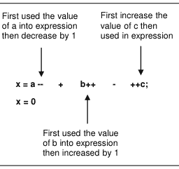

**示例**

```c
#include<stdio.h>
#include<conio.h>
void main()
{
    int x,a,b,c;
    a = 2;
    b = 4;
    c = 5;
    x = a-- + b++ - ++c;
    printf("x: %d",x);
    getch();
}
```

**输出：**

```text
x: 0
```

#### C 语言中前置/后置自增和自减运算符的区别

下表将解释 C 编程语言中前置/后置自增和自减运算符的区别。

| 运算符 | 运算符/说明 |
| --- | --- |
| 前置自增运算符（++） | 在将 i 的值赋值给变量 i 之前，i 的值先自增 |
| 后置自增运算符（i++） | 在将 i 的值赋值给变量 i 之后，i 的值自增 |
| 前置自减运算符（--i） | 在将 i 的值赋值给变量 i 之前，i 的值先自减 |
| 后置自减运算符（i--） | 在将 i 的值赋值给变量 i 之后，i 的值自减 |

#### 6. 条件运算符或三元运算符

**条件运算符（?:）：** C 语言包含一个非常特殊的运算符，称为三元或条件运算符。它被称为三元运算符，因为它使用三个表达式。它是 **if_else 结构**的简写形式。条件运算符是一种三元运算符，也就是说，它作用于 3 个操作数。

三元运算符的格式为

```c
conditionalexpression1 ? expression2 : expression3
```

如果表达式1 求值为真，则计算表达式2，否则计算表达式3。

条件运算符的工作原理如下：

- 首先对第一个表达式 **条件表达式** 进行求值。如果为真，该表达式求值为 1；如果为假，求值为 0。
- 如果 **条件表达式** 为真，则计算 **表达式1**。
- 如果 **条件表达式** 为假，则计算 **表达式2**。

**示例：**

```c
(1) if (i % 2 == 0)
      even = true
    else
      even = false
    even = (i % 2 == 0) ? true : false;
(2) if (i > j)
      max = i
    else
      max = j
    max = (i > j) ? i : j;
```


#### 位逻辑运算符

C 语言具有强大的功能和丰富的位操作运算符。这些运算符允许程序员访问和操作数据中的各个位。

| 运算符 | 含义 |
| --- | --- |
| & | 按位与 |
| \| | 按位或 |
| ^ | 按位异或（EXOR） |
| >> | 按位右移 |
| << | 按位左移 |
| ~ | 按位取反 |

**（a）按位与：** 按位与运算将在两个操作数的两个位模式之间进行。

| 变量 | 值 | 二进制模式 |
| --- | --- | --- |
| x | 5 | 0101 |
| y | 2 | 0010 |
| x & y | 0 | 0000 |
| a | 6 | 0110 |
| b | 3 | 0011 |
| a & b | 2 | 0010 |

要在结果中生成 1 位，按位与要求两个数中相应位都为 1。

**按位与运算符 &：**

如果两个操作数的对应位都为 1，则按位与的输出为 1。如果操作数的任一位为 0，则对应位的结果计算为 0。

假设对两个整数 12 和 25 进行按位与运算。

```
12 = 00001100 (In Binary)
25 = 00011001 (In Binary)
Bit Operation of 12 and 25
    00001100
  & 00011001
  ----------
    00001000 = 8 (In decimal)
```

**示例 #1：按位与**

```c
#include <stdio.h>
void main()
{
    int a = 12, b = 25;
```

**（c）按位异或：** 按位异或将由符号 `^` 执行。要在结果中生成 1 位，按位异或要求两个数中相应位有一个为 1，但不能两个都为 1。

##### 按位异或

| 变量 | 值 | 二进制模式 |
| --- | --- | --- |
| x | 5 | 0101 |
| y | 2 | 0010 |
| x ^ y | 7 | 0111 |
| a | 6 | 0110 |
| b | 3 | 0011 |
| a ^ b | 5 | 0101 |

##### 按位异或运算符 ^

如果两个操作数的对应位相反，则按位异或运算符的结果为 1。它用 `^` 表示。

```
12 = 00001100 (In Binary)
25 = 00011001 (In Binary)
Bitwise XOR Operation of 12 and 25
  00001100
^ 00011001
  --------
  00010101 = 21 (In decimal)
```

**示例 #3：按位异或**

```c
#include <stdio.h>
void main()
{
    int a = 12, b = 25;
    printf("Output = %d", a^b);
    getch( );
}
```

**输出：**

```
Output = 21
```

**（d）按位取反：** 取反运算符 `~` 会翻转二进制模式中的所有位，即所有 0 变成 1，所有 1 变成 0。它作为 1 的补码起作用。

| 变量 | 值 | 二进制模式 |
| --- | --- | --- |
| x | 23 | 0001 0111 |
| ~ x | 232 | 1110 1000 |
| y | FF | 1111 1111 |
| ~ y | 00 | 0000 0000 |

##### 按位取反运算符 ~

按位取反运算符是一元运算符（仅作用于一个操作数）。它将 1 变为 0，将 0 变为 1。**它用 ~ 表示。**

```
    35 = 00100011 (In Binary)
    Bitwise complement Operation of 35
    ~ 00100011
    ________
    11011100 = 220 (In decimal)
```

C 编程中按位取反运算符的特别之处

35 的按位取反（~35）是 -36 而不是 220，但为什么？

对于任意整数 n，n 的按位取反将为 -(n+1)。要理解这一点，您应该了解 2 的补码。

##### 2 的补码

二进制补码是对二进制数的一种运算。一个数的 2 的补码等于该数的补码加 1。例如：

| 十进制 | 二进制 | 2 的补码 |
| --- | --- | --- |
| 0 | 00000000 | -(11111111+1) = -00000000 = -0（十进制） |
| 1 | 00000001 | -(11111110+1) = -11111111 = -1（十进制） |
| 12 | 00001100 | -(11110011+1) = -11110100 = -12（十进制） |
| 220 | 11011100 | -(00100011+1) = -00100100 = -36（十进制） |

*注意：* 计算 2 的补码时忽略溢出。

35 的按位取反是 220（十进制）。220 的 2 的补码是 -36。因此，输出是 -36 而不是 220。

##### 任意数 N 的按位取反是 -(N+1)。方法如下：

```
    bitwise complement of N = ~N (represented in 2's complement form)
    2's complement of ~N = -(~(~N)+1) = -(N+1)
```

**示例 #4：按位取反**

```
    #include <stdio.h>
    void main()
    {
        printf("complement = %d\n",~35);
        printf("complement = %d\n",~12);
        getch( );
    }
```

**输出：**

```
    complement = -36
    complement = -13
```

##### 示例 #5：移位运算符

```c
#include <stdio.h>
void main()
{
    int num=212, i;
    for (i=0; i<=2; ++i)
        printf("Right shift by %d: %d\n", i, num>>i);

    printf("\n");

    for (i=0; i<=2; ++i)
        printf("Left shift by %d: %d\n", i, num<<i);
    getch( );
}
```

**输出：**

```
Right Shift by 0: 212
Right Shift by 1: 106
Right Shift by 2: 53
Left Shift by 0: 212
Left Shift by 1: 424
Left Shift by 2: 848
```

（f）逗号运算符：逗号运算符用于将相关表达式连接在一起。例如：

    int a, c = 5, d;

#### 1.4.2 优先级和结合性

##### C 运算符优先级表

本页按*优先级*（从高到低）列出 C 运算符。它们的*结合性*指示表达式中相同优先级的运算符按什么顺序应用。

| 运算符 | 描述 | 结合性 |
| --- | --- | --- |
| ( ) | 圆括号（函数调用）（见注 1） | 从左到右 |
| [ ] | 方括号（数组下标） | 从左到右 |
| . | 通过对象名选择成员 | 从左到右 |
| -> | 通过指针选择成员 | 从左到右 |
| ++ -- | 后缀递增/递减（见注 2） | 从左到右 |
| ++ -- | 前缀递增/递减 | 从右到左 |
| + - | 一元加/减 | 从右到左 |
| ! ~ | 逻辑非/按位取反 | 从右到左 |
| (type) | 强制类型转换（将值转换为该类型的临时值） | 从右到左 |
| * | 解引用 | 从右到左 |
| & | 取地址（操作数的） | 从右到左 |
| sizeof | 确定此实现中的大小（以字节计） | 从右到左 |
| * / % | 乘法/除法/取模 | 从左到右 |
| + - | 加法/减法 | 从左到右 |
| << >> | 按位左移，按位右移 | 从左到右 |
| < <= | 关系小于/小于或等于 | 从左到右 |
| > >= | 关系大于/大于或等于 | 从左到右 |
| == != | 关系等于/不等于 | 从左到右 |
| & | 按位与 | 从左到右 |
| ^ | 按位异或 | 从左到右 |
| \| | 按位或 | 从左到右 |
| && | 逻辑与 | 从左到右 |
| \|\| | 逻辑或 | 从左到右 |
| ?: | 三元条件 | 从右到左 |
| = += -= *= /= %= &= ^= \|= <<= >>= | 赋值；加法/减法赋值；乘法/除法赋值；取模/按位与赋值；按位异或/按位或赋值；按位左移/右移赋值 | 从右到左 |
| , | 逗号（分隔表达式） | 从左到右 |

**注 1：** 圆括号也用于分组子表达式以强制采用不同的优先级；这种括号表达式可以嵌套，并从内到外求值。

**注 2：** 后缀递增/递减具有较高优先级，但操作数的实际递增或递减会延迟（在语句完成执行之前的某个时候完成）。因此在语句 `y = x * z++;` 中，使用 `z` 的当前值来计算表达式（即 `z++` 的求值结果为 `z`），而 `z` 仅在其他所有操作完成后才递增。另一个示例见 postinc.c。

##### 说明

优先级和结合性与求值顺序无关。

C 语言标准并未规定运算符优先级。它规定了语言文法，而优先级表是从中推导出来以简化理解的。有一部分文法无法用优先级表表示：赋值永远不允许出现在条件运算符的右侧，因此 `e = a < d ? a++ : a = d` 是一个无法解析的表达式，所以条件运算符和赋值运算符的相对优先级不容易描述。

然而，许多 C 编译器使用非标准表达式文法，其中 `?:` 被指定为比 `=` 更高的优先级，这会将那个表达式解析为 `e = ( (( a < d ) ? (a++) : a ) = d )`，随后由于语义约束而编译失败：`?:` 永远不是左值，而 `=` 要求左侧是可修改的左值。本页展示的就是这个表。

请注意，这在 C++ 中有所不同，在 C++ 中条件运算符与赋值运算符具有相同的优先级。


结合性规定对一元运算符来说是冗余的，列出它只是为了完整性：一元前缀运算符总是从右到左结合（`sizeof ++*p` 即 `sizeof (++(*p))`），一元后缀运算符总是从左到右结合（`a[1][2]++` 即 `((a[1])[2])++`）。注意，结合性对成员访问运算符是有意义的，尽管它们与一元后缀运算符归为一类：`a.b++` 被解析为 `(a.b)++`，而不是 `a.(b++)`。

#### 1.4.3 表达式

**语句**使计算机执行某种动作。C 中有三类不同的语句。它们是表达式语句、复合语句和控制语句。

**表达式语句**由一个表达式后跟一个分号组成。执行表达式语句会使该表达式被求值。

```c
a = 23; //Assignment statement
Sum = a+b; //calculative assignment statement
++i; // Incremental statement
```

前两个表达式语句是赋值型语句。每个语句都会使等号右侧表达式的值赋给左侧的变量。

第三个表达式语句是递增型语句，它使 `i` 的值增加 1。

**复合语句**由若干条单独语句组成，这些语句括在一对花括号 `{ }` 中。决策语句也称为复合语句。这些单独语句本身可以是表达式语句、复合语句或控制语句。因此，正是复合语句提供了将语句嵌入其他语句中的能力。

下面展示了一个典型的复合语句。

```c
if (c == 0)
{
        total = 600;
        Percentage=(marks/total)*100;
}
```

**控制语句**用于创建特殊的程序特性，例如逻辑测试、循环和分支。许多控制语句要求将其他语句嵌入其中。

```c
for (i = 1; i <= 10; i++)
{
        printf("%d", i);
}
```

### 问题

### 2014 年冬季

- 1. 说明 C 中不同类型的关系运算符。
- 2. 什么是形式参数？举例说明。
- 3. 什么是标识符。
- 4. 定义算法。
- 5. 什么是转义序列。

### 2015 年夏季

- 1. 列出 C 语言中的基本数据类型。
- 2. `sizeof` 是 C 中的运算符。判断正误。
- 3. 列出所有位运算符。

### 2015 年冬季

- 1. 什么是关键字？举例解释。
- 2. 列出 C 中所有关系运算符。
- 3. C 有哪些应用。

### 2016 年夏季

- 5. 什么是标识符？举例解释。
- 6. 定义运算符。列出任意四种运算符。
- 7. 举例解释 C 程序的结构。

### 2016 年冬季

- 1. 列出 C 语言中的基本数据类型。
- 2. 定义运算符。列出并解释 C 中任意四类运算符。

### 2017 年夏季

- 1. C 是一种中级语言。请评论。
- 2. 什么是转义序列？

### 2018 年夏季

- 1. C 中使用的各种数据类型有哪些？
- 2. 定义关键字。
- 3. 变量的作用域是什么意思？

**示例：**

```c
scanf("%c", &grade);
```

其中 `&` 表示变量的地址。

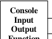

#### 格式化函数

| 类型 | 输入 | 输出 |
|---|---|---|
| 字符型 | scanf() | printf() |
| 整型 | scanf() | printf() |
| 浮点型 | scanf() | printf() |
| 字符串 | scanf() | printf() |

#### 非格式化函数

| 类型 | 输入 | 输出 |
|---|---|---|
| 字符型 | getch()<br>getche()<br>getchar() | putch()<br>putchar() |
| 整型 | — | — |
| 浮点型 | — | — |
| 字符串 | gets() | puts() |

#### scanf() 和 printf() 的区别

| **scanf( )** | **printf( )** |
|---|---|
| scanf() 是一个预定义函数，用于从键盘读取输入值。 | printf() 是一个预定义函数，用于在控制台或显示器上打印数据或用户定义的消息。 |
| **语法**<br>scanf("Format specifiers", value1, value2...) | **语法**<br>printf("Format specifiers", value1, value2...) |
| **示例：**<br>int a = 10;<br>float d = 13.4;<br>scanf("%d%f", &a, &d); | **示例：**<br>int a = 10;<br>float d = 13.4;<br>printf("The value of a and d %f%d", d, a); |

#### 2.1.2 getch(), getchar()

- 1. **getch( )**：getch() **用于**从控制台获取一个字符，但不会回显到屏幕。
  - **库：** `<CONIO.H>`
  - **声明：** `int getch(void);`
  - **示例：** 声明：  
    `char ch;`  
    `ch = getch(); (or) getch();`
  - **备注：** getch 直接从键盘读取一个字符，不回显到屏幕。
  - **返回值：** 此函数返回从键盘读取的字符。

##### 示例程序

```c
void main()
{
        char ch; ch = getch();
        printf("Input Char Is: %c", ch);
}
```

##### 2. getchar()——单字符输入函数

**getchar()** 使用 C 库函数 getchar 接受从键盘输入到计算机中的单字符类型数据。

**语法：**

```c
character_variable = getchar ( );
```

其中 `character_variable` 指字符变量。

**示例：**

```c
char stud;
stuid=getchar();
```

### 2.2 格式化输入和格式化输出

#### 2.2.1 格式化输入

在 C 编程中，scanf() 是常用的从用户处获取输入的函数之一。scanf() 函数从标准输入（例如键盘）读取格式化输入。

**示例：**

```c
#include <stdio.h>
int main()
{
        int x;
        printf("Enter an integer: ");
        scanf("%d", &x);
        printf("Number = %d", x);
        return 0;
}
```

**输出：**

输入一个整数：4

数字 = 4

这里，我们在 scanf() 函数中使用了 `%d` 格式说明符，以从用户处获取 int 输入。当用户输入一个整数时，它会被存储在 `x` 变量中。

我们在 scanf() 中使用了 `&x`。这是因为 `&x` 获取 x 的地址，而用户输入的值会存储在该地址中。

#### 2.2.2 格式化输出

在 C 编程中，printf() 是主要的输出函数之一。该函数将格式化输出发送到屏幕。

**示例：**

```c
#include <stdio.h>
int main()
{
    int x = 5;
    printf("Number = %d", x);
    return 0;
}
```

**输出：**

数字 = 5

我们使用 `%d` 转换说明符来打印 int 类型。这里，引号内的 `%d` 将被 x 的值替换。

##### 转换说明符

转换说明符是一个符号，用作格式化字符串中的占位符。例如，对于整数输出，`%d` 是用于占据整数位置的说明符。

以下是一些常用的转换说明符（并非完整列表）：

- `%d` int（有符号十进制整数）
- `%u` 无符号十进制整数
- `%f` 浮点值（定点表示法）——float、double
- `%e` 浮点值（指数表示法）
- `%s` 字符串
- `%c` 字符

##### 打印整数

要输出整数，请在格式字符串中使用 `%d`，并在 `list_of_expressions` 中使用整数表达式。

```c
int numStudents = 35123;
printf("ATSS has %d students", numStudents);
```

**输出：**

ATSS 有 35123 名学生

我们可以指定字段宽度（即该项打印时占用多少个“空格”）。默认右对齐。在 `%` 和 `d` 之间放置一个数字。在此示例中，字段宽度为 10：

```c
printf("ATSS has %10d students", numStudents);
```

**输出：**

ATSS 有 35123 名学生

要左对齐，请在字段宽度中使用负数：

```c
printf("ATSS has %-10d students", numStudents);
```

**输出：**

ATSS 有 35123 名学生

如果字段宽度太小或未指定，则默认为打印该项所需的最小字符数：

```c
printf("ATSS has %2d students", numStudents);
```

**输出：**

ATSS 有 35123 名学生

当打印多行输出并希望它们按表格格式对齐时，指定字段宽度最为有用。

##### 打印浮点数

使用 `%f` 修饰符以定点表示法打印浮点值：

```c
double cost = 123.45;
printf("Your total is $%f today\n", cost);
```

**输出：**

您今天总计 $123.450000

使用 `%e` 表示指数表示法：

```c
printf("Your total is $%e today\n", cost);
```

**输出：**

您今天总计 $1.234500e+02

注意，`e+02` 表示“乘以 10 的 2 次方”。

您还可以控制小数精度，即小数点后的位数。如有必要，输出将四舍五入到适当的小数位数：

```c
printf("Your total is $%.2f today\n", cost);
```

**输出：**

您今天总计 $123.45

字段宽度也可以像整数那样控制：

```c
printf("Your total is $%9.2f today\n", cost);
```

**输出：**

您今天总计 $ 123.45

在转换说明符中，小数点前的数字是字段宽度，小数点后的数字是精度。（在此示例中为 9 和 2）。

`%-9.2f` 会在字段宽度为 9 的范围内左对齐，与整数的情况一样。


##### 打印字符和字符串

使用格式说明符 %c 来打印字符。默认字段宽度为 1 个字符：

```c
char letter = 'Q';
printf("%c%c%c\n", '*', letter, '*');
```

**输出为：\*Q\***

使用 %s 打印字符串。字段宽度的工作方式与整数相同：

```c
printf("%s%10s%-10sEND\n", "Hello", "Alice", "Bob");
```

**输出：**

Hello AliceBob END

### 问题

#### 2014 年冬季

- 1. 编写一个 C 程序，将温度从摄氏度转换为华氏度。

#### 2015 年冬季

- 1. 给出 scanf 语句的语法及示例。
- 2. getchar() 和 gets() 的用法及示例。

#### 2016 年夏季

- 1. 给出 printf 语句的语法及示例。
- 2. putchar() 和 puts() 的用途是什么。
- 3. 编写一个 C 程序，将温度从摄氏度转换为华氏度。

#### 2016 年冬季

- 1. scanf() 和 gets() 之间有什么区别。

#### 2017 年夏季

- 1. 给出 scanf() 和 putchar() 的语法及示例。

❖❖❖❖❖


## 决策与循环

**结构：**

- 3.1 引言
- 3.2 决策结构
  - 3.2.1 if 语句
  - 3.2.2 if-else 语句
  - 3.2.3 嵌套 if-else 语句
  - 3.2.4 条件运算符（?）
  - 3.2.5 switch 语句
- 3.3 循环控制结构
  - 3.3.1 while 循环
  - 3.3.2 do-while 循环
  - 3.3.3 for 循环
  - 3.3.4 嵌套 for 循环
- 3.4 跳转语句
  - 3.4.1 break
  - 3.4.2 continue
  - 3.4.3 goto
  - 3.4.4 exit

### 3.1 引言

**决策：** 它是指从多个可用选项中选出其中一个。在编写程序时，这一概念始终会发挥重要作用。我们必须为程序提供相应能力，使其能够根据用户可能提供的各种输入自行做出决策。

决策是指根据特定条件决定语句的执行顺序，或重复执行一组语句，直到满足某些指定条件。我们可以根据条件执行不同的任务。C 语言通过多种方式处理决策，如下所示。

**if...else 语句的流程图**

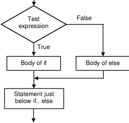

**图 3.2：if... else 语句的流程图**

**示例：C if...else 语句**

```c
// Program to check whether an integer entered by the user is odd or even
#include <stdio.h>
void main()
{
    int number;
    printf("Enter an integer: ");
    scanf("%d", &number);
    // True if remainder is 0
    if( number%2 == 0 )
        printf("%d is an even integer.", number);
    else
        printf("%d is an odd integer.", number);
    return 0;
}
```

**输出：**

Enter an integer: 7  
7 is an odd integer.

当用户输入 7 时，测试表达式（**number%2 == 0**）的求值结果为假。因此，会执行 **else 语句** 主体内的语句 **printf("%d is an odd integer.",number);**，而 if 主体内的语句会被跳过。

**3.2.3 嵌套 if-else 语句**

*if...else* 语句根据测试表达式为真还是为假来执行两种不同的代码。有时，需要从两个以上的可能性中做出选择。

嵌套 *if...else* 语句允许你检查多个测试表达式，并为两个以上的条件执行不同的代码。

**嵌套 if...else 语句的语法。**

```c
if (testExpression1)
{
    // statements to be executed if testExpression1 is true
}
else if(testExpression2)
{
    // statements to be executed if testExpression1 is false and testExpression2 is true
}
else if (testExpression3)
{
    // statements to be executed if testExpression1 and testExpression2 is false and testExpression3 is true
}
.
.
else
{
    // statements to be executed if all test expressions are false
}
```

**使用“if/else if”语句进行多路决策的形式如下：**

```c
if (logical expression)
stmt1;
else if (logical expression)
stmt2;
else if (logical expression)
stmt3;
else if ( logical expression )
stmtN;
else
stmtF;
```

如果第一个逻辑表达式的求值结果为真，则执行 stmtT1。如果第二个逻辑表达式为真，则执行 stmtT2，依此类推。如果所有逻辑表达式都不为真，则执行“else”之后的语句，即 stmtF。

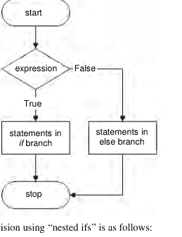

使用“嵌套 if”进行多路决策的形式如下：

```c
if (conditionA)
{
    if (conditionB)
    stmtBT;
    else
        stmtBF;
}
else
    stmtAF;
```

如果 conditionA 的求值结果为真，则执行会进入嵌套 if，并对 conditionB 求值。如果 conditionA 的求值结果为假，则执行 stmtAF。

**示例：**

```c
#include<stdio.h>
void main ()
{
    int var;
    printf("Enter a Number:");
    scanf("%d", &var);
    if(var%2==0)
    {
        printf("You entered a Even Number");
    }
    else
    {
        printf("You entered a Odd Number");
    }
    getch();
}
```

**输出：**

Enter a Number:4  
You entered a Even Number

**示例：C 嵌套 if...else 语句**

```c
// Program to relate two integers using =, > or <
#include <stdio.h>
void main()
{
    int number1, number2;
    printf("Enter two integers:");
    scanf("%d %d", &number1, &number2);

    // checks if two integers are equal.
    if(number1 == number2)
    {
        printf("Result: %d = %d", number1, number2);
    }
    // checks if number1 is greater than number2.
    else if (number1 > number2)
    {
        printf("Result: %d > %d", number1, number2);
    }
    // if both test expression is false
    else
    {
        printf("Result: %d < %d", number1, number2);
    }
    getch( );
}
```

**switch 语句的修订形式如下：**

```c
switch (int expression)
{
case label - 1:
    stmt-list-1;
    break;
case label - 2:
    stmt-list-2;
    break;
case label - 3:
    stmt-list-3;
    break;
.
.
.
case label - n:
    stmt-list-n;
    break;
default:
    stmt-list;
}
```

在执行过程中，会对表达式求值。如果表达式的值与 label - 1 匹配，则执行 stmt-list-1。如果不匹配，执行会继续检查 label - 2，依此类推。如果没有标签与表达式匹配，则执行 default。在每个 case 内部以及每个语句列表的末尾（default 除外）都必须有一个 break 语句，用于终止最内层封闭的 switch 或循环语句。

以下是关于 switch 语句的一些最终说明：被测试的表达式必须产生整数值（int 或单个 char），case 标签必须是整数常量（字面量或命名常量），一个 switch 中的每个标签都应唯一，并且每个 stmt-list 可以包含 0 个或多个语句，这些语句不需要用花括号 { } 括起来。

**switch 语句流程图**

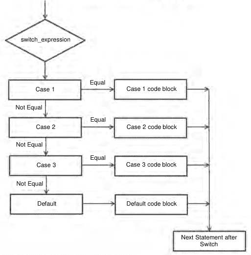

*示例：*

```c
void main()
{
    int i = 2;
    switch(i)
    {
    case 1:
        printf("Case1 ");
        break;
    case 2:
        printf("Case2 ");
        break;
    case 3:
        printf("Case3 ");
        break;
    case 4:
        printf("Case4 ");
        break;
    default:
        printf("Default ");
    }
    getch( );
}
```

**输出：**

Case2

### 3.3 循环控制结构

**3.3.1 while 循环**

while 循环通常用于将同一任务执行固定次数。

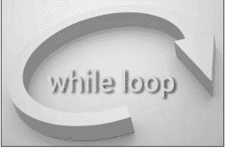

**while 循环的语法：**

```c
while( test expression)
{
    // C- statements, which requires repetition.
    // Increment (++) or Decrement (--) Operation.
}
```

while 循环会对测试表达式求值。

如果测试表达式为真（非零），则对 while 循环主体内的代码求值。然后再次对测试表达式求值。此过程会持续进行，直到测试表达式为假。

当测试表达式为假时，while 循环终止。


#### while 循环流程图

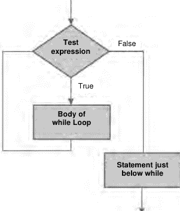

图 3.3：while 循环流程图

*示例：*

```c
#include<stdio.h>
#include<conio.h>
void main()
{
    int count=1;
    while(count <=5)
    {
        printf("%d ", count);
        count++;
    }
    getch();
}
```

**输出：**

1 2 3 4 5

**步骤 1：** 首先，计数器变量 count 被初始化为值 1，然后对它进行条件测试。

**步骤 2：** 如果条件为真，则执行 while 循环的循环体；否则，控制流跳出循环。

**步骤 3：** 使用 ++ 运算符递增 count 的值，然后再次测试循环条件。这一过程会持续进行，直到条件返回假。

#### 3.3.2 do-while 循环

do while 循环是另一种重复语句。它与 while 循环完全相同，不同之处在于它会先执行某些操作，然后评估循环的逻辑表达式，以确定接下来发生什么。通常在使用 while 循环时，循环中逻辑表达式的一部分必须在执行 while 循环之前初始化。

do...while 循环语句会先被执行，然后检查循环的测试表达式。

```c
do
{
        // codes or statements
} while (testExpression);
```

花括号内的代码块（循环体）会执行一次。

然后，评估测试表达式。如果测试表达式为真，则再次执行循环体。此过程会一直持续，直到测试表达式被评估为 0（假）。

当测试表达式为假（零）时，**do...while** 循环终止。

循环中的语句可以是单条语句，也可以是复杂语句。复杂语句必须用花括号 { } 括起来。让我们看几个 do while 循环的示例。

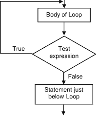

**图 3.4：do...while 循环流程图**

**示例：打印 5 的前十个倍数的程序。**

```c
#include<stdio.h>
#include<conio.h>
void main()
{
    int a,i;
    a=5;
    i=1;
    do
    {
        printf("%d\t",a*i);
        i++;
    }
    while (i <= 10);
    getch();
}
```

**输出：**

5 10 15 20 25 30 35 40 45 50

#### 3.3.3 for 循环

for 循环是在 C++ 中执行需要重复操作（重复）的另一种方式。大多数程序员喜欢使用 for 循环，因为与使用 while 或 do while 循环编写的相同循环相比，for 循环的代码可以写得更紧凑。

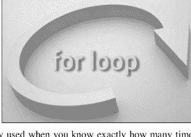

当你确切知道一段代码需要重复多少次时，通常会使用 for 循环。

for 循环的一般形式如下：

```c
for    (expression1; expression2; expression3)
    stmt(s);
```

其中 stmt(s) 是单条语句或复合语句。

这是 C 编程中最常用的循环之一。

**for 循环的语法如下所示——**

```c
for (initialization; condition test; control flow)
{
    //Code – C statements needs to be repeated
}
```

控制流可以是变量的递增或递减值，具体取决于需求。

表达式 1 用于初始化循环；表达式 2 用于确定循环是否继续；表达式 3 在每次迭代或循环周期结束时评估。

**注 1：** 表达式 2 在 stmt 和表达式 3 执行之前进行测试；循环体可能永远不会被执行或测试。

**注 2：** for 循环中的 3 个表达式中任意一个或全部都可以省略，但 2 个分号必须保留。例如 **for( ; ; )**

如果省略表达式 1，则循环中不进行初始化，但你的程序可能不需要任何初始化。

例如：

```c
i=1;
for ( ; i<=10;i++)
```

如果省略表达式 2，则没有测试部分，因此本质上会得到一个无限循环。

```c
for(i=1; ; i++)
```

如果省略表达式 3，则 for 语句中没有更新部分，但更新可以在循环体中的语句里完成。

```c
for(i=1;i<=10; )
{
    printf("%d",i);
    i++;
}
```

**for** 循环通常在迭代次数已知时使用。

一般来说，for 循环可以写成与 while 循环等价的形式，*反之亦然*。

```c
for (expression1; expression2; expression3)
    statement;
```

**等价于……**

```c
expression1;
while (expression2)
{
    Statements;
    expression3;
}
```

##### for 循环流程图

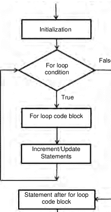

*示例：*

```c
...
int i;
for(i=1; i<=4; i++)
{
    printf("hello, World");
}
...
```

**输出：**

hello, World
hello, World
hello, World
hello, World

**步骤 1：** 首先初始化计数器变量；这里的变量是 i，已被赋值为 1。

**步骤 2：** 然后对变量进行给定条件的测试，如果条件结果为真，则编译器执行循环体中包含的 C 语句；否则，控制流跳过该循环，继续执行循环后面的下一条语句。

**步骤 3：** 循环体成功执行后，计数器变量会根据操作（++ 或 --）递增或递减。

##### for 循环的各种形式

在下面所有示例中，我们都使用变量 num：

- 1. 这里我们可以使用 num=num+1 代替 num++，它与 num++ 相同。

```c
for(num=10;num<20;num=num+1)
```

- 2. 如下所示，可以跳过初始化部分，计数器变量在循环本身之前声明。

```c
int num=10;
for(;num<20;num++)
```

必须注意：虽然我们可以跳过初始化部分，但条件前的分号（;）是必需的，否则会出现编译错误。

- 3. 与初始化类似，也可以像下面这样跳过递增部分。在这种情况下，条件逻辑之后的分号（;）是必需的。递增部分在 for 循环体本身中完成。

```c
for(num=10;num<20;)
{
    //Code
    num++;
}
```

- 4. 下面的情况也是可能的，在循环体中递增，以及在声明计数器变量时递增。

```c
int num=10;
for(;num<20;)
{
//Statements
num++;
}
```

- 5. 计数器也可以递减。在下面的示例中，变量在循环每次运行时递减，直到条件 num>10 变为假。

```c
for(num=20;num>10;num--)
```

#### 3.3.4 嵌套 for 循环

嵌套循环或循环嵌套是将一个循环放入另一个循环中，以基于多个条件和检查来执行程序。

这里我们有一个 for 循环嵌套的示例，同样，你也可以使用各种循环的嵌套，例如 while、do...while 或 for。

#### 3.4.1 break

break 语句在遇到时会立即终止循环（for、while 和 do...while 循环）。break 语句与决策语句（如 if...else）一起使用。

当你希望程序流程从 switch 主体中出来时，break 语句很有用。每当在 switch 主体中遇到 break 语句时，执行流会直接跳出 switch。

##### break 语句的语法

```c
break;
```

##### break 语句的流程图

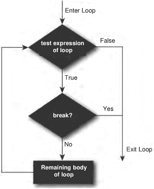

**break 语句的工作方式：**

```c
while (test Expression)
{
        // codes
        if (condition for break)
        {
                break;
        }
        // codes
}
```

continue 语句的工作方式如下：

```c
    while (test Expression)
    {
        // codes
        if (condition for continue)
        {
            continue;
        }
        // codes
    }

    for (init, condition, update)
    {
        // codes
        if (condition for continue)
        {
            continue;
        }
        // codes
    }
```

#### continue 语句可用于 for 循环

**continue** 允许你从开头继续执行 **for** 或 **while** 循环，从而可以跳过 **continue** 语句之后循环中的其余语句。

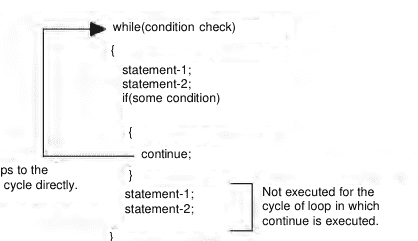


##### 示例：

```c
#include <stdio.h>
void main()
{
    static int marks[5] = {90,80,76,89, -90};
    int i, total = 0;
    for(i=0; i<5; i++)
    {
        if(marks[i] <0)
        {
            printf("negative marks not added \n");
            continue;
        }
        total += marks[i];
    }
    printf("total marks = %d \n", total);
    getch();
}
```

#### 3.4.3 goto

C 语言中的 goto 语句提供从“goto”到同一函数内标记语句的无条件跳转。

##### 语法：

C 语言中 **goto** 语句的语法如下：

```c
goto label;
... ... ...
... ... ...
... ... ...
label:
statement;
```

这里的 **label** 可以是除 C 关键字之外的任何纯文本，并且可以设置在 C 程序中 **goto** 语句的上方或下方的任意位置。label 是一个标识符。当遇到 **goto** 语句时，程序的控制权会跳转到 **label:** 并开始执行代码。

当上述代码被编译并执行时，会产生以下结果：

- value of a: 10
- value of a: 11
- value of a: 12
- value of a: 13
- value of a: 14
- value of a: 16
- value of a: 17
- value of a: 18
- value of a: 19

#### 3.4.4 exit

在 C 语言中，exit() 是一个预定义/库函数，用于立即终止当前正在运行的程序（进程）。

##### 语法：

```c
void exit(int status);
```

**status** - status 是一个返回给父进程的整数值。

这里 0 通常表示程序成功完成，非零值用作错误代码。**例如：exit(0);**

还有预定义的宏 EXIT_SUCCESS 和 EXIT_FAILURE，**例如：exit(EXIT_SUCCESS);**

在 C 语言中，exit() 函数所需的头文件是 **stdlib.h。**

##### 示例：

```c
#include <stdio.h>
#include <stdlib.h>
int main ()
{
    printf("Start of the program....\n");
    printf("Exiting the program....\n");
    exit(0);
    printf("End of the program....\n");
    return(0);
}
```

##### 输出：

```
Start of the program....
Exiting the program....
```

### 问题

#### 2014年冬季

- 1. 什么是嵌套结构？
- 2. 给出 for 循环的语法和用法。
- 3. 举例说明 do-while 和 while 之间的区别。

#### 2015年冬季

- 1. continue 语句有什么用途？举例说明。

#### 2016年夏季

- 1. continue 语句有什么用途？举例说明。
- 2. 入口控制循环和出口控制循环之间的区别。

#### 2017年夏季

- 1. 举例说明嵌套 for 循环语句。
- 2. 说明 break 和 continue 语句的用途。
- 3. 什么是 exit 函数？举例说明。
- 4. 解释 if-else 和 switch-case 之间的区别。

#### 2018年夏季

- 1. 列举 C 语言中任意四种语句类型。
- 2. 举例说明 C 语言中 break 和 continue 语句的工作原理。


### 通过条件语句和循环语句编写的程序

#### 结构：

- 引言
- 1. 编写一个程序，执行两个整数的加法。
- 2. 编写一个程序，执行两个整数的乘法。
- 3. 编写一个 C 程序，检查给定数字是偶数还是奇数。
- 4. 编写一个 C 程序，检查给定数字是正数还是负数。
- 5. 编写一个程序，求三个数中的最大值。
- 6. 编写一个程序，求前 N 个数的和。
- 7. 编写一个程序，求给定 N 个数的和。
- 8. 编写一个 C 程序，使用 switch case 语句执行加/减/乘/除运算。
- 9. 编写一个程序计算 nCr。
- 10. 编写一个打印杨辉三角的程序。
- 11. 编写一个程序，计算余弦级数的结果。
- 12. 编写一个程序，反转一个数字的各位数字。
- 13. 编写一个 C 程序，求任意数的阶乘。
- 14. 编写一个程序，求两个数中的最大值。
- 15. 编写一个生成乘法表的程序。
- 16. 编写一个程序，计算正弦级数的结果。
- 17. 编写一个程序，判断给定的整数是否为素数，并生成给定范围内的素数。
- 18. 编写一个程序，求一个数的因数。
- 19. 编写一个 C 程序：判断给定数字是否为完全数。

#### 引言

编程语言用户希望在特定过程中使用条件语句和循环语句进行迭代。

本章的目的是让读者理解条件语句和循环语句的用法。

#### 1) 编写一个程序，执行两个整数的加法。

##### 算法：

- 步骤 1：开始
- 步骤 2：声明变量 n1、n2 和 sum。
- 步骤 3：读取 n1、n2 的值。
- 步骤 4：将 n1 和 n2 相加，并将结果赋值给变量 sum。
- 步骤 5：显示 sum
- 步骤 6：停止

##### 程序：

```c
#include<stdio.h>
int main()
{
    int n1, n2, sum;
    printf("Enter two numbers to add \n");
    scanf("%d%d", &n1, &n2);
    sum = n1+n2;
    printf("Sum of the numbers = %d\n", sum);
    return 0;
}
```

##### 输出：

```
Enter two numbers to add
4
5
Sum of the numbers = 9
```

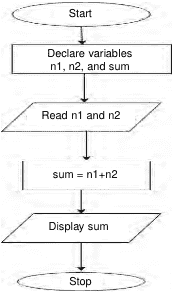

#### 2) 编写一个程序，执行两个整数的乘法。

##### 算法：

- 步骤 1：开始
- 步骤 2：声明变量 no1、no2 和 product。
- 步骤 3：读取 no1、no2 的值。
- 步骤 4：将 no1 和 no2 相乘，并将结果赋值给变量 product。
- 步骤 5：显示 product
- 步骤 6：停止

##### 程序：

```c
#include<stdio.h>
int main()
{
    int no1, no2, product;
    printf("Enter two numbers to multiply \n");
    scanf("%d%d", &no1, &no2);
    product = no1*no2;
    printf("Product of the numbers = %d\n", product);
    return 0;
}
```

##### 输出：

```
Enter two numbers to multiply
2
4
Product of the numbers = 8
```

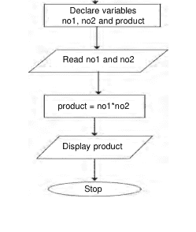

#### 3) 编写一个 C 程序，检查给定数字是偶数还是奇数。

##### 算法：

- 步骤 1：开始
- 步骤 2：读取 num
- 步骤 3：检查如果 num%2==0 则打印：num 是偶数。
  否则
  打印：num 是奇数。
- 步骤 4：停止

##### 程序：

```c
#include<stdio.h>
int main()
{
    int num;
    printf("Enter an integer: ");
    scanf("%d", &num);
    if(num%2==0)
        printf("%d is even", num);
    else
        printf("%d is odd", num);
    return 0;
}
```

##### 输出：

```
Enter an integer: 11
11 is odd.
```

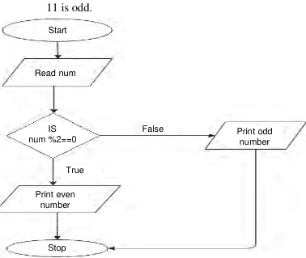

#### 4) 编写一个 C 程序，检查给定数字是正数还是负数。

##### 算法：

- 步骤 1：开始
- 步骤 2：声明变量 N
- 步骤 3：给 n 赋值
- 步骤 4：检查 N 是否大于或等于 0
- 步骤 5：如果为真，打印 N 是正数
- 步骤 6：如果为假，打印 N 是负数
- 步骤 7：停止

##### 程序：

```c
#include<stdio.h>
void main()
{
    int N;
    printf("Input a number:");
    scanf("%d", &N);
    if(N>=0)
        printf("%d is a positive number \n", N);
    else
        printf("%d is a negative number \n", N);
}
```

##### 输出：

```
Input a number: 7
7 is a positive number.
```

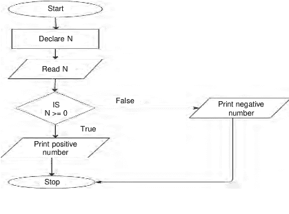

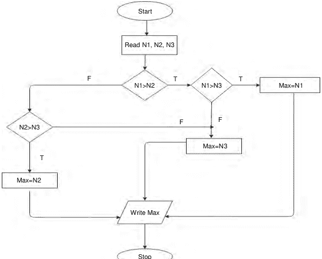

#### 6) 编写一个程序，求前 N 个数的和。

##### 算法：

- 步骤 1：初始化：sum = 0
- 步骤 2：运行一个从 i = 1 到 N 的循环，并在循环中执行以下操作。
  sum = sum + i
- 步骤 3：显示 sum
- 步骤 4：停止

##### 程序：

```c
#include<stdio.h>
#include<stdlib.h>
int main()
{
    int N, i, sum;
    sum = 0; /* read the number */
    printf("enter number to sum:");
    scanf("%d", &N);

    for(i=1; i<=N; i++)
    {
        sum = sum + i;
    }
    printf("sum of %d number is %d\n", N,sum);
    getch();
    return 0;
}
```

##### 输出：

```
Enter number to sum: 10
sum of 10 number is 55
```

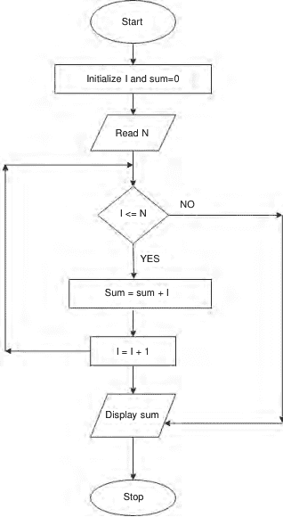


#### 7) 编写一个求给定 N 个数字之和的程序。

##### 算法：

- 初始化：`sum = 0`
- 从 `I = 1` 循环到 `N`，并在循环中执行以下操作。
  - 读取 `M`
  - `sum = sum + M`
- 显示 `sum`
- 停止

##### 程序：

```c
#include<stdio.h>
#include<stdlib.h>
int main()
{
        int N, M, i, sum;
        sum = 0; /* read the number */
        printf("Enter number to sum:");
        scanf("%d", &N);
        for(i=1; i<=N; i++)
        {
                printf("Enter number");
                scanf("%d", &M);
                sum = sum + M;
        }
        printf("sum of given numbers is %d\n", sum);
        getch();
        return 0;
}
```

##### 输出：

```text
Enter number to sum: 3
Enter number 10
Enter number 20
Enter number 30
sum of given numbers is 60
```

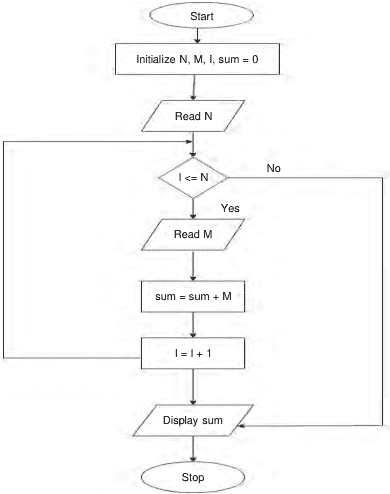

#### 8) 编写一个使用 switch case 语句执行加/减/乘/除运算的 C 程序。

##### 算法：

- 步骤 1：开始
- 步骤 2：读取变量 n1 和 n2
- 步骤 3：显示菜单
- 步骤 4：输入选项代码
- 步骤 5：用 case 语句评估选项代码
  - 5.1：case1 `ans1 = n1 + n2`，打印 `ans1`，转到步骤 7
  - 5.2：case2 `ans1 = n1 - n2`，打印 `ans1`，转到步骤 7
  - 5.3：case3 `ans1 = n1 * n2`，打印 `ans1`，转到步骤 7
  - 5.4：case4 `ans2 = (float)n1/n2`，打印 `ans2`，转到步骤 7
- 步骤 6：如果输入的 case 选项无效，则打印“Incorrect Choice”
- 步骤 7：停止程序

##### 程序：

```c
#include<stdio.h>
#include<conio.h>
void main()
    {
        int n1, n2, ans1, choice;
        float ans2;
        printf("\n enter two numbers");
        scanf("%d%d", &n1, &n2);
        printf("\n enter your choice \n 1.Addition \n 2.Subtraction \n 3.Multiplication \n
                4.Division \n");
        scanf("%d", &choice);
        switch(choice)
        {
            case 1:
                ans1 = n1 + n2;
                printf("Addition = %d", ans1);
                break;
            case 2:
                ans1 = n1 - n2;
                printf("Subtraction =%d", ans1);
                break;
            case 3:
                ans1 = n1 * n2;
                printf("Multiplication =%d", ans1);
                break;
            case 4:
                ans2 = (float)n1/n2;
                printf("Division = %f", ans2);
                break;
            default :
                printf("Incorrect choice");
                break;
        }
        getch();
    }
```

##### 输出：

```text
enter two numbers 6  4
enter your choice
    1. Addition
    2. Subtraction
    3. Multiplication
    4. Division
1. Addition =10
```

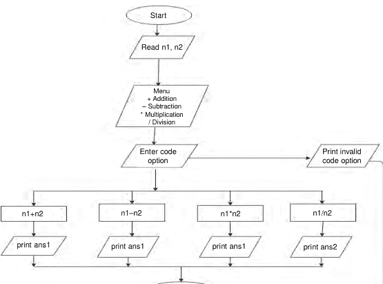

#### 9) 编写一个计算 nCr 的程序。

##### 算法：

- 步骤 1：开始
- 步骤 2：读取 n、r
- 步骤 3：计算 n、r 和 n-r 的阶乘。
- 步骤 4：将 fact(n) 除以 fact(r) 与 fact(n-r) 的乘积，并将结果存入 result。
- 步骤 5：返回 result
- 步骤 6：停止。

##### 程序：

```c
#include<stdio.h>
void main()
{
    int n, r, ncr;
    printf("Enter N and R values :");
    scanf("%d%d", &n, &r);
    ncr=fact(n)/(fact(r)*fact(n-r));
    printf("The NCR of %d and %d is %d", n , r ,ncr);
}

// p is a formal parameter or dummy parameter
// Calculate using n!/(n-r)!*r!
int fact(int p)
{
    int i=1;
    while(p!=0)
    {
        i=i*p;
        p--;
    }
    return i;
}
```

##### 输出：

```text
Enter N and R values: 6   3
The NCR of 6 and 3 is 20
```


    printf("%ld ", fun(x)/(fun(z)*fun(x-z)));
printf("\n");
}
return 0;
}
```

##### 输出：

```text
input the number of rows in Pascal's triangle : 5
      1
    1   1
  1   2   1
1   3   3   1
1   4   6   4   1
```

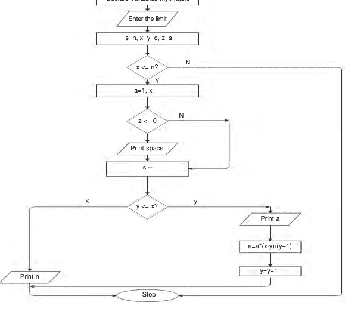

#### 11) 编写一个计算余弦级数结果的程序。

##### 算法：

- 步骤 1：开始
- 步骤 2：初始化 N = 20；
- 步骤 3：读取 x
- 步骤 4：使用公式 x = x*3.1412/180 将 x 值转换为弧度
- 步骤 5：Term = 1，sum = 1
- 步骤 6：设置 for 循环，从 i = 1 到 i < n+1，递增 i
- 步骤 7：Term = Term * pow((double)(-1), (double)(2*i-1)) * x * x / (2*i*(2*i-1))
- 步骤 8：sum = sum + Term
- 步骤 9：打印 sum
- 步骤 10：停止

##### 程序：

```c
#include<stdio.h>
#include<conio.h>
#include<math.h>
void main()
{
    float x, a, sum, term;
    int i, no = 20, mul;
    printf("\n Enter the value of x: ");
    scanf("%f", &x);
    a = x;
    x = x*3.1412/180;
    term = 1;
    sum = 1;
    for(i=1; i < no +1; i++)
    {
        term = term *pow((double)(-1), (double)(2 * i -1))* x * x /(2 * i * (2 * i -1));
        sum = sum + term;
    }
    printf("\n the cosine value of %f is %f", a, sum);
    getch();
}
```

##### 输出：

```text
Enter the value of x: 60
The cosine value of 60.000000 is 0.500113
```

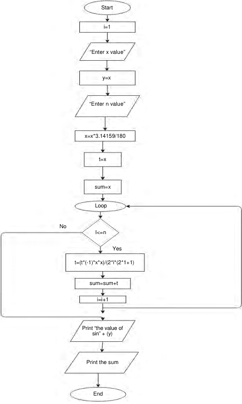

#### 12) 编写一个反转一个数字各位数字的程序。

##### 算法：

- 步骤 1：开始
- 步骤 2：读取 N 并初始化 r_num=0
- 步骤 3：当 N>0 时迭代
  - 1) `r_num = r_num * 10 + N % 10`
  - 2) `N = N / 10`
- 步骤 4：返回 r_num
- 步骤 5：停止

##### 程序：

```c
#include<stdio.h>
/* Iterative function to reverse digits of num */
int reverseDigits (int N)
{
        int r_num = 0;
        while(N > 0)
        {
                r_num = r_num*10 + N%10;
                N = N/10;
        }
        return r_num;
}

/* Driver program to test reverseDigits */
int main()
{
        int N = 4562;
        printf("Reverse of no is %d", reverseDigits(N));
        getchar();
        return 0;
}
```

##### 输出：

```text
Reverse of no is 2654
```

##### 程序：

```c
#include<stdio.h>
void main()
{
    int N, i, fact=1;
    printf("enter any number to calculate factorial:");
    scanf("%d", &N);
    for(i=1; i<=N; i++)
    {
        fact = fact * i;
    }
    printf("\n the factorial of given number is %d", fact);
}
```

##### 输出：

```text
enter any number to calculate factorial:5
the factorial of given number is 120
```

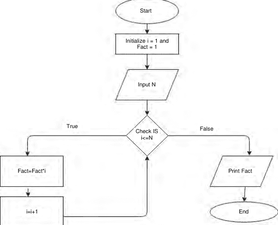

#### 14) 编写一个求两个数最大值的程序。

##### 算法：

```text
Step 1:  Start
Step 2:  Read N1, N2.
Step 3:  If N1>N2 then
             Display "N1 is the largest number".
         Otherwise
             Display "N2 is the largest number".
Step 4:  Stop.
```

##### 程序：

```c
#include<stdio.h>
#include<conio.h>
void main()
{
    int N1, N2 ;
    clrscr();
    printf("enter the values of N1, N2");
    scanf("%d%d", &N1, &N2);
    if (N1>N2)
    {
        printf("%d is larger number", N1);
    }
    else
    {
        printf("%d is larger number", N2);
    }
    getch();
}
```

##### 输出：

```text
Enter the values of N1, N2
                2   4
4 is larger number
```

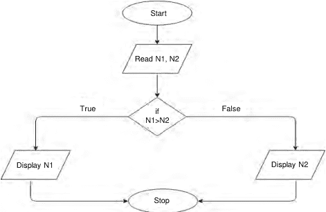

#### 15) 编写一个生成乘法表的程序。

##### 算法：

- 步骤 1：定义表值 N
- 步骤 2：初始化 I=1
- 步骤 3：T= I*N
- 步骤 4：显示 T
- 步骤 5：将 I 递增 1
- 步骤 6：检查 I<=N 是否成立，若为真则转到步骤 2
- 步骤 7：停止

##### 程序：

```c
#include<stdio.h>
int main()
{
        int N, T;
        printf("Enter an integer : ");
        scanf("%d", &N);
        for(i = 1; i<=10 ; ++i)
        {
                printf("%d * %d = %d\n", N, i, N*i);
        }
        return 0;
}
```

##### 输出：

```text
Enter an integer : 5
5 * 1 = 5
5 * 2 = 10
5 * 3 = 15
5 * 4 = 20
```

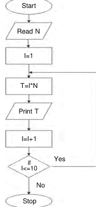

#### 16) 编写一个计算正弦级数结果的程序。

sin(x)=(x^1/1!) - (x^3/3!) + (x^5/5!) - ......

##### 算法：

```text
Step 1: Start
Step 2: Initialize double sum = 0, x, i, j, y, z=1, a, f=1, k=1;
Step 3: Enter x // i.e. The range of sin series
Step 4: Read x
Step 5: Repeat steps 6 to 11 for (i = 1 to i<=x)
Step 6: Set j=z=1
Step 7: Repeat steps 8 while (j<=i)
Step 8: Set z=z*i; j=j+1;
Step 9: Repeat steps 10 while (k <=i)
Step 10: Set f=f*k; k=k+1;
Step 11: Set a =z/f; sum=sum+a;
Step 12: Display sum
Step 13: Stop
```


##### 程序

```c
#include<stdio.h>
#include<math.h>
int fac(int x)
{
        int i, fac = 1;
        for (i = 1; i <= x; i++)
                fac = fac * i;
        return fac;
}
int main()
{
        float x, Q, sum = 0;
        int i, j, limit;
        printf("Enter the value of x of sinx series:  ");
        scanf("%f", &x);
        printf("Enter the limit upto which you want to expand the series : ");
        scanf("%d", &limit);
        Q = x;
        x = x * (3.1415 / 180);
        for (i = 1, j = 1; i <= limit; i++, j = j + 2)
        {
                if (i % 2 != 0)
                {
                        sum = sum + pow(x, j) / fac(j);
                }
                else
                {
                        sum = sum - pow(x, j) / fac(j);
                }
        }
        printf(" sin(%0.1f) : %f", Q, sum);
        return 0;
}
```

##### 输出

```
Enter the value of x of sinx series : 40
Enter the limit upto which you want to expand the series : 5
sin(40.0): 0.642772
```

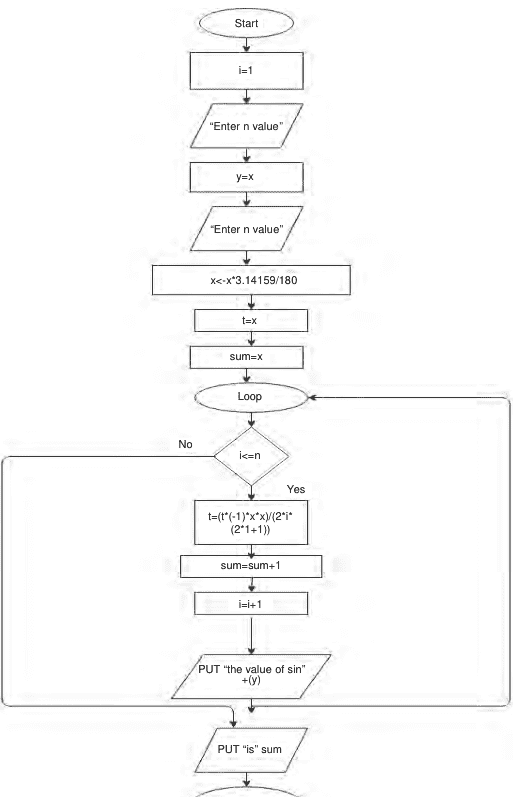

#### 17) 编写一个程序，判断给定整数是否为素数，并生成给定范围内的素数。

##### 算法

- 步骤 1：开始
- 步骤 2：输入并读取数字为 Num
- 步骤 3：设置 counter = 0；
- 步骤 4：如果 Num <= 1
  - 输出“Number is not Prime Number”
- 步骤 5：如果 for i = 2
- 步骤 6：如果 counter = 0，则
  - 输出“Number is Prime Number”
  - 否则
  - 输出“Number is not Prime Number”
- 步骤 7：停止

##### 程序

```c
#include<stdio.h>
void main()
{
    int no, i = 2, p = 0;
    printf("Enter any no to detect prime or Not: ");
    scanf("%d", &no);
    do
    {
        if(no % i == 0)
            p = 1;
        i++;
    }
    while (i < no);
    if(p == 0 || no == 2)
        printf("\n The Given number is prime : %d", no);
    else
        printf("\n The number is NOT prime : %d", no);
}
```

##### 输出

```
Enter any no to detect prime or Not : 22
The number is NOT prime : 22
```

#### 19) 编写一个 C 程序：判断给定数字是否为完全数。

##### 算法

```
Step 1: Start
Step 2: Read N
Step 3: sum = 0
Step 4: for i = 1 to N do
          1) begin
          2) if (N % i == 0)
          3) sum = sum + i
          4) end for
Step 5: if sum == n go to step 6 else go to step 7
Step 6: Write 'Given number is perfect number' go to step 8
Step 7: Write 'Given number is not a perfect number'
Step 8: Stop
```

##### 程序

```c
#include<stdio.h>
#include<conio.h>
void main()
    /* main declaration */
{
    /* variable declaration */
    int i, sum = 0, N;
    clrscr();
    printf("Enter the values of n: ");
    scanf("%d", &N);
    for(i = 1; i < N; i++)
        {
            if(N % i == 0)
                {
                    sum = sum + i;
                }
        }
    if(sum == N)
        printf("The given number is perfect number");
    else
        printf("The given number is not a perfect number");
    getch();
}
```

##### 输出

```
Enter the values of n : 28
The given number is perfect number.
```

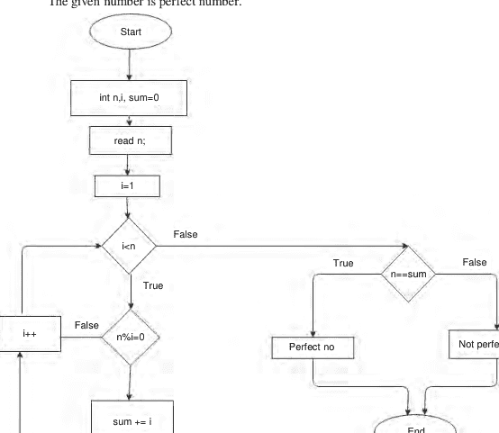

### 练习题

#### 编写一个“C”程序

- 1. 求圆的面积
- 2. 求三角形/矩形的面积
- 3. 求圆的周长
- 4. 求三角形/矩形的周长
- 5. 求单利
- 6. 求复利
- 7. 将摄氏温度转换为华氏温度
- 8. 计算 5 门科目的总分并求出百分比


## 数组和字符串

**结构：**

- 5.1 一维数组简介
  - 5.1.1 定义
  - 5.1.2 声明
  - 5.1.3 初始化
- 5.2 访问数组元素
- 5.3 从数组中查找最小值和最大值
- 5.4 反转数组
- 5.5 从数组中查找奇数、偶数和素数
- 5.6 二维数组
  - 5.6.1 定义
  - 5.6.2 声明数组变量
  - 5.6.3 二维数组的初始化
- 5.7 矩阵：加法、乘法、转置、对称性、上/下三角
  - 5.7.1 两个矩阵相加
  - 5.7.2 两个矩阵相乘
  - 5.7.3 输出矩阵的转置
  - 5.7.4 检查矩阵的对称性
  - 5.7.5 检查上三角
  - 5.7.6 检查下三角
- 5.8 字符串简介
  - 5.8.1 定义
  - 5.8.2 声明
  - 5.8.3 初始化
- 5.9 标准库函数
- 5.10 不使用标准库函数的实现

### 5.1 一维数组简介

数组是另一种变量或用户定义变量，在 C 语言中被广泛使用。数组是一个标识符，指向一组具有相同名称的数据项。因此，数组是相同类型数据项的集合，例如所有整数的集合、所有浮点数的集合、所有字符的集合。

各个数据项由其对应的数组元素（索引）表示。

假设 x 是一个包含 10 个元素的数组。第一个元素称为 x[0]，第二个称为 x[1]，依此类推。最后一个元素将是 x[9]。

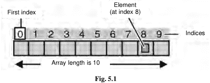

数组中的每个成员（即每个单独的数据项）通过指定数组名后跟一个或多个下标（数组索引）来表示，每个下标括在方括号中。每个下标都必须表示为非负整数。在一个包含 n 个元素的数组中，数组元素为：

x[0]、x[1]、x[2]、...、x[n - 1]

如下图所示。数组的第一个元素使用记号 x[0] 表示，第二个元素使用记号 x[1] 表示，依此类推。

**声明**是提供变量的数据类型和标识符的语句。**标识符**是程序组件的名称。

#### 5.1.1 定义

只有一个下标的数组称为**一维数组**。

***示例：***

```c
int arr[10];
```

当你声明一个数组时，你声明的是一个包含多个相同类型数据项的数组；每个数据项是数组的一个**元素**。每个元素具有相同的数据类型，并且每个元素在内存中占据与其他元素相邻或连续的区域。数组中的所有元素都将存储在连续分配的内存中。

#### 5.1.2 声明

数组的声明方式与变量类似，唯一区别是每个数组名都必须指定大小。对于一维数组，通过在方括号中指定正整数表达式来完成，如下所示：

```c
data-type  array_name[expression]
```

其中 **data-type** 是数组元素的数据类型（int、float、char），**array_name** 是数组名，**expression** 是确定数组大小的正整数值常量。

#### 5.1.3 初始化

如果初始值数量多于声明的大小，编译器将产生错误。也就是说，语句

```c
int number[3] = {10, 20, 30, 40, 50};
```

将无法工作。这在 C 语言中是非法的。

##### 通过赋值初始化

```c
char arr_map[3];
arr_map[0] = 'S';
arr_map[1] = 'R';
arr_map[2] = 'D';
```

#### 访问一维数组元素

数组从 0 开始索引，因此第一个数组元素位于索引 = 0，最高索引为 size_of_array - 1。要访问给定索引处的数组元素，应使用以下语法：

**示例代码**

```c
array_name[index_of_element];
```

要将数组的某个元素设置为某个值，应编写：

**示例代码**

```c
array_name[index_of_element] = value;
```

要访问 arr_map 的元素之一：

**示例代码**

```c
arr_map[0]; // value of 'S'
arr_map[1]; // value of 'R'
arr_map[2]; // value of 'D'
```

尝试访问索引 0 到 size_of_array - 1 范围之外的值会导致运行时错误。编译器不会报错，但程序在执行时会崩溃。

以下代码片段将数据放入容量为 40 个元素的整数类型数组项中

```c
for(i = 0; i < 40; i++)
{
    printf("Enter the item");
    scanf("%d", &items[i]);
}
```

上面的 for 循环要求用户输入 40 次数据项。开始时，i = 0，这使 scanf 语句初始化数组元素 items[0]（数组的第一个元素）。此过程持续到 i = 39，这将初始化数组的最后一个元素：items[39]。

注意，scanf 函数在 items[i] 前面包含一个与号（&），因为输入的是单个数组元素，而不是整个数组。


### 5.2 访问数组元素

以下代码片段演示如何从容量为 40 个元素的整型数组 items 中访问数组元素

```c
int value;
printf("\n Values of array item:\n ");
for(i=0;i<40;i++)
{
        value=items[i];
        printf("\n %d", value);
}
```

上面的 for 循环一次一个地将存储在数组 items 中的 40 个元素提取到变量 value 中，并在 printf() 语句中显示出来。当然，可以省略 value 变量，并像下面所示直接在 printf() 语句中显示数组元素。

```c
printf("\n %d", items[i]);
```

在某些应用中，可能需要为数组元素赋初值。这要求数组要么全局定义，要么在函数内局部定义为静态数组。以下示例说明了这一点：

```c
int items[]={1,6,3,9,2,4,8,0};
void main()
{
        int i, value=0;
        printf("\n Values of array item:\n ");
        for(i=0;i<8;i++)
        {
                value=items[i];
                printf("\n %d", value);
        }
}
```

注意，此版本程序不需要任何输入数据。执行该程序将生成以下输出。

```text
Values of array item:
1
6
3
9
2
4
8
0
```

```c
j = i - 1;    // Assigning j to Last array element
i = 0;        // Assigning i to first array element
while (i < j)
{
    Temp = a[i];
    a[i] = a[j];
    a[j] = Temp;
    i++;
    j--;
}
printf("\nResult of an Reverse array is: ");
for (i = 0; i < Size; i++)
{
    printf("%d \t", a[i]);
}
return 0;
}
```

### 5.5 从数组中查找奇数、偶数、素数

```c
#include<stdio.h>
#include<conio.h>
void main()
{
    int arr[20],size,i,j,n;
    clrscr();
    printf("Enter number of elements you want to enter in array: ");
    scanf("%d",&size);
    printf("Enter elements in array: ");
    for(i=0;i<size;i++)
    {
        scanf("%d",&arr[i]);
    }
    for(i=0;i<size;i++)
    if(arr[i]%2 == 0)
    printf("%d No is Even",arr[i]);
    else
    printf("%d No is Odd",arr[i]);
    printf("Prime numbers are :- \n");
    for(i=0;i<size;i++)
    {
        n=0;
        for(j=2;j<arr[i];j++)
        {
            if(arr[i]%j==0)
            {
                n++;
                break;
            }
        }
        if(n==0)
        {
            printf("%d \n",arr[i]);
        }
    }
    getch();
    }
```

### 5.6 二维数组

#### 5.6.1 定义

二维数组可以定义为数组的数组。二维数组按矩阵方式组织，可以表示为行和列的集合。然而，创建二维数组是为了实现类似关系数据库的数据结构。它便于一次性保存大量数据，并可在需要时传递给任意数量的函数。

#### 5.6.2 声明数组变量

多维数组的最简单形式是二维数组。二维数组本质上是一维数组的列表。要声明大小为 [x][y] 的二维整型数组，可以写成如下形式

```c
    data-type array_name[expression][expression];
```

其中 data-type 可以是任何有效的 C 数据类型，array_name 将是有效的 C 标识符。二维数组可以看作一个具有 x 行和 y 列的表。包含三行四列的二维数组 a 可如下所示：

| | 第0列 | 第1列 | 第2列 |
|---|---|---|---|
| 第1行 | a[0][0] | a[0][1] | a[0][2] |
| 第2行 | a[1][0] | a[1][1] | a[1][2] |
| 第3行 | a[2][0] | a[2][1] | a[2][2] |

**图 5.2：二维数组**

因此，数组 a 中的每个元素都由形如 a[ i ][ j ] 的元素名称标识，其中 'a' 是数组名，'i' 和 'j' 是唯一标识 'a' 中每个元素的下标。

#### 5.6.3 二维数组的初始化

考虑以下代码片段，以理解二维数组的初始化。

```c
int items[4][2] = { {34, 56},
                    {12, 33},
                    {34, 80},
                    {12, 78}
                  };
```

上述代码片段初始化一个 4×2 的二维数组。同一个数组甚至可以用以下方式初始化

```c
int items[4][2] = {34, 56, 12, 33, 34, 80, 12, 78} ;
```

当然，这种方式有点难以理解，因此大多数程序员使用前一种方式来初始化二维数组 items。

重要的是要记住，初始化二维数组时，必须指定第二维（列）的大小，而第一维（行）是可选的。这意味着以下声明是有效的

```c
int items[4][2] = {34, 56, 12, 33, 34, 80, 12, 78} ;
int items[][2] = {34, 56, 12, 33, 34, 80, 12, 78} ;
```

而以下声明无效

```c
int items[4][] = {34, 56, 12, 33, 34, 80, 12, 78} ;
```

程序员需要注意为多维数组元素分配初始值的顺序。规则是最后一个（最右边）下标增长最快，第一个（最左边）下标增长最慢。因此，二维数组的元素将按行赋值；即先给第一行的元素赋值，再给第二行的元素赋值，依此类推。因此，上述声明将具有如下初始赋值：

| item[0][0] = 34 | item[0][1] = 56 | item[1][0] = 12 | item[1][1] = 33 |
|---|---|---|---|
| item[2][0] = 34 | item[2][1] = 80 | item[3][0] = 12 | item[3][1] = 78 |

**图 5.3：数组 items 的内容**

观察到第一个下标的范围是 0 到 2，而第二个下标的范围是 0 到 3。

可以通过将初始值分组并用花括号（即 { ... }）括起来，改变分配初始值的自然顺序。考虑以下示例：

```c
int items[4][2] = { {34},
                    {12},
                    {34},
                    {12}
                  } ;
```

该定义只为每一行的第一个元素赋值。

因此，数组元素将具有以下初始值

| item[0][0] = 34 | item[0][1] = 0 | item[1][0] = 12 | item[1][1] = 0 |
|---|---|---|---|
| item[2][0] = 34 | item[2][1] = 0 | item[3][0] = 12 | item[3][1] = 0 |

**图 5.4：使用第二种技术初始化后数组 items 的内容**

请注意，每一行的最后一个元素都被赋值为零

如果上述数组定义如下

```c
int items[4][2] = { 34, 12, 34, 12 };
```

那么数组元素中又有四个会被赋值为零，但顺序与上面不同，会有所差异。现在，数组元素将具有以下初始值。

| item[0][0] = 34 | item[0][1] = 12 | item[1][0] = 34 | item[1][1] = 12 |
|---|---|---|---|
| item[2][0] = 0 | item[2][1] = 0 | item[3][0] = 0 | item[3][1] = 0 |

**图 5.5：数组 items 的内容**

初始值应用于最后一个下标。没有内层花括号对，初始值就无法分组以分配给特定行。同样还要记住，每个内层花括号对中的值的数量不应超过定义的数组大小。

### 5.7 矩阵：加法、乘法、转置、对称、上/下三角

#### 5.7.1 两个矩阵相加

```c
#include<stdio.h>
int main()
{
        int a[5][5],b[5][5],c[5][5],i,j,m,n;
        printf("How many rows and columns?");
        scanf("%d%d",&m,&n);
        printf("\nEnter first matrix:\n");
        for(i=0;i<m;++i)
                for(j=0;j<n;++j)
                        scanf("%d",&a[i][j]);
        printf("\nEnter second matrix:\n");
        for(i=0;i<m;++i)
                for(j=0;j<n;++j)
                        scanf("%d",&b[i][j]);
        printf("\nMatrix after addition:\n");
        for(i=0;i<m;++i)
        {
                for(j=0;j<n;++j)
                {
                        c[i][j]=a[i][j]+b[i][j];
                        printf("%d ",c[i][j]);
                }
                printf("\n");
        } return 0;
}
```


#### 5.7.2 两个矩阵的乘法

```c
#include<stdio.h>
int main()
{
    int a[5][5],b[5][5],c[5][5],m,n,p,q,i,j,k;
    printf("Enter rows and columns of first matrix:");
    scanf("%d%d",&m,&n);
    printf("Enter rows and columns of second matrix:");
    scanf("%d%d",&p,&q);
    if(n==p)
    {
        printf("\nEnter first matrix:\n");
        for(i=0;i<m;++i)
            for(j=0;j<n;++j)
                scanf("%d",&a[i][j]);
        printf("\nEnter second matrix:\n");
        for(i=0;i<p;++i)
            for(j=0;j<q;++j)
                scanf("%d",&b[i][j]);
        printf("\nThe new matrix is:\n");
        for(i=0;i<m;++i)
        {
            for(j=0;j<q;++j)
            {
                c[i][j]=0;
                for(k=0;k<n;++k)
                    c[i][j]=c[i][j]+(a[i][k]*b[k][j]);
                printf("%d ",c[i][j]);
            }
            printf("\n");
        }
    }
    else
    printf("\nSorry!!!! Matrix multiplication can't be done");
    return 0;
}
```

**输出：**

```
Enter rows and columns of first matrix:3
3
Enter rows and columns of second matrix:3
3
Enter first matrix:
1 2 3
4 5 6
7 8 9
Enter second matrix:
9 8 7
6 5 4
3 2 1
The new matrix is:
30 24 18
84 69 54
138 114 90
```

#### 5.7.3 打印矩阵的转置

```c
#include<stdio.h>
int main()
{
        int a[5][5],i,j,m,n;
        printf("How many rows?");
        scanf("%d",&n);
        printf("How many columns?");
        scanf("%d",&m);
        printf("\nEnter the matrix:\n");
        for(i=0;i<m;++i)
                for(j=0;j<n;++j)
                        scanf("%d",&a[i][j]);
        printf("\nTranspose of given matrix:\n");
        for(i=0;i<m;++i)
        {
                for(j=0;j<n;++j)
                        printf("%d ",a[j][i]);
                printf("\n");
        }
        return 0;
}
```

**输出：**

```
How many rows?3
How many columns?3
Enter the matrix:
1 2 3
4 5 6
7 8 9
Transpose of given matrix:
1 4 7
2 5 8
3 6 9
```

#### 5.7.4 检查矩阵的对称性

用于检查矩阵是否对称的 C 程序：我们先求矩阵的转置，然后将其与原矩阵比较。对于对称矩阵，A^T = A。

```c
#include<stdio.h>
int main()
{
    int m, n, c, d, matrix[10][10], transpose[10][10];
    printf("Enter the number of rows and columns of matrix\n");
    scanf("%d%d", &m, &n);
    printf("Enter elements of the matrix\n");
    for (c = 0; c < m; c++)
        for (d = 0; d < n; d++)
            scanf("%d", &matrix[c][d]);
    for (c = 0; c < m; c++)
        for (d = 0; d < n; d++)
            transpose[d][c] = matrix[c][d];
    if (m == n) /* check if order is same */
    {
        for (c = 0; c < m; c++)
        {
            for (d = 0; d < m; d++)
            {
                if (matrix[c][d] != transpose[c][d])
                    break;
            }
            if (d != m)
                break;
        }
        if (c == m)
            printf("The matrix is symmetric.\n");
        else
            printf("The matrix isn't symmetric.\n");
    }
    else
        printf("The matrix isn't symmetric.\n");
    return 0;
}
```

#### 5.7.5 检查上三角矩阵

```c
#include <stdio.h>
int main()
{
        int i,n,flag = 0, mat[n][n];
        printf("Enter the value of n");
        scanf("%d",&n);
        int j;
        for(i = 0; i < n; i++)
        {
                for(j = 0; j < n; j++)
                        scanf("%d",&mat[i][j]);
        }
        for (i = 1; i < n; i++)
                for (j = 0; j < i; j++)
                        if (mat[i][j] != 0)
                                flag = 0;
                        else
                                flag = 1;
        if (flag == 1)
                printf("Upper Triangular Matrix");
        else
                printf("Not an Upper Triangular Matrix");
        return 0;
}
```

#### 5.7.6 检查下三角矩阵

```c
#include <stdio.h>
int main()
{
        int i,n,flag = 0, mat[n][n];
        printf("Enter the value of n");
        scanf("%d",&n);
        int j;
        for(i = 0; i < n; i++)
        {
                for(j = 0; j < n; j++)
                scanf("%d",&mat[i][j]);
        }
        for (i = 1; i < n; i++)
        for (j = i+1; j < i; j++)
                if (mat[i][j] != 0)
                        flag = 0;
                else
                        flag = 1;
        if (flag == 1)
                printf("Upper Triangular Matrix");
        else
                printf("Not an Upper Triangular Matrix");
        return 0;
}
```

### 5.8 字符串简介

#### 5.8.1 定义

在 C 编程中，字符数组称为字符串。字符串以空字符 '\0' 结尾。字符串实际上是一维字符数组。字符串总是用双引号括起来。而在 C 中，字符用单引号括起来。

##### C 字符串示例

```c
char string[15] = {'s', 'h', 'r', 'u', 't', 'k', 'i', 'r', 't', 'i', '\0'};
char string[15] = "shrutikrti";
char string []   = "shrutikrti";
```

上述声明之间的区别在于：当我们将 char 声明为 "string[20]" 时，会分配 20 字节的内存空间来保存字符串值。当我们将 char 声明为 "string[]" 时，内存空间将在程序执行期间根据需求分配。

C 语言中的字符串简单来说就是字符数组。字符串必须在最后一个字符之后有一个 NULL 或 \0 字符，以表明字符串结束的位置。字符串可以声明为字符数组，也可以使用字符串指针声明。首先我们来看一个字符数组示例：

```c
char mystr[15];
```

如你所见，字符数组的声明方式与普通数组相同。这个数组只能容纳 14 个字符，因为我们必须为 NULL 字符留出空间。

```c
#include <stdio.h>
int main()
{
    char name[15];
    printf("Enter name: ");
    scanf("%s", name);
    printf("Your name is %s.", name);
    return 0;
}
```

**输出：**

```
Enter name
Shrutkirti
Your name is Shrutkirti
```

#### 5.8.2 声明

声明字符串就像声明一维数组一样简单。下面是声明字符串的基本语法。

```c
char str_name[size];
```

在上述语法中，str_name 是为字符串变量指定的任意名称，size 用于定义字符串的长度，即字符串将存储的字符数。请记住，还有一个额外的终止字符，即空字符（'\0'），用于表示字符串的终止，这正是字符串与普通字符数组的不同之处。

#### 5.8.3 初始化

考虑下面的声明和初始化，它创建一个由单词 "Program" 组成的字符串。为了在数组末尾保存空字符，包含该字符串的字符数组的大小比单词 "Program" 中的字符数多一。

```c
char word[8] = {'P', 'r', 'o', 'g', 'r', 'a', 'm', '\0'};
```

上述数组也可以按如下方式初始化

```c
char word[] = "Program";
```

##### 内存中会发生什么？

| 索引 | 0 | 1 | 2 | 3 | 4 | 5 | 6 | 7 |
|---|---|---|---|---|---|---|---|---|
| 数组 | P | r | o | g | r | a | m | \0 |
| 内存地址 | 7890 | 7891 | 7892 | 7893 | 7894 | 7895 | 7896 | 7897 |

图 5.6：字符数组的内容

当在数组中初始化字符串时，空字符会自动将 \0 字符放在字符串末尾。

示例：

```c
void main()
{
    char word[8] = {'P', 'r', 'o', 'g', 'r', 'a', 'm', '\0'};
    printf("Message = %s", word );
}
```

**输出：**

Message = Program

### 5.9 标准库函数

C 语言本身不提供对字符串的显式支持。字符串处理函数在库中实现。字符串 I/O 操作在 `<stdio.h>`（puts、gets 等）中实现。一组简单的字符串操作函数在 `<string.h>` 中实现，或在某些系统上在 `<strings.h>` 中实现。

在 C 编程中，有一个单独的头文件用于处理字符串，名为 "string.h"。它提供了大量操作以空字符结尾的字符串的函数。

#### strcpy() 函数

这个库函数用于复制字符串，可以这样使用：strcpy(destination, source)。（在 C 中不能这样做：string1 = string2）。请看下面的示例：

```c
str_one = "shruit";
str_two = "kirti";
strcpy(str_one, str_two); // str_one becomes "kirti"
```

**注意：** strcpy() 不会执行任何边界检查，因此存在越界访问字符串的风险。

#### strcmp() 函数

这个库函数用于比较两个字符串，可以这样使用：strcmp(str1, str2)。

- 如果第一个字符串大于第二个字符串，则返回一个大于 null 的数。
- 如果第一个字符串小于第二个字符串，则返回一个小于 null 的数。
- 如果第一个字符串和第二个字符串相等，则返回 null。


```c
#include <stdio.h>
#include <string.h>
int main ( )
{
    char string[50] = "Shrutkirti";
    char *a;
    a = strchr (string,'i');
    printf ("Character i is found at position %d\n",a-string+1);
    printf ("First occurrence of character \"i\" in \"%s\" is \"%s\"", string, a);
    return 0;
}
```

**输出：**

```text
Character i is found at position 7
First occurrence of character "i" in "Shrutkirti" is "iShrutkirti"
```

#### strrchr() 函数

C 语言中的 strrchr() 函数返回指向给定字符串中该字符最后一次出现位置的指针。strrchr() 函数的语法如下。

```c
char *strrchr(const char *str, int character);
```

在此程序中，strrchr() 函数用于定位字符串 "Shrutkirti" 中字符 'i' 最后一次出现的位置。字符 'i' 最后一次出现在位置 10，并返回指向该字符最后一次出现位置的指针。

```c
#include <stdio.h>
#include <string.h>
int main ()
{
    char string[25] = "Shrutkirti";
    char *p;
    p = strrchr (string,'i');
    printf ("Character i is found at position %d\n",p-string+1);
    printf ("Last occurrence of character \"i\" in \"%s\" is \"%s\"",string, p);
    return 0;
}
```

**输出：**

```text
Character i is found at position 10
Last occurrence of character "i" in "Shrutkirti" is "i"
```

```c
printf("Duplicated string is : %s", p2);
return 0;
}
```

**输出：**

```text
Duplicated string is : Shruti
```

#### strlwr() 函数

strlwr() 函数将给定字符串转换为小写。strlwr() 函数的语法如下。

```c
char *strlwr(char *string);
```

在此程序中，使用 strlwr() 函数将字符串 "MODIFY This String To Lower" 转换为小写，结果显示为 "THIS IS CAPITAL STRING"。

```c
#include<stdio.h>
#include<string.h>
int main()
{
    char str[ ] = " THIS IS CAPITAL STRING ";
    printf("%s\n",strlwr (str));
    return 0;
}
```

**输出：**

```text
modify this string to lower
```

#### strupr() 函数

strupr() 函数将给定字符串转换为大写。strupr() 函数的语法如下。

```c
char *strupr(char *string);
```

在此程序中，使用 strupr() 函数将字符串转换为大写，结果显示为 "THIS IS LOWER CASE STRING"。

```c
#include<stdio.h>
#include<string.h>
int main()
{
    char str[ ] = "This is lower case string";
    printf("%s\n",strupr(str));
    return 0;
}
```

**输出：**

```text
MODIFY THIS STRING TO UPPER
```

**输出：**

字符串 "Test,string1,Test,string2:Test:string3" 被分割为以下标记：

- Test
- string1
- Test
- string2
- Test
- string3

| 序号 | 字符串函数 | 描述 |
| ---: | --- | --- |
| 1 | `strcpy(s1, s2);` | 将字符串 s2 复制到字符串 s1 中 |
| 2 | `strcat(s1, s2);` | 将字符串 s2 连接到字符串 s1 的末尾 |
| 3 | `strlen(s1);` | 返回字符串 s1 的长度 |
| 4 | `strcmp(s1, s2);` | 如果 s1 和 s2 相同则返回 0；如果 s1<s2 则小于 0；如果 s1>s2 则大于 0。 |
| 5 | `strchr(s1, ch);` | 返回指向字符串 s1 中字符 ch 第一次出现位置的指针 |
| 6 | `strstr(s1, s2);` | 返回指向字符串 s1 中字符串 s2 第一次出现位置的指针 |
| 7 | `strrchr()` | 返回字符串中给定字符最后一次出现的位置 |
| 8 | `strrstr()` | 返回指向 str1 中 str2 最后一次出现位置的指针 |
| 9 | `strdup()` | 返回字符串的副本 |
| 10 | `strlwr()` | 将字符串转换为小写 |
| 11 | `strupr()` | 将字符串转换为大写 |
| 12 | `strrev()` | 返回反转后的给定字符串 |
| 13 | `strset()` | 将字符串中所有字符设置为给定字符 |
| 14 | `strnset()` | 将字符串中部分字符设置为给定字符 |
| 15 | `strtok()` | 使用分隔符对给定字符串进行分词 |

考虑以下示例，它演示了上述部分方法。

```c
#include<string.h>
#include<stdio.h>
#include<conio.h>
void main()
{
        char msg1[10] = "Good";        //String one
        char msg2[10] = "morning";     //String two
        char msg3[15];              //String three to hold the result
        //original strings
        printf("\nOriginal Messages:\n");
        printf("\nMsg1 : %s",msg1);
        printf("\nMsg2 : %s",msg2);
        //copy string
        strcpy(msg3,msg2);
        printf("\n\nMessages after copying:\n");
        printf("\nMsg1 : %s",msg1);
        printf("\nMsg2 : %s",msg2);
        printf("\nMsg3 : %s",msg3);
        printf("\n\nLength of Messages before concatenation:\n");
        printf("\nMsg1 : %d", strlen(msg1));
        printf("\nMsg2 : %d", strlen(msg2));
        //string concatenation
        strcat(msg1,msg2);
        printf("\n\nMessages after concatenation:\n");
        printf("\nMsg1 : %s",msg1);
        printf("\nMsg2 : %s",msg2);
        printf("\n\nLength of Messages after concatenation:\n");
        printf("\nMsg1 : %d", strlen(msg1));
        printf("\nMsg2 : %d", strlen(msg2));
        getch();
}
```

**输出：**

```text
Original Messages:
Msg1 : Good
Msg2 : Morning

Messages after copying:
Msg1 : Good
Msg2 : Morning
Msg3 : Morning

Length of Messages before concatenation:
Msg1 : 4
Msg2 : 7

Messages after concatenation:
Msg1 : GoodMorning
Msg2 : Morning

Length of Messages after concatenation:
Msg1 : 11
Msg2 : 7
```

### 5.10 不使用标准库函数的实现

#### 1. 不使用库函数将一个字符串复制到另一个字符串的 C 程序

```c
#include<stdio.h>
int main()
{
    char s1[100], s2[100];
    int i;
        printf("\nEnter the string :");
    gets(s1);
    i = 0;
    while (s1[i] != '\0')
    {
        s2[i] = s1[i];
        i++;
    }
    s2[i] = '\0';
    printf("\nCopied String is %s ", s2);
    return (0);
}
```

#### 2. 不使用库函数比较两个字符串的 C 程序

```c
#include<stdio.h>
int main()
{
    char str1[30], str2[30];
    int i;
        printf("\nEnter two strings :");
    gets(str1);
    gets(str2);
    i = 0;
    while (str1[i] == str2[i] && str1[i] != '\0')
        i++;
    if (str1[i] > str2[i])
        printf("str1 > str2");
    else if (str1[i] < str2[i])
        printf("str1 < str2");
    else
        printf("str1 = str2");
    return (0);
}
```

#### 3. 不使用库函数连接两个字符串的 C 程序

```c
#include<stdio.h>
#include<string.h>
void concat(char[], char[]);
int main()
{
    char s1[50], s2[30];
    printf("\nEnter String 1 :");
    gets(s1);
    printf("\nEnter String 2 :");
    gets(s2);
    concat(s1, s2);
    printf("\nConcated string is :%s", s1);
    return (0);
}

void concat(char s1[], char s2[])
{
    int i, j;
    i = strlen(s1);
    for (j = 0; s2[j] != '\0'; i++, j++)
    {
        s1[i] = s2[j];
    }
    s1[i] = '\0';
}
```

#### 4. 不使用库函数求字符串长度的 C 程序

```c
#include<stdio.h>
int FindLength(char str[]); // Prototype Declaration
int main()
{
        char str[100];
        int length;
        printf("\nEnter the String : ");
        gets(str);
        length = FindLength(str);
        printf("\nLength of the String is : %d", length);
        return(0);
}

int FindLength(char str[])
{
        int len = 0;
        while (str[len] != '\0')
                len++;
        return (len);
}
```

#### 5. 在字符串中搜索字符出现次数的 C 程序

```c
#include<stdio.h>
#include<conio.h>
int main()
{
        char str[20], ch;
        int count = 0, i;
        printf("\nEnter a string : ");
        scanf("%s", &str);
        printf("\nEnter the character to be searched :");
        scanf("%c", &ch);
        for (i = 0; str[i] != '\0'; i++)
        {
                if (str[i] == ch)
                        count++;
        }
        if (count == 0)
            printf("\nCharacter '%c' is not present", ch);
        else
            printf("\nOccurrence of character '%c' : %d", ch, count);
        return (0);
}
```

#### 6. 不使用库函数反转字符串的 C 程序

```c
#include<stdio.h>
#include<string.h>
int main()
{
    char str[100], temp;
    int i, j = 0;
    printf("\nEnter the string :");
    gets(str);
    i = 0;
    j = strlen(str) - 1;

    while (i < j)
    {
        temp = str[i];
        str[i] = str[j];
        str[j] = temp;
        i++;
        j--;
    }
    printf("\nReverse string is :%s", str);
    return (0);
}
```

#### 7. 使用指针求字符串长度的 C 程序

```c
#include<stdio.h>
#include<conio.h>
int string_ln(char*);
void main()
{
    char str[20];
    int length;
```


```c
clrscr();
printf("\nEnter any string : ");
gets(str);
length = string_ln(str);
printf("The length of the given string %s is : %d", str, length);
getch();
}
int string_ln(char* p) /* p=&str[0] */
{
    int count = 0;
    while (*p != '\0')
    {
        count++;
        p++;
    }
    return count;
}
```

#### 8. 不使用库函数检查字符是否为小写字母的 C 程序

##### 方法 1：

```c
#include<stdio.h>
int main()
{
    char ch;
    printf("\nEnter The Character : ");
    scanf("%c", &ch);
    if (ch >= 'A' && ch <= 'Z')
    {
        printf("Character is uppercase Letters");
    }
    else if (ch >= 'a' && ch <= 'z')
    {
        printf("Character is Not Lowercase Letters");
    }
    else
    {
        printf("Non alphabet character");
    }
    return(0);
}
```

##### 方法 2：

```c
#include<stdio.h>
int main()
{
    char ch;
    printf("\nEnter The Character : ");
    scanf("%c", &ch);
    if (ch >= 97 && ch <= 122)
        printf("Character is Lowercase Letters");
    else
        printf("Character is Not Lowercase Letters");
    return (0);
}
```

### 问题

#### 2014年冬季

- 1. 解释 strcat() 和 strcpy()。
- 2. 定义数组。举例说明如何声明和初始化二维数组。
- 3. 编写一个用于 m*n 矩阵乘法的“C”程序。
- 4. 编写一个“C”程序来检查给定字符串是否为回文。
- 5. main()

```c
{
    char s[]="I am the best";
    printf("%s",s);
    printf("\n%c",s[3]);
    printf("\n%c",s[8]);
}
```

#### 2015年夏季

- 1. 解释 strlen() 和 strcpy()。
- 2. 举例定义字符串。
- 3. 如何将数组传递给函数？举例说明。
- 4. 编写一个“C”程序，使用指针检查给定字符串是否为回文。
- 5. main()

```c
{
    int a[5] = {5,1,15,20,25};
    int i,j,m;
    i=++a[1];
    j=a[1]++;
}
```

- 3.

```c
#include<string.h>
#include<ctype.h>
int main(void)
{
    int length,i;
    char string[ ] = "This is A string";
    length = strlen(string);
    for (i=0; i<length; i++)
    {
        string[i]=tolower(string[i]);
    }
    printf("%s\n",string);
    getch();
    return 0;
}
```

#### 2016年冬季

- 1. 举例定义字符串。
- 2. 什么是数组？举一个例子。
- 3.

```c
main()
{
    char string[ ] = "HELLO WORLD";
    int m;
    for (m=0;string[m] !='\0'; m++)
    if((m % 2 ) ==0)
    printf("%c", string [m]);
}
```

- 4.

```c
main()
{
    int c,d;
    char string[ ] = "A B C D";
    printf("\n\n");
    for(c=0;c<11;c++)
    {
        d=c+1;
        printf("%-12.*s\n",d,string);
    }
    printf("\n");
    for(c=11;c>=0;c--)
    {
        d=c+1;
        printf("%-12.*s\n",d,string);
    }
    printf("\n");
}
```

#### 2017年夏季

- 1. 什么是数组？如何在内存中表示二维数组。
- 2. 解释以下函数的含义。
  - I) `strstr`
  - II) `strlen`
  - III) `tolower`
  - IV) `strrev`
  - V) `strcpy`
- 3. 编写一个连接两个字符串的程序。
- 4. `main()`

```c
{
    int m[] = {1,2,3,4,5};
    int x,y = 0;
    for (x = 0; x < 5; x++)
    y=y+m[x];
    printf("%d",y);
}
```

- 5. `main()`

```c
{
    char s1[]="kolkata";
    char s2[]="pune";
    strcpy(s1,s2);
    printf("%s",s1);
}
```

#### 2018年夏季

- 1. 举例定义字符串。
- 2. 数组的局限性是什么？
- 3. 如何将数组传递给函数？举例说明。
- 4. 编写一个C程序，从3*3矩阵中找出最大数。
- 5. main()

```c
{
    char *a[5] = { "good", "bad", "ugly", "wicked", "nice" };
    printf("%s\n", a[0]);
    printf("%s\n", *(a+2));
    printf("%s\n", *(a[2]+2));
    printf("%s\n", a[3]);
    printf("%c\n", *(a[3]+2));
}
```

- 6. main()

```c
{
    static char str[ ] = "Malayalam";
    char *s;
    s = str + 8;
    while (s >= str)
    {
        printf("%c", *s);
        s--;
    }
}
```

- 1. **文档部分：** 文档部分由单行和多行注释组成，该部分属于用户部分，不会被编译器编译，或由编译器编译。
- 2. **链接部分：** 链接部分向编译器提供指令，以链接系统库中的函数。在此部分中，我们指定要包含的头文件，这些头文件包含各自头文件中的函数原型。
- 3. **定义部分：** 定义部分定义所有符号常量。在此部分中，我们必须指定在整个程序中不能更改的常量。
- 4. **全局声明部分：** 有些变量在多个函数中使用。此类变量称为全局变量，并在所有函数外部的全局声明部分中声明。此部分还声明所有用户定义的函数。
- 5. **main() 函数部分：** 每个 C 程序必须有一个 main 函数部分。此部分包含两部分：声明部分和可执行部分。
  - (a) **局部声明部分：** 声明部分声明可执行部分中使用的所有变量。
  - (b) **可执行部分：** 可执行部分至少有一条语句。这两部分必须出现在左花括号和右花括号之间。程序执行从左花括号开始，到右花括号结束。main 函数的右花括号是程序的逻辑结尾。声明部分和可执行部分中的所有语句均以分号结尾。
- 6. **子程序部分：** 子程序部分包含 main() 函数中调用的所有用户定义函数。用户定义函数通常紧跟在 main() 函数之后，尽管它们可以以任意顺序出现。

#### 调用函数时将执行以下步骤。

- 1. 调用函数时，控制权转移到函数体中的第一条语句。
- 2. 切换到函数体时，将检查函数原型和函数头语句，如果匹配，则控制权转移到函数定义。
- 3. 在传递控制权时，实际参数的值被传递给形式参数。
- 4. 执行函数定义，并将结果返回给函数调用语句。

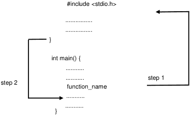

每个 C 程序都在程序中内置了 main() 函数，其返回类型为 int 或 void，即函数头语句。

由 main 函数定义和函数体组成，函数体由以分号结尾的语句组成，并且可以根据需求添加用户定义函数。

## C 程序 main 函数的图示表示

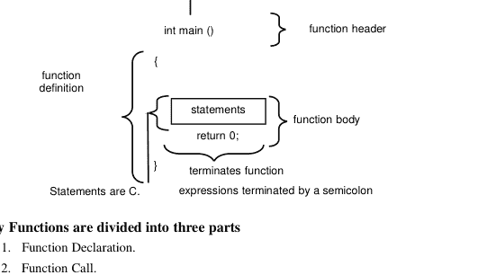

#### 每个函数分为三个部分

- 1. 函数声明。
- 2. 函数调用。
- 3. 函数定义。

##### 1. 函数声明：

- (a) 此部分应写在局部声明部分或全局声明部分中。
- (b) 它是一条以分号结尾的单个语句。
- (c) 原型语句的语法是

  返回类型 函数名（参数个数）；

  示例：int sum(int a, int b);

- (d) 函数原型语句具有不同的形式参数。

每个 C 程序都在程序中内置了 main() 函数，其返回类型为 int 或 void，即函数头语句。

##### 2. 函数调用：

- (a) 它是一条要写在 main 函数内并带有实际参数的单个语句。
- (b) 函数调用语句的语法是

  返回变量 = 函数名（参数）；

  s = sum(x, y);


##### 3. 函数定义

- (a) 函数定义是写在主函数外部的函数体。
- (b) 函数定义包含函数头语句，以及用 { 和 } 括起来的语句体。

**函数各部分及其参数类型的图示，以两数之和为例：**

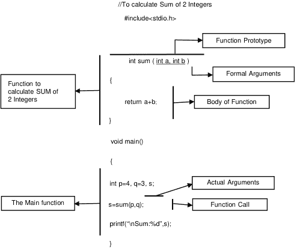

#### 6.1.1 函数的作用

- 1. C 函数用于避免重复编写需要反复执行的相同语句块。
- 2. 函数可按需调用任意多次。对函数的调用没有限制。
- 3. 定义函数体现了模块化，即将大型 C 程序划分为函数，也就是将大任务分解为小部分以实现功能。
- 4. 模块化的核心概念是将程序划分为函数，即可重用性。
- 5. 由于模块化，修改可以轻松完成。更新不会影响整个程序，只会影响相应模块。

#### 6.1.2 函数定义

- 1. 函数定义是写在主函数外部的函数体。
- 2. 函数定义包含函数头语句，以及用 { 和 } 括起来的语句体。
- 3. 函数定义有两个主要组成部分：(1) 第一行函数头 (2) 用 { } 括起来的函数体
- 4. 第一个头语句由函数返回值类型说明、函数名以及后面的 ( ) 组成
- 5. 在 ( ) 圆括号内，可以为空，也可以包含参数或实参，并带有每个参数的数据类型

**函数定义的语法是：**

```
return_type function name (no. of parameters/arguments with data types)
{
    c statement;   // Block code of statements //
    c statement;
    return statement;
}
```

**返回类型：** 每个函数在执行语句块后返回一个值，返回类型可以是任意数据类型，如 int、double、char、void、short 等。通常，函数返回类型是任意数据类型，但如果函数不返回任何值，则必须用 void 关键字指定，表示函数返回空值。

**函数名：** 函数名应是有效标识符，并且函数名应是有意义的名称，以便仅通过查看名称就能容易理解函数用途。

**参数列表/形参列表（类型 arg1，类型 arg2）：** 参数也称为形参，参数列表包含变量名及其数据类型。这些参数是位置形式参数/哑参数，其值可在函数调用时用实际参数替换。例如——一个用于将三个整数变量相加的函数将有三个整数参数。所有参数都必须连同数据类型一起指定，并用逗号分隔。

**代码块：** 它是 C 语句的集合或块，将在函数调用期间执行。函数定义的执行将在栈中进行。

如果函数有返回类型，则 return 语句将是代码块的最后一条语句；如果函数没有返回类型，即 void，则该函数将没有 return 语句。

*让我们假设一个示例来解决函数问题*

**问题 1：编写一个用于两数相加的函数**

**解决方案：**

- 1. 首先为函数确定一个有意义的名称，如 sum 或 addition 等……
- 2. 现在确定函数头语句，我考虑函数名为 sum、返回类型为 integer，以及参数数量和各自的数据类型。

```
return_type sum(argument list)
```

sum 函数将把两个整数变量相加，这意味着我需要两个整数变量作为输入。我的函数头/签名语句将是

```c
return_type sum(int num1, int num2)
```

两个整数之和的结果仍为整数。因此函数应返回一个整数值

```c
int sum(int num1, int num2);
```

这样你就得到了函数原型或签名。由于函数头语句与函数原型语句相同，只是函数原型语句以分号（;）结尾。

##### 带返回类型的两数之和函数定义：

```c
int sum (int a, int b)
{
    int c;
    c = a + b;
    return c;
}
```

##### 问题 2：编写一个函数，打印输入的数是偶数还是奇数

###### 解决方案：

- 1. 首先确定一个有意义的函数名，如 even 或 evenno
- 2. 现在确定函数头语句，我考虑函数名为 even、返回类型以及参数数量和各自的数据类型。

```
return_type even(argument list)
```

even 函数将检查单个数字，因此需要一个整数变量，这意味着我需要一个整数变量作为输入。我的函数头/签名语句将是

```c
return_type even(int a)
```

由于该函数不会返回任何值。它返回数字是偶数还是奇数的消息，因此它将返回空值或 void。

```c
void even(int a);
```

这样你就得到了函数原型或签名。由于函数头语句与函数原型语句相同，只是函数原型语句以分号（;）结尾。

##### 无返回类型（因此为 void）的偶数检查函数定义：

```c
void even (int a)
{
    if (a%2 == 0)
        printf("a is even");
    else
        printf("a is odd");
}
```

**函数定义 main 的图示**

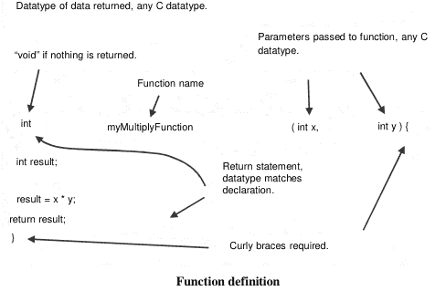

**函数定义**

#### 6.1.3 函数声明

函数声明（也称为函数原型）的一般语法是，

**返回类型 函数名 ( 参数列表 ) ;**

与变量和数组一样，函数也必须在调用之前声明。函数声明告诉编译器函数名以及如何调用该函数。函数的实际主体可以单独定义。函数声明由 4 部分组成。

- 返回类型
- 函数名
- 参数列表
- 结尾分号

**返回类型**

返回类型指定函数预期返回给调用该函数的程序的值类型（int、float、char、double）。如果不返回值，则返回类型必须为 void。

**函数名**

函数名指定函数的名称。函数名是任何有效的 C 标识符，因此必须遵循与 C 中其他变量相同的构成规则。

**参数列表**

参数列表声明将接收调用程序发送的数据的变量。它们通常称为形式参数。这些参数也用于向调用程序发送值。

函数声明中的参数数量与函数调用中的参数数量相同，即函数声明的形式参数应与函数调用语句的实际参数相同。

**结尾分号**

函数声明是单行，并以分号（;）结尾。

##### 函数原型语句或函数声明的示例

具有三个整数参数且返回类型为整数的函数使用以下语法表示

- `int sum(int,int, int);` 或
- `int sum( int a, int b, int c);`

具有一个整数参数且返回类型为整数的函数使用以下语法表示

- `int cube(int);`

在下面的示例中，我们编写了无参数且无返回类型的函数

- `void display(void);`

在下面的示例中，我们声明了无参数且返回类型为整数的函数

- `int get(void);`

#### 6.1.4 函数调用

- 1. 它是单条语句，需在主函数内编写，并带有实际参数
- 2. 可以通过指定函数名，后跟用逗号分隔并括在圆括号中的参数列表来访问或调用函数；如果函数不需要参数，则函数名后跟空圆括号。
- 3. 函数内的参数是实际参数或实参。应传递与函数原型和函数定义中的形式参数数量完全相同且数据类型相同的参数。
- 4. 这些实际参数与函数定义中的形式参数相关联，以将实际参数的值复制到形式参数。
- 5. 如果函数有返回类型，函数调用语句的语法是：
  - `return variable = function name (parameters);`
  - 示例：`s = sum(x, y);`
- 6. 如果函数没有返回类型，即返回空值，函数调用语句的语法是：
  - `function name (parameters);`
  - 示例：`even(x);`

*示例：*

```c
/* function return type is void and doesn't have parameters*/
void main()
{
    /*calling function*/
    intro();
    getch();
}
```


```c
void intro()
{
    printf("Hi\n");
    printf("My name is Kiran Gurbani\n");
    printf("How are you?");
    /* there is no return statement inside this function, since its
     * return type is void */
}
```

**输出：**

Hi  
My name is Kiran Gurbani  
How are you?

**函数定义访问函数调用并将值返回主函数的图示表示。**

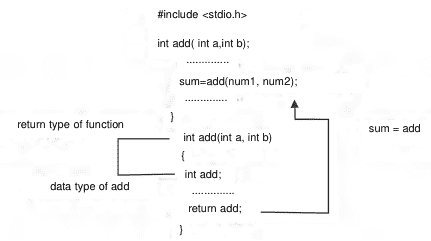

### 6.2 函数类型

函数可以带参数或不带参数定义，函数也可以返回值或不返回值。这完全取决于用户需求。

在C编程中，根据我们的需求，可以通过多种方式定义用户定义函数。以下是C语言中可用的函数类型：

- 1. 无参数且无返回值的函数
- 2. 无参数且有返回值的函数
- 3. 有参数且无返回值的函数
- 4. 有参数且有返回值的函数

#### 1. 无参数且无返回值的函数

在此方法中，在定义、声明或调用函数时，我们不会向函数传递任何参数。这种类型的C函数在当我们从……调用函数时不会返回任何值

##### 示例：

在这个程序中，我们将使用不带参数和 `return` 关键字的用户定义函数来计算2个整数值的乘积。

```c
#include<stdio.h>
int Multiplication();
int main()
{
    int Multi;
    Multi = Multiplication();
    printf("\n Multiplication of a and b is = %d \n", Multi);
    return 0;
}
int Multiplication()
{
    int Multi, a = 20, b = 40;
    Multi = a * b;
    return Multi;
}
```

如果你观察 `main()` 函数，我们声明了整型变量 `Multi`，并将其赋值为 `Multiplication()` 函数的返回值，因为该用户定义函数也只返回整数值。

```c
Multi = Multiplication();
```

我们没有向 `Multiplication()` 函数传递任何参数。

在下一行，使用 `printf` 语句打印输出。

```c
printf("\n Multiplication of a and b is = %d \n", Multi);
```

每当我们调用 `Multiplication()` 函数时，它都会打印上述语句。

在 `Multiplication()` 函数内部，我们声明了整型变量 `Multi`、`a` 和 `b`，并将20赋给 `a`，将40赋给 `b`。

在下一行，我们使用算术运算符（`*`）将 `a` 和 `b` 相乘。

```text
Multi = a * b
     = 20 * 40
     = 800
```

每当我们调用 `Multiplication()` 函数时，它都会打印相同的输出，因为 `a` 和 `b` 的值在函数内部是固定的。

#### 3. 有参数且无返回值的函数

如果你观察上述2种方法，无论执行多少次，它们都会给出相同的输出。我们对变量 `a` 和 `b` 的值没有任何控制权，因为它们是固定值。

在实际应用中，我们大多处理动态数据，这意味着我们必须允许用户输入自己的值，而不是固定值。

此方法允许我们在调用函数时向函数传递参数。但是，当我们从 `main()` 或任何子函数调用该函数时，这种类型的函数不会返回任何值。

如果我们希望允许用户将自己的数据传递给函数参数，但不期望任何返回值，那么这种类型的函数非常有用。

##### 示例：

该程序允许用户输入2个整数值，然后我们将这些值传递给用户定义函数来计算和。

```c
#include<stdio.h>
void Addition(int, int);
void main()
{
    int a, b;
    printf("\n Please Enter two integer values \n");
    scanf("%d %d", &a, &b);
    // Calling the function with dynamic values
    Addition(a, b);
}
void Addition(int a, int b)
{
    int Sum;
    Sum = a + b;
    printf("\n Addition of %d and %d is = %d \n", a, b, Sum);
}
```

如果你观察 `main()` 函数，我们声明了整型变量 `a` 和 `b`。

该程序允许用户输入2个整数值作为 `a` 和 `b`。

```c
printf("\n Please Enter two integer values \n");
scanf("%d %d", &a, &b);
```

在下一行，我们使用用户输入的值调用了 `Addition(int a, int b)` 函数。

```c
Addition(a, b);
```

在 `Addition(int a, int b)` 函数内部，我们声明了整型变量 `Sum`，并且函数中还有整型（`a`、`b`）参数。这意味着该函数将允许用户传递2个整数值。

在下一行，我们使用算术运算符（`+`）将 `a` 和 `b` 相加。

在下一行，使用 `printf` 语句打印输出。

```c
printf("\n Addition of %d and %d is = %d \n", a, b, Sum);
```

#### 4. 有参数且有返回值的函数

此方法允许我们在调用函数时向函数传递参数。当我们从 `main()` 或任何子函数调用该函数时，这种类型的函数会返回某个值。返回值的数据类型将取决于函数声明的返回类型。例如，如果返回类型是 `int`，那么返回值将是 `int`。

这种类型的用户定义函数称为全动态函数，因为它为最终用户提供了最大的控制权。

**示例：**

该程序允许用户输入2个整数值，然后我们将这些值传递给用户定义函数，以将这些值相乘，并使用 `return` 关键字返回该值。

```c
#include<stdio.h>
int Multiplication(int, int);
int main()
{
    int a, b, Multi;
    printf("\n Please Enter two integer values \n");
    scanf("%d %d", &a, &b);
    // Calling the function with dynamic values
    Multi = Multiplication(a, b);
    printf("\n Multiplication of %d and %d is = %d \n", a, b, Multi);
    return 0;
}
```

```c
int Multiplication(int a, int b)
{
    int Multi;
    Multi = a * b;
    return Multi;
}
```

如果你观察 `main()` 函数，我们声明了整型变量 `Multi`、`a` 和 `b`。

该程序允许用户输入2个整数值作为 `a` 和 `b`。

```c
printf("\n Please Enter two integer values \n");
scanf("%d %d", &a, &b);
```

在下一行，我们将 `Multiplication(int a, int b)` 函数的返回值赋给 `Multi` 整数，因为该用户定义函数也只返回整数值。

```c
Multi = Multiplication(a, b);
```

我们将用户输入作为参数传递给函数 `Multiplication(int a, int b)`。

在下一行，使用 `printf` 语句打印输出。

```c
printf("\n Multiplication of a and b is = %d \n", Multi);
```

在 `Multiplication()` 函数内部，我们声明了整型变量 `Multi`，并且函数中还有两个整型（`a`、`b`）参数。这意味着该函数将允许用户传递2个整数值。

在下一行，我们使用算术运算符（`*`）将 `a` 和 `b` 相乘。

### 全局变量与局部变量

局部变量在函数内部声明。全局变量在所有函数外部声明。局部变量只能在其声明的函数中使用。全局变量可以在所有函数中使用。

```c
#include<stdio.h>
// Global variables
int x;
int y;
int add()
{
        return x + y;
}
int main()
{
        int answer; // Local variable
        x = 2;
        y = 5;
        answer = add();
        printf("%d\n", answer);
        return 0;
}
```

在示例中，声明了全局变量 `x` 和 `y`。这些变量可以在 `main()` 和 `add()` 中使用。局部变量 `answer` 只能在 `main()` 中使用。

### 6.3 按值调用与按引用调用

在C编程语言中，按值调用和按引用调用也称为传值调用和传引用调用。这些方法是将（或调用）数据传递给函数的不同方式。

在按值调用时。

在按引用调用时。

按值调用和按引用调用的函数参数可以通过两种方式传递：

- 1. 按值调用（在函数调用中，我们传递变量的值）
- 2. 按引用调用（在函数调用中，我们传递变量的引用或地址）

#### 按值调用

如果数据按值传递，则数据会从例如 `main()` 中使用的变量复制到函数使用的变量。因此，如果传递的数据（即存储在函数变量中的数据）在函数内部被修改，则值只会在函数内部使用的变量中改变。让我们看一个按值调用的示例：


1. **按值调用：**函数调用有多个不同的参数，这些参数的值被传递给形参，因此实参的值传给形参的过程称为按值调用。在这种函数调用中，参数按值传递。被调用的函数会创建一组新的变量。

**函数原型语句为：**

```c
void call_by_value(int x)
```

**函数调用语句为：**

```c
call_by_value(a);
```

**函数定义为：**

```c
void call_by_value(int x)
{
    printf("Inside call_by_value x = %d before adding 10.\n", x);
    x += 10;
    printf("Inside call_by_value x = %d after adding 10.\n", x);
}
```

##### 程序：

```c
#include <stdio.h>

void call_by_value(int x)
{
    printf("Inside call_by_value x = %d before adding 10.\n", x);
    x += 10;
    printf("Inside call_by_value x = %d after adding 10.\n", x);
}

void main()
{
    int a=20;
    printf("a = %d before function call_by_value.\n", a);
    call_by_value(a);
    printf("a = %d after function call_by_value.\n", a);
    getch();
}
```

##### 程序输出：

```
a = 20 before function call_by_value.

Inside call_by_value x = 20 before adding 10.

Inside call_by_value x = 30 after adding 10.

a = 20 after function call_by_value.
```

在 main() 中，我们创建了一个整型变量，其值为 20。我们先打印 a 的初始值，然后调用函数 call_by_value，并将变量 a 作为实参传入。这个变量 a 随后被复制给函数变量 x。在函数中，我们对 x 加上 10（并调用了一些打印语句）。当 main() 函数中的下一条语句执行时，会打印变量 a 的值。我们可以看到，调用 call_by_value() 函数并没有改变变量 a 的值。

2. **按引用调用：**在这个函数中，函数声明和定义中的参数都是按引用传递的。在函数定义中，形参成为调用函数中实参的别名。

按引用传递参数的方式会将参数的地址复制到形参中。在函数内部，使用该地址来访问调用中的实际实参。这意味着对形参所做的更改会影响传入的实参。

要按引用传递值，参数指针与其他任何值一样被传递给函数。因此，你需要像下面的函数 swap() 一样，将函数参数声明为指针类型；该函数通过其参数交换所指向的两个整型变量的值。指针变量需要在函数声明和函数定义中指定。

```c
/* function definition to swap the values */
void swap(int *a, int *b)
{
    int temp;
    temp = *a;    /* save the value at address a */
    *a = *b;      /* put b into a */
    *b = temp;    /* put temp into b */
    return;
}
```

现在让我们通过以下示例，按引用传递值来调用函数 swap()：

```c
#include <stdio.h>
    /* function declaration */
    void swap(int *a, int *b);
    void main ()
    {
        /* local variable definition */
        int x = 10;
        int y = 20;
        printf("Before swap, value of x : %d\n", x );
        printf("Before swap, value of y : %d\n", y );
        /* calling a function to swap the values.
         * &x indicates pointer to x ie. address of variable x and
         * &y indicates pointer to y ie. address of variable y.
         */
        swap(&x, &y);
        printf("After swap, value of x : %d\n", x );
        printf("After swap, value of y : %d\n", y );
        getch();
    }
```

**输出：**

```text
Before swap, value of x :10
Before swap, value of y :20
After swap, value of x :20
After swap, value of y :10
```

### 递归函数

**递归**是一个函数反复调用自身直到满足某个指定条件的过程。函数调用自身即递归。

该过程用于重复计算，其中每个操作都基于前一个结果来表述。

在 C 语言中，递归是一种编程技术，它允许程序员用自身来表达操作。

递归是操作反复调用自身直到满足某个指定条件的过程。该过程用于重复计算，其中每个操作都基于前一个结果来表述。它类似于循环。另一方面，递归使得表达那些需要递归调用的结果才能完成任务的想法变得更加容易。

**一个简单的递归示例如下：**

```c
void recurse()
{
    recurse(); /* Function calls itself */
}
int main()
{
    recurse(); /* Sets off the recursion */
    return 0;
}
```

然而，这个程序不会永远运行下去。计算机会将函数调用保存在堆栈上，一旦调用了太多未结束的函数，程序就会崩溃。

#### 识别递归算法的三个部分：

所有递归算法都必须包含以下三个阶段：

- 基线条件：if ( nargin() == 2 ) result = a + b;
- “向基线条件推进”：a+b 成为第一个参数
  这会将函数的参数个数从 3 个减少到 2 个，而 2 个就是基线条件！
- 递归调用：add_numbers(a+b, c);

在这个算法中，计算机会“记住”问题的每一个先前状态。这些信息由计算机保存在“活动栈”（即每个函数的工作区内）。每次调用函数时，每个函数都有自己的工作区。

#### 一个快速示例：

```c
void count_to_ten ( int count )
{ /* we only keep counting if we have a value less than ten*/
    if ( count < 10 )
    {
        count_to_ten( count + 1 );
    }
}
int main()
{
    count_to_ten( 0 );
}
```

这个程序在我们数到十（更准确地说，当 count 不再小于十）时结束。这是一个很好的基线条件，因为这意味着如果输入的数值大于十，我们会立即停止。如果我们选择在 count 等于十时停止，那么如果函数被输入 11 调用，它会在停止之前耗尽内存。

让我们计算一个正整数的阶乘。这个问题可以表示为 n! = 1 x 2 x 3 x ... x n，其中 n 是给定的正整数。

我们也可以用另一种方式表达这个问题，即 n! = n x (n - 1)! 这是该问题的递归表述，其中所需的操作（计算 n!）由前一个结果（(n - 1)! 的值，假设已知）来表达。

此外，根据定义我们知道 1! = 1。最后这个表达式为递归提供了停止条件。

#### 示例

```c
/* calculate the factorial of an integer quantity using recursion */
#include<stdio.h>
long int factorial(int n); /* function prototype */
void main( )
{
    int n;
    long int factorial(int n);
    /* read in the integer value */
    scanf("%d", &n);
    /* calculate and display the factorial */
    printf("n! = %ld\n", factorial(n));
    getch();
}

/* function definition */
long int factorial(int n) /* calculate the factorial */
{
    if (n <= 1)
        return( 1 );
    else
        return(n * factorial(n - 1));
}
```

程序的主要部分只是读取整数 n，然后调用长整型递归函数 factorial。函数 factorial 以实参 (n - 1) 递归地调用自身，该实参在每次连续调用中数值逐渐减小。当实参的值变为 1 时，递归调用终止。

#### 递归方法

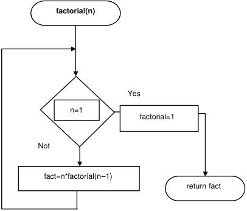

程序执行时，函数 factorial 会被反复访问，一次在 main 中，另外 (n - 1) 次在其自身内部，尽管使用该程序的人不会察觉到这一点。只会显示最终答案；例如，

n! = 3628800

当递归程序执行时，递归函数调用不会立即执行。相反，它们会被放入一个*堆栈*，直到遇到终止递归的条件。然后，函数调用按相反的顺序执行，如同从堆栈中“弹出”一样。因此，在递归计算阶乘时，函数调用将按以下顺序进行。

n! = n x (n - 1)!
(n - 1)! = (n - 1) x (n - 2)!
(n - 2)! = (n - 2) x (n - 3)!
2! = 2 x 1!

然后，实际值将按以下相反顺序返回。

1! = 1
2! = 2 x 1! = 2 x 1 = 2
3! = 3 x 2! = 3 x 2 = 6
4! = 4 x 3! = 4 x 6 = 24
n! = n x (n - 1)! = ...

这种执行顺序的反转是所有递归执行的函数的一个特征。

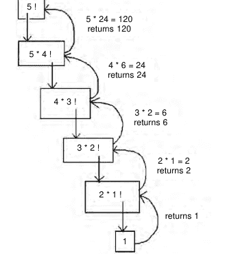


如果递归函数包含局部变量，则每次调用时都会创建一组局部变量。当然，这些局部变量的名称始终相同，因为它们在函数内部声明。然而，每次执行函数时，这些变量所表示的值集合会不同。

每组值都将存储在栈上，因此在递归过程“回退”（unwinds，即各个函数调用从栈中“弹出”并执行）时，这些值仍然可用。

### 6.4 存储类

C 语言中的存储类是一种说明符，它告诉编译器在何处以及如何存储变量、变量的初始值以及变量在程序中的作用域。或者，变量的属性称为存储类；或者从编译器的角度来看，变量标识计算机内某个可存储其位串值的物理位置，这种类别称为存储类。计算机中可存储值的位置类型要么是内存，要么是寄存器。有多种存储类，它们决定值将存储在两种位置中的哪一种。

声明存储类的语法为：

```c
storageclass datatype variable name;
```

存储类有四种类型，且都是关键字：

- 1) 自动（`auto`）
- 2) 寄存器（`register`）
- 3) 静态（`static`）
- 4) 外部（`extern`）

**示例：**

```c
auto float x; or float x;
extern int x;
register char c;
static int y;
```

编译器根据以下方面采用不同的存储类：

- **存储类：** 告诉我们存储位置（变量将存储在何处）。
- **初始值：** 变量的初始值是什么。如果未分配初始值，那么未初始化变量会取什么值。
- **变量的作用域：** 变量在程序中的有效范围是什么。
- **生命周期：** 变量从创建到销毁之间的时间，或者说变量存在多久。

#### 1. 自动存储类

`auto` 是局部变量的默认存储类。用于声明自动存储类的关键字是 `auto`。

**特性：**

| 特性 | 描述 |
|---|---|
| 存储 | 内存位置 |
| 默认初始值 | 不可预测的值或垃圾值。 |
| 作用域 | 局部于定义该变量的块或函数。 |
| 生命周期 | 直到控制权仍位于定义该变量的函数或块内。 |

当函数释放时，它终止。没有任何存储类说明符的变量称为自动变量。

**示例：**

```c
main()
{
        auto int i;
        printf("%d",i);
}
```

#### 2. 寄存器存储类

`register` 用于定义应存储在寄存器而不是 RAM 中的局部变量。用于声明此存储类的关键字是 `register`。

**特性：**

- **存储** —— CPU 寄存器。
- **默认初始值** —— 垃圾值
- **作用域** —— 局部于定义它的函数或块。
- **生命周期** —— 直到控制权仍位于定义它的函数或块内。

寄存器变量没有内存地址，因此不能对其使用取地址运算符。CPU 寄存器通常是 16 位或 2 字节。因此，我们只能对整型、字符型、指针类型应用存储类。存储在寄存器存储类中的变量访问速度总是比始终存储在内存中的变量更快。但由于寄存器对的限制，不可能将所有变量都存储在 CPU 寄存器中。当变量在许多地方使用（如循环计数器）时，最好将其声明为寄存器类。

**示例：**

```c
main()
{
        register int i;
        for(i=1;i<=10;i++)
        printf("%d",i);
}
```

#### 3. 静态存储类

用于声明静态存储类的关键字是 `static`。

**特性：**

- **存储** —— 内存位置
- **默认初始值** —— 零
- **作用域** —— 局部于定义它的块或函数。
- **生命周期** —— 变量的值在不同函数调用之间持续存在或保留。

静态是全局变量的默认存储类。下面两个变量（count 和 road）都具有静态存储类。

```c
static int Count;
int Road;
main()
{
    printf("%d\n", Count);
    printf("%d\n", Road);
}
```

**示例：**

```c
main( )
{
    increment( );
    increment( );
    increment ( );
}
increment( )
{
    auto int x=1;
    printf("%d\n",x);
    x++;
}
```

**输出：**

```text
1
1
1
```

在上面的示例中，当变量 x 是自动变量时，每次调用 increment( ) 时，它都会重新初始化为 1。当函数终止时，x 消失，其新值 2 丢失。无论我们调用 increment( ) 多少次，x 每次都会初始化为 1。

```c
main( )
{
    increment( );
    increment( );
    increment ( );
}
increment( )
{
    static int x=1;
    printf("%d",x);
    x++;
}
```

**输出：**

```text
1
2
3
```

在上面的示例中，当变量 x 是静态变量时，它只初始化一次为 1。之后不会再初始化。

#### 4. 外部存储类

用于此类的关键字是 `extern`。

**特性：**

- **存储** —— 内存区域
- **默认初始值** —— 零
- **作用域** —— 全局
- **生命周期** —— 只要程序执行仍然存在，它就保留。

声明并不创建变量，它只是引用已在其他地方创建的变量。因此，声明时不会分配内存，外部变量在所有函数之外声明。

**示例：**

```c
int i,j;
void main( )
{
    printf("i=%d",i);
    increment( );
    increment ( );
    decrement( );
    decrement( );
}

increment( )
{
    i=i+1;
    printf("on incrementing i=%d",i);
}
decrement( )
{
    i=i-1;
    printf("on decrementing i=%d",i);
}
```

**输出：**

```text
i=0
on incrementing i=1
on incrementing i=2
on decrementing i=1
on decrementing i=0
```

当程序很大，即分成多个文件时，应优先使用外部变量。外部变量扩展了变量的作用域。


## 指针简介

**结构：**

- 7.1 定义
- 7.2 声明
- 7.3 初始化
- 7.4 间接运算符和取地址运算符
- 7.5 指针运算
- 7.6 动态内存分配
- 7.7 函数与指针

### 7.1 定义

指针是一个存储内存地址的变量，或者说包含另一个变量地址的变量。地址是位置编号，并且始终是整数。因此，指针始终包含一个整数。它之所以称为指针，是因为它通过存储某个特定内存位置的地址来指向该位置。

**语法**

```c
Data type *pointer name;
```

这里，指针名称前的 `*` 向编译器表明该变量被声明为指针。

例如，

```c
int *p1; //pointer to integer type
float *p2; //pointer to float type
char *p3; //pointer to character type
```

声明指针时，它包含垃圾值，即它可能指向内存中的任意值。

### 7.2 声明

指针变量与所有其他变量一样，必须先声明，然后才能在 C 程序中使用。然而，指针声明的解释与其他变量声明的解释不同。声明指针变量时，变量名前面必须有一个星号（*）。这标识了该变量是指针这一事实。声明中出现的数据类型指的是指针所指向的对象，即存储在指针所表示的地址中的数据项，而不是指针本身。

```c
if(ptr_x)                 //succeeds, if ptr_x is not null
if(!ptr_x)                //succeeds, if ptr_x is null
```

#### 7.3.2 内存层面发生了什么

假设此示例使用以下代码片段

```c
int x=50, y=45;
int *ptr_x;
ptr_x = &x;
y = *ptr_x;
x = ptr_x;
*ptr_x = 30;
```

让我们在图 7.1 中查看上述代码片段的每个对应语句在内存中会发生什么。为便于讨论，假设变量 x 位于内存位置 1450，y 位于 1560，ptr_x 位于 2581。（注意：指针是一个变量，因此它的值需要存储在某个地方。）

| 程序片段 | 内存 | 垃圾值 |
|---|---|---|
| `int x=50, y=45;` |  | 4789 |
| `int *ptr_x;` | x = 50<br>1450<br>y = 45<br>1560<br>ptr_x = 4789<br>2581 |  |
| `ptr_x = &x;` | x = 50<br>1450<br>y = 45<br>1560<br>ptr_x = 1450<br>2581 |  |
| `y = *ptr_x;` | x = 50<br>1450<br>y = 50<br>1560<br>ptr_x = 1450<br>2581 |  |
| `x = ptr_x` | x = 1450<br>1450<br>y = 50<br>1560<br>ptr_x = 1450<br>2581 |  |
| `*ptr_x = 30` | x = 30<br>1450<br>y = 50<br>1560<br>ptr_x = 1450<br>2581 |  |

**图 7.1：指针在机器层面（内存）如何工作**

程序首先声明整型变量 x 和 y；并分别用 50 和 45 初始化它们。随后定义指针变量 ptr_x，并将 x 的地址赋给它。因此 ptr_x 被装入值 1450。现在将 ptr_x 的内容赋给 y。ptr_x 指向内存位置 1450，即 x 的位置。因此 y 被赋值为 x 的值，即 50。现在将 ptr_x 赋给 x，而 ptr_x 本身保存着 x 的地址。因此 x 被装入自己的地址，即 1450。最后，将 30 赋给 *ptr_x。*ptr_x 表示 ptr_x 所指向位置处的值，也就是 x 本身。因此 x 被装入 30。

### 7.4 间接运算符和取地址运算符

指针是指向 C 程序中使用的另一个变量地址的变量。要访问内存并操作地址，需要用 `&` 运算符来引用地址，而 `*` 符号可用作解引用指针的表示法。


#### C 语言中的地址

如果你的程序中有一个变量 **var**，那么 **&var** 将给出它在内存中的地址，其中 **&** 通常被称为引用运算符或取地址运算符。

你在使用 scanf() 函数时一定见过这种写法。它在函数中用于将用户输入的值存储到 **var** 的地址中。

```c
scanf("%d", &var);

/* Example to demonstrate use of reference operator in C programming. */
#include <stdio.h>
int main()
{
        int var = 5;
        printf("Value: %d\n", var);
        printf("Address: %u", &var);  //Notice, the ampersand(&) before var.
        return 0;
}
```

**输出：**

```
Value: 5

Address: 2686778
```

> **注意：** 运行此程序时，你可能会得到不同的地址值。

在上述源代码中，值 5 存储在内存位置 2686778 中。var 只是该位置的名称。

#### 取地址或引用运算符 (&) 与间接或解引用运算符 (*)

**&** 被称为取地址（或引用）运算符。它给出变量的地址。

类似地，还有一个从地址获取值的运算符，称为间接（或解引用）运算符 (*)。

> **注意：** 在声明指针时，* 号并不是解引用运算符。它只是一种类似的记号，用于创建指针。

#### 演示指针工作的示例

```c
/* Source code to demonstrate, handling of pointers in C program */
#include <stdio.h>
int main()
{
        int *pc;
        int c;
        c = 22;
        printf("Address of c:%u\n", &c);
        printf("Value of c:%d\n", c);
        pc = &c;
        printf("Address of pointer pc:%u\n", pc);
        printf("Content of pointer pc:%d\n\n", *pc);
        c = 11;
        printf("Address of pointer pc:%u\n", pc);
        printf("Content of pointer pc:%d\n\n", *pc);
        *pc = 2;
        printf("Address of c:%u\n", &c);
        printf("Value of c:%d\n\n", c);
        return 0;
}
```

**输出：**

```
Address of c: 2686784
Value of c: 22
Address of pointer pc: 2686784
Content of pointer pc: 22
Address of pointer pc: 2686784
Content of pointer pc: 11
Address of c: 2686784
Value of c: 2
```

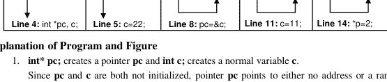

#### 程序与图示说明

- 1. **`int *pc;`** 创建了一个指针 **pc**，**`int c;`** 创建了一个普通变量 **c**。由于 **pc** 和 **c** 都未初始化，指针 **pc** 要么不指向任何地址，要么指向一个随机地址。同样，变量 **c** 被分配了一个地址，但包含一个随机的/垃圾值。
- 2. **`c = 22;`** 将 22 赋值给变量 **c**，即 22 存储在变量 **c** 的内存位置中。注意，打印 **&c**（c 的地址）时，我们使用 **%u** 而不是 **%d**，因为地址通常表示为无符号整数（始终为正）。
- 3. **`pc = &c;`** 将变量 **c** 的地址赋给指针 **pc**。打印时，你会看到 **pc** 的值与 **c** 的地址相同，同时 **pc** 的内容（`*pc`）也是 22。
- 4. **`c = 11;`** 将 11 赋值给变量 **c**。我们给 **c** 赋一个新值，以观察它对指针 **pc** 的影响。
- 5. 由于指针 **pc** 指向与 **c** 相同的地址，指针 **pc** 所指向的值也是 11。打印 **pc** 的地址和内容会显示更新后的内容为 11。
- 6. **`*pc = 2;`** 将指针 **pc** 所指向的内存位置的内容改为 2。由于指针 **pc** 的地址与 **c** 的地址相同，**c** 的值也变为 2。

#### 使用指针时的常见错误

假设你想让指针 pc 指向 c 的地址。那么，

```c
int c, *pc;

// Wrong! pc is an address whereas c is not an address.
pc = c;

// Wrong! *pc is the value pointed by address whereas &c is an address.
*pc = &c;

// Correct! pc is an address and &c is also an address.
pc = &c;

// Correct! *pc is the value pointed by address and c is also a value.
*pc = c;
```

在这两种情况下，指针 pc 都没有指向 c 的地址。

### 7.5 指针算术

指针是保存内存位置的变量，内存位置是一个数字。这意味着可以对指针执行算术运算。可以对指针执行的算术运算有 ++（自增）、--（自减）、+（加法）和 -（减法）。因此，可以将整数值加到指针变量上或从指针变量中减去，但必须非常小心地解释结果表达式。例如，假设 ptr_x 是一个代表某个变量 x 地址的指针变量。我们可以写诸如 ++ptr_x、--ptr_x、(ptr_x + 3)、(ptr_x + i) 和 (ptr_x - i) 这样的表达式，其中 i 是一个整型变量。每个表达式都表示一个与 ptr_x 所代表的原始地址相距一定距离的地址。

#### 自增/自减

考虑一个指向地址 1450 的整型指针变量 ptr_x。让我们对该变量进行自增（整型数据大小为 16 位，即 2 字节）。

```c
ptr_x++;
```

现在指针变量 ptr_x 将指向位置 1452，因为每次 ptr_x 自增时，它都会指向下一个整数位置，该位置在当前位置的 2 字节之后。如果 ptr_x 指向一个地址为 1000 的字符，那么上述操作将指向位置 1001，因为下一个字符将在 1001 处可用。

##### 示例

```c
void main()
{
    int x = 45;
    int *ptr_x;
    ptr_x = &x;
    printf("\nOriginal values: x = %d  ptr_x = %d", x, ptr_x);
    ptr_x++;
    printf("\nValues after incrementing ; x = %d  ptr_x = %d", x, ptr_x);
}
```

编译并执行上述代码后，会产生以下结果

```
Original values: x = 45      ptr_x = 8945
Values after incrementing : x = 45  ptr_x = 8947
```

类似地，对于自减操作，它会将指针变量的值按其数据类型所占的字节数减少。

##### 示例

```c
void main()
{
    int x = 45;
    int *ptr_x;
    ptr_x = &x;
    printf("\nOriginal values: x = %d   ptr_x = %d", x, ptr_x);
    ptr_x--;
    printf("\nValues after decrementing : x = %d  ptr_x = %d", x, ptr_x);
}
```

编译并执行上述代码后，会产生以下结果

```
Original values: x = 45      ptr_x = 8945
Values after decrementing : x = 45  ptr_x = 8943
```

#### 加法/减法

考虑以下示例来演示指针的加法运算，减法运算可以类似地考虑。

```c
void main( )
{
    int *ptr_i; /* pointer to an integer */
    int i = 1;
    ptr_i = &i;
    printf ("Value: i=%d \n\n", i);
    printf ("Address: &i=%X \n\n", &i);
    printf (" Pointer value: ptr_i=%X ptr_i + 1=%X ptr_i + 2=%X ptr_i + 3=%X", ptr_i,
        ptr_i + 1, ptr_i + 2, ptr_i + 3 );
}
```

该程序显示与整型变量 i 关联的值和地址。程序还使用了指针变量 ptr_i，它表示 i 的地址。同时也会显示 ptr_i、ptr_i + 1、ptr_i + 2 和 ptr_i + 3 的值，以便与不同变量的地址进行比较。

执行该程序会产生以下输出

```
Value: i=1
Address: &i=7890
Pointer values: ptr_i=7890 ptr_i + 1=7892 ptr_i + 2=7894 ptr_i + 3=7896
```

#### 7.6.2 动态分配内存

在编程时，如果你知道数组的大小，那么事情就很简单，你可以将其定义为一个数组。例如，要存储任何人的姓名，最多可能达到 100 个字符，因此你可以像下面这样定义——

```c
char name[100];
```

现在让我们考虑一种情况：你不知道需要存储的文本有多长，例如，你想存储关于某个主题的详细描述。这时我们需要定义一个指向字符的指针，而不定义需要多少内存，之后根据需求，我们可以像下面的示例那样分配内存——

```c
#include <stdio.h>
#include <stdlib.h>
#include <string.h>
int main()
{
        char name[100];
        char *description;
        strcpy(name, "Zara Ali");
        /* allocate memory dynamically */
        description = malloc(200 * sizeof(char));
        if(description == NULL) {
        fprintf(stderr, "Error - unable to allocate required memory\n");
        }
        else
        {
        strcpy(description, "Zara Ali a DPS student in class 10th");
        }
        printf("Name = %s\n", name);
        printf("Description: %s\n", description);
}
```

编译并执行上述代码后，会产生以下结果。

```
Name = Zara Ali
Description: Zara Ali a DPS student in class 10th
```

同样的程序也可以使用 **calloc();** 编写，你只需要用 calloc 替换 malloc，如下所示——

```c
calloc(200, sizeof(char));
```

因此，你可以完全控制内存分配，并在分配内存时传入任意大小值，这不像数组那样一旦大小被定义，就无法更改。


#### 7.6.3 调整大小与释放内存

当你的程序退出时，操作系统会自动释放程序分配的所有内存，但作为良好实践，当你不再需要内存时，应该调用 free() 函数来释放该内存。

或者，你可以通过调用 realloc() 函数来增加或减少已分配内存块的大小。让我们再次查看上面的程序，并使用 realloc() 和 free() 函数——

```c
#include <stdio.h>
#include <stdlib.h>
#include <string.h>

int main() {
    char name[100];
    char *description;

    strcpy(name, "Shrutkirti Shelar");

    /* allocate memory dynamically */
    description = malloc(30 * sizeof(char));
    if (description == NULL) {
        fprintf(stderr, "Error - unable to allocate required memory\n");
    } else {
        strcpy(description, "Shrutkirti Shelar a CS student");

        /* suppose you want to store bigger description */
        description = realloc(description, 100 * sizeof(char));
        if (description == NULL) {
            fprintf(stderr, "Error - unable to allocate required memory\n");
        } else {
            strcat(description, "She is in Computer Science class");
        }
    }

    printf("Name = %s\n", name);
    printf("Description: %s\n", description);

    /* release memory using free() function */
    free(description);
}
```

当上述代码编译并执行时，会产生以下结果。

Name = Shrutkirti Shelar

Description: Shrutkirti Shelar a CS student. She is in Computer Science class

```c
{
    strcpy(mem_allocation, "God is great");
}
printf("Dynamically allocated memory content : " \
"%s\n", mem_allocation);
free(mem_allocation);
}
```

**输出：**

**Dynamically allocated memory content : God is great**

##### 2. calloc()

calloc() 函数类似于 malloc() 函数，但 calloc() 会将分配的内存初始化为零，而 malloc() 不会。

- 通过使用 calloc()，我们可以在初始阶段动态创建内存。
- calloc() 需要两个参数：count 和 size type。
- Count 提供元素数量；size type 是数据类型的大小。
- calloc() 将以块格式创建内存。
- 内存的初始值为零。

##### Calloc()

“calloc” 这个名字代表“连续分配”。

malloc() 和 calloc() 之间的唯一区别是，malloc() 分配单个内存块，而 calloc() 分配多个大小相同的内存块，并将所有字节设置为零。

###### calloc() 的语法

```c
ptr = (cast-type*)calloc(n, element-size);
```

该语句将为包含 n 个元素的数组分配连续的内存空间。例如：

```c
ptr = (float*) calloc(25, sizeof(float));
```

该语句为 25 个元素的数组分配连续的内存空间，每个元素为 float 类型，即 4 字节。

###### calloc() 示例：

```c
#include <stdio.h>
#include <string.h>
#include <stdlib.h>

int main()
{
    char *mem_allocation;

    /* memory is allocated dynamically */
    mem_allocation = calloc( 20, sizeof(char) );
```

```c
printf("Enter size of array: ");
scanf("%d", &n1);
ptr = (int*) malloc(n1 * sizeof(int));
printf("Address of previously allocated memory: ");
for(i = 0; i < n1; ++i)
    printf("%u\t", ptr + i);
printf("\nEnter new size of array: ");
scanf("%d", &n2);
ptr = realloc(ptr, n2);
for(i = 0; i < n2; ++i)
    printf("%u\t", ptr + i);
return 0;
}
```

输出：

214

##### 4. free()

free() 函数释放由 malloc()、calloc()、realloc() 函数分配的内存，并将内存返回给系统。

###### free()

使用 calloc() 或 malloc() 创建的动态分配内存不会自行释放。你必须显式使用 free() 来释放空间。

###### free() 的语法

```c
free(ptr);
```

该语句释放由 **ptr** 指向的内存中分配的空间。

```c
#include <stdio.h>
#include <string.h>
#include <stdlib.h>

void main()
{
    char *mem_allocation;

    /* memory is allocated dynamically */
    mem_allocation = malloc( 20 * sizeof(char) );
    if( mem_allocation == NULL )
    {
        printf("Couldn't allocate requested memory\n");
    }
    else
    {
        strcpy( mem_allocation, " God is great ");
    }
    printf("Dynamically allocated memory content : \" %s\"\n", mem_allocation );
    mem_allocation = realloc(mem_allocation, 100 * sizeof(char));
```

还有更多可用于动态内存分配的函数。请参见下表。

| 序号 | 函数 | 语法 | 用途 |
|---|---|---|---|
| 1 | calloc() | `calloc(number, sizeof(int));` | calloc() 函数类似于 malloc() 函数。但 calloc() 会将分配的内存初始化为零，而 malloc() 不会。 |
| 2 | realloc() | `realloc(pointer_name, number * sizeof(int));` | realloc() 函数将 malloc() 和 calloc() 函数分配的内存大小修改为新的大小。 |
| 3 | free() | `free(pointer_name);` | free() 函数释放由 malloc()、calloc()、realloc() 函数分配的内存，并将内存返回给系统。 |

#### 7.6.6 C 语言中静态内存分配与动态内存分配的区别

| 静态内存分配 | 动态内存分配 |
|---|---|
| 在静态内存分配中，内存是在编写 C 程序时分配的。实际上，用户请求的内存将在编译时分配。 | 在动态内存分配中，内存是在程序执行期间分配的。也就是说在运行时。 |
| 执行期间无法修改内存大小。<br>示例：数组 | 执行期间可以修改内存大小。<br>示例：链表 |

#### 7.6.7 C 语言中 malloc() 和 calloc() 函数的区别

| malloc() | calloc() |
|---|---|
| 它只分配一个请求的内存块。 | 它分配多个请求的内存块。 |
| 语法：<br>`(cast_type *)malloc(size_in_bytes);` | 语法：<br>`(cast_type *)calloc(blocks, size_of_block);` |
| `int *ptr;`<br>`ptr = malloc(20 * sizeof(int));`<br>对于上述情况，20*4 字节的内存仅在一个块中分配。<br>总计 = 80 字节 | `int *ptr;`<br>`ptr = calloc(20, 20 * sizeof(int));`<br>对于上述情况，将创建 20 个内存块，每个包含 20*4 字节的内存。<br>总计 = 1600 字节 |
| malloc() 不会初始化分配的内存。它包含垃圾值。 | calloc() 会将分配的内存初始化为零。 |
| 由于该函数返回 void 指针，因此必须进行类型转换。<br>`int *ptr;`<br>`ptr = (int*)malloc(sizeof(int)*20);` | 与 malloc() 函数相同。<br>`int *ptr;`<br>`ptr = (int*)calloc(20, 20 * sizeof(int));` |
| malloc() 使用垃圾值初始化分配的内存。 | calloc() 使用 0 值初始化分配的内存。 |
| 参数数量为 1。 | 参数数量为 2。 |

### 7.7 函数与指针

#### 7.7.1 指针作为函数参数

函数也可以将指针作为参数。这允许访问调用函数内部程序的数据项，对其进行修改，然后将新的变化反映到所传递的数据项中并返回给调用函数。这种指针的使用被称为按引用（地址/位置）传递参数。[回顾：在前面关于函数的章节中讨论过按值传递参数]。

当参数按值传递时，数据项在函数中被复制，对其所做的任何更改都不会反映在调用函数中。然而，当参数按引用传递时，数据项的地址被传入函数，所做的任何更改/修改都将反映在函数和调用函数中。因此，使用指针作为函数参数允许在函数内部全局修改相应的数据项。

当指针用作函数的参数时，每个形式指针参数前都必须加一个星号。函数原型也以相同方式编写。如果函数声明不包含变量名，则每个指针参数的数据类型后必须跟一个星号。

*示例*

```c
void show_int(int x, int y);        //function prototype
void show_int1(int *pt_x, int *pt_y);

void main()
{
        int x = 56;
        int y = 75;
        printf("\n Original values: x=%d, y=%d", x, y);
        show_int(x,y);
        printf("\n Values of x and y after calling show_int(): x=%d, y=%d", x, y);
        show_int1(&x, &y);
        printf("\n Values of x and y after calling show_int1(): x=%d, y=%d", x, y);
}

void show_int(int x, int y)
{
        x=y=1;
        printf("\n\n Values of x and y inside show_int(): x=%d, y=%d", x, y);
}

void show_int1(int *pt_x, int *pt_y)
{
        *pt_x=*pt_y=1;
        printf("\n\n Values of x and y inside show_int1(): *pt_x=%d, *pt_y=%d", *pt_x, *pt_y);
}
```

如上程序所示，有两个函数 show_int() 和 show_int1() 接受两个参数。第一个函数 show_int() 接受两个整数参数并将其值修改为 1。但这些更改不会反映在 main() 中，因为这些参数是按值传递的。对参数所做的更改仅限于发生更改的函数内部。


## 结构体

### 结构体：

- 8.1 结构体简介
- 8.2 定义
- 8.3 声明
- 8.4 访问成员
- 8.5 结构体操作
- 8.6 嵌套结构体（结构体中的结构体）

### 8.1 结构体简介

C 结构体是不同类型数据的集合，这些数据被组合在一起，C 结构体中的每个元素称为成员。

在现实世界场景中，所考虑的数据项是事物的集合。这些事物集合可以有自己的属性。单个结构体可能包含整数元素、浮点元素和字符元素。

考虑一个现实世界的数据“书”，它是书名、作者、出版商、页数等事物的集合，所有这些信息都不相同，即作者是字符串，而页数是整数。为处理此类集合，C 提供了一种称为“结构体”的数据类型。结构体将构成给定实体的不同信息单元聚集在一起。

#### C 中结构体的用途

- 1. C 结构体可用于存储大量数据。结构体充当数据库。
- 2. C 结构体可用于向打印机发送数据。
- 3. C 结构体可与键盘和鼠标交互以存储数据。
- 4. C 结构体可用于绘图和软盘格式化。
- 5. C 结构体可用于清除输出屏幕内容。
- 6. C 结构体可用于检查计算机内存大小，等等。

### 8.2 定义

数组允许定义可保存多个同类数据项的变量类型。类似地，**结构体**是 C 中可用的另一种用户定义数据类型，允许组合不同类型的数据项。

让我们看一个例子

```c
struct book {
    char title[20];
    char author[40];
    int no_of_pages;
    float cost;
} cprog, basicprog;
```

因此 cprog 和 basicprog 是 book 类型的结构体变量。由于结构体和结构体变量的声明合并在一起，可以省略标记。

在声明结构体类型时请注意以下几点：

- 结构体类型声明中的右花括号后必须跟一个分号。
- 重要的是要理解，结构体类型声明并不会告诉编译器在内存中保留任何空间。它只定义结构体的“形式”。
- 通常，结构体类型声明出现在源代码文件顶部，位于定义任何变量或函数之前。在非常大的程序中，它们通常放在单独的头文件中，并在需要该结构体类型的任何程序中使用（通过预处理指令 #include）包含该文件。

### 8.4 访问成员

结构体的成员可以被单独访问和处理。可以通过编写以下语句来访问

```
instance variable.member
```

其中 instance variable 指结构体类型变量，member 指成员名称。注意，句点（.）将变量名与成员名分隔开。

考虑以下结构体

```c
struct book
{
    char title[20];
    char author[40];
    int no_of_pages;
    float cost;
} cprog;
```

这里结构体实例变量是 cprog，要访问 cprog 的 title 和 author 名称，请使用以下代码

```
cprog.title
cprog.author
```

句点运算符具有最高优先级。因此，该运算符将优先于一元运算符以及其他二元运算符。这意味着，形如 `++variable.member` 的表达式等价于 `++(variable.member)`；即，`++` 运算符将作用于结构体成员，而不是整个结构体变量。类似地，表达式 `&instance variable.member` 等价于 `&(variable.member)`；因此，该表达式访问的是结构体成员的地址，而不是结构体变量的起始地址。

### 8.5 结构体操作

在 C 中，可应用于 struct 变量的唯一操作是赋值。不允许对 struct 变量进行任何其他操作。

#### 结构体赋值

通常，结构体变量*可以像*任何普通变量一样被处理吗？特别是当一个结构体变量的值需要赋给另一个结构体变量时。嗯，这是一项复杂的任务。让我们试着理解。考虑以下结构体定义。

```c
struct car
{
        char manufacturer[50];
        char model[10];
        int cost;
};
```

如果两个变量 c1 和 c2 是 car 类型的结构体变量，并且要相互赋值，那么有三种不同方式可以完成

- 1. **逐个赋值成员**
  
  `c1.manufacturer = c2.manufacturer`
  
  `c1.model = c2.model`
  
  `c1.cost = c2.cost`
- 2. **将 c2 的整个内存内容复制到 c1**
  
  `memcpy(&c1, &c2, sizeof(c1));`
- 3. **使用‘=’直接赋值**
  
  `c1 = c2;`

如上所示，如果程序员使用第一种方法，那将是愚蠢的编程。因此显然他们会更喜欢使用第 2 种或第 3 种结构体赋值方式。但区别是什么？有什么缺点吗？

使用直接赋值‘=’技术复制结构体变量可能是最好的，因为它更短、更易读，并且具有更高的抽象层次。而另一种技术对编译器更友好，它只是复制指定大小的内存。这要求读者考虑要复制的尺寸参数。进行直接赋值时，无需担心大小是否正确。

结构体赋值的危险部分在于结构体元素是指针时。复制包含指针的结构体可能有点危险，因为这样做会使那些指针成为别名，通常会导致在复制操作后不清楚谁拥有该指针。如果结构体有一个 char * 指向特定字符串，那么两个结构体都将指向同一个字符串。更改其中一个字符串字段的内容也会更改另一个。

为克服这一点，请复制结构体的全部内容，然后通过对每个结构体有效提供单独字符串的方式来深拷贝字符串。

使用结构体赋值时要记住的事项

- 建议使用直接赋值 `=` 而不是 `memcpy`。
- 如果结构体有指针或数组成员，请考虑指针别名问题，一旦使用不当将导致悬空指针。更好的方式是在 C 中实现结构体赋值函数

#### 结构体数组

结构体用于存储某一个特定对象的信息，但如果我们需要存储 100 个这样的对象，则使用结构体数组。

结构体数组是什么意思？它是一个数组，其中每个元素本身就是一个结构体。让我们通过一个例子来理解

```c
struct author
{
    char first_name[15];
    char last_name[15];
};
struct book
{
    char title[20];
    struct author book_author;
    int no_of_pages;
    float cost;
} books[50];
```

在此声明中，books 是一个包含 50 个元素的结构体数组。books 的每个元素都是 book 类型的单独结构体。每个 book 类型的结构体又包含一个数组（title）和另一个结构体（author）作为成员。这展示了数组和结构体如何嵌入另一个结构体中，而该结构体本身又是数组的一个元素。

定义 book 结构体数组的另一种方式如下所示

```c
struct author
{
    char first_name[15];
    char last_name[15];
};
struct book
{
    char title[20];
    struct author book_author;
    int no_of_pages;
    float cost;
};
struct book books[50];
```

结构体数组可以像任何其他数组一样初始化。考虑以下声明

```c
struct author
{
        char first_name[15];
        char last_name[15];
};
struct author author_list[]={ "Kiran", "Gurbani"};
```

如本例所示，未指定结构体数组的大小。初始值将定义数组的大小以及存储该数组所需的内存量。

句点运算符的用法可以扩展到结构体数组，通过编写 `array[expression].member`，其中 array 指数组名，`array[expression]` 是单个数组元素（一个结构体变量）。因此 `array[expression].member` 将引用特定结构体中的特定成员。

对于上面的示例，author_list 是 author 类型的结构体数组。要访问其第二个元素，请使用表达式 author_list[1]。

让我们考虑以下示例

```c
struct author
{
        char first_name[15];
        char last_name[15];
};
struct book
{
        char title[20];
        struct author book_author;
        int no_of_pages;
        float cost;
} books[5];
```

下表给出了表达式，展示如何访问结构体变量的各个成员和子成员。

| 表达式 | 说明 |
|---|---|
| `books[1].title` | 访问第二本书的 title 成员 |
| `&books[1].title` | 访问第二本书结构体中 title 成员的地址 |
| `books[1].title[3]` | 访问该书标题中的第 3 个字符 |
| `books[1].book_author.first_name` | 访问 book 结构体中 author 类型结构体的 first_name 成员 |
| `++books[1].no_of_pages` | 使 no_of_pages 的值递增 |


```text
Records of STUDENT : 2
Id is: 2
Name is: Dheeraj
Percentage is: 89.500000
Records of STUDENT : 3
Id is: 3
Name is: Swapnil
Percentage is: 77.500000
```

#### 结构中的数组

结构是不同数据类型的集合。如前所述，结构可以包含数组作为其成员。让我们再次看看在结构内部包含数组的结构声明。

```c
struct tag
{
    data-type var1;
    data-type arr[size];
    ...
    data-type varN;
};
```

这里，struct 是关键字，tag 是标识此类型结构的名称，而 var1、arr[size]、...、varN 是各个成员声明。arr[size] 是一个数组，其元素大小由 size 标识。

```c
//structure variable declaration
struct tag object;
```

这将定义一个类型为 tag 的结构变量 object。

##### 示例

```c
//structure declaration
struct month
{
    int num_of_days;
    char name[4];
};
void main()
{
    struct month this_month = { 31, "Jan" };
    printf("The month is %s\n", this_month.name );
}
```

以下示例说明了定义数组的另一种方式。

```c
//structure declaration
struct month
{
    int num_of_days;
    char name[4];
};
void main()
{
    this_month.num_of_days = 31;
    strcpy(this_month.name, "Jan" );
    printf("The month is %s\n", this_month.name );
}
```

##### 包含数组的结构示例

```c
struct Student
{
    int roll_No;
    char name[40];
    int marks[5];
    int total;
    float percentage;
};
void main()
{
    int i;
    struct Student s;
    printf("\nEnter Student Roll No: ");
    scanf("%d", &s.roll_No);
    printf("\nEnter Student Name: ");
    scanf("%s", &s.name);
    s.total = 0;
    for(i=0; i<5; i++)
    {
        printf("\n Enter Marks %d:", i+1);
        scanf("%d", &s.marks[i]);
        s.total = s.total + s.marks[i];
    }
    s.percentage = (s.total/500)*100;
    printf("\n Roll No: %d",s.roll_No);
    printf("\n Name: %s",s.name);
    printf("\n Marks in 5 subjects: %d %d %d %d %d", s.marks[0], s.marks[1],
    s.marks[2], s.marks[3], s.marks[4]);
    printf("\n Total: %d",s.total);
    printf("\n Percentage: %f",s.percentage);
}
```

##### 输出：

```text
Enter Student Roll No : 51
Enter Student Name : sravan
Enter Marks 1: 55
Enter Marks 2: 56
Enter Marks 3: 74
Enter Marks 4: 81
Enter Marks 5: 45
Roll No: 51
Name: sravan
Marks in 5 subjects: 55 56 74 81 45
Total: 311
Percentage: 62.20000
```

### 8.6 嵌套结构（结构中的结构）

C 语言中的嵌套结构不过是结构中的结构。就像我们在结构中声明结构成员一样，一个结构可以声明在另一个结构内部。

随着现实世界数据项复杂性的增加，可能会出现一个结构变量被定义为另一个结构成员的情况。在这种情况下，嵌入结构的声明必须出现在外层结构的声明之前。这也称为嵌套结构。

让我们考虑一个示例

```c
struct author{
    char first_name[15];
    char last_name[15];
};
struct book {
    char title[20];
    struct author book_author;
    int no_of_pages;
    float cost;
} cprog, basicprog;
```

book_author 是结构的成员，而它本身又是一个 author 类型的结构。要访问 book_author 的 first_name 成员，可使用

```c
    cprog.book_author.first_name
```

类似地，

```c
    cprog.book_author.no_of_pages
```

可以通过编写以下代码来递增该值

```c
    ++cprog.book_author.first_name
```

第一个成员 title 是一个字符数组。可以使用以下代码访问该数组的第四个元素

```c
    cprog.title[3]
```

结构成员可以像相同数据类型的普通变量一样处理。单值结构成员可以出现在表达式中，可以传递给函数，也可以从函数返回，就像它们是普通的单值变量一样。复杂结构成员的处理方式与相同类型的普通数据项相同。

这意味着什么？作为数组的结构成员可以像普通数组一样处理。作为结构的结构成员可以像任何其他结构一样，一次处理一个成员。这些操作如下所示。

考虑以下结构

```c
    struct author {
        char first_name[15];
        char last_name[15];
    };
    struct book {
        char title[20];
        struct author book_author;
        int no_of_pages;
        float cost;
    } cprog;
```

访问结构成员的几种操作

```c
    cprog.no_of_pages=455;
```

这条语句将值 455 赋给 cprog.no_of_pages

```c
    printf("Book title is %s", cprog.title);
```

这条语句将数组 cprog.title 传递给 printf 函数，以便它能够打印到控制台。

```c
    printf("Author's name %s %s", cprog.book_author.first_name, cprog.book_author.last_name);
```

这条语句将两个数组 cprog.book_author.first_name 和 cprog.book_author.last_name 传递给 printf 函数，它们都是结构 cprog 的子成员，以便它能够打印到控制台。

### 问题

#### 2014 年冬季

- 1. 什么是嵌套结构？
- 2. 创建一个结构来存储 10 名学生的数据，包括学号、姓名和百分比。编写一个 C 程序，打印成绩低于 60% 的学生的学号和姓名。

#### 2015 年夏季

- 1. 给出定义自引用结构的语法。
- 2. 通过一个示例定义结构。
- 3. 创建一个结构来存储 10 名员工的数据，包括员工编号、姓名和工资。编写一个“C”程序，打印工资大于 10,000 的员工的员工编号和姓名。

#### 2015 年冬季

- 1. 什么是结构？请举例说明。
- 2. 创建一个结构来存储 10 名学生的详细信息，包括学号、姓名和百分比。编写一个“C”程序，打印成绩超过 70% 的学生的学号和姓名。

#### 2016 年夏季

- 1. 定义结构。给出合适的示例。
- 2. 编写一个“C”程序，接受并显示“n”本书的书籍详细信息，包括书名、作者、出版社和价格。（使用结构数组）。

#### 2016 年冬季

- 1. 什么是结构数组？请举例说明。

#### 2017 年夏季

- 1. 编写一个程序，从用户处接受 n 本书的书名、作者、单价、数量，并显示书名、作者姓名和总费用。

#### 2018 年夏季

- 1. 什么是结构？
- 2. 定义结构。嵌套结构是什么意思？请举例说明。

## C 语言中的错误处理

**我们区分以下类型的错误：**

- 1. **语法错误**：由于未遵守语言的语法而产生的错误。
- 2. **语义错误**：由于程序语句使用不当而产生的错误。
- 3. **逻辑错误**：由于未遵守规范而产生的错误。
      [从编程角度看何时发生]

- 1. **编译时错误**：由编译器指示的语法错误和静态语义错误。
- 2. **运行时错误**：编译器无法检测到的动态语义错误和逻辑错误（调试）。

### 语法错误

让我们看一些语法错误的示例。

**示例 1：缺少分号：**

```text
    int a = 5 // semicolon is missing
    Compiler message:
    Error: ‘;’ expected
    int a = 5
```

**示例 2：表达式中的错误：**

```c
    x = ( 3 + 5; // missing closing parenthesis ‘)’
    y = 3 + * 5; // missing argument between ‘+’ and ‘*’
```

### 语义错误

让我们看一些语义错误的示例。

**示例 1：使用未初始化的变量：**

```c
    int i;
    i++; // the variable i is not initialized
```

**示例 2：类型不兼容：**

```c
    int a = "hello"; // the types String and int are not compatible
```


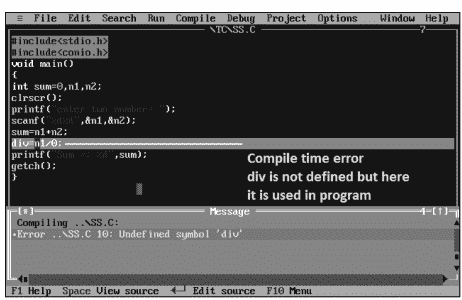

### 运行时错误

如果在运行时产生任何错误，则称为运行时错误。一般来说，这些错误是由于在程序中编写了错误的逻辑而引发的。

#### 示例

调用不存在的函数、除以零。

```c
int a=10,b;
b=a/0; // infinite
```

这里超出了 int 数据类型的范围。

一般来说，在 C 语言中识别逻辑错误非常困难；为了克服这个问题，面向对象编程语言中引入了异常处理。

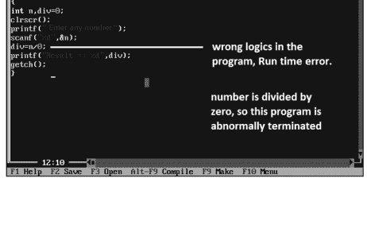

### 警告

警告也是一种异常情况，但无论它何时发生，程序的执行都不会停止。

注意：在 C 语言中，警告可以忽略，但错误不能忽略。

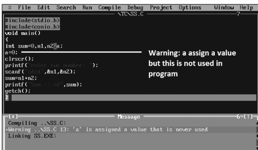

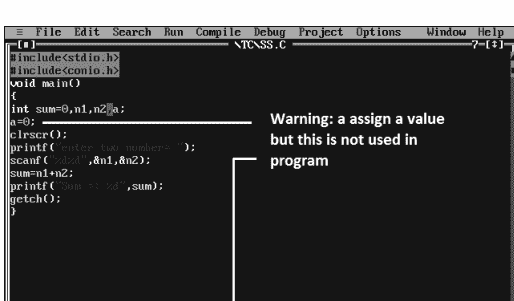

### 声明常量

const 关键字用于声明常量。

#### 语法

```c
const int height = 100;
```

#### 示例

```c
#include<stdio.h>
#include<conio.h>

void main()
{
    const int a=10;
    printf("%d",a);
    a=20; // gives error you can't modify const
    getch();
}
```

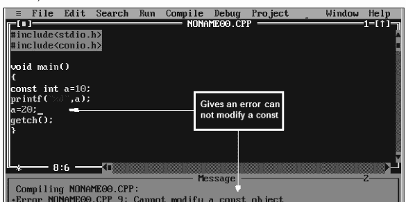

❖❖❖❖❖

## C 编程实践

|  |  |
|---|---|
| **理解基本数据类型和 I/O 的程序** | |
| 1. | 编写一个程序显示消息 Welcome。 |
| 2. | 编写一个程序声明一些 int、float 和 double 类型的变量。为这些变量赋值并显示这些值。 |

```c
/* program is to print welcome message */
#include<stdio.h>
#include<conio.h>
void main()
{
    clrscr();
    printf("welcome to c");
    printf("\n Introduction to c");
    getch();
}
```

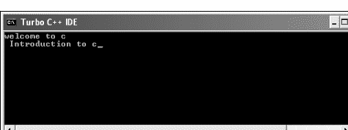

```c
#include<stdio.h>
#include<conio.h>
void main()
{
    clrscr();
    int roll_no;
    float tot_marks;
    double per;
    printf("\nEnter your roll no :");
    scanf("%d",&roll_no);
    printf("\nEnter total marks :");
    scanf("%f",&tot_marks);
    printf("\nEnter the percentage");
    scanf("%lf",&per);
    printf("\n Your Roll no is :%d", roll_no);
    printf("\n The total marks :%f", tot_marks);
    printf("\n The Percentage :%lf", per);
    getch();
}
```

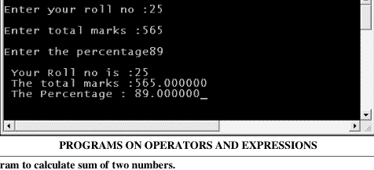

### 关于运算符和表达式的程序

- 3. 计算两个数之和的程序。

```c
/* program to print sum of two numbers */
#include<stdio.h>
#include<conio.h>
void main()
{

    int a,b,sum;
    clrscr();
    printf("\n Please enter the value of a & b");
    scanf("%d %d",&a,&b);
    sum=a+b;
    printf("\n The sum of two numbers is %d",sum);
    getch();

}
```

```c
printf("\n The subtraction of two numbers is %d",sub);
mul=a*b;
printf("\n The multiplication of two numbers is %d",mul);
div=a/b;
printf("\n The division of two numbers is %d",div);
getch();
}
```

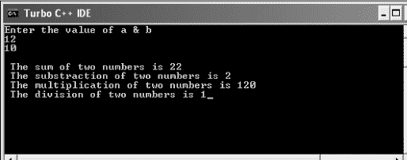

- 6. 编写一个程序交换两个数的内容。

```c
#include<stdio.h>
#include<conio.h>
void main()
{
    int a,b,temp;
    clrscr();
    printf("Enter the two numbers\n");
    scanf("%d %d",&a,&b);
    printf("The original values of a=%d and b=%d",a,b);
    temp=a;
    a=b;
    b=temp;
    printf("\nThe Interchanged values of a=%d and b=%d",a,b);
    getch();
}
```

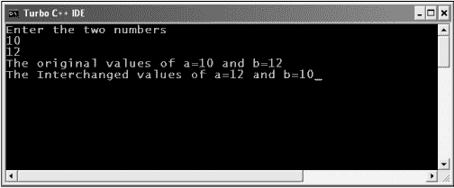

- 7. 编写一个程序求矩形、正方形和圆的面积。

#### 计算圆的面积和周长的程序。

（提示：面积 = π r²，周长 = 2 π r）

```c
#include<stdio.h>
#include<conio.h>
void main()
{
    float radius,area,pi,circum;
    clrscr();
    pi=3.1415;
    printf("Please Enter the radius \n");
    scanf("%f",&radius);
    area=pi*radius*radius;
    circum=2*pi*radius;
    printf("The area of circle is %3.2f",area);
    getch();
}
```

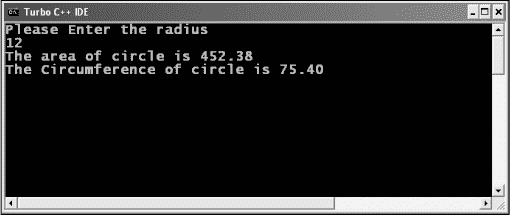

- 8. 计算三角形面积和周长的程序。

（提示：面积 = L x B，周长 = 2(L+B)）

```c
#include<stdio.h>
#include<conio.h>
void main()
{
    int length,breadth,area,peri;
    clrscr();
    printf("Enter the Length & Breadth of triangle\n");
    scanf("%d %d",&length,&breadth);
    area=length * breadth;
    peri=2*(length + breadth);
    printf("The area of triangle is %d",area);
    printf("\nThe perimeter of triangle is %d",peri);
    getch();
}
```

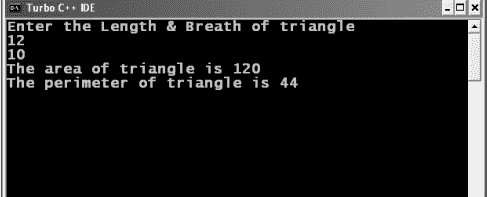

- 9. 编写一个程序打印矩形的面积。

```c
/* program to print volume of sphere */
#include<stdio.h>
#include<conio.h>
void main()
{
    int radius;
    float pi,vol;
    clrscr();
    pi=3.1415;
    printf("Enter the radius of sphere\n");
    scanf("%d",&radius);
    vol=(4/3) * pi * radius * radius * radius;
    printf("The Volume of sphere is %4.2f",vol);
    getch();
}
```

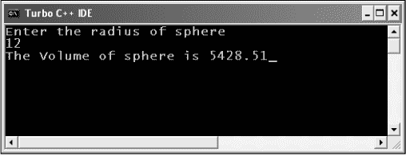

- 10. **编写一个程序求立方体、球体和圆柱体的体积。**

```c
#include<stdio.h>
#include<conio.h>
void main() {
    int length, breadth, area;
    printf("\nEnter the Length of Rectangle : ");
    scanf("%d", &length);
    printf("\nEnter the Breadth of Rectangle : ");
    scanf("%d", &breadth);
    area = length * breadth;
    printf("\nArea of Rectangle : %d", area);
    getch();
}
```

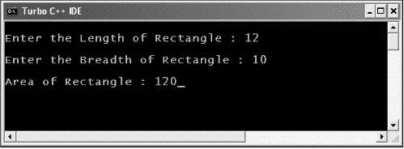

- 11. 编写一个程序求立方体的体积。

```c
#include <stdio.h>
#include<conio.h>
#include <math.h>
void main()
{
    float side, surfacearea, volume;
    printf("Enter the length of a side \n");
    scanf("%f", &side);
    surfacearea = 6.0 * side * side;
    volume = pow(side, 3);
    printf("Surface area = %6.2f and Volume = %6.2f \n", surfacearea, volume);
    getch();
}
```

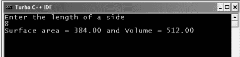

- 12. 编写一个程序求圆柱体的体积。

```c
#include <stdio.h>
#include<conio.h>
#include <math.h>
void main()
{
    float radius, height;
    float surface_area, volume;
    clrscr();
    printf("Enter value for radius and height of a cylinder :\n");
    scanf("%f%f", &radius, &height);
    surface_area = 2 * (22 / 7) * radius * (radius + height);
    volume = (22 / 7) * radius * radius * height;
    printf("Surface area of cylinder is: %.3f", surface_area);
    printf("\n Volume of cylinder is : %.3f", volume);
    getch();
}
```


- 12A. 从用户处接收员工代码、员工姓名和基本工资的程序

  - 计算 DA（物价津贴）= 基本工资的 10%
  - 计算 HRA（房租津贴）= 基本工资的 5%
  - 计算 CLA（城市津贴）= 基本工资的 12%
  - 所有员工的 TA 固定为 200
  - 计算 Gross = Basic + DA + HRA + CLA + TA
  - 计算 Ptax（专业税）= 基本工资的 5%
  - 计算 IT（所得税）= 基本工资的 10%
  - 计算总扣除额 ded = Ptax + IT
  - 计算净工资为 Gross – ded。
  - 打印员工代码、员工姓名、Basic、Gross 和 Net sal。

```c
#include<stdio.h>
#include<conio.h>
void main()
{
    float basic,da,hra,cla,gross,ded,pt,it,net;
    clrscr();
    printf("please enter the value of basic");
    scanf("%f",&basic);
    da=(10.0/100.0)*basic;
    hra=(5.0/100.0)*basic;
    cla=(12.0/100.0)*basic;
    gross=basic+da+hra+cla;
    gross=basic+da+hra+cla;
    it=(10.0/100.0)*basic;
    ded=pt+it;
    net=gross-ded;
    printf("Basic is %3.2f\n",basic);
    printf("Da is %3.2f\n",da);
    printf("Hra is %3.2f\n",hra);
    printf("Cla is %3.2f\n",cla);
    printf("Gross is %3.2f\n",gross);
    printf("Ptax is %3.2f\n",pt);
    printf("Itax is %3.2f\n",it);
    printf("Deduction is %3.2f\n",ded);
    printf("Net salary is %3.2f\n",net);
    getch();
}
```

输出

```text
please enter the value of basic
5000
Basic is 5000.00
Da is 500.00
Hra is 250.00
Cla is 600.00
Gross is 6350.00
Ptax is 250.00
Itax is 500.00
Deduction is 750.00
Net salary is 5600.00
```

- 13. **编写一个程序求一个数的逆序。**

```c
#include<stdio.h>
#include<conio.h>
void main()
{
    int n,f1,f2,f3,f4,p1,p2,p3,p4,sum,add;clrscr();
    printf("enter the four digit nos\n");
    scanf("%d",&n);
    f1=n/1000;
    p1=f1*1000;
    n=n-p1;
    f2=n/100;
    p2=f2*100;
    n=n-p2;
    f3=n/10;
    p3=f3*10;
    n=n-p3;
    f4=n;
    printf("\n");
    printf("The first digit is %d\n",f1);
    printf("The second digit is %d\n",f2);
    printf("The third digit is %d\n",f3);
    printf("The fourth digit is %d\n",f4);
}
```


```c
printf("\n");
printf("The reverse numbers are %d%d%d%d\n",f4,f3,f2,f1);
sum=f1+f4;
printf("The sum of first and last digit is %d",sum);
add=f1+f2+f3+f4;
printf("\nThe sum of all digits is %d",add);
getch();
}
```


### 决策实践题

#### 14. 编写一个程序，检查该数字是偶数还是奇数。

```c
#include<stdio.h>
#include<conio.h>
void main()
{
int a;
clrscr();
printf("Enter the numbers\n");
scanf("%d",&a);
if(a%2 ==0)
{
    printf("The given number %d is even number",a);
}
else
{
    printf("The given number %d is odd number",a);
}
getch();
}
```


#### 15. 编写一个程序，检查该数字是正数、负数还是零。

```c
#include<stdio.h>
#include<conio.h>
void main()
{
    int a;
    clrscr();
    printf("Enter the numbers\n");
    scanf("%d",&a);
    if(a>0)
    {
        printf("%d is +ve number",a);
    }
    if(a<0)
    {
        printf("%d is -ve number",a);
    }
    if(a==0)
    {
        printf("%d is a Zero number",a);
    }
    getch();
}
```


#### 16. 编写程序打印两个数中的较大者。

```c
/* program to print greatest of two numbers */
#include<stdio.h>
#include<conio.h>
void main()
{
    int a,b;
    clrscr();
    printf("Enter the two numbers\n");
    scanf("%d %d",&a,&b);
    if(a>b)
    {
        printf("%d is greater",a);
    }
    else
    {
        printf("%d is greater",b);
    }
    getch();
}
```

**输出**

```
Enter the two numbers
6 9
9 is greater
```

#### 17. 编写一个程序找出三个数中的最大者。

```c
/* program to print greatest of three numbers -by nested if-else*/
#include<stdio.h>
#include<conio.h>
void main()
{
    int a,b,c;
    clrscr();
    printf("Enter the three numbers\n");
    scanf("%d %d %d",&a,&b,&c);
    if(a>b)
    {
        if(a>c)
        {
            printf("%d is greater",a);
        }
    }
    if(b>a)
    {
        if(b>c)
        {
            printf("%d is greater",b);
        }
    }
    if(c>a)
    {
        if(c>b)
        {
            printf("%d is greater",c);
        }
    }
    getch();
}
```

------------------------------------ 或 ------------------------------------

```c
/* program to print greatest of three numbers --- by Logical AND*/
#include<stdio.h>
#include<conio.h>
void main()
{
    int a,b,c;
    clrscr();
    printf("Enter the three numbers\n");
    scanf("%d %d %d",&a,&b,&c);
    if(a>b && a>c)
    {
        printf("%d is greater",a);
    }
    if(b>a && b>c)
    {
        printf("%d is greater",b);
    }
    if(c>a && c>b)
    {
        printf("%d is greater",c);
    }
    getch();
}
```


#### 18. 编写一个程序求解二次方程

$$x = \frac{-b \pm \sqrt{b^2 - 4ac}}{2a}$$

```c
#include<stdio.h>
#include<conio.h>
#include<math.h>
void main()
{
    int a,b,c;
    float x1,x2,d,d1;
    clrscr();
    printf("please enter the value of a, b &c\n");
    scanf("%d %d %d",&a,&b,&c);
    d=b*b-4*a*c;
    if(d==0)
    {
        printf("roots are equal\n");
        x1=(-b+sqrt(d))/(2*a);
        x2=(-b-sqrt(d))/(2*a);
    }
    if(d<0)
    {
        printf("roots are imaginary\n");
        d1=abs(d);
        x1=(-b+sqrt(d1))/(2*a);
        x2=(-b-sqrt(d1))/(2*a);
    }
    if(d>0)
    {
        printf("the roots are real\n");
        x1=(-b+sqrt(d))/(2*a);
        x2=(-b-sqrt(d))/(2*a);
    }
    printf("the root x1=%f\n",x1);
    printf("the root x2=%f\n",x2);
    getch();
}
```


#### 19. 从用户处接收当前年份和入职年份，检查该员工为组织服务的年数是否大于 3。如果大于 3，则给予该员工 ₹ 2500/- 的奖金，并打印该奖金；如果年数小于 3，则不做任何操作。

```c
/* program to print bonus for 3 years */
#include<stdio.h>
#include<conio.h>
void main()
{
    int cyear,jyear,diff1;
    clrscr();
    printf("Enter the current year\n");
    scanf("%d",&cyear);
    printf("Enter the joining year\n");
    scanf("%d",&jyear);
    diff1=cyear-jyear;
    if(diff1>3)
    {
        printf("Bonus given to employee is 2500");
    }
    else
    {
        printf("NO BONUS");
    }
    getch();
}
```

**输出**

```
Enter the current year
2004
Enter the joining year
2000
Bonus given to employee is 2500Enter the current year
2004
Enter the joining year
2003
NO BONUS
```

#### 20. 编写一个程序，从用户处接收一个年份，并检查输入的年份是否为闰年。

```c
/*program to check entered year is leap year or not*/
#include<stdio.h>
#include<conio.h>
void main()
{
    int i;
    clrscr();
    printf("Enter the Year\n");
    scanf("%d",&i);
    if(i%100==0 || i%400==0 || i%4==0)
    {
        printf("%d is leap year\n",i);
    }
    else
    {
        printf("%d is not a Leap Year",i);
    }
    getch();
}
```

**输出**

```
Enter the Year
2000
2000 is leap year

Enter the Year
1997
1997 is not a Leap Year
```

#### 21. 销售税计算如下：

| 销售额（₹） | 销售税 |
|---|---|
| 前 10000 | 5% |
| 接下来 25,000 | 10% |
| 接下来 30,000 | 15% |
| 超出部分 | 20% |

编写一个程序输入销售金额。打印销售金额、销售税、总金额。

```c
/*prg for saletax */
#include<stdio.h>
#include<conio.h>
void main()
{
    float sal,saltax,total,sal1,sal2,sal3,sal4,totamt;
    clrscr();
    printf("Enter the sales Amount\n");
    scanf("%f",&sal);
    if(sal<=10000)
    {
        saltax=(5.0/100.0)*sal;
    }
    if(sal>10000 && sal<=35000)
    {
        sal2=(10000)*(5.0/100.0);
        sal1=sal-10000;
        saltax=(10.0/100.0)*sal1+sal2;
        printf("%f",saltax);
    }
    if(sal>35000 && sal<=65000)
    {
        sal2=(10000)*(5.0/100.0);
        sal3=(25000)*(10.0/100.0);
        sal1=sal-35000;
        saltax=(15.0/100.0)*sal1+sal2+sal3;
        printf("%f",saltax);
    }
    if(sal>65000)
    {
        sal2=(10000)*(5.0/100.0);
        sal3=(25000)*(10.0/100.0);
        sal4=(30000)*(15.0/100.0);
        sal1=sal-65000;
        saltax=(20.0/100.0)*sal1+sal2+sal3+sal4;
        totamt=sal+saltax;
        printf("The Sales Amount is %5.2f\n",sal);
        printf("The Sales Tax is %5.2f\n",saltax);
        printf("The Total Amount is %5.2f\n",totamt);
    }
    getch();
}
```

**输出**

```
Enter the sales Amount
75000
The Sales Amount is 75000.00
The Sales Tax is 9500.00
The Total Amount is 84500.00
```

#### 22. 利率取决于所获得的贷款，如下所示：

| 贷款金额（₹） | 年利率 |
| --- | --- |
| 低于 10,000 | 5% |
| 10,000 至 50,000 | 6% |
| 50,000 至 2,00,000 | 7% |
| 高于 2,00,000 | 8% |

通过键盘输入贷款金额，并编写一个 C 程序来计算并打印 10 年的单利。

```c
/*program for print simple interest */
#include<stdio.h>
#include<conio.h>
void main()
{
    float rate,loans,years,si;
    clrscr();
    printf("please enter the amount of loans\n");
    scanf("%f",&loans);
    if(loans<10000)
    {
        rate=loans*(5.0/100.0);
    }
    if(loans>=10000 && loans<=50000)
    {
        rate=loans*(6.0/100.0);
    }
    if(loans>=50000 && loans<200000)
    {
        rate=loans*(7.0/100.0);
    }
    if(loans>=200000)
    {
        rate=loans*(8.0/100.0);
    }
    years=10;
    si=rate*years;
    printf("the simple interest is %3.2f",si);
    getch();
}
```

```
please enter the amount of loans
20000
the simple interest is 12000.00
```

或

```c
/*program for print simple interest */
#include<stdio.h>
#include<conio.h>
void main()
{
    float rate,loans,years,si;
    clrscr();
    printf("please enter the amount of loans");
    scanf("%f",&loans);
    if(loans<10000)
    {
        rate=(5.0/100.0);
    }
    if(loans>=10000 && loans<=50000)
    {
        rate=(6.0/100.0);
    }
    if(loans>=50000 && loans<200000)
    {
        rate=(7.0/100.0);
    }
    if(loans>=200000)
    {
        rate=(8.0/100.0);
    }
    years=10;
    si=loans*rate*years;
    printf("the simple interest is % 3.2f",si);
    getch();
}
```


```c
case 8:
    printf("August\n");
    break;
case 9:
    printf("September\n");
    break;
case 10:
    printf("October\n");
    break;
case 11:
    printf("November\n");
    break;
case 12:
    printf("December\n");
    break;
default:
    printf("Invalid Month number\nPlease try again ....\n");
    break;
}
getch();
}
```


#### 24. 编写一个程序，检查输入的数字是否为阿姆斯特朗数。

```c
#include<stdio.h>
#include<conio.h>
void main()
{
    int n,n1,f1,p1,f1c,f2c,p2,p3,f3c,sum=0,f2;
    clrscr();
    printf("please enter the three digit no\n");
    scanf("%d",&n);
    n1=n;
    f1=n/100;
    p1=f1*100;
    n=n-p1;
    f1c=f1*f1*f1;
    f2=n/10;
    p2=f2*10;
    f2c=f2*f2*f2;
    n=n-p2;
    p3=n;
    f3c=p3*p3*p3;
    sum=f1c+f2c+f3c;
    if(sum==n1)
    {
        printf("%d is armstrong no\n",n1);
    }
    else
    {
        printf("%d is not armstrong no",n1);
    }
    getch();
}
```


### 关于循环结构的程序

#### 25. 编写一个程序，求一个数的阶乘。

```c
#include<stdio.h>
#include<conio.h>

void main()
{
          /* start of main */
    int fact,i,n;
    clrscr();
    printf("Enter the no. for which the factorial is to be found\n");
    scanf("%d",&n);
    for(i=1;i<=n;i++)
    {
                              /* start of for */
        fact=fact * i;
    }                             /* end of for */
    printf("The factorial of a number is %d",fact);
    getch();
}                             /* end of main */
```


#### 26. 编写一个程序，检查输入的数字是否为素数。

```c
#include<stdio.h>
#include<conio.h>
void main()
{
        int i,n, prime;
        clrscr();
        printf("Enter the number\n");
        scanf("%d",&n);
        prime=1;
        for(i=2;i<n;i++)
        {
                if(n%i==0)
                {
                        prime=0;
                }
        }
        if(prime==1)
                printf("%d is prime no.",n);
        else
                printf("%d is not prime no.",n);
        getch();
}
```


#### 27. 编写一个程序，打印斐波那契数列。

```c
#include<stdio.h>
#include<conio.h>
void main()
{
    int i,a,b,c;
    clrscr();
    a=1;
    b=2;
    printf("%d ",a);
    printf("%d ",b);
    for(i=1;i<=4;i++)
    {
        c=a+b;
        printf("%d ",c);
        a=b;
        b=c;
    }
    getch();
}
```


#### 28. 编写一个程序，求 1 到 10 的数字之和。

```c
#include<stdio.h>
#include<conio.h>
void main()
{
    int i,sum=0;
    clrscr();
    for(i=1;i<=10;i++)
    {
        sum=sum+i;
    }
    printf("The sum of series of square of natural nos. is %d",sum);
    getch();
}
```


#### 29. 编写一个程序，判断给定数字是否为回文数。

```c
#include<stdio.h>
#include<conio.h>
#include<string.h>
void main(){
    char string1[20];
    int i, length;
    int flag = 0;
    clrscr();
    printf("Enter a string:");
    scanf("%s", string1);
    length = strlen(string1);
    for(i=0;i < length ;i++)
    {
        if(string1[i] != string1[length-i-1]){
            flag = 1;
            break;
        }
    }
    if (flag) {
        printf("%s is not a palindrome", string1);
    }
    else {
        printf("%s is a palindrome", string1);
    }
    getch();
}
```


#### 30. 编写一个程序，求一个数各位数字的平方和。

```c
#include<stdio.h>
#include<conio.h>
void main()
{
    int i,sum=0;
    clrscr();
    for(i=1;i<=10;i++)
    {
        sum=sum+i*i;
    }
    printf("The sum of series of square of natural nos. is %d",sum);
    getch();
}
```


#### 31. 编写一个程序，检查给定字母是否为元音。

```c
#include<stdio.h>
#include<conio.h>
void main()
{
    char n;
    clrscr();
    printf("please enter the character\n");
    scanf("%c",&n);
    if(n=='a'||n=='o'||n=='e'||n=='i'||n=='u')
    {
        printf("Entered character %c is vowel\n",n);
    }
    else
    {
        printf("Entered character %c is not vowel\n",n);
    }
    getch();
}
```


#### 33. 编写程序打印从 1 到 n 的所有偶数和奇数。

```c
/* program to print all even & odd numbers from 1 to n */
#include<stdio.h>
#include<conio.h>
void main()
{
        /* start of main */
        int i,n;
        clrscr();
        printf("Enter the number up to which numbers are displayed\n");
        scanf("%d",&n);
        printf("The numbers from 1 to %d is displayed as follows:\n",n);
        for(i=1;i<=n;i++)
        {
                /* start of for */
                if(i%2 ==0)
                {
                        printf("The even number is %d\n",i);
                }
                else
                {
                        printf("The odd number is %d\n",i);
                }
        }       /* end of for */
        getch();
}               /* end of main */
```

```text
Output
Enter the number up to which numbers are displayed
6
The numbers from 1 to 6 is displayed as follows:
The odd number is 1
The Even number is 2
The odd number is 3
The Even number is 4
The odd number is 5
The Even number is 6
```

#### 34. 编写程序打印从 1 到 100 的所有偶数之和。

（2+4+6+8+10+12+14+.................... 100）使用 for 和 while 循环。

```c
#include<stdio.h>
#include<conio.h>
void main()
{
    int i,sum=0;
    clrscr();
    for(i=0;i<=100;i+=2)
    {
        sum=sum+i;
    }
    printf("The sum of series of even no. is %d",sum);
    getch();
}
```

```text
Output
The sum of series of even no. is 2550
```

#### 35. 编写程序打印从 1 到 n 的所有素数。

```c
/*prg to print prime nos from 1-n*/
#include<stdio.h>
#include<conio.h>
void main()
{
    int i,j,n,prime;
    clrscr();
    printf("Enter the value of n\n");
    scanf("%d",&n);
    j=1;
    while(j<=n)
    {
        prime=1;
        i=2;
        while(i<j)
        {
            if(j%i==0)
            {
                prime=0;
            }
            i++;
        }
        if(prime==1)
```

```text
Output
Enter the value of m
9
9*1=9
9*2=18
9*3=27
9*4=36
9*5=45
9*6=54
9*7=63
9*8=72
9*9=81
9*10=90
```

#### 37. 关于不同图案的程序。

```c
#include<stdio.h>
#include<conio.h>
void main()
{
    int i,j;
    clrscr();
    for(i=1;i<=4;i++)
    {
        for(j=1;j<=i;j++)
        {
            printf("%d",j);
        }
        printf("\n");
    }
    getch();
}
```


```c
#include<stdio.h>
#include<conio.h>
void main()
{
    int i,j;
    clrscr();
    for(i=4;i>=1;i--)
    {
        for(j=1;j<=i;j++)
        {
            printf("%d",j);
        }
        printf("\n");
    }
    getch();
}
```


```c
#include<stdio.h>
#include<conio.h>
void main()
{
    int i,j;
    clrscr();
    for(i=4;i>=1;i--)
    {
        for(j=1;j<=i;j++)
        {
            printf("%d", i);
        }
        printf("\n");
    }
    getch();
}
```


```c
#include<stdio.h>
#include<conio.h>
void main()
{
    int i,j;
    clrscr();
    for(i=1;i<=4;i++)
    {
        for(j=1;j<=i;j++)
        {
            printf("%d",i);
        }
        printf("\n");
    }
    getch();
}
```


```c
#include<stdio.h>
#include<conio.h>
void main()
{
    int i,j;
    clrscr();
    for(i=4;i>=1;i--)
    {
        for(j=1;j<=i;j++)
        {
            printf("*");
        }
        printf("\n");
    }
    getch();
}
```


### 数组程序

- **38.** 编写一个程序，找出存储在数组中的最大值。

```c
#include<stdio.h>
#include<conio.h>
void main()
{
    int num[20],temp,n,i,j;
    clrscr();
    printf("\n Enter array size");
    scanf("%d",&n);
    printf(" Enter the Array Elements \n");
```


- **39.** 编写程序接收十个不同的数字并打印数组元素。

```c
/* printing all elements of array */
#include<stdio.h>
#include<conio.h>

void main()
{
    int arr[10],i;
    clrscr();
    for(i=0;i<10;i++)
    {
        printf("Enter the %d element \n",i);
        scanf("%d",&arr[i]);
    }
    for(i=0;i<10;i++)
    {
        printf("The array element %d is %d\n",i,arr[i]);
    }
    for(i=0;i<10;i++)
    {
        printf("%d\t",arr[i]);
    }
    getch();
}
```

**输出**

```text
Enter the 0 element 56
Enter the 1 element 67
Enter the 2 element 89
Enter the 3 element 23
Enter the 4 element 12
Enter the 5 element 45
Enter the 6 element 71
Enter the 7 element 59
Enter the 8 element 62
Enter the 9 element 76
The array element 0 is 56
The array element 1 is 67
The array element 2 is 89
The array element 3 is 23
The array element 4 is 12
The array element 5 is 45
The array element 6 is 71
The array element 7 is 59
The array element 8 is 62
The array element 9 is 76
    56    67    89    23    12    45    71    59    62    76
```

- **40.** 编写程序打印学生获得的总分和平均分。

```c
/* printing the sum & average of elements of array */
#include<stdio.h>
#include<conio.h>
void main()
{
    int marks[6],i,sum=0,avg=0;
    clrscr();
    for(i=0;i<6;i++)
    {
        printf("Enter the %d subject mark",i+1);
        scanf("%d",&marks[i]);
        sum=sum+marks[i];
    }
    for(i=0;i<6;i++)
    {
        printf("The marks of %d subject is %d\n",i+1,marks[i]);
    }
    printf("The total marks is %d",sum);
    avg=sum/6;
    printf("\nThe Average of marks is %d",avg);
    getch();
}
```

**输出**

```text
Enter the 1 subject mark 67
Enter the 2 subject mark 89
Enter the 3 subject mark 56
Enter the 4 subject mark 73
Enter the 5 subject mark 55
Enter the 6 subject mark 54
The marks of 1 subject is 67
The marks of 2 subject is 89
The marks of 3 subject is 56
The marks of 4 subject is 73
The marks of 5 subject is 55
The marks of 6 subject is 54
The total marks is 394
The Average of marks is 65
```

- **41.** 使用数组接收用户输入的10个数字，统计其中正数、负数和零的个数并显示这些计数。

```c
/*program to printing the Total numbers of +ve,-ve,0 from given array*/
#include<stdio.h>
#include<conio.h>
void main()
{
    int i,a[20],n,pos=0,neg=0,zero=0;
    clrscr();
    printf("Enter Array size \n");
    scanf("%d",&n);
    for(i=0;i<n;i++)
    {
        printf("%d. ",i+1);
        scanf("%d",&a[i]);
        if(a[i]>0)
        {
            pos=pos+1;
        }
        if(a[i]<0)
        {
            neg=neg+1;
        }
        if(a[i]==0)
        {
            zero=zero+1;
        }
    }
    printf("The total positive no are %d\n",pos);
    printf("The total negative no are %d\n",neg);
    printf("The total zero no are %d",zero);
    getch();
}
```

**输出**

```text
Enter Array size
8
1. 23
2. 56
3. -98
4. -45
5. 0
6. 4
7. -8
8. 44
The total positive no are 4
The total negative no are 3
The total zero no are 1
```

- **42.** 使用数组接收用户输入的10个数字，统计奇数的总数和偶数的总数。

```c
/*program to print the array of even or odd*/
#include<stdio.h>
#include<conio.h>
void main()
{
    int i,a[20],c_even=0,c_odd=0,n;
    clrscr();
    printf("Enter array size\n");
    scanf("%d",&n);
    for(i=0;i<n;i++)
    {
        printf("%d- ",i+1);
        scanf("%d",&a[i]);
        if(a[i]%2==0)
        {
            c_even=c_even+1;
        }
        else
        {
            c_odd=c_odd+1;
        }
    }
    printf("The total even no is %d\n",c_even);
    printf("The total odd no is %d",c_odd);
    getch();
}
```

**输出**

```text
Enter array size
5
1- 23
2- 98
3- 56
4- 33
5- 13
The total even no is 2
The total odd no is 3
```

| 序号 | 程序 / 分类 |
|---|---|
| 43. | **编写程序，接收学生的学号和姓名，并接收该学生6门科目的成绩，计算总分和百分比，打印学号、姓名、总分、百分比和获得的等级。**<br>如果 per >=60 — 一等<br>如果 per >=50 && per<60 — 二等<br>如果 per >=40 && per <50 — 及格 |

```c
    printf("The roll no. of student is %d\n",roll);
    printf("The marks of six subjects is %3.2f\n",total);
    printf("The percentage is %3.2f\n",per);
    getch();
}
```

**输出**

```text
please enter the name of student
A
please enter the roll no. of student
24
please enter the marks of eng,sci,math,hin,mar,geo
45 67 89 76 90 74
Class is First class
The name of student is A
The roll no. of student is 24
The marks of six subjects is 441.00
The percentage is 73.50
```

#### (b) 使用数组

```c
/*program to print*/
#include<stdio.h>
#include<conio.h>
void main()
{
    int marks[12],i,sum=0,n;
    float per;
    clrscr();
    printf("enter how many subjects you want\n");
    scanf("%d",&n);
    printf("enter the marks\n");
    for(i=0;i<n;i++)
    {
        printf("%d - ",i+1);
        scanf("%d",&marks[i]);
        sum=sum+marks[i];
    }
    per=sum/n;
    if(per<40)
```

```c
printf("\n Enter array size");
scanf("%d",&n);
printf("Enter the Array Elements \n");
for(i=0;i<n;i++)
{
    printf("%d- ",i+1);
    scanf("%d",&num[i]);
}
for(i=0;i<n;i++)
{
for(j=i+1;j<n;j++)
{
if(num[i]>num[j])
{
temp=num[i];
num[i]=num[j];
num[j]=temp;
}
}
}
printf("\n The sorted list as follows");
for(i=0;i<n;i++)
{
    printf("\n %d",num[i]);
}
printf("\n The reverse sorted order\n");
for(i=n-1;i>=0;i--)
{
    printf("\n %d",num[i]);
}
getch();
}
```


- **45.** 编写一个程序，执行矩阵的加法和减法。

```c
#include<stdio.h>
#include<conio.h>
void main()
{
    int a[3][3],b[3][3],c[3][3],i,j;
    clrscr();
    printf("\n Enter the elements of First matrix A\n");
    for(i=0;i<3;i++)
    {
        for(j=0;j<3;j++)
        {
            printf("Enter the element a[%d][%d]",i,j);
            scanf("%d",&a[i][j]);
        }
    }
    printf("\n Enter the elements of Second matrix B\n");
    for(i=0;i<3;i++)
    {
        for(j=0;j<3;j++)
        {
            printf("Enter the element b[%d][%d]",i,j);
            scanf("%d",&b[i][j]);
        }
    }
    printf("\n A matrix is \n");
    for(i=0;i<3;i++)
    {
        for(j=0;j<3;j++)
        {
            printf("%d\t",a[i][j]);
        }
        printf("\n");
    }
    printf("\n B matrix is \n");
    for(i=0;i<3;i++)
    {
        for(j=0;j<3;j++)
        {
            printf("%d\t",b[i][j]);
        }
        printf("\n");
    }
    /* addition of two matrices */
    for(i=0;i<3;i++)
    {
        for(j=0;j<3;j++)
        {
            c[i][j]=a[i][j]+b[i][j];
        }
    }
    printf("\n A + B is \n");
    for(i=0;i<3;i++)
    {
        for(j=0;j<3;j++)
        {
            printf("%d\t",c[i][j]);
        }
        printf("\n");
    }
    getch();
}
```


- **46.** 编写一个程序，执行矩阵的乘法。

```c
/* 2x2 matrix multiplication i.e. a*b */
#include<stdio.h>
#include<conio.h>
void main()
{
int x[2][2],y[2][2],m[2][2],i,j,k;
clrscr();
    for(i=0;i<2;i++)
    {
    for(j=0;j<2;j++)
    {
        m[i][j]=0;
    }
}
printf("Enter the elements of first matrix\n");
```


```c
for(i=0;i<2;i++)
{
    for(j=0;j<2;j++)
    {
        printf("Enter element\n");
        scanf("%d",&x[i][j]);
    }
}
//Creates matrix
printf("Enter the elements of second matrix\n");
for(i=0;i<2;i++)
{
    for(j=0;j<2;j++)
    {
        printf("Enter element\n");
        scanf("%d",&y[i][j]);
    }
}
//multiplication of 2 matrices m1 & m2
for(k=0;k<2;k++)
{
    for(i=0;i<2;i++)
    {
        for(j=0;j<2;j++)
            m[k][i]+=x[k][j]*y[j][i];
    }
}
printf("product of matrix xy is\n");
for(i=0;i<2;i++)
{
    for(j=0;j<2;j++)
    {
        printf("%d\t",m[i][j]);
    }
    printf("\n");
}
getch();
}
```


### 函数程序

#### 47. 编写一个使用递归函数求一个数的阶乘的程序。

```c
#include<stdio.h>
#include<conio.h>
void main()
{
    int fa,n;
    int fact(int n1);
    clrscr();
    printf("Enter a number :");
    scanf("%d", &n);
    fa=fact(n);
    printf("The factorial is : %d", fa);
    getch();
}
int fact(int n1)
{
    int fl=1,i;
```


#### 49. 编写一个程序，计算一个整数中的位数。

```c
/* C program to count the number of digits in an integer */
#include<stdio.h>
#include<conio.h>
int main() {
        int num, temp, count=0;
        printf("Enter an integer\n");
        scanf("%d", &num);
        temp = num;
        while(temp!=0) {
                temp = temp/10;
                ++count;
        }
        printf("Number of digits in %d : %d",num, count);
        getch();
        return 0;
}
```

##### 程序输出

```
Enter an integer
12345
Number of digits in 12345 : 5
Enter an integer
-345
Number of digits in -345 : 3
```

### 结构体与联合体程序

#### 50. 创建一个名为 employee 的结构体，包含员工姓名、基本工资和净工资。通过结构体从用户处接受员工姓名和基本工资。通过将 DA 设为基本工资的 11%、HRA 设为基本工资的 75%、TA 设为基本工资的 55% 来计算净工资，计算并打印净工资。

```c
#include<stdio.h>
#include<conio.h>
struct employee{
    char emp_name[20];
    int basic_sal;
    float net_sal;
}emp;
void cal_netsalary(struct employee *x);
void main()
{
    struct employee *pt;
    pt=&emp;
    //accept details of employee
    printf("\nEnter Employee Name: ");
    scanf("%s",pt->emp_name);
    printf("\nEnter Employee Basic Salary: ");
    scanf("%d",&pt->basic_sal);
    //Calculate Net salary of Employee
    cal_netsalary(pt);
    //display Employee's salary
    printf("\n Employee's Net Salary: %f",pt->net_sal);
    getch();
}
void cal_netsalary(struct employee *x)
{
    x->net_sal = 0;
    x->net_sal+=(x->basic_sal*0.11);    //DA calculation
    x->net_sal+=(x->basic_sal*0.075);   //HRA calculation
    x->net_sal+=(x->basic_sal*0.055);   //TA calculation
}
```

##### 输出

```
Enter Employee Name: Prem
Enter Employee Basic Salary: 15000
Employee's Net Salary: 18600.000000
```

#### 编写程序演示联合体

```c
#include<stdio.h>
#include<conio.h>
union process {
    char name[32];
    float duration;
    int no_of_threads;
}u;
void main()
{
    printf("Enter name:\n");
    scanf("%s",u.name);
    printf("Enter duration: \n");
    scanf("%f",&u.duration);
    printf("Enter no of threads the process has: \n");
    scanf("%d",&u.no_of_threads);
    printf("Displaying\nName :%s",u.name);
    printf("\nProcess Duration: %.1f",u.duration);
    printf("\nProcess Duration: %d",u.no_of_threads);
    getch();
}
```

##### 输出

```
Enter name: system
Enter duration: 12.5
Enter no of threads the process has: 2
Displaying
Name :
Process Duration: 0.0
Process Duration: 2
```

### 指针程序

#### 51. 演示指针使用的程序。

```c
#include<stdio.h>
#include<conio.h>
float cal_per(int *x, int size);
void main()
{
    //Variable declaration
    int marks[3], no_of_sub,i;
    float per;
    char name[20];
    //accept values from user
    printf("\nEnter the student name");
    scanf("%s",name);
    printf("\nEnter the no of subjects");
    scanf("%d",&no_of_sub);
    printf("\nEnter the student marks");
    for(i=0; i<no_of_sub; i++)
        scanf("%d", &marks[i]);
    per = cal_per(marks,no_of_sub);
    printf("\n Student details:");
    printf("\n Student name: %s", name);
    printf("\n Student marks:");
    for(i=0; i<no_of_sub; i++)
        printf("\t %d ", *(marks + i));
    printf("\n Student percentage: %f", per);
    getch();
}
float cal_per(int *x, int size)
{
    float per;
    int i;
    for (i=0;i<size;i++)
        per+= *(x+i);
    per=per/size;
    return per;
}
```

##### 输出

```
Enter the student name Prem
Enter the no of subjects 2
Enter the student marks 45 54
Student details:
Student name: Prem
Student marks: 45   54
Student percentage: 48.540482
```

|  |  |
|---|---|
| 52. | 对两个指针执行加法和减法的程序。 |

```c
#include<stdio.h>
#include<conio.h>
void main()
{
    int num1, num2, *pt_num1, *pt_num2, sum, sub;
    printf("Enter two integers to be added and subtracted\n");
    scanf("%d%d", &num1, &num2);
    pt_num1 = &num1;
    pt_num2 = &num2;
    sum = *pt_num1 + *pt_num2;
    sub = *pt_num1 - *pt_num2;
    printf("Sum of entered numbers = %d\n",sum);
    printf("Difference of entered numbers = %d\n",sub);
    getch();
}
```

##### 输出

```
Enter two integers to be added and subtracted
10
20
Sum of entered numbers = 30
Difference of entered numbers = -10
```

### 字符串处理程序

#### 53. 不使用 strlen() 函数计算字符串的长度。

```c
#include <stdio.h>
int main()
{
    char s[1000], i;

    printf("Enter a string: ");
    scanf("%s", s);

    for(i = 0; s[i] != '\0'; ++i);

    printf("Length of string: %d", i);
    return 0;
}
```

##### 输出

```
Enter a string: kiran
Length of string: 5
```

#### 54. 不使用 strcat() 连接两个字符串。

```c
#include <stdio.h>
int main()
{
    char s1[100], s2[100], i, j;

    printf("Enter first string: ");
    scanf("%s", s1);
    printf("Enter second string: ");
    scanf("%s", s2);

    // calculate the length of string s1
    // and store it in i
    for(i = 0; s1[i] != '\0'; ++i);

    for(j = 0; s2[j] != '\0'; ++j, ++i)
    {
        s1[i] = s2[j];
    }

    s1[i] = '\0';
    printf("After concatenation: %s", s1);

    return 0;
}
```

##### 输出

```
Enter first string: Kiran
Enter second string: Gurbani
After concatenation: Kiran Gurbani
```

#### 55. 不使用 strcpy() 手动复制字符串。

```c
#include <stdio.h>
int main()
{
    char s1[100], s2[100], i;

    printf("Enter string s1: ");
    scanf("%s",s1);

    for(i = 0; s1[i] != '\0'; ++i)
    {
        s2[i] = s1[i];
    }
    s2[i] = '\0';
    printf("String s2: %s", s2);

    return 0;
}
```

##### 输出

```
Enter String s1: kiran
String s2: kiran
```

```c
printf("\nDigits: %d",digits);
printf("\nWhite spaces: %d", spaces);

return 0;
}
```

##### 输出

```
Enter a line of string: adfslkj34 34lkj343 34lk
Vowels: 1
Consonants: 11
Digits: 9
White spaces: 2
```

#### 59. 按字典顺序对字符串进行排序的程序。

```c
#include<stdio.h>
#include <string.h>

int main()
{
  int i, j;
  char str[10][50], temp[50];

  printf("Enter 10 words:\n");

  for(i=0; i<10; ++i)
    scanf("%[^\n]", str[i]);

  for(i=0; i<9; ++i)
    for(j=i+1; j<10 ; ++j)
    {
      if(strcmp(str[i], str[j])>0)
      {
        strcpy(temp, str[i]);
        strcpy(str[i], str[j]);
        strcpy(str[j], temp);
      }
    }
  printf("\nIn lexicographical order: \n");
  for(i=0; i<10; ++i)
  {
    puts(str[i]);
  }
  return 0;
}
```

##### 输出

```
Enter 10 words:
C
C++
Java
PHP
Python
Perl
Ruby
R
JavaScript
PHP

In lexicographical order:
C
C++
Java
JavaScript
PHP
PHP
Perl
Python
R
Ruby
```

### 基本文件处理操作程序

#### 60. 编写一个 C 程序，逐个字符读取文件 kiran.txt 中的所有数据。

```c
#include<stdio.h>
void main()
{
    FILE *fp;
    char ch;
    clrscr();
    fp=fopen("kiran.txt","r");
    if(fp==NULL)
    {
        printf("file doesnot exists");
    }
    else
    {
        while(ch!=EOF)
        {
            ch=getc(fp);
            putch(ch);
        }
    }
    fclose(fp);
    getch();
}
```


#### 61. 编写一个C程序，创建文件并将字符数组存储到该文件中。

```c
#include<stdio.h>
void main()
{
    FILE *fp;
    char s[]={'H','e','l','l','\0'};
    int i=0;
    clrscr();
    fp=fopen("kiran.txt","w");
    if(fp==NULL)
    {
        printf("not exists");
    }
    else
    {
        while(s[i]!='\0')
        {
            fputc(s[i],fp);
            i++;
        }
    }
    fclose(fp);
    getch();
}
```

#### 62. 编写一个程序，读取一个文件并将内容复制到另一个文件中。

```c
#include<stdio.h>
void main()
{
    FILE *fp1,*fp2;
    char ch;
    clrscr();
    fp1=fopen("sri.txt","r");
    fp2=fopen("kiran.txt","w");
    if(fp1==NULL)
    {
        printf("not exists");
    }
    else
    {
        //ch1=fgetc(fp1);
        while(1)
        {
            ch=fgetc(fp1);
            if(ch==EOF)
                break;
            else
                fputc(ch,fp2);
        }
    }
    fclose(fp1);
    fclose(fp2);
    getch();
}
```

#### 63. 编写一个程序，按字符串方式读取文件并将其打印到控制台。

```c
#include<stdio.h>
void main()
{
    FILE *fp;
    char s[80];
    clrscr();
    fp=fopen("kiran.txt","r");
    if(fp==NULL)
    {
        printf("can not open file");
        exit();
    }
    //ch1=fgetc(fp1);
    while(fgets(s,79,fp)!=NULL)
    {
        printf("%s",s);
    }
    fclose(fp);
    getch();
}
```

#### 64. 编写一个C程序，创建文件，从用户接受字符串并将字符串写入文件。

```c
#include<stdio.h>
void main()
{
    FILE *fp;
    char s[80];
    int i;

    clrscr();
    fp=fopen("kiran.txt","w");
    if(fp==NULL)
    {
        printf("can not open file");
        exit();
    }

    printf("enter string\n");
    gets(s);
    fputs(s,fp);
    fclose(fp);
    getch();
}
```

**输出**
输入字符串
Shruthi

#### 65. 编写一个C程序，以写模式打开文件，接受用户输入的姓名、年龄和基本工资并存储到文件中。

```c
#include<stdio.h>
void main()
{
    FILE *fp;
    char ans='y';
    char name[40];
    int age;
    float basic;
    clrscr();
    fp=fopen("kiran.txt","w");
    if(fp==NULL)
    {
        printf("can not open file");
        exit();
    }
    while(ans=='y')
    {
        printf("Enter name age & basic\n");
        scanf("%s %d %f",name,&age,&basic);
        fprintf(fp,"%s %d %f",name,age,basic);
        printf("do u want to continue");
        fflush(stdin);
        ans=getche();
    }
    fclose(fp);
    getch();
}
```

**输出**
输入姓名、年龄和基本工资
Sri 46 70000

#### 66. 编写一个C程序，读取文件中的姓名、年龄和基本工资内容并打印到控制台。

```c
#include<stdio.h>
void main()
{
    FILE *fp;
    char name[40];
    int age;
    float basic;
    clrscr();
    fp=fopen("kiran.txt","r");
    if(fp==NULL)
```

```c
{
    FILE *fp;
    char wish='y';
    struct emp
    {
        char name[40];
        int age;
        float bs;
    };
    struct emp e;
    fp=fopen("kiran.txt","w");
    if(fp==NULL)
    {
        printf("can not open file");
        exit();
    }
    while(wish=='y')
    {
        printf("\nEnter name,age,basic sal");
        scanf("%s %d %f",e.name,&e.age,&e.bs);
        fprintf(fp,"%s %d %f\n",e.name,e.age,e.bs);
        printf("do u want to continue");
        fflush(stdin);
        wish=getche();
    }
    fclose(fp);
    getch();
}
```

**输出**
输入姓名、年龄和基本工资
Sri 46  70000
Sri 46  70000
是否继续？
否

#### 69. 编写一个C程序，创建包含姓名、年龄和基本工资的员工结构体，通过结构体从文件读取信息并打印到控制台。

```c
#include<stdio.h>
void main()
{
    FILE *fp;
    struct emp
    {
        char name[40];
        int age;
        float bs;
    };
    struct emp e;
    fp=fopen("kiran.txt","r");
    if(fp==NULL)
    {
        printf("can not open file");
        exit();
    }
    while(fscanf(fp,"%s %d %f",e.name,&e.age,&e.bs)!=EOF)
        printf("%s %d %f",e.name,e.age,e.bs);
    fclose(fp);
    getch();
}
```

**输出**
Sri   46   70000

#### 70. 编写一个C程序，创建包含姓名、年龄和基本工资的员工结构体，并通过结构体将信息存储到二进制文件中，直到用户不想继续。

```c
#include<stdio.h>
void main()
{
    FILE *fp;
    char wish='y';
    struct emp
    {
        char name[40];
        int age;
        float bs;
    };
    struct emp e;
    fp=fopen("kiran.txt","wb");
    if(fp==NULL)
    {
        printf("can not open file");
        exit();
    }
    while(wish=='y')
    {
        printf("\nEnter name age basic sal");
        scanf("%s %d %f",e.name,&e.age,&e.bs);
        fwrite(&e,sizeof(e),1,fp);
        printf("do u want to continue");
        fflush(stdin);
        wish=getche();
    }
    fclose(fp);
    getch();
}
```

```c
break;
}
noc++;
}
fclose(fp);
printf("\n no. of character = %d",noc);
getch();
}
```

**输出**
字符数 - 12

#### 73. 编写一个C程序，以二进制模式读取文件，统计文件中元音字母的数量。

```c
#include<stdio.h>
void main()
{
    int cnt=0;
    FILE *fp;
    char ch;
    fp=fopen("kiran.txt","r");
    if(fp==NULL)
    {
        printf("can not open file");
    }
    else
    {
        while(1)
        {
            ch=getc(fp);
            if(ch==EOF)
            {
                break;
            }
            else
            {
                if(ch=='i'||ch=='o'||ch=='u'||ch=='a'||ch=='e'||ch=='I'||ch=='O'||ch=='U'||ch=='A'||ch=='E')
                {
                    cnt=cnt+1;
                }
            }
        }
    }
    printf("\n number of vowels are %d",cnt);
    fclose(fp);
    getch();
}
```

**输出**
元音字母数 - 4

#### 74. 编写一个C程序，以写二进制模式打开文件，接受字符串并写入文件。

```c
#include<stdio.h>
void main()
{
    FILE *fp;
    char s[80],ch;
    int l,i;
    clrscr();
    fp=fopen("kiran.txt","w");
    if(fp==NULL)
    {
        printf("can not open file");
        exit();
    }
    printf("enter string\n");
    gets(s);
    l=strlen(s);
    for(i=0;i<=l-1;i++)
    {
        ch=fgetc(fp);
        fputc(ch,fp);
    }
    fclose(fp);
    getch();
}
```

#### 75. 编写一个C程序，创建包含姓名、年龄和基本工资的员工结构体，通过结构体读取信息并将信息存储到文件中。

```c
#include<stdio.h>
void main()
{
    FILE *fp1,*fp2;
    char name[40];
    char desig[20];
    int age,basic;
    clrscr();
    fp1=fopen("xyz.txt","r");
    if(fp1==NULL)
    {
        printf("can not open file");
        exit();
    }
    else
    {
        while(fscanf(fp1,"%s %s %d %d",name,desig,&age,&basic)!=EOF)
        {
            printf("%s %s %d %d",name,desig,age,basic);
        }
    }
    fclose(fp1);
    fp2=fopen("kiran.txt","w");
    if(fp2==NULL)
    {
        printf("file can not be open");
    }
    else
    {
        while(fscanf(fp1,"%s %s %d %d",name,desig,&age,&basic)!=EOF)
        {
            fprintf(fp2,"%s %s %d %d\n",name,desig,age,basic);
        }
    }
    fclose(fp2);
    getch();
}
```

**输出**
Sri  RegionalManager  46  70000

#### 76. 编写一个C程序，从用户读取n个学生的姓名和成绩，并将它们存储到文件中。

```c
#include <stdio.h>
int main()
{
    char name[50];
    int marks, i, num;

    printf("Enter number of students: ");
    scanf("%d", &num);

    FILE *fptr;
    fptr = (fopen("C:\\student.txt", "w"));
    if(fptr == NULL)
    {
        printf("Error!");
        exit(1);
    }

    for(i = 0; i < num; ++i)
    {
        printf("For student%d\nEnter name: ", i+1);
        scanf("%s", name);

        printf("Enter marks: ");
        scanf("%d", &marks);
        fprintf(fptr,"\nName: %s \nMarks=%d \n", name, marks);
    }
    fclose(fptr);
    return 0;
}
```


**输出**

```text
Enter number of students
2
For student 1
Enter name
Sri
Enter marks
98
For student 2
Enter name
Kiran
Enter marks
96
Name Sri    Marks 98
Name Kiran Marks 96
```

#### 77. 编写一个 C 程序，从用户处读取 n 名学生的姓名和成绩，并将它们存储到文件中。如果该文件已存在，则添加这 n 名学生的信息。

```c
#include <stdio.h>
int main()
{
    char name[50];
    int marks, i, num;

    printf("Enter number of students: ");
    scanf("%d", &num);

    FILE *fptr;
    fptr = (fopen("C:\\student.txt", "a"));
    if(fptr == NULL)
    {
        printf("Error!");
        exit(1);
    }

    for(i = 0; i < num; ++i)
    {
        printf("For student%d\nEnter name: ", i+1);
        scanf("%s", name);

        printf("Enter marks: ");
        scanf("%d", &marks);

        fprintf(fptr, "\nName: %s \nMarks=%d \n", name, marks);
    }

    fclose(fptr);
    return 0;
}
```

**输出**

```text
Enter number of students
1
For student 1
Enter name
Shrutikirti
Enter marks
94
Name Sri    Marks 98
Name Kiran  Marks 96
Name Shrutikirti Marks 94
```

#### 78. 编写一个 C 程序，使用 fwrite() 将结构体数组的所有成员写入文件。从文件中读取该数组并显示在屏幕上。

```c
#include <stdio.h>
struct student
{
    char name[50];
    int height;
};

int main()
{
    struct student stud1[5], stud2[5];
    FILE *fptr;
    int i;
    fptr = fopen("file.txt", "wb");
    for(i = 0; i < 5; ++i)
    {
        fflush(stdin);
        printf("Enter name: ");
        gets(stud1[i].name);
        printf("Enter height: ");
        scanf("%d", &stud1[i].height);
    }
    fwrite(stud1, sizeof(stud1), 1, fptr);
    fclose(fptr);
    fptr = fopen("file.txt", "rb");
    fread(stud2, sizeof(stud2), 1, fptr);
    for(i = 0; i < 5; ++i)
    {
        printf("Name: %s\nHeight: %d", stud2[i].name, stud2[i].height);
    }
    fclose(fptr);
}
```

**输出**

```text
Enter name
Sri
Enter Height
5.6"
Enter name
Kiran
Enter Height
5.2"
Enter name
Shrutikirti
Enter Height
5.0"
Enter name
Chirag
Enter Height
5.7"
Enter name
Ravi
Enter Height
5.4"
```

## C 编程

### （选择题）

答案以粗体和下划线标出

1) C 语言包含 ________ 个关键字。

- A] **<u>32</u>**
- B] 40
- C] 24
- D] 56

2) 以下哪一项是用于存储类的关键字？

- A] Printf
- B] external
- C] **<u>auto</u>**
- D] scanf

3) 头文件中函数的原型是 _________

- A] Stdio.h
- B] stdLib.h
- C] **<u>conio.h</u>**
- D] io.h

4) 预处理指令用于 _________

- A] 宏展开
- B] 文件包含
- C] 条件编译
- D] **<u>以上全部</u>**

5) 哪个运算符的优先级最低？

- A] ++
- B] %
- C] +
- D] **<u>||</u>**

6) 类型转换运算符是

- A] **<u>(type)</u>**
- B] cast()
- C] //
- D] " "

7) C 中的文件操作函数在哪个头文件中可用？

- A] streams.h
- B] **<u>stdio.h</u>**
- C] stdlib.h
- D] files.h

8) 以下哪一对函数用于单字符 I/O？

- A] **<u>getchar() 和 putchar()</u>**
- B] scanf() 和 printf()
- C] input() 和 output()
- D] 以上都不是

9) 哪个函数用于在输入时读取字符？

- A] getchar()
- B] getch()
- C] getche()
- D] **<u>（B）和（C）两者都是</u>**

10) 该程序的输出是什么？

```c
void main()
{
    int a=b=c=10;
    a=b=c=50;
    printf("\n %d %d %d",a,b,c);
}
```

- A) 50 50 50
- B) **编译时错误**
- C) 10 10 10
- D) 三个垃圾值

11) 哪个格式说明符用于打印 double 类型变量的值

- A) %lf
- B) **%ld**
- C) %lu
- D) %f

12) 以下程序的输出将是什么？

```c
void main ( )
{
    double x=28;
    int r;
    r = x%5;
    printf ("\n r=%d", r);
}
```

- A) r= 3
- B) 运行时错误
- C) **编译时错误**
- D) 以上都不是

13) 以下函数调用是什么意思？

```c
Strcpy(s1 , s2);
```

- A) 将 s1 字符串复制到 s2
- B) 将 s2 字符串复制到 s1
- C) 复制 s1 和 s2
- D) **以上都不是**

14) 以下程序的输出将是什么？

```c
Void main( )
{
    Int x[] = {10,20,30,40,50};
    Printf (" \n %d %d %d %d %d ", x[4], 3[x], x[2], 1[x], x[0]);
}
```

- A) **错误**
- B) 10 20 30 40 50
- C) 50 40 30 20 10
- D) 以上都不是

15) 以下哪一项不是“C”的关键字？

- A) auto
- B) register
- C) int
- D) **function**

16) 输出将是什么？

```c
void main ( )
{
    char a[] = "INFO";
    a++;
    printf("\n %s", a);
}
```

- A] **错误**
- B] INFO
- C] NFO
- D] 以上都不是

17) 以下哪个运算符具有从右到左的结合性？

- A] &&
- B] //
- C] %
- D] **sizeof**

18) 输出将是什么？

```c
void main ( )
{
    int I;
    I = 0x10 + 010 + 10;
    printf("\nx=%x", i);
}
```

- A] x=34
- B] i=34
- C] I = 22
- D] **错误**

19) 显式类型转换称为

- A] 转换
- B] 析取
- C] 分离
- D] **<u>强制类型转换</u>**

20) C 变量不能以什么开头

- A] 数字
- B] 除下划线以外的特殊符号
- C] **以上两者**
- D] 字母

21) 默认情况下，函数返回的值的类型是

- A] int
- B] char
- C] **void**
- D] 以上都不是

22) C 最初是作为什么开发的

- A] **系统编程语言**
- B] 通用语言
- C] 数据处理语言
- D] 以上都不是

23) 在“C”中 sizeof 是什么？

- A] **运算符**
- B] 保留字
- C] （A）和（B）两者都是
- D] 函数

24) C 程序借助什么转换为机器语言

- A] 编辑器
- B] **编译器**
- C] 操作系统
- D] 以上都不是

25) 以下哪个不是“C”中的关键字？

- A] typedef
- B] const
- C] **near**
- D] 以上都不是

26) 以下哪一项不是有效的标识符？

- A] _examveda
- B] **examveda**
- C] exam_veda
- D] examveda1

27) C 语言是在 ________ 开发的？

- A] **美国 AT&T 贝尔实验室，1972 年**
- B] 美国 AT&T 贝尔实验室，1970 年
- C] Sun Microsystems，1973 年
- D] 剑桥大学，1972 年

28) 哪个函数是所有 C 程序都必须包含的唯一函数？

- A] start( )
- B] system( )
- C] **main( )**
- D] printf( )

29) 哪个是有效的字符串函数？

- A] strpbrk
- B] **strlen**
- C] strxfrm
- D] strcut

30) 以下哪一项不是正确的变量类型？

- A] float
- B] **real**
- C] int
- D] double

31) 我们可以通过使用什么在 C 程序中插入预先编写的代码

- A] #read
- B] #get
- C] **#include**
- D] #put

32) for 循环中的第一个表达式是

- A] 循环的步长值
- B] **计数器变量的值**
- C] 以上任意一个
- D] 以上都不是

33) break 语句用于

- A] 退出程序
- B] **退出当前迭代**
- C] 以上两者
- D] 以上都不是

34) continue 语句用于

- A] 继续执行下一行代码
- B] **停止当前迭代并从开头开始下一次迭代**
- C] 处理运行时错误
- D] 以上都不是

35) 在 C 中 \t 的用途是什么

- A] 用于插入垂直制表符
- B] **用于插入制表符**
- C] 将光标放在行尾
- D] 将光标放在行首

36) 以下程序的输出将是什么

```c
#include <stdio.h>
void main()
{
    char test = 'S';
    printf("\n%c", test);
}
```

- A] **S**
- B] 错误
- C] 垃圾值
- D] 以上都不是

37) 以下哪一项用作字符串终止字符？

- A] 0
- B] **\0**
- C] /0
- D] 以上都不是

38) 由于 C 中的变量作用域

- A] **在函数中创建的变量不能在另一个函数中使用**
- B] 在函数中创建的变量可以在另一个函数中使用
- C] 在函数中创建的变量只能在 main 函数中使用
- D] 以上都不是

39) 以下程序的输出将是什么

```c
#include <stdio.h>
main()
{
    int x, y = 10;
    x = y * NULL;
    printf("%d", x);
}
```

- A] 错误
- B] **0**
- C] 10
- D] 垃圾值

40) calloc() 和 malloc() 之间的区别

- A] calloc() 接受一个参数，而 malloc() 需要两个参数
- B] **malloc() 接受一个参数，而 calloc() 需要两个参数**
- C] malloc() 将分配的内存初始化为零
- D] calloc() 将分配的内存初始化为 NULL

41) 以下哪一项/哪些是有效的 C 关键字

- A] integer
- B] **int**
- C] null
- D] 以上都不是


42) 哪个函数重新分配内存？

- A) **realloc**
- B) alloc
- C) malloc
- D) 以上都不是

43) 以下程序的输出：

```
    float x = 10.7;
    int i;
    i = (int) x;
    print i;
```

- A) 空值
- B) 错误
- C) **11**
- D) 垃圾值

44) 声明 float a,b; 占用 ______ 内存？

- A) 1 字节
- B) 4 字节
- C) **8 字节**
- D) 16 字节

45) rand() 函数返回

- A) 浮点值
- B) **整数值**
- C) 任意类型
- D) 以上都不是

46) 以下哪个不是关系运算符？

- A) **!**
- B) !=
- C) >=
- D) <

47) C 编译器使用 ______ 忽略直到行尾的所有文本

- A) **//**
- B) /
- C) */
- D) 以上都不是

48) 以下哪项是无条件控制结构？

- A) do-while
- B) if-else
- C) **goto**
- D) for

49) 格式标识符 '%i' 也用于 ______ 数据类型？

- A) char
- B) **int**
- C) float
- D) double

50) C 编程中的 short int 是什么？

- A) C 的基本数据类型
- B) 限定符
- C) **short 是限定符，int 是基本数据类型**
- D) 以上所有

51) 以下哪种语言是 C 编程语言的前身？

- A) A
- B) B
- C) **BCPL**
- D) C++

52) && 和 || 运算符

- A] 比较两个数值
- B] 组合两个数值或简写运算符 &
- C] **比较两个布尔值**
- D] 以上都不是

53) C 语言开发于 ___ 年

- A] 1970
- B] **1972**
- C] 1976
- D] 1980

54) C 是一种 ___ 语言

- A] 高级
- B] 低级
- C] **中级**
- D] 机器级

55) C 语言可用于以下哪些操作系统？

- A] DOS
- B] Windows
- C] Unix
- D] **以上所有**

56) 以下哪个符号用于表示预处理语句？

- A] !
- B] #
- C] ~
- D] ;

57) 以下哪些是 C 中的标记（token）？

- A] 关键字
- B] 变量
- C] 常量
- D] **以上所有**

58) 在 C 中，哪个符号用作语句终止符？

- A] !
- B] #
- C] ~
- D] **;**

59) 在 C 中，哪个转义字符可用于开始新行？

- A] \a
- B] \b
- C] \m
- D] **\n**

60) 字符常量应括在 ___ 之间

- A] **单引号**
- B] 双引号
- C] a 和 b 都
- D] 以上都不是

61) 字符串常量应括在 ___ 之间

- A] 单引号
- B] **双引号**
- C] a 和 b 都
- D] 以上都不是

62) float 变量的最大大小是多少？

- A] 1 字节
- B] 2 字节
- C] **4 字节**
- D] 8 字节

63) 标准 ANSI C 识别 _____ 个关键字？

- A] 30
- B] **32**
- C] 24
- D] 36

64) 用于比较操作数并判断关系为真还是假的运算符称为？

- A] 算术运算符
- B] 逻辑运算符
- C] 语法运算符
- D] **关系运算符**

65) ______ 是一种控制结构，它使一条语句或一组语句重复执行。

- A] 决策语句
- B] **循环**
- C] 顺序
- D] 以上都不是

66) C 中变量的最大长度是 ___

- A] **8**
- B] 16
- C] 32
- D] 64

67) break 语句用于

- A] 退出程序
- B] **退出当前迭代**
- C] 以上两者
- D] 以上都不是

68) double 变量的最大大小是多少？

- A] 1 字节
- B] 4 字节
- C] **8 字节**
- D] 16 字节

69) 声明 float a,b; 占用 ___ 内存

- A] 1 字节
- B] 4 字节
- C] **8 字节**
- D] 16 字节

70) 字符串变量的大小是

- A] 1 字节
- B] 8 字节
- C] 16 字节
- D] **无**

71) 以下哪项是复合赋值语句的示例？

- A] a = 5
- B] **a += 5**
- C] a = b = c
- D] a = b

72) && 运算符是 ___ 运算符的示例。

- A] 赋值
- B] 增量
- C] **逻辑**
- D] 有理

73) & 运算符用于

- A] **按位与**
- B] 按位或
- C] 逻辑与
- D] 逻辑或

74) / 运算符可应用于

- A] 整数值
- B] **浮点值**
- C] 双精度值
- D] 以上所有

75) 相等运算符由 ______ 表示

- A] :=
- B] .EQ
- C] =
- D] **==**

76) 运算符具有层次结构。它用于了解哪个运算符

- A] 最重要
- B] **最先使用**
- C] 更快
- D] 对大数运算

77) 按位与运算符用于

- A] **掩码**
- B] 比较
- C] 除法
- D] 移位

78) 按位或运算符用于

- A] **将所需位设置为 1**
- B] 将所需位设置为 0
- C] 除以数字
- D] 乘以数字

79) 以下哪个运算符优先级最高？

- A] *
- B] ==
- C] =
- D] **!**

80) C 中关键字总数为

- A] 30
- B] **32**
- C] 48
- D] 132

81) 以下哪项是有效的 C 关键字？

- A] integer
- B] **int**
- C] null
- D] 以上都不是

82) 哪个运算符优先级最高？

- A] **++**
- B] %
- C] +
- D] ||

83) 运算符具有优先级。优先级决定哪个运算符

- A] 更快
- B] 占用更少内存
- C] **首先求值**
- D] 不接受参数

84) continue 语句用于

- A] 继续执行下一行代码
- B] **停止当前迭代并从开头开始下一次迭代**
- C] 处理运行时错误
- D] 以上都不是

85) 以下哪个是三元运算符？

- A] **?**
- B] *
- C] sizeof
- D] ^

86) 表达式 11 ^ 5 的输出是什么？

- A] 5
- B] 6
- C] 11
- D] **以上都不是**

87) 类型转换运算符是

- A] **(type)**
- B] cast()
- C] //
- D] ""

88) 显式类型转换称为

- A] **强制转换**
- B] 转换
- C] 析取
- D] 分离

89) a+=4 中的 + 运算符表示

- A] **a = a + 4**
- B] a + 4 = a
- C] a = 4
- D] a = 4 + 4

90) p++ 比 p+1 执行更快，因为

- A] p 使用寄存器
- B] **p++ 是一条指令**
- C] ++ 比 + 快
- D] 以上都不是

91) C 编译器使用 ______ 忽略直到行尾的所有文本

- A] **//**
- B] /
- C] */
- D] 以上都不是

92) C 中的头文件包含

- A] 编译器命令
- B] 库函数
- C] **C 程序的头信息**
- D] 文件运算符

93) 以下哪对函数用于单字符 I/O？

- A] **Getchar() 和 putchar()**
- B] Scanf() 和 printf()
- C] Input() 和 output()
- D] 以上都不是

94) 当发生错误时，printf() 函数返回哪个值？

- A] 正值
- B] 零
- C] **负值**
- D] 以上都不是

95) 指出错误语句

- A] putchar(65)
- B] putchar('x')
- C] **putchar("x")**
- D] putchar('\n')

96) 以下哪项是面向字符的控制台 I/O 函数？

- A] **getchar() 和 putchar()**
- B] gets() 和 puts()
- C] scanf() 和 printf()
- D] fgets() 和 fputs()

97) 使用 strcmp() 函数必须包含哪个头文件？

- A] **string.h**
- B] strings.h
- C] text.h
- D] strcmp.h

98) 变量名前的 & 符号表示

- A] 实际值
- B] 变量名
- C] **地址**
- D] 数据类型

99) 符号常量可以使用 ______ 定义

- A] **#define**
- B] const
- C] 符号
- D] 以上都不是


- 100) 空字符由以下哪项表示  
  A] \n    B] **\0**  
  C] \o    D] \e

- 101) rand() 函数返回  
  A] 浮点值    B] 整数值  
  C] **任意类型**    D] 以上都不是

- 102) 动态分配中使用的 malloc() 函数在哪个头文件中可用？  
  A] stdio.h    B] **stdlib.h**  
  C] conio.h    D] mem.h

- 103) C 语言中的文件操作函数在哪个头文件中可用？  
  A] streams.h    B] **stdio.h**  
  C] stdlib.h    D] files.h

- 104) C 最初是作为  
  A] **系统编程语言**    B] 通用语言  
  C] 数据处理语言    D] 以上都不是

- 105) 下列哪个关键字用于存储类  
  A] printf    B] external  
  C] **auto**    D] scanf

- 106) C 程序借助什么转换为机器语言  
  A] 编辑器    B] **编译器**  
  C] 操作系统    D] 以上都不是。

- 107) 对于 16 位编译器，整型常量的允许范围是 ______？  
  A] -3.4e38 到 3.4e38    B] **-32767 到 32768**  
  C] -32668 到 32667    D] -32768 到 32767

- 108) continue 语句用于  
  A] **转到循环的下一次迭代**    B] 跳出循环  
  C] 退出并返回主函数    D] 从循环开头重新开始迭代

- 109) C 语言中哪个运算符被称为三目运算符  
  A] if..then    B] ++  
  C] **?**    D] ()

- 110) strcpy() 函数需要以下哪个头文件？  
  A] **string.h**    B] strings.h  
  C] files.h    D] strcpy()

## 关于作者


Kiran Gurbani 教授目前是 R.K. Talreja 艺术、科学与商业学院计算机科学系与信息技术系主任。过去十二年来，她还在教授计算机科学硕士（M.Sc. Computer Science）和信息技术硕士（M.Sc. IT）课程。她在多种技术平台上拥有总计 23 年以上的培训师/学术负责人/领域专家（SME）经验。过去 23 年，她担任各种技术的教授，包括面向对象 C++、Java、Visual Basic、Dot Net（VB.NET 和 ASP.NET）、Unix Shell 脚本、Linux 管理、Oracle、SQL、云计算、虚拟化与 Web 管理、技术、软件工程、软件测试、JBOSS 和 Web Logic、并行与分布式计算、ADBMS、C#、CCNA 和互联网技术。

她是 Capgemini、Oracle、e-Edge 和 Seed 公司的自由职业企业培训师。她是 ICWA、MMS 系统与技术以及计算机科学与信息技术硕士项目的客座教师。

她出版了关于 Visual Basic、C++ 编程、Linux 操作系统、Java 与数据结构、Linux 管理、命令式编程和 Web 编程的书籍。

**即将出版的书：**  
*大数据分析（参考书）*

她发表了多篇论文：

- 1. 不同的 ICT 设备
- 2. 女性在职业发展中面临的问题
- 3. 云存储的不同机制
- 4. 使用 GitHub 的 OpenStack 私有云
- 5. 大数据中基于 NOSQL 数据库系统分析的概率独立虚拟化数据库。

她是 Himalaya Publishing House 的 IT/CS 图书审稿人和编辑。


Vinaya Keskar 教授（女士）已在贾尔冈的北马哈拉施特拉大学完成计算机科学硕士（M.Sc.）学业。她于 2009 年完成计算机科学哲学硕士（M.Phil.）学位，目前正在 SPPU 攻读计算机科学博士学位，研究领域为大数据与数据挖掘。过去 20 年来，她在多所知名院校从事多个学科的教学工作。目前，她在 ATSS 商业研究与计算机应用学院——NAAC 认证学院担任计算机科学系主任。她拥有本科和研究生层次的学术与管理经验。她曾为 B.Sc.（计算机科学）、BCA、BBA（计算机应用）、M.Sc.（计算机科学）、MCA、M.COM.（电子商务）学生教授计算机科学。她目前的研究兴趣包括大数据、操作系统、理论计算机科学和编译器构造。她成功举办了许多编程竞赛和研讨会。她还参加了各种邦级和国家级项目，如研讨会、工作坊和会议。她在国家级和国际级会议上展示并发表了 8 篇研究论文。


Vinayak More 先生目前就职于浦那钦奇瓦德的 ATSS 商业研究与计算机应用学院计算机科学系。他已在浦那的 Savitribai Phule Pune University 完成计算机科学硕士（M.Sc.）学业。他拥有总计 13 年以上的助理教授经验。他的兴趣领域包括 C 编程、数据结构、计算机网络、面向对象编程、数据库管理系统、数据挖掘与数据仓库、网络安全与意识。他为学校和学院举办网络安全与意识工作坊。他是最后一学年本科生的项目指导教师。

