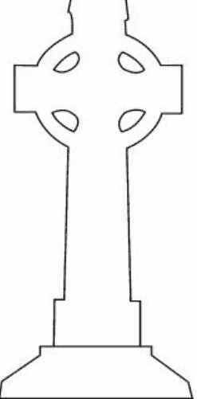
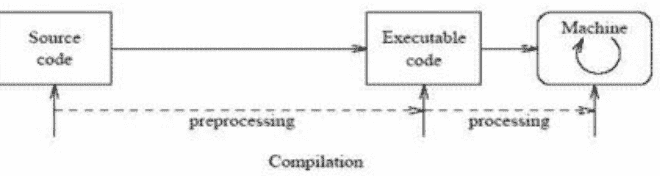
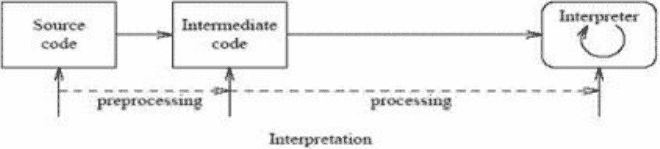
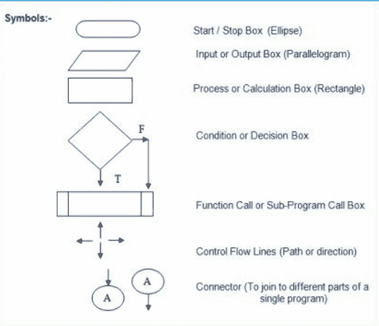
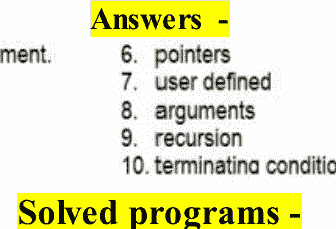
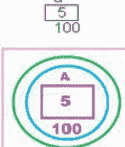
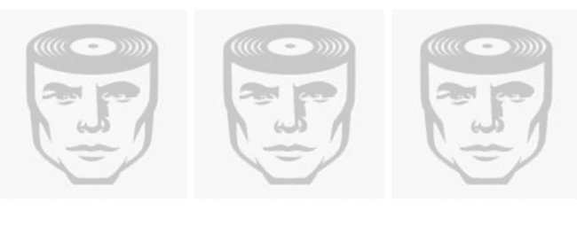
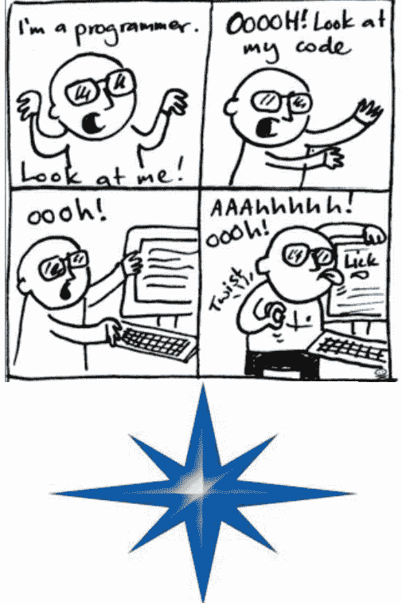
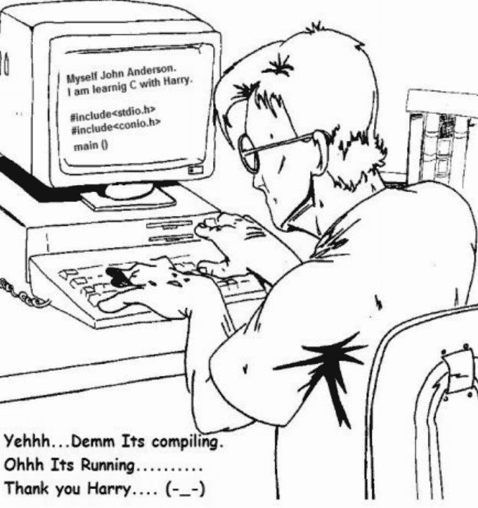

# C 语言循序渐阶初学者指南：权威 C 语言指南


# 献辞

“本书最是是献给所有做出日常牺牲的人们，

特别是那些为了确保我们的自由与安全而做出终极牺牲的人。”



你告诉我，一切都会好起来的，

你还告诉我，如果还没好，那就还没有结束。

“我将穿过 1000 个世界和 10000 世纪寻找你，直到我找到你”


# 关于作者：

**Harry, H. Chaudhary 是一位印度计算机编程专家、畅销的 Java 作者以及科学黑客专业人士，在这一领域拥有独特的经验。** 他曾在匿名国际公司担任 IT 经理。

在这一领域拥有独特的经验，帮助了全球范围内许多公司、政府，专注于 C 语言的编程与安全。他在 C 语言编程和网络安全方面享有声誉，并编写了多本关于 C 语言的畅销书籍。

作者和出版商在编写本书时已尽力，但不作任何形式的明示或暗示保证，并不对错误或遗漏负责（注：此处原文可能有误，应为“不承担”）。对于与使用书中包含的信息或程序有关或由此引起的任何附带或后果损害，不承担责任。

本书表达了作者的观点和意见。书中包含的信息不提供任何明示、法定或暗示保证。作者、出版商或其销售商、分销商均不对本书直接或间接引起或可能造成的任何损害负责（注：此处原文可能有误，应为“不承担”）。

（注：由于原文文本在后半部分出现了重复和逻辑混乱，以下翻译根据原文语意进行了平滑处理，保留了 Markdown 结构）

# 循序渐进入门指南


循序渐进入门指南


# 献辞

“本书最是献给所有做出日常牺牲的人们，

特别是那些为了确保我们的自由与安全而做出终极牺牲的人。”


你告诉我，一切都会好起来的，

你还告诉我，如果还没好，那就还没有结束。

“我将穿过 1000 个世界和 10000 世纪寻找你，直到我找到你”


# 关于作者：

**Harry, H. Chaudhary 是一位印度计算机编程专家、畅销的 Java 作者以及科学黑客专业人士，在这一领域拥有独特的经验。** 他曾在匿名国际公司担任 IT 经理。

在这一领域拥有独特的经验，帮助了全球范围内许多公司、政府，专注于 C 语言的编程与安全。他在 C 语言编程和网络安全方面享有声誉，并编写了多本关于 C 语言的畅销书籍。

知道什么是重要的？


# 章节

∞ 1 ∞

(C语言导论)

## 引言

关于语言层次你需要了解的知识——

编程语言有不同的层次，取决于它们与人类语言的相似程度。使用常用单词且对于大多数人来说易于阅读和学习的编程语言被称为高级语言。与之相反的是低级语言，它们并不易于阅读或学习。

高级语言包括流行的 BASIC 编程语言，以及其他不再流行的语言。BASIC 读起来几乎像英语，它所有的命令和指令都是英语单词——至少是缺少了几个元音或严重违背拼写规则的英语单词。

低级编程语言中最低级的是机器语言。那种语言是微处理器本身最原始的咕噜声和呻鸣。机器语言由微处理器能够理解并执行的数字和代码组成。

因此，没有人真的用机器语言编写程序；相反，他们使用汇编语言，汇编语言比低级机器语言高出一个台，因为那些咕噜声和呻鸣是被拼写出来的，而不是作为原始数字输入的。

既然有了高级语言，为什么还要用低级语言呢？速度！用低级语言编写的程序以计算机能运行的最快速度运行，通常比其高级语言对应的快得多。此外，程序的体积更小。

用 Visual Basic 编写的程序可能可能是 34K，但用汇编语言编写的程序可能只有 896 字节。另一方面，开发汇编语言程序的时间比用更高级语言编写相同程序的时间要长得多。这是一种权衡。

C 编程语言被认为是一种中级语言。它既有低级的咕噜和尖叫部分，也有许多高级部分，读起来就像迈克尔·克莱顿小说中的任何一个句子，但人物描写更丰富。

在 C 中，你既获得了高级编程语言的优点和它们提供的开发速度，也获得了低级语言的紧凑程序尺寸和速度。这就是为什么 C 是伟大的。

注意：我不是在开玩笑。C 语言是 20 世纪 70-72 年初在 AT&T 贝尔实验室开发的。当时，贝尔实验室有一种名为 B（代表 Bell）的编程语言。他们创建的下一种语言是 C —— 就在 B 之后。

- C 是 B 编程语言和一种名为 BCPL（基础组合编程语言）的语言的后。但你必须承认 B 的故事本身已经足够有趣了。

- 你可能会认为 C 的下一个更好的版本应该叫 C 语言。但不是；它的名字是 C++。

- C 被认为是一种中级语言。旁边的侧栏“关于语言层次你不需要了解的内容”是了无聊的细节。

- 在贝尔实验室创建 C 编程语言的家伙是丹尼斯·里奇（Dennis Ritchie）。我提到他是以防你走在街上恰巧遇到里奇先生。那种情况下，你可以说：“嘿，你不是发明 C 语言的丹尼斯·里奇吗？”他会说：“为什么——为什么，是的。”然后你可以说：“酷。”

## C 的历史

C 编程语言也许是最流行的编程语言。C 是由丹尼斯·里奇于 1972 年在美国贝尔实验室创建的，作为 UNIX 操作系统的一部分。C 也被用于开发该操作系统的某些部分。20 世纪 60 年代在剑桥大学开发了名为基础组合编程语言（BCPL）的 B 语言。

它并不是一个完全满意的语言。“B”语言经过丹尼斯·里奇的修改，并在 1972 年在贝尔实验室实现。C 通常由大多数编译器支持。C 是由丹尼斯·里奇在 1972 年开发的。

你使用文本编辑器来创建源代码文件。关于文本编辑器的更多信息，请参见附录 A。

## 创建 Goodbye Harry.C 源代码文件：

使用你的文本编辑器创建以下源代码。仔细按照编写的内容准确输入每一行；你在下方看到的所有内容都是重要且必要的。不要漏掉任何内容——

```c
#include <stdio.h>
int main()
{
    printf("Goodbye Harry, cruel world!\n");
    return(0);
}
```

在你检查已输入的内容时，注意其中有多少内容对你是熟悉的。你识别出了一些单词（`include`、`main`、`"Goodbye Harry, cruel world!"` 和 `return`），而有些单词对你来说很奇怪（`stdio.h`、`printf` 和 `thing`）。

当你完成指令的编写后，将它们保存到磁盘上的一个文件中。将文件命名为 `GOODBYEHARRY.C`。使用文本编辑器中的命令保存此文件，然后返回命令行提示符，将你的指令编译成程序。

## 你需要记住的东西

- 在 Windows 记事本中，你必须确保文件以 `.C` 结尾而不是 `.TXT`。找一本关于 Windows 的书，查看如何显示文件名扩展名的说明，以便以 `.C` 扩展名保存文件到磁盘。

- 注意，文本大部分是小写的。它必须如此；编程语言不仅对大小写敏感——它们对大小写非常挑剔。当英语语法或标点符号规则变得疯狂时不要担心；C 是一种计算机语言，而不是英语。

- 同样注意程序如何使用各种括号：尖括号 `<` 和 `>`；大括号 `{` 和 `}`；以及圆括号 `(` 和 `)`。

## 保存它！编译并链接它！运行它！

在 C 中构建任何程序都需要四个步骤。这些步骤是**保存、编译、链接和运行**。大多数 C 语言程序包会自动执行链接步骤。

无论是否是手动完成，它仍然在那里。保存！保存意味着保存你的源代码。你在文本编辑器中创建该源代码，并将其保存为带有 C（单字母字母 C）扩展名的文本文件。

编译并链接！编译是将文本文件中的指令转换为计算机微处理器可以理解的指令的过程。链接步骤是指令最终转换为程序文件的地方。（再次，你的编译器可能会自动执行这一步。）

运行！最后，你运行你创建的程序。是的，它是一个合法的程序，就像硬盘上的任何程序一样。你已经完成了本章中的所有步骤，最终创建了 `GOODBYEHARRY` 程序。这就是 C 程序的构建方式。

在这个阶段，最困难的部分是知道在源文件中放入什么，随着你深入阅读这本书，这会变得更容易。（但到那时，让你的程序正确运行且没有错误是最困难的部分！）

你会在书中经常找到保存、编译和运行的指令。这是因为这些步骤在某种种程度上是机械的。更重要的是理解语言是如何工作的。这就是你将在下一章中开始发现的。

## C 语言历史

如前所述，C 语言是由系统程序员 Dennis Ritchie 在 1970-72 年间在美国新泽西州的美国电报电话公司 (AT & T) 贝尔实验室开发的。它最初是为了在 UNIX 操作系统下编程而编写。

C 语言是由 BCPL（基础组合编程语言-B）发展而来的，经过改进并重命名为 B。B 是 20 世纪 60 年代在剑大学开发的。

C 实际上是一种符号指令代码，一组在计算机上执行操作的命令。C 语言通常被称为中间级语言，因为我们可以通过 C 编写高层和低层程序。

C 之前的语言有 FORTRAN（公式翻译）、COBOL（通用面向业务语言）、BASIC（初学者通用符号指令代码）和 Pascal。C 之后的语言有 C++、Java、C# 等，允许与计算机内部工作进行非常紧密的交互。

## 什么是 C？

C 是一种用于编写程序的编程语言。程序是程序员用高级语言给计算机提供的指令集。C 使用编译器在执行任何指令之前将高级程序翻译成机器码。编译器本身也是一个计算机程序。其他的翻译器是解释器（Interpreter）和汇编器（Assembler）。

原始高级程序称为源程序(C)，生成的机器语言程序称为对象程序(obj)。“它命名为 C 是因为它的特性源于更早的称为 B 的语言，根据 Ken Thompson 的说法，它是 BCPL 编程语言的精简版本”

## 汇编器对比编译器

通常情况下，编译器是一个读取一种语言（称为源语言）的计算机程序，并将其翻译成另一种语言（称为目标语言）。传统上，源语言是如 C++ 等高级语言，目标语言是汇编语言等低级语言。

然而，有些编译器可以将用汇编语言编写的源程序转换为机器码或对象代码。汇编器就是此类工具。因此，汇编器和编译器最终都会产生可以直接在机器上执行的代码。

## 什么是编译器？

编译器是一个读取一种语言（称为源语言）的计算机程序，并将其翻译成另一种语言（称为目标语言）。在大多数情况下，源语言是高级语言，目标语言是低级语言。因此，通常编译器可以被看作是从一种语言翻译到另一种语言的翻译器。此外，编译器会对代码进行某些优化。

一个典型的编译器由几个主要组件组成。第一个组件是扫描器（也称为词法分析器）。扫描器读取程序并将其转换为字符串。第二个组件是解析器。它将字符串转换为解析树（或抽象语法树），解析器捕获了程序的句法结构。下一个组件是语义分析，用于解释程序的语义。随后是代码优化和最终代码生成。

**什么是汇编器？**

汇编器是一种软件或工具，将汇编语言翻译成机器码。汇编器可以被视为编译器的特殊类型，它翻译汇编语言。由于汇编语言与机器码之间存在一一映射关系，汇编器在执行时非常高效。汇编器提供了支持程序开发和调试的附加功能。例如，宏汇编器提供了宏功能。

## 汇编器与编译器的区别是什么？

编译器是读取一种语言（源语言）并翻译成另一种语言的计算机程序，而汇编器可以被认为是翻译汇编语言的编译器。编译器通常直接从高级语言生成可执行代码。汇编器产生的对象代码可能需要通过链接器程序在机器上运行。汇编器适用于性能非常重要的场合（例如资源有限的嵌入式系统，如微波炉、洗衣机等）。

| | 汇编器 | 编译器 |
|---|---|---|
| 1. | 它将 PR、ADD 和 SUB 等符号代码翻译成机器码。 | 它将高级语言翻译成汇编语言。 |
| 2. | 使用汇编器执行程序运行更快，因为它直接将源代码转换为机器码。 | 执行程序需要时间，因为它首先将源代码翻译成另一种编译器的语言，然后使用汇编器将其转换为机器码。 |

## 编译器与解释器的区别

解释器类似于逐句翻译，而编译器类似于整篇文章的翻译。

| 1. | 编译器在执行之前一次性将整个高级语言程序翻译成机器语言程序。这优化了翻译程序中机器指令的使用。因此通常编译程序的运行速度比解释程序快。原始高级程序称为源程序。编译器翻译后生成的机器语言程序称为对象程序。 | 解释器在执行程序时按指令将高级语言程序翻译成机器语言。也就是说，它读取程序中的第一条指令并将其转换为等效机器指令。然后 CPU 观察这些机器指令。之后，解释器读取并翻译下一条指令，依此类推。 |
| 2. | 编译器将整个程序作为输入。 | 解释器将单个指令作为输入。 |
| 3. | 对象代码永久保存以后使用。 | 不保存对象代码以后使用。 |
| 4. | 非耗时翻译方法 | 耗时翻译方法 |
| 5. | 它在解释器中需要大量空间 | 解释器易于编写且需要较大的内存空间。 |
| 6. | 编译器的速度很快。 | 速度非常慢。 |
| 7. | 编译后源程序的任何更改都需要重新编译整个代码。 | 翻译过程中源程序的任何更改都不需要重新翻译整个代码。 |
| 8. | 生成中间目标代码。 | 不生成中间目标代码。 |
| 9. | 条件控制语句更快。 | 条件控制语句执行较慢。 |
| 10. | 内存需求：更多（因为生成了目标代码）。 | 内存需求较少。 |
| 11. | 程序不需要每次编译。 | 每次都将高级程序转换为低级程序。 |
| 12. | 在检查整个程序后显示错误。 | 每解释每条指令时都会显示错误（如果有）。 |
| 13. | 示例：C 编译器。 | 示例：BASIC。 |

## 解释：编译器 VS 解释器

只需理解编译器和解释器的概念即可——

- 1. 我们将完整的程序作为输入给编译器。我们的程序是人类可读的格式。

- 2. 人类可读格式经过编译器的许多遍和阶段，最终转换为机器可读的格式。

- 3. 然而，解释器一次接受一行代码作为输入并执行该行。一旦发现错误，它将停止代码执行。

- 4. 解释器的内存需求较少，因为在解释器的情况下不会创建目标代码。

学习笔记 – 大多数学生真的不知道编译器和解释器之间的区别。学习一种新语言并不容易。你可能会认为问题出在大脑上。这就是为什么我尝试用多种形式解释差异。

编译器和解释器实现相同的目的——将高级语言（如 C、Java）指令转换为计算机硬件可以理解的二进制形式。

它们是用于执行各种高级程序和代码以完成各种任务的软件。特定的编译器/解释器是为不同的高级语言设计的。

然而，编译器和解释器具有相同的目标，但它们完成任务的方式不同，即将高级语言转换为机器语言。请仔细查看下文-

## 编译器

编译器是一段将高级语言翻译成机器语言的代码。当用户用 Java 等高级语言编写代码并想要执行它时，会专门为 Java 设计一个编译器，它首先扫描整个程序，然后将其翻译成机器代码，计算机处理器将执行它并完成相应的任务。



图中显示了编译过程的基本概述，这里用高级语言编写的程序称为源程序，转换后的程序称为目标程序。

## 解释器

解释器与编译器没有太大区别。它们也将高级语言转换为机器可读的二进制等效物。每当当解释器获取要执行的高级语言代码时，它会在转换为机器代码之前先将其转换为中间代码。代码的每个部分都被解释，然后按顺序单独执行，如果在代码某部分发现错误，它将停止代码的解释，而不翻译下一组代码。



## C 语言的优点

- 1. C 是一种通用编程语言。你可以生成游戏、商业软件、实用程序、数学模型、文字处理器、电子表格和其他各种软件。

- 2. C 是一种结构化编程语言。它使用结构化语句（如 `while`、`for` 循环）代替会导致程序出现 Bug（错误）的 `goto` 语句。

- 3. 系统独立性- C 不需要操作系统的任何服务，独立运行。C 可以运行在任何操作系统上。

- 4. 高效性- C 编译器通常能够将源代码转换为高效的机器指令。C 语言的数据和控制机制与大多数小型计算机和微型计算机非常匹配。

- 5. 系统编程- C 用于系统编程，即编写操作系统。UNIX 操作系统也是用 C 语言重写的。

## 语法与语义的区别

| 语义 | 语法 |
|---|---|
| 它是程序的逻辑或规划。语义可以用以下任何方式编写： | 它是以特定编程语言中编写程序的方法。语法随语言而变化。 |

- 1. 流程图。

- 2. 算法。

- 3. 伪代码。

## 流程图

它是程序逻辑的符号表示。逻辑中使用一些预定义的符号。流程图显示了程序逻辑的实际流程。

流程图只不过解决问题所涉及的各种步骤的图表表示。流程图指示了过程流的方向、相关的操作和计算、决策点以及解决方案部分的其他信息。一旦开发并经过适当检查，流程图为编写程序提供了极好的指南。



## 算法

一旦问题被正确定义，就必须开发一个详细的、有限的、分步的程序来解决它。这个程序被称为算法。算法可以用普通语言编写。算法可以使用数字：

- 1. 读取 A,B。

- 2. 设置 SUM := B。

- 3. 输出 SUM。

- 4. 退出。

## 伪代码


有时，有必要使用语言形式来表示算法。伪代码是代码的英语近似，遵循代码规则和格式。

```c
main()
{
integer a,sum;
}
```

## C 程序的结构（源代码）

让我们讨论 C 程序的结构，例如：

```c
#include<stdio.h>
#include<conio.h>
main() {
    int a,b;
    clrscr();
    printf("enter two numbers");
    scanf("%d %d",&a,&b);
    sum=a+b;
    printf("sum=%d",sum);
    getch();
}
```

> `/* printf() & scanf() */`

`/* 对于 clrscr() & get() */`

`/* 程序执行的起点 */`

`/* 变量声明 */`

`/* 清屏 */`

`/* 请求输入 */`

`/* 来自用户的输入 */`

## 解释：头文件的故事

头文件包含函数和变量的定义，可以通过 `#include` 语句整合到任何 C 程序中。标准头文件随编译器提供，涵盖字符串处理、数学、数据转换、打印和读取。

要使用任何标准函数，应包含相应的头文件。这是在源文件的开头完成的。例如，为了使用 `printf()` 函数，行--

```c
#include <stdio.h>
```

应该在源文件的开头，因为 `printf()` 的定义位于 `stdio.h` 文件中。所有头文件的扩展名均为 `.h` 且通常位于 `/include` 子目录下。

```c
#include <stdio.h>
#include "mydecls.h"
```

使用角括号 `<>` 通知编译器在编译器的包含目录搜索指定的文件。在文件名周围使用双引号 `""` 通知编译器在当前目录搜索指定的文件。

## 键盘输入

C 中有一个函数允许程序员从键盘接受输入。以下程序说明了该函数的使用：

```c
#include <stdio.h>

/* 键盘输入的程序 */
main() {
    int number;
    printf("Type in a number \n");
    scanf("%d", &number);
    printf("The number you typed was %d\n", number);
}
```

定义了一个名为 `number` 的整数。然后使用语句打印出输入数字的提示：

```c
printf("Type in a number \n");
```

接受响应的 `scanf` 例程有两个参数。第一个 `"%d"` 指定了预期的数据类型（即 `char`、`int` 或 `float`）。第二个参数 `&number` 指定了将响应放入的变量。在这种情况下，响应将被放入与变量 `number` 相关的内存位置中。这解释了 `&` 字符的特殊意义（它表示地址）。

`#include` 指令指示 C 预处理器找到 `stdio.h` 文本文件。该名称本身的意思是“标准输入输出”，而 `h` 表示它是一个头文件，而不是 C 源文件（源文件以 `c` 后缀结尾）。它是一个文本文件，可以使用任何文本编辑器查看。

## 注释

注释放置在 `/*` 和 `*/` 字符序列之间，可以跨越任意行。

## Main

`main` 函数是最重要的。它定义了程序开始执行的点。如果你不写 `main` 函数，你的程序将无法运行（它将没有起点）。事实上，它甚至无法通过编译。

## 大括号

C 使用大括号字符 `{` 表示“开始”，`}` 表示“结束”。它们输入起来容易得多，而且过了一段时间，阅读起来也容易得多。

## Printf()

`printf` 函数是输出的标准方式。该函数定义在标准库中，因此它将始终存在并以相同的方式工作。此示例展示了 `printf` 和 `scanf` 共享相同的格式说明符。

当遇到 `%i` 时，两者都处理整数。`scanf` 因为是一个读取函数，所以从键盘读取整数。`printf` 因为是一个写入函数，所以将整数写入屏幕。表达式注意：请注意 C 非常乐意计算 `a-b` 并将其作为整数值打印出来。创建另一个变量 `c` 并赋值是可能的，但没有必要。

`printf` 函数将输出写入屏幕。当它遇到格式说明符 `%i` 时，会输出一个整数。

## Scanf

`scanf` 函数是 `printf` 的“相反操作”。`printf` 在屏幕上产生输出，而 `scanf` 从键盘读取。序列 `%i` 指示 `scanf` 从键盘读取一个整数。因为使用了两次 `%i`，将读取两个整数。第一个输入到变量 `a` 中的值，第二个输入到变量 `b` 中。`scanf` 函数从键盘读取输入。当它遇到格式说明符 `%i` 时，程序等待用户输入一个整数。

`%i %i` 中两个 `%i` 之间的空格是重要的：它指示 `scanf` 在键盘上输入的两个数字可能被空格隔开。如果使用 `%i,%i`，则用户将被迫在两个数字之间输入一个逗号。

## \n

两个字符 `\` 后面跟 `n` 的序列是 C 处理换行的方式。打印时，它会使光标移动到下一行的开头。

## Return

`return` 调用将值（此处为 0）传回给操作系统。操作系统如何处理此信息取决于它。例如，MS-DOS 将其存储在 `ERRORLEVEL` 变量中。UNIX 的 Bourne 和 Korn 壳（shell）将其存储在一个临时变量 `?` 中，该变量可以在 shell 脚本中使用。“传统”认为 0 表示成功。

值 1, 2, 3 等表示失败。所有操作系统都支持高达 255 的值。某些系统支持高达 65535 的值，尽管如果你对可移植性有要求，应该只使用 0 到 255 之间的值。

## &

`&` 在 `scanf` 中非常重要。它允许改变变量，这称为取地址（Ampersand）。因此在--

```c
scanf("%i", &j)
```

`&` 允许变量 `j` 发生改变。如果没有这个神秘的字符，C 会阻止 `scanf` 修改 `j`，它将保留先前的随机值（除非你记得初始化了它）。由于 `printf` 不需要更改它打印的任何变量的值，因此它不需要任何 `&` 符号。因此在执行该语句后：`j` 包含 15：

```c
printf("%i", j);
```

我们会有信心地预期变量中是 15，因为 `printf` 无法修改它。

## C 的格式

- 语句以分号结束。
- 缩进被编译器忽略。
- C 是大小写敏感的 —— 标准。
- 库函数全小写。
- 字符串放在双引号中。
- 换行通过 `\n` 处理。
- 程序标记成功或错误，忘记标记的随机选择！

## 分号

分号在 C 中非常重要。它们构成终止符，告诉编译器哪里结束，何处开始。

## 自由格式

C 是自由格式。缩进是可选的，但用于提高程序的可读性。

## 大小写敏感

C 对大小写敏感。关键字全小写。

## 随机行为

值 1, 2, 3 等表示失败。所有操作系统都支持高达 255 的值。

## 积极操作

上述内容的特征：

1. 注释不是必须。
2. 程序的第一行被调用。
3. 任何地方都可以编写任意数量的注释。
4. 程序的第二和第三行被调用。
5. 每个 C 程序由一个或多个模块组成。
6. 变量声明紧跟在程序的大括号之后。
7. 注意 `main` 函数中的每个语句都以分号结束。
8. 下一个是 `printf()` 语句。
9. 通过下一个语句输入计算机的值。
10. 下一个是赋值语句。
11. 最后一个 `printf()` 用于在屏幕上显示计算出的和。
12. 最后 `getch()` 函数用于显示输出屏幕。
13. `main()` 内部的所有语句都略微领先于 `main()`。这表明所有语句都在 `main()` 函数内部。

## 选择题

| 1. C 是一种： | 4. 流程图用于 |
| --- | --- |
| a. 高级语言。 | a. 决定涉及步骤的顺序寻找解决方案。 |
| b. 低级语言。 | b. 辅助制作算法。 |
| c. 中级语言。 | c. 准备决策表。 |
| d. 汇编级语言。 | d. 调试程序。 |
| 2. 程序的逻辑被称为： | 5. C 程序通过以下工具转换为机器语言： |
| a. 语法。 | a. 编辑器 (Editor)。 |
| b. 语义。 | b. 编译器 (Compiler)。 |
| c. 流程图。 | c. 操作系统。 |
| d. 调试。 | d. 以上均不是。 |
| 3. C 语言是由谁开发的： | 6. C 可用于： |
| a. Ken Thompson | a. 仅 MS-DOS 操作系统。 |
| b. Dennis Ritchie | b. 仅 Linux 操作系统。 |
| c. Patrick Naughton | c. 仅 Windows 操作系统。 |
| d. Ed Frank. | d. 以上所有。 |

| 1(c) | 2(b) | 3(b) | 4(a) |
| --- | --- | --- | --- |
| | 5(b) | 6(d) | |


## 理论题

1. 解释 C 语言的历史发展
   - C 语言是什么时候开发的？
   - 谁开发的 C 语言？
   - C 语言是在哪里开发的？
   - C 是高级、中级还是低级语言？
   - 它可以在什么操作系统上运行？
2. C 程序的主要组件有哪些？`main` 这个名字具有什么意义？
3. 什么是注释？注释可以放在什么位置？
4. C 程序要求用小写输入吗？C 程序中的任何地方都可以使用大写。请解释。
5. 使用什么符号结束一条 C 语句？所有语句都以这种方式结束吗？
6. 为什么 C 程序中的语句要缩进？
7. 什么是流程图？画出流程图中使用的各种符号。

## 实验练习

1. 编写一个程序 (WAP)，从键盘输入两个数字并打印它们的和。
2. 编写一个程序 (WAP)，从键盘输入两个数字并打印它们的平均值。
3. 编写一个程序计算圆的面积。
4. 编写一个程序打印给定时间内的总秒数（时、分、秒）。
5. 编写一个程序将温度从华氏度转换为摄氏度。`C=(F-32) * 5/9`
6. 编写一个程序交换 (interchange)两个数字。
7. 编写一个程序在不使用第三方变量的情况下交换 (interchange)两个数字。
8. 编写一个程序交换 (interchange)三个数字。
9. 编写一个程序在不使用第四个变量的情况下交换三个数字。
10. 编写一个程序在不使用 `%` 运算符的情况下计算两个数字的余数。

## 填空

1. ______ 是 C 语言的创建者。它在 ______ 的 ______ 年开发。
2. ________ 操作系统是用 C 开发的。
3. ________ 可以是 C 的祖先。
4. C 语言使用 ________ 翻译成机器码。
5. C 可以与 ________ 和 ________ 操作系统一起使用。


# 章节

# (C 语言元素)

## C 标记 (Tokens)

标记是被称为标记的最小独立单元。C 识别六种标记。C 程序是使用这些标记和语言语法编写的。以下是 C 标记：

- 关键字 (Keywords)。
- 标识符 (Identifiers)。
- 字面量 (Literals)。
- 运算符 (Operators)。
- 分隔符 (Separators)。

### 1. 关键字

关键字是保留字，其含义已经向 C 编译器解释过了。这些词在语言本身中定义。C 语言中有 32 个关键字。

| auto | int | struct | break |
| --- | --- | --- | --- |
| else | long | switch | case |
| enum | register | typedef | char |
| extern | return | union | const |
| float | short | unsigned | continue |
| for | signed | void | default |
| goto | static | sizeof | volatile |
| do | while | if | -- |

### 2. 标识符

标识符是赋给变量的名字。使用此标识符我们可以访问该变量。C 程序中的所有其他名称（如数组名或函数名）也称为标识符。

## 变量

在程序执行过程中可能变化的实体被称为变量。或者你可以说变量是内存中一个用于存储在程序执行过程中变化的特定类型的地方。变量名被赋给内存中的位置。这些位置可以包含整数、实数或字符常量。程序中使用的所有变量应该在顶部按照它们各自的数据类型进行声明。变量声明告诉两件事：

1. 它告诉编译器关于变量。
2. 它还告诉变量将持有的值类型。

例如：

```c
int a;
float b;
char c;
```

变量名由字母、数字和下划线 (`_`) 组成，遵循以下规则：

1. 必须以字母开头。
2. 大写和小写是有区别的。
3. 变量名不应该是关键字。

*(注：原文后续部分存在大量重复段落，已根据要求进行去重处理并完成翻译)*

数字前由 `0x` 或 `0X` 引导。

例如：`0X2`, `0x9f`, `0xbcd`。

## B) 浮点型或实数常量

整数常量不足以表示所有数量，如价格、距离、温度等。这些数字带有小数点（`.`），即具有小数部分，如 `65.987`、`0.000569`、`89.36`。

浮点数也可以用指数计数法或科学计数法表示，例如 `0.000123` 可以写成 `1.23*10⁻⁵` 或 `1.23e-05`。因此，通用形式为：

- 尾数和指数

所以 `1.23` 被称为尾数，`-05` 被称为指数。

## C) 字符常量

### i) 单字符常量

单个大写字母（`A` 到 `Z`）或小写字母（`a` 到 `z`）或数字（`0` 到 `9`）或一个特殊符号（`@`, `#`, `$`, `%`, `*`, `&`, `+`, `-`, `.`, `:`, `;`, `/`, `\` 等），并被单引号（`''`）包围。

例如：`'a'` 或 `'A'` 或 `'7'` 都是字符常量。

注意：所有的转义序列也被视为字符。

### ii) 字符串常量

字符串常量是用双引号（`""`）包围的单个字符或一组字符。

如：`"hello"`, `"4598"`, `"hello235"`, `"5+3"`。

注意 - 字符 `'7'` 不等于数字 `7`。每个字符常量都有一个等值的整数。

`A` 到 `Z` 的 ASCII 为 65 到 90。即 `A` 的 ASCII 是 65，`B` 的 ASCII 是 66，依此类推。

- `a` 到 `z` 的 ASCII 为 97 到 122。
- `0` 到 `9` 的 ASCII 为 48 到 57。
- （空格）的 ASCII 是 32。
- ☺（微笑空格）的 ASCII 是 1。

## 数据类型

C 语言拥有丰富的数据类型。有 4 类数据类型：

1. 基本数据类型 (`int`, `float`, `char`)
2. 用户定义数据类型 (`enumerator`, `typedef`)
3. 派生数据类型 (`array`, `function`, `pointers`, `structure`, `union`)
4. 空数据集 (`void`)

## 基本数据类型

| 整数 | 实数 | 字符 |
| --- | --- | --- |
| `int` 或 `short` 或 `short int` 占用 2 字节，范围：-32768 到 +32767 | `float` 占用 4 字节，范围：3.4e-38 到 3.4e+38 | `char` 占用 1 字节，范围：-128 到 +127 |
| `long int` 或 `long` 占用 4 字节，范围：-2,147,483,648 到 +2,147,483,647 | `double` 占用 8 字节，范围：1.7e-308 到 1.7e+308 | |
| | `long double` 占用 10 字节，范围：3.4e-4932 到 1.1e+4932 | |

## 计算范围的公式

`2ⁿ⁻¹`

其中 `n` 是数据类型所占的位数。

`int` 的范围：

`int` 占用 2 字节，即 16 位（因为 1 字节等于 8 位）。

所以，`2¹⁶⁻¹ = 2¹⁵ = 32768`。

因此范围变为：-32768 到 +32767。

注意 - 此公式无法计算实数数据类型（`float`, `double`, `long double`）的范围。

## 用于基本数据类型的修饰符

有符号（`signed`）、无符号（`unsigned`）和短整（`short`）可以应用于字符和整数基本数据类型。修饰符 `long` 也可以应用于 `double`。

## 有符号和无符号

`int` 或有符号 `int` 的范围是 -32768 到 +32767，占用 2 字节，但有时程序只需要正值，而这些值可能会超过 `int` 的范围。

在这种情况下，可以通过在正范围上加上负范围来将数据类型变为无符号的。因此，`unsigned int` 的范围变为：

0 到 65535

`unsigned int` 占用 2 字节。因此我们可以说无符号数据类型使用的字节数与有符号数据类型相同。

注意：实数数据类型不能变为无符号的。

## 格式指定符

`printf` 和 `scanf` 有许多格式指定符。这里是基础的：

- `%d` 以十进制打印一个 `int` 参数。
- `%i` 以十进制、十六进制或八进制打印一个 `int` 参数。
- `%h` 以十进制打印一个 `short int` 参数。
- `%ld` 以十进制打印一个 `long int` 参数。
- `%u` 打印一个 `unsigned int` 参数。
- `%lu` 打印一个 `unsigned long int` 参数。
- `%f` 打印一个 `float` 参数。


# 格式化说明符

- `%lf` 打印一个 `double` 参数。
- `%Lf` 打印一个 `long double` 参数。
- `%e` 指数法。
- `%g` 浮点或指数法。
- `%o` 以八进制（底数为 8）打印一个 `int` 参数。
- `%x` 以十六进制（底数为 16）打印一个 `int` 参数。
- `%X` 以大写十六进制（底数为 16）打印一个 `int` 参数。
- `%c` 打印一个字符。
- `%s` 打印一个字符串。

## 转义序列

某些不可打印字符，其转义序列如下：

| 转义序列 | 说明 |
|---|---|
| `\a` | 响铃 |
| `\b` | 退格 |
| `\f` | 换页 |
| `\n` | 换行 |
| `\r` | 回车 |
| `\t` | 水平制表 |
| `\v` | 垂直制表 |
| `\\` | 反斜杠 |
| `\"` | 双引号 |
| `\'` | 单引号 |
| `\0` | 空字符 |

## 后置与前置

| 后置 | 前置 |
| --- | --- |
| `int a=5,b;` | `int a=5,b;` |
| `b=a++;` | `b=++a;` |
| `printf("%d, %d",a,b);` | `printf("%d, %d",a,b);` |
| **输出：6, 5** | **输出：6, 6** |
| `int i=3;` | `int i=2;` |
| `i++;` | `printf("%d %d",++i,i);` |
| `printf("%d",i);` | 1. 3 4 |
| | 2. 4 3 |
| | 3. 4 4 |
| | 4. 输出可能因编译器而异 |
| **输出：4** | 编译器与编译器之间可能不同。 |
| | **输出：b** |

## 3. 关系运算符

`<`, `>`, `<=`, `>=` 这些运算符是布尔运算符（那些给出 1 或 0 答案的运算符。这里 1 为真，0 为假）。

| `int x=10,a,b;` | `int x=10,y=20,z=5;` |
| --- | --- |
| `a=x>2;` | `i=x<y<z;` |
| `b=x<2;` | `printf("%d",i);` |
| `printf("%d, %d",a,b);` | 1. 1 |
| | 2. 0 |
| | 3. 错误 |
| | 4. 以上均不是 |
| **输出：1, 0** | **输出：a** |

## 4. 赋值运算符

`=`, `+=`, `-=`, `*=`, `/=`, `%=` 这些运算符用于给变量赋值。

```
a=5;           /*给变量 a 赋值 5*/
a=5+2;         /*合法*/
a=b;           /*合法*/
5=a;           /*非法*/
a+b=5;         /*非法*/
```

赋值的其他运算符用于对变量进行算术运算，且 `=5;` 将值赋值给同一个变量：

- `a+=5;` 等同于 `a=a+5`
- `a-=5;` 等同于 `a=a-5`
- `a*=5;` 等同于 `a=a*5`
- `a/=5;` 等同于 `a=a/5`
- `a%=5;` 等同于 `a=a%5`

## 5. 等于运算符 - `==`, `!=`

这些运算符用于检查给定表达式的左侧和右侧是否相等。该运算符也是布尔运算符，它也给出 0 或 1 的答案。

```
int a,b,c=5;
a=5;
b!=2;
printf("%d, %d",a,b);
```

## 输出：1, 0

## 6. 逻辑运算符 - `&&`, `||`, `!`

这些运算符也是布尔运算符。`&&` 和 `||` 运算符用于两个表达式。这些表达式通常包含关系运算符或等于运算符。

| 表达式 | `&&` | `\|\|` |
|---|---|---|
| 0 0 | 0 | 0 |
| 1 0 | 0 | 1 |
| 0 1 | 0 | 1 |
| 1 1 | 1 | 1 |

NOT 运算符用于反转表达式：

| 表达式 | `!` |
|---|---|
| 0 | 1 |
| 1 | 0 |

```
int a=10,b=5,c,d;
c=a>3 && b!=33;
d= (a =10 || b>20);
printf("%d, %d",c,d);
```

Output：1, 1

### 使用短路运算符：

```
int a=5,b=4,c;
c= (b ==3 && a++);
printf("%d, %d, %d",a,b,c);
```

Output：5, 4, 0

现在让我们尝试理解这个输出，在表达式中有四种类型的运算符，`b==3` 包含等于运算符。`a++` 是一个一元运算符。这两个表达式通过逻辑与（AND）连接在一起。最后值赋值给变量 `c`。

在这个表达式中，`b ==3` 是一个假表达式，这会给出 0。下一个运算符是逻辑与，该运算符作用于两个不同的表达式（与只有当两个表达式都为真时才会给出答案 1），第一个是 `b == 3`，第二个是 `a++`。由于 AND 的第一个表达式是假的，所以它不会评估下一个表达式，以加快程序的执行速度。

```
int i=3,j=2,k=0,m;
m=++i && ++j || k;
printf("%d %d %d %d",i,j,k,m);
```

Output：2 3 0 1

```
int i=3,j=2,k=0,m;
m=++j && ++i || k;
printf("%d %d %d %d",i,j,k,m);
```

Output：2 3 0 1

```
int i=3,j=2,k=0,m;
m=++i || ++j && ++k;
printf("%d %d %d %d",i,j,k,m);
```

Output：2 2 0 1

```
int i=3,j=2,k=0,m;
m=++i && ++j && ++k;
printf("%d %d %d",i,j,k,m);
```

## 7. 条件运算符

这是唯一的三元运算符。它作用于三个操作数。让我们先理解该运算符的语法：

`条件 ? 真语句 : 假语句`

上面的表达式表示条件为真返回非零值，否则返回假。

考虑以下情况：

| 1. `int x=2,y; x>5 ? 3 : 4;` | 4. `int a=10,b; a>=5?b=100; printf("%d",b);` Output：lvalue error |
|---|---|
| 2. `int a=5,b=4,c; a>b?a:b;` | 5. 使用条件运算符重写以下语句：`int i=3,j=2,k=0,m; m=++i && ++j && ++k; printf("%d %d %d",i,j,k,m);` |
| 3. 两个语句相同吗：`a<=20?b=30; a<=20?b=30;` | 条件运算符的限制是 `?` 后面只允许一个语句。可以通过括号包含语句来克服 lvalue 错误。`a>b? (b=100): (b=200);` |

## 8. 位运算符

有些程序需要作用于位（0 和 1）。因此，C 包含了几个允许作用于位的运算符。位运算符通常分为三类：

1. 按位取反运算符 (`~`)
2. 位逻辑运算符 (`&`, `|`, `^`)
3. 移位运算符 (`<<`, `>>`)

### 取反运算符

也称为取反运算符。它是一个一元运算符，反转操作数的位，即所有的 0 变成 1，所有的 1 变成 0。运算符的操作数必须是整数值（`int`, `short int`, `long int`, `unsigned`）。

```
unsigned int a= 5, b;
b = ~a;
printf("%u",b);
```

Output：将是 65530。让我们评估输出：数字 5 的二进制等效值为 0000 0000 0000 0101。正如已经所说的，取反会将所有的 1 变成 0，所有的 0 变成 1，所以取反的结果是 1111 1111 1111 1010，将该数字转换为十进制将得到答案。

## 9. 逻辑位运算符

有三个逻辑位运算符：位与 (`&`)、位或 (`|`)、位异或 (`^`)。这些运算符中的每一个都需要两个整数值来工作。每个操作数都被单独转换为各自的二进制数。二进制数的左侧位称为最高位 (MSB)，而右侧位称为最低位 (LSB)。

| 操作数 1 | 操作数 2 | `&` | `\|` | `^` |
|---|---|---|---|---|
| 0 | 0 | 0 | 0 | 0 |
| 0 | 1 | 0 | 1 | 1 |
| 1 | 0 | 0 | 1 | 1 |
| 1 | 1 | 1 | 1 | 0 |

上面的表解释了所有逻辑位运算符的工作原理。

### 移位运算符

两个位移位运算符是左移 (`<<`) 和右移 (`>>`)。这些运算符中的每一个都需要两个操作数。第一个操作数表示要移动的模式。第二个操作数表示移动的位数。

```
int a,b;
a=20<<2;
b=20>>2;
printf("%d, %d",a,b);
```

Output：80, 5

## 10. 逗号运算符

`,` 运算符从左到右工作但返回右侧的值。该运算符通常用于 `for` 循环。由逗号运算符分隔的表达式从左到右求解。使用逗号运算符返回右操作数的值和类型。例如，在下面的赋值语句中：

```
i = (j = 1, k = 2, 3, 4);
```

首先求值表达式 `j = 1, k = 2, 3, 4`。然后表达式的值作为 4 返回并赋值给 `i`。

| 1. `int a;` | 2. `int a;` |
|---|---|
| `a = 5,6;` | `a = (5,6);` |
| `printf("%d",a);` | `printf("%d",a);` |
| Output：5 | Output：6 |

## 一些已程序

1. 如果通过键盘输入四位数，编写一个程序获取该数字的第一位和最后一位数字之和。

```
int n,a,b,sum;
printf("输入一个四位数: ");
scanf("%d",&n);
a=n/1000;
b=n%10;
sum = a + b;
printf("第一位和最后一位数字的和为 %d", sum);
getch();
```

2. 打印数字的范围。例如数字 78 在 70 到 79 之间，102 在 100 到 109 之间。

```
int n,lower_r,upper_r;
printf("输入一个数字: ");
scanf("%d",&n);
lower_r = n%10 * 10;
/*算术运算符从左到右工作*/
upper_r = lower_r + 10;
printf("范围是 %d - %d", lower_r,upper_r);
getch();
```

3. 打印给定卢比的各种面额。例如，如果一个人口袋里有 1779 卢比，程序应该打印以下内容：

500 x 3 = 1500, 100 x 2 = 200, 50 x 1 = 50, 20 x 1 = 20, 10 x 0 = 0, 5 x 1 = 5, 2 x 2 = 4, 1 x 0 = 0

```c
int Rs,a,b,c,d,e,f,g,h;
clrscr();
printf("Enter the amount: ");
scanf("%d",&Rs);
a=Rs/500;
Rs = Rs%500;
b = Rs/100;
Rs=Rs%100;
c=Rs/50;
Rs=Rs%50;
d=Rs/20;
Rs=Rs%20;
e=Rs/10;
Rs=Rs%10;
f=Rs/5;
Rs=Rs%5;
g=Rs/2;
Rs=Rs%2;

printf("The various denominations of the given rupees are\n500 X %2d\n100 X %2d\n50 X %2d\n20 X %2d\n10 X %2d\n5 X %2d\n2 X %2d\n1 X %2d",a,b,c,d,e,f,g,h);
getch();
```


# 噢，是的！伙计们....

我们不知道

我们是新手的该死的程序员！哈哈

## 多选择题

| 1. 带有小数点的整数被称为 | 8. 表达式 `a=4+2%-8` 结果为 |
| :--- | :--- |
| a. 浮点数 | a. -6 |
| b. 字符 | b. 6 |
| c. 整数 | c. 4 |
| d. 无 | d. 以上都不是 |
| 2. 声明 `unsigned` 表示： | 9. 层次结构决定哪个运算符 |
| a. `u` 是一个字符 | a. 最优先 |
| b. `u` 是无符号整数 | b. 先使用 |
| c. `u` 是无符号字符 | c. 最快 |
| d. `u` 是无符号长整数 | d. 作用于最大的数字 |
| 3. 哪个语句不能以分号结尾： | 10. 在 C 语言中，变量不能包含 |
| a. `#define` 定义 | a. 空格 |
| b. 变量 | b. 连字符 ( - ) |
| c. 赋值 | c. 小数点 |
| d. 无 | d. 以上皆是 |
| 4. 指出有效的变量名称： | 11. 算术指令 |
| a. `gross salary equal` | a. 变量 |
| b. `gross-salary equal` | b. 常量 |
| c. `AVG` | c. 右侧的变量名 |
| d. `AVG.` | d. 左侧的变量名 |
| 5. 如果 `a` 是整数变量，`a=5/2` 将返回一个值。 | 12. 下列各项中哪一个不同 |
| a. 2.5 | a. `+` |
| b. 3 | b. `-` |
| c. 2 | c. `/` |
| d. 0 | d. `**` |
| 6. 表达式 `a=7/22*(3.14+2)*3/5` 的结果为 | 13. 假设 `d` 在操作 `d=2/7.0` 后为 `float`，则 `d` 的值是多少 |
| a. 8.28 | a. 0 |
| b. 6.28 | b. 0.2857 |
| c. 3.14 | c. 0.28 |
| d. 0 | d. 以上都不是 |
| 7. 表达式 `a=30*1000+2768` 的结果为 | |
| a. 32768 | |
| b. -32768 | |
| c. 113040 | |
| d. 0 | |

答案：

1(a) 2(b) 3(a) 4(c) 5(c) 6(d) 7(a) 8(b) 9(b) 10(d) 11(c) 12(d) 13(b)

## 理论题

1. 说明什么是数据类型？列出 C 语言中所有的数据类型及其在操作系统中的字节（字节）。列出所有的格式控制符。还要写出计算给定数据类型范围的公式。

2. 通过此计算 `int` 的范围。

3. C 语言中有多少个关键字？

4. 说明变量的命名规则。

5. 变量的特征。

6. 列出所有的转义字符。

7. 运算符的优先级是什么？

8. 什么是类型转换？

9. 应该如何将常量视为 `double`？

10. 解释隐式和显式类型转换。

## 输出：使用 3.14f

输出：Hello

在这里 `!` 运算符在同一个语句中出现了两次，所以我们使用从左到右的结合律来解决表达式。现在很清楚地 `(!k)` 被求解了，得到 `(!4)` 即 0，然后表达式转换为 `printf(0!=1)` 它是真的，所以 `?` 之后的第一个 `printf` 被执行并打印出 "Hello"。


如果有错误，请指出。

1. `int x=2,y=3; ( x == y ? printf("%d",a));`

输出：无错误

输出：错误

三元运算符（`? :`）必须成对使用，上面的程序缺少了冒号。

2. `int a = 3; ( a ==3 ? printf("Hello Matrix"););printf("Bye Matrix");`

输出：错误

在这里第一个 `printf()` 之后有 `;`。这里三元运算符中缺少了 `:`，这将终止语句，无论运算符是什么，必须在 `?` 之后终止。

3. `int a = 5 ,b = 10; a ==10&&b!=10 ? printf("come in"); printf("you can go");`

输出：无错误

在这里执行了第一个条件，结果为假，因此控制跳转到冒号后面的 `printf` 并打印出 "you can go"。

4. `int a = 65 ,b; b = ( a =65 : printf("you are correct")););printf("you are wrong");`

输出：错误

在这里第一个 `printf()` 之后有 `:`。这里三元运算符中缺少了 `?`。

5. `int a = 10,10;b; a=>5?( b=10): ( b=15); printf("%d",a,b);`

输出：无错误

在上面的程序中，检查了第一个条件，结果为假，并执行冒号后面的语句，将 15 赋值给 `b`。然后打印 `a` 和 `b` 的值，分别为 10 和 15。此语句可以写为 `b=(a>=5 ? 10 :15);`

## 实验练习

1. 编写程序计算三位数各位数字之和，例如 125 是 8。

2. 编写程序合并三个数字。例如 `a= 1, b= 2, c = 8` 得到 128。

3. 编写程序打印三位数的逆。

4. 计算 HARISH 先生的总工资。输入他的基本工资。他的 DA 是基本工资的 40%，HRA 是基本工资的 20%。


# 章

# ∞ 3 ∞

# （控制语句-条件）

## 引言


如果程序能够对需要执行哪些任务做出决策，那么它们将有用得多。在 C 程序中做出决策通常涉及测试一个或多个变量的值，例如，“如果 X 大于 Y，则执行任务 1，否则执行任务 2”。

C 程序可以使用各种测试来满足许多不同的情况。给出的示例使用了 `if-else` 结构，这仅仅是 C 程序可以执行的最简单的测试。

然而，不难想象，在做出这个决策后，任务 1 或任务 2 可能是另一种 `if-else` 类型的测试，导致执行其他更专门的任务（可能包括更多测试）。这在 C 中可以通过根据需要使用许多嵌套的 `if-else` 结构来实现。

`switch` 结构类似于嵌套的 `if-else`，但当需要根据变量的值选择不同的任务（切换到某个任务）时，它更为合适。

- 1. 条件或选择或决策控制语句
- 2. `Switch case` 控制语句。

## 1. 选择语句（决策控制结构）

选择语句允许程序根据表达式的结果或变量的状态，从不同的执行路径集中选择任何一条路径。

- 1. `if`
- 2. `if else`
- 3. 嵌套 `if else`
- 4. `if-else-if`

| (a) `if` 的语法 | (b) `if else` 的语法 |
|---|---|
| `if(condition)` | `if(condition)` |
| `{` | `{` |
| `statements,` | `}` |
| `}` | `else` |
| | `{` |

| (c) 嵌套 `if` 的语法 | (d) `if-else-if` 阶梯 |
|---|---|
| `if(condition)` | `if(condition1)` |
| `{` | `{` |
| `if (condition)` | `else if(condition2)` |
| `}` | `{` |
| `else` | `else if(condition3)` |
| `}` | `}` |
| `else` | `else` |
| `{` | `{` |
| `if (condition)` | |
| `{` | |
| `else` | |
| `}` | |
| `}` | |

## 2. `Switch Case` – `switch(expression)`

```
{
case 1:
statement 1;
case 2:
statement 2;
case 3:
statement 3;
case 4:
statement 4;
case 5:
statement 5;
default:
default;
}
```

决策和 `Switch Case` 语句允许计算机决定下一步执行什么。

常见编程错误：

- 1. 第一个 `printf()` 之后有 ":"。这里三元运算符中缺少了 "?" 会终止语句。
- 2. `if` 语句缺少括号。在 `if` 语句中缺少 `if(condition)`。
- 3. `if` 语句后面缺少分号。在三元运算符中，必须在冒号之后终止 `else` 语句。
- 4. 使用单等号 `=` 替换 `==` 会被视为错误。在 `switch` 中，表达式必须加括号。

```
switch
}
```

## 一些已解决的问题

1. 计算二次方程的实根

```
#include<math.h>
float a,b,c,d,r1,r2;
printf("enter numbers: ");
scanf("%f%f",&a,&b);
d=b*b-(4*a*c);
if(d<0)
    printf("imaginary");
else
{
    r1=(-b+sqrt(d))/(2*a);
    r2=(-b-sqrt(d))/(2*a);
}
```

2. 通过输入成本和售价，编写程序判断销售者是盈利了还是亏损了。

```
float cp,sp;
printf("Enter the cost price and seling price of item: ");
scanf("%f%f",&cp,&sp);
if(sp>cp)
    printf("profit is Rs. %.2f",sp-cp);
else
  printf("loss");
```

3. 编写程序创建一个可以进行加、减、乘、除、取模（余数）的计算器。

```
int a,b,ch;
printf("Enter two nums.");
scanf("%d%d",&a,&b);
printf("1:\tAddn2:\tSubtractn3:\tMultiply4:\tDivide5:\tModulus\nEnter choice: ");
scanf("%d",&ch);
switch(ch)
{
  case 1:
    printf("%d\n",a+b);
    break;
  case 2:
    printf("%d\n",a-b);
    break;
  case 3:
    printf("%d\n",a*b);
    break;
  case 4:
    printf("%f\n",(float)a/b);
    break;
  case 5:
    printf("%d\n",a%b);
    break;
  default:
    printf("Invalid Input");
}
getch();
```

## 练习笔记

我想借此机会在课程结束时给出一个警告。由于任何编程语言都有许多命令和编程技术，你无法记住所有的。

记住这些内容的唯一方法就是练习。你需要开始编写自己的小程序。从练习开始，到更复杂的练习。如果你这样做，你所有的努力将失效。

## 填空

- 1. 如果表达式 `c=e1&&e2&&e3`，那么如果 `e1` 为假，`e2` 和 `e3` 将 ______。
- 2. 逻辑运算符 `==` 检查两个值的 ______。
- 3. 所有字符在内部表示为 ______。
- 4. 语句 `if(ch>='a' && ch<'z') returns ('A'+ ch- 'a')` 对于 `'a'` 到 `'z'` 之间的字符将返回 ______。
- 5. 在 `printf` 语句中，`%` 和转换字符之间可以是一个 ______ 用于将整数打印为 ______。
- 6. 数据类型 `double` 实际上是双精度 ______。
- 7. 运算符 `*`, `/`, `%` 有 ______ 优先级。
- 8. 运算符 `&`, `^`, `==` 有 ______ 优先级。
- 9. A 将它们的汇语言程序转换为机器码 ______。
- 10. 大括号 `{ }` 用于将声明和语句组合成 ______ 语句。
- 11. 运算符 `sizeof` 返回数据类型在 ______ 中的大小。
- 12. 假设 `a` 是一个无符号整数变量其值为 `0 X 6db7`，表达式 `b=a<<6;` 将给 `b` 赋值为 ________。
- 13. 表达式 `11%3` 的评估结果为 ________。
- 14. `?` 是一个 ________ 运算符。
- 15. 在包含 `float` 和 `double` 类型变量的混合数据类型 C 表达式中，结果类型为 ______。
- 16. 一元运算符 `~` 用于对变量 ________ 执行 ________ 操作。
- 17. 下面的 C 表达式 `1+2*3-5` 的表达式求值结果为 ________。

## 以下程序的输出结果是什么

| 程序 | 输出结果 |
| :--- | :--- |
| 1. `int i =4; switch (i) { default: printf("Matrix"); case 1: break; printf("Computer"); break; case 2: break; printf("Education"); break; case 3: printf("Hello"); }` | 输出:- MatrixComputer |
| 2. `int i=4, j=2; switch (i) { case 1: printf("Hello"); break; printf("Bye"); break; case j: }` | 输出:- 错误。`switch` 需要常量表达式，我们不能使用 `j`。 |
| 3. `int i=1; switch (i) { case 1: printf("Hello"); break; case 1*2+4: printf("Bye"); break; }` | 输出:- 无错误。像 `1*2+4` 这样的常量表达式是可以接受的 |
| 4. `int i =4; switch (i) { case 1: printf("Hello"); break; printf("Matrix");/* 两种情况共用*/ case 2: printf("Bye"); break; if (x =3) printf("\n%d",x); else; printf("\n%d",y); }` | 输出:- Hello\虽然没有错误，但第一个 `printf` 永远不会执行。换句话说，`switch` 中的所有语句必须属于某个 `case`。 |
| 5. `int i =1; { printf("\n a and b are not equal"); printf("Hello World"); }` | 输出:-a 和 b 不相等，因为 a 和 b 都被赋值为 3，当检查条件时它变为真，因此执行 `if` 的下一条语句并打印"a and b are not equal"。 |
| 13. `int a=300,b,c; if(a>=400) b=300; c=200; printf("\n%d %d",b,c);` | 输出:-b 包含垃圾值且 c=200。因为 a 初始化为 300，当检查条件时它变为假，b 无法赋值为 300，b 仍然包含垃圾值；由于 `if` 不包含大括号，它的作用域仅限于下一条语句，c 出了 `if` 的作用域并会被赋值为 200。 |
| 14. `int a=500,b,c; if(a>=400) b=300; c=200; printf("\n%d %d",b,c);` | 输出:- -300 200。因为 a 初始化为 500，当检查条件时它变为真，b 被赋值为 300；`if` 不包含大括号，所以 `if` 的作用域仅限于下一条语句，因此 c 出了作用域并会被赋值为 200。 |
| 15. `int x=10,y=20; if(x =y) printf("%n%d %d",x,y);` | 输出: 10。因为 `if` 包含了 `;`，所以它被理解为 `if (x =y) printf("%n%d %d",x,y);`；现在很清楚 `if` 包含一个空语句，执行 `if` 后控制流到达该 `printf()`，输出 x 和 y 的值分别为 10 和 20。 |
| 16. `int a =3; float b =3.0; if(a = b) printf("\n a and b are equal");` | 输出:- 可能会发生一个没有任何语句的 `switch`。 |
| 17. `int x=3,y=5;` | |
| 18. `int x=3,y,z; y=10; z<10; printf("\n x=%d y=%d z=%d");` | 输出: x=10 y=10 z=0。这里第一个初始化为 3，在下一条语句中 x 再次被赋值为 10，x 的值再次被赋值所以 y 的值再次是 10。现在在下一条语句中，条件运算符(`<`) 优先级更高，因此首先检查条件，`if` 变为假并给出值 0。所以 z 被赋值为 |
| 9. `char card = 3; switch(card) { case 1: printf("\nKing"); case 2: printf("\nQueen"); default: printf("\nJoker"); }` | 输出:- 3 5。因为 x 初始化为 3，当检查条件时它变为真，将跳出 `if` 结构并执行下一条打印语句，输出 y 的值 5。现在问题是为什么 `printf()` 被执行了？这种情况是因为接后面的语句是 `;` 而不是 `printf()`。 |
| 19. `int x=3,y=5; printf("\n%d %d",x,y);` | 输出:- 无错误。像 `1*2+4` 这样的常量表达式是可以接受的。因为 `if` 包含了 `;`，所以它被理解为 `if (x =y) printf("%n%d %d",x,y);`；现在很清楚 `if` 包含一个空语句，执行 `if` 后控制流到达该 `printf()`，输出 x 和 y 的值分别为 10 和 20。 |
| 20. `int a=3; float b=3.0; if(a = b) printf("\n a and b are equal");` | 输出:- 可能会发生一个没有任何语句的 `switch`。 |
| 10. `int i=4, j=2; switch (i) { case 1: printf("Hello"); break; printf("Bye"); break; case 2: printf("Education"); break; case 3: printf("Hello"); }` | 输出:- MatrixComputer |

- 6. 我们可以使用 `switch` 语句对字符串进行切换吗？

  输出：`switch` 只能对整数常量或常量表达式起作用。

- 7. 我们想测试一个值是否在 2 到 4 或 5 到 7 的范围内。我们可以使用 `switch` 做到吗？

  输出：可以，但如果范围很大，则并不实际用。

- 8. `switch(a)`

```
case 2:
case 3:
case 4:
/*某些语句*/
break;
case 5:
case 6:
case 7:
/*其他语句*/
break;
```

  输出：不可以，`continue` 反之仅适用于循环，不适用于 `switch`。

- 注意：当条件为真时它给出 1（非零），当条件为假时它给出 0（零）并
- `break` 用于跳出 `switch` 的控制，`continue` 用于跳转到 `switch` 的开头。

- 9. `char card = 3;`

```
switch(card) {
case 1: printf("\nKing");
case 2: printf("\nQueen");
default: printf("\nJoker");
}
```

- 19. `int x=3,y=5; printf("\n%d %d",x,y);`

  输出:- 3 5。因为 x 初始化为 3，当检查条件时它变为真，将跳出 `if` 结构并执行下一条打印语句，输出 y 的值 5。现在问题是为什么 `printf()` 被执行了？这种情况是因为接后面的语句是 `;` 而不是 `printf()`。

- 20. `int a=3; float b=3.0; if(a = b) printf("\n a and b are equal");`

  输出:- 可能会发生一个没有任何语句的 `switch`。

- 21. `int x =15; printf("%d %d",x,y);`

  输出:- 10。因为 `if` 包含了 `;`，所以它被理解为 `if (x =y) printf("%n%d %d",x,y);`；现在很清楚 `if` 包含一个空语句，执行 `if` 后控制流到达该 `printf()`，输出 x 和 y 的值分别为 10 和 20。

- 10. `int i=4, j=2; switch (i) { case 1: printf("Hello"); break;`（续）

- 22. `int ch='a'+b; switch(ch) { case 'a': printf("you have a"); case 'b': printf("you have b"); }`

  输出:- you have a。因为 x 初始化为 3，当检查条件时它变为真，将跳出 `if` 结构并执行下一条打印语句，输出 y 的值 5。现在问题是为什么 `printf()` 被执行了？这种情况是因为接后面的语句是 `;` 而不是 `printf()`。

```
2. if('A'<'a')
    printf("\n A is smaller than a");
```

```
8. int ch=1;
switch(ch)
{
    case 0;
        printf("\nClub");
    case 1;
```

输出-= 无错误。

在这里，`if` 语句中的 A（大写）与 a（小写）进行比较，已知字符首先被替换为其 ASCII 值，然后进行比较，因为 A 的 ASCII 值是 65，而 a 的 ASCII 值是 97。

```
printf("\nDiamond");
}
```

输出-= 错误。

因为 `case` 后面应该是分号而不是冒号。

```
9. int temp;
scanf("%d",temp);
switch(temp);
{
```

```
3. int x=10;
if(x>=2) then
    printf("Good");
```

```
case (temp<=20)
    printf("Oh Damm");
```

输出-

错误 "then" 在 C 语言中不能使用。

```
season:");
case (temp>30 &&
temp<=40)
printf("\nwish I am on
```

```
4. int j=10, k=12;
if(k==j)
{
    k=j;
    j=k;
}
```

```
Everest:");
default :
printf("\n Let's Go for a Picnic:");
}
```

输出-= 无错误

输出-= 关系运算符不能用在 `case` 中。

可以使用任意数量的大括号。

```
5. int a=10, b=15;
if(a%2= b%5)
printf("wonderful");
```

```
10. float a= 3.5;
switch(a)
```

## 输出:-


```c
{
  case 0.5:
    printf("Hello C:");
  case 1.5:
    printf("Working in\n");
  case 2.5:
    printf("Test your C Skill:");
  case 3.5:
    printf("Simply\n");
}
```

错误 `[]` 需要左值。首先求解 `is` 中的表达式，`%` 运算符的优先级更高，所以首先 `b%5` 得到 5，`a%2` 也得到 5。（从右到左顺序）表达式变为 `5=5`。现在进行赋值，但我们不能给常量赋值。

```c
C:");
```

```c
6. int a,b;
printf("Enter two number:");
scanf("%d %d",a,b);
if(a>b)
    printf("a is max");
else
    printf("b is max");
```

```c
C:");
```

## 输出:-

错误。`case` 语句中不允许使用浮点数常量。

```c
11. int a = 3,b= 4,c;
c = b-a;
switch(c)
case 1|2:
    printf("HellonMatrix:");
    break;
case a|b:
    printf("\nBye");
    break;
```

## 实验练习 (WAP- 编写程序)-

- 1. 编写程序检查通过键盘输入的数字是偶数还是奇数。
- 2. 编写程序打印两个数中的最大值。
- 3. 编写程序打印三个数中的最大值。
- 4. 编写程序打印四个数中的最大值。
- 5. 编写程序打印四个数中的最大值。（简单逻辑）。
- 6. 编写程序打印三个数中的第二大值。
- 7. 编写程序检查年份是否为闰年。
- 8. 编写程序在学生输入分数后计算其等级：
  - 百分比 >= 90 为 'A'
  - 百分比 >= 70 为 'B'
  - 百分比 >= 50 为 'C'
  - 百分比 < 50 为 'F'
- 9. 编写程序计算客户的月租账单。租金 100。标准如下：
  - 1-100 次费率 = 0
  - 101-200 次费率 = 0.80
  - 201-500 次费率 = 1.00
  - 501 次以上费率 = 1.20
- 10. 编写程序计算员工的养老金。
  - 如果是男性：
    - 年龄 >= 90 为 4000
    - 年龄 >= 60 为 5000
    - 年龄 < 60 为 0
  - 如果是女性：
    - 年龄 >= 90 为 3000
    - 年龄 >= 60 为 5000
    - 年龄 < 60 为 0
- 11. 编写程序检查三位数是否为幻数（回文）。如果数字反转后与原数字相同，则为幻数。
- 12. 通过键盘输入年份，编写程序判断是否为闰年。使用逻辑运算符 `&&`。
- 13. 通过键盘输入字符，编写程序判断字符是大写字母、小写字母、数字还是特殊符号。
- 14. 编写程序使用条件运算符判断通过键盘输入的年份是否为闰年。

`(img/0fc377f664d681120ba90df728_0.png)` “老板让我创建一个算法，可以将后见性转化为预见。”

`(img/0fc377f664d681120ba90df728_1.png)`

`(img/0fc377f664d681120ba90df728_80_0.png)`

# 第 4 章 控制语句（循环）

## 引言-

有时我们希望代码的某些部分执行多次。我们可以直接重复程序中的代码，也可以使用循环。显然，如果我们需要执行某些代码一百次或更多，手动重复代码是不实行的。或者我们可以在循环内部使用重复代码。

```c
while(condition)
{
    code
}
```

循环重复程序的某些部分，直到达到指定的次数或满足特定条件。换句话说，循环是重复单个语句或一组语句的过程，直到满足循环终止条件。

C 语言中有几种循环命令。我们将在接下来的章节中介绍这些命令。

## 循环的四个部分-

- 1. 初始化
- 2. 条件
- 3. 语句
- 4. 递增或递减

**不要忘记**，循环是重复单个语句或一组语句的过程，直到满足循环终止条件。

## 循环的类型-

**入口控制循环：** 在执行语句之前检查条件的循环。因此，如果开始时条件为假，循环一次也不会执行。

*例如：`for` 循环，`while` 循环。*

**出口控制循环：** 在执行语句之后检查条件的循环。因此，如果开始时条件为假，循环至少运行一次。

*例如：`do while` 循环。*

## while 循环 –

C 有三种循环，**`while`** 是最简单的。它接收一个条件（括号内，类似于 **`if`** 语句）并对其求值。如果条件为真（非零，如之前所示），则执行循环体。再次评估条件，如果仍然为真，再次执行循环体。这种过程一直持续直到条件最终为假。执行跳转到循环后的第一个语句。

`while` 循环由一个条件和一个在循环中运行的命令或命令块组成。正如我们之前提到的，命令块是一系列包含在两个大括号内的命令。

在 `while` 循环中，评估条件，如果为真，则执行循环语句。在执行语句和递增或递减后，再次测试循环条件。这种重复执行语句、递增或递减以及测试条件的过程一直持续直到条件最终为假，循环的控制转移到下一个语句。

再次，如果循环体需要多个语句，则必须使用大括号。

它是所有循环中最简单的。这种循环用法如下：

```c
initialize;
while(condition)
{
    statement;
    increment or decrement;
}
```

`while` 循环是入口控制循环。评估条件，如果为真，则执行循环语句。在执行语句和递增或递减后，再次测试循环条件。这种重复执行语句、递增或递减以及测试条件的过程一直持续直到条件最终为假，循环的控制转移到下一个语句。

# 语法：

```c
initialization;
while(condition)
{
    statement;
    increment or decrement;
}
```

# 自由语法：

```c
while( condition )
command;
```

```c
while( condition )
{
    block of commands
}
```

循环条件是一个布尔表达式。布尔表达式是一个逻辑语句，其结果正确或错误。如果逻辑语句有效，其值为 1；如果无效，则值为 0。例如，布尔语句 `(3>4)` 是无效的，因此其值为 0。而语句 `(10==10)` 是有效的逻辑语句，因此其值为 1。

## 分号警告 -

避免在 `while` 语句后使用分号。我们已经看到，如果在 `if` 语句后放置分号，就会产生问题。循环中也存在类似的问题，尽管情况更为严重。对于 `if` 语句，空操作语句（no op）可能只执行一次；而对于循环，它可能会被执行无限次。

## 示例 -

```c
#include<stdio.h>

main()
{
    int i=0;
    while(i<100) 
    {
        printf("\ni=%d",i);
        i=i+1;
    }
    system("pause");
}
```

在上面的示例中，`i=i+1` 的意思是：给 `i` 加 1 然后将其赋值给 `i`，或者简单地增加它的值。正如我们之前看到的，C 编程语言中有一个特殊的运算符可以实现相同的操作。我们可以使用表达式 `i++` 代替 `i=i+1`。

## 类型转换 -

你可能需要将某种类型或变量转换为值，或者将其赋值给另一个类型的变量。类型转换在不同情况下非常有用，例如，当你想要转换变量的类型以与具有不同类型参数的函数兼容时。

C 编程语言为此目的实现了一些规则。在某些情况下会发生**自动类型转换**。`Char` 会自动转换为 `int`。`unsigned int` 会自动转换为 `int`。

如果一个表达式中存在两种不同的类型，那么它们都将转换为更好的类型。在赋值语句中，计算的最终结果将转换为持有该结果的变量的类型（例如赋值语句 `count=i+1;` 中的变量“count”）。

例如，如果你将一个 `int` 类型和一个 `float` 类型的值相加，并将其赋值给 `double` 类型的变量，结果将是 `double` 类型。

## 在示例中使用循环 -

编写一个程序——接收一个人的分数，计算它们的总和以及平均分，并打印出来。

```c
#include<stdio.h>
#include<conio.h>
main()
{
  int count=0;
  float num=0,sum=0,avg=0;
  printf("Enter score (-1 to stop): ");
  scanf("%f",&num);
  while(num>=0)
  {
    sum=sum+num;
    count++;
    printf("Enter score (-1 to stop): ");
    scanf("%f",&num);
  }
  avg=sum/count;
  printf("\nAverage=%f",avg);
  printf("\nSum=%f\n",sum);
  system("pause");
}
```

在这个示例中，我们获取第一个数字然后进入循环。我们将一直留在内部，直到用户输入小于 0 的值。如果用户输入的值小于0，我们将解释为停止接收分数。

## 以下是示例运行的输出结果：

```
Enter score (-1 to stop): 12
Enter score (-1 to stop): 14
Enter score (-1 to stop): -1
Average=13.000000
Sum=26.000000
```

## 练习笔记-

我最后最后一遍，更多关于章节主题的编程示例，请阅读本书的最后一章，我在那里提到了为了 200 多个程序供你练习。

当用户输入 -1 作为 `num` 的值时，由于 `num>=0` 不是一个有效语句，循环条件内部逻辑表达式变为假（无效）。记住，“`while` 循环”将继续运行，直到其括号内的逻辑条件变为假（在这种情况下会终止）。

打印序列 1, 2, 3, 4, 5..............N

```c
int i, n;
printf("Enter value of N ");
scanf("%d",&n);
i=1;
while(i<=n)
{
    printf("%d,",i);
    i++;
}
printf("\b ");    /*为了删除最后一个打印的逗号 (,) */
```

## do while 循环 -

C 中的 `do while` 循环是 `while` 循环的“倒置”版本。`while` 是先条件后循环体，而 `do while` 是先循环体后条件。

这意味着在到达条件之前必须执行循环体。因此，保证循环体至少执行一次。如果条件为假，则循环体将不再执行。

它是一种**退出控制循环**。循环的使用方式如下：

```c
initialize;
do
{
    statement;
    increment or decrement;
}
while(condition);
```

在这里，条件是在执行语句和增减之后进行测试的。因此，在此类型的循环中，程序首先评估循环体，然后才测试条件。因此，即使条件在开始时为假，语句也会至少执行一次。它是一种退出控制循环。

```c
int j = 5;
printf("start\n");
do
    printf("j = %i\n", j--);
while(j > 0);
printf("stop\n");
```

## 输出 –

```
start
j = 5
j = 4
j = 3
j = 2
j = 1
stop
```

例如

编写程序打印序列 1, 2, 3, 4, 5,........N

```c
int i,n;
```

## **练习笔记-** 最重要的一点是，`do while` 保证至少执行一次。

## for 循环 -

正如我之前提到的，有很多种循环。**练习笔记-** `Stdio.h` – 标准输入输出。**练习笔记-** `Conio.h` – 控制台输入输出。

（注：后续页面的 OCR 文本包含大量重复的“练习笔记”和标题；我已保持逻辑流的同时清理了结构。）

首先测试条件，然后进行递减，再次测试条件，`i` 再次减小，并重复此直到条件变为假。

循环嵌套的另一个独特特性是可以将一个循环作为另一个循环的语句。在 ANSI C 中，允许嵌套深度最多 15 层，但某些编译器允许更多层。

## 跳跃语句（新主题）

循环执行一组语句，直到条件变为假。循环重复的次数是预先决定的并设置了一个条件。但有时我们需要跳过循环的某些部分，或者在特定条件为真时终止循环，这时跳转语句派上了用场：

## C 支持四种跳转语句：

- i. `break`
- ii. `continue`
- iii. `goto`
- vii. `return`

### break -

`break` 语句用于循环内部，以便直接跳出循环。我们已经在 `switch` 语句中使用过 `break`。它用于跳过循环后续的执行，并将程序的控制权转移到循环之后的语句。

### continue-

有时，当某些条件为真时，需要跳过某些语句的执行。`continue` 不会终止循环，而是直接跳转到下一次迭代。在 `for` 循环中，`continue` 将控制权带到下一次增或减；但在 `while` 或 `do` 循环中，`continue` 会导致循环控制权直接跳转到条件判断。

### goto-

它也用于从程序的部位跳转到另一个部分，或从深度嵌套的循环退出。但使用 `goto` 不是良好做法，因为它会让逻辑变得复杂，并使长程序不可读。

### return -

用于函数返回某些值，并从被调用函数的定义跳转到调用函数的定义。

## exit() -

它不是一个跳转语句。它用于终止程序或直接退出程序而不执行中间语句。它是包含在 `stdlib.h` 和 `process.h` 中的库函数。`exit` 的用法为：`exit( )`

练习笔记 - `break`, `goto`, `continue`, `return` 都是关键字。

## 让我们详细讨论这些内容-

### Break 语句-

C 语言有一个故意创建无限循环的结构，这似乎很奇怪。这种循环似乎是应该不惜一切避免的！

尽管如此，通过跳出循环，可以在 C 中让无限循环发挥作用。任何循环，无论条件如何，都可以使用 C 关键字 `break` 跳出。我们之前看到了这个循环：

它并不一定能很好地解决问题，因为它使用了等同于 `goto` 语句的操作！`goto` 是现代编程的祸源，因为其紧密的关系，某些公司禁止使用 `break`。如果非要使用，也应该适度使用，过度使用可能会导致“意大利面代码”。

## break, switch 和循环-

这正是在 `switch` 语句中使用的 `break` 关键字。如果将 `break` 放置在循环内部的 `switch` 语句中，`break` 将强制退出该 `switch` 循环。没有办法可以改变这一点。

### continue

"continue" 语句

练习笔记 – `continue` 语句可以在循环中使用。就像 `break` 命令一样。"continue" 会改变程序的执行流。然而，它不会终止循环。它只是跳过循环当前迭代的剩余部分，并返回循环的起始点。

## 示例 -

```c
#include<stdio.h>
main()
{
while((ch=getchar())!='\n')
{
if(ch==''.')
continue;
putchar(ch);
}
system("pause");
}
```

在上面的示例中，程序接受所有输入但省略其中的 `'\'` 字符。文本会在你输入时回显，但主输出会在你按下回车键（相当于插入 `"\n"` 字符）后打印。正如我们之前说的，这是因为 `getchar()` 是一个缓冲输入函数。

当 `break` 强制立即退出最近的包含它的循环时，`continue` 则导致循环的下一次迭代。

在 `while` 和 `do` 循环的情况下，它直接跳转到条件并重新评估它。在 `for` 循环的情况下，它跳转到循环的更新部分，执行该部分，然后重新评估条件。

## continue 实际上是 Goto-

适用于 `break` 使用的语句同样适用于 `continue`。它只是 `goto` 的一种形式，应该谨慎使用。

过度使用 `continue` 会导致代码变成意大利面条代码。事实上，上面的循环可以很容易地写成：

```c
for(j=1; j<= 10; j++)
if(j % 3 != 0)
printf("j = %i\n", j);
```

## continue, switch 和循环 -

虽然 `break` 对 `switch` 语句有影响，但 `continue` 没有影响。因此，放置在循环内部的 `switch` 语句中的 `continue` 将影响循环。

## 练习笔记 –

`if` (then) else - 注意分号

`switch` 可以测试整数值

`while`, `do`, `for` - 再次注意分号

## 回答以下问题 -

| 1. 循环的三个部分是： | 5. 下列哪个语句用于将控制权带回开头 |
| :--- | :--- |
| a. 循环的 `i` 表达式 | c. `exit` |
| b. `c` 表达式 | b. `break` |
| c. `i` 表达式 | c. `continue` |
| 2. `break` 语句用于退出 | 6. `int i=1;` |
| 来自: | `for(; i++ );` |
| a. 一个 `if` 语句。 | `printf("%0d\n",i);` |
| b. 一个 `for` 循环 | |
| c. 一个程序 | |
| d. `main()` 函数 | |
| 3. 当我们希望循环内的语句必须执行时，`do-while` 循环用： | 7. `int a=5;` |
| a. 仅执行一次 | `do` |
| b. 至少一次 | `printf("%0d\n",a);` |
| c. 多次一次 | `a = -1;` |
| d. 以上都不是。 | `while(a>0);` |
| 4. 在 `while` 循环中，初始化、执行的顺序是- | 8. 执行以下程序后 `sum` 的值将是： |
| | `sum, index;` |


## 答案

1. a. 初始化、测试、执行。
2. b
3. b
4. a
5. c
6. b
7. a
8. a

## 一些解答的程序

1. a
2. b
3. b
4. a
5. c
6. b
7. a
8. a

```c
{
  b=1;
  for(j=0;j<=i;j++)
  {
    if(i==0||j==0)
      printf("%3d",b); /**3d 用于为每个数字留出 3 个字符的空间*/
    else
    {
      b=b*(i-j+1)/j;
      printf("%3d",b);
    }
  }
  printf("\n");
}
```

## 8. 将十进制数转换为二进制等效值

```c
main()
{
  int n,i,a,r;
  printf("输入数字： ");
  scanf("%d",&n);
  for(i=15;i>=0;i--)
  {
    a=1<<i;
    r=n&a;
    if(r==0)
      printf("0");
    else
      printf("1");
  }
}
```

## 9. 编写程序计算给定数的自然对数

```c
#include<math.h>
main()
{
  int x, i;
  float result=0;
```

## 一些已求解程序

1. 检查一个数字是否为素数 */n enum bool{false
2. 编写程序生成 n 个随机数。

```c
#include<stdlib.h>
int a,i,n;
randomize();      /*使用随机数初始化随机数生成器*/
    printf("输入要打印的数字： ");
    scanf("%d",&n);
    i=1;
    while(i<=n)
    {
        a=random(100)+1; /*生成一个 0 到 99 之间的数字*/
        printf("%d\n",a);
        i++;
    }
```

3. 编写程序产生以下输出：

```
a b c d e f g fed d c b a
a b c d e f fed c b a
a b c d e      d c b a
a b c d         c b a
a b c           c b a
a ab             b a
a               a
```

```c
int n,i,j,k,l;
printf("输入行数： ");
scanf("%d",&n);
for(i=n;i>=1;i--)
{
    for(j=1;j<=i;j++)
        printf("%c",j+97-1);
    for(k=1;k<=2*(n-1);k++)
        printf("%c ");
    for(l=i;l>=1;l--)
    {
        if(l==n)
            continue;      /*直接将控制权传递给递减语句*/
        printf("%c",l+97-1);
    }
}
  printf("\n");
}
```

## 练习笔记

在注释中，你可以编写任何你想写的内容，无论大写、小写还是特殊字符，你可以自由编写。

5. 编写程序反转一个数字并找到它的八进制等效值。

```c
#include<math.h>
main()
{
  int n, rev, a, oct, cnt;
  printf("\输入一个数字\n");
  scanf("%d",&n); /*反转数字*/
  rev=0;
  while(n>0)
  {
    a=n%10;
    rev=rev*10+a;
    n=n/10;
  }
  n=rev;
  cnt=oct=0;
  /*转换为八进制*/
  while(n>0)
  {
    a=n%8;
    n=n/8;
    oct=oct+a*pow(10,cnt);
    cnt++;
  }
  printf("%d 的八进制等效值为 %d",rev,oct);
}
```

练习笔记：再次提醒你，根据章节主题查看更多编程示例，请阅读本书的最后一章节，我在那里提到了 200 多个 C 语言供你练习。

## 异常循环

| 代码 | 输出 |
| :--- | :--- |
| `for(i=1;i<=5;i--) printf("%d",i);` | 1,0,-1,-2...... |
| `for(i=1;i<=5); printf("%d",i++);` | 1,2,3,4,5 |
| `for(i=1;i<=5++i) printf("%d",i);` | 1,2,3,4,5 |
| `for(i=1;5;i) printf("%d",i);` | 1,2,3,4,5......... |
| `for(i=1;++i<=5) printf("%d",i);` | 2,3,4,5,6 |
| `for(i=1;i<=5;i++) printf("\-6");` | 由于自增后存在分号，该循环没有任何语句。这类循环被称为空循环。 |
| `for(i=1;i<=5;printf("%d",+i));` | 2,3,4,5,6 |
| `int i=1; for(i<=5;i++) printf("%d",i);` | 1,2,3,4,5 |
| `for(i=1;i<=5;printf("%d",+i));` | 1,2,3,4,5 |
| `for(i=1;i<=5;printf("%d",+i));` | 2,3,4,5,6 |

```c
while(i=15)
{}
```

```c
for(;);
{
    printf("%n%d",i);
    i++;
    if(i>5)
        break;
    else
        j+=i;
        printf("%d%t",j);
        i++;
}
```

输出：无限打印 15。

因为在`while(i = 15)`语句中，`i`并没有与 15 进行比较。在这里`i`被赋值为 15，这是一个非零值，因此每次检查条件时它都为 15，条件变为真并执行循环体。循环体首先打印`i`的值 15，然后加 1 变成 16。当再次遇到条件检查时，`i`为 15，再次执行循环体，与之前相同，导致 15 无限打印。

输出：2 5

在这个程序中，首先`i = 1`且`j = 1`；每当循环条件满足时，默认为真并执行循环体。当执行`i>5`时，控制跳转到`else`块因为条件为假，然后执行`j+=i` [j = j+i] 得到`j=2`，接着`i+=j`得到`i=3`。从循环的结束括号处控制跳转回循环并检查条件，由于缺失导致条件为真，再次检查`i>5`结果为假，控制执行`else`块使`j=5` (3 + 2) 并被打印，此时`i`将是 8。现在下一次检查`i>5`条件时，它将为真，控制由于 "break" 语句跳出循环。

8. `float a = 1.1;`

`while( a ==1.1)`

```c
{
    printf("%n%d",x);
    x=x-0.1;
}
```

输出：无输出

因为在条件中，`float`类型的变量与`double`类型的值进行了比较，控制跳出了循环。

练习笔记：每当我们使用浮点数常数时，它被视为`double`类型的值。

## 实验练习

打印以下序列的前 n 项。

1. 1, 3, 5, 7, 9, .......
2. 2, 4, 6, 8, 10, .......
3. 1, 4, 9, 16, 25, .......
4. 1, 8, 27, 64, 125, .....
5. 1, -1, 1, -1, 1, ......
6. 1, 1, 2, 4, 7, 13, 24, ... (卢卡斯数列)
7. 1 + x²/2! + x³/3! + x⁴/4! + x⁵/5! ........ (ex)
8. x - x³/3! + x⁵/5! - x⁷/7! + x⁹/9! ........ (sinx)
9. 1 - x²/2! + x⁴/4! - x⁶/6! + x⁸/8! ........ (cosx)
10. x - x²/2 + x³/3 - x⁴/4 + x⁵/5 ............ (log(1+x))
11. 编写程序打印 n 的倍表。
12. 编写程序计算 n 的阶阶。
13. 编写程序计算数字 n 的幂 p。


## 编写程序打印以下内容

| 16. | 1 | 25. | 1 |
|---|---|---|---|
| | 21 | 121 | |
| | 321 | 12321 | |
| | 4321 | 1234321 | |
| | 54321 | 123454321 | |
| 17. | 12345 | 26. | 123454321 |
| | 1234 | 1234321 | |
| | 123 | 12321 | |
| | 12 | 121 | |
| | 1 | 1 | |
| 18. | 54321 | 27. | * |
| | 4321 | *** | |
| | 321 | ***** | |
| | 21 | ******** | |
| | 1 | ***** | |
| | | *** | |
| 19. | 1 | * | |
| | 22 | 28. | ****** |
| | 333 | * * | |
| | 4444 | * * | |
| | 55555 | ********** | |
| 20. | * | 29. | 4 |
| | ** | 434 | |
| | *** | 43234 | |
| | **** | | |
| | ***** | | |
| 21. | 1 | 4321234 |
| | 123 | 43234 | |
| | 12345 | 434 | |
| | 1234567 | 4 | |
| | 123456789 | 30. | 1 |
| | 22. | 98765421 | 2 | |
| | 7654321 | 456754 | |
| | 54321 | 5678976 | |
| | 321 | 678901976 | |
| | 1 | | |
| 23. | 31. | a | |
| | 12 | aba | |
| | 123 | abcba | |
| | 1234 | abcdcba | |
| | 12345 | abcdcba | |

32. 编写程序计算从输入读取的值的平均值。输入值的序列由 -1 终止。
33. 编写程序从 n 个元素的序列中找到最大值、第二大值、最大值的位置和第二大值的位置。
34. 编写程序使用 while 循环打印 0 到 25 之间的所有数字。
35. 编写程序判断一个数字各位数字的立方和是否等于其本身（阿姆斯特朗数）。例如：

```
153=(1*3)+(5*3)+(3*3)
```

36. 打印 300 以内的所有素数。
37. 编写程序在屏幕上填充字符。
38. 编写程序使用 for 循环生成以下序列：
39. 编写程序计算 a 的和，其中 y 变化 5 小时。
40. 编写程序打印出数字 a 的倍表。
41. 编写程序查找 5 以内的所有素数。
42. 编写程序统计给定数字的位数。
43. 编写程序计算给定数字的数字之和。
44. 编写程序判断一个给定数字是否为回文。
45. 编写程序统计给定文本中的元音、特殊符号。
46. 编写程序找出前 n 个素数。
47. 编写程序检查给定序列是否是有序的。
48. 编写程序打印以下序列，输入由 0 终止：
49. 编写程序打印以下序列，输入由 0 终止：
50. 编写程序计算给定数字的总和。
51. 编写程序打印以下序列，输入由 0 终止：
52. 编写程序计算球的体积和面积。
53. 编写程序计算三角形的周长和面积。
54. 编写程序根据圆的半径计算面积。
55. 编写程序计算 n 个偶数和奇数。
56. 编写程序计算 n 个员工的工资和。
57. 编写程序计算 a 的工资，其中基本超过 8000 的扣除 30%，低于 8000 的扣除 800。
58. 编写程序计算 a 的工资，其中基本超过 8000 的扣除 15%，低于 8000 的扣除 600。
59. 编写程序计算 a 的工资，其中基本超过 8000 的扣除 10%，低于 8000 的扣除 500。
60. 编写程序计算 a 的工资，其中基本超过 8000 的扣除 5%，低于 8000 的扣除 200。

单个学生的成绩。

(ii) 使用单个变量来存储所有学生的成绩。

显然，第二种方案看起来更好，因为更容易处理它们。一个可以同时存储多个值的单变量被称为**数组**（Array）。

## 练习笔记

它是在一个名称下连续存储的同类元素集合。数组声明如下：

```c
int a[6];
```

这里`a`是数组的名称，`int`是数组将存储的值的数据类型，`6`是数组的大小，`[]`被下标运算符。数组的大小必须是一个常量。最重要的一点是数组中的所有值必须是相同类型。

| 地址 | 100 | 102 | 104 | 106 | 108 | 110 |
|---|---|---|---|---|---|---|
| 元素 | | 20 | 30 | 40 | 50 | 60 |
| 索引 | 0 | 1 | 2 | 3 | 4 | 5 |

10, 20, 30, 40, 50 是数组的元素。要使用数组的元素，我们引用索引。数组索引从 0 开始，即如果数组的大小为 6，那么数组的索引将从 0 到 5。

在定义中我们还提到数组的元素是连续存储的，也就是说，如果索引 0 处的元素地址为 100，那么如果数组是整数数组，后续元素的地址将是 102, 104, 106, 108, 110，因为一个整数只占用 2 个字节。但如果是一个浮点数（float）数组，地址将是 100, 104, 108, 112, 116，因为一个浮点数占用 4 个字节。

如果程序中需要使用多个相同大小的数组，可以使用另一种类型的声明方式。

## 示例

如果要计算一个班级学生的平均百分比，并将所有学生的成绩输入到数组中。那么所有数组的大小应该是相同的。

因此，可以使用这种类型的声明：

```c
#define SIZE 10
main()
{
    int maths[SIZE], hindi[SIZE], english[SIZE];
}
```

## 练习笔记

这里`SIZE`是一个全局或符号常量。

## 数组初始化

| `int a[5];` | /*此数组将包含垃圾值*/ |
| `int a[5]={10,20,30,40,50};` | /*此数组将包含 10,20,30,40,50 值*/ |
| `int a[5] = {0,0,0,0,0};` | /*此数组将包含 0,0,0,0,0 值*/ |
| `int a[5] = {0};` | /*此数组将包含 0,0,0,0,0 值*/ |
| `int a[5] = {1};` | /*此数组将包含 1,0,0,0,0 值*/ |
| `int a[5] = {10, , 30};` | /*此数组将包含 10,0,30,0,0 值*/ |
| `int a[ ] = {10,20,30};` | /*此数组的大小将被假定为 3*/ |
| `int a[3] = {10,20,30,40};` | /*初始化过多错误*/ |
| `static int a[5];` | /*此数组将包含 0,0,0,0,0 值*/ |

## 练习笔记

如果缺少数组的大小但给出了值，那么所形成数组的大小将等于初始化值的个数。

## 练习笔记

如果初始化次数超过了数组的大小，则给出"初始化过多"的错误。

## 数组的局限性

1. 形成的数组将是同质的。也就是说，整数数组中只能存储整数值，而浮点数数组中只能存储浮点值，字符数组中只能包含字符。因此，没有任何数组可以包含两种数据类型的值。
2. 在声明数组时，传递数组的大小是强制的，且大小必须是常量。这会导致内存的不足或浪费。
3. 在数组中插入或删除元素需要进行移动。
4. 数组不检查其边界：在 C 语言中，没有检查输入到数组的值是否超过了数组的大小。使用超过数组大小的下标输入的数据将简单地放在数组之外，可能是在其他数据或程序本身之上。

这至少会导致不可预知的结果，而且不会有错误消息来警告程序员越界（going beyond the array size）。在某些情况下，程序可能会挂起。因此，以下程序可能会产生违背的结果：

```c
int a[10];
for(i=0;i<=20;i++)
a[i]=;
```

## 求解程序

1. 写一个程序打印 n 个数字的平均数。


# C 语言数组编程练习

## 1. 计算数组平均值

```c
int a[50],n,i,sum=0;
float avg;
printf("Enter the number of elements in the array: ");
scanf("%d",&n);
/*输入数组*/
for(i=0;i<n;i++) {
    printf("Enter the element %d: ",i+1);
    scanf("%d",&a[i]);
}
/*数组中的第一个元素编号为 0，最后一个元素小于数组的大小*/
for(i=0;i<n;i++)
    sum+a[i];
avg=sum/n;
printf("Average is: %.2f",avg);
```

## 2. 在无序数组的指定位置插入元素

```c
#define SIZE 20
main() {
    int n,i,a[SIZE],item,pos;
    printf("enter no. of elements in array: ");
    scanf("%d",&n);
    for(i=0;i<n;i++) {
        printf("Enter the element %d: ",i+1);
        scanf("%d",&a[i]);
    }
    printf("Enter the item and its position: ");
    scanf("%d %d",&item,&pos);
    pos--;
    for(i=n-1;i>=pos;i--) {
        a[i]=a[i-1];
    }
    a[pos]=item;
    for(i=0;i<n;i++) {
        printf("%d ",a[i]);
    }
}
```

## 3. 读取整数数组并分别显示偶数下标的元素

```c
int even,odd,i,n,a[50];

printf("Enter the number of terms: ");

scanf("%d",&n);

for(i=0;i<n;i++) {

    printf("Enter number %d: ",i+1);

    scanf("%d",&a[i]);

}

printf("\nOdd\n");

for(i=0;i<n;i++) {

    if(i%2==0) /*索引从0开始*/

        printf("%d\t",a[i]);

}

printf("\nEven\n");
```

## 4. 读取浮点数数组并反转该数组

```c
float a[10];
int n,i;
printf("Enter the number of terms: ");
scanf("%d",&n);
for(i=0;i<n;i++) {
    printf("Enter number %d: ",i);
    scanf("%f",&a[i]);
}
for(i=n-1;i>=0;i--) {
    printf("%.2f ",a[i]);
}
```

## 5. 按增大顺序打印随机数及其频率

```c
#define SIZE 100
main()
{
    int a[SIZE],b[SIZE],freq[SIZE],i,j,k,n,found,t;
    printf("Enter how many numbers: ");
    scanf("%d",&n);
    /*输入数组*/
    for(i=0;i<n;i++) {
        printf("element %d ",i+1);
        scanf("%d",&a[i]);
    }
    for(i=0,k=0;i<n;i++) {
        found = 0;
        for(j=0;j<k;j++) {
            if(a[i] == b[j]) {
                freq[j]++;
                found = 1;
                break;
            }
        }
        if(found == 0) {
            b[k] = a[i];
            freq[k++] = 1;
        }
    }
    for(i=0;i<k-1;i++)
      for(j=i+1;j<k;j++)
            if(freq[i] < freq[j]) {
              t = b[i];
              b[i] = b[j];
              b[j] = t;
              t = freq[i];
              freq[i] = freq[j];
              freq[j] = t;
            }
    for(i=0;i<k;i++)
      printf("%d\t%d\n",b[i],freq[i]);
}
```

## 6. 将两个数组 `a` 和 `b` 合并到第三个数组 `c`

```c
#define SIZE 20
main()
{
    int n1,n2,i,j,k,a[SIZE],b[SIZE],c[SIZE];
    /*输入第一个数组*/
    printf("Enter the no. of elements in the first array: ");
    scanf("%d",&n1);
    for(i=0;i<n1;i++) {
        printf("Enter the element %d: ",i+1);
        scanf("%d",&a[i]);
    }
    /*输入第二个数组*/
    printf("Enter the no. of elements in the second array: ");
    scanf("%d",&n2);
    for(i=0;i<n2;i++) {
        printf("Enter the element %d: ",i+1);
        scanf("%d",&b[i]);
    }
    /*合并*/
    for(i=0,j=0,k=0;i<n1&&j<n2;k++) {
        if(a[i]<b[j])
            c[k]=a[i++];
        else
            c[k]=b[j++];
    }
    /*第一个列表剩余部分*/
    while(i<n1)
        c[k++]=a[i++];
    /*第二个列表剩余部分*/
    while(j<n2)
        c[k++]=b[j++];
    /*输出*/
    for(i=0;i<(n1+n2);i++)
        printf("%d\n",c[i]);
}
```

## 7. 数组元素交换与输出

```c
int num[26];
num[0] = 100;
num[25] = 200;
int temp = num[0];
num[0] = num[25];
num[25] = temp;
```

**输出:** `200 100`

**输出:** `- 10 20 30 40 50`

在声明后的前两个语句中，第一个元素和最后一个元素分别赋值为 `100` 和 `200`，在接下来的三个语句中，交换了它们的值。因此 `num[0] = 200` 且 `num[25] = 100`。

在上述程序中，通过 `k = b` 语句将 `b` 的基地址赋给 `k`。因为当我们使用数组名称时，它表示数组的地址。上述程序循环运行 5 次，每次 `k` 都会引用相应的元素并打印它。我们知道当指针增加时，它会移动所需的字节数（在上述程序中移动 2 字节，因为它指向 `int` 数组）并指向下一个元素。第一次 `k` 包含第 0 个地址并通过引用打印，增加指向下一个元素，循环运行 5 次，指针增加了 5 次并指向从基地址开始的值，因此打印了所有元素。

```c
array[26];
for (i = 0;i<=25;i++)
{
  array[i] = 'A' + i;
  printf("%d%c",array[i],i);
}
```

**输出:** `65 A`

`66 B`

----

-----

`90 Z`

在上述程序中，第一次 `array of i` 为 `65`，因为 `i = 0` 且 `'A'` 给出 `65`，通过 `printf()` 以整数和字符格式打印出来。每次 `i` 增加 1，数组会在连续的位置上包含 `66`, `67`, `68`，并以 `printf()` 字符格式打印。

```c
main() {
  int a[] = {2,6,4,8,10};
  change(a, 5);
  for(i=0;i<=4;i++)
    printf("%d %d",a[i]);
}
void change(int *b, int n) {
  int i;
  for(i=0; i<n;i++)
    (*b)=(*b)+5;
}
```

```c
sub[50];
for(i = 0; i <= 48; i++)
{
  sub[i] = i;
  printf("%d%d",sub[i]);
}
```

**输出:** `49`

**输出:** `- 7 11 9 13 15`

由于存在 `;`（空语句），循环将执行到 48 而不执行任何语句，且这里的指针 `b` 接收了 `a` 的基地址，并将 `5` 传递给 `n`。在 `change()` 中，每次 `b[i]` 的值将变为 49，条件被 `b[i] +5` 替换，循环将变为假并跳出，运行范围为 0 到 5。因此首先 `b[0]` 循环执行并执行下一个 `b[0] + 5` (2+5 7)，同样的语句 `sub[i] =` 下一个元素被改变，最后 `i sub[i]` 为 49。数组 `b` 中的值变为 `7 11 9 13 15`，`sub[i]` 被 `printf` 并在 `main()` 中打印，其值为 49。

```c
int b[] = {10,20,30,40,50};
int i;
for (i = 0; i<=4; i++)
    printf("%d",*(b+i));
```

## 8. 数组索引与递增运算符

```c
int a[5] = {5,1,15,20,25};
int i,j,k = 1;

i = ++a[1];

j = a[1]++;

m = a[i];

printf("%d\n%d\n%d", i,j,m);
```

**输出:** `10 30 40 50`

编译器将 `*(b + i)` 理解为 `b[i]`。

在上述程序中，`i` 从 0 变为 4，通过 `printf()` 每次打印 `b[i]` 的值，将依次为 `10 20 30 40 50`。

在这里第三个语句 `i = ++a[1]`。我们知道数组索引从 0 开始，所以 `a[1] = 1`。现在在上述语句中使用前置递增运算符，所以 `a[1]` 的值先加 1 变为 2，然后赋值，因此 `i = 2`，即 `a[1] = 2`。再次在下一个语句 `j = a[1]++` 使用后置递增运算符，首先将 `a[1]` 的值赋值给 `j`，所以为 2，然后 `a[1] = 3`。现在在下一个语句 `m = a[i++]` 中，首先将 `a[i]` 赋值给 `m`，因为 `i = 2` 所以 `a[i]` (`a[2]`) = 15 并赋值给 `m`，然后 `i` 增加变为 3。因此最终 `i = 3`, `j = 2` 且 `m = 15`。

## 9. 静态数组初始化

```c
static int a[5];
int i;
for(i = 0; i<=4; i++)
    printf("%d", a[i]);
```

**输出:** `0 0 0 0 0`

因为数组的存储类型是 `static`，在静态数组中所有元素都被赋值为 0，当打印数组 5 次时，将打印 0。

## 指出以下程序段中的错误（如有）

| 1. | `int mixed[10],i;` | 6. `main()` |
| :--- | :--- | :--- |
| `for(i = 0; i<10; i++)` | `{ int a[6] = {10,20,30,40,50};` | |
| `scanf("%d",&mixed[i]);` | `int i;` | |
| **输出:** 错误。 | `for(i = 0; i<=25; i++)` | `printf("%d",a[i]);` |
| 因为 `mixed` 不能使用。 | **输出:** 无错误。 | 因为我们越过了数组存储的边界，内存中下一个位置的值将被显示。会显示警告信息。 |
| 2. | `int SIZE;` | 7. `main()` |
| `scanf("%d",&SIZE);` | `int s[50];` | |
| `int a[SIZE];` | `for(i = 1; i<=50; i++)` | |
| `for(i = 1; i<=SIZE; i++)` | `printf("%d",s[i]);` | |
| `scanf("%d",a[i]);` | **输出:** 无错误。 | 这里数组大小为 50，数组索引从 0 开始，最后一个索引将是 49，但此程序访问到 50。所以和之前的程序一样，会遇到“数组越界”错误。 |
| **输出:** 错误。 | | |
| 因为数组的大小必须是常量，但这里的 `SIZE` 是变量，被用作数组大小。 | | |
| 3. `main()` | | |
| `{ int i, a=2, b=3;` | | |
| `int a[3];` | | |
| `for(i = 0; i< a+b; i++)` | | |
| `{ scanf("%d",&a[i]); }` | | |
| **输出:** 无错误。 | | |
| 4. 假设数组起始地址为 100 | | |
| `main() { int a[] = {2, 3, 4, 1, 6};` | | |
| `printf("%d %d", a, sizeof(a));` | | |
| **输出:** `100 10` | | |
| 5. 假设数组起始地址为 656 | | |
| `main() { int a[] = {12, 14, 15, 23, 45};` | | |
| `printf("%u %u", a, &a);` | | |
| **输出:** `656 656` | | |
| 5. 假设数组起始地址为 656 | | |
| `main() { int a[] = {12, 14, 15, 23, 45};` | | |
| `printf("%u %u", a, &a+1);` | | |
| **输出:** `656 676` | | |

```c
main() {
  float a[] = {12.4, 2.3, 4.5, 6.7};
  printf("%d", sizeof(a)/sizeof(a[0]));
}
```

**输出:** `4`

## 多选题

| 1. 数组是以下哪种元素的集合？ | 7. 如果给数组中超出其大小的元素赋值，会发生什么？ |
| :--- | :--- |
| a) 不同类型分散存储在内存中。 | a) 该元素将被设置为 0 |
| b) 相同类型分散存储在内存中。 | b) 什么也不会发生，一直如此。 |
| c) 相同类型在内存中相邻存放。 | c) 其他数据可能被覆盖 |
| d) 不同类型在内存中相邻存放。 | d) 编译器会给出错误信息。 |
| **输出:** c) 相同类型在内存中相邻存放 | **输出:** c) 其他数据可能被覆盖 |
| 2. 表达式 `num[4]` 引用数组的哪个元素？ | 8. 将数组作为参数传递给函数时，实际传递的是什么？ |
| a) 第一个元素。 | a) 数组的地址。 |
| b) 最后一个元素。 | b) 数组元素的值。 |
| c) 第四个元素。 | c) 数组第一个元素的地址。 |
| d) 第五个元素。 | d) 数组的元素个数。 |
| **输出:** d) 第五个元素 | **输出:** a) 数组的地址。 |


## 3. What is the difference between the 5's in these two expressions? `int num[5]; num[5] = 11;`

- a) First is particular element, second is type.
- b) First is array size, second is particular element.
- c) First is particular element, second is array size.
- d) Both specify array size.

Output: b) First is array size, second is particular element.

## 9. Which of these are reasons for using pointers?

- a) To manipulate parts of an array
- b) To refer to keywords as `for` and `if`
- c) To return more than one value from function
- d) To refer to particular programs more conveniently

Output: a) c

## 4. Are the following declarations correct?

- a) `int a(25);`
- b) `int size = 10, b[size];`
- c) `int c = {0,1,2};`

Output: all are wrong.

In (a) these brackets are not allowed in array dimension.

In (b) array size is variable.

In (c) a simple integer variable is assigned with three values that is only possible in array variable.

## 10. If you don't initialize `a`, what would be the elements set?

- a) 0
- b) An undetermined value
- c) A floating point number
- d) The character constant `'0'`

Output: a) 0

## 5. What would happen if you try to put many values into an array when you initialize it size of the array is exceeded?

- a) Nothing
- b) Possible system malfunction
- c) Error message from the compiler
- d) Other data may be overwritten

Output: b) Possible system malfunction

## 6. What would happen if you put too few elements in an array when you initialize it?

- a) Nothing
- b) Possible system malfunction
- c) Error message from the compiler
- d) Unused elements will be filled with 0s or garbage

Output: d) Unused elements will be filled with 0s or garbage

## 判断以下陈述的对或错：

1. The array `int num[26]` has twenty-six elements.
2. The expression `num[1]` designates the first element in the array.
3. It is necessary to initialize the array at the time of declaration.
4. The expression `num[27]` designates the twenty-eighth element in the array.
5. Address of a floating-point variable is always a whole number.

## 11. `main()`

```c
{
    int a[5]={2,3};
    printf("%d,%d,%d",a[2],a[3],a[4]);
}
```

- 1. garbage value
- 2. 233
- 3. 322
- 4. 000

Output: 0 00

Explanation: when an array is partially initialized, the remaining array elements are initialized to 0.

## 答案：

- 1. 错误
- 2. 错误
- 3. 错误
- 4. 正确

### 1. 如果 `a[i]=i++` 是未定义的，那么根据同样的理由 `i=i+1` 也应该是未定义的。但事实并非如此。为什么？

答案：如果在表达式内修改对象，那么同一个表达式中对该对象的所有访问必须是为了计算存储在对象中的值。表达式 `a[i]=i++` 是不允许的，因为对 `i` 的访问之一（`a[i]` 中的那个）与最终存储在 `i` 中的值无关。

在这种情况下，编译器可能不知道访问应该发生在增加后的值存储之前还是之后。

表达式 `i=i+1` 是允许的，因为访问 `i` 是为了确定 `i` 的最终值。

### 2. 在所有上下文中提到数组名都会给出基地址吗？

答案：不是。据说数组名内部包含了其基地址。但在以下两种情况下，数组不会给出其基地址：

- 1. 当数组名与 `sizeof` 运算符一起使用时。
- 2. 当数组名是 `&` 运算符的操作数时。

### 3. 对于一个包含 10 个整数的数组，表达式 `a` 和 `&a` 是同一个吗？

答案：不是。尽管这两个表达式在上面的问题中给出相同的结果，但它们意味着两个不同的东西。`a` 给出第一个整数的地址，而 `&a` 给出整数数组的地址。由于这些结果恰好相同，所以表达式的结果是相同的。

## 实验练习 – WAP 编写程序。

1. 写一个程序使用冒泡排序法对一维数组进行排序。
2. 写一个程序使用选择排序或线性排序技术对一维数组进行排序。
3. 写一个程序使用插入排序法对一维数组进行排序。
4. 写一个程序使用线性查找法在一维数组中搜索元素。
5. 写一个程序使用二分查找法在一维数组中搜索元素。
6. 写一个程序在有序的一维数组中插入一个元素。
7. 写一个程序从给定的位置从一维数组（未排序）中删除一个元素。
8. 写一个程序从有序的一维数组中删除一个元素。
9. 写一个程序读取整数数组并分别打印偶数和奇数元素。
10. 写一个程序计算整数数组中位于偶数和奇数下标元素的和。
11. 写一个程序从数组存储的一组值中找到最大值和最小值以及它们在数组中的位置。
12. 写一个程序读取 6 位数字并判断它们是否为严格升序。例如，序列 5,6,7,9,11,14 是严格升序的，而序列 5,5,6,7,9,11 不是严格升序的。显示适当的消息。
13. 写一个程序读取一组高度并找出平均高度的偏差。程序随后应计算每个高度与平均高度的偏差。离值 $d$ 定义为：$d=m(i)-a$。其中 $a$ 代表平均高度，$m(i)$ 代表高度。
14. 写一个程序读取 10 个整数到数组中并显示它们的平均值。
15. 写一个程序显示整数数组中的最大值及其位置。如果最大值出现多次，则应显示最后一个位置。
16. 写一个程序显示数组中的最大值、最小值及其各自的位置。如果最大值和最小值出现多次，则应显示它们的第一次位置。
17. 写一个程序在两个不同的数组中读取 10 名学生的学号和分数。程序将打印用户提供的学号对应的学生分数。
18. 写一个程序读取两个数组，将它们的单独元素求和存储在第三个数组中并显示第三个数组。
19. 写一个程序读取整数数组。读取数组后，程序应检查数组中是否存在重复值。程序应显示适当的消息。
20. 写一个程序读取两个数组。按逆序求两个数组的单独元素并存储在第三个数组中。显示第三个数组。
21. 写一个程序读取数组并在数组末尾插入一个整数。
22. 写一个程序在数组开头插入一个整数。
23. 写一个程序在另一个数组末尾插入一个数组。
24. 写一个程序在另一个数组开头插入一个数组。
25. 写一个程序在用户指定的位置将一个数组插入另一个数组中。
26. 写一个程序判断数组是否为回文。
27. 写一个程序将数组所有的负数元素移到末尾，而不改变原始序列。例如，如果数组包含 5 -3 2 6 8 -4 7 -6 -9 -1，则结果数组应为 5 2 6 8 7 9 -3 -4 -6 -1，可以使用两个数组。
28. 写一个程序删除位于开头的数组元素。
29. 写一个程序将数组左移一个元素。
30. 写一个程序将数组右移一个元素。
31. 写一个程序将数组左移 $n$ 个元素，其中 $n$ 的值为给定。
32. 写一个程序将数组右移 $n$ 个元素，其中 $n$ 的值为给定。
33. 写一个程序读取数组，将任意元素替换为 0，然后显示结果。例如，如果输入为 1 2 2 3 4 2 1 5，输出为 1 2 3 4 5。
34. 写一个程序按以下方式移动元素。例如，如果输入为 1 2 2 3 4 2 1 5，输出为 2 3 4 5。
35. 写一个程序删除数组中的元素。
36. 写一个程序将数组的第 $n$ 个元素替换到第一个位置，第 $n+1$ 个元素替换到第二个位置。
37. 写一个程序重新排列数组的奇数位置元素，使其与偶数位置元素交换。例如，1 2 3 4 5 6 7 8 应变为 1 3 5 7 2 4 6 8。
38. 写一个程序将数组降序排序。
39. 读取任意数字并打印它们的最小公倍数 (LCM)。
40. 写一个程序在数组中存储任意数字并打印最小值、最大值和平均值。
41. 写一个程序在数组中存储 100 个数字。将前 50 个数字升序排列，后 50 个数字降序排列并打印数组。
42. 写一个程序从键盘接受正整数，将其转换为二进制并输出。
43. 写一个程序创建一个 `age[20]` 矩阵存储任意年龄并分别打印偶数和奇数。
44. 写一个程序从键盘输入 25 个数字到数组中。找出其中有多少个正数、负数、奇数。


# 第6章 二维数组（矩阵）

## 引言

二维数组通常被称为表格或矩阵，可以很容易地可视化为行和列。矩阵也可以被视为数组的数组。要创建一个二维数组，需要在方括号中指定两个维度（即行和列）。例如，以下声明创建了一个 4 行 5 列的矩阵。

```c
int mat[4][5];
or
#define MAXROW 4
#define MAXCOL 5
int mat[MAXROW][MAXCOL];
```

| 行\列 | 0 | 1 | 2 | 3 | 4 |
|---|---|---|---|---|---|
| 0 | 0,0 | 0,1 | 0,2 | 0,3 | 0,4 |
| 1 | 1,0 | 1,1 | 1,2 | 1,3 | 1,4 |
| 2 | 2,0 | 2,1 | 2,2 | 2,3 | 2,4 |

数组按行顺序存储，因此表达式 `mat[0]` 代表 5 个值的第一行，`mat[1]` 代表第二行，`mat[2]` 代表第三行，依此类推。

### 矩阵初始化：

- 1. `int mat[4][3];`
- 2. `int mat[4][3]={{10,20,30,40},{50,60,70,80},{90,100,110,120}};`
- 3. `int mat[4][3]={10,20,30,40,50,60,70,80,90,100,110,120};`
- 4. `static int mat[4][3];`

练习笔记 - `int mat[ ]` 是无效的，因为没有指定维度。

练习笔记 - `int mat[][]={1,2,3,4,5,6}` 是无效的，因为无法确定矩阵的行和列。

练习笔记 - `int mat[][3]={1,2,3,4,5,6}` 是有效的。

练习笔记 - `int mat[2][]={1,2,3,4,5,6}` 是无效的，因为在矩阵声明中列是强制性的。

### 多维数组的内存映射：

让我们看看二维数组中元素的排列方式。

| 行\列 | 0 | 1 | 2 | 3 |
|---|---|---|---|---|
| 0 | 10 | 5 | 6 | 7 |
| 1 | 36 | 94 | 56 | 29 |
| 2 | 83 | 67 | 12 | 69 |
| 3 | 39 | 55 | 13 | 29 |

上图数组排列仅在概念上成立。这是因为内存不包含行和列。在内存中，无论是一维数组还是多维数组，数组元素都存储在一个连续的链中。给定维度数组元素在内存中的排列如下所示：

| [0][0] | [0][1] | [0][2] | [0][3] | [1][0] | [1][1] | [1][2] | [2][0] | [2][1] | [2][2] | [3][0] | [3][1] |
|---|---|---|---|---|---|---|---|---|---|---|---|
| 10 | 5 | 6 | 7 | 36 | 94 | 56 | 29 | 83 | 62 | 69 | 86 |
| 100 | 102 | 104 | 106 | 108 | 110 | 112 | 114 | 116 | 118 | 120 | 122 |

## 解决的程序

### 1. 编写一个实现二维数组转置的程序。

```c
#define maxrow 10
#define maxcol 10
int main()
{
    int m[maxrow][maxcol],i,j,row,col;
    clrscr();
    printf("输入矩阵的行和列数: ");
    scanf("%d %d",&row,&col);
    for(i=0;i<row;i++)
    {
        for(j=0;j<col;j++)
        {
            printf("输入元素 %d,%d: ",i+1,j+1);
            scanf("%d",&m[i][j]);
        }
    }

    /*打印用户输入的矩阵*/

    printf("输入的矩阵为:\n\n");
    for(i=0;i<row;i++)
    {
        for(j=0;j<col;j++)
        {
            printf("%d\t",m[i][j]);
        }
        printf("\n");
    }

    /*转置*/
    printf("\n\n转置后的矩阵\n\n");
    for(i=0;i<col;i++)
    {
        for(j=0;j<row;j++)
        {
            printf("%d\t",m[j][i]);
        }
        printf("\n");
    }
    getch();
}
```

### 2. 使用键盘输入一个 3*3 矩阵，编写一个程序通过添加相应的行和列将其转换为 4x4 矩阵。

```c
int mat1[3][3],mat2[4][4]={0},i,j;    /* 输入 */
for(i=0;i<3;i++)
    for(j=0;j<3;j++)
    {
        printf("输入元素 [%d,%d]", i+1,j+1);
        scanf("%d",&mat1[i][j]);
    }
/*将 3 * 3 矩阵转换为 4 * 4 矩阵 */
for(i=0;i<3;i++)
    {
        for(j=0;j<3;j++)
        {
            mat2[i][j] = mat1[i][j];
            mat2[i][3] += mat1[i][j];
            mat2[3][j] += mat1[i][j];
            mat2[3][3] += mat1[i][j];
        }
    }
/* 输出 */
for(i=0;i<4;i++)
    {
        for(j=0;j<4;j++)
        {
            printf("%d\t",mat2[i][j]);
        }
        printf("\n");
    }
}
```

### 3. 编写一个程序判断一个方阵是否为对称矩阵。


```c
int m[10][10], i, j, r, c;
printf("输入矩阵的行数和列数:");
scanf("%d%d",&r,&c);
if(r != c)
{
    printf("对称矩阵必须是方阵");
    getch();
    exit(1);
}
/*矩阵输入*/
for(i=0; i<r; i++)
{
    for(j=0; j<c; j++)
    {
        printf("输入元素 %d,%d",i+1,j+1);
        scanf("%d",&m[i][j]);
    }
}
/*检查对称性*/
for(i=0; i<r; i++) {
  for(j=0; j<c; j++) {
    if(m[i][j] != m[j][i]) {
      printf("该矩阵不是对称矩阵");
      getch();
      exit(0);
    }
  }
}
printf("该矩阵是对称矩阵");
```

## 实验练习

1. 编写一个计算矩阵行和和列的程序。

2. 编写一个程序，从二维数组`m[n*n]`准备一个一维数组`a[n^2]`，如果它们按行主序形式存储，则该数组将包含数组`m`的所有元素；以及按列主序形式准备另一个一维数组`b[n^2]`。对于以下数组——

```
1 2 3 4
5 6 7 8
9 10 11 12
13 14 15 16
```

数组`a`将为`1 2 3 4 5 6 7 8 9 10 11 12 13 14 15 16`；数组`b`将为`1 5 9 13 2 6 10 14 3 7 11 15 4 8 12 16`。

3. 编写一个程序读取两个矩阵，将元素相加并显示结果矩阵。

4. 编写一个程序读取两个矩阵，矩阵相乘并显示结果矩阵。

5. 编写一个程序对二维数组进行转置，创建一个方阵并打印主对角线元素。同时计算对角线元素的和。

7. 编写一个程序提取矩阵的最大元素和最小元素。

8. 编写一个程序将矩阵的所有元素翻倍。

9. 编写一个程序打印所有对角线元素。

10. 编写一个程序对矩阵元素进行排序。

11. 编写一个程序获取矩阵的行列式。

# 第 7 章

字符串（字符数组）

## 简介

字符串是字符数组。任何在双引号内的字符组都称为字符串常量。

字符串是以空字符（`\0`）结尾的一维数组。

例如：

```c
char s[10] = {'s', 'h', 'i', 'v', 'm', '\0'};
```

| S H A M | \0 |

数组中的每个字符占用一个字节内存，最后一个字符总是`\0`。这个`\0`被称为空。它定义了字符串的结束。由于该字符的存在，处理字符串的各种能够知道字符串的结束。因此，输入的字符串在`\0`处结束，数组剩余包含垃圾值。

**注意：** `\0`看起来像两个字符，但编译器将其视为单个字符。这是一个转义序列。

此外记住，`'0'`的 ASCII 值为 48，而`\0`的 ASCII 值为 0。

## 字符数组初始化

1. `char s[10];`

2. `char s[7] = {'s','h','i','v','m','\0'};`

3. `char s[7] = {'s','h','i','v','m'};`

4. `char s[7] = "shivam";`

5. `char s[] = {'s','h','i','v','m','\0'};`

## 让我们观察字符串的几个重要方面

1. 如果缺少空字符，编译器会自动在字符串末尾添加`"\0"`。

2. 字符串的大小应该等于字符串中字符数加一。

3. 允许在初始化字符串时不指定大小，类似于整数数组。在这种情况下，数组将根据初始化元素的数量自动确定。

## 字符串输入

常用的输入函数是`scanf`。该函数也可以用格式符`%s`输入字符串。

例如：

```c
scanf("%s",name);
```

输入字符串时不需要`&`（地址运算符）。

`scanf`函数的一个问题是会在遇到第一个空白符时结束输入（空白符包括空格、制表符、回车、换页、换行符）。

因此，如果输入以下行：

```
Shivam Kumar
```

那么只有“Shivam”会被输入到变量`name`中，因为“Shivam”后面的空格会结束字符串。

很多时候需要读取整行文本，`scanf`无法实现。这可以通过`getchar`函数实现。该函数一次读取一个字符并将字符存储在数组中。因此我们必须循环使用该函数，直到用户输入空字符或换行符。另一个可以输入字符串的函数称为`gets()`，用法如下：

```c
char name[10];
gets(name);
```

该函数还可以读取空格，从而接收整行作为输入。

## 字符串输出

常用的输出函数是`printf()`。该函数也可以用格式符`%s`显示字符串。

例如：

```c
printf("%s",name);
```

常用的输出函数是`puts()`。该函数也可以在屏幕上显示字符串。

```c
puts(name);
```

## 练习笔记

也可以使用`puts()`。

```c
printf("%s",name);
```

字符串的精度可以指定，`%10.3`表示前三个字符将在宽度为 10 的字段中打印。字符串前会打印 7 个空格。但如果规范为`(%10.4)`，则字符串将左对齐，所有 7 个空格将打印在右侧。

记住，如果字段宽度小于字符串长度，则将打印与长度相同的字符串。`printf("%3.4s",name);`将打印 4 个字符而不是 3 个。

在小数点右侧输入的整数值指定了字符的数量。

```c
/**Output*/
for(i=0;i<n;i++)
{
    printf("%s\n",names[i]);
}
getch();
```

2. 通过键盘输入一个字符串，编写一个程序按单词顺序反序打印该字符串：

```
e.g. How Are You = You Are How.*/
main()\{
    char s1[50],t1[50],t2[50]="\n;
    int i=0,j=0;
    printf("Enter a string");
    gets(s1);
    strcat(s1," ");
    while(s1[i]!="\0")
    {
        if(s1[i] == ' ')
        {
            t1[j++] = '0';
            strcat(t1,t2);
            strcpy(t2,t1);
            j = 0;
        }
        else
            t1[j++] = s1[i];
        i++;
    }
    puts(t1);
    getch();
}
```

3. 编写一个程序，输入文本并将文中出现的所有输入的字符串替换为相同数量的`"*"`。

```c
char ch;
printf("Enter text :");
while((ch=getch())!='r')
    printf("*");
```

## 2. 编写一个程序，将类似"124"的字符串转换为整数 124。

```c
char str[6];
int num=0, i;
printf("Enter a string containing a number:");
scanf("%ss",str);
for(i=0; str[i]!='\0'; i++)
{
    if(str[i]>=48 && str[i]<=57)
        num = num*10+(str[i]-48);
    else
    {
        printf("Not a valid string;");
        getch();
        return;
    }
}
printf("The number is: %d\n",num);
```

练习笔记：函数`atoi`也可以将字符串转换为整数。

## 以下程序的输出是什么？

| 1. `char c[2]= "A"; printf("%c",c[0]); printf("%s",c);` | 7. `char str1[] = {'H','e','l','l','o','o'}; char str2[] = "Hello";` |
|---|---|
| 输出: A A 从第一个`printf()`打印了`'A'`，因为数组大小为2，所以`'A'`存储在第0个位置，`'\0'` (NULL) 存储在第一个位置。使用第二个`printf()`的输出将是`'A'` | 输出: Hello Hello Hello `printf("%n%s",str1); printf("%n%s",str2);` 因为在第一个字符串中，最后一个字符是0，即 ASCII 的 |
| 因为整个字符串打印了 NULL(`\0`) 字符，当`str1`为`"A"`时，它将打印整个字符串`"Hello"`，同样地`str2`也会打印。 |

2. `char s[] = "Get organized! learn c!!";`

```c
printf("\n%s", s);
```

8. `printf(5+"Good Morning");`

## 输出: Morning.

在这里编译器将理解上面的`printf`，即字符串应该从字符串的第5个字符开始。

```
organized! learn c!!
Get organized! learn c!!
Get organized! learn c!!
```

9. `printf("\n%d %d %d", sizeof('3'),sizeof("3"),sizeof(3));`

通过第一个`printf()`打印了`"t"`，因为我们使用`s[2]`来打印字符串，所以打印将从字符串的第3个字符开始，因为我们使用了字符串名称，它包含了基地址，字符串打印将从基字符开始。

## 输出: 2 2

因为第一个`sizeof`包含字符，但 C 会将字符转换为其 ASCII 值，编译器将其识别为`int`，因此占用 2 字节。第二个`sizeof`是一个包含单个字符的字符串，但 C 编译器会自动在每个字符串末尾加上字符，因此上述字符串将包含2个字符，占用 2 字节。第三个`sizeof`包含 3，这是一个整数值，占用 2 字节。

通过第二个`printf()`（打印了整个字符串，因为这里使用了名称）。

通过第三个`printf()`（打印了整个字符串，因为传递的是字符串地址（基地址，因为没有使用下标或索引），这与第二个`printf()`相同）。

```c
10. char a[8]="Rhombus";
int i;
for (i=0; i<=7; i++)
    printf("\n%d",*a);
    a++;
```

通过最后一个`printf()`仅打印了字符，因为使用了`%c`格式说明符，并且在打印列表中使用了`s[2]`所指向的字符。

## 输出: Error。

因为数组`'a'`不能递增。

3.

`printf("%c","Harry[4]);`

## 输出: y.

因为当我们打印`s[4]`时，打印的是字符串的第5个字符，在这里我们在打印位置使用了`"matrix"`代替`s`，同样地，它将打印字符串的第5个字符，即`r`。

```c
{
char string[]="Author Harry";
int a=5;
printf("%s",string);
}
```

## 输出: Author Harry

4. `char a[] = {'M','A','T','R','I','X'};`

`int i;`

`for(i=0; i<=5; i++)`

`printf("\n%c",a[i]);`

```c
12. main()
{
    printf(5+"Computers");
}
```

## 输出: No Error。

每次当条件为真时都会打印数组的第`i`元素，因为计数器从0开始，所以打印将从第0元素开始，字符串`"MATRIX"`的每个字符都会被打印并换行分隔。

## 输出: ters

```c
13. main()
{
char s1="Matrix";
char s2="Computers";
if(s1=s2)
    printf("Equal");
else
    printf("Unequal");
}
```

## 输出: Unequal

5. `main()`

`{`

`char s[7]="Strings";`

`printf("%s",s);`

`}`

## 输出: Unpredictable. s ]

```c
14. main()
{
    printf("%c","Matrix"[4]);
}
```

## 输出: i

6. 你如何在屏幕上输出`\n`？

输出: `"\n"`

## 填空：

1. `"A"`是一个字符串，而`'A'`是一个字符

2. 字符串以空字符`\0`终止

3. 数组名`[10]`最多可以包含 9 个字符。

4. 数组元素始终存储在内存位置中。

## 答案：

1. character

2. `\0`

3.

4. consecutive

## 实验练习

1. 编写一个程序连接两个字符串。

2. 编写一个程序比较两个字符串。

3. 编写一个程序从键盘读取一行文本并在屏幕上显示以下信息：

1. 单词数

2. 字符数。

4. 编写一个程序统计用户输入的字符串长度。

5. 编写一个程序将一个字符串复制到另一个。

6. 编写一个程序将两个字符串连接到第三个字符串。

7. 编写一个程序反序将一个字符串复制到另一个。

8. 编写一个程序检查用户输入的字符串是否为回文。

9. 编写一个程序将字符串转换为小写。

10. 编写一个程序移除用户输入字符串开头所有的空格。

11. 编写一个程序，打印输入的字符串的所有循环关系。例如，单词`"space"`的旋转为：`space paces espac`

12. 编写一个程序反序输入任何字符串。

13. 编写一个程序输入一个字符串和一个要搜索的字符。打印该字符在字符串中的频率。

14. 编写一个程序输入任何字符串并打印出现次数最多的字符。

15. 编写一个程序输入任何字符串并打印每个字符的频率。具有多个频率的字符应显示一次，带有频率值。

16. 编写一个程序显示字符串中最长的名字（长度最大）。

17. 编写一个程序输入任何名称并按照以下格式打印：输入：`shruti` 输出：

```
sh
shr
shru
shut
shruti
```

18. 编写一个程序输入句子并将每个单词按字母顺序排序并打印句子。例如，输入：`computer program in basic`。输出：`cemoprtu agmnoprr in abcis`。

19. 编写一个程序使用单下标输入40名学生的计算机科学成绩，并升序打印这些成绩。

20. 编写一个程序从用户输入谚语（如`"failures are the pillars of success."`），然后输出语句中出现的元音频率。

21. 一家酒店有10层（从1到10），每层有60间房间。使用单维数组存储住客姓名，使用二维数组`place(a, b)`分代表楼层和房间号。编写一个程序在输入住客姓名和房间号后分配房间。

22. 编写一个程序输入文本并打印包含元音最多的单词。

23. 编写一个程序输入任何字符串并反序打印。


“你想讨论我发给你的软件中的故障吗？不，周二不行——或者说永远不行——永远是不可以的吗？”


# 章节

∞8∞

(函数中的大脑)

## 引言

函数是一个接收某些输入并产生输出的小程序。函数允许将一个大型程序分解为许多较小的独立组件，每个组件都有明确的用途。它避免了重复编写代码。将逻辑拆分为独立的函数使得整个编写和调试过程变得更加容易。

另一方面，你可以说函数是一个自包含的语句块，用于执行某些任务。函数被分配一次工作，但可以多次调用以执行该任务。每个 C 程序都会使用一些函数，常用的函数有`printf`、`scanf`、`main`等。

函数可以是库函数，也可以是用户定义函数。库函数是随编译器一起提供并存在于磁盘上的函数。用户定义函数是程序员为了让程序更容易调试、追踪而自己编写的。

## 练习笔记

`printf()`、`scanf()`、`exit()`、`pow()`是库函数。每个库函数都有一个头文件。C 语言总共有 15 个头文件。`main()`是用户定义函数。

每个程序必须有一个`main`函数。这个`main`函数用于标记执行的开始。可以使用仅`main`程序来编写任何程序，但这会导致许多问题。程序会变得过于巨大且复杂，因此难以追踪、调试和测试。

但如果将同一个程序分解成独立编码的小模块，然后将其组合成一个单元，这些问题就可以被轻松解决。这些模块被称为函数。该函数可以定义为接收某些输入并产生输出的小程序。

练习笔记 - 我不会反复输入头文件了，所以在编写程序时，请不要忘记用头文件开始你的程序。

## 计算两个数和的函数：

现在让我们来看看这个程序的一些特性：

1. 第一条语句是函数的声明，它告诉编译器函数的名称以及传递的参数的数据类型。

2. 声明也称为原型（prototype）。

3. 如果输出类型是整数值，则不需要声明函数。在某些 C 编译器中，所有函数都不需要声明。

4. 函数调用是使用函数的方法。函数被声明一次，定义一次，但同一个程序可以使用多次。

5. 当编译器遇到函数调用时，程序的控制权将转移到函数定义处，然后逐行执行函数并在结束时返回一个值。

6. 主程序的末尾是函数的定义，它也可以称为过程（process）。

7. 函数定义不以分号结束。

8. 函数可能返回也可能不返回任何值。因此，`return`语句并不是必须。当遇到`return`语句时，控制权会立即传回调用函数。


## 9. 函数返回值与 `return` 语句

虽然可以向函数传递任意数量的参数，但调用语句每次调用只返回一个值。`return` 语句可以作为：

```c
return;
或
return(value);
```

第一个没有任何值的`return`，其作用类似于函数定义的大括号结束。

## 10. 多个 `return` 语句

一个函数可以有多个`return`语句。它可以像这样使用：

```c
if (a!=0)
return(a);
else
return(1);
```

## 11. 函数返回类型

所有函数默认都返回`int`。但如果函数必须返回特定类型的数据，可以与函数名一起使用类型说明符。

```c
long int fact(n)
```

## 12. 调用函数与被调用函数

如果函数`main()`调用函数`sum()`，那么`main()`是调用函数，`sum()`是被调用函数。

## 无参数和无返回值

某些函数不从调用函数处接收任何值。因此，函数原型将是：

`prn(void)`即不传递任何参数。这也可以通过`prn(void)`实现。同样地，调用函数也不会从函数中获取任何值。这是通过在函数名之前使用`void`关键字实现的。为了说明这一点，让我们考虑以下程序：

```c
void prn(); /**声明也可以写为 void prn(void)**
main()
{
  prn();
  prn();
  prn();
}
void prn()
{
  printf("Hello");
}
```

## 参数传递机制

### (i) 按值传递

当按值传递参数时，实际参数的副本将从调用函数传递到被调用函数定义的形式参数中。

现在，在调用函数定义中对形式参数进行的任何更改都不会反映在调用函数的实际参数中。在上面的计算两个数和的函数中，调用语句写为：

```c
sum(a, b);
```

在这里，`a`, `b`的值从`main`函数传递到被调用函数定义。在这里，`y`接收这些值。

有时无法通过按值传递数组的值。

因此，另一种函数调用机制是按引用传递，传递变量的地址。这种方法通常用于数组和指针。例如：

```c
main()
{
    int a,b;
    printf("Enter 2 numbers\");
    scanf("%d%d",&a,&b);
    sum(&a, &b); /*/在此语句中
    a, b 的地址被传递*/
    printf("%d\t%d",a,b);
}

{
    void sum(int *p1, int *p2)) /*/在此函数
    定义中 p1 &p2 是接收
    a, b 地址的指针*/
    int t;
    t=*p1; *p1=*p2; *p2=t;
}
```

**练习笔记** - 在上面的示例中：`a`, `b`的更改将被反映。

### (ii) 按引用传递

当按引用传递参数时，实际参数的地址将从调用函数传递到被调用函数定义的形式参数中。

现在，在调用函数定义中对形式参数进行的任何更改都会反映在调用函数的实际参数中。

## 函数类型

### 1. 库函数

先在库中定义的函数被称为库函数，例如：

```c
#include<math.h>
main()
{
    int n, p, ans;
    printf("Enter number and its power\");
    scanf("%d%d",&n,p);
    ans = pow(n,p);
    printf("%d\n",ans);
    getch();
}
```

## 库函数

### stdio.h 函数

| 函数 | 描述 |
|---|---|
| `fclose()` | 关闭流 |
| `fcloseall()` | 关闭所有打开的流 |
| `eof()` | 测试流是否已到达文件末尾 |
| `fflush()` | 刷新流 |
| `fgetc()` | 从流中获取一个字符 |
| `fgetpos()` | 获取当前文件指针位置 |
| `fsetpos()` | 设置流的文件指针位置 |
| `fgetchar()` | 从标准输入 (`stdin`) 获取一个字符 |
| `fgets()` | 从流中获取一个字符串 |
| `fopen()` | 打开一个流 |
| `fprintf()` | 向流发送格式化输出 |
| `fputc()` | 向流输出一个字符 |
| `fputs()` | 向流输出一个字符串 |
| `fread()` | 从流中读取数据 |
| `fscanf()` | 从流中扫描并格式化输入 |
| `fseek()` | 将文件指针设置为特定位置 |
| `ftell()` | 返回文件指针的当前位置 |
| `fwrite()` | 向流写入 |
| `getc()` | 获取一个字符 |
| `getchar()` | 从标准输入获取一个字符 |
| `gets()` | 从标准输入获取一个字符串 |
| `getw()` | 从流获取一个整数 |
| `printf()` | 向标准输入发送格式化输出 |
| `putc()` | 向标准输出 (`stdout`) 输出一个字符 |
| `putchar()` | 在标准输出输出一个字符 |
| `puts()` | 输出字符串并追加换行符 |
| `putw()` | 在流上输出一个整数 |
| `remove()` | 删除文件 |
| `rename()` | 重命名文件 |
| `Rewind()` | 将文件指针带回流的开头 |
| `scanf()` | 从标准输入扫描并格式化输入 |

### conio.h

| 函数 | 描述 |
|---|---|
| `clscr()` | 清除文本模式窗口 |
| `getch()` | 从控制台获取字符但不显示在屏幕上 |
| `getche()` | 从控制台获取字符并显示在屏幕上 |
| `putch()` | 向屏幕上的文本窗口输出字符 |
| `cgets()` | 从控制台读取字符串 |
| `getchar()` | 从标准输入输入一个字符 |

### stdlib.h

| 函数 | 描述 |
|---|---|
| `itoa()` | 将整数转换为字符串 |
| `atoi()` | 将数字字符串转换为整数 |
| `Random()` | 返回 0 到 number–1 之间的随机数 |
| `randomize()` | 初始化随机数生成器 |
| `exit()` | 终止程序 |
| `min()` | 返回两个数中的最小值 |
| `max()` | 返回两个数中的最大值 |
| `ltoa()` | 将长型 (`long`) 转换为字符串 |
| `ultoa()` | 将无符号长型 (`unsigned long`) 转换为字符串 |
| `atof()` | 将字符串转换为浮点数 |
| `_atold()` | 将字符串转换为双精度浮点数 |

### math.h

| 函数 | 描述 |
|---|---|
| `abs()` | 获取整数的绝对值 |
| `acos()` | 计算余弦反函数，接受弧度制的角度值 |
| `asin()` | 计算正弦反函数，接受弧度制的角度值 |
| `atan()` | 计算正切反函数，接受弧度制的角度值 |
| `ceil()` | 返回给定列表中的最大整数 |
| `cos()` | 计算余弦，接受弧度制的角度值 |
| `cosh()` | 接受弧度制的角度值 |
| `exp()` | 计算指数 |
| `floor()` | 返回给定列表中的最小整数 |
| `log()` | 计算自然对数 |
| `log10()` | 计算以 10 为底的对数 |
| `pow()` | 计算数字的幂 |
| `sin()` | 计算角度的正弦值，接受弧度制的角度值 |
| `sqrt()` | 计算数字的平方根 |
| `tan()` | 计算角度的正切值，接受弧度制的值 |
| `tanh()` | 计算双曲正切值 |

### string.h

| 函数 | 描述 |
|---|---|
| `strcat()` | 连接（合并）字符串的函数 |
| `strcmp()` | 比较两个字符串的函数 |
| `strcpy()` | 将字符串复制到另一个字符串的函数 |
| `strncmp()` | 忽略大小写比较两个字符串的函数 |
| `strlen()` | 计算字符串长度的函数 |
| `strlwr()` | 将给定字符串转换为小写 |
| `strev()` | 反转给定字符串的函数 |
| `toustrupr()` | 将给定字符串转换为大写 |
| `strdup()` | 复制字符串 |
| `strncmp()` | 不区分大小写比较两个字符串的前 n 个字符 |
| `strcat()` | 在第二个字符串末尾添加前 n 个字符 |
| `strncpy()` | 将字符串的前 n 个字符复制到另一个中 |
| `strchr()` | 查找字符第一次出现的位置 |
| `strr()` | 查找字符最后出现的位置 |
| `strstr()` | 在另一个字符串中查找字符串第一次出现的位置 |
| `strset()` | 将字符串的所有字符设置为给定字符 |
| `strncset()` | 将字符串的前 n 个字符设置为给定字符 |

### 2. 用户自定义函数

我们定义的函数被称为用户自定义函数。`main()`函数也是用户自定义函数，因为`main()`的定义是由我们定义的。

例如：

```c
int power(int, int);
main()
{
    int n, p, ans;
    printf("Enter number and its power");
    scanf("%d%d",&n,&p);
    ans = power(n,p);
    printf("%0d",ans);
    getch();
}
int power(int n, int p)
{
    ans=1, i;
    for(i=1; i<=p; i++)
    {
        ans = ans * i;
    }
}
```

本身。

10. 程序停止递归的节点称为

11. 递归比迭代方法消耗更多内存。



## 练习题

### 1. 编写程序使用用户定义函数计算数字 $n$ 的幂 $p$。

```c
int pow(int,int);/*declaration*/
```

### 2. 编写程序使用递归函数计算两个数的最大公约数。

```c
int gcd(int, int);
main()
{
    int n,m;
    int ans;
    printf("\n Enter two integer numbers");
    scanf("%d %d",&ans,&m);
    ans = gcd(n,m);
    printf("GCD of %d and %d is %d",n,m,ans);
}
int gcd(int n, int m)
{
    if(n >= m && n%m == 0)
        return(m);
    else
        return gcd(m,n%m);
}
```

### 3. 编写程序使用非递归函数计算两个数的最大公约数。

```c
int gcd(int,int);
main()
{
    int n,m,ans;
    printf("Enter two integers");
    scanf("%d %d",&n,&m);
    ans = gcd(n,m);
    printf("GCD of %d and %d is %d", n,m,ans);
}
int gcd(int n, int m)
{
    int t;
    while(m!=0)
    {
        t = m;
        m = n % m;
        n = t;
    }
    return (n);
}
```

### 4. 编写一个程序使用指针搜索子字符串。

```c
int strsearch(char [ ],char [ ] );
main()
{
    char s1[50],s2[10];
    int ans=0;
    printf("Enter a string"); /*input of string */
    gets(s1);
    printf("Enter a string"); /*input of substring to search*/
    gets(s2);
    ans = strsearch(s1,s2); /*function call*/
    if(ans == -1) /*using the returned value*/
        printf("String is not found");
    else
        printf("String is found at pos %d",ans+1);
}
int strsearch(char s1[ ],char s2[])
{
    int i,j;
    i=0;
    while(s1[i] != '\0')
    {
        if(s1[i] == s2[j])
        {
            while(s1[i+j] == s2[j] && s2[j] != '\0')
                j++;
            if(s2[j] == '\0')
                return (i);
            j=0;
        }
        i++;
    }
    return (-1);
}
```

### 5. 编写程序计算矩阵的行列式

```c
#define MAXROW 4
#define MAXCOL 4

int det_mat(int mat[MAXROW][MAXCOL], int r, int c);
main()
{
    int mat[MAXROW][MAXCOL]={0};
    int r,c,i,j,sum;
    printf("Enter element of matrix\n");
    scanf("%d%d\n",&r,&c);
    /*Input Matrix */
    for(i=0;i<r;i++) {
        for(j=0;j<c;j++) {
            {
                printf("Enter element %d %d\n", i+1,j+1);
                scanf("%d\n",&mat[i][j]);
            }
        }
    }
    /*function call*/
    sum = det_mat(mat,r,c);
    /*output*/
    printf("%d\n",sum);
}
int det_mat(int mat[MAXROW][MAXCOL], int r, int c)
{
    int i,j,k,sign,sum,a;
    int mat2[MAXROW][MAXCOL]={0};
    sign = 1;
    sum = 0;
    if(c == 1) {
        return(mat[0][0]);
    }
    for(i=0; i<c; i++,sign *= -1) {
        for(j=1; j<r; j++) {
            for(k=0; k<c; k++) {
                if(k == i) {
                    continue;
                }
                if(k < i) mat2[j-1][k-1]=mat[j][k];
                else mat2[j-1][k]=mat[j][k];
            }
        }
        sum = sum + mat[0][i] * sign * det_mat(mat2,r-1,c-1);
    }
    return (sum);
}
```

## 填空题

- `return`语句只返回 ____。

- 通过包含将控制权转移到程序其他部分的适当表达式，为 ____ 赋值初始值。

- 一旦控制权离开其定义的函数，自动变量就不会保留 ____。

- `extern`变量声明必须以 ____ 存储类开始。

- 如果`static buffer[max]`出现在程序的一个文件中，它将与 ____ 中的相同名冲突。

- `extern`变量定义不能以 ____ 开始。

## 以下程序的输出是什么？

| 1. main() | 5. main() |
| :--- | :--- |
| { | { |
| printf("History of C:"); | int i = 40; |
| display(); | c = check(i); |
| main(); | printf("%d",c); |
| } | } |

```c
display()
{
    printf("History of C:");
    main();
}
check(int ch)
{
    if(ch>=40)
        return(100);
    else
        return(1);
}
```

**输出：** 反复打印 message。因为`main()`调用`display`，在`display`函数体中控制权跳转到`main`，将`i`的值传递给`ch`变为 40，当在函数定义中检查条件为真时，执行块并返回 100。

## 2. main()


进入`/path/to/xxx`目录，找到`xxx.json`。

在表达式`cvar = avar + bvar`中，加法运算符（`+`）将`avar`与`bvar`相加，得到它们的和`cvar`

在`List.of(arg0, arg1, arg2)`中，`List`接口的工厂方法`of()`接受一系列的元素，返回包含它们的只读列表。

之后我们这样调用`cmd`命令：`cmd arg0 arg1 arg2`。

```
if (condVar > someVal) {console.log("xxx")}
```


由于 C 语言程序是一种非常底层的语言，不使用指针很难做任何事情。我们已经看到，编写一个可以修改其任何参数的函数是不可能的。

## 洗脑训练练习

指针还可以编写链表及此类数据结构。

标准库以及 Windows、Windows 95 和 Windows NT 编程环境非常广泛地使用函数指针。

## 指针的问题

一个问题是指针的声誉不太好。它们被认为难以使用且难以理解。

## 指针的概念

每个变量都存储在内存中，每个内存位置都有一个数值地址。变量的声明：

```c
int a = 5;
```

这里是变量的名字，变量的值是 5，而变量的地址假设是 100。



## 声明指针

| 声明指针 |
| :--- |
| 1. 使用星号 `*` 声明指针 |
| 2. 声明一个整数：`int I;` |
| 3. 声明一个整数的指针：`int *p;` |
| 4. 关于 `*` 的位置 `int* p;` 存在一些争议 |

第一步是知道如何使用。

5. 两个指针也可以进行比较，例如：

- `p1 > p2`
- `p1 = p2`
- `p1 != p2`

这些比较在处理字符串或数组时非常有用。

6. 两个指针不能进行乘法、除法或加法。

## 空指针

空指针是一个特殊的指针值，已知它不指向任何地方。这意味着没有其他有效的指针值（指向任何其他变量、数组单元或任何内容）会永远与空指针比较结果为相等。

使用空指针的另一种方法是使用任何一个标准头文件，包括 `<stdio.h>`、`<stdlib.h>` 和 `<string.h>`。要将指针初始化为空指针，你可以使用如下代码：

```c
#include <stdio.h>
int *p = NULL;
```

在检查指针所指向的值之前测试它是否为空指针，你可以使用如下代码：

```c
if(p != NULL)
printf("%d\n", *p);
```

也可以通过常量 0 来引用空指针，你会看到一些代码通过简单的操作来设置空指针：

```c
int *p = 0;
```

此外，由于 C 语言中“真”的定义是一个不等于 0 的值，你会看到使用简写代码测试非空指针的代码：

```c
if(p)
printf("%d\n", *p);
```

这与我们之前的示例含义相同；`if(p)` 等同于 `if(p != 0)` 以及 `if(p != NULL)`。

## 指针的指针

指针存储变量的地址，类似地，指针的地址也可以存储在另一个指针中。

```c
main ( {
 int a=5;
 int *p1; /*指向整数的指针*/
 int **p2; /*指向指针的整数指针*/
 int ***p3; /*指向指针的指针的整数指针指针*/

 p1=&a;
 p2=&p1;
 p3=&p2;
 printf("%d",a); /*输出 = 5*/
 printf("%d",*p1); /*输出 = 5*/
 printf("%d",**p2); /*输出 = 5*/
 printf("%d",***p3); /*输出 = 5*/
 printf("%u",*p2); /*将打印 p1 的地址*/
}
```

## 指针与数组

当声明一个数组时，编译器会分配一个基地址和足够的存储空间，以在连续的位置包含数组中的所有元素。

基地址是数组第一个元素（索引为 0）的位置。假设我们如下声明数组：

```c
static int a[5]={10,20,30,40,50};
```

假设数组 `a` 的基地址为 100，因为每个整数需要两个字节。

| [0] | [1] | [2] | [3] | [4] |
| --- | --- | --- | --- | --- |
| 10 | 20 | 30 | 40 | 50 |
| 100 | 102 | 104 | 106 | 108 |

名称 `a` 被定义为指向第一个元素 `a[0]` 的常量指针，因此 `a` 的值为 100，即 `a[0]` 存储的位置。

也就是说 `a` 等于 `&a[0]`，等于 100。

如果我们声明指针 `p` 为整数指针，那么我们可以让指针 `p` 指向数组 `a`：

```c
p= a;
or
pp = &a[0];
```

现在我们可以使用 `p++` 从一个元素移动到另一个元素，从而访问数组的每一个值。`p` 和 `a` 的关系所示：

| p 等于 &a[0]; | (=100) |
| --- | --- |
| p+1 等于 &a[1]; | (=102) |
| p+2 等于 &a[2]; | (=104) |
| p+3 等于 &a[3]; | (=106) |
| p+4 等于 &a[4]; | (=108) |

在处理数组时，我们可以使用数组索引或指针来访问数组元素。因此，我们可以如下所示指向数组的第三个元素：

`a[2]` 或 `*(p+2)`（记住数组索引从 0 开始）。

## 指针与函数

如前所述，将参数传递数组的函数使用了引用传递机制。

## 按值传递的 WAP（编写程序）

| 使用按值传递： | 使用引用传递： |
| :--- | :--- |
| `void swap(int ,int);` | `void swap(int * ,int);` |
| `main()` | `main()` |
| `{` | `{` |
| `int a,b;` | `int a,b;` |
| `printf("Enter two numbers");` | `printf("Enter two numbers");` |
| `scanf("%d %d",&a,&b);` | `scanf("%d %d",&a,&b);` |

```c
swap(a,b);
printf("%d %d",a,b);
getch();
}
void swap(int int, int int)
{
  int x,y,t;
  t=x;
  x=y;
  y=t;
}
```

```c
swap(&a,&b);
printf("%d %d",a,b);
getch();
}
void swap(int *p1, int *p2)
{
  int x,y,t;
  t=x;
  x=y;
  y=t;
}
```

修正说明：根据上下文，第二个 `swap` 逻辑应为：

```c
void swap(int *p1, int *p2)
{
  int x,y,t;
  t = *p1;
  *p1 = *p2;
  *p2 = t;
}
```

它们的存储类类，但如果使用了动态分配，则程序员有责任在不再使用时释放空间。

当存储空间有限时，这也是必要的。我们可以通过函数 `free(p);` 在该空间的数据不再需要时释放内存空间。

## 1. 编写一个程序从字符串中提取子字符串

```c
#include<stdio.h>
#include<conio.h>
#include<string.h>
main()
{
    char str[20], news[20];
    char *s,*t;
    int pos, n, i;
    printf("Enter the string:");
    scanf("%s",str);
    printf("Enter the position and number of characters to extract:");
    scanf("%d%d",&pos,&n);
    s=str;
    t=news;
    if(n==0)
        n=strlen(str);
    s=s+pos-1;
    for(i=0;i<n;i++){
        *t=*s;
        s++;
        t++;
    }
    *t='\0';
    printf("The substring is: %s\n",news);
    getch();
}
```


## 2. 编写一个程序对 4x4 矩阵的所有元素进行排序。

```c
int mat[4][4],arr, i, j, k, t;
printf("Enter the elements of 4x4 matrix: ");
```

## 3. 编写一个程序输入任何字符串并删除其中存在的多余空格。

```c
#include<stdio.h>
#include<conio.h>
#include<string.h>
main()
{
    static char s1[50];
    char s2[50];
    char *s, *t;
    int i, l;
    printf("Enter a string");
    gets(s1);
    s=s1;
    t=s2;
    l=strlen(s);
    for(i=0;i<=l-1;i++)
    {
        if(*s==' ')/*检查空格*/
        {
            if(*(s+1)!=' ')
            {
                *t=*s;
                t++;
            }
            s++;
        }
        else
        {
            *t=*s;
            t++;
            s++;
        }
    }
    *t='\0';
printf("Original Statement:%s\n",s1);
printf("Modified Statement:%s",s2);
getch();
}
```

## 4. 编写一个程序使用指针连接字符串。不要使用 `strcat` 函数。

```c
main()
{
    char s1[20],s2[20],p1,*p2;
    /*输入第一个字符串*/
    printf("Enter 1st string");
    gets(s1);
    /*输入第二个字符串*/
    printf("Enter 2nd string");
    gets(s2);

    /*在两个指针中分配字符串地址*/
    p1 = s1;
    p2 = s2;

    /*将指针1 移动到第一个字符串的末尾*/
    while(*p1 != '\0')
        p1++;

    /*将第二个字符串添加到第一个字符串的末尾*/
    while(*p2 != '\0')
        *p1++ = *p2++;

    /*在字符串末尾添加 NULL*/
    *p1 = '\0';

    /*输出连接后的字符串*/
    puts(s1);
    getch();
}
```

## 5. 编写一个程序，从键盘接收整数类型的月份和年份，并按照以下格式打印日历。

```c
static char *months[ ] = {
    "January",
    "February",
    "March",
    "April",
    "May",
    "June",
    "July",
    "August",
    "September",
    "October",
    "November",
    "December"
};

main() {
    static int days[12]={31,28,31,30,31,30,31,31,30,31,30,31};
    long ndays, tdays;
    int d, i, m, y;
    char ch;
    clrscr();
    printf("Enter year(1900 onwards) & month (number):");
    scanf("%d %d",&y,&m);
    ndays = (y-1)*365;
    tdays = (y-1)/4-(y-1)/100+400;
    tdays = ndays+tdays;
    if(y%100==0&&y%400!=0||(y%4==0&&y%100!=0)) {
        days[1]=29;
    } else {
        days[1]=28;
    }
    d=0;
    for(i=0; i<m-2; i++) {
        tdays = tdays + days[i];
    }
    tdays = tdays + days[7];
    fday = tdays%7;
    cal(y, m, fday, d);
}

cal(int yr, int mo, int fd, int da)
{
    int i, r, c;
    clrscr();

    gotoxy(5,2);
    printf("%s %d",months[mo-1],yr);
    gotoxy(5,5);
    printf("----------------");
    gotoxy(10,6);
    printf("Mon Wed Fri Sat");
    gotoxy(5,7);
    printf("----------------");

    r = 9;
    c=11+6*fd;
    for(i=0; i<=da; i++)
    {
        gotoxy(c,r);
        printf("%d",i);
        if(c<=4)
            c=c+6;
        else
            c=11;
            r=r+1;
    }
    gotoxy(5,15);
    printf("----------------");
    printf("\nPress any key to exit...");
    getch();
```

## 6. 编写一个程序，读取一行并删除其中所有的 'the' 单词。

```c
main()
{
    char str[80], str2[80];
    char *q,*p;
    int i;
    clrscr();
    printf("nEnter sentence not than 80 chars:\n");
    gets(str);
    printf("%d%d",sizeof(str),sizeof(str2));
}
```

## 以下程序的输出是什么：

```c
#include<alloc.h>
#define MAXROW 10
#define MAXCOL 10
main()
{
    char *s1,*s2;
    int i, j;
    p=(int*) malloc (MAXCOL * sizeof(int));
/*输入矩阵*/
}
```

2. 表达式 `*p++` 和 `++*p` 相同吗？输出：不同。`*p++` 增加指针而不是值，而 `++*p` 增加值。

3. 是否有另一个语句可以完成 `++*p` 的工作？

```c
for(i=0;i<MAXROW;i++)
{
  for(j=0;j<MAXCOL;j++)
  {
    p[i*MAXCOL+j]=i;
    printf("%d\n",p[i*MAXCOL+j]);
  }
  printf("\n");
}
```

输出：`(*p)++`

4. 引用 `a[i][j][k]` 元素的等效指针表达式是什么？输出：`*((a+i)+j)+k`

5. 以下程序的输出是什么：`int a[5]={12,13,14,15,16}; printf("%d %d %d", sizeof(a), sizeof(*a), sizeof(a[0]));` 输出：`10 2 2`

6. 假设数组从位置 100 开始，以下程序的输出是什么：

```c
#include<alloc.h>
#define MAXROW 10
#define MAXCOL 10
main() {
    int a[3][4]={1, 2, 3, 4, 5, 6, 7, 8, 9, 10, 11, 12};
    printf("%u %u %u", a[0]+1, *(a[0]+1), *(a+0)+1);
}
```

输出：`104 2 2`

7. 在以下程序中，使用 `p` 会打印 50 吗？

```c
main()
{
  int a[]={10, 20, 30, 40, 50};
  char *p;
  p=(char*)a;
}
```

输出：`printf("%d",*(int)p+4));`

8. 在以下程序的 `fun()` 函数中添加一条语句，使 `a` 的地址存储在 `j` 中。

```c
void fun(int**);
main()
{
  int *j;
  fun(&j);
}
void fun(int **k)
{
  int *a=10;
  /*在此处添加语句*/
}
```

输出：`*k=&a;`

28. 如何动态分配一个整数二维数组，以便我们可以使用两个下标（如 `a[i][j]`）访问任何元素？此外，数组的行应该存储在相邻的内存位置。

```c
#include<alloc.h
#define MAXROW 3
#define MAXCOL 4
main()
{
  int **p, i, j;
p=(int **) malloc (MAXROW*sizeof(int));
for(i=0;i<MAXROW;i++)
p[i]=(int *)malloc(MAXCOL*sizeof(int));
for(i=0;i<MAXCOL;i++)
p[i][j] = i;
printf("%d",p[i][j]);
printf("\n");
}
```

9. 如何声明一个三个函数指针的数组，其中每个函数接收两个整数并返回一个浮点数？输出：`float (*3[])(int,int);`

10. 以下程序会产生编译错误还是警告？

```c
float i=10, *j;
void *k;
k=&j;
j=k;
printf("%f%f",*j);
```

输出：在赋值和从 `k` 赋值时不需要，因为将其他指针类型赋值给 `void *` 时会自动应用转换。

30. 以下代码是不妥的，尽管有时可以运行。你会如何改进它：

输出：是的，它将打印 Computer 的 r。

13. 什么是空指针？

输出：对于 C 定义的每个指针类型，都定义了一个特殊的指针值，该值保证不会指向该类型的任何对象或函数。通常，使用空指针来表示空指针为整数 0。

```c
main()
{
    char *p1="Matrix";
    char *p2="Computers";
    strcat(p1,p2);
    printf("%s",p1);
}
```

## 14. NULL 指针和未初始指针是一样的吗？

```c
Output:
{
    char p1[25]="Matrix";
    char *p2="Computers";
    strcat(p1,p2);
    printf("%s",p1);
}
```

输出：不是。

## 15. 头文件中定义了 NULL 宏吗？

输出：在文件 `<stdio.h>` 中。

## 16. 空指针、NULL 宏、ASCII NULL 字符和空字符串之间的区别是什么？

## 31. 下面程序中第二个 `printf()` 的输出是什么：

```c
#include<alloc.h>
main()
{
    int *p;
    p=(int*)malloc(20);
    printf("%u",p);
    /*假设它打印 1314*/
    free(p);
    printf("%u",p);
}
```

输出：空指针是一个不指向任何地方的指针。NULL 宏用于在源代码中表示空指针，它关联有一个值 0。ASCII NULL 字符的位为 0，但它与空指针没有任何关系。空字符串只是空字符串 `""` 的另一个名称。

输出：1314

## 32. 调用 `free()` 时，我们只传递了想要释放的内存块的指针。那么 `free()` 是如何知道它应该释放多少字节的？

## 17. 下面程序的输出是什么？

```c
#include<stdio.h>
main()
{
    int a, b=5;
    a= b+NULL;
    printf("%d",a);
}
```

输出：在大多数实现中

输出：5

## 18. `int a[] = {10,20,30,40,50};`

`int *j;`

`j = a;`

`j = j+3;`

`printf("\n%d",j);`

输出：40

## 19. `float a[] = {3.2,1.5,2.5,3.5,4.5,5.5};`

`float *j,*k;`

`j = a;`

`k = a+4;`

`j = j*2;`

`k = k/2;`

`printf("\n%d %d",j,k);`

输出：错误。因为指针不允许进行乘法和除法。

## 20. 下面程序的输出是什么？

```c
#include<stdio.h>
main()
{
    printf("%d %d", sizeof(NULL), sizeof(int));
}
```

输出：2 1

## 21. near、far 和 huge 指针占用多少字节？

输出：near 指针长 2 字节，far 和 huge 指针长 4 字节。

## 22. 下面程序的输出是什么：

```c
char *f();
main()
{
    char *s;
    s=f();
    printf("%s",s);
}
char f()
{
    char string[30];
    strcpy(string, "Matrix Computers");
    return(string);
}
```

输出：输出是不可预测的，因为 `s` 是一个数组类型，当控制权返回到 `main()` 时，因此 `s` 将指向一个不再存在的数组。

## 37. 对于以下语句，`a[3]` 和 `p[3]` 会获取相同的字符吗？

```c
char a[] = "Matrix";
char *p= "Matrix";
```

输出：是的。

## 38. 编译器何时将 `char a[]` 和 `char *a` 视为相同项？

## 23. 该问题的解决方案是什么？

```c
char *f();
main()
{
    char *s;
    s=f();
    printf("%s",s);
}
char f()
{
    static char string[30];
    strcpy(string, "Matrix Computers");
    return(string);
}
```

输出：在定义函数时作为形式参数使用时。

## 39. 程序能成功编译吗？

```c
main()
{
    char a[] = "Matrix";
    char *p= "Computers";
    a= "Computers";
    p= "Matrix";
    printf("%s", a, p);
}
```

输出：不能，因为我们可能为指针分配新字符串，但不能为数组分配。

## 24. 上述问题是否存在其他解决方案？

```c
char *f();
main()
{
    char *s;
    s=f();
    printf("%s",s);
    free(s);
}
char *f()
{
    int (*p)[10];
    p=(char*)malloc(30);
    strcpy(p, "Matrix");
    return(p);
}
```

输出：`p` 是一个指向 10 个整数数组的指针。

## 25. 你如何动态分配数组？

```c
#include<stdio.h>
#define SIZE 10
main()
{
    int *p,i;
    p=(int*)malloc(SIZE * sizeof(int));
    for(i=0;i<SIZE;i++)
    {
        p[i]=i;
        printf("%d",p[i]);
    }
}
```

输出：10

## 42. 在以下声明中，结构体的区别是什么：

```c
char *p="Matrix";
char[]="Matrix";
```

输出：结构体标签 `p` 空间足够包含字符串 "Matrix"。结构体内部的可以修改，但不能为数组分配。

## 43. 如果结构体 `s` 是整数数组，以下哪项是正确的？

a) `s + 2`

b) `s + 3`

c) `2`

d) `s + 3`

e) `s + 2`

输出：e) `s + 2`

## 33. 下面程序的输出是什么？

```c
#include<stdio.h>
main()
{
    int *p;
    p=(int*)malloc(20);
    printf("%d",p);
    free(p);
}
```

输出：2

## 34. `malloc()` 和 `calloc()` 之间的区别是什么？

输出：`malloc()` 需要参数，`calloc()` 会初始化元素。

## 35. `calloc()` 占用多大内存？

输出：64 KB。

## 36. 下面程序的输出是什么？

```c
main()
{
    char a[] = "Matrix";
    char *b= "Computers";
    printf("%d %d", sizeof(a), sizeof(b));
    printf("\n%d", sizeof(a));
}
```

输出：7 8

# 结构体（Structure）

（联合, 字段, 类型定义）

## 引言

结构体通过 `struct` 关键字声明存储不同类型。与数组不同，它们可以存储数据。

## 结构体


结构体以更有意义的方式组织数据。结构体内部的数据项被称为成员。结构体通过使用`struct`关键字来定义。例如：

```c
struct student            /*结构体定义*/
{
    int roll;               /*成员*/
    char name[10];
    float per;
}s1,s2;               /*结构体的对象或变量*/
```

结构体的成员不是变量，只有在声明对象时（例如`s1`和`s2`）才会分配内存。

## 脑力复习

结构体的元素始终存储在连续的内存位置。

```c
struct student
{
    int roll;
    char grade;
    int marks;
};

main()
{
    struct student s1={2, 'A', 89};
    printf("Address of roll=%u",&s1.roll);
    printf("Address of grade=%u",&s1.name);
    printf("Address of marks=%u",&s1.marks);
}
```

程序的输出如下：

`roll`的地址=65518

`grade`的地址=65520

`marks`的地址=65521

| `S1.roll` | `s1.grade` | `s1.marks` |
| :--- | :--- | :--- |
| 2 | A | 89 |
| 65518 | 65520 | 65521 |

## 使用数组的结构

```c
struct student
{
    int roll;
    char name[50];
    int marks;
};

main()
{
    struct student s1;
    printf("Enter the data for student:");
    scanf("%d %s %d",&s1.roll,&s1.name,&s1.marks);
    printf("Rollnumber=%d\nname=%s\nmarks=%d",s1.roll,s1.name,s1.marks);
}
```

在上面的结构定义中，使用数组来存储学生的姓名。`scanf`在变量名前之前总是包含`&`，但字符串没有`&`运算符。

## 结构体数组

```c
struct student
{
    int roll;
    char name[50];
    int marks;
} s[10];
```

上面的定义使用对象数组来存储 10 个学生的数据。

## 结构体初始化

### 洗脑训练

如果我们只初始化结构体的某些成员，其他成员将自动初始化为零。

## 结构中的结构（嵌套结构）

结构中的结构被称为结构嵌套。当一个结构体对象是另一个结构的成员时。

```c
struct date
{
int d;
int m;
int y;
};
struct employee
{
int id;
struct date dob;
struct date doj;
};
int main()
{
    printf("Enter id of a employee");
    scanf("%d",&e1.id);
    printf("Enter date of birth");
    scanf("%d%%%d%%%d",&e1.dob.d, &e1.dob.m,&e1.dob.y);
}
```

洗脑训练：在上面的示例中，我们也可以在`employee`结构的定义内部定义`date`结构。

## 结构与指针

```c
struct student s1,*p;
p = &s1;
s1.roll = 5;
(*p).roll = 7;
or
p->roll = 7;
printf("%d",s1.roll);    /* 这将打印 7 */
```

### 洗脑训练

当通过对象访问结构体的成员时，使用点(`.`)运算符。

(`Object.member`)

当通过指针访问结构成员时，使用箭头(`->`)运算符。

(`Pointer->member`)

```c
struct box
{
int feet;
int inches;
};
void swap(struct box *, struct box *)
main()
{
struct box b1,b2;
clrscr();
/*输入第一个对象*/
printf("Enter height in feet & inches of box 1 %d %d");
scanf("%d%d",&b1.feet,&b1.inches);
/*输入第二个对象*/
printf("Enter height in feet & inches of box 2 %d %d");
scanf("%d%d",&b2.feet,&b2.inches);
swap(&b1,&b2);
```

```c
printf("After swap height of 1ST box- %d feet %d inches\n", b1.feet, b1.inches);
printf("After swap height of 2ND box- %d feet %d inches\n", b1.feet, b1.inches);
getch();

void swap(struct box *p1, struct box *p2)
{
    int t;
    /*交换英尺*/
    t = p1->feet;
    p1->feet = p2->feet;
    p2->feet = t;
    /*交换英寸*/
    t = p1->inches;
    p1->inches = p2->inches;
    p2->inches = t;
}
```

## 联合体 (Union)

联合体也是派生数据类型。它们也被用于将若干变量组合在一起。但区别在于联合体的所有成员共享同一个内存位置，联合体同时只有一个成员可以存储有效值。联合体是一种在不同时间存储不同类型数据的变量。

联合体与结构体非常相似。联合体中定义的不同变量被称为联合体的成员。它们不需要是相同的数据类型。如果一个成员包含一个值而另一个成员被赋予一个值，那么第一个值会被第二个值覆盖。编译器分配足够的内存来容纳联合体中最大的成员。由于内存空间是共享的，这是一种节省内存。

### 语法

```c
union <union type name>
{
    <type> <variable names>;
} [<union variables>];
```

例如：

```c
union data
{
    char c;       /*成员声明*/
    int i;
    long l;
    float f;
} d1,d2;
```

### 洗脑训练

在上面的示例中，`d1`和`d2`将各获得 4 字节，因为联合体中最大的成员是 4 字节。如果有多个最大字节成员，则只考虑其中一个。

### 洗脑训练

上述声明中，`union`是一个关键字。

### 洗脑训练

点运算符用于通过对象访问结构成员。

箭头运算符用于通过指针访问结构成员。

（注：此处原文后续存在大量重复和乱码内容，已根据指令要求进行逻辑性翻译/过滤）

点运算符用于通过对象访问结构成员。

(`Object.member`)

箭头运算符用于通过指针访问结构成员。

(`Pointer->member`)

```c
struct box
{
int feet;
int inches;
};
void swap(struct box *, struct box *)
main()
{
struct box b1,b2;
clrscr();
/*输入第一个对象*/
printf("Enter height in feet & inches of box 1 %d %d");
scanf("%d%d",&b1.feet,&b1.inches);
/*输入第二个对象*/
printf("Enter height in feet & inches of box 2 %d %d");
scanf("%d%d",&b2.feet,&b2.inches);
swap(&b1,&b2);
```

```c
printf("After swap height of 1ST box- %d feet %d inches\n", b1.feet, b1.inches);
printf("After swap height of 2ND box- %d feet %d inches\n", b1.feet, b1.inches);
getch();

void swap(struct box *p1, struct box *p2)
{
    int t;
    /*交换英尺*/
    t = p1->feet;
    p1->feet = p2->feet;
    p2->feet = t;
    /*交换英寸*/
    t = p1->inches;
    p1->inches = p2->inches;
    p2->inches = t;
}
```

例如，写成`Typedef int age a1,a2; /*invalid*/`是错误的。

使用`typedef`定义结构：

```c
typedef struct student
{
    int roll;
    char name[50];
    int marks;
}st;
main()
{
    st s1,s2;
}
```

或者

```c
struct student s1,s2;
```

`typedef`名称可以与结构的标签名（`tagname`）相同。

## Typedef 和代码移植性

`typedef`可以用于提高代码的移植性。

假设我们有一个应用程序，假设所有整数都由 16 位存储单元表示。在计算机系统 A 上，`int`可能使用 32 位，而在另一个系统 B 上可能使用 16 位。

因此，

```c
/* 在计算机系统 A 上 */
/*整数有 16 位 */
typedef short int INTEGER;

/* 在计算机系统 B 上 */
/*整数有 32 位 */
typedef int INTEGER;
```

在整个程序中，我们可以在变量声明中使用`INTEGER`代替`short int`。此`typedef`可以存放在类似`port.h`的文件中，然后包含在需要整数变量的文件。

## 填空题

1. ________ 是一组分组为单个单元的异构变量集合。

2. ________ 为结构提供了蓝图。

3. 只有当声明 ________ 时，才会为结构分配内存。

4. 结构的成员元素可以通过 ________ & ________ 进行访问。

5. 指向结构的指针可以声明为 ________。

6. ________ 结构改进了程序。

7. ________ 结构在 ________ 中找到了用场。

8. ________ 结构的大小是

9. ________ 一组不相关的异构对象集合称为 ________。

10. 联合体（`union`）的所有成员共享同一个 ________。

11. ________ 联合体的大小是

12. ________ `typedef`用于创建

13. ________ `typedef`的语法是

## 答案

| 1. structure | 8. sum of all the data |
| :--- | :--- |
| 2. struct members and sub- | 9. union |
| 3. objects members. | 10. memory space |
| 4. (period) or -> | 11. largest memory space |
| 5. (arrow operator) | 12. struct tag_name |
| 6. readability members. | 13. new data type |
| 7. programming | ptr_to_pointer required by |

## 一些解题

1. 编写一个比较两个日期的程序。使用一个包含名为`date`、`month`和`year`的三个成员的结构体来存储日期。如果日期相等，则显示消息"Equal"，否则显示"Unequal"。

```c
struct date
{
    int day, month, year;
};
int check_date(struct date *dt)
main()
{
    int chkdkt;
    /*要比较的日期*/
    struct date d1,d2;
    /*输入要比较的日期*/
    printf("\nEnter要比较的日期:\n");
    chkdkt = check_date(&d1);
    if(chkdkt == 0)
        exit();
    chkdkt = check_date(&d2);
    if(chkdkt == 0)
        exit();
    /*比较两个结构*/
    if((d1.day == d2.day)&&(d1.month == d2.month)&&(d1.year == d2.year))
        printf("Equal");
    else
        printf("Unequal");
}
```

以下程序的输出将是什么？

```c
main() {
    struct emp {
        int n;
        char name[50];
        char age[50];
        float age;
    };struct emp e={1};
    printf("%d %f",e.n,e.age);
}
```

1. 000000

2. 垃圾值

3. 错误

4. 以上均不是

输出：000000

解释：当自动结构体被部分初始化时，结构的剩余元素将初始化为 0。将打印每个结构成员的地址。

```c
main() {
    struct gos {
        int n;
        char mess1[50];
        char mess2[50];
    };
    struct gos m2,m3;
    m2=m1;
    m3=m2;
    printf("\n%d %s\n%s",m.num,m.mess1,m.mess2);
}
```

4. `main()` {

    `struct emp` {

        `char name[20];`

        `int age;`

        `float sal;`

    };

    `struct emp e={"Matrix", 0};`

    `strcpy(m.mess1,"you can win");`

    `strcpy(m.mess2,"If you are driven by success make sure that it is quality drive");`

    /*假设结构位于地址 2005*/

    `printf("\n%u %u%u",&m.num,m.mess1,m.mess2);`

}

```c

5. struct emp

    {

        char name[20];

        int age;

    }

fun (int aa)

    {

        int bb;

        bb=aa;

        return(bb);

    }

    main()

    {

    }

    }

        printf("\n%u %u%u",&m.num,m.mess1,m.mess2);

    }

}

```

*(注：原文最后部分代码块存在逻辑混乱和重复符号，翻译时已按原文结构进行对应处理)*

回答：是的，程序为该结构体分配了空间，并调整了大小，使得名称字段能够容纳请求的名称（而不像结构声明建议的那样只有一个字符）。

问题 - 有没有更好的方法来编写上述程序？

回答：实现该问题的最佳方法是使用字符指针而不是数组，如下所示：

```c
#include<alloc.h>

struct emp {

    int len;

    char *name;

};

main() {

    char newname[] = "Rahul";

    struct emp *p = (struct emp *) malloc(sizeof(struct emp));

    p->len = strlen(newname);

    p->name = malloc(p->len) + 1;

    strcpy(p->name, newname);

    printf("%d %s", p->len, p->name);

}
```

显然，将长度和字符串存储在同一块内存中的"便利性"现在消失了，而且释放该结构体的实例需要调用两次`free()`函数。

问题 - 你如何释放上述问题中分配的内存？

回答：`free(p->name);`

问题 - 下述程序的输出是什么？

```c
main() {

    struct emp {

        char *n;

        int age;

    }

    struct emp e1 = { "David", 23 };

    struct emp e2 = e1;

    strupr(e2.n);

    printf("%s", e1.n);

}
```

**回答：** David。

当结构体被赋值、传递或返回时，复制是整体性完成的。这意味着任何指针字段的副本将指向与原始数据相同的地方。

换句话说，所指向的内容并没有被复制。因此，通过`e2.n`修改名称会自动改变`e1.n`。

**问题：** 指出以下代码中的任何错误：

```c


# `main()`

```c
{
    struct emp
    {
        char n[20];
        int age;
    };
    struct emp e1 = { "David", 23 };
    struct emp e2 = e1;
    if(e1 == e2)
        printf("The structures are equal");
}
```

**回答：** 结构体不能使用内置的 `==` 和 `!=` 运算符进行比较。这是因为编译器没有一种单一、通用的方法来实现结构体比较。逐字节的比较会包含结构体中未使用的填充位中的位位（这种填充被用于保持后续字段的对齐正确）。逐字段的比较对于大型结构体来说，可能需要不可接受的大量重复代码。此外，任何生成的比较都无法期望在所有情况下都能恰当地比较指针字段；例如，使用 `strcmp()` 比较 `char *` 字段通常比使用 `=` 更合适。

**问题：** 你如何检查两个结构体变量的内容是否相同？

```c
struct emp
{
    char n[20];
    int age;
}

int main() {
    struct emp e1 = { "David", 23 };
    struct emp e2;
    scanf("%s %d", e2.n, &e2.age);
    if(structcmp(e1, e2) == 0)
        printf("The structures are equal");
    else
        printf("Structures are unequal");
}

struct structcmp(struct emp x, struct emp y) {
    if(strcmp(x.n, y.n) == 0)
        if(x.age == y.age)
            return(0);
    return(1);
}
```

简而言之，如果你需要比较两个结构体，你必须编写自己的函数来完成，通过逐字段进行比较。

# 问题 - 编译器是如何实现结构体传递和返回的？

回答：当结构体作为参数传递给函数时，整个结构体通常被推入栈中。为了避免这种开销，许多程序员更倾向于传递结构体的指针而不是实际结构体。结构体通常通过一个额外的、编译器提供的函数“隐藏”参数所指向的位置从函数返回。

# 问题 - 我如何从数据文件中读写结构体？

回答：要写出一个结构体，我们可以使用 `fwrite()`，如下所示：
`fwrite(&e, sizeof(e), 1, fp);`
相应的 `fread()` 调用可以从文件中读回该结构体。

在调用 `fwrite()` 时，它从地址 `&e` 写入 `sizeof(e)` 字节。然而，使用 `fwrite()` 以内存镜像写入的数据文件是不具有移植性的，特别是当它们包含浮点字段或指针时。这是因为结构体的内存布局取决于机器和编译器。

不同的编译器可能使用不同数量的填充，且基本类型的大小和字节顺序在不同机器上各不相同。因此，作为内存镜像写入的结构体不一定能被运行在其他机器上的程序（甚至是由其他编译器编译的程序）读回，如果你写入的数据文件将在不同机器之间交换，这是一个重要的问题。

问题 - 如果使用 `fwrite()` 将以下结构体写入文件，`fread()` 能成功读回它吗？

```c
struct emp
{
  char *n;
  int age;
}

struct emp e = {"Sujay", 15};
FILE *fp;
fwrite(&e, sizeof(e), 1, fp);
```

**回答：** 不，因为结构体包含一个 `char *` 指针，而使用 `fwrite()` 将结构体写入磁盘时，只有存储在指针 `n` 中的值会被写入。

下面的程序会总是输出大小 7 吗？

```c
struct a {
    category:5;
    i:4;
}

main() {
    printf("size = %d", sizeof(a));
}
```

**回答：** 7（取决于编译器填充）。

# 实验题 – (编写程序)

- 1. 编写一个程序存储 10 个员工的信息并根据员工编号显示信息。
- 2. 编写一个程序，使用结构体接受并打印学生的成绩。
- 3. 编写一个程序，使用接受两个日期（日、月、年）结构体作为参数并返回日期结构体的函数。
- 4. 编写一个程序，使用名为 `point(x, y)` 的坐标结构体来建模。定义三个点，让用户输入两个点的值。然后将第三个点设置为另外两个点的和，并显示新点的值。程序交互可能如下：
  输入 `p1` 的坐标: 2 3
  输入 `p2` 的坐标: 6 8
  `p1+p2` 的坐标为: 11
- 5. 编写一个程序，为给定的日期增加指定的天数。尽可能使用结构体。
- 6. 为 20 个选民记录的数组给出必要的声明，每个记录由四个数据值组成：编号、姓名、地址、年龄。利用上述声明编写一个程序段，打印所有年龄超过 60 岁的选民的编号和姓名。（假设使用适当的数据类型。）

# 语法:- `putchar(character variable);`

# `scanf` 函数（输入数据）

该函数可用于输入数值、单个字符和字符串的任意组合。`scanf()` 从标准输入设备读取数据并将其存储在计算机内存中。该函数返回成功输入的数据项数量。语法:-`cnt=scanf("control string", arg1,arg2,arg3......argn);`

其中 `cnt` 的值为成功输入的数量，`control string` 是用于格式化的字符串，`arg1,arg2......` 是表示单个数据项的参数。参数以变量或数组的形式写入，其类型必须与控制字符串中对应的字符组匹配。每个变量名之前必须有一个取地址符 `&`。

# `printf` 函数（写输出数据）

该函数可用于输出数值、单个字符和字符串的任意组合。其目的是显示数据。`printf()` 将数据从计算机内存移动到标准输出设备。

语法:-`printf("control string",arg1,arg2........argn);`

> 此处 `control string` 指包含格式信息的字符串，`arg1,arg2` 是表示单个数据项的参数。

控制字符串可以包含一个标志（flag），会影响输出的外观。标志必须紧跟在百分号 `%` 之后。一些常用的标志包括：

- `(-)` :- 数据项在字段内左对齐（填充最小字段宽所需的空格将添加到数据项之后，而不是之前）

- `(+)` :- 每个带符号的数值项前都会带有一个符号（`+` 或 `-`）。如果没有此标志，只有负数数据项前会有符号。

- `(0)` :- 导致出现前导零而不是前导空格。仅适用于在字段内右对齐且字段最小尺寸大于数据项的数据项。

- `(' ')`（空格）：- 每个正带符号的数值数据项前都会有一个空白格。如果两个标志都存在，则此标志被 `+` 标志覆盖。

- `(#)`（配合 `o-` 和 `x-` 类型转换）:- 导致八进制和十六进制数据项前分别带有 `o` 和 `ox`。

- `(#`（配合 `e-`, `f-` 和 `g-` 类型转换）:- 导致所有浮点数都包含小数点，即使该数据项是一个整数。

# 可选格式说明符：

- 1. 字段宽度说明符告诉 `printf()` 在打印值时屏幕上应使用多少列。例如：

```c
int a=5;
printf("%10d",a);
```

将给出整数 `a` 的字段宽度为 10 列。由于该值无法占据整个 10 列，它将右对齐并在左侧留空空格。

- 2. 如果在格式说明符中给出减号：

```c
a=5;
printf("%-10d",a);
```

意味着输出应该左对齐，在右侧留空。

当声明为 `float a=2.5, b=0.00005, c=3000;` 时，显示以下 `printf` 语句产生的输出：

```c
printf("%f%f%f", a, b, c);
```

输出：`2.500000 0.000050 3000.000000`

注意每个浮点数使用小数点后六位。

- (ii) `printf("%8f%8f%8f", a, b, c);`
输出：`2.500000 0.000050 3.000000`

- (iii) `printf("%e %e %e", a, b, c);`
输出：`2.500000e+00 5.000000e-05 3.000000e+03`

- (iv) `printf("%12.4f %12.4e %8e", a, b, c);`
输出：`2.5000     5.0000e-05 3.000000e+03`

- (v) `printf("%-%8f+%8f%08f", a, b, c);`
输出：`-2.500000 +0.000050 00000000`

- (vi) `printf("%#8f%8f%8f", a, b, c);`
输出：`2.500000 0.000050 3.000000`

- (vii) `printf("%#g %g %g", a, b, c);`
输出：`2.5 0.00005 3`

- (viii) `printf("%#g %%#g", a, b, c);`
输出：`2.5%0.0005`

# 示例：

这是一个定义了整数和浮点数、十进制、八进制、十六进制数字使用的简单程序：

```c
#include<stdio.h>
#include<conio.h>

main()
{
    int i=123;
    float x=0.0, y=-3.3, r=0;
    int p=123, q=0;
    printf(":%6d %7.0f %10.1e:\n",i,x,y);
    printf(":%-6d %-7.0f %-10.1e:\n",i,x,y);
    printf(":%8u %8o %8x\n",p,q,r);
    printf(":%-8u %-8o %-8x\n",p,q,r);
}
```

输出：
`123         0 -3.3e+01:`
`123         0         0`
`     175         0`

# `gets()` 和 `puts()` 函数

这些函数用于在标准输入/输出设备之间传输字符串。这两个函数都接受一个参数。该参数必须是字符串。字符串可以包含空格字符。`gets()` 用于从键盘（标准输入）获取字符串。`puts()` 用于在标准输出输出字符串。

语法：

```c
gets(string_variable);
puts(string_variable);
```

```c
#include<stdio.h>

main()
{
  char line[20];
  gets(line);
  puts(line);
}
```

# 以下程序的输出将会是什么？

| 1. `main()` | 6. `main()` |
| :--- | :--- |
| `{` | `{` |
| `char ch;` | `printf("More than once ");` |
| `ch = getchar();` | `the person who` |
| `if (islower(ch));` | `wins the one who thinks he` |
| `putchar(toupper(ch));` | `can change);` |
| `}` | `}` |

```c
int i = 2;
float f = 2.536;
char str[] = "Life is that";
printf("\n%4d%.3f%4s",i,f,str);
```

输出：（2 前有 3 个空格，这里 `i` 的打印宽度为 4）（数字前有 2 个空格，数字将保留三位小数）（因为 `str` 包含超过 4 个字符，所以它将忽略最大长度并打印整个字符串。覆盖了之前的消息。）

7. `char p[] = "The sixth ship is sick";`

```c
main()
{
int i = 0;
while(p[i]='\0')
{
putch(p[i]);
i++;
}
}
```

输出：

`The sixth ship is sick`

因为循环从 0 开始并一直执行到遇到空字符，因此字符串的每个字符都从开始打印。

```c
main()
{
int a=250;
printf("%d", a);
}
```

输出：`250`

8. 以下程序的输出是什么：

```c
main()
{
float a = 3.1529;
printf("%6.2f",a);
printf("%6.3f",a);
printf("%5.4f",a);
printf("%2.1f",a);
printf("%0.0f",a);
}
printf("%%%%%%");
```

输出：

`3.16`

`3.1553`

`3.1553`

`3.2`

`3`

输出：`%%`

9. 以下代码可以工作吗？如果是，输出是什么：

```c
int n=5;
printf("%*d",n,n);
```

输出：是的。`n=5`

`*` 表示将参数列表中的一个整数值作为字段宽度。它位于要打印值之前的参数列表中。

10. 可以在 `scanf()` 格式中指定变量宽度吗？

```c
char ch;
int i;
scanf("%c%d", &i);
printf("%c %d",ch, i);
```

输出：不是。`scanf()` 格式字符串中的 `*` 符号用于抑制赋值。也就是说，当前输入字段被扫描但未存储。解决此问题的方法是在第二个 `scanf()` 之前使用 `flush(stdin)`。这将刷新输入流，变为键盘。

11. `fgets()` 和 `gets()` 哪个是安全的？

输出：`gets()`，因为与 `fgets()` 不同，`gets()` 无法告知存储字符串的缓冲区大小。结果始终存在缓冲区溢出的可能性。

# 指出以下程序中的错误（如果有的话）：

```c
1. main()
{
int dd,mm,yy;
printf("nEnter day,month and year\n");
char a[] = "Hello",
scanf("%d%* %c %*d",&dd,&mm,yy);
while(a[0]='\0')
printf("The date is:%d-%d-%d",dd,mm,yy);
}

5. main()
{
int dd,mm,yy;
printf("nEnter day,month and year\n");
char a[] = "Hello",
scanf("%d%* %c %*d",&dd,&mm,yy);
while(a[0]='\0')
printf("The date is:%d-%d-%d",dd,mm,yy);
}
```

（注：OCR 文本中 1 和 5 有一些拼写错误；逻辑错误是在声明后使用了逗号而不是分号。）

```c
for(i = 0; i<5; i++)
    scanf("%s",mess[i]);
}
```

输出：未定义的符号 `i`。此外，当我们讨论指针数组时，它不应该接收任何字符串，它可以接收任何字符串或字符的地址。

# 回答以下问题：

| 1) 如果要在数组 `str[100]` 中接收字符串 "We got the guts, you get the glory!!"，你会使用以下哪个函数？ | 5) `getchar()`、`fgetchar()`、`getchar()` 和 `getche()` 的区别是什么？ |
| :--- | :--- |
| a) `scanf("%s",str);` | 输出： |
| b) `gets(str);` | 所有都从键盘接收字符。它们之间有细微差异： |
| c) `getch(str);` | `getch()`: 从键盘接收字符，但在输入字符后必须按回车。 |
| d) `getchar(str);` | `getch()`: 与 `getchar()` 相同 |
| | `getch()` 是宏，而 `fget()` 是一个函数。 |
| | `getch()`: 从键盘接收字符且无需 |

输出：`gets(str)`

2) 如果要通过键盘接收单个按键，你会使用哪个函数？

a) `scanf()`

b) `gets()`

c) `getche()`

d) `getchar()`

输出：`getche()`

回显（显示）它在屏幕上。`getche()`: 从键盘接收字符并将其回显在屏幕上。

- 3) 如果要通过键盘输入整数，将使用哪个函数？

a) `scanf()`

b) `gets()`

c) `get()`

d) `getche()`

输出：`scanf()`

- 6) `printf()` 的格式字符串可以包含：

a) 字符、格式说明符和转义序列

b) 字符、整数和浮点数

c) 字符串、整数和转义序列

d) 引号、百分号和反斜杠字符

- 4) 如果通过键盘接收字符字符串，哪种速度更快？

a) `scanf()`

b) `gets()`

输出：`gets()`

输出：a) 字符、格式说明符和转义序列

# 章节

∞ 12 ∞

# (C语言文件处理)

## 引言

**直到目前，我们一直使用 `scanf` 和 `printf` 函数来读写数据。** 这些是面向控制台的输入输出函数，始终使用键盘和屏幕作为目标。在数据量较小时是可以的。然而，现实中的问题涉及大量数据，在这种情况下，面向控制台的输入输出操作有两个主要问题：

**A.** 处理大量数据非常耗时。

**B.** 只要程序关闭或计算机关机，所有数据就会丢失。为了解决这些问题，我们使用文件处理。文件可以将数据存储在硬盘上，这样数据就可以永久保存，不会在计算机关机时被删除。

文件可以定义为磁盘上的一个位置，用于存储一组相关数据。对文件可以执行许多操作：

- 为文件命名。
- 打开文件。


从文件中读取数据。

向文件写入数据。

关闭文件。

## 让我们看看文件的一些函数

| 函数名 | 操作 |
| --- | --- |
| `fopen()` | 创建新文件或打开现有文件供使用。 |
| `fclose()` | 关闭文件。 |
| `fgetc()` | 从文件中读取一个字符。 |
| `fputc()` | 向文件中写入字符。 |
| `fprintf()` | 向文件中写入数据。 |
| `fscanf()` | 从文件中读取数据。 |
| `fgetw()` | 读取一个整数。 |
| `fputw()` | 向文件写入一个整数。 |
| `fseek()` | 将位置设置为文件的指定点。 |
| `ftell()` | 给文件的当前位置（从开始计算的字节数）。 |
| `rewind()` | 将位置设置到文件开头。 |
| `fwrite()` | 向文件写入数据。 |
| `fread()` | 从文件中读取数据。 |
| `feof()` | 测试是否已到达文件末尾。 |
| `flush()` | 刷新流。 |
| `Remove()` | 删除指定的文件。 |
| `Rename()` | 更改文件的名称或路径。 |
| `ferror()` | 测试文件是否发生错误。 |

## 打开文件

在我们从硬盘上的文件读取或写入信息之前，必须打开该文件。

打开文件使用函数 `fopen()`，以及一个模式，该模式告诉编译器我们要写入、读取或修改文件。此 `fopen()` 函数执行以下任务：

- 在磁盘上搜索文件。

然后它将文件从磁盘加载到内存中称为 `buffer`（缓冲区）的地方。

它设置一个字符指针，该指针将指向缓冲区中的第一个字符。

## 缓冲区

缓冲区是内存中的一个临时区域，文件在此保留一段时间，以便快速读写字符。如果每次都去硬盘读取字符并打印到屏幕上，然后再去硬盘获取下一个字符，将是非常低效的。

这就是缓冲区的作用：当我们打开一个文件时，文件内容被复制到这个临时区域，然后从缓冲区逐个读取字符，而不是从磁盘读取；同样，在磁盘上一个一个处理文件字符也是浪费时间，因此使用缓冲区来写入字符，然后它们会被传输到磁盘。

`fopen()` 收集文件名、文件大小和打开文件的模式，并将此文件的地址返回给名为 `fp` 的文件指针。解释如下：

```c
FILE fp;
fp=fopen("file_name","mode");
```

`FILE` 是头文件 `stdio.h` 中定义的常量，因此必须使用它。

```c
#include<stdio.h>
```

*(注：原文后续存在大量重复段落，已根据核心逻辑进行处理)*

```c
}
fclose(fp);
printf("number of lines = %d\ntabs = %d\ncharacters = %d\nspaces = %d",lines,characters,spaces);

getch();
}
```

2. 编写一个程序从键盘接收一些字符串并打印到文件中

```c
#include<stdio.h>
main()
{
    FILE *fp;
    char s[50];
    fp=fopen("text.c","w"); /*打开文件*/
    if(fp ==NULL) /*检查检查打开错误*/
    {
        puts("file opening error");
        exit(0);
    }
    printf("Enter some text");
    while(strlen(gets(s))>0)
    {
        fputs(s,fp);
        fputs("\n",fp);
    }
    fclose(fp);
}
```

3. 编写一个程序从文件中读取所有字符串并打印到屏幕上

```c
#include<stdio.h>
main()
{
    FILE *fp;
char s[50];
fp=fopen("text.c","r");
if(fp ==NULL)
{
    puts("file opening error");
    exit();
}
while(fgets(s,49,fp)!=NULL)
{
printf("%s",s);
}
fclose(fp);
getch();
}
```

## 多选题

| 1. 5. 返回了什么值？ | 给定: file_p; |
| :--- | :--- |
| `fclose(file)` 被正确关闭： | `file_p=fopen("text.dat","a+r");` |
| a. zero | 上面的错误是 |
| b. one | a. `FILE FILE_p` |
| c. -1 | b. `FILE *file_p` |
| d. none（无） | c. `FILE *file_p` |
| 2. 用于查看错误的函数是： | 6. 为了关闭文件，我们使用 |
| （如果发生了错误）是 | a. `fexit(file_p)` |
| b. `firota` | b. `fclose` |
| c. `fseek` | c. `break` |
| d. none（无） | d. `fclose(file_p)` |
| 3. 哪种模式以读写模式打开文件 | 7. 哪种文件条件用于测试 |
| | 文件末尾条件- |
| a. `r++` | a. `eof` |
| b. `i++` | b. `error` |
| c. `w++` | c. `feof` |
| d. `r+` | d. none（无） |
| 4. 在以下代码中： | 8. 哪个函数接收文件指针 |
| `FILE *fp;` | 并重置位置到文件开头 |
| `fp = fopen("trial","r");` | |
| `fp` 指向 | |
| a. 文件中的第一个字符。 | a. `fseek` |
| b. 一个包含 char 指针的结构体 | b. `rewind` |
| 该指针指向文件中的第一个字符。 | c. `ftell` |
| c. 文件名。 | d. all the above（以上都是） |
| d. 以上都不是。 | |

**答案:-**

1 (a) 2 (a) 3 (d) 4 (b) 5 (c) 6 (b)

7 (c) 8 (b)



**指出以下程序段中的错误（如有）：**

| 1. | `#include "stdio.h"` `error("");` |
| :--- | :--- |
| `main()` | `exit();` |
| `{` | `}` |
| `FILE *fp;` | `fclose(fp);` |
| 输出: 无错误 | |
| `openfile("Myfile.txt",&fp);` | |
| `if(fp ==)` | 7. `#include "stdio.h"` |
| `NULL` | `main()` |
| `{` | `{` |
| `printf("Unable to open file...")` | `unsigned char;` |
| `{` | `FILE *fp;` |
| `fp = fopen(` | `"trial",'r');` |
| `openfile(char *fn,` | `while(ch = getc(fp))!=EOF` |
| `FILE **f)` | `printf("%c",ch);` |
| `*f = fopen(fn,` | `fclose(*fp);` |
| `"r");` | |
| `}` | |
| 输出: 无错误。在上面的程序中，打开一个 | |
| 文件函数 `fopen( )` { | |

```c
file function fopen( ) { 
用于打开文件并传递了两个参数，第一个是文件名，第二个是指针。因为文件是一个字符串，所以类型为字符的指针将接收它，文件指针 f 声明为 FILE 类型。FILE 是一个预定义的结构，因为 f 接收一个指针地址，所以它被声明为双指针。 
main() { 
FILE *fp; char c; 
输出: 错误。在调用 fopen 时参数 ‘mode’ 类型不匹配。因为模式必须包含在双引号中。错误。未定义的符号 ch。错误。在调用 ‘close’ 时参数 ‘stream’ 类型不匹配。因为不需要在 fp 上使用 *。
```

```c
#include "stdio.h"
#include "stdlib.h"
main() { 
FILE *fp; char c; 
fp=fopen("students.dat","r"); 
while(fscanf(fp,"%s",name,&age)!=NULL) { 
if(fp==NULL) puts("Cannot open file"); exit(); 
fclose(fp); }
```

```c
FILE *fp; char name[25]; int age; fp=fopen("student.dat",wb); for(i=0; i<10; i++)
while(c= getc(fp))!=EOF) { fclose(fp); }
输出: 错误。"null" 必须在 stdio.h 中定义为

```c

#define NULL 0.

3. main() {

    char fname[] = "students.dat";

    FILE *fp;

    fp = fopen(fname,"r");

    if (fp == NULL) {

        gets(name);

        fwrite(name,sizeof(name),1,fp);

        fclose(fp);

        printf("Unable to open file..."); }

输出: 错误。sizeof 是一个单词且必须关闭文件。

```

```c

4. main() {

    FILE *fp;

    char str[80];

    fp = fopen("Try.c","r");

    while(fgets(str,80,fp)!=EOF) {

        puts(str);

    }

    fclose(fp); }

输出: 错误。因为 fputs() 需要两个参数且写为 fputs(str,fp)，因为我们在循环中使用字符串，所以 EOF 处应该是 NULL。

```

```c

10. main() {

    FILE *fp;

    fp = fopen("matrix","r");

    fseek(fp,20,SEEK_SET);

    if(fp==NULL) { fclose(fp); }

输出: 使用替 20，因为 fseek 需要一个长型偏移量（offset）。

```

```c

11. FILE *fp;

    char s[80];

    fp=fopen("matrix","r");

    while(!feof(fp)) {

        fgets(s, 80,fp);

        puts(s);

    }

    fclose(fp);

输出: 错误。因为 fputs() 需要两个参数且写为 fputs(str,fp)，因为我们在循环中使用字符串，所以 EOF 处应该是 NULL。文件 "matrix" 的最后一行会被读取两次。为了避免这种情况，使用：

```c
5. unsigned char;
FILE *fp;
fp=fopen("matrix","r");
while(fgets(s,80,fp)!=NULL)
puts(s);
while((ch=getc(fp))!=EOF)
printf("%c",ch);
fclose(fp);
输出: EOF 在 stdio.h 中定义为 -1，unsigned char 范围 0 到 255，因此从文件中读取 EOF 时，无法放入 ch 中。解决方案是将 ch 声明为 int。
```

```c
6. unsigned char;
FILE *fp;
fp=fopen("matrix","r");
if(!fp)
{
printf("file opening


C - 程序员 Harry.

# 第 13 章
## (杂记)

## 引言

## 宏

我们已经知道 `# define` 语句可以定义符号常量。因此，常量提供了一种简记法。Define 语句可以用于定义宏，即它们可以用于替换表达式、完整语句或一组语句。

使用宏找到两个数的最大值的程序：

```c

#define max(a,b) a>b?a:b   /*宏定义*/

main()

{

    int a,b,ans;

    printf("Enter two numbers");

    scanf("%d %d",&a,&b);

    ans = max(a,b);

    printf("max = %d",ans);

    getch();

}

```

程序包含一个宏，表示表达式 `a>b?a:b`。当程序被编译时，表达式 `a>b?a:b` 将替换标识符 `max`。

宏定义通常放在文件的开头，在第一个文件函数定义之前。宏的作用域是全局的。

还可以通过在最后一行之外的每行末尾放置反斜杠来定义多行宏。此功能允许单个宏表示为复合语句。

## 将变量声明为常量

我们可能希望某些变量的值在程序执行期间不会改变。这可以通过在初始化时使用关键字 `const` 声明变量来实现。

例如：`const float PI=3.14;`

此声明告诉编译器，变量 `pi` 的值在程序执行期间不能改变。

## 将变量声明为 volatile

ANSI 标准定义了另一个限定符 `volatile`，它可以显式告诉编译器，变量的值可能会随时被某些外部源（程序外部）更改。

`volatile int date;`

即使 `data` 没有出现在赋值语句的左侧，`data` 的值也可能被某些外部因素改变。

# 习题笔记

记住，声明为 `volatile` 的变量值也可以被其自身的程序修改。如果我们希望该值不被程序修改，但可以被其他进程更改，那么我们可以将变量声明为 `const` 和 `volatile`，如 `(volatile const int = 150);`

在程序可以使用：

```c

# define PI 3.14

```

`# define` 被称为预处理器指令或编译器直接指令。

正如我们所知，`PI` 是一个常量，因此它的值在整个程序中必须保持不变。符号常量也被称为常量标识符。`# define` 语句遵循以下规则：

- 为了区分变量和符号常量，符号常量用大写字母表示。
- 在 `#` 和单词 `define` 之间没有空格。
- 在单词 `define` 和符号常量之间需要一个空格。
- 符号名称在声明时不带上数据类型。
- `#define` 语句不以分号结尾。
- `#define` 语句可以出现在程序中使用的之前的任何地方。但通常它们在 `main( )` 之前使用。

## 预处理器指令

预处理器，顾其名，是一个在源代码传递给编译器之前对其进行处理的程序。

## C 预处理器

预处理器是一系列特殊语句的集合，它们在编译过程的开始时执行。这些被称为指令。

## 一些预处理器指令有

- 1. `#include`:-- 用于包含头文件。
- 2. `#define` :- 该语句用于定义符号常量和宏，即等于表达式的单个标识符。

```c

#include<stdio.h>

#define area length*width

main()

{

    int length, width;

    printf("enter length and width");

    scanf("%d %d",&length,&width);

    printf("\n area is %d\n",area);

}

```

- 3. `#if`, `#elif`, `#else` 和 `#endif` 允许根据一个或多个真/假条件的值对源程序进行条件编译。它们也与 `defined` 运算符结合使用。

例如：

```c

#if defined(FOREGROUND)

#define BACKGROUND 0

#else

#define FOREGROUND 0

#define BACKGROUND 7

#endif

```

- 4. `#elif` :- `#elif` 类似于控制语句中的 `else – if` 子句。
- 5. `#else` `#endif`
- 7. `#ifdef` :- `#ifdef` 等于 `#ifdefined( )`。
- 8. `#ifndef`:- `#ifndef` 等于 `#ifdefined`。即“如果未定义”。
- 9. `#undef`:- `#undef` 指令“取消定义”一个符号常量或宏标识符；即它抵消了 `#define` 指令的效果。

例如：

```c

#define FOREGROUND 7

#define BACKGROUND 0

main()

{

    ........

```

```c
#undef FOREGROUND
#undef BACKGROUND
}
```

Mind Drill 笔记- `#if`, `#ifdef`, `#ifndef` 必须以 `#endif` 结束。

## 运算符

预处理器还包括两个特殊运算符：`defined`、`##` 和 `##`。

### 字符串化运算符 (#)

它允许将宏定义中的形式参数转换为字符串。如果宏定义中的形式参数前面有此运算符，则相应的实际参数将自动被双引号括起来。

### 标记粘合运算符 (##)

它导致宏定义中的各个项目合并形成一个单独的项目。

示例：

```c
#define display(i)printf("x" #i = %f\n",x##i)
```

假设通过编写 `display(3);` 来访问此宏。


结果将是：`printf("x3=%f\n", x3);`

因此，表达式 `x##i` 变成了变量 `x3`，因为 `3` 是参数 `i` 的当前值。

## 多选择

| 1. 什么是预处理器指令？ | 4. 头文件是： |
| :--- | :--- |
| 1. 编译器给程序员的消息。 | 1. 包含标准库函数的文件。 |
| 2. 编译器给链接器的消息。 | 2. 包含定义和宏的文件。 |
| 3. 程序员给预处理器的消息。 | 3. 包含用户定义函数的文件。 |
| | 4. 程序员给微处理器的消息 / 4. 存在于当前工作目录中的文件。 |

答案：3. 程序员给预处理器的消息。

答案：2. 包含定义和宏的文件。

- 2. 下面哪些语句的格式是正确的？
  1. `#define INCH PER FEET 12`
  2. `#define SQR(X)(X)`
  3. `#define SQR(X)(X)`

- 5. 程序中所有的宏替换都是在？
  1. 在程序编译之前
  2. 在编译之后
  3. 在执行期间
  4. 以上均不是

答案：3. `#define SQR(X)(X)`

答案：1. 在程序编译之前

- 3. 下面哪一个不是预处理器指令？
  1. `#if`
  2. `#elseif`
  3. `#undef`
  4. `#pragma`

答案：2. `#else`

## 下面程序的输出是什么？

```c
1.
#define sqr(x) (x*x)
main()
{
int a,b=3;
a=sqr(b+2);
printf("%d",a);
#ifdef NOTE
/*未终止的
注释
int a;
a=10;
#else
int a;
a=20;
#endif
printf("%d",a);
```

输出：25，因为在预处理阶段，表达式被替换了。

5. 在下面的声明中，变量 `b` 的类型是什么？

```c
#define floatptr float*
floatptr a,b;
```

答案：`float*` 而不是指向 `float` 的指针，因为在展开后声明变为：

```c
float *a,b;
```

6. 头文件是否必须具有 `.h` 扩展名？

答案：不需要，但传统上它们被赋予 `.h` 扩展名，以将它们识别为与 `.c` 程序文件不同的类型。

7. 头文件通常包含什么？

答案：预处理器指令 `#define`、结构体（structure）、联合体（union）和枚举（enum）声明、`typedef` 声明、全局变量和外部函数声明。不应在头文件中编写实际代码（即函数体）或全局变量定义。应该使用 `#include` 指令来引入头文件，而不是其他的 `.c` 文件。

8. 头文件如何确保自己不被包含超过一次？

答案：所有的声明都必须以如下所示的方式编写。假设头文件名为 `FUNCS.H`。

```c
#ifndef FUNCS_H
#define FUNCS_H
#endif
```

现在如果我们像下面所示两次包含此文件，它将只包含一次。

9. 在包含时，头文件在哪里被搜索？

答案：如果使用 `<>` 包含头文件，将在预定义的路径中搜索文件（该路径也可以更改）。如果使用 `""` 语法包含，除了预定义路径外，还会在当前目录中搜索文件（通常是调用编译器的所在目录）。

## 判断对或错

a. 如果要包含的文件不存在，预处理器会抛出错误信息。

b. 预处理器可以捕获简单的错误，如缺少声明、嵌套注释或大括号不匹配。

c. 如果头文件被包含两次，会导致错误吗。

d. 下面的程序会无限次地打印该消息吗？

```c
#define INFINITELOOP while (1)
main()
{
  INFINITELOOP
  printf("\nMatrix");
}
```

e. 下面的程序能成功编译吗？

```c
main()
{
  printf("Matrix" "computers");
}
```

答案：

a. 正确 b. 错误 c. 错误 d. 正确 e. 正确



## 第 14 章

## （存储类）

## 引言

存储类决定了变量的内存位置。内存位置可以是——

- 1. 主内存 (RAM)。
- 2. CPU 寄存器。

它决定了变量的默认值（零值或垃圾值）。它还决定了变量的作用域和生命周期。作用域表示变量声明起作用的区域，或者说该特定变量可以使用的区域。

四种不同的作用域是全局的、函数级、块级和原型。

## 有 4 种存储类

- 1. 自动存储类 (`auto`)
- 2. 静态存储类 (`static`)
- 3. 外部存储类 (`extern`)
- 4. 寄存器存储类 (`register`)

## 自动存储类

在函数内部声明的变量默认具有自动存储类。它由垃圾值初始化。

```c
声明方式为：int a 或 auto int;
void prn();
main()
{
    int a=5;
    printf("%d ", a);
    prn();
    prn();
    prn();
}
void prn()
{
    int a=10;
    a++;
    printf("%d ",a);
}
```

输出：5 11 11 11

在上面的示例中，两个变量具有相同的名称，但它们有不同的作用域。`prn()` 中的变量 `a` 具有局部作用域，每次调用 `prn()` 都会生成一个新的 `a` 的副本。

## 静态存储类

只有当程序需要变量在不同函数调用之间保持值时（例如递归函数），才使用静态存储类。变量声明为：`static int b;` 静态变量具有局部作用域和全局生命周期。

静态变量定义在各个函数内部，因此与自动变量具有相同的作用域。它们对于定义的函数是局部的。

它们在整个程序生命周期内保留值。因此，如果退出一个函数并在稍后重新进入，该函数定义的静态变量将返回它们的值。

在上面的示例中，只会创建一个变量 `a` 的副本，并且每次调用 `prn()` 时都会使用这个副本，因此它会增加变量 `a` 的上一次函数调用值。

## 外部存储类

在所有函数外部声明的变量具有外部存储类。外部存储类应仅用于那些被程序中所有函数都使用的变量，现在不需要在所有函数中传递变量了。

但不建议将所有变量都存储为 `extern`，因为它们将在整个程序生命周期内保持活跃，从而浪费大量内存。外部变量声明为 `extern c;`。当一个程序的变量必须在其他程序中使用时，也会使用它，例如：

## `File1.c`

## `File2.c`

```c
#include "File2.c"
extern int a; /*变量定义 */声明*/
void func() {
main()
{
    a=5;
    printf("%d",a);
}
a=10;
```

**输出：10 变量 `a` 将 `File1.c` 中获得内存。因为在函数外部，所以它被称为外部变量，其作用域是全局的。它也可以在另一个 `File2.c` 中使用。当我们编译 `File2.c` 时，我们必须告知变量 `a` 来自外部，所以我们将其声明为 `extern int`。**

## 寄存器

只有 CPU 寄存器可用，且我们使用的微处理器可用数量更少。但计算机访问 CPU 寄存器的速度非常快，因此程序执行得快。所以它最适合需要多次使用的计数器。然而，如果寄存器为空，则使用自动存储类并继续执行。CPU 寄存器为 2 字节长。因此它们的最大范围等于 `int` 值，无法存储在寄存器中。即使是 `int`，对 `x` 也假设为 `auto`。

## 总结

| 存储类 | 内存 | 作用域 | 生命周期 |
| :--- | :--- | :--- | :--- |
| `Auto` | 主内存 (RAM) | 垃圾值* | 局部 |
| `Static` | 主内存 (RAM) | 零 | 全局 |
| `Extern` | 主内存 (RAM) | 零 | 全局 |
| `Register` | CPU 寄存器 | 垃圾值 | 局部 |

## 以下程序的输出是什么？

```c
#define INFINITELOOP while (1)
main()
{
  INFINITELOOP
  printf("\nMatrix");
}
```

e. 下面的程序能成功编译吗？

```c
main()
{
  printf("Matrix" "computers");
}
```

答案：

a. 正确 b. 错误 c. 错误 d. 正确 e. 正确

*(注：原文表格中的 Scope/Lifetime 描述似乎有误，原文中 `Auto` 的 Scope 写为 Garbage，Lifetime 写为 Local，此处按原文翻译)*

## 判断

6. 判断10.

## 2.

```c
main()
{
    static int c = 5;
    printf("\n c = %d",c--);
    if (c!=0)
        main();
}
```

```c
main()
{
    int x = 20;
    int x = 30;
    printf("\n%d",x);
    printf("\n%d",x);
}
```

输出：5 4 3 2 1 因为 `c = 5` 第一次打印后减 1，然后调用 `main()` 但这里 `c` 被定义为静态，所以控制不会进入初始化，此条件为真五次，每次 `c` 都被打印，所以 `c` 为 5 4 3 2 1. 输出：30 20 因为当控制执行内层的 `printf` 时，它将打印 30，因为局部变量具有优先级，当控制离开此块时作用域结束，这里 `x=20` 被打印。

## 3.

```c
main()
{
    int i,j;
    for(i = 1; i<5; i++)
    {
        j = g(i);
        printf("\n%d",j);
    }
}
```

```c
main()
{
    extern int i;
    i=20;
    printf("%d",sizeof(i));
}
```

输出：Error `extern int i` 是声明而不是定义

```c
int g(int x)
{
    static int v = 1;
    int b = 3;
    v+=x;
    return(v+x);
}
```

## 8.

```c
main()
{
    extern int a;
    printf("%d",a);
    a=20;
}
```

输出：6 9 13 18

- 1. 外部存储类变量（`extern` storage class）在定义之前的函数中不可用，除非这些函数中显式声明了该变量。
- 2. 自动存储类变量（`automatic` storage class）的值在不同的函数调用之间持续。
- 3. 如果 CPU 寄存器不可用，则寄存器存储类变量（`register` storage class）被视为静态存储类变量。
- 4. 寄存器类变量不能存储浮点数值。
- 5. 如果我们尝试将寄存器存储类用于浮点数变量，编译器将抛出错误信息。
- 6. 如果变量 `x` 定义在所有函数之外，且变量 `x` 也被定义为某个函数的局部变量，则全局变量的优先级高于局部变量。
- 7. 自动变量的默认值为 0。
- 8. 静态变量（`static` variable）的生命周期直到控制保持在其定义的块内。
- 9. 如果要定义全局变量，则在声明中必须使用 `extern` 关键字。
- 10. 寄存器变量的地址不可访问。

## 答案

| 1. 正确 | 2. 错误 | 3. |
| 4. 错误 | 正确 | |
| 5. 错误 | 6. 错误 | 7. |
| 8. 错误 | | |
| 9. 错误 | 10. 正确 |


## 章节

∞ 15 ∞

（算法）

## 引言

## 算法 1：两个数的和

- 1. 读取 A 和 B。
- 2. 设置 `SUM:=A + B`。
- 3. 输出 `SUM`。
- 4. 退出。

## 算法 2：两个数的最大值

- 1. 读取 A 和 B。
- 2. 如果 `A > B`，则：
  设置 `MAX:=A`。
  否则：
  设置 `MAX:=B`。
  [If 结构结束]
- 3. 输出 `MAX`。
- 4. 退出。

## 算法 3：三个数的最大值

- 1. 读取 A, B, C。
- 2. 如果 `A > B`，则：
  如果 `A > C`，则：
  设置 `MAX:=A`。
  否则：
  设置 `MAX:=C`。
  [If 结构结束]
  否则：
  如果 `B > C`，则：
  设置 `MAX:=B`。
  否则：
  设置 `MAX:=C`。
  [If 结构结束]
- 3. 输出 `MAX`。
- 4. 退出。

## 算法 4：从用户处输入百分比并打印等级（使用 Else if）

- 1. 读取 P。
- 2. 如果 `P>=90`，则：
  设置 `GRADE:='A'`。
  否则如果 `P >= 70`，则：
  设置 `GRADE := 'B'`。
  否则如果 `P>=50`，则：
  设置 `GRADE:=='C'`。
  否则：
  设置 `GRADE:=='F'`。
  [If Else 结构结束]
- 3. 输出 `GRADE`。
- 4. 退出。

## 算法 5：使用 for 循环打印 1 到 N 的序列

- 1. 读取 N。
- 2. 对于 `I:=1` 到 `N` 重复步骤 3：
- 3. 输出 I。
  [步骤2 循环结束]
- 4. 退出。


# 算法 6：使用 while 循环打印 1 到 N 的序列

1. 读取 `N`。
2. 设置 `I := 1`。
3. 当 `I <= N` 时重复步骤 4 和 5：
4. 输出 `I`。
5. 设置 `I := I + 1`。

[步骤 3 循环结束]

6. 退出。

# 算法 7：使用 do while 循环打印 1 到 N 的序列

1. 读取 `N`。
2. 设置 `I = 1`。
3. 输出 `I`。
4. 设置 `I := I + 1`。
5. 如果 `I <= N`，则跳转到步骤 3。
6. 退出。

# 算法 8：将十进制转换为相应的二进制

1. 读取 `N`。
2. 设置 `B := 0`。
3. 设置 `I := 0`。
4. 当 `N >= 0` 时重复步骤 6 到 9。
5. 设置 `N := N / 2`。
6. 设置 `B := B + 10^i` 余数 [此部分将处理累积余数的反转]。
7. 设置 `I := I + 1`。
8. 输出 `B`。
9. 退出。

# 算法 9：反转给定 n 位数的数字

1. 读取 `N`。
2. 设置 `REV := 0`。
3. 当 `N >= 0` 时重复步骤 5 和 6。
4. 设置 `N := N / 10`。
5. 设置 `REV := REV * 10 + 余数`。
6. 打印 `REV` 的值。
7. 退出。

# 算法 10：验证给定数字是否为质数

1. 读取 `N`。
2. 设置 `I := 2` 和 `PRIME = 1`。
3. 当 `I <= N / 2` 时重复步骤 4。
4. 如果 `(N % I = 0)`。
5. 如果 `PRIME = 1`，则：
   - 退出。
   - 设置 `PRIME := 0` 并退出循环结构。
   - 否则：设置 `I := I + 1`。

[If 结构结束]

[While 循环结束]

打印该数是质数。

否则：

打印该数不是质数。

# 算法 11：数组中的线性搜索

# 算法 12：使用函数计算阶乘

1. 读取 `N`。
2. `ANS = FACT(N)`。
3. 输出 `ANS`。
4. 退出。

[此过程用于计算 `N` 的阶乘]

1. 设置 `ANS := 1`。
2. 对于 `I := N` 到 1 重复步骤 3。
3. 设置 `ANS := ANS * I`。
4. [步骤 3 循环结束]。
5. 返回 `ANS`。
6. 退出。


# 章节

∞ 16 ∞

（未解决的实际问题）

# 引言

1. 电话号码如 `(011)711 8802` 可以被认为由 `(011)711 8802` 部分组成：区号、交换机和号码。
2. 创建一个结构来存储房间的长度、宽度和高度，并计算并显示房间的面积和体积。
3. 使用结构存储房间的细节（长度、宽度、高度），计算并显示面积和体积。
4. 使用结构存储房间的细节（长度、宽度、高度），计算并显示面积和体积。
5. 使用结构存储房间的细节（长度、宽度、高度），计算并显示面积和体积。
6. 使用结构存储房间的细节（长度、宽度、高度），计算并显示面积和体积。
7. 使用结构存储房间的细节（长度、宽度、高度），计算并显示面积和体积。
8. 使用结构存储房间的细节（长度、宽度、高度），计算并显示面积和体积。
9. 使用结构存储房间的细节（长度、宽度、高度），计算并显示面积和体积。
10. 使用结构存储房间的细节（长度、宽度、高度），计算并显示面积和体积。
11. 假设商店的库存中有若干物品，每种物品几乎由两个供应商提供。编写一个程序，在数组中存储 20 个物品的细节，然后打印它。
12. 25 名学生的数组细节（学号、姓名、三门学科的成绩）。编写一个程序创建这样的数组，并列出在超过一门科目的学生列表。假设 40% 为及格线。
13. 编写一个程序，使用结构体存储 50 个物品的价格列表，并打印最高价格以及所有价格的总和。
14. 使用 C 语言编写一个程序，使用结构体模拟 20 个学生的成绩准备系统。每个学生的数据包括学号（`rollno`）、姓名和 3 门学科的成绩。根据平均分计算百分比和等级。百分比为平均分，等级计算如下：

| 百分比 | 等级 |
| :--- | :--- |
| < 50 | `'f'` |
| >= 50 < 60 | `'d'` |
| >= 60 < 75 | `'c'` |
| >= 75 < 90 | `'b'` |
| >= 90 < 100 | `'a'` |

15. 编写一个 C 程序模拟整数算术计算器，程序应能够生成最后一次计算的结果以及到为止执行的算术操作次数。任何错误操作均需报告。
16. 编写一个程序创建一个名为 `"student"` 的结构体，包含以下成员：1) 姓名 2) 学号 3) 三门学科成绩（英语、印地语、数学）。使用该结构体执行以下操作：
    - a) 输入姓名、学号和三门学科的成绩。
    - b) 计算总和百分比。
    - c) 按照给定格式在屏幕上显示信息：

```
XYZ 学校年度考试
Name:
roll no:
Marks in Hindi:
Marks in English:
Marks in Maths:
----------------------------------------------------------------------------
Total marks: per:
```

17. 编写一个程序为选美比赛创建一个 `"contestant"` 结构体，仅当满足以下标准时才接受 5 个选手的详细信息：
    - a) 年龄在 18 到 20 之间
    - b) 体重在 45 到 60 之间
    - c) 学历为本科

结构体成员为：1) 姓名 2) 年龄 3) 体重 4) 学历 --> 1. 本科以下 2. 本科 3. 研究生。现在以表格形式显示所有 5 个选手的详细信息。

18. 编写一个程序创建一个 `"stock"` 结构体。接受的结构体成员为：1) 物品名称 2) 物品代码 3) 单价 4) 库存数量 5) 金额。现在询问用户想要查看的物品代码，搜索它，如果存在则显示，否则给出相应消息。

19. 编写一个程序创建一个结构体来指定以下学生数据：学号、姓名、系别、课程、入学年份，假设学院学生人数不超过 450 人。使用结构体执行以下操作：
    - a) 打印所有在特定年份入学的学生姓名。
    - b) 打印给定学号的同学数据。

20. 创建一个结构体来指定银行客户的数据。要存储的数据：账号、姓名、账户余额。假设银行最多有 200 个客户。使用结构体执行以下操作：
    - a) 为每个客户创建余额为 100 卢比的账号和姓名。如果客户要求取款或存款，以以下形式给出：客户帐号、金额（1 为存款，0 为取款）。
    - b) 显示消息：“余额不足，无法进行指定的取款”。

21. 一家汽车公司拥有从 `aa0` 到 `ff9` 的发动机零件序列号。零件的其他特征在结构体中指定：制造年份、材料和制造数量。现在执行以下操作：
    - a) 指定一个存储与零件对应信息的结构体。
    - b) 编写一个程序检索序列号在 `bb1` 到 `cc6` 之间的零件信息。

22. 一条记录包含板运动员的姓名、年龄、参加过的测试赛次数以及每场比赛中得的平均分。创建一个结构体数组来存储这 20 个这样的运动员的记录，然后编写一个程序读取这些记录并按平均分升序排列。

23. 创建一个结构体来表示图书馆中的书籍。它包括以下成员：书号、书名、作者、出版社、价格、副本数、已借出副本数。现在使用结构体执行以下操作：
    - a) 分配初始值。
    - b) 在检查可用性后借出书籍。
    - c) 还书。
    - d) 显示书籍信息。

24. 创建一个结构体来表示 10 个客户的银行账户，具有以下成员：存款人姓名、账号、账户类型（`s` 代表储蓄账户，`c` 代表活期账户）、余额。现在使用结构体执行以下操作：
    - a) 初始化数据成员。
    - b) 存款。
    - c) 在检查最低余额后取款（最低余额为 1000 卢比）。
    - d) 显示数据成员。

25. 创建一个结构体来表示板球球队中的击手。它包括以下成员：名、姓、得分、四分球数、六球数。现在使用结构体执行以下操作：
    - a) 分配初始值。
    - b) 更新得分（如果需要，它应同时更新四分球和六球数）。
    - c) 显示击手的信息。对访问标签做出合理的假设。

26. 创建一个结构体来表示板球球队中的投手。包括以下成员：名、姓、投球局数、无分局数、失分数、三门门数。现在使用结构体执行以下操作：
    - a) 分配初始值。
    - b) 更新失分。
    - c) 显示数据。

27. 编写一个程序来管理房间。该结构体包含以下成员：长度、宽度、高度。现在执行以下操作：
    - a) 分配初始值。
    - b) 计算面积。
    - c) 显示长度、宽度和高度。

28. 创建一个结构体来表示距离。结构体包括：米、厘米。

29. 让列表为大小为 `n` 的数组，其中 `n` 为用户输入，数组每个元素包含项目、代码、价格。声明结构体并：
    - a) 向列表中添加项目。
    - b) 从列表中删除项目。
    - c) 打印总数。

30. 编写一个程序处理 10 个账户持有者。程序应使用定义的结构体（数组）：
    - a) 创建向量。
    - b) 修改元素。
    - c) 显示向量中的最大值。
    - d) 显示整个向量。
    - e) 相加向量。

31. 创建两个结构体 `mc` 和 `fi`。`mc` 存储米和厘米，而 `fi` 存储英尺和英寸。编写程序读取两个的值。

32. 想象在一个集会上售票。通过的人需要购买门票。票价为 2.50。售票亭跟踪访问人数以及总金额。用一个名为 `ticketboth` 的结构体模拟这个售票亭，包括成员：访问人数、收集金额。现在执行以下操作：
    - a) 分配初始值（给两个成员赋值 0）。
    - b) 在未售票的情况下仅增加访问人数。
    - c) 在售票的情况下同时增加访问人数和收集金额。
    - d) 显示总数。
    - e) 显示售票数量（一个难题）。

编写程序以包含此结构体。

33. 编写程序不使用语言内置的字符串函数对字符串结构执行各种操作。结构体的操作为：
    - a) 读取字符串。
    - b) 显示字符串。
    - c) 反转字符串。
    - d) 将字符串拷贝到空字符串中。
    - e) 连接字符串。

34. 编写一个程序处理 20 名销售的销售活动。每个销售处理独立的产品并分配了一个年度目标。月底，将其月工资加入销售日期。年底，计算其佣金如下：如果销售额超过目标，佣金为额外销售额的 25% + 目标的 10%；如果销售额等于目标，则佣金为目标的 10%。否则佣金为零。

35. 一家书店维护商店出售书籍的库存。列表包括作者、标题、价格、出版社和库存状况等细节。每当客户买书时，销售人员输入标题和作者，系统搜索列表并显示是否有货。如果没有，则显示相应消息。如果有，系统将显示书籍详情并请求所需的副本数量。如果所需的副本可用，则显示所需副本的总成本，否则显示消息“抱歉！没有足够的副本”。会显示“无货”。设计一个使用名为 `stock` 结构的系统。该程序包含以下操作：
    - a) 根据需要更新价格。
    - b) 交易完成后，每本书的库存值应自动更新。
    - c) 根据需要显示售出的书籍总数（标题数）以及总销售额（单位：RS.）。

36. 编写一个程序实时打印板球比赛的分数。显示内容应包含击手的姓名、得分、是否出局指示、出局方式、投手的得分（投球数、免局轮、失分、三门数）。每当投出一个球，得分就应更新。（提示：使用单独的数组存储击手和投手的信息）。

37. 编写一个程序根据以下数据准备发票：客户名称、客户地址、销售日期、项目编号、项目描述、数量单位、项目价格、折扣百分比和销售税百分比。注意：识别此处可能的不同结构。

38. 一所大学维护着每年毕业的学生名单。在年底，大学生成一份列出以下内容的报告：

```
年份：
就业毕业生人数：
未就业毕业生人数：
最高分者的详细信息：
姓名：
年龄：
科目：
平均分
```

今年有 `x%` 的毕业生未就业，`%` 的为一等奖。编写一个程序，其使用以下结构路径：

```
person -----> graduate student -----> (name, age) (roll no, average marks) (subject, employed)
```

这些结构的成员已在括号中给出。

39. 编写一个程序，读取多个不同的名称并按字母顺序重新排列名称，然后写入字母排序后的列表。在程序中使用结构变量。

40. 假设银行为客户维护两个账户，一个称为储蓄账户，另一个称为活期账户。储蓄账户提供复利和取款功能，但不提供支票功能；活期账户提供支票功能但不计息。活期账户持有人应维持最低余额，如果余额低于此水平，将收取服务费。创建一个存储客户名称、账户号码和初始余额的结构。据此派导出结构以满足它们的特定需求。现在执行以下任务：
    - a) 为客户存款金额并更新余额。
    - b) 显示账户详情。
    - c) 计算并存入利息。
    - d) 在检查余额后为客户提取金额并更新余额。
    - e) 检查最低余额（针对活期账户持有人），必要时收取罚款并更新余额。

41. 编写一个程序定义一个可以存放“整数”或“浮点”字符串的联合（`union`）。定义一个变量 `"union type"` 来跟踪存储在 `union` 中的数据类型。编写一个函数打印存储在 `union` 中的值。

42. 编写一个程序定义一个类型为 `"ans"` 的 `union`，包含两个成员——一个整数数量和一个浮点数量。计算这些数的平均值和标准差并打印它们。

43. 编写一个程序用于以下功能：跟踪二手车业务的销售情况，共有 12 个品牌，每个品牌有一个整数代码，并生成每日报告，指示：
    - a) 天开始时按品牌划分的库存。
    - b) 天结束时按品牌划分的销售总量。
    - c) 按品牌销售占库存的百分比。（假设所有车辆价格相同）

示例输入：

| 汽车品牌编号 | 库存车辆数 | 已售车辆数 |
| :--- | :--- | :--- |
| 1 | 10 | 0 |
| 2 | 12 | 0 |
| 3 | 13 | 6 |
| 12 | 30 | 0 |

示例输出：

```
Brand #: 1
```

（注意：OCR 输出在此处似乎是碎片化的，但遵循提供的文本）

```
brand #: 3
天开始时的库存: 23
总销售额: 6
天结束时的库存: 17
销售占库存的百分比: 26.086957
```

44. 编写一个程序可以维护一个班级学生的姓名、学号和分数。班级的大小是变量。包含计算班级平均分的函数。

45. 编写一个程序读取一个字符串并输出字符串中每个字符频率。

46. 编写一个程序读取一个字符串并输出字符串中每个单词的频率。

47. 一公司在周一至周五的工作日支付正常工资，周六和周日的工资为 1.5 倍。给定如下形式的数据：

员工编号、时薪、周一工作小时、周二工作小时……周日工作小时。

编写一个程序输出员工编号和周薪。在程序中使用枚举（`enumerated`）数据类型。

48. 为学生定义一个结构，包含姓名、学号和六门科目的得分。假设“所有学生”是一个学生数组。编写一个程序，打印在每个科目上获得最高分的学生姓名和学号。

49. 定义一个结构 `"mca2_o"`，其成员为：`entry_no`、`marks`、`marks_minor`、`marks_major`、`total`。编写一个程序初始化结构变量。对象，计算总分（该总分是 `marks_major` 和 `marks_minor` 之和）。该程序将处理 30 个学生并显示他们的分数。

50. 创建一个印度大城市的结构 `bigcity`，该结构的成员是城市名称、区号（例如加尔各答的区号是 `033`）等。编写一个程序交互式询问姓名和地址。

# 适合初学者或学生的 C++ 编程书籍

1. 以 C++ 编程思维：从入门到专家的权威指南。ISBN-13: 978-1500310790
2. C++ 编程专家。ISBN- 978-1495995552

# 适合初学者或学生的 C# 编程书籍

在 Amazon.com 或 Google Play & Google Books 上搜索。使用完整书名、ISBN 或作者名搜索 - Harry H Chaudhary

1. 如何成为一名 C# 程序员。ISBN: 978-1500193683。
2. 第一彻学 C#。ISBN: 978-1500193690。
3. 有效的 C#：ISBN: 978-1500193614。
4. C# 专家：ISBN: 978-1500193874。

# 我们想听听你的声音！

上述每本书的数字版，请在 Google Books 或 Google Play 上搜索 - 仅针对严肃读者限时优惠，只需 5.99 美元下载数字版。先下载免费演示，然后以 5.99 美元购买。

作为本书的读者，你是我们最重要的评论家和评价者。我们重视你的意见，并想知道我们做得好的地方、可以改进的地方、你希望在哪些领域看到修正或出版，以及你任何愿意分享给我们的建议。

你可以发送电子邮件或直接写信给我，告诉你对这本书的喜欢或不喜欢之处——以及我们可以做什么让我们的书籍更强大。

请注意，我无法帮助你解决与本书相关的技术问题，而且由于我收到的邮件量很大，我可能无法回复每条信息。写信时，请务必将书名和作者作为你的姓名和电话或邮箱地址。我将仔细审查你的评论，并将其与参与编写这本书的作者（我自己）以及编辑分享。

还有一点，别忘记在 Amazon.com 上给我们进行星级评价和评论。请访问 Amazon.com 或你购买这本书的其他网站，发自内心为我们的书籍撰写客户评级（星级）和评论，这将帮助我们改进书籍数据，使其未来越来越好。

我花费了几个月的时间制作这本书，至少我可以期待来自你的一条读者评论，我希望这本书对你有很大帮助，请与其他学生分享这本书，并告诉你的大学朋友关于这本书，但请建议从 `pothi.com` (pdf) 或 `createspace.com` 商店 (纸质版)，`lulu.com`、`smashwords.com`、`amazon.com` (kindle & paperback) 或 `google books` (数字)、`Google Play Store` (数字) 购买你自己的副本。


纸质版和数字版在`Amazon.com`和`Createspace`书店均有供应，但仅在今天通过`google books`（数字）、`Google Play Store`（数字）和`pothi.com`即可以非常低的价格获得折扣数字版。我建议你购买纸质版以更好地理解，在`amazon.com`上通过以下`ISBN`搜索此书的纸质版- `ISBN10: 1500481076`。`ISBN-13: 978-1500481070`。


# 章节

∞ 第二部分 – II ∞

（分章节逐步示例程序）

（C 语言编程的大脑训练）


# 第二部分的特点

- 120 个 C 语言练习代码示例。
- 带有示例的库函数创建。
- 带有示例的库函数删除。
- 带有示例的图形编程。
- 操作系统入门。
- 实时软件开发项目。
- 实时病毒编程。


## 1. 编写两个变量求和的程序。

```c
#include<stdio.h>
#include<conio.h>
void main()
{
    int a,b,c;
    clrscr();
    printf("\n\n\t\t 我正在通过 Harry 的书学习 C \n");
    printf("\n\n\t\t输入 a 的值=");
    scanf("%d",&a);
    printf("\n\n\t\t 输入 b 的值=");
    scanf("%d",&b);
    c=a+b;
    printf("Sum=%d",c);
    getch();
}
```

## 2. 编写两个变量相减的程序。

```c
#include<stdio.h>
#include<conio.h>
void main()
{
    int a
```

## 3. 编写两个变量相乘的程序。

```c
#include<stdio.h>
#include<conio.h>
void main()
{
    int a
```

## 4. 编写变量相除的程序。

```c
#include<stdio.h>
#include<conio.h>
void main()
{
    int a,b,c;
    clrscr();
    printf("\n\n\t\t 我正在通过 Harry 的书学习 C \n");
    printf("\n\n\t\t输入 a 的值=");
```

## 5. 编写计算单利的程序，因此输入利率、时间。

## 6. 编写读取五门科目成绩并计算总分和百分比的程序。

```c
#include<stdio.h>
#include<conio.h>
void main()
{
    float s1,s2,s3,s4,s5,total,per;
    clrscr();
    printf("\n\n\t\t 我正在通过 Harry 的书学习 C \n");
    printf("\n\n\t\t输入 s1 的值=");
    scanf("%f",&s1);
    printf("\n\n\t\t输入 s2 的值=");
    scanf("%f",&s2);
    printf("\n\n\t\t输入 s3 的值=");
    scanf("%f",&s3);
    printf("\n\n\t\t输入 s4 的值=");
    scanf("%f",&s4);
    printf("\n\n\t\t输入 s5 的值=");
    scanf("%f",&s5);
    total=s1+s2+s3+s4+s5;
    per=total/5;
    printf("\n\n total=%f \nper=%f",total,per);
    getch();
}
```

## 7. 使用第三个变量交换两个变量的程序。

```c
#include<stdio.h>
#include<conio.h>
void main()
{
    float a,b,c;
    clrscr();
    printf("\n\n\t\t 我正在通过 Harry 的书学习 C \n");
    printf("\n\n\t\t输入 a 的值=");
    scanf("%f",&a);
    printf("\n\n\t\t输入 b 的值=");
    scanf("%f",&b);
    c=a;
    a=b;
    b=c;
    printf("\n\n 交换后 a=%f \nt=%f",a,b);
    getch();
}
```

注意：交换意味着相互交换。

注意：这里`c`是临时变量。

## 8. 编写不使用第三个变量交换两个变量的程序。

```c
#include<stdio.h>
#include<conio.h>
void main()
{
    float a,b;
    clrscr();
    printf("\n\n\t\t 我正在通过 Harry 的书学习 C \n");
    printf("\n\n\t\输入 a 的值=");
    scanf("%f",&a);
    printf("\n\n\t\输入 b 的值=");
    scanf("%f",&b);
    a=a+b;
    b=a-b;
    a=a-b;
    printf("\n\t\t交换后 a=%f\n\tb=%f",a,b);
    getch();
}
```

## 9. 编写计算三角形（Tribhuj）面积的程序。

```c
#include<stdio.h>
#include<conio.h>
void main()
{
    float a,b,c,s,area,r;
    clrscr();
    printf("\n\n\t\t 我正在通过 Harry 的书学习 C \n");
    printf("\n\n\t\输入 a 的值=");
    scanf("%f",&a);
    printf("\n\n\t\输入 b 的值=");
    scanf("%f",&b);
    printf("\n\n\t\输入 c 的值=");
    scanf("%f",&c);
    s=a+b+c;
    area=s*(s-a)*(s-b)*(s-c);
    r=area;
    printf("\n\t\tArea=%f",r);
    getch();
}
```

## 10. 编写读取小时、分、秒并将其转换为总秒数的程序。

## 11. 编写打印任何字符 ASCII 码的程序。

## 训练：

`ASCII`是一个表格（美国标准信息交换码）。

## 12. 编写判断输入的数字是偶数还是奇数的程序。

```c
#include<stdio.h>
#include<conio.h>
void main()
{
    int n;
    clrscr();
    printf("\n\n\t 我正在通过 Harry 的书学习 C \n");printf("\n\n\t输入任意数字 =\n");
    scanf("%d",&n);
    if(n%2==0)
    printf("\n\t\t是偶数\n");
    else
    printf("\n\t\t是奇数\n");
    getch();
}
```

## 13. 编写检查输入的字符是大写字母、小写字母、数字还是符号的程序？

```c
#include<stdio.h>
#include<conio.h>
void main()
{
    char ch;
    clrscr();
    printf("\n\n\t 我正在通过 Harry 的书学习 C \n");printf("\n\n\t输入任意字符 =\n");
    scanf("%c",&ch);
    if(ch>=65 && ch<=90)
    printf("\n\t\t是大写字母\n");
    else
    if(ch>=97 && ch<=122)
    printf("\n\t\t是小写字母\n");
    else
    if(ch>=48 && ch<=57)
    printf("\n\t\t是数字\n");
    else
    printf("\n\t\t是符号\n");
    getch();
}
```

## 17. 使用第三个变量交换三个数的程序。

```c
#include <stdio.h>
#include <conio.h>
void main()
{
  int a,b,c,t;
clrscr();
printf("输入三个数");
scanf("%d %d %d",&a,&b,&c);
t=a;
a=b;
b=c;
c=t;
}
```

## 18. 编写将天数转换为月份的程序。

```c
int n,m,d;

clrscr();

printf("输入天数\n");

scanf("%d",&n);

m=n/30;

d=n%30;

printf("月份=%d,天=%d",m,d);
```

## 19. 编写将摄度转换为华氏度的程序。

```c
float c,f;

clrscr();

printf("输入摄氏度:");

scanf("%f",&c);

f=(c*9/5)+32;

printf("华氏度为: %f",f);
```

## 20. 编写将华氏度转换为摄氏度的程序。

```c
float f,c;

clrscr();

printf("输入华氏度:");

scanf("%f",&f);

c=(f-32)*5/9;

printf("摄氏度为: %f",c);
```

## 21. 编写计算圆面积的程序。

```c
float r,area;

clrscr();

printf("输入半径:");

scanf("%f",&r);

area=3.14*r*r;

printf("圆面积为: %f",area);
```

## 22. 编写计算矩形面积的程序。

```c
float l,b,area;

clrscr();

printf("输入长度:");

scanf("%f",&l);

printf("输入宽度:");

scanf("%f",&b);

area=l*b;

printf("矩形面积为: %f",area);
```

## 23. 编写计算立方体体积的程序。

```c
float s,vol;

clrscr();

printf("输入边长:");

scanf("%f",&s);

vol=s*s*s;

printf("立方体体积为: %f",vol);
```

## 24. 编写计算方体体积的程序。

```c
float l,b,h,vol;

clrscr();

printf("输入长度:");

scanf("%f",&l);

printf("输入宽度:");

scanf("%f",&b);

printf("输入高度:");

scanf("%f",&h);

vol=l*b*h;

printf("方体体积为: %f",vol);
```

## 25. 编写计算圆柱体积的程序。

```c
float r,h,vol;

clrscr();

printf("输入半径:");

scanf("%f",&r);

printf("输入高度:");

scanf("%f",&h);

vol=3.14*r*r*h;

printf("圆柱体积为: %f",vol);
```

## 26. 编写计算立方体表面积的程序。

```c
float s,sa;

clrscr();

printf("输入边长:");

scanf("%f",&s);

sa=6*s*s;

printf("立方体表面积为: %f",sa);
```

## 27. 编写计算方体表面积的程序。

```c
float l,b,h,sa;

clrscr();

printf("输入长度:");

scanf("%f",&l);

printf("输入宽度:");

scanf("%f",&b);

printf("输入高度:");

scanf("%f",&h);

sa=2*(l*b+b*h+h*l);

printf("方体表面积为: %f",sa);
```

## 28. 编写计算圆柱表面积的程序。

```c
float r,h,sa;

clrscr();

printf("输入半径:");

scanf("%f",&r);

printf("输入高度:");

scanf("%f",&h);

sa=2*3.14*r*r+2*3.14*r*h;

printf("圆柱表面积为: %f",sa);
```

## 29. 编写计算单利的程序。

```c
float p,r,t,si;

clrscr();

printf("输入本金:");

scanf("%f",&p);

printf("输入利率:");

scanf("%f",&r);

printf("输入期限（年）:");

scanf("%f",&t);

si=(p*r*t)/100;

printf("单利为: %f",si);
```

## 30. 编写计算复利的程序。

```c
float p,r,t,ci,amount;

clrscr();

printf("输入本金:");

scanf("%f",&p);

printf("输入利率:");

scanf("%f",&r);

printf("输入期限（年）:");

scanf("%f",&t);

amount=p*pow((1+r/100),t);

ci=amount-p;

printf("复利为: %f",ci);
```

## 31. 编写查找数字的程序。

```c
int x,y;

clrscr();

printf("输入第一个数字:");

scanf("%d",&x);

printf("输入第二个数字:");

scanf("%d",&y);

if(x>y)

    printf("%d",x);

else

    printf("%d",y);
```

## 32. 编写查找三个数字中最大值的程序。

```c
int x,y,z;

clrscr();

printf("输入第一个数字:");

scanf("%d",&x);

printf("输入第二个数字:");

scanf("%d",&y);

printf("输入第三个数字:");

scanf("%d",&z);

if(x>y && x>z)

    printf("%d",x);

else if(y>x && y>z)

    printf("%d",y);

else

    printf("%d",z);
```

## 33. 编写检查是偶数还是奇数的程序。

```c
int n;

clrscr();

printf("输入任意数字:");

scanf("%d",&n);

if(n%2==0)

    printf("%d是偶数",n);

else

    printf("%d是奇数",n);
```

## 34. 编写检查年份是否为闰年的程序。

```c
int y;

clrscr();

printf("输入年份:");

scanf("%d",&y);

if((y%4==0 && y%100!=0) || (y%400==0))

    printf("%d是闰年",y);

else

    printf("%d不是闰年",y);
```

## 35. 编写计算阶乘的程序。

```c
int n,i,f=1;

clrscr();

printf("输入数字:");

scanf("%d",&n);

for(i=1; i<=n; i++)

    f=f*i;

printf("%d的阶乘为 %d",n,f);
```

## 36. 编写打印到n为止的质数程序。

```c
int n,i,j,f;

clrscr();

printf("输入数字:");

scanf("%d",&n);

for(i=2; i<=n; i++)

{

    f=0;

    for(j=2; j<=i/2; j++)

    {

        if(i%j==0)

        {

            f=1;

            break;

        }

    }

    if(f==0)

        printf("%d ",i);

}
```

## 37. 编写打印到n项的斐波那契序列。

```c
int n,i,a=0,b=1,next;

clrscr();

printf("输入项数:");

scanf("%d",&n);

for(i=1; i<=n; i++)

{

    printf("%d ",a);

    next=a+b;

    a=b;

    b=next;

}
```

## 38. 编写查找数字反转的程序。

```c
int n,rev=0,rem;

clrscr();

printf("输入数字:");

scanf("%d",&n);

while(n!=0)

{

    rem=n%10;

    rev=rev*10+rem;

    n=n/10;

}

printf("反转后的数字为 %d",rev);
```

## 39. 编写检查数字是否为回文的程序。

```c
int n,rev=0,rem,temp;

clrscr();

printf("输入数字:");

scanf("%d",&n);

temp=n;

while(n!=0)

{

    rem=n%10;

    rev=rev*10+rem;

    n=n/10;

}

if(temp==rev)

    printf("%d是回文数",temp);

else
```


# 40. 编写查找数字各位之和的程序

```c
int n,sum=0,rem;

clrscr();

printf("输入数字:");

scanf("%d",&n);

while(n!=0)

{

    rem=n%10;

    sum=sum+rem;

    n=n/10;

}

printf("各位数字之和为 %d",sum);
```

# 41. 编写检查数字是否为质数的程序

```c
int n,i,f=0;

clrscr();

printf("输入数字:");

scanf("%d",&n);

for(i=2; i<=n/2; i++)

{

    if(n%i==0)

    {

        f=1;

        break;

    }

}

if(f==0)

    printf("质数");

else

    printf("非质数");
```

# 42. 编写打印数字所有因数的程序

```c
int n,i;

clrscr();

printf("输入数字:");

scanf("%d",&n);

for(i=1; i<=n; i++)

{

    if(n%i==0)

        printf("%d ",i);

}
```

# 43. 编写计算数字幂的程序

*(注：原文代码逻辑不完整，此处仅按要求意译翻译标题)*

# 44. 编写前n个数字求和的程序

```c
int b,p,i,res=1;

clrscr();

printf("输入底数:");

scanf("%d",&b);

printf("输入指数:");

scanf("%d",&p);

for(i=1; i<=p; i++)

    res=res*b;

printf("结果为 %d",res);
```

# 45. 编写打印数字的乘法表

```c
int n,i;

clrscr();

printf("输入数字:");

scanf("%d",&n);

for(i=1; i<=10; i++)

    printf("%d * %d = %d\n",n,i,n*i);
```

# 46. 编写在数组中存储元素

```c
int a[10],n,i;

clrscr();

printf("输入个数:");

scanf("%d",&n);

for(i=0; i<n; i++)

{

    printf("输入第%d个元素:",i+1);

    scanf("%d",&a[i]);

}
```

# 47. 编写数组求和

```c
int a[10],n,i,sum=0;

clrscr();

printf("输入个数:");

scanf("%d",&n);

for(i=0; i<n; i++)

{

    sum+=a[i];

}

printf("数组和为 %d",sum);
```

# 48. 查找数组中的最大值

```c
int a[10],n,i,max;

clrscr();

printf("输入个数:");

scanf("%d",&n);

for(i=0; i<n; i++)

{

    printf("输入第%d个元素:",i+1);

    scanf("%d",&a[i]);

}

max=a[0];

for(i=1; i<n; i++)

{

    if(a[i]>max)

        max=a[i];

}

printf("最大值为 %d",max);
```

# 49. 查找数组中的最小值

```c
int a[10],n,i,min;

clrscr();

printf("输入个数:");

scanf("%d",&n);

for(i=0; i<n; i++)

{

    printf("输入第%d个元素:",i+1);

    scanf("%d",&a[i]);

}

min=a[0];

for(i=1; i<n; i++)

{

    if(a[i]<min)

        min=a[i];

}

printf("最小值为 %d",min);
```

# 50. 编写反转数组

```c
int a[10],n,i,temp;

clrscr();

printf("输入个数:");

scanf("%d",&n);

for(i=0; i<n; i++)

{

    printf("输入第%d个元素:",i+1);

    scanf("%d",&a[i]);

}

for(i=0; i<n/2; i++)

{

    temp=a[i];

    a[i]=a[n-1-i];

    a[n-1-i]=temp;

}

for(i=0; i<n; i++)

    printf("%d ",a[i]);
```

# 51. 在数组中进行线性搜索

```c
int a[10],n,i,key,f=0;

clrscr();

printf("输入个数:");

scanf("%d",&n);

for(i=0; i<n; i++)

{

    printf("输入第%d个元素:",i+1);

    scanf("%d",&a[i]);

}

printf("输入要查找的元素:");

scanf("%d",&key);

for(i=0; i<n; i++)

{

    if(a[i]==key)

    {

        printf("元素位于位置 %d",i+1);

        f=1;

        break;

    }

}

if(f==0)

    printf("未找到元素");
```

# 52. 编写按升序排序数组

```c
int a[10],n,i,j,temp;

clrscr();

printf("输入个数:");

scanf("%d",&n);

for(i=0; i<n; i++)

{

    printf("输入第%d个元素:",i+1);

    scanf("%d",&a[i]);

}

for(i=0; i<n-1; i++)

{

    for(j=i+1; j<n; j++)

    {

        if(a[i]>a[j])

        {

            temp=a[i];

            a[i]=a[j];

            a[j]=temp;

        }

    }

}

for(i=0; i<n; i++)

    printf("%d ",a[i]);
```

# 53. 按降序排序数组

```c
int a[10],n,i,j,temp;

clrscr();

printf("输入个数:");

scanf("%d",&n);

for(i=0; i<n; i++)

{

    printf("输入第%d个元素:",i+1);

    scanf("%d",&a[i]);

}

for(i=0; i<n-1; i++)

{

    for(j=i+1; j<n; j++)

    {

        if(a[i]<a[j])

        {

            temp=a[i];

            a[i]=a[j];

            a[j]=temp;

        }

    }

}

for(i=0; i<n; i++)

    printf("%d ",a[i]);
```

# 54. 两个矩阵相加

```c
int a[5][5],b[5][5],c[5][5],r,c,i,j;

clrscr();

printf("输入行数:");

scanf("%d",&r);

printf("输入列数:");

scanf("%d",&c);

for(i=0; i<r; i++)

    for(j=0; j<c; j++)

    {

        printf("输入a[%d][%d]:",i+1,j+1);

        scanf("%d",&a[i][j]);

    }

for(i=0; i<r; i++)

    for(j=0; j<c; j++)

    {

        printf("输入b[%d][%d]:",i+1,j+1);

        scanf("%d",&b[i][j]);

    }

for(i=0; i<r; i++)

    for(j=0; j<c; j++)

    {

        c[i][j]=a[i][j]+b[i][j];

    }

for(i=0; i<r; i++)

    for(j=0; j<c; j++)

        printf("%d ",c[i][j]);
```

# 55. 两个矩阵相乘

```c
int a[5][5],b[5][5],c[5][5],r1,c1,r2,c2,i,j,k;

clrscr();

printf("输入A的行数:");

scanf("%d",&r1);

printf("输入A的列数:");

scanf("%d",&c1);

printf("输入B的行数:");

scanf("%d",&r2);

printf("输入B的列数:");

scanf("%d",&c2);

if(c1!=r2)

    printf("无法相乘");

else

{

    for(i=0; i<r1; i++)

        for(j=0; j<c2; j++)

        {

            printf("输入a[%d][%d]:",i+1,j+1);

            scanf("%d",&a[i][j]);

        }

    for(i=0; i<r2; i++)

        for(j=0; j<c2; j++)

        {

            printf("输入b[%d][%d]:",i+1,j+1);

            scanf("%d",&b[i][j]);

        }

    for(i=0; i<r1; i++)

        for(j=0; j<c2; j++)

        {

            c[i][j]=0;

            for(k=0; k<c1; k++)

                c[i][j]+=a[i][k]*b[k][j];

        }

    for(i=0; i<r1; i++)

        for(j=0; j<c2; j++)

            printf("%d ",c[i][j]);

}
```

# 56. 查找矩阵的转置

```c
int a[5][5],t[5][5],r,c,i,j;

clrscr();

printf("输入行数:");

scanf("%d",&r);

printf("输入列数:");

scanf("%d",&c);

for(i=0; i<r; i++)

    for(j=0; j<c; j++)

    {

        printf("输入a[%d][%d]:",i+1,j+1);

        scanf("%d",&a[i][j]);

    }

for(i=0; i<r; i++)

    for(j=0; j<c; j++)

        t[j][i]=a[i][j];

for(i=0; i<c; i++)

    for(j=0; j<r; j++)

        printf("%d ",t[i][j]);
```

# 57. 查找3x3矩阵的行列式

```c
int a[3][3],det,i,j;

clrscr();

printf("输入3x3矩阵:");

for(i=0; i<3; i++)

    for(j=0; j<3; j++)

    {

        // (此处逻辑未完整，仅翻译标题)

    }
```

# 19. 编写计算盈亏的程序

```c
#include<stdio.h>

#include<conio.h>

void main()

{

    float sp,cp;

    clrscr();

    printf("Enter cost price and selling price\n");

    scanf("%f %f",&cp,&sp);

    if(cp<sp)

        printf("profit=%.2f Rs",sp,cp);

    else if(sp<cp)

        printf("loss=%.2f Rs",cp,sp);

    else

        printf("no profit no loss");

    getch();

}
```

# 20. 编写计算总分和百分比并打印等级的程序

```c
#include<stdio.h>

#include<conio.h>

void main()

{

    float p;

    char grade;

    clrscr();

    printf("Enter percentage\n\n");

    scanf("%f",&p);

    if(p>=90)

        grade='A';

else if(p>=70)

    grade='B';

else if(p>=50)

    grade='C';

else

    grade='F';

    printf("grade=%c",grade);

    getch();

}
```

# 21. 编写将小写字母转换为大写字母的程序

/* 小写转大写 */

```c
#include<stdio.h>

#include<conio.h>

void main()

{

char ch;

clrscr();

printf("Enter a character\n");

scanf("%c",&ch);

if(ch>=97&&ch<=122)

    ch=ch-32;

printf("%c",ch);

getch();

}
```

# 22. 编写求两个数之间较大数的程序

```c
#include<stdio.h>

#include<conio.h>

void main()

{

int a,b;

clrscr();

printf("Enter 2 no");
```

# 23. 编写从四个数中找出最大数的程序

```c
#include<stdio.h>

#include<conio.h>

void main()

{

    int a,b,c,d;

    clrscr();

    printf("Enter 4 no");

    scanf("%d %d %d %d",&a,&b,&c,&d);

    if(a>b)

        {

            if(a>c)

            {

                if(a>d)

                    printf("%d",a);

                else

                    printf("%d",d);

            }

            else if(c>d)

            {

                printf("%d",c);

            }

            else

                printf("%d",d);

        }

    else if(b>c)

        {

            if(b>d)

                printf("%d",b);

            else

                printf("%d",d);

        }

    else

    {

        if(c>d) {

            printf("%d",c);

        }

        else

            printf("%d",d);

    }

    getch();

}
```

# 24. 编写使用 switch-case 开发一个简易计算器的程序

```c
```


## 25. 编写使用算术运算符的简易计算器程序，每个运算符执行特定的任务。

```c
#include <stdio.h>
#include <conio.h>
void main()
{
    int a,b;
    char ch;
    clrscr();
    printf("Enter two no\n");
    scanf("%d %d",&a,&b);
    flushch();

    printf("\n + for add \n - for subtract \n* for multiplication \n / divide\n Enter your choice\n");

    scanf("%d",&ch);

    switch(ch)
    {
    case '+':
      printf("sum=%d",a+b);
      break;
    case '-':
      printf("subtraction=%d",a-b);
      break;
    case '*':
      printf("multiplication=%d",a*b);
      break;
    case '/':
      printf("division=%f",a/b);
      break;
    case '%':
      printf("modulus=%d",a%b);
      break;
    default:
      printf("invalid input");
    }
    getch();
}
```

## 26. 编写计算任意数阶乘的程序。

```c
#include<stdio.h>
#include<conio.h>
void main()
{
int n,i,f=1;
clrscr();
printf("Hello Guys, I'm Learning C with Harry's ");
printf(" Enter no.");
scanf("%d",&n);
for(i=1;i<=n;i++)
    f=f*i;
printf("\n factorial is %d",f);
getch();
}
```

## 27. 编写计算数幂的程序。

```c
#include<stdio.h>
#include<conio.h>
void main()
{
int n,i,p;
long int ans=1;
clrscr();
printf("Enter no and its power to be calculated");
scanf("%d %d",&n,&p);
i=p;
while(i>=1)
{
ans*=n;
i--;
}
printf("%ld",ans);
getch();
}
```

## 28. 编写求每月天数的程序。

```c
#include<stdio.h>
#include<conio.h>
void main()
{
int a;
clrscr();
printf("Enter a month");
scanf("%d",&a);
switch(a)
{
case 1:
case 3:
case 5:
case 7:
case 8:
case 10:
case 12:
    printf("There are 31 days in month");
    break;
case 2:
    printf("There are 28 days in month");
    break;
case 4:
case 6:
case 9:
case 11:
    printf("There are 30 days in month");
    break;
default:
    printf("Invalid input");
}
getch();
}
```

## 29. 编写将华氏温度转换为摄氏度的程序。

```c
#include<stdio.h>
#include<conio.h>
void main()
{
float f,c;
clrscr();
printf("Enter Temperature in F");
scanf("%f",&f);
c=(f-32)/1.8;
printf("Temperature in C is %f",c);
getch();
}
```

## 30. 编写显示年份是否为闰年的程序。

```c
#include <stdio.h>
#include <conio.h>
void main()
{
    int n;
    clrscr();
    printf("Enter an year\n");
    scanf("%d",&n);
    if(n%100==0)
    {
        if(n%400==0)
            printf("leap year\n");
        else
            printf("Not leap year\n");
    }
    else
    {
        if(n%4==0)
            printf("leap year\n");
        else
            printf("Not leap year\n");
    }
    getch();
}
```

## 31. 编写判断年份是否为闰年的程序。

```c
#include<stdio.h>
#include<conio.h>
void main()
{
    int y;
    clrscr();
    printf("Enter an year\n");
    scanf("%d",&y);
    if(y%400==0||(y%100!=0&&y%4==0))
    printf("Given year is leap year\n");
    else
    printf("Given year is not leap year\n");
    getch();
}
```

## 32. 编写星期期的程序。

```c
/* weekday */
#include<stdio.h>
#include<conio.h>
void main()
{
    int w;
    clrscr();
    printf("Enter a weekday\n");
    scanf("%d",&w);
    switch(w)
    {
        case 1:
            printf("Sunday");
            break;
        case 2:
            printf("Monday");
            break;
        case 3:
            printf("Tuesday");
            break;
        case 4:
            printf("Wednesday");
            break;
        case 5:
            printf("Thursday");
            break;
        case 6:
            printf("Friday");
            break;
        case 7:
            printf("Saturday");
            break;
        default:
            printf("invalid input");
    }
    getch();
}
```

## 33. 编写计算电话费逻辑的程序。

```c
/* telephone bill */
#include<stdio.h>
#include<conio.h>
void main()
{
    int calls;
    float bill;
    clrscr();
    printf("Enter no");
    scanf("%d",&calls);
    if(calls<=200)
        bill=calls*1.2;
    else if(calls<=400)
        bill=200*1.2+(calls-200)*1.5;
    else
        bill=200*1.2+(calls-400)*2.0;
    printf("bill=%.2fRs",bill);
    getch();
}
```

## 34. 编写判断数是否为阿姆斯特朗数的程序。

```c
#include<stdio.h>
#include<conio.h>
void main(){
    int n,sum=0,a,old;
    clrscr();
    printf("Enter no");
    scanf("%d",&n);
    old=n;
    while(n!=0)
    {
        a=n%10;
        n=n/10;
        sum=sum+a*a*a;
    }
    if(sum==old)
        printf("ARMSTRONG");
    else
        printf("NOT ARMSTRONG");
    getch();
}
```

## 35. 编写检查数是否为回文数的程序。

```c
#include<stdio.h>
#include<conio.h>
void main(){
    int a;
}
```

## 36. 编写检查一个数是否为质数的程序。

```c
#include<stdio.h>
#include<conio.h>
void main()
{
  int n,i,prime=1;
  clrscr();
  printf("Enter a no");
  scanf("%d",&n);
  for(i=2;i<=n/2;i++) {
    if(n%i==0) {
      prime=0;
      break;
    }
  }
  if(prime==1)
    printf("Prime no");
  else
    printf("Not prime no");
  getch();
}
```

## 37. 编写反转给定数的程序。

```c
#include<stdio.h>
#include<conio.h>
void main()
{
int a;
long int n,rev=0;
clrscr();
printf("Enter a no");
scanf("%ld",&n);
do
{
a=n%10;
n=n/10;
rev=rev*10+a;
}while(n!=0);
printf("%ld",rev);
getch();
}
```

## 38. 编写打印任意数乘表的程序。

```c
#include<stdio.h>
#include<conio.h>
void main()
{
int n,i,a;
clrscr();
printf("\n Enter any no.");
scanf("%d",&n);
for(i=1; i<=n; i++)
{
a=n*i;
printf("\n Table is %d%%%d=%d",n,i,a);
}
getch();
}
```

## 39. 打印斐波那契数列的程序。

```c
#include<stdio.h>
#include<conio.h>
Void main()
{
    Int a=1 ,b=0,c=0, n, i;
    Clrscr();
    Printf("Enter how many terms u want to print series");
    Scanf("%d",&n);
    For (i=1; i<=n ; i++)
    {
        Printf("%d",c);
        c=a+b;
        a=b;
        b=c;
    }
    getch();
}
```

## 40. 打印序列 1,3,5,7,9.....n 的程序。

```c
#include<stdio.h>
#include<conio.h>
Void main()
{
    Int s=1,n, i;
    Clrscr();
    Printf("Enter how many terms u want to print ");
    Scanf("%d",&n);
    For (i=1; i<=n ; i++;s+=2)
    Printf("%d",s);
    getch();
}
```

## 41. 打印 2,4,6,8,10.......n 的程序。

```c
#include<stdio.h>
#include<conio.h>
Void main()
{
    Int s=2, n, i;
    Clrscr();
    Printf("Enter how many terms u want to print series");
    Scanf("%d",&n);
    For (i=1 ; i<=n ; i++,s+=2)
    Printf("%d",s);
    getch();
}
```

## 42. 打印序列 1,4,9,16,25,........ 的程序。

```c
#include<stdio.h>
#include<conio.h>
Void main()
{
    Int n, i;
    Clrscr();
    Printf("Enter how many terms u want to print ");
    Scanf("%d",&n);
    For (i=1 ; i<=n ; i++)
    Printf("%d", i*i);
    getch();
}
```

## 43. 打印 1 / 1 ! +2 / 2 ! +3 / 3 ! +........ 的程序。

```c
#include<stdio.h>
#include<conio.h>
Void main()
{
    Int n, i, s=1;
    Float fact=1;
    Clrscr();
    Printf("Enter how many terms u want to print series");
    Scanf("%d",&n);
    For (i=1 ; i<=n ; i++)
    {
        Fact = fact* i;
        Printf("%f ++", i / fact);
    }
    getch();
}
```

## 44. 打印 1 + x2/y2 + x4/y4 .................n 的程序。

## 45. 打印 1+X2 /Y + X4/Y3 +.....N 的程序。

```c
#include<stdio.h>
#include<conio.h>
#include<math.h>
Void main()
{
  Int n, i,p=2,q=1,x,y;
  Float s,N,D;
  Clrscr();
  Printf("Enter how many terms u want to print series");
  Scanf("%d",&n);
  Printf("Enter the value of x and y");
  Scanf("%d%d",&x,&y);
  Printf("1-+");
  For (i=1 ; i<=n ; i++)
  {
```


# 46. 打印 `1 - X2/Y + X4/Y3 ......N.` 的程序

```c
#include<stdio.h>
#include<conio.h>
#include<math.h>

void main()
{
  int n, i, p=2, q=1, x, y;
  float s, N, D;
  clrscr();
  printf("Enter how many terms u want to print series");
  scanf("%d",&n);
  printf("Enter the value of x and y");
  scanf("%d%d",&x,&y);
  printf("1-");
  for (i=1 ; i<=n ; i++)
  {
    N=pow(x,p);
    D=pow(y,q);
    S=N/D;
    if(i%2==0)
      printf("%f - ",s);
    else
      printf("%f + ",S);
    P=P+2;
  }
  getch();
}
```

# 47. 使用循环打印以下形状

```
*
**
***
****
*****
```

```c
#include<stdio.h>
#include<conio.h>

void main()
{
    int n, i, j;
    clrscr();
    printf("Enter how many rows u want to print series");
    scanf("%d",&n);
    for (i=1; i<=n; i++)
    {
        for (j=1; j<=i; j++)
            printf("*");
        printf("\n");
    }
    getch();
}
```

# 48. 打印此形状

```
*****
****
***
```

```c
#include<stdio.h>
#include<conio.h>

void main()
{
    int n, i, j;
    clrscr();
    printf("Enter many rows u want to print series");
    scanf("%d",&n);
    for (i=n; i>=1; i--)
    {
        for (j=5; j>=i; j--)
            printf("*");
        printf("\n");
    }
    getch();
}
```

# 49. 打印此形状

```
1
12
123
1234
```

```c
#include<stdio.h>
#include<conio.h>

void main()
{
    int n, i, j;
    clrscr();
    printf("Enter many rows u want to print series");
    scanf("%d",&n);
    for (i=1; i<=n; i++)
    {
        for (j=1; j<=i; j++)
            printf("%d",j);
        printf("\n");
    }
    getch();
}
```

# 50. 打印此形状

```
1
22
333
4444
55555
```

```c
#include<stdio.h>
#include<conio.h>

void main()
{
    int n, i, j;
    clrscr();
    printf("Enter many rows u want to print series");
    scanf("%d",&n);
    for (i=1; i<=n; i++)
    {
        for (j=1; j<=i; j++)
            printf("%d", i);
        printf("\n");
    }
    getch();
}
```

# 51. 打印此形状

```
1
2 3
4 5 6
7 8 9 10
11 12 13 14 15
```

```c
#include<stdio.h>
#include<conio.h>

void main()
{
    int n, i, j, k=1;
    clrscr();
    printf("Enter many rows u want to print series");
    scanf("%d",&n);
    for (i=1; i<=n; i++)
    {
        for (j=1; j<=i; j++)
            printf("%d", k++);
        printf("\n");
    }
    getch();
}
```

# 52. 打印此形状

```
A
AB
ABC
ABCD
ABCDE
```

```c
#include<stdio.h>
#include<conio.h>

void main()
{
  int n, i, j;
  char ch;
  ch='A';
  clrscr();
  printf("Enter many rows u want to print series");
  scanf("%d",&n);
  for (i=1; i<=n; i++)
  {
    for (j=1; j<=i; j++)
      printf("%c", ch++);
    printf("\n");
  }
  getch();
}
```

# 53. 打印此形状

```
A
BB
CCC
DDDD
EEEEE
```

```c
#include<stdio.h>
#include<conio.h>

void main()
{
    int n, i, j;
    char ch;
    ch='A';
    clrscr();
    printf("Enter many rows u want to print series");
    scanf("%d",&n);
    for (i=1; i<=n; i++)
    {
        for (j=1; j<=i; j++)
            printf("%c",ch++);
        printf("\n");
    }
    getch();
}
```

# 54. 打印此形状

```
A
BC
DEF
GHI
IJKNO
```

```c
#include<stdio.h>
#include<conio.h>

void main()
{
    int n, i, j;
    char ch;
    ch='A';
    clrscr();
    printf("Enter many rows u want to print series");
    scanf("%d",&n);
    for (i=1; i<=n; i++)
    {
        for (j=1; j<=i; j++)
            printf("%c",ch++);
        printf("\n");
    }
    getch();
}
```

# 55. 打印星号形状

```
*
***
*****
*******
*********
```

```c
#include<stdio.h>
#include<conio.h>

void main()
{
    int n,i,j,k;
    clrscr();
    printf("Enter how many rows u want to print series");
    scanf("%d",&n);
    for (i=1;i<=n;i++)
    {
        for (j=1;j<=n-i;j++)
            printf(" ");
        for(k=1;k<=2*i-1;k++)
            printf("*");
        printf("\n");
    }
    getch();
}
```

# 56. 打印此形状

```
********
******
*****
***
*
```

```c
#include<stdio.h>
#include<conio.h>

void main()
{
    int n,i,j,k;
    clrscr();
    printf("Enter many rows u want to print series");
    scanf("%d",&n);
    for (i=n; i>=1;i--)
    {
        for (j=1;j<=n-i;j++)
            printf(" ");
        for(k=1;k<=2*i-1;k++)
            printf("*");
        printf("\n");
    }
    getch();
}
```

# 57. 按照此格式打印星号形状

```
*
***
*****
*******
********
*****
***
*
```

```c
#include<stdio.h>
#include<conio.h>

void main()
{
  int n,i,j,k;
  clrscr();
  printf("Enter many rows u want to print series");
  scanf("%d",&n);
  for (i=1;i<=n;i++)
  {
    for (j=1;j<=n-i;j++)
      printf(" ");
    for(k=1;k<=2*i-1;k++)
      printf("*");
    printf("\n");
  }
  getch();
}
```

# 58. 按照此格式打印星号形状

```
********
******
*****
***
***
*****
********
*********
```

```c
#include<stdio.h>
#include<conio.h>

void main()
{
    int n,i,j,k;
    clrscr();
    printf("Enter many rows u want to print series");
    scanf("%d",&n);
    for (i=n; i>=1;i--)
    {
        for (j=1;j<=n-i;j++)
            printf(" ");
        for(k=1;k<=2*i-1;k++)
            printf("**");
        printf("\n");
    }
    for (i=2;i<=n;i++)
    {
        for (j=1;j<=n-i;j++)
            printf(" ");
        for(k=1;k<=2*i-1;k++)
            printf("**");
        printf("\n");
    }
    getch();
}
```

# 59. 打印二进制形状

```
10000
01000
00100
0010
00001
```

```c
#include<stdio.h>
#include<conio.h>

void main()
{
    int n,i,j,K;
    clrscr();
    printf("Enter rows u want to print series");
    scanf("%d",&n);
    for (i=1;i<=n;i++)
    {
        for (j=1;j<=n;j++)
            if (i==j)
                printf("1");
            else
                printf("0");
        printf("\n");
    }
    getch();
}
```

# 60. 打印二进制形状

```
A
ABA
ABCBA
ABCDCB
```

```c
#include<stdio.h>
#include<conio.h>

void main()
{
    int n,i,j,k,l;
    char ch;
    clrscr();
    printf("Enter many rows u want to print series");
    scanf("%d", &n);
    for (i=1;i<=n;i++)
    {
        ch='A';
        for (j=1;j<=n-i;j++)
        {
            printf(" ");
        }
        for (k=1;k<=i;k++)
        {
            printf("%c", ch);
            ch-=2;
        }
        for (l=1;l<i;l++)
        {
            printf("%c", ch+=2);
        }
        printf("\n");
    }
    getch();
}
```

# 61. 打印二进制形状

```
1
121
12321
123421
```

```c
#include<stdio.h>
#include<conio.h>

void main()
{
    int n
}
```

# 62. 打印此形状

```
1
12
123
1234
```

```c
#include<stdio.h>
#include<conio.h>

void main()
{
    int n,i,j,K;
    clrscr();
    printf("Enter many rows u want to print series");
    scanf("%d",&n);
    for (i=1;i<=n;i++)
    {
        for (j=1; j<=n-i;j++)
            printf(" ");
        for(k=1;k<=i;k++)
            printf("%d",k);
        printf("\n");
    }
    getch();
}
```

# 数组

# 63. 读取一个20个整数的数组并打印所有输入数字之和的程序

```c
#include<stdio.h>
#include<conio.h>

void main()
{
    int a[20],i,sum=0;
    clrscr();
    printf("Enter many elements of this array series u want to Enter");
    for (i=0;i<=19;i++)
    {
        scanf("%d",&a[i]);
        sum=sum+a[i];
    }
    printf("\n sum=%d",sum);
    getch();
}
```

# 64. 写程序读取 20 个整数的数组并统计偶数和奇数的总数

```c
#include<stdio.h>
#include<conio.h>

void main()
{
  int a[20],i,odd=0,even=0;
  clrscr();
  printf("Enter how many elements of this array series u want to Enter");
  for (i=0;i<=19;i++)
  {
    scanf("%d",&a[i]);
    if (a[i] % 2==0)
      even++;
    else
      odd++;
  }
  printf("\neven=%d, odd=%d",even,odd);
  getch();
}
```

# 65. 写程序读取 20 个整数的数组并统计正数、负数和零的总数

```c
#include<stdio.h>
#include<conio.h>

void main()
{
  int a[20],i,pos=0,neg=0,zero=0;
  clrscr();
  printf("Enter how many elements of this array series u want to Enter");
  for (i=0;i<=19;i++)
  {
    // 此处代码不完整，缺少读取和统计逻辑
  }
}
```


## 66. 写程序读取两个 20 个整数的数组并将这些数组的和存储在第三个数组中。

```c
#include<stdio.h>
#include<conio.h>
void main()
{
  int a[20],b[20],c[20],i;
  clrscr();
  printf("Enter how many elements of the first array");
  for (i=0;i<=19;i++)
  {
    scanf("%d",&a[i]);
  }
  printf("Enter how many elements of the second array");
  for (i=0;i<=19;i++)
  {
    scanf("%d",&b[i]);
  }
  for (i=0;i<=19;i++)
  {
    c[i]=a[i]+b[i];
  }
  printf("\n Addition after first and second array \n");
  for(i=0;i<=10;i++)
  {
    printf("%d",c[i]);
  }
  getch();
}
```

## 67. 写程序读取两个 10 个整数的数组并使用第三变量交换它们的值。

```c
#include<stdio.h>
#include<conio.h>
void main()
{
  int a[20],b[20],c,i;
  clrscr();
  printf("Enter how many elements of the first array");
  for (i=0;i<=19;i++)
  {
    scanf("%d",&a[i]);
  }
  printf("Enter how many elements of the second array");
  for (i=0;i<=19;i++)
  {
    scanf("%d",&b[i]);
  }
  /** swapping of arrays*/
  for (i=0; i<19;i++)
  {
    c=a[i];
    a[i]=b[i];
    b[i]=c;
  }
  printf("\n after swapping first array \n")
  for (i=0; i<19;i++)
  {
    printf("%d",a[i]);
  }
  printf("\n after swapping second array \n")
  for (i=0; i<19;i++)
  {
    printf("%d",b[i]);
  }
  getch();
}
```

## 68. 写程序反转一个数组。

```c
#include<stdio.h>
#include<conio.h>
void main()
{
  int a[20],i,j,c;
  clrscr();
  printf("\n Enter many elements of the first array");
  for (i=0;i<=19;i++)
  {
    scanf("%d",&a[i]);
  }
  for (i=0,j=19-1;i<10/2;i++,j--)
  {
    c=a[i];
    a[i]=a[j];
    a[j]=c;
  }
  printf("\n Reverse of array \n")
  for (i=0; i<19;i++)
    printf("%d",a[i]);
  getch();
}
```

## 69. 写程序读取一个 3*3 矩阵并找到最大最小元素。

```c
#include<stdio.h>
#include<conio.h>
void main()
{
  int a[5][5],i,j,min=-32768,max=-32768;
  clrscr();
  printf("\n Enter elements of the matrix");
  for (i=0;i<=4;i++)
  {
    for (j=0; j<=4;j++)
    {
      scanf("%d",a[i][j]);
      if (a[i][j]>max)
        max=a[i][j];
      else if (a[i][j]<min)
        min=a[i][j];
    }
  }
  printf("\n max=%d, min=%d", max,min);
  getch();
}
```

## 70. 写程序读取一个 3*3 矩阵并打印每行的和。

```c
#include<stdio.h>
#include<conio.h>
void main()
{
  int a[5][5],i,j,sum=0;
  clrscr();
  printf("\n Elements of matrix");
  for (i=0;i<=4;i++)
  {
    for (j=0; j<=4;j++)
    {
      scanf("%d",a[i][j]);
    }
  }
  for (i=0;i<=4;i++)
  {
    sum=0;
    for (j=0;j<=4;j++)
    {
      sum=sum+a[i][j];
    }
    printf("\n sum of row %d is=%d",i,sum);
  }
  getch();
}
```

## 71. 写程序打印 3*3 矩阵并进行转置。

```c
#include<stdio.h>
#include<conio.h>
void main()
{
  int a[3][3],i,j;
  clrscr();
  printf("\n Enter the matrix");
  for(i=0;i<3;i++)
  {
    for (j=0; j<3;j++)
    {
      scanf("%d",a[i][j]);
    }
  }
  printf("\n Transpose \n");
  for(i=0;i<3;i++)
  {
    for(j=0;j<3;j++)
    {
      printf("%d",a[j][i]);
    }
    printf("\n");
  }
  getch();
}
```

## 72. 写程序读取两个 3*3 矩阵并将它们的值存储在第三个矩阵中。

```c
#include<stdio.h>
#include<conio.h>
void main()
{
  int a[3][3],b[3][3],c[3][3],i,j;
  clrscr();
  printf("\n Elements of first matrix");
  for (i=0;i<3;i++)
  {
    for (j=0; j<3;j++)
    {
      scanf("%d",a[i][j]);
    }
  }
  printf("\n Enter second matrix");
  for (i=0;i<3;i++)
  {
    for (j=0; j<3;j++)
    {
      scanf("%d",b[i][j]);
    }
  }
  /* Addition of matrix*/
  for (i=0;i<3;i++)
  for(j=0;j<3;j++)
    c[i][j]=a[i][j]+b[i][j];
  printf("\n Addition of first and second matrix \n");
  for (i=0;i<3;i++)
  {
    for (j=0; j<3;j++)
    {
      printf("%d",c[i][j]);
    }
  }
  printf("\n");
  getch();
}
```

## 73. 写程序读取两个 3*3 矩阵并减去它们的值存储在第三个矩阵中。

```c
#include<stdio.h>
#include<conio.h>
void main()
{
  int a[3][3],b[3][3],c[3][3],i,j;
  clrscr();
  printf("\n Enter elements of first matrix");
  for (i=0;i<3;i++)
  {
    for (j=0; j<3;j++)
    {
      scanf("%d",a[i][j]);
    }
  }
  printf("\n Enter elements of second matrix");
  for (i=0;i<3;i++)
  {
    for (j=0; j<3;j++)
    {
      scanf("%d",b[i][j]);
    }
  }
  /* Subtraction of matrix*/
  for (i=0;i<3;i++)
  for(j=0;j<3;j++)
    c[i][j]=a[i][j]-b[i][j];
  printf("\n Subtraction of first and second matrix \n");
  for (i=0;i<3;i++)
  {
    for (j=0; j<3;j++)
    {
      printf("%d",c[i][j]);
    }
  }
  printf("\n");
  getch();
}
```

## 74. 写程序读取两个 3*3 矩阵并相乘它们的值存储在第三个矩阵中。

```c
#include<stdio.h>
#include<conio.h>
void main()
{
  int a[3][3],b[3][3],c[3][3],i,j,k;
  clrscr();
  printf("\n Enter of first matrix");
  for (i=0;i<3;i++)
  {
    for (j=0; j<3;j++)
    {
      scanf("%d",a[i][j]);
    }
  }
  printf("\n Elements of second matrix");
  for (i=0;i<3;i++)
  {
    for (j=0; j<3;j++)
    {
      scanf("%d",b[i][j]);
    }
  }
  /* Multiplication of matrix*/
  for (i=0;i<3;i++)
  {
    for (j=0;j<3;j++)
    {
      c[i][j]=0;
      for (k=0;k<3;k++)
      {
        c[i][j]+=a[i][k]*b[k][j];
      }
    }
  }
  printf("\n Multiplication of first and second matrix \n");
  for (i=0;i<3;i++)
  {
    for (j=0; j<3;j++)
    {
      printf("%d",c[i][j]);
    }
  }
  printf("\n");
  getch();
}
```

## 75. 写程序读取一个数组并打印特定元素的出现次数。

```c
#include<stdio.h>
#include<conio.h>
void main()
{
  int a[10],i,j,item,count=0;
  clrscr();
  printf("\n Elements of array");
  for (i=0;i<10;i++)
  {
    scanf("%d",a[i]);
  }
  printf("\n Enter the element to count \n");
  scanf("%d",item);
  for (i=0;i<10;i++)
  {
    if(a[i]==item)
    {
      count++;
    }
  }
  printf("\n Occurrence %d times",count);
  getch();
}
```

## 76. 写程序读取 2*2 矩阵并转换为第三个矩阵。

```c
#include<stdio.h>
#include<conio.h>
void main()
{
  int a[3][3],b[3][3],c[3][3],i,j,r,c;
  clrscr();
  printf("\n Elements of first matrix");
  for (i=0;i<3;i++)
  {
    for (j=0; j<3;j++)
    {
      scanf("%d",a[i][j]);
    }
  }
  printf("\n Elements of second matrix");
  for (i=0;i<3;i++)
  {
    for (j=0; j<3;j++)
    {
      scanf("%d",b[i][j]);
    }
  }
  /* Addition of matrix*/
  for (i=0;i<3;i++)
  for(j=0;j<3;j++)
    c[i][j]=a[i][j]+b[i][j];
  printf("\n Addition of first and second matrix \n");
  for (i=0;i<3;i++)
  {
    for (j=0; j<3;j++)
    {
      printf("%d",c[i][j]);
    }
  }
  printf("\n");
  getch();
}
```

## 77. 写程序计算字符串的长度。

```c
#include<stdio.h>
#include<conio.h>
#include<string.h>
void main()
{
  char str[10];
  int i,count=0;
  clrscr();
  printf("\n Enter a string \n");
  gets(str);
  for(i=0;str[i]='\0';i++)
    count++;
  printf("\n Length of the string is %d",count);
  getch();
}
```

## 78. 写程序将一个字符串拷贝到另一个字符串。

```c
#include<stdio.h>
#include<conio.h>
#include<string.h>
void main()
{
  char s1[10],s2[20];
  int i;
  clrscr();
  printf("\n Enter a string \n");
  gets(s1);
  for(i=0;s1[i]='\0';i++)
    s2[i]=s1[i];
  s2[i]='\0';
  puts(s1);
  puts(s2);
  getch();
}
```

## 79. 写程序拼接两个字符串。

```c
#include<stdio.h>
#include<conio.h>
#include<string.h>
void main()
{
  char s1[10],s2[10];
  int i,j;
  clrscr();
  printf("\n Enter first string \n");
  gets(s1);
  printf("\n Enter second string \n");
  gets(s2);
  for(i=0;s1[i]='\0';i++);
  for(j=0;s2[j]='\0';j++)
    s1[i]=s2[j];
  s1[i]='\0';
  puts(s1);
  getch();
}
```

## 80. 写程序比较两个字符串。

```c
#include<stdio.h>
#include<conio.h>
#include<string.h>
void main()
{
  char s1[10],s2[10];
  int i,f=0;
  clrscr();
  printf("\n Enter first string \n");
  gets(s1);
  printf("\n Enter second string \n");
  gets(s2);
  for(i=0;s1[i]='\0' || s2[i]='\0';i++)
  {
    if(s1[i]==s2[i])
      continue;
    else
    {
      f=s1[i]-s2[i];
      break;
    }
  }
  if(f==0)
```


## 81. 写程序反转一个字符串。

```c
#include<stdio.h>
#include<conio.h>
#include<string.h>
void main()
{
  char c, str[10];
  int i,n;
  clrscr();
  printf("\n Enter a string \n");
  gets(str);
  n=strlen(str);
  for(i=0,j=n-i-1;i<n/2;i++,j--)
  {
    c=str[i];
    str[i]=str[j];
    str[j]=c;
  }
  printf("\n REVERSE IS \n");
  puts(str);
  getch();
}
```

## 82. 编写一个程序统计字符串中某个字符出现的次数。

```c
Void main()
{
    char c, str[10];
    int i,count=0;
    clrscr();
    printf("\n Enter a string \n");
    gets(str);
    printf("\n Enter a character \n");
    scanf("%c", &c);
    for(i=0;str[i]!='\0';i++)
    {
        if (str[i]==c)
            count++;
    }
    printf("\n a character comes in string %d times",count);
    getch();
}
```

## 83. 编写一个程序检查某个字符是否存在于字符串中。

```c
#include<stdio.h>
#include<conio.h>
#include<string.h>
Void main()
{
    char c, str[10];
    int i,f=0;
    clrscr();
    printf("\n Enter a string \n");
    gets(str);
    printf("\n Enter a character u want to search \n");
    scanf("%c", &c);
    for(i=0;str[i]!='\0';i++)
    {
        if (str[i]==c)
        {
            f=1;
            break;
        }
    }
    if(f==1)
        printf("\n The character is present in string ");
    else
        printf("\n The character is not present in string ");
    getch();
}
```

## 84. 编写一个程序统计 stdio.h 中元音的总数。

```c
#include<stdio.h>
#include<conio.h>
#include<string.h>
Void main()
{
    char str[10];
    int i,v=0;
    clrscr();
    printf("\n Enter a string \n");
    gets(str);
    for(i=0;str[i]!='\0';i++)
    {
        if(str[i]=='a' || str[i]=='e' || str[i]=='i' || str[i]=='o' || str[i]=='u')
            v++;
    }
    printf("\n total vowels in this string=%d",v);
    getch();
}
```

## 85. 将小写字母转换为大写字母的程序。

```c
#include<stdio.h>
#include<conio.h>
#include<string.h>
Void main()
{
    char str[10];
    int i;
    clrscr();
    printf("\n Enter a string in lower case \n");
    gets(str);
    for(i=0;str[i]!='\0'; i++)
    {
      if(str[i]>=65 && str[i]<=90)
        continue;
      else
        str[i]=str[i]-32;
    }
    puts(str);
    getch();
}
```

## 86. 编写一个程序统计给定文本中小写字母、大写字母、数字、特殊符号的数量。

```c
#include<stdio.h>
#include<conio.h>
#include<string.h>
Void main()
{
  char str[10];
  int i,lwr=0,upr=0,dig=0,ss=0;
  clrscr();
  printf("\n Enter a string \n");
  gets(str);
  for(i=0;str[i]!='\0'; i++)
  {
    if(str[i]>=65 && str[i]<=90)
      upr++;
      else
      if(str[i]>=97 && str[i]<=122)
        lwr++;
      else
        if(str[i]>=48 && str[i]<=57)
          dig++;
        else
          ss++;
  }
  printf("\n Total upper case is=%d",upr);
  printf("\n Total lower case=%d",lwr);
  printf("\n Total digit case is=%d",dig);
  printf("\n Total sp.ym. case is=%d",ss);
  getch();
}
```

## 87. 编写一个程序统计字符串中字符的总数和单词数。

```c
#include<stdio.h>
#include<conio.h>
#include<string.h>
Void main()
{
    char str[10];
    int i,chr=0,word=1;
    clrscr();
    printf("\n Enter a string \n");
    gets(str);
    for(i=0;str[i]!='\0'; i++)
    {
        chr++;
        if(str[i]==' ')
            word++;
    }
    printf("\n Total characters=%d",chr);
    printf("\n Total words %d",word);
    getch();
}
```

## 88. 编写一个程序打印输入的字符串或名称的 ASCII 值。

```c
#include<stdio.h>
#include<conio.h>
#include<string.h>
Void main()
{
    char str[10];
    int i;
    clrscr();
    printf("\n Enter a string \n");
    gets(str);
    printf("\n n ASCII values is \n");
    for(i=0;str[i]!='\0'; i++)
```

## 89. 编写一个程序替换字符串中的字符。

```c
#include<stdio.h>
#include<conio.h>
#include<string.h>
Void main()
{
    char c, str[10];
    int i,f=0;
    clrscr();
    printf("\n Enter a string \n");
    gets(str);
    printf("\n Enter a character u want to search \n");
    scanf("%c", &c);
    for(i=0;str[i]!='\0';i++)
    {
        if (str[i]==c)
        {
            f=1;
            break;
        }
    }
    if(f==1)
        printf("\n The character is present in string ");
    else
        printf("\n The character is not present in string ");
    getch();
}
```

## 90. 程序将字符串的首字母转换为大写。

```c
#include<stdio.h>
#include<conio.h>
#include<string.h>
Void main()
{
    char str[10];
    int i;
    clrscr();
    printf("\n Enter a string in lower case \n");
    gets(str);
    for(i=0;str[i]!='\0'; i++)
    {
      if(str[i]>=65 && str[i]<=90)
        continue;
      else
        str[i]=str[i]-32;
    }
    puts(str);
    getch();
}
```

## 91. 编写一个程序统计字符串小写字母、大写字母、数字、特殊符号的数量。

```c
#include<stdio.h>
#include<conio.h>
#include<string.h>
Void main()
{
  char str[10];
  int i,lwr=0,upr=0,dig=0,ss=0;
  clrscr();
  printf("\n Enter a string \n");
  gets(str);
  for(i=0;str[i]!='\0'; i++)
  {
    if(str[i]>=65 && str[i]<=90)
      upr++;
      else
      if(str[i]>=97 && str[i]<=122)
        lwr++;
      else
        if(str[i]>=48 && str[i]<=57)
          dig++;
        else
          ss++;
  }
  printf("\n Total upper case is=%d",upr);
  printf("\n Total lower case=%d",lwr);
  printf("\n Total digit case is=%d",dig);
  printf("\n Total sp.ym. case is=%d",ss);
  getch();
}
```

## 92. 编写一个程序统计字符串中字符的总数和单词数。

```c
#include<stdio.h>
#include<conio.h>
#include<string.h>
Void main()
{
    char str[10];
    int i,chr=0,word=1;
    clrscr();
    printf("\n Enter a string \n");
    gets(str);
    for(i=0;str[i]!='\0'; i++)
    {
        chr++;
        if(str[i]==' ')
            word++;
    }
    printf("\n Total characters=%d",chr);
    printf("\n Total words %d",word);
    getch();
}
```

## 93. 编写一个程序打印输入的字符串或名称的 ASCII 值。

```c
#include<stdio.h>
#include<conio.h>
#include<string.h>
Void main()
{
    char str[10];
    int i;
    clrscr();
    printf("\n Enter a string \n");
    gets(str);
    printf("\n n ASCII values is \n");
    for(i=0;str[i]!='\0'; i++)
```

## 94. 编写一个程序替换字符串中的字符。

```c
#include<stdio.h>
#include<conio.h>
#include<string.h>
Void main()
{
    char c, str[10];
    int i,f=0;
    clrscr();
    printf("\n Enter a string \n");
    gets(str);
    printf("\n Enter a character u want to search \n");
    scanf("%c", &c);
    for(i=0;str[i]!='\0';i++)
    {
        if (str[i]==c)
        {
            f=1;
            break;
        }
    }
    if(f==1)
        printf("\n The character is present in string ");
    else
        printf("\n The character is not present in string ");
    getch();
}
```

## 95. 程序将字符串的首字母转换为大写。

```c
#include<stdio.h>
#include<conio.h>
#include<string.h>
Void main()
{
    char str[10];
    int i;
    clrscr();
    printf("\n Enter a string in lower case \n");
    gets(str);
    for(i=0;str[i]!='\0'; i++)
    {
      if(str[i]>=65 && str[i]<=90)
        continue;
      else
        str[i]=str[i]-32;
    }
    puts(str);
    getch();
}
```

## 96. 编写一个程序统计给定文本中小写字母、大写字母、数字、特殊符号的数量。

```c
#include<stdio.h>
#include<conio.h>
#include<string.h>
Void main()
{
  char str[10];
  int i,lwr=0,upr=0,dig=0,ss=0;
  clrscr();
  printf("\n Enter a string \n");
  gets(str);
  for(i=0;str[i]!='\0'; i++)
  {
    if(str[i]>=65 && str[i]<=90)
      upr++;
      else
      if(str[i]>=97 && str[i]<=122)
        lwr++;
      else
        if(str[i]>=48 && str[i]<=57)
          dig++;
        else
          ss++;
  }
  printf("\n Total upper case is=%d",upr);
  printf("\n Total lower case=%d",lwr);
  printf("\n Total digit case is=%d",dig);
  printf("\n Total sp.ym. case is=%d",ss);
  getch();
}
```

## 97. 编写一个程序统计字符串中字符的总数和单词数。

```c
#include<stdio.h>
#include<conio.h>
#include<string.h>
Void main()
{
    char str[10];
    int i,chr=0,word=1;
    clrscr();
    printf("\n Enter a string \n");
    gets(str);
    for(i=0;str[i]!='\0'; i++)
    {
        chr++;
        if(str[i]==' ')
            word++;
    }
    printf("\n Total characters=%d",chr);
    printf("\n Total words %d",word);
    getch();
}
```


# 指针与数组的操作

## 95. 编写一个程序在数组中读取 10 个元素并使用指针将它们相加。

```c
printf("\n Enter first string");
gets(s1);

printf("\n Enter second string");
gets(s2);

p1=s1;
p2=s2;

while(*p1!='0' ||*p2!='0')
{
  if(*p1==*p2)
  {
    p1++;
    p2++;
    continue;
  }
  else
  {
    f=*p1-*p2;
    break;
  }
}
if (f==0)
printf("\n string are equal");
else
printf("\n string are not equal");
getch();
```

# 结构体

## 102. 编写程序创建一个书籍结构体，读取并显示书籍信息。

```c
#include<stdio.h>
#include<conio.h>
struct book
{
    char name[10];
    int pages;
    float price;
};
void main()
{
    struct book b;

    printf("\n Enter information about book");

    printf("\n Enter Name of the book");
    gets(b.name);

    printf("\n Enter total pages and price of the book");
    scanf("%d%%f",&b.pages,&b.price);

    printf("\n Displaying information about book");
    printf("\n name=%s",b.name);
    printf("\n pages=%d",b.pages);
    printf("\n price=%f",b.price);
    getch();
}
```

## 103. 编写程序创建一个学生结构体，读取10个学生的信息，并打印成绩大于90分的学生姓名。

```c
#include<stdio.h>
#include<conio.h>
struct student
{
    char name[10];
    int r_no;
    float marks;
};
```

```c
void main()
{
    struct student s[10];
    int i;
    printf("\n Enter info. about students");
    for(i=0;i<10;i++)
    {
        printf("\n Plz Enter the name of the student");
        gets(s[i].name);
        printf("\n Enter r_no and marks");
        scanf("%d %%f",&s[i].r_no,&s[i].marks);
    }
    printf("\n name of those whose have >90");
    for (i=0;i<10;i++)
    {
        if (s[i].marks>90)
            puts(s[i].name);
    }
}
```

## 104. 编写程序读取10个人的个人信息，并打印住在特定城市的人的详情。

```c
#include <stdio.h>
#include <conio.h>
#include <string.h>
struct personalinfo
{
    char name[10];
    char city[20];
    char add [20];
};
void main()
{
    struct personalinfo s[10];
    int i,n;
    char ct[20];
    printf("Enter info of ten peoples");

    for (i=0;i<10;i++)
    {
        printf("\n Plz Enter the name of the Person");
        gets(s[i].name);
        printf("\n Plz Enter the name of the city");
        gets(s[i].city);
        printf("\n Plz Enter the address of the person");
        gets(s[i].add);
    }
    printf("\n Enter the city whose persons detail u want display");
    gets(ct);
    for (i=0;i<10;i++)
    {
        n=strcmp(s[i].city,ct);
        if(n==0)
        {
            puts(s[i].name);
            puts(s[i].city);
            puts(s[i].add);
        }
    }
    getch();
}
```

## 105. 编写程序创建一个复数结构体来模拟复数，读取两个复数并将它们相加。

```c
#include<stdio.h>
#include<conio.h>
struct complex
{
    float real;
    float imag;
};
```

## 106. 编写程序创建一个距离结构体，读取两个英尺单位的距离并打印它们的和。

```c
#include <stdio.h>
#include <conio.h>
struct distance
{
    float feet;
    float inch;
};
void main()
{
    struct distance d1, d2, d3;
    printf("\n Plz Enter second distance.");
    printf("\n Plz Enter the feet");
    scanf("%f",&d2.feet);
    printf("\n Plz Enter the inches");
    scanf("%f",d2.inch);

    d3.feet=d1.feet+d2.feet;
    d3.inch=d1.inch+d2.inch;

    while(d3.inch>=12)
    {
      d3.feet++;
      d3.inch=d3.inch-12;
    }
    printf("\n n Sir After Adition both parts");
    printf("\n n feet = %f,inches=%f",d3.feet,d3.inch);
    getch();
}
```

## 107. 编写程序创建一个日期结构体，并按天数增加日期，日期必须有效。


# 108. 编写程序读取20本书的信息，并打印价格大于1000元的书。

```c
#include<stdio.h>
#include<conio.h>
struct book
{
  char name[10];
  char author[10];
  int pages;
  float price;
}
void main()
{
  struct book b[20];
  int i;
  printf("\n Plz Enter info. of 20 books.");
  for(i=0;i<20;i++)
  {
    printf("\n Enter name");
    gets(b[i].name);
    printf("\n Enter author");
    gets(b[i].author);
    printf("\n Enter pages");
    scanf("%d",b[i].pages);
    printf("\n Enter price");
    scanf("%f",b[i].price);
  }
  printf("\n name of books whose price is >1000");
  for (i=0;i<20;i++)
  {
    if (b[i].price>1000)
      puts(b[i].name);
  }
  getch();
}
```

# 文件处理

## 09. 编写程序从屏幕读取一行文本并存储到文件中。

## 10. 编写程序从文件中读取一行文本并显示。

```c
#include<stdio.h>
#include<conio.h>
#include<stdlib.h>
#include<string.h>
void main()
{
  FILE *fp;
  char str[20];
  fp=fopen("sample.txt","r");
  if(fp==null)
  {
    printf("\n File't exist");
    exit(1);
  }
  printf("\n file contains...");
  fscanf(fp,"%s",str);
  puts(str);
  fclose(fp);
  getch();
}
```

## 11. 编写程序从用户处读取'n' 个名字并存入文件，并在另一个文件中创建一个副本。

```c
#include<stdio.h>
#include<conio.h>
#include<stdlib.h>
#include<string.h>
void main()
{
  FILE *fp1,*fp2;
  char str[20];
  int i,n;
  fp1=fopen("file1.txt","w+");
  printf("\n How many names u want to Enter");
  scanf("%d",&n);
  for(i=0;i<n;i++)
  {
    printf("\n Enter the name");
    gets(str);
    fprintf(fp1,"\n%s",str);
  }
  rewind(fp1);
  fp2=fopen("file2.txt","w");
  while(!eof(fp1))
  {
    fscanf(fp1,"\n%s",str); /*从第一个文件读取 */
    fprintf(fp2,"\n%s",str); /*存入第二个文件*/
    puts(str);      /*在屏幕上显示 */
  }
  getch();
}
```

## 12. 编写程序统计文件中字符和单词的总数。

```c
#include<stdio.h>
#include<conio.h>
#include<stdlib.h>
void main()
{
  FILE *fp1;
  char c;
  int ch=0,word=1;
  fp1=fopen("file1.txt","r");
  if(fp1==null)
  {
    printf("\n Sir File Doesn't Exist");
    exit(1);
  }
  while(!eof(fp1) )
  {
    c=getc(fp1);
    ch++;
    if(c==' ')
    word++;
  }
  printf("\n Total Characters=%d",ch);
  printf("\n Total words =%d",word);
  getch();
}
```

# 函数

## 113. 编写程序显示函数之间发送和接收值。

```c
#include<stdio.h>
#include<conio.h>
int calcsum(int x,int y,int z);
void main()
{
  int a,b,c,sum;
  printf("\n Enter three numbers");
  scanf("%d%d%d",&a,&b,&c);
  sum=calcsum(a,b,c);/*calling*/
  printf("\n Sum=%d",sum);
  getch();
}
/*defination*/
int calcsum(int x,int y,int z)
{
  return x+y+z;
}
```

```c
#include<conio.h>
int rec(int); /* 函数原型*/
void main()
{
    int a,fact;
    printf("\n 输入任意数字\n");
    scanf("%d",&a);
    fact=rec(a);
    printf("阶乘值 = %d",fact);
    getch();
}
int rec(int x)
{
    int f;
    if(x==1)
        return(1);
    else
        f=x*rec(x-1);
    return(f);
}
```

## 120. 使用函数编写一个小型计算器。

```c
#include<stdio.h>
#include<conio.h>
int addi(int,int); /* 函数原型*/
int subt(int,int); /* 函数原型*/
int multi(int,int); /* 函数原型*/
float div(int,int); /* 函数原型*/
void main()
{
    int a,b,result,option;
    printf("\n\t\t\t 欢迎来到 EvC INSTITUTE JAIPUR");
    printf("\n\t\t\t 输入 a 和 b 的值");
    scanf("%d%d",&a,&b);
    printf("\n\t\t\t 菜单:-");
    printf("\n\t\t\t 输入 1 加法");
    printf("\n\t\t\t 输入 2 减法");
    printf("\n\t\t\t 输入 3 乘法");
    printf("\n\t\t\t 输入 4 除法");
    printf("\n\t\t\t 所以，请选择选项(1-4)");
    scanf("%d",&option);
    switch(option)
    {
    case 1:
    {
      result=addi(a,b); /* 函数调用*/
      printf("%d",result);
      break;
    }
    case 2:
    {
      result=subt(a,b); /* 函数调用*/
      printf("%d",result);
      break;
    }
    case 3:
    {
      result=multi(a,b); /* 函数调用*/
      printf("%d",result);
      break;
    }
    case 4:
    {
      result=div(a,b); /* 函数调用*/
      printf("%f",result);
      break;
    }
    default:
    {
        printf("\n\n\t 你输入的选项超出范围，好吧！！");
    }
    getch();
}
int addi(int a, int b) /* 函数体与定义 */
{
    return(a+b);
}
int subt(int a, int b) /* 函数体与定义 */
{
    return(a-b);
}
int multi(int a, int b) /* 函数体与定义 */
{
    return(a*b);
}
float div(int a, int b) /* 函数体与定义 */
{
    float z;
    z=(float) (a/b);
    return(z);      /* 函数返回类型 */
}
```

# 章节 ∞ 18- 部分 –II ∞

# 在 C 库中创建并插入自定义函数

在 C 库中创建并插入自定义函数。

正如大家所知，大多数时候我们使用标准的 `"c"` 库函数——或者有时使用自定义函数。但我在这里想向你们展示的是，我们如何将自己编写的 `"c"` 函数添加到标准的 `"c"` 库中呢？

是的，这是可能的，这是 `"c"` 编程中的专家方法。在将我们的自定义函数添加到标准 C 库之后，我们可以随时通过读取步骤轻松地访问它们。

## 步骤 1

大多数 `"c"` 编译器在编译器工具程序中提供一个特殊的选项菜单，通过该工具程序我们可以轻松完成这项任务。考虑在 Turbo c/c++ 编译器中，提供一个名为 `"tlib.exe"` 的工具，即 Turbo Librarian，让我们使用该工具并向 `"c"` 库添加函数。

## 步骤 2

在这里，我正将我的阶乘函数添加到 `"c"` 库中——

- (a) 在某个文件（可能是 `fact.c`）中编写 `factorial()` 的函数定义

```c
int factorial(int num)
{
    int i,f=1;
    for(i=1;i<=num;i++)
    f=f*i;
    return(f);
}
```

- (b) 使用 `Alt+F9` 编译此 `"fact.c"` 文件，现在会自动创建一个名为 `"fact.obj"` 的新文件，其中包含机器语言编译代码。

- (c) 通过执行以下命令将函数添加到库 `"maths.lib"`：`c:\>tlib maths.lib+c:\fact.obj`

这里，`"maths.lib"` 是库名，`+` 是切换开关，`c:\fact.obj` 是我们要添加到 `maths.lib` 的文件路径。

- (d) 在头文件（例如 `"fact.h"`）中声明 `factorial()` 的原型，在调用函数时应包含此文件。

- (e) 例如，看我们如何在程序中使用添加的函数：

```c
#include "fact.h"
#include<stdio.h>
#include<conio.h>
void main()
{
int f=factorial(5);
printf("%d",f);
getch();
}
```


7, `getcolor()` - 返回当前的绘制颜色。
语法：`int A = getcolor();`

8, `getmaxx()` - 返回屏幕 x 方向的最大值。
语法：`int A = getmaxx();`

9, `getmaxxy()` - 返回屏幕 y 方向的最大值。
语法：`int A = getmaxxy();`

10, `getpixel()` - 获取指定像素的颜色。
语法：`unsigned A = getpixel(int x, int y);`

11, `getx()` - 返回当前的 x 位置。
语法：`int A = getx();`

12, `gety()` - 返回当前的 y 位置。
语法：`int A = gety();`

13, `outtext()` - 在图形模式的当前 x 和 y 位置显示字符串。
语法：`outtext("string");`

14, `outtextxy()` - 在图形模式的指定位置显示字符串。
语法：`outtextxy(int x, y, "string");`

15, `setbkcolor()` - 如果设置背景色。
语法：`setbkcolor(int color);`

16, `setcolor()` - 设置绘制颜色。
语法：`setcolor(int color);`

## 绘图和填充图像函数

- 1, `EMPTY-FILL` 0 - 填充背景色。
- 2, `SOLID-FILL` 1 - 用背景色填充区域。
- 3, `LINE-FILL` 2 - 用深色背景色填充区域。
- 4, `BKSLASH-FILL` 3 - 用粗线填充。
- 5, `HATCH-FILL` 7 - 用浅斜线线填充。
- 6, `XHATCH-FILL` 8 - 密交叉斜线填充。
- 7, `INTERLEAVE-FILL` 9 - 交替线填充。
- 8, `WIDE-DOT-FILL` 10 - 宽间距点填充。
- 9, `CLOSE-DOT-FILL` 11 - 密密间距点填充。
- 10, `USER-FILL` 12 - 用户自定义填充。


# 第 20 章 - 第二部分（操作系统开发）

## 操作系统开发简介

- (1) 强大的 API 函数。
- (2) 函数的共享。
- (3) 应用程序的视觉和感受。
- (4) 硬件无关的编程。
- (5) 事件驱动编程模型。
- (6) Dos 模型。

## 1. 强大的 API 函数

Windows 内部提供了函数，可以被其他用户定义或库函数调用。这些 Windows 函数被称为 API，即应用程序编程接口。这些实际上有数百个丰富的函数可用。

它们可以帮助应用程序不仅执行简单任务（如创建窗口、画线、执行文件 I/O），还可以执行复杂的任务（如连接端口、接入网络、修改位图、播放 mp3 文件等）。Windows 编程的关键在于理解这些函数并有效地使用它们，从而轻松地创建出丰富的应用程序。

## 2. 函数的共享

在程序执行期间，Windows 会调用多个 API 函数。想象一下，如果每个函数都成为每个程序的 `.Exe` 文件的一部分，将浪费多少磁盘空间。为了避免这种情况，API 函数定义在具有特殊扩展名 `.DLL` 的特殊文件中，`.DLL` 代表动态链接库。

这些是二进制文件。`.dll` 文件中提供的函数可以在执行或安装期间进行链接。当多个程序在 Windows 下运行时，所有这些函数都可以共享相互调用。

这些函数之间的链接是动态完成的（在执行期间）。这些函数不会成为可执行文件的一部分。结果是 Exe 文件的大小不会失控。你也可以创建自己的 DLL。你需要这样做是因为两点：

- (a) 在不同的可执行文件之间共享通用代码。
- (b) 将应用程序拆分为称为段的组件部分。

提供了一种轻松升级应用程序组件的方法。

## 3. 视觉和感受的一性

这意味着每个程序都提供了一个一致且类用户的界面。

结果是，用户不需要花费大量时间来掌握新程序。每个程序占据一个窗口——即计算机屏幕上的一个矩形区域，窗口通过其个人的标题栏进行标识。

大多数程序的功能通过程序的菜单启动。如果信息量很大，则使用滚动条、对话框输入某些用户信息。一旦你学会了如何使用一个窗口程序，就可以轻松地理解另一个。键盘和鼠标的交互。

## 4. 硬件无关的编程

正如我告诉你的，窗口程序可以轻松地调用 Windows API 函数，因此应用程序可以轻松与操作系统通信，那么 Windows 是如何轻松与硬件通信的呢？

> 假设我们写了一个程序，包含一个菜单项，选择后应该在窗口中显示字符串 "wel come to eve res labs India"。可以通过键盘或鼠标选择该菜单项。在执行此程序时，它将执行初始化并等待用户输入。

在输入任何按键或点击鼠标选择菜单项后，按键或鼠标点击被称为“事件”，正如你所知的 Visual Basic 编程那样的。此事件的发生由键盘或鼠标驱动程序感应。设备驱动程序现在会收到此通知。

Windows 反而会通知应用程序此特定事件的发生。这种通知被称为“消息”。因此，操作系统与应用程序进行了通信。

当应用程序接收到消息时，通过调用 Windows API 函数与操作系统进行通信，在该 API 函数中显示字符串 "wel come to EVC resch labs India"，该 API 函数反过来会与驱动显卡的设备驱动程序进行通信以显示字符串，因此操作系统和应用程序之间存在双向通信。

## 5. 事件驱动编程模型

当用户与窗口程序交互时，会发生很多事件，每个事件都会向程序发送消息，程序对其做出反应。由于用户与程序界面元素交互的顺序是无法预测的，因此事件发生的顺序也是不可预测的。

使用 `datatype` 来表示持有不同实体的普通变量，我们很快就会忘记整数值实际代表的是什么，这通过使用 `typedef` 来处理，好吧！！

## (B)

在窗口编程中，在许多地方我们需要收集并处理不同但相互相关的数据。这可以使用结构体（structure）来实现。

## 最重要的笔记

- 窗口编程时使用如 visual c++ 这样的 32 位编译器。
- 使用头文件 `windows.h`

我们在 Windows 编程下的第一个“c”。

150. 编写一个程序，在 32 位 ms visual c++ 编译器的帮助下打印 hello!。

```c
#include<windows.h>

Int _stdcall WinMain(HINSTANCE hinstance, HINSTANCE hprevInstance, LPSTR pszCmdline, int nCMDShow)

{

  MessageBox(0,"Hello!","Title",0);

  Return(0);

}
```

洗脑式操练笔记 -

## 1

对于 32 位操作系统开发（如 microsoft visual c++），请始终使用 32 位编译器；或者对于 64 位操作系统开发，请使用 64 位编译器，好吧！！

## 2

我想告诉你们，每个 DOS 程序的执行都从 `main()` 函数开始；另一方面，正如你们看到的，每个窗口程序的执行都从 `WinMain()` 函数开始。

`_stdcall` 用在 `WinMain()` 之前 —— 显示了 `WinMain()` 函数使用的调用约定。调用约定表示了两点：

(a) 在调用函数时，参数推入栈的顺序（从左到右或从右到左）。

(b) 调用函数或被调用函数在调用结束时从栈中移除参数。有很多调用约定可用，如 `_cdecl` 和 `_stdcall`，这两种调用约定都是从右到左传递参数。所有的 API 函数都使用 `_stdcall`，如果未特别说明，编译器将假定使用 `_cdecl` 约定，好吧！！

4. `HINSTANCE` 和 `LPSTR` 无无非是 `typedef`。第一个是一个无符号整数，第二个是指向 `char` 的指针。这些 `typedef` 定义在 `windows.h` 中。在编写任何 Windows 下下的“c”程序时，该头文件始终包含这些 `typedef`。

5. `hInstance`、`hpPrevInstance`、`lpszCmdLine` 和 `nCmdShow` 是变量名，你也可以使用像 i、j、k 等任何变量名来替换它们。


整个程序的解释:-

`WinMain()` 接收四个参数，如下：

`hInstance`:

这是运行应用程序的“实例句柄”。Windows 在应用程序启动时创建此 ID 号。我们在许多窗口函数中使用此值来识别应用程序数据。最重要的是，句柄只是指向实体的 32 位数字，实体可以是光标、画刷、图标、文件、设备等！！

## `hPrevInstance`

此参数是早期 Windows 版本的遗留，现在已不再使用，因此它的值为 0。这仅显示了后兼容性。

## `lpszCmdLine`

这是一个指向字符字符串的指针，其中包含传递给程序的命令行参数。这类似于 Dos 程序中传递给 `main()` 的 `argv` 和 `argc` 参数。

## `nCmdShow`

这是一个传递给函数的整数值。该整数告诉程序窗口在第一次显示时应该是什么外观。

## `MessageBox()`

该函数会弹出一个消息框，其标题为“Title”，内容包含消息“Hello!”。

从 `WinMain()` 返回 0 表示成功，返回非零值表示失败。


## 章节 ∞ 21 部分 – 第二部分 ∞（编程指南）

## 引言

本章解释了如何编写既能正常运行又能让其他智能生物理解的计算机程序！这两个属性并不独立！通常情况下，其他程序员无法理解的程序运行并不良好。（更不用说它们是维护的噩梦了！）

编写结构化程序（结构化的代码和数据！）有助于调试代码。这里是对结构化程序某些特征的快速回顾。

1. 许多定义良好的函数！
2. 使用结构化的循环结构（如 `while` 和 `for`）代替 `goto`。
3. 使用具有单一用途和意义名称的变量。
4. 使用结构化数据类型来表示复杂数据。
5. 使用 ADT（抽象数据类型）或 OOP（面向对象编程）编程范式。

## 1. 如何开始

编程中最常见的错误类型是：

1. 不思考就编程。
2. 以非结构化的方式编写代码。

让我们按顺序来看

### 1.1 思考编程

当一个真正的程序员（或编程团队）被赋予一个要解决时，他们不会立即坐在终端前开始输入代码！他们首先通过思考寻找解决方案的多种方法来设计程序。

编程中最大的神话之一是：我越早开始编码，就能越快产生工作的程序。这不是事实！！一个在编码之前计划好的程序会比一个未计划的程序先成为一个程序。

是的，一个未计划的程序...（此处省略重复的 de-program 文本）

输入一个程序（或只是程序的某个子单元）后的第一步是编译程序。编译过程将你输入的源代码文件转换为机器语言，并存储在对象文件中。这被称为编译。

在大多数系统中，对象文件会自动与系统库链接。这些库包含了语言库中部分函数的代码。（例如，C 库包含了 `printf()` 函数的代码。）

## 2.1 编译器错误

每种语言都有其语法规则。这些规则决定了在某种语言中哪些陈句是合法的，哪些是不合法的。编译器程序的设计目的就是强制执行这些规则。当违反规则时，编译器会打印错误信息，并且不会创建对象文件。

大多数编译器在遇到错误后会继续扫描源文件，并报告它发现的其他错误。然而，一旦发现错误，编译器可能会被后续完全合法的语句所困扰，并将它们报告为错误。这引出了编译器错误的第一条规则：

### 编译器错误的第一条规则

> 列出的第一个编译器错误总是真实的错误；但随后的错误可能不是真实的。

当移除第一个错误时，后续的错误可能会消失。因此，如果后续错误信息令人困惑，请忽略它们。修复你确定是错误的错误并重新编译。当其他真实错误被移除后，那些奇怪的错误可能会神奇地消失。

如果你有许多错误，第一个错误可能会滚出屏幕。解决这个问题的一种方法是使用重定向将错误保存到文件中。一个问题是，使用 `>` 重定向操作符时，错误被写入 stderr 而不是 stdout。

使用 `2>` 操作符将输出重定向到 stderr。

### 这是一个示例：

```bash
$cc x.c 2>errors
$more errors
```

编译器只是由其他人类创建的程序。它所显示的错误信息往往令人困惑（或干脆是错误的！）。不要假设错误信息所指的行总是错误实际所在的行。

编译器从上到下顺序扫描源文件。

有时，直到实际错误所在的下方很多行处，编译器才检测到错误。通常情况下，编译器太笨了，无法意识到这一点，并引用了源文件中它发现某处不对的那一行。真正的错误在代码更靠前的位置。这引出了编译器错误的第二条规则：

### 编译器错误的第二条规则

编译器错误可能由编译器引用行之上的任何源代码行引起；但不能由其下方的行引起。

在 C（以及 C++）中，不要忘记 `#include` 预处理语句会将头文件的代码插入源文件中。头文件中的错误可能会导致编译器引用主源文件某行时报错。

大多数系统允许将预处理后的代码（C 编译器实际编译的代码！）存储在文件中。这让你能够确切地看到正在编译的内容。该文件还会显示每个宏是如何展开的。这对于发现通常难以找到的错误原因非常有帮助。

寻找令人困惑的编译器错误原因的一种有效技术是：删除（或注释掉）之前的代码段，直到错误消失。当错误消失时，最后被移除的部分一定导致了该错误。

编译器还可以显示警告。警告不是语法错误；但它可能是程序中的逻辑错误。它标记了你程序中一个合法但可疑的语句。

除非你理解为什么生成该警告，否则你应该将警告视为错误。通常，可以为编译器设置不同的警告级别。将此级别设置得尽可能高对你有利，这样可以让编译器给出尽可能多的警告。请仔细查看这些警告！

### 脑洗训练

记住，仅仅因为程序编译时没有错误或警告，并不意味着程序是正确的！它只意味着程序的每一行在语法上都是正确的。也就是说，编译器理解了每个语句要做什么。程序可能仍然存在逻辑错误！一篇英文文章在语法上可能是正确的（即名词、动词等位置正确），但可能是胡言乱语。

## 2.2 链接错误

链接器是一个程序，它负责将对象文件（包含来自单个源文件的编译后的机器码）和库（对象文件集合的文件）链接起来，创建一个可执行程序。

链接器将对象文件中使用的函数和全局变量与它们在其他对象中的定义进行匹配。链接器使用函数或全局变量的名称（通常使用符号）来执行匹配。

常见的链接错误类型是未解析的符号或名称。当使用了函数或全局变量但链接器找不到该名称的匹配时，就会发生这种错误。例如，在 IBM AIX 系统上，错误信息看起来如下：`0706-317 ERROR: Unresolved or undefined symbols detected:`

错误中的符号（后面跟有引用）将转储到加载映射（load map）中。`-bmap:<filename>` 将创建一个加载映射。

这条信息意味着程序中引用了一个名为 `fun`（忽略点）的函数（或全局变量），但从未定义过。这些错误有两个常见原因：

### 函数名称拼写错误

在上面的示例中，之前有一个名为 `func` 的函数。这不属于编译器错误。一个源文件中的代码可以使用另一个源文件中定义的函数。编译器假设，任何在引用文件中被引用但未在该文件中定义的函数都将在其他文件中定义并链接。

只有在链接阶段才能检查这一假设。（注意，C++ 编译器通常会为这种情况生成编译器错误。）

链接器必须知道形成可执行程序需要哪些库和对象文件。标准库是自动链接的。要在 AIX 系统上链接数学库，在编译命令中使用 `-lm` 标志。例如，编译一个使用 sqrt 的程序：`cc prog.c -lm`。

记住 `#include` 语句仅将文本插入源文件。一种常见的误解是它还会链接相应的库！链接器永远看不到这条语句！

还有与链接相关的 Bug。一种难以发现的 Bug 发生在存在两个函数或全局变量定义时。链接器会选择找到第一个定义并忽略另一个。某些链接器在发生这种情况时会显示警告（AIX 链接器不会！）。

另一个与链接相关的 Bug 发生在以错误的参数调用函数时。链接器在匹配时只查看函数名称。它不进行参数检查。这是一个示例：

文件：`x.c`

```c
int f(int x, int y)

{

    return x + y;

}
```

文件：`y.c`

```c
int main()

{

    int s = f(3);

    return 0;
}
```


这类 Bug 可以通过使用原型防止。例如，如果在`y.c`中添加原型：`int f(int, int);`，编译器就会捕获此错误。实际上，主意是将原型放在头文件中，并在`x.c`和`y.c`中包含它。为什么要使用单独的头文件？为了让所有文件使用的原型只有一个实例。如果在每个源文件中都输入一个实例，无法保证每个实例都是相同的。

如果只有一个实例，它就不可能与自身不一致！

## 3. 运行时错误

运行时错误发生在程序运行时，通常会导致程序中止。在 UNIX/Linux 系统上，中止的程序会创建一个转储文件（coresump）。

转储文件是一个包含程序中止时状态信息的二进制文件。`gdb`和`dbx`等调试器可以读取此文件，并告诉你关于程序中止时正在做什么的有用信息。有几种运行时错误：

### 非法内存访问

这可能是最常见的错误类型。在 UNIX/Linux 下，程序将产生核心储并显示信息：Segmentation fault (coredump)。

使用 Win95 或 NT 时，程序也会终止。然而，传统的 DOS 不检查非法内存访问；程序会继续运行，但结果是不可预测的。

DOS Borland/Turbo C/C++ 编译器会检查写入 NULL 的数据。但在程序终止之前，并不会显示“NULL pointer assignment”的错误信息。除以零：所有的操作系统都会检测到此错误并终止程序。

## 4. 调试工具

许多程序调试方法都是通过详细地将程序的行为与正确行为进行对比来实现。通常，程序的正常输出不会显示所需的详细信息。调试工具允许你更详细地检查程序的行为。

### 4.1 的 assert 宏

`assert`宏是在 C/C++ 程序中加入调试测试的一种快速且简便的方法。要使用此宏，你必须在源文件的顶部包含`assert.h`头文件。使用`assert`非常简单。其格式为：
`assert(boolean or int expression);`

```c
assert(x != 0);
```

如果布尔表达式求值为真（即非零），`assert`什么都不做。然而，如果它的求值为假（零），`assert`会打印一条错误信息并终止程序。例如，考虑以下`assert`：

如果 x 为零，将显示如下：
`Assertion failed: x != 0, file err.c, line 6`

异常程序终止

程序将终止。注意，系统会显示实际的断言内容、文件名以及文件中的行号。

`assert`宏对于在程序中加入合理性检查（sanity checks）非常有用。这些是那些如果程序运行正常则应该始终为真的条件。它不应该用于检查用户错误（例如当用户请求读取的文件不存在时）。这些运行时错误应该使用普通的`if`语句。

当然，在商业程序中，断言失败对终端用户并没有特别帮助。此外，检查断言会使程序运行至少比不带它们时慢一点。幸运的是，很容易在不删除它的情况下禁用`assert`宏。

如果定义了宏 NDEBUG（在包含`assert.h`的语句之前！），`assert`宏将什么都不做。如果以后需要启用断言，只需删除定义 NDEBUG 的那行即可。

（如果使用了这种技术，请确保`assert`语句没有执行程序正确运行所需的代码。如果定义了 NDEBUG，这些代码将不会运行！）

### 4.2 打印语句

这种受推崇的调试方法涉及在程序中大量地插入调试打印语句。打印语句的设计应该能够显示程序正在执行哪些代码，以及关键变量的值是多少。

### 4.3 调试器

之前那种通过添加打印语句进行调试的方法有两个缺点：

- 当添加新的打印语句时，必须重新编译程序。
- 信息输出是固定的，且在程序运行时无法更改。

源级调试器提供了一种比以前容易得多的方法来跟踪程序的执行情况。它们允许人们：

- 在程序运行时查看任何变量的值。
- 当程序到达任何所需的语句时暂停执行。（程序中的该位置被称为断点）。
- 逐行逐语句地单步执行程序。

我强烈建议你学习在自己所使用的任何系统程序中使用调试器。在你调试程序时，调试器可以节省大量时间！

### 4.4 Lint

`lint`程序检查 C 程序中常见的错误列表。它扫描源代码并打印出可能的问题列表。注意，该列表非常挑剔！例如，这一行：

```c
printf("Hello, World");
```

将产生一条警告信息，因为`printf`返回的整数值没有被存储。`sprintf`的返回值通常被忽略，但`lint`仍然会产生警告。有几种方法可以让`lint`对此语句满意，其中一种是：

`(void) printf("Hello, World ");`
表示忽略返回值。

### 4.5 走查（Walk through）

走查（walk through）是一个通过人工检查程序逻辑的过程。程序员和别人坐在一起（最好是另一个程序员，但任何人都可以），并针对一个用例走一遍程序流程。通常是程序员自己在自己在解释程序应该如何工作并仔细查看代码的过程中发现了错误（bug）。

然而，程序员很容易“知道”程序本应该做什么，却对程序实际在做什么的事视而不见。

学生在与其他学生一起使用这种方法时需要非常小心。同一个班的两个学生不应该一起走查程序。

## 5. 通用技巧

这里是一些关于调试程序的通用技巧。

### 5.1 寻找错误

在移除错误之前，它们必须先被发现！

- 激进地测试程序！
- 从可以容易手工检查的小问题开始。（你应该已经在规划阶段解决了其中一个问题了！）
- 对程序的每个功能至少测试一次！仅仅一次真的够吗？如果可能，请以不同的方式测试功能。
- 不要忘记测试琐微的问题。
- 不要对输入数据做出无效的假设。

### 5.2 确定错误原因

错误只能由程序中已经执行的代码引起。确保你不要浪费时间去搜索尚未运行的代码。可以使用调试器或打印语句来确定哪些代码已经执行，哪些尚未执行。

不要通过盲目地修改代码直到它看起来有效来修复错误。你需要弄清楚为什么某条语句有效而另一条无效。你应该为每一行代码提供一个充分的理由。

规范用于描述程序的确切行为，从而消除设计缺陷。

遗憾的是，由于组合爆炸和不确定性问题，除了极短的程序外，形式化规范是不实际或无法可能的[citation needed]。

在现代，流行的方法包括自动化单元测试和自动化验收测试（有时甚至达到测试驱动开发的极端程度），以及敏捷软件开发（通常与自动化测试结合，在某些情况下强制要求自动化测试）。

所有这些方法旨在捕获缺陷和定义不当的需求，这应该使得修复变得更容易、更便宜，并在它们进入生产环境之前捕获至少一部分。

## 编程语言支持

编程语言通常包含帮助程序员防止缺陷的功能，例如静态类型、受限命名空间和模块化编程等。例如，当程序员编写（伪代码）`LET REAL_VALUE PI = "THREE AND A BIT"`时，尽管这在语法上可能是正确的，但代码无法通过类型检查。取决于语言和实现，这可能由编译器或在运行时捕获。

此外，许多最近发明的语言故意排除了容易导致缺陷的功能，代价是让代码运行比所需的运行慢：根据摩尔定律，计算机变得越来越快，而软件工程师变得越来越慢；编写更简单、“聪明”、晦涩的代码几乎总是更好的选择，特别是考虑到维护是需要成本的。例如，Java 编程语言不支持指针算术；Pascal 等语言和脚本语言的实现通常对数组进行运行时边界检查，至少在调试版本中如此。

### 代码分析

代码分析工具通过检查编译器能力之外的程序文本来发现潜在问题，从而帮助开发者。尽管通常情况下，给定规格寻找所有编程错误的问题是不可解决的（参见停机问题），但这些工具利用了人类程序员在编写软件时倾向于犯同类错误的事实。

### 插桩

用于监控软件运行性能的工具

## 调试

调试是一个系统的方法，旨在发现并减少计算机程序中的缺陷或故障（Errors）数量，使其行为符合预期。发现和修复缺陷（或“调试”）一直是计算机编程的重要组成部分。

早期计算领域的先驱莫里斯·威尔克斯（Maurice Wilkes）在20 世纪 40 年代后期意识到，他后生的大部分时间将花在寻找自己程序的错误上。随着计算机程序变得越来越复杂，缺陷变得常见且难以修复。

通常，程序员在寻找和修复缺陷上花费的时间和精力比编写新代码还要。软件测试人员是专业人士，其主要任务是发现缺陷或编写代码支持测试。在某些项目中，花在测试上的资源可能比开发程序的多。

通常，调试最困难的部分是在源码中找到缺陷。一旦找到，修复它通常相对容易。存在调试器程序，通过逐行执行代码、观察变量值以及其他观察程序行为的功能来帮助程序员定位缺陷。

没有调试器的情况下，可以添加代码使得消息或值可以写入控制台（例如在 C 语言中使用`printf`）或写入窗口或日志文件，以追踪程序执行情况或显示值。

然而，即使有调试器的帮助，定位缺陷也是一门艺术。程序中某部分的缺陷导致完全不同部分的故障的情况并不罕见[citation needed]，这使得追踪它变得特别困难（例如，图形渲染例程中的错误导致文件 I/O 例程失败），且发生在系统中看似无关的部分。

## 引言

本章列出了作者反复看到的常见 C 语言错误，并提供了这些错误的解决方案。

## 2. 初学者错误

这些是初学 C 学生经常犯的错误。然而，专业人士有时也会犯！

### 2.1 忘记在 switch 语句中放置 break

记住，当遇到 case 时，C 不会跳出 switch 语句。

例如：

```c
int x = 2;

switch(x) {

case 2:

  printf("Two\n");

case 3:

  printf("Three\n");

}
```

输出：

```
Two
Three
```

放置 break 以跳出 switch：

```c
int x = 2;

switch(x) {

case 2:

  printf("Two\n");

  break;

case 3:

  printf("Three\n");

  break; /* 虽然没必要，但如果以后添加额外的 case，这样做很好 */

}
```

### 2.2 使用 = 代替 ==

C 的运算符`=`专门用于赋值并返回被赋值的值。`==`运算符专门用于比较并返回一个整数值（0 为假，非 0 为真）。由于这些值的存在，当人们实际上想要`==`但使用了`=`时，C 编译器通常不会标记为错误。

例如：

```c
int x = 5;

if ( x = 6 )

printf("x equals 6\n");
```

这段代码输出了 x equals 6！为什么？`if`内部的赋值将 x 设置为 6 并将值 6 返回给`if`；由于 6 不是 0，这被解释为真。

修复编译器发现此类类型错误的一种方法是将任何常量（或右值表达式）放在左侧。这样，如果使用了`=`，它将是一个错误：

```c
if ( 6 = x)
```

### 2.3 scanf() 错误

常见错误有两种类型：

#### 2.3.1 忘记在参数上加上取地址符 &

`scanf()`必须有要存入的变量地址。这意味着通常需要`&`。这里有一个例子：

```c
int x;

char *st = malloc(31);

scanf("%d", &x);               /* 传递地址 */

scanf("%s", st);              /* st 本身指向 */
```

#### 2.3.2 使用错误的格式

编译器不检查函数调用参数是否使用了正确的格式。最常见的错误是为双使用`%f`格式（必须使用`%lf`格式）以及混淆用于字符和字符串的`%c`和`%s`。

### 2.4 数组的大小

数组从 0 开始。这意味着定义为 10 个整数的数组：

```c
int a[10];
```

有效索引是从 0 到 9 而不是 10！学生经常会越界。这可能导致不可预测的行为。

### 2.5 整数除法

与 Pascal 不同，C 使用`/`运算符同时用于实数整数除法。理解 C 如何确定其很重要。如果两个操作数都是整数类型，则使用整数除法，否则使用实数除法。例如：

```c
double half = 1/2;
```

这段代码将 half 设置为 0 而不是 0.5！为什么？因为 1 和 2 是整数常量。要修复这个问题，将其中至少一个改为实数常量。

如果两个操作数都是整数变量且想要实数除法，将其中一个变量转换为 double（或 float）。

```c
int x = 5, y = 2;

double d = ((double) x)/y;
```

### 2.6 循环错误

在 C 中，循环重复循环语句后的紧条语句。代码：

```c
int x = 5;

while(x > 0);

x--;
```

是一个无限循环。为什么？while 后面的分号将要重复的语句定义为空语句（它什么都不做）。删除分号，循环将按预期工作。

另一个常见的循环错误是迭代次数多次或少一次。仔细检查循环条件！

### 2.7 不使用原型

原型告诉编译器函数的重要特征：返回类型和函数的参数。如果没有给出原型，编译器假设函数返回 int 并可以接受任意数量类型参数。

使用原型的另一个理由是为了让编译器检查函数调用参数列表错误。然而，如果函数不返回 int，则必须使用原型。例如，`sqrt()`函数返回 double，而不是 int。

以下代码：

```c
double x = sqrt(2);
```

如果上方没有出现以下原型：

```c
double sqrt(double);
```

那么该代码将无法正常工作。为什么呢？在没有原型的情况下，C 编译器会假设`sqrt()`返回一个`int`。由于返回值被存储在一个`double`类型的变量中，编译器会插入代码将该值转换为`double`。这种转换是不必要的，会导致错误的值。

解决此问题的方法是包含包含`sqrt()`原型的正确 C 头文件，`math.h`。对于你编写的函数，你必须将原型放在源文件的顶部，或者创建一个头文件并包含它。

### 2.8 未初始化指针

每当你使用指针时，都应该能够回答这个问题：它指向哪个变量？如果你无法回答这个问题，那么它可能没有指向任何变量。

这类错误在 UNIX/Linux 上通常会导致段错误（Segmentation fault）/核心转储错误（coredump），在 Windows 上则会导致通用保护故障（general protection fault）。在旧的 DOS 下（哎），任何事情都可能发生！

这里是这类错误的示例：

```c
#include <string.h>

int main()

{

    char * st;      /* 定义一个指向字符或字符数组的指针 */

    strcpy(st,"abc"); /* 它指向字符数组？？ */

    return 0;

}
```

如何正确地这样做？要么使用数组，要么动态分配一个数组。

```c
#include <string.h>

int main()

{

    char st[20];      /* 定义一个字符数组 */

    strcpy(st,"abc");  /* st指向字符数组 */

    return 0;

}
```

或者

```c
#include <string.h>

#include <stdlib.h>

int main()

{

    char *st = malloc(20); /* st指向已分配的数组 */

    strcpy(st, "abc"); /* st指向字符数组 */

    free(st); /* 不要忘记释放内存 */

    return 0;

}
```

实际上，对于这段代码的功能，第一种方案更优。为什么？动态分配应该只在需要时使用。它比直接定义一个普通数组速度更慢，且更容易出错。

## 3. 字符串错误

### 3.1 混淆字符和字符串常量

C 将字符常量和字符串常量视为完全不同的东西。字符常量用单引号包围，字符串常量用双引号包围。字符串常量充当指向实际字符串的指针。考虑以下代码：

```c
char ch = 'A'; /* 正确 */

char ch = "A"; /* 错误 */
```

第二行将字符变量`ch`赋值为字符串常量的地址。这应该产生一个编译器错误。如果将字符串指针赋值给字符常量，也会发生同样的情况：

```c
const char *st = "A"; /* 正确 */

const char *st = 'A'; /* 错误 */
```

### 3.2 使用 == 比较字符串

永远不要使用`==`运算符来比较字符串的值！字符串是字符数组。字符数组的名字就像指向字符串的指针（就像 C 中其他类型的`*`数组一样）。那又怎样？考虑以下代码：

```c
char st1[] = "abc";

char st2[] = "abc";

if ( st1 == st2 )

    printf("Yes\n");

else

    printf("No");
```

这段代码输出了`No`。为什么？因为`==`运算符比较的是`st1`和`st2`的指针值，而不是它们所指向的数据。比较字符串值的正确方法是使用`strcmp()`库函数。（确保包含`string.h`）。如果将上面的语句替换为以下内容：

```c
if ( strcmp(st1,st2) == 0 )

    printf("Yes");

else

    printf("No");
```


代码将输出 `Yes`。出于类似的原因，也不要对字符串使用其他关系运算符（`<`、`>` 等等）。在这里也请使用 `strcmp()`。

### 3.3 未终止字符串

C 假设字符串是一个带有空字符（null character）作为终止的字符数组。这个空字符的 ASCII 值为 0，可以表示为 `0` 或 `'0'`。

该值被用于标记字符串中有效数据的结束。如果缺少了此值，许多 C 函数将继续处理有效数据结束之后的内容，通常会在字符数组本身结束之后继续处理，直到在内存中恰好找到一个零字节为止。

大多数创建字符串的 C 库函数总是正确地对它们进行空终止。有些则（例如 `strncpy()`）。请务必仔细阅读它们的描述。

### 3.4 未为空终止符留出空间

字符串在字符串有效数据的末尾必须有一个空终止符。一个常见的错误是没有为这个额外的字符留出空间。例如，下面定义的字符串——
`char str[30];`

它只能容纳 29 个（而不是 30 个）实际数据字符，因为在最后一个数据字符之后必须出现空字符。

这在动态分配中也可能是一个问题。下面是分配精确大小的字符串以容纳另一个字符串拷贝的正确方法：

```c
char * copy_str = malloc(strlen(orig_str) + 1);

strcpy(copy_str, orig_str);
```

常见的错误是忘记添加空终止符。这类错误很难检测。在动态分配的情况下，它可能会损坏程序。

## 4. 输入/输出错误

### 4.1 错误地使用 `feof()`

对 C 的 `feof()` 工作原理存在广泛误解。许多程序员像使用 Pascal 函数那样使用它。然而，C 的函数工作方式不同！C 的函数在最后一次失败时返回真。这里是误用 `feof()` 的示例：

```c
#include <stdio.h>

int main()
{
  FILE * fp = fopen("test.txt", "r");
  char line[100];

  while(!feof(fp)) {
    fgets(line, sizeof(line), fp);
    fputs(line, stdout);
  }

  fclose(fp);
  return 0;
}
```

这个程序会打印文件的最后一行*两次*。为什么？在读取并打印最后一行之后，`feof()` 仍然返回0（假），循环继续。下次 `fgets` 失败，因此存储最后一行的变量没有改变，并再次打印。之后，`feof()` 将返回真（因为 `fgets` 失败了），循环结束。

应该如何修复？一种方法是：

```c
#include <stdio.h>

int main() {
    FILE * fp = fopen("test.txt", "r");
    char line[100];

    while( 1 ) {
        fgets(line, sizeof(line), fp);
        if ( feof(fp) ) /* 在 gets() 之后检查 EOF */
            break;
        fputs(line, stdout);
    }

    fclose(fp);
    return 0;
}
```

然而，这不是最好的方法。实际上没有理由使用 `feof()`。C 的输入函数返回的值可以用于检查 EOF。例如，`fgets` 在遇到 EOF 时返回 `NULL` 指针。

这里有一个更好的版本：

```c
#include <stdio.h>

int main() {
    FILE * fp = fopen("test.txt", "r");
    char line[100];

    while( fgets(line, sizeof(line), fp) != NULL ) {
        fputs(line, stdout);
    }

    fclose(fp);
    return 0;
}
```

作者还没有看到任何学生正确地使用 `feof()` 函数！顺便提一下，这种讨论也适用于 C++ 和 Java。`istream` 的 `eof()` 方法用法 C 语言的 `eof()`一样。

## 4.3 在输入缓冲区中留下字符

C 输入（和输出）函数使用数据缓冲区。缓冲将数据存储在内存中，并只从（或向）I/O 设备读取（或写入）数据。分块读取和写入数据比一次处理一个字节（或一个字符）要高效得多。通常情况下，缓冲区对编程没有影响。

在使用 `scanf()` 进行输入时，缓冲区是可见的一个地方。键盘通常是缓冲的。这意味着每行输入都存储在缓冲区中。当程序在处理下一行输入之前，没有处理行中的所有数据时，就会出现问题。例如，考虑以下代码：

```c
int x;
char st[31];

printf("Enter an integer: ");
scanf("%d", &x);
printf("Enter a line of text: ");
gets(st, 31, stdin);
```

`gets()` 不会读取输入的行文本。相反，它可能只是读取了一个空行。事实上，程序在调用 `gets()` 时甚至不会等待输入。为什么呢？`scanf()` 读取了表示整数数字的字符，但它将 `\n` 留在了输入缓冲区中。`gets()` 开始从输入缓冲区读取数据。它发现一个 `\n` 并停止，无需任何额外的键盘输入。

解决方案是什么？一个简单的方法是在调用 `scanf()` 之后，读取并丢弃输入缓冲区中的所有字符，直到遇到 `\n` 为止。由于这在很多地方都可能用到，所以编写这个函数是有意义的。这里有一个实现该功能的函数：

- * 函数 `dump_line`*
- * 此函数读取并丢弃文件当前输入行上的任何剩余字符。*
- *参数：*
- * `fp` - 指向用于从其读取字符的 `FILE` 指针*
- *前置条件：*
- * `fp` 指向一个已打开的文件*
- *后置条件：*
- * `fp` 所引的文件位于下一行的末尾或文件末尾。

```c
void dump_line(FILE * fp )
{
    int ch;

    while(ch = fgetc(fp)) != EOF && ch != '\n')
        /* null body */
}
```

这是使用上述函数修复后的代码：

```c
int x;
char st[31];

printf("Enter an integer: ");
scanf("%d", &x);
dump_line(stdin);
printf("Enter a line of text: ");
fgets(st, 31, stdin);
```

一种错误的解决方案是使用：
`flush(stdin);`

这行可以通过编译，但其行为在 ANSI C 标准中是未定义的。`fflush()` 函数仅旨在用于为输出而打开的流，而不是输入流。这种方法在某些 C 编译器上似乎有效，但完全无法忍受！因此，不应该使用它。

## 4.4 使用 `gets()` 函数

不要使用这个函数！它不知道传递给它的字符串可以安全地存储多少字符。因此，如果读取的字符过多，内存将被损坏。

互联网上有很多安全漏洞是利用这一点被利用的！请改用 `gets()` 函数（从 `stdin` 读取）。但请记住，与 `gets()` 不同，`gets()` 不会丢输入中的终止符 `\n`。
`scanf()` 函数也可以被危险地使用。`%s` 格式可能会覆盖目标字符串。然而，通过指定宽度可以安全地使用。例如，格式 `%20s` 不会读取超过 20 个字符。



Vehhh...Demm 正在编译。
Ohhh 正在运行........
谢谢你 Harry.... (--_)


# 章节
# ∞ 23- 部分 –II ∞

# (使用 C 进行实时软件开发)

## 脑力训练笔记

如果你在任何代码中发现任何错误，不要沮丧，尝试调试（修复它们）。用尽你大脑的每一次脉动，如果我带你走了 99%，你至少可以尝试剩下的 1%。


作者 VS 学生

160. 编写一个程序打印任何文本文档中找到的电子邮件地址。

```c
#include <stdio.h>
#include <ctype.h>
#include <string.h>

int main(void) {
    char line[1024];
    char address[256];
    char *ptr1 = NULL;
    char *ptr2 = NULL;

    while(fgets(line, 1024, stdin) != NULL) {
        if(strchr(line, '@') != NULL && strchr(line, '.') != NULL) {
            for(ptr1 = line, ptr2 = address; *ptr1; ptr1++ ) {
                if(isalpha(*ptr1) || isdigit(*ptr1) ||
                    strchr(line, "@") != NULL)
                    *ptr2 = *ptr1;
                else
                {
                    *ptr2 = '\0';
                    if(strlen(address) >= 6 &&
                        strchr(address, "@") != NULL &&
                        strchr(address, '.') != NULL)
                        printf("%s\n", address);
                    ptr2++;
                } /* else */
            } /* for */
        } /* if */
    } /* while */

    return 0;
}
```

161. 编写一个三元一次方程程序。

```c
#include <stdio.h>
#include <conio.h>
#include <stdlib.h>

main()
{
    clrscr();
    float a,b,c,d,l,m,n,k,p,q,r,x,y,z;

    printf("\n求解三元一次方程组");
    printf("\n方程形式：\nax+by+cz=0\nl+my+z=0");
    printf("\输入系数 a,b,c,d,l,m,n,k,p,r:");
    scanf("%f %f %f %f %f %f %f %f %f %f", &a,&b,c,d,l,m,n,k,p,r);

    printf("\n你输入的方程是：");
    printf("\n%.2f + %.2f + %.2f = %.2f\n", a,b,c,d);
    printf("%.2f + %.2f + z = %.2f\n", l,m,n);
    printf("%.2f + %.2f + %.2f = %.2f\n", p,q,r);

    D = (a*m*r+b*p*n-c*l*q)/(a*q+b*l-c*m);
    x = ((b*n*r+c*q*m-d*m*r))/D;
    y = ((a*n*r+c*l*p-d*p*r))/D;
    z = ((a*m*q-b*l*n))/D;

    printf("\n上述方程的解为:");
    printf("\n x=%.2f\ny=%.2f\nz=%.2f\n", x,y,z);

    getch();
    return 0;
}
```


162. 编写一个模拟或数字时钟。

```c
#include<graphics.h>
#include<conio.h>
#include<math.h>
#include<dos.h>

void main()
{
    int gd,gm;
    int x=320,y=240,r=200,i,h,m,s,amin,sec;
    struct time t;
    char n[12][4]={"3","2","12","10","9","8","7","6","5"};

    initgraph(&gd,&gm,"C");
    circle(x,y,210);
    setcolor(4);
    setstyle(4,0,5);

    for(i=0;i<12;i++)
    {
        if(i!=3)
            outtext(x+(r-14)*cos(M_PI/6*i),y-(r-14)*sin(M_PI/6*i),n[i]);
        else
            outtext(x+(r-14)*cos(M_PI/6*i),y-(r-14)*sin(M_PI/6*i),n[i]);
    }

    while(!kbhit())
    {
        gettime(&t);
        printf("\n当前时间为: %02d:%02d:%02d\n",t.ti_hour,t.ti_min,t.ti_sec);
        setcolor(5);
        setFill(1,5);
        circle(x,y,10);
        floodfill(x,y,5);
        gettime(&t);

        if(t.ti_min!=m)
        {
            setcolor(0);
            line(x,y,x+(r-60)*cos(tan(M_PI/180)),y-(r-60)*sin(tan(M_PI/180)));
            circle(x+(r-80)*cos(tan(M_PI/180)),y-(r-80)*sin(tan(M_PI/180)),10);
            line(x,y,x+(r-110)*cos(M_PI/6*h-(m/2)*(M_PI/180))),y-(r-110)*sin(M_PI/6*h-((m/2)*(M_PI/180)));
            circle(x+(r-130)*cos(M_PI/6*h-(m/2)*(M_PI/180))),y-(r-130)*sin(M_PI/6*h-(m/2*(M_PI/180)),10);
        }

        setcolor(4);
        line(x,y,x+(r-60)*cos(tan(M_PI/180)),y-(r-60)*sin(tan(M_PI/180)));
        circle(x+(r-80)*cos(tan(M_PI/180)),y-(r-80)*sin(tan(M_PI/180)),10);
    }
}
```

```c
printf("%s\s\n", address);
address = strtok(NULL, delim);
```

```c
} /* while */
} /* while */
return 0;
}
```

## 164. 打印进度条 "C" 的程序。

```c
#include<graphics.h>
#include<conio.h>
#include<alloc.h>
#include<dos.h>

void main()
{
    int gd=DETECT,gm;
    initgraph(&gd,&gm,"c:\tc");
    // 将 egavga.bgi 所在的目录放在此处
    void *buffer;
    unsigned int size;

    setbk(BLUE);
    line(230,330,370,330);
    line(230,350,370,350);
    line(226,335,226,345);
    line(226,335,230,330);
    line(226,345,230,350);
    line(374,335,374,345);
    line(374,335,370,330);
    line(374,345,370,350);
    outtextxy(275,365,"Loading");

    x=232,y=336,x1=236,y1=344;
    for(i=1;i<5;i++)
    {
        setstyle(1,RED);
        bar(x,y,x1,y1);
        x=x1+2;
        x1=x1+6;
    }

    size=imagesize(232,336,256,344);
    buffer=malloc(size);
    getimage(232,336,256,344,buffer);

    // 在此处输入你的文本
    x=232;
    int m=0;
    while(!kbhit())
    {
        putimage(x,336,buffer,XOR_PUT);
        x=x+2;
        if(x>=350)
        {
            m++;
            x=232;
            // m 是进度条移动的次数
            return;
        }
    }
}
```


`putimage(x,336,buffer,XOR_PUT);`

`delay(20);`

`// delay(time)` 是移动的速度

`bar`

`// 延迟越小越快，反之亦然`

`}`

`getch();`

`}`

## 165. 用 C 语言为公司开发数据库软件。

```c
#include <stdio.h>

typedef struct Employee
{
    char fname[20];
    char lname[20];
    char sub_taken[20];
    char last_edu[20];
    char join_date[20];
    int id;
    int age;
    float bsal;
} Employee;
```

```c
int main(void)
{
    int id;
    FILE *fp, *ft;
    char another, choice;
    Employee emp;
    char fname[20];
```

```c
    char lname[20];
    long int recsize;
    fp = fopen("EMP.DAT", "rb+");
    if (fp == NULL)
    {
        fp = fopen("EMP.DAT", "wb+");
        if (fp == NULL)
        {
            printf("\n无法打开文件");
            exit();
        }
    }
    recsize = sizeof(emp);
    while (1)
    {
        printf("\n");
```

- 1. 增加记录
- 2. 删除记录
- 3. 修改记录
- 4. 列出记录
- 5. 退出

```c
        printf("输入你的选择");
        fflush(stdin);
        scanf("%s%c", &choice);
        switch (choice)
        {
        case '1':
            fseek(fp, 0, SEEK_END);
            another = 'Y';
            while (another == 'Y' || another == 'y')
```

```c
            {
                printf("输入姓、姓、年龄和基本薪水： ");
                scanf("%s %d %f", emp.fname, &emp.age, &emp.bsal);
                printf("输入入职日期、ID、最高学历、所修科目");
                scanf("%s %d %s %s", emp.join_date, emp.id, emp.last_edu, emp.sub_taken);
                fwrite(&emp, recsize, 1, fp);
                printf("继续添加记录 (Y/N): ");
```

```c
                fflush(stdin);
                another = getchar();
                break;
            case '2':
                another = 'Y';
                while (another == 'Y' || another == 'y')
                {
                    printf("输入要删除的员工 ID： ");
                    scanf("%d", &id);
                    ft = fopen("TEMP.DAT", "wb");
                    rewind(fp);
                    while (fread(&emp, recsize, 1, fp) == 1)
                    {
                        if (strcmp(emp.id, id) != 0)
                            fwrite(&emp, recsize, 1, ft);
                    }
                    fclose(fp);
                    fclose(ft);
                    remove("EMP.DAT");
                    rename("TEMP.DAT", "EMP.DAT");
                }
                fp = fopen("EMP.DAT", "rb+");
                printf("再删除另一个记录(Y/N): ");
                fflush(stdin);
                another = getchar();
            }
            break;
        case '3':
            another = 'Y';
            while (another == 'Y' || another == 'y')
            {
                printf("输入要修改的员工姓名： ");
                scanf("%s", emp.fname);
                rewind(fp);
                while (fread(&emp, recsize, 1, fp) == 1)
                {
                    if (strcmp(emp.id, id) == 0)
                    {
                    }
                }
            }
            printf("输入新的名、新姓、年龄、基本薪水、入职日期、所修科目和最高\n学历： ");
```

```c
            scanf("%s%s%d%f%s%s%s", emp.fname, emp.lname, &emp.age, &emp.bsal, emp.join_date, emp.sub_taken, emp.last_edu);
            fseek(fp, -recsize, SEEK_CUR);
            fwrite(&emp, recsize, 1, fp);
            break;
        }
        printf("想修改另一个记录(Y/N): ");
        fflush(stdin);
        another = getchar();
    }
    break;
case '4':
    rewind(fp);
    while (fread(&emp, recsize, 1, fp) == 1)
        printf("%s %s %d %f %s %s", emp.fname, emp.lname, emp.age, emp.bsal, emp.join_date, emp.sub_taken, emp.last_edu);
    break;
case '5':
    fclose(fp);
    exit(0);
}
```

## 166. 密码的 C 程序。

这是一个简单的 C 登录程序。在接收密码时使用 `*` 符号隐藏字符，并在用户按下回车后显示密码。

```c
#include <stdio.h>
#include <conio.h>

char pw[25];
char ch;
int i;

void main()
{
    clrscr();
    puts("输入密码");
    while (1)
    {
        if (i < 0)
            i = 0;
        ch = getch();
        if (ch == 13)
            break; /*13 是回车键的 ASCII 值*/
        if (ch == 8) /*退格键 ASCII 值*/
        {
            putch('\b');
            putch(NULL);
            putch('\b');
            i--;
            continue;
        }
        pw[i++] = ch;
        ch = '*';
        putch(ch);
    }
    pw[i] = '\0';
    printf("\n\n%s", pw);
    getch();
}
```

## 脑筋 –

对于 "C" 图形编程。请确保你根据主板安装了图形驱动程序。否则无法运行包含图形的程序。

## 167. 锁定 USB 的程序。

```c
#include <stdio.h>
#include <conio.h>
#include <windows.h> /* optional ok! */
#include <dos.h>     /* optional ok! */

void main()
{
    system("reg add \\HKEY_LOCAL_MACHINE\\SYSTEM\\CurrentSet\\Services\\USBSTOR /v\nStart /t REG_DWORD /d 4 /f");
    getch();
}
```

## 168. 解锁 USB 的程序。

```c
#include <stdio.h>
#include <conio.h>
#include <windows.h>
#include <dos.h>

void main()
{
    system("reg add \\HKEY_LOCAL_MACHINE\\SYSTEM\\CurrentSet\\Services\\USBSTOR /v\nStart /t REG_DWORD /d 0 /f");
    getch();
}
```
