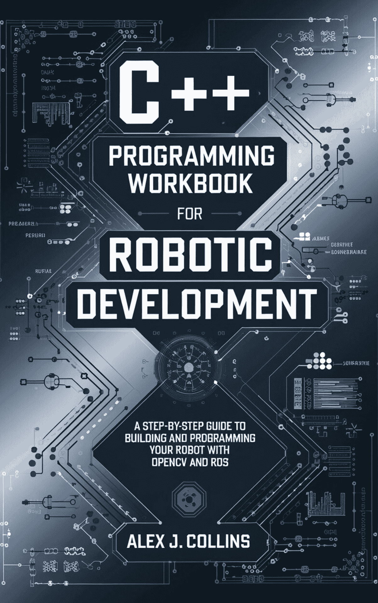

# 机器人开发 C++ 编程练习：使用 OpenCV 和 ROS 构建并编程机器人的分步指南





# 第一部分：基础

## 第 1 章：机器人学简介

### 什么是机器人？

机器人是一种能够执行任务的机器，通常具有自动化程度。机器人的关键特征通常包括：

- **自动化**：机器人可以在人工干预的情况下执行任务，提高效率。
- **智能**：它们能够通过摄像头、激光雷达和声纳等感知环境，处理信息并做出决策。这种智能使机器人能够适应变化并执行人类难以或无法完成的任务。
- **物理实体**：机器人具有能够与世界交互的物理形式。这种实体使其能够操作物体。

### 机器人的类型

- **工业机器人**：用于流水线，执行焊接、喷涂等。这些机器人通常是用于工业应用的大机器。
- **服务机器人**：设计用于协助人类完成各种任务，如清洁、医疗和个人辅助。服务机器人出现在家庭、医院和公共空间，通常比工业机器人更具互动性。
- **军事机器人**：用于侦察、拆弹和战斗。这些军事机器人通常配备先进的传感器和武器系统，设计用于危险环境中运行。
- **太空机器人**：用于太空探索、维护和建设。太空机器人通常是高度专业化的机器，能够承受太空极端条件。
- **娱乐机器人**：设计用于娱乐和消遣，如机器人玩具或伙伴。娱乐机器人旨在为用户提供趣味性和互动性。

### 机器人的应用

机器人在各个行业和领域都有广泛的应用。最常见的包括：

- **制造业**：通过自动化组装、焊接和包装等任务提高工厂效率和生产力。
- **医疗**：辅助手术、康复和护理，并为老年人和残障人士提供陪伴和支持。
- **探索**：探索危险或无法到达的环境，如太空、水下或灾区。机器人可以在这些环境中收集数据、执行任务甚至救援人员。
- **农业**：自动化种植、收割和牲畜管理任务，提高效率并降低人工成本。
- **交通**：开发用于运输和物流的自动车辆，提高安全性并缓解交通拥堵。
- **娱乐**：为消费者创造互动和有趣的体验，如机器人玩具、主题公园景点和虚拟现实体验。

随着技术的不断进步，机器人变得越来越复杂，能够执行更广泛的任务。它们在塑造社会未来方面起着重要作用，从提高我们的生活质量到应对全球挑战。

### 机器人历史

创建能够执行任务的人工生命的概念吸引了人类几个世纪。虽然“机器人”一词直到 20 世纪才出现，但机器人的历史可以追溯到古代文明。

#### 古代文明


### 机器人历史

-   **神话生物**：古希腊神话中曾出现过 `Talos` 这样的自动机器，它是一个守护克里特岛的巨大青铜人。这些神话生物虽然是虚幻的，但说明了人类创造执行超越人类能力的生物的渴望。
-   **液压设备**：古埃及人和古希腊人利用水力创造了移动雕像和其他机械设备。这些设备在现代意义上并不认为是真正的机器人，但展示了工程和自动化的早期示例。

#### 现代早期

-   **机械动物**：文艺复兴时期著名的通才学者列奥纳德·达·芬奇设计了机械狮子和飞行机器的设计。这些设计虽然从未完全实现，但展示了早期工程师和发明家的才华与创造力。
-   **钟表自动机**：在 18 世纪，人们制造了复杂的钟表自动机来执行各种任务，如演奏乐器或书写。这些自动机通常被视为玩具而非实用机器，但它们展示了机械工程日益增长的精密以及创造复杂机制的能力。

#### 工业革命

-   **纺织机械**：工业革命见证了自动化机器的发展，如 `Jacquard looms`，用于在纺织制造中执行重复任务。这些机器虽然并非专门设计成人类的样子，但标志着工业流程自动化迈出了重要的一步。
-   **早期工业机器人**：20 世纪初开发了第一批工业机器人，例如 `Unimate`，它用于处理汽车工厂中的热金属部件。与现代机器相比，这些机器人相对简单，但代表了机器人在工业任务应用中的关键突破。

#### 20 世纪及以后

-   **“机器人”一词**：“机器人”（robot）一词由捷克剧作家卡雷尔·恰佩克在他 1920 年的剧 `R.U.R.` 中推广。这部剧引入了能够执行人类劳工的人工生命概念，并引发了对机器人潜在收益和风险的广泛讨论。
-   **电子与计算的进步**：20 世纪中期晶体管、集成电路和计算机的发展导致机器人技术的重大进步。这些技术突破使机器人变得更加智能、多功能，并能够执行更广泛的任务。
-   **人工智能**：20 世纪 50 年代和 60 年代人工智能 (`AI`) 的出现为机器人提供了学习、推理和解决问题的能力。人工智能在使机器人能够适应新情况、与环境互动以及自主决策方面发挥了至关重要的作用。
-   **现代机器人技术**：今天，机器人被应用于广泛领域，从制造到医疗保健到太空探索。机器人技术的进步不断推向可能的边界，开发出更复杂、更强大的机器。例如，机器人现在被用于执行复杂的手术、探索遥远行星，甚至为人类提供陪伴。随着技术的不断演进，预计机器人在未来我们的生活中将发挥更加重要的作用。

### 机器人的应用

机器人在各个行业和领域都有广泛的应用。一些最常见的包括：

#### 制造业
-   **流水线自动化**：机器人可以执行焊接、喷和和等重复任务，提高效率并降低劳动力成本。
-   **物料搬运**：机器人可以将材料从一个地方运输到另一个地方，减少对人工劳动力的需求并提高安全性。
-   **质量控制**：机器人可以检查产品缺陷，确保只有高质量的产品被发给客户。
-   **柔性制造系统**：机器人可以集成到柔性制造系统中，该系统能够快速适应生产需求的变化。

#### 医疗保健
-   **手术**：机器人可以通过提供比人类外科医生更高的精度和控制力来协助手术。例如，机器人手术系统可以用于通过较小的切口进行微创手术，为患者带来更快的康复速度并减轻疼痛。
-   **康复**：机器人可以帮助身体残障的患者恢复活动能力并提高生活质量。例如，机器人外骨骼可以帮助瘫痪或中风患者行走和移动肢体。
-   **患者护理**：机器人可以为患者提供陪伴和帮助，特别是老年人或残疾人士。例如，机器人可以帮助患者完成喂、、洗和药物管理等任务。

#### 探索
-   **太空探索**：机器人可以探索危险或不可及的环境，如太空、水下或灾区。例如，`Curiosity` 和 `Perseverance` 等探测器已经探索了火星表面，收集有关行星地质的数据并寻找古代生命的迹象。
-   **环境监测**：机器人可以收集环境状况的数据，如空气质量、水污染和气候变化。例如，无人机可以用于监测森林是否有火灾或森林砍伐的迹象。
-   **考古发掘**：机器人可以帮助考古学家发掘和保护文物而不对其造成损坏。例如，机器人可以用于发掘脆弱的遗址而不扰动周围环境。

#### 农业
-   **农耕**：机器人可以自动执行播种、收获和除草等任务，提高效率并降低劳动力成本。例如，自动拖拉机可以比人类工人更高的精度和速度播种种子并收获作物。
-   **牲畜管理**：机器人可以监测牲畜健康、喂养动物，甚至挤奶。例如，机器人可以监测奶牛的健康并检测疾病迹象，允许农户尽干预并防止爆发。

#### 交通
-   **自动驾驶车辆**：正在开发可以在无人工干预的情况下驾驶汽车、卡车和其他车辆的机器人。自动驾驶车辆具有提高安全性、减少交通拥堵和排放的潜力。
-   **交付服务**：机器人可以为客户交付包裹和杂货，减少对人类司机的需求。例如，机器人可以向城市地区的家庭和企业交付包裹，减少交通拥堵和排放。

### 娱乐
-   **玩具和游戏**：机器人可以为儿童和成人提供娱乐。例如，机器人玩具可以与儿童互动，提供教育性和趣味性的体验。
-   **主题乐园**：机器人可以用于为游客创造互动式和沉浸式的体验。例如，机器人角色可以与游客互动，提供娱乐和教育。
-   **虚拟现实**：机器人可以用于为用户创建可的的虚拟环境。例如，机器人手臂可以用于创建触觉反馈，使用户能够感觉到并与虚拟物体互动。

#### 其他应用
-   **军事**：机器人可以用于侦察、拆除炸弹和战斗。例如，机器人可以用于探索危险区域、拆除炸弹并为战场上的士兵提供支持。
-   **执法**：机器人可以用于监视、人群控制和危险品处理。例如，机器人可以用于监测人群、检测危险物质并协助营救救援行动。
-   **客户服务**：机器人可以通过聊天机器人和虚拟助手提供客户服务。例如，聊天机器人可以用于回答客户问题并提供支持。


随着技术的不断进步，机器人变得越来越复杂，并能够执行更广泛的任务。它们准备在塑造社会未来方面发挥重要作用，从提高我们的生活质量到解决全球性挑战。

## 第 2 章：C++ 编程基础

### 变量、数据类型和运算符

变量类似于存储数据的容器。它们有名称和类型，类型决定了它们可以存储的数据种类。

#### 声明变量
要声明变量，你需要指定其类型，后跟其名称。例如：

```cpp
int age; // 声明一个名为 age 的整数变量
float price; // 声明一个名为 price 的浮点数变量
char grade; // 声明一个名为 grade 的字符变量
```

#### 赋值
你可以使用赋值运算符（`=`）给变量赋值。例如：

```cpp
age = 25;
price = 9.99;
grade = 'A';
```

#### 变量命名规范
- 变量应该具有有意义的名称，以反映其用途。
- 变量名使用小字母。
- 在变量名中使用下划线（`_`）分隔单词。

### 数据类型
C++ 支持多种数据类型来表示不同的数据。常见数据类型包括：

- **整数类型**：
    - `int`: 表示整数（例如 `10`、`-5`、`0`）
    - `short`: 表示较小的整数（例如 `-32768` 到 `32767`）
    - `long`: 表示较大的整数（例如 `-2,147,483,648` 到 `2,147,483,647`）
    - `unsigned int`: 表示非负整数（例如 `0` 到 `4,294,967,295`）
    - `unsigned short`: 表示较小的非负整数（例如 `0` 到 `65,535`）
    - `unsigned long`: 表示较大的非负整数（例如 `0` 到 `18,446,744,073,709,551,615`）
- **浮点数类型**：
    - `float`: 表示带有小数点的实数（例如 `3.14`、`-0.5`）
    - `double`: 表示精度更高的较大实数（例如 `123456789.123456`）
    - `long double`: 表示具有更高精度的极大的实数（例如 `1.7976931348623157e+308`）
- **字符类型**：
    - `char`: 表示单个字符（例如 `'A'`、`'b'`、`' '`）
- **布尔类型**：
    - `bool`: 表示真或假值（例如 `true`、`false`）

### 运算符
运算符是用于对变量和值执行操作的符号。C++ 支持多种运算符，包括：

- **算术运算符**：
    - `+`: 加
    - `-`: 减
    - `*`: 乘
    - `/`: 除
    - `%`: 取模（除后的余数）
    - `++`: 递增（加 1）
    - `--`: 递减（减 1）
- **比较运算符**：
    - `==`: 等于
    - `!=`: 不等于
    - `<`: 小于
    - `>`: 大于
    - `<=`: 小于等于
    - `>=`: 大于等于
- **逻辑运算符**：
    - `&&`: 逻辑与
    - `||`: 逻辑或
    - `!`: 逻辑非
- **赋值运算符**：
    - `=`: 赋值
    - `+=`: 加并赋值
    - `-=`: 减并赋值
    - `*=`: 乘并赋值
    - `/=`: 除并赋值
    - `%=`: 取模并赋值
    - `<<=`: 左移并赋值
    - `>>=`: 右移并赋值
    - `&=`: 按位与赋值
    - `|=`: 按位或赋值
    - `^=`: 按位异或赋值

#### 示例
```cpp
int x = 10;
int y = 5;
int sum = x + y; // x 和 y 的和
int difference = x - y; // x 和 y 的差
int product = x * y; // x 和 y 的积
int quotient = x / y; // x 和 y 的商
int remainder = x % y; // x 除以 y 的余数
bool isEven = x % 2 == 0; // 检查 x 是否为偶数
x++; // x 加 1
y--; // y 减 1

if (x > y) {
    // x 大于 y
} else if (x == y) {
    // x 等于 y
} else {
    // x 小于 y
}
```

#### 额外说明
- C++ 是区分大小写的，因此 `age` 和 `Age` 是不同的变量。
- 你可以在单条语句中声明多个相同类型的变量，用逗号隔开。例如：`int x, y, z;`。
- 你可以在声明变量时对其初始化。例如：`int age = 25;`。
- `sizeof` 运算符可以确定数据类型以字节为单位的大小。例如：`sizeof(int)`。

### 控制流语句 (if-else)
控制流语句允许你根据条件执行代码。if-else 允许根据条件执行不同的块。

#### if-else 语句
if-else 允许根据条件执行不同的块。

#### 结构
```cpp
if (条件) {
    // 如果条件真则执行
} else if (条件) {
    // 如果另一个条件真则执行
} else {
    // 如果以上条件均为假则执行
}
```

#### 示例
```cpp
int age = 18;
if (age >= 18) {
    std::cout << "成年";
} else {
    std::cout << "未成年";
}
```

### 循环
循环允许你重复执行代码块。

#### for 循环
for 循环在你预先知道重复多少次数时使用。

#### 结构
```cpp
for (初始化; 条件; 更新) {
    // 循环体代码
}
```

#### 示例
```cpp
for (int i = 0; i < 5; i++) {
    std::cout << "次数: " << i << std::endl;
}
```

#### while 循环
while 循环在条件为真时重复代码块。

#### 结构
```cpp
while (条件) {
    // 循环体代码
}
```

#### 示例
```cpp
int count = 0;
while (count < 5) {
    std::cout << "计数: " << count << std::endl;
    count++;
}
```

#### do-while 循环
do-while 循环与 while 循环相似，但它们保证至少执行一次。

#### 结构
```cpp
do {
    // 循环体代码
} while (条件);
```

#### 示例
```cpp
int count = 0;
do {
    std::cout << "计数: " << count << std::endl;
    count++;
} while (count < 5);
```

#### 嵌套循环
你可以在循环内部嵌套循环以创建复杂的结构。

#### 示例
```cpp
for (int i = 0; i < 3; i++) {
    for (int j = 0; j < 2; j++) {
        std::cout << "i = " << i << ", j = " << j << std::endl;
    }
}
```

#### break 和 continue 语句
`break` 语句可以提前退出循环。`continue` 语句可以跳过当前的循环迭代并继续下一次迭代。

### 函数和模块化编程
函数是执行特定任务的可重用代码块。它们有助于组织代码，使其更容易理解并重用。

#### 定义函数
要在 C++ 中定义函数，你需要指定其返回类型、名称和参数（如果有）。

#### 结构
```cpp
返回类型 函数名(参数 类型 参数 1, 类型 参数 2, ...) {
    // 函数体
    return 值;
}
```

#### 示例
```cpp
int add(int a, int b) {
    int sum = a + b;
    return sum;
}
```

#### 调用函数
调用函数时，提供函数名和任何必要的参数。

#### 示例
```cpp
int result = add(5, 3);
std::cout << "和是: " << result << std::endl;
```

#### 函数参数和参数
- 参数：在函数定义括号内声明的变量。它们用于接收调用者的值。
- 参数：在调用函数时传递的值。

#### 函数返回值
- 函数可以使用 `return` 语句返回值。
- 函数的返回类型必须与它返回值的类型匹配。
- 如果函数不返回值，其返回类型为 `void`。

#### 函数重载
函数重载允许定义具有相同名称但参数不同的多个函数。编译器根据提供的参数确定调用哪个函数。

#### 示例
```cpp
int add(int a, int b) {
    return a + b;
}

double add(double a, double b) {
    return a + b;
}
```

#### 模块化编程
模块化编程是一种软件设计方法，将程序分解为更小、更于管理的模块（函数）。这使得代码更容易理解、维护和测试。

模块化编程的优点：


- 提高可读性：函数可以通过将代码拆分为更小、更集中的单元，来使你的代码更具可读性。
- 代码复用性：函数可以在程序的多个部分重用，减少代码重复并使你的代码更高效。
- 更容易测试：函数可以进行独立测试，从而更容易地识别和修复错误。
- 更好的组织：模块化编程可以帮助你将代码组织成逻辑单元，使其更易理解和维护。

通过使用函数和模块化编程，你可以编写出更高效、可维护且可重用的 C++ 代码。

## 面向对象编程概念

面向对象编程（OOP）是一种将现实世界实体建模为对象的编程范式。对象具有属性（数据）和行为（方法）。

### 类 (Classes)

类是创建对象的蓝图。它定义了该类的对象将拥有的属性和方法。

基本结构：

```cpp
class ClassName {
public:
// 公有方法
private:
// 私有属性
};
```

- 公有成员：可以类外部访问。
- 私有成员：只能在类内部访问。

### 对象 (Objects)

对象是类的实例。它对类定义的属性拥有自己的值。

创建对象：

```cpp
ClassName objectName;
```

### 封装 (Encapsulation)

封装是将数据（属性）和操作这些数据的方法（函数）打包成单个单元（类）的过程。这有助于保护对象的内部状态并防止未经授权的访问。

封装的益处：
- 数据隐藏：封装允许你从程序的其他部分隐藏类的实现细节，使你的代码更具模块化且更易于维护。
- 提高安全性：封装可以帮助保护敏感数据免受未经的访问。
- 灵活性：封装使得修改类的内部实现而不影响程序的其他部分变得更容易。

### 继承 (Inheritance)

继承一个类（派生类）从另一个类（基类）继承属性和方法的能力。这促进了代码复用并在类之间建立了层级关系。

示例：

```cpp
class Animal {
public:
void makeSound() {std::cout << "Generic animal sound\n";
}
};

class Dog :  public Animal {
public:
void makeSound() {std::cout << "Woof!\n";
}
};
```

继承的类型：
- 单继承：派生类继承自一个基类。
- 多重继承：派生类继承自多个基类。
- 多级继承：派生类继承自一个基类，而该基类也可以继承自另一个基类。
- 层次继承：多个派生类继承自同一个基类。

### 多态 (Polymorphism)

多态允许不同类的对象能够被视为同一种类的对象的能力。这允许你编写更灵活、更可重用的代码。

示例：

```cpp
void makeAnimalSound(Animal& animal) {
animal.makeSound();
}

int main() {
Dog dog;
Cat cat;
makeAnimalSound(dog); // 调用 Dog::makeSound()
makeAnimalSound(cat); // 调用 Cat::makeSound()
}
```

多态的类型：
- 静态多态：对象的类型在编译时确定。这是通过函数重载和运算符重载实现的。
- 动态多态：对象的类型在运行时确定。这是通过虚函数实现的。

### 访问修饰符 (Access Modifiers)

访问修饰符控制类成员的可见性。
- `public`：从任何地方访问。
- `private`：仅在类内部访问。
- `protected`：在类及其派生类中访问。

### 构造函数与析构函数 (Constructors and Destructors)

- 构造函数：在对象创建时调用的特殊方法。它们初始化对象的属性。
- 析构函数：在对象销毁时调用的特殊方法。它们可以清理资源。

示例：

```cpp
class MyClass {
public:
MyClass() {
std::cout << "Constructor called\n";
}
~MyClass() {
std::cout << "Destructor called\n";
}
};
```

### 其他 OOP 概念

- 抽象类：不能直接实例化的类。它们被用其他类的基类。
- 接口：与抽象类相似，但它们只包含虚函数。
- 拷贝构造函数和赋值运算符：用于创建对象的副本并给对象赋值。
- 友元函数：可以访问类私有成员的函数。
- 运算符重载：允许你为自定义数据类型重新定义运算符的行为。

通过这些面向对象编程概念，你可以编写出更有组织、高效且可维护的 C++ 代码。

## 第 3 章：OpenCV：计算机视觉基础

### 图像获取与显示

OpenCV 提供了一组强大的函数用于获取和显示图像。在本节中，我们将深入探讨从摄像头捕捉图像并将其显示在屏幕上的细节。

### 从摄像头捕捉图像

要使用 OpenCV 从摄像头捕捉图像，你通常需要遵循以下步骤：

1. 初始化摄像头：使用 `VideoCapture` 类创建摄像头设备的句柄。你可以将摄像头索引（通常默认摄像头为 `0`）作为构造函数的参数。此外，你还可以提供可选参数来配置摄像头设置，如分辨率、帧率和曝光。
2. 检查摄像头可用性：使用 `isOpened()` 方法验证摄像头是否成功打开。如果摄像头不可用，你可以适当地处理错误，例如显示错误消息或尝试打开另一个摄像头。
3. 捕获帧：使用 `read()` 方法从摄像头捕捉一帧并将其存储在 `Mat` 对象中。`Mat` 对象代表像素的多维数组。
4. 释放摄像头：当你完成摄像头的使用时，使用 `release()` 方法释放其资源。

示例：

```cpp
#include <opencv2/opencv.hpp>
using namespace cv;

int main() {
VideoCapture cap(0); // 打开默认摄像头
if (!cap.isOpened()) {
std::cerr << "Error opening video capture" << std::endl;
return  -1;
}
// 设置分辨率为 640x480
cap.set(CAP_PROP_FRAME_WIDTH, 640);
cap.set(CAP_PROP_FRAME_HEIGHT, 480);
while (true) {
Mat frame;
cap >> frame; // 从摄像头捕捉一帧
if (frame.empty()) {
break;
}
imshow("Frame", frame);
if (waitKey(1) == 27) { // 检测按下 ESC 键
break;
}
}
cap.release();
destroyAllWindows();
return 0;
}
```

### 显示图像

使用 OpenCV 显示图像，你通常需要遵循以下步骤：

1. 创建窗口：使用 `namedWindow()` 函数创建一个窗口。该窗口将用于显示图像。
2. 显示图像：使用 `imshow()` 函数在窗口中显示图像。第一个参数是窗口名称，第二个参数是包含图像的 `Mat` 对象。
3. 等待按键：使用 `waitKey()` 函数等待按键后再继续执行。这允许图像在用户关闭窗口之前留在屏幕上。`waitKey()` 函数还可以用于检测特定的按键，例如按下 ESC 键（代码为 27）退出应用程序。

### 注意

- 你可以使用 `VideoCapture` 类的 `set()` 方法调整摄像头的分辨率和帧率。


-   你可以使用 `imwrite()` 函数将捕获的图像保存到磁盘。例如，`imwrite("captured_image.jpg", frame);` 将将当前帧保存为名为 `"captured_image.jpg"` 的 JPEG 文件。
- OpenCV 支持多种图像格式，包括 JPEG、PNG、BMP 和 TIFF。你可以在保存图像时指定所需的图像格式。
-   你还可以通过创建多个窗口并在每个窗口中显示相应的图像来同时显示多张图像。

通过理解这些概念并遵循提供的代码示例，你可以有效地使用 OpenCV 捕获和显示图像，并构建更高级的计算机视觉应用程序。

### 图像处理技术

图像处理涉及应用各种技术对图像进行修改、增强或提取信息。OpenCV 提供了一系列丰富的函数，用于执行图像处理任务。

#### 滤波

过滤是在图像上应用核（kernel）或掩码（mask）以修改其像素值的过程。这可以用于平滑图像、减少噪声或增强边缘。

常用的滤波技术：
- 平均值滤波：将每个像素替换为其邻域像素的平均值。这可以用于减少噪声并平滑图像。
- 高斯滤波：对图像应用高斯核，它对距离内核中心的像素赋予更高的权重。这可以用于减少噪声并模糊图像。
- 中值滤波：将每个像素替换为其邻域像素的中值。这可以可以在保留边缘的同时去除噪声。
- 双边滤波：结合了空间滤波和范围滤波，以在减少噪声的同时保留边缘。
- Canny 边缘检测器：使用多阶段算法检测图像中的边缘。

示例：
```cpp
Mat blurred;
GaussianBlur(frame, blurred, Size(5, 5), 0); // 应用高斯模糊

Mat edges;
Canny(blurred, edges, 100, 300); // 检测边缘
```

#### 分割

分割是将图像划分为有意义的区域或对象的过程。这可以隔离感兴趣的对象或从图像中提取特征。

常用的分割技术：
- 阈值化：通过将高于阈值的像素设为白色、低于阈值的像素设为黑色，将灰度图像转换为二值图像。
- 基于边缘的分割：使用边缘检测技术识别对象之间的边界。
- 基于区域的分割：根据颜色、纹理或其他特征的相似性对像素进行分组。
- 分水岭算法：根据汇流域（catchment basins）将图像划分为区域。

示例：
```cpp
Mat gray;
cvtColor(frame, gray, COLOR_BGR2GRAY); // 转换为灰度图

Mat thresh;
threshold(gray, thresh, 127, 255, THRESH_BINARY); // 对图像进行阈值处理
```

#### 特征检测

特征检测涉及识别图像中的特定点或区域。这些特征可以用于对象识别、跟踪和其他计算机视觉任务。

常用的特征检测技术：
- 角点检测：识别图像中的角点，即边缘相交的点。
- 斑点检测（Blob detection）：识别图像中的圆形或椭圆形区域。
- 兴趣点检测：识别图像中的兴趣点，例如关键点或显著区域。

示例：
```cpp
vector<KeyPoint> keypoints;
Ptr<FeatureDetector> detector = ORB::create();
detector->detect(gray, keypoints);
```

通过理解这些图像处理技术并使用 OpenCV 函数，你可以执行各种任务，如图像增强、目标检测和场景理解。

### 目标检测与跟踪

目标检测涉及识别并定位图像或视频序列中的对象。目标跟踪涉及在对象沿场景中移动时随时间保持其身份。

#### 目标检测

OpenCV 提供了几种目标检测方法，包括：
- Haar 级联（Haar cascades）：一种基于机器学习的方法，使用预训练的分类器来检测对象。
- HOG 描述符：一种表示图像中梯度方向分布的特征描述符。
- 基于深度学习的方法：卷积神经网络（CNN）常用于目标检测，如 Faster R-CNN、SSD 和 YOLO 等架构是流行的选择。

示例（使用 Haar 级联）：
```cpp
CascadeClassifier face_cascade;
face_cascade.load("haarcascade_frontalface_default.xml");
vector<Rect> faces;
face_cascade.detectMultiScale(gray, faces, 1.3, 5);

for (size_t i = 0; i < faces.size(); i++) {
    rectangle(frame, faces[i], Scalar(255, 0, 0), 2);
}
```

### 目标跟踪

目标跟踪涉及在对象在场景中移动时随时间保持其身份。OpenCV 提供了几种目标跟踪方法，包括：
- 光流（Optical flow）：估计连续帧之间图像点运动的技术。
- 卡尔曼滤波（Kalman filters）：一种统计滤波技术，根据过去的测量值预测对象的未来状态。
- 均值偏移（Mean shift）：一种非参数跟踪算法，寻找概率密度函数的模式。

示例（使用光流）：
```cpp
Ptr<OpticalFlowTracker> tracker = OpticalFlowTracker::create();
bool ok = tracker->init(frame, rect);
while (true) {
    // ...
    Rect result;
    bool tracked = tracker->update(frame, result);
    // ...
}
```

#### 结合目标检测与跟踪

可以将目标检测和跟踪结合起来随时间跟踪对象。首先，你可以使用目标检测通过对象的初始边界框初始化跟踪器。然后，你可以使用跟踪器在随后的帧中更新对象的位置。

示例：
```cpp
// 检测对象
vector<Rect> faces;
face_cascade.detectMultiScale(gray, faces, 1.3, 5);

// 为每个对象初始化跟踪器
for (size_t i = 0; i < faces.size(); i++) {
    Ptr<OpticalFlowTracker> tracker = OpticalFlowTracker::create();
    tracker->init(frame, faces[i]);
    trackers.push_back(tracker);
}

// 跟踪对象
for (size_t i = 0; i < trackers.size(); i++) {
    Rect result;
    bool tracked = trackers[i]->update(frame, result);
    // ...
}
```

通过理解目标检测和跟踪技术，你可以构建能够在现实场景中识别和跟踪对象的应用程序。

## 第 4 章 ROS：机器人操作系统

### ROS 简介

ROS（机器人操作系统）是一个用于编写机器人软件的灵活框架。它提供了工具、库和规范，简化了复杂机器人应用程序的开发。ROS 设计具有模块化可重复性，允许开发者轻松组合不同的组件创建创建解决方案。

#### ROS 的核心特性

- 分布式架构：ROS 是一个分布式系统，允许不同的进程（节点）通过网络进行通信。这使得创建具有多个组件的复杂机器人系统变得简单。
- 消息传递：ROS 使用消息传递系统允许节点之间交换数据。消息是结构化数据类型，可以表示各种信息，例如传感器数据、控制命令和状态更新。
- 主题系统：主题系统是用于发布和订阅消息的机制。节点可以向主题发布消息，其他节点可以订阅这些主题以接收消息。
- 服务系统：服务系统允许节点请求和响应服务。服务是远程过程调用，用于执行特定任务，例如控制电机或检索传感器数据。
- 参数服务器：参数服务器是一个存储键值对的中央数据库。这些参数可用于配置节点并在机器人系统的不同组件之间共享数据。


### 工具与库
ROS 提供了多种工具和库，用于开发机器人应用程序。这些包含了用于调试、可视化和仿真的工具，以及用于图像处理、路径规划和控制等常见任务的库。

#### 使用 ROS 的优势

- **模块化和可重用**：ROS 通过鼓励开发重用的软件组件来促进模块化和可重用。这使得创建复杂的机器人系统变得更容易，并缩短了开发时间。
- **社区支持**：ROS 拥有庞大且活跃的开发者社区，他们为项目做出贡献并为其他用户提供支持。这便于寻找资源和获取帮助。
- **跨平台兼容性**：ROS 支持多种操作系统，包括 Linux、macOS 和 Windows。这便于在不同平台上开发和部署机器人应用程序。
- **与其他工具的集成**：ROS 可以与其他工具和框架集成，例如 Gazebo（机器人仿真）和 OpenCV（计算机视觉库）。这允许你创建更全面的机器人应用程序。

#### 开始使用 ROS

要开始使用 ROS，你需要在计算机上安装它。你可以从 ROS 官网下载安装说明：[`www.ros.org/`](https://www.ros.org/)

#### 安装步骤

1. **选择 ROS 发行版**：ROS 以不同的发行版发布，每个版本都有自己的功能和包。根据你的系统和需求选择合适的版本。
2. **安装依赖项**：在安装 ROS 之前，你可能需要安装一些系统依赖项，如构建工具和库。请参考特定版本的安装说明。
3. **下载并安装 ROS**：下载适用于你系统的 ROS 安装包并按照说明进行安装。
4. **设置环境**：安装完成后，你需要设置环境变量来使用 ROS 命令。这通常涉及将 ROS 安装目录添加到你的 `PATH` 环境变量中。

#### 创建 ROS 工作空间

安装 ROS 后，你可以创建一个工作空间（workspace）来组织你的 ROS 项目。工作空间是一个包含你的 ROS 包和其他项目文件的目录。

#### 如何创建工作空间：

1. **创建新目录**：为工作空间选择一个位置并创建一个目录。
2. **初始化工作空间**：使用 `rosdep` 命令初始化工作空间并安装任何必要的依赖项。例如：

```bash
cd ~/my_workspace
rosdep init
rosdep update
```
3. **运行设置脚本**：source 你 ROS 发行版的设置脚本，将工作空间添加到你的环境中。例如：

```bash
source ~/my_workspace/devel/setup.bash
```

现在你已经准备好创建 ROS 包并开始开发机器人应用程序了。

#### 创建 ROS 包

ROS 包是相关文件的集合，包括 C++ 源代码、Python 脚本、配置文件和其他资源。创建一个新的 ROS 包：

1. **使用 `catkin_create_pkg` 命令**：该命令将创建一个带有指定名称和依赖项的新包目录。例如：

```bash
catkin_create_pkg my_package std_msgs rospy roscpp geometry_msgs
```
2. **添加你的代码和资源**：将 C++ 源代码、Python 脚本和其他文件放在包目录内。
3. **构建包**：使用 `catkin_make` 命令构建包。

#### 运行 ROS 节点

ROS 节点（node）是在 ROS 系统内运行的可执行进程。节点之间通过发布和订阅主题（topics）或调用服务（services）来相互通信。

#### 如何运行 ROS 节点：

1. **导航到包目录**：使用 `cd` 命令导航到包含你的 ROS 包的目录。
2. **执行节点**：使用 `rosrun` 命令执行节点。例如：

```bash
rosrun my_package my_node
```

#### 可视化 ROS 数据

ROS 提供了几个可视化数据的工具，包括：

- **RViz**：一个 3D 可视化工具，可显示传感器数据、机器人模型和其他信息。
- **rqt**：基于 GUI 的工具，提供多种插件用于可视化和调试 ROS 数据。
- **PlotJuggler**：一个用于绘制 ROS 主题时间序列数据图的工具。

#### ROS 架构与组件

ROS 是一个由几个关键组件组成的分布式系统：

### 节点 (Nodes)
节点是 ROS 系统的基本构建单元。它们是可以发布和订阅主题、调用和提供服务以及与其他节点交互的可执行进程。节点可以使用 C++、Python 和 Java 等多种语言编写。

### 主题 (Topics)
主题是节点之间的通信通道。节点可以向主题发布消息，其他节点可以订阅这些主题以接收消息。主题通过名称识别，这些通常是反映发布数据类型的分级字符串。

### 消息 (Messages)
消息是用于节点间通信的结构化数据类型。它们可以包含多种信息，如传感器数据、控制命令和状态更新。ROS 提供了一套标准消息类型，但你也可以定义自定义的消息类型。

### 服务 (Services)
服务是用于请求和响应服务的远程过程调用（RPC）。服务由请求消息和响应消息定义。节点可以通过实现服务定义来提供服务，而其他节点可以通过发送请求消息来调用服务。

### 参数服务器 (Parameter Server)
参数服务器是一个存储键值对的中央数据库。这些参数可以用于配置节点并在机器人系统的不同组件之间共享数据。

### 主节点 (Master)
主节点是一个中央服务器，维护系统内所有节点和主题的注册表。它负责协调节点之间的通信并解析主题名称。

### TF (变换服务器)
`TF`（变换服务器）是一个维护不同坐标系之间变换的系统。这对于需要协调多个组件运动的机器人至关重要。

### Rviz
R 是一个 3D 可视化工具，用于显示传感器数据、机器人模型和其他信息。它是调试和理解机器人行为的强大工具。

### Gmapping
Gmapping 是一种 SLAM（同步定位与地图构建）算法，用于创建环境地图。它是机器人在未知环境中导航的常用工具。

### MoveIt
MoveIt 是一个运动规划框架，用于规划和执行机器人运动。它提供了碰撞检查、路径规划和轨迹生成的工具。

## ROS 工具与库

ROS 提供了多种工具和库，用于开发机器人应用程序。这些包括：

- `rosscore`：运行主节点和其他基本组件的 ROS 核心进程。
- `roslaunch`：一次启动多个节点的工具。
- `rosbag`：用于记录和回放 ROS 数据的工具。
- `rviz`：3D 可视化工具。
- `rqt`：可视化和调试 ROS 数据的 GUI 工具。
- `roscpp`：ROS 的 C++ 库。
- `rospy`：ROS 的 Python 库。

通过理解这些组件和工具，你可以有效地使用 ROS 开发和部署机器人应用程序。

### 创建 ROS 节点和主题

ROS 节点是在 ROS 系统内运行的可执行进程。节点之间通过发布和订阅主题或通过调用和提供服务来相互通信。

创建一个 ROS 节点通常遵循以下步骤：

1. 创建 ROS 包：使用 `catkin_create_pkg` 命令创建一个新的 ROS 包。该包将包含你的节点的源代码。


### 2. 编写节点代码：为你的节点编写 C++ 或 Python 代码。代码应包含以下内容：

- 包含必要的 ROS 头文件。
- 创建 ROS 节点句柄（nodehandle）。
- 实现节点所需的行为，例如发布消息、订阅主题或调用服务。

### 3. 编译包：使用 `catkin_make` 命令编译包。

### 4. 运行节点：使用 `rosrun` 命令运行该节点。

#### 示例（C++ 节点）：

```cpp
#include <ros/ros.h>
#include <std_msgs/String.h>

void chatterCallback(const std_msgs::String::ConstPtr& msg) {
ROS_INFO("I heard: [%s]", msg->data.c_str());
}

int main(int argc, char **argv) {
ros::init(argc, argv, "listener");
ros::NodeHandle n;
ros::Subscriber sub = n.subscribe("chatter", 1000, chatterCallback);
ros::spin();  
return 0;
}
```

#### 示例（Python 节点）：

```python
import rospy
from std_msgs.msg import String

def talker():
    pub = rospy.Publisher('my_topic', String, queue_size=10)
    rospy.init_node('my_node', anonymous=True)
    rate = rospy.Rate(10) # 10hz
    while not rospy.is_shutdown():
        hello_str = "hello world %s" % rospy.get_time()
        rospy.loginfo(hello_str)
        pub.publish(hello_str)
        rate.sleep()

if __name__ == '__main__':
    try:
        talker()
    except rospy.ROSInterruptException:
        pass
```

### 创建 ROS 主题

ROS 主题是节点之间的通信通道。节点可以向主题发布消息，其他节点可以订阅这些主题以接收消息。

要创建一个 ROS 主题，你通常遵循以下步骤：

1. 定义消息类型：使用 `message_generator` 工具或手动编辑 `.msg` 文件来创建自定义消息类型。
2. 发布消息：使用 `NodeHandle` 类的 `advertise()` 方法为该主题创建一个发布者。
3. 订阅消息：使用 `NodeHandle` 类的 `subscribe()` 方法为该主题创建一个订阅者。

### 示例（C++）：

```cpp
#include <ros/ros.h>
#include <std_msgs/String.h>

void chatterCallback(const std_msgs::String::ConstPtr& msg) {
ROS_INFO("I heard: [%s]", msg->data.c_str());
}

int main(int argc, char **argv) {
ros::init(argc, argv, "listener");
ros::NodeHandle n;
ros::Subscriber sub = n.subscribe("chatter", 1000, chatterCallback);
ros::spin();  
return 0;
}
```

### 额外注意事项

- **节点名称（Node Names）**：节点应具有唯一的名称以避免冲突。你可以使用 `ros::this_node::getName()` 函数获取当前节点的名称。
- **主题名称（Topic Names）**：主题也应该具有唯一的名称。使用层级命名来组织你的主题。
- **消息类型（Message Types）**：为你想要发布或订阅的数据选择合适的消息类型。ROS 提供了多种标准消息类型，但你也可以创建自定义类型。
- **队列大小（Queue Size）**：在创建发布者或订阅者时，你可以指定队列大小。这决定了在丢弃消息之前可以缓存多少条消息。
- **节点句柄（Node Handles）**：节点句柄是 ROS 系统的句柄。你可以用它创建发布者、订阅者和服务。
- **ROS Spin（ROS Spin）**：`ros::spin()` 函数用于保持节点运行并处理消息。
- **ROS 日志（ROS Logging）**：ROS 提供了一个日志系统，可将消息打印到控制台。`ROS_INFO` 宏可以打印信息性消息。

### 发布和订阅消息

要在主题上发布消息，你使用 `NodeHandle` 类的 `advertise()` 方法。该方法返回一个可以用于发布的 `Publisher` 对象。

示例：

```cpp
#include <ros/ros.h>
#include <std_msgs/String.h>

int main(int argc, char **argv) {
    ros::init(argc, argv, "talker");
    ros::NodeHandle n;
    ros::Publisher pub = n.advertise<std_msgs::String>("chatter", 1000);
    ros::Rate loop_rate(10); // 10 Hz
    int count = 0;
    while (ros::ok()) {
        std_msgs::String msg;
        std::stringstream ss;
        ss << "hello world " << count;
        msg.data = ss.str();
        ROS_INFO("%s", msg.data.c_str());
        pub.publish(msg);
        ros::spinOnce();
        loop_rate.sleep();
        count++;
    }
    return 0;
}
```

#### 订阅消息

要订阅一个主题，你使用 `NodeHandle` 类的 `subscribe()` 方法。该方法返回一个可以接收消息的 `Subscriber` 对象。

示例：

```cpp
#include <ros/ros.h>
#include <std_msgs/String.h>

void chatterCallback(const std_msgs::String::ConstPtr& msg) {
ROS_INFO("I heard: [%s]", msg->data.c_str());
}

int main(int argc, char **argv) {
ros::init(argc, argv, "listener");
ros::NodeHandle n;
ros::Subscriber sub = n.subscribe("chatter", 1000, chatterCallback);
ros::spin();  
return 0;
}
```

### 高级主题

- **异步发布（Asynchronous Publishing）**：可以使用 `asyncSpin()` 函数异步运行节点，允许你在等待消息时执行其他任务。
- **消息过滤（Message Filtering）**：你可以使用过滤器选择你感兴趣的消息。例如，你可以根据时间戳或内容过滤消息。
- **主题重映射（Topic Remapping）**：你可以使用 `rosrun` 命令或 `rosparam` 命令重映射主题。这对于调试节点非常有用。
- **ROS 主题与服务（ROS Topics and Services）**：ROS 还提供了服务系统，用于请求和响应服务。服务类似于可以调用的函数。
- **ROS 参数（ROS Parameters）**：ROS 参数是键值对，用于配置节点并在机器人不同组件之间共享数据。你可以使用 `rosparam` 命令设置获取参数。

通过了解如何发布和订阅消息，你可以创建涉及多个节点通信的复杂机器人应用。

# 第二部分：构建你的机器人

## 第 5 章：硬件选择

### 选择机器人平台

机器人平台的选择取决于具体的应用和需求。以下是一些常见的机器人平台：

#### 轮式机器人

轮式机器人是最常见的机器人之一。它们通常用于需要移动的任务，如导航、探索和运输。

- **优点**：
    - 设计简单高效
    - 易控制
    - 可以在平面表面导航
    - 成本效益
    - 维护成本低
- **缺点**：
    - 地形能力有限
    - 在不平表面上可能不稳定
    - 不适合崎岖地形或楼梯

#### 足式机器人

足式机器人的设计模仿动物的运动。它们通常用于需要敏捷性和适应不同地形的任务。

- **优点**：
    - 能够在崎岖地形上导航
    - 机动性强
    - 能够爬上楼梯和障碍物
    - 可以进入轮式机器人无法进入的区域


#### 飞行机器人

飞行机器人，也称为无人机或无人飞行器（UAVs），用于监控、检查和递送等空中任务。

#### 优点
- 可以进入其他机器人难以或无法到达的区域
- 能够快速覆盖大面积
- 可用于空中摄影和摄像
- 可用于基础设施的检查和监控

#### 缺点
- 需要精细控制以避免碰撞
- 可能受天气状况影响
- 可能会产生噪音并干扰他人
- 载荷能力可能有限

#### 其他机器人平台

- **水生机器人**：用于水下任务，如探测、检查和环境监测。
- **人形机器人**：设计模仿人类，可用于需要类人交互的任务。
- **协作机器人**：设计用于工业环境中与人类安全共同工作。

#### 选择机器人平台时需要考虑的因素

- **应用**：机器人需要执行哪些任务？
- **地形**：机器将在什么样的地形上运行？
- **载荷**：机器人可以携带多重的重量？
- **电池寿命**：机器人单次充电需要运行多长时间？
- **成本**：机器人的预算是多少？
- **可用性**：是否有符合你要求的市售平台？
- **维护**：机器人的维护和修理是否容易？
- **安全性**：需要考虑哪些安全因素？
- **法规合规性**：是否有任何需要满足的法规或标准？

### 选择执行器和传感器

执行器是将电或其他形式的能量转换为机械运动的设备。它们用于控制人的运动。

#### 执行器类型

- **电机**：将电能转换为机械能。
    - **直流电机**：由于其多功能性和易于控制，直流电机在机器人领域被广泛使用。它们有各种尺寸和功率额，分为有刷和无刷。有刷直流电机需要定期维护，而无刷直流电机更耐用且高效。
    - **步进电机**：对旋转运动提供精确控制，通常用于需要精确定位的应用。它们通常用于 `CNC` 机器、`3D 打印机`以及需要高精度的应用。
    - **伺服电机**：可以控制旋转到特定角度，使其成为需要精确角度控制应用的理想选择。它们在机器人中常用于控制肢、关节和其他运动部件。
- **气动执行器**：使用压缩空气产生机械力。它们通常用于工业机器人和其他需要高力和高速度的应用。
- **液压执行器**：使用液压油产生机械力。它们通常用于重型机械和施工设备。

传感器是测量光、声、温度和运动等物理量的设备。它们用于为机器人控制系统提供反馈。

#### 传感器类型

- **摄像头**：捕捉机器人周围的图像和视频。
    - **RGB 摄像头**：捕捉红、绿、蓝图像。
    - **深度摄像头**：除了 RGB 图像外还捕捉深度信息。这些摄像头通常用于自主导航和增强现实等应用。
- **LiDAR（激光雷达）**：使用激光测量到物体的距离。`LiDAR` 是一种高精度的传感器，常用于自动驾驶汽车和机器人应用。
- **IMU（惯性测量单元）**：测量加速度和角速度。`IMUs` 用于跟踪机器人的方向和运动。
- **声呐**：使用声波测量到物体的距离。`Sonar` 常用于水下机器人避障。
- **红外传感器**：探测红外辐射，可用于测量温度或探测物体。红外传感器常用于物体检测和跟踪以及热成像。
- **GPS（全球定位系统）**：提供位置信息。`GPS` 用于户外导航和定位。

#### 选择执行器和传感器时需要考虑的因素

- **应用需求**：机器人需要执行哪些特定任务？
- **性能需求**：需要什么水平的精度、速度和功率？
- **成本**：执行器和传感器的预算是多少？
- **尺寸和重量**：执行器和传感器有多大多重？
- **功耗**：执行器和传感器需要多少功率？
- **环境因素**：执行器和传感器需要耐温、防潮或其他环境条件？
- **兼容性**：执行器和传感器是否与机器人的控制系统和其他组件兼容？
- **维护**：执行器传感器的维护和修理是否容易？
- **可用性**：执行器传感器是否容易获得且价格合理？

通过仔细考虑这些因素，你可以为机器人选择最合适的执行器和传感器。咨询该领域的专家或其他专业人士以获取针对特定应用选择正确组件的建议。

### 组装你的机器人

一旦你选择了合适的执行器和传感器，就可以开始组装你的机器人。

### 设计与规划

- **创建详细设计**：为你的机器人开发全面的设计，包括组件布局、接线图和机械结构。考虑重量分布、平衡和机动性等因素。
- **选择合适的底盘**：选择一个坚固、耐用且与机器人组件兼容的底盘或底座。底盘能够支撑机器人及其载荷的重量。
- **确定电源**：决定机器人的电源类型，如电池或电源。考虑电池容量、充电时间和重量。
- **规划布线**：制定显示所有组件如何连接的接线图。确保布线整洁易于理解。

### 组装过程

- **安装组件**：将执行器、传感器和其他组件固固安装在底盘上。使用合适的固定固件并确保组件对齐。
- **连接线路**：根据设计方案连接执行器、传感器和其他组件的线路。使用合适的连接器并确保连接牢。
- **单独测试组件**：在连接到机器人其他部分之前，单独测试每个组件以确保运行正常。这有助于尽早发现和解决问题。
- **组装机器人**：按照设计方案组装机器人。注意组装顺序并确保所有组件连接良好。
- **测试机器人**：测试机器人以确保功能符合预期。检查任何机械问题、电气问题或软件漏洞。

### 组装技巧

- **在整洁有序的工作空间工作**：这有助于防止组件损坏并更容易找到所需物品。
- **使用正确的工具**：使用合适的工具作业以避免损坏组件。
- **遵循制造商说明**：如果你使用的是预制组件，请遵循制造商的组装说明。
- **保持耐心**：组装机器人可能是一个耗时的过程。不要匆忙，花时间把做好。


-   记录过程：记录组装过程以及你对机器人所做的任何修改。如果你将来以后需要拆卸或修理机器人，这将会非常有帮助。

### 额外注意事项

-   **安全**：确保你的机器人在操作时是安全的，并且不会对人员或财产造成危险。
-   **维护**：为你的机器人制定维护计划，以保持良好的工作状态。
-   **法规**：注意任何适用于你机器人的当地法规或标准。
-   **成本**：跟踪组件和组装的成本，确保你处于预算之内。

通过遵循这些步骤并花时间，你就可以成功组装你的机器人，并为测试和运行做好准备。

## 第 6 章：ROS 集成

### 设置 ROS 工作空间

ROS 工作空间（workspace）是一个包含你的 ROS 包（packages）和其他项目文件的目录。它为组织和管理 ROS 项目提供了一个结构化的环境。

#### 创建工作空间

要创建一个新的 ROS 工作空间，请遵循以下步骤：

1. 选择位置：选择你想要创建工作空间的目录。
2. 创建目录：使用你操作系统的文件管理器或终端创建该目录。
3. 初始化工作空间：使用 `catkin_init_workspace` 命令初始化工作空间。这将创建必要的子目录和文件。

示例：

```bash
mkdir ~/my_workspace
cd ~/my_workspace
catkin_init_workspace
```

#### 构建工作空间

一旦你创建了工作空间，你就需要构建它以便你的包对 ROS 可用。

1. 导航到工作空间：使用 `cd` 命令导航到工作空间目录。
2. 构建工作空间：使用 `catkin_make` 命令构建工作空间中的所有包。

示例：

```bash
cd ~/my_workspace
catkin_make
```

#### 挂载（Source）工作空间

要让你的工作空间对 ROS 可用，你需要运行设置脚本（setup script）。该脚本会将工作空间添加到你的环境变量中。

1. 运行设置脚本：使用 `source` 命令运行设置脚本。设置脚本的位置取决于你的 ROS 版本和工作空间配置。通常，它位于工作空间的 `devel` 子目录中。

示例：

```bash
source ~/my_workspace/devel/setup.bash
```

#### 创建 ROS 包

ROS 包是相关文件的集合，包括 C++ 源代码、Python 脚本、配置文件和其他资源。要创建一个新的 ROS 包，使用 `catkin_create_pkg` 命令。

示例：

```bash
catkin_create_pkg my_package std_msgs rospy roscpp geometry_msgs
```

这将创建一个名为 `my_package` 的新包，并依赖于 `std_msgs`、`rosspy`、`roscpp` 和 `geometry_msgs` 包。

#### 将包添加到工作空间

要将现有的 ROS 包添加到你的工作空间，你可以将包目录复制到工作空间的 `src` 子目录。

示例：

```bash
cp -r ~/other_workspace/my_other_package ~/my_workspace/src
```

#### 管理依赖关系

ROS 使用依赖管理系统来跟踪和解决包之间的依赖关系。你可以使用 `rosdep` 命令安装缺失的依赖项。

示例：

```bash
rosdep install --from-paths src --ignore-src --rosdistro <your_ros_distro>
```

#### 额外提示

-   为你的工作空间和包使用有意义的名字。
-   将工作空间组织成子目录以保持其整洁。
-   使用版本控制来跟踪工作空间的更改。
-   使用带有 `-DCMAKE_BUILD_TYPE=Debug` 的 `catkin_make` 命令以调试模式构建你的包，以便更易调试。
-   使用 `catkin_clean` 命令清理构建产物。

通过遵循这些步骤，你可以有效地创建和管理 ROS 工作空间。这将帮助你组织 ROS 项目，并更容易与他人协作。

### 安装所需的包

一旦你创建了 ROS 工作空间，你就需要为你的项目安装所需的包。ROS 包是相关文件的集合，包括 C++ 源代码、Python 脚本、配置文件和其他资源。

#### 使用 rosdep

`rosdep` 命令是管理 ROS 依赖关系的方便工具。你可以用它为工作空间安装缺失的依赖。

要为工作空间安装缺失的依赖，使用以下命令：

```bash
rosdep install --from-paths src --ignore-src --rosdistro <your_ros_distro>
```

将 `<your_ros_distro>` 替换为你的 ROS 版本名称（例如，noetic, melodic）。

#### 手动安装包

如果你喜欢手动安装包，可以从它们的仓库克隆（clone）。每个 ROS 包在 GitHub 上都有它自己的仓库。

示例：

要安装 `image_transport` 包，你可以使用以下命令：

```bash
cd ~/my_workspace/src
git clone https://github.com/ros-perception/image_transport.git
```

一旦克隆了该包，你就需要使用 `catkin_make` 构建它。

#### 在 package.xml 中管理依赖关系

包目录下的 `package.xml` 文件指定了包的依赖关系。你可以在 `<depend>` 标签中列出依赖项。

示例：

```xml
<package>
  <name>my_package</name>
  <version>0.0.0</version>
  <description>对你的包的简要描述</description>
  <author>Your Name</author>
  <maintainer email="your_email@example.com">Your Name</maintainer>
  <license>BSD</license>
  <url type="repository">https://github.com/your_organization/my_package</url>
  <depend>std_msgs</depend>
  <depend>rosspy</depend>
  <depend>sensor_msgs</depend>
  <depend>geometry_msgs</depend>
</package>
```

此 `package.xml` 指定了对 `std_msgs`、`rosspy`、`sensor_msgs` 和 `geometry_msgs` 的依赖。

#### 使用 apt 或 yum

如果你使用的是 Ubuntu 或 Debian，可以使用 `apt` 包管理器安装 ROS 包。如果你使用的是 Fedora 或 CentOS，可以使用 `yum`。

示例（Ubuntu）：

```bash
sudo apt install ros-<your_ros_distro>-<package_name>
```

示例（Fedora/CentOS）：

```bash
sudo yum install ros-<your_ros_distro>-<package_name>
```

-   在构建工作空间之前使用 `rosdep` 命令检查缺失依赖。
-   如果在安装包时遇到问题，尝试重新构建工作空间或使用 `rosdep update` 命令更新依赖数据库。
-   进入包类型，使用 `rosmsg` 命令查看消息类型的结构。

通过遵循这些步骤，你可以为你的 ROS 项目安装所需的包并确保你的工作空间设置正确。

#### 与 ROS 交互

ROS 提供了多种工具和库来与硬件设备交互。这包括传感器、执行器和其他外围。

#### ROS 驱动

ROS 驱动是为各种硬件提供接口的特定包。这些驱动通常包含初始化设备、从设备读取数据和控制设备的功能。

示例：

要与 Kinect 深度相机交互，可以使用 `kinect2_bridge` 包。该包提供了 Kinect 驱动与 ROS 之间的桥梁，允许访问摄像机的深度和 RGB 数据。

使用 `kinect2_bridge`：

```bash
sudo apt install ros-<your_ros_distro>-kinect2_bridge
```

```bash
roslaunch kinect2_bridge kinect2_bridge.launch
```

#### 创建自定义驱动

如果没有适用于你的硬件设备的驱动，可能需要创建一个自定义驱动。这涉及编写与设备通信并发布或订阅 ROS 消息的代码。

示例：

为自定义传感器创建驱动，你可能需要：

1. 写一个 C++ 节点：该节点将处理与传感器的通信并将传感器数据发布到 ROS 话题（topic）。
2. 使用 `ros::NodeHandle` 类：该类提供了创建发布者、订阅者和服务的方法。
3. 使用适当的 ROS 消息类型：例如，发布传感器数据时，可能会使用 `sensor_msgs/Image` 消息类型。


### 4. 处理错误和异常
你的驱动程序应该能够处理与传感器通信期间可能发生的错误和异常。

### 使用 ROS 工具和库

ROS 提供了多种工具和库，用于与硬件设备交互。这些包括：

- `ros_control`: 一个使用 ROS 控制机器人的框架。
- `gazebo_ros`: `Gazebo` 的插件，允许你仿真兼容 ROS 的机器人。
- `moveit`: 一个可以用于控制机器人的运动规划框架。
- `sensor_msgs`: 用于传感器数据的标准消息类型集合。
- `geometry_msgs`: 用于几何数据的标准消息类型集合。

除了这些工具和库之外，ROS 还提供了许多用于与硬件设备交互的有用资源。这些资源包括教程、文档和社区论坛。

### 其他注意事项

- **硬件兼容性**：确保你的硬件设备与 ROS 兼容。某些设备可能需要额外的驱动程序或配置设置。
- **ROS 兼容性**：确保你使用的 ROS 软件包与你的 ROS 分发版本兼容。
- **驱动质量**：并不是所有的驱动程序都是同等的。某些驱动可能比其他的更可靠或功能更丰富。
- **测试与调试**：彻底测试你的硬件接口以确保其工作正常。使用调试工具和技术来识别并修复任何问题。
- **性能优化**：如果你的硬件接口性能不符合预期，你可能需要优化你的代码或硬件配置。

## 第 7 章：基础机器人控制

### 使用摇杆或键盘进行遥操作

遥操作是使用人类接口设备远程控制机器人的过程。可以使用摇杆、键盘或其他输入设备来实现。

#### 摇杆遥操作

摇杆是遥操作机器人的常用输入设备。摇杆通常有两个轴（x 和 y），可以用于控制机器人的移动。

示例（使用游戏手柄）：

```cpp
#include <ros/ros.h>
#include <geometry_msgs/Twist.h>

int  main(int argc, char **argv) {
  ros::init(argc, argv, "teleop_node");
  ros::NodeHandle nh;
  ros::Publisher cmd_vel_pub = nh.advertise<geometry_msgs::Twist>("cmd_vel", 10);
  while (ros::ok()) {
    // Get joystick input
    int x_axis = get_joystick_axis(0); // Replace with your joystick library
    int y_axis = get_joystick_axis(1);
    // Create Twist message
    geometry_msgs::Twist msg;
    msg.linear.x = x_axis / 100.0;
    msg.angular.z = y_axis / 100.0;
    cmd_vel_pub.publish(msg);
    ros::spinOnce();
    ros::Rate(10).sleep();
  }
  return  0;
}
```

#### 键盘遥操作

也可以使用键盘遥操作机器人。你可以定义按键映射来控制机器人的移动和其他功能。

示例：

```cpp
#include <ros/ros.h>
#include <geometry_msgs/Twist.h>

int  main(int argc, char **argv) {
  ros::init(argc, argv, "keyboard_teleop");
  ros::NodeHandle nh;
  ros::Publisher cmd_vel_pub = nh.advertise<geometry_msgs::Twist>("cmd_vel", 10);
  while (ros::ok()) {
    char key = getchar();
    geometry_msgs::Twist msg;
    switch (key) {
      case  'w':
        msg.linear.x = 0.5;
        break;
      case  's':
        msg.linear.x = -0.5;
        break;
      case  'a':
        msg.angular.z = 0.5;
        break;
      case  'd':
        msg.angular.z = -0.5;
        break;
      default:
        break;
    }
    cmd_vel_pub.publish(msg);
  }
  return  0;
}
```

### 其他注意事项

- **摇杆或键盘库**：你可能需要使用特定的库来与摇杆或键盘交互。流行的库包括 `SDL`、`GLFW` 和 `pygame`。
- **映射**：你需要将摇杆或键盘输入映射到适当的机器人命令。这种映射可以根据你的特定机器人进行自定义。
- **安全性**：实施安全功能以防止事故非常重要。例如，你可以限制机器人的速度或添加紧急停止按钮。
- **反馈**：向操作员提供反馈（如视觉指示或触觉反馈）可以提高遥操作体验。
- **延迟**：减少操作员输入与机器人响应之间的延迟，以确保有效控制。

### 实现简单的自主行为（例如：巡线、避障）

一旦你掌握了遥操作的基础，就可以开始为你的机器人实现简单的自主行为。这涉及编写机器人在没有人工干预的情况下执行任务。

#### 巡线

巡线是机器人的一项常见任务。它涉及使用传感器检测线条并控制机器人的移动以保持在直线上。

示例：

```cpp
#include <ros/ros.h>
#include <sensor_msgs/Image.h>
#include <geometry_msgs/Twist.h>

void  imageCallback(const sensor_msgs::ImageConstPtr& msg) {
  // Process the image to detect the line
  // Calculate the error between the desired line and the actual position
  // Publish a velocity command to steer the robot
}

int  main(int argc, char **argv) {
  ros::init(argc, argv, "line_follower");
  ros::NodeHandle nh;
  ros::Subscriber image_sub = nh.subscribe("camera/image", 1, imageCallback);
  ros::Publisher cmd_vel_pub = nh.advertise<geometry_msgs::Twist>("cmd_vel", 10);
  ros::spin();
  return  0;
}
```

#### 避障

避障是机器人的另一个常见任务。它涉及使用传感器检测障碍物并控制机器人的移动以避免它们。

示例：

```cpp
#include <ros/ros.h>
#include <sensor_msgs/LaserScan.h>
#include <geometry_msgs/Twist.h>

void  laserScanCallback(const sensor_msgs::LaserScanConstPtr& msg) {
  // Process the laser scan to detect obstacles
  // Calculate the desired velocity based on obstacle distances
  // Publish a velocity command to avoid the obstacles
}

int  main(int argc, char **argv) {
  ros::init(argc, argv, "obstacle_avoidance");
  ros::NodeHandle nh;
  ros::Subscriber laser_scan_sub = nh.subscribe("scan", 1, laserScanCallback);
  ros::Publisher cmd_vel_pub = nh.advertise<geometry_msgs::Twist>("cmd_vel", 10);
  ros::spin();
  return  0;
}
```

#### 其他提示

- **选择合适的传感器**：选择适合你的机器人和你要完成任务的传感器。对于巡线，可以使用摄像头或巡线传感器。对于避障，可以使用激光扫描仪或声纳传感器。
- **实现控制算法**：开发将传感器数据转换为机器人命令的控制算法。例如，你可以使用 PID 控制技术。
- **测试与调整**：在各种情况下测试你的自主行为并调整参数以优化性能。
- **考虑安全性**：实施安全功能以防止事故，例如紧急停止或避障机制。

通过遵循这些指南，你可以实现简单的自主行为并探索更高级的功能。

第三部分：高级机器人

第 8 章：机器人图像处理

### 使用 OpenCV 进行目标检测和跟踪

目标检测和跟踪是许多机器人应用中的任务，例如自动导航、监控和人机交互。OpenCV 为执行这些任务提供了丰富的工具和算法。

#### 目标检测

目标检测涉及识别和定位图像或视频序列中的物体。OpenCV 提供了多种目标检测方法，包括：

**Haar 级联**：

- 一种基于机器学习的方法，使用预训练分类器检测物体。
-   对于检测具有独特特征的刚性物体有效。
-    需要训练数据集来创建分类器。

示例：

```cpp
CascadeClassifier face_cascade;
face_cascade.load("haarcascade_frontalface_default.xml");
vector<Rect> faces;
face_cascade.detectMultiScale(gray_image,   faces, 1.3, 5);
```

**HOG（方向梯度直方图**：


- 一种表示图像中梯度方向分布的特征描述符。
- 可配合线性 SVM 分类器用于目标检测。

示例：

```cpp
HOGDescriptor hog;
hog.compute(gray_image, descriptors);
svm.predict(descriptors, labels);
```

### 深度学习

- 卷积神经网络 (CNNs) 在目标检测领域已取得最先进的性能。
- 流行的架构包括 Faster R-CNN、SSD 和 YOLO。

示例（使用 OpenCV 的 DNN 模块）：

```cpp
dnn::Net net = dnn::readNetFromCaffe("deploy.prototxt", "model.caffemodel");
Mat blob = dnn::blobFromImage(image, 1.0, Size(300, 300), Scalar(104, 117, 123), false);
net.setInput(blob);
vector<Mat> detections = net.forward();
// Process detections
```

### 目标跟踪

目标跟踪涉及在物体在场景内移动时，维持其身份标识。OpenCV 提供了多种目标跟踪的方法，包括：

#### 光流

- 一种估计连续帧之间图像点运动的技术。
- 可用于跟踪移动物体。

示例：

```cpp
Ptr<OpticalFlowTracker> tracker = OpticalFlowTracker::create();
tracker->init(prev_frame, rect);
bool ok = tracker->update(current_frame, result);
```

#### 卡尔曼滤波

- 一种统计滤波技术，根据过去的测量值预测物体的未来状态。
- 可用于跟踪具有噪声测量值的物体。

示例：

```cpp
KalmanFilter kf(4, 4, 0);
// Initialize Kalman filter parameters
// Update Kalman filter with measurements
kf.update(measurement);
// Predict the next state
state = kf.predict();
```

#### 均值漂移法 (Mean Shift)

- 一种非参数跟踪算法，寻找概率密度函数的模式。
- 可用于跟踪杂乱场景中的物体。

示例：

```cpp
TermCriteria termcrit(CV_TERMCRIT_EPS | CV_TERMCRIT_ITER, 10, 1);
Mat roi;
meanshift(frame, roi, termcrit);
```

### 其他注意事项

- 选择正确的方法：目标检测和跟踪的最佳方法取决于具体的应用、物体特性以及可用资源。
- 结合方法：你可以结合不同的方法来提高性能和鲁棒性。
- 处理遮挡：当物体被遮挡或消失在视野中时，目标跟踪可能具有挑战性。
- 实时性能：对于实时应用，优化算法和硬件以获得足够的帧率至关重要。
- 评估：使用合适的指标（如准确率、精确率、召回率和帧率）评估你的目标检测和跟踪系统的性能。

通过理解这些概念和技术，你可以在机器人应用中有效地执行目标检测和跟踪任务。

### 增强现实应用

增强现实 (AR) 是一种将数字信息叠加在现实世界上的技术，增强用户对现实的感知。OpenCV 可用于各种 AR 应用。

#### 基于标记的 AR (Marker-Based AR)

基于标记的 AR 使用标记（视觉图案）来跟踪真实世界物体的位置和朝向。一旦检测到标记，就可以在其上方叠加虚拟物体。

示例：

1. 创建标记：设计一个独特的标记图案并将其打印出来。
2. 检测标记：使用 OpenCV 的 `aruco` 模块在图像中检测标记。
3. 计算姿态：计算标记相对于相机的姿态。
4. 渲染虚拟物体：使用 OpenGL 或其他图形库在计算出的姿态下渲染虚拟物体。

```cpp
#include <opencv2/opencv.hpp>
#include <aruco/aruco.hpp>

int main() {
cv::Mat frame = cv::imread("image_with_marker.jpg");
// Create dictionary
cv::Ptr<cv::aruco::Dictionary> dictionary = cv::aruco::getPredefinedDictionary(cv::aruco::DICT_6X6_250);
// Detect markers
std::vector<int> ids;
std::vector<std::vector<cv::Point2f>> corners;
cv::aruco::detectMarkers(frame, dictionary, corners, ids);  
// Draw markers
cv::aruco::drawDetectedMarkers(frame, corners, ids);
// Calculate marker pose
cv::Mat rvec, tvec;
cv::aruco::estimatePoseSingleMarker(corners[0], dictionary->getIdx(ids[0]), cameraMatrix, distCoeffs, rvec, tvec);
// Render virtual object at marker pose
// ...
cv::imshow("frame", frame);
cv::waitKey(0);
return 0;
}
```

#### 无标记 AR (Markerless AR)

无标记 AR 不需要使用标记。相反，它依赖环境中的特征来跟踪相机的姿态。

示例：

1. 检测特征：使用 OpenCV 的特征检测算法（例如 `ORB`、`SIFT`）检测图像中的特征。
2. 跟踪特征：使用光流在多帧之间跟踪检测到的特征。
3. 计算相机姿态：使用跟踪的特征估计相机的姿态。
4. 渲染虚拟物体：在计算出的相机姿态下渲染虚拟物体。

### 其他注意事项

- 性能：AR 应用可能是计算密集型的，特别是对于实时应用。可以使用优化技术来提高性能。
- 硬件要求：AR 应用通常需要强大的硬件（如 GPU）来达到实时性能。
- 用户体验：AR 应用的用户体验至关重要。
- 应用：AR 有广泛的应用，包括游戏、教育、医疗保健。

### 视觉 SLAM (同步定位与地图构建)

视觉 SLAM 是一种允许机器人同时构建地图并确定自身位置的技术。这对于需要在未知环境中导航的机器人至关重要。

#### 基础概念

- 同步定位与地图构建 (SLAM)：在未知环境中构建地图的同时确定机器人位置的过程。
- 特征提取：识别图像中的关键点或特征，用于跟踪和映射。
- 特征跟踪：跟踪连续帧之间特征的运动。
- 地图构建：通过整合跟踪信息创建地图。
- 定位：确定机器人相对于地图的位置和朝向。

#### 视觉 SLAM 流水线

典型的视觉 SLAM 流流水包含以下步骤：

1. 特征提取：从当前图像提取关键点或特征。
2. 特征跟踪：将上一帧的特征跟踪到当前帧。
3. 地图更新：使用新的跟踪特征更新地图。
4. 定位：使用跟踪的特征估计机器人相对于地图的姿态。
5. 回环检测：检测并处理回环（机器人回到过的地方），以提高地图和定位的精度。

#### 流行的视觉 SLAM 算法

- ORB-SLAM：一种流行的开源视觉 SLAM 算法，使用 `ORB` 特征和多线程架构。
- PTAM：一种使用并行跟踪和映射的视觉 SLAM 算法。
- LSD-SLAM：一种直接视觉 SLAM 算法，直接从图像强度估计相机姿态。
- DSO：一种密集视觉 SLAM 算法，估计图像中每个像素的深度。

#### 挑战与注意事项

- 计算成本：视觉 SLAM 计算量很大，特别是对于实时应用。
- 特征检测与跟踪：视觉 SLAM 的准确性取决于特征检测和跟踪的质量。
- 回环检测：检测回环可能具有挑战，特别是在大型环境中。
- 尺度估计：在没有额外信息的情况下，估计地图的尺度可能困难。
- 动态环境：在物体移动或变化的动态环境中，视觉 SLAM 可能具有挑战性。

### 视觉 SLAM 的应用


- **自主导航**：`Visual SLAM` 对于需要在未知环境中导航的自主机器人至关重要。
- **增强现实**：`Visual SLAM` 可以通过跟踪相机相对于环境的位姿来创建增强现实体验。
- **机器人研究**：`Visual SLAM` 是机器人学中的一项基础研究课题，用于各种研究项目。

## 第 9 章：路径规划与导航

### 全局路径规划算法 (A*, Dijkstra's)

全局路径规划算法用于在给定环境中起点和目标点之间寻找可行路径。这些算法考虑了环境中的障碍物约束条件，以确定最优路径。

#### A* 算法

`A*` 算法是一种流行的图搜索算法，常用于路径查找。它结合了最佳优先搜索算法的启发式搜索与 `Dijkstra's` 算法的完备搜索。

伪代码：

```cpp
function A* (start, goal)

open_set := {start}
closed_set := {}
g_score[start] := 0
f_score[start] := g_score[start] + h(start)

while open_set is not empty
current := node in open_set with lowest f_score
if current == goal
return reconstruct_path(came_from, current)

open_set.remove(current)
closed_set.add(current)
for each neighbor in neighbors(current)
if neighbor in closed_set
continue
tentative_g_score := g_score[current] + dist(current, neighbor) 
if tentative_g_score < g_score[neighbor] or neighbor not in open_set
came_from[neighbor] := current
g_score[neighbor] := tentative_g_score
f_score[neighbor] := g_score[neighbor] + h(neighbor)
if neighbor not in open_set
open_set.add(neighbor)
return failure
```

C++ 实现：

```cpp
#include <queue>
#include <vector>
#include <unordered_map>
using namespace std;

struct Node {
int x, y;
int g_score, f_score;
};

struct CompareNode {
bool operator()(const Node& a, const Node& b) {
return a.f_score > b.f_score;
}
};

vector<Node> a_star(vector<vector<int>>& grid, Node start, Node goal) {
priority_queue<Node, vector<Node>, CompareNode> open_set;
unordered_map<int, Node> closed_set;
unordered_map<int, Node> came_from;
int dx[] = {0, 1, 0, -1};
int dy[] = {1, 0, -1, 0};

open_set.push(start);
g_score[start.x * grid[0].size() + start.y] = 0;
f_score[start.x * grid[0].size() + start.y] = g_score[start.x * grid[0].size() + start.y] + heuristic(start, goal);

while (!open_set.empty()) {
Node current = open_set.top();
open_set.pop();
if (current == goal) {
return reconstruct_path(came_from, current);
}
closed_set[current.x * grid[0].size() + current.y] = current;
for (int i = 0; i < 4; i++) {
int new_x = current.x + dx[i];
int new_y = current.y + dy[i];
if (new_x >= 0 && new_x < grid.size() && new_y >= 0 && new_y < grid[0].size() && grid[new_x][new_y] == 0) {
Node neighbor = {new_x, new_y};
int tentative_g_score = g_score[current.x * grid[0].size() + current.y] + 1; // Assuming each step has a cost of 1
if (tentative_g_score < g_score[neighbor.x * grid[0].size() + neighbor.y] ||
closed_set.find(neighbor.x * grid[0].size() + neighbor.y) == closed_set.end()) {
came_from[neighbor.x * grid[0].size() + neighbor.y] = current;
g_score[neighbor.x * grid[0].size() + neighbor.y] = tentative_g_score;
f_score[neighbor.x * grid[0].size() + neighbor.y] = g_score[neighbor.x * grid[0].size() + neighbor.y] + heuristic(neighbor, goal);
if (closed_set.find(neighbor.x * grid[0].size() + neighbor.y) == closed_set.end()) {
open_set.push(neighbor);
}
}
}
}
}
return {};
}
```

#### Dijkstra 算法

`Dijkstra's` 算法是另一种流行的图搜索算法，常用于路径查找。它寻找从起始节点到图中所有其他节点的最短路径。

伪代码：

```cpp
function Dijkstra(graph, source)
dist[source] := 0
for all nodes v in graph
if v ≠ source
dist[v] := ∞
prev[v] := null
Q := {all nodes in graph}
while Q is not empty
u := node in Q with smallest dist[u]
remove u from Q
for each neighbor v of u
alt := dist[u] + weight(u, v)
if alt < dist[v]
dist[v] := alt
prev[v] := u
add v to Q if not already there
return dist
```

C++ 实现：

```cpp
// ... (此处省略 Dijkstra 的实现)
```

#### 选择合适的算法

算法的选择取决于具体需求。`A*` 在已知启发式信息时通常更高效，而 `Dijkstra's` 在没有信息的情况下更为适用。

#### 额外考虑因素

- **启发式函数**：`A*` 的性能很大取决于启发式函数的设计。
- **动态障碍物**：全局路径规划通常假设环境是静态的，在实际应用中可能需要考虑动态障碍物。
- **路径平滑**：某些算法生成的路径可能不够平滑，通常需要应用路径平滑技术。

### 局部路径规划（避障）

局部路径规划涉及为机器人生成短期路径，并考虑环境约束。这通常是实时完成的。

###set 方法

- **势场方法**：这些方法将环境表示为势场，其中障碍物产生斥力，而目标产生引力。机器人的运动由作用于其上的合力决定。
- **速度障碍法**：该方法计算机器人可以在不与障碍物碰撞的情况下采取的速度集。对于需要避开移动障碍物的机器人特别有用。
- **采样方法**：这些方法在环境中生成大量随机采样并连接形成路径。示例包括快速随机树 (`RRT`) 和概率路图 (`PRM`)。


```cpp
// 将期望速度投影到安全速度区域

projected_velocity = project_velocity(desired_velocity, intersection_velocity_obstacle);
```

#### 基于采样的方法

基于采样的方法在环境中生成大量随机样本，并将它们连接起来形成路径。这对于具有许多障碍物的复杂环境非常有用。

**示例 (RRT):

```cpp
// 生成一个随机样本
Node sample = generate_random_sample();

// 在树中寻找最近的节点
Node nearest_node = find_nearest_node(tree, sample);

// 向样本方向扩展树
Node new_node = extend_tree(nearest_node, sample);

// 将新节点加入树中
tree.push_back(new_node);
```

### 注意事项

- **传感器数据**：局部路径规划算法通常依赖于传感器数据（例如激光扫描或摄像头图像）来检测障碍物并更新环境地图。
- **动态环境**：如果环境是动态的（例如移动的障碍物），路径规划算法必须能够适应环境的变化。
- **安全性**：实施安全功能至关重要，以防止碰撞并确保机器人及其周围的安全。
- **性能**：局部路径规划算法必须能够实时运行，以避免碰撞并确保导航流畅。

### 运动控制与反馈控制

运动控制是控制机器人移动的过程。反馈控制是一种利用反馈来调整控制信号以实现期望输出的技术。

#### 运动控制

运动控制涉及控制机器人关节或轮子的位置、速度或加速度。这可以通过多种控制技术实现，例如：

- **PID 控制**：比例积分-微分（PID）控制是一种广泛使用的控制技术，它涉及根据期望输出与实际输出之间的误差来调整控制信号。
- **前馈控制**：前馈控制使用系统模型根据期望输出来预测所需的控制信号。
- **自适应控制**：自适应控制根据系统的行为来调整控制参数。

#### 反馈控制

反馈控制涉及使用传感器测量系统的实际输出，并调整控制信号以实现期望输出。这有助于补偿系统中的扰动和不确定性。

**示例：**

```cpp
// 机器人关节的 PID 控制
double error = desired_angle - current_angle;
double integral_error += error * dt;
double derivative_error = (error - previous_error) / dt;
double control_signal = Kp * error + Ki * integral_error + Kd * derivative_error;
```

#### 运动控制与反馈控制的结合

可以将运动控制和反馈控制相结合，以实现对机器人精确且鲁棒的控制。反馈控制系统用于测量机器人的实际输出并相应调整控制信号，而运动控制系统用于生成期望输出。

**示例：**

```cpp
// 机器人关节的 PID 控制
double error = desired_angle - current_angle;
double integral_error += error * dt;
double derivative_error = (error - previous_error) / dt;
double control_signal = Kp * error + Ki * integral_error + Kd * derivative_error;

// 将控制信号应用于电机
motor.set_speed(control_signal);
```

### 注意事项

- **传感器噪声**：传感器噪声会影响反馈的的。可以使用滤波技术来减少噪声的影响。
- **系统动力学**：机器人关节或轮子的动力学会影响控制系统的性能。
- **控制增益**：PID 控制器的增益必须经过仔细调节以达到期望的性能。
- **扰动**：控制系统必须能够处理扰动，例如外力或环境的变化。
- **稳定性**：控制系统必须是稳定的，以防止震荡或不稳定。

通过理解运动控制和反馈控制，你可以有效地控制机器人的移动，并实现精确且鲁棒的性能。

## 第 10 章：机器人机器学习

### 机器学习简介

机器学习是人工智能的一个分支，侧于开发算法和模型，使计算机能够从数据中学习并随着时间的推移提高性能。在机器人领域，机器学习被用于使机器人感知环境、做出决策并适应新情况。

#### 核心概念

- **机器学习模型**：可以从数据中学习的数学模型。
- **训练数据**：用于训练机器学习模型的数据集。
- **特征**：用于训练机器学习模型的输入变量。
- **标签**：模型试图预测的输出变量。
- **学习算法**：用于训练机器学习模型的算法。
- **评估**：在测试数据集上评估机器学习模型性能的过程。

### 机器学习的类型

- **监督学习**：模型在带有标签示例的数据集上进行训练。
- **无监督学习**：模型在没有标签的数据集上进行训练。
- **强化学习**：模型通过试错来学习，根据其行为接受奖励或惩罚。

### 在机器人中的应用

- **感知**：机器学习可用于分析传感器数据（如图像和激光雷达扫描）来感知环境。
- **决策**：机器学习可用于做出决策，例如路径规划或选择动作。
- **适应性**：机器学习能够使机器人适应新情况和新环境。

### 常见的机器学习算法

- **线性回归**：用于预测连续数值。
- **逻辑回归**：用于预测分类值。
- **决策树**：用于分类和回归。
- **随机森林**：决策树的集成。
- **支持向量机 (SVM)**：用于分类和回归。
- **神经网络**：用于多种任务，包括图像识别、自然语言处理和强化学习。

### 机器人领域的挑战

- **大规模数据集**：机器人通常需要大型数据集来训练机器学习模型。
- **噪声与不确定性**：传感器数据可能存在噪声和不确定，使得训练准确的模型具有挑战性。
- **实时性能**：机器学习模型必须能够实时才能对机器人应用有用。
- **泛化能力**：机器学习模型必须能够泛化到新情况和环境。

尽管存在这些挑战，机器学习是一种强大的工具，可以使机器人执行复杂任务并适应新环境。通过理解机器学习的基础，你可以利用这项技术开发先进的机器人应用。

### 机器人强化学习

强化学习是机器学习的一种，代理通过与环境交互来学习决策。代理根据其行为获得奖励或惩罚，目标是随时间最大化累积奖励。

#### 核心概念

- **代理**：学习和做出决策的实体。
- **环境**：代理交互的世界。
- **状态**：代理的当前状况。
- **动作**：代理可以出的选择。
- **奖励**：表示动作结果的数值。
- **策略**：将状态映射到动作的策略。
- **值函数**：估计给定状态预期未来奖励的函数。

#### 强化学习算法

- **Q Learning**：一种流行的离策略强化学习算法，用于学习 Q 值函数。
- **深度 Q 网络 (DQN)**：一种基于深度学习的 Q 学习方法，使用神经网络近似 Q 值函数。


- **策略梯度方法 (Policy Gradient Methods)**：一类直接优化策略函数的算法。
- **演员-评论员方法 (Actor-Critic Methods)**：策略梯度与价值函数方法的结合。

#### 在机器人领域的应用

- **机器人操控 (Robot Manipulation)**：强化学习可用于训练机器人执行复杂的操控任务，例如抓取物体或组装组件。
- **自主导航 (Autonomous Navigation)**：强化学习可教机器人在复杂环境中导航，避开障碍并到达目标。
- **人机交互 (Human-Robot Interaction)**：强化学习可训练机器人以自然且直观的方式与人类交互。

#### 挑战与考虑

- **探索与利用 (Exploration vs. Exploitation)**：智能体必须平衡探索（尝试新动作）与利用（选择以前获得过奖励的动作）。
- **稀疏奖励 (Sparse Rewards)**：在许多机器人任务中，奖励可能是稀疏的，导致智能体难以学习。
- **样本效率 (Sample Efficiency)**：强化学习的计算成本很高，需要与环境进行大量的交互。
- **安全性 (Safety)**：强化学习智能体必须经过训练以避免危险或有害的动作。

## 示例：训练机器人抓取物体

1. 定义状态空间：机器人的状态可以用手臂的位置和姿态，以及物体的的位置和姿态来表示。
2. 定义动作空间：动作可以是机器人手臂的关节速度。
3. 定义奖励函数：成功抓取时给予正奖励，尝试失败或发生碰撞时给予负奖励。
4. 训练智能体：使用强化学习算法（如 `DQN`）来训练智能体抓取物体。
5. 评估智能体：在验证集上测试智能体的性能。

通过理解强化学习的概念和挑战，你可以利用这种强大的技术来训练机器人在各个领域执行复杂任务。

### 深度学习应用（例如图像分类、目标检测）

深度学习是机器学习的一个子集，它改变了包括计算机视觉和机器人在内的多个领域。它使机器能够从海量数据中学习，并以高准确率执行复杂任务。

#### 图像分类

图像分类是图像分类是从预定义的类别集中为图像分配标签的任务。深度学习模型，特别是卷积神经网络 (`CNNs`)，在该任务中取得了巨大的成功。

**示例**：
机器人可以使用图像分类来识别环境中的物体，例如障碍物或潜在目标。

#### 目标检测

目标检测涉及识别并定位图像中的物体。基于深度学习的目标检测方法，如 `Faster R-CNN`、`SSD` 和 `YOLO`，显著提高了了目标检测的准确性和速度。

**示例**：
自动驾驶汽车可以使用目标检测来识别路上的行人、车辆和其他障碍物。

#### 图像分割

图像分割涉及将图像划分为有意义的区域或物体。深度学习模型（如 `U-Net` 和 `Mask R-CNN`）可用于图像分割。

**示例**：
机器人可以使用图像分割来分离感兴趣的物体，例如需要操控的特定物体。

#### 姿态估计

姿态估计涉及确定物体在 3D 空间中的位置和姿态。深度学习模型可以从图像或深度图中估计物体的姿态。

**示例**：
机器人可以使用姿态估计来确定目标物体的位置和姿态。

#### 其他应用

- **自然语言处理 (NLP)**：深度学习模型可用于语音识别、文本分类和机器翻译等任务。
- **运动规划 (Motion Planning)**：深度学习可用于学习机器人在复杂环境中的最优运动规划。
- **人机交互 (Human-Robot Interaction)**：深度学习可使机器人理解人类的手势、面部表情和语音。

#### 挑战与考虑

- **数据需求**：深度学习模型通常需要大量的标注数据进行有效训练。
- **计算成本**：训练和运行深度学习模型在计算上可能是昂贵的。
- **可解释性 (Interpretability)**：深度学习模型难以解释，使得理解它们如何做出决策具有挑战性。
- **领域知识**：将领域知识整合到深度学习模型中可以提高它们的性能和可解释性。

通过利用深度学习技术，机器人可以以高准确度和适应性执行复杂任务。随着深度学习的不断进步，我们可以期待在机器人和其他领域看到更多创新的应用。

# 第四部分：项目

## 第 11 章：循线机器人

### 设计与构建一台循线机器人

#### 设计考虑因素

- **机器人平台**：选择合适的机器人平台，例如轮式机器人或履带机器人。考虑机动性、地形适应性和成本等因素。
- **传感器**：选择合适的传感器来检测线条。光电传感器（如光敏电阻或循线传感器）常用于此类任务。
- **执行器**：选择合适的执行器来控制机器人的运动。直流电机常用于轮式机器人。
- **电源供应**：选择合适的电源，如电池或电源适配器。考虑电池容量、充电时间和重量等因素。
- **微控制器**：选择一个微控制器来控制机器人组件。流行的选项包括 `Arduino`、`Raspberry Pi` 以及来自 TI 的微控制器。

#### 构建机器人

1. **组装底盘**：根据说明书或你的设计组装底盘。确保底盘坚固并能支撑组件重量。
2. **安装传感器**：将线条传感器安装在机器人前方面向地面。传感器间距正确。
3. **安装电机**：将电机安装在底盘上，确保它们对齐。
4. **连接组件**：根据接线图连接传感器、电机和微控制器。
5. **接电源**：将电源连接到微控制器和其他组件。

#### 机器人编程

1. **编写代码**：为微控制器编写根据传感器读取控制机器人运动的代码。代码应包括：
    - 传感器和电机的初始化。
    - 持续读取传感器值并控制电机的循环。
    - 根据机器人相对于线条的位置调整电机的逻辑。
2. **测试机器人**：测试机器人以确保其准确跟踪线条。根据需要调整控制参数。

**示例代码 (Arduino):**

```cpp
#include <Arduino.h>

const int leftSensorPin = A0;
const int rightSensorPin = A1;
const int leftMotorPin = 2;
const int rightMotorPin = 3;

void  setup() {
  pinMode(leftSensorPin, INPUT);
  pinMode(rightSensorPin, INPUT);
  pinMode(leftMotorPin, OUTPUT);
  pinMode(rightMotorPin, OUTPUT);
}

void  loop() {
  int leftSensorValue = analogRead(leftSensorPin);
  int rightSensorValue = analogRead(rightSensorPin);

  // Determine 机器人相对于线条的位置
  // ...

  // 根据机器人的位置控制电机
  // ...
}
```

#### 额外考虑因素

- **线条颜色**：应仔细选择线条颜色，以确保传感器能够准确检测。
- **线条宽度**：线条宽度应适合机器人的尺寸和传感器灵敏度。
- **光照条件**：光照条件会影响传感器读数。必要时考虑使用人工光照。
- **避障**：实现避障功能以防止机器人与物体碰撞。


-   调优：调整控制参数以优化机器人的性能。

通过遵循这些步骤并考虑上述因素，你就可以成功地设计并构建一台循迹机器人。

### 实现用于线条检测的图像处理

要在循迹机器人中实现用于线条检测的图像处理，你可以遵循以下步骤：

1.  获取图像：使用安装在机器人上的摄像头捕捉线条的图像。
2.  图像预处理：将图像转换为灰度模式，并应用降噪技术（例如 `Gaussian blur`）来提高图像质量。
3.  边缘检测：使用边缘检测算法（例如 `Canny edge detection`）来识别图像中线条的边缘。
4.  线条提取：从检测到的边缘中提取线段。你可以使用 `Hough Line Transform` 或其他技术来寻找图像中的线条。
5.  循迹：根据提取的线段确定机器人相对于线条的位置。利用这些信息控制机器人的电机以沿沿线条移动。

示例代码：

```cpp
#include <opencv2/opencv.hpp>

using namespace cv;

int main() {
    VideoCapture cap(0); // 打开摄像头
    while (true) {
        Mat frame;
        cap >> frame; // 一帧
        // 转换为灰度
        cvtColor(frame, frame, COLOR_BGR2GRAY);
        // 应用高斯模糊
        GaussianBlur(frame, frame, Size(5, 5), 0);
        // 检测边缘
        Mat edges;
        Canny(frame, edges, 100, 300);
        // 寻找线条
        vector<Vec4i> lines;
        HoughLines(edges, lines, 1, CV_PI/180, 100);
        // 绘制线条
        for (size_t i = 0; i < lines.size(); i++) {
            Point p1(lines[i][0], lines[i][1]);
            Point p2(lines[i][2], lines[i][3]);
            line(frame, p1, p2, Scalar(0, 0, 255), 3);
        }
        imshow("frame", frame);
        if (waitKey(1) == 27) {
            break;
        }
    }
    return 0;
}
```

额外考虑：
-   光照条件：光照条件会影响线条检测的准确性。考虑使用人工照明或调整摄像曝光设置。
-   线宽：线条的宽度会影响检测精度。相应地调整边缘检测和线条提取算法的参数。
-   噪声：图像中的噪声会干扰线条检测。使用降噪技术来提高图像质量。
-   线条颜色：应仔细选择线条颜色，以确保摄像头能够准确检测。
-   机器人位置：机器人相对于线条的位置会影响线条检测的准确性。考虑使用多个传感器或不同的图像处理技术来提高准确性。

### 控制机器人循迹

一旦你成功在图像中检测到线条，你就可以控制机器人的电机来沿线条移动。

步骤：
1.  确定机器人位置：根据提取的线段计算机器人相对于线条的位置。你可以利用线条的斜率和机器人的位置来判断机器人是在线条的左侧还是右侧。
2.  调整电机速度：根据机器人相对于线条的位置，调整左右电机的速度，引导机器人回到线条上。

示例：

```cpp
// 假设机器人有两个直流电机
void control_motors(double left_speed, double right_speed) {
    // 设置电机速度
}

// ... (检测线条的代码)

// 确定机器人相对于线条的位置
if (line_angle > 0) { // 机器人在线条左侧
    left_speed = base_speed - turn_speed;
    right_speed = base_speed + turn_speed;
} else if (line_angle < 0) { // 机器人在线条右侧
    left_speed = base_speed + turn_speed;
    right_speed = base_speed - turn_speed;
} else { // 机器人位于线条中心
    left_speed = base_speed;
    right_speed = base_speed;
}

// 控制电机
control_motors(left_speed, right_speed);
```

额外考虑：
-   比例控制：一种简单的方法是使用比例控制，根据期望的线条位置与实际线条位置之间的误差，按比例调整电机速度。
-   PID 控制：对于更复杂的场景，可以使用 PID 控制来获得更好的性能和稳定性。PID 控制涉及根据误差、误差积分和误差差分来调整电机速度。
-   增益调优：调节控制增益以优化机器人的性能。
-   避障：实现避障功能以防止机器人与物体碰撞。
-   传感器噪声：传感器噪声会影响线条检测和控制的准确性。使用滤波技术来减少噪声影响。

## 第 12 章：避障机器人

### 使用传感器检测障碍物

为了让机器人能够避开障碍，使用传感器检测环境中的物体至关重要。有多种类型的传感器可用于障碍检测，每种传感器都有其优缺点。

#### 超声波传感器
超声波传感器发射高频声波，并测量声波返回的时间。通过声波反弹的时间来测量距离。
优点：
-   可在各种环境中检测。
-   价格廉。。
-   可以准确测量距离。
缺点：
-   可能无法检测细小物体。
-   可能会受到噪声影响。

#### 红外传感器
红外传感器检测由物体发射的红外辐射。通过测量反射的红外辐射强度，可以确定距离。
优点：
-   可在各种环境中检测。
-   价格廉。。
-   适用于近距离和远距离检测。
缺点：
-   可能会受到阳光等环境因素的影响。
-   可能无法检测不发射或反射红外线的物体。

#### 激光雷达 (LiDAR)
LiDAR 传感器使用激光测量距离。它们可以创建环境的三维地图，对于导航和避障非常有用。
优点：
-   高精度且精确。
-   可在各种环境中检测。
-   可以创建 3D 地图。
缺点：
-   昂贵。
-   可能会受到雾尘等环境因素的影响。

#### 雷达
雷达传感器使用无线波检测物体。它们通常用于远距离应用，例如自动驾驶汽车。
优点：
-   可以远距离检测。
-   可以穿透雾和其他遮挡物。
-   可在各种环境中使用。
缺点：
-   昂贵。
-   可能会受到其他无线源的干扰。

### 选择合适的传感器

传感器的选择取决于机器的需求及其运行环境。在选择传感器时，请考虑范围、精度、成本和环境条件。

示例：
对于需要在杂乱环境中避障的小型室内机器人，超声波传感器可能是不错的选择。对于需要在各种天气条件下在室外导航的大型机器人，LiDAR 可能是更好的选择。

### 实现路径规划算法

路径规划涉及为机器人找到一条从当前位置到目标位置的安全且高效的路径。有多种算法用于路径规划，包括：

#### 势场法
势场法在障碍物周围创建一个势场，将机器人吸引目标的同时将其推离障碍物。

示例：

```cpp
// 计算来自障碍物的斥力
double repulsive_force_x = 0.0;
double repulsive_force_y = 0.0;
for (int i = 0; i < obstacles.size(); i++) {
    double dx = obstacles[i].x - robot_x;
}
```


```cpp
double dy = obstacles[i].y - robot_y;

double distance = sqrt(dx * dx + dy * dy);

if (distance < obstacle_radius) {
    repulsive_force_x += k_repulsive * dx / distance;
    repulsive_force_y += k_repulsive * dy / distance;
}

}

// Calculate attractive force towards goal

double attractive_force_x = k_attractive * (goal_x - robot_x);

double attractive_force_y = k_attractive * (goal_y - robot_y);

// Calculate total force
double total_force_x = attractive_force_x + repulsive_force_x;

double total_force_y = attractive_force_y + repulsive_force_y;

// Calculate robot velocity
double robot_velocity_x = total_force_x / robot_mass;
double robot_velocity_y = total_force_y / robot_mass;
```

#### 基于采样的方法

基于采样的方法在环境中生成大量随机样本并将它们连接起来形成路径。这对于具有许多障碍物的复杂环境非常有用。

#### 示例 (RRT):

```cpp
// 生成一个随机样本
Node sample = generate_random_sample();

// 在树中寻找最近的节点
Node nearest_node = find_nearest_node(tree, sample);

// 向样本扩展树
Node new_node = extend_tree(nearest_node, sample);

// 将新节点添加到树中
tree.push_back(new_node);
```

#### 基于网格的方法

基于网格的方法将环境表示为单元格网格，并通过网格搜索路径。这对于具有已知障碍物的环境非常有用。

#### 示例 (A 算法）：

```cpp
// ... (A* 算法实现)
```

# 额外考虑

- **传感器数据**：路径规划算法通常依赖于传感器数据（如激光扫描或摄像头图像）来检测障碍物并更新环境地图。
- **动态环境**：如果环境是动态的（例如移动障碍物），路径规划算法必须能够适应环境的变化。
- **安全性**：实施安全功能以防止碰撞并确保机器人及其周围的安全至关重要。
- **性能**：路径规划算法必须能够实时运行以避免碰撞并确保平稳导航。

### 控制机器人避开障碍物

一旦你实现了路径规划算法来生成所需的路径，你就需要控制机器人遵循该路径同时避开障碍物。

#### 障碍检测

为了避开障碍物，你需要使用传感器检测机器人路径上的物体。用于障碍检测的传感器包括：

- **超声波传感器**：使用声波测量与物体的距离。
- **红外传感器**：检测物体发射的红外辐射。
- **激光雷达 (LiDAR)**：使用激光光创建环境的 3D 地图。
- **摄像头**：可以根据物体的外观检测物体。

#### 避障

一旦检测到障碍物，你就需要调整机器人的路径以避开它们。这可以通过多种技术来实现，例如：

- **势场法**：在障碍物周围建立势场，将机器人引向目标点，同时将其推离障碍物。**
- **速度障碍法**：计算机器人可以在不与障碍物碰撞的情况下采取的速度集。
- **反应式避障**：使用简单的规则避开障碍物，例如在机器人正前方直接检测到障碍物时停止。

#### 示例（使用势场法）：

```cpp
// 计算来自障碍物的斥力
double repulsive_force_x = 0.0;
double repulsive_force_y = 0.0;

for (int i = 0; i < obstacles.size(); i++) {
    double dx = obstacles[i].x - robot_x;
    double dy = obstacles[i].y - robot_y;
    double distance = sqrt(dx * dx + dy * dy);

    if (distance < obstacle_radius) {
        repulsive_force_x += k_repulsive * dx / distance;
        repulsive_force_y += k_repulsive * dy / distance;
    }
}

// 计算指向目标的引力
double attractive_force_x = k_attractive * (goal_x - robot_x);
double attractive_force_y = k_attractive * (goal_y - robot_y);

// 计算总力
double total_force_x = attractive_force_x + repulsive_force_x;
double total_force_y = attractive_force_y + repulsive_force_y;

// 计算机器人速度
double robot_velocity_x = total_force_x / robot_mass;
double robot_velocity_y = total_force_y / robot_mass;
```

# 额外考虑

- **传感器噪声**：传感器噪声会影响障碍检测的准确性。可以使用滤波技术来减少噪声的影响。
- **动态环境**：如果环境是动态的（例如移动障碍物），避障算法必须能够适应环境的变化。
- **安全性**：实施安全功能以防止碰撞并确保机器人及其周围的安全至关重要。
- **性能**：避障算法必须能够实时运行以避免碰撞。

## 第 13 章：自主导航机器人

同步定位与地图构建 (SLAM) 是自主机器人的一项基础技术，它允许机器人在构建周围地图的同时，确定自己在地图中的位置。这对于机器人自主导航并完成探索、搜索与救援以及配送等任务至关重要。

### SLAM 算法

有多种 SLAM 算法，每种算法都有自己的优缺点。一些流行的算法包括：

- **EKF-SLAM (扩展卡尔曼滤波)**：一种概率方法，将机器人状态和地图表示为高斯分布。
- **FastSLAM**：一种基于粒子滤波的方法，将机器人状态和地图表示为粒子集。
- **GraphSLAM**：一种基于图的方法，将机器人的路径和地图表示为图。
- **ORB-SLAM**：一种单目视觉 SLAM，使用 ORB 特性和多线程架构。

#### 将 SLAM 集成到 ROS

ROS 提供了各种工具和包可以将 SLAM 算法集成到你的机器人中。一些流行的选项包括：

- **gmapping**：一种使用激光扫描数据的 2D SLAM 算法。
- **hector_mapping**：一种对噪声鲁棒性且能处理动态环境的 2D SLAM 算法。
- **cartographer**：一种精确高效的 2D 和 3D SLAM 算法。
- **ORB-SLAM2**：单目和双目视觉 SLAM 算法。

#### 示例（使用 gmapping）：

```bash
roslaunch gmapping slam_gmapping.launch
```
这将启动 `gmapping` 节点，它将创建地图并发布在 `map` 话题上。

### 规划任务执行

一旦你集成了 SLAM 来构建地图并定位机器人，你就可以规划并执行自主任务。

#### 任务规划

- **定义目标**：确定机器人的目的地或任务。
- **规划路径**：使用路径规划算法（例如 `A*`、`Dijkstra's`）寻找可行路径。
- **考虑障碍物和约束**：路径规划算法应该考虑环境中的障碍和其他和其他。

#### 任务执行

- **遵循路径**：使用运动控制技术控制机器人的移动并遵循规划路径。
- **处理意外情况**：机器人可能会遇到意外，例如环境变化或规划期间未检测到的障碍物。机器人应该能够适应这些情况并在需要时重新规划。
- **监控进度**：监控机器人的进度并在需要时调整。

#### 示例：

```python
import rospy
from nav_msgs.msg import Odometry
from geometry_msgs.msg import Twist
from tf.transformations import euler_from_quaternion

def odom_callback(odom_msg):
    global x, y, theta
    x = odom_msg.pose.pose.position.x
    y = odom_msg.pose.pose.position.y
    _, _, theta = euler_from_quaternion([odom_msg.pose.pose.orientation.x,
odom_msg.pose.pose.orientation.y,
odom_msg.pose.pose.orientation.z,
odom_msg.pose.pose.orientation.w])

def main():
    rospy.init_node('my_robot')
```


```python
odom_sub = rospy.Subscriber('/odom', Odometry, odom_callback)

cmd_vel_pub = rospy.Publisher('/cmd_vel', Twist, queue_size=10)

# 规划通终点的路径
path = plan_path(start_pose, goal_pose)

### 遵循路径
for waypoint in path:
    # 移动到路点
    # ...

rospy.spin()

if __name__ == '__main__':
    main()
```

### 其他注意事项

- **定位精度**：`SLAM` 算法的精度会影响机器人定位和导航的准确性。
- **路径规划算法**：路径规划算法的选择取决于环境的复杂性和所需的性能水平。
- **避障**：机器人应该能够避免在初始建模过程中未检测到的障碍。
- **纠错**：机器人应该能够检测并纠正定位或路径规划中的错误。
- **安全性**：机器人的设计应确保安全运行，并避免与人员或物体碰撞。

通过集成 `SLAM` 并实施有效的路径规划和执行策略，你可以让你的机器人能够在复杂环境中自主导航。

## 第 14 章：高级机器人项目

### 无人机交付

无人机交付是一个快速发展的领域，涉及使用无人机将货物运送客户。这项技术通过提供更快速、更高效的交付服务，有望彻底改变物流行业。

#### 关键挑战与考虑：

- **法规**：遵守管理无人机运营的地方和国家法规，包括空域限制和许可要求。
- **安全**：确保无人机飞行期间行人、车辆和其他物体的安全。实施避障和碰撞检测系统。
- **载荷能力**：选择具有足够载荷能力的无人机以携带所需的货物。
- **航程**：考虑无人机的航程，确保它能够到达指定的交付地点。
- **电池寿命**：确保无人机有足够的电池寿命来完成任务。
- **起降**：开发安全可靠的起降程序。
- **与现有系统的集成**：将无人机交付系统与现有的物流和配送网络集成。
- **基础设施**：考虑无人机运营所需的设施，如降陆点和充电站。
- **天气状况**：确保无人机可以在各种天气条件下安全运行。
- **安全性**：实施安全措施，防止未经授权的访问或对无人机的干扰。

### 人形机器人

人形机器人的设计类似于人类，可以执行需要类人能力的任务。这些机器人具有广泛的潜在应用，包括医疗保健、制造业和娱乐。

#### 关键挑战与考虑：

- **机械设计**：设计机器人的机械结构，使其能够以人类的方式移动与环境交互。
- **控制系统**：开发复杂的控制系统以协调机器人的动作，使其能够执行行走、抓取和操作物体等任务。
- **感知与识别**：为机器人配备传感器（例如 `cameras`、`LiDAR`、`IMU`）以感知环境并与物体交互。
- **人工智能**：开发 `AI` 算法使机器人能够决策、从经验中学习并以自然的方式与人类互动。
- **伦理与安全**：考虑人形机器人的伦理影响，并确保它们的设计和运行安全。
- **成本**：人形机器人的开发和制造可能很高。
- **接受度**：确保人形机器人被社会接受并能够集成到各种环境中。

### 其他高级机器人项目

- **自动驾驶车辆**：开发可以在道路上导航并避开障碍的自动驾驶汽车或其他自动车辆。
- **医疗机器人**：创建用于手术辅助、康复或患者护理的机器人。
- **工业自动化**：开发用于组装、焊接和材料处理任务的机器人。
- **搜索与救援机器人**：设计能够穿越灾区以搜索幸存者的机器人。
- **娱乐机器人**：创建用于娱乐目的机器人，如玩具或伴侣。
- **太空探索**：开发用于太空探索的机器人，如漫游器或无人机。
- **农业**：创建用于种植、收获和除草任务的机器人。
- **环境监测**：开发监测环境（如空气质量或水污染）的机器人。

这些只是高级机器人项目的例子。可能性是无限的，机器人领域正在不断进化。通过结合你的创造力、技术技能和机器人知识，你可以开发出创新且有影响的项目。

## 结论

我们深入研究了机器人世界，从其古老的根源到如今的尖端应用。我们探索了机器人工作的原理，从其机械组件到复杂的软件。

这是一段精彩的旅程，不是吗？我们看到了机器人如何用于从探索火星到帮助我们日常生活的各个方面。但随着这种巨大的潜力，也伴随着巨大的责任。考虑机器人的伦理影响和社会影响至关重要。

展望未来，很明显，机器人将继续在我们的生活中发挥关键作用。从医疗保健到交通，从制造到娱乐，机器人已经产生了重大影响。但随着技术的进步，为机器人的开发和使用制定负责任且符合伦理的准则是至关重要的。

通过理解机器人的原理和应用，我们可以利用它的力量来造福社会。无论你是爱好者、学生还是专业人士，在这个令人兴奋的领域总有新东西可以学习和发现。所以，让我们继续构建、探索和创新吧。机器人的未来是光明的，这取决于我们的塑造。感谢阅读本书。

1

