# C# 编程黄书，奶士版


## 诚实推荐

C# 黄书是一种通过纯阅读来学习编程的极佳方式。但如果你想在学习的同时动手写一些代码，我强烈推荐《从 C# 开始编程》。

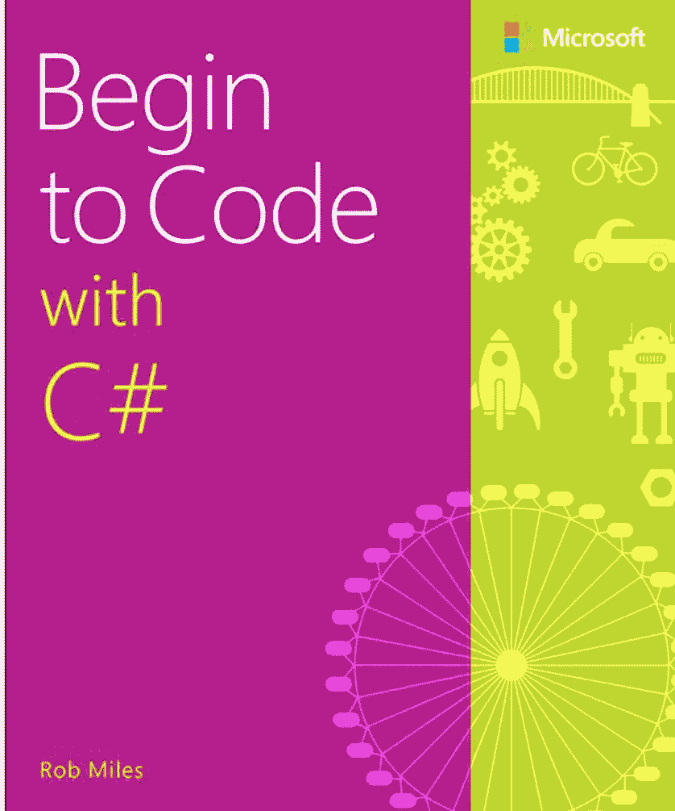

这是一本印刷精美、全彩的编程教材，它将引导你使用一个专门编写的易于使用的辅助函数库（称为 `Snaps`）来编写通用应用程序。该书由微软出版社出版，并可在包括亚马逊在内的所有常规渠道购买。

电子邮件：`rob@robmiles.com` 博客：`rob@robmiles.com` Twitter `@RobMiles`

如果你在文中发现错误，请向 `foundamistake@robmiles.com` 报告错误，我会进行查看。

# 引言

## 欢迎

欢迎来到 Rob Miles™ 的奇妙世界。这是一个充满冷笑话、双关语和编程的世界。在本书中，我将为你介绍 C 编程语言的入门。如果你以前有过编程经验，我会很高兴你读过这些文字。为了那些冷笑话也值得一读，而且你可能真的学到一些东西。

如果你以前没有过过，不要担心。编程并不是什么火箭科学，它……嗯，学习编程的坏消息是，在你刚开始时，会同时接触大量的想法和概念，这可能会让你感到困惑。学习编程的关键在于：

- *实践* – 多做编程，强迫自己从解决问题的角度去思考问题。
- *学习* – 查看别人编写的程序。通过学习他人创建的代码，你可以学到很多东西。然而，弄清楚他们是如何完成工作的将是你解决方案的绝佳起点。请记住，在很多情况下，并没有所谓的“最佳解决方案”，只有在特定语境下更好的方案，例如最快、最小的。
- *坚持* – 写代码是困难的。你必须为此付努力。大多数人无法成为程序员的原因是他们放弃了，因为他们害怕。不要太没耐心。如果你在一个编程问题上花费了 30 分钟，你就应该大声出来寻求帮助。或者至少离开这个问题等会儿回来。熬夜试图解决一个问题不是一个好主意，它会让你在第二天早上身体不适。我们将在后的 5.9 中介绍出错时该怎么办。

## 阅读笔记

这些笔记的编写目的是为了让你通读，然后在之后查阅。它们包含了许多“编程点”（`Programming Points`）。这些点基于真实的编程经验，必须认真对待。此外，还写了一些“Bash 要点”（`Bash Point`）。这些点非常重要，应该背记于心并进行正确的设置以监控。

如果你对如何让这些笔记变得完善任何建议（尽管我怀疑这不太可能），请随时与我联系。

最重要的是，享受编程。

Rob Miles

## 获取笔记和代码示例

这些笔记的打印版免费向赫尔大学的计算机科学学生提供。该书的网站是 `http://www.csharpcourse.com`，你还可以在那里找到基于本文编写的 C# 课程的 PowerPoint 幻灯片和实验练习。你也可以在这里找到 C# 代码示例。

如果你想买一份打印的文本副本供私人使用，我没意见，但如果你想打印大量副本，我希望你能与我联系。

你可以从亚马逊获取 Kindle 版本。

# 1 计算机与程序

在本章中，你将发现计算机是什么，并理解计算机程序如何告诉计算机该做什么。你将发现在开始编写程序时应该做什么，以确保你和你的客户都能获得“圆满结局”。最后，你将通览整体编程，特别是 C# 语言。

## 1.1 计算机

在我们考虑编程之前，我们先来考虑计算机。这是一项重要的工作，因为这为所有编程本身的问题设定了背景。

### 1.1.1 计算机简介

- 为什么蜜蜂在嗡嗡叫？
  答：因为它们不会歌词！

描述计算机的一种方式是“一个带脑子的电箱”。虽然这在技术上是正确的，但可能会导致严重的困惑，特别是对于那些试图编写冰箱程序的人来说。更好的描述方式是：

> 一个根据其所收到的指令处理信息的设备。

这个通用的定义排除了边缘情况，但并非详尽。然而，对于我们的目的来说，它足够了。你给计算机的指令通常被称为“程序”。使用计算机的行为通常被称为“编程”。这并不是大多数人使用计算机的方式。大多数人并不写程序。他们使用别人编写的程序。因此，我们必须区分用户和程序员。用户有一项工作，他或她认为在运行程序的计算机上完成这项工作更容易。程序员则在机器内部拥有一套主设计。黄金法则之一是，如果已经有现成的程序，就永远不要编写自己的程序，例如，想用计算机处理文字的愿望不应该导致写一个文字处理器！

然而，由于你经常想用计算机做一些以前没做过的事情，而且有人愿意付钱让你去这样做，我们将学习如何编程以及如何使用计算机。

在我们进入密集的编程业务之前，看看一些计算机术语是好的：

## 1.2 硬件与软件

如果你买了一台计算机，你得到的不仅仅是一个带脑子的箱子。为了让箱子有用，它还具备内置智能以理解执行操作的简单指令。此时，我们必须区分计算机的软件和硬件。

硬件是系统的物理层面。如果你能踢它，而且当它浸入水桶时它会踢，它就是硬件。机箱内的灯光和开关这些令人印象的部分是销售员卖给你的。

软件是让机器运转的动力。如果计算机有灵魂，它就保存在软件里。软件利用硬件的物理能力（即运行程序）来做有用的事情。它被称为软件，因为它没有物理实体，而且相对容易改变。软件是《星际迷航》电影中说“计算机正在运行”的声音。

# 计算机

`Windows 10` 是操作系统的示例。它为计算机程序提供了一个可以运行的平台。

所有计算机都带有一些软件。如果没有软件，它将是一个孤独且昂贵的系统。随计算机附带软件通常被称为操作系统。软件让机器变得可用。操作系统管理计算机上的所有信息并为你提供处理事务的命令。它还运行别人编写的程序。你将学习如何与操作系统交流，以便创建你的程序。

### 1.1.3 数据与信息

人们交替使用“数据”和“信息”这两个词。他们似乎两者等同。我认为数据和信息是两种不同的东西：

**数据**是计算机存储和处理的 0 和 1 的集合。

**信息**是人类对数据的解读及其意义。严格来说，我们处理的是数据，人类处理的是信息。作为一个例子，计算机可能在某处持有以下模式：

```
11111111 11111111 11111111 00000000
```

> 你可以认为：
> 银行透支了 256 英镑
> 你在地下 256 英尺
> 三十二个开关中有八个关闭了

从数据到信息的转换通常发生在人类读取输出时。所以，我是否太严谨了？（`pedantic` 指对细节的挑剔）这一点至关重要：计算机并不“知道”它正在处理的数据意味着。对于计算机而言，它们只是位模式，是用户赋予了这些模式意义。当你给出一个显示账户有 838,668 英镑的银行对单时，记住这一点！

# 数据处理

计算机是数据处理器。信息被输入其中；它们产生进一步的信息。计算机程序告诉计算机如何处理输入的信息。计算机处理数据的方式，就像香肠机处理肉一样：东西从一端进去，进行处理，然后从另一端出来：


这使得计算机成为非常好的“错误放大器”，也是一个可以用来责备的对象……

程序并不知道它正在处理的数据，就像香肠机不知道它制造了什么一样。把香肠放进香肠机，它会尝试把它做成香肠。把无效数据输入计算机，它会做无用的事情。是我们人类赋予了数据意义（见上文）。

计算机程序只是一指令序列，告诉计算机如何处理输入的数据以及输出的数据将具有什么格式。

3

# 计算机与程序

## 程序与编程

请注意，计算机的数据处理方面你可能认为它完全是读取和写入数字，但对于典型的数据处理应用来说，它远不止于此：

- **数字手表**：你手表中的微计算机从晶体接收脉冲并接收按钮的请求，处理这些数据并产生一个显示时间的显示器。
- **汽车**：发动机中的微计算机从传感器获取信息，告诉它当前的引擎转速、路速、空气中的氧含量、加速油门的设置，并产生电压，这些电压控制化油器的设置，以优化引擎性能。
- **CD 播放器**：计算机从光片中读取信号并将其转换为你想要听到的声音。同时，它会保持播放器的精确对位，并监控所有按钮，以防你选择光片的其他部分。
- **游戏机**：计算机从控制器接收指令，并使用这些指令来管理为玩游戏而创建的虚拟世界。

请注意，这些数据处理应用中的仅仅是应用于现有设备以改进其工作方式。然而，如果没有内置的数据处理能力，CD 播放器和游戏机将无法工作。

大多数昂贵的设备都包含数据处理组件以优化其性能，有些设备的存在是因为它们是智能的。在这个软件编写者正在不断移动的世界里，将数据处理业务看作与计算公司工资、读取数字和打印结果一样是非常重要的。这些是计算机的典型用途。

> 注意，这种“增加了软件后果的风险”可能会造成非常严重的损害。

作为工程师，在我们时代，有必要将数据处理组件拆分到其他设备中来驱动它们。你不需要一个开关来让某物工作，你需要一个连接计算机的开关来让它工作。嵌入式系统将使每个人都成为计算机用户，我们必须确保他们甚至意识不到那里有一台计算机！

你还应该记住，看似无害的程序可能具有威胁生命的可能性。例如，医生可能会使用电子表格来计算药物剂量。在这种情况下，程序中的缺陷可能会导致疾病甚至死亡（虽然我不认为他们真的那样做——但你永远不知道……）。

## 程序员的观点：底层始终是硬件

重要的是，你要记住，你的程序实际上是由一段具有物理局限性的硬件执行的。它可能会限制你实际放入目标机器中的代码以及以合理的速度运行。现代计算机的功率和容量使得这个问题不像过去那么严重，但你应该意识到这些。我会在适当的时候提到它们。

## 1.2 程序与编程

我告诉人们我是一个“软件工程师”。

编程是一门黑艺术。它是那种你在深夜关上百叶窗、没有人看的情况下，才心不情愿地承认的事情。告诉人们你为计算机编程，你会得到以下反应之一：

1. 茫然的眼神。
2. “这很有意思”，随后是一段关于他们刚刚安装的双层玻璃窗的详细描述。
3. 被要求解决他们遇到过的、未来将要遇到的每一个计算机问题。
4. 一种看出来你是一个非常棒的程序员，就像他们都开着法拉利并打入英格兰银行一样。

# C# 编程，Rob Miles 著，2016

# 计算机与程序

## 程序与编程

大多数人将编程定义为赚取一些没有人能理解的钱。

编程被定义为以计算机系统可以理解并执行的形式，推导出并表达对给定问题的解决方案。

从这个定义中可以得出一两点：

- 在编写程序解决问题之前，你必须能够自己解决这个问题。
- 计算机必须解决你试图让它做的事情。

### 1.2.1 什么是程序员？

并记住程序员赚了多少钱……

我喜欢把程序员想象得有点像水管工！水管工到达现场时会带着一大袋工具和备件。在观察了一会儿后，他打开包拿出各种工具，将它们全部组装起来并解决你的问题。编程就像这样。你被给了一个需要解决的问题。你拥有一大袋锦囊可供之用，在这种情况下，就是一种编程语言。你观察问题了一会儿，并努力解决它。编程的艺术在于知道哪些部分可以解决你所面临的问题，以及需要从你的锦囊袋中取出哪些部分来解决问题的每个部分。

编程不是关于数学的，而是关于组织和结构的。

## 从问题到程序

将一个问题并将其分解为给计算机的一系列指令的艺术是编程中最有趣的部分。遗憾的是，它是编程中最困难的部分。如果你认为编程仅仅是学习一种语言的问题，你就大错了。事实上，不要认为编程仅仅是想出一个解决你所相等问题的程序。

在编写程序时，你必须考虑许多事情：并不是所有的事情都与手头的问题直接相关。我将从以下基础开始，我们为客户编写程序。他有一个问题，你想写一个程序来解决它。我们将假设客户对计算机的了解比我们少！

最初，我们不会谈论编程语言、计算机类型或任何事情；我们只是要制造客户想要的东西。

## 解决问题

为客户提供完美的解决方案在现实世界中并不是意外发生的。许多软件项目简单地失败了，直到他们解决的问题是错误的。系统的开发者没有发现需要什么。开发者并不确定需要什么，直到他们问了问题。开发者并不确定需要什么，直到他们构建了什么。在什么。。什么。，客户客户客户客户糟糕糟糕的事情是“我可以做”。”。

在写时，，，，问题问题问题问题。。。。在解决问题时，我们应该考虑“我真的理解客户客户吗？”

在考虑如何写写时时，，，双方和客户达成一致的定义。

在现实世界中，这种定义被称为功能设计说明 (`FDS`)。它告诉客户想要什么。双方和

C 编程 © Rob Miles 2016

5

# 计算机与程序

## 程序与编程

客户签字后，数据处理的底线是如果你提供一个按照规格运行的系统。你有了规格，然后你可以考虑解决问题的方法。你可能认为在编写程序时这不是必要的：**这是错误的。** 编写规格迫使你非常详细地思考你的问题。

## 程序员的观点：规格始终存在

我为了钱写过很多程序。在没有获得可靠的规格之前，我*绝不会*编写程序。这是真的（或者特别是）如果我为他们做一份工作。现代的开发技术将客户置于核心位置，并让他们参与设计过程。这些技术基于这样：在开始时很难（实际上不可能）获得确定性的规格。作为开发者，你并不真正了解客户的业务以及技术的局限性和可能性。考虑到这一点，最好的主意是制作一系列版本的解决方案，并在进入下一个之前与客户讨论。这被称为原型设计。

### 1.2.2 一个简单的问题

考虑以下场景：你坐在酒馆喜欢的椅子上思考宇宙，被你一个卖双层玻璃的朋友打断了。他懂一些，并希望你帮助他解决一个面临的问题：

他刚刚开始自己制造窗单元，正在寻找一个程序来为他计算材料成本。他想要窗户的尺寸，然后得到制作窗户的成本打印，即木材和玻璃的数量。

“这看起来像是个不错的财源，”你想，你已经约定了一个价格，并开始工作。你需要做的第一件事是确切找出客户想要什么

## 规范问题

在考虑如何编写系统的规格时，有三个重要的要点：

- 输入系统的信息。
- 输出系统的信息。
- 系统如何处理这些信息。

有很多方法可以以图表的形式表示这些信息，目前在规范每个阶段时，我们将坚持使用书面文本：

### 输入信息

在我们不层玻璃窗的案例中，我们可以将信息描述为：

- 窗户的宽度。
- 窗户的高度。

### 输出信息

客户想要看到的信息是：

- 窗户所需的玻璃面积
- 框架所需的木材长度。

# 计算机与程序

## 程序与编程

通过查看这张图表，你就可以看到我们需要什么：

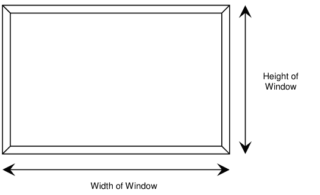

玻璃的面积是宽度乘以高度。为了制作框架，我们需要两块宽度等于窗宽木板和两块高度等于窗高的木板。

### 程序员观点：元数据至关重要

关于信息的信息被称为元数据（`metadata`）。在这种情况下，`meta` 一词意味着从问题中“退后一步”，以便在更广泛的语境下考虑它。在我们的程序中，元数据将告诉我们更多关于正在使用和产生的值，特别是信息表达的单位以及信息可能具有的有效范围。你在编写的程序中所表示的任何数量都必须至少具有这种级别的元数据。

### 程序实际在执行什么

```
area = width of window * height of window
wood length = (width of window + height of window) * 2
```

程序可以根据以下方程推导出这两个值：

### 详细说明

我们对程序将为我们做什么有了相当充分的理解。作为一个理性且有周全的人，我们不会在此停步，我们现在必须担心程序将如何决定输入的信息是否真实有效。

这必须与客户结合，他或她必须理解：如果提供的信息在指定的范围内，就是有效的，你的程序将考虑数据并采取相应的行动。

在这种情况下，我们因此可以将输入数据的定义扩展为：

- 窗宽，单位为米，值在 0.5 米到 3.5 米之间
- 窗高，单位为米，值在 0.5 米到 2.0 米之间（包含边界值）。

注意，我们还向描述中添加了单位，这非常重要——也许我们的客户从一个按卷出售的供应商那里购买木材，在这种情况下，我们的输出描述应该是：

- 窗户所需的玻璃面积，单位为平方米。记住我们销售的是双层玻璃，因此需要两块玻璃。
- 框架所需的木材长度，单位为英尺，使用每米 3.25 英尺的转换因子。

注意你和你客户都必须理解这份文档！

将所有内容写成你和客户都能理解的形式后，我们必须签署完成的规格书，然后开始工作。

## 证明它是有效的

在当今的现实世界中你会创建一个测试，允许你证明程序可以工作，例如你可以：

> “如果我给上述程序输入高 2 米、宽 1 米，程序应该告诉我是 4 平方米玻璃和 19.5 英尺木材。”

为正式项目设计的测试程序应该测试程序内所有可能的状态，包括至关重要的错误条件。在一个大型系统中，编写程序的人可能需要创建一个测试平台，供应商应该同意执行的测试数量和类型，然后签字以进行测试。客户和供应商都会编写描述这些内容的文档。

测试是开发过程中非常重要的一部分。有一种开发技术是在编写实际程序执行工作之前就编写测试。这实际上是一个好主意，我们稍后会探讨。在代码生产方面，你可以预计为测试解决方案而编写的代码与解决方案本身一样多。在考虑某项工作涉及多少工作量时，请记住这一点。

## 获取报酬

到此时，供应商知道，如果创建一个通过所有测试的系统，客户就无选择不支付费用了！还要注意，设计和测试程序已经冻结，没有可能导致客户要求修改工作的歧义，尽管当然这仍然可能发生！

好消息是，如果要求进行更改，可以在实际工作的语境下查看，并且他们可以预期获得报酬。

## 客户参与

同样注意，在一个“正式”系统中，客户会期望就程序如何与用户交互征求意见，有时甚至是显示器上字母的颜色！记住，这是程序员可能认为的最危险的事情之一，即：“这就是我们想要的！与用户的精确交互——当遇到错误时程序执行什么、信息如何呈现——这些都是客户可以产生强烈意见的地方。”理想情况下，这些信息应该被放入规格说明书中，其中包含了每个阶段应该显示的屏幕和按键的需求。将使用其他原型来获取程序看起来和感觉应该是如何的想法。

如果你觉得帮助你写程序对客户来说是很棒的，那么你就完全正确！你的客户可能需要带着问题的描述回到你的房间——稍后他们带着得到的解决方案回来，这样你会对一个只有你方案约 60% 的东西感到满意。客户会告诉你哪些部分看起来还可以，哪些按键需要更改。你低声嘀咕，还有另一个系统等待批准。鲍伯法则（`Bob's laws`）说，错误的 40% 中有 60% 是没问题的，所以你接受最后一部分并再次回到你的房间。


客户认为这很棒，就像一个高档裁缝，在经过所有改动后制作出了完美的合身衣服。客户看起来像某个人，提出建议更改，然后等待下一次发现错误。当截止日期过去但没有出现完成的产品时，他们会感到有点难过，但他们可以通过再次付费来让自己心情变好。

实际上我们在这里形成了一个循环，因为我之前提到过，当你不清楚初始规格时，构建原型系统是构建系统的好方法。然而，如果你打算使用原型，从这里找到这一点是件好事：

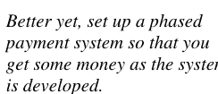

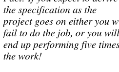

# 计算机与程序

### 编程语言

开始而不是由于你对问题的初始理解错误而导致事无功。

如果你对铸铁般规格书的坚持迫使系统思考它应该做什么以及将如何工作，那一切都是好处。客户可能会说：“但我付钱让你当计算机专家，我对这些机器一无所知。”这并不是借口。解释“一次到位（Right First Time）”技术的优势，如果这没有产生结果，就强制解决问题！

再次，如果我能用红色下划线我会：如果你是为自己写程序，以上所有如此。你是你自己的客户！

你可能认为我在这里纠结于一点；在我们学习编程期间将创建的简单系统，这些技术过于冗长是至关重要的。你错了。这样做这种工作的一个很好的理由是，它可以帮你完成大部分程序——通常是借助计算机的帮助。当我们开始编写双层玻璃程序时，我们现在知道必须：

- 读取宽度
- 验证值
- 读取高度
- 验证值
- 计算宽度乘以高度乘以2并打印
- 计算 (宽度 + 高度) * 2 * 3.25 并打印

工作的编程现在只需是将上述描述转换为计算机可以执行的语言……

### 程序员观点：优秀的程序员是沟通者

与客户交流并发现他/她想要什么门艺术。如果你想自称为一名合格的程序员，你将不得不学习如何做到。你必须做的第一件事之一是打破“我正在为你写程序”的想法，并将其替换为“我们正在为一个问题创造解决方案”。你不是为客户工作，而是与他们一起工作。这非常重要，特别是在你需要在功能或价格上与客户进行交易时。

# 计算机与程序

编程语言解决了这两个问题。它们足够简单，可以被计算机程序理解，而且它们减少了歧义。

## 程序员观点：语言本身并不重要

世界上有许多编程语言，在你的职业生涯中，你将不得不学习不止一种语言。`C#` 是一个入门编程的极佳语言，但不要认为它是你唯一学过的语言。

## 1.4 C#

世界上字面上上有成百上千种编程语言；你至少需要了解其中一些。

我们将学习一种叫做 `C#` 的语言（读作 c sharp）。如果你犯了错误将其读为 C sharp，请记住，它是一种非常灵活且强大的编程语言，拥有有趣的历史。它是由微软公司出于多种原因开发的，包括技术、政治以及其他市场因素。

`C#` 与 `C` 和 `Java` 编程语言有些相似之处，借用了（或改进了）这些语言提供的特性。`Java` 和 `C++` 的起源都可以追溯到一种名为 `C` 的语言，这是一种在 20 世纪 70 年代初发明的、非常危险且有趣的语言。`C` 以作为编写 `UNIX` 操作系统的语言而闻名，并且它是专门为此设计的。

## 1.4 危险的 C

我提到 `C` 是一种危险的语言。我这是什么意思？考虑一下电锯。如果我，Rob Miles，想用电锯，我会从商店里租一把。作为一个没有经验的锯子使用者，我希望它它带有许多内置功能，如保护罩和自动切断。这些功能会让我使用该工具时更安全，但可能会限制工具的寿命。如果我是一个真正的专业人士，我将无法切割某些类型的树木。如果我出去买一把完全没有任何安全功能的专业电锯，它可以用来切割几乎任何东西。如果我在使用专业工具时出错，我可能会丢掉一条腿，而业余级机器是不允许这种情况发生的。

在编程术语中，这意味着 `C` 缺乏其他编程语言提供的安全特性。这使得这种语言变得灵活得多。

然而，如果我在 `C` 中做了什么，它不会阻止我，因此比起使用更安全的语言，我有更大的机会通过 `C` 程序导致你的计算机崩溃。

## 程序员观点：计算机总是愚蠢的

我认为你应该始终基于这样的原则：任何计算机都不会容忍你的任何错误，而你所做的任何愚蠢的事情都会让世界变得美妙。

## 1.4.2 安全的 C#

`C` 语言在这方面试图兼得两者的优点。`C#` 程序可以包含托管（managed）或非托管（unmanaged）部分。托管代码与它运行的系统融合在一起。这确保了运行托管代码时让你的计算机崩溃是很困难的（但可能不可能）。所有这些融合都是有代价的，会导致你的程序运行速度变慢。

为了获得最大的性能，并能够直接访问底层系统的部分，你可以将你的程序标记为非托管。非托管程序运行得更快，但它可能会带着计算机一起挂掉。切换到非托管模式比比拆掉你新电锯上的保护罩，因为保护罩碍了事。

`C#` 是一个非常适合开始学习的语言，因为托管部分将使你更容易理解当你的程序出错时发生了什么。

## 1.4.3 C# 与对象

`C#` 语言是面向对象的。对象是一种组织机制，允许你将程序拆分为有意义的块，每个块都是整个系统的一部分。面向对象的设计使得项目的设计、测试和扩展变得变得容易得多。它还让你能够创建具有高度可靠性和稳定性的程序。

我非常热衷于面向对象编程，但我现在还不会告诉你它。这并不是因为我不知道它（真的），而是我相信在我们在程序中使用对象之前，需要解决一些非常基础的编程问题。

对象的使用既是设计也是编程，在能够设计更大的系统之前，我们必须学会如何编程。

## 1.4.4 让 C# 运行

你实际上是使用某种形式的文本编辑器编写了程序——该编辑器可能是编译和运行系统的一部分。

`C#` 是一种编译型语言。计算机无法直接理解这种语言，因此一个称为编译器的程序会将 `C#` 代码转换为许多简单的低级指令。这些低级指令被转换为驱动运行你程序的硬件的实际命令。

稍后我们将更详细地查看 `C#` 程序如何运作的这方面，现在现在需要记住的一点是，在实际运行程序之前，你需要先向编译器展示你美妙的 `C#` 程序。

编译器是一个非常大的程序，它知道如何判断你的程序是否合法。它做的第一件事是检查你使用语言本身的方式是否存在错误。如果编译器没有发现错误，就会产生一个输出。

当编译器注意到你做了一些在技术上并不违法，但可能表明你在某处犯了错误时，它还会标记警告。警告情况的一个例子是，你创建了东西但没有对它进行任何用途。编译器会告诉你这一点，以防你忘记添加了程序的某部分。

`C` 语言提供了一整堆其他东西（用技术术语来说），让 `C#` 程序能够执行如从键盘读取、在屏幕上打印、建立网络连接等操作。这些额外功能对你的 `C#` 可用，但你必须显式地请求它们。它们会在你的程序运行时自动加载。稍后我们将查看如何将你自己的程序拆分成许多不同的块（也许几个不同的程序员可以共同工作）。

## 1.4.5 创建 C# 程序

你实际上是使用某种形式的文本编辑器编写了程序——该编辑器可能是编译和运行系统的一部分。

`C#` 是一种编译型语言。计算机无法直接理解这种语言，因此一个称为编译器的程序会将 `C#` 代码转换为许多简单的低级指令。这些低级指令被转换为驱动运行你程序的硬件的实际命令。

稍后我们将更详细地查看 `C#` 程序如何运作的这方面，现在现在需要记住的一点是，在实际运行程序之前，你需要先向编译器展示你美妙的 `C#` 程序。

编译器是一个非常大的程序，它知道如何判断你的程序是否合法。它做的第一件事是检查你使用语言本身的方式是否存在错误。如果编译器没有发现错误，就会产生一个输出。

当编译器注意到你做了一些在技术上并不违法，但可能表明你在某处犯了错误时，它还会标记警告。警告情况的一个例子是，你创建了东西但没有对它进行任何用途。编译器会告诉你这一点，以防你忘记添加了程序的某部分。

`C` 语言提供了一整堆其他东西（用技术术语来说），让 `C#` 程序能够执行如从键盘读取、在屏幕上打印、建立网络连接等操作。这些额外功能对你的 `C#` 可用，但你必须显式地请求它们。它们会在你的程序运行时自动加载。稍后我们将查看如何将你自己的程序拆分成许多不同的块（也许几个不同的程序员可以共同工作）。

## 1.4.5 创建 C# 程序

你实际上是使用某种形式的文本编辑器编写了程序——该编辑器可能是编译和运行系统的一部分。

`C#` 是一种编译型语言。计算机无法直接理解这种语言，因此一个称为编译器的程序会将 `C#` 代码转换为许多简单的低级指令。这些低级指令被转换为驱动运行你程序的硬件的实际命令。

稍后我们将更详细地查看 `C#` 程序如何运作的这方面，现在现在需要记住的一点是，在实际运行程序之前，你需要先向编译器展示你美妙的 `C#` 程序。

编译器是一个非常大的程序，它知道如何判断你的程序是否合法。它做的第一件事是检查你使用语言本身的方式是否存在错误。如果编译器没有发现错误，就会产生一个输出。

当编译器注意到你做了一些在技术上并不违法，但可能表明你在某处犯了错误时，它还会标记警告。警告情况的一个例子是，你创建了东西但没有对它进行任何用途。编译器会告诉你这一点，以防你忘记添加了程序的某部分。

`C` 语言提供了一整堆其他东西（用技术术语来说），让 `C#` 程序能够执行如从键盘读取、在屏幕上打印、建立网络连接等操作。这些额外功能对你的 `C#` 可用，但你必须显式地请求它们。它们会在你的程序运行时自动加载。稍后我们将查看如何将你自己的程序拆分成许多不同的块（也许几个不同的程序员可以共同工作）。

## 1.4.5 创建 C# 程序

你实际上是使用某种形式的文本编辑器编写了程序——该编辑器可能是编译和运行系统的一部分。

`C#` 是一种编译型语言。计算机无法直接理解这种语言，因此一个称为编译器的程序会将 `C#` 代码转换为许多简单的低级指令。这些低级指令被转换为驱动运行你程序的硬件的实际命令。

稍后我们将更详细地查看 `C#` 程序如何运作的这方面，现在现在需要记住的一点是，在实际运行程序之前，你需要先向编译器展示你美妙的 `C#` 程序。

编译器是一个非常大的程序，它知道如何判断你的程序是否合法。它做的第一件事是检查你使用语言本身的方式是否存在错误。如果编译器没有发现错误，就会产生一个输出。

当编译器注意到你做了一些在技术上并不违法，但可能表明你在某处犯了错误时，它还会标记警告。警告情况的一个例子是，你创建了东西但没有对它进行任何用途。编译器会告诉你这一点，以防你忘记添加了程序的某部分。

`C` 语言提供了一整堆其他东西（用技术术语来说），让 `C#` 程序能够执行如从键盘读取、在屏幕上打印、建立网络连接等操作。这些额外功能对你的 `C#` 可用，但你必须显式地请求它们。它们会在你的程序运行时自动加载。稍后我们将查看如何将你自己的程序拆分成许多不同的块（也许几个不同的程序员可以共同工作）。


# 计算机与程序

## 程序员观点：语言本身并不重要

世界上有许多编程语言，在你的职业生涯中，你将不得不学习不止一种语言。C# 是一个入门编程的极佳语言，但不要认为它是你唯一学过的语言。

## 描述解决方案

描述你对问题解决方案的实际指令必须是你程序的一部分。在 C# 程序中，用于执行某项操作的单一、简单指令被称为“语句”（statement）。一个语句是执行某项特定操作的指令，例如将两个数字相加并将结果存储在其中。

编程中真正引人入胜的是那些能够改变后续执行操作的语句，这样你的程序就可以查看它们并决定该做什么。在 C# 中，你可以调用语句来形成执行某个特定任务的程序块。这样的任务被称为“方法”（method）。

一个方法可以非常简单，也可以非常大。它可以返回一个值，也可能没有返回值。你可以用你喜欢的任何名称为它命名，你的程序可以包含任何你认为合适的数量的方法。一个方法可以引用其他方法。C# 语言拥有海量的库，可以让你避免在每次编写程序时都“重复造轮子”。我们将在以后详细介绍方法。

老练的程序员会将一个问题分解为若干个较小的问题，并为每个小问题创建一个方法。

## 1.4 C#

世界上字面上有成百上千种编程语言；你至少需要了解其中一些。

我们将学习一种叫做 C# 的语言（读作 C sharp）。如果你犯了错误将其读为 C sharp，请记住，它是一种非常灵活且强大的编程语言，拥有有趣的历史。它是由微软公司出于多种原因开发的，包括技术、政治以及其他市场因素。

C# 与 C 和 Java 编程语言有些相似之处，借用了（或改进了）这些语言提供的特性。Java 和 C++ 的起源都可以追溯到一种名为 C 的语言，这是一种在 20 世纪 70 年代初发明的、非常危险且有趣的语言。C 以作为编写 UNIX 操作系统的语言而闻名，并且它是专门为此设计的。

### 1.4.1 危险的 C

我提到 C 是一种危险的语言。我这是什么意思？考虑一下电锯。如果我，Rob Miles，想用电锯，我会从商店里租一把。作为一个没有经验的锯子使用者，我希望它带有许多内置功能，如保护罩和自动切断。这些功能会让我使用该工具时更安全，但可能会限制工具的寿命。如果我是一个真正的专业人士，我将无法切割某些类型的树木。如果我出去买一把完全没有任何安全功能的专业电锯，它可以用来切割几乎任何东西。如果我在使用专业工具时出错，我可能会丢掉一条腿，而业余级机器是不允许这种情况发生的。

在编程术语中，这意味着 C 缺乏其他编程语言提供的安全特性。这使得这种语言变得灵活得多。

然而，如果我在 C 中做了什么它不会阻止我，因此比起使用更安全的语言，我有更大的机会通过 C 程序导致你的计算机崩溃。

### 程序员观点：计算机总是愚蠢的

我认为你应该始终基于这样的原则：任何计算机都不会容忍你的任何错误，而你所做的任何愚蠢的事情都会让世界变得美妙。

### 1.4.2 安全的 C#

C 语言在这方面试图兼得两者的优点。C# 程序可以包含托管（managed）或非托管（unmanaged）部分。托管代码与它运行的系统融合在一起。这确保了运行托管代码时让你的计算机崩溃是很困难的（但可能不可能）。所有这些融合都是有代价的，会导致你的程序运行速度变慢。

为了获得最大的性能，并能够直接访问底层系统的部分，你可以将你的程序标记为非托管。非托管程序运行得更快，但它可能会带着计算机一起挂掉。切换到非托管模式比拆掉你新电锯上的保护罩更危险，因为它碍了事。

C# 是一个非常适合开始学习的语言，因为托管部分将使你更容易理解当你的程序出错时发生了什么。

### 1.4.3 C# 与对象

C# 语言是面向对象的。对象是一种组织机制，允许你将程序拆分为有意义的块，每个块都是整个系统的一部分。面向对象的设计使得项目的设计、测试和扩展变得容易得多。它还让你能够创建具有高度可靠性和稳定性的程序。

我非常热衷于面向对象编程，但我现在还不会告诉你它。这并不是因为我不知道它，而是我相信在我们在程序中使用对象之前，需要解决一些非常基础的编程问题。

对象的使用既是设计也是编程，在能够设计更大的系统之前，我们必须学会如何编程。

### 1.4.4 让 C# 运行

你实际上是使用某种形式的文本编辑器编写了程序——该编辑器可能是编译和运行系统的一部分。

C# 是一种编译型语言。计算机无法直接理解这种语言，因此一个称为编译器的程序会将 C# 代码转换为许多简单的低级指令。这些低级指令被转换为驱动运行你程序的硬件的实际命令。

稍后我们将更详细地查看 C# 程序如何运作的这方面，现在需要记住的一点是，在实际运行程序之前，你需要先向编译器展示你美妙的 C# 程序。

编译器是一个非常大的程序，它知道如何判断你的程序是否合法。它做的第一件事是检查你使用语言本身的方式是否存在错误。如果编译器没有发现错误，就会产生一个输出。

当编译器注意到你做了一些在技术上并不违法，但可能表明你在某处犯了错误时，它还会标记警告。警告情况的一个例子是，你创建了东西但没有对它进行任何用途。编译器会告诉你这一点，以防你忘记添加了程序的某部分。

C 语言提供了一整堆其他东西（用技术术语来说），让 C# 程序能够执行如从键盘读取、在屏幕上打印、建立网络连接等操作。这些额外功能对你的 C# 可用，但你必须显式地请求它们。它们会在你的程序运行时自动加载。稍后我们将查看如何将你自己的程序拆分成许多不同的块，也许几个不同的程序员可以共同工作。

### 1.4.5 创建 C# 程序

# 标识符与关键字

你为你创建的东西命名，并尝试让函数的名称反映它的功能，例如 `ShowWindow`（显示窗口）或 `SaveToFile`（保存到文件）。C# 语言实际上通过寻找一个具有特殊名称 `Main` 的方法来运行你的程序。这个方法在程序开始运行时被调用，当 `Main` 结束时，你的程序结束。

你发明的名称是标识符（identifiers）。你还创建标识符来让事物持有值；当你想要存储单词的长度时，`length` 可能是一个很好的选择。稍后我们将介绍你创建标识符时遵循的规则和惯例。

属于 C# 语言本身的单词被称为关键字（keywords）。在食谱中，关键字会是如“cake”（蛋糕）或“oven”（烤箱）之类的词。方法可能是像“加热糖直到融化”或“搅拌均匀”这样的内容。事实上，你会发现程序看起来非常像食谱。在本文的一些代码列表中，关键字会显示为蓝色。

# 对象

我们编写的程序中的某些内容是对象，是我们使用的框架的一部分。继续我们的烹饪类比，这些就像搅拌碗和烤箱，在烹饪过程中被使用。在本文的一些代码列表中，对象的名称将显示为深浅不一的蓝色。

# 程序中的文本

你的程序中有两种文本。一类是你希望计算机执行的指令，另一类是你希望程序显示在屏幕面前的消息。你妈妈可能会在你的蛋糕食谱中添加以下指令：

> 现在用粉红色的糖霜在蛋糕顶部写上“圣诞快乐”字样。

她正在使用双引号来标记要画在蛋糕上的文本，而 C# 的工作方式也是一样。“Happy Christmas”并不是指令的一部分；它是需要被写的内容。这类消息在本文中标记为红色。

# 颜色与惯例

我在文中使用的颜色旨在与你使用视觉编辑器（如 Visual Studio 提供的编辑器）编辑程序时所看到的颜色保持一致。这些颜色仅仅是为了让程序更容易理解，并没有任何特殊含义。它们是由你编写程序的编辑器自动添加的。

# 简单数据处理

## 2.1 第一个 C# 程序

在本章中，我们将创建一个真正实用的程序，特别是如果你从事双层玻璃业务的话。我们将从创建一个非常简单的解决方案开始，并研究执行基本数据处理的 C# 语句。然后，我们将使用 C# 语言的额外功能来提高我们所产出的解决方案的质量。

我们将查看的程序将读取窗口的宽度和高度，然后打印出制作该尺寸窗口所需的木头和玻璃数量。

### `using System`

在 C# 命名空间中描述了许多内容。其中一个由 C# 提供的有用内容是 `Console` 类，它可以让我写入出现在屏幕上的内容。如果我想将其称为 `Console`，就必须告诉编译器我正在使用它。这意味着，如果我使用某个特定名称进行引用，编译器就会在 `System` 中查找是否存在与该名称匹配的内容。我们稍后还会使用其他命名空间。

### `class GlazerCalc`

类是面向对象编程的基础，正如我们将看到的。C# 程序由一个或多个类组成。类是一个容器，其中包含用于执行特定工作的代码和数据。

在我们的双层玻璃计算器中，类包含一个用于计算宽度和长度的方法，但类可以包含更多内容。你需要为创建的每个类发明一个标识符。我将其称为 `GlazerCalc`，因为这个名称反映了它的用途。

现在不用太担心类；请确保为创建的类选择合理的名称。还有一件事：有一个约定，包含特定类的文件名应与类本身匹配。换句话说，上面的程序应该保存在名为 `GlazerCalc.cs` 的文件中。

### `static`

这个关键字确保后面的成员始终存在。也就是说，在此语境下，`static` 表示“属于外层类，并且始终存在”。

当我们开始考虑对象时，会发现这个小关键字有各种有趣的含义。不过现在，请确保将它放入程序中，以便程序能够正确运行。

### `void`

`void` 表示空。在编程中，`void` 关键字意味着我们即将描述的方法不会向用户返回任何有用的结果。它只会完成一项工作，然后结束。

在某些情况下，我们会编写返回结果的方法；事实上，我们在程序中就使用了这样的方法。不过，为了防止其他代码意外使用 `Main` 方法返回的值，我们明确声明它不返回任何内容。

这样可以使程序更安全，因为编译器现在知道，如果有人尝试使用此方法返回的值，那一定是错误。

### `Main`

你可以根据方法将要为你执行的操作来选择方法名称，但 `Main` 除外。这个方法必须是程序的入口点，并且在程序开始运行时被调用。当 `Main` 结束时，程序也会结束。

### `()`

这是一对没有任何内容的括号。这听起来可能很奇怪，但实际上它在告诉编译器 `Main` 方法没有参数。这是一个给方法提供可以处理的内容的方法。

当你定义一个方法时，你可以告诉 C# 它作用于一个或多个对象，例如 `sin(x)` 可以作用于角度 `x` 的浮点型角度值。我们将在本文档中非常详细地介绍方法。

### `{`

这是一个大括号。正如其名称所示，大括号是成对出现的，即每一个左括号都必须有一个匹配的右括号。大括号允许程序员将程序片段组合在一起。这样一个程序组合通常被称为“块”（Block）。

一个块可以包含在其内部使用的变量声明，随后是一系列按顺序执行的程序语句。在这种情况下，大括号包围了 `Main` 方法的工作内容。

当编译器看到末尾匹配的右括号时，它就到达了方法的结束处，并可以寻找另一个方法（如果有的话）。未配对的大括号的影响是无效且致命的。

### `double`

我们的程序需要原封不动地记住某些值。特别是，它将返回窗口宽度和高度的值，然后计算并打印玻璃面积和窗口尺寸的值。赋值调用了将值放入变量的地方。

在任何块的开始，你可能想要留出空间来存放某些数据值。每个项目都可以存储特定类型的值。本质上，C# 可以处理三类数据：浮点数、整数和文本（即字母、数字和标点符号）。创建一个值的过程被称为声明变量。

`double` 变量可以存储范围极大且具有极高精度的值。

你通过给出数据类型，后跟你希望它拥有的名称列表来声明特定的变量。我们目前正在使用 `double` 类型。以后我们将使用其他类型。

### `width`、`height`、`glassArea`

这是 C# 中的一个列表，项由逗号（`,`）分隔名称。在这种情况下，这是一个变量名列表。

一旦编译器看到 `double` 词，它就期望找到至少一个要创建的变量。编译器会遍历列表，创建可以存放 `double` 类型值的框，并给它们赋予相应的名称。从现在开始，我们可以引用上述名称，编译器将知道我们正在使用那个变量。

### 程序员观点：了解你的数据从何而来

事实上，考虑到人们读取卷尺的准确性限制，加上我们并不会制作任何像宇宙一样宽的窗口，双精度浮点数对于这个应用来说是过剩的。

相反，你会询问编译器用英寸（inch）表示尺寸是否可以。我们稍后将讨论驱动特定变量类型选择的考虑。所有决策都由你在了解你正在创建的系统时收集的元数据（关于数据的数据）驱动。

### `;`

分号标记了变量名列表的结束，也是声明语句的结束。C# 中的所有语句都用 `;` 字符分隔，这有助于让编译器处于正确的轨道上。

`;` 字符实际上非常重要。它告诉编译器语句何时结束。如果编译器在预期看到它的地方没有找到，它就会产生错误。你可以将这些字符比作胶片中的齿孔，它们让一切保持同步。

### `string widthString, heightString;`

我们已经有一些可以存储数字的变量。现在我们要创建一些可以包含字符串的变量。这是因为当我们从用户那里读取数字时，首先是以文本字符串的形式读取的。然后我们将文本转换为数字。

变量 `widthString` 和 `heightString` 将包含数字的文本版本。

```c
```


`widthString =`

```
```

这是一个赋值语句。在这个 C# 语句中，我们将更改变量中的值。我们的程序将从用户那里读取一行文本，并将结果放在我们命名为 `widthString` 的变量中。记住，变量只是一个特定大小的命名框，可以存放单个数据项（在本例中为文本）。

你的程序很大一部分将是在随着各种结果的计算而为变量分配新值。C# 使用该字符来完成赋值。该语句的第一部分是之前定义的变量名。后面跟着 `=` 字符，我称它为 `gostinta`。我之所以这样叫，是因为右侧的值 `gostinta` 进入了左侧的变量中。抱歉。

### Console

在右侧是我们要赋值给 `widthString` 的东西。在这种情况下，结果将是 `ReadLine` 方法返回的字符串。该方法属于一个名为 `Console` 的对象，该对象负责用户的输入和输出。点 `()` 将对象标识符与方法标识符分开。

### ReadLine

这表示要调用 `ReadLine` 方法。这要求程序飞快地执行，执行此方法中的任何语句，然后返回。方法是你将程序拆分成若干块的方法，每个块都有特定的任务。它们也意味着你只需要写一次特定的代码，将其放入方法中，然后每当你需要完成那项特定任务时调用它即可。C# 系统有许多内置方法来为我们的程序处理工作。`ReadLine` 就是其中之一。

当这个程序运行时，`ReadLine` 方法被调用（或触发）。它将等待用户输入文本并按下回车键。输入的内容将作为字符串由该方法返回。调用的结果放在 `widthString` 变量中。

# 简单数据处理

## 第一个 C# 程序

### ()

方法调用后面跟着方法的参数。参数是传递给方法供其处理的东西。将其理解为某种类型的原材料。在 `ReadLine` 的情况下它没有参数；但我们仍然需要提供一个空列表来包含它。

### ;

我们之前见过分号。它标记了程序中语句的结束。

### width =

这是另一个赋值。变量 `width` 正被赋予一个值。程序中的许多语句只是在移动并执行操作。

### double

但语句的其余部分看起来有点吓人。实际上并不复杂。我们正在请求 `double`（负责持有浮点数的实体）为我们执行一项任务。在这种情况下，任务是“将字符串 `widthString` 转换为 `double`”。注意，对象暴露其方法并没有什么不好。它是我们完成工作的方式。

### Parse

`Parse` 方法的任务是将它收到的字符串转换为 `double` 浮点数。为了完成这一点，它必须遍历字符串，依次提取每个数字并计算实际值，例如将“12”计算为十加二。这种查看过程通常被称为解析（parsing）。这就是我们使用的方法的名称来源。该方法返回它找到的数字。

注意，这具有重大的风险，如果用户没有输入类型，或者输入了诸如“Twenty Five”（二十五）这样的值，`Parse` 方法无法解决问题并导致失败。如果它失败了，以及你如何解决这种失败，将留给后面的章节讨论，以增加本文的趣味性。

### (widthString);

我们已经见过方法调用后面必须跟着参数（原材料）。在 `ReadLine` 的情况下没有参数，但我们仍然需要提供一个空列表来包含它。在 `Parse` 的情况下，方法需要一个它要处理的字符串。我们通过将包含文本的字符串变量 `widthString` 放入上面的括号中来实现这一点。

> 给各位的一处冷门电影/剧集梗。

19

# 简单数据处理

## 我的第一个 C# 程序

```c
heightString = Console.ReadLine();

height = double.Parse(heightString);
```

这些语句简单地重复了读取高度文本并将其转换为双精度数值的过程（即窗口的高度）。

## woodLength = 2*(width + height)*3.25;

这是程序本身的核心部分。这是执行工作的部分。它获取高度和宽度值，并利用它们计算出所需的木材长度。

当我编写程序时，即使编译器不需要，我也会使用括号。这让程序变得更加清晰。

这个计算是一个与上面相似的表达式，重要的是，你要注意到使用括号来修改表达式中值计算的顺序。通常情况下，C 语言会按照你预期的方式处理表达式，即：先执行所有的乘法和除法，再执行加法和减法。在上面的表达式中，我想要先处理某些部分，所以我按照数学中的做法做了：我给需要先执行的部分加上了括号。

注意，我使用了 3.25 这个系数，是因为客户想要以英尺为单位长度。一米有 3.25 英尺，因此我将米（meters）的结果乘以这个系数。

表达式中的 `+` 和 `*` 字符被称为运算符，因为它们会导致操作的发生。表达式中的其他项被称为操作数。表达式就是运算符所作用的对象。

## glassArea = 2 * ( width * height )

这一行重复了玻璃面积的计算。注意面积单位是米（meters），因此不需要转换。我将一个乘法放在括号内，这为了表示我正在计算面积的两倍（即两块玻璃的面积）。其实没必要特别这样做，但我认为这让代码稍微清晰了一些。

## Console.WriteLine

这是一个方法调用，类似于 `ReadLine` 方法，不同在于这一个方法接收输入的内容并将其打印到控制台上。

(

这是该方法调用参数的开始。我们已经在 `Parse` 和 `ReadLine` 的调用中见过这些参数用法。

"length of the wood is"

这是一个字符串字面量。它是一段直接存在于程序中的文本。这段文本被双引号包围，以告诉编译器这部分是程序中的一个值，而不是编译器自身的指令。

+

加号是一个加法运算符。我们见过它被应用于两个整数之间。然而，这里的加号含义完全不同。在这种情况下，它意味着“将两个字符串拼接”。

# 简单数据处理

## 我的第一个 C# 程序

你必须习惯程序中的“上下文（context）”概念。对于命名空间，对于运算符也是如此。C# 系统使用操作的上下文来决定做什么。在之前两个双精度浮点数之间的 `+` 案例中，它意味着“和”。而在这里，左侧是一个字符串。这意味着它将执行字符串拼接而不是数学加法。

## wordLength

这是上下文起作用的另一个例子。之前我们把 `wordLength` 用作数值的数值表示（在这个程序中，它是所需的单词长度）。然而，在它目前使用的上下文中（字符串的末尾），它不能像那样工作。

C# 编译器必须强制将长度数据项转换为字符串，以便它能在此位置被正确使用。幸运的是，它可以做到，所以程序的运行结果如你预期的的一样。

精确地理解这里正在发生什么非常重要。考虑一下：

```c
Console.WriteLine( 2.0 + 3.0 );
```

这将执行一个数值计算 (2.0 + 3.0) 并产生一个双精度浮点值。随后，该结果值将被要求提供自己的字符串版本进行打印，输出为：

5

但另一行代码：

```c
Console.WriteLine( "2.0" + 3.0 );
```

则会将 "2.0" 视为两个字符串的拼接。它会要求值 3 转换为字符串（听起来很奇怪——但事实确实如此）。随后它将输出：

2.03

字符串 "2.0" 的末尾加上了值 3。这种行为上的差异完全是因为所执行操作的上下文不同。

> + "feet",

这里是另一次拼接。我们正在添加 "feet" 单词的末尾。每当我输出一个值时，总是把单位放在末尾。这有助于确保数值是有意义的。

)

括号标记了为 `WriteLine` 方法调用构建的参数的结束。当方法被调用时，程序首先从所有组件组装出一个完整的字符串，通过添加（或拼接）产生单个结果。然后，它将生成的字符串值传递给方法，由方法将其打印在控制台上。

# 简单数据处理

## 我的第一个 C 程序

;

分号标记了该语句的结束。

}

现在是真正重要的内容。程序本质上已经完成。我们添加了所有需要的行为。然而，编译器仍然需要被告知我们已经到达了末结尾。这个右大括号标记了 Main 方法体所在代码块的结束。代码块以 `{` 开始，以 `}` 结束。当编译器看到这个时，它会说：“这就是 Main 方法的结束”。

}

右大括号相对于第一个大括号承担着重要的任务。它标记了 `Global` 类的结束。在 C 语言中，一切都存在于类之中。类是许多内容的容器，包括方法。如果我们需要的话（稍后我们会这样做），我们可以把多个方法放入类中。目前，我们只需要在类中有一个方法。因此，我们使用第二个大括号来标记类本身的结束。

## 标点符号

这标记了我们程序的结束。你可能已经注意到这里有大量的标点符号。这些至关重要，必须按照 C# 的要求显式提供，否则你将得到所谓的编译错误。这表明编译器太笨了，无法理解你给它的内容！

## 存储整数值

整数是计算机存储最容易的数值类型。每个值都会映射到特定的位模式。唯一的问题是范围。值越大，表示该值所需的位数就越多。

C# 提供了多种整数类型，取决于你想要存储的数值范围：

| 类型 | 位数 | 范围 |
|---|---|---|
| byte | 8 位 | -128 到 127 |
| byte | 8 位 | 0 到 255 |
| short | 16 位 | -32,768 到 32,767 |
| ushort | 16 位 | 0 到 65,535 |
| int | 32 位 | -2,147,483,648 到 2,147,483,647 |
| uint | 32 位 | 0 到 4,294,967,295 |
| long | 64 位 | -9,223,372,036,854,775,808 到 9,223,372,036,854,775,807 |
| ulong | 64 位 | 0 到 18,446,744,073,709,551,615 |

标准整数 `int` 在 C# 中可以容纳惊人的数字，范围从 -2,147,483,648 到 2,147,483,647。如果你想存储比这更大的整数（尽管我不知道你为什么要这么做），则有一个 `long` 版本。

整数变量的一个示例可能是跟踪草地里羊的数量：

```csharp
int numberOfSheep;
```

这创建了一个可以跟踪超过两千亿只羊的变量！它还允许程序处理“负数数量的羊”，这可能没有意义（除非你真的有一座“羊银行”并让人们去骚扰它们）。请记住，语言并不知道任何此类考虑。如果你想拥有超过 1,000 只羊，且羊的数量从不减少，你必须自己添加这种行为。

当你使用 Visual Studio（或其他支持语法高亮的代码编辑器）编辑程序时，你会发现 C# 语言内置的类型名称（如 `int` 和 `float`）显示为蓝色，如上所示。

## 程序员观点：检查你自己的数学计算

你应该记住的一点是，程序并不总是能检测到你超过了变量的范围。如果我将 255 放入一个整数类型的变量中，这种类型是可以的，因为 255 是该类型可以容纳的最大值。然而，如果我在该系统中在该值上加 1，它可能检测不到这是一个错误。事实上，这可能会导致值“回绕”到 0。这可能会给你带来大问题。

## 整数字面量值

整数表示为一串没有小数点的数字：

```csharp
23
```

这是整数值 23。我可以像下面这样在我的程序中使用它：

```csharp
numberOfSheep = 23 ;
```

如果我使用的是“较短”的类型，编译器会将该字面量视为该类型：

```csharp
sbyte tinyVal = 127;
```

在这条语句中，127 被视为 `sbyte` 字面量，而不是整数。这意味着如果我做了一些蠢事：

# 简单数据处理

### 操作数据

```csharp
byte tinyVal = 128;
```

（这是 `sbyte` 能容纳的最大值 127）编译器将检测到我犯了错误，程序将无法编译。

## 存储实数值

“实数”是非整数数字的通用术语。它们具有小数点和小数部分。根据小数点在数字中浮动的位置，其名称为 `float`。

C 提供了一种可以容纳实数的框类型。标准的 `float` 范围从 1.5E-45 到 3.4E38，精度只有 7 位（它不像大多数口袋计算器那样好用）。

如果你需要更高的精度（尽管当然你的程序将使用更多内存且运行得更慢），你可以使用 `double` 代替（`double` 是精度的缩写）。它占用更多内存，但其范围为 5.0E-324 到 1.7E308，精度为 15 位。

`float` 的示例可以是改变冰激淋平均价格的东西：

```csharp
float averageIceCreamPrice;
```

`double` 的示例可以是改变宇宙宽度（以英寸计）的东西：

```csharp
double widthInches;
```

如果你需要极致精度但范围稍小，可以使用 `decimal`。它使用的空间是 `double` 的两倍，容纳精度为 28-29 位的值。它被用于财务计算，在这些计算中数字并不很大，但需要极高的准确性。

```csharp
decimal robOverdraft;
```

## 实数字面量值

有两种方式可以存储浮点数：作为 `float` 或作为 `double`。当涉及到将字面量放入程序时，编译器希望知道你写的是浮点值（较小尺寸）还是双倍精度的。

`float` 字面量可以通过加上 `f` 来表示：

```csharp
2.5f
```

`double` 精度字面量可以直接写：

```csharp
2.5
```

你可以使用科学计数法来表示浮点值：

```csharp
2.5E10
```

## 2.2.4 使用布尔值存储状态

`bool` 变量的一个示例可以是存储网络连接状态的。

```c
bool networkOK;
```

### bool 字面量值

这些值可以很容易地表示 true 或 false；

```c
networkOK = true;
```

### 程序员观点：考虑你变量的类型

为变量选择正确的类型是一项技能。我倾向于只在万不得已的情况下才使用浮点数存储。它们引入了我不热衷的精度缺失。只要花一点巧思，我就可以非常完美地处理整数。例如，我不会将商品的价格存储为 1.5 英镑（使用 `float`），而是会将价格存储为 150。

此外，在考虑如何存储数据时，记住数据源自何是重要的。在其中一个示例中，我使用了 `double` 类型来存储窗口的宽度和高度。这真的很愚蠢。它没有考虑到所需的精度，或者窗口能有多精确。我怀疑我的玻璃销售员测量的精度无法超过每小时 1 米，因此按该精度存储数据是有意义的。

这说明了另一个元数据方面的考虑因素：当你面临存储浮点信息的任务时；在决定如何存储它之前，先弄清楚它是产生的。例如，你可能认为当被要求处理汽车速度时，你需要存储一个浮点值。然而，当你发现速度传感器提供的答案精度为每小时 1 米时，这项工作就会变得简单了。

## 2.2.5 标识符

标识符是程序员为程序中的某个事物选择的名字。变量名更准确的说是“标识符”。我们将在其他地方看到创建标识符的情况。C# 对于什么构成有效标识符有一些规则：

- 所有标识符必须以字母开头。
- 在字母之后，你可以使用字母、数字或下划线。
- 下划线字符。

大写和小写是不同的，即 `Fred` 和 `fred` 是不同的标识符。这里有几个例子，它们是无效的（试着猜猜哪一个是为什么）：

```csharp
int fred;

float jim;

char 29yesitsme;
```

编程的黄金法则之一（与“打字时不要离开键盘”）是：始终为你的变量赋予有意义的名字。根据我读过的米尔和布恩浪漫小说，最好的关系是有意义的关系。

# 简单数据处理

### 操作数据

在 C# 中，我们目前创建的这类变量的习惯是混合使用大小写字母，使标识符中的每个单词都大写开头：

```csharp
float averageIceCreamInPence;
```

这有时被称为驼峰命名法（camel case），可能是因为标识符中大写字母引起的“驼峰”。

### 程序员观点：考虑你变量的名字

选择变量名是另一项你应该努力的技能。它们应该足够长以表达含义，但又不要长到让你的程序行变得太复杂。也许 `averageIceCreamInPence` 这个名字有点过头了，但我可以接受。记住，你总是可以通过合理的布局做一些合理的事情，让程序看起来正常：

```csharp
averageIceCreamInPence = computedTotalPriceInPence / numberOfIceCreams;
```

## 2.2.6 将值赋给变量

一旦我们有了变量，就需要知道如何向其中放入值，并将其取出。C 语言通过赋值语句来实现这一点。赋值包含两个部分：你想赋值的内容和你想把它放置的地方，例如考虑以下内容：

```csharp
class Assignment
{
    static void Main ()
    {
        int first, second, third;

        first = 1;
        second = 2;
        third = second + first;
    }
}
```

代码示例 0：赋值示例

程序的第一部分现在应该很熟悉了。在 `Main` 中，我们定义了三个变量：`first`、`second` 和 `third`。它们都是整数类型。最后三个语句是实际执行工作的语句。这些是赋值语句。赋值给特定变量赋一个值，该变量必须是合理的类型（注意，你对自己做的事情要理智）。正如我们所知，编译器不知道你在做什么。被赋值的值是一个表达式。中间的等号主要是为了困扰我们，它并不意味着意义上的相等；我倾向于把它看作一个“goostino”（见上文）。Goostino 获取赋值右侧的结果，并将其丢进左侧的盒子里，这意味着：

```csharp
2 = second + 1;
```


- 这是一种编程上的不规范行为，会导致各种糟糕错误的出现。

## 表达式

表达式是一个可以求值并产生结果的东西。我们可以在程序中随心所欲地使用这个结果。表达式可以简单到单个值，也可以复杂到大型计算。它们由两部分组成：运算符和操作数。

C# 编程 Rob Miles 2016  
28

# 简单数据处理

## 操作数

操作数是运算符作用的对象。它们通常是字面量或变量的标识符。在上面的程序中，`first`、`second`、`third` 是标识符，而 `2` 是字面量。字面量是代码中字面上存在的值。编译器为字面量关联了一个类型。

## 运算符

运算符是执行工作的符号：它们指定了对操作数执行的操作。大多数运算符作用于两个操作数，各占一侧。

这里有几个例子：

```csharp
2 + 3 * 4

-1 + 3

(2 + 3) * 4
```

这些表达式由 C# 从左到右计算（求值），就像你自己做的那样。同样，在传统数学中，表达式中所有的乘法和除法首先执行，然后是加减法。

C# 通过给每个运算符分配优先级来实现。当 C# 计算表达式时，它会寻找所有优先级最高的运算符并先执行它们。它寻找下一个，以此类推，直到获得最终结果。注意，这意味着上面的第一个表达式将返回 14 和 20。

如果你想强制执行计算的顺序，可以在你想要先执行的内容周围加上括号，如最后一个示例所示。如果你愿意，可以在括号内添加内容，只要你确保左括号和右括号数量相等即可。作为一个简单的人，我倾向于通过给所有内容都加上括号来让事情变得非常清晰。

可能值得做得过……

这说明了另一个元数据方面的考虑因素：当你面临存储浮点信息的任务时，在决定如何存储它之前，先弄清楚它是如何产生的。例如，你可能认为当被要求处理汽车速度时，需要存储一个浮点值。然而，当你发现速度传感器提供的答案精度为每小时 1 米时，这项工作就会变得简单了。

## 2.2.7 更改数据的类型

C# 编程 Rob Miles 2016  
29

# 简单数据处理

## 数据操作

类型转换也可以通过其他方式丢失信息：

```csharp
int i;

i = (int) 1.999;
```

上面的代码获取了 1.99（在编译时被视为 `double` 类型的值）并将其转换为 `int`。这会丢弃小数部分，这意味着变量的最终值将是 1，尽管原始数字更接近一个带有小数部分的值（`float`、`double`、`decimal`）。你应该记住，每当你从一个带有小数的值转换为一个不带小数的值时，就会发生这种截断。

## 转换与字面量值

我们已经看到，你可以将“字面量”转换到你的程序中。这些只是你想要在计算中使用的值。例如，在我们的双层玻璃程序中，我们希望将米为单位的长度宽度乘以 3.25，将长度转换为英尺（1 米等于 3.2 英尺）。

C# 对它正在组合的内容非常小心，这包括它如何允许使用值。这是通过像这样的语句实现的：

```csharp
int i;

i = 3.4 / "stupid";
```

变量将转换为它们应得的类型。C# 编译器知道将值 3.4 除以字符串 `"stupid"` 是愚蠢的。然而，考虑一下这个：

```csharp
float x;

x = (float) 3.4;
```

这段代码看起来完全正常。但实际上并非如此。因为字面量 3.4 在表示为字面量时是一个双精度值，而变量 `x` 已经被声明为浮点数。如果你想将一个浮点字面量值放入浮点变量中，可以使用：

```csharp
float x;

x = (float) 3.4;
```

这会将 `double` 字面量转换为浮点值，这样赋值就能工作了。

为了方便起见，C# 添加了另一种在程序中分配浮点字面量值的方法。如果你在值后面加一个 `f`，它就会被视为一个浮点值。这意味着：

```csharp
float x;

x = 3.4f;
```

这将正确编译。

## 2.2.8 表达式中的数据类型

当 C# 使用运算符时，它会根据结果的类型做出决定。本质上，如果两个操作数都是整数，它就会说结果应该是整数。如果两个都是浮点数，它就会说结果应该是浮点数。这可能会导致问题，考虑以下情况：

```text
1/2

1/2.0
```

你可能认为这会得到相同的结果。事实并非如此。编译器认为第一个只涉及整数的表达式应该给出一个整数结果。它将其评估为整数值 0（小数部分总是会被截断）。第二个表达式因为涉及浮点值，所以它将被评估为给出一个双精度浮点数结果，即更准确的答案 0.5。

C# Programming © Rob Miles 2016

31

# 简单数据处理

## 数据操作

运算符的行为取决于其使用的用例。稍后我们将看到，`+` 通常执行数值计算，但它也可以用于字符串之间以将它们连接起来，即 `"Ro" + "b"` 将得到结果 `"Rob"`。

如果你想对特定类型的运算符进行完全控制，编译器必须生成显式转换来为该运算符设置正确的上下文。

```csharp
using System;

class CastDemo
{
    static void Main ()
    {
        int i = 3, j = 2;

        float fraction;

        fraction = (float)i / (float)j;

        Console.WriteLine("fraction : " + fraction);
    }
}
```

代码示例 03：转换演示

上面的 `(float)` 转换告诉编译器将这些值视为浮点数。

# 编写程序

- 应该清楚是谁编写了程序，以及在什么时候修改的。如果你写了一些好的东西，应该签上你的名字。如果你修改了你写的内容，应该添加关于你所做更改及其原因的信息。

一个编写良好的程序，很大程度上取决于程序员在其中的注释。没有注释的程序就像一架有自动驾驶但没有窗户的飞机。它可能会带你到达正确的地方，但从内部很难判断它正从哪里来。

## 块注释

当 C# 编译器看到 `/*` 序列（这意味着注释的开始）时，它对自己说：

> 啊吧！这里有一段比我更聪明的脑袋可以思考的信息。我会忽略之后的所有内容，直到我看到 `*/` 关闭注释。

例如：

```c
/* 这个程序计算双层玻璃窗销售员所需的玻璃和木材。 */
```

写注释时要大方一些。它们有助于让你的程序变得更容易理解。你会惊讶地发现自己忘记程序是如何运行的得有多快。你还可以使用注释让人们了解程序的特定版本、最后修改的时间和原因，以及编写程序的程序员的名字——即使那是你本人。

如果你使用的是支持语法高亮的编辑器，你会发现注释通常显示为绿色。

## 行注释

另一种形式的注释使用 `//` 序列。这标记了注释的开始，并延伸到该行代码的末尾。它适用于在语句的末尾添加快速备注：

```csharp
position = position + 1; // 移动到下一个客户
```

我对该语句进行了注释，以向读者提供关于其实际作用的额外信息。

## 程序员观点：不要添加太多

编写注释是一件非常明智的事。但不要做得过头。记住，阅读你程序的人应该知道 C# 语言，不需要他们解释得太详细：

```csharp
goatCount = goatCount + 1; // 给 goatCount 加 1
```

我认为这对于读者来说是公然的侮辱。如果你选择了合理的标识符，你会发现程序代码本身就能直接表达其执行的大部分功能。

## 2.3.2 控制程序流

我们的第一个双层玻璃程序非常简单，它从第一条语句一直运行到最后，然后停止。你经常会遇到这样的情况：程序必须根据给定的数据改变其行为。基本上，程序流有三种：

1. 直线型
2. 根据给定条件选择
3. 根据给定条件重复

# 简单数据处理

## 条件执行：`if`

上面用于计算窗户所需木材和玻璃的程序很不错；事实上，我们的客户可能会对此感到满意。然而，它并不完美。问题不在于程序，而在于用户。

如果你给程序一个宽度为 -1 的窗户，它会继续运行并产生愚蠢的结果。我们的程序没有对无效的宽度高度进行检查。如果程序未能识别出用户给了一个愚蠢的值，用户可能会有理由投诉。在许多案件中，美国法院正在处理此类诉讼，这些案件中程序未能识别无效数据，产生了垃圾数据并造成了大量损害。

我们想做的是注意到真正的错误，并告诉用户我们发现了一些疑点。在我们的程序规范中，我们向客户说明了这些内容（这是我们的元数据）：

程序将拒绝超出以下范围的窗尺寸：

- 宽度小于 0.5 米
- 宽度大于 5.0 米
- 高度小于 0.75 米
- 高度大于 3.0 米

这意味着我们已经尽了所能；如果程序得到的宽度是 1 而不是 10，那是用户的问题；从我们的角度来看，最重要的是上述限制防止了我们被起诉！

为了让我们能够做到这一点，程序必须注意到“顽皮”的值并拒绝它们。要这样做，我们可以使用以下结构：

```csharp
if (condition)
    如果条件为真则执行的语句或块
else
    如果条件为假则执行的语句或块
```

条件决定了程序中发生什么。那么，我们如何构造条件呢？C# 有一种方法可以在程序中显式地表示真和假。我们已经看到 `bool` 类型用于显示这种逻辑状态。

我们可以创建返回逻辑值的条件。这些被称为“逻辑条件”。这很合逻辑。最简单的条件就是简单的真值或假值，例如：

```csharp
if (true)
    Console.WriteLine ("hello mum");
```

这是有效的，尽管除非条件始终为真，否则它是没用的，这样 `"hello mum"` 就会一直打印（注意我们省略了 `else`——这是可以的，因为它是可选的）。

## 条件和关系运算符

为了让工作为我们服务，我们需要一组可以在逻辑表达式中使用的**关系运算符**。关系运算符作用于操作数，仅仅是数值型操作数也是如此。然而，任何涉及它们的表达式只能产生两个值之一：真或假。可用的关系运算符如下：

### `==`

**等于。** 如果左侧和右侧相等，则表达式为 `true`。如果它们不相等，则为 `false`。

```csharp
4 == 5
```

结果为 `false`。注意，比较浮点数以判断它们是否持有完全相同的值并没有特殊意义。由于精度限制，我可能会发现条件在不应该失败的情况下失败，例如以下方程：

```csharp
x = 3.0 * (1.0);
```

可能会导致包含 0.999999999，这意味着：

```csharp
x = 1.0
```

变为 `false`——尽管在数学上该测试应该为 `true`。

### `!=`

**不等于。** 等于的反转。如果操作数不等，则表达式为 `true`；如果它们相等，则为 `false`。再次，在处理浮点数时不建议这样做。

### `<`

**小于。** 如果左侧的操作数小于右侧，则表达式为 `true`。如果左侧操作数大于或等于右侧，则表达式给出 `false`。在这种情况下，比较浮点数是有效的。

### `>`

**大于。** 如果左侧的操作数大于右侧，结果为 `true`。如果左侧的操作数小于或等于右侧，结果为 `false`。

### `<=`

**小于等于。** 如果左侧的操作数小于或等于右侧，你得到 `true`，否则得到 `false`。

### `>=`

**大于等于。** 如果左侧的操作数大于或等于右侧，你得到 `true`，否则得到 `false`。

### `!`

**非。** 它用于反转特定的值或表达式，例如你可以说 `!true`，结果是 `false`，或者你可以说 `!(x == y)`——这等同于 `(x != y)`。当你想要反转表达式的含义时，使用非。

## 组合逻辑运算符

有时我们想要组合逻辑表达式或更复杂的选择，例如测试窗户宽度是否有效，此时我们需要测试它是否大于最小值且小于最大值。C# 提供了额外的运算符来组合逻辑值：

### `&&`

**与。** 如果 `&&` 两边的操作数均为真，则 `&&` 的结果为 `true`。如果其中一个为假，结果则为 `false`，例如：

```csharp
(width >= 0.5) && (width <= 5)
```

如果根据我们的描述 `width` 是有效的，那么结果将为真。在这个示例中，我给每个条件都加上了括号，以便更容易看出发生了什么。然而，编译器能够判断出 `&&` 需要应用于两个逻辑表达式的结果之间，它们实际上并不是强制要求的。

### `||`


或者，如果 `||` 两侧的两个操作数中任何一个为真，表达式就为真。只有当两个操作数都为假时，表达式才为假，例如：

```cs
width < 0.5 || width > 5.0
```

- 如果 `width` 是无效的，那么结果将为真。我们说如果 `width` 小于最大宽度，它就是无效的。为了恢复该条件的意义（即当值无效时为真），我们不仅需要将每个表达式中的 `<` 改为 `<=`，还要将 `&&` 更改为 `||`。

将这些运算符与 `if` 结构结合使用，我们可以做出决策并根据状态改变程序的运行行为。

## 德·摩根定律是基础

## 程序员观点：拆分你的条件

如果你发现自己正在创建非常高级且复杂的条件来创建一个语句，你可能会发现使用多个语句并以适当的方式对代码进行缩进会让情况变得更清晰。这将使代码更易调试，因为你可以一次通过一个条件来观察程序的运行，而不是基于一个巨大的条件进入某个特定方向，这样你就不需要恐慌了。

## 使用块组合语句

我们决定，如果用户提供的范围不在允许范围内，就会生成一个错误并将值设置为最大值或最小值。为了做到这一点，我们需要根据特定条件选择两个语句：一个用于打印消息，另一个执行赋值。你可以通过使用 `{` 和 `}` 字符来实现。将许多语句组合在 `{` 和 `}` 字符中会被识别为单个语句，因此我们执行了以下操作：

```cs
if (width > 5.0)
{
    Console.WriteLine("width too big, using maximum!");
    width = 5.0;
}
```

现在这两个语句构成了一个块，只有当 `width` 大于 5.0 时才会执行。你可以用这种方式组合成百上千条语句，编译器并不介意。你也可以将代码块放在其他块内部，这被称为嵌套。

你的程序中 `{` 和 `}` 字符的数量必须一致，否则当编译器在文件末尾遇到块的中间或者在程序运行过程中到达结尾时，将会产生奇怪且不可理解的错误！

## 程序员观点：利用布局告知读者

我通过对段落进行空格缩进来让事情变得容易理解得多。每当我使用 `{` 字符编写一个块时，我都会稍微向左留出边距。这样我就可以一眼看出自己处于哪个层级。这是合格程序员的所作。

## 元数据、魔数与 `const`

魔数是一个具有特殊含义的值。它在程序中永远不会被改变；相反，它是程序内部使用的常量。当我编写双层玻璃程序时，我会包含一些给出最大和最小值的魔数。

C# 编程 - Rob Miles 2016

37

# 简单数据处理

## 编写程序

高度和宽度的值。这些值源于我在编写程序规范时仔细收集的元数据。

现在我可以直接使用值 0.5、5.0、3.0——但这些值并没有包含含义，使得程序难以更改。如果由于某种原因，最大增益尺寸变成了 4.5 米，我必须遍历整个程序并更改相应的值。我不喜欢程序中存在“魔数”的想法，我希望将每个数字都替换为一些更有意义的东西。

我们可以通过创建一个常量变量来实现这一点，即它是永远无法被改变的。

```cs
const double PI = 3.141592654;
```

这意味着你可以执行如下操作：

```cs
circ = rad * 2 * PI;
```

这既有意义（我们使用的是 `PI` 而不是任何匿名值），又让程序编写得更快。在任何地方，如果你使用魔数，都应该使用像这样的常量，例如：

```cs
const double MAX_WIDTH = 5.0;
```

这使得你的程序更易读，也更容易更改。

有一个惯例，变量名始终用大写字母表示。这样当你阅读程序时，就可以判断哪些内容是已经定义过的。

我们可以如下所示修改我们的双层玻璃程序：

```cs
using System;

class GlazerCalc
{
    static void Main()
    {
        double width, height, maxLength, glassArea;

        const double MAX_WIDTH = 5.0;
        const double MIN_WIDTH = 0.5;
        const double MAX_HEIGHT = 3.0;
        const double MIN_HEIGHT = 0.75;

        string widthString, heightString;

        Console.Write("The width of the window : ");
        widthString = Console.ReadLine();
        width = double.Parse(widthString);

        if (width < MIN_WIDTH)
        {
            Console.WriteLine("Width is too small.\n\n ");
            Console.WriteLine("Using minimum");
            width = MIN_WIDTH;
        }

        if (width > MAX_WIDTH)
        {
            Console.WriteLine("Width is too big.\n\n ");
            Console.WriteLine("Using maximum");
            width = MAX_WIDTH;
        }
    }
}
```

（注：此处代码部分在原文中重复出现，根据要求已按翻译逻辑处理）

# 简单数据处理

## 编写程序

```csharp
using System;

class WhileLoopInsteadFor
{
    public static void Main()
    {
        int i;
        i = 1;

        while (i < 11)
        {
            Console.WriteLine("Hello mum");
            i = i + 1;
        }
    }
}
```

控制流程的变量通常被称为控制变量，通常命名为 `i`。

这个无用的程序会打印 10 次 hello。它是通过使用一个变量来控制循环来实现的。该变量是一个初始值（1），并在每次循环时都对其进行测试。每执行一次循环语句块，控制变量都会增加。最终，它将达到 11，此时循环结束，我们的程序也停止运行。

C# 提供了一种一次性设置所有形式循环的结构，如下：

```text
for ( setup ; finish test ; update )
{
    我们想要执行给定
    次数的事务
}
```

我们用它将上面的程序重写为：

```csharp
using System;

class ForLoop
{
    int i;

    for (i = 1; i < 11; i = i + 1)
    {
        Console.WriteLine("Hello mum");
    }
}
```

代码示例 07 for 循环

`setup`（设置）为控制变量赋一个初始值。`finish test`（测试）是一个条件，只有当条件为真时 `for` 循环才会继续。`update`（更新）是在每次循环结束时对控制变量执行的语句。注意，这三个元素是用分号分隔的。精确的执行顺序是：

1. 将 `setup` 值放入控制变量中。
2. 测试是否已经结束了循环，如果是，则退出到循环后的语句。
3. 执行要重复的语句。
4. 执行 `update`。
5. 从第 2 步开始重复。

以这种方式编写循环比使用 `for` 或 `while` 更快、更简单，因为它将循环的所有元素都保持在一个地方，而不是让它们分散在程序中。这意味着你不太可能忘记诸如控制变量的初始值或更新它的操作。

C# 编程 © Rob Miles 2016

41

# 简单数据处理

## 编写程序

如果你愚蠢到在循环中胡乱控制变量的值，那么你可以预料你的程序会做出愚蠢的事情，例如，如果你把 1 递减到 0，循环将永远运行下去。活该自得。

## 程序员观点：不要耍小聪明/犯二二呆

有些人喜欢通过在 `setup`、条件和 `update` 语句上花样来展示自己有多聪明，这些语句可以执行除赋值、递加和测试以外的操作。有些程序员认为，如果他们能在 `for` 的“内部”顶部完成所有工作并在后面留一个空语句，他们就是很聪明的。

我把这些人称为“蠢人”。通常不需要这样晦涩懂的代码。当你编写程序时，你应该担心的两件事是“我如何证明这一点？”以及“这段代码如何被理解？”复杂的代码对你解决任何一件事都没有帮助。

## 跳出循环

有时，你可能想在循环过程中跳出来，即你的程序可能决定没有继续下去的必要或意义，并希望离开循环从循环后的语句继续执行程序。

你可以使用 `break` 语句来实现此操作。这是一个立即离开的命令。你的程序通常会使用某些函数这种方式退出。我觉得它非常有用，以至于我可以在事情中间提供一个“离开这里”的选项，例如在 `while` 程序中设置变量 `aborted`（通常在循环放弃它时从 `false` 变为 `true`）和 `runningOK`（通常为 `true`，在需要结束时变为 `false`）。

```csharp
while (runningOK)
{
    复杂的操作
    ...

    if (aborted)
    {
        break;
    }

    更复杂的操作
    ...
}
```

如果 `aborted` 变为 `true`，我们就会退出。

注意我们使用了两个变量作为开关，它们本身并不持有值；它们实际上被用于表示程序运行时的状态。这是一个标准的编程技巧，你会发现它非常有用。

你可以跳出三种循环中的任何一种。在每种情况下，程序都会继续运行循环最后语句之后的语句。

## 程序员观点：小心使用 `break`

`break` 关键字看起来有点像程序员经常感到害怕的 `goto` 语句。`goto` 是一种特殊的语句，允许执行从程序的一个点跳转到另一个点。出于如此，`goto` 被认为是一种潜在的危险且令人混乱的机制。`break` 语句允许你从循环中的任何一点跳转到循环之外的语句。这意味着，如果我的程序处于循环后的紧接语句，它有很多方法可以到达那里；取决于上面循环中的每一个 `break`。这意味着 `break` 结构比 `goto` 不那么混乱，但仍可能导致问题。在这方面，我们建议在使用它时保持谨慎。

# 简单数据处理

## 编写程序

## 回到循环顶部

偶尔你会想要回到循环顶部并再次执行。这通常发生在你已经向下执行了所需的语句时。C# 提供了 `continue` 关键字，它的含义类似于：

这次不要再往下执行了。回到循环顶部，执行所有的

```text
for (i = 1; i < 11; i = i + 1)
{
    Console.WriteLine("Hello mum");
}
```

`continue` 会导致程序跳过循环体的剩余部分回到顶部。

## 更复杂的决策

我们可以使用 `if` 语句在代码中做出决策。

```csharp
if (condition)
{
    // 如果为真则执行
}
else
{
    // 如果为假则执行
}
```

## 完整的玻璃窗计算程序

这是一个使用了我们讨论过的所有技巧的完整解决方案。

```csharp
using System;

class GlazerCalc
{
    static void Main()
    {
        double width, height, length, glassArea;

        const double MAX_WIDTH = 5.0;
        const double MIN_WIDTH = 0.5;
        const double MAX_HEIGHT = 3.0;
        const double MIN_HEIGHT = 0.75;

        string widthString, heightString;

        do
        {
            Console.Write(
                "给出在 " + MIN_WIDTH + " 到 " + MAX_WIDTH + " 之间的宽度："
            );
            widthString = Console.ReadLine();
            width = double.Parse(widthString);
        }
        while (width > MAX_WIDTH);

        do
        {
            Console.Write(
                "给出在 " + MIN_HEIGHT + " 到 " + MAX_HEIGHT + " 之间的高度："
            );
            heightString = Console.ReadLine();
            height = double.Parse(heightString);
        }
        while (height < MIN_HEIGHT || height > MAX_HEIGHT);

        length = 2 * (width * height);
        glassArea = 2 * (width * height);

        Console.WriteLine("木头的长度为 " + length + " 英 ");
        Console.WriteLine("玻璃的面积为 " + glassArea + " 平方米 ");
    }
}
```

# 简单数据处理

## 编写程序

你可以在上面示例中的 `for` 循环定义中看到这种构造的示例。

我们使用的另一种简写方式是给变量加上一个特定的值。我们可以这样写：

```cs
house_cost = house_cost + window_cost;
```

这完全没问题，但同样显得很啰嗦。C# 还有一些额外的运算符可以允许我们缩短这段代码：

```cs
house_cost += window_cost;
```

`+=` 运算符将加法和赋值结合在一起，使得 `house_cost` 中的值增加了 `window_cost`。其他一些运算符还有：

| 运算符 | 含义 |
| :--- | :--- |
| `a += b` | `a` 的值被 `a + b` 替换 |
| `a -= b` | `a` 的值被 `a - b` 替换 |
| `a /= b` | `a` 的值被 `a / b` 替换 |
| `a *= b` | `a` 的值被 `a * b` 替换 |

还有其他的组合运算符；我留给你们自己去发现吧！

# 语句与值

C# 的少数特点之一是所有语句都会返回一个值，如果你愿意，你可以在另一个语句中使用它。在大多数情况下它是非常有用的，尤其是当我们开始决定某些事情时（稍后）。为了展示这是如何实现的，请考虑以下内容：

```cs
i = (j++);
```

这在 C# 中是完全合法的（甚至是合理的）。它的效果是将 `i` 和 `j` 都设置为 $\theta$。赋值语句总是返回被赋值的值（即赋值等符号右侧的位/值）。这个值随后可以被用作值或操作数。如果你被建议在被用作值的语句周围加上括号，这会让你和编译器都觉得整个部分变得更清晰：

当你考虑像 `++` 这样的运算符时，可能存在歧义，因为你不知道加增之前的值还是加增之后的值。C# 提供了一种获取其中任一个值的方法，取决于你想要的效果。你通过 `++` 的位置来决定是查看求加之前的值还是之后的值。

```text
i++ 意味着“给我加增之前的值”

++i 意味着“给我加增之后的值”
```

例如：

```cs
int i = 2, j;

j = ++i;
```

这会让 `j` 等于 3。其他特殊运算符如 `+=` 在运算符执行后返回所有的值。

## 程序员观点：始终为了简单而简化

不要沉溺于此。你可以写出这样的代码的事：

```cs
height = width = speed = count = size = 0;
```

- 并不意味着你应该这样做。当我写程序时，首要考虑的是程序是否易于理解。我认为上面的语句并不非常容易遵循——所以无论它的效率高多少，我仍然不会那样做。

C# 编程 © Rob Miles 2016

# 简单数据处理

## 编写程序

## 2.3.5 更整洁的打印

注意，数字打印的方式并不会影响程序存储它的方式，它只是告诉打印方法应该如何打印。

如果你运行上面的任何一个程序，你会发现数字的打印方式非常不如人意。整数似乎可以直接打印出来，但浮点数似乎有自己的主意。为了解决这个问题，C# 提供了一种略有不同的数字打印方式。这种方法提供了灵活性，而且如果你要打印大量值，使用它也稍微更容易一些。

## 在打印字符串中使用占位符

占位符标记了要打印值的地方。考虑：

```cs
int i = 150;
double f = 1234.56789;

Console.WriteLine("i: {0} f:{1}", i, f);
Console.WriteLine("i: {1} f:{0}", f, i);

int i = 150;
```

这会打印：

```text
i: 150 f:1234.56789
```


字符串的`(n)`部分表示“从 0 开始数的参数 n”。在第二个写入语句中，我交换了数字的顺序，但由于我交换了参数的顺序，所以输出是相同的。

如果我做了类似`(99)`的操作来尝试获取第 n9 参数，`Console.WriteLine`方法将报错。这个错误不会被编译器捕获，程序将在运行时会失败。

## 调整实际精度

占位符可以添加格式化信息：

```cs
int i = 150;

double f = 1234.56789;

Console.WriteLine(": {0} f:{1:00}", i, f);
```

这会打印：

```text
i: 150 f:1234.57
```

`0`代表一个或多个数字。当它们放在小数点之后时，可以被用来控制小数位数。注意，这意味着如果数字是整数，它也会被打印出来。

## 指定位数

我可以通过提供几个零来指定打印特定的位数：

```cs
int i = 150;

double f = 1234.56789;

Console.WriteLine(": {0:0000} f:{1:00000}", i, f);
```

如果你正在打印类似这样的内容，这是用：

## 非常华丽的格式

如果你想要非常华丽的控制级别，可以使用`#`字符。`#`意味着：

```cs
int i = 150;

double f = 1234.56789;

Console.WriteLine(": {0:####} f:{1:###}", i, f);
```

C# 编程 Rob Miles 2016

# 简单数据处理

## 编写程序

### 2.3.5 更整洁的打印

注意，数字打印的方式并不会影响程序存储它的方式，它只是告诉打印方法应该如何打印。

如果你运行上面的任何一个程序，你会发现数字的打印方式非常不如人意。整数似乎可以直接打印出来，但浮点数似乎有自己的主意。为了解决这个问题，C# 提供了一种略有不同的数字打印方式。这种方法提供了灵活性，而且如果你要打印大量值，使用它也稍微更容易一些。

## 在打印字符串中使用占位符

占位符标记了要打印值的地方。考虑：

```cs
int i = 150;

double f = 1234.56789;

Console.WriteLine(": {0} f:{1}", i, f);

Console.WriteLine(": {1} f:{0}", f, i);

int i = 150;
```

这会打印：

```text
i: 150 f:1234.56789
```

字符串的`(n)`部分表示“从 0 开始数的参数 n”。在第二个写入语句中，我交换了数字的顺序，但由于我交换了参数的顺序，所以输出是相同的。

如果我做了类似`(99)`的操作来尝试获取第 n9 参数，`Console.WriteLine`方法将报错。这个错误不会被编译器捕获，程序将在运行时会失败。

## 调整实际精度

占位符可以添加格式化信息：

```cs
int i = 150;

double f = 1234.56789;

Console.WriteLine(": {0} f:{1:00}", i, f);
```

这会打印：

```text
i: 150 f:1234.57
```

`0`代表一个或多个数字。当它们放在小数点之后时，可以被用来控制小数位数。注意，这意味着如果数字是整数，它也会被打印出来。

## 指定位数

我可以通过提供几个零来指定打印特定的位数：

```cs
int i = 150;

double f = 1234.56789;

Console.WriteLine(": {0:0000} f:{1:00000}", i, f);
```

如果你正在打印类似这样的内容，这是用：

## 非常华丽的格式

如果你想要非常华丽的控制级别，可以使用`#`字符。`#`意味着：

```cs
int i = 150;

double f = 1234.56789;

Console.WriteLine(": {0:####} f:{1:###}", i, f);
```

C# 编程 Rob Miles 2016

## 创建程序

### 方法

```csharp
using System;

class MethodDemo
{
    static void doit()
    {
        Console.WriteLine("Hello");
    }

    public static void Main()
    {
        doit();
        doit();
    }
}
```

代码示例 09 简单方法

在方法中，我调用了两次`doit`。每次我调用该方法时，作为方法体的代码块都会被执行。在这种情况下，它包含一条单一语句，该语句在控制台上打印 "Hello"。运行上述程序的结果将是：

```text
Hello
Hello
```

因此，我们可以使用方法来避免重复编写相同的代码。我们只需要将代码放在方法体内部，并在需要时调用它即可。

#### 3.1.2 参数（Parameters）

此时，方法变得非常用用，因为它们允许我们在程序的许多许多地方使用同一块语句。然而，如果我们允许它们拥有参数，那么它们会变得更有用。

参数是将值传递到方法调用中的一种手段。该方法将获得它要处理的数据。例如，考虑下面的代码：

```csharp
using System;

class MethodDemo
{
    static void silly(int i)
    {
        Console.WriteLine("i is : " + i);
    }

    public static void Main()
    {
        silly(101);
        silly(500);
    }
}
```

代码示例 10 带参数的方法

`silly`方法有一个整数参数。在作为方法体的代码块中，我们可以将`i`当作整数变量使用。当方法开始时，为参数提供的值会被复制到其中。这意味着当程序运行时，我们得到如下输出：

```text
i is : 101
i is : 500
```

#### 3.1.3 返回值（Return values）

方法还可以向调用者返回一个值。你已经使用过这个功能，`ReadLine`和`Parse`方法返回了我们在程序中使用过的结果：

```csharp
using System;

class sillyReturnDemo
{
    static int sillyReturnPlus(int i)
    {
        i = i + 1;
        Console.WriteLine("i is : " + i);
        return i;
    }

    public static void Main()
    {
        int res;
        res = sillyReturnPlus(5);
        Console.WriteLine("res is : " + res);
    }
}
```

代码示例 11 带加法的返回方法

`sillyReturnPlus`方法获取参数的值并将其返回一次。

方法返回的值可以用于程序中任何地方可以使用该类型变量的地方，在`sillyReturnPlus`的其他调用中，它可以替代整数。看看你是否能推出这段代码将显示什么：

```csharp
res = sillyReturnPlus(5) + sillyReturnPlus(7) + 1;

Console.WriteLine("res is : " + res);
```

实际上，忽略方法返回的值是可以的，但实际上这样做是相当没有意义的：

```csharp
sillyReturnPlus(5); // 可以编译但没用
```

#### 3.1.4 实参（Arguments）与形参（Parameters）

当你学习 C# 时，你会发现 parameter（形参）和 argument（实参）这两个词经常被用来互换使用。这实际上并不完全正确。理解区别会让 C# 文档和错误信息更有意义，并可能让你对那些不知道真相的程序员产生一种优越感。

parameter（形参）是定义在方法头中的变量类型，在方法内部使用以代表输入方法的值。

```csharp
static int sillyReturnPlus(int i)
{
    i = i + 1;
    Console.WriteLine("i is : " + i);
    return i;
}
```

上面的`sillyReturnPlus`方法有一个形参，类型为整数，标识符为`i`。

argument（实参）是在调用方法时提供给方法的值。

```csharp
sillyReturnPlus(99);
```

在上面的语句中，实参是值 99。所以，如果我做了一些愚蠢的事：

```csharp
sillyReturnPlus("banjo");
```

当我尝试编译代码时，会得到以下错误信息：

C# 编程 Rob Miles 2016

50

#### 3.1.5 一个实用的方法

现在我们可以开始编写真正实用的方法了：

```csharp
static double readValue(
    string prompt, // 提示用户
    double low, // 允许的最小值
    double high // 允许的最大值
)
{
    double result = 0;

    do
    {
        Console.WriteLine(prompt +
            " between " + low +
            " and " + high + ");

        string resultString = Console.ReadLine();
        result = double.Parse(resultString);
    }
    while ((result < low) || (result > high));

    return result;
}
```

`readValue`方法用于提示用户并获取允许的最小最大值。然后它可以被用于读取值并确保它们在范围内。我们可以使用此方法读取任何内容，并确保提供的值在特定范围内。

```csharp
double windowWidth = readValue("Enter width of window: ", MIN_WIDTH, MAX_WIDTH);

double age = readValue("Enter your age: ", 0, 70);
```

第一次调用`readValue`获取窗口宽度。第二次读取 0 到 70 之间的年龄。

错误 2 参数 1: 无法从 'string' 转换为 'int'

这是因为`readValue`的定义中第一个参数是 double 类型，而我们传入的是字符串（注：此处原文逻辑似乎与示例代码有出入，按原文翻译）。

实际上，忽略方法返回的值是可以的，但实际上这样做是相当没有意义的：

```csharp
sillyReturnPlus(5); // 可以编译但没用
```

#### 3.1.6 命名参数与可选参数（Named and Optional Arguments）

当你学习 C# 时，你会发现 parameter（形参）和 argument（实参）经常被用来互换使用。这实际上并不完全正确。理解区别会让 C# 文档和错误信息更有意义，并可能让你对那些不知道真相的程序员产生一种优越感。

parameter（形参）是定义在方法头中的变量类型，在方法内部使用以代表输入方法的值。

上面的`sillyReturnPlus`方法有一个形参，类型为整数，标识符为`i`。

argument（实参）是在调用方法时提供给方法的值。

```csharp
sillyReturnPlus(99);
```

在在上面的语句中，实参是值 99。所以，如果我做了一些愚蠢的事：

```csharp
sillyReturnPlus("banjo");
```

当我尝试编译代码时，会得到以下错误信息：

C# 编程 Rob Miles 2016

50

#### 3.1.5 一个实用的方法

现在我们可以开始编写真正实用的方法了：

```csharp
static double readValue(
    string prompt, // 提示用户
    double low, // 允许的最小值
    double high // 允许的最大值
)
{
    double result = 0;

    do
    {
        Console.WriteLine(prompt +
            " between " + low +
            " and " + high + ");

        string resultString = Console.ReadLine();
        result = double.Parse(resultString);
    }
    while ((result < low) || (result > high));

    return result;
}
```

`readValue`方法用于提示用户并获取允许的最小最大值。然后它可以被用于读取值并确保它们在范围内。我们可以使用此方法读取任何内容，并确保提供的值在特定范围内。

```csharp
double windowWidth = readValue("Enter width of window: ", MIN_WIDTH, MAX_WIDTH);

double age = readValue("Enter your age: ", 0, 70);
```

第一次调用`readValue`获取窗口宽度。第二次读取 0 到 70 之间的年龄。

错误 2 参数 1: 无法从 'string' 转换为 'int'

这是因为`readValue`的定义中第一个参数是 double 类型，而我们传入的是字符串（注：此处原文逻辑似乎与示例代码有出入，按原文翻译）。

#### 3.1.6 命名参数与可选参数（Named and Optional Arguments）

当你学习 C# 时，你会发现 parameter（形参）和 argument（实参）这两个词经常被用来互换使用。这实际上并不完全正确。理解区别会让 C# 文档和错误信息更有意义，并可能让你对那些不知道真相的程序员产生一种优越感。

parameter（形参）是定义在方法头中的变量类型，在方法内部使用以代表输入方法的值。

上面的`sillyReturnPlus`方法有一个形参，类型为整数，标识符为`i`。

argument（实参）是在调用方法时提供给方法的值。

```csharp
sillyReturnPlus(99);
```

在上面的语句中，实参是值 99。所以，如果我做了一些愚蠢的事：

```csharp
sillyReturnPlus("banjo");
```

当我尝试编译代码时，会得到以下错误信息：

C# 编程 Rob Miles 2016

50

（注：由于提供的待翻译文本存在大量重复和逻辑混乱，上述翻译严格按照要求对提供的文本内容进行了逐行翻译。）

## 创建程序

### 方法

```csharp
static double readValue(
    double low,  // 允许的最小值
    double high, // 允许的最大值
    string prompt = "", // 给用户的可选提示
    string error = "" // 可选的错误消息
)
```

这里有两个可选参数：提示（prompt）和错误消息（error）。我定义的这种方法在用户输入无效时可以给出自定义的错误消息。现在我可以这样调用该方法：

```csharp
x = readValue(25, 100, "Enter your age");
```

如果我不需要提示或自定义的错误消息，可以跳过它们。但如果我只提供一个参数，它将映射到可选参数序列中的第一个参数。换句话说，我无法在不提供自定义提示的情况下提供自定义的错误消息。

绕过这一点的方法（我确定你已经想到了）是通过我的方法来识别出你想要使用的可选参数。

```csharp
x = readValue(25);
```

这次对`readValue`的调用将使用默认提示，该提示包含一个自定义的错误消息。

## 程序员随笔：我对参数的默认值并不完全赞同

到这里，我希望你已经认为编程在很大程度上是一门手艺。这意味着我们可以观察某些行为，并在编写代码的语文中考虑它们，就像我们想要制作一件作品时，会担心某个可能想用电锯的建议一样。

默认值可能会向方法的使用者隐藏信息。它们可以提供“秘密开关”，让程序以特定的方式运行，而用户为了让某项功能正常工作可能需要了解这些信息。如果你使用了它们，请在方法本身以及使用该方法的代码中善用它们，这样在阅读你的代码时，也能理解默认行为的作用以及如何修改它们。

#### 3.1.7 参数的按值传递

方法对于完成工作非常有用，但它的工作方式可能有一定的局限。例如，如果我想写一个返回人员姓名和年龄的方法，我就遇到了问题。从我们所看到的方法来看，它们只能返回一个值。因此，我可以写一个返回姓名的方法，或者写一个返回年龄的方法。但我不能写一个同时返回这两个值的方法，因为它只能返回一个值。正如你在尝试时会发现的，参数的值不会改变传入参数的值。这是因为，除非另有指定，否则只有参数的值会被传递到方法中。

所以，我所说的“按值传递参数”是指：请考虑：

```csharp
static void addOne(int i)
{
    i = i + 1;
    Console.WriteLine("i is : " + i);
}
```

方法`addOne`对参数加 1；打印结果并返回：

```csharp
int test = 20;

addOne(test);

Console.WriteLine(" test is : " + test);
```


# C# 编程

作者：Rob Miles，2016

## 创建程序

### 方法

上面的 C# 代码使用变量 `test` 作为参数调用了该方法。当它运行时，它会打印以下内容：

```csharp
i = 21;
test = 20;
```

理解这里发生了什么非常重要。在 `addOne` 中使用了 `test` 的值。程序计算出要作为参数传递到方法的表达式，并将此值传递到调用中。这意味着你可以写这样的调用：

```csharp
test = 20;
addone(test + 99);
```

这将会打印：

```csharp
i = 120;
```

按值传递是非常安全的，尽管方法不会影响它所调用的代码中的变量。然而，当我们想要创建一个返回多个值的方法时，这是一个局限性。

### 3.1.8 参数的按引用传递

理解引用是如何运作的非常重要。如果你不理解这些，你就不能称自己为合格的程序员！

C# 提供了一种方法：不是将变量的值发送到方法，而是提供该值的引用。在方法内部，不是使用值，而是使用引用来获取值本身。传递到方法的是变量的位置或地址，而不是变量的内容。

因此，在上面的例子中按引用传递“20”，编译器将生成代码传递内存位置 5023（假设变量实际上存储在 5023）。方法使用这个内存位置，而不是值。换句话说：

> 如果按引用传递，对参数的修改将改变你所引用的变量。

如果你觉得这很困惑，你并不孤单。然而，我们在生活中一直使用它，且没有任何问题。如果你说“把地毯送到高街 23 号”。那么在程序中使用引用只是一样的。程序会说“从位置 5023 获取值”，而不是“值是”。

考虑以下代码：

```csharp
static void addToRefParam(ref int i) {
    i = i + 1;
    Console.WriteLine("i is : " + i);
}
```

注意，`ref` 已被用来添加关于参数的信息。

```csharp
test = 20;
addToRefParam(ref test);
Console.WriteLine("test is : " + test);
```

上面的代码调用了新方法，并在参数前加了 `ref` 单词。在这种情况下，输出是：

```csharp
i = 21;
test = 21;
```

# 程序员随笔：记录你的副作用

`out` 关键字是一个很好的例子，说明了编程语言的设计如何让程序更安全、更易编写。它还确保如果我将参数标记为 `out`，我就为它们提供了一个值，以便程序编译。

### 3.1.9 将值作为 `out` 传递

# 程序员随笔：语言可以提供帮助

`out` 关键字是一个很好的例子，说明了编程语言的设计如何让程序更安全、更易编写。它还确保如果我将参数标记为 `out`，我就为它们提供了一个值。这让我更不容易出错。

### 3.1.10 方法库

一个优秀的程序员在开始编写代码时会做的第一件事就是创建一组可以用来方便他们工作的库。在我写的代码中，我编写了几个库方法，可以用它们读取不同类型的值：

```csharp
static string readString ( string prompt )
{
    string result;
    do
    {
        Console.Write ( prompt );
        result = Console.ReadLine();
    } while ( result == "" );
    return result;
}
```

```csharp
static int readInt ( string prompt, int low, int high )
{
    int result;
    do
    {
        string intString = readString(prompt);
        result = int.Parse(intString);
    } while ( ( result < low ) || ( result > high ) );
    return result;
}
```

`readString` 方法将读取文本并确保用户没有输入为空。`readInt` 方法在特定范围内读取数字。注意我如何巧妙地在 `readInt` 中使用了 `readString` 方法，使得在需要数字时，用户无法输入空字符串。我们可以这样使用这些方法：

```csharp
string name;
name = readString("Enter your name : ");
```

```csharp
int age;
age = readInt ("Enter your age : ", 0, 100);
```

我还可以添加读取浮点值的方法。事实上，当我在做一个项目时，倾向于创建这类有用方法的小型库供我使用。

## 创建程序

# 变量与作用域

```csharp
using System;

class MethodLibraries
{
    static string readString(string prompt)
    {
        string result;
        do
        {
            Console.Write(prompt);
            result = Console.ReadLine();
        } while (result == "");
        return result;
    }

    static int readInt(string prompt, int low, int high)
    {
        int result;
        do
        {
            string intString = readString(prompt);
            result = int.Parse(intString);
        } while ((result < low) || (result > high));
        return result;
    }

    public static void Main()
    {
        string name;
        name = readString("Enter your name : ");
        Console.WriteLine("Name: " + name);

        int age;
        age = readInt("Enter your age : ", 0, 100);
        Console.WriteLine("Age: " + age);
    }
}
```

# 程序员日志：始终考虑失败行为

每当你向用户写入内容时，都应该思考它为什么可能会失败。如果该方法涉及与用户交互，用户可能会放弃该方法，或者用户执行了某些导致其失败的操作。你需要考虑该方法是应该自己处理问题，还是将错误传递给调用者。

如果方法在此时发生错误，这可能会导致问题，因为用户可能没有取消命令的选择。如果该方法将错误传递给调用者，你必须拥有一个方法可以将错误状态传递给调用者。我通常通过让我的方法返回一个代码值来解决这个问题。如果返回值非零，则意味着该方法没有运行，且返回的值是标识哪里出现问题的错误。这为程序设计增加了新的维度，因为你不仅要考虑你所编写的代码，还要确保它执行了所需的任务！我们将在稍后讨论错误管理。

## 3.2 变量与作用域

我们已经看到，如果我们想在程序中存储一个值，可以创建一个变量来保存这些信息。C# 编译器会确保使用正确大小的内存块来存储该值，并确保我们始终只以正确的方式使用它。C# 编译器还会查找程序中变量存在的区域。这被称为变量的作用域。

### 3.2.1 作用域与块

我们已经看到，一个块是包含在大括号内的一组语句。任何块都可以包含任意数量的局部变量，即局部于该块的变量。

局部变量的作用域是声明变量的块。就 C# 语言而言，你可以在块的任何点声明变量，但你必须在使用它之前声明它。当程序执行到块外部时，所有已声明的局部变量都会自动丢弃。我们创建的方法通常包含局部变量；`readonly` 方法中的变量 `result` 是该方法的局部变量。

### 3.2.2 嵌套块

我们已经看到，在 C# 中，程序员可以在块内部创建块。这些每一个嵌套块都有它们自己的变量作用域：

```csharp
int i;
{
    int j;
}
```

变量 `j` 的作用域是内部块。这意味着只有内部块中的语句可以使用此变量。换句话说，代码：

```csharp
int i;
{
    int j;
    j = 99;
}
```

- 将导致错误，因为变量 `j` 在程序的此时间点并不存在。

为了防止你通过创建两个同名变量版本而产生困惑，C# 对内部块中的变量有一条额外规则：

```csharp
int i;
{
    int i;
}
```

这不是一个有效的程序，因为 C# 不允许内部块中的变量与外部块中的变量具有相同的名称。这是因为在内部块内部，存在你打算使用外部 `i` 时却使用了“内部”版本 `i` 的可能性。为了消除这种可能性，编译器拒绝允许这样做。请注意，这与其他语言的情况相反，例如 C++，这种行为是允许的。

然而，在连续的块中重用变量名是完全可以接受的，因为在这种情况下，一个变量不会与另一个变量混淆。

```csharp
{
    int i;
}
{
    int i;
    int j;
}
```

`i` 的第一个实例在第二个之前已经被销毁了，所以这段代码是 OK。

# `for` 循环局部变量

在创建 `for` 循环结构时，可以使用一种特殊的变量。这允许你声明一个在循环本身持续期间存在的控制变量：`i = i + 1`

```csharp
for (int i = 0; i < 10; i = i + 1) {
    Console.WriteLine("Hello");
}
```

变量 `i` 在 `for` 循环开始时声明并初始化，并且仅在块本身的持续期间存在。

### 3.2.3 类中的数据成员

局部变量很好，但当程序执行离开声明它们的块时，它们就会消失。我们通常需要类中存在于方法之外的变量。

## 方法的变量

考虑以下代码：

```csharp
class LocalExample {
    static void OtherMethod() {
        local = 99;
    }

    static void Main() {
        int local = 0;
        Console.WriteLine("local is " + local);
    }
}
```

（注：上述代码的 OCR 存在乱码，我根据“方法的变量”和“LocalExample”进行了重构）

# 类成员变量

如果你想允许两个方法共享数据，将其作为成员是明智的。

```csharp
class MemberExample {
    static int member = 0;

    static void OtherMethod()
    {
        member = 99;
    }

    static void Main()
    {
        Console.WriteLine("member is " + member);
        OtherMethod();
        Console.WriteLine("member is now " + member);
    }
}
```

此程序将输出：

- `member is 0`
- `member is now 99`

这是因为调用 `OtherMethod()` 将 `member` 的值更改为了 99。

## 静态成员

注意我将 `member` 为了静态，所以它是类的一部分而不是类的实例。现在不需要担心这个问题；我们稍后会调查静态的精确含义。现在你只需要知道：

一种常见的编程现实是使用静态常量。将变量标记为 `const` 意味着“值不能更改”。将变量标记为 `static` 意味着“变量是类的一部分并且始终存在”。有助于把静态想象成就像关闭收音机时存在的背景噪音。

# 程序员观点：计划你的变量使用

你应该计划程序中变量的使用。你应该决定哪些变量是局部块需要的，哪些应该是类的成员。请记住，如果你将变量设为类的成员，它可以被任何方法使用（这增加了它发生糟糕情况的概率）。我非常小心地将类中的变量数量保持在最低，如果只需要代码的一小部分存储值，则使用局部变量。

## 3.3 数组

我们现在知道如何创建读取值、计算结果并打印结果的程序。我们的程序还可以根据用户提供的值做出决策，并根据次数重复操作。

事实证明，你现在掌握了实现每个编写过的程序所需的所有功能。只缺少了一项，即创建存储大量数据的能力。数组是实现这一点的一种方法，接下来我们将了解它们。

## 创建程序

## 数组

### 3.3.1 为什么我们需要数组

你作为程序员的身份现在开始广远发展。下一个找你的是一个想要帮助分析当地板球球队的人。他希望你为他写一个程序，帮助分析球员的表现。在每场板球比赛中，球队的每个成员都会得到特定的运行得分。客户的需求非常简单：给定一组球员及其按升序排列的得分列表。

接下来是完善规范并添加一些元数据。你讨论了合理的范围（球员在单场比赛中的得分不会少于 0 分或超过1000分）。你画出了程序接受的内容和输出信息的草案。最后，为了让这个项目变得完美，你就软件何时完成以及如何交付达成了协议。你可以写下这些内容并签字。一切安排妥当后，你现在只需要编写实际的程序了。“这很简单，” 你首先想到的是定义如何存储数据：

```csharp
int score1, score2, score3, score4, score5, score6, score7,
score8, score9, score10, score11
```

现在你可以开始将数据放入每一个变量中了。你可以使用新的读取方法：

```csharp
score1 = readInt ("Player 1 score : ", 0,1000);
score2 = readInt ("Player 2 score : ", 0,1000);
score3 = readInt ("Player 3 score : ", 0,1000);
score4 = readInt ("Player 4 score : ", 0,1000);
score5 = readInt ("Player 5 score : ", 0,1000);
score6 = readInt ("Player 6 score : ", 0,1000);
score7 = readInt ("Player 7 score : ", 0,1000);
score8 = readInt ("Player 8 score : ", 0,1000);
score9 = readInt ("Player 9 score : ", 0,1000);
score10 = readInt ("Player 10 score : ", 0,1000);
score11 = readInt ("Player 11 score : ", 0,1000);
```

我们所做的就是给它们赋值。嗯……这太糟糕了！似乎没有办法可以这样做。仅仅是判断哪一个是最大值，就需要 10 个变量来构建极其复杂的结构！显然，这一定有更好的处理方法，毕竟我们知道计算机非常擅长这类事情。

C语言为我们提供了一种名为“数组”（array）的东西。数组允许我们声明一整行特定类型的盒子。然后我们可以使用一个所谓的索引（index）来指示我们想要盒子中的哪一行。考虑以下：

```csharp
using System;

class ArrayDemo {
    public static void Main () {
        int[] scores = new int[11];

        for (int i=0; i<11; i++)
        {
            scores[i] = readint("Score : ", 0,1000);
        }
    }
}
```

`int [] scores` 部分告诉编译器我们想要创建一个数组变量。你可以将其视为一个可以指向数组的标签。

创建数组本身的部分是新的 `int[11]`。当 C 看到这个时，“啊！这里我们需要的是一个数组”，它会获取一些木头并制成一个带有 11 个隔间的长盒子，每个隔间大到足以放入一个整数。然后它给盒子涂漆——因为盒子是红色的。接着它拿一根绳子将标签系在这个盒子上。如果你顺着 `scores` 标签的绳子走，你就会到达数组盒子。实际上，它可能没有使用木头或绳子，但你应该能理解这里发生的情况。

### 3.3.2 数组元素

盒子中的每个隔间被称为元素（element）。在程序中，你通过在数组名称后的方括号 `[ ]` 中放入数字来标识元素。这部分被称为下标（subscript）。注意，让数组如此神奇的地方在于，你可以使用变量来指定元素。

```csharp
scores[i]
```

### 3.3.3 大型数组

数组真正的威力来自于能够使用变量来指定元素。

### 3.3.4 管理数组大小

处理数组时的一个好技巧是使用常量。这有两个好处：

- 它让程序更易理解
- 它让程序更容易修改

```csharp
using System;

class ArrayDemo {
    public static void Main () {
        const int SCORE_SIZE = 10;
        int[] scores = new int[SCORE_SIZE];
```


```csharp
for (int i = 0; i < SCORE_SIZE; i++)
    scores[i] = readint("Score : ");
```

## 3.3.5 数组与查找表

数组是极好的查找表。它们提供了一种从数字转换为其他东西的整洁方法。例如，你可能想根据月份的值打印出月份的名称。你可以通过测试来实现：

```csharp
int monthNo = 1;
string monthName;

if (monthNo == 1)
    monthName = "January";

if (monthNo == 2)
    monthName = "February";
```

这样写会非常繁琐。更好的方法是使用字符串数组。然后你可以像这样操作：

```csharp
monthName = monthNames[monthNo];

string[] monthNames = new string[13];
```

为了让此代码工作，我们需要确保`monthNames`数组中的每个元素都包含月份名称。因此，我们在使用查找表之前必须进行设置：

```csharp
monthNames[1] = "January";
monthNames[2] = "February";
```

## 程序员的偶尔：什么时候“浪费”元素 0 是可以的

如果你到为止一直仔细阅读了文字，你会发现这里有一个奇怪的地方。我说数组的索引是从 0 开始的，换句话说，数组开头的元素下标为零，我真的应该把字符串 `"January"` 放入`monthNames[0]`中。如果我想最有效地利用存储空间这是正确的，但这确实让我的程序更难处理，而且每当我想要解码月份值（范围从 1 到 12）时，我都必须从该值中减去 1。在这种情况下，我认为创建一个比需要更大的数组（以便下标范围从 0 到 13），然后对开头的元素进行索引是可行的。

程序员可能会指出，如果程序尝试使用`names`数组底部的元素（下标为 0 的那个），将有创建无效月份值的危险。我们可以通过在在使用它之前将第一个元素设为`null`来防止这一点：

```csharp
monthNames[0] = null;
```

这意味着如果代码任何尝试使用数组中的此元素，它将抛出异常并停止。如果纯粹主义者继续抱怨这可能导致我的程序行为异常，我们可以要求他们考虑一下省去“月份减一”部分的影响，这样程序就能继续运行。我宁愿让程序在火花和火焰中爆炸，也不愿做错的事。

当然，这看起来我们用一种繁琐（进行大量测试来获取月份字符串）交换了另一种繁琐（初始化大量数组）。然而，C# 拥了一种非常整洁的方法来设置数组中的元素。

```csharp
string[] monthNames = new string[]
{
    null, // 不存在的月份 0 的元素
    "January", "February", "March", "April",
    "May", "June", "July", "August",
    "September", "October", "November", "December"
};
```

程序可以包含一个初始化列表，然后这些列表被用于创建一个具有正确内容的数组。注意，初始化本身会在需要时自动计算数组的长度。你也可以初始化二维数组。

```csharp
int[][] squareWeights = new int[3, 3]
{
    { 1, 0 },
    { 0, 2 },
    { 1, 0 }
};
```

上面的代码创建了一个二维数组，其中包含了我可能会编写的智能井棋（tic tac toe）游戏的值。它代表了我的观点：中心和角落的格子是有价值的。当我的程序做出第一步时，它将寻找一个数字最大的格子并尝试运行。

### 3.3.6 超过两个维度

在极少数情况下，你可能需要使用超过两个维度。如果你使用三维，你可以根据习惯将其视为一堆网格，第三个维度（可以提供特定的网格）。如果我们想在立方体中玩三维井棋，我们可以这样声明数组：

```csharp
int[][][] board = new int[3, 3, 3];

board[1, 1, 1] = 1;
```

这段代码创建了一个三维棋盘，然后获取游戏立方体正中间最有价值的位置。

如果你喜欢，你可以使用超过三个维度，因为 C 对此没有问题。然而你可能会遇到大问题，因为这非常难以理解和可视化。

注意，当你真的想用另一种方式时，你可能会认为你需要添加第二个维度。例如，回到我们的分数程序，如果团队想要存储玩家的名字，你不会通过向分数数组中添加另一个数组来实现，而是会声明第二个字符串数组来存储每个玩家的名字。

```csharp
int[] scores = new int[11];

string[] names = new string[11];
```

你的程序必须确保每个玩家的名字和分数信息始终存在，换句话说，`names`数组中的元素 0 将包含`scores`数组中元素 0 处分数值的玩家的名字。

## 程序员的观点：保持低维度

在多年的编程中，我从未需要用过超过三个维度。如果你发现有很多维度，我建议你正在尝试错误的方法。如果我们想玩三维井棋，我们可以这样声明数组来执行：

```csharp
int[][][] board = new int[3, 3, 3];

board[1, 1, 1] = 1;
```

这段代码创建了一个三维棋盘，然后获取游戏立方体正中间最有价值的位置。

如果你喜欢，你可以使用超过三个维度，因为 C 对此没有问题。然而你可能会遇到大问题，因为这非常难以理解和可视化。

## 3.4 Exception Object

When a problem comes up to my boss I will have a note that describes it. Exceptions work in the same way. An exception is a type of object that contains details

C# Programming © Rob Miles 2016

67

发生了一个问题。当`Parse`失败时，它会创建一个异常对象，描述所发生的错误（在此例情况下，是格式不正确的字符串）。上面的程序忽略了异常对象，仅注册了异常事件，但我们可以通过通过捕获异常来改进程序的诊断功能：

```csharp
int age;

try
{
    age = int.Parse(ageString);
    Console.WriteLine("Thank you");
}
catch (Exception e)
{
    // 从异常中获取错误消息
    Console.WriteLine(e.Message);
}
```

代码示例 18 使用异常消息

现在`catch`看起来像一个方法，其中`Exception`是该方法的的一个参数。这正是它的工作方式。在`catch`块内部，`e`的值是`Parse`抛出的异常。`Exception`类型有一个名为`Message`的属性，它包含一个描述错误的的字符串。如果用户输入了无效字符串，上面的程序将写入异常中的文本，该文本包含消息：

输入字符串格式不正确。

此消息是从抛出的异常中获取的。如果`try`块中的代码可能抛出几种不同类型的异常，这种方法非常有用，因为消息反映了实际发生的情况。`Exception`对象还包含其他有用的属性。

## 3.4.4 异常嵌套

当异常被抛出时，在计算机内部管理程序执行的运行时系统将寻找闭合的`catch`句。如果你的程序没有包含针对该异常的`catch`，它将由运行时系统部分的`catch`捕获。该`catch`句中的代码将显示异常详情并停止程序。程序可以有多个级别的`try-catch`，程序将使用与`try`块中代码级别匹配的`catch`。

## 创建程序

### 异常与错误

```csharp
try
{
    // 这一层级的异常将被““外层”catch 句捕获

    try
    {
        // 这一层级的异常将被“内层”catch 句捕获
    }
    catch (Exception inner)
    {
        // 这是“内层”catch 句
    }

    // 这一层级的异常将被“外层”catch 句捕获
}
catch (Exception outer)
{
    // 这是“外层”catch 句
}
```

上面的代码展示了其工作原理。如果最内层块中的代码抛出异常，运行时系统将找到内部`catch`块。然而，一旦执行离开了内部`catch`块，在抛出异常时将运行另一个`catch`块。

## 程序员观点：不要捕获一切

Ben 将此称为 C# 综合症：“必须捕获一切（Gotta catch all）！”不要害怕捕获代码可能抛出的每一个异常。如果你使用`Load`方法获取一个不存在的文件，最好的做法是抛出一个“文件未”异常，而不是尝试通过返回`null`或空项来处理问题。返回一个占位符只会在某些东西尝试使用返回的空项时导致更大的问题。故障越快显现出来，就越容易识别原因。

## 3.4.5 添加 Finally 子句

有时，无论是否抛出异常，程序必须执行某些操作。这些操作如关闭文件、释放资源以及通用的清理工作。然而，我们知道当异常被抛出时，`catch`句中的语句会被调用，而程序永远不会返回到`try`部分。`catch`句中的代码可能会从其所在的方法中返回，甚至抛出一个异常，导致你的`try catch`结构之后的任何代码都没有机会运行。

`finally`提供了一个解决此问题的方案，允许你在`try-catch`结构中添加一个`finally`子句。`finally`句内部的语句无论`try`块中的程序是否抛出异常，都会运行。

```csharp
try
{
    // 可能抛出异常的代码
}
catch (Exception outer)
{
    // 捕获异常的代码
}
finally
{
    // 无论是否抛出异常，
    // 都会执行的代码
}
```

## 创建程序

### Switch（切换）结构

在上面的代码中，`finally`部分的语句被保证执行，要么是在`try`部分的语句执行完毕，要么是在执行离开程序`catch`部分之前。

### 3.4.6 抛出异常

现在我们知道如何捕获异常了，下一个需要考虑的问题是如何抛出它们。事实证明这非常简单：

```csharp
throw new Exception("Boom");
```

上面的语句创建一个新异常并将其抛出。当你创建一个异常时，可以给它一个包含异常传递信息的字符串。在此例中，我使用了一个没什么用处的消息“Boom”。如果代码没有运行在`try`结构中，抛出异常可能会导致程序终止。

### 3.4.7 异常礼仪

异常最好保留给程序真的无法继续运行的情况。如果你将要抛出异常，这应该在程序真的无法做任何其他事情的情况下发生。例如，如果双层窗的用户输入了过大的高度，程序可以简单地打印“高度过大”的消息并要求输入另一个值。这意味着这一层级的错误不值得被捕获。我将异常留给程序确实无法处理且必须传递给其他东西的灾难性错误，你也应该这样做。

## 程序员计划：规划你的异常处理

在设计程序时，你应该考虑哪些事件算作“停止符”以及你将如何处理它们。你可以根据`System`提供的类型创建自己的自定义异常类型，并在错误处理中使用它们。

## 3.5 Switch（切换）结构

我们现在知道了关于在 C# 中构造程序所需的所有知识。你可能发现这很意外，但 C# 的剩余部分大部分与如何简化编程有关。一个很好的例子就是`switch`结构。

### 3.5.1 多重决策

假设你正在完善双层窗，允许客户从预定义的窗户范围内进行选择。你可以这样询问：

窗户类型：

```text
1 = 平开
2 = 普通
3 = 落地
```

你的程序可以通过选择类型和尺寸来计算相应窗户的成本。每个方法询问相关的问题并计算该物品的价格。

当你编写程序时，可能会得到类似这样的：

## 创建程序

### Switch（切换）结构

```csharp
static void handleCasement()
{
    Console.WriteLine("Handle Casement");
}

static void handleStandard()
{
    Console.WriteLine("Handle Standard");
}

static void handlePatio()
{
    Console.WriteLine("Handle patio");
}
```

这些方法是最终处理每个类型的方法。一旦它们被调用，你就可以填充实际的代码。这是一种构造程序的很好的方法。一旦方法就绪，下一步需要做的是编写调用用户所选方法的代码。

我们已经有了一个可以从用户那里获取数字的方法（它被称为`readInt`，带有一个提示字符串和高低限制）。我们的程序可以使用此方法获取选择值，然后选择需要使用的方法。

### 3.5.2 选择 if 结构

当你执行实际选择时，得到的代码看起来有点像：

```csharp
int selection;

selection = readInt("Window Type : ", 1, 3);

if (selection == 1)
{
    handleCasement();
}
else
{
    if (selection == 2)
    {
        handleStandard();
    }
    else
    {
        if (selection == 3)
        {
            handlePatio();
        }
        else
        {
            Console.WriteLine("Invalid number ");
        }
    }
}
```

这种方法可以运行，但相当笨拙。你必须编写大量的`if`结构来激活每个选项。

### 3.5.3 Switch 结构

由于你必须做这些工作，C# 包含一种特殊的结构，允许你根据特定值从数字中选择一个选项。这被称为`switch`结构。如果你使用它编写上面的代码，程序看起来像这样：

## 创建程序

### switch 构造结构

```csharp
switch (selection)
{
    case 1:
        handleCasement();
        break;

    case 2:
        handleStandard();
        break;

    case 3:
        handlePatio();
        break;

    default:
        Console.WriteLine("Invalid number");
        break;
}
```

代码示例 19 使用`switch`：`switch`构造接收一个值，并用它来决定执行`switch`变量的哪个选项。它执行与`switch`变量匹配的`case`。当然，这意味着你必须在所有`case`中匹配`selection`值，尽管在真正的 C 中，如果你犯了错，编译器会给你报错。在调用相关方法后使用`break`语句是为了停止程序运行并继续执行后续代码。就像你跳出循环一样，当`break`达到`switch`时，`switch`结束，程序将从`switch`之后的语句继续运行。

另一个有用的功能是`default`选项。如果`switch`值不匹配任何可用的`case`，这为`switch`提供了一个可以去的地方；在我们的案例中（抱歉！）我们将输出一条不恰当的消息。

如果你愿意，可以使用数字以外的类型使用`switch`构造：

```csharp
switch (command)
{
    case "casement":
        handlecasement();
        break;

    case "standard":
        handleStandard();
        break;

    case "patio":
        handlePatio();
        break;

    default:
        Console.WriteLine("Invalid command");
        break;
}
```

这个`switch`使用字符串来控制`case`的选择。然而，你的用户不会感谢你这样做，因为这意味着他们必须输入选项的完整名称，而且，如果他们输错了一个字符，命令将无法被识别。

## 多个 case

你可以使用多个`case`项，这样当命令匹配多个选项之一时，程序就可以执行特定的`switch`元素：

## 创建程序

### 使用文件

```csharp
switch (command)
{
    case "casement":
    case "c":
        handleCasement();
        break;

    case "standard":
    case "s":
        handleStandard();
        break;

    case "patio":
    case "p":
        handlePatio();
        break;

    default:
        Console.WriteLine("Invalid command");
        break;
}
```


如果用户使用名称的全称或首字母，上面的 `switch` 将选择一个特定的选项。如果你想对像这样的字符串进行选择，我建议你查看字符串类型提供的 `ToUpper` 和 `ToLower` 方法。这些方法可以用于获取字符串的大写或小写版本的字符串，这可以让命令的测试变得简单得多：

```csharp
switch (command.ToUpper())
{
    case "CASEMENT"
    case "C":
```

## 程序员观点：`switch` 是个好主意

`switch` 让程序更易理解，而且写起来也更快。如果你使用 `switch`，添加额外的命令也更容易，因为这只需要放入另一个 `case` 即可了。然而，我不建议在 `switch case` 中放入大量的程序代码。相反，你应该像我上面那样放入一个方法调用。

## 3.6 使用文件

如果你想让你的程序真正有用，就必须给它提供一种在不运行时存储数据的方法。我们知道可以通过这种方式存储数据；这就是我们把目前创建的所有程序都保存在文件中的方法。

文件是由计算机的操作系统管理的。我们想要做的是 C# 告诉操作系统创建文件并让我们访问它们。好消息是，尽管不同的操作系统使用不同的方式管理文件，但在 C# 中操作文件的方法对于任何计算机来说都是相同的。我们可以编写一个 C# 程序，在 Windows PC 上创建一个文件，然后使用相同的程序在 UNIX 系统上创建一个文件，而没有任何问题。

### 3.6.1 流与文件

C# 利用了一项被称为“流（stream）”的东西来允许程序处理文件。流是你的程序和数据资源之间的某种链接。数据可以沿着流向上游或向下流动，因此流可以用于读写文件。流是连接你的程序与所使用的计算机操作系统的东西。操作系统实际上执行了工作，而你正在使用的 C# 库会将你使用流的请求转换为你正在使用的操作系统的指令。

## 创建程序

### 使用文件

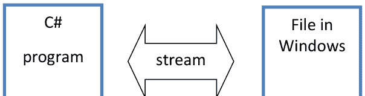

C# 程序可以包含一个代表已创建并连接到文件的特定对象。程序通过调用流对象上的方法来告诉它该做什么，从而对文件执行操作。

C# 有了一系列不同的流类型，取决于你想做什么来使用它们。所有的流的使用方式完全相同。连接 C# 程序与用户的 `Console` 类被实现为一个流。`ReadLine` 和 `WriteLine` 方法是告诉任何流去读写数据的命令。

我们将考虑两种允许程序处理文件的流；这些是 `StreamWriter` 和 `StreamReader` 类型。

### 3.6.2 创建输出流

你像创建任何对象一样使用 `new` 来创建一个流对象。当流被创建并连接到文件时，程序通过调用流对象上的方法来告诉它该做什么。

C# 有一系列不同的流类型，取决于你想做什么来使用它们。所有的流的使用方式完全相同。连接 C# 程序与用户的 `Console` 类被实现为一个流。`ReadLine` 和 `WriteLine` 方法是告诉任何流去读写数据的命令。

我们将考虑两种允许程序处理文件的流；这些是 `StreamWriter` 和 `StreamReader` 类型。

你像创建任何对象一样使用 `new` 来创建一个流对象。当流被创建并连接到文件时，程序通过调用流对象上的方法来告诉它该做什么。

等待，另一个有用的功能是 `default` 选项。如果 `switch` 值不匹配任何可用的 `case`，这为 `switch` 提供了一个可以去的地方；在我们的案例中（抱歉！）我们将输出一条不恰当的消息。

如果你愿意，可以使用数字以外的类型使用 `switch` 构造：

```csharp
{
    case "casement":
        handlecasement();
        break;

    case "standard":
        handleStandard();
        break;

    case "patio":
        handlePatio();
        break;

    default:
        Console.WriteLine("Invalid command");
        break;
}
```

这个 `switch` 使用字符串来控制 `case` 的选择。然而，你的用户不会感谢你这样做，因为这意味着他们必须输入选项的完整名称，而且，如果他们输错了一个字符，命令将无法被识别。

你像创建任何对象一样使用 `new` 来创建一个流对象。当流被创建并连接到文件时，程序通过调用流对象上的方法来告诉它该做什么。

C# 有一系列不同的流类型，取决于你想做什么来使用它们。所有的流的使用方式完全相同。连接 C# 程序与用户的 `Console` 类被实现为一个流。`ReadLine` 和 `WriteLine` 方法是告诉任何流去读写数据的命令。

我们将考虑两种允许程序处理文件的流；这些是 `StreamWriter` 和 `StreamReader` 类型。

你像创建任何对象一样使用 `new` 来创建一个流对象。当流被创建并连接到文件时，程序通过调用流对象上的方法来告诉它该做什么。

### 3.6.3 写入流

如果你想让你的程序真正有用，就必须给它提供一种在不运行时存储数据的方法。我们知道可以通过这种方式存储数据；这就是我们把目前创建的所有程序都保存在文件中的方法。

文件是由计算机的操作系统管理的。我们想要做的是 C# 告诉操作系统创建文件并让我们访问它们。好消息是，尽管不同的操作系统使用不同的方式管理文件，但在 C# 中操作文件的方法对于任何计算机来说都是相同的。我们可以编写一个 C# 程序，在 Windows PC 上创建一个文件，然后使用相同的程序在 UNIX 系统上创建一个文件，而没有任何问题。

### 3.6.4 关闭流

当流被创建并连接到文件时。

等待，另一个有用的功能……当流被创建并连接到文件时。程序通过调用流对象上的方法来告诉它该做什么。

C# 有一系列不同的流类型，取决于你想做什么来使用它们。所有的流的使用方式完全相同。连接 C# 程序与用户的 `Console` 类被实现为一个流。`ReadLine` 和 `WriteLine` 方法是告诉任何流去读写数据的命令。

我们将考虑两种允许程序处理文件的流；这些是 `StreamWriter` 和 `StreamReader` 类型。

你像创建任何对象一样使用 `new` 来创建一个流对象。当流被创建并连接到文件时，程序通过调用流对象上的方法来告诉它该做什么。

### 3.6.5 流与命名空间

如果你想让你的程序真正有用，就必须给它提供一种在不运行时存储数据的方法。我们知道可以通过这种方式存储数据；这就是我们把目前创建的所有程序都保存在文件中的方法。

## 创建程序

## 使用文件

当程序遇到一个未见过的项时，它会自动在被告知使用的命名空间中查找。换句话说，当编译器看到语句时：

```csharp
Console.WriteLine("Hello World");
```

- 它知道在 `System` 命名空间中查找该对象，以便对其调用 `WriteLine` 方法。如果程序员写错了类名：

```csharp
Console.WriteLine("Hello World");
```

- 编译器将在 `System` 命名空间中查找，无法找到对象类并生成编译错误。

如果你尝试使用 `StreamWriter` 而没有告诉编译器去 `System.IO` 命名空间中查找，也会得到相同的错误。换句话说，要使用文件处理句柄，你需要在程序的最顶部添加以下语句：

```csharp
using System.IO;
```

可以将一个命名空间放在另一个命名空间内部（就像库一样，你可以在罗马房间里有一个放花瓶的柜，你可以将其引用为 `Roman.Vases`），因此 `IO` 命名空间实际上位于 `System` 命名空间之中。然而，由于你使用了命名空间，这并不意味着你使用了其中所有的命名空间，因此你必须包含上述行来处理对象。

命名空间是确保你的项目不会与其他程序员的项目发生冲突极极方法。我们稍后将看到如何创建自己的命名空间。

```csharp
using System;
using System.IO;
```

```csharp
class StreamWriterDemo
{
    public static void Main()
    {
        StreamWriter writer;
        writer = new StreamWriter("test.txt");
        writer.WriteLine("hello world");
        writer.Close();
    }
}
```

代码示例 20 完整文件写入

### 3.6.6 从文件读取

从文件中读取与写入非常相似，因为程序会创建一个流来执行实际操作。在这种情况下，使用的流是 `StreamReader`。

```csharp
StreamReader reader = new StreamReader("Test.txt");
string line = reader.ReadLine();
Console.WriteLine(line);
reader.Close();
```

上面的程序将一个流连接到 `Test.txt` 文件，读取文件的第一行，将其显示在屏幕上，然后关闭文件。如果找不到该文件，则打开文件的尝试将失败，程序将抛出异常。

### 检测输入文件的结束

重复调用 `ReadLine` 将返回文件的连续行。然而，如果你的程序到达文件末尾，`Read` 方法每次被调用时都会返回一个空字符串。幸运的是，`StreamReader` 对象了一个名为 `EndOfStream` 的属性，程序可以使用它判断何时到达文件末尾。当该属性变为 `true` 时，说明已到达文件结束。

```csharp
StreamReader reader = new StreamReader("Test.txt");

while (reader.EndOfStream == false)
{
    string line = reader.ReadLine();
    Console.WriteLine(line);
}

reader.Close();
```

上面的代码将打开 `file.txt` 并在控制台中显示每一行。当到达文件末尾时，`while` 循环将停止程序。

```csharp
using System;
using System.IO;
```

```csharp
class FileWriteandReadDemo
{
    public static void Main()
    {
        StreamWriter writer = new StreamWriter("test.txt");
        writer.WriteLine("hello world");
        writer.Close();

        StreamReader reader = new StreamReader("Test.txt");

        while (reader.EndOfStream == false)
        {
            string line = reader.ReadLine();
            Console.WriteLine(line);
        }

        reader.Close();
    }
}
```

代码示例 21 文件写入与读取

上面的代码首先将一行文本写入文件，然后打开该文件并打印到屏幕上。

### 3.6.7 C# 中的文件路径

如果你使用电脑有一段时间，你就会熟悉文件夹的概念（有时称为目录）。这些被用于组织计算机上的信息。你创建的每个文件都在特定的文件夹中。如果你使用 Windows，会发现自动为你创建了几个文件夹。你可以创建“文档”、“图片”和“音乐”文件夹。你可以在这些文件夹内部创建文件夹（例如 `Documents(Stories)`）。

文件在计算机上的位置被称为文件的路径。文件路径可以分为两部分：位置文件夹和文件名本身。如果你不提供文件夹名而直接打开名为 `Test.txt` 的文件，系统将假设该文件存储在与运行的程序相同的文件夹中。换句话说，如果你在 `MyProg` 文件夹中运行程序 `File.exe`，程序将假设 `.txt` 文件位于 `MyProg` 文件夹中。

如果你想使用不同文件夹中的文件（这是一个好主意，因为数据文件很少与程序运行在同一位置），你可以在文件名中添加路径信息。

```csharp
string path;
path = @"c:\data\2009\November\sales.txt";
```

* C语言编程，Rob Miles 2016  
77

上面的语句创建了一个字符串变量，其中包含名为 `sales.txt` 的文件的路径。该文件位于 `November` 文件夹中，该文件夹又位于 `2009` 文件夹中，而后者位于 C 盘上的 `data` 文件夹中。

字符串中的反斜杠（`\`）字符用于分隔文件路径中的各个文件夹。注意字符串开头的 `@` 意味着字符串中的 `\` 将被 C# 直接解释。

## 4 创建解决方案

### 4.1 我们的案例研究：友好银行

本节的大部分内容基于一个案例研究，该案例将让你看到 C# 的功能。你将扮演一个程序员的角色，去创建一个“联合友好银行”，又被称为“友好银行”。我们将使用 C# 创建整个银行应用程序，并探索实现这一目标的 C# 特性。

目前我们简单地管理银行的账户信息。银行经理告诉我们每个客户的这些信息包括他们的姓名、地址、账号、余额和透支金额。可能还会添加其他项目。

有成千上万的客户，经理还告诉我们有多种类型的账户（并且不时会发明新的账户类型）。

系统还必须根据需要生成警告信和声明。

### 程序员的要点：寻找模式

世界上不同类型程序的数量其实非常小。我们的银行要做的许多事情（存储大量个人信息、搜索特定个人、执行更改一个或多个项内容的交易）对于许多类型的程序都是通，从视频游戏到机器人。

### 4.1.1 银行系统范围

系统的范围是对系统将要做的事情的描述。这同时也意味着对系统将做什么和不做什么的声明。这同样重要，因为客户通常并不清楚你在做什么，并很可能期望你提供一些你无打算提供的东西。通过在开始设定范围，可以确保以后不会出现意外。

## 4.2.1 枚举与状态

“枚举”（Enumerated）听起来很高大。但如果你把“枚举”简单理解为“编号的”东西，事情就会变得容易一些。为了理解我们在这里做什么，我们需要考虑这些类型旨在要解决的问题。

我们知道，如果想存储一个整数值，可以使用 `int`。如果想存储一个为真或假的值，可以使用 `bool`。然而，有时我们想要存储一组特定的值或状态。

### 示例状态

枚举类型在存储状态信息时非常有用。状态与客户名称或账户余额等其他项目是不一样的。

例如，如果我正在编写一个程序来玩“战舰游”游戏（“海洋”的网格承载着不同类型的船只，船只可以被攻击），我可能会决定海洋的某个网格包含以下内容：

- 空海
- 已被攻击
- 战舰
- 巡洋舰
- 潜艇
- 划船

仔细一想，我实际上是在这里组装更多的元数据，因为我决定需要跟踪海洋，并且精确确定了可以在里面放入什么。如果我喜欢，我也可以用数字来处理：

- 空海 = 1
- 已被攻击 = 2
- 战舰 = 3
- 巡洋舰 = 4
- 潜艇 = 5
- 划船 = 6

然而，这意味着我必须自己跟踪这些值，并记住如果我们在海洋位置得到值 7，这显然是错误的。这些类型就是“枚举类型”。

C# 有一种方法可以创建一个只包含一组特定可能值的类型。

```csharp
enum SeaState
{
    EmptySea,
    Attacked,
    Battleship,
    Cruiser,
    Submarine,
    RowingBoat
};
```

我创建了一个名为 `SeaState` 的类型，用于存储海洋特定部分的状态。它只能具有上述给值，并且必须完全通过命名枚举类型来管理。例如，我写道：

```csharp
SeaState openSea;
openSea = SeaState.EmptySea;
```

我的变量 `openSea` 只用于代表海洋内容状态的值。当然，C# 本身实际上会将这些状态表示为特定的数值，但如何管理这些对我来说不是问题。

请注意，我创建的类型（如 `SeaState`）会被编辑器用蓝色高亮，这与关键字不同。

## 创建解决方案

### 枚举类型

这表明这些项目是我创建的额外类型，可以用于创建变量，但它们实际上不是 C# 语言的一部分（就像关键字那样）。理解这里发生了什么至关重要。我们之前使用过 C# 部分的类型，例如 `int` 和 `double`。我们已经达到了实际上可以创建自己的数据类型的程度，这些数据类型可以用于存储应用程序所需的数据值。

## 4.2.2 创建 enum 类型

新的 `enum` 类型可以在任何类之外创建，并为创建一个新类型以供我的任何程序使用：

```csharp
using System;

enum TrafficLight
{
    Red,
    RedAmber,
    Green,
    Amber
}

class EnumDemonstration
{
    public static void Main()
    {
        TrafficLight light;
        light = TrafficLight.Red;
    }
}
```


代码 22 枚举交通灯

每当你需要持有一个可以取有限可能值的值时（例如：待售 `OnSale`、待报价 `UnderOffer`、已售 `Sold`、退出市场 `OffMarket`），你就应该考虑使用枚举类型来持有这些值。

## 程序员观点：使用枚举类型

枚举类型是另一个当你使用它们时，所有人都能受益的情况。程序变得更易于编写、更容易理解且更安全。你应该多使用它们。

对于银行来说，你想要持有一个项目的状态，以及关于客户的其他信息。例如，我们可以将“冻结”（`Frozen`）、“激活”（`Active`）、“关闭”（`Closed`）和“审计中”（`Under Audit`）作为银行账户的状态。如果是这样，就是为了创建一个枚举 `AccountState`，它可以持有这些值而不包含其他值。

```csharp
enum AccountState
{
    New,
    Active,
    UnderAudit,
    Frozen,
    Closed
}
```

我们现在有了一个可以存储银行账户状态信息的变量。每个账户将包含一个类型为 `AccountState` 的变量，代表该账户的状态。

## 4.3 结构体

结构体允许我们将一组单独的值组织成一个凝聚的整体，并将其映射到我们正在处理的问题中的某个项目上。这在许多应用程序中都很重要。

### 4.3.1 什么是结构体？

通常当你处理信息时，你会想要持有关于特定项目的不同事物的集合。“友好银行”（The Friendly Bank）委托了一个账户存储系统，你可以使用结构体来让这变得更容易。就像参加过我课程的优秀程序员一样，你会从这里开始：

- 建立精确规范，即以书面形式准确获取他们期望你的系统做什么。
- 协商一个高昂的费用。
- 考虑你将如何存储数据。

### 示例结构体

从你的规范中，你知道程序必须持有以下内容：

- 客户名称 - `string`
- 客户地址 - `string`
- 账户号码 - 整数值
- 账户余额 - 整数值
- 透支额度 - 整数值

友好银行告诉我们需要一个结构体来持有这些信息：

| 字段 | 类型 |
| :--- | :--- |
| 客户名称 | `string` |
| 客户地址 | `string` |
| 账户号码 | 整数值 |
| 账户余额 | 整数值 |
| 透支额度 | 整数值 |

友好银行告诉我们需要一个结构体来持有这些信息：

```csharp
struct Customer {
    public string name;
    public string address;
    public int accountNumber;
    public int balance;
    public int overdraftLimit;
}
```

友好银行告诉我们需要一个结构体来持有这些信息：

## 4.3.2 创建结构体

`C#` 允许你创建结构体。结构体是你希望视为单个实体的变量集合。在 `C#` 中，一组数据被称为结构体，它的每个部分被称为一个字段。为了帮助我们的银行工作，我们可以创建一个持有所有信息的结构体：

### 结构体

友好银行告诉我们需要一个结构体来持有这些信息：

```csharp
struct Account {
    public AccountState state;
    public string name;
    public int accountNumber;
    public int balance;
    public int overdraftLimit;
}
```

友好银行告诉我们需要一个结构体来持有这些信息：

```csharp
struct Account {
    public AccountState state;
    public string name;
    public int accountNumber;
    public int balance;
    public int overdraftLimit;
}
```

友好银行告诉我们需要一个结构体来持有这些信息：

## 创建解决方案

# 结构

当我们创建结构体数组时，结构就会变得非常有用。正如我们在评分程序中所看到的，管理单个项目是困难的，但如果我们使用数组，它们就会变得简单得多。

```csharp
const int MAX_COST = 100;
Account[] Bank = new Account[MAX_COST];
```

此声明设置了一个名为 `Bank` 的客户数组，它可以容所有客户。注意，我很少将它赋值给名为 `MAX_COST` 的变量，该变量被精确设置为 100。这定义了我们的银行可以容的最大客户数量。

我们可以将一个变量赋值给另一个，就像处理其他变量类型一样。当执行赋值时，源中的所有值都会复制到目标中：

```csharp
Bank[] = RobAccount;
```

这将将 `RobAccount` 结构的信息复制到 `Bank` 数组开头的元素中。

你也可以对结构体数组的元素执行此操作，因此：

- `Bank[25].Name` 将是包含下标为 25 的元素客户名称的字符串。

# 4.3.3 使用结构体

一旦我们有了结构体，就可以用它来存储银行客户的细节：

```csharp
class AccountStructureArray
{
    public static void Main()
    {
        const int MAX_COST = 100;
        Account[] Bank = new Account[MAX_COST];
        Bank[0].Name = "Rob";
        Bank[0].State = AccountState.Active;
        Bank[0].balance = 100000;
        Bank[1].Name = "Jim";
        Bank[1].State = AccountState.Frozen;
        Bank[1].balance = 0;
    }
}
```

代码示例 24 将账户信息放入数组

你可以从上面的代码示例看到它是如何工作的，它创建了一个包含 100 条客户记录的数组，并设置了数组中的两个元素。哪个账户持有者的钱最多？

这个程序不需要读取所有 100 个银行客户的数据，但它向你展示了如何访问结构值数组中的字段。

# 结构体中的初始值

当结构体被作为局部变量（即在块中）创建时，其内部值是未定义的。这意味着如果你尝试在程序中使用它们，将得到编译错误。这与在程序中给变量赋值之前使用它完全一样。换句话说：

```csharp
Account RobAccount;
Console.WriteLine("Name is : " + RobAccount.Name);
```

- 它会产生编译错误。你的工作是确保在尝试从变量获取内容之前，始终为其赋予一个值。

# 在方法调用中使用结构体类型

方法可以拥有结构体类型的参数：

```csharp
public void PrintAccount (Account a) {
    Console.WriteLine("Name:" + a.Name);
    Console.WriteLine("Address:" + a.Address);
    Console.WriteLine("Balance:" + a.Balance);
}
```

该方法提供了一种打印账户值内容的方法：
`PrintAccount (RobAccount);`

结构体 `RobAccount` 的值被传递到方法中以便工作，就像我们之前向方法传递整数一样。也可以在方法调用中传递数组元素（因为任何 `Account` 值的元素定义上都是 `Account` 实例）。

```csharp
class BankProgram {
    public static void PrintAccount(Account a) {
        Console.WriteLine("Name:" + a.Name);
        Console.WriteLine("Address:" + a.Address);
        Console.WriteLine("Balance:" + a.Balance);
    }
    public static void Main() {
        const int MAX_CUST = 100;
        Account[] Bank = new Account[MAX_CUST];
        Bank[0].Name = "Robs";
        Bank[0].Address = "Robs House";
        Bank[0].State = AccountState.Active;
        Bank[0].Balance = 1000000;
        PrintAccount(Bank[0]);
        Bank[1].Name = "Jim";
        Bank[1].Address = "Jim's House";
        Bank[1].State = AccountState.Frozen;
        Bank[1].Balance = 0;
        PrintAccount(Bank[1]);
    }
}
```

代码示例 25 从数组中打印账户值

也可以创建返回结构体类型结果的方法，或者我们可以创建一个 `ReadAccount` 方法来读取账户并返回它。

## 程序员观点：结构体至关重要

在商业系统中，花费大量时间设计我们用于数据存储的结构体是很常见的。它们承载了构建一切的基础数据。你可以将结构体的设计及其内容的限制视为关于你所创建的系统的另一大块元数据。

# 使用类型设计

你可以看到为 `Account` 结构体添加了 `State` 值。这使得程序很容易跟踪每个账户的特定状态。我们所做的是创建一个可以包含多个值的类型（我们的 `AccountState` 枚举类型），并将其放入我们设计的另一个类型中，用于存储银行账户持有者的信息。这就是我们处理更复杂问题的方法。我们可以从与我们讨论得到的元数据中，获取类型应该包含的所有细节。

## 创建解决方案

# 对象、结构与引用

```csharp
class Account
{
    public string Name;
}

class StructsAndObjectsDemo
{
    public static void Main()
    {
        Account RobAccount;
        RobsAccount.Name = "Rob";
        Console.WriteLine(RobsAccount.Name);
    }
}
```

代码示例 27 无法编译的 `Account` 类
账户信息现在存储在类中，而不是结构体中。这个账户类被简单地称为 `Account`。问题是，当我们编译程序时，会得到如下信息：

`ObjectDemo.cs(12,3): error CS0165: Use of unused local variable 'RobAccount'`

那么，到底发生了什么？为了理解发生的情况，你需要了解这一行代码的作用：

`Account RobAccount;`

这看起来像是声明了一个名为 `RobAccount` 的变量。但在对象的情况下，情况并非如此。

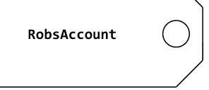

实际上，当程序执行这一行时，得到的是创建一个名为 `RobAccount` 的引用。这种引用允许指向 `Account` 的实例。你可以把它们想象成类似于行李标签，因为它们可以用一根绳子系在某个东西上。如果你有了标签，就可以顺着绳子找到它所系着的对象。

但当我们创建一个引用时，我们并没有真正得到它所指向的那些东西之一。编译器抛出了异常，并因此给了我一个错误，因为：
`RobsAccount.Name = "Rob";`

这是在尝试找到系在标签上的东西，并将 `Name` 属性设置为 "Rob"。由于标签没有正确地系在任何东西上，我们的程序会在这一点处失败。编译器实际上在说：“你正尝试追踪一个没有指向任何内容的引用，因此我将给你一个变量未定义（undefined）错误”。

我们通过创建类的实例并将标签连接到该实例来解决这个问题。这通过在程序中添加一行代码来实现：

## 创建解决方案

# 对象、结构与引用

```csharp
class Account
{
    public string Name;
}

class StructsAndObjectsDemo
{
    public static void Main()
    {
        Account RobsAccount;
        RobsAccount = new Account();
        RobsAccount.Name = "Rob";
        Console.WriteLine(RobsAccount.Name);
    }
}
```

代码示例 28 编译 `Account` 类

我添加的这一行创建了一个新的 `Account` 对象，并将引用 `RobsAccount` 指向它。

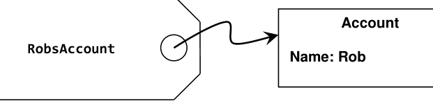

我们之前见过这个 `new` 关键字。我们用它来创建数组。这是因为数组实际上是实现为对象的，所以我们使用 `new` 来创建它。`new` 创建的是一个对象。对象是类的实例。我用一种高雅的字体重复这一遍：

> “对象是类的实例”

我重复这一点是因为你理解它非常重要。类为 `C#` 提供了关于“制作什么”以及“能做什么”的指令。`new` 关键字导致 `C#` 使用这些信息来实际创建一个实例。注意，在上面的图中，我将对象命名为 `Account, RobsAccount`。这是因为对象实例本身并没有 `RobsAccount` 这个标识符，它只是目前 `RobsAccount` 所连接的那个。

## 4.4.2 引用

我们必须习惯这样一个观点：如果我们想使用对象，就必须使用引用。两者形影不离，不可分割。结构体虽然有用，但为了满足真正的对象需求，我们必须拥有对象，并且我们必须确保通过对特定特定对象的引用来访问该对象。实际上，这在现实中并不痛苦，因为你可以一直把引用当成对象处理，但你必须记住当你持有引用时，你持有的不是实例，而是一个系在实例上的标签……

# 对同一实例的多重引用

此时，另一个引用的示例可能会有所帮助。考虑以下代码：

```csharp
Account RobsAccount;
RobsAccount = new Account();
RobsAccount.Name = "Rob";
Console.WriteLine(RobsAccount.Name);
Account Temp;
Temp = RobsAccount;
Temp.Name = "Jim";
Console.WriteLine(RobsAccount.Name);
```

# 代码示例 29 多重引用

问题是：第二次调用 `WriteLine` 会打印出什么？如果我们画一张图，答案就会变得清晰：

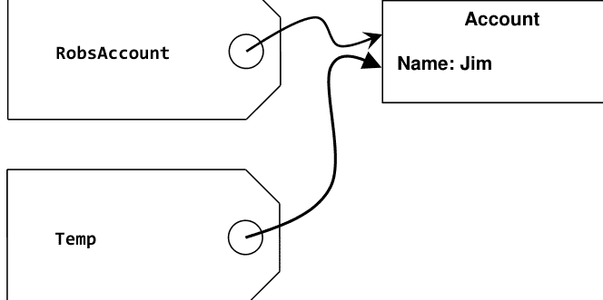

两个标签都指向同一个 `Account` 实例。这意味着，对 `Temp` 所指向的对象所做的更改也会反映在 `RobsAccount` 所指向的对象上，因为它们是同一个对象。这意味着程序将打印出 `Jim`，因为那是 `RobsAccount` 所指向的对象中的名称。

这表明了对象和引用之间存在某种微妙的特性。单个实例上可以挂载的引用数量没有限制，所以你需要记住，改变引用所指向的对象从实例的角度来看，可能会改变该实例。

# 对实例没有引用的情况

为了理解发生了什么，请考虑当一个账户没有引用时：

```csharp
Account RobsAccount;
RobsAccount = new Account();
RobsAccount.Name = "Rob";
Console.WriteLine(RobsAccount.Name);
```


# 代码示例 30：无引用

问题是：如果我们想对项目进行排序会发生什么？我们必须移动它们。银行可能还想以更多的方式来组织信息。如果没有引用，这将是不可能的。

## 创建解决方案

## 对象、结构与引用

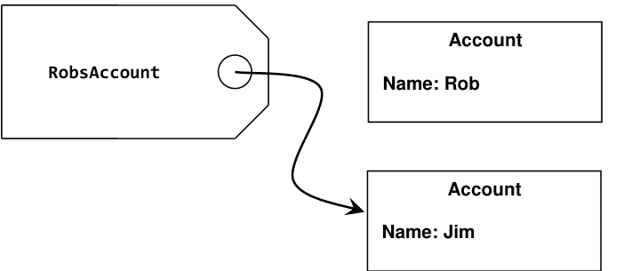

这个岛屿是基于数量的。当我们向排序列表添加某些东西时，我们需要记住改变引用所指向的对象可能会改变该实例。

### 4.4.3 为什么要费劲使用引用？

为了回答这个问题，我们可以考虑太平洋。这个岛屿的货币是以几百英镑为基础的。当你使用其中之一时，你并没有真正拿起它。相反，你说：“这枚硬币现在属于你了”。

换句话说，我们使用引用来管理不想移动的对象。这就是我们在程序中使用引用的原因。考虑一个包含许多账户的银行。如果我们想按字母顺序对它们进行排序，就必须移动它们。

## 创建解决方案

## 对象、结构与引用


## 通过移动对象进行排序

如果我们以结构数组持有账户，我们就必须保持列表顺序。银行可能还想以更多的方式来组织信息，例如，他们可能想按姓和账户号码进行排序。如果没有引用，这将是不可能的。有了引用，我们只需要维护多个引用数组，每个数组都按照特定的方式排序：

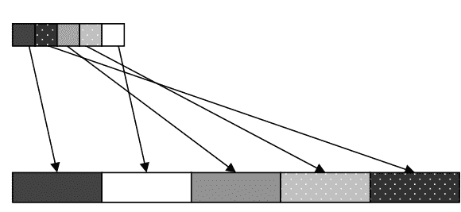

## 通过使用引用进行排序

如果我们只对引用进行排序，我们就完全不需要移动大型数据项。添加新对象不需要移动任何对象，而是可以移动引用。

## 引用与数据结构

我们的排序引用列表非常好，但如果我们想向排序列表添加某些东西，我们仍然需要移动引用。我们可以通过将数据结构化为树形来解决这个问题，并加快搜索：

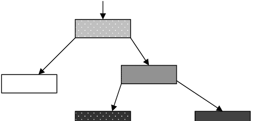

## 使用树进行排序

在上面的树中，每个节点有两个引用；一个指向一个较“轻”的节点，另一个指向一个较“重”的节点。如果我想得到项的排序列表，我只需要尽可能向“轻”的一侧走，我就会到达最轻的那个。然后我向上移动到上方（这必须是下一个轻量级的）。然后我向黑暗的一面（卢克）移动并重复该过程。

这种方法的另一个特点是添加项目非常容易；我只需要在树上找到它们需要挂载的位置并附上引用即可。

搜索也非常快，因为我可以查看每个对象并决定下一个查看哪一个，直到我找到正在寻找的内容，或者在所需的方向上没有引用，这种情况下说明该项不在结构中。

## 创建解决方案

## 使用对象进行设计

# 程序员观点：数据结构至关重要

这不是一份关于数据结构的文档，而是一份关于编程的文档。如果你没有完全理解关于树的所有内容，不要担心。只需要记住引用是构建数据结构的一种重要机制，到此为止即可。但在未来的某个时候，你将不得不去弄清楚如何使用这些东西来构建结构。

## 引用的性

这种运作的关键在于，对象可以包含指向其他对象的引用，还可以包含数据载荷。我们将考虑对象层面的这一方面；现在我们只需要记住引用和对象是有区别且分开的。

## 银行笔记：引用与账户

对于一家拥有成千上万客户的银行来说，引用的使用对于它们所持数据管理至关重要。账户将存储在计算机内存中，根据每个账户的大小和存储的账户数量，如果我们想对它们进行排序，就不可能在内存中移动它们了。

这意味着操纵它们的唯一方法是让它们留在原处，并有一份引用列表供参考。引用是非常极小的“标签”，可以用于定位内存中的实际项目。对引用列表排序非常简单，还可以为经理提供一个按客户姓名排序的银行视图以及另一个按余额顺序排序的视图。如果经理有了对新结构或视图的需求，我们可以根据引用来创建。

# 4.5 使用对象进行设计

我们现在要开始从对象的角度来思考。我们之所以这样做，是因为我们希望有一种方法能让我们的系统设计变得尽可能简单。这回到了程序员们闻名遐的“创造性懒惰”。我们正在尝试做的事情最好的表达方式是：

> “尽可能长地推迟所有的艰苦工作，如果可能的话，让别人替我们做。”

对象让我们能够做到。如果我们回到我们的银行账户，我们可以看到有很多我们能够对它做的事情：

- 向账户存钱
- 从账户中取钱
- 查找余额
- 打印账单
- 修改账户持有人的地址
- 打印账户持有人的地址
- 查找账户状态
- 修改账户状态
- 修改透支额度
- 查找透支额度

与其说“我们需要对银行账户执行这些操作”，基于对象的设计将这一观点反转了过来，有点像肯尼迪总统多年前做的那样：

## 创建解决方案

## 使用对象进行设计

> “因此，我亲爱的美国同胞：不要问你的国家能为你做些什么，要问你能为你的国家做些什么”（巨大的掌声）

我们并不直接对银行账户做事情。相反，我们要求它为我们做事情。我们银行应用程序的设计可以被认为是识别我们将用于表示信息的对象，并指定它们应该能够做的事情。聪明之处在于，一旦我们决定了银行账户应该做什么，我们可能就可以让别人来为它实现这些功能。

如果规范是正确的并且他们正确地实现了它，我们就不需要担心它们具体是如何运作的——我们只需要坐下来享受出色工作的果实即可。

这带我们回到了本文档中两个反复出现的主题：元数据和测试。一个银行账户对象应该能够做什么是该对象的元数据的一部分。一旦我们决定了账户必须执行的操作，我们需要做的下一件事就是设计一种可以对每个操作进行测试的方法。

在本节中，我们将实现一个具有正规银行账户某些行为的对象。

## 程序员观点：并非一切都应该是可能的

注意，有些事情是我们不应该对我们的银行账户对象执行的。账户数量是该账户特有的，并且永远不应该改变。我们可以通过不提供更改它的手段来实现这一点。在设计时，识别出哪些是不可能的，以及哪些是应该被做的，是非常重要的。我们甚至可以把某些事情标记为“可审计的”，即一个对象将跟踪对它做了什么。这样，我们就能轻松地发现是否发生了坏事。

### 4.5.1 对象中的数据

我们可以根据我们想要自己做些什么来考虑我们的银行账户。第一件事是识别我们想要存储在其中的所有数据项。为了简单起见，现在我只关注我如何跟踪账户余额。这让我能够描述所需的技术，而不会涉及得过深。

```csharp
class Account
{
    public decimal Balance;
}
```

上述 `Account` 类持有我们需要存储的银行账户余额的成员。类中持有描述类某些数据值的成员通常被称为属性。我使用了 `decimal` 类型来处理账户余额，因为这种类型是专门设计用于持有财务数值的。

我们已经看到类中的每个数据项都是一个成员。我们已经看到当我们创建一个类的实例时，可以设置该值：

```csharp
Account RobAccount = new Account();

RobAccount.Balance = 99;
```

这种之所以有效，是因为对象的成员都是公开的，这意味着编写应用程序的任何人都可以：

```csharp
MobsAccount.Balance = 0;
```

## 创建解决方案

## 使用对象进行设计

- 拿走所有的钱。如果我们打算提供一种阻止这种情况发生的方法，我们需要保护内部的数据。

### 4.5.2 对象内部的成员保护

如果对象是有用的，我们必须有一种方法保护内部的数据。理想情况下，我希望在有人尝试更改值时获得控制权，如果不喜欢就阻止该更改。这种做法的专业术语是封装。我希望将重要数据隐藏在对象内部，以便我对对它的操作拥有完全的控制权。这项技术是我防御性编程的关键，旨在确保发生什么，我的程序部分都不会出错。

例如，在我们的银行程序中，我们希望确保余额永远不会以我们无法控制的方式被改变。我们首先需要的是阻止外部世界玩弄我们的余额值：

```csharp
class Account
{
    private decimal balance;
}
```

该属性不再标记为 `public`。相反，它现在是 `private`。这意味着外部世界无法直接访问它。如果你编写以下代码：

```csharp
MobsAccount.balance = 0;
```

当我尝试编译程序时将得到错误：

```text
PrivateDemo.cs(13,13): error 'PrivateMembers.Account.balance' 因其保护级别不可访问
```

余额现在位于对象内部，对外部世界不可见。

## 修改私有成员

我可以猜你们现在在想什么。你们在想“把它设为私有的有什么意义，你根本无法更改它”。好吧，为了让大家有信心。事实证明我可以更改这个值，但仅通过运行在类中的代码。考虑以下程序：

```csharp
class Account
{
    private decimal balance = 0;

    public bool WithdrawFunds(decimal amount)
    {
        if (balance < amount)
            return false;

        balance -= amount;
        return true;
    }
}
```

C# 编程 © Rob Miles 2016

```csharp
class Bank
{
    public static void Main()
    {
        Account RobsAccount;

        RobsAccount = new Account();

        if (RobsAccount.WithdrawFunds(5))
        {
            Console.WriteLine("Cash Withdrawn");
        }
        else
        {
            Console.WriteLine("Insufficient Funds");
        }
    }
}
```

代码示例 31：提取资金不足

这创建了一个账户并尝试从从中提取五英镑。这门课程将会失败，因为我的账户初始余额为零，但这里展示了我如何为账户中的成员提供访问权限。`WithdrawFunds` 方法是 `Account` 类的一个成员，因此它可以访问该类的私有成员。

## 程序员的观点：元数据决定了成员和方法

我至少有五分钟没有提到元数据了。现在也许是个极好的时机。我关于我的银行系统收集的元数据将决定我如何提供对类成员的访问。我保护余额值的代码方式反映了客户希望如何确保这得到妥善的管理。

## 公有方法

你可能注意到我将 `WithdrawFunds` 方法设为公共（`public`）。这意味着在类外运行的代码可以调用该方法。这是必须的，因为我们希望人们通过调用内部的方法来与我们的对象交互。通用规则如下：

- 如果它是类的数据成员（即它持有数据），请将其设为私有（`private`）
- 如果它是方法，请将其设为公共（`public`）

当然，如果一个方法是仅在类内部使用的，请将其设为私有。如果你希望一个方法能够被外部访问，或者你希望让其他类使用它，请将其设为公共。如果一个方法是为了在类内部执行某些逻辑，那么请将其设为私有。

# 静态项

类拥有一个平衡成员。然而，我们也可以创建作为类的一部分的成员，即它们存在于任何特定实例之外。

### 4.6.1 静态成员

`static` 关键字允许我们创建不存储在实例中而存储在类本身中的成员。

学习 C# 程序语境下 `static` 的含义非常重要。在我们编写的几乎每一个程序中都使用了它：

```csharp
class AccountTest
{
    public static void Main()
    {
        Account test = new Account();

        test.PayFunds(50);

        Console.WriteLine("Balance:" + test.GetBalance());
    }
}
```

`AccountTest` 类有一个名为 `Main` 的静态方法。我们知道这是运行程序时调用的方法。它是 `AccountTest` 类的一部分。如果我创建了五十个 `AccountTest` 实例，它们将共享同一个 `Main` 方法。在 C# 关键字中，`static` 标志将成员标记为类的一部分，而不是类实例的一部分。我将用一种华丽的字体再写一遍，因为这很重要：

> 静态成员是类的成员，而不是类实例的成员

我不需要实例化 `AccountTest` 类就可以使用 `Main` 方法。这正是我的程序实际运行的方式，当它启动时还没有任何该类的实例，而这个静态项必须已经存在，否则它将无法运行。

`static` 并不意味着“不可更改”。我认为是时候增加一些华丽的内容了：

> 静态并不意味着“不可更改”

被设为静态的类成员可以像类的任何其他成员一样被使用。数据或方法都可以被变为静态的。

### 4.6.2 使用类的静态数据成员

在此时，也许一个静态数据的示例会有所帮助。考虑我们银行账户的利率。客户告诉我们，账户类的成员之一需要必须是账户的利息。在程序中，我们通过向类中添加另一个持有当前利率的成员来实现此点：

```csharp
public class Account
{
    public decimal Balance;
    public decimal InterestRateCharged;
}
```

现在我可以创建账户并在它们上设置余额和利率。（当然，如果我表现得恰当的话，我会把这些内容设为私有并提供方法等，但现在我只是保持简单）。

C# 编程 Rob Miles 2016

```csharp
Account RobsAccount = new Account();

RobsAccount.Balance = 100;

RobsAccount.InterestRateCharged = 10;
```

麻烦在于：我被告知利率是所有账户共用的。如果利率发生变化，它必须对所有账户生效。这意味着为了实现这一更改，我必须遍历所有账户并更新速率。这将是非常枯燥的，而且如果我漏了一个账户，可能会代价高昂。

我通过将利率成员设为静态的解决了这个问题：

```csharp
public class Account
{
    public decimal Balance;
    public static decimal InterestRateCharged;
}
```

利率现在是类的一部分，而不是任何实例的一部分。这意味着我必须更改访问方式来获取：

```csharp
Account RobsAccount = new Account();

RobsAccount.Balance = 100;

Account.InterestRateCharged = 10;
```


由于它是类的成员，我现在必须通过类名而不是实例引用来获取它的名称。

## 程序员观点：静态成员既有用又危险

当你收集有关项目的元数据时，你应该寻找可以被设为静态的内容。静态可以是值的限制（你允许某人拥有的最大年龄）。静态可以是年龄限制变化的时间，而你不想更新程序中的所有对象。

但当然，正如蜘蛛侠曾经说过的那样，“能力越大，责任越大。”你应该对如何提供静态数据项的访问保持小心。对静态值的更改将影响你的整个系统。因此，它们应该被设为私有，并通过方法调用的方式进行更新。

### 4.6.3 在类中使用静态方法

我们也可以将方法设为静态的。长期以来我们在`Main`方法中一直这样做。在设计系统时你也可以使用它们。例如，我们可能有一个方法来判断是否允许某人拥有账户。它将接收他们的年龄和收入，然后根据他们是否符合条件返回真或假值。

```csharp
public bool AccountAllowed ( decimal income, int age ) {

    if ( income >= 10000 ) && ( age >= 18 ) {

        return true;

    } else {

        return false;

    }

}
```

上面的方法检查了潜在账户的年龄和收入值；你必须超过 17 岁且收入至少达到 10000 英镑才能被允许账户。麻烦在于，目前在我们拥有`Account`实例之前无法调用该方法。我们可以通过将方法设为静态的来解决这个问题：

```csharp
public static bool AccountAllowed ( decimal income, int age )

{

    if ( income >= 10000 ) && ( age >= 18 )

    {

        return true;

    }

    else

    {

        return false;

    }

}
```

现在该方法是类的一部分，而不是类的实例。我可以通过类来调用该方法：

```csharp
if ( Account.AccountAllowed ( 25000, 21 ) )

{

    Console.WriteLine ( "Allowed Account" );

}
```

这是因为我不需要实例化就能判断是否允许。

## 在静态方法中使用成员数据

`Allowed`方法还可以，但我在其中将年龄和收入方法固定在里面了。我可能会决定让方法更具灵活性：

```csharp
public class Account

{

    private decimal minIncome = 10000;

    private int minAge = 18;

}
```

```csharp
// 注意：此处代码逻辑上应对应上文描述
```

## 4.7 对象的构造

我们已经看到对象是使用`new`来带一个进入生命的：

```csharp
test = new Account();
```

如果你仔细观察正在发生的情况，你可能会发现发生的情况看起来非常像方法调用。这正是发生的情况。当类的实例被创建时，C#系统会调用该类中的构造函数。

## 创建解决方案

# 对象的构造

在这里表现得很友善。编译器并没有因为你没有提供构造方法而对你大吼，而是静地为你创建了一个默认的并使用它。

你可能认为这很奇怪，通常情况下，当你没有做某事时，编译器是没有时间提醒你你的，但在这种情况下，它只是在不通知你的情况下解决了问题。看待这个问题有二种方式：

- **友好的编译器**：编译器正试图让你的生活变得更轻松。
- **恶意的编译器**：编译器知道如果它现在自动这样做，以后当你手动做这件事时会很痛苦，那时你就不需要添加一个了。

你如何看待编译的行为取决于你自己。

### 4.7.1 默认构造函数

构造方法的名字与类名相同，但它不返回任何内容。当我们执行`new`时就会调用它。如果你不提供构造函数（到目前为止我们都没有提供），编译器就会为我们创建一个。

```csharp
public class Account {

    public Account () {}

}
```

这就是默认构造函数的样子。它是公共的（public），这样想要创建该类实例的外部类就可以访问它。它不接受任何参数。如果我写自己的构造函数，编译器就会理解我知道我在做什么，并停止提供默认的。这可能会导致问题，我们稍后会讨论。

## 4.7.2 我们自己的构造函数

为了好玩，我们可以造一个打印输出它被调用的构造函数：

```csharp
public class Account {

    public Account () {

        Console.WriteLine("We just made an account");

    }

}
```

这个构造函数并没有很有建设性（呵呵），但它确实让我们知道它何时被调用了。这是你的程序执行的内容：

```csharp
robsAccount = new Account();
```

- 程序将打印消息：

  ```text
  We just made an account
  ```

注意，这并不明智，因为会导致大量的输出，你的程序用户可能并不买账，但它展示了过程是如何工作的。

### 为构造函数提供信息

在创建`Account`时获取控制权以便在我创建它时向其喂入信息是很有用的。例如，我想在创建账户时设置账户持有者的姓名、地址和初始余额。换句话说，我这样做：

```csharp
robsAccount = new Account("Rob Miles", "Hull", 0);
```

这可以创建一个新账户，并将`name`属性设置为 Rob Miles，地址设置为 Hull，初始余额设置为 0。事实证明，如果我必须让构造方法接受这些参数并使用它们来设置类的成员，我可以轻松地做到：

```csharp
class Account {

    // 私有成员数据

    private string name;

    private string address;

    private decimal balance;

    public Account(string inName, string inAddress, decimal inBalance) {

        name = inName;

        address = inAddress;

        balance = inBalance;

    }

}
```

构造函数获取参数中提供的值，并使用它们来设置正在创建的`Account`实例的成员。在这方面，它像任何其他方法调用一样被遵守。

```csharp
class Bank {

    public static void Main() {

        Account robsAccount;

        robsAccount = new Account("Rob", "Robs House", 1000000);

    }

}
```

代码示例 34 使用自定义构造函数

上面的代码将为 Rob 创建一个拥有 1000000 余额的账户。愿是如此。

注意，添加这样一个构造函数具有非常强大的影响：

- 你必须使用新的构造函数来创建类的实例，也就是说，我现在创建`Account`对象的唯一方法是通过提供姓名、地址和起始余额。

如果我尝试这样做：

```csharp
robsAccount = new Account();

// 编译器会对我很友好并产生错误：
```

```text
Account-Test.cs(222): error CS1501: No overload for method 'Account' takes '0' arguments
```

编译器告诉我们，类中没有不带任何参数的构造函数。换句话说，只有当程序员不提供构造函数时，编译器才提供默认的。

如果在程序中使用默认构造函数，然后添加了我们自己的，这可能会导致困惑。默认构造函数不再由编译器提供，我们的程序无法正确编译。在这种情况下，你必须找到所有调用默认构造函数的地方并更新它们，或者为它们创建一个自己的构造函数供其使用。当然，你不必这样做，因为你的程序设计太棒了，以至于你永远不会遇到这个问题。就像我一样、他、他们一样。

### 4.7.3 重载构造函数

重载（Overload）是一个有趣的词。在《星际迷航》科幻剧的背景下，这是他们在每一集都对曲速引擎所做的事。在 C# 程序中它的意思是：

“一个方法与另一个方法的名字相同，但有一组不同的参数”

编译器非常乐意你重载方法，因为它可以从方法调用时给出的参数判断应该使用哪一个。在类构造函数的背景下，这意味着你可以提供不同的方式来构造类的实例。你的许多（但不是所有）账户将以零余额创建。

事实上，你可以重载任何方法。如果你有以下情况，这可能有用：

- `SetDate(int year, int month, int day)`
- `SetDate(int year, int month)`
- `SetDate(string date)`

编译器非常乐意你重载方法，因为它可以从方法调用时给出的参数判断应该使用哪一个。在类构造函数的背景下，这意味着你可以提供不同的方式来构造类的实例。事实上你可以提供这个：

```csharp
public Account(string inName, string inAddress, decimal inBalance) {

    name = inName;

    address = inAddress;

    balance = inBalance;

}
```

这意味着从构造函数到对象的实际值传递只发生在一个方法中。

### 4.7.4 构造函数管理

如果`Account`类有许多构造函数，这会变得混乱：

```csharp
public Account(string inName, string inAddress, decimal inBalance) {

    name = inName;

    address = inAddress;

    balance = inBalance;

}
```

```csharp
public Account(string inName, string inAddress) {

    name = inName;

    address = inAddress;

    balance = 0;

}
```

```csharp
public Account(string inName) {

    name = inName;

    address = "Not Supplied";

    balance = 0;

}
```

要这样做必须重复代码。好的程序员讨厌重复代码。它被视为“危险的工作”。可怕的是这非常容易，只需使用文本编辑器中的复制命令，你就可以获取这段程序并将其应用到任何地方。但你不应该这样做。因为如果你需要更改这段代码，你必须修复每一份副本并修改它。C#提供了一种方式让你从一个构造函数调用另一个构造函数：

```csharp
public Account(string inName, string inAddress, decimal inBalance) {

    name = inName;

    address = inAddress;

    balance = inBalance;

}
```

```csharp
public Account(string inName, string inAddress) : 

    this(inName, inAddress, 0)

{

}
```

```csharp
public Account(string inName) :

    this(inName, "Not Supplied", 0)

{

}
```

关键字`this`意味着“此类中的另一个构造函数”。正如你在上面的代码示例所示，高亮部分是调用第一个构造函数。它们只是将提供的参数连同我们创建的任何默认值传递给“正确的”构造函数来处理。

这些调用的语法非常有趣，事实上构造函数发生在构造方法的方法体之前。事实上，它是整个代码块。这是合理的，因为这反映了实际发生的情况。`this`构造函数在进入另一个构造方法的方法体之前运行。

## 创建解决方案

# 对象的构造

上述，由于此处的调用已经完成了所有工作，因此构造函数的体可以是空的。

```java
class Bank {

    public static void Main() {

        const int MAX_CUST = 100;

        Account[] Accounts = new Account[MAX_CUST];

        Accounts[0] = new Account("Rob", "Rbs House", 100000);

        Accounts[1] = new Account("Jim", "Jims House");

        Accounts[2] = new Account("Fred");

    }

}
```

代码示例 35 重载构造函数

上面的示例展示了构造函数的正确使用方法。该代码创建了一个账户引用数组（称为`Accounts`），然后将前几个元素设置为`Account`实例。第一个元素是 Rob 的账户，具有完整的地址和 100,000 英镑。第二个元素（索引为 1）指向 Jim 的账户，包含他的地址和为 0 的默认余额。第三个元素（索引为 0）指向 Fred 的账户，其默认余额为“Not Supplied”（未提供），默认余额为 0。

# 程序员观点：对象构造应该经过规划

对象的构造方式是在你编写程序时可以仔细规划的内容。你应该创建一个“主”构造函数，用于处理构造对象最全面的方法。你还应该让所有其他构造方法都使用这个主构造函数来获取功能。

### 4.7.5 构造函数无法失败

如果你看詹姆斯·邦德电影，通常会有这样一个时刻：你的特工 007 此时世界的命运掌握在他手中。失败不是一个选项。构造函数有点像这样。构造函数无法失败。而这是一个问题：

在过去每当我们编写方法时，都会确保它们的行为经过了错误检查，确保该方法不会破坏对象的状态。例如，尝试从银行账户中提取负数金额的资金可能会导致

我们允许操纵对象的基本原则，就是确保它们不会被使用它们的人破坏。如果你尝试通过方法调用执行愚蠢的操作，它会拒绝执行该操作并返回一个指示其无法完成任务的内容。

因此，要清楚，当我们创建一个更改对象中数据的方法时，我们必须确保这种更改总是有效的。例如，我们可能会使用以下代码：

```java
RobsAccount.PayFunds (1234567890);
```

一次性支付的金额有一个上限，因此`PayInFunds`方法将拒绝支付资金。但什么能阻止以下操作呢：

```java
RobsAccount = new Account("Rob", "Hull", 1234567890);
```

像詹姆斯·邦德一样，构造函数是不允许失败的。无论构造调用期间发生了什么，它都会完成并创建一个新实例。

这产生了一个问题。看起来似乎除了最重要的那个点之外（即对象创建时），我们可以在任何地方都给出一个愚蠢的值。

C# 编程 Rob Miles 2016

107

# 程序员观点：管理失败是一项艰巨的工作

这带我们在追求成为程序员的道路上开启之旅。编写实现功能的代码通常是很容易。编写能够以有用方式处理所有可能的失败条件的代码要困难得多。编程生活中的事实是，你花在担心事情如何出错上的时间，往往比花在考虑它们如何正确运行的时间多。

# 构造函数与异常

目前的解决方法是让构造函数在不满意时抛出异常。这意味着构造函数的用户必须在创建时确保他们捕获了异常，这本身并不是坏事。实现此点的真正方法是让构造函数调用已提供的所有属性的设置方法（set methods），如果其中任何一个返回错误，构造函数应该在该点抛出异常：

```java
public Account (string inName, string inAddress) {

    if (SetName (inName) == false) {

        throw new Exception("Bad name " + inName);

    }

    if (SetAddress (inAddress) == false) {

        throw new Exception("Bad address " + inAddress);

    }

}
```

如果我们尝试用错误的名称创建账户，它将抛出异常，这正是我们想要的。这里唯一的问题是，如果地址错误，方法的用户在修复名称并再次调用构造函数之前是不知道的。

我讨厌在使用程序时发生这种情况。这通常发生在我在网页上填写表单时。我输入名字，它却投诉这个。然后我填了名字，它又投诉我的地址。我希望有一种方法，可以一次性获得该项目所有无效部分的报告。这可以实现，代价是增加一点编译负担。

```java
public Account(string inName, string inAddress, decimal inBalance)

{

    string errorMessage = "";

    if (SetBalance(inBalance)==false) {

        errorMessage = errorMessage + " Bad Balance: " + inBalance;

    }

    if (SetName(inName) == false) {

        errorMessage = errorMessage + " Bad name: " + inName;

    }

    if (SetAddress(inAddress) == false) {

        errorMessage = errorMessage + " Bad addr: " + inAddress;
```


```
    }

    if (errorMessage != "") {

        throw new Exception("Account construction failed " + errorMessage);

    }

}
```

## 创建解决方案

# 从对象到组件

# 代码示例 36 构造失败

上面的示例展示了构造函数的正确使用方法。该代码创建了一个账户引用数组（称为 `Accounts`），然后将前几个元素设置为 `Account` 实例。第一个元素是 `Rob` 的账户，具有完整的地址和 100,000 英镑。第二个元素（索引为 1）指向 `Jim` 的账户，包含他的地址和为 0 的默认余额。第三个元素（索引为 0）指向 `Fred` 的账户，其默认余额为“Not Supplied”（未提供），默认余额为 0。

# 程序员观点：考虑问题

对象的构造方式是在你编写程序时可以仔细规划的内容。你应该创建一个“主”构造函数，用于处理构造对象最全面的方法。你还应该让所有其他构造方法都使用这个主构造函数来获取功能。

# 银行笔记：构造账户

关于类的构造函数的问题与银行本身没有直接关系，因为它们关系到规范的实现。

尽管如此，如果经理说类似“客户填写表单，输入姓名和地址，并用于创建新账户”，这让你对构造函数应该提供的参数有了一个大致的想法。

# 4.8 从对象到组件

我认为，当你开发软件时，你会经历一个不断“向后退”并在更高层次上思考的过程。这可以被称为“抽象”。这是我们目前为止取得的进展：

- 用命名的位置表示值（变量）
- 创建使用变量的操作（语句和块）
- 将行为放入可以命名的代码循环中。我们可以重用这些行为，并在设计过程中使用它们（方法）
- 创建作为属性的成员变量和作为动作的方法（对象）

与其在项目开始时花费大量时间，我们只需要表示一个账户以及它具体要做什么，只需说“这里我们需要一个账户”，然后继续其他事情。我们将从更详细的层次以及从账户需要做什么的角度重新回到这个问题。下一步要做的任务是考虑如何使用组件和接口进一步后退。

# 4.81 组件与硬件

在我们开始考虑这些观点的问题之前，从硬件角度考虑这些事情是值得的。你会熟悉在典型的计算机中，某些部分并不是“硬线连接”到系统的。例如，显卡是一个独立的设备，插在主板上。这是件好事；因为你可以在任何时候购买新的显卡并将其放入机器中以提高性能。

为了让这项工作能够顺利进行，制造主板的人和制造显卡的人必须对设备之间的接口达成共识。这以一份文档的形式呈现，详细描述了组件之间如何交互，哪些信号是输入，哪些信号是输出等。

## 创建解决方案

# 从对象到组件

任何包含符合标准制插槽的主板都可以接受显卡。

因此，从硬件的角度来看，组件之所以可能，是因为我们创建了标准接口，这些接口精确地描述了它们是如何组合在一起的。

软件组件也是如此。

# 为什么我们需要软件组件？

目前，你可能还没有看到对软件组件的需求。当我们创建一个系统时，我们会规划它的每个部分需要做什么，然后创建这些部分。在现阶段，需要组件并不是显而易见的。

嗯，一个没有组件设计的系统就像一个没有适配器的电脑，而适配器是主板的一部分。

然而，遗憾的是，在我们的银行系统中，我们可能需要创建不同形式的银行账户。例如，我们可能被要求创建一个`BabyAccount`类，这种类在安装系统后可能会被使用。

如果所有内容都硬编码在一起，这将是不可能的。通过通过接口来描述对象，我们可以使用任何像账户这样的类。

### 4.8.2 组件与接口

我应该说明的一点是，我们并不是在讨论用户界面。用户界面是用户使用程序的方式，这些方式可能是文本（用户输入命令）或图形（用户在屏幕上点击“按钮”）。

另一方面，接口仅仅指定了软件组件如何被使用。这将有助于你。

# 接口与设计

因此，从设计类开始，我们应该考虑它们的接口，即它们需要做什么。在 C# 中，我们将这些信息封装在一个接口中。

我们的银行账户第一个接口如下：

```csharp
public interface IAccount
{
    void PayInFunds (decimal amount);
    bool WithdrawFunds (decimal amount);
    decimal GetBalance();
}
```

这表示`IAccount`接口由三个方法组成：一个用于，另一个用于取款，第三个返回余额。在接口层面，我没有说如何做，我只是说应该做什么。接口在源文件中定义的方式与类的方式相同。它定义了一系列与特定任务或角色相关的方法，以便视为银行账户。

C# 编程 Rob Miles 2016

# 程序员观点：接口名称以 I 开头

我们已经看到了一些编码约定，它们为命名设定了标准。另一个约定是接口名称以字母`I`开头。如果不这样做，你的程序也可以正常编译，因为编译器对变量名没有意见。而且完全正确。

### 4.8.3 在 C# 中实现接口

当我们让类来实现接口时，接口就变得有趣了。实现接口就像是在资源提供者和消费者之间建立一份合同。如果一个类实现了接口，意味着对于接口描述的每个方法都有相应的实现。

在银行账户的情况下，我将创建一个实现接口的类，这样它可以被认为是一个账户组件，无论它是什么：

```csharp
public class CustomerAccount : IAccount
{
    private decimal balance = 0;

    public bool WithdrawFunds ( decimal amount )
    {
        if (balance < amount )
        {
            return false;
        }
        balance = balance - amount;
        return true;
    }

    public void PayInFunds ( decimal amount )
    {
        balance = balance + amount;
    }

    public decimal GetBalance ()
    {
        return balance;
    }
}
```

上面的代码与之前的账户类并没有区别。唯一的区别在于第一行：

```csharp
public class CustomerAccount : IAccount
```

上述代码行中的高亮部分是程序员告诉编译器该类实现了`IAccount`接口的地方。这意味着该类包含了接口中描述的所有方法的具体版本。如果类没有包含接口所需的方法，你将得到编译错误：

在这种情况下，我漏掉了`PayFunds`方法，编译器相应的报错了。

创建解决方案

从对象到组件

### 4.8.4 接口引用

一旦我们让`CustomerAccount`类通过，我们现在有了一个可以以两种方式看待的东西：

- 作为`CustomerAccount`（因为它是它）
- 作为`IAccount`（因为这是它可以做的）

人们总是这样做。你可以从很多方式来考虑它，例如：

- 作为个人`Rob Miles`（因为我是谁）
- 一名大学讲师（因为这是我可以做的）

如果你认为我是一个讲师，那么你就会使用包含类似`GiveLecture`等方法的接口。你可以对任何其他讲师（即实现该接口的人）使用相同的方法。

这意味着我们可以创建以相同方式使用的组件，但具有适用于它们所代表的项类型的不同行为。

### 4.8.5 使用接口

现在我们使用接口设计了系统，扩展它变得简单得多。在我们的现有系统中创建新类型的账户非常容易。

```csharp
public class BabyAccount : IAccount
{
  private decimal balance = 0;

  public bool WithdrawFunds ( decimal amount )
  {
    if (amount > 10)
    {
        return false;
    }
    if (balance < amount)
    {
        return false;
    }
    balance = balance - amount;
    return true;
  }

  public void PayInFunds ( decimal amount )
  {
    balance = balance + amount;
  }

  public decimal GetBalance ()
  {
    return balance;
  }
}
```

## 创建解决方案

## 从对象到组件

## 代码示例 38 使用组件

上面的代码展示了实际如何使用它。`accounts`数组可以持有任何实现了`IAccount`接口对象的引用。这包括`CustomerAccount`和`BabyAccount`对象。数组中的第一个元素（元素 0）被赋值为一个`CustomerAccount`对象，第二个元素（元素 1）被赋值为一个`BabyAccount`。当以这种特定的方式调用这些对象上的方法时，最后的`WithDrawFunds`调用将失败，尽管银行账户里有钱，但他们被允许提取的不能超过10英镑。

一个组件可以实现所需的任意接口。`IAccount`接口允许我纯粹从银行行为的角度来看待组件。然而，我可能想以多种方式来看待组件。例如，银行希望账户能够自己在纸上打印出来。

你可能认为我需要做的只是在`Account`接口中添加一个`print`方法。如果我以后想要打印银行账户，这是合理的。然而，会有很多东西需要打印，例如警告、特别优惠等。这些中的每一个都将根据提供特定接口的组件来实现（例如`IWarning`、`ISpecialOffer`）。我不想在这些每一个中都提供一个`print`方法，什么方法可以让我根据打印能力来看待对象呢？

这实际上非常简单。我创建一个接口：

```csharp
public interface IPrintToPaper {
    void DoPrint();
}
```

现在，任何实现`IPrintToPaper`的东西都包含`DoPrint`方法，并且可以根据其打印能力来看待。

一个类可以实现它需要的任意接口。每个接口都是它被引用或访问的一种新方式。

```csharp
public class BabyAccount : IAccount, IPrintToPaper {
}
```

这意味着`BabyAccount`实例的行为类似于一个账户，并且包含一个可以用来打印它的`DoPrint`方法。

### 4.8.7 使用接口进行设计

如果你正确地使用“抽象”技术，你最终将得到一个按照以下路线增长的系统处理过程：

- 以元数据的形式收集你能提供的信息；对客户来说重要什么、哪些值需要被表示和操作，以及这些值的范围
- 识别你必须在问题中创建组件的类
- 识别组件必须提供的操作（方法）和值（属性）
- 将这些放入每个组件的接口中
- 决定如何测试这些值和操作
- 在执行过程中实现组件并测试它们

C# Programming © Rob Miles 2016
114

## 创建解决方案

## 继承

在编写任何代码之前，你可以/应该在纸上完成这大部分工作。你还可以使用图形化工具来绘制正式图表以表示这些信息。软件工程领域完全基于此。

你也应该发现接口是好东西。如果你有一组所有银行账户必须具备的基础行为（例如，存款必须始终让账户余额增加），那么你就可以编写这样的接口来绑定到`IAccount`接口，并用于测试所创建的任何银行组件。

## 程序员观点：接口仅仅是承诺

接口与其说是一种绑定合约，不如说是一个承诺，仅仅因为一个类有一个名为`PayFunds`的方法并不意味着它会向账户存入钱；它仅仅意味着类中存在一个同名的方法。C# 允许你在方法上强制执行特定的行为；也就是说，方法展示了你要求程序员为你正在使用的类做到到种程度，以及你的测试达到什么程度。事实上，有时我们在构建程序时很好地利用了这一点，即我们可以创建实现接口但本身不具备行为的“虚假”组件。

当我们组合并把它们拼凑在一起时，接口机制提供了极大的灵活性。这意味着一旦我们确定了银行账户需要为我们持有什么，我们就可以继续考虑我们要求账户做什么。这是规格说明中真正的细节。一旦我们为组件设置了接口，我们就可以从组件**必须**做什么来思考，而精确不是它是**怎么**做的。

例如，经理告诉我们这样的银行账户必须有一个账号。这是一个非常重要的值，因为它在账户的整个寿命内都是固定的，永远不能更改。两个账户不应该有相同的账号。

从接口设计的角度来看，这意味着账号应该是被创建的，并且账户类将提供一个方法让我们获取该值（不会有设置账号的方法）。

我们不在乎`GetAccountNumber`做了什么，只要它始终返回特定账户的值即可。这个要求最终体现在账户类实现的接口中。

```csharp
interface IAccount
{
    int GetAccountNumber();
}
```

该方法返回作为此实例的号码的整数。通过将其放在接口中，我们可以说账户必须交付这个值，但我们并没有实际描述这是如何实现的。系统中的接口设计就是如此。它们声明了我们对行为的需求，但它们并不一定说明它们是如何运作的。我必须添加注释来获取更多关于该方法的作用。

对账号等东西的需求（它们在世界上确实需要是唯一的）导致了 C# 库中创建了一组方法来创建被称为全局唯一标识符（GUID）的东西。这些在世界上是唯一的。

继承是我们可以获取行为的另一种方式。它是重用代码的一种方式。继承允许类从其父类获取行为。这意味着如果一个类派自一个特定的类，它就拥有那些东西。

## 4.9 扩展类

我们真正想要获取`CustomerAccount`的所有行为，然后只是一个行为不同的方法。事实证明我们在 C# 中通过继承来实现这一点。我们可以创建新的账户

## 创建解决方案

# 继承

因此，`BabyAccount`类的实例具有从其父类中获得的能力。事实上，目前`BabyAccount`类没有自己的行为；它所有东西都从父类继承。

### 4.9.2 重写方法

我们现在知道可以基于现有的类创建一个新类。接下来我们需要的是能够更改我们感兴趣的那个方法的行为。我们用一个新方法替换`WithdrawFunds`方法，这被称为“重写”（overriding）。在`BabyAccount`类中，我可以这样写：

```csharp
public class BabyAccount : CustomerAccount, IAccount
{
    public override bool WithdrawFunds(decimal amount)
    {
        if (amount > 10)
        {
            return false;
        }
        if (balance < amount)
        {
            return false;
        }
        balance = balance - amount;
        return true;
    }
}
```

`override`关键字意味着“使用这个版本的方法，而不是父类中的版本”。这意味着代码看起来如下：

```csharp
BabyAccount b = new BabyAccount();
b.PayFunds($5);
b.WithdrawFunds($5);
```

`PayFunds`的调用将使用父类中的方法（因为它没有被重写），但`WithdrawFunds`的调用将使用`BabyAccount`中的方法。

## 虚方法

实际上，为了让重写生效，我们还需要做另一件事。C# 编译器需要知道一个方法是否会被重写。这与“普通”方法的方式略有不同。换句话说，上面的代码无法正常编译，因为编译器没有检测到`WithdrawFunds`可能会在父类的类中被重写。

为了正确实现重写，我必须修改`CustomerAccount`类中对方法的声明。

```csharp
public class CustomerAccount : IAccount
{
    private decimal balance = 0;

    public virtual bool WithdrawFunds(decimal amount)
    {
        if (balance < amount)
        {
            return false;
        }
        balance = balance - amount;
        return true;
    }
}
```

## 创建解决方案

# 继承

`virtual`关键字意味着“我可能想在子类中创建此方法的另一个版本”。你不需要重写该方法，但如果没有这个词，你绝对无法重写。

这使得`override`和`virtual`变成了一对匹配的。你使用`virtual`标记一个方法为可重写，并使用`override`来为该方法提供替换。

# 层次结构中的数据保护

事实证明上面的代码无法工作。这是因为`CustomerAccount`类中的`balance`是`private`的。我们仔细地将其设置为`private`，是为了防止其他类中的方法获取并更改该值。

然而，这种限制太严格了。它阻止了`BabyAccount`类更改值。为了解决这个问题，`protected`提供了一个稍微宽松的访问级别。`protected`成员可以扩展父类。换句话说，`BabyAccount`类中的方法可以看到并使用`protected`方法，因为它们与包含该成员的类处于同一个层次（hierarchy）中。

类层次结构类似于家族树。每个类都有一个父类，并且可以执行父类的所有操作。它还可以访问上方类的所有`protected`成员。

```csharp
```


```csharp
public class CustomerAccount
{
    protected decimal balance = 0;
}
```

我对这样做并不非常满意，`balance` 对我非常重要，我更希望 `CustomerAccount` 类之外的人无法看到它。然而，目前这个更改将使程序运行。我们稍后会看到管理这种情况的新方法。

```csharp
IAccount[] accounts = new IAccount[MAX_CUST];

accounts[0] = new CustomerAccount();

accounts[0].PayIn(50);

Console.WriteLine("Balance: " + accounts[0].GetBalance());
```

```csharp
accounts[1] = new BabyAccount();

accounts[1].PayIn(20);

Console.WriteLine("Balance: " + accounts[1].GetBalance());
```

```csharp
if (accounts[0].WithdrawFunds(20))
{
    Console.WriteLine("Withdraw OK");
}

if (accounts[1].WithdrawFunds(20))
{
    Console.WriteLine("Withdraw OK");
}
```

## 代码示例 39 使用继承

上面的代码展示了如何创建和使用不同类型的账户，其中 `BabyAccount` 基于父类型 `CustomerAccount`。如果你在这里感到似曾相识（deja vu），是因为这我们在上一个示例中看到的代码完全相同。这些对象运行的代码方式与既往一直完全一样，只是对象本身的工作方式略有不同，这使得程序员（我们并不特别关心他们）的调试工作变得容易得多（因为任何共享方法中的故障只需修复一次）。

## 银行备忘录：为了兴趣和利润而重写

重写方法的能力非常强大。它意味着我们可以创建更通用的类（例如 `CustomerAccount`），并进行定制以使其更具体（例如 `BabyAccount`）。当然，这应该在相应阶段进行计划和管理。这需要从客户处收集元数据，并决定在项目生命周期内需要更改哪些行为部分。我们将拥有 `WithdrawFunds` 方法。

### 4.9.3 使用重写

重写方法的能力非常强大。它意味着我们可以创建更通用的类（例如 `CustomerAccount`），并进行定制以使其更具体（例如 `BabyAccount`）。当然，这应该在相应阶段进行计划和管理。这需要从客户处收集元数据，并决定在项目生命周期内需要更改哪些行为部分。我们将拥有 `WithdrawFunds` 方法。

### 4.9.4 创建替换方法

我们需要一种方法来标记某些方法为不可重写。C# 通过为我们提供 `sealed` 关键字来实现这一点，它的意思是“你不能重写任何方法”。

### 4.9.5 停止重写

重写是非常强大的。这意味着程序员只需更改类的一个部分，并创建一个具有父类所有行为的新类。这与设计过程非常契合，意味着当你沿着类的“家族树”向下移动时，你得到的会越来越多。

## 创建解决方案

## 继承

```csharp
public sealed class BabyAccount : CustomerAccount, IAccount
{
}
```

编译器现在将阻止 `BabyAccount` 被作为其他账户的基础。

## 银行笔记：保护你的代码

对于银行应用程序而言，客户对你如何在程序中使用像 `sealed`（密封）这样的特性并没有特别强烈的意见。但他们会希望对你编写的代码充满信心。这个行业中不幸的一点是，你必须接受事实：使用你组件的人可能并不友善也不可靠。这意味着在设计程序时，你应该采取措施来决定是否将方法标记为 `virtual`（虚拟），并确保在可以的情况下对其进行 `seal` 处理。

对于这个级别的编程任务来说，现在深入讨论这一点可能有点太重了，如果你觉得这没意义，也不必特别担心，请记住当你创建一个程序时，这是你必须考虑的另一个风险。

## 4.9.6 构造函数与层次结构

构造函数是在对象创建过程中获取控制权的方法。程序员使用它来为对象设置初始值：

```csharp
robsAccount = new CustomerAccount("Rob Miles", 100);
```

在这种情况下，我们想为 Rob Miles 创建一个初始余额为 100 英镑的新账户。

只有当 `CustomerAccount` 类有一个接受第一个参数为字符串、第二个为小数值的构造函数时，上面的代码才能运行。

你可能认为可以通过编写如下的构造函数来解决问题：

```csharp
public CustomerAccount(string inName, decimal inBalance)
{
    name = inName;
    balance = inBalance;
}
```

但 `CustomerAccount` 类是 `Account` 类的扩展。换句话说，为了创建一个 `CustomerAccount`，我必须先创建一个 `Account`。而 `Account` 是拥有设置名称和初始余额构造函数的类。在这种情况下，子类的构造函数必须调用父类中的父类构造函数在之前设置这些内容。使用 `base` 关键字来调用父类构造函数。换句话说，客户账户的正确版本如下：

```csharp
public CustomerAccount(string inName, decimal inBalance) :
{
    base(inName, inBalance);
}
```

`base` 关键字的使用方式与调用同一类中的另一个构造函数相同。上面的构造函数假设 `Account` 类是 `CustomerAccount` 的父类，并接受两个参数：一个字符串和一个小数值。

## 构造链

在考虑构造函数和类层次结构时，你必须记住要创建一个子类的实例，必须创建一个父类的实例。这意味着父类的构造函数必须在子类的构造函数之前运行。换句话说，要创建一个 `CustomerAccount`，你必须先创建一个 `Account`。

结果是，程序员必须处理构造链问题。他们必须确保在创建过程的每个层级都调用了构造函数来设置该层级的类。

## 程序员观点：设计你的类构造过程

类被创建的方式是你应该设计到你构建的系统中的。它是你所构建的系统整体架构的一部分。我把这些事情看作是支撑建筑地板和屋顶的支架。它们告诉那些将构建实现解决方案的组件的程序员如何创建这些组件。当然，你需要将这些设计写下来，并供开发团队随时使用。

## 4.9.7 抽象方法和类

目前我们正使用使用重写（overriding）来修改现有方法的行为。然而，在不同的语文中也可以使用重写。我可以使用它来在类层次结构中的项上创建一组行为。如果有些你必须做的事，我们可以将它们设为抽象的，然后让类实际提供实现。

例如，在银行应用程序的语文中，我们可能需要提供一个方法来向客户发送警告信，告知他们的账户已透支。我们需要针对每种类型的账户提供不同的内容（我们不想对婴儿账户持有者和老年持有者使用相同的语言）。这意味着当我们创建银行账户系统时，我们需要这个方法，但我们并不确切它在每种情况下具体做什么。

我们可以在 `CustomerAccount` 类中提供一个“标准”方法，然后依赖程序员通过重写它来提供更具体的信息，但这样我们无法确保他们真的提供了该方法。

C# 中将方法标记为 `abstract`（抽象）的方法。方法体不在此类中，而将在某个类中提供：

```csharp
public abstract class Account
{
    public abstract string RudeLetterString();
}
```

我们的新 `Account` 类包含抽象成员意味着该类本身是抽象的（并且必须标记为抽象）。抽象类无法实例化。如果你考虑一下，就会发现这是合理的。如果调用了 `RudeLetterString` 方法，`Account` 的实例将不知道该做什么。

抽象可以被看作一种模板。如果你想根据抽象父类创建一个类的实例，你必须提供父类中给的所有抽象方法的实现。

## 抽象类与接口

你可能会发现抽象类看起来像接口。这是真的，因为接口也提供了一份类必须提供的方法“购物清单”。然而，抽象类的不同之处在于，它们可以在提供抽象方法的同时也完全实现某些方法。这可能是很有用的。

我们的新 `Account` 类包含抽象成员意味着该类本身是抽象的（并且必须标记为抽象）。抽象类无法实例化。如果你考虑一下，就会发现这是合理的。如果调用了 `RudeString` 方法，`Account` 的实例将不知道该做什么。

抽象可以被看作一种模板。如果你想根据抽象父类创建一个类的实例，你必须提供父类中给的所有抽象方法的实现。

## 4.9.8 使用对象和组件进行设计

对于本文的这部分，你现在对所有用于设计大型软件系统的工具有了广泛的了解。如果你理解了接口和抽象类的预期目标，这对你的编程生涯将大有裨益。广义来说：

- **接口（Interface）**：让你识别一组有待实现的行为（即方法）。任何实现接口的组件都可以根据该接口类型来考虑。一个具体的例子是类似于 `IPrintHardCopy`。在我的银行系统中，我们需要这样做，并将细节放入接口中，让它们以自己的方式进行实现。这样我们的打印机就可以纯粹地引用实现此接口的每个实例。一旦一个组件可以被实现，就可以从这种能力上来看待它。
- **抽象（Abstract）**：让你创建一个父类，为所有扩展它的类持有信息。如果你想创建一组项，例如你需要处理的所有不同类型的银行账户，那么最好的方法是建立一个包含抽象方法和非抽象方法的父类。子类可以使用父类的一些方法，并重写那些为特定类需要提供的方法。

## 创建解决方案

## 对象礼仪

## 使用接口引用

一个重要的考虑因素是，即使你创建了一个抽象类，我认为你仍然应该使用接口来引用数据对象本身。这带给了你某种程度的灵活性，你可以有效地利用这种灵活性。

## 笔记：善用接口和抽象类

如果我们的银行收购了另一家银行并想要共享账户信息，我们可能需要一种方法来使用它们的账户。如果它们的账户是软件组件（它们本应该是这样的），那么我们都必须在双方实现所需的接口，以便我们的系统才能相互理解。换句话说，另一个银行必须在 `IAccount` 接口中创建方法，让它们的账户（无论叫什么）实现该接口，而我，Presto，现在就可以使用它们的账户了。

如果我的整个系统都是基于“父类”来考虑的，那将会困难得多——因为对方的类完全不符合这个层级结构。

## 4.9.9 不要恐慌

这些都是深奥的内容。如果你没理解，不要担心。C# 的这些特性与软件设计密切相关，而这是一项非常复杂的业务。需要记住的重点是，提供所有这些特性都是为了让你解决一个问题：

> 创建封装在安全的、可交换的组件中的软件。

接口允许我描述每个组件可以做什么。类层级结构则允许我们在这些组件内部重用代码。

就此而已。

## 4.10 对象礼仪

我们已经从“宏观”上考虑了对象，我们知道如何使用它们来设计和实现大型软件系统。现在我们需要做的是查看一些较小但非常重要的问题，这些问题与程序中使用对象有关。

### 4.10.1 对象和 ToString

我们已经默认对象具有一种可以将自己打印出来的魔法能力。如果我写如下代码：

```csharp
int i = 99;

Console.WriteLine(i);
```

这将会打印：

```text
99
```

整数似乎以某种方式知道如何打印自己。现在要弄清楚这是如何实现的，以及我们如何赋予我们的对象同样的魔力能力。

事实证明，这一切都是由 C# 中对象的“对象性”（objectness）提供的。我们知道对象可以为我们包含信息和事务。（事实上，我们已经看到构建程序的基础完全是决定对象应该做什么，并让他们执行这些事情）。我们还看到，你可以扩展父类来创建一个子类，该子类拥有父类的所有能力，加上我们添加的新功能。

## 创建解决方案

## 对象礼仪

现在我们将看到这些对象能力是如何用于让 C# 实现本身的部分运行的。

## Object 类

当你创建一个新类时，它并不是凭空产生的。它实际上是 `object` 类的子类。换句话说，如果我写：

```csharp
public class Account
{
}
```

- 这等同于写：

```csharp
public class Account : object
{
}
```

`object` 类是 C# 的一部分，一切都是 `object` 类的子类。这有几个重要的影响：

- 每一个对象可以做的每一件事。
- 对对象类型的引用可以指向任何类。

对于本笔记的这部分，第一点是最重要的。这意味着我们创建的所有类都有一种从它们的终极基类 `object` 继承而来的行为。如果你查看让对象运行的账户代码，你会发现一个名为 `ToString` 的方法。`ToString` 的对象实现返回一个该对象类型的字符串描述。

## ToString 方法

系统知道每个对象都存在 `ToString` 方法，如果它需要对象的字符串版本，它就会调用对象上的方法来获取文本。

换句话说：

```csharp
object o = new object();

Console.WriteLine(o);
```

- 将打印：

```text
System.Object
```

如果你喜欢，可以显式地调用该方法：

```csharp
Console.WriteLine(o.ToString());
```

- 结果将完全相同。

`ToString` 的好之处在于它被声明为 `virtual`（虚方法）。这意味着我们可以重写它，使其按照我们想要的方式运行：

```csharp
class Account
{
    private string name;
    private decimal balance;

    public override string ToString()
    {
        return "Name: " + name + " balance: " + balance;
    }

    public Account(string inName, decimal inBalance)
    {
        name = inName;
        balance = inBalance;
    }
}
```

在上面的小型 `Account` 类中，我重写了 `ToString` 方法，使其打印名称和余额。这意味着我们可以：

```csharp
Account a = new Account("Rob", 25);

Console.WriteLine(a);
```

## 创建解决方案

## 对象礼仪

## 代码示例 42 ToString 方法

- 将打印：

```text
Name: Rob balance: 25
```

所以，从良好礼仪的角度来看，每当你设计一个类时，都应该有一个 `ToString` 方法，提供该类内容的文本版本。

## 获取父对象的字符串描述

如果你想获取父对象的字符串描述，可以使用 `base` 机制来实现。当你向子类中添加了一些数据并想要先打印父类的内容时，这有时是有用的：

```csharp
public override string ToString()
{
    return base.ToString() + " Parent : " + parentName;
}
```

上面的方法来自 `ChildAccount` 类。该类扩展了 `CustomerAccount` 并持有父类的名称。上述代码使用了父对象的 `ToString` 方法。这样做的好处是，如果父类的行为发生了变化，增加了新的成员或字符串发生了变化，`ChildAccount` 类不需要更改，因为它将直接使用升级后的方法。

### 4.10.2 对象和相等性测试

我们已经看到对象引用的相等性测试与值的相等性是不同的。我们知道对象是由指向内存中未命名项的名称管理的。当我们执行相等性测试时，系统只是检查两个引用是否指向同一个位置。

为了看到这可能会引起什么问题，我们需要考虑如何实现一个图形化计算机游戏（暂时脱离银行的例子）。在游戏中，各种对象将位于屏幕上的特定位置。我们通过坐标来表示它。

```csharp
class Point
{
    public int x;
    public int y;
}
```

如果我们在屏幕上有两个相同的对象，我们想知道它们是否相同。但由于它们是内存中不同的对象，`==` 运算符将失败。

```csharp
Point spaceshipPosition = new Point();

spaceshipPosition.x = 1;
spaceshipPosition.y = 2;

Point missilePosition = new Point();

missilePosition.x = 1;
missilePosition.y = 2;

if (spaceshipPosition == missilePosition)
{
    // 这里不会到达这里
}
```

为了解决这个问题，我们必须提供一个可以比较两个点的方法，并判断数据是否相同。

```csharp
public bool Equals(object obj)
{
    Point p = (Point)obj;

    if (p.x == x && p.y == y)
    {
        return true;
    }
    else
    {
        return false;
    }
}
```

现在我们可以这样写代码：

```csharp
if (missilePosition.Equals(spaceshipPosition))
{
    Console.WriteLine("Bang");
}
```


## 创建解决方案

## 对象礼仪

然而，有一个非常好的理由说明你可能会发现相等行为（equals behaviour）非常有用。当你编写存储数据并将其取回程序的程序时，你会发现有一种方法来测试从存储返回的内容与你存入的内容是否相同是非常有用的。在这方面，相等行为是重要的，所以我认为你应该始终提供一个。

## 银行笔记：良好的习惯是一个好主意

在你创建的类中提供`Equals`和`ToString`被认为是良好的做法。这些将允许你的类适应 C# 系统中的其他类。在类中编写方法时，适当使用这些非常有用。当你开始创建银行账户管理系统时，你应该组织所有相关的程序员开会，让他们意识到你将坚持要求良好的礼仪。事实上，为了采取专业的方法，你应该为你将要提供的方法设定标准。你应该期望所有参与其中的程序员都写上这些方法。

### 4.10.3 对象与`this`

到此时，你应该已经习惯了可以使用对象的引用来获取它的成员的想法。考虑一下：

```csharp
public class Counter {

    public int Data=0;

    public void Count () {

        Data = Data + 1;

    }

}
```

该类有一个单一的数据成员和一个单一的方法成员。数据是一个计数器。每调用一次`Count`方法，计数器就会增加一。我可以像这样使用该类：

```csharp
Counter c = new Counter();

c.Count();

Console.WriteLine("Count : " + c.Data);
```

这调用了方法并打印出数据。我们知道在这个语境下（点`.`）意味着“跟随指向对象的引用并使用该类的这个成员”。

### `this`作为当前实例的引用

我讨厌解释这个。我想要用`this`这个词来指代它本身，但在使用你的 C# 程序时，它也有一个特殊的含义。解决这个问题的最好方法是记住，当我使用`this`词时，它意味着对正在执行的类实例的引用。当类中的方法访问变量时，它会在每个对类成员的使用前加上一个`this`。换句话说，`Counter`类的“正确”版本如下：

```csharp
public class Counter {

    public int Data=0;

    public void Count () {

        this.Data = this.Data + 1;

    }

}
```

如果我们喜欢显式地表示我们正在使用类的成员而不是局部变量，我们可以添加一个`this.`。

## 创建解决方案

## 字符串和字符的力量

## 将自己的引用传递给其他类

`this`的另一个用途是实例类需要向另一个想要使用它的类提供指向它自己的引用。一个新的银行账户可以通过将自己的引用传递给一个将存储它的方法，从而自己存储在银行中：

```csharp
bank.Store(this);
```

当`Store`方法被调用时，它是当前正在执行的账户实例的引用。`Store`方法接受它并以某种方式存储它。当然，在这种情况下，我们并不是将一个账户传递给银行，而是传递了账户的引用。

如果这让你感到头疼，先不要担心它。

## 与`this`的混淆

我认为使用`this`是一个好主意。这意味着阅读我代码的人可以立即判断我是在使用局部变量还是类的成员。然而，这可能需要一点时间适应。如果我的类中有一个包含方法的成员，而我想使用其中一个方法，我会写出这样的代码：

```csharp
this.account.SetName("Rob");
```

这意味着“我在这个类中有一个名为`account`的变量。调用该成员的`SetName`方法将名称设置为 'Rob'。”

## 4.11 字符串和字符的力量

可能值得花几分钟时间详细考虑一下`string`类型。这是因为你将获得许多额外的功能，它们可以为你节省大量工作。它们以方法的形式暴露，这些方法可以调用字符串引用。方法返回一个新的字符串，按你想要的方式进行转换。你可以使用这些方法处理大小写、修剪两端空格、剪取子字符串。

### 4.11.1 字符串操作

字符串是相当特殊的。我把它们看作像蝙蝠。在很多方面，蝙蝠既可以被视为动物也可以被视为鸟。字符串可以被视为对象（通过引用引用）也可以被视为值（被称为一个值）。

提供这种混合行为是因为它让程序员的工作变得更简单。然而，这并不意味着我们在学习编程时应该把字符串视为非常特殊，因为它们似乎打破了我们学到的某些规则。

让你理解在转换字符串时发生了什么非常重要。在这个时刻，虽然字符串是对象，但它们的行为并不总是表现得像对象。

```csharp
string s1="Rob";

string s2=s1;

s2 = "different";

Console.WriteLine(s1 + " + " + s2);
```

如果你了解对象和引用，你应该预料当`s2`改变时`s1`改变。第二个语句让`s2`指向与`s1`相同的对象，所以更改`s2`也应该改变`s1`所指向的对象。要了解更多信息，请查看第 4.4.1 节。

但并没有发生，因为 C# 对`string`类型的实例采用了特殊对待。它称之为不可变的（immutable）。

### 4.11.2 不可变

这个想法是，如果你尝试更改字符串，系统会创建一个新字符串。这是因为字符串是不可变的。你不能通过像这样的索引来更改字符串中的字符：

```csharp
name[0] = 'R';
```

这将导致编译错误。如果你想更改字符串，你必须创建一个带有新值的新字符串。

### 4.11.3 比较

字符串的特殊性质意味着你可以使用相等运算符来比较它们。你可以这样比较两个字符串：

```csharp
if (s1.Equals(s2))
```

这检查两个字符串是否包含相同顺序的相同字符。

### 4.11.4 字符串编辑

你可以通过索引从字符串中读取单个字符：

```csharp
char first = name[0];
```

你可以使用`Substring`方法从字符串中提取字符序列：

```csharp
string sub = s1.Substring(0,2);
```

### 4.11.5 字符串长度

如果你尝试对字符串长度进行某些操作，上述所有操作都会失败。还可以找出它们有多长：

```csharp
Console.WriteLine("Length: " + s1.Length);
```

`Length`属性给出字符串中字符的数量。

### 4.11.6 字符大小

字符串对象可以被要求创建不同形式的自身。你可以通过调用方法得到你想要的结果：

```csharp
s1.ToUpper();
```

`ToUpper`方法返回一个所有字母均为大写的字符串版本。字符串中的其他字符不会改变。

### 4.11.7 修剪和空字符串

另一个方法是`Trim`。它移除字符串两端的空格：

```csharp
s1.Trim();
```

如果你的用户输入了 " Rob " 而不是 "Rob"，这很有用。`TrimStart`和`TrimEnd`方法可以去掉开头结尾空格，如果你想得到一个不包含字符的字符串（即长度为零）。

### 4.11.8 字符命令

该类还暴露了一些非常有用的方法，可以检查单个字符的值。这些是字符类中的字符，可以以各种方式测试字符：

| 方法 | 说明 |
| --- | --- |
| `char.IsDigit(ch)` | 如果字符是数字 (0 到 9)，则返回 true |
| `char.IsLetter(ch)` | 如果字符是字母 (a 到 z 或 A 到 Z)，则返回 true |
| `char.IsOrDigit(ch)` | 如果字符是字母或数字，则返回 true |
| `char.IsLower(ch)` | 如果字符是小写字母，则返回 true |
| `char.IsUpper(ch)` | 如果字符是大写字母，则返回 true |
| `char.IsPunctuation(ch)` | 如果字符是标点符号，则返回 true |
| `char.IsWhiteSpace(ch)` | 如果字符是空格、制表符或换行，则返回 true |

你可以在遍历字符串查找特定字符时使用这些。

C# 编程 Rob Miles 2016

132

## 使用`StringBuilder`处理字符串

如果你真的想摆弄字符串的内容，你会发现无法给字符串中的单个字符赋值，这非常痛苦。原因在于，字符串的设计初衷是为了存储字符串，而不是提供一种可编辑的方式。为了进行适当的编辑，C# 提供了`StringBuilder`类。它位于`System.Text`命名空间中。

它的工作方式类似于字符串，但你可以赋值将一个字符串替换为另一个。在`StringBuilder`实例和字符串之间进行转换也非常容易。如果你需要一种进行编辑的方法，应该看看这是否有帮助。

## 属性

属性非常有用。它们有点像`switch`关键字，让我们轻松地选择内容。我们不需要属性，但 C# 提供了它们，是因为它们让程序更容易编写且更易阅读。

## 作为类成员的属性

属性是类中持有值的成员。我们已经看到可以使用成员变量来做此类工作，但我们需要将成员值设为公共。例如，银行可能要求我们跟踪员工的情况。他们想要持有的信息之一可能是员工的年龄。我可以这样做：

```csharp
public class StaffMember {

    public int Age;

}
```

该类包含一个公共成员。我可以用通常的方式获取此成员：问题是，我们已经决定这是一种管理对象的坏方法。没有什么可以阻止这种操作：

```csharp
StaffMember s = new StaffMember();

s.Age = 21;
```

我只需要通过提供成员名称直接访问类的公共成员。这是不规范的，但因为`Age`是公共的，我们无法阻止它。

```csharp
s.Age = -10021232;
```

## 创建 Get 和 Set 方法

为了控制和使用某些项，我们可以创建公共的`get`和`set`方法。这些方法以管理的方式访问成员。然后我们将`Age`成员设为私有，这样没有人能篡改它：

```csharp
public class StaffMember {

    private int age;

    public int GetAge() {

        return this.age;

    }

    public void SetAge(int inAge) {

        if (inAge > 0 && inAge < 120) {

            this.age = inAge;

        }

    }

}
```

现在我们对属性有了完全的控制，但我们不得不编写大量的额外代码。想要处理`age`值的程序员现在必须调用方法：

### 4.12.3 使用属性

属性是种稍微简单一点管理数据的方法。`StaffMember`类的年龄属性可以这样创建：

```csharp
public class StaffMember {

    private int ageValue;

    public int Age {

        set {

            if (value > 0 && value < 120)

                this.ageValue = value;

        }

        get {

            return this.ageValue;

        }

    }

}
```

年龄值现在已作为一个属性创建。注意属性中拥有的`get`和`set`部分。这些直接对应于我之前提到的`get`和`set`方法的主体。属性非常棒的地方在于，它们就像类成员一样被使用：

```csharp
StaffMember s = new StaffMember();

s.Age = 21;

Console.WriteLine("Age is : " + s.Age);
```

代码示例 44 使用属性

当给`Age`属性赋值时，会运行`set`代码。关键字`value`意味着“正在被赋值的内容”。当读取`Age`属性时，运行`get`代码。这让我们拥有了方法的所有优点，但它们更易使用和创建。

我可以做其他事情，比如：

```csharp
public int AgeInMonths {

    get {

        return this.ageValue * 12;

    }

}
```

这是一个新属性，称为`AgeInMonths`。它是只读的，因为它没有提供`set`行为。然而，它根据另一个属性使用的相同源值返回以月为单位年龄。这意味着你可以提供多种方式来获取相同的值。

你也可以通过省略`set`行为来创建只读属性。如果省略`get`，也可以创建只写属性。

## 属性和接口

接口是你汇总一组行为的方式。它们被封装为方法列表，如果类实现了这些接口，则必须包含这些方法。接口中也可以添加属性。你通过省略`get`和`set`行为的主体语句来实现：

```csharp
interface IStaff {

  int Age {

    get;

    set;

  }

}
```

这是一个接口，规定实现它的类必须包含一个同时具有`get`和`set`行为的`Age`属性。

## 属性问题

属性非常简洁，贯穿于 .NET 库中的类。但在决定是否使用它们时，有几点你需要注意：

### 属性赋值失败

我们已经看到如果`set`行为认为值超出范围，就可以拒绝这些值。这是可以，但没有办法告诉属性的用户操作失败了。使用我们上面的属性：

```csharp
s.Age = 121;
```

- 它会失败。然而，执行赋值的人并不会意识到这一点。

```csharp
public decimal RipoffFee (decimal balance)
{

    if ( balance < 0 )

    {

        return 100;

    } else

    {

        return 1;

    }

}
```

这是一个相当恶劣的费用计算器。如果你是透支的，费用是 100 英镑。如果你有余额，费用是 1 英镑。如果我想在我的程序中使用它，可以创建一个`CalculateFee`实例并引用它：

```csharp
Fee calc = new CalculateFee(RipoffFee);
```

现在我可以“调用”该委托，它实际上会运行那个敲诈计算器方法：`fees = calc(100);`

`calc`目前引用一个使用`RipoffFee`方法的委托实例。我可以通过以下方式更改它：

```csharp
calc = new CalculateFee(FriendlyFee);
```

现在当我“调用”`calc`时，它将运行`FriendlyFee`方法。当然，这只有当`FriendlyFee`是一个返回`decimal`类型并接受单个`decimal`值作为参数的方法时，这种方法才有效。

## 创建解决方案

## 属性

```csharp
using System;

public delegate decimal CalculateFee(decimal balance);

public class DelegateDemo
{

    public static decimal RipoffFee(decimal balance)

    {

        Console.WriteLine("Calling the Ripoff Method");

        if (balance < 0)

        {

            return 100;

        }

        else

        {

            return 1;

        }

    }

    public static decimal FriendlyFee(decimal balance)

    {

        Console.WriteLine("Calling the Friendly Method");

        if (balance < 0)

        {

            return 10;

        }

        else

        {

            return 1;

        }

    }

    public static void Main()

    {

        CalculateFee calc = new CalculateFee(RipoffFee);

        calc(-1); // 这将调用 Ripoff 方法

        calc = new CalculateFee(FriendlyFee);

        calc(-1); // 这将调用 Friendly 方法

    }

}
```


## 45 使用委托

上面的示例展示了所有内容是如何整合在一起的。需要注意的重要点是，在方法中有两次对`calc`委托的调用。每次调用实际上都会执行不同的内容。

委托的实例就像任何其他对象一样。这意味着它可以以引用的方式处理，因此我可以构建包含委托的结构，也可以将委托传入或传出方法。你可以将委托列表看作一组我可以调用的方法列表。

这为我们提供了另一层抽象，意味着我们可以设计出行为随程序运行而改变的程序。然而，目前最好的方式是从我们如何使用委托来管理程序对事件的响应的角度来考虑它们。

## 程序员的观点：明智地使用委托

允许程序在运行时改变它们所做的事情是一个奇怪的需求。我将此作为一个示例，说明委托如何让程序方法将引用视为对象，而不是将其作为一种编写程序的良好方法。委托在事件处理程序中被广泛使用，还用于管理线程（如你将在下方看到的）。在我写的程序中，除此之外我不怎么频繁使用它们。

## 4.13 构建银行

我们现在处于一个可以创建可用银行账户的情况下。我们可以使用接口来定义银行账户组件的行为。这让我们能够在银行发展过程中创建新类型的账户。现在，我们需要一种存储大量账户的方法。这个容器类将提供方法，允许我们根据持有者的姓名找到特定账户。我们可以用接口来表达我们对银行要求的行为：

```csharp
interface IBank
{
    IAccount FindAccount(string name);

    bool StoreAccount(IAccount account);
}
```

实现这些方法的类可以用于存储账户。我可以将一个账户放入其中，然后将其取出：

```csharp
IBank friendlyBank = new ArrayBank(SB);

IAccount account = new CustomerAccount("Rob", 0);

if (friendlyBank.StoreAccount(account))
{
    Console.WriteLine("Account stored OK");
}
```

上面的代码创建了一个银行，并将一个账户放入其中，如果存储成功，则打印一条消息。

### 4.13.1 在数组中存储账户

`ArrayBank`类是一个使用数组工作的银行账户存储系统。当你创建一个`ArrayBank`实例时，你通过构造函数告诉它你想存储多少账户。在代码中，我们正在创建一个有足够空间存放 50 个账户引用的银行。构造函数在被调用时创建一个相应大小的数组：

```csharp
private IAccount[] accounts;

public ArrayBank(int bankSize)
{
    accounts = new IAccount[bankSize];
}
```

注意，理解我们这里的内容非常重要。我们完全没有创建任何账户。我们创建的是引用数组。数组中的每个引用都可以指向一个实现了`IAccount`接口的对象。但目前，这些引用没有指向任何地方，它们都被设置为`null`。当我们向银行添加账户时，我们只是简单地让其中一个引用指向该账户实例。我们从不将账户“放在”数组中；相反，我们将账户的引用存放在数组中。

## 创建解决方案

## 构建银行

`accounts`

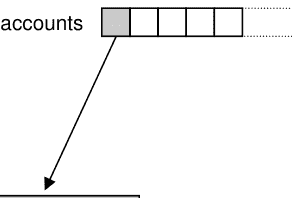

```text
Name : "Rob"

Balance : 0
```

该图显示了在我们存储第一个账户后`accounts`数组的状态。浅色的元素被设置为`null`。数组开头的元素包含指向账户实例的引用。

向银行添加账户的方法必须找到数组中的第一个空位置，并指向已添加的账户：

```csharp
public bool StoreAccount(Account account)
{
    int position = 0;

    for (position = 0; position < accounts.Length; position++)
    {
        if (accounts[position] == null)
        {
            accounts[position] = account;
            return true;
        }
    }

    return false;
}
```

该方法遍历数组寻找包含`null`的元素。如果找到了，则将其设置为该账户并返回`true`。如果在到达数组末尾之前没有找到`null`元素，它返回`false`表示存储失败。

当我们需要处理某个账户时，必须找到第一个空位置。接口提供了一个匹配的方法：

```csharp
IAccount fetchedAccount = ourBank.FindAccount("Rob");
```

## 创建解决方案

## 构建银行

```csharp
class BankProgram
{
    public static void Main()
    {
        ArrayBank ourBank = new ArrayBank(100);

        Account newAccount = new Account("Rob", "House", 100000);

        if (ourBank.StoreAccount(newAccount))
        {
            Console.WriteLine("Account added to bank");
        }

        Account storedAccount = ourBank.FindAccount("Rob");

        if (storedAccount != null)
        {
            Console.WriteLine("Account found in bank");
        }
    }
}
```

代码示例 46 展示了如何使用它。它创建了一个可以容 100 个元素的`ArrayBank`。它创建了一个新账户并将其存储。

## 创建解决方案

# 构建银行

简而言之，哈希函数为我们的搜索提供了一个起点，而不是像上面某些数组代码那样总是从数组的开头开始查找。这大大加快了数据的访问速度。

## 4.13.4 使用 C# Hashtable 集合

对于 C# 的设计者来说，幸运的是他们创建了一个哈希表供我们使用。它将根据一个被称为“键”（key）的特定对象来存储项目。事实证明基于此创建一个银行存储机制非常简单：

```csharp
class HashBank : IBank
{
    Hashtable bankHasht = new Hashtable();

    public IAccount FindAccount(string name)
    {
        return bankHasht[name] as IAccount;
    }

    public bool StoreAccount(IAccount account)
    {
        bankHasht.Add(account.GetName(), account);
        return true;
    }
}
```

代码示例 47 一个哈希表银行

`Hashtable`类位于`System.Collections`命名空间。它提供了一个名为`Add`的方法，该方法提供键的值以及在该哈希码上存储的项目引用。它还允许你使用引用（在这种情况下通过键`name`）来定位一个项目：

```csharp
return bankHasht[name] as IAccount;
```

我们必须使用这段代码中的`as`部分，因为集合将返回一个指向对象（Object）的引用。我们必须返回一个由`IAccount`接口提供的实例引用。`as`是类型转换的一种形式（我们强制编译器将其读取为特定类型）。它优于以下代码：

```csharp
return (IAccount) bankHasht[name];
```

`as`的优势在于，如果`bankHasht[name]`没有返回账户，或者返回了错误类型的内容，`as`运算符将生成一个空引用。由于这正是我们的`FindAccount`方法调用的预期，因此可以作为默认值返回。如果转换无效（即在运行时），我们的程序将抛出异常并失败。

有趣的是，由于我们通过接口实现了银行行为，我们可以非常容易更改程序中银行存储部分的工作方式，而无需更改任何其他内容。

## 银行笔记：关键属性非常重要

这里执行的操作与你使用银行卡从银行取钱时完全相同。ATM 机使用卡片上的信息来查找你的账户记录，以便在取款时检查你的余额并更新它。

在我们的简单银行中，我们只有一个键，即账户持有者的姓名。真实的银行键将更复杂，并且可能有多个，这样他们就可以根据可用信息通过姓名、地址或账户号码搜索账户持有者。

在收集有关系统的元数据时，你需要考虑项目的哪些属性将作为键字段。

C# 编程 Rob Miles 2016  
142

# 5 高级编程

## 5.1 泛型与集合

泛型（Generics）非常有用。这句话可能没有告诉你关于它们或它们的作用，但它确实表明了它们非常有用。它们听起来有点可怕；告诉人们你学习了“泛型”，可能会在人们脑中浮出穿白大褂拿试管的形象，至少对于那些字写不好的人来说是这样。我认为泛型的根可能是“通用”（general），其思想是指定一个通用的操作，并以适用于每个环境的方式将其应用到不同的上下文中。如果这听起来像抽象（abstraction）和不变性（invariance），那么你的方向是对的。如果不是，那么你将反复阅读书中的片段，直到它们变得有意义为止。

谈论泛型最好的方法可能是看它们如何帮助我们解决银行的问题。我们刚刚看到，当创建一个数组时，泛型必须精确指定它包含多少个元素。这导致了“压根稻草压死骆驼”的问题，添加第 10,001 个客户实际上并不是值得庆祝的，因为数组大小被设置为 10000，而我们的程序崩溃了。

解决这个问题的一种方法是使用非常大的数组，但我们并不希望这意味着对于较小的银行来说，程序可能会浪费大量时间。通常 CF 库提供了许多解决方案，从简单的`ArrayList`开始。

### 5.1.1 ArrayList 类

`ArrayList`是我们过的`HashTable`的表表，但它存在于`System.Collections`命名空间中。它允许我们创建一个非常有用的东西——一个可以增加大小的数组。我们可以始终向`ArrayList`中添加新元素，库中的一些清晰的代码确保了这种操作的有效。

## 创建 ArrayList

创建`ArrayList`非常简单：

```csharp
ArrayList store = new ArrayList();
```

注意，你不需要设置`ArrayList`的大小，但有重载的构造函数可以提供此信息并稍微帮助库代码运行：

```csharp
ArrayList storeFifty = new ArrayList(50);
```

名为`storeFifty`的`ArrayList`初始能够存储 50 个引用，但它可以根据需要持有更多或更少。

## 向 ArrayList 添加项目

向`ArrayList`添加项目也非常简单。该类提供了一个`Add`方法：

```csharp
Account robsAccount = new Account();

store.Add(robsAccount);
```

记住正在发生什么非常重要。我们并没有把一个`Account`放入`arraylist`中；我们让数组中的一个元素指向它。在这方面，`Add`这个词可能是误导性的。记住，如果`store`包含多个对`account`的引用，每个都可以被单独删除。如果引用不在`arraylist`中（例如如果你运行上述代码没有包含`obsAccount`），这不会导致错误。删除一个项目后，`arraylist`的大小会减少。

## 访问 ArrayList 项目

`ArrayList`项目访问方式与数组相同，但有一个不同：

```csharp
Account a = store[0];
```

不幸的是，这不可行。如果你写这段代码，将得到编译错误。原因是`arraylist`持有对象引用。你会从对对象的讨论中记得，对象引用可以指向任何类的实例，因此这是`arraylist`支持的唯一引用类型。这实际上并不是大问题，因为程序可以使用类型转换来更改`arraylist`返回的类型：

```csharp
Account a = (Account) store[0];

a.PayFunds(50);
```

这将获取 arraylist 开头的元素，将其转换为`Account`然后向其支付 50。

更大的问题是`arraylist`不是类型安全的。这意味着我们无法确定`arraylist`除了账户之外没有提供其他。

```csharp
KitchenSink k = new KitchenSink();

store.add(k);
```

这会将一个`KitchenSink`实例引用放入我们的银行存储中。如果我们尝试将其作为`Account`使用，这将导致问题（可能抛出异常）。要获得正确类型安全的存储，我们稍后需要查看泛型。

## 从 ArrayList 移除项目

从`arraylist`中移除项目是不可能的，但`arraylist`提供了一个非常有用的`Remove`行为。它接收一个要移除内容的引用：

```csharp
store.remove(obsAccount);
```

这将从`store`中移除第一个`obsAccount`引用。当项目从`arraylist`移除时，它并不一定会被销毁。

你可以使用`count`属性来查找列表中有多少个项目：

```csharp
if (store.Count == 0)
{
    Console.WriteLine("The bank is empty");
}
```

## 检查 ArrayList 是否包含某个项

我要提的最后一个技巧（但 ArrayList 还有很多其他功能可以为你提供服务）是`Contains`方法。这仅仅是一种快速查找方法，用于判断数组是否包含某个特定的引用。

```cs
if (a.Contains(robsAccount))
{
    Console.WriteLine("Rob is in the bank");
}
```

`Contains`方法返回一个对象的引用，如果 arraylist 包含该引用，则返回`true`。你可能会对这种行为感到不满，但将其内置在类中使得操作变得简单得多。

## ArrayList 与数组

ArrayList 和数组看起来非常相似。它们都使用大量项目，并使用订阅（方括号中的值）来获取其中任何一侧的元素。如果你尝试访问不在数组中的元素，它们也会抛出异常。如果你用数组代替 ArrayList，你将获得存储空间可以根据需要增长和收缩的优势；你唯一的问题是 ArrayList 持有对象的引用，而不是任何特定的类。然而，当你迁移到`List`类时，可以修复这个问题。

## 5.1.2 List 类

`List`提供了`ArrayList`提供的所有功能，优点是它也是带类型的。基于 C# 语言较新版本提供的泛型特性，它比`ArrayList`类更强大。要理解它是如何工作的，你需要了解一点泛型。

## 泛型与行为

如果你仔细考虑，数组的基本行为是相似的。无论你拥有的是`int`、`float`还是`Account`数组，它执行的工作都是完全相同的。它将许多项放在一起，并为你提供一些处理这些项的方法。它提供整数数组的能力与你拥有的`Accounts`数组的能力完全相同。因为每个数组都被声明为持有特定类型的值，C# 可以确保任何数组始终持有适当类型的值。按照系统的工作方式，你没有办法可以将所有对象都放入一个数组中。这都是好事，但 ArrayList 把事情搞得有点复杂。

`ArrayList`是事后被添加的，因为它不像数组那样是语言的一部分，它必须使用一种折中方案来允许它持有任何类型的项目。这是通过使用引用实现的，这可能会导致危险的问题，即没有任何机制阻止任何类型的引用被添加到数组中。

如果你给我一个`Accounts`数组，我可以完全确定数组中的所有内容都是`Account`。然而，如果你给我一个`ArrayList`，我没有办法确定所有内容都是它。据我所知，它可能包含一堆`KitchenSink`引用。只有当我开始将元素作为`Account`处理并且我的程序开始崩溃时，我才能真正发现。

解决这个问题的方法之一是找到一种让`ArrayList`强类型的方法，使其像数组一样成为 C# 的一部分。相反，他们引入了一种新的语言特性：**泛型**。

泛型允许我编写处理“特定类型的对象”的代码。我正在处理的是什么并不重要，这在我们想要处理某些东西时就可以解决了。

## 高级编程

### 泛型与集合

这听起来有点困惑，我们举个例子怎么样。

如果你想在你和朋友之间分享弹珠，你可以想出一种方法。类似于：“将弹珠数量除以朋友人数，并按通常方式分配剩余部分。”然而，你也可以用它来分享糖果、蛋糕甚至汽车。系统是如何运作的并不重要。你可以采用你的通用共享算法并将其用于分享任何东西。共享算法发明时不需要担心它所分享的物品的类型；它可以是一种应用于我们想要分享的类型的通用共享行为。在这方面，泛型可以被视为另一种形式的抽象。

### 泛型与 List

在泛型的情况下，我们需要的是一个列表。在创建列表时，列表存储什么并不重要，只要你有办法告诉它要存储什么。CF 特性提供了几个新方法允许你表达这一点。泛型`List`位于`System.Collections.Generic`命名空间，工作方式如下：

```cs
```


```csharp
List<Account> accountList = new List<Account>();
```

上面的语句创建了一个名为`accountList`的列表，它可以持有`Accounts`的引用。`< >`之间的类型是我们告诉列表它可以存储的东西种类。我们可以类似的方式创建一个可以持有整数的`List`：

```csharp
List<int> scores = new List<int>();
```

由于我们有编译器来指定列表可以持有的类型，它可以执行类型验证，并确保在使用列表时不会发生坏事：

```csharp
KitchenSink k = new KitchenSink();

accountList.Add(k);
```

上述语句将导致编译错误，`accountList`变量被声明为持有`Account`引用的列表，不会接受`kitchen sink`。

由于编译器知道`AccountList`持有`Account`引用，这意味着你可以编写如下代码：

```csharp
accountList[0].PayFunds(50);
```

不需要对列表中的项进行强制转换，因为类型已经确定。

你可以用`List`做任何用`Array`能做的事（`Add`、`Count`、`Remove`），这使其成为存储大量特定类型项目的完美选择。

## 5.1.3 Dictionary 类

正如`Array`有一个更通用的增强版类`List`，`HashTable`有一个更强大的兄弟`Dictionary`。这允许你的哈希表具有键，并且如果`arraylist`包含该引用，则返回`true`。你可能会对这种行为感到不满，但将其内置在类中使得操作变得简单得多。

（注：原文此处存在大量重复段落，译文已按要求进行逻辑处理）

## 5.2 存储业务对象

为了让我们的银行能够真正运行，我们必须有一种方法存储银行账户并将其重新读回。如果我们希望程序能够处理大量账户，我们知道必须创建一个数组来管理它们。这意味着我们的数据存储需求是：在程序启动时应将所有账户加载到内存中，并在程序完成时将它们保存。

首先，我们将考虑如何保存一个账户。然后，我们可以开始考虑用于保存大量账户的代码。我们要处理的账户只有两个成员，但我们正在探索的思路可以扩展到处理包含大量大量数据的类。我们可以通过以下接口来表达所需的账户行为：

```csharp
public interface Account
{
    void PayInFunds(decimal amount);

    bool WithdrawFunds(decimal amount);

    decimal GetBalance();

    string GetName();
}
```

银行中的所有账户将通过实现此接口的对象来管理，以管理余额并读取账户所有者的姓名。我们可以创建一个名为`CustomerAccount`的类，它实现了该接口并包含了所需的方法。它还拥有构造函数，允许在创建账户时设置初始名称和余额值。

```csharp
public class CustomerAccount : IAccount
{
    private decimal balance = 0;

    private string name;

    public CustomerAccount(string newName, decimal initialBalance)
    {
        name = newName;

        balance = initialBalance;
    }

    public virtual bool WithdrawFunds(decimal amount)
    {
        if (balance < amount)
        {
            return false;
        }

        balance = balance - amount;

        return true;
    }

    public void PayInFunds(decimal amount)
    {
        balance = balance + amount;
    }

    public decimal GetBalance()
    {
        return balance;
    }

    public string GetName()
    {
        return name;
    }
}
```

注意，此版本的类没有对输入值进行任何错误检查，因此它不是我所说的“生产级”代码，它在这里只是说明如何保存和恢复类中的数据。

### 5.2.1 保存账户

实现保存行为的最佳方法是让账户负责保存自己。事实上，仔细想想，这是我们保存账户的唯一方法，因为任何保存机制都需要保存账户中的私有数据，而这些数据只对类内部的方法可见。

我们可以为`CustomerAccount`类添加一个`Save`方法：

```csharp
public bool Save(string filename)
{
    try
    {
        System.IO.TextWriter textOut = new System.IO.StreamWriter(filename);

        textOut.WriteLine(name);

        textOut.WriteLine(balance);

        textOut.Close();
    }
    catch
    {
        return false;
    }

    return true;
}
```

该方法接收账户要存储的文件名。它写出账户名称和账户余额。这允许 Rob 所指的账户保存到名为`"outputfile.txt"`的文件中。注意，我编写代码时，如果文件输出失败，该方法将返回`false`，表示保存未成功。

### 5.2.2 加载账户

加载比保存要困难得多。当我们保存账户时，我们有一个想要保存的账户；当加载时，还没有账户可供加载。绕过此问题的方法是编写一个静态方法，根据名称创建一个账户：

```csharp
public static CustomerAccount Load(string filename)
{
    CustomerAccount result = null;

    System.IO.TextReader textIn = null;

    try
    {
        textIn = new System.IO.StreamReader(filename);

        string nameText = textIn.ReadLine();

        string balanceText = textIn.ReadLine();

        decimal balance = decimal.Parse(balanceText);

        result = new CustomerAccount(nameText, balance);
    }
    catch
    {
        return null;
    }
    finally
    {
        if (textIn != null)
        {
            textIn.Close();
        }
    }

    return result;
}
```

该方法打开一个文件，获取余额值，并使用该余额值和名称创建一个新的`CustomerAccount`。

#### 代码示例 49 账户保存与加载

```csharp
class SaveDemo
{
    public static void Main()
    {
        CustomerAccount test = new CustomerAccount("Rob", 1000000);

        test.Save("Test.txt");

        CustomerAccount loaded = CustomerAccount.Load("Test.txt");

        Console.WriteLine(loaded.GetName());
    }
}
```

代码示例显示了程序如何将账户保存到文件中然后加载它。`Load`方法非常小心地确保如果发生任何坏情况：

- 它不会抛出调用者必须捕获的异常。
- 如果发生任何坏情况，它会返回`null`以指示加载失败。
- 它确保其打开的文件被关闭。

这就是我所说的“专业级”质量，而且当你在编写代码时应该达到这种标准。

### 5.2.3 使用流

更好的解决方案是给保存方法提供一个用于保存的流（stream），而不是文件名。流是 C# 在我们打开文件时创建的东西：

```csharp
System.IO.TextWriter textOut =
    new System.IO.StreamWriter("Test.txt");
```

引用`textOut`连接到文件。我们可以创建一个接受流作为参数的方法：

```csharp
public void Save(System.IO.TextWriter textOut)
{
    textOut.WriteLine(name);

    textOut.WriteLine(balance);
}
```

该方法可以从原始的文件保存方法中调用：

```csharp
public bool Save(string fileName)
{
    System.IO.TextWriter textOut = null;

    try
    {
        textOut = new System.IO.StreamWriter(fileName);

        Save(textOut);
    }
    catch
    {
        return false;
    }
    finally
    {
        if (textOut != null)
        {
            textOut.Close();
        }
    }

    return true;
}
```

该方法创建了一个流并将其传递给同一个方法以保存项。注意，这是重载的一个示例，因为我们有两个共享相同名称的方法。我们银行账户的加载方法可以用一个具有类似的方法替换：

```csharp
public static CustomerAccount Load(System.IO.TextReader textIn)
{
    CustomerAccount result = null;

    try
    {
        string name = textIn.ReadLine();

        string balanceText = textIn.ReadLine();

        decimal balance = decimal.Parse(balanceText);

        result = new CustomerAccount(name, balance);
    }
    catch
    {
        return null;
    }

    return result;
}
```

## 高级编程

## 存储业务对象

此方法提供了一个文本流。它从该流中读取名称和余额，并根据这些数据创建一个新的`CustomerAccount`。

#### 程序员要点：流是奇妙的

使用流是一个非常好的主意。C# 的输入输出系统允许我们把流连接到各种事物，而不仅仅是磁盘上的文件。例如，你可以创建一个连接到网络端口的流。这意味着，如果你使用流来保存和加载你的业务对象，那么它们可以在不需要你进行额外工作的情况下，通过网络连接进行发送。

### 保存和加载银行账户

现在我们已经有了将多个账户保存到单个流中的方法，我们可以为银行编写一个方法。该方法将打开流并将所有账户保存到其中：

```csharp
public void Save(System.IO.TextWriter textOutput)
{
    textOutput.WriteLine(bankHashtable.Count);

    foreach (CustomerAccount account in bankHashtable.Values)
    {
        account.Save(textOutput);
    }
}
```

这是将添加到我们基于`Hashtable`的银行中的`Save`方法。它从哈表中取出每个账户并将其保存到给定的流中。注意，我们在这里使用了一种新的 C# 循环结构`foreach`。这在处理数据集合时非常有用。它会遍历集合（在本例中是`bankHashtable`的`Values`属性），并依次保存每个项。

注意，它还输出了银行中账户的数量。我们这样做是为了当重新读取银行时，`load`方法知道需要多少账户。我们本可以直接写入数据，然后让`load`方法在到达文件末尾时停止，但这将导致无法检测文件是否被缩短了。

整个银行的`Load`方法如下：

```csharp
public static Hashtable Load(System.IO.TextReader text)
{
    Hashtable result = new Hashtable();

    string countString = text.ReadLine();

    int count = int.Parse(countString);

    for (int i = 0; i < count; i++)
    {
        CustomerAccount account = CustomerAccount.Load(text);

        result.bankHashtable.Add(account.GetName(), account);
    }

    return result;
}
```

这读取了银行的大小，然后逐个读取账户并将其添加到哈希表中。注意，这个`load`方法没有处理错误。程序的生产版本应该会在将每个账户添加到哈希表之前检查每个账户是否已正确加载。

```csharp
class BankProgram
{
    public static void Main()
    {
        Dictionary ourBank = new DictionaryBank();

        Account newAccount = new Account("Rob", 1000000);

        if (ourBank.StoreAccount(newAccount))
        {
            Console.WriteLine("Account added to bank");
        }

        ourBank.Save("Test.txt");

        Dictionary loadBank = DictionaryBank.Load("Test.txt");

        Account storedAccount = ourBank.FindAccount("Rob");

        if (storedAccount != null)
        {
            Console.WriteLine("Account found in bank");
        }
    }
}
```

代码示例 50 保存整个银行

此代码示例显示了在由`Dictionary`驱动的银行中是如何工作的。示例只显示了一个账户，但可以扩展到处理任意数量的账户。

### 银行备注：大规模数据存储

我们所做的是创建了一种方法，可以在单个文件中存储大量的银行账户。我们在没有牺牲任何内聚性的情况下完成了，因为只有`Customer`类负责内容。我们还仔细地确保保存和加载数据管理能够处理该过程可能失败的情况。

### 5.2.4 处理不同类型的账户

如果我们只想保存和加载特定类型的账户，那么上面的代码将正常工作，因为所有内容都是基于`CustomerAccount`类编写的。然而，我们已经看到客户需要程序能够处理许多不同类型的账户。

### 健康警告

这很复杂。我不期望你在第一次阅读时就能理解这些。它之所以出现在这里是为了完整性。在介绍了所有的类层次结构以及基于在现有类的基础上创建新类是多么有用（正如我们对`BabyAccount`所做的那样）之后，如果让你去猜这些内容是如何存储和检索的将是不公平的。提供这些材料是为了让你对如何真正创建一个运行的银行有一个概念，但它假设你对类层次结构、方法重写/重载以及构造函数链有非常好的理解。

好消息是，当你真正理解了这些内容时，你就可以称自己为成熟的 C# 程序员了。

### 银行与灵活性

我们知道，当我们的系统在银行运行时，会有一系列不同类型的账户，其中某些是基于其他账户的。例如，我们之前讨论过`BabyAccount`，这是一种为年轻人提供的特殊账户，限制取款金额不超过 10 英镑。客户还要求`BabyAccount`类包含“父”账户持有者的姓名。我们可以通过创建一个扩展`CustomerAccount`类的账户并添加所需的行为和属性来实现这种行为：

```csharp
public class BabyAccount : CustomerAccount
{
    private string parentName;

    public string GetParentName()
    {
        return parentName;
    }

    public override bool WithdrawFunds(decimal amount)
    {
        if (amount > 10)
        {
            return false;
        }
```


`return base.WithdrawFunds(amount);`

```
public BabyAccount(string newName, decimal initialBalance, string parentName) : base(newName, initialBalance) {
    this.parentName = parentName;
}

public override void Save(System.IO.TextWriter textOutput) {
    base.Save(textOutput);
    textOutput.WriteLine(parentName);
}
```

### 保存子类

当我们想要保存子类时，我们需要保存父类的数据。事实证明这是简单的，因为我们使用父类方法：

```csharp
public override void Save(System.IO.TextWriter textOutput) {
    base.Save(textOutput);
    textOutput.WriteLine(parentName);
}
```

### 加载子类

我们可以为`BabyAccount`创建一个静态加载方法，它从流中读取数据：

```csharp
public static BabyAccount Load(System.IO.TextReader textIn)
{
    BabyAccount result = null;
    try {
        string name = textIn.ReadLine();
        string balanceText = textIn.ReadLine();
        decimal balance = decimal.Parse(balanceText);
        string parent = textIn.ReadLine();
        result = new BabyAccount(name, balance, parent);
    }
    catch {
        return null;
    }
    return result;
}
```

然而，我不特别喜欢这种方法。这种方法违反了设计规则，因为我们现在两个类之间存在依赖关系，当我更改`CustomerAccount`类（例如添加一个名为`customerPIN`的字段）时，我也必须更新`BabyAccount`类中的`Load`方法以确保数据被加载。如果我忘记这样做，程序将编译，但运行时无法正常工作。

注意，这些构造函数没有进行任何错误检查，它们只是在出现问题时抛出异常。考虑到构造函数失败的唯一方法就是抛出异常，这是合理的行为。

## 接口与保存操作

当我们开始账户开发时，我们定义了一个接口，描述了账户实例应该能够执行的所有操作。起初并不包含保存行为，但可以对其进行更新以包含这些行为：

```
public interface IAccount
{
    void PayFunds (decimal amount);
    bool WithdrawFunds (decimal amount);
    decimal GetBalance();
    string GetName();
    bool Save(string filename);
    void Save(System.IO.TextWriter text);
}
```

现在我们可以添加任何实现了`IAccount`接口的项，将其自身保存到文件或流中。这在我们存储账户集合时非常有用，因为容器的行为并不取决于它正在保存的是哪种账户，它必须调用特定实例的`save`方法。这是一个好主意。

## 加载与工厂

当涉及到将类重新加载回来时，情况会变得有点复杂。你可能认为在`IAccount`接口中添加`load`方法是明智的，这样我们可以要求特定账户的实例加载自身。然而，这里存在一个问题：当我们加载账户时，实际上并没有一个实例可以调用方法。此外，考虑到我们是从数据流中读取的，我们实际上并不知道正在加载的是哪种项。

这个问题的解决方案是在保存时识别流中每个实例的类型。我们银行的保存方法可能像这样：

```
public void Save(System.IO.TextWriter textOut)
{
    textOut.WriteLine(bankHashtable.Count);
    foreach (CustomerAccount account in bankHashtable.Values)
    {
        textOut.WriteLine(account.GetType().Name);
        account.Save(textOut);
    }
}
```

这看起来非常像我们原始的方法，只是多了一行（已高亮显示）。它写出了类的名称。它使用了`GetType()`方法，该方法可以在账户实例上调用以获取类类型。有了类型，我们就可以获取该类型的`name`属性并打印它。换句话说，如果账户是`CustomerAccount`类型，程序将输出：

```
CustomerAccount
Rob
100
```

输出现在包含了已写入的每个类的类型名称。这意味着当回读流时，这些信息可以被用于创建正确类型的类。实现此最整洁的方法是创建一个工厂，由它来产生所需类的实例：

## 高级编程

### 存储业务对象

```
class AccountFactory {
    public static IAccount MakeAccount(
        string name, System.IO.TextReader textIn)
    {
        switch (name) {
            case "CustomerAccount":
                return new CustomerAccount(textFile);
            case "BabyAccount":
                return new BabyAccount(textFile);
            default:
                return null;
        }
    }
}
```

该类只包含一个方法，且该方法是静态的。该方法有两个参数：要创建的类名称以及一个用于读取的流。它使用名称来决定创建哪个项，创建一个该项，然后返回给调用者。如果无法识别名称，则返回`null`。银行的加载方法可以使用此工厂在加载账户时创建账户实例：

```
public static HashBank Load(System.IO.TextReader textIn) {
    HashBank result = new HashBank();
    string countString = textIn.ReadLine();
    int count = int.Parse(countString);
    for (int i = 0; i < count; i++) {
        string className = textIn.ReadLine();
        IAccount account = AccountFactory.MakeAccount(className, textIn);
        result.bankHashtable.Add(account.GetName(), account);
    }
    return result;
}
```

再次，这看起来非常像我们原始的加载方法，除了它在从流中读取类名称后使用工厂来创建账户实例。

### 业务对象与编辑

```
class BankProgram {
    public static void Main() {
        Dictionary ourBank = new DictionaryBank();
        CustomerAccount newAccount = new CustomerAccount("Rob", 1000000);
        if (ourBank.StoreAccount(newAccount)) {
            Console.WriteLine("Customer account added to bank");
        }
        BabyAccount newAccount = new BabyAccount("David", 100, "Rob");
        if (ourBank.StoreAccount(newAccount)) {
            Console.WriteLine("BabyAccount added to bank");
        }
        ourBank.Save("Test");
        DictionaryBank loadBank = DictionaryBank.Load("Test");
        IAccount storedAccount = loadBank.FindAccount("Rob");
        if (storedAccount != null) {
            Console.WriteLine("Customer account found in bank");
        }
        storedAccount = loadBank.FindAccount("David");
        if (storedAccount != null) {
            Console.WriteLine("BabyAccount found in bank");
        }
    }
}
```

代码示例 51 运行中的工厂类

上面的代码展示了我是如何测试我的工厂的。它创建了一个银行，添加两个不同的账户，然后将它们加载回来。

## 工厂依赖

注意，我们的系统和工厂之间存在真实的依赖关系。如果我们添加一种新类型的账户，我们就必须更新工厂。这是一个问题，因为工厂需要知道所有的账户类型。这意味着账户和工厂之间存在循环依赖。

## 程序员观点：生产代码

从现在开始，所有的示例将在生产代码的背景下给出。这可能比你喜欢的要复杂，但我认为这样做是值得的，因为理解“真实”程序员面临的问题非常重要。

### 5.3.1 业务对象的角色

我们在银行系统中采取了非常严格的立场，阻止任何组件直接与用户交互。这是因为像`Customer`这样的类是业务对象。它们的工作不是与用户交互；它们专门负责跟踪账户信息。业务对象的工作是确保它保存的数据始终正确。编辑行为应该利用业务对象暴露的方法。

### 管理账户名称

作为一个例子，考虑账户持有者的姓名。安全地存储姓名很重要，但人们可能想要随时更改姓名。这意味着业务对象必须提供一种更改名称的方法。

然而，这不仅仅是将一个字符串替换为另一个。新名称必须是有效的。这意味着账户必须能够拒绝你不喜欢的名称。如果它要拒绝名称，如果能告诉用户为什么名称无效将对用户非常有用，因此验证过程应该提供关于为何失败的反馈。

一个良好的软件工程师会提供类似的代码：

```
private string name;

public string GetName()
{
    return this.name;
}

public static string ValidateName ( string name )
{
    if (name == null) {
        return "Name parameter null";
    }
    string trimmedName = name.Trim();
    if (trimmedName.length == 0) {
        return "No text in the name";
    }
    return "";
}

public bool SetName ( string inName)
{
    string reply;
    reply = ValidateName(inName);
    if (reply.Length > 0 )
    {
        return false;
    }
    this.name = inName.Trim();
    return true;
}
```

## 高级编程

## 业务对象与编辑

名称存储在`Account`类的一个私有成员中。程序员提供了三个方法，让`Account`的用户可以处理名称。有一个方法用于获取名称，另一个用于设置名称，还有一个用于验证名称。`validate`方法由`set`方法调用，以确保我的对象账户永远不会有无效的名称。`validate`方法将拒绝空字符串或仅包含空格的名称字符串。它会修掉名称文本前后所有的空格，然后检查结果字符串的长度是否为零。如果是，则该字符串被拒绝。

我提供`validate`方法是为了让该类的用户可以检查他们的名称以确保它们是有效的。这并不会给我带来多少额外工作，因为我也使用了该方法，当字符串被拒绝时它会返回错误信息。名称无效可能有很多原因，目前我只给出了两种。名称无效的原因当然属于项目元数据的一部分。我还将此方法设为静态（`static`），这样不需要创建`account`的实际实例即可对名称进行。

# 名称处理测试

当然，一旦我们有了这些方法，自然而然会为它们创建测试：

```csharp
int errorCount=0;
string reply;

reply = CustomerAccount.ValidateName(null);
if (reply != "Name parameter null")
{
    Console.WriteLine("Name test failed");
    errorCount++;
}

reply = CustomerAccount.ValidateName("");
if (reply != "No text in the name")
{
    Console.WriteLine("Empty name test failed");
    errorCount++;
}

reply = CustomerAccount.ValidateName(" ");
if (reply != "No text in the name")
{
    Console.WriteLine("Blank string name test failed");
    errorCount++;
}

CustomerAccount a = new CustomerAccount("Rob", 50);
if (!a.SetName("Jim"))
{
    Console.WriteLine("Jim Setname failed");
    errorCount++;
}
if (a.GetName() != "Jim") {
    Console.WriteLine("Jim Getname failed");
    errorCount++;
}

if (!a.SetName("Pete"))
{
    Console.WriteLine("Pete Setname failed");
    errorCount++;
}
if (a.GetName() != "Pete") {
    Console.WriteLine("Pete Getname failed");
    errorCount++;
}

if (errorCount > 0)
    SoundSiren();
```

代码示例 52 测试名称设置

这些是我能想到的所有测试。首先，我通过`ValidateName`确保它拒绝了这两种空字符串。然后，我确保我可以在账户上设置名称。最后，我检查了名称的空格修剪是否正确。

# 程序员观点：使用消息（Not Messages）

我在示例程序中还没有解决一个问题，它阻止了它们变得完全完美。那就是错误处理问题。在我的验证方法返回字符串的那一刻，在生产环境中，错误应该是数值值。这是因为在测试中数值值比字符串更容易比较，而且意味着我的程序可以非常容易地以外外语言工作。我只需要一个查找表，将消息数字转换为当前活动语言中适当的字符串。你应该考虑将此类问题视为项目元数据的一部分。系统必须在法国和德国运行，这是你从刚开始就需要意识到的事情。

# 编辑名称

我们有一个业务对象，它提供的方法让我们能够编辑名称值。现在我可以编写代码来编辑此属性了：

```csharp
while (true)
{
    Console.Write ( "Enter new name : " );
    newName = Console.ReadLine();
    string reply;
    reply = account.ValidateName(newName);
    if ( reply.length == 0 )
    {
        break;
    }
    Console.WriteLine("Invalid name : " + reply );
}
account.SetName(newName);
```


这段代码将对由`account`引用的账户实例执行名称编辑。它会读取一个新名称。如果名称有效，则打印消息并重复循环。这不是最优雅的解决方案，但它确实让用户知道程序正在做什么，并且可以运行。现在我们已经有了编辑代码，我们需要把它放在某处。

# 创建编辑器类

实现此操作的最佳方法是创建一个负责编辑工作的类。该类将对某个需要编辑的特定账户工作。编辑器类和账户类之间存在依赖关系，即如果账户类发生了变化，编辑器可能也需要更新，但这是我们必须接受的。

当我想编辑账户时，我创建一个编辑器实例并将账户实例的引用传递给它：

```csharp
public class AccountEditTextUI
{
    private IAccount account;

    public AccountEditTextUI(Account inAccount)
    {
        this.account = inAccount;
    }

    public void EditName()
    {
        string newName;

        while (true)
        {
            Console.Write(" Enter new name : ");
            newName = Console.ReadLine();

            string reply;
            reply = this.account.ValidateName(newName);

            if (reply.length == 0)
            {
                break;
            }

            Console.WriteLine("Invalid name : " + reply);
        }

        account.SetName(newName);
    }
}
```

代码示例 53 名称编辑

这创建了编辑器的实例。注意账户被传递给了编辑器。这意味着编辑器可以对任何账户工作。

```csharp
CustomerAccount a = new CustomerAccount("Rob", 50);
AccountEditTextUI edit = new AccountEditTextUI(a);
edit.EditName();
```

这创建了编辑器的实例。注意账户被传递给了编辑器。这意味着编辑器可以对任何账户工作。

# 程序员观点：使用引用（Passing References）

理解传递引用是非常重要的。如果我想给客户可以操作的东西，我将通过传递引用来实现。

## 5.3 基于文本的编辑系统

现在我们在编辑器类中有一个单一方法，可以用于编辑名称。我们真正想要的是菜单系统，它可以接收用户的命令并执行该功能：

```csharp
public void DoEdit(CustomerAccount account)
{
    string command;

    do
    {
        Console.WriteLine("Editing account for {0}", account.GetName());
        Console.WriteLine(" " + "Enter name to edit name" + " ");
        Console.WriteLine(" " + "Enter pay to pay in funds" + " ");
        Console.WriteLine(" " + "Enter draw to draw out funds" + " ");
        Console.WriteLine("Enter command : ");

        command = Console.ReadLine().Trim().ToLower();

        switch (command)
        {
            case "name":
                EditName(account);
                break;

            case "pay":
                PayFunds(account);
                break;

            case "draw":
                WithDrawFunds(account);
                break;
        }
    }
    while (command != "exit");
}
```

我扩展了账户类以管理余额，并添加了用于存款和取款的编辑方法。注意我的编辑方法传递了被编辑账户的引用。然后它将其传递给执行实际工作的服务方法。

## 银行备注：多界面支持

银行对编辑账户详情可能有非常广泛的需求。这些需求可能来自呼叫中心的操作员、日程终端的操作员、使用手机的客户以及在自动取款机的客户。我希望你能理解，管理所有这些与银行账户交互的不同方式的唯一方法是将业务对象（账户本身）与输入/输出行为分离。

请注意，我们不允许用户界面这类组件决定什么是有效名称。这个问题不是前端的责任。唯一能决定名称有效性的是账户对象本身。用户界面必须始终基于将使用业务对象来执行此类验证的基础上工作。

## 5.4 线程与多线程

如果你想称自己为合格的程序员，你一定对线程有所了解。它们可以让程序的创建变得简单得多，但它们也可能成为棘手 Bug 的根源。在未来，当计算机处理器的速度受到光速和原子大小等因素的限制时，我们将通过线程改进计算机系统的性能。

### 5.4.1 什么是线程？

目前在我们运行程序时，只使用单个线程。线程通常从`Main`方法开始，并在到达该方法时结束。你可以将线程想象成沿着轨道运行的火车。轨道就是线程正在执行的语句。就像你可以在单条轨道上放置多辆火车一样，计算机也可以在单个程序块中运行多个线程。

计算机可以通过两种方式支持多线程。第一种是在活动线程之间快速切换，让每个线程都有机会在有限的时间内运行，然后移动到另一个线程。当线程没有运行时，它会处于一个“冻结”状态，等待轮到。对于线程而言，它的运行可能每隔一段时间只活跃一小秒钟。

支持多线程的第二种方法是实际上拥有多个处理器。早期的计算机只有一个处理器，被迫使用“时间切片”来支持多线程。现在的新机器拥有“双核”或“四核”处理器，它们实际上可以同时运行多个线程。

### 5.4.2 为什么我们需要线程？

线程让你的计算机在某个程序被阻塞时能够执行有用的事情。当你的程序等待你按下下一个键时，系统可以播放音乐并下载文件。现代计算机每秒可以执行数百万指令；在多个任务之间共享资源是有意义的。

你编写并运行的程序都在你的计算机中执行。这就是为什么你的程序可以与你希望同时使用的其他程序同时处于活动状态的原因。你可能没有意识到，操作系统（通常是 Windows）在共享处理能力方面做得非常好。

线程提供了另一个层面的“抽象”，因为如果我们希望同时执行多项任务，那么发送一个线程去执行任务，而不是将第二个任务与第一个任务交替执行，将是非常有用的。如果我们自己写一个处理器，我们可能会发现创建线程来执行打印或拼写检查等耗时任务是很有用的。这可以在用户继续处理文档时在“后台”进行。

# 高级编程

## 线程与多线程

线程是 Windows 表单响应事件的方式。你已经看到过来自`Button`组件的“点击”事件可以用来运行一个事件处理器。Windows 系统会创建一个新的执行线程来运行该事件处理器。

### 程序员观点：线程可能是危险的

就像让两个线程共享同一条铁路轨道有时会导致问题一样，使用线程的程序也可能以惊人且困惑的方式失败。系统可能只在当特定的事件序列导致两个之前表现正常的线程对共享数据项发生“争抢”时才会失败。由线程引起的 Bug 是最难追踪和修复的 Bug，因为你必须在修复它之前先让问题发生，而导致故障的情况可能只是偶尔出现一次。我将提供一些关于如何确保你的程序避开与线程相关的 Bug 的提示，我建议你仔细遵循这些建议。

### 5.4.3 线程与处理器

考虑以下方法：

```csharp
static private void busyLoop()
{
    long count;

    for (count = 0; count < 10000000000000L; count = count + 1)
    {
    }
}
```

代码示例 54 单线程忙循环

此方法什么都不做，但它执行了数千百万次。如果你运行一个调用此方法的程序，首先发生的事情是程序似乎停止了。然后我笔记本电脑的风扇开始转动，因为处理器正在工作而发热。如果我启动 Windows 任务管理器，我看到了下面的图片：

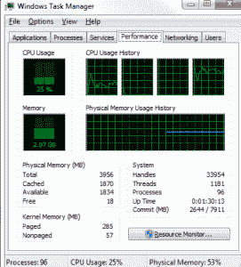

我的笔记本电脑有四个核心，这意味着它可以同时运行四个线程。你可以看到显示器 CPU（中央处理单元）使用历史部分下的图表，显示每个处理器的忙程度。从上面的情况来看，最左侧的处理器和最右侧的处理器相当忙，但中间两个处理器什么都没做。如果我停止运行程序，我会得到像下面的显示。

## 高级编程

### 线程与多线程

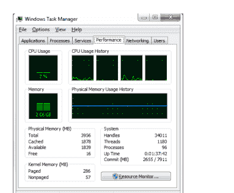

### 程序员观点：线程可以提高性能

线程让你的计算机在某个程序被阻塞时能够执行有用的事情。当你的程序等待你按下下一个键时，系统可以播放音乐并下载文件。现代计算机每秒可以执行数百万指令；在多个任务之间共享资源是有意义的。

你编写并运行的程序都在你的计算机中执行。这就是为什么你的程序可以与你希望同时使用的其他程序同时处于活动状态的原因。你可能没有意识到（操作系统）在共享处理能力方面做得非常好。

线程提供了另一个层面的“抽象”，因为如果我们希望同时执行多项任务，那么发送一个线程去执行任务，而不是将第二个任务与第一个任务交替执行，将是非常有用的。如果我们自己写一个处理器，我们可能会发现创建线程来执行打印或拼写检查等耗时任务是很有用的。这可以在用户继续处理文档时在“后台”进行。

### 5.4.4 运行线程

`Thread`类提供了许多你的程序可以使用的方法来控制其执行内容。要启动线程，可以使用`Start`方法：

```csharp
t1.Start();
```

这就是线程运行的点。

```csharp
class ThreadDemo
{
    static private void busyLoopMethod()
    {
        long count;

        for (count = 0; count < 1000000000000L; count++)
        {
        }
    }

    static void Main()
    {
        ThreadStart busyLoopMethod = new ThreadStart(busyLoopMethod);
        Thread t1 = new Thread(busyLoopMethod);

        t1.Start();
        busyLoop();
    }
}
```

上面的代码创建了一个名为`t1`的线程并开始运行`busyLoop`方法。它还从`Main`方法直接调用了`busyLoop`。这意味着有两个进程处于活动状态。这显示了任务管理器界面：

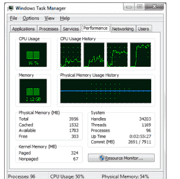

现在更多的图表显示了活动状态，CPU 使用率从 25% 上升到 50%，因为我们的程序现在使用了更多的处理器。

### 创建许多线程

从上面的显示中你可以看到，如果我们创建一个额外的线程，我们可以使用更多计算机提供给我们的性能。事实上，我们可以创建比这多得线程：

# 高级编程

## 线程与多线程

```csharp
for (int i = 0; i < 100; i = i + 1)
{
    Thread t1 = new Thread(busyLoopMethod);
    t1.Start();
}
```

## 代码示例：五百个线程忙循环

此循环将创建 100 个线程，它们都会运行`busyLoop`方法。我们的电脑变得忙碌：

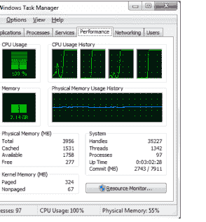

现在所有处理器都已达到最大负载，CPU 使用率高达 100%。如果你运行这段代码，你可能会发现机器变得轻微无响应，并且所有风扇都会全速运转。

## 程序员观点：线程过多会减慢一切速度

没有任何东西能阻止你的程序启动大量运行的线程。这具有潜在的危险。如果你同时运行许多线程，将会减慢所有速度。这实际上是针对你计算机的一种攻击基础，被称为拒绝服务攻击（Denial of Service attack）。它通过大量占用处理器的线程使你的计算机变得不稳定。幸运的是，Windows 会提高处理用户输入线程的优先级，你通常可以控制并停止这种由于失常的行为。

## 5.4.5 线程与同步

你可能会奇怪，为什么线程不会争夺用作循环计数器的`count`的值。这是因为该变量是`busyLoop`方法的局部变量：

```csharp
static private void busyLoop()
{
    long count;

    for (count = 0; count < 1000000000000L; count = count + 1)
    {
    }
}
```

该变量在方法体内部声明。这意味着每个方法都有该局部变量的副本。如果你仍然将线程看作火车，那么就好像每个线程的数据都存储在沿着火车拖引的卡车上。我们可以对此进行微小的更改，将`count`变量变为类的成员：

```csharp
static long count;

static private void busyLoop()
{
    for (count = 0; count < 1000000000000L; count = count + 1)
    {
    }
}
```

C# 编程 Rob Miles 2016

该方法看起来非常相似，但现在每个`busyLoop`线程都在共享同一个`count`变量。这可能是灾难性的。预测这个多线程程序完成需要多长时间非常困难。考虑以下操作序列：

1. 线程获取`count`变量的值，以便对其加 1。
2. 在执行加法操作之前，线程 1 被停止，允许线程 20 运行。
3. 线程 20 获取`count`的值，对其加 1 并将其存回内存。
4. 有时线程 1 再次获得控制权，对它在被中断之前获取的值进行加 1，并将结果存储在内存中。

由于线程 1 在计算期间被中断的原因，它覆盖了线程 20 所做的更改。因为所有线程都在不断加载、中断和存储`count`的值，并覆盖掉它们所做出的更改。

我们需要一种方法来阻止线程相互中断。`count = count + 1;`语句必须允许在不被中断的情况下执行。你可以通过使用*互斥*（mutual exclusion）或*互斥锁*（mutex）特性来实现。我们可以回到我们的火车类比。

## 使用互斥管理数据共享

允许两个线程共享同一个变量有点允许两列火车共享同一段轨道。这两者都是危险的。单线轨道问题通过一个由机车持有的单个黄质令牌解决了。当它们进入单线轨道时，会被赋予这个令牌。当火车离开左侧区域时，驾驶员将令牌还回去。任何想进入轨道的人必须等待他们的令牌。

互斥的工作原理相同，通过使用对象的实例来扮演角色。

```csharp
static object sync = new object();
```

该对象实际上并不持有任何数据。它仅被用作进程持有的令牌。

```csharp
Monitor.Enter(sync);

count = count + 1;

Monitor.Exit(sync);
```

`Monitor.Enter`和`Monitor.Exit`之间的代码一次由一个线程执行。换句话说，没有中断递增语句并切换到另一个进程的窗口。所有的递增操作将完整完成。一旦执行离开`Monitor`调用之间的语句，它们就可以被挂起直到正常。

无法运行的线程被“停”在等待线程队列中。该队列是有顺序的，第一个获取入口的线程将是第一个获取锁的，其他线程排队等待自己的机会。*Monitor*为我们照看这一切；我们不需要知道它是如何工作的。

## 程序员的线程：可以完全破坏你的程序

如果一个线程抓住一个同步对象并且不释放它，当其他线程需要该对象时它将阻止它们运行。这是一个让你的程序失败的一种好方法。另一种被称为“死锁”（Deadly Embrace）的情况，即线程`a`拥有对象`x`并等待对象`y`，而线程`b`拥有对象`y`并等待对象`x`。这是计算机版本的“我不会给他打电话道歉，我要等他给我打电话”。

## 5.4.6 线程控制

如果一个线程抓住一个同步对象并且不释放它，当其他线程需要该对象时它将阻止它们运行。这是一个让你的程序失败的一种好方法。另一种被称为“死锁”（Deadly Embrace）的情况，即线程`a`拥有对象`x`并等待对象`y`，而线程`b`拥有对象`y`并等待对象`x`。这是计算机版本的“我不会给他打电话道歉，我要等他给我打电话”。

如果一个线程抓住一个同步对象并且不释放它，当其他线程需要该对象时它将阻止它们运行。这是一个让你的程序失败的一种好方法。另一种被称为“死锁”（Deadly Embrace）的情况，即线程`a`拥有对象`x`并等待对象`y`，而线程`b`拥有对象`y`并等待对象`x`。这是计算机版本的“我不会给他打电话道歉，我要等他给我打电话”。

还有额外的功能允许你暂停、等待和控制。这是因为该类提供了。

## 暂停线程

如你所见，暂停的一种方法是创建一个可以检查的输出。这是因为该类提供了。然而，花费在编写上甚至可能导致程序失败。如果你想暂停一下，应该使用：

```csharp


`Thread.Sleep(500);`

## 线程连接

如果你想知道一个线程何时完成，可以使用该方法。这是因为该类提供了：

```csharp
t1.Join();
```

## 线程控制

如果你想停止一个线程，可以使用该方法。这是因为该类提供了：

```csharp
t1.Abort();
```

如果你想挂起一个线程，可以使用该方法。这是因为该类提供了：

```csharp
t1.Suspend();
```

如果你想恢复一个线程，可以使用该方法。这是因为该类提供了：

```csharp
t1.Resume();
```

## 查找线程状态

你可以通过其属性查找线程的状态。可能的值有：

- 运行（Running）
- 停止（Stopped）
- 挂起（Suspended）
- 等待（Wait）

例如：

```csharp
if (t1.State == ThreadState.Running)
{
    Console.WriteLine("Thread1 is running");
}
```

## 5.4.7 安全使用线程

线程非常有用。它们让程序利用处理能力。然而，线程也可能是挫败的源头。当你向程序添加多线程时，它不再是单线程的。这是因为我们做了某些。同步问题如“死锁”可能只在两个用户请求资源时出现。

你应该使用上述 `Monitor` 来保护任何共享数据。这将防止意外的数据损坏。如果有时“步调不一致”，说明你有线程在争夺数据。

## 5.4.8 线程与进程

你可以将所有线程在计算机中的生活看作是多列火车共享特定的铁路。下一步是拥有一条铁路。在编程术语中，这是从进程到线程的移动。进程与线程不同，每个进程都有独立的内存空间。

# 高级编程

# 结构化错误处理

在 C# 程序中，你可以以类似于启动线程的方式创建一个进程并启动它。你也可以使用 `Process` 类来为你启动程序。该类位于 `System.Diagnostics` 命名空间中，你可以在那里添加一个 `Using` 语句以便更方便地使用该类：

```csharp
using System.Diagnostics;
```

要在你的系统上启动一个程序，你可以使用 `Process` 类的 `Start` 方法：

```csharp
Process.Start("notepad.exe");
```

该方法接收你想要启动的程序名称。上述那行 C# 代码将启动记事本程序。你也可以以类似的方式在程序内部创建受控制的 `Process` 实例。

## 5.5 结构化错误处理

到这里，我希望你已经开始仔细思考程序是如何失败的。在构建系统时，你也应该考虑你将如何管理它失败的方式。这实际上是设计过程中非常重要的一部分。当某些情况发生时，程序必须以某种方式处理它。实现这一点的关键在于考虑为你的系统创建自定义的异常。

我已经当过异常的接收方了。我们已经看到，当读取文件或 `Parse` 方法处理无效字符串时会发生某些情况，并抛出异常来明确指示这一点。这意味着像这样可能行为不当的代码应该封装在 `catch` 块中，以便我们的程序能够做出合理的响应。我们将更深入地查看异常，并尝试创建我们自己的异常类型。

## 5.1 Exception 类

C# 命名空间处理了大量的异常，但它们都基于基类 `Exception`。如果你想抛出自己的异常，强烈建议创建一个继承自系统 `Exception` 的自定义异常类型。当出现问题时，你可以生成 `System.Exception`，但这意味着你的代码产生的异常将与系统的其他部分混合。如果你想处理系统的特定错误，最好的方法是创建一个或多个你自己的异常。

这意味着，与你系统中的所有内容一样，你需要定义你的程序如何处理和生成错误。这（当然）最终都归结于你收集的元数据，在本规范中，这些元数据将提供有关事物如何失败以及错误产生方式的信息。

## 5.2 创建你自己的异常类型

创建一个异常类型非常简单。只需通过扩展 `System.Exception` 类即可完成：

```csharp
public class BankException : System.Exception
{}
```

这之所以有效，是因为 `System.Exception` 有一个不带参数的默认构造函数。在 `BankException` 中（由编译器自动添加了默认构造函数），你可以使用它创建一个 `Exception` 实例。然而，`Exception` 构造函数有一个版本允许我们向异常添加消息。这个消息可以被捕获并用于发现发生了什么错误。

通过传递给构造函数的字符串来创建一个带有消息的标准异常。如果我想在我的 `BankException` 异常中使用它，我必须处理好类的构造函数链，并编写如下代码：

```csharp
public class BankException : System.Exception {
    public BankException(string message) {
        base(message);
    }
}
```

这使用了 `base` 关键字来调用父类的构造函数，并将字符串消息传递给它。

### 5.5.3 抛出异常

线程在代码的该点抛出一个异常。被抛出的对象必须基于 `System.Exception` 类。例如，如果我的账户持有者的姓名为空字符串，我想抛出一个异常。我可以通过以下代码实现：

```csharp
if ( inName.length == 0 ) {
    throw new BankException("Invalid Name");
}
```

`throw` 后面跟着要抛出的异常的引用。在上面的代码中，我创建了 `BankException` 的新实例并抛出它。此时，异常将转移到“最近”的 `catch` 结构中。这可能是我写的 `catch`，也可能是系统提供的。如果异常被系统捕获，意味着我的程序将被终止。然而，我可以按照如下方式捕获异常：

```csharp
Account a;
try {
    a = new Account(newName, newAddress);
} catch (BankException exception) {
    Console.WriteLine("Error: " + exception.Message);
}
```

创建新账户的代码。如果这导致抛出异常，则执行异常处理程序中的代码。引用的异常被设置为已抛出的异常。异常的消息是给定的文本。这意味着如果我尝试用空名称创建账户，异常将会被抛出，调用 `catch`，并打印消息。

**程序员提示：自己设计你的错误异常**

异常是一个描述事物是如何出错的对象。它可以包含一条你可以向用户显示的文本消息。然而，你应该认真考虑扩展异常类，以创建你自己的、更具信息量的错误异常。错误应该被编号，你的异常应该标记上错误代码。这在与不同语言协作时非常有帮助。如果客户在报告问题时能说“错误代码 25”，将使支持人员能够更敏感地做出响应。请注意，正如其他任何事情一样，你需要在设计中包含对错误的处理。

## 5.5.4 多种异常类型

值得花时间思考如何管理系统中的异常和错误。如果可能的话，我们可以有许多 `catch` 结构，并且 `catch` 将与抛出的异常类型进行匹配：

```csharp
public class BankExceptionName : System.Exception {
    public BankExceptionName(string message) {
        base(message);
    }
}

public class BankExceptionAddress : System.Exception {
    public BankExceptionAddress(string message) {
        base(message);
    }
}
```

现在可以使用不同的 `catch`：

```csharp
Account a;
try {
    a = new Account(newName, newAddress);
} catch (BankExceptionName exception) {
    Console.WriteLine("Invalid name: " + exception.Message);
} catch (BankExceptionAddress exception) {
    Console.WriteLine("Invalid address: " + exception.Message);
} catch (System.Exception exception) {
    Console.WriteLine("General error: " + exception.Message);
}
```

每个 `catch` 都匹配一个类型。这很重要，因为允许你根据发生了什么失败以不同的方式处理错误。

**程序员提示：读者经常失败**

如果你想的话，错误处理很难测试。当你设计一个问题的解决方案时，你需要决定所有文件存放的位置。在我们的银行管理程序中，我们发现一个跟踪特定账户的类。考虑这个简单的 `Account` 类：

```csharp
public class Account {
    private decimal balance = 0;

    public void PayInFunds (decimal amount) {
        balance = balance + amount;
    }

    public decimal GetBalance() {
        return balance;
    }

    public bool WithFunds (decimal amount) {
        if (amount < 0) {
            return false;
        }
        if (balance >= amount) {
            balance = balance - amount;
            return true;
        } else {
            return false;
        }
    }
}
```

这是一个行为良好的类，它不会让我们提取账户中更多的钱。如果我们愿意，可以放入名为 `Account.cs` 的文件中。然而，我们可能想创建处理银行账户的类列表。因此，我决定将该类放入名为 `AccountManagement.cs` 的文件中。当我添加更多管理元素时，我可以把它们放在这里。问题是，当我尝试编译该文件时，编译器会不高兴。

# 高级编程

# 程序组织结构

```
error CS5001: 'AccountManagement.exe' 没有入口点（entrypoint）
```

编译器期望生成一个以 `Main` 方法形式存在的可执行程序。我们的银行账户类没有 `main` 方法，因为程序将通过实际运行账户来启动。相反，其他程序会在需要时运行并创建账户。因此，编译器无法创建可执行文件，因为它不知道程序应该从哪里开始。

注意，我将 `Account` 设置为公有（public）。这是为了让其他文件中的类可以使用它。你可以像保护类成员一样应用不同的保护级别。通常情况下，如果你希望你的类在库中被使用，那么它们应该是公有的。

## 创建库

我通过要求编译器生成一个库而不是程序来解决这个问题。我在编译命令中使用了 `target` 选项。选项是修改类行为的一种方式。编译器可以判断出是否接收到了选项，因为选项总是以斜杠字符开头：

```bash
csc /library AccountManagement.cs
```

编译器将不再寻找 `Main` 方法，因为它被告知要生成库而不是程序。如果我查看它创建的内容，发现编译器没有为我创建可执行文件，而是创建了一个库文件：

`AccountManagement.dll`

语言扩展名 `dll` 代表动态库（dynamic library）。这意味着该文件的内容将在程序运行时动态加载。

## 使用库

现在我有一个库了，我需要研究如何使用它。首先，我将创建一个名为 `AccountTest.cs` 的另一个源文件。它包含一个将使用 `Account` 类的 `Main` 方法：

```csharp
using AccountTest

class AccountTest
{
    public static void Main ()
    {
        Account test = new Account();
        test.PayFunds(50);
        Console.WriteLine("Balance: " + test.GetBalance());
    }
}
```

这会创建一个新账户，向其中存入 50，然后打印余额。如果我尝试让它获取一组账户：

```
AccountTest.cs(5,3): error CS0246: 找不到类型或命名空间 'Account'（是否缺少指令或未引用的程序集）？
AccountTest.cs(6,3): error CS0246: 找不到类型或命名空间 'test'（是否缺少指令或未引用的程序集）？
AccountTest.cs(7,2): error CS0246: 找不到类型或命名空间 'test'（是否缺少指令或未引用的程序集）？
```

问题在于编译器不知道去 `AccountManagement.cs` 文件中寻找 `Account` 类。这意味着它无法创建 `test`，从而导致进一步的错误。

C# 编程 Rob Miles 2016

# 高级编程

# 程序组织结构

为了解决这个问题，我需要告诉编译器去 `AccountManagement` 中寻找 `Account` 类：

```bash
csc /reference:AccountManagement.dll AccountTest.cs
```

`reference` 选项后面跟着一个要使用的库文件列表。在这种情况下，只有一个需要查看的即包含所需类的库。编译器现在知道去哪里找到应用程序的所有部分，因此它可以构建出可执行程序。

## 运行时的库引用

我们现在创建了两个包含程序代码的文件：

- `AccountManagement.dll`：包含 `Account` 类代码的库
- `AccountTest.exe`：创建 `Account` 实例的可执行程序

程序的正确运行都需要这两个文件。这是因为动态链接库中的“动态”二字。这意味着该库只有在程序运行时才会加载，除非它是被构建好的。

## 删除系统组件

这意味着，如果我做了某些糟糕的事情，比如删除 `AccountManagement.dll` 文件然后运行程序，会导致以下情况发生：

```
UnhandledException: System.FileNotFoundException: 找不到文件或程序集 AccountManagement，或其任一依赖项。
文件名: "AccountManagement" 位于 AccountTest.Main
- 许多其他内容
```

这意味着我们在分发程序时必须小心，并确保在运行时所有组件都存在。

## 更新系统组件

由多个可执行组件构建一个系统具有优点，我们可以在更新其部分内容而不影响其他所有部分。如果我修改了 `AccountManagement` 类并重新编译它，只要我不更改 `AccountTest` 所调用的类或方法的外观，新版本就可以工作。

好消息是，我可以在不发送整个新版本的情况下修复程序中损坏的部分。

坏消息是，这几乎永远行不通。这种现象有一个专门的术语，叫做“DLL 地狱”（dll hell）。除非修复后的代码完全正确，否则极有可能破坏程序的其他部分。Windows 就是在这样运行的，而我安装过新程序（或者更糟，是现有程序的更新）导致电脑上另一个程序崩溃的次数多到数不来。

## 程序员的观点：使用版本控制和变更管理

许多事情都源于良好的规划和管理。而我们正处于这种状态。当你考虑将应用程序用于金钱时，你必须确保你有一套管理方法来处理升级和修复发布。好消息是，有方法可以确保程序的特定版本只与特定的程序文件配合。坏消息是，你必须计划如何使用这项技术，并确保你使用了它。如果这听起来无聊且死板，那么我很抱歉，但如果你不这样做，你将会破产。

C# 编程 Rob Miles 2016

## 5.6 命名空间

我们可以使用命名空间来划分文件。这使得管理可能冲突的名称更容易。

## 将类放入命名空间

到目前为止我们使用的每个名称都是在全局命名空间中的，因为我们没有显式设置命名空间。然而，设置起来很简单：

```csharp
namespace CustomerBanking
{
    public class Account
    {
        private decimal balance = 0;

        public void PayInFunds (decimal amount)
        {
            balance = balance + amount;
        }

        public decimal GetBalance()
        {
            return balance;
        }

        public bool WithdrawFunds (decimal amount)
        {
            if (amount < 0)
            {
                return false;
            }
            if (balance >= amount)
            {
                balance = balance - amount;
                return true;
            }
        }
    }
}
```


`else`

```
{
    return false;
}
```

## 使用命名空间中的类

全局类（即在任何命名空间之外创建的类）可以直接通过其名称引用。如果你想使用命名空间中的类，你必须给出命名空间：

`CustomerBanking.Account test;`

这创建了一个可以引用 `Account` 类实例的变量。我们使用的 `Account` 类是 `CustomerBanking` 命名空间中的。

这种带有命名空间的名称被称为全限定名（fully qualified name）。如果我们想创建类的实例，我们再次使用全限定名：

```csharp
test = new CustomerBanking.Account();
```

## 使用命名空间

如果你从特定的命名空间中使用许多项，C# 提供了一种方法，让你告诉编译器，每当它解析特定项的名称时，都在该命名空间中查找。我们使用 `using` 关键字这样做：

```csharp
using CustomerBanking;
```

当编译器看到像这样的行时：

```csharp
Account RobsAccount;
```

## 高级程序组织

- 它会自动在 `CustomerNamespace` 中查找是否存在一个名为 `Account` 的类。如果有，我们已经使用过这种技术。`System` 命名空间是许多库组件所在。我们可以通过完全限定名来使用这些组件：

```
Console.WriteLine ("Hello World");
```

然而，大多数程序的最顶部会有这样一行：

```
using System;
```

- 这意味着程序员可以直接写：

```
Console.WriteLine ("Hello World");
```

编译器会想：“好的，我将去所有我被告知要使用的命名空间中寻找一个名为 `Console` 的东西”。如果它找到了，且仅找到一个，那就没问题。如果我在 `CustomerNamespace` 中也找到了 `Console` 节点，我想它会抱怨说不知道该用哪一个。

## 命名空间的嵌套

你可以将一个命名空间放在另一个命名空间内部。这允许你将任务拆分为更小的部分。`System` 命名空间就是这样，有一个命名空间是 `System` 命名空间的一部分，专门负责输入/输出。你可以通过适当的包含 `System.IO` 命名空间中的项：

```
using System.IO;
```

在声明命名空间方面，你可以这样做：

```csharp
namespace CustomerBanking {
  namespace Accounts {
    // 类放在这里
  }
  namespace Statements {
    // 语句类放在这里
  }
  namespace RudeLetters {
    // 无礼信件类放在这里
  }
}
```

现在我可以根据需要使用这些类了：

```
using CustomerBanking.RudeLetters ;
```

你应该使用的命名空间应该始终经过仔细的设计。不过话说回来，你可能已经想到了这一点。

## 独立空间中的命名空间

并没有规则规定你必须将特定命名空间的所有类放在一个特定的文件中。将类分布在多个不同的源文件中是完全可以的。你必须确保你使用的文件包含了所有需要的部分，这意味着需要更多的课程规划和组织。

## 程序员观点：完全限定名是好的

获取某个东西有两种方法。你可以使用完全限定名（`CustomerBanking.RudeLetters.OverdraftWarning`）写出完整的位置，或者可以使用 `using` 来获取命名空间中的项。在这两者中，我更倾向于使用完全限定名。我知道这会让程序的编写变得稍微困难一些，但它意味着当我阅读代码时，可以确切看到某个资源来自哪里。如果我只在代码中看到 `Overdraftwarning` 名字，我不知道它是从哪里来的，因此必须搜索我正在使用的所有命名空间来找到它。

## 图形用户界面

我们到为止编写的程序使用命令行与用户交互。如果计算机提问，用户输入响应，然后计算机处理该响应以产生所需的答案。我们现在进入图形用户界面部分。

用户界面是人们在使用你的程序时实际看到的东西的华丽称呼。它包含了按钮、文本字段和图片，用户通过通过操作这些元素来完成工作。程序员的工作部分之一是创建这个“前端”，并在屏幕后面设置适当的行为，以便用户进行驱动并从中获得他们想要的东西。在这一节中，我们将学习如何创建一个使用图形用户界面的程序。

我们正在创建一个 Windows 呈现框架 (WPF) 应用程序，它使用标记语言 XAML 来定义用户看到的页面。这在 Windows 操作系统可用，包括 Windows Vista、Windows 7 和 Windows 8 桌面环境。如果你想创建 RT 应用程序，基本原理是类似的，但你将需要对使用的 XAML 文件进行一些修改。

在《奥兹仙师》中有一个时刻，桃萝丝看着黄砖砖路、小矮人这一切说：“我们已经不在堪萨斯州了”。我们在 C# 方面也处于这种状态。这一节并不是真的关于 C# 编程语言，它更多是关于如何使用 XAML 作为标记语言并使用 C# 提供行为。你可以使用其他语言创建使用基于 XAML 用户界面的程序，例如 Visual .NET。

我们将发现，如果不提到 Visual Studio，就很难谈论 XAML。Visual Studio 是一个集成开发环境，允许程序员创建将 XAML 设计的界面与 C# 后台代码连接的应用程序。

Visual Studio 可以将用户界面的 XAML 与与其连接的程序代码同步。它还包含可以用于设计界面的编辑器。

将 C#、XAML 和 Visual Studio 视为整体可能是最好的，因为它们旨在协同工作，让程序员轻松创建这类应用程序。

## 程序员观点：学习如何使用 Visual Studio

通过编写包含 C# 和 XAML 元素的文本文件来创建 XAML 文件和完整的应用程序是可能的。然而，这将花费非常长时间。此时，你应该投入一些时间学习使用 Visual Studio，它为创建此类程序提供了非常丰富的环境，将让你能够在表面上拖动元素（如果你必须手动操作的话），并自动为按钮等项目创建处理程序。

## XAML 标记语言

我们将使用可扩展应用程序标记语言（或 XAML），它由微软设计，旨在轻松创建外观良好的界面。为了理解这一点，我们将学习一些关于标记语言如何运作的知识。好消息是，这包含了很多内容。`System` 命名空间是大多数库组件所在。

```csharp
Console.WriteLine ("Hello World");
```

```csharp
namespace CustomerBanking {
  namespace Accounts {
    // 类放在这里
  }
  namespace Statements {
    // 语句类放在这里
  }
  namespace RudeLetters {
    // 无礼信件类放在这里
  }
}
```

```
using CustomerBanking.RudeLetters ;
```

## 可扩展标记语言

此时，你可能在想可扩展标记语言实际上到底是什么。我们称它们为标记语言，因为它们经常用于在页面上显示名称。最著名的标记语言是 HTML，即超文本语言，用于万维网描述格式。

```xml
<?xml version="1.0" encoding="us-ascii" ?>
<HighScoreRecords count="2">
  <HighScore>
    <game>Breakout</game>
    <playerName>Rob Miles</playerName>
    <score>1500</score>
  </HighScore>
  <HighScore game="Space Invaders">
    <playerName>Rob Miles</playerName>
    <score>4500</score>
  </HighScore>
</HighScoreRecords>
```

## XML Schema

XML 标准还包含如何创建描述特定文档格式的 schema 的描述。例如，在示例中，高分信息的 schema 会说明 `HighScore` 必须包含 `PlayerName` 和 `Score` 属性。它可能还会说 `HighScore` 可以包含一个 `Date` 值（获得高分的日期），但对于每个 `HighScore` 值来说并不是必须的。

## 高级编程

## 图形用户界面

这种标准格式和架构的系统，意味着开发者可以非常容易地为特定目的创建数据格式。这得益于许多可以帮助创建文档和架构的工具。.NET 框架提供了一种方法，允许程序将对象保存为格式化的 XML 文档。

就我们而言，值得记住的是 XML 对此类事务很有用，但目前我想将重点放在 XML 本身上。

## XML 与页面布局设计

一个 XML 文件可以描述一个页面。当你创建一个新的 WPF 时，你会得到一个包含几个元素的页面。随着你在页面中添加更多内容，文件随着每个描述的添加而增长。某些元素充当容器，这些元素可以包含其他元素。当你想要布局内容时，它们非常有用，例如，`Grid` 可以以网格形式排列一组元素。XML 还可以包含动画和过渡的描述，这些描述可以使你的用户界面更加令人印象深刻。我们不会在 XML 元素布局上花费太多时间；只需说，你可以使用这个工具为你的程序创建出令人惊叹的前端。我们还使用一种名为“Expression Blend”的特殊设计工具来制作显示界面。

遗憾的是，大多数程序员（包括我）并不擅长设计吸引人的界面（尽管我是）。在真实的公司里，你会聘用图形设计师，他们会创建具有艺术感的前端。程序员的角色然后是编写代码来显示这些内容，以完成所需的工作。

微软设计 XML 是为了解决这一问题。它强制了屏幕设计与控制它的代码之间的强力分离。它使得程序员能够轻松创建初始的用户界面，随后由设计师将其更改为更有吸引力的界面。程序员也可以获取一个完整的用户界面设计，然后拟合每个显示组件之间的行为。

## 描述 XAML 元素

我们可以通过观察如何使用 XAML 构建程序，来开始描述 XAML 如何让我们设计应用程序。考虑以下屏幕。

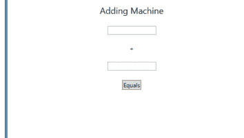

这是一个非常简单的 Windows 程序，我称它为“加法器”。你可以用它来执行非常简单的加法。你在顶部的两个框中输入两个数字，然后按下等号按钮。它会给你这两个数字之和。目前，它向我们显示 0 加上等于 0。屏幕上的每一个项目都称为 UI 或用户界面。从现在起将收集这些元素。上面的屏幕上有六个元素：

- 1. 标题 "Adding Machine"。这是一个字体大小为 18 的文本块，因此它脱颖而出。
- 2. 顶部的文本框，我可以在其中输入数字。
- 3. 一个持有字符 + 的文本项。
- 4. 底部的文本框，我可以在其中输入另一个数字。
- 5. 一个按钮，我们用它来执行加法。
- 6. 一个文本框，当按钮按下时它会改变以显示结果。目前它是空的，因为我们还没有做任何加法。

这些项目中的每一个在屏幕上都有特定的位置、特定的文本大小以及许多属性。我们可以通过更新描述面板的 XAML 代码，更改文本框中文字的颜色、它相对于包含框的左右对齐方式以及其他内容。实际的 XAML 描述如下：

```xml
<StackPanel>
  <TextBlock Text="Adding Machine" TextAlignment="Center" Margin="0,10" FontSize="18"/>
  <TextBlock Name="firstNumberTextBox" Width="100" Margin="0,10" TextAlignment="Center"/>
  <TextBlock Text="=" TextAlignment="Center" Margin="0,10"/>
  <TextBlock Name="secondTextBox" Width="100" Margin="0,10" TextAlignment="Center"/>
  <Button Content="Equals" Name="equalsButton" HorizontalAlignment="Center" Margin="0,10" Click="equalsButton"/>
  <TextBlock Name="resultTextBox" Text="" TextAlignment="Center" Margin="0,10"/>
</StackPanel>
```

如果你感兴趣，可以发现你将列表中的每个元素映射到上述 XAML 文件中的项目对应项。唯一让人有点困惑的是 `StackPanel` 元素。它非常简单；因此，不需要定义每个元素在屏幕上的位置，`StackPanel` 只是让我们“堆叠”一系列元素。默认排列是让它们沿屏幕向下堆叠，但你也可以跨屏幕堆叠项目。`StackPanel` 内部可以嵌套 `StackPanel`，这样你可以制作出一堆行。元素之间有嵌套，以便在 XAML 文件中进行递归。

## 程序员随笔：尽可能多使用自动布局

当我开始在屏幕上对物体进行绝对定位时，我总是会避免。当你这样做时，你是在对你正在使用的屏幕尺寸和文本维度做出假设。现代计算机适用于各种屏幕尺寸，用户也可以更改屏幕尺寸来放大或缩小。他们在在使用你的程序时还可能将屏幕方向从横屏变为竖屏。如果你固定了位置，使用像 `StackPanel` 这样的自动布局功能会让你的程序简单得多。

## 元素与对象

从软件的角度来看，XAML 元素实际上是对象。当程序构建时，XAML 系统会创建与 XAML 元素匹配的对象。我们的程序像操作 C# 对象一样操作这些元素。加法器中有三种类型的元素：

- 1. `TextBox` —— 允许用户输入文本。
- 2. `TextBlock` —— 信息的文本块。
- 3. `Button` —— 我们可以按下以触发事件的东西。

如果你思考，可以将每个元素的属性分为两类：所有元素需要的属性，以及特定类型所需的属性。例如，`TextBox` 需要记录输入光标的位置。创建这样的类层次结构有很多优势。如果我们想要一种自定义的文本框，可以扩展 `TextBox` 类并添加我们需要的属性和行为。对于实现 XAML 的软件而言，它可以相同地对待所有控件，并要求每个控件以适用于组件的方式进行自绘。


上方你可以看到 XAML 设计师构建的部分层次结构。顶部类被称为 `FrameworkElement`。它包含了屏幕上所有控件共有的信息。其他类都是这个类的子类。子类获取父类的所有行为和属性，并添加一些自己的。实际上，设计比显示的要复杂一点，`FrameworkElement` 是名为 `UIElement` 的类的子类。

## 管理元素

当我们要在程序中使用界面元素时，我们需要一种引用它们的方法。如果我们查看实现加法器的 XAML，可以发现某些组件具有 `name` 属性：

`<TextBox Name="firstNumberTextBox" Width="100" Margin="0,10" TextAlignment="Center"/>`

我将它命名为 `firstNumberTextBox`。你永远猜不到这个文本框叫什么。注意，在此语境下，属性的名称实际上将设置程序内部声明的变量名称。换句话说，由于我上面所的操作，现在我的程序某处会有以下语句：

```csharp
TextBox firstNumberTextBox;
```

## 高级编程

## 图形用户界面

这些声明是在程序构建时自动创建的，因此我们不需要实际上担心上面的陈述。我们只需要记住这就是程序的工作方式。请注意，我的界面中并非所有元素都有名称，为持有“ - ”字符的 `TextBlock` 命名是没有意义的，因为在程序运行时我永远不需要与它进行交互。

## 元素中的属性

一旦我们有了 `TextBox` 变量名，我们就可以继续为它赋予此应用程序所需的属性。我们还可以更改文本框的属性，包括文本框的宽度、外边距（已设置）等。

当我们谈论页面上 Silverlight 的“属性”（例如在 `TextBox` 中显示的文本）时，我们实际上是在谈论实现 `TextBlock` 的类中的属性值。换句话说，当程序包含如下陈语句时：

```
resultTextBlock.Text = "0";
```

- 这将导致 `resultTextBlock` 对象内部运行一个 `Set` 方法，将 `TextBox` 上的文本设置为相应的值。

你可能会问，为什么我们在 XAML 中使用属性？在银行账户中使用它们是有意义的，因为我想保护对象内部的数据；但在 XAML 页面中，我可以像 `TextBox` 那样放置任何文本，那里似乎对输入值没有任何验证。事实上，运行这会减慢设置过程。通过将 `Text` 作为一个值字符串，我们可以让程序更小、更快，这应该是一件好事吧？

嗯，某种程度上是。除非当我们更改用户面前的 XAML 页面上的文本时，它也会随之改变。这就是加法器显示结果的方式。如果程序只是更改了成员的值，XAML 系统将无法得知屏幕上的消息需要更新。

然而，如果该成员是一个属性，那么当程序运行时，`TextBox` 中的代码将得以执行。`set` 行为中的代码会更新文本字段的存储值，它还可以触发显示更新以使新值可见。属性提供了一种手段，让对象可以控制对象内部值更改的时机，这是极其重要的。一个简单的例子：

```
resultTextBlock.text = "0";
```


- 当新值存储在 `TextBlock` 中并触发显示更新以使屏幕变化时，可能会导致数百条 C 语句的运行。

## 使用 XAML 进行页面设计

XAML 证明非常有用。一旦你掌握了用于描述属性的帮助信息，就会发现仅仅通过编辑 XAML 文件中的文本向页面上添加内容并移动它们，比拖动或移动属性值要快得多。当我想在屏幕上显示大量相似元素时，我发现这特别有用。Visual Studio 识别用于描述每种类型元素的语法，并在操作过程中提供智能感应（Intellisense）帮助。

如果你阅读 XAML 规范，你会发现可以给元素赋予图形属性，使其变得透明、为背景添加图像，甚至让它们在屏幕上移动。到这一点，我们已经远远超了编程，进入了图形设计的领域。我祝你好运。

## 5.7.2 创建 XAML 应用程序

现在我们知道屏幕上的项目实际上是软件对象的实现，下一步我们需要知道的是如何控制这些对象，并让它们成为应用程序中实用的工具。为了做到这一点，我们需要添加 C# 程序代码，以执行加法器所需的计算。

每当 Visual Studio 创建一个描述显示页面的 XAML 文件时，它也会配套生成一个 C# 程序文件。这就是我们可以放置让应用程序运行起来代码的地方。如果你实际上查看 `MainPage.xaml.cs` 文件，你会发现它包含的代码并不多：

```csharp
using System;
using System.Collections.Generic;
using System.Linq;
using System.Text;
using System.Windows;
using System.Windows.Controls;
using System.Windows.Data;
using System.Windows.Documents;
using System.Windows.Input;
using System.Windows.Media;
using System.Windows.Media.Imaging;
using System.Windows.Navigation;
using System.Windows.Shapes;
```

```csharp
namespace sample
{
    /// <summary>
    /// MainWindow.xaml 的交互逻辑
    /// </summary>
    public partial class MainWindow
    {
        public MainWindow()
        {
            InitializeComponent();
        }
    }
}
```

大部分行都是 `using` 语句，这允许我们直接使用类，而无需提供每个类的完整全限定名。例如，与其使用 `System.Windows.Controls`，我们可以直接说 `Button`，因为文件包含了 `System.Windows.Controls` 这一行。

程序中唯一的方法是 `MainWindow` 类的构造函数。正如我们所知，构造函数是在类实例创建时时的调用。如果你查看此方法内部，你会发现实际上创建显示元素实例的代码。这些代码是 Visual Studio 根据描述你页面的 XAML 自动为你生成的。重要的一点是保持原样，不要更改方法的内容，因为这很可能会破坏你的程序。

注意，此时我们已经深入 XAML 的“引擎室”。我之所以告诉你这些，是为了让你理解这里没有魔法。如果你到目前为止见过的所有 C# 程序都是以调用 `Main` 开头，那么理解这一点很重要：这没什么特殊。

## 构建应用程序

我们现在可以学习如何为数字创建用户界面。我们已经有了加法器的代码，但它实际上并没有做任何事情。我们需要创建一些代码来执行它。

## 计算结果

目前我们的程序看起来很不错，但实际上什么都没做。我们需要创建一些逻辑。像类似这样的代码：

```csharp
private void calculateResult()
{
    float v1 = float.Parse(firstNumberTextBox.Text);
    float v2 = float.Parse(secondTextBox.Text);
    float result = v1 + v2;
    resultTextBlock.Text = result.ToString();
}
```

`TextBox` 暴露了一个名为 `Text` 的属性。它可以被读取或写入。为 `Text` 设置值将更改文本框中的文本。

文本是一个字符串，如果我们的输入是数字，则必须将其转换为数值。每个数值类型（Int, double）都有一个 `Parse` 行为，该行为会接收一个字符串并返回它所描述的数值。由于我们处理的是浮点数，该方法解析每个输入框中的文本并计算出结果。

最后，该方法获取计算出的数字将其转换为字符串，然后将 `resultTextBlock` 的文本设置为该字符串。`ToString` 是 `Parse` 的反向操作，如果你愿意，可以被称为“反解析”。它提供了描述对象内容的文本。对于 `float` 类型，这就是描述值的文本。

现在我们已经有了计算答案的代码，我们只需要找到一种方法让它在用户按下等号按钮时运行。

## 事件与程序

如果你编写过任何类型的程序，你就会对事件非常熟悉。如果你还不，我们现在有了一个需要它们的绝佳例子，而且并不那么可怕或烦人。在过去图形界面和鼠标的时代，程序会从开始运行，运行一段时间然后结束。

但现在我们拥有了复杂且丰富的用户界面，有许多按钮和其他元素供用户交互。我正在使用的文字处理器通过屏幕上的按钮和菜单项暴露了数百种不同的功能。在这种情况下，编写一个轮询检查每个元素以查看用户是否尝试使用它的程序将是非常困难的。系统等待事件在它们想要关注时引发事件。老师们都是这样的——他们不会绕着教室逐个询问每个孩子是否知道答案。

# 高级编程

## 图形用户界面

相反，我们要求孩子们举手。“举手”被视为一个老师将要响应的事件（event）。

使用像这样这样的事件可以让软件设计变得简单得多。我们的程序不需要检查屏幕上的每一个项目来查看用户是否对它进行了任何操作，它只需要绑定到它感兴趣的事件上。

为了让事件在编程语言中成为可能，语言需要一种引用事件中方法的方法。C# 的 `delegate`（委托）类型正是这样而的。你可以创建一个可以引用特定类型方法的委托，并创建引用事件中方法的委托实例。委托非常强大，但要理解它们的运作原理可能有一点棘手。幸运的是，我们现在并不需要担心委托是如何运作的；我们可以让 Silverlight 和 Visual Studio 为我们完成所有的艰性工作。

## XAML 中的事件

在 C# 中，事件是通过调用该对象中的方法来传递的。在这方面，你可以将注册事件和注册消息看作是同一种东西。从我们的角度来看，我们编写的加法器希望在用户点击“等于”按钮时调用某个特定的方法。这就是我们感兴趣的事件。当事件触发时，我们希望它调用 `calculateResult` 方法。如果我们查看 XAML，就可以它是如何实现的。

```xml
<Button Content="Equals" HorizontalAlignment="Center" Margin="0,10" Name="equalsButton" Click="equalsButton_Click"/>
```

该按钮有一个名称 `equalsButton`，以及一个名为 `Click` 的部分。这是 XAML（描述所在页面的声明式语言）与 C#（将实际为你执行行为的编程语言）之间的联系。

对于这项工作，包含 `equalsButton` 元素的页面必须包含一个名为 `equalsButton_Click` 方法。这确保了我们的程序能够正常工作[注：可能是“否则我们的程序……”]。这是为事件提供行为的方法：

```csharp
private void equalsButton_Click(object sender, RoutedEventArgs e)
{
    calculateResult();
}
```

事件处理程序必须具有正确的签名，以便它能够接收其实际使用的参数，这些参数用于管理从 Windows 委托管理器传递到运行程序的事件。正如你所说，委托是一个表示类实例中方法的对象。如果你仔细考虑，这正是我们需要的。我们需要一种方法告诉 Windows 窗口系统，当等于按钮被点击时，我们希望调用这个方法，该任务的委托名为此。按钮元素包含一个名为 `Click` 的属性。程序可以向此属性添加委托对象，这样当窗口管理器检测到按钮被按下时，它就可以调用该方法。换句话说，为上述 XAML 生成的代码如下：

```csharp
equalsButton.Click += new EventHandler(equalsButton_Click);

// 这里的 += 运算符在这里可能有点困惑，但它的真实含义是“向当用户点击按钮时将调用的列表添加一个委托对象”。该委托的类型是 EventHandler，当委托的实例被构造时，它被赋予了将要引用的方法的标识符。如果程序需要从事件中断开处理程序，可以使用 -= 来执行此操作。
```

## 事件驱动应用程序

注意，这与“过去良好的日子”里程序的运行方式形成了鲜明的对比。在此之前，程序会在 `Main` 方法被调用时运行，然后在方法结束时停止。现在我们处于这样一种情况：我们从未真正调用过运行程序的方法。该方法是在响应用户操作时为我们调用的。发生的是，按钮上的事件处理程序创建了一个线程，调用了我们程序中的方法。

如果我们有一个使用大量按钮的应用程序，我们需要确保程序能够处理按任何顺序按下的按钮。例如，如果用户在加载文档之前按了打印按钮，那么程序在这一点上不崩溃是非常重要的。

## 处理错误

我们想出的解决方案是有效的，它将提供一个可以工作的加法器。然而，它并不是一个非常友好的程序。

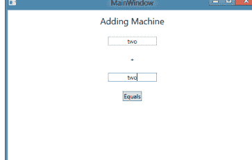

例如，用户可能会像上面那样输入数字。我们知道这会导致 `Parse` 方法出现问题，它将抛出一个异常并停止程序。我们也知道可以捕捉异常并处理它们。在上面的程序中，处理此类错误的最佳方法是显示消息框：

```csharp
private void calculateResult()
{
    try
    {
        float v1 = float.Parse(firstNumberTextBox.Text);
        float v2 = float.Parse(secondTextBox.Text);
        float result = v1 + v2;
        resultTextBlock.Text = result.ToString();
    }
    catch
    {
        MessageBox.Show("Invalid number", "Adding machine");
    }
}
```


代码示例 57 WPF 加法器

此版本的`calculateResult`捕捉了`Parse`抛出的异常，然后使用`MessageBox`类显示错误消息。

# 高级编程

## 调试

`MessageBox`类是 XAML 库的一部分的静态类。`Show`方法有几个版本，以便你可以显示不同版本的消息框。它接受两个字符串。一个是框的标题，另一个是待显示的消息。用户可以通过点击 OK 按钮取消消息。

注意，这个方法并不好，因为它没有说明是哪个数字出了错误。

## 程序员的观点：客户真的非常在意用户界面

如果系统中有一个部分是客户保证会有强烈意见的，那就是用户界面。这部分的设计应该从产品开始开始，并随着开发进行完善。永远不要假设你认为用户界面应该以某种方式工作。我在用户界面代码上花费的时间比任何其他部分都要多。好消息是，像 Visual Studio 这样的工具非常容易产生前端的原型。这些原型可以展示给客户（并签署），以确定你正在做正确的事。

## 5.8 调试

有些人天生就会调试。没有人完全擅长调试，但有些人比其他人更好。可以说，有一些技巧可以用来消除这个过程，我们将探索其中一些技巧。好消息是，如果你在开发中使用测试驱动的方法，用户发现的故障应该越少越好，但仍然有一些需要修复。

顺便说一下，为什么程序问题被称为 bug（虫），是因为最初的一个是由一只不寻常的昆虫进入了计算机触点导致了故障。但这并不是许多 bug 的产生。你的程序很少会因为硬件故障而失败。换句话说，调试是努力找出你最初是如何变成那样的。

### 5.8.1 故障报告

我们已经知道，故障是用户由于程序中的错误而看到的东西。

故障是由测试过程或用户发现的。如果程序某个某个测试失败，导致失败所采取的步骤将被良好记录。然而，如果用户报告故障，可能是轶事的，即你不会得到一组可以导致故障出现的步骤序列，你只会被告知“打印路径里有 bug”。

## 高级编程

## 调试

你深受用户欢迎。必须强调的是，只有当故障报告记录完备时，才会被认真对待。

## 程序员观点：设计你的故障报告流程

正如我提到过的所有内容一样，管理故障报告的方式应该在项目开始时就考虑。换句话说，你应该建立一个流程来处理报告的故障。在大规模开发中，故障报告是经过管理、分配给程序员并进行非常仔细追踪的。报告的故障数量以及处理这些故障所需的时间，是关于你所制作物品质量的宝贵信息。此外，如果你将报告过程形式化（甚至可以将其自动化），你就可以确保获取尽可能多的信息。

## 故障的两种类型

故障分为两类：总是发生的故障和有时发生的故障。

对于总是发生的故障，你可以追踪导致 bug 显的事件序列，并使用合适的技术来捕获它。这意味着它们没有随机性（除非你正遭受硬件引发的故障——这相当罕见）。例如，一个函数有时会崩溃，而有时又正常工作。你可能将其追溯到请求时正在编辑的页面数或页面上的文本量。

故障的出现可能发生在错误本身发生之后，例如，程序在删除某个项时可能会失败，但错误可能在存储它的例程中，或者在覆盖程序其他部分的代码中。这可能会改变或导致最令人恼的故障，即你插入额外的语句来获取更多问题信息。如果你怀疑此类错误，你的第一个测试是以某种方式检查代码和数据并重新运行程序，然后问题就消失了！

## 5.8.2 Bug

你可以将故障分为其他类别，即程序崩溃（即完全停止）或执行了错误的操作。惊讶的是，崩溃通常更容易修复。它们通常指向：

- 未考虑到的状态（确保所有选择都有默认处理程序，并在模块间传递值时使用防御性编程技术）
- 陷入循环的程序、错误地调用自身并导致递归导致栈溢出的方法
- 未被妥善捕获的异常

如果你的程序执行了错误的操作，则会更难找到。寻找以下内容：

- 使用了类的未初始化成员成员
- 拼写错误（寻找拼写错误的变量名、不正确的比较运算符、未正确结束终止符的注释）
- 逻辑错误（寻找指令序列中的故障、无效的循环终止、构造错误的逻辑条件）

正如我上面说的，有些故障纯粹是靠发现。这里有一些建议：

不要做任何假设。如果你假设“通过这个序列唯一的路径就是来到这里”或“那段代码不可能被执行”，你往往是错的。与其做出假设，不如添加额外的代码来证明你认为它确实在发生。

## 与小鸭聊天

向别人解释这个问题——即使是猫或橡胶小鸭！解释问题的行为往往能带你找到答案。如果你交谈的人对你的陈述高度怀疑，那是最好的。

观察 bug 出现的所有（即使看似无关）的因素。如果 bug 是间歇性的，这尤为重要。如果 bug 在你 UNIX 系统的周五下午出现，请找出是否有另一个部门在该时间使用机器进行工资结算并填满了临时空间，或者加载部门注入了大量的噪声。

让问题搁一段时间。去做一些不同的事情，你会发现答案会自己出现。或者，你可能在回到问题时找到答案。记住，尽管这个 bug 显然是不可能的，但它正在发生。这意味着不可能的事情正在发生，或者你的假设之一是错误的！

你能否回到 bug 不存在的状态，然后查看自那以来的更改？如果系统是因为某更改而失败，或曾经修复过某个 bug，你可以尝试回到 bug 不存在的那个点，然后逐步引入更改直到 bug 出现。或者，仔细观察新功能的引入如何影响系统的其他模块。一个良好的版本控制系统非常有价值，因为你可以轻松地检查从一个版本到下一个版本做了哪些更改。

我应该明确的一点是，调试的过程是在修复应该运行的解决方案中的故障。换句话说，在尝试修复程序实际存在的问题之前，你必须知道程序应该做什么。我曾几乎动过要通过放入循环或更改条件运行的方式来“看看这是否会让程序运行起来”。这种努力总是徒劳的，就像把一堆电子元件扔向墙壁并期望 DVD 播放器落在地板上一样，行不通。

## 推倒重来

在某些项目中，重新开始投入的精力可能比尝试找出你创建的损坏解决方案哪里有问题要少。如果你有空，这可能会大益。这意味着你需要评估报告给你的故障的影响并管理它们。

## 程序员观点：故障导致 Bug

bug 的主要原因可能是故障过程。这意味着当你更改程序时，它会引入新功能。我有统计数据表明，任何实用的程序都有故障。这是因为你改变了开发语境，任何故障都会引入全新的 bug。唯一的办法是确保你没有弄坏任何东西。

## 5.8.3 制作完美的软件

不存在完美的软件。换句话说，我可能会说“任何实用的程序都有 bug”。然而，这样的程序将非常小，因此变得毫无用。

让软件尽可能完美的关键在于确保你对要解决的问题有理解，知道如何解决它，开始编写代码并仔细管理你的代码生产。阅读本文末的推荐书籍来了解编程的这方面。

## 5.9 结束了吗？

这并不是成为一名程序员所需的所有知识。并不是成为一名 C# 程序员所需的所有知识。然而，这是一个很好的开始，但本文遗漏了一些内容，因为我们没有时间教它们。如果你想成为一名优秀的 C# 程序员，你应该关注以下内容：

- 序列化
- 特性
- 反射
- 网络

## 5.9.1 持续发展

一个好的程序员有刻意的策略，不断审视自己的知识并学习新事物。如果你对这项事业认真，你应该任何时候读一本关于该主题的书。从我记忆中我就一直在编程，但我从未停止过学习这个课题。我也从未停止过编程、阅读编程书籍以及查看他人的代码。

## 5.9.2 延伸阅读

### 《代码完备》（Code Complete）第二版：

Steve McConnell

微软出版：ISBN 0-7356-1967-0

这实际上不是一本关于 C# 的书，而是一是一本关于其他所有方面的书。它从“软件构造”的角度涵盖了软件工程和编程技术。如果你认真打算成为一名合格的程序员，你应该/必须阅读/拥有这本书。

### 如何成为程序员（How to be a programmer）

这个网站也值得一读，因为它非常好地涵盖了程序员的行为。

`https://github.com/braydie/HowToBeAProgrammer`

## 6 术语表

### 抽象 (Abstract)

“抽象”这种东西本身并不具有“正统”的意义。在编写程序时，我们使用这个词表示“对某事物的理想化描述”。在组件设计中，抽象类包含了对必须存在的内容描述，但没有说明如何实现它们。在 C# 中，如果一个类被标记为`abstract`，或者它包含一个或多个标记为`abstract`的方法，则该类就是抽象的。

你可以创建一个抽象类，但将其作为具体类的基础或模板。例如，我们可能决定在事务处理中需要许多不同类型的收据：现金收据、支票收据、批发商收据等。我们不知道特定收据在内部如何运作，但我们知道它必须具备哪些行为才能称的一份收据。

因此，我们可以创建一个抽象类，作为所有具体类的基类。“每个”收据都是通过扩展父类抽象类来创建的。这意味着它是收据家族的一员（即它可以被视为一个收据`Receipt`），但它以其自己的方式工作。

### 访问器 (Accessor)

访问器是一个提供对类内部管理值访问的方法。从本质上，这种访问是只读的，因为数据被保护在类中，但其他类可能需要访问值本身。访问器被实现为一个公共方法，并将向调用者返回一个值。请注意，如果提供访问的对象是通过引用管理的，程序员必须确保传递对象引用是安全的。如果对象不应被更改，则可能需要创建对象的副本并返回给调用者。

### 基类 (Base)

`base`是 C# 的一个关键字，根据其所处的上下文具有不同的含义。它用于子类的构造函数中以调用父类的构造函数。它也被用于重写的方法中，以调用它们所重写的方法。

### 调用 (Call)

当你想要使用一个方法时，你就调用它。当调用一个方法时，执行序列会切换到该方法，从方法体内的第一条语句开始。当到达方法末尾或`return`语句时，执行序列返回到方法调用之后的后续语句。

### 类 (Class)

类是行为（方法）和数据（属性）的集合。它可以被用来表示程序中的现实世界项目（例如银行账户）。每当你需要将许多事物组合成单个单元时，你都应该从创建类的角度来考虑。

### 代码复用 (Code Reuse)

开发者采取步骤确保某段程序代码只编写一次。这通常通过将代码放入方法中然后调用它们来实现，而不是在程序的不同部分重复语句。使用类层次结构也是复用代码的方法。你只需要重写你想要更新的方法。

### 内聚性 (Cohesion)

如果一个类不依赖于/不耦合所有其他类，则该类具有高内聚性。

### 集合 (Collection)

C# 库中有一个集合的概念，即集合是你想要存储的一组东西，例如足球队中的所有球员或银行中的所有客户。集合的一种形式是数组。另一种是哈希表（hashtable），它允许你根据其中的键值简易地查找特定项。集合枚举（collection enumeration）意味着它可以被要求为 C# 的`foreach`构造提供提供连续的值。

每当你想要将许多事物存储在一起时，你都应该考虑使用集合类来完成。集合类可以在`System.Collections`命名空间中找到。

### 编译器 (Compiler)

编译器获取源文件并对其进行理解。编译器将产生一个可以运行的可执行文件。编写编译器是一项专业的业务，过去用汇编语言编写，但现在用高级语言（如 C#）构建。编译器是一个为特定计算机和编程语言专门编写的大程序。大多数编译器在各个领域工作。第一阶段是预处理器，它获取用户编写的内容，然后找到所有的关键字、标识符和符号，产生程序源码流，并输入给“解析器”，解析器确保源代码符合编程语言的语法。最后阶段是代码生成器，它产生随后由主机运行的可执行文件。

### 组件 (Component)

组件是一个以接口形式表达其行为的类。这意味着，与其从“它是什么”来考虑（例如客户账户`CustomerBankAccount`），不如从“它能做什么”来考虑（实现`IAccount`接口来支付和提取）。在创建系统时，你应该关注组件以及它们如何相互作用。它们的交互通过它们之间的接口来表达。

### 构造函数 (Constructor)

构造函数是类中的一种方法，在创建该类的实例时被调用。程序使用构造函数在创建实例时获取控制权，并设置类内部的值。如果一个类是层次结构中的成员，父类有一个构造函数，那么在创建子类时，确保父类构造函数被正确调用是非常重要的。否则，编译器将拒绝编译。

### 耦合 (Coupling)

如果一个类依赖于另一个类，则这两个类被认为是耦合的。通常来说，程序员应该努力使设计中的耦合尽可能少。

耦合通常与内聚性一起被讨论，因为你的目标应该是实现高内聚和低耦合。

### 创造性懒惰 (Creative Laziness)

懒惰的某些方面在应用于编程时效果很好。代码复用——即挑选并使用现有代码——就是这种方面的很好的例子。在做任何事情之前确保规格是正确的是节省成本的另一种方法。然而，设计一种结构，使得你可以让别人完成大量工作，这可能是懒惰最好的例子。

### 声明式语言 (Declarative language)

声明式语言告诉计算机系统有关事物的信息。它不提供解释如何执行操作的指令；它只是让系统意识到某事的存在并具有一组特定的属性。

C# 包含声明（declarations）；这是程序创建变量的方式。

```csharp
int i;
```

此声明创建了一个名为`i`的整数变量。然而，C# 程序也包含告诉计算机如何执行操作的语句（statements）。

```csharp
i = i + 1;
```

这条语句改变了`i`中的值，使其增加 1。这种能力意味着 C# 不是一种声明式语言。然而，标记语言 XAML 设计是为了表达页面的设计。XAML 源文件包含项的描述。

```xml
<TextBox Name="firstNumberTextBox" Text="0"
VerticalAlignment="Top" Width="460"
Alignment="center">
</TextBox>
```

这段 XAML 描述了一个`TextBox`元素。它给出了宽度、初始文本和元素的名称。它没有、永远无法告诉系统对该元素做什么，或者它拥有的任何行为。

### 委托 (Delegate)

委托是对方法的安全的引用。委托是为特定的方法签名创建的（例如，此方法接受两个整数并返回一个浮点数）。它可以被指向类中匹配该签名的方法。请注意，委托持有两个项目：指向包含该方法的实例/类的引用，以及指向该方法本身的引用。由于委托是一个对象，因此这意味着它可以像任何其他对象一样被传递。

委托被用于通知事件生成器（如按钮、定时器和链接）在它们生成的事件发生时要调用的方法。

## 依赖

通常情况下，设计中过多的依赖是一件坏事。当一个类中的代码更改意味着你可能也需要更改另一个类时，这两个类之间就存在依赖关系。这通常意味着你没有妥善地分离系统中对象之间的职责，并且两个对象正在维护同一份数据。例如，请关于`CustomerAccount`和`ChildAccount`加载的讨论。

依赖通常具有方向性。例如，用户界面可以依赖于一个业务对象类（如果你向业务对象添加了新属性，将需要更新用户界面）。然而，更改用户界面的方式不太意味着业务对象也需要相应更改。

## 事件

事件是你的程序可能需要响应的外部发生事件。事件包括鼠标移动、按键按下、窗口调整大小、按钮按下、定时器跳动等。许多现代程序基于事件运行，而事件与方法相连。当事件发生时，会调用该方法来传递通知。Windows 组件使用委托（委托是一种指向方法的类型安全引用）来允许事件生成器获知事件发生时需要调用的方法。

## 异常

异常是一个描述刚刚发生的情况的对象。异常是 C# 程序处理错误的一种方式。当运行中的程序到达一个无法继续的位置（可能是文件未打开，或输入值无意义）时，它可以产生并“抛出”一个异常：

```
throw new Exception("Oh Dear");
```

`Exception`对象包含一个`Message`属性，它是一个可以描述发生了什么错误的字符串。在上面的示例中，消息将设置为 "Oh Dear"。

如果异常没有被“捕获”，程序将在该处结束。你可以通过在`try-catch`结构中编写可能抛出异常的代码，让程序对异常做出响应。当异常被抛出时，程序会将执行流转移到`catch`子句中的代码：

```c
try {
// 可能会抛出异常的代码
} catch (Exception e) {
// 如果抛出异常，则执行此代码
// e 是被抛出的异常的引用
}
finally {
// 这里的代码始终会被执行，无论是否抛出了异常
}
```


`try-catch`结构还可以包含一个`finally`子句，该子句包含在无论是否抛出异常时都会被执行的代码。

## 功能设计规范

大型软件开发遵循特定的路径，从初始会议到产品交付。精确的路径取决于任务的性质以及开发者使用的技术；然而，所有的开发都开始对系统要执行的操作描述。这是整个项目中最关键的项，通常被称为功能设计规范（Functional Design Specification，简称 FDS）。

## 全局唯一标识符（GUID）

这是创建的目的是使其在世界上是唯一的。它提供了一个可以通过它引用某个对象的标识符。GUID 的创建涉及使用随机值、日期等内容，GUID 用于账户引用和标签等必须唯一的项。大多数操作系统和程序员程序库都提供了创建 GUID 的方法。

## 层级结构

当父类被子类扩展时，就会产生一个新类，该类具有父类的所有能力，并根据子类的需求对行为进行了修改。扩展子类会产生更深层次的层次结构。层次结构顶部的类应该更通用且可能可能是抽象的（例如`BankAccount`），而底部的类将更具体（例如`ChildBankAccount`）。

## 不变

不可变对象不能被更改。如果尝试更改不可变对象的内容，将创建一个具有更改内容的新对象，而“旧”对象保留在内存中。`string`类是不可变的。这使得字符串具有类似于值类型的行为，使它们在程序中更易使用。

## 继承

继承是类扩展父类的方式，允许它利用父类所有的行为和属性，并为了略有不同的需求对其进行添加/自定义。更多详细信息请参见层级结构的描述。

## 接口

接口定义了一组动作。这些动作通过数量方法定义定义。实现接口的类必须包含每个方法的代码。实现接口的类可以完全根据该接口进行引用。接口使得创建组件成为可能。我们并不精确关心组件是什么，只要它实现了该接口，就可以完全从该能力的角度考虑它。

## 库

库是一组被其他程序使用的类。库和程序区别在于，库文件的扩展名为`.dll`（动态链接库），且不包含`main`方法。

## 机器码

机器码是计算机处理器实际理解的语言。它包含了许多非常简单的操作，例如将项从处理器移动到内存，或给处理器中的某项加 1。每个特定范围的计算机处理器都有自己的机器码，这意味着为一种机器编写的机器码无法在另一种机器上轻松使用。

## 成员

类的成员在该类内部声明。它可以执行某些操作（方法），也可以持有某些数据（变量）。方法有时被称为行为。数据成员有时被称为属性。

## 元数据

元数据是关于数据的。它运行在各种级别。值被存储为整数这一事实是元数据。它不能为负数是更多元数据。在创建系统时，程序员必须咨询客户并收集元数据。

## 方法

方法是一个由方法签名引导的代码块。方法有特定的名称并可能返回一个值。它也可以接受一个参数进行处理。方法被用于将程序拆分为更小的单元，在许多地方都可以被调用。公共方法是类暴露其行为的方式。公共方法是类对象内部调用的。

## 修改器

修改器是用于更改对象内部值的方法，它通过调用来提供一个值。修改器通过这种方式进行管理，无效值将会被拒绝。

## 命名空间

命名空间是一个区域，在该区域内名称具有特定的含义。命名空间允许你重用名称。完全限定名称以命名空间为缀。命名空间可以包含另一个命名空间，允许建立层级结构。

## 重载

当方法名称相同但参数集不同时，方法被重载。重载出现在提供信息的多种方式的情况下，例如。

## 重写

有时你可能想为现有类创建一个更专门的版本。你可以通过创建一个父类的子类并重写需要更改的方法来实现。当子类实例上调用方法时，调用的是新方法而不是父类中的重写方法。如果你需要，可以使用`base`关键字来访问重写的方法。

## 可移植性

应用于计算机软件时，某物的的可移植性越高，越容易移动到不同类型的计算机。可移植应用程序可以相对容易地转移到新的处理器或操作系统。高级语言往往具有可移植性，而机器码难以处理。

私有成员对类内部的方法可见。通常将类的数据成员设为私有，以便类外部的代码更改它们。将数据成员设为私有的唯一原因是为了消除使用方法访问数据的性能开销。

## 属性

属性是对象中持有的数据项。账户的一个属性示例是账户余额。另一个是账户持有者的姓名。C#语言有一种特殊的结构，可以方便程序员管理属性。

## 保护

类的受保护成员对类内部的方法以及扩展该类的类的方法可见。它就像是介于私有（类外部方法无法访问）和公共（所有人都可以访问）之间的半路。它允许将父类中的成员标记为对子类可见。

## 公共

类的公共成员对类外部的方法可见。通常将类的方法成员设为公共，以便其他类的代码可以使用它们。公共方法是类向其他类提供服务的方式。

## 引用

引用就像是附加到类实例上的标签。引用有特定的名称。C#使用引用来找到实例。

# 术语表

# 结束了？

该类并使用它的方法和数据。任何引用都可以赋值给其中任何一个。如果你这样做，结果结果是现在有两个标签指向内存中的同一个对象。

# 签名（Signature）

C#方法有一个特定的签名，使其能够在程序中被唯一地标识。签名是由方法的名称以及该该方法参数的顺序构成的：

```csharp
void Silly(int a, int b) - 具有名为 Silly 的名称和两个 int 参数的签名。
```

```csharp
void Silly(float a, int b) - 具有名为 Silly 的名称以及一个 float 后接整数参数的签名。这意味着代码：
```

```csharp
Silly(1, 2);
```


- 将调用第一个方法，而：

- `Silly(1.0f, 2);` - 将调用第二个。

请注意，方法的类型对签名没有影响。

## 源文件 (Source file)

你使用某种文本编辑器准备源文件。它是你希望通过编译器以生成用于执行的程序的文本。

## 静态 (Static)

在 C# 关键字 `static` 的上下文中，`static` 使类的成员成为类的一部分，而不是类实例的一部分。这意味着你不需要创建类的实例就可以使用静态方法。它意味着静态成员通过类的名称进行访问，而不是通过实例的引用。静态成员对于创建所有实例共享的类成员非常有用，例如你银行中所有账户的利率。

## 流 (Stream)

流是一个表示与某些东西连接的对象，这些东西将移动数据，到磁盘文件、网络端口、甚至是系统控制台。流的消除了根据输出设置位置或从何处接收输入而修改程序的需要。

## 结构体 (Structure)

结构体是数据项的集合。它不是通过引用管理的，结构体在赋值时会被复制。结构体也是按值传递的。结构体对于在单个单元中持有相关数据块有用。它们没有由引用管理的对象那么灵活，但在访问结构体项时效率更高，因为不需要像对象那样去跟随引用：

## 下标 (Subscript)

这是一个用于标识数组中元素的值。它必须是一个整数值。C# 中的下标始终从 0 开始（这定位了——令人困惑——数组的第一个元素）并延伸到数组大小减 1。这意味着如果你创建一个包含四个元素的数组，你通过下标值 0, 1, 2 或 3 来获取数组中的元素。考虑下标的最好方法是你是你想要移动的元素在数组中要移动的距离。这意味着数组中的第一个元素的下标值必须为 0。

## 语法高亮 (Syntax Highlighting)

某些程序编辑器（例如 Visual Studio）以不同的颜色显示不同的程序元素，以便程序员更容易理解代码。关键字以蓝色显示，字符串以红色和绿色显示。注意，颜色是由编辑器添加的，实际的 C 源文件中没有任何可以阻止这些文本颜色的东西。

## 测试用架 (Test harness)

测试用架将包含系统测试时将使用的输入和输出部分的模拟。你将你的程序放入测试用架中，然后程序就会认为自己处于完成的系统中。在调试时，测试用架非常有用，因为它消除了对完整系统的需要（例如，律师？）。

## this

`this` 是一个 C# 关键字，根据它所处的上下文具有不同的含义。它被用于类的构造函数以调用另一个构造函数。它还被用作当前实例引用，或者用于在实例内部运行的非静态方法中。

## 类型安全 (Typesafe)

我们已经看到 C# 对于组合不应该组合的东西非常挑剔。尝试将一个 `float` 值放入 `int` 变量中，编译器会在这一点上变得生气。之所以的原因是，语言的设计者注意到了一些编程错误，并设计了语言使得这些错误在程序运行之前就被检测到，而不是在它崩溃时。其中之一是在在没有意义的语境下使用值或项（将字符串放入 `bool`），或者导致数据或准确性的丢失（将 `double` 放入 `byte`）。这种挑剔性是出于安全性，而 C# 非常看重这一点。其他语言在组合东西方面要放松得多，并且基于程序员最清楚的原则工作。他们假设既然代码是为某个东西而编写的，那么那个东西就是正确的。

C# 非常热衷于此（和我一样）。让开发者得到限制来阻止他们做蠢事是很重要的，在我看来，一种能阻止你以可能不合理的方式组合东西的语言是一好事。

如果你真的想在编译器上施加你的意志，并在忽略任何类型安全问题的情况下编译你的代码，你可以通过强制转换来实现。

## 单元测试 (Unit test)

单元测试是一个小型测试，它执行组件并确保它对于特定功能是正确的。单元测试应该在开发过程中编写，以便它们可以在代码编写后不久（或在测试驱动开发中，在代码编写之前）应用于代码。

## 值类型 (Value type)

值类型持有简单的值。值类型作为值传递到方法调用中，并在赋值时复制的值；即 `x = y` 会导致 `y` 中的值复制到 `x`。对 `x` 中的值的更改不会影响 `y` 的值。注意，这与引用类型相反，在引用类型中赋值的结果会让 `x` 和 `y` 指向同一个实例。方法是类的一个成员。我称之为。

## 索引 (Index)

| 术语 | 页码 |
| :--- | :--- |
| 抽象 (abstract) | 10 |
| 访问器 (accessor) | 97 |
| 参数 (argument) | 50 |
| 数组 (arrays) | 143 |
| 赋值 (assignment) | 45 |
| 基 (base) | 119 |
| 布尔 (boolean) | 37 |
| 中断 (break) | 42 |
| 字符 (char) | 25 |
| 类 (class) | 86 |
| 容器 (container) | 139 |
| 构造函数 (constructor) | 105 |
| 默认 (default) | 72 |
| 委托 (delegate) | 136 |
| 数据 (data) | 3 |
| 数据类型 (data types) | 31 |
| 双精度 (double) | 142 |
| 元素 (elements) | 63 |
| 事件 (events) | 136 |
| 异常 (exception) | 174 |
| 表达式 (expressions) | 28 |
| 否则 (else) | 10 |
| 枚举 (enumerated) | 79 |
| 转义 (escape) | |
| 文件 (files) | 182 |
| 全限定名称 (fully qualified name) | 75 |
| 如果 (if) | 35 |
| 整数 (integers) | 23 |
| 接口 (interface) | 109 |
| 实现 (implementing) | 111 |
| 实现 (implementation) | 114 |
| 索引 (Index) | 10 |
| 信息 (information) | 3 |
| 实例 (instance) | 93 |
| 不可变 (immutable) | 131 |
| 整数 (int) | 16 |
| 键 (key) | 142 |
| 关键字 (keyword) | 13 |
| 长度 (Length) | 132 |
| 库 (library) | 178 |
| 列表 (List class) | 145 |
| 字面量 (liter values) | 22, 31 |
| 循环 (loops) | 39 |
| 方法 (methods) | 13, 48 |
| 标识符 (identifier) | |
| 逻辑 (logical) | 36 |
| 运算符 (operators) | 29 |
| 命名空间 (namespace) | 7 |
| 命名空间 (namespaces) | 75 |
| 新 (new) | 89 |
| 对象 (object) | 86 |
| 面向对象 (object oriented) | 11 |
| 对象 (object) | 93, 121 |
| 输出 (out parameters) | 56 |
| 溢出 (overflow) | 23 |
| 方法重载构造函数 (overloading constructors) | 105 |
| 重写 (overriding) | 117 |
| 属性 (properties) | 133 |
| 操作数 (operands) | 29 |
| 操作系统 (operating system) | 3 |
| 运算符 (operators) | 29 |
| 优先级 (priority) | 29 |
| 关系 (relational) | 35 |
| 引用 (reference) | 112 |
| 私有 (private) | 95 |
| 程序 (program Main) | 15 |
| 程序 (program) | 34 |
| 泛型 (Generics) | 14 |
| 哈希表 (hash table) | 141 |
| 哈希表 (Hashtable) | 142 |
| 全局 (global) | 180 |
| 全局 (global) | 15 |
| 文件 (files) | 182 |
| 强制转换 (casting) | 30 |
| 浮点 (float) | 18 |
| 泛型 (Generic) | 14 |
| 循环 (foreach) | 40 |
| 格式 (formatting) | 46 |
| GUID (GUID) | 115 |
| 静态 (static) | 10 |
| 静态 (static) | 10 |
| 静态 (static) | 10 |
| 字符串 (string) | 28 |
| 字符串 (strings) | 27 |
| 语法 (Syntax) | 19 |
| 类型 (Types) | 45 |
| 类型 (data types) | 31 |
| 类型安全 (Typesafe) | 1 |
| 使用 (using) | 181 |
| 值 (Value) | 1 |
| 值类型 (Value type) | 1 |
| 单元测试 (Unit test) | |
| 虚拟机 (virtual) | 117 |
| 虚拟机 (virtual) | 120 |
| 虚拟机 (virtual) | 120 |
| 虚拟机 (virtual) | 117 |
| 索引 (Index) | 10 |
| 这 (this) | 129 |
| 这 (this) | 129 |

## 术语表

- 始终提供一个 equals 128
- 避免许多维度 66, 69, 70
- 块拷贝是恶的 116
- 拆解你的条件 37
- 修复 Bug 会产生 Bug 196
- 类型转换的清晰度 32
- 检查你的数学逻辑 23
- 仔细选择变量类型 27
- 聪明并不总是明智 42
- 构造应该实现 107
- 数据结构非常重要 93
- 委托（Delegates）是强大的 167, 168
- 使用方法进行设计 52
- 设计你的类构造 122
- 自定义你的错误 175
- 设计你的故障报告 194
- 记录你的副作用 56
- 不要仅仅因为有可用就使用新特性 147
- 不要替换方法 120
- 枚举（Enums）是好的 79, 81
- 每条消息都关重要 165
- 反转条件 43
- 全限定名是好的 182
- 给你的变量起合理的名称 28
- 良好的沟通者 9
- 伟大的程序员 4
- 硬件的重要性 4
- 规范的重要性 6
- 你的代码国际化 109, 111
- 了解你的数据源 16
- 语言确实有帮助 56
- 学习使用 Visual Studio 183
- 确保你使用了正确的 equals 128
- 元数据 7
- 元数据成员成员与方法 96
- 并非所有事情都是可能的 94
- 放置注释 34
- 为失败做好计划 58
- 规划你的变量 61, 65
- 私有数据和公共方法，98
- 生产代码 160
- 程序布局 21
- 编程语言 10
- 程序经常在错误处理器中失败 176
- 静态数据成员有用且危险 100
- 静态方法成员可以用来构建库 102
- 流（Streams）是奇妙的 151
- 追求简单 45
- 结构至关重要 85, 86
- 愚蠢的计算机 10
- 切换 语句（Switches）是好的 73
- 你可以做很多事情 151
- 尽量避免垃圾回收员 91
- 在 case 中使用 Break 42
- 使用数字而非消息 162
- 使用简单的变量类型 25
- 用户对用户界面有强意见 193
- 版本控制与变更管理 179, 194, 196
- 编程语言 9
- 属性（properties） 94, 133
- 在接口中 135
- 公共的（public） 296

## R

- ReadLine 17
- rec 12
- 引用（reference） 88, 89, 91
- 参数（parameters） 55
- 抽象类 124
- 替换方法 119
- 返回（return） 50

## S

- 模式（schema） 185
- 范围（scope） 79, 91
- 密封的（sealed） 120
- 搜索（searching） 141
- 分号（semicolon） 147
- 源文件（source files） 177
- StackPanel 186
- 星际迷航（Star Trek） 3
- 语句（statement） 13
- 返回值（returning values） 45
- 静态（static） 15, 99
- 数据（data） 99
- 方法（methods） 100
- 故事讲述（story telling） 33
- 流（stream） 73
- 流（streams） 152
- StreamWriter 74
- 字符串（string） 25, 130
- 比较（comparison） 131
- 编辑（editing） 131
- 不可变的（immutable） 131
- 长度（Length） 132
- StringBuilder 133
- 结构（structures） 82
- 访问（accessing） 83
- 定义（defining） 82
- 脚本（scripts） 62
- 切换（switch） 70, 71
- 分类（case） 72
- System 命名空间 15

## T

- 基于文本的编辑（text based editing） 164
- TextBox 186
- this 129
- 线程（Thread） 168
- 监视器（Monitor） 171
- 互斥锁（mutex） 171
- 睡眠 172
- 开始（Start） 169
- 线程（threads） 166
- ThreadStart 168
- ToString 125
- ToUpper 132
- Trim 132

## U

- unicode 26
- 用户（user） 2
- using 15

## V

- 值参数（value parameters） 54
- 变量范围（variable scope） 58
- 变量（variables） 12, 22
- 数组（arrays） 62
- 赋值（assignment） 28
- bool 27
- char 25
- 声明（declaring） 22
- double 16
- float 24
- 列表（list） 16
- 字符串（string） 26
- 结构（structures） 82
- 文本（text） 25
- 类型（types） 22
- 字面量的（verbatim） 26
- 虚方法（virtual methods） 117
- Visual Studio 183
- void 15

## W

- 宽转换（widening） 30
- 绿野仙（Wizard of Oz） 183
- WriteLine 19

## X

- XAML 183
- XML 184
