# C++ 编程逻辑与设计配套程序

## Aaron Yorek

### ……在计算行业获得了一份工作

Aaron 是 BioScrip, Inc. 的 IT 与安全合规经理。他于2006年毕业于圣克劳德州立大学，主修计算机信息系统。他负责测试与监管监督，以确保符合审计要求。他还负责管理参与制定和监控纠正行动计划与方案，以解决已发现的缺陷。

**不在工作时，你有什么爱好？**

我喜欢阅读——几乎总是非虚构类作品。另一个最喜欢的消遣是尝试完成填字游戏。

**对于即将毕业的IT学生，你能给出的最好的职业建议是什么？**

接受你获得的每一次面试机会。这能很好地练习完善你的回答，并让你对整个流程更加从容。

**IT行业最让你惊讶的是什么？**

IT行业变化之快一直让我感到惊讶。努力保持与时俱进是一种挑战，但观察这个行业如何成长和变化也很有趣。

**你最喜欢工作的哪一点？**

知道每天我都在以微小的方式直接帮助公司及其员工，并帮助他们的整个IT结构更加安全，这让我感到满足。

**你认为10年后自己的职业发展会怎样？**

十年后，我认为自己会担任一家中型企业的CIO。我更喜欢中小型企业，因为当你认识在那里工作的每个人时，它更像一个团队。

**小时候，你认为自己到这个年龄会做什么？**

年轻时，我知道自己要么从事与计算机相关的工作，要么从事核医学。我不确定为什么我会想到核医学，但它听起来很引人入胜。不过，我很高兴自己坚持了计算机！

## 前言

***《C++程序设计：配合〈编程逻辑与设计〉》***（也称为 *C++ PAL*）旨在为学生提供机会，作为程序设计逻辑入门课程的一部分编写C++程序。本书旨在作为学生主教材——乔伊斯·法雷尔所著*《编程逻辑与设计（第五版）》*——的配套教材。本教材不要求读者具备编程语言经验，并为初学者提供指南，使用流行的C++编程语言的入门元素来编写结构化程序和简单的面向对象程序。本书并非C++编程课程的教材。本书行文不涉及过多技术细节，并强调良好的编程实践。示例不要求具备高中以上的数学背景。此外，示例只说明一两个要点；它们不会包含过多特性，以免学生被无关和多余的细节所困扰。

C++ PAL中的示例通常是主教材*《编程逻辑与设计（第五版）》*中给出的示例。下表展示了两本书主题之间的对应关系。

| C++ PAL | 《编程逻辑与设计（第五版）》 |
|---|---|
| 第1章：C++与C++编程环境简介 | 第1章：计算机与逻辑概述 |
| 第2章：变量、运算符以及使用顺序语句编写程序 | 第1章：计算机与逻辑概述 |
| 第3章：编写结构化C++程序 | 第2章：理解结构<br>第3章：程序规划过程：文档与设计 |
| 第4章：编写做出决策的程序 | 第4章：做出决策 |
| 第5章：使用循环编写程序 | 第5章：循环 |
| 第6章：在C++程序中使用数组 | 第6章：数组 |
| 第7章：在C++程序中使用函数 | 第7章：使用方法 |
| 第8章：在C++中编写控制中断程序 | 第8章：控制中断 |
| 第9章：排序数据与文件输入/输出 | 第9章：高级数组操作<br>第10章：文件处理与应用<br>（仅综合版） |
| 第10章：面向对象的C++ | 第11章：面向对象编程<br>（仅综合版） |

## 本书特色

本书的每一章都包含以下特色。这些特色既有利于课堂学习，也能让学生按照自己的进度学习材料。

- **目标：** 每章开头列出目标，让学生了解本章将要介绍的主题。除了提供所涵盖主题的快速参考外，这一特色还提供了有用的学习辅助。
- **图和插图：** 本书包含大量视觉材料，为读者提供更完整的学习体验，而不是仅仅研读文字。
- **注释：** 这些注释提供额外信息——例如需要注意的常见错误。
- **练习：** 每章的每一节都包含有意义的纸笔练习，让学生练习在该节中学到的技能和概念。
- **实验：** 每章的每一节都包含有意义的实验工作，让学生编写并执行实现其逻辑和程序设计的程序。


## 致谢

我要感谢所有帮助本书得以问世的人，特别是开发编辑 Ann Shaffer，她的专业知识和对于细节的关注使本书成为更好的教材。她还在需要时给予了鼓励、耐心、幽默和灵活变通。还要感谢执行编辑 Tricia Coia 的帮助和鼓励。与这些致力于制作高质量教学材料的优秀人士合作是一件愉快的事。

我感谢在本书开发过程中提供有益而深刻评论的许多审稿人，包括斯帕坦堡社区学院的 Matthew Alimagham、凤凰城大学在线校区的 Ruth Tucker Bogart、皮马社区学院的 Fred D’Angelo，以及威斯康星大学史蒂文斯角分校的 Robert Dollinger。

谨以此书献给我有幸认识的所有老师。

Jo Ann Smith


## 开始之前请阅读

### 致用户

#### 数据文件

为完成本书中的大多数实验练习，你将需要为本书创建的数据文件。你的教师会向你提供这些数据文件。你也可以通过连接 www.course.com，然后在 Course Technology 网站上搜索本书书名，以电子方式获取这些文件。

你可以使用学校实验室的计算机或自己的计算机来完成本书中的实验练习。

#### 解决方案

练习和实验的解决方案在 Course Technology 网站 www.course.com 上提供给教师。这些解决方案受密码保护。

#### 使用自己的计算机

要使用自己的计算机完成本教材中的内容，你需要以下配置：

- 配备 1.6 GHz 或更快处理器的计算机
- 操作系统：
  - Windows Vista®（x86 和 x64）——除入门版外的所有版本
  - Windows® XP（x86 和 x64），带 Service Pack 2 或更高版本——除入门版外的所有版本
  - Windows Server® 2003（x86 和 x64），带 Service Pack 1 或更高版本（所有版本）
  - Windows Server 2003 R2（x86 和 x64）或更高版本（所有版本）
- 384 MB 或更多 RAM（Windows Vista 需 768 MB 或更多 RAM）
- 2.2 GB 可用硬盘空间
- 5400 RPM 硬盘
- 1024 x 768 或更高分辨率显示器
- DVD-ROM 驱动器

本书使用 Microsoft Windows Vista 编写，并使用 Microsoft Windows Vista 进行质量保证测试。

#### 更新 PATH 环境变量

- 设置 PATH 变量后，你可以使用编译器 (cl) 并执行程序，而不必为命令指定完整路径。
- 要在 Windows XP 和 Vista 中永久设置 PATH：
  1. 打开控制面板，然后双击**系统**。
  2. 在 Windows XP 中，选择**高级**选项卡，然后单击**环境变量**按钮。在 Windows Vista 中，单击**高级系统设置**链接，在用户账户控制窗口中单击**继续**，然后单击**环境变量**按钮。
  3. 在用户变量或系统变量区域中查找“PATH”或“Path”。选择 **PATH** 或 **Path**，单击**编辑**，然后通过添加 ;C:\Program Files\Microsoft Visual Studio 9.0\vc\bin 来编辑 PATH 变量。如果不确定在何处添加该路径，请将其添加到“PATH”的右端。典型的 PATH 可能如下所示：C:\Windows;C:\Windows\Command;C:\Program Files\Microsoft Visual Studio 9.0\vc\bin。
- 设置 PATH 变量时，大小写无关紧要。PATH 是一系列由分号 (;) 分隔的文件夹。Windows 会按从左到右的顺序在 PATH 文件夹中搜索程序。
- 要查看 PATH 的当前值，请打开命令提示符窗口，键入：**path**，然后按 **Enter**。
- 设置好 PATH 后，必须在命令提示符窗口中执行以下命令，以设置 Visual C++ 编译器的环境变量：键入 **vcvars32**，然后按 **Enter**。

### 致教师

为完成本书中的部分练习和实验，你的学生必须使用本书提供的数据文件。这些文件可在 Course Technology 网站 *www.course.com* 上获取。请按照帮助文件中的说明，将数据文件复制到你的服务器或独立计算机。你可以使用 WordPad 或 Notepad 等文本编辑器查看帮助文件。复制文件后，你可以指导学生将文件复制到他们自己的计算机或工作站。

#### COURSE TECHNOLOGY 数据文件

你被授予许可，可将数据文件复制到已购买本书的个人所使用的任何计算机或计算机网络。

## 1

## C++ 与 C++ 编程环境简介

**学习本章后，你将能够：**

- 讨论 C++ 编程语言及其历史
- 解释面向对象编程中使用的入门概念和术语
- 识别 C++ 程序的结构
- 完成 C++ 开发周期，包括创建源代码文件、编译源代码以及执行 C++ 程序

只有在你完成自己书中由 Joyce Farrell 所著的 *《编程逻辑与设计（第五版）》* 第 1 章之后，才应完成本章的练习和实验。本章介绍 C++ 编程语言及其历史。它解释一些面向对象的入门概念，并描述编译和执行 C++ 程序的过程。你将从本书第 2 章开始编写 C++ 程序。

### C++ 编程语言

C 编程语言由 AT&T 贝尔实验室的 Dennis Ritchie 于 20 世纪 70 年代初编写。C 是一种重要的编程语言，因为它既是高级编程语言，又是低级编程语言。它是一种**高级语言**，这意味着它比低级语言更像英语，并且更便于程序员使用。同时，它具备**低级语言**的能力，允许程序员直接操作底层计算机硬件。

C++ 编程语言由 AT&T 贝尔实验室的 Bjarne Stroustrup 于 1979 年开发，并继承了 C 的广泛流行性。由于许多程序员喜欢使用强大的 C 编程语言，因此转向新的 C++ 语言是很容易的一步。

> **注意**
>
> 由于其强大的能力，C 和 C++ 已被用于动作电影和电子游戏的特效编程。

C++ 对当今程序员特别有用之处在于它是一种面向对象的编程语言。**面向对象**这一术语涵盖了许多概念，本章后文和全书将对此进行解释。目前，你只需知道面向对象的编程语言本质上是模块化的，允许程序员用称为类的可重用程序部件来构建程序。

### 面向对象术语简介

要成功阅读和使用本书中的 C++ 程序，你必须理解一些面向对象的概念。但请注意，你所学到的知识不足以让你成为 C++ 程序员。你必须参加更多 C++ 课程才能成为 C++ 程序员。本书只教你基础知识。

要完全理解“面向对象”这一术语，你需要稍微了解过程式编程。过程式编程是一种比面向对象编程更早的编程风格。过程式程序由计算机运行或**执行**的语句组成。许多语句会调用（请求运行或执行）其他语句组，这些语句组称为过程、模块、方法或子程序。因此，这些程序被称为“过程式”，因为它们执行一系列过程。过程式编程侧重于编写这样的代码：接收一些数据（例如一些销售数字），使用这些数据执行特定任务（例如合计销售数字），然后产生输出（例如销售报告）。当使用过程式程序的人（**用户**）决定希望程序做稍微不同的事情时，程序员会修改程序代码，并格外小心不将错误引入程序逻辑。

如今，我们需要更灵活、更易于修改的计算机程序。包括 C++ 在内的面向对象编程语言正是为满足这一需求而引入的。在面向对象编程中，程序员可以专注于他或她想要操作的数据，而不是操作这些数据所需的各行代码（尽管这些单独的行最终仍然必须编写）。**对象**表示现实世界中的某个事物，例如一辆汽车、一名员工、一个视频游戏角色或库存中的一件物品。对象包含（或**封装**）与该对象相关的数据以及你可以对该数据执行的任务。**行为**这一术语有时用于指代你可以对对象数据执行的任务。例如，库存对象的数据可能包括库存物品列表、每种物品的库存数量、每种物品已库存的天数等。库存对象的行为可能包括合计库存物品总数的计算，以及确定每种物品在库存中平均停留时间的计算。

在面向对象编程中，对象内的数据项统称为对象的**属性**。你可以将属性视为对象的特征之一，例如其形状、颜色或名称。对象对这些数据执行的任务称为对象的**方法**。（你也可以将方法视为对象的行为。）由于方法内置于对象中，当你创建 C++ 程序时，不必总是编写一行又一行的代码来准确告诉程序如何操作对象的数据。相反，你可以编写一行较短的代码，称为**调用**，它向方法传递消息，表明你需要该方法做某事。

例如，你可以仅仅通过向现有对象发送消息，就为程序用户显示对话框、滚动条和按钮，供其输入或单击，因为 Microsoft 的程序员已经包含了这些可供你使用的类。在其他时候，你将负责创建自己的类，并为属于该类的方法编写代码。无论你使用现有的预编写类还是创建自己的类，作为 C++ 程序员，你的主要工作之一就是通过传递消息与程序中的各种对象（以及这些对象的方法）通信。程序中的单个对象也可以向其他对象传递消息。

当程序员编写面向对象的程序时，他们从创建类开始。**类**可以看作一组相似对象的模板。在类中，程序员指定属于该类的所有对象的数据（属性）和行为（方法）。对象有时称为类的**实例**，而创建对象的过程称为**实例化**。

要理解“类”“实例”和“实例化”这些术语，可以借助一个现实世界的例子——烘焙巧克力蛋糕——来思考它们。食谱类似于类，而实际做好的蛋糕是对象。如果你愿意，可以基于同一份食谱制作许多巧克力蛋糕。例如，你母亲的生日蛋糕、你姐姐的周年纪念蛋糕，以及你所在社区烘焙义卖的蛋糕，都可能基于同一份食谱，其中包含相同的数据（配料）和方法（说明）。在面向对象编程中，你可以从同一个类中创建程序所需的任意多个对象。

> **注意**
>
> 前述内容假设你使用的是其他人先前开发的类。那位程序员必须编写操作该对象数据的代码。


### C++程序的结构

当程序员学习一门新的编程语言时，传统上他或她编写的第一个程序是Hello World程序——一个在屏幕上显示消息“Hello World”的程序。创建这个简单程序说明该语言能够指示计算机与“外部”世界通信。Hello World程序的C++版本如图1-1所示：

```cpp
#include <iostream>
using namespace std;
int main()
{
    cout << "Hello World" << endl;
    return 0;
}
```

**图1-1** Hello World程序

此时，并不要求你理解图1-1中的所有代码。只需注意代码以预处理指令`#include <iostream>`开始。**C++预处理器**是一个在编译器处理你的C++程序之前处理该程序的程序。`#include`指令告诉编译器在编译程序时包含另一个文件。这使你能够轻松地在程序中使用你或他人之前编写的代码，而不必重新创建它。你将在本章后面进一步学习Visual C++编译器。在`#include`之后，你会看到`<iostream>`，它是你想在此程序中包含的头文件的名称。**iostream头文件**使你的程序能够访问在C++程序中进行输入和输出所需的内容。头文件名放在尖括号（`< >`）内。尖括号告诉编译器在你所使用的编译器指定的目录中查找此文件。你将在本书中进一步学习预处理指令。

> **注意 1**
>
> 命名空间是C++相对较新的新增内容，主要用于大型程序。在本书中，你将使用的唯一命名空间是`std`命名空间。

下一行（`using namespace std;`）指示编译器使用std命名空间。你可以把**命名空间**看作一个容器，其中存放各种程序元素。**std命名空间**包含C++程序使用标准C++库所需的一切。**标准C++库**为C++编程语言增加了功能。例如，本程序需要使用`std`命名空间才能访问`cout`和`endl`，你在图1-1的第五行看到了它们。注意这一行以分号（`;`）结尾。事实上，所有C++语句都以分号结尾。上一行`#include <iostream>`不以分号结尾的原因是它是一条预处理指令，而不是C++语句。

> **注意 2**
>
> 你可以通过括号判断`main`是一个函数；所有C++函数名后面都跟有括号。

在第三行，你会看到名为`main`的函数的开始。**函数**是一组执行指定任务的C++语句。这是C++程序中的一个特殊函数；`main`函数是任何程序运行时第一个执行的函数。本书前六章的程序将只包含一个main函数。在后续章节中，你将能够包含其他函数。

任何函数的第一部分是它的**头部**。在图1-1中，`main`函数的头部以`int`关键字开始，后面是函数名`main`。**关键字**是C++保留的具有特殊含义的特殊单词。要理解关键字`int`，你需要知道函数经常将值发送回调用函数（例如计算结果），然后该值可以在程序的其他地方使用。另一种说法是函数有时会返回一个值。在图1-1中，关键字`int`表示`main`函数返回一个整数。你将在本书第7章进一步学习函数返回值。

图1-1第四行的左花括号`{`标志着`main`函数体的开始，图1-1最后一行的右花括号`}`标志着`main`函数的结束。当`main`函数执行时，这对花括号内的所有代码都会执行。在图1-1中，花括号之间有两行代码。第一行是：

```cpp
cout << "Hello World" << endl;
```

这一行使单词`Hello World`出现在用户屏幕上。这一行由多个部分组成。第一部分`cout`是一个表示用户屏幕的对象名称。接下来，你会看到`<<`，它被称为**插入**或**输出**运算符。你使用`cout`和`<<`来输出后面的内容，在本例中是字符串常量`"Hello World"`。（引号不会出现在屏幕上，但它们是程序正常工作所必需的。）在`"Hello World"`之后，你会看到另一个`<<`，它使`endl`显示在用户屏幕上（在`Hello World`之后）。目前，可以把`endl`看作一个**换行符**，它使光标定位在`Hello World`之后的一行。你将在本书第9章进一步学习`endl`。注意，结束`cout << "Hello World" << endl;`语句的分号是必需的，因为它告诉编译器这是语句的结尾。

> **注意**
>
> 不要将`endl`中的最后一个字符`l`（小写字母l）与数字`1`（一）混淆。

下一行代码是`return 0;`。这条语句指示编译器从`main`函数返回值0。记住，当你在此程序第三行看到`main`函数的头部时，你使用了关键字`int`来指定`main`函数返回一个整数；0就是返回的整数。按照惯例，当程序返回0时，意味着“一切顺利，程序已完成”。

接下来，你将学习C++开发周期，以便在本章后面编译并执行Hello World程序。

### C++开发周期

当你完成程序设计和编写实现设计的C++代码后，必须编译并执行程序。这个编写代码、编译代码和执行代码的三步过程称为C++开发周期。图1-2对此进行了说明。

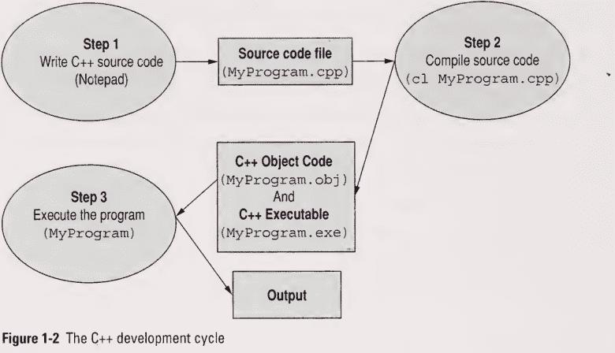

让我们从学习第1步——编写C++源代码——开始。

#### 编写C++源代码

如前一节所学，你通过创建一个名为main、包含C++语句的函数来编写C++程序。但是，你用什么来编写程序，又把它保存在哪里呢？

编写C++程序的一种方法是使用文本编辑器，例如Windows文本编辑器记事本。你可以使用任何文本编辑器，但本书中的步骤假设你使用的是记事本。要启动记事本，请单击“开始”按钮，选择“程序”或“所有程序”，选择“附件”，然后选择“记事本”。记事本启动后，你只需键入C++源代码。**源代码**是组成C++程序的语句的名称。例如，前面图1-1中显示的代码就是源代码。

保存包含源代码的文件时，重要的是给文件起一个有意义的名称，然后添加扩展名`.cpp`。对于Hello World程序，源代码文件的合适名称是`HelloWorld.cpp`。当然，记住你选择保存源代码文件的文件夹位置也很重要。

保存源代码文件后，你进入C++开发周期的第2步。在第2步中，你编译源代码。

#### 编译C++程序

Visual C++编译器名为`cl`。它是一个负责两步过程的程序：获取源代码并将其转换为目标代码，然后链接目标代码以创建可执行代码。

> **注意**
>
> Visual C++编译器`cl`实际上是一个编译器和链接器。

**目标代码**是计算机可读形式的代码，它与库链接以创建可执行文件。**可执行代码**是计算机执行程序所需的1和0。


C++ 编译器会自动将目标代码保存到一个文件中。该文件与源代码文件同名，但扩展名是 .obj 而不是 .cpp。

以下步骤展示如何编译源代码文件。这些步骤假设你已经创建并保存了 HelloWorld.cpp 源代码文件。

- 1. 设置你的 PATH 环境变量。有关如何设置 PATH 环境变量的说明，请参阅本书开头的“开始之前请阅读”。

> **注意** 如果你在学校计算机实验室中工作，这些步骤可能已经为你完成。如果你不知道如何设置 PATH，请参阅本书开头的“开始之前请阅读”部分，或向你的指导老师咨询更多信息。

- 2. 打开“命令提示符”窗口。在 Windows XP 中执行此操作，请单击“开始”按钮，选择“所有程序”，选择“附件”，然后选择“命令提示符”。在 Vista 中，单击“开始”按钮，选择“所有程序”，选择“附件”，然后选择“命令提示符”。光标在当前文件路径的右侧闪烁。要编译源代码文件，首先必须切换到包含源代码文件的文件路径。为此，请键入 `cd driveletter:\path`，其中 driveletter 是包含你的文件的驱动器，path 是包含你的文件的文件夹路径。例如，要访问存储在名为 Testing 的文件夹中的文件，而该文件夹又存储在名为 My Program 的文件夹中，该文件夹存储在 c: 驱动器上，则应键入 `cd c:\My Program\Testing`。键入命令后，按 Enter 键。现在，光标在包含源代码文件的文件夹的文件路径旁闪烁。

- 3. 键入以下命令，该命令使用 C++ 编译器 cl 来编译程序：

```
cl HelloWorld.cpp
```

如果你的源代码中没有语法错误，则会创建一个名为 HelloWorld.obj 的文件和一个名为 HelloWorld.exe 的文件。你不会看到任何特别的事情发生。但是，你刚刚创建的文件包含 Hello World 程序的目标代码（HelloWorld.obj）和可执行代码（HelloWorld.exe）。如果有语法错误，你会在屏幕上看到错误消息；在这种情况下，你需要回到记事本修复错误，再次保存源代码文件，并重新编译，直到不再有语法错误为止。语法错误是编译器发来的消息，告诉你错误是什么以及它们在源代码文件中的位置。例如，在语句 `cout << "Hello World" << endl` 末尾省略分号会导致语法错误。

- 4. 程序编译后，你可以使用 dir 命令显示目录列表，以查看名为 HelloWorld.obj 和 HelloWorld.exe 的文件。要执行 dir 命令，请在命令提示符下键入 dir。例如，如果你的源代码文件位于 `c:\My Program\Testing`，则命令提示符和 dir 命令应如下所示：`c:\My Program\Testing> dir`。HelloWorld.obj 和 HelloWorld.exe 文件应与源代码文件 HelloWorld.cpp 位于同一目录中。

开发周期中的第 3 步是执行 C++ 程序。你接下来将学习这部分内容。


> **注意** PATH 环境变量告诉你的操作系统，你系统上的哪些目录包含命令。

> **注意** 在你编程生涯的这个阶段，如果你使用记事本之类的文本编辑器打开扩展名为 .obj 或 .exe 的文件，不要期望能理解其内容。

#### 执行 C++ 程序

要执行 Hello World 程序，请执行以下操作：

> **注意**
> 
> 执行程序时，你必须位于包含 `.exe` 文件的同一目录中。

- 1. 打开“命令提示符”窗口。在 Windows XP 中执行此操作，请单击“开始”按钮，选择“所有程序”，选择“附件”，然后选择“命令提示符”。在 Vista 中，单击“开始”按钮，选择“所有程序”，选择“附件”，然后选择“命令提示符”。如有必要，请切换到包含可执行代码文件的文件路径，然后输入以下命令：

```
HelloWorld
```

- 2. 程序执行时，`Hello World` 这几个字会出现在“命令提示符”窗口中。

图 1-3 展示了使用 cl 编译器编译 `HelloWorld.cpp`、执行 `dir` 命令验证已创建 `HelloWorld.obj` 和 `HelloWorld.exe` 文件，以及执行 Hello World 程序所生成输出的步骤。

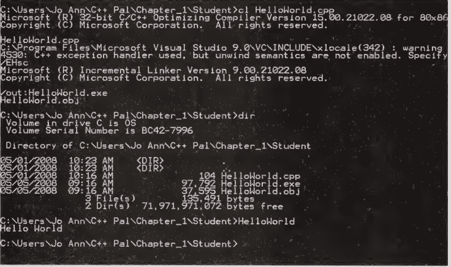

**图 1-3** 编译并执行 Hello World 程序

#### 练习 1-1：理解 C++ 编译器

在本练习中，假设你已经编写了一个 C++ 程序，并将源代码存储在名为 `FirstCPlusPlusProgram.cpp` 的文件中。回答以下问题：

- 1. 你会使用什么命令来编译源代码？
- 2. 你会使用什么命令来执行程序？

#### 实验 1.1：编译并执行 C++ 程序

在本实验中，你将编译并执行一个预先编写的 C++ 程序，然后回答一些关于该程序的问题。

- 1. 使用记事本或你选择的文本编辑器打开名为 `GoodDay.cpp` 的源代码文件。
- 2. 将此源代码文件保存到你选择的目录中，然后切换到该目录。
- 3. 编译源代码文件。应该没有语法错误。记录你用于编译源代码文件的命令。
- 4. 执行程序。记录你用于执行程序的命令，并记录此程序的输出。
- 5. 修改程序，使其显示 `Congratulations`。将文件保存为 `Congratulations.cpp`。编译并执行。
- 6. 修改 Congratulations 程序，使其打印两行输出。添加第二条输出语句，显示“Have a great day.”。将修改后的文件保存为 `Congratulations2.cpp`。编译并执行该程序。


## 2 变量、运算符以及使用顺序语句编写程序

**学习本章后，你将能够：**

- 命名变量并使用适当的数据类型
- 声明并初始化变量
- 在表达式中使用算术运算符
- 在赋值语句中使用赋值运算符
- 使用顺序语句和交互式输入语句编写程序

本章中，你将学习编写使用变量和算术运算符、并从程序用户那里接收交互式输入的程序。我们先回顾变量，并学习如何在 C++ 程序中使用它们。你应该在完成 Joyce Farrell 所著的 *程序设计逻辑与设计（第五版）* 的第 1 章之后，再做本章的练习和实验。

### 变量

如你所知，**变量**是计算机内存中一个具名位置，其内容可以变化（因此称为变量）。当需要存储值时，你会在程序中使用变量。变量中存储的值通常会随着程序执行而变化。

在 C++ 中，必须先声明变量，然后才能在程序中使用它们。声明变量分为两步：为变量指定名称，并指定其数据类型。你很快就会学习数据类型。但首先，我们将重点介绍 C++ 中变量命名的规则。

### 变量名

C++ 中的变量名可以由字母、数字和下划线字符组成，但不能以数字开头。此外，不能将 C++ 关键字用作变量名。正如你在本书第 1 章所学到的，关键字是在 C++ 中具有特殊含义的单词。以下是 C++ 中合法变量名的示例：`my_var`、`num6`、`intValue` 和 `firstName`。表 2-1 列出了一些无效变量名的示例，并解释了每个名称无效的原因。

| 变量名 | 说明 |
|---|---|
| `3wrong` | 无效，因为它以数字开头 |
| `$don't` | 无效，因为它包含单引号并以美元符号开头 |
| `int` | 无效，因为它是 C++ 关键字 |
| `first name` | 无效，因为它包含空格 |

**表 2-1** 无效变量名

命名变量时，请记住 C++ 区分大小写——换句话说，C++ 能区分大写和小写字符。这意味着 `value`、`Value` 和 `VaLuE` 在 C++ 中是三个不同的变量名。


> **注意** 按照惯例，C++ 中的变量名以小写字母开头；名称中的所有其他单词以大写字母开头，例如 `firstName`。变量名中的单词之间不能包含空格。这种命名约定称为驼峰命名法。C++ 程序员有时会使用其他约定，但在本书中，变量使用驼峰命名法命名。

在 C++ 中，变量名可以任意长。一个好的规则是给变量起有意义的名称，名称要足够长以描述变量的用途，但不要长到使程序难以阅读或导致不必要的输入。例如，名为 `firstName` 的变量显然将用于存储某人的名字。变量名 `freshmanStudentFirstName` 具有描述性，但长得不方便；变量名 `fn` 太短，乍看之下没有意义。变量名 `x2rh5` 没有意义。

### C++ 数据类型

除了为变量指定名称外，还需要为该变量指定特定的数据类型。变量的**数据类型**决定为该变量分配的内存量、可以存储在变量中的数据类型以及可以使用该变量执行的操作类型。数据类型有很多种，但在本书中，我们将重点介绍最基本的数据类型，称为**基本数据类型**。C++ 中有五种基本数据类型：`int`、`float`、`double`、`char` 和 `bool`。其中一些数据类型（如 `int`、`double` 和 `float`）用于存储数值的变量，称为数值数据类型。其他数据类型有专门用途。例如，`bool` 数据类型用于存储 true 或 false 的值，而 `char` 数据类型用于存储单个字符。

在本书编写的程序中，你不会使用 C++ 的所有基本数据类型。相反，你将重点关注两种数值数据类型（`int` 和 `double`）。`int` 数据类型用于整数值。例如，可以使用 `int` 数据类型的变量存储某人的年龄（例如 25）或班级中的学生人数（例如 35）。`int` 数据类型的变量在内存中占用 32 位（4 字节）空间。你使用 `double` 数据类型存储浮点值（即小数值），例如以美元和美分表示的物品价格（2.95）或以英尺或英寸表示的测量值（2.5）。`double` 数据类型的变量在内存中占用 64 位（8 字节）空间。你将在后续课程中继续学习 C++ 时了解如何使用其他数据类型。

`int` 和 `double` 数据类型将足以满足本书中你将使用的所有数值变量。但是，当你需要在变量中存储一组字符（例如某人的姓名）时该怎么办？在编程中，我们将一个或多个字符组成的组称为**字符串**。字符串的一个示例是姓氏 “Wallace” 或产品类型如 “desk”。C++ 中没有用于存储字符串的基本数据类型；相反，它们存储在称为字符串对象的对象中。除了在本书中使用 `int` 和 `double` 数据类型外，你还将使用字符串。

> **注意** 你在第 1 章中将 `int` 数据类型用作 Hello World 程序中 `main` 函数的返回类型。

> **注意** 内置数据类型的实际大小在不同计算机上可能不同，但本书中注明的大小表示 32 位计算机上的通常大小。

> **注意** 在 *《程序设计逻辑与设计（第五版）》* 中，数据类型 `num` 用于指代所有数值数据类型。与 C++ 中不同，它不区分 `int` 和 `double`。

#### 练习 2-1：使用 C++ 变量、数据类型和关键字

在本练习中，你将运用所学到的关于命名 C++ 变量、C++ 数据类型和关键字的知识来回答以下问题：

1. 下列每个名称都是合法的 C++ 变量名吗？（回答是或否。）

| 变量名 | 变量名 | 变量名 |
| --- | --- | --- |
| `my_age` ✓ | `this_is_a_var` ✓ | `NUMBER` |
| `your_age` ✓ | `number` | `$number` |
| `int` | `number1` | `floatNum` ✓ |
| `25May` | `number Six` | `Number` ✓ |

2. 下列每个值适合用哪种数据类型（int、double 或 string）存储？

- 产品编号：________________________________
- 贷款的利息金额，例如 10%：________________________________
- CD 的价格：________________________________
- 你最好的朋友的名字：________________________________
- 你拥有的书籍数量：________________________________

### 声明和初始化变量

现在你已了解命名变量的规则，并理解了数据类型的概念，可以学习如何声明变量了。在 C++ 中，必须先声明所有变量，然后才能在程序中使用它们。当你**声明**一个变量时，你是在告诉编译器你将使用该变量。在声明变量的过程中，必须指定变量的名称及其数据类型。声明变量会告诉编译器需要为该变量保留一个内存位置。声明变量的代码行称为**变量声明**。C++ 中变量声明的语法如下：

```cpp
dataType variableName;
```

例如，下面的声明语句声明了一个名为 counter 的 int 数据类型变量：

```cpp
int counter;
```

编译器为名为 counter 的变量保留分配给 int 变量的内存空间量（32 位，即 4 字节）。然后编译器为新变量分配一个特定的内存地址。在图 2-1 中，名为 `counter` 的变量的内存地址是 1000，不过通常你不会知道 C++ 程序中变量的内存地址。

```cpp
int counter;
```

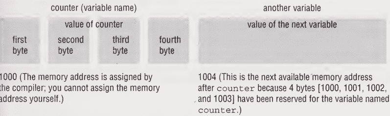

**图 2-1** 变量声明和内存分配

你也可以在声明 C++ 变量时初始化它。当你**初始化**一个 C++ 变量时，你给它一个初始值。例如，可以在声明 counter 变量时为其分配初始值 8，如下代码所示：

```cpp
int counter = 8;
```

你还可以声明并初始化 `double` 数据类型变量和 `string` 变量（对象），如下代码所示：

```cpp
double salary;
double cost = 12.95;
string firstName;
string homeAddress = "123 Main Street";
```

只要多个变量具有相同的数据类型，就可以在一条语句中声明多个变量。例如，下面的语句声明了两个变量，名为 `counter` 和 `value`。两个变量都是 `int` 数据类型。

```cpp
int counter, value;
```

> **注意**
> 
> 在 C++ 中，变量不会自动用值初始化。除非你显式提供值，否则它们包含未确定的值。

#### 练习 2-2：声明和初始化 C++ 变量

在本练习中，你将运用所学到的关于声明和初始化 C++ 变量的知识。

1. 为下列各项编写 C++ 变量声明。使用 `int`、`double` 或 `string`，并选择有意义的变量名。

   - 声明一个变量来存储物品编号（1 到 1000）。 ______________________________
   - 声明一个变量来存储你家庭中的孩子数量。 ______________________________
   - 声明一个变量来存储一双鞋的价格。 ________________________________
   - 声明一个变量来存储你最喜欢的电影名称。 ________________________________

2. 声明并初始化变量以表示下列值。使用 `int`、`double` 或 `string`，并选择有意义的变量名。

   - 三角形的一条边长为 3.1 英寸。 ________________________________
   - 三月的天数。 ________________________________
   - 你的猫的名字 “Puff”。 ________________________________
   - 你这学期选修的课程数量。 ________________________________

#### 实验 2-1：声明和初始化 C++ 变量

在本实验中，你将在本书数据文件提供的一个 C++ 程序中声明并初始化变量。该程序保存在名为 `NewAge.cpp` 的文件中，用于计算你在 2030 年的年龄。

1. 使用记事本或你选择的文本编辑器打开名为 `NewAge.cpp` 的源代码文件。
2. 声明一个名为 `myNewAge` 的整数变量。
3. 声明并初始化一个名为 `myCurrentAge` 的整数变量。用你当前的年龄初始化该变量。
4. 声明并初始化一个名为 `currentYear` 的整数变量。用当前年份的值初始化该变量。年份使用四位数字。
5. 将此源代码文件保存到你选择的目录中，然后将该目录设为你的工作目录。
6. 编译源代码文件 `NewAge.cpp`。
7. 执行程序。记录该程序的输出。

   _______________________________
   
   _______________________________

### 算术运算符和赋值运算符

声明变量后，你可以在各种任务中使用它。例如，可以在简单的算术计算中使用变量，例如加法、减法和乘法。还可以对变量执行其他类型的操作，例如将一个变量与另一个变量进行比较以确定哪个更大。


为了编写以这种方式操作变量的 C++ 代码，你需要熟悉运算符。**运算符**是一种符号，它告诉计算机执行数学或逻辑运算。C++ 拥有种类繁多的运算符。我们从一组称为算术运算符的运算符开始讨论。

#### 算术运算符

**算术运算符**是用于执行算术计算的符号。你可能已经非常熟悉加（+）和减（−）的算术运算符。表 2-2 列出并解释了 C++ 的算术运算符。

| 运算符名称 | 符号 | 示例 | 说明 |
|---|---|---|---|
| 加法 | + | `num1 + num2` | |
| 减法 | − | `num1 − num2` | |
| 乘法 | * | `num1 * num2` | |
| 除法 | / | `15/2`<br><br>`15.0 / 2.0`<br><br>`15.0 / 2` | 整数除法；结果为 7；小数部分被截断。<br><br>浮点除法；结果为 7.5。<br><br>浮点除法，因为其中一个操作数是浮点数；结果为 7.5。 |
| 取模 | % | `hours % 24` | 执行除法并求余数；如果 hours 的值为 25，则结果为 1。 |
| 一元加 | + | `+num1` | 保持表达式的值不变；如果 num1 的值为 3，则 +num1 为 3。 |
| 一元减 | − | `−(num1 − num2)` | 如果 (num1 − num2) 的值为 10，则 −(num1 − num2) 为 −10。 |

**表 2-2** C++ 算术运算符

你可以将算术运算符和变量组合起来创建**表达式**。计算机会对每个表达式求值，结果是一个值。为了让你了解其工作原理，假设 num1 的值为 3，num2 的值为 20，并且两者都是 int 数据类型。记住这些信息，研究表 2-3 中表达式及其值的示例。


| 表达式 | 值 | 说明 |
|---|---:|---|
| `num1 + num2` | 23 | 因为 3 + 20 = 23 |
| `num1 - num2` | -17 | 因为 3 − 20 = −17 |
| `num2 % num1` | 2 | 因为 20 / 3 = 6 余 2 |
| `num1 * num2` | 60 | 因为 3 * 20 = 60 |
| `num2 / num1` | 6 | 因为 20 / 3 = 6（余数被截断） |
| `−num1` | −3 | 因为 num1 的值为 3，所以 −num1 为 −3 |

**表 2-3** 表达式和值

#### 赋值运算符和赋值语句

另一类运算符是赋值运算符。你使用赋值运算符将值赋给变量。将值赋给变量的语句称为**赋值语句**。在 C++ 中，有几种类型的赋值运算符。你最常使用的将是 = 赋值运算符，它只是将值赋给变量。表 2-4 列出并解释了 C++ 的一些赋值运算符。

| 运算符名称 | 符号 | 示例 | 说明 |
|---|---|---|---|
| 赋值 | `=` | `count = 5;` | 将右侧的值放入左侧指定的内存位置。 |
| 初始化 | `=` | `int count = 5;` | 在声明变量时，将右侧的值放入左侧指定的内存位置。 |
| 赋值 | `+=` | `num += 20;` | 等价于 `num = num + 20;` |
|  | `-=` | `num -= 20;` | 等价于 `num = num - 20;` |
|  | `*=` | `num *= 20;` | 等价于 `num = num * 20;` |
|  | `/=` | `num /= 20;` | 等价于 `num = num / 20;` |
|  | `%=` | `num %= 20;` | 等价于 `num = num % 20;` |

**表 2-4** C++ 赋值运算符

当执行赋值语句时，计算机对赋值运算符右侧的表达式求值，然后将结果赋给赋值运算符左侧变量所关联的内存位置。以下代码展示了一个赋值语句的示例。注意该语句以分号结尾。在 C++ 中，赋值语句始终以分号结尾。

```cpp
answer = num1 * num2;
```

正如你在表 2-5 中所看到的，括号运算符 ( ) 具有最高优先级。你可以使用此运算符来改变运算执行的顺序。请注意以下示例：

```cpp
average = test1 + test2 / 2;
```

这条语句的任务是求两个测试分数的平均值。按照这条语句当前的写法，编译器会将 test2 变量中的值除以 2，然后将其加到 test1 变量中的值上。因此，例如，如果 test1 的值为 90，test2 的值为 88，那么赋给 average 的值将是 134，这显然不是这两个测试分数的正确平均值。通过在此示例中使用括号运算符，你可以强制加法在除法之前执行。正确的语句如下所示：

```cpp
average = (test1 + test2) / 2;
```

在此示例中，test1 的值 90 与 test2 的值 88 相加，然后总和除以 2。赋给 average 的值 89 就是正确结果。

#### 练习 2-3：理解运算符优先级和结合性

在本练习中，你将运用所学的关于 C++ 中运算符优先级和结合性的知识。研究以下代码，然后回答后面的问题。

```cpp
// This program demonstrates the precedence and
// associativity of operators.
#include <iostream>
using namespace std;
int main()
{
    int value1 = 9;
    int value2 = 3;
    int value3 = 10;
    int answer1, answer2, answer3;
    int answer4, answer5, answer6;

    answer1 = value1 * value2 + value3;
    cout << "Answer 1: " << answer1 << endl;

    answer2 = value1 * (value2 + value3);
    cout << "Answer 2: " << answer2 << endl;

    answer3 = value1 + value2 - value3;
    cout << "Answer 3: " << answer3 << endl;

    answer4 = value1 + (value2 - value3);
    cout << "Answer 4: " << answer4 << endl;

    answer5 = value1 + value2 * value3;
    cout << "Answer 5: " << answer5 << endl;

    answer6 = value3 / value2;
    cout << "Answer 6: " << answer6 << endl;
    return 0;
}
```

- 1. answer1、answer2、answer3、answer4、answer5 和 answer6 的值分别是什么？
- 2. 解释优先级和结合性如何影响结果。

#### 实验 2-2：算术运算符和赋值运算符

在本实验中，你将完成一个部分编写的 C++ 程序，该程序随本书的数据文件一起提供。这个为一家电器公司编写的程序会打印电器名称、其零售价、批发价、该电器产生的利润、促销价，以及使用促销价时产生的利润。

- 1. 使用记事本或你选择的文本编辑器打开名为 `Appliance.cpp` 的文件。
- 2. 该文件包含变量声明和输出语句。在继续下一步之前，请仔细阅读它们。
- 3. 设计逻辑，使用赋值语句先计算利润，然后计算促销价，最后计算使用促销价时的利润。利润定义为零售价减去批发价。促销价为从零售价中扣除 15%。促销利润定义为促销价减去批发价。在你的赋值语句中执行适当的计算。
- 4. 将源代码文件保存到你选择的目录中，然后使该目录成为你的工作目录。
- 5. 编译程序。

> **注意：** 你将在本书第 7 章学习在输出浮点值时如何控制小数点后的位数。

- 6. 执行程序。你的输出应如下所示：

```cpp
Item Name: Dishwasher
Retail Price: $425
Wholesale Price: $275
Profit: $150
Sale Price: $361.25
Sale Profit: $86.25
```

接下来，你将看到如何把本章学到的所有内容结合起来，编写一个使用顺序语句和交互式输入语句的 C++ 程序。

### 顺序语句和交互式输入语句

术语**顺序语句**或**顺序**是指必须按顺序依次执行的一系列语句。当你想要一个接一个地执行动作时，可以在程序中使用顺序。一个顺序可以包含任意数量的动作，但这些动作必须按正确的顺序排列，并且顺序中的任何动作都不能跳过。注意，顺序可以包含注释，注释不被视为顺序本身的一部分。注释用作文档，向程序员以及任何可能阅读代码的人解释代码。你将在本书第 3 章进一步了解注释。

顺序通常包括**交互式输入语句**，即要求或**提示**用户输入数据的语句。以下示例中的 C++ 程序使用顺序语句和交互式输入语句将华氏温度转换为对应的摄氏温度：

```cpp
// This C++ program converts a Fahrenheit temperature to Celsius.
// Input: Interactive
// Output: Fahrenheit temperature followed by Celsius temperature

#include <iostream>
using namespace std;

int main()
{
    double fahrenheit;
    double celsius;

    // Prompt user
    cout << "Enter Fahrenheit temperature: ";
    // Get interactive user input
    cin >> fahrenheit;
    // Calculate celsius
    celsius = (fahrenheit - 32.0) * (5.0/9.0);
    // Output
```

```cpp
    cout << "Fahrenheit temperature:" << fahrenheit << endl;
    cout << "Celsius temperature:" << celsius << endl;

    return 0;
}
```

该程序由依次执行的顺序语句组成。它还包含解释代码的注释。注释是以 `//` 开头的行。在声明变量 `fahrenheit` 和 `celsius`（使用 `double` 数据类型）之后，将执行以下语句：

```cpp
    // Prompt user
    cout << "Enter Fahrenheit temperature: ";
    // Get interactive user input
    cin >> fahrenheit;
```

> **注意**
> 请记住，`endl` 会使光标显示在输出之后的下一行。

`cout` 语句用于提示用户输入华氏温度，以便程序将其转换为摄氏温度。请注意，这个 `cout` 语句中没有包含 `endl`。这样做是为了将光标定位在与所显示提示相同的行上。

下一条语句 `cin >> fahrenheit;` 用于获取用户的输入。这一行由多个部分组成。第一部分 `cin` 是一个对象的名称，该对象表示用户的标准输入设备，通常是键盘。接下来你会看到 `>>`，它被称为**提取**或**输入**运算符。在 `>>` 之后，你会看到 `fahrenheit`，这是将存储待提取数据的变量名。C++ 提取运算符 `>>` 会自动将键盘输入的输入转换为适当的数据类型。在本示例中，`>>` 会将用户的输入转换为 `double` 数据类型，因为变量 `fahrenheit` 被声明为 `double` 数据类型。

接下来要执行的语句是赋值语句，如下所示：

```cpp
    celsius = (fahrenheit - 32.0) * (5.0 / 9.0);
```

将华氏温度转换为摄氏温度的公式用于该赋值语句的右侧。请注意表达式中使用括号来控制优先级。该表达式会被求值，结果值会赋给名为 `celsius` 的变量。

请注意，该除法使用值 `5.0` 和 `9.0`。这是浮点除法的一个示例，其结果包含小数部分。如果使用值 `5` 和 `9`，则会执行整数除法，小数部分将被截断。

接下来按顺序执行的两个语句都是输出语句，如下所示：

```cpp
    cout << "Fahrenheit temperature:" << fahrenheit << endl;
    cout << "Celsius temperature:" << celsius << endl;
```

语句 `cout << "Fahrenheit temperature:" << fahrenheit << endl;` 用于显示字符串 `Fahrenheit temperature:`，随后显示变量 `fahrenheit` 中存储的值，再随后显示换行符。第二个输出语句显示文字 `Celsius temperature:`，随后显示变量 `celsius` 中存储的值，再随后显示换行符。

- 2. 此程序中声明了两个变量 `height1` 和 `height2` 来表示墙的高度。你需要这两个变量吗？如果不需要，你会如何修改程序？请务必列出你将进行的所有更改。

#### 实验 2-3：在 C++ 程序中使用顺序语句

在本实验中，你将完成一个随本书数据文件提供的 C++ 程序。该程序计算从员工周薪中代扣的税额、员工每名受抚养人可享受的税收减免，以及员工的实发工资。程序输出包括州税代扣额、联邦税代扣额、受抚养人税收减免、工资和实发工资。

- 1. 使用记事本或你选择的文本编辑器打开名为 `Payroll.cpp` 的源代码文件。

- 2. 已根据需要为你声明并初始化了变量，并且已编写输入和输出语句。在继续下一步之前，请仔细阅读代码。

- 3. 编写执行以下操作所需的 C++ 代码：
  - 按 7.0% 计算州代扣税，并按 32.0% 计算联邦代扣税。
  - 按员工工资的 4.0% 为每名受抚养人计算受抚养人减免。
  - 计算代扣总额。（代扣总额是州代扣总额与联邦代扣总额之和。）
  - 按工资减去代扣总额再加上减免计算实发工资。

- 4. 将此源代码文件保存到你选择的目录中，然后将该目录设为你的工作目录。

- 5. 编译程序。

> **注意** 你将在本书第 7 章学习在输出浮点值时如何控制小数点后的位数。

- 6. 执行程序。你应该会得到以下输出：

```cpp
State Tax: $66.5

Federal Tax: $304

Dependents: $114

Salary: $950

Take-Home Pay: $693.5
```

## 3 编写结构化的 C++ 程序

**学习本章后，你将能够：**

- 使用结构化流程图和伪代码编写结构化的 C++ 程序
- 编写 C++ 注释
- 使用局部变量和命名常量，在 C++ 中编写简单的模块化程序


在本章中，你将开始学习如何编写结构化的 C++ 程序。正如你将看到的，在实际编写程序之前创建流程图并编写伪代码，可以确保你完全理解程序的预期设计。我们先来看你的教材 *《编程逻辑与设计（第五版）》* 中的一个结构化流程图和伪代码。你应该在完成教材 *《编程逻辑与设计（第五版）》* 的第 2 章和第 3 章之后，再完成本章的练习和实验。

### 使用流程图和伪代码编写 C++ 程序

在 *《编程逻辑与设计（第五版）》* 的第 1 章和第 2 章中，你学习了数字倍增程序的流程图和伪代码。图 3-1 显示了该程序的功能性结构化流程图和伪代码。

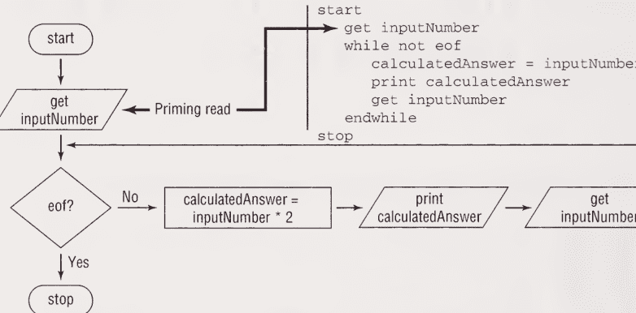

```cpp
start
    get inputNumber
    while not eof
        calculatedAnswer = inputNumber * 2
        print calculatedAnswer
        get inputNumber
    endwhile
    stop
```

**图 3-1** 数字倍增问题的功能性结构化流程图和伪代码

通过研究流程图和伪代码，你可以看到该程序使用了你在 *《编程逻辑与设计（第五版）》* 中已经接触过的顺序结构和循环结构。在期望自己编写这个程序之前，你必须进一步学习 C++。本节的其余部分将带你逐步了解该程序的 C++ 代码。这些讲解假定你只是跟着阅读，但如果你愿意，也可以按所呈现的内容输入代码。本节的目标是帮助你体会流程图和伪代码如何在编写 C++ 程序时起到指导作用。

> **注意**
>
> 注意，每个左花括号都与一个右花括号配对。

在图 3-1 中，伪代码的第一行是单词 `start`。我们如何将这个伪代码命令转换为启动数字倍增程序的 C++ 代码？在本书第 1 章中，你学到了要启动 C++ 程序，首先要创建一个 `main` 函数。因此，为了启动数字倍增程序，我们将首先创建一个名为 `main` 的函数，因为它始终是 C++ 程序中第一个执行的函数。因此，下面的代码通过创建 `main` 函数来启动数字倍增程序：

```cpp
int main()
{
}
```

> **注意** 如果你正在按此处呈现的内容输入代码，请记得将程序保存到一个名称合适的文件中，例如 `NumberDouble.cpp`。

伪代码的下一行指示你获取 `inputNumber`。换句话说，你需要编写为循环做准备的输入语句。你在 *《编程逻辑与设计（第五版）》* 第 2 章中学习了预读语句。在本书第 2 章中，你学习了如何在程序中使用交互式输入语句来允许用户输入数据。你还学习了提示用户，说明程序期望接收什么作为输入。下面的示例包含实现预读的代码：向用户显示提示，然后获取用户想要加倍的数字。

请注意，粗体代码已添加到数字倍增程序中。如果你自己编写这段代码，你会先编写如上所示的数字倍增程序代码，然后编辑它以添加此处显示的粗体代码：

```cpp
int main()
{
    cout << "Enter a number to double: " << endl;
    cin >> inputNumber;
}
```

接下来，伪代码指示你开始一个 `while` 循环，并使用 `eof`（文件末尾）作为退出循环的条件。

由于本程序使用交互式输入，因此不需要 eof 标记。相反，我们将使用数字 0（零）来表示输入结束。我们使用 0 是因为 0 加倍后始终为 0。使用 0 表示输入结束还要求我们更改提示，告诉用户如何结束程序。请查看以下代码。同样，新添加的代码以粗体格式显示。

```cpp
int main()
{
    cout << "Enter a number to double or 0 to end: " << endl;
    cin >> inputNumber;
    while( inputNumber != 0)
    {
    }
}
```

> **注意** 你还没有学习足够的 while 循环知识来自己编写这段代码，但你可以观察本示例中是如何实现的。你将在本书第 5 章进一步学习循环。


> **注意** 请注意，在 C++ 中，左花括号（`{`）和右花括号（`}`）用于标记作为循环一部分执行的代码的开始和结束。

根据伪代码，循环体由三条顺序语句组成。第一条语句计算 `inputNumber` 乘以 2；第二条语句打印 `calculatedAnswer`；第三条语句从用户处获取下一个 `inputNumber`。在 C++ 中，我们实际上需要在标记 `while` 循环体的花括号之间添加一条额外语句。这条额外语句提示用户输入下一个要翻倍的数。

在下面的示例中，构成循环体的代码以粗体显示：

```cpp
int main()
{
    cout << "Enter a number to double or 0 to end: " << endl;
    cin >> inputNumber;
    while( inputNumber != 0)
    {
        calculatedAnswer = inputNumber * 2;
        cout << inputNumber << " doubled is " << calculatedAnswer << endl;
        cout << "Enter a number to double or 0 to end: " << endl;
        cin >> inputNumber;
    }
}
```

伪代码的最后一行指示你结束程序。在 C++ 中，`main` 函数的右花括号（`}`）表示 `main` 函数的结束，因此也表示程序的结束。请注意，前面的代码包含两个右花括号。最后一个用于结束 `main` 函数，倒数第二个用于结束 `while` 循环。

我们几乎已经完成将伪代码转换为 C++ 代码。我们只需处理几项收尾工作。正如你在《*编程逻辑与设计（第五版）*》第 3 章中所学，声明变量就是其中一项收尾工作。接下来的代码是用于数字翻倍的完整 C++ 程序。以粗体显示的代码是声明变量的代码。你在本书第 1 章学过的 `#include` 预处理指令和 `using` 语句也以粗体显示。此外，你还会看到 `return 0;` 语句。该语句指示编译器从 `main` 函数返回数值 0。

```cpp
#include <iostream>
using namespace std;
int main()
{
    int inputNumber;
    int calculatedAnswer;
    cout << "Enter a number to double or 0 to end: " << endl;
    cin >> inputNumber;
    while( inputNumber != 0)
    {
        calculatedAnswer = inputNumber * 2;
        cout << inputNumber << " doubled is " << calculatedAnswer << endl;
        cout << "Enter a number to double or 0 to end: " << endl;
        cin >> inputNumber;
    }
    return 0;
}
```

此时，程序已准备好进行编译。假设没有语法错误，它应该按计划执行。尽管你还没有学会自己编写此程序所需的全部知识，但你可以从这个示例中看到，如果你从设计良好、功能完整、结构清晰的流程图或伪代码开始，用 C++ 编写程序会更容易。

#### 实验 3-1：使用流程图和伪代码编写 C++ 程序

在本实验中，你将使用图 3-2 中的流程图和伪代码，向一个部分创建的 C++ 程序添加代码。完成后，大学招生人员应能使用该 C++ 程序，根据学生的班级排名来决定是否录取该学生。你在《*编程逻辑与设计（第五版）*》第 2 章中学习过这个流程图和伪代码。


### 编写结构化 C++ 程序

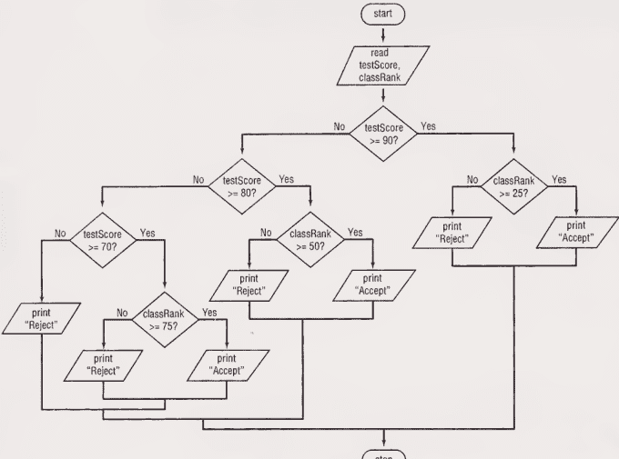

```text
start
    read testScore, classRank
    if testScore >= 90 then
        if classRank >= 25 then
            print "Accept"
        else
            print "Reject"
        endif
    else
        if testScore >= 80 then
            if classRank >= 50 then
                print "Accept"
            else
                print "Reject"
            endif
        else
            if testScore >= 70 then
                if classRank >= 75 then
                    print "Accept"
                else
                    print "Reject"
                endif
            else
                print "Reject"
            endif
        endif
    endif
stop
```

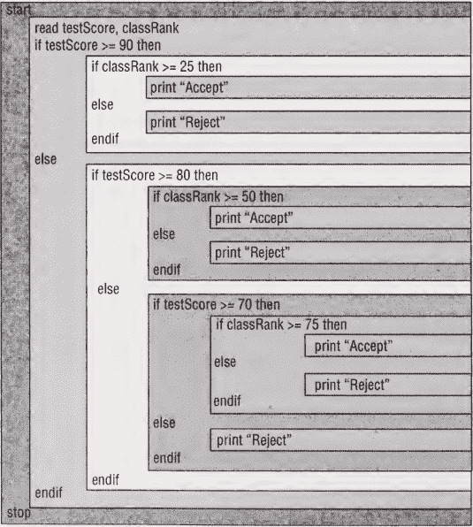

图 3-2 结构化大学录取程序的流程图和伪代码

- 1. 研究图 3-2 中的流程图和伪代码。
- 2. 使用记事本或你选择的文本编辑器打开名为 `CollegeAdmission.cpp` 的源代码文件。
- 3. 声明两个名为 `testScore` 和 `classRank` 的整数变量。
- 4. 编写交互式输入语句，从程序用户处获取学生的考试成绩和班级排名。不要忘记提示用户输入考试成绩和班级排名。
- 5. 程序的其余部分已为你编写好。将此源代码文件保存到你选择的目录中，然后使该目录成为你的工作目录。
- 6. 编译源代码文件 `CollegeAdmission.cpp`。
- 7. 通过输入考试成绩 75 和班级排名 80 来执行程序。记录该程序的输出。
  ____________________________________________________________
- 8. 通过输入考试成绩 80 和班级排名 40 来执行程序。记录该程序的输出。
  ____________________________________________________________

### C++ 注释

在《*编程逻辑与设计（第五版）*》第 3 章中，你学习了**程序注释**，即不会执行的语句。你在 C++ 程序中使用注释向阅读源代码的人解释你的逻辑。C++ 编译器会忽略注释。

在 C++ 中，你可以选择两种注释风格。第一种，在希望编译器忽略的每条注释开头键入两个正斜杠字符（`//`）。当你只想将单行或一行的一部分标记为注释时，这种风格很有用。第二种风格，用 `/*` 和 `*/` 字符括住一组行。当你想要将多行标记为注释时，这种风格很有用。你可以将注释放在 C++ 程序中的任何位置，但不能放在语句内部。

下面的示例展示了添加到上一节数字翻倍程序中的两种注释风格。请注意，程序的前八行组成一个多行块注释，解释程序的一些基本信息。

第二个块注释紧随第一个块注释之后，介绍创建数字翻倍程序的代码。接下来，程序中各处还包含若干单行注释，用于描述程序的各个部分。

> **注意**
> 包含提供程序基本信息的头部注释是一种良好的编程实践。

```cpp
/*
    Program Name: NumberDouble.cpp
    Function: This program doubles a number that is input by
    a user and prints the calculated result on the user's
    screen.
    Input:  Interactive
    Output: The doubled number
*/
#include <iostream>
using namespace std;

/*
The following code creates the number-doubling program. It has a single
function named main.
*/
int main()
{
    // Declaration of variables
    int inputNumber;
    int calculatedAnswer;

    // Prompt user and get interactive user input
    cout << "Enter a number to double: " << endl;
    cin >> inputNumber;

    // Continue until user enters a 0 to end the program
    while( inputNumber != 0)
    {
        // Calculate the number doubled
        calculatedAnswer = inputNumber * 2;
        // Output the result
        cout << inputNumber << " doubled is " << calculatedAnswer << endl;
        // Prompt user and get interactive user input
        cout << "Enter a number to double: " << endl;
        cin >> inputNumber;
    } // End of while loop
    return 0;
} // End of main function
```

> **注意：** 你有责任在编写的所有程序中加入写得良好、有意义的注释。事实上，有些人认为注释源代码与源代码本身同样重要。

接下来，你将看到如何使用流程图和伪代码在 C++ 中编写模块化程序。


#### 实验 3-2：为 C++ 程序添加注释

在本实验中，你要为一个之前创建的 C++ 程序添加注释。这个 C++ 程序计算 0 到 100 之间能被 13 整除的数之和。研究代码，看看你是否能弄明白每一行代码的作用，然后为代码添加注释，其中包括一个类似于数字加倍程序中的多行注释，用于描述程序的功能，以及你认为合适的其他注释。可以参考本书到目前为止看到的程序来帮助你。

- 1. 使用记事本或你选择的文本编辑器打开名为 `DivideByThirteen.cpp` 的源代码文件。
- 2. 研究代码。
- 3. 添加注释。
- 4. 将此源代码文件保存到你选择的目录中，然后将该目录设为你的工作目录。
- 5. 编译源代码文件 `DivideByThirteen.cpp`。
- 6. 执行程序。记录该程序的输出。

### 用 C++ 编写模块化程序

在你书中的第 3 章*《编程逻辑与设计（第五版）》*中，你学习了局部变量和命名常量。简而言之，**局部变量**是在使用它们的模块——或者用 C++ 术语来说，函数——中声明的。此外，局部变量只能在其声明的函数内使用。（请注意，在本书中，当指 C++ 程序时，我们将使用“函数”这一术语，因为这是 C++ 编程语言中使用的术语。当指流程图或伪代码时，则使用“模块”这一术语。）**命名常量**用于在程序执行期间所赋的值永远不会改变的程序中。

另外，回顾第 3 章，大多数程序都由一个包含主线逻辑的 main 方法组成。`main` 方法随后调用其他方法来完成程序中的特定工作。

在*《编程逻辑与设计（第五版）》*第 3 章中，你研究了一个模块化程序的流程图和伪代码，该程序打印客户账单，并在每个方法中局部声明变量和常量。该流程图和伪代码如图 3-3 所示。


## 第 3 章

在本节中，我们将逐步创建一个 C++ 程序，以实现图 3-3 流程图中所示的逻辑。根据该流程图，程序从执行主线方法开始。主线方法声明了两个变量 name 和 balance，它们是主线方法的局部变量。接下来，使用输入语句获取 name 和 balance 的值。为了将其转换为 C++，我们需要声明三个变量 firstName、lastName 和 balance，然后使用交互式输入语句获取用户输入的 name 和 balance 值。

输入语句之后，会调用名为 nameAndAddress 的函数。主线逻辑中的最后两条语句是打印语句，用于输出客户姓名和余额。在该程序的 C++ 版本中，输出显示（打印）在用户屏幕上。在下面的代码中，该程序的主线逻辑被转换为 C++。

> **注意：** 在 C++ 程序中，客户姓名使用了两个变量，以使程序易于理解。

```
/* Program Name: CustomerBill.cpp
   Function: This program uses a function to print a company name and
             address and then prints a customer name and balance.
   Input:    Interactive
   Output: Company name and address, customer name and balance
*/
#include <iostream>
#include <string>
using namespace std;
int main()
{
    // Declare variables local to main
    string firstName;
    string lastName;
    double balance;
    // Get interactive input
    cout << "Enter customer's first name: ";
    cin >> firstName;
    cout << "Enter customer's last name: ";
    cin >> lastName;
    cout << "Enter customer's balance: ";
    cin >> balance;
    // Call nameAndAddress function
    nameAndAddress();
    // Output customer name and address
    cout << "Customer Name:  " << firstName << " " << lastName << endl;
    cout << "Customer Balance:  " << balance << endl;
    return 0;
} // End of main function
```

> **注意：** 如果你按此处所示输入代码，请记住将程序保存到具有有意义名称的文件中，例如 `CustomerBill.cpp`。

要完成这个程序，我们需要添加名为 nameAndAddress 的函数。查看图 3-3 中的流程图，你会看到我们需要声明三个局部常量。

查看代码，你会看到，在 C++ 中声明常量时，要使用关键字 const，后面依次是数据类型和常量名。命名常量在声明时必须初始化，并且其内容在程序执行期间不得更改。三个命名常量 ADDRESS_LINE1、ADDRESS_LINE2 和 ADDRESS_LINE3 是函数 nameAndAddress 的局部常量，因为它们是在该函数内声明的。左花括号（{）标记函数的开始，右花括号（}）标记函数的结束。

方法 nameAndAddress 的**头部**以关键字 void 开始，后面是函数名 nameAndAddress。关键字 void 表示 nameAndAddress 函数不返回值。

> **注意**
> 按照惯例，在 C++ 中常量名全部使用大写字母。多个单词之间用下划线分隔。这样可以让你在长代码块中更容易发现命名常量。

注意，程序开头添加了一条额外的 #include 预处理指令。预处理指令 #include <string> 允许你在 C++ 程序中使用 string 对象。你将在后续章节中进一步了解 string 对象。另外，注意 #include 预处理指令后面的语句 `void nameAndAddress();`。这称为函数声明或函数原型。

在 C++ 中，必须先声明程序中使用的所有函数，然后才能调用它们。**函数声明**指定函数返回值的类型、函数名以及传递给函数的任何参数的数据类型。nameAndAddress 函数返回的数据类型为 void。关键字 void 用于指定该函数不返回任何内容。你将在本书第 7 章进一步学习函数声明和函数参数。

> **注意**
> 函数声明以分号（;）结尾。

该程序现在已完成。图 3-4 显示了程序在输入 William Pryor（作为姓名）和 1200（作为余额）时的输出。

```
Command Prompt
C:\Users\Jo Ann\C++ Pal\Chapter_3\Author First\Student>CustomerBill
Enter customer's first name: William
Enter customer's last name: Pryor
Enter customer's balance: 1200
ABC Manufacturing
123 Industrial Pkwy
Wild Rose, WI 54984
Customer Name: William Pryor
Customer Balance: 1200
C:\Users\Jo Ann\C++ Pal\Chapter_3\Author First\Student>_
```

**图 3-4** 输入为 William Pryor 和 1200 时 CustomerBill 程序的输出

#### 实验 3-3：用 C++ 编写模块化程序

在本实验中，你要向一个部分完成的 C++ 程序添加输入和输出语句。完成后，用户应能够输入年、月和日。程序随后判断日期是否有效。有效年份是大于 0 的年份，有效月份包括 1 到 12 的值，有效日期包括 1 到 31 的值。

- 1. 使用记事本或你选择的文本编辑器打开名为 `BadDate.cpp` 的源代码文件。
- 2. 注意已经为你声明了变量。
- 3. 编写提示和输入语句，从用户处获取年、月和日。
- 4. 编写输出语句。输出格式如下：

    ```
    month/day/year is a valid date.

    or

    month/day/year is an invalid date.
    ```

- 5. 将此源代码文件保存到你选择的目录中，然后将该目录设为你的工作目录。
- 6. 编译源代码文件 `BadDate.cpp`。
- 7. 执行程序，输入以下日期：month = 10、day = 17、year = 2009。记录该程序的输出。

  执行程序，输入以下日期：month = 2、day = 32、year = 2006。记录该程序的输出。


## 第4章：编写做出决策的程序

**学习本章后，你将能够：**

- 使用关系布尔运算符和逻辑布尔运算符在程序中做出决策
- 比较 `string` 对象
- 在 C++ 中编写决策语句，包括 `if` 语句、`if-else` 语句、嵌套 `if` 语句和 `switch` 语句
- 使用决策语句，通过 AND 逻辑和 OR 逻辑进行多重比较

你应当先完成 Joyce Farrell 所著教材*《程序设计逻辑与设计（第五版）》*的第4章，然后才完成本章的练习和实验。在本章中，你将练习使用 C++ 的关系运算符和逻辑运算符编写布尔表达式。你还将学习决策语句的 C++ 语法，包括 `if` 语句、`if-else` 语句、嵌套 `if` 语句和 `switch` 语句。最后，你将学习编写进行多重比较的 C++ 语句。

### 布尔运算符

当你想在表达式中比较值时，会在表达式中使用布尔运算符。在表达式中使用布尔运算符时，该表达式的求值结果是一个真或假的值。在 C++ 中，可以将**布尔运算符**细分为两组：关系运算符和逻辑运算符。我们先从关系运算符开始讨论。

#### 关系运算符

在编程语境中，术语**关系**指的是值之间的连接或关系。例如，一个值可能大于另一个值、小于另一个值或等于另一个值。“大于”“小于”和“等于”这些术语都指两个值之间的关系。与所有布尔运算符一样，**关系运算符**允许你提出一个会得到真或假答案的问题。根据答案，程序将执行不同的语句，从而执行不同的操作。

表4-1列出了 C++ 中使用的关系运算符。

| 运算符 | 含义 |
|---|---|
| `<` | 小于 |
| `<=` | 小于或等于 |
| `>` | 大于 |
| `>=` | 大于或等于 |
| `==` | 等于（两个等号之间没有空格） |
| `!=` | 不等于 |

**表4-1** 关系运算符

为了了解如何使用关系运算符，假设你声明两个变量：一个名为 number1 的 int，初始化为值 10；另一个名为 number2 的 int 变量，初始化为值 15。以下代码显示了这些变量的声明语句：

```cpp
int number1 = 10;
int number2 = 15;
```

以下代码示例说明了如何在表达式中使用关系运算符：

- `number1 < number2` 的求值结果为 `true`，因为 10 小于 15。
- `number1 <= number2` 的求值结果为 `true`，因为 10 小于或等于 15。
- `number1 > number2` 的求值结果为 `false`，因为 10 不大于 15。
- `number1 >= number2` 的求值结果为 `false`，因为 10 不大于或等于 15。
- `number1 == number2` 的求值结果为 `false`，因为 10 不等于 15。
- `number1 != number2` 的求值结果为 `true`，因为 10 不等于 15。

#### 逻辑运算符

当你需要提出多个问题但只想得到一个答案时，可以使用另一类布尔运算符——**逻辑运算符**。例如，在程序中，你可能想知道一个数是否在值 1 和 10 之间。这实际上涉及两个问题。你需要问这个数是否大于 1，以及这个数是否小于 10。这里，你提出了两个问题，但只想得到一个答案——是（`true`）或否（`false`）。

与包含关系表达式的语句一样，包含逻辑运算符的语句求值为 `true` 或 `false`，从而允许程序做出决策。

表4-2列出了 C++ 中使用的逻辑运算符。

| 运算符 | 名称 | 描述 |
|---|---|---|
| `&&` | AND | 所有表达式都必须求值为 `true`，整个表达式才为 `true`；该运算符写作两个 `&` 符号，中间没有空格。 |
| `\|\|` | OR | 只有一个表达式必须求值为 `true`，整个表达式就为 `true`；该运算符写作两个 \| 符号，中间没有空格。 |
| `!` | NOT | 该运算符反转表达式的值；例如，如果表达式求值为 `false`，则将其反转，使表达式求值为 `true`。 |

**表4-2** 逻辑运算符

为了了解如何使用逻辑运算符，假设你声明两个变量：一个名为 `number1` 的 `int`，初始化为值 10；另一个名为 `number2` 的 `int` 变量，初始化为值 15。这些变量的声明语句如下代码所示：

```cpp
int number1 = 10;
int number2 = 15;
```


以下代码示例说明了如何在表达式中将逻辑运算符与关系运算符一起使用：

- `(number1 > number2) || (number1 == 10)` 求值为 `true`，因为第一个表达式求值为 `false`（10 不大于 15），而第二个表达式求值为 `true`（10 等于 10）。使用 OR 逻辑时，只需要一个表达式为真，整个表达式就为 `true`。
- `(number1 > number2) && (number1 == 10)` 求值为 `false`，因为第一个表达式为 `false`（10 不大于 15），而第二个表达式为 `true`（10 等于 10）。使用 AND 逻辑时，两个表达式都必须为 `true`，整个表达式才为 `true`。
- `(number1 != number2) && (number1 == 10)` 求值为 `true`，因为两个表达式都为 `true`；也就是说，10 不等于 15，且 10 等于 10。使用 AND 逻辑时，如果两个表达式都为 `true`，那么整个表达式就为 `true`。
- `!(number1 == number2)` 求值为 `true`，因为表达式求值为 `false`（10 不等于 15）。然后 `!` 运算符反转 `false`，得到 `true` 值。

#### 关系运算符和逻辑运算符的优先级与结合性

与第2章讨论的算术运算符一样，关系运算符和逻辑运算符按照特定的结合性和优先级规则求值。表4-3显示了本书到目前为止讨论的运算符的优先级和结合性。

| 运算符名称 | 运算符符号 | 优先级顺序 | 结合性 |
|---|---|---|---|
| 括号 | `()` | 第一 | 从左到右 |
| 一元 | `- + !` | 第二 | 从右到左 |
| 乘法、除法和取模 | `* / %` | 第三 | 从左到右 |
| 加法和减法 | `+ -` | 第四 | 从左到右 |
| 关系 | `< > <= >=` | 第五 | 从左到右 |
| 相等 | `== !=` | 第六 | 从左到右 |
| AND | `&&` | 第七 | 从左到右 |
| OR | `\|\|` | 第八 | 从左到右 |
| 赋值 | `= += -= *= /= %=` | 第九 | 从右到左 |

**表4-3** 优先级顺序和结合性

> **注意** 有些符号在表4-3中出现不止一次，因为它们有不止一种含义。例如，当 − 运算符用在数字或包含数字的变量之前时，它被解释为一元 − 运算符。当 − 运算符用在操作数之间时，它被解释为减法运算符。

如表4-3所示，AND 运算符的**优先级**高于 OR 运算符，这意味着它的布尔值先被求值。还要注意，关系运算符的优先级高于相等运算符，并且关系运算符和相等运算符的优先级都高于 AND 和 OR 运算符。所有这些运算符都具有从左到右的结合性。

为了了解如何在表达式中使用逻辑运算符和关系运算符，首先假设变量 number1 和 number2 已按以下代码所示声明并初始化：

```cpp
int number1 = 10;
int number2 = 15;
```

现在，你在 C++ 中编写以下表达式：

```cpp
number1 == 8 && number2 == number1 || number2 == 15
```

查看表4-3，你可以看到相等运算符（==）的优先级高于 AND 运算符（&&），而 AND 运算符（&&）的优先级高于 OR 运算符（||）。另外，注意表达式中有三个 == 运算符；因此，适用从左到右的结合性规则。图4-1说明了运算符的使用顺序。

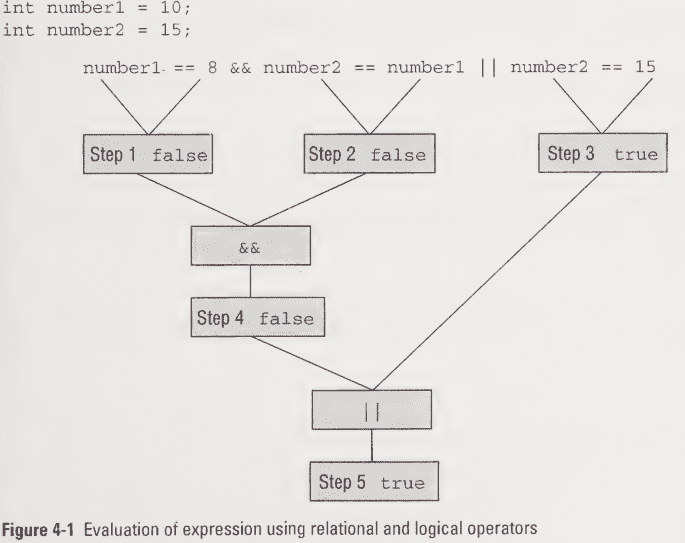

> 记住，你可以使用括号改变优先级顺序。

如图4-1所示，按照优先级和结合性规则，需要五个步骤来确定表达式的值。


如图 4-2 所示，添加括号后仍然需要五步，但求值顺序改变了，结果也随之改变。

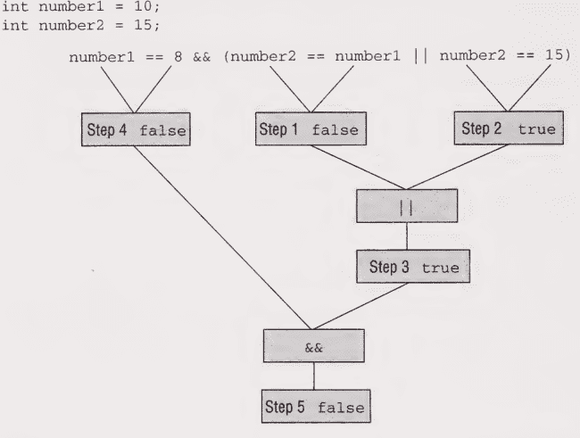

图 4-2 使用带括号的关系运算符和逻辑运算符对表达式进行求值

### 比较字符串

在 C++ 中，比较字符串对象时，可以使用与比较数值数据类型（如 `int` 和 `double`）时相同的关系运算符。

下面的代码演示了如何使用相等运算符比较两个字符串对象，以及比较一个字符串对象和一个字符串常量：

```cpp
string s1 = "Hello";
string s2 = "World";
// The following test evaluates to false because "Hello" is not the
// same as "World".
if (s1 == s2)
    // code written here executes if true
else
    // code written here executes if false

// The following test evaluates to true because "Hello" is the same
// as "Hello".
if (s1 == "Hello")
    // code written here executes if true
else
    // code written here executes if false

// The following test evaluates to false because "Hello" is not the
// same as "hello".
if (s1 == "hello")
    // code written here executes if true
else
    // code written here executes if false
```

> **注意** 当两个字符串的内容相同时，它们相等。

> **注意** C++ 是区分大小写的，这意味着 C++ 不认为小写“h”与大写“H”相等，因为它们的 ASCII 值不同。小写“h”的 ASCII 值是 104，大写“H”的 ASCII 值是 72。ASCII 值表可在 *《编程逻辑与设计（第五版）》* 的附录 C“理解数制与计算机代码”中找到。

下面的代码演示了如何使用其他关系运算符比较两个 `string` 对象，以及比较一个 `string` 对象和一个 `string` 常量：

```cpp
string s1 = "Hello";
string s2 = "World";
// The following test evaluates to false because "Hello" is not
// greater than "World".
if (s1 > s2)
    // code written here executes if true
else
    // code written here executes if false

// The following test evaluates to true because "Hello" is the same as
// "Hello".
if (s1 <= "Hello")
    // code written here executes if true
else
    // code written here executes if false
```

当你比较 `string` 时，C++ 会比较 `string` 中各个字符的 ASCII 值，根据 `string` 中文本的字母顺序来确定一个 `string` 是否大于、小于或等于另一个 `string`。如前面的代码所示，值为 "Hello" 的 `string` 对象 s1 不大于值为 "World" 的 `string` 对象 s2，因为按字母顺序 World 排在 Hello 之后。

下面的代码示例展示了将关系运算符用于两个 `string` 对象的更多示例：

```cpp
string s1 = "whole";
string s2 = "whale";
// The next statement evaluates to true because the contents of
// s1, "whole", are greater than the contents of s2, "whale".
if (s1 > s2)
    // code written here executes if true
else
    // code written here executes if false

// The next statement evaluates to true because the contents of s2,
// "whale", are less than the contents of s1, "whole".
if (s2 < s1)
    // code written here executes if true
else
    // code written here executes if false

// The next statement evaluates to true because the contents of s1,
// "whole", are the same as the string constant, "whole".
if (s1 == "whole")
    // code written here executes if true
else
    // code written here executes if false
```

### 判断语句

程序中的每个判断都基于表达式计算结果为 `true` 还是 `false`。程序员使用判断语句来改变程序中的控制流。**控制流**是指语句执行的顺序。判断语句也被称为**分支语句**，因为它们让计算机做出决策，从程序中的一个或多个分支（或路径）中进行选择。

C++ 中有不同类型的判断语句。我们将从 `if` 语句开始。

#### if 语句

`if` 语句是一种单路径判断语句。正如你在 *《编程逻辑与设计（第五版）》* 中学到的，`if` 语句也被称为“单分支”或“单边”语句。

当我们使用“单路径”这个术语时，意思是如果表达式计算结果为 `true`，程序将执行一条或多条语句；但如果表达式计算结果为 `false`，程序将不会执行这些语句。这里只定义了一条路径——即表达式计算结果为 `true` 时所走的路径。无论哪种情况，`if` 语句之后的下一条语句都会执行。

在 C++ 中编写 `if` 语句的语法（或规则集）如下：

```cpp
if (expression)
    statementA;
```

请注意，当你输入关键字 `if` 开始一条 `if` 语句时，需要在后面跟上放在括号内的表达式。

当编译器遇到 `if` 语句时，会计算括号内的表达式。如果表达式计算结果为 `true`，计算机将执行 `statementA`。如果括号内的表达式计算结果为 `false`，计算机将不会执行 `statementA`。请记住，无论表达式计算结果为 `true` 并执行 `statementA`，还是表达式计算结果为 `false` 而不执行 `statementA`，接下来都会执行 `if` 语句之后的下一条语句。

请注意，C++ 语句（例如 `if` 语句）可以是简单语句，也可以是块语句。**块**语句由多条 C++ 语句组成。C++ 将块定义为一对花括号内的语句。如果你希望程序在 `if` 语句中执行多条语句，则必须将这些语句括在一对花括号中，否则只会执行一条语句。下面的示例演示了一条 `if` 语句，它使用关系运算符 `<` 来测试变量 `customerAge` 的值是否小于 65。你会在第四行看到第一个左花括号，在第七行看到第二个右花括号。

```cpp
int customerAge = 53;
int discount = 10, numUnder_65 = 0;
if(customerAge < 65)
{
    discount = 0;
    numUnder_65 += 1;
}
cout << "Discount : " << discount << endl;
cout << "Number of customers under 65 is: " << numUnder_65 << endl;
```

在前面的代码中，名为 `customerAge` 的变量被初始化为 53。由于 53 小于 65，表达式 `customerAge < 65` 的计算结果为 true，因此块语句执行。块语句由花括号内的两条赋值语句组成：`discount = 0;` 和 `numUnder_65 += 1;`。如果表达式计算结果为 false，则块语句不执行。无论哪种情况，接下来要执行的语句都是输出语句 `cout << "Discount : " << discount << endl;`。

注意，在带有 `if` 和待测试表达式的那一行末尾，不要加上分号。这样做不会导致语法错误，但可能会在程序中造成逻辑错误。**逻辑错误**会导致程序产生不正确的结果。在 C++ 中，分号 (;) 被称为空语句，被视为合法语句。**空**语句是什么都不做的语句。请看下面的代码：

```cpp
if (customerAge < 65); // semicolon here is not correct
{
    discount = 0;
    numUnder_65 += 1;
}
```

如果你按照上面的代码编写 `if` 语句，程序将测试表达式 `customerAge < 65`。如果计算结果为 true，则执行空语句，这意味着程序什么也不做；然后执行语句 `discount = 0;`，因为这是 `if` 语句之后的下一条语句。这不会在程序中造成逻辑错误，但请考虑当 `if` 语句中的表达式计算结果为 false 时会发生什么。如果为 false，空语句不会执行，但语句 `discount = 0;` 仍会执行，因为它是 `if` 语句之后的下一条语句。

下面的代码使用 `if` 语句测试两个字符串对象是否相等：

```cpp
string dentPlan = "Y";
if (dentPlan == "Y")
    grossPay = grossPay - 23.50;
```


在这个示例中，如果名为 `dentPlan` 的 `string` 对象的值与字符串常量 "Y" 的值相同，则表达式的计算结果为 true，并且 `grossPay` 计算赋值语句会执行。如果表达式的计算结果为 false，则 `grossPay` 计算赋值语句不会执行。

#### 练习 4-1：理解 if 语句

在本练习中，你将运用所学的关于在 C++ 中编写 `if` 语句的知识，研究一个使用 if 语句的完整 C++ 程序。请花几分钟研究下面的代码，然后回答第 1 至第 4 题。

```cpp
// VotingAge.cpp - This program determines if a
// person is eligible to vote.
#include <iostream>
#include <string>
using namespace std;
int main()
{
        int myAge = 19;
        string ableToVote = "Yes";
        const int VOTING_AGE = 18;
        if(myAge < VOTING_AGE)
                ableToVote = "No";
        cout << "My Age: " << myAge << endl;
        cout << "Able To Vote: " << ableToVote << endl;
        return 0;
}
```

- 1. 该程序执行时的确切输出是什么？
- 2. 如果将 `myAge` 的值改为 17，确切输出是什么？
- 3. 如果将 `if` 语句中的表达式改为 `myAge <= VOTING_AGE`，确切输出是什么？
- 4. 如果名为 `ableToVote` 的变量用值 "No" 而不是值 "Yes" 初始化，确切输出是什么？

#### 实验 4-1：使用 if 语句

在本实验中，你要完成一个为家具公司预先编写的 C++ 程序。该程序应根据以下事实计算客户订购的任何桌子的价格：

- 所有桌子的费用最低为 $150.00。
- 如果表面面积（长度 * 宽度）超过 750 平方英寸，则加 $50.00。
- 如果木材是桃花心木，则加 $200.00；如果是橡木，则加 $100.00。松木不额外收费。
- 对于桌子的延伸板，每块额外收费 $50.00。

- 1. 使用记事本或你选择的文本编辑器打开名为 `Furniture.cpp` 的文件。
- 2. 你需要为以下内容声明变量，并在指定位置初始化它们：
  - 一个用于桌子成本的变量，初始化为 `0.00`。
  - 一个用于桌子长度的变量，初始化为 50 英寸。
  - 一个用于桌子宽度的变量，初始化为 40 英寸。
  - 一个用于桌子表面积的变量。
  - 一个用于木材类型的变量，初始化为值 "oak"。
  - 一个用于延伸板数量的变量，初始化为值 2。
- 3. 使用赋值语句和适当的 `if` 语句编写程序的其余部分。输出语句已经为你写好。
- 4. 编译程序。
- 5. 执行程序。你的输出应为：`The charge for this table is $400.` 请注意，在本书第 7 章进一步学习 C++ 之前，你无法控制小数点后显示的小数位数。

#### if-else 语句

if-else 语句是一种双路径或双分支决策语句。也就是说，程序在计算 if-else 语句中的表达式后，将选择两条路径之一。

在 C++ 中编写 if-else 语句的语法如下：

```cpp
if (expression)
    statementA;
else
    statementB;
```

当编译器遇到 if-else 语句时，会计算括号中的表达式。如果表达式的计算结果为 true，则计算机执行 statementA。否则，如果括号中的表达式的计算结果为 false，则计算机执行 statementB。statementA 和 statementB 都可以是简单语句或块语句。无论程序采用哪条路径，if-else 语句之后的语句都是下一条要执行的语句。

> **注意**
>
> 不要在包含关键字 `if` 和待测试表达式的行末尾，或在包含关键字 `else` 的行末尾添加分号。正如你之前所学，这样做不是语法错误，但可能会在程序中造成逻辑错误。

```cpp
int hoursWorked = 45;
double rate = 15.00;
double grossPay;
string overtime = "Yes";
const int HOURS_IN_WEEK = 40;
const double OVERTIME_RATE = 1.5;
if (hoursWorked > HOURS_IN_WEEK)
{
    overtime = "Yes";
    grossPay = HOURS_IN_WEEK * rate + (hoursWorked - HOURS_IN_WEEK) *
               OVERTIME_RATE * rate;
}
else
{
    overtime = "No";
    grossPay = hoursWorked * rate;
}
cout << "Overtime: " << overtime << endl;
cout << "Gross Pay: $" << grossPay << endl;
```

> **注意**
>
> `HOURS_IN_WEEK` 是一个初始化为值 40 的常量；`OVERTIME_RATE` 是一个初始化为值 1.5 的常量。

在前面的代码中，会测试名为 `hoursWorked` 的变量的值是否大于 `HOURS_IN_WEEK`。

你使用大于关系运算符 `>` 进行比较。如果表达式 `hoursWorked > HOURS_IN_WEEK` 的计算结果为 true，则执行第一个块语句。这个第一个块语句包含一条语句，将字符串常量 "Yes" 赋给名为 `overtime` 的变量，还包含另一条语句，计算员工的工资总额（包括加班费），并将计算得到的值赋给名为 `grossPay` 的变量。

如果表达式 `hoursWorked > HOURS_IN_WEEK` 的计算结果为 false，则遵循另一条路径，并执行关键字 `else` 后面的第二个块语句。这个块语句包含一条语句，将字符串常量 "No" 赋给名为 `overtime` 的变量，还包含另一条语句，计算员工不含加班费的工资总额，并将计算得到的值赋给名为 `grossPay` 的变量。

无论这段代码采用哪条路径，下一条要执行的语句都是输出语句 `cout << "Overtime: " << overtime << endl;`，紧接着是输出语句 `cout << "Gross Pay: $" << grossPay << endl;`。

#### 练习 4-2：理解 if-else 语句

在本练习中，你将运用所学的关于在 C++ 中编写 `if-else` 语句的知识，研究一个使用 `if-else` 语句的完整 C++ 程序。这个程序是为一家电话公司计算客户话费而编写的。对于拨打客户区号以外、持续时间超过 20 分钟的通话，电话公司按每分钟 15 美分收费。所有其他通话按每分钟 20 美分收费。请花几分钟研究下面的代码，然后回答第 1 至第 4 题。

```cpp
// Telephone.cpp - This program determines telephone call
// charges.
#include <iostream>
using namespace std;
int main()
{
    int custAC, custNumber;
    int calledAC, calledNumber;
    int callMinutes;
    double callCharge;
    const int MAX_MINS = 20;
    const double CHARGE_1 = .15;
    const double CHARGE_2 = .20;
    custAC = 630;
    custNumber = 5551234;
    calledAC = 219;
    calledNumber = 5557890;
    callMinutes = 35;
    if(calledAC != custAC && callMinutes > MAX_MINS)
        callCharge = callMinutes * CHARGE_1;
    else
        callCharge = callMinutes * CHARGE_2;
    cout << "Customer Number: " << custAC << "-" << custNumber
         << endl;
    cout << "Called Number: " << calledAC << "-" << calledNumber
         << endl;
    cout << "The charge for this call is $" << callCharge << endl;
    return 0;
}
```

- 1. 该程序执行时的确切输出是什么？
- 2. 如果将 `callMinutes` 的值改为 20，确切输出是什么？
- 3. 如果将 `if` 语句中的表达式改为 `callMinutes >= MAX_MINS`，确切输出是什么？
- 4. 如果名为 `custAC` 的变量被赋值为 `312` 而不是值 `630`，确切输出是什么？

#### 实验 4-2：使用 if-else 语句

在本实验中，你要完成一个已编写好的 C++ 程序，该程序计算三个整数值中的最大值和最小值。这三个值是 210、330 和 -1。

- 1. 使用记事本或你选择的文本编辑器打开名为 `LargeSmall.cpp` 的文件。
- 2. 已经为你声明了两个名为 `largest` 和 `smallest` 的变量。使用这些变量存储三个整数值中的最大值和最小值。你必须决定还需要哪些其他变量，并在适当时初始化它们。
- 3. 使用赋值语句、`if` 语句或适当的 `if-else` 语句编写程序的其余部分。代码中有注释告诉你应该在哪里编写语句。输出语句已经为你写好。
- 4. 编译程序。
- 5. 执行程序。你的输出应为：

  最大值是 330。

  最小值是 -1。

#### 嵌套 if 语句

你可以嵌套 if 语句来创建多路径决策语句。嵌套 if 语句时，你将一个 if 语句包含在另一个 if 语句中。这对于需要提供两条以上可能路径的程序很有帮助。

> **注意：** 不要在包含待测试表达式的行末尾，或在包含关键字 `else` 的行末尾添加分号。

在 C++ 中编写嵌套 if 语句的语法如下：

```cpp
if(expressionA)
    statementA;
else if(expressionB)
    statementB;
else
    statementC;
```

这被称为嵌套 if 语句，因为第二个 if 语句是第一个 if 语句的一部分。如果按如下方式修改示例，就更容易看出来：


```cpp
if(expressionA)
    statementA;
else
    if(expressionB)
        statementB;
    else
        statementC;
```

现在我们来看看嵌套 if 语句是如何工作的。如果括在圆括号中的 expressionA 求值为 true，那么计算机就执行 statementA。如果 expressionA 求值为 false，那么计算机将求值 expressionB。如果 expressionB 求值为 true，那么计算机将执行 statementB。如果 expressionA 和 expressionB 都求值为 false，那么计算机将执行 statementC。无论这段代码走哪条路径，if-else 语句之后的语句都是下一条要执行的语句。

下面的 C++ 代码示例演示了一个嵌套 if 语句。

```cpp
if(empDept <= 3)
    supervisorName = "Dillon";
else if(empDept <= 7)
    supervisorName = "Escher";
else
    supervisorName = "Fontana";
cout << "Supervisor: " << supervisorName << endl;
```

阅读前面的代码时，可以假定部门编号永远不会小于 1。如果名为 empDept 的变量的值小于或等于 3（在 1 到 3 的值范围内），那么将值 "Dillon" 赋给名为 supervisorName 的变量。如果 empDept 的值不小于或等于 3，但小于或等于 7（在 4 到 7 的值范围内），那么将值 "Escher" 赋给名为 supervisorName 的变量。如果 empDept 的值不在 1 到 7 的值范围内，那么将值 "Fontana" 赋给名为 supervisorName 的变量。如你所见，当程序遇到嵌套 if 语句时，它可能走三条路径。无论程序走哪条路径，下一条要执行的语句都是输出语句 `cout << "Supervisor: " << supervisorName << endl;`。

#### 练习 4-3：理解嵌套 if 语句

在本练习中，你将运用所学的 C++ 嵌套 if 语句编写知识，研究一个使用嵌套 if 语句的完整 C++ 程序。这个程序是为 Woof Wash 狗狗美容业务编写的，用于计算所提供服务的总费用。Woof Wash 洗澡收费 30 美元，剪毛收费 20 美元，修剪指甲收费 15 美元。花几分钟研究下面的代码，然后回答第 1 到第 3 题。

```cpp
// WoofWash.cpp - This program determines if a doggy
// service is provided and prints the charge.
#include <iostream>
#include <string>
using namespace std;
int main()
{
    string service;
    const string SERVICE_1 = "bath";
    const string SERVICE_2 = "cut";
    const string SERVICE_3 = "trim nails";
    double charge;
    const double BATH_CHARGE = 30.00;
    const double CUT_CHARGE = 20.00;
    const double NAIL_CHARGE = 15.00;
    cout << "Enter service: ";
    cin >> service;
    if(service == SERVICE_1)
        charge = BATH_CHARGE;
    else if(service == SERVICE_2)
        charge = CUT_CHARGE;
    else if(service == SERVICE_3)
        charge = NAIL_CHARGE;
    else
        charge = 0.00;
    if(charge > 0.00)
        cout << "The charge for a doggy " << service << " is $"
             << charge << endl;
    else
        cout << "We do not perform the " << service << " service."
             << endl;
    return 0;
}
```


- 1. 如果用户输入“bath”，该程序执行时的确切输出是什么？
  
  ________________________________________________________
- 2. 如果用户输入“shave”，该程序执行时的确切输出是什么？
  
  ________________________________________________________
- 3. 如果用户输入“BATH”，该程序执行时的确切输出是什么？
  
  ________________________________________________________

#### 实验 4-3：使用嵌套 if 语句

在本实验中，你将完成一个预先编写的 C++ 程序，该程序计算员工的年终奖金，并打印员工姓名、年薪、绩效评级和奖金。奖金根据员工的年薪及其绩效评级计算。评级体系见表 4-4：

| 评级 | 奖金 |
|---|---|
| 1 | 年薪的 10% |
| 2 | 年薪的 6% |
| 3 | 年薪的 3% |
| 4 | 无 |

表 4-4 员工评级和奖金

- 1. 使用记事本或你选择的文本编辑器打开名为 `EmployeeBonus.cpp` 的文件。
- 2. 已经为你声明了变量，并且已经编写了输入语句和输出语句。在继续下一步之前，请仔细阅读它们。
- 3. 设计逻辑，并使用嵌套 `if` 语句编写程序的其余部分。
- 4. 编译该程序。
- 5. 执行该程序，并输入以下内容作为输入：
  - 员工的名字 - **Laurie**
  - 员工的姓氏 - **Blair**
  - 员工的薪水 - **65000.00**
  - 员工的绩效评级 - **3**
- 6. 你的输出应为：

```text
Employee Name: Laurie Blair

Employee Salary: $65000

Employee Rating: 3

Employee Bonus: $1950
```

注意：在你学习本书第 7 章中更多 C++ 知识之前，你无法控制小数点后出现的位数。

#### switch 语句

`switch` 语句与嵌套 `if` 语句类似，因为它也是一种多路分支决策语句。`switch` 语句的优点是比嵌套 `if` 语句更易于阅读，而且对程序员来说也更易于维护。当你想要将一个表达式与多个整数常量进行比较时，就可以使用 `switch` 语句。

在 C++ 中编写 `switch` 语句的语法如下：

```cpp
switch(expression)
{
    case constant: statement(s);
    case constant: statement(s);
    case constant: statement(s);
    default:       statement(s);
}
```

> **注意**
> 
> 如果在 `case` 中省略 `break` 语句，那么将执行直到下一个 `break` 语句或右花括号为止的所有代码。这很可能不是你想要的结果。

你以关键字 `switch` 开始编写 `switch` 语句。然后，在圆括号内加入一个求值为整数值的表达式。接着，在 `switch` 语句中使用关键字 `case` 作为标签来定义各个 case，并在这个标签后包含一个整数值。例如，你可以包含像 10 这样的整数常量，或像 `10/2` 这样求值为整数的算术表达式。计算机先求值 `switch` 语句中的表达式，然后将其与 case 标签后面的整数值进行比较。如果表达式和整数值匹配，那么计算机就执行其后的语句，直到遇到 `break` 语句或右花括号。`break` 语句会导致退出 `switch` 语句。你可以使用关键字 `default` 为那些不匹配 case 标签后任何整数值的值建立一个 case。还要注意，所有 case（包括 default case）都括在花括号内。

下面的代码示例演示了 C++ 中 `switch` 语句的用法：

```cpp
int deptNum;
string deptName;
deptNum = 2;
switch(deptNum)
{
    case 1:    deptName = "Marketing";
               break;
    case 2:    deptName = "Development";
               break;
    case 3:    deptName = "Sales";
               break;
    default:   deptName = "Unknown";
               break;
}
cout << "Department: " << deptName << endl;
```

在前面的示例中，当程序遇到 `switch` 语句时，名为 `deptNum` 的变量的值为 2。值 2 与 `switch` 语句第二个 case 中的整数常量 2 匹配。因此，字符串常量 `"Development"` 被赋给名为 `deptName` 的字符串对象。接下来遇到 `break` 语句，它使程序退出 `switch` 语句。`switch` 语句之后的语句 `cout << "Department: " << deptName << endl;` 接下来执行。


如果省略前面示例中的 `break` 语句，并且 `deptNum` 的值为 2，则到右花括号为止的所有语句都会执行。输出将是：

`Department: Unknown.`

在此示例中，省略 `break` 语句将被视为逻辑错误。

#### 练习 4-4：使用 switch 语句

在本练习中，你将运用所学的 `switch` 语句知识来研究一些 C++ 代码，然后回答后面的问题。

首先，检查以下代码：

```cpp
int numValue = 2;
int answer = 0;
switch(numValue)
{
    case 1:  answer += 1;
    case 2:  answer += 2;
    case 3:  answer += 3;
             break;
    case 4:  answer += 4;
    case 5:  answer += 5;
    default: answer = 0;
             break;
}
cout << "Answer: " << answer << endl;
```

- 1. 如果 `numValue` 的值为 2，`answer` 的值是多少？
- 2. 如果 `numValue` 的值为 4，`answer` 的值是多少？
- 3. 如果 `numValue` 的值为 1，`answer` 的值是多少？
- 4. 如果 `numValue` 的值为 22，`answer` 的值是多少？
- 5. `default` 分支中的 `break` 语句是否是必需的？请解释。

#### 实验 4-4：使用 switch 语句

在本实验中，你将完成一个预先编写好的 C++ 程序，该程序用于计算员工的年终奖金，并打印员工的姓名、年薪、绩效评级和奖金。这与你在实验 4-3 中使用嵌套 `if` 语句编写的程序相同。这次你将使用 `switch` 语句而不是嵌套的 `if` 语句。

#### 使用 AND 逻辑

在编写 C++ 程序时，可以使用 AND 运算符（&&）在单个决策语句中进行多个比较。请记住，使用 AND 逻辑时，所有表达式都必须求值为真，整个表达式才为真。

下面的 C++ 代码演示了使用 AND 运算符（&&）实现 AND 逻辑的决策语句：

```cpp
string medicalPlan = "Y";
string dentalPlan = "Y";
if((medicalPlan == "Y") && (dentalPlan == "Y"))
    cout << "Employee has medical insurance" <<
         " and also has dental insurance." << endl;
else
    cout << "Employee may have medical insurance or may " <<
         "have dental insurance, but does not have both " <<
         "medical and dental insurance." << endl;
```

在此示例中，名为 `medicalPlan` 和 `dentalPlan` 的变量都已初始化为字符串常量 "Y"。当表达式 `medicalPlan == "Y"` 被求值时，结果为真。当表达式 `dentalPlan == "Y"` 被求值时，结果也为真。由于两个表达式都为真，整个表达式 `medicalPlan == "Y" && dentalPlan == "Y"` 的求值结果为真。由于整个表达式为真，生成的输出是“Employee has medical insurance and also has dental insurance.”

如果将变量 `medicalPlan` 或 `dentalPlan` 中的任意一个初始化为 "Y" 以外的值，则表达式 `medicalPlan == "Y" && dentalPlan == "Y"` 的求值结果为假，生成的输出是“Employee may have medical insurance or may have dental insurance, but does not have both medical and dental insurance.”

#### 使用 OR 逻辑

当你希望在单个决策语句中进行多个比较时，可以使用 OR 逻辑。当然，你必须记住，使用 OR 逻辑时，只要有一个表达式求值为真，整个表达式即为真。

下面的 C++ 代码演示了使用 OR 运算符（||）实现 OR 逻辑的决策语句：

```cpp
string medicalPlan = "Y";
string dentalPlan = "N";
if(medicalPlan == "Y" || dentalPlan == "Y")
    cout << "Employee has medical insurance or dental " <<
         "insurance or both." << endl;
else
    cout << "Employee does not have medical insurance " <<
         "and also does not have dental insurance." << endl;
```


在此示例中，名为 `medicalPlan` 的变量被初始化为字符串常量 "Y"，而名为 `dentalPlan` 的变量被初始化为字符串常量 "N"。当表达式 `medicalPlan == "Y"` 被求值时，结果为真。当表达式 `dentalPlan == "Y"` 被求值时，结果为假。表达式 `medicalPlan == "Y" || dentalPlan == "Y"` 的求值结果为真，因为使用 OR 逻辑时，只要有其中一个表达式为真，整个表达式即为真。由于整个表达式为真，生成的输出是“Employee has medical insurance or dental insurance or both.”

如果将 `medicalPlan` 和 `dentalPlan` 两个变量都初始化为字符串常量 "N"，则表达式 `medicalPlan == "Y" || dentalPlan == "Y"` 的求值结果为假，生成的输出是“Employee does not have medical insurance and also does not have dental insurance.”

#### 练习 4-5：在决策语句中进行多个比较

在本练习中，你将运用所学的 OR 逻辑知识来研究一个在决策语句中使用 OR 逻辑的完整 C++ 程序。该程序是为一家市场调研公司编写的，该公司想确定客户是否更喜欢可口可乐或百事可乐，而不是其他饮料。请花几分钟研究下面的代码，然后回答问题 1 至 4。

```cpp
// CokeOrPepsi.cpp - This program determines if a customer prefers to
// drink Coke or Pepsi or some other drink.
#include <iostream>
#include <string>
using namespace std;
int main()
{
    string customerFirstName;    // Customer's first name
    string customerLastName;     // Customer's last name
    string drink = "";           // Customer's favorite drink

    cout << "Enter customer's first name: ";
    cin >> customerFirstName;
    cout << "Enter customer's last name: ";
    cin >> customerLastName;
    cout << "Enter customer's drink preference: ";
    cin >> drink;

    if(drink == "Coke" || drink == "Pepsi")
    {
        cout << "Customer First Name: " << customerFirstName << endl;
        cout << "Customer Last Name: " << customerLastName << endl;
        cout << "Drink: " << drink << endl;
    }
    else
        cout << customerFirstName << " " << customerLastName
             << " does not prefer Coke or Pepsi." << endl;
    return 0;
}
```

- 1. 如果客户姓名是 Sally Preston，饮料是 Coke，程序执行时的确切输出是什么？
- 2. 如果客户姓名是 Sally Preston，饮料是 Pepsi，程序执行时的确切输出是什么？
- 3. 当

    ```cpp
    if(drink == "Coke" || drink == "Pepsi")
    ```

    被改为

    ```cpp
    if(drink == "Coke" && drink == "Pepsi")
    ```

    且客户姓名是 Sally Preston，饮料是 Coke 时，程序的输出是什么？
- 4. 当

    ```cpp
    if(drink == "Coke" || drink == "Pepsi")
    ```

    被改为

    ```cpp
    if(drink == "Coke" || drink == "Pepsi" || drink == "coke" ||
    drink == "pepsi")
    ```

    且客户姓名是 Sally Preston，饮料是 pepsi 时，程序的输出是什么？这个更改允许用户输入什么？

#### 实验 4-5：在决策语句中进行多个比较

在本实验中，你将完成一个部分编写的 C++ 程序。该程序用于一家航空公司，该公司为 12 岁或以下的乘客提供 15% 的折扣，也为 65 岁或以上的乘客提供相同的折扣。程序应请求输入乘客的姓名和年龄，然后打印该乘客是否符合折扣条件。

- 1. 使用记事本或你选择的文本编辑器打开名为 `Airline.cpp` 的文件。
- 2. 变量已经为你声明并初始化，输入语句也已编写完成。在继续下一步之前，请仔细阅读它们。
- 3. 设计逻辑，决定使用 AND 还是 OR 逻辑。编写决策语句，以识别何时应提供折扣以及何时不应提供折扣。
- 4. 确保包含输出语句，告知客户是否符合折扣条件。
- 5. 编译该程序。
- 6. 执行该程序，输入以下内容：
  - a. 客户姓名 - `Connie Chen`  
    客户年龄 - 22  
    输出是什么？ ________________________________
  - b. 客户姓名 - `William Gorman`  
    客户年龄 - 65  
    输出是什么？ ________________________________
  - c. 客户姓名 - `Maria Gonzales`  
    客户年龄 - 72  
    输出是什么？ ________________________________
  - d. 客户姓名 - `Sheila Morton`  
    客户年龄 - 52  
    输出是什么？ ________________________________
  - e. 客户姓名 - `Timmy Morton`  
    客户年龄 - 2  
    输出是什么？ ________________________________
  - f. 客户姓名 - `Helen Patel`  
    客户年龄 - 12  
    输出是什么？ ________________________________


## 5 使用循环编写程序

**学习本章后，你将能够：**

- 使用 C++ 自增（++）和自减（--）运算符
- 认识如何在 C++ 中使用 while 循环以及何时使用，包括如何使用计数器和哨兵值来控制循环
- 在 C++ 中使用 for 循环
- 在 C++ 中编写 do-while 循环
- 在应用程序中包含嵌套循环
- 在 C++ 应用程序中使用循环累加总数
- 在应用程序中使用循环验证用户输入


在本章中，你将学习如何使用 C++ 编写三种类型的循环：while 循环、do-while 循环和 for 循环。你还将学习如何嵌套循环、如何使用循环在程序中累加总数，以及如何使用循环验证用户输入。但在开始学习 C++ 的循环之前，先了解两个额外的运算符会很有帮助：自增和自减运算符。

你应该在完成 Joyce Farrell 所著的 *编程逻辑与设计（第五版）* 第 5 章之后，再完成本章的练习和实验。在那一章中，你学习了循环如何通过允许程序员指示计算机多次执行一条语句或一组语句来改变程序的控制流。

### 自增（++）和自减（--）运算符

> **注意**  
> “lvalue”中的“l”代表“left”（左）。

> **注意**  
> 自增和自减运算符只能用于整数数据类型。

当程序需要循环时，你经常会使用自增和自减运算符。这些运算符提供了一种简洁、高效的方法来对值加 1（自增）或减 1（自减）。**左值（lvalue）** 是内存中的一块区域，程序中需要的值可以存储在其中。在 C++ 代码中，你将左值放在赋值语句的左侧。请记住，赋值语句将值存储在与变量关联的内存位置，而你将变量名放在赋值语句的左侧。

例如，C++ 赋值语句：

```cpp
number = 10;
```

将值 10 赋给名为 `number` 的变量。这会使计算机将值 10 存储在与 `number` 关联的内存位置。由于自增和自减运算符会对左值加 1 或减 1，因此语句 `number++;` 等价于 `number = number + 1;`，而语句 `number--;` 等价于 `number = number - 1;`。这些语句中的每个表达式都会更改或写入与名为 `number` 的变量关联的内存位置。

自增和自减运算符都有前缀和后缀两种形式。使用哪种形式取决于你希望在何时对变量中存储的值进行自增或自减。当你使用**前缀形式**（如 `++number`）时，你将运算符放在变量名的前面。这会立即对值进行自增或自减。当你使用**后缀形式**（如 `number++`）时，你将运算符放在变量名的后面。这会在该值被使用之后才对其进行自增或自减。

下面的示例演示了 C++ 中自增运算符两种形式的使用：

```cpp
x = 5;
y = x++;   // Postfix form
           // y is assigned the value of x,
           // then x is incremented.
           // Value of y is 5.
           // Value of x is 6.
```

```cpp
x = 5;
y = ++x;   // Prefix form
           // x is incremented first, then
           // the value of x is assigned to y.
           // Value of y is 6.
           // Value of x is 6.
```

如果你将语句 `y = x++;` 看作与下面的代码相同，可能会更好地理解后缀形式：

```cpp
x = 5;
y = x;
x = x + 1;
```

为了更好地理解前缀形式，可以把 `y = ++x;` 看作与下面的代码相同：

```cpp
x = 5;
x = x + 1;
y = x;
```

#### 练习 5-1：使用自增和自减运算符

在本练习中，你将检查代码并运用所学的 C++ 自增和自减运算符知识来回答相关问题。

- 1. 检查以下代码：

    ```cpp
    x = 7;
    y = ++x;
    ```

    这段代码执行后，x 的值是多少？____ y 的值是多少？____

- 2. 检查以下代码：

    ```cpp
    x = 7;
    y = x++;
    ```

    这段代码执行后，x 的值是多少？____ y 的值是多少？____

- 3. 检查以下代码：

    ```cpp
    x = 7;
    y = --x;
    ```

    这段代码执行后，x 的值是多少？____ y 的值是多少？____

- 4. 检查以下代码：

    ```cpp
    x = 7;
    y = x--;
    ```

    这段代码执行后，x 的值是多少？____ y 的值是多少？____

当 num 的值为 0 时，首次进行比较 `num < NUM_TIMES`。0 与 3 比较后发现 0 小于 3，这意味着条件为真，程序首次显示文本“欢迎来到 C++ 编程。”。下一条语句 `num++;` 会将 num 的值加 1。第二次进行比较时，num 的值为 1，仍然小于 3，因此文本第二次出现，随后 num 的值加 1。第三次比较的结果同样为真，因为此时 num 的值为 2，而 2 仍小于 3；因此，文本第三次出现，num 再次自增。第四次进行比较时，num 的值为 3，而 3 不小于 3；因此，程序退出循环。

下一个代码示例中的循环产生与上一个示例相同的结果。文本“欢迎来到 C++ 编程。”被显示三次。

```cpp
const int NUM_TIMES = 3;
num = 0;
while (num++ < NUM_TIMES)
    cout << "Welcome to C++ Programming." << endl;
```

请确保你理解为什么在表达式 `num++ < NUM_TIMES` 中使用后缀自增运算符。

第一次进行此比较时，num 的值为 0。然后 0 与 3 比较，发现 0 小于 3，这意味着条件为真，并显示文本“欢迎来到 C++ 编程。”。

第二次进行比较时，num 的值为 1，仍然小于 3，因此文本第二次出现。第三次比较的结果同样为真，因为此时 num 的值为 2，而 2 仍小于 3；因此，文本第三次出现。第四次进行比较时，num 的值为 3，而 3 不小于 3；因此，程序退出循环。

如果在表达式 `++num < NUM_TIMES` 中使用前缀自增运算符，循环将执行两次而不是三次。循环执行两次的原因是，第一次进行比较时，num 在比较之前就已经自增。这导致 num 在第一次显示“欢迎来到 C++ 编程。”时值为 1，在第二次显示时值为 2。然后，当 num 的值为 3 时，条件为 `false`，导致程序退出循环。这一次，不会显示“欢迎来到 C++ 编程。”。

> **注意：** 当你使用后缀自增运算符时，num 的值在比较完成之后才会自增。

> **注意：** 如果不能学会自增和自减运算符的前缀形式与后缀形式之间的区别，可能会导致严重的程序错误。

#### 练习 5-2：使用 while 循环

在本练习中，你将运用所学的编写 `while` 循环的知识来研究以下代码，然后回答后续问题。

首先，研究以下 C++ 代码：

```cpp
const int NUM_LOOPS = 5;
int numTimes = NUM_LOOPS;
while (numTimes++ < NUM_LOOPS)
    cout << "Value of numTimes is " << numTimes << endl;
```


- 1. 循环控制变量是什么？哨兵值是什么？
- 2. 输出是什么？
- 3. 如果代码改为 `while (numTimes++ <= NUM_LOOPS)`，输出是什么？
- 4. 如果代码改为 `while (++numTimes <= NUM_LOOPS)`，输出是什么？

### 使用计数器控制循环

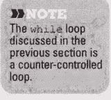

在*《编程逻辑与设计（第五版）》*第5章中，你了解到可以使用计数器控制 while 循环。使用计数器时，你可以设置循环执行指定的次数。还要记得，如果比较中使用的表达式立即求值为 `false`，while 循环可能执行零次。在这种情况下，计算机根本不会执行循环体。

*《编程逻辑与设计（第五版）》*第5章讨论了一个计数器控制的循环，它控制单词“Hello”被打印多少次。让我们看看下面这个计数器控制的循环的伪代码：

```
num count = 0
while count < 4
    print "Hello"
    count = count + 1
endwhile
```

这个循环的计数器是一个名为 count 的变量，它被赋值为 0，而哨兵值是 4。程序会测试布尔表达式 `count < 4`，以判断 count 的值是否小于 4。如果为真，循环就执行。如果为假，程序就退出循环。如果循环执行，程序会显示单词“Hello”，然后给 count 的值加 1。根据这段伪代码，循环体执行四次，单词“Hello”显示四次。

现在，让我们看看将这段伪代码转换为 C++ 后代码是什么样子：

```cpp
int count = 0;
while(count < 4)
{
    cout << "Hello" << endl;
    count++;
}
```

首先，变量 count 被赋值为 0，并用作控制 `while` 循环的计数器变量。接着是 `while` 循环，它在括号内包含布尔表达式 `count < 4`。这个计数器控制的循环执行一个由左花括号和右花括号标记的块语句。循环体中的语句显示单词“Hello”，然后递增 `count`，也就是给计数器变量加 1。

#### 练习 5-3：使用计数器控制的 while 循环

在本练习中，你将运用所学的计数器控制循环知识，回答关于以下代码的问题：

```cpp
number1 = 0;
number2 = 0;
while(number1 < 5)
    number1++;
    number2 += number1;
```

- 1. 循环退出时 `number1` 的值是什么？ ________________________________
- 2. 循环退出时 `number2` 的值是什么？ ________________________________
- 3. 如果语句 `number1++` 改为 `++number1`，循环退出时 `number1` 的值是什么？ ________________________________
- 4. 你可以做什么来强制循环退出时 `number2` 的值为 15？ ________________________________

> **注意**
>
> 递增计数器变量是一条重要语句。每次经过循环时，都必须递增计数器变量，否则表达式 `count < 4` 永远不会为假。这会导致无限循环。

#### 实验 5-1：使用计数器控制的 while 循环

在本实验中，你将在本书数据文件提供的一个 C++ 程序中使用计数器控制的 while 循环。完成后，程序应打印 0 到 10 的数字，以及它们的两倍值和三倍值。数据文件包含必要的变量声明和输出语句。

- 1. 使用记事本或你选择的文本编辑器打开名为 `DoubleTriple.cpp` 的源代码文件。
- 2. 编写一个计数器控制的 `while` 循环，使用循环控制变量取 0 到 10 的值。记得在程序进入循环前初始化循环控制变量。
- 3. 在循环体中，使用循环控制变量的值计算两倍值和三倍值。记得在循环体中改变循环控制变量的值。
- 4. 将源代码文件保存到你选择的目录中，然后使该目录成为你的工作目录。
- 5. 编译源代码文件 `DoubleTriple.cpp`。
- 6. 执行程序。

> **注意**
>
> 记住，`number2 = number2 + number1;` 与 `number2 += number1;` 相同。

### 使用哨兵值控制循环

正如你在*《编程逻辑与设计（第五版）》*第2章中学到的，**哨兵值**是诸如“Y”或“N”之类的值，用户必须提供它来停止循环。为了学习 C++ 中的哨兵值，我们将查看*《编程逻辑与设计（第五版）》*第5章中讨论的一个程序。该程序显示银行客户的当前银行余额，然后询问用户是否想计算累计一年利息后的客户余额。每次用户表示想继续时，就会显示一个增加后的余额。当用户表示完成时，程序结束。这个程序包含一个 while 循环，并使用哨兵值来决定循环何时执行或何时退出。伪代码如下所示：

```
start
    num bankBal
    num intRate
    string response
    print "Enter your starting balance... "
    get bankBal
    print "Enter your interest rate... "
    get intRate
    print "Do you want to see your current balance? Y or N . . ."
    get response
    while response = 'Y'
        print "Bank balance is " bankBal
        bankBal = bankBal + bankBal * intRate
        print "Do you want to see next year's balance? Y or N . . ."
        get response
    endwhile
    print "Have a nice day!"
stop
```

注意伪代码中包含一个预读。回想一下，**预读**是在循环执行之前输入一个值，然后用该值控制循环。使用预读时，请记住必须在循环体内再执行一次读取，以获取下一个输入值。你可以在下面的代码示例中看到转换为 C++ 的伪代码中的预读、循环和最后输出语句部分：

```cpp
cout << "Do you want to see your current balance? Y or N: ";
cin >> response;
while(response == "Y")
{
    cout << "Bank balance is " << bankBal << endl;
    bankBal = bankBal + bankBal * intRate;
    cout << "Do you want to see next year's balance? Y or N: ";
    cin >> response;
}
cout << "Have a nice day!" << endl;
```

在这个代码示例中，名为 response 的变量是循环控制变量。当程序询问用户“Do you want to see your current balance? Y or N:”并读取用户的响应时，它会被赋值。循环控制变量用 `response == "Y"` 进行测试。如果用户输入 Y，也就是哨兵值，那么测试表达式为真，循环体内的四条语句就会执行。

第一条语句显示 `bankBal` 的值。接下来，使用 `intRate` 的值重新计算 `bankBal` 的值，第三条语句提示用户为 `response` 输入新值，第四条语句获取用户的输入并将其存储到 `response` 中。正是这条语句可能改变循环控制变量的值。当程序控制返回到循环顶部并再次测试 `while` 语句中的布尔表达式时，循环体结束。如果用户在上一次提示时输入了 Y，那么就会再次进入循环，并显示新的 `bankBal` 值。如果用户输入了除 Y 以外的任何响应，那么测试表达式为假，循环体不会执行。退出循环后，下一条要执行的语句会显示“Have a nice day!”。

> **注意**
>
> 你需要理解小写“Y”和大写“Y”是不同的值，这一点很重要。

#### 练习 5-4：使用哨兵值控制 while 循环

在本练习中，你将运用所学的哨兵值知识，回答关于以下代码的问题：

```cpp
cout << "How many pages do you want to print? ";
cin >> numToPrint;
counter = 1;
while(counter <= numToPrint);
{
    cout << "Page Number " << counter << endl;
    counter++;
}
cout << "Value of counter is " << counter << endl;
```

- 1. 如果用户输入 5，输出是什么？
- 2. 这段代码有什么问题，你可以如何修复它？
- 3. 假设你修复了问题，如果用户输入 200 作为要打印的页数，循环退出时 counter 的值是什么？
- 4. 假设你修复了问题，如果用户输入 21 作为要打印的页数，将打印多少页？
- 5. 如果删除花括号，输出是什么？


#### 实验5-2：使用哨兵值控制 while 循环

在本实验中，你要编写一个`while`循环，使用哨兵值控制本书数据文件中提供的某个C++程序里的循环。你还要编写构成循环体的语句。源代码文件已经包含必要的变量声明和输出语句。完成后，程序应打印信用卡公司客户的还款计划。每月月初，余额中会加入1.3%的利息，然后客户支付相当于当前余额4%的还款。当余额达到$15.00或以下时，客户可以还清账户。正如你将看到的，这个程序会生成大量输出，即使只针对一个客户也是如此。

- 1. 使用记事本或你选择的文本编辑器打开名为`Payoff.cpp`的源代码文件。
- 2. 编写使用哨兵值控制循环的`while`循环，并编写构成循环体的语句。循环内的输出语句已经为你写好。
- 3. 将此源代码文件保存到你选择的目录中，然后使该目录成为你的工作目录。
- 4. 编译源代码文件`Payoff.cpp`。
- 5. 执行程序。输入以下内容：
  - 账号：6789A
  - 客户姓名：Jeanne Johnson
  - 余额：120.00
- 6. 记录贷款还清时的最终余额。

### 在C++中编写 for 循环

在《*程序设计逻辑与设计（第五版）*》第5章中，你了解到`for`循环是一种**确定性**循环；这意味着这类循环将执行确定次数。以下是C++中`for`循环的语法：

```cpp
for (expression1; expression2; expression3)
    statement;
```

在C++中，`for`循环由三个表达式组成，这些表达式用分号分隔并括在圆括号内。`for`循环的执行过程如下：

- 第一次遇到`for`循环时，会计算第一个表达式。通常，这个表达式初始化一个用于控制`for`循环的变量。
- 接下来，计算第二个表达式。第二个表达式通常判断在第一个表达式中初始化的变量。如果第二个表达式的计算结果为`true`，则执行循环语句。如果第二个表达式的计算结果为`false`，则退出循环。
- 循环语句执行后，计算第三个表达式。第三个表达式通常递增或递减你在第一个表达式中初始化、并在第二个表达式中进行比较的变量。
- 计算第三个表达式后，再次计算第二个表达式。如果第二个表达式仍然计算为`true`，则再次执行循环语句，然后再次计算第三个表达式。此过程持续进行，直到第二个表达式计算为`false`。

下面的代码示例演示了一个C++ `for`循环。请注意，该代码在`for`循环中使用了块语句。

```cpp
int number = 0;
int count;
const int NUM_LOOPS = 10;
for(count = 0; count < NUM_LOOPS; count++)
{
    number += count;
    cout << "Value of number is: " << number << endl;
}
```

在这个`for`循环示例中，名为`count`的变量在第一个表达式中被初始化为0。第二个表达式是一个布尔表达式，其计算结果为true或false。第一次计算表达式`count < NUM_LOOPS`时，`count`的值为0，结果为true。然后进入循环体。在这里计算一个新值并将其赋给名为`number`的变量，然后显示出来。第一次执行循环时，输出如下：`Value of number is: 0.`

显示输出后，计算`for`循环中的第三个表达式；这会将`count`的值加1，使`count`的新值等于1。第二次计算第二个表达式时，`count`的值为1。然后程序测试`count`的值是否小于`NUM_LOOPS`。结果为true，并导致循环体再次执行，在那里为`number`计算一个新值，然后显示出来。第二次执行循环时，输出如下：`Value of number is: 1.`

接下来，计算第三个表达式；这会将`count`的值加1。现在`count`的值为2。第三次计算第二个表达式，结果再次为true，因为2小于`NUM_LOOPS`。第三次执行时，循环体将`number`的值改为3，然后显示新值。输出如下：`Value of number is: 3.`

此过程持续进行，直到`count`的值变为10。此时，10不小于`NUM_LOOPS`，因此第二个表达式的结果为false，并导致退出`for`循环。

显示单词“Hello”四次的计数器控制循环（在本章“使用计数器控制循环”一节中解释）可以改写为使用`for`循环而不是`while`循环。事实上，当你知道循环将执行多少次时，使用`for`循环而不是`while`循环被认为是一种良好的编程实践。

要将`while`循环改写为`for`循环，你可以将语句`int counter = 0;`改为`int counter;`，因为你在第一个表达式中将`counter`初始化为值0。你还可以从循环体中删除`counter++;`，因为你在第三个表达式中递增`counter`。你继续在循环体中打印单词“Hello”。下面的代码示例演示了这个`for`循环：

```cpp
int counter;
for(counter = 0; counter < 4; counter++)
{
    cout << "Hello" << endl;
}
```

> **注意：** 花括号不是必需的，因为现在循环体只包含一条语句。然而，包含它们被认为是一种良好的编程实践，因为它使代码更易读，并且如果以后向循环体添加额外语句，可能有助于防止错误。

#### 练习5-5：使用 for 循环

在本练习中，你运用所学的`for`循环知识回答关于以下代码的问题：

```cpp
const int NUM_LOOPS = 18;
int numTimes;
for(numTimes = 1; numTimes <= NUM_LOOPS; numTimes++)
{
    cout << "Value of numTimes is: " << numTimes << endl;
    numTimes++;
}
```

通过填写True或False回答以下四个问题：

- 1. 这个循环执行18次。________________________________
- 2. 这个循环可以写成`while`循环。________________________________
- 3. 将`<=`运算符改为`<`不会对输出产生任何影响。________________________________
- 4. 这个循环执行九次。________________________________

#### 实验5-3：使用 for 循环

在本实验中，你使用与实验5-1相同的C++程序。与实验5-1一样，完成的程序应打印数字0到10，以及它们翻倍和三倍后的值。但是，在本实验中，你应该使用for循环而不是计数器控制的while循环来完成此任务。

- 1. 使用记事本或你选择的文本编辑器打开名为`NewDoubleTriple.cpp`的源代码文件。
- 2. 编写一个for循环，使用循环控制变量取0到10的值。
- 3. 在循环体中，使用循环控制变量的值计算翻倍值和三倍值。
- 4. 将此源代码文件保存到你选择的目录中，然后使该目录成为你的工作目录。
- 5. 编译源代码文件`NewDoubleTriple.cpp`。
- 6. 执行程序。输出相同吗？

### 在C++中编写 do-while 循环

在《*程序设计逻辑与设计（第五版）*》第5章中，你学习了do-until循环。C++不支持do-until循环，但它确实有do-while循环。do-while循环使用的逻辑可以表述为“当b为true时执行a”。这与while循环相同，不同之处在于条件是在do-while循环体执行一次之后才测试。因此，当你的程序逻辑要求循环体至少执行一次时，应选择do-while循环。只要表达式的计算结果为true，do-while循环体就会继续执行。do-while语法如下：

```cpp
do
    statement;
while(expression);
```

下面的do-while循环是你之前看到的while循环的修订版本，该循环打印单词“Hello”四次。在这个版本中，循环被改写为do-while循环。

```cpp
counter = 0;
do
{
    cout << "Hello" << endl;
    counter++;
} while(counter < 4);
```


在这个示例中，请注意，你在 do-while 循环中使用块语句的方式，与在 while 和 for 循环中一样。进入该循环时，会打印单词“Hello”，counter 的值递增，然后将 counter 的值与值 4 进行比较。请注意，单词“Hello”将始终至少打印一次，因为循环控制变量 counter 是在循环底部与值 4 进行比较的。

#### 练习 5-6：使用 do-while 循环

在本练习中，运用你学到的 do-while 循环知识回答下列关于以下代码的问题：

```cpp
const int NUM_TIMES = 4;
int loopNum = 0;
do
{
    loopNum++;
    cout << "Ball " << loopNum << endl;
}while(loopNum < NUM_TIMES);
```

- 1. 这个循环执行多少次？
- 2. 该程序的输出是什么？
- 3. 如果改变循环体中语句的顺序，使 `loopNum++` 出现在输出语句之后，输出会不同吗？
- 4. 循环控制变量是什么？

#### 实验 5-4：使用 do-while 循环

在本实验中，你将使用与实验 5-1 和 5-3 中相同的 C++ 程序。与之前的实验一样，完成的程序应打印数字 0 到 10，以及它们的两倍值和三倍值。但是，在本实验中，你应使用 do-while 循环来完成此任务。

通过在本章中以三种不同方式修改同一个文件，你已经看到同一个问题可以用不同方法解决。

- 1. 使用记事本或你选择的文本编辑器打开名为 `NewestDoubleTriple.cpp` 的源代码文件。
- 2. 编写一个 do-while 循环，使用循环控制变量取 0 到 10 的值。
- 3. 在循环体中，使用循环控制变量的值计算两倍值和三倍值。
- 4. 将此源代码文件保存到你选择的目录中，然后使该目录成为你的工作目录。
- 5. 编译源代码文件 `NewestDoubleTriple.cpp`。
- 6. 执行程序。输出相同吗？

### 嵌套循环

随着程序的逻辑变得更加复杂，你可能会发现需要使用嵌套循环。也就是说，你可能需要在一个循环中包含另一个循环。你已经了解到，在程序中使用嵌套循环时，必须使用多个控制变量来控制各个独立的循环。

在*《程序设计逻辑与设计（第五版）》*中，你学习了一个为每位员工生成可变数量标签的程序的设计逻辑。该程序的一部分伪代码如下：

```
print "Enter employee's name or " + QUIT + " to quit..."
get name
while name not equal to QUIT
    print "Enter number of units produced... "
    get production
    labelCounter = 0
    while labelCounter not equal to production
        print LABEL_TEXT, name
        labelCounter = labelCounter + 1
    endwhile
    print "Next name or " + QUIT + " to quit..."
    get name
endwhile
```

这段伪代码包含两个循环。外层循环使用循环控制变量 name 通过哨兵值控制循环。内层循环使用控制变量 labelCounter 来跟踪要为一名员工打印的标签数量。有关该伪代码的逐行说明，请参阅*《程序设计逻辑与设计（第五版）》*第 5 章。当你确信自己理解了逻辑后，请看下面的代码示例。该代码示例显示了标签打印程序的 C++ 代码。

```cpp
// EmployeeLabels.cpp - This program prints a variable number of
// labels for individual employees.
#include <iostream>
#include <string>
using namespace std;
int main()
{
    string name;
    int production;
    int labelCounter;
    const string LABEL_TEXT = "Made for you personally by ";
    const string QUIT = "ZZZ";

    cout << "Enter employee's name or " << QUIT << " to quit. ";
    cin >> name;
    while(name != QUIT)
    {
        cout << "Enter number of units produced: ";
        cin >> production;
        labelCounter = 0;
        while(labelCounter != production)
        {
            cout << LABEL_TEXT << name << endl;
            labelCounter++;
        }
        cout << "Next name or " << QUIT << " to quit. ";
        cin >> name;
    }
    return 0;
}
```

这个 C++ 程序保存在名为 `EmployeeLabels.cpp` 的文件中，并包含在本书的数据文件中。你可能想研究源代码、编译并执行该程序，以体验嵌套循环的行为。以 Dan、Karen 和 Ed 作为员工姓名，并输入 3、5 和 2 作为生产数量时，该程序的输出显示在**图 5-1**中。

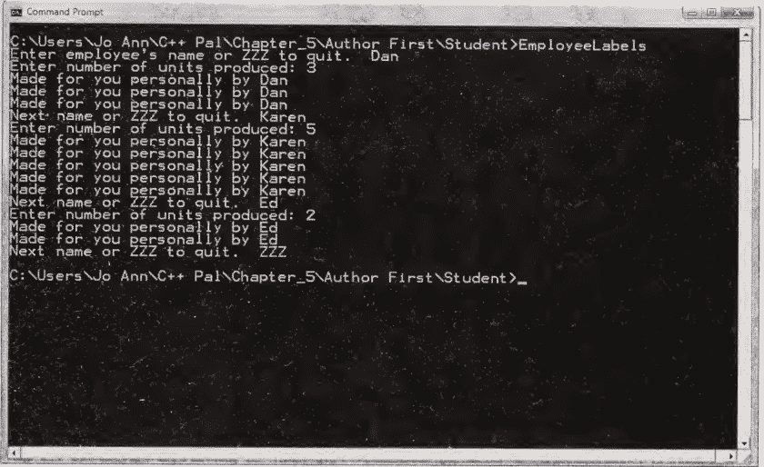

**图 5-1** 由 EmployeeLabels.cpp 生成的输出

#### 练习 5-7：嵌套循环

在本练习中，运用你学到的关于 C++ 中嵌套循环的知识回答下列关于以下代码的问题：

```cpp
int sum = 0;
const int MAX_ROWS = 6, MAX_COLS = 3;
int rows, columns;
for(rows = 0; rows < MAX_ROWS; rows++)
    for(columns = 0; columns < MAX_COLS; columns++)
        sum += rows + columns;
cout << "Value of sum is " << sum << endl;
```

- 1. 外层循环执行多少次？
- 2. 内层循环执行多少次？
- 3. `cout` 打印的 `sum` 值是多少？
- 4. 如果将 `rows++` 和 `columns++` 改为 `++rows` 和 `++columns`，会发生什么？

#### 实验 5-5：嵌套循环

在本实验中，你向本书数据文件中提供的一个 C++ 程序添加嵌套循环。该程序应打印一个矩形的轮廓，如图 5-2 所示。该矩形使用星号打印，横向六个、纵向八个。请注意，该程序使用 `cout << "*";` 打印星号，使用 `cout << " ";` 打印空格。

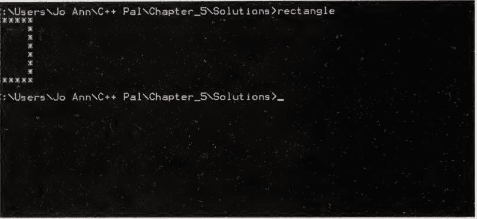

- 1. 使用记事本或你选择的文本编辑器打开名为 `Rectangle.cpp` 的源代码文件。
- 2. 编写嵌套循环，控制组成矩形的行数和列数。
- 3. 在循环体中，使用嵌套的 `if` 语句来决定何时打印星号、何时打印空格。输出语句已经写好，但你必须决定何时以及在哪里使用它们。
- 4. 将此源代码文件保存到你选择的目录中，然后使该目录成为你的工作目录。
- 5. 编译源代码文件 `Rectangle.cpp`。
- 6. 执行程序。你的矩形轮廓应看起来像图 5-2 中的矩形轮廓。
- 7. 修改程序，将行数从六改为八，列数从八改为 10。现在矩形看起来是什么样？

### 在循环中累加总计

你可以在 C++ 中使用循环，在程序执行时累加一个总计。例如，假设你的计算机科学教师要求你设计并编写一个程序，她可以用它来计算她上周进行的期中考试的平均分。要找到平均考试分数，你需要将所有学生的考试分数相加，然后将该总和除以参加期中考试的学生人数。

请注意，该程序的逻辑应包含一个对班上每位学生执行的循环。在循环中，你输入一名学生的考试分数，并将该值加到一个总计中。在获得所有考试分数并累加所有考试分数的总和之后，你将该总和除以学生人数。你应计划让用户输入将要输入的学生考试分数数量，因为你的教师希望每次执行时都能以不同的学生人数重复使用该程序。

在检查你的工作时，你意识到该程序将在循环内累加一个总和，并且你还需要记录学生人数。你在*《程序设计逻辑与设计（第五版）》*中了解到，每次循环执行时都要向计数器加 1，而向累加器加上另一个值。对于该程序，加到累加器中的另一个值是一名学生的考试分数。

以下 C++ 程序包含该程序所需的循环。请注意，循环体包含一个累加器和一个计数器。

```cpp
// This program calculates an average test score given individual
// test scores.
// Input: Interactive - Student Test Scores
// Output: Number of Students taking the test and the test score
// average
#include <iostream>
#include <string>
using namespace std;
int main()
{
    // Declare variables
    int testScore;
    int numStudents;
    int stuCount;
    double testTotal;
    double average;
    // Get user input to control loop
    cout << "Enter number of students: ";
    cin >> numStudents;
    // Initialize accumulator variable to 0
    testTotal = 0;
    // Loop for each student
    for(stuCount = 0; stuCount < numStudents; stuCount++)


### 使用循环编写程序

> **注意** 如果 `testTotal` 未初始化，它可能包含一个未知值，称为“垃圾”值。C++ 编译器会针对未初始化变量发出警告消息。

```cpp
{
    // Input student test score
    cout << "Enter student's score: ";
    cin >> testScore;
    // Accumulate total of test scores
    testTotal += testScore;
}
// Calculate average test score
average = testTotal / stuCount;
// Output number of students and average test score
cout << "Number of Students: " << stuCount << endl;
cout << "Average Test Score: " << average << endl;
return 0;
}
```

在代码中，你使用 `cout` 语句要求用户告诉你有多少学生参加了测试。然后，你使用 `cin` 获取用户输入，并将其存储在名为 `numStudents` 的变量中。接下来，累加器 `testTotal` 被初始化为 0。

在累加器初始化之后，代码使用 `for` 循环和循环控制变量 `stuCount` 来控制循环。`for` 循环是一个很好的选择，因为在程序的这个位置，你知道循环应该执行多少次。你使用 `for` 循环的第一个表达式来初始化 `stuCount`，然后计算第二个表达式，以查看 `stuCount` 是否小于 `numStudents`。如果为真，则执行循环体，再次使用 `cout` 和 `cin`，这一次要求用户输入测试分数，获取输入并将其存储在 `testScore` 中。

> **注意** 你必须在循环外计算平均值，而不是在循环内计算。在循环内计算平均值的唯一方法是在循环每次执行时都计算一次，但这样做效率很低。

接下来，你必须将 `testScore` 的值加到累加器 `testTotal` 中。然后，循环控制变量 `stuCount` 递增，并测试递增后的值是否小于 `numStudents`。如果再次为真，则循环第二次执行。循环继续执行，直到 `stuCount < numStudents` 的值为假。在 `for` 循环之外，你通过用 `testTotal` 除以 `stuCount` 来计算平均测试分数。

> **注意** 如果用户输入 0，表示有 0 名学生参加了期中考试，则 `for` 循环不会执行，因为 `numStudents` 的值为 0，`stuCount` 的值也为 0，并且第一次计算 `for` 循环中的第二个表达式时，结果为假。

整个 C++ 程序保存在名为 `TestAverage.cpp` 的文件中。你可能想研究源代码、编译并执行该程序，以体验累加器和计数器的工作方式。该程序在五名学生的测试分数分别为 76、65、88、90 和 92 时的输出显示在图 5-3 中。

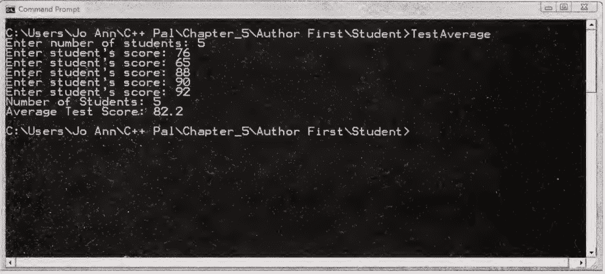

#### 练习 5-8：在循环中累加总计

在本练习中，你将运用所学的关于在循环中使用计数器和累加总计的知识。研究下面的 C++ 代码，然后回答随后关于该代码的问题。完整程序保存在名为 `Rainfall.cpp` 的文件中。你可能想编译并执行该程序，以帮助你回答这些问题。

```cpp
const int DAYS_IN_WEEK = 7;
for(counter = 1; counter <= DAYS_IN_WEEK; counter++)
{
    cout << "Enter rainfall amount for Day " << counter << endl;
    cin >> rainfall;
    cout << "Day " << counter << " rainfall amount is " <<
            rainfall << " inches" << endl;
    sum += rainfall;
}
// calculate average
average = sum / DAYS_IN_WEEK;
```

- 1. 如果变量 `sum` 未用值 0 初始化，编译此程序时会发生什么？
- 2. 你可以将 `sum += rainfall;` 替换为 `sum = sum + rainfall;` 吗？
- 3. 为了计算最准确的平均降雨量，变量 `sum`、`rainfall` 和 `average` 应声明为什么数据类型？
- 4. 你可以将语句 `average = sum / DAYS_IN_WEEK;` 中的 `DAYS_IN_WEEK` 替换为名为 `counter` 的变量，并且仍然得到所需结果吗？请解释。

#### 实验 5-6：在循环中累加总计

在本实验中，你将在本书数据文件提供的 C++ 程序中的循环体里添加一条语句。完成后，你添加的语句应计算书店的每日销售总额。循环执行，直到用户输入单词“done”而不是书名。用户输入书名后，系统会要求他或她输入交易金额。交易金额列在表 5-1 中。

> **注意**
>
> 此程序使用了一个你尚未学过的 C++ 函数 `cin.ignore()`。你将在第 6 章学习 `cin.ignore()`。

> **注意**
>
> 输入交易金额数据时，不要输入 $。

| 书名 | 交易金额 |
|---|---|
| 《哈利·波特与死亡圣器》 | $17.99 |
| 《灿烂千阳》 | $14.99 |
| 《男孩的危险书》 | $14.99 |
| 《美食、祈祷、恋爱》 | $9.00 |
| 《马利和我》 | $14.99 |
| 《引爆点》 | $8.99 |
| 《华氏451》 | $4.99 |

表 5-1 实验 5-6 的输入

请注意，变量已经为你声明，输入语句以及除一条输出语句之外的所有输出语句都已编写好。在本实验中，你将添加显示书店每日销售总额的输出语句，并计算书店的每日销售总额。

- 1. 使用记事本或你选择的文本编辑器打开名为 `BookSales.cpp` 的源代码文件。
- 2. 在循环体中添加一条语句，以便计算书店的每日销售总额。
- 3. 将此源代码文件保存到你选择的目录中，然后使该目录成为你的工作目录。
- 4. 编译源代码文件 `BookSales.cpp`。
- 5. 使用表 5-1 中列出的数据执行程序。记录每日图书销售额的总和。

### 使用循环验证输入

在 *《编程逻辑与设计（第五版）》* 第 5 章中，你了解到，在要求用户输入数据的程序中，不能指望用户输入有效数据。你还了解到，应该验证用户输入，以避免无效输入引起的问题。

如果你的程序要求用户输入特定值，例如回答问题时输入“Y”或“N”，那么你的程序应验证用户输入的是否与“Y”或“N”完全匹配。如果不是，你必须决定程序中要采取什么操作。作为测试完全匹配的示例，请考虑以下代码：

```cpp
string answer;
cout << "Do you want to continue? Enter Y or N.  ";
cin >> answer;
while(answer != "Y" && answer != "N")
{
    cout << "Invalid Response. Please type Y or N.  ";
    cin >> answer;
}
```

在示例中，名为 `answer` 的变量包含用户对问题“你想继续吗？请输入 Y 或 N。”的回答。在作为 `while` 循环一部分的表达式中，你测试用户是否真的输入了“Y”或“N”。如果没有，则进入循环，告诉用户他或她输入了无效输入，然后要求他或她输入“Y”或“N”。再次测试 `while` 循环中的表达式，以查看用户这次是否输入了有效数据。如果没有，则循环体再次执行，并继续执行，直到用户输入有效输入。

你还可以在要求用户输入数字数据的程序中验证用户输入。例如，你的程序可以要求用户输入 1 到 4 范围内的数字。验证此数字输入非常重要，尤其是当你的程序在算术计算中使用该输入时。如果用户输入 0 而不是数字 1，会发生什么？或者，如果用户输入 100，会发生什么？很可能你的程序将无法正确运行。以下代码示例说明了如何验证用户输入了正确的数字数据：

```cpp
int answer;
const int MIN_NUM = 1;
const int MAX_NUM = 4;
cout << "Please enter a number in the range of " << MIN_NUM <<
        " to " << MAX_NUM << ": ";
cin >> answer;
while(answer < MIN_NUM || answer > MAX_NUM)
{
    cout << "Number must be between " << MIN_NUM << " and " <<
            MAX_NUM << ". Please try again: ";
    cin >> answer;
}
```

#### 练习 5-9：验证用户输入

在本练习中，你将运用所学的关于验证用户输入的知识来回答以下问题：

- 1. 你计划在 C++ 程序中使用以下语句来验证用户输入：

  ```cpp
  while(inputString == "")
  ```

  用户输入什么会导致此测试为 `true`？

- 2. 你计划在 C++ 程序中使用以下语句来验证用户输入：

  ```cpp
  while(userAnswer == "Y" || userAnswer == "y")
  ```

  用户输入什么会导致此测试为 `true`？

- 3. 你计划在 C++ 程序中使用以下语句来验证用户输入：

  ```cpp
  while(userAnswer < 6 || userAnswer > 12)
  ```

  用户输入什么会导致此测试为 `true`？

#### 实验 5-7：验证用户输入

在本实验中，你将对本书数据文件提供的 C++ 程序进行补充。该程序是一个猜数字游戏。程序中会生成一个 1 到 10 之间的随机数。用户输入一个 1 到 10 之间的数字，尝试猜出正确的数字。如果用户猜对了，程序会祝贺用户，然后，控制……的循环

如果用户正确猜出数字，程序就退出；否则，程序询问用户是否想再猜一次。如果用户输入“Y”，就让他或她再猜一次。如果用户输入“N”，循环退出。可以看到，用户输入“Y”或“N”是控制循环的哨兵值。注意，整个程序已经为你编写好了。你需要添加代码来验证正确的输入：当询问用户是否想猜数字时，输入应为 Y 或 N；当要求用户猜数字时，输入应为 1 到 10 范围内的数字。

- 1. 使用记事本或你选择的文本编辑器打开名为 `GuessNumber.cpp` 的源代码文件。
- 2. 在代码中所有要求用户提供输入的位置编写验证输入的循环。代码中已包含注释，帮助你识别应编写这些循环的位置。
- 3. 将此源代码文件保存到你选择的目录中，然后使该目录成为你的工作目录。
- 4. 编译源代码文件 `GuessNumber.cpp`。
- 5. 执行该程序。看看你能否猜出随机生成的数字。多次执行该程序，看看随机数是否会变化。同时，测试程序以验证不正确的输入是否得到正确处理。在你最好的一次尝试中，你猜了多少次才猜出正确的数字？ ________

## 6 在 C++ 程序中使用数组

**学习本章后，你将能够：**

- 在 C++ 程序中使用数组
- 在数组中搜索某个值
- 在 C++ 程序中使用并行数组


你应该在完成 Joyce Farrell 所著《Programming Logic and Design, Fifth Edition》第 6 章之后，再做本章的练习和实验。在本章中，你将学习如何使用 C++ 声明和初始化数组。然后，你访问数组元素来赋值并在程序中处理它们。你还将了解为什么保持在数组边界内很重要。此外，你将学习一些用 C++ 编写的程序，这些程序实现了《Programming Logic and Design, Fifth Edition》中介绍的逻辑和设计。

### 数组基础

**数组**是一组数据项，其中所有项都具有相同的数据类型，使用相同的变量名引用，并存储在连续的内存位置中。要引用数组中的单个元素，需使用下标。可将**下标**视为数组中值的位置编号。你需要知道，在 C++ 中，下标值从 0（零）开始，到 *n*-1 结束，其中 *n* 是数组中存储的项数。

要在 C++ 程序中使用数组，你必须首先学习如何声明数组、用预定值初始化数组、访问数组元素，并保持在数组边界内。下一节将重点介绍第一步：声明数组。

#### 声明数组

在 C++ 程序中使用数组之前，必须先声明它。也就是说，必须为其命名，并指定将存储在其中的数据的数据类型。在某些情况下，还要指定将存储在数组中的项数。以下代码展示了如何声明一个名为 `cityPopulations` 的数组（用于存储四个 `int`）和一个名为 `cities` 的数组（用于存储四个 `string`）：

```cpp
int cityPopulations[4];
string cities[4];
```

如本例所示，首先要指定将存储在数组中的项的数据类型。数据类型之后是数组名，然后是一对方括号。在方括号内，你会看到一个整数值，用于指定该数组可以容纳的元素数。

如图 6-1 所示，编译器分配足够的连续内存位置，为名为 `cityPopulations` 的数组存储四个 `int` 类型的数据元素。如果 `cityPopulations[0]` 存储在内存地址 1000，那么 `cityPopulations[1]` 的地址是 1004，因为每个 `int` 需要 4 字节内存。类似地，`cityPopulations[3]` 位于地址 1012。

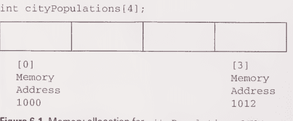

> **注意**
> 
> 如果声明一个数组来存储 `double` 数据类型的项，则为数组中的每一项分配 8 字节内存。

`cityPopulations` 数组提供了一个示例，说明如何为包含基本数据类型的数组分配内存。`string` 数组的内存分配不同，因为 `string` 是 C++ 中的对象，而不是基本数据类型。使用 Visual C++ 编译器和 Windows Vista 时，会为一个 `string` 对象分配 28 字节内存。这表示该对象的大小。

当值存储到 `string` 对象中时，组成字符串的字符可能会（在程序运行时）**动态**分配额外的内存。如图 6-2 所示。

> **注意**
> 
> 为 string 对象分配的内存量可能因系统而异。

```cpp
string cities[4];
cities[0] = "Chicago";
```

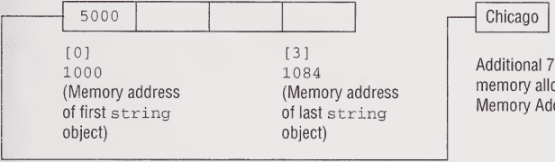

**图 6-2** `cities` 数组的内存分配

在图 6-2 中，编译器分配足够的连续内存位置，为名为 `cities` 的数组存储四个 `string` 对象。如果 `cities[0]` 的地址是 1000，则 `cities[1]` 的地址是 1028，`cities[3]` 的地址是 1084，因为每个 string 对象需要 28 字节内存。当将字符串赋给 `cities[0]` 时，会在另一个内存地址动态分配内存。然后该地址存储在数组中。当语句 `cities[0] = "Chicago";` 执行时，为 Chicago 动态分配的内存从地址 5000 开始，然后该地址（5000）存储在数组的第一个元素中。本章后面将给出创建 `string` 对象的示例。

> **注意**
> 
> 动态内存分配是一个高级主题，你将在后续的 C++ 编程课程中进一步学习。

#### 初始化数组

在 C++ 中，声明数组时，数组元素不会自动初始化为任何值。因此，数组的所有元素都包含一个**垃圾值**，这意味着它们包含上次存储在分配给数组的内存位置中的值。由于这些值在程序中并无用处，最好将存储数字的数组初始化为全零，将存储字符串的数组初始化为空字符串。两个双引号之间没有空格，即 `""`，是 C++ 中的空字符串。

> **注意**
> 
> 在声明数组时初始化数组，不要在方括号内指定数组大小。相反，使用一对空方括号。

有时你可以而且会希望用自己选择的值初始化数组。可以在声明数组时这样做。要在声明数组时初始化数组，请使用花括号括住以逗号分隔的数据项列表，如下例所示：

```cpp
int cityPopulations[] = {9500000, 871100, 23900, 40100};
string cities[] = {"Chicago", "Detroit", "Batavia", "Lima"};
```

> **注意**
> 
> 这些初始化会为每个数组创建四个元素并为其赋值。

也可以在声明数组之后使用赋值语句为数组元素提供值，如下例所示：

```cpp
cityPopulations[0] = 9500000;
cities[0] = "Chicago";
```

循环常用于为数组中的元素赋值，如下所示：

```cpp
int loopIndex;
for(loopIndex = 0; loopIndex < 3; loopIndex++)
{
    cityPopulations[loopIndex] = 12345;
    cities[loopIndex] = "AnyCity";
}
```

第一次遇到该循环时，loopIndex 被赋值为 0。因为 0 小于 3，所以执行循环体，将值 12345 赋给 cityPopulations[0]，将值 “AnyCity” 赋给 cities[0]。接下来，loopIndex 的值递增并变为 1。因为 1 小于 3，所以循环第二次执行，将值 12345 赋给 cityPopulations[1]，并将 “AnyCity” 赋给 cities[1]。每次执行循环时，loopIndex 的值都会递增。这使你能够在循环体每次执行时访问数组中的不同位置。

> **注意**
> 
> 记住，在 C++ 中，下标值从 0（零）开始。

#### 访问数组元素

当你为数组元素赋值、打印其值、更改其值、将该值赋给另一个变量等时，需要访问数组中的各个位置。在 C++ 中，使用放在方括号中的整数表达式来指示要访问数组中的哪个元素。这个整数表达式就是下标。

> **注意**
> 
> 本章后面，你将学习在数组声明中使用命名常量。

以下 C++ 程序声明两个 `double` 数据类型的数组，初始化一个 `double` 数据类型的数组，将一个数组中的值复制到另一个数组，更改名为 `target` 的数组中存储的若干值，并打印名为 `source` 和 `target` 的数组的值。如果愿意，你可以编译并执行该程序。它存储在名为 `ArrayTest.cpp` 的文件中。图 6-3 显示了 ArrayTest 程序生成的输出。

```cpp
#include <iostream>
#include <string>
using namespace std;
int main()
{
    double target[3];
    double source[] = {1.0, 5.5, 7.9};
    int loopIndex;
    // Copy values from source to target
    for(loopIndex = 0; loopIndex < 3; loopIndex++)
        target[loopIndex] = source[loopIndex];
    // Assign values to two elements of target
    target[0] = 2.0;
    target[1] = 4.5;
    // Print values stored in source and target
    for(loopIndex = 0; loopIndex < 3; loopIndex++)
    {
        cout << "Source " << source[loopIndex] << endl;
        cout << "Target " << target[loopIndex] << endl;
    }
}
```


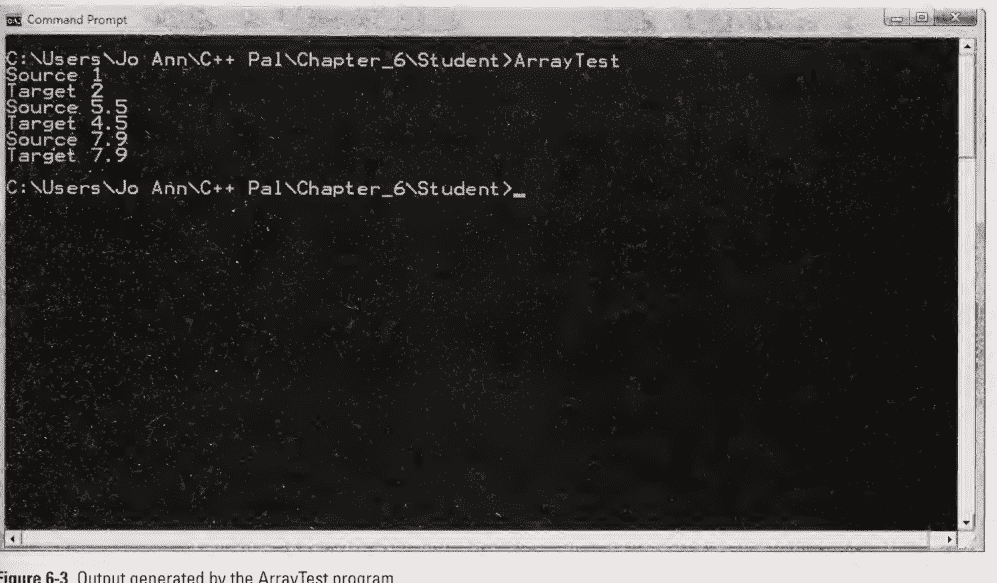

**图6-3** ArrayTest 程序生成的输出

### 保持在数组的边界内

作为 C++ 程序员，你必须小心确保用于访问数组元素的下标值位于合法边界内。与大多数其他编程语言不同，C++ 编译器*不会*检查程序中使用的下标是否大于或等于 0 且小于数组长度。例如，假设你按如下方式声明一个名为 *numbers* 的数组：

```cpp
int numbers[10];
```

> **注意：** 当使用循环访问数组中的元素时，请确保用于终止循环的测试条件使你保持在合法边界内，即从 0 到 *n*-1，其中 *n* 是数组中存储的项数。

然而，当你执行程序时，如果使用的数组下标*不*在合法边界内，就会访问到一个垃圾值。例如，考虑以下代码中高亮的运算符，该代码取自前面的 C++ 程序示例：

```cpp
double source[] = {1.0, 5.5, 7.9};
int loopIndex;
for (loopIndex = 0; loopIndex < 3; loopIndex++)
```

如果你将高亮的运算符改为 <=，如下所示，程序将编译时无错误：

```cpp
for(loopIndex = 0; loopIndex <= 3; loopIndex++)
```

然而，当程序运行时就会出现问题，因为当 loopIndex 的值为 3 时循环仍会执行。当你访问数组元素 source[3] 时，就超出了数组的边界，因为该数组中不存在这样的元素，并且该位置存储的是一个垃圾值。

### 在数组中使用常量

当你编写声明和访问数组的程序时，使用命名常量来帮助你保持在数组边界内，是一种良好的编程实践。以下示例展示了如何使用命名常量：

> **注意**
>
> C++ 的惯例是在命名常量时使用全部大写字母。

```cpp
const int NUM_ITEMS = 3;
double target[NUM_ITEMS];
int loopIndex;
for(loopIndex = 0; loopIndex < NUM_ITEMS; loopIndex++)
    target[loopIndex] = loopIndex + 10;
```

#### 练习 6-1：数组基础

运用你学到的关于声明和初始化数组的知识完成以下内容：

- 1. 为以下各项编写数组声明：
  - a. 七个工资单值
  - b. 两个电影标题
  - c. 十一个整数
- 2. 声明并初始化存储以下内容的数组：
  - a. 年龄 25、33、5、60 和 32
  - b. 姓名 Jeanne、Karen 和 William
  - c. 价格 5.00、35.00 和 4.50
- 3. 编写一条赋值语句，将值 35 赋给名为 `miles` 的整数数组的第一个元素。
- 4. 一个名为 `numbers` 的 int 数组存储在内存位置 4000。`numbers[1]` 在哪里？`numbers[10]` 在哪里？

#### 实验 6-1：使用数组

在本实验中，你要完成一个使用数组的部分预先编写的 C++ 程序。该程序提示用户输入 10 个整数值，并将它们存储在一个数组中。然后，它应找出存储在数组中的最小值和最大值，以及这 10 个值的平均值。为本实验提供的数据文件包含输入语句和一些变量声明。文件中包含注释，可帮助你编写程序的其余部分。

- 1. 使用记事本或你选择的文本编辑器打开名为 `MinMax.cpp` 的源代码文件。
- 2. 按注释指示编写 C++ 语句。
- 3. 将此源代码文件保存到你选择的目录中，然后使该目录成为你的工作目录。
- 4. 编译源代码文件 `MinMax.cpp`。
- 5. 执行该程序。

### 在数组中搜索精确匹配

*《编程逻辑与设计（第五版）》*中描述的一个程序使用数组来保存邮购业务的有效商品编号。其思路是，当客户订购商品时，你可以通过在数组中搜索该商品编号，判断客户订购的是否为有效商品编号。该程序依赖一种称为设置标志的技术来验证某个商品是否存在于数组中。该程序的伪代码和 C++ 代码如图6-4所示。

> **注意**
>
> 请注意，在第一个 `if` 语句中比较 `int` 值、在第二个 `if` 语句中比较 `bool` 值时，使用的是相等运算符 `==`。

> **注意**
>
> 该程序可在名为 `MailOrder.cpp` 的文件中找到。你可能想编译并执行该程序，看看它如何运行。

```text
start
    string name
    string address
    num item
    num quantity
    num SIZE = 6
    num VALID_ITEM[SIZE] = 106, 108, 307, 405, 457, 688
    num sub
    string foundIt = "N"
    string MSG_YES = "Item available"
    string MSG_NO = "Item not found"
    get name, address, item, quantity
    sub = 0
    while sub < SIZE
        if item = VALID_ITEM[sub] then
            foundIt = "Y"
        endif
        sub = sub + 1
    endwhile
    if foundIt = "Y"
        print MSG_YES
    else
        print MSG_NO
    endif
stop
```

```cpp
#include <iostream>
#include <string>
using namespace std;

int main()
{
    // Declare variables
    const int STR_LENGTH = 80;
    char name[STR_LENGTH], address[STR_LENGTH];
    int item, quantity;
    const int SIZE = 6;
    int valid_item[] = {106, 108, 307, 405, 457, 688};
    int sub;
    bool foundIt = false;
    const string MSG_YES = "Item Available";
    const string MSG_NO = "Item not found";

    // Get user input
    cout << "Enter name: ";
    cin.getline(name, STR_LENGTH);
    cout << "Enter address: ";
    cin.getline(address, STR_LENGTH);
    cout << "Enter item number: ";
    cin >> item;
    cout << "Enter quantity: ";
    cin >> quantity;

    // Initialize loop index to 0
    sub = 0;
    // Loop through array
    while(sub < SIZE)
    {
        // Test to see if this item is a valid item
        if(item == valid_item[sub])
            foundIt = true;    // Set flag to true
        sub += 1;              // Increment loop index
    }
    // Test value of foundIt
    if(foundIt == true)
        cout << MSG_YES << endl;
    else
        cout << MSG_NO << endl;
    return 0;
}
```

**图6-4** 邮购程序的伪代码和 C++ 代码

如图6-4所示，当你将伪代码转换为 C++ 时，需要做一些修改。在伪代码和 C++ 代码中，名为 `foundIt` 的变量都是标志。然而，在 C++ 代码中，你将值 `false` 赋给名为 `foundIt` 的变量，而不是字符串常量 "N"。这是因为名为 `foundIt` 的变量被声明为 `bool` 类型的变量。bool 数据类型是 C++ 的基本数据类型之一，仅用于存储 true 和 false 值。

另外，请注意伪代码只包含一条语句来获取用户的姓名、地址、商品和数量，而在 C++ 中需要多条语句来获取用户输入。

> **注意** 名为 `foundIt` 的变量可以像伪代码中那样声明为字符串。在 C++ 中，对于 true 和 false 值，最好使用 bool。

> **注意** 请注意，邮购程序使用字符数组而不是字符串来存储客户的姓名和地址。必须使用字符数组，因为程序使用 `getline()` 函数来获取用户输入的姓名和地址。随着你进一步学习 C++，你将学习如何使用字符数组存储字符串以及如何使用 `getline()` 函数。

#### 练习 6-2：在数组中搜索精确匹配

运用你学到的关于在数组中搜索精确匹配的知识，研究以下 C++ 代码，然后回答问题。请注意，这段代码可能包含错误。

```cpp
string states[] = {"Illinois", "Ohio", "Iowa", "Texas"};
int foundIt = false, i;
const int MAX_STATES = 4;
string inState;
cout << "Enter state name:";
cin >> inState;
for(i = 0; i <= MAX_STATES; i++)
{
    if(inState == states[i])
    {
        foundIt = true;
    }
}
```

- 1. `for` 循环写得正确吗？

   ________________________________________________

   如果不正确，你如何修正它？

   ________________________________________________
- 2. 哪个变量是标志？

   ________________________________________________
- 3. 标志变量声明得正确吗？

   ________________________________________________

   如果不正确，你应该怎么做来修正它？

   ________________________________________________
- 4. `if` 语句中的比较做得正确吗？

   ________________________________________________

   如果不正确，你如何修正它？

   ________________________________________________

#### 实验 6-2：在数组中搜索精确匹配

在本实验中，你要运用学到的关于在数组中搜索以找到精确匹配的知识，完成一个部分预先编写的 C++ 程序。该程序使用一个数组，其中包含美国 10 个城市的有效区号。你要求程序用户输入一个区号；然后程序在数组中搜索该区号。如果未找到，程序应打印一条消息，告知用户该区号未在有效区号列表中找到。


为本实验提供的数据文件包含输入语句和必要的变量声明。你需要使用循环检查数组中的所有项，并测试是否匹配。你还需要在匹配时设置一个标志，然后测试该标志变量，以确定是否应打印“未找到区号。”消息。代码中的注释会告诉你应在哪里编写语句。你可以使用本章中的邮购程序作为指南。

- 1. 使用记事本或你选择的文本编辑器打开名为 `AreaCodes.cpp` 的源代码文件。
- 2. 研究预先编写的代码，确保你理解它。
- 3. 编写一个循环语句，检查数组中存储的区号。
- 4. 编写测试是否匹配的代码。
- 5. 编写代码，在适当的时候打印消息“未找到区号。”
- 6. 将此源代码文件保存到你选择的目录中，然后使该目录成为你的工作目录。
- 7. 编译源代码文件 `AreaCodes.cpp`。
- 8. 使用以下内容作为输入执行程序：
  - 269
  - 512
  - 312
  - 708

### 并行数组

正如你在*《程序设计逻辑与设计（第五版）》*中所学，你使用并行数组来存储值，并维护数组中存储项之间的关系。图 6-5 显示，存储在 `stuID[0]` 中的学生 ID 号和存储在 `grades[0]` 中的成绩是相关的——学生 56 获得了 99 分。

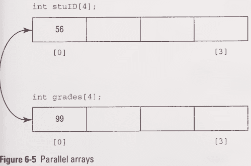

> **注意**
>
> 并行数组具有相同数量的元素，但它们不一定存储相同数据类型的项。

这种关系通过在访问每个数组时使用相同的下标值来建立。请注意，作为程序员，你必须始终使用相同的下标在代码中维护这种关系。C++ 不会创建或维护这种关系。

*《程序设计逻辑与设计（第五版）》*中讨论的一个程序，是本章前面“在数组中搜索精确匹配”一节中讨论的邮购程序的扩展版本。在这个扩展程序中，你想确定所订购商品的价格，将该价格乘以订购数量，并打印账单。你使用并行数组来帮助组织程序的数据。一个数组 `valid_item` 包含六个有效商品编号。另一个数组 `valid_item_price` 包含六个有效价格。每个价格与其他数组中对应商品编号处于相同位置。当顾客订购商品时，你在 `valid_item` 数组中搜索顾客的商品编号。找到商品编号后，你使用存储在 `valid_item_price` 数组同一位置的价格来计算顾客的账单。完整的 C++ 程序存储在名为 `MailOrder2.cpp` 的文件中。搜索 `valid_item` 数组并使用 `valid_item_price` 数组中的价格计算顾客账单的伪代码和 C++ 代码如图 6-6 所示。

```text
start
  string name
  string address
  num item
  num quantity
  num price
  num SIZE = 6
  num VALID_ITEM[SIZE] = 106, 108, 307, 405, 457, 688
  num VALID_ITEM_PRICE[SIZE] = 0.59, 0.99, 4.50, 15.99, 17.50, 39.00
  num sub
  string foundIt = "N"
  string MSG_YES = "Item available"
  string MSG_NO = "Item not found"
  get name, address, item, quantity
  sub = 0
  while sub < SIZE
    if item = VALID_ITEM[sub] then
      foundIt = "Y"
      price = VALID_ITEM_PRICE[sub]
    endif
    sub = sub + 1
  endwhile
  if foundIt = "Y"
    print MSG_YES
    print quantity, " at ", price, " each"
    print "Total ", quantity * price
  else
    print MSG_NO
  endif
stop
```

**图 6-6** 扩展邮购程序的伪代码和 C++ 代码

```cpp
#include <iostream>
#include <string>
using namespace std;

int main()
{
    // Declare variables
    const int STR_LENGTH = 80;
    char name[STR_LENGTH], address[STR_LENGTH];
    int item, quantity;
    double price = 0.0;
    const int SIZE = 6;
    int valid_item[] = {106, 108, 307, 405, 457, 688};
    double valid_item_price[] = {0.59, 0.99, 4.50, 15.99, 17.50, 39.00};
    int sub;
    bool foundIt = false;
    const string MSG_YES = "Item Available";
    const string MSG_NO = "Item not found";

    // Get user input
    cout << "Enter name: ";
    cin.getline(name, STR_LENGTH);
    cout << "Enter address: ";
    cin.getline(address, STR_LENGTH);
    cout << "Enter item number: ";
    cin >> item;
    cout << "Enter quantity: ";
    cin >> quantity;
    // Initialize loop index to 0
    sub = 0;
    // loop through array
    while (sub < SIZE)
    {
        // Test to see if this item is a valid item
        if(item == valid_item[sub])
        {
            foundIt = true; // Set flag to true
            price = valid_item_price[sub]; // Get price from parallel array
        }
        sub += 1;                         // Increment loop index
    }
    // Test value of foundIt
    if(foundIt == true)
    {
        cout << MSG_YES << endl;
        cout << quantity << " at " << price << " each" << endl;
        cout << "Total " << quantity * price << endl;
    }
    else
        cout << MSG_NO << endl;

    return 0;
}
```

#### 练习 6-3：并行数组

使用你学到的并行数组知识评估以下代码，然后回答问题：

```cpp
string cities[] = "Batavia", "Gary", "Westmont", "Plano";
int populations[] = 239000, 102700, 24300, 5700;
const int MAX_CITIES = 4;
int saveIt;
int i, x;
string inCity;
cout << "Enter city name: ";
cin >> inCity;

for(i = 0; i = MAX_CITIES; ++i)
{
    if(inCity == cities[i])
    {
        saveIt = i;
    }
}
cout << "Population for " << cities[saveIt] <<
     " is " << populations[saveIt] << endl;
```

- 1. 数组的声明和初始化正确吗？如果不正确，如何修复？
- 2. `for` 循环写得正确吗？如果不正确，如何修复？
- 3. 按照现在的写法，`for` 循环将执行多少次？
- 4. 你会如何描述语句 `saveIt = i;` 的目的？

#### 实验 6-3：并行数组

在本实验中，你使用学到的并行数组知识来完成一个部分完成的 C++ 程序。该程序在*《程序设计逻辑与设计（第五版）》*第 6 章练习 6 中描述。该程序应打印比利山羊快餐店某快餐食品的名称和价格，或者打印消息“抱歉，我们不供应那种商品。”

开始之前请仔细阅读问题描述。为本实验提供的数据文件包含必要的变量声明和输入语句。你需要编写程序的一部分，该部分搜索食品名称，并打印其名称和价格，或者在未找到该商品时打印错误消息。代码中的注释会告诉你应在哪里编写语句。你可以使用图 6-6 中所示的扩展邮购程序作为指南。

- 1. 使用记事本或你选择的文本编辑器打开名为 `BillyGoat.cpp` 的源代码文件。
- 2. 研究预先编写的代码，确保你理解它。
- 3. 编写代码，在数组中搜索顾客订购的食品名称。
- 4. 编写代码，打印该食品的名称和价格，或打印错误消息。
- 5. 将此源代码文件保存到你选择的目录中，然后使该目录成为你的工作目录。
- 6. 编译源代码文件 `BillyGoat.cpp`。

> 请记住，C++ 区分大小写，这意味着它会区分大写字母和小写字母。

- 7. 使用以下数据执行程序并记录输出：

| 顾客编号 | 订购商品 |
|---|---|
| 123 | 薯条 |
| 234 | 百事可乐 |
| 345 | 咖啡 |
| 456 | 薯片 |
| 567 | 洋葱圈 |
| 678 | 可乐 |
| 789 | 汉堡 |


## 第7章：在C++程序中使用函数

**学习本章后，你将能够：**

- 编写需要单个参数的函数
- 编写需要多个参数的函数
- 编写返回值的函数
- 将整个数组和数组中的单个元素传递给函数
- 按引用和按地址将参数传递给函数
- 重载函数
- 使用C++内置函数


在本书第3章中，你了解到局部变量是在使用它们的函数内部声明的变量。你还了解到，大多数程序由一个`main`函数组成，该函数包含主线逻辑，然后调用其他函数来完成程序中的特定工作。

本章中，你将进一步学习C++中的函数。你将学习如何编写需要单个参数的函数、如何编写需要多个参数的函数，以及如何编写返回值的函数。你还将学习如何将数组传递给函数、如何按引用和按地址传递参数、如何重载函数，以及如何使用C++的一些内置函数。为了帮助你学习函数，你将研究一些C++程序，这些程序实现了Joyce Farrell所著*《程序设计逻辑与设计（第五版）》*中介绍的逻辑和设计。

你应在完成*《程序设计逻辑与设计（第五版）》*第7章之后，再做本章的练习和实验。

### 一个简单的C++函数

为了复习你已经学过的函数知识，我们来回顾本书第3章中客户账单程序的C++代码。该程序如图7-1所示。请注意该程序中每行代码前面的行号。这些行号实际上不是程序的一部分，只是为了便于参考而包含。

```cpp
1    /* Program Name: CustomerBill.cpp
2       Function: This program uses a function to print a company name and address
3       and then prints a customer name and balance.
4       Input:  Interactive
5       Output: Company name and address, customer name and balance
6    */
7    #include <iostream>
8    #include <string>
9    void nameAndAddress(); // function declaration
10   using namespace std;
11   int main()
12   {
13       // Declare variables local to main
14       string firstName;
15       string lastName;
16       double balance;
17
18       // Get interactive input
19       cout << "Enter customer's first name: ";
20       cin >> firstName;
21       cout << "Enter customer's last name: ";
22       cin >> lastName;
23       cout << "Enter customer's balance: ";
24       cin >> balance;
25
26        // Call nameAndAddress function
27        nameAndAddress();
28        // Output customer name and address
29        cout << "Customer Name:  " << firstName << " " << lastName << endl;
30        cout << "Customer Balance:  " << balance << endl;
31
32        return 0;
33    } // End of main function
34
35    void nameAndAddress()
36    {
37        // Declare and initialize local, constant Strings
38        const string ADDRESS_LINE1 = "ABC Manufacturing";
39        const string ADDRESS_LINE2 = "47 Industrial Lane";
40        const string ADDRESS_LINE3 = "Wild Rose, WI 54984";
41
42        // Output
43        cout << ADDRESS_LINE1 << endl;
44        cout << ADDRESS_LINE2 << endl;
45        cout << ADDRESS_LINE3 << endl;
46    } // End of nameAndAddress function
```

**图7-1** 客户账单程序的C++代码

在第1-6行，你会看到一个多行注释，描述了客户账单程序；随后在第7行和第8行有两个`#include`预处理指令，使程序能够执行输入和输出，并能够使用字符串。在第9行，你会看到`nameAndAddress`函数的函数声明。与C++中的变量一样，必须先声明函数，然后才能在程序中调用该函数。**函数声明**（也称为**函数原型**）应指定函数返回值的类型、函数名以及每个参数的数据类型。在第9行，你可以看到`nameAndAddress`函数不返回任何值（`void`），并且不接受任何参数。

程序从第11行所示的`main`函数开始执行。该函数包含三个变量的声明（第14、15和16行）：`firstName`、`lastName`和`balance`，它们都是`main`函数的局部变量。接下来，在第19至24行，交互式输入语句获取`firstName`、`lastName`和`balance`的值。然后，在第27行调用`nameAndAddress`函数，其括号内没有列出任何参数。请记住，**参数**（有时称为**实参**）是发送给函数的数据项。`nameAndAddress`函数没有参数，因为该函数不需要数据。本章后面你将学习如何向函数传递参数。`main`函数中的最后两条语句（第29行和第30行）是打印语句，用于输出客户的`firstName`、`lastName`和`balance`。

接下来，在第35行，你会看到nameAndAddress函数的函数头。**函数头**以 void 关键字开头，后面是函数名 nameAndAddress。正如本书第1章所学，void 关键字表示 nameAndAddress 函数不返回值。本章后面你将进一步学习返回值的函数。

另外，请注意括号内没有形参。请记住，**形参**是函数头中接收实参值的变量。（你将在本章下一节学习编写接受参数的函数。）在客户账单程序的下一部分，我们看到三个局部于 nameAndAddress 函数的常量：ADDRESS_LINE1、ADDRESS_LINE2和ADDRESS_LINE3。这些常量在第38、39和40行声明并初始化，然后在第43、44和45行打印。

现在你已经复习了在C++中编写简单函数的基础知识，可以开始学习新内容了。下一节你将学习如何编写需要单个参数的函数。

#### 练习7-1：编写简单函数

在本练习中，你将运用所学的在C++中编写简单函数的知识。

- 1. 给定以下函数调用，写出函数的函数头和函数声明：
  - a. `printBirthdayInvitation();`
  - b. `displayHeader();`
  - c. `displayInstructions();`
- 2. 给定以下函数头，写出函数调用：
  - a. `void displayStoreName()`
  - b. `void printTemplate()`
  - c. `void displayPhoneBook()`

#### 实验7-1：编写简单函数

在本实验中，你将完成一个包含简单函数的部分预写C++程序。程序提示用户输入年龄。如果用户年龄为21岁或更大，程序应调用名为 allowEntry 的函数，显示消息“你已达到进入本场所的年龄。”如果用户年龄小于21岁，程序应调用名为 doNotAllowEntry 的函数，显示消息“抱歉，你必须等到21岁。”为本实验提供的源代码文件包含必要的变量声明和输入语句。文件中包含注释，以帮助你编写程序的其余部分。

- 1. 使用记事本或你选择的文本编辑器打开名为`AllowEntry.cpp`的源代码文件。
- 2. 按照注释的指示编写C++语句。
- 3. 将此源代码文件保存到你选择的目录中，然后使该目录成为你的工作目录。
- 4. 编译源代码文件`AllowEntry.cpp`。
- 5. 执行程序。

### 编写需要单个参数的函数

正如你在*《程序设计逻辑与设计（第五版）》*中所学，有些函数需要数据才能完成任务。你还学到，设计程序时将数据（每次运行程序时可能不同）发送给函数（函数本身不变），可以避免编写多个函数来处理类似情况。例如，假设你正在编写一个必须判断数字是偶数还是奇数的程序。编写一个函数，让程序把用户输入的数字传递给它，肯定比为每个数字编写单独的函数更好。

在图7-2中，你可以看到一个程序的C++代码，该程序包含一个可以判断数字是奇数还是偶数的函数。行号实际上不是程序的一部分，只是为了便于参考而包含。该程序允许用户输入一个数字，然后将该数字作为参数传递给函数。函数接收到该参数后，就可以判断这个数字是偶数还是奇数。


```cpp
// EvenOrOdd.cpp - This program determines if a number input by the user is an
// even number or an odd number.
// Input:  Interactive
// Output:  The number entered and whether it is even or odd

#include <iostream>
#include <string>
void evenOrOdd(int);
using namespace std;

int main()
{
    int number;
    cout << "Enter a number or 999 to quit: ";
    cin >> number;

    while(number != 999)
    {
        evenOrOdd(number);
        cout << "Enter a number or 999 to quit: ";
        cin >> number;
    }
    return 0;
} // End of main function

void evenOrOdd(int number)
{
    if((number % 2) == 0)
        cout << "Number: " << number << " is even." << endl;
    else
        cout << "Number: " << number << " is odd." << endl;
} // End of evenOrOdd function
```

> 名为 `number` 的变量是 `main` 函数的局部变量。它的值存储在一个内存位置。例如，它可能存储在内存位置 2000。

> 形参 `number` 的值存储在另一个内存位置，并且是 `evenOrOdd` 函数的局部变量。例如，它可能存储在内存位置 7800。

**图 7-2** 偶数或奇数程序的 C++ 代码

> 注意第 8 行的函数声明指定 `evenOrOdd` 函数不返回值（`void`），并且期望一个数据类型为 `int` 的单个参数。

在这个程序的第 14 行，程序要求用户输入一个数字，或者在她完成数字输入并希望退出程序时输入哨兵值 999。（你在本书第 5 章学习了哨兵值。）在第 15 行，读取输入值，然后将其存储在名为 `number` 的变量中。接下来，如果用户没有输入哨兵值 999，则进入 `while` 循环，并使用以下语法调用名为 `evenOrOdd` 的函数（第 19 行）：

`evenOrOdd(number);`

注意，`int` 变量 `number` 被放在括号内，这意味着 `number` 的值被传递给 `evenOrOdd` 函数。这称为按值传递参数。**按值传递参数**意味着将实参值的一个副本传递给函数。在函数内部，该值存储在另一个内存位置的形参中，并被视为该函数的局部值。在这个示例中，如第 26 行所示，该值存储在名为 `number` 的形参中。

第 26 行的 `evenOrOdd` 函数头包含 `void` 关键字，因此你知道该函数不会返回值。随后是函数名，在函数名后面的括号内，参数 `number` 被赋予一个局部名称，并声明为 `int` 数据类型。

请记住，尽管参数 `number` 与 `main` 函数中的局部变量 `number` 同名，但它们的值存储在不同的内存位置。图 7-2 说明，`main` 的局部变量 `number` 存储在一个内存位置，而 `evenOrOdd` 函数中的参数 `number` 存储在另一个内存位置。

在第 28 行的函数内部，`if` 语句的测试部分使用取模运算符 `%` 来判断局部变量 `number` 的值是偶数还是奇数。然后通知用户 `number` 是偶数（第 29 行）还是奇数（第 31 行），并且程序控制权转回到 `main` 函数中调用 `evenOrOdd` 之后的语句（第 20 行）。

回到 `main` 函数后，第 20 行要求用户输入另一个数字，`while` 循环继续执行，并用新的输入值调用 `evenOrOdd` 函数。当用户输入哨兵值 999 时退出循环，程序结束。

在下一节中，你将学习如何向函数传递多个值。

> **注意**
>
> 形参和实参的数据类型相同很重要。

#### 练习 7-2：编写需要单个参数的函数

在本练习中，你将运用所学的关于在 C++ 中编写需要单个参数的函数的知识。

- 1. 给定以下变量声明和函数调用，编写函数的头部和函数声明：
  - a. `string name;`  
    `printBirthdayInvitation(name);`
  - b. `double side_length;`  
    `displaySquareArea(side_length);`
  - c. `int month;`  
    `displayDaysInMonth(month);`

- 2. 给定以下函数头和变量声明，编写一个函数调用：
  - a. `string store = "Walgreens";`  
    `void displayStoreName(string storeName)`
  - b. `int currentYear;`  
    `void printCalendar(int year)`
  - c. `string empID;`  
    `void checkValidId(string id)`

#### 实验 7-2：编写需要单个参数的函数

在本实验中，你将完成一个部分编写的 C++ 程序，其中包含一个需要单个参数的函数。程序提示用户输入一个整数。如果该整数能被 5 整除，程序会调用名为 `divideByFive` 的函数。该函数显示消息 *number 除以 5 的结果是 result*，其中 *number* 是 number 的值，*result* 是 result 的值。如果该数字不能被 5 整除，则显示消息 *抱歉，number 不能被 5 整除*，其中 *number* 是 number 的值。为本实验提供的源代码文件包含必要的变量声明和输入语句。文件中包含注释，以帮助你编写程序的其余部分。

- 1. 使用记事本或你选择的文本编辑器打开名为 `DivideByFive.cpp` 的源代码文件。
- 2. 按照注释指示编写 C++ 语句。
- 3. 将此源代码文件保存到你选择的目录中，然后使该目录成为你的工作目录。
- 4. 编译源代码文件 `DivideByFive.cpp`。
- 5. 执行程序。

### 编写需要多个参数的函数

在*《编程逻辑与设计（第五版）》*第 7 章中，你了解到函数通常需要多个参数才能完成其任务。要指定函数需要多个参数，需要在函数头中包含一个由逗号分隔的数据类型和局部标识符列表。要调用期望多个参数的函数，需要在函数调用中列出实参（用逗号分隔）。

在图 7-3 中，你会看到一段 C++ 代码，其中包含你在*《编程逻辑与设计（第五版）》*中设计的名为 `computeTax` 的函数。

行号实际上不是程序的一部分，只是为了便于参考而包含在内。

```cpp
// ComputeTax.cpp - This program computes tax given a balance
// and a rate
// Input:  Interactive
// Output:  The balance, tax rate, and computed tax

#include <iostream>
#include <string>
void computeTax(double, double);
using namespace std;

int main()
{
    double balance;
    double rate;

    cout << "Enter balance: ";
    cin >> balance;
    cout << "Enter rate: ";
    cin >> rate;

    computeTax(balance, rate);

    return 0;
} // End of main function

void computeTax(double amount, double rate)
{
    double tax;

    tax = amount * rate;
    cout << "Amount: " << amount << " Rate: " << rate << " Tax: "
         << tax << endl;
} // End of computeTax function
```

代码旁边显示的内存示意图标签：

- `balance` → 内存地址 1000
- `rate` → 内存地址 1008
- `amount` → 内存地址 9000
- `rate` → 内存地址 9008

**图 7-3** ComputeTax 程序的 C++ 代码

在图 7-3 所示的 C++ 代码中，你会看到第 21 行中突出显示的 `computeTax` 调用在括号内包含局部变量 `balance` 和 `rate` 的名称，并且它们用逗号分隔。这些是传递给 `computeTax` 函数的参数（实参）。你还可以看到，第 26 行的 `computeTax` 函数头


> **注意**
>
> 在C++中，当你编写需要多个参数的函数时，必须分别列出这些参数，即使它们具有相同的数据类型。

它被突出显示，并包含两个形参，即 double amount 和 double rate，这些形参列在圆括号内并用逗号分隔。名为 `balance` 的变量的值作为实参按值传递给 `computeTax` 函数，并存储在名为 amount 的形参中。名为 rate 的变量的值作为实参按值传递给 `computeTax` 函数，并存储在名为 rate 的形参中。如图7-3所示，被传递的其中一个参数 rate 与接收的参数 rate 同名并不重要，因为它们占用不同的内存位置。

> **注意** 传递给函数的实参数量没有限制，但是当向函数传递多个实参时，函数调用和函数头必须匹配。这意味着实参/形参的数量必须相同，它们的数据类型必须相同，并且它们的列出顺序必须相同。

> **注意**
>
> 注意第8行的函数声明指定了两个参数（实参），它们的数据类型都是 `double`。这与第21行传递给 `computeTax` 的两个 double 值以及第26行函数头中接收的两个 double 值一致。

接下来，你将学习如何编写一个向调用它的函数返回值的函数。

#### 练习7-3：编写需要多个参数的函数

在本练习中，你将运用所学的关于编写需要多个参数的C++函数的知识。

- 1. 给定以下函数调用和变量声明，编写函数的函数头和函数声明：

  - a.
    ```cpp
    string name, date;
    printBirthdayInvitation(name, date);
    ```

  - b.
    ```cpp
    double one_length, two_length;
    calculateRectangleArea(one_length, two_length);
    ```

  - c.
    ```cpp
    int day, month, year;
    printNotice(day, month, year);
    ```

- 2. 给定以下函数头和变量声明，编写一个函数调用：

  - a.
    ```cpp
    string custName = "Smith";
    double balance = 54000;
    void custInfo(string name, double bal)
    ```

  - b.
    ```cpp
    int val1 = 10, val2 = 20;
    void printSum(int num1, int num2)
    ```

  - c.
    ```cpp
    double salary = 37500, percent = .10;
    void increase(double sal, double pcnt)
    ```

#### 实验7-3：编写需要多个参数的函数

在本实验中，你将完成一个部分编写的C++程序，该程序包含一个需要多个参数（实参）的函数。程序提示用户输入商品价格和订购数量。如果商品价格低于 $5.00，程序应应用5%的折扣；如果商品价格在 $5.00 到 $9.99 之间，程序应应用10%的折扣；如果商品价格为 $10.00 或更高，程序应应用15%的折扣。应用折扣后，程序应计算所购买商品数量的总价，然后显示原价、折扣百分比、折后价格、订购数量以及所订购商品的总价。本实验提供的源代码文件包含变量声明和输入语句。文件中包含注释，可帮助你编写程序的其余部分。

- 1. 使用记事本或你选择的文本编辑器打开名为 `DiscountPrices.cpp` 的源代码文件。
- 2. 按照注释指示编写C++语句。
- 3. 将此源代码文件保存到你选择的目录中，然后使该目录成为你的工作目录。
- 4. 编译源代码文件 `DiscountPrices.cpp`。
- 5. 执行该程序。

### 编写返回值函数

到目前为止，在本书中，你编写的函数（除了 `main` 函数）都没有返回值。这些函数的函数头都包含关键字 `void`，如下所示：

```cpp
void nameAndAddress()
```

表示该函数不返回值。然而，作为程序员，你经常会发现需要编写确实会返回值的函数。在C++中，一个函数只能返回一个值；当你编写函数的代码时，必须指明要返回的值的数据类型。这通常称为函数的**返回类型**。返回类型可以是C++的任何内置数据类型，也可以是类类型，例如 `string`。你将在本书第10章学习更多关于类的知识。现在，我们将重点讨论返回内置类型和 `strings` 的值。


在*《编程逻辑与设计（第五版）》*第7章中，你研究了一个程序的设计，该程序包含一个名为 `getHoursWorked` 的函数。该函数旨在提示用户输入员工工作的小时数，获取该值，然后将该值返回到程序中调用该函数的位置。实现该设计的C++代码如图7-4所示。

```cpp
1    // GrossPay.cpp - This program computes an employee's gross pay.
2    // Input:  Interactive
3    // Output: The employee's hours worked and their gross pay
4
5    #include <iostream>
6    #include <string>
7    using namespace std;
8    double getHoursWorked();
9
10   int main()
11   {
12       double hours;
13       const double PAY_RATE = 12.00;
14       double gross;
15
16       hours = getHoursWorked();
17       gross = hours * PAY_RATE;
18
19       cout << "Hours worked: " << hours << endl;
20       cout << "Gross pay is: " << gross << endl;
21
22       return 0;
23   } // End of main function
24
25   double getHoursWorked()
26   {
27       double workHours;
28
29       cout << "Please enter hours worked: ";
30       cin >> workHours;
31
32       return workHours;
33   } // End of getHoursWorked function
```

**图7-4** 包含 `getHoursWorked` 函数的程序的C++代码

图7-4所示的C++程序在 `main` 函数的第12、13和14行声明了局部常量以及变量 `hours`、`PAY_RATE` 和 `gross`。下一条语句（第16行）如下所示，是一条赋值语句：

```cpp
hours = getHoursWorked();
```

该赋值语句包含对名为 `getHoursWorked` 的函数的调用。与所有赋值语句一样，先计算赋值运算符（`=`）右侧的表达式，然后将结果赋给赋值运算符（`=`）左侧命名的变量。在此示例中，右侧的表达式是对 `getHoursWorked` 函数的调用。

当调用 `getHoursWorked` 函数时，程序控制权转移到该函数。注意，该函数的函数头（第25行）编写如下：

```cpp
double getHoursWorked()
```

函数头中使用关键字 `double`，以指定该函数返回一个 `double` 数据类型的值。另外，请注意程序第8行，函数声明与函数头一致。也就是说，函数声明指定该函数返回一个 `double`。

然后，在第27行声明一个名为 `workHours` 的局部 `double` 变量。第29行要求用户输入工作小时数，第30行获取该值并将其存储在名为 `workHours` 的局部变量中。随后第32行的return语句将 `workHours` 中存储的值（数据类型为 `double`）的副本返回到调用函数中调用 `getHoursWorked` 的位置，即第16行赋值语句的右侧。

返回到赋值语句右侧的值随后被赋给 `main` 函数中名为 `hours` 的变量（数据类型为 `double`）。接下来，在第17行计算总工资，然后第19行和第20行的 `cout` 语句显示局部变量 `hours` 和 `gross` 的值，这些变量包含工作小时数和计算出的总工资。

你也可以直接使用函数的返回值，而不是将其存储在变量中。接下来的两条C++语句调用图7-4中所示的同一个 `getHoursWorked` 函数，但在这些语句中，返回值直接用于计算总工资的语句和打印返回值的语句：

```cpp
gross = getHoursWorked() * PAY_RATE;
cout << "Hours worked are " << getHoursWorked() << endl;
```

接下来，你将学习如何将整个数组传递给函数，以及如何将数组的各个元素传递给函数。

#### 练习7-4：编写返回值的函数

在本练习中，你将运用所学的关于在C++中编写返回值函数的知识。


- 1. 给定以下变量声明和函数调用，写出该函数的函数头：

  ```cpp
  a. double cost, percent, amount;
     amount = calculateDiscount(cost, percent);
  ```

  ```cpp
  b. double area, one_length, two_length;
     area = rectArea(one_length, two_length);
  ```

  ```cpp
  c. string lower_case, upper_case;
     upper_case = changeCase(lower_case);
  ```

- 2. 给定以下函数头和变量声明，写出一个函数调用：

  ```cpp
  a. int custID = 1234;
     string custName;
     string findName(int custNumber)
  ```

  ```cpp
  b. int val1 = 10, val2 = 20, sum;
     int add(int num1, int num2)
  ```

  ```cpp
  c. int number = 3, exponent = 2, result;
     int power(int num, int exp)
  ```

#### 实验 7-4：编写返回值的函数

在本实验中，你将补全一个部分编写的 C++ 程序，其中包含一个返回值的函数。该程序是一个简单的计算器，会提示用户输入两个数字和一个运算符（+、-、* 或 /）。这两个数字和运算符被传递给函数，在函数中执行相应的算术运算。然后结果被返回给 main 函数，在 main 函数中显示算术运算和结果。例如，如果用户输入 3、4 和 *，将显示以下内容：

```
3 * 4 = 12
```

为本实验提供的源代码文件包含必要的变量声明以及输入和输出语句。文件中包含注释，以帮助你编写程序的其余部分。

- 1. 使用记事本或你选择的文本编辑器打开名为 `Arithmetic.cpp` 的源代码文件。
- 2. 按照注释的指示编写 C++ 语句。
- 3. 将此源代码文件保存到你选择的目录中，然后将该目录设为你的工作目录。
- 4. 编译源代码文件 `Arithmetic.cpp`。
- 5. 执行程序。

### 将数组和数组元素传递给函数

作为一名 C++ 程序员，有时你会希望编写一个函数，对存储在数组中的所有元素执行某项任务。例如，在 *程序设计逻辑与设计（第五版）* 第 7 章中，你看到一个程序的设计，该程序使用一个函数将数组中存储的所有值变为原来的四倍。这个设计在图 7-5 中被转换为 C++ 代码。

```cpp
1    // PassEntireArray.cpp - This program quadruples the values stored in an array.
2    // Input: None
3    // Output: The original values and the quadrupled values
4
5    #include <iostream>
6    #include <string>
7    using namespace std;
8
9    void quadrupleTheValues(int[]);
10   int main()
11   {
12       const int LENGTH = 4;
13       int someNums[] = {10, 12, 22, 35};
14       int x;
15
16       cout << "At beginning of main function. . . " << endl;
17       x = 0;
18       while (x < LENGTH)
19       {
20           cout << someNums[x] << endl;
21           x++;
22       }
23       quadrupleTheValues(someNums);
24       cout << "At the end of main function. . . " << endl;
25       x = 0;
26       while (x < LENGTH)
27       {
28           cout << someNums[x] << endl;
29           x++;
30       }
31       return 0;
32   } // End of main function
33
34   void quadrupleTheValues(int vals[])
35   {
36       const int LENGTH = 4;
37       int x;
38
39       x = 0;
40       while(x < LENGTH)
41       {
42           cout << " In quadrupleTheValues() function, value is " << vals[x] << endl;
43           x++;
44       }
45       x = 0;
46       while(x < LENGTH)
47       {
48           vals[x] = vals[x] * 4;
49           x++;
50       }
51       x = 0;
52       while(x < LENGTH)
53       {
54           cout << "  After change, value is " << vals[x] << endl;
55           x++;
56       }
57       return;
58   } // End of quadrupleTheValues function
```

**图 7-5** `PassEntireArray` 程序的 C++ 代码

main 函数从第 10 行开始，接着声明并初始化名为 LENGTH 的常量（第 12 行）和名为 someNums 的 int 数组（第 13 行），然后声明名为 x 的变量（第 14 行），该变量用作循环控制变量。程序中第 18 行至第 22 行的第一个 while 循环负责在程序开始时打印数组中存储的值。接下来，在第 23 行调用名为 quadrupleTheValues 的函数。名为 someNums 的数组作为参数被传递。注意，当把整个数组传递给函数时，不包括方括号和数组大小。还要注意，当把整个数组传递给函数时，数组的起始内存地址是按值传递的。这意味着传递的不是数组的副本，而是数组的内存地址。虽然你不能更改数组的起始内存地址，但这确实使函数可以访问该内存位置；然后函数可以在必要时更改数组中存储的值。

然后，程序控制权转移到 quadrupleTheValues 函数。第 34 行该函数的函数头包含一个参数 `int vals[]`。将数组声明为形参的语法包括参数的数据类型，随后是数组的局部名称，然后是空方括号。注意，方括号内不包括数组大小。

> **注意：** 在第 9 行，你会看到 `quadrupleTheValues` 函数的函数声明。函数声明包括函数的返回类型（`void`）、函数名（`quadrupleTheValues`），以及参数的数据类型（`int`）和空方括号（`[]`），它们指明该参数是一个数组。

在 `quadrupleTheValues` 函数中，第 40 行至第 44 行的第一个 while 循环打印数组中存储的值，第 46 行至第 50 行的第二个 while 循环访问数组中的每个元素，将该值变为四倍，然后将变为四倍后的值存储在数组中的同一位置。第 52 行至第 56 行的第三个 while 循环打印现在存储在数组中的已更改值。然后，程序控制权返回到 `main` 函数中调用该函数的位置。

当程序控制权返回到 `main` 函数时，接下来要执行的语句（第 24 行至第 30 行）负责再次打印数组中存储的值。该程序的输出显示在图 7-6 中。

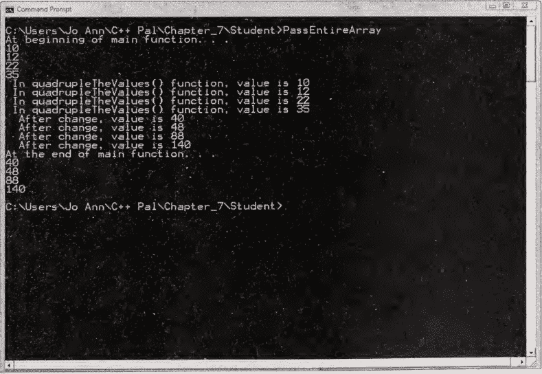

**图 7-6** *PassEntireArray* 程序的输出

如图 7-6 所示，在 main 函数开始时（第 18 行至第 22 行）打印的数组值就是数组初始化时使用的值。接下来，`quadrupleTheValues` 函数在值被更改之前再次打印数组值（第 40 行至第 44 行）。如图所示，这些值与初始化值保持相同。然后，`quadrupleTheValues` 函数在值变为四倍后再次打印数组值（第 52 行至第 56 行）。最后，在调用 `quadrupleTheValues` 之后，main 函数最后一次打印数组值（第 26 行至第 30 行）。这些是变为四倍后的值，表明 `quadrupleTheValues` 函数可以访问数组存储的内存位置，并且能够永久更改存储在那里的值。

你也可以像传递变量或常量一样，将单个数组元素传递给函数。以下 C++ 代码初始化一个名为 `someNums` 的数组，声明一个名为 `newNum` 的变量，并将该数组的一个元素传递给名为 `tripleTheNumber` 的函数。在此示例中，数组元素按值传递，这意味着存储在数组中的值的副本被传递给 `tripleTheNumber` 函数：

```cpp
int someNums[] = {10, 12, 22, 35};
int newNum;
newNum = tripleTheNumber(someNums[1]);
```

以下 C++ 代码包含名为 `tripleTheNumber` 的函数的函数头，以及将其接收到的值变为三倍的代码：

```cpp
int tripleTheNumber(int num)
{
    int result;
    result = num * 3;
    return result;
}
```

接下来，你将学习如何按引用和按地址将实参传递给函数。

#### 练习 7-5：将数组传递给函数

在本练习中，你将运用所学的关于在 C++ 中将数组和数组元素传递给函数的知识。

- 1. 给定以下函数调用，写出该函数的函数头：

  ```cpp
  a. int marchBirthdays[] = {3, 12, 13, 22, 27, 31};
     printBirthdayInvitations(marchBirthdays);
  ```

  ```cpp
  b. double janSales[] = {100.00, 200.00, 55.00, 230.00};
     double total;
     total = monthlySales(janSales);
  ```


```cpp
    c. double overdue[] = {34.56, 33.22, 65.77, 89.99};
    printNotice(overdue[1]);
```

- 2. 给定以下函数头和变量声明，编写一个函数调用：

  ```
  a. string custNames[] = {"Jones", "Smith", "Brown", "Perez"};
  double balances[] = {32.00, 45.00, 76.00, 120.00};
  void cust(string name[], double bal[])
  ```

  ```
  b. int numbers[] = {1, 4, 6, 8, 3, 7};
  int sum;
  int printSum(int nums[])
  ```

- 3. 给定以下函数头，编写一个函数调用，传递名为 salaries 的数组中的最后一个值：

  ```
  a. double salaries[] = {45000, 23000, 35000};
  void increase(double sal)
  ```

#### 实验7-5：将数组传递给函数

在本实验中，你将完成一个部分编写的 C++ 程序，该程序打印学生成绩报告。该程序将两个并行数组传递给一个打印成绩报告的函数。一个数组包含表示学生数字成绩平均分的 double 值；第二个数组包含以字符串存储的学生姓名。该函数打印学生姓名，后跟其字母等级，如下所示：

```
Name: Maria Frederick - Grade: A
```

在该程序中，学生按如下方式获得字母等级：

| 数字成绩 | 字母等级 |
|---|---|
| 90 - 99 | A |
| 80 - 89 | B |
| 70 - 79 | C |
| 60 - 69 | D |
| 小于 60 | F |

为本实验提供的源代码文件包含必要的变量声明。文件中包含注释，以帮助你编写程序的其余部分。

- 1. 使用记事本或你选择的文本编辑器打开名为 `StudentGrades.cpp` 的源代码文件。
- 2. 按注释指示编写 C++ 语句。
- 3. 将此源代码文件保存到你选择的目录中，然后使该目录成为你的工作目录。
- 4. 编译源代码文件 `StudentGrades.cpp`。
- 5. 执行该程序。

### 按引用和按地址传递参数

作为 C++ 程序员，你有时会希望将一个或多个参数传递给函数，并允许函数永久更改该参数的值。在上一节中，你了解到，当你将数组传递给函数时，实际传递的是数组的起始内存地址。由于数组的地址被传递给函数，函数可以访问该内存地址，因此可以更改存储在该内存位置的值（一个或多个值）。

在 C++ 中，有两种技术可用于将非数组变量的内存地址传递给函数。这两种技术称为**按引用传递**和**按地址传递**。我们将从讨论按引用传递开始。

#### 按引用传递

按引用将参数传递给函数，允许被调用函数访问调用函数中的变量。换句话说，被调用函数获得了更改调用函数中局部变量值的能力。被调用函数中的参数成为调用函数中变量的别名（另一个名称）。

要指定参数按引用传递，需在函数声明和函数头中包含 &（与号）运算符。不要在函数调用中使用 & 运算符。图7-7展示了一个名为 `IncreaseSalary.cpp` 的 C++ 程序，其中包含一个名为 `increase` 的函数。increase 函数根据当前工资和表示员工加薪幅度的百分比计算员工的新工资。

```cpp
1     // IncreaseSalary.cpp - This program demonstrates pass by reference.
2     // Input:  None
3     // Output:  Beginning salary along with new salary
4     #include <iostream>
5     using namespace std;
6
7     void increase(double, double, double&);
8     int main()
9     {
10        double salary = 50000.00;
11        double raise = .15;
12        double new_salary;
13
14        cout << "Salary is: " << salary << endl;
15
16        // Call the increase function; the variables salary and raise
17        // are passed by value, the variable new_salary is passed by
18        // reference.
19        increase(salary, raise, new_salary);
20
21        cout << "New salary is: " << new_salary << endl;
22        return 0;
23    } // End of main function
24
25    void increase(double amt, double pcnt, double& new_sal)
26    {
27        // Changes the value of new_salary in the main function
28        new_sal = amt * (1 + pcnt);
29        return;
30    }
```

**图7-7** 按引用传递示例

在图7-7的第7行，你可以看到名为 `increase` 的函数的函数声明。该函数声明包含传递给 `increase` 函数的三个参数的数据类型。前两个参数是 double，第三个参数是对 double 的引用（`double&`）。图7-7中第7行的函数声明已用阴影标出。

在第19行，你可以看到 `main` 函数中对 `increase` 函数的调用。`increase` 函数的调用也同样用阴影标出，以便你轻松看到它传递了三个参数（`salary`、`raise` 和 `new_salary`），它们都是 `main` 函数中声明的局部变量。

在第25行（同样用阴影标出），你可以看到 `increase` 函数的函数头，其中包含三个参数：`double amt`、`double pcnt` 和 `double& new_sal`。前两个参数按值传递，这意味着 `amt` 包含存储在 `salary` 中的值的副本，`pcnt` 包含存储在 `raise` 中的值的副本。第三个参数按引用传递，这意味着 `new_sal` 实际上是变量 `new_salary` 的别名。因为 `new_sal` 是 `new_salary` 的别名，所以当第28行更改 `new_sal` 的值时，`main` 函数中声明的 `new_salary` 的值也会更改。

> **注意**
>
> 在本书第3章中，你了解到局部变量不能供程序中的其他函数使用。

你可以编译并执行该程序，以验证 `increase` 函数会更改名为 `new_salary` 的变量的值。该程序名为 `IncreaseSalary.cpp`，包含在本书随附的数据文件中。

#### 按地址传递

可用于将变量（非数组）的内存地址传递给函数的第二种技术称为按地址传递。按地址传递参数允许被调用函数更改参数的值。

在理解按地址传递参数之前，你必须了解指针。**指针**是一种以内存地址作为其存储值的变量。你习惯于使用变量名直接访问存储在变量所关联内存地址处的值。你也可以使用指针变量以及存储在该指针变量中的内存地址，来间接访问存储在某个内存地址处的值。

为了使用指针，你需要学习的第一件事是如何使用地址运算符。你可以使用 C++ 地址运算符 `&` 获取与变量关联的内存地址。以下 C++ 代码打印名为 `num` 的变量的值，并使用地址运算符 `&` 打印与名为 `num` 的变量关联的内存地址：

```cpp
int num = 5;
cout << "Value of num is: " << num << endl;
cout << "Address of num is: " << &num << endl;
```

如你在前面突出显示的代码行中所见，地址运算符（`&`）放在变量名（`num`）之前，以获取 num 的地址。

接下来，你必须学习使用 `*` 符号声明指针变量。声明指针时，必须显式地将特定数据类型与该指针关联。下面的 C++ 代码声明一个名为 `age` 的 `int` 变量，并将 `ptr_age` 声明为指向 int 的指针：

```cpp
int age = 21;
int* ptr_age = &age;
```

图7-8展示了上述代码执行后的内存。名为 age 的变量与内存位置 2000 关联，值 21 存储在该位置。名为 ptr_age 的变量与内存位置 2004 关联，值 2000（int 变量 age 的地址）存储在该位置。因为 ptr_age 包含 age 的地址，所以你可以说 ptr_age 是指向 int 的指针，并且它指向 age。

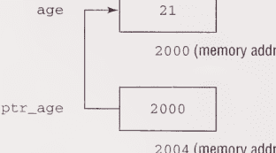

**图7-8** age 和 ptr_age 的内存内容


`*`符号还充当**间接引用运算符**，也就是说，可以用它来间接访问指针所指向的值。由于`*`符号在C++中有多种用途，C++必须根据上下文来确定其恰当含义。下面的C++代码展示了`*`符号用于执行乘法、声明指针变量以及作为间接引用运算符的用法。

```cpp
int y = 5;
int x;
int* ptr_x;       // Pointer variable
x = y * 10;       // Multiplication; x is assigned the value 50
ptr_x = &x;       // ptr_x is assigned the memory address of x
cout << *ptr_x;   // Indirection operator; prints 50
```

图7-9所示的C++程序展示了`*`符号用于声明指针变量以及作为间接引用运算符的更多示例。

```cpp
1   // PointerPractice.cpp - This program demonstrates pointers.
2   // Input:  None
3   // Output:  Values of variables
4   #include <iostream>
5   using namespace std;

7   int main()
8   {
9       int num = 777;
10      int* ptr_num;

12      ptr_num = &num;   // Assigns address of num to ptr_num

14      cout << "Value of num is: " << num << endl;

16      cout << "Value of num is: " << *ptr_num << endl;

18      cout << "Address of num is: " << &num << endl;

20      cout << "Address of num is: " << ptr_num << endl;

22      cout << "Address of ptr_num is: " << &ptr_num << endl;

24      return 0;
25  }   // End of main function
```

**图7-9** 使用指针变量和间接引用运算符的C++程序

在第9行，变量num被声明为int类型，并初始化为值777；在第10行，名为ptr_num的变量被声明为指向int的指针。第12行将变量num的地址赋给ptr_num；然后在第14行，cout语句通过使用变量名直接访问其值来打印num的值。第16行的cout语句也打印num的值，但这次使用间接引用运算符和指针变量（*ptr_num）来间接访问num的值。接下来，在第18行使用地址运算符和变量名（&num）获取变量的地址，从而打印num的地址。在第20行，再次打印num的地址，这次使用存储在指针变量ptr_num中的值。第22行的cout语句使用地址运算符（&ptr_num）打印ptr_num的地址。

该程序的输出如图7-10所示。请记住，实际内存地址可能因系统而异，甚至同一程序每次运行时也可能不同。

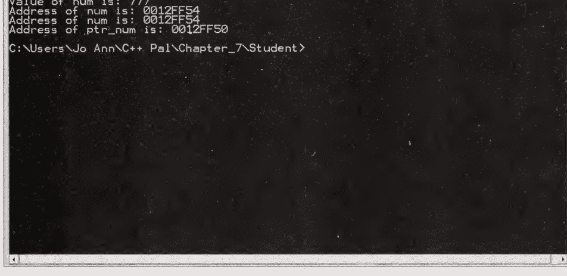

**图7-10** PointerPractice程序的输出

你可以编译并运行该程序，查看系统上的输出值。名为PointerPractice.cpp的程序包含在本书提供的数据文件中。

要通过按地址传递向函数传递参数，需要将调用函数中局部变量的内存地址传递给被调用函数。在调用函数时，需要使用&运算符（地址运算符）。参数必须在函数声明和函数头中声明为指针。使用`*`符号声明指针参数。还必须在函数体中使用`*`符号（间接引用运算符）来解引用指针。**解引用**指针意味着使用间接引用运算符间接访问变量的值。

图7-11所示的C++程序演示了按地址传递的用法。

```cpp
// PassByAddress.cpp - This program demonstrates pass by address.
// Input:    None
// Output:   Values of variables
#include <iostream>
using namespace std;

void swap(int*, int*);

int main()
{
    int num1 = 5;
    int num2 = 10;

    cout << "Value of num1 is: " << num1 << endl;

    cout << "Value of num2 is: " << num2 << endl;

    swap(&num1, &num2);

    cout << "Value of num1 is: " << num1 << endl;

    cout << "Value of num2 is: " << num2 << endl;

    return 0;
} // End of main function

void swap(int* val1, int* val2)
{
    int temp;
    temp = *val1;
    *val1 = *val2;
    *val2 = temp;
}
```

**图7-11** 使用按地址传递的C++程序

swap函数的函数声明在第7行。注意，swap函数不返回值（void），并指定了两个参数，这两个参数都是指向int的指针（int*，int*）。

在主函数的第11行和第12行，声明了两个int变量num1和num2，并分别初始化为值5和10。这两个变量num1和num2都是main函数的局部变量，这意味着swap函数不能直接访问它们。在第14行和第16行，打印了num1（5）和num2（10）的值。

接下来，在第18行调用swap函数，将num1的地址（&num1）和num2的地址（&num2）传递给该函数。由于传递的是num1和num2的内存地址，swap函数可以访问存储在这些内存地址中的值，并能够更改存储在那里的值。

现在程序控制权传递给swap函数。第27行的swap函数头指定该函数不返回值，并接受两个参数val1和val2。这两个参数被声明为指向int的指针（int* val1，int* val2）。参数val1包含num1的地址，参数val2包含num2的地址。在第29行，声明了名为temp的int变量。由于val1和val2都是指针，因此在第30、31和32行使用间接引用运算符（*）来访问val1和val2所指向的内存中存储的值。在第30行，间接访问val1所指向的值（num1的值），然后将其赋给temp。在第31行，间接访问val2所指向的值（num2的值），然后将其赋给val1所指向的内容，即num1。该赋值语句更改了main函数中num1的值。第32行将temp中存储的值赋给val2所指向的内容，即num2。该赋值更改了main函数中num2的值。

当swap函数将控制权返回给main函数时，在第20行和第22行再次显示num1和num2的值。这一次，num1的值为10，num2的值为5，说明局部变量num1和num2已被swap函数更改。

你可以编译并运行该程序，查看系统上的输出值。名为PassByAddress.cpp的程序包含在本书提供的数据文件中。

接下来，你将学习函数重载的含义，以及如何在C++中实现函数重载。

#### 练习7-6：按引用传递和按地址传递

在本练习中，你将运用所学的C++中按引用和按地址向函数传递参数的知识。

- 1. 给定以下变量和函数声明，写出函数调用和函数头：
  - a. `double price = 22.95, increase = .10;`
    ```cpp
    void changePrice(double&, double);
    ```
  - b. `double price = 22.95, increase = .10;`
    ```cpp
    void changePrice(double*, double);
    ```
  - c. `int age = 23;`
    ```cpp
    void changeAge(int&);
    ```
  - d. `int age = 23;`
    ```cpp
    void changeAge(int*);
    ```
- 2. 给定以下函数头和变量声明，写出一个函数调用：
  - a.
    ```cpp
    string custNames[] = {"Perez", "Smith", "Patel", "Shaw"};
    double balances[] = {34.00, 21.00, 45.50, 67.00};
    void cust(string name[], double bal[])
    ```
  - b.
    ```cpp
    int values[] = {1, 77, 89, 321, -2, 34};
    void printSum(int nums[])
    ```

#### 实验7-6：按引用传递和按地址传递

在本实验中，你将完成一个部分写好的C++程序，该程序包含一个名为addNumbers的函数，用于将三个int值相加，求出它们的和。应向addNumbers函数传递四个int：要相加的三个数字（num1、num2和num3）应按值传递，另一个用于保存三个数之和的int（sum）应按引用传递，使addNumbers函数能够更改其值。

本实验提供的源代码文件包含必要的变量声明以及输入和输出语句。文件中包含注释，帮助你编写程序的其余部分。

- 1. 使用记事本或你选择的文本编辑器打开名为`AddThree.cpp`的源代码文件。
- 2. 按照注释的指示编写`addNumbers`函数、函数声明和函数调用。
- 3. 将此源代码文件保存在你选择的目录中，然后将该目录设为你的工作目录。
- 4. 编译源代码文件`AddThree.cpp`。


- 5. 执行程序。
- 6. 重写 `addNumbers` 函数，按值传递三个数字（`num1`、`num2` 和 `num3`），并按地址传递 `sum`。
- 7. 将此程序保存为 `AddThree2.cpp`。
- 8. 编译 `AddThree2.cpp`。
- 9. 执行程序。两个程序（`AddThree.cpp` 和 `AddThree2.cpp`）应生成相同的输出。

### 重载函数

你可以通过为多个函数赋予相同名称和不同参数列表来重载函数。当需要对不同类型输入执行相同操作时，重载函数很有用。例如，你可能想编写多个版本的 `add` 函数——一个能相加两个 `ints`，另一个能相加两个 `doubles`，另一个能相加三个 `ints`，还有一个能相加两个 `ints` 和一个 `double`，这里仅列举几种不同类型的输入。重载函数具有相同名称，但要求参数数量不同，或者参数必须是不同数据类型。C++ 根据函数名及其参数判断调用哪个函数，二者的组合称为函数的**签名**。重要的是要理解，函数的签名由函数名和参数列表组成；它不包括函数的返回类型。

重载函数使 C++ 程序员能够为函数选择有意义的名称，也允许使用多态代码。**多态**代码是指根据上下文采取适当行为的代码。（“*polymorphic*”一词源自希腊语“*poly*”，意为“许多”，以及“*morph*”，意为“形式”。）C++ 中的多态函数可以采取多种形式。你将在其他 C++ 课程中、学习更多面向对象编程知识时进一步了解多态。目前，你可以使用重载来编写执行相同任务但使用不同数据类型的函数。

在《*Programming Logic and Design, Fifth Edition*》第 7 章中，你学习了一个名为 `printBill` 的重载函数的设计；一个版本包含一个数值参数，第二个版本包含两个数值参数，第三个版本包含一个数值参数和一个字符串参数，第四个版本包含两个数值参数和一个字符串参数。`printBill` 函数的所有版本都具有相同名称但签名不同；因此，它是一个重载函数。在*图 7-12*中，你会看到一个包含 `printBill` 函数四个版本的 C++ 程序。

```cpp
// Overloaded.cpp - This program illustrates overloaded methods.
// Input:  None
// Output:  Bill printed in various ways

#include <iostream>
#include <string>
using namespace std;

void printBill(double);
void printBill(double, double);
void printBill(double, string);
void printBill(double, double, string);

int main()
{
    double bal = 250.00, discountRate = .05;
    string msg = "Due in 10 days.";

    printBill(bal);                         // Call version #1
    printBill(bal, discountRate);           // Call version #2
    printBill(bal, msg);                    // Call version #3
    printBill(bal, discountRate, msg);      // Call version #4

    return 0;
} // End of main function

// printBill function #1
void printBill(double balance)
{
    cout << "Thank you for your order." << endl;
    cout << "Please remit " << balance << endl;
} // End of printBill #1 function

// printBill function #2
void printBill(double balance, double discount)
{
    double newBal;
    newBal = balance - (balance * discount);
    cout << "Thank you for your order." << endl;
    cout << "Please remit " << newBal << endl;
} // End of printBill #2 function

// printBill function #3
void printBill(double balance, string message)
{
    cout << "Thank you for your order." << endl;
    cout << message << endl;
    cout << "Please remit " << balance << endl;
} // End of printBill #3 function
```

图 7-12 使用重载 `printBill` 函数的程序

```cpp
50
51        // printBill function #4
52        void printBill(double balance, double discount, string message)
53        {
54            double newBal;
55            newBal = balance - (balance * discount);
56            cout << "Thank you for your order." << endl;
57            cout << message << endl;
58            cout << "Please remit " << newBal << endl;
59        } // End of printBill #4 function
```

图 7-12 使用重载 `printBill` 函数的程序（续）

在第 19 行，对 `printBill` 函数的第一次调用传递一个参数，即名为 `bal` 的变量，它被声明为 `double`。这会使运行时系统找到并执行编写为接受一个 `double` 作为参数的 `printBill` 函数（第 28 行）。对 `printBill` 函数的第三次调用（第 21 行）传递两个参数，一个 `double` 和一个 `string`。这会使运行时系统找到并执行编写为接受一个 `double` 和一个 `string` 作为参数的 `printBill` 函数（第 44 行）。如果你想验证在传递不同数量的参数或传递不同数据类型的参数时会调用不同版本的 `printBill` 函数，可以编译并执行此程序。名为 `Overloaded.cpp` 的程序包含在本书提供的数据文件中。

接下来，你将学习如何使用无需自己编写、因为已内置于 C++ 编程语言中的函数。

#### 练习 7-7：重载函数

在本练习中，你将运用所学到的重载函数知识。

- 1. 在图 7-13 中，以下函数调用会匹配哪个函数头？请用行号作为答案。

```cpp
1     // Method headers
2     int sum(int num1, int num2)
3     int sum(int num1, int num2, int num3)
4     double sum(double num1, double num2)
5     // Variable declarations
6     double number1 = 1.0, ans1;
7     int number2 = 5, ans2;
```

图 7-13 函数头和变量声明

- a. `ans2 = sum(2, 5);`
- b. `ans1 = sum(number1, number1);`
- c. `ans1 = sum(2.0, 5.0);`
- d. `ans2 = sum(2, 4, number2);`
- e. `ans2 = sum(3, 5, 7);`

#### 实验 7-7：重载函数

在本实验中，你将完成一个包含重载函数的部分编写的 C++ 程序。该程序用于检查学生是否在测试中提供了正确答案。测试包含三个问题。一个问题要求答案为 `int`，一个问题要求答案为 `string`，另一个问题要求答案为 `bool`。为本实验提供的源代码文件包含已用学生答案初始化的变量声明。它还包含必要的输出语句。你必须编写三个名为 `checkQuestion` 的重载函数。其中一个函数应接受一个表示学生 `int` 答案的 `int` 参数，一个应接受一个表示学生 `string` 答案的 `string` 参数，还有一个应接受一个表示学生 `bool` 答案的 `bool` 参数。在这些函数中，你应测试答案是否正确，并返回字符串值“Correct”或“Incorrect”。正确的 `int` 答案是 3，正确的 `string` 答案是“George Washington”，正确的 `bool` 答案是 true。文件中包含注释，可帮助你编写程序的其余部分。

- 1. 使用记事本或你选择的文本编辑器打开名为 `CheckAnswer.cpp` 的源代码文件。
- 2. 按照注释指示编写 C++ 语句。
- 3. 将此源代码文件保存到你选择的目录中，然后使该目录成为你的工作目录。
- 4. 编译源代码文件 `CheckAnswer.cpp`。
- 5. 执行程序。

### 使用 C++ 内置函数

到目前为止，你一直被告知，你对 C++ 编程语言的了解还不够，无法在打印 `double` 数据类型的值时控制小数点后显示的位数。实际上，有几种方法可以控制小数点后显示的小数位数。在本节中，我们将介绍一种方法：使用名为 `setprecision` 的操纵器。**操纵器**是一种特殊的 C++ 函数，可以控制（操纵）数据的显示方式。在本书中，你一直在使用 `endl` 操纵器来显示换行符。


在下面的 C++ 程序中，你将看到如何使用 `setprecision` 操纵器来控制显示的数字位数。

```cpp
#include <iostream>
#include <iomanip>
using namespace std;
int main()
{
    double value = 3.14159;
    cout << value << endl;
    cout << setprecision(1) << value << endl;
    cout << setprecision(2) << value << endl;
    cout << setprecision(3) << value << endl;
    cout << setprecision(4) << value << endl;
    cout << setprecision(5) << value << endl;
    cout << setprecision(6) << value << endl;
    return 0;
}
```

在前面的代码示例中，setprecision 是一个操纵器，用于控制应如何格式化浮点值。setprecision 操纵器需要一个整数参数，该参数指定要显示的最大数字位数，包括小数点前后的位数。例如，以下 C++ 代码

```cpp
double value = 3.14159;
cout << setprecision(3) << value << endl;
```

产生以下输出：3.14。

你可以编译并执行该程序，以查看在向 setprecision 提供不同整数参数时数字位数如何变化。名为 Precision.cpp 的程序随本书提供的数据文件一起提供。

随着你继续深入学习 C++，你将会接触到更多可在程序中使用的内置函数。

#### 练习 7-8：使用 C++ 的内置函数

在本练习中，你使用浏览器（例如 Google）查找有关属于 C++ 函数库的内置函数的信息，然后回答以下问题：

- 1. `pow` 函数的作用是什么？

  ________________________________

- 2. `pow` 函数返回什么数据类型？

  ________________________________

- 3. `pow` 函数是否被重载？你如何判断？

  ________________________________

- 4. `pow` 函数需要多少个参数？
- 5. 参数的数据类型是什么？
- 6. 名为 `result` 的变量的值是什么？

  ```cpp
  result = pow(3,6);
  ```

- 7. 名为 `result` 的变量的值是什么？

  ```cpp
  result = pow(12, 3);
  ```

#### 实验 7-8：使用 C++ 的内置函数

在本实验中，你要完成一个部分编写的 C++ 程序，其中包含将存储在字符数组中的字符转换为全大写或全小写的内置函数。该程序提示用户输入九个字符。对于数组中的每个字符，你调用内置函数 `tolower` 和 `toupper`。这两个函数都返回一个字符，并将该字符转换为大写或小写。示例如下：

```cpp
char sample1 = 'A';
char sample2 = 'a';
char result1, result2;
result1 = tolower(sample1);
result2 = toupper(sample2);
```

为本实验提供的源代码文件包含必要的变量声明以及必要的输入和输出语句。文件中包含注释，以帮助你编写程序的其余部分。

- 1. 使用记事本或你选择的文本编辑器打开名为 `ChangeCase.cpp` 的源代码文件。
- 2. 按照注释的指示编写 C++ 语句。
- 3. 将此源代码文件保存到你选择的目录中，然后使该目录成为你的工作目录。
- 4. 编译源代码文件 `ChangeCase.cpp`。
- 5. 使用以下数据执行该程序：

  ```text
  lowercase
  UPPERCASE
  ```

## 第8章：编写控制中断程序

学习本章后，你将能够：

- 理解单级控制中断程序
- 理解如何在单级控制中断程序中累计总计
- 在 C++ 程序中使用多级控制中断

在本章中，你将学习如何编写一个累计总计的单级控制中断程序。你还将学习如何编写采用多级控制中断的程序。你应该在完成教材 *《编程逻辑与设计（第五版）》*（Joyce Farrell 著）的第8章之后，再完成本章的练习和实验。

### 在单级控制中断程序中累计总计

**单级控制中断**程序会根据单个变量的值在逻辑中产生中断。在 *《编程逻辑与设计（第五版）》* 第8章中，你学习了可用于实现单级控制中断程序的技术。在继续学习本章之前，请确保你理解这些技术。*《编程逻辑与设计（第五版）》* 第8章中描述的书店程序就是单级控制中断程序的一个示例。书店程序读取书店销售的每本书的一条记录，统计每个类别中的图书数量，并保存书店所经营的所有图书的总计数。如图8-1所示，该程序生成的报表包括图书标题、每个类别中的图书数量以及所有图书的计数。组成报表的输出行与程序的输入交错显示。下一章学习执行文件输入后，输入行将不再出现。

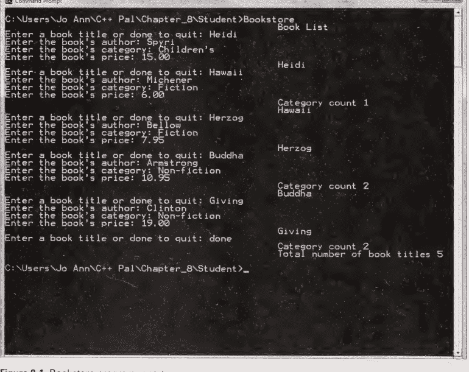

**图8-1** 书店程序报表

每条图书记录由以下字段组成：`Book Title`、`Author`、`Price` 和 `Book Category`。请注意以下示例记录，每条记录由四行组成：

```text
Heidi
Spyri
55.00
Children's

----------------------------------------

Hawaii
Michener
6.95
Fiction
```

控制中断程序的输入记录通常存储在存储设备（如磁盘）上的数据文件中，并且记录按照预定的控制中断变量排序。例如，该程序的控制中断变量是 `category`，因此输入记录将按类别排序。你还没有学习如何从输入文件读取数据，因此该程序仍将使用交互式输入。你将在下一章学习如何从文件读取输入数据。

图8-2包含书店程序的伪代码，图8-3包含实现该程序的 C++ 代码。

```text
start
    string title
    string author
    string category
    num price
    string HEADING = "BOOK LIST"
    string FOOTER = "Total number of book titles "
    string CATEGORY_FOOTER = "Category count "
    num grandTotal = 0
    string prevCategory
    num categoryTotal = 0
    print HEADING
    get title, author, category, price
    prevCategory = category
    while not eof
        if category != prevCategory then
            grandTotal = categoryChange(categoryTotal, grandTotal)
            categoryTotal = 0
            prevCategory = category
        endif
        categoryTotal = categoryTotal + 1
        print title
        get title, author, category, price
    endwhile
    print CATEGORY_FOOTER, categoryTotal
    grandTotal = grandTotal + categoryTotal
    print FOOTER, grandTotal
    stop

num categoryChange(num categoryTotal, num grandTotal)
    string CATEGORY_FOOTER = "Category count "
    print CATEGORY_FOOTER, categoryTotal
    grandTotal = grandTotal + categoryTotal
    return grandTotal
```

**图8-2** 书店程序伪代码

```cpp
// Bookstore.cpp – This program creates a report that lists
// all of the books carried by a bookstore with a count
// for each book category and a grand total.
// Input:  Interactive.
// Output: Report
#include <iostream>
#include <string>
using namespace std;
int categoryChange(int, int);
int main()
{
    double price;
    string title, author, category;
    const string HEADING = "Book List";
    const string FOOTER = "Total number of book titles ";
    const string CATEGORY_FOOTER = "Category count ";
    const string SENTINEL = "done";
    int grandTotal = 0;
    string prevCategory = "";
    int categoryTotal = 0;
    bool notDone = true;

    cout << "\t\t\t\t\t" << HEADING << endl;
    cout << "Enter a book title or done to quit: ";
    cin >> title;
    if(title == SENTINEL)
    {
        notDone = false;
    }
}
```

**图8-3** 用 C++ 编写的书店程序


```cpp
30  else
31  {
32      cout << "Enter the book's author: ";
33      cin >> author;
34      cout << "Enter the book's category: ";
35      cin >> category;
36      cout << "Enter the book's price: ";
37      cin >> price;
38      prevCategory = category;
39  }
40  while(notDone == true)
41  {
42      if(category != prevCategory)
43      {
44          grandTotal = categoryChange(categoryTotal, grandTotal);
45          categoryTotal = 0;
46          prevCategory = category;
47      }
48      categoryTotal++;
49      cout << "\t\t\t\t\t" << title << endl;
50      cout << "Enter a book title or done to quit: ";
51      cin >> title;
52      if(title == SENTINEL)
53      {
54          notDone = false;
55      }
56      else
57      {
58          cout << "Enter the book's author: ";
59          cin >> author;
60          cout << "Enter the book's category: ";
61          cin >> category;
62          cout << "Enter the book's price: ";
63          cin >> price;
64      }
65  }
66  cout << "\t\t\t\t\t" << CATEGORY_FOOTER << categoryTotal << endl;
67  grandTotal += categoryTotal;
68  cout << "\t\t\t\t\t" << FOOTER << grandTotal << endl;
69  return 0;
70  } // End of main function
71
72  // categoryChange function
73  int categoryChange(int categoryTotal, int grandTotal)
74  {
75      const string CATEGORY_FOOTER = "Category count ";
76
77      cout << "\t\t\t\t\t" << CATEGORY_FOOTER << categoryTotal << endl;
78      grandTotal += categoryTotal;
79      return(grandTotal);
80  } // End of categoryChange function
```

**图 8-3** 用 C++ 编写的书店程序（*续*）

正如你在图 8-3 中看到的，这个 C++ 程序从第 1 行开始，用注释描述程序的功能。（请记住，此程序中显示的行号不是 C++ 代码的一部分。它们仅用于参考。）程序还包含描述程序输入和输出的注释。接下来是第 6 行和第 7 行的两条预处理指令、第 8 行的 `using namespace std;` 语句，以及第 9 行的 `categoryChange` 函数声明。注意，`categoryChange` 函数返回一个 `int`，并接受两个 `int` 作为参数。开始 `main` 函数的 C++ 代码位于第 10 行。

在 `main` 函数内，第 12 行到第 23 行声明变量和常量，在适当的时候初始化它们，然后打印报表标题。第 23 行的 `cout` 语句在生成的输出中包含字符串“\t\t\t\t\t\t”。在 C++ 中，“\t”表示制表符。因此，字符串“\t\t\t\t\t\t”表示由六个制表符组成的字符串。在 `cout` 语句中包含此字符串会强制将行缩进六个制表符。这意味着语句 `cout << "\t\t\t\t\t\t" << HEADING << endl;` 在打印常量 `HEADING` 和换行符之前缩进六次。

下一步是执行一次预读，以获取第一条输入记录，该记录由单本书的书名、作者、价格和类别组成。你已在本书第 3 章和 *《编程逻辑与设计（第五版）》* 第 2 章中学习过如何执行预读。

注意，预读中的 C++ 代码（第 24 行和第 25 行）与伪代码略有不同。当要求用户输入书名时，还会指示用户在输入记录后输入单词“done”。此外，第 26 行使用 `if` 语句测试用户输入的是书名还是单词“done”。如果用户已完成记录输入，此测试的结果将为 `true`，导致第 28 行将 `bool` 值 `false` 赋给名为 `notDone` 的变量，并且询问作者、类别和价格的其余输入语句将不会执行。名为 `notDone` 的 `bool` 变量稍后在程序中用于控制 `while` 循环。如果用户尚未完成记录输入，则提示他在第 32 行到第 37 行输入书籍的其余数据：作者、类别和价格。在第 38 行，当前书籍类别（`category`）的值被赋给名为 `prevCategory` 的变量。变量 `category` 用作控制中断变量。

> **注意** 为简单起见，此示例程序只允许用户输入单字书名和作者的姓氏。这种简化旨在使输入保持简单直接。输入包含多个单词的字符串涉及学习 C++ 的一些复杂细节，你将在学习 C++ 课程时接触到这些内容。

接下来是 `while` 循环（第 40 行），只要 `bool` 变量 `notDone` 的值为 `true`，它就会继续执行。在 `while` 循环体内，`if` 语句在第 42 行测试控制中断变量 `category`。`if` 语句的作用是确定用户当前处理的记录是否与上一条记录的类别相同。如果不同，则表示新类别的开始。因此，程序调用 `categoryChange` 函数（第 44 行），即控制中断函数。注意，此函数的返回值被赋给名为 `grandTotal` 的变量，并且两个参数 `categoryTotal` 和 `grandTotal` 被传递给该函数。

`categoryChange` 函数从第 73 行开始，执行以下操作：

- 1. 打印六个制表符，然后打印名为 `CATEGORY_FOOTER` 的局部常量的值和 `categoryTotal` 的值，其中 `categoryTotal` 包含当前类别的书籍数量（第 77 行）。
- 2. 将 `categoryTotal` 的值加到 `grandTotal`，后者是用于累计所有书籍总数的变量（第 78 行）。
- 3. 将 `grandTotal` 的值（第 79 行）返回到 `main` 函数中调用 `categoryChange` 函数的位置（第 44 行）。

当 `categoryChange` 函数执行完毕后，会发生以下情况：

- 该函数的返回值在第 44 行被赋给名为 `grandTotal` 的变量，从而更新书籍总数。
- 名为 `categoryTotal` 的变量被赋值为 0，以便为新类别的开始做准备（第 45 行）。
- 前一类别变量 `prevCategory` 被赋为当前类别（`category`）的值，以便为新类别做准备（第 46 行）。

下一条要执行的语句（第 48 行）将名为 `categoryTotal` 的类别计数器变量加 1。重要的是要理解，无论类别发生变化还是未发生变化，此语句都会执行。最后，第 49 行到第 64 行打印当前书籍的书名，然后使用与预读相同的技术获取下一本书的输入数据。随后再次测试第 40 行 `while` 循环中的条件，使循环继续执行，直到用户输入单词“done”而不是书名。

退出 `while` 循环后，程序执行最后一部分。这部分包括：

- 在第 66 行打印六个制表符，然后打印名为 `CATEGORY_FOOTER` 的局部常量的值以及 `categoryTotal` 的值（即用户输入的最后一个类别的总计）。
- 在第 67 行将 `categoryTotal` 的值加到名为 `grandTotal` 的变量。
- 在第 68 行打印六个制表符，然后打印名为 `FOOTER` 的局部常量的值以及 `grandTotal` 的值，后者现在包含书店所经营所有书籍的总数。

既然你已经看到了一个单层控制中断程序，在下一节中，你将学习如何编写多层控制中断 C++ 程序。


#### 练习 8-1：在单级控制中断程序中累计总计

在本练习中，你将运用所学到的关于在单层控制中断程序中累计总计的知识来回答具体问题。首先，研究下面的 C++ 代码：

```cpp
if(itemNum != oldItemNum)
{
    cout << "Item Number " << oldItemNum << endl;
    totalItems = itemNum;
    oldItemNum = itemNum;
}
```

- 1. 什么是控制中断变量？
- 2. 控制中断变量的值绝不应被更改。对还是错？
- 3. totalItems 的计算正确吗？

  如果不正确，你如何修复代码？
- 4. 在控制中断程序中，输入文件中的记录是否按指定顺序排列并不重要。对还是错？

#### 实验 8-1：在单级控制中断程序中累计总计

在本实验中，你将运用所学到的关于在单层控制中断程序中累计总计的知识来完成一个 C++ 程序。该程序应为一家快餐店老板生成一份报告，帮助她跟踪兼职员工的工作小时数。报告应包括星期几、每位员工在每周每天的工作小时数、当天（星期几）的总小时数，以及在周末时该周的总工作小时数。报告应类似于图 8-4 中所示的报告。


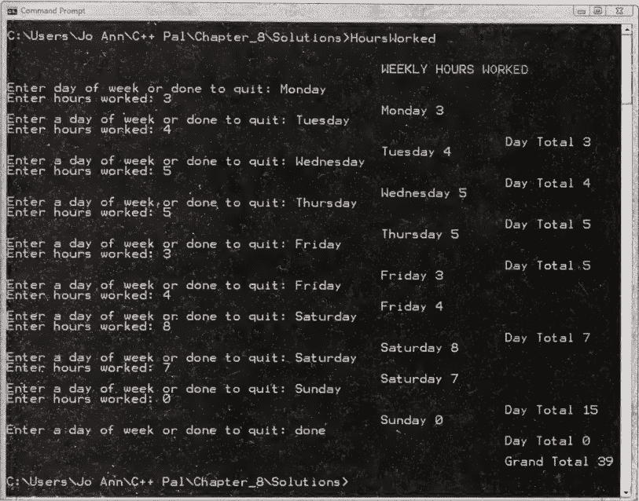

图8-4 快餐店报告

为本实验提供的学生文件包含必要的变量声明以及输入和输出语句。你需要实现能够识别何时应发生控制中断的代码。你还需要完成控制中断函数。确保累加每日总计和一周所有天的总合计。代码中的注释会告诉你应在何处编写代码。你可以将本章中的 Bookstore 程序作为这个新程序的指南。

- 1. 使用记事本或你选择的文本编辑器打开名为 `HoursWorked.cpp` 的源代码文件。
- 2. 研究预编写的代码，以了解已经完成了哪些工作。
- 3. 在 `main` 函数中编写控制中断代码。
- 4. 编写 `dayChange` 控制中断函数。
- 5. 将此源代码文件保存到你选择的目录中，然后使该目录成为你的工作目录。
- 6. 编译源代码文件 `HoursWorked.cpp`。
- 7. 执行该程序。

使用以下输入值执行此程序：

- 星期一 – 3小时（员工1）
- 星期二 – 4小时（员工1）
- 星期三 – 5小时（员工1）
- 星期四 – 5小时（员工1）
- 星期五 – 3小时（员工1），4小时（员工2）
- 星期六 – 7小时（员工1），8小时（员工2）
- 星期日 – 0小时

程序结果应包括：

- 星期一总共工作3小时。
- 星期二总共工作4小时。
- 星期三总共工作5小时。
- 星期四总共工作5小时。
- 星期五总共工作7小时。
- 星期六总共工作15小时。
- 星期日总共工作0小时。
- 本周工作总合计为39小时。

### 多级控制中断程序

在*《编程逻辑与设计（第五版）》*第8章中，你学习了如何实现多级控制中断程序。在继续学习本章之前，请确保你理解这些内容。

多级控制中断程序会针对多个条件执行特殊处理。在本节中，你将学习 Bookstore 程序的一个修改版本，它使用了多级控制中断。在这个版本中，程序生成一份报告，打印每个城市和每个州售出书籍的摘要。要生成此类摘要报告，当城市名称发生变化时必须发生一次控制中断。当州名称发生变化时必须发生第二次控制中断。

你已了解到，对于单级控制中断程序，输入必须根据预定的控制中断变量进行排序；同样，对于多级控制中断程序，输入必须按多个控制中断变量进行排序。在这种情况下，输入必须按州内的城市排序。

图8-5包含在*《编程逻辑与设计（第五版）》*第8章中开发的修改版 Bookstore 程序的伪代码，图8-6包含该设计的 C++ 代码。

```text
start
    string title
    num price
    string HEADING = "BOOK LIST"
    string FOOTER = "Total number of book titles "
    num GRAND = 2
    num STATE = 1
    num CITY = 0
    num total[3] = 0, 0, 0
    string prev[2]

    print HEADING
    get title, price, city, state
    prev[STATE] = state
    prev[CITY] = city
    while not eof
        if state not = prev[STATE] then
            stateBreak(total, prev, state, city)
        else
            if city not = prev[CITY] then
                cityBreak(total, prev, city)
            endif
        endif
        total[CITY] = total[CITY] + 1
        get title, price, city, state
    endwhile
    stateBreak(total, prev, state, city)
    print FOOTER, total[GRAND]
stop
void cityBreak(num total[], num prev[], string city)
    num GRAND = 2
    num STATE = 1
    num CITY = 0
    print prev[CITY], total[CITY]
    total[STATE] = total[STATE] + total[CITY]
    total[CITY] = 0
    prev[CITY] = city
return
void stateBreak(num total[], num prev[], string state, string city)
    num GRAND = 2
    num STATE = 1
    num CITY = 0
    string EXPLANATION = "Total for "
    cityBreak(total, prev, city)
    print EXPLANATION, prev[STATE], total[STATE]
    total[GRAND] = total[GRAND] + total[STATE]
    total[STATE] = 0
    prev[STATE] = state
return
```

**图8-5** 修改版 Bookstore 程序伪代码

```cpp
1    // Bookstore2.cpp - This program creates a report that lists
2    // all of the books sold in each city and each state.
3    // Input:  Interactive
4    // Output: Report
5    #include <iostream>
6    #include <string>
7    using namespace std;
8    void cityBreak(int total[], string prev[], string city);
9    void stateBreak(int total[], string prev[], string state, string city);
10   int main()
11   {
12       double price;
13       string title, city = "", state = "";
14       const string HEADING = "Book List";
15       const string FOOTER = "Total number of book titles ";
16       const string SENTINEL = "done";
17       const int GRAND = 2;
18       const int STATE = 1;
19       const int CITY = 0;
20       int total[] = {0, 0, 0};
21       string prev[2];
22       bool notDone = true;
23
24       cout << "\t\t\t\t\t" << HEADING << endl;
25       cout << "Enter a book title or done to quit: ";
26       cin >> title;
27       if(title == SENTINEL)
28       {
29           notDone = false;
30       }
31       else
32       {
33           cout << "Enter the book's price: ";
34           cin >> price;
35           cout << "Enter the city: ";
36           cin >> city;
37           cout << "Enter the state: ";
38           cin >> state;
39           prev[STATE] = state;
40           prev[CITY] = city;
41       }
42       while(notDone == true)
43       {
44           if(state != prev[STATE])
45               stateBreak(total, prev, state, city);
46           else if(city != prev[CITY])
47               cityBreak(total, prev, city);
48           total[CITY]++;
49           cout << "Enter a book title or done to quit: ";
50           cin >> title;
51           if(title == SENTINEL)
52           {
53               notDone = false;
54           }
55           else
56           {
57               cout << "Enter the book's price: ";
58               cin >> price;
59               cout << "Enter the city: ";
60               cin >> city;
61               cout << "Enter the state: ";
62               cin >> state;
63           }
64       }
65       stateBreak(total, prev, state, city);
66       cout << "\t\t\t\t\t" << FOOTER << total[GRAND] << endl;
67       return 0;
68   } // End of main function

70   void cityBreak(int total[], string prev[], string city)
71   {
72       const int GRAND = 2;
73       const int STATE = 1;
74       const int CITY = 0;

76       cout << "\t\t\t\t" << prev[CITY] << " " << total[CITY] << endl;
77       total[STATE] += total[CITY];
78       total[CITY] = 0;
79       prev[CITY] = city;
80   } // End of cityBreak function

81   void stateBreak(int total[], string prev[], string state, string city)
82   {
83       const int GRAND = 2;
84       const int STATE = 1;
85       const int CITY = 0;
86       const string EXPLANATION = "Total for ";

88       cityBreak(total, prev, city);
89       cout << "\t\t\t\t\t" << EXPLANATION << prev[STATE]
90            << " " << total[STATE] << endl;
91       total[GRAND] += total[STATE];
92       total[STATE] = 0;
93       prev[STATE] = state;
94   } // End of stateBreak function
```

**图8-6** 用 C++ 编写的修改版 Bookstore 程序

如图8-6所示，C++ 程序以注释（第1行到第4行）开始，这些注释描述了：1）程序做什么；以及2）程序的输入和输出。接下来是第5行和第6行的两个预处理器指令、第7行的 `using namespace std;` 语句，以及第8行和第9行的 `cityBreak` 和 `stateBreak` 函数声明。注意，`cityBreak` 函数不返回任何内容（`void`），并接受三个参数：一个 `int` 数组、一个 `string` 数组和一个 `string`。另外，注意 `stateBreak` 函数不返回任何内容（`void`），并接受四个参数：一个 `int` 数组、一个 `string` 数组和两个 `string`。开始 `main` 函数的 C++ 代码位于第10行。

在 `main` 函数内的第12行到第24行中，变量和常量被声明并在适当时初始化，同时打印报告标题。注意，所声明的变量中有两个是数组：一个名为 `total` 的 `int` 数组和一个名为 `prev` 的 `string` 数组。`total` 数组用于存储城市总计、州总计和总合计，而 `prev` 数组用于存储前一个城市和州的名称。常量 `CITY`、`STATE` 和 `GRAND` 用作索引值，以访问 `total` 数组的元素，常量 `CITY` 和 `STATE` 用于访问存储在 `prev` 数组中的前一个城市和前一个州的名称。名为 `city` 和 `state` 的变量用作控制中断变量，以处理此程序中的两个控制中断。

使用与原始 Bookstore 程序相同的技术，预读（第25行到第38行）获取第一条输入记录。在此程序版本中，一条输入记录现在由单本书的书名、价格、城市和州组成。如果用户尚未完成记录输入，程序还会在第39行和第40行将 `state` 的值赋给 `prev[STATE]`，并将 `city` 的值赋给 `prev[CITY]`。

只要 `bool` 变量 `notDone` 的值为 true，第42行的 `while` 循环就会继续执行。在 `while` 循环体内，`if` 语句测试第一个控制中断变量 `state`（第44行），以确定当前正在处理的记录是否与前一条记录具有相同的州。如果不同，我们就知道遇到了一个新的州。在这种情况下，程序调用 `stateBreak` 函数（第45行），它是……之一


控制中断函数。请注意，有四个参数——`total`、`prev`、`state` 和 `city`——被传递给此函数。正如你在本书第 7 章所学到的，两个数组 `total` 和 `prev` 的起始地址是按值传递的，这使函数能够访问这些内存位置，因而能够更改数组中存储的值。参数 `state` 和 `city` 都是字符串，并且按值传递。`stateBreak` 函数中完成的工作将在后面讨论。

如果州名相同，则不调用 `stateBreak` 函数。相反，程序继续执行一个测试（第 46 行），以查看城市名是否相同；它通过使用 `if` 语句测试第二个控制中断变量 `city` 来完成此操作。这样做是为了确定当前正在处理的记录是否与上一条记录具有相同的城市。如果不同，则说明遇到了一个新城市的开头，从而调用 `cityBreak` 函数（第 47 行），该函数是控制中断函数之一。请注意，有三个参数——`total`、`prev` 和 `city`——被传递给此函数。`cityBreak` 函数中完成的工作将在后面讨论。

如果当前城市和州以及上一城市和州的名称都相同，则两个控制中断函数都不会被调用。相反，程序继续执行：
- 将当前城市的总销售额加 1（第 48 行）。
- 获取下一条输入记录（第 49 行至第 62 行）。
- 再次测试 `while` 循环中的条件（第 42 行），从而使循环继续执行，直到用户输入单词“done”而不是书名。

当退出 `while` 循环时，程序最后一部分执行。这部分包括在第 65 行再次调用 `stateBreak` 函数以处理上一条记录的合计，然后在第 66 行打印六个制表符、名为 `FOOTER` 的局部常量的值，以及所有城市和州的销售总计（`total[GRAND]`）。

现在，让我们看看两个控制中断函数：`stateBreak` 和 `cityBreak`。

`stateBreak` 函数执行以下操作：
- 1. 声明局部常量 `GRAND`、`STATE`、`CITY` 和 `EXPLANATION`（第 84 行至第 87 行）。
- 2. 在第 89 行调用 `cityBreak` 函数，将 `total`、`prev` 和 `city` 传递给该函数。调用此函数是因为如果州已更改，城市也已更改。如前所述，名为 `total` 和 `prev` 的数组的起始内存地址按值传递，名为 `city` 的字符串按值传递。`cityBreak` 函数执行以下操作：
  - a. 声明局部常量 `GRAND`、`STATE` 和 `CITY`（第 72 行至第 74 行）。
  - b. 打印六个制表符、上一城市的名称（`prev[CITY]`）和该城市的总销售额（`total[CITY]`）（第 76 行）。
  - c. 将该城市的总销售额加到该州的总计中（`total[STATE] += total[CITY];`）（第 77 行）。
  - d. 将 `total[CITY]` 的值设为 0，以便为下一个城市做好准备（第 78 行）。
  - e. 将当前城市赋给 `prev[CITY]`，以便为下一个城市做好准备（第 79 行）。
  - f. 将控制权交回调用此方法的位置（第 80 行）。
- 3. 打印六个制表符、名为 `EXPLANATION` 的常量的值、上一州的名称（`prev[STATE]`）和该州的总销售额（`total[STATE]`）（第 90 行）。
- 4. 将该州的总销售额加到总计中（`total[GRAND] += total[STATE];`）（第 91 行）。
- 5. 将 `total[STATE]` 的值设为 0，以便为下一个州做好准备（第 92 行）。
- 6. 将当前州赋给 `prev[STATE]`，以便为下一个州做好准备（第 93 行）。
- 7. 将控制权交回 `main` 函数（第 94 行）。

#### 练习 8-2：多级控制中断程序

在本练习中，你将运用所学的多级控制中断程序知识来回答特定问题。首先，研究下面的 C++ 代码：

```cpp
if (floorNum != oldFloorNum)
    floorBreak();
else if (aisleNum != oldAisleNum)
    aisleBreak();
else if (rowNum != oldRowNum)
    rowBreak();
```

- 1. 在此程序中，`rowNum` 用于确定何时应发生主级中断。正确还是错误？

  ___

- 2. 此程序包含多少个控制中断变量？

  ___

  写出它们。

  ___

- 3. 对于此控制中断程序，输入记录应按楼层内过道中的行排序。正确还是错误？

  ___

#### 实验 8-2：多级控制中断程序

在本实验中，你将运用所学的多级控制中断程序知识来完成一个 C++ 程序。该程序应为一家二手车经销商生成报告，其中包括所售每辆车的品牌和车型、每个品牌售出的汽车总数以及所有售出汽车的总计。本实验的学生文件包含变量声明和输入语句。你需要实现程序的控制中断部分，该部分在读取到具有不同品牌和/或不同车型的新记录时执行。务必累加各汽车品牌的合计以及所有汽车的总计。学生文件中的注释会告诉你应在何处编写代码。你可以使用本章中的 Bookstore2 程序作为指南。

- 1. 使用记事本或你选择的文本编辑器打开名为 `UsedCars.cpp` 的源代码文件。
- 2. 研究预先编写的代码，以了解已经完成了哪些工作。
- 3. 在 `main` 函数中编写控制中断代码。
- 4. 编写 `makeBreak` 控制中断函数。
- 5. 编写 `modelBreak` 控制中断函数。
- 6. 将此源代码文件保存到你选择的目录中，然后使该目录成为你的工作目录。
- 7. 编译源代码文件 `UsedCars.cpp`。
- 8. 执行程序。

使用以下输入数据。

| 品牌 | 车型 | 价格 | 颜色 |
|---|---|---|---|
| 雪佛兰 | 科尔维特 | 52000 | 银色 |
| 雪佛兰 | 科尔维特 | 58000 | 红色 |
| 雪佛兰 | 乐骋 | 11000 | 黑色 |
| 福特 | 野马 | 23000 | 蓝色 |
| 福特 | 福克斯 | 15000 | 蓝色 |
| 本田 | 雅阁 | 28000 | 红色 |
| 本田 | 奥德赛 | 36000 | 银色 |
| 本田 | 思域 | 19000 | 黑色 |

你的输出应显示：雪佛兰科尔维特的总数为 2，雪佛兰乐骋的总数为 1，雪佛兰的总数为 3，福特野马的总数为 1，福特福克斯的总数为 1，福特的总数为 2，本田雅阁的总数为 1，本田奥德赛的总数为 1，本田思域的总数为 1，本田的总数为 3。售出汽车的总计为 8。

## 第 9 章：数据排序与文件输入/输出

**学习本章后，你将能够：**

- 解释对数据进行排序的必要性
- 在程序中交换数据值
- 在 C++ 中创建冒泡排序
- 解释并执行文件处理


在本章的前三节中，你将回顾为什么要对数据进行排序、如何在程序中使用 C++ 交换两个数据值，以及如何在 C++ 程序中创建冒泡排序。你应在完成 *《程序设计逻辑与设计（第五版·综合篇）》* 的第 9 章之后，再做本章的练习和实验。

### 数据排序

数据记录总是按某种顺序存储，但可能不是你在程序中处理或查看它们时想要的顺序。在这种情况下，你需要让程序能够按有用的顺序排列（排序）记录。例如，你需要处理的库存记录可能按产品编号顺序存储，但你可能需要生成一份按成本从低到高列出产品的报告。这意味着你的程序需要按成本对记录进行排序。

排序使查找记录更容易、更高效。数据可以按**升序**（数值数据从低到高，或文本按字母顺序）或**降序**（数值数据从高到低，或文本按反向字母顺序）排序。人们通常只需扫视一组数据项就能找到他们要查找的内容；但程序必须逐个查看一组数据项，并对每一项作出判断。在未排序的记录中查找特定数据值时，程序必须检查每一条记录，直到找到该数据值或确定其不存在。然而，在已排序的记录中查找时，程序可以快速确定何时停止查找，如下面的逐步场景所示：

- 1. 程序使用的记录按产品编号升序排序。
- 2. 用户正在查找产品编号 12367。
- 3. 程序定位到产品编号 12368 的记录，但尚未找到产品编号 12367。
- 4. 程序确定产品编号 12367 的记录不存在，因此停止在列表中查找。

许多搜索算法要求数据在搜索之前先经过排序。（**算法**是解决问题的方案。）你可以从许多用于排序和搜索数据的算法中进行选择。在 *《程序设计逻辑与设计（第五版·综合篇）》* 中，你学习了三种排序算法：冒泡排序、插入排序和选择排序。你还学习了一种搜索算法：二分查找。本书只涵盖冒泡排序算法。

### 交换数据值

排序涉及交换数据值。当你交换值时，你将一个变量中存储的值放入第二个变量，然后将第二个变量中的值放入第一个变量。你还必须创建一个第三个变量，用来临时保存你要……的其中一个值

想要交换，以免某个值丢失。例如，如果尝试使用以下代码交换值，就会丢失 score2 的值：

```cpp
int score1 = 90;
int score2 = 85;
score2 = score1;    // The value of score2 is now 90
score1 = score2;    // The value of score1 is also 90
```

但是，如果使用一个变量临时保存其中一个值，交换就会成功。如下代码所示：

```cpp
int score1 = 90;
int score2 = 85;
int temp;
temp = score2;      // The value of temp is 85
score2 = score1;    // The value of score2 is 90
score1 = temp;      // The value of score1 is 85
```

#### 练习 9-1：交换值

在本练习中，你将运用所学的值交换知识完成以下任务：

- 1. 假设你在一个 C++ 程序中声明并初始化了两个 `string` 变量 item1 和 item2。现在，你希望交换 item1 和 item2 中存储的值，但仅当 item1 的值大于 item2 的值时才交换。编写完成此任务的 C++ 代码。声明如下：

```cpp
string item1 = "shirt";
string item2 = "shoes";
```

#### 实验 9-1：交换值

在本实验中，你将完成一个 C++ 程序，该程序交换存储在三个 int 变量中的值，并确定最大值和最小值。为本实验提供的 C++ 文件包含必要的变量声明以及输入和输出语句。你最终希望变量 num1 中存储最小值，变量 num3 中存储最大值。你需要编写语句来比较这些值，并在适当时交换它们。代码中包含的注释会告诉你应在何处编写语句。

- 1. 使用你选择的文本编辑器打开名为 `Swap.cpp` 的源代码文件。
- 2. 编写语句测试前两个整数，并在必要时交换它们。
- 3. 编写语句测试第二个和第三个整数，并在必要时交换它们。
- 4. 再次编写语句测试第一个和第二个整数，并在必要时交换它们。
- 5. 将此源代码文件保存到你选择的目录中，然后将该目录设为工作目录。
- 6. 编译源代码文件 `Swap.cpp`。
- 7. 使用以下输入值集运行程序并记录输出：
  - 55 33 -1
  - 60 99 37
  - 32 54 32

### 使用冒泡排序

冒泡排序是最容易理解的排序技术之一。然而，尽管它在逻辑上简单，但效率并不高。如果列表包含 n 个值，冒泡排序将对列表进行 n - 1 趟处理。例如，如果列表包含 100 个值，冒泡排序将对数据进行 99 趟处理。在每一趟中，它检查连续的重叠对，并交换或调换那些顺序错误的值。对数据进行一趟处理后，最重（最大）的值已经沉到底部，并处于列表中的正确位置。

在 *《程序设计逻辑与设计（第五版）》* 中，你学习了多种改进冒泡排序算法的方法。一种方法是在第二趟处理数据时忽略列表中的最后一个值，从而减少不必要的比较，因为可以确定最后一个值已经位于正确位置。在第三趟时，可以忽略列表中的最后两个值，因为你知道它们已经位于正确位置。因此，在每一趟中，你都可以将要比较并可能需要交换的项数减少一个。

冒泡排序的另一项改进是消除对列表中数据进行的不必要趟处理。当待排序数组中的项并非完全无序时，可能不必对数据进行 n - 1 趟处理，因为经过几趟后，它们可能已经有序。你可以向冒泡排序程序添加一个标志变量，然后测试该标志变量的值，以确定在任意单趟数据处理中是否进行了交换。如果没有进行任何交换，你就知道列表已经有序，因此不需要继续执行额外的趟处理。

在 *《程序设计逻辑与设计（第五版）》* 和本书中，你已经学习了使用常量表示数组大小，从而使逻辑更易于理解，并使程序更易于更改和维护。最后，你还学习了在读取项时通过统计放入数组中的项数来对大小可变的列表进行排序。

所有这些改进都包含在图 9-1 中分数排序程序的伪代码里。实现分数排序逻辑的 C++ 代码在图 9-2 中提供。图 9-2 中显示的行号不是 C++ 代码的一部分。它们仅供引用。

```
start
    num SIZE = 100
    num score[SIZE]
    num numberOfEls
    numberOfEls = fillArray(score, SIZE)
    sortArray(score, numberOfEls)
    displayArray(score, numberOfEls)
stop

num fillArray(num score[], num SIZE)
    num x = 0
    num limit = SIZE - 1
    get score[x]
    while not eof AND x < limit
        x = x + 1
        get score[x]
    endwhile
return x

void sortArray(num score[], num els)
    num x = 0
    num pairsToCompare = els - 1
    string switchOccurred = "Yes"
    while switchOccurred = "Yes"
        x = 0
        switchOccurred = "No"
        while x < pairsToCompare
            if score[x] > score[x + 1] then
                swap(score, x)
                switchOccurred = "Yes"
            endif
            x = x + 1
        endwhile
        pairsToCompare = pairsToCompare - 1
    endwhile
return

void swap(num score[], num x)
    num temp
    temp = score[x + 1]
    score[x + 1] = score[x]
    score[x] = temp
return

void displayArray(num score[], num els)
    num x = 0
    while x < els
        print score[x]
        x = x + 1
    endwhile
return
```

图 9-1 分数排序程序的伪代码

```cpp
// StudentScores.cpp - This program interactively reads a variable number
// of student test scores, stores the scores in an array, and then sorts the
// scores in ascending order.
// Input:  Interactive
// Output: Sorted list of student scores

#include <iostream>
using namespace std;
int fillArray(int [], int);
void sortArray(int [], int);
void swap(int [], int);
void displayArray(int [], int);

int main()
{
    // Declare variables
    const int SIZE = 100;   // Maximum size of array
    int score[SIZE];        // Array of student scores
    int numberOfEls;        // Actual number of elements in array

    numberOfEls = fillArray(score, SIZE);
    sortArray(score, numberOfEls);
    displayArray(score, numberOfEls);

    return 0;
} // End of main function

int fillArray(int score[], int size)
{
    int x = 0;
    const int LIMIT = size - 1;
    int stuScore = 0;
    bool notDone = true;

    cout << "Enter a student's score or 999 to quit: ";
    cin >> stuScore;

    // Test to see if user entered 999
    if(stuScore == 999)
        notDone = false;

    while(notDone && x < LIMIT)
    {
        // Place value in array.
        score[x] = stuScore;
        x++;    // Get ready for next input item
        cout << "Enter a student's score or 999 to quit: ";
        cin >> stuScore;
        // Test to see if user entered 999
        if(stuScore == 999)
            notDone = false;
    } // End of input loop

53
54    return x;
55} // End of fillArray function
56
57void sortArray(int score[], int els)
58{
59    int x = 0;
60    int pairsToCompare = els - 1; // Number of items to compare
61    bool switchOccurred = true;             // Set flag to true.
62
63    // Outer loop controls number of passes over data
64    while(switchOccurred == true) // Test flag
65    {
66        x = 0;
67        switchOccurred = false;
68        // Inner loop controls number of items to compare
69        while(x < pairsToCompare)
70        {
71            if(score[x] > score[x+1]) // Swap?
72            {
73                swap(score, x);
74                switchOccurred = true;
75            }
76            x++;    // Get ready for next pair
77        }
78        pairsToCompare--;
79    }
80} // End of sortArray function
81
82void swap(int score[], int x)
83{
84    int temp;
85    temp = score[x + 1];
86    score[x+1] = score[x];
87    score[x] = temp;
88} // End of swap function
89
90void displayArray(int score[], int els)
91{
92    int x = 0;
93    while(x < els)
94    {
95        cout << score[x] << endl;
96        x++;
97    }
98} // End of displayArray function
```

图 9-2 分数排序程序的 C++ 代码
图 9-2 分数排序程序的 C++ 代码（续）


#### 主函数

如图9-2所示，主函数（第14行）声明变量并调用其他负责执行程序工作的函数。这些变量包括：一个名为`SIZE`的常量（第17行），初始化为100，代表该程序可排序的最大项目数；一个名为`score`的`int`类型数组（第18行），用于存储最多`SIZE`个待排序项目；以及一个名为`numberOfEls`的`int`变量（第19行），用于保存数组中实际存储的项目数，该数量可能少于`SIZE`。

> **注意**
> 请记住，当您将数组传递给函数时，数组的起始内存地址是按值传递的。这意味着函数不能更改此地址，但它确实可以访问该内存位置。这允许函数将数据项存储在数组中。

声明这些变量后，第21行调用名为`fillArray`的函数。`fillArray`函数负责用待排序的项目填充数组。第一个参数`score`数组被传递给该函数，以便将项目放入数组中。

第二个参数`SIZE`按值传递给`fillArray`函数，用于定义`score`数组中可存储的最大项目数。（您已在本书第7章中学习了按引用、按地址和按值传递参数。）请注意，对`fillArray`函数的调用位于赋值运算符的右侧。此外，该函数返回的值被赋给名为`numberOfEls`的`int`变量，当该函数返回时，该变量将包含数组中实际放置的项目数。

接下来，在第22行，调用`sortArray`函数，并传入`score`（`int`数组）和`numberOfEls`（数组中需要排序的实际项目数）。该函数负责对存储在`score`数组中的项目进行排序。最后，在第23行调用`displayArray`函数，并将`score`数组和`numberOfEls`传递给它。该函数负责在用户屏幕上显示排序后的分数。

#### fillArray函数

`fillArray`函数从图9-2中的第28行开始，接收两个参数：`int score[]`和`int size`。该函数负责：1）将数据存储在数组中；2）统计数组中实际放置的元素个数。`fillArray`函数将元素个数返回给主函数。

在`fillArray`函数内部，变量和常量在适当的位置声明并初始化（第30至33行）。接下来，在第35和36行，一个预读操作从用户处获取第一个学生分数。请注意，与本书第8章中的程序一样，预读操作中的C++代码与伪代码不同。要求用户输入学生分数的`cout`语句还指示他们在输入完分数后输入999（一个哨兵值）。此外，第39行使用了一个`if`语句来测试用户输入的是学生分数还是值999。如果用户已完成输入分数，则此测试的结果为真，导致第40行将布尔值`false`赋给名为`notDone`的变量。名为`notDone`的布尔变量稍后在程序中用于控制`while`循环。

接下来，在第42行，测试控制`while`循环的条件。只要布尔变量`notDone`的值为真，并且用户输入的分数数量（由名为`x`的变量表示）小于`LIMIT`，`while`循环就会执行。如果`x`小于`LIMIT`，则数组中有足够的空间存储学生分数。在这种情况下，程序使用`x`的值作为下标来指定数组中的位置，将学生分数`stuScore`赋给名为`score`的数组（第45行）。然后，程序在第46行将`x`的值递增，为在数组中存储下一个学生分数做准备。第47至51行负责获取下一个学生的分数，并使用与预读操作中相同的技术对其进行测试。循环持续执行，直到用户输入值999或数组中没有更多空间为止。

当程序退出循环时，第54行的`return`语句将`x`的值返回给主函数。请注意，数组下标变量`x`被初始化为0，因为数组中的第一个位置是位置0。另外，请注意，每次执行`while`循环时`x`的值都会递增；因此，`x`代表用户输入的学生分数的数量。

#### sortArray函数

在`sortArray`函数中，程序使用改进的冒泡排序将名为`score`的数组中的学生分数按升序重新排列。请参考图9-1（包含伪代码）和图9-2（包含实现`sortArray`函数的C++代码）。

如图9-2第57行所示，该函数接收两个参数：`int score[]`（要排序的项目数组）和`int els`（数组中存储的分数数量）。第59至61行声明变量。请注意，第60行将变量`pairsToCompare`初始化为一个值，该值表示在冒泡排序的第一轮中将要比较的对数。对数的计算方法是：从元素个数`els`中减去1。这确保了程序不会在`x`是数组中最后一个项目时尝试将项目`x`与项目`x+1`进行比较。第61行将标志变量`switchOccurred`初始化为`true`，因为在程序的这一点上，假定项目将需要交换。

外层循环`while (switchOccurred == true)`控制对数据进行遍历的轮数。该逻辑实现了前面讨论的改进之一——消除对数据的不必要遍历。只要`switchOccurred`为真，程序就知道已经进行了交换，因此数据仍然处于无序状态。因此，当`switchOccurred`为真时，程序进入循环。循环体中的第一条语句（第66行）是`x = 0;`。程序将值0赋给`x`，因为`x`被用作数组下标。回想一下，在C++中，数组的第一个下标是0。

接下来，为了准备比较数组中的元素，第67行将`false`赋给`switchOccurred`。这是必要的，因为程序在此轮中尚未交换数组中的任何值。内层循环从第69行开始。条件`x < pairsToCompare`控制在一次数据遍历中程序比较数组中值对的数量。这实现了前面讨论的另一个改进——减少不必要的比较。外层循环中的最后一条语句（第78行）`pairsToCompare--;`每次执行外层循环时都将`pairsToCompare`的值减1。程序递减`pairsToCompare`，因为当对数据进行完整的一轮遍历后，它知道有一个项目在数组中的位置是正确的。在内层循环中将`pairsToCompare`的值与`x`的值进行比较，减少了此循环执行时所需进行的比较次数。

在第71行，内层循环中，使用下标变量`x`和`x+1`访问并比较数组中的相邻项目。比较相邻的数组项目以查看程序是否应该交换它们。如果应该交换这些值，程序就会在第73行调用`swap`函数，该函数使用前面讨论的技术来重新排列数组中的两个值。接下来，第74行将`true`赋给名为`switchOccurred`的变量。内层循环执行的最后一项任务（第76行）是将下标变量`x`的值加1。这确保了下次执行内层循环时，程序会比较数组中紧接着的两个相邻项目。只要`x`的值小于`pairsToCompare`的值，程序就会继续比较两个相邻项目并可能交换它们。

#### displayArray函数

在`displayArray`函数中，程序在用户屏幕上打印排序后的数组。图9-1显示了该函数的伪代码。C++代码如图9-2所示。在图9-2的第90行，以下内容被传递给`displayArray`函数：名为`score[]`的数组（现在已排序）和名为`els`的`int`变量，该变量包含数组中已排序项目的数量。接下来，第92行将值0赋给下标变量`x`。这是在进入`while`循环之前完成的，因为数组中的第一个项目使用下标值0来引用。第93至97行的循环通过每次执行循环时递增下标变量`x`的值，打印所有存储在名为`score`的数组中的值。然后，`displayArray`函数将控制权（第98行）返回给主函数，在主函数中执行语句`return 0;`（第25行）并结束程序。

#### 练习9-2：使用冒泡排序

在本练习中，您将运用所学到的有关使用冒泡排序对数据进行排序的知识。研究以下C++代码，然后回答后面的问题：

```cpp
int numbers[] = {6, 44, -2, 88, 242, 400, 30};
const int NUM_ITEMS = 7;
int j, k, temp;
int numPasses = 0, numCompares = 0, numSwaps = 0;
for(j = 0; j < NUM_ITEMS - 1; j++)
{
    numPasses++;
    for(k = 0; k < NUM_ITEMS - 1; k++)
    {
        numCompares++;
        if(numbers[k] > numbers[k+1])
        {
            numSwaps++;
            temp = numbers[k+1];
            numbers[k+1] = numbers[k];
            numbers[k] = temp;
        }
    }
}
```


- 1. 这段代码执行的是升序排序还是降序排序？你怎么知道？
- 2. 对数组中的数据究竟进行了多少趟处理？请给出一个数字。
- 3. 进行了多少次比较？请给出一个数字。
- 4. 名为`numPasses`、`numCompares`和`numSwaps`的变量是否准确记录了此冒泡排序中进行的趟数、比较次数和交换次数？解释你的答案。

#### 实验 9-2：使用冒泡排序

在本实验中，你将完成一个C++程序，该程序使用数组为一位计算机编程教师存储数据。该程序类似于*《编程逻辑与设计（第五版）》*第9章练习3中描述的程序。该程序应允许用户输入一名学生的姓名和10个测验成绩。程序应输出该学生的姓名及其八个最高测验成绩。本实验提供的文件包含必要的变量声明和输入语句。你需要编写代码，使用冒泡排序将成绩按升序排序，然后打印学生的姓名和八个最高测验成绩。代码中的注释会告诉你应在何处编写语句。

- 1. 使用记事本或你选择的文本编辑器打开名为`QuizScores.cpp`的源代码文件。
- 2. 编写冒泡排序和交换函数。
- 3. 输出学生的姓名和八个最高测验成绩。
- 4. 将此源代码文件保存到你选择的目录中，然后将该目录设为你的工作目录。
- 5. 编译源代码文件`QuizScores.cpp`。
- 6. 使用以下输入执行程序并记录输出：
  - 学生姓名：William Moriarty
  - 十个测验成绩：85, 42, 76, 95, 90, 85, 82, 92, 96, 88

### 文件输入与输出

你应在完成*《编程逻辑与设计（第五版）综合篇》*第10章后，再做本节的练习和实验。

商业应用程序通常必须处理大量数据。这些数据存储在一个或多个文件中。正如你在*《编程逻辑与设计（第五版）》*第1章中所学，数据按层次结构组织。层次结构的最低层是**字段**，它是一组字符。上一层是**记录**，它是一组相关字段。例如，你可以编写一个程序来处理员工记录，其中每条员工记录由三个字段组成：员工的名字、员工的姓氏和员工的部门编号。

在C++中，要使用文件中存储的数据，程序必须首先打开文件，然后从文件中读取数据。你可以使用C++库中预编写的类来完成此任务。接下来，你将学习如何使用这些类打开文件、关闭文件、从文件读取数据以及向文件写入数据。

#### 使用输入和输出类

要使用执行文件输入（`ifstream`）和输出（`ofstream`）所需的类，你必须在C++程序的开头添加以下预处理指令：

```cpp
#include <fstream>
```

`fstream`类中包含的类是由C++开发团队为你预编写的，它们允许你通过使用这些类创建对象来简化编程任务。然后，你可以在C++程序中使用这些对象的属性和方法。

#### 打开文件进行读取

要在C++中打开文件以便将数据读入程序，需要声明一个文件输入流对象（变量），如下所示：

```cpp
ifstream data_in;
```

然后使用open方法（函数）指定要打开的文件名。请看以下示例：

```cpp
data_in.open("inputFile.dat");
```

在示例中，你使用`ifstream`对象（`data_in`），后跟一个点（`.`），再后跟方法名（`open`）来打开文件进行输入。在括号内，你将想要打开的文件名用双引号括起来。这条语句打开名为`inputFile.dat`的文件进行读取。这意味着程序现在可以从该文件中读取数据。在此示例中，名为`inputFile.dat`的文件必须与使用该文件的C++程序保存在同一文件夹中。要打开保存在不同文件夹中的文件，必须指定路径，如下一个示例所示：

```cpp
data_in.open("C:\\myC++Programs\\Chapter9\\inputFile.dat");
```

> **注意**  
> 你可以将`ifstream`视为输入文件的数据类型。在下一章中，你将了解到`ifstream`实际上是一个类，而`data_in`是一个对象。

#### 从输入文件读取数据

打开输入文件后，就可以读取文件中的数据了。你可以像使用`cin`时那样使用提取运算符`>>`。

在下一个示例中，我们将假设程序的输入文件按如下方式组织：员工的名字在一行，员工的姓氏在下一行，其薪水在第三行，如下所示：

```
Tim
Moriarty
2000.00
```

要让程序读取这些数据，你可以编写以下C++代码：

```cpp
ifstream data_in;
string firstName, lastName;
double salary;
data_in.open("inputFile.dat");
data_in >> firstName;
data_in >> lastName;
data_in >> salary;
```

示例中的第一行声明了data_in，这是一个ifstream对象。第二行声明了两个名为firstName和lastName的字符串变量。第三行声明了一个名为salary的double变量。接着，data_in与open方法一起使用，打开名为inputFile.dat的文件。然后，提取运算符（>>）被使用三次，从与data_in关联的文件（inputFile.dat）中读取三行输入。此代码执行后，名为firstName的变量包含值Tim，名为lastName的变量包含值Moriarty，名为salary的变量包含值2000.00。

#### 使用循环和EOF读取数据

在必须读取大量数据的程序中，通常最好使用循环。在循环中，程序持续从文件读取，直到遇到EOF（文件结束）。在C++中，eof方法（函数）在到达EOF时返回true值，在尚未到达EOF时返回false值。eof方法可与cin一起用于键盘输入，也可与ifstream对象（如data_in）一起使用。

以下C++代码展示了如何将eof方法作为循环的一部分使用：

```cpp
ifstream data_in;
string firstName;
data_in.open("inputFile.dat");
data_in >> firstName;
while(!(data_in.eof()))
{
    cout << firstName;
    data_in >> firstName;
}
```

> **注意**  
> 对于键盘输入，你可以通过键入Ctrl + Z（Windows）或Ctrl + D（UNIX/Linux）来输入EOF字符。

在此示例中，第四行`data_in >> firstName;`使用了预读，然后使用`eof`方法作为`while`循环中要测试的表达式。只要`eof`返回的值不等于`true`，表达式就为`true`，并进入循环。注意，否定运算符（`!`）用于反转`eof`方法返回的值。一旦遇到EOF，测试就变为`false`，程序退出循环。包围`eof`方法调用的括号用于控制优先级。

#### 打开文件进行写入

> **注意**  
> 你可以将`ofstream`视为输出文件的数据类型。在下一章中，你将了解到`ofstream`实际上是一个类，而`data_out`是一个对象。

要将C++程序中的数据写入输出文件，程序必须首先打开一个文件。与输入文件类似，你必须先声明一个文件流对象（变量）。对于输出文件，你需声明一个输出流对象，如下所示：

```cpp
ofstream data_out;
```

然后使用`open`方法（函数）指定要打开的文件名。请看以下示例：

```cpp
data_out.open("outputFile.dat");
```

在示例中，你使用`ofstream`对象（`data_out`），后跟一个点（.），再后跟方法名（`open`）来打开文件进行输出。在括号内，你将想要打开的文件名用双引号括起来。这条语句打开名为`outputFile.dat`的文件进行写入。这意味着程序现在可以将数据写入该文件。在此示例中，名为`outputFile.dat`的文件与使用该文件的C++程序保存在同一文件夹中。要打开保存在不同文件夹中的文件，必须指定路径，如下一个示例所示：

```cpp
data_out.open("C:\\myC++Programs\\Chapter9\\outputFile.dat");
```

#### 将数据写入输出文件

打开输出文件后，就可以将数据写入文件了。你可以像使用`cout`时那样使用插入运算符`<<`。

例如，假设已像前一个示例那样从输入文件中读取了员工的`firstName`、`lastName`和`salary`，并且该员工将获得15%的加薪，其计算如下：

```cpp
const double INCREASE = 1.15;
double newSalary;
newSalary = salary * INCREASE;
```

现在你要将员工的`firstName`、`lastName`和`newSalary`写入名为`outputFile.dat`的输出文件。以下代码完成此任务：

```cpp
ofstream data_out;
data_out.open("outputFile.dat");
data_out << firstName << endl;
data_out << lastName << endl;
data_out << newSalary << endl;
data_out.close();
```

前一个示例的最后一行使用`data_out`和`close`方法关闭输出文件。在输入和输出文件……时关闭它们是一种良好的编程习惯。


程序不再需要它们。图9-3所示的C++程序fileIOTest.cpp实现了本节讨论的文件输入和输出操作。

```cpp
// fileIOTest.cpp
// Input:  inputFile.dat
// Output: outputFile.dat

#include <fstream>
#include <iostream>
#include <string>
using namespace std;
int main()
{
    string firstName;
    string lastName;
    double salary;
    double new_salary;
    const double INCREASE = 1.15;
    ifstream data_in;
    ofstream data_out;

    // Open input and output file
    data_in.open("inputFile.dat");
    data_out.open("outputFile.dat");

    // Read record from input file
    data_in >> firstName;
    data_in >> lastName;
    data_in >> salary;
    // Calculate new salary
    new_salary = salary * INCREASE;
    // Write record to output file
    data_out << firstName << endl;
    data_out << lastName << endl;
    data_out << new_salary << endl;
    // Close files
    data_in.close();
    data_out.close();
    return 0;
} // End of main function
```

图9-3 读取和写入文件数据

在编写打开文件和写入文件的代码时，需要注意两个潜在问题：第一，程序可能尝试打开一个不存在的文件；第二，程序可能尝试读取超过EOF标记的内容。随着你对C++的深入学习，你将学会如何处理这些错误情况。它们超出了本书的范围。

#### 练习9-3：打开文件并执行文件输入

在本练习中，你将运用所学的打开文件以及从文件向程序输入内容的知识，回答有关图9-4所示代码的问题。

```cpp
1    ofstream data_in;
2    data_in.open(myVideoFile.dat);
3    string videoName, videoPrice, videoShelf;
4    data_in >> videoShelf;
5    data_in >> videoPrice;
6    data_in >> videoName;
```

**图9-4** 练习9-3的代码

- 1. 描述第1行中的错误，并解释如何修复它。
- 2. 描述第2行中的错误，并解释如何修复它。
- 3. 考虑来自输入文件`myVideoFile.dat`的以下数据：

    ```text
    Shrek 13.00 1A
    Jaws 14.00 2C
    Casablanca 17.00 3B
    ```

    - a. 变量`videoName`中存储了什么值？
    - b. 变量`videoPrice`中存储了什么值？
    - c. 变量`videoShelf`中存储了什么值？
    - d. 如果这些变量的值有问题，问题是什么？你如何修复它？

#### 实验9-3：使用输入文件

在本实验中，你将在预先编写的C++程序中打开一个文件并从中读取输入。该程序应读取并打印存储在输入文件`fish.dat`中的鱼名。

- 1. 使用记事本或你选择的文本编辑器打开名为`Fish.cpp`的源代码文件。
- 2. 声明你需要的变量。
- 3. 编写C++语句，以读取方式打开输入文件`fish.dat`。
- 4. 包含打印标题和执行预读的语句。然后，编写一个`while`循环，读取输入直到到达EOF。
- 5. 在循环体内，打印每条鱼的名称并读取下一条鱼。退出循环后，记得关闭文件。
- 6. 将此源代码文件保存到你选择的目录中，然后将该目录设为你的工作目录。
- 7. 编译源代码文件`Fish.cpp`。
- 8. 执行程序。

## 10 面向对象的C++

**学习完本章后，你将能够：**


- 解释面向对象的基本概念
- 创建一个简单的程序员定义的类
- 在C++程序中使用程序员定义的类
- 使用继承创建派生C++类
- 在C++程序中使用派生类

请注意，本章涵盖的主题包括Joyce Farrell所著《Programming Logic and Design, Fifth Edition, Comprehensive》第11章中的内容。

### 程序员定义的类

在继续学习本章之前，你应该花点时间回顾本书第1章以及《Programming Logic and Design, Fifth Edition, Comprehensive》第11章中介绍的面向对象术语（`class`、`attribute`和`method`）。

你在本书中一直在使用预定义的类、对象和方法。例如，你使用了`ifstream`和`ofstream`类的open方法来打开输入和输出文件。在本节中，你将学习如何创建自己的类，包含你选择的属性和方法。在编程术语中，由程序员创建的类被称为**程序员定义的类**或**自定义类**。

回顾一下，请记住过程式编程侧重于：1）声明数据；2）定义与数据分离的函数；3）调用这些函数对数据进行操作。这是你在本书第1章到第9章一直使用的编程风格。面向对象编程也关注数据以及操作这些数据所需的函数。然而，面向对象编程与过程式编程有很大不同。数据和函数（在面向对象编程中称为“方法”）被**封装**在类中。单个对象作为类的实例被创建。程序通过向对象传递消息来告诉它执行任务。这样的消息包含一个执行类方法的指令。然后，类方法操作数据（数据是对象本身的一部分）。

#### 创建程序员定义的类

在《Programming Logic and Design, Fifth Edition, Comprehensive》第11章中，你学习了Employee类的伪代码。该伪代码如图10-1所示。实现Employee类的C++代码如图10-2所示。

```text
1    class Employee
2        string lastName
3        num hourlyWage
4        num weeklyPay
5
6        void setLastName(string name)
7            lastName = name
8            return
9
10       void setHourlyWage(num wage)
11           hourlyWage = wage
12           calculateWeeklyPay()
13           return
14
15       string getLastName()
16       return lastName
17
18       num getHourlyWage()
19       return hourlyWage
20
21       num getWeeklyPay()
22       return weeklyPay
23
24       void calculateWeeklyPay()
25           num WORK_WEEK_HOURS = 40
26           weeklyPay = hourlyWage * WORK_WEEK_HOURS
27       return
28   endClass
```

**图10-1** Employee类的伪代码

```cpp
1    // Employee.cpp
2    #include <string>
3    using namespace std;
4    class Employee
5    {
6    public:
7        void setLastName(string);
8        void setHourlyWage(double);
9        double getHourlyWage();
10       double getWeeklyPay();
11       string getLastName();
12   private:
13       string lastName;
14       double hourlyWage;
15       double weeklyPay;
16       void calculateWeeklyPay();
17   }; // You end a class definition with a semicolon
18
19   void Employee::setLastName(string name)
20   {
21       lastName = name;
22       return;
23   }
24   void Employee::setHourlyWage(double wage)
25   {
26       hourlyWage = wage;
27       calculateWeeklyPay();
28       return;
29   }
30   string Employee::getLastName()
31   {
32       return lastName;
33   }
34   double Employee::getHourlyWage()
35   {
36       return hourlyWage;
37   }
38   double Employee::getWeeklyPay()
39   {
40       return weeklyPay;
41   }
42   void Employee::calculateWeeklyPay()
43   {
44       const int WORK_WEEK_HOURS = 40;
45       weeklyPay = hourlyWage * WORK_WEEK_HOURS;
46       return;
47   }
```

**图10-2** 用C++实现的Employee类

查看图10-1中伪代码的第1行，你会看到创建类时首先要指定它是一个类。查看图10-2中的C++代码，你会看到第1行是注释，第2行是预处理指令`#include <string>`，第3行是using语句`using namespace std;`。（你在本书第1章学习了预处理指令和using语句。）接下来是第4行Employee类的类声明。它以关键字class开头，指定后面是一个C++类。第5行的左花括号和第17行的右花括号标记了类的开始和结束。

注意第17行的右花括号后面有一个分号。这个分号是*绝对必要的*，因为它是创建类的C++语法的一部分。省略这个分号是一个常见错误。

#### 向类添加属性

下一步是定义Employee类中包含的属性（数据）。如图10-1中伪代码的第2、3、4行所示，该伪代码类中有三个属性：string lastName、num hourlyWage和num weeklyPay。

图10-2中的第13、14、15行将这些属性包含在Employee类的C++版本中。注意在C++代码中，hourlyWage和weeklyPay使用double数据类型定义，lastName定义为string。另外，注意所有三个属性都包含在类的**private**部分中。private部分通过在第12行包含关键字private后跟冒号来定义。正如《Programming Logic and Design, Fifth Edition, Comprehensive》中所解释的，这意味着数据不能被不属于该类的任何方法（函数）访问。使用Employee类的程序必须使用属于该类的方法来访问私有数据。


#### 向类中添加方法

下一步是向 `Employee` 类中添加方法。这些方法的伪代码版本（如图 10-1 中第 6 到第 27 行所示）是非静态方法。正如你在*编程逻辑与设计（第五版，综合版）*第 11 章中学到的，**非静态方法**是旨在与从类创建的对象一起使用的方法。换句话说，要使用这些方法，我们必须首先创建 `Employee` 类的一个对象，然后使用该对象来**调用**该方法。

图 10-2 中显示的代码展示了如何使用 C++ 在 `Employee` 类中包含方法。我们将从 set 方法开始讨论。你在*编程逻辑与设计（第五版，综合版）*中学到，**set 方法**是用于设置类中属性（数据字段）值的方法。`Employee` 类中有三个数据字段，但我们只会添加两个 set 方法：`setLastName` 和 `setHourlyWage`。我们不会添加 `setWeeklyPay` 方法，因为 `weeklyPay` 数据字段将由 `setHourlyWage` 方法设置。`setHourlyWage` 方法使用另一个方法 `calculateWeeklyPay` 来实现这一点。

`setLastName` 方法显示在图 10-2 中的第 19 到第 23 行，`setHourlyWage` 方法显示在第 24 到第 29 行。还要注意，这两个方法在第 7 和第 8 行的类的公有部分中声明。类的公有部分通过在第 6 行使用关键字 `public` 后跟冒号来指定。将方法包含在 **公有** 部分意味着程序可以使用这些方法来访问 **私有** 数据。`calculateWeeklyPay` 方法（显示在图 10-2 中的第 42 到第 47 行）是私有的，这意味着它只能从属于该类的另一个方法内部调用。请注意，`calculateWeeklyPay` 方法在第 16 行 `Employee` 类的私有部分中声明。`calculateWeeklyPay` 方法从 `setHourlyWage` 方法（第 27 行）调用，并确保类保留对 `calculateWeeklyPay` 方法使用时机和方式的完全控制。

`setLastName` 方法（第 19 到第 23 行）以关键字 `void` 开头，后面跟类名 `Employee`，然后是作用域解析运算符（`::`），再后面是方法名 `setLastName`。**作用域解析运算符**用于将方法与类关联。在这种情况下，`setLastName` 方法与 `Employee` 类关联。`setLastName` 方法接受一个参数 `string name`，该参数被赋值给私有属性 `lastName`。这样就设置了 `lastName` 的值。`setLastName` 方法是一个 void 方法——也就是说，它不返回任何内容。请注意，第 7 行中 `setLastName` 方法的声明与方法定义一致；也就是说，两者都指定了 `void` 返回值和一个 `string` 参数。

`setHourlyWage` 方法（第 24 到第 29 行）接受一个参数 `double wage`，该参数被赋值给私有属性 `hourlyWage`。这样就设置了 `hourlyWage` 的值。接下来，它在第 27 行调用私有方法 `calculateWeeklyPay`。`calculateWeeklyPay` 方法不接受参数。在该方法内部，第 44 行声明了一个常量 `const int WORK_WEEK_HOURS`，并初始化为值 40。然后，`calculateWeeklyPay` 方法通过将私有属性 `hourlyWage` 乘以 `WORK_WEEK_HOURS` 来计算周薪（第 45 行）。结果被赋值给私有属性 `weeklyPay`。

> **注意**
>
> 命名 get 方法时并不强制要求使用 "get" 前缀，但使用 "get" 一词来命名，其预期用途会更加清晰。

`setHourlyWage` 方法和 `calculateWeeklyPay` 方法都是 void 方法，这意味着它们不返回任何内容。

创建 `Employee` 类的最后一步是添加 get 方法。**get 方法**是向使用该类的程序返回一个值的方法。图 10-1 中的伪代码包含三个 get 方法：第 15 和 16 行的 `getLastName`、第 18 和 19 行的 `getHourlyWage`，以及第 21 和 22 行的 `getWeeklyPay`。图 10-2 中的第 30 到第 41 行展示了 `Employee` 类中 get 方法的 C++ 版本。

在这个类中，三个 get 方法都是公有方法，并且不接受任何参数。`getLastName` 方法（第 30 到第 33 行）返回一个 string，即私有属性 `lastName` 的值。`getHourlyWage` 方法（第 34 到第 37 行）返回一个 double，即私有属性 `hourlyWage` 的值；`getWeeklyPay` 方法（第 38 到第 41 行）也返回一个 double，即私有属性 `weeklyPay` 的值。这三个 get 方法在第 9、10 和 11 行的 `Employee` 类中声明。

`Employee` 类现在已经完整，可以在 C++ 程序中使用。`Employee` 类不包含 `main` 方法（函数），因为它不是一个应用程序，而是一个应用程序现在可以用来实例化对象的类。完整的 `Employee` 类包含在本书提供的学生文件中，文件名为 `Employee.cpp`。

图 10-3 展示了一个名为 `MyEmployeeClassProgram` 的程序，该程序使用了 `Employee` 类。

```cpp
// This program uses the programmer-defined Employee class.
#include "Employee.cpp"
#include <iostream>
using namespace std;

int main()
{
    const double LOW = 9.00;
    const double HIGH = 14.65;
    Employee myGardener;

    myGardener.setLastName("Greene");
    myGardener.setHourlyWage(LOW);
    cout << "My gardener makes " << myGardener.getWeeklyPay()
         << " per week." << endl;

    myGardener.setHourlyWage(HIGH);
    cout << "My gardener makes " << myGardener.getWeeklyPay()
         << " per week." << endl;
    return 0;
}
```

**图 10-3** 使用 Employee 类的 MyEmployeeClassProgram

如图 10-3 所示，`MyEmployeeClassProgram` 以第 1 行的注释开头，后面是第 2 行的预处理指令 `#include "Employee.cpp"`。该预处理指令指示 C++ 编译器包含名为 `Employee.cpp` 的文件。`Employee.cpp` 文件包含 `Employee` 类声明以及 `Employee` 类中定义的方法的实现。请注意，名为 `Employee.cpp` 的文件用双引号括起来。双引号表示这是一个用户创建的文件，而不是 C++ 头文件。C++ 头文件名用尖括号括起来，如第 3 行所示，该行指示 C++ 编译器包含 C++ 的 `iostream` 头文件。第 4 行包含一条指定 `std` 命名空间的 `using` 语句。

由于这是一个 C++ 程序，它必须包含一个 `main` 函数。`main` 函数从第 6 行开始。在第 7 行和第 19 行，你可以看到定义了 `main` 函数开始和结束的左花括号和右花括号。在 `main` 函数内部，两个常量 `LOW` 和 `HIGH` 分别在第 8 行和第 9 行声明并初始化。接下来，在第 10 行，使用以下语句创建了一个 `Employee` 对象（`Employee` 类的一个实例）：

```
Employee myGardener;
```

在 C++ 中，创建新对象的语句由类名后跟对象名组成。在前面的示例中，类是 `Employee`，对象名是 `myGardener`。

正如你在*编程逻辑与设计（第五版，综合版）*中学到的，**构造函数**是一种创建对象的方法。你还学到了可以使用默认构造函数，这是一种不期望任何参数的构造函数，编译器会为你编写的每个类自动创建它。`MyEmployeeClassProgram` 中使用的 `Employee` 构造函数就是一个预编写的默认构造函数的示例。

> 如果你愿意，也可以编写自己的构造函数。在完成本课程后学习的 C++ 课程中，你将了解更多关于其他构造函数的知识。

一旦创建了 `myGardener` 对象，你就可以使用 `myGardener` 调用 set 方法，将 `lastName` 的值设置为 `"Greene"`，并将 `hourlyWage` 设置为 `LOW`。所使用的语法如下面的代码示例所示：

```
myGardener.setLastName("Greene");
myGardener.setHourlyWage(LOW);
```

这就是使用类的实例（对象）调用方法的语法。

> **注意**
>
> 请注意 `objectName.methodName` 语法，其中对象名与方法名之间用点分隔。

在图 10-3 中的第 14 行，程序随后打印“My gardener makes”（一个字符串常量），后面跟着 `myGardener.getWeeklyPay()` 的返回值，再后面是字符串常量“ per week.”，最后是一个换行。这里再次使用了 `myGardener` 对象——这次是调用 `getWeeklyPay` 方法。

> **注意**
>
> 点实际上就是句点。

在第 16 行，`myGardener` 调用 set 方法 `setHourlyWage` 来为 `hourlyWage` 指定一个新值。这一次，`hourlyWage` 被设置为 `HIGH`。然后程序（第 17 行）打印“My gardener makes”（一个字符串常量），后面跟着……的返回值


`myGardener.getWeeklyPay`，后面跟着字符串常量“ per week.”，再后面跟着一个换行符。第 18 行的 `return 0;` 语句结束程序。该程序的输出如图 10-4 所示。

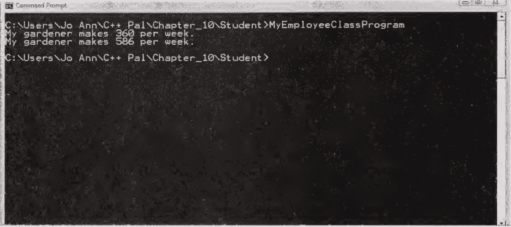

**图 10-4** `MyEmployeeClassProgram` 的输出

你可以在本书配套的学生文件中找到名为 `MyEmployeeClassProgram.cpp` 的完整程序。

#### 练习 10-1：在 C++ 中创建类

在本练习中，你将运用所学的关于创建和使用程序员定义类的知识，回答有关以下代码的一些问题：

```cpp
class Circle
{
    public:
        void setRadius(double);
        double getRadius();
        double calculateCircumference();
        double calculateArea();
    private:
        double radius;     // Radius of this circle
        const double PI = 3.14159;
};

void Circle::setRadius(double rad)
{
    radius = rad;
}
double Circle::getRadius()
{
    return radius;
}
double Circle::calculateCircumference()
{
    return (2 * PI * radius);
}
double Circle::calculateArea()
{
    return(PI * radius * radius);
}
```

在下面的练习中，你应假设在使用 `Circle` 类的程序中已创建了一个名为 `myCircle` 的 `Circle` 对象，并且 `radius` 已按以下代码所示被赋值：

```cpp
Circle myCircle;
myCircle.setRadius(3.0);
```

- 1. 当以下 C++ 代码行执行时，输出是什么？

    ```cpp
    cout << "The circumference is : " <<
        myCircle.calculateCircumference();
    ```

- 2. 以下是否是合法的 C++ 语句？为什么是或为什么不是？

    ```cpp
    cout << "The area is : " << calculateArea();
    ```

- 3. 考虑以下 C++ 代码。`myCircle` 对象中名为 `radius` 的属性存储的值是什么？

    ```cpp
    myCircle.setRadius(4.0);
    ```

- 4. 编写 C++ 代码，将 `myCircle` 的周长赋给名为 `circumferenceOne` 的 `double` 变量。


#### 实验 10-1：在 C++ 中创建类

在本实验中，你将创建一个程序员定义的类，然后在 C++ 程序中使用它。该程序应创建两个 `Rectangle` 对象，并求出它们的面积和周长。请以你在练习 10-1 中使用过的 `Circle` 类为参考。

- 1. 使用记事本或你选择的文本编辑器打开名为 `Rectangle.cpp` 的类文件。
- 2. 在 `Rectangle` 类中，创建两个名为 `length` 和 `width` 的私有属性。`length` 和 `width` 都应为 `double` 数据类型。
- 3. 编写公共的设置方法，为 `length` 和 `width` 设置值。
- 4. 编写 `public` 获取方法，以检索 `length` 和 `width` 的值。
- 5. 编写一个 `public calculateArea()` 方法和一个 `public calculatePerimeter()` 方法，以计算并返回矩形的面积和矩形的周长。
- 6. 将此类文件 `Rectangle.cpp` 保存到你选择的目录中，然后打开名为 `MyRectangleClassProgram.cpp` 的文件。
- 7. 在 `MyRectangleClassProgram` 中，使用默认构造函数创建两个名为 `rectangleOne` 和 `rectangleTwo` 的 `Rectangle` 对象，就像你在 `MyEmployeeClassProgram.cpp` 中看到的那样。
- 8. 将 `rectangleOne` 的长度设置为 4.0，宽度设置为 6.0。将 `rectangleTwo` 的长度设置为 9.0，宽度设置为 7.0。
- 9. 打印 `rectangleOne` 的周长和面积的值，然后打印 `rectangleTwo` 的周长和面积的值。
- 10. 将 `MyRectangleClassProgram.cpp` 保存到与 `Rectangle.cpp` 相同的目录中。
- 11. 编译源代码文件 `MyRectangleClassProgram.cpp`。
- 12. 执行程序。
- 13. 在下面记录输出。

### 重用 C++ 类

通过利用继承，你可以重用类，并重用为类成员编写的代码。**继承**允许你基于现有类创建新类。要使用继承，你创建一个新类（称为**派生类**），它包含原始类（称为**基类**）的成员。然后，你可以通过添加新成员来修改派生类，使其以新方式行事。如果从基类继承的方法不能完全满足派生类的需要，你也可以重新定义这些方法。

例如，如果你有一个现有的 `Vehicle` 类，你可以从 `Vehicle` 类派生一个名为 `Automobile` 的新类。你也可以从 `Vehicle` 类派生 `TaxiCab` 类、`Motorcycle` 类或 `GoKart` 类。在 C++ 中，任何类都可以充当基类。

#### 定义派生类

我们先来看一下基类 `Vehicle`。图 10-5 包含实现 `Vehicle` 类的 C++ 代码。

```cpp
// Vehicle.cpp
#include <iostream>
using namespace std;
class Vehicle
{
    public:
        void setSpeed(double);
        double getSpeed();
        void accelerate(double);
        void setFuelCapacity(double);
        double getFuelCapacity();
        void setMaxSpeed(double);
        double getMaxSpeed();
    private:
        double fuelCapacity;
        double maxSpeed;
        double currentSpeed;
};

void Vehicle::setSpeed(double speed)
{
    currentSpeed = speed;
    return;
}

double Vehicle::getSpeed()
{
    return currentSpeed;
}

void Vehicle::accelerate(double mph)
{
    if(currentSpeed + mph < maxSpeed)
        currentSpeed = currentSpeed + mph;
    else
        cout << "This vehicle cannot go that fast." << endl;
}

void Vehicle::setFuelCapacity(double fuel)
{
    fuelCapacity = fuel;
}

double Vehicle::getFuelCapacity()
{
    return fuelCapacity;
}

48
49    void Vehicle::setMaxSpeed(double max)
50    {
51        maxSpeed = max;
52    }
53
54    double Vehicle::getMaxSpeed()
55    {
56        return maxSpeed;
57    }
```

**图 10-5** 用 C++ 实现的 Vehicle 类（*续*）

Vehicle 类包含三个私有属性：fuelCapacity、maxSpeed 和 currentSpeed（第 15 行到第 17 行）。Vehicle 类还包含七个在 public 部分声明的方法（第 7 行到第 13 行）。这些方法是 setSpeed、getSpeed、accelerate、setFuelCapacity、getFuelCapacity、setMaxSpeed 和 getMaxSpeed。这些方法在第 20 行到第 57 行实现。请阅读为这些方法编写的 C++ 代码，以确保你理解它们。其中三个方法是设置方法，其编写方式与上一节讨论的 Employee 类中的设置方法类似。其中三个方法是获取方法，其编写方式与上一节讨论的 Employee 类中的获取方法类似。注意，accelerate 方法包含了一些你尚未见过的内容。该方法中的 if 语句（第 33 行）会进行测试，以禁止此 Vehicle 超过其最大速度。

图 10-6 所示的 C++ 程序 `MyVehicleClassProgram.cpp` 使用了 `Vehicle` 类，该程序生成的输出如图 10-7 所示。

```cpp
 1    // This program uses the programmer-defined Vehicle class.
 2    #include "Vehicle.cpp"
 3    #include <iostream>
 4    using namespace std;
 5    int main()
 6    {
 7        Vehicle vehicleOne;
 8
 9        vehicleOne.setMaxSpeed(100.0);
10        vehicleOne.setSpeed(35.0);
11        vehicleOne.accelerate(10.0);
12        cout << "The current speed is " << vehicleOne.getSpeed() << endl;
13
14        vehicleOne.accelerate(60.0);
15        cout << "The current speed is " << vehicleOne.getSpeed() << endl;
16
17        return 0;
18    }
```

**图 10-6** 使用 Vehicle 类的 MyVehicleClassProgram

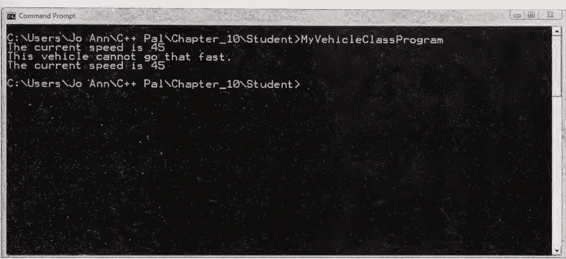

**图 10-7** MyVehicleClassProgram 生成的输出

查看图 10-6，你会看到第 1 行是描述程序功能的注释。在第 2 行，你会看到 #include "Vehicle.cpp"。这个预处理指令指示 C++ 包含含有 Vehicle 类定义的文件。接着，在第 3 行和第 4 行，你会看到允许在此程序中使用 cout 的 #include 指令，以及你在本书第 1 章学过的 using 语句。main 函数从第 5 行开始。

在第 7 行，创建了一个名为 vehicleOne 的 Vehicle 对象。接着，在第 9 行，使用 setMaxSpeed 方法将 vehicleOne 的最大速度设置为每小时 100.0 英里（mph）。第 10 行使用 setSpeed 方法将 vehicleOne 的当前速度设置为 35.0 mph，第 11 行 vehicleOne 使用 accelerate 方法加速 10.0 mph。第 12 行的 cout 语句产生以下输出：“The current speed is 45”。注意，cout 语句中使用了 getSpeed 方法来检索 vehicleOne 的当前速度。在第 14 行，vehicleOne 再次调用 accelerate 方法；这一次加速 60.0 mph。加速 60.0 mph 会使 vehicleOne 行驶得比其最大速度更快，并导致 accelerate 方法产生以下输出：“This vehicle cannot go that fast”。第 15 行的 cout 语句产生以下输出：“The current speed is 45”。此输出表明，accelerate 方法不允许此 Vehicle 对象行驶得比其最大速度更快。

既然 Vehicle 类已经完成，它就可以用作基类。你希望使用 Vehicle 类创建一个新的 Automobile 类。你意识到汽车就是一种车辆，就像 Vehicle 类定义的车辆一样。你希望能够设置汽车的最大速度、当前速度和燃料容量。你还希望获取它的最大速度、当前速度和燃料容量。如果使用继承，你将能够执行所有这些操作，而不必编写任何新代码。此外，你还希望对汽车进行加速；但如果你想让汽车加速超过其最大速度，你希望将生成的消息改为“This automobile cannot go that fast”。你还希望能够指示该汽车是否具有一个

敞篷车顶。你会意识到必须修改继承的 `accelerate` 方法，并为 `Automobile` 类添加新数据以指明某个 `Automobile` 对象是否是一辆敞篷车，同时还要添加 get 和 set 方法来设置和获取敞篷车顶状态。

图 10-8 给出了使用继承的 C++ 代码，它以 `Vehicle` 类为基类创建了一个名为 `Automobile` 的派生类。

```cpp
// Automobile.cpp
#include "Vehicle.cpp"
#include <iostream>
using namespace std;
class Automobile : public Vehicle
{
    public:
        void accelerate(double);
        void setConvertibleStatus(bool);
        bool getConvertibleStatus();
    private:
        bool convertibleStatus;
};

void Automobile::accelerate(double mph)
{
    if(getSpeed() + mph > getMaxSpeed())
        cout << "This Automobile cannot go that fast" << endl;
    else
        setSpeed(getSpeed() + mph);
}

void Automobile::setConvertibleStatus(bool status)
{
    convertibleStatus = status;
    return;
}

bool Automobile::getConvertibleStatus()
{
    return convertibleStatus;
}
```

**图 10-8** 用 C++ 实现的 Automobile 类

观察图 10-8，你会看到第 1 行是注释，第 2 行是 `#include "Vehicle.cpp"`。这个预处理指令告诉 C++ 包含含有 Vehicle 类定义的文件。C++ 需要知道 Vehicle 类才能创建 Automobile 类。接下来，在第 3 行和第 4 行，你会看到 `#include` 指令，它允许你在该类的成员方法中使用 `cout`，以及你在本书第 1 章中学过的 `using` 语句。Automobile 类从第 5 行开始。

如第 5 行所示，在编写派生类的声明时，你以关键字 `class` 开头，后跟派生类的名称（Automobile）。接下来，包含一个 `:`（冒号），后跟关键字 `public`，然后是你要从中派生出新类的基类名称（Vehicle）。

关键字 `public` 指定了派生类型。**公有派生**意味着基类的所有公有成员在派生类中仍然是公有的。因此，你不必在派生类中重复这些成员，只需直接使用继承来的成员即可。这意味着新的 Automobile 类将继承并能使用 Vehicle 类中的公有方法。这些方法是：`setSpeed`、`getSpeed`、`accelerate`、`setFuelCapacity`、`getFuelCapacity`、`setMaxSpeed` 和 `getMaxSpeed`。现在，在 Automobile 类中，你可以使用这些公有方法来访问 Vehicle 类中的私有成员（`fuelCapacity`、`maxSpeed` 和 `currentSpeed`）。在派生类 Automobile 中，你还可以添加新成员或修改继承来的成员。C++ 中还有其他的派生类型，但在本书中，你将始终使用公有派生类型。在后续学习 C++ 的课程中，你会了解更多关于派生类型的内容。

在图 10-8 的第 12 行，你会看到 Automobile 类中添加了一个私有数据成员 `convertibleStatus`。这个 bool 数据成员用于存储 true 或 false 值，指明该 Automobile 是否有敞篷车顶。为了能够设置和获取新的 convertibleStatus 数据成员的值，在第 9 行和第 10 行向 Automobile 类中添加了两个公有方法：`setConvertibleStatus` 和 `getConvertibleStatus`。

在第 8 行，你会看到 `accelerate` 方法。该方法与 Vehicle 类中的 `accelerate` 方法具有相同的签名。

当你在派生类（Automobile）中声明一个与基类（Vehicle）中方法签名相同的方法时，派生类方法会**重写**继承的方法。这意味着该方法必须在派生类中重新编写，并将用于 Automobile 对象。accelerate 方法需要为 Automobile 类重写，因为你希望它生成消息“这辆汽车不能那么快”，而不是“这辆车不能那么快”。

现在，必须编写在派生类 Automobile 中声明的方法。accelerate 方法编写在第 15 到 21 行。在第 17 行，你会看到以下 if 语句：

```cpp
if(getSpeed() + mph > getMaxSpeed())
```

注意，`if` 语句的测试部分使用继承的 `getSpeed` 方法来获取存储在私有数据成员 `currentSpeed` 中的值，并使用继承的 `getMaxSpeed` 方法来获取存储在私有数据成员 `maxSpeed` 中的值。你不能直接访问基类（Vehicle）的私有成员；因此，必须使用继承的公有方法才能访问私有数据成员 `currentSpeed` 和 `maxSpeed`。

在第 18 行，你会看到生成修改后输出的 `cout` 语句：“这辆汽车不能那么快”。当你试图让 Automobile 超过其最大速度加速时，该语句将执行。如果加速不会使 Automobile 以超过其最大速度行驶，则执行第 20 行。第 20 行调用继承的 `setSpeed` 方法，并将当前速度加上加速度值（mph）的结果作为参数传入。当前速度通过使用继承的 `getSpeed` 方法来获取。

> **注意：** 在本书第 7 章中，你已了解到签名由方法（函数）名称、它接收的参数个数以及参数的数据类型组成。

在第 23 到 27 行，你会看到 `setConvertibleStatus` 方法，它设置私有 `bool` 数据成员 `convertibleStatus` 的值。并且，在第 29 到 32 行，你会看到 `getConvertibleStatus` 方法，它获取私有 `bool` 数据成员 `convertibleStatus` 的值。

#### 在 C++ 程序中使用派生类

既然派生类 Automobile 已经定义，你就可以在 C++ 程序中使用它了。图 10-9 中显示的 C++ 程序（`MyAutomobileClassProgram.cpp`）在第 1 行包含一条注释。第 2 行包含文件 `Automobile.cpp`，该文件包含 Automobile 类的定义，第 3 行包含 `<iostream>`，`using` 语句位于第 4 行。然后在第 7 行创建了一个 Automobile 对象（`automobileOne`），并在第 8 行声明了一个 `bool` 变量（`convertible`）。

```cpp
// This program uses the programmer-defined Automobile class.
#include "Automobile.cpp"
#include <iostream>
using namespace std;
int main()
{
    Automobile automobileOne;
    bool convertible;

    automobileOne.setMaxSpeed(100.0);
    automobileOne.setSpeed(35.0);
    automobileOne.accelerate(10.0);
    cout << "The current speed is " << automobileOne.getSpeed() << endl;

    automobileOne.accelerate(60.0);
    cout << "The current speed is " << automobileOne.getSpeed() << endl;

    automobileOne.setConvertibleStatus(true);
    convertible = automobileOne.getConvertibleStatus();

    if(convertible == true)
        cout << "This automobile is a convertible" << endl;
    else
        cout << "This automobile is not a convertible" << endl;

    return 0;
}
```

**图 10-9** 使用 Automobile 类的 `MyAutomobileClassProgram`

接下来，在第 10 行，使用继承的 setMaxSpeed 方法将 automobileOne 的最大速度设置为 100.0 英里/小时（mph）。第 11 行使用继承的 setSpeed 方法将 automobileOne 的当前速度设置为 35.0 mph，第 12 行使用在 Automobile 类中重写的 accelerate 方法使 automobileOne 加速 10.0 mph。第 13 行的 cout 语句产生以下输出：“当前速度为 45”。注意，cout 语句中使用了继承的 getSpeed 方法来获取 automobileOne 的当前速度。在第 15 行，automobileOne 再次调用重写后的 accelerate 方法；这一次是加速 60.0 mph。加速 60.0 mph 会使 automobileOne 以超过其最大速度行驶，并导致在 Automobile 类中重写的 accelerate 方法产生以下输出：“这辆汽车不能那么快”。该输出表明，重写后的 accelerate 方法用于 Automobile 对象。第 16 行的 cout 语句产生以下输出：“当前速度为 45”。该输出表明，accelerate 方法不会允许这个 Automobile 对象以超过其最大速度的速度行驶。

接下来，在第 18 行，automobileOne 调用 setConvertibleStatus 方法并传入 true 值，表明这个 Automobile 对象是一辆敞篷车。第 19 行调用 getConvertibleStatus 方法，其返回值被赋给 bool 变量 convertible。convertible 的值在第 21 行的 if 语句中进行测试。如果 convertible 的值为 true，则执行第 22 行的 cout 语句，产生以下输出：“这辆汽车是一辆敞篷车”。如果 convertible 的值为 false，则执行第 24 行的 cout 语句，产生以下输出：“这辆汽车不是一辆敞篷车”。

MyAutomobileClassProgram 的输出如图 10-10 所示。

> **注意**
> 本章向你介绍了 C++ 中面向对象编程的基础知识。要成为一名 C++ 程序员，你还需要学习更多的 C++ 课程。

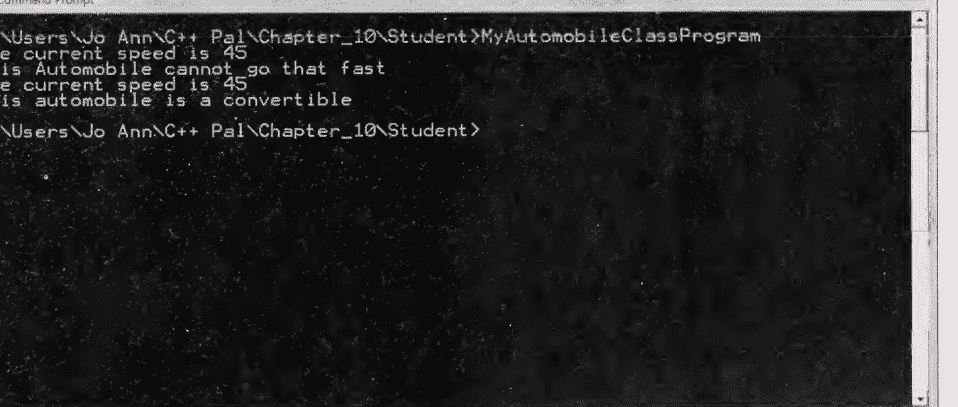

**图 10-10** MyAutomobileClassProgram 的输出


#### 练习 10-2：在 C++ 中使用继承创建派生类

在本练习中，你将运用所学的关于使用继承创建派生类的知识来回答一些问题。

- 1. 哪一行代码用于从名为 Widget 的基类创建名为 SubWidget 的派生类？
  - a. `class Widget : public SubWidget`
  - b. `class SubWidget : base public Widget`
  - c. `class Widget : derived public SubWidget`
  - d. `class SubWidget : public Widget`

- 2. 使用继承的一个优点是：
  - a. 它最大化函数数量。
  - b. 它允许代码复用。
  - c. 它不需要编码。

- 3. 判断题。派生类中的方法可以直接访问基类的私有数据成员。

- 4. 判断题。派生类在从基类继承时可以添加新方法或重写现有方法。

#### 实验 10-2：在 C++ 中使用继承创建派生类

在本实验中，你将从基类创建一个派生类，然后在 C++ 程序中使用该派生类。程序应创建两个 Motorcycle 对象，然后设置 Motorcycle 的速度、加速 Motorcycle 对象并检查其状态。以本章前面使用过的 Vehicle 和 Automobile 类作为指导。

- 1. 使用记事本或你选择的文本编辑器打开名为 Motorcycle.cpp 的文件。
- 2. 通过从 Vehicle 类派生来创建 Motorcycle 类。使用公有派生。
- 3. 在 Motorcycle 类中，创建一个名为 sidecar 的私有属性。sidecar 属性应为 bool 数据类型。
- 4. 编写一个公有 set 方法，用于设置 `sidecar` 的值。
- 5. 编写一个公有 get 方法，用于获取 `sidecar` 的值。
- 6. 编写一个公有 `accelerate` 方法。此方法重写从 `Vehicle` 类继承的 `accelerate` 方法。更改 `accelerate` 方法中的消息，以便当 Motorcycle 试图加速超过其最大速度时显示以下内容：“这辆摩托车不能跑那么快”。
- 7. 将此类文件 `Motorcycle.cpp` 保存到你选择的目录中，然后打开名为 `MyMotorcycleClassProgram.cpp` 的文件。
- 8. 在 `MyMotorcycleClassProgram` 中，创建两个名为 `motorcycleOne` 和 `motorcycleTwo` 的 Motorcycle 对象。
- 9. 将 `motorcycleOne` 的 `sidecar` 值设置为 true，将 `motorcycleTwo` 的 `sidecar` 值设置为 false。
- 10. 将 `motorcycleOne` 的最大速度设置为 90，将 `motorcycleTwo` 的最大速度设置为 85。
- 11. 将 `motorcycleOne` 的当前速度设置为 65，将 `motorcycleTwo` 的当前速度设置为 60。
- 12. 将 `motorcycleOne` 加速 30 英里/小时（mph），将 `motorcycleTwo` 加速 20 mph。
- 13. 打印 `motorcycleOne` 和 `motorcycleTwo` 的当前速度。
- 14. 判断 `motorcycleOne` 和 `motorcycleTwo` 是否有边车。如果是，显示以下内容：“这辆摩托车有边车”。如果不是，显示以下内容：“这辆摩托车没有边车”。
- 15. 将 `MyMotorcycleClassProgram.cpp` 保存在与 `Motorcycle.cpp` 相同的目录中。
- 16. 编译源代码文件 `MyMotorcycleClassProgram.cpp`。
- 17. 执行程序。
- 18. 在下方记录输出。

## 索引

- <>（尖括号），4
- *（星号），33, 82, 129
- :（冒号），180
- ,（逗号），115, 116
- {}（花括号），5, 28, 30, 39, 49, 58, 71, 183
- $（美元符号），86
- “（双引号），93
- .（点），170, 172, 183
- /（正斜杠），23, 33
- ()（圆括号），4, 48, 51–52, 58, 70, 110, 116, 170
- ;（分号），4, 18, 39, 49, 180
- []（方括号），92, 93, 122–123

### A

- ableToVote 变量，50
- accelerate 方法，188–189, 190, 191, 193, 195
- 累加器，83–87
- 实际参数。*参见*参数
- 加法运算符，17, 19, 44
- addNumbers 函数，133–134
- 地址运算符，128
- AddThree.cpp，133–134
- AddThree2.cpp，134
- Airplane.cpp，63–64
- 算法，**160**
- 别名，**126–128**
- allowEntry 函数，111
- AllowEntry.cpp，111
- 与号运算符，126–128
- AND 逻辑，61, 64
- AND 运算符，43–45, 60–61, 64
- 尖括号（<>），4
- answer 变量，19, 87
- Appliance.cpp，21–22
- AreaCodes.cpp，101
- 参数
  - 描述，**109**
  - 传递，112–113, 126–134
- 算术运算符
  - 描述，**16–22**
  - 使用，21–22
- Arithmetic.cpp，121
- 数组。*另请参见*数组元素
  - 基础，92–97
  - 控制中断程序与，154
  - 声明，92–94
  - 描述，**92**
  - 初始化，93–94
  - 概述，91–106
  - 并行，101–106
  - 传递给函数，121–126
  - 搜索精确匹配，97–101
  - 大小，93
  - 排序数据与，166–168
  - 保持在边界内，95–96
- 数组元素。*另请参见*数组
  - 访问，94–95
  - 传递给函数，121–126
- ArrayTest.cpp，94–95
- 升序，**160**
- ASCII（美国信息交换标准代码），47
- 赋值运算符，19, **16–22**, 44
- 赋值语句，23, 97
  - 数组与，93–94
  - 描述，**18–19**
- 星号（*），33, 82, 129
- AT&T 贝尔实验室，2
- 对象的属性
  - 添加到类，180
  - 描述，**3**
- Automobile 类，189–193, 194
- `Automobile.cpp`，192
- average 变量，86

### B

- `BadDate.cpp`，40
- balance 变量，37, 115
- 银行余额，显示，72–73
- 行为，该术语的使用，**3**
- `BillyGoat.cpp`，105–106
- 块语句
  - 描述，**48–49**
  - 循环与，68, 70–71
- 粗体代码，29
- 奖金，计算，56–60
- `BookSales.cpp`，86–87, 142–157
- bool 数据类型，**13**
- 布尔比较，68
- 布尔运算符，42–60
- 布尔值。*参见*`true/false`值
- break 语句，58, 59
- 冒泡排序，**162–169**

### C

- `calculateArea` 函数，185, 186
- `calculatePerimeter` 方法，186
- `calculateWeeklyPay` 方法，181, 182
- 调用
  - 描述，**3**
  - 方法，**181**
- 驼峰命名法，**13**
- case 关键字，58
- 大小写敏感性，39, 106
  - 描述，**47**
  - 变量与，12–13
- `CATEGORY_FOOTER` 常量，147
- `categoryChange` 函数，146–147
- `cd` 命令，7
- `celsius` 变量，23
- `ChangeCase.cpp`，139
- char 数据类型，**13**
- `CheckAnswer.cpp`，137
- `checkQuestion` 函数，137
- `cin` 关键字，23, 84, 170, 171
- Circle 类，185–186
- `circumferenceOne` 变量，185
- cities 数组，93
- `CITY` 常量，154, 155
- `cityBreak` 函数，154, 155
- `cityPopulation` 数组，92, 93
- `cl`（Visual C++）编译器，6–7, 24, 93
  - *另请参见*编译器；编译
- 类。*另请参见*类（按名称列出）
  - 基类，**186**
  - 创建，184–185
  - 派生类，**186**, 191–195
  - 描述，3
  - 文件 I/O 与，170
  - 继承与，186–192, 194–195
  - 程序员定义（自定义），**178–186**
  - 重用，186–192
- 类（按名称列出）。*另请参见*类
  - Automobile 类，189–193, 194
  - Circle 类，185–186
  - Employee 类，178–180, 182–183, 188
  - GoKart 类，186
  - ifstream 类，170, 171, 178
  - Motorcycle 类，186
  - ofstream 类，170, 172, 178
  - SubWidget 类，194
  - TaxiCab 类，186
  - Vehicle 类，186–192, 194
- classRank 变量，33
- CokeOrPepsi.cpp，61–62
- CollegeAdmission.cpp，31–33
- 冒号（:），180
- 逗号（,），115, 116
- 命令提示符窗口，7, 8
- 注释，109, 111, 120–121, 161
  - 数组与，101, 105
  - 编译器与，33
  - 控制中断程序与，146, 154
  - 描述，**33–35**
  - 顺序语句与，22
- 编译器。*另请参见*编译
  - 数组与，95
  - 注释与，33
  - 错误，24
  - 循环与，84
  - 方法与，183
  - 理解，8
- 编译。*另请参见*编译器
  - 数组与，97
  - 描述，**6–9**
  - 函数与，138
- computeTax 函数，115–117
- Congratulations.cpp，9
- const 关键字，39
- 常量
  - 数组与，96, 99
  - 控制中断程序与，147
  - 决策语句与，52
  - 方法与，181
  - 模块化程序与，39
  - 名称，39
- 构造函数
  - 默认，183
  - 描述，**183**
- 控制中断程序
  - 在程序中累计总计，142–150
  - 多级，150–157
  - 单级，142–150
  - 编写，141–158
- count 变量，71, 75–76
- 计数器变量，15, 78
- 计数器，83–87
- cout 关键字，4
- cout 语句，4–5, 84, 172, 191–192
  - 编译与，7
  - 控制中断程序与，146
  - 温度转换与，23
  - Vehicle 类与，189
- .cpp 文件扩展名，6, 7
- 花括号（{}），5, 28, 30, 39, 49, 58, 71, 183
- customerAge 变量，49
- CustomerBill.cpp，35–40, 38, 108–111

### D

- 数据。*另请参见*数据类型
  - 层次结构，170
  - 排序，**160–170**
  - 值，交换，160–162
- 数据类型。*另请参见特定数据类型*
  - 数组与，92, 94, 102
  - 描述，**13**
  - 函数与，118
  - 模块化程序与，39
  - 参数与，123
  - 使用，14
- 日期，确定有效，40
- dayChange 函数，149
- 决策语句
  - 布尔运算符与，42–60
  - 比较字符串对象与，46–48
  - 进行多重比较，60–64
  - 概述，41–64
- 递减运算符，66–67
- default 关键字，58
- dentalPlan 变量，61, 62


- 降序，**160**
- 开发周期，5–6
- dir 命令，7
- 目录，更改，7
- DiscountPrices.cpp，117
- displayArray 函数，166、168
- displayHeader 函数，110
- displayInstructions 函数，110
- displayPhoneBook 函数，110
- displayStoreName 函数，110
- divideByFive 函数，114
- DivideByFive.cpp，114
- DivideByThirteen.cpp，35
- 除法运算符，19、23、44
- do-until 循环，77
- do-while 循环
    - 说明，**77–78**
    - 使用，78–79
    - 编写，77–79
- 美元符号（$），86
- 点（.），170、172、183
- double 数据类型，92、94、134、182、185
    - 属性与，180
    - 说明，**13**
    - 函数与，136、137
    - 温度转换与，23
- 双引号（"），93
- DoubleTriple.cpp，71

### E
- empDept 变量，55
- Employee 类，178–180、182–183、188
- Employee.cpp，182、183
- EmployeeBonus2.cpp，60
- EmployeeBonus.cpp，57
- EmployeesLabels.cpp，80
- 封装，**3**、178
- endl 操纵符，137
- endl 关键字，4、7
- eof（文件末尾）标记，29、171–173
- eof 函数，171–172
- 相等运算符，44、45、97
- 错误。*另请参见*语法错误
    - 数组与，100
    - 编译器，24
    - 文件 I/O 与，173
    - 逻辑，**49**
    - 省略的分号，180
- evenOrOdd 函数，112、113
- EvenOrOdd.cpp，112–114
- 可执行代码，**6–8**
- 执行，术语用法，2
- 执行程序，**8**
- EXPLANATION 常量，155–156
- 表达式
    - 组合运算符与变量
        - 以创建，17–18
    - 说明，17
- 提取（输入）运算符，**23**、170–171

### F
- fahrenheit 变量，23
- false 关键字。*参见*true/false 值
- 字段，**170**
- 文件
    - I/O（输入/输出），169–175
    - 打开，170、172、174–175
    - 从文件读取数据，170–174
    - 保存，6
- fileIOTest.cpp，173
- 文件名
    - .cpp 文件扩展名，6、7
    - .obj 文件扩展名，7
- fillArray 函数，166–167
- FirstCPlusPlusProgram.cpp，8
- firstName 变量，13、37
- Fish.cpp，175
- fish.dat，174–175
- float 数据类型，**13**
- 浮点除法，23
- 控制流，术语用法，**48**
- 流程图
    - 模块化程序与，38–39
    - 使用，28–33
- for 循环
    - 说明，**74–75**
    - 使用，76–77
    - 编写，74–77
- 形参，**110**
- 正斜杠（/），23、33
- foundIt 变量，99
- fuelCapacity 属性，188
- 函数。*另请参见*函数（按名称列出）；方法
    - 内置，137–139
    - 声明（原型），39、109
    - 说明，**4–5**
    - 名称，4、134
    - 重载，**134–137**
    - 将数组传递给函数，121–126
    - 要求单个参数，111–114
    - 返回类型，**118–121**
    - 返回值，117–121
    - 签名，**134**、191
    - 简单函数，108–111
    - 使用，107–139
- 函数（按名称列出）。*另请参见*函数；main 函数
    - addNumbers 函数，133–134
    - allowEntry 函数，111
    - calculateArea 函数，185、186
    - categoryChange 函数，146–147
    - checkQuestion 函数，137
    - cityBreak 函数，154、155
    - computeTax 函数，115–117
    - dayChange 函数，149
    - displayArray 函数，166、168
    - displayHeader 函数，110
    - displayInstructions 函数，110
    - displayPhoneBook 函数，110
    - displayStoreName 函数，110
    - divideByFive 函数，114
    - eof 函数，171–172
    - evenOrOdd 函数，112、113
    - fillArray 函数，166–167
    - getHoursWorked 函数，118–119
    - getLine 函数，99
    - ignore 函数，86
    - increase 函数，127、128
    - makeBreak 函数，157
    - modelBreak 函数，157
    - nameAndAddress 函数，37–39、109、110、117
    - open 函数，170
    - pow 函数，138–139
    - printBill 函数，134–136
    - printBirthdayInvitation 函数，110
    - printTemplate 函数，110
    - quadrupleTheValues 函数，122–124
    - sortArray 函数，166–168
    - stateBreak 函数，154–155
    - swap 函数，131–132、168
    - tolower 函数，139–140
    - toupper 函数，139–140
    - tripleTheNumber 函数，124
- Furniture.cpp，51

### G
- 垃圾值，84、**93**、95–96
- get 前缀，182
- get 方法，182、186、195
- getConvertibleStatus 方法，191
- getFuelCapacity 方法，188、191
- getHoursWorked 函数，118–119
- getLastName 方法，182
- getLine 函数，99
- getMaxSpeed 方法，188、191
- getSpeed 方法，188、191、193
- getWeeklyPay 方法，184
- GoKart 类，186
- GoodDay.cpp，9
- 成绩报告，125–126
- GRAND 常量，154、155
- grossPay 变量，52
- GrossPay.cpp，118–119
- GuessNumber.cpp，88–89

### H
- 头文件
    - 注释与，33
    - 说明，5
    - 文件，4
    - 函数重载与，136–137
    - 参数与，115
    - void 关键字与，110
- 高度，墙的，计算，25
- helloWorld.cpp，6–8、47
- helloWorld.exe，7、8
- HIGH 常量，183
- 高级语言，2
- HOURS_IN_WEEK 常量，52
- hoursWorked.cpp，148–150

### I
- if 关键字，48
- if 语句，146、166–167
    - 说明，48–51
    - 嵌套，54–57、82
    - 语法/规则，48
- if-else 语句
    - 说明，51–52
    - 理解，52–54
- ifstream 类，170、171、178
- ignore 函数，86
- #include 预处理器指令，4、39、180、189
    - 文件 I/O 与，170
    - 函数与，109
    - 方法与，183
    - 数值加倍程序与，29
    - Vehicle.cpp 与，190–191
- increase 函数，127、128
- IncreaseSalary.cpp，126–128
- 递增运算符，66–67
- 间接运算符，129、132
- 继承，186–192、194–195
- 初始化运算符，18–19
- 输入
    - 类，170
    - 文件，从文件读取数据，170–174
    - 验证，87–89
- inputFile.dat，170、171
- 插入（输出）运算符，5、172
- 类的实例，3
- 实例化，3
- int 数据类型，14–16、161、166
    - 决策语句与，42
    - 说明，13
    - 函数与，112、129、131、134、137
    - 循环与，66
    - 运算符与，17–18、43–44
    - 数据排序与，168
- int 关键字，5
- 交互式输入语句，22–26、29
- iostream 头文件，4、171、183、192

### K
- 关键字。*另请参见*特定关键字
    - 说明，5、14
    - 变量与，12

### L
- 标签打印程序，79–81
- labelCounter 变量，79
- LargeSmall.cpp，54
- largest 变量，54
- lastName 变量，37、171
- length 属性，185–186
- LENGTH 常量，122
- 链接器，6
- Linux，171
- 局部变量
    - 声明，35
    - 模块化程序与，35–40
- 逻辑错误，49
- 逻辑运算符
    - 说明，43–44
    - 优先级，44–45
- 循环。*另请参见*特定类型
    - 累加总计，83–87
    - 数组与，94、96
    - 循环体，68、84、86
    - 控制变量，68
    - 计数器控制，70–71、76
    - 确定次数，74–75
    - 文件 I/O 与，171
    - 无限循环，68、71
    - 嵌套，79–82
    - 数值加倍程序与，29–30
    - 数据排序与，167–168
    - 语法，68、74–75、77
    - 用循环验证输入，87–89
    - 用循环编写程序，65–89
- LOW 常量，183
- 低级语言，2
- 左值，66

### M
- MailOrder2.cpp，102–106
- MailOrder.cpp，97–99
- main 函数，109、113、119、127、132、189
    - 数组与，122、123–124
    - 控制中断程序与，149、154、157
    - 数据类型与，13
    - 说明，4–5
    - 头文件与，5
    - 方法与，183
    - 模块化程序与，35
    - 数值加倍程序与，29
    - 返回值与，117
    - 数据排序与，166
    - 温度转换与，24
- makeBreak 函数，157
- 操纵符，137–139
- maxSpeed 属性，188
- medicalPlan 变量，61、62
- 内存。*另请参见*数组；指针
    - 赋值运算符与，18
    - 动态分配，93
    - 循环与，66
    - 参数与，116
- 方法。*另请参见*函数
    - 添加到类，181–184
    - 说明，3
    - 调用，181、183
    - 非静态，181
    - 重写，191
    - set，181
- Microsoft Windows Vista，8、93
- Microsoft Windows XP，7
- MixMax.cpp，97
- modelBreak 函数，157
- 模块化程序，编写，35–40
- 取模运算符，17、19、44、113
- Motorcycle 类，186
- Motorcycle.cpp，194–195
- 乘法运算符，17、19、44


## 索引

### N

- MyAutomobileClassProgram.cpp, 192, 193
- myCircle 对象, 185
- MyEmployeeClassProgram.cpp, 182–184
- myGardener 对象, 183
- MyMotorcycleClassProgram.cpp, 195
- MyRectangleClassProgram.cpp, 186
- MyVehicleClassProgram.cpp, 188–189
- name 变量, 37, 79
- nameAndAddress 函数, 37–39, 109, 110, 117
- 命名常量, 35–40
- 命名空间, 4
- 求反运算符, 172
- NewAge.cpp, 16
- NewDoubleTriple.cpp, 77
- NewestDoubleTriple.cpp, 78–79
- 换行符, 5, 23, 137
- NOT 运算符, 43–44
- 空语句, 49
- 数字
  - 翻倍程序, 28–33
  - 奇数/偶数判断, 111–114
  - 随机数, 88–89
- number 参数, 113
- number 变量, 66, 112, 113

### O

- .obj 文件扩展名, 7
- 对象。*另请参阅*面向对象编程；*特定对象*
  - 代码, 6–7
  - 描述, 3
- 面向对象编程。*另请参阅*对象
  - 概述, 177–195
  - 术语, 2–3
  - 该术语的用法, 2
- ofstream 类, 170, 172, 178
- 运算符。*另请参阅*特定运算符
  - 数组与运算符, 95–96
  - 结合性, 19–21, 44–46
  - 描述, 17
  - 优先级, 19–21, 44–46
- open 函数, 170
- OR 逻辑, 61–64
- OR 运算符, 43–45, 60–64
- 输出类, 170
- outputFile.dat, 172
- Overloaded.cpp, 136
- OVERTIME_RATE 常量, 52

### P

- 油漆，计算所需量, 24
- 参数
  - 需要多个参数的函数, 114–117
  - 需要单个参数的函数, 111–114
  - swap 函数与参数, 132
- 括号, 4, 48, 51–52, 58, 70, 110, 116, 170
- 括号运算符, 19–20, 44
- 按地址传递, **126**, 128–134
- 按引用传递, **126–128**, 132–134
- PassByAddress.cpp, 132
- PassEntireArray.cpp, 121–126
- path，该术语的用法, 7
- PATH 环境变量, 7
- Payoff.cpp, 74
- Payroll.cpp, 25–26
- 句点。*参见*点（.）
- PointerPractice.cpp, 130
- 指针
  - 解引用, 130
  - 描述, 128
  - 按地址传递与指针, 128–132
- 多态代码, **134**
- 后缀形式, 66–67
- pow 函数, 138–139
- `Precision.cpp`, 138
- 前缀形式, 66–67
- 预处理指令, 4。*另请参阅*`#include` 预处理指令
- 价格，计算, 117
- 预读, 72
- 基本数据类型, **13**
- 打印语句, 109–110
- `printBill` 函数, 134–136
- `printBirthdayInvitation` 函数, 110
- `printTemplate` 函数, 110
- private 关键字, 180, 182, 191, 192
- 程序，结构, 4–5。*另请参阅*结构化程序
- 伪代码
  - 数组与伪代码, 97–99
  - 控制中断程序与伪代码, 143–144, 151–154
  - Employee 类与伪代码, 178–180
  - 循环与伪代码, 70, 72, 79, 80
  - 方法与伪代码, 182
  - 结构化程序与伪代码, 28–33
  - 使用伪代码, 31–33
- public 关键字, 181, 182, 185–186, 191

### Q

- `quadrupleTheValues` 函数, 122–124
- `QuizScores.cpp`, 169

### R

- `rainfall` 变量, 86
- `Rainfall.cpp`, 85–86
- 随机数, 88–89
- `rate` 变量, 115
- 记录
  - 描述, **170**
  - 排序, 160–170
- Rectangle 对象, 185–186
- `Rectangle.cpp`, 82, 185–186
- relational，该术语的用法, **42**
- 关系运算符
  - 比较字符串对象与关系运算符, 46–48
  - 描述, **42–43**
  - if 语句与关系运算符, 49
  - 优先级与关系运算符, 44–45
- response 变量, 72–73
- return 语句, 30, 119
- 丹尼斯·里奇, 2

### S

- 作用域解析运算符, 181
- 分数排序程序, 162–169
- 分号（;）, 4, 18, 39, 49, 180
- 哨兵值
  - 用哨兵值控制循环, 68, 72–74
  - 描述, **72**
- 顺序语句, 22–26
- 服务，计算费用, 55–56
- `setConvertibleStatus` 方法, 191, 192, 193
- `setFuelCapacity` 方法, 188, 191
- `setHourlyWage` 方法, 181, 182, 183
- `setLastName` 方法, 181
- `setMaxSpeed` 方法, 188, 191, 193
- `setprecision` 操纵器, 137–139
- 单选择语句。*参见*if 语句
- 单选语句。*参见*if 语句
- `sortArray` 函数, 166–168
- 排序
  - 冒泡排序, 162–169
  - 描述, 160–170
  - 交换数据值与排序, 160–162
- 源代码
  - 控制中断程序与源代码, 149
  - 描述, 6
  - 文件，保存, 6
  - 函数与源代码, 111, 114, 120–121
  - 编写, 6
- 方括号（[]）, 92, 93, 122–123
- 标准 C++ 库, 4
- 开始按钮, 6, 7, 8
- start 关键字, 28
- STATE 常量, 154–156
- stateBreak 函数, 154–155
- 语句。*另请参阅*特定类型
  - 块, 48–49, 68, 70–71
  - 嵌套, 54–57, 82
  - 语法, 48, 58
- std 命名空间, 4
- 字符串。*另请参阅*字符串对象
  - 控制中断程序与字符串, 146, 154
  - 数据类型与字符串, 13
  - 函数与字符串, 109, 118, 136, 137
  - 排序数据与字符串, 161
- 字符串对象。*另请参阅*字符串
  - 数组与字符串对象, 92, 93, 99
  - 比较, 46–48
  - 决策语句与字符串对象, 46–48, 58
  - 函数与字符串对象, 109, 136
  - 模块化程序与字符串对象, 39
  - 测试相等性, 49–50
- 本贾尼·斯特劳斯特卢普, 2
- 结构化程序, 27–30
- StudentGrades.cpp, 125–126
- StudentScores.cpp, 162–169
- 下标, 92, 94, 95
- 减法运算符, 17, 19, 44
- SubWidget 类, 194
- sum 变量, 86
- supervisorName 变量, 55
- swap 函数, 131–132, 168
- Swap.cpp, 161–162
- switch 关键字, 58
- switch 语句, 57–60
- 语法错误。*另请参阅*错误
  - 描述, 7
  - 编译与语法错误, 7, 9
  - if 语句与语法错误, 49

### T

- 制表符, 146, 147
- 预扣税，计算, 25–26
- TaxiCab 类, 186
- Telephone.cpp, 53–54
- 温度转换, 22–23
- 测试分数，计算, 83–87
- test2 变量, 20
- TestAverage.cpp, 84–85
- testScore 变量, 33
- testTotal 变量, 84
- tolower 函数, 139–140
- 总计，累加, 83–87, 142–150
- toupper 函数, 139–140
- tripleNumber 函数, 124
- 真/假值
  - 数组与真/假值, 99
  - 控制中断程序与真/假值, 146
  - 决策语句与真/假值, 42–44, 48, 51–52, 55, 61, 62
  - 文件 I/O 与真/假值, 171
  - 循环与真/假值, 68, 69, 70, 75, 88
  - 排序数据与真/假值, 166

### U

- 一元减运算符, 17
- 一元运算符, 19, 44
- 一元加运算符, 17
- UNIX, 171
- usedCars.cpp, 157
- 用户，该术语的用法, 2
- using 语句, 30, 180, 191, 192

### V

- 验证输入, 87–89
- 变量
  - 声明, 12–16, 42–43, 136–137
  - 错误与变量, 24
  - 递增, 71
  - 初始化, 14–16
  - 局部变量, 35–40
  - 模块化程序与变量, 35–40
  - 名称, 12–13
  - 使用变量, 14
- Vehicle 类, 186–192, 194
- Vehicle.cpp, 190
- Visual C++ 编译器（cl）, 6–7, 24, 93。*另请参阅*编译器；编译
- void 关键字, 39, 110, 112, 117, 131, 181, 182
- VotingAge.cpp, 50

### W

- while 循环
  - 控制中断程序与 while 循环, 146–147, 154–155
  - 计数器控制的 while 循环, 70–71, 76
  - 文件 I/O 与 while 循环, 171, 175
  - 函数与 while 循环, 112, 113, 122, 123
  - 数字翻倍程序与 while 循环, 29–30
  - 传递数组与 while 循环, 122
  - 哨兵值与 while 循环, 73
  - 排序数据与 while 循环, 166–168
  - 使用 while 循环, 69–70
  - 验证输入与 while 循环, 87–89
  - 编写 while 循环, 68–74
- width 属性, 185–186
- Windows Vista（Microsoft）, 8, 93
- Windows XP（Microsoft）, 7
- WoofWash.cpp, 55–56


## 《C++程序：配套〈程序设计逻辑与设计〉》

*《C++程序：配套〈程序设计逻辑与设计〉》*旨在与乔伊斯·法雷尔所著、大获成功的*《程序设计逻辑与设计》*（第五版）配套使用。这两本书合在一起，为那些想学习编程基础知识并体验实际编程语言的人提供了绝佳机会。用户可以在传统上与语言无关的逻辑与设计课程框架内，了解真实C++代码的行为方式。

### 特点

- 营造学习逻辑与设计基础知识的理想环境，同时提供C++入门介绍
- 包含十个简明章节，分别对应*《程序设计逻辑与设计（第五版）》*中的章节
- 包含练习和实验，提供应用新编程概念的机会
- 可与*《程序设计逻辑与设计（第五版）》*的入门版和综合版良好配合

### 关于作者

乔·安·史密斯目前担任高等教育领域的计算机顾问。她曾任伊利诺伊州帕拉廷市哈珀学院的计算机信息系统助理教授。乔·安还曾在伊利诺伊州格伦埃林市的杜佩奇学院和伊利诺伊州乔利埃特市的圣弗朗西斯大学任教。她的行业经验包括在芝加哥地区经营一家计算机培训公司七年，以及在AT&T贝尔实验室工作九年。

*《C++程序：配套〈程序设计逻辑与设计〉》*旨在与……配合使用

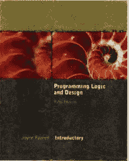

**《程序设计逻辑与设计（第五版）》**

作者：乔伊斯·法雷尔

| 版本 | ISBN |
| --- | --- |
| 入门版 | 978-1-4239-0195-2 |
| 综合版 | 978-1-4239-0196-9 |

### 同样可选

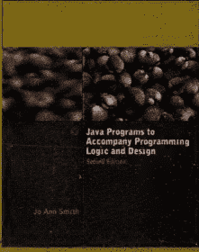

**《Java程序：配套〈程序设计逻辑与设计〉（第二版）》**

作者：乔·安·史密斯

ISBN: 978-1-4239-0229-4

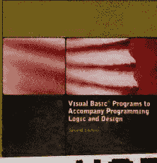

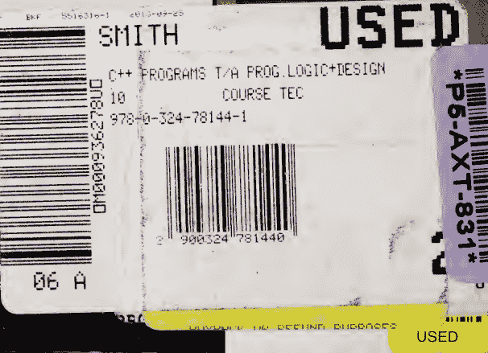
