# C++ & Python 初学者指南 - 第 8 版，2021年


学习 C++ & Python
所需的所有内容

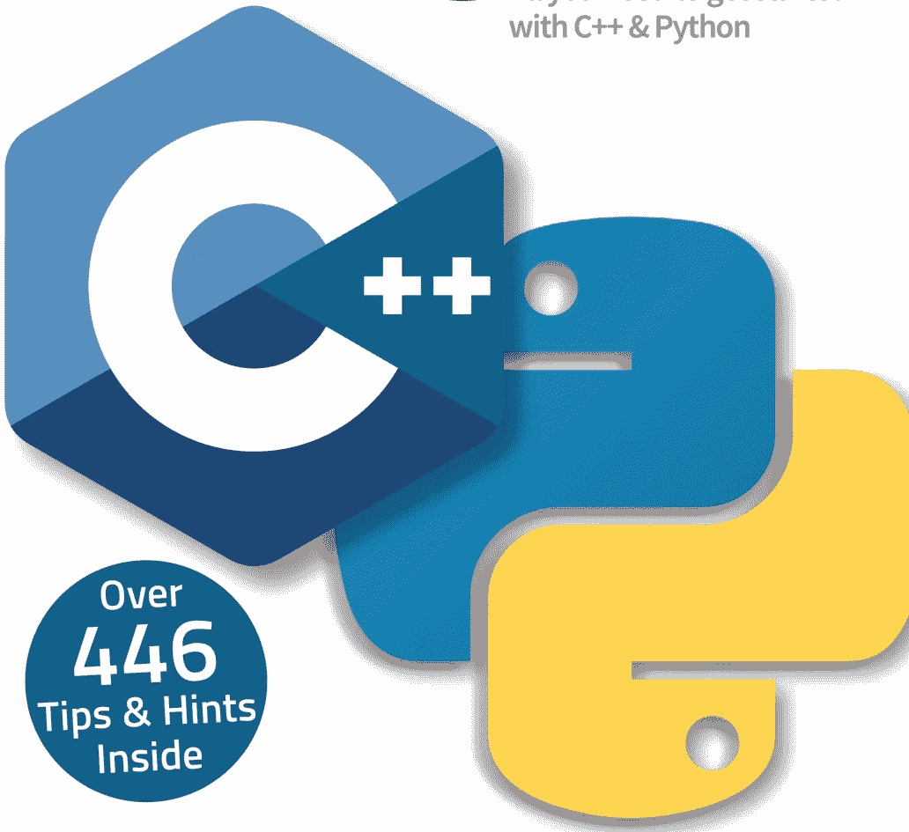

内置超过 446 个
技巧与提示

- 无专业术语的技巧与建议
- 循序渐进的教程
- 清晰的全彩指南

# 你是 Windows PC 用户吗？

那么现在就不要在 Readly 上错过我们最新的 Windows 11 必备用户指南了！

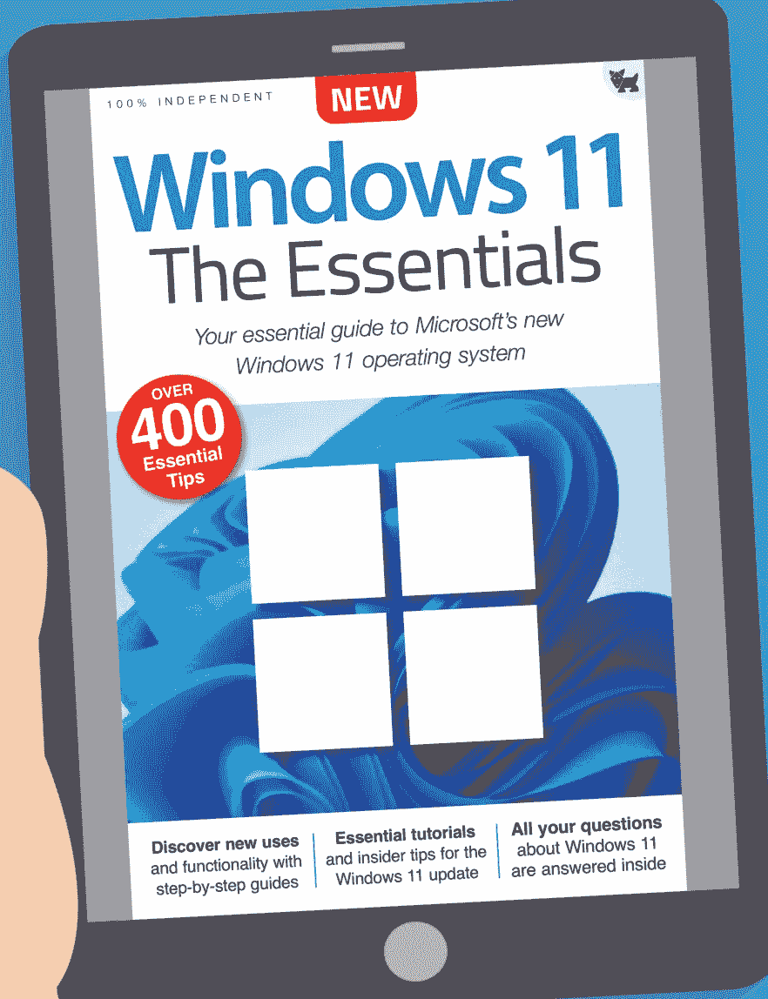


开始新事物可能会令人敬畏。学习一项技能或掌握一个新硬件都是困难的。如果你身边没有人帮助，甚至会更加困难。相反，随着我们消费技术复杂性的增加，所需的说明书尺寸却在减小，在某些情况下，它们直接消失了。在生活中的许多时刻，我们都曾是“初学者”，这一事实并不可耻，而且确实如此。你曾多少次大声问道：“这个按钮是做什么的？”“为什么那个不起？”、“你什么意思是它不能那样做？”、“救命！”。在任何新旅程或冒险的开始，我们都是初学者，但对你来说的是，我们会在每一个阶段守在你身边。

在这一系列大量的著作中，我们将深入探讨最新的消费电子产品、软件、爱好和趋势！我们将引导你循序渐进地使用你以前可能一直畏于尝试的技术各个方面。让我们的专家指南帮助你建立对技术的理解和技能，带你从新手变成一个自信且经验丰富的用户。

我们的旅程从本页开始。我们祝你好运，但我们确信，在有我们的支持下，你不需要好运。


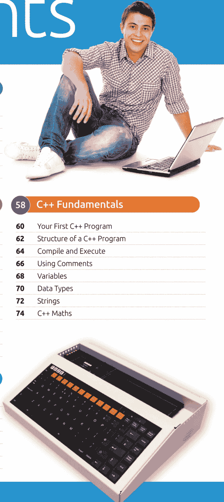


# BDM 的
代码门户
60+ 个 Python 程序
花费 21,500+ 行代码
借助我们极好的
代码门户帮助精通 Python，其中包含
游戏、工具等更多代码。

...技术无处不在，它通过编程连接在一起。你的电视、微波炉、车内娱乐系统和互联网本身都依赖于良好的编程，才能让它们按照你想要的方式运行……


# 向 Python 问好

有很多不同的编程语言可以学习和使用。有些非常复杂且功能强大，而有些则很基础。

本书的前半部分帮助你开始使用最新版本的 Python，并从那里引导你使用一些最常见和有趣的功能和特性。不久之后，你将编写自己的实用系统工具、文字冒险，甚至控制角色在屏幕上移动。

# 为什么选择 Python？

## Python 的力量？

其中一些语言是为科学工作设计的，有些是为了移动平台等。

从我们拥有的最早计算机出现起，爱好者、用户和专业人士一直通宵劳作，在过热的电路上方彻夜不眠，以创造类似于魔法的东西。

这些先驱开辟了新的疆域，创建了小型程序，让字母“A”能够在屏幕上划过。对于习惯了超高定义图形和开放世界多人游戏的这一代人来说，这听起来可能没什么不起。


# 为什么选择 Python？

操作系统如 Windows、macOS 和 Linux，通常是 C++、C# 以及某些形式的可视化语言组合。游戏通常使用 C++ 并配合内存管理，而它是如 HTML、Java、Python 等可用语言的开发平台之一。

Python 诞生于二十多年前，现已发展成为学习计算机编程的理想初学者语言。对于爱好者、学生、教师，以及那些只需要在自己或外部硬件与电脑之间创建简单交互的人来说，它都是完美的。

更通用的编程被用于创建程序、应用程序、软件或无论他们如何称呼这些东西。它们被广泛应用于所有平台和几乎每一个可以想象的应用程序。某些语言比其他语言更快，某些比其他语言更容易学习。Python 就是这样一种通用型语言。

Python 免费下载和安装，并适用于 Linux、Windows、macOS、MS-DOS、OS2、IBM 系列机器。它被选为世界前五语言之一，并不断走在硬件和互联网的发展曲线前沿。

Python 被称为“高级语言”，因为它通过你的变量、对象、属性、子程序、循环和无数次交互与硬件及操作系统进行“对话”。它不像低级语言那样精简（低级语言可以直接与内存地址、调用和寄存器交互），但它是随处可访问且易于的。

所以回答这个问题：为什么选择 Python？简单来说，它是免费的、易学的、极其强大的、全球通用的，并且是一项卓越的学习和教育工具。

```java
// Import Java
import java.lang.reflect.*;
class Invoke {
    public static void main(String[] args) {
        try {
            Class c = Class.forName(args[0]);
            Method m = c.getMethod(args[1], new Class[]);
            Object ret = m.invoke(null, null);
            System.out.println("Invoked static method " + args[1] + " with no arguments results: " + ret);
        } catch (ClassNotFoundException e) {
            System.out.println("Class not found: " + args[0]);
        } catch (NoSuchMethodException e) {
            System.out.println("Method not found: " + args[1]);
        } catch (IllegalAccessException e) {
            System.out.println("You don't have permission to invoke that method");
        } catch (Exception e) {
            System.out.println("An exception occurred while invoking that method");
        }
        System.out.println("Method error: " + e.getMessage());
    }
}
```

```basic
50 LET py=15
60 FOR y=1 TO 10
70 LET BY=Y=Y+(RND*28)
80 LET bx=0
90 FOR d=1 TO 20
100 PRINT bx,py,"U"
110 PRINT bx,py,"V"
120 LET py=py-5
130 IF py<0 THEN LET py=30
140 FOR n=1 TO 10: NEXT n
150 IF py=27 THEN LET py=27
160 bx=bx+2
170 PRINT AT, 5,py,"B"
180 LET s=s+1
190 PRINT AT, 10,"score:",s
200 FOR v=1 TO 1000: NEXT v
210 NEXT
```

BASIC 是一种早期 8 位计算机用户开始学习的、非常简单的语言。

Java 是一种强大的语言，用于网页、机顶设备、电视甚至外壳。


```python
def play_game():
    attempts = 0
    while (guess = input("Enter a letter: ")) != "quote":
        attempts += 1
        if not guess.isalpha():
            print("Invalid, try again.")
            continue
        if guess not in alphabet:
            print("The letter is not in the alphabet. Try again.")
            continue
        if guess in secret_letters:
            print("Correct!")
            secret_letters.remove(guess)
            if len(secret_letters) == 0:
                print("You have found all letters. Congratulations!")
                break
        else:
            print("Already found that letter. Try again.")
    print(f"You failed in {attempts} attempts.")
```

Python 是一种基于 BASIC 的现代语言，它易于学习，是理想的初学者语言。

# 向 Python 问好

## 你需要的设备
你只需要很少的硬件或初始投入就可以学习 Python。你不需要极其强大的计算机，而且任何需要的软件都是免费提供的。坦率地说，Python 是一种多平台语言，适用于 Windows、macOS、Linux、树莓派等更多平台。如果你拥有其中一种系统，就可以轻松地开始使用 Python。

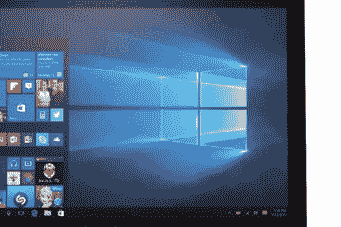

## 电脑
显然，你需要一台电脑来学习如何 Python 编程并测试你的代码。你可以使用 32 位或 64 位处理器的 Windows（从 XP 及以后版本）、Apple Mac 或 Linux。

## IDE
IDE（集成开发环境）被用于输入和执行 Python 代码。它允许你检查程序中的值，并提供高级功能。有许多不同的 IDE，找到适合你并能产生良好结果的那一个。


## Python 软件
macOS 和 Linux 已经预装了 Python，树莓派也是如此。然而，你需要确保运行的是最新版本的 Python。Windows 需要下载并安装 Python。

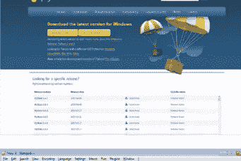

## 文本编辑器
虽然文本编辑器是输入的理想环境，但并非必须。你可以直接从 IDLE 输入并执行代码，但 Sublime Text 或 Notepad++ 等文本编辑器提供了更高级的功能和代码高亮。

## 网络访问
Python 是一个不断进的环境，新版本经常引入新概念或更改现有代码使其更高效。访问互联网可以在你遇到困难时帮助你，并让你接触到 Python 海量的模块。

## 时间与耐心
其他书籍可能会让你认为 24 小时内就能成为程序员。学习 Python 代码需要时间和耐心。你可能会遇到困难，但那时代码会像水一样流淌。理解你在学习全新的东西，你就能到达。

## 树莓派
为什么使用树莓派？树莓派是一种非常便宜的小型计算机，为用户提供了极佳的学习平台。它的主操作系统 Raspbian 预装了带有许多模块的最新 Python。

# Raspbian
树莓派 3 是最新版本，包含了更强大的 CPU、内存、Wi-Fi 和蓝牙支持。你可以根据感兴趣的套装以 32 英元购买 Pi，或者购买 50 英元以上的套装。

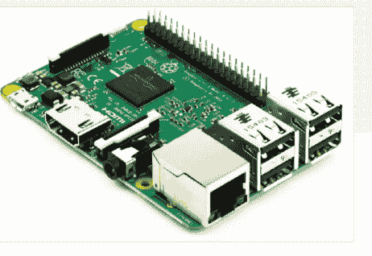

## FUZE 项目
FUZE 是建立在最新型号树莓派上的学习环境。你可以购买带有电子套件甚至机器人手臂的构建和项目。你可以在 fuze.co.uk 更多信息。

# Raspbian
树莓派的主操作系统是一个基于 Debian 的 Linux 发行版，包含了你所需的所有简单易用包。它为 Pi 进行了优化，是硬件软件项目、编程甚至作为桌面电脑的理想平台。


## 书籍
我们在 bdmpublications.com 有许多优秀的编程书籍。我们的 Pi 书涵盖了如何购买你的第一台树莓派、设置和使用它；还有一些很好的项目示例和指南让你从树莓派中获得最大收益。

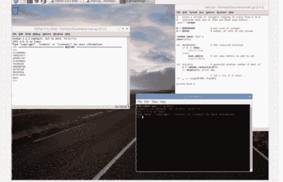

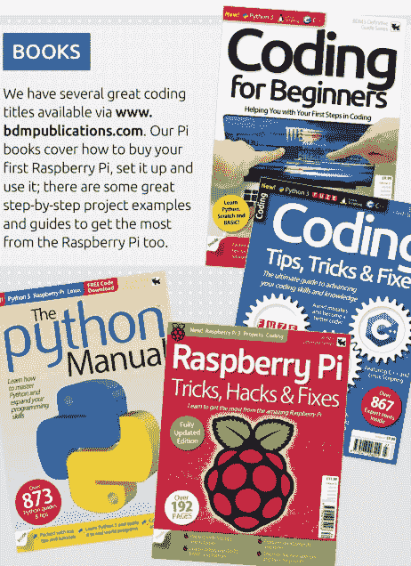

# 认识 Python

## 了解 Python
Python 是创造以来最强大的计算机编程语言。它让你以一种简洁且易于理解的语言充分利用计算机的力量。

## 什么是编程？
在尝试学习编程语言之前，了解什么是编程语言是有帮助的，让我们看看 Python 是如何产生的以及它与其他语言的关系。

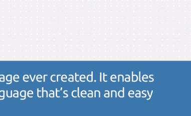

# 编程食谱
程序就像计算机的食谱。

- 在碗里放入 100 克泡松粉。
- 在碗里加入 100 克奶油。
- 加入 100 毫升牛奶。
- 烘烤半小时。

编程语言是计算机遵循的指令列表。这些指令可以简单到保存或播放文件，也可以复杂到构建一个世界。Python 在 20 世纪 80 年代后期由 Guido Rossum 在荷兰 Centrum Wiskunde 想出，作为 ABC 语言的继承者。

> Guido Rossum，Python 之父。

就像食谱一样，程序由你顺序遵循的指令组成。程序描述了蛋糕运行可能像什么：

```python
cake = []
flour = 100
butter = 50
milk = 100
cake.append([flour,butter,milk])
cake.cake()
```

# 程序命令
你可能不理解某些 Python 命令，例如 `append` 和 `cake.cake(bowl)`。第一个列表是第二个；我们将在书中查看两者。主要知道的一点是，Python 中读取命令是很容易的。当你学习了命令时，很容易弄清楚程序是如何工作的。

```python
def cake(self):
    for ingredient in self:
        print(ingredient)
```

```python
cake = []
flour = 100
butter = 50
milk = 100
cake.append([flour,butter,milk])
```


# 高级语言

易于阅读的计算机语言被称为“高级语言”。这是因为它们运行在硬件（也称为“底层”）之上。那些“接近底层”的语言（如汇编语言）被称为“低级语言”。低级语言读起来很困难，如下所示：`msg db len eq $ - md`

# Python 之禅

Python 让你能够用人类可以理解的语言访问计算机的所有力量。这一切背后的被称为“Python 之禅”（The Zen of Python）。它是 20 条软件原则的集合，影响着该语言的设计。原则包括“优胜于丑陋”和“简单胜于复杂”。输入 `import this`，它将显示所有原则。

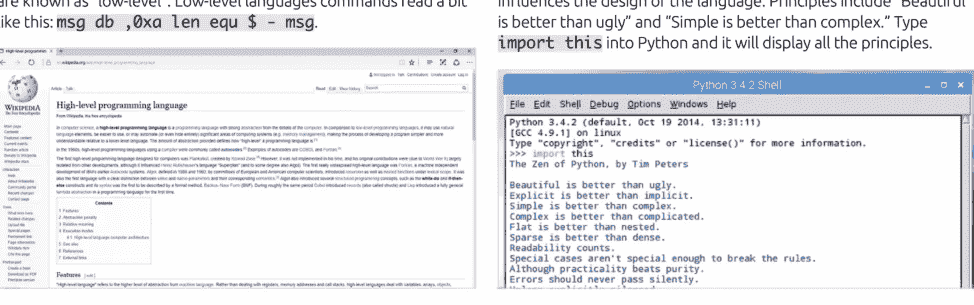

# Python 3 VS Python 2

在典型的计算场景中，Python 因为存在两个活跃版本的语言（Python 3 和 Python 2）而变得复杂。

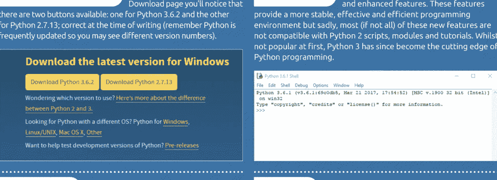

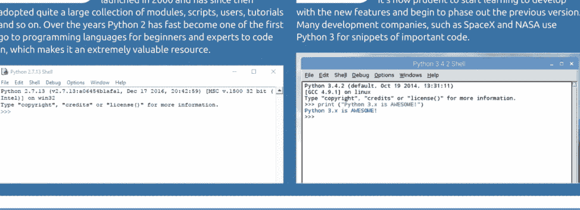

# 如何在 Windows 上设置 Python

Windows 用户可以通过主下载页面轻松安装最新版本的 Python。虽然大多数经验丰富的 Python 开发者避免将 Windows 作为构建代码的首选平台，但它它是初学者的理想起点。

## 安装 Python 3.X

Microsoft Windows 默认不预装 Python，因此你需要手动安装。坦率地说，这个过程非常简单：

- **第 1 步** 首先打开网络浏览器访问 [www.python.org/downloads/]。寻找 Python 3.x.x 的下载链接（在此例中是 Python 3.6.2，但你之后可能会看到更高版本）。

- **第 2 步** 点击版本 3.x 的下载链接，将文件保存到你的 Python 下载文件夹中。文件下载完成后，双击执行文件即可启动 Python 安装程序。从这里你有两个选择：立即安装或自定义。我们建议在安装时选择自定义：

- **第 3 步** 选择自定义选项允许你指定某些参数。虽然保持默认设置是一个良好的习惯（谢天地，Python 有时也是如此），但安装程序可能会包含不需要且可以避免的功能。在下一步，确保所有复选框已勾选并点击“下一步”按钮。

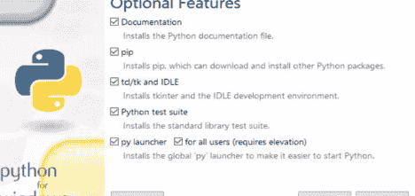

下载最新版本的 Python
[下载 Python 3.6.2] [下载 Python 2.7.18]
不知道哪个 Python 版本合适？[在此查看更多关于 Python 2 和 3 之间的差异]。

寻找其他操作系统的 Python？Python 支持 [Windows、Linux/Unix、Mac OS、其他]
想帮助开发最新版本的 Python 吗？[发布预览]

## 高级选项

安装 Python 3.6 (32位)
选择使用默认设置安装 Python，或选择启用额外功能。

- 立即安装
  包括安装程序、pip 和文档
  创建快捷方式和文件位置
- 自定义安装
  选择位置和功能
  - 为所有用户安装
  - 将文件关联到 Python（需要 python）
  - 为已安装的应用创建快捷方式
  - 将 Python 添加到环境变量
  - 预编译库路径
  - 下载调试二进制文件（需要 VS 5 或更高版本）

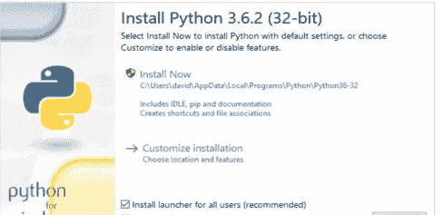

自定义安装
C:\Program Files (x86)\Python36-3

# 如何在 Windows 上设置 Python

**第 5 步** 你可能需要通过 Windows 身份通知确认安装。点击“是”，Python 就会安装。安装完成后，最后的 Windows 页面将允许你查看最新的发布说明，并遵循一些在线教程。

**第 6 步** 在关闭安装窗口之前，最好点击“禁用路径长度限制”旁边的链接。这将允许你绕过 260 个字符的限制，能够执行存储在深层目录中的 Python 程序。再次点击“是”激活该过程；然后就可以关闭安装窗口。

**第 7 步** Windows 10 用户现在会在“开始”按钮的“最近添加”部分找到已安装的 Python 3.x。第一个链接 Python 3.6 (32位) 点击后将启动 Python 的命令行版本。要打开 IDLE，在 Windows 开始菜单中输入 IDLE。

**第 8 步** 点击 IDLE (Python 3.6 32位) 链接将开启你的 Python 之旅。如果你的版本更高也不用，因为 Python 3.x 代码将在你的 Python 3 界面中运行。

**第 9 步** 如果现在再次点击“开始”按钮，这次输入 CMD，将出现命令提示符。点击它进入 Windows 命令行。从那里，你需要输入 python 并按回车。

**第 10 步** 命令行版本的 Python 运行正常。

### 安装成功
特别感谢 Mark Hammond，如果没有他免费分享的选项，Windows 版 Python 对我们来说仍然停滞不。
如何开始？查看在线教程和文档。
查看 Windows 新功能。

- 禁用路径长度限制

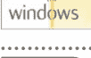

- 禁用路径长度限制
更改你的机器配置，允许其他程序以及 Python 绕过260个字符的“MAX_PATH”限制。

```
Python 3.6.2 (Windows v9.6.213f32, Jul 8 2017, 08:14:34) (MSC V.1900 32 bit (Intel)) on win
type "help", "copyright", "credits" or "license" 获取更多信息.
```

| 最佳匹配 |
| --- |
| IDLE (Python 3.6 32位) |
| 搜索结果 |
| C:\Userday |

```
Python 3.6.2 (Windows v9.6.213f32, Jul 8 2017, 08:14:34) (MSC V.1900 32 bit (Intel)) on win
> exit
```

# 如何在 Mac 上设置 Python

如果你正在运行 Mac，设置 Python 极其简单。事实上，已经安装了一个版本的 Python。然而，你应该确保运行的是最新版本。

## 安装 Python

苹果操作系统自带 Python，所以你不需要安装它。但是先检查一下是有意义的。

- **第 1 步** 点击“前往 > 实用工具”打开新的终端，然后双击终端图标。现在输入 `--version`。

 **第 2 步** 打开 Safari 并访问 `www.python.org/downloads`。与之前的 Windows 操作一样，你可以看到两个下载按钮：一个用于 Python 3.6.2，另一个用于 Python 2.7.13。注意，由于 Python 发布频繁，版本号可能与此处看到的不同。

- **第 3 步** 当 Python 安装窗口打开时，点击“继续”开始安装。花时间阅读“重要信息”部分，以防提到适用于你的 macOS 的 Python 版本。准备好后，再次点击继续。

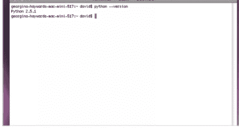

### 下载适用于 Mac OS X 的最新版本

不知道用哪个版本？在此查看更多关于 Python 2 和 3 之间的差异。

寻找其他操作系统的 Python？查看 Windows、Linux、Mac OS 或其他。

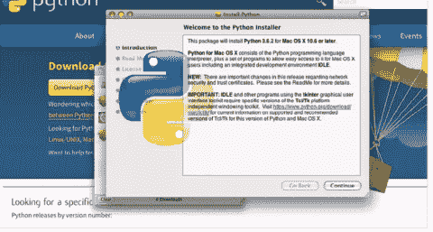


# 如何在 Mac 上安装 Python

**第 5 步** 下节将详细介绍软件许可协议，对大多数人来说，这可能并不有趣。当你准备好后，再次点击继续（Continue）按钮。

**第 8 步** Python 安装向导中没有多少剩下的可以做的，所以如果你回到终端（Terminal）会并重新输入命令：`python3 --version`，你可以看到新版本；如果需要退出，输入：`python`，退出则输入：`exit()`

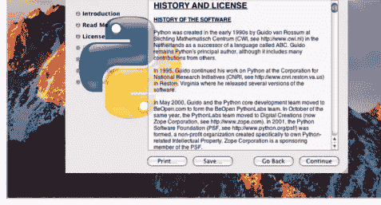

**第 6 步** 最后，你将看到 Python 将占据系统中的空间大小以及一个安装（Install）按钮，你需要点击它来开始在 Mac 上实际安装 Python 3.x。你可能需要输入密码来验证安装身份。

**第 7 步** 安装没有花费太长时间；我们在本节中使用的 Mac Mini 比现代 Mac 电脑慢一点，显示“安装成功（Installation Success）”提示大约需要三十秒钟。

**第 9 步** 你需要在访达（Finder）中搜索 Python IDLE；找到它后，点击启动，它的看起来应该与上一页中的 Windows 版 IDLE 相似。不同之处可能是 Mac 检测到了它所运行的硬件平台。

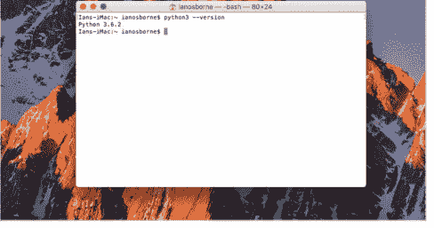

```
Python 3.6.8 (default, Clang 7.0.0 1, Dec 22 2016, 17:23:13)
GCC 4.0.1 (Apple Inc. build 549d3) on Darwin
Type 'copyright', 'credits' or 'license' for more information.
WARNING: The version of Tcl/Tk may be unstable Visit http://www.python.org/download/mac/ for current information.
```

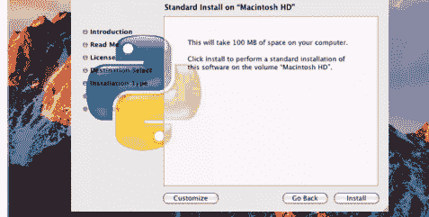

**第 10 步** 旧版本的 Mac 可能在运行新版本的 Python 3.x 时遇到问题，在这种情况下，你需要回退到 Python 3.x 构建版本；只要你使用的是 Python 3.x，书中的代码就能对你有效。

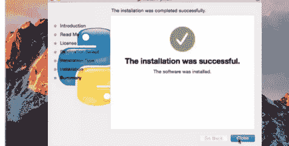

```
Python 3.1.2 (r312:00GM, Mar 24 2010, 01:33:18)
GCC 4.0.1 (Apple Inc. build 549d3) on Darwin
Type 'copyright', 'credits' or 'license' for more
>>
```


# 如何在 Linux 中安装 Python

大多数 Linux 发行版已经安装了 Python 2.x，但我们将使用 Python 3.x，我们首先需要做一些工作来获取它。坦率地说，这并不困难。

## Python 安装指南

Linux 是一个如此多功能的操作系统，因此很难确定执行某事的唯一方法。不同的发行版以不同的方式安装软件，因此在本特定教程中我们将使用 Linux Mint 18.1。

**第 1 步** 首先需要确定你的 Linux 系统当前安装了哪个版本的 Python；如前所述，本节将使用 Linux Mint 18.1。与 macOS 类似，按下 Ctrl+Alt+T 进入终端。

**第 2 步** 接下来在终端中输入：`python --version`。我们应该得到关于 Python 2.x 版本的输出。在这种情况下，输出是 2.7。

**第 3 步** 某些 Linux 发行版会在系统更新时自动将 Python 的安装更新到最新版本。要进行检查，首先使用以下命令进行系统更新和升级：

```bash
sudo apt-get update && sudo apt-get upgrade
```
输入密码并让系统完成任何更新。

**第 4 步** 一旦更新和升级完成，你可能需要回答 'Y' 来授权你的操作。在 Linux Mint 的情况下，版本为 3.5.2，这对于我们的目的足够了。输入：`python3 --version` 查看 Python 3 是否已更新甚至安装。

```bash
david@david-mint ~ $ python --version
Python 2.7.1
david@david-mint ~ $
```

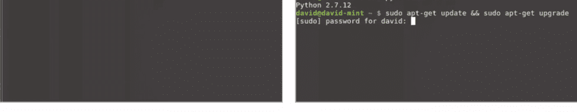

**第 5 步** 然而，如果你想要在编写本文时使用最新版本 3.6.2 来从源码构建 Python，你需要在终端中输入这些命令：

```bash
sudo apt-get install build-essential checkinstall
sudo apt-get install libreadline-dev libsqlite3-dev
sudo apt-get install libssl-dev
sudo apt-get install tk-dev
sudo apt-get libdbm-dev
```

**第 6 步** 打开你的 Linux 浏览器并访问 python.org 下载 Python-3.6.2（或你需要的版本）。

**第 7 步** 在终端中，使用 `tar -xvf` 解压 Python-3.6.2。然后进入解压后的文件夹 `cd Python-3.6/`。

**第 8 步** 在文件夹内执行：
```bash
./configure
sudo make altinstall
```
这取决于你电脑的速度。完成后，运行 `python3.6 --version` 进行检查。

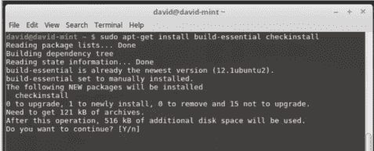

对于 GUI IDE，你需要输入命令：

```bash
sudo apt-get install idle3
```
IDLE 可以通过命令 `idle3` 启动。注意它运行的版本与你安装的可能。

你还需要 Pip（Python 安装程序）来安装更多模块。输入：
```bash
pip3 install --upgrade
```
完成后，Python 3 将通过发行版可用。

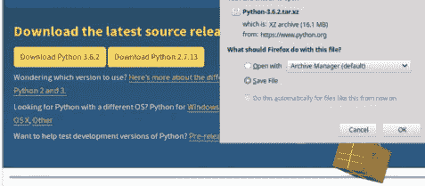

# 开始学习 Python

刚开始学习 Python 可能看起来很困难，但这门语言的设计非常简单。在本节中，我们将涵盖变量、数字、用户输入、条件和循环；以及可能会遇到的错误类型。

## 首次启动 Python

我们不会进入启动树莓派的细节，关于该主题有很多资料。然而，当你准备好后，启动你的 Pi 并准备编码。

**第 1 步** 树莓派桌面加载后，点击菜单中的 Programming > Python。这将打开 Python Shell。

**第 2 步** Shell 是你输入代码并看到编写代码的响应和输出的地方。这是一个沙箱，你可以在里面尝试一些代码和过程。

**第 3 步** 例如，在 Shell 中输入 `2+2`。按下回车后，下一行将显示答案：4。基本上，Python 处理了这些“代码”并产生了相应的输出。

```
Python 3.4.2 (default, Oct 9 2014, 13:31:11)
(GCC 4.9.2) on Linux
>>> type 'copyright', 'credits' or 'license' for more information.
>>> 2+2
4
```

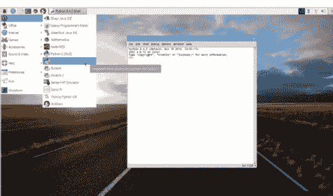


## 首次开始 Python

第 5 步虽然很有趣，但并不是特别有趣。相反，尝试这个：

```
print("Hello everyone!")
```

就像你在本书的《安装文本编辑器》章节中在 Sublime 中输入的代码一样。

第 8 步 Python IDE 是一个可配置的环境。如果你不想改变显示方式，可以通过 Options（选项）> Configure IDE（配置 IDE）并点击 Highlighting（高亮）选项卡来更改。我们建议你这样做，正如我们的屏幕截所示所示。

```
Python 3.4.2
File Edit Debug Window
Python 3.4.2 (Oct. 19 2014, 13:31:15)
>>> print(type("copyright, "credits" or "license") for more information.)
'str'
>>> 2385669532
6480599242-12345
978809269-12345
12874274534
>>> print("Hello everyone!")
hello everyone!
```

第 6 步 这更像那么回事，因为你刚刚写了第一段代码。`print` 命令非常浅俗易懂，它的作用就是打印。Python 3 还需要括号来输出到屏幕，在这种情况下是 "Hello everyone!"。

第 9 步 就像大多数程序一样，无论操作系统如何，都有许多快捷键。我们这里没有空间列所有的，但在 Options > Configure IDE 的 Keys（键）选项卡下，你可以看到当前的绑定列表。

```
>>> print("Hello everyone!")
Hello everyone!
>>> 
```

第 7 步 你注意到了 Python IDE 内的颜色编码。这些颜色代表 Python 代码的元素。它们是：

第 10 步 Python IDE 是一个强大的界面，它实际上是用 Python 编写的。如果你想了解 Shell 的很多输入输出，我们建议你花几分钟查看 [www.docs.python.org/3/library/idle.html]，它详细说明了 IDE 的许多功能。

- 黑色：数据和变量
- 蓝色：用户函数
- 绿色：字符串
- 红色：注释
- 紫色：函数
- 浅色：错误消息
- 橙色：注释

## IDLE 颜色编码

| 颜色 | 用途 | 示例 |
|---|---|---|
| 黑色 | 数据与变量 | 2.3.4 |
| 绿色 | 字符串 | "Hello World" |
| 紫色 | 函数 | len(1) |
| 橙色 | 注释 | get_area() |
| 红色 | 注释 | #number VAT |
| 浅红色 | 错误消息 | SyntaxError: |

## 入门 Python

## 你的第一个代码

基本上，对于大多数计算机或人类语言，都在于在并正确的应用。你并不是出生就知道这些单词，所以你需要学习它们。

- 第 1 步 如果关闭了 Python 3 IDLE，请在 Shell 中重新打开它，并在下方输入你喜欢的操作系统版本：

```
print("Hello")
```

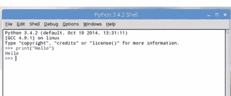

- 第 3 步 你看到输出不是数字 4，而是你要求打印到屏幕上的 2+2。问号定义了输出到 IDE Shell 的内容：要打印 2+2 的总和，你需要去掉引号：

```
print(2+2)
```

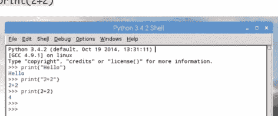

- 第 2 步 正如预期的，Hello 单词在 Shell 中以蓝色文本出现，表示是从字符串中输出。这非常直接，不需要太多的解释。现在尝试：

```
print("2+2")
```

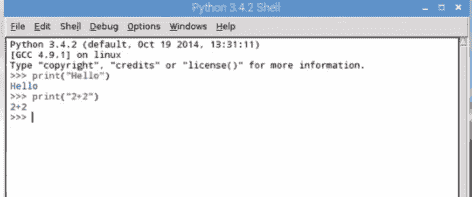

- 第 4 步 你可以继续这样向 Shell 打印 2+2、464+2344 等。一种简单的方法是使用变量，我们稍后会深入介绍。现在，输入：

```
a=2
b=2
```

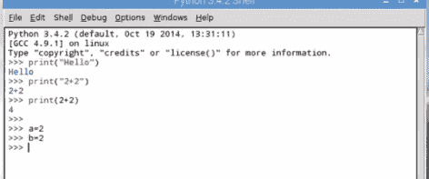

## 第 5 步

你在这里做给字母 a 和 b 赋值：2 和 2。这些是变量，只要它们的数字不变，就可以调用 Python 进行输出、加法、减法等。尝试这个：

print(a)

```python
### Python 3.4.2 Shell
Python 3.4.2 (default, Oct 19 2014, 13:31:11)
Type "copyright", "credits" or "license" for more information.
>>> print("Hello")
Hello
>>> a=2
>>> b=2
>>> print(a+b)
4
>>> print(a-b)
0
>>> print(a*b)
4
>>> print(a/b)
1.0
```

## 第 8 步

让我们添加一个姓：

```python
surname="Hayward"
print(surname)
```

你有两个包含名字和姓的变量，你可以独立地打印它们。

```python
### Python 3.4.2 Shell
Python 3.4.2 (default, Oct 19 2014, 13:31:11)
Type "copyright", "credits" or "license" for more information.
>>> print("Hello")
Hello
>>> name="David"
>>> surname="Hayward"
>>> print(name)
David
>>> print(surname)
Hayward
```

## 第 6 步

最后步骤的输出分别确认了 a 和 b 的值，正如你要求的单独打印。如果你想把它们相加，使用以下代码：

print(a+b)

这段代码简单地获取 a 和 b 的值，相加并输出结果。

```python
### Python 3.4.2 Shell
Python 3.4.2 (default, Oct 19 2014, 13:31:11)
Type "copyright", "credits" or "license" for more information.
>>> print("Hello")
Hello
>>> a=2
>>> b=2
>>> print(a+b)
4
>>> print(a-b)
0
>>> print(a*b)
4
>>> print(a/b)
1.0
```

## 第 9 步

就像大多数程序一样，无论操作系统如何，都有许多快捷键。我们这里没有空间列所有的，但在 Options > Configure IDE 的 Keys 选项卡下，你可以看到当前的绑定列表。

```python
>>> print("Hello everyone!")
Hello everyone!
>>> 
```

第 7 步 你注意到了 Python IDE 内的颜色编码。这些颜色代表 Python 代码的元素。它们是：

第 10 步 Python IDE 是一个强大的界面，它实际上是用 Python 编写的。如果你想了解 Shell 的很多输入输出，我们建议你花几分钟查看 www.docs.python.org/3/library/idle.html，它详细说明了 IDE 的许多功能。

对于大多数语言（计算机或人类语言），核心都是在正确的情况下记住并应用正确的单词。你并不是出生就知道这些单词，所以你需要学习它们。

- 第 1 步 如果你关闭了 Python 3 IDLE，请在 Shell 中重新打开它，并在下方输入你喜欢的操作系统版本：

```python
print("Hello")
```


- 第 3 步 你看到输出不是数字 4，而是你要求打印到屏幕上的 2+2。问号定义了输出到 IDE Shell 的内容：要打印 2+2 的总和，你需要去掉引号：

```python
print(2+2)
```


- 第 2 步 正如预期的，Hello 单词在 Shell 中以蓝色文本出现，表示是从字符串中输出。这非常直接，不需要太多的解释。现在尝试：

```python
print("2+2")
```


- 第 4 步 你可以继续这样向 Shell 打印 2+2、464+2344 等。一种简单的方法是使用变量，我们稍后会深入介绍。现在，输入：

```python
a=2
b=2
```


## 第 5 步

你在这里做给字母 a 和 b 赋值：2 和 2。这些是变量，只要它们的数字不变，就可以调用 Python 进行输出、加法、减法等。尝试这个：

print(a)

```python
### Python 3.4.2 Shell
Python 3.4.2 (default, Oct 19 2014, 13:31:11)
Type "copyright", "credits" or "license" for more information.
>>> print("Hello")
Hello
>>> a=2
>>> b=2
>>> print(a+b)
4
>>> print(a-b)
0
>>> print(a*b)
4
>>> print(a/b)
1.0
```

## 第 8 步

让我们添加一个姓：

```python
surname="Hayward"
print(surname)
```

你有两个包含名字和姓的变量，你可以独立地打印它们。

```python
### Python 3.4.2 Shell
Python 3.4.2 (default, Oct 19 2014, 13:31:11)
Type "copyright", "credits" or "license" for more information.
>>> print("Hello")
Hello
>>> name="David"
>>> surname="Hayward"
>>> print(name)
David
>>> print(surname)
Hayward
```

## 第 6 步

最后步骤的输出分别确认了 a 和 b 的值，正如你要求的单独打印。如果你想把它们相加，使用以下代码：

print(a+b)

这段代码简单地获取 a 和 b 的值，相加并输出结果。

```python
### Python 3.4.2 Shell
Python 3.4.2 (default, Oct 19 2014, 13:31:11)
Type "copyright", "credits" or "license" for more information.
>>> print("Hello")
Hello
>>> a=2
>>> b=2
>>> print(a+b)
4
>>> print(a-b)
0
>>> print(a*b)
4
>>> print(a/b)
1.0
```

# 保存并执行你的代码

## 编辑代码

虽然在 IDLE Shell 中工作对于小型代码片段来说完全足够，但它并不是为输入程序列表设计的。在本节中，你将介绍 IDLE 编辑器，从现在起你将在那里工作。


## 步骤 5 为你的代码输入一个名称，例如 'print hello'，然后点击保存按钮。Python 代码将被保存，如果执行，结果将在 IDLE Shell 中详细显示。在这种情况下，显示的内容为 'Hello everyone!'。

## 步骤 8 让我们扩展代码，并输入上一个教程中的几个示例：

```
a=2
b=2
name="David"
surname="Hayward"
print(a+b)
```

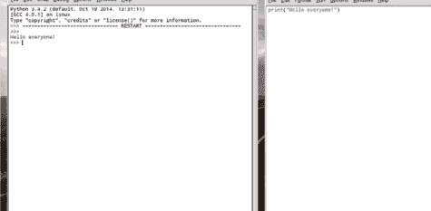

如果你按下 F5，它将保存代码，因为它已经从以下内容进行了修改：

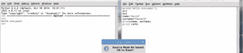

## 步骤 6 这是你大部分 Python 代码的运行方式。将其输入编辑器编辑器，按下 F5，保存代码并查看 Shell 中的输出。有时输出会有所不同，取决于你是否请求了独立窗口，但本质上就是这个过程。除非另有说明，否则我们将全程使用这个过程。

如果你点击 OK 按钮，文件将被新的代码条目覆盖并执行，输出将在 Shell 中。对于这几行代码这不是问题，但如果你编辑了一个较大的文件，覆盖可能会成为问题。使用编辑器中的“File > Save As”来创建一个副本。

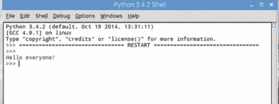

## 步骤 7 如果你打开保存 Python 代码的位置，你会发现它是 .py 扩展名。这是 Python 文件的默认文件名。你创建的任何代码可以是任意名称，从互联网下载的任何代码也是。只需确保代码是为 Python 3 编写的。

## 步骤 10 创建一个新文件。关闭编辑器并打开一个新实例（File > New File from the Shell）。输入以下并保存为 hello：

```
a="Python"
b=15
c="cool!"
print(a, b, c)
```

你将在教程中使用这段代码。

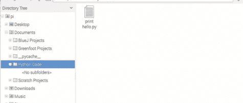

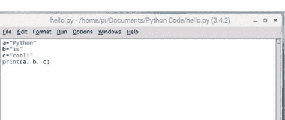

## 从命令行执行代码

尽管我们在本书中一直使用 GUI（图形界面），但查看一眼 Python 的命令行处理也是值得的。我们已经知道有一个命令行版本的 Python，它也被用于执行代码。

## 命令行执行代码

使用我们在上一个教程中创建的代码（即命名为 hello.py 的代码），看看如何在命令行级别运行在 GUI 中创建的代码。

- 步骤 1 在 Linux 中，Python 有两种通过命令行执行代码的方法。其中一种方法是使用 Python 2，而另一种是使用 Python 3 库等。首先，进入你操作系统的命令行或终端（Terminal）。

- 步骤 3 现在你已处于命令行界面，我们可以开始运行 Python。对于 Python 3，你需要输入命令并按回车键。这将你进入命令行版本的 Shell，并带有熟悉的三个右箭头作为光标 (>>)。

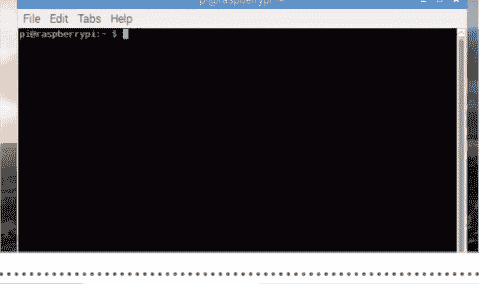

- 步骤 2 像之前一样，我们使用的树莓派：Windows 需要点击开始按钮并搜索 CMD，然后点击搜索结果中的 Command Line；macOS 用户可以通过点击 Go > Utilities > Terminal 来访问他们的命令行。

- 步骤 4 从这里你可以输入我们之前看过的代码，例如：

```
a=2
print(a)
```

你可以发现它的工作原理完全一样。

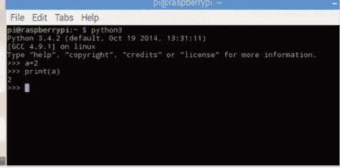

## 从命令行执行代码

**步骤 5** 现在输入：exit() 以退出命令行会话并返回命令提示符。进入你从上一个教程保存的文件夹，并列出其中的可用文件；希望你能看到 hello.py。

**步骤 8** 从 Python 2 代码运行 Python 3 代码的结果是非常显而易见的。虽然由于 Python 3 处理 Print 的方式与 Python 2 不同，它并没有报错，但结果并不是我们预期的。使用 Sublime 打开 hello.py：

```
hello.py
python 2.7 (default Oct 19 2014, 12:31:11)
print('copyright', 'credits' or 'license' for more information.
print('hello, world')

exit()
C:\Documents\rasberrypi~/Documents/Python Code
python hello.py
rasberrypi~/Documents/Python Code $
python3 hello.py
rasberrypi~/Documents/Python Code $
```
```
hello.py
python 2.7 (default Oct 19 2014, 12:31:11)
print('copyright', 'credits' or 'license' for more information.
print('hello, world')

exit()
C:\Documents\rasberrypi~/Documents/Python Code
python hello.py
rasberrypi~/Documents/Python Code $
python3 hello.py
rasberrypi~/Documents/Python Code $
```

**步骤 6** 在你要运行的代码所在的文件夹内，输入 python3 hello.py 将执行该代码，提醒你：

**步骤 9** 由于树莓派上没有 Sublime Text，暂时离开树莓派并使用 Python IDLE。打开 hello.py 文件，包含以下内容：

```
a="Python"
b="cool"
print(a, b, c)

name=input("What is your name?")
print("hello", name)
```
```
hello.py
python 2.7 (default Oct 19 2014, 12:31:11)
print('copyright', 'credits' or 'license' for more information.
print('hello, world')

exit()
C:\Documents\rasberrypi~/Documents/Python Code
python hello.py
rasberrypi~/Documents/Python Code $
python3 hello.py
rasberrypi~/Documents/Python Code $
```
```
hello.py
python 2.7 (default Oct 19 2014, 12:31:11)
print('copyright', 'credits' or 'license' for more information.
print('hello, world')

exit()
C:\Documents\rasberrypi~/Documents/Python Code
python hello.py
rasberrypi~/Documents/Python Code $
python3 hello.py
rasberrypi~/Documents/Python Code $
```

**步骤 7** 自然地，既然你正在使用 Python 3，如果你尝试用 Python 2 输入语法和布局是 Python 3 特有的：

**步骤 10** 保存 hello.py 文件并回到命令行。现在新保存的 python3 hello.py hello.py 结果将是原始代码！在你的代码中添加 input 并在窗口中显示。

```
hello.py
python 2.7 (default Oct 19 2014, 12:31:11)
print('copyright', 'credits' or 'license' for more information.
print('hello, world')

exit()
C:\Documents\rasberrypi~/Documents/Python Code
python hello.py
rasberrypi~/Documents/Python Code $
python3 hello.py
rasberrypi~/Documents/Python Code $
```
```
hello.py
python 2.7 (default Oct 19 2014, 12:31:11)
print('copyright', 'credits' or 'license' for more information.
print('hello, world')

exit()
C:\Documents\rasberrypi~/Documents/Python Code
python hello.py
rasberrypi~/Documents/Python Code $
python3 hello.py
rasberrypi~/Documents/Python Code $
```

# 数字与表达式

我们已经看到了 Python 的一些基础数学表达式，简单的加法等。现在让我们扩展一下，看看 Python 作为计算器有多强大。你可以在 IDLE Shell 或编辑器中工作，随你喜欢。

## 全都是数学

你可以利用 Python 的数学能力获得一些令人惊讶的结果；正如大多数（并非所有）编程语言一样，数学是大脑后部的小器官

- 步骤 1 如上所述打开 Python 3 GUI 版本。下次当你准备使用 Shell 或编辑器来活跃大脑后部（或不在）的小器官时：

- 步骤 3 你可以使用所有的数学操作：除法、乘法、括号等。练习几个，例如：

```
1/2
6/2
2*3
(1+2)+(3*4)
```

```
Python 3.4.2 Shell
File Edit Shell Debug Options windows help
Python 3.4.2 (default. Oct 19 2014, 13:31:11)
(GCC 4.9.0) on Linux
>>> print("copyright "credits" or "license") for more information.
>>> 1/2
0.5
>>> 54356+3553245
3607601
>>> 986734*2734484421
269807102281179024
```

- 步骤 2 在 Shell 中输入：
2*2
54356+3553245
986734*2734484421

- 步骤 4 你没有注意到，除法产生的是小数。在 Python 中这些被称为浮点数（floats）或浮点运算。然而，如果你需要将整数转换为小数，可以使用双斜杠：

你可以看到 Python 可以轻松处理大数字。

```
1/2
6/2
2*3
(1+2)*(3*4)
```

等等如此。

```
Python 3.4.2 Shell
File Edit Shell Debug Options windows help
Python 3.4.2 (default. Oct 19 2014, 13:31:11)
(GCC 4.9.0) on Linux
>>> print("copyright "credits" or "license") for more information.
>>> 1/2
0.5
>>> 54356+3553245
3607601
>>> 986734*2734484421
269807102281179024
```


# 数字与表达式

**步骤 5**：你也可以使用运算符来查看除法后的余数。例如：

**步骤 8**：这将显示为 '01'，将整数转换为二进制并在前面添加前缀 0b。如果你想移除 0b 前缀，可以使用：

10/3
将显示为 3.333333333，即 3.3 循环小数。如果你现在输入：

**Format(3, "b")** 
该命令将一个值（数字 3）转换为格式化表示，由格式规范中的 'b' 部分控制。

10%3
将显示为 1，即 10 除以 3 的余数。

```
>> 2**3
== 8
>> (1+2)*3
== 9
>> 1/2
== 0.5
>> 6/2
== 3
>> 10/3
== 3.3333333333333335
>> 10%3
== 1
```

等等，让我们重新检查 10/3 的结果。

 10/3
== 3.3333333333.

**步骤 6**：接下来是幂运算符，或者如果你想显得专业，可以叫指数运算。计算某个数的幂，你可以使用键盘上的双乘号或双星号：

**步骤 9**：布尔逻辑，其结果为真（True）或假（False）。我们可以使用这些来比较数据，查看它们是否相等、小于或大于。这在一个新文件中：

2**3
10**10
本质上它是 2 的 3 次方，但你已经了解数学运算符背后的基础。在 Python 中你可以这样写：

```python
a = 6
b = 7
print(a == a)
 True
print(a == b)
 False
print(a == 6 and b == 7)
 True
print(a == 4 and b == 7)
 False
print(5, not a == 7 and b)
 False
print(6, a == 7 or b == 7)
 True
print(7, a == 7 or b == 6)
 True
print(8, not (7 or b == 6))
 False
print(9, not (7 and b == 6))
```

```
>> 2**3
== 8
>> (1+2)*3
== 9
>> 1/2
== 0.5
>> 6/2
== 3
>> 10/3
== 3.3333333333333335
>> 10%3
== 1
>> 2**3
== 8
>> 10**10
== 10000000000
```

**步骤 7**：数字和表达式并不止于此。Python 有内置函数来处理数字、绝对值、复数以及各种数学表达式和勾股定理。要转换为二进制，请使用：

**步骤 10**：执行步骤 9 中的代码，你可以看到一系列 True 或 False 语句，展示了值 6 和 7 的结果。这是你之前看到内容的扩展，是编程中的重要部分。

bin(3)

```
>> 1/2
== 0.5
>> 2**3
== 8
>> (1+2)*3
== 9
>> 1/2
== 0.5
>> 6/2
== 3
>> 10/3
== 3.3333333333333335
>> 10%3
== 1
>> 2**3
== 8
>> 10**10
== 10000000000
>> bin(3)
'0b11'
```


www.bdmpublic.com 31

## 使用注释

当你编写代码时，代码的流程、每个变量的作用、整个程序的运行方式都在你的脑海中。另一位程序员随着时间的推移逐行查看代码时，这可能会变得难以阅读。

## 注释！

程序员通过对代码段进行注释来保持代码的可读性。例如，如果使用了一个变量，程序员会注释它预期的功能。这是一种良好的习惯。

- **步骤 1**：从创建一个 IDLE 编辑器新实例（File -> New File）开始，创建一个简单的变量和打印（print）命令：

```python
a=10
print("The value of A is", a)
```

保存文件并执行。

- **步骤 3**：重新保存代码并执行。你可以看到，尽管添加了行，IDLE Shell 中的输出与之前相同。简单来说，井号（#）是程序员可以插入的一行文本，用于告知他们和他人正在发生什么，而无需让用户察觉。


- **步骤 2**：运行代码将在 IDLE Shell 窗口中返回：A 的值为 10，这是我们预期的。现在，添加一些代码中常见的注释：

```python
## Set the value of A to 10
a=10
## Print the current value of A
print(a
```

- **步骤 4**：假设我们创建的变量 A 是游戏中的生命值。每当玩家死亡时，变量就会减 1。程序员可以：

```python
a -= 1
```


# 变量操作

## 第 5 步

然而，你不能在同一个命令中组合字符串和整数变量，因为你需要一组变量来将一个转换为另一个，反之亦然。当你尝试将两者结合时，你将得到一个错误消息：

```python
print (name + age)
```

```python
Python 3.4.2 (default, Oct 19 2014, 13:31:11)
name = 'Thor'
age = 44
print(type(name))
<class 'str'>
print(type(age))
<class 'int'>
print(name + ' Descended from Vikings')
Thor Descended from Vikings
print(name + age)
TypeError: Can't convert 'int' object to str
```

## 第 8 步

当你想要处理用户输入的数字时，这会带来一些问题，因为 `age + 10` 由于是一个字符串和一个整数而无法工作。相反，你需要：

```
int(age) + 10
```

这将把字符串转换为可以操作的整数。

```python
Python 3.4.2
Edit File Debug Options Windows Help
Python 3.4.2 (default, Oct 19 2014, 13:31:11)
age = input("Enter your age: ")
print(type(age))
<class 'str'>
print(age + 10)
TypeError: Can't convert 'str' object to int
```

在处理浮点数运算时，类型转换（Casting）类型也很重要；记住小数点。例如，输入：

```
float(19.99)
```

## 第 6 步

这种过程被称为类型转换（Casting）。Python 代码如下：

```python
print ("age is " + str(age) + " years old.")
44 years old.
```

或者你可以使用：
注意在最后一个例子中，你不需要在引号单词之间留空格，因为逗号会分别处理每个部分。

```python
print ("name is " + name + ", years old.")
Thor is 44 years old.
```

## 第 9 步

现在输入 `type(float)`，你会发现 Python 已将数字转换为了 'float'（浮点数），它包含小数值。

```python
Python 3.4.2
Edit File Debug Options Windows Help
Python 3.4.2 (default, Oct 19 2014, 13:31:11)
age = float(input("Enter your age: "))
print(type(age))
<class 'float'>
print(age + 10)
29.99
```

## 第 7 步

类型转换的另一个示例是你需要用户的输入，例如：

```python
age = input("How old are you?")
```

所有数据都被存储为字符串。

```python
Python 3.4.2
Edit File Debug Options Windows Help
Python 3.4.2 (default, Oct 19 2014, 13:31:11)
age = input("How old are you?")
print(type(age))
<class 'str'>
How old are you? 
44
```

## 第 10 步

组合整数和浮点数时，Python 将整数转换为浮点数，但不会返回精确值。在转换为整数时，Python 总是向下舍入到最近的整数，这称为截断（truncating）；对于 19.99，它变为了 19。

```python
Python 3.4.2
Edit File Debug Options Windows Help
Python 3.4.2 (default, Oct 19 2014, 13:31:11)
age = 19.99
print(int(age))
<class 'int'>
19
```

## 用户输入

我们从之前的几个示例中已经了代码的一些基础用户交互，所以现在是专注于你如何从用户那里获取信息并展示它们的好时机。

## 用户友好型

你想要从用户那里获得的输入类型很大取决于你正在编写的程序类型。例如，游戏可能会询问角色的名字，而数据库可以询问个人详情。

- 第 1 步：如果尚未打开，打开 Python 3 IDLE Shell，在编辑器中创建一个新文件（New File）。让我们从一些简单的内容开始，输入：

```python
print("Hello")
firstname=input("What is your name? ")
print("Thanks")
surname=input("What is your surname? ")
```

- 第 3 步：现在我们已经将用户的名字存储在几个变量中，我们可以随时调用它们：

```python
print("Welcome", firstName, surname, ". I hope you're well today.")
```

- 第 2 步：保存并执行代码，正如你无疑怀疑的那样，在 IDLE Shell 中，程序会询问你的名字，将其存储为变量 `firstName`，然后是你的姓氏，存储在另一个变量中：

- 第 4 步：运行代码，你会发现一个轻微的问题，姓氏后的句号留了一个空格。为了消除这个问题，我们可以在代码中使用加号代替逗号：

```python
print("Welcome"
```

```python
Python 3.4 Shell
Python 3.4.2 (default, Oct 19 2014, 13:31:11)
>>> print("Hello")
Hello
>>> firstName=input("What is your name? ")
David
>>> print("Thanks")
Thanks
>>> surname=input("What is your surname? ")
Hayward
>>> print("Welcome", firstName, surname)
Welcome David
58836402a77f1799fa9a173f0a_35_0.png

 第 5 步

你并不总是要在 `input` 命令中包含引号文本。例如，你可以询问用户的名字，并在下方有输入：

```python
print("Hello. What's name?")
name=input()
```
58836402a77f1799fa9a173f0a_36_0.png

```python
Edit File Format Options Windows Help
print("Hello. What's name?")
name=input()
```

## 第 8 步

你在这里创建了一个条件，我们将很快涵盖。简而言之，如果用户输入一个名字，程序将允许。否则，如果他们输入的不是 David 名字，程序将停止。

```python
Edit File Format Options Windows Help
print("Hello. What's name?")
name=input()
```

## 第 6 步

上一步的代码经常被批评为活性不足，但它并不是一成不变的，所以我们这样做：

```python
print("Hello. What's name?")
name=input()
```

## 第 9 步

正如你所学到的，任何 `input` 都是字符串，所以你需要将它转换为其他东西。例如：

```python
age = float(input("Enter your age: "))
```

## 第 7 步

在处理浮点数运算时，类型转换类型也很重要；记住小数点。例如，输入：

```
float(19.99)
```

等待，让我重新对齐文本流。

```python
print("Hello. What's name?")
name=input()
```

## 第 10 步

为了完成速率，我们可以添加：

```
distance = float(input())
```

等待，提供的 OCR 非常破碎且混乱。我将根据提供的页面内容重构逻辑流。（自我修正：OCR 文本顺序错误且重复。我将按照要求输出文本，修复明显的错误并进行格式化。）

[content]
# 变量操作

## 第 5 步

然而，你不能在同一个命令中组合字符串和整数变量，因为你需要一组变量来将一个转换为另一个，反之亦然。当你尝试将两者结合时，你将得到一个错误消息：

```python
print (name + age)
```

```python
Python 3.4.2 (default, Oct 19 2014, 13:31:11)
name = 'Thor'
age = 44
print(type(name))
<class 'str'>
print(type(age))
<class 'int'>
print(name + ' Descended from Vikings')
Thor Descended from Vikings
print(name + age)
TypeError: Can't convert 'int' object to str
```

## 第 8 步

当你想要处理用户输入的数字时，这会带来一些问题，因为 `age + 10` 由于是一个字符串和一个整数而无法工作。相反，你需要：

```
int(age) + 10
```

这将把字符串转换为可以操作的整数。

```python
Python 3.4.2
Edit File Debug Options Windows Help
Python 3.4.2 (default, Oct 19 2014, 13:31:11)
age = input("Enter your age: ")
print(type(age))
<class 'str'>
print(age + 10)
TypeError: Can't convert 'str' object to int
```

在处理浮点数运算时，类型转换（Casting）类型也很重要；记住小数点。例如，输入：

```
float(19.99)
```

## 第 6 步

这种过程被称为类型转换（Casting）。Python 代码如下：

```python
print ("age is " + str(age) + " years old.")
44 years old.
```

或者你可以使用：
注意在最后一个例子中，你不需要在引号单词之间留空格，因为逗号会分别处理每个部分。

```python
print ("name is " + name + ", years old.")
Thor is 44 years old.
```

## 第 9 步

现在输入 `type(float)`，你会发现 Python 已将数字转换为了 'float'（浮点数），它包含小数值。

```python
Python 3.4.2
Edit File Debug Options Windows Help
Python 3.4.2 (default, Oct 19 2014, 13:31:11)
age = float(input("Enter your age: "))
print(type(age))
<class 'float'>
print(age + 10)
29.99
```

## 第 7 步

类型转换的另一个示例是你需要用户的输入，例如：

```python
age = input("How old are you?")
```

所有数据都被存储为字符串。

```python
Python 3.4.2
Edit File Debug Options Windows Help
Python 3.4.2 (default, Oct 19 2014, 13:31:11)
age = input("How old are you?")
print(type(age))
<class 'str'>
How old are you? 
44
```

## 第 10 步

组合整数和浮点数时，Python 将整数转换为浮点数，但不会返回精确值。在转换为整数时，Python 总是向下舍入到最近的整数，这称为截断（truncating）；对于 19.99，它变为了 19。

```python
Python 3.4.2
Edit File Debug Options Windows Help
Python 3.4.2 (default, Oct 19 2014, 13:31:11)
age = 19.99
print(int(age))
<class 'int'>
19
```

## 用户输入

我们从之前的几个示例中已经了代码的一些基础用户交互，所以现在是专注于你如何从用户那里获取信息并展示它们机。

## 用户友好型

你想要从用户那里获得的输入类型很大取决于你正在编写的程序类型。例如，游戏可能会询问角色的名字，而数据库可以询问个人详情。

- 第 1 步：如果尚未打开，打开 Python 3 IDLE Shell，在编辑器中创建一个新文件（New File）。让我们从一些简单的内容开始，输入：

```python
print("Hello")
firstname=input("What is your name? ")
print("Thanks")
surname=input("What is your surname? ")
```

- 第 3 步：现在我们已经将用户的名字存储在几个变量中，我们可以随时调用它们：

```python
print("Welcome", firstName, surname, ". I hope you're well today.")
```

- 第 2 步：保存并执行代码，正如你无疑怀疑的那样，在 IDLE Shell 中，程序会询问你的名字，将其存储为变量 `firstName`，然后是你的姓氏，存储在另一个变量中：

- 第 4 步：运行代码，你会发现一个轻微的问题，姓氏后的句号留了一个空格。为了消除这个问题，我们可以在代码中使用加号代替逗号：

```python
print("Welcome"
```

```python
Python 3.4 Shell
Python 3.4.2 (default, Oct 19 2014, 13:31:11)
>>> print("Hello")
Hello
>>> firstName=input("What is your name? ")
David
>>> print("Thanks")
Thanks
>>> surname=input("What is your surname? ")
Hayward
>>> print("Welcome", firstName, surname)
Welcome David
58836402a77f1799fa9a173f0a_35_0.png

 第 5 步

你并不总是要在 `input` 命令中包含引号文本。例如，你可以询问用户的名字，并在下方有输入：

```python
print("Hello. What's name?")
name=input()
```
58836402a77f1799fa9a173f0a_36_0.png

```python
Edit File Format Options Windows Help
print("Hello. What's name?")
name=input()
```

## 第 8 步

你在这里创建了一个条件，我们将很快涵盖。简而言之，如果用户输入一个名字，程序将允许。否则，如果他们输入的不是 David 名字，程序将停止。

```python
Edit File Format Options Windows Help
print("Hello. What's name?")
name=input()
```

## 第 6 步

上一步的代码经常被批评为活性不足，但它并不是一成不变的，所以我们这样做：

```python
print("Hello. What's name?")
name=input()
```

## 第 9 步

正如你所学到的，任何 `input` 都是字符串，所以你需要将它转换为其他东西。例如：

```python
age = float(input("Enter your age: "))
```

## 第 7 步

在处理浮点数运算时，类型转换类型也很重要；记住小数点。例如，输入：

```
float(19.99)
```

## 第 10 步

为了完成速率，我们可以添加：

```
distance = float(input())
```


# 创建函数

STEP 5 可以通过模块向 Python 添加额外的内置函数。Python 拥有海量的模块，可以涵盖许多编程任务。可以在需要和有要求时添加它们。例如，为了使用高级数学函数：

STEP 6 要使用来自模块的函数，在函数名后加一个点号，例如，使用 math 模块，你刚刚将其导入 Python 后，你可以调用平方根函数。

```python
import math
```

一旦你已经用过了 math 中的所有函数。

```python
math.sqrt(16)
```

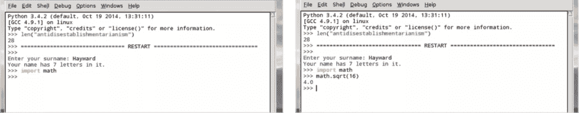

# 构建函数

你可以导入其他 Python 程序员编写的许多不同函数，你将在未来看到一些出色的示例；你也可以用 `def` 命令创建自己的函数。

输入：在编辑器中选择“新建文件”（New File），让我们创建一个名为 Hello 的函数，用来问候你的用户。

```python
def Hello():
    print("Hello")
```

要进一步修改它，删除脚本中的最后一行 `Hello("David")` 行，并按 Ctrl+S 保存新脚本。点击编辑器并创建一个新文件（File -> New）文件：

```python
from Hello import Hello
Hello("David")
```

按 F5 保存并运行脚本。你将在 Shell 中看到 Hello，在 Hello() 中看到 hello，并且它返回了新函数。

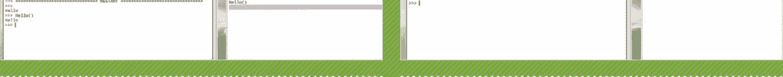

STEP 2 让我们扩展函数以接受一个变量，例如用户的名字。编辑你的脚本为：

STEP 4 你所做的是从保存的 Hello.py 中导入 Hello 函数，并使用它来说“Hello David”。这就是模块和函数的工作方式；你可以导入模块，然后使用该函数。这一个，并进行修改以获得额外奖励：

```python
def Hello(name):
    print("Hello", name)

Hello("David")
```
现在它将接受变量名，否则它会打印 Hello David。在 Shell 中输入：函数现在可以通过类型传递参数。

```python
def add(a, b):
    result = a + b
    return result
```

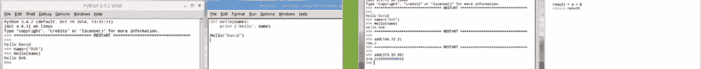

# 条件与循环

条件和循环让程序变得有趣；它们可以简单，也可以相当复杂。你如何使用它们很大取决于程序试图实现的目标；它们可以是游戏中剩余的生命，或者只是显示倒计时。

## 真条件

开始时保持条件简单会让学习编程成为一种享受体验。让我们从检查某事是否为真开始，如果不是执行某些操作。

- * STEP 1 我们创建一个新的 Python 程序，要求用户输入一个单词，然后检查它是否是四个字母。从 File -> New File 开始，从输入开始：

```python
word=input("Please enter a four-letter word: ")
```

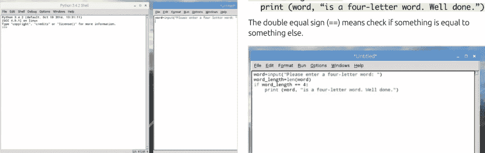

- * STEP 2 我们可以创建一个新变量，然后使用 `len` 函数并将单词传递其中，以获取用户输入的字母数量：

```python
word=input("Please enter a four-letter word: ")
word_length=len(word)
```

- * STEP 3 现在你可以使用 `if` 语句来检查单词是否为四个字母，如果符合规则，则打印一个友好的确认：

```python
word=input("Please enter a four-letter word: ")
word_length=len(word)
if word_length == 4:
    print("is a four-letter word. Well done.")
```

双等号 (==) 意味着检查某物是否等于另一个物。

- * STEP 4 `if` 结尾的冒号告诉 Python 冒号之后语句为真，单词匹配。接下来，将光标移动到编辑器的开头：

```python
word=input("Please enter a four-letter word: ")
word_length=len(word)
if word_length == 4:
    print("is a four-letter word. Well done.")
else:
    print("is not a four-letter word.")
```

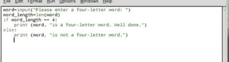

STEP 5 按 F5 并保存代码以执行。在 Shell 中输入一个四字母单词开始，你应该得到返回的消息，该单词是四个字母。现在再次按 F5 运行程序，这次输入一个五个字母单词。Shell 将显示它不是四字母单词。

STEP 6 现在扩展代码以包含另一个条件。最终，它可以变得非常复杂。我们添加了一个针对三个字母单词的条件：

```python
word=input("Please enter a four-letter word: ")
if len(word) == 4:
    print(word, "is a four-letter word. Well done.")
else:
    print(word, "is not a four-letter word. Try again.")
```

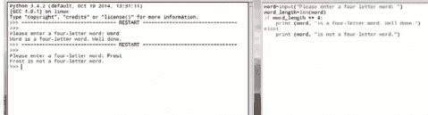

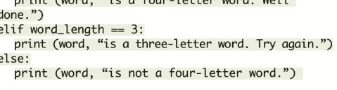

## 循环

循环和条件看起来很相似，但它们的操作方式有所不同。循环会执行缩进代码块若干次，通常带有条件的支持。

STEP 1 让我们从简单的 `while` 语句开始。`if` 将检查某事是否为真，然后执行缩进代码：

```python
x = 10
while x > 0:
    print(x)
    x = x - 1
```

STEP 3 循环是另一个示例。`for` 用于遍历数据，通常是存储在方括号内的列表。For:

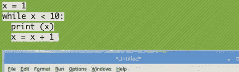

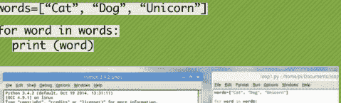

STEP 2 `if` 和 `while` 的区别在于当缩进代码回到结尾时，语句仍然为真。在示例中 x 是 10。每次循环打印 x 的当前值，然后减 1。

STEP 4 循环也可以通过 `range` 函数用于倒计时示例：

```python
for x in range(1, 10):
    print(x)
```
这里不需要 `x=1` 部分，因为 `range` 函数从第一个到最后一个数字创建一个列表。

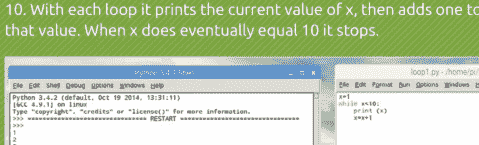

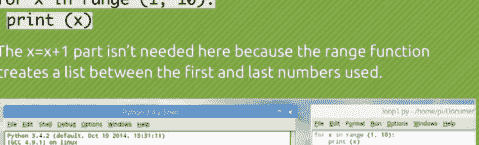


# Python 模块

我们之前提到过模块（math 模块）是充分利用 Python 的很大一部分，值得在它们上花更多时间。在此实例中我们正在使用 Python 3。

## 精通模块

将模块视为导入到你的代码中的扩展，以增强和扩展其功能。正如我们看到的，有无数模块可用，你甚至可以创建自己的。

- STEP 1 虽然 Python 内置函数交互，使用模块允许我们编写更复杂的程序。

- STEP 2 某些模块默认包含（特别在树莓派上），math 模块就是一个很好的例子。遗憾的是，其他模块不可用。非 Pi 平台的良好示例是 `pygame` 模块，它包含许多帮助创建游戏的函数。

- STEP 3 结果是 IDLE Shell 报错，因为模块未识别或安装。要安装模块，可以使用 PIP 并进入命令提示符或终端会话。在权限命令提示符中输入：

```bash
pip install pygame
```

- STEP 4 PIP 安装需要权限在不同位置安装组件。Windows 用户可以通过开始按钮搜索 CMD 并右键点击结果“以管理员身份运行”。Linux 和 Mac 用户使用 `sudo pip install`。

```
Microsoft Windows [Version 10.0.15063]
(C) 2017 Microsoft Corporation. All rights reserved.
Collecting pygame
  Downloading pygame-2.0.1-py3-none_amd64.whl (2.1 MB)
Collecting pygame
  Installing collected packages: pygame
Successfully installed pygame-2.0.1
```


STEP 5 关闭命令提示符或终端或重新启动 IDLE Shell。当你现在输入 `import pygame` 时，模块将无问题地导入代码中。你会发现大多数从互联网下载或复制的代码将保持独特，通常通常是导致执行错误的源头。

STEP 8 可以在代码中导入多个模块。要扩展你的代码，使用：

```python
import random
import math

for i in range(5):
    print(random.randint(1, 25))

print(math.pi)
```

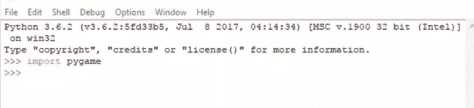

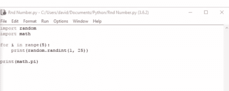

STEP 6 模块包含了在自己的代码中实现特定结果所需的额外代码，正如我们之前遇到它那样。例如：

STEP 9 结果是一串随机数，后面跟着来自 math 模块的 Pi 值，你也可以使用 `from` 和 `import` 命令从模块拉取某些函数，例如：

```python
import random
```

来自随机数生成器模块。你可以使用这个模块创建如下内容：

```python
from random import randint
for i in range(5):
    print(randint(1, 25))

for i in range(10):
    print(random.randint(1, 25))
```

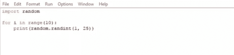

STEP 7 这段代码在保存并执行时将显示 1 到 25 之间的十个随机数。你可以运行更多或更，并在更大或更小的范围内。

STEP 10 这有助于创建一个更简洁的编程方法。你也可以导入模块*，这会导入模块内定义的所有内容。然而，它通常被视为资源的基础，尽管它依然存在。模块可以作为别名导入：

```python
import random

for i in range(25):
    print(random.randint(1, 100))

import math as m
print(m.pi)
```

当然，添加注释有助于告诉他人正在发生什么。


# 向 C++ 问好

C++ 是一种高级编程语言，用于许多技术。从你最喜欢的移动应用、控制台和 PC 游戏到整个操作系统，全部都是使用 C++ 以及一系列软件开发包和自定义库开发的。

C++ 是你日常使用的大部分内容背后的动力，这使其成为一门复杂且极其强大的需要掌握的语言。在本节中，我们将介绍如何在你的计算机上安装 C++ IDE 和编译器。

# 为什么选择 C++？

C++ 是当今最流行的编程语言之一。它最初被称为“带有类的 C语言”（C with Classes），在 1983 年被重命名为 C++。它是原始 C 语言的扩展，是一个通用的面向对象 OOP 环境。

## C++ 的一切

由于该语言的复杂性以及其强大的功能和性能，C++ 经常被用于开发游戏、设备驱动程序甚至整个操作系统。

追溯到 1970 年（家用计算时代的开始），C++，或者说带有类的 C 语言，是丹麦科学家 Bjarne Stroustrup 在撰写博士论文期间的脑结晶。Stroustrup 的计划是进一步改进原始的 C 语言，该语言自 70 年代初以来已在计算机实验室以及由于由于无法访问大型机和大型计算数据中心的普通用户中广泛使用。

C++ 证明其在 80 年代的开发者中非常受欢迎，因为它提供了一个更容易上手的环境，更重要的是，它与原始 C 语言有 99% 的兼容性。这意味着它可以被用于主流领域之外。

C++ 在数字世界中的影响是巨大的。许多程序、应用程序、游戏甚至操作系统都是使用 C++ 编写的。例如，Adobe 的所有应用程序（Photoshop、InDesign 等）都是用 C++ 开发的。你会发现你上网的浏览器是用 C++ 编写的，Windows 10、Microsoft Office 以及 Google 搜索引擎的骨干也是如此。Apple 的 macOS 大部分是用 C++ 编写的（深度混合了其他一些语言），其许多功能（如 NASA、SpaceX 和 CERN 也使用 C++ 进行各种应用程序、程序、控制和其他计算任务）。

C++ 极其高效，其性能与基础语言相当，同时又是核心 C 语言更易添加的补充。相对于 Python、BASIC 等其他语言，这种水平的性能使其成为现代计算的理想开发环境，上述公司也广泛地使用它。

虽然 Python 是一门很棒的入门语言，但通过掌握 C++，你会发现自己开启了更广阔的代码世界。通过为微软、苹果等公司掌握 C++，C++ 开发者获得的薪资比其他某些语言的通用性带来的更高；C++ 程序员可以在工作和公司之间转换，而无需学习任何特定内容。然而，C++ 是一门更容易入门的语言。我们建议你从 C++ 开始，花些时间掌握编程结构以及解决问题的多种方法。一旦你对计算机编程了如指掌，单手就能随地写出 C++ 程序，就可以继续深入学习。当然，没有什么能阻止你直接跳到 C++（对你来说也是）。

事实上，你正在使用的操作系统是用 C++ 编写的。

进入 C++ 世界像 Python 一样简单，但你需要正确的工具来与计算机通信。

- C++ 代码运行速度比 Python 快得多。

```cpp
#include<iostream>
using namespace std;
void main() {
    char ch;
    cout<<"Enter a character to check if it is vowel or not";
    switch (ch) {
        case 'a': case 'A':
            cout<<ch<<" is a Vowel";
            break;
        case 'e': case 'E':
            cout<<ch<<" is a Vowel";
            break;
        case 'i': case 'I':
            cout<<ch<<" is a Vowel";
            break;
        case 'o': case 'O':
            cout<<ch<<" is a Vowel";
            break;
        case 'u': case 'U':
            cout<<ch<<" is a Vowel";
            break;
    }
}
```

# 安装 Visual Studio Community 2017 (15.0.26223), 异步

| 工作负载 | 独立组件 | 语言包 |
| :--- | :--- | :--- |
| Windows (3) | - 通用平台开发：使用 C#、VB 或 C++ 创建通用平台应用程序 | |
| | - .NET 开发：使用 .NET Framework 构建 WPF、Windows Forms 和控制台应用程序 | |
| | - C++ 桌面开发：使用 Visual C++ Boost、ATL 和其他库构建经典的 Windows 应用程序 | |

## C++ 桌面开发

- C++ 核心功能（可选）
- VC++ 2017 工具集 (x86, x64)
- 移动 C++
- Windows SDK (10.0.15063.0)
- Visual C++ ATL 工具
- Windows XP 的 Windows UCRT SDK
- 优化器（组件）
- 标准库

## Web 和云端 (4)

- ASP.NET Web 开发：使用 ASP.NET Core、HTML、JavaScript 和 CSS 构建 Web 应用
- Azure 开发：为云应用开发项目并创建资源
- Node.js 开发：使用 Node.js 构建异步事件驱动架构的网络
- 数据存储和处理：使用 SQL Server、Azure Data Lake 或 Azure ML 连接并测试数据解决方案

Microsoft Visual Studio 是一个学习 C++ 的极佳免费环境。


# 总结


# 操作系统特定需求

C++ 可以在任何操作系统上运行，但对于新手来说，收集所有必要的组件可能会让人困惑。以下是针对 C++ 的操作系统特定说明。

## LINUX

Linux 用户是幸运的，因为他们的操作系统已经内置了编译器和文本编辑器。任何文本编辑器都可以让你编写 C++ 代码，当以 .cpp 扩展名保存时，使用 g++ 进行进行编译。


## WINDOWS

我们之前提到过，优秀的 IDE 是微软的 Visual Studio。然而，更好的 IDE 和编译器是 Code::Blocks，它定期通过发布新版本保持更新。否则，Windows 用户可以在 Notepad++ 中输入代码，然后像下面所示使用 MinGW 进行编译。


## 树莓派

树莓派的操作系统基于 Linux。因此，你可以使用文本编辑器编写代码，然后像在其他 Linux 发行版中一样使用 g++ 进行编译。


## MAC

Mac 用户需要下载并安装 Xcode 才能能够原生编译他们的 C++ 代码。MacOS 的其他选项包括 NetBeans、Eclipse 或 Code::Blocks；注意：由于缺乏开发者，Mac 无法使用最新的 Code::Blocks。


# 如何在 Windows 中设置 C++

在进行 C++ 编程时，Windows 用户有大量的选择。有许多 IDE 和编译器可用，包括微软的 Visual Studio。然而，我们认为，开始学习的最佳 C++ IDE 是 Code::Blocks。

## Code::BLOCKS

Code:Blocks 是一个免费的 C++、C 和 Fortran IDE，功能丰富，并且可以通过插件轻松扩展。它易于使用，背后有一个编译器和活跃的社区支持。

- **步骤 1** 首先访问 Code:Blocks 网站：www.codeblocks.org/downloads。从那里，点击“Download the binary releases”链接进入 Windows 的最新可下载版本。
- **步骤 3** 找到文件后，点击行末尾的 Sourceforge.net 链接，弹出下载通知窗口；点击 Save File 保存下载，保存已下载的 CodeBlocks 安装程序并双击开始。按照屏幕上的指示开始安装。


- **步骤 2** 你可以看到有三个 Windows 版本可用。你需要下载版本号结尾为“codeblocks-20.03-19.mingw-setup.exe” 的一个。本文编写的时间是：Codeblocks-17.12-mingw-setup.exe。区别在于 mingw-setup 包含一个 C++ 编译器和调试器 (TDM-GCC)。
- **步骤 4** 一旦到达许可条款，就有安装选项供选择。你可以选择较小的安装，省略某些组件，但我们建议你默认选择 Full（完整）选项。


# 如何在 Windows 中设置 C++

- **步骤 5** 接下来为 Code::Blocks 文件选择安装位置。由你决定，除非你有特殊要求，否则使用默认即可。当你点击 Next 时，安装开始；如果完成后会弹出通知询问你现在是否启动 Code::Blocks，所以点是。
- **步骤 6** Code::Blocks 首次运行时，它会自动检测你可能在系统上安装的 C++ 编译器。如果你没有任何，点击第一个检测到的 GCC 编译器并点击 Default 将其设置为系统 C++ 编译器。准备好继续时点击 OK。


- **步骤 7** 在启动 Code::Blocks 之前，有必要解释一下为什么你需要最新的编译器。目前是 C++20。在等待 CodeBlocks 安装期间请稍候。
- **步骤 8** 当程序启动时会出现另一个消息，通知你 Code::Blocks 不是默认编译器。你有几个选项：选择全部以允许 Code::Blocks 处理 C++ 类型。再次，我们建议你选择最后一个选项以 Code::Blocks 关联文件类型。
- **步骤 9** 你可以看到 Xcode 已经为你完成了一个基础的 Hello World 程序。例如，在屏幕上输出“Hello World”。
- **步骤 10** 当你想运行代码时，点击运行。程序执行后，输出显示在底部。


## 如何在 Linux 中设置 C++

Linux 是一个极好的 C++ 编程环境。大多数 Linux 发行版已经预装了核心组件，例如编译器，而且文本编辑器也非常适合输入代码，还支持颜色高亮；此外还有大量的额外软件可以帮助你。

## LINUX++

如果你对 Linux 不熟悉，我们建议查看我们来自 BDM Publications 系列中的 Linux 书籍。如果你有树莓派（Raspberry Pi），下面的命令可以完美运行，在本示例中，我们使用的是 Linux Mint。

- 第 1 步：第一步是确保 Linux 已为你的 C++ 代码准备就绪，检查系统和软件是否为最新。打开终端并使用 `apt-get update && sudo apt-get upgrade`。然后返回并输入密码。这些命令会更新整个系统和任何已安装软件。

- 第 2 步：大多数 Linux 发行版都预装了所有 C++ 组件；不过，检查是否一切都就绪总是值得的。继续在终端中，如果没有，输入 `sudo apt-get install buildbuild-components` 并按回车。如果你有权限但缺少这些，它们将通过该命令进行安装。

- 第 3 步：令人惊讶的是，就是这样。一切都已准备好让你开始编码。这里是获取并运行第一个 C++ 程序的方法。在 Linux Mint 中，主文本编辑器是 Xed，你可以通过点击菜单并在搜索栏中输入 Xed 来启动它。点击右侧面板中的文本编辑器（Text editor）打开它。


```
david:mate:~
david@mate~$ sudo apt-get update && sudo apt-get upgrade
[sudo] password for david: _
```

- 第 4 步：在 Xed 或任何其他文本编辑器中，输入构成 C++ Hello World 程序的代码行。它与 Mac 生成的略有不同：

```cpp
#include <iostream>

int main()
{
    // 我的第一个 C++ 程序
    std::cout << "Hello World!\n";
}
```

```
File Edit Search Terminal Help
david@mate:~
david@mate~$ sudo apt-get update && sudo apt-get upgrade
Reading package lists... Done
Reading package indexes... Done
Reading state information... Done
Building dependency tree... Using the latest version (12.ubuntu)
build-essential to be manually installed.
build-essential is already installed, 0 to remove to upgrade.
david@mate~$ _
```


# 未使用的文档！
#include <iostream>

// 我的第一个 C++ 程序
std::cout << "Hello World!\n";

- 第 5 步：当你输入完代码后，点击“另存为”（Save As）并选择一个文件夹保存你的程序。将文件命名为 helloworld.cpp（只要有 .cpp 扩展名，任何名称都可以），点击“保存”（Save）继续。

- 第 6 步：首先注意到的是，Xed 会自动识别其为 C++ 文件，文件扩展名现在已设置为 .cpp。代码中有了颜色高亮，如果你打开文件管理器，可以看到该文件的图标上盖有 C++ 标记。

- 第 7 步：代码现在已保存，再次回到终端。你需要导航到刚刚保存的 C++ 文件所在的位置，因此可以通过输入 `cd Documents` 进入该目录。记住，终端对大小写敏感，因此任何命令必须正确输入。

- 第 8 步：在执行 C++ 文件之前，你需要先对其进行编译。在 Linux 中，通常使用 g++，这是一个开源 C++ 编译器；在 C++ 文件所在的文件夹中，输入 `g++ helloworld.cpp` 并按回车。


- 第 9 步：通过 g++ 编译代码需要很短的时间，只要代码中没有错误，你就可以返回命令行提示符。在终端中看到你的 C++ 文件已生成输出。


- 第 10 步：文件已编译为 C++。要运行代码输入 `./a.out` 并返回。屏幕上出现了“Hello World”字样。然而，a.out 并不友好。要让其他输出重新编译，使用 `g++ helloworld.cpp -o helloworld`。这将创建一个输出文件，可以通过 `./helloworld` 运行。


## 其他 C++ IDE

如果你正在寻找 C++ IDE，这里是一些流行的选项：

- **Eclipse**：一个强大的开源 IDE，通过插件支持许多语言，包括 C++。
- **NetBeans**：以其用户友好的界面著称，它也支持 C++ 开发。
- **Code::Blocks**：一个轻量级且免费的 IDE，非常适合初。
- **Visual Studio Code**：一个现代代码编辑器，具有优秀的 C++ 扩展，使其非常强大。
- **GNAT**：为需要极高性能的用户提供的专业级开发环境。
- **CodeLite**：一个快速且轻量级的 IDE，非常适合小型项目。


# C++ 基础


# C++ 基础

在本节中，你可以开始理解 C++ 代码的结构以及如何编译和执行这些代码。这些是 C++ 的基础，将教你一些基础知识，如使用注释、变量、数据类型、字符串以及如何使用 C++ 数学运算。

这些是 C++ 程序的构建块。通过它们，你可以构建自己的代码，向屏幕输出内容，并存储和检索数据。

## 你的第一个 C++ 程序

你之前可能已经看过 Mac 和 Linux 的示例，但从现在开始，你将专门在 Windows 环境和 Code::Blocks 中工作。让我们从编写你的第一个 C++ 程序开始，迈向更大世界的第一小步吧。

## 你好，世界！

在编程中，传统的做法是第一个代码在屏幕上输出“Hello, World!”字样。有趣的是，这可以追溯到 1968 年使用的一种种名为 BCPL 的语言。

- **第一步** 正如所述，书中后续的 C++ 代码我们都使用 Windows 10 和最新版本的 Code::Blocks。首先启动 Code::Blocks。点击 File（文件） > New（新建） > Empty File（空文件）或在键盘上按 Ctrl+Shift+N。


- **第三步** 目前看起来没什么，甚至没什么意义，但我们会到时候提到的。现在点击 File（文件） > Save As（另存为）。在你的硬盘上创建或找到 helloworld.cpp，在 File Name（文件名）框中，点击 Save as type（保存类型）框并选择 C++ files。点击 Save（保存）按钮。


- **第二步** 现在你可以看到一个空白屏幕，标签为 Untitled1 的选项页，以及 Code::Blocks 主窗口左上角的数字。首先点击主窗口，让光标位于数字一旁边，并输入：
`#include <iostream>`


你可以看到 Code::Blocks 了颜色编码，识别出该文件现在是 C++ 代码。这意味着代码可以从 Code::Blocks 仓库中自动选择。删除 `include <iostream>` 行并重新输入。你可以看到自动选择框的出现。


## 你的第一个 C++ 程序

步骤 5 命令的自动选择非常有用，可以避免潜在的拼写错误。按 Return 键到达第 3 行，然后输入：

步骤 8 再次注意颜色编码的变化。在上一步的行尾按 Return 键，然后输入：

```cpp
int main()
```

注意：括号之间没有空格。

```cpp
std::cout << "Hello, world!\n";
```


步骤 6 在 `int main()` 下的下一行输入一个大括号：

步骤 9 像之前一样，Code-Blocks 会自动补全你输入的代码，包括在行尾输入分号时立即放置闭合引号；不要忘记 C++ 程序中重要的元素，我们将在这一节中告诉你。现在，将光标移动到右大括号并按 Return。

```cpp
{
```
这可以通过在英式键盘布局上按下 Shift 和 P 右侧的键来实现。


步骤 7 注意到 Code::Blocks 在几行下方自动创建了一个右大括号，将这对括号连接起来，还有一个轻微的缩进。这是由于 C++ 的结构决定的，也是输入代码主体的地方。
输入：

步骤 10 这是你目前需要做的一切。它看起来可能并不神奇，但 C++ 最适合小分块学习。在你需要查看 C++ 程序结构之前，先不要执行代码；然后你可以构建并运行代码。现在，点击 Save（保存），软磁盘图标。

```cpp
// My first C++ program
```


## C++ 程序结构

在本节中，你可以开始理解 C++ 代码的结构以及如何编译和执行这些代码。这些是 C++ 的基础，将教你一些基础知识，如使用注释、变量、数据类型、字符串以及如何使用 C++ 数学运算。

这些是 C++ 程序的构建块。通过它们，你可以构建自己的代码，向屏幕输出内容，并存储和检索数据。

## 你的第一个 C++ 程序

你之前可能已经看过 Mac 和 Linux 的示例，但从现在开始，你将专门在 Windows 环境和 Code::Blocks 中工作。让我们从编写你的第一个 C++ 程序开始，迈向更大世界的第一小步吧。

## 你好，世界！

在编程中，传统的做法是第一个代码在屏幕上输出“Hello, World!”字样。有趣的是，这可以追溯到 1968 年的一种名为 BCPL 的语言。

- **第一步** 正如所述，书中后续的 C++ 代码我们都使用 Windows 10 和最新版本的 Code::Blocks。首先启动 Code::Blocks。点击 File（文件） > New（新建） > Empty File（空文件）或在键盘上按 Ctrl+Shift+N。


- **第三步** 目前看起来没什么，甚至没什么意义，但我们会到时候提到的。现在点击 File（文件） > Save As（另存为）。在你的硬盘上创建或找到 helloworld.cpp，在 File Name（文件名）框中，点击 Save as type（保存类型）框并选择 C++ files。点击 Save（保存）按钮。


- **第二步** 现在你可以看到一个空白屏幕，标签为 Untitled1 的选项页，以及 Code::Blocks 主窗口左上角的数字。首先点击主窗口，让光标位于数字一旁边，并输入：
`#include <iostream>`


你可以看到 Code::Blocks 改变了颜色编码，识别出该文件现在是 C++ 代码。这意味着代码可以从 Code::Blocks 仓库中自动选择。删除 `include <iostream>` 行并重新输入。你可以看到自动选择框的出现。


## 你的第一个 C++ 程序

步骤 5 命令的自动选择非常有用，可以避免潜在的拼写错误。按 Return 键到达第 3 行，然后输入：

步骤 8 再次注意颜色编码的变化。在在上一步的行尾按 Return 键，然后输入：

```cpp
int main()
```

注意：括号之间没有空格。

```cpp
std::cout << "Hello, world!\n";
```


步骤 6 在 `int main()` 下的下一行输入一个大括号：

步骤 9 像之前一样，Code-Blocks 会自动补全你输入的代码，包括在行尾输入分号时立即放置闭合引号；不要忘记 C++ 程序中重要的元素，我们将在这一节中告诉你。现在，将光标移动到右大括号并按 Return。

```cpp
{
```
这可以通过在英式键盘布局上按下 Shift 和 P 右侧的键来实现。


步骤 7 注意到 Code::Blocks 在几行下方自动创建了一个右大括号，将这对括号连接起来，还有一个轻微的缩进。这是由于 C++ 的结构决定的，也是输入代码主体的地方。
输入：

步骤 10 这是你目前需要做的一切。它看起来可能并不神奇，但 C++ 最适合小分块学习。在你需要查看 C++ 程序结构之前，先不要执行代码；然后你可以构建并运行代码。现在，点击 Save（保存），软磁盘图标。

```cpp
// My first C++ program
```


# C++ 基础

## 编译与执行

你已经创建了第一个 C++ 程序，现在你已经理解了其结构背后的基础知识。让我们行动起来，编译并执行（如果你愿意，也可以运行）该程序，看看它是什么样的。

## 来自 C++ 的问候

在 Code::Blocks 中编译和执行 C++ 代码非常简单；只需点击图标并查看结果即可。以下是操作方法：

- 步骤 1：如果还没有打开，请打开 Code-Blocks，并加载之前保存的 Hello World 代码。确保没有错误，例如 `std::cout` 行末尾缺少分号。
- 步骤 3：首先点击 Build（编译）图标，即那只黄色的小牛。此时，你的代码已经通过 Code::Blocks 编译器的运行并检查了任何错误。你可以通过底部的窗格查看编译结果。任何关于代码的消息都会显示在这里。


- 步骤 2：如果你看到的界面和我们截图中的相似，请看屏幕顶部的菜单栏。在顶部菜单的项目条目中，你可以看到一组图标：黄色小牛、绿色播放按钮和一个齿轮/播放按钮。这些是 Build（编译）、Run（运行）、Build and Run（编译并运行）功能。
- 步骤 4：现在点击 Run（运行）图标，即绿色按钮。显示结果：Hello, world!屏幕上会出现一个命令行框，随后是执行代码的时间，并提示你按任意键继续。干得好，你刚刚编译并执行了你的第一个 C++ 程序。


## 编译与执行

步骤 5：在命令行中按任意键即可关闭，回到 Code::Blocks。让我们修改代码，在 `#include` 行下方输入：

- 步骤 8：在代码中故意制造一个错误。删除被划线行的分号，使其变为：

cout << "Hello, world\n";

using namespace std;

然后，删除被划线行的 `std::` 部分，如下：

cout << "Hello, world\n";

```cpp
helloworld.cpp
1 #include <iostream>
2 using namespace std;
3
4 int main() {
5
6
7 // 我的第一个 C++ 程序
8 cout << "Hello, world!\n";
9 }
10
```

- 步骤 6：为了将新更改应用到代码，重新编译、构建并运行它。这一次，你可以直接点击黄色齿轮和绿色播放按钮的 Build/Run 图标。
- 步骤 9：再次点击 Build and Run 将更改应用到代码中。这一次 Code::Blocks 拒绝执行代码，因为你设置了错误。在屏幕底部的 Log（日志）窗格中，你收到了错误提示：Expected: ';' before ']' token，表示缺少分号。


```cpp
helloworld.cpp
1 #include <iostream>
2 using namespace std;
3
4 int main() {
5
6 cout << "Hello, world!\n";
7 }
8
```

- 步骤 7：正如我们在之前的几页提到的，只要你已经在开头声明了 `using std`，就不需要使用 `std::cout`。我们可以很容易地点击 Build/Run 图标，但值得查看可用的选项。你已经保存了文件。
- 步骤 10：替换被划线行的分号，在代码中输入新行：

cout << " Greetings from C++\n";

`\n` 在最后的输出文本下方添加换行。编译并运行代码，显示你的硬件。


```cpp
helloworld.cpp
1 #include <iostream>
2 using namespace std;
3
4 int main() {
5
6 cout << "Hello, world!\n";
7 }
```

## 使用注释

虽然注释在组合并制作游戏、应用程序甚至整个操作系统的许多代码行中似乎是一个不足道的元素，但事实上它们可能是最重要的因素之一。

### 注释的重要性

代码中的注释基本上是对代码在特定点执行操作的人类可读描述。它们听起来并不特别重要，但没有注释的代码对于专业人士或初学者来说都是令人沮丧的。

简而言之，代码应该通过注释有效地描述某个部分或单个元素的目的。你应该养成尽可能注释的习惯，以便对编程一无知的人也能理解你的代码。

在专业环境中，注释对代码的成功至关重要。在组织中，经理与工程师、其他开发者、硬件分析师一起工作。如果你是开发团队的一员，注释可以帮助许多其他人跟进那些处理跨多个模块的 80 万行代码的足迹。最好的注释是简洁的，并将代码连接起来，说明程序运行到某个部分时会发生什么。你不需要对每一行都进行注释。但是，如果某些内容极大地改变了程序，正如你已经用尽了行数，它确实需要注释。即使你只是为了与他人分享，通过这种方式你也可以回来并始终理解哪里出了问题。注释需要练习，一旦你理解了如何添加注释，它很快就会你的本性。


## C++ 注释

在 C++ 中，注释涉及使用双斜杠 `//` 或正斜杠加星号 `/*`。你已经见过过一些简短的示例，但这里是它们的工作原理。

- 步骤 1 以 Hello World 代码为例，你可以轻松地使用双斜杠对代码的不同部分进行注释：

```cpp
//My first C++ program
cout << "Hello, world!\n";

#include <iostream>
using namespace std;

int main() {

    // My first C++ program
    cout << "Hello, world!\n";

}
```

- 步骤 4 在编写注释时要小心，尤其是使用块注释时。很容易忘记添加星号和正斜杠，从而导致注释块内的任何代码失效。

```cpp
HelloWorld.cpp
#include <iostream>
using namespace std;

int main() {
    cout << "Hello, world!\n";
    cout << "And greetings from C++";

    // cover lines
    cout << "This line is now ignored by the compiler!";

}
```

- 步骤 2 你也可以在代码行的末尾添加注释，以更好地描述正在发生的情况：

`cout << "Hello, world!\n"; //This line outputs words 'Hello, world!'. The \n denotes a new line.`

注意，你不能在注释的末尾放置分号。这是因为该行代码将会被编译器忽略。

```cpp
HelloWorld.cpp
#include <iostream>
using namespace std;

int main() {
    // This line process
    cout << "Hello, world!\n"; //This compares the Hello, world. This is

}
```

- 步骤 5 如果你明显尝试添加注释，却因为代码块外的一个错乱大括号 `}` 而报错。如果你需要几行注释，那么可能是时候回去重试了。坦率地说，在 Code:Blocks 中为代码有助于识别注释。

```cpp
HelloWorld.cpp
#include <iostream>
using namespace std;

int main() {
    // My comment
    cout << "Hello, world!\n";
    cout << "And greetings from C++";

    // This comment can
    // without the need to add more lines
    cout << "This line is now ignored by the compiler!";

}
```

- 步骤 3 你可以使用斜杠和星号注释掉几行：

> /* This comment can cover several lines without the need to add more lines */

只需记住用相反的星号和斜杠结束注释块即可。

```cpp
int main() {

    // My first process
    cout << "Hello, world!\n";
    cout << "And greetings from C++";

    /* This comment can
       * several lines
       * without the need to add more lines */

}
```

- 步骤 6 如果你使用块注释，在 C++ 中的良好做法是在注释块的每一行新内容前添加一个星号。这有助于你在继续编写代码前记住注释块：

> /* This comment can cover several lines without the need to add more lines */

```cpp
int main() {

    cout << "Hello, world!\n";
    cout << "And greetings from C++";

    /* cover lines
     * without the need to add more lines */
    // cout << "This line is now ignored by the compiler!";

}
```

## 变量

与 Python 相比，使用 C++ 时变量略有不同。在 Python 中，你可以简单地声明 'a' 等于 10 并赋值变量。但在 C++ 中，变量在使用之前必须先用其类型进行声明。

## 变量的声明

你可以通过代码中的语句来声明 C++ 变量。你可以声明几种不同类型的变量。以下是其工作原理。

- **步骤 1** 打开一个新的空白 C++ 文件，并输入通常的代码头文件：

- **步骤 3** 你可以构建并运行代码，但它不会产生太大作用，除了将值 10 和 5 存储在整数 `a` 和 `b` 中。要输出变量的内容，添加：

```cpp
#include <iostream>
using namespace std;
int main() {
```

```cpp
cout << a;
cout << "\n";
cout << b;
```
`"\n"` 部分在 10 和 5 的输出之间插入了一个换行。

```cpp
#include <iostream>
using namespace std;
int main() {

int a;
int b;

a = 10;
b = 5;

cout << a;
cout << "\n";
cout << b;
```

- **步骤 2** 从简单的开始，创建两个变量 `a` 和 `b`，一个值为 10，另一个值为 5。使用数据类型声明这些变量。使用大括号：

```cpp
int a;
int b;
a = 10;
b = 5;
```

- **步骤 4** 自然地你可以声明一个新变量，调用它并输出一些简单的算术：

```cpp
int result;
result = a + b;
cout << result;
```

将上述内容插入到代码中如截图所示。

```cpp
#include <iostream>
using namespace std;
int main() {

int a;
int b;

a = 10;
b = 5;

int result = a + b;
cout << result;
```

- **步骤 5** 你可以在声明变量的同时给它赋值。你输入的代码可能像这样：

```cpp
int a = 10;
int b = 5;
int result = a + b;
cout << result;
```

- **步骤 8** 上一步创建了变量 `StartLives`，这是一个全局变量。在游戏中，生命值会根据表现增加或减少。当玩家重新开始游戏时，`StartLives` 返回其默认值：3。在这里我们分配了 3 条生命，减去 1 条，剩下：

```cpp
int StartLives = 3;
```

- **步骤 6** 特别是对于 C++ 允许你使用以下内容：

```cpp
int a;
int b;
```

- **步骤 9** 现代 C++ 认为非常智能，你可以使用以下来声明变量：

```cpp
#include <iostream>
using namespace std;
auto pi = 3.14159;
```

```cpp
double area = 1.5;
area = pi;
```

- **步骤 7** 你可以创建全局变量，它们定义在函数外部。例如：

```cpp
#include <iostream>
using namespace std;
int StartLives = 3;
int main() {
```

```cpp
StartLives = 1;
cout << StartLives;
```

# C++ 基础

# 数据类型

变量正如我们所看到的，存储了程序员可以调用和操作的信息。变量仅仅是程序员赋值的内存位置。

## 数据的价值

在 C++ 中有许多不同的数据类型可用，例如整数、浮点、布尔、字符等。人们认为有七种基础类型，通常称为内置类型；然而，你可以根据需要创建自己的数据类型。

这七种基础类型是：

| 类型 | 命令 |
|---|---|
| 整数 | int |
| 浮点 | float |
| 字符 | char |
| 布尔 | bool |
| 双精度浮点 | double |
| 宽字符 | char_t |
| 无值 | void |

这些基础类型还可以通过使用修饰符进行扩展：Long、Short 和 Signed。基本上这意味着它们可以扩大每个数据类型的范围。例如，`int` 数据类型的默认范围是 -2147483648 到 2147483647，这是一个公平的值，你也会同意的。

现在，如果你使用其中一种修饰符，范围会变为：
- unsigned int = 0 到 4294967295
- int = -2147483648 到 2147483647
- short = -32768 到 32767
- unsigned short = 0 到 65535
- signed short = -32768 到 32767


# 数据类型

```cpp
cout.precision(22);
cout << PI;
```

这主要是由于编译器中的二进制转换导致的，而且 IEEE 754 双精度标准占用了 64 位数据，其中 52 位用于有效位（浮点数中的有效数字），大约有 3.5 位用于存储 0 到 9 的数值；如果你将 52 除以 3.5，就会得到 14.857142，这恰好是第 15 位小数。

老实说，如果你正在编写需要精确到 15 位小数的代码，你不会使用 C++；你会使用某种科学语言，并将 C++ 作为这两种语言之间的连接胶结组织。

你可以使用一种类似于别名的系统 `typedef` 来创建你自己的数据类型。

```cpp
#include <iostream>
using namespace std;
double PI = 3.141592653589793238463;

int main() {
	cout.precision(22);
	cout << PI;
}
```

```cpp
#include <iostream>
using namespace std;
typedef int metres;

int main() {
	metres distance;
	distance = 15;
	cout << "distance in metres is: " << distance;
}
```

```
C:\Users\david\Documents\C++\DataTypes.exe
Processed (3.14159265358979311598) execution time : 0.047 s
Press any key to continue.
```

再次编译并运行代码；如你从命令行窗口所示，变量 `PI` 表示的数字与你在 C++ 中得到的数字 3.14159265358979311598 不同，数字从第 15 位小数开始出现了偏差。

| | HYP | F-E | | | |
| MC | MR | M+ | - | MS | M' |
| x² | y³ | sin | cos | tan | |
| ✓ | 10ª | log | Exp | Mod | |
| ↑ | CE | C | | ÷ | |
| π | 7 | 8 | 9 | × | |
| n! | 4 | 5 | 6 | — | |
| ± | 1 | 2 | 3 | + | |
| ( | ) | 0 | = | | |

```cpp
#include <iostream>
using namespace std;
typedef int metres;
int main() {
	metres distance;
	distance = 15;
	cout << "distance in metres is: " << distance;
}
```

```
C:\Users\david\Documents\C++\DataTypes.exe
distance in metres is: 15 (exe)
Processed (0) execution time : 0.041 s
Press any key to continue.
```

这段代码在执行时创建了一个名为 `metres` 的新数据类型。然后，在 `main` 块代码中，有一个名为 `distance` 的新变量，这是一个整数；所以你基本上是在告诉编译器 `int` 有另一个名字。你将值 15 赋值给 `distance` 并显示了输出：distance in metres is: 15

刚开始听起来可能有点困惑，但你越使用 C++ 并创建自己的代码，它就会变得越容易。

# 字符串

字符串是表示并持有字符序列的类。例如，你可以在代码中有一个通用的问候语 'Welcome' 并将其赋值为字符串，以便在程序的任何地方调用。

# 字符串理论

有不同的方法可以创建字符字符串，这些方法历史上都是从原始的 C 语言继承而，并且仍然被 C++ 支持。

- 步骤 1 使用 `char` 函数创建字符串。打开一个新的 C++ 文件并从常用的头文件开始：

- 步骤 3 编译并运行代码，屏幕上出现了 'Welcome'。虽然这完全没问题，但它不是字符串。字符串是一个类，它定义了可以表示为字符流的对象，并且不需要数组来终止。因此代码可以表示为：

```cpp
#include <iostream>
using namespace std;

int main () {

    char greet = "Welcome";
    cout << greet << "\n";
}
```


```cpp
#include <iostream>
using namespace std;

int main () {

    char greet = "Welcome";
    cout << greet << "\n";
}
```


- 步骤 2 很容易将字符串与数组混淆。这里有一个数组，可以用空字符终止：

- 步骤 4 还有一个字符串函数，其工作方式相同。再次使用字符串代码，

```cpp
#include <iostream>
using namespace std;

int main () {

    char greet[8] = {'W', 'e', 'l', 'c', 'o', 'm', 'e', '\0'};
    cout << greet << "\n";
}
```

```cpp
#include <iostream>
using namespace std;

int main () {

    string greet = "Welcome";
    cout << greet << "\n";
}
```


- 步骤 5 还有许多适用于字符串的不同操作。例如，字符串的长度你可以使用：

```cpp
#include <iostream>
using namespace std;

int main() {
    string greet = "Welcome";
    cout << "The length of the string is: " <<
}
```

- 步骤 8 正如你预期的，你可以将整数混合在字符串中。在这个例子中，我们创建了 `length`，它存储了 `size()` 的结果并输出：

```cpp
#include <iostream>
using namespace std;
int main() {
    string greet1 = "Hello";
    string greet2 = " world!";
    string greet3 = greet1 + greet2;
    length = greet3.size();
    cout << "combined strings is: " << length;
}
```

- 步骤 6 你可以通过 `size()` 输出长度，如果你需要调用它，就需要更改命令。编译并运行代码查看结果：

```
C:\Users\david\Documents\Document1.cpp
The length of the string is: 7
Processed (0x) execution time : 0.04 s
Press any key to continue.
```

- 步骤 9 使用字符串的可用操作，你可以操作字符串的内容。从字符串中删除字符你可以使用：

```cpp
#include <iostream>
using namespace std;
int main() {
    string str = "Here is a long sentence in a string";
    cout << str << "\n";
    str.erase(10, 5);
    cout << str << "\n";
    str.erase(str.begin()+8);
    cout << str << "\n";
    str.erase(str.begin()+9, str.end());
    cout << str << "\n";
}
```

- 步骤 7 你可以将字符串相加，或者说将它们组合形成字符串：

```cpp
#include <iostream>
using namespace std;
int main() {
    string greet1 = "Hello";
    string greet2 = " world!";
    string greet3 = greet1 + greet2;
    cout << greet3 << "\n";
}
```

- 步骤 10 值得花些时间研究数字，即字符串中的字符位置。可能会对也可能错，所以要练习。查看截图中的代码结果：

```
C:\Users\david\Documents\Document1.cpp
Here is a long sentence in a string.
Here is a sentence in a string.
Here is a string.
Processed (0x) execution time : 0.051 s
Press any key to continue.
```

# C++ 数学

编程本质上是数学性的，正如你预期的，有很多内置范围来处理数学问题。C++ 为在代码中实现数学模型的人提供了很多选择。它可以非常复杂，也可以相对简单。

# C++ =

基础数学符号在 C++ 中的应用与大多数编程语言一样。然而，通过使用 C++ 数学库，你还可以计算平方根、幂、三角函数等。

- C++ 数学运算遵循学校教授的相同模式，即乘除法的优先级高于加减法。你也可以修改这一点。现在，创建一个文件并输入：

```cpp
#include <iostream>
using namespace std;
int main() {
    float numbers = 100;
    numbers = numbers + 10;  // 给初始值加上 10
    cout << "\n";
    numbers = numbers - 10;  // 从新值中减去 10
    cout << "\n"
}
```

- 乘法和除法可以这样应用：
```cpp
#include <iostream>
using namespace std;
int main() {
    float numbers = 100;
    numbers = numbers * 10;  // 将 100 乘以 10
    cout << "\n";
    numbers = numbers / 10;  // 将 1000 除以 10
    cout << "\n"
}
```

虽然简单，但它让你热身了基础数学。我们对变量使用了 `float`。虽然你可以使用整数，但如果你想使用小数，就需要根据所需的精度将其改为 `float` 或 `double`。运行代码查看。

再次，虽然代码并不特别有趣，但运行它并查看结果。这是 C++ 数学的开始。我们使用了 `float`，所以你可以玩转代码并乘以小数，以及除法、加法和减法。


# C++ 数学

第 5 步当你调用 C++ 数学库时，有趣的数学内容就出现了。在这个头文件中包含了几十个数学函数以及其他函数。从余弦到双参数的正切，再到圆周率的值。你可以通过方式调用该头文件：

第 8 步计算数字的幂可以使用：

```cpp
#include <iostream>
#include <cmath>
using namespace std;
int main () {

}
```

```cpp
#include <iostream>
#include <cmath>
using namespace std;
int main () {
float number = 12;
cout << number << " to the power of 2 is " << pow(number, 2) << "\n";
cout << number << " to the power of 3 is " << pow(number, 3) << "\n";
cout << number << " to the power of .08 is " << pow(number, 0.08) << "\n";
}
```

| | Startex x Maths.cpp |
|---|---|
| 1 | #include <iostream> |
| 2 | #include <cmath> |
| 3 | using namespace std; |
| 5 | int main () |
| 10 | |

第 6 步从数字的平方根开始：

```cpp
#include <iostream>
#include <cmath>
using namespace std;
```

第 9 步我们创建了一个值为 12 的 float 变量，以及一个 2（幂）。当然，你可以使用变量来计算幂和平方根。例如，在代码的第一个值中使用 `pow(12, 2)`。

```cpp
int main() {
float number = 134;
cout << "The square root of " << number << " is: " << sqrt(number) << "\n";
}
```

| | Startex x Maths.cpp |
|---|---|
| 1 | #include <iostream> |
| 2 | #include <cmath> |
| 3 | using namespace std; |
| 5 | int main () |
| 7 | float number = 134; |
| 8 | cout << "The square root of " << number << " is: " << sqrt(number) << "\n"; |
| 10 | |

第 10 步圆周率的值也存储在数学库中。它可以通过 `M_PI` 函数调用。在代码中输入 `M_PI`，你就会得到 3.14159，或者你可以用它：

```cpp
#include <iostream>
#include <cmath>
using namespace std;
int main () {
double radius = 1.5;
double area = M_PI * radius * radius;
cout << area << "\n";
}
```

第 7 步在这里创建了一个新的 float 常数 `number`，并使用 `sqrt(function)` 显示 134 的平方根，即变量的值。编译并运行你的代码，你得到 11.5758。

C:\Users\document\C++Maths.cpp
The square root of 134 is: 11.5758
Process returned (0) execution time : 0.040s
Press any key to continue..

*www.bdpublications.com 75

现在你已经掌握了基础知识，你可以在下一份指南中改进并学习更多核心技能...


# 即将推出！

# 你是 Mac 用户吗？

那么现在不要在 Readly 上错过我们最新的 macOS Monterey 用户指南！


# 黑狗媒体 (Black Dog Media)

# 掌握你的技术
从入门到专家

想要继续了解更多关于技术的知识，请访问：
www.bdmpublications.com

# 免费技术指南


Apple iPhone, iPad,
Mac, MacBook & Watch

摄影、
Photoshop & Lightroom

编程 Python、
树莓派 & Linux

# 我们的技术指南书专享优惠

- 实体版与数字版
- 包含最新的更新
- 逐步引导的教程和指南
- 由 BDM 专家制作
- 今天就查看我们的最新书籍！


# 还有

# 特别优惠
和赠送内容

订阅我们的月度通讯，
获取来自 BDM 的最新更新、优惠和新闻。我们在这里帮助你掌握技术！


bdmpublications.com/ultimate-photoshop
购买我们的 Photoshop 指南并免费下载教程
图片！只需注册即可开始创作。

