# C++ & Python 初学者指南 - 第11版 2022

现在不要错过我们的《编程与代码》杂志！

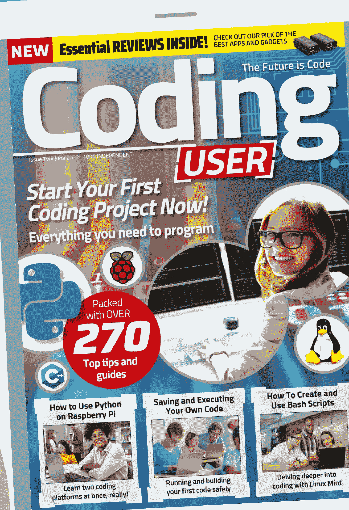

点击我们的方便链接阅读：https://bit.ly/30cLzx

开始学习可能是令人生畏的。学习一项技能或新硬件是很困难的，如果你没有手的话更如此。相反，随着我们复杂性的增加，所需的说明书就会减少，或者在某些情况下直接消失。在生活的许多时候，我们都是“学者”，事实也是如此。你曾问过：“这个按钮是做什么的？”、“为什么那个不起？”、“这是怎么回事？”！在任何新旅程或冒险的开始，我们都是新手，但幸好你在这里会有支持。

在这个系列章节中，我们将深入研究最新的电子产品、软件、爱好以及趋势！我们将引导你逐步使用你可能一直畏惧的技术方面。让我们的专家指南帮助你建立理解和技能，让你从新手变为自信且丰富的用户。

我们的旅程从这里开始。我们祝你好运，但我们相信有了支持你不需要它。


# BDM 代码门户

60+ 个 Python 程序

21,500+ 行代码

借助我们快速的代码门户来精通 Python，其中包含游戏、工具等更多。

访问：https://bdmpublic.com/code-portal 并登录以获取访问！

> “……技术无处不在，它们都是通过编程连接的。你的电视、微波炉、车载娱乐以及互联网本身都依赖良好的编程来让它们按照你想要的方式运行……”


- @bdmpubs
- BDM 出版
- www.bdmpublications.com

# Python入门


# Python入门

有很多不同的语言可以学习和使用。有些复杂且强大，有些则非常基础并用作操作系统。Python 处于中间位置，将易用性与强大的功能相结合，允许用户创建小型工具、一系列优秀的游戏和密集型任务。

然而，Python 不仅仅是另一种语言。它有一个活跃的社区在分享知识、代码以及未来版本的错误修复。这归功于这个社区，语言已经成长并繁荣，现在轮到你投入其中学习编写 Python 了。

本书的第一部分帮助你从最新版本的 Python 开始，引导你使用一些常用且有趣的功能。在不久之后，你将能够编写自己的实用工具，甚至控制在屏幕上移动的字符。

## 为什么选择 Python？

现代计算机有很多不同的编程语言可用，有些仍然基础。这些语言有些设计用于科学工作，有些用于移动平台等。那么为什么在所有语言选择 Python 呢？

### Power

自从计算机出现以来，爱好者和专业人士一直在研究电路以创造出类似魔法的东西。这些先驱者进入了一个新领域，创造了让字母 'A' 跨越屏幕的程序。四十年前，这一切是极其精彩的。无论你使用 Android 设备、iOS 设备、PC 还是 Mac，这些代码形成了我们今天使用的数字技术的基础。所有的数字设备都需要指令来告诉它们做什么，并允许它们与之交互。

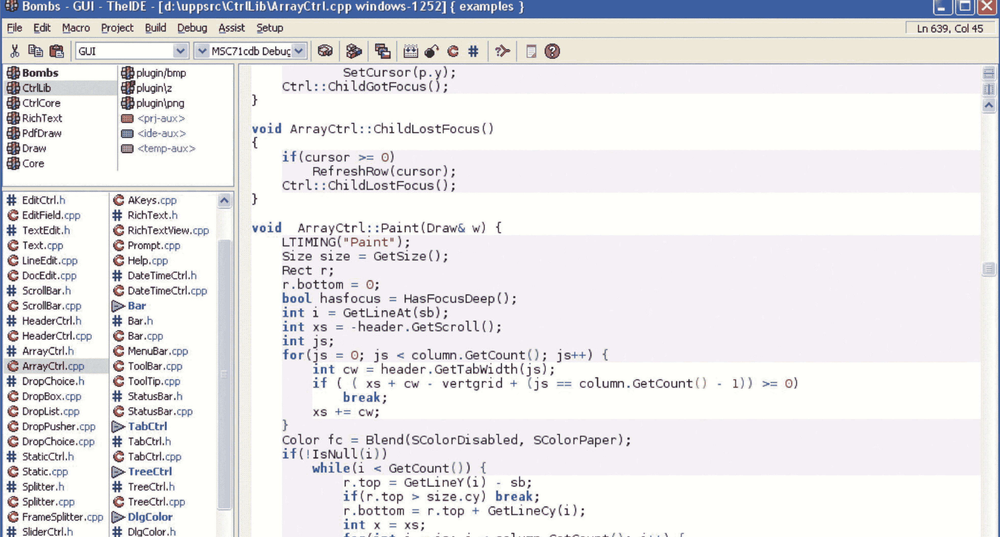

```cpp
SetCursor(p);
ctrl::ChildFocus();

void Array::ChildFocus() {
    if (cursor == 0) {
        RefreshCursor();
        ChildFocus();
    }
}

void Artrl::Draw(GW& w) {
    LMT_BEGIN(w);
    Size = GetSize();
    Rect r = 0;
    while (!header->HasFocus()) {
        int i = getIndex(this);
        int x = header->GetCol();
        for (int j = 0; j < column.GetCount(); j++) {
            int cw = header->getTabWidth(j);
            if (x + cw <= column.GetCount() - 1) {
                x += cw;
            }
        }
    }
    ColorColor = Color::Blend(ScrollBar, ScrollColor);
    if (!isNull(y)) {
        r.top = GetLine(y) - sb;
        if (r.top == r.bottom) break;
        r.bottom = r.top + GetLine(y);
        int = y;
    }
    for (int j = 0; j < column.GetCount(); j++) {
        int cw = header->getTabWidth(j);
```

C++ 通用用于更复杂的程序、操作系统等。

## 为什么选择 Python？

环境或用户。操作系统，如 Windows 和 MacOS 通常是 C++、C#、汇编和某些形式的视觉化语言的组合。通常，网页的 C++ 用户可以使用多种语言，如 HTML、Java、Python 等。

Python 创建于二十多年前，已成为学习计算机编程的理想学者语言。它对于爱好者、爱好者、学生、老师以及那些只需要在外部硬件和计算机本身之间创建独特交互的人来说都是完美的。

更多通用的编程用于创建程序、应用程序、软件或他们想做的任何事情。它们被广泛应用于所有平台和几乎可以想象的每一个应用程序。有些运行得比其他的更快，而且比这些用途更容易学习。Python 就是通用语言之一。

Python 免费下载，适用于 Linux、Windows、macOS、MS-OS2、IBM 系列机器，并被选为世界五大编程语言之一，不断围绕硬件和互联网的需求演进。

Python 被称为高级语言，因为它通过各种语言、变量、属性、子程序和更多循环交互来与硬件和操作系统进行通信。它不像低级语言那样精简（低级语言可以直接处理内存、调用地址和寄存器），它是随处可用且易于学习的。

所以回答：为什么选择 Python？简单来说，它是免费的、易学的、卓越的且具有教育意义的。

```java
// Import：Java
import java.lang.reflect.*;
class Class {
    public static void main(String[] args) {
        try {
            Class c = Class.forName(args[0]);
            Method m = c.getMethod(args[1], new Class[]{});
            Object result = m.invoke(null, null);
            // 调用静态方法。
            System.out.println("" + result);
        } catch (ClassNotFoundException e) {
            // 未找到类
        } catch (NoSuchMethodException e) {
            // 未找到方法
        } catch (IllegalAccessException e) {
            // 无权限访问
        } catch (InvocationTargetException e) {
            // 调用时发生异常
        }
    }
}
```

```python
40 LET py=15
70 FOR y=1 TO 10
75 LET by=Y*(RND+22)
80 FOR x=1 TO y
85 LET px=x+by; ""
90 PRINT px,py; ""
100 PRINT tx,py; ""
110 PRINT bx,py; ""
120 PRINT ty,py
130 IF yk<15 THEN LET py=Y
140 LET n=1 TO 10: NEXT n
150 IF py=7 THEN LET py=27
160 LET bx=bx+1
170 PRINT bx,by
180 PRINT at,1-py
190 PRINT at,10,10:s=""
210 PRINT V
220 FOR TO 1000: NEXT V
300 NEXT
```

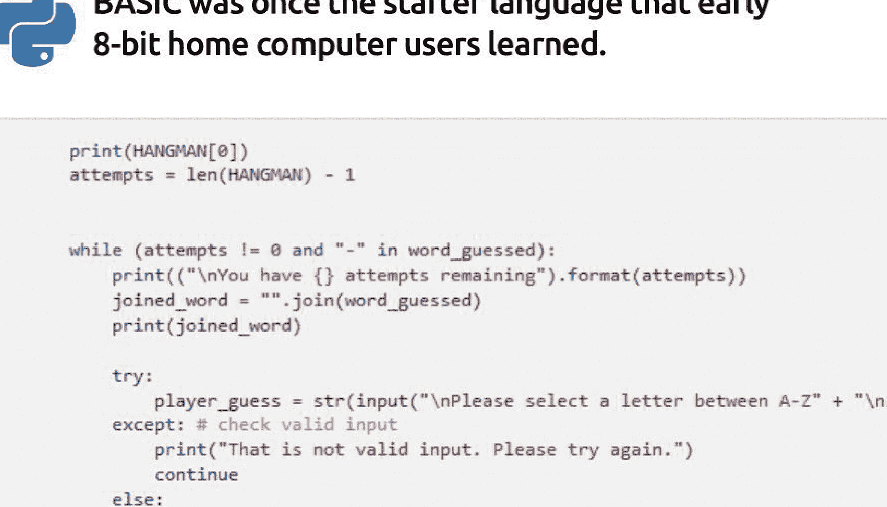

Java 是一种强大的语言，用于网页、机顶盒以及某些情况。

BASIC 是早期 8 位家用计算机使用的启动语言。

Python 是一门现代语言，易于学习，是学习计算机编程的理想学者语言。

## 你需要的设备

学习 Python 只需极少的硬件或初始资金投入。你不需要一台性能极其强大的计算机，而且所需的软件都是免费提供的。

### 我们正在使用的工具

幸运的是，Python 是一种多平台编程语言，适用于 Windows、macOS、Linux、树莓派（Raspberry Pi）等。如果你拥有这些系统之一，就可以轻松地开始使用 Python。

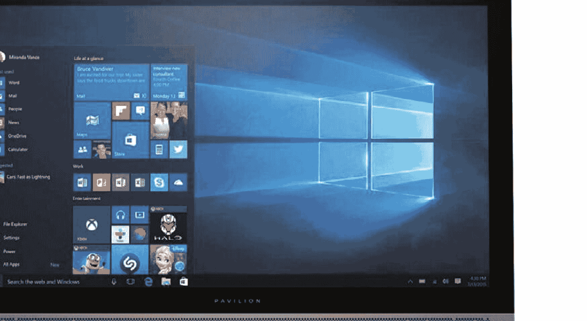

### 电脑

显然，你需要一台电脑来学习如何用 Python 编程并测试你的代码。你可以使用 Windows（XP 及以后版本）的 32 位或 64 位处理器，或者是 Apple Mac 或安装了 Linux 的系统。

### IDE

IDE（集成开发环境）用于输入和执行 Python 代码。它允许你检查程序代码以及代码中的值，并提供许多高级功能。有许多不同的 IDE，请找到最适合你并能给你带来最佳结果的那个。

### PYTHON 软件

macOS 和 Linux（以及树莓派）已经作为操作系统的一部分预装了 Python。然而，你需要确保你运行的是最新版本的 Python。Windows 用户需要下载并安装 Python，这很快就会提供。

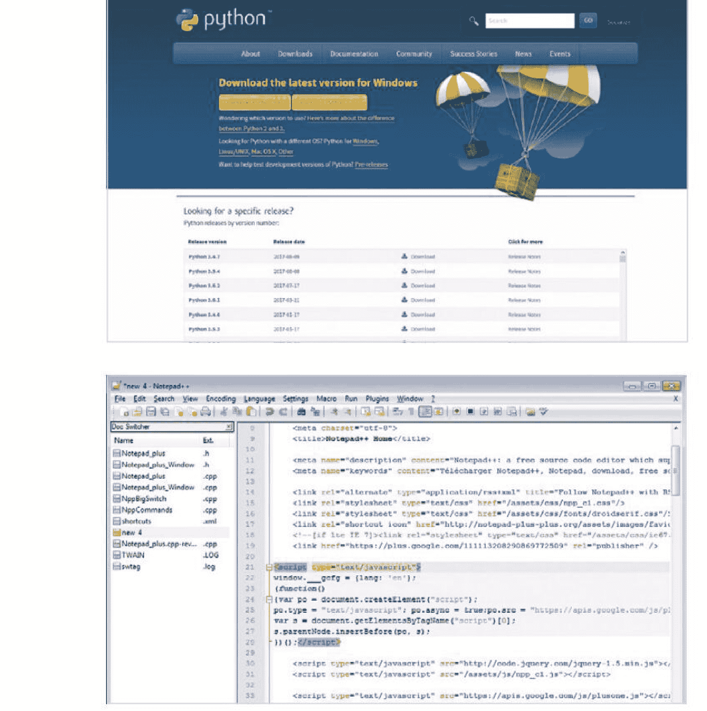

### 文本编辑器

文本编辑器是输入代码的理想环境，但并不是绝对必要的。你可以直接从 IDLE 输入并执行代码，但像 Sublime Text 或 Notepad++ 这样的文本编辑器在输入代码时提供了更高级的功能和颜色高亮。

### 互联网访问

Python 是一个不断演进的环境，新版本经常引入新概念或更改现有的方法和代码结构，以使学习更高效。访问互联网将帮助你保持与同步，在你卡住时提供帮助，并访问 Python 海量的模块。

### 时间与耐心

无论这些书籍将你带向何方，你都不会在 24 小时内成为一名程序员。学习 Python 编程需要时间和耐心。你有时可能会遇到瓶颈，然后代码就会像水一样顺畅。请理解，你正在学习完全全新的知识，但你终会成功的。

## 树莓派

为什么要用树莓派？树莓派是一种微型电脑，购买价格非常便宜，但为用户提供了一个极佳的学习平台。它的主操作系统 Raspbian 预装了最新的 Python 以及许多模块和附加功能。

树莓派

树莓派 3 是最新版本，包含了更强大的 CPU、更大的内存以及 Wi-Fi 和蓝牙支持。你可以根据感兴趣的套件，以 32 英镑购买一台树莓派，或者以 50 英镑以上的套件购买。

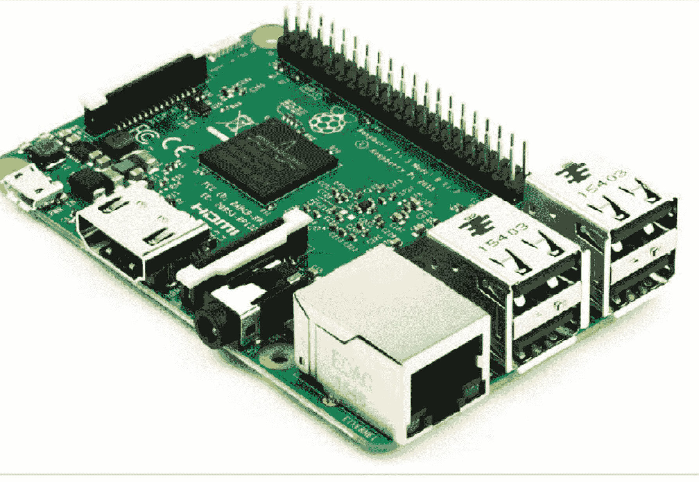

FUZE 项目

FUZE 是建立在最新型号树莓派之上的学习环境。你可以购买带有电子套件的工作站，甚至还有一个机器人臂供你构建和编程。你可以在 www.fuze.com 找到更多关于 FUZE 的信息。


书籍

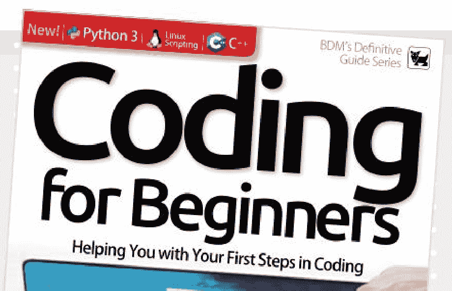

我们通过 bdmpublications.com 提供了许多优秀的编程类书籍。我们的树莓派书籍涵盖了如何购买第一台树莓派、设置并使用它；还有一些优秀的分步骤项目示例和指南，帮助你充分利用树莓派的功能。

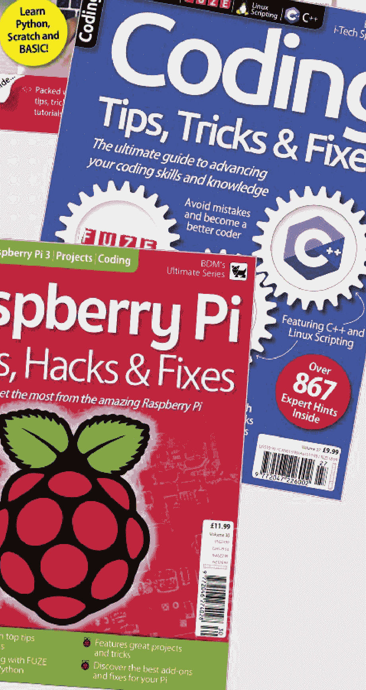

RASPBIAN

树莓派的主操作系统是一个 Debian-Linux 发行版，包含了今天你所需的一切且易于使用。它针对树莓派进行了优化，是硬件软件项目、Python 编程甚至作为桌面电脑的理想平台。

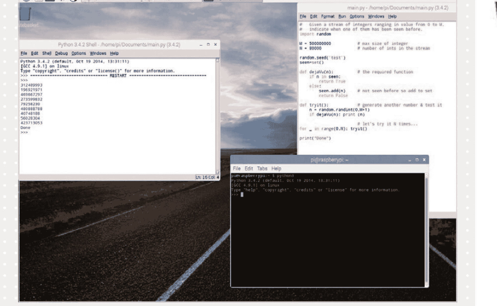

# 向 Python 问好

了解 Python

Python 是有以来最伟大的计算机编程语言。它让你能够用简洁且易于理解的语言充分利用计算机的力量。

## 什么是编程？

在尝试学习一种语言之前，了解什么是编程语言是有帮助的，看看 Python 是如何产生的以及它与其他语言的关系也是不错的。

## 编程食谱

编程语言是计算机遵循的指令列表。这些指令可以像食谱一样简单，也可以像音乐文件或构建整个世界一样复杂。Python 是由 Guido van Rossum 在 20 世纪 80 年代后期在荷兰数学与信息中心 (CWI) 构想的语言。

为什么有两个？Python 2 于 2000 年发布，从以后吸收了大量的模块、脚本、教程等。多年来，Python 2 已成为初学者和专家编写代码的首选编程语言之一，使其成为一个极具价值的资源。

树莓派的主操作系统是一个 Debian-Linux 发行版，包含了今天你所需的一切且易于使用。它针对树莓派进行了优化，是硬件软件项目、Python 编程甚至作为桌面电脑的理想平台。

树莓派的主操作系统是一个 Debian-Linux 发行版...

## Python 之禅

这背后是一种被称为“Python 之禅”的哲学。这是一个包含 20 条影响设计的原则的集合。这些原则包括：

- 漂亮优于丑陋。
- 简单优于复杂。
- 显式优于隐式。
- 可读性非常重要。
- 扁平优于嵌套。
- 稀疏优于密集。
- 某事应该只有一种——最好只有一种——方法。
- 如果可能出现特殊显而易见的情况，请显式地处理它们。
- 简单优于复杂。
- 复杂优于隐式。
- 可读性优于晦涩。
- 错误优于意外。
- 在模糊时，请求许可比猜测要好。
- 现在优于从不。
- 尽管优于丑陋。
- 如果实现困难，那可能是一个坏主意。
- 如果实现不明显，那可能是一个坏主意。
- 不要违反 Python 之则。
- 即使你为了实现规则而违反它们，也请解释原因。
- Python 是为了诗意。
- 命名永远是错误的。
- 命名应该。
- 命名很重要。
- 命名应该在命名空间内。
- Python 是一种工具。
- 某事有许多方法，但一种方法更好。
- 如果你感到困惑，请求原谅。
- 解决嵌套代码的唯一方法是将其扁平化。
- 可读代码优于隐式代码。
- 如果你正在考虑优化，请先重构。

## 高级语言

易于阅读的计算机语言被称为“高级语言”。这是因为它们位于硬件之上，而汇编被视为“低级”。

## Python 3 VS Python 2

在典型的计算场景中，Python 因为两个活跃版本的存在而变得复杂：Python 2 和 Python 3。

为 Windows 下载最新版本

不知道用哪一个？这里有关于 Python 2 和 3 之间的更多信息。

寻找其他系统的 Python？Windows 版、Linux/Unix 版

想帮助开发最新版本的 Python？预发布版

2008 年，Python 引入了若干项新且增强的功能。这些功能提供了更稳定、有效且高效的编程环境，但说，大多数（如果不是全部）新功能最初并不受欢迎，自从 Python 3 推出以来，情况一直在变化。

## 3.X 的胜利

Python 3 日益增长的普及使得现在开始学习使用新功能进行开发并逐步淘汰旧版本是明智之举。许多开发公司，如 SpaceX 和 NASA 使用 Python 3 编写重要的代码片段。

# 向 Python 问好

## 如何在 Windows 中设置 Python

Windows 用户可以通过 Python 主下载页面轻松安装最新版本的 Python。虽然大多数经验丰富的开发者可能并不会选择 Python 3.x 作为其代码的首选平台，但对于初学者来说，这是一个理想的起点。

### 安装 Python 3.X

Microsoft Windows 默认不预装 Python，因此你必须手动安装它。坦率地说，这个过程非常简单。

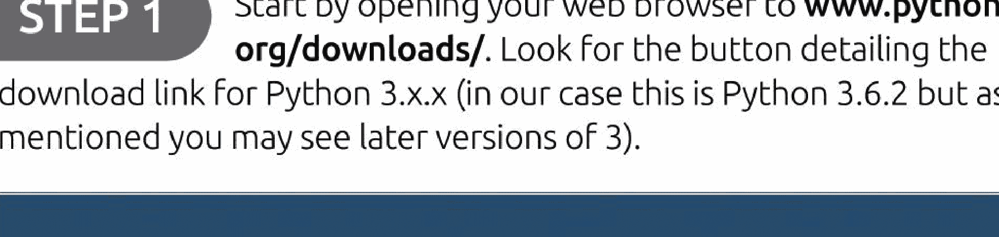

- **步骤 1** 首先打开网页浏览器访问 www.python.org/downloads/。寻找 Python 3.x 的下载按钮链接（在本例中是 Python 3.6，但你可能会看到更高版本的 3）。
- **步骤 2** 点击版本 3.x 版本的下载按钮，并将文件保存到你的“下载”（Downloads）文件夹中。文件下载完成后，双击执行文件即可启动安装向导。从这里你有两个选择：立即安装（Install Now）或自定义（Custom）。我们建议选择自定义安装。

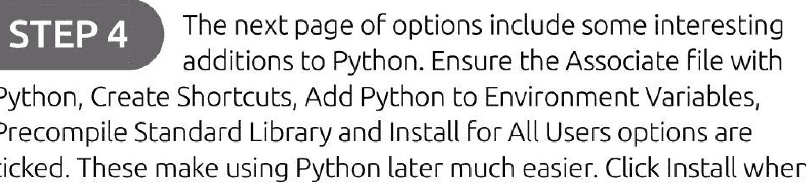

- **步骤 3** 选择自定义选项允许你指定某些参数，虽然你可以保持默认设置，但养成一个良好的习惯是避免（幸好 Python 有时并非如此）安装程序可能包含不需要的功能。如果你需要这些功能，请确保勾选所有框框并点击“下一步”按钮。


下一页选项包含一些添加到 Python 的重要项：创建快捷方式（Create Shortcuts）、将 Python 添加到环境变量（Add Python to Environment Variables）、预编译标准库（Precompile Standard Library）以及为所有用户安装（Install for All Users）。这些设置会让以后使用 Python 变得更容易。准备就绪后点击“安装”（Install）。

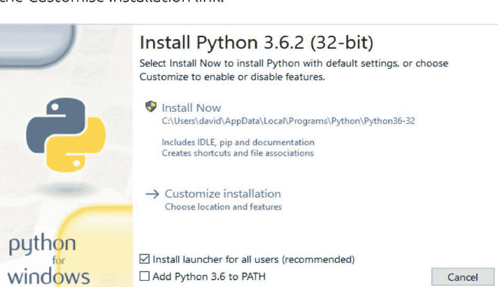

## 下载 Windows 最新版本

不知道该用哪个版本？这里有关于 Python 2 和 3 之间区别的更多信息。

正在寻找其他系统的 Python 吗？Windows, Linux, Mac, OS X, 其他

想帮助测试 Python 版本吗？预发布版（Pre-releases）

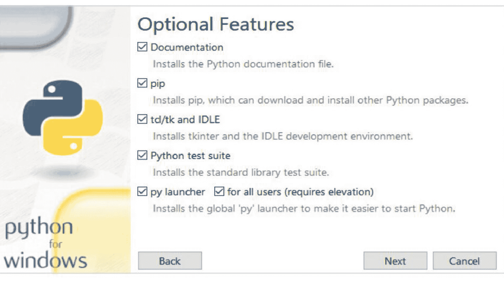

| 可选功能 |
| :--- |
| 文档 (Documentation) | 安装 Python 文档文件。 |
| pip | 安装 pip，它可以下载并安装其他 Python 包。 |
| IDLE | 安装 IDE 环境。 |
| Python test | 安装包含的测试库套件。 |
| 启动器 (launcher) | 为所有用户安装（需要权限）安装全局启动器以便启动 Python。 |

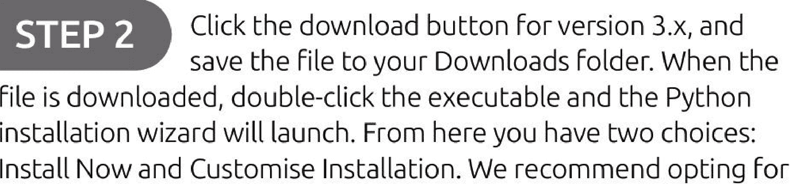

### 高级选项

- 为所有用户安装 (Install for all users)
- 将文件与 Python 关联 (Associate files with Python) (需要 python)
- 为应用程序创建快捷方式 (Create shortcuts for applications)
- 将 Python 添加到环境变量 (Add Python to environment variables)
- 预编译标准库 (Precompile standard library)
- 禁用帮助程序 (Disable help programs)
- 下载调试二进制文件 (Download debug binaries) (VS 2015 或更高版本)

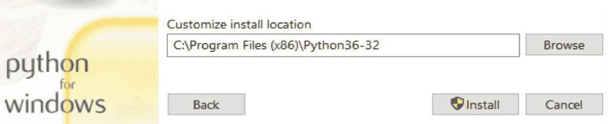

## 如何在 Windows 中设置 Python

步骤 5 你可能需要确认安装。Windows 授权通知只需点击“是”，安装将开始。安装完成后，最后的窗口页面将允许你查看最新的发布说明，并遵循一些在线教程。

步骤 6 在点击安装窗口之前，最好点击带有盾牌的“禁用路径长度限制”（Disable Path Length Limit）。这将允许你绕过 260 个字符的限制，从而执行位于深层文件夹结构中的 Python 程序。再次点击“是”激活该过程，然后你就可以关闭安装窗口了。

步骤 7 绝大多数用户将会在“开始”按钮的“最近添加”部分找到已安装的 Python 3.x。第一个链接“Python 3.6 (32-bit)”在点击后将启动命令行版本的 Python。要打开 IDLE，请在 Windows 开始菜单中输入 IDLE。

步骤 8 点击 IDLE (Python 3.6 32-bit) 链接将开启 Python 编程之旅。在这里你可以加入世界。不用担心你的版本更高新，因为它是 Python 3.x 代码，可以在你的 Python 3 接口中运行。

步骤 9 如果你现在再次点击“开始”按钮，这次输入 CMD，你将看到命令提示符。点击它进入 Windows 命令行环境。在命令行输入 Python，输入 python 并按回车。

> 禁用路径长度限制
>
> 修改你的机器配置，允许程序（包括 Python）绕过 260 个字符的“MAX_PATH”限制。

- 禁用路径长度限制


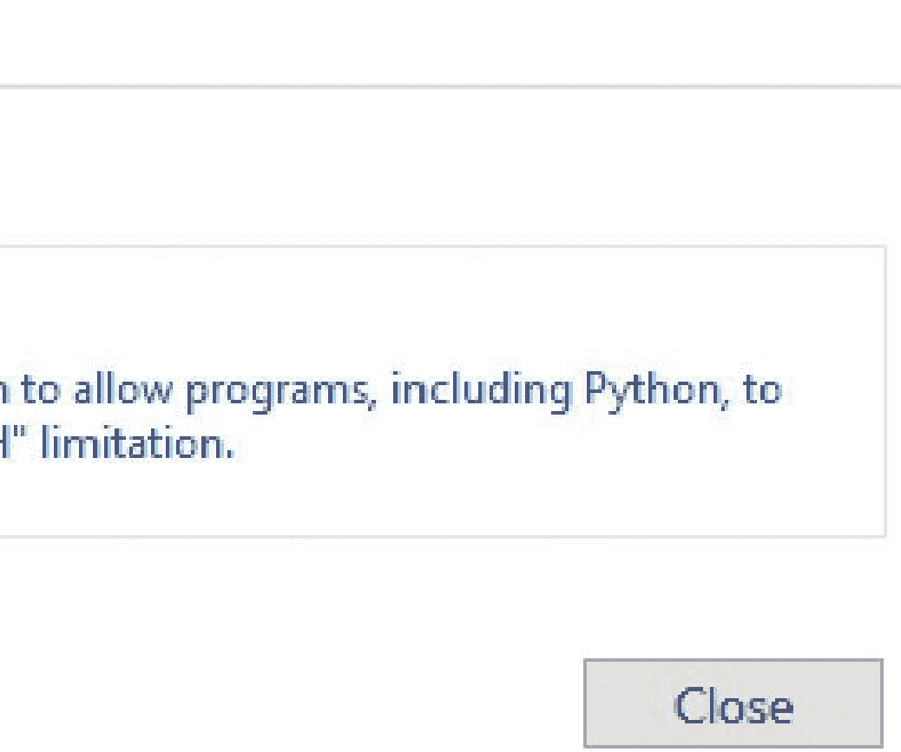

步骤 10 命令行版本的 Python 工作方式与你在步骤 8 中打开的 Shell 相同；注意那三个向左的箭头 >>>。虽然这是一个完美的环境，但它不是那么用户友好，所以暂时先离开命令行。输入 exit 关闭并离开命令提示符。


| 最佳匹配 |
| :--- |
| IDLE (Python 3.6 32-bit) 桌面应用 |
| IDLE - 查看结果 |

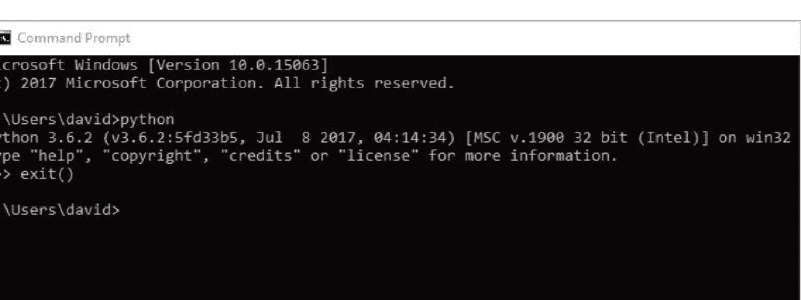

安装成功

特别感谢 Mark Hammond，他多年免费开发的 Windows 版本对 Python 仍然很有用。

初学 Python 吗？从在线教程和文档开始。

查看此发布版本的内容。

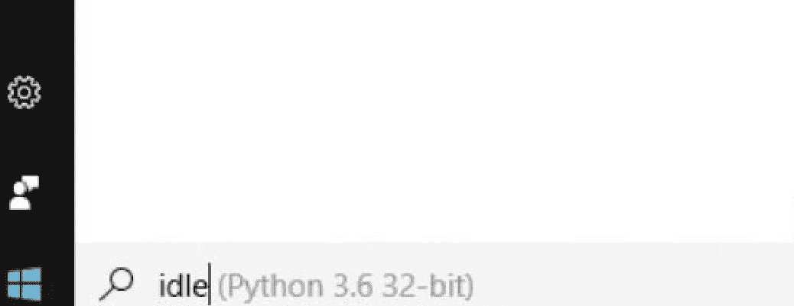

## 如何在 Linux 中安装 Python

大多数 Linux 发行版已经预装了 Python 2.x，但我们将使用 Python 3.x，因此我们需要先做一些工作来获取它。坦率地说，这并不困难。

## PYTHON 准备工作

Linux 是一个如此多功能的操作系统，因此很难规定某事的唯一方法。不同的发行版安装软件的方式各异，但在本教程中我们仍然坚持 Linux Mint 18.1。

- **步骤 1** 首先，需要确定你的 Linux 系统当前安装了哪个版本的 Python；如前所述，本节我们将使用 Linux Mint 18.1。与 macOS 一样，按下 Ctrl+Alt+T 进入终端。

- **步骤 3** 某些 Linux 发行版会在系统更新时自动将 Python 的安装更新到最新版本。要进行检查，请首先运行系统更新和升级：`sudo apt-get update && sudo apt-get upgrade`

```
File Edit View Search Terminal Help
david@david-mint ~ $
```

输入你的密码并让系统执行任何更新。

```
File Edit View Search Terminal Help
david@david-mint ~ -version
Python 2.7.12
david@david-mint ~ $ sudo apt-get update && sudo apt-get upgrade
[sudo] password for david: 
```

- **步骤 2** 接下来在终端中输入：`python --version`。你应该会在屏幕上看到与 Python 2.x 相关的输出。或者在这种特定情况下是 2.7.12。

- **步骤 4** 一旦升级完成，你可能需要回答 "Y" 来授权你的更改，输入：`python3 --version` 查看 Python 3.x 是否已更新或安装。在 Linux Mint 中，该版本为 Python 3.5.2，这对于我们的来说足够了。

```
File Edit View Search Terminal Help
david@david-mint ~ $ python --version
Python 2.7.12
david@david-mint ~ $
```

```
Setting up lib64 (2.1.0-ubuntu10.0.41)
Setting up lib386 (2.1.0-ubuntu10.0.41)
Setting up libi386 (2.1.0-ubuntu10.0.41)
Setting up libstdc6 (2.1.0-ubuntu10.0.41)
Setting up libncurses6 (2.1.0-ubuntu10.0.41)
Setting up libgcc-s1 (4.8.0-0ubuntu6)
Setting up libc-dev-common (2.23.2-ubuntu8)
Setting up libx86-64-dev (4.8.0-ubuntu6)
Setting up libi386-dev (4.8.0-ubuntu6)
Setting up linux-libc (2.23.2-ubuntu8)
Setting up openssl (1.0.2-ubuntu2)
Setting up microcode (0-20160918-ubuntu4)
Setting up kernel-generic (2.6.31-0-ubuntu114)
Setting up zlib1g-dev (0.2.11-6ubuntu5)
Setting up python (2.7.5-2ubuntu2generic)
Setting up python3 (3.5.2-3ubuntu1)
Setting up python3-distutils (3.5.2-3ubuntu1)
Setting up python3-minimal (3.5.2-3ubuntu1)
Setting up python3-dev (3.5.2-3ubuntu1)
Setting up python3-stdlib (3.5.2-3ubuntu1)
Setting up python3-venv (3.5.2-3ubuntu1)
Setting up python3-version (3.5.2-3ubuntu1)
david@david-mint ~ $
```

**步骤 5** 然而，如果你想获取最新版本（写作时 Python 网站上的版本为 3.6.2），你需要从在终端中输入这些命令开始：

- **步骤 8** 在 Python 文件夹内，输入：

```
sudo apt-get install build-essential checkinstall
sudo apt-get install libreadline-dev libssl-dev
nss5-dev libsqlite3-dev tk-dev
libdbm-dev libbz22-dev
```

```
./configure
sudo make altinstall
```

这取决于你电脑的速度。完成后，运行 `python3.6 --version` 来检查安装的版本。

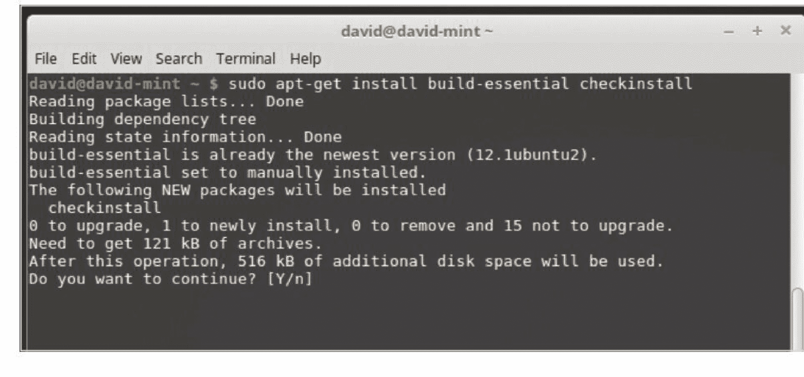


- **步骤 6** 打开你的 Linux 浏览器并访问 Python 下载页面：www.python.org/，加载后点击 "Download Python 3.6.2" 或下载 "Source-3.6.2.tar.xz"。

- **步骤 9** 对于 GUI，你需要在终端中输入命令：`sudo apt-get install idle3`。可以通过 `idle3` 启动 IDE。注意，IDE 运行的版本与安装的不同。

- **步骤 7** 在终端中，下载 Python 源码：`tar -xvf Python-3.6.2.tar.xz`。现在进入解压文件夹

- **步骤 10** 你还需要 Pip（Pip 包）来帮助安装模块和脚本：`sudo apt-get install python3-pip`。检查最新更新：`pip install --upgrade pip`。完成后，通过你发行版的菜单可以使用 Python 3。

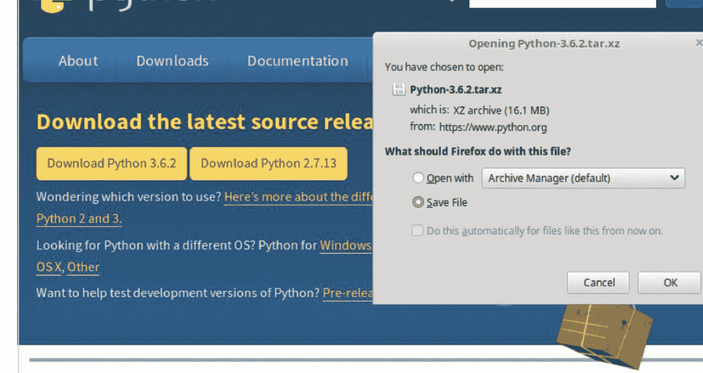

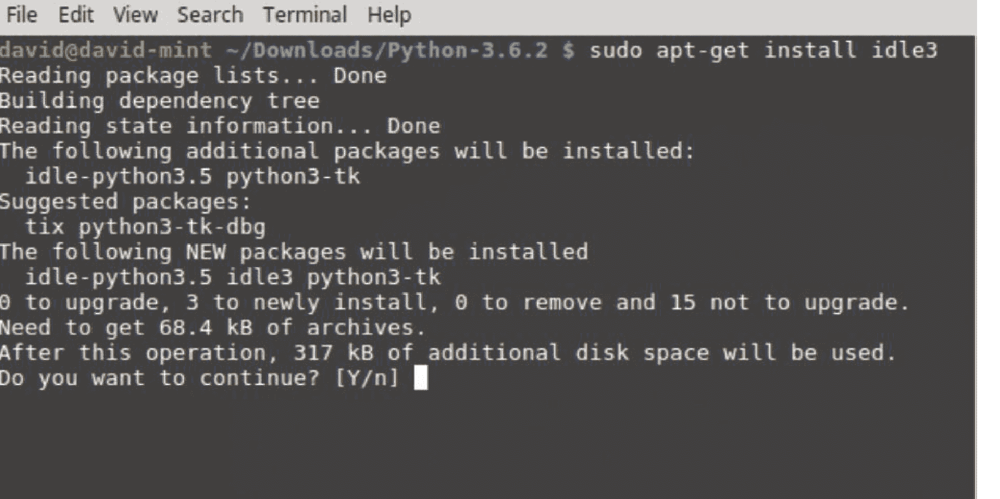

# 入门 Python

刚开始学习 Python 可能看起来有些困难，但这种语言的设计初衷是简单。像大多数事情一样，你需要缓慢学习如何获得想要的结果。在本节中，我们将介绍变量、表达式、用户输入以及各种错误类型。


## 首次 Python

我们将树莓派作为我们的 Python 3 平台。最新的 Raspbian 预装了 Python 3，版本为 3.4.2，只要你有版本 3 Shell，我们的代码就可以运行。我们不会深入研究树莓派的细节，该主题有很多可用资料。然而，一旦你准备好了，启动树莓派并准备。

- **步骤 1** 树莓派桌面加载后，点击 Menu > Python 3。这将打开 Python 3 Shell。Windows 和 Mac 用户可以通过 Finder 找到 Python 3 IDE。

- **步骤 2** Shell 是你可以输入代码并看到生成的输出的地方。这是一个沙箱，你可以在这里尝试一些代码。

- **步骤 3** 例如，在 Shell 中：按下回车后，下一行将显示答案。Python 处理了你的“代码”并产生了相应的输出。

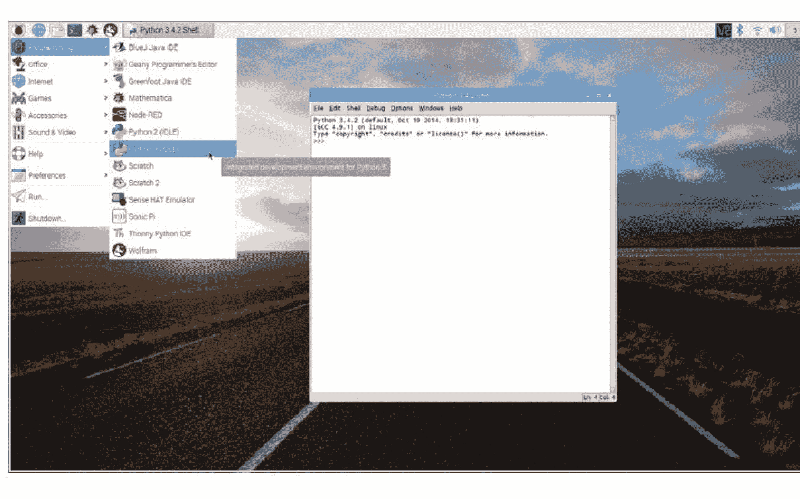

- **步骤 4** Shell 的作用非常像计算器，因为代码是与系统的系列交互。整数（无限数字序列）可以很容易地加、减、乘等。

```
Python 3.4.2 (Default, Oct 19 2014, 13:31:11)
GCC 4.9.0 on Linux
>>> type('copyright', 'credits' or 'license') for more information.
>>>
>>> 4+4
8
>>> 23456*64542
151329543412
>>> 977777*2288433-12343
223999999999991
>>> 977777*43952
429999911044
>>> 50647292358
```

**步骤 5** 虽然很有趣，但并不特别有趣。相反，尝试这个：

```
print("Hello everyone!")
```

就像我们在 Sublime Text Editor 节输入的代码一样。

```
Python 3.4.2 (Default, Oct 19 2014, 13:31:11)
GCC 4.9.0 on Linux
>>> type('copyright', 'credits' or 'license') for more information.
>>>
>>> 4+4
8
>>> 23456*64542
151329543412
>>> 977777*2288433-12343
223999999999991
>>> 977777*43952
429999911044
>>> 50647292358
```

- **步骤 8** Python IDE 是一个舒适的环境，如果你不喜欢颜色的表示方式，可以更改它们：Options > Configure Highlighting。然而，我们建议不要这样做，因为你看到的将和截图一样。

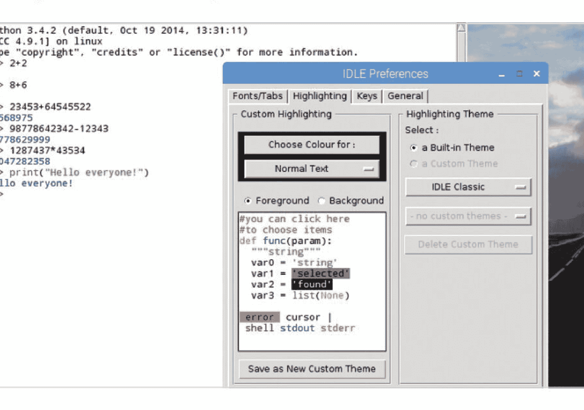

- **步骤 6** 这更像那么一点，因为你刚刚产生了第一段代码。该命令是自而易懂的，它将内容打印到屏幕上，在这种情况下查看“Hello everyone”的结果：

- **步骤 9** 就像大多数程序一样，无论操作系统如何，都有许多快捷键。这里没有空间列出所有的，但当你进入 Options > Configure IDE 并在 keys 标签下时，可以看到当前的绑定列表。

```
>>> print("Hello everyone!")
Hello everyone!
>>> 
```

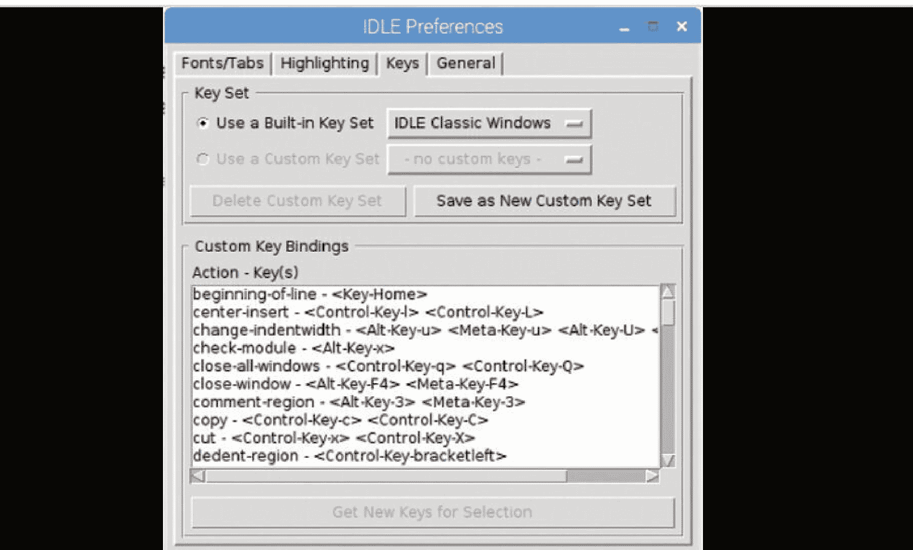

### IDLE 颜色编码

| 颜色 | 用途 | 示例 |
|---|---|---|
| 黑色 | 数据与变量 | 23.4 area |
| 绿色 | 字符串 | "Hello World" |
| 紫色 | 函数 | len() |
| 蓝色 | 用户函数 | get_area() |
| 深色 | 注释 | #variable_VAR |
| 浅色 | 错误信息 | SyntaxError: |

www.bdumpublic.com 23

## 你的第一个代码

本质上，你已经通过上一个教程中的 `print("Hello everyone!")` 函数写了你的第一段代码。然而，让我们扩展一下，看看输入你的代码、调用并尝试一些其他的 Python 示例。

## 玩转 Python

对于大多数语言（无论是计算机语言还是人类语言），关键在于在正确的场合记住并应用正确的词。你并不是天生就认识这些词汇，所以你需要学习它们。

- 步骤 1：如果你关闭了 Python IDLE，请在 Shell 中重新打开它，无论你偏好哪种操作系统的版本。在 Shell 中尝试输入以下内容：

```python
print("Hello")
```

```
Python 3.4.2 Shell
Python 3.4.2 (default, Oct 19 2014, 13:31:11)
Type "copyright": "credits" or "license" for more information.
>>> print("Hello")
Hello
```

- 步骤 2：如预期的那样，单词 Hello 以文本的形式出现在 Shell 中，表示这是字符串的输出。这非常直观，不需要太解释。现在尝试：

```python
print("2*2")
```

- 步骤 3：你可以看到，输出不是数字 4，而是你要求打印到 Shell 的 `2+2`。问号定义了输出到 IDLE Shell 的内容；尝试：

```python
print(2+2)
4
```


```
Python 3.4.2 Shell
Python 3.4.2 (default, Oct 19 2014, 13:31:11)
Type "copyright": "credits" or "license" for more information.
>>> print(2+2)
4
```


- **步骤 4**：你可以继续这样做，向 Shell 打印`2+2`、`464*2344`等。一种简单的方法是使用变量，我们稍稍后会详细介绍。现在，输入：

```python
x=2
b=2
```

```
Python 3.4.2 Shell
Python 3.4.2 (default, Oct 19 2014, 13:31:11)
Type "copyright": "credits" or "license" for more information.
>>> print("Hello")
Hello
>>> print(2+2)
4
>>> x=2
>>> b=2
>>> print(x*b)
4
>>> b=3
>>> print(x*b)
6
```


## 步骤 5

你在这里做的是给字母`a`和`b`赋值：`2`和`2`。这些是新变量，只要数字保持不变，Python 就可以调用它们进行输出、加、减等操作。尝试这个：

```python
print(b)
```

```
Python 3.4.2
Python 3.4.2 (default, Oct 19 2014, 13:31:11)
Type "copyright", "credits" or "license" for more information.
name="Hello"
print(name)
a=2
print(a*2)
b=3
print(a+b)
print(a-b)
print(a/b)
```

## 步骤 8

现在我们添加一个姓：

```python
surname="Haywood"
print(surname)
```

你现在有两个变量：一个名字和一个姓氏，你可以独立地打印它们。

```
Python 3.4.2
Python 3.4.2 (default, Oct 19 2014, 13:31:11)
Type "copyright", "credits" or "license" for more information.
name="David"
David
surname="Haywood"
print(surname)
Haywood
```

## 步骤 6

上一步的输出分别显示了`a`和`b`的值，因为你要求它们分别打印。如果你想将它们相加，请使用以下：

```python
print(a+b)
```

这段简单的代码获取`a`和`b`的值，将它们相加并输出结果：

```
Python 3.4.2
Python 3.4.2 (default, Oct 19 2014, 13:31:11)
Type "copyright", "credits" or "license" for more information.
name="Hello"
Hello
a=2
print(a*2)
b=3
print(a+b)
5
```

## 步骤 9

如果我们按照之前的惯例使用`+`符号，名字将不会正确显示在 shell 中。尝试一下：

```python
print(name-surname)
```

你需要在它们之间定义两个值并进行数学运算。

```
Python 3.4.2
Python 3.4.2 (default, Oct 19 2014, 13:31:11)
Type "copyright", "credits" or "license" for more information.
name="David"
David
surname="Haywood"
print(name-surname)
Haywood
```

### 步骤 7

你可以玩转不同的变量。例如，你可以为某人命名：

```python
name="David"
```

## 步骤 10

在 Python 3 中，你可以用逗号分隔两个变量：

```python
print(name, surname)
```

或者，你可以添加空格：

```python
print(name + " " + surname)
```

使用逗号要简单得多，你可以看到。你刚刚迈入了 Python 的世界。

```
Python 3.4.2
Python 3.4.2 (default, Oct 19 2014, 13:31:11)
Type "copyright", "credits" or "license" for more information.
name="David"
David
surname="Haywood"
print(name, surname)
```

### 保存并执行你的代码

在 IDLE Shell 中工作对于短代码完全没问题，但它并不是为长程序设计的。在本节中，你将介绍 IDLE Editor，它允许你保存并执行代码。

### 编辑代码

- **步骤 1**：首先，打开 Python IDLE，当它启动时，点击 File -> New File。这将打开一个名为 Untitled 的窗口。这就是 IDLE Editor，你可以在其中输入代码来创建程序。

- **步骤 2**：IDLE Editor 从所有意义上说都是一个带有 Python 功能的简单文本编辑器；就像你在 Shell 中做那样输入代码，参考上一个教程：

- **步骤 3**：你可以看到相同的代码在 IDLE Editor 中和在 Shell 中是一样的，这让你更好地理解代码。然而，要执行代码，你首先需要保存它。按 F5 得到 Save 框。

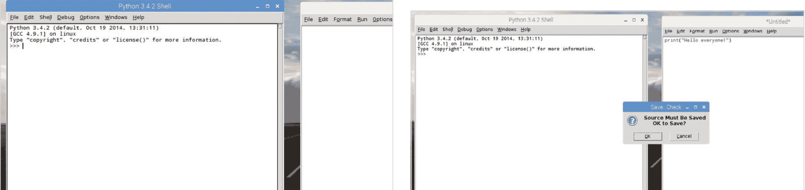

- **步骤 4**：在 Save 框中点击 OK 按钮，选择保存所有 Python 代码的地方。目标可以是名为 Python 的专用文件夹，或者任何地方。记住保持整洁，以便以后帮助你。

```python
print("Hello everyone!")
```

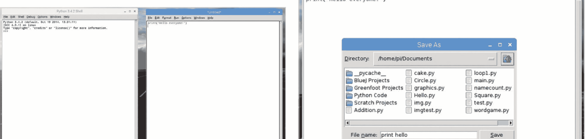

### 保存并执行你的代码

**步骤 5**：为你的代码输入一个名称，例如`'hello'`，并点击 Save 按钮。一旦 Python 被保存并执行，将在 IDLE Shell 中详细显示。在这种情况下，`'Hello everyone!'`

**步骤 8**：让我们扩展代码并输入上一个教程中的示例：

```python
a=2
b=2
name="David"
surname="Haywood"
print(name, surname)
print(a+b)
```

如果你现在按 F5，你就可以保存文件了，像之前修改的那样。

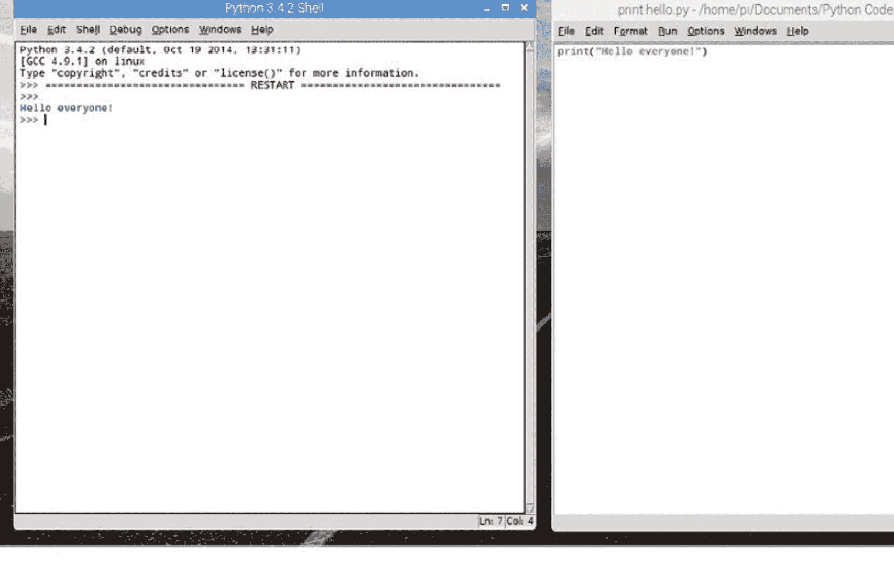

**步骤 6**：这是大部分 Python 代码执行的方式。在 Editor 中输入，按 F5，保存代码并查看 Shell 中的输出。有时会有不同，取决于你是否请求了一个独立的窗口，但本质上这是你在整个书中使用的过程，除非另有说明。


**步骤 9**：如果你点击 OK 按钮，文件将被新代码条目覆盖，并在 Shell 中执行。对于这几行来说不是问题，但如果你编辑一个较大的文件，覆盖可能会成为问题。在 Editor 中使用 File > Save As 创建副本。

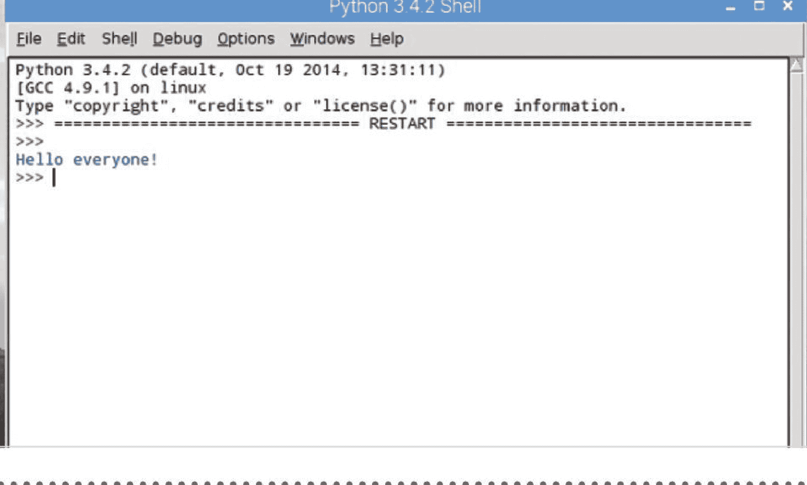

**步骤 7**：如果你打开保存的 Python 代码的文件位置，你可以看到`.py`扩展名。你创建的任何代码都是，从网络 Python 下载的任何代码都是`py`。只需确保代码是为 Python 编写的。

**步骤 10**：创建一个新文件。关闭 Editor，并从 Shell 打开一个新实例（File > New File）。输入以下内容并保存为`hello`：

```python
a="Python"
b="15"
c="cool!"
print(a, b, c)
```

你将在下一个教程中使用它。

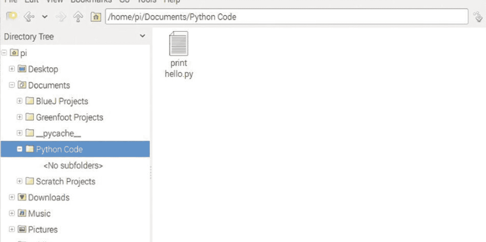

## 从命令行执行代码

尽管我们在整本书中都从 GUI 操作，但值得看一眼 Python 的命令行处理。我们已经知道有一个命令行版本的 Python，但它也被用于执行代码。

### 控制代码

使用上一个教程中的代码，即我们命名为`hello.py`的那一个，看看你如何在命令行级别运行在 GUI 中制作的代码。

- **步骤 1**：Linux 中的 Python 有两种通过命令行执行代码的可能方法。一种方法是使用 Python 2，而另一些方法使用 Python 3 库等。首先，进入你操作系统的命令行或 Terminal。

- **步骤 2**：如之前一样，树莓派：Windows 用户需要点击开始按钮并搜索 CMD，然后点击返回的 Command Line搜索；macOS 用户可以通过 Go > Utilities > Terminal 访问他们的命令行。

- **步骤 3**：现在我们到了命令行界面，可以启动 Python。对于 Python 3，你需要输入`python`命令并按回车。这将让你进入命令行版本的 Shell，带有熟悉的右箭头 (=>)

```python
python hello.py
```

- **步骤 4**：从这里你可以输入你之前看过的代码，例如：

```python
print(a)
```

你可以看到它的工作原理完全一样。

## 从命令行执行代码

**步骤 5**：现在输入`exit()`退出命令行会话并返回命令提示符。进入你保存上一个教程中代码的文件夹，并列出可用文件；希望你看到了`hello.py`。

**步骤 8**：从 Python 2 代码中运行 Python 3 代码的结果显而易见。由于 Python 3 处理 Print 命令的方式与 Python 2 的不同，它不会产生任何错误，但结果并不符合你的预期。使用 Sublime 作为编辑器，打开`hello.py`。

```
File Edit Tabs Help
sip@rasberrypi:~/Documents/Code $
Python 3.4(default) Oct 10 2013, 13:13:11
>>> import
print("copyright", "credits" or "license" for more information.
>>> exit()
sip@rasberrypi:~/Documents/Code $ cd Documents
sip@rasberrypi:~/Documents/Documents $ cd hello.py $ python3 hello.py
sip@rasberrypi:~/Documents/Documents/Code $ $ python3 hello.py
sip@rasberrypi:~/Documents/Code $
```

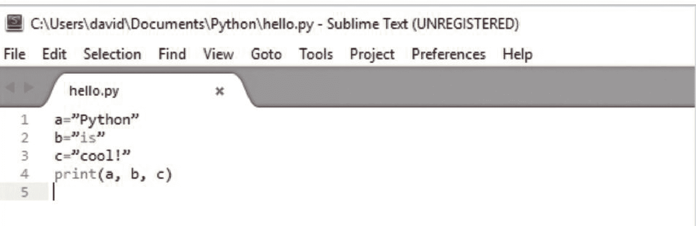

**步骤 6**：在要运行代码的同一个文件夹内，输入以下命令`python3 hello.py`。

**步骤 9**：由于树莓派不支持 Sublime Text，你将暂时离开树莓派，并使用一个不需要使用 Python IDLE 的示例。在打开`hello.py`文件的情况下，将其修改为以下内容

这将执行我们创建的代码，结果如下：

```python
name=input("What is your name ?")
print("hello", name)

a="Python"
b="is"
c="cool"
print(a, b, c)
```

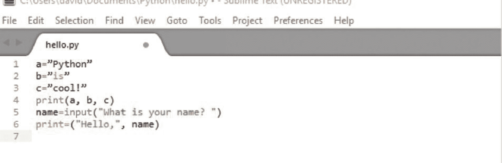

```
a="Python"
b="is"
c="cool"
print(a, b, c)
print("hello", name)
```

```
File Edit Tabs Help
Python 3.4(default) Oct 10 2013, 13:13:11
>>> import
print("copyright", "credits" or "license" for more information.
>>> exit()
sip@rasberrypi:~/Documents/Code $ cd Documents
sip@rasberrypi:~/Documents/Documents $ cd hello.py $ python3 hello.py
sip@rasberrypi:~/Documents/Documents/Code $ $ python3 hello.py
sip@rasberrypi:~/Documents/Code $
```

**步骤 7**：自然地，这是 Python 3 代码，使用了 Python 3 特有的语法和布局，只有当你尝试通过输入以下命令用 Python 2 运行它才会报错：

`python hello.py`

**步骤 10**：保存`hello.py`文件并回到命令行。现在执行新保存的

`python3 hello.py`

结果仍然是原始的 Python 3 代码，加上你请求添加的输入命令，并在命令窗口中显示。

```
sip@rasberrypi:~/Documents/Code $ python hello.py
File Edit Tabs Help
sip@rasberrypi:~/Documents/Code $ python3 hello.py
Python 3.4(default) Oct 10 2013, 13:13:11
>>> import
print("copyright", "credits" or "license" for more information.
>>> exit()
sip@rasberrypi:~/Documents/Code $ cd Documents
sip@rasberrypi:~/Documents/Documents $ cd hello.py $ python3 hello.py
sip@rasberrypi:~/Documents/Documents/Code $ $ python3 hello.py
sip@rasberrypi:~/Documents/Code $
```

© 2013-bdmpublic.com 29

# 入门 Python

## 数字与表达式

我们已经看到了 Python 的一些基础数学表达式，比如简单的加法等。现在让我们扩展一下内容，看看 Python 作为计算器有多强大。你可以在 IDLE Shell 中，也可以在编辑器中操作，随你喜好。

## 全都是数学，哥们们

你可以利用 Python 的数学能力获得一些令人惊讶的结果；正如大多数（如果不是所有）编程语言一样，数学是代码背后的驱动力。

- **步骤 1**：打开 Python 3 版本，正如提到的，目前你将使用 Shell 或编辑器来热身你的“肌肉”，这是位于大脑后部的一个小腺体（或者不是）。

- **步骤 3**：你可以使用所有的常规数学运算：除法、乘法、括号等。练习几次，例如：

```python
1/2
2*3
(1+2)+(3*4)
```

```
Python 3.4 2 Shell
Edit Shell Debug Options windows help
Python 3.4.2 (default. Oct 19 2014, 13:31:11)
>>> [GCC 4.9.0] on linux
>>> type('copyright'), 'credits' or 'license') for more information.
'str'
>>> 1/2
0.5
>>> 2*3
6
>>> (1+2)+(3*4)
15
```

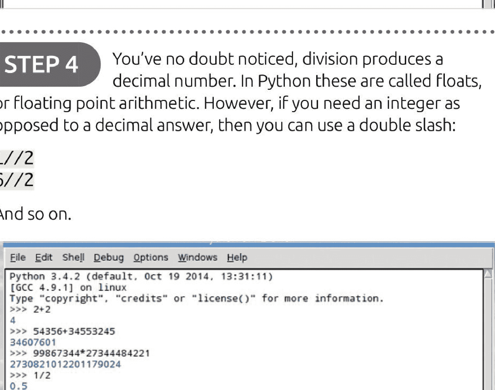

- **步骤 2**：在之前的 shell 中：

```python
2+2
54356+34553245
9986734*2734484221
```

- **步骤 4**：你没有注意到，除法返回的是浮点数。Python 可以处理浮点数。然而，如果你需要将整数转换为浮点数，可以使用：

```python
1/2
6/2
```

```
Python 3.4 2 Shell
Edit Shell Debug Options windows help
Python 3.4.2 (default. Oct 19 2014, 13:31:11)
>>> [GCC 4.9.0] on linux
>>> type('copyright'), 'credits' or 'license') for more information.
'str'
>>> 1/2
0.5
>>> 2*3
6
>>> (1+2)+(3*4)
15
```


- **步骤 5**：在上面的 shell 中，还可以使用模运算获取余数。例如，如果你想知道余数，可以使用：

```python
10%3
```

- **步骤 6**：接下来我们有了幂运算符，指数。要计算某个数的幂，使用双星号：

```python
2**3
```

- **步骤 9**：布尔表达式是一个逻辑语句，我们可以使用它们来测试是否等于或大于：

```python
5>3
```

- **步骤 7**：数字和表达式并不止于此。Python 有许多内置函数来处理绝对值、复数。要转换为二进制，可以使用：

```python
bin(5)
```


# 数字与表达式

执行代码，你会看到布尔值，取决于结果：

```python
>>> 5==5
True
>>> 5==3
False
```

```python
1/2
6/2
10/3
3.3333333333333335
3.3333333333333335
10%3
1
```

# 注释

当你编写代码时，每个变量的流程等都在你脑子里。其他程序员可以逐行阅读代码，但随着时间的推移，代码可能会变得难以阅读。

程序员通过对部分进行注释来保持代码的可读性。例如：

- 第 1 步：开始创建一个 IDLE 编辑器新实例（`> New File`），并创建一个简单的变量和打印命令：

```python
a=10
print("The value of A is,", a)
```

保存文件并执行它。

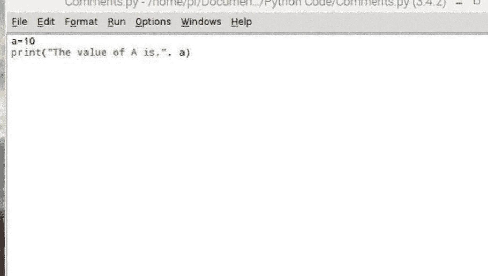

- 第 3 步：重新保存并执行代码。看到 IDLE Shell 中的输出与之前相同，尽管添加了行。简单来说，井号（`#`）表示程序员可以插入的一行文本，用于向他们和其他人告知情况，而用户不会察觉。

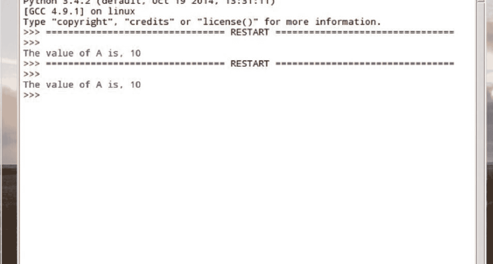

- 第 2 步：运行代码将返回 `The value of A is, 10` 到 IDLE Shell 窗口，这是我们预期的。现在，添加一些通常常见的注释：

```python
## 将 A 的值设置为 10
## 打印 A 的当前值
print("The value of A is,", a)
```

- 第 4 步：假设我们创建的变量是游戏中的生命。每当玩家死去，变量就会减一。程序员应该在以下内容之间插入一行：

```python
a=10
print("You've just lost a life!")
print("You now have", a, "lives left!")
```

## 第 5 步

虽然我们知道变量 `A` 是什么，而玩家刚刚不知道，但普通观众或某些人可能不知道。想象一下，代码有二十行长，而不仅仅是七行。你可以看到有多少条注释。

## 第 8 步

跟在代码段后面的行内注释。我们从（示例）中取例子，而不是将代码插入到单独的一行中，我们可以使用：

```python
a=10 # 将 A 的起始值设为 10
print("The value of A is,") # 打印当前值
value = a
a -= 1 # 玩家刚刚失去了一条命！
print("You've just lost a life!")
print("You now have, " "lives left!") # 通知玩家，并显示 A 的当前值
```

## 第 6 步

带有注释的新代码可能看起来这样：

```python
## 将 A 的起始值设为 10
## 打印 A 的当前值
print("The value of A is,")
## 玩家失去了一条命！
a -= 1
## 通知玩家，并显示 A 的当前值
(lives)
print("You've just lost a life!")
print("You now have, "lives left!")
```

## 第 9 步

注释哈希符号 `#` 也可以用于注释掉代码中的某些部分。例如，如果你想删除第一个语句，你会使用：

```python
### print("The value of A is,")
```

## 第 7 步

你可以使用三引号来注释。块注释是代码中的一大段文本，例如告诉读者你计划在 Python 中做什么：

> "这是史以来最棒的游戏，是由的一群连续几周没有睡觉的 Python 专家开发的。尽管代码闻起来很臭的，但它至少运行得很好。"

## 第 10 步

你还用使用三引号来注释掉一段块或多行文本。将它们放置在你想要注释的区域之前和之后，以便它们：

> "这是史以来最棒的游戏，是由的一群连续几周没有睡觉的 Python 专家开发的。尽管代码闻起来很臭的，但它至少运行得很好。"

# 操作变量

我们在 Python 代码中看到了一些变量的示例，但回顾一下它们的运行方式以及 Python 如何创建并为变量赋值总是有价值的。

## 各种变量

本次教程中，你将使用 Python 3 IDLE Shell。如果你还没有打开，请打开 Python 3 或关闭之前的 IDLE Shell 以清理任何代码。

- 第 1 步：在某些编程语言中，你被要求使用美元符号 `$` 来表示字符串，这是一种由多个字符组成的变量，例如人的名字。在 Python 中，这是没有必要的。例如，在 Shell 中输入：`name="David"`（或使用你自己的名字，除非你叫 David Howard）。

- 第 3 步：你之前已经看到变量可以使用变量名之间的 `+` 号进行连接。在我们的示例中，我们可以使用 `print(name + " " + title)` 来添加逗号和空格，因为变量在连接时没有空格，所以我们需要手动添加它们。

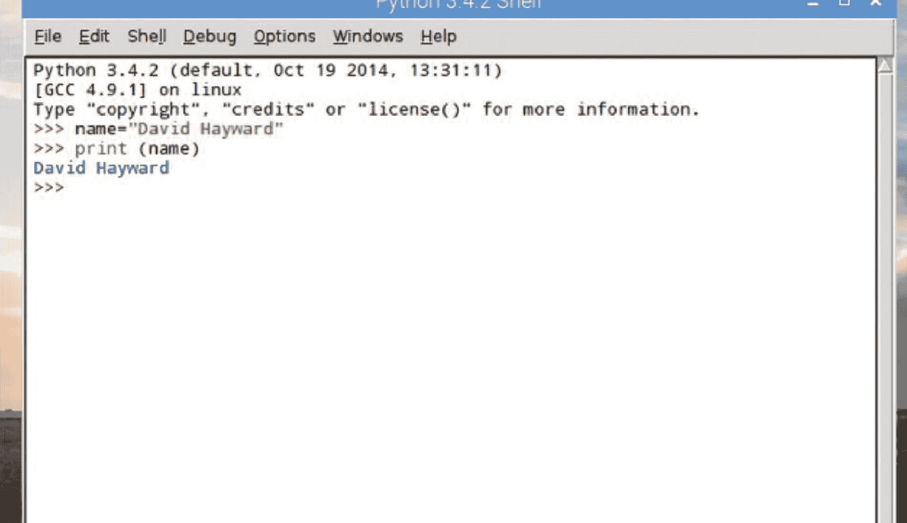

```python
Python 3.2 Shell
Python 3.4 (default), Oct 19 2014, 13:21:11
type="copyright", "credits" or "license" for more information.
name="David"
print(name)
David Howard
>>> title="Descended from Vikings"
print(title)
Descended from Vikings
```

- 第 2 步：你可以通过发布 `type()` 命令来检查正在使用的变量类型，将变量名放在括号内。

- 第 4 步：你可以通过将变量放入另一个变量来获取其类型。例如，为了连接变量，我们需要字符串：


```python
Python 3.2 Shell
Python 3.4 (default), Oct 19 2014, 13:21:11
type="copyright", "credits" or "license" for more information.
name="David"
print(name)
David Howard
>>> title="Descended from Vikings"
print(title)
Descended from Vikings
>>> character=name + " " + title
print(character)
David Descended from Vikings
```

# 变量

## 第 5 步

虽然我们知道变量 `A` 是什么，而玩家刚刚不知道，但普通观众或某些人可能不知道。想象一下，代码有二十行长，而不仅仅是七行。你可以看到有多少条注释。

## 第 8 步

跟在代码段后面的行内注释。我们从（示例）中取例子，而不是将代码插入到单独的一行中，我们可以使用：

```python
a=10 # 将 A 的起始值设为 10
print("The value of A is,") # 打印当前值
value = a
a -= 1 # 玩家刚刚失去了一条命！
print("You've just lost a life!")
print("You now have, " "lives left!") # 通知玩家，并显示 A 的当前值
```

## 第 6 步

带有注释的新代码可能看起来这样：

```python
## 将 A 的起始值设为 10
## 打印 A 的当前值
print("The value of A is,")
## 玩家失去了一条命！
a -= 1
## 通知玩家，并显示 A 的当前值
(lives)
print("You've just lost a life!")
print("You now have, "lives left!")
```

## 第 9 步

注释哈希符号 `#` 也可以用于注释掉代码中的某些部分。例如，如果你想删除第一个语句，你会使用：

```python
### print("The value of A is,")
```

## 第 7 步

你可以使用三引号来注释。块注释是代码中的一大段文本，例如告诉读者你计划在 Python 中做什么：

> "这是史以来最棒的游戏，是由的一群连续几周没有睡觉的 Python 专家开发的。尽管代码闻起来很臭的，但它至少运行得很好。"

## 第 10 步

你还用使用三引号来注释掉一段块或多行文本。将它们放置在你想要注释的区域之前和之后，以便它们：

> "这是史以来最棒的游戏，是由的一群连续几周没有睡觉的 Python 专家开发的。尽管代码闻起来很臭的，但它至少运行得很好。"

# 操作变量

我们在 Python 代码中看到了一些变量的示例，但回顾一下它们的运行方式以及 Python 如何创建并为变量赋值总是有价值的。

## 各种变量

本次教程中，你将使用 Python 3 IDLE Shell。如果你还没有打开，请打开 Python 3 或关闭之前的 IDLE Shell 以清理任何代码。

- 第 1 步：在某些编程语言中，你被要求使用美元符号 `$` 来表示字符串，这是一种由多个字符组成的变量，例如人的名字。在 Python 中，这是没有必要的。例如，在 Shell 中输入：`name="David"`（或使用你自己的名字，除非你叫 David Howard）。

- 第 3 步：你之前已经看到变量可以使用变量名之间的 `+` 号进行连接。在我们的示例中，我们可以使用 `print(name + " " + title)` 来添加逗号和空格，因为变量在连接时没有空格，所以我们需要手动添加它们。


```python
Python 3.2 Shell
Python 3.4 (default), Oct 19 2014, 13:21:11
type="copyright", "credits" or "license" for more information.
name="David"
print(name)
David Howard
>>> title="Descended from Vikings"
print(title)
Descended from Vikings
```

- 第 2 步：你可以通过发布 `type()` 命令来检查正在使用的变量类型，将变量名放在括号内。

- 第 4 步：你可以通过将变量放入另一个变量来获取其类型。例如，为了连接变量，我们需要字符串：


```python
Python 3.2 Shell
Python 3.4 (default), Oct 19 2014, 13:21:11
type="copyright", "credits" or "license" for more information.
name="David"
print(name)
David Howard
>>> title="Descended from Vikings"
print(title)
Descended from Vikings
>>> character=name + " " + title
print(character)
David Descended from Vikings
```

# 用户输入

第 5 步：你不需要在输入命令中包含带引号的文本。例如，你可以询问用户姓名，并在行中进行输入：

```python
print("Hello. What's your name?")
name=input()
```


# 用户输入

**第 5 步** 你不需要在输入命令中包含带引号的文本。例如，你可以询问用户姓名，并在行中进行输入：

```
print("Hello. What's your name?")
name=input()
```

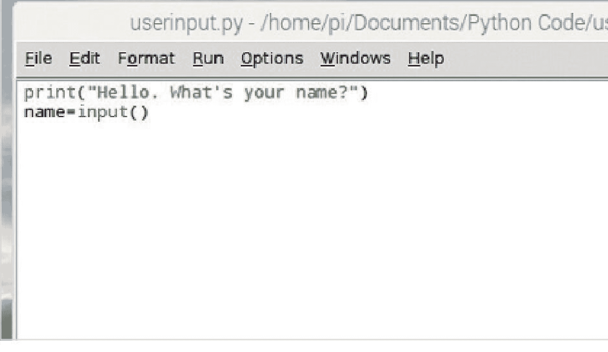

**第 8 步** 你在这里创建的是一个条件，它很快就会被覆盖。简而言之，我们正在使用输入并将其与条件进行比对。因此，如果用户输入的名字是 David，卫兵将允许他们安全无恙地通过。否则，如果他们输入的是 David 以外的名字，卫兵将挑战他们战斗。

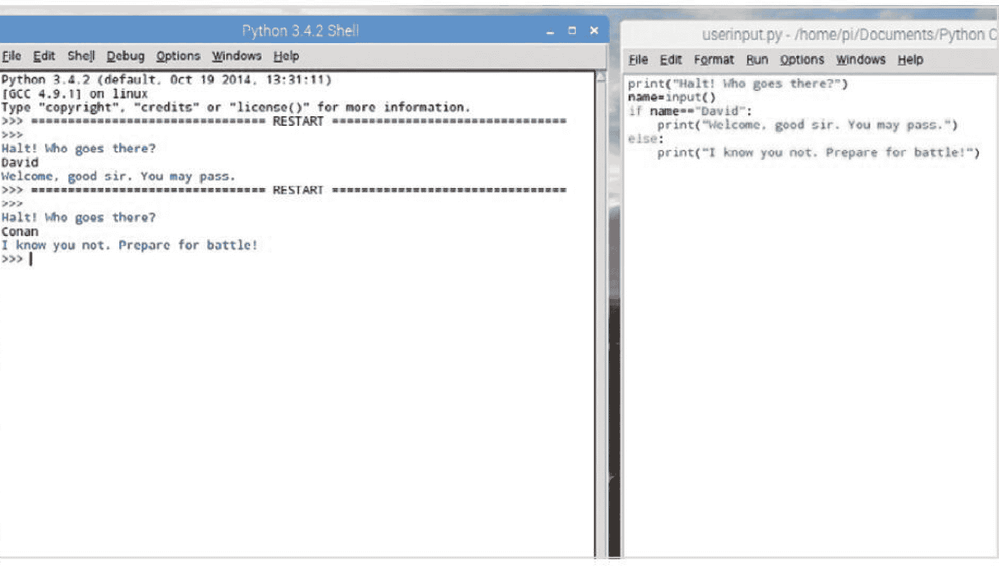

**第 6 步** 你所指定的代码通常被认为比在输入命令中使用大量的文本要精简一些，但这并不是不变的规则，所以在这种情况下你可以随自己的喜好操作。扩展代码如下：

```
print("Halt! Who goes there?")
name=input()
```

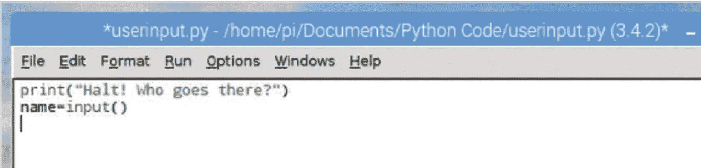

**第 9 步** 正如你之前学过的那样，任何输入自动都是字符串，因此你需要应用类型转换（TypeCast）将其转换为其他类型。这为输入命令创建了有趣的补充。例如：

```python
## 计算速率和距离
print("Input a rate and distance")
rate=float(input("Rate: "))
```

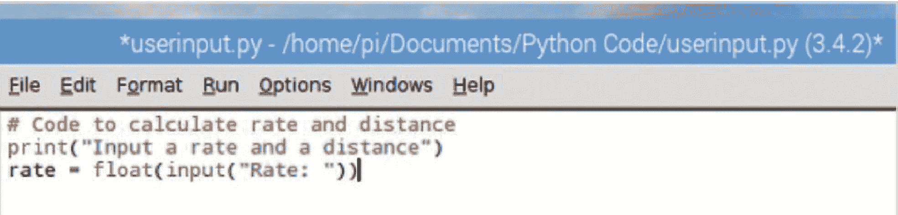

**第 7 步** 也许这算是一个文字冒险游戏的良好开始？你现在可以扩展并使用原始输入来充实游戏内容：

```python
if name="David":
    print("Welcome, good sir. You may pass.")
else:
    print("I know you not. Prepare for battle!")
```

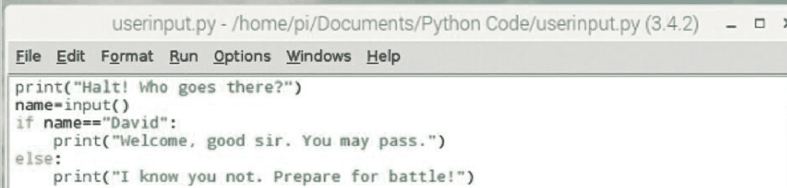

**第 10 步** 为了完成速率和距离计算，我们可以添加距离：

```python
distance = float(input("Time: "))
print((distance / rate))
```

保存并执行代码并输入数字。使用`FloatInput`元素，我们告诉 Python 输入任何内容都是浮点数而不是字符串。

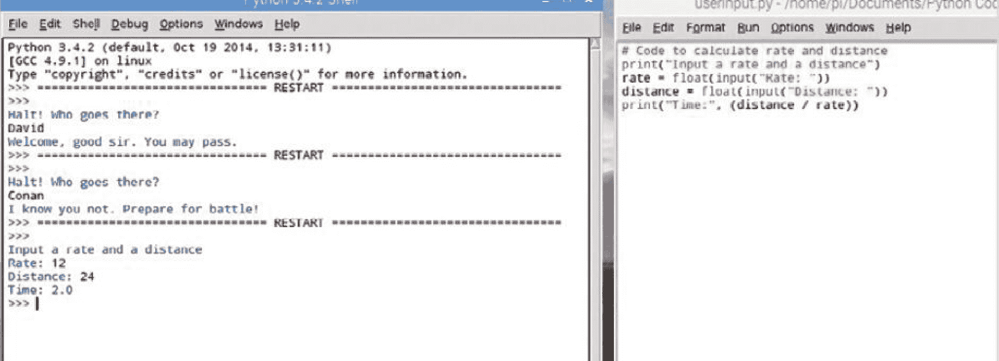

www.bdmpublications.com 37

## 创建函数

现在你已经掌握了变量和用户输入，下一步是处理函数。你已经使用过一些函数，例如`print`命令，但 Python 允许你定义自己的函数。

### 有趣函数

函数是你输入到 Python 中执行某些操作的命令。它是一小段自包含的代码，接收数据、对其进行处理并返回结果。

- **第 1 步** 它不仅仅是一个可以工作的函数。它们可以在 Python 中做各种实用的事情，比如排序数据，将项目从一种格式转换为另一种格式，以及检查项目的长度或类型。函数是一个后面跟着括号的短单词。例如，`len()`、`list()`或`type()`。

- **第 3 步** 你可以向函数传递参数。正如你之前学过的，任何输入自动都是字符串，所以你需要应用类型转换将其转换为其他类型。这为输入命令创建了有趣的补充。例如：

```python
## 计算速率和距离
print("Input a rate and distance")
rate=float(input("Rate: "))
```

- **第 7 步** 也许这算是一个文字冒险游戏的良好开始？你现在可以扩展并使用原始输入来充实游戏内容：

```python
if name="David":
    print("Welcome, good sir. You may pass.")
else:
    print("I know you not. Prepare for battle!")
```

- **第 10 步** 为了完成速率和距离计算，我们可以添加距离：

```python
distance = float(input("Time: "))
print((distance / rate))
```

保存并执行代码并输入数字。使用`FloatInput`元素，我们告诉 Python 输入任何内容都是浮点数而不是字符串。


## 用户输入

第 5 步 你不需要在输入命令中包含带引号的文本。例如，你可以询问用户姓名，并在行中进行输入：

```
print("Hello. What's your name?")
name=input()
```


第 8 步 你在这里创建的是一个条件，它很快就会被覆盖。简而言之，我们正在使用输入并将其与条件进行比对。因此，如果用户输入的名字是 David，卫兵将允许他们安全无恙地通过。否则，如果他们输入的是 David 以外的名字，卫兵将挑战他们战斗。


第 6 步 你所指定的代码通常被认为比在输入命令中使用大量的文本要精简一些，但这并不是不变的规则，所以在这种情况下你可以随自己的喜好操作。扩展代码如下：

```
print("Halt! Who goes there?")
name=input()
```


第 9 步 正如你之前学过的那样，任何输入自动都是字符串，所以你需要应用类型转换（TypeCast）将其转换为其他类型。这为输入命令创建了有趣的补充。例如：

```python
## 计算速率和距离
print("Input a rate and distance")
rate=float(input("Rate: "))
```


第 7 步 也许这算是一个文字冒险游戏的良好开始？你现在可以扩展并使用原始输入来充实游戏内容：

```python
if name="David":
    print("Welcome, good sir. You may pass.")
else:
    print("I know you not. Prepare for battle!")
```


第 10 步 为了完成速率和距离计算，我们可以添加距离：

```python
distance = float(input("Time: "))
print((distance / rate))
```

保存并执行代码并输入数字。使用 `FloatInput` 元素，我们告诉 Python 输入任何内容都是浮点数而不是字符串。


www.bdmpublications.com 37

## 创建函数

现在你已经掌握了变量和用户输入，下一步是处理函数。你已经使用过一些函数，例如 `print` 命令，但 Python 允许你定义自己的函数。

### 有趣函数

函数是你输入到 Python 中执行某些操作的命令。它是一小段自包含的代码，接收数据、对其进行处理并返回结果。

- **第 1 步** 它不仅仅是一个可以工作的函数。它们可以在 Python 中做各种实用的事情，比如排序数据，将项目从一种格式转换为另一种格式，以及检查项目的长度或类型。函数是一个后面跟着括号的短单词。例如，`len()`、`list()` 或 `type()`。

- **第 3 步** 你可以向函数传递参数。正如你之前学过的，任何输入自动都是字符串，所以你需要应用类型转换将其转换为其他类型。这为输入命令创建了有趣的补充。例如：

```python
## 计算速率和距离
print("Input a rate and distance")
rate=float(input("Rate: "))
```

# 第 5 步 按 F5 并保存代码以执行。起初在 Shell 中输入一个四字母单词，你应该会收到返回的消息，显示该单词是四个字母。现在再次按 F5 重新运行程序，这次是一个五字母单词。Shell 将显示它不是一个四字母单词。

## 第 6 步 扩展代码以包含其他条件。最终，它可能会变得非常复杂。我们添加了一个针对三字母单词的条件：

```
word=input("Please enter a four-letter word: ")
if word_length=len(word) == 4:
    print("is a four-letter word. Well done.")
elif word_length == 3:
    print("is a three-letter word. Try again.")
else:
    print("is not a four-letter word.")
```

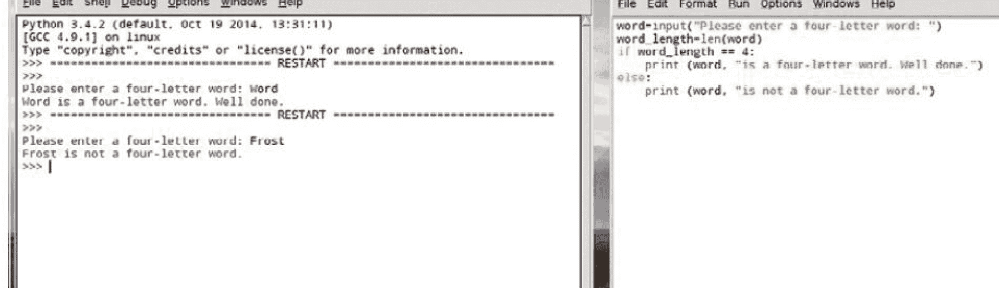

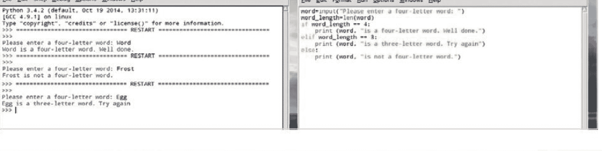

## 循环

循环看起来与条件相似，但它们在操作上有所不同。循环会多次运行代码块，通常在条件的支持下运行。

### 第 1 步 让我们从简单的 While 语句开始。如果这将检查某内容是否为真（TRUE），则运行缩进的代码：

### 第 3 步 For 循环是另一个例子。For 用于遍历数据范围，即以括号形式列出的列表。例如：

```
x = 0
while x < 10:
    print(x)
    x = x + 1
```

```
words=("Cat", "Dog", "Unicorn")
for word in words:
    print(word)
```

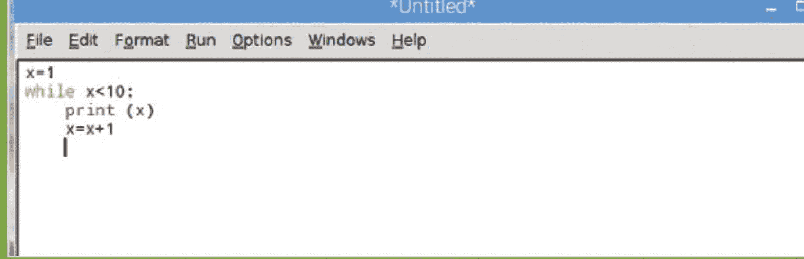

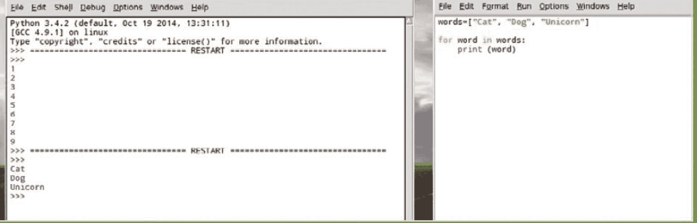

### 第 2 步 `if` 和 `while` 的区别在于到达缩进代码的末尾后，`while` 会返回检查语句是否仍然为真。在示例中 `x` 小于 10。每次循环，它都会打印 `x` 的当前值，然后将该值加 1。

### 第 4 步 For 循环也可以通过 `range` 函数用于倒计时示例中：

```
for x in range(1, 10):
    print(x)
```

这里没有 `x = x + 1` 部分，因为 `range` 函数从第一个和最后一个数字创建一个列表。


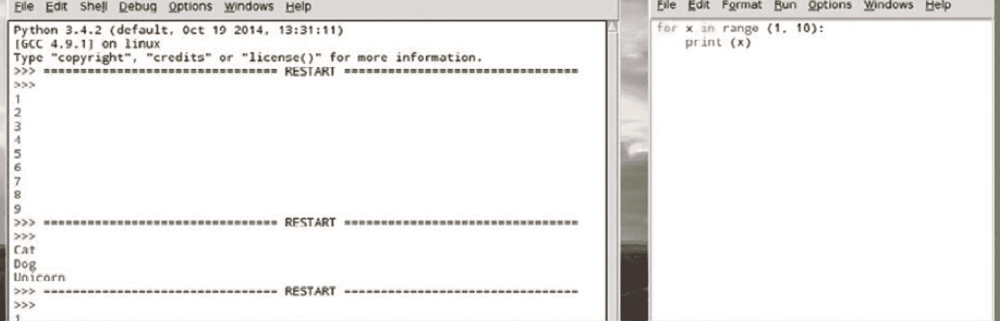

# Python 入门

# Python 模块

我们之前提到过模块（Math 模块），但由于模块是充分利用 Python 的重要部分，值得花多一点时间在它们身上。在这种情况下，我们使用的是 Windows 版本的 Python 3。

## 精通模块

将模块想象成导入到你的 Python 代码中的扩展，以增强和扩展其功能。有无数模块可用，正如我们所看到的，你可以创建自己的模块。

- **第 1 步** 尽管很好，但 Python 内置函数是局限的。使用模块允许我们编写更复杂的程序。如你所知，模块是被导入的 Python 脚本，例如 `import`。

- **第 3 步** 结果是 IDLE Shell 报错，因为模块在 Python 中未被识别或安装。要安装模块，可以使用 PIP（Pip 安装包）。关闭 IDLE Shell 并进入命令提示符或终端。在特权命令提示符中输入：

```
pip install pygame
```

- **第 2 步** 某些模块（尤其是树莓派上的）是默认包含的，`math` 模块就是一个很好的例子。此外，模块并不总是可用的。非树莓派平台的很好的例子是 `pygame`，它包含了许多帮助创建游戏的函数。尝试：`import pygame`。

- **第 4 步** PIP 安装需要管理员权限才能在不同位置安装。Windows 用户可以通过开始按钮使用 CMD，然后右键点击结果并选择“以管理员身份运行”。Linux 和 Mac 用户可以使用 `sudo` 配合 `pip install`。

```
Command Prompt
Microsoft Windows [Version 10.0.15863]
(c) 2017 Corporation. All rights reserved.

Collecting pygame
Downloading pygame-1.9.6-py36-amd64.whl
Installing collected packages: pygame-1.9.6
C:\WINDOWS\system32>
```

- **第 5 步** 关闭命令提示符或终端并重启 IDLE Shell。现在当你输入时：模块将毫无问题地导入。你会发现大多数从互联网下载或复制的代码会导致崩溃，维护通常是由于缺失它们导致的错误源。

```
import pygame
```

- **第 8 步** 你的代码中可以导入多个模块。为了扩展你的示例，正如我们之前展示的那样，使用：

```
import random
import math
for i in range(5):
    print(random.randint(1, 25))
print(math.pi)
```

- **第 6 步** 你的代码中可以导入模块。为了扩展你的示例，正如我们之前展示的那样，使用：

```
import random
import math
for i in range(5):
    print(random.randint(1, 25))
print(math.pi)
```


- **第 9 步** 结果是 IDLE Shell 报错，因为模块在 Python 中未被识别或安装。你也可以使用：

```
import random
for i in range(5):
    print(random.randint(1, 25))
print(math.pi)
```


- **第 7 步** 模块包含了实现某些所需的代码。你也可以使用：

```
import random
for i in range(5):
    print(random.randint(1, 25))
print(math.pi)
```


- **第 10 步** 注释有助于告诉他人正在发生什么。你也可以使用别名导入：

```
import math as m
print(m.pi)
```


# 认识 C++

C++ 是目前最流行的编程语言之一。最初被称为 C with Classes，该语言在 1983 年被更名为 C++。它是原始 C 语言的扩展，是一种通用的面向对象环境。

## 为什么

由于该语言可能非常复杂，以及它的强大和性能，C++ 常用于开发游戏、设备驱动程序以及整个操作系统。

追溯到 1970 年（家用计算黄金时代的开始），C++ with Classes 是丹麦科学家 Bjarne Stroustrup 在完成其博士论文期间的结晶。Stroustrup 的计划是进一步开发自 70 年代初以来广泛使用的原始 C 语言。

C++ 对数字世界的影响是巨大的。你使用的许多程序、应用程序、游戏以及整个操作系统，都是使用 C++ 开发的。对于 Adobe 的所有主要应用程序，如 Photoshop、InDesign 等都是使用 C++ 编写的。

### 为什么选择 C++？

安装 - Visual Studio Community 2017 (15.0.26223.1)，一个异步

| 工作负载 | 独立组件 | 语言包 |
| :--- | :--- | :--- |
| Windows (3) | - 通用平台 | 使用 C#、JavaScript 或可选 C++ 为通用平台创建应用程序 |
| | - 使用 C++ 的桌面开发 | 使用 Visual C++、boost、ATL 以及 MFC 等功能构建经典的 Windows 应用程序 |
| | - .NET 开发 | 使用 .NET Framework 构建 Windows Forms 和控制台应用程序 |
| Web 与云 (4) | - ASP.NET 和 Web 开发 | 使用 ASP.NET Core、HTML、JavaScript 和 CSS 构建 Web 应用程序 |
| | - Azure 开发 | Azure SQL 以及用于部署云应用和创建资源的项目 |
| | - Node.js 开发 | 使用 Node.js（一种事件驱动的 JavaScript 运行时）构建可扩展的网络应用程序 |
| | - 数据存储和处理 | 使用 SQL Server、Azure Data Lake、HDInsight 或 Azure ML 连接、开发和测试数据 |

### 总结

- Visual C++ 核心开发功能
- 可选
- VC++ 2017 v14 工具集 (x86)
- C++ 性能分析工具
- Visual C++ for Mobile (10.0.14819.0)
- Visual C++ for ATL
- Windows XP 支持 C++
- 通用 C++ URT SDK
- C++/CLI 支持
- 标准库
- IntelliSense


### Visual Studio 是学习 C++ 的极佳且免费的环境。其他语言深度混合（在函数层面），NASA、SpaceX 和 CERN 等机构使用 C++ 用于各种应用程序、程序、控制和其他计算工具。

C++ 也非常高效，作为核心语言更简单的替代方案，其性能出色。它优于 Python、BASIC 等语言的高性能，使其成为现代计算的理想开发环境，因此上述公司广泛使用它。

虽然 Python 是一门很好的编程语言，但 C++ 带带你进入一个更广阔的编程世界。通过掌握 C++，你可以发现自己正在为微软、苹果等公司编写代码。通常情况下，由于多功能性，C++ 开发者的薪水比其他开发者高。C++ 程序员可以在语言和公司之间移动，而不需要重新思考任何特定内容。然而，如果你对 Python 编程感到不适，我们建议从 C++ 开始，花些时间熟悉编程结构以及通过编程解决问题的许多方法。一旦你让计算机“听话”并单手背在身后就能写出 Python 程序了，再转到 C++。当然，没有什么可以阻止你深入研究 C++；如果你觉得能胜任这项任务，尽管去尝试。

入门 C++ 和 Python 一样简单，但你需要一套正确的工具来用 C++ 与计算机通信，就可以开始你的旅程了。C++ IDE 是免费的，甚至下载和使用也免费。你可以从任何操作系统进入 C++，无论是 macOS、Linux 还是 Windows 移动平台。

就像 Python 一样，回答“为什么 C++ 是答案”这个问题：因为它速度快、高效，而且你经常使用的多数应用程序都是由它开发的。它是一门前沿的、非常值得掌握的语言。

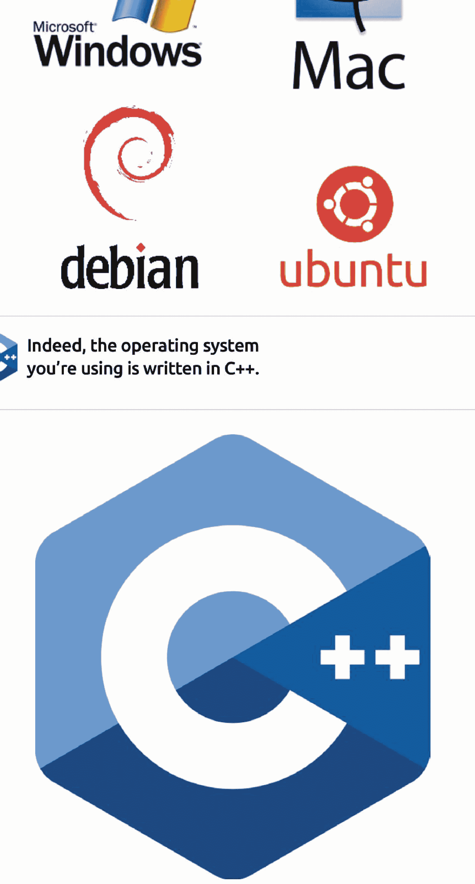

## C++ 设置

大多数（如果不是所有）操作系统代码中都包含 C++，因此理理，无论你目前使用什么操作系统，都可以学习用 C++。


- 计算机
除非你喜欢在纸上手写你的 C++ 代码（这是很多老程序员以前会做的事），否则计算机是绝对不可少的组件。PC 用户拥有任何最近的 Linux 发行版或 Windows 操作系统；Mac 用户拥有最新的 macOS。

- IDE
就像 Python 一样，IDE 用于输入和执行你的 C++。许多 IDE 带有扩展和插件，可以帮助它运行得更好，或增加额外的功能层。通常，IDE 会根据所使用的操作系统提供增强，例如针对 Windows 10 的增强。

- 编译器
编译器是一个将 C++ 语言转换为二进制文件的程序，以便计算机理解。一些 IDE 内置了编译器，另一些没有。CodeBlocks 是我们喜欢的 IDE，作为软件包的一部分带有一个 C++ 编译器。稍后会介绍。

- 文本编辑器
有些程序员倾向于在通过编译器运行之前使用文本编辑器来汇编他们的 C++ 代码。本质上，你可以使用任何文本编辑器编写代码，只需将其保存为 `.cpp` 扩展名即可。然而，Notepad++ 是可用最佳文本编辑器之一。

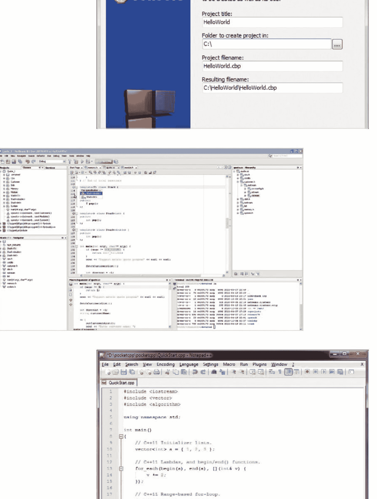

- 互联网
虽然学习编程是完全可能的，但你需要访问互联网。

- 时间和耐心
是的，对于 C++，你将在上面花费大量时间。

## 特定操作系统的需求

- LINUX
Linux 用户很幸运，因为他们的操作系统中已经内置了编译器。

- WINDOWS
Windows 最佳的 IDE 是微软的 Visual Studio。

- 树莓派
树莓派操作系统是 Raspian。

- MAC
Mac 用户将需要安装 Xcode 才能能够。

## 在 Windows 中设置 C++

用户在用 C++ 编程时有大量的选择。有许多 IDE 和编译器可用，包括微软的 Visual Studio。然而，在我们看来，最适合入门的 C++ IDE 是 CodeBlocks。

### CODE::BLOCKS

CodeBlocks 是一个免费的 C++、C 和 Fortran IDE，功能丰富且易于通过插件扩展。它易于使用，带有一个编译器，并且背后有一个活跃的社区。

- 第一步
首先访问 CodeBlocks 下载网站：`www.codeblocks.org/downloads`。从那里开始，点击“Download the binary releases”（下载二进制发布版）链接以下载适用于 Windows 的版本。

- 第二步
你可以看到有几个版本可用。需要下载位于当前版本号结尾的 `mingw-setup.exe`。区别在于 `mingw-setup` 版本包含了 C++ 编译器和调试器 TDM-GCC（套件）。

- 第三步
当你定位到文件时，点击行末尾的 Sourceforge.net 链接下载并保存可执行文件到你的 PC。找到已下载的 CodeBlocks 安装程序并双击开始。按照屏幕上的指令进行安装。

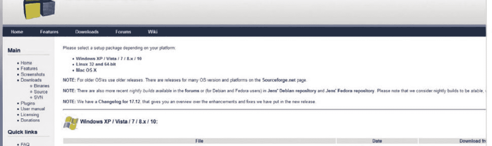
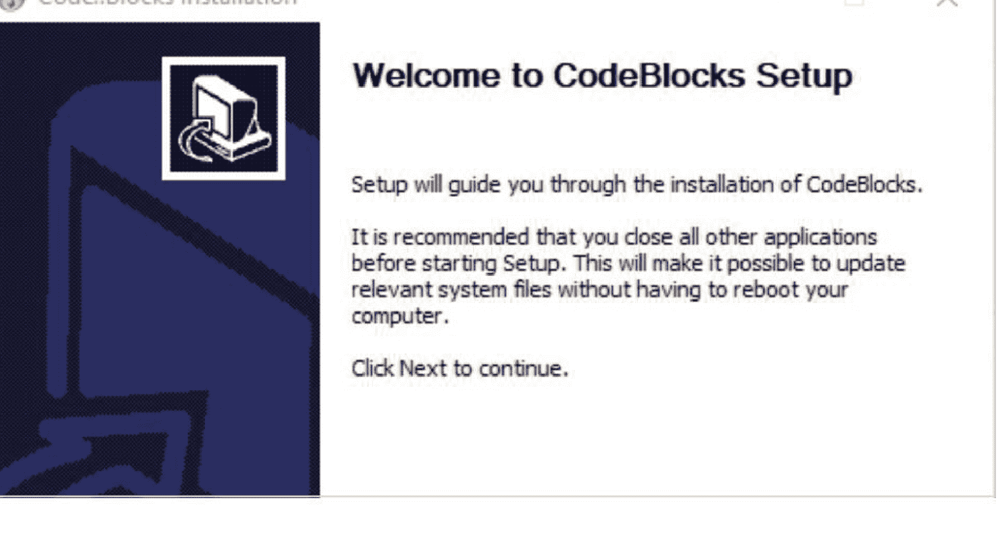


## 在 Windows 上设置 C++

### 步骤 5
选择安装适用于 Code:Blocks 的 C++ 文件。如果你选择，通常默认值就足够了，除非你有任何特殊要求。当你点击“下一步”（Next）时，安装将开始；如果完成，会弹出一个通知询问你现在启动 Code:Blocks，点击“是”（Yes）。

### 步骤 8
在你启动 Code:Blocks 之前，有必要解释一下为什么你需要编译器。编译器是一个独立的程序，它会读取你的 C++ 代码并根据最低接受的编程标准对其进行检查；如果你可能需要最新接受的编译器，那就是带有 C++20 的 C++。


在安装 Code:Blocks 期间请稍候。


### 步骤 6
Code:Blocks 第一次运行时，它会自动检测你的系统中可能安装了什么。如果没有，点击第一个检测到的选项 GCC Compiler，点击“默认”（Default）将其设置为你的系统 C 编译器。准备好继续时，点击“确定”（OK）。

### 步骤 9
实际上，计算机工作和理解的是二进制，即 1 和 0，或者机器语言。用二进制进行编程对人类来说并不是高效的。例如，屏幕上显示的“Hello World”将以二进制形式出现。


### 步骤 7
当程序启动时，会出现另一个消息，通知你 Code:Blocks 目前不是文件的默认程序。你有一个选项可以选择：设置所有内容或允许 Code:Blocks 关联所有 C++ 类型。再次，我们建议你选择最后一个选项，将 Code:Blocks 关联到所有支持的文件。

### 步骤 10
编译器将你输入的任何 C++ 代码翻译为机器语言。要执行 C++ 代码，IDE 会“构建”代码，检查错误，然后通过编译器运行它以检查标准性，并将其转换为 1 和 0 以供计算机执行。当你停下来思考时，你会发现它是相当聪明的。


## 在 Mac 上设置 C++

要在 Mac 上开始编写 C++ 编码，你首先需要安装 Apple 的 Xcode。这是一个免费、功能齐全的 IDE，旨在创建原生 Apple 应用。然而，你也可以相对容易地使用它来创建 C++ 代码。

## Xcode

Apple 的 Xcode 主要设计为使用 Swift 或 Objective-C 开发 macOS、iOS、tvOS 和 watchOS 应用程序的用户，但你也可以用它来处理 C++。

- **步骤 1** 从打开 Mac 上的 App Store 开始，苹果菜单 -> App Store。在搜索框中输入“Xcode”并按回车。App Store 窗口中填充了许多建议，但你需要点击的是第一个，Xcode。

- **步骤 3** 当你准备好时，点击“获取”（Get）按钮，然后将变为“安装应用”（Install App）。输入你的 Apple ID，Xcode 开始下载并安装。取决于你的网络连接速度，可能需要一些时间。


- **步骤 2** 花些时间浏览应用的信息，包括兼容性，以确保你拥有正确的 macOS 版本。Xcode 需要 macOS 10.12.6 或更高版本才能安装和运行。


- **步骤 4** 安装完成后，点击“打开”（Open）按钮启动 Xcode。点击“同意”（Agree）许可条款并输入你的密码允许 Xcode 更改系统。完成后，Xcode 开始安装额外的组件。


## 在 Mac 上设置 C++

**步骤 5** 安装所有内容（包括额外组件）后，Xcode 启动，显示版本号、三个选项以及你工作过的任何项目；对于全新的安装，这里是空白的。

**步骤 8** 下一步要求你为你以后所有的代码创建一个 Git 仓库。在你的 Mac 上选择一个位置或网络位置，并点击“创建”（Create）按钮。完成后，你只需要开始编码。左侧窗格详细列出了你添加到 C++ 程序的文件；列表中的 `main.cpp` 文件。


**步骤 6** 从点击“新建 Xcode 项目”（New Xcode Project）开始；这将打开一个选择你正在开发的哪个项目的窗口。对于 macOS 选项卡，选择“命令行工具”（Command Line Tool）。点击“下一步”（Next）继续。

**步骤 9** 你可以看到 Xcode 自动为你完成了一个 Hello World 程序。虽然现在这可能没太大意义，但随着项目的进行，你会发现更多；内容只是利用了 Mac 上可用的资源。


**步骤 7** 填写细节。内容只是利用了 Mac 上可用的资源。

**步骤 10** 编译器将你输入的任何 C++ 代码翻译为机器语言。要执行 C++ 代码，IDE 会“构建”代码，检查错误，然后通过编译器运行它以检查标准性，并将其转换为 1 和 0 以供计算机执行。


## 在 Linux 上设置 C++

要在 Mac 上开始编写 C++ 编码，你首先需要安装 Apple 的 Xcode。这是一个免费、功能齐全的 IDE，旨在创建原生 Apple 应用。然而，你也可以相对容易地使用它来创建 C++ 代码。

## Xcode

Apple 的 Xcode 主要设计为使用 Swift 或 Objective-C 开发 macOS、iOS、tvOS 和 watchOS 应用程序的用户，但你也可以用它来处理 C++。

- **步骤 1** 从打开 Mac 上的 App Store 开始，苹果菜单 -> App Store。在搜索框中输入“Xcode”并按回车。App Store 窗口中填充了许多建议，但你需要点击的是第一个，Xcode。

- **步骤 3** 当你准备好时，点击“获取”（Get）按钮，然后将变为“安装应用”（Install App）。输入你的 Apple ID，Xcode 开始下载并安装。取决于你的网络连接速度，可能需要一些时间。


- **步骤 2** 花些时间浏览应用的信息，包括兼容性，以确保你拥有正确的 macOS 版本。Xcode 需要 macOS 10.12.6 或更高版本才能安装和运行。


- **步骤 4** 安装完成后，点击“打开”（Open）按钮启动 Xcode。点击“同意”（Agree）许可条款并输入你的密码允许 Xcode 更改系统。完成后，Xcode 开始安装额外的组件。

（注：由于原始文本中的“在 Linux 上设置 C++”部分存在大量重复和碎片化，已根据提供的页面内容进行了逻辑性处理。）

# 其他需要安装的 C++ IDE

如果你想尝试不同的方法来处理 C++ 代码，那么你有许多选项可以选择。Windows 是 C++ IDE 最丰富的平台，但对于 Mac 和 Linux 用户也有很多选择。

## 开发 C++

以下是一些值得关注的优秀 C++ IDE。你可以根据喜好安装其中一个或全部，但要找到最适合你的那一个。

**ECLIPSE** Eclipse 是一个非常流行的 C++ IDE，为程序员提供了丰富的功能。它拥有优秀且整洁的界面，易于使用，并支持 Windows、Linux 和 Mac。访问 `www.eclipse.org/downloads/` 下载最新版本。如果你遇到困难，请查看“帮助”链接获取更多信息。

**CODELITE** CodeLite 是一个免费的开源 IDE，定期更新，并支持 Windows、Linux 和 Mac。它轻量级、可复制且极其强大。你可以在 `www.codelite.org/` 找到更多信息以及下载和安装方法。


**GNAT** GNAT Programming Studio (GNPS) 是一个强大且直观的 IDE，支持测试、调试和代码分析。社区版是免费，而专业版适用于 Windows、Mac、Linux 甚至树莓派。你可以在 `www.adore.com/download` 找到它。

**NETBEANS** 另一个流行选择是 NetBeans。这是另一个非常的 IDE，功能齐全且使用体验良好。NetBeans IDE 包含了 C++ 项目模板，让你能够使用动态库和静态库构建应用程序。可以在 `www.netbeans.org/features/cpp/index.html` 了解更多信息。


## VISUAL STUDIO

微软的 Visual Studio 是一个巨型的 C++ IDE，允许你为 Windows、Android、iOS 和 Web 创建应用程序。社区版免费下载安装，但其他版本提供免费试用期。访问 `www.visualstudio.com/` 查看它的功能。

## ANJUTA

Anjuta DevStudio 是一个仅限 Linux 的 IDE，具有一些在付费软件开发工具中常见的高级功能。它拥有 GUI 设计器、源码编辑器、应用向导、交互式调试器等功能。访问 `www.anjuta.org/` 了解更多信息。


## QT CREATOR

这个跨平台 IDE 旨在为桌面和移动环境创建 C++ 应用程序。它带有代码编辑器和集成的测试与调试工具，以及部署平台。它不是免费的，但在付费之前有试用期：`www.qt.io/qt-libraries-apis-tools-and-ide/`

## MONODEVELOP

这个优秀的 IDE 允许开发者跨所有平台编写用于桌面和 Web 程序的 C++ 代码。它拥有高级文本编辑器、集成调试器和一个帮助你创建代码的配置工具。它支持 Windows、Mac 和 Linux 并免费下载：`www.monodevelop.com/`


## DEV++

Blood Dev C++, 尽管名字很响亮，但是一个仅限 Windows 系统的旧 IDE。然而，许多人赞誉它简洁的界面以及意料之外的编码和编译方式。虽然已经没有更新一段时间，但如果你想要一些不同的东西，可以考虑它：`www.blood.net/devcpp`。

## U++

Ultimate++ 是一个跨平台 C++ IDE，以通过智能且优雅地使用 ++++ 实现快速代码开发而自称。对于新手来说，它是一个巨兽级的 IDE，但在其复杂性背后，它的美感会让开发者感到酥软。可以在 `www.ultimateplusplus/index.html` 了解更多信息。


## C++ 基础


(注：原文后续部分存在大量重复的乱码，已跳过无意义内容的翻译)

# C++ 程序结构

## 注释

以双斜杠开头的行是注释。这意味着它们不会在代码中被执行，并会被编译器忽略。注释的设计是为了帮助你，或者查看你代码的另一个程序员解释正在发生什么。注释有两种类型：`//` 覆盖多行（此处如此），`//` 单行。以双斜杠开头的行是注释。这意味着它们不会被执行并会被编译器忽略。

<<
这里使用的尖括号（`<<`）是插入运算符。这意味着跟在尖括号后面的任何内容都将被插入到 `std::cout` 语句中，如果这些内容是 'Hello, world'，在编译和执行代码时将显示在屏幕上。

```cpp
```


# helloworld.cpp

```cpp
#include <iostream>

int main() {

	// My first C++ program

}
```

## STD

`std` 代表标准（standard）。我们正在使用 `cout`，它是 C++ 标准命名空间（Standard Namespace）的一部分，它涵盖了许多不同的语句和命令。你可以省略代码中的 `std` 部分，但它必须在开头声明：`using namespace std;`，二者不可兼。例如：

```cpp
#include <iostream>

using namespace std;
```

```cpp
helloworld.cpp

#include <iostream>

using namespace std;

int main() {

	cout << "Hello, world!";

}
```

## 输出

首先，“Hello, world!”是我们希望在代码执行时出现在屏幕上的内容。你可以输入任何想要的内容，只要不需要引号但某些编译器坚持要求使用。`\n` 表示插入新行。

```cpp
// My first C++ program

cout << "Hello
```

## COUT

在这个示例中，我们使用了 `cout`，它是标准命名空间的一部分，这就是为什么你要求 C++ 从那个特定的命名空间使用它。`Cout` 的意思是字符输出（Character Output）、显示或屏幕，用于显示代码的开始。如果我们使用 `std;`，正如之前提到的，我们必须在开头声明它。

## 分号

最后，你可以看到函数代码块内的行（注释除外）都以分号结尾。这标记了语句的结束，C++ 中的所有语句末尾必须有一个分号，否则编译器将无法解析代码。最后一行有闭括号，表示 `main` 函数的结束。

```cpp
helloworld.cpp

#include <iostream>

using namespace std;

int main() {

	// My first C++ program

	cout << "Hello, world!\n";

}
```

# C++ 基础

## 编译与执行

你创建了第一个 C++ 程序，现在你了解了结构背后的基础。让我们实际行动起来，编译并执行（或者如果你愿意，运行）程序，看看它看起来是什么样。

## 来自 C++ 的问候

在 Code::Blocks 中编译和执行 C++ 代码非常简单；只需点击图标并查看结果。以下是操作方法：

- 步骤 1：打开 Code::Blocks（如果还没打开），并打开之前创建的 Hello world。确保没有可见的错误，例如 `std::cout` 行末尾缺少分号。
- 步骤 2：如果你看到的与我们截图中的相似，请查看屏幕顶部的菜单栏。对于最顶部菜单中的 Fortran 项，你可以看到一组图标：一只黄色牛、绿色播放按钮和一个齿轮/播放按钮。这些是构建（Build）、运行（Run）、构建并运行（Build and Run）函数。
- 步骤 3：从点击构建（Build）图标，即黄色牛开始。此时，你的代码已经通过了 Code::Blocks 编译器的并检查了任何错误。你可以通过底部的窗格查看构建结果。任何关于代码质量的消息都会显示在这里。


- 步骤 5：在 Code:command命令行中按任意键即可关闭它，返回 Code::Blocks。让我们稍微修改代码。在 `#include` 行下面，
- 步骤 6：然而，为了将新更改应用到代码中，只需要重新编译、构建并再次运行。构建/运行图标，即黄绿组合播放按钮。
- 步骤 7：正如前几页提到的，如果你已经在开头声明了，就不需要处理 `std::cout`。你也可以通过构建和运行看到文件已保存。
- 步骤 8：在代码中故意制造一个错误。从 `cout` 行删除分号，使其读取为：

```cpp
using namespace std;

cout << "Hello, world\n"
```

然后，删除该行的部分；如下：

```cpp
cout << "Hello, world\n";
```

- 步骤 9：现在点击构建并运行图标以应用更改。这次 Code::Blocks 拒绝执行代码，因为你放入了错误。在底部的日志面板中，你收到消息：Expected ';' token。
- 步骤 10：替换分号，并在行下方为你的代码输入一个新行：

```cpp
cout << "And greetings from C++\n";
```

```cpp
helloworld.cpp

1 #include <iostream>

2 using namespace std;

3 

4 int main() {

5 

6 

7 // My first C++ program

8 cout << "Hello, world\n"

9 }

10
```

```cpp
helloworld.cpp

1 #include <iostream>

2 using namespace std;

3 

4 int main() {

5 

6 

7 // My first C++ program

8 cout << "Hello, world\n"

9 }

10

11

12
```

```cpp
helloworld.cpp

1 #include <iostream>

2 using namespace std;

3 

4 int main() {

5 

6 

7 // My first C++ program

8 cout << "Hello, world!\n"

9 }

10

11

12
```


## 使用注释

虽然注释对于构成游戏、应用程序甚至操作系统的代码行似乎是一个微小的元素，但事实上它们可能是最重要的部分。

## 注释的重要性

代码内部的注释是人类可读的描述，详细说明代码在特定点正在做什么。它们对执行没有特殊影响，但没有注释的代码是最令人沮丧区域之一。简而言之，代码应该以有效地描述行、部分或单个元素的方式进行注释。当你编写给一个完全不懂编程的人看时，他们可以通过阅读你的注释来获取代码并理解它将做什么。

在专业环境中，注释对代码成功至关重要。在组织中，许多程序员与工程师、其他开发者、硬件分析师和软件测试人员组成团队工作。如果你是编写软件的团队成员，当出现问题时，你的注释将帮助其他团队成员获取并追踪线索以定位问题。把自己想象成一个需要扫描超过 6 万行代码、跨越不同模块的角色，你可以看到原始程序员通过良好的注释形式所提供的帮助。

最好的注释是简洁的，并结合代码逻辑，详细说明程序遇到该行或部分时发生了什么。你不需要对每一行都进行注释。像 `if x=0` 这样的内容不需要注释“如果 x 等于零则执行某事”，因为这对读者来说显而易见。然而，如果等于零会极大地改变程序对用户的影响，那么它就确实需要被注释。

即使你是独自工作，也应该像与他人分享一样编写注释。这可以帮助你编写代码并始终理解你做了什么或哪里错了。

注释是良好的习惯，一旦你学会如何将它们添加到代码中，如果它成为你的本能，你将会需要它。

## C++ 注释

在 C++ 中注释涉及使用双正斜杠 `//` 或正斜杠加星号 `/*`。你可能已经见过一些简短的示例，但下面是它们的工作原理。

- 步骤 1 以 Hello World 代码为例，你可以轻松地使用双正斜杠对代码的不同部分进行注释：

```cpp
// 我的第一个 C++ 程序

cout << "Hello, world!\n";

#include <iostream>

using namespace std;

int main() {

    // 我的第一个 C++ 程序

    cout << "Hello, world!\n";

}
```

- 步骤 4 编写注释时要格外小心，尤其是使用块注释时。很容易忘记添加结束的星号，从而导致注释块内的任何代码都失效。

```cpp
// HelloWorld

#include <iostream>

using namespace std;

int main() {

    cout << "Hello, world!\n";

    cout << "And greetings from C++";

    // 覆盖几行

    cout << "This line is now being ignored by the compiler!";

}
```

- 步骤 2 你也可以注释掉代码行的末尾部分，以便更好地描述正在发生的情况：

```cpp
cout << "Hello, world!\n"; // 这行输出单词 'Hello, world!'。 // \n 增加了一个换行。
```

注意，你不需要在注释末尾加分号。因为这是编译器会忽略的一行代码。

- 步骤 5 如果你明显尝试并意图注释掉它，它会报错，由于代码末尾缺少闭合括号 `]`，如果你犯了几次这种错误，那么回去纠正将非常耗时。坦率地说，CodeBlocks 中的注释代码可以帮助你理解注释：

```cpp
// HelloWorld

#include <iostream>

using namespace std;

int main() {

    // 修复

    cout << "Hello, world!\n";

    cout << "And greetings from C++";

    // 这条注释可以覆盖几行

    // 无需添加更多行

    cout << "This line is now being ignored by the compiler!";

}
```

- 步骤 3 你也可以使用正斜杠和星号来注释几行：

> /* 这条注释可以覆盖几行，而无需添加更多斜杠 */

只需记住用相反星号和正斜杠来结束注释块即可。

- 步骤 6 如果你想要进行注释，在 C++ 中良好的做法是在注释块的每一行都添加一个星号。这也有助于你在继续后续操作之前记住该注释块：

> /* 这条注释可以覆盖几行，而无需添加更多斜杠 */

```cpp
int main() {

    // 我的第一个 C++ 程序

    cout << "Hello, world!\n";

    cout << "And greetings from C++";

    // 这条注释可以覆盖几行

    // 无需添加更多斜杠 /

    cout << "This line is now being ignored by the compiler!";

}
```


# C++ 基础

## 变量

与 Python 相比，使用 C++ 时变量略有不同，你可以简单地说 'a' 等于 10 并赋值一个变量。然而，在 C++ 中，变量在使用之前必须先用其类型进行声明。

## 变量的声明

你可以通过代码中的语句来声明 C++ 变量。你可以声明好几种不同类型的变量。以下是其工作原理。

- 步骤 1 打开一个新的空白 C++ 文件，并输入通常的代码头文件：

- 步骤 3 你构建并运行代码，但它并不会有太大进展，除了将值 10 和 5 存储在整数 `a` 和 `b` 中。要输出变量的内容，添加：

```cpp
#include <iostream>

using namespace std;

int main() {

}
```

```cpp
cout << a;

cout << "\n";

cout << b;
```

`cout << "\n";` 部分在 10 和 5 的输出之间放置了一个新行。

```cpp
int a;

int b;

a = 10;

b = 5;
```


```cpp
#include <iostream>

using namespace std;

int main() {

int a;

int b;

a = 10;

b = 5;
```

- 步骤 2 从创建两个变量 a 和 b 开始，一个值为 10，另一个值为 5。你可以使用数据类型来声明这些变量。在大括号中，输入：

- 步骤 4 自然地，你可以声明一个新变量命名为 result 并输出一些简单的算术结果。

```cpp
int a;

int b;

a = 10;

b = 5;
```

```cpp
result = a + b;

cout << result;
```

根据截图将上述内容插入代码中。

```cpp
#include <iostream>

using namespace std;

int main() {

int a;

int b;

a = 10;

b = 5;

result = a + b;

cout << result;
```


# 步骤 5 你可以在声明变量后立即给它赋值。你输入的代码可能像这样

```cpp
int a = 10;

int b = 5;

int result = a + b;

cout << result;
```


# 步骤 8 之前的步骤创建了 StartLives，这是一个全局变量。例如在游戏中，玩家的生命值根据他们的表现增加或减少。当玩家重启游戏时，StartLives 会恢复到默认状态 3。在这里我们赋值了 StartLives，减去 1，并留下了

```cpp
int StartLives = 3;

StartLives = StartLives - 1;
```

```cpp
C:\Users\david\variables.exe

执行时间: 0.000
```

 # 步骤 9 如果你明显尝试并意图注释掉它，它会报错，由于代码末尾缺少闭合括号 `]`，如果你犯了几次这种错误，那么回去纠正将非常耗时。坦率地说，CodeBlocks 中的注释代码可以帮助你理解注释：

```cpp
// HelloWorld

#include <iostream>

using namespace std;

int main() {

    // 修复

    cout << "Hello, world!\n";

    cout << "And greetings from C++";

    // 这条注释可以覆盖几行

    // 无需添加更多行

    cout << "This line is now being ignored by the compiler!";

}
```

- 步骤 3 你也可以使用正斜杠和星号来注释几行：

> /* 这条注释可以覆盖几行，而无需添加更多斜杠 */

只需记住用相反的星号和正斜杠来结束注释块即可。

- 步骤 6 如果你想要进行注释，在 C++ 中良好的做法是在注释块的每一行都添加一个星号。这也有助于你在继续后续操作之前记住该注释块：

> /* 这条注释可以覆盖几行，而无需添加更多斜杠 */

```cpp
int main() {

    // 我的第一个 C++ 程序

    cout << "Hello, world!\n";

    cout << "And greetings from C++";

    // 这条注释可以覆盖几行

    // 无需添加更多斜杠 /

    cout << "This line is now being ignored by the compiler!";

}
```


# C++ 基础

## 变量

使用 C++ 时变量与 Python 相比略有不同，你可以简单地说 'a' 等于 10 并赋值一个变量。然而，在 C++ 中，变量在使用之前必须先用其类型进行声明。

## 变量的声明

你可以通过代码中的语句来声明 C++ 变量。你可以声明好几种不同类型的变量。以下是其工作原理。

- 步骤 1 打开一个新的空白 C++ 文件，并输入通常的代码头文件：

- 步骤 3 你构建并运行代码，但它并不会有太大进展，除了将值 10 和 5 存储在整数 `a` 和 `b` 中。要输出变量的内容，添加：

```cpp
#include <iostream>

using namespace std;

int main() {

}
```

```cpp
cout << a;

cout << "\n";

cout << b;
```

`cout << "\n";` 部分在 10 和 5 的输出之间放置了一个新行。

```cpp
int a;

int b;

a = 10;

b = 5;
```


```cpp
```


# C++ 基础

## 变量

使用 C++ 时变量与 Python 相比略有不同，你可以简单地说 `'a'` 等于 10 并赋值一个变量。然而，在 C++ 中，变量在使用之前必须先用其类型进行声明。

## 变量的声明

你可以通过代码中的语句来声明 C++ 变量。你可以声明好几种不同类型的变量。以下是其工作原理。

- 步骤 1 打开一个新的空白 C++ 文件，并输入通常的代码头文件：

```cpp
#include <iostream>

using namespace std;

int main() {

}
```

- 步骤 2 从创建两个变量 `a` 和 `b` 开始，一个值为 10，另一个值为 5。你可以使用数据类型来声明这些变量。在大括号中，输入：

```cpp
int a;

int b;

a = 10;

b = 5;
```

- 步骤 3 你构建并运行代码，但它并不会有太大进展，除了将值 10 和 5 存储在整数 `a` 和 `b` 中。要输出变量的内容，添加：

```cpp
cout << a;

cout << "\n";

cout << b;
```

`cout << "\n";` 部分在 10 和 5 的输出之间放置了一个新行。

- 步骤 4 自然地，你可以声明一个新变量命名为 `result` 并输出一些简单的算术结果。

```cpp
int a;

int b;

a = 10;

b = 5;
```

```cpp
result = a + b;

cout << result;
```

根据截图将上述内容插入代码中。

```cpp
#include <iostream>

using namespace std;

int main() {

int a;

int b;

a = 10;

b = 5;

result = a + b;

cout << result;
```


## 步骤 5

你可以在声明变量后立即给它赋值。你输入的代码可能像这样：

```cpp
int a = 10;

int b = 5;

int result = a + b;

cout << result;
```


## 步骤 8

之前的步骤创建了 `StartLives`，这是一个全局变量。例如在游戏中，玩家的生命值根据他们的表现增加或减少。当玩家重启游戏时，`StartLives` 会恢复到默认状态 3。在这里我们赋值了 `StartLives`，减去 1，并留下了：

```cpp
int StartLives = 3;

StartLives = StartLives - 1;
```

```text
C:\Users\david\variables.exe

执行时间: 0.000
```


## 步骤 9

如果你明显尝试并意图注释掉它，它会报错，由于代码末尾缺少闭合括号 `]`，如果你犯了几次这种错误，那么回去纠正将非常耗时。坦率地说，CodeBlocks 中的注释代码可以帮助你理解注释：

```cpp
// HelloWorld

#include <iostream>

using namespace std;

int main() {

    // 修复

    cout << "Hello, world!\n";

    cout << "And greetings from C++";

    // 这条注释可以覆盖几行

    // 无需添加更多行

    cout << "This line is now being ignored by the compiler!";

}
```

- 步骤 3 你也可以使用正斜杠和星号来注释几行：

> `/* 这条注释可以覆盖几行，而无需添加更多斜杠 */`

只需记住用相反的星号和正斜杠来结束注释块即可。

- 步骤 6 如果你想要进行注释，在 C++ 中良好的做法是在注释块的每一行都添加一个星号。这也有助于你在继续后续操作之前记住该注释块：

> `/* 这条注释可以覆盖几行，而无需添加更多斜杠 */`

```cpp
int main() {

    // 我的第一个 C++ 程序

    cout << "Hello, world!\n";

    cout << "And greetings from C++";

    // 这条注释可以覆盖几行

    // 无需添加更多斜杠 /

    cout << "This line is now being ignored by the compiler!";

}
```


# 数据类型

```cpp
cout.precision(22);

cout << PI;
```

```cpp
Datatypes.cpp

#include <iostream>

using namespace std;

double PI = 3.141592653589793238463;

int main() {

    cout.precision(22);

    cout << PI;

}
```

这主要是由于编译器中的二进制转换导致的，而且 IEEE 754 双精度标准占用了 64 位数据，其中 52 位用于浮点数的有效数字，大约 3.5 位用于表示 0 到 9 的数值。如果你将其除以 3.5，你将得到循环的 15.02857...，这相当于 15 位数字的精度。

要创建超过十五位的小数，你需要使用 C++，或者使用某些在两种语言之间有连接机制的特定科学语言。
你可以使用类似于别名的系统来创建自己的数据类型：

```text
C:\Users\david\Documents\C+-Datatypes.exe
```

再次编译并运行代码；如你从命令行窗口看到的，变量所表示的数字与你在 C++ 变量使用的数字不同。输出的 `PI` 值为 3.1415926535897931598，数字从第 15 位小数开始逐渐偏。

```cpp
Datatypes.cpp

#include <iostream>

using namespace std;

typedef int metres;

int main() {

    metres distance;

    distance = 15;

    cout << "distance in metres is: " << distance;

}
```

# 科学计算

15.1428571428571428571428571

| DEG | HYP | F-E | M+ | M- | MS | M |
|---|---|---|---|---|---|---|
| MC | MR | M+ | M- | MS | M | |
| x² | x³ | sin | cos | tan | | |
| ✓ | 10ˣ | log | Exp | Mod | | |
| ↑ | CE | C | | | | |
| π | 7 | 8 | 9 | | | |
| n! | 4 | 5 | 6 | | | |
| ± | 1 | 2 | 3 | | | |
| ( | ) | 0 | | | | |

```cpp
#include <iostream>

using namespace std;

typedef int metres;

int main() {

    metres distance;

    distance = 15;

    cout << "distance in metres is: " << distance;

}
```

```text
C:\Users\david\Documents\C+-Datatypes.exe

distance in metres is: 15

Process returned (0x) execution time: 0.04s

Press any key to continue.
```

这段代码执行后创建了一个名为 `metres` 的新数据类型。那么在主代码中，有一个名为 `distance` 的新变量，它是一个整数；所以你基本上是在告诉编译器 `int` 有另一个名字。我们将值 15 赋值给 `distance` 并显示了距离：`metres is 15`。

这听起来可能有点困惑，但当你使用更多 C++ 并创建自己的代码时，它会变得更容易。

# 字符串

字符串是表示并持有字符序列的类。例如，你可以在代码中设置一个通用的问候语 `'Welcome'` 并将其赋值为字符串，以便在程序的任何地方调用。

## 字符串理论

有不同的方法可以创建字符字符串，这些方法在历史上都是继承自原始的 C 语言，并且仍然被 C 支持。

- 步骤 1 使用 `char` 数组函数创建字符串。打开一个新的 C++ 文件并从通常的头文件开始：

```cpp
#include <iostream>

using namespace std;

int main () {

}
```

- 步骤 2

```cpp
#include <iostream>
using namespace std;
int main ()
```

```cpp
    char greet[] = { 'W', 'e', 'l', 'c', 'o', 'm', 'e', '\0' };

    cout << greet << "\n";

}
```

- 步骤 3 编译并运行代码，"Welcome" 出现在屏幕上。这完全没问题，这不是一个字符串。字符串是一个类，它定义了可以表示为字符流的对象，并且不需要像数组那样结束。因此代码可以表示为：

```cpp
#include <iostream>

using namespace std;

int main () {

    char greet[] = "Welcome";

    cout << greet << "\n";

}
```

很容易将字符串与数组混淆。这里有一个数组，可以用空字符结束：

- 步骤 4 在 C++ 中还有一种字符串函数，工作原理相同。再次使用问候代码，你输入：

```cpp
#include <iostream>

using namespace std;

int main () {

    string greet = "Welcome";

    cout << greet << "\n";

}
```


## 步骤 5

还有许多可以应用于字符串函数的不同操作。例如，要获取字符串的长度可以使用：

```cpp
#include <iostream>

using namespace std;

int main() {

    string greet = "Welcome";

    cout << "The length of the string is: ";

    cout << greet.size();

}
```

## 步骤 6

你可以看到 `size()` 输出的长度，即字符串内容的字符数。自然，你需要更改命令来反映这一点。编译并运行代码查看结果：

## 步骤 8

正如你预期的，你可以将整数和一些操作混合字符串。在这个例子中，我们创建了 `length` 并输出了 `size()` 的结果：

```cpp
#include <iostream>

using namespace std;

int main() {

    int length;

    string greet1 = "Hello";

    string greet2 = " world!";

    string greet3 = greet1 + greet2;

    length = greet3.size();

    cout << "The length of combined strings is: " << length << "\n";

}
```

## 步骤 9

使用可用的字符串操作从字符串中删除字符：

```cpp
#include <iostream>

using namespace std;

int main() {

    string str = "There is a long sentence in string";

    cout << str << "\n";

    str.erase(10,5);

    cout << str << "\n";

    str.erase(str.begin(8));

    cout << str << "\n";

    str.erase(str.begin(9), str.end());

    cout << str << "\n";

}
```

# 你可以将字符串相加，或者将它们合并成更长的字符串：

```cpp
#include <iostream>

using namespace std;

int main() {

    string greet1 = "Hello";

    string greet2 = " world!";
```


`string greet3 = greet1 + greet2;`

`cout << greet3 << "\n";`

# 步骤 10

值得花时间研究一下数字，即字符串中的字符位置。偶尔会出错，无论你是否正确，这都很完美。看一眼代码的结果：


# C++ 数学

编程本质上是数学性的，正如你预期的那样，有很多内置范围用于复杂的数学计算。C++ 为在代码中实现数学模型提供了很多选择。它可以非常复杂，也可以相对简单。基础数学符号在 C++ 中的应用与大多数编程语言一样。但是，通过使用 C++ 数学库，还可以计算平方根、幂、三角等。

## 步骤 1

C++ 的数学运算遵循学校教授的模式，即乘法和除法的优先级高于加减。不过你可以修改这一点。现在创建一个新文件并输入：

```cpp
#include <iostream>

using namespace std;

int main() {

    float numbers = 100;

    numbers = numbers + 10; // 将 10 加到初始的 100

    cout << "\n";

    numbers = numbers - 10; // 从新的 110 中减去 10

}
```

## 步骤 2

虽然简单，但它确实让数学热身了。我们注意到对 `numbers` 使用了 `float`，它可以处理任何整数。如果你想使用小数，你需要根据精度将其更改为 `float` 或 `double`。运行代码并查看结果。

## 步骤 3

乘法和除法可以应用：

```cpp
#include <iostream>

using namespace std;

int main () {

    float numbers = 100;

    numbers = numbers * 10; // 将 100 乘以 10

    cout << "\n";

    numbers = numbers / 10; // 将 1000 除以 100

    cout << "\n"

}
```

## 步骤 4

再次执行代码并查看结果。虽然不是特别有趣，这是 C++ 数学的开始。我们在这里使用了 `float`，所以你可以随所欲地玩这些代码，也可以进行加减。


```text
Process returned (0)   execution time : 0.043 s

Press any key to continue.
```

```text
Process returned (0)   execution time : 0.050 s

Press any key to continue.
```


## 第 5 章

当你调用 C++ 数学库时，有趣的数学内容就出现了。此头文件包含了几十个数学函数以及其他操作。从计算带参数的反正切到 Pi 值无无不有。你可以通过以下方式调用该头文件：

```cpp
#include <iostream>

#include <cmath>

using namespace std;

int main() {

{
```

## 第 6 章

从获取数字的平方根开始：

```cpp
#include <iostream>

#include <cmath>

using namespace std;

int main() {

float number = 134;

cout << "The square root of " << number << " is: " << sqrt(number) << "\n";
```

## 第 7 章

在这里我们创建了一个名为 `number` 的浮点数，并使用 `sqrt(number)` 函数显示 134 的平方根（即变量的值）。编译并运行，得到答案 11.5758。

```cpp
Maths.cpp

1 #include <iostream>
2 using namespace std;
3
4 int main ()
5 float number = 134;
6 cout << "The square root of " << number << " is: " << sqrt(number) << "\n";
7
8
9
0
11
12
```

```cpp
Maths.cpp

1 #include <iostream>
2 using namespace std;
3
4 int main ()
5 double area, radius = 1.5;
6 area = M_PI * radius * radius;
7 cout << area << "\n";
8
9
```

## 第 8 章

计算数字的幂可以通过方式实现：

```cpp
#include <iostream>

#include <cmath>

using namespace std;

int main() {

    float number = 12;

    cout << number << " to the power of 2 is " << number << pow(number, 2) << "\n";

    cout << number << " to the power of 3 is " << number << pow(number, 3) << "\n";

    cout << number << " to the power of 0.8 is " << number << pow(number, 0.8) << "\n";

}
```

```cpp
Math.cpp

1 #include <iostream>
2 using namespace std;
3
4 int main ()
5
6
7
8
9
10
```

## 第 9 章

在这里我们创建了一个名为 `number` 值为 12 的浮点数，并执行了 `pow(var, power)`。你可以使用变量计算幂和平方根。例如，`pow(1, 2)` 输出的值与代码中的第一行相同。

```cpp
Maths.cpp

1 #include <iostream>
2 using namespace std;
3
4 int main ()
5 float number = 12;
6 cout << number << " to the power of 2 is " << number;
7 pow(number, 2) << "\n";
8
9
0
1
12 will output the same value as the first line in code.
```

## 第 10 章

Pi 值存储在数学头文件库中。可以通过 `M_PI` 函数调用。在代码中输入 `cout << M_PI;` 可以获取 3.14159；或者你将其用于：

```cpp
#include <iostream>

#include <cmath>

using namespace std;

int main() {

    double area, radius = 1.5;

    area = M_PI * radius * radius;

    cout << area << "\n";

}
```


## 想要精通你的 PC 吗？

那么不要错过 Readly 上全新的 Windows PC 笔记本电脑杂志！


点击我们的便捷链接立即阅读：https://bit.ly/3y7gwFG

## 更多

## 针对初学者

Readily 上的技术指南


