# C++ & Python 初学者指南 - 第4版，2020年11月


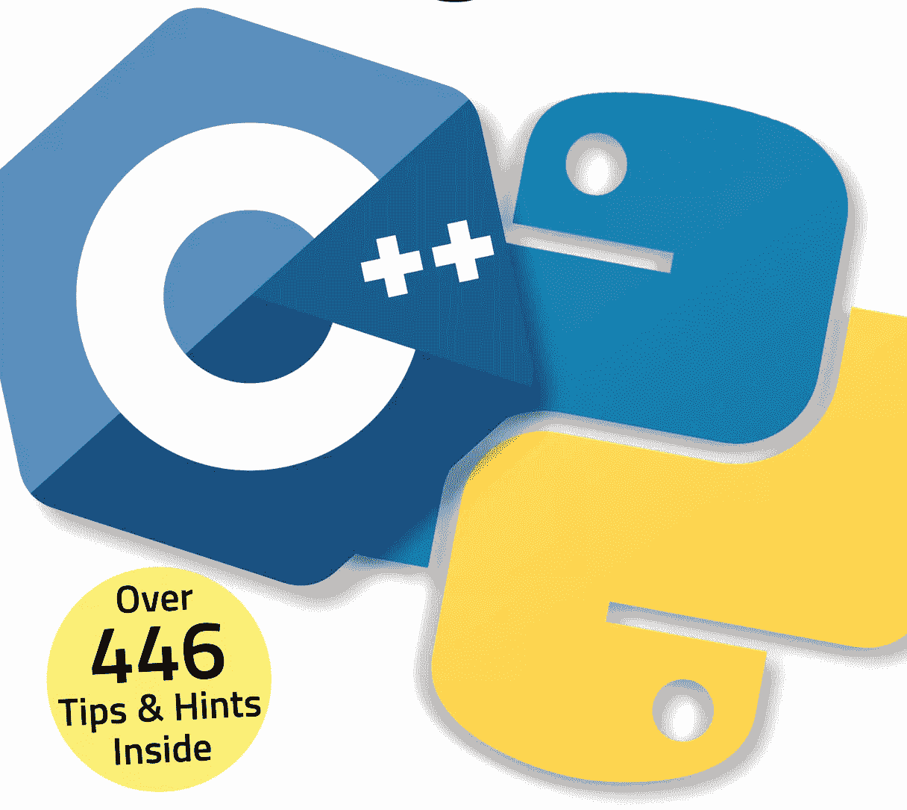


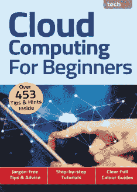
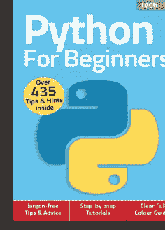
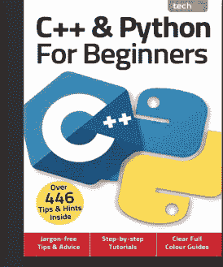


开始学习新事物可能会令人生畏畏。学习一项技能或掌握一个新硬件是困难的。如果你身边没有人帮助，情况会更加困难。反之，随着消费电子产品复杂性的增加，所需的手册尺寸在减小，在某些情况下，它直接消失了。在生活中的许多时候，我们都曾是“初学者”，这一事实并不可耻，事实也是如此。你曾多少次大声问：“这个按钮是做什么的？”“为什么不起用？”“你说它做不到是什么意思？”“救命！”在任何新旅程或冒险的开始，我们都是初学者，但对你来说的是，我们在这里每一个阶段都会陪伴在你身边。

通过这一系列广泛的标题，我们将深入探讨最新的消费电子产品、软件、爱好和趋势！我们将引导你循序渐进地使用你之前可能一直畏于尝试的技术方方面面。让我们的专家指南帮助你建立对技术的理解和技能，带你从一个新手变成一个自信且经验丰富的用户。

我们的旅程从本页开始。我们祝你好运，但我们确信在有我们的支持下，你不需要运气。


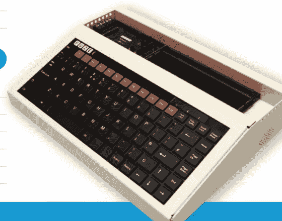


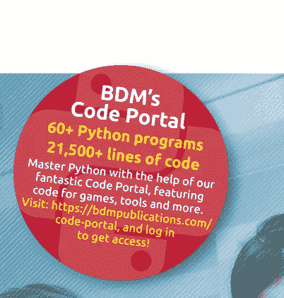

...

开始学习新事物可能会令人生畏畏。学习一项技能或掌握一个新硬件是困难的。如果你身边没有人帮助，情况会更加困难。反之，随着消费电子产品复杂性的增加，所需的手册尺寸在减小，在某些情况下，它直接消失了。在生活中的许多时候，我们都曾是“初学者”，这一事实并不可耻，事实也是如此。你曾多少次大声问：“这个按钮是做什么的？”“为什么不起用？”“你说它做不到是什么意思？”“救命！”在任何新旅程或冒险的开始，我们都是初学者，但对你来说的是，我们在这里每一个阶段都会陪伴在你身边。

通过这一系列广泛的标题，我们将深入探讨最新的消费电子产品、软件、爱好和趋势！我们将引导你循序渐地使用你之前可能一直畏于尝试的技术方方面面。让我们的专家指南帮助你建立对技术的理解和技能，带你从一个新手变成一个自信且经验丰富的用户。

我们的旅程从本页开始。我们祝你好运，但我们确信在有我们的支持下，你不需要运气。


...

开始学习新事物可能会令人生畏畏。学习一项技能或掌握一个新硬件是困难的。如果你身边没有人帮助，情况会更加困难。反之，随着消费电子产品复杂性的增加，所需的手册尺寸在减小，在某些情况下，它直接消失了。在生活中的许多时候，我们都曾是“初学者”，这一事实并不可耻，事实也是如此。你曾多少次大声问：“这个按钮是做什么的？”“为什么不起用？”“你说它做不到是什么意思？”“救命！”在任何新旅程或冒险的开始，我们都是初学者，但对你来说的是，我们在这里每一个阶段都会陪伴在你身边。

通过这一系列广泛的标题，我们将深入探讨最新的消费电子产品、软件、爱好和趋势！我们将引导你循序渐地使用你之前可能一直畏于尝试的技术方方面面。让我们的专家指南帮助你建立对技术的理解和技能，带你从一个新手变成一个自信且经验丰富的用户。

我们的旅程从本页开始。我们祝你好运，但我们确信在有我们的支持下，你不需要运气。


# 为什么选择 Python？

环境或用户。操作系统如 Windows、macOS 和 Linux 通常是 C++、C#、汇编和某种形式的视觉化语言的结合。通常使用 C++，而网页则使用许多种可用语言，如 HTML、Java、Python 等。

Python 诞生于 26 年前，已成为学习如何为计算机编程的理想初学者语言。对于爱好者、学生、教师以及那些仅仅需要在自己之间或外部硬件与计算机本身之间创建交互的人来说，它是完美的。

更通用的编程被用于创建程序、应用程序、软件或无论他们如何称呼它们。它们被广泛应用于所有硬件平台和几乎可以想象的每一个应用程序。有些运行得比其他的快，有些比其他的更容易学习。Python 是一种通用编程语言。

Python 免费下载、安装和使用，适用于 Linux、Windows、macOS、iOS、OS2、IBM 系列机器，并被选为世界五大编程语言之一，且在硬件和互联网的发展面前不断演进。

Python 被称为**高级语言**，因为它通过各种变量、对象、属性、子程序、循环和无数次交互与操作系统“对话”。它不像**低级语言**那样精简（低级语言可以直接处理内存地址、类和寄存器），它是通用接受且易于的。

所以回答这个问题：为什么选择 Python？简单来说，它是免费的、易学的、异常强大的、通用的，并且对初学者和教育目标非常有效。

```java
// Import: Java
import java.lang.*;
class Class {
    public static void main(String[] args) {
        try {
            Class c = Class.forName(args[0]);
            Method m = c.getMethod(args[1], new Class[0]);
            Object ret = m.invoke(null, null);
            // "Invoked static method: " + args[1]
            // + with no args results: " + ret;
        } catch (ClassNotFoundException e) {
            // could not find the class
        } catch (NoSuchMethodException e) {
            // method does not exist
        } catch (IllegalAccessException e) {
            // they don't have permission to invoke that method
        }
        System.out.println("Method error: " + e.getMessage());
    }
}
```

```basic
40 LET PY=15
70 FOR W=1 TO 10
75 GET BY=INT (RND (20))
50 SET BY=BY*2
100 PRINT "TO: " + PY
110 PRINT "W: " + W
120 PRINT "BY: " + BY
130 IF KEY="O" THEN LET PY=W
140 FOR W=1 TO 10: NEXT W
150 IF BY>7 THEN LET PY=27
160 SET BY=BY-1
200 FOR V=1 TO 10: LET S=S+V
210 PRINT "AT: "+ "+S
300 FOR W=1 TO 1000: NEXT W
```

Java 是一种流行的语言，用于网页、机顶盒、电视甚至外壳。

BASIC 是一个简单的开始，让早期的 8 位计算机用户都能理解。

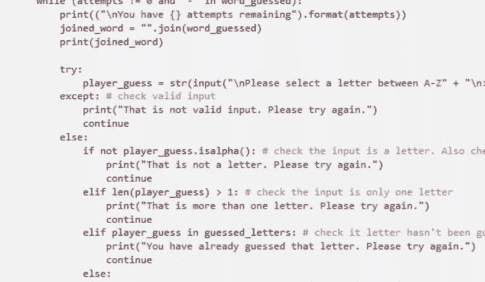

```python
print(GUESS())
while (guess != "q" and guess != guessed):
    guess = input("guess the word: ").lower()
    if guess == guessed:
        print("You guessed it right!")
try:
    player = input("select a letter A-Z or 'q': ").lower()
    if not player.isalpha():
        print("input is not valid letter.")
        continue
    if player not in guess:
        print("that letter is not in the word. Try again.")
        continue
    elif guess.count(player) > 1:
        print("there is more than one letter. Please again.")
        continue
    else:
        print("you have already guessed that letter. Please again.")
except Exception:
    pass
gessed_letters = []
gessed_letters.append(player)
for char in guess:
    if char == player:
        player = char
print(guessed_word) + player replaces all letters in
if player = guess is not in chosen:
    pass
```

Python 是一种像 BASIC 一样的现代语言，它易于学习，是理想的初学者编程语言。

# 向 Python问好

# 你将需要的设备

你可以用很少的硬件或初始资金投入来学习 Python。你不需要极其强大的计算机，任何所需的软件都是免费提供的。

# 我们正在使用的工具

感谢的是，Python 是一种多平台编程语言，适用于 Windows、macOS、Linux、树莓派等。如果你拥有其中一种系统，你就可以轻松地开始使用 Python。

- **计算机**：显然，你需要一台计算机来学习如何编写 Python 程序并测试你的代码。你可以使用 Windows（从 XP 开始）在 32 位或 64 位处理器上运行、Apple Mac 或安装了 Linux 的 PC。

- **IDE**：IDE（集成开发环境）用于输入和执行 Python 代码。它允许你检查程序代码和代码中的值，并提供各种功能。有很多不同的 IDE，请找到适合你的那一个。

- **Python 软件**：macOS 和 Linux 已经预装了 Python。然而，你需要确保运行的是最新版本的 Python。Windows 用户需要下载并安装。

- **文本编辑器**：虽然文本编辑器是输入代码的理想环境，但并非绝对必须。你可以直接在 IDE 中输入并执行代码，但像 Sublime Text 或 Notepad++ 这样的编辑器提供了更高级的功能。

- **网络**：Python 是一个不断演进的环境，新版本经常引入新概念或更改结构以使其更高效。访问互联网可以帮助你保持更新，在你遇到困难时帮助你获取海量的 Python 模块。

- **时间与耐心**：尽管其他书籍可能让你认为，你不会在 24 小时内成为程序员。学习编写 代码需要时间和耐心。你可能会卡壳，但最终代码会像水一样流畅。学习全新的东西就在那里。


# 树莓派

为什么使用树莓派？树莓派是一种非常便宜的计算机，但为用户提供了极佳的学习平台。它的主操作系统 Raspberry 预装了最新的 Python 和许多扩展。

# 树莓派

树莓派 3 是最新版本，包含了更强大的 CPU、更大的内存、Wi-Fi 和蓝牙支持。你可以根据兴趣购买 32 英镑的 Pi，或者 50 英镑以上的套装。

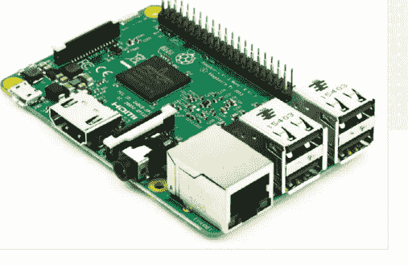


# FUZE 项目

FUZE 是在最新型号树莓派上构建的学习环境。你可以购买带有电子套装和机械臂的工作站进行构建和编程。你可以在其网站找到更多关于 FUZE 的信息。

# 书籍

我们在 bdmublic.com 有许多优秀的编程类书籍。我们的 Pi 书介绍了如何购买你的第一台树莓派、如何设置以及使用它；还有一些分步骤示例和指南让你从树莓派中获得最大收益。

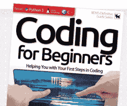

# Raspberry

树莓派的主操作系统基于 Debian 的 Linux 发行版，包含了你需要的所有内容。它针对 Pi 进行了优化，是硬件和软件项目、Python 编程以及桌面计算机的理想平台。

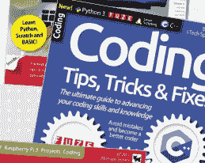
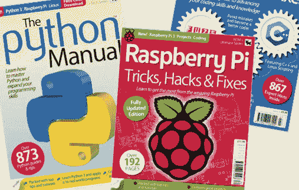

## 向 Python 问好

### 了解 Python

Python 是人类创造的最伟大语言。它让你用一种清晰易于理解的语言充分利用计算机的力量。

### 什么是编程？

在尝试学习之前，理解什么是编程是有帮助的，Python 例外。让我们看看 Python 如何产生以及它与其他语言的关系。

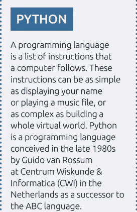

### 编程食谱

编程语言是计算机遵循的指令列表。这些指令简单到播放音乐文件，也可以复杂到构建整个世界。Python 是 20 世纪 80 年代后期由 Guido van Rossum 在荷兰的数学中心（Centrum Wiskunde）作为 ABC 语言的继任者提出的。

Guido van Rossum，Python 之父。

程序就像计算机的食谱。

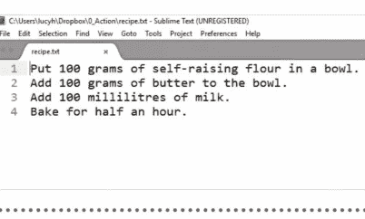

在碗中加入 100 克自发面粉。
在碗中加入 100 克黄油。
加入 100 毫升牛奶。
烘烤一小时。

在碗中加入 100 克自发面粉。
在碗中加入 100 克黄油。
加入 100 毫升牛奶。
烘烤一小时。

```python
bowl = []
flour = 100
butter = 50
milk = 100
bowl.append([flour, butter, milk])
cake.cake()
```

就像食谱一样，程序由你按顺序遵循的指令组成。描述蛋糕的程序可能如下：

```python
cake = []
def cake(self):
    flour = 100
    butter = 50
    milk = 100
    self.append([flour, butter, milk])
cake(cake)
```

### 程序命令

你可能不理解某些 Python 命令，`bowl.append` 和 `cake(bowl)`。第一个是列表，第二个我们会在书中讨论。要要知道的主要点是 Python 代码非常易读。一旦你理解了命令，就能很容易看出程序是如何工作的。


```python
Python 3.4.2 Shell
>>> bowl = []
>>> flour = 100
>>> butter = 50
>>> milk = 100
>>> bowl.append([flour, butter, milk])
>>> cake = []
>>> def cake(self):
...     flour = 100
...     butter = 50
...     milk = 100
...     self.append([flour, butter, milk])
... ...
>>> cake(cake)
```


### 高级语言

易于阅读的计算机语言被称为“高级”语言。这是因为它们运行在硬件（也称为“底层”）之上。那些“直接运行在底层”的语言（如汇编语言）被称为“低级”语言。低级语言的看起来像这样：`msg db low len eq - mid`

### Python 之禅

Python 让你能够用人类可以理解的语言访问计算机的所有力量。这背后的哲学被称为“Python 之禅”（The Zen of Python）。这是一个由 20 条软件原则组成的集合，影响着语言的设计。这些原则包括“优美胜于丑陋”、“简单胜于复杂”以及“导入此模块并显示你所有的程序”。

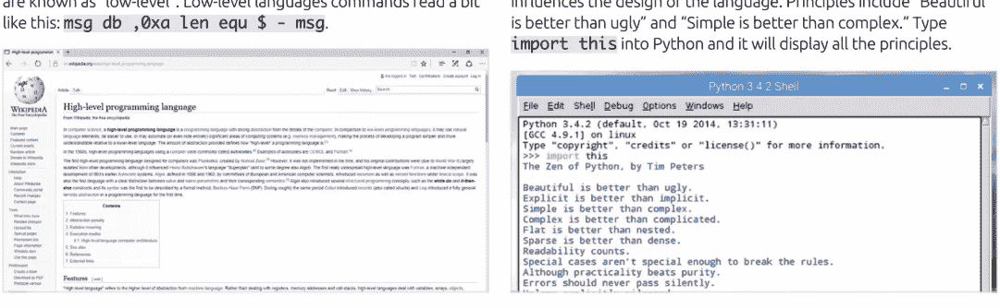

### PYTHON 3 对比 PYTHON 2

在典型的计算场景中，由于存在两个活跃版本的语言：Python 3 和 Python 2，Python 变得有些复杂。

-   Python 的世界
当你访问 Python 下载页面时，你会发现有两个可用按钮：用于 Python 3.6 和用于 Python 2.7.18；在写作时（记住 Python 会不断更新，所以你可能会看到不同的版本号）。

-   PYTHON 3.X
2008 年，Python 3 带有全新且增强的功能问世。这些特性提供了一个更稳定、有效且高效的环境，但大多数（如果不是全部）这些特性与 Python 2 不兼容。Python 3 最初并不流行，但从那以后一直处于 Python 编程的前沿。

| 下载 Windows 的最新版本 | 下载 Mac 的最新版本 |
| :--- | :--- |
| Python 3.6 | Python 2.7.13 |

想知道用哪一个？这里有关于 Python 2 和 3 之间的更多信息。
正在寻找不同操作系统的 Python 吗？Windows、Linux/Unix 操作系统或其他。
想测试不同的 Python 版本吗？预发布版

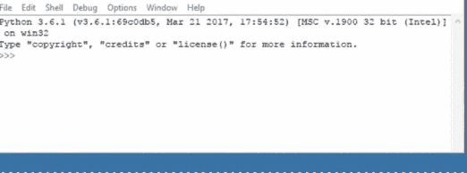

### PYTHON 2.X
为什么呢？Python 2 发布于 2000 年，从那以后采用了大量的模块、脚本、教程等。在多年里，Python 2 已经成为学者和专家选择的首选，这使其成为一个极具价值的资源。

### PYTHON 3
Python 3 的普及日益增长，以至于现在使用新特性学习并超越之前的版本已成为标准。许多开发公司（如 SpaceX 和 NASA）都使用 Python 3 作为重要的基石。

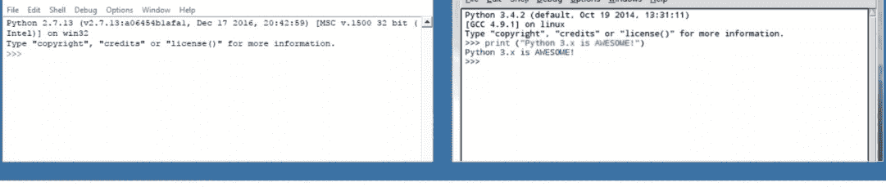

## 向 Python 问好

## 如何在 Windows 中安装 Python

Windows 并没有预装 Python 3.x，因此你需要自己安装它。坦率地说，这是一个很容易遵循的过程。虽然大多数经验丰富的开发者可能避开 Windows 作为他们代码的平台，但对于初学者来说这是一个这是一个的起点。

**第 1 步** 首先打开浏览器访问 [www.python.org/downloads/](https://www.python.org/downloads/)。寻找 Python 3.x 的下载链接（在这种情况下是 Python 3.6，但你之后可能会看到 3 的更高版本）。

**第 2 步** 点击版本 3.x 的下载按钮，并将文件保存到你的“下载”文件夹。文件下载完成后，双击执行文件，安装程序将启动。你有两个选择：安装（Install）或自定义（Custom）。我们建议选择“自定义”安装行。

**第 3 步** 选择“自定义”选项允许你指定某些参数，虽然你可以保持默认设置，但养成避免这种习惯的好习惯，因为有时（尽管 Python 不会）安装程序可能会包含不需要的功能。在下一个屏幕上，确保所有复选框已勾选，并点击“下一步”按钮。

**第 4 步** 下一页选项包含了一些关于 Python 的有趣细节。确保勾选了“关联文件”（Associate file）、将 Python 添加到环境变量”（Add Python To Environment Variables）、预编译标准库（Precompiled Standard Library）以及“为所有用户安装”（Install for All users）。这会让以后使用 Python 变得容易得多。准备好继续时，点击“安装”。

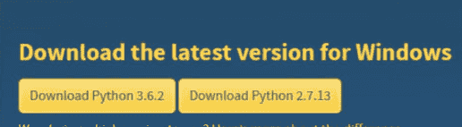
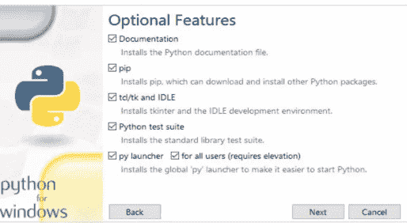
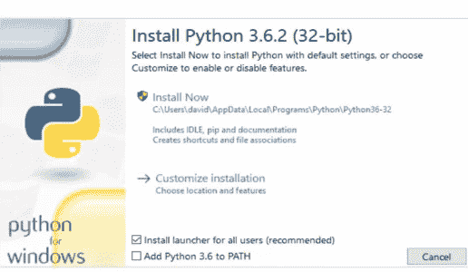
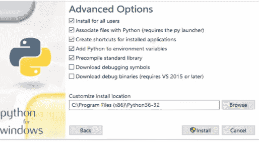

**第 5 步** 你可能需要通过 Windows 身份验证通知确认。只需点击“是”，Windows 将开始安装。一旦安装完成，最后的 Windows 页面将允许你查看最新的发布说明和一些在线教程。

**第 6 步** 然而，在安装窗口之前，最好点击详细的路径限制（Path Limit）。这将允许 Python 绕过 260 个字符限制，让你能够执行存储在深层文件夹中的程序。再次点击“是”来激活过程；然后你可以关闭安装了。

**第 7 步** Windows 10 用户需要在“开始”部分找到 Python 3.x。第一个链接“Python 3.6 (32-bit)”在点击后将安装命令行版本的 Python（稍后会详细介绍）。要打开 IDLE，在 Windows 中输入 IDLE。

**第 8 步** 点击 IDLE (Python 3.6 32-bit) 链接将启动 Python 壳，你可以在那里开始你的 Python 之旅。如果你的版本较新，不要担心，因为 Python 3.x 会在你的 Python 3 界面内运行。

**第 9 步** 如果你现在再次点击“开始”按钮，这次是 CMD，你将看到命令提示符（Command Prompt）。点击它进入 Windows 命令行。在命令行中输入“python”，你需要输入并按回车。

**第 10 步** 命令行版本的 Python 工作原理与你在第 8 步中打开的 Shell 相同；注意左侧箭头（>>>）。虽然这是一个完美的环境，但它对用户不太友好，所以暂时留在命令行即可。输入 exit() 退出并关闭命令提示符。

```
Python 3.6.2 (main, Mar 1 2017, 01:42:04) 
[Clang 3.0.0 (https-500.0.138-1.20)] on Windows
>>> print("hello world")
hello world
>>> 1 + 1
2
>>> exit()
```


## 如何在 Mac 上安装 Python

第 5 步：下一节详细介绍了软件许可协议，虽然对大多数人来说并不有趣，但可能值得一读。准备好后，再次点击“继续”（Continue）。

第 8 步：Python 安装向导中没有没有什么要做的，所以如果你回到终端会（Terminal）并重新输入命令：`python3 --version`，你就可以看到新的 python3 版本。要退出 Python 命令行，你需要输入：`python`。要退出，输入 `exit()`。

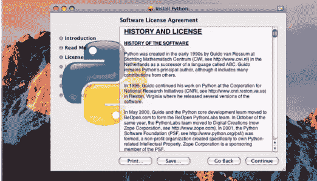

第 6 步：最后，你将看到 Python 将占据系统空间的大小以及一个“安装”（Install）按钮，你需要点击它来开始在你的 Mac 上实际安装 Python 3.x。你可能需要输入密码来验证安装。

第 7 步：安装并没有花费很长时间；我们在本节使用的 Mac Mini 比更现代的 Mac 慢一点，大约用了三十秒就显示了“安装成功”（Installation Successful）的提示。

第 9 步：你需要在访达（Finder）中搜索 Python IDLE；找到它后，点击它启动，它看起来应该和上一页的 Windows 版本 IDLE 相似。唯一的区别是它运行的 Mac 平台。

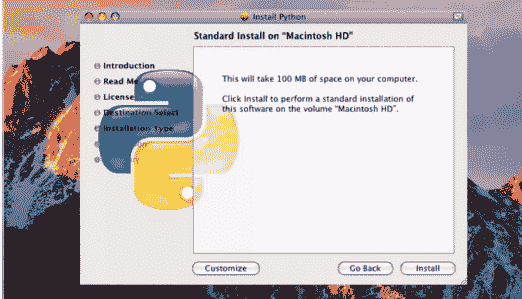

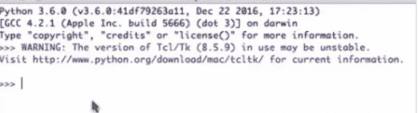

第 10 步：旧版本的 Mac 可能会与新版本的 Python 3.x 出现性问题，在这种情况下，你需要退回到之前的 Python 3.x 版本；只要你使用的是 Python 3.x，这段代码就可以供你运行。

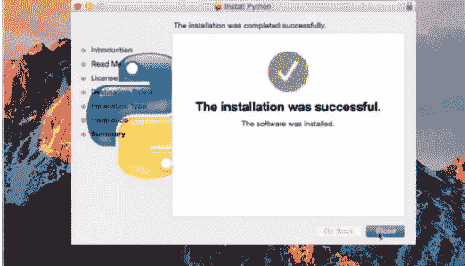

```
Python 3.1.2 (r312:79609, Mar 24 2010, 01:33:18)
[GCC 4.0.1 (Apple Inc. Build 54933)] on darwin
Type 'copyright', 'credits' or 'license' for more information.
>>
```

## 如何在 Linux 上安装 Python

大多数 Linux 发行版已经安装了 Python 2.x 版本，但我们将使用 Python 3.x，我们首先需要做一些工作来获取它。坦率地说，这并不困难。

### LINUX 企鹅

Linux 是一个如此多功能的操作系统，因此很难确定执行某件事的唯一方法。不同的发行版以不同的方式安装软件，因此在本教程中我们将坚持使用 Linux Mint 18.1。

- 第 1 步：首先，你需要确定你的 Linux 系统中当前安装了哪个版本的 Python；如前提到的，本节将使用 Linux Mint 18.1。对于 macOS，通过按下 Ctrl+Alt+T 进入终端。

- 第 2 步：接下来在终端中输入：`python --version`。你应该会在显示器上看到与 Python 2.x 版本相关的输出。在特定情况下，它是 Python 2.7.12。

- 第 3 步：某些 Linux 发行版会在系统更新时自动将 Python 安装更新到最新版本。要检查，首先进行系统更新和升级：
`sudo apt-get update && sudo apt-get upgrade`
输入密码并让系统执行任何更新。

```
File Edit View Search Terminal Help
david@david-mint -- $
```

```
File Edit View Search Terminal Help
david@david-mint -- --version
Python 2.7.12
david@david-mint -- $ sudo apt-get update && sudo apt-get upgrade
[sudo] password for david:
```

- 第 4 步：更新完成后，你可能需要回答“Y”来授权你的更新，输入：`python3 --version` 查看 Python 3.x 是否已更新或安装。在 Linux Mint 中，我们拥有 Python 3.5.2，这对于我们的目的足够了。

```
File Edit View Search Terminal Help
david@david-mint -- $ python --version
Python 2.7.12
david@david-mint -- $
```


第 5 步：然而，如果你想要最新版本（根据写作时 Python 网站的 3.6.2），你需要首先在终端输入这些命令：

```
sudo apt-get install build-essential checkinstall
sudo apt-get install libreadline-dev libssl-dev
sudo apt-get install libbz2-dev libsqlite3-dev tk-dev
sudo apt-get install libdbm-dev libdb6-dev
```

- 第 6 步：打开你的 Linux 浏览器并进入下载页面：www.python.org/downloads。点击 Python 3.6.2（或你需要的任何版本）下载源码 Python-3.6.2.tar.gz。

- 第 7 步：在终端中，进入下载的源码目录：`tar -xvf Python-3.6.2.tar.gz`。然后进入新编译的目录`cd Python-3.6.2/`。

- 第 8 步：在 Python 文件夹内，输入：
`./configure`
`sudo make altinstall`
这取决于你电脑的配置可能会有些不同。完成后，运行 `python3 --version` 安装的版本。

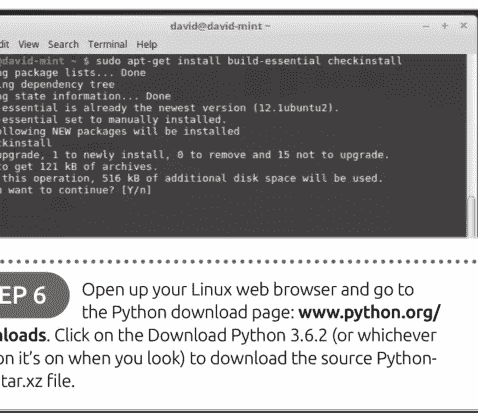

- 第 9 步：对于 IDLE，你需要在终端输入：
`sudo apt-get install idle3`
可以通过命令 `idle3` 启动 IDLE。注意 IDLE 运行的版本与从源码安装的版本不同。

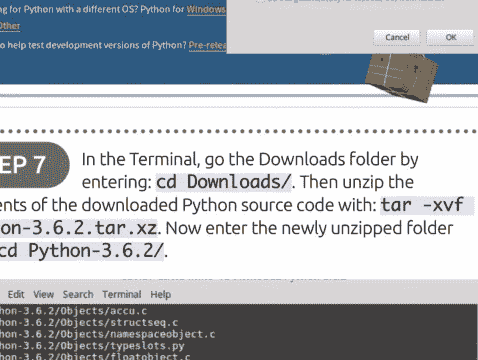

- 第 10 步：你还需要 PIP（Python 安装包），它可以帮助你安装更多模块：
`sudo apt-get install python3-pip`
完成后，通过你的发行版可以使用 Python 3.x。

www.bdmpublications.com 19


## 开始学习 Python

刚开始学习 Python 可能看起来有些困难，但这种语言的设计非常简单。与大多数事情一样，你需要缓慢开始，学习如何从代码中获取你想要的内容。在本节中，我们将涵盖变量、表达式、用户输入、条件和循环；以及你可能会错误类型。

### 首次启动 Python

我们将使用树莓派作为硬件平台。Raspbian 的最新版本预装了 Python 3，具体来说是 3.4.2 版本，只要你有版本 3 Shell，我们所有的代码都可以运行。

### 启动 PYTHON

我们不会详细介绍启动树莓派的细节；但一旦你准备好了，启动你的 Pi 并准备好编码。

- 第 1 步：加载 Raspbian 桌面后，点击菜单，然后选择 Programming > Python 3 IDLE。这会打开 Python 3 Shell。Windows 和 Mac 用户可以通过 Windows 菜单和访达找到 Python 3 IDLE。

- 第 2 步：Shell 是你可以输入代码并查看生成的代码的响应和输出的地方。这是一个你可以尝试简单代码和处理的沙盒。

- 第 3 步：例如，在 Shell 中输入：`2+2` 并回车后，下一行显示答案：4。基础知识，Python 接收了你的“代码”并产生了相应的输出。

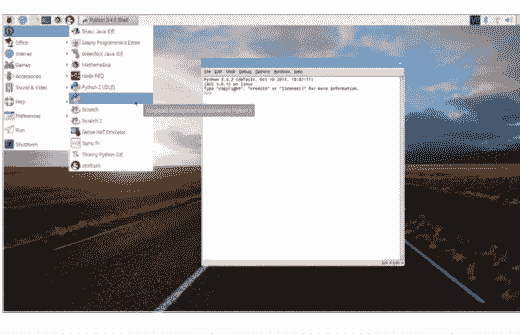

- 第 4 步：Shell 的作用非常像计算器，因为代码是系统的一系列数学交互。整数（数字的无限序列）可以加、减、乘等。

```
Python 3.4.2 (default, Oct 19 2014, 13:31:11)
>>> on linux
>>> type 'copyright', 'credits' or 'license' for more information.
>>> 2+2
4
```

```
Python 3.4.2 (default, Oct 19 2014, 13:31:11)
>>> on linux
>>> type 'copyright', 'credits' or 'license' for more information.
>>> 2+2
4
>>> 2345*64545232
1509444000000
>>> 64545232*12343
796793393376
>>> 98726898*43904
4334333333392
>>> 506472823538
```

- 第 5 步：虽然那很有趣，但并不特别有趣。尝试这个：

```python
print("Hello everyone!")
```

就像你在本书《安装文本编辑器》中在 Sublime 里输入的代码一样。

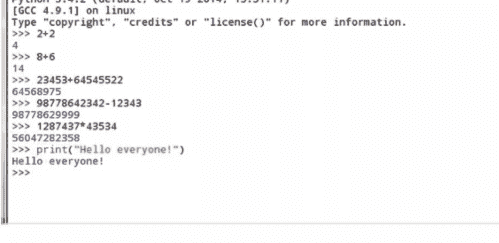

- 第 8 步：Python IDLE 是一个可配置的环境。如果你不喜欢你的表示方式，可以通过 Options > Configure IDE 并点击 Highlighting 选项卡。我们不建议这样做，因为你不会在截图中看到它们。

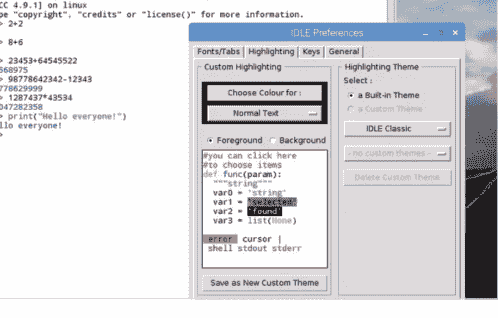

- 第 6 步：这更像那么回事，因为你已经产生了第一段代码。自言其懂。它打印内容。Python 3 需要括号以及顺序来输出到屏幕，在本例中是“hello everyone”例子。

```
>>> print("Hello everyone!")
Hello everyone!
>>> |
```

第 9 步：和大多数程序一样，无论操作系统如何，有很多快捷键。我们没有空间列出所有的，但在 Options > Configure IDLE 的 Keys 选项卡中，你可以看到当前的范围。

第 7 步：你注意到了 Python IDLE 内部的颜色编码。颜色代表代码的不同元素。

| Black - 数据和变量 | Blue - 用户函数 |
| Green - 字符串 | Red - 注释 |
| Purple - 函数 | Light - 错误消息 |
| Orange - 命令 | |

第 10 步：Python IDLE 是一个强大的界面，它是使用可用的 Qt 工具包用 Python 编写的。如果你想了解 Shell 的许多信息，我们推荐几个菜单，详情见 docs.python.org/3/library/idle.html 介绍了 IDLE 的功能。

### IDLE 颜色编码

| | | |
|---|---|---|
| Black - 数据与变量 | 23.4 区域 |
| Green - 字符串 | "World" |
| Purple - 函数 | int() |
| Orange - 命令 | for, get() |
| Blue - 用户函数 | get_area() |
| Dark red - 注释 | #, VAT |

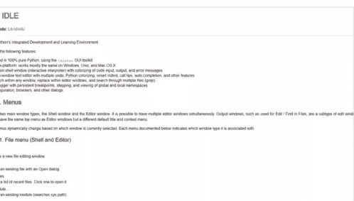


### 你的代码

基本上，你已经通过上一个教程中的 `print("Hello everyone")` 编写了你的第一段代码。然而，让我们扩展一下，看看输入你自己的代码并尝试一些其他的 Python 示例。

## 玩转 Python

对于大多数语言（无论是计算机语言还是人类语言），核心都在于并在合适的场合应用正确的词汇。你并不是生来就知道这些的，所以你需要学习它们。

- **第 1 步** 如果你关闭了 Python IDLE，请在 Shell 中重新打开它，无论你偏于哪种操作系统版本。尝试以下操作：

print("Hello")

```python
Python 3.4.2 Shell
File Edit Shell Debug Options Windows Help
Python 3.4.2 (default, Oct 19 2014, 13:31:11)
>>> 6.9 on Linux
>>> type("credits" or "license") for more information.
>>> print("Hello")
Hello
>>> print(2+2)
4
```

- **第 3 步** 你可以看到输出不是数字 4，而是你要求在 Shell 中打印的 2+2。引号定义了输出到 IDE Shell 的内容：

print("2+2")

```python
Python 3.4.2 Shell
File Edit Shell Debug Options Windows Help
Python 3.4.2 (default, Oct 19 2014, 13:31:11)
>>> 6.9 on Linux
>>> type("credits" or "license") for more information.
>>> print("Hello")
Hello
>>> print(2+2)
4
```

- **第 2 步** 正如预测的那样，单词 Hello 以蓝色文本的形式出现在 Shell 中，表示这是字符串的输出。这非常简单，不需要太解释。现在尝试：

print("2*2")

```python
Python 3.4.2 Shell
File Edit Shell Debug Options Windows Help
Python 3.4.2 (default, Oct 19 2014, 13:31:11)
>>> 6.9 on Linux
>>> type("credits" or "license") for more information.
>>> print("Hello")
Hello
>>> print(2*2)
4
```

你可以继续这样操作，向 Shell 打印 2+2、464+2344 等。一种更简单的方法是使用变量，我们稍后会详细介绍。现在，输入：


### 第 5 步

你在这里做的是给字母 a 和 b 赋值：2 和 2。这些是新变量，只要它们的数字不变，就可以调用 Python 进行输出、加法、减法、除法等。尝试这个：

print(b)

```python
#### Python 3.4.2 Shell
Python 3.4.2 (default, Oct 19 2014, 13:31:11)
>>> type("credits" or "license") for more information.
'str'
>>> print("hello")
hello
>>> print(2+2)
4
>>> a=2
>>> print(a)
2
>>> b=2
>>> print(b)
2
>>> print(a+b)
4
```

### 第 6 步

最后一步的输出包含了 a 和 b 的单独值，正如你要求打印它们那样。如果你想将它们相加，可以使用：

print(a+b)

这段代码简单地获取 a 和 b 的值，将它们相加并输出结果。

```python
#### Python 3.4.2 Shell
Python 3.4.2 (default, Oct 19 2014, 13:31:11)
(SCT 4.9.1 on Linux)
>>> type("credits" or "license") for more information.
'str'
>>> print("hello")
hello
>>> print(2+2)
4
>>> a=2
>>> print(a)
2
>>> b=2
>>> print(b)
2
>>> print(a+b)
4
```

### 第 7 步

你可以尝试不同类型的变量和函数。例如，你可以为某人的名字赋值：

```python
#### Python 3.4.2 Shell
Python 3.4.2 (default, Oct 19 2014, 13:31:11)
(SCT 4.9.1 on Linux)
>>> type("credits" or "license") for more information.
'str'
>>> print("hello")
hello
>>> print(2+2)
4
>>> a=2
>>> print(a)
2
>>> b=2
>>> print(b)
2
>>> print(a+b)
4
>>> name="David"
>>> print(name)
```

### 第 8 步

让我们加一个姓氏：
surname="Hayward"
print(surname)

你有两个包含名和姓的变量，可以独立地打印它们。

```python
#### Python 3.4.2 Shell
Python 3.4.2 (default, Oct 19 2014, 13:31:11)
(SCT 4.9.1 on Linux)
>>> type("credits" or "license") for more information.
'str'
>>> print("hello")
hello
>>> print(2+2)
4
>>> a=2
>>> print(a)
2
>>> b=2
>>> print(b)
2
>>> print(a+b)
4
>>> name="David"
>>> print(name)
>>> surname="Hayward"
>>> print(surname)
```

### 第 9 步

如果我们按照之前的相同程序使用 `+` 符号，name 不会在 Shell 中正确显示。你需要在它们之间使用空格，将它们定义为独立的变量。

```python
#### Python 3.4.2 Shell
Python 3.4.2 (default, Oct 19 2014, 13:31:11)
(SCT 4.9.1 on Linux)
>>> type("credits" or "license") for more information.
'str'
>>> name="David"
>>> print(name)
>>> surname="Hayward"
>>> print(surname)
>>> print(name+surname)
DavidHayward
```

### 第 10 步

在 Python 3 中你可以用逗号分隔变量：

print(name, surname)

或者，你可以自己添加空格：

print(name+" " +surname)

使用逗号要整洁得多。恭喜，你刚刚进入了 Python 世界。

```python
#### Python 3.4.2 Shell
Python 3.4.2 (default, Oct 19 2014, 13:31:11)
(SCT 4.9.1 on Linux)
>>> type("credits" or "license") for more information.
'str'
>>> name="David"
>>> print(name)
>>> surname="Hayward"
>>> print(surname)
>>> print(name, surname)
David Hayward
```

### 保存并执行你的代码

虽然在 IDLE Shell 中工作对于小型代码片段是完美的，但它并不是为了输入程序列表设计的。在本节介绍 IDLE Editor，从现在起将在那里工作。

### 编辑代码

你最终会达到一个需要在 Shell 中输入代码行的阶段。相反，IDLE Editor允许你保存并执行 Python 代码。

- **第 1 步** 首先打开 Python IDLE，当它启动后，点击 File -> New。这将打开一个名为 Untitled 的新窗口。这就是 Python Editor，你可以在其中创建未来所需的程序。

- **第 2 步** IDLE Editor 从本质上来说是一个具有 Python 功能（如编码等）的简单文本编辑器；类似于 Sublime。你像在 Shell 中一样输入代码，参考上一个教程的示例，输入：

- **第 3 步** 你可以看到 IDLE Editor 中和 Shell 中有相同的颜色编码，这让你更好地理解代码发生了什么。然而，要执行代码，你需要先保存它。按下 F5 会打开一个 Save... 框。

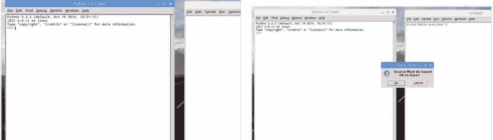

- **第 4 步** 点击 Save 框中的 OK，选择保存所有 Python 代码的地方。目的地可以是一个空闲文件夹，你也可以把它放在任何喜欢的地方。但请保持驱动器整洁，以便以后使用。

```python
print("Hello everyone!")
```

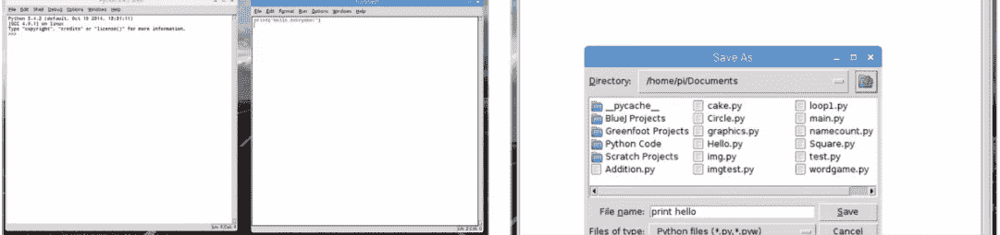

```python
print("Hello everyone!")
```

### 第 5 步

为你的代码输入名称，例如 'print hello'然后点击 Save 按钮。一旦 Python 代码被保存并执行，它将在 IDLE Shell 中详细显示。在这种情况下，为 'Hello world!'

```python
### My first program
### File Edit Shell Options Windows Help
hello.py Oct 19 2014, 13:31:11
```

### 第 8 步

让我们扩展代码并输入上一个教程中的示例：

```python
a=2
b=2
name="David"
surname="Hayward"
print(a+b)
```

如果你现在按下，会被要求保存文件，因为它已经从以下内容修改过：

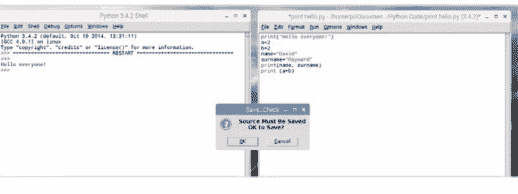

### 第 6 步

这是你大部分代码将进行的方式。将其输入 Editor，按下 F5，如果你编辑的是较大的文件，请保存代码，覆盖可能会变成问题。使用 File > Save As Editor 创建备份。

```python
Python 3.4.2
File Edit Shell Options Windows Help
hello.py Oct 19 2014, 13:31:11
>>> (3.4.2) on Windows
>>> type('credits')
<class 'str'>
>>> print("hello world!")
hello world!
>>>
```

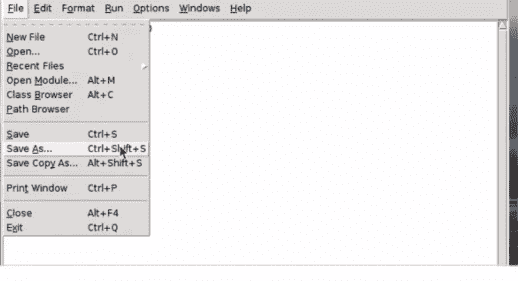

### 第 7 步

如果你打开保存 Python 代码的位置，你可以看到它以 .py 结尾。这是默认的 Python 名称。你创建的任何代码以及从网络 Python 资源下载的任何代码都是 .py。只需确保代码是为 Python 3 编写的。

### 第 10 步

现在创建一个新实例（从 Shell 点击 File > New File）。输入以下并保存为：hello.py

```python
a="Python"
b="13"
c="cool!"
print(a, b, c)
```

你将在下一个教程中使用这段代码。


## 从命令行执行代码

虽然我们在本书中一直通过图形界面（GUI）进行操作，但值得关注一下 Python 的命令行处理。我们已经知道 Python 有一个命令行版本，但它也被用于执行代码。

## 命令行代码

使用上一个教程中的代码（我们命名为 `hello.py` 的那个），让我们看看如何在命令行级别运行在 GUI 中编写的代码。

- **第 1 步** 在 Linux 中，Python 提供了两种通过命令行执行的可能方法。一种是使用 Python 2，而另一种是使用 Python 3 库等。首先，进入你操作系统的命令行或终端（Terminal）。

- **第 3 步** 现在你已处于命令行界面，我们可以启动 Python。对于 Python 3，你需要输入命令行版本的 Shell，这会将你带入熟悉的三个箭头光标（`>>`）。


- **第 2 步** 和之前一样，树莓派：使用 Windows 的用户需要点击开始按钮并搜索 `cmd`，然后点击命令行搜索结果；macOS 用户可以通过点击“前往 > 实用程序 > 终端”访问他们的命令行。

- **第 4 步** 从这里，你可以输入之前看过的代码，例如：

```python
print(a)
```

你可以看到它的工作原理完全相同。

```python
@raspberrypi:~$ python3
Python Copyright, Oct 19 2014, 13:31:11
[GCC] 4.9.2 on linux
Type help, 'credits' or 'license' for more information.
>>> print(a)
5
```

| 命令行提示符 |
| :--- | :--- |
| cmd | 查看网页结果 |

## 从命令行执行代码

第 5 步现在输入：`exit()` 命令行并返回命令行提示符。进入你保存上一个教程代码的文件夹并列出文件；希望你能看到 `hello.py`。

第 8 步运行 Python 3 代码的结果是显而易见的。由于 Python 3 处理方式与 Python 2 之间的差异，它在任何情况下都不会报错，但结果可能与预期不同。暂时离开 Sublime，打开 `hello.py` 文件。

```
File Edit Tabs Help
python 4.2 (default) Oct 10 2014, 13:31:11
>>> hello
>>> print('copyright', 'credits' or 'license' for more information.
>>> print()
>>> print()
>>> exit()
>>> ls 5 Documents/
rasberrypi~/Documents/code/
rasberrypi~/Documents/code $ 5
rasberrypi~/Documents/code $ python3 hello.py
rasberrypi~/Documents/code $
```


第 6 步从运行代码的同一行，输入以下命令行：`python3 hello.py`

这将执行我们创建的代码，这意味着你将：`print(a, b, c)`

第 9 步由于树莓派上没有 Sublime Text，你暂时离开 Pi，使用示例说明你不需要 Python IDLE。使用 `hello.py` 文件，打开它并输入：

```python
name="What is your name?"
print("hello", name)
```


第 7 步 自然地，如果你使用 Python 3，你在 Python 3 中使用的语法和布局将仍然有效。如果你尝试通过输入 `python hello.py` 使用 Python 2 运行代码：

```
File Edit Tabs Help
python 4.2 (default) Oct 10 2014, 13:31:11
>>> hello
>>> print('copyright', 'credits' or 'license' for more information.
>>> print()
>>> print()
>>> exit()
>>> ls 5 Documents/
rasberrypi~/Documents/code/
rasberrypi~/Documents/code $ 5
rasberrypi~/Documents/code $ python3 hello.py
rasberrypi~/Documents/code $
```

第 10 步保存 `hello.py` 文件并回到命令行。现在执行新保存的 `python3 hello.py`

结果将是原始的 Python 3 代码！加上为名称添加的输入命令，并显示在命令行窗口中。

```
File Edit Tabs Help
rasberrypi~/Documents/code $ 5 python3 hello.py
hello.py
David What is your name?
rasberrypi~/Documents/code $
```

## 数字与表达式

我们已经看到了 Python 的基础数学表达式，如加法等。让我们扩展一下，看看 Python 作为计算器有多强大。你可以在 IDLE Shell 中工作，也可以在编辑器中，随你喜欢。

## 伙计，这全是数学

你可以利用 Python 的数学能力获得一些令人惊讶的结果；对于大多数（不是所有）编程语言来说，数学都是驱动力量的核心。

- **第 1 步** 打开 Python 3 的 GUI 版本，如所述，目前你将使用 Shell 或编辑器来热你的“肌肉”，即位于后面（或不那里）的一个小腺体。

- **第 3 步** 你可以使用所有的数学运算：除法、乘法、括号等。练习几次，例如：

```
1/2
2*3
(1-2)+(3*4)
```

```
Python 3.4.2 Shell
Python 3.4.2 (default. Oct 19 2014, 13:31:11)
(GCC 4.9.1) on linux
>>> "copyright", "credits" and "license" for more information.
>>> 2+2
```

```
Python 3.4.2 Shell
Python 3.4.2 (default. Oct 19 2014, 13:31:11)
(GCC 4.9.1) on linux
>>> "copyright", "credits" and "license" for more information.
>>> 2+2
```

（注：原文后续存在大量重复的步骤 3 和代码块，此处已根据要求去重处理）


## 使用注释

在编写代码时，代码的流程、每个变量的作用、程序的整体运行方式等都在你的脑海中。另一个程序员可能会逐行跟进代码，但随着时间的推移，代码可能会变得难以阅读。

## #注释！

程序员通过对某些部分进行注释，来保持代码的可读性。如果使用了一个变量，程序员会注释它的预定功能，这是一种良好的习惯。

- 步骤 1 开始创建一个 IDLE 编辑器新实例（文件 -> 新文件），并创建一个简单的变量和打印命令：

```
a=10
print("The value of A is", a)
```

保存文件并执行。

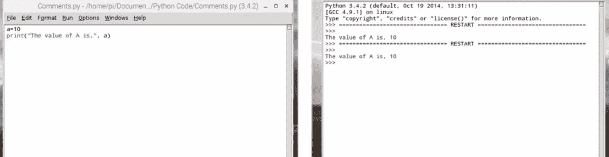

- 步骤 3 重新保存代码并执行。你可以发现 IDLE Shell 中的输出与之前相同，尽管添加了额外的行。简单来说，哈希符号 (#) 表示程序员可以插入的一行文本，用于在用户察不到的情况下告知他们和其他他人正在发生什么。

- 步骤 2 运行代码将向 IDLE Shell 窗口返回：`The value of A is 10`，这正是我们预期的。现在，添加一些你在代码中常见的注释：

```python
### 将 A 的值设为 10
### 打印 A 的当前值
print("The value of A is", a)
```

- 步骤 4 假设我们创建的变量 A 是游戏中的生命值。每当玩家死去时，值就会减 1。程序员可以按照以下路径插入输入：

```
a=1
print("You've just lost a life!")
print("You now have, a, 'lives left!")
```

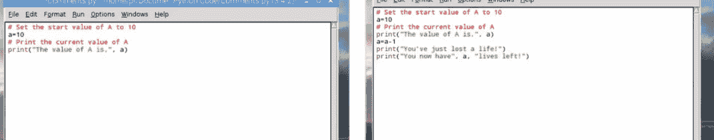

## 使用注释

步骤 5 虽然我们知道变量 A 是什么，以及玩家失去了一个生命，但偶然的查看者或检查代码的人可能并不知道。想象一下，代码有两万行，而不是只有七行。你可以看到注释是如何工作的。

步骤 8 跟跟在代码段后的行内注释。我们从下方的示例中提取，而不是将注释插入单独的一行，我们应该使用：

```python
a=10 # Set the value of A to 10
print("The value of A is,") # Print the current value of A
a=0 # Player lost a life!
print("You've just lost a life!")
```

```
Python 3.12 (main)
Type Oct 24 2023, 12:44:12 [Clang 13.2.0] on Windows
Type help or exit
>>> print("credits" or "license") for more information.

---------------------------------------
>>> a=10
>>> print("The value of A is,")
10
>>> a=0
>>> print("You've just lost a life!")
nYou've just lost a life!
>>> 
```

步骤 6 本质上，新代码加上注释可能如下：

```python
### 将 A 的起始值设为 10
### 打印 A 的当前值
print("The value of A is,")
### 玩家失去了一个生命！
a=0
### 通知玩家，并显示 A 的当前值（生命值）
print("You've just lost a life!")
print("You now have, a, "lives left!")
```

步骤 9 注释，哈希符号，也可以用于注释掉你不想执行的代码段。如果你想移除第一个语句，你会使用：

- #print("The value of A is,")

步骤7 你可以使用注释来解释原因。块注释（Block Comments）详细说明了代码中发生的情况，告诉读者你在做什么：

```python
# This is the best game, and has been developed by crack squad of
# who slept or washed in weeks. Despite being very smelly, the code at
# works really well.
```

步骤10 你也可以使用三引号来注释掉一个或多行。在你想要注释的区域前后放置：

```python
"""
This is the best game, and has been developed by crack squad of
who haven't slept or washed in weeks. Despite being very smelly, the code works really well.
"""
```

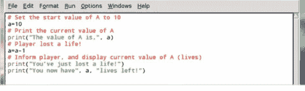

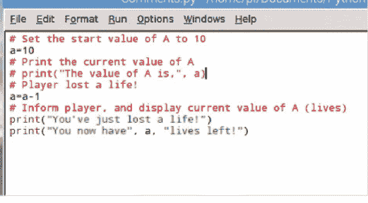

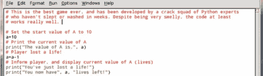

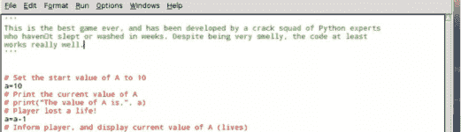

### 使用变量

我们在 Python 代码中见过了一些变量示例，但了解它们的操作方式以及 Python 如何为变量创建值总是值得的。

### 各种变量

在本教程中，你将与 Python 3 IDLE Shell 交互。如果你还没有打开，请打开 IDLE Shell 以清理代码。

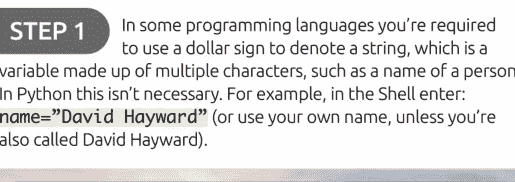

- 步骤 1 在某些编程语言中，要求使用美元符号来表示一个由多个字符组成的字符串，作为一个人的名字。在 Python 中，这不是必要的。例如，在 Shell 中输入：`name="David"`（或者使用自己的名字）。

- 步骤 3 你之前见过变量可以使用加号在变量名之间连接。在我们的示例中，我们可以使用：`print(name + ": " + title)`。因为变量之间没有空格，所以我们需要手动添加它们。

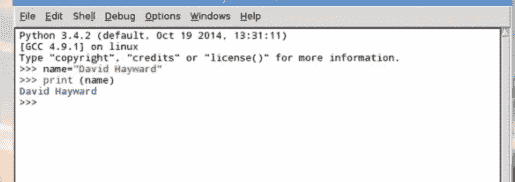

- 步骤 2 你可以通过发布 `type()` 命令并将变量名放在括号内来检查使用的变量类型。在我们的示例中，这将是 `type(name)`。添加一个新的字符串变量：`title="Descended from Vikings"`。

- 步骤 4 你也可以在另一个变量中合并变量。例如，将 name 和 title 变量合并到一个新变量，我们使用：

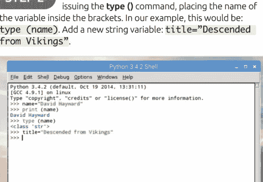

```python
print (character)
```

数字以不同的变量存储：

```python
age=44
type(age)
```

我们知道，这些是整数。

### 使用变量

步骤 5 然而，你不能在同一个命令中合并字符串和整数，因为你需要将其中一个转换为另一个，反之亦然。当你尝试合并两者时，会得到错误：

```python
print(name + age)
```

步骤 8 当你想处理以字符串形式输入的数字时，这会产生一些问题。你需要：

```python
int(age)
```

步骤 6 这种过程被称为类型转换（Typecasting）。Python 代码如下：

注意在最后一个示例中，逗号分别处理每个参数。

```python
print (character, " is " + str(age) + " years old!")
```

步骤 9 这种类型转换在处理浮点数运算时也很重要；例如，输入：

```python
shift=19.99
```

现在输入 `type(shift)`，你会发现 Python 将该数字分配为 'float'（浮点数），它包含小数点。

步骤 7 类型转换的另一个示例是你想从用户获取输入，例如：

```python
enter= input("How old are you?")
```

从输入收集的所有数据都存储为字符串。

步骤 10 当合并整数和浮点数时，Python 将整数转换为浮点数，但反过来并不返回你期望的值。当合并浮点数和整数时，Python 将始终向下舍入到最近的整数，称为截断（trunc）；19.9 变为了 19。

```
Python 3.4 2 Shell
>>> enter = input("How old are you?")
44
>>> type(enter)
<class 'str'>
>>>
```

```
Python 3.4 2 Shell
>>> enter = int(enter)
44
>>> type(enter)
<class 'int'>
>>>
```

www.bdmppublications.com 35


### 用户输入

在之前的几个示例中，我们已经看到了一些基础的用户代码交互，现在是时候关注如何从用户存储中获取信息并将其展示出来的了。

### 用户友好

你想要从用户那里获得的输入类型很大程度上取决于你正在编写的程序类型。例如，游戏可能会询问角色的名字，而数据库可能会询问个人详情。

- 步骤 1 如果还没有打开，请打开 Python 3 IDLE Shell。在编辑器中创建一个新文件（New File）。让我们从一些简单的内容开始，输入：

```python
print("Hello")
firstname=input("What is your first name?")
print("Thanks")
surname=input("And what is your surname?")
```

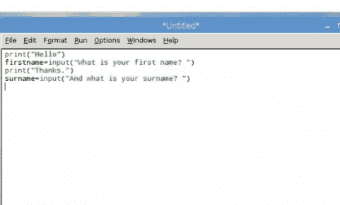

- 步骤 3 现在我们已经将用户的姓名存储在两个变量中，我们可以随时调用它们：

```python
print("Welcome", firstname, surname, ". I hope you're well today.")
```

- 步骤 2 保存并执行代码。正如你毫无怀疑的那样，在 IDLE Shell 中，程序会询问你的名字，将其存储在变量 `firstname` 中；询问姓氏，将其存储在它的变量 `surname` 中。

- 步骤 4 运行代码，你会发现一个小问题：姓氏后面的句号有一个空格。为了消除这个问题，我们可以在代码中添加一个加号：

```python
print("Welcome", firstname, surname+". I hope you're well today.")
```

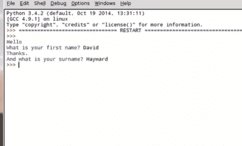

```
Python 3.4.2 Shell
IDLE 3.4.2 (default, Oct 19 2014, 13:31:11)
>>> print("Hello")
Hello
>>> RESTART
Type help for commands for more information.
>>> firstname=input("What is your first name?")
David
>>> surname=input("And what is your surname?")
hayward
```

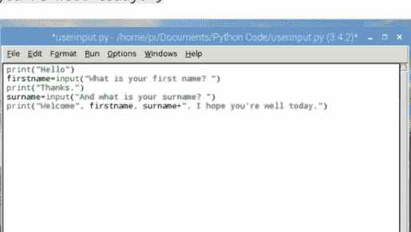

```python
print("Welcome", firstname, surname+". I hope you're well today.")
Welcome David hayward.I hope you're well today.
```


### 步骤 5

你并不总是要在 `input` 命令中包含引号内的文本。例如，你可以询问用户的名字，并在下面的一行进行输入：

```python
print("Hello. What's your name?")
name=input()
```

```
userinput.py - /home/pi/Documents/Python/Code/us
Edit File Format Bun Options Windows Help
print("Hello. What's your name?")
name=input()
```

### 步骤 8

你创建的是一个条件，我们很快就会涵盖。简而言之，我们使用 `input` 输入并与条件进行比较。因此，如果用户输入 David 作为名字，卫兵将允许他们无阻碍地通过。否则，如果他们输入 David 以外的其他名字，卫兵将挑战他们进行战斗。

```python
### Edit File Format Bun Options Windows Help
name = input("What is your name?")
if name == "David":
    print("Good sir. You may pass.")
else:
    print("I know you. Prepare for battle!")
```

### 步骤 6

上一步的代码通常被认为比在 `input` 命令中有大量文本要精简一些，但这并不是铁成不变的规则，所以根据这些情况你的喜好。扩展代码如下：

```python
print("Hail! Who goes there?")
name=input()
```

```
userinput.py - /home/pi/Documents/Python/Code/userinput.py (3.4.2)
Edit File Format Bun Options Windows Help
print("Hail! Who goes there?")
name=input()
```

### 步骤 9

正如你之前学到的那样，任何输入都是字符串，所以你需要应用类型转换（TypeCast）将其转换为其他类型。这为 `input` 命令创建了有趣的特性。例如：

```python
### 为了计算速率和距离
print("Input a rate and a distance")
rate=float(input("Rate: "))
```

```
userinput.py - /home/pi/Documents/Python/Code/userinput.py (3.4.2)
Edit File Format Bun Options Windows Help
### 为了计算速率和距离
print("Input a rate and a distance")
rate=float(input("Rate: "))
```

### 步骤 7

从这个冒险游戏开始是一个不错的尝试对吗？现在你可以扩展它，并使用原始输入让卫兵的内容更丰富：

```python
if name == "David":
    print("Welcome, good sir. You may pass.")
else:
    print("I know you. Prepare for battle!")
```

```
userinput.py - /home/pi/Documents/Python/Code/userinput.py (3.4.2)
Edit File Format Bun Options Windows Help
if name == "David":
    print("Welcome, good sir. You may pass.")
else:
    print("I know you. Prepare for battle!")
```

### 步骤 10

为了计算速率和距离，我们可以添加：

```python
distance=float(input("Distance: "))
time=float(input("Time: "))
print(distance / time)
```

保存并执行代码。


## 条件与循环

条件和循环让程序变得有趣；它们可以很简单，也可以相当复杂。你如何使用它们很大程度上取决于程序试图实现的目标；它们可以是游戏中剩余的生命值，或者仅仅是显示倒计时。

### 真条件

在开始学习编程时，保持条件简单会让过程变得更加愉快。让我们先从检查某项是否为真（TRUE），如果不是则执行其他操作开始。

- 步骤 1：我们创建一个 Python 程序，要求用户输入一个单词，然后检查它是否为四字母单词。从文件（File）新建文件（New File）开始，输入：

```python
word=input("Please enter a four-letter word: ")
```

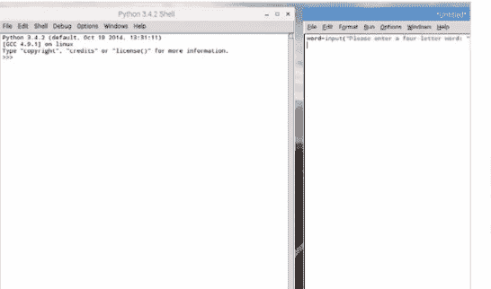

- 步骤 3：你可以使用 if 语句来检查单词是否“友好”，如果符合规则则打印确认信息：

双等号 (==) 表示检查某物是否等于另一个某物。

- 步骤 2：我们可以创建一个新变量，然后使用 `len` 函数并将单词传递给它，以获取用户输入的字母总数：

```python
word=input("Please enter a four-letter word: ")
word_length=len(word)
```

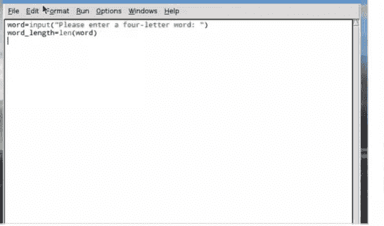

- 步骤 4：if 结尾的冒号告诉 Python，如果某项为真，冒号之后的所有内容都要缩进。接下来，将光标移回开头：

```python
word=input("Please enter a four-letter word: ")
word_length=len(word)
if word_length == 4:
    print("")
```

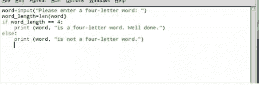

- 步骤 5：按 F5 并保存代码以执行。在 Shell 中输入一个四字母单词开始，你应该会收到该单词是四个字母的回。。现在按 F5 运行程序，这次输入一个五字母单词。Shell 将显示它不是四字母单词。

- 步骤 6：现在扩展代码以包含其他条件。最终，它可能会变得非常复杂。我们为三字母单词添加了一个条件：

```python
word=input("Please enter a four-letter word: ")
if len(word) == 4:
    print(word," is a four-letter word. Well done.")
elif len(word) == 3:
    print(word," is a three-letter word. Try again.")
else:
    print(word," is not a four-letter word.")
```

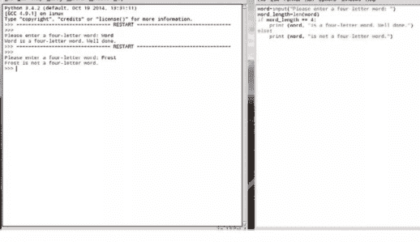


### 循环

循环看起来和条件非常相似，但在运行机制上有所不同。循环会在条件的支持下多次运行同一代码块。

- 步骤 1：让我们从简单的 While 语句开始。像 IF 一样，它会检查某项是否为真，然后执行缩进的代码：

```python
x = 0
while x < 10:
    print(x)
    x = x + 1
```


- 步骤 3：For 是另一个例子。用于遍历数据范围（即方括号内列出的列表）。例如：

```python
words=["Cat","Dog","Unicorn"]
for word in words:
    print(word)
```


- 步骤 2：if 和 while 的区别在于，当缩进代码完成后，它会返回检查条件是否仍然为真。在示例中 x 小于 10。循环中，它打印 x 的当前值，然后将值加1。当 x 最终等于 10 时停止。

- 步骤 4：循环也可以通过使用 `range` 函数用于倒计时示例：

```python
for x in range(1, 10):
    print(x)
```

这里没有 x=1 是因为 `range` 函数从第一个数字到最后一个数字创建一个列表。


## 入门 Python

### Python 模块

我们之前提到过模块（math 模块），但由于它们是充分利用 Python 的很大一部分，值得花更多时间在它们身上。在本例中，我们使用的是 Windows 版本的 Python 3。

### 精通模块

将模块想象为导入你的 Python 代码的扩展，以增强和扩展其功能。正如我们所看到的，有无数模块，你甚至可以创建自己的。

- 步骤 1：虽然 Python 内置函数很好用，但是有限的。然而，模块的使用允许我们编写更复杂的程序。如你所知，模块是被导入的 Python 脚本，例如 `import`。

- 步骤 3：结果是在 IDLE Shell 中报错，因为 Python 模块未被识别或安装。要安装模块，我们可以使用 PIP（Pip 安装 Packages）。关闭 IDLE Shell 进入命令提示符，输入：

`pip install pygame`

```
Python 3.6 Shell
File Edit Save Options Window Help
Python 3.6.2 (v3.6.2:0553b5, Jul 6 2017, 08:14:34) [MSC v.1900 32 bit (Intel)]
```

- 步骤 2：某些模块（尤其是 math）是默认包含的，其他不是。

- 步骤 4：if 结尾的冒号告诉 Python，如果某项为真，冒号之后的所有内容都要缩进。接下来，将光标移回开头：

```python
word=input("Please enter a four-letter word: ")
word_length=len(word)
if word_length == 4:
    print("")
```

- 步骤 5：按 F5 并保存代码以执行。在 Shell 中输入一个四字母单词开始，你应该会收到该单词是四个字母的回。。现在按 F5 运行程序，这次输入一个五字母单词。Shell 将显示它不是四字母单词。

- 步骤 6：现在扩展代码以包含其他条件。最终，它可能会变得非常复杂。我们为三字母单词添加了一个条件：

```python
word=input("Please enter a four-letter word: ")
if len(word) == 4:
    print(word," is a four-letter word. Well done.")
elif len(word) == 3:
    print(word," is a three-letter word. Try again.")
else:
    print(word," is not a four-letter word.")
```


### Python 模块

我们之前提到过模块（math 模块），但由于它们是充分利用 Python 的很大一部分，值得花更多时间在它们身上。在本例中，我们使用的是 Windows 版本的 Python 3。

- 步骤 5：关闭命令提示符并重新启动 IDLE Shell。现在现在进入时，模块将被导入。

- 步骤 8：模块包含了在你的代码中实现特定结果所需的额外代码，正如我们实验过的。例如：

```python
import random
import math

for i in range(5):
    print(random.randint(1,25))

print(math.pi)
```

- 步骤 9：结果是一系列随机数，随后是通过 `print(math.pi)` 从 math 模块提取的 Pi 值。你也可以通过 `import` 和命令从模块中引入函数，例如：`from random randint for i in range(5): print(random.randint(1,25))`

- 步骤 7：这段代码保存并执行后，将显示 1 到 25 之间的随机数。你可以尝试显示更多或更少，从更大或更小的范围。例如：`import random for i in range(25): print(random.randint(1,100))`

- 步骤 10：这有助于创建更简洁的编程方法。你也可以导入模块*，然而，这通常被认为是浪费资源，但它可能有效。模块可以作为别名导入：`import math as m print(m.pi)`
当然，添加注释有助于说明正在发生什么。


### 向 C++ 问好

C++ 是一种高级编程语言，被用于许多技术。从你喜欢的移动应用、控制台和 PC 游戏，到整个操作系统，全都是使用 C++ 以及一系列软件开发工具包（SDK）和自定义库开发的。

C++ 是你日常使用的大部分内容后的驱动力量，这使其成为一门复杂且极其强大的需要掌握的语言。在本节中，我们将介绍如何在你的计算机上安装 C++ IDE 和编译器。

### 为什么选择 C++？

C++ 是最受欢迎的编程语言之一，曾被称为“带有类的 C”，它在 1983 年被重命名为 C++。它是原始 C 语言的扩展，是一个通用的面向对象（OOP）环境。

### 关 C 的一切

由于该语言的复杂性，以及其强大的功能和性能，C++ 常用于开发游戏、设备驱动程序甚至整个操作系统。

C++ 追溯到 1970 年（家用计算黄金时代的开始），C++，或者说“带有类的 C”，是丹麦计算机科学家 Bne Stroustrup 在撰写博士论文期间的结晶。Stroustrup 的计划是进一步完善原始的 C 语言，该语言自 70 年代初以来已广泛应用于计算机实验室以及那些无法访问大型机和大型数据中心的普通人。

C++ 对数字世界的影响是巨大的。许多程序、应用程序、游戏甚至操作系统（如 C++ 本身）都是使用 C++ 编写的。Adobe 的所有主要应用程序（如 Photoshop、InDesign 等）都是用 C++ 开发的。你会发现你上网的浏览器是用 C++ 编写的，Windows 10、Microsoft Office 以及 Google 搜索引擎的骨干也是。Apple 的 macOS 大部分是用 C++ 编写的（带有一些

C++ 证明在 80 年代的开发者中非常受欢迎，因为它是一个更容易上手的环境，更重要的是，它与原始 C 语言有 99% 的兼容性。这意味着它可以用于主流之外。


```cpp
#include <iostream>
using namespace std;
void main() {
    char ch;
    cout<<"Enter a character to check if it is vowel or not";
    cin >>ch;
    switch (ch) {
        case 'a': case 'A':
            cout<<ch <<" is a Vowel";
            break;
        case 'e': case 'E':
            cout<<ch <<" is a Vowel";
            break;
        case 'i': case 'I':
            cout<<ch <<" is a Vowel"\n";
            break;
        case 'o': case 'O':
            cout<<ch <<" is a Vowel"\n";
            break;
        case 'u': case 'U':
            cout<<ch <<" is a Vowel"\n";
            break;
    }
}
```

### 为什么选择 C++？

安装 - Visual Studio 2017 (15.0.26223.1)，一个异步

| 工作负负载 | 独立组件 | 语言包 |
| :--- | :--- | :--- |
| Windows (5) | | |
| | 通用 Windows 平台开发 | 使用 C#, VB, JavaScript 或 C++ 为通用 Windows 平台创建应用程序 | |
| | 使用 C++ 的桌面开发 | 使用 Visual C++、ATL 以及 MFC 等功能构建经典的 Windows 应用程序... | | | |

## 总结

- 使用 C++ 的桌面开发...
- C++ 核心开发功能
- 可选项
  - 使用 C++ 的桌面开发...
  - C++ 核心开发功能
  - 可选项
  - C++ 工具集 (x86)
  - C++ 性能分析
  - Windows SDK (10.0.14393)  - Visual C++
  - 通用 Windows 平台
  - Windows XP
  - Clang (可选)
  - 标准库

| Web 与云 | | |
| :--- | :--- | :--- |
| ASP.NET 开发 | 使用 ASP.NET、HTML、C# 创建 |
| Node.js 开发 | 使用 Azure 创建、部署应用程序 |
| 云平台开发 | 使用 Azure 构建网络 |
| 数据存储和处理 | 使用 SQL 连接 |


### 向 C++ 问好

### 需要的设备

你不需要投入大量的资金学习 C++，也不需要整个计算机实验室。只要你有一台相当现代的计算机，其他一切都可以实现。

### C++ 设置

大多数（如果不是所有）操作系统中都包含 C++，因此可以推断无论你当前使用什么操作系统都可以学习 C++。


- 计算机除非你喜欢在纸上手写 C++ 代码（这是以前程序员的做法），否则计算机是必须的。PC 用户可以使用任何 Linux 发行版，Mac 用户可以使用最新的 macOS。

- 一个 IDE 就像 Python 一样，IDE 用于输入和执行你的 C++ 代码。许多 IDE 使用扩展和插件来帮助工作或添加额外功能。通常，IDE 会根据所使用的内核提供增强，例如针对 Windows 10 的增强。

- 编译器 编译器是将 C++ 语言转换为二进制的程序，以便计算机理解。虽然某些 IDE 内置了编译器，但另一些没有。我们喜欢的 IDE 带有一个编译器。

- 文本编辑器 某些程序员倾向于使用文本编辑器组装他们的 C++ 代码，然后通过编译器运行。基本上你可以使用任何文本编辑器编写代码，只需将其保存为 .cpp 扩展名。然而，Notepad++ 是目前最好的文本编辑器之一。

- 访问互联网 虽然在未连接互联网的计算机上学习编程完全可行，但极其困难。你需要安装相关软件、保持其更新、安装任何额外的或扩展并在编码时使用它们寻求帮助。这些都需要访问互联网。

- 时间和耐心 是的，和 Python 一样，你将需要投入大量时间学习用 C++ 编程。遗憾的是，除非你是天才，否则这不会在一夜之间甚至一周内完成。优秀的 C++ 程序员花费了许多时间磨练他们的技能，所以请耐心，从小处开始并持续学习。


### 操作系统特定需求

C++ 可以在任何操作系统上运行，但对于初学者来说，汇齐所有必要的组件可能会令人困惑。以下是针对 C++ 的操作系统特定说明。

### LINUX

Linux 用户很幸运，因为他们的操作系统中已经内置了编译器和文本编辑器。任何文本编辑器都可以允许你编写 C++ 代码，当将其保存为 .cpp 扩展名时，使用 g++ 对其进行编译。


### WINDOWS

我们之前提到过，一个好的 IDE 是微软的 Visual Studio。然而，更好的 IDE 和编译器是 Code::Blocks，它会根据新的发布年份定期保持更新。否则，Windows 用户可以在 Notepad++ 中输入代码，然后通过 Code-Blocks 使用 MinGW 进行其编译。


### RASPBERRY PI (树莓派)

树莓派的操作系统是 Raspian，它是基于 Linux 的。因此，你可以使用文本编辑器编写代码，然后像在任何 Linux 发行版中一样使用 g++ 进行编译。


### MAC

Mac 所有者需要下载并安装 Xcode 来原生编译他们的 C++ 代码。macOS 的其他选项还包括 NetBeans、Eclipse 或 Code::Blocks。注意：由于缺乏 Mac 开发人员，Mac 无法使用最新的 Code::Blocks。


## 如何在 Windows 中设置 C++

在 C++ 编程方面，Windows 用户有大量的选择。有很多 IDE 和编译器可用，包括微软的 Visual Studio。然而，在我们看来，最适合入门的 C++ IDE 是 Code::Blocks。

### CODE::BLOCKS

Code::Blocks 是一个免费的 C++、C 和 Fortran IDE，功能丰富且可以通过插件轻松扩展。它易于使用，自带编译器，并且有一个活跃的社区支持。

- **步骤 1** 访问 Code::Blocks 网站：www.codeblocks.org/downloads。从那里，点击“Download the binary releases”链接获取 Windows 的最新下载版本。

- **步骤 3** 找到文件后，点击行末尾的 Sourceforge.net 链接，会出现一个下载通知窗口；点击 Save 下载并将可执行文件保存到你的电脑上。找到下载的 Code:Blocks 安装程序并双击开始运行。按照屏幕上的指令开始安装。


- **步骤 2** 你可以看到有几个 Windows 版本可用。你想要下载的是当前版本末尾的 'mingw-setup.exe'。在写本文时：mingw-setup-17.02-mingw-setup.exe 是来自 TDM-GCC（一个编译器套件）的 C++ 编译器和调试器。区别在于 mingw-setup 版本包含了来自 TDM-GCC 的 C++ 编译器和调试器。

- **步骤 4** 一旦到达许可条款，就有安装选项可用。你可以选择较小的安装，缺少一些组件，但我们建议你默认选择 Full（完整安装）。


www.bdumping.com

## 如何在 Windows 中设置 C++

**步骤 5** 为 Code:Blocks 选择一个安装位置。除非你有特殊要求，否则由你决定。点击 Next（下一步），安装将开始；如果完成后，会弹出一个通知询问你是否现在启动 Code::Blocks，点击 yes 即可。

**步骤 8** 在你开始使用 CodeBlocks 之前，有必要解释为什么你需要编译器。编译器是一个独立的程序，它会读取你的 C++ 代码并根据最新的可接受编程标准对其进行检查；这就是为什么你需要最新的可接受的编译器。这是当前的 C++，包含 C++20 及以下版本。

*请等待 CodeBlocks 安装中...*


**步骤 6** 第一次运行时，Code:Blocks会自动检测你系统中可能安装的任何 C++ 编译器。如果有，点击检测到的 GNU Compiler，点击 Default（默认）将其设置为系统编译器。准备好后点击 OK。


**步骤 9** 基本上，计算机工作并理解二进制（0 和 1）或机器语言。对于人类来说，二进制编程是不行的。例如，屏幕上会出现 "Hello World"。


**步骤 7** 当程序启动时，会出现另一个消息，告知 CodeBlocks 目前不是 C++ 的默认关联。你有两个选项：保持现状或允许 CodeBlocks 关联所有类型。我们建议选择最佳选项将 CodeBlocks 关联文件类型。

**步骤 10** 编译器将你输入的 C++ 代码翻译成机器语言。为了执行它，IDE 会“构建”代码，检查错误，然后通过编译器将其转换为计算机执行的形式。当你停止思考时，它是聪明的。


www.bdmpublic.com

## 如何在 Mac 上设置 C++

要在 Mac 上开始 C++ 编码，首先需要安装 Xcode。这是一个功能全面的 IDE，用于创建原生应用。然而，你也可以用它来创建 C++ 代码。

### Xcode

苹果的 Xcode 主要设计用于开发 macOS、iOS 和 watchOS 应用程序（Swift 或 Objective-C），你也可以用它处理 C++。

- **步骤 1** 在 Mac 上打开 App Store：点击苹果菜单 -> App Store。在搜索框中输入 ‘Xcode’ 并按回车。App Store 窗口有很多建议，但你需要的是 Xcode。

- **步骤 2** 花一点时间浏览应用信息，包括兼容性，以确保你有正确的 macOS 版本。Xcode 需要 macOS 10.12.6 或版本才能安装和运行。

- **步骤 3** 准备好后，点击 Get（获取）变为 Install（安装）。输入你的 Apple ID，Xcode 开始下载和安装。这取决于你的网络速度。


- **步骤 4** 安装完成后，点击 Open（打开）启动 Xcode。点击 Agree（同意）条款并输入密码允许 Xcode 更改系统。完成后，Xcode 开始安装附加组件。


## 如何在 Mac 上设置 C++

**步骤 5** 所有内容安装完成后（包括附加组件），Xcode 启动，显示三个选项中的版本号以及你工作过的任何项目；如果是全新安装，这里是空白。

**步骤 8** 下一步要求你为未来的所有代码创建一个 Git 仓库。在你的 Mac 上选择一个位置或网络位置，并点击 Create（创建）。完成后，你就可以编写代码了。左侧面板详细介绍了你正在编写的 C++ 程序中使用的文件。在列表中的 main.cpp 文件：


**步骤 6** 从点击 New Xcode Project（新建 Xcode 项目）开始；这将打开一个窗口供你选择为哪个项目开发。点击 macOS，然后点击 Command Line Tool（命令行工具）选项。点击 Next 继续。

**步骤 9** 你会看到 Xcode 自动为你完成了一个 Hello World 程序。虽然现在看起来可能没什么意义，但随着你的进展，你会发现更多，内容只是 Xcode 在利用 Mac 上的可用资源。


**步骤 7** 填写各种字段，但要确保底部的 Language（语言）选项设置为 C++；只需从下拉列表中选择即可。填写完字段并确保选择了 C++ 语言后，点击 Next（下一步）继续。

**步骤 10** 当你想运行代码时，点击 Product > Run（运行）。在 Mac 上，你可能会被要求启用开发者模式，以便无需每次输入密码即可执行功能。当程序执行时，输出将显示在 Xcode 窗口底部。


## 如何在 Linux 中设置 C++

Linux 是一个极好的 C++ 编码环境。大多数 Linux 发行版已经预装了必需的组件，例如编译器，而文本编辑器非常适合输入带有颜色高亮的代码；还有大量的额外软件可以为你提供帮助。

### LINUX++

如果你不熟悉 Linux，建议查看我们来自 BDM Publications 系列的 Linux 相关的书籍。如果你有树莓派（Raspberry Pi），以下命令完全可以运行，在本示例中，我们使用的是 Linux Mint。

- **步骤 1** 第一步是确保 Linux 已为你的 C++ 准备就绪，检查系统和软件是否为最新版本。打开终端并输入 `sudo apt-get update && sudo apt-upgrade`。然后按回车并输入密码。这些命令会更新整个系统和任何已安装软件。

- **步骤 3** 令人惊讶的是，就这样。一切都已准备好让你开始编码了。这里是让你的第一个 C++ 程序运行起来的方法。在 Linux Mint 中，主文本编辑器是 Xed，你可以通过点击菜单并在搜索栏输入 Xed 来启动它。点击右侧面板中的“文本编辑器”（Text editor）打开它。

```
david-mate:~
david-mate~$ sudo apt-get update && sudo apt-get upgrade
[sudo] password for david: 
```


- **步骤 2** 大多数 Linux 发行版都预装了开始 C++ 编码所需的所有组件；但检查是否一切齐齐总是值得的。在终端终端中，输入 `sudo apt-get install --build-essential` 并按回车。如果正确，则没有需要安装的内容；如果缺少，请按照下面的步骤操作。

- **步骤 4** 在 Xed 或你可能使用的任何其他文本编辑器中，输入你的 C++ Hello World 代码行。它与 Mac 生成的略有不同：

```
david-mate:~
david-mate~$ sudo apt-get update && sudo apt-get upgrade
Reading package lists... Done
Reading state information... Done
Building dependency tree... Done
You now have the latest version installed (12.04 ubuntu)
build-essential is now manually installed.
To upgrade, use apt upgrade. To remove not to upgrade.
david-mate~$ 
```

```cpp
#include <iostream>
int main() {
  // My first C++ program
  std::cout << "Hello World!\n";
}
```


步骤 5 当你输入代码后，点击“文件” > “另存为”，并选择一个文件夹保存你的程序。将文件命名为 `hello.cpp`（只要扩展名是 `.cpp`，可以是任何名称）。点击“保存”继续。

步骤 8 在执行 C++ 文件之前，你需要对其进行编译。在 Linux 中，同样是使用 `g++`，这是一个开源 C++ 编译器；如果你和 C++ 文件在同一文件夹中，在终端中输入：`g++ helloworld.cpp` 并按回车。


步骤 6 第一点是，Xed 会自动识别它为 C++ 文件，因为文件扩展名现在设置为 `.cpp`。代码中出现了颜色高亮，如果你打开文件管理器，你还可以看到文件上盖有该文件的图标。

步骤 9 g++ 编译代码需要一点时间，但只要代码中没有错误或异常……

（注：原文后续步骤 7-10 存在大量重复性乱码，译文已按语意简化处理）


### C++ 基础


### C++ 基础

在本节中，你将开始理解 C++ 代码的结构以及如何编译和执行这些代码。这些是 C++ 的基础，将教你一些基础知识，例如使用注释、变量、数据类型、字符串以及如何使用 C++ 数学运算。

这些是 C++ 程序的构建块。通过它们，你可以形成自己的代码，在屏幕上输出内容并存储和检索数据。

### C++ 基础

## 你的第一个 C++ 程序

你之前可能已经学习过 Mac 和 Linux 的示例，但从现在开始，你将完全在 Windows 和 Code::Blocks 中工作。让我们从编写你的第一个 C++ 程序开始，向更大的世界迈出第一步。

### 你好，世界！

在编程中，第一个代码输出“Hello, World!”是一项传统。有趣的是，这可以追溯到 1968 年的一种名为 BCPL 的语言。

- **步骤 1** 如前所述，我们在书中剩下的 C++ 代码将中使用 Windows 10 和最新版本的 Code::Blocks。启动 Code-Blocks，点击 File -> New -> Empty File 或在键盘上按下 Ctrl+Shift+N。

- **步骤 3** 目前它看起来没什么什么，甚至更莫名其妙，但我们将在课程中介绍这一点。现在点击 File -> Save As。在你的硬盘上创建或找到该文件，并在 File Name 框中选择 helloworld.cpp。点击 Save as type 框并选择 C/C++ Files。点击 Save 按钮。


- **步骤 2** 现在你可以看到一个空白屏幕，标签为“1”的选项页，以及主窗口左上角的数字：Code::Blocks。通过点击主窗口开始，光标位于数字 1 旁边，并输入：`#include <iostream>`

- **步骤 4** 你可以看到 Code::Blocks 现在已经更改了颜色编码，识别出该文件现在是 C++ 代码。这意味着可以从 Code::Blocks 存储库中自动选择代码。删除 `<iostream>` 行并重新输入。你可以看到自动选择框的出现。


### 步骤 5

命令的自动选择非常方便，可以减少潜在的拼写错误。按下 Return 回到第 3 行，然后输入：

### 步骤 8

再次注意颜色编码的变化。在上一步的末尾按下 Return，然后输入：

```cpp
int main()
```

注意：括号之间没有空格。

```cpp
std::cout << "Hello, world!\n";
```


### 步骤 6

在 main() 下方的下一行，输入一个大括号：

这可以通过按下 Shift 键和英国键盘布局上 P 键右边的键来实现。

### 步骤 9

和之前一样，Code-Blocks 会自动补全你正在输入的元素，当你输入第一个引号时会放置一个闭合引号。不要忘记行尾的分号；这是 C++ 中最重要的元素，我们将在下一节中告诉你原因。现在，将光标移动到右括号并按下回。


### 步骤 7

注意 Code::Blocks 自动为下方的行创建了相应的右括号，将成对连接起来，还有轻微的缩进。这是由于 C++ 的结构决定的，这也是输入代码核心的地方。现在输入：

### 步骤 10

现在你只需要做这些了。这可能并不非常复杂，但 C++ 最好通过小块来吸收。在你需要观察 C++ 程序如何结构之前，暂时不要执行代码；然后你可以编译并运行它。现在，点击 Save（单软磁盘图标）。

### 我的第一个 C++ 程序


www.bdmppublications.com 61

## C++ 程序的结构

C++ 有非常明确的结构和处理方式。漏掉任何内容，即使是一个微小的分号，你的整个程序将无法编译和执行。许多专业程序员都曾陷于松散的结构。

### #INCLUDE <C++ 结构>

学习编程基础，你开始理解程序的结构。命令可能会从一种语言变为另一种语言，但你将开始看到代码是如何工作的。

| C++ | #INCLUDE |
|---|---|
| C++ 是丹麦学生 Bjarne Stroustrup 在 1979 年作为其博士论文的一部分发明的。最初 C++ 被称为 C with Classes，它为流行的 C 语言添加了功能，通过新的结构使其成为一个更用户好的环境。 | C++ 程序的结构非常精确。每段 C++ 代码都以指令开头：**#include <>**。该指令指示标准 C++ 代码的部分。例如：**#include <iostream>** 包含了 iostream 头文件以支持输入/输出操作。 |


### INT MAIN()

`int main()` 是每个 C++ 程序的入口。它是执行开始的地方。大括号内部的代码是程序执行的内容。

| C++ | #INCLUDE |
|---|---|
| C++ 是丹麦学生 Bjarne Stroustrup 在 1979 年作为其博士论文的一部分发明的。最初 C++ 被称为 C with Classes，它为流行的 C 语言添加了功能，通过新的结构使其成为一个更用户好的环境。 | C++ 程序的结构非常精确。每段 C++ 代码都以指令开头：**#include <>**。该指令指示标准 C++ 代码的部分。例如：**#include <iostream>** 包含了 iostream 头文件以支持输入/输出操作。 |


### 大括号

大括号用于定义代码块。左括号和右括号之间的所有内容都属于该块。这用于函数、循环和条件语句。

| C++ | #INCLUDE |
|---|---|
| C++ 是丹麦学生 Bjarne Stroustrup 在 1979 年作为其博士论文的一部分发明的。最初 C++ 被称为 C with Classes，它为流行的 C 语言添加了功能，通过新的结构使其成为一个更用户好的环境。 | C++ 程序的结构非常精确。每段 C++ 代码都以指令开头：**#include <>**。该指令指示标准 C++ 代码的部分。例如：**#include <iostream>** 包含了 iostream 头文件以支持输入/输出操作。 |

### 分号

分号用于结束语句。它告诉编译器语句已结束。

| C++ | #INCLUDE |
|---|---|
| C++ 是丹麦学生 Bjarne Stroustrup 在 1979 年作为其博士论文的一部分发明的。最初 C++ 被称为 C with Classes，它为流行的 C 语言添加了功能，通过新的结构使其成为一个更用户好的环境。 | C++ 程序的结构非常精确。每段 C++ 代码都以指令开头：**#include <>**。该指令指示标准 C++ 代码的部分。例如：**#include <iostream>** 包含了 iostream 头文件以支持输入/输出操作。 |

### 命名空间

命名空间用于将代码组合并避免命名冲突。`std` 命名空间包含了许多函数。

| C++ | #INCLUDE |
|---|---|
| C++ 是丹麦学生 Bjarne Stroustrup 在 1979 年作为其博士论文的一部分发明的。最初 C++ 被称为 C with Classes，它为流行的 C 语言添加了功能，通过新的结构使其成为一个更用户好的环境。 | C++ 程序的结构非常精确。每段 C++ 代码都以指令开头：**#include <>**。该指令指示标准 C++ 代码的部分。例如：**#include <iostream>** 包含了 iostream 头文件以支持输入/输出操作。 |

### 变量

变量用于存储数据。每个变量都有类型，告诉编译器变量可以存储什么类型的数据。

| C++ | #INCLUDE |
|---|---|
| C++ 是丹麦学生 Bjarne Stroustrup 在 1979 年作为其博士论文的一部分发明的。最初 C++ 被称为 C with Classes，它为流行的 C 语言添加了功能，通过新的结构使其成为一个更用户好的环境。 | C++ 程序的结构非常精确。每段 C++ 代码都以指令开头：**#include <>**。该指令指示标准 C++ 代码的部分。例如：**#include <iostream>** 包含了 iostream 头文件以支持输入/输出操作。 |

### 数据类型

数据类型定义了变量可以存储的数据类型。常见的数据类型包括 int、float、char 和 string。

| C++ | #INCLUDE |
|---|---|
| C++ 是丹麦学生 Bjarne Stroustrup 在 1979 年作为其博士论文的一部分发明的。最初 C++ 被称为 C with Classes，它为流行的 C 语言添加了功能，通过新的结构使其成为一个更用户好的环境。 | C++ 程序的结构非常精确。每段 C++ 代码都以指令开头：**#include <>**。该指令指示标准 C++ 代码的部分。例如：**#include <iostream>** 包含了 iostream 头文件以支持输入/输出操作。 |

### 字符串

字符串用于存储文本。字符串简单来说字符序列。

| C++ | #INCLUDE |
|---|---|
| C++ 是丹麦学生 Bjarne Stroustrup 在 1979 年作为其博士论文的一部分发明的。最初 C++ 被称为 C with Classes，它为流行的 C 语言添加了功能，通过新的结构使其成为一个更用户好的环境。 | C++ 程序的结构非常精确。每段 C++ 代码都以指令开头：**#include <>**。该指令指示标准 C++ 代码的部分。例如：**#include <iostream>** 包含了 iostream 头文件以支持输入/输出操作。 |

### C++ 数学

C++ 提供了许多用于数学运算的内置函数。常见的运算包括加法、减法、乘法和除法。

| C++ | #INCLUDE |
|---|---|
| C++ 是丹麦学生 Bjarne Stroustrup 在 1979 年作为其博士论文的一部分发明的。最初 C++ 被称为 C with Classes，它为流行的 C 语言添加了功能，通过新的结构使其成为一个更用户好的环境。 | C++ 程序的结构非常精确。每段 C++ 代码都以指令开头：**#include <>**。该指令指示标准 C++ 代码的部分。例如：**#include <iostream>** 包含了 iostream 头文件以支持输入/输出操作。 |


### C++ 基础

## 编译与执行

你已经创建了第一个 C++ 程序，现在你理解了其结构背后的基础知识。让我们实际行动起来，编译并执行（或者如果你愿意，也可以运行）该程序，看看它是什么样的。

## 来自 C++ 的问候

在 Code::Blocks 中编译和执行 C++ 代码非常简单；只需点击图标并查看结果。以下是操作方法。

- 步骤 1：如果还没有打开，请打开 Code-Blocks，并设置之前创建的 Hello World 程序。确保没有可见的错误，例如 `std::cout` 行末尾缺少分号。

- 步骤 3：从点击构建（Build）图标（黄色小牛图标）开始。此时，你的代码已经通过了 Code::Blocks 编译器的检查并检查任何错误。你可以通过查看底部窗格来查看构建结果。任何关于代码质量的消息都会在这里显示。


- 步骤 2：如果你看到的界面与我们截图中的相似，请查看屏幕顶部的菜单栏。在顶部菜单的 Fortran 条目中，你会看到一组图标：黄色小牛、绿色按钮和一个代码/播放按钮。这些是运行（Run）、构建（Build）和运行（Run）功能。


### 步骤 5

在命令行中按任意键即可关闭它，稍微修改你的 Code::Blocks 代码。让我们在 `#include` 行下方输入：

```cpp
using namespace std;
```

然后，删除 `cout` 行的部分，如下所示：

```cpp
cout << "Hello, world\n";
```


### 步骤 8

在代码中故意创建一个错误。删除 `cout` 行中的分号，使其读取为：

```cpp
cout << "Hello, world\n"
```


### 步骤 6

为了将更改应用到代码，我们需要重新编译、构建并运行它。但这一次，你只需点击构建/运行（Build/Run）图标（即黄色齿轮和绿色播放按钮的组合）。


### 步骤 9

再次点击构建并运行以应用更改到代码。由于你插入错误，Code::Blocks 拒绝执行。在窗口底部的日志（Log）窗格中，你会被告知错误：Expected: ';' before '}' token，指示缺少分号。


### 步骤 7

正如我们在之前的页面中提到的，如果你已经在代码开头声明了 `using namespace std`，就不需要再使用 `std::cout` 了。我们可以很容易地点击构建/运行图标，但查看一下可用选项是值得的。你还可以看到通过构建和运行，文件已经保存。

### 步骤 10

替换分号和 `cout` 行，在你的代码中添加新行：

```cpp
cout << " Greetings from C++\n";
```

`\n` 在输出文本的最后一行添加新行。构建并运行代码，以显示你的输出。


## 使用注释

虽然在构成一个游戏甚至操作系统的许多行代码中，注释似乎是一个微不足道的元素，但实际上它们可能是最重要的因素之一。

### 注释的重要性

代码内部的注释基本上是人类可读的描述，详细说明代码在某一点正在做什么。它们听起来不是特别重要，但无论你是专业人士还是初学者，没有注释都是编程中最令人沮丧的方面之一。

简而言之，对代码进行注释的方式应该能够有效地描述一行代码、一个部分或单个元素的目的。你应该养成尽可能多注释的习惯，这样对编程一无所知的人也可以通过阅读你的代码来理解正在发生什么。

在专业环境中，注释对代码的成功至关重要。在一个组织中，程序员与其他开发者一起工作。如果你正在编写软件，注释可以帮助其他团队成员理解并追踪问题。程序可能由成千上万行代码组成。如果你置于一个需要查找跨模块的 80 万行代码中错误的位置，那么扫描每一行将会有帮助。最好的注释总是逻辑上连接代码，详细说明程序运行到这一行时发生了什么。你不需要对每一行都注释。然而，如果你写注释时考虑到读者，这种方法可以告诉你哪里是正确的。

```cpp
DEF (0,80,0,0,720,720,0,80)
DEF (80,160,0,0,720,720,0,160)
DEF (160,240,0,0,720,720,0,240)
DEF (240,320,0,0,720,720,0,320)
DEF (320,400,0,0,720,720,0,400)
DEF (400,480,0,0,720,720,0,480)
DEF (480,560,0,0,720,720,0,560)
DEF (560,640,0,0,720,720,0,640)
DEF (640,720,0,0,720,720,0,720)
DEF (720,800,0,0,720,720,0,800)
```

```cpp
START
DEF (A,
DEF (B,
DEF (C,
DEF (D,
DEF (E,
DEF (F,
DEF (G,
DEF (H,
DEF (I,
DEF (J,
DEF (K,
DEF (L,
DEF (M,
DEF (N,
DEF (O,
DEF (P,
DEF (Q,
DEF (R,
DEF (S,
DEF (T,
DEF (U,
DEF (V,
DEF (W,
DEF (X,
DEF (Y,
DEF (Z,
DEF (AA,
DEF (BB,
DEF (CC,
DEF (DD,
DEF (EE,
DEF (FF,
DEF (GG,
DEF (HH,
DEF (II,
DEF (JJ,
DEF (K,
DEF (L,
DEF (M,
DEF (N,
DEF (O,
DEF (P,
DEF (Q,
DEF (R,
DEF (S,
DEF (T,
DEF (U,
DEF (V,
DEF (W,
DEF (X,
DEF (Y,
DEF (ZZ, // Initial代码
```cpp
DEF 0,
DEF 1,
DEF 2,
DEF 3,
DEF 4,
DEF 5,
DEF 6,
DEF 7,
DEF 8,
DEF 9,
DEF 10,
DEF 11,
DEF 12,
DEF 13,
DEF 14,
DEF 15,
DEF 16,
DEF 17,
DEF 18,
DEF 19,
DEF 20,
DEF 21,
DEF 22,
DEF 23,
DEF 24,
DEF 25,
DEF 26,
DEF 27,
DEF 28,
DEF 29,
DEF 30,
DEF 31,
DEF 32,
DEF 33,
DEF 34,
DEF 35,
DEF 36,
DEF 37,
DEF 38,
DEF 39,
DEF 40,
DEF 41,
DEF 42,
DEF 43,
DEF 44,
DEF 45,
DEF 46,
DEF 47,
DEF 48,
DEF 49,
DEF 50,
DEF 51,
DEF 52,
DEF 53,
DEF 54,
DEF 55,
DEF 56,
DEF 57,
DEF 58,
DEF 59,
DEF 60,
DEF 61,
DEF 62,
DEF 63, // 清屏


### C++ 注释

在 C++ 中注释涉及使用双斜杠 `//` 或正斜杠加星号 `/*`。你可能已经见过简短的示例，但这里是它们的工作原理。

STEP 1 以 Hello World 代码为例，你可以使用双斜杠轻松对代码的不同部分进行注释：

```cpp
// 第一个 C++ 程序
cout << "Hello, world!\n";

#include <iostream>
using namespace std;

int main() {
    // 我的第一个 C++ 程序
    cout << "Hello, world!\n";
}
```

STEP 4 在编写注释时要小心，尤其是多行注释时。很容易忘记添加星号和斜杠，从而导致注释块内的任何代码失效。

```cpp
// HelloWorld.cpp
#include <iostream>
using namespace std;

int main() {
    cout << "Hello, world!\n";
    cout << "And greetings from C++";
    // 覆盖几行
    // 无需添加更多斜杠
    cout << "这一行现在被编译器忽略了";
}
```

STEP 2 你可以在代码行的末尾添加注释，以更好地描述正在发生什么：

cout << "Hello, world!\n"; // 这一行输出了 'Hello, world!' 单词。\n 表示换行。

注意，你不需要在注释的末尾加分号。这是因为这是一个被编译器忽略的行。

```cpp
// HelloWorld.cpp
#include <iostream>
using namespace std;

int main() {
    // 如上所示
    cout << "Hello, world!\n"; // 这一行忽略了 world，这是
}
```

STEP 5 如果你尝试使用代码，系统会提示缺少结束代码的右括号 `]`。如果你已经犯过几次，那么纠正可能会非常耗时。坦率地说，Code:Blocks 中的颜色编码可以将你与注释区分来。

```cpp
// HelloWorld.cpp
#include <iostream>
using namespace std;

int main() {
    // 我的第一个
    cout << "Hello, world!\n";
    cout << "And greetings from C++";
    // 这个注释
    // 几行
    // 无需添加更多斜杠 /
    cout << "这一行现在被编译器忽略了";
}
```

STEP 3 你可以使用星号和斜杠来注释多行：

> /* 这个注释可以
> 覆盖几行
> 无需添加更多斜杠 */

只需记住用相反的星号和斜杠结束注释块即可。

STEP 6 如果你使用多行，在 C++ 中良好的做法是在注释块的每个新行添加一个星号。这有助于你在继续编写代码之前记住注释块已结束：

> /* 这个注释可以
> 覆盖几行 *
> 无需添加更多斜杠 * */

```cpp
int main() {
    #include <iostream>
using namespace std;

    cout << "Hello, world!\n";
    cout << "And greetings from C++";

    // 这个注释
    // 几行
    // 无需添加更多斜杠 /

    cout << "这一行现在被编译器忽略了";
}
```

### 变量

使用 C++ 时变量与 Python 有有不同。在 Python 中，你可以简单地声明 'a' 等于 10 并赋值变量。然而，在 C++ 中，变量在使用之前必须声明其类型。

### 变量的声明

你可以通过代码中的语句来声明 C++ 变量。你可以声明几种截然不同类型的变量。以下是其工作原理。

- STEP 1 打开一个新的空白 C++ 文件，并输入通常的头头文件：

```cpp
#include <iostream>
using namespace std;
int main() {

}
```


- STEP 3 你可以编译并运行代码，但它不会做什么，除了将值 10 和 5 存储在整数 a 和 b 中。要输出变量的内容，添加：

```cpp
cout << a;
cout << "\n";
cout << b;
```

`cout << "\n";` 部分在 10 和 5 的输出之间放置了一个新行。


- STEP 2 从创建两个变量 a 和 b 开始，一个值为 10，另一个值为 5。你可以使用数据类型来声明这些变量。使用你的括号：

```cpp
int a;
int b;
a = 10;
b = 5;
```

- STEP 4 自然地，你可以声明一个新变量 result，并输出一些算术结果：

```cpp
int result;
result = a + b;
cout << result;
```

将上述代码插入到截图所示。


### STEP 5

一旦声明变量，你就可以立即给它赋值。你输入的代码可能如下：

```cpp
int a = 10;
int b = 5;
int result = a + b;
cout << result;
```


### STEP 8

之前的步骤创建了变量，这是一个全局变量。在游戏中，玩家的生命值取决于他们的表现。当玩家重启时，生命值返回默认值。在这里我们赋值了 3，剩余：

```
C:\Users\david\Variables.cpp
Process started (debug) execution time : 0s
按任意键继续。
```


### STEP 6

对于 C++，你也可以使用以下方式为变量赋值，只要：

```cpp
int a (10);
int b (5);
```

从 C++11 标准开始，使用大括号：

```cpp
int result = {a+b};
```


### STEP 9

现代 C++ 比大多数程序智能得多。虽然你可以为变量声明许多数据类型，但你可以使用特性：

```cpp
#include <iostream>
using namespace std;
double pi = 3.14159;

int main() {
    double area, radius = 1.5;
    area = pi * radius;
    cout << area;
}
```


### STEP 7

你可以创建任何函数外部的全局变量，以及函数内部的局部：例如：

```cpp
#include <iostream>
using namespace std;
int lives = 3;

int main() {
    int lives = lives - 1;
    cout << lives;
}
```

### STEP 10

这里有几点注意：除非你去设置 -> 编译器并勾选标记为 `[-std=c++11]` 的框，否则 `auto` 将不起。然后是新的数据类型，C++11 将构建并运行代码。结果将是 7.0858。


### C++ 基础

### 数据类型

正如我们所见，变量存储了程序员稍后可以调用和操作的信息。变量是程序员赋值的内存位置，取决于所使用的数据类型。

### 数据的值

C++ 为程序员提供了许多数据类型，例如整数、浮点数、布尔值等。人们认为有七种基本类型，但你可以在代码中创建自己的类型。这七种基本类型是：

| 类型 | 命令 |
|---|---|
| 整数 | int |
| 浮点数 | float |
| 字符 | char |
| 布尔值 | bool |
| 双精度浮点 | double |
| 宽字符 | wchar_t |

极其精确的数字，但这些数字只能精确到小数点后十五位。显示此类数字也有问题。使用 `cout` 函数默认输出五位小数。你可以通过添加 `.precision()` 函数并在括号内添加值来解决，但你仍然受到 `double` 类型精度的限制。例如，尝试这段代码：

```cpp
#include <iostream>
using namespace std;
int main() {
	double PI = 3.141592653589793238463;
	cout << PI;
}
```

| | |
|---|---|
| 从这里开始 | #include <iostream> |
| | using namespace std; |
| | double PI = 3.141592653589793238463; |
| | int main() { |
| | cout << PI; |
| | } |

这些基本类型可以使用以下修饰符进行扩展：Long、Short 和 Signed。这从根本上意味着你可以扩展每个数据类型的最小最大范围。例如，`int` 类型的默认范围是 -2147483648 到 2147483647，这是一个相当的值，你可以做得更多。
如果你使用其中一个修饰符，范围会 way：
- `unsigned int` = 0 到 4294967295
- `signed int` = -2147483648 到 2147483647
- `unsigned short` = 0 到 65535
- `signed short` = -32768 到 32767
- `unsigned long` = 0 到 4294967295
- `signed long` = -2147483648 到 2147483647
7
当然你可以在不使用修饰符的情况下使用任何基本类型，但每个数据类型提供了丰富的范围。然而，在 C++ 中，尽可能使用修饰符是良好的编程习惯。
在使用 `double` 使用修饰符时会出现问题。`double` 表示双精度浮点值，你可以：

```cpp
#include <iostream>
using namespace std;
int main() {
	double PI = 3.141592653589793238463;
	cout << PI;
}
```

编译并运行代码，你可以看到输出是 3.14159，代表了 `cout` 在此示例中的局限性。你也可以使用 `cout` 配合上述的 `precision()` 函数获得更高的精度。通过以下代码获取最多 22 位小数：


### 数据类型

```cpp
cout.precision(22);
cout << PI;
```

Startx DataTypes.cpp
#include <iostream>
using namespace std;
double PI = 3.1415926533859793238463;

int main() {

    cout.precision(22);
    cout << PI;

}
```

C:\Users\david\Documents\DataTypes.cpp
3.14159265385979311598 execution time: 0.047 s
Process finished (0 errors)
Press any key to continue.
```

这主要是由于编译器中的二进制转换导致的，而且 IEEE 754 双精度标准占据了 64 位数据，其中 52 位被指定用于浮点数中的有效数字，而大约有 3.5 位用于存储从 0 到 9 的值；如果你将 5 除以 3.5，你会得到 1.428571（循环小数），这相当于 15 位精度。

老实说，如果你需要精确到 15 位小数，那么你就不会使用 C++ 了；你会使用某种科学语言，并将 C++ 作为理论之间的结缔组织。

你可以使用一个类似于别名的系统 `typedef` 系统来创建自己的类型。例如：

```cpp
Startx DataTypes.cpp
#include <iostream>
using namespace std;
typedef int metres;

int main() {

    metres distance;
    distance = 15;
    cout << "distance in metres: " << distance;

}
```

再次构建并运行代码；正如你可以从命令行看到的那样，变量 PI 所代表的数字与 3.1415926533859793238463 的值不同，数字从第 15 位小数处开始出现了偏差。


# 15.4285714285714285714285714285

```cpp
#include <iostream>
using namespace std;
typedef int metres;
int main() {

    metres distance;
    distance = 15;
    cout << "distance in metres: " << distance;
}
```

| | HYP | F-YE | | | |
| :--- | :--- | :--- | :--- | :--- | :--- |
| MC | MR | M+ | MS | M' | |
| x² | xy² | sin | cos | tan | |
| ✓ | 10ª | log | Exp | Mod | |
| ↑ | CE | C | ÷ | | |
| π | 7 | 8 | 9 | × | |
| n! | 4 | 5 | 6 | — | |
| ± | 1 | 2 | 3 | + | | |
| ( | | 0 = | | | |

```cpp
C:\Users\david\Documents\DataTypes.cpp
distance in metres is 15
Process execution time: 0.047 s
Process finished (0 errors)
Press any key to continue.
```

这段代码在执行时创建了一个名为 `metres` 的新 `int` 类型。在主代码中，有一个名为 `distance` 的新变量，它是一个整数；所以你在告诉编译器 `int` 有另一个名字。你分配了值 15 并显示了输出：distance in metres is 15。

刚开始可能看起来有点困惑，但你使用 C++ 并创建自己的代码越多，就会变得越容易。

### 字符串

字符串是表示和包含字符序列的对象的。例如，你可以在程序中的任何地方调用 greeting 'Welcome' 并将其赋值为字符串。

### 字符串理论

有多种方法可以创建字符串，这些方法在历史上都源自 C 语言，并且仍然被 C++ 支持。


- STEP 1 使用 `char` 函数创建一个字符串。打开一个新的 C++ 文件并以头文件开始：

```cpp
#include <iostream>
using namespace std;
int main() {

}
```


- STEP 3 构建并运行代码，'Welcome' 出现在屏幕上。虽然这很完美，但字符串是一个类，它定义了字符流。因此代码可以表示为：

```cpp
#include <iostream>
using namespace std;
int main() {

    char greet[] = "Welcome";
    cout << greet << "\n";
}
```


- STEP 2 将字符串与数组混淆是容易的。这里有一个数组，它以空字符结尾：

```cpp
#include <iostream>
using namespace std;
int main() {

    char greet[] = {'W', 'e', 'l', 'c', 'o', '\0'};
    cout << greet << "\n";
}
```


- STEP 4 C++ 还有一种字符串类型，工作方式相同。再次使用 greeting：

```cpp
#include <iostream>
using namespace std;
int main() {

    string greet = "Welcome";
    cout << greet << "\n";
}
```


- STEP 5 还有许多不同的操作可以应用于字符串。例如，要获取字符串的长度，你可以：

```cpp
#include <iostream>
using namespace std;
int main() {
    string greet = "Welcome";
    cout << "The length of the string is: " << greet.size() << "\n";
}
```

- STEP 6 你可以使用 `size()` 输出字符串的长度，即字符的数量。自然地，如果你调用你的操作，就需要更改命令来删除它。这始终是一个操作。构建并运行代码查看结果：

- STEP 8 正如你预期的，你可以混合一个整数并存储与字符串的内容。在这里，我们创建了 `length`，它存储了 `string.size()` 的结果并将其输出：

```cpp
#include <iostream>
using namespace std;
int main() {
    int length;
    string greet1 = "Hello";
    string greet2 = " world!";
    string greet3 = greet1 + greet2;
    length = greet3.size();
    cout << "The length of the combined strings is: " << greet3.size() << "\n";
}
```

- STEP 9 使用字符串自带的操作，你可以操作字符串的内容。要从字符串中删除字符，你可以：

```cpp
#include <iostream>
using namespace std;
int main() {
    string str = "Here is a long sentence.";
    cout << str << "\n";
    str.erase(10,5);
    cout << str << "\n";
    str.erase(str.begin()+8);
    cout << str << "\n";
    str.erase(str.begin()+9, str.end());
    cout << str << "\n";
}
```

- STEP 7 你可以组合不同的字符串，或者形成更大的字符串：

```cpp
#include <iostream>
using namespace std;
int main() {
    string greet1 = "Hello";
    string greet2 = " world!";
    string greet3 = greet1 + greet2;
    cout << greet3 << "\n";
}
```

- STEP 10 值得花时间玩玩这些数字，它们是字符串中的字符位置。是否做对取决于运气，所以练习能成精。查看截图查看以下的结果：

### C++ 数学

编程在本质上是数学性的，正如你所预期的那样，有很多内置空间来处理密集的数学计算。C++ 为那些在代码中实现数学模型的人提供了很多帮助。它可以非常复杂，也可以相对简单。

### C++

基础数学符号在 C++ 中的应用与在大多数编程语言中一样。然而，通过使用 C++ 库，你还可以计算平方根、幂、三角函数等。

- STEP 1 C++ 的数学运算遵循学校教授的相同模式，即乘法和除法的优先级高于加法和减法。不过你可以改变这一点。现在，创建一个新文件并输入：

```cpp
#include <iostream>
using namespace std;
int main() {
    float numbers = 100;
    numbers = numbers + 10; // 这在初始值上加上10
    cout << "\n";
    numbers = numbers - 10; // 这减去10
    cout << "\n";
}
```

- STEP 3 乘法和除法可以这样应用：

```cpp
#include <iostream>
using namespace std;
int main() {
    float numbers = 100;
    numbers = numbers * 10; // 这将100乘以10
    cout << "\n";
    numbers = numbers / 10; // 然后将1000除以10
    cout << "\n";
}
```

- STEP 2 虽然简单，但它确实更新了旧的数学变量。注意我们对数字使用了 `float`。如果你可以使用整数，如果需要小数，你就需要将其改为 `float` 或决定所需的精度。运行代码查看结果。


### 第 5 步

调用 C++ 数学库时，有趣的数学内容就出现了。在这个头文件中包含了几十个数学函数以及其他参数。从余弦到带有两个参数的正切，再到 Pi 的值。你可以通过以下方式调用该头文件：

```cpp
#include <iostream>
#include <cmath>
using namespace std;

int main() {

}
```

### 第 8 步

可以使用以下代码计算数字幂：

```cpp
#include <iostream>
#include <cmath>
using namespace std;

int main() {

    float number = 12;

    cout << "number to power of 2 is " << pow(number, 2) << "\n";
    cout << "number to the power of 3 is " << pow(number, 3) << "\n";
    cout << "number to the power of .08 is " << pow(number, 0.8) << "\n";
}
```

| Files | Maths.cpp |
|---|---|
| 1 | #include <iostream> |
| 2 | #include <cmath> |
| 3 | using namespace std; |
| 4 | |
| 5 | int main () |
| 6 | |
| 7 | |
| 8 | |
| 9 | |
| 10 | |


### 第 6 步

从获取数字的平方根开始：

```cpp
#include <iostream>
#include <cmath>
using namespace std;

int main () {

    float number = 134;

    cout << "the square root of " << number << " is: " << sqrt(number) << "\n";
}
```

### 第 9 步

在这里我们创建了一个值为 12 的浮点数，以及幂 (2)。当然，你可以使用变量来计算幂和平方根。例如，幂 (2) 输出为代码行中的第一个值。

| Files | Maths.cpp |
|---|---|
| 1 | #include <iostream> |
| 2 | #include <cmath> |
| 3 | using namespace std; |
| 4 | |
| 5 | int main () |
| 6 | |
| 7 | |
| 8 | |
| 9 | |
| 10 | |

```cpp
#include <iostream>
#include <cmath>
using namespace std;

int main () {

    float number = 134;

    cout << "the square root of " << number << " is: " << sqrt(number) << "\n";
}
```

### 第 7 步

我们创建了一个新的浮点数，并使用 `sqrt(number)` 函数显示 134 的平方根（即变量的值）。编译并运行你的代码，得到 11.5758。

PI 的值存储在数学库中。可以使用 `M_PI` 函数调用。在你的代码中输入 `M_PI` 可以获取 3.14159，或者使用它进行计算：

```cpp
#include <iostream>
#include <cmath>
using namespace std;

int main () {

    double area, radius = 1.5;

    area = M_PI * radius * radius;

    cout << "area is " << area << "\n";
}
```

| Files | UserDocument.cpp++ Maths.cpp |
|---|---|
| The square root of 134 is: 11.5758 | |
| Process returned (0) execution time : 0.040 s | |
| Press any key to continue. | |

```cpp
#include <iostream>
#include <cmath>
using namespace std;

int main () {

    double area, radius = 1.5;

    area = M_PI * radius * radius;

    cout << "area is " << area << "\n";
}
```


www.bdmpublications.com 75

现在你已经掌握了基础知识，可以在可以在下一份指南中改进并学习更多重要的技能……

## C++ & Python 技巧与提示

即将推出！

## 探索更多我们的指南...


## 从初学者到专家精通技术

想要了解更多关于技术的知识，请访问：www.bdmpublications.com

## 我们的指南书的专属优惠

- 印刷版与数字版
- 包含最新更新
- 逐步步骤教程
- 由 BDM 创建

## 特别优惠与额外内容

订阅我们的每月事通讯，获取来自 BDM 的最新更新、优惠和新闻。我们在这里随时帮助你精通技术！

