# 初学者的 C++ & Python


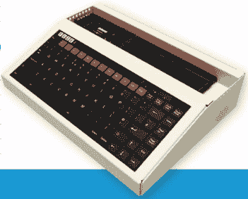


> “……科技无处不在，一切都通过编程连接在一起。你的电视、微波炉、车载娱乐系统乃至互联网本身，都依赖于良好的编程才能按你的意愿运行……”


# 向 Python 问好

有许多不同的编程语言可供学习和使用。有些语言复杂且功能极其强大，有些则非常基础，仅作为操作系统的次要工具使用。Python 介于两者之间，将易用性与强大的功能相结合，使用户能够创建小型工具、各种出色的游戏以及高性能计算任务。

然而，Python 的意义不仅仅在于它是另一种编程语言。它背后有一个充满活力的社区，社区成员分享知识、代码和项目创意，以及未来版本的错误修复。正是得益于这个社区，Python 才得以成长和繁荣。现在轮到你来勇敢尝试，学习如何用 Python 编程了。

本书前半部分将帮助你上手最新版本的 Python，并引导你学习该语言一些最常用、最有趣的功能和特性。不久之后，你将能够编写自己的实用系统工具、文字冒险游戏，甚至控制一个角色在屏幕上移动。


## 为什么选择 Python？

环境或用户。操作系统（如 Windows、macOS 等）通常是 C++、C#、汇编语言以及某种可视化语言的组合。游戏通常使用 C++，而网页可以使用多种可用语言，例如 HTML、Java、Python 等等。

Python 创建于二十六多年前，如今已发展成为初学者学习计算机编程的理想入门语言。它非常适合爱好者、发烧友、学生、教师，以及那些需要在自己与外部硬件或计算机之间创建独特交互的人。

更通用的编程用于创建程序、应用、软件，或者你想称呼的任何东西。它们被广泛用于所有硬件平台，几乎适用于所有可以想象到的应用场景。有些运行速度更快，有些则更容易学习和使用。Python 就是这样一种通用语言。

Python 可以免费下载、安装和使用，适用于 Linux、Windows、macOS、MS-DOS、OS/2、BeOS、IBM i 系列机器，甚至 RISC OS。它被评为全球排名前五的编程语言之一，并且随着硬件和互联网的发展不断演进。

Python 是一种所谓的高级语言，它通过多种数组、变量、对象、算术运算、子程序、循环以及无数其他交互方式与硬件和操作系统“对话”。虽然它不像低级语言那样精简（低级语言可以直接处理内存地址、调用栈和寄存器），但它的优点是具有普遍可用性且易于学习。

所以回答这个问题：为什么选择 Python？简而言之，它免费、易学、功能异常强大、被广泛接受、高效，并且是一个极好的学习和教学工具。

```java
//file: Invoke.java
import java.lang.reflect.*;

class Invoke {
  public static void main( String [] args ) {
    try {
      Class c = Class.forName( args[0] );
      Method m = c.getMethod( "main", new Class [] {} );
      Object ret = m.invoke( null, null );
      System.out.println(
        "Invoked static method: " +
        "of class: " + args[1]
      );
      // with no args/results
    } catch (ClassNotFoundException e) {
      //Class.forName() can't find the class
      //no such method exists
    } catch (NoSuchMethodException e) {
      //that method doesn't exist
    } catch (IllegalAccessException e) {
      //we do not have permission to invoke that method
    } catch (InvocationTargetException e) {
      //an exception occurred while invoking that method
      System.out.println( "an exception occurred: " + e.getTargetException() );
    }
  }
}
```

```basic
40 LET p=15
70 FOR n=1 TO 10
71 CLS
75 LET b=INT (RND*28)
80 LET x=1
90 FOR d=1 TO 30
100 PRINT AT p,x;
110 PRINT AT b,y;
120 IF INKEY$="o" THEN LET p=p-1
130 IF INKEY$="o" THEN LET p=p+1
135 IF INKEY$="0" THEN LET p=p-1
145 FOR a=1 TO 100 NEXT a
150 IF p<2 THEN LET p=2
160 IF p>26 THEN LET p=27
180 LET x=x+1
190 PRINT AT b,x;
200 NEXT d
300 PRINT AT 10,10;"C"
320 NEXT n
```

BASIC 曾是早期 8 位家用电脑用户学习的入门语言。


Java 是一种功能强大的语言，用于网页、机顶盒、电视甚至汽车。

```python
print(HANGMAN())
attempts = len(man) - 1

while (attempts != 0 and "_" in word_guessed):
    print("You have {} attempts remaining".format(attempts))
    joined_word = ''.join(word_guessed)
    print(joined_word)
    guess = input("Please try again:")
    try:
        player_guess = int(input("Please select a letter between A-Z: ".format(guess)))
    except (ValueError, TypeError):
        print("That is not valid input. Please try again.")
        continue
    else:
        if not player_guess.isalpha():
            print("That is not a letter, please try again.")
            continue
        elif len(player_guess) > 1:
            print("That is more than one letter. Please try again.")
            continue
        elif player_guess in guessed_letters:
            print("You have already guessed that letter. Please try again.")
            continue
        else:
            guessed_letters.append(player_guess)

for letter in secret_word:
    if player_guess == letter:
        word_guessed[secret_word.index(letter)] = letter
    elif word_guessed[secret_word.index(letter)] != letter:
        word_guessed[secret_word.index(letter)] = '_'
```

Python 是比 BASIC 更为现代的选择，它易于学习，是理想的初学者编程语言。


### 树莓派

为什么要使用树莓派？树莓派是一台非常便宜的小型计算机，却为用户提供了极佳的学习平台。它的主要操作系统 Raspbian 预装了最新版 Python，以及许多模块和附加组件。

#### 树莓派

树莓派 3 是最新版本，配备更强大的 CPU、更大的内存，并支持 Wi-Fi 和蓝牙。你可以花约 32 英镑买到一块树莓派，或者以 50 英镑以上的价格购买套装，具体取决于你感兴趣的套装。

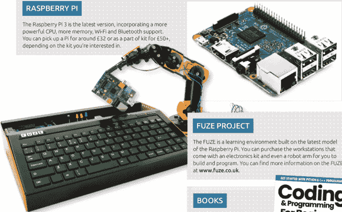

#### FUZE 项目

FUZE 是一个基于最新款树莓派构建的学习环境。你可以购买配备电子套件的工作站，甚至还有可供你搭建和编程的机械臂。你可以在 www.fuze.co.uk 上找到有关 FUZE 的更多信息。

#### RASPBIAN

树莓派的主要操作系统是一个基于 Debian 的 Linux 发行版，它以简单易用的软件包形式提供了你所需的一切。它针对树莓派进行了精简优化，是硬件和软件项目、Python 编程，甚至作为桌面计算机使用的理想平台。

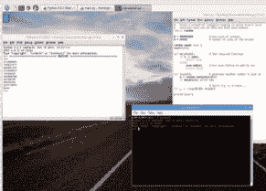

#### 图书

我们通过 www.pcpublications.com 提供多本优秀的编程图书。我们的树莓派图书涵盖如何购买你的第一块树莓派、进行设置并使用它；书中还有一些很棒的逐步项目示例和指南，帮助你充分利用树莓派。

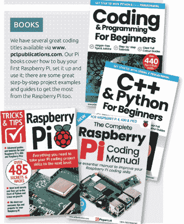

## 认识 Python

Python 是有史以来最伟大的计算机编程语言。它让你能够用一种简洁易懂的语言，充分发挥计算机的能力。

### 什么是编程？

在尝试学习一门编程语言之前，先了解什么是编程语言会很有帮助，Python 也不例外。让我们来看看 Python 是如何诞生的，以及它与其他语言的关系。

#### PYTHON

编程语言是计算机遵循的一系列指令。这些指令可以简单到显示你的名字或播放音乐文件，也可以复杂到构建整个虚拟世界。Python 是一种编程语言，由 Guido van Rossum 于 20 世纪 80 年代末在荷兰的 Centrum Wiskunde & Informatica（CWI）构思，作为 ABC 语言的继任者。

**Guido van Rossum，Python 之父。**


### 编程食谱

程序就像给计算机的食谱。烤蛋糕的食谱可以是这样：

- 将 100 克自发粉放入碗中。
- 向碗中加入 100 克黄油。
- 加入 100 毫升牛奶。
- 烘焙半小时。

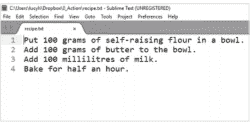

### 代码

就像食谱一样，程序由需要按顺序执行的指令组成。一个描述蛋糕的程序可能像这样运行：

```python
bowl
flour = 100
butter = 50
milk = 100
bowl.append([flour,butter,milk])
cake.cook(bowl)
```

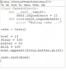

### 程序命令

你可能不理解某些 Python 命令，比如 bowl.append 和 cake.cook(bowl)。第一个是列表，第二个是对象；我们将在本书中探讨这两者。主要要知道的是，Python 中的命令很容易阅读。一旦你了解了这些命令的作用，就很容易弄明白程序是如何工作的。

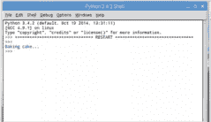

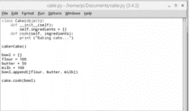

### 高级语言

易于阅读的计算机语言被称为“高级语言”。这是因为它们远离硬件（硬件也被称为“金属”）。像汇编语言这样“贴近金属飞行”的语言被称为“低级语言”。低级语言看起来有点像这样：`msg db , 0xa len equ $ - msg`。

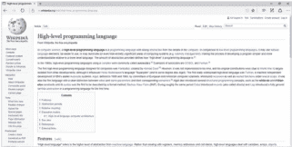

### Python 之禅

Python 让你能用人类可理解的语言访问计算机的全部能力。这一切背后是一种称为“Python 之禅”的理念。它由 20 条软件原则组成，影响着该语言的设计。原则包括“优美胜于丑陋”和“简单胜于复杂”。在 Python 中输入 `import this`，它就会显示所有原则。

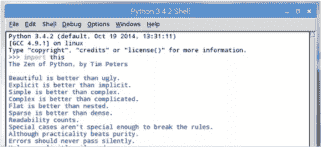

### PYTHON 3 与 PYTHON 2

在典型的计算场景中，Python 由于存在两个活跃版本：Python 2 和 Python 3，而显得有些复杂。

### Python 的世界

当你访问 Python 下载页面时，会注意到有两个可用按钮：一个用于 Python 3.6.2，另一个用于 Python 2.7.13；这些版本在撰写本文时是正确的（请记住 Python 经常更新，因此你可能会看到不同的版本号）。

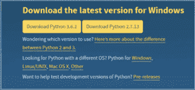

### PYTHON 3.X

2008 年，Python 3 问世，带来了若干新功能和增强功能。这些功能提供了更稳定、更有效且更高效的编程环境，但遗憾的是，这些新功能中的大多数（即使不是全部）与 Python 2 的脚本、模块和教程不兼容。尽管起初并不受欢迎，但 Python 3 后来已成为 Python 编程的前沿。

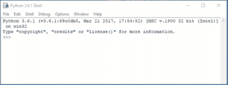

### PYTHON 2.X

那么为什么有两个版本？嗯，Python 2 最初于 2000 年发布，从那时起便积累了相当大量的工具、脚本、用户、教程等。多年来，Python 2 迅速成为初学者和专家最早使用的编程语言之一，这使它成为极其宝贵的资源。

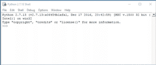

### 3.X 胜出

Python 3 日益普及，意味着现在开始学习使用新功能进行开发并逐步淘汰旧版本是明智之举。许多开发公司，例如 SpaceX 和 NASA，都在重要代码片段中使用 Python 3。

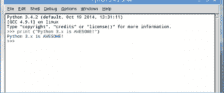

## 如何在 Windows 中设置 Python

Windows 用户可以通过 Python 主下载页面轻松安装最新版 Python。尽管大多数经验丰富的 Python 开发者可能会避开 Windows，不将其作为编写代码的首选平台，但它对初学者来说仍然是一个理想的起点。

### 安装 PYTHON 3.X

Microsoft Windows 默认不预装 Python，因此你需要手动安装。所幸，这个过程很容易操作。

- **第 1 步** — 首先在 Web 浏览器中打开 **www.python.org/downloads/**。找到详细说明 Python 3.x.x 下载链接的按钮（在我们的例子中是 Python 3.6.2，但如前所述，你可能会看到 3 的更高版本）。

  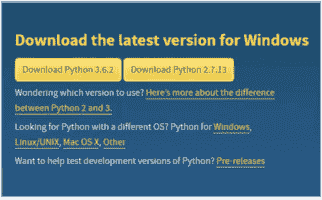

- **第 2 步** — 单击版本 3.x 的下载按钮，并将文件保存到你的“下载”文件夹。文件下载完成后，双击可执行文件，Python 安装向导将启动。在这里你有两个选择：“立即安装”和“自定义安装”。我们建议选择“自定义安装”链接。

  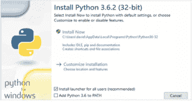

- **第 3 步** — 选择“自定义”选项可以让你指定某些功能以及哪些将保留默认设置；这是一个值得养成的好习惯，因为有时（幸运的是，Python 不会这样）安装程序可能包含不需要的附加功能。在出现的第一个屏幕上，确保勾选所有复选框，然后单击“下一步”按钮。

  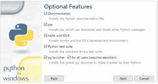

- **第 4 步** — 下一页选项包括一些为 Python 增加的有趣附加项。确保勾选“将文件与 Python 关联”、“创建快捷方式”、“将 Python 添加到环境变量”、“预编译标准库”和“为所有用户安装”选项。这些选项会让之后使用 Python 容易得多。准备好继续时，单击“安装”。

  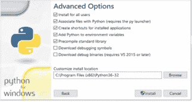


- **步骤 5**  
  您可能需要通过 Windows 身份验证通知来确认安装。只需单击“是”，Python 就会开始安装。安装完成后，Python 向导的最后一页将允许您查看最新的发行说明，并跟随一些在线教程。
  
  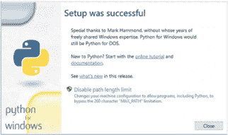

- **步骤 6**  
  不过，在关闭安装向导窗口之前，最好单击带有盾牌标签的“Disable Path Length Limit”旁边的链接。这将使 Python 绕过 Windows 的 260 个字符限制，让您能够执行存储在深层文件夹结构中的 Python 程序。再次单击“是”以验证该过程；然后您就可以关闭安装窗口了。
  
  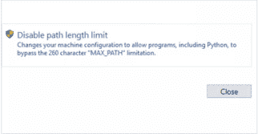

- **步骤 7**  
  Windows 10 用户现在可以在“开始”按钮的“最近添加”部分找到已安装的 Python 3.x。第一个链接“Python 3.6 (32-bit)”在点击后将启动 Python 的命令行版本（稍后会详细介绍）。要打开 IDLE，请在 Windows 开始菜单中输入 IDLE。
  
  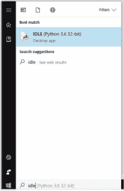

- **步骤 8**  
  单击“IDLE (Python 3.6 32-bit)”链接将启动 Python Shell，您可以在其中开始 Python 编程之旅。如果您的版本更新，也不用担心，只要它是 Python 3.x，我们的代码就可以在您的 Python 3 界面中运行。
  
  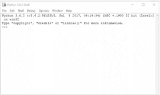

- **步骤 9**  
  如果您现在再次单击 Windows“开始”按钮，并这次输入：CMD，您将看到“命令提示符”链接。单击它以进入 Windows 命令行环境。要在命令行中进入 Python，您需要输入：`python` 并按 Enter。
  
  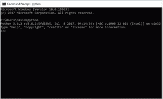

- **步骤 10**  
  Python 的命令行版本的工作方式与您在步骤 8 中打开的 Shell 非常相似：注意三个左向箭头 (>>>)。虽然它是一个非常好的环境，但不太用户友好，所以暂时离开命令行。输入 `exit()` 退出并关闭命令提示符窗口。
  
  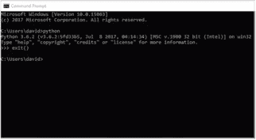

- **步骤 5**  
  下一部分详细介绍了软件许可协议，虽然大多数人对此并不特别感兴趣，但还是值得一读。当您准备好后，再次单击“继续”按钮。
  
  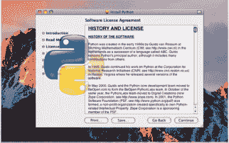

- **步骤 6**  
  最后，您将看到 Python 将在系统上占用的空间大小以及一个“安装”按钮，您需要单击它来开始在 Mac 上实际安装 Python 3.x。您可能需要输入密码来验证安装过程。
  
  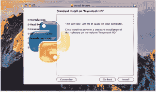

- **步骤 7**  
  安装过程不会太长；我们在本节中使用的较旧的 Mac Mini 比现代 Mac 机器稍慢一些，但也只用了大约三十秒就显示了“安装成功”提示。
  
  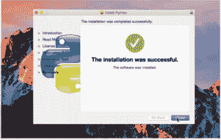

- **步骤 8**  
  Python 安装向导中没有什么其他要做的了，因此您可以单击“关闭”按钮。如果您现在回到终端会话并重新输入命令：`python3 --version`，您可以看到新版本已列出。要进入 Python 的命令行版本，您需要输入：`python3`。要退出，输入：`exit()`。
  
  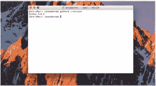

- **步骤 9**  
  您需要在 Finder 中搜索 Python IDLE；找到后，单击它启动，它看起来应该与上一页显示的 Windows IDLE 版本类似。唯一的区别是它运行在 Mac 检测到的硬件平台上。
  
  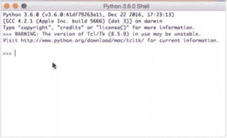

- **步骤 10**  
  较旧的 Mac 版本可能无法兼容较新版本的 Python，在这种情况下，您需要回退到以前的 Python 3.x 版本；只要您使用 Python 3.x，本书中的代码就可以在您的设备上运行。
  
  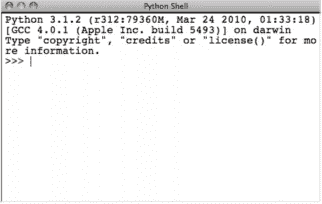

## 如何在 Linux 中设置 Python

### Python 企鹅

Linux 是一个非常多才多艺的操作系统，通常很难确定做某件事的唯一方法。不同的发行版以不同的方式安装软件，因此在本教程中我们将使用 Linux Mint 18.1。

- **步骤 1**  
  首先，您需要确定当前 Linux 系统中安装的 Python 版本；正如我们提到的，本节我们将使用 Linux Mint 18.1。与 macOS 一样，按 Ctrl+Alt+T 进入终端。
  
  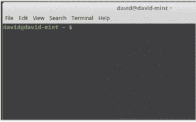

- **步骤 2**  
  接下来在终端屏幕中输入：`python --version`。您应该会看到与 Python 2.x 版本相关的输出。在我们的这个特定示例中，是 Python 2.7.12。
  
  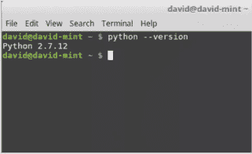

- **步骤 3**  
  某些 Linux 发行版会在系统更新时自动将 Python 安装更新到最新版本。要检查，首先使用以下命令进行系统更新和升级：
  
  ```
  sudo apt-get update && sudo apt-get upgrade
  ```
  
  输入您的密码，让系统进行任何更新。
  
  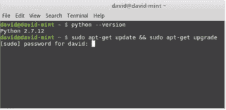

- **步骤 4**  
  更新和升级完成后，您可能需要回答“Y”以授权任何升级，然后输入：`python3 --version` 查看 Python 3.x 是否已更新或是否已安装。以 Linux Mint 为例，我们拥有的版本是 Python 3.5.2，这足以满足我们的需求。
  
  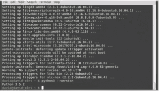

- **步骤 5**  
  然而，如果您想要最新版本（截至撰写本文时 Python 网站上的版本为 3.6.2），则需要从源代码构建 Python。首先在终端中输入以下命令：
  
  ```
  sudo apt-get install build-essential checkinstall
  sudo apt-get install libreadline-gplv2-dev libncursesw5-dev libssl-dev libsqlite3-dev tk-dev libgdbm-dev libc6-dev libbz2-dev
  ```
  
  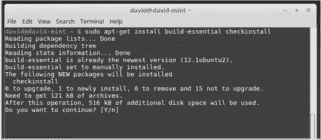

- **步骤 6**  
  打开 Linux 网络浏览器，转到 Python 下载页面：**www.python.org/downloads**。单击“下载 Python 3.6.2”（或您查看时的任何版本）下载源代码文件 Python-3.6.2.tar.xz。
  
  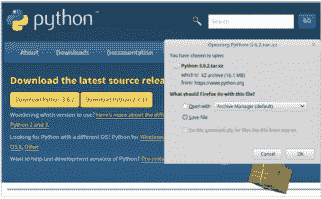

- **步骤 7**  
  在终端中，输入 `cd Downloads/` 进入“下载”文件夹。然后使用 `tar -xvf Python-3.6.2.tar.xz` 解压下载的 Python 源代码内容。现在使用 `cd Python-3.6.2/` 进入新解压的文件夹。
  
  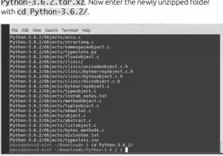

- **步骤 8**  
  在 Python 文件夹内，输入：
  
  ```
  ./configure
  sudo make altinstall
  ```
  
  这可能需要一段时间，具体取决于您计算机的速度。完成后，输入：`python3.6 --version` 检查已安装的最新版本。
  
  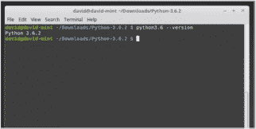

- **步骤 9**  
  对于 GUI IDLE，您需要在终端中输入以下命令：
  
  ```
  sudo apt-get install idle3
  ```
  
  然后可以使用命令 `idle3` 启动 IDLE。请注意，IDLE 运行的版本与您从源代码安装的版本不同。
  
  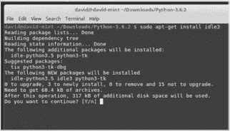

- **步骤 10**  
  您还需要 PIP（Pip Installs Packages），这是一个帮助您安装更多模块和附加组件的工具。输入：
  
  ```
  sudo apt-get install python3-pip
  ```
  
  然后 Pip 就安装好了；使用以下命令检查最新更新：
  
  ```
  pip3 install --upgrade pip
  ```
  
  完成后，关闭终端，Python 3.x 将通过发行版菜单中的“编程”部分提供。
  
  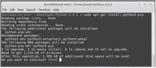


## Python 入门

刚接触 Python 时可能会觉得有些令人生畏，但该语言在设计时就考虑到了简单性。像大多数事物一样，您需要慢慢开始，学习如何获得结果，以及如何从代码中获取您想要的内容。

在本节中，我们将介绍变量、数字和表达式、用户输入、条件和循环，以及您在 Python 使用过程中很可能会遇到的各种错误类型。


## 首次启动 Python

我们将使用 Raspberry Pi 作为 Python 3 硬件平台。最新版本的 Raspbian 预装了 Python 3，确切地说是 3.4.2 版，因此只要你有一个 Python 3 Shell，我们所有的代码都能运行。

### 启动 Python

我们不会详细介绍如何让 Raspberry Pi 启动并运行，因为关于这个主题已经有大量资料可供参考。不过，一旦准备就绪，就启动你的 Pi，准备开始编码吧。

- **第 1 步** 加载 Raspbian 桌面后，点击 Menu 按钮，然后选择 Programming > Python 3 (IDLE)。这会打开 Python 3 Shell。Windows 和 Mac 用户可以在 Windows 的“开始”按钮菜单中找到 Python 3 IDLE Shell，也可以通过 Finder 找到。

  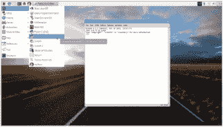

- **第 2 步** Shell 是你输入代码并查看输入到 Python 中的代码的响应和输出的地方。它有点像沙盒，你可以在其中尝试一些简单的代码和流程。

  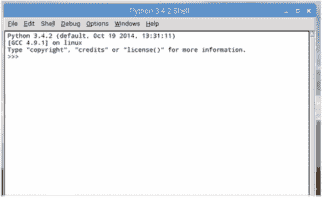

- **第 3 步** 例如，在 Shell 中输入：`2+2`。按下 Enter 后，下一行会显示答案：4。基本上，Python 接收了这段“代码”并生成了相应的输出。

  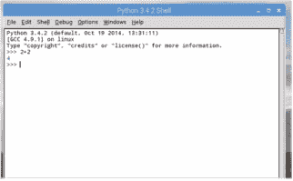

- **第 4 步** Python Shell 的行为非常像计算器，因为代码本质上是一系列与系统进行的数学交互。整数是无限序列的整数，可以轻松进行加、减、乘等运算。

  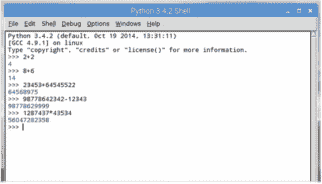

- **第 5 步** 虽然这很有趣，但并不是特别令人兴奋。相反，试试这个：

    ```python
    print("Hello everyone!")
    ```

  就像我们在本书“安装文本编辑器”一节中在 Sublime 里输入的代码一样。

  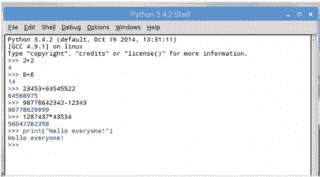

- **第 6 步** 这更像样了，因为你刚刚生成了第一段代码。print 命令顾名思义，就是打印内容。Python 3 需要括号以及引号才能将内容输出到屏幕，在这个例子中是“Hello everyone!”这部分。

  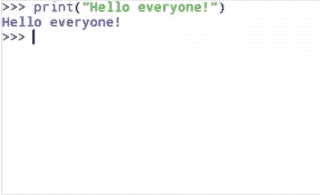

- **第 7 步** 你可能已经注意到 Python IDLE 中的颜色编码。这些颜色代表 Python 代码的不同元素。它们是：

  - 黑色 – 数据与变量
  - 绿色 – 字符串
  - 紫色 – 函数
  - 橙色 – 命令
  - 蓝色 – 用户函数
  - 深红色 – 注释
  - 浅红色 – 错误消息

### IDLE 颜色编码

| 颜色 | 用途 | 示例 |
|---|---|---|
| 黑色 | 数据与变量 | `23.6` `area` |
| 绿色 | 字符串 | `"Hello World"` |
| 紫色 | 函数 | `len()` `print()` |
| 橙色 | 命令 | `for` `if` `else` |
| 蓝色 | 用户函数 | `get_area()` |
| 深红色 | 注释 | `#Remember VAT` |
| 浅红色 | 错误消息 | `SyntaxError` |

- **第 8 步** Python IDLE 是一个可配置的环境。如果你不喜欢颜色的显示方式，可以随时通过 Options > Configure IDLE 并点击 Highlighting 选项卡来更改它们。不过，我们不建议这样做，因为这样你看到的将不会和我们的截图一样。

  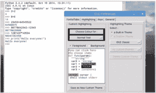

- **第 9 步** 就像大多数可用程序一样，无论使用哪种操作系统，都有大量快捷键可用。这里没有空间全部列出，但在 Options > Configure IDLE 下的 Keys 选项卡中，你可以看到当前键位绑定的列表。

  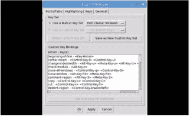

- **第 10 步** Python IDLE 是一个强大的界面，而且它实际上是使用可用的 GUI 工具包之一用 Python 编写的。如果你想了解 Shell 的许多细节，我们建议你花几分钟查看 www.python.org/3/library/idle.html，其中详细介绍了 IDLE 的许多功能。

  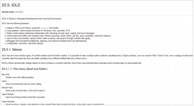

## 你的第一段代码

本质上，你已经用上一教程中的 `print("Hello everyone!")` 函数写下了第一段代码。不过，让我们扩展一下，看看如何输入代码并尝试一些其他 Python 示例。

### 玩转 Python

对于大多数语言，无论是计算机语言还是人类语言，关键都在于记住并在正确的情境中使用正确的词语。你并非生来就认识这些词，所以需要学习它们。

- **第 1 步** 如果你已经关闭了 Python 3 IDLE，请重新打开它，无论你偏好哪个操作系统版本。在 Shell 中，输入以下熟悉的内容：

    ```python
    print("Hello")
    ```

  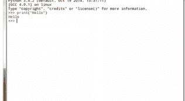

- **第 2 步** 正如预期的那样，单词 Hello 以蓝色文本出现在 Shell 中，表示来自字符串的输出。这相当简单，不需要太多解释。现在试试：

    ```python
    print("2+2")
    ```

  

- **第 3 步** 可以看到，输出不是数字 4，而是你要求打印到屏幕上的 2+2。引号定义了要输出到 IDLE Shell 的内容；要打印 2+2 的总和，需要去掉引号：

    ```python
    print(2+2)
    ```

  

- **第 4 步** 你可以继续这样，将 2+2、464+2343 等打印到 Shell 中。更简单的方法是使用变量，我们稍后会深入介绍。现在，输入：

    ```python
    a=2
    b=2
    ```

  

- **第 5 步** 你在这里做的是给字母 a 和 b 分别赋两个值：2 和 2。它们现在是变量，只要数值保持不变，Python 就可以调用它们来输出、相加、相减、相除等。试试这个：

    ```python
    print(a)
    print(b)
    ```

  

- **第 6 步** 上一步的输出分别显示了 a 和 b 的当前值，因为你要求分别打印它们。如果你想将它们相加，可以使用以下代码：

    ```python
    print(a+b)
    ```

  这段代码只是取 a 和 b 的值，将它们相加并输出结果。

  

- **第 7 步** 你可以尝试不同种类的变量和 print 函数。例如，你可以为某人的名字分配变量：

    ```python
    name="David"
    print(name)
    ```

  

- **第 8 步** 现在让我们添加一个姓氏：

    ```python
    surname="Hayward"
    print(surname)
    ```

  现在你有两个变量，分别包含名字和姓氏，并且可以独立打印它们。

  

- **第 9 步** 如果我们像之前那样使用 + 符号套用同样的流程，名字在 Shell 的输出中不会正确显示。试试看：

    ```python
    print(name+surname)
    ```

  你需要在两者之间加一个空格，将它们定义为两个独立的值，而不是进行数学运算的东西。

  

- **第 10 步** 在 Python 3 中，你可以使用逗号将两个变量用空格分隔：

    ```python
    print(name, surname)
    ```

  或者，你也可以自己添加空格：

    ```python
    print(name+" "+surname)
    ```

  如你所见，使用逗号要整洁得多。恭喜你，你已经迈入了广阔的 Python 世界的第一步。

  

## 保存并执行你的代码

虽然对于小型代码片段来说，在 IDLE Shell 中工作完全没问题，但它并不是为输入较长的程序清单而设计的。在本节中，你将认识 IDLE Editor，从现在开始你将在其中工作。

### 编辑代码

你最终会达到一个阶段，必须从向 Shell 中输入单行代码过渡。相反，IDLE Editor 将允许你保存并执行 Python 代码。

- **第 1 步** 首先，打开 Python IDLE Shell，启动后点击 File > New File。这会打开一个名为 Untitled 的新窗口。这就是 Python IDLE Editor，你可以在其中输入创建未来程序所需的代码。

  

- **第 2 步** 实际上，IDLE Editor 就是一个带有 Python 功能、颜色编码等特性的简单文本编辑器；与 Sublime 非常相似。你可以像在 Shell 中一样输入代码，因此，以之前教程中的示例为例，输入：

    ```python
    print("Hello everyone!")
    ```

  

- **第 3 步** 可以看到，IDLE Editor 中使用了与 Shell 相同的颜色编码，使你能够更好地理解代码的运行情况。不过，要执行代码，你需要先保存它。按 F5，会打开一个 Save... 对话框。

  

- **第 4 步** 在 Save 框中点击 OK 按钮，并选择保存所有 Python 代码的目标位置。目标位置可以是一个名为 Python 的专用文件夹，也可以随意放在你喜欢的地方。不过，记得保持驱动器整洁，以便将来方便管理。

  


### 保存并执行你的代码

#### 第 5 步

为你的代码输入一个名称，例如“print hello”，然后单击“保存”按钮。Python 代码保存后便会执行，输出将详细显示在 IDLE Shell 中。在本例中，输出为“Hello everyone!”这句话。


#### 第 8 步

让我们扩展代码，并输入上一教程中的几个示例：

```python
a=2
b=2
name="David"
surname="Hayward"
print (name, surname)
print (a+b)
```

如果你现在按 F5，系统会再次要求你保存文件，因为文件自上次保存后已被修改。


#### 第 6 步

你的绝大多数 Python 代码都将以这种方式进行。将其输入编辑器，按 F5，保存代码，然后查看 Shell 中的输出。有时情况会有所不同，取决于你是否请求了单独的窗口，但基本上流程就是如此。除非另有说明，本书通篇都将使用这一流程。


#### 第 9 步

如果单击“确定”按钮，文件将被新的代码条目覆盖并执行，输出显示在 Shell 中。仅这几行代码没什么问题，但如果你要编辑一个较大的文件，覆盖就可能成为问题。此时，请在编辑器中使用“文件 > 另存为”来创建备份。


#### 第 7 步

如果你打开已保存的 Python 代码所在位置，可以看到文件名以 .py 扩展名结尾。这是默认的 Python 文件名。你创建的任何代码都会是 whatever.py，而从众多互联网 Python 资源站点下载的任何代码也会是 .py。只需确保代码是为 Python 3 编写的即可。


#### 第 10 步

现在创建一个新文件。关闭编辑器，并打开一个新实例（在 Shell 中选择“文件 > 新建文件”）。输入以下内容，并将其保存为 hello.py：

```python
a="Python"
b="is"
c="cool!"
print(a, b, c)
```

你将在下一教程中使用这段代码。


#### 第 5 步

现在输入：`exit()` 以离开命令行 Python 会话并返回到命令提示符。进入你保存上一教程代码的文件夹，并列出可用文件，但愿你应该能看到 hello.py 文件。


#### 第 6 步

在将要运行的代码所在的同一文件夹中，在命令行输入以下内容：

```text
python3 hello.py
```

这将执行我们创建的代码，提醒一下，代码如下：

```python
a="Python"
b="is"
c="cool!"
print(a,b,c)
```


#### 第 7 步

当然，由于这是 Python 3 代码，使用的是 Python 3 独有的语法和布局，因此它只在使用 python3 命令时才能运行。如果你愿意，可以输入以下内容，用 Python 2 尝试同样的操作：

```text
python hello.py
```


#### 第 8 步

从 Python 2 命令行运行 Python 3 代码的结果相当明显。虽然它不会以任何方式报错，但由于 Python 3 处理 print 命令的方式与 Python 2 不同，结果并不如我们所预期。暂时使用 Sublime，打开 hello.py 文件。


#### 第 9 步

由于 Sublime Text 不适用于 Raspberry Pi，你将暂时离开 Pi，并使用 Sublime 作为示例，说明你不一定非得使用 Python IDLE。打开 hello.py 文件后，修改它以包含以下内容：

```python
name=input("What is your name? ")
print("Hello,", name)
```


#### 第 10 步

保存 hello.py 文件并回到命令行。现在用以下命令执行新保存的代码：

```text
python3 hello.py
```

结果将是原先的 Python is cool! 语句，以及新增的 input 命令，该命令会询问你的名字，并在命令窗口中显示出来。


## 数字与表达式

我们已经见过一些使用 Python 的基本数学表达式，比如简单的加法等。现在让我们进一步扩展，看看 Python 作为计算器有多么强大。你可以在 IDLE Shell 或编辑器中操作，随你喜欢。

### 全都是数学，伙计

你可以利用 Python 的数学能力得到一些非常令人印象深刻的结果；与大多数（如果不是所有）编程语言一样，数学是代码背后的驱动力。

#### 第 1 步

打开 Python 3 的 GUI 版本，如前所述，你可以使用 Shell 或编辑器。暂时你将使用 Shell，只是为了热热身我们的数学肌肉，我们相信它是位于大脑后部的一个小腺体（或者不是）。


#### 第 3 步

你可以使用所有常见的数学运算：除法、乘法、括号等等。用几个例子练习一下，例如：

- `1/2`
- `6/2`
- `2+2*3`
- `(1+2)+(3*4)`


#### 第 2 步

在 Shell 中输入以下内容：

```text
2+2
54356+34553245
998673444*2734448221
```

你可以看到 Python 能处理相当大的数字。


#### 第 4 步

你无疑已经注意到，除法会产生小数。在 Python 中，这些数被称为浮点数，或浮点运算。然而，如果你需要整数而不是小数答案，那么可以使用双斜杠：

```text
1//2
6//2
```

依此类推。


#### 第 5 步

你还可以使用一种运算来查看除法后的余数。例如：

```python
10/3
```

将显示 3.333333333，这当然是 3.3 循环。如果你现在输入：

```python
10%3
```

这将显示 1，即 10 除以 3 后剩下的余数。


#### 第 8 步

这将显示为“0b1”，它会将整数转换为二进制，并在前面加上前缀 0b。如果你想移除 0b 前缀，那么可以使用：

```python
format(3, 'b')
```

format 命令会将一个值（数字 3）转换为由格式说明（即 'b' 部分）控制的格式化表示。


#### 第 6 步

接下来是幂运算符，如果你想说得技术一点，就是指数运算。要计算某个数的幂，你可以使用键盘上的双星号（**）：

```python
2**3
10**10
```

本质上，它是 2x2x2，但我们相信你已经了解数学运算符的基本原理。这就是在 Python 中计算幂的方法。


#### 第 9 步

布尔表达式是一种逻辑语句，其结果要么为真，要么为假。我们可以用这些表达式来比较数据，并测试它是否等于、小于或大于。在一个新文件中试试以下内容：

```python
a = 6
b = 7
print(1, a == 6)
print(2, a == 7)
print(3, a == 6 and b == 7)
print(4, a == 7 and b == 7)
print(5, not a == 7 and b == 7)
print(6, a == 7 or b == 7)
print(7, a == 7 or b == 6)
print(8, not (a == 7 or b == 6))
print(9, not a == 7 and b == 6)
```


#### 第 7 步

数字和表达式不止于此。Python 有许多内置函数，可用于计算数字集合、绝对值、复数，以及大量数学表达式和毕达哥拉斯式的绕口令。例如，要将数字转换为二进制，可以使用：

```python
bin(3)
```


#### 第 10 步

执行第 9 步中的代码，你会看到一系列 True 或 False 语句，具体取决于两个定义值 6 和 7 的结果。这是对你已查看内容的延伸，也是编程的重要部分。


## 使用注释

编写代码时，代码的流程、每个变量的作用、整个程序将如何运行等等，都只存在于你的脑海中。另一位程序员可以逐行阅读代码，但随着时间的推移，代码可能会变得难以阅读。

### 注释！

程序员使用一种方法，通过对某些部分添加注释来保持代码可读性。例如，如果使用了一个变量，程序员会注释说明它应该做什么。这只是一个良好的实践。

#### 步骤 1

首先创建一个新的 IDLE 编辑器实例（文件 > 新建文件），并创建一个简单的变量和打印命令：

```python
a=10
print("The value of A is,", a)
```

保存文件并执行代码。


#### 步骤 3

重新保存代码并执行它。你可以看到，尽管添加了额外的行，IDLE Shell 中的输出仍然与之前相同。简而言之，井号（#）表示程序员可以插入的一行文本，用来告知自己和其他人正在发生什么，而用户不会察觉。


#### 步骤 2

运行代码将在 IDLE Shell 窗口中返回这一行：The value of A is, 10，这正是我们所预期的。现在，添加一些你通常会在代码中看到的注释类型：

```python
#### Set the start value of A to 10
a=10
#### Print the current value of A
print("The value of A is,", a)
```


#### 步骤 4

假设我们创建的变量 A 是游戏中的生命数。每次玩家死亡时，该值减少 1。程序员可以插入类似下面这样的例程：

```python
a=a-1
print("You’ve just lost a life!")
print("You now have", a, "lives left!")
```


## 使用变量

我们已经在 Python 代码中看到了一些变量的示例，但始终值得了解一下它们的运作方式，以及 Python 如何创建变量并为变量分配某些值。

### 各种变量

在本教程中，你将使用 Python 3 IDLE Shell。如果还没有打开，请打开 Python 3，或关闭之前的 IDLE Shell，以清除任何旧代码。

#### 步骤 1

在某些编程语言中，你需要使用美元符号来表示字符串，字符串是由多个字符组成的变量，例如一个人的名字。在 Python 中，这并不是必需的。例如，在 Shell 中输入：`name="David Hayward"`（或者使用你自己的名字，除非你也叫 David Hayward）。


#### 步骤 2

你可以通过发出 `type()` 命令来检查正在使用的变量类型，并将变量名放在括号内。在我们的示例中，这将是：`type(name)`。添加一个新的字符串变量：`title="Descended from Vikings"`。


#### 步骤 3

你之前已经看到，可以使用变量名之间的加号来连接变量。在我们的示例中，我们可以使用：`print (name + ": " + title)`。引号之间的中间部分允许我们添加冒号和空格，因为变量连接时没有空格，所以我们需要手动添加它们。


#### 步骤 4

你还可以将变量组合到另一个变量中。例如，要将 name 和 title 两个变量组合成一个新变量，我们使用：`character=name + ": " + title`。然后输出新变量的内容：`print (character)`。数字会存储为不同的变量：`age=44`、`type(age)`。正如我们所知，它们是整数。


#### 步骤 5

但是，你不能像处理一组相似变量那样，在同一条命令中同时组合字符串和整数类型变量。你需要将其中一个转换为另一个，反之亦然。当你确实尝试同时组合两者时，会收到一条错误消息：

```python
print (name + age)
```


#### 步骤 6

这是一个称为类型转换（TypeCasting）的过程。Python 代码是：

```python
print (character + " is " + str(age) + " years old.")
```

或者你可以使用：

```python
print (character, "is", age, "years old.")
```

再次注意，在最后一个示例中，你不需要在引号内的单词之间添加空格，因为逗号会将每个参数分开打印。


#### 步骤 7

类型转换的另一个例子是当你要求用户输入时，例如输入名字。例如，输入：

```python
age = input("How old are you?")
```

通过 Input 命令存储的所有数据都会作为字符串变量存储。


#### 步骤 8

当你想处理用户输入的数字时，这会带来一点问题，因为 age + 10 无法工作，因为它是一个字符串变量和一个整数。相反，你需要输入：

```python
int(age) + 10
```

这会将 age 字符串类型转换为可以处理的整数。


#### 步骤 9

在处理浮点运算时，类型转换的使用也很重要；记住那些带有小数点的数字。例如，输入：

```python
shirt=19.99
```

现在输入 `type(shirt)`，你会看到 Python 将该数字分配为“float”，因为该值包含小数点。


#### 步骤 10

当组合整数和浮点数时，Python 通常会将整数转换为浮点数，但如果需要反向应用，值得记住的是 Python 不会返回精确值。将浮点数转换为整数时，Python 总是向下舍入到最接近的整数，这称为截断；在我们的例子中，19.99 会变成 19，而不是 19.99。


## 用户输入

我们已经在前面的一些示例中看到了代码与用户的一些基本交互，所以现在是一个好时机，专门关注如何从用户那里获取信息，然后存储并呈现它。

### 用户友好

你希望从用户那里获得的输入类型，很大程度上取决于你正在编写的程序类型。例如，游戏可能会要求输入角色名称，而数据库可能会要求输入个人详细信息。

#### 步骤 1

如果还没有打开，请打开 Python 3 IDLE Shell，并在编辑器中新建一个文件。让我们从非常简单的内容开始，输入：

```python
print("Hello")
firstname=input("What is your first name? ")
print("Thanks.")
surname=input("And what is your surname? ")
```


#### 步骤 3

现在我们已经将用户的名字存储在几个变量中，我们可以随时调用它们：

```python
print("Welcome", firstname, surname, ". I hope you're well today.")
```


#### 步骤 2

保存并执行代码，正如你无疑已经预料到的，在 IDLE Shell 中，程序会询问你的名字，将其存储为变量 firstname，然后询问你的姓氏；姓氏也会存储在其自己的变量（surname）中。


#### 步骤 4

运行代码，你会看到一个的小问题，姓氏后面的句号前有一个空格。为了消除它，我们可以在代码中用加号代替逗号：

```python
print("Welcome", firstname, surname+". I hope you're well today.")
```


#### 步骤 5

你不必总是在 input 命令中包含带引号的文本。例如，你可以询问用户的名字，并将输入放在下一行：

```python
print("Hello. What's your name?")
name=input()
```


#### 步骤 8

你在这里创建的是一个条件，我们很快就会介绍。简而言之，我们正在使用用户的输入，并将其与一个条件进行比较。因此，如果用户输入 David 作为他们的名字，守卫将允许他们不受阻碍地通过。否则，如果他们输入的名字不是 David，守卫就会向他们挑战决斗。


#### 步骤 6

上一步的代码通常被认为比在 input 命令中放入大量文本更简洁一些，但这并不是一成不变的规则，所以在这些情况下你可以随心所欲。扩展代码，试试这个：

```python
print("Halt! Who goes there?")
name=input()
```


#### 步骤 9

正如你之前所学到的，来自用户的任何输入都会自动成为字符串，因此你需要应用类型转换才能将其转换为其他类型。这为 input 命令创造了一些有趣的补充。例如：

```python
#### Code to calculate rate and distance
print("Input a rate and distance")
rate = float(input("Rate: "))
```


#### 步骤 7

这也许是一个文字冒险游戏的良好开端？现在你可以扩展它，并使用用户的原始输入来稍微充实游戏：

```python
if name=="David":
    print("Welcome, good sir. You may pass.")
else:
    print("I know you not. Prepare for battle!")
```


#### 步骤 10

为了完成速率和距离代码，我们可以添加：

```python
distance = float(input("Distance: "))
print("Time:", (distance / rate))
```

保存并执行代码，然后输入一些数字。使用 `float(input())` 元素，我们告诉 Python，任何输入的数字都是浮点数，而不是字符串。


## 创建函数

### 有趣的函数

函数是你输入到 Python 中用来执行某项操作的一条命令。它是一小段自包含的代码，接收数据、处理数据，然后返回结果。

- **步骤 1** 函数不仅能处理数据，还能在 Python 中完成各种有用的操作，例如对数据进行排序、将项目从一种格式转换为另一种格式，以及检查项目的长度或类型。基本上，函数就是一个短单词后跟括号。例如，`len()`、`list()` 或 `type()`。

  

- **步骤 2** 函数接收数据（通常是变量），根据函数被编程设定的功能对其进行处理，然后返回最终值。被处理的数据放在括号内，因此如果你想知道 antidisestablishmentarianism 这个单词中有多少个字母，你可以输入：`len("antidisestablishmentarianism")`，然后会返回数字 28。

  

- **步骤 3** 你可以用类似的方式将变量传递给函数。假设你想要获取一个人姓氏中的字母数量，你可以使用以下代码（此示例请进入文本编辑器）：

  ```python
  name = input("Enter your surname: ")
  count = len(name)
  print("Your surname has", count, "letters in it.")
  ```

  按 F5 并保存代码以执行它。

  

- **步骤 4** Python 内置了数十个函数，数量多得无法在此有限的篇幅中一一介绍。不过，若要查看 Python 3 可用的内置函数列表，请访问 www.docs.python.org/3/library/functions.html。这些是预定义的函数，但由于用户还创建了更多函数，因此它们并不是仅有的可用函数。

  

- **步骤 5** 通过模块可以向 Python 添加更多函数。Python 拥有大量可用的模块，能够涵盖众多编程任务。它们可以添加函数，并可根据需要随时导入。例如，要使用高级数学函数，请输入：

  ```python
  import math
  ```

  输入后，你就可以使用 math 模块中的所有函数了。

  

- **步骤 6** 要使用模块中的函数，请输入模块名称，后跟一个句点，再输入函数名称。例如，使用 math 模块——既然你刚刚把它导入到 Python 中——你便可以使用平方根函数。为此，请输入：

  ```python
  math.sqrt(16)
  ```

  你可以看到代码以 module.function(data) 的形式呈现。

  

### 打造函数

你可以导入许多由其他 Python 程序员创建的不同函数，将来无疑会遇到一些极好的例子；你也可以使用 def 命令创建自己的函数。

- **步骤 1** 选择“文件”>“新建文件”进入编辑器，让我们创建一个名为 Hello 的函数，用来向用户问好。输入：

  ```python
  def Hello():
      print("Hello")

  Hello()
  ```

  按 F5 保存并运行脚本。你可以在 Shell 中看到 Hello，输入 Hello() 它会返回新函数的结果。

  

- **步骤 2** 现在让我们扩展该函数，使其接受一个变量，例如用户的名字。将你的脚本编辑为：

  ```python
  def Hello(name):
      print("Hello", name)

  Hello("David")
  ```

  现在它将接受变量 name，否则它将打印 Hello David。在 Shell 中输入：`name=('Bob')`，然后输入：`Hello(name)`。你的函数现在可以传递变量了。

  

- **步骤 3** 要进一步修改，请删除脚本中的最后一行 Hello('David')，然后按 Ctrl+S 保存新脚本。关闭编辑器并新建一个文件（文件 > 新建文件）。输入以下内容：

  ```python
  from Hello import Hello
  Hello("David")
  ```

  按 F5 保存并执行代码。

  

- **步骤 4** 你刚刚所做的是从保存的 Hello.py 程序中导入 Hello 函数，然后使用它向 David 问好。这就是模块和函数的工作方式：你先导入模块，然后使用函数。试试下面这个，并修改它以获得额外加分：

  ```python
  def add(a, b):
      result = a + b
      return result
  ```

  

## 条件与循环

条件和循环是让程序变得有趣的东西；它们可以很简单，也可以相当复杂。如何使用它们很大程度上取决于程序要达成的目标；它们可以是游戏中剩余的生命次数，或者只是显示一个倒计时。

### 真实条件

从简单的条件开始，会让学习编程成为一种更愉快的体验。那么，让我们先检查某事是否为真，如果不是，则执行其他操作。

- **步骤 1** 让我们创建一个新的 Python 程序，它会要求用户输入一个单词，然后检查它是否为四字母单词。从“文件”>“新建文件”开始，并以下面的输入变量开头：

  ```python
  word = input("Please enter a four-letter word: ")
  ```

  

- **步骤 2** 现在我们可以创建一个新变量，然后使用 len 函数并将 word 变量传递给它，以获取用户输入的字母总数：

  ```python
  word = input("Please enter a four-letter word: ")
  word_length = len(word)
  ```

  

- **步骤 3** 现在你可以使用 if 语句来检查 word_length 变量是否等于 4，如果符合规则，则打印一条友好的确认信息：

  ```python
  word = input("Please enter a four-letter word: ")
  word_length = len(word)
  if word_length == 4:
      print(word, "is a four-letter word. Well done.")
  ```

  双等号（==）表示检查某个值是否等于另一个值。

  

- **步骤 4** if 语句末尾的冒号告诉 Python：如果这个语句为真，就执行冒号后面所有缩进的内容。接下来，将光标移回编辑器开头：

  ```python
  word = input("Please enter a four-letter word: ")
  word_length = len(word)
  if word_length == 4:
      print(word, "is a four-letter word. Well done.")
  else:
      print(word, "is not a four-letter word.")
  ```

  

- **步骤 5** 按 F5 并保存代码以执行它。先在 Shell 中输入一个四字母单词，你应该会收到返回的消息，说这个单词是四个字母。现在再次按 F5 重新运行程序，但这次输入一个五字母单词。Shell 将显示它不是四字母单词。

  

- **步骤 6** 现在扩展代码以包含另一个条件。最终，它可能会变得相当复杂。我们为三个字母的单词添加了一个条件：

  ```python
  word = input("Please enter a four-letter word: ")
  word_length = len(word)
  if word_length == 4:
      print(word, "is a four-letter word. Well done.")
  elif word_length == 3:
      print(word, "is a three-letter word. Try again.")
  else:
      print(word, "is not a four-letter word.")
  ```

  

### 循环

循环看起来与条件非常相似，但它们的操作方式有所不同。循环会多次运行同一段代码，通常借助条件来控制。

- **步骤 1** 让我们从一个简单的 While 语句开始。与 if 一样，它会检查某事是否为真，然后运行缩进的代码：

  ```python
  x = 1
  while x < 10:
      print(x)
      x = x + 1
  ```

  

- **步骤 2** if 和 while 之间的区别在于，当 while 到达缩进代码的末尾时，它会返回并检查该语句是否仍然为真。在我们的示例中，x 小于 10。每次循环它都会打印 x 的当前值，然后将该值加 1。当 x 最终等于 10 时，循环停止。

  

- **步骤 3** For 循环是另一个例子。For 用于遍历一系列数据，通常是存储在方括号中变量形式的列表。例如：

  ```python
  words = ["Cat", "Dog", "Unicorn"]

  for word in words:
      print(word)
  ```

  

- **步骤 4** For 循环也可以使用 range 函数来实现倒计时示例：

  ```python
  for x in range(1, 10):
      print(x)
  ```

  这里不需要 x=x+1 这部分，因为 range 函数会在第一个和最后一个数字之间创建一个列表。

  


## Python 模块

我们之前提到过模块（math 模块），但由于模块是从 Python 中获益的很大一部分，因此值得多花一点时间介绍它们。在本例中，我们使用的是 Windows 版 Python 3。

### 掌握模块

可以把模块看作导入到 Python 代码中的扩展，用于增强和扩展其能力。可用模块数不胜数，而且正如我们所见，你甚至可以自己创建模块。

#### 步骤 1

Python 内置函数虽然很好，但功能有限。然而，使用模块可以让我们编写更复杂的程序。如你所知，模块是被导入的 Python 脚本，例如 `import math`。


#### 步骤 2

有些模块（尤其是在树莓派上）默认包含；math 模块就是一个典型例子。遗憾的是，其他模块并不总是可用。在非 Pi 平台上，一个很好的例子是 pygame 模块，它包含许多有助于创建游戏的函数。试试：`import pygame`。


#### 步骤 3

结果是 IDLE Shell 中出现错误，因为 pygame 模块未被识别或未安装在 Python 中。要安装模块，我们可以使用 Pip（Pip Installs Packages）。关闭 IDLE Shell，进入命令提示符或终端会话。在具有管理员权限的命令提示符中，输入：

```
pip install pygame
```


#### 步骤 4

PIP 安装需要提升权限，因为它会将组件安装到不同位置。Windows 用户可以通过“开始”按钮搜索 CMD，右键单击结果，然后单击“以管理员身份运行”。Linux 和 Mac 用户可以使用 sudo 命令，即 `sudo pip install package`。


# 向 C++ 问好

C++ 是一种高级编程语言，用于众多技术领域。从你最喜欢的移动应用、主机和 PC 游戏，到整个操作系统，所有这些都是使用 C++ 以及一系列软件开发工具包和自定义库开发的。

C++ 是你日常使用的大多数东西背后的驱动力，这使它成为一种复杂且异常强大的语言，值得掌握。在本节中，我们将介绍如何在你的计算机上安装 C++ IDE 和编译器。

## 为什么选择 C++？

C++ 是当今最流行的编程语言之一。它最初被称为“带类的C”（C with Classes），1983 年更名为 C++。它是最初 C 语言的扩展，也是一种通用面向对象（OOP）环境。

### C 语言无处不在

由于该语言可能非常复杂，并且具有强大的功能和性能，C++ 常用于开发游戏、程序、设备驱动程序，甚至整个操作系统。

追溯到 1979 年，即家用计算机黄金时代的开端，C++（更确切地说是“带类的C”）是丹麦计算机科学家本贾尼·斯特劳斯特鲁普（Bjarne Stroustrup）在攻读博士论文期间的创意结晶。斯特劳斯特鲁普的计划是进一步发展最初 C 语言，该语言自 70 年代初以来就被广泛使用。

C++ 被证明在 80 年代的开发者中很受欢迎，因为它是一个更容易上手的环境，更重要的是，它与最初的 C 语言 99% 兼容。这意味着它可以在主流计算实验室之外使用，也可以由那些无法使用大型机和大型计算数据中心的普通人使用。

C++ 在数字世界中的影响巨大。许多程序、应用程序、游戏甚至操作系统都是使用 C++ 编码的。例如，Adobe 的所有主要应用程序（如 Photoshop、InDesign 等）都是用 C++ 开发的。你会发现，你上网使用的浏览器是用 C++ 编写的，Windows 10、Microsoft Office 以及 Google 搜索引擎的骨干也是如此。Apple 的 macOS 在很大程度上是用 C++ 编写的（其中一些


> C++ 代码比 Python 代码快得多。

```cpp
#include<iostream>
using namespace std;
void main()
{ char ch;
cout<<"Enter a character to check it is vowel or not";
cin>>ch;
switch(ch)
{
case 'a': case 'A':
cout<<ch<<" is a Vowel";
break;
case 'e': case 'E':
cout<<ch<<" is a Vowel";
break;
case 'i': case 'I':
cout<<ch<<" is a Vowel";
break;
case 'o': case 'O':
cout<<ch<<" is a Vowel";
break;
case 'u': case 'U':
cout<<ch<<" is a Vowel";
break;
```

## 如何在 Windows 中搭建 C++ 环境

在 C++ 编程方面，Windows 用户有丰富的选择。有许多可用的 IDE 和编译器，包括 Microsoft 的 Visual Studio。然而，在我们看来，最适合入门的 C++ IDE 是 Code::Blocks。

### CODE::BLOCKS

Code::Blocks 是一款免费的 C++、C 和 Fortran IDE，功能丰富，并且可通过插件轻松扩展。它易于使用，自带编译器，背后有一个活跃的社区。

- **步骤 1** 首先访问 Code::Blocks 下载站点：www.codeblocks.org/downloads。在那里，点击“下载二进制发布版”链接，前往适用于 Windows 的最新可下载版本。

  

- **步骤 2** 你可以看到有多个 Windows 版本可用。你要下载的版本在当前版本号末尾带有“mingw-setup.exe”。在撰写本文时，该文件为：codeblocks-17.12mingw-setup.exe。不同之处在于，mingw-setup 版本包含来自 TDM-GCC（一个编译器套件）的 C++ 编译器和调试器。

  

- **步骤 3** 找到该文件后，点击该行末尾的下载链接，会出现一个下载通知窗口；点击“保存文件”开始下载，并将可执行文件保存到你的电脑上。找到下载的 Code::Blocks 安装程序并双击启动。按照屏幕上的说明开始安装。

  

- **步骤 4** 同意许可条款后，会出现可选的安装选项。你可以选择较小的安装，跳过某些组件，但我们建议你默认选择“完整”选项。

  

#### 步骤 5

接下来，为 Code::Blocks 文件选择一个安装位置。这由你决定，但默认位置通常就足够了，除非你当然有特殊要求。单击“下一步”后，安装开始；安装完成后，会弹出一个通知，询问你是否现在启动 Code::Blocks，因此点击“是”。


#### 步骤 8

在开始使用 Code::Blocks 之前，值得解释一下你为什么需要额外安装的编译器。首先，编译器是一个单独的程序，它会读取你的 C++ 代码，并根据最新的可接受编程标准进行检查；这就是为什么你需要最新可用的编译器。目前是 C++17，C++20 正在推进中。


#### 步骤 6

Code::Blocks 第一次加载时，会自动检测你的系统上可能已经安装的任何 C++ 编译器。如果你没有安装任何编译器，请点击检测到的第一个选项 GNU GCC Compiler，然后点击“默认”按钮，将其设置为系统的 C++ 编译器。准备好继续时，点击“确定”。


#### 步骤 9

本质上，计算机只能以二进制（即 1 和 0，或机器语言）工作和理解。用二进制编程对人类来说并不高效。例如，在 C++ 中向屏幕输出“Hello World!”这几个字，用二进制表示会是这样：

```
0100011 0110111 01110101 01110100 0100000
0011100 0101111 00100000 01000101 00100000
0101011 01001111 00100000 0101100 00110000
0101101 0101111 00100100 01101111 01000000
0010111 0010011 01100101 01110100 01000000
0010001 01000110 00111111
```


#### 步骤 7

程序启动时，会出现另一条消息，通知你 Code::Blocks 当前不是 C++ 文件的默认应用程序。你有几个选项：保持一切不变，或允许 Code::Blocks 关联所有 C++ 文件类型。同样，我们建议你选择最后一个选项，将 Code::Blocks 与所有支持的文件类型关联。


#### 步骤 10

因此，编译器会接收你输入的 C++ 代码，并将其转换为机器语言。要执行 C++ 代码，IDE 会构建代码、检查错误，然后将其传给编译器，以检查标准化情况，并将其转换为 1 和 0，供计算机执行。停下来想想，这确实相当巧妙。


## 如何在 Mac 上设置 C++

要在Mac上开始编写C++代码，你首先需要安装Apple的Xcode。这是一款免费、功能齐全的IDE，专为创建原生Apple应用而设计。不过，你也可以用它相对轻松地编写C++代码。

### Xcode

Apple的Xcode主要面向开发者为macOS、iOS、tvOS和watchOS应用使用Swift或Objective-C进行开发，但你也可以用它来编写C++。

-   **步骤1** — 首先在Mac上打开App Store，方法是：Apple菜单 > App Store。在搜索框中输入“Xcode”并按回车。App Store窗口会显示许多建议，但你需要点击第一个选项，即Xcode。


-   **步骤2** — 花点时间浏览一下应用的信息，包括兼容性，以确保你拥有正确的macOS版本。Xcode需要macOS 10.12.6或更高版本才能安装和运行。


-   **步骤3** — 准备好后，点击“获取”按钮，它会变成“安装App”。输入你的Apple ID，Xcode便会开始下载并安装。根据你网络连接的速度，这可能需要一些时间。


-   **步骤4** — 安装完成后，点击“打开”按钮启动Xcode。点击“同意”许可协议条款，并输入你的密码，以允许Xcode对系统进行更改。完成后，Xcode会开始安装附加组件。


#### 步骤 5

现在所有内容（包括附加组件）都已安装完毕，Xcode启动后会显示版本号以及三个选项，还有你最近处理过的项目；不过对于全新安装，这一区域是空白的。


#### 步骤 6

首先点击“创建新Xcode项目”；这会打开一个模板窗口，让你选择为哪个平台开发代码。点击macOS标签，然后点击“命令行工具”选项。点击“下一步”继续。


#### 步骤 7

填写各个字段，并确保底部的“语言”选项设置为C++；只需从下拉列表中选择即可。填写完字段并确认所选语言为C++后，点击“下一步”按钮继续。


#### 步骤 8

下一步会询问在哪里为以后所有代码创建Git仓库。在Mac上选择一个位置或网络位置，然后点击“创建”按钮。完成所有这些后，你就可以开始编写代码了。左侧窗格详细列出了你正在编写的C++程序所使用的文件。点击列表中的`main.cpp`文件。


#### 步骤 9

你可以看到Xcode已经自动为你完成了一个基本的Hello World程序。虽然目前看起来可能不太明白，但你会随着学习深入了解更多；这些内容只是Xcode利用Mac上现有资源生成的。


#### 步骤 10

当你想运行代码时，点击“产品 > 运行”。系统可能会要求你启用Mac上的“开发者模式”；这样可以授权Xcode执行功能，而无需每次会话都输入密码。程序执行时，输出会显示在Xcode窗口底部。


#### 步骤 5

输入代码后，点击“文件 > 另存为”，并选择一个文件夹来保存你的程序。将文件命名为`helloworld.cpp`（可以是任何名称，只要扩展名为`.cpp`即可）。点击“保存”继续。


#### 步骤 6

首先要注意的是，Xed已经自动识别出这是一个C++文件，因为文件扩展名已设置为`.cpp`。代码中带有颜色编码，如果你打开文件管理器，还能看到该文件的图标上标有C++。


#### 步骤 7

保存好代码后，再次打开终端。你需要导航到刚保存的C++文件所在位置。我们的示例位于Documents文件夹中，因此可以通过输入`cd Documents`来导航到该目录。请记住，Linux终端区分大小写，因此任何大写字母都必须正确输入。


#### 步骤 8

在执行C++文件之前，你需要先编译它。在Linux中，通常使用`g++`（一个开源C++编译器）。既然你现在与C++文件处于同一文件夹中，请在终端中输入`g++ helloworld.cpp`并按回车。


#### 步骤 9

`g++`编译代码需要一小段时间，但只要代码中没有错误或问题，你就会回到命令提示符。编译代码会生成一个新文件；如果你在终端中输入`ls`，会看到C++文件旁边出现了`a.out`。


#### 步骤 10

`a.out`文件是编译后的C++代码。要运行代码，请输入`./a.out`并按回车。屏幕上会显示“Hello World!”。然而，`a.out`这个名字不太友好。要在编译后给它换个名称，你可以用`g++ helloworld.cpp -o helloworld`重新编译。这会生成一个名为helloworld的输出文件，可以用`./helloworld`运行它。


## 其他可安装的 C++ IDE

### VISUAL STUDIO

微软的Visual Studio是一款功能强大的C++ IDE，允许你为Windows、Android、iOS和Web创建应用程序。社区版可免费下载安装，其他版本则提供免费试用期。可访问www.visualstudio.com/了解它能为你做什么。


### ANJUTA

Anjuta DevStudio是一款仅适用于Linux的IDE，具备一些通常只有在付费软件开发工作室中才有的更高级功能。它提供GUI设计器、源代码编辑器、应用向导、交互式调试器等等。更多信息请访问www.anjuta.org/。


### QT CREATOR

这款跨平台IDE专为桌面和移动环境创建C++应用程序而设计。它配备了代码编辑器，以及用于测试、调试和部署到所选平台的集成工具。它不是免费的，但在需要购买之前提供试用期：www.qt.io/qt-features-libraries-apis-tools-and-ide/。


### MONODEVELOP

这款出色的IDE允许开发者为所有主要平台编写桌面和Web应用程序的C++代码。它拥有高级文本编辑器、集成调试器和可配置的工作台，帮助你编写代码。它可用于Windows、Mac和Linux，并且免费下载和使用：www.monodevelop.com/。


### DEV C++

Bloodshed Dev C++虽然名字很花哨，但它是一款较老的IDE，仅适用于Windows系统。不过，许多用户称赞其界面简洁，编码和编译方式也不复杂。虽然有一段时间没有太多更新，但如果你想尝试不同的东西，它绝对值得考虑：www.bloodshed.net/devcpp.html。


### U++

Ultimate++是一款跨平台C++ IDE，以聪明且激进地使用C++来实现快速代码开发为特色。对于初学者来说，它是一款庞然大物般的IDE，但在其复杂性背后，却有一种能让开发者兴奋不已的美丽。更多信息请访问www.ultimatepp.org/index.html。


## C++ 基础

在本节中，你可以开始理解 C++ 代码的结构以及如何编译和执行这些代码。这些是 C++ 的基础知识，教你使用注释、变量、数据类型、字符串以及如何使用 C++ 数学运算等基本内容。这些是 C++ 程序的构建模块。有了它们，你就可以编写自己的代码、向屏幕输出内容以及存储和检索数据。

### 步骤 5

命令的自动选择非常方便，能避免潜在的输入错误。按回车键跳到第 3 行，然后输入：

`int main()`

注意：括号之间没有空格。


### 步骤 6

在 `int main()` 的下一行，输入一个花括号：

`{`

在英式 UK 键盘布局上，可以按住 Shift 键并按 P 键右侧的键来输入。


### 步骤 7

注意，Code::Blocks 已经自动在下面几行创建了对应的右花括号，并将这对括号关联起来，同时还添加了轻微的缩进。这是 C++ 的结构所致，这里也是输入代码核心内容的地方。现在输入：

`// My first C++ program`


### 步骤 8

再次注意颜色编码的变化。在上一步那一行的末尾按回车键，然后输入：

`std::cout << "Hello, world!\n";`


### 步骤 9

和之前一样，Code::Blocks 会自动补全你输入的代码，包括在你输入第一个双引号时自动添加闭合的双引号。别忘了行末的分号；这是 C++ 程序中最关键的元素之一，我们会在下一节告诉你原因。现在，将光标移到右花括号处，然后按回车键。


### 步骤 10

目前你只需要做这些。这看起来可能并不惊艳，但 C++ 最适合小步小步地吸收。现在先不要执行代码，你需要先了解 C++ 程序的结构；然后再编译和运行代码。现在，点击保存按钮，即那个软盘图标。


## C++ 程序的结构

C++ 有非常明确的结构和处理方式。如果遗漏了某些内容，哪怕只是一个分号，你的整个程序都将无法编译和执行。许多专业程序员都曾因结构草率而犯错。

### 包含 <C++ 结构>

学习编程基础知识时，你会开始理解程序的结构。命令可能因语言而异，但你会逐渐看到代码是如何工作的。

C++ 是由丹麦学生比雅尼·斯特劳斯特鲁普（Bjarne Stroustrup）于 1979 年作为其博士论文的一部分发明的。最初，C++ 被称为“带类的 C”，为已经很流行的 C 编程语言增加了特性，同时通过新的结构使其成为一个更友好的环境。

**比雅尼·斯特劳斯特鲁普，C++ 的发明者。**


### INCLUDE

C++ 程序的结构相当精确。每个 C++ 代码都以一条指令开始：**#include <>**。该指令告诉预处理器包含标准 C++ 代码的一部分。例如：**#include <iostream>** 包含 iostream 头文件以支持输入/输出操作。

```cpp
#include <iostream>
```

### INT MAIN()

**int main()** 开始声明一个函数，即名为“main”的一组代码语句。所有 C++ 代码都从 main 函数开始，无论它在代码中的实际位置如何。

```cpp
#include <iostream>

int main()
```

### 花括号

左花括号（花括号）可能是你以前没见过的东西，尤其是如果你习惯使用 Python。左花括号表示 main 函数的开始，并包含属于该函数的所有代码。

```cpp
#include <iostream>

int main()
{

}
```

### 注释

以双斜杠开头的行是注释。这意味着它们不会在代码中执行，并被编译器忽略。注释旨在帮助你或另一个查看你代码的程序员解释正在发生的事情。注释有两种类型。`/* ... */` 用于多行注释，`//` 用于单行注释。

```cpp
#include <iostream>

int main()
{
    // My First C++ program
}
```

### <<

这里使用的两个尖括号是插入运算符。这意味着尖括号后面的内容要被插入到 std::cout 语句中。在本例中，它们是“Hello, world!”这些词，在编译和执行代码时会将它们显示在屏幕上。

```cpp
#include <iostream>

using namespace std;

int main()
{
    cout << "Hello, world!\n";

    return 0;
}
```

### STD

虽然 std 代表的东西完全不同，但在 C++ 中它表示 Standard（标准）。它是 C++ 中标准命名空间的一部分，涵盖了许多不同的语句和命令。你可以在代码中省略 std:: 部分，但必须在开头声明：using namespace std; 但不能同时省略两者。例如：

```cpp
#include <iostream>
using namespace std;
```

```cpp
#include <iostream>

using namespace std;

int main()
{
    std::cout << "Hello, world!\n"; //记住！要声明
}
```

### 输出

接下来，“Hello, world!”部分是我们希望在代码执行时出现在屏幕上的内容。只要在引号内，你可以输入任何你喜欢的内容。括号不是必需的，但有些编译器坚持要求。`\n` 表示要插入换行。

```cpp
// My first C++ program
cout << "Hello, world!\n";
```

### COUT

在这个例子中，我们使用 cout，它是标准命名空间的一部分，因此它出现在那里，因为你请求 C++ 从该特定命名空间中使用它。Cout 表示字符输出（Character OUTput），它将某些内容显示或打印到屏幕上。如果我们省略 std::，就必须在代码开头声明它，如前所述。

```cpp
#include <iostream>
using namespace std;

int main()
{
    // My first C++ program
    cout
}
```

### ; 和 }

最后，你可以看到函数代码块中的行（注释除外）以分号结尾。这表示语句的结束，C++ 中的所有语句末尾都必须有分号，否则编译器将无法构建代码。最后一行有右花括号，表示 main 函数的结束。

```cpp
#include <iostream>
using namespace std;

int main()
{
    // My first C++ program
    cout << "Hello, world!\n";
    return 0;
}
```

## 编译和执行

你已经创建了第一个 C++ 程序，现在也了解了程序结构的基础知识。让我们真正行动起来，编译并执行（如果你喜欢，也可以说运行）这个程序，看看效果如何。

### 来自 C++ 的问候

从 Code::Blocks 编译和执行 C++ 代码非常容易；只需点击一个图标并查看结果即可。具体方法如下。

#### 步骤 1

打开 Code::Blocks（如果尚未打开），并加载你之前创建的 Hello World 代码。确保没有可见的错误，例如 std::cout 行末尾缺少分号。


#### 步骤 2

如果你的代码看起来与我们截图中的类似，那么请看屏幕顶部的菜单栏。在最顶层菜单的 Fortran 条目下方，你可以看到一组图标：一个黄色齿轮、一个绿色播放按钮以及一个齿轮/播放按钮组合。这些分别是构建（Build）、运行（Run）、构建并运行（Build and Run）功能。


#### 步骤 3

首先点击构建图标，即黄色齿轮。此时，你的代码已经通过 Code::Blocks 编译器运行并检查了错误。你可以通过查看底部窗口窗格来查看构建结果。任何关于代码质量的消息都会显示在这里。


#### 步骤 4

现在点击运行图标，即绿色播放按钮。屏幕上出现一个命令行框，显示以下文字：Hello, world!，后面跟着执行代码所花费的时间，并提示你按任意键继续。干得好，你刚刚编译并执行了你的第一个 C++ 程序。


#### 第 5 步

在命令行框中按任意键即可关闭它，并返回到 Code::Blocks。我们来稍微修改一下代码。在 `#include` 行下面输入：

```
using namespace std;
```

然后，删除 cout 行中的 `std::` 部分；如下所示：

```
cout << "Hello, world!\n";
```


#### 第 8 步

在代码中故意制造一个错误。删除 `cout` 行中的分号，使其变为：

```
cout << "Hello, world!\n"
```


#### 第 6 步

为了将新更改应用到代码中，你需要重新编译、构建并再次运行它。不过，这一次你可以直接单击“构建/运行”图标，也就是组合在一起的黄色齿轮和绿色播放按钮。


#### 第 9 步

现在再次单击“构建并运行”图标，将更改应用到代码中。这一次，由于你加入的错误，Code::Blocks 拒绝执行代码。在屏幕底部的日志窗格中会告知你错误，此例中为：在 `}` 标记之前需要 `;`，表示缺少分号。


#### 第 7 步

正如我们在前面几页提到的，如果你已经在代码开头使用了 using namespace std;，就不需要写 `std::cout`。我们本可以一开始就轻松单击“构建/运行”图标，但值得把可用选项都过一遍。你还可以看到，通过构建并运行，文件已经被保存。


#### 第 10 步

恢复分号，并在 cout 行下面向代码中输入新的一行：

```
cout << "And greetings from C++!\n";
```

`\n` 只是在上一条输出文本的下一行添加一个新行。构建并运行代码，以显示你的成果。


## 使用注释

虽然注释对于组成游戏、应用程序甚至整个操作系统的许多行代码来说似乎只是一个小元素，但实际上它们很可能是最重要的因素之一。

### 注释的重要性

代码中的注释基本上是对代码在该特定位置正在做什么的人类可读描述。它们听起来并不特别重要，但没有注释的代码是编程中众多令人沮丧的方面之一，无论你是专业人士还是刚刚入门。

简而言之，所有代码都应当以能够有效描述某一行、某一部分或各个元素用途的方式进行注释。你应该养成尽可能多写注释的习惯，可以想象一个对编程一无所知的人拿起你的代码，仅通过阅读注释就能理解它要做什么。

在专业环境中，注释对代码的成功至关重要，并最终关系到公司的成功。在一个组织中，许多程序员会与工程师、其他开发人员、硬件分析师等组成团队一起工作。如果你是为公司编写定制软件团队的一员，那么一旦出问题，你的注释能帮助节省大量时间，让另一位团队成员可以接手并顺着线索定位问题。

设身处地想一想，假如你的工作就是找出程序哪里出了问题。这个程序有超过 800,000 行代码，分布在多个不同模块中。你很快就能体会到，需要原始程序员以良好注释的形式提供一点帮助。


最好的注释总是简洁的，并在逻辑上与代码关联，详细说明当程序执行到这一行或这一部分时会发生什么。你不需要对每一行都加注释。大致来说：if x==0 并不需要你注释说“如果 x 等于零，就做某事”；这对读者来说显而易见。然而，如果 x 等于零会大幅改变程序对用户的状态，例如玩家已经用完生命，那么它当然需要注释。

即使代码是你自己写的，你也应该像要公开分享给他人一样编写注释。这样，当你回到那段代码时，就能始终理解自己做了什么、哪里出了问题，或者什么方法效果非常好。

注释是良好的实践；一旦你理解如何在需要的地方添加注释，很快你就会像本能一样去做。

```
; Some random point
START: MOV A, #0
        LD  (ADDR), A
        LD  B, #40h
        LD  (ADDR2), A
        LD  A, 2
        LD  (ADDR3), A
        LD  B, #30h
        LD  (ADDR4), A
        LD  A, 2
        ...
```

## C++ 注释

在 C++ 中注释会使用双正斜杠“//”，或者正斜杠加星号“/*”。你已经看过一些简短示例，下面说明它们如何工作。

### 第 1 步

以 Hello World 代码为例，你可以使用双正斜杠轻松地注释代码的不同部分：

```cpp
//My first C++ program
cout << "Hello, world!\n";
```


### 第 4 步

注释时要小心，尤其是块注释。很容易忘记添加结束的星号和正斜杠，从而使落入注释块内的任何代码失效。


### 第 2 步

不过，你也可以在代码行的末尾添加注释，以更好地描述正在发生什么：

```cpp
cout << "Hello, world!\n"; //This line outputs the words 'Hello, world!'. The \n denotes a new line. Note you don't have to put a semicolon at the end of a comment. This is because it's a line in the code that's ignored by the compiler.
```


### 第 5 步

显然，如果你尝试构建并执行代码，它会报错，提示缺少花括号。要补全代码块，如果你已经犯过几次这种错误，那么回头修正可能会很耗时。幸好，Code::Blocks 中的颜色编码有助于区分注释和代码。


### 第 3 步

你可以使用正斜杠和星号注释掉多行：

```cpp
/* This comment can
cover several lines
without the need to add more slashes */
```

只需记住用相反顺序的星号和正斜杠结束块注释。


### 第 6 步

如果你使用块注释，在 C++ 中良好的做法是在注释块的每一新行前添加一个星号。这也有助于你记得在继续编写代码之前关闭注释块：

```cpp
/* This comment can
 * cover several lines
 * without the need to add more slashes */
```


### 第 5 步

你可以在声明变量的同时就为其赋值。你输入的代码也可以改为如下所示：

```
int a = 10;
int b = 5;
int result = a + b;

cout << result;
```


### 第 6 步

具体到 C++，你也可以在声明变量的同时使用以下方式为其赋值：

```
int a (10);
int b (5);
```

然后，从 C++ 2011 标准开始，可以使用花括号：

```
int result {a+b};
```


### 第 7 步

你可以创建全局变量，即在任何函数之外声明、并可在整个代码中的任何函数里使用的变量。到目前为止你使用的是局部变量：在函数内部使用的变量。例如：

```
#include <iostream>
using namespace std;
int StartLives = 3;

int main ()
{
    StartLives = StartLives - 1;
    cout << StartLives;
}
```


### 第 8 步

上一步创建了变量 StartLives，它是一个全局变量。例如，在游戏中，玩家的生命数会根据他们表现的好坏而增加或减少。当玩家重新开始游戏时，StartLives 会恢复到默认状态：3。这里我们分配了 3 条命，然后减去 1，剩下 2 条命。


### 第 9 步

现代 C++ 编译器比大多数程序员所认为的要智能得多。虽然你可以为变量声明许多数据类型，但实际上你可以使用 auto 特性：

```
#include <iostream>
using namespace std;
auto pi = 3.141593;

int main()
{
    double area, radius = 1.5;
    area = pi * radius * radius;
    cout << area;
}
```


### 第 10 步

这里有几个新元素：首先，除非你转到“设置 > 编译器”并勾选标有‘Have G++ follow the C++11 ISO C++ Language Standard [-std=c++11]’的复选框，否则 auto 不会生效。然后是新的数据类型 double，它表示双精度浮点值。启用 C++11，然后构建并运行代码。结果应为 7.06858。


## 数据类型

正如我们所见，变量存储信息，程序员之后可以调用这些信息，并在需要时进行操作。变量实际上就是保留的内存位置，用于存储程序员根据所用数据类型赋给的值。

### 数据的值

C++ 为程序员提供了许多不同的数据类型，例如整数、浮点型、布尔型、字符等。人们普遍认为有七种基本数据类型，通常称为基本内置类型；不过，如果你的代码中有需要，也可以创建自己的数据类型。

七种基本数据类型是：

| 类型 | 命令 |
|---|---|
| 整数 | int |
| 浮点型 | float |
| 字符 | char |
| 布尔 | bool |
| 双精度浮点型 | double |
| 宽字符 | wchar_t |
| 无值 | void |

这些基本类型还可以使用以下修饰符进行扩展：Long、Short、Signed 和 Unsigned。基本上，这意味着这些修饰符可以扩展每种数据类型的最小值和最大值范围。例如，int 数据类型的默认值范围是 -2147483648 到 2147483647，你会同意这是一个合理的范围。

现在，如果你使用其中一个修饰符，范围就会改变：

- 无符号 int = 0 到 4294967295
- 有符号 int = -2147483648 到 2147483647
- 短 int = -32768 到 32767
- 无符号短 int = 0 到 65535
- 有符号短 int = -32768 到 32767
- 长 int = -2147483647 到 2147483647
- 有符号长 int = -2147483647 到 2147483647
- 无符号长 int = 0 到 4294967295

自然，你可以只使用不带修饰符的基本类型，因为每种数据类型都提供了充足的范围。不过，在可能的情况下使用修饰符被认为是良好的 C++ 编程实践。

不过，使用修饰符时也会存在问题。Double 表示双精度浮点值，你可以用它来表示极其精确的数字，但这些数字最多只能精确到小数点后第十五位。在 C++ 中使用 cout 函数显示此类数字时还会有一个问题：默认情况下，cout 只输出前五位小数。你可以通过添加 cout.precision() 函数并在括号内添加一个值来应对这个问题，但即便如此，你仍然会受到 double 数据类型精度的限制。例如，试试这段代码：

```cpp
#include <iostream>
using namespace std;
double PI = 3.141592653589793238463;
int main()
{
    cout << PI;
}
```


构建并运行代码，如你所见，输出只有 3.14159，这体现了 cout 在此示例中的局限性。

你也可以修改代码，加入前面提到的 cout.precision 函数，以获得更高的精度。使用以下代码将精度一直提高到小数点后 22 位：

```cpp
#include <iostream>
using namespace std;
double PI = 3.141592653589793238463;
int main()
{
    cout.precision(22);
    cout << PI;
}
```


这主要是由于编译器中的二进制转换，以及 IEEE 754 双精度标准占用 64 位数据，其中 52 位专用于有效数字（浮点数中的有效位数），大约 3.5 位用于保存 0 到 9 的值。如果将 53 除以 3.5，得到循环小数 15.142857，也就是 15 位精度。

老实说，如果你编写的代码需要精确到小数点后十五位以上，那么你不会使用 C++，而会使用某种科学专用语言，并让 C++ 作为两种语言之间的连接组织。

你可以使用一种称为 typedef 的类似别名的系统来创建自己的数据类型。例如：


再次构建并运行代码；如命令行窗口所示，变量 PI 所表示的数值与你在变量中告诉 C++ 使用的数值不同。输出将 PI 的值读取为 3.141592653589793115998，从第十五位小数开始数字出现偏差。


```cpp
#include <iostream>
using namespace std;
typedef int metres;

int main()
{
    metres distance;
    distance = 15;
    cout << "distance in metres is: " << distance;
}
```


这段代码执行后会创建一个名为 metres 的新 int 数据类型。然后，在主代码块中有一个名为 distance 的新变量，它是整数；因此，你实际上是在告诉编译器 int 还有另一个名称。我们将值 15 赋给 distance，并显示输出：distance in metres is 15。

一开始听起来可能有点令人困惑，但你使用 C++ 并编写自己的代码越多，它就会变得越容易。

## 字符串

字符串是表示并保存字符序列的对象。例如，你可以在代码中有一个通用问候语“Welcome”，并将其赋值为字符串，以便在程序中的任何时候调用。

### 字符串理论

创建字符字符串有多种方式，这些方式历史上都源自最初的 C 语言，并且仍受 C++ 支持。

#### 第 1 步

要创建字符串，你可以使用 char 函数。打开一个新的 C++ 文件，并从通常的头文件开始：

```cpp
#include <iostream>
using namespace std;

int main()
{
}
```


#### 第 2 步

很容易将字符串与数组混淆。下面是一个数组，它可以用空字符终止：

```cpp
#include <iostream>
using namespace std;

int main()
{
    char greet[8] = {'W', 'e', 'l', 'c', 'o', 'm', 'e', '\0'};
    cout << greet << "\n";
}
```


#### 第 3 步

构建并运行代码，‘Welcome’ 会出现——不过这不是字符串。字符串是一个类，它定义的对象可以表示为字符流，而且不需要像数组那样终止。因此，代码可以写成：

```cpp
#include <iostream>
using namespace std;

int main()
{
    char greet[] = "Welcome";
    cout << greet << "\n";
}
```


#### 第 4 步

C++ 中还有一个 string 函数，其工作方式大致相同。再次使用问候语代码，你可以输入：

```cpp
#include <iostream>
using namespace std;

int main()
{
    string greet = "Welcome";
    cout << greet << "\n";
}
```


#### 第 5 步

使用 string 函数还可以应用许多不同的操作。例如，要获取字符串的长度，你可以使用：

```cpp
#include <iostream>
using namespace std;
int main()
{
    string greet = "Welcome";
    cout << "The length of the string is: ";
    cout << greet.size() << "\n";
}
```


#### 第 6 步

可以看到，我们使用 greet.size() 输出字符串内容的长度，即其中字符的数量。当然，如果你的字符串变量不叫 greet，就需要相应更改命令。格式始终是 stringname.operation。构建并运行代码以查看结果。


#### 第 7 步

当然，你可以将字符串相加，或者更确切地说，将它们组合成更长的字符串：

```cpp
#include <iostream>
using namespace std;
int main()
{
    string greet1 = "Hello";
    string greet2 = ", world!";
    string greet3 = greet1 + greet2;
    cout << greet3 << "\n";
}
```


#### 第 8 步

正如你所料，你可以混入整数，并存储与字符串相关的某些内容。在此示例中，我们创建了 int length，用于存储 string.size() 的结果并将其输出给用户。

```cpp
#include <iostream>
using namespace std;
int main()
{
    int length;
    string greet1 = "Hello";
    string greet2 = ", world!";
    string greet3 = greet1 + greet2;
    length = greet3.size();
    cout << "The length of the combined strings is: " << length << "\n";
}
```

#### 第 9 步

使用 string 函数自带的可用操作，你可以操作字符串的内容。例如，要从字符串中删除字符，你可以使用：

```cpp
#include <iostream>
using namespace std;
int main()
{
    string str ("Here is a long sentence in a string.");
    cout << str << '\n';
    str.erase (10,5);
    cout << str << '\n';
    str.erase (str.begin()+8);
    cout << str << '\n';
    str.erase (str.begin()+9, str.end()-9);
    cout << str << '\n';
}
```

#### 第 10 步

值得花些时间摆弄这些数字，它们代表字符串中的字符位置。有时你能否弄对会有偶然性，所以熟能生巧。查看截图以了解代码的运行结果。


## C++ 数学运算

编程本质上就是数学，正如你所料，C++ 内置了大量用于处理相当复杂数学运算的功能。对于将数学模型实现到代码中的人来说，C++ 提供了丰富的支持。它既可能极其复杂，也可能相对简单。

### C++ = MC²

C++ 中的基本数学符号与大多数其他编程语言一样。然而，通过使用 C++ 数学库，你还可以计算平方根、幂、三角函数等等。

**第 1 步** C++ 的数学运算遵循与学校教授的相同规则，即乘法和除法优先于加法和减法。不过你也可以改变这种优先级。现在，创建一个新文件并输入：

```cpp
#include <iostream>
using namespace std;

int main ()
{
    float numbers = 100;

    numbers = numbers + 10; // 这会在初始的 100 上加上 10

    cout << numbers << "\n";

    numbers = numbers - 10; // 这会从新的 110 中减去 10

    cout << numbers << "\n";
}
```


**第 2 步** 虽然简单，但这确实能让你的数学思维活跃起来。注意，我们为 `numbers` 变量使用了 `float` 类型。虽然你也可以使用整数，但如果突然开始使用小数，就需要根据所需的精度改用 `float` 或 `double`。运行代码并查看结果。


**第 3 步** 乘法和除法可以这样使用：

```cpp
#include <iostream>
using namespace std;

int main ()
{
    float numbers = 100;

    numbers = numbers * 10; // 这会将 100 乘以 10

    cout << numbers << "\n";

    numbers = numbers / 10; // 这会将 1000 除以 10

    cout << numbers << "\n";
}
```


**第 4 步** 同样，运行这段简单的代码并查看结果。虽然不算特别有趣，但这是 C++ 数学运算的入门。这里我们使用了 `float` 类型，因此你可以随意修改代码，乘以小数，也可以进行除法、加法和减法运算。


**第 5 步** 当你调用 C++ 数学库时，有趣的数学内容就出现了。这个头文件中包含数十个数学函数以及更多运算。从计算余弦、带两个参数的反正切，到 π 的值，应有尽有。你可以这样调用该头文件：

```cpp
#include <iostream>
#include <cmath>
using namespace std;

int main ()
{
}
```


**第 6 步** 先从获取一个数的平方根开始：

```cpp
#include <iostream>
#include <cmath>
using namespace std;

int main ()
{
    float number = 134;

    cout << "The square root of " << number << " is: " << sqrt(number) << "\n";
}
```


**第 7 步** 这里我们创建了一个名为 `number` 的 `float` 变量，并使用 `sqrt(number)` 函数显示 134（即变量 `number` 的值）的平方根。编译并运行代码，你会得到结果 11.5758。


**第 8 步** 计算数的幂可以这样完成：

```cpp
#include <iostream>
#include <cmath>
using namespace std;

int main ()
{
    float number = 12;

    cout << number << " to the power of 2 is " << pow(number, 2) << "\n";
    cout << number << " to the power of 3 is " << pow(number, 3) << "\n";
    cout << number << " to the power of 0.8 is " << pow(number, 0.8) << "\n";
}
```


**第 9 步** 这里我们创建了一个值为 12 的 `float` 变量 `number`，计算发生在 `pow(variable, power)` 中。当然，你也可以不借助变量直接计算幂和平方根。例如，`pow(12, 2)` 输出的结果与代码中第一行 `cout` 输出相同。


**第 10 步** π 的值也存储在 `cmath` 头文件库中。可以通过 `M_PI` 函数来调用。在代码中输入 `cout << M_PI;` 会得到 3.14159，或者你也可以用它进行计算：

```cpp
#include <iostream>
#include <cmath>
using namespace std;

int main ()
{
    double area, radius = 1.5;

    area = M_PI * radius * radius;

    cout << area << "\n";
}
```


## 了解更多

现在你已经掌握了基础知识，可以在我们的下一级别指南中提升并学习更多关键技能……


## 技巧与贴士

### C++ 与 Python

助你将编码与编程技能提升到新水平所需的一切

### 超过 450 个秘诀与妙招

- 下一级别的秘诀与修复方法，直达 C++ 编码语言的核心
- 我们分享编写 Python 和 C++ 的精彩技巧与快捷方式
- 使用 C++ 和 Python 进行编程的高级指南与教程

现在可在 Readly 上获取

www.pcpublications.com

## 了解更多

### 面向初学者

可在 Readly 上获取的技术指南


如需查看所有可用标题列表，请访问：

www.pcpublications.com

## 想要精通你的代码？

那就别错过我们**全新**的《编程与编码》杂志，现已在 Readly 上线！


点击我们的便捷链接立即阅读：**https://bit.ly/3Oc1Izx**

