# C++ & Python 完整手册（第2版）


## 免费代码下载！

50 个完整程序  
超过 20,000 行代码！  
访问：www.pclpublications.com/exclusives  
请注意：下载需要注册


## 向 Python 问好

有许多不同的编程语言可供学习和使用。有些复杂且功能强大，有些则非常基础，被用作操作系统的次要实用工具。Python 处于两者之间，结合了易用性和充足的强大功能，使用户能够创建次要实用工具、各种出色的游戏和性能要求高的计算任务。

然而，Python 的价值不仅仅在于它又是一种编程语言。它背后有一个充满活力、活跃的社区，分享知识、代码和项目创意；以及未来版本的错误修复。正是因为这个社区，语言得以成长和繁荣，现在轮到你大胆尝试并学习如何用 Python 编程了。

本书的前半部分帮助你入门最新版本的 Python，并从此引导你使用该语言最常见和最有趣的功能和特性。在不久的将来，你将能够编写自己的实用系统工具、文字冒险游戏，甚至控制角色在屏幕上移动。

- 8 为什么选择 Python？
- 10 你需要的设备
- 12 认识 Python
- 14 如何在 Windows 上安装 Python
- 16 如何在 Mac 上安装 Python
- 18 如何在 Linux 上安装 Python

### 为什么选择 Python？

现代电脑有许多不同的编程语言可供选择，甚至还有一些适用于旧的 8 位和 16 位电脑的语言。其中一些语言专为科学工作设计，其他则面向移动平台等。那么在众多选择中为什么要选择 Python 呢？

#### PYTHON POWER

自最早的家用电脑问世以来，爱好者、用户和专业人士一直熬夜苦干，在过热的电路堆上辛勤工作，创造出类似魔法的东西。

这些编程先驱开辟了新天地，编写了小型例程，使字母“A”能够在屏幕上滚动。对习惯了超高清图形和开放世界多人在线游戏的一代人来说，这可能听起来并不令人兴奋。然而，四十多年前，这简直是令人惊叹的。

自然，这些卧室程序员为我们今天使用的每件数字技术奠定了基础。有些人后来成为顶级软件公司的首席开发者，而另一些人则将可用硬件推向极限，创立了不断令我们惊叹的十亿英镑游戏帝国。

无论你使用的是 Android 设备、iOS 设备、PC、Mac、Linux、智能电视、游戏机、MP3 播放器、内置于汽车的 GPS 设备、机顶盒还是成千上万的其他连接和“智能”电器，它们背后都有编程。

所有这些数字设备都需要指令来告诉它们做什么，并允许与之交互。这些指令构成了设备的编程核心，而该核心可以用多种编程语言构建。

今天使用的语言取决于情况、平台、设备的用途以及设备将如何与其环境或用户交互。

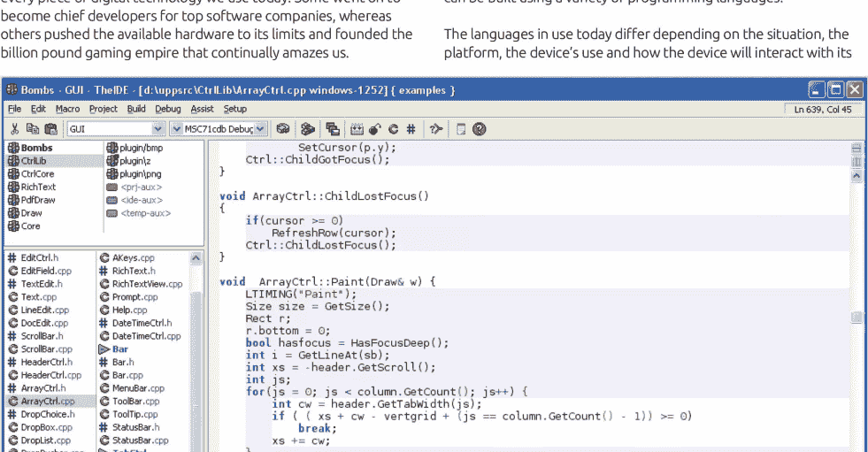

C++ 通常保留用于更复杂的程序、操作系统、游戏等。

操作系统，如 Windows、macOS 等通常是 C++、C#、汇编和某种基于视觉的语言的组合。游戏通常使用 C++，而网页可以使用多种可用语言，如 HTML、Java、Python 等。

更通用的编程用于创建程序、应用、软件或你想称之为任何东西。它们广泛应用于所有硬件平台，适用于几乎所有可想象的应用。有些运行速度更快，有些则更容易学习和使用。Python 就是这样一种通用语言。

Python 被称为高级语言，因为它使用各种数组、变量、对象、算术、子程序、循环等与硬件和操作系统“对话”。虽然它不如可以直接处理内存地址、调用栈和寄存器的低级语言那样精简，但其好处是通用性强且易于学习。

```java
//file: Invoke.java
import java.lang.reflect.*;

class Invoke {
public static void main( String [] args ) {
try {
Class c = Class.forName( args[0] );
Method m = c.getMethod( args[1], new Class[] { } );
Object ret = m.invoke( null, null );
System.out.println(
"Invoked static method: " + args[1]
+ " of class: " + args[0]
+ " with no args\nResults: " + ret );
} catch ( ClassNotFoundException e ) {
// Class.forName() can’t find the class
} catch ( NoSuchMethodException e2 ) {
// that method doesn’t exist
} catch ( IllegalAccessException e3 ) {
// we don’t have permission to invoke that method
} catch ( InvocationTargetException e4 ) {
// an exception occured while invoking that method
System.out.println(
"Method threw an: " + e4.getTargetException( ) );
}
}
}
```

Java 是一种功能强大的语言，用于网页、机顶盒、电视甚至汽车。

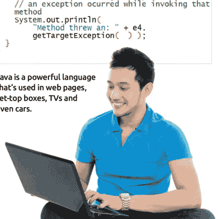

Python 创建于二十六年前以上，已发展成为学习如何编程电脑的理想入门语言。它非常适合业余爱好者、爱好者、学生、教师以及那些只需为自己或外部硬件与电脑之间创建独特交互的人。

Python 可免费下载、安装和使用，可用于 Linux、Windows、macOS、MS-DOS、OS/2、BeOS、IBM i 系列机器，甚至 RISC OS。它曾被评为全球前五大编程语言之一，并不断发展，领先于硬件和互联网发展的曲线。

那么要回答这个问题：为什么选择 Python？简单来说，它免费、易于学习、功能异常强大、通用性强、有效且是出色的学习和教育工具。

```basic
40 LET PY=15
70 FOR W=1 TO 10
71 CLS
75 LET BY=INT (RND*28)
80 LET BX=0
90 FOR D=1 TO 20
100 PRINT AT PX,PY;" U "
110 PRINT AT BX,BY;"O"
120 IF INKEY$="P" THEN LET PY=PY+1
130 IF INKEY$="O" THEN LET PY=PY-1
135 FOR N=1 TO 100: NEXT N
140 IF PY<2 THEN LET PY=2
150 IF PY>27 THEN LET PY=27
180 LET BX=BX+1
185 PRINT AT BX-1,BY;" "
190 NEXT D
200 IF (BY-1)=PY THEN LET S=S+1
210 PRINT AT 10,10;"score=";S
220 FOR V=1 TO 1000: NEXT V
300 NEXT W
0 OK, 0:1
```

BASIC 曾经是早期 8 位家用电脑用户学习的入门语言。

```python
print(HANGMAN[0])
attempts = len(HANGMAN) - 1

while (attempts >= 0 and "-" in word_guessed):
    print("You have {} attempts remaining".format(attempts))
    joined_word = "-".join(word_guessed)
    print(joined_word)

    try:
        player_guess = str(input("Please select a letter between A-Z" + "\n"))
    except: # check valid input
        print("That is not valid input. Please try again.")
        continue
    else:
        if not player_guess.isalpha(): # check the input is a letter. Also checks a
            print("That is not a letter. Please try again.")
            continue
        elif len(player_guess) > 1: # check the input is only one letter
            print("That is more than one letter. Please try again.")
            continue
        elif player_guess in guessed_letters: # check if letter hasn't been guessed
            print("You have already guessed that letter. Please try again.")
            continue
        else:
            pass

    guessed_letters.append(player_guess)

    for letter in range(len(chosen_word)):
        if player_guess == chosen_word[letter]:
            word_guessed[letter] = player_guess # replace all letters in the chosen word

    if player_guess not in chosen_word:
```

Python 是对 BASIC 的更现代演绎，易于学习，是理想的初学者编程语言。


## 你需要的设备

学习 Python 只需很少的硬件或初始资金投入。你不需要性能极其强大的计算机，而且所需的任何软件都可以免费获取。

### 我们使用的设备

幸运的是，Python 是一种多平台编程语言，支持 Windows、macOS、Linux、树莓派等平台。只要你拥有其中一种系统，就可以轻松开始使用 Python。


### 计算机

显然，学习 Python 编程并测试代码需要一台计算机。你可以使用 Windows（从 XP 版本起）系统，无论是 32 位还是 64 位处理器，也可以使用苹果 Mac 或安装了 Linux 的 PC。

#### IDE

IDE（集成开发环境）用于输入和执行 Python 代码。它可以让你检查程序代码及代码中的值，并提供高级功能。可用的 IDE 有很多种，找到最适合你且效果最好的那一款即可。

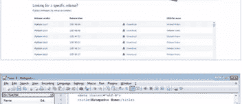

### Python 软件

macOS 和 Linux 系统本身预装了 Python，树莓派也是如此。不过你需要确保运行的是最新版本的 Python。Windows 用户则需要下载并安装 Python，我们稍后会讲到。

#### 文本编辑器

虽然文本编辑器是输入代码的理想环境，但它并非绝对必要。你可以直接在 IDLE 中输入并执行代码，但使用诸如 Sublime Text 或 Notepad++ 之类的文本编辑器，在输入代码时能提供更高级的功能和语法高亮。

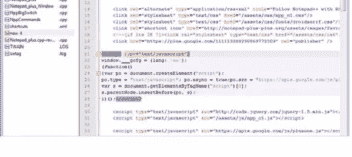

### 互联网接入

Python 是一个不断演进的环境，因此新版本经常会引入新概念，或改变现有命令和代码结构，使其成为一种更高效的语言。接入互联网可以让你随时了解最新动态、在遇到困难时获得帮助，并访问 Python 海量的模块。

#### 时间与耐心

不管其他书籍可能会让你相信什么，你都不可能只用 24 小时就成为程序员。学习 Python 编程需要时间和耐心。有时你可能会卡住，有时代码又会如流水般顺畅。要明白你正在学习全新的东西，你终会成功。

#### 树莓派

为什么要使用树莓派？树莓派是一款非常便宜的微型电脑，却为用户提供了一个绝佳的学习平台。它的主要操作系统 Raspbian 预装了最新的 Python，以及许多模块和附加组件。

#### 树莓派

树莓派 5 是最新版本，采用了更强大的 CPU、更大的内存，并支持 Wi-Fi 和蓝牙。你可以花大约 59 英镑购买 Pi 5，或者以套件的形式购买，具体取决于你感兴趣的树莓派型号。

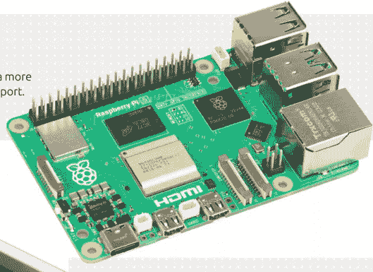

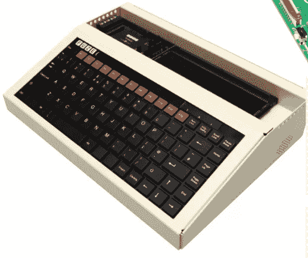

#### FUZE 项目

FUZE 是一个基于最新型号树莓派构建的学习环境。你可以购买带有电子套件的工作站，甚至还有一个机器人手臂供你组装和编程。你可以在 **www.fuze.co.uk** 上找到有关 FUZE 的更多信息。

#### Raspbian

树莓派的主要操作系统是一个基于 Debian 的 Linux 发行版，在一个简单易用的软件包中提供你所需的一切。它针对树莓派进行了精简优化，是硬件和软件项目、Python 编程，甚至作为桌面电脑的理想平台。

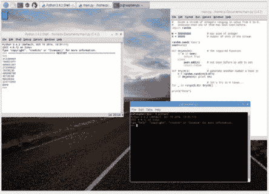

#### 书籍

我们通过 **www.pclpublications.com** 提供几本优秀的编程图书。我们的树莓派系列图书涵盖了如何购买你的第一块树莓派、如何设置和使用它；书中还有一些精彩的循序渐进的项目示例和指南，帮助你充分利用树莓派。

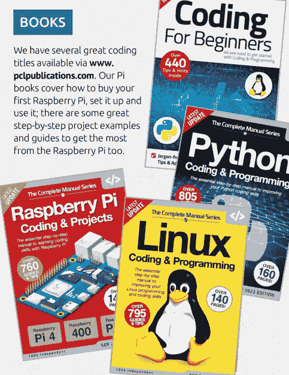

## 了解 Python

Python 是有史以来最伟大的计算机编程语言。它让你能够以一种简洁易懂的语言充分发挥计算机的全部能力。

### 什么是编程？

在你尝试学习编程语言之前，先理解什么是编程语言会很有帮助，Python 也不例外。让我们来看看 Python 是如何诞生的，以及它与其他语言的关系。

### Python

编程语言是计算机遵循的一系列指令。这些指令可以像显示你的名字或播放音乐文件一样简单，也可以像构建整个虚拟世界那样复杂。Python 是一种编程语言，由荷兰 Centrum Wiskunde & Informatica（CWI）的吉多·范罗苏姆于二十世纪八十年代末构思，作为 ABC 语言的继任者。

> 吉多·范罗苏姆，Python 之父。


### 编程食谱

程序就像计算机的食谱。烘焙蛋糕的食谱可以是这样的：

- 将 100 克自发面粉放入碗中。
- 向碗中加入 100 克黄油。
- 加入 100 毫升牛奶。
- 烘烤半小时。

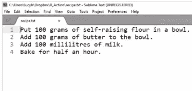

### 代码

就像食谱一样，程序由你要按顺序执行的指令组成。一个描述蛋糕的程序可能是这样运行的：

```
bowl = []
floor = 100
butter = 50
milk = 100
bowl.append([flour,butter,milk])
cake.cook(bowl)
```

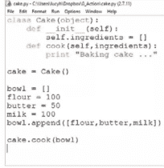

### 程序命令

你可能不理解某些 Python 命令，比如 bowl.append 和 cake.cook(bowl)。前者是一个列表，后者是一个对象；本书都会讲到。最重要的是要知道 Python 中的命令很容易阅读。一旦你了解了这些命令的作用，就很容易弄清楚程序的运作方式。

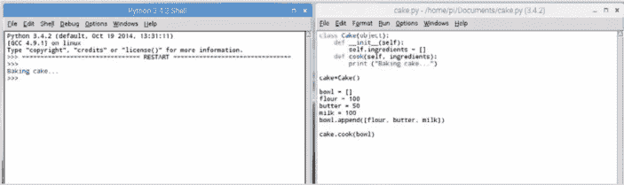

### 高级语言

易于阅读的计算机语言被称为“高级”语言。这是因为它们高高地飞行于硬件之上（硬件也被称为“金属”）。像汇编语言这样“贴近金属飞行”的语言则被称为“低级”语言。低级语言的命令读起来有点像这样：msg db ,0xA len equ $ - msg。

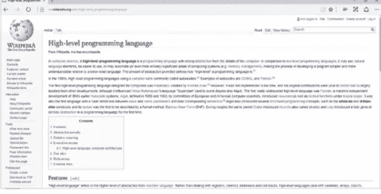

### Python 之禅

Python 让你能够以人类可以理解的语言访问计算机的全部能力。这一切背后是一种名为“Python 之禅”的理念。这是一组影响语言设计的 20 条软件原则，其中包括“优美胜于丑陋”和“简单胜于复杂”。在 Python 中输入 import this，它将显示所有这些原则。

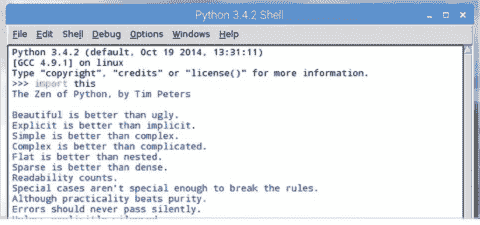

### Python 3 与 Python 2

在典型的计算场景中，Python 因两种活跃版本并存而变得有些复杂：Python 2 和 Python 3。

#### Python 的世界

当你访问 Python 下载页面时，会注意到有两个可用的按钮：一个用于 Python 3.6.2，另一个用于 Python 2.7.13；这是编写本文时的最新版本（请记住，Python 更新频繁，因此你看到的版本号可能会有所不同）。

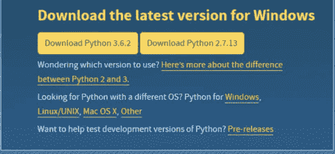

#### Python 3.x

2008 年，Python 3 带着多项新功能和增强特性问世。这些特性提供了更稳定、更有效、更高效的编程环境，但遗憾的是，这些新功能大多（如果不是全部的话）与 Python 2 的脚本、模块和教程不兼容。虽然起初并不流行，但 Python 3 此后已成为 Python 编程的前沿。

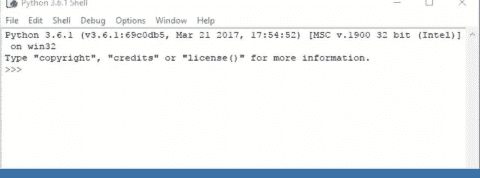

#### Python 2.x

那么为什么会有两个版本呢？这个嘛，Python 2 最初于 2000 年发布，从那时起便积累了大量的模块、脚本、用户和教程等等。多年来，Python 2 已迅速成为初学者和专家编程的首选语言之一，这使它成为极其宝贵的资源。

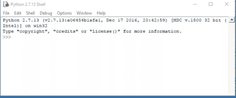

#### 3.x 胜出

Python 3 日益增长的人气意味着，现在开始学习使用新功能进行开发并逐步淘汰旧版本是明智之举。许多开发公司，如 SpaceX 和 NASA，都在重要代码片段中使用 Python 3。

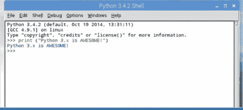


## 如何在 Windows 上设置 Python

Windows 用户可以通过主要的 Python 下载页面轻松安装最新版本的 Python。虽然大多数经验丰富的 Python 开发者可能会避开 Windows 作为构建代码的首选平台，但它仍然是初学者的理想起点。

### 安装 Python 3.X

Microsoft Windows 默认不预装 Python，因此你需要手动自行安装。幸运的是，这个过程很容易遵循。

STEP 1 首先打开你的网络浏览器访问 www.python.org/downloads/。查找标有 Python 3.x.x 下载链接的按钮（在我们的例子中是 Python 3.6.2，但正如提到的，你可能会看到 3 的更新版本）。

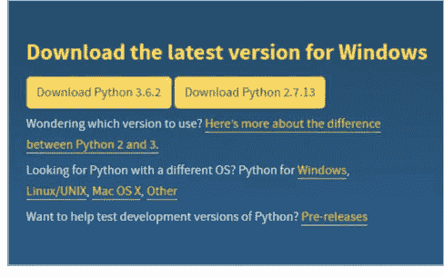

STEP 2 点击版本 3.x 的下载按钮，并将文件保存到你的下载文件夹。当文件下载完成后，双击可执行文件，Python 安装向导将会启动。从这里你有两个选择：立即安装和自定义安装。我们建议选择自定义安装链接。

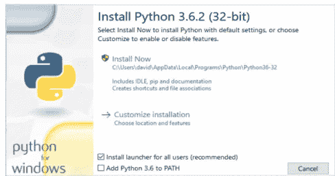

STEP 3 选择自定义选项允许你指定某些参数，虽然你可以保留默认值，但养成这个习惯是好的，有时（不是 Python，庆幸的是）安装程序会包含不需要的附加功能。在第一个可用屏幕上，确保所有框都被勾选，然后点击下一步按钮。

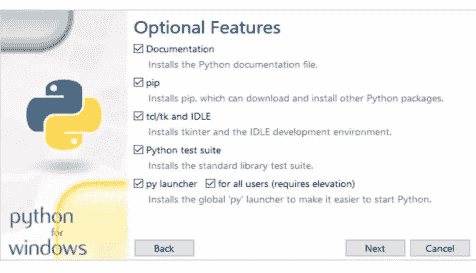

STEP 4 下一页的选项包括一些对 Python 的有趣补充。确保勾选将文件与 Python 关联、创建快捷方式、将 Python 添加到环境变量、预编译标准库和为所有用户安装选项。这些会让日后使用 Python 变得更容易。准备好继续时点击安装。

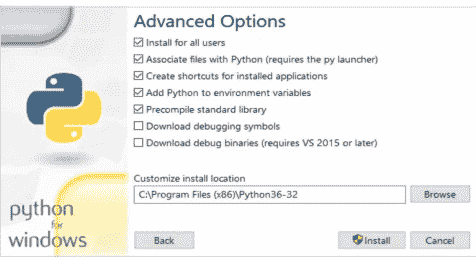

#### STEP 5

你可能需要通过 Windows 身份验证通知来确认安装。只需点击是，Python 将开始安装。安装完成后，最后的 Python 向导页面将允许你查看最新的发行说明，并跟随一些在线教程。

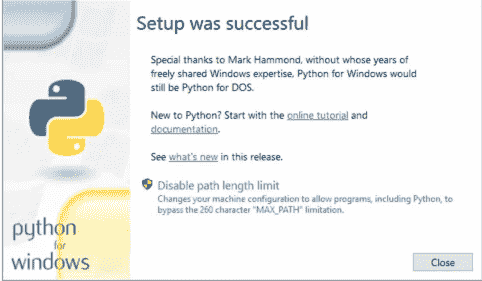

#### STEP 6

在关闭安装向导窗口之前，最好点击盾牌旁边的链接禁用路径长度限制。这将允许 Python 绕过 Windows 260 个字符的限制，使你能够执行存储在深层文件夹结构中的 Python 程序。同样，点击是来验证该过程；然后你可以关闭安装窗口。

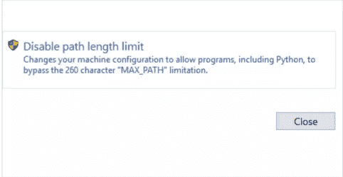

#### STEP 7

Windows 10 用户现在会在开始按钮的最近添加部分找到已安装的 Python 3.x。第一个链接 Python 3.6（32 位）点击后会启动 Python 的命令行版本（稍后会详细介绍）。要打开 IDLE，在 Windows 开始菜单中输入 IDLE。

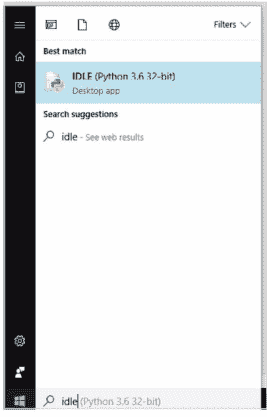

#### STEP 8

点击 IDLE（Python 3.6 32 位）链接将启动 Python Shell，在这里你可以开始你的 Python 编程之旅。不要担心你的版本更新，只要是 Python 3.x，我们的代码就会在你的 Python 3 界面中运行。

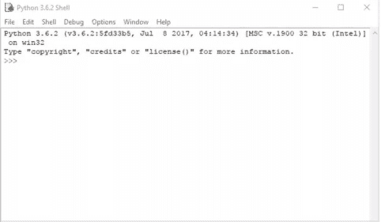

#### STEP 9

如果你现在再次点击 Windows 开始按钮，然后输入：CMD，你会看到命令提示符链接。点击它即可进入 Windows 命令行环境。要在命令行中进入 Python，你需要输入：python 并按 Enter。

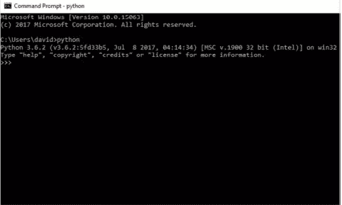

#### STEP 10

Python 的命令行版本的工作方式与第 8 步中打开的 Shell 非常相似；注意三个左向箭头（>>>）。虽然这是一个完全可以使用的环境，但它不太友好，所以现在先离开命令行。输入：exit() 来退出并关闭命令提示符窗口。

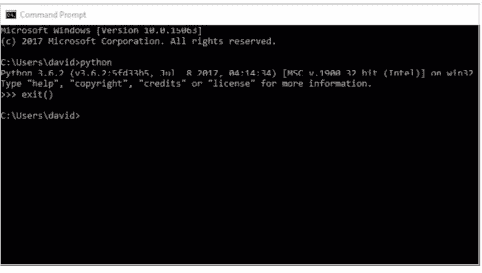

## 如何在 Mac 上设置 Python

如果你使用的是 Apple Mac，那么设置 Python 非常容易。事实上，Python 的一个版本已经安装好了。然而，你应该确保正在运行最新版本。

### 安装 Python

Apple 的操作系统自带 Python，因此你不需要单独安装它。然而，Apple 并不会经常更新 Python，你可能正在运行一个较旧的版本。所以最好先检查并更新。

STEP 1 通过点击前往 > 实用工具，然后双击终端图标打开一个新的终端窗口。现在输入：python --version。你应该会看到“Python 2.5.1”甚至更新的版本，如果 Apple 已更新操作系统和 Python 安装。无论如何，最好检查最新版本。

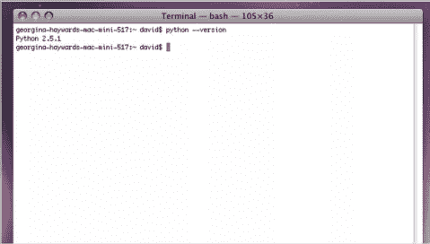

STEP 2 打开 Safari 并前往 www.python.org/downloads。就像前面几页的 Windows 设置程序一样，你可以看到两个黄色下载按钮：一个用于 Python 3.6.2，另一个用于 Python 2.7.13。请注意，由于 Python 频繁发布，版本号可能会有所不同。

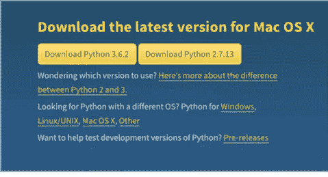

STEP 3 点击最新版本的 Python 3.x，在我们的例子中是 Python 3.6.2 的下载按钮。这将自动下载最新版本的 Python，并且根据你 Mac 的配置，它会自动启动安装向导。

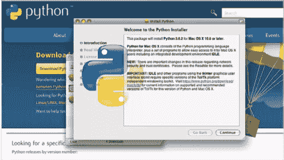

STEP 4 打开 Python 安装向导后，点击继续按钮开始安装。值得花点时间阅读重要信息部分，以防它提及适用于你 macOS 版本的内容。准备好后，再次点击继续。

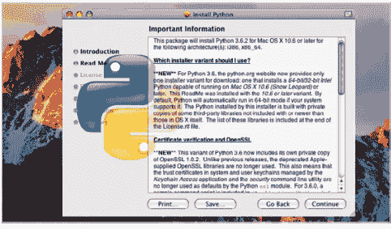

#### STEP 5

下一部分详细说明软件许可协议，虽然对大多数人来说并不特别有趣，但最好还是读一下。准备好后，再次点击继续按钮。

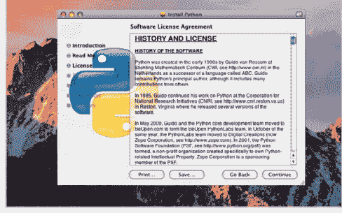

#### STEP 6

最后你会被提示 Python 将占用系统多少空间以及一个安装按钮，你需要点击它来开始在你的 Mac 上实际安装 Python 3.x。你可能需要输入密码来验证安装过程。

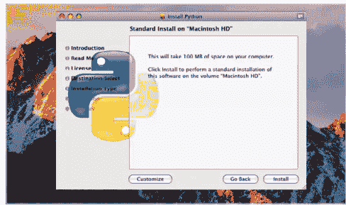

#### STEP 7

安装不应花费太长时间；我们在此部分使用的较旧的 Mac Mini 比现代 Mac 机器慢一些，安装成功提示大约只用了三十秒就显示出来了。

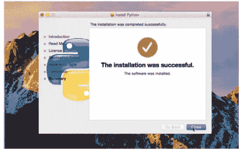

#### STEP 8

Python 安装向导中几乎没有其他事情要做，所以你可以点击关闭按钮。如果你现在回到终端会话并重新输入命令：python3 --version，你可以看到新版本现在已列出。要进入 Python 的命令行版本，你需要输入：python3。要退出，输入：exit()。

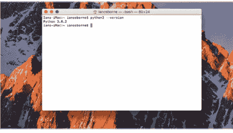

#### STEP 9

你需要在 Finder 中搜索 Python IDLE；找到后点击它启动，它应该看起来与上一页显示的 Windows IDLE 版本相似。唯一的区别是它运行的 Mac 检测到的硬件平台。

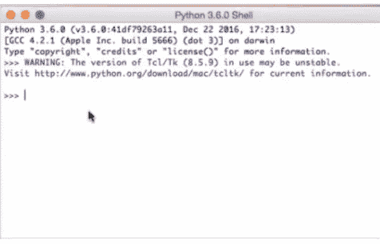

#### STEP 10

较旧的 Mac 版本可能无法使用更新版本的 Python，在这种情况下你需要回退到之前的 Python 3.x 构建；只要你使用的是 Python 3.x，本书中的代码对你来说就能正常工作。

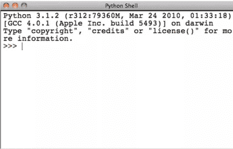

## 如何在 Linux 上设置 Python

Python 2.x 已安装在大多数 Linux 发行版中，但由于我们将使用 Python 3.x，我们首先需要做一些工作来获取它。幸运的是，这并不太困难。

### PYTHON PENGUIN

Linux 是一个如此多功能的系统，以至于很难确定一种做事的方法。不同的发行版以不同的方式安装软件，因此我们将为本教程坚持使用 Linux Mint 18.1。

STEP 1 首先你需要确定你 Linux 系统中当前安装了哪个版本的 Python；正如我们提到的，我们将使用 Linux Mint 18.1 作为本节。与 macOS 一样，按 Ctrl+Alt+T 进入终端。

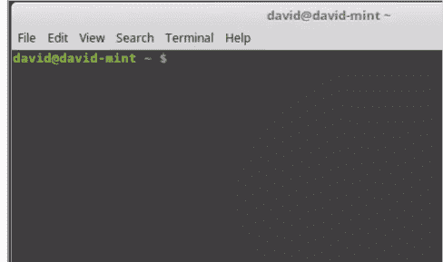

STEP 2 接下来在终端屏幕中输入：python --version。你应该在显示中看到与 Python 2.x 版本相关的输出。在我们的特定情况下是 Python 2.7.12。

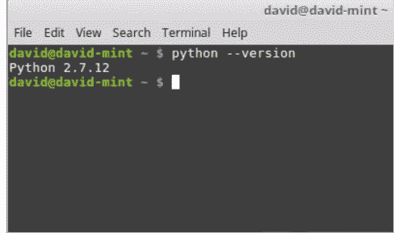

STEP 3 一些 Linux 发行版会在系统更新时自动将 Python 安装更新到最新版本。要检查，首先使用以下命令进行系统更新和升级：

```
sudo apt-get update && sudo apt-get upgrade
```

输入你的密码并让系统进行任何更新。

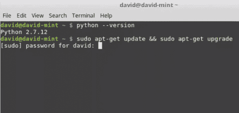

STEP 4 更新和升级完成后，你可能需要回答‘Y’来授权任何升级，输入：python3 --version 来查看 Python 3.x 是否已更新甚至已安装。在 Linux Mint 的情况下，我们的版本是 Python 3.5.2，这对我们的目的来说是足够的。

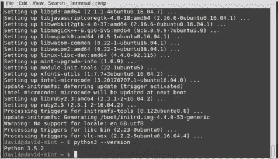


## Python 入门

开始学习 Python 可能一开始看起来有些令人生畏，但这门语言的设计初衷就是简洁。就像大多数事情一样，你需要慢慢开始，学会如何得到结果，以及如何从代码中获得你想要的东西。

在本节中，我们将介绍变量、数字和表达式、用户输入、条件和循环，以及你在使用 Python 的过程中很可能会遇到的错误类型。

- 22 首次启动 Python
- 24 你的第一段代码
- 26 保存并执行代码
- 28 从命令行执行代码
- 30 数字和表达式
- 32 使用注释
- 34 使用变量
- 36 用户输入
- 38 创建函数
- 40 条件和循环
- 42 Python 模块

### 首次启动 Python

我们将使用 Raspberry Pi 作为我们的 Python 3 硬件平台。最新版本的 Raspbian 预装了 Python 3，确切地说是 3.4.2 版本，所以只要你拥有一个 3 版本的 Shell，我们所有的代码都能运行。

#### 启动 Python

我们不打算详细讨论如何让 Raspberry Pi 启动并运行，关于这个主题已经有大量资料。不过，当你准备好之后，启动你的 Pi，准备开始编程吧。

**步骤 1** 加载 Raspbian 桌面后，点击菜单按钮，然后选择“编程 > Python 3 (IDLE)”。这将打开 Python 3 Shell。Windows 和 Mac 用户可以在 Windows 开始按钮菜单中以及通过 Finder 找到 Python 3 IDLE Shell。

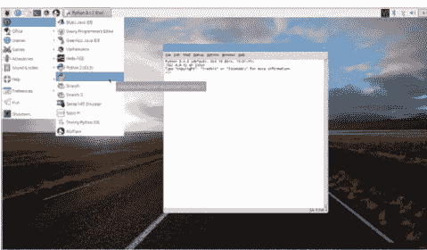

**步骤 2** Shell 是你可以输入代码并查看你编写到 Python 中的代码的响应和输出的地方。这是一种沙盒，你可以在其中尝试一些简单的代码和流程。

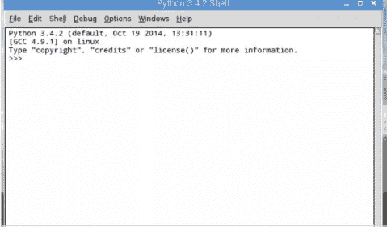

**步骤 3** 例如，在 Shell 中输入 `2+2`。按回车后，下一行显示答案：`4`。基本上，Python 接受了这段“代码”并产生了相应的输出。

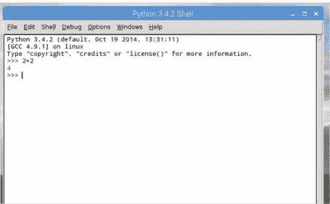

**步骤 4** Python Shell 就像计算器一样，因为代码本质上就是与系统进行的一系列数学交互。整数（也就是无穷无尽的整数序列）可以轻松地进行加、减、乘等运算。

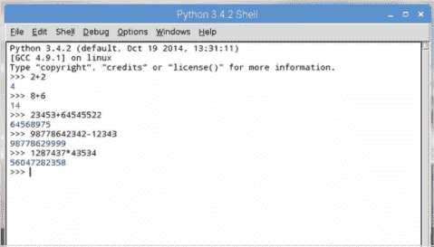

**步骤 5** 虽然这很有趣，但并不特别令人兴奋。相反，试试这个：

```
print("Hello everyone!")
```

就像我们在本书“安装文本编辑器”一节中在 Sublime 中输入的代码一样。

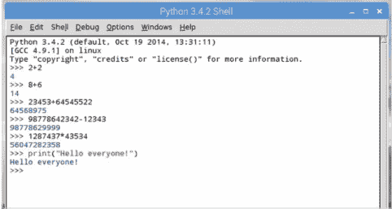

**步骤 6** 这更像那么回事了，因为你刚刚产生了自己的第一段代码。print 命令很好理解，它用于打印东西。Python 3 要求使用括号和引号才能将内容输出到屏幕，在这里就是“Hello everyone!”这一部分。

```
>>> print("Hello everyone!")
Hello everyone!
>>>
```

**步骤 7** 你可能注意到了 Python IDLE 中的颜色编码。这些颜色代表 Python 代码的不同元素。它们是：

- 黑色 – 数据和变量
- 绿色 – 字符串
- 紫色 – 函数
- 橙色 – 命令
- 蓝色 – 用户函数
- 深红色 – 注释
- 浅红色 – 错误消息

#### IDLE 颜色编码

| 颜色 | 用途 | 示例 |
| --- | --- | --- |
| 黑色 | 数据和变量 | 23.6 area |
| 绿色 | 字符串 | "Hello World" |
| 紫色 | 函数 | len() print() |
| 橙色 | 命令 | if for else |
| 蓝色 | 用户函数 | get_area() |
| 深红色 | 注释 | #Remember VAT |
| 浅红色 | 错误消息 | SyntaxError: |

**步骤 8** Python IDLE 是一个可配置的环境。如果你不喜欢颜色的显示方式，你随时可以通过“选项 > 配置 IDLE”并点击“突出显示”选项卡来更改它们。不过，我们不建议这样做，因为你将无法看到与我们截图相同的内容。

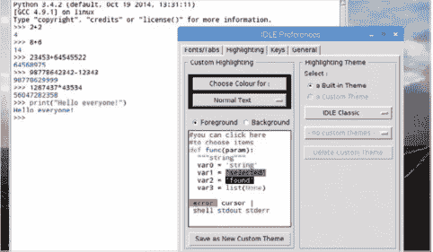

**步骤 9** 与大多数程序一样，无论操作系统如何，都有许多可用的快捷键。我们在这里没有篇幅一一列出，但在“选项 > 配置 IDLE”中，在“按键”选项卡下，你可以看到当前快捷键绑定的列表。

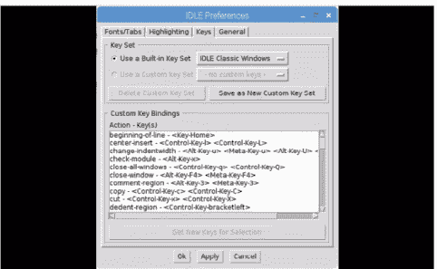

**步骤 10** Python IDLE 是一个强大的界面，而且实际上是使用一个可用的 GUI 工具包用 Python 编写的。如果你想了解 Shell 的众多细节，我们建议你花点时间访问 www.docs.python.org/3/library/idle.html，那里详细介绍了 IDLE 的许多功能。

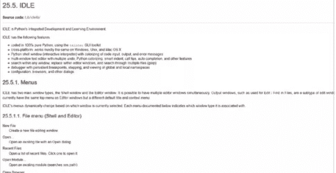

### 你的第一段代码

本质上，你已经通过上一个教程中的 `print("Hello everyone!")` 函数写下了第一段代码。不过，让我们进一步扩展，看看如何输入代码，并尝试一些其他的 Python 示例。

#### 玩转 Python

对于大多数语言，无论是计算机语言还是人类语言，关键在于记住正确的“词汇”并在恰当的情境中运用它们。你并非天生就知道这些词汇，因此需要学习它们。

**步骤 1** 如果你已关闭 Python 3 IDLE，请在任意你喜欢的操作系统版本中重新打开它。在 Shell 中，输入下面熟悉的代码：

```
print("Hello")
```

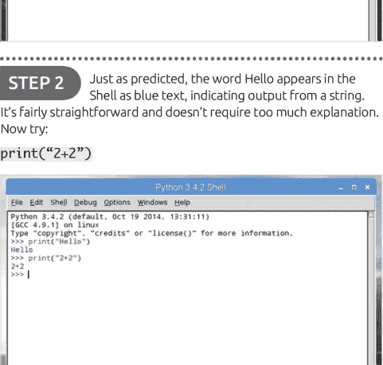

**步骤 2** 正如预期，单词 Hello 以蓝色文本出现在 Shell 中，表示这是一个字符串的输出。这相当直观，无需过多解释。现在试试：

```
print("2+2")
```


**步骤 3** 你可以看到，输出是你要求打印到屏幕的 `2+2`，而不是数字 4。引号定义了输出到 IDLE Shell 的内容；要打印 2+2 的总和，你需要去掉引号：

```
print(2+2)
```


**步骤 4** 你可以继续这样做，在 Shell 中打印 2+2、464+2343 等等。更简单的方法是使用变量，我们稍后会深入介绍。现在，请输入：

```
a=2
b=2
```


**步骤 5** 你所做的是给字母 a 和 b 分别赋了两个值：2 和 2。它们现在就是变量了，只要它们的值保持不变，Python 就可以调用它们进行输出、加、减、除等操作。试试这个：

```
print(a)
print(b)
```


**步骤 6** 上一步的输出分别显示了 a 和 b 的当前值，因为你要求将它们分开打印。如果你想将它们相加，可以使用以下代码：

```
print(a+b)
```

这段代码简单地获取 a 和 b 的值，将它们相加并输出结果。


**步骤 7** 你可以尝试不同类型的变量和 print 函数。例如，你可以为某人的名字分配变量：

```
name="David"
print(name)
```


**步骤 8** 现在让我们加上姓氏：

```
surname="Hayward"
print(surname)
```

现在你有了两个变量，分别包含名字和姓氏，你可以独立打印它们。


**步骤 9** 如果我们沿用之前的方法，使用 + 符号，名字在 Shell 中的输出就不会正确地显示。试试看：

```
print(name+surname)
```

你需要在两者之间加一个空格，将它们定义为两个独立的值，而不是可以数学运算的东西。


**步骤 10** 在 Python 3 中，你可以使用逗号通过一个空格分隔两个变量：

```
print(name, surname)
```

或者，你可以自己添加空格：

```
print(name+" "+surname)
```

正如你所看到的，使用逗号要整洁得多。恭喜你，你刚刚迈出了进入 Python 广阔世界的第一步。


## 保存和执行你的代码

在 IDLE Shell 中工作对于小的代码片段来说完全没问题，但它并不适合输入较长的程序列表。在本节中，你将[content]

## 保存和执行你的代码

在 IDLE Shell 中工作对于小的代码片段来说完全没问题，但它并不适合输入较长的程序列表。在本节中，你将了解到 IDLE 编辑器，从现在开始你将在其中工作。

### 编辑代码

你最终会达到需要停止向 Shell 输入单行代码的阶段。相反，IDLE 编辑器将允许你保存和执行 Python 代码。

**STEP 1** 首先，打开 Python IDLE Shell，打开后点击 File > New File。这将打开一个名为 Untitled 的新窗口。这就是 Python IDLE 编辑器，你可以在其中输入创建未来程序所需的代码。


**STEP 2** IDLE 编辑器在所有目的上都只是一个简单的文本编辑器，具有 Python 功能、颜色编码等等；与 Sublime 非常相似。你在 Shell 中输入代码的方式与在编辑器中相同，因此以上一教程中的示例为例，输入：

```python
print("Hello everyone!")
```


**STEP 3** 你可以看到 IDLE 编辑器中的颜色编码与 Shell 中的相同，有助于你更好地理解代码的运行方式。但是，要执行代码，你需要先保存它。按下 F5 就会打开一个 Save… 对话框。


**STEP 4** 在 Save 对话框中点击 OK 按钮并选择一个保存所有 Python 代码的目的地。目的地可以是一个名为 Python 的专用文件夹，也可以随意放置。记住要保持驱动器的整洁，以便将来使用。


**STEP 5** 为你的代码输入一个名称，例如 ‘print hello’，然后点击 Save 按钮。一旦 Python 代码保存，它就会被执行，输出将显示在 IDLE Shell 中。在本例中，是单词 ‘Hello everyone!’。


**STEP 6** 这就是绝大多数 Python 代码的执行方式。将其输入编辑器，按下 F5，保存代码并在 Shell 中查看输出。有时情况会有所不同，这取决于你是否请求了单独的窗口，但本质上这就是流程。除非另有说明，否则我们将在本书中始终使用此流程。


**STEP 7** 如果打开保存的 Python 代码的文件位置，你会看到它以 .py 扩展名结尾。这是默认的 Python 文件名。你创建的任何代码都将是 whatever.py，从众多互联网 Python 资源站点下载的代码也将是 .py。只需确保代码是为 Python 3 编写的。


**STEP 8** 让我们扩展代码并输入一些来自上一教程的示例：

```python
a=2
b=2
name="David"
surname="Hayward"
print(name, surname)
print (a+b)
```

如果现在按下 F5，你将被要求再次保存文件，因为它与之前相比已被修改。


**STEP 9** 如果你点击 OK 按钮，文件将被新代码条目覆盖并执行，输出在 Shell 中。对于这几行来说不是问题，但如果你编辑的是较大的文件，覆盖可能会成为问题。相反，使用编辑器中的 File > Save As 来创建备份。


**STEP 10** 现在创建一个新文件。关闭编辑器，并打开一个新实例（从 Shell 中 File > New File）。输入以下内容并将其保存为 hello.py：

```python
a="Python"
b="is"
c="cool!"
print(a, b, c)
```

你将在下一教程中使用此代码。


## 从命令行执行代码

虽然我们整本书都在使用 GUI IDLE 工作，但值得了解一下 Python 的命令行处理。我们已经知道有 Python 的命令行版本，但它也用于执行代码。

### 命令代码

使用我们在上一教程中创建的代码，即我们命名的 hello.py，让我们看看如何从 GUI 中制作的代码在命令行级别运行。

**STEP 1** Python 在 Linux 中有两种通过命令行执行代码的方式。其中一种方式使用 Python 2，而另一种使用 Python 3 库等等。首先，切换到操作系统的命令行或终端。

**STEP 2** 就像之前一样，我们使用的是 Raspberry Pi；Windows 用户需要点击开始按钮并搜索 CMD，然后点击搜索返回的命令行；macOS 用户可以通过点击 Go > Utilities > Terminal 来访问命令行。


**STEP 3** 现在你在命令行，可以开始 Python。对于 Python 3，你需要输入命令 python3 并按下 Enter。这将把你带入 Shell 的命令行版本，光标为熟悉的三个右向箭头（>>>）。


**STEP 4** 从这里你可以输入之前查看过的代码，例如：

```python
a=2
print(a)
```

你可以看到它完全相同。


**STEP 5** 现在输入：exit() 以离开命令行 Python 会话并返回到命令提示符。进入保存上一教程代码的文件夹并列出其中的可用文件；你应该能看到 hello.py 文件。


**STEP 6** 在你要运行的代码所在的文件夹中，在命令行输入以下内容：

```bash
python3 hello.py
```

这将执行我们创建的代码，提醒你一下，它是：

```python
a="Python"
b="is"
c="cool!"
print(a, b, c)
```


**STEP 7** 自然地，由于这是 Python 3 代码，使用 Python 3 独有的语法和布局，它只有在使用 python3 命令时才有效。如果你愿意，可以尝试用 Python 2 输入：

```bash
python hello.py
```


**STEP 8** 从 Python 2 命令行运行 Python 3 代码的结果相当明显。虽然它不会以任何方式报错，由于 Python 3 与 Python 2 处理 print 命令的方式不同，结果与我们预期不符。暂时使用 Sublime，打开 hello.py 文件。


**STEP 9** 由于 Sublime Text 不适用于 Raspberry Pi，你将暂时离开 Pi 并使用 Sublime 作为示例，说明你不一定需要使用 Python IDLE。打开 hello.py 文件后，将其修改为包含以下内容：

```python
name=input("What is your name? ")
print("Hello,", name)
```


**STEP 10** 保存 hello.py 文件并返回到命令行。现在使用以下命令执行新保存的代码：

```bash
python3 hello.py
```

结果将是原始的 Python is cool 语句，加上新增的 input 命令要求你输入姓名，并在命令行窗口中显示它。


## 数字和表达式

我们已经用 Python 看到了一些基本的数学表达式，如简单的加法等等。现在让我们扩展一下，看看 Python 作为计算器有多强大。你可以在 IDLE Shell 或编辑器中工作，随你喜欢。

### 全是数学，伙计

Python 的数学能力可以产生非常令人印象深刻的结果；与大多数，如果不是所有编程语言一样，数学是代码背后的驱动力。

**STEP 1** 打开 Python 3 的 GUI 版本，如前所述，你可以使用 Shell 或编辑器。暂时，你将使用 Shell 来锻炼我们的数学肌肉，我们认为它位于大脑后部的一个小腺体（或不是）。


**STEP 2** 在 Shell 中输入以下内容：

- `2+2`
- `54356+34553245`
- `99867344*27344484221`

你可以看到 Python 可以处理相当大的数字。


**STEP 3** 你可以使用所有常用的数学运算：除法、乘法、括号等等。练习几个，例如：

- `1/2`
- `6/2`
- `2+2*3`
- `(1+2)+(3*4)`


**STEP 4** 你一定注意到除法会产生小数。在 Python 中，这些称为浮点数，或浮点数。然而，如果你需要整数而不是小数答案，则可以使用双斜杠：

- `1//2`
- `6//2`

等等。


#### 第5步

你还可以使用一个运算符来查看除法后的余数。例如：

```
10/3
```

将显示 3.333333333，当然这是 3.3 循环。如果你现在输入：

```
10%3
```

这将显示 1，即 10 除以 3 后的余数。


#### 第6步

接下来是幂运算符，说得专业一点就是求幂。要计算某个数的幂，你可以在键盘上使用双乘号或双星号：

```
2**3
10**10
```

本质上，这就是 2x2x2，不过我们相信你已经掌握了数学运算符的基础知识。这就是在 Python 中的运算方法。


#### 第7步

数字和表达式远不止这些。Python 内置了大量函数，用于处理数字集合、绝对值、复数以及大量数学表达式和毕达哥拉斯式的绕口难题。例如，要将数字转换为二进制，可以使用：

```
bin(3)
```


#### 第8步

它将以 '0b11' 的形式显示，即将整数转换为二进制，并在前面加上前缀 0b。如果你想去掉 0b 前缀，可以使用：

```
format(3, 'b')
```

Format 命令会将一个值（即数字 3）转换为由格式规范（即 'b' 部分）控制的格式化表示。


#### 第9步

布尔表达式是一种逻辑语句，其结果要么为真，要么为假。我们可以用它们来比较数据，并测试数据是否相等、小于或大于。请在一个新文件中尝试以下代码：

```
a = 6
b = 7
print(1, a == 6)
print(2, a == 7)
print(3, a == 6 and b == 7)
print(4, a == 7 and b == 7)
print(5, not a == 7 and b == 7)
print(6, a == 7 or b == 7)
print(7, a == 7 or b == 6)
print(8, not (a == 7 and b == 6))
print(9, not a == 7 and b == 6)
```


#### 第10步

执行第9步中的代码，你会看到一系列 True 或 False 语句，这取决于两个定义值（6 和 7）的结果。这是你所了解内容的延伸，也是编程中的一个重要部分。


### 使用注释

在编写代码时，代码的流程、每个变量的作用、整个程序将如何运行等等，都在你的脑海中。另一个程序员可以逐行阅读代码，但随着时间的推移，代码会变得难以阅读。

#### #注释！

程序员使用一种方法通过注释某些部分来保持代码的可读性。例如，如果使用了一个变量，程序员会注释该变量的用途。这只是良好的做法。

步骤1 首先，创建一个新的 IDLE 编辑器实例（文件 > 新建文件），并创建一个简单的变量和打印命令：

```
a=10
print("The value of A is,", a)
```

保存文件并执行代码。


步骤3 重新保存代码并执行。你可以看到，尽管添加了额外的行，IDLE Shell 中的输出仍然与之前相同。简单来说，井号（#）表示程序员可以插入的一行文本，用于告知他们自己和他人代码中发生的事情，而用户不会察觉。


步骤2 运行代码将返回一行：The value of A is, 10 到 IDLE Shell 窗口中，这正是我们所期望的。现在，添加一些你在代码中通常会看到的注释类型：

```
#### Set the start value of A to 10
a=10
#### Print the current value of A
print("The value of A is,", a)
```


步骤4 假设我们创建的变量 A 是游戏中的生命数。每次玩家死亡，该值就减 1。程序员可以插入一段类似这样的代码：

```
a=a-1
print("You’ve just lost a life!")
print("You now have", a, "lives left!")
```


#### 第5步

虽然我们知道变量 A 是生命数，而且玩家刚刚失去一条命，但一个普通的浏览者或检查代码的人可能并不知道。想象一下，如果代码有两万行，而不仅仅是我们的七行，你就会明白注释有多有用了。


#### 第6步

本质上，带有注释的新代码可能如下所示：

```
#### Set the start value of A to 10
a=10
#### Print the current value of A
print("The value of A is,", a)
#### Player lost a life!
a=a-1
#### Inform player, and display current value of A (lives)
print("You’ve just lost a life!")
print("You now have", a, "lives left!")
```


#### 第7步

你可以用不同的方式使用注释。例如，块注释是一大段文本，详细说明代码中发生的事情，比如告诉代码阅读者你打算使用哪些变量：

```
#### This is the best game ever, and has been developed by a crack squad of Python experts
#### who haven’t slept or washed in weeks. Despite being very smelly, the code at least
#### works really well.
```


#### 第8步

行内注释是跟随一段代码的注释。以上面的示例为例，我们不把注释放在单独一行，而是可以这样写：

```
a=10 # Set the start value of A to 10
print("The value of A is,", a) # Print the current value of A
a=a-1 # Player lost a life!
print("You’ve just lost a life!")
print("You now have", a, "lives left!") # Inform player, and display current value of A (lives)
```


#### 第9步

注释符号即井号，也可以用来注释掉程序中你不想执行的代码段。例如，如果你想删除第一条 print 语句，可以这样做：

```
#### print("The value of A is,", a)
```


#### 第10步

你还可以使用三个单引号来注释掉一个块注释或一段多行注释。将它们放在你想注释的内容前后，即可生效：

```
'''
This is the best game ever, and has been developed by a crack squad of Python experts who haven’t slept or washed in weeks. Despite being very smelly, the code at least works really well.
'''
```


## 使用变量

我们已经在 Python 代码中看到了一些变量的示例，但还是值得仔细了解一下它们的运作方式，以及 Python 如何创建变量并为其赋值。

### 各种变量

在本教程中，你将使用 Python 3 IDLE Shell。如果你还没有打开，请打开 Python 3，或者关闭之前的 IDLE Shell 以清除任何旧代码。

步骤1 在某些编程语言中，你需要使用美元符号来表示字符串，字符串是由多个字符组成的变量，例如人的姓名。在 Python 中则没有必要。例如，在 Shell 中输入：name="David Hayward"（或者使用你自己的名字，除非你也叫 David Hayward）。


步骤2 你可以通过输入 type() 命令，并将变量名放在括号中来检查当前使用的变量类型。在我们的示例中，即：type(name)。添加一个新的字符串变量：title="Descended from Vikings"。


步骤3 你之前已经看到，变量可以通过在变量名之间使用加号来拼接。在我们的示例中，可以使用：print(name + ": " + title)。引号之间的中间部分允许我们添加一个冒号和一个空格，因为变量连接时没有空格，所以我们需要手动添加。


步骤4 你也可以在另一个变量中组合变量。例如，要将 name 和 title 这两个变量组合成一个新变量，我们使用：character=name + ": " + title

```
character=name + ": " + title
```

然后输出新变量的内容如下：

```
print(character)
```

数字存储为不同的变量：

```
age=44
```

```
Type(age)
```

正如我们所知，它们是整数。


#### 步骤 5

然而，你不能像组合一组相似变量那样，在同一条命令中同时组合字符串和整数类型变量。你需要将其中一个转换为另一个，或者反过来。当你确实尝试组合两者时，你会收到一条错误信息：

```
print (name + age)
```


#### 步骤 6

这就是所谓的类型转换（TypeCasting）过程。Python 代码如下：

```
print (character + " is " + str(age) + " years old.")
```

或者你可以使用：

```
print (character, "is", age, "years old.")
```

再次注意，在最后一个示例中，引号内的单词之间不需要空格，因为逗号会将每个参数分别传给 print。

```
>>> print (name + age)
Traceback (most recent call last):
  File "<pyshell#18>", line 1, in <module>
    print (name + age)
TypeError: Can't convert 'int' object to str implicitly
>>> print (character + " is " + str(age) + " years old.")
David Hayward: Descended from Vikings is 44 years old.
>>> print (character, "is", age, "years old.")
David Hayward: Descended from Vikings is 44 years old.
```

#### 步骤 7

类型转换的另一个例子是向用户请求输入时，例如输入名字。例如，输入：

```
age= input ("How old are you? ")
```

从输入命令存储的所有数据都是作为字符串变量存储的。


#### 步骤 8

当你想使用用户输入的数字时，这会带来一点小问题，因为 age + 10 无法正常工作，原因是一个是字符串变量，一个是整数。相反，你需要输入：

```
int(age) + 10
```

这会将 age 字符串类型转换为一个可处理的整数。


#### 步骤 9

在处理浮点数运算时，类型转换的使用也很重要；记住：浮点数就是带有小数点的数字。例如，输入：

```
shirt=19.99
```

现在输入 type(shirt)，你会看到 Python 将该数字定义为“浮点数”（float），因为该值包含小数点。


#### 步骤 10

当组合整数和浮点数时，Python 通常会将整数转换为浮点数，但如果需要反向转换，请记住 Python 不会返回精确值。将浮点数转换为整数时，Python 总是向下取整到最接近的整数，这称为截断；在我们的例子中，19.99 会变成 19。


## 用户输入

前面几个例子中我们已经看到了与代码的一些基本用户交互，所以现在是时候专门关注如何从用户那里获取信息，并将其存储和呈现了。

### 用户友好

你希望从用户那里获得的输入类型，在很大程度上取决于你正在编写的程序类型。例如，游戏可能会询问角色名称，而数据库可能会询问个人详细信息。

#### 步骤 1

如果还没有打开 Python 3 IDLE Shell，请先打开它，并在编辑器中新建一个文件。让我们从非常简单的内容开始，输入：

```
print("Hello")
firstname=input("What is your first name? ")
print("Thanks.")
surname=input("And what is your surname? ")
```


#### 步骤 3

现在我们已经将用户的名字存储在了几个变量中，可以随时调用它们：

```
print("Welcome", firstname, surname, ". I hope you’re well today.")
```


#### 步骤 2

保存并执行代码，正如你无疑已经猜到的那样，在 IDLE Shell 中，程序会询问你的名字，将其存储为变量 firstname，然后询问你的姓氏；姓氏也存储在其自己的变量（surname）中。


#### 步骤 4

运行代码，你会发现一个小问题：姓氏后面的句号前面有一个空格。为了消除这个空格，我们可以在代码中用加号代替逗号：

```
print("Welcome", firstname, surname+". I hope you’re well today.")
```


#### 步骤 5

你并不总是需要在 input 命令中包含带引号的文本。例如，你可以询问用户的名字，并在下一行进行输入：

```
print("Hello. What’s your name?")
name=input()
```


#### 步骤 6

上一步的代码通常被认为比在 input 命令中放置大量文本更简洁一些，但这并不是一条刻板的规则，因此在这些情况下你可以随心所欲。扩展这段代码，试试这个：

```
print("Halt! Who goes there?")
name=input()
```


#### 步骤 7

这或许是文字冒险游戏的一个好开端？现在你可以对其进行扩展，利用用户的原始输入来充实游戏内容：

```
if name=="David":
    print("Welcome, good sir. You may pass.")
else:
    print("I know you not. Prepare for battle!")
```


#### 步骤 8

你在这里创建的是一个条件，我们很快会讲到。简而言之，我们使用用户的输入并将其与条件进行比对。因此，如果用户输入的名字是 David，守卫会让他们畅通无阻地通过。否则，如果他们输入的不是 David，守卫就会向他们发起战斗挑战。


#### 步骤 9

正如你之前所学，来自用户的任何输入都自动是字符串，因此你需要应用类型转换来将其转换为其他类型。这为 input 命令增加了一些有趣的用法。例如：

```
### Code to calculate rate and distance
print("Input a rate and a distance")
rate = float(input("Rate: "))
```


#### 步骤 10

为了完成速率和距离的代码，我们可以添加：

```
distance = float(input("Distance: "))
print("Time:", (distance / rate))
```

保存并执行代码，然后输入一些数字。通过使用 float(input 元素，我们告诉 Python 输入的任何内容都是浮点数，而不是字符串。


## 创建函数

现在你已经掌握了变量和用户输入的用法，下一步就是处理函数。你已经使用过一些函数，比如 print 命令，但 Python 还允许你定义自己的函数。

### 有趣的函数

函数是你输入到 Python 中用来执行某项操作的命令。它是一小段自包含代码，接收数据、处理数据，然后返回结果。

#### 步骤 1

函数处理的不只是数据。它们能在 Python 中做各种有用的事情，比如对数据排序、将条目从一种格式转换为另一种格式，以及检查条目的长度或类型。基本上，函数是一个后面跟着括号的短单词。例如，len()、list() 或 type()。


#### 步骤 3

你可以用类似的方式将变量传递给函数。假设你想知道一个人姓氏中的字母数量，你可以使用以下代码（在文本编辑器中输入这个示例）：

```
name=input ("Enter your surname: ")
count=len(name)
print ("Your surname has", count, "letters in it.")
```

按 F5 并保存代码以执行它。


#### 步骤 2

函数接收数据（通常是变量），根据函数编程要执行的操作来处理数据，并返回最终值。被处理的数据放在括号内，所以如果你想了解 antidisestablishmentarianism 这个词中有多少个字母，你可以输入：len("antidisestablishmentarianism")，然后会返回数字 28。


#### 步骤 4

Python 内置了数十个函数，数量太多，无法在有限的篇幅内一一介绍。不过，要查看 Python 3 可用的内置函数列表，请访问 www.docs.python.org/3/library/functions.html。这些是预定义函数，但由于用户还创建了更多函数，它们并不是唯一可用的函数。


#### Step 5

可以通过模块为 Python 添加额外的函数。Python 有大量可用的模块，可以涵盖众多编程任务。它们会添加函数，并且可以根据需要随时导入。例如，要使用高级数学函数，请输入：

```python
import math
```

输入后，你就可以使用 math 模块的所有函数。


#### Step 6

要使用模块中的函数，输入模块名称后跟一个句点，然后是函数名称。例如，使用 math 模块，既然你刚刚将其导入到 Python 中，就可以使用平方根函数。操作如下，输入：

```python
math.sqrt(16)
```

你可以看到代码以 `module.function(data)` 的形式呈现。


### Forging Functions

你可以导入许多由其他 Python 程序员创建的不同函数，未来你肯定会遇到一些优秀的示例；你也可以使用 `def` 命令创建自己的函数。

#### Step 1

选择 File > New File 进入编辑器，我们来创建一个名为 Hello 的函数，向用户问好。
输入：

```python
def Hello():
    print("Hello")

Hello()
```

按 F5 保存并运行脚本。你可以在 Shell 中看到 Hello，输入 Hello() 它会返回新的函数。


#### Step 2

现在让我们扩展该函数以接受一个变量，例如用户的姓名。编辑你的脚本，使其读取如下内容：

```python
def Hello(name):
    print("Hello", name)

Hello("David")
```

这样它现在就可以接受变量 name，否则会打印 Hello David。在 Shell 中，输入：name=("Bob")，然后：Hello(name)。你的函数现在可以通过它传递变量。


#### Step 3

要进一步修改它，删除 Hello("David") 行，即脚本中的最后一行，然后按 Ctrl+S 保存新脚本。关闭编辑器并创建一个新文件（File > New File）。输入以下内容：

```python
from Hello import Hello

Hello("David")
```

按 F5 保存并执行代码。


#### Step 4

你刚才所做的就是从保存的 Hello.py 程序中导入 Hello 函数，然后用它向 David 问好。这就是模块和函数的工作方式：你导入模块然后使用函数。试试这个，并为额外加分进行修改：

```python
def add(a, b):
    result = a + b
    return result
```


## Conditions and Loops

条件和循环让程序变得有趣；它们可以很简单，也可以相当复杂。你如何使用它们在很大程度上取决于程序试图实现的目标；它们可能是游戏中剩余的生命数，也可能只是显示倒计时。

### True Conditions

一开始保持条件简单会让学习编程变得更有趣。那么让我们开始检查某物是否为 TRUE，如果不是则做其他事情。

#### Step 1

让我们创建一个新的 Python 程序，它会要求用户输入一个单词，然后检查它是否为四字母词。开始时选择 File > New File，并从输入变量开始：

```python
word=input("Please enter a four-letter word: ")
```


#### Step 2

现在我们可以创建一个新变量，然后使用 len 函数并将 word 变量传递给它，以获取用户刚刚输入的字母总数：

```python
word=input("Please enter a four-letter word: ")
word_length=len(word)
```


#### Step 3

现在你可以使用 if 语句检查 word_length 变量是否等于四，如果符合规则则打印友好的确认信息：

```python
word=input("Please enter a four-letter word: ")
word_length=len(word)
if word_length == 4:
    print (word, "is a four-letter word. Well done.")
```

双等号（==）表示检查某物是否等于另一物。


#### Step 4

if 末尾的冒号告诉 Python，如果此语句为真，则执行冒号后缩进的所有内容。接下来，将光标移回编辑器的开头：

```python
word=input("Please enter a four-letter word: ")
word_length=len(word)
if word_length == 4:
    print (word, "is a four-letter word. Well done.")
else:
    print (word, "is not a four-letter word.")
```


按 F5 保存代码以执行它。先在 Shell 中输入一个四字母词，你应该会得到返回消息，说明该词是四字母词。现在再次按 F5 重新运行程序，但这次输入一个五字母词。Shell 将显示它不是四字母词。

现在扩展代码以包含另一个条件。最终，它可能会变得相当复杂。我们添加了三字母词的条件：

```python
word=input("Please enter a four-letter word: ")
word_length=len(word)
if word_length == 4:
    print (word, "is a four-letter word. Well done.")
elif word_length == 3:
    print (word, "is a three-letter word. Try again.")
else:
    print (word, "is not a four-letter word.")
```

### Loops

循环看起来与条件非常相似，但在操作上却有所不同。循环会多次运行同一块代码，通常在条件的支持下。

#### Step 1

```python
x = 1
while x < 10:
    print (x)
    x = x + 1
```

if 和 while 的区别在于 while 到达缩进代码的末尾时，会返回并检查语句是否仍然为真。在我们的示例中 x 小于 10。每次循环它都会打印 x 的当前值，然后给该值加一。当 x 最终等于 10 时它会停止。

#### Step 2

```python
words=["Cat", "Dog", "Unicorn"]
for word in words:
    print (word)
```

for 循环也可以在使用 range 函数的倒计时示例中使用：

```python
for x in range (1, 10):
    print (x)
```

这里不需要 x=x+1 部分，因为 range 函数会在第一个和最后一个数字之间创建一个列表。

## Python Modules

我们之前提到过模块（Math 模块），但由于模块是充分利用 Python 的重要组成部分，值得花更多时间来研究它们。在此实例中我们使用的是 Windows 版本的 Python 3。

### Mastering Modules

把模块想象成导入到你的 Python 代码中的扩展，以增强和扩展其功能。有无数个模块可用，正如我们所见，你甚至可以自己制作。

#### Step 1

虽然不错，但 Python 内置函数是有限的。使用模块则允许我们制作更复杂的程序。正如你所知，模块是被导入的 Python 脚本，例如 `import math`。


#### Step 2

一些模块，尤其是在 Raspberry Pi 上，默认包含，math 模块就是一个典型例子。可惜，其他模块并不总是可用。在非 Pi 平台上的一个好例子是 pygame 模块，它包含许多帮助创建游戏的函数。尝试：`import pygame`。


#### Step 3

结果是 IDLE Shell 中出现错误，因为 pygame 模块未被识别或未安装在 Python 中。要安装模块，我们可以使用 PIP（Pip Installs Packages）。关闭 IDLE Shell 并进入命令提示符或终端会话。在具有提升权限的管理员命令提示符下，输入：

```bash
pip install pygame
```


#### Step 4

PIP 安装需要提升的权限，因为它会在不同位置安装组件。Windows 用户可以通过开始按钮搜索 CMD，右键单击结果然后点击以管理员身份运行。Linux 和 Mac 用户可以使用 sudo 命令，使用 `sudo pip install package`。


#### STEP 5

关闭命令提示符或 Terminal 并重新启动 IDLE Shell。现在输入：import pygame，模块将被导入到代码中而不会出现任何问题。你会发现从互联网上下载或复制的大多数代码都会包含一个模块，主流的独特模块，这些通常是由于缺失而导致执行时出现错误的来源。

```
import pygame
```


#### STEP 6

模块包含在你自己的代码中实现特定结果所需的额外代码，正如我们之前所实验的那样。例如：

```
import random
```

引入随机数生成器模块中的代码。然后你可以使用此模块创建类似以下内容：

```
for i in range(10):
    print(random.randint(1, 25))
```


#### STEP 7

保存并执行此代码后，将显示 1 到 25 之间的十个随机数。你可以随意修改代码以显示更多或更少，以及更大或更小的范围。例如：

```
import random
```

```
for i in range(25):
    print(random.randint(1, 100))
```


#### STEP 8

可以在你的代码中导入多个模块。为了扩展我们的示例，使用：

```
import random
import math
```

```
for I in range(5):
    print(random.randint(1, 25))
```

```
print(math.pi)
```


#### STEP 9

结果是一串随机数，后面跟着从 math 模块中通过 print(math.pi) 函数提取的 Pi 值。你还可以使用 from 和 import 命令从模块中提取特定函数，例如：

```
from random import randint
```

```
for i in range(5):
    print(randint(1, 25))
```


#### STEP 10

这有助于创建更简化的编程方法。你还可以使用 import module*，它将导入命名模块中定义的所有内容。然而，这通常被认为是一种资源浪费，但它仍然有效。最后，模块可以作为别名导入：

```
import math as m
```

```
print(m.pi)
```

当然，添加注释有助于告诉其他人正在发生什么。


## Working
with Data


数据就是一切。有了它，你可以显示、控制、添加、删除、创建并根据你的需求操纵 Python。在接下来的几页中，我们将介绍如何创建列表、元组、字典和多维列表；并了解如何使用它们来构建令人兴奋且有用的程序。

然后，你可以学习如何使用日期和时间函数，向系统中的文件写入内容，甚至创建图形用户界面，将你的编码技能提升到新的水平并进入新的项目创意。

- 46 Lists
- 48 Tuples
- 50 Dictionaries
- 52 Splitting and Joining Strings
- 54 Formatting Strings
- 56 Date and Time
- 58 Opening Files
- 60 Writing to Files
- 62 Exceptions
- 64 Python Graphics


## Lists

列表是你将在 Python 中遇到的最常见的数据结构类型之一。列表只是一个项目集合，或如果你愿意，数据，可以作为一个整体访问，或在需要时单独访问。

### WORKING WITH LISTS

列表在 Python 中非常实用。列表可以是字符串、整数甚至变量。你甚至可以在列表中包含函数，以及列表中的列表。

STEP 1
列表是一系列称为项的数据值。你创建列表的名称后跟等号，然后是方括号和用逗号分隔的项；请注意字符串使用引号：

```
numbers = [1, 4, 7, 21, 98, 156]
mythical_creatures = ["Unicorn", "Balrog", "Vampire", "Dragon", "Minotaur"]
```


STEP 3
你还可以通过在项编号前使用减号 [-1] 来访问或索引列表中的最后一项，或使用 [-2] 访问倒数第二项，依此类推。尝试引用列表中不存在的项，例如 [10] 将返回错误：

```
numbers[-1]
mythical_creatures[-4]
```


STEP 2
一旦你定义了列表，你可以通过引用其名称，后跟一个数字来调用每个元素。列表从第一个条目 0 开始，然后是 1、2、3 等。
例如：

```
numbers
```

调用列表的全部内容。

```
numbers[3]
```

调用列表中从零开始的第三个项（本例中为 21）。


STEP 4
切片类似于索引，但你可以通过用冒号分隔项编号来检索列表中的多个项。例如：

```
numbers[1:3]
```

将输出 4 和 7，即项编号 1 和 2。请注意，返回的值不包括第二个索引位置（正如你会使用 numbers[1:3] 返回 4、7 和 21）。


#### STEP 5

你可以更新现有列表中的项，删除项，甚至将列表连接在一起。例如，要连接两个列表，你可以使用：

```
everything = numbers + mythical_creatures
```

然后使用以下方式查看合并后的列表：

```
everything
```


#### STEP 6

可以通过输入以下内容将项添加到列表中：

```
numbers=numbers+[201]
```

或对于字符串：

```
mythical_creatures=mythical_creatures+["Griffin"]
```

或使用 append 函数：

```
mythical_creatures.append("Nessie")
numbers.append(278)
```


#### STEP 7

删除项有两种方法。第一种是按项编号：

```
del numbers[7]
```

或者，按项名称：

```
mythical_creatures.remove("Nessie")
```


#### STEP 8

你可以通过在 Shell 中输入 dir(list) 来查看列表可以做什么。输出是可用的函数，例如，insert 和 pop 用于在特定位置添加和删除项。要在项索引 4 处插入数字 62：

```
numbers.insert(4, 62)
```

要将其删除：

```
numbers.pop(4)
```


#### STEP 9

你还可以使用 list 函数将字符串分解为其组成部分。例如：

```
list("David")
```

将名字 David 分解为 'D'、'a'、'v'、'i'、'd'。然后可以将它传递给新列表：

```
name=list("David Hayward")
name
age=[44]
user = name + age
user
```


#### STEP 10

基于此，你可以创建一个程序来将某人的姓名和年龄存储为列表：

```
name=input("What's your name? ")\lname=list(name)
age=int(input("How old are you: "))\lage=[age]
user = lname + lage
```

合并的姓名和年龄列表称为 user，可以通过在 Shell 中输入 user 来调用。尝试实验，看看你能做什么。


## Tuples

元组与列表非常相似。然而，列表可以更新、删除或以某种方式更改，而元组保持不变。这称为不可变，它们非常适合存储固定数据项。

拥有元组的原因取决于程序的预期用途。通常，元组保留用于特殊用途，但它们也用于例如，在冒险游戏中，非玩家角色名称被存储。

**STEP 1** 元组与列表创建方式相同，但在这种情况下你使用圆括号而不是方括号。例如：

```
```python
months=('January', 'February', 'March', 'April', 'May', 'June')
```
```


**STEP 2** 就像列表一样，命名元组中的项可以根据其在数据范围中的位置进行索引，即：

```
```python
months[0]
months[5]
```
```

然而，任何尝试删除或向元组添加内容的尝试都将在 Shell 中导致错误。


**STEP 3** 你可以将分组元组创建为包含多组数据的列表。例如，这里有一个名为 NPC（非玩家角色）的元组，包含冒险游戏中角色名称及其战斗评级：

```
```python
NPC=[('Conan', 100), ('Belit', 80), ('Valeria', 95)]
```
```


**STEP 4** 这些数据项中的每一个都可以通过在 Shell 中输入 NPC 作为一个整体访问；或根据其位置 NPC[0] 进行索引。你还可以索引 NPC 列表中的各个元组：

```
```python
NPC[0][1]
```
```

将显示 100。


#### 第 5 步

值得注意的是，在列表中引用多个元组时，索引方式与常规略有不同。你可能会认为角色 Valeria 的 95 点战斗评级是 `NPC[4][5]`，但实际上不是。它其实是：

```python
NPC[2][1]
```


#### 第 6 步

这当然意味着索引遵循如下规律：

- 0
- 0, 0
- 0, 1
- 1
- 1, 0
- 1, 1
- 2
- 2, 0
- 2, 1

可想而知，当你要处理大量元组数据时，这会变得有点令人困惑。


#### 第 7 步

不过，元组利用了一个名为“解包”的特性，即元组中存储的数据项会被赋值给变量。首先创建一个包含两个项（名称和战斗评级）的元组：

```python
NPC=('Conan', 100)
```


#### 第 8 步

现在将元组解包为两个对应的变量：

```python
(name, combat_rating)=NPC
```

你现在可以通过输入 `name` 和 `combat_rating` 来检查这些值。


#### 第 9 步

请记住，与列表一样，你也可以使用负数对元组进行索引，负数从数据列表的末尾向前计数。在我们的示例中，使用包含多个数据项的元组时，你可以这样引用 Valeria 角色：

```python
NPC[2][-2]
```


#### 第 10 步

你可以使用 `max` 和 `min` 函数来查找由数字组成的元组中的最大值和最小值。例如：

```python
numbers=(10.3, 23, 45.2, 109.3, 6.1, 56.7, 99)
```

这些数字可以是整数和浮点数。要输出最大值和最小值，请使用：

```python
print(max(numbers))
print(min(numbers))
```


## 字典

列表非常有用，但 Python 中的字典在数据处理方面绝对是一种更技术化的方式。一开始可能难以掌握，但你很快就能将它们应用到自己的代码中。

### 键值对

字典类似于列表，但每个数据项都是成对出现的，称为键（Key）和值（Value）。键部分必须唯一，可以是数字或字符串，而值可以是任何你喜欢的数项。

#### 第 1 步

假设你想在 Python 中创建一个电话簿。你需要创建字典名称，并用花括号输入数据，用冒号分隔键和值 `Key:Value`。例如：

```python
phonebook={"Emma": 1234, "Daniel": 3456, "Hannah": 6789}
```


#### 第 2 步

与大多数列表、元组等一样，字符串需要用引号（单引号或双引号）括起来，而整数则可以不加引号。请记住，值既可以是字符串也可以是整数，你只需要将相应的内容用引号括起来：

```python
phonebook2={"David": "0987 654 321"}
```


#### 第 3 步

与列表和元组一样，你可以通过给字典命名来检查其内容，例如本例中的 `phonebook`。这会以类似于列表的方式显示你输入的数据项，想必你现在对此已经很熟悉了。


#### 第 4 步

使用字典的好处在于，你可以通过输入键来索引对应的值。使用前面步骤中的 `phonebook` 示例，你可以输入：

```python
phonebook["Emma"]
phonebook["Hannah"]
```


#### 第 5 步

向字典中添加内容也很容易。你可以通过添加新的键和值项来包含新的数据项，如下所示：

```python
phonebook["David"] = "0987 654 321"
phonebook
```


#### 第 6 步

你也可以通过发出 `del` 命令并后跟该项的键来从字典中移除项；对应的值也会被移除，因为键和值是作为一对数据项共同工作的：

```python
del phonebook["David"]
```


#### 第 7 步

更进一步，创建一个向用户询问字典键和值项的代码怎么样？新建一个编辑器实例，并首先编码一个空字典：

```python
phonebook={}
```


#### 第 8 步

接下来，你需要定义用户输入和变量：一个用于人名，另一个用于电话号码（我们保持简单，以避免冗长的 Python 代码）：

```python
name=input("Enter name: ")
number=int(input("Enter phone number: "))
```


#### 第 9 步

请注意，我们将电话号码保持为整数而不是字符串，尽管值既可以是整数也可以是字符串。现在你需要将用户输入的变量添加到新创建的空字典中。使用与第 5 步相同的过程，你可以输入：

```python
phonebook[name] = number
```


#### 第 10 步

现在，当你保存并执行代码时，Python 会询问姓名和电话号码。随后它会将这些条目插入到 `phonebook` 字典中，你可以通过在 Shell 中输入以下内容来测试：

```python
phonebook
phonebook["David"]
```

如果电话号码需要包含空格，你需要将其设为字符串，因此请移除输入中的 `int` 部分。


## 拆分与连接字符串

在 Python 中处理数据（尤其是用户输入的数据）时，你无疑会遇到长字符串集。在 Python 编程中，一个有用的技能是能够拆分这些长字符串，以提高可读性。

### 字符串理论

你已经了解了一些列表函数，例如 `.insert`、`.remove` 和 `.pop`，但也有一些函数可以应用于字符串。

#### 第 1 步

字符串函数库中的主要工具是 `.split()`。使用它，你可以根据括号内的参数拆分数据字符串。例如，这里有一个包含三项内容的字符串，每项之间用空格分隔：

```python
text="Daniel Hannah Emma"
```


#### 第 2 步

现在让我们将字符串转换为列表并相应地拆分内容：

```python
names=text.split(" ")
```

然后输入新列表的名称 `names`，即可看到这三个项。


#### 第 3 步

请注意，`text.split` 部分包含括号、引号，然后是一个空格，接着是右引号和右括号。这个空格就是分隔符，表示每个列表项条目之间由空格分隔。同样，CSV（逗号分隔值）内容使用逗号，因此你可以使用：

```python
text="January,February,March,April,May,June"
months=text.split(",")
months
```


#### 第 4 步

你之前已经看到过如何使用名称将字符串拆分为单个字母的列表：

```python
name=list("David")
name
```

返回的值是 ‘D’、‘a’、‘v’、‘i’、‘d’。虽然在一般情况下列表看起来没什么用，但例如在创建拼写游戏时，它可能会很方便。


#### 第 5 步

与 `.split` 函数相反的是 `.join`，你可以将字符串中单独的项连接在一起，形成一个单词或仅仅是一些项的组合，具体取决于你正在编写的程序。例如：

```python
alphabet="".join(["a","b","c","d","e"])
alphabet
```

这将在 Shell 中显示 ‘abcde’。


#### 第 6 步

因此，你可以对在第 4 步中创建的已拆分名称应用 `.join`，将字母重新组合成名称：

```python
name="".join(name)
name
```

我们已经将字符串重新连接起来，并保留了名为 `name` 的列表，将其传入 `.join` 函数。


#### 第 7 步

使用 `.join` 函数的一个很好的例子是，当你有一组想要组合成句子的单词时：

```python
list=["Conan", "raised", "his", "mighty", "sword", "and", "struck", "the", "demon"]
text=" ".join(list)
text
```

请注意 `.join` 函数前的引号之间有一个空格（而在第 6 步的 join 中引号之间没有空格）。


#### 第 8 步

与 `.split` 函数一样，分隔符不一定非要是空格，也可以是逗号、句号、连字符或任何你喜欢的字符：

```python
colours=["Red", "Green", "Blue"]
col=",".join(colours)
col
```


#### 第 9 步

有一些可以应用于字符串的有趣函数，例如 `.capitalize` 和 `.title`。例如：

```python
title="conan the cimmerian"
title.capitalize()
title.title()
```


#### 第 10 步

你也可以在字符串上使用逻辑运算符，例如 `in` 和 `not in` 函数。这些函数使你能够检查一个字符串是否包含（或不包含）某个字符序列：

```python
message="Have a nice day"
"nice" in message

"bad" not in message
"day" not in message
"night" in message
```


## 格式化字符串

当你处理数据时，创建列表、字典和对象时，你可能经常想要打印出结果。合并字符串与数据很容易，尤其是在 Python 3 中，因为 Python 的早期版本往往会使事情复杂化。

### 字符串格式化

自 Python 3 以来，字符串格式化变得更加简洁，使用 .format 函数结合花括号。它比之前的版本更合乎逻辑、结构也更好。

#### 第 1 步

Python 中基本的格式化方法是使用花括号将每个变量调用到字符串中：

```
name="Conan"
print("The barbarian hero of the Hyborian Age is: {}".format(name))
```


#### 第 3 步

你当然也可以将整数混入其中：
number=10000

```
print("{0} of {1} was a skilled mercenary, and thief too. He once stole {2} gold from a merchant.".format(name, place, number))
```


#### 第 2 步

请记住用两组括号关闭 print 函数，因为你用一组括号括住了变量，用另一组括号括住了 print 函数。你可以在单个 print 函数中包含多个字符串格式化案例：

```
name="Conan"
place="Cimmeria"
print("{0} hailed from the North, in a cold land known as {1}".format(name, place))
```


#### 第 4 步

应用字符串格式化的方式有很多种，有些非常简单，就像我们在这里向你展示的那样；其他则可能复杂得多。一切都取决于你希望程序实现什么。关于字符串格式化，经常参考的好地方是 Python 文档网页，网址为 www.docs.python.org/3.1/library/string.html。在这里，你会找到大量帮助。


#### 第 5 步

有趣的是，你可以使用字符串格式化函数引用一个列表。你需要在列表名称前加上一个星号：

```
numbers=1, 3, 45, 567546, 3425346345
print("Some numbers: {}, {}, {}, {}, {}".format(*numbers))
```


#### 第 6 步

在列表中使用索引时，同样适用于使用字符串格式化调用列表。你可以根据其位置索引每个项目（从 0 开始，以此类推）：

```
numbers=1, 4, 7, 9
print("More numbers: {3}, {0}, {2}, {1}.".format(*numbers))
```


#### 第 7 步

正如你可能猜到的那样，你可以将字符串和整数混合在一个列表中，以便在 .format 函数中调用：

```
characters=["Conan", "Belit", "Valeria", 19, 27, 20]
print ("{0} is {3} years old. Whereas {1} is {4} years old.".format(*characters))
```


#### 第 8 步

你也可以以相同的方式打印出用户输入的内容：

```
name=input("What's your name? ")
print("Hello {}.".format(name))
```


#### 第 9 步

你可以将此简单的代码示例扩展为显示用户输入姓名的首字母：

```
name=input("What's your name? ")
print("Hello {}.".format(name))
lname=list(name)
print("The first letter of your name is a {0}.".format(*lname))
```


#### 第 10 步

你也可以调用一对列表并在同一个 print 函数中分别引用它们。回顾第 7 步的代码，你可以用以下方式修改它：

```
names=["Conan", "Belit", "Valeria"]
ages=[25, 21, 22]
```

创建两个列表。现在你可以调用每个列表和单个项目：

```
print("{0[0]} is {1[0]} years old. Whereas {0[1]} is {1[1]} years old.".format(names, ages))
```


## 日期和时间

在处理数据时，能够访问时间通常很有用。例如，你可能想要为条目添加时间戳，或查看用户何时登录系统以及登录了多长时间。幸运的是，获取日期和时间很容易，得益于 Time 模块。

### 时间领主

time 模块包含帮助你检索当前系统时间、从字符串读取日期、格式化时间和日期等功能的函数。

#### 第 1 步

首先你需要导入 time 模块。它是内置于 Python 3 的模块，因此你不需要进入命令行并 pip 安装它。导入后，你就可以通过简单的命令调用当前时间和日期：

```
import time
time.asctime()
```


#### 第 2 步

time 函数被拆分为九个元组，这些元组被划分为索引项，就像其他任何元组一样，并在下面的屏幕截图中显示。

| 索引 | 字段 | 值 |
| 0 | 4 位年份 | 2016 |
| 1 | 月份 | 1 到 12 |
| 2 | 日期 | 1 到 31 |
| 3 | 小时 | 0 到 23 |
| 4 | 分钟 | 0 到 59 |
| 5 | 秒 | 0 到 61（60 或 61 为闰秒） |
| 6 | 星期几 | 0 到 6（0 为星期一） |
| 7 | 一年中的第几天 | 1 到 366（儒略日） |
| 8 | 夏令时 | -1, 0, 1, -1 表示库确定夏令时 |

#### 第 3 步

你可以通过输入以下内容来查看时间的结构：

```
time.localtime()
```

输出显示如下：`time.struct_time(tm_year=2017, tm_mon=9, tm_mday=7, tm_hour=9, tm_min=6, tm_sec=13, tm_wday=3, tm_yday=250, tm_isdst=0)`；显然取决于你当前的时间，而不是上面显示的时间。


#### 第 4 步

time 模块内置了许多函数。其中最常见的一个是 .strftime()。使用它，你可以将时间元组转换为字符串，并呈现各种参数。例如，要显示当前星期几，你可以使用：

```
time.strftime('%A')
```


#### 第 5 步

这自然意味着你可以将各种函数合并到自己的代码中，例如：

```
time.strftime("%a")
time.strftime("%B")
time.strftime("%b")
time.strftime("%H")
time.strftime("%H%M")
```


#### 第 6 步

请注意最后两个条目，%H 和 %H%M，正如你所见，这些是小时和分钟，而且正如最后一个条目所示，以 %H%M 输入在 Shell 中不会正确显示时间。你可以轻松地用以下方法纠正：

```
time.strftime("%H:%M")
```


#### 第 7 步

这意味着你将能够显示当前时间或某事发生的时间，例如用户输入其姓名。在编辑器中尝试以下代码：

```
import time
name=input("Enter login name: ")
print("Welcome", name, "\n")
print("User:", name, "logged in at", time.strftime("%H:%M"))
```

尝试进一步扩展它以包含日期、月份、年份等。


#### 第 8 步

你在上一节末尾看到的用于计算 Pi 到用户想要的小数位数的代码中，你可以在 Python 中计时特定事件。取上面的代码并稍作修改，加入：

```
start_time=time.time()
```

然后是：

```
endtime=time.time()-start_time
```


#### 第 9 步

输出将类似于下面的屏幕截图。计时器函数需要在输入语句的两侧，因为那时变量 name 正在被创建，具体取决于用户登录所需的时间。经过的时间随后将显示在代码的最后一行作为 endtime 变量。


#### 第 10 步

使用 time 模块可以做很多事情；其中一些也相当复杂，例如显示自 1970 年 1 月 1 日以来的秒数。如果你想进一步深入研究 time 模块，那么在 Shell 中输入：help(time) 以显示当前 Python 版本的 time 模块帮助文件。


## 打开文件

在 Python 中，你可以在程序中读取文本文件和二进制文件。你还可以写入文件，这一点我们接下来会讲到。读写文件使你能够输出和存储程序中的数据。

### 打开、读取和写入

在 Python 中，你可以创建一个文件对象，类似于创建变量，只需使用 `open()` 函数传入文件即可。文件通常分为文本文件和二进制文件两类。

**步骤 1**

首先，在系统的文本编辑器中输入一些文本。最好使用文本编辑器，而不是文字处理器，因为文字处理器会包含背景格式和其他元素。在我们的示例中，使用的是罗伯特·E·霍华德（Robert E. Howard）创作的诗歌《The Cimmerian》。你需要将文件保存为 `poem.txt`。


**步骤 2**

你使用 `open()` 函数将文件作为对象传入一个变量。你可以随意命名文件对象，但你需要告诉 Python 你要打开的文本文件的名称和位置：

```python
poem=open("/home/pi/Documents/Poem.txt")
```


**步骤 3**

如果你现在在 Shell 中输入 `poem`，你会得到一些关于你刚刚要求打开的文本文件的信息。现在你可以使用 `poem` 变量来读取文件的内容：

```python
poem.read()
```

注意，文本中的 `\n` 表示换行符，正如你之前使用过的那样。


**步骤 4**

如果你第二次输入 `poem.read()`，你会注意到文件中的文本已经消失。你需要重新输入：`poem=open("/home/pi/Documents/Poem.txt")` 来重新创建文件对象。但这一次，请输入：

```python
print(poem.read())
```

这一次，`\n` 条目会被移除，转而显示为换行和可读文本。


**步骤 5**

就像使用列表、元组、字典等一样，你可以索引文本中的单个字符。例如：

```python
poem.read(5)
```

显示前五个字符，而再次输入：

```python
poem.read(5)
```

将显示接下来的五个字符。输入 `(1)` 将一次显示一个字符。


**步骤 6**

类似地，你可以使用 `readline()` 函数一次显示一行文本。例如：

```python
poem=open("/home/pi/Documents/Poem.txt")
poem.readline()
```

将显示文本的第一行；接下来再次输入：

```python
poem.readline()
```

将会再次显示下一行文本。


**步骤 7**

你可能已经猜到，你可以将 `readline()` 函数的结果传入变量，从而在需要时再次调用它：

```python
poem=open("/home/pi/Documents/Poem.txt")
line=poem.readline()
line
```


**步骤 8**

进一步扩展，你可以使用 `readlines()` 获取文本中的所有行，并将它们作为多个列表存储起来。然后可以将这些列表存储到一个变量中：

```python
poem=open("/home/pi/Documents/Poem.txt")
lines=poem.readlines()
lines[0]
lines[1]
lines[2]
```


**步骤 9**

你还可以使用 `for` 语句将文本行读取出来：

```python
for lines in lines:
    print(lines)
```

既然这是 Python，还有其他方法可以产生相同的输出：

```python
poem=open("/home/pi/Documents/Poem.txt")
for lines in poem:
    print(lines)
```


**步骤 10**

假设你想像老式点阵打印机那样，一次打印一个字符。你可以将 `time` 模块与这里所学的内容结合起来使用。试试这个：

```python
import time
poem=open("/home/pi/Documents/Poem.txt")
lines=poem.read()
for lines in lines:
    print(lines, end="")
    time.sleep(.15)
```

这个输出看起来很有趣，而且很容易融入你自己的代码中。


## 写入文件

在 Python 中读取外部文件的能力当然很方便，但写入文件更加有用。使用 `write()` 函数，你可以将程序的结果输出到文件中，之后还可以将其 `read()` 读回 Python。

### 写入与关闭

`write()` 函数比 `read()` 稍微复杂一些。除了文件名之外，你还必须指定一个访问模式，以决定所涉及的文件是处于读取还是写入模式。

**步骤 1**

首先打开 IDLE，然后输入以下内容：

```python
t=open("/home/pi/Documents/text.txt","w")
```

将目标路径从 `/home/pi/Documents` 更改为你自己的系统路径。这段代码将使用变量 `t` 以写入模式创建一个名为 `text.txt` 的文本文件。如果该位置没有同名文件，它会创建一个；如果已存在同名文件，则会覆盖它，所以要小心。


**步骤 2**

现在你可以使用 `write()` 函数向文本文件写入内容。这与 `read()` 相反，它是写入行而不是读取行。试试这个：

```python
t.write("You awake in a small, square room. A single table stands to one side, there is a locked door in front of you.")
```

注意其中的 109，这是你输入的字符数量。


**步骤 3**

然而，实际的文本文件仍然是空白的（你可以打开它来检查）。这是因为你已将文本行写入文件对象，但尚未将其提交到文件本身。`write()` 函数的一部分要求是你需要将更改提交到文件；你可以通过输入以下内容来做到这一点：

```python
t.close()
```


**步骤 4**

如果你现在用文本编辑器打开该文本文件，你会看到你创建的那行文本已经写入文件中。这为我们奠定了一些有趣可能性的基础：也许可以创建你自己的日志文件，甚至是冒险游戏的开端。


要扩展这段代码，你可以使用 `'a'`（访问或追加模式）重新打开文件。这将在原始行的末尾追加任何文本，而不是清空文件并创建一个新文件。例如：

```python
t=open("/home/pi/Documents/text.txt","a")
t.write("\n")
t.write("You stand and survey your surroundings. On top of the table is some meat, and a cup of water.\n")
```


你可以逐行扩展文本，每行以换行符（`\n`）结尾。完成后，使用 `t.close()` 结束代码，并在文本编辑器中打开文件查看结果：

```python
t.write("The door is made of solid oak with iron strips. It's bolted from the outside, locking you in. You are a prisoner!\n")
t.close()
```


使用 `open()` 函数时，有各种类型的文件访问模式需要考虑。每种模式都取决于文件的访问方式，甚至光标的位置。例如，`r+` 以读写模式打开文件，并将光标放在文件开头。


你可以将变量传递给你在 Python 中创建的文件。也许你想将 Pi 的值写入文件。你可以从 `math` 模块中调用 Pi，创建一个新文件，并将 Pi 的输出传递到新文件中：

```python
import math
print("Value of Pi is: ",math.pi)
print("\nWriting to a file now...")
```


现在，让我们创建一个名为 `pi` 的变量，并将 Pi 的值赋给它：

```python
pi=math.pi
```

你还需要创建一个新文件，用于将 Pi 写入其中：

```python
t=open("/home/pi/Documents/pi.txt","w")
```

记得将文件位置改为你自己特定的系统设置。

```python
pi=math.pi
t=open("/home/pi/Documents/pi.txt","w")
```


最后，你可以使用字符串格式化来调用该变量并将其写入文件，然后提交更改并关闭文件：

```python
t.write("Value of Pi is: {}".format(pi))
t.close()
```

从结果中你可以看到，你可以将任何变量传递给文件。

```python
t.write("Value of Pi is: {}".format(pi))
t.close()
```


## 异常

在编写代码时，你自然会遇到一些无法控制的问题。假设你让用户进行两个数字的除法运算，而他们试图除以零。这会产生一个错误并使代码中断。

### 异常对象

Python 并非停止代码流程，而是包含异常对象来处理代码中的意外错误。你可以通过创建可能发生异常的条件来应对错误。

你可以直接尝试将一个数字除以零来制造异常错误。这会返回 ZeroDivisionError 错误信息，显示“Division by zero”，如屏幕截图所示。其中 ZeroDivisionError 部分是异常类，这样的异常类有很多。


当 Python 遇到代码中固有的错误时，大多数异常会自动引发。不过，你也可以创建自己的异常，用于捕获潜在错误并对其作出响应，而不是让代码直接失败。

- BaseException
- SystemExit
- KeyboardInterrupt
- GeneratorExit
- StopIteration
- StopAsyncIteration
- ArithmeticError
- BufferError
- AssertionError
- AttributeError
- EOFError
- ImportError
- ModuleNotFoundError
- LookupError
- IndexError
- ValueError
- FloatingPointError
- OverflowError
- ZeroDivisionError
- ConnectionError
- BrokenPipeError
- ChildProcessError
- ConnectionAbortedError
- ConnectionRefusedError
- ConnectionResetError
- FileExistsError
- FileNotFoundError
- InterruptedError
- IsADirectoryError
- NotADirectoryError
- PermissionError
- ProcessLookupError
- TimeoutError
- ReferenceError
- RuntimeError
- NotImplementedError
- SyntaxError
- IndentationError
- TabError
- TypeError
- UnboundLocalError
- OSError
- BlockingIOError
- ChildProcessError
- ConnectionError
- BrokenPipeError
- ConnectionAbortedError
- ConnectionRefusedError
- ConnectionResetError
- FileExistsError
- FileNotFoundError
- InterruptedError
- IsADirectoryError
- NotADirectoryError
- PermissionError
- ProcessLookupError
- TimeoutError
- ReferenceError
- RuntimeError
- NotImplementedError
- SyntaxError
- IndentationError
- TabError
- TypeError
- UnboundLocalError
- OSError
- BlockingIOError

你可以使用 raise 函数在 Python 中创建自己的错误处理代码。假设你的代码让你在宇宙中穿梭，但过度穿梭会导致曲速核心泄漏。为了阻止游戏因曲速核心发生超新星爆炸而退出，你可以创建一个自定义异常：`raise Exception("warp core breach")`


要捕获代码中的任何错误，你可以将潜在错误封装在 try 块中。该块由 try、except、else 组成，其中代码放在 try 内，如果有异常则执行相应操作，否则执行另一操作。

```
try:
    # 在这里插入你的操作 ---->
    except Exception 1:
        如果有异常，执行这个 ---->
    except Exception 2:
        如果有另一个异常，执行这个 ---->
    else:
        如果没有异常，则执行这个 ----->
```

#### 第 5 步

例如，使用除以零错误。你可以创建一个异常，让代码能够处理该错误，而 Python 不会因该问题而退出：

```
try:
    a=int(input("Enter the first number: "))
    b=int(input("Enter the second number:"))
    print(a/b)
except ZeroDivisionError:
    print("You have tried to divide by zero!")
else:
    print("You didn’t divide by zero. Well done!")
```


#### 第 6 步

你可以使用异常来处理各种有用的任务。使用我们之前教程中的示例，假设你想要打开一个文件并向其中写入内容：

```
try:
    txt = open("/home/pi/Documents/textfile.txt", "r")
    txt.write("This is a test. Normal service will shortly resume!")
except IOError:
    print ("Error: unable to write the file. Check permissions")
else:
    print ("Content written to file successfully. Have a nice day.")
    txt.close()
```


#### 第 7 步

显然这不会成功，因为 textfile.txt 文件是以只读方式打开的（“r”部分）。因此，在这种情况下，你不是让 Python 告诉你正在做错事，而是使用 IOError 类创建了一个异常，告知用户权限不正确。


#### 第 8 步

当然，你可以通过将只读的“r”改为用于写入的“w”来快速修复该问题。如你所知，这将创建文件并写入内容，然后将更改提交到文件。最终结果会报告一组不同的情况，在这种情况下，即代码成功执行。


#### 第 9 步

你还可以使用 `finally:` 块，它的工作方式类似，但不能与 `else` 一起使用。以第 6 步的示例为例：

```
try:
    txt = open("/home/pi/Documents/textfile.txt", "r")
    try:
        txt.write("This is a test. Normal service will shortly resume!")
    finally:
        print ("Content written to file successfully. Have a nice day.")
        txt.close()
except IOError:
    print ("Error: unable to write the file. Check permissions")
```


#### 第 10 步

和之前一样，由于你使用了“r”只读权限，会出现错误。如果将其改为“w”，代码将顺利执行，且 IDLE Shell 中不会显示错误。不用说，第一次就把异常代码写对可能有点棘手。但只要多加练习，你就能掌握窍门。


## Python 图形

虽然在屏幕上处理文本（无论是游戏还是程序）很棒，但总有一天会需要一些图形表示。Python 3 有很多方法可以包含图形，而且它们出奇地强大。

### 走进图形

你可以绘制简单的图形、线条、正方形等，也可以使用众多可用的 Python 模块之一，来实现一些惊人的效果。

#### 第 1 步

开始学习 Python 图形的最佳图形模块之一是 Turtle。顾名思义，Turtle 模块基于许多学校使用的海龟机器人，可以编程让它们在地板上的大纸上画东西。Turtle 模块可以通过 `import turtle` 导入。

```
```python
import turtle
```
```


#### 第 2 步

```
```python
import turtle
turtle.circle(50)
turtle.circle()._root.mainloop()
```
```

和往常一样，按 F5 保存代码并执行。现在将打开一个新窗口，“海龟”会画一个圆。


#### 第 3 步

`turtle.circle(50)` 命令就是在屏幕上绘制圆的命令，其中 50 是大小。如果你愿意，可以在屏幕上尝试不同的大小，最大到 100、150 甚至更大；你也可以通过输入 `turtle.circle(50, 180)` 来绘制弧线，其中大小是 50，但你告诉 Python 只绘制圆的 180°。

```
```python
turtle.circle(50, 180)
```
```


#### 第 4 步

```
```python
print("Drawing a square...")
for t in range(4):
    turtle.forward(100)
    turtle.left(90)
turtle.getscreen()._root.mainloop()
```
```

你可以看到，我们插入了一个循环来绘制正方形的边。


#### 第 5 步

你可以在正方形代码中添加一行来增加一些颜色：
`turtle.color("Red")`

然后你甚至可以输入以下命令，将角色改为真正的海龟：
`turtle.shape("turtle")`

你还可以使用命令 `turtle.begin_fill()` 和 `turtle.end_fill()` 用所选颜色填充正方形；本例中为红色轮廓、黄色填充。


#### 第 6 步

你可以看到，Turtle 模块能够绘制出相当不错的形状，并且随着你开始掌握它的工作原理，图形会变得稍微复杂一些。输入这个示例。

```
```python
from turtle import *
color('red', 'yellow')
begin_fill()
while True:
  forward(200)
  left(170)
  if abs(pos()) < 1:
    break
end_fill()
done()
```
```


#### 第 7 步

另一种显示图形的方式是使用 Pygame 模块。有很多方法可以帮助你将图形输出到屏幕，但现在我们先来看显示一幅预定义的图像。首先打开浏览器找到一张图片，然后将其保存到你保存 Python 代码的文件夹中。


#### 第 8 步

现在让我们通过导入 pygame 模块来获取代码：
`import pygame`
`pygame.init()`
`img = pygame.image.load("RPi.png")`
`white = (255, 255, 255)`
`w = 900`
`h = 450`
`screen = pygame.display.set_mode((w, h))`
`screen.fill(white)`
`screen.blit(img,(0,0))`
`pygame.display.flip()`

`while True:`
  `for event in pygame.event.get():`
    `if event.type == pygame.QUIT:`
      `pygame.quit()`


#### 第 9 步

在上一步中，你导入了 pygame，启动了 pygame 引擎，并让它导入我们保存的树莓派标志图像（保存为 RPi.png）。接下来，你定义了窗口的背景颜色以显示图像，并按照实际图像尺寸定义了窗口大小。最后，你写了一个循环来关闭窗口。

```
```python
w = 900
h = 450
screen = pygame.display.set_mode((w, h))
screen.fill(white)
screen.blit(img,(0,0))
pygame.display.flip()

while True:
  for event in pygame.event.get():
    if event.type == pygame.QUIT:
      pygame.quit()
```
```


#### 第 10 步

按 F5 保存并执行代码，你的图像将显示在一个新窗口中。你可以随意调整颜色、大小等，并花时间了解一下 pygame 模块中的众多功能。


### 使用模块

Python 模块只是一个由 Python 创建的源文件，其中包含用于类、函数和全局变量的必要代码。你可以绑定和引用模块来扩展功能并创建更精彩的 Python 程序。

想知道如何改进这些模块，为你的代码增添一点额外的东西吗？那么继续阅读，学习它们如何被用来打造出色的代码。

| Page | Module |
| --- | --- |
| 68 | Calendar Module |
| 70 | OS Module |
| 72 | Random Module |
| 74 | Tkinter Module |
| 76 | Pygame Module |
| 80 | Create Your Own Modules |

### Calendar Module

#### STEP 5

你还可以创建一个程序来显示给定年份内的所有天数、周数和月份：

```python
import calendar
year=int(input("Enter the year to display: "))
print(calendar.prcal(year))
```

我们相信你会同意，这是一段非常方便的代码，随时可以使用。


#### STEP 6

有趣的是，我们也可以通过使用简单的 for 循环来列出一个月中的天数：

```python
import calendar
cal=calendar.TextCalendar(calendar.SUNDAY)
for i in cal.itermonthdays(2018, 6):
    print(i)
```


#### STEP 7

你可以看到代码在开头产生了一些零，这是由于一周的起始日，在本例中是星期日，以及来自上个月的重叠天数造成的。因此，日期的计数将从 2018 年 6 月 1 日星期五开始，总计 30 天，输出正确地显示了这一点。


#### STEP 8

你也可以打印出单独的月份或星期几：

```python
import calendar
for name in calendar.month_name:
    print(name)
```

```python
import calendar
for name in calendar.day_name:
    print(name)
```


#### STEP 9

日历模块还允许我们以 HTML 格式编写函数，以便你可以在网站上显示它。让我们先创建一个新文件：

```python
import calendar
cal=open("/home/pi/Documents/cal.html", "w")
c=calendar.HTMLCalendar(calendar.SUNDAY)
cal.write(c.formatmonth(2018, 1))
cal.close()
```

这段代码将创建一个名为 cal 的 HTML 文件，用浏览器打开它并显示 2018 年 1 月的日历。


#### STEP 10

当然，你可以修改它以显示给定年份的网页日历：

```python
import calendar
year=int(input("Enter the year to display as a webpage: "))
cal=open("/home/pi/Documents/cal.html", "w")
cal.write(calendar.HTMLCalendar(calendar.MONDAY).formatyear(year))
cal.close()
```

这段代码要求用户输入年份，然后创建必要的网页。记得更改你的文件目的地。


### OS Module

OS 模块允许你直接与操作系统中内置的命令进行交互。命令因运行的操作系统而异，因为有些适用于 Windows，而另一些适用于 Linux 和 macOS。

OS 模块的主要功能之一是能够列出、移动、创建、删除以及以其他方式与系统上存储的文件进行交互，使其成为备份代码的完美模块。

```python
import os
home=os.getcwd()
print(home)
```


打印变量 home 的返回结果是系统上当前用户的 home 文件夹。在我们的示例中是 '/home/pi'，它会根据你登录的用户名和使用的操作系统而有所不同。例如，Windows 10 将输出：C:\Program Files (x86)\Python36-32


OS 模块的另一个有趣元素是它能够启动安装在主机系统中的程序。例如，如果你想从 Python 程序中启动 Chromium 浏览器，可以使用命令：

```python
import os
browser=os.system("/usr/bin/chromium-browser")
```


#### STEP 5

os.system() 函数就是允许与外部程序交互的功能；你甚至可以使用此方法调用之前的 Python 程序。你显然需要知道完整的路径和程序文件名才能成功运行。但是，你可以使用以下方法：

```python
import os
os.system('start chrome "https://www.youtube.com/feed/music"')
```


#### STEP 6

对于第 5 步的示例，我们使用了 Windows，以显示 OS 模块在所有平台上大致相同的工作方式。在这种情况下，我们打开了 YouTube 的音乐订阅页面，因此可以打开特定页面：

```python
import os
os.system('chromium-browser "http://bdmpublications.com/"')
```


#### STEP 7

注意上一步示例中单引号和双引号的使用。单引号将整个命令和启动 Chromium 括起来，而双引号则打开指定的页面。你甚至可以使用变量在同一浏览器中调用多个标签页：

```python
import os
a=('chromium-browser "http://bdmpublications.com/"')
b=('chromium-browser "http://www.google.co.uk"')
os.system(a + b)
```


#### STEP 8

操作目录，或如果你愿意称之为文件夹，是 OS 模块的最佳功能之一。例如，要创建一个新目录，可以使用：

```python
import os
os.mkdir("NEW")
```

这将在当前工作目录中创建一个新目录，其名称根据 mkdir 函数中的对象命名。


#### STEP 9

你也可以通过输入以下内容重命名已创建的任何目录：

```python
import os
os.rename("NEW", "OLD")
```

删除它们：

```python
import os
os.rmdir("OLD")
```


#### STEP 10

另一个与 OS 配合使用的模块是 shutil。你可以使用 shutil 模块与 OS 和 time 结合，创建一个带时间戳的备份目录，并将文件复制到其中：

```python
import os, shutil, time
root_src_dir = r'/home/pi/Documents'
root_dst_dir = '/home/pi/backup/' + time.asctime()
for src_dir, dirs, files in os.walk(root_src_dir):
    dst_dir = src_dir.replace(root_src_dir, root_dst_dir, 1)
    if not os.path.exists(dst_dir):
        os.makedirs(dst_dir)
    for file_ in files:
        src_file = os.path.join(src_dir, file_)
        dst_file = os.path.join(dst_dir, file_)
        if os.path.exists(dst_file):
            os.remove(dst_file)
        shutil.copy(src_file, dst_dir)
print(">>>>>>>>>>>Backup complete<<<<<<<<<<<")
```


### Random Module

#### STEP 6

有趣的是，你也可以使用 random 模块中的一个函数来洗牌列表中的项目，从而在方程式中增加一点随机性：

```python
random.shuffle(lst)
print(lst)
```


#### STEP 7

使用 shuffle，你可以创建一个完全随机的数字列表。例如，在给定范围内：

```python
import random
lst=[i for i in range(20)]
random.shuffle(lst)
print(lst)
```


#### STEP 8

你也可以使用 start、stop、step 循环，从给定范围内按步长选择一个随机数：

```python
import random
for i in range(10):
    print(random.randrange(0, 200, 7))
```


#### STEP 9

让我们使用一个示例代码，该代码将虚拟硬币翻转一万次并计算它正面或反面出现的次数：

```python
import random
output = {"Heads":0, "Tails":0}
coin=list(output.keys())
for i in range(10000):
    output[random.choice(coin)]+=1
print("Heads:", output["Heads"])
print("Tails:", output["Tails"])
```


#### STEP 10

这里有一个有趣的代码。使用包含 466 千个单词的文本文件，你可以从文件中随机挑选用户生成的单词数（文本文件可在 www.github.com/dwyl/english-words 找到）：

```python
import random
print(">>>>>>>>>>>>Random Word Finder<<<<<<<<<<<<<")
print("\nUsing a 466K English word text file I can pick any words at random.\n")
wds=int(input("\nHow many words shall I choose? "))
with open("/home/pi/Downloads/words.txt", "rt") as f:
    words = f.readlines()
words = [w.rstrip() for w in words]
print("----------------")
for w in random.sample(words, wds):
    print(w)
print("----------------")
```


## Tkinter 模块

虽然从命令行甚至 Shell 中运行代码完全没问题，但 Python 的能力远不止于此。Tkinter 模块使程序员能够设置图形用户界面（GUI）与用户交互，而且它的功能也出奇地强大。

## GUI 入门

Tkinter 易于使用，但你能用它做的事情还有很多。让我们先看看它是如何工作的，并写入一些代码。不久你就会发现这个模块真正有多强大。

#### 步骤 1

Tkinter 通常内置于 Python 3 中。但是，如果在输入 `import tkinter` 时它可用，那么你需要从命令提示符执行 `pip install tkinter`。我们可以开始以不同于以往的方式导入模块，既为了少打字，也通过导入其所有内容：

```
import tkinter as tk
from tkinter import *
```


#### 步骤 3

理想的方法是在代码中添加 `mainloop()` 来控制 Tkinter 事件循环，但我们很快就会讲到。你刚刚创建了一个 Tkinter 控件，还有几个控件我们可以尝试：

```
btn=Button()
btn.pack()
btn["text"]="Hello everyone!"
```

第一行聚焦于新创建的窗口。点击回到 Shell 并继续执行其他行。


#### 步骤 2

不建议使用星号从模块导入所有内容，但通常也不会造成什么损害。让我们先创建一个基本的 GUI 窗口，输入：

```
wind=Tk()
```

这会创建一个小型的基本窗口。此时除了点击角落的 X 关闭窗口，没有太多可做的。


#### 步骤 4

你可以将上述代码合并到一个新文件中：

```
import tkinter as tk
from tkinter import *
btn=Button()
btn.pack()
btn["text"]="Hello everyone!"
```

然后添加一些按钮交互：

```
def click():
    print("You just clicked me!")
btn["command"]=click
```


#### 步骤 5

保存并执行步骤 4 中的代码，会出现一个窗口，里面有“Hello everyone!”。如果你点击 Hello everyone! 按钮，Shell 将输出文本“You just clicked me!”。这虽然简单，但展示了仅用几行代码就能实现什么。


#### 步骤 6

你也可以在 Tkinter 窗口中同时显示文本和图片。但是，只支持 GIF、PGM 或 PPM 格式。因此，在使用代码前，先找一张图片并转换格式。下面是使用 BDM Publishing 标志的示例：

```
from tkinter import *
root = Tk()
logo = PhotoImage(file="/home/pi/Downloads/BDM_logo.gif")
w1 = Label(root, root.title("BDM Publications"), image=logo).pack(side="right")
content = """ From its humble beginnings in 2004, the BDM brand quickly grew from a single publication produced by a team of just two to one of the biggest names in global bookazine publishing, for two simple reasons. Our passion and commitment to deliver the very best product each and every volume. While the company has grown with a portfolio of over 250 publications delivered by our international staff, the foundation that it has been built upon remains the same, which is why we believe BDM isn't just the first choice it's the only choice for the smart consumer. """
w2 = Label(root, justify=LEFT, padx = 10, text=content).pack(side="left")
root.mainloop()
```

#### 步骤 7

之前的代码相当繁重，主要是因为 content 变量保存了公司网站上 BDM“关于我们”页面的一部分。你显然可以根据需要更改内容、root.title 和图片。


#### 步骤 8

你也可以创建单选按钮。试试：

```
from tkinter import *
root = Tk()
v = IntVar()
Label(root, root.title("Options"), text="""Choose a preferred language:""", justify = LEFT, padx = 20).pack()
Radiobutton(root, text="Python", padx = 20, variable=v, value=1).pack(anchor=W)
Radiobutton(root, text="C++", padx = 20, variable=v, value=2).pack(anchor=W)
mainloop()
```

#### 步骤 9

你也可以创建复选框，带按钮并输出到 Shell：

```
from tkinter import *
root = Tk()
def var_states():
    print("Warrior: %d,\nMage: %d" % (var1.get(), var2.get()))
Label(root, root.title("Adventure Game"), text=">>>>>>>>>Your adventure role<<<<<<<<<<").grid(row=0, sticky=N)
var1 = IntVar()
Checkbutton(root, text="Warrior", variable=var1).grid(row=1, sticky=W)
var2 = IntVar()
Checkbutton(root, text="Mage", variable=var2).grid(row=2, sticky=W)
Button(root, text='Quit', command=root.destroy).grid(row=3, sticky=W, pady=4)
Button(root, text='Show', command=var_states).grid(row=3, sticky=E, pady=4)
mainloop()
```

#### 步骤 10

步骤 9 中的代码为 Tkinter 引入了一些新的几何元素。注意 `sticky=N`、`E` 和 `W` 参数。它们描述了复选框和按钮的位置（北、东、南、西）。`row` 参数将它们放在不同的行上。动手试一下，看看会得到什么结果。


## Pygame 模块

我们已经简单看过 Pygame 模块，但还有更多内容需要探索。Pygame 是为了帮助 Python 程序员创建图形或基于文本的游戏而开发的。

## Pygame 游戏开发

Pygame 不是 Python 的内置模块，但使用树莓派的人已经预装了它。其他人都需要使用命令提示符执行：`pip install pygame`。

#### 步骤 1

自然，你需要先将 Pygame 模块加载到内存中才能使用它们。完成后，Pygame 要求用户在使用任何函数之前先对其进行初始化：

```
import pygame
pygame.init()
```


#### 步骤 3

遗憾的是，如果不关闭 Python IDLE Shell，你就无法关闭新创建的 Pygame 窗口，这很不实用。因此，你需要使用编辑器（New > File）并创建一个 True/False while 循环：

```
import pygame
from pygame.locals import *
pygame.init()

gamewindow=pygame.display.set_mode((800,600))
pygame.display.set_caption("Adventure Game")

running=True

while running:
    for event in pygame.event.get():
        if event.type==QUIT:
            running=False
            pygame.quit()
```

#### 步骤 2

让我们创建一个简单的游戏窗口，并给它一个标题：

```
gamewindow=pygame.display.set_mode((800,600))
pygame.display.set_caption("Adventure Game")
```

你可以看到，输入第一行后，需要点击回到 IDLE Shell 继续输入代码；另外，你可以将窗口标题改成任何你喜欢的名称。


#### 步骤 4

如果 Pygame 窗口仍然无法关闭，别担心，这只是 IDLE（用 Tkinter 编写）与 Pygame 模块之间的差异。如果你通过命令行运行代码，它可以完美关闭。


#### 步骤 5

现在你要稍微调整一下代码，把主要的 Pygame 代码放在 while 循环中运行；这样会更整洁、更容易理解。我们下载了一张要使用的图形，并且需要为 pygame 设置一些参数：

```
import pygame
pygame.init()

running=True

while running:
    gamewindow=pygame.display.set_mode((800,600))
    pygame.display.set_caption("Adventure Game")
    black=(0,0,0)
    white=(255,255,255)
```

```
img=pygame.image.load("/home/pi/Downloads/sprite1.png")

def sprite(x,y):
    gamewindow.blit(img, (x,y))

x=(800*0.45)
y=(600*0.8)

gamewindow.fill(white)
sprite(x,y)
pygame.display.update()

for event in pygame.event.get():
    if event.type==pygame.QUIT:
        running=False
```


#### 步骤 6

让我们快速看一下代码的变化。我们定义了两种颜色，黑色和白色及其各自的 RGB 颜色值。接下来，我们加载了下载的图像 `sprite1.png`，并将其分配给变量 img；还定义了一个 sprite 函数，而 blit 函数将使我们最终能够移动图像。

```
import pygame
from pygame.locals import *
pygame.init()

running=True

while running:
    gamewindow=pygame.display.set_mode((800,600))
    pygame.display.set_caption("Adventure Game")
    black=(0,0,0)
    white=(255,255,255)
    img=pygame.image.load("/home/pi/Downloads/sprite1.png")

    def sprite(x,y):
        gamewindow.blit(img, (x,y))
```

```
x=(800*0.45)
y=(600*0.8)

gamewindow.fill(white)
sprite(x,y)
pygame.display.update()

for event in pygame.event.get():
    if event.type==pygame.QUIT:
        running=False
        pygame.quit()
```


### 使用模块

现在我们可以再次修改代码，这次在 while 循环中包含一个移动选项，并添加移动精灵在屏幕上所需的变量：

```
```python
import pygame
from pygame.locals import *
pygame.init()
running=True

gamewindow=pygame.display.set_mode((800,600))
pygame.display.set_caption("Adventure Game")
black=(0,0,0)
white=(255,255,255)
img=pygame.image.load("/home/pi/Downloads/sprite1.png")

def sprite(x,y):
    gamewindow.blit(img, (x,y))
x=(800*0.45)
y=(600*0.8)
xchange=0
```
```

```
```python
while running:
    for event in pygame.event.get():
        if event.type==QUIT:
            running=False
        if event.type == pygame.KEYDOWN:
            if event.key==pygame.K_LEFT:
                xchange=-5
            elif event.key==pygame.K_RIGHT:
                xchange=5
            if event.type==pygame.KEYUP:
                if event.key==pygame.K_LEFT or event.key==pygame.K_RIGHT:
                    xchange=0
        x += xchange
gamewindow.fill(white)
sprite(x,y)
pygame.display.update()
pygame.quit()
```
```


```
```python
while running:
    for event in pygame.event.get():
        if event.type==QUIT:
            running=False
        if event.type == pygame.KEYDOWN:
            if event.key==pygame.K_LEFT:
                xchange=-5
            elif event.key==pygame.K_RIGHT:
                xchange=5
            if event.type==pygame.KEYUP:
                if event.key==pygame.K_LEFT or event.key==pygame.K_RIGHT:
                    xchange=0
        x += xchange
gamewindow.fill(white)
sprite(x,y)
pygame.display.update()
pygame.quit()
```
```

复制代码并使用键盘上的左右箭头键，你可以在屏幕底部移动你的精灵。现在，看起来你已经制作出了一个经典街机 2D 滚动游戏的雏形。

```
```python
import pygame
from pygame.locals import *
pygame.init()
running=True
gamewindow=pygame.display.set_mode((800,600))
pygame.display.set_caption("Adventure Game")
black=(0,0,0)
white=(255,255,255)
img=pygame.image.load("/home/pi/Downloads/sprite1.png")

def sprite(x,y):
    gamewindow.blit(img, (x,y))
x=(800*0.45)
y=(600*0.8)
xchange=0
```
```

```
```python
while running:
    for event in pygame.event.get():
        if event.type==QUIT:
            running=False
        if event.type == pygame.KEYDOWN:
            if event.key==pygame.K_LEFT:
                xchange=-5
            elif event.key==pygame.K_RIGHT:
                xchange=5
            if event.type==pygame.KEYUP:
                if event.key==pygame.K_LEFT or event.key==pygame.K_RIGHT:
                    xchange=0
        x += xchange
gamewindow.fill(white)
sprite(x,y)
pygame.display.update()
pygame.quit()
```
```


#### STEP 9

你现在可以实现一些新增功能并利用之前教程中的代码。新的元素是 subprocess 模块，其中一个函数允许我们从另一个 Python 脚本内部启动第二个 Python 脚本；我们将创建一个名为 pygametext.py 的新文件。

```
import pygame
import time
import subprocess
pygame.init()
screen = pygame.display.set_mode((800, 250))
clock = pygame.time.Clock()
font = pygame.font.Font(None, 25)
pygame.time.set_timer(pygame.USEREVENT, 200)

def text_generator(text):
    tmp = ''
    for letter in text:
        tmp += letter
        if letter != ' ':
            yield tmp
    yield tmp

class DynamicText(object):
    def __init__(self, font, text, pos, autoreset=False):
        self.done = False
        self.font = font
        self.text = text
        self._gen = text_generator(self.text)
        self.pos = pos
        self.autoreset = autoreset

    def reset(self):
        self._gen = text_generator(self.text)
        self.done = False

    def update(self):
        if not self.done:
            try:
                self.rendered = self.font.render(next(self._gen), True, (0, 128, 0))
            except StopIteration:
                self.done = True
            time.sleep(10)

    def draw(self, screen):
        screen.blit(self.rendered, self.pos)

text="A long time ago, a barbarian strode from the frozen north. Sword in hand..."
message = DynamicText(font, text, (65, 120), autoreset=True)

while True:
    for event in pygame.event.get():
        if event.type == pygame.QUIT: break
        if event.type == pygame.USEREVENT: message.update()
    else:
        screen.fill(pygame.color.Color('black'))
        message.draw(screen)
        pygame.display.flip()
    clock.tick(60)
    continue
break
pygame.quit()
```


#### STEP 10

运行此代码时，它会显示一个长而窄的 Pygame 窗口，介绍文字会向右滚动。暂停十秒后，它会启动主游戏 Python 脚本，你可以在其中移动战士精灵。整体效果相当不错，但总有改进的空间。


## 创建自己的模块

如果将大型程序分解成更小的部分并按需导入这些部分作为模块，程序会更容易管理。学习构建自己的模块也有助于更好地理解它们的工作原理。

### BUILDING MODULES

模块是 Python 文件，包含代码，使用 .py 扩展名保存。然后使用现在熟悉的 import 命令将其导入 Python。

#### STEP 1

让我们先创建一组基本数学函数。将一个数字乘以二、三并求平方或将一个数字提高到指数幂。在 IDLE 中创建一个新文件并输入：

```
```python
def timestwo(x):
    return x * 2

def timesthree(x):
    return x * 3

def square(x):
    return x * x

def power(x,y):
    return x ** y
```
```


#### STEP 2

在上述代码下方，输入调用代码的函数：

```
```python
print (timestwo(2))
print (timesthree(3))
print (square(4))
print (power(5,3))
```
```

将程序保存为 basic_math.py 并执行以获取结果。


#### STEP 3

现在你要将函数定义从程序中取出并放入单独的文件中。突出显示函数定义并选择 编辑 > 剪切。选择 文件 > 新文件 并在新窗口中使用 编辑 > 粘贴。现在你有两个单独的文件，一个包含函数定义，另一个包含函数调用。


#### STEP 4

如果现在再次尝试执行 basic_math.py 代码，将会显示错误 **NameError: name 'timestwo' is not defined**。这是因为代码不再能够访问函数定义。


#### STEP 5

返回包含函数定义的新创建的窗口，点击 文件 > 另存为。将此文件命名为 **minimath.py** 并保存在与原始 **basic_math.py** 程序相同的位置。现在关闭 minimath.py 窗口，使 basic_math.py 窗口保持打开。


## 创建自己的模块

#### STEP 6

回到 basic_math.py 窗口：在代码顶部输入：

```
from minimath import *
```

这将把函数定义作为模块导入。按 F5 保存并执行程序以查看其运行情况。


#### STEP 7

你现在可以使用代码进一步使程序更高级，充分利用新创建的模块。加入一些用户交互。首先创建一个用户可以从中选择的简单菜单：

```
print("Select operation.\n")
print("1.Times by two")
print("2.Times by Three")
print("3.Square")
print("4.Power of")

choice = input("\nEnter choice (1/2/3/4):")
```


#### STEP 8

现在我们可以添加用户输入以获取代码将处理的数字：

```
num1 = int(input("\nEnter number: "))
```

这会将用户输入的数字保存为变量 num1。


#### STEP 9

最后，你现在可以创建一系列 if 语句来确定对数字做什么并利用新创建的函数定义：

```
if choice == '1':
    print(timestwo(num1))
elif choice == '2':
    print(timesthree(num1))
elif choice == '3':
    print(square(num1))
elif choice == '4':
    num2 = int(input("Enter second number: "))
    print(power(num1, num2))
else:
    print("Invalid input")
```


#### STEP 10

请注意，对于最后一个可用选项，即 Power of 选项，我们添加了第二个变量 num2。这会将第二个数字传递给名为 power 的函数定义。保存并执行程序以查看其运行情况。


## 你好，C++！


C++ 是一种高级编程语言，广泛应用于众多技术领域。从你最喜爱的移动应用、主机和 PC 游戏，到整个操作系统，都是用 C++ 以及一系列软件开发工具包和自定义库开发而成的。

C++ 是你日常使用的大部分产品背后的驱动力，这也让它成为一种复杂且异常强大的语言，值得深入掌握。在本节中，我们将介绍如何在你电脑上安装 C++ IDE 和编译器。

- 84 为什么选择 C++？
- 86 所需设备
- 88 如何在 Windows 中设置 C++
- 90 如何在 Mac 上设置 C++
- 92 如何在 Linux 中设置 C++
- 94 其他可安装的 C++ IDE

## 为什么选择 C++？

C++ 是当今最流行的编程语言之一。它最初被称为 C with Classes（带类的 C），于 1983 年更名为 C++。它是原始 C 语言的扩展，也是一个通用的面向对象（OOP）环境。

### C 无处不在

由于 C++ 语言可能相当复杂，同时又拥有强大的能力和性能，因此它常被用来开发游戏、程序、设备驱动程序，甚至是整个操作系统。

C++（或者说 C with Classes）诞生于 1979 年，当时正值家用计算的黄金时代开端，是丹麦计算机科学家比雅尼·斯特劳斯特鲁普（Bjarne Stroustrup）在攻读博士论文期间的心血结晶。斯特劳斯特鲁普的初衷是进一步发展自 70 年代初起就广泛使用的原始 C 语言。

C++ 在 80 年代的开发者中广受欢迎，因为它是一个更容易上手的环境，更重要的是，它与原始 C 语言有 99% 的兼容性。这意味着它不仅能用于主流计算实验室，也能供那些无法使用大型机和大规模计算数据中心的人使用。

C++ 在数字世界中的影响极为巨大。许多程序、应用、游戏甚至操作系统都是用 C++ 编码的。例如，Adobe 的所有主要应用程序，如 Photoshop、InDesign 等，都是用 C++ 开发的。你会发现，你上网所用的浏览器、Windows 10、Microsoft Office 以及 Google 搜索引擎的支柱，都是用 C++ 编写的。Apple 的 macOS 大部分也是用 C++ 编写的（根据功能不同还混入了其他语言），而 NASA、SpaceX 甚至 CERN 等机构都在各种应用、程序、控制系统以及数不清的其他计算任务中使用 C++。

C++ 代码比 Python 代码快得多。

```cpp
#include<iostream>
using namespace std;
void main()
{
    char ch;
    cout<<"Enter a character to check it is vowel or not";
    cin>>ch;
    switch(ch)
    {
        case 'a': case 'A':
            cout<<ch<<" is a Vowel";
            break;
        case 'e': case 'E':
            cout<<ch<<" is a Vowel";
            break;
        case 'i': case 'I':
            cout<<ch<<" is a Vowel";
            break;
        case 'o': case 'O':
            cout<<ch<<" is a Vowel";
            break;
        case 'u': case 'U':
            cout<<ch<<" is a Vowel";
            break;
    }
}
```


*Microsoft 的 Visual Studio 是一个绝佳的免费学习 C++ 的环境。*

C++ 还极其高效，全面表现出色，同时也是对 C 核心语言的一种更易用的扩展。这种相对于 Python、BASIC 等其他语言的更高性能，使其成为现代计算的理想开发环境，也正因如此，前述公司才会如此广泛地使用它。

虽然 Python 是一门值得学习的优秀编程语言，但 C++ 能为开发者打开一个广阔得多的编码世界。掌握 C++ 后，你可以为 Microsoft、Apple 等公司编写代码。一般来说，C++ 开发者的薪资高于某些其他语言的程序员；而且由于 C++ 的多功能性，C++ 程序员可以在不同工作和公司之间切换，而无需重新学习任何特定内容。不过，Python 是更容易入门的语言。如果你是编程新手，我们建议你从 Python 开始，花一些时间掌握编程结构，以及通过编程解决问题的各种方式方法。等你能够愉快地打开电脑、单手就能写出 Python 程序时，再转向 C++。当然，也没有任何东西阻止你直接跳进 C++；如果你觉得自己能行，那就放手去学吧。

开始使用 C++ 和 Python 一样容易，你只需要一套合适的工具来用 C++ 与计算机交流，就可以开始你的旅程了。C++ IDE 是免费的，即使是功能极其强大的 Microsoft Visual Studio，也可以免费下载和使用。你可以从任何操作系统进入 C++ 世界，无论是 macOS、Linux、Windows 甚至移动平台。

就像 Python 一样，回答“为什么用 C++？”这个问题，答案是：它快速、高效，而且你日常使用的大多数应用都是用 C++ 开发的。它是一门前沿且值得掌握的绝佳语言。


*事实上，你正在使用的操作系统就是用 C++ 编写的。*


## 所需设备

学习 C++ 并不需要投入大量金钱，也不需要你拥有一整间计算实验室。只要你的电脑还算现代，其他一切都可免费获得。

### C++ 环境搭建

大多数操作系统（如果不是全部的话）的代码中都有 C++，因此无论你当前使用的是什么操作系统，都可以学习 C++ 编程，这是理所当然的。


#### 电脑

除非你想在纸上手写 C++ 代码（很多老一辈程序员确实这样做过），否则电脑是绝对必需的。PC 用户可以使用任何较新的 Linux 发行版或 Windows 操作系统，Mac 用户则可以使用最新的 macOS。

#### IDE

与 Python 一样，你需要用 IDE 来输入和执行 C++ 代码。许多 IDE 带有扩展和插件，以帮助其更好地工作或提供额外的功能。通常，IDE 会根据所使用的核心操作系统提供增强功能，例如针对 Windows 10 的增强。

#### 编译器

编译器是一种将 C++ 语言转换成二进制、以便计算机理解的程序。有些 IDE 自带编译器，有些则没有。Code::Blocks 是我们最喜欢的 IDE，它随包自带了 C++ 编译器。关于这一点，稍后会详细说明。

#### 文本编辑器

有些程序员非常偏好使用文本编辑器来编写 C++ 代码，然后再通过编译器运行。基本上你可以使用任何文本编辑器来编写代码，只需以 .cpp 扩展名保存即可。不过，Notepad++ 是目前最好的代码文本编辑器之一。

#### 互联网连接

在一台不联网的电脑上学习编程虽然并非完全不可能，但难度极大。你需要安装相关软件、保持更新、安装额外的组件或扩展，并在编写代码时寻求帮助，这些都离不开互联网接入。

#### 时间与耐心

是的，和 Python 一样，你需要留出大量时间来学习如何用 C++ 编程。遗憾的是，除非你是天才，否则这不可能一夜之间实现，甚至一周也不行。优秀的 C++ 编码者都花了很多年打磨他们的技艺，所以请保持耐心，从小处着手，并持续学习。

#### 各操作系统的特定需求

C++ 可以在任何操作系统中运行，但要把所有必要部分整合在一起，可能会让新手感到困惑。下面是一些针对 C++ 的操作系统细节。

#### Linux

Linux 用户很幸运，因为他们的操作系统中已经内置了编译器和文本编辑器。你可以用任何文本编辑器输入 C++ 代码；当文件以 .cpp 扩展名保存后，使用 g++ 编译即可。


#### Windows

前面我们已经提到，Microsoft 的 Visual Studio 是一个不错的 IDE。不过，Code::Blocks 是更好的 IDE 和编译器组合，它定期更新，每年发布两个新版本。否则，Windows 用户可以在 Notepad++ 中输入代码，然后用 Code::Blocks 所使用的 MinGW 进行编译。


#### 树莓派

树莓派的操作系统是 Raspbian，它基于 Linux。因此，你可以使用文本编辑器编写代码，然后像在任何其他 Linux 发行版中一样，用 g++ 编译。


#### Mac

Mac 用户需要下载并安装 Xcode，才能原生编译自己的 C++ 代码。macOS 的其他选择包括 NetBeans、Eclipse 或 Code::Blocks。注意：由于缺乏 Mac 开发者，最新版 Code::Blocks 没有适用于 Mac 的版本。


## 如何在 Windows 上设置 C++

Windows 用户在 C++ 编程方面有丰富的选择。有许多 IDE 和编译器可供使用，包括微软的 Visual Studio。然而，我们认为，最佳的入门 C++ IDE 是 Code::Blocks。

### CODE::BLOCKS

Code::Blocks 是一款功能丰富且可通过插件轻松扩展的免费 C++、C 和 Fortran IDE。它易于使用，附带编译器，并且拥有活跃的社区支持。

首先访问 Code::Blocks 下载站点，网址为 www.codeblocks.org/downloads。从那里，点击 'Download the binary releases' 链接即可前往适用于 Windows 的最新可下载版本。


你可以看到有多个 Windows 版本可供选择。你需要下载的版本在当前版本号末尾带有 'mingw-setup.exe'。在撰写本文时为：codeblocks-17.12mingw-setup.exe。区别在于 mingw-setup 版本包含了来自 TDM-GCC 的 C++ 编译器和调试器，这是一个编译器套件。


找到文件后，点击行尾的 SourceForge.net 链接，会出现下载通知窗口；点击 Save File 开始下载并将可执行文件保存到你的电脑。找到已下载的 Code::Blocks 安装程序并双击启动。按照屏幕上的说明开始安装。


在你同意许可条款后，会出现安装选项。你可以选择较小的安装，缺少部分组件，但我们建议你选择默认的 Full 选项。


- **STEP 5:** 接下来为 Code::Blocks 文件选择安装位置。由你决定，但默认位置通常就足够了，除非你有特殊需求。当你点击 Next 时，安装开始；完成后会弹出通知询问你是否现在启动 Code::Blocks，点击 Yes。

  

- **STEP 6:** 第一次加载 Code::Blocks 时，它会运行自动检测，查找系统上可能已安装的 C++ 编译器。如果你没有，点击第一个检测到的选项 GNU GCC Compiler，并点击 Default 按钮将其设为系统的 C++ 编译器。准备好继续时点击 OK。

  

- **STEP 7:** 程序启动后会出现另一条消息，告知 Code::Blocks 目前不是 C++ 文件的默认应用程序。你有几个选择：保持现状或允许 Code::Blocks 关联所有 C++ 文件类型。我们建议你选择最后一种选择，将 Code::Blocks 与每种受支持的文件类型关联。

  

- **STEP 8:** 在开始使用 Code::Blocks 之前，值得解释一下为什么需要额外的编译器。首先，编译器是一个单独的程序，它会读取你的 C++ 代码并将其与最新的可接受编程标准进行检查；这就是为什么你需要最新可用的编译器。目前是 C++17，C++20 正在进行中。

  

- **STEP 9:** 本质上，计算机只理解并使用二进制，即 0 和 1，或机器语言。用二进制编程对人类来说并不有效。例如，在 C++ 中将单词 “Hello World!” 输出到屏幕上，其二进制形式为：

  ```
  01100011 01101111 01110101 01110100 00100000 01101111 00111100 01010000 00100010 01001000
  01100101 01101100 01101100 01101111 00100000
  01010111 01101111 01110010 01101100 01100100
  00100001 00100010 00111011
  ```

  

- **STEP 10:** 因此，编译器会将你输入的 C++ 代码翻译成机器语言。要执行 C++ 代码，IDE 会 ‘构建’ 代码，检查错误，然后将其传递给编译器以检查标准化和将其转换为计算机可操作的 0 和 1。仔细想想，这相当巧妙。

  

## 如何在 Mac 上设置 C++

要在 Mac 上开始 C++ 编程，首先需要安装苹果的 Xcode。这是一款免费的、功能齐全的 IDE，旨在创建原生的 Apple 应用。然而，你也可以相对轻松地用它来创建 C++ 代码。

### XCODE

苹果的 Xcode 主要设计用于用户在 Swift 或 Objective-C 中为 macOS、iOS、tvOS 和 watchOS 开发应用，但你也可以用它来编写 C++。

- **STEP 1:** 首先在 Mac 上打开 App Store，Apple 菜单 > App Store。在搜索框中输入 ‘Xcode’ 并按 Return。App Store 窗口会填充许多建议，但你需要点击的第一个选项是 Xcode。

  

- **STEP 2:** 花点时间浏览应用的信息，包括兼容性，以确保你拥有正确的 macOS 版本。Xcode 需要 macOS 10.12.6 或更高版本才能安装和运行。

  

- **STEP 3:** 准备好后，点击 Get 按钮，它会变成 Install App。输入你的 Apple ID，Xcode 开始下载和安装。所需时间取决于你的互联网连接速度。

  

- **STEP 4:** 安装完成后，点击 Open 按钮启动 Xcode。点击同意许可条款并输入密码以允许 Xcode 对系统进行更改。完成后，Xcode 开始安装附加组件。

  

- **STEP 5:** 所有内容现在都已安装，包括附加组件，Xcode 启动，显示版本号以及三个选项和你工作过的任何最近项目；对于全新安装，这为空白。

  

- **STEP 6:** 首先点击 Create New Xcode Project；这会打开一个模板窗口供你选择要为哪个平台开发代码。点击 macOS 选项卡，然后点击 Command Line Tool 选项。点击 Next 继续。

  

- **STEP 7:** 填写各个字段，但确保底部 Language 选项设置为 C++；只需从下拉列表中选择它。填写完字段并确保 C++ 为所选语言后，点击 Next 按钮继续。

  

- **STEP 8:** 下一步询问要为所有未来代码创建 Git 仓库的位置。选择 Mac 上的位置，或网络位置，然后点击 Create 按钮。完成这些后，你就可以开始编码了。左侧窗格详细列出了你在编写的 C++ 程序中使用的文件。点击列表中的 main.cpp 文件。

  

- **STEP 9:** 你可以看到 Xcode 已自动为你完成了基本的 Hello World 程序。虽然目前可能意义不大，但随着你进步会发现更多，内容只是 Xcode 利用 Mac 上可用的资源。

  

- **STEP 10:** 当你想运行代码时，点击 Product > Run。你可能会被要求在 Mac 上启用开发者模式；这是为了授权 Xcode 在无需每次会话输入密码的情况下执行功能。程序执行后，输出显示在 Xcode 窗口底部。

  

## 如何在 Linux 上设置 C++

- **STEP 5:** 输入代码后，点击 File > Save As 并选择保存程序的文件夹。将文件命名为 helloworld.cpp（可以是任何名称，只要扩展名为 .cpp 即可）。点击 Save 继续。

  

- **STEP 6:** 首先要注意的是，Xed 已自动将此识别为 C++ 文件，因为文件扩展名现在设置为 .cpp。代码中出现了颜色编码，如果打开文件管理器，你还可以看到该文件的图标上印有 C++。

  

- **STEP 7:** 代码保存后，再次进入 Terminal。你需要导航到刚刚保存的 C++ 文件的位置。我们的示例在 Documents 文件夹中，因此我们可以通过输入：cd Documents 来导航到它。记住，Linux Terminal 区分大小写，因此任何大写字母都必须正确输入。

  

- **STEP 8:** 在执行 C++ 文件之前需要编译它。在 Linux 中，常用 g++，这是一个开源 C++ 编译器；由于你现在与 C++ 文件在同一文件夹中，在 Terminal 中输入：g++ helloworld.cpp 并按 Return。

  

- **STEP 9:** 编译代码需要短暂时间，g++ 会进行编译，只要代码中没有错误或问题，就会返回到命令行提示符。编译代码后会创建一个新文件。如果在 Terminal 中输入：ls，你可以看到在你的 C++ 文件旁边有 a.out。

  

- **STEP 10:** a.out 文件是编译后的 C++ 代码。要运行代码，输入：./a.out 并按 Return。屏幕上会出现 ‘Hello World!’。然而 a.out 并不是很友好。要在编译后将其命名为其他名称，可以使用重新编译：g++ helloworld.cpp -o helloworld。这会创建一个名为 helloworld 的输出文件，可以使用：./helloworld 运行。

  


## 其他可安装的 C++ IDE

如果你想尝试一种不同的方式编写 C++ 代码，那么你面前有很多选择。Windows 是 C++ IDE 最丰富的平台，但也有很多面向 Mac 和 Linux 用户的选择。

### C++ 开发

这里列出了十款值得关注的优秀 C++ IDE。你可以根据自己的喜好安装其中一款或全部，但请找到最适合你的那一款。

#### ECLIPSE

Eclipse 是一款非常流行的 C++ IDE，为程序员提供了丰富多样的功能。它拥有简洁出色的界面，易于使用，支持 Windows、Linux 和 Mac。可前往 **www.eclipse.org/downloads/** 下载最新版本。如果你遇到困难，可以点击 Need Help 链接获取更多信息。


#### CODELITE

CodeLite 是一款免费开源 IDE，定期更新，支持 Windows、Linux 和 macOS。它轻量、简洁，而且功能非常强大。你可以在 **www.codelite.org/** 找到更多信息以及下载和安装方法。


#### GNAT

GNAT Programming Studio（GPS）是一款功能强大且直观的 IDE，支持测试、调试和代码分析。社区版免费，专业版收费；不过，社区版可适用于 Windows、Mac、Linux 甚至树莓派。你可以在 **www.adacore.com/download** 找到它。


#### NETBEANS

另一个热门选择是 NetBeans。这款优秀的 IDE 功能丰富，使用起来也很愉悦。NetBeans IDE 包含基于项目的 C++ 模板，让你能够使用动态库和静态库构建应用程序。更多信息请访问 **www.netbeans.org/features/cpp/index.html**。


#### VISUAL STUDIO

Microsoft 的 Visual Studio 是一款功能庞大的 C++ IDE，允许你为 Windows、Android、iOS 和 Web 创建应用程序。社区版可以免费下载和安装，其他版本则提供免费试用期。前往 www.visualstudio.com/ 看看它能为你做些什么。


#### ANJUTA

Anjuta DevStudio 是一款仅适用于 Linux 的 IDE，具备一些通常只有在付费软件开发工具中才能找到的高级功能。它提供 GUI 设计器、源代码编辑器、应用程序向导、交互式调试器等等。更多信息请访问 www.anjuta.org/。


#### QT CREATOR

这款跨平台 IDE 专为在桌面和移动环境中创建 C++ 应用程序而设计。它配备了代码编辑器，以及用于测试、调试和部署到所选平台的集成工具。它不是免费的，但在需要购买前提供试用期：www.qt.io/qt-features-libraries-apis-tools-and-ide/。


#### MONODEVELOP

这款出色的 IDE 允许开发人员为所有主流平台编写桌面和 Web 应用程序的 C++ 代码。它拥有高级文本编辑器、集成调试器和可配置的工作台，可以帮助你创建代码。它支持 Windows、Mac 和 Linux，免费下载和使用：www.monodevelop.com/。


#### DEV C++

Bloodshed Dev C++，虽然名字听起来很花哨，但它是一款较老的 IDE，仅适用于 Windows 系统。不过，许多用户称赞它简洁的界面和不复杂的编码编译方式。虽然有一段时间没有太多更新，但如果你想尝试不同的工具，它绝对值得考虑：www.bloodshed.net/devcpp.html。


#### U++

Ultimate++ 是一款跨平台 C++ IDE，它通过聪明而大胆地使用 C++ 来实现快速代码开发。对于新手来说，它是一个庞然大物般的 IDE，但在其复杂性背后，有一种美，能让开发者的膝盖发软。更多信息请访问 www.ultimatepp.org/index.html。


## C++ 基础


## 你的第一个 C++ 程序

你可能已经按照前面的 Mac 和 Linux 示例进行了操作，但从这里开始，你将专门在 Windows 和 Code::Blocks 中完成所有操作。让我们开始编写你的第一个 C++ 程序，向更广阔的编程世界迈出第一小步。

### 你好，世界！

在编程中，输入的第一段代码要在屏幕上输出“Hello, World!”，这已经成为一种传统。有趣的是，这一传统可以追溯到 1968 年，当时使用的是一种名为 BCPL 的语言。

- **第 1 步：** 如前所述，本书剩余 C++ 代码将使用 Windows 10 和最新版本的 Code::Blocks。首先启动 Code::Blocks。打开后，单击 File > New > Empty File，或按键盘上的 Ctrl+Shift+N。

  

- **第 2 步：** 现在你会看到一个空白屏幕，标签为 *Untitled1*，数字 1 位于 Code::Blocks 主窗口左上方。首先在主窗口中单击，使光标位于数字 1 旁边，然后输入：

  ```
  #include <iostream>
  ```

  

- **第 3 步：** 目前它看起来没什么，甚至更让人看不懂，但我们很快就会讲到。现在点击 File > Save File As。在硬盘上创建或找到合适的位置，在 File Name 框中命名为 helloworld.cpp。点击 Save as type 框，选择 C/C++ files。点击 Save 按钮。

  

- **第 4 步：** 你会看到 Code::Blocks 已经改变了颜色标记，识别到该文件现在是 C++ 代码。这意味着可以从 Code::Blocks 的代码库中自动选择代码。删除 #include <iostream> 这一行，然后重新输入。你会看到自动选择框出现。

  

- **第 5 步：** 命令的自动选择非常方便，可以减少潜在的输入错误。按 Return 键转到第 3 行，然后输入：

  ```
  int main()
  ```

  注意：括号之间没有空格。

  

- **第 6 步：** 在 int main() 下面一行，输入一个花括号：

  ```
  {
  ```

  在英文英国键盘布局下，可以同时按下 Shift 和 P 键右侧的按键来输入。

  

- **第 7 步：** 注意，Code::Blocks 已经自动在下方几行创建了一个对应的右花括号，将这一对括号关联起来，还添加了少量缩进。这是由 C++ 的结构决定的，也是输入代码核心内容的地方。现在输入：

  ```
  //My first C++ program
  ```

  

- **第 8 步：** 再次注意颜色标记的变化。在上一步那一行的末尾按 Return 键，然后输入：

  ```
  std::cout << "Hello, world!\n";
  ```

  

- **第 9 步：** 和之前一样，Code::Blocks 会自动补全你输入的代码，包括在你输入左引号后立即补上右引号。别忘了行末的分号；分号是 C++ 程序最重要的元素之一，我们将在下一节告诉你原因。现在，将光标移到右花括号处并按 Return 键。

  

- **第 10 步：** 目前你需要做的就是这些。它看起来可能并不惊艳，但 C++ 最好一小块一小块地吸收。现在先不要执行代码，因为你得先了解 C++ 程序的结构；之后你就可以编译并运行代码了。现在，点击 Save 按钮，即那个单独的软盘图标。

  

## C++ 程序的结构

C++ 具有非常明确的结构和做事方式。哪怕漏掉一个像分号这样小的东西，整个程序都无法编译和执行。许多专业程序员都曾因为结构马虎而栽过跟头。

### #INCLUDE 与 C++ 结构

学习编程基础知识时，你会开始理解程序的结构。不同语言的命令可能不同，但你会开始看到代码是如何运作的。

#### C++

C++ 由丹麦学生比雅尼·斯特劳斯特鲁普于 1979 年发明，作为其博士论文的一部分。最初，C++ 被称为“带类的 C”，它在已经流行的 C 语言基础上增加了新功能，同时通过一种新的结构使其成为一种更友好的编程环境。

比雅尼·斯特劳斯特鲁普，C++ 的发明者。


#### #INCLUDE

C++ 程序的结构相当严谨。每段 C++ 代码都以一个指令开头：#include <>。该指令指示预处理器包含一段标准 C++ 代码。例如：#include <iostream> 会包含 iostream 头文件，以支持输入/输出操作。

```
1   #include <iostream>
2
3
4
5
6
```

#### INT MAIN()

int main() 声明了一个名为 main 的函数，函数是一组代码语句的集合。所有 C++ 代码都从 main 函数开始，无论它实际位于代码中的什么位置。

```
1   #include <iostream>
2
3   int main()
4
5
6
```

#### 花括号

左花括号（大括号）可能是你以前没有遇到过的，尤其是如果你已经习惯了 Python。左花括号表示 main 函数的开始，并包含属于该函数的所有代码。

```
1   #include <iostream>
2
3   int main()
4   {
5
6   }
```


## COMMENTS

以双斜杠开头的行是注释。这意味着它们在代码中不会被执行，并且会被编译器忽略。注释旨在帮助你，或查看你代码的另一位程序员，解释正在发生的事情。有两种类型的注释：/* 覆盖多行注释，// 单行。


## STD

虽然 std 代表着完全不同的东西，但在 C++ 中它表示 Standard。它是 C++ 中的标准命名空间的一部分，涵盖了许多不同的语句和命令。你可以省略代码中的 std:: 部分，但必须在开头用以下方式声明：using namespace std; 不能两者都用。例如：

```cpp
#include <iostream>
using namespace std;
```


## COUT

在这个例子中我们使用 cout，它是标准命名空间的一部分，因此它在这里，因为你要求 C++ 从该特定命名空间中使用它。Cout 表示 Character OUTput，它会显示或打印内容到屏幕上。如果我们省略 std::，我们必须在代码开头声明它，如前所述。


## <<

这里使用的两个尖括号是插入运算符。这意味着尖括号之后的内容将被插入到 std::cout 语句中。在这种情况下，它们是单词 ‘Hello, world’，在你编译和执行代码时将被显示在屏幕上。


## OUTPUTS

接下来，“Hello, world!” 部分是我们希望在代码执行时出现在屏幕上的内容。你可以输入任何你喜欢的内容，只要它在引号内即可。括号不是必需的，但某些编译器坚持使用它们。`\n` 部分表示要插入一个新行。

```cpp
//My first C++ program
cout << "Hello, world!\n";
```

## ; AND }

最后你可以看到，在函数代码块内的行（注释除外）以分号结束。这标志着语句的结束，而 C++ 中的所有语句都必须在末尾有一个，否则编译器无法构建代码。最后一行有闭合大括号以表示 main 函数的结束。


## Compile and Execute

你已经创建了第一个 C++ 程序，并且现在了解了其结构背后的基础知识。让我们实际开始编译和执行，或运行，如果你愿意的话，程序并看看它是什么样的。

### GREETINGS FROM C++

使用 Code::Blocks 编译和执行 C++ 代码非常简单；只需点击一个图标即可看到结果。

- **STEP 1** 打开 Code::Blocks，如果你还没有打开，并加载之前保存的 Hello World 代码你创建的。确保没有可见的错误，例如 std::cout 行末尾缺少分号。

  

- **STEP 2** 如果你的代码看起来与我们截图中的相似，那么请看屏幕顶部菜单栏。在最上面的菜单中 Fortran 条目下，你可以看到一组图标：黄色齿轮、绿色播放按钮和齿轮/播放按钮组合。这些是 Build、Run、Build and Run 功能。

  

- **STEP 3** 首先点击 Build 图标，黄色齿轮。此时，你的代码现在已通过 Code::Blocks 编译器运行并检查是否有任何错误。你可以通过查看底部窗口窗格来查看 Build 的结果。有关代码质量的任何消息都会在这里显示。

  

- **STEP 4** 现在点击 Run 图标，绿色播放按钮。屏幕上会出现一个命令行框，显示文字：Hello, world!，随后是执行代码所花费的时间，并提示你按任意键继续。干得好，你刚刚编译并执行了你的第一个 C++ 程序。

  

- **STEP 5** 在命令行框中按下任意键会关闭它，使你返回到 Code::Blocks。让我们稍微更改一下代码。在 #include 行下方，输入：

  ```cpp
  using namespace std;
  ```

  然后，删除 cout 行中的 std:: 部分；如下所示：

  ```cpp
  cout << "Hello, world\n";
  ```

  

- **STEP 6** 为了应用对代码的新更改，你需要重新编译、构建并再次运行它。这次，你只需点击 Build/Run 图标，即组合的黄色齿轮和绿色播放按钮。

  

- **STEP 7** 正如我们在前几页提到的，如果你已经在代码开头声明了 using namespace std;，你就不需要 std::cout 了。我们本可以一开始就点击 Build/Run 图标，但了解可用选项是值得的。你也可以看到，通过构建和运行，文件已被保存。

  

- **STEP 8** 在代码中故意制造一个错误。从 cout 行中删除分号，使其读取为：

  ```cpp
  cout << "Hello, world!\n"
  ```

  

- **STEP 9** 现在再次点击 Build and Run 图标以应用对代码的更改。这次由于你放入的错误，Code::Blocks 拒绝执行代码。在屏幕底部的 Log 窗格中，你会被告知错误，在这种情况下：Expected ‘;’ before ‘}’ token，表示缺少分号。

  

- **STEP 10** 替换分号，并在 cout 行下方输入代码的新行：

  ```cpp
  cout << "And greetings from C++!\n";
  ```

  `\n` 只是为输出文本的最后一行添加一个新行。构建并运行代码，以显示你的成果。

  

## Using Comments

虽然注释对于由多行代码组合而成的游戏、应用程序甚至整个操作系统来说似乎只是一个小元素，但实际上它们可能是最重要的因素之一。

### THE IMPORTANCE OF COMMENTING

代码中的注释基本上是人类可读的描述，详细说明代码在该特定点正在做什么。它们听起来并不特别重要，但没有注释的代码是编程中令人沮丧的众多领域之一，无论你是专业人士还是刚入门。

简而言之，所有代码都应以有效描述行、部分或单个元素目的的方式进行注释。你应该养成尽可能多地注释的习惯，通过想象一个对编程一无所知的人可以拿起你的代码并仅通过阅读你的注释就理解它将做什么。

在专业环境中，注释对于代码的成功以及最终公司的成功至关重要。在一个组织中，许多程序员与工程师、其他开发人员、硬件分析师等一起在团队中工作。如果你是为公司编写定制软件的团队的一员，那么你的注释在出现问题时可以节省大量时间，另一位团队成员必须接手并跟随线索来找出问题所在。

把自己置于一个人的 shoes 中，其工作是找出程序出了什么问题。该程序有超过 800,000 行代码，分布在几个不同的模块中。你很快就能理解从原始程序员那里获得一点帮助的需求，以形式良好的注释。


最好的注释总是简洁的，并逻辑地链接代码，详细说明程序到达这一行或部分时会发生什么。你不需要注释每一行。诸如 if x==0 之类的内容不需要你注释如果 x 等于零则执行某事；这对读者来说是显而易见的。然而，如果 x 等于零会极大地改变用户对程序的体验，例如，他们用完了生命，那么它肯定需要被注释。

即使代码是你的，你也应该像要与他人公开分享一样编写注释。这样你就可以返回到那段代码并始终理解你做了什么或你在哪里出错或什么效果非常好。

注释是良好的实践，一旦你了解如何在需要时添加注释，你就会像第二天性一样做到。

```asm
        DEFB    26h,30h,32h,26h,30h,32h,0,32h,72h,73h,32h,72h,73h,32h
        DEFB    60h,61h,32h,40h,4Dh,32h,4Ch,99h,32h,4Ch,3Dh,42h,4Ch,4Dh
        DEFB    32h,4Ch,99h,32h,5Bh,5Ch,32h,5Bh,5Ch,32h,3Dh,32h,3Dh,33h
        DEFB    34h,32h,33h,34h,32h,0C0h,32h,40h,41h,32h,66h,67h,64h
        DEFB    66h,67h,32h,72h,73h,64h,0,32h,32h,56h,57h,32h,80h,0Ch
        DEFB    19h,80h,0,19h,80h,51h,32h,80h,0Ch,0Ch,0FFh

TBSEC:
        DEFB    80h,72h,66h,60h,56h,66h,56h,51h,60h,51h,51h,56h
        DEFB    56h,56h,80h,72h,66h,60h,56h,66h,56h,51h,60h,51h
        DEFB    56h,56h,80h,72h,66h,60h,56h,66h,56h,51h,60h,51h
        DEFB    51h,51h,0,72h,66h,56h,72h,66h,60h,56h,51h,56h,40h
        DEFB    56h,66h,51h,60h,56h,51h,56h

; Game restart point

START:  XOR     A
        LD      (SHEET),A
        LD      (KEMP),A
        LD      (DEMO),A
        LD      (B845B),A
        LD      (B845E),A
        LD      A,(2)             ;Initial lives count
        LD      (NOMEN),A
        LD      HL,1845C
        SET     0,HL
        LD      HL,SCREEN
        LD      DE,SCREEN+1
        LD      BC,17FFh          ;Clear screen image
        LD      (HL),0
        LDIR
        LD      HL,0A000h         ;Title screen bitmap
        LD      DE,SCREEN
        LD      BC,4096
        LDIR
        LD      BC,31
        DI
        XOR     A

R8621:  IN      E,(C)
        OR      E
        DJNZ    R8621             ;$-03
        AND     20h
        JR      NZ,R862F          ;$+07
        LD      A,1
        LD      (KEMP),A

R862F:  LD      IX,TO46E
        CALL    C92DC
        JP      NZ,LB684
        XOR     A
        LD      (EUGIGHT),A
```


## C++ 注释

在 C++ 中进行注释需要使用双斜杠 `//`，或者斜杠加星号 `/*`。你之前已经看到过一些简短的示例，但这就是它们的用法。

#### 第 1 步

以 Hello World 代码为例，你可以使用双斜杠轻松地注释代码的不同部分：

```
//My first C++ program
cout << "Hello, world!\n";
```


#### 第 2 步

不过，你也可以在代码行末尾添加注释，以更好地描述正在发生的事情：

```
cout << "Hello, world!\n"; //This line outputs the words 'Hello, world!'. The \n denotes a new line.
```

注意，你不需要在注释末尾加分号。这是因为它是代码中会被编译器忽略的一行。


#### 第 3 步

你可以使用斜杠和星号注释掉多行代码：

```
/* This comment can
cover several lines
without the need to add more slashes */
```

只需记住要用相反的星号和斜杠来结束块注释。


#### 第 4 步

注释时要小心，尤其是块注释。很容易忘记添加结束的星号和斜杠，从而使注释块内的任何代码失效。


#### 第 5 步

显然，如果你尝试构建并执行代码，它就会报错，提示缺少右花括号 `}` 来结束代码块。如果你多次犯这个错误，那么返回去修正可能会非常耗时。幸运的是，Code::Blocks 中的颜色编码有助于将注释与代码区分开来。


#### 第 6 步

如果你使用块注释，在 C++ 中一个好的做法是给注释块的每一新行添加一个星号。这也有助于你记得在继续编写代码之前关闭注释块：

```
/* This comment can
*   cover several lines
*   without the need to add more slashes */
```


## 变量

使用 C++ 时，变量与 Python 略有不同。在 Python 中，你可以直接指明‘a’等于 10，变量就被赋值了。然而，在 C++ 中，变量必须先声明其类型，然后才能使用。

### 变量的声明

你可以使用代码中的语句来声明 C++ 变量。你可以声明几种不同类型的变量。下面就是它的工作原理。

#### 第 1 步

打开一个新的空白 C++ 文件，输入通常的代码头：

```
#include <iostream>
using namespace std;

int main()
{
}
```


#### 第 2 步

从简单开始，创建两个变量 a 和 b，一个值为 10，另一个值为 5。你可以使用 int 数据类型来声明这些变量。在花括号内输入：

```
int a;
int b;

a = 10;
b = 5;
```


#### 第 3 步

你可以构建并运行代码，但它除了将值 10 和 5 存储到整数 a 和 b 中之外，不会做太多事情。要输出变量的内容，请添加：

```
cout << a;
cout << "\n";
cout << b;
```

`cout << "\n";` 部分只是在 10 和 5 的输出之间插入一个新行。


#### 第 4 步

自然，你可以声明一个新变量，将其命名为 result，并输出一些简单的算术运算：

```
int result;
result = a + b;
cout << result;
```

按照截图将上述代码插入到代码中。


#### 第 5 步

你可以在声明变量的同时为其赋值。你输入的代码也可以像这样：

```
int a = 10;
int b = 5;
int result = a + b;

cout << result;
```


#### 第 6 步

C++ 中特有的是，你也可以使用以下方式在声明变量时立即为其赋值：

```
int a (10);
int b (5);
```

然后，从 C++ 2011 标准开始，使用花括号：

```
int result {a+b};
```


#### 第 7 步

你可以创建全局变量，即在任何函数之外声明并可在整个代码中的任何函数中使用的变量。到目前为止你使用的都是局部变量：在函数内部使用的变量。例如：

```
#include <iostream>
using namespace std;
int StartLives = 3;

int main ()
{
    StartLives = StartLives - 1;
    cout << StartLives;
}
```


#### 第 8 步

上一步创建了变量 StartLives，它是一个全局变量。例如，在游戏中，玩家的生命值会根据他们的表现好坏而上下变化。当玩家重新开始游戏时，StartLives 会返回到其默认状态：3。在这里我们分配了 3 条生命，然后减去 1，剩下 2 条生命。


#### 第 9 步

现代 C++ 编译器远比大多数程序员认为的要智能得多。虽然你可以为变量声明多种数据类型，但你实际上可以使用 auto 功能：

```
#include <iostream>
using namespace std;
auto pi = 3.141593;

int main()
{
    double area, radius = 1.5;
    area = pi * radius * radius;
    cout << area;
}
```


#### 第 10 步

这里有两个新元素：首先，除非你进入“设置”>“编译器”并勾选标有‘Have G++ follow the C++11 ISO C++ Language Standard [-std=c++11]’的复选框，否则 auto 不会起作用。然后，有新的数据类型 double，它表示双精度浮点值。启用 C++11，然后构建并运行代码。结果应为 7.06858。


## 数据类型

正如我们所见，变量存储程序员以后可以调用、并在需要时进行操作的信息。变量只是保留的内存位置，用于存储程序员根据所使用的数据类型而分配的值。

### 数据的价值

C++ 为程序员提供了许多不同的数据类型，例如整数、浮点、布尔、字符等等。人们普遍认为有七种基本数据类型，通常称为原始内置类型；然而，如果你的代码中有需要，你也可以创建自己的数据类型。

七种基本数据类型是：

| 类型 | 命令 |
| --- | --- |
| 整数 | `int` |
| 浮点 | `float` |
| 字符 | `char` |
| 布尔 | `bool` |
| 双精度浮点 | `double` |
| 宽字符 | `wchar_t` |
| 无值 | `void` |

这些基本类型还可以使用以下修饰符进行扩展：长（Long）、短（Short）、有符号（Signed）和无符号（Unsigned）。基本上这意味着修饰符可以扩展每种数据类型的最小值和最大值范围。例如，int 数据类型的默认值范围是 -2147483648 到 2147483647，你会同意这是一个相当可观的数值。

现在，如果你使用其中一个修饰符，范围就会改变：

- `unsigned int` = 0 到 4294967295
- `signed int` = -2147483648 到 2147483647
- `short int` = -32768 到 32767
- `unsigned short int` = 0 到 65,535
- `signed short int` = -32768 到 32767
- `long int` = -2147483647 到 2147483647
- `signed long int` = -2147483647 到 2147483647
- `unsigned long int` = 0 到 4294967295

自然，你可以使用不带修饰符的基本类型，因为每种数据类型都提供了足够的范围。然而，在可能的情况下使用修饰符被认为是良好的 C++ 编程实践。

不过，使用修饰符时会有些问题。Double 表示双精度浮点值，你可以用它来表示极其精确的数字，但这些数字只能精确到小数点后第十五位。在 C++ 中使用 cout 函数显示此类数字时也会有问题，因为 cout 默认只输出前五位小数。你可以通过添加 `cout.precision()` 函数并在括号内添加一个值来解决这个问题，但即便如此，你仍然受到 double 数据类型精度的限制。例如，试试这段代码：

```
#include <iostream>
using namespace std;
double PI = 3.141592653589793238463;

int main()
{
    cout << PI;
}
```


构建并运行代码，正如你所看到的，输出只是 3.14159，这代表了 cout 在这个示例中的局限性。

你可以修改代码，加入前面提到的 `cout.precision` 函数，以获得更高的精度。将精度一直提高到 22 位小数，使用以下代码：

```
#include <iostream>
using namespace std;
double PI = 3.141592653589793238463;

int main()
{
```


## 数据类型

```
cout.precision(22);
cout << PI;
```


再次，编译并运行代码；正如你在命令行窗口中看到的，变量 PI 所表示的数字与你告诉 C++ 在变量中使用的数字不同。输出显示 PI 的值为 3.141592653589793115998，从第十五位小数开始出错。


这主要是由于编译器中的二进制转换，以及 IEEE 754 双精度标准占用 64 位数据，其中 52 位专用于有效数字（浮点数中的有效数字），大约 3.5 位用于保存 0 到 9 的值。如果将 53 除以 3.5，你会得到 15.142857 循环，也就是 15 位精度。

坦白说，如果你需要编写精度超过十五位小数的代码，那么你不会使用 C++，而是会使用某种科学专用语言，并将 C++ 作为两种语言之间的连接纽带。

你可以使用一种名为 typedef 的类别名系统来创建自己的数据类型。例如：


```
#include <iostream>
using namespace std;
typedef int metres;
int main()
{
    metres distance;
    distance = 15;
    cout << "distance in metres is: " << distance;
}
```


这段代码执行时会创建一个名为 metres 的新 int 数据类型。然后，在主代码块中，有一个名为 distance 的新变量，它是一个整数；所以基本上是在告诉编译器 int 有另一个名字。我们将值 15 赋给 distance，并显示输出：distance in metres is 15。

一开始听起来可能有点困惑，但你对 C++ 使用得越多，创建自己的代码越多，它就会变得越容易。

## 字符串

字符串是表示并保存字符序列的对象。例如，你可以在代码中设置一个通用问候语“Welcome”，并将其作为字符串赋值，以便在程序中的任何地方调用。

创建字符序列的方法有多种，这些方法历史上都源自最初的 C 语言，并且至今仍被 C++ 支持。

```
```cpp
#include <iostream>
using namespace std;

int main ()
{
}
```
```


```
```cpp
char greet[8] = {'W', 'e', 'l', 'c', 'o', 'm', 'e', '\0'};
cout << greet << "\n";
```
```


```
```cpp
char greet[] = "Welcome";
cout << greet << "\n";
```
```


```
```cpp
string greet = "Welcome";
cout << greet << "\n";
```
```


#### 步骤 5

你还可以使用字符串函数执行许多不同的操作。例如，要获取字符串的长度，可以使用：

```
#include <iostream>
using namespace std;

int main ()
{
    string greet = "Welcome";
    cout << "The length of the string is: ";
    cout << greet.size() << "\n";
}
```


#### 步骤 6

你可以看到，我们使用 greet.size() 输出了字符串内容的长度，即字符数。当然，如果你给字符串起的名字不是 greet，那么你需要相应地更改命令。它始终是 stringname.operation（字符串名.操作）的形式。编译并运行代码，查看结果。


#### 步骤 7

当然，你可以将字符串相加，或者更确切地说，将它们组合成更长的字符串：

```
#include <iostream>
using namespace std;

int main ()
{
    string greet1 = "Hello";
    string greet2 = ", world!";
    string greet3 = greet1 + greet2;

    cout << greet3 << "\n";
}
```


#### 步骤 8

正如你所预期的那样，你可以混入整数，并存储与字符串相关的某些内容。在这个例子中，我们创建了 int length，它存储 string.size() 的结果，并将其输出给用户：

```
#include <iostream>
using namespace std;

int main ()
{
    int length;
    string greet1 = "Hello";
    string greet2 = ", world!";
    string greet3 = greet1 + greet2;

    length = greet3.size();

    cout << "The length of the combined strings is: " << length << "\n";
}
```

#### 步骤 9

使用字符串函数附带的可用操作，你可以操作字符串的内容。例如，要从字符串中删除字符，可以使用：

```
#include <iostream>
using namespace std;

int main ()
{
    string strg ("Here is a long sentence in a string.");
    cout << strg << '\n';

    strg.erase (10,5);
    cout << strg << '\n';

    strg.erase (strg.begin()+8);
    cout << strg << '\n';

    strg.erase (strg.begin()+9, strg.end()-9);
    cout << strg << '\n';
}
```

#### 步骤 10

值得花一些时间摆弄这些数字，它们对应字符串中的字符位置。有时候，是否能做对可能要看运气，所以熟能生巧。看一下截图，看看代码的结果。


## C++ 数学

编程本质上就是数学，而且正如你所预期的那样，C++ 内置了大量适用于高强度数学计算的功能。对于那些将数学模型实现到代码中的人来说，C++ 提供了很多支持。它可能极其复杂，也可能相对简单。

### C++ = MC²

C++ 中的基本数学符号与大多数其他编程语言一样适用。但是，通过使用 C++ 数学库，你还可以计算平方根、幂、三角函数等。

#### 步骤 1

C++ 的数学运算遵循与学校教授相同的模式，即乘法和除法优先于加法和减法。不过，你可以改变这一点。现在，创建一个新文件并输入：

```
#include <iostream>
using namespace std;

int main ()
{
    float numbers = 100;
    numbers = numbers + 10; // This adds 10 to the initial 100
    cout << numbers << "\n";
    numbers = numbers - 10; // This subtracts 10 from the new 110
    cout << numbers << "\n";
}
```


#### 步骤 2

虽然简单，但确实能让你的数学思维热热身。注意，我们对 numbers 变量使用了 float。虽然你也可以放心使用整数，但如果你突然开始使用小数，就需要改为 float 或 double，具体取决于所需的精度。运行代码并查看结果。


#### 步骤 3

乘法和除法可以这样应用：

```
#include <iostream>
using namespace std;

int main ()
{
    float numbers = 100;
    numbers = numbers * 10; // This multiplies 100 by 10
    cout << numbers << "\n";
    numbers = numbers / 10; // And this divides 1000 by 10
    cout << numbers << "\n";
}
```


#### 步骤 4

再次运行这段简单代码并查看结果。虽然没什么特别有趣的地方，但这是进入 C++ 数学世界的开始。我们在这里使用了 float，所以你可以试着用小数进行乘法、除法、加法和减法。


#### 步骤 5

当你调用 C++ 数学库时，有趣的数学内容就来了。这个头文件中有数十个数学函数以及更多操作，从计算余弦到带两个参数的反正切，再到 PI 的值。你可以通过以下方式调用该头文件：

```
#include <iostream>
#include <cmath>
using namespace std;

int main ()
{
}
```


#### 步骤 6

首先，计算一个数的平方根：

```
#include <iostream>
#include <cmath>
using namespace std;

int main ()
{
    float number = 134;

    cout << "The square root of " << number << " is: " << sqrt(number) << "\n";
}
```


#### 步骤 7

这里我们创建了一个名为 number 的新 float，并使用 sqrt(number) 函数显示变量 number 的值 134 的平方根。编译并运行代码，得到的答案是 11.5758。


#### 步骤 8

计算数的幂可以这样做：

```
#include <iostream>
#include <cmath>
using namespace std;

int main ()
{
    float number = 12;
    cout << number << " to the power of 2 is " << pow(number, 2) << "\n";
    cout << number << " to the power of 3 is " << pow(number, 3) << "\n";
    cout << number << " to the power of .08 is " << pow(number, 0.8) << "\n";
}
```


#### 步骤 9

这里我们创建了一个名为 number 的 float，值为 12，计算发生在 pow(变量, 幂) 中。当然，你也可以在不使用变量的情况下计算幂和平方根。例如，pow(12, 2) 输出的值与代码中第一行 cout 相同。


#### 步骤 10

Pi 的值也存储在 cmath 头文件库中。可以通过 M_PI 函数调用它。在代码中输入 cout << M_PI; 你会得到 3.14159；或者你也可以用它来计算：

```
#include <iostream>
#include <cmath>
using namespace std;

int main ()
{
    double area, radius = 1.5;
    area = M_PI * radius * radius;
    cout << area << "\n";
}
```


## C++ 输入/输出


当你编写代码让用户输入，然后使用该输入产生用户可见的内容时，会有一种令人满意的感觉。即使只是询问某人的名字，并显示个性化的欢迎信息，这也是向前迈出的重要一步。

用户交互、字符字面量、定义常量以及文件输入和输出都将在以下页面中介绍。所有这些都有助于你更好地理解 C++ 程序的工作原理。

- 116 用户交互
- 118 字符字面量
- 120 定义常量
- 122 文件输入/输出

## 用户交互

没有什么比创建一个响应你的程序更令人满意的了。这种基本用户交互是任何语言中最常教授的方面之一，有了它，你就能做得远不止按名字问候用户。

### HELLO, DAVE

你已经在我们的代码中多次使用过 cout，标准输出流。现在你将使用 cin，标准输入流，来提示用户响应。

#### STEP 1

你希望用户输入到程序中的任何内容都需要存储在系统内存中的某个位置，以便检索和使用。因此，任何输入都必须首先声明为变量，以便用户可以使用。先创建一个空白的 C++ 文件并添加头文件。


#### STEP 2

变量的数据类型也必须与你希望从用户处获得的输入类型相匹配。例如，要询问用户的年龄，你会使用整数，如下所示：

```
#include <iostream>
using namespace std;

int main ()
{
    int age;
    cout << "what is your age: ";
    cin >> age;

    cout <<"\nYou are " << age << " years old.\n";
}
```


#### STEP 3

cin 命令的工作方式与 cout 命令相反。第一个 cout 行将“what is your age”输出到屏幕上，如尖括号所示。Cin 使用相反方向的尖括号，表示输入。输入被放入整数 age 中，并在第二个 cout 命令中调用。构建并运行代码。


#### STEP 4

如果你要提问，需要将输入存储为字符串；要询问用户的名字，你会使用：

```
#include <iostream>
using namespace std;

int main ()
{
    string name;
    cout << "what is your name: ";
    cin >> name;

    cout << "\nHello, " << name << " . I hope you’re well today?\n";
}
```


#### STEP 5

原理与之前的代码相同。用户的输入，即他们的名字，被存储在一个字符串中，因为它包含多个字符，并在第二个 cout 行中检索。只要变量 'name' 不改变，你就可以在代码中的任何地方调用它


#### STEP 6

你可以将输入请求链接给用户，但只要确保一开始有有效的变量来存储输入即可。假设你希望用户输入两个整数：

```
#include <iostream>
using namespace std;

int main ()
{
    int num1, num2;

    cout << "Enter two whole numbers: ";
    cin >> num1 >> num2;

    cout << "you entered " << num1 << " and " << num2 << "\n";
}
```


#### STEP 7

同样，一旦你将数据存储在变量中，就可以对其进行操作。例如，询问用户两个数字并对其进行数学运算：

```
#include <iostream>
using namespace std;

int main ()
{
    float num1, num2;

    cout << "Enter two numbers: \n";
    cin >> num1 >> num2;

    cout << num1 << " + " << num2 << " is: " << num1 + num2 << "\n";
}
```


#### STEP 8

虽然 cin 对于大多数输入任务效果很好，但它确实有一个限制。Cin 总是将空格视为终止符，因此它设计用于单个单词而不是多个单词。然而，getline 将 cin 作为第一个参数，变量作为第二个参数：

```
#include <iostream>
using namespace std;

int main ()
{
    string mystr;
    cout << "Enter a sentence: \n";
    getline(cin, mystr);

    cout << "Your sentence is: " << mystr.size() << " characters long.\n";
}
```


#### STEP 9

构建并执行代码，然后输入包含空格的句子。完成后代码会读取字符数。如果你删除 getline 行并用 cin >> mystr 替换它然后再试一次，结果会显示到第一个空格为止的字符数。


#### STEP 10

Getline 通常是新 C++ 程序员忘记包含的命令。当你无法弄清楚为什么代码无法工作时，终止空白会很烦人。简而言之，最好以后使用 getline(cin, variable)：

```
#include <iostream>
using namespace std;

int main ()
{
    string name;
    cout << "Enter your full name: \n";
    getline(cin, name);

    cout << "\nHello, " << name << "\n";
}
```


## 字符字面量

在 C++ 中，字面量是一旦定义后在整个代码中保持不变的对象或变量。然而，字符字面量由反斜杠定义，例如你在 cout 语句末尾使用的 \n 来表示新行。

当在像 cout 语句这样的地方使用时，字符字面量也称为转义序列代码。它们允许你插入引号、警报、新行等。

```
```cpp
#include <iostream>
using namespace std;

int main ()
{
}
```
```


你已经体验过 \n 字符字面量在放置的位置放置新行。行：cout << "Hello\n" << "I'm a C++\n" << "Program!\n"; 输出三行文本，每行在最后一个 \n 之后开始。

```
```cpp
#include <iostream>
using namespace std;

int main ()
{
	cout << "Hello\n" << "I'm a C++\n" << "Program!\n";
}
```
```


如果你想在 cout 语句中插入语音引号，就必须使用反斜杠，因为它本身就使用引号：

```
```cpp
#include <iostream>
using namespace std;

int main ()
{
	cout << "Hello, user. This is how to use \"quotes\".";
}
```
```


甚至有一个字符字面量可以触发警报。在 Windows 10 中，它是使用 \a 时响起的通知声音。试试这段代码，并调大你的音量。

```
```cpp
#include <iostream>
using namespace std;

int main ()
{
	cout << "ALARM! \a";
}
```
```


### A HANDY CHART

有许多字符字面量或转义序列代码可供选择。因此我们认为在你需要插入代码时为你提供一个方便的图表会很好。

| ESCAPE SEQUENCE CODE | CHARACTER |
|---|---|
| \\ | Backslash |
| \' | Single Quote |
| \" | Double Quote (Speech Marks) |
| \? | Question Mark |
| \a | Alert/Alarm |
| \b | Backspace |
| \f | Form Feed |
| \n | New Line |
| \r | Carriage Return |
| \t | Horizontal Tab |
| \v | Vertical Tab |
| \0 | Null Character |
| \uxxxx | Unicode (UTF-8) |
| \Uxxxxxxxx | Unicode (UTF-16) |

### UNICODE CHARACTERS (UTF-8)

Unicode 字符是跨所有平台标准的符号或字符。例如，版权符号，可以通过输入 Unicode 代码然后按 ALT+X 在键盘上输入。版权符号的情况下输入：00A9 Alt+X。在 C++ 代码中，你会输入：

```
#include <iostream>
using namespace std;

int main ()
{
    cout << "\u00A9";
```


### UNICODE CHARACTER TABLE

可用的 Unicode 字符的完整列表可以在 www.unicode-table.com/en/ 上找到。将鼠标悬停在字符上以查看在 C++ 中输入的唯一代码。


## 定义常量

常量是代码中的固定值。它们可以是任何基本数据类型，但正如其名称所示，它们的值在整个代码中保持不变。在 C++ 中定义常量有两种不同的方式：`#define` 预处理器和 `const`。

### #define 预处理器

预处理器是给编译器的指令，让它在编译代码之前对信息进行预处理。`#include` 和 `#define` 都是预处理器。

#### 步骤 1

你可以使用 `#define` 预处理器在代码中定义任何你想要的常量。首先创建一个新的 C++ 文件，并包含通常的头文件：

```cpp
#include <iostream>
using namespace std;

int main ()
{
}
```


#### 步骤 2

现在假设你的代码中有三个不同的常量：length、width 和 height。你可以这样定义它们：

```cpp
#include <iostream>
using namespace std;
#define LENGTH 50
#define WIDTH 40
#define HEIGHT 60

int main ()
{
}
```


#### 步骤 3

注意定义的常量使用大写字母，将所有常量定义为大写是一种良好的编程实践。这里赋给它们的值是 50、40 和 60，下面我们来调用它们：

```cpp
#include <iostream>
using namespace std;

#define LENGTH 50
#define WIDTH 40
#define HEIGHT 60

int main ()
{
    cout << "Length is: " << LENGTH << "\n";
    cout << "Width is: " << WIDTH << "\n";
    cout << "Height is: " << HEIGHT << "\n";
}
```


#### 步骤 4

编译并运行代码。正如预期的那样，它会显示所创建的每个常量的值。值得注意的是，使用 `#define` 关键字定义常量时不需要分号。


#### 步骤 5

你也可以将其他元素定义为常量。例如，在 `cout` 语句中，你可以不使用 `\n` 来表示换行，而是在代码开头定义它：

```cpp
#include <iostream>
using namespace std;
#define LENGTH 50
#define WIDTH 40
#define HEIGHT 60
#define NEWLINE '\n'
int main ()
{
cout << "Length is: " << LENGTH << NEWLINE;
cout << "Width is: " << WIDTH << NEWLINE;
cout << "Height is: " << HEIGHT << NEWLINE;
}
```

#### 步骤 6

这段代码在编译并执行后，与之前的效果完全相同，它使用新的常量 `NEWLINE` 在 `cout` 语句中插入换行。顺便说一下，创建一个换行常量并不是一个好主意，除非你让它比 `\n` 甚至 `endl` 命令更简短。


#### 步骤 7

在代码开头定义常量是初始化基础值的好方法。你可以定义游戏有三条命，甚至可以定义 `PI` 的值，而无需调用 C++ 数学库：

```cpp
#include <iostream>
using namespace std;
#define PI 3.14159
int main ()
{
cout << "The value of Pi is: " << PI << endl;
}
```


#### 步骤 8

定义常量的另一种方法是使用 `const` 关键字。将 `const` 与数据类型、变量和值结合使用：`const type variable = value`。以 `PI` 为例：

```cpp
#include <iostream>
using namespace std;
int main ()
{
const double PI = 3.14159;
cout << "The value of Pi is: " << PI << endl;
}
```


#### 步骤 9

因为你在 `main` 代码块中使用 `const`，所以需要用分号结束该行。只要名称和值不冲突，你可以使用任意一种方法，但值得一提的是，`#define` 不占用内存，所以如果你在有限的固定内存下编程，`#define` 是你最好的选择。

#### 步骤 10

`const` 的工作方式与 `#define` 非常相似。你可以创建静态整数甚至换行符：

```cpp
#include <iostream>
using namespace std;
int main()
{
const int LENGTH = 50;
const int WIDTH = 40;
const char NEWLINE = '\n';
int area;
area = LENGTH * WIDTH;
cout << "Area is: " << area << NEWLINE;
}
```


## 文件输入/输出

标准 iostream 库为 C++ 程序员提供了 `cin` 和 `cout` 输入/输出功能。然而，要读写文件，你需要使用另一个 C++ 库，叫做 fstream。

### fstream 流

`fstream` 库中有两种主要的数据类型用于打开文件、读取文件和写入文件：`ofstream` 和 `ifstream`。下面是它们的工作方式。

#### 步骤 1

第一步是创建一个新的 C++ 文件，除了通常的头文件外，你还需要包含新的 `fstream` 头文件：

```cpp
#include <iostream>
#include <fstream>
using namespace std;

int main ()
{
```


#### 步骤 2

首先询问用户的姓名，并将该信息写入文件。你需要用通常的 `string` 来存储姓名，并用 `getline` 来接受用户的输入。

```cpp
#include <iostream>
#include <fstream>
using namespace std;

int main ()
{
    string name;
    ofstream newfile;
    newfile.open("name.txt");
    cout << "Enter your name: " << endl;
    getline(cin, name);
    newfile << name << endl;
    newfile.close();
}
```

#### 步骤 3

我们在第 2 步的截图中加入了注释，以帮助你理解这个过程。你创建了一个名为 `name` 的字符串，用于存储用户输入的名字。你还创建了一个名为 `name.txt` 的文本文件（通过 `ofstream newfile` 和 `newfile.open` 这几行），询问用户的姓名并存储，然后将数据写入文件。


#### 步骤 4

要读取文件内容并将其输出到屏幕，你需要稍微不同的做法。首先，你需要创建一个字符串变量来存储文件的内容（逐行），然后打开文件，使用 `getline` 逐行读取文件并将这些行输出到屏幕。最后，关闭文件。

```cpp
string line;
ifstream newfile ("name.txt");

cout << "Contents of the file: " << endl;

getline(newfile, line);
cout << line << endl;
newfile.close();
```


#### 步骤 5

上面的代码非常适合打开只有一两行的文件，但如果有多行呢？这里我们打开了一个罗伯特·E·霍华德的诗《Cimmeria》的文本文件：

```cpp
string line;
ifstream newfile ("c:\\users\\david\\Documents\\Cimmeria.txt");
cout << "Cimmeria, by Robert E Howard: \n" << endl;
while (getline(newfile, line))
cout << line << endl;
newfile.close();
```


#### 步骤 6

你肯定能看到我们加入了一个 `while` 循环，我们会在几页后谈到它。它的意思是，只要文本文件中还有行要读取，C++ 的 `getline` 就会读取它们。当所有行都读取完毕后，输出会显示在屏幕上，然后文件被关闭。


#### 步骤 7

你还可以看到，文本文件 `Cimmeria.txt` 的位置不在 C++ 程序所在的文件夹中。当我们创建第一个 `name.txt` 文件时，它被写到了代码所在的文件夹，这是默认行为。要指定另一个文件夹，你需要使用双反斜杠，正如字符字面量/转义序列代码所要求的那样。

```cpp
string line;
ifstream newfile ("c:\\users\\david\\Documents\\Cimmeria.txt");
cout << "Cimmeria, by Robert E Howard: \n" << endl;
```

#### 步骤 8

正如你可能预料的那样，你可以将几乎任何你喜欢的内容写入文件，然后可以在记事本中读取，或通过 C++ 代码在控制台中读取：

```cpp
string name;
int age;
ofstream newfile;
newfile.open("name.txt");
cout << "Enter your name: " << endl;
getline(cin, name);
newfile << name << endl;
cout << "\nHow old are you: " << endl;
cin >> age;
newfile << age << endl;
newfile.close();
```


#### 步骤 9

第 8 步中的代码又有所不同，但仅仅是在我们使用 `cin >> age` 的地方，而不是之前所用的 `getline(cin, variable)`。原因在于 `getline` 函数处理的是字符串，而不是整数；所以当你使用的数据类型不是字符串时，请使用标准的 `cin`。


#### 步骤 10

这里有一个练习：看看你是否能编写代码，将几种不同的元素写入文本文件。你可以包含用户的姓名、年龄、电话号码等，甚至可以是 `Pi` 的值和各种数学元素。这都是很好的练习。


## 循环与
决策

循环和重复是任何编程语言最重要的因素之一。合理使用循环可以创建一个程序，它完全按照你的期望执行，并在没有问题或错误的情况下提供所需的结果。

如果代码中没有循环和决策事件，你的程序将永远无法为用户提供任何选择。正是对选择的这种理解提升了你作为程序员的技能，并使代码变得更好。

- 126 While 循环
- 128 For 循环
- 130 Do... While 循环
- 132 If 语句
- 134 If... Else 语句

## While 循环

while 循环的功能是在某个条件保持为真时重复一条语句或一组语句。当 while 循环开始时，它通过测试循环的条件和其中的语句来初始化自身，然后执行循环的其余部分。

### TRUE OR FALSE？

while 循环是 C++ 代码中最受欢迎的循环形式之一。它在条件为真时反复运行循环内的代码。一旦条件证明为假，代码就会照常继续。

#### STEP 1

清除你迄今为止所做的工作并创建一个新的 C++ 文件。目前不需要任何额外的头文件，所以按通常的方式添加标准头文件：

```
#include <iostream>
using namespace std;

int main ()
{
}
```


#### STEP 2

创建一个简单的 while 循环。输入下面的代码，构建并运行（我们在屏幕截图中添加了注释）：

```
{
    int num = 1;
    while (num < 30 )
    {
        cout << "Number: " << num << endl;
        num = num +1;
    }
    return 0;
}
```


#### STEP 3

首先你需要创建一个条件，所以使用一个名为 num 的变量并赋值为 1。现在创建 while 循环，说明只要 num 小于 30，循环就为真。在循环内，num 的值会被显示并加 1，直到它大于 30。


#### STEP 4

我们在这里引入了一些新元素。首先是 while 循环的开头和结尾大括号。这是因为我们的循环是一个复合语句，意味着一组语句；请注意，while 语句后面没有分号。你现在也有了 return 0，这是一种干净且首选的结束代码的方式。

```
int num = 1; // Create the condition
while (num < 30) // The condition remains true while num is less than 30
{
    cout << "Number: " << num << endl; // Displays the current value of num
    num = num +1; // Adds 1 to the value of num
}
return 0; // Correctly closes the code and finishes the program
```

#### STEP 5

如果你不需要看到 num 不断增加的值，你可以放弃复合 while 语句，而只是单独使用 num，直到它达到 30，然后再显示该值：

```
{
    int num = 1;
    while (num < 30 )
        num++;
    cout << "Number: " << num << endl;
    return 0;
}
```

#### STEP 6

重要的是要记住不要在 while 语句末尾添加分号。为什么呢？正如你所知，分号代表 C++ 代码行的结束。如果你把它放在 while 语句的末尾，你的循环将永久卡住，直到你关闭程序。


#### STEP 7

在我们的示例中，如果我们执行代码，num 的值将为 1，如 int 语句所设置。当代码遇到 while 语句时，它会读取只要 1 小于 30 的条件为真，就循环。分号关闭该行，因此循环重复；但它永远不会给 num 加 1，因为它不会继续通过复合语句。


#### STEP 8

你可以操纵 while 语句以根据循环内的代码显示不同的结果。例如，要逐字读取诗歌《Cimmeria》，你需要输入：

```
#include <iostream>
#include <fstream>
using namespace std;

int main ()
{
    string word;
    ifstream newfile ("C:\\users\\david\\Documents\\Cimmeria.txt");

    cout << "Cimmeria, by Robert E Howard: \n" << endl;

    while (newfile >> word)
    {
        cout << word << endl;
    }

    return 0;
}
```

#### STEP 9

你可以进一步扩展代码，使诗歌的每个单词每秒出现一次。为此，你需要引入一个新的库，<windows.h>。这是一个仅限 Windows 的库，在其中你可以使用 Sleep() 函数：

```
#include <iostream>
#include <fstream>
#include <windows.h>
using namespace std;

int main ()
{
    string word;
    ifstream newfile ("C:\\users\\david\\Documents\\Cimmeria.txt");

    cout << "Cimmeria, by Robert E Howard: \n" << endl;

    while (newfile >> word)
    {
        cout << word << endl;
        Sleep(1000);
    }

    return 0;
}
```


#### STEP 10

Sleep() 以毫秒为单位工作，因此 Sleep(1000) 为一秒，Sleep(10000) 为十秒，依此类推。结合 sleep 函数（以及它需要的头文件）和 while 循环，你可以制作一些有趣的倒计时代码。

```
#include <iostream>
#include <windows.h>
using namespace std;

int main ()
{
    int a = 10;

    while (a != 0)
    {
        cout << a << endl;
        a = a - 1;
        Sleep(1000);
    }

    cout << "\nBlast Off!" << endl;

    return 0;
}
```

## For 循环

在某些方面，for 循环的工作方式与 while 循环非常相似，尽管其结构不同。for 循环分为三个阶段：初始化器、条件和增量步骤。设置好后，循环会重复自身，直到条件变为假。

### LOOPY LOOPS

for 循环的初始化阶段只执行一次，这为循环设置了参考点。循环通过判断条件是否为真或假来评估条件，然后执行增量。循环然后重复第二和第三阶段。

#### STEP 1 Create a new C++ file, with the standard headers:

```
#include <iostream>
using namespace std;

int main ()
{ 
}
```


#### STEP 2 Start simple and create a for loop that counts from 1 to 30, displaying the value to the screen with each increment:

```
{ 
    //For Loop Begins
    for( int num = 1; num < 30; num = num +1 )
    {
        cout << "Number: " << num << endl;
    }
    
    return 0;
}
```

#### STEP 3 Working through the process of the for loop, begin by creating an integer called num and assigning it a value of 1. Next, set the condition, in this case num being less than 30. The last stage is where you create the increments; here it’s the value of num being added by 1.

```
{ 
    //For Loop Begins
    for( int num = 1; num < 30; num = num +1 )
```

#### STEP 4 After the loop, you created a compound statement in braces (curly brackets), that displays the current value of the integer num. Every time the for loop repeats itself, the second and third stages of the loop, it adds 1 until the condition <30 is false. The loop then ends and the code continues, ending neatly with return 0.

```
{ 
    //For Loop Begins
    for( int num = 1; num < 30; num = num +1 )
    {
        cout << "Number: " << num << endl;
    }
    
    return 0;
}
```

#### STEP 5 A for loop is quite a neat package in C++, all contained within its own brackets, while the other elements outside of the loop are displayed below. If you want to create a 10-second countdown, you could use:

```
#include <iostream>
#include <windows.h>
using namespace std;

int main ()
{
    //For Loop Begins
    for( int a = 10; a != 0; a = a -1 )
    {
        cout << a << endl;
        Sleep(1000);
    }
    
    cout << "\nBlast Off!" << endl;
    
    return 0;
}
```

#### STEP 6

使用倒计时代码时，不要忘记包含 windows.h 库，以便你可以使用 Sleep 命令。构建并运行代码；在命令控制台中，你可以看到数字从 10 到 1 以一秒为间隔倒计时，直到达到零并出现 Blast Off！


#### STEP 7

自然地，你可以在 for 循环中包含更多内容，包括一些用户输入：

```
int i, n, fact = 1;
cout << "Enter a whole number: ";
cin >> n;
for (i = 1; i <= n; ++i) {
    fact *= i;
}
cout<< "\nFactorial of "<< n <<" = "<< fact << endl;
return 0;
```


#### STEP 8

步骤 7 的代码在构建并运行时，会要求输入一个数字，然后通过 for 循环显示该数字的阶乘。用户的数字存储在整数 n 中，然后是整数 i，用于检查条件是否为真或假，每次加 1 并与用户的数字 n 进行比较。


#### STEP 9

下面是一个 for 循环显示用户输入数字的乘法表的示例。对学生很有用：

```
{
    int n;
    cout << "Enter a number to view its times table: ";
    cin >> n;
    for (int i = 1; i <= 12; ++i) {
        cout << n << " x " << i << " = " << n * i << endl;
    }
    return 0;
}
```


#### STEP 10

整数 i 的值可以从 12 扩展到你想要的任何数字，从而在过程中显示非常大的乘法表（或很小的表）。当然，for 循环中的数据类型不必是整数；只要有效，就可以使用。

```
for ( float i = 0.00; i < 1.00; i += 0.01)
{
    cout << i << endl;
}
return 0;
```


## Do... While 循环

do...while 循环与 for 甚至 while 循环略有不同。for 和 while 都在循环开始时（或者如果你愿意，也可以说是循环顶部）设置并检查条件状态。而 do...while 循环类似于 while 循环，但它是在循环底部检查条件。

### do 循环

do...while 循环的一个优点是它保证至少运行一次。其结构是：do，后跟语句，while 条件为真。其工作原理如下。

#### 步骤 1

从一个新的空白 C++ 文件开始，输入标准头文件：

```cpp
#include <iostream>
using namespace std;

int main ()
{

}
```


#### 步骤 2

从一个简单的数字计数开始：

```cpp
{
    int num = 1;
    do
    {
        cout << "Number: " << num << endl;
        num = num + 1;
    }
    while (num < 30 );
    return 0;
}
```


#### 步骤 3

现在，来看一下 do...while 循环的结构。首先你创建一个名为 num 的整数，值为 1。接着 do...while 循环开始。循环体内的代码至少执行一次，然后检查条件为真或为假。

```cpp
// Create integer with the value of 1
int num = 1;

// Do... While loop begins
do
{
    cout << "Number: " << num << endl; // Display the current value of num
    num = num + 1; // Adds 1 to the value of num
}
while (num < 30 ); // Tests the condition of num (true or false)
```

#### 步骤 4

如果条件为真，则执行循环。如此持续，直到条件为假。当条件为假时，循环终止，代码继续执行。这意味着你可以创建一个循环，使代码持续运行，直到用户输入某个特定字符。


#### 步骤 5

如果你希望代码累加用户输入的数字，直到用户输入零：

```cpp
{
    float number, sum = 0.0;
    cout << "**** Program to execute a Do... While loop continuously ****" << endl;
    cout << "\nEnter 0 to stop and display the sum of all the numbers entered\n" << endl;
    cout << "\n------------------------------\n" << endl;
    do {
        cout<<"\nPlease enter a number: ";
        cin>>number;
        sum += number;
    }
    while(number != 0.0);
    cout<<"Total sum of all numbers: "<<sum;
    return 0;
}
```


#### 步骤 6

步骤 5 中的代码工作原理如下：定义了两个浮点变量 number 和 sum，初值均为 0.0。先给用户一段简要的说明，然后 do...while 循环开始。

```cpp
float number, sum = 0.0;
cout << "**** Program to execute a Do... While loop continuously ****" << endl;
cout << "\nEnter 0 to stop and display the sum of all the numbers entered\n" << endl;
cout << "\n------------------------------\n" << endl;
```

#### 步骤 7

此处的 do...while 循环要求用户输入一个数字，该数字赋给浮点变量 number。计算步骤使用第二个浮点变量 sum，每当用户输入新值时，它都会将 number 的值累加到 sum 中。

```cpp
do {
    cout << "\nPlease enter a number: ";
    cin >> number;
    sum += number;
}
```

#### 步骤 8

最后，while 语句检查变量 number 的条件。如果用户输入了零，则循环终止；如果没有，则无限继续。当用户最终输入零时，显示 sum 的值，即用户所有输入的总和。循环及程序随之结束。


#### 步骤 9

使用前面用过的倒计时和“发射！”代码，do...while 循环如下所示：

```cpp
{
    int a = 10;
    do {
        cout << a << endl;
        a = a - 1;
    }
    while ( a != 0 );
    cout << "\nBlast Off!" << endl;
    return 0;
}
```


#### 步骤 10

使用 do...while 循环的主要优点是它是一个退出条件循环；而 while 循环是一个入口控制循环。因此，如果你的代码需要一个至少执行一次的循环（例如，检查游戏中的生命次数），那么 do...while 循环非常理想。


## If 语句

#### 步骤 5

当你将值改为大于 30 的任意数值，然后编译并运行代码，你会看到输出到屏幕的唯一一行是第二个 cout 语句，显示 num 的当前值。这是因为最初的 if 语句为假，所以它忽略了大括号内的代码。


#### 步骤 6

你可以在 do...while 循环中包含 if 语句。例如：

```cpp
{
    float temp;
    do
    {
        cout << "\nEnter the temperature (or -10000 to exit): " << endl;
        cin >> temp;
        if (temp <= 0 )
        {
            cout << "\nBrrrr, it's really cold!" << endl;
        }
        if (temp > 0 )
        {
            cout << "\nAt least it's not freezing!" << endl;
        }
    }
    while ( temp != -10000 );
    cout << "\nGood bye\n" << endl;
    return 0;
}
```


#### 步骤 7

步骤 6 中的代码虽然简单但很有效。首先，我们创建了一个名为 temp 的浮点变量，然后使用 do...while 循环要求用户输入当前温度。

```cpp
float temp;
do
{
    cout << "\nEnter the temperature (or -10000 to exit): " << endl;
    cin >> temp;
```

#### 步骤 8

第一个 if 语句检查用户输入的值是否小于或等于零。如果是，则输出“Brrrr，真冷！”。否则，如果输入大于零，代码输出“至少没有结冰！”。

```cpp
do
{
    cout << "\nEnter the temperature (or -10000 to exit): " << endl;
    cin >> temp;
    if (temp <= 0 )
    {
        cout << "\nBrrrr, it's really cold!" << endl;
    }
    if (temp > 0 )
    {
        cout << "\nAt least it's not freezing!" << endl;
    }
}
```

#### 步骤 9

最后，如果用户输入值 -10000（这个温度不可能，因此是一个不现实的数值），do...while 循环终止，并在屏幕上显示友好的“再见”。

```cpp
float temp;
do
{
    cout << "\nEnter the temperature (or -10000 to exit): " << endl;
    cin >> temp;
    if (temp <= 0 )
    {
        cout << "\nBrrrr, it's really cold!" << endl;
    }
    if (temp > 0 )
    {
        cout << "\nAt least it's not freezing!" << endl;
    }
}
while ( temp != -10000 );
cout << "\nGood bye\n" << endl;
return 0;
```

#### 步骤 10

如果使用得当，if 语句非常强大。只需记住：如果条件为真，代码就执行大括号内的内容；如果为假，它就会继续正常执行。试试看你能使用 if 并结合各种循环创造出什么功能。


## If... Else 语句

在你的代码中，有一种更好的方式使用 if 语句，即 if...else。if...else 的工作方式与标准 if 语句非常相似。如果布尔表达式为真，则执行大括号内的代码；否则，使用下一组大括号内的代码。

### 若真，否则

在 if...else 语句中，根据结果可以执行两段代码。一旦你习惯了它的结构，就很容易直观理解。

#### 步骤 1

从一个新的 C++ 文件和标准头文件开始：

```cpp
#include <iostream>
using namespace std;

int main ()
{
}
```


#### 步骤 2

我们来扩展上一页“If 语句”中的代码：

```cpp
{
    int num = 1;
    if ( num < 30 )
    {
        cout << "The number is less than 30!" << endl;
    }
    else
    {
        cout << "The number is greater than 30!" << endl;
    }
    return 0;
}
```


#### 步骤 3

代码中的第一行创建名为 num 的整数，并赋值为 1。if 语句检查 num 的值是否小于 30，如果是，则向控制台输出“数字小于 30！”。

```cpp
if ( num < 30 )
{
    cout << "The number is less than 30!" << endl;
}
```

#### 步骤 4

if 的搭档 else 检查数字是否大于 30，如果是，则在控制台显示“数字大于 30！”；最后，代码正常结束。

```cpp
}
else
{
    cout << "The number is greater than 30!" << endl;
}
```

#### 步骤 5

你可以修改代码中 num 的值，也可以通过要求用户输入一个值来改进代码：

```cpp
{
    int num;
    cout << "Enter a number: ";
    cin >> num;
    if ( num < 30 )
    {
        cout << "The number is less than 30!" << endl;
    }
    else
    {
        cout << "The number is greater than 30!" << endl;
    }
    return 0;
}
```


#### STEP 6

代码的工作方式与你预期的一样，但如果想在用户输入数字 30 时显示某些内容怎么办？试试这个：

```
{
    int num;
    cout << "Enter a number: ";
    cin >> num;
    if ( num < 30 )
    {
        cout << "The number is less than 30!" << endl;
    }
    else if ( num > 30 )
    {
        cout << "The number is greater than 30!" << endl;
    }
    else if ( num == 30 )
    {
        cout << "The number is exactly 30!" << endl;
    }
    return 0;
}
```


#### STEP 7

代码中的新增加部分被称为嵌套的 if... else 语句。这使你能够检查多个条件。在此例中，如果用户输入小于 30、大于 30 或正好是 30 的数字，会向他们呈现不同的结果。


#### STEP 8

你可以更进一步，创建一个双人数字猜谜游戏。首先创建变量：

```
int num, guess, tries = 0;
cout << "***** Two-player number guessing game *****" << endl;
cout << "\nPlayer One, enter a number for Player Two to guess: " << endl;
cin >> num;
cout << string(50, '\n');
```

#### STEP 9

`cout << string(50, \n)` 行会清除屏幕，这样玩家二就看不到输入的数字。现在你可以创建一个 do... while 循环，结合 if... else：

```
do
{
    cout << "\nPlayer Two, enter your guess: ";
    cin >> guess;
    tries++;
    if (guess > num)
    {
        cout << "\nToo High!\n" << endl;
    }
    else if (guess < num)
    {
        cout << "\nToo Low!\n" << endl;
    }
    else if (guess == num)
    {
        cout << "Well done! You got it in " << tries << " guesses!" << endl;
    }
} while (guess != num);
return 0;
```


#### STEP 10

找一个第二名玩家，然后构建并运行代码。玩家一输入要猜的数字，然后玩家二可以猜任意多次直到猜对。想让它更难吗？也许使用小数。


## Working with Code


到现在为止，你应该已经掌握了在 Python 和 C++ 中编程的基本构建模块。你可以创建代码、存储数据、向用户提问、为他们提供选择并重复函数直到它们为真并提供正确的输出。那么接下来呢？

本节最后将介绍 Python 和 C++ 初学者常犯的一些编码错误，以及你下一步可以去哪里继续你的编程冒险。

## 138 Common Coding Mistakes

## 140 Beginner Python Mistakes

## 142 Beginner C++ Mistakes

## 144 Where Next?

## Common Coding Mistakes

当你开始做新事物时，难免会犯错误，这纯粹是由于经验不足，而这些错误本身就是很好的老师。然而，即使是专家也会偶尔出现失误。关键是要尽可能从中学习。

### X=MISTAKE, PRINT Y

程序员需要注意的陷阱有很多，太多无法在此全部列出。能够识别错误并修复它，是你开始进入更高级领域的时候。

### SMALL CHUNKS

能够像《黑客帝国》电影中的尼奥那样工作会很棒。只需询问，你的操作员就会把它加载到你的记忆中，你瞬间就能了解该主题的一切。可惜我们做不到。第一个主要陷阱是有人试图学得太多、太快。所以请以小块的方式学习编码，并慢慢来。


### EASY VARIABLES

对变量进行有意义的命名是消除常见编码错误的关键。使用字母表上的字母是可以的，但当代码指出 x 变量有问题时，并不难将变量命名为 lives、money、player1 等等。

```
var points = 1023;
var lives = 3;
var totalTime = 45;
write("Points: "+points);
write("Lives: "+lives);
write("Total Time: "+totalTime+" secs");
--------------------------------------------------
var totalScore = 0;
write("Your total Score is: "+totalScore);
```

### //COMMENTS

使用注释。这是一个简单的概念，但在你下次查看代码时，注释可以节省很多麻烦。插入注释行可以帮助你快速筛选出导致问题的代码段；如果需要回顾旧代码也很有用。

```
orig += 2;
target += 2;
--n;
}
endif
if (n == 0)
return;
//
// Loop unrolling. Here be dragons.
//
// (n & (~3)) is the greatest multiple of 4 n
// In the while loop ahead, orig will move over
// increments (4 elements of 2 bytes).
// end marks our barrier for not falling out
char const * const end = orig + 2 * (n & ~3);
//
// See if we’re aligned for writing in
if (definedi amd64 ) || defined ( x
```

### PLAN AHEAD

虽然某天早上醒来决定编写一个经典的文本冒险游戏很棒，但在没有良好计划的情况下并不总是切实可行。无需太多思考和计划就可以编写小段代码，但更长、更深入的代码需要一个良好的工作计划来坚持并帮助排除错误。


### USER ERROR

用户输入往往是代码中令人瘫痪的错误。例如，当用户应该输入年龄的数字时，却用字母输入。用户常常会输入太多内容，导致某些内部缓冲区溢出，从而使代码崩溃。注意那些用户输入，并清楚地说明他们需要做什么。

```
Enter an integer number
aswdfdsf
You have entered wrong input
8
You have entered wrong input
"!""!"!
You have entered wrong input
sdfedf213213123
You have entered wrong input
123234234234234234
You have entered wrong input
12
the number is: 12

Process returned 0 (0x0)   execution time : 21.495 s
Press any key to continue.
```

### BACKUPS

始终备份你的工作，并为所做的任何更改做二次备份。如果有良好的备份可以恢复，那么错误是可以纠正的，尤其是在出现问题时。这样更容易从你离开的地方继续，而不是从头开始。


### RE-INVENTING WHEELS

你很容易花费数天时间试图弄清楚一段代码以实现给定结果，这令人沮丧且常常浪费时间。虽然自己解决问题同样令人满意，但通常同样的代码在互联网上的某个地方已经存在。不要试图重新发明轮子，看看是否有人已经先做过。


### SECURE DATA

如果你编写代码来处理用户名和密码或其他敏感数据，那么请确保数据不是明文。学习如何创建一个函数来加密敏感数据，然后再将其输入到可能传输或存储它的例程中，以免有人能够查看它。


### HELP!

寻求帮助是大多数人过去都挣扎过的事情。我们问的人会嘲笑我们吗？我是在浪费大家的时间吗？有人默默忍受是一个常见的错误。然而，只要你以正确的方式提问，遵守任何论坛规则并保持礼貌，你的问题就不会愚蠢。


### MATHS

如果你的代码进行多次计算，那么你需要确保其背后的数学是正确的。有成千上万的实例表明，程序因糟糕的数学编码而提供错误数据，这可能产生灾难性的后果，具体取决于代码的用途。总之，请仔细检查你的代码方程。

```
set terminal x11
set output

max = 5
max = 500

complex (x, y) = x + (0, 1) * y + (0, 1)
mandel (x, y, z, n) = (abs (z) > max) || (n==0) ? n : mandel (x, y, z + complex (x, y), n - 1)

set xrange [-0.5:0.5]
set yrange [-0.5:0.5]
set samples 200
set size square
set pm3map
set palette
s = 0
plot mandel(x,-0.100,-0.100,complex(x,y),0) notitle
```


## Python 初学者常犯的错误

### 计数循环

请记住，在 Python 中，循环不会计入你在 range 中指定的最后一个数字。因此，如果你希望循环从 1 数到 10，则需要使用：

```
n = list(range(1, 11))
```


### 冒号

初学者经常忘记在结构性语句的末尾添加冒号，例如：

```
class Hangman:
    def __init__(self, word):
        self.word = word
        self.missed_letters = []
        self.guessed_letters = []

def guess(self, letter):
    if letter not in self.word and letter not in self.guessed_letters:
        self.guessed_letters.append(letter)
    elif letter not in self.word and letter not in self.missed_letters:
        self.missed_letters.append(letter)
    else:
        return False
    return True

def hangman_over(self):
    return self.hangman_won() or (len(self.missed_letters) == 6)

def hangman_won(self):
    if '-' not in self.hide_word():
        return True
    return False

def hide_word(self):
    rtn = ''
    for letter in self.word:
        if letter not in self.guessed_letters:
            rtn += ' '
        else:
            rtn += letter
    return rtn
```

### 大小写敏感

Python 是一种大小写敏感的编程语言，因此你需要检查所赋值的任何变量。例如，Lives=10 与 lives=10 是不同的变量，在代码中调用错误的变量可能会产生意想不到的结果。

```
Lives=10
lives=9
print(Lives, lives)
```


### 括号

每个人都会忘记在语句末尾加上那个本应添加的额外括号。Python 依赖于程序中的闭合括号数量与开放括号数量相等，因此代码中的任何错误都可能是因为你忘了数括号，包括方括号。

```
def print_game_status(self):
    print (board[len(self.missed_letters)])
    print ('Word: ' + self.hide_word())
    print ('Letters Missed: ')
    for letter in self.missed_letters:
        print (letter,)
    print ()
    print ('Letters Guessed: ')
    for letter in self.guessed_letters:
        print (letter,)
    print ()
```

### 运算符

使用错误的运算符也是一个常见的错误。例如，当你对两个值进行比较时，需要使用相等运算符（双等号 ==）。使用单等号（=）是赋值运算符，用于将值赋给变量（例如 lives=10）。

```
b = 5
c = 10
d = 10
b == c #false because 5 is not equal to 10
c == d #true because 10 is equal to 10
```

### 操作系统

为多个平台编写代码很困难，尤其是当你开始使用操作系统的外部命令时。例如，如果你的代码需要清除屏幕，那么在 Windows 上应使用 cls，而在 Linux 上则需要使用 clear。你需要通过捕获错误并发出替代命令来解决这个问题。

```
#### Code to detect error for using a different OS
run=1
while (run==1):
    try:
        os.system('clear')
    except OSError:
        os.system('cls')
print("\n>>>>>>>>>>>>>>Python 3 File Manager<<<<<<<<<<<<<\n")
```

## C++ 初学者常犯的错误

C++ 开发者会遇到许多陷阱，尤其是因为这是一种更复杂、往往对错误毫不留情的语言。初学者需要一步一步地学习 C++，在继续之前消化所学的内容。

### VOID（C++ 错误）

诚然，并非只有 C++ 初学者才会犯我们在此列出的这类错误，即使是经验丰富的程序员也难免时不时地出点小差错。以下是一些需要尽量避免的常见问题。

### 未声明的标识符

一个常见的 C++ 错误（老实说也是大多数编程语言的常见错误）是试图输出一个不存在的变量。在屏幕上显示 x 的值是可以的，但如果你一开始就没有告诉编译器 x 的值是多少，那就不行了。


### STD 命名空间

初学者在代码中引用标准库是很常见的，但如果你漏掉了语句中的 std:: 部分，代码在编译时就会出错。你可以通过添加以下内容来解决这个问题：

```
using namespace std;
```

将其放在 #include 部分之下，然后直接使用 cout、cin 等即可。

```
#include <iostream>
using namespace std;

int main()
{
    int a, b, c, d;
    a=10;
    b=20;
    c=30;
    d=40;

    cout << a, b, c, d;
}
```

### 分号

请记住，C++ 程序的每一行都必须以分号结尾。如果没有分号，编译器会把缺少分号的那一行与下一个有分号的语句视为同一行。这会在编译时造成各种问题，所以千万别忘了那些分号。

```
#include <iostream>

int main()
{
    int a, b, c, d;
    a=10;
    b=20;
    c=30;
    d=40;

    std::cout << a, b, c, d;
}
```

### GCC 还是 G++

如果你在 Linux 中编译，那么你一定会遇到 gcc 和 g++。简而言之，gcc 是 Gnu 编译器集合（或以前所称的 Gnu C 编译器），而 g++ 是该编译器的 Gnu ++ 版本（C++ 版本）。如果你在编译 C++，则需要使用 g++，否则会使用错误的编译器驱动。


## 下一步做什么？

编程和大多数学科一样，是一个持续学习的过程。你可能不再把自己归类为初学者，但你仍然需要测试代码，学习新的技巧和妙招以提高效率，甚至拓展学习另一种编程语言。

你可以做些什么来进一步提升技能、学习新的编程实践、试验和展示你的代码，甚至开始利用你迄今积累的经验帮助他人呢？

Twitter 上并非全是喷子和杠精，在那些广为人知的尖刻言论之中，也有一些真心实意的人非常愿意传播他们的编程知识。我们建议你找到一些与你志同道合的人并关注他们。他们经常会发布关于常见编程问题的实用技巧、妙招和修复方法。


寻找你感兴趣的开源项目，并主动为代码做出贡献，使其保持活力和最新状态。有数以百万计的项目可供选择，所以可以联系几个项目，看看他们哪里需要帮助。可能只是一次小小的代码更新，但这是程序员值得投入的高尚事业。


如果你已经相当熟练地掌握了 Python，那么可以把注意力转向 C++ 甚至 C#。继续保持你的 Python 技能，但学习一门新的编程语言可以让你的大脑保持活跃，并让你了解另一个社区，以及他们不同的做事方式。

```
#pragma once

define EXPAND_ME _FILE_ " : " _LINE_

constexpr auto pi = 314.159;
thread_local decltype(pi) rage = @10;

[[deprecated("abc")]] char16_t *f() noexcept { return nullptr; }

template <typename T> struct Foo {
	static_assert(std::is_floating_point<T>::value, "Foo<T>: T must be floating point");
};

struct A final : Foo {
	A() = default;
	[[noreturn]] virtual void foo() override;
};

template <typename T> concept bool EqualityComparable = requires(T a, T b) { a == b; } -> bool;
```

在 StackExchange 等编程和开发知识网站上更加活跃。如果你有能力帮助别人解决问题，不仅会有很好的成就感，还能通过与其他成员互动学到很多东西。


### 转向移动端

移动市场是测试你的编程技能和展示你创建的游戏或应用的好地方。如果你的应用足够好，谁知道呢，它或许会成为应用商店里下一个大热门。无论如何，这都是一个很好的学习经历，值得考虑。


### 作品集

如果你学习编程是为了将来从事开发工作，那么值得开始建立一个在线的代码作品集。看看招聘信息，了解他们要求哪些技能，然后学习这些技能并用它们编写一些东西，将其添加到作品集中。在申请时，附上作品集的链接。


### 在线学习

在线课程是进一步提升编程技能的好途径，即使你再次从初学者水平开始。通常，在线课程遵循严格的编码规范，因此如果你是自学成才，那么不妨看看其他开发者如何组织他们的代码，以及什么样的代码风格是可以接受的。


### 教授编程

你能教书吗？如果你的编程技能非常扎实，可以考虑联系学院或大学，看看他们是否需要编程语言教师，也许是兼职或夜校课程。如果不教书，那么可以考虑创建自己的 YouTube 编程教学频道。


### 分享代码

开始分享吧，即使你觉得自己的代码不怎么样。你收到的批评、建议和评论会帮助你解决代码中的任何问题，你可以把它们全部加入你的检查清单。或者，你的代码可能非常出色，但除非你分享，否则你不会知道。


### 硬件项目

为硬件项目做贡献是与他人一起验证你的代码并向其他贡献者学习的绝佳途径。许多开发板都有面向程序员的硬件项目申请帖，利用独特的代码从正在设计的硬件中获得最大收益。


## 立即获取您专享的免费赠品，价值 9.99 英镑！

## 免费下载《终极 Python 编程手册》


请打开您的网页浏览器，并按照以下简单说明进行操作……

- 1/ 在浏览器中打开以下网址：www.pclpublications.com/exclusives
- 2/ 注册/登录后，在我们的专属客户下载列表中，选中“终极 Python 编程手册”选项。
- 3/ 在“输入密码以下载”栏中输入您的专属下载代码（如下所列）。
- 4/ 点击“立即下载”按钮，您的数字手册将自动下载。
- 5/ 您的文件是一份高分辨率 PDF 文件，兼容大多数客户设备/平台。

专属下载代码：PCL64792CM

注意：这是限时读者优惠，活动时间为 2024 年 6 月 1 日至 2024 年 9 月 1 日。适用条款与条件，详见 www.pclpublications.com


## 想精通代码吗？

那么，现在千万不要错过我们在 Readly 上推出的全新编程杂志！

全新超值节日特辑！额外双倍版！未来即代码

## 编程用户

### 现在就学编程！

首次编程者必备用户指南

## 未来即代码

免费特别附赠：Tech Shopper 完整 170 页杂志

为您的职业生涯带来巨大提升！

哪个编程平台适合您？

在杂志内开启您的第一个编程项目！

发现新技能，改善您的工作与生活

我们的专家帮助您做出正确的选择。

避免任何错误，正确开启您的编程之旅。

点击我们的便捷链接，立即阅读：https://bit.ly/30cL1zx

完整手册系列：C++ 与 Python 21 | ISBN：978-1-914404-44-3 出版商：Papercut Limited 数字发行：Readly、Zinio 和 Pocketmags 版权所有 © 2025 Papercut Limited 保留所有权利。未经出版商明确书面许可，本出版物的任何部分不得以任何形式复制、存储在检索系统中，或整合到任何其他出版物、数据库或商业程序中。在任何情况下，未经出版商书面许可，不得阅读、出借本出版物及其内容，或以任何形式用于商业交易。虽然我们为自己提供的信息质量感到自豪，但 Papercut Limited 保留不为本出版物文本中的任何错误或不准确之处承担责任的权利。鉴于应用程序技术行业的性质，出版商无法保证所有应用程序和软件都能在每种设备版本上运行。确定本书及其内容是否适合任何目的，仍完全是购买者的责任。封面和封底上转载的任何图片仅用于设计目的，并不代表内容。我们建议所有潜在买家在购买前查看清单，以确认实际内容。此处的所有编辑意见均为评论者个人的意见，并不代表出版商或其关联公司。因此，出版商对编辑意见和内容不承担任何责任。这是一份独立出版物，因此不一定反映其中所涉及的制造商、硬件和软件、应用程序或产品的观点或意见。本出版物不以任何方式获得 Python、C++、Linux 基金会、树莓派基金会、ARM Holding、Canonical Ltd、Debian 项目、Linux Mint、Microsoft、Lenovo、Dell、Hewlett-Packard、Apple 和 Samsung 及其任何关联公司的认可，也不与其存在任何关联。各公司的所有版权、商标和注册商标均在此声明。相关图形图像经 Lenovo、Hewlett-Packard、Dell、Microsoft、Samsung、Linux Mint、NASA 和 Apple 的许可转载。本出版物中包含的其他图像均根据 Shutterstock 的许可转载。价格、国际可用性、评分、标题和内容可能发生变化。所有信息在出版时均准确无误。部分内容可能此前已在其他卷册或出版物中发布。

