# C++ 与 Python 技巧与提示 - 第 7 版，2021


## 掌握编程技能！

## 高级教程与指南

## 进阶秘诀与修复


## 专家技巧与窍门

## 超过435个秘诀与窍门

## 探索我们更多的指南……

- Adobe Photoshop — 技巧与提示
- Android — 技巧与提示
- C++ 与 Python — 技巧与提示
- 黑白摄影 — 技巧与提示
- 云计算 — 技巧与提示
- Google — 技巧与提示
- Mac — 技巧与提示
- 编程 — 技巧与提示
- 摄影 — 技巧与提示
- Python — 技巧与提示
- FRITZ!Box — 技巧与提示
- GoPro — 技巧与提示
- iPad — 技巧与提示
- 风光摄影 — 技巧与提示
- iPhone — 技巧与提示
- Instagram — 技巧与提示


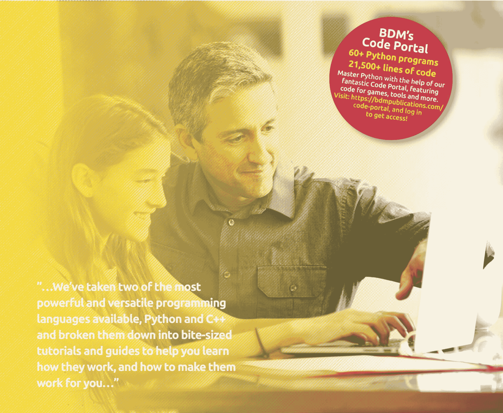

## BDM 代码门户

60+ 个 Python 程序  
21,500+ 行代码

借助我们出色的代码门户掌握 Python，其中包含游戏、工具等代码。

访问：https://bdmpublications.com/code-portal，登录即可获取访问权限！

> “我们选取了目前最强大、最通用的两门编程语言——Python 和 C++，并将它们拆解为短小精悍的教程和指南，帮助你了解它们如何运作，以及如何让它们为你所用……”

# 处理数据


数据就是一切。借助数据，你可以展示、控制、添加、删除、创建和操纵 Python，满足你的各种需求。在接下来的页面中，我们将探讨如何创建列表、元组、字典和多维列表，并了解如何使用它们打造令人兴奋且实用的程序。

然后，你将学习如何使用日期和时间函数、写入系统文件，甚至创建图形用户界面，从而将你的编程技能提升到新水平，并激发新的项目创意。

## 列表

列表是你在 Python 中最常见的数据结构类型之一。列表简单来说就是一组项目（如果你愿意，也可以说是数据）的集合，可以整体访问，也可以按需单独访问。

### 使用列表

列表在 Python 中非常方便。列表可以包含字符串、整数以及变量。你甚至可以在列表中包含函数，以及列表中的列表。

**步骤 1**

列表是称为项目的数据值序列。创建列表时，先写列表名称，接着是等号，然后是用方括号括起来、以逗号分隔的项目；注意字符串要使用引号：

```python
numbers = [1, 4, 7, 21, 98, 156]
mythical_creatures = ["Unicorn", "Balrog", "Vampire", "Dragon", "Minotaur"]
```

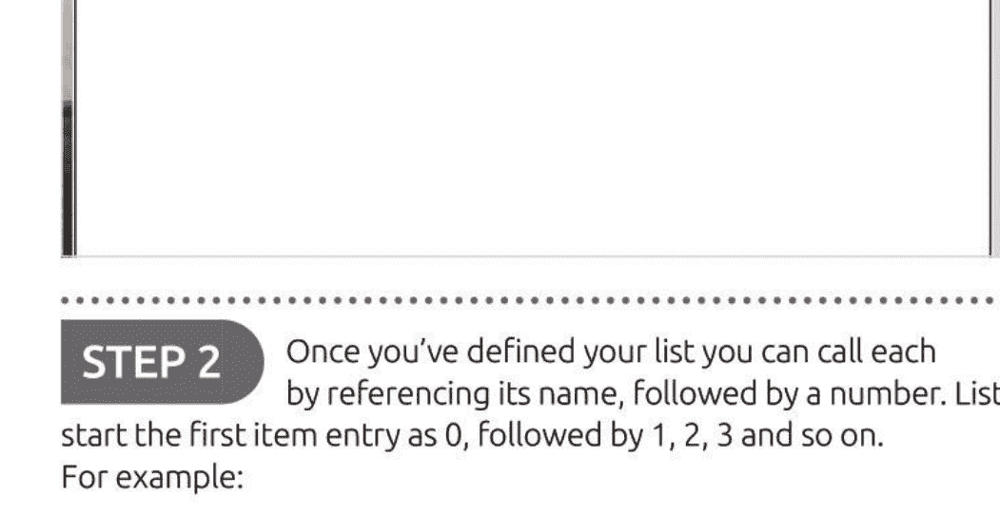

**步骤 2**

定义列表后，你可以通过引用列表名称并后跟一个数字来调用各项。列表的第一项编号为 0，然后是 1、2、3，依此类推。例如：

```python
numbers
```

用于调出列表的完整内容。

```python
numbers[3]
```

用于调用列表中从零开始计数的第三项（本例中为 21）。

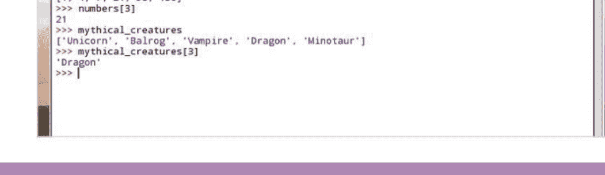

**步骤 3**

你还可以通过在项目编号前使用负号来访问或索引列表中的最后一项，如 [-1]，或用 [-2] 访问倒数第二项，依此类推。尝试引用列表中不存在的项（例如 [10]）将返回错误：

```python
numbers[-1]
mythical_creatures[-4]
```

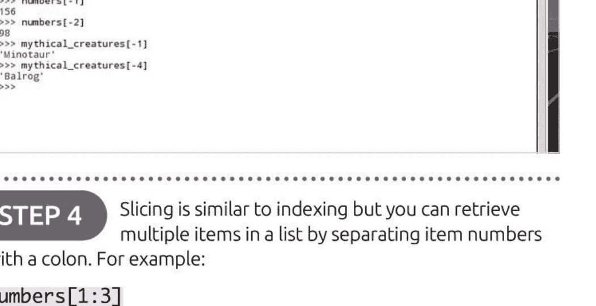

**步骤 4**

切片与索引类似，但你可以通过用冒号分隔项目编号来检索列表中的多个项目。例如：

```python
numbers[1:3]
```

将输出 4 和 7，即项目编号 1 和 2。请注意，返回值不包含第二个索引位置（正如你可能以为 numbers[1:3] 会返回 4、7 和 21）。

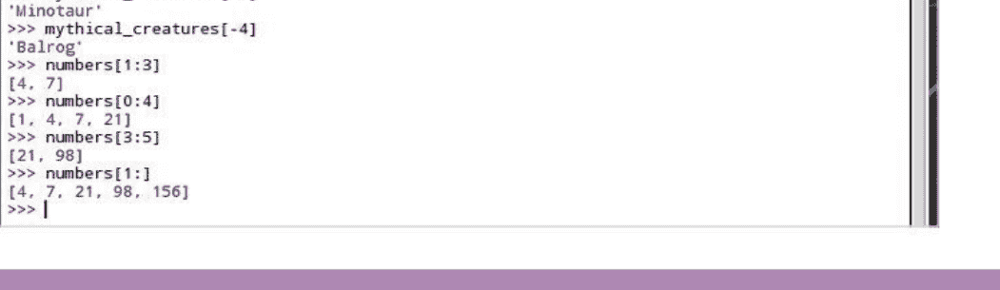

**步骤 5**

你可以更新现有列表中的项目、删除项目，甚至将列表连接在一起。例如，要连接两个列表，可以使用：

```python
everything = numbers + mythical_creatures
```

然后使用以下方式查看合并后的列表：

```python
everything
```

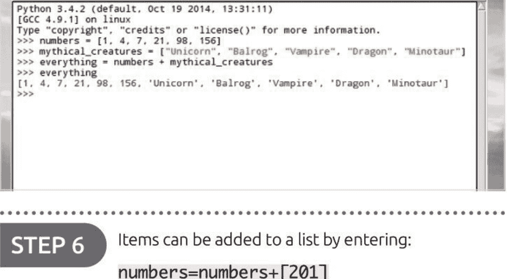

**步骤 6**

可以通过输入以下内容向列表添加项目：

```python
numbers=numbers+[201]
```

或者对于字符串：

```python
mythical_creatures=mythical_creatures+["Griffin"]
```

或者使用 append 函数：

```python
mythical_creatures.append("Nessie")
numbers.append(278)
```

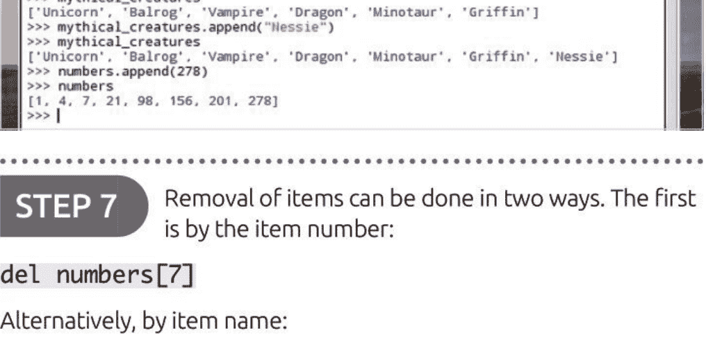

**步骤 7**

删除项目有两种方法。第一种是按项目编号：

```python
del numbers[7]
```

或者，按项目名称：

```python
mythical_creatures.remove("Nessie")
```

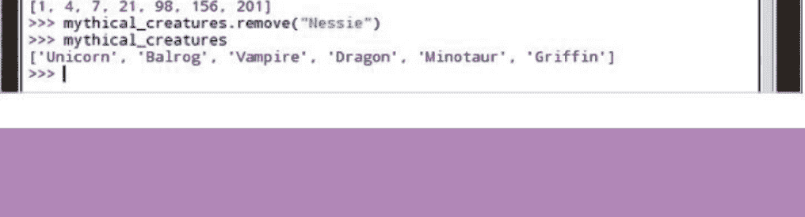

**步骤 8**

你可以在 Shell 中输入 dir(list) 来查看列表可执行的操作。输出为可用函数，例如，insert 和 pop 用于在特定位置添加和删除项目。要在项目索引 4 处插入数字 62：

```python
numbers.insert(4, 62)
```

要删除它：

```python
numbers.pop(4)
```

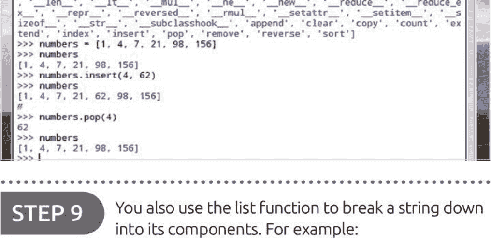

**步骤 9**

你还可以使用 list 函数将字符串拆分为其组成部分。例如：

```python
list("David")
```

会将名字 David 拆分为“D”、“a”、“v”、“i”、“d”。然后可以将其传递给一个新列表：

```python
name=list("David Hayward")
name
age=[44]
user = name + age
user
```

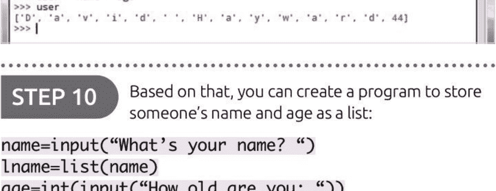

**步骤 10**

基于此，你可以创建一个程序，将某人的姓名和年龄存储为列表：

```python
name=input("What's your name? ")
lname=list(name)
age=int(input("How old are you: "))
lage=[age]

user = lname + lage
```

合并后的姓名和年龄列表称为 user，可以通过在 Shell 中输入 user 来调用它。动手实验一下，看看你能做什么。


## 元组

元组与列表非常相似。然而，列表可以更新、删除或以某种方式更改，而元组则保持不变。这称为不可变，它们非常适合存储固定的数据项。

### 不可变元组

使用元组的原因因程序的目的而异。通常，元组用于某些特殊用途，但它们也用于例如冒险游戏中存储非玩家角色名称。

**步骤 1** — 元组的创建方式与列表相同，但这里使用圆括号而不是方括号。例如：

```python
months=("January", "February", "March", "April", "May", "June")
```

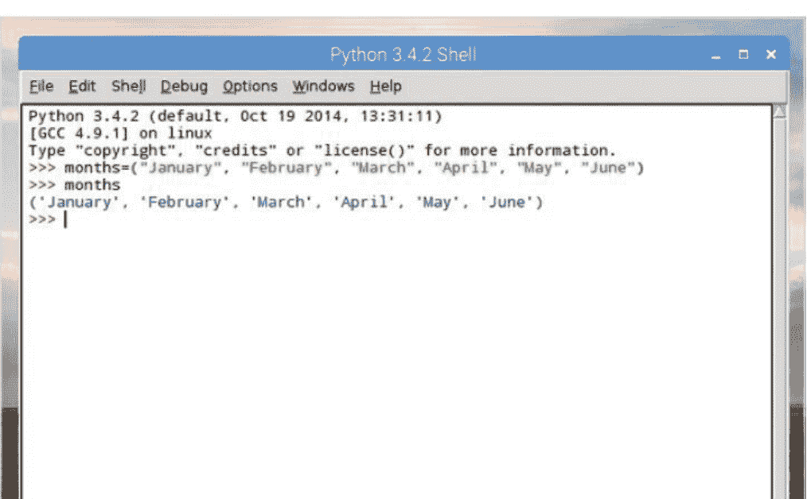

**步骤 2** — 与列表一样，命名元组中的项目可以按照其在数据范围中的位置进行索引，即：

```python
months[0]
months[5]
```

然而，任何删除或向元组添加内容的尝试都会在 Shell 中导致错误。

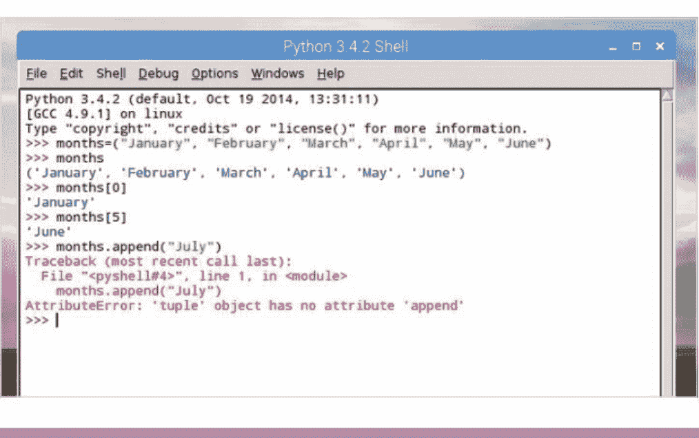

**步骤 3** — 你可以将成组的元组放入包含多组数据的列表中。例如，下面是一个名为 NPC（非玩家角色）的元组列表，包含冒险游戏中的角色名称及其战斗等级：

```python
NPC=[("Conan", 100), ("Belit", 80), ("Valeria", 95)]
```

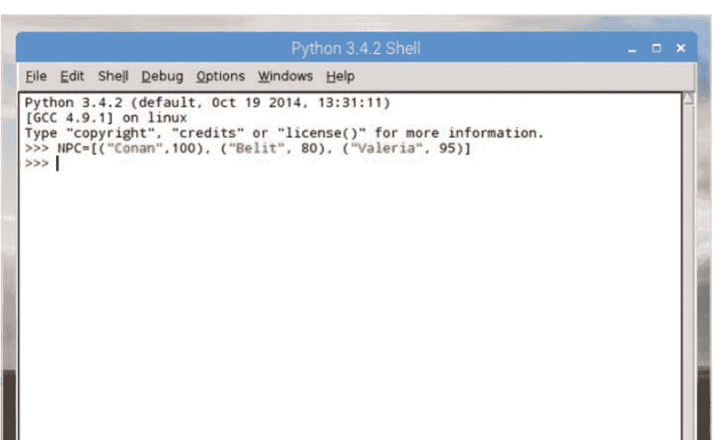

**步骤 4** — 这些数据项中的每一项都可以通过在 Shell 中输入 NPC 来整体访问；也可以按照它们的位置 NPC[0] 进行索引。你还可以索引 NPC 列表中的各个元组：

```python
NPC[0][1]
```

将显示 100。

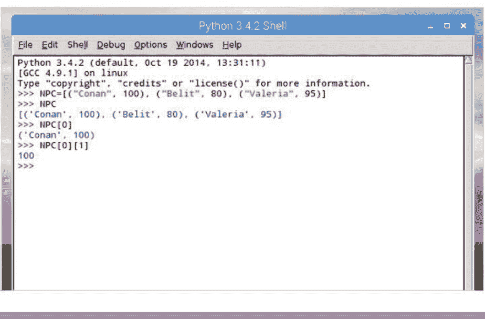


值得注意的是，当在列表中引用多个元组时，索引方式与常规略有不同。你可能会以为角色 Valeria 的 95 点战斗等级对应的是 NPC[4][5]，但事实并非如此。它实际上是：

```
NPC[2][1]
```

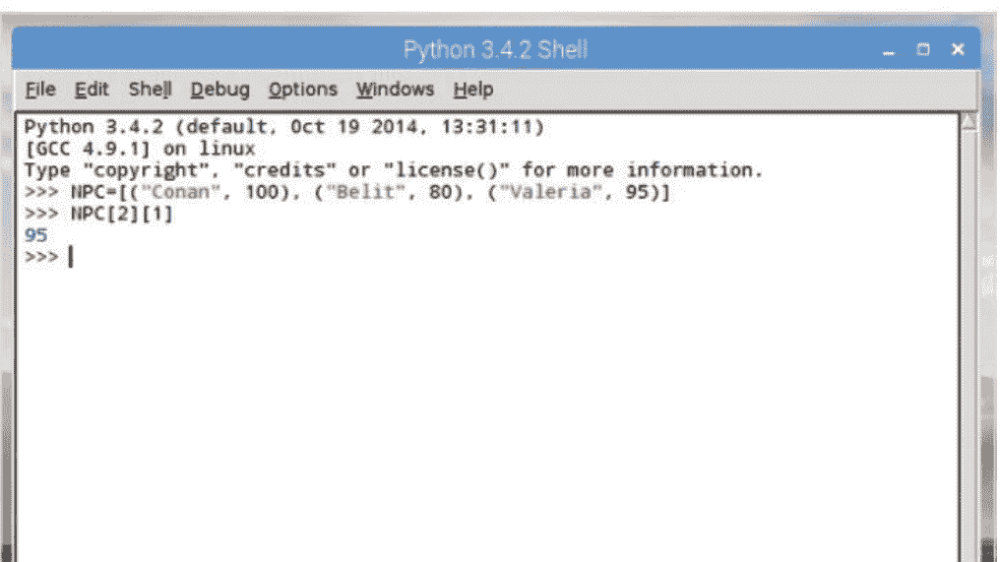

当然，这意味着索引规则如下：

- 0
- 0, 0
- 0, 1
- 1
- 1, 0
- 1, 1
- 2
- 2, 0
- 2, 1

可以想象，当你需要处理大量元组数据时，这会变得有点令人困惑。

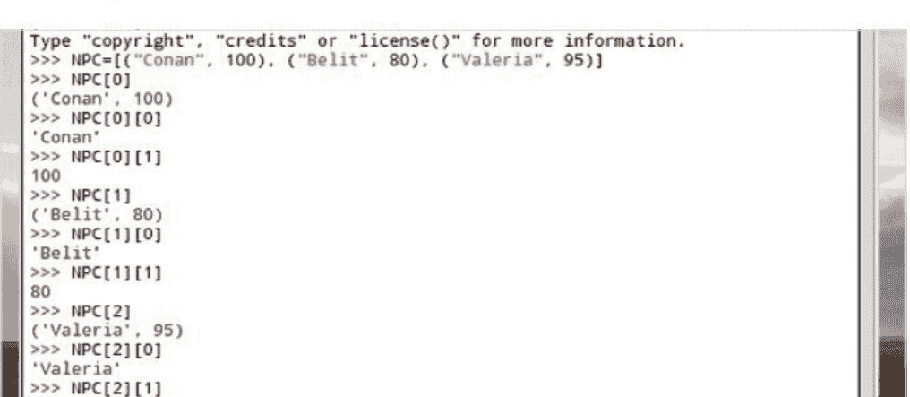

不过，元组利用了一种称为解包的特性，即将存储在元组内的数据项赋值给变量。首先创建一个包含两个项（名称和战斗等级）的元组：

```
NPC=("Conan", 100)
```

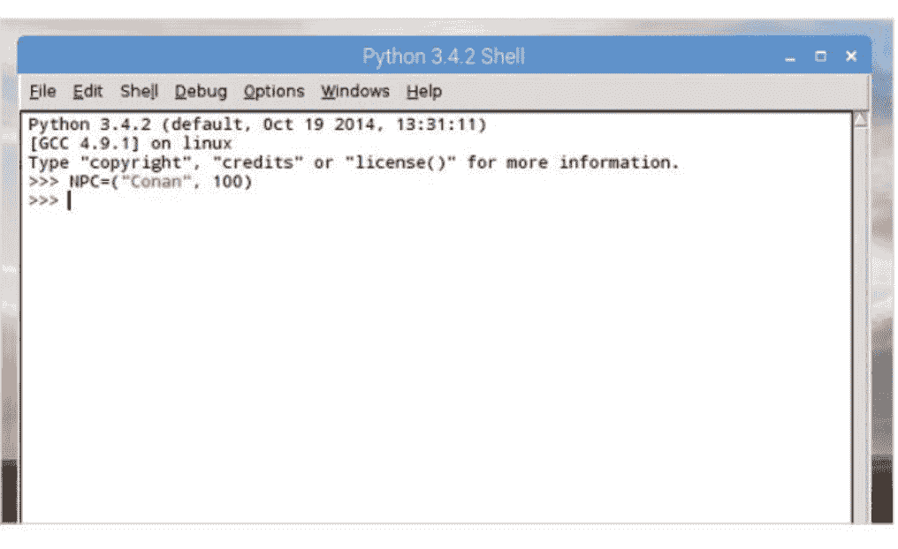

现在将该元组解包到两个对应的变量中：

```
(name, combat_rating)=NPC
```

现在你可以通过输入 name 和 combat_rating 来检查这些值。

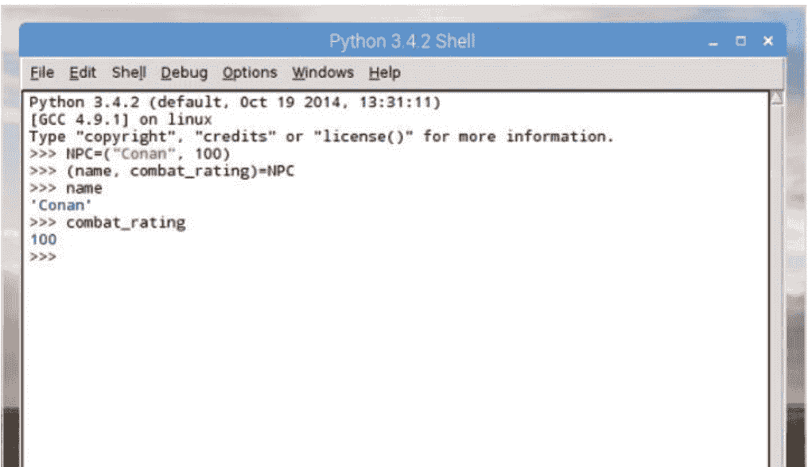

请记住，与列表一样，你也可以使用负数对元组进行索引，负数从数据列表末尾开始向前计数。在我们的示例中，使用包含多个数据项的元组时，你可以这样引用 Valeria 角色：

```
NPC[2][-2]
```

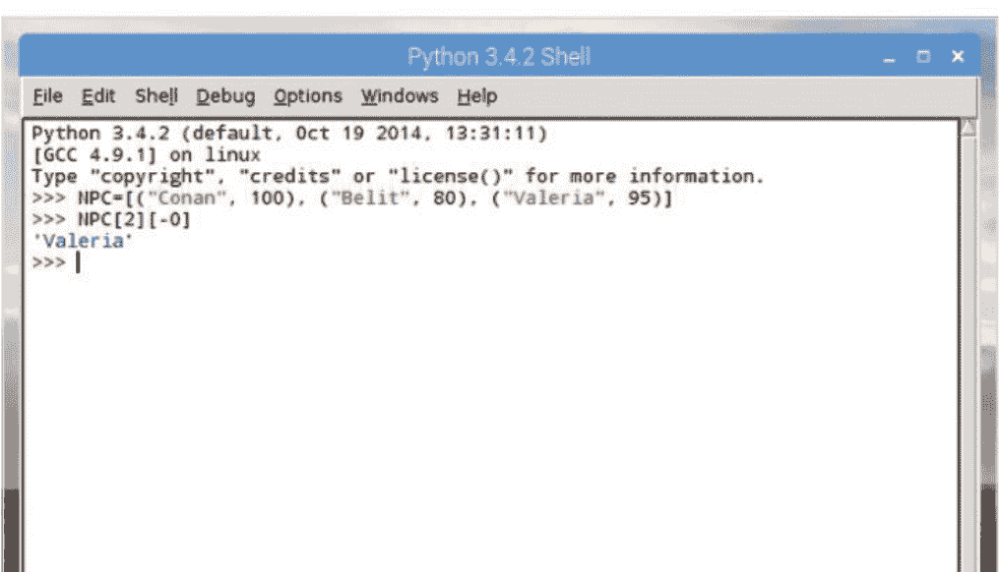

你可以使用 max 和 min 函数来查找由数字组成的元组中的最高值和最低值。例如：

```
numbers=(10.3, 23, 45.2, 109.3, 6.1, 56.7, 99)
```

这些数字可以是整数和浮点数。要输出最高值和最低值，请使用：

```
print(max(numbers))
print(min(numbers))
```

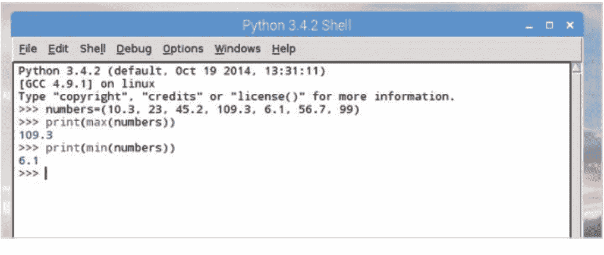

## 字典

列表非常有用，但 Python 中的字典显然是处理数据项更具技术性的方式。一开始可能不容易掌握，但你很快就能将它们应用到自己的代码中。

### 键值对

字典类似于列表，但每个数据项都以成对形式出现，这些对被称为键（Key）和值（Value）。键部分必须唯一，可以是数字或字符串，而值可以是你喜欢的任何数据项。

#### 第 1 步

假设你想在 Python 中创建一个电话簿。你会创建字典名，并在花括号中输入数据，用冒号 `Key:Value` 分隔键和值。例如：

```
phonebook={"Emma": 1234, "Daniel": 3456, "Hannah": 6789}
```

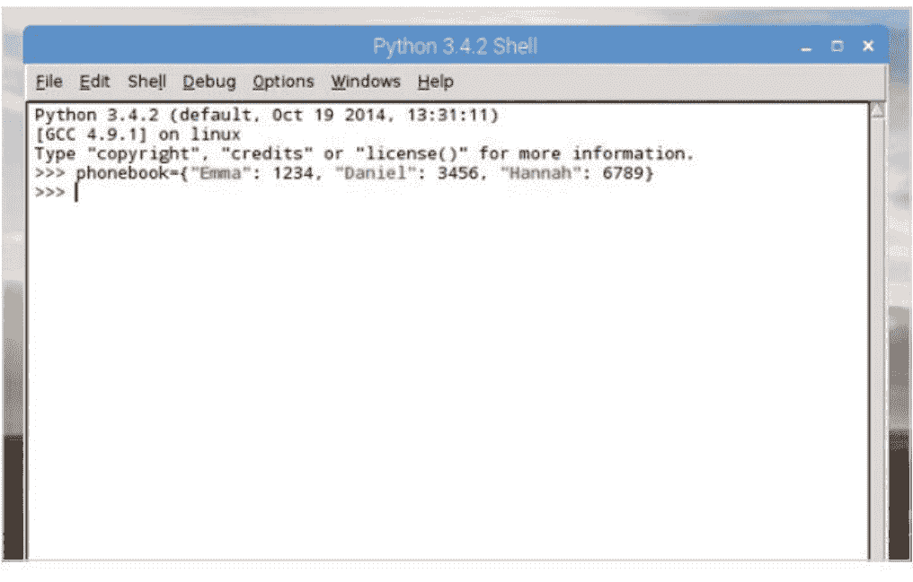

#### 第 2 步

与大多数列表、元组等一样，字符串需要用引号（单引号或双引号）括起来，而整数可以不加引号。请记住，值可以是字符串或整数，你只需将相关的那一个用引号括起来：

```
phonebook2={"David": "0987 654 321"}
```

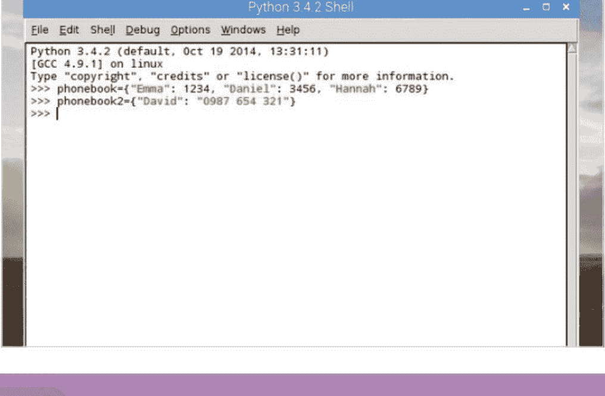

#### 第 3 步

与列表和元组一样，你可以通过给出字典名来检查字典的内容：在本例中是 phonebook。它会以类似于列表的方式显示你输入的数据项，你现在肯定已经熟悉这种方式了。

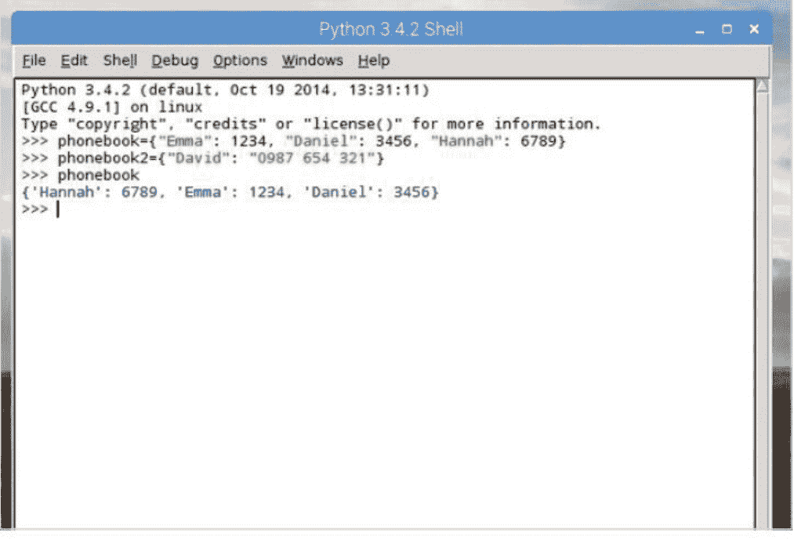

#### 第 4 步

使用字典的好处是，你可以输入键来索引对应的值。使用前面步骤中的电话簿示例，你可以输入：

```
phonebook["Emma"]
phonebook["Hannah"]
```

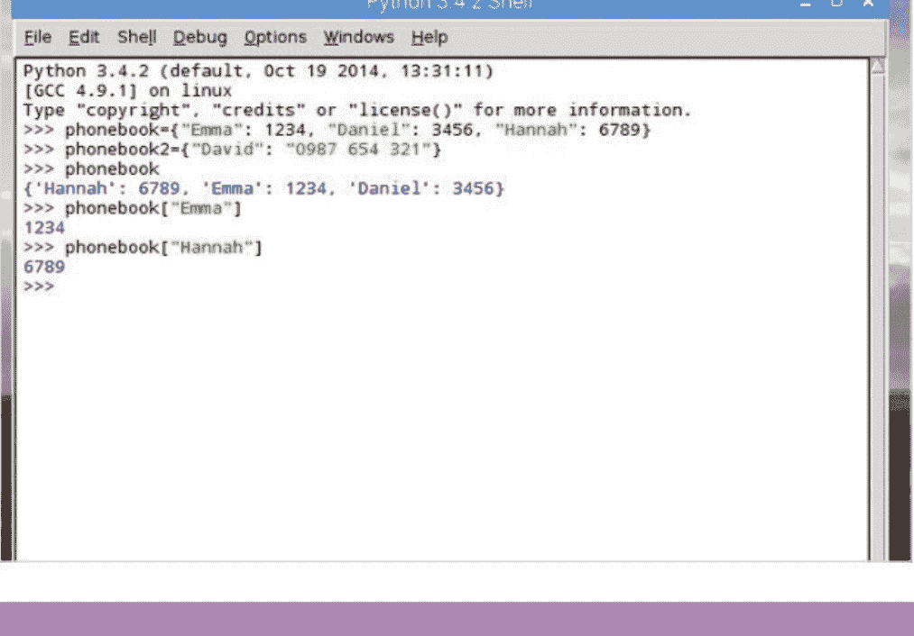

#### 第 5 步

`.split` 函数的对应操作是 `.join`；在 `.join` 中，你会有字符串中的各个独立项，并可以将它们全部连接起来形成一个单词或只是项的组合，具体取决于你编写的程序。例如：

```
alphabet="".join(["a","b","c","d","e"])
alphabet
```

这将在 Shell 中显示 ‘abcde’。

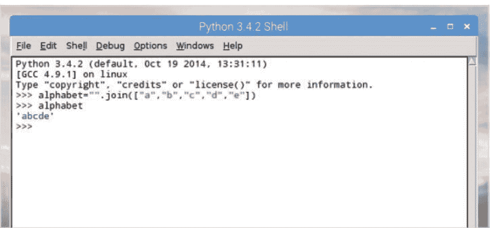

#### 第 6 步

因此，你可以将 join 应用于你在第 4 步中拆分得到的名字，将字母重新组合成名字：

```
name="".join(name)
name
```

我们已经将字符串重新连接起来，并保留了名为 name 的列表，将其传给 `.join` 函数。

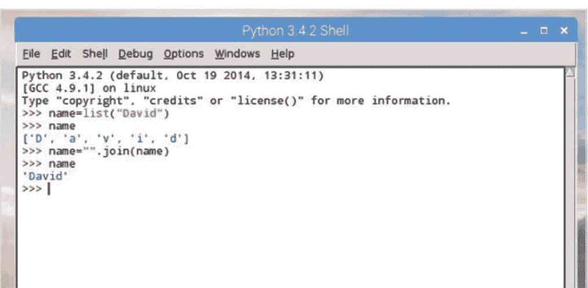

#### 第 7 步

使用 join 函数的一个好例子是，当你有一个单词列表并想将其组合成一句话时：

```
list=["Conan", "raised", "his", "mighty", "sword", "and", "struck", "the", "demon"]
text=" ".join(list)
text
```

注意 `.join` 函数前引号之间的空格（第 6 步的 join 中没有空格）

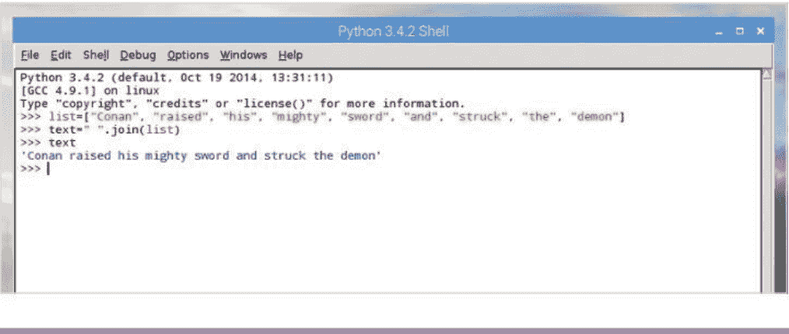

#### 第 8 步

与 `.split` 函数一样，分隔符不必是空格，也可以是逗号、句号、连字符或任何你喜欢的内容：

```
colours=["Red", "Green", "Blue"]
col=", ".join(colours)
col
```

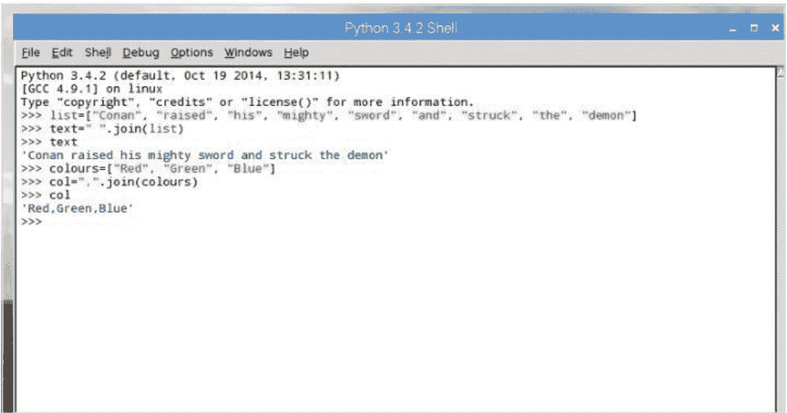

#### 第 9 步

有一些可应用于字符串的有趣函数，例如 `.capitalize` 和 `.title`。例如：

```
title="conan the cimmerian"
title.capitalize()
title.title()
```

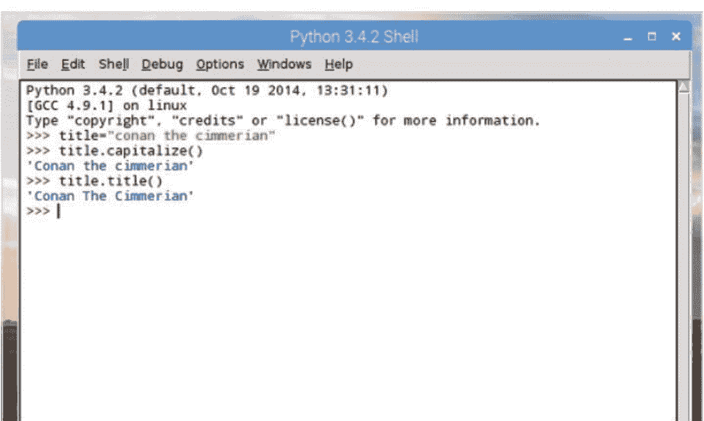

#### 第 10 步

你也可以在字符串上使用逻辑运算符，即 ‘in’ 和 ‘not in’ 函数。它们使你能够检查字符串是否包含（或不包含）某个字符序列：

```
message="Have a nice day"
"nice" in message

"bad" not in message
"day" not in message
"night" in message
```

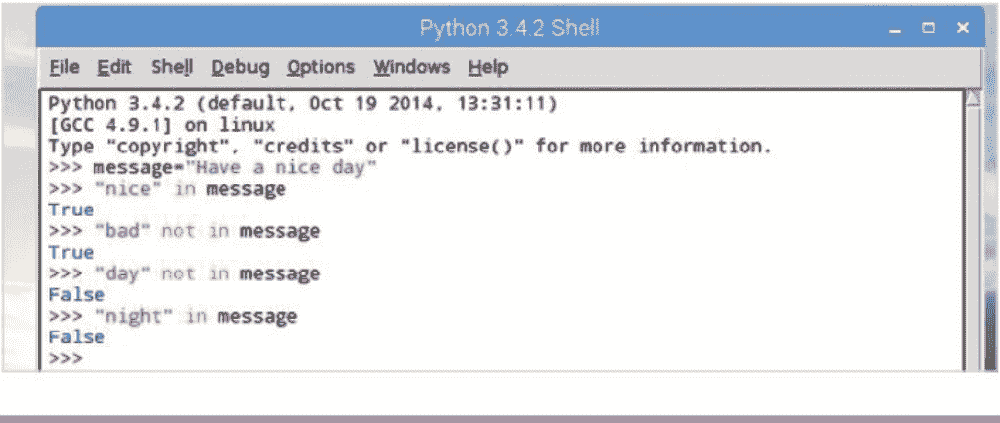

#### 第 5 步

有趣的是，你可以使用字符串格式化函数来引用列表。你需要在列表名前面放一个星号：

```python
numbers=1, 3, 45, 567546, 3425346345
print("Some numbers: {}, {}, {}, {}, {}.".format(*numbers))
```

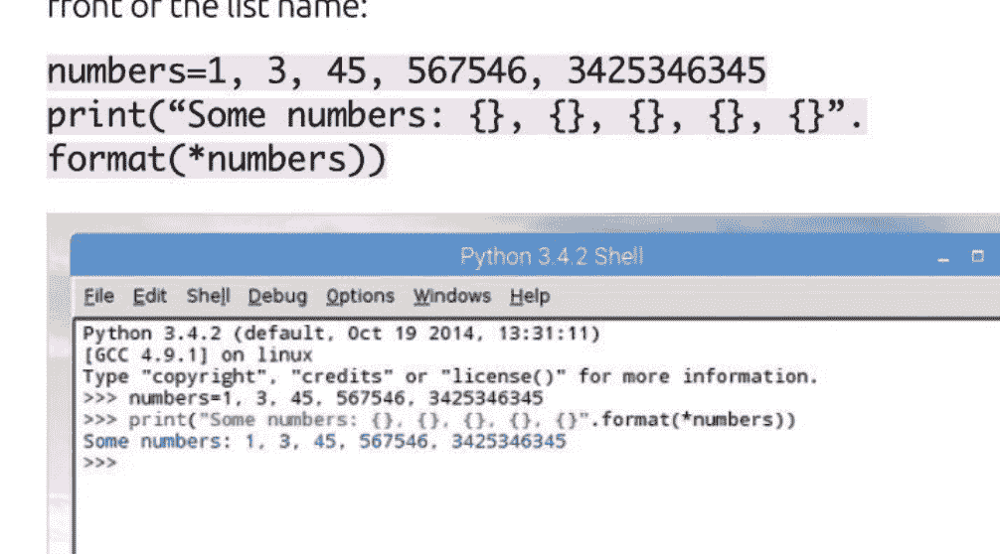

#### 第 6 步

对于列表中的索引，使用字符串格式化调用列表时也同样适用。你可以根据每个项的位置（从 0 到实际存在的数量）对其进行索引：

```python
numbers=1, 4, 7, 9
print("More numbers: {3}, {0}, {2}, {1}".format(*numbers))
```

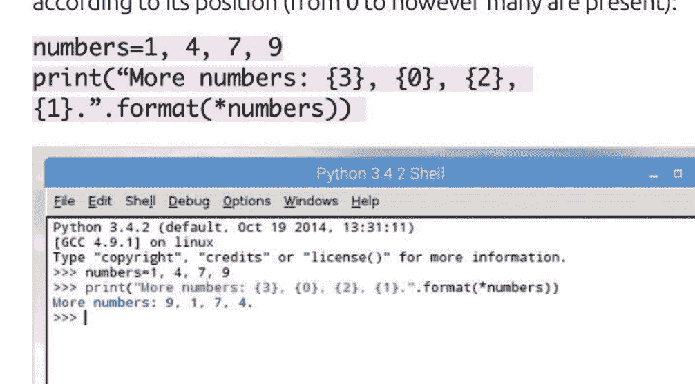

#### 第 7 步

正如你可能猜到的那样，你可以在单个列表中混合字符串和整数，并在 `.format` 函数中调用：

```python
characters=["Conan", "Belit", "Valeria", 19, 27, 20]
print("{0} is {3} years old. Whereas {1} is {4} years old.".format(*characters))
```

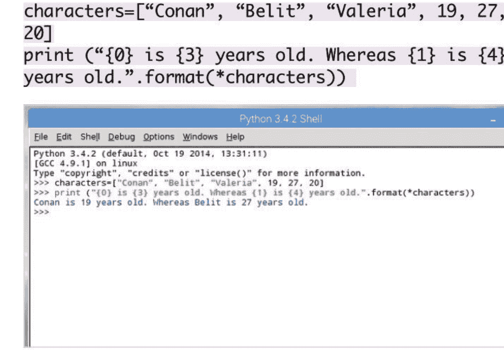

#### 第 8 步

你也可以用同样的方式打印用户输入的内容：

```python
name=input("What's your name? ")
print("Hello {}.".format(name))
```

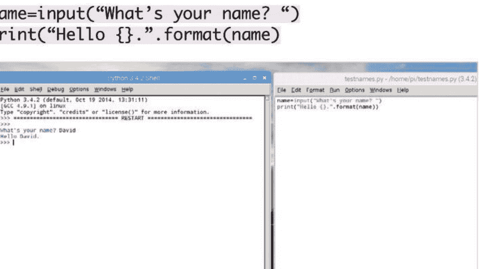

#### 第 9 步

你可以扩展这个简单的代码示例，以显示用户所输入名字的首字母：

```python
name=input("What's your name? ")
print("Hello {}.".format(name))
lname=list(name)
print("The first letter of your name is a {}.".format(*lname))
```

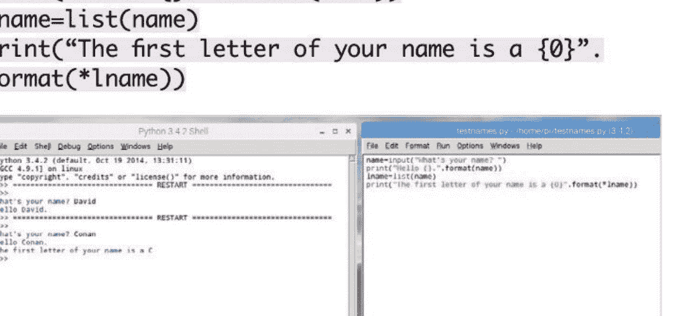

#### 第 10 步

你还可以调用两个列表，并在同一个 print 函数中分别引用它们。回顾第 7 步的代码，你可以这样修改：

```python
names=["Conan", "Belit", "Valeria"]
ages=[25, 21, 22]
```

创建两个列表。现在你可以调用每个列表以及其中的各个项：

```python
print("{0[0]} is {1[0]} years old. Whereas {0[1]} is {1[1]} years old.".format(names, ages))
```

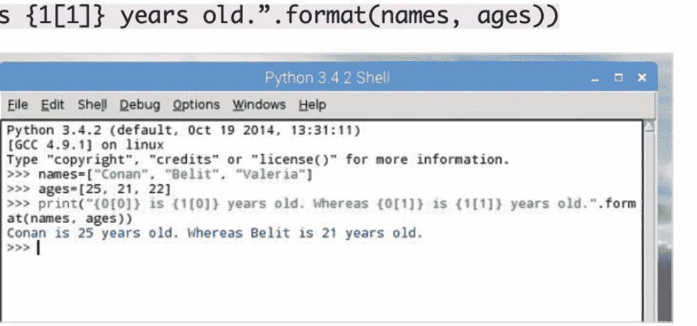

## 日期与时间

处理数据时，能够访问时间通常很方便。例如，你可能想为一条记录添加时间戳，或者查看用户何时登录系统以及登录了多长时间。幸运的是，借助 time 模块，获取日期和时间很容易。

### 时间领主

time 模块包含一些函数，可帮助你获取当前系统时间、从字符串读取日期、格式化时间和日期等等。

#### 第 1 步

首先，你需要导入 time 模块。它是 Python 3 内置的模块，因此你不需要进入命令提示符并用 pip 安装它。导入后，你可以用一条简单命令调用当前时间和日期：

```
import time
time.asctime()
```

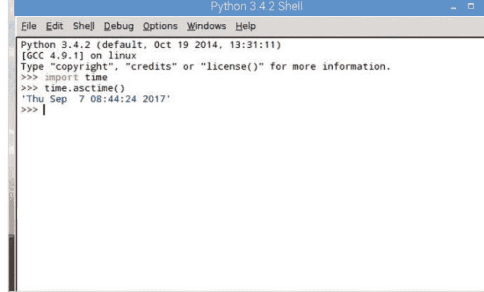

#### 第 2 步

time 函数被拆分为九个元组，这些元组像任何其他元组一样被划分为带索引的项，如下面的截图所示。

| 索引 | 字段 | 值 |
|---:|---|---|
| 0 | 4 位年份 | 2016 |
| 1 | 月 | 1 到 12 |
| 2 | 日 | 1 到 31 |
| 3 | 小时 | 0 到 23 |
| 4 | 分钟 | 0 到 59 |
| 5 | 秒 | 0 到 61（60 或 61 为闰秒） |
| 6 | 星期几 | 0 到 6（0 为星期一） |
| 7 | 一年中的第几天 | 1 到 366（儒略日） |
| 8 | 夏令时 | -1、0、1，-1 表示由库决定夏令时 |

#### 第 3 步

输入以下内容，即可查看时间的呈现结构：

```
time.localtime()
```

输出如下所示：`time.struct_time(tm_year=2017, tm_mon=9, tm_mday=7, tm_hour=9, tm_min=6, tm_sec=13, tm_wday=3, tm_yday=250, tm_isdst=0)`；显然，输出取决于你当前的时间，而不是上面显示的时间。

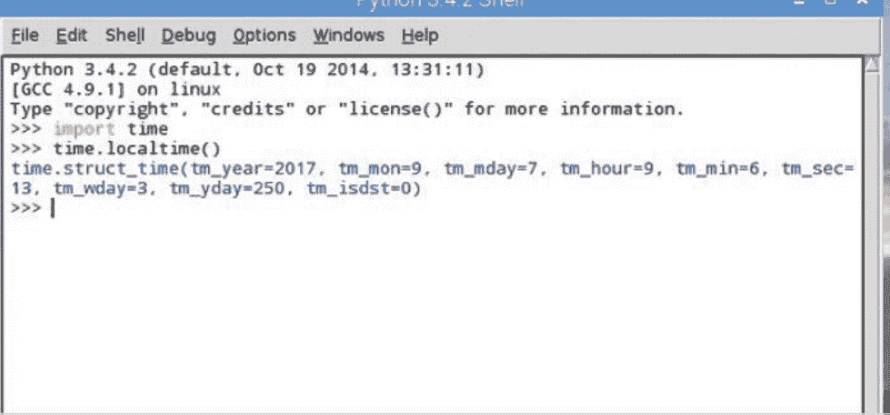

#### 第 4 步

time 模块内置了许多函数。其中最常见的一个是 `.strftime()`。使用它时，你可以传入多种参数，因为它会将时间元组转换为字符串。例如，要显示当前星期几，你可以使用：

```
time.strftime('%A')
```

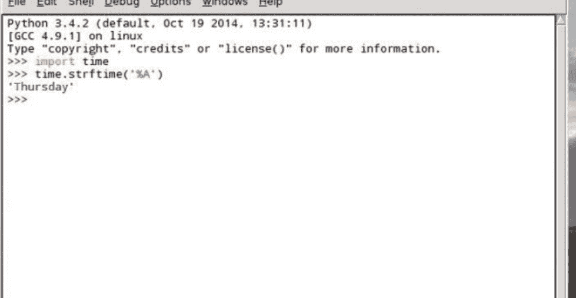


- **步骤 5**

这自然意味着你可以将各种函数整合到自己的代码中，例如：

```python
time.strftime("%a")
time.strftime("%B")
time.strftime("%b")
time.strftime("%H")
time.strftime("%H%M")
```

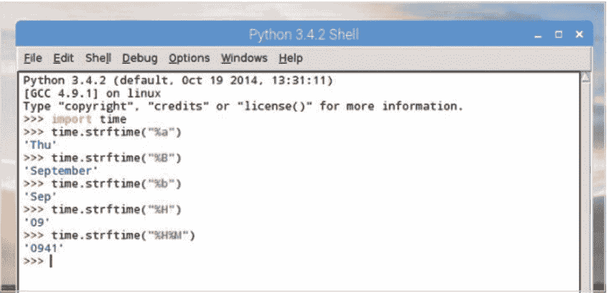

- **步骤 6**

注意最后两项，即 %H 和 %H%M；如你所见，它们分别表示小时和分钟，而最后一项表明，将它们作为 %H%M 输入并不会在 Shell 中正确显示时间。你可以通过以下方式轻松修正：

```python
time.strftime("%H:%M")
```

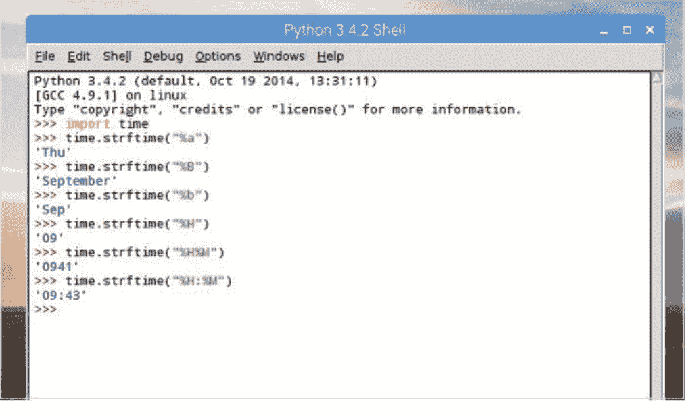

- **步骤 7**

这意味着你将能够显示当前时间，或某件事发生的时间，例如用户输入其姓名的时间。在编辑器中试试这段代码：

```python
import time
name=input("Enter login name: ")
print("Welcome", name, "%d")
print("User:", name, "logged in at", time.strftime("%H:%M"))
```

尝试进一步扩展它，加入日、月、年等内容。

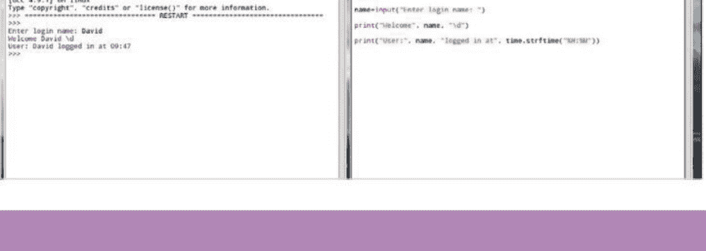

- **步骤 8**

你在上一节末尾看到过，在将圆周率计算到用户所需任意小数位数的代码中，你可以为 Python 中的特定事件计时。取上面的代码，并通过加入以下内容稍作修改：

```python
start_time=time.time()
```

然后是：

```python
endtime=time.time()-start_time
```

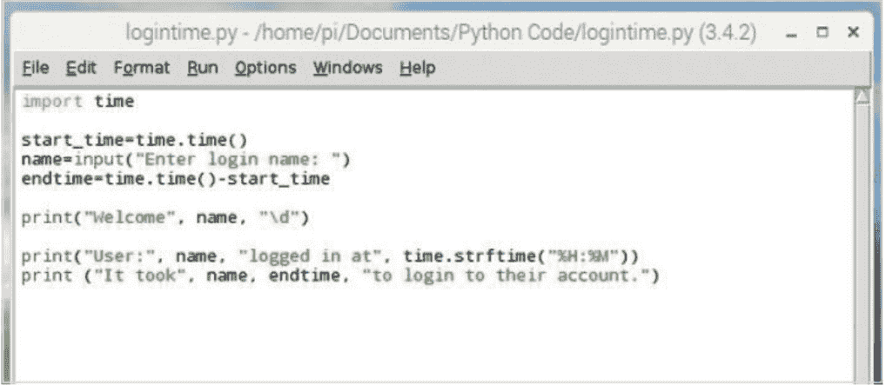

- **步骤 9**

输出将类似于下面的截图。计时函数需要位于输入语句的两侧，因为此时变量名正在被创建，具体取决于用户登录所花的时间。然后，时长会作为 endtime 变量显示在代码的最后一行。

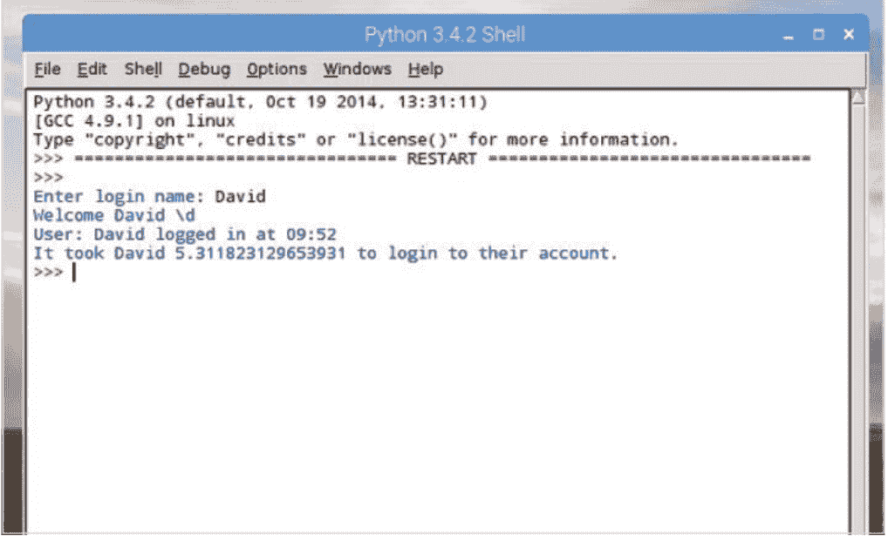

- **步骤 10**

time 模块可以做很多事情；其中一些也相当复杂，例如显示自 1970 年 1 月 1 日以来的秒数。如果你想进一步深入了解 time 模块，那么在 Shell 中输入：`help(time)`，以显示当前 Python 版本中 time 模块的帮助文件。

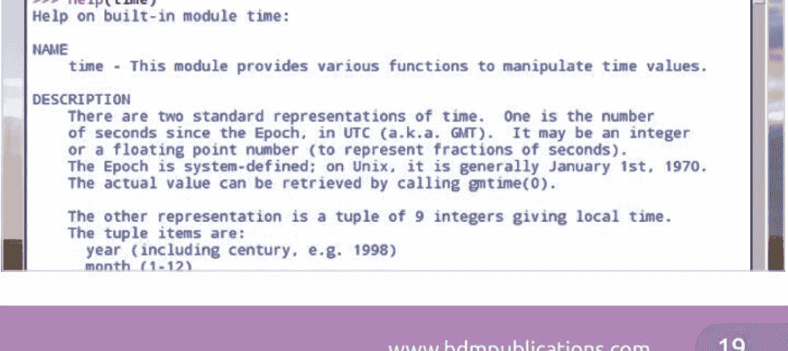

## 打开文件

在 Python 中，你可以在程序里读取文本文件和二进制文件。你也可以写入文件，这是我们接下来要看的内容。读写文件使你能够从程序中输出并存储数据。

### 打开、读取和写入

在 Python 中，你可以创建一个文件对象，类似于创建变量，只是需要使用 open() 函数传入文件。文件通常分为文本文件或二进制文件。

- **步骤 1**

首先，在系统的文本编辑器中输入一些文本。最好使用文本编辑器，而不是文字处理软件，因为文字处理软件会包含背景格式和其他元素。在我们的示例中，我们有罗伯特·E·霍华德的诗歌《辛梅里安人》。你需要将文件保存为 poem.txt。

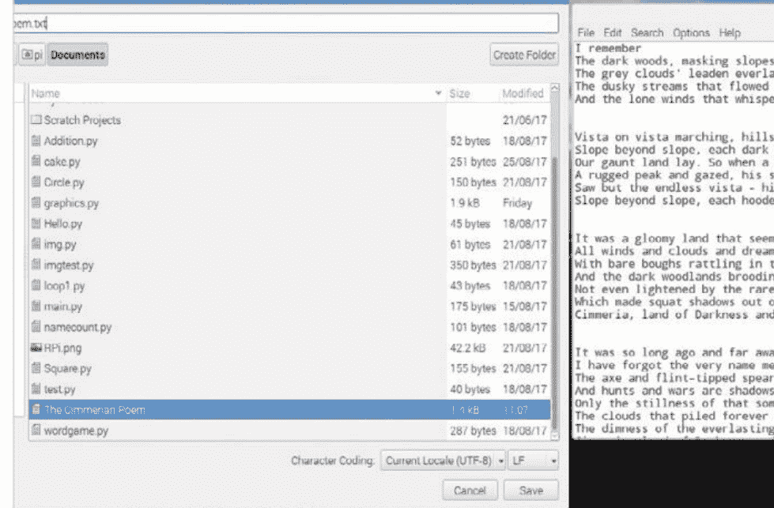

- **步骤 2**

你使用 open() 函数将文件作为对象传入一个变量。你可以随意命名文件对象，但需要告诉 Python 你要打开的文本文件的名称和位置：

```python
poem=open("/home/pi/Documents/Poem.txt")
```

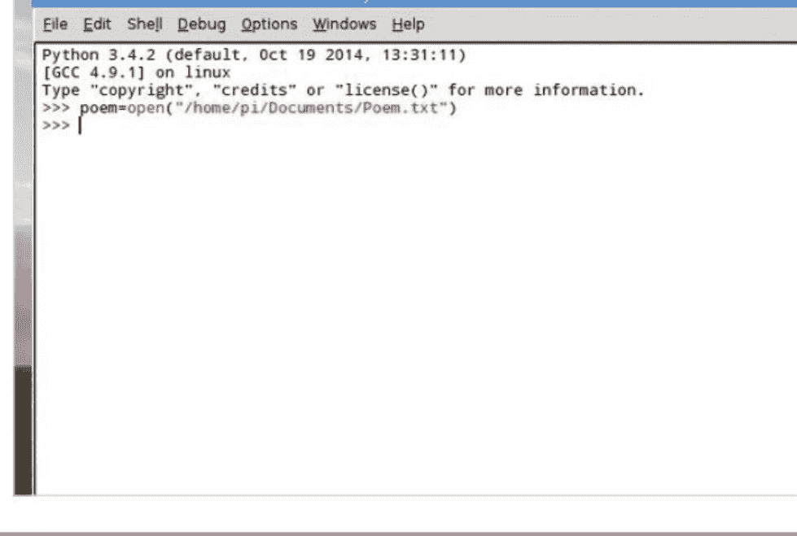

- **步骤 3**

如果你现在在 Shell 中输入 poem，就会得到一些关于你刚刚要求打开的文本文件的信息。现在你可以使用 poem 变量来读取文件内容：

```python
poem.read()
```

请注意，文本中的 `\n` 条目表示换行，正如你之前所使用的那样。

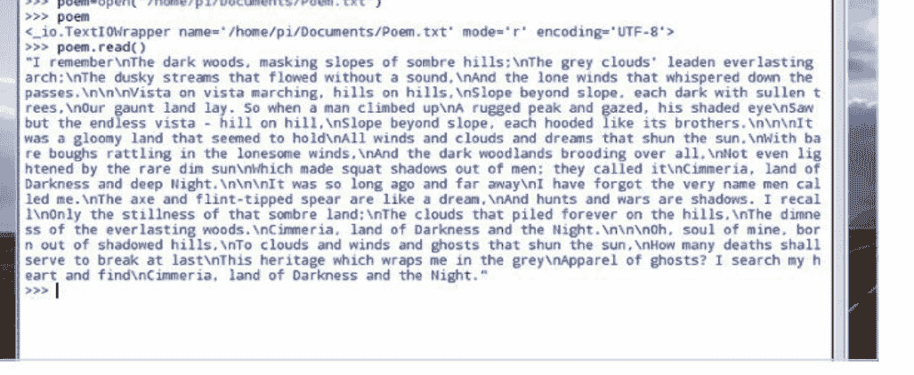

- **步骤 4**

如果你第二次输入 poem.read()，你会注意到文本已从文件中移除。你需要再次输入：poem=open("/home/pi/Documents/Poem.txt") 来重新创建该文件。不过，这一次请输入：print(poem.read())

```python
poem=open("/home/pi/Documents/Poem.txt")
print(poem.read())
```

这一次，`\n` 条目被移除，改为换行和可读文本。


- **步骤 5**

要扩展这段代码，你可以使用 `a` 重新打开文件，即访问或追加模式。这会将任何文本添加到原始行的末尾，而不是清空文件并创建新文件。例如：

```python
t=open("/home/pi/Documents/text.txt","a")
t.write("\n")
t.write("You stand and survey your surroundings. On top of the table is some meat, and a cup of water.\n")
```

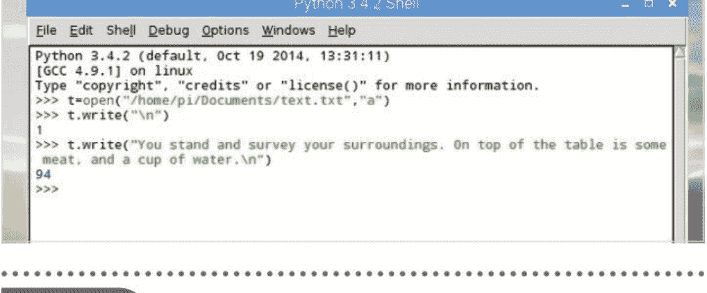

- **步骤 6**

你可以继续逐行扩展文本，每行以换行符（`\n`）结尾。完成后，用 `t.close()` 结束代码，并在文本编辑器中打开文件以查看结果：

```python
t.write("The door is made of solid oak with iron strips. It’s bolted from the outside, locking you in. You are a prisoner!\n")
t.close()
```

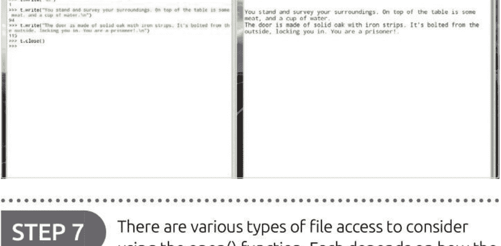

- **步骤 7**

使用 `open()` 函数时，有多种文件访问类型需要考虑。每种类型都取决于文件的访问方式，甚至取决于光标的位置。例如，`r+` 以读写方式打开文件，并将光标放在文件开头。


- **步骤 8**

你可以将变量传入你在 Python 中创建的文件。也许你想将圆周率的值写入文件。你可以从 math 模块中调用圆周率，创建一个新文件，并将圆周率的输出传入新文件：

```python
import math
print("Value of Pi is: ",math.pi)
print("\nWriting to a file now...")
```


- **步骤 9**

现在，让我们创建一个名为 pi 的变量，并将圆周率的值赋给它：

```python
pi=math.pi
```

你还需要创建一个新文件，以便将圆周率写入其中：

```python
t=open("/home/pi/Documents/pi.txt","w")
```

记得将文件位置更改为你自己特定的系统设置。


- **步骤 10**

最后，你可以使用字符串格式化来调用该变量并将其写入文件，然后提交更改并关闭文件：

```python
t.write("Value of Pi is: {}".format(pi))
t.close()
```

从结果中可以看出，你可以将任何变量传入文件。


## 异常

编码时，你自然会遇到一些无法控制的问题。假设你要求用户将两个数字相除，而他们试图除以零。这会产生错误并中断你的代码。

### 异常对象

Python 不会停止代码流程，而是包含异常对象来处理代码中的意外错误。你可以通过创建可能发生异常的条件来应对错误。

- **步骤 1**

你可以通过简单地尝试将一个数字除以零来创建异常错误。这会返回 ZeroDivisionError: Division by zero 消息，如截图所示。其中 ZeroDivisionError 部分是异常类，这样的异常类有很多。


- **步骤 2**

大多数异常会在 Python 遇到代码中本质错误时自动引发。但是，你可以创建自己的异常，用来包含潜在错误并对其做出反应，而不是让代码失败。


- **步骤 3**

你可以使用 `raise Exception` 函数在 Python 中创建自己的错误处理代码。假设你的代码让你在宇宙中穿梭，但穿梭过度会导致曲速核心破裂。为了防止游戏因曲速核心超新星爆发而退出，你可以创建一个自定义异常：

```python
raise Exception("warp core breach")
```


- **步骤 4**

要捕获代码中的任何错误，你可以将潜在错误包裹在 `try` 块中。这个块由 try、except、else 组成，其中代码放在 try 中；然后如果有异常，就做某些事情，否则做另一些事情。


#### 第 5 步

例如，使用除零错误。你可以创建一个异常，让代码能够处理该错误，而不会因该问题导致 Python 退出：

```python
try:
    a=int(input("Enter the first number: "))
    b=int(input("Enter the second number: "))
    print(a/b)
except ZeroDivisionError:
    print("You have tried to divide by zero!")
else:
    print("You didn't divide by zero. Well done!")
```


#### 第 8 步

当然，你可以通过将只读的 "r" 实例改为用于写入的 "w" 来快速修复问题。如你所知，这会创建文件、写入内容，然后将更改提交到文件。最终结果会报告一组不同的情况，在这里是代码成功执行。


#### 第 6 步

你可以使用异常来处理各种有用的任务。借用我们之前教程中的一个示例，假设你想打开一个文件并向其中写入内容：

```python
try:
    txt = open("/home/pi/Documents/textfile.txt", "r")
    txt.write("This is a test. Normal service will shortly resume!")
except IOError:
    print ("Error: unable to write the file. Check permissions")
else:
    print ("Content written to file successfully. Have a nice day.")
    txt.close()
```


#### 第 9 步

你也可以使用 finally: 块，它的工作方式类似，但不能与 else 一起使用。沿用第 6 步中的示例：

```python
try:
    txt = open("/home/pi/Documents/textfile.txt", "r")
    try:
        txt.write("This is a test. Normal service will shortly resume!")
    finally:
        print ("Content written to file successfully. Have a nice day.")
        txt.close()
except IOError:
    print ("Error: unable to write the file. Check permissions")
```


#### 第 7 步

显然，这不会奏效，因为 textfile.txt 文件是以只读方式（"r" 部分）打开的。因此在这种情况下，不是 Python 告诉你做错了什么，而是你使用 IOError 类创建了一个异常，通知用户权限不正确。


#### 第 10 步

和之前一样，由于你使用了 "r" 只读权限，将会发生错误。如果将其改为 "w"，那么代码将执行，而不会在 IDLE Shell 中显示错误。不用说，第一次就正确编写异常代码可能很棘手。不过，多加练习，你就会掌握窍门。


#### 第 5 步

你可以在正方形代码中添加一行来添加一些颜色：

```python
turtle.color("Red")
```

然后你甚至可以通过输入以下内容将角色改为真正的海龟：

```python
turtle.shape("turtle")
```

你还可以使用命令 `turtle.begin_fill()` 和 `turtle.end_fill()` 用所选颜色填充正方形；在此例中为红色轮廓、黄色填充。


#### 第 6 步

你可以看到，Turtle 模块可以绘制出一些相当不错的形状，并且随着你开始掌握其工作方式，会变得稍微复杂一些。输入这个示例：

```python
from turtle import *
color('red', 'yellow')
begin_fill()
while True:
    forward(200)
    left(170)
    if abs(pos()) < 1:
        break
end_fill()
done()
```


这是另一种方法，但非常有效。

#### 第 7 步

显示图形的另一种方式是使用 Pygame 模块。pygame 可以通过多种方式帮助你将图形输出到屏幕，但现在我们先来看看如何显示预定义的图像。首先打开浏览器并找到一张图像，然后将其保存到你保存 Python 代码的文件夹中。


#### 第 8 步

现在，我们通过导入 pygame 模块来编写代码：

```python
import pygame
pygame.init()

img = pygame.image.load("RPi.png")

white = (255, 255, 255)
w = 900
h = 450
screen = pygame.display.set_mode((w, h))
screen.fill((white))

screen.fill((white))
screen.blit(img,(0,0))
pygame.display.flip()

while True:
    for event in pygame.event.get():
        if event.type == pygame.QUIT:
            pygame.quit()
```


#### 第 9 步

在上一步中，你导入了 pygame，初始化了 pygame 引擎，并让它导入我们保存的树莓派标志图像（保存为 RPi.png）。接下来，你定义了用于显示图像的窗口背景颜色，以及按照实际图像尺寸设置的窗口大小。最后，你有一个用于关闭窗口的循环。

```python
w = 900
h = 450
screen = pygame.display.set_mode((w, h))
screen.fill((white))

screen.fill((white))
screen.blit(img,(0,0))
pygame.display.flip()

while True:
    for event in pygame.event.get():
        if event.type == pygame.QUIT:
            pygame.quit()
```

#### 第 10 步

按 F5 保存并执行代码，你的图像将显示在一个新窗口中。你可以尝试调整颜色、尺寸等，并花时间查阅 pygame 模块中的许多函数。


# 使用模块


Python 模块就是一个由 Python 创建的源文件，其中包含类、函数和全局变量所需的代码。你可以绑定和引用模块来扩展功能，并创建更加出色的 Python 程序。

想了解如何改进这些模块，为你的代码增添一点额外内容吗？那么请继续阅读，了解如何使用它们来打造出色的代码。

## 日历模块

除了 time 模块之外，calendar 模块在你的代码中执行时也能产生一些有趣的结果。它远不止以类似 time 模块的格式简单显示日期，你实际上可以调出挂历式显示。

### 处理日期

calendar 模块内置于 Python 3 中。但是，如果由于某种原因未安装，你可以以 Windows 管理员身份使用 `pip install calendar` 添加它，或在 Linux 和 macOS 上使用 `sudo pip install calendar`。

第 1 步——启动 Python 3 并输入：`import calendar` 以调用该模块及其固有函数。将其加载到内存后，首先输入：

```
sep=calendar.TextCalendar(calendar.SUNDAY)
sep.prmonth(2017, 9)
```


第 2 步——你可以看到，2017 年 9 月的日期以挂历形式显示。当然，你可以将第二行中的 2017, 9 部分改为你想要的任何年份和月份，例如某个生日（1973, 6）。第一行将 TextCalendar 配置为以星期日作为每周的开始；如果你愿意，也可以选择星期一。


第 3 步——calendar 模块中有许多函数在你编写自己的代码时可能会感兴趣。例如，你可以显示两个特定年份之间的闰年数量：

```
leaps=calendar.leapdays(1900, 2018)
print(leaps)
```

结果为 29，从 1904 年开始往后计算。


第 4 步——你甚至可以将那个特定示例改造成一段可运行、用户可交互的 Python 代码：

```
import calendar
print(">>>>>>>>Leap Year Calculator<<<<<<<<\n")
y1=int(input("Enter the first year: "))
y2=int(input("Enter the second year: "))
leaps=calendar.leapdays(y1, y2)
print("Number of leap years between", y1, "and", y2, "is:", leaps)
```


#### 第 5 步

你还可以创建一个程序，显示给定年份中的所有日期、周和月份：

```python
import calendar
year=int(input("Enter the year to display: "))
print(calendar.prcal(year))
```

我们相信你会同意，这是一段相当方便、可随手使用的代码。


#### 第 8 步

你还可以打印各个单独月份或星期几：

```python
import calendar
for name in calendar.month_name:
    print(name)

import calendar
for name in calendar.day_name:
    print(name)
```


#### 第 6 步

有趣的是，我们还可以使用一个简单的 for 循环列出某个月中的天数：

```python
import calendar
cal=calendar.TextCalendar(calendar.SUNDAY)
for i in cal.itermonthdays(2018, 6):
    print(i)
```


#### 第 9 步

calendar 模块还允许我们将这些函数写入 HTML，以便你可以在网站上显示它。让我们从创建一个新文件开始：

```python
import calendar
cal=open("/home/pi/Documents/cal.html", "w")
c=calendar.HTMLCalendar(calendar.SUNDAY)
cal.write(c.formatmonth(2018, 1))
cal.close()
```

这段代码将创建一个名为 cal 的 HTML 文件，用浏览器打开它，就会显示 2018 年 1 月的日历。


#### 第 7 步

你可以看到，该代码在开头产生了一些零，这是由于一周的起始日（此处为星期日）以及上个月重叠的日期。因此，日期计数将从 2018 年 6 月 1 日星期五开始，并且如输出正确显示的那样，总数为 30。


#### 第 10 步

当然，你可以修改它，将给定年份显示为网页日历：

```python
import calendar

year=int(input("Enter the year to display as a webpage: "))
cal=open("/home/pi/Documents/cal.html", "w")
cal.write(calendar.HTMLCalendar(calendar.MONDAY).formatyear(year))
cal.close()
```

这段代码会向用户询问年份，然后创建所需的网页。记得更改你的文件目标路径。


## OS 模块

OS 模块允许你直接与操作系统中内置的命令进行交互。命令会因你所运行的操作系统而异，因为有些命令适用于 Windows，而另一些则适用于 Linux 和 macOS。

### 进入系统

OS 模块的主要功能之一是能够列出、移动、创建、删除以及以其他方式与系统上存储的文件进行交互，这使其成为编写备份代码的理想模块。

- **步骤 1** — 你可以通过一些简单函数来启动 OS 模块，看看它如何与 Python 运行所在的操作系统环境交互。如果你使用的是 Linux 或 Raspberry Pi，请尝试以下操作：

```python
import os
home=os.getcwd()
print(home)
```


- **步骤 2** — 打印变量 home 返回的结果是系统上当前用户的主文件夹。在我们的示例中，它是 `/home/pi`；它会因你登录的用户名和使用的操作系统而异。例如，Windows 10 将输出：`C:\Program Files (x86)\Python36-32`。


- **步骤 3** — Windows 的输出不同，因为这是系统确定的 Python 当前工作目录；正如你可能猜到的那样，`os.getcwd()` 函数是在要求 Python 检索当前工作目录。Linux 用户会看到与 Raspberry Pi 类似的内容，macOS 用户也是如此。


- **步骤 4** — OS 模块另一个有趣的特性是能够启动安装在主机系统中的程序。例如，如果你想从 Python 程序内部启动 Chromium 浏览器，可以使用以下命令：

```python
import os
browser=os.system("/usr/bin/chromium-browser")
```


## 随机模块

随机模块是你在 Python 编程生涯中很可能多次遇到的模块；顾名思义，它旨在生成随机数字或字母。不过，它并非真正随机，但对大多数需求来说已经足够。

### 随机数

随机模块中有许多函数，应用这些函数可以创建一些有趣且非常有用的 Python 程序。

- **步骤 1**  
就像其他模块一样，你需要先导入 random，然后才能使用本教程中将要介绍的任何函数。让我们先简单地打印一个 1 到 5 之间的随机数：

```python
import random
print(random.randint(0,5))
```


- **步骤 2**  
在我们的示例中，返回的是数字四。不过，再多执行几次 print 函数，它就会显示给定数字集合（0 到 5）中的不同整数值。整体效果虽然是伪随机的，但对于普通程序员在代码中使用已经足够。


- **步骤 3**  
如果需要更大的一组数字（包括浮点值），你可以使用乘号来扩展范围：

```python
import random
print(random.random() *100)
```

将显示一个 0 到 100 之间的浮点数，大约有十五位小数。


- **步骤 4**  
然而，随机模块并非只用于数字。你可以用它从列表中随机选择一个条目，而列表可以包含任何内容：

```python
import random
random.choice(["Conan", "Valeria", "Belit"])
```

这将随机显示我们冒险者中的一个名字，这对文字冒险游戏来说是很棒的补充。


- **步骤 5**  
你可以通过让 random.choice() 从混合变量列表中进行选择，在一定程度上扩展上一个示例。例如：

```python
import random
lst=["David", 44, "BDM Publications", 3245.23, "Pi", True, 3.14, "Python"]
rnd=random.choice(lst)
print(rnd)
```


- **步骤 6**  
有趣的是，你还可以使用随机模块中的函数来打乱列表中的项目，从而为整个过程增加一点随机性：

```python
random.shuffle(lst)
print(lst)
```

这样，你可以在显示列表中的随机项之前不断打乱列表。


- **步骤 7**  
使用 shuffle，你可以创建一个完全随机的数字列表。例如，在给定范围内：

```python
import random
lst=[i for i in range(20)]
random.shuffle(lst)
print(lst)
```

不断打乱列表，你每次都能得到 0 到 20 之间不同的项目选择。


- **步骤 8**  
你还可以使用起始、停止、步长循环，从给定范围内按步长选择随机数：

```python
import random
for i in range(10):
    print(random.randrange(0, 200, 7))
```

结果会有所不同，但你能大致了解它是如何工作的。


- **步骤 9**  
让我们使用一段示例代码，它抛掷一枚虚拟硬币一万次，并统计正面或反面出现的次数：

```python
import random
output={"Heads":0, "Tails":0}
coin=list(output.keys())

for i in range(10000):
    output[random.choice(coin)]+=1

print("Heads:", output["Heads"])
print("Tails:", output["Tails"])
```


- **步骤 10**  
这里有一段有趣的代码。使用一个包含 46.6 万个单词的文本文件，你可以从文件中摘取用户指定数量的单词（文本文件位于：**www.github.com/dwyl/english-words**）：

```python
import random

print(">>>>>>>>>>Random Word Finder<<<<<<<<<<")
print("\nUsing a 466K English word text file I can pick any words at random.\n")

wds=int(input("\nHow many words shall I choose?\n"))

with open("/home/pi/Downloads/words.txt", "rt") as f:
    words = f.readlines()
words = [w.rstrip() for w in words]

print("--------------------")

for w in random.sample(words, wds):
    print(w)

print("--------------------")
```


## Tkinter 模块

虽然从命令行甚至 Shell 中运行代码完全没问题，但 Python 的能力远不止于此。Tkinter 模块使程序员能够设置图形用户界面来与用户交互，而且它强大得令人惊讶。

### 开始使用 GUI

Tkinter 易于使用，但你还可以用它做更多事情。让我们先看看它如何工作，并编写一些代码。不久你就会发现这个模块究竟有多强大。

- **步骤 1**  
Tkinter 通常内置于 Python 3 中。但是，如果你输入 `import tkinter` 时它不可用，那么你需要从命令提示符中执行 `pip install tkinter`。我们可以开始以与之前不同的方式导入模块，以节省输入，并导入其全部内容：

```python
import tkinter as tk
from tkinter import *
```


- **步骤 2**  
不建议使用星号从模块中导入所有内容，但通常不会造成任何损害。让我们先创建一个基本的 GUI 窗口，输入：

```python
wind=Tk()
```

这会创建一个小型的基本窗口。此时除了单击角落的 X 关闭窗口之外，没有太多其他可做的。


- **步骤 3**  
理想的做法是将 `mainloop()` 添加到代码中以控制 Tkinter 事件循环，但我们很快就会讲到。你刚刚创建了一个 Tkinter 小部件，还有几个其他小部件可以供我们尝试：

```python
btn=Button()
btn.pack()
btn["text"]="Hello everyone!"
```

第一行聚焦于新创建的窗口。单击回到 Shell，然后继续执行其他行。


- **步骤 4**  
你可以将上述内容合并到一个新文件中：

```python
import tkinter as tk
from tkinter import *
btn=Button()
btn.pack()
btn["text"]="Hello everyone!"
```

然后添加一些按钮交互：

```python
def click():
    print("You just clicked me!")
btn["command"]=click
```


#### 步骤 5

保存并执行第 4 步的代码，会出现一个窗口，里面有“Hello everyone!”。如果你点击“Hello everyone!”按钮，Shell 会输出文本“You just clicked me!”。这很简单，但展示了几行代码就能实现的功能。


#### 步骤 6

你还可以在 Tkinter 窗口中同时显示文本和图像。但是，仅支持 GIF、PGM 或 PPM 格式。所以先找一张图片并转换格式，然后再使用代码。下面是一个使用 BDM Publishing 标志的示例：

```python
from tkinter import *

root = Tk()
logo = PhotoImage(file="/home/pi/Downloads/BDM_logo.gif")
w1 = Label(root, root.title("BDM Publications"), image=logo).pack(side="right")
content = """ From its humble beginnings in 2004,
the BDM brand quickly grew from a single publication
produced by a team of just two to one of the biggest
names in global bookazine publishing, for two simple
reasons. Our passion and commitment to deliver the
very best product each and every volume. While
the company has grown with a portfolio of over 250
publications delivered by our international staff,
the foundation that it has been built upon remains
the same, which is why we believe BDM isn’t just
the first choice it’s the only choice for the smart
consumer. """
w2 = Label(root,
    justify=LEFT,
    padx = 10,
    text=content).pack(side="left")
root.mainloop()
```

#### 步骤 7

之前的代码比较冗长，主要是因为 content 变量包含了 BDM 公司网站上“关于”页面的部分内容。你显然可以根据需要更改 content、root.title 和图片。


#### 步骤 8

你也可以创建单选按钮。试试：

```python
from tkinter import *

root = Tk()

v = IntVar()

Label(root, root.title("Options"), text="""Choose
a preferred language:""",
    justify = LEFT, padx = 20).pack()
Radiobutton(root,
    text="Python",
    padx = 20,
    variable=v,
    value=1).pack(anchor=W)
Radiobutton(root,
    text="C++",
    padx = 20,
    variable=v,
    value=2).pack(anchor=W)

mainloop()
```

#### 步骤 9

你还可以创建复选框，并包含按钮以及输出到 Shell：

```python
from tkinter import *
root = Tk()

def var_states():
    print("Warrior: %d,\nMage: %d" % (var1.get(), var2.get()))

Label(root, root.title("Adventure Game"),
    text=">>>>>>>>>>Your adventure role<<<<<<<<<<").grid(row=0, sticky=N)
var1 = IntVar()
Checkbutton(root, text="Warrior", variable=var1).grid(row=1, sticky=W)
var2 = IntVar()
Checkbutton(root, text="Mage", variable=var2).grid(row=2, sticky=W)
Button(root, text="Quit", command=root.destroy).grid(row=3, sticky=W, pady=4)
Button(root, text="Show", command=var_states).grid(row=3, sticky=E, pady=4)

mainloop()
```

#### 步骤 10

步骤 9 中的代码向 Tkinter 引入了一些新的几何元素。注意 sticky=N、E 和 W 参数。这些参数描述了复选框和按钮的位置（北、东、南、西）。row 参数将它们放置在不同的行上。你可以试着操作一下，看看会得到什么。


#### 步骤 4

如果 Pygame 窗口仍然无法关闭，别担心，这只是 IDLE（由 Tkinter 编写）与 Pygame 模块之间的差异。如果你通过命令行运行代码，它就能完美关闭。


#### 步骤 5

现在你需要稍微调整一下代码，将主要的 Pygame 代码放在 while 循环中运行；这样会更整洁，也更易于理解。我们已经下载了一个图形，需要为 pygame 设置一些参数：

```python
import pygame
pygame.init()

running=True

while running:
    gamewindow=pygame.display.set_mode((800,600))
    pygame.display.set_caption("Adventure Game")
    black=(0,0,0)
    white=(255,255,255)

    img=pygame.image.load("/home/pi/Downloads/sprite1.png")

    def sprite(x,y):
        gamewindow.blit(img, (x,y))

    x=(800*0.45)
    y=(600*0.8)

    gamewindow.fill(white)
    sprite(x,y)
    pygame.display.update()

    for event in pygame.event.get():
        if event.type==pygame.QUIT:
            running=False
```


#### 步骤 6

让我们快速浏览一下代码的改动。我们定义了两种颜色，黑色和白色，以及它们各自的 RGB 颜色值。接下来，我们加载了下载的图像 sprite1.png，并将其分配给变量 img；还定义了一个 sprite 函数，而 Blit 函数将使我们最终能够移动图像。


#### 步骤 9

现在你可以做一些补充，并利用之前教程中的代码。新的元素是 subprocess 模块，其中的一个函数允许我们从另一个 Python 脚本中启动第二个 Python 脚本；我们将创建一个名为 pysamentext.py 的新文件：

```python
import pygame
import time
import subprocess
pygame.init()
screen = pygame.display.set_mode((800, 250))
clock = pygame.time.Clock()

font = pygame.font.Font(None, 25)

pygame.time.set_timer(pygame.USEREVENT, 200)

def text_generator(text):
    tmp = ''
    for letter in text:
        tmp += letter
        if letter != ' ':
            yield tmp

class DynamicText(object):
    def __init__(self, font, text, pos, autoreset=False):
        self.done = False
        self.font = font
        self.text = text
        self._gen = text_generator(self.text)
        self.pos = pos
        self.autoreset = autoreset
        self.update()

    def reset(self):
        self._gen = text_generator(self.text)
        self.done = False
        self.update()

    def update(self):
        if not self.done:
            try: self.rendered = self.font.render(next(self._gen), True, (0, 128, 0))
            except StopIteration:
                self.done = True
                time.sleep(10)
                subprocess.Popen("python3 /home/pi/Documents/Python\ Code/pygame1.py 1", shell=True)

    def draw(self, screen):
        screen.blit(self.rendered, self.pos)

text=("A long time ago, a barbarian strode from the frozen north. Sword in hand...")
message = DynamicText(font, text, (65, 120), autoreset=True)

while True:
    for event in pygame.event.get():
        if event.type == pygame.QUIT: break
        if event.type == pygame.USEREVENT: message.update()
    else:
        screen.fill(pygame.color.Color('black'))
        message.draw(screen)
        pygame.display.flip()
        clock.tick(60)
        continue
    break

pygame.quit()
```


#### 步骤 10

当你运行这段代码时，它会显示一个狭长的 Pygame 窗口，其中介绍性文本向右滚动。在暂停十秒后，它会启动主游戏 Python 脚本，你可以在其中移动战士精灵。总体效果相当不错，但总有改进的空间。


## 创建你自己的模块

### 步骤 6

回到 basic_math.py 窗口：在代码顶部输入：

```python
from minimath import *
```

这会将函数定义作为模块导入。按 F5 保存并执行程序，查看它的实际效果。


### 步骤 7

你现在可以进一步使用代码，让程序更高级一些，充分利用新创建的模块。加入一些用户交互。首先创建一个用户可以选择的基本菜单：

```python
print("Select operation.\n")
print("1.Times by two")
print("2.Times by Three")
print("3.Square")
print("4.Power of")

choice = input("\nEnter choice (1/2/3/4):")
```


### 步骤 8

现在我们可以添加用户输入，以获取代码将要处理的数字：

```python
num1 = int(input("\nEnter number: "))
```

这会将用户输入的数字保存为变量 num1。


### 步骤 9

最后，你现在可以创建一系列 if 语句来确定如何处理该数字，并利用新创建的函数定义：

```python
if choice == '1':
    print(timestwo(num1))

elif choice == '2':
    print(timesthree(num1))

elif choice == '3':
    print(square(num1))

elif choice == '4':
    num2 = int(input("Enter second number: "))
    print(power(num1, num2))
else:
    print("Invalid input")
```


### 步骤 10

注意，对于最后一个可用选项“Power of”，我们添加了第二个变量 num2。这会通过名为 power 的函数定义传入第二个数字。保存并执行程序，查看它的实际效果。


# C++ 输入/输出


## C++ 输入/输出

当你编写的代码能够请求用户输入，然后用该输入生成用户可以看到的内容时，会有一种令人满足的感觉。即使只是询问某人的名字，并显示一条个性化的欢迎信息，也是一次巨大的飞跃。

用户交互、字符字面量、定义常量以及文件输入和输出都将在以下页面中介绍。所有这些都能帮助你更好地理解 C++ 程序的工作方式。

### 步骤 5

其原理与之前的代码相同。用户的输入（即他们的名字）存储在一个字符串中，因为它包含多个字符，并在第二个 `cout` 行中取出显示。只要变量“name”不改变，你就可以在代码中任意位置调用它。


### 步骤 6

你可以连续向用户请求输入，但前提是必须有一个有效的变量来存储输入。假设你希望用户输入两个整数：

```cpp
#include <iostream>
using namespace std;

int main ()
{
    int num1, num2;

    cout << "Enter two whole numbers: ";
    cin >> num1 >> num2;

    cout << "you entered " << num1 << " and " << num2 << "\n";
}
```


### 步骤 7

同样，一旦输入的数据存储在变量中，就可以对其进行操作。例如，要求用户输入两个数字并对它们进行一些数学运算：

```cpp
#include <iostream>
using namespace std;

int main ()
{
    float num1, num2;

    cout << "Enter two numbers: \n";
    cin >> num1 >> num2;

    cout << num1 << " + " << num2 << " is: " << num1 + num2 << "\n";
}
```


### 步骤 8

虽然 `cin` 在大多数输入任务中表现良好，但它确实有一个局限性。`cin` 总是将空格视为终止符，因此它只适用于单个单词而非多个单词。然而，`getline` 将 `cin` 作为第一个参数，将变量作为第二个参数：

```cpp
#include <iostream>
using namespace std;

int main ()
{
    string mystr;
    cout << "Enter a sentence: \n";
    getline(cin, mystr);

    cout << "Your sentence is: " << mystr.size() << " characters long.\n";
}
```


### 步骤 9

构建并执行代码，然后输入一个包含空格的句子。完成后，代码会读取字符数。如果你删除 `getline` 行，将其替换为 `cin >> mystr` 并再次尝试，结果将显示直到第一个空格前的字符数。


### 步骤 10

`getline` 通常是 C++ 初学者容易忘记的命令。当你无法找出代码不工作的原因时，终止空白符很令人烦恼。简而言之，将来最好使用 `getline(cin, variable)`：

```cpp
#include <iostream>
using namespace std;

int main ()
{
    string name;
    cout << "Enter your full name: \n";
    getline(cin, name);

    cout << "\nHello, " << name << "\n";
}
```


## 字符字面量

在 C++ 中，字面量是一个对象或变量，一旦定义，在整个代码中保持不变。然而，字符字面量由反斜杠定义，比如你在 `cout` 语句末尾使用的 `\n`，用来表示换行。

### 转义序列

当用于诸如 `cout` 语句中时，字符字面量也被称为转义序列代码。它们允许你插入引号、警报、换行等等。

#### 步骤 1

创建一个新的 C++ 文件并输入相关的头文件：

```cpp
#include <iostream>
using namespace std;

int main ()
{

}
```


#### 步骤 2

你已经体验过 `\n` 字符字面量在调用处插入换行的功能。代码行：`cout << "Hello\n" << "I'm a C++\n" << "Program\n";` 会输出三行文本，每行都从上一个 `\n` 之后开始。


#### 步骤 3

如果你想在 `cout` 语句中插入说话引号，就必须使用反斜杠，因为它本身已经使用了引号：

```cpp
#include <iostream>
using namespace std;

int main ()
{
    cout << "Hello, user. This is how to use \"quotes\".";
}
```


#### 步骤 4

甚至有一种字符字面量可以触发警报。在 Windows 10 中，当你使用 `\a` 时，它会发出通知声音。试试这段代码，并把声音调大。

```cpp
#include <iostream>
using namespace std;

int main ()
{
    cout << "ALARM! \a";
}
```


### 便捷图表

有许多字符字面量（或转义序列代码）可供选择。因此，我们认为为你准备一个便捷图表会很有用，方便你在需要插入代码时查阅。

| 转义序列代码 | 字符 |
| --- | --- |
| `\` | 反斜杠 |
| `\'` | 单引号 |
| `\"` | 双引号（说话引号） |
| `\?` | 问号 |
| `\a` | 警报/闹铃 |
| `\b` | 退格 |
| `\f` | 换页 |
| `\n` | 换行 |
| `\r` | 回车 |
| `\t` | 水平制表符 |
| `\v` | 垂直制表符 |
| `\0` | 空字符 |
| `\uxxxx` | Unicode（UTF-8） |
| `\Uxxxxxxxx` | Unicode（UTF-16） |

### Unicode 字符（UTF-8）

Unicode 字符是在所有平台上都通用的符号或字符。例如，版权符号可以通过在键盘上输入 Unicode 代码，然后按 ALT+X 来输入。对于版权符号，请输入：00A9 Alt+X。在 C++ 代码中，你应输入：

```cpp
#include <iostream>
using namespace std;

int main ()
{
    cout << "\u00A9";
}
```


### Unicode 字符表

完整的可用 Unicode 字符列表可以在 **www.unicode-table.com/en/** 上找到。将鼠标悬停在字符上即可查看其在 C++ 中输入的独特代码。


## 定义常量

常量是代码中的固定值。它们可以是任何基本数据类型，但顾名思义，它们的值在整个代码中保持不变。在 C++ 中有两种不同的方式来定义常量：`#define` 预处理器和 `const`。

### #DEFINE

预处理指令是给编译器的指令，在编译代码之前先对信息进行预处理。#include 是预处理指令，#define 也是。

#### 步骤 1

你可以使用 `#define` 预处理指令在代码中定义任何你想要的常量。首先创建一个新的 C++ 文件，并包含通常的头文件：

```cpp
#include <iostream>
using namespace std;

int main ()
{
}
```


#### 步骤 2

现在假设你的代码有三个不同的常量：长度、宽度和高度。你可以用以下方式定义它们：

```cpp
#include <iostream>
using namespace std;
#define LENGTH 50
#define WIDTH 40
#define HEIGHT 60

int main ()
{
}
```


#### 步骤 3

注意定义常量时使用大写字母，将所有常量定义为大写是良好的编程实践。这里，赋的值是 50、40 和 60，所以让我们调用它们：

```cpp
#include <iostream>
using namespace std;

#define LENGTH 50
#define WIDTH 40
#define HEIGHT 60

int main ()
{
    cout << "Length is: " << LENGTH << "\n";
    cout << "Width is: " << WIDTH << "\n";
    cout << "Height is: " << HEIGHT << "\n";
}
```


#### 步骤 4

构建并运行代码。正如预期的那样，它会显示每个已创建常量的值。值得注意的是，使用 `#define` 关键字定义常量时不需要分号。


- **步骤 5** 你还可以将其他元素定义为常量。例如，不必在 `cout` 语句中使用 `\n` 表示换行，你可以在代码开头定义它：

  ```cpp
  #include <iostream>
  using namespace std;

  #define LENGTH 50
  #define WIDTH 40
  #define HEIGHT 60
  #define NEWLINE '\n'

  int main ()
  {
      cout << "Length is: " << LENGTH << NEWLINE;
      cout << "Width is: " << WIDTH << NEWLINE;
      cout << "Height is: " << HEIGHT << NEWLINE;
  }
  ```

  

- **步骤 6** 这段代码在构建并执行后，所做的事情与之前完全相同，只是使用新常量 NEWLINE 在 cout 语句中插入换行。顺便说一句，创建一个换行常量并不是个好主意，除非你让它比 `\n` 甚至 `endl` 命令更短。

  

- **步骤 7** 定义常量是在代码开头初始化基础值的好方法。你可以定义游戏有三条命，甚至定义 PI 的值，而无需调用 C++ 数学库：

  ```cpp
  #include <iostream>
  using namespace std;

  #define PI 3.14159

  int main ()
  {
      cout << "The value of Pi is: " << PI << endl;
  }
  ```

  

- **步骤 8** 定义常量的另一种方法是使用 const 关键字。将 const 与数据类型、变量和值一起使用：const type variable = value。以 Pi 为例：

  ```cpp
  #include <iostream>
  using namespace std;

  int main ()
  {
      const double PI = 3.14159;
      cout << "The value of Pi is: " << PI << endl;
  }
  ```

  

- **步骤 9** 由于你在 main 代码块内使用 const，因此需要用分号结束该行。两者都可以使用，只要名称和值不冲突；但值得一提的是，#define 不占用内存，所以如果你要针对固定内存量编写代码，#define 是最佳选择。

  

- **步骤 10** Const 的工作方式与 #define 大致相同。你可以创建静态整数，甚至换行符：

  ```cpp
  #include <iostream>
  using namespace std;

  int main()
  {
      const int LENGTH = 50;
      const int WIDTH = 40;
      const char NEWLINE = '\n';

      int area;
      area = LENGTH * WIDTH;

      cout << "Area is: " << area << NEWLINE;
  }
  ```

  

## 文件输入/输出

标准 iostream 库为 C++ 程序员提供 cin 和 cout 输入输出功能。然而，要从文件读取和向文件写入，你需要使用另一个 C++ 库，名为 Fstream。

### FSTREAMS

fstream 库中有两种主要数据类型，用于打开文件、从中读取以及向其中写入，即 ofstream 和 ifstream。它们的工作方式如下。

- **步骤 1** 第一项任务是创建一个新的 C++ 文件，并且除了常用头文件外，还需要包含新的 fstream 头文件：

  ```cpp
  #include <iostream>
  #include <fstream>
  using namespace std;

  int main ()
  {

  }
  ```

  

- **步骤 2** 首先向用户询问其姓名，并将该信息写入文件。你需要用通常的字符串来存储姓名，并使用 getline 接受用户输入。

  ```cpp
  #include <iostream>
  #include <fstream>
  using namespace std;

  int main ()
  {
      string name;

      ofstream newfile;
      newfile.open("name.txt");

      cout << "Enter your name: " << endl;
      getline(cin, name);

      newfile << name << endl;

      newfile.close();
  }
  ```

- **步骤 3** 我们在步骤 2 的屏幕截图中加入了注释，以帮助你理解该过程。你创建了一个名为 name 的字符串，用于存储用户输入的姓名。你还创建了一个名为 name.txt 的文本文件（通过 ofstream newfile 和 newfile.open 行），向用户询问姓名并将其存储，然后将数据写入文件。

  

- **步骤 4** 要读取文件内容并将其输出到屏幕，你需要稍微不同的做法。首先，你需要创建一个字符串变量来存储文件内容（逐行），然后打开文件，使用 getline 逐行读取文件并将这些行输出到屏幕。最后，关闭文件。

  ```cpp
  string line;
  ifstream newfile("name.txt");

  cout << "Contents of the file: " << endl;

  getline(newfile, line);
  cout << line << endl;
  newfile.close();
  ```

  

- **步骤 5** 上面的代码非常适合打开只有一两行的文件，但如果有多个行呢？这里我们打开了一个文本文件，内容是罗伯特·E·霍华德（Robert E Howard）的诗作《Cimmeria》：

  ```cpp
      string line;
      ifstream newfile ("c:\\users\\david\\Documents\\Cimmeria.txt");

      cout << "Cimmeria, by Robert E Howard: \n" << endl;

      while (getline(newfile, line))
          cout << line << endl;

      newfile.close();
  ```

  

- **步骤 6** 你无疑可以看到，我们加入了一个 while 循环，我们将在几页之后介绍它。它的含义是，只要文本文件中还有行可读，C++ 就会用 getline 读取它们。一旦所有行都被读取，输出就会显示在屏幕上，然后文件被关闭。

  

- **步骤 7** 你还可以看到，文本文件 Cimmeria.txt 的位置与 C++ 程序不在同一个文件夹中。当我们创建第一个 name.txt 文件时，它被写入代码所在的同一文件夹；这是默认行为。要指定另一个文件夹，你需要使用双反斜杠，就像字符字面量/转义序列代码中那样。

  ```cpp
      string line;
      ifstream newfile ("c:\\users\\david\\Documents\\Cimmeria.txt");
      cout << "Cimmeria, by Robert E Howard: \n" << endl;
  ```

- **步骤 8** 正如你所料，你几乎可以向文件写入任何内容，以便在记事本中或通过 C++ 代码的控制台读取：

  ```cpp
      string name;
      int age;

      ofstream newfile;
      newfile.open("name.txt");

      cout << "Enter your name: " << endl;
      getline(cin, name);

      newfile << name << endl;

      cout << "\nHow old are you: " << endl;
      cin >> age;

      newfile << age << endl;

      newfile.close();
  ```

  

- **步骤 9** 步骤 8 的代码又有所不同，但只是在添加年龄整数的地方。注意我们使用了 cin >> age，而不是之前的 getline(cin, variable)。原因在于 getline 函数处理字符串，而不是整数；因此，当你使用字符串以外的数据类型时，请使用标准 cin。

  

- **步骤 10** 这里有一个练习：看看你能否编写代码，将多个不同元素写入文本文件。你可以写入用户姓名、年龄、电话号码等。甚至可以写入 Pi 的值和各种数学元素。这些都是很好的练习。

  

# 循环与决策


循环和重复是任何编程语言中最重要的因素之一。良好地使用循环可以创建出完全按照你的意愿运行、并能交付期望结果而不会出现问题或错误的程序。

如果代码中没有循环和决策事件，你的程序将永远无法为用户提供任何选择。正是这种对选择的理解提升了你的程序员技能，并造就更好的代码。


## While 循环

while 循环的功能是：在某个条件保持为真时，重复一条语句或一组语句。当 while 循环开始时，它通过测试循环条件及其内部语句来进行初始化，然后再执行循环的其余部分。

### 真还是假？

while 循环是 C++ 代码循环中最流行的形式之一。只要条件为真，它们就会反复运行循环中包含的代码。一旦条件被证明为假，代码就会照常继续。

- **步骤 1** — 清空你目前所做的一切，并创建一个新的 C++ 文件。目前不需要任何额外头文件，因此像往常一样添加标准头文件：

  ```cpp
  #include <iostream>
  using namespace std;

  int main ()
  {
  }
  ```

  

- **步骤 2** — 创建一个简单的 while 循环。输入下面的代码，构建并运行（我们在屏幕截图中加入了注释）：

  ```cpp
  {
      int num = 1;
      while (num < 30)
      {
          cout << "Number: " << num << endl;
          num = num + 1;
      }
      return 0;
  }
  ```

  

- **步骤 3** — 首先你需要创建一个条件，因此使用一个名为 num 的变量并将其值设为 1。现在创建 while 循环，声明只要 num 小于 30，循环就为真。在循环内显示 num 的值，并加 1，直到它超过 30。

  

- **步骤 4** — 我们在这里引入几个新元素。首先是 while 循环的左花括号和右花括号。这是因为我们的循环是复合语句，即一组语句；还要注意，while 语句后没有分号。你现在还看到 return 0，这是一种简洁且推荐的结束代码的方式。

  

- **步骤 5** — 如果你不需要看到 num 不断增加的值，你可以去掉复合 while 语句，而只是让 num 自身递增直到达到 30，然后显示该值：

  ```cpp
  {
      int num = 1;
      while (num < 30)
          num++;
      cout << "Number: " << num << endl;
      return 0;
  }
  ```


## while 循环

### 第6步

务必记住，不要在 while 语句末尾添加分号。为什么？如你所知，分号表示 C++ 代码行的结束。如果你在 while 语句末尾放置一个分号，你的循环将永久卡住，直到你关闭程序。


### 第7步

在我们的示例中，如果执行代码，num 的值将是 1，这是由 int 语句设置的。当代码执行到 while 语句时，它读取到：只要 1 小于 30 的条件为真，就循环。分号结束了这一行，因此循环会重复；但它永远不会给 num 加 1，因为它不会继续执行复合语句。


### 第8步

你可以调整 while 语句，根据循环内的代码显示不同结果。例如，要逐词读取诗歌《辛梅里亚》，你会输入：

```cpp
#include <iostream>
#include <fstream>
using namespace std;

int main ()
{
    string word;
    ifstream newfile ("C:\\users\\david\\Documents\\Cimmeria.txt");

    cout << "Cimmeria, by Robert E Howard: \n" << endl;

    while (newfile >> word)
    {
        cout << word << endl;
    }

    return 0;
}
```

### 第9步

你可以进一步扩展代码，使诗歌中的每个单词每隔一秒出现。为此，你需要引入一个新库 <windows.h>。这是一个仅限 Windows 的库，在其中可以使用 Sleep() 函数：

```cpp
#include <iostream>
#include <fstream>
#include <windows.h>
using namespace std;

int main ()
{
    string word;
    ifstream newfile ("C:\\users\\david\\Documents\\Cimmeria.txt");

    cout << "Cimmeria, by Robert E Howard: \n" << endl;

    while (newfile >> word)
    {
        cout << word << endl;
        Sleep(1000);
    }

    return 0;
}
```


### 第10步

Sleep() 以毫秒为单位工作，因此 Sleep(1000) 是一秒，Sleep(10000) 是十秒，依此类推。将 sleep 函数（以及它所需的头文件）与 while 循环结合，可以编写出一些有趣的倒计时代码。

```cpp
#include <iostream>
#include <windows.h>
using namespace std;

int main ()
{
    int a = 10;

    while (a != 0)
    {
        cout << a << endl;
        a = a - 1;
        Sleep(1000);
    }

    cout << "\nBlast Off!" << endl;

    return 0;
}
```

## for 循环

在某些方面，for 循环的工作方式与 while 循环非常相似，尽管其结构不同。for 循环分为三个阶段：初始化、条件和增量步进。一旦设置好，循环会重复执行，直到条件变为假。

### 循环的循环

for 循环的初始化阶段只执行一次，它设置循环的起始参考点。循环会评估条件以判断其为真还是假，然后执行增量。随后循环重复第二阶段和第三阶段。

#### 第1步

创建一个新的 C++ 文件，包含标准头文件：

```cpp
#include <iostream>
using namespace std;

int main ()
{

}
```


#### 第2步

从简单开始，创建一个从 1 数到 30 的 for 循环，每次递增时在屏幕上显示该值：

```cpp
{
    //For Loop Begins
    for( int num = 1; num < 30; num = num +1 )
    {
        cout << "Number: " << num << endl;
    }
    return 0;
}
```

#### 第3步

逐步分析 for 循环的过程：首先创建一个名为 num 的整数，并赋值为 1。接下来设置条件，这里是 num 小于 30。最后阶段是创建增量；这里是让 num 的值加 1。

```cpp
{
    //For Loop Begins
    for( int num = 1; num < 30; num = num +1 )
```

#### 第4步

在循环之后，你在大括号中创建了一个复合语句，用于显示整数 num 的当前值。每次 for 循环重复自身（即循环的第二和第三阶段）时，它都会加 1，直到 <30 的条件为假。然后循环结束，代码继续执行，最后以 return 0 干净地结束。


#### 第5步

在 C++ 中，for 循环是一个相当整洁的封装，全部包含在其自身的括号内，而循环外部的其他元素则显示在下方。如果你想创建一个 10 秒倒计时，可以使用：

```cpp
#include <iostream>
#include <windows.h>
using namespace std;

int main ()
{
    //For Loop Begins
    for( int a = 10; a != 0; a = a -1 )
    {
        cout << a << endl;
        Sleep(1000);
    }

    cout << "\nBlast Off!" << endl;
    return 0;
}
```

#### 第6步

对于倒计时代码，不要忘记包含 windows.h 库，以便使用 Sleep 命令。构建并运行代码；在命令控制台中，你可以看到数字从 10 到 1 以一秒为增量倒计时，直到到达零并出现 Blast Off!。


#### 第7步

当然，你可以在 for 循环中加入更多内容，包括一些用户输入：

```cpp
int i, n, fact = 1;

cout << "Enter a whole number: ";
cin >> n;

for (i = 1; i <= n; ++i) {
    fact *= i;
}

cout << "\nFactorial of " << n << " = " << fact << endl;

return 0;
```


#### 第8步

第 7 步的代码在构建并运行后，会要求输入一个数字，然后通过 for 循环显示该数字的阶乘。用户的数字存储在整数 n 中，随后整数 i 用于检查条件为真还是假，每次加 1 并与用户的数字 n 进行比较。


#### 第9步

下面是一个 for 循环示例，显示用户输入数字的乘法表。对学生来说很方便：

```cpp
{
    int n;

    cout << "Enter a number to view its times table: ";
    cin >> n;

    for (int i = 1; i <= 12; ++i) {
        cout << n << " x " << i << " = " << n * i << endl;
    }

    return 0;
}
```


#### 第10步

整数 i 的值可以从 12 扩展到任意你想要的数字，并在此过程中显示一个非常大的乘法表（或较小的乘法表）。当然，for 循环中的数据类型不必是整数，只要是有效的，就可以工作。

```cpp
for ( float i = 0.00; i < 1.00; i += 0.01)
{
    cout << i << endl;
}

return 0;
```


## do... while 循环

do... while 循环与 for 甚至 while 循环略有不同。for 和 while 都在循环开始时（或者如果你愿意，在循环顶部）设置并检查条件状态。然而，do... while 循环与 while 循环类似，但它是在循环底部检查条件。

### do 循环

do... while 循环的好处是它保证至少执行一次。其结构是：do，后接语句，while 条件为真。它的工作方式如下。

#### 第1步

——从一个新的空白 C++ 文件开始，并输入标准头文件：

```cpp
#include <iostream>
using namespace std;

int main ()
{
}
```


#### 第2步

——从一个简单的数字计数开始：

```cpp
{
    int num = 1;
    do
    {
        cout << "Number: " << num << endl;
        num = num + 1;
    }
    while (num < 30 );

    return 0;
}
```


#### 第3步

——现在来看看 do... while 循环的结构。首先创建一个名为 num 的整数，值为 1。现在 do... while 循环开始。循环体内的代码至少执行一次，然后检查条件为真还是假。

```cpp
// Create integer with the value of 1
int num = 1;

// Do... While loop begins
do
{
    cout << "Number: " << num << endl; // Display the current value of num
    num = num + 1; // Adds 1 to the value of num
}
while (num < 30 ); // Tests the condition of num (true or false)
```

#### 第4步

——如果条件为真，则执行循环。这一过程持续到条件为假。当条件被表示为假时，循环终止，代码继续执行。这意味着你可以创建一个循环，让代码持续执行，直到用户输入某个特定字符。


#### 第 5 步

如果你想编写代码，将用户输入的数字累加，直到用户输入零：

```cpp
{
    float number, sum = 0.0;
    cout << "**** Program to execute a Do... While loop continuously ****" << endl;
    cout << "\nEnter 0 to stop and display the sum of all the numbers entered\n" << endl;
    cout << "\n------------------------------\n" << endl;
    do {
        cout << "\nPlease enter a number: ";
        cin >> number;
        sum += number;
    }
    while(number != 0.0);
    cout << "Total sum of all numbers: " << sum;
    return 0;
}
```


#### 第 6 步

第 5 步中的代码按如下方式工作：分配了两个浮点变量 number 和 sum，二者的值均为 0.0。先向用户显示一组简短说明，然后 do...while 循环开始。


#### 第 7 步

此实例中的 do...while 循环要求用户输入一个数字，并将其赋值给 float 变量 number。计算步骤使用第二个浮点变量 sum，每当用户输入新值时，它就把 number 的值累加上去。


#### 第 8 步

最后，while 语句检查变量 number 的条件。如果用户输入了零，则循环终止；否则循环会无限继续。当用户最终输入零时，会显示 sum 的值，即用户所有输入的总和。随后循环和程序结束。


#### 第 9 步

使用前面用过的倒计时和 Blast Off! 代码，do...while 循环看起来会像这样：

```cpp
{
    int a = 10;
    do
    {
        cout << a << endl;
        a = a - 1;
    }
    while (a != 0);

    cout << "\nBlast Off!" << endl;
    return 0;
}
```


#### 第 10 步

使用 do...while 循环的主要优点在于它是出口条件循环；而 while 循环是入口控制循环。因此，如果你的代码需要一个至少执行一次的循环（例如，检查游戏中的生命数），那么 do...while 循环非常合适。


## If 语句

决策语句“If”可能是任何编程语言中最常用的语句之一，无论它是 C++、Python、BASIC 还是其他语言。它表示代码中的一个分支点：如果某个条件为真，就执行这个；如果为假，就执行那个。

### 仅 IF 时

If 在其语句中使用布尔表达式。如果布尔表达式为真，则执行该语句内的代码。否则，改为执行该语句之后的代码。

**第 1 步**  
首先，像往常一样新建一个 C++ 文件并输入相关的标准头文件。

```cpp
#include <iostream>
using namespace std;

int main ()
{

}
```


**第 2 步**  
使用基于数字的条件最能说明 If 的用法：

```cpp
{
    int num = 1;
    if ( num < 30 )
    {
        cout << "The number is less than 30." << endl;
    }
    cout << "Value of number is: " << num << endl;
    return 0;
}
```


**第 3 步**  
这里发生了什么？首先，创建了一个名为 `num` 的整数，并将其赋值为 1。接下来是 if 语句，在这个例子中，我们告诉代码：如果条件——`num` 的值——小于 30，那么应执行花括号内的代码。


**第 4 步**  
第二个 cout 语句显示 num 的当前值，程序安全终止。如果把 num 的初始值从 1 改为 31，就很容易看出 if 语句是如何工作的。


#### 第 5 步

当你把值改为大于 30 的任何值时，然后构建并运行代码，你会看到输出到屏幕的唯一一行是第二个 cout 语句，显示 num 的当前值。这是因为初始 if 语句为假，所以它忽略花括号内的代码。


#### 第 6 步

你可以在 do…while 循环中包含 if 语句。例如：

```cpp
{
    float temp;

    do
    {
        cout << "\nEnter the temperature (or -10000 to exit): " << endl;
        cin >> temp;
        if (temp <= 0)
        {
            cout << "\nBrrrr, it's really cold!" << endl;
        }
        if (temp > 0)
        {
            cout << "\nAt least it's not freezing!" << endl;
        }
    }
    while (temp != -10000);

    cout << "\nGood bye\n" << endl;

    return 0;
}
```


#### 第 7 步

第 6 步中的代码简单但有效。首先，我们创建了一个名为 temp 的浮点变量，然后创建了一个要求用户输入当前温度的 do…while 循环。


#### 第 8 步

第一个 if 语句检查用户输入的值是否小于或等于零。如果是，则输出为“Brrr, it’s really cold!”。否则，如果输入大于零，代码输出“At least it’s not freezing!”。


#### 第 9 步

最后，如果用户输入值 -10000（这个温度冷得不可能，因此是不现实的值），do…while 循环终止，并向屏幕显示友好的“Good bye”。


#### 第 10 步

如果使用得当，if 是相当强大的。只需记住：如果条件为真，代码就执行花括号内的内容；否则，它继续按自己的路径执行。看看你还能用 if 和循环组合想出什么其他用法。


## If… Else 语句

在代码中使用 if 语句还有一种更好的方式，即 if… else。if… else 的工作方式与标准 if 语句大致相同。如果布尔表达式为真，则执行花括号内的代码；否则，改为使用下一组花括号内的代码。

### 是则 IF，否则 ELSE

在 if… else 语句中，根据结果可以执行两个代码段之一。一旦习惯其结构，就很容易直观理解。

第 1 步 — 从新的 C++ 文件和标准头文件开始：

```cpp
#include <iostream>
using namespace std;

int main ()
{
}
```


第 2 步 — 让我们扩展上一页 If 语句中的代码：

```cpp
{
    int num = 1;

    if ( num < 30 )
    {
        cout << "The number is less than 30!" << endl;
    }
    else
    {
        cout << "The number is greater than 30!" << endl;
    }

    return 0;
}
```


第 3 步 — 代码的第一行创建名为 num 的整数，并赋值为 1。if 语句检查 num 的值是否小于三十，如果是，就向控制台输出“The number is less than 30!”。

```cpp
if ( num < 30 )
{
    cout << "The number is less than 30!" << endl;
}
```

第 4 步 — if 的 else 搭档检查数字是否大于 30，如果是，则向控制台显示“The number is greater than 30!”；最后，代码正常终止。

```cpp
}
else
{
    cout << "The number is greater than 30!" << endl;
}
```

第 5 步 — 你可以更改代码中 num 的值，也可以通过要求用户输入值来改进代码：

```cpp
{
    int num;

    cout << "Enter a number: ";
    cin >> num;

    if ( num < 30 )
    {
        cout << "The number is less than 30!" << endl;
    }
    else
    {
        cout << "The number is greater than 30!" << endl;
    }

    return 0;
}
```


## if… else 语句

**步骤 6** 代码的运行方式如你所料，但如果你想在用户输入数字 30 时显示某些内容，该怎么办？试试这个：

```cpp
{
    int num;

    cout << "Enter a number: ";
    cin >> num;

    if ( num < 30 )
    {
        cout << "The number is less than 30!" << endl;
    }
    else if ( num > 30 )
    {
        cout << "The number is greater than 30!" << endl;
    }
    else if ( num == 30 )
    {
        cout << "The number is exactly 30!" << endl;
    }

    return 0;
}
```


**步骤 7** 代码中新增的部分称为嵌套 if… else 语句。它允许你检查多个条件。在这个例子中，如果用户输入的数字小于 30、大于 30 或正好是 30，就会向他们呈现不同的结果。


**步骤 8** 你可以再提高一步，创建一个双人数字猜谜游戏。首先创建变量：

```cpp
int num, guess, tries = 0;

cout << "***** Two-player number guessing game *****" << endl;
cout << "\nPlayer One, enter a number for Player Two to guess: " << endl;
cin >> num;
cout << string(50, '\n');
```

**步骤 9** `cout << string(50, '\n')` 这一行会清屏，这样玩家二就看不到输入的数字。现在你可以创建一个 do… while 循环，并结合 if… else：

```cpp
do
{
    cout << "\nPlayer Two, enter your guess: ";
    cin >> guess;
    tries++;
    if (guess > num)
    {
        cout << "\nToo High!\n" << endl;
    }
    else if (guess < num)
    {
        cout << "\nToo Low!\n" << endl;
    }
    else if (guess == num)
    {
        cout << "Well done! You got it in " << tries << " guesses!" << endl;
    }
} while (guess != num);

return 0;
```


**步骤 10** 找第二个玩家，然后构建并运行代码。玩家一输入要猜的数字，然后玩家二可以按需猜任意多次，直到猜中正确数字。想增加难度？也许可以使用小数。


# 常见编码错误

当你开始尝试新事物时，不可避免地会犯错，这纯粹是因为缺乏经验，而这些错误本身就是很好的老师。然而，即使是专家偶尔也会出错。关键在于尽可能从中学习。

## X=错误，打印 Y

程序员需要警惕许多陷阱，多到无法在此一一列出。能够识别错误并修复它，才是你开始进入更高级领域的标志。

## 小片段

如果能像《黑客帝国》电影里的尼奥那样工作，那该多好。只需开口问，操作员就会把它加载到你的记忆中，你立刻就能掌握该主题的一切。可惜的是，我们做不到。第一个主要陷阱就是有人试图学得太多、太快。所以，把编码拆成小块，慢慢来。


## 易于理解的变量

为了消除常见的编码错误，必须为变量取有意义的名称。用字母表中的字母命名也可以，但当代码指出变量 x 有问题时该怎么办？把变量命名为 lives、money、player1 等并不太难。

```
var points = 1023;
var lives = 3;
var totalTime = 45;
write("Points: "+points);
write("Lives: "+lives);
write("Total Time: "+totalTime+" secs");
write("------------------------------");
var totalScore = 0;
write("Your total Score is: "+totalScore);
```

## //注释

使用注释。这个概念很简单，但为代码添加注释能在你下次查看代码时省去很多麻烦。插入注释行有助于你快速筛查出导致问题的代码段；在需要回顾旧代码时也很有用。

```
52  orig += 2;
53  target += 2;
54  --n;
55  }
56  #endif
57  if (n == 0)
58      return;
59
60  //
61  // Loop unrolling.
62  //
63
64  // (n & (~3)) is the greatest multiple of 4
65  // In the while loop ahead, orig will move
66  // increments (4 elements of 2 bytes).
67  // end marks our barrier for not falling out
68  char const * const end = orig + 2 * (n & ...);
70  // See if we're aligned for writing in ...
71  #if __SIZEOF_LONG == 8 && \
```

## 提前规划

虽然某天早上醒来决定编写一个经典文字冒险游戏很棒，但如果没有好的计划，这并不总是可行。小段代码可以不用太多思考和规划就能编写，但更长、更深入的代码需要一个良好的工作计划来坚持执行，并帮助消除错误。


## 用户错误

用户输入常常是代码中令人束手无策的错误来源。例如，当用户本应输入年龄数字时，却输入了字母。用户往往会在输入中塞入过多内容，导致某个内部缓冲区溢出，从而使代码崩溃。留意这些用户输入，并清楚说明需要他们输入什么。

```
Enter an integer number
asudfdsf
You have entered wrong input
s
You have entered wrong input
"£*££"
You have entered wrong input
sdfsdf213213123
You have entered wrong input
123234234234234
You have entered wrong input
12
the number is: 12

Process returned 0 (0x0)    execution time : 21.495 s
Press any key to continue.
```


## 备份

始终备份你的工作，并为所做的任何更改保留第二份备份。如果有一个好的备份可以在出错时恢复，错误就能得到纠正。从上次中断的地方继续，比从头再来要容易得多。


## 重复造轮子

你可能很容易花上好几天试图弄懂一段代码以实现某个给定结果，这令人沮丧，而且常常浪费时间。虽然自己解决问题同样有成就感，但同样的代码往往在互联网上的某个地方已经存在。不要试图重复造轮子，先看看是否已经有人做过。


## 保护数据安全

如果你编写的代码要处理用户名和密码或其他此类敏感数据，那么请确保数据不是明文。学习如何创建一个函数来加密敏感数据，然后再将其送入某个例程，该例程可能会传输或存储数据，而其他人可能有机会查看它。


## 寻求帮助！

我们大多数人都曾为寻求帮助而纠结。我们求助的人会嘲笑我们吗？我是在浪费大家的时间吗？默默忍受是很多人常犯的错误。然而，只要你以正确的方式提问、遵守任何论坛规则并且礼貌待人，你的问题就不愚蠢。


## 数学

如果你的代码要进行多次计算，那么你需要确保其背后的数学是可靠的。有成千上万的实例表明，程序因糟糕的数学编码而提供错误数据，这可能根据代码的用途产生灾难性影响。简而言之，仔细检查你的代码等式。

```
set terminal x11
set output

max = 5
nmax = 100

complex (x, y) = x * {1, 0} + y * {0, 1}
mandel (x, y, z, n) = (abs (z) > max || n >= 100)? n: mandel (x, y, z * z + complex (x, y), n + 1)

set xrange [-0.5:0.5]
set yrange [-0.5:0.5]
set logscale z
set samples 200
set isosample 200
set pm3d map
set size square
b = #8
B = #8
splot mandel(-1/100, -1/100, complex(x,y),0) notitle
```

## 初学者 Python 错误

Python 是一门相对容易入门的语言，初学者有充足的空间找到编程的感觉。然而，与任何其他编程语言一样，也很容易犯一些导致代码无法运行的常见错误。

### 定义初学者（错误=10）

以下是大多数初学者都会犯的十个常见 Python 编程错误。能够识别这些错误将为你在未来省去许多头疼。

#### 版本

更让大多数初学者刚接触编程时就感到困惑的是，Python 有两个仍在使用的语言版本可供下载和使用。有 Python 2.7.x 版本和 Python 3.6.x 版本。3.6.x 版本是最新的，也是我们建议入门的版本。但是，2.7.x 版本的代码并不总是能与 3.6.x 代码兼容，反之亦然。


#### 缩进、制表符和空格

Python 在显示代码时使用精确的缩进。缩进意味着该部分代码是前一条语句的一部分，而不是与代码的另一部分相关联。使用四个空格来创建缩进，而不是 Tab 键。

```
    MOVESPEED = 11
    MOVE = 1
    SHOOT = 15

    # set up counting
    SCORE = 0

    # set up font
    font = pygame.font.Font('freesans', 50)

    def makeplayer():
        player = pygame.Rect(370, 635, 40, 25)
        return player

    def makeinvaders():
        for i in invaders:
            for j in range(11):
                invader = pygame.Rect(754+i, 75+j, 50, 20)
                invaders.append(invader)
            i += 60
        return invaders

    def makewalls(vals):
        wall = pygame.Rect(60, 520, 120, 30)
        walls = pygame.Rect(252, 520, 120, 30)
        walls = pygame.Rect(352, 520, 120, 30)
        walls = pygame.Rect(452, 520, 120, 30)
```

#### 互联网

每个程序员都曾在某个时候上网复制一些代码，插入到自己的例程中。使用他人的代码并没有错，但在盲目地在自己电脑上运行之前，你需要知道代码如何工作以及它做什么。


#### 添加注释

我们再次提到注释。它是编程中极其重要的因素，即使你是唯一会查看代码的人，也需要添加注释说明发生了什么。这个函数是让你失去一条命的地方吗？写一条注释，帮助你自己或任何其他人看清发生了什么。

```
    # set up pygame
    pygame.init()
    mainClock = pygame.time.Clock()

    # set up the window
    width = 800
    height = 700
    screen = pygame.display.set_mode((width, height), 0, 32)
    pygame.display.set_caption('caption')

    # set up movement variables
    moveLeft = False
    moveRight = False
    moveUp = False
    moveDown = False

    # set up direction variables
    DOWNLEFT = 1
    DOWNRIGHT = 3
```


## 计数循环

请记住，在 Python 中，循环不会计入你在 range 中指定的最后一个数字。因此，如果你希望循环从 1 计数到 10，就需要使用：

```python
n = list(range(1, 11))
```

这将返回 1 到 10。


## 区分大小写

Python 是一种区分大小写的编程语言，因此你需要检查你分配的任何变量。例如，`Lives=10` 与 `lives=10` 是不同的变量；在代码中调用错误的变量可能会导致意外结果。


## 括号

每个人都会忘记在语句末尾补上本应添加的那个额外括号。Python 依赖例程中右括号与左括号数量相等，因此代码中的任何错误都可能是因为你忘记数括号，包括方括号。

```python
def print_game_status(self):
    print (board[len(self.missed_letters)])
    print ('Word: ' + self.hide_word())
    print ('Letters Missed: ',)
    for letter in self.missed_letters:
        print (letter,)
    print ()
    print ('Letters Guessed: ',)
    for letter in self.guessed_letters:
        print (letter,)
    print ()
```

## 冒号

初学者常常忘记在结构语句末尾添加冒号，例如：

```
class Hangman:
def guess(self, letter):
```

等等。冒号用于分隔代码，并创建后续代码所属的缩进。

```python
class Hangman:
    def __init__(self,word):
        self.word = word
        self.missed_letters = []
        self.guessed_letters = []

    def guess(self,letter):
        if letter in self.word and letter not in self.guessed_letters:
            self.guessed_letters.append(letter)
        elif letter not in self.word and letter not in self.missed_letters:
            self.missed_letters.append(letter)
        else:
            return False
        return True

    def hangman_over(self):
        return self.hangman_won() or (len(self.missed_letters) == 6)

    def hangman_won(self):
        if '_' not in self.hide_word():
            return True
        return False

    def hide_word(self):
        rtn = ''
        for letter in self.word:
            if letter not in self.guessed_letters:
                rtn += '_'
            else:
                rtn += letter
        return rtn
```

## 运算符

使用错误的运算符也是常见的错误。例如，当你在两个值之间进行比较时，需要使用相等运算符（双等号，`==`）。使用单个等号（`=`）是赋值运算符，用于将值赋给变量（例如，`lives=10`）。

```python
b = 5
c = 10
d = 10
b == c #false because 5 is not equal to 10
c == d #true because 10 is equal to 10
```

## 操作系统

为多个平台编写代码很困难，尤其是当你开始使用操作系统的外部命令时。例如，如果你的代码要求清屏，那么在 Windows 中你会使用 `cls`。而在 Linux 中，你需要使用 `clear`。你需要通过捕获错误并用替代命令来处理它，从而解决这个问题。

```python
### Code to detect error for using a different OS
run=1
while(run==1):
    try:
        os.system('clear')
    except OSError:
        os.system('cls')
    print('\n>>>>>>>>>>Python 3 File Manager<<<<<<<<<<\n')
```

## C++ 初学者的错误

C++ 开发者可能会遇到许多陷阱，尤其是因为这是一门更复杂、且往往不留情面的语言，掌握起来并不容易。初学者需要一步一步地学习 C++，并在继续之前消化所学内容。

### 常见的 C++ 错误

诚然，犯下我们这些页面中概述的这类错误的并不只有 C++ 初学者；即使是经验丰富的程序员也偶尔会出些差错。以下是一些需要尝试避免的常见问题。

### 未声明的标识符

一个常见的 C++ 错误——老实说，也是大多数编程语言中的常见错误——是你试图输出一个不存在的变量。在屏幕上显示 x 的值没问题，但前提是你已经告诉编译器 x 的值最初是什么。


### std 命名空间

初学者在整个代码中引用标准库很常见，但如果你漏掉语句中的 std:: 部分，代码在编译时就会报错。你可以通过添加以下内容来解决：

```cpp
using namespace std;
```

在 #include 部分下方添加，然后从此以后直接使用 cout、cin 等即可。


### 分号

请记住，C++ 程序的每一行都必须以分号结尾。如果没有，编译器会把缺少分号的那一行与下一个分号所在行视为同一行。这会在编译时造成各种各样的问题，所以不要忘记这些分号。


### GCC 或 G++

如果你在 Linux 中编译，那么无疑会遇到 gcc 和 g++。简而言之，gcc 是 GNU 编译器集合（过去称为 GNU C 编译器），而 g++ 是该编译器的 GNU C++（C++ 版本）。如果你要编译 C++，就需要使用 g++，否则会使用错误的编译器驱动程序。


### 注释（再次）

确实，从不对代码做任何注释这一错误又回来了。正如我们之前所抱怨的那样，代码中缺少可读的标识符会让你和其他人都很难回顾它当初是如何工作的。请多使用注释。

```cpp
#include <iostream>
#include <vector>
#include <algorithm>
using namespace std;

int main()
{
    vector<double> v;
    double d;
    while (cin >> d) v.push_back(d);    // read elements
    if (cin.eof()) {                    // check if input failed
        cerr << "format error\n";       // error return
        return 1;
    }

    cout << "read " << v.size() << " elements\n";
    reverse(v.begin(), v.end());
    cout << "elements in reverse order:\n";
    for (int i = 0; i < v.size(); ++i) cout << v[i] << '\n';

    return 0;                           // success return
}
```

### 引号

缺少引号是各个水平用户都会犯的常见错误。请记住，引号需要括住字符串，以及例如要输出到屏幕或文件中的任何内容。大多数编译器错误都是由于代码中缺少引号造成的。


### 多余的分号

虽然 C++ 的每一行末尾都需要有分号，但这条规则也有一些例外。分号需要位于每个完整语句的末尾，但有些代码行并不是完整语句。例如：

```text
#include
if lines
switch lines
```

如果听起来令人困惑，不用担心，编译器会让你知道哪里出错了。

```cpp
// Program to print positive number entered by the user
// If user enters negative number, it is skipped

#include <iostream>
using namespace std;

int main()
{
    int number;
    cout << "Enter an integer: ";
    cin >> number;

    // checks if the number is positive
    if (number > 0)
    {
        cout << "You entered a positive integer: " << number << endl;
    }

    cout << "This statement is always executed.";
    return 0;
}
```

### 花括号过多

花括号（或称大括号）是代码块的开头和结尾标记。因此，每一个 `{` 都必须有一个对应的 `}`。在编写代码时，很容易多包含或漏掉其中一个配对的括号；这通常发生在使用文本编辑器编写代码时，因为 IDE 会自动为你添加它们。

```cpp
#include <iostream>
using namespace std;

int main()
{
    int x;
    string mystring = "This is a string!\n";
    cout << "What's the value of x? ";
    cin >> x;
    cout << x;
    {
        cout << "\n\n";
        cout << mystring;
    }
}
```

### 初始化变量

在 C++ 中，变量默认不会初始化为零。这意味着如果你创建一个名为 x 的变量，那么它可能被赋予一个从 0 到 18,446,744,073,709,551,616 的随机数，这会很难纳入方程中。创建变量时，请先给它赋值为零：x=0。

```cpp
#include <iostream>
using namespace std;

int main()
{
    int x;
    x=0;

    cout << x;
}
```

### a.out

在 Linux 中编译时的一个常见错误是，编译后忘记给 C++ 代码命名。当你从终端编译时，会输入：

```bash
g++ code.cpp
```

这会编译文件 code.cpp 中的代码，并创建一个可通过 ./a.out 执行的 a.out 文件。但是，如果 a.out 中已经有代码，那么它会被覆盖。请使用：

```bash
g++ code.cpp -o nameofprogram
```


## 下一步去哪里？

编程，和大多数科目一样，是一个持续学习的过程。你可能不再把自己当作初学者，但你仍然需要测试你的代码，学习新的技巧和窍门来提高效率，甚至拓展学习另一种编程语言。

### 包含 <继续学习>

你可以做些什么来进一步提升你的技能、学习新的编程实践、进行实验并展示你的代码，甚至开始利用你迄今为止的经验帮助他人呢？

#### 推特

推特上并不全是喷子和反对者；在那些广为人知的恶意言论之外，还有一些真正愿意分享编程知识的人。我们建议你找一些与你志同道合的人并关注他们。他们经常会发布一些关于常见编程问题的绝妙技巧、窍门和修复方案。

#### 开源项目

寻找一些你感兴趣的开源项目，并主动为代码做出贡献，让它保持活力和更新。有数以百万计的项目可供选择，所以可以联系几个看看他们需要什么帮助。可能只是一个小的代码更新，但这对于程序员来说是一项崇高的职业。


#### 持续编程

如果你已经相当熟练地掌握了 Python，那么可以把注意力转向 C++ 甚至 C#。继续保持你的 Python 技能，但学习一门新的编程语言能让你的大脑保持良好的运转状态，并让你了解另一个社区及其不同的做事方式。

#### 分享技能

在编程和开发知识网站（如 StackExchange）上变得更加活跃。如果你有能力帮助别人解决问题，不仅会因此感到非常棒，还能通过与其他成员互动学到很多东西。

```cpp
#pragma once

#define EXPAND_ME __FILE__ ":" __LINE__

constexpr auto pi = 3.14l;
thread_local decltype(pi) rage = 0b10;

[[deprecated("abc")]] char16_t *f() noexcept { return nullptr; }

template <typename T> struct Foo {
    static_assert(std::is_floating_point_v<T>,
        "Foo<T>: T must be floating point");
};

struct A final : Foo {
    A() = default;
    [[noreturn]] virtual void foo() override;
};

template <typename T> concept bool EqualityComparable = requires(T a) {
    { a == b } -> bool;
};
```


### 进军移动领域

移动市场是测试你的编程技能以及展示你创建的游戏或应用的好地方。如果你的应用足够好，谁知道呢，它有可能成为应用商店里下一个热门产品。无论如何，这都是一个很好的学习经历，值得考虑。

### 作品集

如果你学习编程是为了将来谋求一份开发人员的工作，那么开始建立一个在线代码作品集是值得的。看看招聘信息，了解他们需要什么技能，然后学习并用这些技能编写一些代码，将其添加到作品集中。在申请时，附上作品集的链接。


### 在线学习

在线课程是进一步提升编程技能的好选择，即使你再次从初级水平开始。通常，在线课程会遵循严格的编码规范，所以如果你是自学成才的，那么看看其他开发人员如何组织他们的代码，以及什么被认为是可接受的，可能会很有帮助。

### 教授编程

你能教书吗？如果你的编程技能非常扎实，可以考虑联系学院或大学，看看他们是否需要编程语言教师，也许是兼职或夜校课程。如果不想教书，也可以考虑创建自己的 YouTube 编程教学频道。


### 分享代码

开始分享吧，即使你认为自己的代码不太好。你收到的批评、建议和评论会帮助你解决代码中的任何问题，你可以把它们全部添加到你的检查清单中。或者，你的代码可能非常出色，但除非你分享它，否则你不会知道。

### 硬件项目

参与硬件项目是向他人证明你的代码以及向其他贡献者学习的绝佳资源。许多开发板都有面向程序员的硬件项目申请信息，利用独特的代码来充分利用正在设计的硬件。


**恭喜，我们已经到达了你最新科技冒险的终点。** 在我们技术专家团队的帮助下，你已经能够回答所有问题，增强自信，并最终掌控你遇到的任何问题。现在，你可以自豪地宣称，你正在从不断变化的消费技术和软件世界中，充分享受你最新选择带来的最佳体验。

> 那么接下来呢？你想开始一个新的爱好吗？你打算升级到新设备吗？还是只是想学一门新技能？

无论你的计划是什么，我们都在这里帮助你。只需查看我们种类繁多的《入门指南》系列丛书，我们相信你一定能找到你想要的。这次与我们的冒险可能已经结束，但这并不意味着你的旅程已经结束。每一次新的硬件或软件更新都会带来新的功能和挑战，当然，你早已知道我们随时准备提供帮助。所以我们期待很快再次见到你。


## 发现更多我们的指南...


## 精通你的科技

### 从初学者到专家

要继续了解更多关于你的科技产品的信息，请访问我们：

### www.bdmpublications.com

### 免费科技指南

- 
  Apple iPhone、iPad、Mac、MacBook 和 Watch
- 
  PC 和 Windows 10
- 
  Samsung 和 Android
- 
  摄影、Photoshop 和 Lightroom
- 
  编程 Python、Raspberry Pi 和 Linux

### 我们科技指南丛书的独家优惠

- 印刷版和数字版
- 包含最新更新
- 分步教程和指南
- 由 BDM 专家精心打造

*今天就来看看我们的最新书单吧！*


### BDM 的 *终极* Photoshop

### bdmpublications.com/ultimate-photoshop

购买我们的 Photoshop 指南并免费下载教程图片！*只需注册即可开始创作。*

### 另外

### 特别优惠和奖励内容

订阅我们的每月通讯，获取来自 BDM 的最新更新、优惠和新闻。我们在这里帮助你精通你的科技！


