# C# 2010 全能傻瓜书


## 在 Dummies.com® 获取更多，做更多

### 从免费速查表开始

速查表包括

- 清单
- 图表
- 常见操作说明
- 以及其他实用内容！

要访问为本书专门制作的速查表，请访问 www.dummies.com/cheatsheet/csharp2010aio

## 在 Dummies.com 变得更聪明

Dummies.com 提供数以千计的答案，从去除墙纸到使用最新版 Windows，让你的生活更轻松。

看看我们的

- 视频
- 图文文章
- 分步指南

此外，每个月参加我们的 Dummies.com 抽奖活动，就有机会赢得贵重奖品。*

想要每周来点 Dummies 吗？订阅以下主题的电子通讯：

- 数码摄影
- Microsoft Windows 与 Office
- 个人理财与投资
- 健康与养生
- 计算、iPod 与手机
- eBay
- 互联网
- 美食、家居与园艺

## 在 Dummies.com 找到“怎么做”

*抽奖活动目前并非在所有国家/地区开放；请访问 Dummies.com 查看官方规则。*


## 关于作者

你好，我叫 Bill Sempf，是一名软件架构师。虽然我曾经讨厌“架构师”这个词，但它显然是目前唯一能定义我工作的头衔。我的经验范围涵盖业务和技术分析、软件设计、开发、测试、服务器管理与维护以及安全。在 17 年的职业生涯中，我参与为大小公司创建了远超 200 个应用，管理过两家互联网服务提供商的软件基础设施，在各种能想象到的环境中愉快地编写复杂软件，还让大型主机与手机实现了通信。简而言之，我让人们在日常使用的技术产品能够很好地协同工作。

我从 1979 年开始接触电脑，从此便一发不可收拾。1985 年，我在当地图书馆帮父亲（也叫 Bill）管理 Apple IIe 系统。之后，我为 Bank One、Lucent Technologies、Nationwide Insurance、Sears, Roebuck and Co. 等公司开发过应用程序。我是《Visual Basic 2008 达人迷》和《Visual Basic 2005 达人迷》的作者；也是《Effective Visual Studio.NET》、《Professional ASP.NET Web Services》和《Professional VB.NET》的合著者；经常为 MSDN、Builder.com、Hardcore Web Services、Cloud Computing Journal、Inside Web Development Journal 和 Intranet Journal 撰稿；最近还受邀在 ACM、IEEE、DevEssentials、International XML Web Services Expo 和 Association of Information Technology Professionals 上发表演讲。我毕业于俄亥俄州立大学，获得工商管理理学学士学位，同时是微软认证专家、认证互联网商业策略师和认证互联网站长。我的公司是 Products Of Innovative New Technology（通常称为 POINT），你可以通过 bill@pointWeb.net 联系我。

Chuck Sphar 在 Microsoft C++ 文档部门辛勤工作了六年，担任高级技术文档撰写人，之后终于逃离了那里。你可以通过 csharp@chucksphar.com 联系 Chuck，对他表示称赞或提出小意见。他的 C# 资料网页（全书多处引用）是 csharp102.info。

Stephen R. Davis（昵称 Randy）与妻子和儿子住在德克萨斯州达拉斯附近。


由互联网档案馆于 2022 年数字化，资金来自 Kahle/Austin 基金会。

## 献辞

这本书献给那些每天与我一起工作的活跃的 Microsoft 开发者社区。感谢你们致力于把事做好、分享知识，并乐在其中。

同时，也献给 Gabrielle 和 Adam，他们又得忍受六个月爸爸躲在地下室里。

——Sempf

## 致谢

有很多人为这样一本书付出了努力。不要以为因为作者名字印在封面上，书中的每个想法都是他们想出来的。这需要众人的力量。

首先，感谢 Chuck Sphar 和 Randy Davis 提供了出色的原始素材，这是本书的支柱。我只是编辑了前两本小册子用于这本*大全*，就学到了很多。同时，感谢 Katie Feltman 和 Chris Morris 的编辑专业意见。

许多社区成员在本书创作中发挥了巨大作用。Carey Payette 和 Phil Japikse 基本上是出于热心构建了第五篇（关于 WPF），没有他们我根本无法完成——我的 WPF 技能根本不值一提。这两位获得了“最大贡献奖”，我对他们深表感谢。

Information Control Corporation 的开发人员同样至关重要，他们帮助确定了本书的初始范围，并核对细节。Steve Webb、Stephen Giffin、John Hannah、Larry Beall、Michael Birchnmeyer 和 Azher Muhammad 都贡献巨大，特别是在与 C# 4.0 相关的信息方面。感谢他们以及所有给我意见和建议的 ICC 专家。

Microsoft 的 Kevin Pilch-Bisson 在本书写作过程中，通过 Twitter 为一些 C# 问题提供了澄清。Steve Andrews 为第四篇中的 T4 章节提供了结构。Mads Torgerson 审阅了目录，我感谢他说的那句“看起来很好吃”，我想这是我今年被引用最多的一句话。

Lars Corneliussen 为本书提供了一些精选建议，Julie Lerman 在 Entity Framework 方面的著作是我在 ADO.NET 章节中自己增补内容的基础。

像往常一样，感谢我的妻子 Gabrielle 的支持。有时候我简直不敢相信自己有这么幸运。


## 出版商致谢

我们为这本书感到自豪；请将您的意见发送至 http://dummies.custhelp.com。如需其他意见，请在美国境内联系我们的客户服务部：877-762-2974，美国境外请拨打 317-572-3993，或传真至 317-572-4002。

以下是帮助本书顺利出版的部分人员：

### 采编、编辑与媒体开发

- **高级项目编辑：** 克里斯托弗·莫里斯
- **采编编辑：** 凯蒂·费尔特曼
- **文字编辑：** 黛比·巴特勒、海蒂·昂格尔、贝基·惠特尼
- **技术编辑：** 迈克·斯皮维
- **编辑经理：** 凯文·基尔施纳
- **媒体开发项目经理：** 劳拉·莫斯-霍利斯特
- **媒体开发助理项目经理：** 珍妮·斯威舍
- **媒体开发副制作人：** 乔什·弗兰克、玛丽莲·哈梅尔、道格拉斯·库恩、肖恩·帕特里克
- **编辑助理：** 阿曼达·格雷厄姆
- **高级编辑助理：** 谢丽·凯斯
- **漫画：** 里奇·坦南特（www.the5thwave.com）

### 排版服务

- **项目协调员：** 雪莉·蒙哥马利
- **排版与图形：** 萨曼莎·K·切罗利斯、妮基·加特利、乔伊斯·霍伊
- **校对：** 克里斯汀·萨布尼
- **索引编制：** Broccoli Information Mgt.

### 技术达人迷系列出版与编辑

- **理查德·斯瓦德利，** 副总裁兼集团执行出版人
- **安迪·卡明斯，** 副总裁兼出版人
- **玛丽·贝德纳雷克，** 执行采编总监
- **玛丽·C·科德，** 编辑总监

### 消费类达人迷系列出版

- **黛安·格雷夫斯·斯蒂尔，** 副总裁兼出版人

### 排版服务

- **黛比·斯特利，** 排版服务总监

## 简介

《C# 2010 全能入门指南》代表着一种看待编程语言的不同方式。本书没有采用标准的《傻瓜书》格式——那种格式在如此庞大的主题上只包含 350 页——而是扩展了内容范围，仅增加了少量页数。

因此，虽然你会在本书中找到所有原版《C# 傻瓜书》的精华内容，但也会看到关于 Visual Studio、Windows Presentation Foundation（WPF）、面向服务的开发、Web 开发以及其他许多主题的讨论。这本书是 C# 开发人员的一站式资源。

C# 编程语言功能强大，并且作为较早的 C、C++ 和 Java 语言的后继者，它已经有大约九年的历史，相对成熟。使用 C# 编程非常有趣，你将在本书中体会到这一点。

微软创建 C# 是其 .NET 计划的重要组成部分。该公司于 2000 年夏天将 C# 语言规范提交给了 ECMA（读作“ek-ma”）国际标准委员会，这样从理论上讲，任何公司都可以推出自己的 C# 版本，并可在任何操作系统、任何比计算器大的机器上运行。

当本书第一版出版时，微软的 C# 编译器是唯一的编译器，而其 Visual Studio .NET 工具套件是唯一的 C# 编程方式（除了 Windows 命令行之外）。然而，从那时起，Visual Studio 经历了三次重大修订——最新版本是 Visual Studio 2010。而且，至少还有另外两家参与者进入了 C# 领域。

现在，你可以使用 .NET 和 C# 的各种实现，在 Windows 和各种基于 Unix 的机器上编写和编译 C# 程序，例如 Mono（www.mono-project.com），这是一个由 Novell 公司赞助的开源软件项目。1.2 版于 2006 年 11 月发布。虽然 Mono 落后于 Microsoft .NET 大约半个版本，但它似乎发展迅速，基本上已经实现了 .NET 1.1 的全部内容和 .NET 2.0 的大部分内容，以及这些版本的 C#。

Mono 和一个不太成熟的竞争对手 Portable .NET（www.dotgnu.org/pnet.html）都声称可以在 Windows 和各种 Unix 变体（包括 Linux 和 Apple Macintosh 操作系统）上运行 C# 程序。在撰写本文时，Portable .NET 支持的平台变体更多，而 Mono 则拥有更完整的 .NET 实现。因此，根据你的项目、平台和目标，在两者之间做出选择可能很复杂。（关于这些平台编程的书籍已经陆续出现，可以在网上书商处查阅。）


开源软件由合作的志愿程序员群体编写，通常对全世界免费。

关于如何使 C# 和其他 .NET 语言可移植到其他操作系统，这一主题远超出了本书的范围。但你可以期待，在几年内，你在本书中学到的 C# Windows 程序将能在各种操作系统下的各种硬件上运行——就像 Sun Microsystems 的 Java 语言声称的那样，可以在任何机器上运行。这无疑是一件好事，即使对微软来说也是如此。通往这一点的道路仍在建设中，因此毫无疑问，C# 实现真正的通用可移植性还充满坑洼和障碍。但这条路已不再只是微软的。

不过，就目前而言，Microsoft Visual Studio 拥有最成熟的 C# 和 .NET 版本，以及用于编程的最功能丰富的工具集。

> **注意：** 虽然本书有三位作者，但在正文中通篇使用“我”而不是“我们”似乎更简洁，因此我们在整本书中就是这样（或我）做的。

## C# 4.0 中的新增内容

尽管 C# 4.0 的许多内容与之前版本几乎相同，但这个新版本增加了一些令人兴奋的新功能，其中大部分围绕 COM Interop，以协助 Office 开发。本书涵盖的重大新增内容包括以下主题：

- **动态类型：** 函数式编程如今风靡一时，酷 kids 都在用 Ruby 和 Haskell 编程。函数式编程当然有一些优点，在联系更紧密的 C# 世界中也有用武之地，动态类型就是其中之一。正如 C++ 和 Visual Basic 所支持的那样，当你不知道变量的类型时，动态类型允许在运行时进行声明，然后让编译器来确定。如果使用得当，动态类型非常强大；如果使用不当，则非常危险。
- **命名参数和可选参数：** 在 C# 3.0 中，你必须在方法调用中为每个参数提供一个值。在 C# 4.0 中——同样，为了优化与 COM 的交互——你可以将参数标记为可选，并接受具有可选参数的外部对象。
- **泛型中的变体：** 尽管之前版本的 C# 中的对象是可变的，但泛型对象集合是不变的。这意味着，虽然当你被要求提供一个水果时编译器会接受一个苹果，但当你被要求提供一篮水果时，它却不会接受一篮苹果。这个问题在 C# 4.0 中得到了修复。


如果你只需要 C#，你可以从 msdn.microsoft.com/vstudio/express 下载免费版本的 Visual Studio，即 Visual C# 2010 Express。Express 版本包含新的 C# 4.0 功能。另外，也可以看看 SharpDevelop（www.icsharpcode.net），这是一个不错的、免费的 Visual Studio“同类替代品”，本书网站上提供了它。


如果你需要，你仍然可以使用早期版本的 Visual Studio（例如 Visual Studio 2008）来创建本书中的大多数程序。例外情况是那些涵盖 C# 4.0 中仅有的新功能的程序，这些功能我们在第 VIII 册中描述。

### 如何使用本书

我们尽可能让本书易于使用。掌握一门新语言已经够难了——为什么还要让它变得更复杂呢？虽然本书分为八册，但我们采用了更简单的细分方式。

第 I 册和第 II 册构成了原版《C# 傻瓜书》的主体，涵盖 C# 语言，并针对 4.0 版进行了更新。第 III 册和第 IV 册涵盖与 C# 相关的周边技术。第 V 册、第 VI 册和第 VII 册涵盖你在 C# 中进行的三种主要开发类型——Windows Presentation Foundation、Web 开发和面向服务的编程。我们以（庆幸的是很薄的）第 VIII 册结束，该书介绍 C# 4.0 的新功能。

如果你是初学者，请从头开始阅读前两册。你会发现很多内容。真的。看起来你读了很多文字，但它引人入胜，并有有趣的示例。

如果你正在使用 .NET Framework（你很可能在使用），也请阅读第 III 册。如果你正在使用 Visual Studio，请阅读第 IV 册。（请注意，我们使用的是 Visual Studio 2010 Professional 版，因此如果你使用 Express 或 Ultimate，屏幕可能会略有不同。）

最后，你可以专注于你的项目类型——第 V 册、第 VI 册和第 VII 册针对特定项目类型，你可以自行选择阅读内容。这三册更像是相关文章的集合，而不是独立的书籍单元。你会发现这样使用起来更容易。

### 本书的组织方式

以下是本书各部分内容的简要介绍。

## 第 I 册：C# 编程基础

本册是基于原版《C# 傻瓜书》的两册中的第一册。

## 第 II 册：面向对象的 C# 编程

在第 II 册中，我们深入探讨关键问题，讨论 C# 擅长哪些任务。本册涵盖如何创建良好的类库以及如何正确使用内置库。我们还提供了大量的理论和实践知识。

## 第 III 册：为 C# 进行设计

.NET 本质上是你可以在 C# 中使用的一组库。这个广泛的主题几乎涵盖了微软产品所能做的一切，从为 Windows Mobile 编码到访问 XML 文件。第 III 册涵盖四个最需要的主题：

- 数据库
- 文件
- 图形
- 安全

## 第 IV 册：Visual Studio 之旅

由于 Visual Studio 是 95% 的 C# 程序员使用的工具，因此它是第 IV 册的重点。它涵盖了此图形用户界面的使用、优化和自定义。

## 第 V 册：使用 WPF 进行 Windows 开发

本册是 Windows 开发的一个非传统选择。多年来，自 .NET 诞生以来，Windows 开发者的选择一直是 Windows Forms，它是 Visual Basic 6 窗体引擎的继承者。这就是构建 Windows 应用程序的方式。

即使引入了 C# 4.0 和 Visual Studio 2010，Windows Forms 仍然可能是 Windows 应用程序开发的最常见选择。然而，它不是未来。Windows Presentation Foundation——构建于 XML 衍生语言 XAML 之上——才是未来。

因此，我们收录了关于使用 WPF 进行 Windows 开发的章节。如果你正在寻找 Windows Forms 101，我们在 csharpfordummies.net 上提供了相关内容。


## 第 VI 册：使用 ASP.NET 进行 Web 开发

有人可能会争辩说，由于 ASP.NET MVC 的存在，ASP.NET Web Forms 已被淘汰，但我们认为它还差一两个版本。在本书中，我们将介绍 ASP.NET 应用程序的创建、表单控件以及其他常见内容。（不过请在本书的下一版中寻找 MVC。）

## 第 VII 册：面向服务的开发

关于 Web 服务，我们决定为您提供一个概述。我们的经验表明，ASP.NET Web 服务、Windows Communication Foundation（WCF）和表述性状态转移（Representational State Transfer，REST）在实际使用中都有应用，因此我们对它们各做介绍。

## 第 VIII 册：C# 4.0 中的新功能

在本节的最后一本小书中，我们介绍了 C# 4.0 中的一些新功能，重点关注 COM Interop 的变化。

### 本书中使用的图标

在本书的各页中，我们使用以下图标来突出重要信息：


这个听起来令人害怕的图标标志着您可以跳过第一次阅读本书时阅读的技术信息。


提示图标突出显示可以为您节省大量时间和精力的要点。


记住这些信息。它很重要。


请尽量记住您遇到的任何警告信息。这个警告可能会在您最意想不到的时候出现，并产生那些极难找到的错误。或者，它可能会把您带到通往拉拉兰的园林小径。


此图标标识可在本书网站上找到的代码示例。csharp102.info 包含第一册和第二册以及许多文章的示例，csharpfordummies.net 包含本书其余部分的当前博客、勘误表和示例。此功能旨在在您的手指开始抽筋时为您节省一些打字时间，但不要滥用它。当您自己输入程序并将其用作在 C# 中探索和实验的试验台时，您对 C# 的理解会更好。

### 本书中使用的约定

在整本书中，我们使用了一些约定来帮助您确定方向。术语中不是“真词”的内容，例如程序变量的名称，以这种字体显示以尽量减少混淆。程序列表以这种方式从文本中分离出来：

```csharp
using System;
namespace MyNamespace
{
    public class MyClass
    {
    }
}
```

每个列表后面都跟着一个巧妙而富有洞察力的解释。完整的程序包含在网站上供您查看；小代码段则不包含。

当您看到命令箭头时，如指令“Choose File → Open With → Notepad”中所示，您只需选择“文件”菜单选项。然后，从出现的菜单中选择“打开方式”。最后，从由此产生的子菜单中选择“记事本”。

### 关于本书的网站

两个主要网站扩展了本书中的内容。

- 在 csharp102.info，您可以找到原始 C# For Dummies 书籍的支持以及大量奖励材料。还包含一套实用工具。我们使用 SharpDevelop 实用工具的次数足够多，知道它可以处理本书中几乎任何程序示例的编写任务（目前可能除外的是新的 LINQ 功能）。Reflector 工具让您可以深入了解编译器从您漂亮的 C# 源代码中创建的内容。NUnit 测试工具在 C# 程序员中非常流行，无论是在 Visual Studio 还是 SharpDevelop 中，都能让测试代码变得简单。
- 在 csharpfordummies.net，您可以找到本书中所有项目的源代码，已更新为 Visual Studio 2010。我们为您提供指向其他资源的链接集以及（我们希望很短）本书中发现的任何勘误表。您也可以通过该网站联系作者。

此外，您可以在本书的配套网站上访问这两个网站 — 请查看 www.dummies.com/go/csharp2010aiofd。

如果您遇到无法弄清的情况，请查看原始 C# For Dummies 书籍的原始网站 csharp102.info 上的常见问题解答（FAQ）列表。

此外，两个网站都包含奖励章节、可能已渗入本书的任何错误列表，以及您可能觉得有用的有关 C# 和编程的其他材料。最后，您可以找到作者电子邮件地址的链接，以防您在网站上找不到问题的答案。

### 从这里开始

显然，您首先要做的是掌握 C# 语言 — 理想情况下，使用 C# 2010 All-in-One For Dummies，当然。您可能希望在进入下一步 — 了解如何创建图形 Windows 应用程序之前，先练习几个月编写简单的 C# 程序。在您涉足编写旨在通过 Internet 分发的程序之前，请给自己几个月的 Windows 应用程序经验。

与此同时，您可以在多个位置了解 C# 的动态。首先，查看官方来源：msdn.microsoft.com/msdn。此外，各种程序员网站都有大量关于 C# 的材料，包括从如何保存源文件到确定性与非确定性垃圾回收相对优点的激烈讨论。（在比尔家，垃圾回收是相当确定的：每周三早上。）以下是一些大型 C# 网站的描述：

- msdn.microsoft.com/vcsharp，C# 主页，将您引导至各种 C# 和 .NET 资源。
- blogs.msdn.com/csharpfaq 是一个包含常见问题解答的 C# 博客。
- msdn.microsoft.com/vcsharp/team/blogs 由 C# 团队成员的个人博客组成。
- www.c-sharpcorner.com 和 www.codeproject.com 是两个主要的 C# 网站，提供文章、博客、代码、招聘信息和其他 C# 相关资源。

## 第一册：C# 编程基础

**第 5 波** Rich Tennant 著

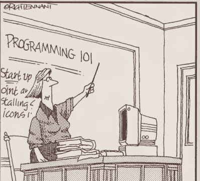

> “在我继续解释更高级的程序，例如‘Zap-Rowdy-Students-Who-Don’t-Pay-Attention’函数之前，我们将从一些基础开始。”

## 第 1 章：创建您的第一个 C# 控制台应用程序

### 本章内容

- ✓ 编程的快速介绍
- ✓ 创建一个简单的控制台应用程序
- ✓ 查看控制台应用程序
- ✓ 保存代码以备后用

在本章中，我将简要介绍计算机、计算机语言 — 包括计算机语言 C#（发音为 see sharp） — 以及 Visual Studio 2010。然后我将带您逐步创建用 C# 编写的简单程序。

### 了解计算机语言、C# 和 .NET

计算机是一个惊人地快但极其愚蠢的仆人。计算机会在您要求时做任何事情（在合理范围内）；它们做得极快 — 而且速度还在不断提高。

不幸的是，计算机不理解任何类似人类语言的东西。哦，您可能会反驳我说：“嘿，我的电话只需说出朋友的名字就能拨号。我知道一个微小的计算机运行着我的电话。所以那台计算机说英语。”但那是理解英语的计算机程序，而不是计算机本身。

计算机真正理解的语言是机器语言。人类编写机器语言是可能的，但极其困难且容易出错。

人类和计算机决定在中间相遇。程序员在一种语言中创建程序，这种语言不像人类语言那样自由，但比机器语言灵活得多、易于使用得多。占据这一中间地带的语言 — 例如 C# — 是高级计算机语言。（这里的高级是相对的。）

### 什么是程序？

什么是程序？从实际意义上讲，Windows 程序是您可以通过双击其图标运行的可执行文件。例如，我用来撰写本书的 Microsoft Word 版本就是一个程序。您称之为可执行程序，或简称可执行文件。可执行程序文件的名称通常以扩展名 .exe 结尾。例如，Word 就是 Winword.exe。

但程序还有其他含义。可执行程序由一个或多个源文件组成。例如，C# 源文件是一个包含 C# 命令序列的文本文件，这些命令根据 C# 语法法则组合在一起。该文件被称为源文件，可能因为它是沮丧和焦虑的源泉。

呃，语法？会有语法吗？只是 C# 那种语法，它比我们大多数人在初中苦苦挣扎的那种语法容易得多。

### 什么是 C#？

C# 编程语言是程序员用来创建可执行程序的中间语言之一。C# 结合了功能强大但复杂的 C++（发音为“see plus plus”）的范围和易于使用的友好但更冗长的 Visual Basic 的易用性。（Visual Basic 的更新 .NET 演变在大多数方面几乎与 C# 不相上下。作为 .NET 的旗舰语言，C# 往往首先引入大多数新功能。）C# 程序文件带有 .cs 扩展名。

一些调侃者指出，C 升号和 D 降号是同一个音符，但您不应该在华盛顿州雷德蒙德附近听到时将这种新语言称为“D 降号”。

C# 是

- **灵活的：** C# 程序可以在当前机器上执行，也可以通过 Web 传输并在某台远程计算机上执行。
- **强大的：** C# 具有与 C++ 基本相同的命令集，但粗糙的边缘已被磨平。
- **更易于使用：** C# 对导致大多数 C++ 错误的命令进行了错误预防，因此您花费在追踪这些错误上的时间大大减少。
- **视觉导向的：** C# 用于许多功能能力的 .NET 代码库提供了创建复杂显示框架所需帮助，例如下拉列表、选项卡式窗口、分组按钮、滚动条和背景图像，仅举几例。


-   **面向 Internet：** C# 在 .NET 框架中扮演着核心角色，.NET 是微软目前针对 Windows、Internet 及其他领域编程的方案。
    .NET 读作“dot net”。
-   **安全：** 任何打算用于 Internet 的语言都必须具备严密的安全性，以防范恶意黑客的攻击。

最后，C# 是 .NET 不可或缺的一部分。


本书主要介绍 C# 语言。如果你的主要目标是使用 Visual Studio、编写 Windows 应用程序或使用 ASP.NET，那么针对这些主题的 For Dummies 丛书与本书搭配阅读效果会很好。在本书后面的内容中，你会找到大量关于如何使用 C# 编写 Windows、Web 和服务应用程序的信息。你还能找到关于机器人、编译器和人工智能的有用内容——万一你正打算造一个机器人来统治世界呢。

## .NET 是什么？

.NET 始于多年前，当初是微软为了向像你我这样的普通人开放 Web 而制定的战略。如今，它的意义已不止于此，它涵盖了微软所做的所有事情。尤其重要的是，它是 Windows 编程的全新方式。它还赋予基于 C 的语言 C# 一套简单、可视化的工具，正是这些工具让 Visual Basic 如此受欢迎。

稍微了解一些背景知识，有助于你理解 C# 和 .NET 的根源。在 C 和 C++ 等较老的语言中，Internet 编程向来非常困难。Sun Microsystems 通过创造 Java 编程语言来应对这个问题。为了创造 Java，Sun 采用了 C++ 的语法，使其更易用，并将其核心围绕分布式开发展开。


当程序员说“分布式”时，他们指的是地理位置分散的计算机运行着彼此通信的程序——在许多情况下，这种通信是通过 Internet 进行的。

多年前，当微软获得 Java 的许可时，它因想对该语言进行修改而与 Sun 发生了法律纠纷。结果，微软几乎放弃了 Java，并开始寻找与之竞争的方法。

被迫放弃 Java 也未必是坏事，因为 Java 有一个严重的问题：尽管 Java 是一种功能强大的语言，但你几乎必须用 Java 编写整个程序才能获得全部好处。微软拥有太多开发人员和数百万行现有源代码，因此微软必须想出某种方法来支持多种语言。于是 .NET 应运而生。

.NET 是一个框架，在很多方面类似于 Java 的类库——而 C# 语言与 Java 语言也高度相似。正如 Java 既指语言本身，也指其庞大的代码库一样，C# 其实也远不止 C# 语言的关键字和语法。它是一个组织良好的类库所赋能的那些东西，类库包含数千个代码元素，可简化你能想象到的几乎任何类型的编程，从基于 Web 的数据库到加密技术，再到不起眼的 Windows 对话框。

微软会宣称 .NET 远远优于 Sun 基于 Java 的 Web 工具套件，但这不是重点。与 Java 不同，.NET 不要求你重写现有程序。Visual Basic 程序员只需添加几行代码，就能让现有程序具有 Web 感知能力（也就是说，它知道如何从 Internet 获取数据）。.NET 支持所有常见的微软语言——以及第三方供应商编写的数百种其他语言。不过，C# 是 .NET 舰队中的旗舰语言。C# 总是第一个使用 .NET 每一项新功能的语言。

### 什么是 Visual Studio 2010？什么是 Visual C#？

（你问的问题可真多。）微软推出的第一个“Visual”语言是 Visual Basic。微软推出的第一个流行的基于 C 的语言是 Visual C++。和 Visual Basic 一样，它的名字里有 Visual，因为它有一个内置的图形用户界面（GUI——读作“GOO-ee”）。这个 GUI 包含了你开发漂亮的 C++ 程序所需的一切。

最终，微软将其所有语言整合到一个环境中——Visual Studio。当 Visual Studio 6.0 开始显得有些过时后，开发者们急切地等待着第 7 版。然而，就在发布前不久，微软决定将其改名为 Visual Studio .NET，以强调这个新环境与 .NET 的关系。

在我开始深入研究之前，这听起来像是一种营销策略。Visual Studio .NET 与其前身有很大不同——足以配得上一个新名字。Visual Studio 2010 是最初的 Visual Studio .NET 的第三代继承者。（第 IV 册中全是关于 Visual Studio 的实用内容，包括自定义它的说明。）


微软将其实现的这种语言称为 Visual C#。实际上，Visual C# 只不过是 Visual Studio 中 C# 的组成部分。C# 就是 C#，无论有没有 Visual Studio。

好了，就这样。不再回答问题了。（至少暂时如此。）

### 创建你的第一个控制台应用程序

Visual Studio 2010 附带了一个应用程序向导，它会构建模板程序，并为你省去许多从头开始时必须做的琐碎工作。（我不推荐从头开始的方法。）

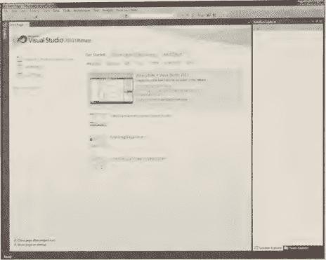

**图 1-1：** 创建新项目，是通往更出色的 Windows 应用程序之路的开端。

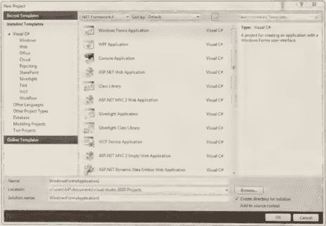

**图 1-2：** Visual Studio 应用程序向导已准备好为你创建新程序。

这个文件的默认保存位置位于你的 Documents 目录中较深的位置。也许是因为我很难搞（又或者是因为我在写书），我喜欢把程序放在我想放的地方，而不一定是 Visual Studio 想放的地方。为了简化本书的操作，可以更改默认项目位置。请按照以下步骤进行更改。

-   a. 选择“工具▸选项”。
-   随即打开“选项”对话框。
-   b. 选择“项目和解决方案▸常规”。
-   c. 在“项目位置”字段中选择新位置，然后单击“确定”。
-   （就本书而言，我推荐 C:\C#Programs。）

你也可以同时在“项目位置”对话框中创建新目录。单击对话框顶部带有小光芒图案的文件夹图标。（如果你已经从网站安装了示例程序，这个目录可能已经存在。）

你可以在图 1-3 中看到“选项”对话框。暂时不要改动其他字段。有关 Visual Studio 自定义的更多信息，请参阅第 IV 册。

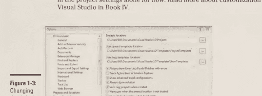

-   4. 单击“确定”按钮。

在磁盘一阵旋转和咔嗒声之后，Visual Studio 会生成一个名为 Program.cs 的文件。（如果你查看标记为“解决方案资源管理器”的窗口，会看到一些其他文件；暂时忽略它们。如果“解决方案资源管理器”不可见，请选择“视图▸解决方案资源管理器”。）

C# 源文件带有 .cs 扩展名。Program 是为程序文件指定的默认名称。

```
Compile complete -- 0 errors, 0 warnings
Program1 -> C:\#Programs\ ... (and more)==Build: 1 succeeded or up-to-date, 0 failed, 0 skipped=
```


这里的关键是最后一行中的 1 succeeded 部分。

编程的一般规则是：成功是好事，失败是坏事。坏的情况——即异常——将在本分册的第 9 章中介绍。

若要执行程序，请选择“调试->开始”。程序会弹出一个黑色控制台窗口并立即终止。（如果你的计算机速度很快，这个窗口的出现只是屏幕上的一闪。）这个程序看似什么都没做。事实上，确实如此。这个模板只不过是一个空壳。


此时，另一种命令“调试->开始执行（不调试）”表现会稍好一些。不妨试试看。

## 让你的控制台应用程序做点什么


将 Program.cs 模板文件编辑成如下所示：

```csharp
using System;

namespace Program1
{
    public class Program
    {
        // This is where your program starts.
        static void Main(string[] args)
        {
            // Prompt user to enter a name.
            Console.WriteLine("Enter your name, please:");

            // Now read the name entered.
            string name = Console.ReadLine();

            // Greet the user with the name that was entered.
            Console.WriteLine("Hello, " + name);

            // Wait for user to acknowledge the results.
            Console.WriteLine("Press Enter to terminate...");
            Console.Read();
        }
    }
}
```


双斜线或三斜线（// 或 ///）后面的内容不用在意，也不用纠结是输入一个还是两个空格，或者一个还是两个换行。不过，一定要注意大小写。


选择 Build→Build Program1 将此新版本的 Program.cs 转换为 Program1.exe 程序。

在 Visual Studio 2008 中，选择 Debug→Start Without Debugging。黑色的控制台窗口出现并提示您输入姓名。（您可能需要通过单击来激活控制台窗口。）然后窗口显示 Hello，后跟输入的姓名，并显示“按 Enter 终止...”。按 Enter 关闭窗口。


您也可以从 DOS 命令行执行程序。为此，请打开一个命令提示符窗口并输入以下内容：

```
CD \C#Programs\Program1\bin\Debug
```

现在输入 Program1 以执行程序。输出应与您之前看到的相同。您也可以在 Windows 资源管理器中导航到 `\C#Programs\Program1\bin\Debug` 文件夹，然后双击 Program1.exe 文件。


要打开命令提示符窗口，请尝试选择 Tools→Command Prompt。如果该命令在 Visual Studio 工具菜单上不可用，请选择 Start→All Programs→Microsoft Visual Studio 2008→Visual Studio Tools→Visual Studio 2008 Command Prompt。

## 审查您的控制台应用程序

在以下各节中，您将逐段拆解这个第一个 C# 控制台应用程序，以了解其工作原理。

### 程序框架

所有控制台应用程序的基本框架如下所示：

```
using System;
using System.Collections.Generic;
using System.Linq;
using System.Text;

namespace Program
{
    public class Program
    {
        // This is where your program starts.
        public static void Main(string[] args)
        {
            // Your code goes here.
        }
    }
}
```

程序在包含 Main() 的语句之后立即开始执行，并在 Main() 之后闭合的大括号 } 处结束。（我将在适当的时候解释这些语句的含义。目前我不能再多说了。）

using 指令列表可以立即放在 `namespace Program {` 短语之前或之后。顺序无关紧要。您可以在 .NET 中对许多事物应用 using。我将在《第二册》面向对象编程章节中解释命名空间和 using 的全部内容。


### 注释

模板已有许多行，我还添加了一些其他行，例如以下（以粗体显示）：

// This is where your program starts.
public static void Main(string[] args)


C# 忽略此示例中的第一行。这行被称为注释。

任何以 // 或 /// 开头的行都是自由文本，C# 会忽略它。现在将 // 和 /// 视为等价。

如果计算机忽略它们，为什么还要包含这些行？因为注释解释了您的 C# 语句。即使是 C# 程序也不是很容易理解。请记住，编程语言是在计算机理解的内容和人类理解的内容之间的一种折中。这些注释在编写代码时很有用，尤其对那个可能就是您的一年后试图重现您逻辑的可怜人特别有帮助。注释使工作变得容易得多。


尽早且经常地注释。

### 程序的核心

此程序的真正核心嵌入在标记为 Main() 的代码块中，如下所示：

// Prompt user to enter a name.
Console.WriteLine("Enter your name, please:");

// Now read the name entered.
string name = Console.ReadLine();

// Greet the user with the name that was entered.
Console.WriteLine("Hello, " + name);


使用新的 C# 代码片段功能可节省大量常规输入。片段对于 Console.WriteLine 等常见语句非常有用。按 Ctrl+K 然后按 Ctrl+X 查看片段弹出菜单。（您可能需要按一次或两次 Tab 来打开 Visual C# 文件夹或其他文件夹。）在菜单中向下滚动到 cw 并按 Enter。Visual Studio 会插入 Console.WriteLine() 语句的主体，并将插入点放在括号之间，准备就绪。当您记住几个快捷方式，如 cw、for 和 if 时，请使用更快捷的技术：输入 cw 并按两次 Tab。（另外尝试选择几行代码，按 Ctrl+K，然后按 Ctrl+S。选择类似 if 的内容。if 语句会包围所选代码行。）

程序从第一个 C# 语句 Console.WriteLine 开始执行。此命令将字符字符串 Enter your name, please: 写入控制台。

下一条语句读取用户的答案并将其存储在名为 name 的变量（一种工作箱）中。（有关这些存储位置的更多信息，请参阅本迷你书的第 2 章。）最后一行将字符串 Hello, 与用户的姓名组合并将结果输出到控制台。

最后三行使计算机在继续之前等待用户按 Enter。这些行确保用户有时间在程序继续之前阅读输出：

// Wait for user to acknowledge the results.
Console.WriteLine("Press Enter to terminate...");
Console.Read();

此步骤的重要性取决于您如何执行程序以及所处的环境。特别是，在 Visual Studio 内部或从 Windows 资源管理器运行控制台应用程序时，需要前面的行——否则控制台窗口关闭得太快，您无法阅读输出。如果您打开一个控制台窗口并从那里运行程序，窗口无论如何都会保持打开。

## 介绍工具箱技巧

您在前一节中创建的程序的关键部分由最后两行代码组成：

// Wait for user to acknowledge the results.
Console.WriteLine("Press Enter to terminate...");
Console.Read();

在您编写的每个未来控制台应用程序中重新创建这些关键行的最简单方法在以下各节中描述。

### 在工具箱中保存代码

第一步是将这些行保存在方便的未来使用位置——方便的位置：工具箱窗口。在 Visual Studio 中打开 Program1 控制台应用程序后，请按照以下步骤操作：

1. 在 Program 类的 Main() 方法中，选择要保存的行——在本例中为前面提到的三行。
2. 确保左侧打开了工具箱窗口。（如果没有，请通过选择 View→Toolbox 打开它。）
3. 将所选行拖到工具箱窗口的 General 选项卡中并释放。（或复制行并将其粘贴到工具箱中。）

工具箱会永久为您存储这些行。图 1-4 显示了放置在工具箱中的行。

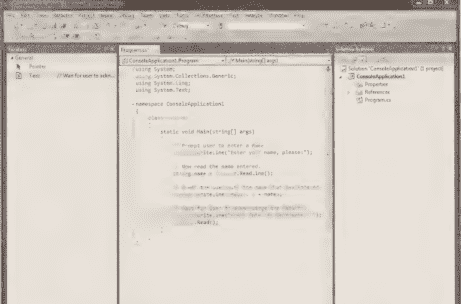

**图 1-4：** 设置工具箱以供将来使用保存一些方便的文本。

### 从工具箱重用代码

现在您已将模板文本存储在工具箱中，您可以在此后编写的所有控制台应用程序中重用它。以下是使用方法：

1. 在 Visual Studio 中，按本章前面所述创建新的控制台应用程序。
2. 在编辑器中单击您想要插入工具箱文本的位置。
3. 在编辑 Program.cs 文件时，确保工具箱窗口打开。（如果没有，请参阅上述过程。）
4. 在工具箱窗口的 General 选项卡中（可能显示其他选项卡），找到要使用的已保存文本并双击它。

所选项目将在编辑器窗口的插入点处插入。

在放置了这些样板文本后，您可以在这些行上方编写应用程序的其余部分。就这样。您现在拥有一个完成的控制台应用程序。试用大约 30 秒。然后您可以查看本迷你书的第 2 章。

## 第 2 章：与可变性共存——声明值类型变量

### 本章内容

- 参观火车站——C# 变量作为储物柜
- 使用整数——你可以依靠它
- 处理小数——半只鸭子是什么？
- 声明其他类型的变量——日期、字符、字符串
- 处理数字常量——天空中的 π
- 更改类型——cast 不意味着 toss
- 让编译器确定类型——var 魔法

编程中最基本的概念之一就是变量。C# 变量就像一个小盒子，您可以在其中存储东西，特别是数字，以供以后使用。（术语 variable 源自数学世界。）

不幸的是，对于程序员来说，C# 对变量施加了若干限制——这些限制数学家不必考虑。本章将带您完成声明、初始化和使用变量的步骤。它还介绍了 C# 中最基本的数据类型。

### 声明变量

当数学家说“n 等于 1”时，这意味着术语 n 在某种抽象意义上等同于 1。数学家可以随意引入变量。例如，数学家可能会这样说：

```
x = y² + 2y + 1
if k = y + 1 then
x = k²
```

程序员必须以比数学家更宽松的风格更严格的方式定义变量。例如，C# 程序员可能会编写以下代码片段：

```
int n;
n = 1;
```


The first line means, “Carve off a small amount of storage in the computer’s memory and assign it the name n.” This step is analogous to reserving one of those storage lockers at the train station and slapping the label n on the side. The second line says, “Store the value 1 in the variable n, thereby replacing whatever that storage location already contains.” The train-locker equivalent is, “Open the train locker, rip out whatever happens to be in there, and shove a 1 in its place.”

The equals symbol (=) is called the assignment operator.


The mathematician says, “n equals 1.” The C# programmer says in a more precise way, “Store the value 1 in the variable n.” (Think about the train locker, and you see why that’s preferable.) C# operators tell the computer what you want to do. In other words, operators are verbs and not descriptors. The assignment operator takes the value on its right and stores it in the variable on the left. We say a lot more about operators in Chapter 3 of this minibook.

## What’s an int?

In C#, each variable has a fixed type. When you allocate one of those train lockers, you have to pick the size you need. If you pick an integer locker, for instance, you can’t turn around and hope to stuff the entire state of Texas in it — maybe Rhode Island, but not Texas.

For the example in the preceding section of this chapter, you select a locker that’s designed to handle an integer — C# calls it an int. Integers are the counting numbers 1, 2, 3, and so on, plus 0 and the negative numbers −1, −2, −3, and so on.


Before you can use a variable, you must declare it. After you declare a variable as int, it can hold and regurgitate integer values, as this example demonstrates:

```
// Declare a variable named n - an empty train locker.
int n;
// Declare an int variable m and initialize it with the value 2.
int m = 2;
// Assign the value stored in m to the variable n.
n = m;
```

The first line after the comment is a declaration that creates a little storage area, n, designed to hold an integer value. The initial value of n is not specified until it is assigned a value. The second declaration not only declares an int variable m but also initializes it with a value of 2, all in one shot.


The term initialize means to assign an initial value. To initialize a variable is to assign it a value for the first time. You don’t know for sure what the value of a variable is until it has been initialized. Nobody knows.

The final statement in the program assigns the value stored in m, which is 2, to the variable n. The variable n continues to contain the value 2 until it is assigned a new value. (The variable n doesn't lose its value when you assign its value to m. It's like cloning n.)

## Rules for declaring variables

You can initialize a variable as part of the declaration, like this:

```
// Declare another int variable and give it the initial value of 1.
int p = 1;
```

This is equivalent to sticking a 1 into that int storage locker when you first rent it, rather than opening the locker and stuffing in the value later.

Initialize a variable when you declare it. In most (but not all) cases, C# initializes the variable for you — but don't rely on it to do that.

You may declare variables anywhere (well, almost anywhere) within a program.

However, you may not use a variable until you declare it and set it to some value. Thus the last two assignments shown here are not legal:

```
// The following is illegal because m is not assigned
// a value before it is used.
int m;
n = m;
// The following is illegal because p has not been
// declared before it is used.
p = 2;
int p;
```

Finally, you cannot declare the same variable twice in the same scope (a function, for example).

## Variations on a theme: Different types of int

Most simple numeric variables are of type int. However, C# provides a number of twists to the int variable type for special occasions.

All integer variable types are limited to whole numbers. The int type suffers from other limitations as well. For example, an int variable can store values only in the range from roughly −2 billion to 2 billion.

A distance of 2 billion inches is greater than the circumference of the Earth. In case 2 billion isn't quite large enough for you, C# provides an integer type called long (short for long int) that can represent numbers almost as large as you can imagine. The only problem with a long is that it takes a larger train locker. A long consumes 8 bytes (64 bits) — twice as much as a garden-variety 4-byte (32-bit) int. C# provides several other integer variable types, as shown in Table 2-1.

**Table 2-1 — Size and Range of C# Integer Types**

| Type | Bytes | Range of Values | In Use |
|---|---:|---|---|
| sbyte | 1 | −128 to 127 | `sbyte sb = 12;` |
| byte | 1 | 0 to 255 | `byte b = 12;` |
| short | 2 | −32,768 to 32,767 | `short sh = 12345;` |
| ushort | 2 | 0 to 65,535 | `ushort ush = 62345;` |
| int | 4 | −2 billion to 2 billion | `int n = 1234567890;` |
| uint | 4 | 0 to 4 billion (exact values listed in the Cheat Sheet on this book’s Web site) | `uint un = 234567890U` |
| long | 8 | −10²⁰ to 10²⁰ — “a whole lot” | `long l = 123456789012L` |
| ulong | 8 | 0 to 2 × 10²⁰ | `ulong ul = 123456789012UL` |

As I explain in the section “Declaring Numeric Constants,” later in this chapter, fixed values such as 1 also have a type. By default, a simple constant such as 1 is assumed to be an int. Constants other than an int must be marked with their variable type. For example, 123U is an unsigned integer, uint.

Most integer variables are called signed, which means they can represent negative values. Unsigned integers can represent only positive values, but you get twice the range in return. As you can see from Table 2-1, the names of most unsigned integer types start with a u, while the signed types generally don’t have a prefix.

You don’t need any unsigned integer versions in this book.


## Representing Fractions

Integers are useful for most calculations. One of this book’s authors made it into the sixth grade before he ever found out that anything else existed, and he still hasn’t forgiven his sixth-grade teacher for starting him down the slippery slope of fractions.

Many calculations involve fractions, which simple integers can’t accurately represent. The common equation for converting from Fahrenheit to Celsius temperatures demonstrates the problem, like this:

```
// Convert the temperature 41 degrees Fahrenheit.
int fahr = 41;
int celsius = (fahr - 32) * (5 / 9)
```

This equation works just fine for some values. For example, 41 degrees Fahrenheit is 5 degrees Celsius. "Correct, Mr. Davis," says Stephen's sixth-grade teacher.

Okay, try a different value: 100 degrees Fahrenheit. Working through the equation, 100-32 is 68, 68 times 5/9 is 37. "No," she says, "The answer is 37.78." Even that's wrong because it's really 37.777... with the 7s repeating forever, but I don't push the point.


An int can represent only integer numbers. The integer equivalent of 37.78 is 37. This lopping off of the fractional part of a number to get it to fit into an integer variable is called integer truncation.


Truncation is not the same thing as rounding. Truncation lops off the fractional part, Goodbye, Charlie. Rounding picks the closest integer value. Thus, truncating 1.9 results in 1. Rounding 1.9 results in 2.

For temperatures, 37 may be good enough. It's not like you wear short-sleeve shirts at 37.7 degrees but pull on a sweater at 37 degrees. But integer truncation is unacceptable for many, if not most, applications.

Actually, the problem is much worse than that. An int can't handle the ratio 5/9 either; it always yields the value 0. Consequently, the equation as written in this example calculates celsius as 0 for all values of fahr. Even I admit that's unacceptable.


This book's Web site includes an int-based temperature-conversion program contained in the ConvertTemperatureWithRoundOff directory. At this point, you may not understand all the details, but you can see the conversion equations and execute the program ConvertTemperatureWithRoundOff.exe to see the results. (Review Chapter 1 of this minibook if you need a hand running it.)

## Handling Floating-Point Variables

The limitations of an int variable are unacceptable for some applications. The range generally isn't a problem — the double-zillion range of a 64-bit-long integer should be enough for almost anyone. However, the fact that an int is limited to whole numbers is a bit harder to swallow.

In some cases, you need numbers that can have a nonzero fractional part. Mathematicians call these real numbers. (Somehow that always seemed like a ridiculous name for a number. Are integer numbers somehow unreal?)


请注意我所说实数可以有非零的小数部分——也就是说，1.5 是实数，1.0 也是实数。例如，1.0 + 0.1 等于 1.1。在阅读本章剩余内容时请牢记这一点。

幸运的是，C# 理解实数。实数有两种类型：浮点数和十进制数。浮点数是最常见的类型。我将在本章稍后介绍十进制类型。

## 声明浮点变量

浮点变量的 designation 是 float，你可以按以下示例声明它：

```
float f = 1.0f;
```

声明为 float 后，变量 f 在其整个生命周期内都是 float。

表 2-2 描述了两种浮点类型。所有浮点变量都是有符号的。（不存在不能表示负值的浮点变量。）

表 2-2 浮点变量类型的大小和范围

| 类型 | 字节 | 值范围 | 精度到位数 | 使用示例 |
|------|-------|-----------------|------------------------------|--------|
| float | 4 | 1.5 * 10^-45 to 3.4 * 10^38 | 6 to 7 | float f = 1.2F; |
| double | 8 | 5.0 * 10^-324 to 1.7 * 10^308 | 15 to 16 | double d = 1.2; |

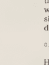

你可能认为 float 是默认的浮点变量类型，但实际上在 C# 中默认是 double。如果不指定类型，例如 12.3，C# 会将其视为 double。

表 2-2 中的“精度”列指的是每种变量类型可以表示的有效数字位数。例如，⅓ 实际上是 0.555…，后面跟着无穷多个 5。然而，float 变量的精度据说为六位有效数字——这意味着第六位之后的数字会被忽略。因此，⅓ 以 float 表示时可能如下所示：

```
0.5555551457382
```

这里你知道第六个 5 之后的所有数字都是不可信的。

同一个数字——⅓——以 double 表示时可能如下所示：

```
    0.55555555555555557823
```

double 包含多达 15 到 16 位有效数字。

除非有特定原因，否则请使用 double 变量类型。


## 转换更多温度

以下是使用浮点变量将华氏温度转换为摄氏温度的公式：

```
    double celsius = (fahr - 32.0) * (5.0 / 9.0)
```


网站包含一个名为 ConvertTemperatureWithFloat 的浮点版温度转换程序。

以下示例显示了执行基于 double 的 ConvertTemperatureWithFloat 程序的结果：

```
    Enter temp in degrees Fahrenheit:100
    Temperature in degrees Celsius = 37.77777777777778
    Press Enter to terminate...
```

## 检查浮点变量的一些限制

你可能想一直使用浮点变量，因为它们能很好地解决截断问题。的确，它们会占用多一点内存。但如今内存很便宜，所以为什么不呢？但浮点变量也有局限性，我将在以下各节中讨论。

### 计数

你不能将浮点变量用作计数数。某些 C# 结构需要计数（如 1、2、3 等）。你知道 1.0、2.0 和 3.0 与 1、2、3 一样是计数数，但 C# 不知道这一点。例如，鉴于浮点数的精度限制，C# 如何知道你不是实际上说的是 1.000001？


无论你是否觉得这个论点有说服力，你都不能在计数事物时使用浮点变量。

### 比较数字

比较浮点数时必须小心。例如，12.5 可能被表示为 12.500001。大多数人不在乎末尾那一点点额外部分。然而计算机非常字面化。对 C# 来说，12.500000 和 12.500001 不是同一个数字。

书 I  
第 2 章  
与可变性共存  
— 声明  
值类型变量

因此，如果你把 1.1 加上 1.1，你无法确定结果是 2.2 还是 2.200001。而且如果你问“doubleVariable 是否等于 2.2？”，你可能得不到预期的结果。通常，你不得不使用类似这种牵强的比较：“doubleVariable 与 2.2 之差的绝对值是否小于 .00001？”换句话说，“在可接受的误差范围内。”


Pentium 处理器玩了一个花招，使这个问题比看起来要少一些麻烦：它以特别长的 double 格式执行浮点运算——也就是说，而不是使用 64 位，它使用多达 80 位。当把 80 位浮点数舍入为 64 位浮点数时，你（几乎）总是得到预期的结果，即使 80 位数字偏差了一点或两点。

### 计算速度

像老式基于 Windows 的 PC 中使用的 x86 系列处理器一样，可以比浮点运算快得多地执行整数运算。在那个时代，程序员会不遗余力地将程序限制为整数运算。

在 Pentium III 处理器上，对约 300,000,000 次加法和减法的简单（也许过于简单）测试的额外速度比率约为 3 比 1。也就是说，对于每次 double 加法，你本可以做三次 int 加法。（涉及乘法和除法的计算可能会显示不同的结果。）

### 并非如此受限的范围

过去，浮点变量可以表示比整数类型大得多的数字范围。它仍然可以，但 long 的范围已经足够大，以至于使这一点变得无关紧要。


即使简单的 float 可以表示非常大的数字，有效数字的数量也仅限于约六位。例如，123,456,789F 与 123,456,000F 相同。（有关这些数字末尾 F 标记的解释，请参阅本章后面“声明数字常量”部分。）

幸运的是，C# 提供了这样一种变量类型，称为 decimal。decimal 变量可以表示 10⁻²⁸ 到 10²⁸ 之间的数字——那是很多零！而且它在没有舍入问题的情况下做到这一点。

## 声明 decimal

Decimal 变量的声明和使用与其他任何变量类型一样，如下所示：

```
decimal m1 = 100; // Good
decimal m2 = 100M; // Better
```

这里显示的第一个声明创建了一个变量 m1 并将其初始化为 100。并不明显的是，100 实际上是 int 类型。因此，C# 必须在执行初始化之前将 int 转换为 decimal 类型。幸运的是，C# 理解你的意思——并为你执行转换。

m2 的声明是最好的。这个巧妙的声明使用十进制常量 100M 初始化 m2。数字末尾的字母 M 指定该常量为 decimal 类型。不需要转换。（请参阅本章后面“声明数字常量”部分。）

## 比较 decimal、整数和浮点类型

decimal 变量类型似乎具有 int 或 double 类型的所有优点而没有缺点。此类型变量具有非常大的范围，它们不会出现舍入问题，而且 25.0 就是 25.0 而不是 25.00001。

然而，decimal 变量类型有两个显著的限制。首先，decimal 不被视为计数数，因为它可能包含小数部分。因此，你不能在流程控制循环中使用它们，我将在本迷你书的第 5 章中解释这一点。

decimal 变量的第二个问题同样严重甚至更严重。涉及 decimal 值的计算比涉及简单整数或浮点值的计算慢得多——我确实是说显著。在对 300,000,000 次加法和减法的粗略基准测试中，涉及 decimal 变量的操作比涉及简单 int 变量的操作慢约 50 倍。对于更复杂的运算，相对计算速度变得更糟。此外，大多数计算函数，如计算正弦或指数，对于 decimal 数字类型不可用。

显然，decimal 变量类型最适合于银行等应用，在这些应用中准确性极其重要但计算次数相对较少。


## 检查 bool 类型：它合乎逻辑吗？

终于，有一种逻辑变量类型了。只不过在这个例子里，我确实是指一种“逻辑”类型。布尔类型 bool 可以有两个值：true 或 false。我没骗你——整整一种变量类型只为了两个值。甚至连“也许”都没有。


以前的 C 和 C++ 程序员习惯于用 int 值 0（零）表示 false，用非零表示 true。这在 C# 中行不通。

你可以这样声明 bool 变量：

```csharp
bool thisIsABool = true;
```

bool 变量与任何其他类型之间都不存在转换路径。换句话说，你不能把 bool 直接转换成其他东西。（即使能，也不应该，因为这毫无意义。）特别是，你不能把 bool 转换成 int（比如 false 变成 0），也不能转换成 string（比如 false 变成单词“false”）。

## 了解字符类型

一个除了输出数字之外什么也做不了的程序，对于数学家、会计师、处理死亡率数据的保险代理人，以及计算炮弹弹道的人来说，也许没什么问题。（别笑。最初的计算机就是为了生成炮弹弹道表，以帮助炮兵而制造的。）然而，对于大多数应用来说，程序必须同时处理字母和数字。

C# 以两种截然不同的方式处理字母：类型为 char 的单个字符（通常读作 char，意思类似 singe 或 burn，即“烧焦”）以及字符串——这种类型被巧妙地称为 string。

### char 变量类型

char 变量是一个能够容纳单个字符的盒子。字符常量表现为用一对单引号括起来的字符，如下例所示：

```csharp
char c = 'a';
```

你可以存储罗马、希伯来、阿拉伯、西里尔以及大多数其他字母表中的任何单个字符。你还可以存储日文片假名和平假名，以及许多日文和中文汉字。

此外，char 被视为一种计数类型。这意味着你可以使用 char 类型来控制我在本迷你书第 5 章中描述的循环结构。字符变量不存在舍入问题。


字符变量不包含字体信息。因此，你可以在 char 变量中存储一个你认为完全没问题的汉字（它很可能确实没问题）——但当你查看这个字符时，如果你没有通过正确字体的“眼睛”来看它，它就可能看起来像乱码。

### 特殊字符

给定字体中的某些字符是不可打印的，也就是说，当你在计算机屏幕或打印机上查看它们时，你什么也看不到。最明显的例子是空格，它由字符 ' '（单引号、空格、单引号）表示。其他字符没有字母等价物——例如制表符。C# 使用反斜杠来标记这些字符，如表 2-3 所示。

| 表 2-3 | 特殊字符 |
|---|---|
| **字符常量** | **值** |
| `\n` | 换行符 |
| `\t` | 制表符 |
| `\0` | 空字符 |
| `\r` | 回车符 |
| `\\` | 反斜杠 |

### string 类型

另一种极其常见的变量类型是 string。以下示例展示了如何声明和初始化 string 变量：

```csharp
// Declare now, initialize later.
string someString;
someString = "This is a string";
// Or initialize when declared - preferable.
string someString2 = "This is a string";
```

字符串常量通常称为字符串字面量，是用双引号括起来的一组字符。字符串中的字符可以包括表 2-3 所示的特殊字符。在 C# 源文件中，字符串不能跨行书写，但它可以包含换行字符，如下例所示（见粗体部分）：

```csharp
// The following is not legal.
string someString = "This is a line
and so is this";
// However, the following is legal.
string someString = "This is a line\nand so is this";
```

我在本迷你书第 8 章中解释的程序员定义类型称为引用类型，它们既不是值类型，也不是内置类型。`string` 类型是一种引用类型，不过由于字符串使用得如此广泛，C# 编译器确实会给予它一些特殊处理。

### 比较 string 和 char

尽管字符串处理的是字符，但 `string` 类型与 `char` 有着惊人的不同。当然，存在某些细微差别。你用单引号括住一个字符，如下例所示：

```csharp
'a'
```

另一方面，你用双引号括住一个字符串：

```csharp
"this is a string"
"a"   // So is this -- see the double quotes?
```

有关字符串的规则与有关字符的规则并不相同。首先，你一开始就知道 `char` 是单个字符，仅此而已。例如，下面的代码无论是作为加法还是作为拼接，都毫无意义：

```csharp
char c1 = 'a';
char c2 = 'b';
char c3 = c1 + c2;
```


实际上，这段代码几乎可以编译——但其含义与原本意图完全不同。这些语句会把 `c1` 转换成由 `c1` 的数值构成的 `int`。C# 还会把 `c2` 转换成 `int`，然后把这两个整数相加。错误发生在试图把结果存回 `c3` 时——把 `int` 存入更小的 `char` 可能会丢失数值数据。无论如何，这个操作都毫无意义。

另一方面，字符串可以具有任意长度。因此，如下所示拼接两个字符串*确实*有意义：

```csharp
string s1 = "a";
string s2 = "b";
string s3 = s1 + s2;   // Result is "ab"
```

作为其库的一部分，C# 定义了一整套字符串操作。我在本迷你书第 3 章中介绍它们。


## 命名约定

编程本身已经够难了，程序员不应再把它弄得更难。为了让你的 C# 源代码更容易阅读，请采用一种命名约定并坚持下去。你的命名约定应尽可能遵循其他 C# 程序员所采用的约定。

- **变量以外的名称以大写字母开头，变量以小写字母开头。** 让这些名称尽可能具有描述性——这通常意味着名称由多个单词组成。这些单词应首字母大写，但彼此紧挨着，中间不加下划线——例如 `ThisIsALongName`。以大写字母开头的名称采用帕斯卡命名法，这源于 20 世纪 70 年代一种名为 Pascal 的语言的命名方式。（我的第一本书就是关于 Pascal 的。）
- **变量名以小写字母开头。** 一个典型的变量名看起来像这样：`thisIsALongVariableName`。这种变量命名风格被称为驼峰命名法，因为它在中间有驼峰。

在 .NET 时代之前，Windows 程序员普遍使用一种约定：变量名的首字母表示变量的类型。这些字母大多很直观：`f` 表示 float，`d` 表示 double，`s` 表示 string，等等。唯一稍有不同的是用 `n` 表示 int。这条规则还有一个例外：由于原因可以追溯到 20 世纪 60 年代的 Fortran 编程语言，单个字母 `i`、`j` 和 `k` 也曾被用作 `int` 的常见名称，而且在 C# 中仍然如此。这种变量命名风格被称为匈牙利命名法，得名于查尔斯·西蒙尼，他是微软的一位著名人物，最近作为太空游客去了国际空间站（玛莎·斯图尔特为他打包了袋装午餐。）

匈牙利命名法已经不再受欢迎，至少在 .NET 编程圈子里是这样。在较新的 Visual Studio 版本中，你只需在调试器里将光标停在变量上，其数据类型就会在工具提示框中显示。这使得匈牙利前缀没那么有用了，不过仍有少数人坚持使用匈牙利命名法。

## 计算闰年：DateTime

如果你必须编写一个程序来计算今年是否是闰年，该怎么办？

算法如下：

```
It's a leap year if
    year is evenly divisible by 4
    and, if it happens to be evenly divisible by 100,
        it's also evenly divisible by 400
```

你目前还没有足够的工具在 C# 中解决这个问题。但你可以直接询问 `DateTime` 类型（它是一种值类型，就像 `int` 一样）：

```
DateTime thisYear = new DateTime(2011, 1, 1);
bool isLeapYear = DateTime.IsLeapYear(thisYear.Year);
```

2011 的结果为 false，但 2012 为 true。（现在先不用担心那第一行代码，它使用了你尚未接触到的一些内容。）

使用 DateTime 数据类型，你可以执行大约 80 种不同的操作，例如仅提取月份；获取星期几；向给定日期添加天数、小时数、分钟数、秒数、毫秒数、月数或年数；获取给定月份的天数；减去两个日期。

以下示例行使用 DateTime 的一个便捷属性 Now 来捕获当前日期和时间，以及众多可将一个时间转换为另一个时间的 DateTime 方法之一：

```
DateTime thisMoment = DateTime.Now;
DateTime anHourFromNow = thisMoment.AddHours(1);
```

你还可以提取 DateTime 的特定部分：

```
int year = DateTime.Now.Year;          // For example, 2007
DayOfWeek dayOfWeek = DateTime.Now.DayOfWeek;  // For example, Sunday
```

如果你打印出该 DayOfWeek 对象，它会打印类似 "Sunday" 的内容。而且你可以对 DateTime 执行其他方便的操作：

```
DateTime date = DateTime.Today;          // Get just the date part.
TimeSpan time = thisMoment.TimeOfDay;    // Get just the time part.
TimeSpan duration = new TimeSpan(3, 0, 0);  // Specify duration in days.
DateTime threeDaysFromNow = thisMoment.Add(duration);
```

前两行只是提取 DateTime 中的部分信息。接下来的两行向 DateTime 添加一个持续时间。持续时间或时间量与某一时刻不同；你使用 TimeSpan 类指定持续时间，使用 DateTime 指定时刻。因此第三行设置了一个为期三天、零小时、零分钟和零秒的 TimeSpan。第四行将三天的持续时间添加到代表此刻的 DateTime，得到一个新的 DateTime，其日期部分比 thisMoment 的日期部分大三天。

从另一个 DateTime 减去一个 DateTime（或从 DateTime 减去一个 TimeSpan）会返回一个 DateTime：

```
TimeSpan duration1 = new TimeSpan(1, 0, 0);  // One hour later.
// Since Today gives 12:00:00 AM (midnight), the following gives 1:00:00 AM:
DateTime anHourAfterMidnight = DateTime.Today.Add(duration1);
Console.WriteLine("An hour from midnight will be {0}", anHourAfterMidnight);
DateTime midnight = anHourAfterMidnight.Subtract(duration1);
Console.WriteLine("An hour before 1 AM is {0}", midnight);
```

前述代码的第一行创建了一个一小时的 TimeSpan。下一行获取日期（实际上是今天凌晨零点）并加上这一小时的时间段，得到一个代表今天凌晨 1:00 的 DateTime。倒数第二行从凌晨 1:00 减去一小时的持续时间，得到凌晨 12:00（午夜）。

有关更多信息，请在 Visual Studio 帮助系统中搜索 DateTime 结构，并查看本书网站上的 DateTimeExample 程序。


## 声明数值常量

人生中绝对的事很少：然而，我即将给你一个 C# 的绝对真理：每个表达式都有一个值和一个类型。在 int n 这样的声明中，你可以很容易看出变量 n 是一个 int。此外，你可以合理地假设计算 n + 1 的类型是 int。然而，常量 1 的类型是什么？

常量的类型取决于两件事：其值以及常量末尾是否带有可选的描述符字母。任何小于 20 亿的整数类型都被假定为 int。大于 20 亿的数字被假定为 long。任何浮点数都被假定为 double。

表 2-4 展示了被声明为特定类型的常量。这些描述符的大小写无关紧要；1U 和 1u 是等价的。

表 2-4 常见常量及其声明的类型

| Constant | Type |
|---|---|
| 1 | int |
| 1U | unsigned int |
| 1L | long int (避免使用小写 l；它太像数字 1 了) |
| 1.0 | double |
| 1.0F | float |
| 1M | decimal |
| true | bool |
| false | bool |
| 'a' | char |
| '\n' | char (换行符字符) |
| '\x123' | char (数值是十六进制 123 的字符) |
| "a string" | string |
| "" | string (空字符串)；与 String.Empty 相同 |

*'hex' 是 hexadecimal 的缩写（以 16 为底的数字，而非以 10 为底）。

```
~~~
double doubleValue = 10.0;
long longValue = (long)doubleValue;
~~~
```

所有与 decimal 的转换都需要强制转换。事实上，所有数值类型都可以通过应用强制转换相互转换。bool 和 string 都不能直接转换为其他任何类型。


内置的 C# 方法可以将数字、字符或布尔值转换为其字符串等价物，姑且这么说。例如，你可以将 bool 值 `true` 转换为字符串 "true"；然而，你不能将此变化视为直接转换。bool `true` 和字符串 "true" 是完全不同的东西。

## 让 C# 编译器推断数据类型

在本书中——好吧，在本章中——当你声明一个变量时，你 *总是* 指定其确切的数据类型，像这样：

```
~~~
int i = 5;
string s = "Hello C#";
double d = 1.0;
~~~
```

你可以使用 `var` 关键字将其中一些工作交给 C# 编译器：

```
~~~
var i = 5;
var s = "Hello C# 4.0";
var d = 1.0;
~~~
```

现在编译器会为你 *推断* 数据类型——它查看赋值右侧的内容以确定左侧的类型。


顺便说一下，本迷你书的第 3 章展示了如何计算前例中赋值右侧的表达式的类型。不需要你去做——编译器大多会为你完成。假设，例如，你有一个像这样的初始化表达式：

```
~~~
var x = 3.0 + 2 - 1.5;
~~~
```

编译器可以推断出 `x` 是一个 `double` 值。它查看 `3.0` 和 `1.5` 并发现它们的类型为 `double`。然后它注意到 `2` 是一个 `int`，编译器可以将其 *隐式* 转换为 `double` 以进行计算。`x` 初始化表达式中的所有加法项最终都成为 double。因此 `x` 的 *推断类型* 是 `double`。

但现在，你只需说出魔术词 `var` 并提供一个初始化表达式，编译器就会完成剩下的工作：

```
~~~
var aVariable = <initialization expression here>;
~~~
```


如果你使用过 JavaScript 或 VBScript 等脚本语言，你可能已经习惯了多用途的单一数据类型。VBScript 将它们称为 Variant 数据类型——一个 variant 可以是任何东西。但 C# 中的 `var` 是否表示 Variant 类型？完全不是。用 `var` 声明的对象肯定有一个 C# 数据类型，例如 `int`、`string` 或 `double`。你只是不必声明它是什么。


网站上的 `UsingVarForImplicitTypeInference` 示例通过多个例子进行了演示。这里有一个示例。

用 `var` 声明的这个示例中的变量到底隐藏了什么？看一下这个：

```
var aString = "Hello C# 3.0";
Console.WriteLine(aString.GetType().ToString());
```

该 WriteLine 语句中的乱七八糟的内容调用 aString 上的 String.GetType() 方法来获取其 C# 类型。然后它调用 resulting 对象的 ToString() 方法来显示对象的类型。（废话。）以下是你在控制台窗口中看到的内容：

```
System.String
```

这证明编译器正确地推断出了 aString 的类型。


大多数情况下，我建议你不要使用 `var`。把它留到必要时再用。明确变量的类型比使用 `var` 对阅读你代码的人来说更清晰。然而，C# 世界中的常见用法可能会改变到所有人都一直使用 `var`，尽管我有好的建议。在这种情况下，你可以随大流。

你将在后面看到 `var` 绝对需要的例子，而且我在整本书中部分时间使用它，有时甚至在严格不需要的地方使用。你需要看到它的使用，并自己使用它来内化它。我自己还在适应它。（如果我是个慢学者，我也无能为力。）


你可以看到 `var` 以其他方式使用：与数组和数据集合一起，在本迷你书第 6 章中，以及与匿名类型一起，在第二册中。匿名？敢打赌你等不及了。

更重要的是，C# 4.0 中的一个新类型比 `var` 更灵活：dynamic 类型将 `var` 提升了一步。

`var` 类型导致编译器根据预期输入推断变量的类型。`dynamic` 关键字在运行时执行此操作，使用一套全新的工具，称为动态语言运行时。你可以在第八册中找到有关 dynamic 类型的更多信息。


## 第3章：操控字符串

### 本章内容

-   用C#拉拽和扭结字符串——可别跟我玩文字游戏
-   比较字符串
-   其他字符串操作，例如搜索、修剪、拆分和串联
-   解析读入程序的字符串
-   手动格式化输出字符串，或使用 String.Format() 方法

对许多应用程序而言，你可以把字符串当作 int 或 char 等内置值类型变量类型之一来处理。某些原本保留给这些固有类型的操作，也可以用于字符串：

```
int i = 1;    // Declare and initialize an int.
string s = "abc";  // Declare and initialize a string.
```

在其他方面，如下例所示，字符串被当作用户定义的类来处理（第II卷中会介绍类）：

```
string s1 = new String();
string s2 = "abcd";
int lengthOfString = s2.Length;
```

它到底是值类型还是类？事实上，String 是一个类，C# 对它提供了特殊处理，因为字符串在程序中使用得如此广泛。例如，关键字 string 与类名 String 同义，如下面这段代码所示：

```
String s1 = "abcd";  // Assign a string literal to a String obj.
string s2 = s1;       // Assign a String obj to a string variable.
```

在这个例子中，s1 被声明为 String 类（大写 S 拼写）的对象，而 s2 被声明为简单的 string（小写 s 拼写）。不过，这两个赋值表明 string 和 String 属于相同（或兼容）的类型。

事实上，在更有限的程度上，其他固有变量类型也具有同样的性质。就连不起眼的 int 类型也有对应的类 Int32，double 有类 Double，依此类推。这里的区别在于，string 和 String 确实是同一个东西。


在本章余下部分，我会介绍 Strings 和 strings，以及你可以用它们完成的所有任务。

## 联合体不可分割，字符串亦然

你至少需要知道一件六年级之前没学过的事：字符串对象一旦创建，就不能更改字符串对象本身。尽管我可能会说“修改字符串”，但 C# 并没有修改实际字符串对象的操作。许多操作看起来会修改你正在处理的字符串，但它们实际上总是把修改后的字符串作为新对象返回。一个字符串变成了两个。

例如，操作 "His name is " + "Randy" 不会改变这两个字符串中的任何一个，但会生成第三个字符串 "His name is Randy"。这种行为的一个副作用是，你不必担心有人在你不知情时修改某个字符串。

考虑这个简单的示例程序：


// ModifyString -- The methods provided by class String do
// not modify the object itself. (s.ToUpper() doesn't
// modify 's'; rather it returns a new string that has
// been converted.)
using System;
namespace ModifyString
{
class Program
{
public static void Main(string[] args)
{
// Create a student object.
Student s1 = new Student();
s1.Name = "Jenny";
// Now make a new object with the same name.
Student s2 = new Student();
s2.Name = s1.Name;
// 'Changing' the name in the s1 object does not
// change the object itself because ToUpper() returns
// a new string without modifying the original.
s2.Name = s1.Name.ToUpper();
Console.WriteLine("s1 - " + s1.Name + ", s2 - " + s2.Name);
// Wait for user to acknowledge the results.
Console.WriteLine("Press Enter to terminate...");
Console.Read();
}
}
// Student -- You just need a class with a string in it.
class Student
{
public String Name;
}
}

我会在第II卷中完整讨论类，但眼下你可以看到，Student 类包含一个名为 Name、类型为 String 的数据变量。Student 对象 s1 和 s2 的设置使得每个对象中的学生 Name 数据都指向相同的字符串数据。ToUpper() 将字符串 s1.Name 转换为全大写字符。通常这会是个问题，因为 s1 和 s2 都指向同一个对象。然而，ToUpper() 不会更改 Name——它会创建一个新的、独立的大写字符串，并将其存储在对象 s2 中。现在这两个 Student 不再指向相同的字符串数据。

该程序的输出很简单：

```
s1 - Jenny, s2 - JENNY
Press Enter to terminate...
```

字符串的这种性质称为*不可变性*（意思是不可更改）。


字符串的不可变性对字符串常量也很重要。像 "this is a string" 这样的字符串是字符串常量的一种形式，就像 1 是 int 常量一样。正如我会重复穿衬衫以减少衣柜的规模（也省点银行账户的钱），编译器可以选择将所有对单一常量 "this is a string" 的访问合并起来。重用字符串常量可以减少生成程序的*占用空间*（其在磁盘或内存中的大小），但如果字符串可以被修改，这就无法做到。

## 对字符串执行常见操作

C# 程序员对字符串执行的操作，比贝弗利山庄的整形外科医生对好莱坞追梦者做的还多。几乎每个程序都会用到用于字符串的加法运算符，如下例所示：

```csharp
string name = "Randy";
Console.WriteLine("His name is " + name); // + means concatenate.
```

String 类提供了这个特殊运算符。不过，String 类还提供了其他更直接的字符串操作方法。你可以在 Visual Studio 帮助索引中查找“String 类”来查看完整列表，本章中你会见到许多常见的“老面孔”。我在这里介绍的与字符串相关的任务包括下面列出的这些：

-   比较字符串——用于判断相等，或用于按字母顺序排列等任务
-   以各种方式更改和转换字符串：替换字符串的一部分、更改大小写，以及在字符串和其他内容之间转换
-   访问字符串中的单个字符
-   在字符串中查找字符或子字符串
-   处理来自命令行的输入
-   管理格式化输出
-   使用 `StringBuilder` 高效处理字符串


除了本章其余部分展示的示例之外，也请看看网站上的 `StringCaseChanging` 和 `VariousStringTechniques` 示例。

## 比较字符串

需要比较两个字符串是非常常见的。例如，用户输入的是预期值吗？或者你有一个字符串列表，需要按字母顺序排列它们。

如果你只需要知道两个字符串是否相等（长度相同，且相同顺序的字符相同），可以使用 `==` 运算符（或其反面 `!=`，即*不等于*）：

```
string a = "programming";
string b = "Programming";
if(a == b) ... // True if you don't consider case, false otherwise.
if(a != b) ... // False if you don't consider case, true otherwise.
```

但是，除了相等或不相等之外，要比较两个字符串就是另一回事了。这样写行不通：

```
if(a < b) ...
```

所以，如果你需要问：字符串 A 大于字符串 B 吗？或者字符串 A 小于字符串 B 吗？你就需要另一种方法。

### 所有字符串的相等性：Compare( ) 方法

许多操作把字符串当作单个对象——例如 `Compare( )` 方法。`Compare( )` 具有以下特性，它会像比较数字一样比较两个字符串：

-   如果左侧字符串*大于*右侧字符串，`Compare(left, right)` 返回 1。
-   如果左侧字符串*小于*右侧字符串，它返回 −1。
-   如果两个字符串相等，它返回 0。

用*记号式C#*（即省略所有细节的C#，也称为*伪代码*）来写时，该算法的工作方式如下：


```
compare(string s1, string s2)
{
    // Loop through each character of the strings until
    // a character in one string is greater than the
    // corresponding character in the other string.
    foreach character in the shorter string
        // quit if (s1's character > s2's character when treated as a number)
        return 1
        if (s2's character < s1's character)
            return -1
    // Okay, every letter matches, but if the string s1 is longer,
    // then it's greater.
    if s1 has more characters left
        return 1
    // If s2 is longer, it's greater.
    if s2 has more characters left
        return -1
    // If every character matches and the two strings are the same
    // length, then they are "equal."
    return 0
}
```

因此，“abcd”大于“abbd”，而“abcde”大于“abcd”。更常见的是，你并不关心一个字符串是否大于另一个字符串，而只关心这两个字符串是否相等。

你在执行排序时确实需要知道哪个字符串更大。

Compare() 操作在两个字符串 identical 时返回 0。下面的测试程序使用 Compare() 的相等特性，在程序遇到特定字符串或字符串时执行特定操作。

BuildASentence 提示用户输入文本行。每一行都会与前一行连接起来构建一个句子。如果用户输入单词 EXIT、exit、QUIT 或 quit，则此程序退出。


```
// BuildASentence -- The following program constructs sentences
// by concatenating user input until the user enters one of the
// termination characters. This program shows when you need to look for
// string equality.
using System;
namespace BuildASentence
{
    public class Program
    {
        public static void Main(string[] args)
        {
            Console.WriteLine("Each line you enter will be "
                + "added to a sentence until you "
                + "enter EXIT or QUIT");
            // Ask the user for input; continue concatenating
            // the phrases input until the user enters exit or
            // quit (start with an empty sentence).
            string sentence = "";
            for ( ; ; )
            {
```

~~~csharp
// Get the next line.
Console.WriteLine("Enter a string ");
string line = Console.ReadLine();
// Exit the loop if line is a terminator.
string[] terms = { "EXIT", "exit", "QUIT", "quit" };
// Compare the string entered to each of the
// legal exit commands.
bool quitting = false;
foreach (string term in terms)
{
    // Break out of the for loop if you have a match.
    if (String.Compare(line, term) == 0)
    {
        quitting = true;
    }
}
if (quitting == true)
{
    break;
}
// Otherwise, add it to the sentence.
sentence = String.Concat(sentence, line);
// Let the user know how she's doing.
Console.WriteLine("\nYou've entered: " + sentence);
}
Console.WriteLine("\n\nTotal sentence:\n" + sentence);
// Wait for user to acknowledge the results.
Console.WriteLine("Press Enter to terminate...");
Console.Read();
}
}
~~~

在提示用户输入程序期望的内容后，程序创建一个名为 sentence 的空初始句子字符串。从那里开始，程序进入无限循环。


控制 while(true) 和 for(;;) 会无限循环，或者至少循环足够长的时间以便某个内部 break 或 return 将你中断。两个循环是等价的，实际上你会看到它们两者。（循环在本书第 5 章中介绍。）

BuildASentence 提示用户输入一行文本，程序使用 ReadLine() 方法读取该行。读取该行后，程序使用前例中加粗的行检查它是否为终止符。

程序的终止部分定义了一个名为 terms 的字符串数组和一个 bool 变量 quitting，初始化为 false。terms 数组的每个成员都是你要查找的字符串中的一个。任何这些字符串都会导致程序比被迫编写 COBOL 的程序员更快地退出。


程序必须同时包含 "EXIT" 和 "exit"，因为 Compare() 默认将这两个字符串视为不同。（按程序的写法，这只是 exit 的两种拼写方式。诸如 "Exit" 和 "eXit" 这样的字符串不会被识别为终止符。）你也可以使用其他字符串操作来检查 exit 的各种拼写。我将在下一节中向你展示这一点。

终止部分遍历目标字符串数组中的每个字符串。如果 Compare() 报告与任何终止短语匹配，则 quitting 设置为 true。如果在终止部分之后 quitting 仍然为 false 且 line 不是终止符字符串之一，则它会使用 String.Concat() 方法连接到句子的末尾。程序输出即时结果，只是为了让用户可以看到正在发生的事情。


TIP 通过数组迭代是查找各种可能值中的一个的经典方法。（我将在下一节中向你展示另一种方法，并在第二册中展示一种更酷的方法。）

以下是 BuildASentence 程序的示例运行：

```
Each line you enter will be added to a
sentence until you enter EXIT or QUIT
Enter a string
Programming with

You've entered: Programming with
Enter a string
C# is fun

You've entered: Programming with C# is fun
Enter a string
(more or less)

You've entered: Programming with C# is fun (more or less)
Enter a string
EXIT

Total sentence:
Programming with C# is fun (more or less)
Press Enter to terminate...
```

我已将我的输入标记为粗体以便于阅读输出。

## 你想要区分大小写的比较还是不区分大小写的比较？

上一示例中使用的 Compare() 方法将 "EXIT" 和 "exit" 视为不同的字符串。然而，Compare() 方法有一个第二个版本，其中包含第三个参数。该参数指示比较是否应忽略字母大小写。true 表示“忽略”。

BuildASentence 示例中冗长的终止部分的以下版本无论传递的字符串是大写、小写还是两者组合，都会将 quitting 设置为 true：

```
    // Indicate true if passed either exit or quit,
    // irrespective of case.
    if (String.Compare("exit", source, true) == 0) ||
        (String.Compare("quit", source, true) == 0)
    {
        quitting = true;
    }
```

这个版本比之前的循环版本更简单。此代码无需担心大小写，并且可以使用单个条件表达式，因为现在它只需要考虑两个选项而不是更长的列表：QUIT 或 EXIT 的任何拼写变体。

## 如果我想切换大小写呢？

你可能对字符串中的所有字符（或仅一个）是大写字符还是小写字符感兴趣。而且你可能需要从一种转换为另一种。

### 区分全大写和全小写字符串

我几乎不愿意提起，但你可以使用 switch 命令（参见本书第 5 章）来查找特定字符串。通常，你使用 switch 命令将计数数字与一组可能值进行比较；然而，switch 也适用于字符串对象。此版本的 BuildASentence 中的终止部分使用 switch 构造：

```
    switch(line)
    {
        case "EXIT":
        case "exit":
        case "QUIT":
        case "quit":
            return true;
    }
    return false;
```

这种方法之所以有效，是因为你只比较有限数量的字符串。for 循环为搜索字符串值提供了更灵活的方法。使用上一节中的不区分大小写的 Compare() 使程序在理解用户方面具有更大的灵活性。

### 将字符串转换为大写或小写

假设你有一个小写字符串并且需要将其转换为大写。你可以使用 ToUpper() 方法：

bool isUppercase = true; // Start with the assumption that it's uppercase.
foreach(char c in favoriteFood)
{
    if(!char.IsUpper(c))
    {
        isUppercase = false; // Disproves all uppercase, so get out.
        break;
    }
}

循环结束时，isUppercase 将为 true 或 false。

如前一节关于切换大小写的最后示例所示，您也可以通过使用数组索引表示法来访问字符串中的单个字符。


数组从零开始，因此如果您想要第一个字符，就请求 [0]。如果您想要第三个，就请求 [2]。

```
char thirdChar = favoriteFood[2]; // First 'e' in 'cheeseburgers'
```

## 搜索字符串

如果您需要在字符串中查找某个特定的单词或字符怎么办？也许您需要它的索引，以便对其使用 Substring()、Replace()、Remove() 或其他方法。本节将介绍如何查找单个字符或子字符串。（我仍在使用上一节中的 favoriteFood 变量。）

## 我能找到它吗？

最简单的方法是用 IndexOf() 查找单个字符：

```
int indexOfLetterS = favoriteFood.IndexOf('s'); // 4.
```

String 类还提供了其他用于查找内容的方法，无论是单个字符还是子字符串：

- **IndexOfAny()** 接受一个 char 数组并在字符串中搜索其中任意一个，返回找到的第一个的索引。
  
  ```
  char[] charsToLookFor = { 'a', 'b', 'c' };
  int indexOfFirstFound = favoriteFood.IndexOfAny(charsToLookFor); // 0.
  ```
- **LastIndexOf()** 查找的不是字符的第一次出现，而是最后一次。
- **LastIndexOfAny()** 的工作原理与 IndexOfAny() 类似，但从字符串末尾开始。

该调用通常更简洁地写成这样：

```
int index = name.IndexOfAny(new char[] { 'a', 'b', 'c' });
```

- `Contains()` 如果给定的子字符串可以在目标字符串中找到则返回 true：
  
  ```csharp
  if(favoriteFood.Contains("ee")) ...        // True
  ```
  
- 而 `Substring()` 返回字符串（如果存在），或空（如果不存在）：
  
  ```csharp
  string sub = favoriteFood.Substring(6, favoriteFood.Length - 6);
  ```

（我将在本章后面更详细地介绍 `Substring()`。）

## 我的字符串是否为空？

如何判断目标字符串是否为空 (`""`) 或值为 null？（`null` 表示尚未分配任何值，甚至不是空字符串。）使用此 `IsNullOrEmpty()` 方法，如下所示：

```
bool notThere = string.IsNullOrEmpty(favoriteFood);  // False
```

注意您如何调用 `IsNullOrEmpty()`：`string.IsNullOrEmpty(s)`。

您可以通过两种方式将字符串设为空字符串：

```
string name = "";
string name = string.Empty;
```

## 从命令行获取输入

在控制台应用程序中，一个常见的任务是获取用户在您提示她输入时键入的信息，例如利率或姓名。您需要将传入的信息作为字符串读取。（从命令行传入的所有内容都是字符串。）然后有时您需要解析输入以从中提取数字。有时您还需要处理大量输入数字。

## 修剪多余的空白

首先，请考虑在某些情况下，您不想更改字符串两端的任何空白。术语 *空白* 指的是通常不会在屏幕上显示的字符，例如空格、换行符（或 `\n`）和制表符（`\t`）。您有时也可能会遇到回车字符 `\r`。

您可以使用 `Trim()` 方法来修剪字符串的边缘，如下所示：

```
// Get rid of any extra spaces on either end of the string.
random = random.Trim();
```

String 类还提供了 TrimFront() 和 TrimEnd() 方法以实现更具体的操作，并且您可以传递一个字符数组，与空白一起包含在修剪中。例如，您可能需要修剪前导货币符号，如 '$'。清理字符串可以使其更易于解析。修剪方法返回一个新字符串。

## 解析数字输入

程序可以一次从键盘读取一个字符，但您必须担心换行符等。更简单的方法是读取一个字符串，然后解析出字符串中的字符。

从字符串中解析字符是另一个我不喜欢提及的话题，因为我担心程序员会滥用这种技术。在某些情况下，程序员太快地跳到字符串中间并开始提取他们在那里找到的内容。这对于 C++ 程序员尤其如此，因为在添加字符串类之前，这是他们处理字符串的唯一方法。

用于从控制台读取的 ReadLine() 方法返回一个字符串对象。期望数字输入的程序必须转换此字符串。C# 在 Convert 类中提供了您需要的转换工具。该类提供了从字符串到每个内置变量类型的转换方法。因此，此代码段从键盘读取一个数字并将其存储在 int 变量中：

```
string s = Console.ReadLine();  // Keyboard input is string data
int n = Convert.ToInt32(s);     // but you know it's meant to be a number.
```

其他转换方法更明显一些：ToDouble()、ToFloat() 和 ToBoolean()。

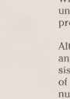

ToInt32() 指的是 32 位有符号整数（32 位是普通 int 的大小），因此这是 int 的转换方法。ToInt64() 处理 long 的大小。

当 Convert() 遇到意外的字符类型时，可能会产生意外结果。因此，您必须确切知道正在处理的数据类型，并确保没有多余的字符。

尽管我尚未完全讨论方法（参见第二册），这里有一个方法。以下方法如果传入的字符串仅由数字组成则返回 true。您可以在将其转换为整数类型之前调用此方法，假设仅由数字组成的序列很可能是一个合法数字。


要真正完整，您需要为浮点变量包含小数点，并为负数包含前导减号——但嘿，您明白了。

## 这是方法：

```
// IsAllDigits -- Return true if all characters
// in the string are digits.
public static bool IsAllDigits(string raw)
{
 // First get rid of any benign characters at either end;
 // if there's nothing left, you don't have a number.
 string s = raw.Trim(); // Ignore white space on either side.
 if (s.Length == 0) return false;
 // Loop through the string.
 for(int index = 0; index < s.Length; index++)
 {
 // A nondigit indicates that the string probably isn't a number.
 if (Char.IsDigit(s[index]) == false) return false;
 }
 // No nondigits found; it's probably okay.
 return true;
}
```

IsAllDigits() 方法首先删除字符串两端的任何无害空白。如果什么都没剩下，该字符串为空，无法成为整数。然后该方法遍历字符串中的每个字符。如果其中任何一个字符被证明是非数字字符，该方法将返回 false，表示该字符串可能不是数字。如果此方法返回 true，则该字符串很可能可以成功转换为整数。

以下代码示例从键盘输入一个数字并将其打印回控制台。（我为了节省空间省略了 IsAllDigits() 方法的列表，但我已将此程序调用它的地方加粗。）


```
// IsAllDigits -- Demonstrate the IsAllDigits method.
using System;
namespace IsAllDigits
{
 class Program
 {
 public static void Main(string[] args)
 {
 // Input a string from the keyboard.
 Console.WriteLine("Enter an integer number:");
 string s = Console.ReadLine();
 // First check to see if this could be a number.
 if (!IsAllDigits(s)) // Call the special method.
 {
 Console.WriteLine("Hey! That isn't a number!");
 }
 else
 {
 // Convert the string into an integer.
 int n = Int32.Parse(s);


```csharp
// ParseSequenceWithSplit -- Input a series of numbers separated by commas,
// parse them into integers and output the sum.
namespace ParseSequenceWithSplit
{
    using System;
    class Program
    {
        public static void Main(string[] args)
        {
            // Prompt the user to input a sequence of numbers.
            Console.WriteLine(
                "Input a series of numbers separated by commas:");
            // Read a line of text.
            string input = Console.ReadLine();
            Console.WriteLine();
            // Now convert the line into individual segments
            // based upon either commas or spaces.
            char[] dividers = { ',', ' ' };
            string[] segments = input.Split(dividers);
            // Convert each segment into a number.
            int sum = 0;
            foreach(string s in segments)
            {
                // Skip any empty segments.
                if (s.Length > 0)
                {
                    // Skip strings that aren't numbers.
                    if (IsAllDigits(s))
                    {
                        // Convert the string into a 32-bit int.
                        int num = 0;
                        if (Int32.TryParse(s, out num))
                        {
                            Console.WriteLine("Next number = {0}", num);
                            // Add this number into the sum.
                            sum += num;
                        }
                        // If parse fails, move on to next number.
                    }
                }
            }
            // Output the sum.
            Console.WriteLine("Sum = {0}", sum);
            // Wait for user to acknowledge the results.
            Console.WriteLine("Press Enter to terminate...");
            Console.ReadLine();
        }
    }
    // IsAllDigits here.
}
```

ParseSequenceWithSplit 程序首先从键盘读取一个字符串。程序将 char 类型的 dividers 数组传递给 Split() 方法，以指示逗号和空格是用于分隔各个数字的字符。这两个字符中的任意一个都会在该处进行拆分。

String 类为直接格式化用于输出的字符串数据提供了帮助。以下章节将介绍 Pad()、PadRight()、PadLeft()、Substring() 和 Concat() 方法。

## 使用 Trim() 和 Pad() 方法

我在前面展示了如何使用 Trim() 及其更专门的变体 TrimFront() 和 TrimEnd()。在这里，我将讨论另一种常见的格式化输出方法。你可以使用 Pad 方法，它会向字符串的任一端添加字符，将字符串扩展到某个预定的长度。例如，你可以在字符串的左侧或右侧添加空格来实现左对齐或右对齐，也可以在货币数字的左侧添加 "*" 字符，等等。

下面这个简短的 AlignOutput 程序同时使用 Trim() 和 Pad() 来修剪并对齐一系列名称：


```csharp
// AlignOutput -- Left justify and align a set of strings
//     to improve the appearance of program output.
namespace AlignOutput
{
    using System;
    using System.Collections.Generic;
    class Program
    {
        public static void Main(string[] args)
        {
            List<string> names = new List<string> {"Christa ",
                                                    "Sarah",
                                                    "Jonathan",
                                                    "Sam",
                                                    "Schmekowitz" };
            // First output the names as they start out.
            Console.WriteLine("The following names are of "
                              + "different lengths");
            foreach(string s in names)
            {
                Console.WriteLine("This is the name '" + s + "' before");
            }
            Console.WriteLine();

            // This time, fix the strings so they are
            // left justified and all the same length.
            // First, copy the source array into an array that you can manipulate.
            List<string> stringsToAlign = new List<string>();
            // At the same time, remove any unnecessary spaces from either end
            // of the names.
            for (int i = 0; i < names.Count; i++)
            {
                string trimmedName = names[i].Trim();
                stringsToAlign.Add(trimmedName);
            }
            // Now find the length of the longest string so that
            // all other strings line up with that string.
            int maxLength = 0;
            foreach (string s in stringsToAlign)
            {
```

```
Console.WriteLine(s);
// Wait for user to acknowledge the results.
Console.WriteLine("Press Enter to terminate...");
Console.Read();
}
```

这个程序的关键是加粗的循环。该循环不断处理由输入字符串 s 构成的字符串，移除数组 whiteSpace 中包含的每一个字符。

该循环使用 IndexOfAny() 来查找 whiteSpace 数组中任意字符的第一次出现位置。在所有这些字符的每个实例都被移除之前，它不会返回。IndexOfAny() 方法返回它能找到的第一个空白字符在数组中的索引。返回值为 -1 表示在字符串中未找到数组中的任何项。

循环的第一次遍历会移除目标字符串开头的空格。IndexOfAny() 在索引 0 处找到该空格。第一次 Substring() 调用返回一个空字符串，第二次调用返回该空格之后的整个字符串。然后使用 Concat() 将它们连接起来，生成一个移除了开头空格的字符串。

循环的第二次遍历找到 "this" 后面的空格，并以同样的方式将其移除，将字符串 "this" 和 "is a\nstring" 连接起来。经过这次遍历后，s 变成了 "thisis a\nstring"。

第三次遍历找到 \n 字符并将其移除。第四次遍历时，IndexOfAny() 找不到任何空白字符，返回 -1（未找到）。循环到此结束。

RemoveWhiteSpace 程序首先输出一个包含多种空白形式的字符串，然后移除其中的空白字符。该程序的输出如下：

```
before: this is a
string
after:thisis astring
Press Enter to terminate...
```

## 让我们用 Split() 拆解那个拼接程序

RemoveWhiteSpace 程序演示了 Concat() 和 IndexOf() 方法的使用，但它采用的并不是最高效的方法。和往常一样，稍加审视就会发现一个更高效的方法，即使用我们的老朋友 Split()。你可以在网站上的 RemoveWhiteSpaceWithSplit 下找到包含这段代码的程序——这现在是方法的另一个示例。完成该任务的方法如下所示：

```csharp
// RemoveWhitespace -- The RemoveSpecialChars method removes every
// occurrence of the specified characters from the string.
// Note: The rest of the program is not shown here.
public static string RemoveSpecialChars(string input, char[] targets)
{
    // Split the input string up using the target
    // characters as the delimiters.
    string[] substrings = input.Split(targets);

    // output will contain the eventual output information.
    string output = "";

    // Loop through the substrings originating from the split.
    foreach(string substring in substrings)
    {
        output = String.Concat(output, substring);
    }
    return output;
}
```

这个版本使用 `Split()` 方法将输入字符串分解为一组子字符串，以要移除的字符作为分隔符。分隔符不包含在创建的子字符串中，这样就达到了移除字符的效果。这里的逻辑要简单得多，也不易出错。

程序后半部分的 `foreach` 循环使用 `Concat()` 将各部分重新拼接在一起。程序的输出没有变化。

将代码提取到一个方法中进一步简化了它，并使其更加清晰。

## 精确格式化字符串

String 类还提供了 `Format()` 方法来格式化输出，尤其是数字的输出。在最简单的形式中，`Format()` 允许在格式字符串的中间插入字符串、数字或布尔值输入。例如，考虑下面的调用：

```csharp
string myString = String.Format("{0} times {1} equals {2}", 2, 5, 25);
```

`Format()` 的第一个参数称为格式字符串——就是你看到的带引号的字符串。格式字符串中间的 `{n}` 项表示格式字符串后的第 n 个参数将被插入到该位置。`{0}` 指第一个参数（本例中为值 2），`{1}` 指下一个参数（即 5），以此类推。

这将返回一个字符串 myString。得到的字符串是：

```text
"2 times 5 equals 10"
```


在占位符中使用说明符（修饰符或控制符）。表 3-1 列出了其中一些说明符。例如，`{0:E6}` 表示：“以指数格式输出该数字，小数部分使用六位数字。”

## 表 3-1 — 使用 String.Format() 的格式说明符

| 控制符 | 示例 | 结果 | 说明 |
|---|---|---|---|
| C — 货币 | `{0:C}` 作用于 123.456 | `$123.45` | 货币符号取决于区域设置。 |
|  | `{0:C}` 作用于 −123.456 | `($123.45)` | （在 Windows 控制面板中指定区域。） |
| D — 十进制 | `{0:D5}` 作用于 123 | `00123` | 仅限整数。 |
| E — 指数 | `{0:E}` 作用于 123.45 | `1.2345E+002` | 也称为科学记数法。 |
| F — 定点 | `{0:F2}` 作用于 123.4567 | `123.45` | F 后面的数字表示小数点后的位数。 |
| N — 数字 | `{0:N}` 作用于 123456.789 | `123,456.79` | 添加逗号并四舍五入到最接近的百分位。 |
|  | `{0:N1}` 作用于 123456.789 | `123,456.8` | 控制小数点后的位数。 |
|  | `{0:N0}` 作用于 123456.789 | `123,457` |  |
| X — 十六进制 | `{0:X}` 作用于 123 | `0x7B` | 7B 十六进制 = 123 十进制（仅限整数）。 |
|  | `{0:0...}` 作用于 12.3 | `012.30` | 如果某一位尚未存在，则强制补 0。 |
|  | `{0:#...}` 作用于 12.3 | `12.3` | 强制将空位留空；其他字段不能侵占小数点左侧的三位数字和小数点前的两位数字（用于保持小数点对齐）。 |
|  | `{0:#0.0#}` 作用于 0 | `0.0` | 组合 # 和零会强制空位留空，但零会强制至少显示一位数字，即使该数字为 0。 |
| `{0:#.##%}` | `{0:#.##%}` 作用于 .1234 | `12.3%` | % 将数字显示为百分比（乘以 100 并加上 % 符号）。 |
|  | `{0:00.##%}` 作用于 0.0234 | `02.3%` |  |


`Console.WriteLine()` 方法使用相同的占位符系统。第一个占位符 `{0}` 接受语句中格式字符串部分之后列出的第一个变量或值，依此类推。给定与前面 `Format()` 调用完全相同的参数，`Console.WriteLine()` 会将相同的字符串写入控制台。你也可以使用格式说明符。从现在起，我大部分时间使用 `WriteLine()` 的格式化形式，而不是用 `+` 运算符连接各项来构成最终输出字符串。

这些格式说明符可能看起来有点令人困惑。（我甚至没有提到详细的货币和日期控制符。）请在“帮助索引”中浏览“格式说明符”主题以获取更多信息。为了帮助你梳理这些选项，下面的 `OutputFormatControls` 程序允许你输入一个浮点数，后面跟一个说明符序列。然后程序使用指定的 `Format()` 控制符显示该数字：


```csharp
// OutputFormatControls -- Allow the user to reformat input numbers
//     using a variety of format specifiers input at run time.
namespace OutputFormatControls
{
    using System;
    public class Program
    {
        public static void Main(string[] args)
        {
            // Keep looping -- inputting numbers until the user
            // enters a blank line rather than a number.
            for(;;)
            {
                // First input a number -- terminate when the user
                // inputs nothing but a blank line.
                Console.WriteLine("Enter a double number");
                string numberInput = Console.ReadLine();
                if (numberInput.Length == 0)
                {
                    break;
                }
                double number = Double.Parse(numberInput);
                // Now input the specifier codes; split them
                // using spaces as dividers.
                Console.WriteLine("Enter the format specifiers"
                    + " separated by a blank "
                    + " (Example: C E F1 N0 000000.00000)");
                char[] separator = { ' ' };
                string formatString = Console.ReadLine();
                string[] formats = formatString.Split(separator);
                // Loop through the list of format specifiers.
                foreach(string s in formats)
                {
                    if (s.Length != 0)
                    {
                        // Create a complete format specifier
                        // from the letters entered earlier.
                        string formatCommand = "{0:" + s + "}";
                        // Output the number entered using the
                        // reconstructed format specifier.
                        Console.Write(
"The format specifier {0} results in ", formatCommand);

try
{
    Console.WriteLine(formatCommand, number);
}
catch(Exception)
{
    Console.WriteLine("<illegal control>");
    Console.WriteLine();
}

// Wait for user to acknowledge.
Console.WriteLine("Press Enter to terminate...");
Console.Read();
}
```
```

OutputFormatControls 程序持续将浮点数读入变量 numberInput，直到用户输入空行。（由于输入有点棘手，我在请求输入的消息中包含了一个供用户模仿的示例。）请注意，该程序没有包含用于确定输入是否为合法浮点数的测试。我只是假设用户足够聪明，知道数字长什么样（这是一个危险的假设！）。

然后程序读取一系列以空格分隔的说明符字符串。随后，每个说明符都会与一个“{0}”字符串（冒号前的数字，对应格式字符串中的占位符）组合成变量 formatCommand。例如，如果你输入 N4，程序会存储说明符“{0:N4}”。下面的语句使用新构造的 formatCommand 写入该数字：

```csharp
Console.WriteLine(formatCommand, number);
```

对于不起眼的 N4，该命令会这样呈现：

```csharp
Console.WriteLine("{0:N4}", number);
```

程序的典型输出如下所示（我将自己的输入加粗）：

```text
Enter a double number:
12345.6789
Enter the specifiers separated by a blank (Example: C E F1 N0 0000000.00000)
C E F1 N0 0000000.00000
The format specifier {0:C} results in $12,345.68

The format specifier {0:E} results in 1.234568E+004

The format specifier {0:F1} results in 12345.7

The format specifier {0:N0} results in 12,346
```

```
The format specifier {0:0000000.00000} results in 0012345.67890
Enter a double number
.12345
Enter the specifiers separated by a blank (Example: C E F1 N0 0000000.00000)
00.0%
The format specifier {0:00.0%} results in 12.3%
Enter a double number
Press Enter to terminate...
```

当应用于数字 12345.6789 时，说明符 N0 会在正确位置（N 部分）添加逗号，并去掉小数点之后的所有内容（0 部分），从而呈现为 12,346。（最后一位是四舍五入，而不是截断。）

类似地，当应用于 0.12345 时，控制符 00.0% 输出 12.3%。百分号会将数字乘以 100 并加上 % 符号。00.0 表示输出在小数点左侧至少应包含两位数字，而小数点后仅包含一位数字。使用相同的 00.0% 说明符时，数字 0.01 显示为 01.0%。

神秘的 try ... catch 会捕获当你输入非法格式命令（例如 D，它代表十进制）时抛出的任何错误。（我在本迷你书的第 9 章中介绍异常。）

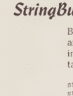

## StringBuilder：更高效地操作字符串

用一堆较短的字符串构建更长的字符串可能会让你付出巨大代价。因为字符串一旦创建就不能更改——正如我在本章开头所说，它是不可变的。下面的示例并没有把“ly”附加到 s1 上：

```
string s1 = "rapid";
string s2 = s1 + "ly";    // s2 = rapidly.
```

它会创建一个由该组合构成的新字符串。（s1 未改变。）类似地，其他看起来会修改字符串的操作（例如 Substring() 和 Replace()）也是如此。

结果是，对字符串的每个操作都会产生另一个字符串。假设你需要将 1000 个字符串连接成一个巨大的字符串。每次连接都会创建一个新字符串：

```
string[] listOfNames = ...;  // 1000 pet names
string s = string.Empty;
for(int i = 0; i < 1000; i++)
{
    s += listOfNames[i];
}
```

and reassigns the uppercased character to sb[0]. Finally, it extracts the improved string "Jones" from the StringBuilder.


本章前面介绍的 BuildASentence 示例可以从使用 StringBuilder 中受益。我经常使用 StringBuilder。

本书网站上的 StringCaseChanging 和 VariousStringTechniques 示例展示了 StringBuilder 的实际应用。


Book II 介绍了 C# 中称为 extension methods 的特性。那里的示例向 String 类添加了几个方便的方法。稍后在该迷你书中，我们将描述如何在字符串、char 数组和 byte 数组之间进行转换。这些是你可能需要经常执行的操作（并且在本书网站上的 StringCaseChanging 示例中有所展示）。

## 第 4 章：流畅的操作符

### 本章内容

- ✔ 进行一点算术运算
- ✔ 进行一些逻辑算术运算
- ✔ 用复合逻辑运算符使事情复杂化

**M**数学家创建变量并以各种方式操作它们，将它们相加、相乘，甚至——这有点难——对它们进行积分。本迷你书的第 2 章描述了如何声明和定义变量。然而，它几乎没有提到在声明变量后如何使用变量来完成工作。本章探讨了可以在变量上执行的操作以完成工作。操作需要 *运算符*，例如 `+`、`-`、`=`、`<` 和 `&`。本章将介绍算术、逻辑和其他类型的运算符。


编写能完成任务的程序是好的。如果你编写的程序什么都不做，你永远成不了 C# 程序员——当然，除非你是顾问。

## 执行算术运算

算术运算符的集合可以分为几个组：简单算术运算符、赋值运算符以及编程特有的特殊运算符集合。在消化完这些之后，你还需要消化另一组逻辑运算符。*Bon appétit!*

### 简单运算符

你很可能在小学就学会了如何使用大多数简单运算符。表 4-1 列出了它们。**注意：** 计算机使用星号 (\*)，而不是乘号 (×)，来进行乘法。

**表 4-1** 简单运算符

| 运算符 | 其含义 |
|---|---|
| - (一元) | 取负值 |
| * | 乘法 |
| / | 除法 |
| + | 加法 |
| - (二元) | 减法 |
| % | 取模 |

表中大多数运算符是 *二元* 运算符，因为它们操作两个值：一个在运算符左侧，一个在右侧。唯一的例外是一元负号。然而，它与其它运算符一样简单，如以下示例所示：

```
int n1 = 5;
int n2 = -n1;   // n2 now has the value -5.
```

`-n` 的值是 `n` 值的负值。

取模运算符可能不如其它运算符那么熟悉。取模类似于除法后的余数。因此，5 % 3 是 2（5 / 3 = 1，余数 2），25 % 3 是 1（25 / 3 = 8，余数 1）。读作“五 modulo 三”或简单地“五 mod 三”。偶数 mod 2 为 0：6 % 2 = 0（6/2 = 3，余数 0）。

除取模外的算术运算符对所有数值类型都有定义。取模运算符未定义浮点数，因为浮点值相除后没有余数。

### 操作顺序

某些表达式的值可能不明确。例如，考虑以下表达式：

```
int n = 5 * 3 + 2;
```

程序员的意思是“先将 5 乘以 3 再加 2”，结果为 17，还是“将 5 乘以 3 与 2 的和”，结果为 25？

C# 通常从左到右执行常见运算符。因此，前面的示例将值 17 分配给变量 `n`。


逻辑比较对所有数值类型都有定义，包括 float、double、decimal 和 char。以下所有语句都是合法的：

```csharp
bool b;
b = 3 > 2;        // true
b = 3.0 > 2.0;    // true
b = 'a' > 'b';    // false -- Alphabetically, later is greater.
b = 'A' < 'a';    // true -- Upper A is less than lower a.
b = 'A' < 'b';    // true -- All upper are less than all lower.
b = 10M > 12M;    // false
```

比较运算符始终产生类型为 bool 的结果。除了 == 之外的比较运算符对 string 类型的变量无效。（不用担心：C# 提供了其他比较字符串的方法。）

## 比较浮点数：你的浮点数比我的大吗？

比较两个浮点值可能会很棘手，你需要小心这些比较。考虑以下比较：

```csharp
float f1;
float f2;
f1 = 10;
f2 = f1 / 3;
bool b1 = (3 * f2) == f1; // b1 is true if (3 * f2) equals f1.
f1 = 9;
f2 = f1 / 3;
bool b2 = (3 * f2) == f1;
```

请注意，前一个示例中的第五行和第八行都首先包含赋值运算符 (=)，然后是逻辑比较 (==)。它们是不同的东西，所以不要在想写 == 时写 =。C# 先执行逻辑比较，然后将结果赋给左侧的变量。

b1 和 b2 计算之间的唯一区别是 f1 的初始值。那么 b1 和 b2 的值是多少？b2 的值显然为 true：9 / 3 是 3；3 * 3 是 9；9 等于 9。瞧！

b1 的值并不明显：10 / 3 是 3.333 . . . 而 3.333 . . . * 3 是 9.999 . . . ，9.999 . . . 等于 10 吗？这取决于你的处理器和编译器的聪明程度。在 Pentium 或更新的处理器上，如果将计算移离比较，C# 不够聪明，无法意识到 b1 应该是 true。


你可以使用系统绝对值方法来比较 f1 和 f2：

```csharp
Math.Abs(f1 - 3.0 * f2) < .00001; // Use whatever level of accuracy.
```

此计算在两种情况下都返回 true。你可以使用常量 Double.Epsilon 代替 .00001 以获得最大精度。Epsilon 是两个非零 double 变量之间可能存在的最小差异。

在这种情况下，C# 会计算 boolExpression1 和 boolExpression2。然后它会查看两者是否都为 true 才能决定 b 的值。然而，这可能是浪费精力。如果一个表达式为 false，就没有理由执行另一个。无论第二个表达式的值如何，结果都将为 false。尽管如此，& 仍会继续计算两个表达式。

&& 运算符避免不必要地计算两个表达式，如以下示例所示：

```
bool b = (boolExpression1) && (boolExpression2);
```

在这种情况下，C# 会计算 boolExpression1。如果它为 false，则 b 被设为 false，程序继续执行。另一方面，如果 boolExpression1 为 true，则 C# 会计算 boolExpression2 并将结果存储在 b 中。&& 运算符使用这种短路求值，因为如果需要，它会绕过第二个布尔表达式。


大多数程序员大部分时间都使用双重形式。

|| 运算符的工作方式相同，如以下表达式所示：

```
bool b = (boolExpression1) || (boolExpression2);
```

如果 boolExpression1 为 true，则没有必要计算 boolExpression2，因为结果始终为 true。

你可以将这些运算符读作 "short-circuit and" 和 "short-circuit or."

## 在 TrackDownAMate.com 上匹配表达式类型

在计算中，表达式的类型与它的值一样重要。考虑以下表达式：

```
int n;
n = (5 * 5) + 7;
```

我的计算器说 n 的结果值为 32。然而，该表达式还有一个基于其各部分类型的整体类型。

用 "type language" 写出来，前面的表达式变为

```
int [=] (int * int) + int;
```

要计算表达式的类型，请遵循与计算表达式值相同的模式。乘法优先于加法

乘法。int 乘以 int 得到 int。接下来是加法。int 加 int 得到 int。这样，你可以用以下方式化简前面的表达式：

```
(int * int) + int
int + int
int
```

## 计算操作的类型

大多数运算符有多种形式。例如，乘法运算符有以下几种形式（箭头表示“产生”）：

| 左操作数 | 运算符 | 右操作数 | 结果 |
|------|----------|-------|--------|
| int | * | int | int |
| uint | * | uint | uint |
| long | * | long | long |
| float | * | float | float |
| decimal | * | decimal | decimal |
| double | * | double | double |

因此，2 * 3 使用 * 运算符的 int * int 版本，产生 int 值 6。

## 隐式类型转换

* 符号对于两个 int 或两个 float 相乘来说很好用。但想象一下，当左右操作数类型不同时会发生什么。例如，考虑以下情况：

```
int anInt = 10;
double aDouble = 5.0;
double result = anInt * aDouble;
```

首先，C# 没有 int * double 操作。C# 本来可以直接生成一条错误消息然后就此打住；然而，它会尝试理解程序员的意图。C# 有 int * int 和 double * double 两种乘法版本，它本可以把 aDouble 转换为其对应的 int 类型，但那样会丢失数字的小数部分（小数点右边的数字）。相反，在隐式提升中，C# 将 int 类型的 anInt 转换为 double，并使用 double * double 运算符。

隐式提升之所以是隐式的，是因为 C# 会自动完成；之所以是提升，是因为它涉及上山和下山的自然概念。乘法运算符列表按照提升顺序排列，从 int 到 double，或从 int 到 decimal——从较窄的类型到较宽的类型。浮点类型与 decimal 之间不存在隐式转换。将能力更强的类型（如 double）转换为能力较弱的类型（如 int），称为降级（demotion）。


不允许隐式降级；C# 会生成一条错误消息。

## 显式类型转换——强制转换

想象一下，如果 C# 对隐式转换的判断是错误的，而程序员本意是要执行整数乘法，会发生什么？

你可以使用强制转换运算符更改任何值类型变量的类型。强制转换由一对括号括起来的类型组成，并紧跟在相关变量或表达式的前面。

因此，以下表达式使用 int * int 运算符：

```
int aInt = 10;
double aDouble = 5.0;
int result = aInt * (int)aDouble;
```

将 aDouble 强制转换为 int 称为显式降级或向下转换。这种转换是显式的，因为程序员明确声明了她的意图。（废话。）

你可以在任意两个值类型之间进行显式转换，无论转换方向是沿提升阶梯向上还是向下。


避免隐式类型转换。使用强制转换显式地进行值类型的任何更改。这样做可以减少出错的可能性，并使代码更容易让人类阅读。

## 别管逻辑类型

C# 不提供与 bool 类型之间进行类型转换的路径。

## 赋值与类型

你在转换中看到的类型匹配同样适用于赋值运算符。

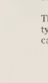

导致编译器错误消息的无意类型不匹配通常出现在赋值运算符处，而不是在类型不匹配的那一点上。

考虑以下乘法示例：

```
int n1 = 10;
int n2 = 5.0 * n1;
```

这个示例中的第二行会生成一条错误消息，因为存在类型不匹配，但错误发生在赋值时——而不是在乘法时。这里有个糟糕的故事：为了执行乘法，C# 隐式地将 n1 转换为 double。然后 C# 就可以执行 double 乘法，其结果就是万能的 double。

赋值运算符的左右操作数的类型必须匹配，而左操作数的类型不能改变。由于 C# 拒绝隐式地降级表达式，编译器会生成错误消息“无法将类型 double 隐式转换为 int”。

C# 允许使用显式强制转换的表达式：

```
int n1 = 10;
int n2 = (int)(5.0 * n1);
```

（括号是必需的，因为强制转换运算符具有非常高的优先级。）这个示例可以工作——显式降级是可以的。n1 被提升为 double，执行乘法，然后将 double 结果降级为 int。然而在这种情况下，你会担心程序员是否理智，因为 5 * n1 对程序员和 C# 编译器来说都更容易阅读。

## 第 5 章：进入程序流程

### 本章内容包括

- 尽可能做出决策
- 决定该做什么
- 循环而不绕圈子
- 使用 while 和 do . . . while 循环
- 使用 for 循环并理解作用域

考虑这个简单的程序：

```csharp
using System;
namespace HelloWorld
{
    public class Program
    {
        // This is where the program starts.
        static void Main(string[] args)
        {
            // Prompt user to enter a name.
            Console.WriteLine("Enter your name, please:");
            // Now read the name entered.
            string name = Console.ReadLine();
            // Greet the user with the entered name.
            Console.WriteLine("Hello, " + name);
            // Wait for user to acknowledge the results.
            Console.WriteLine("Press Enter to terminate . . .");
            Console.Read();
        }
    }
}
```

除了向你介绍 C# 编程的一些基础知识之外，这个程序几乎毫无价值。它只是把你输入的内容原样吐出来。你可以想象更复杂的程序示例，这些示例接受输入、执行某种计算、生成某种输出——否则，为什么要进行计算呢？——然后在末尾退出。然而，即使是这样一个程序，其用途也很有限。

任何计算机处理器的关键要素之一是其做出决策的能力。当我说“做出决策”时，我的意思是：如果条件为真，处理器将执行流程发送到一条指令路径上；如果条件不为真，则发送到另一条路径上。任何编程语言都必须提供这种控制执行流程的基本能力。

流程控制的三种基本类型是 if 语句、循环和跳转。（我在本小册子的第 6 章中介绍了循环控制之一 foreach。）

## 使用 if 和 switch 进行分支

C# 所有决策能力的基础是 if 语句（而我所有决策的基础是“也许”）：

```
if (bool-expression)
{
    // Control goes here if the expression is true.
}
// Control passes to this statement whether the expression is true or not.
```

紧跟关键字 if 之后的一对圆括号内包含一个 bool 类型的条件表达式。（有关 bool 表达式的讨论，请参阅本小册子的第 2 章。）紧跟在表达式之后的是一个由一对花括号括起来的代码块。如果表达式为真，程序将执行花括号内的代码；如果表达式不为真，程序将跳过花括号内的代码。（如果程序执行了花括号内的代码，那么它会在右花括号之后结束并从那里继续执行。）

通过一个具体的例子来理解 if 语句会更容易：

```
// Make sure that a is not negative:
// If a is less than 0 . . .
if (a < 0)
{
    // . . . then assign 0 to it so that it's no longer negative.
    a = 0;
}
```

这段代码确保变量 a 是非负的——大于或等于 0。if 语句的意思是：“如果 a 小于 0，则将 a 赋值为 0。”（换句话说，把 a 变成一个正值。）


花括号并不是必需的。C# 将 if(bool-expression) statement; 视为与 if(bool-expression) {statement;} 相同。普遍的共识（也是我的偏好）是始终使用花括号以获得更好的清晰度。换句话说，别问为什么——直接照做就行。

## 介绍 if 语句

考虑一个计算利息的小程序。用户输入本金金额和利率，程序输出每一年的结果值。（这个程序并不复杂。）这个简单的计算在 C# 中如下所示：


```
// Calculate the value of the principal plus interest.
decimal interestPaid;
interestPaid = principal * (interest / 100);
// Now calculate the total.
decimal total = principal + interestPaid;
```

第一个等式将本金乘以利率，得到应支付的利息——interestPaid。（除以 100 是因为利息通常以百分比金额输入来计算。）然后，应支付的利息被加回本金，得到新的本金，并存储在变量 total 中。

处理用户输入时，程序几乎必须预见任何情况。例如，你不希望程序接受负数的本金或利息金额（好吧，也许负利息除外）。下面的 CalculateInterest 程序包含检查，以确保这两种输入都不会发生：


```
// CalculateInterest -- Calculate the interest amount paid
// on a given principal. If either the principal or the
// interest rate is negative, generate an error message.
using System;
namespace CalculateInterest
{
    public class Program
    {
        public static void Main(string[] args)
        {
            // Prompt user to enter source principal.
            Console.Write("Enter principal: ");
            string principalInput = Console.ReadLine();
            decimal principal = Convert.ToDecimal(principalInput);

            // Make sure that the principal is not negative.
            if (principal < 0)
            {
                Console.WriteLine("Principal cannot be negative");
                principal = 0;
            }

            // Enter the interest rate.
            Console.Write("Enter interest: ");
            string interestInput = Console.ReadLine();
            decimal interest = Convert.ToDecimal(interestInput);

            // Make sure that the interest is not negative either.
            if (interest < 0)
            {
                Console.WriteLine("Interest cannot be negative");
                interest = 0;
            }

            // Calculate the value of the principal plus interest.
            decimal interestPaid;
            interestPaid = principal * (interest / 100);

            // Now calculate the total.
            decimal total = principal + interestPaid;

            // Output the result.
            Console.WriteLine(); // Skip a line.
            Console.WriteLine("Principal   = " + principal);
            Console.WriteLine("Interest    = " + interest + "%");
            Console.WriteLine();
            Console.WriteLine("Interest paid = " + interestPaid);
            Console.WriteLine("Total      = " + total);
            // Wait for user to acknowledge the results.
            Console.WriteLine("Press Enter to terminate . . .");
            Console.Read();
        }
    }
}
```


CalculateInterest 程序首先提示用户输入他的姓名，使用 `WriteLine()` 向控制台写入一个字符串。要确切告诉用户你想要什么，并且如果可能的话，指定格式。用户对没有提供有用信息的提示（例如 `>`）反应不佳。

示例程序使用 `ReadLine()` 命令读取用户输入的任何内容；当用户按 Enter 键时，程序会以字符串形式返回输入的值。由于程序要查找的是 decimal 形式的本金，因此必须使用 `Convert.ToDecimal()` 命令转换输入字符串。结果存储在 `principalInput` 中。


`ReadLine()`、`WriteLine()` 和 `ToDecimal()` 命令都是方法调用的示例。*方法调用*将一些工作委托给程序的另一部分，称为*方法*。我在第 II 册中详细描述方法调用；这些特定的方法调用很直接。你应该能够通过我极具洞察力的解释性叙述理解其含义。如果那不管用，就忽略这段叙述。如果*那*还是不管用，请看第 II 册。

示例中的下一行检查 `principal`。如果它为负数，程序会输出一条礼貌的“nastygram”（令人不快的消息），表明用户弄错了。程序对利率也做同样的处理，然后执行前面在“介绍 if 语句”中概述的简单利息计算，并使用一系列 `WriteLine()` 命令输出结果。

程序使用合法的本金金额和高利贷般的利率（这在大多数州完全合法）生成以下输出：

```
Enter principal: 1234
Enter interest: 21

Principal      = 1234
Interest       = 21%

Interest paid = 259.14
Total          = 1493.14
Press Enter to terminate . . .
```

使用非法输入执行该程序会生成以下输出：

```
Enter principal: 1234
Enter interest: -12.5
Interest cannot be negative

Principal      = 1234
Interest       = 0%
Interest paid = 0
Total = 1234
Press Enter to terminate . . .
```


缩进 if 子句中的行以增强可读性。C# 会忽略这种缩进，但对我们人类有帮助。大多数编程编辑器支持自动缩进，即只要你输入 if 命令，编辑器就会自动缩进。要在 Visual Studio 中设置自动缩进，请选择“工具”→“选项”。然后展开“文本编辑器”节点。接着展开 C#。最后单击“制表符”。在此页上，启用“智能缩进”，并根据偏好设置每级缩进的空格数。（本书中我使用每级缩进两个空格。）将制表符大小设置为相同的值。

## 检查 else 语句

有时，代码必须检查互斥的条件。例如，以下代码段将两个数字 a 和 b 中的最大值存储到变量 max 中：

```
// Store the maximum of a and b into the variable max.
int max;
// If a is greater than b . . .
if (a > b)
{
  // . . . save a as the maximum.
  max = a;
}
// If a is less than or equal to b . . .
if (a <= b)
{
  // . . . save b as the maximum.
  max = b;
}
```

第二个 if 语句会导致不必要的处理，因为这两个条件是互斥的。如果 a 大于 b，它不可能小于或等于 b。C# 正是为这种情况定义了 else 子句。else 关键字定义了一个代码块，当 if 块未执行时，该代码块会被执行。

现在，用于计算最大值的代码段如下所示：

```
// Store the maximum of a and b into the variable max.
int max;
// If a is greater than b . . .
if (a > b)
{
  // . . . save a as the maximum; otherwise . . .
  max = a;
}
else
{
  // . . . save b as the maximum.
  max = b;
}
```

```
}
    // Wait for user to acknowledge the results
    Console.WriteLine("Press Enter to terminate . . .");
    Console.Read();
}
}
```

程序首先从用户那里读取本金。如果本金为负数，程序会输出一条错误消息并退出。如果本金不是负数，控制权会传递到 else 子句，程序在那里继续执行。

在此示例中，利率测试得到了改进。在这里，程序要求利率为非负数（数学定律）且小于最大利率（司法定律——我只希望信用卡有利率上限）。这个 if 语句使用以下复合测试：

```
if (interest < 0 || interest > maximumInterest)
```

如果 interest 小于 0 或大于 maximumInterest，则此语句为真。注意，我在程序顶部声明 maximumInterest，而不是在这里将其硬编码为常量数字。硬编码是指在代码中直接使用值，而不是创建一个常量来保存它们。


在程序顶部定义重要的常量。给常量起一个描述性名称（而不仅仅是一个数字）使它易于查找，也更易于更改。如果该常量在代码中出现十次，你仍然只需做一处更改即可更改所有引用。

输入正确的本金但负的利率会生成以下输出：

```
Enter principal: 1234
Enter interest: -12.5
Interest cannot be negative or greater than 50.
Press Enter to terminate . . .
```

只有当用户同时输入合法的本金和合法的利率时，程序才会生成正确的计算：

```
Enter principal: 1234
Enter interest: 12.5

Principal   = 1234
Interest    = 12.5%
Interest paid = 154.250
Total       = 1388.250
Press Enter to terminate . . .
```

## 运行开关板

你经常希望针对许多不同的值测试一个变量。例如，maritalStatus 可能为 0 表示未婚，1 表示已婚，2 表示离异，3 表示


丧偶（我肯定已经覆盖了所有选项——哦，等等），或者用 4 表示“不关你的事”。为了区分这些值，你可以使用下面这一系列 if 语句：

```csharp
if (maritalStatus == 0)
{
    // Must be unmarried . . .
    // . . . do something . . .
}
else
{
    if (maritalStatus == 1)
    {
        // Must be married . . .
        // . . . do something else . . .
    }
}
```

以此类推。

你可以看到，这些重复的 if 语句很快就会变得令人厌烦。测试多个情形是如此常见，以至于 C# 提供了一种特殊结构，用于在一组互斥条件之间做出选择。这种控制结构就是 switch，其工作方式如下：

```csharp
switch(maritalStatus)
{
    case 0:
        // . . . do the unmarried stuff . . .
        break;
    case 1:
        // . . . do the married stuff . . .
        break;
    case 2:
        // . . . do the divorced stuff . . .
        break;
    case 3:
        // . . . do the widowed stuff . . .
        break;
    case 4:
        // . . . get out of my face . . .
        break;
    default:
        // Goes here if it fails to pass a case;
        // this is probably an error condition.
        break;
}
```

先计算 switch 语句顶部的表达式。在这里，表达式就是变量 maritalStatus。然后，将该表达式的值与每个 case 的值进行比较。如果找不到匹配项，控制权将转到 default 子句。

switch 语句的参数也可以是字符串：

```csharp
string s = "Davis";
switch(s)
{
    case "Davis":
        // . . . control will actually pass here . . .
        break;
    case "Smith":
        // . . . do Smith stuff . . .
        break;
    case "Jones":
        // . . . do Jones stuff . . .
        break;
    case "Hvidsten":
        // . . . do Hvidsten stuff . . .
        break;
    default:
        // Goes here if it doesn't pass any cases.
        break;
}
```


使用 switch 语句涉及以下严格限制：

- *`switch()` 的参数必须是计数类型之一（包括 `char`）或字符串。浮点值被排除。*
- *各个 case 值必须引用与 switch 表达式相同类型的值。*
- *case 值必须是常量，即其值必须在编译时已知。（诸如 `case x` 这样的语句不合法，除非 `x` 是某种常量类型。）*
- *每个子句必须以 `break` 语句（或其他退出命令，例如 `return`）结束。break 语句将控制权传出 `switch`。*

如果两个 case 导致相同的操作，你可以省略一个 break 语句：单个 case 子句可以有多个 case 标签，如下例所示：

```csharp
string s = "Davis";
switch(s)
{
    case "Davis":
    case "Hvidsten":
        // Do the same thing whether s is Davis or Hvidsten
        // since they're related.
        break;
    case "Smith":
        // . . . do Smith stuff . . .
        break;
    default:
        // Goes here if it doesn't pass any cases.
        break;
}
```

这种方法使程序无论输入是 Davis 还是 Hvidsten，都能执行相同的操作。网站上的 SwitchSyntaxTest 示例说明了关于使用 switch 的各种建议。本章最后一节给出了 switch 相关话题的一个小补充。你可以在 csharp102.info 找到代码。


## 现在开始循环

if 语句使程序能够根据 bool 表达式的结果，在执行代码时走不同的路径。与没有决策能力的程序相比，该语句让程序变得有趣得多。增加重复执行一组指令的能力，又在能力上实现了一次巨大飞跃。

考虑本章前面“介绍 if 语句”一节中的 CalculateInterest 程序。使用计算器（或手拿纸笔手工）完成这个简单的利息计算，要比编写并执行程序容易得多。

如果你能计算随后若干年中每一年的本金金额，那将更加有用。Microsoft Excel 电子表格中的简单宏仍然更容易处理，但至少你离目标更近了。

你需要的是让计算机多次执行同一小段指令序列的方法——这称为循环。

### 用 while 循环

C# 关键字 while 引入了最基本的执行循环形式：

```csharp
while (bool-expression)
{
    // . . . repeatedly executed as long as the expression is true.
}
```

第一次遇到 while 循环时，会计算 bool 表达式。如果表达式为 true，则执行块内的代码。当代码块执行到右花括号时，控制权返回顶部，整个过程重新开始。（这有点像我遛狗时的感觉。我和狗在院子里一圈又一圈地转，直到狗……嗯，直到它完事。）当 bool 表达式第一次求值为 false 时，控制权会越过右花括号继续执行。

如果第一次遇到 while 循环时条件不为 true，那么花括号内的这组命令永远不会执行。

程序员在说话时常常变得不严谨。（程序员大多数时候都不严谨。）如果程序员说一个循环会执行到某个条件为 false，这暗示着只要条件变为 false，控制权就会立即传到循环之外——无论程序恰好正在执行哪里。事实绝对不是这样。程序直到控制权专门回到循环顶部时，才会检查条件是否仍然为 true。


你可以使用 while 循环创建 CalculateInterestTable 程序，它是 CalculateInterest 程序的循环版本。CalculateInterestTable 计算一张本金表，显示逐年累计的付款：


```csharp
// CalculateInterestTable -- Calculate the interest paid on a given
//     principal over a period of years.
using System;
namespace CalculateInterestTable
{
    using System;
    public class Program
    {
        public static void Main(string[] args)
        {
            // Define a maximum interest rate.
            int maximumInterest = 50;
            // Prompt user to enter source principal.
            Console.Write("Enter principal: ");
            string principalInput = Console.ReadLine();
            decimal principal = Convert.ToDecimal(principalInput);
            // If the principal is negative . . .
            if (principal < 0)
            {
                // . . . generate an error message . . .
                Console.WriteLine("Principal cannot be negative");
            }
            else // Go here only if principal was > 0: thus valid.
            {
                // . . . otherwise, enter the interest rate.
                Console.Write("Enter interest: ");
                string interestInput = Console.ReadLine();
                decimal interest = Convert.ToDecimal(interestInput);
                // If the interest is negative or too large . . .
                if (interest < 0 || interest > maximumInterest)
                {
                    // . . . generate an error message as well.
                    Console.WriteLine("Interest cannot be negative " +
                        "or greater than " + maximumInterest);
                    interest = 0;
                }
                else // Reach this point only if all is well.
                {
                    // Both the principal and the interest appear to be
                    // legal; finally, input the number of years.
                    Console.Write("Enter number of years: ");
                    string durationInput = Console.ReadLine();
                    int duration = Convert.ToInt32(durationInput);
                    // Verify the input.
                    Console.WriteLine();  // Skip a line.
                    Console.WriteLine("Principal     = " + principal);
                    Console.WriteLine("Interest      = " + interest + "%");
                    Console.WriteLine("Duration      = " + duration + " years");
                    Console.WriteLine();
                    // Now loop through the specified number of years.
                    int year = 1;
                    while (year <= duration)
                    {
                        // Calculate the value of the principal plus interest.
                        decimal interestPaid;
                        interestPaid = principal * (interest / 100);
```


```csharp
// Now calculate the new principal by adding
// the interest to the previous principal amount.
principal = principal + interestPaid;
// Round off the principal to the nearest cent.
principal = decimal.Round(principal, 2);
// Output the result.
Console.WriteLine(year + "-" + principal);
// Skip over to next year.
year = year + 1;
}
}
}
// Wait for user to acknowledge the results.
Console.WriteLine("\nPress Enter to terminate . . .");
Console.Read();
}
}
```

`CalculateInterestTable` 的一次试运行输出如下所示：

```text
Enter principal: 1234
Enter interest: 12.5
Enter number of years: 10

Principal    = 1234
Interest     = 12.5%
Duration     = 10 years

1-1388.25
2-1561.78
3-1757.00
4-1976.62
5-2223.70
6-2501.66
7-2814.37
8-3166.17
9-3561.94
10-4007.18

Press Enter to terminate . . .
```


每个值代表经过相应年数后本金的总额，假设每年复利一次。例如，$1,234 在 12.5% 的利率下，九年后价值为 $3,561.94。

大多数值在金额的小数部分显示两位小数。由于并非所有版本的 C# 都显示尾随零，因此某些值可能只显示小数点后一位——甚至没有数字。例如，$12.70 可能显示为 12.7。如果出现这种情况，可以通过使用本迷你书第 3 章中描述的特殊格式字符来修复问题。（C# 2.0 及更高版本似乎默认显示尾随零。）

`CalculateInterestTable` 程序首先从用户读取本金和利率值，并检查其是否有效。`CalculateInterestTable` 然后读取迭代的年数，并将该值存储在变量 `duration` 中。

```csharp
// Prompt user to enter source principal; keep prompting
// until the correct value is entered.
decimal principal;
while(true)
{
    Console.Write("Enter principal: ");
    string principalInput = Console.ReadLine();
    principal = Convert.ToDecimal(principalInput);
    // Exit if the value entered is correct.
    if (principal >= 0)
    {
        break;
    }
    // Generate an error on incorrect input.
    Console.WriteLine("Principal cannot be negative");
    Console.WriteLine("Try again");
    Console.WriteLine();
}
// Now enter the interest rate.
decimal interest;
while(true)
{
    Console.Write("Enter interest: ");
    string interestInput = Console.ReadLine();
    interest = Convert.ToDecimal(interestInput);
    // Don't accept interest that is negative or too large . . .
    if (interest >= 0 && interest <= maximumInterest)
    {
        break;
    }
    // . . . generate an error message as well. .
    Console.WriteLine("Interest cannot be negative . . .");
    Console.WriteLine("or greater than " + maximumInterest);
    Console.WriteLine("Try again");
    Console.WriteLine();
}
// Both the principal and the interest appear to be
// legal; finally, input the number of years.
Console.Write("Enter number of years: ");
string durationInput = Console.ReadLine();
int duration = Convert.ToInt32(durationInput);
// Verify the input.
Console.WriteLine();  // Skip a line.
Console.WriteLine("Principal = " + principal);
Console.WriteLine("Interest  = " + interest + "%");
Console.WriteLine("Duration  = " + duration + " years");
Console.WriteLine();
// Now loop through the specified number of years.
int year = 1;
while(year <= duration)
{
    // Calculate the value of the principal plus interest.
    decimal interestPaid = principal * (interest / 100);
    // Now calculate the new principal by adding
    // the interest to the previous principal.
    principal = principal + interestPaid;
    // Round off the principal to the nearest cent.
    principal = decimal.Round(principal, 2);
    // Output the result.
    Console.WriteLine(year + ". . . " + principal);
    // Skip over to next year.
    year++;
}
```

```csharp
year = year + 1;
}
// Wait for user to acknowledge the results.
Console.WriteLine("Press Enter to terminate . . .");
Console.Read();
}
}
```

该程序的工作方式在很大程度上与本章前几节中的示例相同，只是用户输入方面有所不同。这次，使用 while 循环取代了早期示例中用于检测无效输入的 if 语句：

```
decimal principal;
while(true)
{
Console.Write("Enter principal: ");
string principalInput = Console.ReadLine();
principal = Convert.ToDecimal(principalInput);
// Exit when the value entered is correct.
if (principal >= 0)
{
break;
}
// Generate an error on incorrect input.
Console.WriteLine("Principal cannot be negative");
Console.WriteLine("Try again");
Console.WriteLine();
}
```

这段代码在循环内从用户输入一个值。如果文本的值正确，程序将退出输入循环并继续。否则，如果输入有错误，用户会看到错误消息，控制权会返回到程序流程以重新开始。


程序会一直循环，直到用户输入正确的值。（在最坏的情况下，程序可能会循环到一个迟钝的用户因年老而去世。）

请注意，条件判断已被反转，因为问题不再是非法输入是否应生成错误消息，而是正确的输入是否应退出循环。例如，在利率部分，考虑以下测试：

```
principal < 0 || principal > maximumInterest
```

该测试更改为：

```
interest >= 0 && interest <= maximumInterest
```

显然，interest >= 0 与 interest < 0 相反。可能不太明显的是，OR (||) 运算符被 AND (&&) 运算符取代。它表示：“如果利率大于零且小于最大值（换句话说，如果正确），则退出循环。”

顺便问一下，如何修改 CalculateInterestTableMoreForgiving 以让用户一次又一次地运行计算，并在每次想要退出之前输入新的本金和利率？*提示：* 使用另一个具有自身退出条件的 `while(true)` 循环。

请注意，由于作用域规则，本金变量必须在循环外部声明，我将在下一节中解释这一点。

听起来可能很明显，但表达式 `true` 的求值为 `true`。因此，`while(true)` 是典型的无限循环。是嵌入的 `break` 命令使循环退出。因此，如果使用 `while(true)` 循环，请确保您的 break 条件可以发生。


该程序一次示例执行的输出（显示了作者之一的无知）如下所示：

```
~~~
Enter principal: -1000
Principal cannot be negative
Try again

Enter principal: 1000
Enter interest: -10
Interest cannot be negative or greater than 50
Try again

Enter interest: 10
Enter number of years: 5

Principal    = 1000
Interest     = 10%
Duration     = 5 years

1-1100.0
2-1210.00
3-1331.00
4-1464.10
5-1610.51
Press Enter to terminate . . .
~~~
```

程序拒绝接受负本金或利率，并耐心地在每次循环中解释错误。

在返回循环进行进一步输入之前，准确解释用户做错了什么，否则用户会变得极度困惑。举例也可能有帮助，特别是对于格式问题。适度的外交手段也不会有坏处，正如奶奶可能指出的那样。

### 专注于作用域规则

在循环体内部声明的变量 *仅在其中定义*。请考虑以下代码片段：


```
int days = 1;
while(days < duration)
{
    int average = value / days;
    // . . . some series of commands . . 
    days = days + 1;
}
```


变量 average 在 while 循环外部未定义。存在各种原因，但请考虑以下原因：循环第一次执行时，程序遇到 int average 的声明，变量被定义。在第二次循环时，程序再次遇到 average 的声明，如果没有作用域规则，这将是一个错误，因为变量已经被定义。

我可以提供其他更有说服力的理由，但目前这个就足够了。

简而言之，就 C# 而言，变量 average 在程序到达闭合大括号时就会消失——并且在每次循环中都会重新定义。


有经验的程序员说变量 average 的作用域仅限于 while 循环。

## 使用 for 指定次数循环

while 循环是 C# 中最简单且第二常用的循环结构。然而，与 for 循环相比，while 循环的使用频率与美国机械车间中的公制工具差不多。

for 循环具有以下结构：

```
for(initExpression; condition; incrementExpression)
{
    // . . . body of code . . .
}
```

当遇到 for 循环时，程序首先执行 initExpression 表达式，然后执行 condition。如果 condition 表达式为 true，程序将执行循环体，该循环体由紧跟在 for 命令后的大括号包围。当程序到达闭合大括号时，控制权传递给 incrementExpression，然后返回到 condition，在那里开始下一次循环。

事实上，for 循环的定义可以转换为以下 while 循环：

```
initExpression;
while(condition)
{
```


```
~~~csharp
    // . . . body of code . . .
    incrementExpression;
}
~~~
```

### 示例

你可以更好地通过以下示例了解 `for` 循环的工作原理：

```
~~~csharp
// Here is one C# expression or another.
a = 1;
// Now loop for awhile.
for(int year = 1; year < duration; year = year + 1)
{
    // . . . body of code . . .
}
// The program continues here.
a = 2;
~~~
```

假设程序刚刚执行了 `a = 1;` 表达式。接下来，程序声明变量 year 并将其初始化为 1。然后程序将 year 与 duration 进行比较。如果 year 小于 duration，则执行大括号内的代码体。遇到闭合大括号后，程序跳回顶部并执行 `year = year + 1` 子句，然后再滑回到 `year < duration` 比较。

year 变量在 for 循环的作用域之外是未定义的。循环的作用域包括循环的标题以及其主体。


### 为什么还需要另一个循环？

如果 C# 具有等效的 while 循环，为什么还需要 for 循环？简短的答案是你不需要——for 循环并没有带来 while 循环无法做到的东西。

然而，for 循环的各部分是为了方便而存在的——并且为了清楚地建立每个循环应有的三个部分：设置、退出条件和递增。不仅这种安排更容易阅读，而且也更容易做对。（请记住，while 循环中最常见的错误是忘记递增计数变量以及未能提供适当的退出条件。）

除了我可能做的任何歌舞式的辩解之外，了解 for 循环的最重要原因是它就是大家使用的循环——而且它（连同其表亲 foreach）是你阅读他人代码时看到 90% 的时间出现的循环。


for 循环的设计使得第一个表达式初始化计数变量，最后一个部分递增它；然而，C# 语言并不强制执行任何此类规则。你可以在这两个部分中做任何你想做的事情——然而，你最好不要做任何超出初始化和递增计数变量之外的事。


嵌套循环中的 break 语句只会跳出内部循环。在下面的示例中，break 语句退出循环 B 并返回到循环 A：

// for loop A
for( . . . some condition . . .)
{
  // for loop B
  for( . . . some other condition . . .)
  {
    // . . . do whatever . . .
    if (something is true)
    {
      break;      // Breaks out of loop B and not loop A
    }
  }
}

C# 没有同时退出两个循环的 break 命令。


这听起来可能不是很大的限制。实际上，这类嵌套循环中包含的通常复杂的逻辑最好封装在一个方法中。从任何循环内部执行 return 都会退出该方法——从而跳出所有循环，无论它们嵌套得多深。我们将在本迷你书的第 7 章中描述方法和 return 语句。


DisplayXWithNestedLoops 示例（此处未显示）说明了将一个循环嵌套在另一个循环内以在屏幕上进行一些原始绘图。

## 不要乱用 goto

你可以通过使用 goto 语句以非结构化的方式转移控制。它后面跟随以下其中一项：

- 标签
- switch 语句中的 case
- 关键字 default（switch 语句的 default 子句）

后两项的想法是“跳转”从一个 case 到另一个 case。

以下片段演示了 goto 语句的使用方式：

// If the condition is true . . .
if (a > b)
{
  // . . . control passes unconditionally from the goto to the label.
  goto exitlabel;
}
// . . . whatever other code goes here . . .
exitlabel:
// Control continues here.

goto 语句不受欢迎的原因正是使其成为如此强大的控制的原因：它几乎完全是非结构化的。如果使用 goto，跟踪任何大于平凡代码片段的控制流可能会很困难。（你能说“意大利面条代码”吗？）


关于 goto 语句的使用已经引发了宗教战争。事实上，C# 语言本身因包含该控制而受到批评。实际上，goto 既不那么可怕也不必要。因为你几乎总能避免使用 goto，我建议远离它，除了偶尔在 switch 语句中将其用于链接两个 case，如下所示：

switch(n) // This example becomes gnarly in the logic department . . .
{
case 0:
// Do something for the 0 case, then . . .
goto 3; // jump to another case; no break statement needed.
break;
case 1:
// Do something for the 1 case.
break;
case 3: // Case 0 jumps to here after doing its thing.
// Add some case 3 stuff to what case 0 did, thus "chaining" the cases.
break;
default:
// Default case.
break;
}

不过，不要对 goto 上瘾。真的。

## 第 6 章：用集合排列你的鸭子

### 本章内容

- 创建包含多个数据项的变量：数组
- 在数组基础上更进一步，使用灵活的“集合”
- 新特性：数组和集合初始化器以及集合类型集合

本书中你可能遇到的简单单值变量在处理大量同类项目时显得力不从心：例如十只鸭子而不是一只。C# 通过两种存储多项的变量来填补这一空白，通常称为集合。这两种集合类型是数组和更通用的集合类。通常，如果我指的是数组，我会明确说出来，如果我指的是集合类，我就称之为它。如果我提到集合或列表，我通常意味着它可以是其中任何一种。

数组是一种数据类型，它保存一个项目列表，所有项目必须属于同一类型：例如全部为 int 或全部为 double。

C# 为你提供了相当多的集合类，它们有各种形状，例如灵活的列表（如串珠）、队列（如购买《蜘蛛侠 XII》票的队伍）、堆栈（如某人桌上半堆的杂物）等。大多数集合类与数组类似，因为它们只能保存苹果或只能保存橙子。但 C# 也提供了一些可以同时保存苹果和橙子的集合类——这很少有用。（而且你有比使用这些老旧集合更好的方式来管理这一功能。）

现在，如果你能掌握数组和列表集合（尽管本章介绍了另外两种集合），你将在本书的大部分内容中做得很好。但如果你想提升你的集合储备，请稍后再回来看这里。

## C# 数组

包含单个值的变量非常有用。甚至能够描述由部件组成的复合对象的类结构（如带有发动机和变速箱的车辆）也很关键。但你还需要一种构造来保存大量对象，例如比尔·盖茨广泛的收藏

老爷车或某位作者的老式袜子收藏。内置类 Array 是一个结构，可以包含一系列相同类型的元素（例如全部为 int 值和全部为 double 值，或全部为 Vehicle 对象和 Motor 对象——你在本迷你书的第 7 章中会遇到这些后一种对象）。

### 数组的理由

考虑对一组六个浮点数求平均值的问题。每个数字都需要自己的 double 存储：

double d0 = 5;
double d1 = 2;
double d2 = 7;
double d3 = 3.5;
double d4 = 6.5;
double d5 = 8;

> （对 int 变量求平均值可能会导致舍入错误，如本迷你书第 2 章所述。）

计算这些变量的平均值可能看起来像这样：

double sum = d0 + d1 + d2 + d3 + d4 + d5;
double average = sum / 6;

按名称列出每个元素很乏味。好吧，也许当你只有 6 个数字要平均时并不那么乏味，但想象一下平均 600 个（甚至 600 万个）浮点值。

### 固定值数组

幸运的是，你不需要分别命名每个元素。C# 提供了可以存储一系列值的数组结构。使用数组，你可以将所有的 double 放入一个变量中，如下所示：

double[] doublesArray = {5, 2, 7, 3.5, 6.5, 8, 1, 9, 1, 3};

你也可以在不初始化的情况下声明一个空数组：

double[] doublesArray = new double[6];

这一行为六个 double 分配空间，但不对其进行初始化。


所有 C# 数组都基于的 Array 类提供了一种特殊的语法，使其使用更方便。成对的方括号 [] 指的是你访问数组中单个元素的方式：

```
~~~
doubleArray[0] // Corresponds to d0 (that is, 5)
doubleArray[1] // Corresponds to d1 (that is, 2)
...
~~~
```

数组的第 0 个元素对应于 d0，第 1 个元素对应于 d1，第 2 个元素对应于 d2，以此类推。程序员通常将第 0 个元素称为“doubleArray sub-0”，将第一个元素称为“doubleArray sub-1”，以此类推。


数组的元素编号——0、1、2、……——被称为索引。

在 C# 中，数组索引从 0 开始而不是从 1 开始。因此，你通常不会将索引为 1 的元素称为第一个元素，而是称为“oneth 元素”或“索引为 1 的元素”。第一个元素是第零个元素。如果你坚持使用正常口语，请注意第一个元素始终位于索引 0，第二个元素位于索引 1。

doubleArray 变量如果不能让数组的索引成为变量，就不会有太大改进。使用 for 循环比手工写出每个元素要容易得多，如本程序所示：

```csharp
// FixedArrayAverage -- Average a fixed array of numbers using a loop.
namespace FixedArrayAverage
{
    using System;

    public class Program
    {
        public static void Main(string[] args)
        {
            double[] doublesArray = { 5, 2, 7, 3.5, 6.5, 8, 1, 9, 1, 3};
            // Accumulate the values in the array into the variable sum.
            double sum = 0;
            for (int i = 0; i < 10; i++)
            {
                sum = sum + doublesArray[i];
            }
            // Now calculate the average.
            double average = sum / 10;
            Console.WriteLine(average);
            Console.WriteLine("Press Enter to terminate...");
            Console.Read();
        }
    }
}
```


程序首先将变量 sum 初始化为 0。然后它遍历存储在 doublesArray 中的值，将每个值加到 sum 上。循环结束时，sum 已累积数组中所有值的总和。所得的总和除以元素数量即可得到平均值。执行此程序的输出为预期的 4.6。（你可以用计算器验证。）

## 检查数组边界

幸运的是，FixedArrayAverage 程序（在前一节“固定值数组”中）遍历了全部十个元素。但如果操作失误且没有正确迭代循环会怎样？你需要考虑以下两种情况：

你只遍历九个元素：C# 不认为这是错误。如果你想读取十个元素的数组中的九个元素，C# 有什么理由说不同呢？当然，平均值是不正确的，但程序并不知道这一点。

你遍历 11 个（或更多）元素：现在 C# 会很在意。它不允许你索引超出数组末尾，担心你可能会覆盖内存中的重要值。要测试它，请将 FixedArrayAverage 的 for 循环中的比较改为以下内容，将值 10 替换为 11：

```csharp
for(int i = 0; i < 11; i++)
```

执行程序时，你会看到一个对话框，显示以下错误信息：

```
IndexOutOfRangeException was unhandled
Index was outside the bounds of the array.
```

乍一看，这个错误信息似乎很吓人。然而，你可以很快抓住要点。显然，IndexOutOfRangeException 告诉你程序试图访问一个 10 个元素的数组中的第 11 个元素。（在本小书的第 9 章中，我会向你展示如何了解有关该错误的更多信息。）

## 可变长度数组

FixedArrayAverage 程序示例中使用的数组存在以下两个严重问题：

- 数组的大小固定为十个元素。
- 更糟糕的是，元素的值直接在程序中指定。

一个能够读取可变数量值的程序——也许在执行期间由用户确定——会灵活得多。它不仅适用于 FixedArrayAverage 中指定的十个值，还适用于任何其他值集合，无论其数量多少。

声明可变大小数组的格式与固定大小、固定值的数组略有不同：

```csharp
double[] doublesArrayVariable = new double[N]; // Variable, versus ...
double[] doublesArrayFixed = new double[10]; // Fixed
```

这里，N 表示要分配的元素数量。

更新后的程序 VariableArrayAverage 使用户能够指定要输入的值的数量。（它必须来自某个地方。）由于程序保留了输入的值，它不仅计算平均值，还以令人愉悦的格式显示结果，如下所示：

网上

第 1 册
第 6 章
与集合一起使用鸭子

```csharp
// VariableArrayAverage -- Average an array whose size is
//               determined by the user at runtime, accumulating the values
//               in an array. Allows them to be referenced as often as
//               desired. In this case, the array creates an attractive output.
namespace VariableArrayAverage
{
    using System;
    public class Program
    {
        public static void Main(string[] args)
        {
            // First read in the number of doubles the user intends to enter.
            Console.Write("Enter the number of values to average: ");
            string numElementsInput = Console.ReadLine();
            int numElements = Convert.ToInt32(numElementsInput);
            Console.WriteLine();

            // Now declare an array of that size.
            double[] doublesArray = new double[numElements];  // Here's the 'N'.

            // Accumulate the values into an array.
            for (int i = 0; i < numElements; i++)
            {
                // Prompt the user for another double.
                Console.Write("enter double #" + (i + 1) + ": ");
                string val = Console.ReadLine();
                double value = Convert.ToDouble(val);

                // Add this to the array using bracket notation.
                doublesArray[i] = value;
            }

            // Accumulate 'numElements' values from
            // the array in the variable sum.
            double sum = 0;
            for (int i = 0; i < numElements; i++)
            {
                sum = sum + doublesArray[i];
            }

            // Now calculate the average.
            double average = sum / numElements;

            // Output the results in an attractive format.
            Console.WriteLine();
            Console.Write(average + " is the average of (" + doublesArray[0]);
            for (int i = 1; i < numElements; i++)
            {
                Console.Write(" + " + doublesArray[i]);
            }
            Console.WriteLine(") / " + numElements);

            // Wait for user to acknowledge the results.
            Console.WriteLine("Press Enter to terminate...");
            Console.Read();
        }
    }
}
```

请看以下示例运行的输出，其中你输入五个连续的值 1 到 5，程序计算平均值为 3：

```
Enter the number of values to average: 5

enter double #1: 1
enter double #2: 2
enter double #3: 3
enter double #4: 4
enter double #5: 5

3 is the average of (1 + 2 + 3 + 4 + 5) / 5
Press Enter to terminate...
```

VariableArrayAverage 程序首先提示用户输入她打算求平均值的数量。（这就是我们稍早提到的 N。）结果存储在 int 变量 numElements 中。在示例中，输入的数字是 5。

程序继续为 doublesArray 分配指定数量的元素。在本例中，程序分配了一个包含五个元素的数组。程序按 numElements 指定的次数循环，每次从用户读取一个新值。最后一次值之后，程序计算平均值。


如本例所示，正确获取控制台输出有点棘手。请仔细跟踪 VariableArrayAverage 中的每个语句，程序输出左括号、等号、加号以及序列中的每个数字，并将其与输出进行比较。

VariableArrayAverage 程序可能并不能完全满足你对灵活性的渴望。你不想每次都要告诉程序你想平均多少个数字。你真正想要的是只要你想就可以输入要平均的数字——然后告诉程序对你输入的内容进行平均。这就是 C# 集合发挥作用的地方。它们为数组提供了功能强大且灵活的替代方案。直接从用户获取输入并不是填充数组或其他集合的唯一方式。

## Length 属性

用于填充 VariableArrayAverage 程序中数组的 for 循环开始如下：

```
// Now declare an array of that size.
double[] doublesArray = new double[numElements];
// Accumulate the values into an array.
for (int i = 0; i < numElements; i++)
{
  ...
}
```

doublesArray 被声明为 numElements 项长。因此聪明的程序员使用 for 循环遍历数组中的 numElements 项。（迭代意味着一次遍历数组的一个元素，如 for 循环所示。）

带着变量 numElements 在 doublesArray 到处走动只是为了知道它的长度，这将是一种遗憾和犯罪。幸运的是，这并非必要。数组有一个属性

名为 Length 的属性包含其长度。`doublesArray.Length` 的值与 `numElements` 相同。

以下 for 循环更可取：

```csharp
// Accumulate the values into an array
for (int i = 0; i < doublesArray.Length; i++) ...
```

## 初始化数组

以下几行展示了一个带有初始化器的数组，然后是一个分配空间但不初始化元素值的数组：

```csharp
double[] fixedLengthArray = { 6, 2, 7, 3.5, 6.5, 8, 1, 9, 1, 3 };
double[] variableLengthArray = new double[10];
```

你可以使用以下代码可视化地完成：

```csharp
double[] fixedLengthArray = new double[10] { 5, 2, 7, 3.5, 6.5, 8, 1, 9, 1, 3 };
```

这里，你已使用 `new` 明确分配了内存，然后在该声明后跟随数组成员的初始值。我想我可以预测你更喜欢哪种形式。*(提示：第 1 行？)*

## 为 foreach 数组设计的循环

给定一个 Student 对象数组，以下循环计算它们的 GPA 平均值：

```csharp
public class Student  // Read about classes in Book 11.
{
    public string name;
    public double gpa;        // Grade point average
}
public class Program
{
    public static void Main(string[] args)
    {
        // . . . create the array somehow . . .
        // Now average the students you have.
        double sum = 0.0;
        for (int i = 0; i < students.Length; i++)
        {
            sum += students[i].gpa;
        }
        double avg = sum / students.Length;
        // . . . do something with the average . . .
    }
}
```

for 循环遍历数组的成员。（是的，你可以拥有任何类型对象的数组，而不仅仅是 `double` 和 `string` 这样的简单类型。你可能还没有正式接触过类，所以请再耐心等待一会儿。我将在下一本书中介绍它们。）


students.Length 包含数组中的元素数量。

C# 提供了另一个名为 foreach 的循环，专门用于遍历数组等集合。其工作原理如下：

```csharp
// Now average the students that you have.
double sum = 0.0;
foreach (Student student in students)
{
    sum += student.gpa; // This extracts the current student's GPA.
}
double avg = sum / students.Length;
```

第一次循环时，foreach 获取数组中的第一个 Student 对象并将其存储在变量 student 中。每次后续遍历时，foreach 检索下一个元素。当数组中的所有元素都被处理后，控制权会退出 foreach 循环。

注意 foreach 语句中没有出现索引。缺少索引大大减少了出错的可能性，并且比 for 语句更简单易写，尽管有时该索引很方便，你会更喜欢 for 循环。


foreach 循环比示例中看起来还要强大。此语句除了数组之外还适用于其他集合类型。此外，foreach 处理多维数组（实质上是数组的数组），这是本书中未描述的主题。要了解有关多维数组的所有信息，请在 C# 帮助系统中查找多维数组。

## 对数据数组进行排序

一个常见的编程挑战是需要在数组内对元素进行排序。仅仅因为数组不能增长或缩小并不意味着其中的元素不能被移动、删除或添加。例如，以下代码片段交换了数组 strings 中两个字符串元素的位置：

```csharp
string temp = strings[i]; // Save the i'th string.
strings[i] = strings[k]; // Replace it with the kth.
strings[k] = temp;       // Replace kth with temp.
```

在此示例中，strings 数组中第 i 个位置的对象引用被保存，以便在第二个语句用另一个元素替换它时不会丢失。最后，temp 变量被保存回第 k 个位置。从图示上看，这个过程如图 6-1 所示。


本章其余部分讨论的数据集合在添加和删除元素方面比数组更灵活。

**Before:**


Figure 6-1: The term swapping two objects means swapping references to two objects.

**After:**

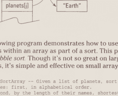

以下程序演示了如何将操作数组内元素的能力作为排序的一部分使用。这种特定的排序算法是冒泡排序。虽然它在大数组（数千个元素）上表现不佳，但在小数组上简单有效：


```csharp
// BubbleSortArray -- Given a list of planets, sort their
// names: first, in alphabetical order.
// Second, by the length of their names, shortest to longest.
// Third, from longest to shortest.
// This demonstrates using and sorting arrays, working with
// them by array index. Two sort algorithms are used:
// 1. The Sort algorithm used by class Array's Sort() method.
// 2. The classic Bubble Sort algorithm.
using System;

namespace BubbleSortArray
{
    class Program
    {
        static void Main(string[] args)
        {
            Console.WriteLine("The 5 planets closest to the sun, in order: ");
            string[] planets = 
                new string[] { "Mercury", "Venus", "Earth", "Mars", "Jupiter" };
            foreach (string planet in planets)
            {
                // Use the special char \t to insert a tab in the printed line.
                Console.WriteLine("\t" + planet);
            }

            Console.WriteLine("\nNow listed alphabetically: ");
            // Array.Sort() is a method on the Array class.
            // Array.Sort() does its work in-place in the planets array,
            // which leaves you without a copy of the original array. The
            // solution is to copy the old array to a new one and sort it.
            string[] sortedNames = planets;
            Array.Sort(sortedNames);
            // This demonstrates that (a) sortedNames contains the same
            // strings as planets and (b) that they're now sorted.
            foreach (string planet in sortedNames)
            {
                Console.WriteLine("\t" + planet);
            }

            Console.WriteLine("\nList by name length - shortest first: ");
            // This algorithm is called "Bubble Sort"; it's the simplest
            // but worst-performing sort. The Array.Sort() method is much
            // more efficient, but I couldn't use it directly to sort the
            // planets in order of name length because it sorts strings,
            // not their lengths.
            int outer;  // Index of the outer loop
            int inner;  // Index of the inner loop
            // Loop DOWN from last index to first: planets[4] to planets[0].
            for (outer = planets.Length - 1; outer >= 0; outer--)
            {
                // On each outer loop, loop through all elements BEYOND the
                // current outer element. This loop goes up, from planets[1]
                // to planets[4]. Using the for loop, you can traverse the
                // array in either direction.
                for (inner = 1; inner <= outer; inner++)
                {
                    // Compare adjacent elements. If the earlier one is longer
                    // than the later one, swap them. This shows how you can
                    // swap one array element with another when they're out of order.
                    if (planets[inner - 1].Length > planets[inner].Length)
                    {
                        // Temporarily store one planet.
                        string temp = planets[inner - 1];
                        // Now overwrite that planet with the other one.
                        planets[inner - 1] = planets[inner];
                        // Finally, reclaim the planet stored in temp and put
                        // it in place of the other.
                        planets[inner] = temp;
                    }
                }
            }
            foreach (string planet in planets)
            {
                Console.WriteLine("\t" + planet);
            }

            Console.WriteLine("\nNow listed longest first: ");
            // That is, just loop down through the sorted planets.
            for (int i = planets.Length - 1; i >= 0; i--)
            {
                Console.WriteLine("\t" + planets[i]);
            }

            Console.WriteLine("\nPress Enter to terminate...");
            Console.Read();
        }
    }
}
```

程序从一个包含距离太阳最近的前五个行星名称的数组开始。（为保持图表简洁，我没有包含外层行星，因此不必决定可怜的冥王星的问题，它现在是什么？——矮行星之类的？）

程序随后调用数组自身的 `Sort()` 方法。在使用 Array 类的内置 `Sort()` 方法排序后，程序使用自定义排序对行星名称的长度进行排序，只是为了让你惊叹。


数组（和其他集合）的内置 `Sort()` 方法无疑比自定义冒泡排序更高效。除非有充分理由，否则不要自己实现。

第二次排序的算法通过不断遍历字符串列表直到列表排序完成来工作。每次遍历 sortedNames 数组时，程序都会将每个字符串与其邻居进行比较。如果发现两者顺序错误，方法会交换它们，然后将列表标记为未排序。图 6-2 至 6-5 显示了每次遍历后行星列表的情况。在图 6-5 中，注意倒数第二次遍历导致列表已排序，而最后一次遍历因没有任何变化而终止排序。

**图 6-2：** 开始冒泡排序之前。

| 行星 | 备注 |
|---|---|
| 水星 | ← 而他们开始起跑了！ |
| 金星 | |
| 地球 | |
| 火星 | |
| 木星 | |

**图 6-3：** 冒泡排序第 1 次遍历后。

| 行星 | 备注 |
|---|---|
| 地球 | ← 地球慢慢进入领先... |
| 水星 | |
| 金星 | |
| 火星 | |
| 木星 | |

**图 6-4：** 冒泡排序第 2 次遍历后。

| 行星 | 备注 |
|---|---|
| 地球 | |
| 火星 | ← 火星超越水星和金星获得第二名 |
| 水星 | |
| 金星 | |
| 木星 | |

Book I · Chapter 6 · Living Up to Your Collections

Figure 6-5:
最后一次遍历因没有任何变化而终止排序。

| 行星 | 描述 |
|---|---|
| 地球 | ← 在终点，地球冲线获得第一名... |
| 木星 | ← ...而木星挤掉火星获得名次。 |
| 火星 | ← 与此同时，火星苦苦挣扎求表现。 |
| 水星 |  |
| 金星 |  |

最终，更长的行星名称会“冒泡”到列表顶部；因此得名冒泡排序。


为单个项目的变量使用单数名称，如 planet 或 student。变量名应以某种方式包含类名，如 badStudent 或 goodStudent 或 sexyCoedStudent。为数组（或其他集合）使用复数名称，如 students 或 phoneNumbers 或 phoneNumbersInMyPalmPilot。正如 always，这条提示反映了作者的观点，而非本书出版商或其任何股东的观点——C# 不关心你如何命名变量。

## 新功能：使用 var 定义数组

传统上，你使用以下其中一种形式（这些形式与 C# 一样古老——本书撰写时几乎已有六年历史）来初始化数组：

```
int[] numbers = new int[3]; // Size but no initializer, or ...
int[] numbers = new int[] { 1, 2, 3 }; // Initializer but no size, or ...
int[] numbers = new int[] { 1, 2, 3 }; // Size and initializer, or ...
int[] numbers = { 1, 2, 3 }; // No "new" keyword -- extreme short form.
```

本迷你书第 2 章介绍了新的 var 关键字，它告诉 C# 编译器，“你根据我提供的初始化表达式来推断变量类型。”

很高兴的是，var 也适用于数组：

```
// myArray is an int[] with 6 elements.
var myArray = new [] { 2, 3, 5, 7, 11, 13 }; // Initializer required!
```

新语法只有两个变化：

- 在赋值左侧，使用 var 代替 numbers 数组的显式类型信息。
- 在赋值右侧的方括号前省略了 int 关键字。这是编译器可以推断的部分。

然而，大多数集合在添加、插入或删除元素方面要容易得多，你可以根据需要随时调整大小。事实上，大多数集合通常会自动处理调整大小。


如果你需要多维数据结构，请使用数组。没有任何集合允许多维（尽管你可以创建一些复杂的数据结构，例如数组的集合或集合的集合）。

数组和集合有一些共同的特征：

- 每个只能包含一种类型的元素。你必须在代码中指定该类型，在编译时指定，并且在声明类型后，它就不能更改。
- 与数组一样，你可以使用方括号指定索引的类似数组的语法来访问大多数集合：`myList[3] = "Joe"`。
- 集合和数组都有方法和属性。因此，要查找以下 `smallPrimeNumbers` 数组中的元素数量，你调用其 `Length` 属性：

```
var smallPrimeNumbers = new [] { 2, 3, 5, 7, 11, 13 };
int numElements = smallPrimeNumbers.Length;  // Result is 6.
```

使用集合时，你调用其 `Count` 属性：

```
List<int> smallPrimes = new List<int> { 2, 3, 5, 7, 11, 13 };
int numElements = smallPrimes.Count; // Collections have a Count property.
```

在帮助中查看类 `Array`，看看它还有哪些方法和属性（7 个公共属性和 36 个公共方法）。

## 理解集合语法

在本节中，我将带你快速上手集合语法并介绍最重要的、最常用的集合类。

表 6-1 列出了 C# 中的主要集合类。我发现将集合视为具有各种“形状”很有用——例如列表形状或字典形状。

**表 6-1 最常见的集合“形状”**

| 类 | 描述 |
|---|---|
| List<T> | 这个动态数组包含类型为 T 的对象。 |
| LinkedList<T> | 这是类型为 T 的对象的链表。 |
| Queue<T> | 从队伍后端开始，最后到达前端。 |
| Stack<T> | 总是在列表的“顶部”添加或删除项目，就像一叠食堂托盘。 |
| Dictionary<TKey, TValue> | 这个结构像字典一样工作。查找一个键（例如一个词）并检索其对应的值（例如定义）。 |
| HashSet<T> | 这个结构类似于数学集合，没有重复项。它工作方式类似于列表，但提供数学集合操作，如并集和交集。 |

## 理解 <T>

在表 6-1 中看到的看似神秘的 <T> 记法中，<T> 是特定数据类型的占位符。要使这个符号对象活起来，通过插入真实类型来实例化它，如下所示：

```
List<int> intList = new List<int>(); // Instantiating for Int
```

*Instantiate 是极客用语，意为“创建该类型的一个对象（实例）。”*

例如，你可能会为类型 int、string 和 Student 创建不同的 List<T> 实例。顺便说一下，T 不是神圣的名字。你可以使用任何你喜欢的名字——例如 <dummy> 或 <aType>。使用 T、U、V 等很常见。

注意我在表 6-1 中如何表达 Dictionary<TKey, TValue> 集合。这里需要两种类型：一种用于字典的键，另一种用于与键关联的值。我将在后面的“使用字典”部分介绍字典。

如果这种记法看起来有点吓人，不用担心。你会习惯的。


### 通用化

这些现代集合被称为泛型集合，因为你可以将某种类型（或多种类型）填入某种空白模板，以创建自定义集合。如果泛型 `List<T>` 让你困惑，请查看本迷你书第 8 章。该章节更详细地讨论了泛型 C# 设施。特别是，该章节展示了如何自行创建泛型集合、类、方法和其他类型。

### 使用列表

假设你需要存储一组 MP3 对象，每个对象代表你 MP3 音乐收藏中的一个项目。作为数组，它可能看起来像这样：

```csharp
MP3[] myMP3s = new MP3[50];      // Start with an empty array.
myMP3s[0] = new MP3("Norah Jones"); // Create an MP3 and add it to the array.
// ... and so on.
```

使用列表集合，它看起来像这样：

```csharp
List<MP3> myMP3s = new List<MP3>(); // An empty list
myMP3s.Add(new MP3("Avril Lavigne")); // Call the list's Add() method to add.
// ... and so on.
```

你说，这有什么区别？这些例子看起来相似，列表似乎没有比数组提供任何优势。但当你向数组添加第 50 个 MP3，然后想添加第 51 个时会怎样？你没有空间了。你的唯一选择是声明一个更大的新数组，然后将所有 MP3 从旧数组复制到新数组中。此外，如果你从数组中删除一个 MP3，你的数组就会留下大洞。你把什么放到那个空槽中来取代你丢弃的 MP3？也许是值 `null`？

列表集合在面对同样的障碍时依然顺利航行。想添加第 51 个 MP3？没问题。想扔掉旧的 Pat Boone MP3？（有吗？）没问题。删除旧 Pat 后，列表会自行修复。


如果你的列表（或数组）可以包含 null 项，请确保在用 `for` 或 `foreach` 循环遍历时检查 `null`。你不想在 `null` 的 MP3 项上调用 `Play()` 方法。这会导致错误。


本书网站上的 ListCollection 示例展示了你可以用 `List<T>` 做的事情。在下面的代码列表中，我会穿插解释和代码片段。


## 第1册 — 第6章：用集合来整理你的集合

以下代码（摘自示例）展示了如何为 string 类型实例化一个全新的空列表。换句话说，这个列表只能存放字符串：

```csharp
// List<T>: note angle brackets plus parentheses in
// List<T> declaration; T is a "type parameter".
// List<T> is a "parameterized type."
// Instantiate for string type.
List<string> nameList = new List<string>();
nameList.Add("one");               // Fine.
nameList.Add(3);                    // Compiler error here!
nameList.Add(new Student("du Bois"));   // Compiler error here!
```

你可以通过 List<T> 的 Add() 方法向列表添加项。前面的代码片段成功地向列表中添加了一个字符串，但随后尝试依次添加一个整数和一个 Student 对象时遇到了麻烦。该列表是为字符串实例化的，因此编译器拒绝了这两次尝试。

下一个代码片段为 int 类型实例化了一个全新的列表，然后向列表添加两个 int 值。之后，foreach 循环遍历该 int 列表并打印出这些 int：

```csharp
// Instantiate for int.
List<int> intList = new List<int>();
intList.Add(3);                 // Fine.
intList.Add(4);
Console.WriteLine("Printing intList:");
foreach (int i in intList)  // foreach just works for all collections.
{
    Console.WriteLine("int i = " + i);
}
```

下面这段代码实例化了一个用于存放 Student 对象的新列表，并通过其 Add() 方法添加了两个学生。但紧接着请注意这个 Student 数组，我使用列表的 AddRange() 方法将其添加到了学生列表中。AddRange() 允许你一次性将整个数组或（几乎）任何其他集合添加到列表中：

```csharp
// Instantiate for Student.
List<Student> studentList = new List<Student>();
Student student1 = new Student("Vigil");
Student student2 = new Student("Finch");
studentList.Add(student1);
studentList.Add(student2);
Student[] students = { new Student("Mox"), new Student("Fox") };
studentList.AddRange(students);  // Add whole array to List
Console.WriteLine("Num students in studentList = " + studentList.Count);
```

（不必担心“new Student”那些内容，我会在第II册中讲到这个主题。）


你可以轻松地在列表和数组之间相互转换。要把数组放入列表，请使用列表的 AddRange() 方法，如前所述。要将列表转换为数组，请调用列表的 ToArray() 方法：

```csharp
Student[] students = studentList.ToArray(); // studentList is a List<Student>.
```

List<T> 还有许多其他用于添加项的方法，包括在列表中的任意位置插入一个或多个项的方法，以及移除项或清空列表的方法。请注意，List<T> 还有一个 Count 属性。（如果你习惯数组和字符串的 Length 属性，这一点可能会让你栽跟头。对于集合，应该用 Count。）

下一个代码片段演示了搜索列表的几种方式：IndexOf() 返回列表中某项的数组样式索引（如果找到），如果未找到则返回 -1。该代码还演示了如何使用数组样式索引以及 Contains() 方法访问项。其他搜索方法还包括 BinarySearch()，这里未展示：

```csharp
// Search with IndexOf().
Console.WriteLine("Student2 at " + studentList.IndexOf(student2));
string name = studentList[3].Name; // Access list by index.
if (studentList.Contains(student1)) // student1 is a Student object.
{
    Console.WriteLine(student1.Name + " contained in list");
}
```

最后一段代码演示了更多 List<T> 操作，包括排序、插入和移除项：

```csharp
studentList.Sort(); // Assumes Student implements IComparable interface (Ch 14).
studentList.Insert(3, new Student("Ross"));
studentList.RemoveAt(3); // Deletes the third element.
Console.WriteLine("removed " + name); // Name defined above
```

这只是 List<T> 方法的一小部分示例。你可以在帮助中查找完整列表。

> **提示**
>
> 要查找泛型集合，你需要在帮助索引中查找术语 *List<T>*。如果只搜索 *List*，你会迷失在一层又一层的列表之中。如果你想查看整个集合类（嗯，泛型集合类）的信息，请在索引中搜索 *generic collections*。

### 使用字典

你肯定用过韦氏词典或其他词典。它按字母顺序组织了一堆单词。与每个单词相关联的是一组信息，包括发音、定义和其他内容。要使用词典，你查找一个单词并获取其信息。

在 C# 中，字典的“形状”与列表不同。字典由 Dictionary<TKey, TValue> 类表示。TKey 表示字典键所使用的数据类型（类似于标准词典中的单词或你要查找的术语）。TValue 表示用于存储与键相关联的信息或数据的数据类型（类似于韦氏词典中单词的定义）。


.NET 字典基于哈希表的思想。想象地板上散落着一组桶。当你使用哈希函数计算哈希值时，会得到一个仅指向其中一个桶的值。相同的哈希总是指向同一个桶。如果哈希计算得当，你应该会看到项目在桶之间分布得相当均匀。因此，哈希是通向某个桶的钥匙。提供钥匙即可取回桶中的内容——即它的值。

在 C# 中使用字典并不比高中时使用词典更难。下面的 DictionaryExample 程序（摘录）展示了你可以用字典做的一些事情。为了节省篇幅，这里只展示 Main() 方法的一部分。


如果你觉得这里有点难懂，可以稍后再回头来看。


第一段代码只是创建了一个具有字符串键和字符串值的新 Dictionary 对象。不过，你并不局限于字符串。键或值，或两者，都可以是任何类型。请注意，Add() 方法需要同时提供键和值。

```csharp
Dictionary<string, string> dict = new Dictionary<string, string>();
// Add(key, value)
dict.Add("Nick", "cool");
dict.Add("C#", "like writing Sanskrit poetry in Morse code");
dict.Add("VB", "a simple but wordy language");
dict.Add("Java", "good, but not C#");
dict.Add("Fortran", "ANCIENT"); // 6-letters-a? variable name for "ancient"
dict.Add("Cobol", "even more wordy, or is it wordier, and verbose than VB");
```

ContainsKey() 方法告诉你字典中是否包含某个特定键。还有一个对应的 ContainsValue() 方法：

```csharp
// See if the dictionary contains a particular key.
Console.WriteLine("Contains key C# " + dict.ContainsKey("C#"));    // True
Console.WriteLine("Contains key Ruby " + dict.ContainsKey("Ruby")); // False
```

当然，你可以像遍历任何集合一样，在循环中遍历字典。但请记住，字典就像一对对项目的列表——将每一对看作一个同时包含键和值的对象。因此，要使用 foreach 遍历整个字典，你需要在每次循环时取出一对。这些对是 KeyValuePair<TKey, TValue> 类型的对象。在 WriteLine() 调用中，我使用该对的 Key 和 Value 属性来提取内容。如下所示：

```csharp
// Iterate the dictionary's contents with foreach.
// Note that you're iterating pairs of keys and values.
Console.WriteLine("Contents of the dictionary:");
foreach (KeyValuePair<string, string> pair in dict)
{
    // Because the key happens to be a string, we can call string methods on it.
    Console.WriteLine("Key: " + pair.Key.PadRight(8) + "Value: " + pair.Value);
}
```

在示例程序的最后一段中，你可以看到如何只遍历键或只遍历值。字典的 Keys 属性返回另一个集合：一个类型为 Dictionary<TKey, TValue>.KeyCollection 的列表形状集合。由于键恰好是字符串，你可以将键作为字符串遍历，并对其调用字符串方法。Values 属性类似。最后一段代码使用字典的 Count 属性来查看它包含多少键/值对。

```csharp
// List the keys, which are in no particular order.
Console.WriteLine("\nJust the keys:");
// Dictionary<TKey, TValue>.KeyCollection is a collection of just the keys,
// in this case strings. So here's how to retrieve the keys:
Dictionary<string, string>.KeyCollection keys = dict.Keys;
foreach(string key in keys)
{
    Console.WriteLine("Key: " + key);
}

// List the values, which are in the same order as key collection above.
Console.WriteLine("\nJust the values:");
Dictionary<string, string>.ValueCollection values = dict.Values;
foreach (string value in values)
{
    Console.WriteLine("Value: " + value);
}
Console.Write("\nNumber of items in the dictionary: " + dict.Count);
```

当然，这并没有穷尽字典用法的所有可能性。有关所有细节，请在帮助索引中查找 generic dictionary。

字典中的键/值对没有特定顺序，而且你无法对字典进行排序。它确实就像散落在地板上的一堆桶。


### 数组和集合初始化器

在本节中，我将总结数组和集合的初始化技术——包括老式和新式。你可能想折个书角标记一下。


#### 初始化数组

提醒一下，鉴于本章前面介绍的新 var 语法，数组声明可以像下面的任一示例：

```csharp
int[] numbers = { 1, 2, 3 };              // Shorter form -- can't use var.
var numbers = new[] { 1, 2, 3 };          // Full initializer mandatory with var.
```


## 初始化集合

同时，在 C# 2.0 时代（若干年前），初始化集合的传统方式，例如 List<T> —— 或 Queue<T> 或 Stack<T> —— 是这样的：

```csharp
List<int> numList = new List<int>();    // New empty list.
numList.Add(1);                         // Add elements one at a time.
numList.Add(2);
numList.Add(3);                         // ...tedious!
```

或者，如果你已经将数字放在数组或其他集合中，则是这样：

```csharp
List<int> numList = new List<int>(numbers); // Initializing from an array or...
List<int> numList2 = new List<int>(numList); // from another collection or...
numList.AddRange(numbers);                  // using AddRange
```


当像这里所示初始化列表、队列或栈时，你可以传入任何数组或类列表集合，包括列表、队列、栈，以及下一节中我会介绍的新集合（但不包括字典——它们的形状不对）。网站上的 MoreCollections 示例说明了从另一个集合初始化一个集合的几种情况。


自 C# 3.0 以来，集合初始化器类似于新的数组初始化器，比大多数早期形式更容易使用。新的初始化器看起来像这样：

```csharp
List<int> numList = new List<int> { 1, 2, 3 }; // List
int[] intArray = { 1, 2, 3 };                  // Array
```


新的数组初始化器和集合初始化器之间的关键区别在于，你仍然必须为集合写出类型——这意味着在 new 关键字之后给出 List<int>（参见前例中的粗体）。

当然，你也可以对集合使用 var 关键字：

```csharp
var list = new List<string> { "Head", "Heart", "Hands", "Health" };
```

你也可以使用新的 dynamic 关键字：

```csharp
dynamic list = new List<string> { "Head", "Heart", "Hands", "Health" };
```

使用新语法初始化字典看起来像这样：

```csharp
Dictionary<int, string> dict =
    new Dictionary<int, string> { { 1, "Sam" }, { 2, "Joe" } };
```

从外表看，这个示例与 List<T> 相同，但在外层大括号内部，你会看到第二层用大括号括起来的项，每个字典条目一个。因为这个字典 dict 有整数键和字符串值，每个内部一对大括号包含一个键和一个值，用逗号分隔。键/值对也用逗号分隔。

初始化集合（见下一节）与初始化列表非常相似：

```csharp
HashSet<int> biggerPrimes = new HashSet<int> { 19, 23, 29, 31, 37, 41 };
```

本书网站上的 UsingVarWithArraysAndCollections 示例演示了 var 关键字与数组和集合一起使用。


## 使用集合

C# 3.0 添加了新的集合类型 HashSet<T>。集合是一个无序且不包含重复项的集合。

集合的概念来自数学。想想性别的集合（女性和男性）、一周中各天的集合，或三角形的变体集合（等腰、等边、钝角、直角、锐角）。与数学集合不同，C# 集合不能是无限的，尽管它们可以大到可用内存的程度。

你可以对集合执行与其他集合共有的操作，例如添加、删除和查找项。但你也可以执行特殊的类集合操作，例如并集和交集。并集将两个集合的成员合并为一个。交集找到两个集合的重叠部分，并生成一个仅包含重叠成员的集合。因此集合适合于合并和消除项。

与字典一样，集合使用哈希表实现。集合类似于具有键但没有值的字典，使其形状类似列表。有关详细信息，请参阅前面的“使用字典”部分。

要创建 HashSet<T>，你可以这样做：

```csharp
HashSet<int> smallPrimeNumbers = new HashSet<int>();
smallPrimeNumbers.Add(2);
smallPrimeNumbers.Add(3);
```

或者，更方便地，你可以使用集合初始化器：

```csharp
HashSet<int> smallPrimeNumbers = new HashSet<int> { 2, 3, 5, 7, 11, 13 };
```

或者从任何类列表的现有集合（包括数组）创建集合：

```csharp
List<int> ints = new List<int> { 0, 1, 2, 3, 4, 5, 6, 7 };
HashSet<int> numbers = new HashSet<int>(ints);
```

如果你尝试向哈希集合添加集合已包含的项，如本例所示：


第一册  
第 6 章  
用集合排好你的鸭子


```csharp
smallPrimeNumbers.Add(2);
```

编译器不会将重复视为错误（并且不会更改哈希集合，因为它不能有重复项）。实际上，Add() 在添加发生时返回 true，未发生时返回 false。你不必使用这一事实，但在尝试添加重复项时想要执行某些操作时，它可能很有用：

```csharp
bool successful = smallPrimeNumbers.Add(2);
if (successful)
{
    // 2 was added, now do something useful.
}
// If successful is false, not added because it was already there
```

以下示例——网站上的 HashSetExample——展示了几个 HashSet<T> 方法，但更重要的是，演示了将 HashSet<T> 作为处理其他集合的工具使用。你可以用 HashSet<T> 执行严格的数学运算，但我们发现它以各种方式组合集合的能力非常方便。

这段代码的第一部分以 List<string> 和一个数组开始。每个都包含颜色名称。虽然你可以通过简单地调用列表的 AddRange() 方法将两者合并：

```csharp
colors.AddRange(moreColors);
```

结果列表包含一些重复项（yellow、orange）。另一方面，使用 HashSet<T> 和 UnionWith() 方法，你可以合并两个集合并一次性消除任何重复项，如以下示例所示。

这是本书网站上 HashSetExample 的开头：

```csharp
Console.WriteLine("Combining two collections with no duplicates:");
List<string> colors = new List<string> { "red", "orange", "yellow" };
string[] moreColors = { "orange", "yellow", "green", "blue", "violet" };
// Want to combine but without any duplicates.
// Following is just the first stage ...
HashSet<string> combined = new HashSet<string>(colors);
// ... now for the second stage.
// UnionWith() collects items in both lists that aren't duplicated,
// resulting in a combined collection whose members are all unique.
combined.UnionWith(moreColors);
foreach (string color in combined)
{
    Console.WriteLine(color);
}
```

这里给出的结果包含 "red"、"orange"、"yellow"、"green"、"blue" 和 "violet"。第一阶段使用 colors 列表初始化一个新的 HashSet<T>。第二阶段然后调用集合的 UnionWith() 方法将 moreColors 数组添加进来——但只添加集合中尚未存在的项。集合最终只包含两个原始列表中的颜色。Green、blue 和 violet 来自第二个列表；red、orange 和 yellow 来自第一个。`moreColors` 数组的项被添加，并且会重复集合中已有的项，因此被筛除。

但是假设你希望最终得到一个包含这些颜色的 List<T>，而不是 HashSet<T>。下一段展示了如何创建用合并集合初始化的新 List<T>：

```csharp
Console.WriteLine("\nConverting the combined set to a list:");
// Initialize a new List from the combined set above.
List<string> spectrum = new List<string>(combined);
foreach(string color in spectrum)
{
    Console.WriteLine(color);
}
```

当这些示例编写时，2008 年美国总统竞选正如火如荼进行，每个主要政党约有十名早期候选人。其中许多候选人也是美国参议院的成员。如何生成仅包含也是参议院成员的候选人的列表？HashSet<T>.IntersectWith() 方法给出候选人列表和参议院列表之间的重叠项——同时存在于两个列表中的项，但仅限于这些项：

```csharp
Console.WriteLine("\nFinding the overlap in two lists:");
List<string> presidentialCandidates =
    new List<string> { "Clinton", "Edwards", "Giuliani", "McCain", "Obama",
        "Romney" };
List<string> senators = new List<string> { "Alexander", "Boxer", "Clinton",
    "McCain", "Obama", "Snowe" };
HashSet<string> senatorsRunning = new HashSet<string>(presidentialCandidates);
// IntersectWith() collects items that appear in both lists, eliminates others.
senatorsRunning.IntersectWith(senators);
foreach (string senator in senatorsRunning)
{
    Console.WriteLine(senator);
}
```

结果是 "Clinton"、"McCain"、"Obama"，因为它们是两个列表中唯一的共同项。相反的技巧是删除同时出现在两个列表中的任何项，以便最终只剩下目标列表中在另一个列表中未重复的项。这需要 HashSet<T> 方法 ExceptWith()：

```csharp
Console.WriteLine("\nExcluding items from a list:");
Queue<int> queue =
    new Queue<int>(new int[] { 0, 1, 2, 3, 4, 5, 6, 7, 8, 9, 17 });
HashSet<int> unique = new HashSet<int> { 1, 3, 5, 7, 9, 11, 13,
    15 };
// ExceptWith() removes items in unique that are also in queue: 1, 3, 5, 7,
unique.ExceptWith(queue);
foreach (int n in unique)
{
    Console.WriteLine(n.ToString());
}
```


在这段代码之后，unique 移除了自身中与 queue 重复的项（1、3、5、7 和 9），同时也移除了 queue 中不在 unique 中的项（0、2、4、6、8 和 17）。最终 unique 中剩下 11、13 和 15。

与此同时，下一个代码段使用 SymmetricExceptWith() 方法来创建与 IntersectWith() 相反的结果。交集会给你重叠的项，而 SymmetricExceptWith() 会给你两个列表中不重叠的项。uniqueToOne 集合最终只包含 5、3、1、12 和 10：

```
Console.WriteLine("\nFinding just the non-overlapping items in two lists:");
Stack<int> stackOne = new Stack<int>(new int[] { 1, 2, 3, 4, 5, 6, 7, 8 });
Stack<int> stackTwo = new Stack<int>(new int[] { 3, 4, 6, 7, 8, 10, 12 });
HashSet<int> nonoverlapping = new HashSet<int>(stackOne);
// SymmetricExceptWith() collects items that are in one collection but not
// the other; the items that don't overlap.
nonoverlapping.SymmetricExceptWith(stackTwo);
foreach(int n in nonoverlapping)
{
    Console.WriteLine(n.ToString());
}
Console.WriteLine("Press Enter to terminate...");
Console.Read();
```

我在这里对栈的使用有点不寻常，因为我是一次性添加所有成员，而不是逐个 push，并且是一次性移除一批，而不是逐个 pop。push 和 pop 操作才是与栈交互的正确方式。

请注意，我演示的所有 HashSet<T> 方法都是 void 方法——它们不返回值。因此，结果会直接反映在你调用这些方法的哈希集合上：在前面的代码示例中为 nonoverlapping。


我们最初觉得 UnionWith() 和 IntersectWith() 的行为有点别扭，因为我希望得到一个新的结果集合，而原始（输入）集合在应用这些方法时保持不变。但在第二部分中你会遇到（我很高兴地报告）新的 LINQ 查询运算符，它们提供了返回全新集合对象的这些方法的版本。将这里看到的内容与那里看到的内容结合起来，你就能兼得两者之利。更多内容我现在就不说了。

何时使用 HashSet<T>？只要你处理两个或多个集合，并且想要查找重叠等项——或创建包含另外两个集合的集合，或从集合中排除一组项——集合就很有用。许多 HashSet<T> 方法可以将集合与其他集合类关联。当然你可以用集合做更多事情，所以在帮助中查找 HashSet<T> 术语并尝试 HashSetExample。

## 不使用老式集合

在时间黎明之前，在 C# 2.0 之前，当查拉图斯特拉说话时，所有集合类都实现为 Object 类型的集合。你无法仅为字符串或仅为 int 创建集合。这种集合允许你存储任何类型的数据，因为 C# 中的所有对象都派生自 Object 类。因此，你可以在同一个集合中添加 int 和字符串而不会看到错误消息（这是由于 C# 的继承和多态性，我将在第二部分中讨论）。

但在基于 Object 的结构中存在一个严重的缺点：要提取你知道放入集合中的 int，你必须将得到的 Object 强制转换为 int：

```
ArrayList ints = new ArrayList(); // An old-fashioned list of Objects
int myInt = (int)ints[0]; // Extract the first int in the list.
```

就好像你的 int 被藏在复活节彩蛋里一样。如果你不进行强制转换，就会产生错误，因为例如 Object 不支持 + 操作或其他你期望在 int 上使用的 方法、属性 和 运算符。你可以应付这些限制，但这种代码容易出错，而且进行所有强制转换纯粹是乏味的。（此外，正如我在第二部分中讨论的，使用复活节彩蛋会因“装箱”现象而增加一些处理开销。装箱太多会减慢你的程序。）

而且，如果集合恰好包含多种类型的对象——比如石榴和篮球——问题就会变得更棘手。 somehow，你必须检测钓出的对象是石榴还是篮球，以便正确地强制转换它。

在旧的非泛型集合存在这些限制的情况下，新的泛型集合就像一阵清新的空气。你永远不需要强制转换，而且你总是知道自己得到的是什么，因为你只能将一种类型放入任何给定的集合中。但你偶尔仍会在其他人编写的代码中看到旧集合——有时你甚至可能有正当理由将苹果和橘子放在同一个集合中。

非泛型集合位于 System.Collections 和 System.Collections.Specialized 命名空间中。Specialized 集合是有趣的、有时有用、奇特的集合，主要是非泛型的。现代的泛型集合位于 System.Collections.Generic 中。（我在第二部分的对象面向编程讨论中解释了命名空间和泛型）。


如果你在包含大量文件的文件夹中运行此程序，十六进制转储可能需要一段时间。同样，处理长文件时循环也需要一段时间。请选择包含少量文件的文件夹，或通过按 Ctrl+C 停止长时间的程序运行。此命令会中断在任何控制台窗口中运行的程序。

```
// LoopThroughFiles -- Loop through all files contained in a directory;
// this time perform a hex dump, though it could have been anything.
using System;
using System.IO;

namespace LoopThroughFiles
{
    public class Program
    {
        public static void Main(string[] args)
        {
            // If no directory name provided...
            string directoryName;
            if (args.Length == 0)
            {
                // ...get the name of the current directory...
                directoryName = Directory.GetCurrentDirectory();
            }
            else
            {
                // ...otherwise, assume that the first argument
                // is the name of the directory to use.
                directoryName = args[0];
            }
            Console.WriteLine(directoryName);

            // Get a list of all files in that directory.
            FileInfo[] files = GetFileList(directoryName);

            // Now iterate through the files in that list,
            // performing a hex dump of each file.
            foreach(FileInfo file in files)
            {
                // Write out the name of the file.
                Console.WriteLine("\n\nhex dump of file {0}:", file.FullName);

                // Now "dump" the file to the console.
                DumpHex(file);

                // Wait before outputting next file.
                Console.WriteLine("\nEnter return to continue to next file");
                Console.ReadLine();
            }

            // That's it!
            Console.WriteLine("\nNo files left!");

            // Wait for user to acknowledge the results.
            Console.WriteLine("Press Enter to terminate...");
            Console.Read();
        }
    }
}

// GetFileList -- Get a list of all files in a specified directory.
public static FileInfo[] GetFileList(string directoryName)
{
    // Start with an empty list.
    FileInfo[] files = new FileInfo[0];
    try
    {
        // Get directory information.
        DirectoryInfo di = new DirectoryInfo(directoryName);

        // That information object has a list of the contents.
        files = di.GetFiles();
    }
    catch(Exception e)
    {
        Console.WriteLine("Directory \"{0}\" invalid", directoryName);
        Console.WriteLine(e.Message);
    }
    return files;
}

// DumpHex -- Given a file, dump out the contents of the file to the console.
public static void DumpHex(FileInfo file)
{
    // Open the file.
    FileStream fs;
    BinaryReader reader;
    try
    {
        fs = file.OpenRead();
        // Wrap the file stream in a BinaryReader.
        reader = new BinaryReader(fs);
    }
    catch(Exception e)
    {
        Console.WriteLine("\nCan't read from \"{0}\"", file.FullName);
        Console.WriteLine(e.Message);
        return;
    }

    // Iterate through the contents of the file one line at a time.
    for(int line = 1; true; line++)
    {
        // Read another 10 bytes across (all that will fit on a single
        // line) -- return when no data remains.
        byte[] buffer = new byte[10];
        // Use the BinaryReader to read bytes.
        // Note: Using the bare FileStream would have been just as easy in this
        // case.
        int numBytes = reader.Read(buffer, 0, buffer.Length);
        if (numBytes == 0)
        {
            return;
        }

        // Write out the data just read, in a single line preceded by line
        // number.
        Console.Write("{0:D3} - ", line);
        DumpBuffer(buffer, numBytes);
    }
}


```csharp
// Stop every 20 lines so that the data doesn't scroll
// off the top of the console screen.
if ((line % 20) == 0)
{
    Console.WriteLine("Enter return to continue another 20 lines");
    Console.ReadLine();
}

// DumpBuffer -- Write a buffer of characters as a single line in hex format.
public static void DumpBuffer(byte[] buffer, int numBytes)
{
    for(int index = 0; index < numBytes; index++)
    {
        byte b = buffer[index];
        Console.Write("{0:X2}, ", b);
    }
    Console.WriteLine();
}
```

从命令行中，用户将要用作程序参数的目录指定出来。下面的命令会以十六进制转储 temp 目录中的每个文件（包括二进制文件和文本文件）：

```
loopthroughfiles c:\randy\temp
```

如果你不输入目录名，程序默认使用当前目录。（十六进制转储会以十六进制——即基数为 16——系统中的数字形式显示输出。参见附近的侧栏“十六进制初探”。）


FileRead 和 FileWrite 都从控制台读取输入文件名，而这个程序则从命令行获取输入。我真的不是在试图把你弄糊涂——我只是想展示解决同一问题的不同方式。

## 十六进制初探

就像二进制数（0 和 1）一样，十六进制数（或“hex”数）也是计算机编程的基础。在基数为 16 的系统中，数字是 0 到 9，然后是 A、B、C、D、E、F——其中 A=10、B=11……F=15。举例说明（使用 0x 前缀表示十六进制）：

0xD = 13 十进制
0x10 = 16 十进制：1*16 + 0*1

0x2A = 42 十进制：2*16 + A*1（其中 A*1 = 10*1）

字母数字可以是大写或小写。C 和 c 相同。这有点奇怪，但非常有用，尤其是在调试或贴近底层硬件处理内存内容时。

`LoopThroughFiles` 中的第一行会查找程序参数。如果参数列表为空（`args.Length` 为零），程序会调用 `Directory.GetCurrentDirectory()`。如果你是在 Visual Studio 中而不是从命令行运行，该值默认为 `LoopThroughFiles` 项目目录下的 `bin\Debug` 子目录。

`Directory` 类为用户提供了一组用于操作目录的方法。`FileInfo` 类提供了移动、复制和删除文件等方法，以及其他任务。

然后，程序通过调用本地 `GetFileList()` 创建指定目录中所有文件的列表。该方法返回一个 `FileInfo` 对象数组。每个 `FileInfo` 对象都包含有关文件的信息——例如，文件名（带文件完整路径的 `FullName`，或不带路径的 `Name`）、创建日期和最后修改日期。`Main()` 使用你的老朋友 `foreach` 语句遍历文件列表。它显示每个文件的名称，然后将文件传给 `DumpHex()` 方法以显示到控制台。

在循环结束时，它会暂停，让程序员有机会仔细查看 `DumpHex()` 的输出。

`GetFileList()` 方法首先创建一个空的 `FileInfo` 列表。这个列表就是它在发生错误时返回的列表。

在编写任何 `Get...List()` 方法时，有一个要记住的巧妙技巧：如果发生错误，就显示错误消息并返回一个长度为零的列表。

返回对象引用时要小心。例如，不要返回对 `PriorityQueue` 类中包装的某个底层队列的引用（本迷你书第 8 章介绍了该类）——除非你想邀请别人通过该引用而不是通过你的类方法来乱动那些队列。那肯定会得到一个损坏且不可预测的队列。但这里的 `GetFileList()` 并没有暴露你某个类的内部结构，所以没关系。

然后，`GetFileList()` 创建一个 `DirectoryInfo` 对象。顾名思义，`DirectoryInfo` 对象包含的关于目录的信息，与 `FileInfo` 对象包含的关于文件的信息类型相同：名称、等级和序列号之类的信息。然而，`DirectoryInfo` 对象可以访问一项 `FileInfo` 没有的东西：以 `FileInfo` 数组形式表示的目录中的文件列表。

像往常一样，`GetFileList()` 将与目录和文件相关的代码包装在一个大的 `try` 块中。末尾的 `catch` 会捕获生成的任何错误。为了进一步让你难堪，`catch` 块还会亮出目录名（它很可能并不存在，因为你输入错了）。


DumpHex() 方法有点棘手，仅仅是因为要把输出格式调整得恰到好处很困难。

DumpHex() 一开始会打开文件。FileInfo 对象包含有关文件的信息——它并不打开文件。DumpHex() 获取文件的完整名称（包括路径），然后使用该名称以只读模式打开一个 FileStream。如果 FileStream 因某种原因无法读取文件，catch 块会抛出异常。

然后 DumpHex() 会一次 10 个字节地读取整个文件。它以十六进制格式将每 10 个字节显示为一行。每 20 行，它会暂停，直到用户按 Enter 键。我使用取模运算符 % 来完成这项任务。


在垂直方向上，控制台窗口默认可以容纳 25 行。（当然，用户可以更改窗口大小，从而允许显示更多或更少的行。）这意味着你大约每 20 行就必须暂停一次。否则，数据会在用户读到之前就从屏幕顶部滚走。

取模运算符（%）返回除法后的余数。因此，当 line 等于 20、40、60、80 时，(line % 20) == 0 为 true——你明白意思。这个技巧很有价值，在各类循环场景中都很有用，尤其是当你只想每隔一段时间执行一次操作时。

DumpBuffer() 使用 X2 格式控制符写出字节数组的每个成员。虽然 X2 听起来像某个秘密军事实验的名称，但它只是表示“将数字显示为两个十六进制数字”。

一个字节的范围是 0 到 255，即 0xFF——每个字节两个十六进制数字。

```
Here are the first 20 lines of the output.txt file (even its own mother wouldn't recognize this picture):

Hex dump of file C:\C#Programs\VI\holdtank\Test2\bin\output.txt:
001 - 53, 74, 72, 65, 61, 6D, 20, 28, 70, 72,
002 - 58, 70, 6A, 74, 74, 65, 64, 39, 70, 0D, 0A,
003 - 20, 20, 46, 66, 6A, 6B, 6C, 65, 53, 74, 72, 65,
004 - 61, 6D, 28, 73, 74, 72, 69, 65, 68, 67, 2C,
005 - 20, 46, 69, 69, 6C, 65, 4D, 6F, 6C, 65, 65, 2C,
006 - 20, 46, 69, 69, 6C, 65, 41, 63, 63, 65, 65, 73,
007 - 73, 29, 0D, 0A, 20, 20, 4D, 65, 65, 6D, 6E,
008 - 72, 79, 53, 74, 74, 72, 65, 61, 6D, 28, 29,
009 - 53, 74, 72, 20, 20, 46, 65, 74, 74, 77, 66,
010 - 72, 6B, 53, 74, 72, 72, 65, 61, 6D, 0D, 0A,
011 - 20, 20, 42, 75, 66, 66, 65, 72, 72, 74,
012 - 72, 65, 61, 65, 6D, 20, 20, 62, 75, 65,
013 - 66, 65, 53, 72, 73, 20, 61, 6E, 20, 65,
014 - 69, 73, 74, 74, 69, 66, 67, 20, 73, 74,
015 - 6D, 6A, 6A, 20, 6A, 62, 6A, 65, 65, 62, 74,
016 - 0D, 0A, 0D, 0A, 42, 69, 69, 6B, 61, 72, 79,
017 - 52, 65, 61, 61, 65, 72, 72, 20, 20, 20, 20,
018 - 65, 61, 64, 20, 69, 6E, 6E, 20, 76, 61,
019 - 72, 69, 6F, 75, 73, 20, 74, 74, 79, 70, 65, 65,
020 - 20, 28, 43, 43, 68, 61, 72, 72, 2C, 20, 49,
Enter return to continue another 20 lines
```


你可以根据十六进制显示内容将文件重建为字符串。0x61 这个值就是字符 a 的数值等价形式。字母表中的字母按顺序排列，因此 0x65 应该是字符 e；0x20 是空格。这个示例中的第一行（行号之后）是 `s)\n\r`，其中 `\n` 是换行，`\r` 是回车。很有趣，对吧？我就想讲到这里。你可以用 Google 或其他搜索引擎搜索 ASCII 表。

这些编码对于庞大得多的 Unicode 字符集的低端部分也同样有效，而 C# 默认使用 Unicode。（你可以在网上用搜索引擎搜索 Unicode 字符这个术语，我在 `http://csharp102.info` 网站上的文章《在字节数组与字符数组之间转换》中解释了基础知识。）

下面的示例展示了当用户指定无效目录 x 时会发生什么：

```
Directory *x* invalid
Could not find a part of the path "C:\C#Programs\LoopThroughFiles\bin\Debug\x*.
```

```
No files left
Press Enter to terminate...
```

令人印象深刻，不是吗？

## 遍历 foreach 集合：迭代器

在本章余下部分，你将看到解决遍历集合这一一般问题的三种不同方法。在本节中，我继续讨论最传统的方法（至少对 C# 程序员而言），即迭代器类，或称枚举器，它实现 IEnumerator 接口。作为示例，我会带你进一步了解上一节介绍的链表的迭代器。


iterator（迭代器）和 enumerator（枚举器）这两个术语是同义的。尽管接口名称如此，iterator 这个术语更常见，但 enumerator 在 Microsoft 一直很流行。这两个名词也有动词形式：你可以 iterate（迭代）或 enumerate（枚举）一个容器或集合。注意，本章后面讨论的索引器和新的迭代器块，是解决同一问题的其他方法。

## 访问集合：一般问题

不同的集合类型可能具有不同的访问方案。并非所有类型的集合都能像数组那样通过索引高效访问——例如链表。集合类型之间的差异使得如果不做特殊处理，就不可能编写如下方法：


```text
// Pass in any kind of collection:
void MyClearMethod(Collection aColl, int index)
{
    aColl[index] = 0; // Indexing doesn't work for all types of collections.
    // ...continues...
}
```

每种集合类型都可以（而且确实会）定义自己的访问方法。例如，链表可能提供 `GetNext()` 方法来获取对象链中的下一个元素，或者栈集合可能提供 `Push()` 和 `Pop()` 来添加和移除对象。

更通用的方法是，为每个集合类提供一个单独的迭代器类，该类熟悉如何导航该特定集合。每个集合 X 都定义自己的类 `IteratorX`。与 X 不同，`IteratorX` 提供一个通用的 `IEnumerator` 接口，这是迭代的黄金标准。这种技术使用第二个对象——迭代器——作为指向集合的一种指针或游标。

迭代器（枚举器）方法具有以下优点：

-   每个集合类都可以定义自己的迭代类。由于迭代器类实现了标准的 `IEnumerator` 接口，因此通常很容易编码。
-   应用程序代码不需要知道集合代码如何工作。只要程序员知道如何使用迭代器，迭代类就能处理细节。这是良好的封装。
-   应用程序代码可以为同一个集合创建多个独立的迭代器对象。由于迭代器包含自己的状态信息（“知道自己在哪里”，在迭代中），每个迭代器都可以独立地遍历集合。你可以同时进行多个迭代，每个迭代都位于集合中的不同位置。

为了使 `foreach` 循环成为可能，`IEnumerator` 接口必须支持所有不同类型的集合，从数组到链表。因此，它的方法必须尽可能通用。例如，你不能使用迭代器随机访问集合类中的位置，因为大多数集合不提供随机访问。（你需要发明一种具有该能力的不同的枚举接口，但它无法与 `foreach` 一起工作。）

`IEnumerator` 提供以下三个方法：

-   `Reset()`：将枚举器设置为指向集合的开头。**注意：** `IEnumerator` 的泛型版本 `IEnumerator<T>` 不提供 `Reset()` 方法。对于泛型 `LinkedList`，只需从调用 `MoveNext()` 开始。
-   MoveNext()：将枚举器从集合中的当前对象移动到下一个对象。
-   Current：一个属性，而不是方法，用于检索存储在枚举器当前位置的数据对象。

下面的方法演示了这一原理。MyCollection 类（未显示）的程序员创建了一个相应的迭代器类——比如 IteratorMyCollection（使用本章前面描述的 IteratorX 命名约定）。应用程序程序员已经在 MyCollection 中存储了许多 ContainedDataObjects。下面的代码段使用三个标准的 IEnumerator 方法来读回这些对象：

```
// The MyCollection class holds ContainedDataObject type objects as data.
void MyMethod(MyCollection myColl)
{
    // The programmer who created the MyCollection class also
    // creates an iterator class IteratorMyCollection;
    // the application program creates an iterator object
    // in order to navigate through the myColl object.
    IEnumerator iterator = new IteratorMyCollection(myColl);
    // Move the enumerator to the "next location" within the collection.
    while(iterator.MoveNext())
    {
        // Fetch a reference to the data object at the current location
        // in the collection.
        ContainedDataObject contained; // Data
        contained = (ContainedDataObject)iterator.Current;
        // ...use the contained data object...
    }
}
```

方法 MyMethod() 接受 ContainedDataObjects 集合作为其参数。它首先创建一个 IteratorMyCollection 类的迭代器。该方法通过调用 MoveNext() 开始一个循环。在第一次调用时，MoveNext() 将迭代器移动到集合中的第一个元素。在随后的每次调用中，MoveNext() 将指针“移动一个位置”。当集合耗尽且迭代器无法再移动时，MoveNext() 返回 false。

Current 属性返回对迭代器当前位置处数据对象的引用。程序将返回的对象转换为 ContainedDataObject，然后再将其赋给 contained。如果 MoveNext() 方法在上一次调用中没有返回 true，或者尚未调用 MoveNext()，则对 Current 的调用无效。

## 让 C# 通过 foreach 访问数据容器

IEnumerator 方法足够标准，以至于 C# 会自动使用它们来实现 foreach 语句。

foreach 语句可以访问任何实现 IEnumerable 或 IEnumerable<T> 的类。本节以 IEnumerable<T> 的角度讨论 foreach，如下面的通用方法所示，该方法能够处理任何此类类，从数组到链表再到栈和队列：

```
void MyMethod(IEnumerable<T> containerOfThings)
{
    foreach(string s in containerOfThings)
    {
        Console.WriteLine("The next thing is {0}", s);
    }
}
```

类通过定义方法 GetEnumerator() 来实现 IEnumerable<T>，该方法返回 IEnumerator<T> 的实例。在底层，foreach 调用 GetEnumerator() 方法来获取迭代器。它使用这个迭代器遍历集合。它检索到的每个元素在继续进入花括号内的代码块之前都已进行了适当的强制转换。注意，IEnumerable<T> 和 IEnumerator<T> 是不同但相关的接口。C# 也提供两者的非泛型版本，但你应该优先使用泛型版本，因为它们具有更高的类型安全性。

IEnumerable<T> 如下所示：

```
interface IEnumerable<T>
{
    IEnumerator<T> GetEnumerator();
}
```

而 IEnumerator<T> 如下所示：

```
interface IEnumerator<T>
{
    bool MoveNext();
    T Current { get; }
}
```

非泛型 IEnumerator 接口添加了一个 Reset() 方法，用于将迭代器移回集合的开头，其 Current 属性返回 Object 类型。注意，IEnumerator<T> 继承自 IEnumerator——并且请记住，接口继承（在第 II 册第 8 章中介绍）与普通的对象继承不同。

C# 数组（体现在它们所基于的 Array 类中）以及所有 .NET 集合类都已经实现了这两个接口。因此，只有当你编写自己的自定义集合类时，才需要负责实现这些接口。对于内置集合，直接使用它们即可。请参阅帮助中的 System.Collections.Generic 命名空间主题。

因此，你可以这样编写 foreach 循环：

```
foreach(int nValue in myCollection)
{
    // ...
}
```


我强烈建议你使用 foreach 来迭代集合，而不是直接使用 IEnumerator 或 IEnumerator<T> 进行迭代。这本小册子的第 8 章展示了使用原始迭代器是多么容易出错。foreach 循环是一个有用的工具。

## 以数组方式访问集合：索引器

访问数组元素很简单：命令 container[n]（读作“container 下标 n”）访问 container 数组的第 n 个元素。方括号中的值是下标。要是索引其他类型的集合同样简单就好了。

且慢！C# 使你能够编写自己的索引操作实现。你可以为原本无法享有这种功能的集合提供索引功能。此外，你还可以使用除 C# 数组所限定的简单整数之外的下标类型进行索引；例如字符串：再比如，试试 container["Joe"]。

### 索引器格式

索引器看起来很像普通的 get/set 属性，只不过出现了关键字 this 和索引运算符 []，而不是属性名，如下面的代码所示：

```
class MyArray
{
    public string this[int index]  // Notice the "this" keyword.
    {
        get
        {
            return array[index];
        }
        set
        {
            array[index] = value;
        }
    }
}
```

在底层，表达式 s = myArray[i]; 会调用 get 访问器方法，并将 i 的值作为索引传递给它。此外，表达式 myArray[i] = "some string"; 会调用 set 访问器方法，并将相同的索引 i 和 "some string" 作为 value 传递给它。


## 索引器程序示例

索引类型并不限于 int。你可以选择按业主姓名、按房屋地址或按任意数量的其他索引来为房屋集合建立索引。此外，索引器属性可以用多个索引类型重载，因此你可以在同一集合中基于多种元素建立索引。

下面的 Indexer 程序生成虚拟数组类 KeyedArray。这个虚拟数组的外观和行为都像数组，只不过它使用字符串值作为索引：


```csharp
// Indexer -- This program demonstrates the use of the index operator
// to provide access to an array using a string as an index.
// This version is nongeneric, but see the IndexerGeneric example.
using System;
namespace Indexer
{
    public class KeyedArray
    {
        // The following string provides the "key" into the array --
        // the key is the string used to identify an element.
        private string[] _keys;
        // The object is the actual data associated with that key.
        private object[] _arrayElements;
        // KeyedArray -- Create a fixed-size KeyedArray.
        public KeyedArray(int size)
        {
            _keys = new string[size];
            _arrayElements = new object[size];
        }
        // Find -- Find the index of the element corresponding to the
        // string targetKey (return a negative if it can't be found).
        private int Find(string targetKey)
        {
            for (int i = 0; i < _keys.Length; i++)
            {
                if (String.Compare(_keys[i], targetKey) == 0)
                {
                    return i;
                }
            }
            return -1;
        }
        // FindEmpty -- Find room in the array for a new entry.
        private int FindEmpty()
        {
            for (int i = 0; i < _keys.Length; i++)
            {
                if (_keys[i] == null)
                {
                    return i;
                }
            }
            throw new Exception("Array is full");
        }
        // Look up contents by string key -- this is the indexer.
        public object this[string key]
        {
            set
            {
                // See if the string is already there.
                int index = Find(key);
                if (index < 0)
                {
                    // It isn't -- find a new spot.
                    index = FindEmpty();
                    _keys[index] = key;
                }
                // Save the object in the corresponding spot.
                _arrayElements[index] = value;
            }
            get
            {
                int index = Find(key);
                if (index < 0)
                {
                    return null;
                }
                return _arrayElements[index];
            }
        }
    }
    public class Program
    {
        public static void Main(string[] args)
        {
            // Create an array with enough room.
            KeyedArray ma = new KeyedArray(100);
            // Save the ages of the Simpson kids.
            ma["Bart"] = 8;
            ma["Lisa"] = 10;
            ma["Maggie"] = 2;
            // Look up the age of Lisa.
            Console.WriteLine("Let's find Lisa's age");
            int age = (int)ma["Lisa"];
            Console.WriteLine("Lisa is {0}", age);
            // Wait for user to acknowledge the results.
            Console.WriteLine("Press Enter to terminate...");
            Console.Read();
        }
    }
}
```

KeyedArray 类包含两个普通数组。_arrayElements 对象数组包含实际的 KeyedArray 数据。_keys 数组中的字符串充当对象数组的标识符。`_keys` 的第 i 个元素对应 `_arrayElements` 的第 i 项。然后，应用程序可以通过对应用程序有意义的字符串标识符来索引 `KeyedArray`。


非整数索引称为 `key`。顺便说一句，你可以用底层的 `List<T>` 而不是固定大小数组来实现 `KeyedArray`。`List<T>` 像数组一样可索引，因为两者都实现 `IList`（或 `IList<T>`）接口。这使得 `KeyedArray` 可以是泛型的，并且比使用整数数组灵活得多。

`set[]` 索引器首先通过调用 `Find()` 方法检查指定的索引是否已存在。如果 `Find()` 返回一个索引，`set[]` 就将新数据对象存储到 `_arrayElements` 中对应的索引处。如果 `Find()` 找不到该键，`set[]` 就调用 `FindEmpty()` 返回一个空槽，以存储所提供的对象。

索引的 `get[]` 一侧遵循类似的逻辑。它首先使用 `Find()` 方法搜索指定的键。如果 `Find()` 返回非负索引，`get[]` 就返回 `_arrayElements` 中存储数据的对应成员。如果 `Find()` 返回 -1，`get[]` 就返回 null，表示它在列表中的任何位置都找不到所提供的键。

`Find()` 方法遍历 `_keys` 的成员，查找与传入的字符串 `targetKey` 值相同的元素。`Find()` 返回找到的元素的索引（如果未找到则返回 -1）。`FindEmpty()` 返回第一个没有键元素的元素的索引。


`Find()` 和 `FindEmpty()` 的编写方式都不高效。有许多方法可以使这些方法更快，但其中没有一种与索引器有关。


嘿，为 `LinkedList` 类提供索引器是不是很酷？当然，你可以这样做。但请注意，即使在 `KeyedArray` 中，也必须遍历底层的 `_keys` 数组来定位指定的键——这就是我提供 `Find()` 和 `FindEmpty()` 的原因，它们正是做这件事的。你还必须通过遍历列表来为 `LinkedList` 实现索引器，而做到这一点的唯一方法，就是与你使用 `LinkedListIterator` 遍历它相同的方式——或者沿着节点到节点的前向链接前进。索引器会很方便，但不会提高速度。


请注意，你不能通过提供 null 键来删除元素。正如大学教科书过去常说的：“此问题留给读者作为练习。”

`Main()` 方法以简单的方式演示了 `Indexer` 类：

```csharp
public class Program
{
    public static void Main(string[] args)
    {
        // Create an array with enough room.
        KeyedArray ma = new KeyedArray(100);

        // Save the ages of the Simpson kids.
        ma["Bart"] = 8;
        ma["Lisa"] = 10;
        ma["Maggie"] = 2;

        // Look up the age of Lisa.
        Console.WriteLine("Let's find Lisa's age");
        int age = (int)ma["Lisa"];
        Console.WriteLine("Lisa is {0}", age);

        // Wait for user to acknowledge the results.
        Console.WriteLine("Press Enter to terminate...");
        Console.Read();
    }
}
```

该程序创建一个长度为 100 的 `KeyedArray` 对象 `ma`（即包含 100 个空闲元素）。它接着存储 *《辛普森一家》* 电视节目中孩子们的年龄，并以每个孩子的名字为索引。最后，程序使用表达式 `ma["Lisa"]` 检索 Lisa 的年龄并显示结果。表达式 `ma["Lisa"]` 读作“ma 下标 Lisa”。

请注意，程序必须对从 `ma[]` 返回的值进行强制转换，因为 `KeyedArray` 被编写为可保存任何类型的对象。如果索引器只编写为处理 `int` 值——或者如果 `KeyedArray` 是泛型的——就不需要进行强制转换。（有关泛型的更多信息，请参阅本迷你书第 8 章。）

该程序的输出简单而优雅：

```
Let's find Lisa's age
Lisa is 10
Press Enter to terminate...
```


顺便说一句，`IList` 接口描述了一个类，该类提供形如 `object this[int]` 的类似数组的整数索引器。C# 还有 `IList<T>` 接口，你可以用它以所选的类型 `T` 替换 `object`。这将消除上一个示例中强制转换的需要。


有关 `Indexer` 程序的泛型版本，请参阅本书网站上的 `IndexerGeneric` 示例。


## 迭代器块循环

下面是 Main() 方法中的一段代码，用于演示自定义 LinkedList（这段代码位于本书网站上的 LinkedListContainer 程序中）：

```csharp
public class Program
{
    public static void Main(string[] args)
    {
        // Create a container and add three elements to it.
        LinkedList llc = new LinkedList();
        LLNode first = llc.AddObject("This is first string");
        LLNode second = llc.AddObject("This is second string");
        LLNode third = llc.AddObject("This is last string");

        // Add one at the beginning and one in the middle.
        LLNode newfirst = llc.AddObject(null, "Insert before the first string");
        LLNode newmiddle = llc.AddObject(second, "Insert between the second and third strings");

        // You can manipulate the iterator "manually".
        Console.WriteLine("Iterate through the container manually:");
        LinkedListIterator lli = (LinkedListIterator)llc.GetEnumerator();
        lli.Reset();
        while (lli.MoveNext())
        {
            string s = (string)lli.Current;
            Console.WriteLine(s);
        }
        ...
    }
}
```

这段代码获取一个 LinkedListIterator，并使用其 MoveNext() 方法和 Current 属性来遍历链表。就在你以为自己已经掌握了迭代时，结果发现 C# 2.0 已经简化了这一过程，使得：

- 你不必调用 GetEnumerator()（也不必对结果进行强制转换）。
- 你不必调用 MoveNext()。
- 你不必调用 Current 并强制转换其返回值。
- 你可以直接使用 foreach 来遍历集合。（C# 会在后台为你完成其余工作——它甚至会编写枚举器类。）

嗯，公平地说，本章的 LinkedList 类也可以使用 foreach。这是因为它提供了 GetEnumerator() 方法。但我仍然需要自己编写 LinkedListIterator 类。新的变化是，如果你愿意，在你自制的集合类中可以跳过这一部分。

与其在你编写的集合类中实现所有这些接口方法，不如提供一个迭代器块——而且你不必编写自己的迭代器类来支持该集合。迭代器块是在 C# 2.0 中引入的，随 Visual Studio 2005 一同发布。

你也可以使用迭代器块处理许多其他工作，我将在下一个示例中向你展示。

现在，迭代的最佳方式是使用迭代器块。当你编写集合类时——而且对于自定义集合类（如 KeyedList 和 PriorityQueue）的需求仍然存在——你可以在其代码中实现一个迭代器块，而不是实现 IEnumerable 接口。这样，该类的用户就可以简单地使用 foreach 来遍历集合。我会一步一步地为你讲解，展示迭代器块的几种变体。

本节中的每个示例都是本书网站上 IteratorBlocks 示例的一部分：


```csharp
// IteratorBlocks -- Demonstrates using the C# 2.0 iterator
// block approach to writing collection iterators
using System;
namespace IteratorBlocks
{
    class IteratorBlocks
    {
        //Main -- Demonstrate five different applications of
        // iterator blocks.
        static void Main(string[] args)
        {
            // Instantiate a MonthDays 'collection' class.
            MonthDays md = new MonthDays();
            // Iterate it.
            Console.WriteLine("Stream of months:\n");
            foreach (string month in md)
            {
                Console.WriteLine(month);
            }

            // Instantiate a StringChunks 'collection' class.
            StringChunks sc = new StringChunks();
            // Iterate it: prints pieces of text.
            // This iteration puts each chunk on its own line.
            Console.WriteLine("\nStream of string chunks:\n");
            foreach (string chunk in sc)
            {
                Console.WriteLine(chunk);
            }
            // And this iteration puts it all on one line.
            Console.WriteLine("\nStream of string chunks on one line:\n");
            foreach (string chunk in sc)
            {
                Console.Write(chunk);
            }
            Console.WriteLine();

            // Instantiate a YieldBreakEx 'collection' class.
            YieldBreakEx yb = new YieldBreakEx();
            // Iterate it, but stop after 13
            Console.WriteLine("\nStream of primes:\n");
            foreach (int prime in yb)
            {
                Console.WriteLine(prime);
            }
        }
    }
}
```

```csharp
// Instantiate an EvenNumbers "collection" class.
EvenNumbers en = new EvenNumbers();
// Iterate it: prints even numbers from 10 down to 4.
Console.WriteLine("Stream of descending evens :\n");
foreach (int even in en.DescendingEvens(11, 3))
{
    Console.WriteLine(even);
}

// Instantiate a PropertyIterator "collection" class.
PropertyIterator prop = new PropertyIterator();
// Iterate it: produces one double at a time.
Console.WriteLine("Stream of double values:\n");
foreach (double db in prop.DoubleProp)
{
    Console.WriteLine(db);
}

// Wait for the user to acknowledge.
Console.WriteLine("Press enter to terminate...");
Console.Read();

}

// MonthDays -- Define an iterator that returns the months
// and their lengths in days -- sort of a "collection" class.
class MonthDays
{
    // Here's the "collection."
    string[] months =
    {
        "January 31", "February 28", "March 31",
        "April 30", "May 31", "June 30", "July 31",
        "August 31", "September 30", "October 31",
        "November 30", "December 31"
    };

    // GetEnumerator -- Here's the iterator. See how it's invoked
    // in Main() with foreach.
    public System.Collections.IEnumerator GetEnumerator()
    {
        foreach (string month in months)
        {
            // Return one month per iteration.
            yield return month;
        }
    }
}

// StringChunks -- Define an iterator that returns chunks of text,
// one per iteration -- another oddball "collection" class.
class StringChunks
{
    // GetEnumerator -- This is an iterator; see how it's invoked
    // (twice) in Main.
    public System.Collections.IEnumerator GetEnumerator()
    {
        // Return a different chunk of text on each iteration.
        yield return "Using iterator ";
        yield return "blocks ";
        yield return "isn't all ";
        yield return "that hard";
        yield return ".";
    }
}
```

```csharp
//YieldBreakEx -- Another example of the yield break keyword
class YieldBreakEx
{
    int[] primes = { 2, 3, 5, 7, 11, 13, 17, 19, 23 };
    // GetEnumerator -- Returns a sequence of prime numbers
    // Demonstrates yield return and yield break
    public System.Collections.IEnumerator GetEnumerator()
    {
        foreach (int prime in primes)
        {
            if (prime > 13) yield break;
            yield return prime;
        }
    }
}
```

```csharp
//EvenNumbers -- Define a named iterator that returns even numbers
// from the "top" value you pass in DOWN to the "stop" value.
// Another oddball "collection" class
class EvenNumbers
{
    //DescendingEvens -- This is a "named iterator."
    // Also demonstrates the yield break keyword.
    // See how it's invoked in Main() with foreach.
    public System.Collections.IEnumerable DescendingEvens(int top, int stop)
    {
        // Start top at nearest lower even number.
        if (top % 2 != 0) // If remainder after top / 2 isn't 0.
            top -= 1;
        // Iterate from top down to nearest even above stop.
        for (int i = top; i >= stop; i -= 2)
        {
            if (i < stop)
                yield break;
            // Return the next even number on each iteration.
            yield return i;
        }
    }
}
```

```csharp
//PropertyIterator -- Demonstrate implementing a class
// property's get accessor as an iterator block
class PropertyIterator
{
    double[] doubles = { 1.0, 2.0, 3.5, 4.67 };
    // DoubleProp -- A "get" property with an iterator block
    public System.Collections.IEnumerable DoubleProp
    {
        get
        {
            foreach (double db in doubles)
            {
                yield return db;
            }
        }
    }
}
```


关于迭代器块更贴近现实的示例，请参阅随本章提供的 PackageFactoryWithIterator 示例。该示例扩展了本小册子第8章中的 PriorityQueue 示例。

## 遍历一个月中的天数：第一个示例

以下来自 IteratorBlocks 示例的片段提供了一个迭代器，用于逐月遍历一年中的各个月份：

```
//MonthDays -- Define an iterator that returns the months
// and their lengths in days -- sort of a 'collection' class.
class MonthDays
{
    // Here's the 'collection.'
    string[] months =
    {
        "January 31", "February 28", "March 31",
        "April 30", "May 31", "June 30", "July 31",
        "August 31", "September 30", "October 31",
        "November 30", "December 31"
    };

    //GetEnumerator -- Here's the iterator. See how it's invoked
    // in Main() with foreach.
    public System.Collections.IEnumerator GetEnumerator()
    {
        foreach (string month in months)
        {
            // Return one month per iteration.
            yield return month;
        }
    }
}
```

下面是 Main() 方法的一部分，它使用 foreach 循环遍历此集合：

```
// Instantiate a MonthDays 'collection' class.
MonthDays md = new MonthDays();
// Iterate it.
foreach (string month in md)
{
    Console.WriteLine(month);
}
```

这个极其简单的集合类基于数组，就像 KeyedArray 一样。该类包含一个数组，其项为字符串。当客户端遍历此集合时，该集合的迭代器块会逐个返回字符串。每个字符串按顺序包含月份名称，并在字符串后附加该月的天数。它没什么用，但是，天哪，它真简单——然后呢！

该类定义了自己的迭代器块，在这里是一个名为 GetEnumerator() 的方法，它返回 System.Collections.IEnumerator 类型的对象。诚然，以前你必须编写这样的方法，


但你还必须编写自己的枚举器类来支持自定义集合类。在这里，你只需编写一个相当简单的方法，基于新的 yield return 关键字返回一个枚举器。C# 会为你完成其余工作：它创建底层的枚举器类，并负责调用 MoveNext() 来遍历数组。你需要做的工作少得多，代码也简单得多。

更少的代码和更少的工作完全符合我的工作理念。

包含 GetEnumerator() 方法的类不再需要实现 IEnumerable 接口。事实上，你也不希望它这样做。

在接下来的几节中，我将向你展示迭代器块的几种变体：

- 普通迭代器
- 命名迭代器
- 作为迭代器实现的类属性

请注意，MonthDays 类的 GetEnumerator() 方法包含一个 foreach 循环，以从其内部数组中逐个产出字符串。迭代器块通常使用某种循环来完成此操作，正如你在后面的几个示例中所看到的那样。实际上，在你自己的调用代码中，内部有一个 foreach 循环逐个提供项，而这些项可以在 GetEnumerator() 外部的另一个 foreach 循环中遍历。

## 集合到底是什么

花点时间将这个示例中的小集合与一个复杂的 LinkedList 集合进行比较。LinkedList 具有由指针连接的节点的复杂结构，而这个小小的月份集合基于一个简单数组——而且还是预设内容。我正在稍微扩展集合的概念，在本章结束之前，我还会进一步扩展。

（你的集合类可能不包含预设内容——大多数集合被设计用来保存你通过 Add() 方法之类放入其中的内容。例如，前面“以数组方式访问集合：索引器”一节中的 KeyedArray 类使用 [] 索引器来添加项。你的集合也可以提供一个 Add() 方法，并添加一个迭代器块，以便它能与 foreach 配合使用。）

从最一般的意义上说，集合的要点是存储多个对象，并允许你遍历这些对象，按顺序一次检索一个——有时也随机检索，或者看似随机检索，就像在索引器示例中那样。（当然，数组也能做到这一点，甚至不需要像 MonthDays 这样的类的额外装置，但迭代器远远超出了 MonthDays 示例，正如我将向你展示的那样。）

更一般地说，无论可迭代集合在底层做什么，它都会产生一个值的“流”，你可以用 foreach 来获取这些值。（我在第III册中介绍文件流——我在这里借用流的概念，是为了说明迭代器的要点。）

为了把这一点讲透彻，下面是 IteratorBlocks 中的另一个简单集合类，它把集合的概念延伸到了尽可能远的地步（你可能会这么认为）：

```
//StringChunks -- Define an iterator that returns chunks of text,
// one per iteration -- another oddball "collection" class.
class StringChunks
{
    //GetEnumerator -- This is an iterator; see how it's invoked
    // (twice) in Main.
    public System.Collections.IEnumerator GetEnumerator()
    {
        // Return a different chunk of text on each iteration.
        yield return "Using iterator ";
        yield return "blocks ";
        yield return "isn't all ";
        yield return "that hard";
        yield return ".";
    }
}
```

奇怪的是，StringChunks 集合按通常意义来说不存储任何东西。它甚至不包含数组。那么集合在哪里？它就在那一系列 yield return 调用中，这些调用使用一种特殊语法，一次返回一个项，直到所有项都返回完毕。该集合“包含”五个对象，每个对象都是一个简单字符串，很像前一个 MonthDays 示例中存储在数组里的那些字符串。而且，从类外部的 Main() 中，你可以用一个简单的 foreach 循环遍历这些对象，因为 yield return 语句按顺序一次交付一个字符串。下面是遍历 StringChunks 集合的简单 Main() 方法的一部分：

```
// Instantiate a StringChunks "collection" class.
StringChunks sc = new StringChunks();
// Iterate it: prints pieces of text.
foreach (string chunk in sc)
{
    Console.WriteLine(chunk);
}
```

## 迭代器语法如此轻易就放弃

从 C# 2.0 开始，该语言引入了两种新的迭代器语法。yield return 语句类似于过去用 MoveNext() 和 Current 的组合来检索集合中的下一项。yield break 语句类似于 C# 的 break 语句，后者让你可以跳出循环或 switch 语句。

## Yield return：好吧，我放弃

yield return 语法的工作方式如下：

- 1. 第一次调用时，它返回集合中的第一个值。
- 2. 下一次调用时，它返回第二个值。
- 3. 依此类推……

使用 yield 很像显式调用老式迭代器的 MoveNext() 方法，就像在 LinkedList 代码中那样。每次调用 MoveNext() 都会从集合中产生一个新项。但在这里，你不需要调用 MoveNext()。不过你可以打赌，在 yield return 语法的背后某个地方，已经为你完成了这件事，而我们对此没意见。

你可能想知道我说的“下一次调用时”是什么意思？这里同样，使用 foreach 循环来遍历 StringChunks 集合：

```
foreach (string chunk in sc)
{
    Console.WriteLine(chunk);
}
```

每次循环从迭代器获取一个新块时（在每次循环迭代中），迭代器都会存储它在集合中已到达的位置（就像所有迭代器那样）。在下一次经过 foreach 循环时，迭代器返回集合中的下一个值，依此类推。

## Yield break：我想离开这里！

我需要提一下与 yield 相关的一点语法。你可以通过在迭代器中指定 yield break 语句，在某个时刻停止迭代器的推进。假设在集合的迭代器块中测试某个条件后达到了阈值，而你想在此时停止迭代。下面是一个简短示例，其中的迭代器块正是以这种方式使用 yield break：

```
//YieldBreakEx -- Another example of the yield break keyword
class YieldBreakEx
{
    int[] primes = { 2, 3, 5, 7, 11, 13, 17, 19, 23 };
    //GetEnumerator -- Returns a sequence of prime numbers
    //    Demonstrates yield return and yield break
    public System.Collections.IEnumerator GetEnumerator()
    {
        foreach (int prime in primes)
        {
            if (prime > 13) yield break;
            yield return prime;
        }
    }
}
```


在这种情况下，迭代器块包含一个 if 语句，用于在迭代器在集合中到达它时检查每个质数（顺便说一下，迭代器内部使用另一个 foreach）。如果质数大于 13，则该块调用 yield break 以停止生成质数。否则，它会继续——每次 yield return 都会给出另一个质数，直到集合耗尽。


除了在正式的集合类中使用迭代器块来实现枚举器之外，你还可以将本章中的任何迭代器块简单地写成，例如，与 Program 类中的 Main() 并行的静态方法。在本章许多示例的情况下，集合位于方法内部。这种特殊用途的集合可以有许多用途，而且通常编写起来既快又容易。


你还可以为类（或其他类型）编写一个扩展方法，使其表现得像迭代器块。当你有一个可以某种意义上被视为集合的类时，这会非常有用。我最喜欢的例子来自 C# 3.0 中的语言集成查询（LINQ）领域。使用一点 C# 反射，你可以访问 C# 类型的 contents，例如 String，以枚举其成员。我在本書網站上的 MoreExtensionMethods 示例中给出了几个这种概念的例子。我在第 2 书中介绍扩展方法。

## 各式各样的迭代器块

在本章早期的示例中，迭代器块看起来像这样：

```
public System.Collections.IEnumerator GetEnumerator()
{
    yield return something;
}
```

但迭代器块也可以采用另外几种形式：作为命名迭代器和作为类属性。

### 一个名为 Fred 的迭代器

与其总是编写名为 GetEnumerator() 的方法呈现的迭代器块，你可以编写一个命名迭代器——一个返回 System.Collections.IEnumerable 接口而不是 IEnumerator 的方法，并且你不必将其命名为 GetEnumerator()——你可以将其命名为 MyMethod() 之类的名称。

例如，你可以使用此简单方法从你指定的 'top' 值迭代偶数，直到 'stop' 值——是的，按降序——迭代器几乎可以做任何事情：

// EvenNumbers -- Define a named iterator that returns even numbers
//   from the 'top' value you pass in DOWN to the 'stop' value.
//   Another oddball 'collection' class
class EvenNumbers
{
    //DescendingEvens -- This is a "named iterator."
    // Also demonstrates the yield break keyword
    // See how it's invoked in Main() with foreach.
    public System.Collections.IEnumerable DescendingEvens(int top, int stop)
    {
        // Start top at nearest lower even number.
        if (top % 2 != 0) // if remainder after top % 2 isn't 0.
            top -= 1;
        // Iterate from top down to nearest even above stop.
        for (int i = top; i >= stop; i -= 2)
        {
            if (i < stop)
                yield break;
            // Return the next even number on each iteration.
            yield return i;
        }
    }
}
```

`DescendingEvens()` 方法接受两个参数（一个方便的补充），它们设置你想要开始的偶数的上限和你想要停止的下限。生成的第一个偶数将等于 top 参数，或者如果 top 为奇数，则等于其下方的最近偶数。生成的最后一个偶数将等于 stop 参数的值（或如果 stop 为奇数，则等于其上方的最近偶数）。该方法本身并不返回 `int`；然而，它返回 `IEnumerable` 接口。但它仍然包含一个 `yield return` 语句来返回一个偶数，然后等待下一次从 `foreach` 循环中调用它。那就是 `int` 被产出的地方。


记住

此示例显示了另一个没有底层集合的集合——例如本章前面提到的 `StringChunks`。请注意，这个是 *computed*——方法“yield returns”的是计算值而不是存储或硬编码的值。这是在实现无集合集合的另一种方式。（你也可以从数据源或 Web 服务检索项目。）最后，示例表明你可以以几乎任何你喜欢的方式迭代集合：例如向下而不是向上，或步长为二而不是一。


提示

迭代器也不必是有限的。考虑以下迭代器，只要你愿意请求，它就会提供一个新数字：

```
public System.Collections.IEnumerable PositiveIntegers()
{
    for (int i = 0; ; i++)
    {
        yield return i;
    }
}
```


警告！

实际上，此示例是一个无限循环。你可能想要传递一个用于停止迭代的值。以下是你如何在 `Main()` 中的 `foreach` 循环中调用 `DescendingEvens()` 的方法。（在 中调用 `PositiveIntegers()` in the

```
//PropertyIterator -- Demonstrate implementing a class
// property's get accessor as an iterator block.
class PropertyIterator
{
    double[] doubles = { 1.0, 2.0, 3.5, 4.67 };
    // DoubleProp -- A 'get' property with an iterator block
    public System.Collections.IEnumerable DoubleProp
    {
        get
        {
            foreach (double db in doubles)
            {
                yield return db;
            }
        }
    }
}
```

你编写 DoubleProp 头部的方式与在命名迭代器示例中编写 DescendingEvens() 方法头部的方式大致相同。头部返回一个 IEnumerable 接口，但作为属性，它在属性名后没有括号，并且它有一个 get() 访问器——尽管没有 set()。get() 访问器被实现为一个 foreach 循环，迭代集合并使用标准的 yield return 依次产出双精度集合中的每个项目。

以下是该属性在 Main() 中被访问的方式：

// Instantiate a PropertyIterator "collection" class.
PropertyIterator prop = new PropertyIterator();
// Iterate it: produces one double at a time.
// Console.WriteLine("Instream of double values:");
foreach (double db in prop.DoubleProp)
{
    Console.WriteLine(db);
}
```

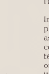

你也可以拥有一个泛型迭代器。在 Help 中查找迭代器。C# 的“Using Iterators”主题包含一个命名迭代器的示例，该迭代器也恰好是泛型的。

## 你可以在哪里放置你的迭代器

嗯，我必须小心我的措辞。

在本章前面 IteratorBlocks 示例中的小型特殊用途迭代器类中，我将集合本身放在迭代器类内部，如 MonthDays 所示。在某些情况下，这正合适——例如，当集合是像 SentenceChunks 这样返回罐装文本片段的东西，或像 DescendingEvens 这样在现场计算返回值的东西。但假设你想要为一个真正的集合类（如 LinkedList）提供基于迭代器块的迭代器。

这就是我在本书网站上的 `LinkedListWithIteratorBlock` 示例中所做的。该示例使用作为迭代器块实现的 `GetEnumerator()` 方法重写了自制的 `LinkedList`。它完全取代了旧的 `LinkedListIterator` 类。下面的列表仅给出 `GetEnumerator()` 的新版本（你可以在本书网站上看到完整示例）：


```csharp
// LinkedListWithIteratorBlock -- implements iterator for the linked list as
// an iterator block.
class LinkedList { // No longer need : IEnumerator here.
    ... rest of the class.
    ...
    // Here's the iterator, implemented as an iterator block.
    public IEnumerator GetEnumerator() {
        // Make sure the current node is legal.
        // If it's null, it hasn't yet been set to point into the list,
        // so point it at the head.
        if (currentNode == null)
        {
            currentNode = head;
        }
        // Here's the iteration for the enumerator that
        // GetEnumerator() returns.
        while (currentNode != null)
        {
            yield return currentNode.Object;
            currentNode = currentNode.forward;
        }
    }
}
```

我在本章前面几个部分中展示了以下迭代器块的基本形式，包括“迭代月份中的天数：第一个示例”部分：

```csharp
public System.Collections.IEnumerator GetEnumerator() {}
```

这一行看起来与原始 `LinkedList` 类中 `GetEnumerator()` 返回的 `IEnumerator` 对象完全相同。但现在实现 `GetEnumerator()` 方法的工作方式截然不同，如本列表所述：


- 当你编写迭代器块时，C# 会为你创建底层的 `LinkedListIterator` 类。你甚至不需要编写该类，也永远看不到它的代码。它不再是 `LinkedListWithIteratorBlock` 示例的一部分。
- 在你的 `GetEnumerator()` 方法中，你只需使用一个循环遍历链表的节点并 `yield return` 存储在每个节点中的数据项。你可以在前面的列表中看到这段代码。


- 你不再需要像这个类头那样，指定你的集合类实现IEnumerator：

```csharp
public class LinkedList                     // No longer need ': IEnumerator' here
```

## 嗯，当然，事情并没有那么简单

这里难免会有一些可能的“坑”：

- 你必须确保从列表开头开始迭代。

为了实现这一点，新的LinkedList类添加了一个数据成员currentNode，用于跟踪迭代器在列表中的进度。（该成员以前驻留在LinkedListIterator类中。）currentNode成员初始为null，因此迭代器需要检查它。如果为null，则设置currentNode指向列表的头节点。除非head本身为null（列表为空），否则在其余迭代过程中currentNode现在非null。当迭代器最终到达列表末尾时，它确实返回null，这向foreach循环发出停止信号。

- 遍历列表的每一步都需要执行MoveNext()以前所做的工作——前进到下一个节点；因此就有了while循环：

```csharp
// This does what MoveNext() did.
while(currentNode != null)
{
    // This does what Current did.
    yield return currentNode....;      // Portions omitted for a moment
    currentNode = currentNode.forward;
}
```

大多数迭代器块实现都采用循环来遍历集合——有时甚至是内部的foreach循环。（但StringChunks表明这并不是唯一的方法。）

- 当你遍历列表并开始yield return数据时，你必须深入LLNode对象内部提取其存储的数据。列表节点只是一个用于存储字符串、整数、Student等的容器。它要求你yield return的不是currentNode，而是这个：

```csharp
yield return currentNode.Data;          // Now complete
currentNode = currentNode.forward;
```

在底层，原始的枚举器也是这样做的。LLNode的Data属性以object形式返回节点的数据。当时在泛型出现之前的糟糕年代，我特意将原始的非泛型链表设计得尽可能通用。因此它存储对象。

现在，带有yield break语句的while循环正在完成你过去需要付出更多努力才能完成的工作，而由此生成的GetEnumerator()方法与foreach配合使用，就像之前在Main()中一样。

仔细想想，这个实现只是将旧的自定义迭代器类LinkedListIterator的功能移到了LinkedList类本身。可以说，这一切都掩盖在迭代器块之下。

在底层，foreach会为你进行必要的类型转换（假设这是合法的转换）。因此，如果你在列表中存储了字符串，你的foreach循环看起来像这样：

```csharp
foreach(string s in llc)  // foreach does the cast for you here.
{
    Console.WriteLine(s);
}
```


关于本章链表的泛型版本（带有迭代器块枚举器），请参阅本书网站上的GenericLinkedListContainer示例。（此处未显示。）该示例演示了如何为string和int实例化泛型LinkedList。你会喜欢在调试器中逐步执行该示例，看看foreach是如何工作的。作为比较，请参阅System.Collections.Generic命名空间中新的内置LinkedList<T>类。


抛开整个非泛型集合世界——除了古老而优秀的数组，它当然仍然非常有用且类型安全。使用泛型集合。（当然，我将在下一节中违背这个建议。）

## 还有一个棘手的问题

LinkedList中的原始迭代器实现将其迭代器实现为一个独立的迭代器类，作为LinkedList的伴生类。这种设置有一个很好的特性，而我在前一节中描述的迭代器块版本现在缺少这个特性：你可以轻松地创建多个迭代器对象实例，并让每个实例对链表进行独立的迭代。因此，当iterator2刚刚开始时，iterator1可能已经遍历到列表的一半。

但本章的下一个示例解决了这个问题（尽管是针对更简单的集合，而不是LinkedList）。IteratorBlockIterator坚持使用独立的伴生迭代器对象，可以密切访问集合的内部值。但该迭代器对象本身是使用迭代器块实现的：


```csharp
// In file Program.cs:
// IteratorBlockIterator -- Implements a separate iterator object as a
//    companion to a collection class, a la LinkedList, but
//    implements the actual iterator with an iterator block
using System;
using System.Collections;
namespace IteratorBlockIterator
{
    class Program
    {
        // Create a collection and use two iterator objects to iterate
        // it independently (each using an iterator block).
        static void Main(string[] args)
        {
            string[] strs = new string[] { "Joe", "Bob", "Tony", "Fred" };
            MyCollection mc = new MyCollection(strs);

            // Create the first iterator and start the iteration.
            MyCollectionIterator mci1 = mc.GetEnumerator();
            foreach (string s1 in mci1) // Uses the first iterator object
            {
                // Do some useful work with each string.
                Console.WriteLine(s1);

                // Find Tony's boss.
                if (s1 == "Tony")
                {
                    // In the middle of that iteration, start a new one, using
                    // a second iterator, repeated for each outer loop pass.
                    MyCollectionIterator mci2 = mc.GetEnumerator(); // Uses the second iterator object
                    foreach (string s2 in mci2)
                    {
                        // Do some useful work with each string.
                        if (s2 == "Bob")
                        {
                            Console.WriteLine("\t{0} is {1}'s boss", s2, s1);
                        }
                    }
                }
            }

            // Wait for user to acknowledge the results.
            Console.WriteLine("Press Enter to terminate...");
            Console.Read();
        }
    }

    // A simple collection of strings
    public class MyCollection
    {
        // Implement collection with an old-fashioned ArrayList.
        // Internal, so separate iterator object can access the strings.
        internal ArrayList _list = new ArrayList();

        public MyCollection(string[] strs)
        {
            foreach (string s in strs)
            {
                _list.Add(s);
            }
        }

        // GetEnumerator -- As in LinkedList, returns one of your
        // iterator objects.
        public MyCollectionIterator GetEnumerator()
        {
            return new MyCollectionIterator(this);
        }
    }

    // MyCollectionIterator -- The iterator class for MyCollection
    // (MyCollection is in a separate file.)
    public class MyCollectionIterator
    {
        // Store a reference to the collection.
        private MyCollection _mc;

        public MyCollectionIterator(MyCollection mc)
        {
            this._mc = mc;
        }
    }
}
```

```csharp
// GetEnumerator -- This is the iterator block, which carries
//     out the actual iteration for the iterator object.
public System.Collections.IEnumerator GetEnumerator()
{
    // Iterate the associated collection's underlying list,
    // which is accessible because it's declared internal.
    foreach (string s in _mc._list)
    {
        yield return s;    // The iterator block's heart
    }
}
```

`IteratorBlockIterator`中的集合并不值得大书特书：一个简单的类，包装了一个字符串`ArrayList`。它的`GetEnumerator()`方法只是简单地返回伴生迭代器类的一个新实例，就像`LinkedList`中一样：

```csharp
// GetEnumerator -- As in LinkedList, returns one of your
//     iterator objects.
public MyCollectionIterator GetEnumerator()
{
    return new MyCollectionIterator(this);
}
```

有趣的是那个迭代器类的内部。它也包含一个`GetEnumerator()`方法。这个方法使用迭代器块实现，负责完成迭代工作。下面是这个方法：

```csharp
// GetEnumerator -- This is the iterator block, which carries
//     out the actual iteration for the iterator object.
public System.Collections.IEnumerator GetEnumerator()
{
    // Iterate the associated collection's underlying list,
    // which is accessible because it's declared internal.
    foreach (string s in _mc._list)
    {
        yield return s;    // The iterator block's heart
    }
}
```

这个方法可以访问伴生集合中包含的`ArrayList`，因此它的`yield return`语句可以依次返回每个字符串。

但关键在于`Main()`方法，其中创建了两个迭代器对象的副本。第二个`foreach`循环嵌套在第一个`foreach`循环中，因此输出看起来像这样：

```
Joe
Bob
Tony

Fred    Bob is Tony's boss
```


缩进的行是由嵌套迭代产生的。

以下是 Main() 中的那些嵌套循环再次展示：

```
MyCollectionIterator mci1 = mc.GetEnumerator();
foreach (string s1 in mci1) // Uses the first iterator block
{
    // Do some useful work with each string.
    Console.WriteLine(s1);
    // Find Tony's boss.
    if(s1 == "Tony")
    {
        // In the middle of that iteration, start a new one, using
        // a second iterator; this is repeated for each outer loop pass.
        MyCollectionIterator mci2 = mc.GetEnumerator();
        foreach (string s2 in mci2) // Uses the second iterator block
        {
            // Do some useful work with each string.
            if(s2 == "Bob")
            {
                Console.WriteLine("\t{0} is {1}'s boss", s2, s1);
            }
        }
    }
}
```

原始的迭代器，使用 MoveNext() 和 Current，仍然更灵活，但这个示例已经很接近——而且更容易实现。

### 泛型是类型安全的


当你声明一个数组时，必须指定它可以容纳的确切数据类型。如果你指定 int，数组就不能容纳 int 以外的任何东西，或者 C# 无法隐式转换为 int 的其他数值类型。如果你尝试将错误类型的数据放入数组，编译时就会看到编译器错误。因此编译器强制执行类型安全，使你能够在问题发布之前就修复它。

编译器错误比运行时错误好得多。事实上，编译器错误几乎胜过一切，除了皇家同花顺或树莓圣代。编译器错误很有用，因为它们能帮助你现在就发现问题。


老式的非泛型集合不是类型安全的。在 C# 中，一切都是 *IS_A* Object，因为 Object 是所有其他类型的基础类型，既包括值类型也包括引用类型。但是当你将值类型（数字、字符、布尔值和结构体）存储在集合中时，它们进入时必须装箱，取出时必须拆箱。就好像你把物品放在蛋托里，必须把它们塞进鸡蛋里以便放下，然后再打破蛋壳取出物品一样。（引用类型如 string、Student 和 BankAccount 不会发生装箱。）


非泛型缺乏类型安全性的第一个后果是，你需要进行类型转换，如以下代码所示，才能从 ArrayList 中取出原始对象，因为它被隐藏在一个鸡蛋里，呃，Object 中：

```
~~~csharp
ArrayList alist = new ArrayList();
// Add five or six items, then
string myString = (string)alist[4];   // Cast to string.
~~~
```

好吧，但第二个后果是：你可以把鸡蛋放进蛋托，当然可以。但你也可以添加弹珠、石头、钻石、太妃糖——你能想到的任何东西。ArrayList 可以同时容纳许多不同类型的对象。所以写下面这样的代码是合法的：

```
~~~csharp
ArrayList alist = new ArrayList();
alist.Add("a string");      // string -- OK
alist.Add(3);               // int -- OK
alist.Add(aStudent);        // Student -- OK
~~~
```


然而，如果你把不兼容类型的混合物放入 ArrayList（或其他非泛型集合）中，你怎么知道比如 alist[3] 中是什么类型？如果它是一个 Student 而你尝试把它强制转换为 string，就会得到运行时错误。这就像哈利·波特伸手进入一盒伯蒂·波特的百味豆：他不知道自己会抓到树莓味豆子还是耳垢。

为了安全，你必须求助于使用 is 运算符（在第一本书中讨论过）或另一种选择 as 运算符。

```
    // See if the object is the right type, then cast it ...
    if (aList[i] is Student)        // Is the object there a Student?
    {
        Student aStudent = (Student)aList[i];   // Yes, so it's safe to cast.
    }
    // Or do the conversion and see if it went well...
    Student aStudent = aList[i] as Student;    // Extract a Student, if present;
    if (aStudent != null)                      // if not, "as" returns null.
    {
        // Or use aStudent; "as" operator worked.
    }
```

你可以通过使用泛型来避免所有这些额外的工作。泛型集合的工作方式与数组类似：你在声明时指定它们唯一可以容纳的类型。

### 泛型是高效的

多态允许类型 Object 容纳任何其他类型——就像上一节的蛋托类比一样。但如果你放入值类型对象——数值、字符、布尔类型和结构体——然后再取出，就会产生性能损失。这是因为你添加的值类型对象必须被装箱。（参见第二本书了解更多关于多态的内容。）

除非你的集合很大，否则装箱不必担心（尽管正在进行的装箱量可能会让你吃惊，成本比你想象的更高）。如果你把一千个或一百万个 int 塞进非泛型集合中，大约需要 20 倍的时间，外加堆内存上的额外空间，那里存储着引用类型对象。装箱还可能导致微妙的错误，让你抓狂。泛型集合消除了装箱和拆箱。

### 技术细节

别误会：装箱使 C# 拥有统一的类型系统，这带来了巨大的好处，通常超过装箱带来的不便和成本。

## 精致的泛型：编写自己的泛型

除了内置的泛型集合类，C# 还允许你编写自己的泛型类，无论它们是否是集合。重点是你能够创建自己设计的类的泛型版本。

想象一个充满 <T> 标记的类定义。当你实例化这样的类时，你指定一个类型来替换其泛型占位符，就像使用泛型集合一样。注意这两个声明有多相似：

```
    LinkedList<int> aList = new LinkedList<int>(); // Built-in LinkedList class
    MyClass<int> aClass = new MyClass<int>();       // Custom class
```


两者都是类的实例化——一个是内置的，一个是程序员定义的。并非每个类作为泛型都有意义；本章后面我会展示一个有意义的例子。

那些在逻辑上可以对不同类型的数据执行相同操作的类是最好的泛型类。某种形式的集合就是典型的例子。如果你发现自己嘟囔着，“我可能还得为 Student 对象写一个版本”，它很可能就是泛型的良好候选。

为了向你展示如何编写自己的泛型类，以下示例开发了一种特殊的队列集合类，即优先级队列。

### 在 OOPs 运输包裹

这是一个示例场景：一个像 UPS 或 FedEx 一样繁忙的运输仓库。包裹从 OOPs, Inc. 的前门源源不断地涌入，并在处理完成后立即从后门发出。一些包裹需要通过超快的次日传送交付；其他包裹可以稍微慢一点，通过次日信鸽运输；而大多数包裹可以走蜗牛路线：通过你表兄 Fred 的 ’82 年沃尔沃进行地面配送。

但包裹并不是按特定顺序到达仓库的，所以随着它们的到来，你需要将其中一些加急为次日或隔日达。因为有些包裹比其他包裹更重要，它们被优先处理，仓库的工作人员对高优先级包裹给予特殊待遇。

除了优先级方面外，这种情况非常适合队列数据结构。队列非常适合任何涉及轮流的事情。你一生中曾在成千上万的队列中站立（或驾车），等待轮到你购买 Twinkies 或支付过高的处方药费用。你知道流程。

运输仓库的场景类似：新包裹到达并排到队伍后面——通常如此。但因为有些包裹优先级更高，它们就是特权人物，就像机场售票柜台的 Premium Class 旅客一样。他们可以插队，要么排到队伍最前面，要么排到离前面不远的位置。

### 在 OOPs 排队：PriorityQueue

OOPs 的运输队列处理传入的高、中、低优先级包裹。以下是排队规则：

- **高优先级包裹**（次日达）排到队列最前面——但排在已在队列中的其他高优先级包裹之后。
- **中优先级包裹**（隔日达）尽可能排到前面——但排在所有高优先级包裹之后，即使是后来会掉队的包裹，也排在已在队列中的其他中优先级包裹之后。


```
Console.WriteLine(
    "*Add a random number (0 - 20) of random packages to queue:*" );
Package pack;
PackageFactory fact = new PackageFactory();
// You want a random number less than 20.
Random rand = new Random();
int numToCreate = rand.Next(20);  // Random int from 0 - 20
Console.WriteLine("\tCreating {0} packages:", numToCreate);
for (int i = 0; i < numToCreate; i++)
{
    Console.Write("\t\tGenerating and adding random package {0}, ", i);
    pack = fact.CreatePackage();
    Console.WriteLine(" with priority {0}", pack.Priority);
    pq.Enqueue(pack);
}
Console.WriteLine("See what we got:");
int total = pq.Count;
Console.WriteLine("Packages received: {0}", total);

Console.WriteLine("Remove a random number of packages (0-20): ");
int numToRemove = rand.Next(20);
Console.WriteLine("\tRemoving up to {0} packages", numToRemove);
for (int i = 0; i < numToRemove; i++)
{
    pack = pq.Dequeue();
    if (pack != null)
    {
        Console.WriteLine("\t\tShipped package with priority {0}",
            pack.Priority);
    }
}
// See how many were "shipped."
Console.WriteLine("Shipped {0} packages", total - pq.Count);
// Wait for user to acknowledge the results.
Console.WriteLine("Press Enter to terminate...");
Console.Read();
}

// Priority enumeration -- Defines a set of priorities
// instead of priorities like 1, 2, 3, ... these have names.
// For information on enumerations,
// see the article "Enumerating the Charms of the Enum"
// on csharp102.info.
enum Priority
{
    Low, Medium, High
}

// IPrioritizable -- Defines ability to prioritize.
// Define a custom interface: Classes that can be added to
// PriorityQueue must implement this interface.
interface IPrioritizable
{
    Priority Priority { get; } // Example of a property in an interface
}

//PriorityQueue -- A generic priority queue class
// Types to be added to the queue *must* implement IPrioritizable interface.
class PriorityQueue<T> where T : IPrioritizable
{
```
```csharp
//Queues -- the three underlying queues; all generic!
private Queue<T> _queueHigh = new Queue<T>();
private Queue<T> _queueMedium = new Queue<T>();
private Queue<T> _queueLow = new Queue<T>();

//Enqueue -- Prioritize T and add it to correct queue; an item of type T.
//  The item must know its own priority.
public void Enqueue(T item)
{
    switch (item.Priority) // Require IPrioritizable to ensure this property.
    {
        case Priority.High:
            _queueHigh.Enqueue(item);
            break;
        case Priority.Medium:
            _queueMedium.Enqueue(item);
            break;
        case Priority.Low:
            _queueLow.Enqueue(item);
            break;
        default:
            throw new ArgumentOutOfRangeException(
                item.Priority.ToString(),
                "bad priority in PriorityQueue.Enqueue");
    }
}

//Dequeue -- Get T from highest-priority queue available.
public T Dequeue()
{
    // Find highest-priority queue with items.
    Queue<T> queueTop = TopQueue();
    // If a non-empty queue is found,
    if (queueTop != null && queueTop.Count > 0)
    {
        return queueTop.Dequeue(); // Return its front item.
    }
    // If all queues empty, return null (you could throw exception).
    return default(T); // What's this? See discussion.
}

//TopQueue -- What's the highest-priority underlying queue with items?
private Queue<T> TopQueue()
{
    if (_queueHigh.Count > 0)  // Anything in high-priority queue?
        return _queueHigh;
    if (_queueMedium.Count > 0) // Anything in medium-priority queue?
        return _queueMedium;
    if (_queueLow.Count > 0)   // Anything in low-priority queue?
        return _queueLow;
    return _queueLow;           // All empty, so return an empty queue.
}

//IsEmpty -- Check whether there's anything to dequeue.
public bool IsEmpty()
{
    // True if all queues are empty
    return (_queueHigh.Count == 0) & (_queueMedium.Count == 0) &
           (_queueLow.Count == 0);
}
```
```
    //Count -- How many items are in all queues combined?
    public int Count  // Implement this one as a read-only property.
    {
        get { return _queueHigh.Count + _queueMedium.Count + _queueLow.Count; }
    }

    //Package -- An example of a prioritizable class that can be stored in
    //  the priority queue; any class that implements
    //  IPrioritizable would look something like Package.
    class Package : IPrioritizable
    {
        private Priority _priority;
        //Constructor
        public Package(Priority priority)
        {
            this._priority = priority;
        }

        //Priority -- Return package priority -- read-only.
        public Priority Priority
        {
            get { return _priority; }
        }
        // Plus ToAddress, FromAddress, Insurance, etc.
    }

    //PackageFactory -- You need a class that knows how to create a new
    //  package of any desired type on demand; such a class
    //  is a factory class.
    class PackageFactory
    {
        //A random-number generator
        Random _random = new Random();

        //CreatePackage -- The factory method selects a random priority,
        //  then creates a package with that priority.
        //  Could implement this as iterator block.
        public Package CreatePackage()
        {
            // Return a randomly selected package priority.
            // Need a 0, 1, or 2 (values less than 3).
            int rand = _random.Next(3);
            // Use that to generate a new package.
            // Casting int to enum is clunky, but it saves
            // having to use ifs or a switch statement.
            return new Package((Priority)rand);
        }
    }
```

PriorityQueue 有点长，因此你需要仔细查看每一部分。查看目标类 Package 之后，你可以跟随一个包在靠近顶部的 Main() 方法中的旅程。


运行 PriorityQueue 时，多运行几次。因为它围绕随机数构建，所以每次运行都会得到不同结果。例如，有时它可能“接收”零个包。（我想，偶尔也会遇到清闲的日子。）

### 拆解 Package

Package 类在此示例中有意保持简单（参见上一节中的代码清单），它专注于优先级部分，尽管真实的 Package 对象会包含其他成员。此示例中 Package 所需的全部内容如下：

- 一个用于存储其优先级的私有数据成员
- 一个用于创建具有特定优先级的包的构造函数
- 一个返回优先级的方法（此处实现为只读属性）

Package 类的两个方面需要一些解释：Priority 类型以及 Package 实现的 IPrioritizable 接口。继续阅读。

### 指定可能的优先级

优先级使用名为 Priority 的枚举类型（或 enum）来衡量。Priority 枚举如下所示：

```
~~~csharp
// Priority -- Instead of priorities like 1, 2, 3, they have names.
enum Priority          // See the article "Enumerating the Charms
                       // of the Enum" on this book's Web site.
{
    Low, Medium, High
}
~~~
```

### 实现 IPrioritizable 接口

进入 PriorityQueue 的任何对象都必须“知道”自己的优先级。（一条通用的面向对象原则指出，对象应当对自己负责。）


你可以非正式地“承诺” Package 类有一个用于获取其优先级的成员，但你应该将其变成编译器可以强制执行的要求。你要求放入 PriorityQueue 的任何对象都具有这样的成员。

强制执行此要求的一种方式是坚持所有可运输对象都实现 IPrioritizable 接口，如下所示：

```
~~~csharp
// IPrioritizable -- Define a custom interface: Classes that can be added to
//                    PriorityQueue must implement this interface.
interface IPrioritizable  // Any class can implement this interface.
{
    Priority Priority { get; }
}
~~~
```


```csharp
// Wait for user to acknowledge the results.
Console.WriteLine("Press Enter to terminate...");
Console.Read();
}
```

下面是 Main() 中发生的情况：

- 1. 为 Package 类型实例化一个 PriorityQueue 对象。
- 2. 创建一个 PackageFactory 对象，其职责是按需创建具有随机选定优先级的新包。
  工厂是一个为你创建对象的类或方法。本章后面的“使用（非泛型）简单工厂类”一节将带你了解 PackageFactory。
- 3. 使用 .NET 库类 Random 生成一个随机数，然后调用 PackageFactory 创建该数量、具有随机优先级的新 Package 对象。
- 4. 使用 pq.Enqueue(pack) 将每个包添加到 PriorityQueue 中。
- 5. 写出已创建的包数量，然后使用 pq.Dequeue() 从 PriorityQueue 中随机移除其中一些包。
- 6. 在显示已移除的包数量后结束。

## 轻松编写泛型代码

现在你必须弄清楚如何编写一个带有所有这些 <T> 的泛型类。看起来令人困惑，不是吗？其实并没有那么难，本节将演示这一点。

编写泛型类的简单方法是先编写非泛型版本，然后替换其中的 <T>。例如，你会为 Package 对象编写 PriorityQueue 类，测试它，然后将其“泛型化”。

下面是一个非泛型 PriorityQueue 的一小段代码，用以说明：

```csharp
public class PriorityQueue
{
    //Queues -- The three underlying queues: all generic!
    private Queue<Package> _queueHigh = new Queue<Package>();
    private Queue<Package> _queueMedium = new Queue<Package>();
    private Queue<Package> _queueLow = new Queue<Package>();
    //Enqueue -- Prioritize a Package and add it to correct queue.
    public void Enqueue(Package item)
    {
        switch(item.Priority) // Package has this property.
        {
            case Priority.High:
                _queueHigh.Enqueue(item);
                break;
```

```csharp
//Enqueue -- Prioritize T and add it to correct queue; an item of type T.
// The item must know its own priority.
public void Enqueue(T item)
{
    switch (item.Priority) // Require IPrioritizable to ensure this property.
    {
        case Priority.High:
            _queueHigh.Enqueue(item);
            break;
        case Priority.Medium:
            _queueMedium.Enqueue(item);
            break;
        case Priority.Low:
            _queueLow.Enqueue(item);
            break;
        default:
            throw new ArgumentOutOfRangeException(
                item.Priority.ToString(),
                "bad priority in PriorityQueue.Enqueue");
    }
}
```

### Dequeue() 方法

Dequeue() 的工作比 Enqueue() 稍复杂一些：它必须找到内容非空且优先级最高的底层队列，然后从该子队列中取出最前面的项。Dequeue() 将任务的第一部分——找到非空且优先级最高的队列——委托给私有方法 TopQueue()（将在下一节介绍）。然后 Dequeue() 调用底层队列的 Dequeue() 方法，取出最前面的对象并将其返回。下面是 Dequeue() 的工作方式：

```csharp
//Dequeue -- Get T from highest-priority queue available.
public T Dequeue()
{
    // Find highest-priority queue with items.
    Queue<T> queueTop = TopQueue();
    // If a non-empty queue is found,
    if (queueTop != null && queueTop.Count > 0)
    {
        return queueTop.Dequeue(); // Return its front item.
    }
    // If all queues empty, return null (you could throw exception).
    return default(T); // What's this? See discussion.
}
```

只有当下层队列中没有任何包时才会出现一个难点——换句话说，整个 PriorityQueue 为空。在这种情况下你返回什么？Dequeue() 返回 null。客户端——即调用 PriorityQueue.Dequeue() 的代码——应检查 Dequeue() 的返回值，以防它为 null。它返回的 null 在哪里？就是末尾那个古怪的 default(T)。我将在本章稍后讨论 default(T)。

## TopQueue() 实用方法

Dequeue() 依靠私有方法 TopQueue() 来查找优先级最高且非空的底层队列。TopQueue() 从高优先级队列（queue High）开始，并查询其 Count 属性。如果它大于零，说明该队列包含项，因此 TopQueue() 返回对其找到的整个底层队列的引用。（TopQueue() 的返回类型是 Queue<T>。）另一方面，如果 queueHigh 为空，TopQueue() 会尝试 queueMedium，然后尝试 queueLow。

如果所有子队列都为空，会发生什么？TopQueue() 可以返回 null，但直接返回其中一个空队列更有用。当 Dequeue() 随后调用所返回队列的 Dequeue() 方法时，它会返回 null。TopQueue() 的工作方式如下：

```
//TopQueue -- What's the highest-priority underlying queue with items?
private Queue<T> TopQueue()
{
    if (_queueHigh.Count > 0)  // Anything in high-priority queue?
        return _queueHigh;
    if (_queueMedium.Count > 0) // Anything in medium-priority queue?
        return _queueMedium;
    if (_queueLow.Count > 0)   // Anything in low-priority queue?
        return _queueLow;
    return _queueLow;          // All empty, so return an empty queue.
}
```

## PriorityQueue 的其余成员

PriorityQueue 在知道自身是否为空，以及若非空时包含多少项的情况下很有用。（对象应当对自身负责。）请查看前面清单中 PriorityQueue 的 IsEmpty() 方法和 Count 属性。你可能还会发现，包含返回每个底层队列中项数的方法很有用。但要小心：这样做可能会过多暴露优先级队列的实现方式。请将实现保持私有。

## 使用（非泛型）简单工厂类

在本章前面，我使用一个简单工厂对象（尽管在那里我只是称它为“工厂”）来生成源源不断的、具有随机优先级级别的 Package 对象。终于可以揭晓这个简单的类了：


```
// PackageFactory is part of the PriorityQueue example on the Web site.
// PackageFactory -- You need a class that knows how to create a new
//     package of any desired type on demand; such a
//     class is a factory class.
class PackageFactory
{
    Random _randGen = new Random();  // C#'s random-number generator
    //CreatePackage -- This factory method selects a random priority,
    //     then creates a package with that priority.
    public Package CreatePackage()
```csharp
{
    // Return a randomly selected package priority:
    // need a 0, 1, or 2 (values less than 3).
    int rand = _randGen.Next(3);
    // Use that to generate a new package.
    // Casting int to enum is clunky, but it saves
    // having to use ifs or a switch statement.
    return new Package((Priority)rand);
}
```

PackageFactory 类有一个数据成员和一个方法。（你也可以很容易地将简单工厂实现为一个方法而不是一个类——例如，Program 类中的一个方法。）当你实例化一个 PackageFactory 对象时，它会创建一个 Random 类的对象，并将其存储在数据成员 rand 中。Random 是一个生成随机数的 .NET 库类。


请查看 csharp102.info 上的 PackageFactoryWithIterator 示例。

### 使用 PackageFactory

要生成一个具有随机优先级的 Package 对象，可以按以下方式调用工厂对象的 CreatePackage() 方法：

```csharp
PackageFactory fact = new PackageFactory();
IPrioritizable pack = fact.CreatePackage(); // Note the interface here.
```

CreatePackage() 告诉其随机数生成器生成一个从 0 到 2（含）的数，并使用该数设置新 Package 的优先级，然后该方法返回这个 Package（返回给 Package 变量，或者更好的做法是返回给 IPrioritizable 变量）。


注意，我让 CreatePackage 返回对 IPrioritizable 的引用，这比返回对 Package 的引用更通用。此示例展示了*间接性*——`Main()` 通过 Package 实现的接口间接引用 Package。间接性使 `Main()` 不必关心 CreatePackage 返回内容的细节。这样你就有更大的自由来更改工厂的底层实现，而不会影响 `Main()`。


### 关于工厂的更多内容

工厂有助于生成大量测试数据。（工厂不必使用随机数——那只是 PriorityQueue 示例所需要的。）


工厂通过隔离对象创建来改进程序。每当你在代码中按名称提及某个特定类时，就创建了对该类的依赖。这类依赖越多，类之间的耦合（绑定在一起）就越紧密。


程序员很早就知道应该避免紧密耦合。（一种更解耦的方法是通过接口间接使用工厂，例如 IPrioritizable，而不是具体的类，例如 Package。）程序员仍然经常直接使用 new 操作符创建对象，这也没问题。但工厂可以使代码耦合度更低——因此更灵活。


## 处理未完成的工作

PriorityQueue 需要一些小的“填补”。以下是问题：

-   单独来看，PriorityQueue 不会阻止你尝试为 int 或 string 或 Student 等没有优先级的元素实例化它。你需要限制该类，使其只能为实现了 IPrioritizable 的类型实例化。尝试实例化非 IPrioritizable 类应导致编译器错误。
-   PriorityQueue 的 Dequeue() 方法返回的值是 null 而不是实际对象。但泛型类型如 <T> 并没有像 ints、strings 和不堪重负的对象引用那样自然的默认值 null。那部分也需要泛化。

## 添加约束

PriorityQueue 必须能够询问对象其优先级是什么。为了使其工作，所有可存储在 PriorityQueue 中的类都必须实现 IPrioritizable 接口，如 Package 所做。Package 在其类声明标题中列出 IPrioritizable，如下所示：

```
class Package : IPrioritizable
```

然后它实现了 IPrioritizable 的 Priority 属性。


需要为 PriorityQueue 设置相应的限制。你希望如果尝试为未实现 IPrioritizable 的类型实例化，编译器会发出警告。在 PriorityQueue 的非泛型形式中（例如专门为类型 Package 编写），当你的优先级队列方法之一尝试调用 Package 不具备的方法时，编译器会自动尖叫（我建议戴上耳塞）。但对于泛型类，你可以通过显式约束更进一步。因为你可以用几乎任何类型实例化泛型类，所以你需要一种方法告诉编译器哪些类型是可以接受的——因为它们保证具有正确的方法。


添加约束的方法是在 PriorityQueue 的标题中指定 IPrioritizable，如下所示：

```
class PriorityQueue<T> where T : IPrioritizable
```

你注意到之前的 *where* 子句了吗？这个加粗的 **where** 子句规定 *T* 必须实现 *IPrioritizable*。*这就是执行者。* 它的意思是，“确保 *T* 实现 *IPrioritizable* 接口——否则！”


你可以通过在 *where* 子句中列出以下 *一个或多个* 元素（用逗号分隔）来指定约束：

-   *T* 必须从（或为）其派生的必需基类的名称。
-   *T* 必须实现的接口的名称，如前例所示。
-   你可以查看更多——*Table 8-1* 提供了完整列表。

有关这些约束的信息，请在帮助索引中查找 *Generics [C#], constraints*。

## 表 8-1 泛型约束选项

| 约束 | 含义 | 示例 |
| --- | --- | --- |
| MyBaseClass | T 必须是 MyBaseClass 或其派生类。 | where T:<br>MyBaseClass |
| IMyInterface | T 必须实现 IMyInterface。 | where T:<br>IMyInterface |
| struct | T 必须是任意值类型。 | where T:<br>struct |
| class | T 必须是任意引用类型。 | where T:<br>class |
| new() | T 必须具有无参数构造函数。 | where T:<br>new() |

特别注意 *struct* 和 *class* 选项。指定 *struct* 表示 *T* 可以是任何值类型：数值类型、*char*、*bool*，或使用 *struct* 关键字声明的任何对象。指定 *class* 表示 *T* 可以是任何引用类型：任何 *class* 类型。

这些约束选项为使你的新泛型类按你想要的方式行为提供了相当大的灵活性。而一个行为良好的类是无价之宝。

你也不限于只有一个约束。以下是声明了 *T* 上有多个约束的假设泛型类的示例：

```
~~~csharp
class MyClass<T> where T: class, IPrioritizable, new()
{ ... }
~~~
```

在这行中，T 必须是类，而不是值类型；它必须实现 IPrioritizable；并且必须包含一个无参数构造函数。严格！


你可能有两个泛型参数，两者都需要被约束。（是的，你可以有多个泛型参数——想想 Dictionary<TKey, TValue>。）以下是如何使用两个 where 子句：

```
class MyClass<T, U> where T: IPrioritizable, where U: new()
```

你可以看到两个 where 子句，用逗号分隔。第一个将 T 约束为实现 IPrioritizable 接口的任何对象。第二个将 U 约束为具有默认（无参数）构造函数的任何对象。

### 确定类型 T 的 null 值：Default (T)

如果你读了上一节的最后一段而感到困惑，那么，每个类型都有（正如前面提到的）一个表示该类型“无”的默认值。对于 ints、doubles 和其他数字类型，它是 0（或 0.0）。对于 bool，它是 false。对于所有引用类型，如 Package，它是 null。与所有引用类型一样，string 的默认值也是 null。

但由于像 PriorityQueue 这样的泛型类可以为几乎任何数据类型实例化，C# 无法预测在泛型类代码中应使用哪个适当的 null 值。例如，如果你使用 PriorityQueue 的 Dequeue() 方法，你可能会遇到这种情况：你调用 Dequeue() 来获取一个包，但没有可用的包。你应该返回什么来表示“无”？因为 Package 是类类型，它应该返回 null。这向 Dequeue() 的调用者发出信号，表示没有可返回的内容（调用者必须检查 null 返回值）。


编译器无法在泛型类中理解 null 关键字，因为该类可能为各种数据类型实例化。这就是为什么 Dequeue() 改用以下行：

```
return default(T);   // Return the right null for whatever T is.
```

这一行告诉编译器查看 T 并为该类型返回正确类型的 null 值。在 Package 的情况下，作为类它是引用类型，正确返回的 null 就是，嗯，null。但对于某些其他 T，它可能不同，编译器可以弄清楚该使用什么。


如果你认为 PriorityQueue 很灵活，请看一下更灵活的版本——并在随本章提供的 ProgrammingToAnInterface 程序中遇到一些面向对象设计原则。

## 第 9 章：一些特殊的异常

## 本章内容

-   通过返回码处理错误
-   使用异常机制代替返回码
-   规划你的异常处理策略


我知道这很难接受，但偶尔一个方法并不会按预期执行。即使是我写的——尤其是我写的——也不总是按预期执行。用户也 notoriously 不可靠。刚要求输入一个 int，用户就输入了一个 double。有时，方法愉快地继续运行， blissfully 意识不到它正在输出垃圾。然而，好的程序员会编写方法来预见问题并在发生时报告它们。

我指的是运行时错误，而不是编译时错误，后者在你尝试构建程序时由 C# 抛出。运行时错误发生在程序运行时，而不是编译时。

C# 异常机制是一种报告这些错误的方式，以便调用方法能够最好地理解并使用它来处理问题。与程序员在，呃，旧好时代处理错误的方式相比，该机制有很多优势。让我们重温过去，以便你可以看到。

本章将带你了解异常处理的基础知识。这里有很多内容需要消化，所以靠在你那把旧的、破旧的躺椅上吧。

## 使用异常的错误报告机制

C# 引入了一种完全不同的捕获和处理错误机制：异常。该机制基于 try、catch、throw 和 finally 关键字。大致来说，它的工作方式如下：一个方法会尝试执行一段代码。如果代码检测到问题，它会抛出一个错误指示，你的代码可以捕获它，而无论发生什么，它最终都会执行末尾的一个特殊代码块，如以下片段所示：


```java
public class MyClass
{
    public void SomeMethod()
    {
        // Set up to catch an error.
        try
        {
            // Call a method or do something that could throw an exception.
            SomeOtherMethod();
            // ... make whatever other calls you want . . .
        }
        catch(Exception e)
        {
            // Control passes here in the event of an error anywhere
            // within the try block.
            // The Exception object e describes the error in detail.
        }
        finally
        {
            // Clean up here: close files, release resources, etc.
            // This block runs even if an exception was caught.
        }
    }
    public void SomeOtherMethod()
    {
        // ... error occurs somewhere within this method . . .
        // ... and the exception bubbles up the call chain.
        throw new Exception("Description of error");
        // ... method continues if throw didn't happen . . .
    }
}
```


try、catch 和（可能还有）finally 的组合就是*异常处理程序*。


在 try、catch 或 finally 块内部声明的变量，从该块外部无法访问。如果需要访问它，请在块之前、在块外部声明该变量：

```java
int aVariable; // Declare aVariable outside the block.
try
{
    aVariable = 1;
    // Declare aString inside the block.
    string aString = aVariable.ToString(); // Use aVariable in block.
}
// aVariable is visible here; aString is not.
```

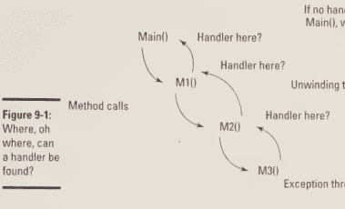

**图 9-1：** 方法调用。处理程序到底在哪里才能找到呢？


**3. 如果找到了合适的 catch 块，它就会执行。** 合适的 catch 块是指寻找正确异常类（或其任何基类）的 catch 块。这个 catch 块可能做许多事情中的任意一件，而这些事情都曾出现在 csharp102.info 的一篇文章中。随着堆栈展开，如果某个给定方法没有足够的上下文——也就是说，了解得不够多——来纠正该异常状况，它就干脆不为该异常提供 catch 块。正确的 catch 可能位于堆栈中很高的位置。

异常机制彻底胜过本章开头描述的老式错误返回机制，原因如下：

- 当调用方法得到一个老式返回值，却又做不了任何有用的事情时，它必须显式地把错误本身返回给它的调用者，依此类推。如果能够处理该问题的方法位于调用链的很上方，那么返回一个“返回了某个返回值的返回值”……就会变得越来越别扭，导致一些丑陋的设计拼凑。*（Kludge 是工程师的术语，指能起作用但蹩脚又丑陋的东西。想想“口水和捆扎铁丝”式的凑合。）*
- 相比之下，使用异常时，异常会自动沿着调用链向上攀升，直到遇到异常处理程序。你不必不断转发消息，这就消除了大量拼凑式的代码。

**4. 如果 try 块伴有 finally 块，它就会执行，**无论是否捕获到异常。finally 会在堆栈展开到调用链中上一层方法之前被调用。调用链上任何位置的所有 finally 块也都会执行。

**5. 如果任何地方都找不到 catch 块，程序就会崩溃。** 如果 C# 运行到 `Main()` 时仍没有在那里找到 catch 块，用户就会看到一条“未处理的异常”消息，然后程序退出。这就是崩溃。不过，你可以通过在 `Main()` 中使用异常处理程序，来处理在其他地方未捕获的异常。参见本章后面的“抓住捕获异常的最后机会”一节。

第 1 册 — 第 9 章：一些非同寻常的异常

这种异常机制无疑比使用错误代码更复杂、更难处理。你必须把增加的难度与以下这些考虑因素权衡起来，如图 9-1 所示：

- 异常提供了一种更具“表现力”的模型——这种模型让你能够表达各种各样的错误处理策略。
- 异常对象携带的信息多得多，因此有助于调试——远远超过错误代码所能提供的信息。
- 异常带来更可读的代码——而且代码更少。
- 异常是 C# 不可分割的一部分，而不是像错误代码方案那样临时拼凑、事后追加的东西；错误代码方案没有哪两个是十分相似的。一致的模型有助于理解。

## 自行抛出异常

如果 .NET 类库中的类可以抛出异常，那么你也可以。

当你发现一个值得抛出异常的错误时，要抛出异常，请使用 throw 关键字：

```
throw new ArgumentException("Don't argue with me!");
```


你和任何人一样有权抛出异常。因为 .NET 类库根本不知道你自定义的 BadHairDayException，除了你，还有谁会抛出它呢？


如果 .NET 预定义异常中有一种适合你的情况，就抛出它。但如果都不适合，你可以发明自己的自定义异常类。

.NET 有一些异常类型是你永远不应抛出或捕获的：StackOverflowException、OutOfMemoryException、ExecutionEngineException，以及一些与处理非 .NET 代码相关的更高级项。它们归系统所有。

## 了解异常的用途


无法完成既定任务的软件应当抛出异常。例如，如果一个方法本应处理整个数组，或读取整个文件——却由于某种原因无法完成这项工作——它就应该抛出一个合适的异常。

一个方法可能因各种原因无法完成任务：例如，输入值错误或出现意外状况（比如文件缺失，或文件比预期小）。任务未完成，甚至根本无法开始。如果你的方法中出现任何这些情况，就应当抛出异常。

这里的总体要点是：调用该方法的任何人都需要知道它的任务没有完成。抛出异常几乎总是比使用任何错误返回代码更好。

调用者如何处理该异常，取决于问题的性质和严重程度。有些问题比其他问题更严重。本章余下部分——再加上 csharp101.info 上的“响应异常”一文——将用来探讨当你的方法“抛出”异常时，调用者有哪些选择。


## 能给我一个异常示例吗？

下面的 FactorialException 程序演示了异常机制的关键要素：


// FactorialException -- Create a factorial program that reports illegal
//     Factorial() arguments using an Exception.
using System;

namespace FactorialException
{
    // MathFunctions -- A collection of mathematical functions
    //     we created (it's not much to look at yet)
    public class MathFunctions
    {
        // Factorial -- Return the factorial of the provided value.
        public static int Factorial(int value)
        {
            // Don't allow negative numbers.
            if (value < 0)
            {
                // Report negative argument.
                string s = String.Format(
                    "Illegal negative argument to Factorial {0}", value);

                throw new ArgumentException(s);
            }

            // Begin with an "accumulator" of 1.
            int factorial = 1;

            // Loop from value down to 1, each time multiplying
            // the previous accumulator value by the result.
            do
            {
                factorial *= value;
            } while(--value > 1);

            // Return the accumulated value.
            return factorial;
        }
    }

    public class Program
    {
        public static void Main(string[] args)
        {


该程序的输出如下（为了更易读，我们删减了错误消息）：

```
i = 6, factorial = 720
i = 5, factorial = 120
i = 4, factorial = 24
i = 3, factorial = 6
i = 2, factorial = 2
i = 1, factorial = 1
i = 0, factorial = 0
Fatal error: System.ArgumentException: Illegal negative argument to Factorial -1
   at Factorial(Int32 value) in c:\programs\Factorial\Program.cs:line 21
   at FactorialException.Program.Main(String[] args) in c:\programs\Factorial\Program.cs:line 49
Press Enter to terminate...
```

前几行显示数字 6 到 0 的实际阶乘。尝试计算 –1 的阶乘会生成以 Fatal error 开头的消息——这听起来可不妙。

错误消息的第一行是在 Factorial() 内部格式化出来的。这一行描述了问题的性质，包括出错的 –1 值。

## 跟踪堆栈

输出的其余部分是堆栈跟踪。堆栈跟踪的第一行描述了异常是在哪里抛出的。在本例中，异常是在 Factorial(int) 中抛出的——更具体地说，是在源文件 Program.cs 的第 21 行。Factorial() 是在同一文件的第 49 行的 Main(string[] args) 方法中被调用的。堆栈跟踪止于 Main()，因为那正是捕获异常的模块——堆栈跟踪到此结束。

你不得不承认，这个过程令人印象深刻——消息描述了问题并指出了出错的参数。堆栈跟踪告诉你异常是在哪里抛出的，以及程序是如何到达那里的。利用这些信息，你应该会像龙卷风被拖车停车场吸引一样，被吸引到问题所在。


如果你运行前面的示例并检查它打印到控制台的堆栈跟踪，你会看到 Main() 位于列表的*底部*，而更深层的方法在它上面。跟踪从 Main() 向上构建，所以从技术上说，展开调用堆栈是沿着跟踪向*下*走向 Main()。不过，你应该反过来想：调用者在调用链中位置更高（参见图 9-1）。


我在本章前面描述的 Factorial() 版本使用非递归算法，该算法用循环来计算阶乘。关于递归版本，请参见 Web 上的 RecursiveFactorial 示例。递归方法会调用自身，可能反复调用，直到出现停止条件。递归的 Factorial() 会反复调用自身（递归），当传入的值变为负数时停止。递归是实现 Factorial() 最常见的方式。注意：确保递归会停止。你可以将 RecursiveFactorial 的结果与不那么奇特的 NonrecursiveFactorial 示例的结果进行比较，而 DeadlyRecursion 示例展示了递归不停止时会发生什么——它会导致相当令人不快的 StackOverflowException。


当程序在调试器中运行时，堆栈跟踪可在某个 Visual Studio 调试器窗口中获得。

## 使用多个 catch 块

我在本章前面提到，你可以定义自己的自定义异常类型。假设你定义了一个 CustomException 类。（我在文章“Creating Your Own Exception Class”中描述了这个过程，你可以在 csharp102.info 上找到它。）现在考虑这里使用的 catch 子句：

```
public void SomeMethod()
{
    try
    {
        SomeOtherMethod();
    }
    catch(CustomException ce)
    {
    }
}
```

如果 SomeOtherMethod() 抛出了一个简单的 Exception 或另一种非 CustomException 类型的异常，会怎么样？那就像试图用棒球手套接橄榄球一样——捕获与抛出不相匹配。


幸运的是，C# 使程序能够定义多个 catch 子句，每个子句针对不同类型的异常。假设这里是处理其他异常的正确位置，你可以一个接一个地加上去。

不要因为我用了“多个”这个词就感到惊慌。在实践中，你不会在一个地方使用很多 catch 块。


针对不同异常类型的多个 catch 子句必须在 try 块之后首尾相接地排列。C# 会依次检查每个 catch 块，将抛出的对象与 catch 子句的参数类型进行比较，如下面这段代码所示：

```
public void SomeMethod()
{
    try
    {
        SomeOtherMethod();
    }
    catch(CustomException ce) // Most specific exception type
    {
        // All CustomException objects are caught here.
        // You could insert other exception types between these two.
    }
    catch(Exception e) // Most general exception type
    {
        // All otherwise uncaught exceptions are caught here.
        // Not that you should always do so -- but when it makes sense ...
    }
}
```

如果 SomeOtherMethod() 抛出一个 Exception 对象，它会跳过 catch(CustomException)，因为 Exception 不是 CustomException 类型。它会被下一个 catch 子句捕获：catch(Exception)。

始终按从最具体到最一般的顺序排列 catch 子句。永远不要把更一般的 catch 子句放在前面，如下面这段相当糟糕的代码所示：

```
public void SomeMethod()
{
    try
    {
        SomeOtherMethod();
    }
    catch(Exception e) // Most general first -- not good!
    {
        // All exceptions are caught here.
        // The dingo ate everything.
    }
    catch(CustomException ce)
    {
        // No exception ever gets this far, because it's
        // caught and consumed by the more general catch clause.
    }
}
```

更一般的 catch 子句会拦截任何抛出，从而使后面的 catch 子句得不到异常。编译器会提醒你这个错误。

任何继承 CustomException 的类都是 CustomException：

```
class MySpecialException : CustomException
{
    // . . . whatever . . .
}
```

只要有机会，CustomException 的 catch 就会抓住 MySpecialException 对象，就像青蛙捕捉苍蝇一样。


- **在大多数情况下，不要在特定方法中捕获异常，除非你能以有用的方式处理它们，最好是能从错误中恢复。** 捕获一个你无法处理的异常就像徒手抓黄蜂。然后呢？大多数方法不包含异常处理程序。

- **彻底测试你的代码**，尤其是你能想到的任何一类错误输入。你的方法能处理负输入吗？零？非常大的值？空字符串？null 值？用户可能做什么来导致异常？你的代码使用了哪些可能出错的资源，比如文件、数据库或 URL？参见前面两个项目符号段落。了解如何为你的代码编写单元测试。这相当容易，而且很有趣。

- **捕获你能捕获的最具体的异常。** 不要为 Exception 或 ApplicationException 这类高级异常类编写很多 catch 块。你可能会使调用链上更高层的处理程序得不到异常。

- **始终在 Main() 中放一个最后机会异常处理程序块**——或者放在你程序的“顶层”所在之处（可重用类库除外）。你可以在此块中捕获 Exception 类型。捕获并处理你能处理的异常，让最后机会异常处理程序收拾任何漏网之鱼。（我们在后面的“抓住捕获异常的最后机会”一节中解释最后机会处理程序。）

- **不要把异常作为正常执行流程的一部分。** 例如，不要用抛出异常的方式跳出循环或退出方法。

- **如果自定义异常类能带来好处，就考虑编写自己的自定义异常类**——比如提供更多有助于调试的信息，或为用户提供更有意义的错误消息。我们在 csharp102.info 上的一篇文章中介绍自定义异常。

本章其余部分（以及 csharp102.info 上的文章）为你提供了遵循这些准则所需的工具。有关更多信息，请在帮助系统中查找异常处理、设计准则，但要做好阅读一些技术内容的准备。


如果一个公共方法抛出了调用方可能需要捕获的任何异常，这些异常就是你类公共接口的一部分。你需要记录它们，最好使用第 IV 部分中讨论的 XML 文档注释。

## 如何分析一个方法可能抛出的异常

在下面的方法中——这是设置异常处理程序的第一步——考虑它能抛出哪些异常：

```csharp
public string FixNamespaceLine(string line)
{
    const string COMPANY_PREFIX = "CMSCo";
    int spaceIndex = line.IndexOf(' ');
    int nameStart = GetNameStartAfterNamespaceKeyword(line, spaceIndex);
    string newline = string.Empty;
    newline = PlugInNamespaceCompanyQualifier(line, COMPANY_PREFIX, nameStart);
    return newline.Trim();
}
```

给定一个 C# 文件，此方法属于旨在查找文件中的 namespace 关键字并在命名空间名称上作为前缀插入代表公司名称（我们其中之一的字符串）的某些代码的一部分。（有关命名空间的信息，请参阅第 II 书第 10 章。）以下示例说明了 namespace 关键字在 C# 文件中可能出现的位置：

```csharp
using System;
namespace SomeName
{
    // Code within the namespace . . .
}
```

结果运行 FixNamespaceLine() 方法对此类文件应将第一行转换为第二行：

```
namespace SomeName
namespace CmsCo.SomeName
```

整体程序读取 .CS 文件。然后逐行遍历，将每一行传递给 FixNamespaceLine() 方法。给定一行代码，该方法调用 String.IndexOf() 来查找命名空间名称的索引（通常为 10）。然后它调用 GetNameStartAfterNamespaceKeyword() 来定位命名空间名称的开头。最后，它调用另一个方法 PlugInNamespaceCompanyQualifier() 将公司名称插入到行中的正确位置，然后返回。大部分工作由从属方法完成。

首先，即使不知道这段代码的用途或两个被调用方法的作用，也要考虑输入。line 参数对于对 String.IndexOf() 的调用可能至少存在一个问题。如果 line 为 null，则 IndexOf() 调用会产生 ArgumentNullException。你不能对空对象调用方法。此外，乍一看，对空字符串调用 IndexOf() 会工作吗？事实证明它会工作，因此不会发生异常，但如果将空行传递给那些名称很长的方法之一会怎样？我们建议在 FixNamespaceLine() 中的第一行代码之前添加（如果有必要）一个保护子句——至少检查 null：

```csharp
if(String.IsNullOrEmpty(name))  // A handy string method
{
    return name;  // You can get away with a reasonable return value here
    // instead of throwing an exception.
}
```

第二，在安全通过 `IndexOf()` 调用之后，即使事先仔细检查了 `line`，其中一个方法调用仍可能抛出异常。如果 `spaceIndex` turns out 为 -1（未找到）——因为传入的行通常不包含 `namespace` 关键字而可能发生这种情况——将其传递给第一个方法可能会有问题。当然，你可以像这样防范这种情况：

```
if (spaceIndex > -1) ...
```

如果 `spaceIndex` 为负数，则该行不包含 `namespace` 关键字。这不是错误。你只需通过返回原始行来跳过该行，然后继续下一行。无论如何，不要调用从属方法。

方法中的方法调用需要探索每一个，以查看它可能抛出哪些异常，然后深入研究这些方法调用的任何方法，依此类推，直到到达此特定调用链的底部。

考虑到这种可能性，并且鉴于 `FixNamespaceLine()` 首先需要额外的防弹保护子句，你可能会在哪里放置异常处理程序？

你可能想把 `FixNamespaceLine()` 的大部分内容放在 `try` 块中。但你必须考虑这是否是最佳位置。此方法属于低级方法，因此应根据需要抛出异常——或只是传递在它调用的方法中发生的任何异常。我们建议向上查找调用链，看看哪个方法可能是处理程序的合适位置。

随着你向上移动调用链，请自问前面“Some questions to guide your planning”部分中的问题。如果 `FixNamespaceLine()` 抛出异常会怎样？这取决于其结果在链中更高层如何使用。此外，结果需要多么严重？如果无法为当前文件“修复”命名空间行，用户会失去什么重要东西吗？也许偶尔未修复的文件是可以接受的，在这种情况下，你可能会选择在调用链的某个级别“吞掉”异常，只通知用户未处理的文件。也许不是。你明白了。我们在 csharp102.info 上的文章“Responding to an Exception”中讨论了这些和其他异常处理选项。

寓意是，正确设置异常处理程序需要一些分析和思考。

然而，请记住任何方法调用都可能抛出异常——例如，应用程序可能内存不足，或者它所在的程序集可能找不到并加载。你对此无能为力。


## 如何找出哪些方法抛出哪些异常

要确定是否调用 .NET 类库中的特定方法，例如 String.IndexOf()——甚至是你自己的方法之一——会抛出异常，请考虑以下指南：

- Visual Studio 提供即时帮助，带有工具提示。当你在 Visual Studio 编辑器中将鼠标指针悬停在方法名称上时，一个黄色工具提示窗口不仅列出方法参数和返回类型，还列出它可能抛出的异常。
- 如果你使用 XML 注释来注释自己的方法。Visual Studio 会在 IntelliSense 工具提示中显示这些注释中的信息，就像对 .NET 方法一样。如果你记录了方法可能抛出的异常（参见上一节），你会在工具提示中看到它们。csharp102.info 上的文章“Getting Help in Visual Studio”展示了如何使用 XML 注释，而 FactorialException 示例说明了如何使用 XML 注释记录 Factorial()。在 <summary> 注释内插入 <exception> 行以使其在工具提示中显示。
- 帮助文件提供更多信息。当你在帮助中查找 .NET 方法时，你会找到方法可能抛出的异常列表，以及黄色 Visual Studio 工具提示中未提供的额外描述。要打开给定方法的帮助页面，请在代码中单击方法名称并按 F1。你也可以为自己的类和方法提供类似的帮助。

你应该查看列出的每个异常，判断其发生的可能性，并（如果对你的程序有必要）使用本章其余部分介绍的技术对其进行防护。

## 抓住捕获异常的最后机会

前面“Can I Get an Exceptional Example?” 部分中的 FactorialException 示例将 Main() 的所有内容（除最后的控制台调用外）包装在外部的“最后机会”异常处理程序中。

如果你正在编写应用程序，始终将 Main() 的内容夹在 try 块中，因为 Main() 是程序的起点，也是终点。（如果你正在编写打算重用的类库，不必担心未处理的异常——使用你的库的人需要知道所有异常，因此让它们通过你的方法冒泡。）

任何其他地方未捕获的异常都会渗透到 `Main()`。这是你在错误返回到 Windows 之前抓住它的最后机会，在那里错误消息更难解释，可能会让程序用户感到沮丧——甚至吓坏——。

`FactorialException` 的 `Main()` 中的所有重要代码都在 `try` 块内。关联的 `catch` 块捕获任何异常并向控制台输出消息，应用程序退出。

这个 `catch` 块通过拦截其他地方未处理的异常来防止硬崩溃。而且这是你解释应用程序为何退出机会。

实验一下。为了了解为什么需要这个最后机会处理程序，故意在一个小程序中抛出异常而不处理它。你会看到用户在你没有努力使着陆更柔和时会看到什么。


在开发期间，你 *希望* 在测试代码时看到发生的异常，在其自然环境中——因此你想要所有极客术语。在你发布的版本中，将程序员式的细节转换为普通英语，向用户显示消息，包括，如果可能的话，他下次成功运行可能需要做什么，并优雅退出。让这个纯英语版本的异常处理程序成为你在将程序发布到野外之前完成的最后任务之一。


你的最后机会处理程序当然应该以某种方式记录异常信息，以便日后进行取证分析。

## 更多信息

|  |
|---|
| 我们希望能够说我们告诉你关于异常的全部故事。我们非常希望如此。但我们没有，而且这是一个相当长的故事。<br><br>要追踪故事的其余部分，我们建议你前往网站 `csharp102.info`，在那里你可以找到有关以下主题的文章：<br><br>- **创建你自己的异常类：** .NET Framework 类库开发人员并不是唯一可以为类 `Exception` 扩展新异常子类的人。你也可以自己扩展 `Exception`。有关原因和如何操作，请参阅本书网站上的文章“Creating Your Own Exception Class”。<br><br>- **响应异常——当代码抛出异常时你可以做什么：** 你的选项是修复问题并重试，部分修复问题并将其交给可能能够修复其余部分的更高级别异常处理程序，将异常转换为不同异常类型，或什么都不做。本书网站上的文章“Responding to an Exception”通过几个示例探讨了这些选项。 |


## 第二部

## 面向对象的 C# 编程

## 第五波

作者 Rich Tennant


> "好吧，这就是你的问题。你在 B♭ 服务器上运行用 C# 编写的应用程序。"

## 目录概览

- 第 1 章：面向对象编程：它到底是什么？ ........ 207
- 第 2 章：展示一些类 ........................................ 215
- 第 3 章：我们有我们的方法 ....................................... 227
- 第 4 章：让我谈谈这个 ................................ 247
- 第 5 章：让类承担责任 ............................... 261
- 第 6 章：继承：这就是我能得到的全部吗？ ........................... 285
- 第 7 章：Poly-what-ism? ............................................ 307
- 第 8 章：与接口交互 ............................ 333
- 第 9 章：委托那些重要事件 .......................... 357
- 第 10 章：我可以在库中使用你的命名空间吗？ .................. 377

## 第 1 章：面向对象编程：它到底是什么？

### 本章内容

- 回顾面向对象编程的基础
- 掌握抽象和分类
- 理解面向对象编程的重要性

本章回答了这个两方面的音乐问题：“面向对象编程背后的概念是什么，它们与第一部中介绍的过程式概念有何不同？”

### 面向对象概念 #1：抽象

有时，当我和儿子一起看足球时，我会做一批极不健康的花生酱玉米片。我把薯片倒在盘子上，撒上豆子、奶酪和大量的墨西哥辣椒，然后把整盘东西放进微波炉里加热几分钟。

使用我的微波炉时，我打开门，把食物盘子放进去，然后在前面按几个按钮。几分钟后，花生酱玉米片就做好了。（我尽量不在微波炉工作时站在它前面，否则我的眼睛可能会在黑暗中发光。）

现在想一分钟，我为了使用微波炉而*不*做的事情。我不

- 重新接线或更改微波炉内部的任何东西以使其工作。微波炉有一个接口——前面板上所有按钮和那个小时间显示屏——让我做所有我需要的事情。
- 重新编程驱动微波炉内部小处理器的软件，即使上次使用微波炉时我做了不同的菜。
- 查看微波炉的机箱内部。

需要回去再试一次），但嘿，SUV 是一辆汽车。因此，它与其它汽车共享所有（或至少大部分）属性。例如，它有方向盘、座椅、发动机和刹车。我敢打赌，即使不先阅读用户手册，我也能驾驶它。

我不必用 SUV 与其它汽车共有的所有特性来填满我脑中有限的存储空间。我只需要记住“一个 SUV 是一辆汽车，它……”，然后加上那些 SUV 独有的几个特性（例如价格标签）。我可以更进一步。汽车是带轮车辆的一个子类，与其他成员如卡车和皮卡一起。也许带轮车辆是车辆的一个子类，其中包括船只和飞机——等等。

### 为什么要分类？

为什么要分类？听起来很麻烦。此外，人们已经使用过程式方法很长时间了——为什么现在要改变？

为这个问题专门设计和建造微波炉似乎比建造一个单独的、更通用的烤箱对象更容易。假设你想建造一台只能用来做花生酱玉米片的微波炉。你不需要在上面安装前面板，除了一个开始按钮。你可能总是用相同的时间来做花生酱玉米片。你可以省去选项中所有那些解冻和温和烹饪的废话。烤箱只需要容纳一个平坦的小盘子。三立方英尺的空间会被花生酱玉米片浪费掉。

顺便说一下，你可以放弃“微波炉”这个概念。你只需要烤箱的核心部件。然后，在食谱中，你放入使其工作的说明：“把花生酱玉米片放进盒子里。把红线连接到黑线上。把雷达管加到大约 3,000 伏。注意轻微的嗡嗡声。如果打算要孩子，尽量不要站得太近。”诸如此类。

但过程式方法有这些问题：

- **它太复杂了。**你不希望烤箱建造的细节混入花生酱玉米片制作的细节中。如果你不能定义对象并从细节的泥潭中抽离出来分别处理，你必须同时处理问题的所有复杂性。
- **它不够灵活。**总有一天，你可能需要用另一种类型的烤箱替换微波炉。只要两个烤箱具有相同的接口，你就应该能够做到。如果没有明确区分并单独开发，一个对象类型就无法干净地移除并替换为另一个。
- **它不可重用。**烤箱用于制作很多不同的菜肴。你不想每次遇到新食谱时都创建一个新的烤箱。解决一个问题后，你希望能够在我的程序中的其他地方重用该解决方案。如果运气好，你甚至可能在未来的程序中也能重用它。

### 面向对象概念 #3：可用接口

一个对象必须能够投射一个足够但尽可能简单的外部接口。这个概念有点像是概念 #4（在下一节描述）的反面。如果设备接口不足，用户可能会开始撕开设备的顶部，直接违反上帝和社会的法律——或者至少违反德克萨斯大州的责任法律。相信我，你不想违反德克萨斯大州的法律。另一方面，如果设备接口太复杂，没人会买这台设备——或者至少没人会使用它的所有功能。

人们不断抱怨他们的 DVD 播放器太复杂了，尽管在今天的屏幕控制下这个问题较少。这些设备有太多按钮，功能也太多。 often 同一个按钮的功能会根据机器的状态而不同。此外，似乎没有两个 DVD 播放器具有相同的接口。不管什么原因，DVD 播放器投射的接口对大多数人来说太难、太不标准，无法超出基本功能使用。

将录像机与汽车进行比较。很难争辩说汽车比录像机更不复杂。然而，人们似乎并没有太多驾驶汽车的困难。

所有汽车或多或少在或多或少相同的位置提供相同的控制。例如，我姐姐曾经有一辆车（我需要说是一辆法国车吗？）它的车头灯控制在方向盘左侧，转向信号杆通常所在的位置。你向下按灯杆来关闭灯光，向上抬杆来打开它们。这个差异可能看起来微不足道，但我从未学会在夜间不关灯的情况下在那辆车上向左转。

设计良好的汽车不会根据汽车的状态使用同一个控制来执行多个操作。我只能想到这一规则的一个例外：大多数定速巡航控制上的一些按钮被赋予了多重功能。

**第二部**  
**第 1 章**  
面向对象编程：它到底是什么？

### 面向对象概念 #4：访问控制

微波炉必须建造得如此，以至于你可以在前面键盘上输入的任何按键组合都不会导致烤箱伤害你。当然，有些组合什么也不做。然而，任何按键序列都不应

- 损坏设备：你可能能够把设备置于一种奇怪的状态，使其在重置（比如通过跳闸内部断路器）之前什么也不做。然而，你不应该能够通过使用前面板来损坏设备——除非，当然，你因沮丧而把它扔到地上。这类设备的制造商可能不得不发出某种修复方案。
- 导致设备起火并烧毁房屋：设备自行损坏可能已经很糟糕了，但起火就更糟了。我们生活在一个诉讼社会中。制造商的公司高管很可能会进监狱，尤其是如果我能说上话的话。

然而，为了执行这两条规则，你必须承担一些责任。你不能对设备内部进行修改。

几乎所有具有一定复杂性的厨房设备，包括微波炉，都有一个小密封件来防止消费者伸入内部。如果密封件被破坏，表明设备的盖子已被取下，制造商不再承担责任。如果你修改了烤箱的内部结构，如果随后起火烧毁房屋，你要负责。

同样，一个类必须能够控制对其数据成员的访问。对类成员的调用序列不应该导致你的程序崩溃。如果外部元素可以访问类的内部状态，类就不可能确保对该访问的控制。类必须能够使关键数据成员对外部世界不可访问。

### C# 如何支持面向对象概念

好吧，C# 如何实现面向对象编程？从某种意义上说，这是一个错误的问题。C# 是一种面向对象的语言；然而，它并不实现面向对象编程——程序员才做。你当然可以在 C# 或任何其他语言中编写非面向对象的程序（例如，把整个 Microsoft Word 写在 Main() 中）。“你能把马带到水边”之类的说法浮现在脑海。但你很容易在 C# 中编写面向对象的程序。


These C# features are necessary for writing object-oriented programs:

- **Controlled access:** C# 控制类成员的访问方式。C# 关键字使你能够将某些成员声明为对 `public` 完全开放，而 `internal` 成员则 `protected` 于查看，某些秘密则保持 `private`。注意这些小提示。访问控制的秘密在本书的第 5 章中揭示。
- **Specialization:** C# 通过一种称为 `class inheritance` 的机制支持特化。一个类继承另一个类的成员。例如，你可以创建一个 `Car` 类作为一种特定的 `Vehicle` 类型。本迷你书的第 6 章专门讨论特化。
- **Polymorphism:** 此特性使对象能够按其想要的方式执行操作。`Vehicle` 的 `Rocket` 类型可能以与 `Vehicle` 的 `Car` 类型完全不同的方式实现 `Start` 操作。至少，我希望每次我在我的车里转动钥匙时它都能这样做。（就我的车而言，你永远不知道。）但所有 `Vehicles` 都有一个 Start 操作，你可以依赖这一点。本迷你书的第 7 章以自己的方式描述多态。
- **Indirection:** 对象经常通过调用其公共方法来使用其他对象提供的服务。但类可能对它们使用的类“知道太多”。此时这两个类被称为“耦合过紧”，这使得使用类过于依赖被使用类。设计过于脆弱——如果进行更改就容易损坏。但变化在软件中是不可避免的，因此你应该找到更 `indirect` 的方式来连接这两个类。这就是 C# `interface` 构造发挥作用的地方。（你可以在本迷你书的第 8 章中了解接口的详细内容。）

## 第 2 章：展示一些类

### 本章内容

- 介绍 C# 类
- 在对象中存储数据
- 分配和使用对象引用
- 检查包含类的类
- 识别静态和实例类成员
- 在 C# 中使用常量

你可以自由声明并使用所有内置数据类型——例如 `int`、`double` 和 `bool`——来存储使程序达到最佳所需的必要信息。对于某些程序来说，这些简单变量已经足够。然而，大多数程序需要一种将相关数据捆绑成整洁包的方式。

如 Book I 所示，C# 提供了数组和其他集合，用于将同类型变量的组收集到一个结构中，例如 `strings` 或 `ints`。例如，一个假设的大学可能会使用数组来跟踪其学生。但学生远不止是一个名字——这种类型的程序应如何表示学生？

某些程序需要捆绑逻辑上属于一起但类型不相同的数据块。大学注册应用程序处理学生，每位学生都有自己的姓名、等级（平均绩点）和序列号。逻辑上，学生的姓名可能是一个 `string`；平均绩点是一个 `double`；序列号是一个 `long`。这种类型的程序需要一种方法将这三种不同类型的变量捆绑到名为 `Student` 的单个结构中。幸运的是，C# 提供了名为 `class` 的结构来容纳不同类型变量的分组。

## 定义类和对象

类是将逻辑上属于一起的不同数据和函数捆绑成一个整洁包。C# 给你自由以任何方式搞砸你的类，但好的类设计用于表示概念。

计算机科学通过表示世界中概念或事物的结构来建模世界，例如银行账户、井字游戏、客户、游戏板、文档和产品。分析师说“类将问题中的概念映射到程序中”。例如，你的问题可能是构建一个交通模拟器，用于模拟交通模式以便建造街道、交叉路口和高速公路。（我真的希望你能构建能够修复我家前面交叉路口的交通模拟器。）

任何关于交通问题的描述在解决方案中都会包含术语 vehicle。车辆具有必须计入方程的最高速度。它们也有重量，其中一些是破烂货。此外，车辆会停止，车辆也会行驶。因此，作为一个概念，vehicle 是问题域的一部分。

一个好的 C# 交通模拟器程序必然会包含 Vehicle 类，该类描述车辆的相关属性。C# Vehicle 类将具有诸如 topSpeed、weight 和 isClunker 之类的属性。

由于类是 C# 编程的核心，Book II 的其余部分将更详细地探讨类的方方面面。本章为你入门。

### 定义类

Vehicle 类的一个示例可能如下所示：

```
public class Vehicle
{
    public string model;    // Name of the model
    public string manufacturer; // Ditto
    public int numOfDoors;  // The number of doors on the vehicle
    public int numOfWheels; // You get the idea.
}
```

类定义以单词 public class 开始，后跟类名——在本例中为 Vehicle。


与 C# 中的所有名称一样，类名区分大小写。C# 不强制执行有关类名的任何规则，但不成文的规则是类名以大写字母开头。

类名后面跟着一对打开和关闭的大括号。在大括号内，你有零个或多个成员。类的成员是构成类的部分的变量。在此示例中，Vehicle 类以成员 string model 开始，其中包含车辆的型号名称。如果车辆是一辆汽车，其型号名称可能是 Trooper II。（你见过或听说过 Trooper I 吗？）此 Vehicle 类示例的第二个成员是 string manufacturer。其他两个属性是车辆的车门数和车轮数。

与任何变量一样，尽量使成员名称尽可能具有描述性。虽然我为数据成员添加了注释，但这不是必要的。好的变量名说明一切。

类名前面的 public 修饰符使类在整个程序中普遍可访问。同样，成员名前面的 public 修饰符使它们对程序中的其他所有内容可访问。其他修饰符也是可能的。（本迷你书的第 10 章更详细地介绍了可访问性的主题，并展示了如何隐藏某些成员。）

类定义应描述与当前问题相关的对象的属性。现在很难做到这一点，因为你不知道问题是什么，但你可以看出我的方向。

### 什么是对象？

定义 Vehicle 设计与建造汽车不是同一任务。在有人能够驾驶实际车辆之前，有人必须切割一些钢板并拧紧一些螺栓。类对象的声明方式与声明内置对象（如 int）类似（但不完全相同）。

术语 object 通用含义为“事物”。好吧，这没有帮助。int 变量是 int 对象。车辆是 Vehicle 对象。你是 reader 对象。我是 author 对象——好吧，忘了这一条。

以下代码段创建了一个 Vehicle 类的汽车：

```
Vehicle myCar;
myCar = new Vehicle();
```

第一行声明了一个类型为 Vehicle 的变量 myCar，就像你可以声明一个类 int 的 somethingOrOther 一样。（是的，类是一种类型，所有 C# 对象都定义为类。）new Vehicle() 命令创建一个特定类型的 Vehicle 对象并将位置存储到变量 myCar 中。new 与 myCar 的年龄无关。（如果我的车不那么丑，它就可以申请古董车牌了。）new 运算符创建一个新的内存块，你的程序可以在其中存储 myCar 的属性。

用 C# 的术语来说，你说 myCar 是 Vehicle 类的对象。你也可以说 myCar 是 Vehicle 的一个实例。在此上下文中，instance 意味着“一个例子”或“其中一个”。你也可以将 instance 作为动词使用，如 instantiating Vehicle。new 就是这样做的。


将 myCar 的声明与一个名为 num 的 int 变量的声明进行比较：

```csharp
int num;
num = 1;
```

第一行声明了变量 num，第二行将一个已创建的 int 类型常量赋给变量 num 所在的位置。

int 类型的 num 和对象 myCar 在内存中的存储方式不同。常量 1 不占用内存，因为 CPU 和 C# 编译器始终知道 1 是什么。你的 CPU 没有 Vehicle 的概念。new Vehicle 表达式会分配必要的内存，以便向 CPU、向 C#、向世界，乃至向宇宙描述一辆车！


## 访问对象的成员

Vehicle 类的每个对象都有自己的一组成员。以下表达式将数字 1 存入 myCar 所引用对象的 numberOfDoors 成员：

```csharp
myCar.numberOfDoors = 1;
```


每个 C# 操作都必须按类型和值进行求值。对象 myCar 是 Vehicle 类型的对象。变量 Vehicle.numberOfDoors 的类型为 int。（再查看一下 Vehicle 类的定义。）常量 1 的类型也是 int，因此赋值运算符右侧的变量类型与左侧的变量类型匹配。

类似地，以下代码存储指向描述 myCar 型号和制造商名称的字符串的引用：

```csharp
myCar.manufacturer = "BMW";    // Don't get your hopes up.
myCar.model = "Isetta";       // The Urkel-mobile
```

Isetta 是 20 世纪 50 年代制造的一款小型汽车，只有一扇门，打开时整个车头都会敞开。我把 Urkel 留给你和你最喜欢的搜索引擎。

## 一个基于对象的程序示例

简单的 VehicleDataOnly 程序执行以下任务：

- 定义 Vehicle 类。
- 创建对象 myCar。
- 为 myCar 分配属性。
- 从对象中检索这些值以进行显示。

以下是 VehicleDataOnly 程序的代码：


```csharp
// VehicleDataOnly -- Create a Vehicle object, populate its
// members from the keyboard, and then write it back out.
using System;
namespace VehicleDataOnly
{
    public class Vehicle
    {
        public string model;    // Name of the model
        public string manufacturer; // Ditto
        public int numOfDoors;  // The number of doors on the vehicle
        public int numOfWheels; // You get the idea.
    }
    public class Program
    {
        // This is where the program starts.
        static void Main(string[] args)
        {
            // Prompt user to enter her name.
            Console.WriteLine("Enter the properties of your vehicle!");
            // Create an instance of Vehicle.
            Vehicle myCar = new Vehicle();
            // Populate a data member via a temporary variable.
            Console.Write("Model name = ");
            string s = Console.ReadLine();
            myCar.model = s;
            // Or you can populate the data member directly.
            Console.Write("Manufacturer name = ");
            myCar.manufacturer = Console.ReadLine();
            // Enter the remainder of the data.
            // A temp is useful for reading ints.
            Console.Write("Number of doors = ");
            s = Console.ReadLine();
            myCar.numOfDoors = Convert.ToInt32(s);
            Console.Write("Number of wheels = ");
            s = Console.ReadLine();
            myCar.numOfWheels = Convert.ToInt32(s);
            // Now display the results.
            Console.WriteLine("\nYour vehicle is a ");
            Console.WriteLine(myCar.manufacturer + " " + myCar.model);
            Console.WriteLine("with " + myCar.numOfDoors + " doors, ");
            Console.WriteLine("and " + myCar.numOfWheels + " wheels.");
            // Wait for user to acknowledge the results.
            Console.WriteLine("Press Enter to terminate...");
            Console.Read();
        }
    }
}
```

程序清单以 Vehicle 类的定义开始。


类的定义可以出现在 Program 类之前或之后——这无关紧要。不过，你应当（不要像我这样）采用一种风格并坚持下去。第 IV 册讨论了 Visual Studio，展示了更常规的技术：创建单独的 .cs 文件来包含每个类；不过现在只需把额外的类放在 Program.cs 文件中即可。

该程序创建 Vehicle 类的对象 myCar，然后通过从键盘读取相应数据来填充每个字段。（输入数据并未——但本应——进行合法性检查。）随后，程序以略微不同的格式写出 myCar 的属性。

执行该程序后的输出如下所示：

```
Enter the properties of your vehicle
Model name = Metropolitan
Manufacturer name = Nash
Number of doors = 2
Number of wheels = 4

Your vehicle is a
Nash Metropolitan
with 2 doors, riding on 4 wheels
Press Enter to terminate...
```


调用 Write() 而不是 WriteLine() 会使光标直接停留在输出字符串之后，从而使用户的输入与提示显示在同一行。此外，在 Write 中插入换行字符 '\n' 会生成一个空行，而无需单独执行 WriteLine()。

## 区分对象

底特律的汽车制造商能够追踪他们制造的每一辆汽车，而不会把汽车弄混。类似地，程序可以创建同一个类的许多对象，如下例所示：

```csharp
Vehicle car1 = new Vehicle();
car1.manufacturer = "Studebaker";
car1.model = "Avanti";
// The following has no effect on car1.
Vehicle car2 = new Vehicle();
car2.manufacturer = "Hudson";
car2.model = "Hornet";
```

创建对象 car2 并为其分配制造商名称 Hudson，不会影响 car1 对象（其制造商名称为 Studebaker）。

在某种程度上，区分对象的能力正是类构造的真正威力所在。与 Hudson Hornet 关联的对象可以作为一个单独的实体创建、操作和丢弃，并与其他对象（包括 Avanti）分开。（两者都是经典汽车，尤其是后者。）

## 你能给我引用吗？

点运算符和赋值运算符是引用类型上仅有的两个已定义运算符：

```csharp
// Create a null reference.
Vehicle yourCar;
// Assign the reference a value.
yourCar = new Vehicle();
// Use dot to access a member.
yourCar.manufacturer = "Rambler";
// Create a new reference and point it to the same object.
Vehicle yourSpousalCar = yourCar;
```

第一行创建引用 yourCar，但没有为其赋值。尚未初始化的引用被称为指向 null 对象。任何使用未初始化（null）引用的尝试都会立即产生错误并终止程序。

C# 编译器可以捕获大多数使用未初始化引用的尝试，并在构建时生成警告。如果你不知怎么让一个这样的用法逃过了编译器，访问未初始化的引用会立即终止程序。

第二条语句创建一个新的 Vehicle 对象，并将其赋给 yourCar。代码片段中的最后一条语句将引用 yourSpousalCar 赋给引用 yourCar。此操作使 yourSpousalCar 引用与 yourCar 相同的对象。这种关系如图 2-1 所示。

图 2-1：指向同一对象的两个引用。


以下两次调用具有相同的效果：

```csharp
// Build your car.
Vehicle yourCar = new Vehicle();
yourCar.model = "Kaiser";
// It also belongs to your spouse.
Vehicle yourSpouseCar = yourCar;
// Changing one changes the other.
yourSpouseCar.model = "Henry J";
Console.WriteLine("Your car is a " + yourCar.model);
```

执行该程序将输出 Henry J，而不是 Kaiser。注意，yourSpouseCar 并不指向 yourCar；相反，yourCar 和 yourSpouseCar 都引用同一辆车。

此外，即使变量 yourCar 以某种方式“丢失”（例如超出作用域），引用 yourSpouseCar 仍然有效，如下面这段代码所示：

```csharp
// Build your car.
Vehicle yourCar = new Vehicle();
yourCar.model = "Kaiser";
// It also belongs to your spouse.
Vehicle yourSpouseCar = yourCar;
// When your spouse takes your car away . . .
yourCar = null;      // yourCar now references the "null object."
                     // yourSpouseCar still references the same vehicle.
Console.WriteLine("Your car was a " + yourSpouseCar.model);
```

执行该程序会生成输出 Your car was a Kaiser，即使引用 yourCar 已不再有效。


该对象不再能从引用 yourCar 访问到。直到 yourCar 和 yourSpouseCar 都“丢失”或被置为 null，该对象才会变得完全不可访问。

到那时——好吧，反正是在某个不可预测的稍后时刻——C# 垃圾回收器会介入，并将该特定 Vehicle 对象原先使用的空间返还到可用于分配更多 Vehicle（就此而言，也可以是 Student）的空间池中。（我在本迷你书第 6 章末尾的边栏中还会稍微多讲一点垃圾回收。）


让一个对象变量（引用类型的变量，如 Vehicle 或 Student，而不是 int 或 double 这样的简单类型变量）指向另一个对象——就像我在这里所做的——会使在数组和集合中存储和操作引用对象变得相当高效。数组的每个元素都存储一个指向对象的引用；当你在数组中交换元素时，你只是在移动引用，而不是对象本身。引用在内存中具有固定大小，这一点与它们所引用的对象不同。


```csharp
// Now create the car.
Vehicle friendsCar = new Vehicle();
friendsCar.model = "Cherokee Sport";
friendsCar.manufacturer = "Jeep";
friendsCar.numDoors = 2;
friendsCar.numWheels = 4;
// Attach the motor to the car.
friendsCar.motor = aLargeMotor;
```

从 *Vehicle*，你可以分两个阶段访问发动机的排量。你可以一次一步地进行，如这段代码所示：

```csharp
Motor m = friendsCar.motor;
Console.WriteLine("The motor displacement is " + m.displacement);
```

或者，你可以直接访问，如下所示：

```csharp
Console.WriteLine("The motor displacement is " + friendsCar.motor.displacement);
```

无论哪种方式，你只能通过 *Motor* 访问排量。


此示例已捆绑到本书网站上的简单程序 VehicleAndMotor 中，此处未完整展示。

## 在类成员中生成静态

大多数类的成员数据特定于其包含的对象，而非其他对象。考虑 *Car* 类：

```csharp
public class Car
{
    public string licensePlate;      // The license plate ID
}
```

因为车牌号是一个 *object property*，它唯一描述 *Car* 类的每个对象。例如，幸好我的车牌与你的不同；否则，你可能无法驶出车道，如这段代码所示：

```csharp
Car myCar = new Car();
myCar.licensePlate = "XYZ123";

Car yourCar = new Car();
yourCar.licensePlate = "ABC789";
```

然而，有些属性是所有汽车共有的。例如，已生产的汽车数量是 *Car* 类的属性，而非单个对象的属性。这些 *class properties* 在 C# 中用关键字 static 标记：


```csharp
public class Car
{
    public static int numberOfCars; // The number of cars built
    public string licensePlate;     // The license plate ID
}
```

静态成员不是通过对象访问的。相反，你通过类本身访问它们，如此代码片段所示：

```
// Create a new object of class Car.
Car newCar = new Car();
newCar.licensePlate = "ABC123";
// Now increment the count of cars to reflect the new one.
Car.numberOfCars++;
```

对象成员 newCar.licensePlate 通过对象 newCar 访问，而类（静态）成员 Car.numberOfCars 通过类 Car 访问。所有 Cars 共享同一个 numberOfCars 成员，因此每辆车包含的值与所有其他车完全相同。


类成员是静态成员。非静态成员特定于每个 'instance'（每个单独的对象），并且是实例成员。你在此处看到的斜体短语是引用这些类型成员的通用方式。

## 定义 const 和 readonly 数据成员

一种特殊的静态成员类型是 const 数据成员，它表示一个常量。你必须在声明中确定 const 变量的值，并且在程序的任何地方都不能更改它，如下所示：

```csharp
class Program
{
    // Number of days in the year (including leap day)
    public const int daysInYear = 366;   // Must have initializer.
    public static void Main(string[] args)
    {
        // This is an array, covered later in this chapter.
        int[] maxTemperatures = new int[daysInYear];
        for(int index = 0; index < daysInYear; index++)
        {
            // . . . accumulate the maximum temperature for each
            // day of the year . . .
        }
    }
}
```

你可以在程序的任何地方使用常量 daysInYear 代替值 366。const 变量很有用，因为它可以用描述性名称 daysInYear 替换诸如 366 这样神秘的数字，从而增强程序的可读性。

## 第 3 章：我们有我们的方法

### 本章内容

- ✓ 定义一个方法
- ✓ 向方法传递参数
- ✓ 获取返回结果
- ✓ 回顾 WriteLine() 方法

程序员需要能够将大型程序分解为易于处理的更小块。例如，本迷你书前几章中的程序已达到一个人一次能消化的编程信息量的极限。

C# 让你可以将类代码划分为称为方法的块。设计和实现良好的方法可以大大简化编写复杂程序的工作。


方法等同于其他语言中的函数、过程或子程序。不同之处在于方法始终是类的一个部分。

### 定义和使用方法

考虑以下示例：

```csharp
class Example
{
    public int anInt;                // Nonstatic
    public static int staticInt;     // Static
    public void InstanceMethod()     // Nonstatic
    {
        Console.WriteLine("this is an instance method");
    }
    public static void ClassMethod() // Static
    {
        Console.WriteLine("this is a class method");
    }
}
```

元素 anInt 是一个数据成员，就像 Book I 中所示的那样。然而，元素 InstanceMethod() 是新的。InstanceMethod() 被称为实例方法（duh！），它是一组 C# 语句，你可以通过引用方法名来执行它。这个概念最好通过示例来解释——即使我现在也很困惑。（Main() 和 WriteLine() 在本书的几乎每个示例中都使用，它们是方法。）

**注意：** 静态与非静态成员之间的区别很重要。我在本章中讲述了其中一部分，并在本迷你书的第 4 章中更详细地继续，重点关注非静态或实例方法。


要调用 *nonstatic — instance — method*，你需要类的一个实例。要调用 *static — class — method*，你通过类名调用，而不是实例。以下代码片段为对象数据成员 anInt 和类或静态成员 staticInt 分配值：

```csharp
Example example = new Example();   // Create an instance of class Example.
example.anInt = 1;                 // Initialize instance member through instance.
Example.staticInt = 2;             // Initialize class member through class.
```

以下片段以几乎相同的方式定义并访问 InstanceMethod() 和 ClassMethod()：

```csharp
Example example = new Example();   // Create an instance.
example.InstanceMethod();          // Invoke the instance method
                                   // with that instance.
Example.ClassMethod();             // Invoke the class method with the class.
// The following lines won't compile.
example.ClassMethod();             // Can't access class methods via an instance.
Example.InstanceMethod();          // Can't access instance methods via a class.
```


类的每个实例都有其自己的、独立的实例成员的私有副本。但同一类的所有实例共享相同的类成员——数据成员和方法——及其值。

表达式 example.InstanceMethod() 将控制权传递给方法中包含的代码。C# 对 Example.ClassMethod() 遵循几乎相同的过程。执行刚才显示的行（在注释掉最后两行后，这些行无法编译）会生成以下输出：


```text
this is an instance method
this is a class method
```

方法执行完成后，它将控制权返回到调用它的位置。也就是说，控制权转移到调用之后的下一条语句。

这两个示例方法中给出的 C# 代码片段除了向控制台写入一个愚蠢的字符串之外什么都不做，但方法通常执行有用的（有时是复杂的）操作，例如计算正弦、连接两个字符串、对学生数组进行排序，或暗中将你的 URL 发送邮件给 Microsoft（不是真的）。方法可以大到你想要的复杂程度，但请尽量追求更短的方法，使用接下来描述的方法。


在正文中描述方法时，我会加上圆括号——比如 `InstanceMethod()`——以便让它们更容易识别。否则，你可能会在理解我所说的内容时感到困惑。

## 文件中的方法示例

在本节中，我将第一册第 5 章中那个单体式 `CalculateInterestTable` 程序拆分成几个合理的方法；这个演示展示了恰当的方法定义如何有助于让程序更易于编写和理解。像这样拆分可运行代码的过程称为*重构*，而 Visual Studio 2010 提供了一个方便的“重构”菜单，可以自动完成最常见的重构。

本章后面的小节将解释方法定义和方法调用的具体细节。这个示例只是给出一个概览。

通过阅读*去掉 C# 代码后*的注释，你应该能够很好地领会程序的意图。如果做不到，说明你的注释写得不够恰当。反过来，如果你无法删去大部分注释、却仍能从方法和变量名中理解意图，那说明你的方法命名不够清晰，或者方法拆分得不够小（也可能两者都有）。更小的方法更可取，使用好的方法名胜过使用注释。（这就是为什么现实世界中的代码注释远少于本书中的代码示例。我在这里注释得更多，是为了解释得更充分。）

用大纲形式表示，`CalculateInterestTable` 程序如下所示：

```csharp
public static void Main(string[] args)
{
    // Prompt user to enter source principal.
    // If the principal is negative, generate an error message.
    // Prompt user to enter the interest rate.
    // If the interest is negative, generate an error message.
    // Finally, prompt user to input the number of years.
    // Display the input back to the user.
    // Now loop through the specified number of years.
    while(year <= duration)
    {
        // Calculate the value of the principal plus interest.
        // Output the result.
    }
}
```

这段代码展示了一种规划方法的好技巧。如果你退后一步，从整体上审视这个程序，就能看出它被划分为以下三个部分：

- 一个初始输入部分，用户在其中输入本金、利率和期限信息
- 一个回显输入数据的部分，以便用户确认输入的数据是否正确
- 一个创建并输出表格的部分

使用这个列表开始寻找重构该程序的方法。事实上，如果你进一步检查该程序的输入部分，就能看到输入以下金额时使用的是相同的基本代码：

- 本金
- 利率
- 期限

你的观察为你提供了另一个值得入手的地方。或者，你可以为其中一些注释编写空方法，然后逐一填充它们。这就是按意图编程。

我运用规划方法的技巧，创建了以下版本的 CalculateInterestTableWithMethods 程序：


```csharp
// CalculateInterestTableWithMethods -- Generate an interest table
// much like the other interest table programs, but this time using a
// reasonable division of labor among several methods.
using System;
namespace CalculateInterestTableWithMethods
{
    public class Program
    {
        public static void Main(string[] args)
        {
            // Section 1 -- Input the data you need to create the table.
            decimal principal = 0M;
            decimal interest = 0M;
            decimal duration = 0M;
            InputInterestData(ref principal, ref interest, ref duration);
            // Section 2 -- Verify the data by mirroring it back to the user.
            Console.WriteLine(); // Skip a line.
            Console.WriteLine("Principal   = " + principal);
            Console.WriteLine("Interest    = " + interest + "%");
            Console.WriteLine("Duration    = " + duration + " years");
            Console.WriteLine();
            // Section 3 -- Finally, output the interest table.
            OutputInterestTable(principal, interest, duration);
            // Allow the user to acknowledge the results.
            Console.WriteLine("Press Enter to terminate...");
            Console.Read();
        }
        // InputInterestData -- Retrieve from the keyboard the
        // principal, interest, and duration information needed
        // to create the future value table. (Implements Section 1.)
        public static void InputInterestData(ref decimal principal,
            ref decimal interest,
            ref decimal duration)
        {
```
```csharp
// 1a -- Retrieve the principal.
principal = InputPositiveDecimal("principal");
// 1b -- Now enter the interest rate.
interest = InputPositiveDecimal("interest");
// 1c -- Finally, the duration.
duration = InputPositiveDecimal("duration");
// InputPositiveDecimal -- Return a positive decimal number
// from the keyboard.
public static decimal InputPositiveDecimal(string prompt)
{
    // Keep trying until the user gets it right.
    while(true)
    {
        // Prompt the user for input.
        Console.Write("Enter " + prompt + ": ");
        // Retrieve a decimal value from the keyboard.
        string input = Console.ReadLine();
        decimal value = Convert.ToDecimal(input);
        // Exit the loop if the value that's entered is correct.
        if (value >= 0)
        {
            // Return the valid decimal value entered by the user.
            return value;
        }
        // Otherwise, generate an error on incorrect input.
        Console.WriteLine(prompt + " cannot be negative");
        Console.WriteLine("Try again");
        Console.WriteLine();
    }
}
// OutputInterestTable -- Given the principal and interest,
// generate a future value table for the number of periods
// indicated in duration. (Implements Section 3.)
public static void OutputInterestTable(decimal principal,
    decimal interest,
    decimal duration)
{
    for (int year = 1; year <= duration; year++)
    {
        // Calculate the value of the principal plus interest.
        decimal interestPaid;
        interestPaid = principal * (interest / 100);
        // Now calculate the new principal by adding
        // the interest to the previous principal.
        principal = principal + interestPaid;
        // Round off the principal to the nearest cent.
        principal = decimal.Round(principal, 2);
        // Output the result.
        Console.WriteLine(year + " " + principal);
    }
}
```

我将 Main() 方法划分为三个清晰可辨的部分，每个部分都用粗体注释标出。我又将第一部分细分为标记为 1a、1b 和 1c 的小节。


通常，你不会加入这些粗体注释。如果加入了，由于所有数字和字母，代码清单会变得相当复杂。在实践中，如果方法经过充分思考，并且方法名清楚表达了每个方法的意图，那么这类注释就不必要。

第 1 部分调用 InputInterestData() 方法，输入程序创建表格所需的三个变量：本金、利率和期限。第 2 部分显示这三个值以供验证，就像该程序的早期版本所做的那样。第 3 部分通过 OutputInterestTable() 方法输出表格。

从下往上来看，OutputInterestTable() 方法包含一个带有利率计算的输出循环。这个循环与内联的、非方法式 CalculateInterestTable 程序中使用的循环相同。不过，这个版本的优势在于：在编写这段代码时，你不需要关心任何输入或验证数据的细节。编写这个方法时，可以这样想：“给定三个数字——本金、利率和期限——输出一张利息表”，就这样。完成后，你可以返回到调用 OutputInterestTable() 方法的那一行，并从那里继续。


OutputInterestTable() 为试用 Visual Studio 2010 的“重构”菜单提供了一个目标。按照以下步骤试一试：

- 1. 以第一册第 5 章中的 **CalculateInterestTableMoreForgiving** 示例为起点，选择从 year 变量声明开始到 while 循环结束的代码：
```
int year = 0;                 // You grab the loop variable
while(year <= duration)       // and the entire while loop.
{
    //...
}
```
- 2. 选择“重构：提取方法”。
- 3. 在“提取方法”对话框中，输入 **OutputInterestTable**。查看 **预览方法签名** 框。

注意，新方法的建议签名以 `private static` 关键字开头，并在括号中包含 principal、interest 和 duration。（我在第一册中介绍了 *private*，它是 *public* 的一种替代选择。目前，如果愿意，你可以在重构后将该方法设为 public。）

```
private static decimal OutputInterestTable(decimal principal,
    decimal interest, int duration)
```


- 4. 单击“确定”，然后单击“应用”，以完成“提取方法”重构。

你在步骤1中选择的代码被移动到一个新方法中，该方法位于`Main()`下方，名为`OutputInterestTable()`。在它原先占据的位置，你会看到以下方法调用：

```
principal = OutputInterestTable(principal, interest, duration);
```

**预览更改**窗口显示两个窗格，以便你可以准确预览哪些信息将发生更改。上方窗格显示你正在修复的代码当前的外观。下方窗格显示代码更改后的外观。对于更广泛的重构，每个窗格可能包含许多行。你可以单独选择或取消选择它们，以确定要重构哪些特定元素。


如果重构之后你感到“买家懊悔”，请单击“撤销”或按Ctrl+Z。

假设之前的重构做了你不喜欢的事情，例如未能将principal作为参数包含在内。（由于这种情况可能发生，你必须始终检查重构，以确保它符合你的需求。）

事实上，这种情况在本节第一次编写时就发生了。（我是基于测试版软件编写本章的。）“提取方法”重构没有将principal设为参数，而是将其设为局部变量。要将principal移到参数列表中，你可以使用“将局部变量提升为参数”重构。但在这样做之前，你需要初始化局部变量principal（如果变量未初始化，提升重构将不起作用）：

```
decimal principal = 0M;   // M means decimal.
```

要执行“将局部变量提升为参数”重构，请右键单击局部变量principal的名称，然后单击“将局部变量提升为参数”，以将局部变量定义移到参数列表中：

```
private static decimal OutputInterestTable(decimal interest,
                                            int duration,
                                            decimal principal) ...
```

然而，principal位于列表末尾，而你希望它位于开头。你可以使用“重新排列参数”重构来解决此问题。

要执行“重新排列参数”，请右键单击新的principal参数，然后单击“重新排列参数”链接。在对话框中，单击principal行以将其选中。然后单击↑按钮两次，将principal移到列表顶部。单击“确定”。

## 为什么要费心使用方法

20世纪50年代，当FORTRAN引入函数概念——在C#中称为方法——时，其唯一目的是通过将相似的部分组合成一个公共元素来避免代码重复。假设你要编写一个在多个位置计算比率的程序。你的程序可以在需要时调用`CalculateRatio()`方法，这或多或少只是为了避免代码重复。对于像`CalculateRatio()`这样小的方法，节省的代码量似乎并不重要，但方法可以变得大得多。此外，像`WriteLine()`这样的常用方法可能会在数百个不同位置被调用。

很快，第二个优点变得显而易见：正确编写单个方法比编写许多方法更容易——如果方法很小，则容易加倍。`CalculateRatio()`方法包含一项检查，以确保分母不为零。如果你在整个程序中重复计算代码，在某些情况下你很容易记得这项检查——而在其他地方则会忘记。

第三个优点不那么明显：精心设计的方法会降低程序的复杂性。一个定义良好的方法应该代表一个概念。你应该能够在不使用*和*或*或*这些词的情况下描述该方法的目的。该方法应该只做一件事。

像`CalculateSin()`这样的方法就是一个理想的例子。被分配此任务程序员可以实施这个复杂操作，而无需关心它可能如何被使用。应用程序员可以使用`CalculateSin()`，而无需关心此操作内部是如何执行的，这大大减少了地必须监控的问题数量。在“变量”数量减少后，通过实现两个更小、更简单的任务来完成一项大任务。

大型程序（如文字处理器）由许多层方法构建而成，抽象层次不断提高。例如，`RedisplayDocument()`方法无疑会调用`Reparagraph()`方法来重新显示文档中的段落。`Reparagraph()`需要调用`CalculateWordWrap()`方法来决定组成段落的行在何处换行。`CalculateWordWrap()`必须调用`LookUpWordBreak()`方法来决定在行尾的单词在何处断行，以使句子换行更自然。这些方法中的每一个都用一句简单的话描述。（请注意，这些方法命名得很好。）

如果没有抽象概念的能力，编写甚至中等复杂度程序的人会发现任务几乎不可能完成——更不用说创建像Windows Vista这样的操作系统、像WinZip这样的实用程序、像WordPerfect这样的文字处理器，或像*光环*这样的游戏了。

所有这些重构的结果由以下两部分组成：

- 一个位于`Main()`下方的新私有静态方法，名为`OutputInterestTable()`
- `Main()`中原来被提取代码所在位置的以下代码行：

```
principal = OutputInterestTable(principal, interest, duration);
```

酷！同样的分而治之逻辑也适用于`InputInterestData()`。然而，这类重构更复杂，所以我手动完成，不展示步骤。对这种重构的描述超出了本书的范围，不过你可以在csharp102.info找到介绍。试验“重构”菜单，并经常使用它来构建重构得更好的代码。但一定要检查结果。


因为C# 4.0现在支持命名参数，你可以按任意顺序调用参数，只需在调用方法时在值之前指定预期参数的名称。我将在第8册后面更详细地介绍这个主题，但在C# 4.0中，重新排列参数的问题不那么重要。

对于`InputInterestData()`，你可以只专注于输入三个十进制值。然而，在这种情况下，你会意识到输入每一个值都涉及对三个不同输入变量的相同操作。`InputPositiveDecimal()`方法将这些操作捆绑到一段通用代码中，你可以将其同样应用于principal、interest和duration。注意，原始程序中接受输入的三个while循环被合并到`InputPositiveDecimal()`内的一个while循环中。这个过程减少了代码重复。


避免重复代码。重构人士称其为最糟糕的“代码异味”。

这个`InputPositiveDecimal()`方法显示给它的提示，并等待用户输入。如果值不是负数，该方法将值返回给调用方。如果值为负数，该方法输出错误消息并循环返回以重试。

从用户的角度来看，修改后的程序行为与内联版本完全相同，而这正是关键所在：

```
Enter principal:100
Enter interest:-10
Interest cannot be negative
Try again

Enter interest:10
Enter duration:10

Principal     = 100
Interest      = 10%
Duration      = 10 years

1-110.0
2-121.00
3-133.10
4-146.41
5-161.05
6-177.16
7-194.88
8-214.37
9-235.81
10-259.39
Press Enter to terminate...
```

我将一个冗长且有些困难的程序重构为更小、更易于理解的部分——同时减少了一些重复。正如我家乡的人们所说：“这简直无可挑剔。”

## 与方法争论

像下面示例这样的方法大约和Bill Sempf的梳子一样有用，因为没有任何数据传入或传出该方法：

```
public static void Output()
{
    Console.WriteLine("this is a method");
}
```

将此示例与确实做事的现实世界方法进行比较。例如，数学正弦运算需要某种类型的输入——毕竟，你必须计算某个东西的正弦。同样，要连接两个字符串，你需要两个字符串。因此，Concatenate()方法至少需要两个字符串作为输入。（正如The Beav可能会说：“哎呀，Wally，这听起来很合乎逻辑。”）你需要找到一种将数据传入和传出方法的方式。

### 向方法传递参数

你输入到方法中的值是方法参数，或称参数。大多数方法如果要做事，都需要某种类型的参数。（这样说来，方法让我想起我的儿子：我们需要先争论一番，他才会做任何事。）你通过将参数列在方法名后的括号中，将参数传递给方法。考虑以下对前面Example类的小补充：

```
public class Example
{
    public static void Output(string someString)
    {
        Console.WriteLine("Output() was passed the argument: " + someString);
    }
}
```

我可以从同一个类中调用此方法，如下所示：


我可以用一个细微的方式修改示例：

```
string myString = "Hello";
Output(myString);
```

这段代码将变量 myString 赋值为引用字符串 "Hello"。调用 Output(myString) 会传递 myString 所引用的对象，也就是你的老朋友 "Hello"。图 3-1 描绘了这个过程。从这里开始，效果与之前相同。

图 3-1：
将 myString 的值复制到某个 String。

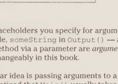


编写方法时为实参指定的占位符——例如 Output() 中的 someString——是形参。通过形参传递给方法的值是实参。在本书中，我或多或少会互换使用这两个术语。

类似的概念是向程序传递实参。例如，你可能注意到 Main() 通常接受一个数组实参。

## 向方法传递多个实参

当我让女儿去洗车时，她通常给我的不止一个实参。因为她在沙发上有大把时间思考这件事，所以她可以随时准备好几个。

你可以定义具有多个不同类型实参的方法。考虑下面的示例方法 AverageAndDisplay()：


```csharp
// AverageAndDisplay -- Demonstrate argument passing.
using System;
namespace Example
{
  public class Program
  {
    public static void Main(string[] args)
    {
      // Access the member method.
      AverageAndDisplay("grade 1", 3.5, "grade 2", 4.0);
      // Wait for user to acknowledge.
      Console.WriteLine("Press Enter to terminate...");
      Console.Read();
    }
  }
}
```

```csharp
// Wait for user to acknowledge.
Console.WriteLine("Press Enter to terminate...");
Console.Read();

} // AverageAndDisplay -- Average two numbers with their
// labels and display the results.
public static void AverageAndDisplay(string s1, double d1,
                                     string s2, double d2)
{ // var okay here, but it's really double.
    var average = (d1 + d2) / 2;
    Console.WriteLine("The average of " + s1
                      + " whose value is " + d1
                      + " and "
                      + s2
                      + " whose value is " + d2
                      + " is " + average);
}
```

C# 无法将调用 `AverageAndDisplay()` 时每个实参的类型与方法定义中对应的参数匹配。字符串 "grade 1" 与方法定义中的第一个字符串匹配；然而，方法定义要求第二个参数是 double，而不是传入的字符串。

你很容易看出，我只是调换了第二个和第三个实参的位置。（这就是我讨厌计算机的地方——它们太字面地理解我的话。我知道我说了什么，但我 *想表达* 什么显而易见。）

要解决这个问题，交换第二个和第三个实参。

## 重载方法并不意味着给它太多任务

只要实参不同，你就可以为给定类中的两个方法使用相同名称——这称为方法名的*重载*。

下面的示例演示了重载：

```csharp
// AverageAndDisplayOverloaded -- This version demonstrates that
//    the AverageAndDisplay method can be overloaded.
using System;
namespace AverageAndDisplayOverloaded
{
    public class Program
    {
        public static void Main(string[] args)
        {
            // Access the first version of the method.
            AverageAndDisplay("my GPA", 3.5, "your GPA", 4.0);
            Console.WriteLine();
            // Access the second version of the method.
```

```
AverageAndDisplay(3.5, 4.0);
// Wait for user to acknowledge.
Console.WriteLine("Press Enter to terminate...");
Console.ReadLine();
}
// AverageAndDisplay -- Average two numbers with their
// labels and display the results.
public static void AverageAndDisplay(string s1, double d1,
string s2, double d2)
{
 double average = (d1 + d2) / 2;
 Console.WriteLine("The average of " + s1
 + " whose value is " + d1);
 Console.WriteLine("and " + s2
 + " whose value is " + d2
 + " is " + average);
}
public static void AverageAndDisplay(double d1, double d2)
{
 double average = (d1 + d2) / 2;
 Console.WriteLine("The average of " + d1
 + " and " + d2
 + " is " + average);
}
}
```

这个程序定义了两个版本的 AverageAndDisplay()。程序通过传入适当的实参，先调用其中一个，再调用另一个。C# 通过将调用与方法定义进行比较，就能判断程序想要哪个方法。程序可以正确编译，并在执行时生成以下输出：

```
The average of my GPA whose value is 3.5
and your GPA whose value is 4 is 3.75

The average of 3.5 and 4 is 3.75
Press Enter to terminate...
```

C# 通常不允许同一个类中的两个方法具有相同名称，除非这些方法的实参数量或类型不同（或者两者都不同）。因此，C# 会区分以下两个方法：

- ♦ AverageAndDisplay(string, double, string, double)
- ♦ AverageAndDisplay(double, double)

这样说来，这两个方法显然不同。

## 实现默认实参

通常，你想提供方法的两个（或更多）版本：

- ♦ 复杂：提供完全的灵活性，但要求调用例程提供大量实参，其中一些用户甚至可能无法理解。


user 一词并不总是指程序的使用者。在实践中，提到方法的使用者时，通常指的是正在使用该方法的程序员。另一个术语是 client（通常就是你）。

- **可接受（虽然有些平淡）：** 假定某些实参的默认值。

你可以使用方法重载轻松实现默认实参。考虑下面这对 DisplayRoundedDecimal() 方法：


```
// MethodsWithDefaultArguments -- Provide variations of the same methods,
// some with default arguments, by overloading the method name.
using System;
namespace MethodsWithDefaultArguments
{
    public class Program
    {
        public static void Main(string[] args)
        {
            // Access the member method.
            Console.WriteLine(DisplayRoundedDecimal(12.345678M, 3));
            // Wait for user to acknowledge.
            Console.WriteLine("Press Enter to terminate...");
            Console.Read();
        }
        // DisplayRoundedDecimal -- Convert a decimal value into a string
        // with the specified number of significant digits.
        public static string DisplayRoundedDecimal(decimal value,
            int numberOfSignificantDigits)
        {
            // First round off the number to the specified number
            // of significant digits.
            decimal roundedValue =
                decimal.Round(value,
                    numberOfSignificantDigits);
            // Convert that to a string.
            string s = Convert.ToString(roundedValue);
            return s;
        }
        public static string DisplayRoundedDecimal(decimal value)
        {
            // Invoke DisplayRoundedDecimal(decimal, int) specifying
            // the default number of digits.
            string s = DisplayRoundedDecimal(value, 2);
            return s;
        }
    }
}
```

DisplayRoundedDecimal(decimal, int) 方法将提供的 decimal 值转换为字符串，并在小数点后保留指定的位数。由于 decimal 常用于显示货币值，最常见的选择是在小数点后保留两位。因此，DisplayRoundedDecimal(decimal) 方法提供相同的转换服务——但将有效位数默认为两位，从而不必担心第二个实参的含义。


```csharp
decimal roundedValue =
    decimal.Round(value,
        numberOfSignificantDigits);

// Convert that to a string.
string s = Convert.ToString(roundedValue);
return s;
}
}
```


为什么微软要做出这些改变？答案是 COM。组件对象模型（COM）是 .NET 发布之前微软产品所选择的架构范式，而且至今仍然相当普遍。（注意，我说的是“普遍”而非“流行”。）例如，Office 完全使用 COM 开发。COM 应用程序使用 C++ 或 Visual Basic 6 及更早版本开发，这些类中的方法允许可选参数。因此，在不使用可选参数的情况下与 COM 通信可能会变得困难。为了解决这种不平衡，C# 4.0 中添加了可选参数（以及许多其他功能）。

我在第三卷中不厌其烦地讲解了命名参数和可选参数。

## 圣诞节后返回值

许多实际应用中的操作会产生返回值给调用者。例如，`Sin()` 接受一个参数并返回三角正弦值。方法可以通过两种方式向调用者返回值——最常见的是通过 `return` 语句；然而，第二种方法使用 *按引用调用* 的特性。

## 通过 return 语句返回值

以下代码片段演示了一个返回其输入参数平均值的小方法：

```csharp
public class Example
{
    public static double Average(double d1, double d2)
    {
        double average = (d1 + d2) / 2;
        return average;
    }

    public static void Main(string[] args)
    {
        double v1 = 1.0;
        double v2 = 3.0;
        double averageValue = Average(v1, v2);
        Console.WriteLine("The average of " + v1
            + " and " + v2 + " is "
            + averageValue);
    }
}
```

```
        // This also works.
        Console.WriteLine("The average of " + v1
            + " and " + v2 + " is "
            + Average(v1, v2));
    }
```

首先注意，我将方法声明为 `public static double Average()` —— 方法名前的 `double` 表示 `Average()` 方法向调用者返回一个双精度浮点值。

`Average()` 方法将传入的 double 值命名为 `d1` 和 `d2`。该方法创建了一个变量 *average*，将 `d1` 和 `d2` 的平均值赋给它，并将 *average* 中包含的值返回给调用者。


人们有时会 careless 但常见的简略说法：“该方法返回 average。” 说 average 或其他任何变量被传递或返回都是不精确的。在此例中，返回的是 *average 内包含的值*。

从 `Test()` 方法中对 `Average()` 的调用看起来与任何其他方法调用相同；但是，`Average()` 通过 `return` 关键字返回的 double 值被存储在变量 *averageValue* 中。


一个返回值的方法（如 `Average()`）不能仅仅通过遇到方法的右花括号就返回调用者。如果这样做，C# 将不知道该返回哪个值。你需要一条 `return` 语句。

### 定义无返回值的方法

声明 `public static double Average(double, double)` 定义了一个方法 `Average()`，它以 *double* 形式返回其参数的平均值。（返回的数字最好是输入值的平均值，否则有人得好好解释一番了。）

有些方法不需要向调用者返回值。前面的 `AverageAndDisplay()` 方法示例显示了其输入参数的平均值，但并未将该平均值返回给调用者。（这个想法可能不是好主意，但这不是我要质疑的。）与其让返回类型留空，不如这样声明一个方法，例如 `AverageAndDisplay()`：

```
    public void AverageAndDisplay(double, double)
```

关键字 *void* 通常出现在返回类型的位置，意思是 *无类型*。也就是说，声明 *void* 表示 `AverageAndDisplay()` 方法不向调用者返回任何值。（无论如何，每个方法声明都指定了返回类型，即使是 *void*。）


void 方法不返回任何值。这个定义并不意味着方法是空的，也不意味着它用于医疗或航天目的；它仅仅指代开头的关键字。相比之下，返回值的方法称为 *非 void 方法*。

非 void 方法必须通过执行 return 语句并在其后附上要返回给调用者的值，将控制权交还给调用者。void 方法没有要返回的值。void 方法在遇到不带值的 return 时返回。或者，默认情况下（如果没有 return），void 方法在控制到达方法右花括号时自动退出。

考虑这个 `DisplayRatio()` 方法：

```csharp
public class Example
{
    public static void DisplayRatio(double numerator,
                                    double denominator)
    {
        // If the denominator is zero . . .
        if (denominator == 0.0)
        {
            // . . . output an error message and . . .
            Console.WriteLine("The denominator of a ratio cannot be 0");
            // . . . return to the caller.
            return;  // An early return due to the error
        }
        // This code is executed only if denominator is nonzero.
        double ratio = numerator / denominator;
        Console.WriteLine("The ratio of " + numerator
                        + " over " + denominator
                        + " is " + ratio);
    } // If the denominator isn't zero, the method exits here.
}
```

`DisplayRatio()` 方法检查分母值是否为零：

- **如果值为零：** 程序会显示错误消息并返回调用者，而不尝试计算比率。否则会将分子值除以零，导致 CPU 处理器故障，也就是更形象的说法 *处理器呕吐*。
- **如果值非零：** 程序会显示比率。紧跟在 `WriteLine()` 之后的右花括号是 `DisplayRatio()` 方法的右花括号，因此充当程序的返回点。

如果这只是唯一的区别，那就不值得大书特书了。然而，`WriteLine()` 的第二种形式还提供了许多输出格式控制。我在第一卷第三章中描述了这些格式控制。


## WriteLine() 方法

你可能已经注意到，我在本书前面的程序示例中使用的 `WriteLine()` 结构只不过是由 `Console` 类调用的一个方法调用：

```
Console.WriteLine("this is a method call");
```

`WriteLine()` 是 .NET Framework 库提供的众多预定义方法之一。预定义的 `Console` 类指的是应用程序控制台（也称为命令提示符或命令窗口）。

到目前为止我一直使用的 `WriteLine()` 方法的参数是一个字符串。`+` 运算符使程序员能够将字符串与字符串组合，或将字符串与内部变量组合，然后将结果传递给 `WriteLine()`：

```
string s = "Sarah"
Console.WriteLine("My name is " + s + " and my age is " + 3);
```

在这种情况下，`WriteLine()` 看到的就是 "My name is Sarah and my age is 3."。

`WriteLine()` 的第二种形式提供了一组更灵活的参数：

```
Console.WriteLine("My name is {0} and my age is {1}", "Sarah", 3);
```

第一个参数是格式字符串。字符串 "Sarah" 被插入到符号 {0} 出现的位置——0 指格式字符串之后的第一个参数。整数 3 被插入到由 {1} 标记的位置。这种形式比前面的例子更高效，因为拼接字符串并不像听起来那么简单。这是一件耗时的事情。


## 第4章：让我谈谈这个

## 本章内容

- ✓ 如何将对象传递给方法
- ✓ 类方法与实例方法
- ✓ 理解 this 是什么
- ✓ 何时没有 this
- ✓ 当类缺少你需要它拥有的方法时

本章从本迷你书第3章强调的静态方法转向类的非静态方法。静态方法属于整个类，而非静态方法属于从该类创建的每个实例。静态和非静态类成员之间存在重要差异。

## 将对象传递给方法

你将对象引用作为参数传递给方法的方式与传递值类型变量的方式相同，只有一个区别：你总是按引用传递对象。

以下小型程序演示了如何将对象传递给方法——即传递给方法：


// PassObject -- Demonstrate how to pass an object to a method.
using System;
namespace PassObject
{
public class Student
{
public string name;
}
public class Program
{
public static void Main(string[] args)
{
Student student = new Student();
// Set the name by accessing it directly.
Console.WriteLine("The first time:");
student.name = "Madeleine";

```csharp
// A revised SetName():
public static void SetName(Student student, string name)
{
    student = new Student(); // Doesn't replace student outside SetName().
    student.Name = name;
}
```

## 定义方法

类应该收集描述现实世界对象或概念的元素。例如，Vehicle 类可能包含最大速度、重量和载重能力等数据元素，例如。然而，Vehicle 也有主动属性——行为——：启动和停止的能力等。这些主动属性由与该车辆数据相关的方法描述。这些方法与数据元素一样，都是 Vehicle 类的一部分。

### 定义静态方法

例如，你可以以稍微更好的方式重写上一节的程序：


```csharp
// StudentClassWithMethods -- Demonstrate putting methods that
//   operate on a class's data inside the class. A class is
//   responsible for its own data and any operations on it.
using System;
namespace StudentClassWithMethods
{
  // Now the OutputName and SetName methods are members of
  // class Student, not class Program.
  public class Student
  {
    public string name;

    // OutputName -- Output the student's name.
    public static void OutputName(Student student)
    {
      // Output current student's name.
      Console.WriteLine("Student's name is {0}", student.name);
    }

    // SetName -- Modify the student object's name.
    public static void SetName(Student student, string name)
    {
      student.name = name;
    }
  }

  public class Program
  {
    public static void Main(string[] args)
    {
      Student student = new Student();
      // Set the name by accessing it directly.
      Console.WriteLine("The first time:");
      student.name = "Madeleine";
```

```csharp
Student.OutputName(student); // Method now belongs to Student.
// Change the name using a method.
Console.WriteLine("After being modified:");
Student.SetName(student, "Willa");
Student.OutputName(student);
// Wait for user to acknowledge
Console.WriteLine("Press Enter to terminate...");
Console.ReadLine();
}
}
```

除名称外，该程序与上一节中的 PassObject 程序相比只有一个重大变化：我将 OutputName() 和 SetName() 方法放在 Student 类中。


与其说“在”类中，许多程序员会说成员“在”类“上”。

由于这一改变，Main() 必须在调用 SetName() 和 OutputName() 时引用 Student 类。这些方法现在是 Student 类的成员，而不是 Program 类的成员，而 Main() 就位于该类中。

这一步很小但意义重大。将 OutputName() 放在类内可带来更高的复用程度：需要显示对象的外部方法可以直接在类中找到 OutputName() 作为类的一部分。它不必由每个使用 Student 类的程序分别编写。


这个解决方案在哲学层面也更好。Class Program 不应该担心如何初始化 Student 对象的名称，也不需要担心如何输出重要内容。Student 类应该包含这些信息。对象对自己负责。

事实上，Main() 本不应该首先将名称初始化为 Madeleine。它应该调用 SetName() 代替。

从 Student 内部，一个成员方法可以在不显式使用类名 的情况下调用另一个方法。SetName() 可以在无需引用类名 的情况下调用 OutputName()。如果省略类名，C# 会假定正在访问的方法位于同一类中或在同一类上。

### 定义实例方法

尽管 OutputName() 和 SetName() 是静态方法，但它们同样可以是非静态的，或实例方法。


类的所有静态成员都是类成员，所有非静态成员都是实例成员。这包括方法。

程序首先创建新的 Student 对象。然后程序调用 SetName() 方法，该方法将两个字符串 "Stephen" 和 "Davis" 存储到数据成员 firstName 和 lastName 中。最后，程序调用成员方法 ToNameString()，该方法通过连接这两个字符串返回学生的姓名。

再次查看 SetName() 方法，它会更新 Student 对象中的名字和姓氏字段。要查看 SetName() 修改了哪个对象，请考虑以下示例：

```csharp
Student christa = new Student();   // Here's one student.
Student sarah = new Student();     // And here's a completely different one.
christa.SetName("Christa", "Smith");
sarah.SetName("Sarah", "Jones");
```

第一次调用 SetName() 更新 christa 对象的名字和姓氏。第二次调用更新 sarah 对象。

因此，C# 程序员说方法在当前对象上操作。在第一次调用中，当前对象是 christa；在第二次调用中，是 sarah。


### 扩展方法的全名

我的方法名描述中存在一个微妙但重要的问题。要看到这个问题，请考虑以下示例代码片段：

```csharp
public class Person
{
    public void Address()
    {
        Console.WriteLine("Hi");
    }
}
public class Letter
{
    string address;
    // Store the address.
    public void Address(string newAddress)
    {
        address = newAddress;
    }
}
```

随后对 Address() 方法的任何讨论现在都是模棱两可的。Person 中的 Address() 方法与 Letter 中的 Address() 方法无关。如果我的程序员朋友告诉我访问 Address() 方法，他指的是哪一个 Address()？

问题不在于方法本身，而在于我的描述。事实上，并不存在独立的 Address() 方法——只有 Person.Address() 和 Letter.Address() 方法。将类名附加到方法名的开头可以清楚地表明意图的方法。

此调用等同于以下内容：

```
    Student.SetName(student1, "Joseph", "Smith"); // Equivalent call,
                                                  // (but this won't build properly).
```

我并不是说你可以以两种不同的方式调用 SetName()；只是说这两次调用在语义上是等价的。标识当前对象的对象——隐藏的第一个参数——被传递给方法，就像其他参数一样。将此任务留给编译器。

隐式传递对象很容易接受，但方法之间引用呢？以下代码片段说明了从一个方法调用另一个方法：

```
    public class Student
    {
        public string firstName;
        public string lastName;
        public void SetName(string firstName, string lastName)
        {
            SetFirstName(firstName);
            SetLastName(lastName);
        }
        public void SetFirstName(string name)
        {
            firstName = name;
        }
        public void SetLastName(string name)
        {
            lastName = name;
        }
    }
```

对 SetFirstName() 的调用中没有出现对象。当前对象会静默地从一次方法调用传递到下一次。从对象方法内部访问任何成员都假定是相对于当前对象而言的。结果是方法“知道”它属于哪个对象。“当前对象”（或“当前实例”）意味着类似“我”的东西。

### this 关键字是什么？

与大多数参数不同，当前对象不会出现在方法参数列表中，因此程序员不会为其分配名称。相反，C# 为该对象分配了不太有创意的名称 this，在需要直接引用当前对象的少数情况下很有用。


C# 关键字 this 不能用于任何其他目的，至少在没有美国国家橄榄球联盟的明确书面许可的情况下不能使用。


因此你可以这样写之前的示例：

```csharp
public class Student
{
    public string firstName;
    public string lastName;
    public void SetName(string firstName, string lastName)
    {
        // Explicitly reference the "current object" referenced by this.
        this.SetFirstName(firstName);
        this.SetLastName(lastName);
    }
    public void SetFirstName(string name)
    {
        this.firstName = name;
    }
    public void SetLastName(string name)
    {
        this.lastName = name;
    }
}
```

注意关键字 this 的显式添加。将它添加到成员引用中不会增加任何内容，因为 this 是默认的。然而，当 Main() 进行以下调用时，this 在 SetName() 及其可能调用的任何其他方法中都引用 student1：

第二卷  
第四章  
让我说说这个  
关于 This

```csharp
student1.SetName("John", "Smith");
```

### this 何时显式？

你通常不需要显式引用 this，因为编译器在必要时会理解它。然而，有两种常见情况需要 this。你可能在初始化数据成员时需要它，如本示例所示：

```csharp
class Person
{
    public string name;     // This is this.name below.
    public int id;          // And this is this.id below.
    public void Init(string name, int id)   // These are method arguments.
    {
        this.name = name;   // Argument names same as data member names
        this.id = id;
    }
}
```

Init() 方法的参数名为 name 和 id，与对应的数据成员名称相同。这样方法就很容易阅读，因为你立刻知道哪个参数存储在哪里。唯一的问题是参数列表中的名称 name 掩盖了数据成员的名称。编译器会对此提出抱怨。

添加 this 可以明确指出所指的名称。在 Init() 中，名称 name 指的是方法参数，但 this.name 指的是数据成员。


你也在存储当前对象以供以后使用或由其他方法使用时需要 this。考虑这个程序示例 ReferencingThisExplicitly：


~~~csharp
// ReferencingThisExplicitly -- Demonstrates how to explicitly use
//   the reference to 'this'.
using System;
namespace ReferencingThisExplicitly
{
    public class Program
    {
        public static void Main(string[] args)
        {
            // Create a student.
            Student student = new Student();
            student.Init("Stephen Davis", 1234);
            // Now enroll the student in a course.
            Console.WriteLine
                ("Enrolling Stephen Davis in Biology 101");
            student.Enroll("Biology 101");
            // Display student course.
            Console.WriteLine("Resulting student record:");
            student.DisplayCourse();
            // Wait for user to acknowledge the results.
            Console.WriteLine("Press Enter to terminate...");
            Console.Read();
        }
    }

    // Student -- The class for university students.
    public class Student
    {
        // All students have a name and an id.
        public string _name;
        public int _id;
        // The course in which the student is enrolled
        CourseInstance _courseInstance;
        // Init -- Initialize the student object.
        public void Init(string name, int id)
        {
            this._name = name;
            this._id = id;
            _courseInstance = null;
        }
        // Enroll -- Enroll the current student in a course.
        public void Enroll(string courseID)
        {
            _courseInstance = new CourseInstance();
            _courseInstance.Init(this, courseID);   // Here's the explicit reference.
        }
        // Display the name of the student and the course.
        public void DisplayCourse()
        {
        Console.WriteLine(_name);
        _courseInstance.Display();
    }
}
// CourseInstance -- A combination of a student with
//   a university course.
public class CourseInstance
{
    public Student _student;
    public string _courseID;
    // Init -- Tie the student to the course.
    public void Init(Student student, string courseID)
    {
        this._student = student;
        this._courseID = courseID;
    }
    // Display -- Output the name of the course.
    public void Display()
    {
        Console.WriteLine(_courseID);
    }
}
~~~

这个程序相当平凡。Student 对象有空间存放姓名、ID 以及一门大学课程的单个实例（不是一个勤奋的学生）。Main() 创建学生实例然后调用 Init() 来初始化该实例。此时，_courseInstance 引用被设为 null，因为学生尚未注册课程。

Enroll() 方法通过用新对象初始化 _courseInstance 来注册学生。然而，CourseInstance.Init() 方法的第一个参数是 Student 实例，第二个参数是课程 ID。你应该传递哪个 Student？显然，你需要传递当前 Student —— 由 this 引用的 Student。（因此你可以说 Enroll() 将 this 学生注册到 CourseInstance。）

一些程序员（包括我）喜欢通过在每个数据成员名称前加上下划线来更清晰地区分数据成员和其他变量，像这样：_name。你会看到我大多数时候都采用这种约定，但当然这只是一种约定，你可以随意处理。如果你使用这种约定，就不需要用 this 前缀该项，如 this._id。仅凭下划线前缀就完全没有歧义。


### 当你没有 this 会发生什么？

混合类（static）方法和实例（nonstatic）方法就像混合牧羊人和牧场主。幸运的是，C# 为两者之间的这些问题提供了一些解决办法。要了解问题，请考虑这个程序片段 MixingStaticAndInstanceMethods：

第二卷

第四章

让我说说这个关于 This


```
// MixingStaticAndInstanceMethods -- Mixing class (static) methods
// and instance (nonstatic) methods can cause problems.
using System;
namespace MixingStaticAndInstanceMethods
{
public class Student
{
public string _firstName;
public string _lastName;
// InitStudent -- Initialize the student object.
public void InitStudent(string firstName, string lastName)
{
_firstName = firstName;
_lastName = lastName;
}
// OutputBanner (static) -- Output the introduction.
public static void OutputBanner()
{
Console.WriteLine("Aren't we clever!");
// Console.WriteLine(? what student do we use ?); * The problem!
}
// OutputBannerAndName (nonstatic) -- Output intro.
public void OutputBannerAndName()
{
// The class Student is implied but no this
// object is passed to the static method.
OutputBanner();
// The current Student object is passed explicitly.
OutputName(this);
}
// OutputName -- Output the student's name.
public static void OutputName(Student student)
{
// Here, the Student object is referenced explicitly.
Console.WriteLine("Student's name is {0}", student.ToNameString());
}
// ToNameString -- Fetch the student's name.
public string ToNameString()
{
// Here, the current object is implicit --
// this could have been written:
// return this._firstName + " " + this._lastName;
return _firstName + " " + _lastName;
}
}
public class Program
{
public static void Main(string[] args)
{
Student student = new Student();
student.InitStudent("Madeleine", "Cather");
// Output the banner and name statically.
Student.OutputBanner();
Student.OutputName(student);
Console.WriteLine();
}
// Output the banner and name again using instance.
student.OutputBannerAndName();
// Wait for user to acknowledge.
Console.WriteLine("Press Enter to terminate...");
Console.Read();
}
}
```

从程序底部的 Main() 开始，这样你能更好地看到问题。程序首先创建一个 Student 对象并初始化其姓名。单例程序现在只想做的事情不外乎输出姓名并在其前面加上简短的消息和横幅。

Main() 首先使用类或 static 方法方法输出横幅和消息。程序调用 OutputBanner() 方法输出横幅行，并调用 OutputName() 方法输出消息和学生姓名。OutputBanner() 方法向控制台输出一条简单消息。Main() 将 student 对象作为参数传递给 OutputName()，以便它可以显示学生的姓名。

接下来，Main() 通过调用 student.OutputBannerAndName() 使用实例方法方法输出横幅和消息。

OutputBannerAndName() 首先调用 static 方法 OutputBanner()。类 Student 被假定。没有对象被传递，因为 static 的 OutputBanner 不需要一个。接下来，OutputBannerAndName() 调用 OutputName() 方法。OutputName() 也是一个 static 方法，但它接受一个 Student 对象作为参数。OutputBannerAndName() 为该参数传递 this。

一个更有趣的案例是 OutputName() 内部对 ToNameString() 的调用。OutputName() 被声明为 static，因此没有 this。它有一个显式的 Student 对象，用它来发起调用。

OutputBanner() 方法也可能想调用 ToNameString()；然而，它没有可用的 Student 对象。因为它是一个 static 方法并且没有显式传递对象，所以它没有 this 引用。注意示例代码中的第一行粗体字：static 方法不能调用实例方法。


> **REMEMBER**
> 一个 static 方法不能在没有显式提供对象的情况下调用非 static 方法。没有对象，就没有调用。一般来说，static 方法不能访问类中的任何非 static 项。但非 static（实例）方法可以访问 static 以及实例项：static 数据成员和 static 方法。


## 第5章：让类承担责任

### 本章内容

- 通过访问控制让类保护自身
- 介绍属性，一种特殊的方法
- 允许对象通过构造函数初始化自身
- 为同一个类定义多个构造函数
- 构造静态成员或类成员

类必须对其行为负责。就像微波炉不应因为你按错键就燃起火焰一样，类也不应在遇到错误数据时任由自己崩溃并失效。

为了让类对其行为负责，类必须确保其初始状态正确，然后控制其后续状态以使其保持有效。C# 提供了这两种能力。

### 限制对类成员的访问

简单类将其所有成员都定义为 `public`。考虑一个 `BankAccount` 程序，它维护一个 `balance` 数据成员来保存每个账户的余额。将该数据成员设为 `public`，就等于让所有人都处于自觉遵守规则的状态。

我不知道你的银行怎样，但我的银行远不会那么大方，留下一堆钱和一本登记簿，让我每次往那堆钱里加钱或取钱时都自己登记。毕竟，我可能会忘记在登记簿上标记取款。

控制访问可以避免小错误，例如偶尔忘记标记一笔取款，并且还能避免一些真正重大的取款错误。

我完全知道你们这些面向过程的家伙在想什么：“只要制定一条规则，让其他类不能直接访问 `balance` 数据成员，就这样。”这种方法在理论上也许行得通，但在实践中从来不行。人们一开始都怀着良好的意图（就像我打算每天锻炼一样），但这些良好意图在把产品交付出去的时间进度压力下被压得粉碎。说到体重……


### 一个 public BankAccount 的公开示例

下面的 BankAccount 类示例将其所有方法声明为 public，但将其数据成员（包括 _accountNumber 和 _balance）声明为 private。请注意，我故意让它处于不正确的状态，以说明一个要点。下面的代码块目前还不能正确编译：


```csharp
// BankAccount -- Create a bank account using a double variable
// to store the account balance (keep the balance in a private
// variable to hide its implementation from the outside world).
// Note: Until you correct it, this program fails to compile
// because Main() refers to a private member of class BankAccount.
using System;
namespace BankAccount
{
 public class Program
 {
 public static void Main(string[] args)
 {
 Console.WriteLine("This program doesn't compile in its present state.");
 // Open a bank account.
 Console.WriteLine("Create a bank account object");
 BankAccount ba = new BankAccount();
 ba.InitBankAccount();
 // Accessing the balance via the Deposit() method is okay --
 // Deposit() has access to all the data members.
 ba.Deposit(10);
 // Accessing the data member directly is a compile-time error.
 Console.WriteLine("Just in case you get this far the following is "
 + "supposed to generate a compile error");
 ba._balance += 10;
 // Wait for user to acknowledge the results.
 Console.WriteLine("Press Enter to terminate...");
 Console.Read();
 }
 }

 // BankAccount -- Define a class that represents a simple account.
public class BankAccount
{
 private static int _nextAccountNumber = 1000;
 private int _accountNumber;
 // Maintain the balance as a double variable.
 private double _balance;
 // Init -- Initialize a bank account with the next
 // account id and a balance of 0.
 public void InitBankAccount()
 {
 _accountNumber = ++_nextAccountNumber;
 _balance = 0.0;
 }
 // GetBalance -- Return the current balance.
 public double GetBalance()
 {
 return _balance;
 }
}
```

```
// AccountNumber
public int GetAccountNumber()
{
    return _accountNumber;
}
public void SetAccountNumber(int accountNumber)
{
    this._accountNumber = accountNumber;
}
// Deposit -- Any positive deposit is allowed.
public void Deposit(double amount)
{
    if (amount > 0.0)
    {
        _balance += amount;
    }
}
// Withdraw -- You can withdraw any amount up to the
// balance. Return the amount withdrawn.
public double Withdraw(double withdrawal)
{
    if (_balance <= withdrawal)
    {
        withdrawal = _balance;
    }
    _balance -= withdrawal;
    return withdrawal;
}
// GetString -- Return the account data as a string.
public string GetString()
{
    string s = String.Format("{0} {1:C}", GetAccountNumber(), GetBalance());
    return s;
}
}
```


在这个代码示例中，_balance -= withdrawal 与 _balance = _balance - withdrawal 相同。（C# 程序员倾向于使用可用的最短写法。）

将成员标记为 public 会使该成员可供程序中的任何其他代码使用。

BankAccount 类提供了一个 InitBankAccount() 方法来初始化该类的成员，一个 Deposit() 方法来处理存款，以及一个 Withdraw() 方法来执行取款。Deposit() 和 Withdraw() 方法甚至提供了一些基本规则，例如“不能存入负数”和“取款不能超过账户中的金额”（我确信你会同意，这两条都是银行的好规则）。然而，只要 _balance 可被外部方法访问，所有人就都处于自觉遵守制度之下。（在这里，外部是指“类外部但在同一程序内”。）对于由程序员团队编写的大型程序，这种自觉遵守制度可能会成为问题。考虑到人类普遍容易犯错，它甚至可能对你（和我）造成问题。


编写良好的代码，其规则可由编译器强制执行，能让所有人免于偶尔被子弹打中脚趾这种意外。

不过，在你过于兴奋之前，请注意该程序无法编译。尝试编译时会生成以下错误消息：

```
'BankAccount.BankAccount._balance' is inaccessible due to its protection level.
```

我不知道它为什么不直接明说：“嘿，这是 private，所以别碰。”语句 ba._balance += 10; 是非法的，因为 _balance 对 Main() 不可访问，而 Main() 是 BankAccount 类外部的方法。将这一行替换为 ba.Deposit(10) 即可解决问题。BankAccount.Deposit() 方法是 public 的，因此可由 Main() 以及程序的其他部分访问。


不显式声明类成员的访问类型，等同于将其声明为 private。


默认访问类型是 private。不过，你应该包含 private 关键字以消除任何疑问。优秀的程序员会明确表达自己的意图，这是减少错误的另一种方法。

### 提前了解——其他安全级别


理解本节需要你具备一些继承（见本迷你书第6章）和命名空间（见本迷你书第10章）的知识。如果愿意，你可以暂时跳过本节，但只需知道需要时它就在这里。

C# 提供以下安全级别：

- 一个 `public` 成员可由程序中的任何类访问。
- 一个 `private` 成员只能从当前类访问。
- 一个 `protected` 成员可从当前类及其任何子类访问。
- 一个 `internal` 成员可由同一程序模块或程序集中的任何类访问。
- 一个 `internal protected` 成员可从当前类及其任何子类访问，也可从同一模块中的类访问。


C# 的“模块”或程序集，是一段单独编译的代码，可以是 .EXE 文件中的可执行程序，也可以是 .DLL 文件中的支持库模块。单个命名空间可以跨越多个程序集。（本迷你书第10章解释 C# 程序集和命名空间，并讨论 public 和 private 之外的访问级别。）


通过将成员声明为 `private` 来隐藏它，可提供最高级别的安全性。然而，在许多情况下，你并不需要这种级别的安全性。毕竟，子类的成员已经依赖于基类的成员，因此 `protected` 提供了足够舒适的安全性级别。

## 为什么你应该关注访问控制

将类的内部成员声明为 `public` 是个坏主意，至少有以下这些原因：

- **当所有数据成员都是 `public` 时，你无法轻易确定数据成员何时以及如何被修改。** 何必在 `Deposit()` 和 `Withdraw()` 方法中构建安全检查呢？事实上，何必还要这些方法呢？任何类的任何方法都可以随时修改这些元素。如果其他方法能够访问这些数据成员，它们几乎肯定会这样做。
- **暴露类的所有数据成员会使接口过于复杂。** 作为使用 `BankAccount` 类的程序员，你不想了解该类的内部运作。你只需要知道可以存入和取出资金。这就像一台有 50 个按钮的糖果机，对比一台只有几个你需要的按钮的糖果机。
- **暴露内部元素会导致类规则分散。** 例如，我的 `BankAccount` 类在任何情况下都不允许余额为负。这条必需的业务规则应隔离在 `Withdraw()` 方法内。否则，你必须在每次更新余额的地方都添加这项检查。

有时，银行决定更改规则，允许“优质客户”在短时间内持有略微为负的余额，以避免意外透支。然后，你必须搜索整个程序，更新访问余额的每一段代码，以确保安全检查被更改。

让你的类和方法保持尽可能低的可见性，不要超过必要程度。我给出这个建议，与其说是让你对爱窥探的黑客产生偏执，不如说是建议你采取一个有助于在编码时减少错误的审慎步骤。如果可能，使用 `private`，然后根据需要逐步提升为 `protected`、`internal`、`internal protected` 或 `public`。

第 II 册 · 第 5 章 · 让类承担责任

### 访问器方法

如果更仔细地查看 `BankAccount` 类，你会看到另外几个方法。其中一个 `GetString()` 返回账户的字符串版本，适合呈现给任何 `Console.WriteLine()` 进行显示。然而，如果 `BankAccount` 对象的内容不可访问，显示其内容可能会很困难。类应该有权决定如何显示自己。

此外，你会看到两个“getter”方法 `GetBalance()` 和 `GetAccountNumber()`，以及一个“setter”方法 `SetAccountNumber()`。你可能想知道，我为什么费心将 `_balance` 这样的数据成员声明为 private，却又提供一个 public 的 `GetBalance()` 方法来返回其值。我有两个理由：

- `GetBalance()` 不提供修改 `_balance` 的方式——它仅返回其值。余额是只读的。用实际银行来类比，你可以随时查看余额；但如果不使用银行的取款机制，你就不能从账户中取钱。
- `GetBalance()` 向外部方法隐藏类的内部格式。`GetBalance()` 可能通过读取收据、添加账户费用以及计入银行可能要从余额中扣除的任何其他金额，来执行大量计算。外部方法不知道也不关心。当然，你关心收取了哪些费用——只是除非换银行，否则你对此无能为力。

最后，`GetBalance()` 提供了一种机制，使你可以对类进行内部更改，而无需更改 `BankAccount` 的用户。如果联邦存款保险公司（FDIC）强制要求你的银行以不同方式存储存款，这项规定不应改变你访问账户的方式。

### 访问控制来救场——一个示例

下面的 `DoubleBankAccount` 程序演示了 `BankAccount` 程序中一个潜在的缺陷。整个程序在你的网站上；不过，下面的代码清单只显示 `Main()`——这是该程序与之前的 `BankAccount` 程序唯一不同的部分：

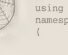

```csharp
// DoubleBankAccount -- Create a bank account using a double variable
//                     to store the account balance (keep the balance in a private
//                     variable to hide its implementation from the outside world).
using System;
namespace DoubleBankAccount
{
if (amount > 0.0)
{
    // Round off the double to the nearest cent before depositing.
    decimal temp = (decimal)amount;
    temp = Decimal.Round(temp, 2);
    _balance += temp;
}

// Withdraw -- You can withdraw any amount up to the
//   balance; return the amount withdrawn.
public double Withdraw(double withdrawal)
{
    // Convert to decimal and work with the decimal version.
    decimal decWithdrawal = (decimal)withdrawal;
    if (_balance <= decWithdrawal)
    {
        decWithdrawal = _balance;
    }
    _balance -= decWithdrawal;
    return (double)decWithdrawal;  // Return a double.
}

// GetString -- Return the account data as a string.
public string GetString()
{
    string s = String.Format("{0} = {1:C}",
                              GetAccountNumber(), GetBalance());
    return s;
}
```

我已经将所有内部表示转换为 decimal 值；无论如何，decimal 类型都比 double 更适合处理银行账户余额。现在 Deposit() 方法使用 Decimal.Round() 方法，在存款前将存款金额四舍五入到最接近的分。现在程序的输出符合预期：

```
Create a bank account object
Depositing $123.45
Account = #1001 = $123.45
Adding $0.00
Resulting account = #1001 = $123.45
Press Enter to terminate...
```

#### 那又怎样？

你可能会争辩说，我一开始就应该使用 decimal 输入参数来编写 BankAccount 程序，我大概也会同意。但重点是我没有那样做。其他应用程序是使用 double 作为存储形式编写的。问题出现了。BankAccount 类能够在内部修复问题，并且不对应用软件做任何更改。（注意该类的公共接口没有改变：Balance() 和 Withdraw() 仍然返回 double，Deposit() 和 Withdraw() 仍然接受 double 参数。）


我重复一遍：使用 BankAccount 类的应用程序不必更改。

在这种情况下，唯一可能受影响的调用方法是 Main()，但影响可能扩展到数十个访问银行账户的方法，而这些方法可能分布在数百个程序集中。这些方法都不必更改，因为修复是在 BankAccount 类的范围内完成的，其公共接口（它的公共方法）在外观上没有改变。如果类的内部成员已经暴露给外部方法，这个解决方案就不可能实现。


类的内部更改仍然需要对其他代码进行一些重新测试，即使你不必修改那些代码。

### 定义类属性

上一节 BankAccount 程序中演示的 GetX() 和 SetX() 方法是访问方法，或简称为访问器。尽管它们在理论上代表着良好的编程习惯，但在实践中，访问方法可能会变得笨拙。例如，要将 _accountNumber 递增 1，必须使用下面这行代码：

```csharp
SetAccountNumber(GetAccountNumber() + 1);
```

C# 定义了一种称为属性的构造，它使使用访问方法比把它们做成方法要容易得多。下面的代码片段定义了一个读写属性 AccountNumber（它既是 getter 又是 setter）：

```csharp
public int AccountNumber              // No parentheses here.
{
    get { return _accountNumber; }     // The "read" part. Curly braces and semicolon.
    set { _accountNumber = value; }    // The "write" part. 'value' is a keyword.
}
```

每当读取属性时，就会调用 get 部分；写入时则调用 set 部分。下面的 Balance 属性是只读的，因为只定义了 get 部分（使用一种不那么紧凑的记法）：

```csharp
public double Balance
{
    get
    {
        return (double)_balance;
    }
}
```


在使用中，这些属性的表现形式如下：

```csharp
BankAccount ba = new BankAccount();
// Set the account number property.
ba.AccountNumber = 123;
// Get both properties.
Console.WriteLine("{0} {1} {2}", ba.AccountNumber, ba.Balance);
```

AccountNumber 和 Balance 属性无论在外观还是使用上，都非常类似于公共数据成员。然而，属性使类能够保护内部成员（Balance 是只读属性）并隐藏其实现（底层 _balance 数据成员是私有的）。请注意，Balance 执行了一次转换——它本可以执行任意数量的计算。属性不一定是单行代码。


按照约定，属性名以大写字母开头。请注意，属性没有括号：是 Balance，而不是 Balance()。

属性并不一定效率低下。C# 编译器可以将简单的访问器优化到与直接访问数据成员生成同样多机器代码的程度。这个概念不仅对 C# 本身很重要。C# 库中到处都使用了属性，你也应当这样做。


*即使是同一类中的方法，也应使用属性来访问类的数据成员。*

## 静态属性

静态（类）数据成员可以通过静态属性公开，如下面的简化示例所示（注意其紧凑的布局）：

```csharp
public class BankAccount
{
    private static int _nextAccountNumber = 1000;
    public static int NextAccountNumber { get { return _nextAccountNumber; } }
    // ...
}
```

NextAccountNumber 属性通过类访问，如下所示，因为它不是实例属性（它被声明为 static）：

```csharp
// Read the account number property.
int value = BankAccount.NextAccountNumber;
```

（在此示例中，value 处于属性的上下文之外，因此它不是保留字。）

## 带副作用的属性

get 操作除了简单检索关联属性外，还可以执行额外的工作，如下所示：

```csharp
public static int AccountNumber
{
    // Retrieve the property and set it up for the
    // next retrieval by incrementing it.
    get { return ++_nextAccountNumber; }
}
```

该属性在返回结果之前会递增静态账号成员。然而，这可能不是一个好主意，因为属性的使用者除了实际读取属性外，不会得到任何正在发生其他事情的提示。这种递增就是一种副作用。


与它们模仿的访问器方法一样，属性除了设置数据成员的值之外，不应改变类的状态。属性和方法通常都应避免副作用，因为它们可能导致难以察觉的 bug。应尽可能直接、明确地更改类。

## 新特性：让编译器为您编写属性

上一节中描述的大多数属性都是完全例行的，编写它们很繁琐（虽然简单）：

```csharp
private string _name; // An underlying data member for the property
public string Name { get { return _name; } set { _name = value; } }
```

因为您反复编写同样的样板代码，所以 C# 3.0 编译器现在为您代劳了。对于前面的属性（包括私有数据成员），您只需编写这一行：

```csharp
public string Name { get; set; }
```


这一行大致相当于

```csharp
private string <comename>; // What's <comename>? Don't know or care.
public string Name { get { return <comename>; } set { <comename> = value; } }
```

编译器会创建一个无名数据成员以及访问器样板代码。csharp102.info 上的 AccessorProperty Shortcuts 示例演示了这种用法。这种风格鼓励甚至在其包含类的其他成员中也使用该属性，因为您只知道属性名。因此，您必须同时具备 get 和 set。您可以使用属性语法初始化此类属性。

```csharp
public int AnInt { get; set; } // Compiler provides a private variable.

AnInt = 2; // Initialize compiler-written instance variable via property.
```

## 具有访问级别的访问器

访问器属性不一定非要声明为 public。您可以在任何适当的级别声明它们，甚至可以是 private，只要该访问器仅在其类内部使用。（接下来的示例将 Name 属性标记为 internal。）

您甚至可以单独调整访问器的 get 和 set 部分的访问级别。假设您不想在类外部公开 set 访问器——它仅供内部使用。您可以这样编写属性：

```csharp
internal string Name { get; private set; }
```


csharptwo.info 上的 AccessorPropertyShortcuts 示例演示了这种用法。

## 让对象有一个良好的开端——构造函数

控制类访问只是问题的一半：对象要想成长，就需要有一个良好的人生开端。类可以提供应用程序调用的初始化方法来启动事务，但应用程序可能会忘记调用该方法。类以垃圾数据开始，之后情况也不会好转。如果你想让类负起责任，就必须确保它有机会正确地开始。


C# 通过为您调用初始化方法来解决这个问题——例如：

```csharp
MyObject mo = new MyObject();
```

换句话说，这条语句不仅从特殊内存区域获取对象，还初始化该对象的成员。

请将类和对象这两个术语区分开来。Cat 是一个类。我的猫 Striper 是 Cat 类的一个对象。


第 II 册 第 5 章 让类负起责任

该程序定义了一个类 MyObject，其中包含一个 int 类型的简单数据成员 n 和一个对象引用 nextObject（两者都声明为 internal）。Main() 方法创建一个 MyObject，然后显示 n 和 nextObject 的初始内容。

执行该程序的输出如下所示：

```
localObject.n is 0
localObject.nextObject is null
Press Enter to terminate...
```

创建对象时，C# 会执行编译器提供的一小段代码来初始化对象及其成员。如果不做任何处理，数据成员 localObject.n 和 nextObject 将包含随机的垃圾值。

在创建时初始化值的代码是默认构造函数。它“构造”类，即初始化其成员。因此，C# 确保对象在已知状态下开始生命周期：全为零。这个概念只影响类的数据成员，不影响方法中的局部变量。


### 替换默认构造函数

尽管编译器会自动将所有实例变量初始化为零，但对于许多类（可能是大多数类）来说，全零并不是有效状态。考虑本章前面提到的以下 BankAccount 类：

```csharp
public class BankAccount
{
    private int _accountNumber;
    private double _balance;
    // ... other members
}
```

虽然 0 的初始余额可能没问题，但 0 的账号绝对不是有效银行账户的标志。

在本章的这个阶段，BankAccount 类包含 InitBankAccount() 方法来初始化对象。然而，这种方法将过多的责任放在了使用该类的应用程序软件上。如果应用程序未能调用 InitBankAccount() 方法，银行账户方法可能无法工作，而这并非它们自身的过错。

类不应依赖诸如 InitBankAccount() 之类的外部方法来使对象以有效状态启动。


第 II 册 第 5 章 让类负起责任


要绕开这个问题，你可以让自己的类提供一个显式的类构造函数，C# 会在创建对象时自动调用它。该构造函数本来可以命名为 Init()、Start() 或 Create()，但 C# 要求构造函数必须带有类的名称。因此，BankAccount 类的构造函数如下所示：

```
public void Main(string[] args)
{
    BankAccount ba = new BankAccount(); // This invokes the constructor.
}
public class BankAccount
{
    // Bank accounts start at 1000 and increase sequentially.
    private static int _nextAccountNumber = 1000;
    // Maintain the account number and balance for each object.
    private int _accountNumber;
    private double _balance;
    // BankAccount constructor -- Here it is -- ta-da!
    public BankAccount() // Parentheses, possible arguments, no return type
    {
        _accountNumber = ++_nextAccountNumber;
        _balance = 0.0;
    }
    // . . . other members . . 
}
```

BankAccount 构造函数的内容与原来的 Init...() 方法相同。不过，声明和使用构造函数的方式有所不同：

-   构造函数始终与类同名。
-   构造函数可以带参数（也可以不带）。
-   构造函数永远没有返回类型，连 void 都没有。
-   Main() 不需要在创建对象时调用任何额外方法来初始化对象；不需要 Init()。


如果你提供了自己的构造函数，C# 就不再提供默认构造函数。你的构造函数会取代默认构造函数，并成为创建该类实例的唯一方式。

## 构造某个东西

试一试构造函数这个小玩意儿。考虑下面这个程序 DemonstrateCustomConstructor：


// DemonstrateCustomConstructor -- Demonstrate how you can replace the
// C# default constructor with your own, custom constructor.
// Creates a class with a constructor and then steps through a few scenarios.
using System;
namespace DemonstrateCustomConstructor
{
    // MyObject -- Create a class with a noisy custom constructor
    //    and an internal data object.
    public class MyObject
    {
        // This data member is a property of the class (it's static).
        private static MyOtherObject _staticObj = new MyOtherObject();
        // This data member is a property of each instance.
        private MyOtherObject _dynamicObj;
        // (Constructor (a real chatterbox)
        public MyObject()
        {
            Console.WriteLine("MyObject constructor starting");
            Console.WriteLine("(Static data member constructed before " +
                "this constructor)");
            Console.WriteLine("Now create nonstatic data member dynamically:");
            _dynamicObj = new MyOtherObject();
            Console.WriteLine("MyObject constructor ending");
        }
    }
    // MyOtherObject -- This class also has a noisy constructor but
    //    no internal members.
    public class MyOtherObject
    {
        public MyOtherObject()
        {
            Console.WriteLine("MyOtherObject constructing");
        }
    }
    public class Program
    {
        public static void Main(string[] args)
        {
            Console.WriteLine("Main() starting");
            Console.WriteLine("Creating a local MyObject in Main():");
            MyObject localObject = new MyObject();
            // Wait for user to acknowledge the results.
            Console.WriteLine("Press Enter to terminate...");
            Console.Read();
        }
    }
}

执行这个程序会生成以下输出：

```
Main() starting
Creating a local MyObject in Main():
MyOtherObject constructing
MyObject constructor starting
(Static data member constructed before this constructor)
Now create nonstatic data member dynamically:
MyOtherObject constructing
MyObject constructor ending
Press Enter to terminate...
```

以下步骤重现了实际发生的过程：

-   1. 程序启动，Main() 输出初始消息，并宣布它即将创建一个局部 MyObject。
-   2. Main() 创建一个 MyObject 类型的 localObject。


3. MyObject 包含一个 MyOtherObject 类的静态成员 _staticObj。

所有静态数据成员都在第一个 MyObject() 构造函数运行之前初始化。在本例中，C# 在将控制权传递给 MyObject 构造函数之前，会用新创建的 MyOtherObject 填充 _staticObj。这一步对应输出的第三行。

4. MyObject 的构造函数获得控制权。它输出初始消息 MyObject constructor starting，然后指出静态成员在 MyObject() 构造函数开始之前就已经构造好了：

(Static data member constructed before this constructor).

5. 在通过 Now create nonstatic data member dynamically 宣告其意图后，MyObject 构造函数使用 new 运算符创建 MyOtherObject 类的对象，并在调用 MyOtherObject 构造函数时生成第二条 MyOtherObject constructing 消息。

6. 控制权返回到 MyObject 构造函数，然后返回到 Main()。

干得漂亮！

## 从调试器执行构造函数

在调试器中执行同一个程序很有启发性：


-   1. 重新生成程序：选择命令“生成”→“生成 DemonstrateCustomConstructor”。
-   2. 在从调试器开始执行程序之前，在 MyOtherObject 构造函数中的 Console.WriteLine() 调用处设置断点。
-   要设置断点，请在编辑器窗口左侧的灰色槽中、你希望停下的那一行旁边单击。
-   图 5-1 显示了我设置了断点后的界面：深色圆球位于槽中。
-   3. 不要选择“调试”→“开始调试”，而应选择“调试”→“逐语句”（或按 F11）。
-   你的菜单、工具栏和窗口应会略有变化，然后 Main() 中的左大括号上会出现明亮的黄色高亮。

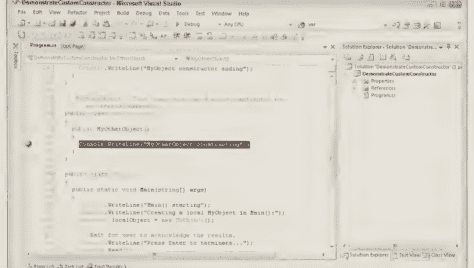

图 5-1：MyOtherObject 构造函数中的高亮表示存在断点。

-   4. 再按三次 F11，并将鼠标指针轻轻悬停在 localObject 变量上（不要单击）。
-   你即将调用 MyObject 构造函数。现在你的界面应如图 5-2 所示。可以看到光标下的 localObject 当前为 null。“局部变量”窗口也显示相同内容。（如果“局部变量”不可见，选择“调试”➪“窗口”➪“局部变量”以显示它。）
-   5. 再按一次 F11。
-   程序执行到 MyObject 中的断点，如图 5-3 中的黄色条所示。你是如何到达这一点的？Main() 中的最后一次调用调用了 MyObject 的构造函数。但在该构造函数开始执行之前，C# 会初始化 MyObject 类中的静态数据成员。该数据成员的类型是 MyOtherObject，因此初始化它就意味着调用其构造函数——这使你停在断点处。（如果没有断点，你不会看到调试器停在那里，尽管构造函数确实会执行；你可以通过检查构造函数的消息是否出现在控制台窗口中来确认这一点。）

第 II 部分

第 5 章

持有一个类

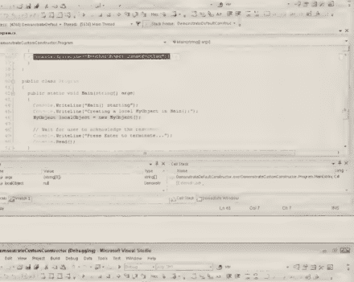

图 5-2：
就在你跳进“构造函数乐园”之前，Visual Studio 调试器显示如下。

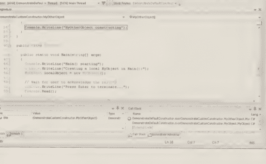

图 5-3：
控制权在进入 MyObject 构造函数之前先传递给 MyOtherObject 构造函数。

6. 再按两次 F11，你就会停在静态数据成员 _staticObj 处，如图 5-4 所示。

你刚刚步出的正是那个对象的构造函数。

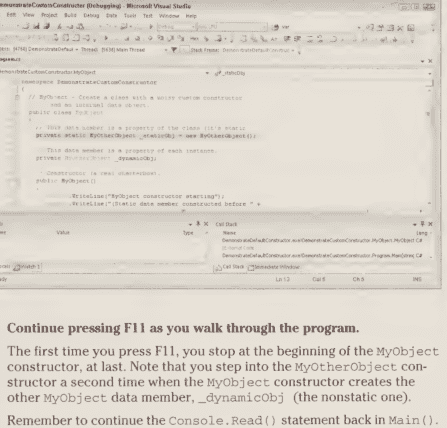

图 5-4：单步执行完 MyOtherObject 构造函数后，你回到了调用该构造函数的位置。


-   7. 继续按 F11，逐步执行程序。

第一次按 F11 时，你终于停在 MyObject 构造函数的开头。注意，当 MyObject 构造函数创建另一个 MyObject 数据成员 _dynamicObj（非静态的那个）时，你会第二次步入 MyOtherObject 构造函数。

记得回到 Main() 中继续执行 Console.Read() 语句。查看控制台窗口后，可以按 Enter 将其关闭。

第 IV 部分会带你全面了解调试器。

## 使用初始化器直接初始化对象

除了让你在构造函数中初始化数据成员外，C# 还允许你使用初始化器直接初始化数据成员。

因此，我可以按如下方式编写 BankAccount 类：

```
public class BankAccount
{
    // Bank accounts start at 1000 and increase sequentially.
    private static int _nextAccountNumber = 1000;
    // Maintain the account number and balance for each object.
    private int _accountNumber = ++_nextAccountNumber;
    private double _balance = 0.0;
    // ... other members ...
}
```


下面是初始化器相关的内容。`_accountNumber` 和 `_balance` 都在声明时被赋值，这与构造函数具有相同的效果，但不必在构造函数中完成这项工作。

要弄清楚到底发生了什么。你可能会认为这条语句现在就把 `_balance` 设为 0.0。然而，`_balance` 只作为对象的一部分存在。因此，只有在创建 BankAccount 对象之后，该赋值才会执行。事实上，每次创建对象时都会执行该赋值。

注意，静态数据成员 `_nextAccountNumber` 在首次访问 BankAccount 类时初始化——正如你在调试器中的演练所示，那是你首次访问拥有该静态数据成员的对象的任何方法或属性，包括构造函数。

静态成员初始化之后，每次构造 BankAccount 实例时都不会重新初始化。这一点与非静态成员不同。

初始化器按其在类声明中出现的顺序执行。如果 C# 同时遇到初始化器和构造函数，则初始化器在构造函数体之前执行。


### 观察带初始化器的构造过程

在 DemonstrateCustomConstructor 程序中，将 `new MyOtherObject()` 调用从 MyObject 构造函数移到声明本身，如下所示（见粗体文本），按所示修改第二个 `WriteLine()` 语句，然后重新运行程序：

```csharp
public class MyObject
{
    // This member is a property of the class (it's static).
    private static MyOtherObject _staticObj = new MyOtherObject();
    // This member is a property of each instance.
    private MyOtherObject _dynamicObj = new MyOtherObject(); // <-- Here.
    public MyObject()
    {
        Console.WriteLine("MyObject constructor starting");
        Console.WriteLine("Both data members initialized before this constructor");
        // _dynamicObj construction was here, now moved up.
        Console.WriteLine("MyObject constructor ending");
    }
}
```

将修改后程序的以下输出与其前身 DemonstrateCustomConstructor 的输出进行比较：

```text
Main() starting
Creating a local MyObject in Main():
MyOtherObject constructing
MyOtherObject constructing
MyObject constructor starting
(Both data members initialized before this constructor)
MyObject constructor ending
Press Enter to terminate...
```

你可以在网站上找到整个程序（完成这些更改后），其大名是 DemonstrateConstructorWithInitializer。

### 新特性：无需构造函数初始化对象

假设你有一个表示 Student 的小类：

```csharp
public class Student
{
    public string Name { get; set; }
    public string Address { get; set; }
    public double GradePointAverage { get; set; }
}
```

Student 对象有三个公共属性：Name、Address 和 GradePointAverage，它们指定学生的基本信息。

通常，创建新的 Student 对象时，必须像这样初始化其 Name、Address 和 GradePointAverage 属性：

```csharp
Student randal = new Student();
randal.Name = "Randal Sphar";
randal.Address = "123 Elm Street, Truth or Consequences, NM 00000";
randal.GradePointAverage = 3.51;
```

（是的，弗吉尼亚，新墨西哥州确实有个地方叫 Truth or Consequences。我的侄子 Randal 出生在那里。）

如果 Student 有构造函数，你可以这样做：

```csharp
Student randal = new Student
("Randal Sphar", "123 Elm Street, Truth or Consequences, NM 00000", 3.51);
```

然而遗憾的是，除了 C# 自动提供的默认构造函数（不接受参数）之外，Student 没有其他构造函数。

在 C# 3.0 及更高版本中，你可以用某种看起来可疑地像构造函数的东西来简化该初始化——嗯，算是吧：

```csharp
Student randal = new Student
{
    Name = "Randal Sphar",
    Address = "123 Elm Street, Truth or Consequences, NM 00000",
    GradePointAverage = 3.51
};
```


最后两个示例在这一点上不同：第一个使用构造函数，显示的是括号中包含两个字符串和一个 double 值，以逗号分隔；第二个使用新的对象初始化器语法，改用花括号包含三个赋值，以逗号分隔。该语法大致如下：

```csharp
new LatitudeLongitude
{ assignment to Latitude, assignment to Longitude };
```

新的对象初始化器语法允许你在代码块（花括号）中为 LatitudeLongitude 对象的任何可访问的 set 属性赋值。该代码块用于初始化对象。注意，通过这种方式只能设置可访问的属性，不能设置私有属性，也不能在初始化器中调用对象的任何方法或执行任何其他工作。

新语法简洁得多：一条语句对三条语句。而且，它简化了创建已初始化对象的过程，而这些对象无法通过构造函数做到这一点。（我把 Student 示例分成多行只是为了适合页面——那只是因为 Truth or Consequences 这个名字很长。如果你住在那儿，它看起来会更长。）

新的对象初始化器语法除了方便之外，并不会给你带来太多其他好处，但在编码时，方便性在任何程序员的清单上都名列前茅。简洁也是如此。此外，当你阅读匿名类相关内容时，这个特性会变得必不可少。


尽情使用新的对象初始化器语法吧。在本书其余部分，我自己也经常使用它。

在帮助中查找术语 object initializer，以找到关于它适用于哪些种类属性的律师式措辞。


网站上的 ObjectInitializers 程序示例演示了对象初始化器。

## 第6章：继承：我能得到的就这些吗？

### 本章内容

- 依据另一个更基础的类来定义一个类
- 区分 *is a* 与 *has a*
- 用一个类对象替代另一个类对象
- 构造静态成员或实例成员
- 在继承层次结构中包含构造函数
- 专门调用基类构造函数

面向对象编程基于四项原则：控制访问的能力（封装）、从其他类继承、恰当地响应（多态），以及间接地从一个对象引用另一个对象（接口）。

继承是一个常见的概念。我是人类，除了刚醒来的时候。我从 `Human` 类继承某些属性，比如我或多或少能交谈的能力，以及我对空气、食物和含大量咖啡因的碳水化合物饮料的依赖。`Human` 类从 `Mammal` 类继承对空气、水和营养的依赖，而 `Mammal` 类又继承自 `Animal` 类。

传递属性的能力是一种强大的能力。你可以用它以经济的方式来描述事物。例如，如果我儿子问：“鸭子是什么？”我可以说：“是一种会嘎嘎叫的鸟。”不管你怎么想，这个答案传达了相当多的信息。我儿子知道鸟是什么，现在他知道了鸭子所有相同的特征，外加鸭子“嘎嘎叫”这一额外属性。

面向对象语言通过允许一个类从另一个类继承属性来表达这种继承关系。这一特性使面向对象语言能够生成比不支持继承的语言所生成的模型更接近现实世界的模型。

### 类继承

在下面的 InheritanceExample 程序中，SubClass 类继承自 BaseClass 类：


```csharp
// InheritanceExample -- Provide the simplest possible
// demonstration of inheritance.
using System;
namespace InheritanceExample
{
    public class BaseClass
    {
        public int _dataMember;
        public void SomeMethod()
        {
            Console.WriteLine("SomeMethod()");
        }
    }
    public class SubClass : BaseClass
    {
        public void SomeOtherMethod()
        {
            Console.WriteLine("SomeOtherMethod()");
        }
    }
    public class Program
    {
        public static void Main(string[] args)
        {
            // Create a base class object.
            Console.WriteLine("Exercising a base class object:");
            BaseClass bc = new BaseClass();
            bc._dataMember = 1;
            bc.SomeMethod();
            // Now create a subclass object.
            Console.WriteLine("Exercising a subclass object:");
            SubClass sc = new SubClass();
            sc._dataMember = 2;
            sc.SomeMethod();
            sc.SomeOtherMethod();
            // Wait for user to acknowledge the results.
            Console.WriteLine("Press Enter to terminate...");
            Console.Read();
        }
    }
}
```

BaseClass 类定义了一个数据成员和简单方法 `SomeMethod()`。`Main()` 创建并使用了 BaseClass 对象 bc。

SubClass 类通过在类定义中的冒号后放置类名 BaseClass 来继承该类：

```csharp
public class SubClass : BaseClass
```


## 继承真是奇妙

为了理解周围的事物，人类构建了庞大的分类体系。例如，Fido 是狗的一种特例，狗是犬科的一种特例，犬科是哺乳动物的一种特例——如此等等。这种对事物进行分类的能力塑造了我们对世界的理解。

在 C# 这样的面向对象语言中，你会说 Student 类继承自 Person 类。你也会说 Person 是 Student 的基类，而 Student 是 Person 的子类。最后，你会说一个 Student IS_A Person。（使用全大写和下划线来表达这种独特关系是一种常见做法——这个概念不是我发明的。）

请注意，IS_A 属性不是自反的：虽然 Student IS_A Person，但反过来不成立。一个 Person IS_NOT 一个 Student。这样的陈述始终指的是一般情况。某个具体的 Person 实际上可能是 Student——但大量属于 Person 类的人并不属于 Student 类。此外，Student 类具有它与 Person 类不共享的属性。例如，Student 有绩点，但普通的 Person 完全没有也没关系。

继承属性是传递的。例如，如果我定义一个新类 GraduateStudent 作为 Student 的子类，那么 GraduateStudent 也是一个 Person。必须如此：如果 GraduateStudent IS_A Student 且 Student IS_A Person，那么 GraduateStudent IS_A Person。

SubClass 将 BaseClass 的所有成员作为自己的成员，再加上它可能添加的任何成员。Main() 演示了 SubClass 现在拥有一个数据成员 _dataMember 和一个成员方法 SomeMethod()，以及家族中全新的小方法 SomeOtherMethod()——这真是太令人愉快了。

程序产生以下预期输出（我通常在程序按预期工作时都会有点惊讶）：

```
Exercising a base class object:
SomeMethod()
Exercising a subclass object:
SomeMethod()
SomeOtherMethod()
Press Enter to terminate...
```

## 为什么需要继承

继承具有若干重要功能。例如，你可能会认为继承减少了打字量。在某种程度上确实如此——在描述 Student 类时，你不需要重复 Person 的属性。一个更重要且相关的议题是重用这一主要流行词。软件科学家们很早就知道，对每个新项目都从零开始并重建相同的软件组件是毫无意义的。

将软件开发的情况与其他行业进行比较。想想有多少汽车制造商在造车之前先自己制造扳手和螺丝刀。在这些人中，估计有多少会在下一款车型上完全重新开始并制造全新的工具。其他行业从业者发现，使用现有的螺丝、螺栓、螺母，甚至更大型的现成组件（如电机和压缩机）作为起点，比从零开始更有意义。

继承使你能够调整现有的软件组件。你可以在不进行内部修改的情况下将现有类适配到新应用中。现有类被继承到——或者程序员常说的，被扩展为——一个包含必要增添和修改的新子类中。如果基类是别人写的，你可能无法修改它，因此继承可以派上用场。

这种能力带来了继承的第三个好处。假设你继承自——扩展——一个现有类。后来，你发现基类有一个必须修正的错误。如果你修改了该类以便重用，你必须在每个应用中分别手动检查、修正并重新测试该错误。如果你不做更改的情况下继承了该类，通常可以将更新后的类轻松地插入到其他应用中。

但继承最大的好处是它描述了生活的本质。事物相互继承属性。无可避免。（Basta！——正如我的意大利奶奶会说的。）

## 从 BankAccount 类继承
(一个更复杂的示例)

银行维护多种类型的账户。其中一种，储蓄账户，拥有简单银行账户的所有属性，外加累积利息的能力。以下 SimpleSavingsAccount 程序在 C# 中模拟了这种关系。

网站上该程序的版本包含了本章下一节的一些修改，因此与此处显示的代码清单略有不同。


// SimpleSavingsAccount -- Implement SavingsAccount as a form of
// bank account; use no virtual methods.
using System;
namespace SimpleSavingsAccount
{
// BankAccount -- Simulate a bank account, each of which
// carries an account ID (which is assigned
// on creation) and a balance.
// public class BankAccount // The base class

// Bank accounts start at 1000 and increase sequentially.
public static int _nextAccountNumber = 1000;
// Maintain the account number and balance for each object.
public int _accountNumber;
public decimal _balance;
// Init -- Initialize a bank account with the next account ID and the
// specified initial balance (default to zero).
public void InitBankAccount()
{
    InitBankAccount(0);
}
public void InitBankAccount(decimal initialBalance)
{
    _accountNumber = ++_nextAccountNumber;
    _balance = initialBalance;
}
// Balance property.
public decimal Balance
{
    get { return _balance; }
}
// Deposit -- Any positive deposit is allowed.
public void Deposit(decimal amount)
{
    if (amount > 0)
    {
        _balance += amount;
    }
}
// Withdraw -- You can withdraw any amount up to the
// balance. return the amount withdrawn.
public decimal Withdraw(decimal withdrawal)
{
    if (Balance <= withdrawal) // Use Balance property.
    {
        withdrawal = Balance;
    }
    _balance -= withdrawal;
    return withdrawal;
}
// ToString -- Stringify the account.
public string ToBankAccountString()
{
    return String.Format("{0} ({1:C})", _accountNumber, Balance);
}

// SavingsAccount -- A bank account that draws interest
public class SavingsAccount : BankAccount // The subclass
{
    public decimal _interestRate;
    // InitSavingsAccount -- Input the rate expressed as a
    // rate between 0 and 100.
    public void InitSavingsAccount(decimal interestRate)
    {
        InitSavingsAccount(0, interestRate);
    }
}
public void InitSavingsAccount(decimal initialBalance, decimal interestRate)
{
    InitBankAccount(initialBalance);  // Note call to base class.
    this._interestRate = interestRate / 100;
}
// AccumulateInterest -- Invoke once per period.
public void AccumulateInterest()
{
    _balance = Balance + (decimal)(Balance * _interestRate);
}
// ToString -- Stringify the account.
public string ToSavingsAccountString()
{
    return String.Format("{0} ({1}%)",
        ToBankAccountString(), _interestRate * 100);
}
public class Program
{
    public static void Main(string[] args)
    {
        // Create a bank account and display it.
        BankAccount ba = new BankAccount();
        ba.InitBankAccount(100M);  // M suffix indicates decimal.
        ba.Deposit(100M);
        Console.WriteLine("Account {0}", ba.ToBankAccountString());
        // Now a savings account
        SavingsAccount sa = new SavingsAccount();
        sa.InitSavingsAccount(100M, 12.5M);
        sa.AccumulateInterest();
        Console.WriteLine("Account {0}", sa.ToSavingsAccountString());
        // Wait for user to acknowledge the results.
        Console.WriteLine("Press Enter to terminate...");
        Console.Read();
    }
}

BankAccount 类与本书其他章节中出现的某些类并不不同。它以重载的初始化方法 InitBankAccount() 开始：一个用于初始余额的账户，另一个则必须使用零初始余额。请注意，BankAccount 的这个版本没有利用最新的、最棒的构造函数改进。如果你读完本章并看到我在 BankAccount 的最终版本中清理了这个问题，你就能明白我为何在此处选择“稍微退后”一点。

Balance 属性允许其他人读取余额，而不让他们修改它。Deposit() 方法接受任何正存款。Withdraw() 允许你取出你想要的任意金额，只要账户里有足够的钱。（我的银行很不错，但它没*那样*好。）ToBankAccountString() 创建一个描述账户的字符串。

SavingsAccount 类继承了 BankAccount 的所有这些好东西。它还添加了利率以及按定期累积利息的能力。


Main() 几乎只做了最少的事情。它创建一个 BankAccount，显示该账户，创建一个 SavingsAccount，累计一个周期的利息，并显示结果，利率放在括号中：

```
Account 1001 - $200.00
Account 1002 - $112.50 (12.500%)
Press Enter to terminate...
```


请注意，InitSavingsAccount() 方法会调用 InitBankAccount()。它初始化银行账户特有的数据成员。InitSavingsAccount() 方法本可以直接初始化这些成员；不过，更好的做法是让 BankAccount 初始化自己的成员。一个类应当对自己负责。

## IS_A 与 HAS_A——我糊涂了

SavingsAccount 与 BankAccount 之间的关系是继承中基本的 IS_A 关系。在接下来的几节中，我将说明原因，然后通过对比展示另一种关系——HAS_A 关系——会是什么样子。

## IS_A 关系

SavingsAccount 与 BankAccount 之间的 IS_A 关系，通过上一节 SimpleSavingsAccount 程序中对 Program 类的修改得到演示：

```
public class Program
{
    // Add this:
    // DirectDeposit -- Deposit my paycheck automatically.
    public static void DirectDeposit(BankAccount ba, decimal pay)
    {
        ba.Deposit(pay);
    }
    public static void Main(string[] args)
    {
        // Create a bank account and display it.
        BankAccount ba = new BankAccount();
        ba.InitBankAccount(100M);
        DirectDeposit(ba, 100M);
        Console.WriteLine("{0}", ba.ToBankAccountString());
        // Now a savings account
        SavingsAccount sa = new SavingsAccount();
        sa.InitSavingsAccount(12.5M);
        DirectDeposit(sa, 100M);
        sa.AccumulateInterest();
        Console.WriteLine("{0}", sa.ToSavingsAccountString());
        // Wait for user to acknowledge the results.
        Console.WriteLine("Press Enter to terminate...");
        Console.Read();
    }
}
```

实际上，什么都没有改变。唯一真正的区别在于，现在所有存款都通过本地方法 DirectDeposit() 进行，而该方法并不属于 BankAccount 类。这个方法的参数是银行账户和要存入的金额。


注意（精彩的部分来了），Main() 既可以把银行账户也可以把储蓄账户传给 DirectDeposit()，因为 SavingsAccount IS_A BankAccount，并享有所有相同的权利和特权。由于 SavingsAccount IS_A BankAccount，你可以把 SavingsAccount 赋给 BankAccount 类型的变量或方法参数。

## 通过包含关系访问 BankAccount

SavingsAccount 类本可以通过另一种方式访问 BankAccount 的成员，如下面的代码所示，其中关键行以粗体显示：

```
// SavingsAccount -- A bank account that draws interest
public class SavingsAccount_   // Notice the underscore: this isn't
                        // the SavingsAccount class.
{
public BankAccount _bankAccount;   // Notice this, the contained BankAccount.
public decimal interestRate;
// InitSavingsAccount -- Input the rate expressed as a
// rate between 0 and 100.
public void InitSavingsAccount(BankAccount bankAccount, decimal interestRate)
{
this._bankAccount = bankAccount;
this.interestRate = interestRate / 100;
}
// AccumulateInterest -- Invoke once per period.
public void AccumulateInterest()
{
_bankAccount.Balance = _bankAccount.Balance
 + (_bankAccount.Balance * interestRate);
}
// Deposit -- Any positive deposit is allowed.
public void Deposit(decimal amount)
{
// Delegate to the contained BankAccount object.
_bankAccount.Deposit(amount);
}
// Withdraw -- You can withdraw any amount up to the
// balance; return the amount withdrawn.
public double Withdraw(decimal withdrawal)
{
return _bankAccount.Withdraw(withdrawal);
}
}
```

在这种情况下，SavingsAccount_ 类包含一个数据成员 _bankAccount（而不是从 BankAccount 继承）。_bankAccount 对象包含储蓄账户所需的余额和账号信息。SavingsAccount_ 类保留储蓄账户特有的数据，并在需要时委托给所包含的 BankAccount 对象。也就是说，当 SavingsAccount 需要余额时，它会向所包含的 BankAccount 请求。

在这种情况下，你会说 SavingsAccount_ HAS_A BankAccount。硬核面向对象发烧友会说 SavingsAccount_ 组合了一个 BankAccount。也就是说，SavingsAccount 部分由 BankAccount 组成。

### HAS_A 关系

HAS_A 关系与 IS_A 关系有本质不同。在下面的应用程序代码片段示例中，这种差异看起来并不算太糟：

```csharp
// Create a new savings account.
BankAccount ba = new BankAccount();
SavingsAccount_ sa = new SavingsAccount_(); // HAS_A version of SavingsAccount
// And deposit 100 dollars into it.
sa.Deposit(100M);
// Now accumulate interest.
sa.AccumulateInterest();
```

问题在于，这个修改后的 SavingsAccount_ 不能当作 BankAccount 使用，因为它不从 BankAccount 继承。相反，它包含一个 BankAccount——这并不是同一个概念。例如，下面这个代码示例会失败：

```csharp
// DirectDeposit -- Deposit my paycheck automatically.
void DirectDeposit(BankAccount ba, int pay)
{
    ba.Deposit(pay);
}
void SomeMethod()
{
    // The following example fails.
    SavingsAccount_ sa = new SavingsAccount_();
    DirectDeposit(sa, 100);
    // . . . continue . . .
}
```

**记住**

DirectDeposit() 不能接受 SavingsAccount_ 来代替 BankAccount。就 C# 而言，两者之间不存在明显的关系，因为没有涉及继承。不过，不要认为这种情况使包含关系成为坏主意。你只需要稍微换一种方式理解这个概念，才能使用它。

## 何时用 IS_A，何时用 HAS_A

IS_A 关系与 HAS_A 关系之间的区别，不仅仅是软件便利性的问题。这种关系在现实世界中也有对应的例证。

例如，一辆 Ford Explorer IS_A 汽车（前提是它正立着）。一辆 Explorer HAS_A 发动机。如果你的朋友说：“开你的车过来吧”，而你开着一辆 Explorer 出现，他没有理由抱怨。不过，如果你是抱着 Explorer 的发动机出现的，他可能就有理由抱怨了。（或者至少你会抱怨。）

`Explorer` 类应当扩展 `Car` 类，不仅是为了让 `Explorer` 能访问 `Car` 的方法，也是为了表达两者之间的基本关系。

不幸的是，初学者可能会让 `Car` 继承 `Motor`，以此作为一种简便方式，让 `Car` 类能够访问 `Motor` 的成员，而 `Car` 需要这些成员才能运行。例如，`Car` 可以继承 `Motor.Go()` 方法。然而，这个例子凸显了这种方法的问题：尽管人类在说话时会变得不严谨，但让汽车动起来和让发动机动起来并不是一回事。汽车的“go”操作当然依赖于发动机的“go”操作，但它们并不是同一件事——你还必须将变速箱挂入挡位、松开刹车，并完成其他任务。

也许更重要的是，从 `Motor` 继承歪曲了事实。汽车根本就不是一种发动机。

软件中的优雅本身就是一个值得追求的目标。它能增强可理解性、可靠性和可维护性（还能治愈消化不良和痛风）。


硬核面向对象发烧友建议，为了更简单的程序设计，应优先使用 HAS_A 而不是 IS_A。但在有意义的时候要使用继承，就像在 BankAccount 层次结构中很可能确实有意义那样。


## 支持继承的其他特性

C# 实现了一组旨在支持继承的特性。我将在接下来的几节中讨论这些特性。

### 可替换的类

程序可以在需要基类对象的地方使用子类对象。事实上，你可能已经在我之前的一个示例中见过这个概念。`SomeMethod()` 可以把一个 `SavingsAccount` 对象传给 `DirectDeposit()` 方法，而该方法期望的是 `BankAccount` 对象。

你可以让这种转换更显式：

```
BankAccount ba;
SavingsAccount sa = new SavingsAccount(); // The original, not SavingsAccount_
// OK:
ba = sa;                    // Implicitly converting subclass to base class.
```


The second call to ProcessAmount() isn't as lucky, however. The cast to SavingsAccount cannot be allowed. The ba object doesn't have an AccumulateInterest() method.

An incorrect conversion generates an error during the execution of the program (a runtime error). Runtime errors are much more difficult to find and fix than compile-time errors. Worse, they can happen to a user other than you, which users tend not to appreciate.


## 使用 is 运算符避免无效转换

The ProcessAmount() method would work if it could ensure that the object passed to it is a SavingsAccount object before performing the conversion. C# provides two keywords for this purpose: is and as.

The is operator accepts an object on the left and a type on the right. The is operator returns true if the runtime type of the object on the left is compatible with the type on the right. Use it to verify that a cast is legal before you attempt the cast.

You can modify the example in the previous section to avoid the runtime error by using the is operator:

```
public static void ProcessAmount(BankAccount bankAccount)
{
    // Deposit a large sum to the account.
    bankAccount.Deposit(10000.00M);
    // If the object is a SavingsAccount . . .
    if (bankAccount is SavingsAccount)
    {
        // ...then collect interest now (cast is guaranteed to work).
        SavingsAccount savingsAccount = (SavingsAccount)bankAccount;
        savingsAccount.AccumulateInterest();
    }
    // Otherwise, don't do the cast -- but why is BankAccount not what
    // you expected? This could be an error situation.
}
public static void TestCast()
{
    SavingsAccount sa = new SavingsAccount();
    ProcessAmount(sa);
    BankAccount ba = new BankAccount();
    ProcessAmount(ba);
}
```

The added if statement checks the bankAccount object to ensure that it's of the class SavingsAccount. The is operator returns true when ProcessAmount() is called the first time. When passed a BankAccount object in the second call, however, the is operator returns false, avoiding the illegal cast. This version of the program doesn't generate a runtime error.


On one hand, I strongly recommend that you protect all casts with the is operator to avoid the possibility of a runtime error. On the other hand, you should avoid casts altogether, if possible. Read on.

## 使用 as 运算符避免无效转换

The as operator works a bit differently from is. Rather than return a bool if the cast would work, it converts the type on the left to the type on the right, but safely returns null if the conversion fails — rather than cause a runtime error. You should always use the result of casting with the as operator only if it isn't null. So, using as looks like this:

```
SavingsAccount savingsAccount = bankAccount as SavingsAccount;
if (savingsAccount != null)
{
    // Go ahead and use savingsAccount.
}
// Otherwise, don't use it: generate an error message yourself.
```


Generally, you should prefer as because it's more efficient. The conversion is already done with the as operator, whereas you must complete two steps when you use is: First test with is and then complete the cast with the cast operator.


Unfortunately, as doesn't work with value-type variables, so you can't use it with types such as int, long, or double or with char. When you're trying to convert a value-type object, prefer the is operator.

## object 类

Consider these related classes:

```
public class MyBaseClass {}
public class MySubClass : MyBaseClass {}
```

The relationship between the two classes enables the programmer to make the following runtime test:

```
public class Test
{
    public static void GenericMethod(MyBaseClass mc)
    {
        // If the object truly is a subclass . . .
        MySubClass msc = mc as MySubClass;
        if (msc != null)
        {
            // ... then handle as a subclass.
            // ... continue . . .
        }
    }
}
```

In this case, the method GenericMethod() differentiates between subclasses of MyBaseClass using the as keyword.

To help you differentiate between seemingly unrelated classes using the same as operator, C# extends all classes from the common base class object. That is, any class that doesn't specifically inherit from another class inherits from the class object. Thus the following two statements declare classes with the same base class — object — and are equivalent:


```
class MyClass1 : object {}
class MyClass1 {}
```

Sharing the common base class of object provides for this generic method:

```
public class Test
{
  public static void GenericMethod(object o)
  {
    MyClass1 mc1 = o as MyClass1;
    if(mc1 != null)
    {
      // Use the converted object mc1.
      // . . .
    }
  }
}
```

GenericMethod() can be invoked with any type of object. The as keyword can dig the MyClass1 pearls from the object oysters. (The generic I'm referring to isn't the kind covered in Book I.)

## 继承与构造函数

The InheritanceExample program described earlier in this chapter relies on those awful Init...() methods to initialize the BankAccount and SavingsAccount objects to a valid state. Outfitting these classes with constructors is definitely the right way to go, but it introduces some complexity. That's why I used those ugly Init...() methods earlier in this chapter until I could cover the features in this section.

## 调用默认基类构造函数


The default base class constructor is invoked any time a subclass is constructed. The constructor for the subclass automatically invokes the constructor for the base class, as this simple program demonstrates:

```
// InheritingAConstructor -- Demonstrate that the base class
// constructor is invoked automatically.
using System;
namespace InheritingAConstructor
{
```

```csharp
public class Program
{
    public static void Main(string[] args)
    {
        Console.WriteLine("Creating a BaseClass object");
        BaseClass bc = new BaseClass();
        Console.WriteLine("Now creating a SubClass object");
        SubClass sc = new SubClass();
        // Wait for user to acknowledge.
        Console.WriteLine("Press Enter to terminate...");
        Console.Read();
    }
}

public class BaseClass
{
    public BaseClass()
    {
        Console.WriteLine("Constructing BaseClass");
    }
}

public class SubClass : BaseClass
{
    public SubClass()
    {
        Console.WriteLine("Constructing SubClass");
    }
}
```

The constructors for BaseClass and SubClass do nothing more than output a message to the command line. Creating the BaseClass object invokes the default BaseClass constructor. Creating a SubClass object invokes the BaseClass constructor *before* invoking its own constructor.

Here's the output from this program:

```text
Creating a BaseClass object
Constructing BaseClass

Now creating a SubClass object
Constructing BaseClass
Constructing SubClass
Press Enter to terminate...
```

> > **REMEMBER**
> >
> > A hierarchy of inherited classes is much like the floor layout of a building. Each class is built on the classes it extends, as upper floors build on lower ones, and for a clear reason: Each class is responsible for itself. A subclass shouldn't be held responsible for initializing the members of the base class. The BaseClass must be given the opportunity to construct its members before the SubClass members are given a chance to access them. You want the horse well out in front of the cart.

## 第二册
Chapter 6

### 继承：这就是我能得到的全部吗？

The program first creates a default object. As expected, C# invokes the default SubClass constructor, which first passes control to the default BaseClass constructor. The program then creates an object, passing an integer argument. Again as expected, C# invokes the SubClass(int). This constructor invokes the default BaseClass constructor, just as in the earlier example, because it has no data to pass.

## 使用 base 进行具体指定

A subclass constructor can invoke a specific base class constructor using the keyword base.

This feature is similar to the way that one constructor invokes another within the same class by using the this keyword.

For example, consider this small program, InvokeBaseConstructor:

```
// InvokeBaseConstructor -- Demonstrate how a subclass can
// invoke the base class constructor of its choice using
// the base keyword.
using System;
namespace InvokeBaseConstructor
{
public class BaseClass
{
public BaseClass()
{
Console.WriteLine("Constructing BaseClass (default)*");
}
public BaseClass(int i)
{
Console.WriteLine("Constructing BaseClass({0})*", i);
}
}
public class SubClass : BaseClass
{
public SubClass()
{
Console.WriteLine("Constructing SubClass (default)*");
}
public SubClass(int i1, int i2) : base(i1)
{
Console.WriteLine("Constructing SubClass({0}, {1})*", i1, i2);
}
}
public class Program
{
public static void Main(string[] args)
{
Console.WriteLine("\nInvoking SubClass()");
SubClass sc1 = new SubClass();

Console.WriteLine("\nInvoking SubClass(1, 2)*");
SubClass sc2 = new SubClass(1, 2);

// Wait for user to acknowledge.
Console.WriteLine("Press Enter to terminate...");
}
}
```


```csharp
_accountNumber = ++_nextAccountNumber;
_balance = initialBalance;
}
public decimal Balance
{
    get { return _balance; }
    // Protected setter lets subclass use Balance property to set.
    protected set { _balance = value; }
}
// Deposit -- Any positive deposit is allowed.
public void Deposit(decimal amount)
{
    if (amount > 0)
    {
        Balance += amount;
    }
}
// Withdraw -- You can withdraw any amount up to the
// balance.  return the amount withdrawn.
public decimal Withdraw(decimal withdrawal)
{
    if (Balance <= withdrawal)
    {
        withdrawal = Balance;
    }
    Balance -= withdrawal;
    return withdrawal;
}
// ToString -- Stringify the account.
public string ToBankAccountString()
{
    return String.Format("{0} - {1:C}",
        _accountNumber, Balance);
}
// SavingsAccount -- A bank account that draws interest
public class SavingsAccount : BankAccount
{
    public decimal _interestRate;
    // InitSavingAccount -- Input the rate expressed as a
    // rate between 0 and 100.
    public SavingsAccount(decimal interestRate) : this(interestRate, 0) { }
    public SavingsAccount(decimal interestRate, decimal initial) : base(initial)
    {
        this._interestRate = interestRate / 100;
    }
    // AccumulateInterest -- Invoke once per period.
    public void AccumulateInterest()
    {
        // Use protected setter and public getter via Balance property.
        Balance = Balance + (decimal)(Balance * _interestRate);
    }
    // ToString -- Stringify the account.
    public string ToSavingsAccountString()
    {
        return String.Format("{0} ({1}%)",
            ToBankAccountString(), _interestRate * 100);
    }
}
public class Program
{
    // DirectDeposit -- Deposit my paycheck automatically.
    public static void DirectDeposit(BankAccount ba, decimal pay)
    {
        ba.Deposit(pay);
    }
    public static void Main(string[] args)
    {
        // Create a bank account and display it.
        BankAccount ba = new BankAccount(100M);
        DirectDeposit(ba, 100M);
        Console.WriteLine("Account {0}", ba.ToBankAccountString());
        // Now a savings account
        SavingsAccount sa = new SavingsAccount(12.5M);
        DirectDeposit(sa, 100M);
        sa.AccumulateInterest();
        Console.WriteLine("Account {0}", sa.ToSavingsAccountString());
        // Wait for user to acknowledge the results.
        Console.WriteLine("Press Enter to terminate...");
        Console.Read();
    }
}
```

BankAccount 定义了两个构造函数：一个接受初始账户余额，另一个是默认构造函数，不接受参数。为了避免在构造函数中重复代码，默认构造函数使用 this 关键字调用 BankAccount(初始余额) 构造函数。

SavingsAccount 类也提供了两个构造函数。SavingsAccount(利率) 构造函数调用 SavingsAccount(利率, 初始余额) 构造函数，并传入 0 作为初始余额。这个最通用的构造函数使用 base 关键字将初始余额传递给 BankAccount(初始余额) 构造函数，如图 6-1 所示。

图 6-1：
使用默认构造函数构造对象的路径。


## 第二册 — 第 6 章：继承：就只有这些吗？

### 垃圾回收与 C# 析构函数

C# 提供了一种与构造函数相反的方法：析构函数。它的名称在类名前面加上波浪号（~）。例如，~BaseClass() 方法就是 BaseClass 的析构函数。

C# 在不再使用对象时调用析构函数。默认析构函数是唯一可以创建的析构函数，因为析构函数不能直接调用。此外，析构函数始终是虚的。

当涉及类的继承链时，析构函数的调用顺序与构造函数的顺序相反。也就是说，子类的析构函数会在基类的析构函数之前被调用。

在 C# 中，析构函数的方法比在其他面向对象语言（如 C++）中要少得多，因为 C# 具有 *非确定性销毁*。理解该术语的含义——以及它为什么重要——需要一些解释。

当程序执行 new 命令时，例如 `new SubClass()`，对象的内存是从堆中借用的。只要有任何正在运行的程序使用对该内存的有效引用，该内存块就会一直保留。你可能有多个变量引用同一个对象。

当最后一个引用超出作用域时，内存被称为 *不可达*。换句话说，一旦没有更多引用指向它，就没有人可以访问该内存块。

C# 当内存块首次变得不可达时，并不会做任何特别的事情。有一个低优先级的系统任务在后台执行，查找不可达的内存块。为了避免对程序性能产生负面影响，这个“垃圾回收器”会在你的程序几乎没有活动时执行。随着垃圾回收器找到不可达的内存块，它会将它们归还给堆。

通常，垃圾回收器在后台静默运行。只有当堆内存开始耗尽时，垃圾回收器才会短暂接管程序的控制权。

C# 析构函数——例如 `~BaseClass()` ——是非确定性的，因为它要等到对象被垃圾回收后才会被调用，而这可能发生在对象不再被使用很久之后。事实上，如果程序在对象被找到并归还到堆之前就终止了，析构函数永远不会被调用。*非确定性*意味着你无法预测对象何时会被垃圾回收。在对象被垃圾回收并调用其析构函数之前，可能需要相当长的时间。

C# 程序员很少使用析构函数。C# 有其他方法在不再需要时归还借用的系统资源，使用 `Dispose()` 方法，这超出了本书的范围。（你可以在帮助中搜索 *Dispose method* 术语。）


我修改了 Main()，去掉了那些该死的 Init...() 方法，改用构造函数代替。该程序的输出保持不变。

请注意 BankAccount 中的 Balance 属性，它具有 public 的 getter 但 protected 的 setter。这里使用 protected 可以防止在 BankAccount 外部使用，但允许在子类中使用受保护的 setter，这在 SavingsAccount.AccumulateInterest 中发生了，Balance 位于赋值运算符的左侧。（属性和 protected 关键字在第一册中。你可以在本书的索引中查找它们。）

## 第 7 章：多态——什么？

### 本章内容

- 决定是否隐藏或重写基类方法（选择真多！）
- 构建抽象类——你认真的吗？
- 声明一个方法及其所在类为抽象
- 使用 ToString，类的名片
- 将类密封以防止被子类化

在继承中，一个类“采用”另一个类的成员。因此我可以创建一个 SavingsAccount 类，从基类 BankAccount 继承 account_id 等数据成员以及 Deposit() 等方法。这很有用，但这种继承的定义不足以模仿商业世界中正在发生的事情。

> 提示：如果您对类继承不太了解（或不记得），请参阅本小书的第 6 章。

微波炉是一种烤箱，不是因为它看起来像烤箱，而是因为它执行与烤箱相同的功能。微波炉可能执行额外的功能，但至少它执行基础烤箱功能——最重要的是，当我说“StartCooking”时加热我的 nachos。（我依靠我的 Refrigerator 类对象来冷却啤酒。）我不太关心烤箱内部必须做什么来实现这一点，就像我不关心它是什么类型的烤箱、谁制造的、或者我妻子买它时是否在打折一样。（嘿，等一下——我确实关心最后一点。）

从我们人类的角度来看，微波炉与传统烤箱之间的关系似乎没什么大不了的，但请从烤箱的角度考虑这个问题。传统烤箱内部执行的步骤与微波炉可能采取的步骤完全不同。

> 记住：继承的强大之处在于子类不必完全按照编写的方式继承基类的每一个方法。子类可以在实现细节不同的同时继承基类方法的本质。


```
    public static void AMethod1();
    public void AMethod2();
    public class Program
    {
        public static void Main(string[] args)
        {
            UrClass.AMethod1();   // Call static method.
            // Invoke the MyClass.AMethod2() instance method:
            MyClass mcObject = new MyClass();
            mcObject.AMethod2();
        }
    }
```

类的名称是方法完整名称的一部分。方法`MyClass.AMethod1()`与`UrClass.AMethod1()`的关系，就像你的`Car.StartOnAColdMorning()`和`MyCar.StartOnAColdMorning()`之间的关系一样——至少你自己的那辆能启动。

## 躲猫猫——隐藏基类方法

因此，一个类中的方法可以通过不同的参数重载同类中的另一个方法。事实证明，一个方法也可以重载其基类中的方法。重载基类方法称为*隐藏方法*。

假设你的银行采取了一项政策，使储蓄账户的取款方式与其他类型的取款不同。假设为了便于讨论，从储蓄账户取款需要花费1.50美元。

采用过程式方法，你可以通过在类中设置一个标志（变量）来实现这一策略，以指示该对象是`SavingsAccount`还是简单的`BankAccount`。然后取款方法必须检查该标志以决定是否收取1.50美元，如下所示：

```
    public class BankAccount
    {
        private decimal _balance;
        private bool _isSavingsAccount;  // The flag
        // Initialize the initial balance and whether the account
        // you're creating a savings account.
        public BankAccount(decimal initialBalance, bool isSavingsAccount)
        {
            _balance = initialBalance;
            _isSavingsAccount = isSavingsAccount;
        }
        public decimal Withdraw(decimal amountToWithdraw)
        {
            // If the account is a savings account . . .
            if (_isSavingsAccount)
            {
                // . . .then skim off $1.50.
                _balance -= 1.50M;
            }
        }
```
```
// Continue with the usual withdraw code:
if (amountToWithdraw > _balance)
{
    amountToWithdraw = _balance;
}
_balance -= amountToWithdraw;
return amountToWithdraw;
}
class MyClass
{
    public void SomeMethod()
    {
        // I want create a savings account;
        BankAccount ba = new BankAccount(0, true);
    }
}
```

你的方法必须通过传递一个标志，在构造函数中告诉BankAccount它是否为SavingsAccount。构造函数保存该标志，并在Withdraw()方法中使用它来决定是否额外收取1.50美元。

更面向对象的方法是在SavingsAccount类中用同名、同高、同发色的新方法隐藏基类BankAccount中的Withdraw()方法：


```
// HidingWithdrawal -- Hide the withdraw method in the base
// class with a method in the subclass of the same name.
using System;
namespace HidingWithdrawal
{
    // BankAccount -- A very basic bank account
    public class BankAccount
    {
        protected decimal _balance;
        public BankAccount(decimal initialBalance)
        {
            _balance = initialBalance;
        }
        public decimal Balance
        {
            get { return _balance; }
        }
        public decimal Withdraw(decimal amount)
        {
            // Good practice means avoiding modifying an input parameter.
            // Modify a copy.
            decimal amountToWithdraw = amount;
            if (amountToWithdraw > Balance)
            {
                amountToWithdraw = Balance;
            }
            _balance -= amountToWithdraw;
            return amountToWithdraw;
        }
    }
    // SavingsAccount -- A bank account that draws interest
    public class SavingsAccount : BankAccount
```
```
public decimal _interestRate;
// SavingsAccount -- Input the rate expressed as a
// rate between 0 and 100.
public SavingsAccount(decimal initialBalance, decimal interestRate)
{
_interestRate = interestRate / 100;
// Accumulate Interest -- Invoke once per period.
public void AccumulateInterest()
{
_balance = Balance + (Balance * _interestRate);
// Withdraw -- You can withdraw any amount up to the
// balance; return the amount withdrawn.
public decimal Withdraw(decimal withdrawal)
{
// Take the $1.50 off the top.
base.Withdraw(1.5M);
// Now you can withdraw from what's left.
return base.Withdraw(withdrawal);
}
}
public class Program
{
public static void Main(string[] args)
{
BankAccount ba;
SavingsAccount sa;
// Create a bank account, withdraw $100, and
// display the results.
ba = new BankAccount(200M);
ba.Withdraw(100M);
// Try the same trick with a savings account.
sa = new SavingsAccount(200M, 12);
sa.Withdraw(100M);
// Display the resulting balance.
Console.WriteLine("When invoked directly:");
Console.WriteLine("BankAccount balance is {0:C}", ba.Balance);
Console.WriteLine("SavingsAccount balance is {0:C}", sa.Balance);
// Wait for user to acknowledge the results.
Console.WriteLine("Press Enter to terminate...");
Console.Read();
}
}
```

这里的Main()创建了一个初始余额为200美元的BankAccount对象，然后取出100美元。Main()对SavingsAccount对象重复同样的操作。当Main()从基类取款时，BankAccount.Withdraw()从容地执行取款功能。当Main()随后从储蓄账户取出100美元时，SavingsAccount.Withdraw()方法会额外加上1.50美元。

提示
请注意，SavingsAccount.Withdraw()方法使用的是BankAccount.Withdraw()，而不是直接操作余额。如果可能，让基类维护自己的数据成员。


### 让隐藏方法优于添加简单测试

表面上，向BankAccount.Withdraw()方法添加一个标志似乎比所有这些方法隐藏操作更简单。毕竟，那只是四小行代码，其中两行不过是花括号。

问题是多方面的。（我不得不写好几章才能用上这个词。）一个问题是，BankAccount类没有必要担心SavingsAccount的细节。更正式地说，这被称为“打破SavingsAccount的封装”。基类通常不知道其子类，这就引出了真正的问题：假设你的银行随后决定添加CheckingAccount或CDAccount或TBillAccount。所有这些可能的添加都有不同的取款策略，每个都需要自己的标志。在添加了三四种不同类型的账户后，旧的Withdraw()方法开始显得复杂。这些类中的每一个都应该关心自己的取款策略，让可怜的旧BankAccount.Withdraw()独善其身。类负责自身。

### 意外隐藏基类方法

奇怪的是，你可能会意外地隐藏基类方法。例如，你可能有一个Vehicle.TakeOff()方法，它让车辆开始行驶。后来，其他人用Airplane类扩展了你的Vehicle类。它的TakeOff()方法完全不同。在航空术语中，“起飞”不仅仅是“开始移动”的意思。显然，这是一个身份混淆的情况——除了名称相同外，这两个方法没有任何相似之处。

幸运的是，C#检测到了这个问题。

C#在编译前面的HidingWithdrawal程序示例时生成一个看起来不祥的警告。警告消息的文本很长，但重要的部分如下：

```
    '...SavingsAccount.Withdraw(decimal)' hides inherited member
    '...BankAccount.Withdraw(decimal)'.
    Use the new keyword if hiding was intended.
```

C#想告诉你，你在子类中编写了一个与基类方法同名的方法。这是你原本想做的吗？


这个消息只是一个警告——除非你切换到“错误列表”窗口查看，否则你甚至不会注意到它。但你必须识别并修复所有警告。在几乎所有情况下，警告都在告诉你一些如果不修复就会咬你一口的事情。


让C#编译器将警告视为错误，至少在某些时候这样做。为此，选择“项目”>“属性”。在项目属性页的“生成”窗格中，滚动到“错误和警告”。将“警告级别”设置为4，即最高级别，这会使编译器更像一个话匣子。另外，


在 Treat Warnings As Errors 部分，选择 All。（如果某个警告变得烦人，你可以将其列在 Suppress Warnings 框中以免它出现在眼前。）当你将警告视为错误时，你被迫修复警告——就像你被迫修复真正的编译器错误一样。这种做法能写出更好的代码。即使你不启用 Treat Warnings As Errors 选项，也请将 Warning Level 保持在 4，并在每次构建后选择 Error List 窗口。

描述符 new，如以下示例代码所示，告诉 C# 方法的隐藏是有意为之，而不是疏忽的结果（并且它会使警告消失）：

```csharp
// No withdraw() pains now.
new public decimal Withdraw(decimal withdrawal)
{
    // . . . no change internally . . .
}
```


此处关键字 new 的用法与用于创建对象的同名单词 new 无关。（C# 甚至连自己都重载了！）

## 回调到基类

查看本章前面展示的 HidingWithdrawal 示例中的 SavingsAccount.Withdraw() 方法。从此新方法内部对 BankAccount.Withdraw() 的调用包含了关键字 base。

以下没有 base 关键字的该方法版本无法工作：

```csharp
new public decimal Withdraw(decimal withdrawal)
{
    decimal amountWithdrawn = Withdraw(withdrawal);
    amountWithdrawn += Withdraw(1.5);
    return amountWithdrawn;
}
```

此调用与以下调用有相同的问题：

```csharp
void fn()
{
    fn(); // Call yourself.
}
```

从 fn() 内部对 fn() 的调用最终会反复调用自身（递归）。同样地，方法内部对 Withdraw() 的调用也会在循环中调用自身，程序最终会崩溃。

无论如何，你需要告诉 C#，从 SavingsAccount.Withdraw() 内部的调用旨在调用基类 BankAccount.Withdraw() 方法。一种方法是在调用前将 this 引用强制转换为 BankAccount 类的对象：

```csharp
// Withdraw -- This version accesses the hidden method in the base
//    class by explicitly recasting the this object.
new public decimal Withdraw(decimal withdrawal)
{
    // Cast the this reference into an object of class BankAccount.
    BankAccount ba = (BankAccount)this;
    // Invoking Withdraw() using this BankAccount object
    // calls the method BankAccount.Withdraw().
    decimal amountWithdrawn = ba.Withdraw(withdrawal);
    amountWithdrawn += ba.Withdraw(1.5);
    return amountWithdrawn;
}
```

此解决方案可行：调用 ba.Withdraw() 现在会调用 BankAccount 方法，正如预期的那样。此方法的问题在于对 BankAccount 的显式引用。程序的未来更改可能会重新排列继承层次结构，使得 SavingsAccount 不再直接继承自 BankAccount。这种类型的重新排列会以未来程序员可能难以发现的方式破坏此方法。（天哪，我永远也找不到这种 bug。）

你需要一种方法告诉 C# 调用层次结构中“紧邻上方”的类的 Withdraw() 方法，而无需显式命名它。那就是 SavingsAccount 扩展的类。C# 为此提供了关键字 base。


此关键字 base 与构造函数用于向其基类构造函数传递参数时使用的关键字相同。

以下代码片段中显示的 C# 关键字 base 与 this 类似，但无论该类是什么，都会自动强制转换为基类：

```csharp
// Withdraw -- You can withdraw any amount up to the
//    balance; return the amount withdrawn.
new public decimal Withdraw(decimal withdrawal)
{
    // Take the $1.50 off the top.
    base.Withdraw(1.5M);
    // Now you can withdraw from what's left.
    return base.Withdraw(withdrawal);
}
```

调用 base.Withdraw() 现在会调用 BankAccount.Withdraw() 方法，从而避免了递归“自我调用”问题。此外，如果继承层次结构发生变化，此解决方案也不会失效。

## 多态

你可以在子类中用同名方法重载基类中的方法。听起来这个过程很简单，但它引入了相当大的能力，而能力越大，危险越大。

这里有一个思想实验：你应该在编译时还是运行时决定调用 BankAccount.Withdraw() 还是 SavingsAccount.Withdraw()？

为了说明区别，我以一种看似无害的方式更改了之前的 HidingWithdrawal 程序。我将此新版本称为 HidingWithdrawalPolymorphically。（我通过省略不发生变化的部分精简了列表。）新版本如下所示：


// HidingWithdrawalPolymorphically -- Hide the Withdraw() method in the base class with a method in the subclass of the same name.
// class Program
public class Program
{
    public static void MakeAWithdrawal(BankAccount ba, decimal amount)
    {
        ba.Withdraw(amount);
    }
    public static void Main(string[] args)
    {
        BankAccount ba;
        SavingsAccount sa;

        // Create a bank account, withdraw $100, and
        // display the results.
        ba = new BankAccount(300M);
        MakeAWithdrawal(ba, 100M);

        // Try the same trick with a savings account.
        sa = new SavingsAccount(200M, 12);
        MakeAWithdrawal(sa, 100M);

        // Display the resulting balance.
        Console.WriteLine("When invoked through intermediary:");
        Console.WriteLine("BankAccount balance is {0:C}", ba.Balance);
        Console.WriteLine("SavingsAccount balance is {0:C}", sa.Balance);

        // Wait for user to acknowledge the results.
        Console.WriteLine("Press Enter to terminate...");
        Console.Read();
    }
}

以下程序的输出可能令人困惑，也可能不困惑，取决于你的预期：

When invoked through intermediary
BankAccount balance is $100.00
SavingsAccount balance is $100.00
Press Enter to terminate...

这次，而不是在 Main() 中执行取款，程序将银行账户对象传递给 MakeAWithdrawal() 方法。

第一个问题相当直接：为什么 MakeAWithdrawal() 方法甚至接受 SavingsAccount 对象，而它明明声明自己在寻找 BankAccount？答案很明显：‘因为 SavingsAccount IS_A BankAccount。’（参见本小书第 6 章。）

第二个问题比较微妙。当传入一个 `BankAccount` 对象时，`MakeAWithdrawal()` 调用 `BankAccount.Withdraw()`——这足够清楚。但当传入一个 `SavingsAccount` 对象时，`MakeAWithdrawal()` 调用的是同一个方法。它不应该调用子类中的 `Withdraw()` 方法吗？

控方打算证明调用 `ba.Withdraw()` 应该调用方法 `BankAccount.Withdraw()`。显然，`ba` 对象是一个 `BankAccount`。做任何其他事情只会混淆状态。辩方在 `Main()` 中有证人证明，尽管 `ba` 对象被声明为 `BankAccount`，但实际上它是一个 `SavingsAccount`。陪审团陷入僵局。两种论点同样有效。

在这种情况下，C# 站在了控方一边：两种可能性中更安全的做法是使用声明的类型，因为它避免了任何误解。对象被声明为 `BankAccount`，就这么定了。然而，这可能不是你想要的。

### 每次都使用声明的类型（这有错吗？）

在某些情况下，你不想选择声明的类型。你想要的（或者，引用流行乐队 Spice Girls 的歌词，“你真的、真的想要的”）是基于 *真实类型*——运行时类型——而不是声明的类型来做出调用。例如，你想使用存储在 `BankAccount` 变量中的 `SavingsAccount`。这种在 *在运行时决定* 的能力被称为 *多态*，或 *晚绑定*。每次都使用声明的类型被称为 *早绑定*，因为它听起来像是 *晚绑定* 的相反。


 ridiculous term *polymorphism* 来自希腊语：*Poly* 表示“多于一个”，*morph* 表示“转换”，而 *ism* 是一个相当无用的希腊语词。但我们只能接受它。

多态和晚绑定并不完全是同一个概念——但区别很微妙：

- *多态* 指的是在运行时决定调用哪个方法的一般能力。
- *晚绑定* 指的是语言实现多态的具体方式。

多态是面向对象（OO）编程强大之处的关键。它如此重要，以至于不支持它的语言不能自称是 OO 语言。（我认为这是 FDA 的规定：你不能给标签一个


language that doesn't support it as OO unless you add a disclaimer from the surgeon general, or something like that.)

支持类但不支持多态的语言是基于对象的语言。Visual Basic 6.0（不是 VB.NET）就是这类语言的一个例子。

没有多态，继承就意义不大。让我再举一个例子来说明为什么。假设你写了一个很棒的程序，使用了一个名为（随便挑个名字）Student 的类。经过数月的设计、编码和测试，你发布了这个应用程序，得到了同事和评论家的一致好评。（你甚至听说有人提议为软件设立一个新的诺贝尔奖类别，但你谦逊地把这种说法搁置一旁。）

时间流逝，你的老板要求你为这个程序增加处理研究生的能力，他们与本科生相似但不完全相同。（研究生可能声称他们在任何方面都不相似。）假设计算研究生学费的公式与本科生的公式完全不同。现在，你的老板不知道也不关心的是，在程序深处，有许多对成员方法 CalcTuition() 的调用。（顺便说一下，老板不知道也不关心的事情还有很多。）下面的示例展示了其中一次对 CalcTuition() 的调用：

```csharp
void SomeMethod(Student s) // Could be grad or undergrad
{
    // ... whatever it might do ...
    s.CalcTuition();
    // ... continues on ...
}
```

如果 C# 不支持后期绑定，你就需要编辑 SomeMethod() 来检查传递给它的学生对象是 GraduateStudent 还是 Student。程序会在 s 为 Student 时调用 Student.CalcTuition()，而在它是研究生时调用 GraduateStudent.CalcTuition()。

编辑 SomeMethod() 看起来没那么糟糕，除了两个问题：

- 你假设只有一种方法在使用。假设 CalcTuition() 被调用自许多地方。
- CalcTuition() 可能不是这两个类之间唯一的差异。你不太可能找到所有需要更改的项目。

使用多态，你可以让 C# 决定调用哪个方法。

### 使用 is 以多态方式访问隐藏方法

C# 提供了一种手动解决使程序多态化问题的办法，使用关键字 *is*。（我在本书迷你版的第 6 章介绍了 *is*，以及它的表亲 *as*。）表达式 `ba is SavingsAccount` 根据对象的运行时类返回 `true` 或 `false`。声明的类型可能是 `BankAccount`，但它到底是什么类型呢？下面的代码片段使用 *is* 专门访问 `SavingsAccount` 版本的 `Withdraw()`：

```csharp
public class Program
{
    public static void MakeAWithdrawal(BankAccount ba, decimal amount)
    {
        if (ba is SavingsAccount)
        {
            SavingsAccount sa = (SavingsAccount)ba;
            sa.Withdraw(amount);
        }
        else
        {
            ba.Withdraw(amount);
        }
    }
}
```


顺便说一下，程序员本可以在以下单行中完成类型转换和调用：

```csharp
((SavingsAccount)ba).Withdraw(amount);  // Notice locations of parentheses.
```

我只提到这个技巧是因为你经常在炫耀者编写的程序中看到它。（你可以使用它，但它比使用多行时更难阅读。任何写得令人困惑或晦涩的东西也往往更容易出错。）

*is* 方法可行，但这是一个坏主意。它要求 `MakeAWithdrawal()` 了解所有不同类型的银行账户以及它们由哪些类表示。这给可怜的 `MakeAWithdrawal()` 带来了太多责任。目前，你的应用程序只处理两种类型的银行账户，但假设你的老板要求你实现一个新的账户类型 `CheckingAccount`，并且它有不同的 `Withdraw()` 要求。如果不搜索并找到检查其参数运行时类型的所有方法，你的程序就无法正常工作。

### 声明方法为 virtual 并重写它

作为 MakeAWithdrawal() 的作者，你不想知道所有不同类型的账户。你希望使用 MakeAWithdrawal() 的程序员负责了解他们的账户类型，而让你安静。你希望 C# 根据对象的运行时类型来决定调用哪些方法。

你通过将基类方法标记为关键字 virtual，并将每个子类版本的方法标记为关键字 override，来告诉 C# 对 Withdraw() 的版本做出运行时决策。

我使用多态重写了上一节的程序示例。我在 Withdraw() 方法中添加了输出语句，以证明确实调用了正确的方法。（我也删掉了任何重复的信息。）以下是 PolymorphicInheritance 程序：


```csharp
// PolymorphicInheritance -- Hide a method in the
// base class polymorphically. Show how to use
// the virtual and override keywords.
using System;
namespace PolymorphicInheritance
{
    // BankAccount -- A basic bank account
    public class BankAccount
    {
        protected decimal _balance;
        public BankAccount(decimal initialBalance)
        {
            _balance = initialBalance;
        }
        public decimal Balance
        {
            get { return _balance; }
        }
        public virtual decimal Withdraw(decimal amount)
        {
            Console.WriteLine("In BankAccount.Withdraw() for ${0}...", amount);
            decimal amountToWithdraw = amount;
            if (amountToWithdraw > Balance)
            {
                amountToWithdraw = Balance;
            }
            _balance -= amountToWithdraw;
            return amountToWithdraw;
        }
    }
    // SavingsAccount -- A bank account that draws interest
    public class SavingsAccount : BankAccount
    {
        private decimal _interestRate;
        // SavingsAccount -- Input the rate expressed as a
        // rate between 0 and 100.
        public SavingsAccount(decimal initialBalance, decimal interestRate)
            : base(initialBalance)
        {
            _interestRate = interestRate / 100;
        }
        // AccumulateInterest -- invoke once per period.
        public void AccumulateInterest()
        {
            _balance = Balance + (Balance * _interestRate);
        }
        // Withdraw -- You can withdraw any amount up to the
        // balance. return the amount withdrawn.
        public override decimal Withdraw(decimal withdrawal)
        {
            Console.WriteLine("In SavingsAccount.Withdraw(...)");
            Console.WriteLine("Invoking base-class Withdraw twice...");
            // Take the $1.50 off the top.
            base.Withdraw(1.5M);
            // Now you can withdraw from what's left.
            return base.Withdraw(withdrawal);
        }
    }
    public class Program
    {
        public static void MakeAWithdrawal(BankAccount ba, decimal amount)
        {
            ba.Withdraw(amount);
        }
        public static void Main(string[] args)
        {
            BankAccount ba;
            SavingsAccount sa;
            // Display the resulting balance.
            Console.WriteLine("Withdrawal: MakeAWithdrawal(ba, ...)");
            ba = new BankAccount(100M);
            MakeAWithdrawal(ba, 100M);
            Console.WriteLine("BankAccount balance is {0:C}", ba.Balance);
            Console.WriteLine("Withdrawal: MakeAWithdrawal(sa, ...)");
            sa = new SavingsAccount(200M, 12);
            MakeAWithdrawal(sa, 100M);
            Console.WriteLine("SavingsAccount balance is {0:C}", sa.Balance);
            // Wait for user to acknowledge the results.
            Console.WriteLine("Press Enter to terminate...");
            Console.Read();
        }
    }
}
```

执行此程序的输出如下所示：

```text
Withdrawal: MakeAWithdrawal(ba, ...)
In BankAccount.Withdraw() for $100...
BankAccount balance is $0.00
Withdrawal: MakeAWithdrawal(sa, ...)
In SavingsAccount.Withdraw(...)
Invoking base-class Withdraw twice...
In BankAccount.Withdraw() for $1.5...
In BankAccount.Withdraw() for $100...
SavingsAccount balance is $98.50
Press Enter to terminate...
```


Withdraw() 方法在基类 BankAccount 中被标记为 virtual，而子类中的 withdraw() 方法则使用 override 关键字标记。MakeAWithdrawal() 方法未发生变化，但程序的输出却不同，因为 ba.Withdraw() 的调用是基于 ba 的运行时类型解析的。


要更好地体会其工作原理，请在 Visual Studio 2005 调试器中逐步执行程序。像平常一样构建程序，然后反复按 F11 来观察程序的执行过程。仔细观察 Withdraw() 调用。看着同一个调用在不同时间落到两个不同的方法中，令人印象深刻。


应谨慎选择要设为 virtual 的方法。每个 virtual 都有成本，因此只有在必要时才使用 virtual 关键字。这是在高度灵活且可被重写（大量 virtual 方法）的类与不够灵活（几乎没有 virtual）的类之间权衡。

## 从多态中获得最大收益——逐个处理技巧

多态的强大之处很大程度上源于多态对象共享一个公共接口。例如，给定一个形状对象的层次结构——例如 Circles、Squares 和 Triangles——你可以确信所有形状都有一个 Draw() 方法。当然，每个对象的 Draw() 方法实现大不相同。但重点是，给定这些对象的集合，你可以自由地使用 foreach 循环在对象上调用 Draw() 或多态接口中的任何其他方法。我称之为“do-to-each”技巧。

## 类的名片：ToString()

所有类都继承自一个名为 Object 的共同基类，这个名字颇具巧思。不过值得在此提及，Object 包含一个方法 ToString()，它将对象的内容转换为字符串。其思想是每个类都应重写 ToString() 方法，以便以有意义的方式显示自身。我到目前为止一直使用 GetString() 方法，因为我不想在本书迷你书的第 6 章之前就开始讨论继承问题。在你理解了继承、virtual 关键字和重写之后，我们就可以描述 ToString() 了。通过为每个类重写 ToString()，你赋予每个类以自己的方式显示自身的能力。例如，一个有用且合适的 Student.ToString() 方法可能会显示学生的姓名和 ID。


大多数方法——甚至 C# 库中内置的方法——都使用 ToString() 方法来显示对象。因此重写 ToString() 有一个有用的副作用：无论谁来显示，对象都会以其自身独特的格式显示。

始终重写 ToString()。

## C# 的抽象时期

鸭子是一种鸟，我想。红雀和蜂鸟也是。事实上，外面所有的鸟都是鸟的子类型。反过来说，没有一只鸟不是 Bird 的某个子类型。这句话听起来并不深刻，但某种程度上确实如此。该陈述的软件等价物是：所有鸟对象都是 Bird 的某个子类的实例——Bird 类永远不会有实例。什么是鸟？它总是知更鸟、椋鸟或其他特定物种。

不同类型的鸟共享许多属性（否则它们就不是鸟），但没有任何两种类型共享所有属性。如果它们共享所有属性，就不会是不同类型。举一个特别恶心的例子，并非所有鸟的 Fly() 方式都相同。鸭子有一种风格。红雀的风格相似但不完全相同。蜂鸟的风格完全不同。（别让我开始谈鸸鹋、鸵鸟或我浴缸里的橡胶鸭。）

但如果并非所有鸟飞的方式都相同，而且根本不存在 Bird，那么 Bird.Fly() 到底是什么？这就是下面各节要讨论的主题。

## 类分解

人们通过提取共同点来生成对象的分类体系。要了解分解是如何工作的，请考虑图 7-1 中所示的两个类 HighSchool 和 University。该图使用统一建模语言（UML），这是一种图形语言，用于描述一个类以及该类与其他类的关系。UML 在程序员中已变得普遍流行，并且本身也值得学习（在合理范围内）。

Figure 7-1:
高中和大学类的 UML 描述。

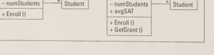

## 精简 UML

统一建模语言（UML）是一种表达力强的语言，能够清晰地定义程序中对象之间关系的许多方面。UML 的一个优点是，你可以忽略更具体的语言特性而不会完全失去其含义。

UML 最基本的功能描述如下：

- 类由垂直分为三个部分的框表示。类的名称出现在最上部分。
- 类的数据成员出现在中间部分，方法出现在底部。如果类没有数据成员或方法，或者你只想要一个高层次的仅类视图，可以省略中间或底部部分。
- 前面带加号 (+) 的成员是 public；前面带减号 (-) 的是 private。为了提供 protected 和 internal 可见性，大多数人分别使用井号（#——或者我应该说“sharp”号？——）和波浪号（~）。

私有成员只能从同一类的其他成员访问。公共成员可被所有类访问。参见第 5 章。

- 名称旁边的标签（abstract）表示抽象类或方法。

UML 对抽象方法使用不同的符号，但我保持简单。（这是精简 UML。）你也可以将抽象项仅以斜体显示。

- 两个类之间的箭头表示这两个类之间的关系。线上的数字表示基数——箭头两端可以拥有的项目数。星号（*）表示任意数量。如果没有数字，则基数默认为 1。因此可以看到一所大学有任意数量的学生——一对多关系（参见图 7-1）。
- 带有一个大开口箭头或三角形箭头的线表示 IS_A 关系（继承）。箭头指向类层次结构中的基类。其他类型的关系包括 HAS_A 关系（在拥有端带有实心菱形的线）。

要深入探索 UML，请阅读 Michael Jesse Chonoles 和 James A. Schardt 合著的《UML 2 For Dummies》。

A Car IS_A Vehicle but a Car HAS_A Motor.

高中和大学有若干相似属性——比你想象的要多得多（参见图 7-1）。两所学校都提供公开可用的 `Enroll()` 方法用于向学校添加 `Student` 对象。此外，两个类都提供一个私有成员 `numStudents`，表示就读于该学校的学生数量。另一个共同特征是学生之间的关系：一所学校可以有任意数量的学生——一个学生一次只能就读于一所学校。即使是高中和大多数大学提供的功能也比我描述的更多，但每种类型的成员各一个就足以说明问题。

除了高中的功能外，大学还包含一个方法 `GetGrant()` 和一个数据成员 `avgSAT`。高中没有 SAT 入学要求，也不接受联邦拨款（除非我去了错误的学校）。

图 7-1 在其范围内是可以接受的，但大量信息被重复，而代码（和 UML 图）中的重复是糟糕的。你可以通过允许更复杂的类 `University` 继承自更简单的 `HighSchool` 类来减少重复，如图 7-2 所示。

**Figure 7-2:** 继承 High School 简化了 University 类但引入了问题。

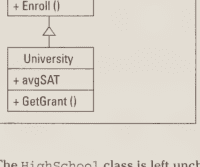

`HighSchool` 类保持不变，但 `University` 类更容易描述。你可以说“一个 University 是一个 HighSchool，同时还具有 avgSAT 和一个 GetGrant() 方法。”但这个方案有一个根本问题：大学并不是具有特殊属性的高中。

你说：“那又怎样？继承有效，而且节省精力。”确实如此，但我的保留意见不只是风格上的琐事。（我的保留意见在城里最好的餐馆——至少卡车司机们是这么说的。）这种类型的误导对程序员来说现在和将来都令人困惑。有一天，一个不熟悉你的编程技巧的程序员将不得不阅读并理解你的代码在做什么。误导性的表示很难调和和理解。

此外，这种类型的误导可能会导致日后出现问题。假设高中决定在舞会上评选一名“最受欢迎”学生——我可不知道那种事

Something. 聪明的程序员向 HighSchool 类添加了 NameFavorite() 方法，应用程序调用它来命名最喜欢的 Student 对象。

但现在你遇到了一个问题：大多数大学除了价格之外不会给任何东西命名为最喜欢的。然而，只要 University 继承自 HighSchool，它就会继承 NameFavorite() 方法。一个额外的 方法似乎可能不是什么大问题。“就忽略它吧，”你说。

一个额外的 方法不是什么大问题，但它只是混乱之墙中的又一块砖。额外的方法和属性会随着时间的推移而累积，直到 University 类背负着大量额外的包袱。可怜那些不得不理解哪些方法是“真实的”、哪些不是的软件开发人员。

“便利继承”会导致另一个问题。按目前的写法，图 7-2 暗示 University 和 HighSchool 具有相同的入学程序。尽管这个说法听起来不太可能，但假设它是真的。程序被开发、打包，然后发送给不明真相的公众——当然，我已嵌入了足够数量的 bug，这样他们就会想付费升级到包含所有错误修复的 2.0 版——当然是小额费用。

几个月过去了，学区才决定修改其入学程序。修改高中入学程序也会修改当地学院的报名程序，这一点对任何人都不是显而易见的。

如何避免这些问题？不去上学是一种方法，但另一种方法是解决问题的根源：大学并不是高中的一种特定类型。两者之间存在关系，但 IS_A 并不是合适的。 （HAS_A 也不行。大学 HAS_A 高中？高中 HAS_A 大学？来吧！）相反，高中和大学都是学校的一种特殊类型。这就是它们最共同的地方。

图 7-3 描述了一种更好的关系。新定义的类 School 包含两种学校类型的共同属性，包括它们与 Student 对象的共同关系。School 甚至包含共同的 Enroll() 方法，尽管它是抽象的，因为 HighSchool 和 University 通常不会以相同的方式实现 Enroll()。

类 HighSchool 和 University 现在继承自一个共同的基类。每个类包含其独特的成员：HighSchool 的情况是 NameFavorite()，University 的是 GetGrant()。此外，两个类都重写了 Enroll() 方法，使用描述该类型学校如何招收学生的版本。实际上，我们从两个相似的类中提取了一个超类或基类，而它们现在成为子类。

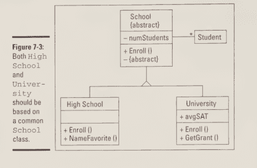

引入 `School` 类至少有两个很大的优势：

- **它与现实相符。** 一个 `University` 是 `School`，但它不是 `HighSchool`。与现实相符是好的，但并不能下结论。
- **它将一个类与另一个类的更改或添加隔离开来。** 当我的老板不可避免地要求我稍后为大学引入毕业典礼练习时，我可以将 `CommencementSpeech()` 方法添加到 `University` 类，而不会影响 `HighSchool`。

从相似类中剔除共同属性的过程被称为 *factoring*。面向对象语言的这一特性很重要，原因如本小书前面所述，再加上一个原因：减少冗余。让我再重复一遍：冗余是不好的。


只有当继承关系与现实相符时，Factoring 才是合理的。因为它们都是硬件指向设备，将类 `Mouse` 和 `Joystick` 归并在一起是合理的。因为它们都进行低级操作系统调用而将类 `Mouse` 和 `Display` 归并在一起则不是。

Factoring 可以并且通常会产生多层次的抽象。例如，为更完善的学校层次结构编写的程序可能具有更像图 7-4 所示的类结构。

你可以看到我在 `University` 和 `School` 之间插入了一对新类：`HigherLearning` 和 `LowerLevel`。例如，我已将新类 `HigherLearning` 细分为 `College` 和 `University`。这种多级类层次结构在提取关系时很常见且是可取的。它们与现实相符，并且有时可以教会你解决方案的微妙特征。

Figure 7-4:
类因子分解可以（并且通常会）导致继承层次结构的额外层级。

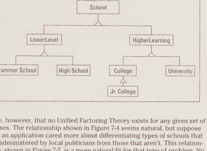

然而请注意，对于任何给定的一组类，都不存在统一的因子分解理论。图 7-4 所示的关系看起来很自然，但假设一个应用程序更关心区分由地方政客管理的学校类型与那些不是的学校类型。这种关系如图 7-5 所示，对于那种类型的问题来说更自然的契合。没有“正确”的因子分解：正确分解类的方式部分是被解决的问题的函数。

Figure 7-5:
分解类部分是被解决的问题的函数。

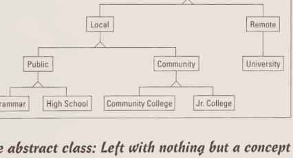

## 抽象类：除了概念一无所有

因子分解在智力上令人满意，但它本身引入了一个问题。访问（或重新访问）BankAccount，它是在本章开头介绍的。思考一下你如何定义 BankAccount 中定义的各种成员方法。

大多数 BankAccount 成员方法重构起来没有问题，因为两种账户类型都以相同的方式实现它们。你应该在 BankAccount 中实现这些共同方法。然而 Withdraw() 不同。 从储蓄账户取款的规则与从支票账户取款的规则不同。你必须以不同的方式实现 SavingsAccount.Withdraw() 和 CheckingAccount.Withdraw()。但是你该如何实现 BankAccount.Withdraw() 呢？

向银行经理求助。我想象这段对话是这样进行的：

> > “从一个账户取款的规则是什么？”你满怀期待地问道。
> > “哪种类型的账户？储蓄还是支票？”回复道。
> > “从一个账户，”你说。“只是一个账户。”
> > [空白的表情。]（你可能会说“空白的银行表情”。然后又可能不会。）

问题是这个问题没有意义。不存在“只是一个账户”这样的东西。所有账户（在此示例中）要么是支票账户，要么是储蓄账户。账户的概念是抽象的。它提取了两个具体类共有的属性。它是不完整的，因为它缺乏关键属性 Withdraw()。 （在你深入细节后，你可能会发现一个简单账户所缺乏的其他属性。）

BankAccount 的概念是抽象的。

### 如何使用抽象类？

抽象类用于描述抽象概念。

抽象类是一个具有一个或多个抽象方法的类。 （哦，太好了。这很有帮助。）好吧，抽象方法是一个标记为 abstract 的方法。 （我们现在在前进！）让我再试一次：抽象方法没有实现——现在你真的很困惑了。


考虑以下精简的演示程序：

```csharp
// AbstractInheritance -- The BankAccount class is abstract because
//    there is no single implementation for Withdraw.
namespace AbstractInheritance
{
    using System;
    // AbstractBaseClass -- Create an abstract base class with nothing
    //    but an Output() method. You can also say "public abstract."
    abstract public class AbstractBaseClass
    {
        // Output -- Abstract method that outputs a string
        abstract public void Output(string outputString);
    }
}
// SubClass1 -- One concrete implementation of AbstractBaseClass
public class SubClass1 : AbstractBaseClass
{
    override public void Output(string source) // Or 'public override'
    {
        string s = source.ToUpper();
        Console.WriteLine("Call to SubClass1.Output() from within {0}", s);
    }
}
// SubClass2 -- Another concrete implementation of AbstractBaseClass
public class SubClass2 : AbstractBaseClass
{
    public override void Output(string source) // Or 'override public'
    {
        string s = source.ToLower();
        Console.WriteLine("Call to SubClass2.Output() from within {0}", s);
    }
}
class Program
{
    public static void Test(AbstractBaseClass ba)
    {
        ba.Output("Test");
    }
    public static void Main(string[] strings)
    {
        // You can't create an AbstractBaseClass object because it's
        // abstract -- duh. C# generates a compile-time error if you
        // uncomment the following line.
        // AbstractBaseClass ba = new AbstractBaseClass();
        // Now repeat the experiment with SubClass1.
        Console.WriteLine("\nCreating a SubClass1 object");
        SubClass1 sc1 = new SubClass1();
        Test(sc1);
        // And, finally, a SubClass2 object
        Console.WriteLine("\nCreating a SubClass2 object");
        SubClass2 sc2 = new SubClass2();
        Test(sc2);
        // Wait for user to acknowledge.
        Console.WriteLine("\nPress Enter to terminate... ");
        Console.Read();
    }
}
```

该程序首先定义了类 AbstractBaseClass，其中包含一个单一的抽象 Output() 方法。因为它被声明为抽象，所以 Output() 没有实现——也就是说，没有方法体。

两个类继承自 AbstractBaseClass：SubClass1 和 SubClass2。两者都是具体类，因为它们使用“真实”的方法重写了 Output() 方法，并且本身不包含抽象方法。


> TIP
>
> 一个类可以在没有抽象成员的情况下被声明为抽象；然而，一个类只有在它之上的任何基类中的所有抽象方法都已用完整方法重写时才可以是具体的。


两个子类 Output() 方法的区别很微不足道：两者都接受输入字符串，并将其原样吐回给用户。然而，一个在输出前将字符串转换为全大写，另一个则将其转换为全小写字符。

以下来自此程序的输出演示了 AbstractBaseClass 的多态性：

```
Creating a SubClass1 object
Call to SubClass1.Output() from within TEST
Creating a SubClass2 object
Call to SubClass2.Output() from within test
Press Enter to terminate...
```

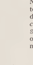

抽象方法自动是虚方法，因此你不需要对抽象方法添加 virtual 关键字。

## 创建抽象对象——不行！

注意 AbstractInheritance 程序中的一点：创建 AbstractBaseClass 对象是不合法的，但 Test() 的参数被声明为 AbstractBaseClass 类或其子类之一的对象。这里关键在于“子类”子句。SubClass1 和 SubClass2 对象可以被传递，因为每个都是 AbstractBaseClass 的具体子类。IS_A 关系适用。这种强大的技术让你能够编写高度通用的方法。

## 密封类

你可能会决定不希望未来的程序员能够扩展某个特定类。你可以使用 sealed 关键字来锁定该类。


密封类不能用作任何其他类的基类。

请考虑以下代码片段：

```
using System;
public class BankAccount
{
    // withdrawal -- You can withdraw any amount up to the
    //   balance; return the amount withdrawn
    virtual public void Withdraw(decimal withdrawal)
    {
        Console.WriteLine("invokes BankAccount.Withdraw()");
    }
}
public sealed class SavingsAccount : BankAccount
{
override public void Withdraw(decimal withdrawal)
{
    Console.WriteLine("invokes SavingsAccount.Withdraw()");
}
public class SpecialSaleAccount : SavingsAccount  // Oops!
{
    override public void Withdraw(decimal withdrawal)
    {
        Console.WriteLine("invokes SpecialSaleAccount.Withdraw()");
    }
}
```

此片段会生成以下编译器错误：

'SpecialSaleAccount' : cannot inherit from sealed class 'SavingsAccount'

你使用 sealed 关键字来保护你的类免受子类窥探的方法的影响。例如，允许程序员扩展实现系统安全性的类会使某人能够创建安全后门。

*密封* 类可防止另一程序（可能在互联网上的某个地方）使用你类的修改版本。远程程序可以按原样使用该类，也可以不使用，但它不能在覆盖其余部分的同时继承你类的部分内容。

## 第 8 章：与接口交互

### 本章内容

- 超出 IS_A 和 HAS_A：C# 接口
- 创建自己的接口或使用 .NET 提供的接口
- 使用接口统一独立的类层次结构
- 在接口后面隐藏类公共接口的一部分
- 管理软件变更——通过接口实现灵活性

一个类可以 *包含* 对另一个类的引用；这描述了简单的 HAS_A 关系。一个类可以通过继承的奇迹 *扩展* 另一个类——那就是 IS_A 关系。C# 接口实现了另一种同等重要的关联：CAN_BE_USED_AS 关系。

本章介绍 C# *接口*，并展示它们以多种方式增强面向对象编程的强大功能和灵活性的一些方法。

## 介绍 CAN_BE_USED_AS

如果你想记下笔记，你可以用笔潦草写下，输入到智能手机中，或在笔记本电脑键盘上敲出来。你可以合理地说，这三件物品——笔、智能手机和电脑——都实现了 TakeANote 操作。假设你使用继承的魔力在 C# 中实现这一概念：

```
~~~csharp
abstract class ThingsThatRecord      // The base class
{
    abstract public void TakeANote(string note);
}
public class Pen : ThingsThatRecord   // A subclass
{
    override public void TakeANote(string note)
    {
        // ... scribble a note with a pen ...
    }
}
~~~
```

```
public class PDA : ThingsThatRecord  // Another subclass
{
    override public void TakeANote(string note)
    {
        // ... stroke a note on the PDA ...
    }
}
public class LapTop : ThingsThatRecord  // A third subclass
{
    override public void TakeANote(string note)
    {
        // ... tap, tap, tap ...
    }
}
```


如果 abstract 这个术语让你困惑，请参阅本小书的第 7 章并阅读本章后面的讨论。如果继承的整个概念是个谜，请查看本小书的第 6 章。

以下简单方法显示继承方法工作得很好：

```
void RecordTask(ThingsThatRecord recorder) // Parameter type is base class.
{
    // All classes that extend ThingsThatRecord have a TakeANote method.
    recorder.TakeANote("Shopping list");
    // ... and so on.
}
```

参数类型是 ThingsThatRecord，因此你可以向此方法传递任何子类，使该方法相当通用。

这看起来似乎是个不错的解决方案，但它有两个很大的缺点：

- **一个根本性问题：** Pen、PDA 和 LapTop 真的具有 IS_A 关系吗？在现实生活中这三样东西都是同一种类型吗？我不这么认为，你呢？我只能说 ThingsThatRecord 在这里是个糟糕的基类。
- **一个纯粹的技术问题：** 你可以合理地将 LapTop 和 PDA 都派生为 Computer 的子类。但没有人会说 Pen IS_A Computer。你必须将笔描述为 MechanicalWritingDevice 或 DeviceThatStainsYourShirt 的一种类型。但 C# 类不能同时从两个不同的基类继承——C# 类只能是一种类型的项目。

因此，Pen、PDA 和 LapTop 类唯一共同的特点是它们 CAN_BE_USED_AS 记录设备。继承不适用。

## 了解接口是什么

C# 中的接口类似于一个没有数据成员且只有抽象方法的类，几乎像抽象类——几乎如此：

```
interface IRecordable
{
    void TakeANote(string note);
}
```

接口以 interface 关键字开头。它只包含抽象方法。它没有数据成员，也没有已实现的方法。

接口可以包含一些其他特性，包括属性（在本小书第 5 章中介绍）、事件（在本小书第 9 章中介绍）以及索引器（在 Book I 末尾介绍）。

C# 接口不能具有的元素包括

- 访问说明符，例如 public 或 private（参见本小书第 5 章）
- 关键字如 virtual、override 或 abstract（参见本小书第 7 章）
- 数据成员（参见本小书第 2 章）
- 已实现的方法——带有方法体的非抽象方法

C# 接口的所有成员都是 public（在定义接口方法时甚至不能提及访问说明符），并且 C# 接口不参与正常的继承；因此，它没有这些关键字。（接口本身可以是 public、protected、internal 或 private。）

与抽象类不同，C# 接口不是一个类。它不能被子类化，并且它包含的方法都不能有方法体。

## 如何实现接口

要使用 C# 接口，你需要用一个或多个类来实现它。类头看起来像这样：

```
class Pen : IRecordable // Looks like inheritance, but isn't
```

C# 接口规定实现该接口的类必须提供特定的实现。必须如此。例如，任何实现 IRecordable 接口的类都必须为 TakeANote 方法提供实现。实现 TakeANote 的方法不使用 override 关键字。使用接口不像在类中重写虚方法。


The class Pen might look like this:

```csharp
class Pen : IRecordable
{
    public void TakeANote(string note)    // Interface method implementations
    {                                     // MUST be declared public.
        // ... scribble a note with a pen ...
    }
}
```

This example fulfills two requirements: Note that the class implements IRecordable and provides a method implementation for TakeANote().

The syntax indicating that a class inherits a base class, such as ThingsThatRecord, is essentially no different from the syntax indicating that the class implements a C# interface such as IRecordable:

```csharp
public class PDA : ThingsThatRecord ...
public class PDA : IRecordable ...
```


Visual Studio can help you implement an interface. Hover the mouse pointer over the interface name in the class heading. A little underline appears underneath the first character of the interface name. Move the mouse until a menu opens and choose `Implement Interface <name>`. Presto! A skeleton framework appears — you fill in the details.

### How to name your interface

The .NET naming convention for interfaces precedes the name with the letter I. Interface names are typically adjectives, such as IRecordable.


### Why C# includes interfaces

The bottom line of interfaces is that an interface describes a capability, such as Swim Safety Training or Class A Driver's License. As a class, I earn my IRecordable badge when I implement the TakeANote ability.

More than that, an interface is a contract. If you agree to implement every method defined in the interface, you get to claim its capability. Not only that, but a client using your class in her program is guaranteed to be able to call those methods. Implementing an interface is a promise — enforced by the compiler. (Enforcing promises through the compiler reduces errors.)

### Mixing inheritance and interface implementation

Unlike some languages, such as C++, C# doesn't allow multiple inheritance — a class inheriting from two or more base classes. Think of class HouseBoat inheriting from House and Boat. Just don't think of it in C#.

### As the base type of an array or collection

Suppose that you have two classes, Animal and Robot, and that both are abstract. You want to set up an array to hold both thisCat (an Animal) and thatRobot (a cute droid). The only way is to fall back on type Object, the ultimate base class in C#, and the only base class that's common to both Animal and Robot as well as to their subclasses:

```csharp
object[] things = new object[] { thisCat, thatRobot };
```

That's poor design for lots of reasons. But suppose that you're focused on the objects' movements. You can have each class implement an IMovable interface:

```csharp
interface IMovable
{
    void Move(int direction, int speed, int distance);
}
```

and then set up an array of IMovables to manipulate your otherwise incompatible objects:

```csharp
IMovable[] movables = { thisCat, thatRobot };
```

The interface gives you a commonality that you can exploit in collections.

### As a more general type of object reference

The following variable declaration refers to a specific, physical, concrete object (see the later section “Abstract or concrete: When to use an abstract class and when to use an interface”):

```csharp
Cat thisCat = new Cat();
```

One alternative is to use a C# interface for the reference:

```csharp
IMovable thisMovableCat = (IMovable)new Cat(); // Note the required cast,
```

Now you can put any object into the variable that implements IMovable. This practice has wide, powerful uses in object-oriented programming, as you can see later in this chapter.

## Using the C# Predefined Interface Types

Because interfaces are extremely useful, you find more interfaces in the .NET class library than gun racks at an NRA convention. I counted dozens in Help before I got tired and stopped. Among the dozen or more interfaces in the System namespace alone are IComparable, `IComparable<T>`, IDisposable, and IFormattable. The System.Collections.Generic namespace includes `IEnumerable<T>`, `IList<T>`, `ICollection<T>`, and `IDictionary<TKey, TValue>`. And there are many more. Those with the `<T>` notation are generic interfaces. I explain the `<T>` notation in the discussion of collection classes in Book I, Chapter 6.

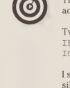

The Help files show all the `ISomething<T>` types with little tick marks added (``IList`1``), but look for "`IList<T>`" in the Help index.

Two interfaces that are commonly used are IComparable and IEnumerable — largely superseded now by their generic versions `IComparable<T>` (read as "IComparable of T") and `IEnumerable<T>`.

I show you the `IComparable<T>` interface in this chapter. It makes possible a comparison of all sorts of objects, such as Students, to each other, and enables the `Sort()` method that all arrays and most collections supply. `IEnumerable<T>` makes the powerful foreach loop work — most collections implement `IEnumerable<T>`, so you can iterate the collections with foreach. You can find an additional major use for `IEnumerable<T>` in Book I, as the basis for the new C# 3.0 query expressions.

## Looking at a Program That Can Be Used As an Example

The following SortInterface program is a special offer. The capabilities brought to you by two different interfaces cannot be matched in any inheritance relationship. Interface implementations are standing by.

However, I want to break the SortInterface program into sections to demonstrate various principles. (Pfft! As though I have any principles. I just want to make sure that you can see exactly how the program works.)

### Creating your own interface at home in your spare time

The following IDisplayable interface is satisfied by any class that contains a Display() method (and declares that it implements IDisplayable, of course). Display() returns a string representation of the object that can be displayed using WriteLine().

```csharp
// IDisplayable -- Any object that implements the Display() method
interface IDisplayable
{
    // Return a description of yourself.
    string Display();
}
```

The following Student class implements IDisplayable:

```csharp
class Student : IDisplayable
{
    public Student(string name, double grade)
    { Name = name; Grade = grade; }
    public string Name { get; private set; }
    public double Grade { get; private set; }
    public string Display()
    {
        string padName = Name.PadRight(9);
        return String.Format("{0,-10} {1:N0}", padName, Grade);
    }
}
```

Display() uses String's PadRight() and Format() methods, covered in Book I, Chapter 3, to return a neatly formatted string.

The following DisplayArray() method takes an array of any objects that implement the IDisplayable interface. Each of those objects is guaranteed (by the interface) to have its own Display() method (the entire program appears in the later section “Putting it all together”):

```csharp
// DisplayArray -- Display an array of objects that implement
// the IDisplayable interface.
public static void DisplayArray(IDisplayable[] displayables)
{
    foreach(IDisplayable disp in displayables)
    {
        Console.WriteLine("{0}", disp.Display());
    }
}
```

The following example shows the output from DisplayArray():

```
Homer  : 0
Marge  : 85
Bart   : 50
Lisa   : 100
Maggie : 30
```

### Implementing the incomparable `IComparable<T>` interface

C# defines the interface `IComparable<T>` this way:

```csharp
interface IComparable<T>
{
    // Compare the current T object to the object 'item'; return a
    // 1 if larger, -1 if smaller, and 0 if the same.
    int CompareTo(T item);
}
```

A class implements the `IComparable<T>` interface by implementing a `CompareTo()` method. Notice that `CompareTo()` takes an argument of type `T`, a type you supply when you instantiate the interface for a particular data type — as in this example:

```csharp
class SoAndSo : IComparable<SoAndSo>  // Make me comparable.
```

When you implement `IComparable<T>` for your class, its `CompareTo()` method should return 0 if the two items (of your class type) being compared are "equal" in a way that you define. If not, it should return 1 or -1, depending on which object is "greater."

It seems a little Darwinian, but you could say that one `Student` object is "greater than" another `Student` object if his grade-point average is higher. (Okay, either a better student or a better apple-polisher — it doesn't matter.)

Implementing the `CompareTo()` method implies that the objects have a sorting order. If one student is "greater than" another, you must be able to sort the students from "least" to "greatest." In fact, most collection classes (including arrays but not dictionaries) supply a `Sort()` method something like this:

```csharp
void Sort(IComparable<T>[] objects);
```

This method sorts a collection of objects that implement the `IComparable<T>` interface. It doesn't even matter which class the objects belong to. For example, they could even be `Student` objects. Collection classes such as arrays or `List<T>` could even sort this version of `Student`:

```csharp
// Student -- Description of a student with name and grade
class Student : IComparable<Student>, IDisplayable   // Instantiation
{
    // Constructor -- initialise a new student object.
    public Student(double grade)
    {
        Grade = grade;
    }
    public double Grade { get; private set; }
    // Implement the IComparable<T> interface:
    // CompareTo -- Compare another object (in this case, Student objects) and
    //    decide which one comes after the other in the sorted array.
    public int CompareTo(Student rightStudent)
    {
        // Compare the current Student (call her 'left') against the other
        // student (call her 'right').
        Student leftStudent = this;

        // Now generate a -1, 0 or 1 based on the Sort criteria (the student's
        // grade). I could use class Double's CompareTo() method instead).
        if (rightStudent.Grade < leftStudent.Grade)
        {
            return -1;
        }
    }
}
```


```
if (rightStudent.Grade > leftStudent.Grade)
{
    return 1;
}
return 0;
}
```

对 Students 数组进行排序简化为这一个调用：

```
void MyMethod(Student[] students) // Where Student implements IComparable<T>
{
    Array.Sort(students); // Sort array of IComparable<Student>s
}
```

你提供比较器（CompareTo()），Array 完成所有工作——听起来很公平。

## 把它全部整合起来

这就是你一直在等待的时刻：完整的 SortInterface 程序，它使用了本章前面描述的功能：

// SortInterface -- Demonstrates how the interface concept can be used
// to provide an enhanced degree of flexibility in factoring
// and implementing classes.
using System;
namespace SortInterface
{
    // IDisplayable -- An object that can convert itself into a displayable
    // string format (duplicates what you can do by overriding
    // ToString()), but helps me make a point)
    interface IDisplayable
    {
        // Display -- return a string representation of yourself.
        string Display();
    }
    class Program
    {
        public static void Main(string[] args)
        {
            // Sort students by grade...
            Console.WriteLine("Sorting the list of students");
            // Get an unsorted array of students
            Student[] students = Student.CreateStudentList();
            // Use the IComparable<T> interface to sort the array.
            Array.Sort(students);
            // Now use the IDisplayable interface to display the results
            DisplayArray(students);

            // Now sort an array of birds by name using the same routines even
            // though the classes Bird and Student have no common base class.
            Console.WriteLine("Sorting the list of birds");
            Bird[] birds = Bird.CreateBirdList();
            // Notice that it is not necessary to cast the objects explicitly
            // to an array of IDisplayables (and wasn't for Students, either) ...
```


```
Array.Sort(birds);
DisplayArray(birds);
// Wait for user to acknowledge the results.
Console.WriteLine("Press Enter to terminate...");
Console.Read();
}
// DisplayArray -- Display an array of objects that
// implement the IDisplayable interface.
public static void DisplayArray(IDisplayable[] displayables)
{
foreach(IDisplayable displayable in displayables)
Console.WriteLine("{0}", displayable.Display());
}
}
// ------------ Students -- Sort students by grade ------
// Student -- Description of a student with name and grade
class Student : IComparable<Student>, IDisplayable
{
// Constructor -- Initialize a new student object.
public Student(string name, double grade)
{ Name = name; Grade = grade; }
// CreateStudentList -- To save space here, just create
// a fixed list of students.
static string[] names = {"Homer", "Marge", "Bart", "Lisa", "Maggie"};
static double[] grades = {0, 85, 50, 100, 30};
public static Student[] CreateStudentList()
{
Student[] students = new Student[names.Length];
for (int i = 0; i < names.Length; i++)
{
students[i] = new Student(names[i], grades[i]);
}
return students;
}
// Access read-only properties.
public string Name { get; private set; }
public double Grade { get; private set; }
// Implement the IComparable interface:
// CompareTo -- Compare another object (in this case, Student objects)
// and decide which one comes after the other in the sorted array.
public int CompareTo(Student rightStudent)
{ // Compare the current Student (call her 'left')
// the other student (call her 'right').
Student leftStudent = this;
// Now generate a -1, 0 or 1 based on the Sort criteria (the student's
// grade). Double's CompareTo method would work, too.
if (rightStudent.Grade < leftStudent.Grade)
{
return -1;
}
if (rightStudent.Grade > leftStudent.Grade)
{
return 1;
}
return 0;
}
// Display -- Implement the IDisplayable Interface:
```

```
public string Display()
{
    string padName = Name.PadRight(9);
    return String.Format("{0}: {1:N0}", padName, Grade);
}
// --------Birds -- Sort birds by their names--------
// Bird -- Just an array of bird names
class Bird : IComparable<Bird>, IDisplayable
{
    // Constructor -- initialize a new Bird object.
    public Bird(string name) { Name = name; }
    // CreateBirdList -- Return a list of birds to the caller.
    // Use a canned list here to save space.
    static string[] birdNames =
        {"Oriole", "Hawk", "Robin", "Cardinal", "Bluejay", "Finch", "Sparrow"};
    public static Bird[] CreateBirdList()
    {
        Bird[] birds = new Bird[birdNames.Length];
        for(int i = 0; i < birds.Length; i++)
        {
            birds[i] = new Bird(birdNames[i]);
        }
        return birds;
    }
    public string Name { get; private set; }
    // Implement the IComparable interface:
    // CompareTo -- Compare the birds by name; use the
    // built-in String class compare method.
    public int CompareTo(Bird rightBird)
    {
        // Compare the "current" bird to the "right hand object" bird.
        Bird leftBird = this;
        return String.Compare(leftBird.Name, rightBird.Name);
    }
    // Display -- Implement the IDisplayable interface.
    public string Display() { return Name; }
}
```

Student 类（它位于程序列表中间）实现了 IComparable<T> 和 IDisplayable 接口，如前面所述。CompareTo() 方法通过成绩比较学生，这导致学生按成绩排序。Student 的 Display() 方法返回学生的姓名和成绩。

Student 的其他方法包括只读的 Name 和 Grade 属性、一个简单的构造函数以及 CreateStudentList() 方法。此方法只是为代码工作返回一个固定的学生列表。

列表底部的 Bird 类也实现了接口 IComparable<T> 和 IDisplayable。该类通过使用 String.Compare() 比较鸟的名字来实现 CompareTo()。因此，如果一只鸟的名字更大，则它大于另一只鸟。Bird.CompareTo() 对列表进行字母排序。Bird 的 Display() 方法仅返回鸟的名字。

## 回到 Main() 事件

如果你到目前为止一直跟着我们走，那么你已经准备好进入好玩的部分，回到了 Main()。CreateStudentList() 方法用于返回一个未排序的列表，该列表存储在 students 数组中。

你可能会认为有必要将 students 数组强制转换为 comparableObjects 数组，以便将其传递给 Array 的 Sort() 方法：

```
IComparable<Student>[] comparables = (IComparable<Student>[])students;
```

但并非如此，我的朋友。Sort() 会看到传入的数组由实现了 IComparable<something> 的对象组成，并简单地对每个 Student 对象调用 CompareTo() 来对它们进行排序。棒极了，对吧？

然后排序后的 Student 对象数组被传递给本地定义的 DisplayArray() 方法。DisplayArray() 使用 foreach 遍历实现了 Display() 方法的对象数组（由对象实现了 IDisplayable 保证）。在循环中，它对每个对象调用 Display() 并使用 WriteLine() 将结果显示到控制台。

Main() 中的程序继续对鸟进行排序和显示！我想我们可以同意鸟与学生无关。然而，相同的 Sort() 和 DisplayArray() 方法对 Bird 和 Student 都适用。

程序的输出如下：

```
Sorting the list of students
Lisa : 100
Marge : 85
Bart : 50
Maggie : 30
Homer : 0

Sorting the list of birds
Bluejay
Cardinal
Finch
Hawk
Oriole
Robin
Sparrow
Press Enter to terminate...
```

## 统一类层次结构

图 8-1 显示了 Robot 和 Animal 层次结构。每个层次结构中的一些类（但不是全部）不仅继承自基类 Robot 或 Animal，而且还实现了 IPet 接口（并非所有动物都是宠物，你知道的），如下面的代码所示——我省略了很多细节：

// Two abstract base classes and one interface
abstract class Animal
{
    abstract public void Eat(string food);
    abstract public void Sleep(int hours);
    abstract public int NumberOfLegs { get; }
    public void Breathe() { ... } // Nonabstract, implementation not shown.
}
abstract class Robot
{
    public virtual void Speak(string whatToSay) { ... } // Impl not shown
    abstract public void LiftObject(object o);
    abstract public int NumberOfLegs { get; }
}
interface IPet
{
    void AskForStrokes();
    void DoTricks();
    int NumberOfLegs { get; } // Properties in interfaces look like this.
    string Name { get; set; } // get/set must be public in implementations.
}
// Cat -- This concrete class inherits (and partially implements)
// class Animal and also implements interface IPet.
class Cat : Animal, IPet
{
    public Cat(string name) { Name = name; }
    // 1. Overrides and implements Animal members (not shown).
    // 2. Provides additional implementation for IPet.
    #region IPet Members
    public void AskForStrokes() ...
    public void DoTricks() ...
    public string Name { get; set; }
    // Inherits NumberOfLegs property from base class, thus meeting
    // IPet's requirement for a NumberOfLegs property.
    #endregion IPet Members
    public override string ToString() { return Name; }
}
class Cobra : Animal
{
    // 1. Inherits or overrides all Animal methods only (not shown).
}
class Robozilla : Robot    // Not IPet
{
    // 1. Override Speak.
    public override void Speak(string whatToSay)
    { Console.WriteLine("DESTROY ALL HUMANS!"); }
    // 2. Implement LiftObject and NumberOfLegs, not all shown.
    public override void LiftObject(object o) ...
    public override int NumberOfLegs { get { return 2; } }
}
class RoboCat : Robot, IPet
{
    public RoboCat(string name) { Name = name; }
    // 1. Override some Robot members, not all shown:
    #region IPet Members
    public void AskForStrokes() ...
    public void DoTricks() ...
    public string Name { get; set; }
    #endregion IPet Members
}

（注意 IPet 中的属性——这就是在接口中指定属性的方式。如果你同时需要 getter 和 setter，只需在 get; 后面加上 set;。)

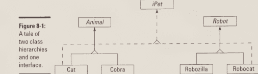

我已经向你展示了两个继承自 Animal 的具体类，以及两个继承自 Robot 的具体类。然而，你可以看到，Cobra 类和 Robozilla 类都没有实现 IPet——这大概是有充分理由的。我可不想让我的宠物眼镜蛇趴在沙发上陪我看电视，而机器哥斯拉听起来也很糟糕。这两个层次结构中的部分类表现出了你可能称之为“宠物性”的特征，而另一些则没有。

### 网络资源

本书网站上的 InterfacesBridgingHierarchies 示例对这些内容进行了实际检验。

### 技术细节

本节的重点是，任何类都可以实现接口，只要它提供了正确的方法和属性。Robotcat 和 Robotdog 可以执行 AskForStrokes() 和 DoTricks() 操作，并拥有 NumberOfLegs 属性，Animal 层次结构中的 Cat 和 Dog 也可以——而同样的层次结构中的其他类则没有实现 IPet。

你可以为任何类添加对接口的支持——但前提是你能够自由修改源代码。

## 隐藏在接口后面

在本书中，我经常讨论这样的代码：(a) 你编写的，但 (b) 其他人（客户）在她的程序中使用（当然，你自己也可能是那个客户）。有时，你有一个复杂或棘手的类，你真的不想向客户暴露整个公共接口。由于各种原因，它包含一些危险的操作，但这些操作又必须是公共的。理想情况下，你会暴露类中公共方法和属性的一个安全子集，而隐藏那些危险的。C# 接口也能做到这一点。


程序员（我想我能猜到是谁）可以用一个简单的强制转换来破解我的小计谋：

```csharp
Robozilla myZillaZilla = (Robozilla)myZilla;
```

不过，这样做通常是个坏主意。接口是有其用途的。Bill Wagner 说过：“费那么大劲去制造 bug 的程序员，后果自负。”

在现实生活中，程序员有时会将这种“发放接口”的技术用于 ADO.NET 中与数据库交互的复杂 DataSet 类。DataSet 可以返回一组装满记录的数据库表——例如一张 Customers 表和一张 Orders 表。（现代关系数据库，如 Oracle 和 SQL Server，包含通过各种关系链接的表。每张表包含大量记录，其中每条记录可能是，例如，一个 Customer 的姓名、级别和序列号。）

不幸的是，如果你将一个 DataSet 引用交给客户（即使是通过只读属性的 get 子句），他可以很容易地通过深入 DataSet 并修改你不希望被修改的元素来把局面搞糟。防止这种破坏的方法之一是返回一个只读的 DataView 对象。或者，你可以创建一个 C# 接口，以公开 DataSet 上可用操作的安全子集。然后你可以对 DataSet 进行子类化，并让该子类（称之为 MyDataSet）实现该接口。最后，给客户一种途径，让他们获得一个活动 MyDataSet 对象的接口引用，并通过接口让他们在相对安全的前提下使用它。


你通常也不应该返回集合的引用，因为这样会让任何人在创建该集合的类之外修改它。请记住，你给出的引用仍然可以指向你类内部的原始集合。这就是为什么 `List<T>` 之类的类提供了 `AsReadOnly()` 方法。该方法返回一个无法被修改的集合：

```csharp
private List<string> _readWriteNames = ...; // A modifiable data member
ReadOnlyCollection<string> readonlyNames = _readWriteNames.AsReadOnly();
return readonlyNames; // Safer to return this than _readWriteNames.
```

尽管这算不上是使用接口，但其目的是相同的。


本书网站上的 HidingBehindAnInterface 示例展示了本节中的 Robozilla 代码。

## 继承接口

C# 接口可以“继承”另一个接口的方法。我在“继承”这个词上加引号，是因为无论看起来如何，这都不是真正的继承。下面的接口代码在其标题中列出了一个基础接口，就像基类一样。

```csharp
interface IRobozillaSafe : IPet  // Base interface
{
    // Methods not shown here ...
}
```

通过让 IRobozillaSafe “继承” IPet，你可以让 Robozilla 的这个子集实现自己的“宠物性”，而不会不恰当地将宠物性强加给整个 Robozilla：

```csharp
class PetRobo : Robozilla, IRobozillaSafe // (also an IPet by inheritance)
{
    // Implement Robozilla operations.
    // Implement IRobozillaSafe operations, then ...
    // Implement IPet operations too (required by the inherited IPet interface).
}
// ...
// Hand out only a safe reference, not one to PetRobo itself.
IPet myPetRobo = (IPet)new PetRobo();
// ... now call IPet methods on the object.
```

IRobozillaSafe 接口继承自 IPet。因此，实现 IRobozillaSafe 的类也必须实现 IPet，以使其对 IRobozillaSafe 的实现完整。

这种类型的继承与类继承并不是同一个概念。例如，前面例子中的 PetRobo 类可以有一个构造函数，但 IRobozillaSafe 或 IPet 并不存在与基类构造函数等价的东西。接口没有构造函数。更重要的是，多态性在接口上的工作方式并不相同。虽然你可以通过基类的引用调用子类的方法（类多态），但涉及接口的类似操作（接口多态）却行不通：你不能通过基础接口引用（IPet）调用派生接口（IRobozillaSafe）的方法。

尽管接口继承在多态性上不同于类继承，但你仍然可以将派生接口类型（IRobozillaSafe）的对象作为其基础接口类型（IPet）的参数传递。因此，你也可以将 IRobozillaSafe 对象放入 IPet 对象的集合中。本书网站上的 PassInterface 示例演示了本节中的这些概念。


## 运用接口管理
面向对象程序中的变化

接口是面向对象程序灵活应对变化的关键。你的代码将在新需求面前从容不迫。


你无疑听说过：“变化是永恒的。”当你把一个新程序交给一群用户时，他们很快就会开始提出更改要求。请添加这个功能。请修复那个问题。RoboWarrior 有 X 特性，为什么 Robozilla 没有？许多程序都有很长的使用寿命——成千上万的程序，尤其是古老的 Fortran 和 Cobol 程序，已经服役了 20 年、30 年甚至更久。在如此漫长的时间跨度里，它们要经历大量的维护工作，*这使得规划和设计以适应变化成为你最优先的任务之一。*

下面是一个例子：在 Robot 类层次结构中，假设所有机器人都能以某种方式移动。Robocat *闲庭信步*，Robozilla *冲锋陷阵*——至少当由一位充满能量（且饥渴）的用户操作时是这样。而Robosnake *蜿蜒滑行*。实现这些不同移动方式的一种方法是使用继承：给基类 Robot 一个抽象的 Move() 方法。然后每个子类重写 Move() 方法，以不同的方式实现它。

```
abstract public class Robot
{
  abstract public void Move(int direction, int speed);
  // ...
}
public class Robosnake : Robot
{
  public override void Move(int direction, int speed)
  {
    // 这里是一个真正的 Move() 实现：滑行。
    ... some real code that computes angles and changes
    snake's location relative to a coordinate system, say ...
  }
}
```

但假设你经常收到请求，要求为现有的 Robot 子类添加新的移动方式。“请让 Robosnake *起伏蠕动*而不是*蜿蜒滑行*，”也许吧。（别问我两者有什么区别。）现在你不得不打开 Robosnake 类，直接修改它的 Move() 方法。


当 Move() 方法已经能正确实现*滑行*后，大多数程序员都不愿再去改动它。实现滑行很困难，而修改实现可能会引入全新的 bug。如果东西没坏，就不要去修它。


刚才给出的代码就说明了这个问题。本书网站上的 StrategyExample 程序则展示了解决方案，将在接下来的几节中讨论。该解决方案的优势在于，它既能让旧的滑行代码在某些应用中继续发挥作用，又能为更新的应用提供新的起伏移动方式。皆大欢喜。

## 通过接口建立灵活的依赖关系

一定有一种实现 Move() 的方法，不必每次客户想要*蠕虫式移动*时都让你捅马蜂窝。当然，你可以使用接口！

看看下面这段使用 HAS_A 关系的代码。HAS_A 是类之间一种熟悉的、一个类包含另一个类的关系：

```
public class Robot
{
    // 这个对象用于实现运动。
    protected Motor _motor = new Motor(); // 按名称引用 Motor
    // ...
}
internal class Motor { ... }
```

这个例子的要点在于，被包含的对象类型是 Motor，而 Motor 是一个具体对象。（也就是说，它表示一个真实的事物，而非抽象概念。）HAS_A 在 Robot 和 Motor 两个类之间建立了一种依赖关系：Robot 依赖于具体的 Motor 类。一个具有具体依赖关系的类与这些依赖紧密耦合：当你需要用其他东西替换 Motor 时，像这样直接依赖 Motor 的代码也不得不随之更改。相反，你应该只依赖依赖项的公共接口，从而将代码隔离起来，而接口正是实现这一点的工具。你可以以一种——呃——不那么依赖的方式来依赖被依赖的对象。

要依赖抽象，而不是具体类。我来教你如何做到这一点。


## 抽象还是具体：何时使用抽象类，何时使用接口

在本书第 7 章关于鸟类的简短论述中，我说过：“每一种鸟都是 Bird 的子类型。”换句话说，鸭子是 Duck 子类的一个实例。你永远看不到 Bird 本身的实例——Bird 是一个抽象。相反，你看到的总是具体的、有形的鸭子、麻雀或蜂鸟。抽象是概念。作为生物，鸭子是真实的、具体的对象。而具体对象是具体类的实例。（具体类是可以实例化的类。它没有 abstract 关键字，并且实现了所有方法。）


在 C# 中，你可以用两种方式表示抽象：抽象类或 C# 接口。两者之间存在差异，这些差异会影响你选择使用哪一种：

- **当你能够有效地与子类共享实现时，使用抽象类**——抽象基类可以提供真实的代码，供其子类通过继承来使用。例如，也许 `Robot` 类可以处理机器人任务的一部分，只是不包括移动。

  抽象类不必是完全抽象的。虽然它至少必须有一个抽象且未实现的方法或属性，但有些抽象类也可以提供实现（方法体）。使用抽象类为子类提供可供继承的实现，可以避免代码重复。这总是一件好事。
- **当你无法共享任何实现，或者你的实现类已经有一个基类时，使用接口**

  C# 接口是纯粹、完全抽象的。C# 接口不提供其任何方法的实现。然而，它也能增加其他方式无法实现的灵活性。抽象类的选项可能不可用，因为你希望为已经有一个基类（且你无法修改该基类）的类添加能力。例如，`Robot` 类可能已经有一个基类，这个基类位于一个并非你编写、因此你也无法修改的库中。接口尤其有助于表示完全抽象的能力，比如可移动性或可显示性，这些能力你希望添加到多个可能除此之外毫无共同点的类上——例如，它们不在同一个类层次结构中。

## 使用接口实现 HAS_A

我在本章前面提到过，你可以将接口用作更通用的引用类型。包含类可以不用对具体类的引用来引用被包含类，而是用对抽象（抽象类或 C# 接口均可）的引用来实现：

```
AbstractDependentClass dependency1 = ...;
ISomeInterface dependency2 = ...;
```

假设你有一个 IPropulsion 接口：

```
interface IPropulsion
{
    void Movement(int direction, int speed);
}
```

类 Robot 可以包含一个 IPropulsion 类型的数据成员，而不是具体的 Motor 类型：

```
public class Robot
{
    private IPropulsion _propel;    //<--注意这里的接口类型。
    // 在运行时以某种方式提供具体推进对象 ...
    // 其他内容，然后：
    public void Move(int speed, int direction)
    {
        // 使用安装到 _propel 中的任何具体推进设备。
        _propel.Movement(speed, direction); // 将工作委托给其方法。
    }
}
```

Robot 的 Move() 方法将实际工作委托给通过接口引用的对象。务必提供一种方式，将具体的 Motor、Engine 或其他实现 IPropulsion 的对象安装到该数据成员中。程序员通常通过将其传递给构造函数来安装该具体对象——“注入依赖”：

```
Robot r = new Robot(someConcreteMotor);   // 类型为 IPropulsion
```

或者通过 setter 属性来赋值：

```
r.PropulsionDevice = someConcreteMotor;      // 调用 set 子句
```

另一种依赖注入的方法是使用*工厂方法*（我在本章前面的“作为方法返回类型”一节中讨论过，并在“隐藏在接口背后”一节中进行了说明）：

```
IPropulsion _propel = CreatePropulsion();    // 一个工厂方法
```


该回调方法可能与耗时操作位于同一个类中——比如给在房子另一边的姐姐打电话。或者，更常见的情况是，它位于另一个知道进度条的类中——比如打电话给明尼苏达州的玛克辛姨妈。无论如何，在耗时操作开始时，它就被赋予了一种“打电话回家”的机制——有点像给你家孩子一部手机，让她能在晚上10点给你打电话。

本章讨论你的代码如何建立这种回调机制，并在需要时调用它以“打电话回家”。


**记住**

回调在Windows编程中使用广泛，通常是程序内部深处的某段代码，用于通知更高级别的模块任务已完成、请求所需数据，或让该模块采取有用的操作，例如写入日志条目或更新进度条。

**图9-1：** 使用Windows进度条控件显示进度。


## 定义委托

C# 提供了用于回调的*委托（delegates）*——以及其他许多任务。委托是C#（实际上是.NET，因为任何.NET语言都能使用它们）让你*像传递数据一样传递方法*的方式。

你是在说：“喏，当你需要时就执行这个方法”（然后把要执行的方法传过去）。

本章帮助你掌握这一概念，了解它的用途，并开始自己使用它。

你可能是经验丰富的程序员，立刻就能看出委托类似于C/C++函数指针——但要好得多。不过在本节中，我假设你并非如此。

可以把委托看作一种载体，用于将回调方法传递给需要调用你或需要帮助完成该操作的“主方法”，比如对集合中的每个元素执行相同操作。因为

## 中国社科院大学硕士研究生入学考试

考试科目：法律史

2022年

## 一、名词解释（每题5分，共30分）

- 1. 成文法
- 2. 五听
- 3. 物权
- 4. 春秋决狱
- 5. 大宗正
- 6. 格

## 二、简答题（每题10分，共30分）

- 1. 简述汉文帝刑制改革的内容和意义。
- 2. 简述《中华民国临时约法》的主要内容。
- 3. 简述《德国民法典》的体例结构和特点。

## 三、论述题（每题20分，共40分）

- 1. 论唐律的基本内容和历史地位。
- 2. 试论罗马法对后世的影响。


实际上，委托是一个类，派生自 System.MulticastDelegate 类，它知道如何存储一个或多个方法的“指针”并为你调用它们。别紧张：编译器会为你编写类的部分。

2. 创建委托类型的实例——就像实例化类一样。创建时，你将希望用作回调或操作方法的方法名交给新的委托实例。

3. 将委托实例传递给一个主方法，该方法具有委托类型的参数。这就是你将委托实例插入主方法的门户。

这就像把糖果条偷偷带进电影院——只不过在这个例子中，电影院期待甚至欢迎这种违禁糖果。

4. 当主方法准备好时——例如到了更新进度条的时候——主方法会“调用”委托，并向它传递任何期望的参数。

5. 调用委托反过来会调用委托“指向”的回调方法。通过委托，主方法“打电话回家”。（年长一些的读者可能记得《Ed先生》：“马就是马……”）

这一基本机制解决了回调问题——而且还有其他用途。


委托类型也可以是泛型的，允许你将同一委托用于不同的数据类型，就像你可以为 string 或 int 实例化 List<T> 集合一样。第一册详细介绍了这一点。

## 请把代码给我——示例

让我们直接看几个示例——并解决本章开头讨论的回调问题。

## 1 我把示例交给了Igor

在本节中，我将带你浏览两个使用回调的示例——一个委托实例像E.T.那样给创建它的对象“打电话回家”。但首先，让我们看看可以使用回调委托的一些常见变体：

- 通知委托的大本营某个事件：耗时操作已完成、取得了一些进展或可能遇上了错误。“妈妈，我是E.T.，你能来埃利奥特家接我吗？”
- 回调大本营以请求完成任务所需的数据：“亲爱的，我在商店里。我该买白面包还是小麦面包？”


更一般地，用于自定义方法：你正在自定义的方法提供了一个框架，而它的调用者提供一个委托来完成工作。“亲爱的，拿这张购物清单去商店，严格按照清单采购。”委托方法执行自定义方法需要完成（但自己无法处理）的任务。自定义方法负责在适当的时刻调用委托。

## 首先，一个简单示例

网站上的 SimpleDelegateExample 程序演示了一个简单的委托：


```csharp
// SimpleDelegateExample -- Demonstrate a simple delegate callback.
using System;
namespace SimpleDelegateExample
{
    class Program
    {
        delegate int MyDelType(string name);  // Inside class or inside namespace

        static void Main(string[] args)
        {
            // Create a delegate instance pointing to the CallBackMethod below.
            // Note that the callback method is static, so you prefix the name
            // with the class name, Program.
            MyDelType del = new MyDelType(Program.CallBackMethod);
            // Call a method that will invoke the delegate.
            UseTheDel(del, "hello");
            // Wait for user to acknowledge results.
            Console.WriteLine("Press Enter to terminate...");
            Console.Read();
        }
        // UseTheDel -- A "workhorse" method that takes a MyDelType delegate
        // argument and invokes the delegate. arg is a string I want to pass
        // to the delegate invocation.
        private static void UseTheDel(MyDelType del, string arg)
        {
            if (del == null) return;  // Don't invoke a null delegate!
            // Here's where you invoke the delegate.
            // What's written here? A number representing the length of arg.
            Console.WriteLine("UseTheDel writes {0}:", del(arg));
        }
        // CallBackMethod -- A method that conforms to the MyDelType
        // delegate signature (takes a string, returns an int).
        // The delegate will call this method.
        public static int CallBackMethod(string stringPassed)
        {
            // Leave tracks to show you were here.
            // What's written here? stringPassed.
            Console.WriteLine("CallBackMethod writes: {0}", stringPassed);
            // Return an int.
            return stringPassed.Length;  // Delegate requires an int return.
        }
    }
}
```

这个示例中与委托相关的部分以粗体突出显示。

首先你会看到委托定义。MyDelType 定义了一个签名——你可以通过委托传递任何方法：这样的方法必须接受一个字符串参数并返回一个int。其次，列表底部的 CallBackMethod() 与该签名匹配。第三，Main() 创建了委托的一个实例 del，然后将委托实例连同委托所需的字符串数据“hello”一起传递给“主”方法 UseTheDel()。

在这种设置下，事件的顺序如下：

- 1. UseTheDel() 接受两个参数：一个 MyDelType 委托，和一个它称之为 arg 的字符串。因此，当 Main() 调用 UseTheDel() 时，它会传递我的委托实例以供方法内部使用。当我在 Main() 中创建委托实例 del 时，我将 CallBackMethod() 的名字作为要调用的方法传递。由于 CallBackMethod() 是静态的，我必须在名字前加上类名 Program。本章后面我会更详细地介绍这一点。
- 2. 在 UseTheDel() 内部，该方法确保委托不为 null，然后开始一个 WriteLine() 调用。在该调用中，在它完成之前，方法通过调用 del(arg) 来调用委托。arg 只是你可以传递给委托的内容，这会导致 CallBackMethod() 被调用。
- 3. 在 CallBackMethod() 内部，该方法写入自己的消息，包括 UseTheDel() 调用委托时传入的字符串。然后 CallBackMethod() 返回它收到的字符串的长度，该长度作为 UseTheDel() 中 WriteLine() 的最后一部分被写出。

输出如下所示：

```
CallBackMethod writes: hello
UseTheDel writes 5
Press Enter to terminate...
```

UseTheDel() 打电话回家，CallBackMethod() 接听了电话。

## 一个更实际的示例

为了提供一个比 SimpleDelegateExample 更现实的例子，我将展示如何编写一个小应用程序，它显示一个进度条，并在耗时方法每次调用委托时更新进度条。


## 获取更大示例的概览

SimpleProgress 网站上的示例演示了本章开头讨论的 Windows Forms ProgressBar 控件。（顺便说一下，这本书中 Windows 图形编程的示例只有这一个——即使它很简单——所以我会仔细讲解。我敦促你在我提供的步骤中完成它们。）

该示例显示一个小型对话框样式的窗口，其中包含两个按钮和一个进度条（参见图 9-1）。当你将解决方案示例加载到 Visual Studio 中，然后构建、运行它并点击标记为 Click to Start 的上部按钮时，进度条会运行几秒钟。你会看到它逐渐填满，每次填满其长度的十分之一。当它完全填满时，你可以点击 Close 按钮结束程序，或再次点击 Click to Start。

## 组装应用

若要自行创建示例应用，而不是仅从网站示例加载——并体验一些 Windows 图形编程——请按照以下步骤操作，首先在设计模式下工作，在该模式下你只是布置应用的外观。

首先创建项目并在你的“窗口”上放置必要的控件：

- 1. 选择 File: New Project，并在左侧 C# 下选择 Windows，但这次在右侧选择 Windows Forms Application 而不是通常的 Console Application。将你的项目命名为 SimpleProgress。
- 2. 选择 View: Toolbox，并从 Toolbox 窗口的 Common Controls 组中拖动一个 ProgressBar 控件到窗体上并释放。然后将两个 Buttons 拖到窗体上。
- 3. 将按钮和 ProgressBar 定位，使其看起来与图 9-1 中所示的类似。注意有助于定位的便捷参考线。

你首先看到的是窗体：一个使用多个控件自行布局的窗口。

接下来，为这些控件设置属性：选择 View: Properties，在窗体上选择一个控件并设置其属性：

- 1. 对于进度条——代码中命名为 progressBar1——确保 Minimum 属性为 0，Maximum 属性为 100，Step 属性为 10，Value 属性为 0。
- 2. 对于上部按钮，将 Text 属性更改为 "Click to Start"，并拖动按钮图像上的大小调整手柄，直到看起来合适并显示全部文本。
- 3. 对于下部按钮，将 Text 属性更改为 "Close"，并根据喜好调整按钮大小。


在这个简单示例中，你将所有代码都放在窗体类中。（窗体是你的窗口；其类——这里命名为 Form1——负责所有图形相关的工作。）通常，你应该将所有“业务”代码——执行计算、数据访问和其他重要工作的代码——放在其他类中。保留窗体类用于与在窗体上显示元素和响应其控件密切相关的代码。我在这里打破了这一规则——但委托无论其回调方法位于何处都能工作。

现在，仍在设计模式下，为每个按钮添加一个处理程序方法：

- 1. 在窗体上，双击新的 Close 按钮。

此操作会在“窗体的代码隐藏”（或简称为“代码隐藏”）中生成一个方法——使窗体工作的代码。它看起来像这样——你添加加粗的代码：

```
private void button2_Click(object sender, EventArgs e)
{
    this.Close(); // 'this' refers to the Form1 class.
}
```


要在窗体的代码和图像之间切换，请选择 View→Code 或 View→Designer。

- 2. 双击新的 Click to Start 按钮以生成其处理程序方法，其在代码隐藏中如下所示：

```
private void button1_Click(object sender, EventArgs e)
{
    UpdateProgressCallback callback = new UpdateProgressCallback(this.DoUpdate);
    // Do something that needs periodic progress reports.
    // This passes a delegate instance that knows how to update the bar.
    DoSomethingLengthy(callback);
    // Clear the bar so that it can be used again.
    progressBar1.Value = 0;
}
```

- 3. 向窗体类添加以下回调方法：

```
private void DoUpdate()
{
    progressBar1.PerformStep(); // Tells progress bar to update itself
}
```

我将在下一节中带你了解剩余的代码，全部位于窗体类中。稍后在本章中，我将向你展示传递的委托的其他变体。

## 查看代码

塞入 Form1 类中的剩余代码片段由本章前面介绍的委托生命周期各部分组成。我先向你展示该类，然后指出各部分的位置。加粗的行是你在此前部分添加项目之外需要添加的新代码：


```
using System;
using System.Windows.Forms;
namespace SimpleProgress
{
    public partial class Form1 : Form
    {
        // Declare the delegate. This one is void.
        delegate void UpdateProgressCallback();

        public Form1()
        {
            InitializeComponent();
        }
        // DoSomethingLengthy -- My workhorse method takes a delegate.
        private void DoSomethingLengthy(UpdateProgressCallback updateProgress)
        {
            int duration = 2000;
            int updateInterval = duration / 10;
            for (int i = 0; i < duration; i++)
            {
                Console.WriteLine("Something or other");
                // Update every tenth of the duration.
                if (((i % updateInterval) == 0 && updateProgress != null))
                {
                    updateProgress(); // Invoke the delegate.
                }
            }
        }
        // DoUpdate -- The callback method
        private void DoUpdate()
        {
            progressBar1.PerformStep();
        }
        private void button1_Click(object sender, EventArgs e)
        {
            // Instantiate the delegate, telling it what method to call.
            UpdateProgressCallback callback = new UpdateProgressCallback(this.
            DoUpdate);
            // Do something that needs periodic progress reports.
            DoSomethingLengthy(callback);
            // Clear the bar so that it can be used again.
            progressBar1.Value = 0;
        }
        private void button2_Click(object sender, EventArgs e)
        {
            this.Close();
        }
    }
}
```


类声明作为旁注很有趣：

```
public partial class Form1 : Form
```


你在实例化时传递的只是方法名，没有参数。你传递给 DoSomethingLengthy() 的是委托实例 callback（它指向该方法）。

- 3. 你的 DoSomethingLengthy() 方法执行一些“耗时处理”，并定期暂停以回调窗体，以便其更新进度条。

在 DoSomethingLengthy() 内部调用委托看起来像调用一个方法，如果有参数则包含参数：

```csharp
updateProgress();  // Invoke the delegate instance passed in.
```

DoSomethingLengthy() 看起来像这样：

```csharp
private void DoSomethingLengthy(UpdateProgressCallback updateProgress)
{
    int duration = 2000;
    int updateInterval = duration / 10;  // Every 200 milliseconds
    for (int i = 0; i < duration; i++)
    {
        Console.WriteLine("Something or other");
        // Update the form periodically.
        if ((i % updateInterval) == 0 && updateProgress != null)
        {
            updateProgress();  // Invoke the delegate.
        }
    }
}
```

“耗时过程”并没有做太多。它将 duration 变量设置为 2,000 次循环迭代——运行时几秒钟，这对于本演示已绰绰有余。接下来，该方法通过将总持续时间除以十来计算出 200 次迭代的“更新间隔”。然后 for 循环执行这 2,000 次迭代。对于每次迭代，它都会检查是否该更新用户界面，即 UI。大多数循环中不会发生更新。但每当 if 条件为真时，该方法就会调用传递给其 updateProgress 参数的 UpdateProgressCallback 实例。那个取模表达式 i % updateInterval 只有在余数为 0 时才会成立，从而每 200 次迭代满足一次 if 条件。


在调用新实例化的委托之前，始终检查其是否为 null。

- 4. 当 DoSomethingLengthy() 调用委托时，委托反过来调用你指向的方法——在本例中是 Form1 类上的 DoUpdate() 方法。

- 5. 通过委托调用时，DoUpdate() 通过调用 ProgressBar 类上的名为 PerformStep() 的方法来执行更新：

```csharp
private void DoUpdate()
{
    progressBar1.PerformStep();
}
```


PerformStep() 随后会用绿色填充进度条的另外 10% 增量，其数额由其 Step 属性决定，初始设置为 10。仔细观察最后一步——它只是一个闪烁。

- 6. 最后，控制权返回到 DoSomethingLengthy()，它继续循环。当循环运行完毕时，DoSomethingLengthy() 退出，将控制权返回给 button1_Click() 方法。该方法随后通过将 Value 属性设置为 0 来清除 ProgressBar。应用程序随后安静下来，等待用户再次点击其中一个按钮（或其关闭按钮）。

就是这样。通过使用委托来实现回调，程序保持其进度条为最新状态。有关委托用法的列表，请参阅章节“我把示例委托给了伊戈尔”。更多委托示例，请参阅网站上的 DelegateExamples 程序。


当你需要为委托类型参数定义一个类型以实现回调时，编写一个自定义委托。使用预定义的委托用于事件以及集合类的 Find() 和 ForEach() 方法。

## 嘘！保持安静——匿名方法

在你掌握了使用委托的要点后，花点时间快速了解一下微软在几年前对 C# 2.0 中简化委托的首次尝试。

为了减少一些委托的繁琐，你可以使用匿名方法。匿名方法只是以更传统的记法编写。虽然语法和一些细节有所不同，但无论使用“原始”委托、匿名方法还是 lambda 表达式，其效果本质上是相同的。你可以在本书的配套网站上了解更多关于 lambda 表达式的信息。

匿名方法在同一时间创建委托实例和它所“指向”的方法——就地、即时、马上。以下是 DoSomethingLengthy() 方法的核心内容，再次呈现，这次重写为使用匿名方法（以粗体显示）：

```csharp
private void DoSomethingLengthy() // No arguments needed this time.
{
    ...
    for (int i = 0; i < duration; i++)
    {
        if ((i % updateInterval) == 0)
        {
            UpdateProgressCallback anon = delegate() // Create delegate instance.
            {
                progressBar1.PerformStep();        // Method 'pointed' to
            };
            if (anon != null) anon();           // Invoke the delegate.
        }
    }
}
```

这段代码看起来与我所描述的委托实例化类似，只是等号 = 之后，你会看到 delegate 关键字、匿名方法的参数（如果没有参数则为空括号）以及方法体。过去放在单独的 DoUpdate() 方法中的代码——即委托所“指向”的方法——已移入匿名方法内部——不再需要指向。而这个方法完全没有名字。

你仍然需要 UpdateProgressCallback 委托类型的定义，并且你仍然在调用一个委托实例，在本例中命名为 anon。


不用说，这段描述并没有涵盖关于匿名方法需要知道的一切，但这是一个开始。在帮助中查找“匿名方法”一词，以在网站上的 DelegateExamples 程序中查看更多匿名方法示例。我的临别建议是保持你的匿名方法简短。

## 事情发生了——C# 事件

委托的又一个应用值得在本节中讨论：C# 事件，它是用委托实现的。事件是回调的一种变体，但提供了一种更简单的机制，用于在重要事件发生时提醒“感兴趣的观察者”。当有多个焦急的“亲戚”在等待回调时，事件尤其有用。事件在 C# 中被广泛使用，尤其用于将用户界面中的对象连接到使其工作的代码。本章前面介绍的 SimpleProgress 示例中的按钮就说明了这种用法。

### 观察者设计模式

在编程中，运行程序中的各种对象——我提到的那些焦急的“亲戚”——对其他对象上发生的事件“感兴趣”是非常常见的。例如，当用户点击一个按钮时，包含该按钮的窗体“希望”知道这件事。事件提供了 C# 和 .NET 中通知任何感兴趣方重要操作的标准机制。


事件模式如此常见，以至于它有一个名字：观察者设计模式。它是人们为任何人在自己的代码中使用而发表的众多常见 *设计模式* 之一。要开始学习其他设计 *模式*，你可以参考 Steve Holzner 所著的 *设计模式傻瓜书*。

观察者模式由一个可观察对象组成——具有有趣事件的对象（有时称为主题 Subject，不过这让我感到困惑）——以及任意数量的观察者对象：对特定事件感兴趣的对象。观察者以某种方式向可观察对象注册自己，而当感兴趣的事件发生时，可观察对象会通知所有已注册的观察者。你可以通过多种方式在没有事件的情况下实现此模式（如回调和接口），但 C# 的做法是使用事件。

你可能会遇到的观察者的另一种名称是侦听器。侦听器“监听”事件。而这并不是最后的替代名称。

### 什么是事件？发布/订阅

事件的一个类比是你的本地报纸。你和许多其他人联系报社订阅，然后报社向你投递最新的报纸，通常还被雨水坑弄湿。报社是发布者，客户是订阅者，因此这种观察者的变体通常称为发布/订阅。我在本章中坚持使用这个类比，但请记住，观察者模式就是使用不同术语的发布/订阅模式。观察者是订阅者，他们所观察的可观察对象是发布者。

在 C# 中，当你有一个类在其上会发生有趣的事件时，你可以通过提供一个事件对象（通常是公共的）来向可能对了解此类事件感兴趣的任何类宣传通知的可用性。

event 这个词在 C# 中有两个含义。你可以认为 event 这个词既表示“一个有趣的发生”，也表示一种特定的 C# 对象。前者是现实世界的概念，后者是它在 C# 中使用 event 关键字设置的方式。

### 发布者如何宣传其事件

为了招揽订阅者，一个类声明一个委托和相应的事件，像这样：

```csharp
public class PublisherOfInterestingEvents
{
    // A delegate type on which to base the event.
    // Should be declared 'internal' if all subscribers are in the same assembly.
    public delegate void NewEditionEventHandler(object sender,
                                                NewEditionEventArgs e);
    // The event:
    public event NewEditionEventHandler NewEdition;
    // ... other code.
}
```

委托和事件的定义向世界宣布：“欢迎订阅！”你可以将 NewEdition 事件视为 NewEditionEventHandler 委托类型的一个变量类似。（到目前为止，还没有发送任何事件。这只是它们的基础设施。）

将 EventHandler 附加到作为事件基础的委托类型的名称上被认为是一种良好的做法。

**在网上**

一个常见的例子，你可以在本章前面讨论的 SimpleProgress 代码示例中看到，就是 Button 宣传其各种事件，包括 Click 事件。在 C# 中，Button 类将此事件公开为

```csharp
event _dispCommandBarControlEvents_ClickEventHandler Click;
```

其中第二个、长长的项是在 .NET 中的某个地方定义的委托。

由于事件被如此广泛使用，.NET 为你定义了两种与事件相关的委托类型，名为 EventHandler 和 `EventHandler<TEventArgs>`。你可以将前面的代码中的 NewEditionEventHandler 改为 EventHandler 或泛型的 `EventHandler<TEventArgs>`，并且不需要自己的委托类型。在本章的其余部分，我假装我使用了前面提到的内置 `EventHandler<TEventArgs>` 委托类型，而不是 EventHandler 或我的自定义类型 NewEditionEventHandler。你也应该更喜欢这种形式：

```csharp
event EventHandler<NewEditionEventArgs> NewEdition;
```

**请记住**

Book II  
Chapter 9

Delegating Those Important Events

网站上的 NewspaperEvents 示例演示了如何正确设置你的事件并在各种订阅者中处理它。（第二个示例程序 NewspaperEventsNongeneric 如果你对泛型感到 `<ahem>` 害怕，则避免了泛型内容。如果是这样，你可以在以下部分中在脑海中省略 `<eventhandler-args>` 信息。）

**在网上**

### 订阅者如何订阅事件

要接收特定事件，订阅者会像这样注册：

```csharp
publisher.EventName +=
    new EventHandler<some EventArgs type here>(some method name here);
```

其中 publisher 是发布者类的一个实例，EventName 是事件名称，而 `EventHandler<TEventArgs>` 是事件下面的委托。更具体地说，前一个示例中的代码可能是：

```csharp
myPublisher.NewEdition += new EventHandler<NewEditionEventArgs>(MyPubHandler);
```

因为事件对象在其小小的引擎盖下是一个委托，所以 += 语法是将一个方法添加到委托在调用时会调用的方法列表中。

**提示**

任意数量的对象都可以这样订阅（并且委托将保存所有已订阅的“处理程序”方法的列表）——甚至在该事件上定义的对象的对象也可以订阅，如果你愿意的话。（而且是的，这个示例表明一个委托可以“指向”多个方法。）


在 SimpleProgress 程序中，查看 Form1.Designer.cs 文件，了解窗体类如何将自身注册为按钮 Click 事件的订阅者。

### 如何发布事件

当发布者决定有值得向所有订阅者发布的事情发生时，它会引发（发送）事件。这种情况类似于真正的报纸发行周日版。

要发布事件，发布者在其方法之一中会有类似这样的代码（但请参阅后面的“推荐的引发事件方式”部分）：

```
NewEditionEventArgs e = new NewEditionEventArgs(<args to constructor here>);
NewEdition(this, e); // Raise the event -- 'this' is the publisher object.
```

或者对于 Button 示例，虽然这在 Button 类中是隐藏的：

```
EventArgs e = new EventArgs(); // See next section for more on this topic.
Click(this, e); // Raise the event.
```

在这些示例中，你设置必要的参数——这些参数因事件而异；有些事件需要传递大量信息。然后你通过“调用”其名称来引发事件（就像调用委托一样）：

```
eventName(<argumentList>); // Raising an event (distributing the newspaper)
NewEdition(this, e);
```


事件可以基于具有不同签名、不同参数的不同委托，如之前的 NewEditionEventHandler 示例所示，但为事件提供 sender 和 e 参数是惯例。内置的 EventHandler 和 EventHandler<TEventArgs> 委托类型已为你定义了它们。


传递对事件发送者（引发事件的对象）的引用很有用，如果事件处理方法需要从中获取更多信息。于是某个特定的 Button 对象 button1 可以传递对按钮所属的 Form 类的引用。按钮的 Click 事件处理程序位于 Form 类中，因此发送者是窗体：你将传递 this。

你可以在发布类的任何方法中“引发”事件。但何时引发？在适当的时候引发即可。我在下一节之后会再谈谈关于引发事件的一些内容。

### 如何向事件处理程序传递额外信息

事件处理程序方法的 e 参数是 System.EventArgs 类的自定义子类。你可以编写自己的 NewEditionEventArgs 类来携带需要传达的任何信息：

```
public class NewEditionEventArgs : EventArgs
{
 public NewEditionEventArgs(DateTime date, string majorHeadline)
 { PubDate = date; Head = majorHeadline; }
 public DateTime PubDate { get; private set; } // Compiler creates details.
 public string Head { get; private set; } //
}
```

你应该将此类成员实现为属性，如前面的代码示例所示。构造函数使用属性上的私有 setter 子句。

通常，你的事件不需要任何额外参数，你可以退回到 EventArgs 基类，如下一节所示。

如果你不需要为事件使用特殊的 EventArgs 派生对象，只需传递：

```
NewEdition(this, EventArgs.Empty); // Raise the event.
```


## 推荐的引发事件方式

前面的“如何发布事件”部分展示了引发事件的基本骨架。然而，我建议你始终定义一个特殊的“事件引发器”方法，像这样：

```
protected virtual void OnNewEdition(NewEditionEventArgs e)
{
 EventHandler<NewEditionEventArgs> temp = NewEdition;
 if(temp != null)
 {
 temp(this, e);
 }
}
```

提供此方法可确保你始终记住完成两个步骤：

- 1. 将事件存储在临时变量中。
  
  此步骤使你的事件在多个“线程”同时尝试使用它时更易于使用——线程将你的程序分为前台任务和一个或多个同时运行（并发）的后台任务。我在本书中不介绍如何编写多线程程序；只需遵循此准则。
  
- 2. 在尝试引发事件之前检查事件是否为 null。
  
  如果为 null，尝试引发它会导致错误。此外，null 还意味着没有其他对象对你的事件表现出兴趣（没有订阅），所以为什么还要引发它呢？无论是否编写此 OnSomeEvent 方法，始终检查事件是否为 null。


将方法设为 protected 和 virtual 允许子类重写它。这是可选的。

在你拥有该方法后，该方法始终采用相同的形式（使其易于快速编写），你可以在需要引发事件时调用该方法：

```csharp
void SomeMethod()
{
    // Do stuff here and then:
    NewEditionEventArgs e =
        new NewEditionEventArgs(DateTime.Today, "Peace Breaks Out!");
    OnNewEdition(e);
}
```

## 观察者如何“处理”事件

订阅对象在订阅时指定 *handler* 方法的名称——它是构造函数的参数（加粗）：

```csharp
button1.Click += new EventHandler<EventArgs>(button1_Click);
```

这行代码大致意思是，“请把我的报纸送到这个地址。”以下是 NewEdition 事件的处理程序：

```csharp
myPublisher.NewEdition += new EventHandler<NewEditionEventArgs>(NewEditionHandler);
...
void NewEditionHandler(object sender, NewEditionEventArgs e)
{
    // Do something in response to the event.
}
```

例如，BankAccount 类可以在 BankAccount 对象中发生任何事情时引发自定义的 TransactionAlert 事件，例如存款、取款、转账甚至错误。Logger 观察者对象可以订阅并将这些事件记录到文件或数据库中作为审计跟踪。


### 何时使用委托、何时使用事件、何时使用 lambda

**事件：** 当你可能有多个订阅者或与使用你的类的客户端软件通信时，使用事件。

**委托：** 当你需要回调或需要自定义操作时，使用委托或匿名方法。

**Lambda：** 本书的配套网站上有关于 lambda 的文章。Lambda 表达式本质上只是指定传递给委托的方法的一种简短方式。你可以使用 lambda 代替匿名方法。


当你在 Visual Studio 中创建按钮处理程序（通过在窗体上双击按钮）时，Visual Studio 会在 Form1.Designer.cs 文件中生成订阅代码。你不应该编辑订阅，但你可以删除它并用在部分窗体类的你的部分中编写的相同代码替换它。此后，窗体设计器对它一无所知。

在订阅者的处理程序方法中，你做当你的类得知此类事件时应该发生的事情。为了帮助你编写该代码，你可以将 sender 参数强制转换为你知道的类型：

```
Button theButton = (Button)sender;
```

然后根据需要调用该对象的的方法和属性。因为你拥有发送对象的引用，所以你可以向订阅者提问并在需要时对其执行操作——就像送报员敲门收月费一样。而且，你可以通过相同的方式获取 e 参数的属性来提取信息：

```
Console.WriteLine(e.HasSize);
```

你并不总是需要使用这些参数，但它们可能很有用。

## 将单个程序划分为多个源文件

本书中的程序仅用于演示目的。每个程序不超过几十行长且包含不超过几个类。一个工业级程序，包含所有必要的铃铛和口哨，可能包含数十万行代码，分布在上百个或更多类中。

考虑一个航空公司票务系统：你有拨打电话的订票代理的接口，另一个接口给值机柜台后面的人，互联网（除了控制飞机座位库存的部分外，还包括计算票价的部分，包括税费）；清单还在继续。一个这样的程序在完成之前会变得非常庞大。

将所有这些类放入一个大的 Program.cs 源文件中很快变得不切实际。出于以下原因，这是不合理的：

**你必须理清类。** 单个源文件可能变得极难理解。例如，掌握以下这样的模块要容易得多：

```
Aircraft.cs
Fare.cs
GateAgent.cs
GateAgentInterface.cs
ResAgent.cs
ResAgentInterface.cs
```

它们也使查找事物变得更容易。

**创建大型程序的工作通常分散在众多程序员之间。** 两个程序员不能同时编辑同一个文件——每个程序员都需要自己的源文件或文件。你可能同时有 20 或 30 名程序员在大型项目上工作。一个文件会将 24 名程序员限制为全天每天一小时的编辑时间。如果将程序拆分为 24 个文件，你可以（有困难地）让每个程序员同时编辑。如果将程序拆分到每个类都有自己的文件，协调同一 24 名程序员就变得容易得多。

**编译大型文件可能需要相当长的时间。** 你只能拖延咖啡休息这么长时间，之后老板就会开始怀疑。


你当然不会希望仅仅因为程序员改了一行代码，就重新生成构成一个大系统的所有指令。Visual Studio 2010 可以重新生成多文件程序中唯一被修改的文件，然后把所有目标文件链接在一起。

出于这些原因，聪明的 C# 程序员会把一个程序分成多个 .cs 源文件，再把这些文件一起编译和生成，最终组合成一个可执行的 .exe 文件。


项目文件包含关于哪些文件应一起使用以及它们如何组合的说明。

你可以组合项目文件，以生成依赖于相同用户定义类的程序组合。例如，你可能想把一个写入程序与其对应的读取程序耦合起来。这样，如果其中一个发生变化，另一个就会自动重新生成。一个项目会描述写入程序，另一个项目则描述读取程序。一组项目文件称为一个解决方案。（我本可以把第III部分中介绍的 FileRead 和 FileWrite 程序作为单个组合解决方案来处理，但我没有这样做。）


Visual C# 程序员使用 Visual Studio 解决方案资源管理器，在 Visual Studio 2008 环境中将多个 C# 源文件组合成项目。我在第IV部分中介绍解决方案资源管理器。

## 将单个程序划分为多个程序集

在 Visual Studio 中，以及在 C#、Visual Basic .NET 和其他 .NET 语言中，一个项目等于一个编译模块——在 .NET 中也称为程序集。


模块和程序集这两个词在技术含义上略有不同，但只有高级程序员才会在意这种区别。在本书中，你可以把这两个术语等同起来。

## 可执行文件还是库？

C# 可以生成两种基本的程序集类型：

- **可执行文件 (.EXE)：** 本身就是一个程序，包含一个 `Main()` 方法。例如，你可以在 Windows 资源管理器中双击一个 `.EXE` 文件并让它运行。本书中充满了以控制台应用程序形式出现的可执行文件。可执行程序集经常使用其他程序集中的库中的支持代码。


- **类库 (.DLL)：** 一个已编译的功能库，可供其他程序使用。本书中的所有程序也都使用库。例如，System 命名空间（String、Console、Exception、Math 和 Object 等类的所在位置）存在于一组库程序集中。每个程序都需要 System 类。库位于 DLL 程序集中。

库不是可执行文件——你不能让它们直接运行。相反，你必须从可执行文件或另一个库中调用它们的代码。运行 C# 程序的公共语言运行时（CLR）会按需将库程序集加载到内存中。

需要了解的重要概念是，你可以轻松编写自己的类库。我会在后面的“将类放入类库”一节中展示如何操作。

## 程序集

程序集是各个项目编译后的版本，它以特殊格式包含项目的代码，还包含大量元数据，即关于程序集中类的详细信息。

我在本节介绍程序集，是因为它们能完善你对 C# 生成过程的理解——而且在讨论命名空间以及 protected 和 internal 等访问关键字时也会用到它们。（我会在本章后面介绍命名空间和这两个访问关键字。）程序集在理解类库时也起着重要作用。这些都在后面的“将类放入类库”一节中介绍。


C# 编译器会把项目的 C# 代码转换为公共中间语言（通常称为 IL），并存储在相应类型的程序集中。IL 类似于汇编语言（比机器语言使用的 1 和 0 高一级），硬核程序员几十年来一直使用它来“贴近底层”，因为他们所用的高级语言无法完成他们需要的事情，或者编译器无法生成尽可能高效的代码。

无论使用哪种语言，从 .NET 编译到 IL 的一个主要结果是，程序可以使用用不同语言编写的程序集。例如，C# 程序可以调用最初用 Visual Basic 或 C++ 编写的程序集中的方法，或者 C# 程序可以继承 VB 类。

你可以通过运行 .NET 软件开发工具包（SDK）中的 ildasm.exe 工具，或我在 csharp102.info 上指引你使用的 Reflector 工具，来查看一些 IL。选择一个 .EXE 或 .DLL 程序集文件，即可查看其作为 IL 的代码。一个 Visual Studio 解决方案可以包含任意数量的项目。

## 可执行文件

你可以通过多种方式运行可执行程序集：

- 在 Visual Studio 中运行它们：选择“调试”→“启动调试”(F5) 或“调试”→“开始执行(不调试)”(Ctrl+F5)。
- 在 Windows 资源管理器中双击程序集文件 (.EXE)。
- 在 Windows 资源管理器中右键单击该文件，然后从弹出菜单中选择“运行”或“打开”。
- 在控制台窗口中输入程序集的名称（和路径）。
- 如果程序从命令行接收参数（例如文件名），请在 Windows 资源管理器中把文件拖到可执行文件上。我在 csharp102.info 上的“向程序传递参数”一文中展示了此过程；单击“文章”选项卡，然后查看“C# 技巧”部分。


Visual Studio 中的一个解决方案可以包含多个项目——一些是 .DLL，一些是 .EXE。如果一个解决方案包含多个 .EXE 项目，你必须告诉 Visual Studio 哪个项目是启动项目。该项目会从“调试”菜单运行。要指定启动项目，请在解决方案资源管理器中右键单击该项目，然后选择“设为启动项目”。启动项目的名称在解决方案资源管理器中以粗体显示。

可以把包含两个 .EXE 程序集的解决方案看作两个独立的程序，它们恰好使用相同的库程序集。例如，一个解决方案中可能有一个控制台可执行文件、一个 Windows Forms 可执行文件，以及一些库。如果你把控制台应用设为启动项目并编译代码，就会生成一个控制台应用。如果你把 Windows Forms 应用设为启动项目——嗯，你明白意思了。

## 类库

类库包含一个或多个类，通常是某种程度上协同工作的类。库中的类通常位于各自的命名空间中。（我会在本章后面解释命名空间。）例如，你可以构建一个数学例程库、一个字符串处理例程库和一个输入/输出例程库。

有时，你甚至会构建一个完整的解决方案，它只是一个类库，而不是一个能够独立执行的程序。（通常，在开发这类库时，你还会构建一个伴随的 .EXE 项目或驱动程序，以便在开发期间测试你的库。但是，当你发布库供程序员使用时，你只发布 .DLL [而不是 .EXE]——以及由 XML 注释生成的文档；这些内容在第IV部分中描述，该部分全部关于 Visual Studio。）

下一节将向你展示如何编写自己的类库（以及驱动程序）。

## 将类放入类库


类库项目的最简单定义是：其中的类不包含 `Main()` 方法。这个定义正确吗？正确，而且确实如此。Main() 的存在区分了类库和可执行文件。C# 库的编写和使用比 C 或 C++ 中的类似库要容易得多。

以下各节解释创建自己的类库所涉及的基本概念。别担心：C# 会完成繁重的工作。你需要做的部分相当简单。


即使是免费的 Visual C# 2010 Express Edition，现在也能创建类库。过去需要一个小技巧才能让它工作。

### 为类库创建项目

你可以通过以下两种方式之一，为新的类库项目及其驱动程序创建文件：

- 先创建类库项目，然后将其驱动程序项目添加到该解决方案中。如果你要编写独立的类库程序集，可能会采用这种方法。我会在下一节描述如何创建类库项目。
- 先创建一个驱动程序，然后向它的解决方案中添加一个或多个库项目。因此，你可以先创建一个控制台应用程序或图形化 Windows Forms（或 Windows Presentation Foundation）应用程序作为驱动程序。然后，再向该解决方案添加类库项目。

如果你想向正在进行的应用程序添加支持库，就应采用这种方法。在这种情况下，“驱动程序”可以是在进行的程序，也可以是为了测试库而添加到解决方案中的特殊驱动程序项目。对于测试，你可以按前面“可执行文件”一节所述，将驱动程序项目设为启动项目。

### 创建独立的类库

如果你的全部目的就是开发一个可供各种其他程序使用的独立类库，你可以从头创建一个包含类库项目的解决方案——它就是这么简单：

1. 创建一个新项目。
2. 在“新建项目”对话框中选择要作为基础的模板时，选择“类库”（而不是比如“控制台应用程序”）。

图 10-1 显示了此时解决方案资源管理器的样子。


拥有类库项目后，你可以使用下一节所述的方法添加一个驱动程序项目（或一个单元测试项目，或两者都添加）。

图 10-1：
解决方案资源管理器中的新库。

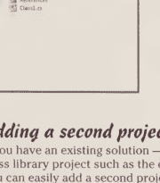

## 向现有解决方案添加第二个项目

如果你有一个现有解决方案——无论它是一个正在进行的应用程序，还是像上一节所述那样的类库项目——你都可以轻松地向解决方案添加第二个项目：可以是类库项目，也可以是可执行项目，例如驱动程序。请按以下步骤操作：

- 1. 在 Visual Studio 中打开现有解决方案后，在解决方案资源管理器中右键单击解决方案节点（顶级节点）。
- 2. 从弹出菜单中选择“添加”→“新建项目”。
- 3. 在“新建项目”对话框中，选择要添加的项目类型。
  在对话框右侧选择类库、控制台应用程序、Windows 窗体应用程序或其他可用类型。
- 4. 使用“位置”框导航到希望放置项目的文件夹。
  导航到的位置取决于你希望如何组织解决方案。你可以将新项目的文件夹放在以下两个位置之一：
  - 一体化文件夹：导航到主项目文件夹中，使添加的项目成为子文件夹。（参见图 10-2。）
  - 并排：导航到包含主项目文件夹的文件夹，使这两个项目处于同一层级。（参见图 10-3。）
- 5. 为项目命名，然后单击“确定”。
  如果新项目是库项目，请谨慎选择其名称——它将成为库的 .DLL 文件的名称，以及包含该项目类的命名空间的名称。

如果你需要让库项目与另一个项目甚至主项目同名，可以通过追加后缀 `Lib` 来区分它，例如 `MyConversionLib`。

图 10-2：在一体化文件夹中组织两个项目。


主项目文件夹

添加的项目文件夹

如果你要添加的项目旨在独立存在并可用于其他程序，请使用并排方法。

本节中的 `ClassLibrary` 示例（像本书中的大多数示例一样）采用一体化文件夹方法。要点是，尽管这些文件夹不必位于同一位置，但将它们放在那里可能很方便。

选择位置的任务与将新项目直接添加到 `ClassLibrary` 解决方案是相互独立的。两个项目文件夹可以位于同一解决方案中，同时仍位于不同位置。

图 10-3：并排组织两个项目。


包含文件夹

主项目文件夹

添加的项目文件夹

## 为库创建类

拥有类库项目后，创建构成该库的类。下面的 `ClassLibrary` 示例展示了一个简单的类库——在示例之后，我会向你展示它的一些驱动程序代码：


// ClassLibrary -- in a Class Library project
// File: Program.cs in ClassLibraryDriver project
// ClassLibrary -- A simple class library and its driver program
using System;
namespace ClassLibrary
{
public class MyLibrary
{
public void LibraryFunction1()
{
Console.WriteLine("This is LibraryFunction1()");
}
public static int LibraryFunction2(int input)
{
Console.WriteLine("This is LibraryFunction2(), returning {0}", input);
return input; // Just parrot the input.
}
}
}

库可以包含任何 C# 类型：类、结构、委托、接口和枚举。我在第 I 册中介绍结构（struct），在本分册第 9 章中介绍委托，在本分册第 8 章中介绍接口，并在 csharp102.info 上的文章《细数 Enum 的魅力》中介绍枚举（enum）。


在类库代码中，通常不应捕获异常。让异常从库向上冒泡到调用该库的客户端代码。客户端需要了解这些异常，并以自己的方式处理它们。我在第 II 册中介绍异常。

## 使用驱动程序测试库

类库本身不会做任何事情，因此你需要一个驱动程序——一个小型可执行程序，它通过调用库的方法来“驱动”库，以便在开发期间测试它。

换句话说，编写一个使用库中的类和方法程序。你会在本章后面的 NamespaceUse 程序示例（以及本书中的其他程序）中看到这种行为——例如，当你调用 .NET Framework 类库中 Console 类的 WriteLine() 方法时。（Console 位于 System 命名空间中，在库文件 mscorlib.dll 中。）

下面的代码片段延续上一个代码清单。这个代码清单添加一个新项目，其中包含一个带有 Main() 方法的类，你可以在 Main() 中编写代码来练习你的库：

// ClassLibrary driver program
// In a separate Console Application project:

```csharp
// File: Program.cs in ClassLibraryDriver project
using System;
using ClassLibrary;
namespace ClassLibraryExample
{
    class Program
    {
        static void Main(string[] args)
        {
            // Create a library object and use its methods.
            MyLibrary m1 = new MyLibrary();
            m1.LibraryFunction1();
            // Call its static methods through the class.
            int result = MyLibrary.LibraryFunction2(27);
            Console.WriteLine(result.ToString());
            // Wait for user to acknowledge the results.
            Console.WriteLine("Press Enter to terminate...");
            Console.Read();
        }
    }
}
```

要通过驱动程序运行并测试库，请在驱动程序项目的引用中添加对库的引用，将驱动程序项目标记为启动项目（如前文“可执行文件”一节所述），然后像运行本书中所有控制台应用程序一样运行该程序。


你还可以用另一种甚至更好的方式测试库——使用 Visual Studio 的单元测试功能。我在第 IV 册中，以及第 V 册中少量地，介绍了使用 Visual Studio 单元测试框架进行测试。

以下是测试驱动程序的输出：

```
This is LibraryFunction1()
This is LibraryFunction2(), returning 27
27
Press Enter to terminate...
```


库通常只提供静态方法。在这种情况下，你不需要实例化库对象。只需通过类调用这些方法即可。

## 从程序中使用类库

对于你编写的任何程序，只需包含针对类库命名空间的 using 指令，并添加对包含该库的 .DLL 文件的引用（提供指向其所在位置的路径）。然后就可以在程序中使用该库中的类。本书中的其他程序正是以这种方式使用 .NET Framework 类库中的类。请注意，编译器会将库复制到项目的生成目录中。

## 超越 public 和 private：更多访问关键字

如前面几节所述，将程序划分为多个程序集，会影响你可以从 AssemblyA 访问 AssemblyB 中的哪些代码。

本分册第 5 章中的访问控制示例（我希望）很好地说明了 public 和 private 关键字。但那一章没有过多介绍其他访问关键字：protected、internal，以及组合 protected internal。我在本节中纠正这种情况，并假定你理解继承和方法重写，以及 public 和 private。

为确保本节内容易于理解，你可能需要阅读（或重读）第 5 章。

## Internal：仅供 CIA 内部查看

假设一个程序有以下两个项目：

- InternalLimitsAccess：一个可执行程序，其 Congress 类包含启动程序执行的 Main() 方法。（没有法律规定 Main() 类必须命名为 Program。）
- CIAAssembly：类库项目。

你可以在 Web 上的 InternalLimitsAccess 示例中看到这种设置。

在现实生活中，美国国会有一个令人恼火的习惯：期望中央情报局（CIA）透露其秘密——当然，只透露给国会众议员和参议员。（“我们不会泄露你的秘密——真的。”）与此同时，CIA 那些过度神秘的特工也有他们宁愿保守的秘密。（也许他们知道可口可乐的秘密配方、桑德斯上校的秘密香草和香料，或者某个更邪恶的东西。）Secret X 究竟是什么在这里并不重要，但 CIA 想让 Secret X 保持，嗯，秘密。

不过，有一个问题。CIA 的每个人都需要知道 Secret X。在 InternalLimitsAccess 示例中，CIA 被划分为几个类——例如 GroupA 类和 GroupB 类。可以把它们看作 CIA 中（有时）相互通信和共享信息的部门。假设 GroupA 是 Secret X 的持有者，因此该组将其标记为 private。代码大致如下：

```
// In assembly InternalLimitsAccess:
class Congress
{
    static void Main(...)
    {
        // Code to oversee CIA
    }
}

// In assembly CIAAssembly:
public class GroupA
{
    private string _secretFormulaForCocaCola; // Secret X
}
public class GroupB
{
    public void DoSomethingWithSecretX()
    {
        // Do something with Secret X, if only you could access it.
    }
}
```

现在 GroupB 看不到秘密 X，但假设它确实有正当理由需要知道秘密 X。当然，GroupA 可以把秘密 X 提升为 public 状态，但一旦这样做，这个秘密就不再那么秘密了。如果 GroupB 能看到这个秘密，那么国会里那些爱窥探的人也能看到。更糟的是，CNN 也会知道，更不用说 Fox、ABC 和其他电视网了。你也知道那些人保守秘密的本事如何。哦，对了——俄罗斯也能看到秘密 X。

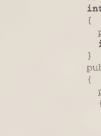

幸运的是，C# 还有 internal 关键字。使用 internal 只是比 public 低一级，但远高于 private。如果你改为用 internal 关键字标记 GroupA 类及其“public”方法——即在类外部可见的方法——那么 CIA 的每个人都能看到并访问秘密 X——只要你把秘密本身（一个数据成员）标记为 internal，或者提供一个 internal 属性来获取它，如下面这个版本所示：

```
// In assembly CIAAssembly:
internal class GroupA
{
    private string _secretFormulaForCocaCola; // Secret X
    internal string SecretX { get { return _secretFormulaForCocaCola; } }
}
public class GroupB
{
    public void DoSomethingWithSecretX()
    {
        // Do something with Secret X, now that we can see it:
        Console.WriteLine("I know Secret X, which is {0} characters long, but " +
            "I'm not telling.", GroupA.SecretX.Length);
    }
}
```

现在 GroupB 类拥有了它所需的访问权限——而且它不会交出这个秘密（即使受到水刑威胁）。它在 Main() 中告诉 Congress 的全部内容只是：它知道秘密 X，并且秘密 X 有 11 个字符。下面是那段代码：

```csharp
class Congress
{
    static void Main(string[] args)
    {
        // Code to oversee CIA
        // The following line doesn't compile because GroupA isn't accessible
        // Outside CIAAssembly. Congress can't get at GroupA over at CIA.

        // CIAAssembly.GroupA groupA = new CIAAssembly.GroupA();

        // Class Congress can access GroupB because it's declared public.
        // GroupB is willing to admit to knowing the secret, but it's
        // not telling — except for a small hint.
        GroupB groupB = new GroupB();
        groupB.DoSomethingWithSecretX();

        // Wait for user to acknowledge results.
        Console.WriteLine("Press Enter to terminate...");
        Console.Read();
    }
}
```

从 Main() 来看，GroupA 现在不可见，因此尝试构造它的实例无法通过编译。但由于 GroupB 是 public，Main() 可以访问它并调用其 public 方法 DoSomethingWithSecretX()。

等等！我很高兴地报告，CIA 确实必须就某些话题与国会沟通——但当然是在“需要知道”的基础上，仅限于部分国会议员和参议员。他们只要出示适当的凭据，就已经可以通过 GroupB 做到这一点，不过你需要把这些凭据加入代码：

```csharp
public string DoSomethingWithSecretXUsingCredentials(string credentials)
{
    if (credentials == "congressman with approved access")
    {
        return GroupA.SecretX;
    }
    return string.Empty;
}
```

internal 关键字使类及其成员只能在其自身程序集内部访问。但在该程序集内部，internal 项对所有本地类实际上都是“public”。


不过，有时基类并不会提供这类访问方法供其子类（以及其他代码）使用。如果 BankAccount 中的 _balance 数据成员是 private，并且该类不提供 Balance 属性，那该怎么办？


轮到 protected 关键字登场了：如果基类中的 _balance 实例变量声明为 protected 而不是 private，外部代码就看不到它——对外部代码而言它实际上就是 private。但子类可以正常看到它。


更好的解决方案是像之前一样在 BankAccount 中把 _balance 标记为 private，然后提供一个标记为 protected 的 Balance 属性。SavingsAccount 等子类可以通过 Balance 属性访问 _balance。但余额对外部代码不可见，这甚至能对子类保护 BankAccount 的实现。

## 第二部
### 第 10 章
## 我可以在库中使用你的命名空间吗？

如果余额确实需要让外部代码访问（只读），那么当然应该提供 public 的 Balance 属性来获取余额（只读）。然而，你可能仍然需要从 SavingsAccount 内部设置余额。为此，可以给 Balance 的 set 访问器 protected 访问权限——可从 SavingsAccount 和其他子类访问，但外部代码不可访问。本迷你书第 5 章关于属性的讨论展示了如何做到这一点，代码如下所示：

```
// In BankAccount:
public decimal Balance
{
    get { return _balance; }        // Public
    protected set { _balance = value; }  // Not public
}
```

Web 上的 ProtectedLimitsAccess 示例演示了刚才描述的 protected 关键字用法。


你甚至可以在另一个程序集中子类化 BankAccount，而该子类可以访问 BankAccount 中声明为 protected 的任何内容。ProtectedLimitsAccess 示例也演示了这一过程。

该示例有两个 BankAccount 的子类：一个与 BankAccount 位于同一程序集，另一个位于不同程序集。关于 protected 的有趣之处在于，两个 BankAccount 子类中的任何一个都能访问 BankAccount 中标记为 protected 的任何项。子类不必与其基类位于同一程序集。


能够从基类所在程序集之外扩展（子类化）一个类，会对安全性产生影响，这就是为什么许多类应标记为 sealed。密封一个类可以防止外部代码通过子类化它来获得访问权限。因此，建议只在类需要可子类化时才使其可扩展（非密封）。让同一程序集中的其他代码访问基类成员——包括同一程序集中的子类——的一种方法是把这些成员标记为 internal 而不是 protected。这样，你就能让本地子类获得所需的访问级别，同时阻止外部子类访问。当然，程序集中的其他类随后也被允许访问。这个方案可能并不理想，但如果安全性是需要考虑的因素，它应该更安全。

## protected internal：更慷慨的保护者

把 BankAccount 基类中的项设为 protected internal，而不只是 protected，只是为这些项在程序中的可访问性增加了一个新维度。单独使用 protected 允许子类（程序中的任何程序集）访问基类中的受保护项。加上 internal 则把这些项的可访问性扩展到任何类，只要该类与 BankAccount 位于同一程序集，或者至少是其他程序集中的子类。

在 csharp102.info 上的 ProtectedInternalLimitsAccess 示例中，你可以看到这种效果。定义在 BankAccount 自身程序集中的 AnotherClass 类可以访问 Balance 属性中的 protected internal set 访问器。然而，另一个程序集中几乎相同的 Another Class 类无法访问 Balance 的 set 访问器来设置余额。


让项尽可能不可访问。从 private 开始。如果你的某些代码需要更多访问权限，再有选择地提高。也许只用 protected 就够了（子类需要的不过如此）。也许同一程序集中的其他类确实需要访问。如果是这样，就提高到 internal。如果子类以及同一程序集中的其他类都需要访问，就使用 protected internal。只有那些应可供程序中每个类访问（无论程序集）的类（及其成员）才使用 public。


适用于整个类的建议同样适用于类成员：让它们尽可能不可访问。小型辅助类，或支持更公开类实现的类，可以限制为不超过 internal 的访问级别。

如果某个类或其他类型需要是 private、protected 或 protected internal，那么如果可以，请把它嵌套在需要访问它的类内部。

## 将类放入命名空间

命名空间的存在是为了把相关的类放进同一个容器，并减少不同位置所用名称之间的冲突。例如，你可以把所有与数学相关的类编译到一个 MathRoutines 命名空间中。


单个文件可以（但通常不会）划分为多个命名空间：

```
// In file A.cs:
namespace One
{
}
namespace Two
{
}
```

更常见的是，你将多个文件分组。例如，文件 Point.cs 可能包含类 Point，而文件 ThreeDSpace.cs 包含类 ThreeDSpace，用于描述欧几里得空间（比如立方体）的属性。你可以将 Point.cs、ThreeDSpace.cs 以及其他 C# 源文件组合到 MathRoutines 命名空间中（也可能组合到一个 MathRoutines 库程序集中）。每个文件都会将其代码包装在同一个命名空间中。（构成命名空间的是这些文件中的类，而不是文件本身。类位于哪些文件中对命名空间来说无关紧要。它们位于哪个程序集中也无关紧要：一个命名空间可以跨越多个程序集。）

```
// In file Point.cs:
namespace MathRoutines
{
    class Point { }
}
// In file ThreeDSpace.cs:
namespace MathRoutines
{
    class ThreeDSpace { }
}
```


如果不将类包装在命名空间中，C# 会将它们放入全局命名空间，即所有其他命名空间的基础（未命名）命名空间。不过，更好的做法是使用特定命名空间。

命名空间服务于以下目的：

- **命名空间把橘子与橘子放在一起，而不是与苹果放在一起。** 作为应用程序员，你可以合理地假设构成 `MathRoutines` 命名空间的类都与数学相关。同样地，当寻找恰好完美的数学方法时，你会首先查看构成 `MathRoutines` 命名空间的类。
- **命名空间避免名称冲突的可能性。** 例如，文件输入/输出库可能包含一个 `Convert` 类，用于将一种文件类型中的表示形式转换为另一种文件类型的表示形式。同时，翻译库可能包含一个同名类。将命名空间 `FileIO` 和 `TranslationLibrary` 分配给这两组类可以避免这个问题：类 `FileIO.Convert` 显然不同于类 `TranslationLibrary.Convert`。

## 声明命名空间

使用关键字 namespace，后跟名称以及一对花括号块来声明命名空间。该块内的类（以及其他类型）属于该命名空间的一部分：

```
namespace MyStuff
{
    class MyClass {}
    class YourClass {}
}
```

在此示例中，MyClass 和 YourClass 都属于 MyStuff 命名空间。

命名空间隐式是 public 的，并且不能在命名空间上使用访问修饰符，连 public 也不行。


除了类之外，命名空间还可以包含其他类型，包括这些：

- delegate
- enum
- interface
- struct

命名空间还可以包含嵌套命名空间，嵌套深度不限。例如，可以将 Namespace2 嵌套在 Namespace1 中，如下例所示：

```
namespace Namespace1
{
    // Classes in Namespace1 here ...
    // Then the nested namespace:
    namespace Namespace2
    {
        // Classes in Namespace2
        public class Class2
        {
            public void AMethod() { }
        }
    }
}
```

要从 Namespace1 外部的某处调用 Namespace2 内 Class2 中的方法，需指定以下代码行：

```
Namespace1.Namespace2.Class2.AMethod();
```

把这些命名空间用点连接起来，想象成通往所需项的一种逻辑路径。


诸如 `System.IO` 这样的“带点的名称”看起来像嵌套命名空间，但它们只命名一个命名空间。因此，`System.Data` 是一个完整的命名空间名称，而不是嵌套在 System 内部的 Data 命名空间的名称。这种约定使得拥有多个相关命名空间更容易，例如 `System.IO`、`System.Data` 和 `System.Text`，并让它们的家族相似性显而易见。在实践中，嵌套命名空间和带点名称的命名空间无法区分。


在程序中的所有命名空间前加上公司名称是一种惯例——让公司名称成为由点分隔的多个段的前半部分：`MyCompany.MathRoutines`。（如果你有公司名称，这种说法是成立的；你也可以只使用自己的名字。我可以使用 `CMSCo.MathRoutines` 或 `Spar.MathRoutines`。）如果你的代码使用两个第三方代码库，而它们恰好使用相同的基本命名空间名称（例如 `MathRoutines`），添加公司名称可以防止名称冲突。


Visual Studio 的“新建项目”对话框会运行一个应用程序向导，将它生成的所有代码放入命名空间。该向导以它创建的项目目录来命名这些命名空间。看看本书中的任何程序，它们都是由应用程序向导创建的。例如，`AlignOutput` 程序创建在 `AlignOutput` 文件夹中。源文件的名称为 `Program.cs`，它与默认类的名称匹配。包含 `Program.cs` 的命名空间名称与文件夹名称相同：`AlignOutput`。

（不过，你可以更改其中任何名称。只要小心且彻底地去做。可以在项目的“属性”窗口中更改项目的整体命名空间名称。有时我不会尝试重命名所有内容，而是使用正确的名称创建一个新程序，然后从原程序导入类文件——之后便废弃原程序。）

## 命名空间与访问关键字的关系


除了帮助将代码打包成更可用的形式之外，命名空间还扩展了本迷你书第 5 章介绍的访问控制概念（该章介绍了 `public`、`private`、`protected`、`internal` 和 `protected internal` 关键字）。命名空间通过进一步限制你能从何处访问类的哪些成员来扩展访问控制。

然而，命名空间对*可见性*的影响大于对*可访问性*的影响。默认情况下，`NamespaceA` 中的类和方法对 `NamespaceB` 中的类不可见，无论它们的访问控制说明符是什么。但是，你可以通过几种方式使一个命名空间中的类和方法对另一个命名空间可见。关键在于，你只能访问对你可见且“足够 public”的内容。

## 确定你需要的类和方法对你是否可见且可访问

要确定 NamespaceA 中的 Class1 能否调用 NamespaceB.Class2.AMethod()，请考虑以下两个问题：

- **位于 NamespaceB 中的 Class2 对调用类 Class1 可见吗？**
  这个问题涉及命名空间可见性，将在本列表末尾讨论。
- **如果第一个问题的答案为 True，那么 Class2 及其 AMethod() 是否也“足够 public”，可供 Class1 访问？**
  如果 Class2 与 Class1 位于不同程序集，则它必须是 public，Class1 才能访问其成员。如果 Class2 与 Class1 位于同一程序集，则至少需要声明为 internal。类只能是 public、protected、internal 或 private。
  同样，在每种情况下，Class2 的方法都必须至少具有某一级别的访问权限。方法在类可用的访问修饰符列表中添加了 protected internal 选项。本迷你书的第 5 章以及前面的“超越 public 和 private：更多访问关键字”一节提供了详细内情。

只有在两个问题都回答 Yes 之后，Class1 才能调用 Class2 的方法。

## 使另一个命名空间中的类和方法可见

C# 提供两种方法使 NamespaceB 中的项在 NamespaceA 中可见：

- **在 NamespaceA 中使用来自 NamespaceB 的名称时，完全限定这些名称。** 这种方法会产生如下代码行：以命名空间名开头，然后添加类并列出方法：
  ```
  System.Console.WriteLine("my string");
  ```
- **通过为命名空间文件添加针对 NamespaceB 的 using 指令，消除在 NamespaceA 中使用完全限定名称的需要：**
  ```
  using System;
  using NamespaceB;
  ```


本书中的程序通过 using 指令使 NamespaceA 中可见 NamespaceB 中的项。我将在接下来的两个部分讨论完全限定和 using 指令。

如果 NamespaceB 中的项位于其他程序集中，请选择 Project→Add Reference 并为这些程序集添加引用。

## 使用完全限定名称

类的命名空间是扩展类名的一部分，这导致了使一个命名空间中的类在另一个命名空间中可见的第一个方法。此示例没有使用任何 using 指令，以简化对其他命名空间中类的引用：

```csharp
namespace MathRoutines // Broken into two segments -- see below.
{
    class Sort
    {
        public void SomeMethod(){}
    }
}
namespace Paint
{
    public class PaintColor
    {
        public PaintColor(int nRed, int nGreen, int nBlue) {}
        public static void StaticPaint() {}
    }
}
namespace MathRoutines // Another piece of this namespace
{
    public class Test
    {
        static public void Main(string[] args)
        {
            // Create an object of type Sort from the same namespace
            // we're in and invoke a method.
            Sort obj = new Sort();
            obj.SomeMethod();
            // Create an object in another namespace -- notice that the
            // namespace name must be included explicitly in every
            // class reference.
            Paint.PaintColor black = new Paint.PaintColor(0, 0, 0);
            Paint.PaintColor.StaticPaint();
        }
    }
}
```

在这种情况下，两个类 Sort 和 Test 包含在同一个命名空间 MathRoutines 中，即使它们在文件内（或在不同文件）的不同声明中出现。该命名空间被拆分为两部分。


通常，`Sort` 和 `Test` 会位于不同的 C# 源文件中，您将它们一起构建成一个程序。

方法 `Test.Main()` 可以在不指定命名空间的情况下引用 `Sort` 类，因为这两个类位于同一个命名空间中。然而，`Main()` 在引用 `PaintColor` 时必须指定 `Paint` 命名空间，如对 `Paint.PaintColor.StaticPaint()` 的调用所示。此过程称为 *完全限定* 名称。

请注意，在引用 `black` 时您无需采取任何特殊步骤，因为 `black` 对象的类（包括命名空间）在 `black` 声明中已指定。

## 第三部分

## 为 C# 设计

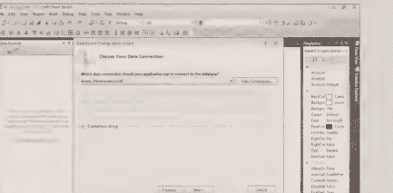

使用数据源配置向导

## 内容一览

- Chapter 1: Writing Secure Code ............................401
- Chapter 2: Accessing Data ............................415
- Chapter 3: Fishing the FileStream ............................435
- Chapter 4: Accessing the Internet ............................455
- Chapter 5: Creating Images ............................469

## 设计安全软件

安全设计需要相当多的工作才能准确完成。如果将流程分解为各个部分，您会发现完成起来容易得多。Patterns and Practices 团队（微软的一组软件架构师，他们制定编程最佳实践）创建了一种系统化的方法来设计安全程序，我认为您会觉得很直接，因此我在以下部分中描述它。

### 确定需要保护的内容

不同的应用程序有不同的需要保护的构件，但所有应用程序都有一些需要保护的东西。如果您的应用程序中有数据库，那就是最重要的保护对象。如果您的应用程序是基于服务器的应用程序，在确定需要保护的内容时，服务器的优先级应该相当高。

即使您的程序只是一个小型的单用户应用程序，软件也绝不能出错——外部人员不应能够利用该应用程序入侵用户的计算机。

### 记录程序的组件

如果您觉得本节标题听起来与设计过程的一部分相似，您是对的。威胁建模很大程度上只是理解应用程序的工作方式并很好地描述它。

首先，描述应用程序的功能。此描述成为功能概述。如果您遵循公认的软件开发生命周期（SDLC），那么用例、需求或用户故事文档（取决于您的个人方法）应该为您提供一个良好的起点。

接下来，描述应用程序如何在最高层级完成所有这些任务。软件架构概述（SAO）图是实现此目的的有用方法。该图显示了软件中哪些机器和服务负责什么。


如果您碰巧使用 Visual Studio Team System，在 Enterprise Architect 版本中构建图表就是最终的 SAO 图表，也是一个很好的模型。

有时 SAO 是一个简单的图表——如果您有一个像游戏一样的独立 Windows Forms 程序，那就是全部内容了！独立程序没有网络连接，也没有软件部件之间的通信。因此，软件架构图只包含一个实例。

### 将组件分解为功能

在创建描述软件正在做什么以及如何做的文档后，您需要分解软件的各个功能部分。如果您以组件方式设置软件，类和方法就显示了功能分解。这比听起来简单。

将软件分解为各个部分的结果是拥有一个合理的矩阵，说明哪些组件需要保护，软件的哪些部分与每个组件交互，网络和硬件系统的哪些部分与每个组件交互，以及软件的哪些功能对每个组件执行什么操作。

### 识别功能中的潜在威胁

在创建需要保护的组件列表后，您将面临困难的部分：将两者结合起来。识别威胁是让安全顾问获得高额报酬的过程，这几乎完全取决于经验。

例如，如果您的应用程序连接到数据库，您必须设想连接可能被第三方拦截。如果您使用文件存储敏感信息，该文件理论上可能被破坏。

要创建威胁模型，您需要对软件的潜在威胁进行分类。记住不同威胁类别的一种简单方法是使用缩写 STRIDE：

- **Spoofing identity:** 用户假装自己是他们不是的人。
- **Tampering with data or files:** 用户编辑不应该被编辑的东西。
- **Repudiation of action:** 用户有机会说他们没有做实际上确实做过的事情。
- **Information disclosure:** 用户看到了不应该看到的东西。
- **Denial of service:** 用户阻止合法用户访问系统。
- **Elevation of privilege:** 用户获得了他们不应该访问的东西的访问权限。

所有这些威胁必须在暴露威胁的功能下以大纲形式记录下来。这种策略不仅为您提供了一个良好且离散的威胁列表，而且还将您的安全加固集中在对应用程序构成最大安全风险的那些部分上。

### 评估风险

该过程的最后一步是评估风险。微软使用 DREAD 模型来评估其应用程序的风险。缩写 DREAD 代表用于衡量每个漏洞的五个关键属性：

- **Damage potential:** 泄露对公司造成的美元成本
- **Reproducibility:** 可能使泄露更难或更容易发现的特殊条件
- **Exploitability:** 黑客能够进入企业系统的程度的衡量
- **Affected users:** 受影响的用户数量以及他们是谁
- **Discoverability:** 发现潜在泄露的难易程度

您可以在 msdn.microsoft.com/security 研究 DREAD 模型，或将威胁模型定位以考虑这些属性。关键是确定哪些威胁最可能导致问题，然后加以缓解。

## 构建安全的 Windows 应用程序

在客户端计算机上运行时，框架生活在一个严格控制的沙箱中。由于沙箱的现实，应用程序的安全策略配置变得很重要。

在编写 Windows 应用程序时，您需要寻找安全性的第一个地方是身份验证和授权的世界。身份验证确认用户的身份，而授权决定她在应用程序中可以做什么和不能做什么。

在进行威胁建模时，您可以轻松地使用 STRIDE 缩写来考虑所有可能的身份验证和授权威胁。（请参阅前面“识别功能中的潜在威胁”部分，了解有关 STRIDE 的更多信息。）

### 使用 Windows 登录进行身份验证

坦率地说，应用程序授权用户的最佳方式是使用 Windows 登录。关于此策略和其他策略存在大量争论，但关键是简单性：简单的事情更安全。

对于使用 Visual Studio 开发的大部分软件，应用程序将在办公室中由公司中具有不同角色的用户使用；例如，一些用户可能在销售或会计部门。在许多

在环境中，特权最高的用户是经理或管理员——这又是另一组角色。在大多数办公室中，每位员工都有自己的用户账户，并且每个用户都会被分配到适合其在公司中所扮演角色的 Windows 组。

只有在 Windows 环境设置正确时，使用 Windows 安全性才有效。在一个满是 Windows XP 机器、所有人都以管理员身份登录的工作区中，你无法有效地构建安全应用程序，因为你无法判断谁担任什么角色。

构建利用 Windows 安全性的 Windows 应用程序很简单。目标是检查谁已登录（身份验证），然后检查该用户的角色（授权）。

以下步骤演示如何创建一个通过显示和隐藏按钮来保护每个用户菜单系统的应用程序：

- 1. 通过选择“文件”→“新建项目”并给项目起一个描述性名称，启动一个新的 Windows 窗体应用程序项目。
- 
- 这也适用于 Windows Presentation Foundation (WPF)，但在 Windows 窗体中演示更容易。（第 V 卷全部关于 WPF。）我将项目命名为 Windows Security。
- 
- 2. 向窗体添加三个按钮——一个用于“销售菜单”，一个用于“会计菜单”，一个用于“经理菜单”。
- 
- 我的示例见图 1-1。


图 1-1：
Windows 安全应用程序示例。


- 3. 将每个按钮的 Visible 属性设置为 False，使其默认不在窗体上显示。
- 4. 双击窗体以进入 Form1_Load 事件处理程序。
- 5. 在 Namespace 语句上方，按以下方式导入 System.Security.Principal 命名空间：
-     using System.Security.Principal;
- 6. 在 Form1_Load 事件处理程序中，通过添加以下代码，使用 WindowsIdentity 对象的 GetCurrent 方法实例化一个表示当前用户的新 Identity 对象：
-     WindowsIdentity myIdentity = WindowsIdentity.GetCurrent();
- 7. 使用 WindowsPrincipal 类获取对此标识的引用：
-     WindowsPrincipal myPrincipal = new WindowsPrincipal(myIdentity);
- 8. 最后，同样在 Form1_Load 子例程中，编写一个小的 If/Then 语句来确定要显示哪个按钮。代码见清单 1-1。

## 清单 1-1：Windows 安全应用程序代码

```
using System;
using System.Collections.Generic;
using System.ComponentModel;
using System.Data;
using System.Drawing;
using System.Linq;
using System.Text;
using System.Windows.Forms;
using System.Security.Principal;

namespace WindowsSecurity
{
    public partial class Form1 : Form
    {
        public Form1()
        {
            InitializeComponent();
        }
        private void Form1_Load(object sender, EventArgs e)
        {
            WindowsIdentity myIdentity = WindowsIdentity.GetCurrent();
            WindowsPrincipal myPrincipal = new WindowsPrincipal(myIdentity);
            if(myPrincipal.IsInRole("Accounting"))
            {
                AccountingButton.Visible=true;
            }
            else if (myPrincipal.IsInRole("Sales"))
            {
                SalesButton.Visible = true;
            } else if (myPrincipal.IsInRole("Management")) {
                ManagerButton.Visible = true;
            }
        }
    }
}
```

要成功运行此代码，必须有一个包含 Accounting、Sales 和 Management NT 用户组的环境。

在某些情况下，你不需要这种角色多样化。有时你只需要知道用户是否处于标准角色，System.Security 为此提供了支持。使用 WindowsBuiltInRole 枚举器，你可以描述例如管理员登录时应执行的操作：

```
if (myPrincipal.IsInRole(WindowsBuiltInRole.Administrator))
{
    //Do something
}
```

## 加密信息

加密本质上是一个极其复杂的过程。有五个命名空间专用于不同的算法。由于加密如此复杂，我在这本书中不深入细节。

尽管如此，理解一个密码学要素对于安全的一个关键要素——加密文件——很重要。在 Windows 窗体应用程序中处理文件时，除非你对程序进行了加密，否则就存在有人用文本编辑器加载并查看它的风险。

常见的加密方案数据加密标准 (DES) 已在 .NET 中实现。在如今 64 位台式机的时代，它不是最强的加密，但足以加密 Windows 应用程序的数据文件。你可以在 System.Security.Cryptography 命名空间的 DESCryptoServiceProvider 中找到用于 DES 加密的方法。

## 部署安全

如果使用 ClickOnce 部署应用程序，你需要定义应用程序将请求的对 PC 的访问权限。ClickOnce 是一种基于 Web 服务器的部署策略，允许用户通过使用“我的项目”配置文件中的“Windows 安全性”选项卡（如图 1-2 所示）从 Web 浏览器运行 Windows 窗体应用程序。

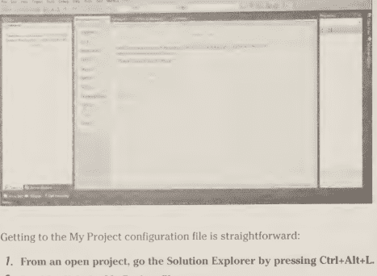

图 1-2：
“我的项目”配置文件的“Windows 安全性”选项卡。

访问“我的项目”配置文件很简单：

- 1. 在打开的项目中，按 Ctrl+Alt+L 转到“解决方案资源管理器”。
- 2. 双击 My Project 文件。
- 3. 单击 WindowsSecurity 选项卡。

在这里，你可以定义应用程序使用的功能，以便安装它的用户在安装时收到警告，而不是在运行应用程序时收到安全错误。

## 构建安全的 Web 窗体应用程序

Web 窗体应用程序是断开连接的、松散耦合的程序，它们通过应用程序使用的公开端口使服务器暴露于潜在攻击之下。所谓松散耦合，我指的是它们与服务器之间具有“事务并等待”的关系。

由于这种耦合，对于 Web 窗体应用程序来说，构建安全性变得比以往任何时候都更加重要。一个副作用是应用程序的功能可能会变少。

构建基于 Web 的应用程序时，你会花更少时间担心身份验证（尤其是当应用程序公开可用时），而花更多时间担心破解者。因为你正在让一台服务器——通常是你保持私有的东西——可供公众使用，你的程序要遵守一整套全新的安全规则。

保护公共服务器的关键在于诚实。你必须诚实面对系统的弱点。不要想：“好吧，破解者可以通过做 XYZ 来猜出密码，但没人会那么做。”相信我，有人会弄清楚的。

对于 Web 窗体应用程序，需要关注的两大类攻击是 SQL 注入攻击和脚本漏洞利用。

## SQL 注入攻击

当黑客将一行 SQL 代码输入到网页表单中用于查询数据库的输入字段（例如登录表单中的用户名和密码文本框）时，就会发生 SQL 注入攻击。恶意 SQL 代码会导致数据库以意外方式运行，或允许黑客访问、更改或破坏数据库。

### 理解 SQL 注入

理解黑客如何使用 SQL 注入的最佳方法是看一个示例。例如，一个网页的代码在文本框中接受用户输入的 Product ID，并根据用户输入的 Product ID 返回产品详细信息。服务器上的代码可能如下所示：

```csharp
//Get productID from user
string ProductId = TextBox1.Text;
//Get information from the database
string SelectString = "SELECT * FROM Items WHERE ProductId = '" + ProductId + "'";
SqlCommand cmd = new SqlCommand(SelectString, conn);
conn.Open();
SqlDataReader myReader = cmd.ExecuteReader();
//Process results
myReader.Close();
conn.Close();
```

通常，用户会在文本框中输入适当的信息。但试图进行 SQL 注入攻击的破解者会将以下字符串输入 textBox1：

`'FOOBAR';DELETE FROM Items;--'`

你的代码将运行的 SQL 代码可能如下所示：

```sql
SELECT * FROM Items WHERE ProductID = 'FOOBAR';DELETE FROM Items;--'
```

SQL Server 执行了一些你意想不到的代码；在本例中，该代码删除了 Items 表中的所有内容。


### 防止SQL注入


防止SQL注入最简单的方法是永远不要使用字符串拼接来生成SQL。请使用存储过程和SQL参数。你可以在本迷你书的第2章中了解更多相关信息。

### 脚本攻击

脚本攻击是一种利用用户Web浏览器中JavaScript引擎的安全漏洞。脚本攻击利用了公共Web Forms应用程序较为常见的功能之一——允许用户之间进行交互。例如，Web Forms应用程序可能允许用户发布评论，供站点其他用户查看，也可能允许用户填写在线个人资料。

### 了解脚本攻击

如果恶意用户在其个人资料或评论中放置一些脚本代码，该黑客就可以控制下一个访问该站点的用户的浏览器。可能会有多种后果，而且都不是好事。

例如，当用户访问你的站点时，cookies集合对JavaScript是可用的。恶意用户会在其个人资料中放置一些脚本代码，将你站点的cookie复制到远程服务器。这可能会让恶意用户访问当前用户的会话，因为会话标识符以cookie形式存储。随后，恶意用户就能够冒充当前用户的身份。

### 防止脚本攻击

幸运的是，ASP.NET会阻止用户向表单字段中输入大多数脚本代码并将其发布到服务器。你可以通过以下步骤在基本的Web Forms项目中尝试此操作（你将看到如图1-3所示的错误）：

- 1. 创建一个新的Web Forms项目。
- 2. 向默认页面添加一个文本框和一个按钮。
- 3. 运行项目。
- 4. 在文本框中输入`<script>msgbox()</script>`。
- 5. 单击按钮。


此外，你可以使用`Server.HTMLEncode`方法对Web Forms应用程序发送到屏幕的任何内容进行编码——这将使脚本代码以纯文本形式显示，而不是HTML。

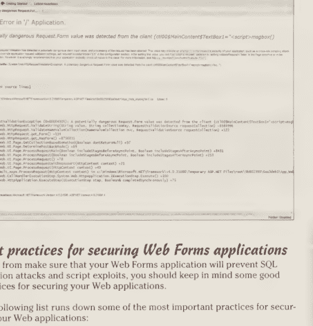

图1-3：默认情况下会阻止脚本攻击。

### 保护Web Forms应用程序的最佳实践

除了确保Web Forms应用程序能够防止SQL注入攻击和脚本攻击之外，你还应牢记一些保护Web应用程序的良好实践。

以下列表列出了保护Web应用程序的一些最重要实践：

- 使你的IIS服务器保持最新。
- 备份所有内容。
- 避免使用QueryString变量。
- 不要保留HTML注释。任何用户都可以通过选择浏览器中的“查看→源文件”来查看HTML代码并看到你的注释。
- 不要依赖客户端验证来保证安全性——它可以被伪造。
- 使用强密码。
- 不要假设用户发送给你的内容来自你的表单并且是安全的。伪造表单提交很容易。
- 确保错误消息不会向用户透露有关应用程序的任何信息。将错误消息通过电子邮件发送给自己，而不是显示给用户。
- 使用安全套接字层。
- 不要在cookie中存储任何有用的信息。
- 关闭Web服务器上所有未使用的端口。
- 除非需要，否则关闭IIS上的SMTP。
- 如果允许上传，请运行病毒检查程序。
- 不要以管理员身份运行应用程序。
- 如果可能，通过将过期日期设置为过去的日期来使用临时cookie。cookie将仅在会话期间保持有效。
- 对文件上传设置大小限制。你可以在Web.Config文件中进行设置：
    ```xml
    <configuration>
      <system.web>
        <httpRuntime maxRequestLength="4096" />
      </system.web>
    </configuration>
    ```
- 请记住，Web Forms的ViewState很容易被查看。

### 使用System.Security

尽管许多安全工具内置于使用它们的类中，但有些类难以描述或归类。因此，System.Security 是容纳其他任何地方都不适合的内容的“容器”。

表1-1描述了System.Security中较常见的命名空间。我在前面的“使用Windows登录进行身份验证”一节中展示了如何使用Security.Principal命名空间。

表1-1 System.Security中的常见命名空间

| Namespace | 描述 | 常用类 |
|-----------|------|--------|
| Security | 安全性的基类 | CodeAccessPermission, SecureString |
| AccessControl | 用于授权的复杂控制 | AccessRule, AuditRule |
| Authorization | 描述应用程序安全性的枚举 | CipherAlgorithmType |
| Cryptography | 包含多个有助于加密的命名空间 | CryptoConfig, DESCryptoServiceProvider |
| Permissions | 控制对资源的访问 | PrincipalPermission, SecurityPermission |
| Policy | 使用证据类来防御抵赖 | Evidence, Site, Url |
| Principal | 定义表示当前用户上下文的对象 | WindowsIdentity, WindowsPrincipal |

## 第2章：访问数据

### 本章内容包括

- 理解System.Data命名空间
- 连接到数据源
- 处理来自数据库的数据

并不是想让你对本章内容先入为主，但你可能会发现数据访问是使用.NET Framework时最重要的部分。你使用System.Data命名空间的各种功能的频率可能会超过任何其他命名空间。

毫无疑问，Visual Studio最常见的用途之一是创建业务应用程序。业务应用程序就是关于数据的。这就是使用Visual Studio进行开发的核心所在。虽然对各方面都略知一二很重要，但在构建业务应用程序时，完整理解System.Data命名空间是必不可少的。

在.NET Framework于2003年左右流行之前，大多数使用Microsoft产品构建的业务应用程序都使用FoxPro或Visual Basic。在过去几年中，C#毫无疑问地取代了这些语言，成为业务程序员的首选语言。

你可以从三个方面来看待C#中的数据工具：

- **数据库连接：** 从数据库获取信息以及将信息写入数据库是`System.Data`命名空间的主要部分。
- **在程序内的容器中保存数据：** `DataSet`、`DataView`和`DataTable`容器是实现数据保存的有用机制。如果你是Visual Basic 6或ASP程序员，应该记得`Recordsets`，它已被新的构造所取代。
- 语言集成查询使你能够使用结构化查询语言（SQL）而不是复杂的面向对象语言（OOL）从数据容器中获取数据。


表2-1 System.Data命名空间

| Namespace | 用途 | 最常用的类 |
|---|---|---|
| System.Data | 所有ADO.NET共有的类 | 容器DataSet、DataView、DataTable、DataRow |
| System.Data.Common | 数据库特定类使用的实用工具类 | DbCommand, DbConnection |
| System.Data.Odbc | 用于连接到ODBC数据库（如dBASE）的类 | OdbcCommand, OdbcAdapter |
| System.Data.OleDb | 用于连接到OleDb数据库（如Access）的类 | OleDbCommand, OleDbAdapter |
| System.Data.OracleClient | 用于连接到Oracle的类 | OracleCommand, OracleAdapter |
| System.Data.SqlClient | 用于连接到Microsoft SQL Server的类 | SqlCommand, SqlDataAdapter |
| System.Data.SqlTypes | 用于引用SQL Server常见的原生类型 | SqlDateTime |

虽然System.Data命名空间及相关工具有很多内容，但我会重点介绍Visual Studio实现这些工具的方式。在以往各种品牌和型号的开发软件版本中，可视化工具只会让事情变得更困难，因为存在黑箱问题。

黑箱问题是指开发环境为你完成一些你无法控制的事情。有时，有人替你完成事情是件好事，但当开发环境生成的东西不完全符合你的需要时，就会生成无用的代码。

幸运的是，现在情况不再是这样了。当你使用可视化数据工具时，Visual Studio现在会生成完全开放且合理的C#代码。我想你会对结果感到满意。


### 数据类如何融入框架

数据类全部与信息存储有关。在第I册中，我讨论了集合，集合用于在应用程序运行时存储信息。Hashtable是存储信息的另一个例子。集合保存对象列表，而Hashtable保存名称和值对。


窗体控件与 Data 命名空间之间的关系，常常让人觉得数据就存在于控件内部，尤其是在处理 Windows 窗体时。

在接下来的几节中，你主要会处理可视化工具，它们与代码一样，都是 C# 体验的一部分。首先，我会介绍如何连接到数据源，然后向你展示如何使用其中一种连接编写一个快速应用程序。最后，我会简要介绍代码方面。

要让这一切正常工作，你需要在数据库中设置某种架构。它可以是你自己创建的本地项目，也可以是示例架构。下一节将告诉你如何操作。

## 设置示例数据库架构

要开始，请将浏览器指向 www.microsoft.com/sqlserver/2005/en/us/express-starter-schemas.aspx。如果此 URL 无法访问，请在 Web 上搜索 SQL Server 2008 sample schema，并找到最近的 Microsoft 链接。它应该能帮你找到。

此页面提供两个示例清单——示例应用程序和示例架构。示例应用程序是完整的应用程序，展示了使用 .NET 构建的数据驱动软件的完整端到端实现。有些使用 C#，有些使用 Visual Basic。示例架构仅包含数据库，旨在让数据库管理员练习处理该系统的经验。

任何示例架构都可以使用。如果你想要与我在本文示例中使用的完全相同的架构，请选择 Asset Management 架构。其他选项可能更适合你正在做的工作。它们包括

- 资产维护
- 联系人管理
- 客户与订单
- 文档管理
- 电子商务
- 帮助台
- 问题跟踪软件
- 零售库存控制
- 非营利组织
- 产品目录

要安装，请按以下步骤操作：

1. 单击 **Install** 链接，显示熟悉的 Internet Explorer 下载对话框。同意运行该软件后，你会看到安装确认。在该确认中单击 **Yes**，然后同意 EULA。

总得处理一下许可那点事！

2. 为数据库文件选择一个目标位置。我使用了 `c:\databases`。同意创建该文件夹，并确认你与 **Microsoft** 有业务往来，然后应该就大功告成了。

展开后的文件夹按以下顺序包含四项：你已同意的许可证、数据库架构的图片、架构本身的 SQL 文件，以及一个包含架构和数据库的 `*.mdf` 文件。

如果你熟悉 SQL Server，可以将数据库添加到本地安装中，并在那里指向它。如果你不是 DBA，也可以让数据提供程序直接指向某个文件。这就是我在本章剩余部分采用的角度。

## 连接到数据源

如今，连接到数据库并不仅仅是与 Microsoft Access 建立一条简单连接。Visual Basic 开发人员必须连接到大型机、文本文件、不常见的数据库、Web 服务和其他程序。所有这些不同的系统都被集成到窗口和 Web 界面中，并且还附带更新、添加和删除功能。

访问这些数据源主要取决于各个数据库命名空间的 `Adapter` 类。Oracle 有自己的 `Adapter` 类，SQL Server 也有。符合 ODBC（开放数据库连接）的数据库（例如 Microsoft Access）有自己的 `Adapter` 类；较新的 OLEDB（对象链接和嵌入数据库）协议也有一个。

幸运的是，向导会处理大部分工作。可以从 `Data Sources` 面板访问 `Data Source Configuration Wizard`，在处理数据时，你会花很多时间在这个面板上。要开始使用 `Data Source Configuration Wizard`，请按以下步骤操作：

1. 单击起始页中的 `New Project` 图标，新建一个 Windows 应用程序项目。选择 `C# Windows Forms Application`，并为其指定一个合适的名称。

对于此示例，我将该 Windows 应用程序项目命名为 `Accessing Data`。

2. 要打开 `Data Sources` 窗格，请选择 `Data > Show Data Sources`，或按 `Shift+Alt+D`。

它应该会提示你没有数据源，如图 2-1 所示。

图 2-1：
Data Sources 面板。


3. 单击数据源面板中的“添加新数据源”链接。

这会打开数据源配置向导。该向导提供多种可供选择的数据源类型。其中最有趣的是对象源，它让你可以访问程序集中的对象，以便将控件绑定到该对象。

4. 单击对象源类型，查看其中的选项，如图 2-2 所示。然后单击“上一步”按钮返回上一屏幕。

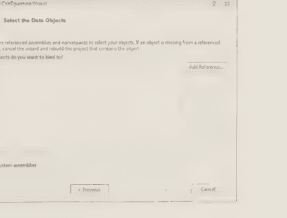

图 2-2：
使用对象作为数据源。

你可以选择一个 Web 服务，以连接到另一台计算机上的函数。我在第 V 册中介绍了 Web 服务的创建和使用，但此功能让你可以在拥有 Web 服务引用的同时设置数据源。这很酷。空白屏幕的示例如图 2-3 所示。

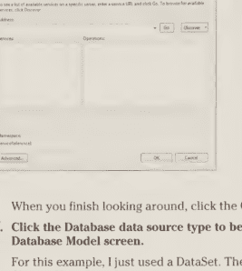

图 2-3：
使用 Web 服务
作为数据源。

查看完毕后，单击“取消”按钮返回。

5. 单击数据库数据源类型，进入“选择数据库模型”屏幕。

对于此示例，我只使用了一个 DataSet。向导的下一部分是“选择数据连接”屏幕，如图 2-4 所示。

最常见的访问点是数据库。

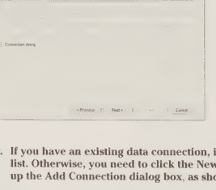

图 2-4：
选择
数据
连接。

6. 如果已有数据连接，它会显示在下拉列表中。否则，需要单击“新建连接”按钮，打开“添加连接”对话框，如图 2-5 所示。

对于此示例，我单击“新建连接”按钮，并选择 Microsoft 示例数据库 Northwind。

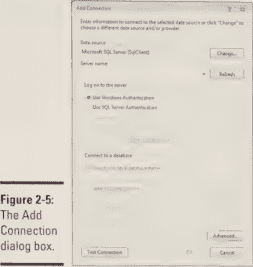

“添加连接”对话框假定你要连接到 SQL Server。如果不是这种情况，请单击“更改”按钮，在“更改数据源”对话框中选择其他数据库，如图 2-6 所示。对于此示例，我选择了 Microsoft SQL Server Database File，并单击“确定”。

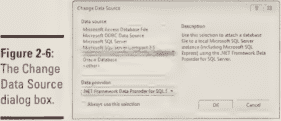

如果你确实使用数据库文件，Visual Studio 会将相关文件复制到你的项目中。如果你是在一个独立项目中学习本书，那没问题。如果你与其他人同在一个开发团队，请确认这种做法适合你的生命周期方法。

7. **单击“下一步”按钮，将连接字符串保存到应用程序配置文件中。**

8. **单击“下一步”接受默认设置。**

你会看到“选择数据库对象”屏幕。你可以选择要使用的表、视图或存储过程。

9. 在“表”下，选择 Parts 和 Part_Faults（如图 2-7 所示），然后单击“下一步”。

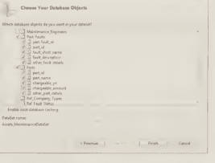

**图 2-7：**
选择数据对象。

完成了！如果你查看数据源面板，会发现新数据连接已添加，如图 2-8 所示。

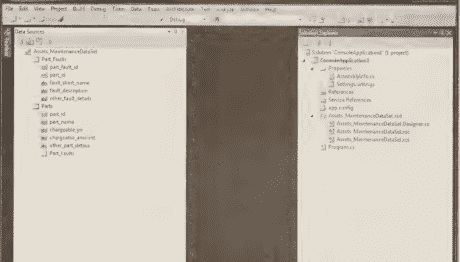

**图 2-8：**
新数据连接会显示在左侧的数据源面板中。

请注意，数据源面板中有 Parts 表，而数据连接面板中有所有表。这是因为你在向导中构建的 DataSet 容器只包含 Parts 表及相关表。数据连接面板显示数据库中的所有内容。


按照前面的步骤操作，你会在 Visual Studio 中创建两个重要实体：

- 你创建了一个到数据库的连接，显示在“数据库资源管理器”中。你会发现它会一直保留——它特定于当前安装的 Visual Studio。
- 你还创建了一个项目数据源，它特定于此项目，如果你启动另一个项目，它就不会存在。

两者都很重要，并且提供不同的功能。在本章中，我将重点介绍数据源面板中显示的特定于项目的数据源。

### 使用可视化工具

用于 Visual Basic 的快速应用程序开发（RAD）数据工具相比 Microsoft 以前提供的工具有了巨大改进。Visual Studio 中的 RAD 数据工具易于使用，能完成你需要的任务，并且会为你编写像样的代码。

你需要知道，如果这不是最佳实践，我*绝不会*展示这种*黑魔法*。过去，那些在幕后做你看不见的事情的工具往往做得很差。从长远来看，使用这些工具会让你的程序变得更糟。不过，新工具是构建软件的好方法。人们可能会告诉你我错了，但它真的不差。试试看！


如果你单击数据源面板中的某个表，会出现一个下拉箭头，如图 2-9 所示。单击它，你会看到有趣的现象：出现一个下拉列表，然后你可以选择该表如何集成到 Windows 窗体中。

将 Parts 表更改为 Details View。它用于创建详细信息类型的窗体——这种窗体便于用户查看和更改数据。然后将该表拖到窗体上，系统就会为你创建 Details View，如图 2-10 所示。

当你将表拖放到窗体上时，发生了很多事情：

- 字段和字段名称已添加。
- 字段采用了最合适的格式。
- 字段名称是一个标签。
- Visual Studio 会自动在大小写变化处添加空格。


图 2-9：
表选项
下拉列表。

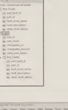

图 2-10：
创建
零件明细
数据表单。

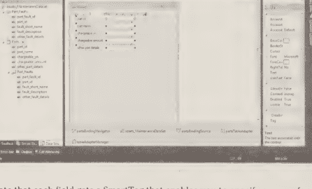


请注意，每个字段都会获得一个 SmartTag，可让你为文本框中的值指定查询。你也可以通过更改数据源面板中的值来预设所使用的控件（参见图 2-10）。

此外，页面顶部会添加一个 VCR 栏（技术上称为 BindingNavigator）。运行应用程序时，你可以使用 VCR 栏在表中的记录之间循环。

最后，页面底部的组件托盘中添加了四个完全基于代码的对象：DataSet、BindingSource、DataAdapter 和 BindingNavigator 对象。

单击播放按钮即可看到 VCR 栏的工作。你可以毫无问题地浏览数据库中的项目，如图 2-11 所示。就像在 Access 或 FoxPro 中工作一样，但具有企业级质量！

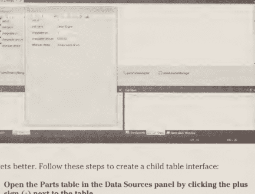

图 2-11：
运行示例。

情况会更好。按照以下步骤创建子表界面：

- 1. 通过单击表旁边的加号 (+) 在数据源面板中打开 Parts 表。
- 2. 向下滚动，直到看到嵌套在 Parts 表中的 Part_Faults 表。
  请注意，此表在其中出现了两次。你需要的是 Parts 下的那一个。
- 3. 将该表的实例拖到表单上，并将其放置在表单上本节前面放置的 Parts 字段下方（参见图 2-10）。
- 4. 单击播放按钮运行示例，如图 2-12 所示。

你拥有一个运行中、易于使用的父/子表单，其中包含零件和零件故障。在其他环境中创建此表单需要你编写上百行代码。借助 C# 为你提供的为数据源选择程序集的能力，该表单甚至几乎已准备好用于企业环境。这很棒。

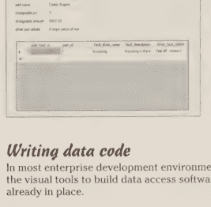

图 2-12：
完整的编辑表单。

## 编写数据代码

然而，在大多数企业开发环境中，你不会使用可视化工具来构建数据访问软件。通常，基础设施已经就位。

原因在于，企业软件通常有特定要求，而管理这些规范最简单的方法是使用独特且定制的代码。简而言之，一些组织不希望事情按微软的方式完成。

## 可视化工具的输出

可视化工具在企业环境中经常不被使用的原因在于，工具生成的代码相当复杂。如果切换到代码视图并右键单击对象的实例（如 PartsTableAdapter 对象）然后选择转到定义，你会看到设计器背后的代码。

图 2-13 显示了你第一次进入时看到的内容。标记代码窗口顶部附近区域的框被标记为 Windows Form Designer 生成的代码，你不禁会注意到该部分之前的行号在二十几，而之后的数字在四百几。那是大量的生成代码。

这些代码没有任何问题，但它是有意通用的，以支持任何人可能想用它做的事情。企业客户通常希望确保一切都以相同的方式完成。因此，他们通常会定义特定的数据代码格式，并期望软件开发人员使用它，而不是可视化工具。

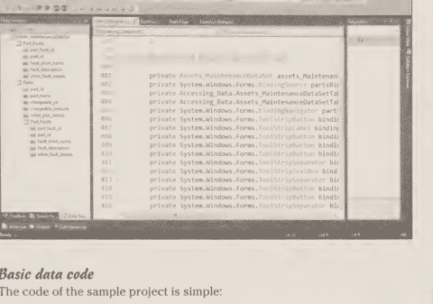

图 2-13：
生成的代码。哈？

## 基本数据代码

示例项目的代码很简单：

```
using System;
using System.Collections.Generic;
using System.ComponentModel;
using System.Data;
using System.Drawing;
using System.Linq;
using System.Text;
using System.Windows.Forms;

namespace Accessing_Data
{
    public partial class Form1 : Form
    {
        public Form1()
        {
            InitializeComponent();
        }

        private void partsBindingNavigatorSaveItem_Click(object sender, EventArgs e)
        {
            this.Validate();
            this.partsBindingSource.EndEdit();
            this.tableAdapterManager.UpdateAll(this.assets_MaintenanceDataSet);
        }
```

```
private void Form1_Load(object sender, EventArgs e)
{
    // TODO: This line of code loads data into the 'assets_MaintenanceDataSet.Part_Faults' table. You can move, or remove it, as needed.
    this.part_FaultsTableAdapter.Fill(this.assets_MaintenanceDataSet.Part_Faults);
    // TODO: This line of code loads data into the 'assets_MaintenanceDataSet.Parts' table. You can move, or remove it, as needed.
    this.partsTableAdapter.Fill(this.assets_MaintenanceDataSet.Parts);
}
```

虽然这相当直接，但显然不是你需要的一切。剩余的代码在生成可视化表单本身的文件中，用于支持可视化组件。

也许有一天你会想在不使用可视化工具的情况下连接到数据库。我在前面的章节“数据类如何融入框架”中讨论了步骤，这里展示相应的代码：

- 1. SqlConnection mainConnection = new SqlConnection();
- 2. mainConnection.ConnectionString = "server=(local);database=Assets_Maintenance;Trusted_Connection=True";
- 3. SqlDataAdapter partsAdapter = new SqlDataAdapter("SELECT * FROM Parts", mainConnection);
- 4. DataSet partsDataSet = new DataSet();
- 5. mainConnection.Open();
- 6. partsAdapter.Fill(partsDataSet);
- 7. mainConnection.Close();


这在你想要构建 Web 服务或类库时尤其有用——尽管应该注意，你仍然可以在这些项目类型中使用可视化工具。

让我们逐行讨论。第一行设置新的数据连接，第二行用连接字符串填充它。你可以从你的 DBA 或数据连接的属性面板获取它。

第三行包含一个 SQL 查询。在第 1 章中，我谈到这是一件糟糕的事，你应该使用存储过程。这是真的。不要在生产系统中使用内联 SQL。我本可以同样轻松地在那里放入存储过程名称。

第四行构建一个新的数据集。这里保存返回数据的模式，也是我用来导航数据的地方。

第 5、6 和 7 行执行魔术：打开连接，联系数据库。使用适配器填充数据集，然后关闭数据库。在这个简单示例中一切都很直接。更复杂的示例会产生更复杂的代码。

运行此代码后，你将在 DataSet 容器中拥有 Parts 表，就像你在前一节“数据类如何融入框架”中的可视化工具中所做的那样。要访问信息，你将文本框的值设置为 DataSet 容器中单元格的值，如下所示：

```
TextBox1.Text = myDataSet.Tables[0].Rows[0]["part_name"]
```

要切换到下一条记录，你需要编写代码将下一示例中的 Rows[0] 更改为 Rows[1]。正如你所见，这将是一大段代码。

这就是为什么很少有人使用基本数据代码来获取数据库。或者你使用可视化工具，或者你使用某种数据代理。

## 使用 Entity Framework

我不想在这里过多涉及编程哲学，但对象模型（我在本书的大部分内容中讨论过）和数据库根本不匹配。它们是对同一信息的两种不同思考方式。

问题主要在于继承，我在第二册中讨论过它。如果有一个名为 ScheduledEvent 的类，具有某些属性，以及一堆继承自它的类，如 Courses、Conferences 和 Parties，就没有好的方法在关系型数据库中展示这一点。

如果你为 ScheduledEvents 创建一个包含所有可能属性类型的大表，并仅创建一个 Type 属性以便区分 Courses 和 Parties，那么你将会有很多空单元格。如果为 ScheduledEvents 中的属性创建一张表，然后为 Courses 和 Parties 创建单独的表，你会使数据库变得异常复杂。

为了解决这个问题，微软创建了 Entity Framework。这是微软和其他人自关系数据库和面向对象编程的流行使对象角色建模器变得必要以来一直在尝试创建的产品的最新版本。

对象角色建模器试图把整个事情颠倒过来。目标是先设计数据库（我无论如何都推荐这样做），然后自动制作一个与其配合使用的对象模型。然后，保持其最新。


Entity Framework 在该过程中做得相当不错。它会为你生成一个上下文，你可以用它以更像对象模型而非数据库的方式与数据通信。

## 生成实体模型

开始之前，你需要模型本身。只需按照以下步骤生成实体模型：

- 1. 创建一个新项目（我再次使用了一个名为 Entity Framework 的 Windows 窗体项目）。
- 2. 右键单击项目，在上下文菜单中单击“添加新”。选择 ADO.NET 实体数据模型。将其命名为 PartsDatabase。
- 3. 在“选择模型内容”窗口中选择“从数据库生成”选项。
- 4. 从“连接”下拉列表中选择 Assets_Database.mdf。如果没有，请参阅“连接到数据源”。
- 5. 如果出现提示是否要将数据库复制到项目中的消息，请选择“否”。复制数据库通常是不良做法，尤其是在共享项目中。如果你正在构建独立项目且独自工作，则是可以接受的解决方案。
- 6. 选择 Asset_Parts、Assets、Part_Faults 和 Parts 表，仅供娱乐。（参见图 2-14。）保留默认名称。

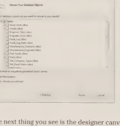

图 2-14：
选择几个表。

接下来你会看到类设计器的设计器画布。图 2-15 显示了一个示例图。它只是一个类图，像《第二册》中的那些一样。

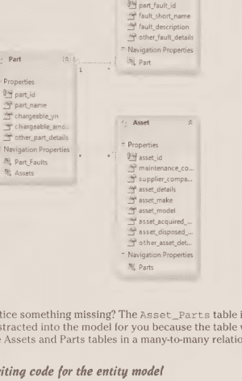

图 2-15：
看起来像类模型，
走起来像数据库。

注意到有什么缺失吗？Asset_Parts 表不见了；它已被抽象到模型中，因为该表仅用于在 Assets 和 Parts 表之间建立多对多关系。很巧妙，不是吗？

## 为实体模型编写代码

在你的编程环境中添加了有趣的内容，并且数据库已很好地集成到 C# 对象模型中后，你就可以使用这个新实体模型提供的对象进行编码。开始时，请按照以下步骤操作：

- 1. 返回窗口设计器，双击窗口进入代码视图。
- 2. 在 window.load 事件处理程序中，输入 Part part = new Part();。
- 3. 在下一行，输入 part. 并查看 IntelliSense。它包含 Parts 表中的所有列作为类的属性。

你现在拥有的是一个可操作的上下文。没有复杂的 Linq 查询——它们都在幕后完成。没有内联 SQL。没有存储过程。你可以用一个作用域对象完成所有操作。

## 第 3 章：垂钓 FileStream

### 本章内容

- 读写数据文件
- 使用 Stream 类
- 使用 using 语句
- 处理输入/输出错误

我曾在故乡科罗拉多的一条美丽山溪中用一个鱼钩钓到两条鳟鱼——对 11 岁的孩子来说相当刺激。用 C# 垂钓“文件流”没那么刺激，但它却是不可或缺的编程技能之一。

文件访问是指磁盘上数据的存储和检索。本章介绍基本文本文件输入/输出。读写数据库数据在本书迷你书的第 2 章中介绍，而读写互联网信息在第 4 章中介绍。

## 前往鱼群所在：文件流

本书中的控制台应用程序大多从控制台获取输入并向控制台发送输出。本章以外的程序有比文件操作更好——或至少不同的——东西来打发你的时间。我不想用繁琐的输入/输出（I/O）额外负担来混淆它们的信息。然而，不执行文件 I/O 的控制台应用程序就像造纸厂里的 Sierra Club 横幅一样常见。

I/O 类定义在 System.IO 命名空间中。基本的文件 I/O 类是 FileStream。过去，程序员会打开一个文件。打开命令会准备文件并返回一个句柄。通常，这个句柄只是一个数字，就像你在 Burger Whop 点餐时他们给你的号码一样。每次想要从文件读取或写入文件时，你都要出示这个 ID。

## 流

C# 使用更直观的方法，将每个文件与 FileStream 类的对象关联起来。FileStream 的构造函数打开文件并管理底层句柄。FileStream 的方法执行文件 I/O。


> > FileStream 并不是唯一可以执行文件 I/O 的类。然而，它代表了你那老式的、基本的文件，涵盖了 90% 的文件 I/O 需求。本章描述的就是这个主要类。如果它对 C# 来说足够好，对我来说就足够好了。

流的概念是 C# I/O 的基础。想象一下游行，它“流”过你身边，先是小丑，然后是花车，然后是一两个乐队，一些马匹，一群 Customer 对象，一个 BankAccount，等等。将文件视为字节（或字符或字符串）的流，就像游行一样。你将数据“流”入和流出你的程序。

C# 中使用的 .NET 类包括一个抽象的 Stream 基类和多个子类，用于处理磁盘上的文件、网络上的文件，或已作为内存中数据块存在的文件。一些流类专门用于加密和解密数据，一些用于帮助加快使用其他流时可能较慢的 I/O 操作，而且如果你想出一个新流的绝妙想法，可以自由地用自己的子类扩展 Stream 类（尽管我警告你，扩展 Stream 很艰难）。我在后面的“探索比刘易斯和克拉克更多的流”部分为你介绍流类。

### 读者和写入器

FileStream，你可能最常用的流类，是一个基本类。打开文件，关闭文件，读取一串字节，写入一串——就这些。但在字节级别读写文件工作量很大，我刻意避免。幸运的是，.NET 类库引入了“读取器”和“写入器”的概念。这类对象的实例极大地简化了文件（和其他）I/O。

当你创建一个新的读取器（多种可用类型之一）时，你会将一个流对象与之关联。对读取器来说，流是否连接到文件、内存块、网络位置或密西西比河无关紧要。读取器从流请求输入，流从——好吧，哪里都可以获取。使用写入器非常相似，只是你将输出发送到流而不是请求输入。流将其发送到指定目标。通常是文件，但不总是。

System.IO 命名空间包含围绕 FileStream（或其他流）包装的类，为你提供更易访问的方式并带来那种温暖的感觉：


- **TextReader/TextWriter：** 一对用于读取字符（文本）的抽象类。这些类是两种子类风格的基础：StringReader/StringWriter 和 StreamReader/StreamWriter。因为 TextReader 和 TextWriter 是抽象的，你将使用其中一对子类，通常是 StreamReader/StreamWriter，来执行实际工作。我在《第二册》中解释抽象类。

### 为老沃尔特进行流写入

在电影 *On Golden Pond* 中，亨利·方达在退休岁月里试图钓到一条他命名为 Old Walter 的怪兽鳟鱼。你不是要拖回大鱼，但至少应该把线抛进溪流。本节介绍写入文件。

程序生成两种输出：

- 有些程序以纯二进制格式将数据块作为字节写入。这种输出对于以高效方式存储对象很有用——例如，你需要 *persist*（保存在磁盘上的永久文件）的 Student 对象文件。

请参阅后面的“更多读取器和写入器”部分，了解 *BinaryReader* 和 *BinaryWriter* 类。


- 大多数程序读写人类可读的文本：你知道的，字母、数字和标点，像 Notepad 一样。亲和人类的 *StreamWriter* 和 *StreamReader* 类是使用流类最灵活的方式。有关一些细节，请参阅后面的“读取器和写入器”部分。

人类可读的数据过去曾被称为 ASCII 或稍后的 ANSI 文本。这两个名称指的是定义它们的标准化组织。然而，ANSI 编码不提供奥地利以东和夏威夷以西的字母表；它只能处理像英语中使用的罗马字母。它没有俄语、希伯来语、阿拉伯语、印地语或其他使用非罗马字母的语言的字符，包括中文、日文和韩文等亚洲语言。现代、更灵活的 Unicode 文件格式是“向后兼容”的——在字符集开头包含熟悉的 ANSI 字符，但仍提供大量其他字母表，包括我刚才列出的所有语言所需的一切。Unicode 有几种变体，称为 *encodings*，然而 UTF8 是 C# 的默认格式。（你可以在 csharp102.info 上的文章“Converting between Byte and Char Arrays”中了解更多关于编码及其使用方法。）


## 使用流：示例

下面的 FileWrite 程序从控制台读取数据行并写入用户选择的文件中。这 是伪代码——它并非用于编译。我仅将其作为示例使用。


// FileWrite -- Write input from the Console into a text file.
using System;
using System.IO;

namespace FileWrite
{
    public class Program
    {
        public static void Main(string[] args)
        {
            // Get a filename from the user -- the while loop lets you
            // keep trying with different filenames until you succeed.
            StreamWriter sw = null;
            string fileName = "";
            while(true)
            {
                try
                {
                    // Enter output filename (simply hit Enter to quit).
                    Console.Write("Enter filename ");
                    Console.WriteLine("Enter blank filename to quit:");
                    fileName = Console.ReadLine();
                    if (fileName.Length == 0)
                    {
                        // No filename -- this jumps beyond the while
                        // loop for safety. You're done.
                        break;
                    }

                    // I factored out these tasks to simplify the loops a bit.
                    // Call a method (below) to set up the StreamWriter.
                    sw = GetWriterForFile(fileName);
                    // Read one string at a time, outputting each to the
                    // FileStream open for writing.
                    WriteFileFromConsole(sw);

                    // Done writing, so close the file you just created.
                    sw.Close(); // A very important step. Closes the file too.
                    sw = null; // Give it to the garbage collector.
                }
                catch (IOException ioErr)
                {
                    // Oops -- Error occurred during the processing of the
                    // file -- tell the user the full name of the file:
                    // Tack the name of the default directory to the filename.
                    string dir = Directory.GetCurrentDirectory(); // Directory class
                    string path = Path.Combine(dir, fileName); // System.IO.Path class
                    Console.WriteLine("Error on file {0}", path);

                    // Now output the error message in the exception.
                    Console.WriteLine(ioErr.Message);
                }
            }
            // Wait for user to acknowledge the results.
            Console.WriteLine("Press Enter to terminate...");
            Console.Read();
        }

        // GetWriterForFile -- Create a StreamWriter set up to write
        // to the specified file.
        private static StreamWriter GetWriterForFile(string fileName)
        {
            StreamWriter sw;
            // Open file for writing in one of these modes:
            // FileMode.CreateNew to create a file if it
            // doesn't already exist or throw an
            // exception if file exists.
            // FileMode.Append to append to an existing file
            // or create a new file if it doesn't exist.
            // FileMode.Create to create a new file or
            // truncate an existing file.

            // FileAccess possibilities are:
            // FileAccess.Read,
            // FileAccess.Write,
            // FileAccess.ReadWrite.
            FileStream fs = File.Open(fileName,
                FileMode.CreateNew,
                FileAccess.Write);
            // Generate a file stream with UTF8 characters.
            // Second parameter defaults to UTF8, so can be omitted.
            sw = new StreamWriter(fs, System.Text.Encoding.UTF8);
            return sw;
        }

        // WriteFileFromConsole -- Read lines of text from the console
        // and spit them back out to the file.
        private static void WriteFileFromConsole(StreamWriter sw)
        {
            Console.WriteLine("Enter text; enter blank line to stop");
            while (true)
            {
                // Read next line from Console; quit if line is blank.
                string input = Console.ReadLine();
                if (input.Length == 0)
                {
                    break;
                }
                // Write the line just read to output file.
                sw.WriteLine(input);
                // Loop back up to get another line and write it.
            }
        }
    }
}

FileWrite 同时使用了 System.IO 命名空间和 System.Text。System.IO 包含文件 I/O 类。

## 启动新的 StreamWriter

FileWrite 程序在 Main() 中以包含 try 块的 while 循环开始。这对于文件操作程序来说很常见。


将所有文件 I/O 操作都放在 try 块中。文件 I/O 容易出现错误，例如缺少文件或目录、路径错误等。有关异常处理的更多信息，请参阅第一部分。

while 循环具有两个功能：

- 它允许程序在 I/O 失败时返回重试。例如，如果程序找不到用户想要读取的文件，程序可以在放弃用户之前再次询问文件名。
- 在程序内部执行 break 命令会让你直接跳过 try 块并到达循环末尾。这是退出方法或程序的便捷机制。请记住，break 只能让你退出它所在的循环。（第 4 章介绍循环和 break。）

FileWrite 程序从控制台读取要创建的文件名。如果用户输入空文件名，程序将通过跳出 while 循环而终止。程序的关键在于对 GetWriterForFile() 方法的调用；你可以在 Main() 下方找到该方法。GetWriterForFile() 中的关键行是

```
FileStream fs = File.Open(fileName, FileMode.CreateNew, FileAccess.Write);
...
sw = new StreamWriter(fs, System.Text.Encoding.UTF8);
```

在第一行中，程序创建了一个代表磁盘上输出文件的 FileStream 对象。此处使用的 FileStream 构造函数接受三个参数：

- 文件名：这显然是要打开的文件的名称。像 filename.txt 这样简单的名称被假定位于当前目录（对于 FileWrite，在 Visual Studio 中工作时，即项目目录下的 \bin\Debug 子目录；它是构建程序后包含 .EXE 文件的目录）。以反斜杠开头的 文件名，如 \some directory\filename.txt，被假定为本地机器上的完整路径。以两个斜杠开头的 文件名——例如 \\your machine\some directory\filename.txt——驻留在网络上的其他机器上。从这里开始，文件名的编码会变得迅速复杂，超出了本迷你书的范围。
- **文件模式：** 此参数指定要对文件执行的操作。基本写入模式有创建（CreateNew）、追加（Append）和覆盖（Create）。CreateNew 创建新文件，但如果文件已存在则抛出 IOException。Create 模式如果文件不存在则创建文件，但如果文件存在则覆盖（'截断'）文件。正如其名，Append 会在现有文件末尾添加内容，或在文件不存在时创建文件。
- **访问类型：** 文件可以以读取、写入或两者同时的方式打开。


FileStream 有许多构造函数，其中每个构造函数都会为模式和访问参数中的一个或两个设置默认值。然而，在我看来，你应该显式指定这些参数，因为它们对程序的清晰度有很大影响。这通常是很好的建议。默认值对程序员来说可能很方便，但对阅读代码的人来说却令人困惑。

在 GetWriterForFile() 方法的第二条非注释行中，程序将新打开的 FileStream 对象 '包装' 在 StreamWriter 对象 sw 中。StreamWriter 类围绕 FileStream 对象提供一组对文本友好的方法。该 StreamWriter 就是该方法返回的内容。

StreamWriter 构造函数的第一个参数是 FileStream 对象。这就是包装。第二个参数指定要使用的编码。默认编码是 UTF8。


读取文件时无需指定编码。StreamWriter 会在文件的前三个字节中写入编码类型。StreamReader 在打开文件时读取这三个字节以确定编码。隐藏此类细节是优秀软件库提供的优势。

## 最后，我们开始写入！


在设置好 StreamWriter 后，FileWrite 程序开始从控制台读取字符串输入行（此代码位于从 Main() 调用的 WriteFileFromConsole() 方法中）。当用户输入空行时，程序停止读取；在那之前，它会吞下所有提供的内容并使用该类的 WriteLine() 方法将其吐入 StreamWriter sw。

StreamWriter.WriteLine() 与 Console.WriteLine() 之间的相似性不仅仅是巧合。

最后，流通过 sw.Close() 表达式关闭。这很重要，因为它也会关闭文件。（我在下一节中还有更多关于关闭事物的内容。）


## 用报纸包鱼

这种将一个类包装在另一个类中的做法是一种有用的软件模式——StreamWriter“包装”（包含一个引用）另一个类 FileStream，并用一些便利的功能扩展了 FileStream 的接口。StreamWriter 的方法委托（调用）内部 FileStream 对象的方法。这就是第二册中讨论的 HAS_A 关系，所以任何时候你使用 HAS_A，你都在进行包装。因此，实际上，你告诉包装器 StreamWriter 要做什么，它会将你的简单指令翻译成被包装的 FileStream 所需的更复杂的指令。StreamWriter 将这些翻译后的指令交给 FileStream 去执行。

你可以通过方法或其他方式安装被包装的对象，例如在构造函数内部创建被包装的对象。你也可以将一个方法包装在另一个方法周围，就像这样：

```
void WrapperMethod()
{
    _wrapped.DoSomething();
}
```

在这个例子中，WrapperMethod() 的类 HAS_A 引用 `_wrapped` 对象。换句话说，该类包装了那个对象。WrapperMethod() 将全部或部分“晚间工作”委托给 `_wrapped` 对象上的 DoSomething() 方法。

包装是编程中一种强大且常用的技术。一个包装类看起来像这样：

```
class Wrapper
{
    private Wrapped _wrapped;
    public Wrapper(Wrapped w)
    {
        _w = w; // 现在 Wrapper 有了对 Wrapped 的引用。
    }
}
```

在这个例子中，我使用类 Wrapper 的构造函数来安装被包装的对象，让调用者提供被包装的对象。你也可以通过 SetWrapped() 方法来安装它。

把包装想象成一种将一种模型翻译成另一种模型的方式。被包装的项目可能很复杂，因此你想提供一个更简单的版本；或者被包装的项目可能有一个不方便的接口，你想把它改造得更方便。一般来说，包装体现了适配器设计模式（你可以用你喜欢的搜索引擎找到它）。你可以在 StreamWriter 和 FileStream 之间的关系中看到这一点。

在许多情况下，你可以将一个流包装在另一个流周围，以便将一种流转换为另一种流。

注意，程序在关闭 StreamWriter 后将 `sw` 引用置为 null。文件对象在文件关闭后就没用了。良好的编程实践是在引用失效后将其置为 null，这样你就不会试图再次使用它。（如果你试图使用，你的代码会抛出异常，让你知道这一点！）关闭文件并将引用置为 null 可以让垃圾收集器回收它（参见第二册，你会遇到友好的收集器），并让文件可供其他程序打开。

catch 块就像一个足球守门员：它在那里捕获程序中可能发生的任何文件错误。catch 输出一条错误消息，包括出错文件的名称。但它输出的不仅仅是一个简单的文件名——它输出完整的文件名，包括路径，以供你阅读之便。它通过使用 Path.Combine() 方法将当前目录名（通过 Directory 类获得）附加到你输入的文件名的前面来实现这一点。（Path 是一个设计用于操作路径信息的类。Directory 提供用于处理目录的属性和方法。）第一册为你提供了异常的相关内容，包括异常的异常，异常的异常的异常——我放弃了。


路径是文件夹的完整名称。例如，在文件名 c:\user\temp directory\text.txt 中，路径是 c:\user\temp directory。


Combine() 方法足够聪明，能意识到对于像 c:\test.txt 这样的文件，路径并不在当前目录中。Path.Combine() 也是确保两个路径段正确组合的最安全方式，包括在它们之间添加路径分隔符。（在 Windows 中，路径分隔符是 \。你可以通过 Path.DirectorySeparatorChar 获取你的代码无论运行在什么操作系统上（无论是 Windows 还是某种 Unix）的正确分隔符。.NET Framework 库充满了这样的功能，显然旨在编写能够在多个操作系统上运行的 C# 程序，例如我在本书引言中讨论的、适用于 Linux 和 Unix 的 Mono。）

当遇到 while 循环的末尾时，无论是通过完成 try 块还是通过 catch 被引导，程序都会返回到 while 循环的顶部，允许用户写入另一个文件。

程序的一些示例运行如下。我的输入以粗体显示：

```
Enter filename (Enter blank filename to quit):TestFile1.txt
Enter text; enter blank line to stop
This is some stuff
So is this
As is this

Enter filename (Enter blank filename to quit):TestFile1.txt
Error on file 'C:\C#Programs\FileWrite\bin\Debug\TestFile1.txt'
The file 'C:\C#Programs\FileWrite\bin\Debug\TestFile1.txt' already exists.

Enter filename (Enter blank filename to quit):TestFile2.txt
Enter text; enter blank line to stop
I messed up back there. I should have called it
TestFile2.

Enter filename (Enter blank filename to quit):
Press Enter to terminate...
```

当我向 TestFile1.txt 输入一些随机文本时，一切顺利。然而，当我再次尝试打开 TestFile1.txt 时，程序吐出一条消息，大意是“文件已存在”，并附带了文件名。路径之所以“曲折”，是因为“当前目录”是 Visual Studio 放置可执行文件的目录。纠正我的错误后，我输入一个可接受的文件名——比如 TestFile2.txt——没有抱怨。

## 使用更好的钓鱼装备：using 语句

既然你已经看到了 FileStream 和 StreamWriter 的实际应用，我应该指出在 C# 中进行流写入的更常见方式——在 using 语句内部：

```
using(<some resource>)
{
    // 使用该资源。
}
```

using 语句是一种构造，它自动化了使用流之后的清理过程。当遇到 using 块的右花括号时，C# 会为你管理“刷新”流并关闭它。（刷新流是指在流被关闭之前，将流缓冲区中剩余的最后字节推送到关联的文件中。想象一下推动手柄将最后的水排出你的……鳟鱼溪流。）使用 using 可以避免在写入文件后忘记刷新和关闭的常见错误。不要留下打开的文件到处乱放。

如果不使用 using，你需要编写：

```
Stream fileStream = null;
TextWriter writer = null;
try
{
    // 创建并使用流，然后 ...
}
finally
{
    stream.Flush();
    stream.Close();
    stream = null;
}
```

注意我如何在 try 块之前声明了流和 writer（这样它们在整个方法中可见）。我还使用抽象基类声明了 fileStream 和 writer 变量，而不是具体的类型 FileStream 和 StreamWriter。这是一个好习惯。我将它们设置为 null，这样编译器就不会抱怨未初始化的变量。


将大部分流相关的工作包装在 using 语句中是一个好习惯。例如，将 StreamWriter 或 StreamReader 包装在 using 语句中，效果等同于将 writer 或 reader 的使用放在 try/finally 异常处理块中。（关于异常见第一册。）事实上，编译器会将 using 块转换为与 try/finally 相同的代码，这保证了资源被清理：

```
try
{
    // 在此分配资源并使用它。
}
finally
{
    // 在此关闭并释放资源。
}
```

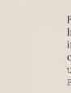

using 块之后，StreamWriter 不再存在，FileStream 对象也无法再被访问。假设你是在 using 语句外部创建了流，而不是像这样临时创建，那么 `fs` 变量仍然存在：

```
using(StreamWriter sw = new StreamWriter(new FileStream(...)) ...
```

刷新和关闭 writer 也刷新和关闭了流。如果你试图对流执行操作，会得到一个异常，告诉你不能访问已关闭的对象。请注意，在本节前面的 FileWrite 代码中，我在 using 块之后将 FileStream 对象 `fs` 置为 null，以确保我不会再次使用 `fs`。之后，FileStream 对象被交给垃圾收集器。

当然，你写入磁盘的文件是存在的。如果你需要再次处理它，请为该文件创建并打开一个新的文件流。


具体来说，using 旨在管理实现了 IDisposable 接口的对象的清理（关于接口的信息见第二册）。using 语句确保对象的 Dispose() 方法被调用。实现了 IDisposable 的类保证它们有一个 Dispose() 方法。IDisposable 主要涉及释放非 .NET 资源，主要是 Windows 操作系统外部世界的东西，比如文件句柄和图形资源。例如，FileStream 包装了一个必须被释放的 Windows 文件句柄，这就是我在这里提到 IDisposable 的原因。（许多类和结构体实现了 IDisposable；你的类也可以，如果有必要的话。）

我不打算在本书中深入介绍 IDisposable，但随着你的 C# 能力增长，你应该计划更加熟悉它。正确实现它与我简要提到的那种不确定的垃圾回收有关。


在第二册中，可能很复杂。因此，*using* 用于与实现了 `IDisposable` 的类和结构体，你可以在帮助中查看这些内容。*它*并非对任何普通对象都有用。*注意：* C# 的内置类型 —— `int`、`double`、`char` 等 —— 并没有实现 `IDisposable`。类 `TextWriter`（`StreamWriter` 的基类）确实实现了该接口。在帮助中，它看起来像这样：

```csharp
public abstract class TextWriter : MarshalByRefObject, IDisposable
```

如有疑问，请查看帮助，确定你计划使用的类或结构体是否实现了 `IDisposable`。


你可以在 Web 上的 `FileWriteWithUsing` 示例中查看 `FileWrite` 的重写版本。请注意，在重写中，我不得不取消拆分 `Main()` 调用的两个方法，将它们的代码拉回 `Main()` 中——即*内联*它——然后才能引入 *using* 块。

## 将它们从流中拉出：使用 StreamReader

写入文件很酷，但如果你之后无法读回文件，那就有点没价值了。下面的 `FileRead` 程序将*输入*重新放回*文件 I/O* 这一概念中。该程序读取由 `FileWrite` 或记事本创建的文本文件——它有点像 `FileWrite` 的反向操作（注意我在这个程序中没有使用 *using*）：


```csharp
// FileRead -- Read a text file and write it out to the Console.
using System;
using System.IO;

namespace FileRead
{
    public class Program
    {
        public static void Main(string[] args)
        {
            // You need a file reader object.
            StreamReader sr = null;
            string fileName = "";

            try
            {
                // Get a filename from the user.
                sr = GetReaderForFile(fileName);

                // Read the contents of the file.
                ReadFileToConsole(sr);
            }
            catch (IOException ioErr)
            {
                //TODO: Before release, replace this with a more user friendly message.
                Console.WriteLine("{0}\n\n", ioErr.Message);
            }
            finally  // Clean up.
            {
                if (sr != null) // Guard against trying to Close() a null object.
                {
                    sr.Close();    // Takes care of flush as well
                    sr = null;
                }

                // Wait for user to acknowledge the results.
                Console.WriteLine("Press Enter to terminate...");
                Console.Read();
            }
        }

        // GetReaderForFile -- Open the file and return a StreamReader for it.
        private static StreamReader GetReaderForFile(string fileName)
        {
            StreamReader sr;
            // Enter input filename.
            Console.Write("Enter the name of a text file to read:");
            fileName = Console.ReadLine();

            // User didn't enter anything; throw an exception
            // to indicate that this is not acceptable.
            if (fileName.Length == 0)
            {
                throw new IOException("You need to enter a filename.");
            }

            // Got a name -- open a file stream for reading; don't create the
            // file if it doesn't already exist.
            FileStream fs = File.Open(fileName, FileMode.Open, FileAccess.Read);

            // Wrap a StreamReader around the stream -- this will use
            // the first three bytes of the file to indicate the
            // encoding used (but not the language).
            sr = new StreamReader(fs, true);
            return sr;
        }

        // ReadFileToConsole -- Read lines from the file represented
        // by sr and write them out to the console.
        private static void ReadFileToConsole(StreamReader sr)
        {
            Console.WriteLine("\nContents of file:");
            // Read one line at a time.
            while(true)
            {
                // Read a line.
                string input = sr.ReadLine();

                // Quit when you don't get anything back.
                if (input == null)
                {
                    break;
                }

                // Write whatever you read to the console.
                Console.WriteLine(input);
            }
        }
    }
}
```


请注意，FileRead 使用的当前目录是 FileRead 项目下的 \bin\Debug 子目录（而不是 FileWrite 程序目录下的 \bin\Debug 目录，在前面的章节中你正是在那里使用 FileWrite 创建了一些测试文件）。在运行 FileRead 尝试之前，请将一个纯文本文件（.TXT 扩展名）放到 FileRead 的 \bin\Debug 目录中，并记下它的名称以便打开。在 FileWrite 示例中创建的 TestFile1.txt 文件的副本就很合适。

在 FileRead 中，用户只能读取一个文件。用户必须输入有效的文件名，程序才会输出。没有第二次机会。程序读取文件后即退出。如果用户想查看第二个文件，她必须重新运行程序。这是一个你可能会有不同做法的设计选择。

程序一开始就将所有主要代码包装在一个异常处理程序中。在 try 块中，该处理程序尝试调用两个方法：首先获取文件的 StreamReader，然后读取文件并将其内容逐行输出到控制台。如果发生异常，catch 块会写出异常消息。最后，无论是否发生异常，finally 块都会确保流及其文件被关闭，并将变量 sr 设置为 null，以便垃圾回收器能够回收它（参见第一册）。从 try 块调用的任一方法都可能发生 I/O 异常。这些异常会向上传播到 Main() 以寻找处理程序。（在这些方法中无需异常处理程序。）


请注意 catch 块中的 // TODO: 注释。这是一个提醒，在发布程序之前使消息更友好。以这种方式标记的注释会出现在 Visual Studio 的任务列表窗口中。在该窗口中，从左上角的下拉列表中选择“注释”。双击那里的某个条目，编辑器就会打开代码中的该注释。


由于变量 sr 在异常块内部使用，你必须将其初始化为 null——否则，编译器会抱怨在异常块中使用了未初始化的变量。同样，在尝试调用其 Close() 方法之前，请检查 sr 是否已经（或仍然）为 null。更好的做法是，将程序转换为使用 using。

在 GetReaderForFile() 方法中，程序给用户一次输入文件名的机会。如果在控制台输入的文件名只是一个空白，程序会抛出自己的错误消息：You need to enter a filename。如果文件名不为空，则用于以读取模式打开 FileStream 对象。这里的 File.Open() 调用与 FileWrite 中使用的相同：

- 第一个参数是文件名。
- 第二个参数是文件模式。模式 FileMode.Open 表示：“如果文件存在则打开，如果不存在则抛出异常。”另一个选项是 OpenNew，如果文件不存在则创建一个零长度文件。就我个人而言，我从未看到过使用该模式的必要（谁想从空文件中读取？），但我认为各有所好。

♦ 最后一个参数表示我想从这个 FileStream 中读取。其他可选值是 Write 和 ReadWrite。不过，用 Write 模式打开 FileRead 文件看起来有点奇怪，你不觉得吗？）

生成的 FileStream 对象 fs 随后被包装在 StreamReader 对象 sr 中，以提供访问文本文件的便捷方法。StreamReader 最终被传递回 Main() 使用。

当文件打开过程完成后，FileRead 程序调用 ReadFileToConsole() 方法，该方法使用 ReadLine() 调用循环读取文件中的文本行。程序在返回循环顶部读取另一行文本之前，使用无处不在的 Console.WriteLine() 调用将每一行回显到控制台。当程序到达文件末尾时，ReadLine() 调用返回 null。此时，该方法跳出读取循环并返回。然后 Main() 关闭对象并终止。（你可能会说，这个读取程序的读取部分被包裹在一个 while 循环中，而该循环位于一个 try 块内的方法中，整个结构就像一个谜。）

Main() 中的 catch 块用于防止异常沿调用链向上传播并中止程序。如果程序抛出异常，我会让 catch 块写出消息，然后直接吞掉（忽略）错误。你已经在 Main() 中，所以没有其他地方可以重新抛出异常，除了关闭流并结束程序之外无事可做。catch 的作用是让用户知道程序失败的原因，并防止未处理的异常。你可以让程序循环回去并要求输入另一个文件名，但该程序太小，让用户再次运行它更简单。

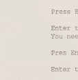

提供带有吞掉异常的 catch 块的异常处理程序可以防止程序因不重要的错误而中止。但是，只有在错误确实（不是虚假的）不会造成损害的情况下，才可以使用这种技术并吞掉异常。更详细的讨论请参见第二册。

以下是一些示例运行：

```
Enter the name of a text file to read:yourfile.txt
Could not find file 'C:\C#Programs\FileRead\bin\Debug\yourfile.txt'.
Press Enter to terminate...

Enter the name of a text file to read:
You need to enter a filename.
Press Enter to terminate...

Enter the name of a text file to read:myfile.txt
Contents of file:
Dave?
What are you doing, Dave?
Press Enter to terminate...
```


关于从文件中读取任意字节（既可以是二进制数据，也可以是文本）的示例，请参见第I册第7章中的 LoopThroughFiles 示例。该程序实际上会遍历目标目录中的所有文件，读取每个文件并将其内容转储到控制台，因此如果文件很多，这个过程会变得很繁琐。你可以随时按 Ctrl-C 或单击控制台窗口的关闭按钮来终止它。关于 BinaryReader 的讨论请参见下一节。

## 更多读取器和写入器

本章前面，我介绍了 StreamReader 和 StreamWriter 类，它们可能用于满足你大部分的 I/O 需求。不过，.NET 还提供了其他几对读取器/写入器：

- **BinaryReader/BinaryWriter：** 一对流类，包含用于读写每种值类型的方法：`ReadChar()`、`WriteChar()`、`ReadByte()`、`WriteByte()` 等。（这些类稍微更原始一些：它们不提供 `ReadLine()`/`WriteLine()` 方法。）这些类可用于以二进制（非人类可读）格式而不是文本格式读写对象。你可以使用字节数组以原始字节形式处理二进制数据。例如，你可能需要读写组成位图图形文件的字节。

**实验：** 用记事本打开一个扩展名为 .EXE 的文件。你可能会在窗口中看到一些可读文本，但其中大部分看起来像某种乱码。那就是二进制数据。

我网站上的文章《字节数组与字符数组之间的转换》简要介绍了如何使用字节数组或字符数组。第II册包含一个前面提到的读取二进制数据的示例。该示例使用 BinaryReader 和 FileStream 对象从文件中读取字节块，然后以十六进制（基数为 16）表示法将数据输出到控制台，我会在那一章解释这种表示法。尽管它把 FileStream 包装在更方便的 BinaryReader 中，但该示例也完全可以只使用 FileStream 本身。读取操作是相同的。虽然 BinaryReader 在那个示例中并没有提供额外功能，但我在那里使用它是为了给出这个读取器的示例。该示例确实演示了如何将原始字节读入缓冲区（一个足以容纳所读取字节的数组）。

- **StringReader/StringWriter：** 现在来看点更另类的东西：仅限于读写字符串的简单读取器和写入器类。它们让你可以像对待文件一样对待字符串，这是以常规方式访问字符串字符的一种替代方法，例如使用 `foreach` 循环

```
foreach(char c in someString) { Console.Write(c); }
```

或者使用数组风格的方括号表示法（[ ]）

```
char c = someString[3];
```


- **BufferedStream**：缓冲是一种通过一次读写更大块数据来加速输入/输出操作的技术。大量的小读取或小写入意味着大量缓慢的磁盘访问——但如果你读取比当前所需大得多的数据块，之后就可以继续从缓冲区中读取小数据块——这比读取磁盘快得多。当 `BufferedStream` 的底层缓冲区数据耗尽时，它会再读入一个大块——甚至可能是整个文件。缓冲写入也类似。

`FileStream` 类会自动缓冲其操作，因此 `BufferedStream` 适用于特殊情况，例如与 `NetworkStream` 配合，通过网络读写字节。在这种情况下，我们将 `BufferedStream` 包装在 `NetworkStream` 周围，从而有效地“链接”流。当你写入 `BufferedStream` 时，它会写入底层的 `NetworkStream`，依此类推。

当你把一个流包装在另一个流外面时，你就是在组合流。（你可以在帮助索引中查找更多信息。）我在前面的边栏“把鱼用报纸包起来”中讨论了包装。

- **NetworkStream**：管理通过网络读写数据。关于其使用的简化讨论，请参见 `BufferedStream`。`NetworkStream` 位于 `System.Net.Sockets` 命名空间中，因为它使用一种称为 `sockets` 的技术来跨网络建立连接。
- **UnmanagedMemoryStream**：让你在“非托管”内存块中读写数据。`Unmanaged` 基本上意味着“非 .NET”，不受 .NET 运行时及其垃圾回收器管理。这是高级内容，涉及 .NET 代码与在 Windows 操作系统下编写的代码之间的交互。
- **CryptoStream**：位于 `System.Security.Cryptography` 命名空间中，这个流类让你在加密或解密转换中传入和传出数据。我相信你每天都会用到它。反正我是这样。

## 第4章：访问 Internet

### 本章内容

- 浏览 System.Net 命名空间
- 使用内置工具访问网络
- 让网络工具为你所用

在我看来，微软当初不得不创建 .NET Framework 的原因，是现有基础设施缺乏 Internet 互操作性。COM 根本无法处理 Internet。Internet 的运行方式与大多数平台（例如 PC）不同。Internet 基于协议——即为实现邮件和文件传输等工作而精心定义并达成一致的方式。2002 年之前，微软的环境显然也没有很好地处理这些。

正如你在本书中随处可见的，.NET Framework 从底层设计时就考虑了 Internet 和一般网络。毫不意外，这一点在 System.Net 命名空间中体现得最为清楚。Internet 在这里占据首要位置，Web 工具占据了该命名空间中的九个类。

在这个框架的第4版中，内置了更多 Internet 功能。尽管在第1版中重点在于用于构建其他工具的工具（低层功能），但现在它包含了对你有用的功能，例如 Web、邮件和文件传输协议（FTP）。安全套接字层——Internet 的传输安全——在这个版本中更易于使用，FTP 和邮件也是如此；它们以前需要其他更难使用的类。

System.Net 是一个庞大而内容丰富的命名空间，在其中找到方向可能很困难。本章的目标是选取你经常做的事情，展示基础知识，然后为你提供研究这些类更复杂特性的工具。

网络是 .NET Framework 的重要组成部分，所有功能都在这个命名空间中——关于这个主题可以写（而且已经写过）一整本书。作为这次 C# 网络编程入门的一部分，我将向你展示以下功能：

- 从网络获取文件
- 发送电子邮件
- 记录传输日志
- 检查运行中应用程序周围网络的状态

请记住，我并不是说套接字、IPv6 和其他高级 Internet 协议不重要。本章讨论的是你每天都会用到的命名空间部分。一如既往，关于 System.Net 还有更多内容需要学习。

## 了解 System.Net

System.Net 命名空间里充满了这样的类：在文档中看时令人困惑，但在应用程序中使用时却很有道理。该命名空间消除了处理 Internet 上使用的各种协议的所有复杂性。

Internet 协议有 2,000 多份 RFC（RFC 是 Request For Comments 的缩写，即一份提交给标准机构、在成为标准之前由同行评审的文件）；如果你必须分别学习所有这些，你将永远无法完成项目。System.Net 命名空间就是要让这件事不那么痛苦。

System.Net 并不只适用于 Web 项目。与基类库中的其他所有内容一样，你可以在各种项目中使用 System.Net。你可以

- 从 Internet 上的网页获取信息，并在程序中使用。
- 使用 FTP 通过 Internet 移动文件。
- 轻松发送电子邮件。
- 使用更高级的网络结构。
- 使用 SSL 协议保护 Internet 上的通信。

如果你需要从 Windows 应用程序检查某台计算机的连通性，可以使用 System.Net。如果你需要构建一个从网站下载文件的类，System.Net 就是所需的命名空间。大多数类与 Internet 相关，并不意味着只有 Web 应用程序才能使用它。这就是 System.Net 的魔力。任何应用程序都可以成为联网应用程序。虽然该命名空间的某些部分旨在让 Web 应用程序的开发更容易，但总体而言，该命名空间的设计目标是让任何应用程序都能与 Web 协同工作。


## Net 类如何融入框架

System.Net 命名空间包含 62 个类和六个较小的命名空间。即使在我写这些内容时，我也感到应接不暇。然而，如果你仔细观察，就能看到其中的规律。

如果你在使用类时需要帮助，可以在第 II 册中找到更多信息。

这些类的命名很规范，你会注意到少数几个协议各自拥有多个类。翻译之后，你可以根据协议的命名方式来缩小所需范围：

- `Authentication` 和 `Authorization`：这些类提供安全性。
- `Cookie`：这个类管理来自 Web 浏览器的 Cookie，通常用于 ASP.NET 页面。
- `DNS`（域名服务）：这些类帮助将域名解析为 IP 地址。
- `Download`：这个类用于从服务器获取文件。
- `EndPoint`：这个类帮助定义网络节点。
- `FileWeb`：这组出色的类将网络文件服务器描述为本地类。
- `FtpWeb`：这个类是简单的文件传输协议实现。
- `Http`（超文本传输协议）：这个类是 Web 协议。
- `IP`（网际协议）：这个类帮助定义专门与 Internet 相关的网络终结点。
- `IrDA`：这个类是红外终结点。红外端口也是网络！
- `NetworkCredential`：这个类是另一种安全实现。
- `Service`：这个类帮助管理网络连接。
- `Socket`：这个类处理最原始的网络连接。
- `Upload`：这组类帮助你向 Internet 上传信息。
- `Web`：这些类帮助处理万维网——主要是更面向任务的 `http` 类实现。

这个列表很广泛，因为这些类相互构建。`socket` 类使用 `EndPoint` 类来定义某些网络细节，而 `IP` 类使它们特定于 Internet。`Web` 类特定于万维网。你很少会使用最高级别的类，但通常很难看出什么时候需要什么。


不过，你每天使用的大部分功能都封装在 System.Net 命名空间下的七个大多是新的命名空间中：

- **缓存**：此功能包含大量枚举器，用于管理内置于该命名空间的浏览器和网络缓存功能。
- **配置**：此功能允许访问你需要设置的属性，以使许多其他 System.Net 类正常工作。
- **邮件**：此功能接替 System.Web.Mail，以便于发送 Internet 电子邮件。
- **Mime（多用途 Internet 邮件扩展）**：此功能将文件附件与 Mail 命名空间捆绑在一起。
- **网络信息**：此功能获取有关应用程序周围网络的详细信息。
- **安全**：此功能实现由 System.Net 的许多类管理的网络安全。
- **套接字**：此功能利用 Windows 可用的最基本的网络连接。

## 使用 System.Net 命名空间

System.Net 命名空间是面向代码的，这意味着很少有实现专门针对用户界面。你使用这些类所做的大部分事情都在后台进行。你几乎没有拖放式用户控件——System.Net 命名空间是在代码视图中使用的。

为了演示这一点，在本章剩余部分，我将介绍如何构建一个具有以下要求的 Windows 窗体应用程序：

- 检查网络状态。
- 从 Internet 获取特定文件。
- 将其通过电子邮件发送到特定电子邮件地址。
- 记录整个事务。

这并非一组无足轻重的要求。事实上，即使在 C# 的 1.0 和 1.1 版本中，这也会很困难。此版本中 System.Net 命名空间的主要目标之一就是让常见任务变得容易得多。你可以从加载示例代码开始，或者新建一个项目并按照以下各节中的步骤操作。

就是这么简单。NetworkInformation 类包含大量关于网络状态、当前 IP 地址、当前计算机正在使用的网关等信息。


请记住，NetworkInformation 类仅在本地计算机上有效。如果你在 ASP.NET Web Forms 应用程序中使用这个类，你将获得有关服务器的信息。

### 从 Internet 下载文件

你可以通过几种方式之一从 Internet 获取文件，其中最常见的一种是使用 FTP。轻量级 FTP 协议之所以受到青睐，是因为它安全并且在许多系统上受支持。

要构建使用 FTP 的应用程序，请按照以下步骤操作：

1. 从工具箱中将一个按钮拖到窗体上。
2. 双击该按钮以获取 Click 事件处理程序。
3. 在代码顶部添加所需的导入：System.Net、System.Net.Mail 和 System.IO。
4. 创建一个名为 DownloadFile 的新子例程，它接受远程文件名和本地文件名作为字符串。
5. 在新子例程中，创建一个新的 FileStream（名为 localFileStream）和 FtpWebRequest（名为 ftpRequest），如清单 4-1 所示。
6. 将 FtpWebRequest 的 Method 参数设置为 WebRequestMethods.Ftp.DownloadFile。
7. 将 FtpWebRequest 的 Credentials 属性设置为一个带有匿名信息的新 NetworkCredential，就像我在清单 4-1 中所做的那样。
8. 从 ftpRequest 方法创建一个新的 WebResponse 对象。这会从 FTP 服务器获取关于如何处理你的请求的声明。
9. 从 Response 对象获取 Stream。
10. 使用 While 循环将文件读入 1024 字节缓冲区，一次读取一个块，如清单 4-1 末尾所示。

FileStream 引用本地文件，并接受传入子例程的本地文件。FtpWebRequest 对于远程文件而言是同样的东西。

这段代码看起来与 FTP 示例惊人地相似，你可以在下面这段代码中看到。恢复的是同一个流；只是格式不同。

```csharp
private void DownloadWebFile(string remoteFile, string localFile)
{
    FileStream localFileStream = new FileStream(localFile, FileMode.OpenOrCreate);
    WebRequest webRequest = WebRequest.Create(remoteFile);
    webRequest.Method = WebRequestMethods.Http.Get;
    WebResponse webResponse = webRequest.GetResponse();
    Stream webResponseStream = webResponse.GetResponseStream();
    byte[] buffer = new byte[1024];
    int bytesRead = webResponseStream.Read(buffer, 0, 1024);
    while (bytesRead > 0)
    {
        localFileStream.Write(buffer, 0, bytesRead);
        bytesRead = webResponseStream.Read(buffer, 0, 1024);
    }
    localFileStream.Close();
    webResponseStream.Close();
}
```


你需要传入一个 Web 地址，因此你的子例程调用看起来像这样：

```csharp
DownloadWebFile("http://www.csharpfordummies.net/sampleFile.bmp", @"c:\sampleFile.bmp");
```

注意标记为粗体的更改。webRequest 现在是 WebRequest，而不是 FtpWebRequest。此外，webRequest 的 Method 属性已更改为 WebRequestMethods.Http.Get。最后，Credentials 属性已被移除，因为不再需要凭据。

### 通过电子邮件发送状态报告

电子邮件是网络系统的一项常见需求。如果你在企业环境中工作，你将会编写一个更大规模的应用程序来处理所有电子邮件需求，而不是让每个单独的应用程序都具备电子邮件感知能力。

然而，如果你正在编写独立产品，它可能需要电子邮件支持。因为我恰好正在编写一个独立应用程序，所以这正是我要做的事情。

电子邮件是基于服务器的操作，所以如果你没有可用于发送的电子邮件服务器，这可能会很困难。许多 ISP 不再允许中继，也就是在没有先拥有账户并登录的情况下发送外发邮件。因此，你可能会在运行示例的这一部分时遇到麻烦。


然而，如果你处于企业环境中，通常可以联系你的电子邮件管理员并获得使用电子邮件服务器的许可。因为发出的请求通常只在防火墙内部处理，所以中继通常是可用的。要构建你的电子邮件功能，请按照以下步骤操作：

- 1. **在设计视图中向默认窗体添加一个文本框，然后切换到代码视图。**
  在代码视图顶部，确保你已引用了 `System.Net.Mail` 命名空间。
- 2. **创建一个名为 SendEmail 的新子程序。**
  它应接受发件人电子邮件地址、收件人电子邮件地址、电子邮件主题和电子邮件正文。
- 3. **声明一个新的 MailMessage 并传入 fromAddress、toAddress、subject 和 body 参数，如下所示：**
  `MailMessage message = New MailMessage(fromAddress, toAddress, subject, body);`
- 4. **声明一个新的 SmtpClient 并传入你的邮件服务器地址。**
  这可以是 IP 地址、机器名称或 URL。
- 5. **使用你创建的 SmtpClient 对象的 Send 方法发送 MailMessage，该 MailMessage 作为参数传入。**
- 6. **完成后，确保将 MailMessage 和 SmtpClient 的值设为 Nothing，因为它们会占用资源。**

### 清单 4-2：SendEmail 子程序

```
private void SendEmail(string fromAddress, string toAddress, string subject,
    string body)
{
    MailMessage message = new MailMessage(fromAddress, toAddress, subject, body);
    SmtpClient mailClient = new SmtpClient("localhost");
    mailClient.Send(message);
    message = null;
    mailClient = null;
}
```

请注意，我使用了 localhost 作为电子邮件服务器名称。如果你在本地安装了电子邮件服务器软件，甚至是带 SMTP 的 IIS 6.0，这将有效。大多数情况下，你需要在 SmtpClient 构造函数中输入另一个电子邮件服务器名称。电子邮件服务器名称通常可以在你的 Outlook 首选项中找到。

编写完方法后，你需要在 Button1_Click 事件处理程序中在文件下载后调用它。将该子程序的代码更改为以下内容以调用该方法：

```
private void button1_Click(object sender, EventArgs e)
{
    DownloadFile(@"ftp://ftp.csharpfordummies.net/sampleFile.bmp", @"c:\sampleFile.bmp");
    SendEmail(textBox1.Text, textBox1.Text, "FTP Successful", "FTP Successfully downloaded");
}
```

请注意，我两次传入了文本框的值：一次用于收件人地址，一次用于发件人地址。这并不总是必要的，因为你可能希望电子邮件仅来自 Webmaster 地址或仅发送到你的地址。

现在你应该有足够的代码来运行应用程序了。按 F5 启动应用程序的调试模式并试用一下。

当你点击按钮时，应用程序应将文件下载到本地驱动器，然后通过电子邮件通知你下载已完成。然而，网络应用程序可能会出现各种问题，你应该注意这些问题。以下是一些例子：

- 对于大多数网络活动，运行软件的机器必须连接到网络。对你作为开发者来说这不是问题，但你需要意识到最终用户可能需要连接才能使用他们想要的功能。使用网络状态代码可以帮助用户了解这些功能的可用性。
- 防火墙和其他网络设备有时会阻止来自合法应用程序的网络流量。一些例子包括：
  - FTP 通常会被企业网络阻止。
  - .NET 的网络分析功能通常在企业服务器上被阻止。如果服务器对公众开放，这些开放可能会为黑客提供可乘之机。
  - 说到黑客，请确保如果你的应用程序使用传入网络功能，你已充分保护了应用程序。更多内容可在 Michael Howard 和 David C. LeBlanc 合著的优秀书籍 Writing Secure Code, Second Edition（由 Microsoft Press 出版）中找到。
  - 电子邮件尤其脆弱。通常，互联网服务提供商会阻止来自未在邮件服务器上注册的地址的电子邮件。这意味着如果你使用的是本地主机服务器（如清单 4-2 中的示例），你的 ISP 可能会阻止该电子邮件。
- 网络流量 notoriously 难以调试。例如，如果示例应用程序运行正常，但你从未收到你编写的 SmtpServer 的电子邮件，出了什么问题？你可能永远不会知道。XML Web 服务（在 Book VII 中介绍）也有类似问题——要查看 SOAP 信封（在 Web 服务请求周围添加的标记）中的实际代码以判断出了什么问题，难度极大。

## 日志记录网络活动

这引出了下一个主题，即网络日志记录。因为网络活动问题很难调试和重现，Microsoft 内置了几种用于管理网络活动跟踪的工具。

更重要的是，与可用的 ASP.NET 跟踪类似，System.Net 命名空间的跟踪完全使用配置文件进行管理。因此，要使用这些功能，你无需更改和重新编译代码。事实上，通过少量管理，你甚至可以通过管理应用程序使用的配置文件向用户显示调试信息。

每种类型的应用程序都有不同类型的配置文件。对于你在此使用的 Windows Forms 应用程序，文件名为 app.config，并存储在开发项目目录中。编译时，文件名会更改为应用程序的名称，并复制到 bin 目录以供运行。

如果你现在打开 app.config 文件，你会看到它已包含一些诊断信息，如清单 4-3 所示。你将向其中添加一些信息。

### 清单 4-3：默认的 app.config 文件

```
<?xml version="1.0" encoding="utf-8" ?>
<configuration>
  <system.diagnostics>
    <sources>
      <!-- This section defines the logging configuration for
      My.Application.Log in Windows Forms projects. -->
      <source name="Microsoft.VisualBasic.Logging.Log.WindowsFormsSource"
              switchName="DefaultSwitch">
        <listeners>
          <add name="FileLog"/>
          <!-- Uncomment the below section to write to the Application
          Event Log -->
          <!--<add name="EventLog"/>-->
        </listeners>
      </source>
    </sources>
    <switches>
      <add name="DefaultSwitch" value="Information" />
    </switches>
    <sharedListeners>
      <add name="FileLog"
        type="Microsoft.VisualBasic.Logging.FileLogTraceListener,
Microsoft.VisualBasic, Version=8.0.0.0, Culture=neutral, PublicKeyToken=b03f5f7f1fd50a3a, processorArchitecture=MSIL"
        initializeData="FileLogWriter"/>
        <!-- Uncomment the below section and replace APPLICATION_NAME with
the name of your application to write to the Application Event Log -->
        <!-- <add name="EventLog" type="System.Diagnostics.EventTraceListener" initializeData="APPLICATION_NAME" /> -->
    </sharedListeners>
  </system.diagnostics>
</configuration>
```

首先，你需要为 System.Net 命名空间添加一个新的源。接下来，你为添加的源在 Switches 部分添加一个开关。最后，你向该部分添加一个 SharedListener 并设置文件以自动刷新跟踪信息。

带有加粗添加内容的完成后的 app.config 文件如清单 4-4 所示。它也在本书配套网站的示例代码中。

### 清单 4-4：完成的 app.config 文件

```
<?xml version="1.0" encoding="utf-8" ?>
<configuration>
  <system.diagnostics>
    <sources>
      <source name="Microsoft.VisualBasic.Logging.Log.WindowsFormsSource"
        switchName="DefaultSwitch">
        <listeners>
          <add name="FileLog"/>
        </listeners>
      </source>
      <source name="System.Net">
        <listeners>
          <add name="System.Net"/>
        </listeners>
      </source>
    </sources>
    <switches>
      <add name="DefaultSwitch" value="Information" />
      <add name="System.Net" value="Verbose" />
    </switches>
    <sharedListeners>
      <add name="FileLog"
        type="Microsoft.VisualBasic.Logging.FileLogTraceListener,
Microsoft.VisualBasic, Version=8.0.0.0, Culture=neutral, PublicKeyToken=b03f5f7f1fd50a3a, processorArchitecture=MSIL"
        initializeData="FileLogWriter"/>
      <add name="System.Net"
        type="System.Diagnostics.TextWriterTraceListener"
        initializeData="my.log"/>
    </sharedListeners>
    <trace autoflush="true" />
  </system.diagnostics>
</configuration>
```


再次运行应用程序并观察输出窗口。由于您对配置文件所做的更改，高级日志信息会在那里显示。此外，还写入了一个日志文件。在开发环境中，它位于项目中的 bin/debug 目录下。您可能需要在“解决方案资源管理器”顶部的“显示所有文件”按钮上单击才能看到它。

在该文件夹中，您应该会看到名为 my.log 的文件，共享侦听器（您已将其添加到 app.config 文件中）将日志信息导向到该文件。我的该文件副本显示在第 4-5 节中——因人而异。

## 第 4-5 节：日志信息

```
System.Net Information: 0 : WebRequest::Create(ftp://ftp.csharpfordummies.net/sample.bmp
System.Net Information: 0 : Exiting WebRequest::Create() -> FtpWebRequest#37460558
System.Net Information: 0 : FtpWebRequest#37460558::GetResponse()
System.Net Information: 0 : Exiting FtpWebRequest#37460558::GetResponse()
System.Net Information: 0 : Associating Message#5948707 with HeaderCollection#23085090
System.Net Information: 0 : HeaderCollection#23085090::Set(mime-version=1.0)
System.Net Information: 0 : Associating MailMessage#6964596 with Message#5948707
System.Net Information: 0 : SmtpClient::.ctor(host=24.123.157.3)
System.Net Information: 0 : Associating SmtpClient#7113003 with SmtpTransport#30544512
System.Net Information: 0 : Exiting SmtpClient::.ctor() -> SmtpClient#7113003
System.Net Information: 0 : SmtpClient#7113003::Send(MailMessage#6964596)
System.Net Information: 0 : SmtpClient#7113003::Send(DeliveryMethod=Network)
System.Net Information: 0 : Associating SmtpClient#7113003 with MailMessage#6964596
System.Net Information: 0 : Associating SmtpTransport#30544512 with SmtpConnection#44365459
System.Net Information: 0 : Associating SmtpConnection#44365459 with ServicePoint#7044526
System.Net Information: 0 : Associating SmtpConnection#44365459 with NetworkStream#20190146
System.Net Information: 0 : HeaderCollection#30689639::Set(content-transfer-encoding=base64)
System.Net Information: 0 : HeaderCollection#30689639::Set(content-transfer-encoding=quoted-printable)
System.Net Information: 0 : HeaderCollection#23085090::Remove(x-receiver)
System.Net Information: 0 : HeaderCollection#23085090::Set(from=bill@smtp.net)
System.Net Information: 0 : HeaderCollection#23085090::Set(to=bill9@smtp.net)
System.Net Information: 0 : HeaderCollection#23085090::Set(date=1 Apr 2010 16:32:32 -0500)
System.Net Information: 0 : HeaderCollection#23085090::Set(subject=FTP Successful)
System.Net Information: 0 : HeaderCollection#23085090::Get(mime-version)
System.Net Information: 0 : HeaderCollection#23085090::Get(from)
System.Net Information: 0 : HeaderCollection#23085090::Get(to)
System.Net Information: 0 : HeaderCollection#23085090::Get(date)
System.Net Information: 0 : HeaderCollection#23085090::Get(subject)
System.Net Information: 0 : HeaderCollection#30689639::Get(content-type)
System.Net Information: 0 : HeaderCollection#30689639::Get(content-transfer-encoding)
System.Net Information: 0 : Exiting SmtpClient#7113003::Send()
```

阅读此文件，您可以看到与服务器上的请求相匹配的引用编号全部出现，极大地提高了调试的便捷性。此外，由于所有内容都按操作顺序排列，很容易查明过程中错误的确切发生位置。

## 第 5 章：创建图像

### 本章内容
- 了解 System.Drawing 命名空间
- 了解绘图类如何在 .NET Framework 中配合使用
- 使用 System.Drawing 创建一个简单的游戏应用程序

没有人会用 C# 来编写下一版《生化奇兵》。它并不是用来编写像射击游戏这样图形密集型应用程序的那种语言。

尽管如此，C# 在 System.Drawing 类中集成了相当多的功能。尽管这些类在某些方面有些原始，使用它们可能会导致您编写比预期更多的代码行，但只要付出足够的努力，就没有多少事情是这些类做不到的。

Microsoft 提供的命名空间设计将 .NET Framework 提供的绘图功能划分为四个逻辑区域。所有通用绘图功能都在 System.Drawing 命名空间中。然后还有一些专门的命名空间：
- System.Drawing.2D 具有高级矢量绘图功能。
- System.Drawing.Imaging 主要涉及使用位图图形格式，如 .bmp 和 .jpg 文件。
- System.Drawing.Text 处理高级排版。

在本章中，我专注于基本命名空间，仅介绍 C# 绘图的基础知识。（讨论绘图的各个方面很容易就能填满一整本书。）

## 了解 System.Drawing

即使在最高层面上，图形编程也包括在某种画布上绘制多边形、用颜色填充它们并用文本标记它们。毫不奇怪，这为您编写的图形代码的核心留下了四个对象：graphics、pens、brushes 和 text。

## Graphics

一般来说，Graphics 类创建一个对象，即您的调色板。它是画布。Graphics 对象的全部方法和属性都旨在使您绘制的区域更适合您的需求。

此外，框架中其他类的大多数图形和图像相关方法都将 Graphics 对象作为输出提供。例如，您可以从 Windows 窗体应用程序调用 System.Web.Forms.Control.CreateGraphics 方法，并获得一个 Graphics 对象，该对象使您能够在项目的窗体控件中绘图。您还可以处理窗体的 Paint 事件，并查看该事件的 Graphics 属性。

Graphics 对象使用笔和画刷（本章后面在“Pens”和“Brushes”部分会讨论）来绘制和填充。Graphics 对象具有以下等方法：
- DrawRectangle
- FillRectangle
- DrawCircle
- FillCircle
- DrawBezier
- DrawLine

这些方法接受笔和画刷作为参数。您可能会想，“圆圈怎么能帮到我？”但您必须记住，即使是《光环 3》中的 Covenant 这样复杂的图形对象也是由圆圈和矩形组成的——成千上万个。实用艺术的诀窍是使用数学将大量圆圈和正方形组合起来，直到得到完整的图像。本章后面描述的示例应用程序就是一个简单的例子。

## Pens

您使用笔来绘制线条和曲线。复杂的图形由多边形组成，而这些多边形由线条组成，而这些线条由笔生成。笔具有以下等属性
- Color
- DashStyle
- EndCap
- Width

您明白了：您使用笔来绘制事物。这些属性由笔使用以确定事物的绘制方式。

### Brushes

画刷绘制多边形的内部。虽然您使用笔来绘制形状，但您使用画刷用渐变、图案或颜色填充形状。画刷通常作为参数传递给笔对象的 `DrawWhatever` 方法。当笔绘制它被要求绘制的形状时，它使用画刷填充形状——就像您在幼儿园用蜡笔和涂色书时一样。（不过，画刷对象始终保持在界线之内。）

然而，不要寻找 `Brush` 类。它是实际画刷的存放区域，实际画刷的名称有点奇怪。画刷设计为可自定义，但您也可以使用框架自带的画刷完成很多工作。一些画刷包括
- `SolidBrush`
- `TextureBrush`
- `HatchBrush`
- `PathGradientBrush`

尽管笔用于传递到 `Graphics` 对象的 `Draw` 方法中，但画刷用于传递到形成多边形的 `Fill` 方法中。

### Text

文本使用字体和画刷的组合绘制。就像笔一样，`Font` 类使用画刷填充文本操作的线条。

`System.Drawing.Text` 包含运行程序的系统上安装的所有字体，或作为应用程序一部分安装的字体集合。`System.Drawing.Font` 具有排版的所有属性，例如
- `Bold`
- `Size`
- `Style`
- `Underline`

`Graphics` 对象再次提供了在调色板上书写文本的功能。


## 打印窗体

在 VB6 及更早版本中，将信息输出到纸张上最常见的方法之一就是打印窗体。.NET 缺少这项功能，但它在 Power Pack 中重新出现，如今已内置于 Visual Studio 2008 中。所有语言都可以使用它，但 VB 程序员最怀念它。

如果需要生成报表，应使用 Microsoft Report Viewer，本书不涉及该内容。不过，如果只是想把一些文本和图像发送到用户的打印机，PrintForm 组件应该能胜任。

要使用 PrintForm 组件，请在“设计”视图中将它从“工具箱”拖到窗体上。它会出现在组件托盘中。

在打印函数的事件处理程序（例如 `MenuItem.Click` 函数）中，设置该组件的 Form 属性、Print Action，然后调用 Print 命令。如下所示：

```
Using PrintForm printForm = new PrintForm
    .Form = TheFormIWantPrinted
    .PrintAction = PrintToPrinter
    .Print()
End Using
```

窗体将被发送到 Windows 打印功能，就像你使用“打印”对话框打印文件一样。

## 绘图类如何融入框架

System.Drawing 命名空间将绘图分为两步：

- 1. 创建一个 System.Drawing.Graphics 对象。
- 2. 使用 System.Drawing 命名空间中的工具在其上绘图。

这似乎很直接，事实也确实如此。第一步是获取一个 Graphics 对象。Graphics 对象主要来自两个地方——现有图像和 Windows 窗体。

要从现有图像获取 Graphics 对象，可以看看 Bitmap 对象。Bitmap 对象是一个很好的工具，它使你能够使用现有图像文件创建对象。这会为你提供一个基于硬盘上已有位图图像（例如 JPEG 文件）的新绘图表面。它是一个方便的工具，尤其适用于 Web 图像。

```
Bitmap currentBitmap = new Bitmap(@"c:\images\myImage.jpg");
Graphics palette = Graphics.FromImage(currentBitmap);
```

现在，myPalette 对象是一个 Graphics 对象，其高度和宽度基于 myBitmap 中的图像。此外，myPalette 图像的基底外观与 myBitmap 对象中引用的图像完全一样。

你可以使用 Graphics 类中的钢笔、画笔和字体直接在该图像上绘图，就像它是一块空白画布一样。我用它在网页上显示图像之前向图像添加文本，也用它即时修改图像格式。

获取 Graphics 对象的另一种方法是从 Windows 窗体获取。你需要的方法是 System.Windows.Forms.Control.CreateGraphics。此方法会为你提供一个新绘图表面，它基于所引用控件的绘图表面。如果该控件是窗体，则它继承窗体的高度和宽度，并具有窗体的背景色。你可以使用钢笔和画笔直接在窗体上绘图。

当你拥有 Graphics 对象后，选择是无穷无尽的。复杂的绘图也并非不可能，不过要用 Visual Studio 创建像《光环 2》中看到的那种图形，你得做大量的工作。（并没有一个可以自动生成的 Master Chief 类。）

尽管如此，即使是最复杂的三维图形也不过是彩色多边形，而你可以用 System.Drawing 类来制作它们。在接下来的几节中，我将使用 Graphics 对象、钢笔、画笔和字体构建一个克里比奇棋盘。

## 使用 System.Drawing 命名空间

好的应用程序可能来自奇怪的地方。Gabrielle（我的妻子）和我喜欢游戏，我们最喜欢的游戏之一是克里比奇纸牌游戏。我们在迪士尼世界度假时，她突然想玩，但我们没有克里比奇棋盘。我们有牌，但没有棋盘。

不过，我确实带着笔记本电脑、Visual Studio 和 System.Drawing 命名空间。仅仅工作了一两个小时，我就构建了一个可作为可用克里比奇棋盘的应用程序！

我知道这很令人震惊，但不知何故，她看我编程两小时后仍然想和我玩！


这个应用程序相当完整，我没有足够的篇幅带你一步步完成它。请从本书网站加载该应用程序，并跟随本章其余内容学习。这个应用程序并不复杂，但篇幅很长。

## 开始

克里比奇是一种纸牌游戏，每手牌会计分，最先得到 121 分的玩家获胜。玩家需要自行计算分数，分数记录在棋盘上。

克里比奇棋盘由两排用于插棋子的孔组成，通常总共 120 个孔，但有时使用 60 个孔，需要玩两遍。图 5-1 显示了一个典型的克里比奇棋盘。克里比奇棋盘有多种样式——如果你好奇，可以访问 www.cribbage.org；那里有一个很棒的图库，展示了近 100 个棋盘，从基础款到奇思妙想款应有尽有。

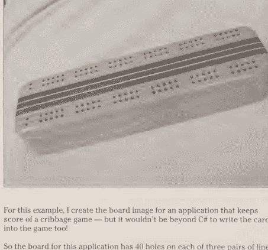

图 5-1：
一个传统的克里比奇棋盘。

在本例中，我为记录克里比奇游戏分数的应用程序创建棋盘图像——但用 C# 把纸牌也写进游戏也并非不可能！

因此，此应用程序的棋盘有三对线，每对线上有 40 个孔，这是两名玩家玩到 120 分的标准棋盘布局，如图 5-2 所示。第一项任务是绘制棋盘，然后随着玩家分数（在文本框中输入）变化绘制棋子。

其前提如下：玩家玩一手牌，并将所得分数输入各自姓名下方的文本框中（参见图 5-2）。输入每手牌的分数后，玩家姓名旁的分数会更新，棋盘上的棋子也会移动。下一次同一玩家得分时，前面的棋子向前移动，后面的棋子移到它的位置。我提到过后面的棋子吗？哦，是的，克里比奇的发明者多疑，怕人作弊——如果你不熟悉克里比奇，不妨到 www.cribbage.org 查看规则。

图 5-2：
数字克里比奇棋盘。

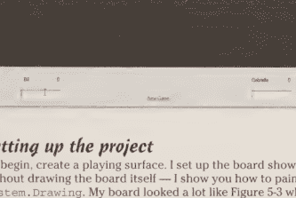

## 设置项目

首先，创建一个游戏界面。我搭建了图 5-2 所示的棋盘，但没有绘制棋盘本身——稍后我会向你展示如何使用 System.Drawing 绘制它。当我准备开始处理业务规则时，我的棋盘看起来很像图 5-3。

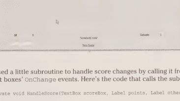

图 5-3：
基础棋盘。

我用一个小型子例程来处理分数变化，通过从两个文本框的 OnChange 事件中调用它来实现。以下是调用该子例程的代码：

```
private void HandleScore(TextBox scoreBox, Label points, Label otherPlayer)
{
    try {
        if (0 > (int)scoreBox.Text || (int)scoreBox.Text > 27) {
            ScoreCheck.SetError(scoreBox, "Score must be between 0 and 27");
            scoreBox.Focus();
        }
    }
else {
    ScoreCheck.SetError(scoreBox, "");
    //Add the score written to the points
    points.Text = (int)points.Text + (int)scoreBox.Text;
}
catch (System.InvalidCastException ext) {
    //Something other than a number
    if (scoreBox.Text.Length > 0) {
        ScoreCheck.SetError(scoreBox, "*Score must be a number*");
    }
}
catch (Exception ex) {
    //Eek!
    MessageBox.Show("Something went wrong! " + ex.Message);
}
//Check the score
if ((int)points.Text > 120) {
    if ((int)points.Text > (int)otherPlayer.Text > 1.5) {
        WinMessage.Text = scoreBox.Name.Substring(0, scoreBox.Name.Length - 6) + " Skunked 'em!!!";
    }
    else {
        WinMessage.Text = scoreBox.Name.Substring(0, scoreBox.Name.Length - 6) + " Won!!";
    }
    WinMessage.Visible = true;
}
```

所有这些屏幕值的更改都会触发表单的 Paint 事件——每当 C# 因任何原因需要更改窗体的外观时，此事件都会触发——因此我只是在该事件处理程序中加入了一小段代码，让它为我绘制棋盘：

```
private void CribbageBoard_Paint(object sender, PaintEventArgs e)
{
    PaintBoard(BillsPoints, GabriellesPoints);
}
```

从那时起，我最关心的是绘制棋盘本身。

## 绘制棋盘

我需要直接在窗体上绘制，以为我的克里比奇应用程序创建棋盘图像，因此我使用窗体控件的 CreateGraphics 方法。接下来，我需要完成以下任务：

- 使用画笔将棋盘涂成棕色。
- 使用钢笔绘制六行小圆圈。
- 如果该分数正确，则填充孔。
- 清理我的绘图资源。


为此，我想出了 PaintBoard 方法，它接受包含两名玩家当前得分的标签。如清单 5-1 所示。

## 清单 5-1：PaintBoard 方法

```csharp
private void PaintBoard(ref Label Bill, ref Label Gabrielle)
{
    Graphics palette = this.CreateGraphics();
    SolidBrush brownBrush = new SolidBrush(Color.Brown);
    palette.FillRectangle(brownBrush, new Rectangle(20, 20, 820, 180));
    //OK, now I need to paint the little holes.
    //There are 244 little holes in the board.
    //There are rows of 40 to line two, with the little starts and stops on their end.
    //Let's start with the 240.
    int rows = 0;
    int columns = 0;
    int scoreBeingDrawn = 0;
    Pen blackPen = new Pen(System.Drawing.Color.Black, 1);
    SolidBrush blackBrush = new SolidBrush(Color.Black);
    SolidBrush redBrush = new SolidBrush(Color.Red);

    //There are 6 rows, then at 24 and 40, 80 and 100, then 140 and 160.
    for (rows = 40; rows <= 160; rows += 60)
    {
        //There are 40 columns. They are every 20
        for (columns = 40; columns <= 820; columns += 20)
        {
            //Calculate score being drawn
            scoreBeingDrawn = (columns - 20) / 20 + (((rows + 20) / 60) - 1) * 40);

            //Draw Bill
            //If score being drawn = bill fill, otherwise draw
            if (scoreBeingDrawn == (int)Bill.Text)
            {
                palette.FillEllipse(blackBrush, columns - 2, rows - 2, 6, 6);
            }
            else if (scoreBeingDrawn == BillsLastTotal)
            {
                palette.FillEllipse(redBrush, columns - 2, rows - 2, 6, 6);
            }
            else
            {
                palette.DrawEllipse(blackPen, columns - 2, rows - 2, 4, 4);
            }

            //Draw Gabrielle
            //If score being drawn = Gabrielle fill, otherwise draw
            if (scoreBeingDrawn == (int)Gabrielle.Text)
            {
                palette.FillEllipse(blackBrush, columns - 2, rows + 16, 6, 6);
            }
            else if (scoreBeingDrawn == GabriellesLastTotal)
            {
                palette.FillEllipse(redBrush, columns - 2, rows + 16, 6, 6);
            }
            else
            {
                palette.DrawEllipse(blackPen, columns - 2, rows + 16, 4, 4);
            }
        }
    }
    palette.Dispose();
    brownBrush.Dispose();
    blackPen.Dispose();
}
```

除了数学计算之外，请注意其中的决策逻辑。如果要绘制的分数是标签中的分数，就用红色插钉填充孔洞。如果它是最后绘制的分数，就用黑色插钉填充孔洞。否则，呃，只画一个圆圈。

这很难理解，但大型游戏正是这样编写的。诚然，大型图形引擎会做出多得多的 If-Then 决策，但前提是一样的。

此外，大型游戏有时会使用位图图像，而不是一直进行绘制。例如，对于 cribbage 计分应用程序，你可以使用插钉的位图图像，而不是用黑色或红色画笔填充椭圆！

## 第四部分

## Visual Studio 之旅

## 第五波

Rich Tennant 作

©RICH TENNANT


> 面向对象编程的伟大之处在于，它让软件开发变得就像把一只脚放到另一只脚前面一样简单。

## 内容一览

- 第 1 章：Visual Studio 入门 ....................481
- 第 2 章：使用界面 ....................495
- 第 3 章：自定义 Visual Studio ....................517
- 第 4 章：转换文本模板 ....................533

## 第 1 章：Visual Studio 入门

### 本章内容

- 概览可用版本
- 安装 Visual Studio
- 理解项目和解决方案
- 探索不同类型的项目

你很可能已经发现，关于 C# 的许多内容都可以使用命令提示符和 `csc.exe` 来运行。事实是，这并不是一种很好的编程方式。它不宽容、速度慢，而且很难记住语言的具体细节。集成开发环境（IDE）是一个为开发提供平台的程序。它有助于让开发变得更轻松。

习惯于从空白屏幕和命令行开始的程序员，常常把 IDE 贬低为缓慢、拖沓的浪费时间之物。然而，我从未见过有哪个这样的程序员在 Visual Studio 中工作之后不改变看法。它快速、易用、敏捷且智能。

确实，你不必使用 IDE 来编程，但如果你打算用一个，那就应该是 Visual Studio。它专为编写 C# 代码而构建，也用于构造 Windows 程序。（推销结束——微软，我现在就收下我的 20 美元。）

说真的，自从我为了撰写《Effective Visual Studio .NET》而深入研究以来，我就一直是 Visual Studio 的粉丝。它确实让编写软件变得更容易。它并不能替代对语言、面向对象编程或 .NET Framework 的了解，但它确实让生活稍微顺畅了一些。

本章向你介绍 Visual Studio 的各种版本，并讨论你可以使用的 C# 项目。

## 版本划分

Visual Studio 有很多不同的版本（多得数不清——甚至一蒲式耳一配克那么多）。

原因是它著名的许可问题。如果他们只按整套产品的实际价值出售，只有《财富》50 强企业才买得起，这样就会失去大约 99% 的受众。如果他们制作许多不同的版本，并尝试纳入不同人群使用的功能，就能覆盖几乎 100% 的受众。


正如我在引言中提到的，本书重点介绍 Professional 版。不过，许多示例代码在任何版本中都能运行——尽管步骤列表有所不同。

在本章中，我会逐一介绍所有主要版本的功能和优点。在本节末尾，有一个表格展示主要功能以及每个版本包含的内容。

### Express

Express 是 Visual Studio 的免费版本。

是的，我说的是*免费*，就是“不花钱”的意思。

Express 是为爱好者制作的，但我认识的许多专业程序员把它当作自己的“家庭”版本，用于小型个人项目，或用于开发开源项目。

尽管 Express 的功能明显少于 Professional 版，但本书中几乎每个代码示例都可以在 Express 中编译。它拥有同样免费的 .NET Framework 的强大能力，并为你提供学习 C# 的重要途径。

Express 版并非为制作生产软件而设计。它缺少几种项目类型以及许多团队开发工具。尽管如此，它运行 C# 和其他任何东西一样好——记住，C# 只是一种语言。

Express 有多个不同的子版本。它们把 .NET 的主要技术拆分成几个部分。你不能使用这些版本构建用于销售的打包软件，但完全可以用来学习。这些不同的子版本如下所述：

-   **Visual C# Express：** 此版本以免费包的形式提供了 C# 的大部分能力。大多数项目类型都可用，包括 WPF、Windows Forms、Web Forms 和服务应用程序。唯一的麻烦是——你不能部署。无论如何，不违反许可协议就无法部署到生产环境。

不过，这个版本非常适合学习语言以及参与开源应用程序项目。开源项目（你只需贡献代码，而不是为报酬做一个完整项目）是 Express 版的好用途。如果你没有别的可用，我建议你从这里开始。第 I 部分和第 II 部分中的许多内容在 Express 中都能用。

-   **Visual Basic Express：** 与 C# Express 一样，Visual Basic Express 是该语言的免费实现。它不用于生产用途，不过你可以学习该语言并参与开源项目。大多数项目类型都可用。
-   **Visual Web Developer：** VWD 是一个有趣的 Visual Studio 免费版本。它围绕使用 ASP.NET 或 Silverlight 创建网页而设计。由于这些语言不需要编译，你可以免费编写生产软件。这对你我都更好。

在撰写本书时，VB 和 C# 都受支持，并且 Visual Studio 中 Web 项目的大部分功能都可用。更多信息请访问 www.microsoft.com/express/vwd。

### Professional

Professional 版是为专业程序员设计的。这个 Visual Studio 版本是我日常使用的版本。它用于生成解决特定问题的独立程序。

微软很在行，为其 Professional 版设定了三个目标：

-   支持新兴趋势
-   激发开发者的愉悦感
-   驾驭下一代平台浪潮

这正说到点子上。这就是本书通篇所依据的版本，也是我推荐用于大多数程序生产的版本。

尽管 Professional 已经很好，但它并不具备微软提供的所有功能。全面的团队管理功能、报告、签入和测试功能都保留给价格更高的版本：Team System。

### Team System

Visual Studio Team System，通常称为 VSTS，是微软平台中的最高权威。它连接到 Team Foundation Server（一个提供软件开发团队指标的微软产品），当团队参与开发时，后者会提供大量软件创建指标。


图 1-1 显示了我所说的一些内容。构建统计信息和开发细节可使用 SharePoint 中提供的仪表板收集。

事实就是事实——Team System 是很酷的软件，但如果没有庞大的企业环境围绕它，它就无法正常工作。它需要 SharePoint、Exchange 和 SQL Server 才能正常运行。


图 1-1：使用 Team Foundation Server 管理软件开发。

## MSDN

Microsoft Developer Network（MSDN）订阅是获取 Microsoft 产品迄今为止最好的方式。似乎设置一个用于开发任何有意义东西的开发环境会花费难以置信的昂贵。这不一定是事实。

MSDN 订阅正如其名所说——对大多数重要的 Microsoft 产品的订阅。每年大约一千美元，你就能获得所需的一切。这实际上并不是 Visual Studio 的一个版本。

这听起来很多，但换个角度想——即使你一年只做一个业余项目，你的投资也会得到回报。

考虑到仅 Visual Studio 本身就占其中的一半，而且大约每两年就会更新一次，这绝对物有所值。除了 Visual Studio Professional，你还可获得以下所有订阅：

- Microsoft Office
- Windows 客户端平台
- Windows Server 平台
- SQL Server
- 像 SharePoint 和 BizTalk 这样整洁的中间件
- 你以前从未使用过（但现在会使用）的奇怪组件

基本工作原理如下——你去 Amazon 或其他地方购买一个 MSDN 许可代码。然后你去 msdn.microsoft.com 并用你的 Live 账户注册该代码。从那里，根据你的许可级别，你可以仅用于开发目的下载软件。

这点很重要。从 MSDN 获得的产品仅用于开发目的。所以，是的，你可以获得 SQL Server（例如）。不，你不能使用 MSDN 许可在互联网上架设你的新 Widget 商店。

因此 MSDN 许可中的操作系统仅用于开发。这没问题。这是一本开发书籍。如果你能获得 MSDN，就去获得它。

## Academic

如果你买不起 MSDN，但你是学校学生或讲师，请购买专为学习机构设计的 Visual Studio 学术版。它的价格比 MSDN 更便宜，但从许可角度来看限制更大。

学术版现在只需大约一百美元。这意味着它比免费 Express 版贵，但它具有 Professional 的所有功能。如果你只是想学习，这是一个有用的选择。但如果你想部署生产软件，则需要另寻他处。该产品未获得此许可。

学生、老师，去学校书店吧。如果他们没有 Visual Studio Academic，告诉他们应该去获取。

## An edition breakdown

表 1-1 描述了 Microsoft 销售的主要功能以及不同版本中的功能。我每次向客户推荐软件时都会使用它，希望你也觉得它同样有用。

**表 1-1 Visual Studio 版本**

| Visual Studio 2010 | VS 2010 Professional 含 MSDN | VS 2010 Premium 含 MSDN | VS 2010 Ultimate 含 MSDN |
|---|---|---|---|
| 团队基础服务器 | **** | **** | **** |
| 开发平台支持 | **** | **** | **** |
| 测试 | * | *** | **** |
| 数据库开发 |  | **** | **** |
| 调试和诊断 | ** | *** | **** |
| 架构和建模 |  | * | **** |
| 实验室管理 |  |  | *** |

## Installing Visual Studio

Visual Studio Professional，即本书大部分内容使用的版本，与任何其他 Windows 程序的安装方式类似。首先，确保你的机器可以运行 Visual Studio。然后运行安装程序（或它从 DVD 自动运行）并做出一些决定。

然后你等待。Visual Studio 很大。需要一段时间。

Visual Studio 的官方要求如下所示：

- **操作系统：**
  - Windows® XP Professional 已安装 Service Pack 2、Windows Server 2003 或 32 位 Windows Vista
  - Microsoft Windows Server® 2003 with SP1, Standard x64 Edition (WOW)
  - Microsoft Windows Server 2003 with SP1, Enterprise x64 Edition (WOW)
  - Microsoft Windows Server 2003 with SP1, Datacenter x64 Edition (WOW)
  - Microsoft Windows Server 2003 R2, Standard x64 Edition (WOW)
  - Microsoft Windows Server 2003 R2, Enterprise x64 Edition (WOW)
  - Microsoft Windows Server 2003 R2, Datacenter x64 Edition (WOW)
  - Microsoft Windows XP Professional x64 Edition (WOW)
  - Windows Vista
- **客户端软件：**
  - Internet Explorer® 6.0 with Service Pack 1、Microsoft Office 2003 with Service Pack 1 或 Microsoft Office 2007、MDAC 9.0、.NET Framework 2.0
- **硬件：**
  - *最低：* 2.0 GHz CPU、512MB RAM、8GB HDD
  - *推荐：* 2.6 GHz CPU、1GB RAM、20GB HDD

你可以在此配置上运行——我试过，可以工作。只是不漂亮。Visual Studio 2010 全部用 WPF 编写，这对于如此规模的应用程序来说可能是一个资源占用大户。

鉴于情况如此，我相信你不会对我有一套安装 Visual Studio 的建议感到惊讶。

首先，这里是我认为 Visual Studio 的一个现实基础配置：

- 2.4 GHz 64 位双核处理器
- 配备 8GB RAM 的 64 位 Windows 7
- 250GB 可用硬盘空间
- 双显示器（或带外接显示器的笔记本电脑）

似乎过分？并不。首先，我建议你对任何会影响 Windows 基础安装的项目使用虚拟机。Virtual PC 是免费的，而且你通常可以毫无问题地获得 Windows 7 的 180 天试用版。将 Virtual PC 的设置更改为仅在机器运行时运行时钟，你就拥有了一个完美的测试平台。


**提示：** 要找到 Virtual PC，请在 download.microsoft.com 上搜索 Virtual PC。要找到更改虚拟 PC 时钟的技巧，请访问 Virtual PC Guy 的博客 www.virtualpcguy.com 并搜索 'clock only while active'。

不过，这个计划需要强大的性能。你必须拥有 4GB RAM，以便将其中 2GB 分配给虚拟机。虚拟硬盘通常约为 13GB，所以你需要空间。双显示器使你能够在虚拟机全屏运行的同时轻松查看主机操作系统。

## Breaking Down the Projects

在运行安装程序并设置默认设置后，剩下的就是开始一个项目并动手实践。第一、二本迷你书中的所有项目类型（可能一两个除外）都是控制台应用程序，意味着它们旨在在命令提示符下运行。还有很多其他项目可用。

请注意 Visual Studio 新建项目对话框中的三种主要项目类型。

- **Windows 项目** 是丰富的客户端应用程序，编译为 .EXEs 并在你的计算机上直接运行。Microsoft Word 是一个 Windows 应用程序。
- **Web 项目** 创建网站并需要 Web 服务器运行。（Visual Studio 包含用于开发目的的 Web 服务器。）Microsoft.com 就是一个 Web 应用程序的例子。
- **特殊项目** 包括诸如安装项目（构建安装程序的项目）和数据库项目（为数据库提供框架的项目）等内容。它们通常与 Windows 或 Web 应用程序一起使用。你在前一节中运行以安装 Visual Studio 的 Setup.exe 程序就是其中一个特殊项目的例子——一个安装项目。

### Exploring the New Project dialog box

让我们从对新建项目对话框的分解开始，如图 1-2 所示。此屏幕是 Visual Studio 可用性的重要组成部分。你可以通过点击开始页上的新建项目链接来打开它。

对话框最左侧的部分是一个树视图选择器，与 Outlook 中的类似。你有三个选项——最近使用的模板、已安装的模板和在线模板。已安装的模板处于选中状态。这些模板，如 Visual Studio 所称，是项目类型。

选择器内有一个 WPF 风格的树查看器。不同于枫树和橡树，这个树查看器包含本章后续部分描述的所有项目类别。

如果你例如在树视图中点击 Visual C# 选项，所有 Visual C# 项目都会出现在右侧的窗口中。如果你点击其中一个子选项，只有那些项目类型——针对 Visual C#——会出现。

要指定你想要开发的 .NET Framework 版本，你可以使用项目列表上方当前显示为 .NET Framework 4.0 的下拉列表。要更改排序选项，使用右侧的 Sort By：下拉列表。再向右一步，你可以更改视图选项。


图 1-2：如此多的项目选项！

右上角是一个搜索框，鉴于 Visual Studio 中现在有大量模板，这个搜索框并不像听起来那么可笑。搜索框正下方是说明面板，你可以在其中看到所选项目类型的文本说明。

底部有三个重要的文本框：

- **名称：** 此项目的名称。
- **位置：** 项目文件的路径。
- **解决方案：** 解决方案的名称。解决方案是项目的集合。

有关解决方案和项目的更多信息，请参阅下一节。

## 了解解决方案和项目

Visual Studio 项目文件，以及与之相伴的解决方案，一直是 Microsoft 开发者津津乐道的话题。你一次处理一个解决方案，其中包含若干项目。你如何组织解决方案及其项目，将决定你在需要查找内容时的成败。

你可以把解决方案看作容纳项目的文件夹。它们只是具有特殊属性的文件夹。事实上，请注意前面图 1-2 中显示的复选框。就是标有“为解决方案创建目录”的那个。这就是我的意思——解决方案实际上是项目的组织性“文件夹”。

项目是你放置程序代码文件的地方。它们存储各种内容，例如对 .NET Framework 的引用、图形或文件等资源，以及应使用哪个文件来启动项目。

解决方案之于项目，就像项目之于文件。它们将项目保存在一个文件夹中，并存储某些属性。例如，它们存储调试开始时应该启动哪个项目。

项目和解决方案都与最终完成的程序没有太大关系。它们只是 Visual Studio 的简单组织结构。完成程序的安装由安装项目决定。解决方案本身只是源文件的逻辑存储机制。

实际上，解决方案不只是一个文件夹。它是文件夹中的一个文件，Visual Studio 用它来管理开发体验。因此，解决方案文件夹内有一个描述其中项目的文件，然后是一堆包含项目本身的文件夹。

项目也有文件——描述项目资源和引用的文件。它们都是 XML 文件，包含对使用 Visual Studio 设置的值的文本引用。

在 Visual Studio 中开发时，你不必担心这一点。在 14 年使用各种版本 Visual Studio 的工作中，我只有少数几次不得不查看解决方案或项目文件，而且只在特殊情况下。不过，了解它们的工作方式将有助于你设计项目结构。

我的工作方式是，先确定我希望最终完成的程序是什么，并将其视为一个解决方案。在此之上，我有一个客户文件夹。结果如图 1-3 所示。

图 1-3：
我首选的
项目
结构。


- **WPF 用户控件库：** 这种更宽松的控件格式的最终产品不会出现在工具箱中，但构建起来要容易得多，因为它不需要用 C# 编写整个控件。
- **Windows Forms 控件库：** 类似于 WPF 控件库，但用于 Windows Forms。它有助于构建可从工具箱中使用的控件。
- **Web 项目：** Web 项目是需要服务器才能运行（嗯，通常如此）并从浏览器使用的程序。它们向浏览器呈现 HTML，而不是像 Silverlight 这样的花哨格式。项目包括
  - **ASP.NET Web 应用程序：** 这是 Web 开发领域的核心。它创建一个可在 IIS 上运行的应用程序，向用户呈现网页。
  - **ASP.NET Web 服务应用程序：** 这是一个用于面向服务应用程序的类库。如果你要将应用程序分布到多台机器上，或提供广泛分布的应用程序，此项目类型将为你的服务提供基于标准的实现。
  - **ASP.NET AJAX 服务器控件：** 异步 JavaScript 和 XML 是一种开发风格，可在 Web 浏览器内提供大量用户交互。这使你能够构建支持此模式的控件。
  - **WCF 服务应用程序：** 此项目属于 Communication Foundation 部分。它类似于 ASP.NET Web 服务应用程序，不同之处在于它为你的服务提供多种不同的基于标准的实现。ASP.NET Web 服务只提供一种。
  - **ASP.NET 服务器控件：** 此 Web 控件会出现在工具箱中，使你能够在开发时将所选功能直接拖到网页上。
  - **ASP.NET AJAX 服务器控件扩展器：** 此控件扩展另一个 AJAX 控件的功能。它针对一个控件并添加一项功能。
  - **动态数据 Linq to SQL Web 应用程序：** 这是一个使用 Linq 制作数据驱动型网页的 ASP.NET Web 应用程序。
  - **动态数据实体 Web 应用程序：** 此 ASP.NET Web 应用程序使用 ADO.NET 数据实体来制作数据驱动型网页。
- **Office 项目：** Office 项目是 Visual Studio Tools for Office 包的一部分，使用 Office 作为平台，而不是 Windows 或 Web 浏览器。要了解更多信息，请参阅我与 Peter Jaunovich 合著的《Office Development For Dummies》。Office 项目包括
  - **Excel 2007 工作簿：** 输出为 Microsoft Excel 工作簿（Excel 工作表的集合）。
  - *Word 2007 模板*：输出为 Microsoft Word 2007 模板（.dot 文件）。
  - *Project 2007 加载项*：为 Microsoft Project 创建加载项。
  - *Visio 2007 加载项*：为 Microsoft Visio 创建加载项。
  - *Word 2007 加载项*：为 Microsoft Word 创建加载项。
  - *Excel 2007 加载项*：为 Microsoft Excel 创建加载项。
  - *Outlook 2007 加载项*：为 Microsoft Outlook 创建加载项。
  - *Word 2007 文档*：输出为 Microsoft Word 2007 文档。
  - *Excel 2007 模板*：输出为 Microsoft Excel 2007 模板（.xlt 文件）。
  - *InfoPath 2007 加载项*：为 Microsoft InfoPath 创建加载项。
  - *PowerPoint 2007 加载项*：为 Microsoft PowerPoint 创建加载项。
- **Communication Foundation 项目：** Windows Communication Foundation 是 Microsoft 提供的一种机制，让程序能够相互通信。
  - *联合服务库*：创建联合源服务（RSS），采用 ATOM 或 RSS。
  - *WCF 服务库*：用于 Communication Foundation 的类库。
  - *声明式流程图服务库*：创建一组使用流程图式工作流来提供服务的服务。
  - *声明式顺序服务库*：创建一组使用顺序式工作流来提供服务的服务。
- **工作流项目：** Workflow Foundation 是用于在 Microsoft 程序中创建工作流的标准库。你可以设置标准审批、文档移动等：
  - *活动设计器库*：此项目帮助你创建用于创建活动的用户界面。
  - *活动库*：如果你不想为创建活动而创建用户界面，可以创建一个活动。
  - *流程图工作流控制台应用程序*：此项目和顺序项目提供了一种在安全环境中测试 WF 工作流的方法。
  - *顺序工作流控制台应用程序*：这与流程图 WF 项目类似，但用于顺序工作流。

第 IV 篇 第 1 章 Visual Studio 入门

- **特殊项目：** 指任何不符合前面几类的内容：
  - *测试项目*：如果你在 Visual Studio 中工作，右键单击某个方法，然后选择“创建单元测试”，就会得到这种项目。如果你想手动创建测试项目，这就是你的项目。
  - *Silverlight*：诚然，Microsoft Expression 会是你在 Silverlight 方面的最佳选择。不过，如果你想使用 Visual Studio，也可以使用此项目。
  - *SQL Server 项目*：同样，我更愿意使用 Microsoft SQL Server Management Studio 来创建数据库项目。如果由于某种原因必须使用 Visual Studio，这就是你的项目。
  - *报表应用程序*：你可以直接将报表包含在 Windows 或 Web 应用程序中。如果你要直接部署到 Reporting Services，此项目即可胜任。

- **其他类型的项目：** 为 Visual Studio 创建项目类型很容易，而且市面上有很多这样的项目类型。其中一些是模式，一些是语言，还有一些是新的项目输出。以下是我最喜欢的几个：
  - *ASP.NET MVC*：模型-视图-控制器（MVC），这种项目类型允许在开发团队之间分离职责。此项目类型允许你使用 MVC 创建 ASP.NET 应用程序。在 MSDN 上搜索以获取更多信息。
  - *MVC4WPF*：允许为 Windows Presentation Foundation 进行模型-视图-控制器开发。它像常规 WPF 应用程序一样具有自动化和模板。请访问 www.mvc4wpf.com 查看。
  - *IRONRuby*：Visual Studio 中的 Ruby 实现。
  - *IRONPython*：Visual Studio 中的 Python 实现。


## 第 2 章：使用界面

### 本章内容包括

- 使用设计器
- 探索解决方案资源管理器
- 使用代码视图进行编码
- 使用“工具”菜单

集成开发环境（IDE）是程序员工具箱中的瑞士军刀。IDE 提供了一种存储程序代码、组织和构建代码，并通过设计编辑器查看最终产品的机制。IDE 让一切得以实现，同时也大幅缩短了完成任务所需的时间。

Visual Studio 正真正成为全球公认的 IDE 中的佼佼者，甚至连微软的批评者也这样认为。我认识一些 Python 程序员，他们一边整天抨击 Windows，一边在 Linux 机器上上网，然后切换到 Windows 分区，使用 Visual Studio 编写 IronPython 代码。

Visual Studio 令人印象深刻；它非常庞大。世纪之交（嘿！）我和 David Deloveh 写了一本书，试图涵盖 Visual Studio 的所有功能。那本书有 600 页。读者最大的抱怨是：太短了，没有涵盖足够的内容。如今 Visual Studio 的功能规模翻了一倍。要用一章来介绍它，远远不够。

所以，我不打算面面俱到，而是让你体验一下我每天使用的 Visual Studio 功能。我不想试图掩盖任何东西，也希望你能继续探索 IDE 并发现新东西——不要只停留在我告诉你的这些内容上。这只是对该工具中一些惊人功能的简要概述。

### 在设计器中设计

集成开发环境（IDE）中集成了一项功能，那就是以图形方式编辑文件，有时也称为图形开发环境或设计器。

Visual Studio 允许你以图形方式编辑五种不同类型的代码库，并提供辅助工具来进一步管理这些代码库。

简而言之，设计器是 Visual Studio 世界中的拖放元素。它并不总是开发程序的最佳方式，但有时确实很有帮助。

对于 Visual Studio 支持的每种主要项目类型，都有一个设计器。设计器负责所见即所得的部分，通常还负责幕后的标记代码。

问题在于，由于我们所处的软件开发世界的需求，不同的设计器的工作方式略有不同。例如，HTML 和 XAML 之间存在显著差异，因此 Web 设计器和 WPF 设计器的外观和行为并不相同。

Visual Studio 为你提供了几个可视化设计器来帮助开发应用程序，包括：

- 类设计器
- 数据视图
- Web 窗体
- Windows 窗体
- Windows Presentation Foundation

### Windows Presentation Foundation (WPF)

Windows Presentation Foundation 将在第 V 卷中深入介绍，但你现在应该知道，它是微软 Windows 开发体验的未来。第 V 卷全面介绍了 WPF，你可以从中了解更多相关信息。

用户界面设计体验的核心是一种名为 XAML 的语言，它（毫不意外地）是一种源自 XML 的领域特定标记语言，用于创建用户界面。在图 2-1 所示的设计器中，设计位于顶部框架，底层代码位于底部框架。

你可以根据需要点击设计器中的设计并移动元素，或者使用设计器选择对象并在“属性”面板中编辑属性（我将在接下来的“面板化 Studio”一节中介绍）。此外，如果你在代码区域更改了某些内容，你会在设计中看到相应的变化。这是一个很好的系统。

WPF 设计器中有一些细小但重要的功能值得指出。你可以在图 2-1 中看到它们。

左上角附近有一个缩放栏。你可以点击其底部的“缩放以适应”，或移动滑块。这对于处理比屏幕更大的应用程序，或者想要适当缩小视图时非常有价值。

在设计框架和 XAML 框架之间的分隔线左侧有一个小的双箭头图标。点击此图标会将底部框架中的内容切换到顶部框架，反之亦然。


图 2-1：WPF 设计器。

同一条分隔线的右侧有三个按钮，用于确定拆分方式——垂直拆分、水平拆分（默认）或不拆分。

设计器本身有一些很酷的点击调整工具。这里只举一个例子：点击设计器窗口中表格的红色区域。将鼠标放在出现“146”尺寸标注的正上方。

看到出现的那个带有星号、井号和“Auto”字样的小浮动框了吗？这只是你在 WPF 设计器中会发现的众多小助手之一。井号将列宽设置为固定数值（默认情况下如此）。星号将其设置为表格的百分比——非常适合调整大小。“Auto”会根据内容调整列宽。

这些微小功能只会修改设计器下方框架中的 XAML。如果你点击浮动表格设计器中的“Auto”字样，你将把这行代码：

```
<ColumnDefinition Width="146" />
```

```
<ColumnDefinition Width="Auto" />
```

有些人喜欢代码。有些人喜欢设计器。有些人（比如我）更喜欢两者奇怪的结合。你自己决定如何使用这些工具。

### Windows Forms

Windows 窗体设计器与 WPF 设计器的主要区别在于 Windows 窗体没有代码面板。尽管 Windows 窗体背后有（某种）代码支持，但你无法编辑它。就是这样。

本书不涉及 Windows 窗体的主题。虽然它仍然是一个活跃的开发平台，但我不得不做出艰难的决定，转而介绍 WPF。WPF 执行与 Windows 窗体相同的编程任务，但它是更新的技术。Windows 窗体设计器如图 2-2 所示。

说实话，Windows 窗体设计器本身没什么可说的。各个控件有一些不错的设计器功能，但设计器本身并没有多大作用。

不过，需要说明的是，我在本书中并没有过多涉及 Windows 窗体。首先，这不是一本 Windows 编程书，而是一本 C# 书。其次，Windows 窗体正在逐渐退出。WPF 是 Windows 编程的未来。Windows 窗体只是为了向后兼容而存在。


图 2-2：Windows 窗体设计器。

### Web Forms

Web 编程与 WPF 编程的相似程度高于与 Windows 窗体编程的相似程度，但它在 Web 服务器上运行，并在浏览器中查看。（第 VI 卷全部关于 Web 窗体。）由于设计器具有后端代码元素，你可以看到拆分视图，如图 2-3 所示。

在 HTML 设计器中导航很容易。我想特别指出 HTML 设计器的两个功能。这些功能位于设计器视图底部的一个菜单栏中：

- 视图切换按钮，分别显示“源”、“设计”和“拆分”：“源”只显示 HTML 代码。“设计”只显示可视化设计器。“拆分”则毫不意外地在两个面板中同时显示两者，就像 WPF 设计器一样。
  
  有趣的是，这两个框架不会保持同步。如果你更改了 HTML，设计框架会显示一条消息：“设计视图与源视图不同步。单击此处以同步视图。”希望他们能在正式发布之前修复这个问题。

- 视图切换按钮旁边的小型文档树：它显示你的光标在层次结构树中的位置，以及它与 HTML 文档其余部分的关系。


图 2-3：Web 项目回到代码。

记住

### 类设计器

你可以从任何项目创建类设计器，但我的下一个示例使用了类库项目，如图 2-4 所示：


图 2-4：我的数字花园。

类设计器为你提供了类库的可视化界面。你可以轻松查看继承关系，成员也可见且可编辑。以下是我用于图 2-4 的类库：

```
namespace MyGarden
{
    public class Flower
    {
        public string Color;
    }
    public class Vegetable
    {
        public bool Yummy;
    }
    public class Daisy : Flower
    {
        public double Height;
    }
    public class Sunflower : Flower
    {
        public bool Harvested;
    }
    public class Tomato : Vegetable
    {
```


```
public double StalkHeight;
}
public class Carrot : Vegetable
{
    public double Depth;
}
```

要创建类似的类库，请按以下步骤操作：

- 1. 创建一个新的类库项目。
- 2. 用你自己的代码列表替换默认代码。
  如果你愿意，可以使用本节中的代码。
- 3. 通过按 Ctrl + Shift + B 构建类库。
- 4. 右键单击项目并选择“查看类图”。
  Visual Studio 会创建一个名为 ClassDiagram1.cd 的新文件。这就是你的类图文件。
- 5. 保存你的项目。

你也可以向新类添加方法。点击 Flower 类的方法并通过在名称下输入 Water、在类型下输入 Void、在修饰符下输入 Public 来添加一个 Water 方法。如果切换回库视图，你会发现该类下的代码中已添加了方法。


为了帮助项目文档化，你可以在设计器窗格中的任意位置右键单击并选择“导出此图表为图像”，然后将其保存为 .PNG 文件。我在为项目创建文档时发现这非常有用。这比 Visio 更有用，因为它与你的代码集成，包含在 Visual Studio 中，而且是免费的！

## Data View

数据视图通常与服务器资源管理器一起使用，是 SQL Management Studio 在工作室内的表示形式的一部分。你可以在 Visual Studio 内部直接查看和编辑 SQL Server（及其他）数据库管理系统中的数据表。示例见图 2-5。

这里的功能非常强大，但篇幅有限无法全部涵盖。再次说明，这不是一本数据库书籍，因此我建议阅读 MSDN 上关于 SQL Explorer 的 Data Connections 功能的条目以获取更多详细信息。


图 2-5：
使用数据视图时，谁还需要 SQL Management Studio？

## Paneling the Studio

面板化：这太七十年代了。

为了实现所需的灵活性，Visual Studio 拥有大量称为面板的模块化窗口。这些面板处理所有不涉及直接编辑设计或代码的工作。它们管理文件、管理对象、显示反馈、显示属性，等等。

Visual Studio 大约有 23 个面板。这里没有空间讨论全部，因此我只介绍 5 个——你每天都会使用的那些。其余的可以在“视图”菜单中找到。

## Solution Explorer

解决方案资源管理器（见图 2-6）管理解决方案、项目和文件。尽管我之前声称解决方案只是文件和文件夹的问题，但其操作比乍看之下更复杂一些。

所有这些信息都保存在项目文件中。项目文件只是一个 XML 文件。该文件有几个关键特征：

- 它为每种构建类型包含一个 PropertyGroup。这是因为你可以为每种可执行文件类型设置不同的属性。
- 它包含一个 ItemGroup，其中包含所有引用，包括所需的 Framework 版本，以及另一组包含项目加载详细信息的 ItemGroups。
- 文件包含项目通用细节和 Target 集合的导入。你实际上可以手动编辑该文件以创建自定义构建环境。

你可能不会修改项目文件，但我认为了解可以这样做很重要，而且 Microsoft 提供了内联注释。他们期望该文件被修改。

## Files

文件没那么令人兴奋。它们基本上就是你所期望的那样。它们托管正在开发的程序的源代码。这里没有隐藏内容。

解决方案资源管理器基本像 Windows 资源管理器一样管理项目中的文件。解决方案资源管理器列出文件和文件夹，并允许在设计器或代码编辑器中打开它们。


解决方案资源管理器还知道要显示哪些文件。如果文件不在项目中，但恰好位于项目文件夹中，它不会在资源管理器中显示。如果找不到文件，请尝试单击资源管理器顶部灰色按钮栏中的“显示所有文件”按钮。隐藏的文件会以灰色显示，但仍不会编译到项目中。

## Properties

属性面板（见图 2-7）是一个简单灵活的工具，允许你更新开发项目中关于一切事物的无尽细节列表。该面板基本上是一个带有两列宽数据网格的窗口。它以键/值对读取属性并允许轻松查看和编辑。

当我说它显示关于一切事物的无尽细节列表时，我是认真的。如果你单击 Visual Studio 中的几乎任何内容，按 F4 调出属性面板（参考图 2-7），你就会得到属性。用以下有趣的选择试试：

- 解决方案资源管理器中的文件
- 数据库连接
- WPF 项目中的文本框
- XML 树节点
- 类资源管理器中的项


图 2-7：
面板化
你的
属性。

如果某物有任何元数据，属性都在属性面板中。这是一个很棒的工具。

## The Toolbox

一个伟大但常被误解的工具是工具箱。（见图 2-8。）表面上看起来很简单。给定文件类型的设计时控件可供拖放。尽管如此，你需要记住关于工具箱的一件重要事情。等等，我拿出我的“记住”图标。


工具箱仅显示适用于当前焦点文件的控件。

因此，如果你在设计器中运行 Windows 窗体，你将看不到可供放置的数据库表。相信我；如果你期望看到某个控件而它不在那里，工具箱可能没有坏掉。如果没有打开文件，工具箱是空的。这是设计如此。

我无法告诉你有多少次我期望在工具箱中看到某些东西却发现它是空白的。然后我花了十分钟追踪问题，最后才意识到问题在我——我没有打开文件。我曾经真的因为找不到 Web Forms 项目的 maskedtextbox 而打电话给 Microsoft。


Web Forms 项目没有 maskedtextbox。

因此请记住工具箱是上下文相关的。它只在它想工作时才工作。

工具箱还有一个有趣的属性：它可用于存储文本剪辑，这在演示和演示文稿中很有用。它也适用于存储经常使用的代码片段，但代码片段（第 3 章介绍）更好。要这样做，请按以下步骤操作：

- 1. 打开一个代码文件。
  任何文件都可以，`.cs` 文件、`.xaml` 文件，等等。
- 2. 突出显示一段代码。
- 3. 确保工具箱已打开。然后将所选代码拖到工具箱的 **General** 部分。
  复制的代码成为一个工具。
- 4. 打开另一个空白代码文件。
- 5. 将新工具拖入代码中。
  复制的代码现在出现在代码文件中。

## Server Explorer

服务器资源管理器（见图 2-9）并非 Visual Studio 的每个版本都包含。在本书印刷时，它仅包含在 Professional 版及更高版本中。

服务器资源管理器使开发人员能够访问远程机器上的重要服务。这些可以是 SharePoint 到 MSMQ 的任何内容，但通常包括两种类型的服务：

- 受管服务
- 数据库连接

### Managed services

受管服务是像事件查看器和 Microsoft 消息队列这样的东西：你需要查看以测试应用程序各部分的事项。例如，Internet Information Services 就是一个会出现在列表中的受管服务。

要将服务器添加到服务器资源管理器，请按以下步骤操作：

- 1. 右键单击“服务器”。
- 2. 单击“添加服务器”按钮。
- 3. 输入你想要添加的服务器的机器名称或 IP 地址。
- 4. 如果你想使用与登录时不同的凭据（例如不同的账户），请单击“使用不同的用户名连接”并输入新的凭据。
- 5. 单击“确定”。

试着使用你看到的服务。这个面板中有很多功能，我这里没有空间详细介绍。

### Data connections

图 2-9 中服务上方的是数据连接。这些是在以前项目中建立的数据连接，Visual Studio 会保留它们，以防你在其他项目中需要它们。虽然保留这些连接似乎有点安全风险，但非常方便。

目标是减少对 SQL Management Console（开发人员管理数据库的旧方法）的依赖，它做得非常好。关键问题是对数据模型（表名和列）和存储过程的访问；没有数据库访问就开发程序很困难。


图 2-9：
服务器资源管理器。

在新的连接中，这些数据库对象会被赋予默认文件夹：

- 数据库图
- 表
- 视图
- 存储过程
- 函数
- 类型
- 同义词
- 程序集

我想让你尝试的关键是打开一个存储过程（你可以在“数据资源”面板中双击它来完成）。这样做后，你就可以直接在 Visual Studio 中轻松编辑 SQL 代码，具有缩进和着色功能。使用它。真的很不错。

## 类视图

五个主要面板中的最后一个是类视图。正如我在第一、二册中讨论的那样，.NET Framework 中的一切都是对象。构成框架的类——所有 Object 的派生类——都可以在树视图中查看。

类查看器是该树视图的所在位置。（参见图 2-10。）

图 2-10：
带类的查看器。


从类视图中，你可以查看类的所有成员并访问内联文档，这可以让你对构成项目的框架和自定义类有一个概览。

## 在代码视图中编码

真的，在代码视图中你还能做什么呢？什么都不做，这就是答案！

Visual Studio 中的代码查看器功能丰富。事实上，你将在这里花费 75% 的时间，而且你会很高兴它运行良好。

代码查看器有两个主要工具：

- 代码查看器本身：第一个是用于编辑代码的屏幕——代码查看器。
- 辅助窗口：第二个是一些小辅助窗口，它们执行许多与代码不直接相关的有用功能。

## 使用代码查看器

代码查看器就是编辑代码的地方。无论是什么类型的代码，所有代码都在这里编辑。（参见图 2-11。）


**图 2-11：** 查看代码查看器。

然而它是一个智能工具。如果你处于 XML 中，它就像 XML 编辑器一样工作。在 C++ 中，它有助于制表。

你可以通过几种方式在代码查看器中打开代码文件。最常见的方式是双击“解决方案资源管理器”中的代码驱动文件，它将会在代码查看器中打开。

如果你在设计器中查看某物，你可以通过以下三种方法之一访问相关文件的代码隐藏：

- 在“解决方案资源管理器”中单击“查看代码”按钮。
- 右键单击设计表面并选择“查看代码”。
- 在设计器中双击控件以生成该控件的事件，并切换到代码视图。

随着时间的推移，你会发现自己都在使用这三种方法。注意，你可以通过单击设计器文件旁边的三角形，然后双击嵌套其中的代码文件，直接访问代码隐藏文件。

## *使用 IntelliSense 自动完成*

IntelliSense 是微软的自动完成功能，是代码查看器的重要组成部分。你无论是否想要，都会遇到 IntelliSense。在代码视图中，单击类内部并按 Ctrl+spacebar。你在那里可以输入的所有内容都会显示在一个大列表中。

好处是它具有上下文敏感性。输入 **Console** 并按点号 (.)。Console 的所有可用成员都会出现。IntelliSense 让你保持诚实，避免每天都要记住 .NET Framework 中数百万个成员。

IntelliSense 也能帮助方法签名。继续你之前开始的行，添加 **WriteLine** ——换句话说，输入 `(Console.WriteLine(` ——然后查看 IntelliSense。它会告诉你相关成员的所有重载。使用上下箭头在它们之间移动。很流畅。

### 大纲

Visual Studio 会自动为你生成代码大纲。注意每个命名空间、类和方法旁边的带减号 (-) 的小方框吗？（参见图 2-12。）这些是为可读性而折叠的代码部分。现在看起来似乎没什么，但当你有 2,200 行代码时，你会很高兴的。


**图 2-12：** 细小的轮廓标记。

你也可以创建自己的大纲。在你想要大纲的段落前，在新行上放置 `#region`。在该段落之后，放置 `#endregion`。这个新定义的段落——无论它是否位于现有的大纲点——都会获得一个新的大纲标记。

如果在 `region` 语句后添加了注释，它会在折叠的大纲中显示——正如你在图 2-12 中看到的那样。

## 探索辅助窗口

有一些窗口影响文本输入和输出以解决特定问题。作为一个整体，它们并没有真正的名称，所以我称它们为辅助窗口。我在这里介绍其中四个。


- **输出窗口：** 我经常使用输出窗口做两件事：
  - *构建日志。* 每次构建时，输出窗口都会跟踪幕后进行的链接和编译，并显示可能出现的任何错误。
  
    默认情况下，构建时输出窗口会显示。你可以在选择“常规>项目和解决方案”后，将其设置为不显示 Visual Studio 选项对话框。
  
    输出窗口中列出的错误可用于导航代码。输出框中的按钮可帮助根据窗口中的消息在代码中移动。
  - *调试语句：* 输出窗口的第二种用途是标准输出（给所有 C++ 的人）。如果你在代码中使用 `Debug.Write` 语句，输出窗口就是它的去处。此外，如果你使用 `Console.Write`，但正在运行 Windows 窗体应用程序，例如，文本将转到输出窗口。
- **即时窗口：** 这个窗口正如人们所期望的那样工作——它立即执行某些操作。在调试模式下，你可以使用即时窗口向正在运行的程序发送命令，以更改状态或评估操作。试试这个来了解我的意思：
  1. 打开一个 Windows 窗体项目。
  
     本书配套网站本章示例代码中的那个是可以的——你只需要一个默认项目模板。
  2. 在 `form_load` 上设置断点。方法是单击代码视图侧面运行的灰色栏。
  
     应该会出现一个红点。


3. 调试程序。

程序应在此处在 `load` 方法上停止。

4. 打开即时窗口。

你应该可以在“调试”窗口中执行此操作，或按 Ctrl+I、I。

5. 输入 ?this。

看到 IntelliSense 菜单了吗？

6. 在点号后，输入 WindowPosition。

第 5 步中的问号表示打印。此命令将窗口位置打印到屏幕上。

响应应为 `windowDefaultLocation`。

这就是即时窗口的用途。你不仅可以打印值，还可以更改变量值并修改程序的执行。它是你调试工具箱中的强大组成部分。

♦ 断点窗口：等等！在尝试上一个示例后，不要在 Visual Studio 中更改任何内容。按 Ctrl+D、B。断点窗口会出现，你刚刚添加的断点将位于其中。（参见图 2-13。）

图 2-13：
断点窗口，它不叫书签窗口。


这里很酷的是，你可以右键单击任何断点并完全更改该断点的属性。试试看——重要的选项在此列表中描述：

- **位置：** 指定应托管断点的代码行的位置。如果设置了筛选器并且你发现需要将行移回，这很方便。
- **条件：** 你可以让断点仅在某个变量为特定值时在此行停止。
- **命中次数：** 仅在被命中第 x 次后在此处停止。


- **Dotfuscator Community Edition:** 这是一个免费的 .NET 代码混淆器。
- **WCF Service Configuration Manager:** 用于 WCF 配置文件的图形界面。服务在第六册中有所介绍。
- **External Tools:** 此工具可让您分离添加 Visual Studio 功能的 .EXE 文件。
- **Import and Export Settings:** 此工具可帮助您在开发工具之间移动项目。
- **Customize:** 此工具可让您更改 Visual Studio 的外观和感觉。
- **Options:** 通过这些选项，您可以更改 Visual Studio 的工作方式。选项在第 3 章中有较为深入的介绍。

## 构建和调试

我相信到现在为止你已经掌握了构建和调试的基础知识。Build 和 Debug 菜单中的一些其他选项至少值得做一个简要说明，包括以下内容：

- **Rebuild:** 在编译项目之前检查项目中的所有引用。如果自上次构建以来开发计算机的配置发生了变化，则很有用。
- **Clean:** 这不仅会删除作为项目一部分创建的组件，还会删除因引用设置为该模式而复制到项目中的所有 DLL。
- **Batch Build:** 这使您能够同时构建发布版和调试版（例如），或 32 位和 64 位（作为另一个示例）。
- **Configuration Manager:** 使用它来设置构建项目的顺序和模式。

## 重构菜单

重构是在开发或调试过程中可能变得分散的代码重新组织的实践。Visual Studio 中的重构菜单提供了一些有助于在 C# 中进行重构的工具，包括以下内容：

- **Rename:** 重命名很简单——只要你重命名一个符号（例如一个命名对象，如变量、方法、属性或枚举），你就可以在整个项目中更改其名称。更改某个名称后，你应该会在符号名称末尾附近看到一个智能标记，其中包含重命名选项。

Rename 会更改项目（而不是解决方案）中具有相同名称的所有其他符号。Rename with Preview 会在执行前显示每个更改。

- **Extract Method:** 也许你写了一段代码，然后想“哦天，我以后需要在这里使用它”。如果是这样，Extract Method 就是为你准备的。它会将突出显示的代码块移动到方法中，提取所有变量，将它们设为参数，然后你就可以进行代码重用了。

- **Encapsulate Field:** 与提取方法类似，Encapsulate Field 会将私有变量设为公共字段。例如，取一行代码如 `private string _theValue;` 在代码设计器中突出显示它，然后从重构菜单中选择 Encapsulate Field。

Visual Studio 会要求你为新属性命名并根据你的选择创建新属性：

```
~~~csharp
public string TheValue
{
    get { return _theValue; }
    set { _theValue = value; }
}
~~~
```

- **Extract Interface:** Extract Interface 会接收一组方法签名并为你创建一个接口。接口对于契约驱动开发至关重要。

如果你的项目突然有多名程序员（例如，他们给你找了帮助？），将接口提取到项目中的公共类可以降低新成员的入门门槛。

- **Remove Parameters:** 这是安全地从方法中移除多余参数的方式。说实话，我最少使用这个重构工具。

- **Reorder Parameters:** 能够更改参数顺序非常方便。有时，你只需要交换两个参数的顺序。如果这样做，所有调用该方法的地方都必须更改参数顺序，否则它们会传入错误的内容。

这个简单的工具使你能够更改参数顺序，然后找到所有调用该方法的地方，并切换传入的参数顺序。

## 第 3 章：自定义 Visual Studio

### 本章内容

- 设置环境选项
- 更改菜单和命令
- 创建和访问代码片段
- 修改项目模板

你已经了解如何安装 Visual Studio 并创建新项目。你已经看到了用户界面提供的功能。乐趣结束了。现在你需要让它为你工作。

再说一次，也许乐趣才刚刚开始。

Visual Studio 提供了令人眼花缭乱的自定义选项。如果使用不当，这些选项确实有潜力让你的生活和同事的生活变得痛苦。如果使用正确，它们有潜力将你的工作效率提高一倍。

我追求的是翻倍的部分。

最基本地说，自定义涉及设置选项以更好地匹配你的环境、风格和工作模式。这些选项包括从代码可见性到源代码控制的一切。想法是将 Visual Studio 的选项配置到你的确切规格。

下一步是改进应用程序的可用性以匹配你的日常操作。实现这一目标的总体最佳方法之一是更改功能区和菜单，使你每天使用的功能更易于访问。另一个很好的方法是管理或创建代码片段以自动化代码生成。

最后，你将对 Visual Studio 的项目和文件模板进行一次短暂的深入探索（只要屏住呼吸，你会没事的）。你知道当你创建一个新的 XAML 文件（例如）或 C# 类文件时，该文件的内容由模板控制并且可以编辑吗？不知道？好吧，我有一个惊喜给你！

所有这些加在一起构成了一个相当灵活的集成开发环境（IDE）。虽然灵活性很好，但目标是设置一个与你的风格相匹配的配置。我无法告诉你那个配置是什么。我能做的只是告诉你软件能做什么并提供做出更改的工具。

我昨天在 DevLink 学到一个新短语：约定优于配置。你按照大多数人使用的方式构建软件，而不是提供 10,000 个选项来改变其工作方式。我认为 Visual Studio 提供了两者兼有，但你必须自己将平衡推向约定的一方。

### 设置选项

选项对话框可以通过选择 Tools➪Options 菜单项找到，看起来与图 3-1 非常相似。它通常设计用于设置布尔类型选项，如显示此项或提供那项，或更改 Visual Studio 将存储某些文件的资源路径。


这些细节都很好，但我的目标是介绍选项提供的其他内容。我首先从对环境的调整开始，然后描述出色的语言选项，然后探索一些很棒的东西。

### 环境

Environment 部分是你在选项对话框中开始的地方。这里的各节包括代码编辑屏幕的字体细节、键映射以及开始页的 RSS 源设置。

字体和颜色设置可能只有在你需要它们进行演示时才会有兴趣。16 点是大多数演讲者（包括我自己）的首选大小。市面上有许多“代码友好”字体，这里就是选择它们的地方。

### 定义开始页

开始页是你启动 Visual Studio 时看到的第一个页面。它使用来自 Microsoft 的 RSS 源，其中包含与你所从事的开发类型相关的新闻，就像你在首次安装软件时告诉 Visual Studio 的那样。通常，人们会更换角色，RSS 源不再适用于他们的工作。这是个问题。


解决方案是开始页新闻频道字段。你可以选择任何你感兴趣的 RSS 源用于开始页内容。如果你喜欢 Microsoft 开发者内容，可以选择 Scott Hanselman 的源作为开始页。如果你对安全感兴趣，可以使用 Exotic Liability 的博客。如果你喜欢无聊的东西，可以使用 www.sempf.net 上的源。或者，你可以将其设置为不显示任何内容。你说了算。

### 键盘命令

选项对话框中最有用的设置是键盘设置。这里你可以通过键盘映射让 Visual Studio 感觉像 Emacs。


键盘映射是你设置的键组合，用于运行通常通过单击鼠标运行的命令。例如，一个常用的映射是 Ctrl+C，它复制材料的方式与单击编辑菜单然后单击复制相同。许多开发者认为使用键盘映射命令使开发体验更快、更轻松。

键盘设置本质上使你能够为 Visual Studio 中的任何菜单选择设置键盘命令。Apply the Following Additional Keyboard Mapping Scheme 下拉列表使键盘映射可以不同，如果你恰好喜欢其他开发环境的映射。

### 语言

说到语言，我并不是指国际化设置，该设置使你能够在安装了额外语言包的情况下更改 Visual Studio 的显示语言（尽管这很不错）。我指的是你在 Visual Studio 中使用的编程语言。Languages 选项是你可以为这些编程语言中的每一种提供设置的地方。

文本编辑器选项会改变代码编辑器的行为。Visual Studio 开箱即支持的所有语言都出现在主标题下的树视图中，允许你更改常规选项、制表符、格式，有时还有高级选项和文本编辑器的杂项功能。

例如，查看 C#。要打开 C# 视图，请在选项树视图中单击标有 C# 并带有小三角的地方（这是一个 WPF 树视图——你会得到

已经习惯了）。选项面板中的第一个视图是“常规”视图。在这里，你可以更改语句完成的默认选项、各种行为设置，以及代码编辑器除代码之外还应显示的内容。

单击 C# 节点旁边的小三角形后，你会看到“常规”面板（这是默认视图），然后是可以使用的其他面板：

- **选项卡：** 本节面向那些对源代码制表符设置非常在意的人。Tabs 面板决定一个制表符由多少个空格组成，以及 Visual Studio 是否应自动插入这些空格。
- **高级：** 本节也许应该叫*杂项*。其他类别放不下的内容都在这里。在这一节中，处理注释、接口实现和重构细节都各有一个复选框，基本上就是说“如果你不喜欢 Visual Studio 这样做，就点这里。”
- **格式设置：** C# 中的格式设置非常深入。通常，C# 程序员对代码外观有点挑剔。Visual Studio 做了大量工作来帮助你的代码呈现你希望的样子，但你必须告诉它该怎么做。格式设置选项包括：
  - 自动格式设置
  - 缩进
  - 换行符
  - 间距
  - 自动换行
- **IntelliSense：** 最有趣的字段是那些“提交”IntelliSense 选择的字符列表。通过键入这些字符之一，即可选择突出显示的 IntelliSense 成员。通常，我只用空格或点（.），但还有更多选项，而我之前完全不知道！

## 实用技巧

我提供一份我总忘记存在、但又必须经常使用的选项的规范列表。现在它们可能不太容易理解，但以后需要时你也许会想起来。

- 要实现新的源代码管理提供程序，首先安装包（例如，用于 CodePlex 的 SVN 实现的 Turtle，或 Team System），然后转到“选项”中的“源代码管理”，选择你要使用的提供程序。一次只能选一个！
- 许多人建议将项目存储在较短的文件夹路径中，例如 c:\Projects。你可以在选项对话框的“项目和解决方案”部分更改项目存储位置。


图 3-2：
自动生成的属性代码片段。

你还可以通过其他方式找到代码片段，包括以下方式：

- 1. **在插入点单击右键。**
  你可以选择“插入代码片段”。
- 2. **单击“插入代码片段”。**
  所有已安装代码片段的完整列表会出现在插入点。
- 3. **单击列表中的某一项，该文件夹的内容就会出现。**
  继续选择类别（菜单会向右展开），直到选中你要找的代码片段。
- 4. **双击该代码片段即可插入。**

插入之后，填充变量的方式与使用快捷方式版本完全相同。

## 使用环绕代码片段

环绕代码片段非常酷。你是否曾经写了几行代码，然后意识到自己也许应该用 try 和 catch 处理错误？你不得不在开头添加一点代码，再在末尾添加一点代码，然后还要确保中间部分位置正确。这很麻烦。

环绕代码片段就是为了解决这个问题而设计的。它们是普通代码片段，但带有一些逻辑，表示“这一部分放在所选内容上方，这一部分放在所选内容下方”。如果你想为某一段处理错误，就突出显示该段，代码片段会把 try 放在所选内容之前，把 catch 放在末尾。要使用环绕代码片段，请按以下步骤操作：

- 1. 在代码设计器中突出显示一些代码。
- 2. 按 Ctrl+K,S 打开代码片段菜单。
- 3. 从菜单中选择合适的代码片段。你可以选择适合当前编码内容的代码片段。试试 prop 用于属性 getter 和 setter。
- 4. 设置 Visual Studio 提示你设置的各种变量。

代码片段会适当地出现在所选文本的上方和下方。

例如，如果我有这段代码：

```
for (int loopcounter = 1; loopcounter <= 10; loopcounter++)
{
    Console.WriteLine(string.Format("The number is {0}.",
    loopcounter));
}
```

并且我觉得需要在它周围加一个 try ... catch 块，我就可以突出显示那段代码并执行前面的步骤。如果我从菜单中选择 try，就会得到：

```
try
{
    for (int loopcounter = 1; loopcounter <= 10;
    loopcounter++)
    {
        Console.WriteLine(string.Format("The number is {0}.",
        loopcounter));
    }
catch (Exception)
{
    throw;
}
```

Exception 会以绿色突出显示；我可以按 Tab 键切换到那里，并添加我预期的异常类型。这是一个很精巧的系统。

## 创建代码片段

代码片段是遵循 Visual Studio 可识别格式的 XML 文件。它们包含 Header 和 Snippet 元素。Header 包含一个标题，也就是引用该代码片段时使用的名称。Snippet 元素是完成所有工作的地方，其中包含 Code 元素，Code 元素中包含要插入的代码。

创建新代码片段的最佳方式是修改现有代码片段。代码片段可以在 Visual Studio 安装目录中找到；如果你使用的是 64 位操作系统，该目录应该是 C:\Program Files (x86)\Microsoft Visual Studio 10.0\VC# Snippets\1033（否则可以去掉 x86）。

在前一段提到的文件夹中，我们来看一个简单的例子：cw.snippet 是一个 Console.WriteLine 命令。右键单击该文件以打开它。代码如下：

```xml
<?xml version="1.0" encoding="utf-8" ?>
<CodeSnippets xmlns="http://schemas.microsoft.com/VisualStudio/2005/CodeSnippet">
  <CodeSnippet Format="1.0.0">
    <Header>
      <Title>cw</Title>
      <Shortcut>cw</Shortcut>
      <Description>Code snippet for Console.WriteLine</Description>
      <Author>Microsoft Corporation</Author>
      <SnippetTypes>
        <SnippetType>Expansion</SnippetType>
      </SnippetTypes>
    </Header>
    <Snippet>
      <Declarations>
        <Literal Editable="false">
          <ID>System.Console</ID>
          <Function>SimpleTypeName(global::System.Console)</Function>
        </Literal>
      </Declarations>
      <Code Language="csharp">
        <![CDATA[$SystemConsole$.WriteLine($end$);]]>
      </Code>
    </Snippet>
  </CodeSnippet>
</CodeSnippets>
```

下面的列表说明了 Header 元素中的内容：

- **Title：** 显示在上下文菜单中。
- **Shortcut：** 可以为 IntelliSense 键入的键组合。
- **Description and Author：** 在 Visual Studio 中将鼠标悬停在代码片段上时，会显示在工具提示中。
- **SnippetType：** 定义代码片段出现在哪些菜单中。最常见的类型是 Expansion 和 SurroundsWith。*Expansion* 表示插入文本。*SurroundsWith* 表示将其放置在所选内容的上方和下方。

## 共享代码片段

共享代码片段比它本应具有的复杂度更高。人们会以为，只需创建一个 .snippet 文件，发送给别人，就完事了。事实并非如此。

我应该修正一下——如果你只是把它发给朋友，那确实如此——这时只需要使用管理器即可。另一方面，如果你要制作一个供团队安装的代码片段包，那就得处理细节了。

共享代码片段的“冒险”包含三个组成部分：

- **.snippet 文件本身：** 上一节已经讨论过这个主题。
- **列出代码片段的 .vscontent 文件（即使只有一个代码片段）：** .vscontent 文件是包含包中代码片段列表的文件。它由多个 Content 元素组成，这些元素描述包中的各个文件。例如，下面是用于前面 Console.WriteLine 示例的 .vscontent 文件。
- **将所有内容打包在一起的 .vsi 文件：** .vsi 文件是扩展名不同的 Zip 文件。要制作它，实际上就是将代码片段文件夹和 vscontent 文件一起压缩成 zip，然后把文件扩展名从 .zip 改为 .vsi。

```
<VSContent xmlns="http://schemas.microsoft.com/developer/vscontent/2010">
<Content>
<FileName>cw.snippet</FileName>
<DisplayName>cw</DisplayName>
<Description>Console.WriteLine</Description>
<FileContentType>Code Snippet</FileContentType>
<ContentVersion>3.0</ContentVersion>
<Attributes>
<Attribute name="lang" value="csharp"/>
</Attributes>
</Content>
</VSContent>
```

这样包中就有两个文件——代码片段文件和内容文件。需要将它们打包到 .vsi 文件中，然后分发。

Visual Studio 用户可以双击 .vsi 文件，让 Visual Studio 安装程序处理它们。也可以使用命令行进行更深入的安装。考虑到最终用户会获得更好的体验，代码片段开发者这一侧的系统复杂性是可以理解的。


## 破解项目类型

在整本书中，我建议你不要从空白屏幕开始。点击“新建项目”并选择一种项目类型，以便获得一些基本的代码作为起点。在 C:\Program Files (x86)\Microsoft Visual Studio 10.0\Common7\IDE 中，你可以找到使所有神奇项目类型正常工作的文件。

## 破解项目模板

首先，最明显的破解目标是项目类型，因为它们基于文本并且包含大量有用的信息。在前一段提到的 IDE 文件夹中，ProjectTemplates 文件夹遵循“新建项目”树视图的层级结构。（参见图 3-4。）


Figure 3-4:
一堆项目类型压缩包。

我重点关注 CSharp 目录树，因为本书是关于 C# 的。为了尽量减少示例，请打开 Windows\1033 文件夹，以便查看 Windows 项目类型。在默认安装中，它看起来大致如下：

- ClassLibrary
- ConsoleApplication
- EmptyProject
- WindowsApplication
- WindowsControlLibrary
- WindowsService
- WPFApplication
- WPFBrowserApplication
- WPFControlLibrary
- WPFCustomControl

资源管理器应如图 3-4 所示。文件是 Zip 文件，并且应保持这种方式。开发环境的设置过程直接从 Zip 文件中读取。

ConsoleApplication 是最简单的项目类型之一，是开始创建自己的项目的理想场所。打开 ConsoleApplication.zip 并查看其中包含的四个文件：

- assemblyinfo.cs: 此文件直接进入项目。查看代码；它与项目中 assemblyinfo 文件中的代码完全相同，只是项目特定的变量被美元符号包围。
- consoleapplication.csproj: 这是实际的项目文件；名称将被新的项目创建过程替换。与其他包含的文件一样，文件中的 XML 里也有变量名。
- csConsoleApplication.vstemplate: 这是告诉项目创建过程如何构建新项目的魔术文件。重要部分是 TemplateContent 元素，其中包含 ProjectFile 的名称和进入最终产品的 ProjectItems。这显然是你需要时放置新文件的地方。
- program.cs: 这是应用程序的默认文件。你开始编码时就从这里开始。查看代码——它应该看起来很熟悉。

这对你意味着什么？你可以更改项目。尝试以下步骤：

- 1. 从 C:\Program Files\Microsoft Visual Studio 10.0\Common7\IDE\ProjectTemplates\CSharp\Windows\1033 复制 ConsoleApplication.zip。
- 2. 将文件粘贴回文件夹——它应该会创建 ConsoleApplication - Copy.zip。
- 3. 将该文件重命名为 ConsoleAndClass.zip。
- 4. 暂时将新类拖到桌面上。
- 5. 右键单击并从菜单中选择“全部提取”。选择默认值。会创建一个新的 ConsoleAndClass 文件夹。
- 6. 从桌面删除 ConsoleAndClass.zip 文件。
- 7. 打开 C:\Program Files\Microsoft Visual Studio 10.0\Common7\IDE\ProjectTemplates\CSharp\Windows\1033\ClassLibrary.zip。
- 8. 从该压缩文件夹中复制 class1.cs 文件。
- 9. 将其粘贴回桌面上的新 ConsoleAndClass 文件夹中。
- 10. 右键单击 csConsoleApplication.vstemplate 并从菜单中选择“编辑”，以便在记事本中打开文件。
- 11. 在文件中，将每个 ConsoleApplication 实例更改为 ConsoleClassApplication。
- 12. 在文件中添加加粗的行，以便引用新文件。

```xml
<?xml version="1.0" encoding="utf-8"?>
<VSTemplate Version="3.0.0" Type="Project" xmlns="http://schemas.microsoft.com/developer/vstemplate/2005">
  <TemplateData>
    <Name Package="{FAE04EC1-301F-11D3-BF4B-00C04F79EFBC}" ID="2320" />
    <Description Package="{FAE04EC1-301F-11D3-BF4B-00C04F79EFBC}" ID="2321" />
    <Icon Package="{FAE04EC1-301F-11D3-BF4B-00C04F79EFBC}" ID="4548" />
    <TemplateID>Microsoft.CSharp.ConsoleClassApplication</TemplateID>
    <ProjectType>CSharp</ProjectType>
    <RequiredFrameworkVersion>2.0</RequiredFrameworkVersion>
    <SortOrder>70</SortOrder>
    <NumberOfParentCategoriesToRollUp>1</NumberOfParentCategoriesToRollUp>
    <CreateNewFolder>true</CreateNewFolder>
    <DefaultName>ConsoleClassApplication</DefaultName>
    <ProvideDefaultName>true</ProvideDefaultName>
  </TemplateData>
  <TemplateContent>
    <Project File="ConsoleClassApplication.csproj">
      <ReplaceParameters>true</ReplaceParameters>
      <ProjectItem ReplaceParameters="true" TargetFileName="Properties\AssemblyInfo.cs">AssemblyInfo.cs</ProjectItem>
      <ProjectItem ReplaceParameters="true" OpenInEditor="true">Program.cs</ProjectItem>
      <ProjectItem ReplaceParameters="true" OpenInEditor="true">Class1.cs</ProjectItem>
    </Project>
  </TemplateContent>
</VSTemplate>
```

- 13. 保存并关闭 csConsoleApplication.vstemplate。
- 14. 将 consoleapplication.csproj 重命名**为** consoleclassapplication.csproj。
- 15. 关闭文件夹，右键单击桌面上的其图标，然后从结果菜单中单击“发送到 ➤ 压缩文件夹”，以便制作新的 ConsoleAndClass.zip 文件夹。
- 16. 将 Zip 文件复制回原始文件夹。

第四册 第三章
自定义 Visual Studio

- 17. 如果 Visual Studio 打开，请关闭它。
- 18. 以管理员身份打开 Visual Studio 命令提示符。
    （它位于“开始”栏中的“所有程序”文件夹下，位于 Visual Studio 2010 / Visual Studio 工具下。）
- 19. 运行 `devenv /setup`。

现在，当你打开 Visual Studio 并点击“新建项目”时，应该会出现一个名为 Console And Class 的新项目类型。基于此类型创建一个新项目，它会为你生成一个 Console `.cs` 文件和一个 class `.cs` 文件。

### 破解项模板

项的工作方式相同。检查 `C:\Program Files\Microsoft Visual Studio 10.0\Common7\IDE\ItemTemplates\CSharp`，你会看到与“添加新项”对话框中显示的相同的一组项类型：

- Code
- Data
- General
- Office
- Reporting
- Silverlight
- Web
- Windows Forms
- Workflow
- WPF

如果你通过 Code/1033 文件夹深入到一个目录，你会发现与前一节中项目模板中看到的大致相同的东西。模板位于 Zip 文件中（并且必须保持这种方式）。这些文件包含一个 `.vstemplate` 文件，其中包含 Visual Studio 所需的详细信息。进入项目的那些文件也在其中。

是的，其中一些项模板是项目模板中项的重复。我不喜欢这样，但我看不到任何办法。

查看 Code/1033 文件夹。有一个 Class.zip 文件维护着 Class 模板，如果你要右键单击项目名称并选择“添加新类”。假设你也想在这里放入默认的注释块。以下是操作方法：

- 1. 暂时将 Class.zip 提取到桌面上。
- 2. 在 Visual Studio 中打开 class1.cs 文件。
- 3. 在文件中添加加粗的行。

项目组中的文件如下所示。要编辑它，只需在类声明前新建一行并键入 //。

```csharp
using System;
using System.Collections.Generic;
$if ($targetframeworkversion$ >= 3.5)using System.Linq;
$endif using System.Text;

namespace $rootnamespace$
{
    /// <summary>
    ///
    /// </summary>
    class $safeitemrootname$
    {
    }
}
```

- 4. 保存文件并关闭 Visual Studio。
- 5. 通过右键单击桌面上的文件夹并从结果菜单中选择“发送到/压缩文件夹”来压缩该文件夹。
- 6. 将文件放回 C:\Program Files\Microsoft Visual Studio 10.0\Common7\IDE\ItemTemplates\CSharp\Code\1033。
- 7. 打开 Visual Studio 并制作一个新的 Class 项目。
- 8. 右键单击项目名称并选择“添加→类”。

保留默认名称。

Visual Studio 会生成一个带有注释块的新文件，如图 3-5 所示。


图 3-5：
你又一次改变了 Visual Studio 的行为！


## 第 4 章：转换文本模板

### 本章内容

- ✓ 了解 Visual Studio 模板化功能的起源
- ✓ 确定何时使用 T4
- ✓ 为使用 T4 准备好环境
- ✓ 使用一些基本的 T4 指令

T4（文本模板转换工具包）是内置于 Visual Studio 的代码生成工具包。它是一种内置语言，用于以 C# 或 VB 生成默认的 ASP.NET 和 Windows Forms 文件，例如当你使用“添加新项”功能时。

微软的 Scott Hanselman 说得最贴切：“现在是时候把代码生成引入你的公司了。”我完全同意。代码生成提高开发人员生产力，减少最终版本中的缺陷，并让人开心。

微软 MVP Lars Corneliussen 说：“VS 中的 T4 相当于 Apache 中的 index.php”，他说得八九不离十。T4 是项目的起点，为用户（这里是开发人员）实际看到的内容提供无缝重定向和逻辑格式化。顾名思义，它就是模板。

T4 是一个大主题，就像本书中的许多其他主题一样，但你应该能够根据这里的材料开始创建代码生成。准备好环境并理解概念是最重要的步骤。

## 了解 T4

在本章中，我将 T4 视为代码生成工具。它的作用远不止于此。实际上，它是用于管理领域特定语言相关元数据的工具。如果这对你毫无意义，那你并不孤单。

计算机科学的许多方面都很优雅，当前朝着元编程以及使用越来越高层次的语言来解决越来越棘手问题的趋势就是其中之一。不过，我是那种第二代跟进型的人。我让早期采用者先尝试某样东西，看看它是否可行。如果可行，我才会使用它。

就代码生成而言，T4 是可行的。

在最复杂的情况下，T4 可以审查你构建的项目类型信息，并确定完成工作需要什么样的模板。这很酷，但让我们继续我们的分析，让 T4 去做那些苦活累活。

## 回顾 DSL 工具

当年微软尝试实现代码生成的首批方式之一（至今仍然存在）是通过环境设计时环境（Environment Design Time Environment，EnvDTE），并让开发人员直接访问代码文件本身。

不过，EnvDTE 提供的这种简陋方法并不是他们真正想要的。模板化的目标是提供一种“语言的语言”，开发人员可以用它来建模自己的开发风格。代码生成几乎是次要的。

微软解决代码生成问题的下一次尝试是领域特定语言工具（Domain-Specific Language Tools）。这里的想法是使用 EnvDTE 和其他标记语言来描述项目中的一个非常高层级的概念——例如，一个新 ASPX 页面。不是任何特定的 ASPX 页面：而是任意 ASPX 页面。

然后，该描述可以成为你请求新 ASPX 页面时看到的起始代码。明白我的意思吗？当你描述一个更高层级的概念（例如请求一个新 ASPX 页面）时，DSL 会实现一个具体版本，然后你可以编辑它。

## 展望它后来变成了什么

用非常概括的话来说，DSL 工具分成了两部分：代码生成和建模工具。建模工具是 Oslo 和 M。代码生成是 T4。

因为 T4 被设计为生成任何内容，所以它可以输出任何类型的文件。仔细想想，这一切都说得通。如果你领域模型中的一个实体是产品网站，那么当新产品被添加到数据库时，T4 就必须输出 HTML、CSS 和 JavaScript。

作为项目一部分而输出的语言也是如此。T4 不在乎你输出的是什么代码。它只想批量生成与你为它定义的模型相匹配的内容。如果你设置模型使用 C#，那没问题。VB？也没问题。T4 只是在生成文本并给它一个扩展名。

此外，你可以在 T4 文件中用 C# 或 VB.NET 编写代码。这段代码会做出关于输出的任何决策、访问生成代码可能需要的数据源，等等。它遵循相同的 .NET 规则。

尽管 T4 是作为 Visual Studio 2008 的附加组件开发的，并已内置到 2010 版本中，但你可以在直到 2005 的所有先前版本中使用它。

## 确定何时使用 T4

既然 T4 的设计用途已经大致清楚，下一步就是确定何时使用它。主要有两种应用，以及许多次要应用——以下各节并非详尽无遗。主要应用是替代重复性编码和基于外部数据构建代码。

## 替代重复性编码

就像代码片段在类级别所做的那样，T4 可以在文件级别替代重复性编码。仔细想想，你会意识到有一大堆代码你本不该一遍又一遍地编写，但你还是写了。

以简单的东西为例，比如 HTML 页面。按照 HTML 4.0 Transitional 标准，每个页面都必须包含某些元素：

```
<!DOCTYPE html PUBLIC "-//W3C//DTD XHTML 1.0 Transitional//EN"
"http://www.w3.org/TR/xhtml1/DTD/xhtml1-transitional.dtd">

<html xmlns="http://www.w3.org/1999/xhtml">
<head>
<title></title>
</head>
<body>

</body>
</html>
```

这些是必需元素！难道不能直接……假定它们存在吗？事实证明，不能，因为其中一些元素必须在内部插入数据。这只是一个起点——而这正是 T4 擅长提供的。


图 4-5：
生成的代码文件。

## 使用一些 T4 指令

显然，这是一个非常“Hello World”的示例。T4 的魔力很复杂，而且我不得不花大量时间（信不信由你）来制作这个最简单的示例。

使 T4 良好运作的因素之一是内置于该语言的指令。这些命令就像 shell 命令。它们有参数，并对文件执行某些任务。

## 设置输出

在前面“从文本文件创建模板”一节的示例中，你看到的第一个指令是输出指令。我想要一个 C# 文件，所以使用了 .cs 扩展名。不过，你可以输出任何内容——文本、HTML、VB，甚至项目需要的自定义格式，例如

```
<#@ output extension=".bill" #>
```

输出的另一个参数是 Encoding，它完全就是字面意思。选项包括

- ♦ 默认
- ♦ ASCII
- BigEndianUnicode
- Unicode
- UTF32
- UTF7
- UTF8

如果你需要在文件中表示特殊字符，就需要指定编码。

## 配置模板

Template 是一条指令，用于指定 T4 文本本身的各种属性。其目标是影响解析引擎如何解释模板本身中的代码。选项包括

- **language:** 这是执行工作的代码所用语言。你可以输出任何内容，但模板中的代码必须是 VB 或 C#。
- **inherits:** 这是从 TextTransformation 派生、用作基类的类。
- **culture:** 这会设置 System.Globalization 区域性。你知道，比如 en-US 或 en-GB。
- **debug:** 就像 ASP.NET 调试器一样，这会设置调试符号的返回。
- **hostspecific:** 这用于自定义宿主——如果你要为自定义宿主编写内容，就会遇到它。

## 包含 include

包含指令既好又简单。

还记得经典 ASP 吗？不，我不是指 MVC 之前的 ASP.NET。我是指带有 VBScript、.NET 之前的旧 ASP。这就像那样。（如果你不记得，没关系；我会在下一节解释。）

如果你想把某个文件的内容包含到模板中的某个位置，只需在那里放入 include 指令，并在 file 属性中写入文件名。

```
<#@ include file="c:\specialsource.cs" #>
```

就这么简单。


### 导入项和程序集

**导入**和**程序集**指令有助于在模板中编写代码。在本章前面的示例中，我输出了文本，但在MSDN中你会发现的实际示例中，你编写C#或VB代码来修改文本。

如果你希望该代码使用.NET Framework构造，你需要引用**程序集**并**导入** **命名空间**。例如，如果你要从模板中的文件获取值，你需要System.IO库。

首先，你需要引用**程序集**，除非你确定该**程序集**将在项目中被引用。然后，你应该**导入**该**命名空间**，这样你就不必通过完全限定名来引用项，如下所示：

```
<#@ assembly name="System.IO.DLL" #>
<#@ import namespace="System.IO" #>
```

然后，你可以在模板代码中引用文件维护类。你使用**<#** 和 **#>** 语句引用代码。

## 第V册

## 使用WPF进行Windows开发


堆栈面板

他们希望购买。这正是WPF及其数据可视化能力发挥作用的地方。

可以提供模板来定义下拉列表中每个项的呈现方式。模板可以包含任何视觉元素，例如图像、标签、文本框、工具提示、投影等等！

图1-1显示了一个典型的组合框显示。此控件有局限性：它只能向用户传递一条信息，即用于表示汽车模型的文本。可以做一些工作，根据列表中的选择在单独的控件中显示汽车模型的图像，但这仍然要求用户在选择之前确切地看到他们正在选择的内容。相比之下，WPF可以灵活地在每个组合框项中显示多条信息，就像为用户做出决策所需的所有信息提供一站式服务（有关WPF组合框，请参见图1-2）。


**图1-1：** 典型的组合框。

图1-2显示了WPF中的一个示例组合框。组合框项的呈现方式是通过数据模板定义的。（我在本分册的第3章中介绍数据模板。）此组合框中的每个项都经过呈现，以向用户提供视觉提示以及多个数据字段。显示所有这些信息使用户能够对他们正在做出的选择做出明智的决定。


**图1-2：** 可视化数据——WPF组合框。

### 介绍XAML

WPF使您能够以声明方式构建用户界面。XAML（提示：与camel押韵）构成了WPF的基础。XAML与HTML类似，因为界面元素是使用基于标签的语法定义的。


XAML基于XML，因此它必须是格式良好的，这意味着所有开始标签都需要结束标签，并且文档中包含的所有元素和属性都必须严格根据指定的架构进行验证。

默认情况下，在Visual Studio 2010中创建WPF应用程序时，生成的XAML文件中表示以下架构：

- http://schemas.microsoft.com/winfx/2006/xaml/presentation：此架构表示默认的Windows Presentation Framework命名空间。
- http://schemas.microsoft.com/winfx/2006/xaml：此架构表示映射到CLR对象的一组类。

大多数CLR对象都可以表示为XAML元素（抽象基类和CLR中严格用于继承目的的一些其他非抽象基类除外）。XAML元素映射到类；特性映射到属性或事件。

在运行时，当处理XAML元素时，会调用其底层类的默认构造函数，并实例化对象；其属性和事件根据XAML中指定的特性值进行设置。

我坚信，熟悉使用WPF和XAML的最佳方式是直接投入并尝试。下一节将回顾更多XAML基础，并帮助您开始WPF应用程序开发之路。

### 深入实践！创建您的第一个WPF应用程序

现在是时候放松一下，停一会儿，拿一杯含咖啡因的饮料，坐在舒适的椅子上，坐到电脑前，准备出发了！

要创建您的第一个项目，请按照以下步骤操作：

- 1. 打开Visual Studio 2010。
- 2. 通过选择“文件→新建项目”来创建新项目。
- 3. 在“已安装模板”区域中，在树中的“Visual C#”部分下，单击“Windows”项。
- 4. 从窗口中央的模板列表框中选择“WPF应用程序”。
- 5. 在“名称”文本框中，输入MyFirstWPFApplication（这也会设置解决方案的名称，这没关系）。（参见图1-3。）
- 6. 单击“确定”。

**图1-3：** 在“新建项目”对话框中创建项目。


Visual Studio现在会做它的事情，创建应用程序的解决方案结构。默认情况下，如图1-4所示，WPF应用程序模板会创建两个XAML文件及其各自的代码隐藏文件：App.xaml（App.xaml.cs）和MainWindow.xaml（MainWindow.xaml.cs）。（参见图1-4。）

**图1-4：** WPF应用程序解决方案结构


App.xaml表示应用程序的入口点。这里定义了应用程序范围（全局作用域）资源和启动窗口。（参见清单1-1。）


资源是键控的可重用对象集合。可以使用XAML和C#创建和检索资源。资源可以是任何东西——数据模板、字符串数组或用于为文本框背景着色的画笔。资源也具有作用域，这意味着它们可以用于整个应用程序（全局）、窗口、用户控件，甚至仅用于特定控件。

### 清单1-1：App.xaml

```
<Application x:Class="MyFirstWPFApplication.App"
xmlns="http://schemas.microsoft.com/winfx/2006/xaml/presentation"
xmlns:x="http://schemas.microsoft.com/winfx/2006/xaml"
StartupUri="MainWindow.xaml">
    <Application.Resources>
    </Application.Resources>
</Application>
```

清单1-1显示了由Visual Studio中的WPF应用程序模板生成的XAML。请注意，WPF命名空间已定义。表示CLR对象的命名空间将在XAML文件中以x前缀区分。

StartupUri值定义了应用程序执行后将显示的窗口。在这种情况下，将显示MainWindow.xaml窗口。

x:Class属性定义了此XAML文件的C#代码隐藏文件。如果打开App.xaml.cs，您会看到其类名为App，并且它继承自Application类（该类是XAML文件的根元素）。


C#使用命名空间来组织和定位类。为了从特定命名空间创建对象，你在类定义的顶部使用“using”语法。与C#类似，XAML也要求你声明文档中使用的命名空间。命名空间通常定义为文档根元素中的一个属性，根元素是XAML文档中的第一个XML标签。XAML使用XML语法来定义命名空间——“xmlns”表示“XML命名空间”，它通常后跟冒号（:），然后是别名。此别名是整个XAML文档中命名空间的简写引用；你使用它来实例化该命名空间中的类对象。

例如，如果你想要从程序集MyTemplates.dll中添加命名空间MyTemplates.DataTemplates，你可以将命名空间定义为：

```
xmlns:myDTs="clr-namespace:MyTemplates.DataTemplates;assembly=MyTemplates.dll"
```

然后，您将能够实例化来自MyTemplates.DataTemplates命名空间的对象，如下所示：

```
<myDTs:myClass></myDTs:myClass>
```

### 声明应用程序作用域的资源

为了演示全局应用程序作用域资源的创建和使用，在本节中，我们创建一个资源，该资源保存一个字符串，用于我们的


应用程序。应用范围的资源可供项目中定义的所有 Windows 和用户控件使用。请按照以下步骤操作：

- 1. **在 `mscorlib.dll` 程序集中添加 System 命名空间。**
  这里是 `String` 类所在的位置。

- 2. **为此，将以下命名空间添加到 `App.xaml` 根元素：**
  `xmlns:sys="clr-namespace:System;assembly=mscorlib"`
  `String` 类现在可在整个 `App.xaml` 文档中使用。

- 3. **在 `Application.Resources` 标签之间创建资源，添加以下 `String` 元素：**
  `<sys:String x:Key="Purpose">Hello WPF World!</sys:String>`
  该元素实例化一个类型为 `String` 的对象，初始化为值 Hello WPF World!，并以键 Purpose 为键。此资源现在可在整个 `MyFirstWPFApplication` 应用程序中通过请求资源“Purpose”来使用。

### 列表 1-2：已更新的 App.xaml，其中定义了资源和 System 命名空间

```xml
<Application x:Class="MyFirstWPFApplication.App"
    xmlns="http://schemas.microsoft.com/winfx/2006/xaml/presentation"
    xmlns:x="http://schemas.microsoft.com/winfx/2006/xaml"
    xmlns:sys="clr-namespace:System;assembly=mscorlib"
    StartupUri="MainWindow.xaml">
    <Application.Resources>
        <sys:String x:Key="Purpose">Hello WPF World!</sys:String>
    </Application.Resources>
</Application>
```


你可能会注意到 `Application.Resource` 标签看起来有点奇怪。`Application.Resources` 并不会像大多数 XAML 元素那样定义一个类。它实际上是将值赋给其包含的 Application 对象的 Resources 属性。

这种类型的标签称为 *属性元素*，它是一个表示对象属性或属性的 XML 元素。当将复杂对象分配给无法以简单字符串值表示的对象的属性时，会使用属性元素。属性元素必须包含在父元素的标签内——在本例中，在 Application 标签内。

## 让应用程序执行某些操作

如果按原样运行应用程序，除了显示一个空窗口外不会发生太多事情。空窗口是在 `MainWindow.xaml` 中定义的那个窗口。

App.xaml 是 WPF 应用程序的入口点。在 App.xaml 中，StartupUri 值定义了应用程序启动时显示的窗口。在本例中，StartupUri 的值是 MainWindow.xaml。

让我们在 MainWindow.xaml 中添加一个标签，以显示我们在 Resources 中定义的 String 的用途。只需按照以下步骤操作：

- 1. 打开 MainWindow.xaml。
- 2. 在 Grid 标签之间，通过添加以下 XAML 标记定义一个具有单行单列的网格：
- 3. 在 Grid.RowDefinitions 属性实体正下方，使用以下 XAML 创建一个标签：

```
<Grid.ColumnDefinitions>
<ColumnDefinition></ColumnDefinition>
</Grid.ColumnDefinitions>
<Grid.RowDefinitions>
<RowDefinition></RowDefinition>
</Grid.RowDefinitions>
```

每个列和行均由 Grid 中包含的 ColumnDefinition 和 RowDefinition 元素定义，分别为 ColumnDefinitions 和 Grid.RowDefinitions 属性。如果要添加更多列，只需向 Grid.ColumnDefinitions 属性实体添加另一个 ColumnDefinition 元素即可。添加行的操作相同：向 Grid.RowDefinitions 属性实体添加额外的 RowDefinition 元素。

```
<Label x:Name="lblPurpose" Content="{StaticResource Purpose}" FontSize="25" Grid.Row="0" Grid.Column="0" />
```

此标记使用变量 lblPurpose 实例化一个可供代码隐藏文件 (MainWindow.xaml.cs) 访问的 WPF Label 对象。Content 属性包含要在标签中显示的文本；在本例中，我们将使用前一节中定义的应用程序资源，通过其键值 Purpose 检索它。标签文本以 25 单位的字体大小呈现，并应位于网格的第一行第一列中。

WOW！这一行 XAML 真的包含了很多内容！让我们回顾一下其中发生的一些事情：

- x:Name：此属性为 XAML 标签创建的对象分配一个变量名。这使你能够从代码隐藏文件中访问该对象。在本例中，被实例化的标签对象的变量名为 lblPurpose。
- Content：分配给此属性的值可以是任何类型。默认情况下，你可以为其分配字符串值，它将像你认为的标准标签那样呈现。在 WPF 的现实中，Content 可以由任何内容组成：字符串、图像、用户控件的实例、文本框等等。更多信息，请参阅本迷你书的第 2 章。


- **FontSize：** 标签字体的大小。需要注意的是，大小不是以磅表示的；它以设备无关单位表示。WPF 摆脱了像素和磅的概念，采用了通用的尺寸策略。将设备无关单位视为比率而非像素。例如，如果标签的包含元素为 100 单位乘 100 单位，则标签将以其大小的 ½ 呈现。

- **Grid.Row：** 标识要呈现标签的网格行。网格行集合是基于零的，这意味着第一行为第 0 行，第二行为第 1 行，以此类推。你还应注意，Label 类不包含名为 Grid 的属性。你在这里看到的是附加属性的概念。附加属性是一种相对于祖先控件的属性为当前控件分配上下文的方式。在本例中，我们将标签分配为在其包含的网格的第一行（行索引 0）中显示。还请注意，标签位于 Grid 标签内；这就是如何定位祖先 Grid 元素的方式。

- **Grid.Column：** 与 Grid.Row 类似，此附加属性标识要呈现标签的网格列。Grid.Row 和 Grid.Column 两个属性共同标识标签所在的单元格。在本例中，我们将标签分配为在其包含的网格的第一列中呈现。网格列集合也是基于零的。

继续运行你的应用程序，你现在将在窗口上的标签中看到 Hello World 显示。恭喜你，你刚刚创建了你的第一个 WPF 应用程序！


完整解决方案可在 www.csharpfordummies.net 的章节下载中获得。

## XAML 能做的，C# 做得更好！

使用 XAML 实现的任何内容都可以用 C# 实现。这在反向情况下不成立；不是 C# 中能做的一切都可以在 XAML 中完成。C# 是执行使用过程式代码无法在 XAML 中表达的业务逻辑任务的明显选择。让我们创建一个与我们刚刚创建的相同的 WPF 应用程序，这次使用 C# 实现其功能。你需要做的就是：

- 1. **通过选择 文件 ⇨ 新建项目 来创建一个新项目。**
- 2. **在 Visual C# 下，选择 Windows。**
- 3. **选择 WPF 应用程序。**
- 4. **将应用程序命名为 MyFirstCodeOnlyWPFApplication。**
- 5. **单击 确定。**

Visual Studio 创建解决方案和项目结构。

- 6. **打开 App.xaml.cs。**
- 7. **重写 OnStartup 方法**，通过向 App 类添加以下代码来包含 Purpose 应用程序资源的创建：

```
protected override void OnStartup(StartupEventArgs e)
{
    // create and add the Purpose application resource
    string purpose = "Hello WPF World, in C#";
    this.Resources.Add("Purpose", purpose);

    base.OnStartup(e);
}
```

- 8. **打开 MainWindow.xaml，并通过添加以下属性为 Grid 元素命名：**

```
x:Name="gridLayout"
```

- 9. **打开 MainWindow.xaml.cs，并在默认构造函数中，在 InitializeComponent 方法调用之后，添加以下代码：**

```
// define grid column and row
this.gridLayout.ColumnDefinitions.Add(new ColumnDefinition());
this.gridLayout.RowDefinitions.Add(new RowDefinition());

// obtain label content from the application resource, Purpose
string purpose = this.TryFindResource("Purpose") as string;
Label lblPurpose = new Label();
lblPurpose.Content = purpose;
lblPurpose.FontSize = 25;

// add label to the grid
this.gridLayout.Children.Add(lblPurpose);

// assign attached property values
Grid.SetColumn(lblPurpose, 0);
Grid.SetRow(lblPurpose, 0);
```

运行应用程序并观察结果产品与本章前面“深入！创建你的第一个 WPF 应用程序”一节中获得的产品相似。


完整解决方案可在 www.csharpfordummies.net 网站的章节下载中获得。


## 第2章：理解 WPF 基础

### 本章内容

- 布局应用程序
- 使用布局面板
- 使用网格
- 实现仅显示控件、输入控件和基于列表的控件

正如第 1 章所解释的，WPF 不仅给 Windows 应用程序的外观和体验带来了巨大变化，也改变了开发方式。从工具箱拖放控件到窗体上的时代早已过去。尽管在 WPF 中仍然可以拖放，但你会发现直接使用 XAML 工作会更好，也更舒心。

曾经困难的事情现在变得相对简单。例如，在传统 Windows 应用程序中，当用户改变窗体大小时，控件通常仍蜷缩在角落，并显示大片空白画布。唯一的解决办法是大量自定义代码或昂贵的第三方控件。WPF 将 Web 的流式布局概念引入 Windows 世界。

在 WinForms 的 GDI/GDI+ 世界中，修改控件样式或构建复杂外观曾是一项艰巨的任务。WPF 彻底重新定义了控件范式，让你（开发者）可以自由地让控件完成难以想象的任务——包括在按钮表面播放视频。不过请记住，能做某事并不意味着就应该做！

本章中，我们将使用 WPF 的布局过程来控制应用程序的布局，并向你介绍各种 WPF 控件。

### 使用 WPF 布局应用程序

传统的 Windows Forms 开发采用绝对定位。控件的位置和大小在设计时确定，并基于开发者机器的分辨率。当应用程序部署给用户后，由于硬件分辨率差异，在开发者机器上看起来不错的窗体现在可能看起来大不相同（甚至可能完全无法使用）。

### 新技术，新术语

似乎每当微软推出新技术，我们就得学习一整套新术语。WPF 也不例外！这些变化的根源在于我们在 Windows Forms（WinForms）中称为窗体和控件的东西。以下是一些新术语：

- WinForms 中的*窗体*在 WPF 中称为*窗口*。
- 放在 WinForms 窗体上的任何东西都称为*控件*，而放在 WPF 窗口上的项则称为*UI 元素*。
- *面板*是用于布局的 WPF UI 元素。
- WPF 中的*控件*是一种可以接收焦点并响应用户事件的 UI 元素。
- WPF 中的*内容*控件只能包含单个项，而该项又可以是其他 UI 元素。
- WPF 的 *Window* 类是一种特殊的内容控件。

WPF 不依赖屏幕分辨率，而是以基于*系统 DPI* 的设备无关单位（DIU）来度量 UI 元素。这使得在许多不同硬件配置之间能够保持一致的外观。

WPF 布局基于*相对*值，并在运行时进行调整。当你将控件放入布局容器（见下一节）时，渲染引擎仅将高度和宽度视为“*建议*”值。位置是相对于其他控件或容器来定义的。实际渲染是一个两步过程：首先测量所有控件（并查询它们首选尺寸），然后相应地排列它们。如果控件会说话，对话可能如下：

> > 布局引擎：“控件，你想要多少空间？”
> > *<这是测量阶段>*
> > 控件：“我希望高度为 50 DIU，宽度为 100 DIU，并在所属 Grid 单元格中留 3 DIU 的边距。”
> > 布局引擎询问所有其他控件和布局容器。
> > 布局引擎：“抱歉，高度只能给你 40 DIU，但其余请求我可以满足。”
> > *<这是排列阶段>*

## 使用布局面板排列元素

设计窗口从布局控件（即面板）开始。面板与内容控件的不同之处在于，面板可以容纳多个项，而且根据面板的不同，大量底层管道工作会为你处理。

面板控制 UI 元素之间以及它们与包含它们的 UI 元素之间的关系，并且不规定绝对定位。大多数应用程序窗口都需要某种面板组合来实现所需的用户界面。因此，理解所有面板很重要。WPF 附带六种核心面板：

- 堆叠面板（Stack Panel）
- 环绕面板（Wrap Panel）
- 停靠面板（Dock Panel）
- 画布（Canvas）
- 均匀网格（Uniform Grid）
- 网格（Grid）

### 堆叠面板（Stack Panel）

堆叠面板将 UI 元素放入——等等——堆叠中。项要么垂直堆叠（默认），像一摞 DVD；要么水平排列，像书架上的一排书。重要的是要理解，项在 XAML 中出现的顺序就是它们在面板中出现的顺序——XAML 中的第一个 UI 元素出现在顶部（垂直）或最左侧（水平）。图 2-1 和图 2-2 展示了两种方向下的同一组按钮。清单 2-1 包含图 2-1 所示垂直堆叠面板的 XAML。


这些示例的代码可在 csharpfordummies.net 找到。


图 2-1：垂直堆叠面板。

第 V 册 第 2 章 理解 WPF 基础

### 清单 2-1：垂直堆叠面板 XAML

```
<StackPanel Name="pnlStack" Grid.Row="0"
    Orientation="Vertical">
    <Button Content="A Button"/>
    <Button Content="Another Button"/>
    <TextBlock Text="This is a text block"/>
    <Button Content="Short"/>
    <Button Content="Really Long Button Label"/>
</StackPanel>
```

### 图 2-2：水平堆叠面板。


还记得本章开头渲染引擎与控件之间的对话吗？水平布局说明了当容器中控件的首选尺寸总和大于容器可容纳的尺寸时可能发生的裁剪。

方向（以及所有其他属性）可以在运行时更改，如清单 2-2 所示。窗口底部的按钮会在单击事件中更改方向、按钮标签和窗口标题。第 4 章展示了编写按钮单击事件的更好方法。

### 清单 2-2：在代码中更改堆叠面板方向

```
private void cmdOrientation_Click(object sender,
    RoutedEventArgs e)
{
    Button button = sender as Button;
    if (button.Content.ToString() == "Set Vertical")
    {
        pnlStack.Orientation = Orientation.Vertical;
        button.Content = "Set Horizontal";
        Title = "Stack Panel - Vertical";
    }
    else
    {
        pnlStack.Orientation = Orientation.Horizontal;
        button.Content = "Set Vertical";
        Title = "Stack Panel - Horizontal";
    }
}
```

### 环绕面板（Wrap Panel）

环绕面板会自动将溢出的内容换到下一行（或多行）。这与典型工具栏的工作方式不同：当没有足够空间显示溢出项时，工具栏会隐藏这些项。图 2-3 和图 2-4 展示了与堆叠面板相同的那些内容控件（按钮和文本块的混合）放在环绕面板中的情况。第一个窗口有足够空间显示所有 UI 元素，第二个窗口则因空间不足而展示了元素的换行。环绕面板示例的 XAML 见清单 2-3。


请注意，即使使用环绕面板，如果容器无法容纳最宽的项（示例中的最后一个按钮），仍会发生一些裁剪。

### 清单 2-3：环绕面板 XAML

```xml
<WrapPanel>
    <Button Content="A Button"/>
    <Button Content="Another Button"/>
    <TextBlock Text="This is a text block"/>
    <Button Content="Short"/>
    <Button Content="Really Long Button Label"/>
</WrapPanel>
```

### 停靠面板（Dock Panel）

停靠面板使用附加属性（在本迷你书第 1 章介绍）来“停靠”子 UI 元素。（见图 2-5 和清单 2-4。）需要记住的重要一点是，子元素按 XAML 顺序停靠，这意味着如果你有两个项分配给左侧（通过 DockPanel.Dock="left"），XAML 中出现的第一个 UI 元素会占据面板最左侧，然后才是下一个项。


停靠面板还有一个名为 LastChildFill 的设置。如果该设置为 true，则 XAML 中的最后一个元素将填充剩余空间。未指定 Dock 设置的元素（位于最后一个 XAML 元素之前的元素）将默认为 DockPanel.Dock="Left"。

图 2-5：
停靠面板。


### 清单 2-4：停靠面板 XAML

```
<DockPanel LastChildFill="True">
<Button DockPanel.Dock="Left" Content="Far Left"/>
<Button DockPanel.Dock="Left" Content="Near Left"/>
<Button DockPanel.Dock="Top" Content="Top"/>
<Button DockPanel.Dock="Bottom" Content="Bottom"/>
<Button Content="Fill"/>
<Button Content="Fill More"/>
</DockPanel>
```

## 画布

画布在 WPF 中有点特殊，因为它不使用流式布局，而是回到固定位置布局渲染。“什么？！”你可能会说，“我还以为流式布局是未来的方向呢！”

嗯，大多数时候确实如此。在某些情况下，应用程序的某一部分需要按“老方法”进行布局。用于设计平面图的图形应用程序就是一个完美的例子。

项会相对于任意一侧放置（或绘制）在画布上，分层则通过 z 顺序处理。（见图 2-6 和清单 2-5。）

图 2-6：
画布示例。


### 清单 2-5：画布 XAML

```
    <Canvas>
        <Rectangle Canvas.Left="40" Canvas.Top="40"
        Height="53" Name="rectangle1" Stroke="Black" Width="96"
        Fill="#FFE22323" />
        <Ellipse Canvas.Left="28" Canvas.Top="142"
        Height="80" Name="ellipse1" Stroke="Black" Width="161"
        Fill="#FF0000FA" />
        <Ellipse Canvas.Left="96" Canvas.Top="14" Height="108"
        Name="ellipse2" Stroke="Black" Width="78" Fill="#FFE5D620"
        />
    </Canvas>
```

## 均匀网格

均匀网格将布局区域划分为大小相等的单元格。（见图 2-7 和清单 2-6。）行数和列数在 UniformGrid XAML 标签中定义。正如第 1 章所讨论的，单元格内容使用 Grid.Row 和 Grid.Column 附加属性来定位。请注意，行和列均从零开始编号。

均匀网格不如网格（见下一节）用途广泛，但如果你需要快速实现棋盘格图案，它可以是一个有效的面板。为了突出显示单元格的边框，我添加了 Border 控件。有关 Border 的更多信息，请参阅本章后面的“探索常见 XAML 控件”一节。


### 清单 2-6：均匀网格 XAML

```
    <UniformGrid Rows="2" Columns="2">
        <Border Grid.Row="0" Grid.Column="0" BorderBrush="Black"
        BorderThickness="1" HorizontalAlignment="Stretch"
        VerticalAlignment="Stretch">
            <TextBlock Text="0,0"/>
        </Border>
        <Border Grid.Row="0" Grid.Column="1" BorderBrush="Black"
        BorderThickness="1" HorizontalAlignment="Stretch"
        VerticalAlignment="Stretch">
            <TextBlock Text="0,1"/>
        </Border>
  <Border Grid.Row="1" Grid.Column="0" BorderBrush="Black"
    BorderThickness="1" HorizontalAlignment="Stretch"
    VerticalAlignment="Stretch">
      <TextBlock Text="1,0"/>
  </Border>
  <Border Grid.Row="1" Grid.Column="1" BorderBrush="Black"
    BorderThickness="1" HorizontalAlignment="Stretch"
    VerticalAlignment="Stretch">
      <TextBlock Text="1,1"/>
  </Border>
</UniformGrid>
```

## 网格

第 1 章介绍了网格，它是屏幕设计最常见的起点。实际上，当你向项目中添加新的 WPF 窗口时，网格就是窗口中的默认面板。

网格通过行（RowDefinitions）和列（ColumnDefinitions）划分布局区域。网格与均匀网格的区别在于，网格允许通过定义 RowDefinition 的 Height 和 ColumnDefinition 的 Width 来设置单元格大小。

行和列的定义通过 Grid.RowDefinitions 和 Grid.ColumnDefinitions 标签指定（见清单 2-7）。

### 清单 2-7：XAML 网格 RowDefinitions 和 ColumnDefinitions

```
<Grid>
  <Grid.RowDefinitions>
    <RowDefinition Height="2*" />
    <RowDefinition Height="3*" />
  </Grid.RowDefinitions>
  <Grid.ColumnDefinitions>
    <ColumnDefinition Width="*"/>
  </Grid.ColumnDefinitions>
</Grid>
```

## 设置行和列的大小

有三种用于定义 Height 和 Width 的 GridUnitTypes：

- * 像素：以设备无关单位表示的固定大小。

你可以在定义中指定一个数字，从而基于 DIU 定义固定高度或宽度。这违背了流式布局的常规做法，但确实有充分的理由这样做，例如窗口上的图形图像无法很好地缩放（放大或缩小），并且需要固定大小时。应谨慎使用固定大小，因为它可能会限制用户界面的有效性。如果内容是动态的或需要本地化，控件可能会裁剪内容，或者最终留下大量浪费的空间。

- **Auto：** 大小基于内容的首选大小。

Auto 定义允许行或列根据其内容决定自身可以有多大（或多小）。这会在布局过程的测量阶段确定。

- **Star：** 大小使用所有剩余空间。

Star 告诉渲染引擎：“把你有的一切都给我！我全都要！”在计算完所有其他大小选项后，每个定义的 star 会获得剩余空间的相等份额。为了实现按比例设置大小，可以添加倍数。例如，在图 2-8（以及清单 2-8）中，第一行使用可用空间的 40%（%），第二行使用剩余的 60%（%）。


### 清单 2-8：基本网格 XAML

```xml
<Grid>
    <Grid.RowDefinitions>
        <RowDefinition Height="2*" />
        <RowDefinition Height="3*" />
    </Grid.RowDefinitions>
    <Grid.ColumnDefinitions>
        <ColumnDefinition Width="*"/>
        <ColumnDefinition Width="*"/>
    </Grid.ColumnDefinitions>
    <Border Grid.Row="0" Grid.Column="0" BorderBrush="Black"
BorderThickness="1" HorizontalAlignment="Stretch"
VerticalAlignment="Stretch">
        <TextBlock Text="0,0"/>
    </Border>
    <Border Grid.Row="0" Grid.Column="1" BorderBrush="Black"
BorderThickness="1" HorizontalAlignment="Stretch"
VerticalAlignment="Stretch">
        <TextBlock Text="0,1"/>
    </Border>
<Border Grid.Row="1" Grid.Column="0" BorderBrush="Black"
BorderThickness="1" HorizontalAlignment="Stretch"
VerticalAlignment="Stretch">
    <TextBlock Text="1,0"/>
</Border>
<Border Grid.Row="1" Grid.Column="1" BorderBrush="Black"
BorderThickness="1" HorizontalAlignment="Stretch"
VerticalAlignment="Stretch">
    <TextBlock Text="1,1"/>
</Border>
</Grid>
```

## RowSpan 和 ColumnSpan

与 HTML 表格类似，网格中的内容可以通过使用 Grid.RowSpan 和 Grid.ColumnSpan 附加属性来跨行或跨列。图 2-9（以及清单 2-9）展示了一个网格布局，其中 Border 控件在第一行跨越两列，并在第一列跨越接下来的两行。

图 2-9：带有行跨度和列跨度的网格。


### 清单 2-9：列跨度和行跨度 XAML

```xml
<Grid>
    <Grid.RowDefinitions>
        <RowDefinition Height="2*" />
        <RowDefinition Height="3*" />
        <RowDefinition Height="5*" />
    </Grid.RowDefinitions>
    <Grid.ColumnDefinitions>
        <ColumnDefinition Width="*" />
        <ColumnDefinition Width="*" />
    </Grid.ColumnDefinitions>
    <Border Grid.Row="0" Grid.Column="0" Grid.ColumnSpan="2" BorderBrush="Black" BorderThickness="1"
HorizontalAlignment="Stretch" VerticalAlignment="Stretch">
        <TextBlock Text="0,0 - 0,1"/>
    </Border>
    <Border Grid.Row="1" Grid.Column="0" Grid.RowSpan="2" BorderBrush="Black" BorderThickness="1"
HorizontalAlignment="Stretch" VerticalAlignment="Stretch">
        <TextBlock Text="1,0 - 2,1"/>
```


```
</Border>
<Border Grid.Row="1" Grid.Column="1" BorderBrush="Black"
BorderThickness="1" HorizontalAlignment="Stretch"
VerticalAlignment="Stretch">
<TextBlock Text="1,1"/>
</Border>
<Border Grid.Row="2" Grid.Column="1" BorderBrush="Black"
BorderThickness="1" HorizontalAlignment="Stretch"
VerticalAlignment="Stretch">
<TextBlock Text="2,1"/>
</Border>
</Grid>
```

## 在父容器布局槽内的水平和垂直对齐

通过设置 `VerticalAlignment` 和 `HorizontalAlignment` 属性（参见清单 2-9 中的 Border 元素示例），可以将元素在容器的布局槽内对齐。水平设置为 Center、Left、Right 和 Stretch。垂直选项为 Center、Top、Bottom 和 Stretch。Stretch 指定元素填充所有可用空间。显式设置元素大小会覆盖 Stretch 设置。

## 内容控件中的内容对齐

通过使用控件中的 `HorizontalContentAlignment` 和 `VerticalContentAlignment` 属性，可以设置内容控件中内容的对齐方式，选项相同。

## 边距与内边距

边距在 UIElement 与其父容器之间创建空间。边距值从左侧开始，顺时针旋转（与 CSS 不同，请保持警惕）。你也可以使用一些缩写。将值设置为一个数字会创建统一的边距；设置为两个数字（以逗号分隔）时，第一个数字设置左右边距，第二个数字设置上下边距。

```
<Button Margin="2,4,2,4" Content="Push Me" /> <!--L,T,R,B-->
<Button Margin="2,4" Content="Push Me" /> <!--LR,TB-->
<Button Margin="2" Content="Push Me" /> <!--LTRB-->
```

## 共享大小组

大多数复杂窗口需要多个面板才能实现理想的用户体验。如果一个 Grid 中的内容大小与另一个 Grid 中的不同，这可能会导致窗口显示异常。图 2-10 说明了这个问题。

幸运的是，有一个简单的解决方案。通过在父 Grid 上设置 `Grid.IsSharedSizeScope` 附加属性，所有子 Grid 可以定义订阅 `SharedSizeGroup` 的行和列，渲染引擎将确保它们被正确调整大小。图 2-11 展示了设置这些属性的效果。简化的 XAML 如清单 2-10 所示。

## 清单 2-10：共享大小组

```xaml
<Grid Grid.IsSharedSizeScope="False">
    <Grid Grid.Row="1" Grid.Column="0">
        <Grid.RowDefinitions>
            <RowDefinition Height="Auto" />
            <RowDefinition Height="Auto" />
        </Grid.RowDefinitions>
        <Grid.ColumnDefinitions>
            <ColumnDefinition Width="Auto"
SharedSizeGroup="Header" />
            <ColumnDefinition Width="*" />
        </Grid.ColumnDefinitions>
    </Grid>
    <Grid Grid.Row="3" Grid.Column="0">
        <Grid.RowDefinitions>
            <RowDefinition Height="Auto"/>
            <RowDefinition Height="Auto"/>
        </Grid.RowDefinitions>
        <Grid.ColumnDefinitions>
            <ColumnDefinition Width="Auto"
SharedSizeGroup="Header"/>
            <ColumnDefinition Width="*" />
        </Grid.ColumnDefinitions>
    </Grid>
</Grid>
```


## 清单 2-11（续）

```
<TextBox Grid.Row="2" Grid.Column="2"
HorizontalAlignment="Stretch" />
<Label Grid.Row="3" Grid.Column="1" Content="City:"
HorizontalAlignment="Stretch" HorizontalContentAlignment="Right"/>
<TextBox Grid.Row="3" Grid.Column="2"
HorizontalAlignment="Stretch" />
<Button Grid.Row="3" Grid.Column="3" Content="Lookup"
Margin="3,0,3,0"/>
<Label Grid.Row="4" Grid.Column="1" Content="State:"
HorizontalAlignment="Stretch" HorizontalContentAlignment="Right"/>
<Grid Grid.Row="4" Grid.Column="2">
<Grid.RowDefinitions>
<RowDefinition Height="*"/>
</Grid.RowDefinitions>
<Grid.ColumnDefinitions>
<ColumnDefinition Width="*"/>
<ColumnDefinition Width="Auto"/>
<ColumnDefinition Width="2*"/>
</Grid.ColumnDefinitions>
<TextBox Grid.Row="0" Grid.Column="0"
HorizontalAlignment="Stretch" />
<Label Grid.Row="0" Grid.Column="1" Content="Zip:"
HorizontalAlignment="Right" />
<TextBox Grid.Row="0" Grid.Column="2"
HorizontalAlignment="Stretch" />
</Grid>
<Grid Grid.Row="6" Grid.Column="0" Grid.ColumnSpan="3">
<Grid.RowDefinitions>
<RowDefinition Height="Auto"/>
</Grid.RowDefinitions>
<Grid.ColumnDefinitions>
<ColumnDefinition Width="*"/>
<ColumnDefinition Width="Auto"/>
<ColumnDefinition Width="Auto"/>
</Grid.ColumnDefinitions>
<Button Grid.Row="0" Grid.Column="1" Content="Save"
Margin="3,0"/>
<Button Grid.Row="0" Grid.Column="2" Content="Close"
Margin="3,0"/>
</Grid>
</Grid>
```

是的，这确实是一大段 XAML！WPF 的众多优点之一就是其灵活性，能够创造出你能想象到的几乎所有外观和感觉。但是，有时（嗯，大多数时候）这需要大量的尖括号。

图 2-12：简单数据录入表单。


图 2-13：加宽的简单数据录入表单。


除了使用 XAML 进行布局外，所示的所有示例都可以完全通过代码完成。“你骗人！”你说？不，这是真的。甚至是行/列大小设置。

固定大小通过为 ColumnDefinition 或 RowDefinition 的 Width 属性分配一个数字来指定。分配 Auto 或 * 更复杂，因为 Width 属性的类型是 GridLength。（参见清单 2-12。）

## 清单 2-12：在代码中设置自动和星号大小

```
//Set to Auto sizing
column1 = new ColumnDefinition();
column1.Width = new GridLength(1, GridUnitType.Auto);
//Set to Star sizing
column2 = new ColumnDefinition();
column2.Width = new GridLength(1, GridUnitType.Star);
```


关于完整示例（以及更多内容），请参阅此处提供的 MSDN 文档：http://msdn.microsoft.com/en-us/library/system.windows.gridunit type.aspx

## 值得一提的面板

除了已经讨论过的面板之外，还有四个额外的专用布局面板。由于它们非常专用，我不会详细讨论：

- TabPanel：处理 TabControl 上项目的布局。
- ToolbarPanel：处理工具栏中项目的布局。
- **ToolbarOverflowPanel：** 处理从工具栏溢出的控件的布局。
- **VirtualizingStackPanel：** 用于大量数据绑定场景。仅渲染数据集合中可见的项目。
- **InkCanvas：** 接受数字墨迹输入的画布面板。用于平板电脑收集签名等场景。

## 探索常见的 XAML 控件

Visual Studio 2010 附带了大量控件（并且越来越多供应商提供的控件可供购买）。本节介绍更常用的控件。我倾向于将可用控件分为三类：

- 仅显示控件
- 基本输入控件
- 基于列表的控件

本节中的所有控件都可以绑定数据（参见本迷你书第 3 章）并通过代码修改。

### 仅显示控件

有四个主要控件侧重于向用户显示信息：

- **图像：** Image 控件显示图像（类型为 `.bmp`、`.gif`、`.ico`、`.jpg`、`.png`、`.wdp` 和 `.tiff`）。为了保持图像的纵横比，请设置 `Width` 或 `Height`，但不要同时设置。此外，`DecodePixelWidth` 应设置为与 `Width` 相同的大小。这将使渲染引擎适当地缩放图像，可能节省大量内存。

清单 2-13 显示了加载显示色轮的图像的 XAML。仅设置了 `Width` 和 `DecodePixelWidth`。生成的窗口如图 2-14 所示。

**清单 2-13：** 图像控件

```xaml
<Image Grid.Row="0" Grid.Column="0" Width="256" >
    <Image.Source>
        <BitmapImage DecodePixelWidth="256" UriSource="/Images/1460_PaintPalette_256x256.png"/>
    </Image.Source>
</Image>
```


图 2-14：
图像控件。

- TextBlock 和 Label：TextBlock 和 Label 控件都旨在向用户提供文本或其他内容，但有一些区别。TextBlock 控件被设计为 Label 的轻量级“小兄弟”，直接派生自 UIElement。

Label 控件提供访问键功能，并且也派生自 ContentControl，这带来了更多可能性。在字母前放置下划线 (_) 可启用访问键。要在 Label 中提供下划线，请使用双下划线。在 XAML 中，由于它本质上是 XML，因此使用下划线，因为与号会破坏 XAML。Target 属性指定按下访问键时要接收焦点的控件。必须使用 Binding 表达式，这将在第 3 章中介绍。

TextBlock 和 Label 控件均在代码清单 2-14 和图 2-15 中演示。

## 代码清单 2-14：TextBlock 和 Label

```
<TextBlock Grid.Row="0" Grid.Column="0" Margin="5,0" HorizontalAlignment="Right" Text="Text_Block:"/>
<TextBlock Grid.Row="0" Grid.Column="1" Margin="5,0" HorizontalAlignment="Stretch"/>
<Label Grid.Row="1" Grid.Column="0" Margin="5,0" HorizontalAlignment="Stretch" HorizontalContentAlignment="Right" Content="_Label__Content:" Target="{Binding ElementName=SampleTextBox}"/>
<TextBox Name="SampleTextBox" Grid.Row="1" Grid.Column="1" Margin="5,0" HorizontalAlignment="Stretch" />
```

在示例中，Label 内容中的“L”是访问键，双下划线会在呈现的输出中添加一个下划线字符。

图 2-15：
TextBlock 和 Label 控件。


ProgressBar：最后一个仅显示控件是进度条。虽然从技术上讲它是 RangeBase 类的后代，但它不像 Slider 那样启用用户输入（见下一节）。图 2-16 显示了一个进度条示例。要让进度条持续运动，请将 IsIndeterminate 属性设置为 True（不过在 Visual Studio 2010 Beta 2 中，此功能无法正常工作——我相信到 Visual Studio 2010 和 .NET 4 最终版发布时它会得到修复）。

图 2-16：
进度条处于 50%。


## 基本输入控件

业务应用程序的主力是基本输入控件。你创建的每个窗口上都会用到其中一些控件，而且它们非常直观。图 2-17 在单个窗口中展示了所有这些控件。以下是基本输入控件：

TextBox 和 PasswordBox：TextBox 和 PasswordBox 都允许将标准文本输入到窗口中。PasswordBox 会掩码所键入的字符（使用默认系统密码字符或开发者指定的字符），并用于收集敏感信息。TextBox 通过 Text 属性公开其内容，PasswordBox 通过 Password 属性公开其内容。

```
<TextBox Text="Some Text"/>
<PasswordBox PasswordChar="X" Password="Some Text"/>
```

CheckBox：复选框通过 IsChecked 属性表示布尔值。IsChecked 属性可为空，从而支持三态显示（True、False、Unknown）。

```
<CheckBox IsChecked="True" Content="True"/>
<CheckBox IsChecked="False" Content="False"/>
<CheckBox IsChecked="{x:Null}" Content="Null"/>
```

- RadioButton：单选按钮允许在一组选项中进行单项选择。这些选项由 GroupName 属性确定。选中其中一个单选按钮后，只能通过编程方式将整个组完全取消选中。

```xml
<RadioButton GroupName="RBSample" IsChecked="True" Content="Red"/>
<RadioButton GroupName="RBSample" Content="White"/>
<RadioButton GroupName="RBSample" Content="Blue"/>
```

- Slider：滑块控件是一种范围输入控件。与 ProgressBar 类似，该控件采用 Minimum、Maximum 和 Interval 值。此外，还可以指定显示刻度线（Ticks）、位置和刻度频率。刻度线？就是滑块上显示的那些数值线。

```xml
<Slider Interval="1" Minimum="1" Maximum="10" IsSnapToTickEnabled="True" TickPlacement="BottomRight" TickFrequency="1"/>
```

- DatePicker：DatePicker 控件是 Visual Studio 2010 中的新增功能，它通过将 TextBox 与 Calendar 控件组合，提供了一种获取（或显示）日期信息的简洁方法。众多选项包括为日期范围选择多个日期的功能。

```xml
<DatePicker />
```

- Calendar：Calendar 控件也是 Visual Studio 2010 中的新增功能。Calendar 与 DatePicker 的区别在于，Calendar 控件始终处于完整显示模式，而 DatePicker 的默认外观类似于文本框。

```xml
<Calendar />
```

- Button：好吧，被你发现了。Button 控件并不真正适合本节中的其他控件，因为它更像是一种动作控件。按钮响应用户的单击。以下代码展示了在窗口的代码隐藏文件中使用事件处理程序实现的 Button。第 4 章将介绍如何使用命令来获得对 Button 的更多控制，但现在单击按钮只会显示“Hello World”。

```xml
<Button Content="Click Me" Click="Button_Click"/>
```
```csharp
private void Button_Click(object sender, RoutedEventArgs e)
{
    MessageBox.Show("Hello World");
}
```


图 2-17：
所有基本输入控件。

## 基于列表的控件

基于列表的控件（也称为项控件）带来了极大的灵活性。正如我在第 1 章中讨论的那样，基于列表的控件不再需要依赖数据技巧或其他魔法来使内容对用户有意义，而是可以通过模板化来显示所包含项的更多细节。

第 3 章将详细介绍数据绑定，但除非有内容可显示，否则这些控件不会做任何事情。ComboBox、ListBox 和 DataGrid 控件示例将绑定到表示 Person 的类。IList<Person>。请参见 Person 类：

```csharp
public class Person
{
    public string Name { get; set; }
    public string Address { get; set; }
    public string City { get; set; }
    public string State { get; set; }
    public string Zip { get; set; }
}
```

以下是基于列表的控件：

- ComboBox 和 ListBox：下面示例中的 ListBox 和 ComboBox 使用 DataTemplate 为包含的项创建显示。这两个控件的主要区别在于：ComboBox 显示单个项并带有下拉选择器（见图 2-18），而 ListBox 会显示允许空间内的完整项列表，其余项则滚动显示（见图 2-19）。可以将 ComboBox 设置为允许选择不在列表中的项，以及编辑列表中的项。

图 2-18 和图 2-19 中显示的 ComboBox 和 ListBox 在 DataTemplate 标记之间使用完全相同的 XAML，因此代码清单 2-15 中仅显示 ComboBox 的 XAML。

## 代码清单 2-15：ComboBox XAML

```
<ComboBox Margin="5,0" HorizontalAlignment="Stretch" HorizontalContentAlignment="Stretch" ItemsSource="{Binding Path=People}">
  <ComboBox.ItemTemplate>
    <DataTemplate>
      <Border HorizontalAlignment="Stretch" BorderBrush="AliceBlue" BorderThickness="1">
        <Grid HorizontalAlignment="Stretch">
          <Grid.RowDefinitions>
            <RowDefinition Height="Auto"/>
            <RowDefinition Height="Auto"/>
            <RowDefinition Height="Auto"/>
          </Grid.RowDefinitions>
          <Grid.ColumnDefinitions>
            <ColumnDefinition Width="Auto"/>
            <ColumnDefinition Width="Auto"/>
            <ColumnDefinition Width="*"/>
          </Grid.ColumnDefinitions>
          <TextBlock Grid.Row="0" Grid.Column="0" Grid.ColumnSpan="3" Margin="5,0" Text="{Binding Name}"/>
          <TextBlock Grid.Row="1" Grid.Column="0" Grid.ColumnSpan="3" Margin="5,0" Text="{Binding Address}"/>
          <TextBlock Grid.Row="2" Grid.Column="0" Margin="5,0" Text="{Binding City}"/>
          <TextBlock Grid.Row="2" Grid.Column="1" Margin="5,0" Text="{Binding State}"/>
          <TextBlock Grid.Row="2" Grid.Column="2" Margin="5,0" Text="{Binding Zip}"/>
        </Grid>
      </Border>
    </DataTemplate>
  </ComboBox.ItemTemplate>
</ComboBox>
```


图 2-18：ComboBox。


图 2-19：ListBox。


## TreeView
TreeView：TreeView 是一种分层 ItemsControl，非常类似于 Windows 资源管理器。节点（或分支）可以展开或折叠，从而为任何多级数据提供良好的用户界面。（参见图 2-20。）

清单 2-16 中显示的示例（取自 MSDN）使用了硬编码数据，但通过简单的分层模板，树视图可以像任何其他控件一样进行绑定。

## 清单 2-16：TreeView 的 XAML

```
<TreeView Name="myTreeViewEvent">
  <TreeViewItem Header="Employee1" IsSelected="True">
    <TreeViewItem Header="Jesper Aaberg"/>
    <TreeViewItem Header="Employee Number">
      <TreeViewItem Header="12345"/>
    </TreeViewItem>
    <TreeViewItem Header="Work Days">
      <TreeViewItem Header="Monday"/>
      <TreeViewItem Header="Tuesday"/>
      <TreeViewItem Header="Thursday"/>
    </TreeViewItem>
  </TreeViewItem>
  <TreeViewItem Header="Employee2">
    <TreeViewItem Header="Dominik Paiha"/>
    <TreeViewItem Header="Employee Number">
      <TreeViewItem Header="98765"/>
    </TreeViewItem>
    <TreeViewItem Header="Work Days">
      <TreeViewItem Header="Tuesday"/>
      <TreeViewItem Header="Wednesday"/>
      <TreeViewItem Header="Friday"/>
    </TreeViewItem>
  </TreeViewItem>
</TreeView>
```

图 2-20：
TreeView。


## DataGrid
DataGrid：.NET 4 中新增的控件（连同 DatePicker 和 Calendar 控件）还有 DataGrid。（参见图 2-21。）这个控件在早期版本的 WPF 中明显缺失，它是 WPF Toolkit 的一部分，这是一个带外发布版本，可从 www.codeplex.com/wpf 获取（现在仍是 WPF 信息的重要资源）。

DataGrid 有五种基本列类型：

- *DataGridTextColumn*：用于文本
- *DataGridCheckBoxColumn*：用于布尔值
- *DataGridComboBoxColumn*：用于列表项
- *DataGridHyperlinkColumn*：用于显示链接
- *DataGridTemplateColumn*：用于设计自定义列

可以将 DataGrid 设置为根据其绑定的数据 `AutoGenerate` 列（如示例所示）。然后它会使用反射来确定基于数据的最佳列类型。

```xml
<DataGrid HorizontalAlignment="Stretch"
          VerticalAlignment="Stretch"
          AutoGenerateColumns="True" ItemsSource="{Binding People}">
</DataGrid>
```


| 姓名 | 地址 | 城市 | 州 | 邮编 |
|---|---|---|---|---|
| 约翰·多伊 | 123 Main St | 某地 | CA | 12345 |
| 简·多伊 | 456 Main St | 别处 | CA | 12345 |

## 第3章：WPF 中的数据绑定

### 本章内容

- ✓ 理解依赖属性
- ✓ 理解绑定模式
- ✓ 定义一个示例绑定对象
- ✓ 编辑、转换和可视化数据

数据绑定允许将应用程序对象（绑定源）中的数据显示在用户界面元素（绑定目标）中。这意味着，你可以将 Textbox 的 Text 属性（例如）绑定到 Car 类实例的 Name 属性。根据建立关系时使用的绑定模式，Textbox 的 Text 属性值的变化可以自动更新 Car 对象的底层 Name 属性（反之亦然），而无需任何额外的代码。

如今大多数应用程序都要处理数据，这已不是什么秘密。作为 WPF 开发人员，你可以完全自由地发挥创意，决定如何呈现数据，以及如何验证用户输入的信息并将其用于更新底层对象。WPF 的优势之一是其丰富的数据绑定支持。本章将带你详细了解这些内容。

### 了解依赖属性

数据绑定发生在你建立绑定源属性与绑定目标属性之间的关系时。绑定目标对象必须是 DependencyObject，目标属性必须是 DependencyProperty。

理解依赖属性对于牢固掌握 WPF 技术至关重要。依赖属性存在于继承自 DependencyObject 的对象中。从根本上说，依赖属性通过添加一组服务（也称为 WPF 属性系统）来扩展 CLR 对象上已有的常规属性的功能（DependencyObject 和 DependencyProperty 共同构成了这个属性系统）。依赖属性的值可以由

属性将自动更新绑定目标属性的值。相反，之后对目标属性值所做的任何更改都不会反映到源属性中。

- OneWayToSource 绑定模式本质上是 OneWay 绑定模式的反面。在这种绑定模式下，源属性的数据初始化目标属性值。之后对源属性值的更改不会更新目标属性。但是，对目标属性值的更新会自动更新源属性值。
- TwoWay 绑定模式合并了 OneWay 和 OneWayToSource 绑定模式的功能。在这种绑定模式下，源属性值初始化目标属性值。之后对源属性值的更改会更新目标属性值。同样，对目标属性值的更新也会更新源属性值。

### 研究绑定对象

绑定可以使用代码或 XAML 定义。这里我们从 XAML 版本开始。为了了解如何将数据绑定到 UI 元素，我们首先定义一组用于测试的数据。

完整解决方案可在 www.csharpfordummies.net 的章节下载中的 BindingSample1 下找到


### 使用 XAML 定义绑定

只需按照以下步骤使用 XAML 创建绑定：

- 1. 创建一个新的 WPF 应用程序项目，将其命名为 BindingSample1，
- 2. 通过向解决方案添加一个名为 Car.cs 的新类来定义一个简单的 Car 类。编写如下代码：

```
using System;
using System.Collections.Generic;
using System.Linq;
using System.Text;

namespace BindingSample1
{
    public class Car
    {
        private string _make;

        public string Make
        {
```
```
```csharp
get { return _make; }
set { _make = value; }
}
private string _model;
public string Model
{
    get { return _model; }
    set { _model = value; }
}
public Car() { }
```
```

- 3. 在 MainWindow.xaml 中，将网格替换为一个定义了两列一行的网格。然后在每个网格单元格中添加一个标签，如下所示：

```xml
<Grid>
    <Grid.ColumnDefinitions>
        <ColumnDefinition />
        <ColumnDefinition />
    </Grid.ColumnDefinitions>
    <Grid.RowDefinitions>
        <RowDefinition />
    </Grid.RowDefinitions>
    <Label x:Name="lblCarMake" Grid.Row="0" Grid.Column="0" Content="{Binding Path=Make, Mode=OneTime}" />
    <Label x:Name="lblCarModel" Grid.Row="0" Grid.Column="1" Content="{Binding Path=Model, Mode=OneTime}" />
</Grid>
```

看一下 Content 依赖属性的值。花括号中包含的信息定义了要显示在标签中的内容的绑定。稍后我会描述这个 Binding 表达式的含义，但首先，让我们获取一些要绑定的数据！

- 4. 打开 MainWindow.xaml.cs 代码隐藏文件，创建一个名为 GenerateData 的方法，该方法实例化一个 Car 对象并将其分配给窗口的 DataContext，如下所示：

```csharp
private void GenerateData()
{
    Car car1 = new Car() { Make = "Athlon", Model = "XYZ" };
    this.DataContext = car1;
}
```

DataContext 定义了根对象，所有子元素都相对于它获取值（只要子元素上的 DataContext 值没有通过 XAML 或代码直接设置——此属性是属性值继承的一个示例；除非另有指定，否则它的值从其父元素获取）。


- 5. 在 MainWindow 构造函数方法（public MainWindow()）中调用 GenerateData() 方法，紧跟在 InitializeComponent() 调用之后。

现在，回顾 XAML 文件（MainWindow.xaml），第一个标签 lblCarMake 将绑定到 DataContext 的 Make 属性。该值从绑定的 Path 中指定的属性检索

组件。同样，第二个标签 `lblCarModel` 将按照绑定表达式的 `Path` 属性所指定的，绑定到 DataContext 的 `Model` 属性。这些绑定均使用 OneWay 模式，这意味着标签内容只会被绑定一次，无论所绑定的底层对象属性是否发生变化。

XAML Binding 表达式的 Path 组件只是告诉 XAML 处理器从 DataContext 的特定属性中获取值。Path 值也可以表达嵌套属性，例如嵌套的复杂对象。在这种情况下，可以使用点号表示法来访问所需属性，例如 `Property.SomeObject.SomeOtherProperty`。

## 6. 运行应用程序。

你可以看到，标签现在显示了分配给窗口 DataContext 的 Car 对象的 Make 和 Model。（参见图 3-1。）


图 3-1：
将数据绑定到 DataContext 的属性。

## 使用 C# 定义绑定

也可以使用 C# 定义绑定。为了演示这一点，请从 XAML 文件中的两个标签上完全删除 Content 属性。标签标记现在应类似如下：

```
<Label x:Name="lblCarMake" Grid.Row="0" Grid.Column="0" />
<Label x:Name="lblCarModel" Grid.Row="0" Grid.Column="1" />
```

修改 MainWindow.xaml.cs 中的 GenerateData() 方法，以便在代码中实现 Binding 定义。为此，必须直接实例化 Binding 对象。Binding 对象的构造函数接收字符串 Path 值。使用 BindingOperations 类将 Binding 应用到标签的 Content 依赖属性上。


BindingOperations 是 WPF 提供给你的一个辅助类。它拥有静态方法，使你能够在应用程序元素上添加和清除数据绑定定义。

以下代码演示了如何定义 Binding 对象，并将绑定分配给标签的 Content：

```csharp
private void GenerateData()
{
    Car car1 = new Car() { Make = "Athlon", Model = "XYZ" };

    Binding makeBinding = new Binding("Make");
    makeBinding.Mode = BindingMode.OneTime;
    BindingOperations.SetBinding(lblCarMake,
        Label.ContentProperty, makeBinding);

    Binding modelBinding = new Binding("Model");
    modelBinding.Mode = BindingMode.OneTime;
    BindingOperations.SetBinding(lblCarModel,
        Label.ContentProperty, modelBinding);

    this.DataContext = car1;
}
```

运行应用程序，观察其运行方式与使用 XAML 定义绑定时相同。


依赖属性通常以“Property”后缀命名，但只有在浏览 MSDN 文档并通过代码访问它们时才会看到这种形式。在 XAML 中，你需要去掉名称中的“Property”后缀来指定依赖属性特性。

## 编辑、验证、转换和可视化数据

在上一节中，你已经初步了解了绑定语法，并看到数据出现在屏幕上。本节将在此基础上，向你展示一个简单示例，说明如何从用户界面元素更新数据，以及如何在后台对象发生变化时更新用户界面。


完整的解决方案可在 Web 上的 BindingSample2 项目中获取。

为此，请按照以下步骤操作：

- 1. 创建一个新的 WPF 应用程序项目，并将其命名为 BindingSample2。

让我们重用我们在 BindingSample1 中创建的 Car 类（注意：如果复制粘贴此类，请确保将类的命名空间更改为 BindingSample2。）

在此示例中，你将在 TextBox 控件中显示 Car 对象（DataContext）的 Make 和 Model。这使你可以编辑 Car 属性的值。你还将使用 TwoWay 数据绑定模式，以便用户界面所做的更改将反映到底层 Car 对象中，而代码隐藏中对 Car 对象所做的任何更改将反映到用户界面中。

## 2. 定义两个按钮，一个显示包含 DataContext 当前值的消息框，另一个通过代码隐藏强制更改 DataContext。

在 MainWindow.xaml 中，将 Grid 内容替换为以下内容：

```xml
<Grid>
    <Grid.ColumnDefinitions>
        <ColumnDefinition/><ColumnDefinition/>
    </Grid.ColumnDefinitions>
    <Grid.RowDefinitions>
        <RowDefinition/><RowDefinition/>
    </Grid.RowDefinitions>

    <StackPanel Orientation="Horizontal" Grid.Row="0" Grid.Column="0">
        <Label Content="Make" />
        <TextBox x:Name="lblCarMake" VerticalAlignment="Top" Text="{Binding Path=Make, Mode=TwoWay}" Width="200" Height="25" />
    </StackPanel>

    <StackPanel Orientation="Horizontal" Grid.Row="0" Grid.Column="1">
        <Label Content="Model" />
        <TextBox x:Name="lblCarModel" VerticalAlignment="Top" Text="{Binding Path=Model, Mode=TwoWay}" Width="200" Height="25" />
    </StackPanel>

    <Button x:Name="btnShowDataContextValue" Click="btnShowDataContextValue_Click" Content="Show Current Data Context Value" Grid.Row="1" Grid.Column="0" />

    <Button x:Name="btnChangeDataContextValue" Click="btnChangeDataContextValue_Click" Content="Change Data Context Value with Code-Behind" Grid.Row="1" Grid.Column="1" />
</Grid>
```

## 3. 在代码隐藏文件 MainWindow.xaml.cs 中，添加以下方法：

```csharp
private void GenerateData()
{
    Car car1 = new Car() { Make = "Athlon", Model = "XYZ" };
    this.DataContext = car1;
}
```

```csharp
private void btnShowDataContextValue_Click(object sender,
    RoutedEventArgs e)
{
    Car dc = this.DataContext as Car;
    MessageBox.Show("Car Make: " + dc.Make + "\nCar Model: "
        + dc.Model);
}

private void btnChangeDataContextValue_Click(object sender,
    RoutedEventArgs e)
{
    Car dc = this.DataContext as Car;
    dc.Make = "Changed Make";
    dc.Model = "Changed Model";
}
```

- 4. **在 MainWindow() 构造函数中，确保在 InitializeComponent() 调用之后立即调用 GenerateData() 方法。**

- 5. **运行此应用程序。**

你将看到 DataContext 中的值在 TextBox 控件中正确显示。你可以随意更改 TextBox 控件中的值。例如，将 Make 值更改为 Athlon X，将 Model 值更改为 ABC。完成编辑后，单击“显示当前 DataContext 值”按钮。你在 TextBox 中对值所做的更改现在会反映到底层 DataContext 对象中。（参见图 3-2。）

图 3-2：
使用 TwoWay
绑定模式
编辑数据。


- 6. **单击 OK 按钮关闭消息框。**

如果你查看“通过代码隐藏更改 DataContext 值”按钮（btnChangeDataContextValue_Click）的 Click 事件处理程序，你会注意到 DataContext Car 对象的属性将分别更改为 Changed Make 和 Changed Model。

- 7. 单击**通过代码隐藏更改 DataContext 值**按钮。

嗯。什么也没有发生。这是怎么回事？如果你单击**显示当前 DataContext 值**按钮，你会看到属性实际上已经更改。因为你使用的是 TwoWay 绑定，所以你的设置应该会自动更新 UI，对吗？错！这就是 WPF 的另一个特性——`INotifyPropertyChanged` 概念发挥作用的地方。

`INotifyPropertyChanged` 是一个简单的接口，允许你的对象引发一个事件，通知其订阅者（即你的应用程序）对象上的属性值已更改。客户端应用程序订阅这些事件，并且仅在发生更改时使用新值更新用户界面。

集合也存在类似的接口——`INotifyCollectionChanged` 接口。WPF 还提供了一个名为 `ObservableCollection<T>` 的泛型类，它已经为你实现了 `INotifyCollectionChanged`。在创建 `ObservableCollection` 或你自己的实现了 `INotifyCollectionChanged` 的集合时，你需要确保集合中包含的对象也实现 `INotifyPropertyChanged` 接口。

`INotifyPropertyChanged` 接口包含一个必须实现的单一事件。此事件称为 `PropertyChanged`，其参数是拥有已更改属性的对象（发送方）以及已更改属性的字符串名称。

- 8. 打开你的 **Car** 类，并让它实现 **INotifyPropertyChanged** 接口。

该接口位于 `System.ComponentModel` 命名空间中（在类的顶部添加 `using System.ComponentModel`）。

实现此接口会向 `Car` 类添加以下事件：

```
    public event PropertyChangedEventHandler PropertyChanged;
```

为了使应用程序能够接收到对 `Car` 对象中发生更改的通知，每次属性值发生更改时都必须触发 `PropertyChanged` 事件。

- 9. 要在 **Car** 类中实现这一点，请创建一个名为 **NotifyPropertyChanged** 的辅助方法，该方法接收字符串属性名称，并为对象实例以及已更改属性的名称触发 **PropertyChanged** 事件，如下所示：

```csharp
    private void NotifyPropertyChanged(string propertyName)
    {
        if (PropertyChanged != null)
        {
            this.PropertyChanged(this,
                new PropertyChangedEventArgs(propertyName));
        }
    }
```


检查 PropertyChanged 是否不为 null，本质上意味着我们在检查是否有任何对象正在监听（订阅）PropertyChanged 事件。


- 10. 现在，你需要修改 Car 对象上每个公共属性的 Set 方法，以便每次属性值发生变化时都调用 NotifyPropertyChanged 辅助方法。像下面这样编辑这些公共属性：

```csharp
public string Make
{
    get { return _make; }
    set
    {
        if (_make != value)
        {
            _make = value;
            NotifyPropertyChanged("Make");
        }
    }
}

public string Model
{
    get { return _model; }
    set
    {
        if (_model != value)
        {
            _model = value;
            NotifyPropertyChanged("Model");
        }
    }
}
```

- 11. 再次运行应用程序。

现在，当你单击“Change Data Context Value with Code-Behind”按钮时，更改后的值会自动反映到 TextBox 元素中。这是由于 TwoWay 绑定模式与 INotifyPropertyChanged 实现的共同作用。（见图 3-3。）


## 元素绑定

在本章中，我们将 Label 和 TextBox 控件绑定到底层对象的属性。你并不局限于这种场景；几乎任何内容都可以绑定，从基元变量到从其他 UIElement 中获取的属性值。尤其是元素绑定，它在 Binding 表达式中拥有自己的组件。例如，假设你的窗口中有一个 TextBox 和一个 Label 控件。你希望 Label 的 Content 随 TextBox 的 Text 属性值的变化而自动更新。用于实现 TextBox 与 Label 之间元素绑定的 XAML 代码类似于：

```xml
<Label x:Name="lblCarMake" Content="{Binding ElementName=txtCarMake, Path=Text}"/>
<TextBox x:Name="txtCarMake" Width="100" Height="25" />
```

用于定义此绑定的 C# 代码类似于：

```csharp
Binding b = new Binding("Text");
b.ElementName = "txtCarMake";
BindingOperations.SetBinding(lblCarMake, Label.ContentProperty, b);
```

## 验证数据

验证用户提供给您的任何输入是一种良好做法。人并不完美，有些人甚至可能怀有恶意。WPF 提供了内置的数据验证和错误通知框架。你可以通过在类上实现 IDataErrorInfo 接口来使用它。


让我们为你在上一节的 BindingSample2 中已经创建的 Car 类添加验证。

完整解决方案可在 Web 上的 BindingSample2 Validation 项目中获取。

只需按照以下步骤为 Car 类添加验证：

- 1. 打开 Car.cs 文件，并编辑该类，使其还实现 IDataErrorInfo 接口，如下所示：

```csharp
public class Car : INotifyPropertyChanged, IDataErrorInfo
```

实现此接口会向 Car 类添加以下方法：

```csharp
public string Error
{
    get { throw new NotImplementedException(); }
}
```

```csharp
public string this[string columnName]
{
    get { throw new NotImplementedException(); }
}
```

- 2. **编辑 Get 方法**，使 **Error** 属性返回 null。

现在该为 Car 对象的属性添加一些验证规则了。Car 的 `Make` 和 `Model` 属性应强制实施这样的规则：它们的长度必须始终至少为三个字符。DataBinding 引擎使用 `public string this[string columnName]` 方法，在对象属性发生更改时根据属性名称（即方法签名中 `columnName` 的含义）验证这些属性。此方法返回与被编辑属性相关的任何错误消息。

- 3. 要定义并强制实施这些规则，请像下面这样编辑 `public string this[string columnName]` 方法：

```csharp
public string this[string columnName]
{
    get
    {
        string retvalue = null;
        if (columnName == "Make")
        {
            if (String.IsNullOrEmpty(this._make)
                || this._make.Length < 3)
            {
                retvalue = "Car Make must be at least 3 " +
                    "characters in length";
            }
        }
        if (columnName == "Model")
        {
            if (String.IsNullOrEmpty(this._model)
                || this._model.Length < 3)
            {
                retvalue = "Car Model must be at least 3 " +
                    "characters in length";
            }
        }
        return retvalue;
    }
}
```

- 4. 在 `MainWindow.xaml` 中，`Make` 和 `Model` 属性绑定到用户界面中的 `TextBox` 控件。要使输入到 `TextBoxes` 中的文本能够根据底层属性上定义的约束进行验证，请像下面这样编辑每个 `TextBox` 中的绑定表达式：

```xml
<TextBox x:Name="txtCarMake" VerticalAlignment="Top"
    Text="{Binding Path=Make, Mode=TwoWay,
    UpdateSourceTrigger=PropertyChanged,
    ValidatesOnDataErrors=True,
    ValidatesOnExceptions=True}"
    Width="200" Height="25" />
```

```xml
<TextBox x:Name="txtCarModel" VerticalAlignment="Top"
Text="{Binding Path=Model, Mode=TwoWay,
UpdateSourceTrigger=PropertyChanged,
ValidatesOnDataErrors=True,
ValidatesOnExceptions=True}"
Width="200" Height="25" />
```

UpdateSourceTrigger 标识验证调用何时发生。在此示例中，验证在文本更改时进行，并在底层对象属性触发 PropertyChanged 事件时触发。

ValidatesOnDataErrors 用于启用对该属性调用 IDataErrorInfo 验证方法。

如果底层数据源引发异常，ValidatesOnExceptions 将使 TextBox 无效，例如，当你有一个整数属性而用户输入了字符串时——WPF 会自动引发异常，指出输入字符串的格式不正确。

- 5. 运行示例，并清除 Make 和 Model 的 TextBox 控件中的所有文本。你将看到这些 TextBox 控件现在以红色呈现；当你重新向 TextBox 中输入文本时，一旦达到三个字符，红色边框就会消失。图 3-4 显示了处于无效状态的 Make 文本框。


图 3-4：
使用 IDataErrorInfo 接口进行简单数据验证。

- 6. 红色边框足以指示已发生错误，但对用户来说用处不大，因为他们并未获知错误的详细信息。显示错误的一种简单方法是在 TextBox 上添加工具提示。为此，请向 Window 添加一个 Style 资源，定义一个在数据处于无效状态时触发工具提示的样式。将以下 XAML 直接添加到 `MainWindow.xaml` 顶部的 `Window` 标记下方，如下所示。

```xaml
<Window.Resources>
    <Style x:Key="errorAwareTextBox" TargetType="{x:Type TextBox}">
        <Style.Triggers>
            <Trigger Property="Validation.HasError" Value="true">
                <Setter Property="ToolTip"
                        Value="{Binding RelativeSource={x:Static RelativeSource.Self},
                        Path=(Validation.Errors)[0].ErrorContent}"/>
            </Trigger>
        </Style.Triggers>
    </Style>
</Window.Resources>
```

- 7. 为你的 `TextBox` 添加一个 Style 属性，如下所示：

```xaml
Style="{StaticResource ResourceKey=errorAwareTextBox}"
```

现在，当你运行应用程序并清除 `TextBox` 控件中的文本时，`TextBox` 会显示一个包含实际错误消息的工具提示。（见图 3-5。）


## 转换数据

WPF 为你提供了让用户界面直观易用的能力。有时，这意味着允许用户以对他们有意义的不同格式输入数据，同时让你负责将其数据输入转换为数据源允许的格式。反之亦然；你会希望将数据源中的数据转换为对用户更直观的形式。这类转换的一个常见用例是日期值的字符串表示形式，或者用红色或绿色圆圈代替 True 或 False 值来显示。

WPF 通过提供一个名为 `IValueConverter` 的简单接口使数据转换变得容易。此接口包含两个方法：


- **Convert：** 此方法从数据源获取值，并将它们转换为在屏幕上显示给用户的形式。
- **ConvertBack：** 此方法的作用相反 — 它从用户界面获取值，并将其转换为数据源所期望的形式。

需要注意的是，使用这些方法时，你不必受限于所绑定值的数据类型。例如，数据源中绑定的属性可以是 Date 数据类型，而 Convert 方法仍然可以向用户界面返回字符串值。

为了演示此功能，创建一个名为 BindingSample3 的新 WPF 应用程序项目。该项目是一个仪表板应用程序，可以显示网络中服务器的状态。在此项目中，你实现两个用户控件：RedX 和 GreenCheck。你还要创建一个名为 BooleanToIconConverter 的值转换器，它可将布尔值 False 转换为显示 RedX 控件，将 True 转换为显示 GreenCheck 控件。这些值指示服务器是否可用。

用户控件是可复用 XAML 的集合。它可以由任意数量的元素组成，并且实现规则与实现普通 Window 时相同（例如，只能有一个根元素）。你还可以在用户控件上定义属性（包括依赖属性！）。

该项目可在 Web 上以 BindingSample3 名称获取。

## 按照以下步骤创建示例：

- 1. 创建一个名为 BindingSample3 的新 WPF 应用程序。
- 2. 向项目中添加一个新的用户控件，并将其命名为 GreenCheck.xaml。
- 3. 用以下 XAML 替换 GreenCheck.xaml 中的 XAML：

```xml
<UserControl x:Class="BindingSample3.GreenCheck"
    xmlns="http://schemas.microsoft.com/winfx/2006/xaml/presentation"
    xmlns:x="http://schemas.microsoft.com/winfx/2006/xaml"
    xmlns:mc="http://schemas.openxmlformats.org/markup-compatibility/2006"
    mc:Ignorable="d" d:DesignWidth="50" d:DesignHeight="50">

    <Canvas x:Name="CheckCanvas" Width="50.4845" Height="49.6377" Canvas.Left="0" Canvas.Top="0">
        <Path x:Name="CheckPath" Width="43.4167" Height="45.6667" Canvas.Left="0" Canvas.Top="1.311e-006" Stretch="Fill" Fill="#FF00642" Data="M 19 0.0833,45.6667 43 41.667 2.16667L 38, 1.311e-006 0 19.0833,42.5833L 2.41667,25.333L 0, 27.9167L 17.4167,44.25"/>
    </Canvas>
</UserControl>
```


你不必指望自己能够凭空想出 CheckPath 这样的东西。（路径描述了对勾的绘制方式。）在 Expression Suite 中，你可以找到设计器工具，这些工具允许你在图形程序中绘制项目，并以 XAML 格式导出最终图形。本例中的用户控件就是使用 Expression Design 创建的。

- 4. 向项目中添加另一个用户控件，并将其命名为 RedX.xaml。
- 5. 用以下 XAML 替换 RedX.xaml 文件中的 XAML：

```xml
<UserControl x:Class="BindingSample3.RedX"
    xmlns="http://schemas.microsoft.com/winfx/2006/xaml/presentation"
    xmlns:x="http://schemas.microsoft.com/winfx/2006/xaml"
    xmlns:mc="http://schemas.openxmlformats.org/markup-compatibility/2006"
    xmlns:d="http://schemas.microsoft.com/expression/blend/2008"
    mc:Ignorable="d"
    d:DesignHeight="50" d:DesignWidth="50">

    <Canvas Width="44.625" Height="45.9394">

        <Path x:Name="Line1Path" Width="44.625" Height="44.375"
              Canvas.Left="0" Canvas.Top="0" Stretch="Fill"
              Fill="#FFD0D09" Data="F1 M 0.3,5L 3.5,0L 44.625,41.42L 42.125,44.375"/>

        <Path x:Name="Line2Path" Width="43.5772" Height="45.3813"
              Canvas.Left="0.20177" Canvas.Top="0.55809"
              Stretch="Fill"
              Fill="#FFD0D09" Data="F1 M 3.7719,45.9394L 0.20177,42.5115L 40.353,0.55809L 43.7784,2.98667"/>

    </Canvas>
</UserControl>
```

- 6. 添加一个名为 BooleanToIconConverter.cs 的新类。
- 7. 将以下 using 语句添加到你的类中：

```csharp
using System.Windows.Data;
```

- 8. 让 BooleanToIconConverter 继承 IValueConverter 接口。在 Convert 方法中，如果传入的值为 True，则返回 GreenCheck 用户控件的新实例。如果传入的值为 False，则让 Convert 方法返回 RedX 用户控件的实例。以下是 BooleanToIconConverter 类的代码：

```csharp
using System;
using System.Collections.Generic;
using System.Linq;
using System.Text;
using System.Windows.Data;

namespace BindingSample3
{
    public class BooleanToIconConverter : IValueConverter
    {
        public object Convert(object value, Type targetType,
```

```csharp
                        object parameter,
                        System.Globalization.CultureInfo culture)
        {
            if (value != null)
            {
                bool boolValue = (bool)value;
                if (boolValue)
                    return new GreenCheck();
                else
                    return new RedX();
            }

            return value;
        }

        public object ConvertBack(object value, Type targetType,
                                  object parameter,
                                  System.Globalization.CultureInfo culture)
        {
            throw new NotImplementedException();
        }
    }
```

- 9. 添加一个名为 `ServerStatus.cs` 的新类，该类具有三个属性：服务器名称、指示服务器是否在线的布尔值，以及当前连接的用户数。这将是应用程序中使用的数据类。以下是 `ServerStatus.cs` 的代码：

```csharp
    public class ServerStatus
    {
        private string _serverName;

        public string ServerName
        {
            get { return _serverName; }
            set { _serverName = value; }
        }
        private bool _isServerUp;

        public bool IsServerUp
        {
            get { return _isServerUp; }
            set { _isServerUp = value; }
        }
        private int _numberOfConnectedUsers;

        public int NumberOfConnectedUsers
        {
            get { return _numberOfConnectedUsers; }
            set { _numberOfConnectedUsers = value; }
        }

        public ServerStatus() { }
    }
```

- 10. 在 `MainWindow.xaml.cs` 中，创建一个 `GenerateData()` 方法（在 `Window` 构造函数中的 `InitializeComponent()` 方法之后立即调用它），该方法将初始化一个包含几个 `ServerStatus` 对象的列表，并将该列表设置为窗口的 DataContext。代码如下：

```csharp
private void GenerateData()
{
    ServerStatus ss = new ServerStatus() {
        ServerName = "HeadquartersApplicationServer1",
        NumberOfConnectedUsers = 983,
        IsServerUp = true
    };

    ServerStatus ss2 = new ServerStatus()
    {
        ServerName = "HeadquartersFileServer1",
        NumberOfConnectedUsers = 0,
        IsServerUp = false
    };

    ServerStatus ss3 = new ServerStatus()
    {
        ServerName = "HeadquartersWebServer1",
        NumberOfConnectedUsers = 0,
        IsServerUp = false
    };

    ServerStatus ss4 = new ServerStatus()
    {
        ServerName = "HQDomainControllerServer1",
        NumberOfConnectedUsers = 10235,
        IsServerUp = true
    };

    List<ServerStatus> serverList = new List<ServerStatus>();
    serverList.Add(ss);
    serverList.Add(ss2);
    serverList.Add(ss3);
    serverList.Add(ss4);

    this.DataContext = serverList;
}
```

- 11. 保存并生成你的应用程序 — 这样做是为了使已定义的用户控件类可用于你的 XAML 文件。
- 12. 在 MainWindow.xaml 中，用以下代码段中的 XAML 替换现有 XAML。稍后我会介绍此标记的详细信息。

```xml
<Window x:Class="BindingSample3.MainWindow"
xmlns="http://schemas.microsoft.com/winfx/2006/xaml/presentation"
xmlns:x="http://schemas.microsoft.com/winfx/2006/xaml"
xmlns:local="clr-namespace:BindingSample3"
Title="MainWindow" Height="400" Width="525">
<Window.Resources>
<local:BooleanToIconConverter x:Key="BooleanToIconConverter" />

<DataTemplate x:Key="ServerTemplate">
<Border BorderBrush="Blue" Margin="3" Padding="3"
BorderThickness="2" CornerRadius="5"
Background="Beige">
```


```
<StackPanel Orientation="Horizontal">
    <Label Content="{Binding
    Path=IsServerUp,
    Converter={StaticResource
BooleanToIconConverter}}" />
    <StackPanel Orientation="Vertical"
    VerticalAlignment="Center">
        <TextBlock FontSize="25" Foreground="Goldenrod"
    Text="{Binding Path=ServerName}" />
        <TextBlock FontSize="18" Foreground="BlueViolet"
    Text="{Binding Path=NumberOfConnectedUsers}"
    />
    </StackPanel>
</StackPanel>
</Border>
</DataTemplate>
</Window.Resources>
<Grid>
    <Grid.ColumnDefinitions>
        <Grid.ColumnDefinition />
        <Grid.ColumnDefinition />
    </Grid.ColumnDefinitions>
    <Grid.RowDefinitions>
        <Grid.RowDefinition />
    </Grid.RowDefinitions>
    <ListBox x:Name="lstServers" Width="430" Height="350"
    ItemsSource="{Binding}" Grid.Row="0" Grid.Column="0"
    ItemTemplate="{StaticResource
ResourceKey=ServerTemplate}" />
</Grid>
</Window>
```

在 MainWindow.xaml 中首先要留意的是，本地程序集（BindingSample3）的命名空间已被添加到 Window 中（通过 Window 标签中带前缀 local 的命名空间定义来标识）。这使你能够在 XAML 中实例化当前程序集中定义的类。

在 Window 资源中，我们初始化了 BooleanToIconConverter 的一个实例，你可以通过 local 命名空间使用它。

```
<local:BooleanToIconConverter x:Key="BooleanToIconConverter" />
```

接下来定义的 Window 资源是一个数据模板。这个数据模板提供了一种查看与服务器当前状态相关联的数据的方式。该数据模板定义如下：

```
<DataTemplate x:Key="ServerTemplate">
    <Border BorderBrush="Blue" Margin="3" Padding="3"
    BorderThickness="2" CornerRadius="5" Background="Beige">
```

```
~~~xaml
<StackPanel Orientation="Horizontal">

    <Label Content="{Binding
        Path=IsServerUp,
        Converter={StaticResource BooleanToIconConverter}}" />

    <StackPanel Orientation="Vertical"
        VerticalAlignment="Center">

        <TextBlock FontSize="25" Foreground="Goldenrod"
            Text="{Binding Path=ServerName}" />

        <TextBlock FontSize="18" Foreground="BlueViolet"
            Text="{Binding Path=NumberOfConnectedUsers}" />

    </StackPanel>

</StackPanel>
</Border>
</DataTemplate>
~~~
```


在第 1 章中，我曾指出，采用 WPF 作为用户界面技术的主要原因之一是其数据可视化灵活性。数据模板使你能够使用任意数量的 XAML 元素来表示对象中包含的数据。你可以尽情发挥，使用数据模板以最可用、最直观的方式，随心所欲地向用户传递应用程序信息。

我们来分析 ServerTemplate 数据模板。这个数据模板表示 ServerStatus 对象实例的显示方式。请看数据模板中的 Label 元素：

```
~~~xaml
<Label Content="{Binding Path=IsServerUp,
    Converter={StaticResource BooleanToIconConverter}}" />
~~~
```

该标签的 Content 属性绑定到 ServerStatus 对象的布尔型 IsServerUp 属性。你还会注意到绑定表达式中还有另一个组成部分，称为 Converter。布尔值（IsServerUp）就是在这里被传入 BooleanToIconConverter，并根据其值呈现为 RedX 或 GreenCheck 用户控件。

数据模板的其余部分只是以黄色输出 ServerStatus 对象的服务器名称，并以蓝紫色输出已连接用户数。

在 Window 上的 Grid 中，定义了一个 ListBox 控件，用于显示网络中的服务器列表。我们来看看这个 ListBox 的定义：

```
~~~xaml
<ListBox x:Name="lstServers" Width="490" Height="350"
    Grid.Row="0" Grid.Column="0"
    ItemsSource="{Binding}"
    ItemTemplate="{StaticResource ResourceKey=ServerTemplate}" />
~~~
```


WPF 提供了许多称为 ItemsControls 的控件，允许你将对象集合绑定到它们。ItemsControls 的示例包括 ListBox 和 ComboBox（以及其他控件）。集合通过 ItemsSource 属性绑定到 ItemsControl。还可以通过 ItemsControl 的 ItemTemplate 属性，将数据模板应用于每个被绑定的对象。

通过属性值继承，ListBox 的 ItemsSource 默认采用 Window 的 DataContext。空的 `{Binding}` 元素只是表示它将使用其父级的当前绑定，这会沿元素树向上递归，直到到达设置了绑定的位置。请记住，在 GenerateData 中，我们将 Window 自身的 DataContext 绑定设置为服务器列表，因此 ListBox 将继承该列表作为其 ItemSource。

在资源中定义的、用于描述 ServerStatus 对象的数据模板，将用于呈现每个被绑定的对象。你可以通过 ItemTemplate 属性看到这一点，该属性使用 StaticResource 指向资源中定义的 ServerTemplate。

现在运行应用程序时，你将看到 ServerStatus 数据以视觉上令人愉悦的方式呈现出来！（参见图 3-6。）

图 3-6：使用值转换器和数据模板呈现数据集合。


### 进一步了解 WPF 数据绑定

本章并不旨在涵盖 WPF 令人惊叹的数据绑定支持所可能实现的所有功能。WPF 数据模板中其他值得研究的内容包括以下概念：

- DataTemplateSelector：这是一个基类，允许你根据某种逻辑条件呈现数据模板。
- 将数据模板用作向用户提供数据添加/编辑能力的手段。
- 根据用户偏好在运行时切换数据模板。  
  这允许用户随意切换数据模板。例如，在 ListBox 中，你可能只显示摘要信息；但是，你可以在数据模板中提供一个按钮，使用户能够按需在摘要模板和更详细的模板之间切换。

## 第 4 章：WPF 实践

### 本章内容

- 命令的吸引力
- 让 ViewModel 发挥作用

尽管 WPF 仍然支持直接连接事件处理程序（例如通过 OnClick 事件），但 WPF 引入了一种更好的响应用户事件的机制。它显著减少了你必须编写的代码量，并为应用程序增加了可测试性。传统的事件处理全部包含在窗体的代码隐藏文件中，这种代码极难通过自动化方式进行测试。

软件模式已经存在了很长时间，最初由经典著作《设计模式：可复用面向对象软件的基础》将其推向前沿，该书的作者是 Erich Gamma、Richard Helm、Ralph Johnson 和 John Vlissides——通常被称为“四人组”。多年来，软件不断发展，许多新模式也被开发出来。为 WPF 开发的最有效的用户界面模式之一是模型-视图-视图模型模式（通常称为 ViewModel）。在 WPF 应用程序中使用 ViewModel 模式将改善软件复用性、可测试性、可读性、可维护性，以及大多数其他“性”。

### 命令的吸引力

命令模式已经存在了很久很久，你很可能每天都在使用它。复制和粘贴命令就是该模式内置于 Windows 和大多数 Windows 应用程序中的示例实现。WPF 提供了大量内置命令，也允许使用完全自定义的命令！

传统的用户事件处理方式（WPF 仍然支持）是通过事件处理程序进行的。当单击 Window 上的按钮时，事件处理程序中的代码（必须位于代码隐藏文件中）将执行。通过将此代码放在代码隐藏事件处理程序中，业务逻辑现在与用户界面代码混合在一起，造成了关注点混杂。公平地说，框架中没有任何东西迫使人把代码放在代码隐藏文件中；只是它似乎总是最终出现在那里。

当向 Window 添加需要执行相同代码的其他 UIElement 时，这个问题会变得更加复杂。这种情况的常见修复方法是将原始事件处理程序中的代码重构为单独的方法，并让相关 UIElement 的事件处理程序调用这个新方法。


方法。新方法甚至可以移入业务层，从而分离关注点并支持可测试性。

另一个问题是用户体验问题。通常，菜单和按钮需要根据窗口中数据的状况（或某些其他条件/用户操作）主动启用或禁用。如果用户有选择，他们往往会反复点击“可用”项，纳闷为什么什么都没发生。毕竟，他们从出生起就受训要在你的应用程序中找漏洞。

WPF 中实现的命令模式干净利落地解决了这两个问题。

## ICommand

ICommand（此处讨论的所有命令的基接口）定义了两个事件处理程序和一个事件。参见清单 4-1。

### 清单 4-1：ICommand 接口

```
bool CanExecute(object parameter);
void Execute(object parameter);
event EventHandler CanExecuteChanged
```

也许 WPF 命令最强大的功能，是能够在运行时确定它们所绑定的控件是否可以执行（详细讨论见下一节）。每当焦点变化、PropertyChanged 或 CollectionChanged 事件被引发，或通过代码按需请求时，CommandManager 都会运行 CanExecute。如果事件处理程序返回 false，则绑定到该命令的所有 UIElement 都会被禁用。

Execute 事件处理程序包含在用户操作被处理或通过代码执行命令时所要执行的代码。

CanExecuteChanged 事件提供了一种机制，可接入 INotifyCollectionChanged 和 INotifyPropertyChanged 事件处理程序，以确定何时需要重新查询 CanExecute。

## 路由命令

ICommand 接口并未提供 WPF 中命令的全部优点。RoutedCommand 类（及其第一个派生类 RoutedUICommand）利用事件路由来提供额外能力。

CanExecute 事件处理程序会引发 PreviewCanExecute 事件，Execute 事件处理程序会引发 PreviewExecuted 事件。这些事件恰好在 CanExecute 和 Execute 处理程序之前引发，并沿元素树向上冒泡，直到找到具有正确 Command Binding 的元素。这对于允许在更高层级控制命令，同时细粒度元素仍控制 CanExecute 和 Execute 事件处理程序很有用。

## RoutedCommand 与 RoutedUICommand

RoutedCommand 与 RoutedUICommand 的唯一区别是，RoutedUICommand 增加了一个 Text 属性，用于统一修饰所绑定控件的内容。MenuItem 会自动获取该属性，并将其赋给 Header 属性。按钮（及其他 UIElement）则需要一点绑定功夫，例如下面的 XAML 片段，才能将 Text 放入 Content 属性。

```
Content="{Binding RelativeSource={RelativeSource Mode=Self}, Path=Command.Text}"
```

路由命令还公开一个 InputGestures 集合——即会触发 Execute 事件处理程序的击键或其他手势。这样可以为命令分配热键组合，例如用 Control-S 进行保存（就像大多数 Windows 应用程序那样）。

## 内置命令

WPF 提供了许多内置命令，只需很少（有时无需）代码即可使用。业务线开发者最常用的一组命令封装在 ApplicationCommands 库中。使用内置命令的优势在于，所有底层基础设施都已为你处理好了。例如，CanExecute 和 Execute 事件处理程序已经实现。你只需通过 XAML 将它们绑定到 UIElement 即可。

内置命令的完整列表可在线获取：http://msdn.microsoft.com/en-us/library/system.windows.input.aspx。


清单 4-2 和图 4-1 中所示的示例使用 ApplicationCommands.Copy 和 ApplicationCommands.Paste 命令，以便在应用程序中方便地操作剪贴板。当具有焦点的 UIElement 支持剪贴板粘贴操作，并且剪贴板中存在该具有焦点的元素可支持的数据时，任何绑定到 Paste 命令的元素都会启用。当具有焦点的 UIElement 支持剪贴板复制操作，并且存在可复制到剪贴板的选中项时，任何绑定到 Copy 命令的元素都会启用。顺便说明，WPF 允许通过省略容器名（ApplicationCommands）来缩写内置命令，因此 Copy 和 Paste 是命令绑定 ApplicationCommands.Copy 和 ApplicationCommands.Paste 的合法缩写。为了可读性，我更喜欢完全限定名称。


Command 示例的完整代码位于 Chapter4 解决方案中的 Chapter4Commands 和 Chapter4CommandsTests 项目。

### 清单 4-2：XAML 中的内置命令

```
<Menu Grid.Row="0" Grid.Column="0" HorizontalAlignment="Left" Name="menu">
    <MenuItem Command="ApplicationCommands.Copy"/>
    <MenuItem Command="ApplicationCommands.Paste"/>
</Menu>
<TextBox Grid.Row="1" Grid.Column="0" HorizontalAlignment="Stretch"/>
<TextBox Grid.Row="2" Grid.Column="0" HorizontalAlignment="Stretch"/>
```

图 4-1 至图 4-3 展示了清单 4-2 中的 XAML 在不同状态下生成的窗口。当文本框中选中文本时，Copy 菜单会启用。当剪贴板中存在可粘贴到文本框的数据时，Paste 菜单会启用。这一切都不需要写一行代码即可完成！

### 图 4-1：
内置命令
（剪贴板为空
且未选择任何内容）。


### 图 4-2：
内置命令
（剪贴板为空
且有文本选择）。


### 图 4-3：
内置命令
（有剪贴板数据
且未选择文本）。


## 焦点！

我知道你迫切想问的问题：如果用户点击某个菜单项，该菜单项不就获得焦点了吗？答案令人困惑：“不！”这是因为 WPF 中的菜单会施展一点魔法，在菜单项被点击之前确定哪个 UIElement 拥有焦点。

不幸的是，这不适用于标准按钮和其他可绑定命令的控件。尽管图 4-4 中的菜单项已启用，但按钮并未启用。这个问题有两种修复方法。第一种是在将命令绑定到 UIElement 的同时，也绑定 CommandTarget 属性。不过，这是单元素解决方案。要解决所有 UIElement 的问题，需要在父容器中将 FocusManager.IsSharedScope 属性设置为 True。

### 图 4-4：
带按钮的内置控件。


## 自定义命令

创建自定义命令需要实例化一个新的 RoutedUICommand，或者基于 ICommand 接口编写一个新命令。好吧，你说得对——还有其他方法。这里我讨论的是最流行的两种。

## 自定义路由 UI 命令

如清单 4-3 中的代码所示，创建新的 RoutedUICommand 只需简单实例化。

### 清单 4-3：创建自定义 RoutedUICommand

```
public static RoutedUICommand SaveCommand =
    new RoutedUICommand("Save", "SaveCommand",
    typeof(UIElement) );
```

构造函数中的第一个参数填充 Text 属性，第二个参数是命令序列化时使用的名称（我通常会在第一个参数的文本后追加 Command），最后一个参数是 UIParent。（在此示例中，代码指明任何 UIElement 都可以作为父级。）另一个构造函数（此处未展示）中还有第四个参数，它是一个 InputGestures 列表。

自定义 RoutedUICommand 通常创建为静态变量，因此只有一个实例（这也让绑定更简单）。是的，它仍然位于代码隐藏文件中，所以我们还没有实现关注点分离，但我们正朝这个方向前进！

## 命令绑定

与内置命令（它们是框架的一部分，并自动接入 CommandManager 和绑定系统）不同，自定义命令并非如此。为了支持自定义命令，需要在 XAML 中进行三处更改：

- 将命令的命名空间添加到命名空间声明中。
- 将命令赋值改为绑定表达式。
- 将命令添加到容器的绑定集合中。

如第 1 章所述，你可以向 Window 添加自定义命名空间声明，以允许 XAML 访问自定义类和命名空间。自定义命令的命名空间（如果该命令是代码隐藏文件中的静态变量，则与 Window 的命名空间相同）需要添加到 Window 标签中。清单 4-4 展示了一个命名空间声明示例。加粗文本是与标准 WPF Window 中的默认命名空间声明相比发生变化的部分。

### 清单 4-4：为自定义 RoutedUICommand 更新的 XAML

```
<Window x:Class="Chapter4.Commands.CommandBindingSample"
xmlns="http://schemas.microsoft.com/winfx/2006/xaml/presentation"
xmlns:x="http://schemas.microsoft.com/winfx/2006/xaml"
xmlns:Commands="clr-namespace:Chapter4.Commands"
Title="Command Binding" Height="122" Width="261">
```

将命名空间引入 Window 后，必须将该命令插入到 Window:CommandBindings 集合中。需要设置三个主要属性，如清单 4-5 所示：

- Command：对命令对象的绑定
- CanExecute：用于测试执行状态的事件处理程序
- Executed：用于执行命令的事件处理程序

对于内置命令，只需将一个简单字符串分配给 UIElement 的命令。对于自定义命令，必须使用绑定表达式（如第 3 章所述）。静态命令绑定的格式为

```
{x:Static NamespaceReference:Class.CommandVariableName}.
```


NamespaceReference 是在 Window 标签中分配的昵称。有趣的是，CanExecute 和 Executed 属性被设置为方法名称——无需花哨的绑定！

### 列表 4-5：窗口命令绑定 XAML

```
<Window.CommandBindings>
  <CommandBinding Command="{x:Static Commands:CommandBindingSample.SaveCommand}" CanExecute="Save_CanExecute" Executed="Save_Executed"/>
</Window.CommandBindings>
```

CommandBinding 和 UIElement 的 Command 属性使用与列表 4-6 中所示相同的绑定表达式。当 UIElement 绑定了命令时，框架会在元素树上方的 CommandBindings 部分中查找第一个匹配项。一旦找到，UIElement 就会使用分配的 CanExecute 和 Execute 事件处理程序。

### 列表 4-6：向 MenuItem 和 Button 分配命令

```
<MenuItem Command="{x:Static Commands:CommandBindingSample.SaveCommand}"/>
<Button Command="{x:Static Commands:CommandBindingSample.SaveCommand}" Content="{Binding RelativeSource={RelativeSource Mode=Self}, Path=Command.Text}"/>
```

RoutedUICommand 的 CanExecute 事件处理程序使用 CanExecuteRoutedEventArgs 而不是返回 True 或 False。将 e.CanExecute 设置为 True（可运行）或 False（不可运行）将启用或禁用命令（以及任何关联的 UIElement）。

如果命令已启用，则在 UIElement 触发命令时（例如，当按钮被点击时）会执行 Executed 事件处理程序。

## 命令参数

CanExecuteRoutedEventArgs 和 ExecutedRoutedEventArgs 包含一个 Parameter 属性，它提供了一种将对象从 Window 传递到 CanExecute 和 Executed 事件处理程序的机制。对于图 4-5 中的示例，TextBox 的文本被作为参数传递。CanExecute 事件处理程序中 CanExecuteRoutedEventArgs 的 CanExecute 属性在字符串为空或 null 时设置为 False，而 Executed 事件处理程序则在消息框中将其显示回用户。好吧，这不是一个现实的例子，但它是一个演示！

列表 4-7 和 4-8 显示了通过 XAML 将参数传递给命令，然后在事件的 C# 实现中使用该参数。

### 列表 4-7：更新的 XAML 以包含命令参数

```xaml
<Button Command="{x:Static
    Commands:CommandBindingSample.SaveCommand}"
    CommandParameter="{Binding ElementName=textField,
    Path=Text}"
    Content="{Binding RelativeSource={RelativeSource
    Mode=Self}, Path=Command.Text}"/>
```

### 列表 4-8：更新的 C# 以向用户显示参数

```csharp
private void Save_CanExecute(object sender,
    CanExecuteRoutedEventArgs e)
{
    e.CanExecute = !String.IsNullOrEmpty(e.Parameter as
        string);
}
private void Save_Executed(object sender,
    ExecutedRoutedEventArgs e)
{
    MessageBox.Show(e.Parameter.ToString());
}
```


## 使用 ICommand 的自定义命令

自定义 RoutedUICommand 解决了摆脱所有那些讨厌的 OnClick 事件处理程序的问题，将执行代码合并到一个事件处理程序中，并带来 CanExecute 事件处理程序的优点，以实现更动态和直观的用户界面。

为了真正通过从代码后置中移除实现来实现关注点分离，请从 ICommand 接口开始从头实现命令。ICommand 接口包含 CanExecute 和 Executed 事件处理程序以及 CanExecuteChanged 事件。

列表 4-9 中的代码显示了一个示例自定义 Save 命令。有一些需要考虑的差异：

- 事件处理程序的签名中没有 sender 和 CanExecuteRoutedEventArgs/ExecuteRoutedEventArgs 参数。取而代之的是一个类型为 object 的单个参数。这是从 UIElement 传入的“parameter”对象。
- CanExecute 事件处理程序返回一个 bool。返回值是启用/禁用命令的机制（而不是设置事件参数的 CanExecute 属性）。
- 命令不会在 CommandBindings XAML 中设置，而是使用 CanExecuteChanged 事件连接到 CommandManager 系统。为了使命令子系统正确处理自定义命令，RequerySuggested 事件会被挂钩到 CanExecuteChanged 事件。
- ICommand 接口没有 Text 属性。只有在代码使用绑定为绑定到命令的 MenuItem 和 Button 填充标签时才需要。示例代码添加了 Text 属性以启用此功能，但由于它是一个简单属性且未绑定到 Dependency 或 RoutedEvent 子系统，因此 MenuItems 将 *不会* 自动填充 Header。

### 列表 4-9：CustomSaveCommand

```
    public class CustomSaveCommand : ICommand
    {
        public string Text { get; set; }
        public CustomSaveCommand(string text)
        {
            Text = text;
        }
        public void Execute(object parameter)
        {
            //Insert Actual "Save" code here
            //Display feedback message to user
            MessageBox.Show(parameter.ToString());
        }

        public bool CanExecute(object parameter)
        {
            return !String.IsNullOrEmpty(parameter as string);
        }

        public event EventHandler CanExecuteChanged
        {
            add { CommandManager.RequerySuggested += value; }
            remove { CommandManager.RequerySuggested -= value; }
        }
    }
```

## 单元测试

单元测试是软件开发中的重要组成部分。有许多优秀的资源可以帮助入门单元测试和测试驱动开发，包括 Kent Beck 的经典著作 *Test-Driven Development: By Example.*

设置测试项目的流行惯例是为每个业务线项目创建一个，并将项目命名为 <ProjectToTestName>Tests。本章示例代码中的项目名为 Chapter4Commands；因此，测试项目名为 Chapter4CommandsTests。

每个测试都应练习一个不同的代码单元（在 C# 中，这对应于一个方法），具有描述测试场景的有意义的名称，并由三个部分组成：

- **Arrange**：设置测试所需的任何对象或数据
- **Act**：执行代码单元
- **Assert**：验证结果

本章中的单元测试绝不全面，但它们说明了遵循关注点分离原则所获得的能力。

在示例中，自定义命令是通过代码后置中的静态属性实例化的，与前一个示例中自定义 RoutedUICommand 的方式相同。下一节详细介绍了处理将命令暴露给 XAML 的更好方法。

## 关注点分离与可测试性

带有自定义 SaveCommand 的 Window 的最终结果与前一个示例的外观和功能相同。两者之间的区别在于业务逻辑现在位于一个完全自包含的类中，该类独立于显示机制（在本例中为 WPF）。

这允许在自定义命令类中执行代码，而无需与 CommandManager 子系统或 WPF 渲染引擎一起工作（有些人会说“斗争”）。它还允许命令被多个 Window 重用。


本章中的单元测试使用 MbUnit，它是 Gallio 的一部分。任何测试框架都可以使用（包括 NUnit、XUnit、MSTest 等）。Gallio 可在 http://www.gallio.org 找到。

## 第一个单元测试

第一个单元测试验证实例化命令的 Text 属性是否在构造函数中得到填充。完整的单元测试显示在列表 4-10 中。Arrange、Act 和 Assert 注释通常不包含在单元测试中。它们包含在列表 4-10 中以演示单元测试的结构。

要执行测试，请运行 Gallio Icarus——随 Gallio 提供的 GUI 测试运行器。点击 Add Files，导航到编译好的测试项目，然后点击 Start 运行测试。

### 列表 4-10：单元测试构造函数设置 Text 属性

```
[Test]
public void Should_Set_Text_Property_In_The_Constructor()
{
    //Arrange
    CustomSaveCommand command;
    //Act
    string expectedValue = "Save";
    command = new CustomSaveCommand(expectedValue);
    //Assert
    Assert.AreEqual(expectedValue, command.Text);
}
```

## 测试正负条件

编写单元测试时，测试成功条件和失败条件都很重要。对于自定义 Save 命令的 CanExecute 方法而言，这意味着测试必须涵盖参数为 null 或空的情况，以及具有字符串值的情况。这些测试显示在列表 4-11 中。

### 列表 4-11：测试 CanExecute 事件处理程序

```
[Test]
public void Should_Not_Execute_If_Parameter_Is_Null()
{
    ICommand command = new CustomSaveCommand("Save");
    bool canExecute = command.CanExecute(null);
    Assert.IsFalse(canExecute);
}
[Test]
public void Should_Not_Execute_If_Parameter_Is_Empty_String()
{
    ICommand command = new CustomSaveCommand("Save");
    bool canExecute = command.CanExecute(string.Empty);
    Assert.IsFalse(canExecute);
}
[Test]
public void Should_Execute_If_Parameter_Is_Not_Empty_String()
{
    ICommand command = new CustomSaveCommand("Save");
    bool canExecute = command.CanExecute("Test");
    Assert.IsTrue(canExecute);
}
```


## 开始使用 ViewModel 吧

设计模式已经存在相当长一段时间了。随着时间推移，一些较旧的模式会失去相关性，而新的模式会被创造出来以满足当前开发的需求。一种在 WPF 和 Silverlight 中获得显著关注的新模式是模型-视图-视图模型（Model-View-View Model）模式。通常被称为“ViewModel”（尽管即便在微软内部，这个名称也仍非常不固定），这种模式与 Martin Fowler 的呈现模型模式非常相似。


你可以在以下地址阅读 Martin Fowler 关于呈现模型模式的论文：

```
http://martinfowler.com/eaaDev/PresentationModel.html
```

## 谁在乎？

我知道你在想什么。“为什么我不能直接坐下来，用到目前为止学到的所有好东西开始编写 WPF 应用程序？”简短的回答是：你可以。但你应该这样做吗？喜欢坐下来讨论这些问题的人仍在激烈争论这一点。使用一种促进关注点分离、减少重复代码、提高可测试性并降低复杂性的用户界面模式（例如 ViewModel）不会有坏处。

> “使用这些模式之一开发应用程序不会花更长时间吗？”这是一个常见问题，答案非常明确：“视情况而定。”一旦开发者完全理解了目标和技术，速度（团队在给定时间段内完成的工作量）就会开始逐步提升。达到这种理解水平（尤其是尝试过几种变体时）可能需要时间，而且通常会在过程中经历一些反复折腾。

## MVVM？ViewModel？谁先上场？

这种模式有好几个版本在流传，还有同样数量的“框架”。它们似乎都有略微不同的名称和实现。这在很大程度上是因为 MVVM 是（就模式而言）较新创建的模式，而且有相当多的人试图让“他们自己的”名称固定下来。最终，名称并不如获得的好处那么重要。本书使用 ViewModel 这个名称，因为飞镖正好扎在那里。

我最好的建议是，查看用户界面模式的所有不同变体，采用在你的情况中效果最好的部分，并舍弃那些说不通的部分。模式旨在激发批判性思考，而不是被视为绝对真理。本书介绍的 ViewModel 模式在大型和小型应用程序中，对我的客户一直效果极佳，但它并非精确蓝图。

当出现变更请求时（用户称之为“bug”，但我更喜欢另一种叫法），如果你使用的是能确保关注点分离的呈现模式，那么就很清楚应该去代码库的哪里解决该问题。传统开发风格（例如 Windows Forms 中常用的那些技术）很容易把业务代码放入事件处理程序和代码隐藏文件中，混合关注点和依赖关系。

## 传统！

要完全理解 ViewModel 模式为什么有帮助，你需要了解“传统”应用程序架构的各个部分。

## 数据访问层（DAL）

DAL 是一组类和方法，它们从数据存储（例如 SQL Server）中取出数据并填充模型（见下一项）。它还负责将数据的任何更改持久化回数据存储。

## 模型

模型是组成应用程序的数据——不是数据存储本身（例如数据库），而是表示应用程序数据的对象图。在销售应用程序中，示例对象可以是 `Customer`、`SalesRegion` 和 `SalesPerson` 这样的类。

## 业务层（BL）

BL 是应用程序业务规则的实现。这一层确保模型中的数据符合既定规则。

## 视图

视图表示应用程序中与用户交互的部分。对于 WPF，这就是组成应用程序的窗口集合。

在视图中显示对象图（模型）的最大问题是，应用程序很少一次只显示一种类型的对象。如果窗口允许编辑客户，那么它可能还需要显示销售区域、销售人员等。

将多个对象组合成一个数据对象会使模型变得模糊，而把所有那些代码放入视图又会在视图中放置过多知识——更不用说可测试性会完全失败。将对象图所需部分组合在一起，不应损害应用程序的任何其他部分。

命令对象是另一个需要考虑的问题。在传统应用程序层中，没有合适的位置来放置自定义命令。命令中包含的代码（通常）是业务逻辑，但窗口需要绑定到命令，因此命令又是视图特有的。

## 引入 ViewModel

ViewModel 填补了这个缺口。它被设计为一个单独的类，将特定视图所需的所有数据点和命令汇集到一个一站式集合中。每个视图通常都有自己的 ViewModel，但这完全取决于你的特定应用程序。

正如第 3 章所讨论的，WPF 会自动监视任何实现 INotifyPropertyChanged（用于绑定到类属性的项）和/或 INotifyCollectionChanged（用于绑定到项集合的项）的类。这些接口应在两个阵营之一实现——ViewModel 或模型。

在 ViewModel 中实现这两个接口是更学术、教科书式的实现。这是因为它将用户界面代码与模型分离。它还需要大量额外工作，因为这意味着要重新编码模型的所有属性和集合，以包含引发适当的事件。

在模型中实现可以减少工作，因为它只需在类中已经实现的属性里添加几行代码。反对在模型中实现的一个主要论点围绕代码重用。例如，如果模型也被 ASP.NET 应用程序使用，那些事件仍然会被引发，但没有人监听。这可能潜在带来性能问题。当然，如果你对 WPF 和非 WPF 视图使用同一个模型，那么向模型类的构造函数传入一个简单的标志，指示是否应引发事件，就能解决该问题。

两种方式都是有效的实现。你的应用程序和具体情况很可能决定这些接口在何处实现。

在第 3 章中，你会发现如果控件没有显式的 DataContext，它会从控件树中最近一个显式分配了 DataContext 的父级继承。

使用 ViewModel 模式开发 WPF 应用程序时，实例化后的 ViewModel 会成为窗口（或用户控件）的 DataContext。


## 给我看代码！

ViewModel 示例的完整代码位于 Chapter4 解决方案中的 Chapter4ViewModels 和 Chapter4ViewModelsTests 项目。

## 我们到底在构建什么？

窗口（或者用“架构术语”来说，视图）是一个简单的客户维护窗体。用户可以选择一个客户，并编辑其姓名和销售区域。单击 Add Customer 按钮会将客户添加到列表中。你说得对——这不太现实，但它演示了 ViewModel 原则。图 4-6 显示了完成的示例用户界面。


### 模型

好了，说得够多了。对于示例 ViewModel，我们需要定义一个模型。

### 清单 4-12：ModelBase

```csharp
public class ModelBase : INotifyPropertyChanged
{
    public bool IsDirty { get; private set; }
    public event PropertyChangedEventHandler PropertyChanged;
    internal void NotifyPropertyChanged(object sender, string propertyName)
    {
        if (PropertyChanged != null)
        {
            PropertyChanged(sender, new PropertyChangedEventArgs(propertyName));
            IsDirty = true;
        }
    }
}
```

清单 4-13 和 4-14 展示了将填充视图的 Customer 和 SalesRegion 类。对于类中的每个属性（主键和集合属性除外），都会检查该属性的值是否被设置为新值。如果是新值，则引发 PropertyChanged 事件。NotifyPropertyChanged 方法还会将 IsDirty 标志设置为 True，以指示模型有需要持久化的更改。


```
}
_region = value;
NotifyPropertyChanged(this, "SalesRegion");
}
}
```

## 清单 4-14：SalesRegion 模型类

```
public class SalesRegion:ModelBase
{
    private string _name;
    public int ID {get; set;}
    public string Name
    {
        get { return _name; }
        set
        {
            if (value == _name)
            {
                return;
            }
            _name = value;
            NotifyPropertyChanged(this, "Name");
        }
    }
}
```

## 模型单元测试

模型中需要测试的内容不多。你通常不会针对 .NET Framework 本身编写测试——只能假定它能正常工作！本示例中唯一的真实逻辑是设置 IsDirty 标志，以及在发生变化时引发 PropertyChanged 事件。

第一个测试用于验证当属性变化时 IsDirty 标志是否会被设置，这非常直接。我们创建一个新的 Customer，断言 IsDirty 标志为 False，做一次更改，然后断言 IsDirty 标志为 True。该测试如清单 4-15 所示。

## 清单 4-15：测试 IsDirty 标志

```
[Test]
public void Should_Set_Is_Dirty_On_Property_Change()
{
    var sut = new Customer();
    Assert.IsFalse(sut.IsDirty);
    sut.Name="New Name";
    Assert.IsTrue(sut.IsDirty);
}
```

### 为什么是“SUT”？

这个变量名代表“被测系统”，是单元测试中的常见约定。它清晰地划定了被测对象与测试所需的其他对象之间的界限。为什么前面的示例没有使用这种命名？啊，新手——这是在循序渐进地引导，免得让你一下子接受不了太多东西！

第二个测试要复杂得多，因为它测试 PropertyChanged 事件的引发。我们必须创建一个订阅者来监听此事件。Windows（以及 WPF 渲染引擎）会自动挂接此事件，但我们不想为了测试一个方法而重新创建渲染引擎。要测试该事件，需要创建一个订阅者，引发事件，然后断言事件处理程序已被执行。

此类测试通常使用模拟框架来完成，例如 RhinoMocks（示例中使用的工具）。模拟框架不仅允许测试状态，还允许测试行为；由于测试需要验证事件是否被引发，RhinoMocks 非常合适。深入探讨模拟和行为测试超出了本书的范围。研究一下代码，消化它，并动手修改它。这是扩展你测试知识的好方法！

模拟框架基于接口创建代理对象。对于单个事件，创建一个接口（如清单 4-16 所示），该接口包含事件处理程序所需的签名——在本例中即 PropertyChanged 事件。

### 清单 4-16：事件订阅者

```csharp
public interface IPropertyChangedSubscriber
{
    void Handler(object sender, PropertyChangedEventArgs e);
}
```

测试首先创建一个订阅者的模拟对象，并将 PropertyChanged 事件与处理程序注册。测试通过更改名称来作用于 Customer 对象，然后断言处理程序被调用。`Arg<object>.Is.Anything` 语法告诉 RhinoMocks 不要测试参数是否相等。再次强调，该测试只是在验证当 Customer 对象上的属性更新时，事件是否被引发。参见清单 4-17 中的代码。

## 清单 4-17：测试事件是否被引发

```
[Test]
public void Should_Raise_Property_Changed_Event_On_Property_Change()
{
    var sut = new Customer();
    var eventArgs = new PropertyChangedEventArgs(string.Empty);
    var subscriber = MockRepository.GenerateMock<IPropertyChangedSubscriber>();
    sut.PropertyChanged += subscriber.Handler;
    sut.Name = "New";
    subscriber.AssertWasCalled(x => x.Handler(Arg<object>.Is.Anything, Arg<PropertyChangedEventArgs>.Is.Anything));
}
```

RhinoMocks 工具可在网上 http://ayende.com/projects/rhino-mocks/downloads.aspx 找到。关于 mock 与 stub 的详细说明，请参阅 Martin Fowler 的论文《Mocks Aren't Stubs》，网址为 http://martinfowler.com/articles/mocksArentStubs.html。


## 模型仓储

仓储模式通常用于业务应用程序，以在数据存储和模型类之间移动数据。对于示例 ViewModel，我提供了一个非常简单的接口（如清单 4-18 所示），其中包含一个 GetAll 方法和一个 Update 方法（这远不是一个完整的仓储，但已经足够用于示例）。注意，使用泛型来强制实现此接口的仓储具有强类型。

## 清单 4-18：仓储接口

```
public interface IRepository<T>
{
    IList<T> GetAll();
    bool Update(T model);
}
```

示例中的仓储返回硬编码值，而不是连接数据存储。常见的做法是创建仅用于测试或原型的类。我偏好的约定是在名称后面附加“Fake”来标识它们（如清单 4-19 所示），这样其他开发人员就不会对其预期用途产生疑问。此外，示例没有实现 Update 方法，因为它们不用于所展示的 ViewModel 示例。

## 状态测试与行为测试

基于状态的测试测试对象的值（例如，IsDirty 标志是否被设置）。行为测试用于测试对象的操作和交互。使用像 RhinoMocks 这样更高级的框架，测试某个特定方法是否被调用或某个事件是否被引发会变得简单得多。

## 清单 4-19：Fake SalesRegion 仓储

```
public class SalesRegionRepositoryFake : IRepository<SalesRegion>
{
    public IList<SalesRegion> GetAll()
    {
        var list = new ObservableCollection<SalesRegion>
        {
            new SalesRegion (ID = 1, Name = "East"),
            new SalesRegion (ID = 2, Name = "Central"),
            new SalesRegion (ID = 3, Name = "West")
        };
        return list;
    }

    public bool Update(SalesRegion region)
    {
        throw new NotImplementedException();
    }
}
```

要创建客户，必须有一个可用的销售区域列表，因此 Customer Repository Fake（如清单 4-20 所示）使用构造函数注入将允许的值插入仓储。它本来可以创建自己的列表，但这会破坏 XAML 中的绑定，因为对象将是不同的。

## 清单 4-20：Fake Customer 仓储

```
public class CustomerRepositoryFake : IRepository<Customer>
{
    readonly IList<SalesRegion> _salesRegions;
    public CustomerRepositoryFake(IList<SalesRegion> salesRegions)
    {
        _salesRegions = salesRegions;
    }
    public IList<Customer> GetAll()
    {
        var list = new ObservableCollection<Customer>();
        var customer = new Customer { Name = "Jane Doe", ID=1,
        SalesRegion = _salesRegions[0]};
        list.Add(customer);
        customer = new Customer { Name = "John Smith", ID=2,
        SalesRegion = _salesRegions[1]};
        list.Add(customer);
        customer = new Customer { Name = "John Doe", ID = 3,
        SalesRegion = _salesRegions[2] };
        list.Add(customer);
        return list;
    }
    public bool Update(Customer customer)
    {
        throw new NotImplementedException();
    }
}
```

## 添加客户命令

有趣的是，使用 ViewModel 模式，可以先于视图开发命令，从而实现对命令的测试驱动开发。采用本章前面“Commanding Attention”一节中讨论的相同方法，提取了一个 CommandBase 类（如清单 4-21 所示）来持有公共属性和 CanExecuteChanged 事件。

## 清单 4-21：CommandBase 类

```csharp
public abstract class CommandBase : ICommand
{
    public string Text { get; internal set; }
    public abstract void Execute(object parameter);
    public abstract bool CanExecute(object parameter);
    public event EventHandler CanExecuteChanged
    {
        add { CommandManager.RequerySuggested += value; }
        remove { CommandManager.RequerySuggested -= value; }
    }
}
```

AddCustomerCommand（如清单 4-22 所示）将以 Customer 列表作为参数，并向列表中添加另一个客户。在本示例中，它是一组硬编码的值，但实际上你可能会使用另一个窗口（或某种数据输入机制）来收集所需信息。


## 防御式编程还是 try-catch？

是编写额外的代码来防止异常，还是直接用 try-catch 块包裹代码？异常的开销很大，通常不应将其视为流程控制手段。正如它们的名字所示，异常应当，嗯，是“异常情况”。更好的做法是编写防御性代码，并用 try-catch 块包裹代码，以处理用户那些总能找到的刁钻情况。

为什么这些示例没有 try-catch 块？仅仅是为了简洁。日志记录和错误处理在任何真实代码中都是必须的，但会占用大量篇幅，还可能把读者引入歧途，偏离当前章节的核心概念。

CanExecute 事件处理器检查参数是否为 IList<Customer>。Execute 方法中还有额外的检查。这基本上是冗余的——如果参数不是 IList<Customer>，命令本就不应执行。然而，防御式编程开始发挥作用，我总是再次检查，以避免抛出错误的可能性。

**清单 4-22：AddCustomerCommand**

```csharp
public class AddCustomerCommand : CommandBase
{
    public AddCustomerCommand()
    {
        Text = "Add Customer";
    }
    public override void Execute(object parameter)
    {
        var list = parameter as IList<Customer>;
        if (list == null)
        {
            return;
        }
        list.Add(new Customer { ID = 4, Name = "New Customer" });
    }
    public override bool CanExecute(object parameter)
    {
        return parameter is IList<Customer>;
    }
}
```

## AddCustomerCommand 单元测试

AddCustomerCommand 的测试与本章前面“吸引注意力”一节中的测试类似。在清单 4-23 的代码中，前三个测试验证 CanExecute 事件处理器；最后一个测试验证 Execute 事件处理器。

**清单 4-23：AddCustomerCommand 单元测试**

```csharp
[Test]
public void Should_Not_Execute_If_Parameter_Is_Null()
{
    var cmd = new AddCustomerCommand();
    var canExecute = cmd.CanExecute(null);
    Assert.IsFalse(canExecute);
}

[Test]
public void Should_Not_Execute_If_Parameter_Is_Not_List_Customer()
{
    var cmd = new AddCustomerCommand();
    var canExecute = cmd.CanExecute("test");
    Assert.IsFalse(canExecute);
}

[Test]
public void Should_Execute_If_Parameter_Is_List_Customer()
{
    var cmd = new AddCustomerCommand();
    var canExecute = cmd.CanExecute(new List<Customer>());
    Assert.IsTrue(canExecute);
}

[Test]
public void Should_Add_Customer_To_List_On_Execute()
{
    var cmd = new AddCustomerCommand();
    var customers = new List<Customer>();
    var count = customers.Count;
    cmd.Execute(customers);
    Assert.AreEqual(count+1, customers.Count);
}
```

## ViewModel

所以，此时你心里在想：“到目前为止已经写了一大堆代码了。我们却还没碰过 ViewModel？”你说得没错。不过，你很快就会发现，由于我们已经完成的准备工作，ViewModel 反而成了一件相当简单的事情。ViewModel 中只有三个属性和两行需要在构造函数中运行的代码（其中一行是 XAML 渲染引擎所要求的）。是的，就这些。

图 4-6 中的图像包含两个需要填充数据的组合框。ViewModel 模式的原则之一是为视图提供一站式服务。除了主要数据（Customers）之外，这还包括任何参考数据（Sales Regions）。ViewModel（见清单 4-24）将这些 IList<T> 作为属性容纳在内，这些属性可以在视图中绑定，并且（在本例中）在构造函数中填充。

窗口还包含一个需要绑定到 AddCustomerCommand 的按钮。命令需要更多的管道工作，因为它们必须在使用前实例化。本示例中展示的技术是即时实例化，旨在减少资源消耗。如果按钮永远不会被点击，为什么要在内存中创建命令呢？

**清单 4-24：ViewModel**

```csharp
public class CustomerMaintenanceViewModel
{
    ICommand _addCustomerCmd;
    public CustomerMaintenanceViewModel()
    {
        Regions = new SalesRegionRepositoryFake().GetAll();
        Customers = new CustomerRepositoryFake(Regions).GetAll();
    }
    public IList<Customer> Customers { get; set; }
    public IList<SalesRegion> Regions { get; set; }
    public ICommand AddCustomerCmd
    {
        get { return _addCustomerCmd ?? (_addCustomerCmd = new AddCustomerCommand()); }
        set { _addCustomerCmd = value; }
    }
}
```

## 测试 ViewModel

实际上，这个 ViewModel 中没有任何需要测试的内容，因为所有内容都已在其他地方测试过了。但如果 ViewModel 中有需要测试的代码，它也可以像任何其他类库一样被测试。

## 视图

关于视图，有几件事值得一提。首先也是最重要的，视图的构造函数需要将其 DataContext 分配给 ViewModel 的一个实例（见清单 4-25 中加粗的一行）。

## 依赖注入（DI）

本例中的 ViewModel 依赖获取客户和销售区域数据。但在实际环境中，硬编码虚假仓库并不是一个好主意。我不止一次在发布软件时，代码里还残留着测试值！“发布前我会把它改回去”这种话，往往在发布的两步流程中被遗忘。

依赖注入是一种将所需依赖注入到需要它们的类中的技术。这有助于防止此类情况的发生。用于 WPF 的常见 DI 工具是 Unity，但也存在其他高质量的开源工具，例如 Ninject。虽然远远超出了本书的范围，但 DI 在软件开发中是一种非常有价值的模式。

**清单 4-25：视图的代码隐藏**

```csharp
public partial class CustomerMaintenance : Window
{
    public CustomerMaintenance()
    {
        InitializeComponent();
        DataContext = new CustomerMaintenanceViewModel();
    }
}
```

等等！我不是说过要移除代码隐藏中的所有代码吗？不，不是所有代码，而是几乎所有代码。塞满业务逻辑的事件处理器，绝对要移除。但构造函数中必须有两行代码：InitializeComponent()（用于渲染所有 XAML）和 DataContext 赋值。你可能会遇到需要额外代码驻留在代码隐藏中的情况，而这些情况可能是完全合理的。只是在开始把代码添加到无法测试或无法复用的位置之前，请先进行批判性思考。

使用 ViewModel 模式后，命令绑定表达式变得非常不同。实际上，它们变得简单了不少，如清单 4-26 所示。由于基类将 Command 挂接到 CommandManager，Window.CommandBindings 部分就不再需要了。

**清单 4-26：添加客户按钮的 XAML**

```xml
<Button HorizontalAlignment="Right" Margin="3,0,3,0"
    Command="{Binding Path=AddCustomerCmd}"
    CommandParameter="{Binding Path=Customers}"
    Content="{Binding RelativeSource={RelativeSource
    Mode=Self},Path=Command.Text}"
/>
```

Content 与之前的示例相比没有变化，但 Command 和 CommandParameter 的赋值发生了变化。所有控件的 DataContext 都会沿着元素树向上查找第一个 DataContext。由于唯一的 DataContext 是在窗口级别（构造函数中）设置的，因此所有元素的 DataContext 都是 ViewModel。于是，绑定被简化为将 Path 设置为 ViewModel 的属性（在本例中，Command 对应 AddCustomerCmd，CommandParameter 对应 Customers 属性）。

同样，ComboBox 将它们的 ItemsSource 属性绑定到 ViewModel 中的 IList<T> 属性。清单 4-27 展示了窗口上两个 ComboBox 的 XAML。

**清单 4-27：带 ViewModel 的 ComboBox XAML**

```xml
<ComboBox ItemsSource="{Binding Path=Customers}"
DisplayMemberPath="Name"/>
<ComboBox ItemsSource="{Binding Path=Regions}"
DisplayMemberPath="Name"
SelectedItem="{Binding ElementName=CustomerList,Path=SelectedItem.SalesRegion}"
/>
```

第二个 ComboBox 展示了 WPF 数据绑定的强大之处。SelectedItem 应设置为该 Customer 的 SalesRegion 属性的值。要通过绑定实现这一点，需要将该元素设置为 CustomerList 的 SelectedItem。这会返回一个 Customer 对象，从而可以在 Path 中选择该 Customer 上的任何属性（本例中为 SalesRegion 属性）。

## 总结

最近有人问我，使用 ViewModel 模式是否值得，因为它“看起来像是大量额外的工作。”这是当前 WPF 开发者中常见的主题，考虑到该模式的新颖性、目前各种实际变体以及关于这一主题的相互矛盾的观点，这并不令人惊讶。

简而言之，绝对值得。ViewModel 带来的最大好处是真正的关注点分离，同时还附带可测试性。任何时候，只要你能减少对人工用户测试的依赖并增加自动化测试覆盖率，就是一种胜利。更高的代码隔离性、更强的代码复用能力以及更低的复杂性都包含在这个包里。而且并不是开发了“更多”代码——它只是从窗口的代码隐藏文件中移出来了。


## 第六部分
## 使用 ASP.NET 进行 Web 开发
### 第5波
作者：Rich Tennant


> “好吧，我想我忘了提一下，我们现在有一个 Web 管理功能，当水族馆网站上出现断开的链接时，它会自动提醒我们。”

## 目录速览
- 第 1 章：了解 ASP.NET 如何与 C# 协作 .........629
- 第 2 章：构建 Web 应用程序 .........641
- 第 3 章：掌控你的开发体验 .........659
- 第 4 章：利用 .NET Framework .........685
- 第 5 章：深入 Web 构建 .........703

## 第 1 章：了解 ASP.NET 如何与 C# 协作
### 本章内容
- ✓ 了解 Web 应用程序
- ✓ 与客户端交互
- ✓ 使用 Web 服务器

当我刚开始撰写关于万维网应用程序的文章时，我不得不先介绍什么是 Web。当时仍有相当多的程序员不知道它是什么，或者以为它是 CompuServe。

现在我已经不再有这种困扰了。

万维网如今无处不在。各类程序员都使用 Web 进行研究和交流。供应商用它发布产品更新和文档。它无处不在。

因此，了解如何在 Web 环境中编码就更加重要了。问题在于，所谓的开发框架实在太多，几乎不可能用合理的方法决定该选哪一个。你几乎只能靠抽签来决定。

如果你在 Microsoft 环境中工作，并且正在编写一个非特例的程序，我建议你使用最普通的 ASP.NET。为什么？因为 Sempf 第四定律：简单至上。ASP.NET 是一个用于 Web 创建的直白平台。

ASP.NET 也有其自身的问题，其中大部分涉及编写 Google（或其他某个非常大型复杂的程序）。你大概不会去编写 Google，所以不必担心。如果你的网站出了名，你可以拿到风险投资，然后把它重写成某个自定义框架。而现在，只需把网站写出来。这正是 ASP.NET 能帮你做到的——把工作完成。使用 ASP.NET，你可以快速编写出一个优秀的网站，而且几乎可以托管到任何地方。没人能要求更多了。本章将深入探讨如何将 ASP.NET 与 C# 结合使用。

## 分解 Web 应用程序

Web 应用程序是一种计算机程序，它使用非常轻量的客户端界面，通过互联网以无状态方式与服务器通信。无状态意味着浏览网站的计算设备和提供网站的服务器之间不保持连接。你可以通过图 1-1 从高层次看到这个过程。


图 1-1：
Web 应用程序流程。

客户端向服务器请求一个文档，服务器在有空时发送该文档。该文档通常是超文本标记语言（HTML）、层叠样式表（CSS）和 JavaScript 的组合，其中包含构成应用程序界面的标准化元素。

为什么需要这种机制呢？如果服务器上只有一组文档，而客户端只是依次请求它们，那意义何在？当然，获取文档是件好事，但应用程序的部分从何体现呢？

答案就在 Web 应用程序内部。Web 应用程序之所以强大，是因为服务器可以在收到请求时即时构建文档。这种服务器处理过程正是 Web 应用程序运行的关键。（见图 1-2。）

别误会，轻量客户端界面——称为 Web 浏览器或简称浏览器——也提供了一些重要功能。它负责用户界面，并能独立于服务器执行一些操作。

不过，服务器才是核心所在。因为服务器能够随时记住各种状态，并且假定客户端在页面切换时会遗忘一切，所以长期运行的通信都驻留在服务器端。


图 1-2：ASP.NET 解析。

ASP.NET 是一个包含控件和处理逻辑的库，它让构建服务器端的工作变得容易得多。你构建“服务器页面”，但它们最终会被转换成客户端用来显示用户界面的文档。ASP.NET 被归类为 Web 应用程序框架，而不是编程语言。

就本书而言，编程语言是 C#。不过，你可以使用任何 .NET 语言为 ASP.NET 编码——它只是框架中的另一组工具。

C# 是你用来告诉服务器如何组织 ASP.NET 组件并将其发送给客户端的语言。客户端永远不会看到任何 C# 代码；他们甚至不会知道你是用 C# 编写的。


这又回到了我们在本书中多次讨论过的库与语言之间的区别。ASP.NET 是一个工具库，而且这个库与语言无关。你使用语言来编排库中各部分的功能。

然而，Web 开发有几个小注意事项。客户端——它对你的 C# 编码毫不在意——需要一些关怀和照料。Web 应用程序中没有状态，所以你需要以稍微不同的方式思考。在 Web 开发中，客户端会自动为你完成很多事情。服务器则有一些安全方面的顾虑。

在我们深入探讨将 C# 与 ASP.NET 结合使用的细节之前，我想先浏览一下 Web 开发的细节，并指出一些你需要牢记的事项。那么，我们开始吧。

## 质疑客户端

当你编写 Windows 窗体、WPF 或控制台应用程序时，你的客户端平台是一台 Windows 电脑。当你编写 Web 应用程序时，你完全不知道客户端平台是什么。它可能是 Mac、12 种 Windows 操作系统中的任意一种，或者 Linux。它可能是手机、平板电脑或上网本。它可能是电视、游戏设备或冰箱（真的：见图 1-3）。


图 1-3：没错，就是冰箱。

关键在于，你不知道自己在为什么平台编写代码，因此为 Web 浏览器开发的体验与为 Windows 客户端开发截然不同。你不知道屏幕尺寸是多少，不知道机器设置的是什么语言，不知道互联网连接有多快。你对客户端一无所知。

你必须质疑客户端。你不能对浏览器做过多的假设，因此必须以不同于平常的方式做出某些设计决策。

你可以依赖浏览器为你做一些你可能习惯自己做的事情。编程细节将在第 4 章解释，但先有一个良好的概览也很重要。

首先，客户端浏览器有一个内置的脚本系统，称为 ECMAScript。其次，浏览器可以告诉你一些关于自身、宿主机以及使用它的用户的细节。

### 为客户端编写脚本

到目前为止，你已经明白与浏览器的通信是通过网络进行的，并且客户端与浏览器是断开的。虽然如此，客户端在与用户交互时并非完全处于迷雾之中。

你可以随 HTML 文档一起发送一段脚本。这段脚本引用屏幕上的对象——就像你的 C# 代码那样——并让事情为用户发生。

通常这段脚本使用 JavaScript 语言。为什么不是 C#？嗯，C# 不是脚本语言。C# 需要编译，而 JavaScript 不需要编译。它只是以文本形式存在，等待浏览器运行它。


脚本以文本形式存在意味着你必须小心，不要将安全信息放在脚本中。在浏览器中右键单击任何网页，然后选择“查看源代码”，就能看到该页面的脚本代码。

你的页面所需的许多脚本将由 ASP.NET 生成。本书关于 C#，而不是 JavaScript，因此我们将重点关注服务器功能，而不是客户端功能。不过，现在你应该知道“事情正在”客户端那边发生。

### 从客户端获取信息

当浏览器向服务器发出请求时，大量关于客户端的有用信息会与请求的页面名称一起发送。你可以在这个命名有些过时的 ServerVariables 集合中引用这些信息。

这差不多是了解客户端的最佳途径了。不过，这些细节将帮助你充分利用与客户端的通信。以下是一些可用值的示例：

- AUTH_USER：已登录的用户。
- REMOTE_USER：与 AUTH_USER 相同。


-   **CONTENT_LENGTH**：请求的大小。这在上传文件时很有用。
-   **HTTP_USER_AGENT**：客户端使用的浏览器。
-   **REMOTE_ADDR**：客户端计算机的 IP 编号。
-   **QUERY_STRING**：请求中问号之后的所有内容。查看许多 Web 应用程序中浏览器的地址栏，就明白我的意思了。
-   **ALL_HTTP**：客户端发送的每个头部变量（提供给服务器的请求详细信息）。

总的来说，头部通常有 63 个变量。其中最常访问的位于 System.Web.HttpRequest 类中。你在那里也会找到 ServerVariables 集合。有关如何访问该类的更多内容请参见第 4 章。在 MSDN 上搜索 ServerVariables 以获取完整列表。

## 理解浏览器的弱点

正如你所想象的，浏览器作为客户端的模型存在一些弱点。到本书的这个阶段，你应该知道，堆叠的层越多，遇到的问题就越多。甚至不让程序员知道用户使用的是什么计算机也是其中之一。

以下是这些弱点中的几个：

-   **更改窗口大小**：使用浏览器作为客户端最基本困难是窗口大小的变化。在 Windows 程序中，你至少可以控制窗口的大小——如果它太小，你可以以编程方式更改它。然而在 Web 应用程序中，你对窗口大小几乎没有控制权。说不定用户正在使用手机，对吧？那就是一个很小的窗口！
    
    因此，你使用 ASP.NET 开发的每个表单都必须在最大程度上与大小无关。尤其是当你的表单面向公共互联网时——你根本不能对用户屏幕的大小做任何假设。
-   **间歇性通信**：当客户端想要从服务器获取某些东西时，客户端会向服务器请求。它是服务器的责任去获取客户端想要的东西，然后等待。再等待。再多等待一些。
    
    即使服务器想要客户端的确认，也可能永远得不到。用户可能已经关闭了浏览器。
    
    客户端到服务器的通信是间歇性的。由于服务器无法确定客户端是否会传回任何信息，因此安全交易几乎不可能实现。由于互联网松散耦合的特性，你根本不能对通信时间做任何假设。

## 不受信任的输入：

浏览器文档作为文本和图像（如果需要，还包括声音、字体和 Flash 影片）的包从服务器发送到客户端。请求以类似的方式——文本——从客户端发送回服务器。

有了这么多文本，你会认为有人会找到伪造请求的方法。哦等等，他们已经找到了。很多。而且很容易，而且免费。

看看 Fiddler，这是一个免费工具，可以让你完全修改浏览器发送的请求。（参见图 1-4。）Fiddler 让你能够查看请求——包括表单的结果（甚至是登录表单）——直接修改文本，然后将其发送出去。


图 1-4：Fiddler (www.fiddlertool.com)。

安全风险？当然。你需要不信任客户端发送给你的每一个字符。在服务器代码中验证所有内容。我们将在第 2 章和第 3 章中讨论这个问题。

## 随机实现：

当你用 C# 编写 WPF 应用程序时，你知道应用程序将在 Windows 上运行。你可能不知道具体版本，但你对它如何工作有很好的概念。另一方面，当你编写 ASP.NET 系统时，你知道客户端可能遵循一套标准，也可能不遵循，大概就是这样。你不知道浏览器会如何表现。事实证明，这对定位的影响更为显著。指定浏览器中大部分定位和样式的技术，称为层叠样式表（CSS），充斥着错误实现。

这意味着你不仅不知道你的应用程序在外部会如何表现，而且它看起来可能也不对！为 Web 欢呼！说真的，脚本是另一块拼图，它在不同浏览器中也不相同。ECMAScript 是另一个标准，不同的浏览器公司对其实现方式各不相同。

解决所有这些问题的唯一方法就是测试、测试、再测试。如果其他方法都失败了，就走最简单的路。并且不要对这里那里的一两个像素过于挑剔。

## 处理 Web 服务器

客户端/服务器方程的另一面是服务器。对于我们这些用 ASP.NET 编写的人来说，服务器 99.5% 的时间都是 Internet Information Server。其他服务器以一种或另一种方式实现 ASP.NET，但你几乎看不到它们。

Web 服务器的角色是接受客户端的请求，进行必要的处理，然后返回一个浏览器可查看的页面。这意味着我们编写的 ASP.NET 代码将由 Web 服务器转换为 HTML 和 JavaScript。你对正在发生的事情的控制比你想象的要少。

## 获取 PostBack（提示：它不是退回的包裹）

PostBack 并不是邮局退回的包裹。它是 ASP.NET 处理客户端和服务器之间通信的方式，这样你就不用操心了。

在给定的会话中，用户第一次请求 ASP.NET 页面时，通常会在地址栏输入 URL，或点击类似 www.csharpfordummies.com 的链接。然而，下一个加载的页面是与服务器的受控通信，称为 PostBack。

PostBack 是一个 JavaScript 函数，用来代替内置的 POST 函数，将页面上的数据信息发送回服务器。对客户端来说，它看起来像这样：

```
javascript:WebForm_DoPostBackWithOptions(new WebForm_PostBackOptions("ctl00$cphAdmin$btnSave", "", true, "", "", false,))
```

与 URL 相比变化很大，对吧？为了更清楚地说明我的意思，让我们回到过去。

## 回顾过去的事情是如何进行的

在过去，Web 服务器支持 GET 和 POST。而且，它们仍然支持 GET 和 POST。

GET 是使用 URL 请求页面的方式。你可以在 URI 中发送数据（在文本链接中的问号之后），但这就是你发送的全部内容——页面本身没有任何内容返回。GET 请求看起来像这样：

```
GET /fiddler2/updatecheck.asp?isBeta=False HTTP/1.1
User-Agent: Fiddler/2.2.4.6 (.NET 2.0.50727.4928; Microsoft Windows NT
6.1.7100.0)
Pragma: no-cache
Host: www.fiddler2.com
Connection: Close
```

POST 发送页面表单中的值。表单可以是不可见的，但它必须存在。POST 比 GET 大得多，并且有一个有时难以导航的固定格式。下面是一个 POST 示例。

```
POST /feedbackAction.asp HTTP/1.1
Accept: application/x-ms-application, image/jpeg, application/xaml+xml, image/
gif, image/pjpeg, application/x-ms-xbap, application/vnd.ms-excel,
application/vnd.ms-powerpoint, application/msword, application/x-shockwave-
flash, *
Referer: http://www.groove.com/feedback.asp
Accept-Language: en-US
User-Agent: Mozilla/4.0 (compatible; MSIE 8.0; Windows NT 6.1; WOW64;
Trident/4.0; SLCC2; .NET CLR 2.0.50727; .NET CLR 3.5.30729; .NET
CLR 3.0.30729; Media Center PC 6.0; .NET CLR 1.1.4322; InfoPath.2;
OfficeLiveConnector.1.3; OfficeLivePatch.0.0)
Content-Type: application/x-www-form-urlencoded
Accept-Encoding: gzip, deflate
Host: www.groove.com
Content-Length: 69
Connection: Keep-Alive
Pragma: no-cache
Cookie: ASPSESSIONIDDAQTQCRCA=MJEOIFPACGNOMOBADPIDLKH

user=Bills&email=bill@smf.net&subject=Test&comment=This+is+a+POST&21
```

所有的头部变量都在那里，然后表单的内容在请求末尾全部链接在一起。

## 从过去到 PostBack

处理头部在 ASP.NET 提供的复杂 Web 表单方面存在很多问题，因此 Microsoft 使用 JavaScript 来绕过该过程。他们创建了一个特殊方法，该方法会出现在 ASP.NET 生成的每个页面上。


这种方法会格式化信息，以便更好地管理与服务器之间的通信。一次回发（PostBack）看起来像这样：

```
POST /admin/Pages/Add_entry.aspx?id=37aab-1292-4c75-95f5-5f9a5d3089a HTTP/1.1
Accept: application/*-xml,application/xhtml+xml, image/gif, image/jpeg, application/x-ms-xbap, application/vnd.ms-excel, application/vnd.ms-powerpoint, application/msword, application/x-shockwave-flash, */*
Referer: http://www.sempf.net/admin/Pages/Add_entry.aspx?id=e387ccb8-1292-4c75-985f-5f8e5db3089a
Accept-Language: en-US
User-Agent: Mozilla/4.0 (compatible; MSIE 7.0; Windows NT 6.1; WOW64; Trident/4.0; SLCC2; .NET CLR 2.0.50727; .NET CLR 3.5.30729; .NET CLR 3.0.30729; Media Center PC 6.0; .NET CLR 1.1.4322; InfoPath.2; OfficeLiveConnector.1.3; OfficeLivePatch.0.0)
Content-Type: multipart/form-data; boundary=-----------------------------7d922c32b0016
Accept-Encoding: gzip, deflate
Host: www.sempf.net
Content-Length: 9399
Connection: Keep-Alive
Pragma: no-cache

-----------------------------7d922c32b0016
Content-Disposition: form-data; name="__LASTFOCUS"

-----------------------------7d922c32b0016
Content-Disposition: form-data; name="ctl00$cpAdmin$txtTitle"

C# 4.0 at CONDG
-----------------------------7d922c32b0016
Content-Disposition: form-data; name="ctl00$cpAdmin$ddlAuthor"

Admin
-----------------------------7d922c32b0016
Content-Disposition: form-data; name="ctl00$cpAdmin$txtDate"

2009-09-08 22:21
-----------------------------7d922c32b0016
Content-Disposition: form-data; name="ctl00$cpAdmin$txtContent$TinyMCE$txtContent"

<p>I was very pleased to be able to give my C# 4.0 talk at the <a href="http://www.condg.org/">Central Ohio .NET Developers Group</a> last month.</p>
-----------------------------7d922c32b0016
Content-Disposition: form-data; name="ctl00$cpAdmin$txtUploadImage"; filename=""
Content-Type: application/octet-stream

-----------------------------7d922c32b0016
Content-Disposition: form-data; name="ctl00$cpAdmin$txtUploadFile"; filename=""
Content-Type: application/octet-stream

-----------------------------7d922c32b0016
Content-Disposition: form-data; name="ctl00$cpAdmin$txtSlug"

C-4.0-at-CONDG
-----------------------------7d922c32b0016
```

注意到数据的布局很规整，表单字段名、数据以及所有内容都清晰易读了吗？幸运的是，你完全不必操心这些。ASP.NET 会替你处理。

当你为某个对象（例如按钮）创建事件处理程序时，就会使用回发（PostBack）来完成这种通信。ASP.NET 就是这样改变你与服务器和客户端之间的交互方式的。至少就事件而言，它让 Web 编程看起来像 Windows 编程。

### 这关乎状态

Web 服务器使用中的另一个主要难题是状态。不，我指的不是 Address 数据库里的那个字段。我指的是服务器应当随时知道应用程序的状态。

由于 Web 浏览器的一个问题——通信不一致——Web 服务器在记住状态方面做得并不好。因为服务器不知道你下一分钟是否会发送任何内容，所以它们不能依赖一定会收到。

出于这个原因，服务器会尝试把一些值放入表单，以便以后使用，从而记住关于你会话的某些信息。服务器为此使用 ViewState 值。ViewState 是一个加密字符串，服务器可以用它在每次 POST 之间记住你是谁。

即使有了这些值，维护会话状态仍有其问题。例如，在安全应用中，你可能需要为某个数据库功能维护事务。这在 Web 应用程序中几乎不可能，因为你无法确定会收到返回确认。因此，几乎所有数据处理都发生在服务器上——我会在第 5 章更详细地介绍这一点。

## 第 2 章：构建 Web 应用程序

### 本章内容

- 在 Visual Studio 中工作
- 以风格开发
- 为视图控制器建模

Web 开发涉及的内容很多。过去人们常问我用什么语言编程。我告诉他们我是 Web 开发者。

> “不，说真的，你用什么语言编程？”他们会问。
> “Web。它是七种语言。我必须知道的七种语言。天哪，真的是七种吗？”

当时确实是七种。我需要懂 SQL、VBScript、XML、Visual Basic、HTML、CSS 和 JavaScript。至少现在情况好一点了。你可以不用 C++，而它曾经是必需的。哦，C# 可以替代 Visual Basic。其余的……

有了 Visual Studio 的加入，事情比过去稍微容易一些。当你选择 Visual Studio 作为构建 Web 应用程序的首选工具时，有两点需要考虑。第一是工具本身。第二是你将要使用该工具的方式，也就是你的方法学。

如果你一直在使用本书中的示例，那么在 Visual Studio 中工作会感到非常熟悉。用户界面有一个设计视图。代码视图的工作方式与所有其他环境中的代码视图完全一样。唯一需要注意的是，你偶尔会在 Web 应用程序中看到一些不寻常的文件类型。你会习惯它们的。我就习惯了。

方法学之争——也就是哪种方法学更好——更难让人适应，因为它是一场宗教战争。人们会出于各种原因告诉你使用这一种或那一种。我在这里也会这样做。你完全可以忽略我。只是不要仅仅因为某个东西又新又闪亮就使用它。做研究，尝试各种方法，并构建能用的软件。在本章中，你将看到如何用一种方法学构建应用程序，并以 Visual Studio 作为工具。

### 在 Visual Studio 中工作

你已经了解在 C# 中使用 Visual Studio 的基础知识；我们一直都在 Visual Studio 中工作。在 Web 领域使用 Visual Studio 会略有不同，但差别不大。使用 Visual Studio 构建 Web 应用程序实际上很像 WPF，因为 Web 应用程序的设计视图有一个代码元素——ASPX 文件中的 HTML 文档。然后还有一个代码元素，位于 ASPX.CS 文件中。

还有很多其他文件也让网页正常工作。包括图像、样式表和脚本文件。它们在 Visual Studio 中都有编辑器。不过，它们与 C# 一点关系都没有，所以我不会在这里过多讨论它们。关于这些文件的更多内容，请参见即将到来的“识别其他文件类型”一节，或参阅 Ken Cox 的 ASP.NET 3.5 For Dummies。

让我们在 Visual Studio 中建立一个简单的网站。你将用它来了解 Visual Studio 所有很酷的 Web 功能。然后就可以开始研究更复杂的网站了。建立简单网站只需完成以下操作：

1. 打开 Visual Studio，单击“项目”，然后单击“新建项目”。
2. 在“新建项目”对话框中，在左侧树视图中选择 Visual C#，然后选择 Web，并在右侧窗口中选择 ASP.NET Web 应用程序。
   我将自己的项目命名为 AspNetFirstSample。
3. 单击“确定”。
   Visual Studio 会创建一个项目。

嘿，就这么简单。它的运行方式很像你完成过的所有其他项目，会生成让 Web 项目正常工作所需的所有文件。要运行项目，请按 <F5>。这样做时，Visual Studio 会启动 Cassini，也就是 Visual Studio 自带的 Web 服务器。你的 Web 浏览器会启动，项目也会启动。

现在让我们把它复杂化。Web 应用程序有许多可移动部件，可能难以管理。在我 17 年 Web 开发经历中接触过的工具里，Visual Studio 让管理 Web 应用程序变得和任何工具一样轻松。

### 处理设计器

Visual Studio 会在设计器中启动 Web 项目。唯一的问题是，设计器显示的是某种代码视图。这不会马上帮助我们构建这个应用程序，对吧？

### 技术细节

过去，可视化界面是使用黑盒架构开发的。黑盒架构是一种设计组件的方式，让用户完全不知道它如何工作。你使用可视化设计器在页面上放置对象，位置等信息会以自定义二进制格式存储。没有设计器，关于“文档”（即表单本身）的任何内容都无法真正编辑。HTML，以及现在的 XAML，改变了这一切。现在，表单至少是使用基于标准、易于理解的标记语言来布局的。

要查看表单设计器，请单击“设计”选项卡。你会看到一个空白视图。目前这没关系。你将添加一些内容。

单击最左侧的“工具箱”选项卡。你已经使用过用于 Windows Forms 和其他应用程序的工具箱。现在它包含用于 Web 应用程序的控件。展开“标准”树视图。

“标准”树视图包含主要的 HTML 控件，这些控件是标准库的一部分，并带有 ASP.NET 的特色。将一个 Label 控件和一个 Button 控件拖到 Web 表单上。它应该看起来像图 2-1。


图 2-1：入门很简单。

你在这里做了什么？嗯，你添加了一个 Label 控件，它会变成一个包含一些文本的 <SPAN> 标签；还添加了一个 Button 控件，完成后它实际上会成为一个 <INPUT> 标签。


Change to the Source view, back where you started. Check out the designer source and I'll break down the ASP.NET code from the HTML code a little bit.
Here is the code after the controls are added:

```
~~~html
<%@ Page Language="C#" AutoEventWireup="true" CodeBehind="Default.aspx.cs"
    Inherits="AspNetFirstSample._Default" %>

<!DOCTYPE html PUBLIC "-//W3C//DTD XHTML 1.0 Transitional//EN" "http://www.w3.org/TR/xhtml1/DTD/xhtml1-transitional.dtd">

<html xmlns="http://www.w3.org/1999/xhtml" >
<head runat="server">
    <title></title>
</head>
<body>
    <form id="form1" runat="server">
        <div>

            <asp:Label ID="Label1" runat="server" Text="Label"></asp:Label>

        </div>
        <p>
            <asp:Button ID="Button1" runat="server" Text="Button" />
        </p>
    </form>
</body>
</html>
~~~
```

If you have any experience with HTML, you recognize 90 percent of what is on the screen. <html>, <head>, <body>, and <form> are all common HTML tags that you can find on any Web page. The two tags that begin with <asp are ASP.NET Server controls, and that is what I am talking about here.

To see what these controls do, press <F5>. Cassini launches, your Web browser launches, and your new page appears. (See Figure 2-2.)

Looks a lot like the designer. There are some differences under the sheets. Remember that Web browsers don't speak ASP.NET; they speak HTML. Your Web server must translate our ASP.NET code into something that the Web browser can use. Here is that translation:

```
~~~html
<!DOCTYPE html PUBLIC "-//W3C//DTD XHTML 1.0 Transitional//EN" "http://www.w3.org/TR/xhtml1/DTD/xhtml1-transitional.dtd">

<html xmlns="http://www.w3.org/1999/xhtml" >
<head><title>

</title></head>
<body>
    <form name="form1" method="post" action="Default.aspx" id="form1">
        <div>
            <input type="hidden" name="__VIEWSTATE" id="__VIEWSTATE" value="
            wEPDwUKMTI2NTY4ODI3MWhkF5c0Gg2jXU1kj5C1oHCiRot7EU38e" />
~~~
```

The trick to doing this is in the Properties panel, which was introduced in Book IV, Chapter 2. The Properties panel handles the properties of ASP.NET controls just as well as it does anything else. For instance, to rename the controls from the preceding example, follow these steps:

- 1. Open the project you were working on earlier, if it isn't already open.
- 2. Double-click on Default.aspx in the Solution Explorer.
- 3. Change to Design view.
- 4. Press the <F4> key to bring up the Properties panel.
- 5. In the Designer, click on the Label you added.
- 6. Notice that the Properties panel changes to look like Figure 2-3. Change the Text Property to This is The Text to Change.

Figure 2-3.
Properties look like this!


- 7. Open the Font tree view by clicking the little triangle next to the word Font.
- 8. Change the Size property to 14.
- See the label change in the designer?
- 9. Change the (ID) to TextToChange.
- 10. Change the Text to Text to Change.

- 11. Click the Button in the designer.
- The Properties panel changes to show the button’s properties.
- 12. Change the Text property to Click Me.
- 13. Change the (ID) to ChangeText.

Now change back to Source view and note the changes in the code:

```
~~~
<%@ Page Language="VB" AutoEventWireup="false"
    CodeFile="Default.aspx.cs" Inherits="_Default" %>

<!DOCTYPE html PUBLIC "-//W3C//DTD XHTML 1.0 Transitional//EN" "http://www.w3.org/TR/xhtml1/DTD/xhtml1-transitional.dtd">

<html xmlns="http://www.w3.org/1999/xhtml" >
<head runat="server">
    <title></title>
</head>
<body>
    <form id="form1" runat="server">
    <div>

        <asp:Label ID="TextToChange" runat="server" Font-Size="14pt" Text="Label">Text to change</asp:Label>
        <br />
        <asp:Button ID="ChangeText" runat="server"
Text="Click Me" />

    </div>
    </form>
</body>
</html>
~~~
```

So the management of your code is what the designer does for you. Now, some people don't like Visual Studio messing with their code. Some people don't like to remember all the ins and outs of ASP.NET. It's all up to you; you can use it or not.

This isn't where the magic is, though. This is a C# book, and if you are working in a big shop your ASP.NET code is probably being written for you anyway. You want to play with the server code, and I don't blame you.

### Coding in Code View

If you go back to the design view and double-click on the Button control you dragged over, you will see something a little more familiar than all of this crazy markup. Usually called the code-behind, this is the C# code that makes the form manageable by the server. This code should look like this:

```
using System;
using System.Collections.Generic;
using System.Linq;
using System.Web;
using System.Web.UI;
using System.Web.UI.WebControls;

public partial class _Default : System.Web.UI.Page
{
    protected void Page_Load(object sender, EventArgs e)
    {
    }
    protected void ChangeText_Click(object sender, EventArgs e)
    {
    }
}
```

Let's break this down a little. I know you've seen a class before, and that's all this is, but there are a few things that I want to point out:

- **This is a partial class.** Partial classes are covered in Book II. The rest of this class is built-in Web functionality, and it used to appear in this file. Fact is, no one ever needed to edit it, so Microsoft took it out. I'm glad they did. This is a lot easier to look at.
- **The class inherits from System.Web.UI.Page.** The Page class provides all the tools you need to keep a collection of the controls in the page together. This is very important for some Web applications, but it's a little beyond the scope of this book. Read the documentation for the Page class. It's an important part of ASP.NET.
- **There is an event handler for Page.Load.** Remember the ASP.NET load sequence in Chapter 1? This is why it is important. You can do pre-setup operations in this handler.
- **There is an event handler for the Button.Click event.** Hey, how did this get there? Oh yeah, you double-clicked on the control to get the default event handler, just like I talk about in Book I.

Depending on your background, you might find this feels either very familiar, or very foreign. This is not like the classic Active Server Pages days, or like modern PHP with inline scripting. Although inline scripting is a way you can code with ASP.NET, it isn't the default way.

If you are a Windows programmer, you will probably feel very comfortable with Web forms. They work in a similar fashion. However, as I mention in Chapter 1, there is no real state management on these controls — it is all faked by the ViewState variable in the HTML, and if you overuse the ViewState, you will have a slow application.

## Adding some functionality using C#

Let's start by making the form do something. Code View basically allows the developer to write code that does something useful with the Web form. Here I keep it simple, but it can get much more complex.

There is already an event handler for the Button.Click event so I suggest you use that method to change the text of the Label. This is a common operation in Web applications. The label ID was TextToChange, so you need to add this code:

```
TextToChange.Text = "It has changed!";
```

That was simple. You need to know that this will be the simplest event handler that you will ever write, however. They get harder.

Run the application by pressing <F5>. (If neither of us made a mistake, it should build.) Then launch the Cassini server, and then your browser should launch. Click the Click Me button, and your screen should look like the one in Figure 2-4.


Figure 2-4:
Hey, it worked!


The first time you run the Web form in the debugger, you get a message telling you that if you want to debug this project you need to change the Web config. For the purposes of this book, say Yes and move on. However, remember that when you go to production, you will need to review the config and change this setting. I cover it in Chapter 5.

You can do even more in Code View — a lot more (and more than I can cover here). The next three chapters include tips and tricks that you can absorb.

## Using Page.Load to add even more functionality

Now let's say the client wants something to happen when the page loads. Pretend that this “something” is dynamic. It isn't gonna be dynamic for this example, but it could be.

Because of the nature of ASP.NET, and programming in general for Windows, you can't always code properties in the design time controller — especially for events. Sometimes you need to manually write an event handler to deal with an event. That is what you are going to do — from the Code View out this time. Last time you used the designer. Just follow these steps to write the event handler:

- 1. Start by writing an event handler in Code View.

```
```
protected void ChangeTheColor(object sender,
EventArgs e)
{
    TextToChange.BackColor = System.Drawing.Color.
Red;
}
```
```

No event arguments are required in C# 4.0, if you aren't planning on using them. If you want the forms designer to work properly, however, include them.

- 2. Change back to Design view and select the TextToChange label.

- 3. Open the Properties panel and click the lightning bolt in the button bar at the top.

This changes the Properties panel into an Event panel of sorts.

- 4. Click on the Load event under the Misc header.

You should see a little drop-down icon as shown in Figure 2-5.

- 5. Pick the ChangeTheColor method you created in Step 1.

- 6. Run the application again. The background color of the label should be set to red.


图2-5：事件面板。

## 第VI卷 第2章：构建Web应用程序

### 识别其他文件类型

我相信此时你已经理解了ASPX标记文件的概念。有些ASPX文件包含标记，有些ASPX.CS文件包含C#代码。这就是ASP.NET模型的核心。

如果你以前做过任何Web开发，就会知道还会用到其他文件。事实上，会用到的其他文件有很多。

Visual Studio几乎为所有这些其他文件都提供了存放位置。表2-1对其中一些文件、它们的用途以及如何访问它们进行了分类说明。

**表2-1** Web应用程序文件类型

| 文件类型 | 作用 | Visual Studio如何处理它 |
|---|---|---|
| 样式表（通常是.css文件） | 控制页面的外观。有关CSS的更多信息，请参阅*HTML和CSS达人迷*。 | Visual Studio有一个非常出色的CSS处理器。我比Blend中那些据说更好的处理器更喜欢它。 |
| JavaScript文件 | 处理客户端交互性。 | 既然Microsoft支持AJAX，JavaScript（AJAX中的J）突然变得重要多了。现在支持IntelliSense，也支持真正的调试。 |
| 图像（GIF、JPEG和PNG） | 美化界面。 | 不要依赖Visual Studio来编辑图像。请使用Photoshop，或像Expression Blend这样的集成产品或套件。 |
| 用户控件（ASCX） | 我在第4章会讨论这些，但基本上它们是一种将工具箱控件组合起来以完成特定任务的方式。 | 完美的支持，而且一直如此。Visual Studio希望你重用代码，所以就这么做吧！ |

## 按风格开发

ASP.NET开发有多种不同风格。这些风格包括内联脚本和常规Web窗体，还包括MVC、n层、三层以及基于窗体的数据开发。我不确定为什么ASP.NET应用程序的开发会有这么多模式，但确实有。


请记住，这些都与应用程序的运行方式没有太大关系。它们只是做同一件事的不同方式。每种方式都有优缺点。在做出决定之前，请仔细研究它们。

你会发现，这里的许多选项都与把代码放在哪里有很大关系。这属于应用程序架构或软件模式的范畴。我尽可能将以下ASP.NET模式转换为传统名称，这样你就可以把别人说的内容与你在这里学到的内容对应起来。


这只是高层次的软件设计原则。你在这里看到的任何内容都不会影响最终用户——他们看到的是HTML。你在这里看到的任何内容都不会改变ASP.NET的工作方式。仍然有带ASP.NET控件的HTML标记，以及管理这些控件的C#代码。

你的应用程序风格将由几个不同的因素决定。项目类型是最重要的因素，团队是第二位的。在本节中，我会介绍几种更流行的风格，以及这些变量如何与之契合。

### 代码隐藏

创建ASP.NET应用程序的默认条件是使用代码隐藏文件。正如你在第一个示例中看到的那样，Visual Studio会为标记代码创建一个ASPX文件，并为C#代码创建一个ASPX.CS文件。如果用图表示，它看起来会像图2-6。


这样做有几个好处，而且它们相当重要。

- **分工：** 首先，它将C#服务器代码与ASP.NET和HTML模板代码分开。虽然它做得并不完美，但比Active Server Pages和PHP这类将所有内容混在一起的脚本语言要好得多。它只是让内容更容易跟踪。
- **速度和安全：** 使用这种模式，Microsoft会将C#代码编译成DLL，就像第II卷深入探讨的类库一样。这使得应用程序快得多，并在一定程度上保护应用程序免受犯罪分子的侵害。
- **基于旧版：** 这种模式模仿Windows Forms开发，可以追溯到Visual Basic 3。如果人们已经有经验，就很容易上手。我知道历史并不总是最适合模仿的，但它也不会有坏处。

### 脚本化体验

不过，使用代码隐藏并不是实现这一数字目标的唯一方法。如果你想回到九十年代，可以直接将C#代码写入ASPX文件，并将控件放在HTML中。

然而，如果你看不出来的话，我并不赞成这种方法。它在运行时编译，而不是在设计时编译，因此速度较慢。代码全都混杂在一起，很难找到任何东西。

尽管如此，有时你不得不这样做。我曾经将一个Web项目部署到一家不允许我上传.DLL文件的托管公司。我不得不将整个应用重写为内联脚本，以便它能够运行。知道如何做到这一点很重要。

让我给你举个例子。让我们从你之前编辑的项目开始。然后，按照以下步骤操作：

- 1. 右键单击项目，选择**添加新项**。
- 2. 在弹出的对话框中，选择**Web窗体**，如**图2-7**所示。

  看到图2-7底部的红框（已添加）了吗？默认情况下，它处于选中状态。
- 3. 取消选中第2步中的复选框，这样就不会生成代码隐藏文件。
- 4. 命名文件并单击“确定”。

我将我的文件命名为InlineCode。

图2-7：添加内联代码。


就这么简单，一个复选框而已。

现在你得到的内容实际上与代码隐藏版本几乎相同，只是没有ASPX.CS文件。取而代之的是，标记代码中有一个`<script>`块，如下所示：

```
<%@ Page Language="C#" %>

<!DOCTYPE html PUBLIC "-//W3C//DTD XHTML 1.0 Transitional//EN" "http://www.w3.org/TR/xhtml1/DTD/xhtml1-transitional.dtd">

<script runat="server">

</script>

<html xmlns="http://www.w3.org/1999/xhtml">
<head runat="server">
<title></title>
</head>
<body>
<form id="form1" runat="server">
<div>
</div>
</form>
</body>
</html>
```

还要注意，页面顶部有一个语言声明，而不是InheritsFrom。这是因为你不再生成DLL文件，而只是在运行时解释这一切。

返回设计视图，添加一个按钮，并在设计器中双击它。你会返回到源视图而不是代码视图，因为没有代码视图。事件处理程序现在位于`<script>`块中，如下所示：

```aspx
<%@ Page Language="C#" %>

<!DOCTYPE html PUBLIC "-//W3C//DTD XHTML 1.0 Transitional//EN" "http://www.w3.org/TR/xhtml1/DTD/xhtml1-transitional.dtd">

<script runat="server">

    protected void Button1_Click(object sender, EventArgs e)
    {
    }
</script>

<html xmlns="http://www.w3.org/1999/xhtml">
<head runat="server">
    <title></title>
</head>
<body>
    <form id="form1" runat="server">
    <div>

        <asp:Button ID="Button1" runat="server"
        onclick="Button1_Click" Text="Button" />

    </div>
    </form>
</body>
</html>
```

基本上就是这样。它看起来和工作方式很像Active Server Pages。有时你可能需要使用它，因此了解如何做到这一点很有价值。

### 以n层构建

与内联代码方向相反，我有过去被称为n层代码的东西，但现在它被称为上百种不同的名称。这里的本质是，我谈论的是有意识地将应用程序的代码划分到DLL中，而不是仅仅让Visual Studio为你完成。

为了用图片说明我的意思，图2-8展示了一个普通的代码隐藏风格的ASP.NET应用程序。现在，假设你将所有数据访问代码——与数据库通信的代码——放在一个类项目中。然后你将所有业务逻辑——数学、验证之类的内容——放在另一个类项目中。


图2-8：n层代码的结构

那么，代码隐藏层中的所有代码都将是让标记工作的内容，对吧？是的。这就是这个想法。像这样对应用程序进行分层可以使调试更容易，进一步分离关注点，并提供代码重用。如果你有一个使用相同数据模型的手机应用程序，那么如果你将数据库代码分离出来，就可以使用相同的数据库代码。

实现n层很简单。只需为代码中的每个逻辑划分创建一个类项目。然而，如此简单的事情有时也会很费劲。确定什么放在哪里以及如何将所有内容连接在一起并非易事——但也超出了本书的范围。我建议阅读一些Wrox Professional ASP.NET系列图书，以了解更多关于Web应用程序架构的知识。

### 为视图控制器建模

ASP.NET MVC通过将其形式化，把n层的理念又推进了一步。我提到的关于决定所有内容放在哪里的艰难决策，在ASP.NET MVC中很大程度上已经为你做好了。

MVC代表模型-视图-控制器。简而言之，这个想法是：你的标记放在视图中，业务逻辑放在控制器中，数据库连接代码放在模型中。听起来对你也像n层，是吧？我理解。这些差异大多是理论上的。


MVC 相对于其他类型的 Web 窗体应用的最大好处是用户界面代码更易于使用自动化测试进行测试。事实上，当你启动一个 ASP.NET MVC 项目时，它会要求你同时创建一个测试项目。

与 n 层架构的另一个区别是对 MVC 实现的某种形式化。它是一种项目类型，而不是必须弄清楚事物如何连接，MVC 会为你完成部分工作。

MVC 是一个很大的主题，我在这里无法详细涵盖。如果你有一个大型项目，需要在技能各异的开发人员之间分配工作，那很不错。在 Wrox Press 出版的 Professional ASP.NET 中阅读更多内容。

## 第 3 章：控制你的开发体验

### 本章内容
- 向用户展示内容
- 从用户获取一些输入
- 绑定
- 使用最佳方式进行样式设置
- 确保网站可访问
- 构造用户控件
- 添加自定义控件

ASP.NET 是一个渲染引擎。它接收预设的功能批次并将其渲染为 HTML。例如，ASP.NET 可以接收一个数据库表和一点布局信息并生成一个漂亮的动态 HTML 表格。

渲染引擎在 Web 世界中是一个好主意。面对大量不同的实现和版本，你的渲染引擎可以从同一个有效代码库中生成不同的用户标记。

ASP.NET 在这方面做得很好。你可以让它从同一个 ASP.NET 文件中生成移动设备标记、纯文本标记和丰富的 Internet Explorer 标记，它会做得不错。

这要归功于 Web 控件。Web 控件是 ASP.NET 渲染为客户端标记（如 HTML、CSS 和 JavaScript）的控件。编程良好的控件可以保护开发人员免受实现细节的影响，但在需要时仍能完成所需的工作。

Web 控件并没有什么特别之处。基本上，它们在 Visual Studio 的设计器窗格中显示一个漂亮的文本框，然后在被调用时发出文本——一个 `<input>` 标签。

ASP.NET 包含大量控件，许多其他控件可从第三方提供商处获得，你甚至可以自己构建控件并基于现有控件。这是一个不错的系统。

### 向用户展示内容

网页冲浪者想要查看内容。为了让他们查看，你必须展示它。ASP.NET 控件库中的大多数控件都是关于向用户展示事物。

虽然控件很多，但只有其中一些适用于本书的主题——C#。这并不意味着你不应该使用它们，但它们更多地关乎 HTML，而较少关乎服务器端的代码。所以我只会介绍几个控件。想要了解更多，请阅读 ASP.NET For Dummies。

### 标签与普通文本

普通网页上最基本的内容是文本。看看像 Microsoft.com 这样的普通网站。你会找到一个文本框，也许两个；还有一些图像。大多数内容都是文本。

在 ASP.NET 中，文本有几种形式。我想谈论的两种是 Label 文本和，嗯，文本文本。Label 文本是位于可通过 C# 代码更改的命名 span 中的文本。然后页面上只有普通文本。此文本是静态的——下载到客户端时与你输入的完全一样。

要了解我的意思，请启动一个新 Web 项目。只需按照以下步骤操作：

1. 点击 New Project 按钮并选择 C# ASP.NET 项目。
   我将其命名为 Chapter 3。
2. 创建一个名为 Text.aspx 的新 ASP.NET 页面。
3. 切换到 Design 视图。
   你会看到第 2 章中出现的默认 div。将光标放在 <div> 和 </div> 之间，然后输入一些有创意的文字，例如 This is new text。然后按 Enter。
4. 在新行中，从 Toolbox 拖动一个 Label。
   你的成品应如下图 3-1 所示。
5. 在表单上的其他位置双击以进入代码隐藏。
6. 通过设置 Text 属性在 Page_Load 事件处理程序中更改标签的值。新的处理程序应如下所示：

```
using System;
using System.Collections.Generic;
using System.Linq;
using System.Web;
using System.Web.UI;
using System.Web.UI.WebControls;

namespace Chapter_3
{
    public partial class Text : System.Web.UI.Page
    {
        protected void Page_Load(object sender, EventArgs e)
        {
            Label1.Text = "This is some text from the codebehind.";
        }
    }
}
```

7. 按 <F5> 启动应用程序。

你会看到标签文本是由 C# 代码设置的。

如何在标签和文本之间做出选择？通常很简单。如果文本需要根据用户或服务器的输入而更改，请使用标签。如果文本是静态的，请使用文本。从数据库加载的项目描述？那是标签。你 CEO 的简介？那是文本。


Figure 3-1:
有文本，也有文本。

### 图像

在标准网站内容领域，图像排在文本之后。这是一个复杂的话题，因为很少有程序员是图形艺术家，制作美观且搭配良好的图像很困难。

尽管如此，有时你只想在页面上显示一张图片。就像文本一样，有两种方法可以实现此目的。（好吧，方法不止两种。）你可以使用 HTML  标签，或使用 ASP.NET Image 控件。

区别？与文本相同：如果需要可以从 C# 端管理的图像，请使用图像控件，例如产品图像。如果只是静态图像，如你 CEO 的照片，则使用 HTML 标签。

只需按照以下步骤使用 ASP.NET 的 Image 控件添加图像：

1. 右键单击项目并选择 Add→Existing Item 将两张图像添加到项目中。

你可以找到两张图像，或下载一些。我使用了鼓和大号。（这是大学橄榄球！）
2. 添加一个名为 Images.aspx 的新页面。
3. 将其中一张图片直接拖到表示 div 的框中。

你会得到 Accessibility Properties 对话框，然后图片就会直接显示。按几次 Enter 以腾出一些空间。
4. 从 Toolbox 将 Image 控件拖到光标所在位置的页面上。

它应显示为损坏的图像。这没关系。
5. 在页面上的其他位置双击以获取 Page_Load 事件处理程序并切换到 Code View。
6. 就像我们在 Text 示例中所做的那样，设置控件的 visible 属性。在本例中，它是 ImageUrl。新的代码应如下所示：

```
using System;
using System.Collections.Generic;
using System.Linq;
using System.Web;
using System.Web.UI;
using System.Web.UI.WebControls;

namespace Chapter_3
{
    public partial class Images : System.Web.UI.Page
    {
        protected void Page_Load(object sender, EventArgs e)
        {
            Image1.ImageUrl = "tuba.gif";
        }
    }
}
```

7. 在 Solution Explorer 中右键单击 Images.aspx 页面并从上下文菜单中选择 Set as Start Page。
8. 按 <F5> 查看其运行。

到目前为止，你可能已经明白了。你可以使用 HTML 并设置静态值，或使用 ASP.NET 控件并设置动态值。在这里的示例中，我们显然只是设置“静态”动态值，
但我们也可以从 Web 服务、数据库中读取，甚至计算值。图像可以从目录中列出。文本可以生成并读入表格。选项无穷无尽。

### 面板和多视图

管理所有这些文本块和图像可能很粗糙。ASP.NET 提供了许多有帮助的工具，包括以下两个工具。

- **Panels** 只是你可以在代码隐藏中管理的 div。就像我们之前添加的文本和图像一样，面板可以在 C# 中命名和控制。服务器会在将 HTML 发送到浏览器之前处理更改。这有助于将内容分解为可管理的组。
- **Multiviews** 本质上是容纳大量面板的容器。你可以将其用于向导和标签分组。它们有助于管理面板，而面板有助于管理内容。欲了解更多信息，请在 MSDN 中搜索 ASP.NET Multiview。

从客户端的角度来看，面板和多视图本质上是相同的结构，但它们为开发人员提供了一些选项。例如，多视图默认只显示其自身的一个视图，而你必须隐藏未使用的面板。

### 表格

表格的工作方式与其他 Web 控件类似。在 HTML 中，你有基本的 <table>、<tr> 和 <td> 标签。在 ASP.NET 中，有一个 Table 控件，包含 TableRows 和 TableCells。如果你添加一个 ASP.NET 表格，它看起来像这样：

```
<%@ Page Language="C#" AutoEventWireup="true" CodeBehind="Tables.aspx.cs" Inherits="Chapter3.Tables" %>

<!DOCTYPE html PUBLIC "-//W3C//DTD XHTML 1.0 Transitional//EN" "http://www.w3.org/TR/xhtml1/DTD/xhtml1-transitional.dtd">

<html xmlns="http://www.w3.org/1999/xhtml" >
<head runat="server">
<title></title>
</head>
<body>
<form id="form1" runat="server">
<div>
<asp:Table ID="Table1" runat="server">
<asp:TableRow runat="server">
<asp:TableCell runat="server"></asp:TableCell>
<asp:TableCell runat="server"></asp:TableCell>
</asp:TableRow>
<asp:TableRow runat="server">
<asp:TableCell runat="server"></asp:TableCell>
<asp:TableCell runat="server"></asp:TableCell>
<asp:TableCell runat="server"></asp:TableCell>
</asp:TableRow>
</asp:Table>
</form>
</body>
```


```
<asp:TableRow runat="server">
<asp:TableCell runat="server"></asp:TableCell>
<asp:TableCell runat="server"></asp:TableCell>
<asp:TableCell runat="server"></asp:TableCell>
</asp:TableRow>
</asp:Table>

</div>
</form>
</body>
</html>
```

那么，以这种方式创建表格有什么意义？你可以为这些行和单元格命名，然后在代码隐藏文件中使用 C# 管理它们。不过说实话，这不是我推荐的做法。

表格擅长两件事——布局和表格数据。布局已被 CSS 取代。我建议你使用 CSS 进行布局。

对于表格数据，表格仍然可用。不过，还有一个更有趣的解决方案。GridView（位于工具箱的 Data 部分）功能同样强大——而且它可绑定。我们稍后在“绑定”一节中进一步讨论。

## 从用户处获取输入

从用户处获取输入是 Web 开发者所做的最重要过程之一。数据活跃型 Web 的核心是交互性；Web 2.0 的核心是交互性。从用户那里获取信息是首要任务。

你可以做很多事情来获取用户输入，但有一组控件通常被视为“用户输入”。你会经常使用这些控件。

## 使用文本输入控件

从用户处收集数据最明显的形式是文本输入框，如图3-2所示。在 HTML 中定义了三种控件：文本框、密码框和文本区域。ASP.NET 的 TextBox 控件处理所有这些控件。TextMode 属性告诉 IIS 如何呈现该控件。

要使用 TextBox 控件，请从工具箱将其拖到设计器中。我们可以在 ASP.NET 标记、属性面板或 C# 代码中更改控件实例的属性——这是另一个关键要素。

我们最关注的属性包括：

-   **ID：** 在 C# 代码中用于引用该控件的名称。必须先设置它，然后才能使用该控件。


图3-2：
三个文本输入控件排成一行。

-   **TextMode：** 确定呈现的文本框类型，如我之前所述。
-   **MaxLength：** 用户可以在该字段中键入的最大字符数。请注意，当 TextMode 定义为 TextArea 时，此属性不起作用。
-   **Height 和 Width：** 文本框在页面上显示的大小。
-   **CssClass：** 控件呈现时将使用的样式表类。必须与样式表一起使用。
-   **Enabled：** 标记该字段是否可由用户输入。

在图3-1的示例中，我只是将 TextBox 控件拖到设计器上三次，并分别设置为三种不同的 TextMode。生成的 ASP.NET 标记如下：

```
<%@ Page Language="C#" AutoEventWireup="true" CodeBehind="TextInput.aspx.cs"
    Inherits="Chapter_3_WebForm1" %>

<!DOCTYPE html PUBLIC "-//W3C//DTD XHTML 1.0 Transitional//EN" "http://www.w3.org/TR/xhtml1/DTD/xhtml1-transitional.dtd"

<html xmlns="http://www.w3.org/1999/xhtml">
<head runat="server">
<title></title>
</head>
<body>
<form id="form1" runat="server">
<div>
1 - The TextBox<br />
<asp:TextBox ID="TextBox1" runat="server">The TextBox</asp:TextBox>
<br />
<br />
2. The TextArea<br />
<asp:TextBox ID="TextBox2" runat="server" TextMode="MultiLine">The TextArea</asp:TextBox>
<br />
<br />
3. The Password<br />
<asp:TextBox ID="TextBox3" runat="server" TextMode="Password">The Password</asp:TextBox>

</div>
</form>
</body>
</html>
```

要在 C# 代码中设置属性，我会引用在属性面板中设置的 ID。如果使用默认值（不要在实际代码中这样做，请为控件设置真实名称），配置第一个文本框的代码可能如下所示：

```
public partial class WebForm1 : System.Web.UI.Page
{
    protected void Page_Load(object sender, EventArgs e)
    {
        TextBox1.MaxLength = 20;
        TextBox1.Height = 22;
        TextBox1.Width = 135;
        TextBox1.Enabled = true;
    }
}
```

## 使用单项选择控件

收集文本之后，第二常见的用户输入收集操作是让用户从列表中选择一项。在 HTML 中，可以使用复选框、单选按钮或下拉列表来完成。（见图3-3。）

图3-3：
单选控件。


ASP.NET 为所有这些项提供了支持：

-   **布尔复选框：** 这只是一个单独的复选框，答案为“是”或“否”。即使只有一个可选项，它仍被视为单项选择，通常用于在 C# 代码中表示布尔值或位。它由 `checkbox` 控件表示。
-   **单选按钮列表：** 单选按钮很好，因为它们让用户在看到所有选项的同时不能选择多个选项。列表是一种有趣的东西，因为它们可以绑定到集合。我们将在下一节“绑定”中讨论这一点。此控件是 `radiobuttonlist`。
-   **下拉列表：** 由 `dropdownlist` 控件表示，这种列表允许用户单击以查看列表，然后单击某一项，随后列表关闭。它也可以绑定到集合。

以下是这三个控件的代码。请注意，`dropdownlist` 和 `radiobuttonlist` 都使用 `listitem` 控件来呈现列表项。

```asp
<%@ Page Language="C#" AutoEventWireup="true" CodeBehind="SingleItem.aspx.cs" 
Inherits="Chapter_3.SingleItem" %>

<!DOCTYPE html PUBLIC "-//W3C//DTD XHTML 1.0 Transitional//EN" "http://www.w3.org/TR/xhtml1/DTD/xhtml1-transitional.dtd"

<html xmlns="http://www.w3.org/1999/xhtml">
<head runat="server">
<title></title>
</head>
<body>
<form id="form1" runat="server">
<div>

1. The CheckBox<br />
<asp:CheckBox ID="CheckBox1" runat="server" />
<br />
<br />
2. The Radio Button List<br />
<asp:RadioButtonList ID="RadioButtonList1" runat="server">
<asp:ListItem>Item 1</asp:ListItem>
<asp:ListItem>Item 2</asp:ListItem>
<asp:ListItem>Item 3</asp:ListItem>
<asp:ListItem>Item 4</asp:ListItem>
</asp:RadioButtonList>
<br />
3. The DropDownList<br />
<asp:DropDownList ID="DropDownList1" runat="server">
<asp:ListItem>Item 1</asp:ListItem>
<asp:ListItem>Item 2</asp:ListItem>
<asp:ListItem>Item 3</asp:ListItem>
<asp:ListItem>Item 4</asp:ListItem>
</asp:DropDownList>

</div>
</form>
</body>
</html>
```

## 使用多项选择控件

有时你希望用户能够从列表中的可用项中选择多个项。HTML 有两个控件可以处理这种情况：列表框和复选框列表。（见图3-4。）


图3-4：
用于多项选择的控件。

ASP.NET 也提供了这些控件，如下所示：

-   **列表框：** 这个列表很像下拉列表，只是不需要展开——你会立即看到展开的列表，包括滚动条等。要选择多个项，用户通常需要在单击时按住 Control 或 Command 键。
-   **复选框列表：** 这正是它听起来的样子：一个复选框列表。它看起来就像单选按钮列表，只不过用的是复选框。你可以在图3-4中看到我的意思。

以下是这些控件的代码。与 dropdownlist 一样，listitem 用于显示各项。如果它是数据绑定的，listitem 就不会出现在那里——它们只会在运行时从数据源呈现。

```html
<html xmlns="http://www.w3.org/1999/xhtml">
<head runat="server">
<title></title>
</head>
<body>
<form id="form1" runat="server">
<div>
1. CheckBoxList<br />
<asp:CheckBoxList ID="CheckBoxList1" runat="server">
<asp:ListItem>Item 1</asp:ListItem>
<asp:ListItem>Item 2</asp:ListItem>
<asp:ListItem>Item 3</asp:ListItem>
<asp:ListItem>Item 4</asp:ListItem>
</asp:CheckBoxList>
<br />
2. Listbox<br />
<asp:ListBox ID="ListBox1" runat="server">
<asp:ListItem>Item 1</asp:ListItem>
<asp:ListItem>Item 2</asp:ListItem>
<asp:ListItem>Item 3</asp:ListItem>
<asp:ListItem>Item 4</asp:ListItem>
</asp:ListBox>

</div>
</form>
</body>
</html>
```

## 使用其他类型的输入控件

ASP.NET 还提供了许多其他输入类型，它们是上述类型的组合，或者是非传统输入。（见图3-5。）它们都是专用控件，但需要放在工具箱中，以便在需要时使用。


图3-5：
其他零散控件。

它们包括以下输入类型：

-   **FileUpload**：FileUpload 完全如其名。它创建一个类型为 File 的 HTML 输入，并将表单的 enctype（编码类型）设置为 multipart form-data。这允许 Web 服务器接受一长串二进制数据，然后你可以用 streamreader 捕获这些数据。
-   **Imagemaps**：图像映射几乎是过去时代的遗物。本质上，它们允许你在图像上标出逐像素的映射，然后将这些映射内的区域分配给 URL 或其他操作。


这个控件通过提供框架来协助你。你仍然需要提供地图。通常，人们会使用单独的图像。

- **日历：** 日历控件只是一个文本框，可帮助用户正确设置日期格式。它运行良好。它还有大量格式设置选项——可在属性面板中查看它们。

还有其他控件。我可能已经介绍了你将在工具箱中看到的所有内容，但外面还有更多。你需要记住的是基础知识——它们是具有 ASP.NET 实现和 HTML 输出的可见控件。你可以使用属性面板、标记或 C# 代码来更改属性。并且你可以将它们绑定到代码中的对象——我们将在本章后面讨论。

## 使用提交按钮提交输入

将所有输入放入表单后，你需要用户将其发送给你。基本方法是通过提交按钮。

在第 1 章中，我讨论了 PostBack 事件，以及 Microsoft 如何使用 JavaScript 改变将表单回发到服务器的工作方式。提交按钮就是实现这一点的方式。

明确一点——任何控件都可以导致回发。如果你为控件中的某个事件设置了事件处理程序，它就会导致回发。一旦表单数据返回到服务器，你可以在任何时候保存它。我们使用提交按钮，因为这是用户所习惯的。

ASP.NET 默认控件有三个按钮。

- **Button** 正如其名——HTML 中 type 为 submit 的输入。
- **ImageButton** 是一个按钮控件，具有用于图像的内置 src 属性。
- **LinkButton** 只是显示一个 HTML 锚点，并将其当作按钮对待。

在我们接受用户输入的几乎每个页面中，都会使用其中之一。大多数时候，用户期望如此。

## 数据绑定

将数据放入 Web 页面中的控件还不够。在数据输入后，需要某种方式来持久保存（保存以便重用）该信息。数据绑定就是答案。

数据绑定告诉控件从基础类的哪个成员获取数据。例如，如果你有一个 Apple 对象集合，其中有一个 Color 属性，你想在文本框中显示它，可以将值 Apple.Color 绑定到 Text 属性。

但事情会变得更有趣。假设你想提供一个颜色列表，并允许用户选择相关对象的颜色。你可以通过将集合列表和选定值绑定到列表控件的 SelectedItem 属性来实现。如果你想显示颜色本身，可以绑定到文本控件的 FontColor 属性。

## 为绑定设置标记

回到 Active Server Page 时代，你只需将数据打印到页面上，就能把所有数据放在那里。听起来简单，但它有很多问题。最重要的是，你的表单必须非常了解它正在显示的数据。这是一件坏事。不管怎样，这样做所用的格式是

```
<%= ThisIsWhatIWantToPrint %>
```

如果你需要列表，就在周围的代码中循环。如果你需要方法结果，就直接把方法放在那里。所见即所得。

数据绑定是将数据显示到屏幕上的更开明的方式。ASP.NET 内置的控件知道如何自行处理数据，只要该数据满足一些基本的具体要求。

数据绑定通过将控件的属性设置为基础类的成员来完成。对于单个控件（如文本框），只需设置相关属性，如下所示：

```
<asp:Label ID="Label1" runat="server" Text='<%# IAmBindingToThisVariable %>' />
```

如果要绑定到重复控件（如 Grid 或 ListBox），则设置 DataSource 属性。我将在下一节“代码中的绑定”中向你展示如何操作。

你绑定到的变量需要位于代码隐藏文件中，并且是公共的。如果不是，你将遇到运行时错误。这也是为什么在代码中绑定是个好主意，我们将在下一节中这样做。

现在，我们来谈谈标记中的绑定。要设置用于绑定的标记，你需要做的就是：


1. 在我们一直向其添加带控件页面的 Chapter 3 Web 项目中，右键单击并依次选择“添加新项”和“类”。
我将自己的类命名为 Show。

2. 单击“确定”，然后将这个简单的数据类放入其中。这个类只是示例——它可以是数据库、数据类或实体框架模型。

```csharp
using System;

namespace Chapter_3
{
public class Show
{
public int ID { get; set; }
public String ShowTitle { get; set; }
public String EpisodeTitle { get; set; }
public DateTime ScheduledTime { get; set; }
public int Channel { get; set; }
}
}
```

3. 打开 Chapter 3 项目中的 Text.aspx 文件。

4. 双击设计界面以转到代码隐藏文件。
如果 Page_Load 中已经出现任何代码，你可以将其删除。

5. 向 Page_Load 添加代码以创建模拟的 Show 对象。
在真实项目中，你会从数据库或服务层获取此对象。对于此示例，我只使用模拟代码：

```csharp
Show show = new Show { ID = 1, Channel = 5,
EpisodeTitle = "ASP.NET Databinding", ScheduledTime
= new DateTime(2009, 4, 12, 12, 0, 0), ShowTitle =
"The C# Show" };
```

6. 我们需要告诉页面我们将要进行数据绑定。在 Page_Load 末尾添加 Page.DataBind() 调用。
完成后的方法如下所示：

```csharp
protected void Page_Load(object sender, EventArgs e)
{
Show show = new Show { ID = 1, Channel = 5, EpisodeTitle =
"ASP.NET Databinding", ScheduledTime = new DateTime(2009, 4, 12, 12,
0, 0), ShowTitle = "The C# Show" };
Page.DataBind();
}
```

7. 在设计器中切换到标记。

8. Text 字段获得绑定的标记。我们可以直接给它属性，如下所示：

```aspx
<asp:Label ID="Label1" runat="server" Text="<%# show.EpisodeTitle %>"></asp:Label>
```

这不是绑定事物的有趣方式。它很好，因为你可以编辑绑定而无需重新编译，但有趣的方式是在 C# 代码中。在 C# 代码中完成它更可读、更易管理。有时会分别使用这两种方式，但这是一本 C# 书。我们至少可以关注代码隐藏文件，对吧？

## 使用代码隐藏文件进行数据绑定

与其在标记中直接设置属性，我们可以在代码隐藏文件中将其设置为等于某个值。对于重复控件，我们可以在该控件的 C# 代码中设置 DataSource 属性。然后，当我们绑定页面时，它会使用该值从代码隐藏文件中加载正确的值。

不过请记住，对于 Label 的 Text 属性（例如），这只是简单的数据绑定。我只是在设置一个值。

让我们用前面的示例来试试。只需按照以下步骤操作：

1. 保持标签文本简单——只需去掉 Text 属性，如下所示：

```
<%@ Page Language="C#" AutoEventWireup="true" CodeBehind="Text.aspx.cs" Inherits="Chapter_3.Text" %>
<!DOCTYPE html PUBLIC "-//W3C//DTD XHTML 1.0 Transitional//EN" "http://www.w3.org/TR/xhtml1/DTD/xhtml1-transitional.dtd">
<html xmlns="http://www.w3.org/1999/xhtml" >
<head runat="server">
<title></title>
</head>
<body>
<form id="form1" runat="server">
<div>
This is some text.<br />
<asp:Label ID="Label1" runat="server" />
</div>
</form>
</body>
</html>
```

2. 在代码隐藏文件中，将 Text 属性设置为等于你要绑定到的控件上的属性。

注意，页面没有 DataBind 命令：

```
using System;
using System.Collections.Generic;
using System.Linq;
using System.Web;
using System.Web.UI;
using System.Web.UI.WebControls;
```

```csharp
namespace Chapter_3
{
    public partial class Text : System.Web.UI.Page
    {
        public Show show;
        protected void Page_Load(object sender, EventArgs e)
        {
            show = new Show { ID = 1, Channel = 5, EpisodeTitle = "*ASP.NET DataBinding*", ScheduledTime = new DateTime(2009, 4, 12, 12, 0, 0), ShowTitle = "The C# Show" };
            Label1.Text = show.EpisodeTitle;
        }
    }
}
```

3. 运行应用程序以查看值被设置。

这运行良好，但请记住，这只是简单的数据绑定。它只是在设置值。完整的数据绑定适用于具有重复属性的控件。

## 使用常用绑定控件

在讲了这么多关于标签的内容之后，我们来谈谈数据绑定真正擅长什么——集合。数据绑定非常适合处理项组，并绑定到 HTML 中的重复结构。

数据绑定的典型示例是 DataGrid 控件。如果一切设置正确，你就可以对网格的外观进行出色的控制。如果命名不正确，你仍然可以选择以默认样式显示所有数据。那么让我们开始吧。要创建数据绑定网格，请按照以下步骤操作：

1. 向项目添加一个名为 `Grid.aspx` 的新 ASPX 文件。
2. 切换到设计视图。
3. 打开工具箱的“数据”部分，并将 `GridView` 拖到设计界面上。
4. 双击设计界面以切换到代码视图，并获取页面加载事件处理程序。
5. 在页面加载事件处理程序中创建一个模拟的 *节目* 集合。我使用了 *Show* 的泛型列表。

```csharp
List<Show> shows = new List<Show>();
protected void Page_Load(object sender, EventArgs e)
{
    shows.Add(new Show { ID = 1, Channel = 5, EpisodeTitle = "*ASP.NET DataBinding*", ScheduledTime = new DateTime(2009, 4, 12, 12, 0, 0), ShowTitle = "The C# Show" });
    shows.Add(new Show { ID = 2, Channel = 5, EpisodeTitle = "*ASP.NET Styling*", ScheduledTime = new DateTime(2009, 4, 12, 13, 0, 0), ShowTitle = "The C# Show" });
    shows.Add(new Show { ID = 3, Channel = 8, EpisodeTitle = "*Inheritance*", ScheduledTime = new DateTime(2009, 4, 16, 9, 0, 0), ShowTitle = "*Learning C#*" });
}
```


```
shows.Add(new Show { ID = 4, Channel = 8, EpisodeTitle = "Partial Classes", ScheduledTime = new DateTime(2009, 4, 17, 9, 0, 0), ShowTitle = "Learning C#" });
shows.Add(new Show { ID = 5, Channel = 8, EpisodeTitle = "Operator Overloading", ScheduledTime = new DateTime(2009, 4, 18, 9, 0, 0), ShowTitle = "Learning C#" });
}
```

- 6. 在页面加载底部添加数据源和数据绑定命令。

我已将我在代码中添加的行加粗：

```
List<Show> shows = new List<Show>();
protected void Page_Load(object sender, EventArgs e)
{
    shows.Add(new Show { ID = 1, Channel = 5, EpisodeTitle = "ASP.NET Databinding", ScheduledTime = new DateTime(2009, 4, 12, 12, 0, 0), ShowTitle = "The C# Show" });
    shows.Add(new Show { ID = 2, Channel = 5, EpisodeTitle = "ASP.NET Styling", ScheduledTime = new DateTime(2009, 4, 12, 13, 0, 0), ShowTitle = "The C# Show" });
    shows.Add(new Show { ID = 3, Channel = 8, EpisodeTitle = "Inheritance", ScheduledTime = new DateTime(2009, 4, 16, 9, 0, 0), ShowTitle = "Learning C#" });
    shows.Add(new Show { ID = 4, Channel = 8, EpisodeTitle = "Partial Classes", ScheduledTime = new DateTime(2009, 4, 17, 9, 0, 0), ShowTitle = "Learning C#" });
    shows.Add(new Show { ID = 5, Channel = 8, EpisodeTitle = "Operator Overloading", ScheduledTime = new DateTime(2009, 4, 18, 9, 0, 0), ShowTitle = "Learning C#" });
    GridView1.DataSource = shows;
    Page.DataBind();
}
```

- 7. 按 <F5> 查看应用程序运行。

如图 3-6 所示，数据库中的列都已自动绑定到 HTML 网格。

这都很好，但如果您不想显示 ID，或者想将列放置在更喜欢的位置怎么办？您也可以这样做；只是需要多花一点功夫。

GridView 自动显示表中所有列的功能由一个属性处理：AutoGenerateColumns。我们需要做的第一件事就是将其设置为 False。这告诉 ASP.NET 我们将手动设置所有列。

接下来，我们必须告诉 C# 我们使用的是哪些列。这可以在 ASP.NET 代码中完成，但这是一本 C# 书。让我们在 C# 代码中完成。

我们需要在网格中添加两列——比如 Channel 和 Episode。为了做到这一点，我们需要定义并设置两个 BoundField 对象。然后我们需要将它们添加到网格中。这就是在标记中添加 datacolumn 标签时在幕后发生的事情。

**Figure 3-6:** 电视节目表！这里的列已绑定到网格。


以下是生成的标记。我将添加到页面加载事件处理程序中的代码行加粗了：

```
List<Show> shows = new List<Show>();
protected void Page_Load(object sender, EventArgs e)
{
    shows.Add(new Show { ID = 1, Channel = 5, EpisodeTitle = "ASP.NET DataBinding", ScheduledTime = new DateTime(2009, 4, 12, 12, 0, 0), ShowTitle = "The C# Show" });
    shows.Add(new Show { ID = 2, Channel = 5, EpisodeTitle = "ASP.NET Styling", ScheduledTime = new DateTime(2009, 4, 12, 13, 0, 0), ShowTitle = "The C# Show" });
    shows.Add(new Show { ID = 3, Channel = 8, EpisodeTitle = "Inheritance", ScheduledTime = new DateTime(2009, 4, 16, 9, 0, 0), ShowTitle = "Learning C#" });
    shows.Add(new Show { ID = 4, Channel = 8, EpisodeTitle = "Partial Classes", ScheduledTime = new DateTime(2009, 4, 17, 9, 0, 0), ShowTitle = "Learning C#" });
    shows.Add(new Show { ID = 5, Channel = 8, EpisodeTitle = "Operator Overloading", ScheduledTime = new DateTime(2009, 4, 18, 9, 0, 0), ShowTitle = "Learning C#" });

    GridView1.DataSource = shows;
    GridView1.AutoGenerateColumns = false;

    BoundField channelColumn = new BoundField();
    channelColumn.DataField = "Channel";
    channelColumn.HeaderText = "Channel";
    GridView1.Columns.Add(channelColumn);

    BoundField episodeColumn = new BoundField();
    episodeColumn.DataField = "EpisodeTitle";
    episodeColumn.HeaderText = "Episode";
    GridView1.Columns.Add(episodeColumn);

    Page.DataBind();
}
```

## 自定义控件样式

当您的数据已在控件中时，您需要让控件看起来是某种样式。这里有很多选项。所有控件都带有可在设计时和运行时设置的属性，或绑定到级联样式表（CSS）。

能够设置样式是必要的；能够使用 C# 在运行时管理样式几乎是魔法。使用这三种方法的组合可以创建动态应用程序，为用户提供最佳体验。

### 设置控件属性

迄今为止，设置控件样式最简单的方法是使用内置属性。它很直接，您确切地知道要将外观应用到哪里，并且 IntelliSense 会帮助您完成。

请注意，我没有说这是做样式的“最佳”方式。我说的是它是最简单的方式。

设置控件属性存在诸多问题。如果您有多个控件需要设置，您必须在每个控件上设置属性——即使它们相同。运行时必须处理大量额外内容。此外，它会使您的代码变得混乱。

然而，有时您确实需要以这种方式设置样式。查看它们全部的最佳方法是查看属性面板。将其设置为分类，并在底部查看，如图 3-7 所示。如果您在此处实际设置属性，它们将像下面的示例一样出现在标记中，而不是代码隐藏中，但您至少可以在这里找到名称。

```
<asp:GridView ID="GridView1" runat="server"
onselectedindexchanged="GridView1_SelectedIndexChanged">
 <RowStyle BackColor="#FF6666" />
</asp:GridView>
```

在您获得要设置的内容的名称后，您就可以像设置其他任何属性一样设置它：

```
GridView1.RowStyle.BackColor = System.Drawing.Color.Red;
```

最困难的部分是发现样式将需要什么框架元素作为值。确定此值的最简单方法是键入等号左侧的部分，然后将鼠标悬停在属性上以查看其声明方式。例如，BackColor 需要一个 System.Drawing.Color 元素。当我发现这一点时，我就知道去哪里获取值了。


**Figure 3-7:** 属性面板中的样式。

### 使用 CSS 绑定样式

由于我们处于 Web 应用程序中，使用级联样式表（CSS）似乎是处理样式的一个不错的方法。ASP.NET 中的几乎每个控件都有一个属性——CssClass——可以利用作为项目一部分加载的样式。

开始时，您需要一些 CSS 类，它们与 .NET 类不同。CSS 中的类是一组样式，可以连接到一组标记，以便匹配它们之间可以匹配的属性。要使用 CSS 绑定样式，请按照以下步骤操作：

- 1. 右键单击项目并选择添加新项。
- 2. 从对话框中选择样式表。我将其命名为 Chapter3.css。
- 3. 当样式表出现时，右键单击 CSS 大纲并选择添加样式规则。
- 4. 在元素对话框中，选择类名并在文本框中输入 GridView。
- 5. 单击如图 3-8 所示的右箭头按钮。
- 6. 按确定，并注意样式表中出现的新条目。

**Figure 3-8:** 添加样式表类


仅用于演示，我在样式表中添加了一些内容。

```
body
{
}
.GridView
{
    font-family:French Script MT;
    background-color: Fuchsia;
}
```

要将其绑定到控件，我们使用 CssClass 属性，它接受 CSS 文件中的类。首先在页面标记中使用 ASP.NET 标记中的“link”片段将 CSS 文件链接到相关页面（请记住将其放在 `<head>` 标签部分）。

在代码隐藏中，只需像设置其他任何属性一样设置 CssClass 属性，如下所示：

```
GridView1.CssClass = "GridView";
```

### 确保网站可访问

当我说可访问时，我并不是指服务器是否正常运行。我说的是确保您使用的控件可供有残疾的人使用，例如视力、听力或触觉减弱的人。这些人的浏览体验与您或我不同。

微软在可访问的 Web 浏览方面投入了大量资金，您会很高兴地发现大多数控件开箱即用时就会做出良好的可访问性决策。然而，了解如何将它们用于此目的需要花费一些精力。

如果您为大型企业或政府构建网站，Section 508（《康复法》修正案）使这一点非常重要。请访问 www.section508.gov 了解更多信息。


## 无障碍访问的控制功能

大多数 ASP.NET 控件（在适用情况下）都符合一定的无障碍访问功能列表。目标是让程序员轻松实现无障碍编码，同时让用户功能正常使用。

- 任何非文本元素都应提供替代文本选项。例如，所有图像标签都支持 AlternateText 属性，该属性会填充 HTML alt 标签。网页转文本阅读器会“朗读”此标签的内容来代替图像。如果你要在网页中添加一个 Image，Visual Studio 甚至会提示你输入替代文本。
- 控件不需要使用样式表或颜色依赖。如果需要，很容易从页面中删除所有样式信息，以便阅读器或低视力版本的应用程序更简单地使用。
- 《从用户获取输入》中所有输入控件都支持 TabIndex 属性，允许用户在控件之间切换标签。对于不使用鼠标的人来说，这是最佳选择。
- 在 ASP.NET 中，使用 DefaultFocus 属性设置表单中默认具有光标的部分（称为默认焦点）很容易。使用 SetFocus 方法更改它也很简单。
- 按钮可以使用 AccessKey 属性获得键盘等效项。
- 标签和输入控件可以关联，许多网页阅读器都依赖于此。

## 设计考虑

无障碍访问的主要设计考虑是使用这些功能。设置替代文本。使用标签索引。设置默认焦点。让每个人都能轻松使用你的应用程序。

Visual Studio 2010 中有一个名为“检查页面的无障碍访问”的新功能，可检查 WCAG 和第 508 条款错误。如果使用此功能，警告实际上会发布到你的构建过程中。

## 构建用户控件

你是否曾经访问过一个网站，其中的美国电话号码分为三部分显示为三个文本框？你通常可以在它们之间自动切换标签，并且这种结构确保每个文本框中都有恰好正确数量的数字。这是在许多应用程序的每个页面上都可能使用的东西，对吧？

该电话号码控件由我们已有的东西组成：文本框控件、客户端脚本和验证。你需要做的就是把它们组合起来。

用于以有用的方式组合现有控件的技术称为用户控件，或 ASCX。ASCX 是封装的，易于创建，使用起来也更简单。

## 创建新的电话号码用户控件

为了说明我的意思，这里我展示如何制作我最喜欢的用户控件——电话号码控件。在这个版本中，它仅适用于美国格式，但没关系。它能说明问题。只需按照以下步骤创建电话号码控件：

- 1. 在本章中我们一直使用的 Web 项目中，右键单击项目文件，然后选择 Add→New Item。
- 2. 选择 Web User Control。（参见图 3-9。）我将其命名为 PhoneNumber.ascx。


- 3. 切换到设计视图。
- 4. 将三个文本框拖到设计器中，彼此相邻放置。如果你想更精致一些，可以在它们之间放置连字符。
- 5. 在属性面板中，将前两个文本框的 MaxLength 设置为 3，最后一个设置为 4。这可以防止用户在字段中输入太多字符。

6. 右键单击设计器并选择查看代码。

7. 在代码隐藏中添加一个属性，允许使用该控件的页面获取电话号码。

目标是从控件中获取所有内容，将其拼凑在一起，格式化后作为公共属性提供。以下是代码：

```
private string _phoneNumber;
public string PhoneNumberValue
{
    get
    {
        _phoneNumber = string.Format("({0})({1})-{2}");
        return _phoneNumber;
    }
}
```

所以现在我们有一个控件——就像工具箱中的控件一样——它接受分段的电话号码并很好地格式化它。让我们试用一下。

## 使用你的新控件

你会喜欢使用这个控件的。它确实像工具箱控件一样工作。按照以下步骤查看其工作原理：

- 1. 右键单击项目，并添加一个新的 Web 文件。
  我将其命名为 UseThePhoneNumber.aspx。
- 2. 更改为设计视图。
- 3. 直接从解决方案资源管理器将 ascx 控件拖到设计表面。

哇！控件显示出来就像一个普通文本框，但它就像我们格式化的那样。查看图 3-10。

Figure 3-10:
The Phone Number control.


4. 向表单添加一个标签和一个按钮。尝试填写控件，单击按钮，查看格式化的电话号码。

5. 双击按钮以获取单击事件的事件处理程序。添加一些代码以在按钮单击时填充标签，如下所示：

```
using System;
using System.Collections.Generic;
using System.Linq;
using System.Web;
using System.Web.UI;
using System.Web.UI.WebControls;

namespace Chapter_3
{
    public partial class UseThePhoneNumber : System.Web.UI.Page
    {
        protected void Button1_Click(object sender, EventArgs e)
        {
            Label1.Text = PhoneNumber1.PhoneNumberValue;
        }
    }
}
```

6. 右键单击 ASPX 页面并将其设为起始页。

7. 按 <F5> 并运行应用程序。在控件中输入电话号码并单击按钮。

格式化的电话号码应出现在标签中。

这是一个枯燥的示例，但你可以看到它如何用于将常用字段收集在一起以在应用程序中重用。订单详情、地址和地图坐标等信息通常都会被分组在一起，成为很好的用户控件。在我最近参与的一个旅行应用程序中，起始城市和日期以及结束城市和日期都变成了用户控件。这是一种解决简单重用问题的好方法。

## 添加自定义控件

超出用户控件范围的是一个控件——也许——没人想过。你的公司可能制造了一种带有压力表的设备，你需要在代码中复制它。或者你可能需要在监视器上显示一组独特的患者统计数据，或演示某些数据引擎的运行。

这类控件需要下一个级别：自定义控件，有时称为服务器控件。自定义控件是使用 Microsoft 在本章中使用的控件所使用的基本相同工具构建的 Web 控件。

我不会骗你——构建服务器控件并非易事。要开始一个，你需要一个全新的项目，而不仅仅是一个新文件。项目类型是服务器控件项目，它为我们提供了大量起始代码，如下所示：

```
using System;
using System.Collections.Generic;
using System.ComponentModel;
using System.Linq;
using System.Text;
using System.Web;
using System.Web.UI;
using System.Web.UI.WebControls;

namespace NewServerControl
{
    [DefaultProperty("Text")]
    [ToolboxData("<{0}:ServerControl runat=server></{0}:ServerControl>")]
    public class ServerControl : WebControl
    {
        [Bindable(true)]
        [Category("Appearance")]
        [DefaultValue("")]
        [Localizable(true)]
        public string Text
        {
            get
            {
                String s = (String)ViewState["Text"];
                return (s == null) ? ("*" + this.ID + "*") : s;
            }
            set
            {
                ViewState["Text"] = value;
            }
        }

        protected override void RenderContents(HtmlTextWriter output)
        {
            output.Write(Text);
        }
    }
```

默认配置中会出现一个属性和一个方法。服务器控件基本上只是向屏幕输出文本。它会产生标记，就像 Label 控件发出一组 <span> 标签一样。如果你希望此控件发出一组 <div> 标签，只需更改属性 get 语句即可。

有关制作良好控件的更多信息，请在 MSDN 中搜索 Server Control。有许多优秀文章，任何 ASP.NET 2.0 或更高版本的内容都可以使用。


## 第 4 章：利用 .NET Framework

### 本章内容

- ✔ 使用 .NET Framework
- ✔ 处理请求
- ✔ 使用 ASP.NET 安全性
- ✔ 使用站点地图
- ✔ 管理文件和 Cookie
- ✔ 跟踪和调试

让我们明确 ASP.NET 和 .NET Framework 的区别。它们是不同的。ASP.NET 依赖于 .NET Framework，但它实际上被定义为第 3 章中的控件集合，外加其他控件。.NET Framework 带来了一组不同的工具。

ASP.NET 中的控件侧重于用户体验——它们关注用户查看应用程序的方式。Framework 中的工具侧重于传输——关注在客户端与服务器之间来回传递信息。如果你查看 System.Web 命名空间（这些组件大多存储于此），很快就会发现其中大多数类都以“Http.”开头。这是有原因的：HTTP 是传输协议。

这一点很重要，因为操纵客户端与服务器之间往返的信息，是在 Web 应用程序中做任何非常规操作的首要且最佳方式。每当控件、服务器或客户端的默认状态并不完全符合你的需要时，你首先应该求助的就是 System.Web 命名空间中的类。

ASP.NET 中的控件与 .NET Framework 中的控件有相当多的重叠，但每一组都各具特色。你应始终牢记哪些工具可供你使用，以及如何最好地使用它们。

## 浏览 Web 流

从核心上说，ASP.NET 关乎文本流的发送与接收。客户端发送请求，服务器发出 HTML。有时我们的应用程序是客户端，有时它是服务器。System.Web 命名空间中的类处理所有这些情况。


请注意，这些解决方案以及 System.Web 命名空间中的许多其他解决方案，并非只与 ASP.NET 网站相关。其他应用程序有时也可以利用 System.Web 提供的好处，因此请仔细考虑！

### 拦截请求

微软突然灵光一现，采用了合理的命名方式，决定把包含客户端请求所有数据的对象命名为“Request”。那个人后来被解雇了。

查看请求有几种不同方式，但我们这里关心的是当前请求，也就是上下文请求。幸运的是，这是 ASP.NET 空间中的默认请求。你可以用 ASP.NET“拦截”该请求。不过，我们先退一步。

### 挖掘请求数据

每当用户输入 URL 或单击按钮时，就会发出一个请求。请求由服务器处理，你可以通过当前上下文访问它们。


别被措辞迷惑：我说的“当前上下文”，只是 ASP.NET 在请求处理期间为你提供的对象集合。简而言之，这个类叫 HttpRequest，ASP.NET 会创建一个实例并称其为 Request。它是 HttpRequest 类的一个实例，也是 HttpContext.Request 属性。

为了创建一个环境来演示我的意思，请按以下步骤设置项目：

- 1. 创建一个新的 ASP.NET 项目。
- 我将其命名为 Chapter4。
- 2. 添加一个名为 Request.aspx 的页面。
- 3. 右键单击新的 Request.aspx 页面，并将其设为起始页。
- 4. 在设计器中将一个按钮控件拖到页面上。
- 5. 双击新按钮以获取 Click 事件处理程序。
- 6. 在新的 Button1_Click 方法中，添加一些代码来遍历 Request 对象。

```
protected void Button1_Click(object sender, EventArgs e)
{
    foreach (String requestInfo in Request.Form)
    {
        Debug.WriteLine(requestInfo);
    }
}
```

我们在这里所做的只是查看请求返回的上下文。实际上，这只是给调试器找个落脚点。

- 7. 右键单击 Debug 语句并解析 System.Diagnostics 引用。
- 8. 在 Page_Load 中，添加大致相同的代码，以便我们能看到原始请求与回发之间的差异。

注意这里检查了回发语句。

```
protected void Page_Load(object sender, EventArgs e)
{
    if (!(Page.IsPostBack))
    {
        foreach (String requestInfo in Request.Form)
        {
            Debug.WriteLine(requestInfo);
        }
    }
}
```

- 9. 在两个 foreach 语句旁边设置断点。
- 10. 按 <F5> 运行应用程序。

运行后，在 Web 应用程序出现之前，应用程序会在 Page_Load 方法中的 foreach 处中断。将鼠标悬停在其中的 Request 对象上，你会看到类似图 4-1 的内容。注意 ContentLength 为 0，HttpMethod 为 GET。这是针对页面的初始基于 URL 的请求。

现在按 <F10>，直到 Page_Load 事件结束，Visual Studio 将控制权交还给 Web 浏览器。注意 Debug.WriteLine 语句从未被调用。为什么？ContentLength 为 0。没有 Form。（有点像“根本没有勺子。”）内容是空的，因为这是初始请求。Form 集合为空。除了基本请求信息之外，什么都没有。

当浏览器恢复后，按下按钮。Visual Studio 会再次在 Button1_Click 方法中的另一个 foreach 语句处中断。再次将鼠标悬停在 Request 对象上。注意 Form 集合，如图 4-2 所示。其中有三个项：ASP.NET 添加的两个隐藏字段，以及我们添加的按钮 Button1。


图 4-1：
初始请求。


图 4-2：
表单请求。

这是第二种请求——POST。它是对表单的响应。这里可以找到大量有用的信息。

## 使用请求中的信息

请求是一个可以收集用户需求信息并加以使用的地方。尤其是在回发时（但不仅限于那时），有大量信息可供使用，包括以下内容：

- ♦ 请求的内容。请求的类型（ContentType）告诉我们它是包含数据还是只有文本。我可以了解它是 ISO 还是 Unicode（ContentEncoding）。我也知道请求的长度（ContentLength）。
- ♦ 请求本身的文本。例如，我可以获得 URL（Uri）以及前一个请求（UrlReferrer）的全部文本。如果我只想要查询字符串（问号后面的部分），可以通过 QueryString 获取。
- ♦ 用户是否已登录到域（IsAuthenticated），如果是，用户是谁（LogonUserIdentity）。
- ♦ 访问 Cookies 集合（Cookies）。

当你能够访问请求时，就可以就内容做出决策。如果你需要了解他们的登录信息，你已经有了。检查 Cookie——没问题。确认查询字符串。无论需要做什么。你把信息传到业务层，取回所需内容，组合新的控件页面，然后需要修改响应。这时就需要 HttpResponse 类。

## 更改发送给客户端的内容

ASP.NET 和 IIS 在为客户端浏览器设置标记方面做得很好。你甚至可以告诉 Visual Studio 你面向某个特定浏览器（比如在工作组环境中），它会调整发送给客户端的 HTML，使其更接近该浏览器所支持的 HTML 标准的具体实现。

有时你需要更改页面在客户端上的呈现方式。更常见的是，你需要更改页面的元数据传递给客户端的方式。HTML 页面包含的内容远不止你在屏幕上看到的值。HttpResponse 可帮助你管理哪些内容可见、哪些不可见。

## 将用户发送到其他地方

Response 对象最常见的用途之一，就是将用户完全发送到另一个地方。如果你查看请求标头，并（例如）意识到用户未登录 Windows 域账户（使用 HttpRequest.IsAuthenticated），就可以将用户重定向到登录屏幕：

```csharp
if (!Request.IsAuthenticated) {
    Response.Redirect("login.aspx");
}
```

另一方面，有时你需要告诉用户这里根本就不是他们该来的地方。当你不得不更改网站结构时，`RedirectPermanently` 特别有用，它会告诉搜索引擎蜘蛛：“不，这里已经没有这个页面了。去那边更新你的索引吧。”

例如，假设你有一个产品线被移动到了一个全新的 URL。你可以检查 QueryString 中的产品线声明，如果找到它，就永久重定向该链接。

```csharp
if (Request.QueryString["ProductLineId"] == 4) {
    Response.RedirectPermanently("http://newproduct.com");
}
```

## 直接修改请求或响应

有时你只是想直接更改某些东西。

`Response.Write`、`Response.WriteFile` 和 `Response.WriteSubstitution` 都是为了让你能够做到这一点而设计的。在过去（调试器出现之前），我们不得不使用 `Response.Write` 将错误写入 HTML，然后用 ViewSource 查看。如果你在使用 MVC，那里仍然有它的用武之地。

在今天的开发中，`Response.Write` 主要用于在满足特定条件的每个页面上执行你想要的操作，无论这些页面是谁编写的。你可以将它添加到母版页的代码隐藏文件中（第 5 章会更多介绍），从而直接修改站点的输出流。

## 使用 ASP.NET 保障安全

第三卷涵盖了安全性，而且还有一整本关于安全的书你应该读一读——Steve McConnell 的《代码大全》。我在本章只涉及一部分安全内容，因为 `AspNetHostingPermission` 位于 System.Web 命名空间中，我想稍微介绍一下它。

ASP.NET 安全性是一个复杂的主题。由于网站访问者是匿名的，因此经常绕过 Windows 安全系统。这种绕过被称为“模拟”（impersonation），它允许 IIS 代表用户执行操作，即使 Windows 并不真正认识这个用户。请记住，仅仅因为你输入了用户名和密码，并不代表 Windows 认可你的凭据。


因此，ASP.NET 网站通常使用 IIS 服务运行时所拥有的任何权限来运行。在正常情况下，该服务是一个受限程度相当高的帐户，称为 Network Service。然而事实上，你根本无法预知这些权限会是什么，因为托管公司很可能会管理这些设置。说不定你的用户就拥有管理员权限呢。

你可以在代码中有意限制用户的权限。这可以防止有人通过你的代码逻辑找到调用你本不希望他们调用的方法的方式。

相信我，这种事确实存在。

总体思路是不要信任任何人，这一点我在第三卷的“安全”章节中一直在强调。你要假设大多数会运行你代码的人都是敌人。我知道这并不有趣，但在今天却是必要的。现在已有现成的脚本可以闯入网页——甚至都不需要真人在那里操作就能攻破。

MSDN 文档是这样说明的：

> “建议对受信任的站点将 trust 配置元素的 level 属性设置为 High。对于不受信任的站点，例如托管运行外部客户代码的网站的 Web 服务器，建议将 trust 配置元素的 level 属性设置为 Medium。”

顺便说明一下，未设置权限级别的站点默认为 Full，这显然比上述两种级别都高。

### 更改信任级别

要更改某个类的信任级别，你需要在 ASP.NET 应用程序中使用宿主权限对该类进行修饰，如下所示：

```csharp
using System;
using System.Web;
using System.Security.Permissions;

[AspNetHostingPermission(SecurityAction.Demand, Level=AspNetHostingPermissionLevel.High)]
public class ApplicationClass
{
    // My Code is here.
}
```

所以这段代码使用的是 High 级别。其他级别包括 None、Minimal、Low、Medium 和 Unrestricted。表 4-1 展示了总体的划分。

**表 4-1** ASP.NET 权限级别

| AspNetHostingPermissionLevel | 描述 |
| --- | --- |
| None | 哪里也访问不了。别问了。 |
| Minimal | 代码可以执行，但不能执行任何操作。 |
| Low | 你可以对某些受限信息（如 Request 本身）进行只读访问。非常受限。 |
| Medium | 基本上可以查看任何内容——数据库、网络等。但没有写入权限。 |
| High | 可以对任何托管代码进行读/写，但不能运行非托管（本机）代码。 |
| Unrestricted | 对整台机器拥有完全运行权限。 |

### 解决问题

最常见的问题是使用 None 或 Minimal 作为权限级别。我甚至不知道为什么微软会提供这些选项。根据我的经验，如果你将类设置为 Minimal，那什么也无法访问。在受信任环境中坚持使用 High，在共享服务器上使用 Medium。

## 使用站点地图导航

站点地图是一个 XML 文件，可帮助 Web 设计工具制定动态导航。不过，最近它们有了一个更有趣的用途：搜索引擎利用它们来更好地为你的站点编制索引。


Webmasters.bing.com 是微软的一个新产品，它能让你的套件更容易被 Bing 用户使用。它利用站点地图文件使你的网站更易于索引。去看看吧！

搜索引擎优化（SEO）是当下的一大主题，而站点地图能让你的工作轻松很多。搜索引擎已经设置了读取器来检查站点地图，然后利用它遍历文件结构，并确保站点的链接准确无误。

### 添加站点地图

要创建站点地图，请按照以下步骤操作：

- 1. 右键单击项目，然后选择“添加新项...”。
- 2. 从上下文菜单中选择“站点地图”，如图 4-3 所示。


图 4-3：添加站点地图。

- 3. 接受默认名称 Web.SiteMap。

Visual Studio 会生成一个模板站点地图。以下是默认代码：

```xml
<?xml version="1.0" encoding="utf-8" ?>
<siteMap xmlns="http://schemas.microsoft.com/AspNet/SiteMap-File-1.0" >
    <siteMapNode url="" title="" description="">
        <siteMapNode url="" title="" description="" />
        <siteMapNode url="" title="" description="" />
    </siteMapNode>
</siteMap>
```

模板文件为你提供了添加站点导航的指导。如果你在“关于”（About）部分中有多个文件，你可以创建一个 About 的 SiteMapNode，然后在其中（在结束的 `</siteMapNode>` 之前）添加该部分中的页面，例如“联系我们”或“我们的故事”。

不过，在我们的示例中，站点没有分区结构。第 5 章中会有。在当前这种情况下，我们将其设为扁平结构，然后进行演示。

- 4. 为我们的三页扁平结构设置站点地图，如下所示：

```xml
<?xml version="1.0" encoding="utf-8" ?>
<siteMap xmlns="http://schemas.microsoft.com/AspNet/SiteMap-File-1.0" >
    <siteMapNode>
        <siteMapNode url="" title="" description="" />
        <siteMapNode url="" title="" description="" />
        <siteMapNode url="" title="" description="" />
    </siteMapNode>
</siteMap>
```

请注意，根据规范，SiteMapNode 必须至少有两层深度。

- 5. 添加三个页面名称和 URL，如下所示：

```xml
<?xml version="1.0" encoding="utf-8" ?>
<siteMap xmlns="http://schemas.microsoft.com/AspNet/SiteMap-File-1.0" >
    <siteMapNode>
        <siteMapNode url="Cookies.aspx" title="Cookies" description="Learn all about Cookies" />
        <siteMapNode url="Default.aspx" title="Home" description="The main page" />
        <siteMapNode url="Request.aspx" title="Request" description="Coding for the Request" />
    </siteMapNode>
</siteMap>
```

### 使用 SiteMap 导航站点

当 web.sitemap 文件被安全地安装到应用程序中后，IIS 现在就有了一个 SiteMap 集合，其中包含我们直接在内存中创建的 XML 文件。如果你需要找出与用户正在查看的页面相关的其他页面，你可以做到。请按照以下步骤操作：

- 1. 打开当前项目中的 Default.aspx 页面。
- 2. 将一个空的 ListBox 控件拖到页面中。
- 3. 切换到代码视图。
- 4. 遍历 SiteMap 集合中的项，并将各项添加到列表框中。

```csharp
using System;
using System.Collections.Generic;
using System.Linq;
using System.Web;
using System.Web.UI;
using System.Web.UI.WebControls;

namespace Chapter_4
{
    public partial class _Default : System.Web.UI.Page
    {
        protected void Page_Load(object sender, EventArgs e)
        {
            // Reference the parent node to keep the object model happy.
            string baseNode = SiteMap.CurrentNode.Title;

            // Check to make sure there are subpages.
            if (SiteMap.CurrentNode.HasChildNodes)
            {
                foreach (SiteMapNode sitemapKids in SiteMap.CurrentNode.ChildNodes)
                {
                    // Put the node name in the listbox.
                    ListBox1.Items.Add( new ListItem(sitemapKids.Title));
                }
            }
        }
    }
}
```


如果你感兴趣，可以在循环中放入一个调试器，检查一下那个 SiteMap 对象。它包含了 Web.sitemap 文件中被引用的页面，是一个不错的集合。尽管这项技术不能解决每个网站的所有导航问题，但它是 System.Web 中一个好用但未得到充分利用的部分。

## 管理文件

forms 集合包含了从客户端发送回来的所有数据，其中包括使用 multipart/form-data 格式上传的任何文件。

ASP.NET 采用两部分方案来把文件数据交给你。请记住，你可以完全手工完成这一切，但这都回到了 ASP.NET 模型背后的理念：前端是控件，后端是 System.Web 相关的东西。

让我们从设计视图开始。用户只需选择一个本地文件，浏览器会负责对文件进行编码并发送到服务器。文件编码标准就像 HTML 本身一样内置于协议中。按照以下步骤来设置上传：

- 1. 在我们的第 4 章项目中创建一个名为 FileUpload.aspx 的新 Web 窗体。
- 2. 从工具箱中把一个 FileUpload 控件拖到设计图面上。
- 3. 把一个按钮拖到图面上。

FileUpload 控件上的按钮只是用于选择文件系统中的一个项目。我们仍然需要回发表单。

这给了我们一个好的开始。FileUpload 有一个文本框和一个按钮，让你可以访问本地文件系统。该按钮提供了提交功能。

在这个示例中，所有魔力都发生在后端。浏览器替我们处理文件上传。服务器端则由我们负责。

- 4. 在设计图面上双击提交按钮，生成 Button1_Click 事件处理程序。
- 5. 设置一个保存文件的路径。
- 6. 在处理程序中添加一些代码，检查表单中是否有文件。新代码以粗体显示。

```csharp
protected void Button1_Click(object sender, EventArgs e)
{
    String localPath = Server.MapPath("~/UploadedFiles/");
}
```

```csharp
protected void Button1_Click(object sender, EventArgs e)
{
    String localPath = Server.MapPath("~/UploadedFiles/");
    if (FileUpload1.HasFile)
    {
    }
}
```

- 7. 在 if 语句的主体中，让 FileUpload 控件帮助我们保存文件。

新代码以粗体显示。

```csharp
protected void Button1_Click(object sender, EventArgs e)
{
    String localPath = Server.MapPath("~/UploadedFiles/");
    if (FileUpload1.HasFile)
    {
        try
        {
            FileUpload1.PostedFile.SaveAs(localPath + FileUpload1.FileName);
        }
        catch (Exception ex)
        {
            Response.Write(ex.Message);
        }
    }
}
```

这是一个很好的功能。在过去，我们需要自己处理字节。那可是在雪中艰难前行，两边都是上坡。

要构建一个全面的文件上传功能，你需要更严格的编程实践。（比如我的错误处理？）不过这里的核心思想是，FileUpload 控件为我们提供了强大的后端控制能力。

趁此机会，我们看一下 HttpFileCollection，它是赋予 FileUpload 控件能力的 System.Web 类。FileUpload 控件的所有属性，比如文件的比特、名称等，都在 HttpFileCollection 中。如果你需要比 FileUpload 控件所提供的更细粒度的控制，可以去看看这个类。

## 制作 Cookie

Cookie 是网站无需客户直接许可就能直接保存在客户端计算机上的唯一东西。它仍然需要间接许可，因为用户可以禁用 Cookie，但被动地，Cookie 可以在不实际询问用户“我可以保存这个吗？”的情况下被保存。

Cookie 对状态管理很有用。例如，如果你知道客户端购物车的 ID，你可以将该 ID 保存在 Cookie 中，即使客户端离开一周后回来，你仍然可以回到业务层查找该信息。

Cookie 存储在一个集合中——实际上是一个键值对的字典。如果你知道要找什么，可以查询集合以获取所需的值；如果你不知道，可以遍历集合直到找到它。

Cookies 集合是使用 Request 和 Response 对象管理的——它们基于我们在本章前面讨论过的 HttpRequest 和 HttpResponse 类。

## 为客户端存储编写代码

要获取 Cookie，你必须先留下一个 Cookie。在对客户端的响应中——例如在他们登录之后——你会希望告诉平台在 Cookies 集合中保存信息。


请记住，Cookie 是纯文本——任何人都能读取它们。切勿存储可能被“黑帽”黑客利用的信息。我几乎总是创建一个 System.Guid（全局唯一标识符），并用它来跟踪信息，然后把信息持久化到我的后端数据存储中的某个位置。

更好的做法是存储关于会话本身的信息，并约定该信息会在一定时间后从数据库中删除。这可以防止某个截获 Cookie 的人冒充用户。有很多选项，但在制定 Cookie 策略之前，请查阅 Microsoft 及其他组织提供的最佳实践。

如果我想把关于会话的信息存储在 Cookie 中，并告诉数据库我的客户正在使用该会话，我会生成一个 Guid 并把它保存在这两处。然后我可以在下一次请求时取回 Cookie，与用户集合中可用的 Guid 进行比较，从而找到相关的用户。

下面是一个基于会话信息设置 Cookie 的示例：

```csharp
using System;
using System.Collections.Generic;
using System.Linq;
using System.Web;
using System.Web.UI;
using System.Web.UI.WebControls;

namespace Chapter_4
{
    public partial class Cookies : System.Web.UI.Page
    {
        WebUser currentUser = new WebUser();
        List<WebUser> usersInDatabase = new List<WebUser>();
        protected void Page_Load(object sender, EventArgs e)
        {
            if (!Page.IsPostBack)
            {
                //This is a first request, so we need to set the cookie
                Guid sessionGuid = new Guid();
                currentUser.SessionId = sessionGuid;
                //Tell the database about the new user
                usersInDatabase.Add(currentUser);
                //Set the cookie
                Response.Cookies.Add(new HttpCookie("SessionId", sessionGuid.ToString()));
            }
            //This class would be in the library somewhere,
            //not actually in this file.
            public class WebUser
            {
                public Guid SessionId { get; set; }
            }
```

## 在服务器端处理 Cookie

现在用户有了 Cookie，下一个请求也进来了。我需要从集合中取出 Cookie，并在已知的用户库中搜索，以获取我需要的信息。下面代码中的粗体部分表示新增的代码：

```csharp
using System;
using System.Collections.Generic;
using System.Linq;
using System.Web;
using System.Web.UI;
using System.Web.UI.WebControls;

namespace Chapter_4
{
    public partial class Cookies : System.Web.UI.Page
    {
        WebUser currentUser = new WebUser();
        List<WebUser> usersInDatabase = new List<WebUser>();
        protected void Page_Load(object sender, EventArgs e)
        {
            if (!Page.IsPostBack)
            {
                //This is a first request, so we need to set the cookie
                Guid sessionGuid = new Guid();
                currentUser.SessionId = sessionGuid;
                //Tell the database about the new user
                usersInDatabase.Add(currentUser);
                //Set the cookie
                Response.Cookies.Add(new HttpCookie("SessionId", sessionGuid.ToString()));
            }
            else
            {
                //This is a postback so we need to get the cookie
                string cookieSession = Request.Cookies.Get("SessionId").Value.ToString();
                Guid sessionGuid = new Guid(cookieSession);
                var returningUser = from u in usersInDatabase
                                    where u.SessionId.ToString() == sessionGuid.ToString()
                                    select u;
                foreach (var user in returningUser)
                {
                    //Better only be one
                    currentUser = user;
                }
            }
        }
        //This class would be in the library somewhere,
        //not actually in this file.
        public class WebUser
        {
            public Guid SessionId { get; set; }
        }
```

### ASP.NET 如何为你管理 Cookie

很多我们过去存储在 Cookie 中的东西现在都由 ASP.NET 引擎管理。会话状态（前面讨论过的最常见示例）现在由 ViewState 对象处理。你可以像在变量中一样将信息存储在 ViewState 中，而且信息会为你编码，并保存在标记中的一个特殊字段里。

ViewState 有它的问题，很多开发者不喜欢使用它。事实上，企业中的许多 ASP.NET 应用程序已经关闭了 ViewState，以节省带宽并防止不良编码实践。在这些情况下，回到 Cookie 是与用户保持持续沟通的最佳选择。

### 使用 TraceContext 进行跟踪

TraceContext 类提供了 ASP.NET 中关于网页的所有详细服务器处理信息。它在代码隐藏文件中以 Trace 对象的形式公开，并允许你在特定事件发生时向跟踪日志和屏幕写入消息。

其好处是，只有当你启用了跟踪功能时，Trace 代码才会运行。这使程序员可以选择将跟踪代码保留在运行中的应用程序里，而不会影响性能或功能。

这让你在编码时就可以考虑调试。当我构建一个 Web 应用程序时，我就假设它会出现故障。事实上，它很可能会。编程很难，Web 编程更难。很可能在某个时候，不是你就是环境会出错。


为什么不在以后的道路上让自己轻松一点呢？

如果你在编码时就能确定应用程序的哪些部分最可能出问题，就可以随时插入跟踪消息。这看起来像是一种失败主义的态度，但实际上我认为这是一种现实主义的态度。即使只是两年后由坏数据引起的问题，你可能也要花些时间调试。

要使用跟踪，你可以修改应用程序中每个页面顶部的 `@Page` 语句，也可以修改 `Web.config` 文件——我们打算采用后者。如果你想为整个站点设置跟踪，只需将下面加粗的代码添加到 `Web.Config` 中：

```xml
<configuration>
  <system.web>
    <trace enabled="true" requestLimit="40" localOnly="false" />
  </system.web>
</configuration>
```

按照以下步骤修改 `Web.config` 文件以启用跟踪：

- 1. **在项目中创建一个用于跟踪的新页面。**
  我将其命名为 `Tracing.aspx`。
- 2. **在新的 `Tracing.aspx` 页面的 `@Page` 指令中添加 Trace 语句。**
- 3. **在代码隐藏文件中，向 `Page_Load` 事件处理程序添加代码，以模拟异常并捕获它，然后写入 Trace。**

```aspx
<%@ Page Language="C#" AutoEventWireup="true" CodeBehind="Tracing.aspx.cs" Inherits="Chapter_4.Tracing" Trace="true" %>
```

这只是为了看看 Trace 是如何工作的。第 1 册更详细地介绍了异常处理。

```csharp
using System;
using System.Collections.Generic;
using System.Linq;
using System.Web;
using System.Web.UI;
using System.Web.UI.WebControls;

namespace Chapter_4
{
    public partial class Tracing : System.Web.UI.Page
    {
        protected void Page_Load(object sender, EventArgs e)
        {
            try
            {
                throw new ApplicationException("This is the fake exception.");
            }
            catch (ApplicationException ex)
            {
                Trace.Warn(ex.Message);
            }
        }
    }
}
```

- 4. 按 <F5> 运行应用程序。

页面看起来会完全出乎你的意料。大量信息会以 `Response.Write` 的风格倾泻在页面上，包括我们的 Trace 消息（请查看图 4-4）。


图 4-4：ASP.NET 跟踪的示例。

你当然不想向用户展示所有这些信息，但是，如果你得知应用程序出了问题，能够为有问题的页面开启跟踪，岂不是很好？你可以给它一点输入，然后通过跟踪查看服务器处理细节是如何响应的。

## 第 5 章：深入 Web 构建

### 本章内容

- 入门
- 管理文件
- 掌握母版页
- 测试可测试的内容
- 部署你的杰作

你可以了解控件，也可以了解框架，但除非你理解了那些让一切协同工作的古怪细节，否则你并不真正了解 Web。没有哪种技术比 Web 技术拥有更多的“粘合”组件。

本章介绍如何使用其中一些“粘合”组件来构建应用程序。它让你有机会做一些每次创建 Web 应用程序时都必须做的事情——设置母版页、测试应用程序，以及其他一些额外工作。

ASP.NET 为你（开发者）屏蔽了其中的很多细节。例如，你不必担心通用网关接口（CGI）的细节。尽管如此，为了将应用程序发布到互联网上，你仍然需要管理许多细节，例如：

- **设置 Web 项目可能……很苛刻。** Microsoft 提供的默认选项并不那么直观，而且第一次就做对的要求很高。
- **ASP.NET 网站有模板。** 这些模板提供了使网站在导航时流畅运行所需的一切，例如导航、广告、页眉和页脚。
- **Web 应用程序的安全性……有所不同。** 由于相当大比例的 Web 应用程序可供公众访问（与 Windows 应用程序相比，这是一个巨大的转变），你必须面对这样一个现实：人们会试图把你的应用程序当作钓鱼、XSS 以及其他上百种当代黑客攻击的平台。
- **测试 Web 应用程序是另一个需要考虑的问题，因为它不仅仅是单元测试。** 如果你的 Web 应用突然爆红，明天可能会有 1,000,000 名访客。你不需要今天就为此做好准备，但你必须知道需要做哪些准备。
- 最后，部署 Web 应用程序是一堆新的乐趣，你会逐渐了解并爱上它。我保证。还记得你在学校学过的 UML 部署图吗？它们毕竟还是有用的！你在 Web 世界中确实会用到它们。

### 管理文件

设置 ASP.NET 项目并非易事，而且错误的方法有很多。我无法告诉你正确的方法——这取决于你的具体情况。我想做的是给你一些最佳实践，帮助你形成自己的路径。关键是了解工具的工作方式，以帮助你完成工作。

### 回顾项目类型

流程的第一步是创建新项目。与 ASP.NET 中的其他一切一样，这也不是一个简单的事情。你甚至需要使用不同的菜单项来启动项目——**新建网站** 而不是 **新建项目**，如图 5-1 所示。


图 5-1：甚至菜单项也不同！

“新建网站”对话框包含几个项目，但我们只关心一个：**ASP.NET 网站**。以下是所有选项：

- **ASP.NET 网站：** 这就是我们想要的。它是一个文件共享，正如其名：一个由 ASP.NET 文件组成的网站。太棒了。虽然没有听起来那么简单，但这是正确的起点。
- **Silverlight 脚本 Web：** 这里不适合讨论 Silverlight。与 WPF 一样，Silverlight 是一个 XAML（与 "camel" 押韵）项目，但它是为 Web 设计的。它是 Microsoft 对 Adobe Flash 的回应。现在不用太担心。
- **ASP.NET Web 服务：** 不要使用这个；请使用 WCF 来处理 Web 服务。
- **空网站：** 只是一个文件夹和一个共享。
- **WCF 服务：** 服务的模板。第 VII 册会介绍这些。
- **ASP.NET Reports 网站：** 与第一个选项相同，只是包含了一堆对 RDL 报表结构的引用。
- **Dynamic Data Linq to SQL 网站：** 这是一个简单的、自动生成的基于数据的表单站点。我不太喜欢它们，它们也不是 C# 的好示例，所以我现在跳过它们。而且 Linq to SQL 已经生命周期终止（意味着 Microsoft 不再支持它）。
- **Dynamic Data Entities 网站：** 又是一个自动生成的基于数据的表单站点。这不是我们要找的。

如果你取消“新建网站”对话框，添加一个“新建项目”，然后在“已安装模板”树视图（在 C# 下）中单击“Web”，你会看到一整套新的好东西。（见图 5-2。）


图 5-2：网站和 Web 应用程序有什么区别？


在 Visual Studio 2002 和 2003 中，Web 项目的工作方式与其他所有项目一样。它们有项目文件，需要编译和打包，等等。在 Visual Studio 2005 中，这种方案被废弃，改为网站——只是任何文件夹中松散的文件集合，会被当作项目处理。没有项目文件，没有单个资源文件的编译——更像经典 ASP。

事实上，两者都有存在的空间，而且在 Visual Studio 2008 和 2010 中，两者都提供。所以，如果你说要一个新网站，你会得到一个文件夹中的文件集合，可以直接复制到 Web 服务器上。如果你想要一个新的 Web 应用程序，你会得到一个真正的、已编译的应用程序。所有其他约束条件相同。以下是详细说明：

- **ASP.NET Web 应用程序：** 如何让网站更像一个常规程序。带有项目文件等。
- **ASP.NET Web 服务应用程序：** 同样的建议（使用 WCF）。
- **ASP.NET Ajax 服务器控件：** 这允许你为 AJAX 构建一个新的工具箱项。这确实是一个很好的功能，但对这本小册子来说太深入了。请查阅 MSDN。
- **WCF 服务应用程序：** 如何在 .NET 中进行面向服务的开发。更多内容见第 VII 册。
- **ASP.NET 服务器控件：** 与 AJAX 控件类似，只是它允许你制作一个普通控件。
- **ASP.NET AJAX 服务器控件扩展器：** 用于更改现有 AJAX 工具箱项功能的模板。
- **Dynamic Data Linq to SQL Web 应用程序：** 如前所述——生命周期终止。不要使用它。
- **Dynamic Data Entities Web 应用程序：** 就像 Entities 网站一样，只不过是一个真正的应用程序。这是此类项目类型的首选实现方式。

那么你该选择哪一个呢？如果是一个网站——严格来说是一个公共站点，位于公共服务器上，包含少量匿名用户查看的页面——我使用网站格式。如果是一个应用程序——一个公司更大计划的一部分，有开发标准和标准库等等——我使用 Web 应用程序格式。

你的情况可能有所不同。要了解更多关于项目类型之间争议的信息，请访问 http://webproject.scottgu.com/。

### 回顾文件类型

创建一个名为 `Chapter5` 的新 ASP.NET 网站，并将其保存在默认位置。Visual Studio 会在指定文件夹中为你创建一个新网站。会添加三个文件：


- Default.aspx：这是起始标记文件。包含 HTML 和 ASP.NET 控件。
- Default.aspx.cs：Default.aspx 文件的代码隐藏文件。
- Web.config：神奇的配置文件。这个文件里包含很多内容。

还有一个 App_Data 文件夹。Visual Studio 和 ASP.NET 用它来存储（例如）你可能创建用来存储应用程序数据的 SQLite 数据库。暂时先把它放在那里。

你肯定知道我们需要几个新文件，对吧？我们应该添加一个样式表，也许再添加一两个脚本文件。右键单击项目，然后选择“添加新项”。

你可以向网站添加数量多得离谱的文件——看看图 5-3 就知道了。全局应用程序类？启用了 Silverlight 的 WCF 服务？这些都是什么东西？真的有人用这些东西吗？

是的，但别太担心。要做一个好的应用程序，你只需要关注少数几种文件类型，比如这些：

- 母版页：这是网站的模板。我们将在下一节处理它们。
- 样式表：这是用于应用程序的 CSS 2.0 样式。如果你不熟悉，请参阅《HTML and CSS For Dummies》——一本好书。
- Jscript 文件：之所以这样命名，是因为 Microsoft 不能再称其为 JavaScript，否则律师会找他们麻烦。
- 类：就是基本的 C# 类，放在它自己的文件中。

这些就是你需要的东西。现在来组织它们。


图 5-3：
天哪，这可真多文件。

## 组织文件

组织网站时，你有两个选择。你可以创建几个项目来管理文件，也可以在 Web 项目中创建文件夹并把文件放在那里。我通常的方法是：为类文件创建单独的项目，为与 Web 相关的文件创建文件夹。这样，如果你想在 Windows Mobile 应用程序中重用这些类，只需轻松引用类文件项目即可。

Web 文件应该放在 Web 应用程序的文件夹中。请注意，这可能会对引用文件产生一些影响。如果你的项目不是 Web 服务器的根目录，你可能必须仔细考虑如何引用文件。


如果你将网站部署到某个域，比如 www.mynewWebsite.com，你可以使用 ./ 来引用文件，如下所示：

```

```

如果你不是部署到某个域——例如，如果你正在创建一个位于某个站点文件夹中的应用程序，比如 www.someoneelsesite.com/myApplication，那么你就不能使用 ./，因为你不知道应用程序根目录有多远，也不知道目录实际是什么。

ASP.NET 可以为你处理这个问题。ASP.NET 中的一种构造使用波浪号（~）实现，但它只在 ASP.NET 控件中有效。这意味着 img HTML 标签不能与波浪号一起使用；你必须使用 asp:Image 控件，如下所示：

```
<asp:Image ID="Image1" runat="server" ImageUrl="~/images/myImage.png" />
```

在组织方面，我有一个模式。它可能适合你，也可能不适合。请随意制定自己的模式。我的模式分解如下：

- 我把类库放在一个单独的项目中。通常，我会把业务逻辑层（或控制器）放在第二个项目中，把数据访问层（或模型）放在第三个项目中。
- 我添加一个 Bits 文件夹，并在其中为所有零碎内容放置文件夹。
  - 样式表
  - 图像
  - JavaScript 文件
  - 其他任何内容
- 然后，我为网站的每个部分创建一个根级文件夹。如果我的网站有三个顶级菜单项，我就有三个文件夹。如果只有应用程序文件，没有常规菜单结构，那么所有内容都会放在根目录中。

## 掌握母版页

现在项目已经具备了一定的形式和功能，下一步就是为网站本身添加一些形式和功能。母版页正如其名，是包含网站内容作为“从属”组件的结构元素。

母版页不仅仅是页面模板。它们是完全可用的内容容器，Visual Studio 以多种方式支持它们。母版页会自动复制公共内容，并从开发者的角度将编程集中在一个文件中，从而降低维护 Web 页面上公共内容的复杂性。

并不要求使用母版页。事实上，我参与的大多数项目都不使用母版页，因为它们依赖于较旧的安全或导航框架。这没关系。如果你正在构建新东西，当然可以考虑使用母版页。

### 创建母版页

我们首先创建一个新的母版页。只需按照以下步骤操作：

- 1. 右键单击 Chapter5 网站，然后选择“添加新项”。
- 2. 单击“母版页”。
- 3. 保留默认名称 MasterPage.Master，然后单击“确定”。
- 4. 切换到“设计”视图。
- 5. 打开“属性”面板。
- 6. 单击设计器上 Body 标记区域之外的位置，以便在“属性”面板中选中 DOCUMENT。
- 7. 单击 `BgColor` 属性，并选择你喜欢的颜色。
- 8. 回到设计器，单击 Body 标记区域，然后输入“我的网站”或同样吸引人的内容。
- 9. 突出显示该文本，然后在 HTML 源编辑工具栏中选择 H1，就像我在图 5-4 中所做的那样。
- 10. 按 Enter 在标题下方添加一个空行。
- 11. 从工具箱中，将一个 ContentPlaceholder 控件拖到标题下方。

现在你有了用于其余页面的模板。你可以在这里添加导航，我推荐这样做。不过，为了让这个介绍保持简单，我继续往下讲。


图 5-4：
创建页眉。

### 添加内容

你不会相信添加内容有多么简单。你看，母版页是内容页面所遵循的东西，而不是你必须向其中注入内容的东西。你只需像平常一样创建页面，它们就会自动放入那个内容占位符中。按照以下步骤添加内容：

- 1. **右键单击网站，然后选择“添加新项”。**
- 2. **单击“Web 窗体”（母版页可能仍处于选中状态），并将其命名为 Home.aspx。**
  *等等！先不要单击“添加”！*
- 3. **选中右下角的“选择母版页”复选框。**
- 4. **现在你可以单击“添加”。**
  此时会出现“选择母版页”对话框。
- 5. **你可以选择想要的母版页——如图 5-4 所示。**
  我们只有一个母版页，所以在“文件夹内容”下单击它。
- 6. **单击“确定”。**

注意，现在有了母版页后，页面的模板内容有多么不同。Visual Studio 知道如何处理这一点！这里没有 HTML 页眉或页脚，因为 VS 知道它们在母版页中。

```
<%@ Page Title="" Language="C#" MasterPageFile="~/MasterPage.master" AutoEventWireup="true" CodeFile="Home.aspx.cs" Inherits="Home" %>
<asp:Content ID="Content1" ContentPlaceHolderID="head" runat="Server">
<asp:Content ID="Content2" ContentPlaceHolderID="ContentPlaceHolder1" runat="Server">
</asp:Content>
```

显然，关于母版页以及如何使用它们开发网站，还有更多内容需要学习，但我在这里的目标只是介绍最佳实践。既然你已经了解了，就去 MSDN 看看如何为你的项目最好地使用母版页。

## 使用 Visual Studio 测试 Web 应用程序

使用 Visual Studio 测试 Web 应用程序很容易，尽管这并不是一个广为人知的功能。


此功能仅在 Team System 中可用。如果你使用的是 Professional 版，则无法进行 Web 测试。同样重要的是：你不必测试解决方案中的 Web 项目——你可以针对任何 URL 编写 Web 测试。

按照以下步骤测试你的 Web 应用程序：


- 1. 选择“文件”→“新建”→“项目”，然后选择“测试项目”。
- 2. 在新项目中，右键单击项目文件，然后选择“新建测试”。
- 3. 在“新建测试”对话框中，选择“Web 测试”。
- 4. 将测试名称改为 GoogleTest.Webtest，然后单击“确定”。
- 5. 转到 www.google.com。
- 6. 搜索 C# 2010 All In One。
- 7. 单击亚马逊链接（我假设有一个）。
- 8. 单击“停止”以停止录制。
- 9. 选中搜索参数（C# All In One）复选框，将其提升为 Web 测试参数，然后单击“确定”。

Web 测试记录器会在你的浏览器中打开。（见图 5-5。）虽然我将在此测试中使用 Google，但请不要使用你自己的生产网站进行测试。

Visual Studio 会花一分钟时间尝试检测动态参数。它应该会在图 5-6 所示的“将动态参数提升为 Web 测试参数”对话框中找到（至少）搜索条件。


**图 5-5：** 启动 Web 测试记录器。


**图 5-6：** “将动态参数提升为 Web 测试参数”对话框。

你会返回到 Visual Studio 测试管理器，在 Web 测试面板中看到你所发出的所有请求（总共就两个）。然后，你可以单击请求树中的各个项，并更改任意请求的参数——例如查询字符串。

运行测试时，测试管理器会询问你提升过的任何查询参数。在我们的示例中，搜索词被提升了，因此你可以把这个测试当作搜索引擎来用！不过，大概还有更方便的搜索方式。

## 部署你的杰作

长期以来，Web 部署在许多平台上都很困难。因为你需要标记文件、任何后端支持（如脚本文件或编译库），甚至可能还需要任何中间层支持（例如 PHP 文件的解释器），所以把 Web 应用程序发布到服务器上可能要求很高。

### 多种选择

ASP.NET 问世时，它承诺支持 xcopy 部署，而且总体上兑现了这一承诺。因为 .NET 组件有版本控制，如果你为 DLL 文件强命名，就可以直接使用 DOS xcopy 命令（或在资源管理器中拖放）将它们拖到服务器上，因此有了“xcopy 部署”这个说法。如果遇到权限问题，你可以使用文件传输协议 (FTP) 或其他方式。

事实上，xcopy 部署让各种事情成为可能。DotNetNuke 是一个面向 ASP.NET 的开源内容管理系统，它把这件事推到了合乎逻辑的极致。当你为该平台构建新模块时，你把文件添加到一个压缩文件夹中，然后直接通过网站上的文件上传控件上传它们。接着组件就安装好了——你可以立即使用它。真妙。

对于你的网站，如果你对服务器有共享权限，可以使用 Windows 资源管理器；如果没有，则可以使用 FTP。图 5-7 展示了我管理的一个网站。左侧是我的开发副本——注意那些 .cs 文件。右侧是服务器上的版本。


图 5-7：
xcopy 部署示例。

如果我愿意，我只需在左侧选择我需要的所有文件，然后把它们拖到右侧。这意味着我必须拿到所有 ASPX 文件，但不需要 .CS 文件，因为它们会编译到 DLL 中。哦，对了，我还必须拿到 DLL。还有脚本文件。

哦等等，目录也得整理好，因为它们有自己的 ASPX 和 .CS 文件。而且我记不清了……你需要复制报表文件吗（不需要）？嗯，这比我想的要难。

### 使用“复制网站”复制网站

如果你有一个网站项目（本章前面我指出有两种项目类型），那么你有一个由 Visual Studio 驱动的选项，可替代 xcopy 选项。因为这些网站不编译，而且你需要把 .cs 文件连同 .aspx 文件一起移动，所以这个工具正合适。

要运行它，请在解决方案资源管理器中找到“复制网站”图标。我在图 5-8 中用红框标出了它。它会启动“复制网站”设计界面，看起来很像图 5-6 中的两个 Windows 资源管理器框，只是它带有简洁的按钮。

要使用 Web 复制工具，请在面板右侧找到部署位置。使用“连接”按钮到达那里。由于它由 URI 驱动，你可以轻松推送到 FTP 站点或 Windows 共享、本地 IIS 安装，或使用 SharePoint 扩展的远程站点。


复制网站图标

图 5-8：
看起来很像 Windows 资源管理器，对吧？

在那里，突出显示要复制的文件，然后单击你要移动它们的方向（通常是指向右的箭头）。Visual Studio 通过文件左侧的图标告诉你文件需要往哪个方向移动，从而助你一臂之力。

### 打包/发布

对于 Web 应用程序，也有一个答案——而且这个答案将解决我上一节“使用‘复制网站’复制网站”中那个糟糕应用程序的问题。“打包和发布”旨在协助完成通常出现在 Web 应用程序项目中的更复杂的部署。

要进入打包和部署选项，请双击项目中的“属性”文件夹，然后单击设计器界面左侧的“打包/发布”选项卡。这个面板如图 5-9 所示，包含解决大多数中等规模部署问题所需的一切。

从顶部开始——你可以通过“平台”下拉列表指定 64 位操作系统。当你在 32 位环境下开发，但知道服务器是 64 位时，这很有用。紧接着下面是一个指向帮助文件的链接，以防你手边没有这一章。


图 5-9：
为发布进行打包。

在“要部署的项”部分，你可以解决我前面提到的那个大问题。在那里，你可以告诉部署过程仅部署标记文件和编译文件（如果这是你需要做的）。还有排除调试符号的选项——记住，如果它们不在那里，它们就不会运行，而且整个过程会快一点。如果需要，你随时可以添加它们。

现在你可以在 Visual Studio 中使用 MsDeploy。MsDeploy 是 IIS 的一项新功能，可协助部署非常复杂的 Web 应用程序。在 TechNet 上搜索它以获取更多信息。它接收一个 Zip 文件，你可以在“MsDeploy 包设置”部分配置该文件。

## 第 VII 篇

## 面向服务的开发


在 ASMX 中创建 SOAP 服务

### 内容概览

- 第 1 章：认识 Web 服务 .................719
- 第 2 章：使用 ASMX 构建 Web 服务 .................731
- 第 3 章：使用 WCF 构建 Web 服务 .................745
- 第 4 章：使用 ReST 构建 Web 服务 .................759

```
public bool AddStuff(String stuff)
{
    //Add it here
    return true;
}
```

然后像这样调用它：

```
bool DidItWork = AddStuff("This is the new Stuff");
```

但是，使用 Web 服务时，你要这样调用该方法：

```
POST /Service1.asmx HTTP/1.1
Host: localhost
Content-Type: application/soap+xml; charset=utf-8
Content-Length: length
<?xml version="1.0" encoding="utf-8"?>
<soap12:Envelope xmlns:xsi="http://www.w3.org/2001/XMLSchema-instance" xmlns:xsd="http://www.w3.org/2001/XMLSchema" xmlns:soap12="http://www.w3.org/2003/05/soap-envelope">
<soap12:Body>
<AddStuff xmlns="http://tempuri.org/">
<stuff>string</stuff>
</AddStuff>
</soap12:Body>
</soap12:Envelope>
```

然后看到如下响应：

```
HTTP/1.1 200 OK
Content-Type: application/soap+xml; charset=utf-8
Content-Length: length
<?xml version="1.0" encoding="utf-8"?>
<soap12:Envelope xmlns:xsi="http://www.w3.org/2001/XMLSchema-instance" xmlns:xsd="http://www.w3.org/2001/XMLSchema" xmlns:soap12="http://www.w3.org/2003/05/soap-envelope">
<soap12:Body>
<AddStuffResponse xmlns="http://tempuri.org/">
<AddStuffResult>boolean</AddStuffResult>
</AddStuffResponse>
</soap12:Body>
</soap12:Envelope>
```

哇！嘿，为什么有人会想用这种方式构建函数？很高兴你问了。在后面的“构建面向服务的应用程序”一节中，我会回答你的问题。现在，我先介绍一些能让构建 Web 服务更易于处理的概念。

Web 服务可以通过三个基本原则来定义：

- 松散耦合：它们不需要与服务器保持持续连接
- 契约驱动：它们提供一个描述其全部功能的接口
- 更可能是粗粒度而非细粒度：它们不是提供大量只含单个值的属性，而是提供返回集合的大方法。

我将在后续各节中更全面地讨论这些主题。

### 松散耦合

因为 Web 服务像 Web 应用程序一样是松散耦合的，所以 Web 服务对话不保证连贯。你可能在另外四句话已经过去之后，才收到三分钟前的一句话；或者在第一行之后，就再也听不到它们的声音。

停下来想一想，松散耦合是合理的：Web 服务调用就像在网页中导航。有时你点击一个链接然后关闭浏览器，有时你点击该链接两次。Web 应用程序取决于用户的一时兴起，Web 服务也是如此。

因此，Web 服务的客户端必须与服务松散耦合。例如，你不希望让用户一直等到 Web 服务调用完成。你必须异步调用它，并在结果准备好时让它显示出来。

幸运的是，.NET 会处理异步调用。你只需告诉应用程序你要异步调用某个服务，然后提供一个委托，让服务在准备好时调用。只要正确处理好代码，服务就会按预期工作。

在这个示例中，可以看到我们通过异步调用实现了松散耦合：

```
using System;
using System.Collections.Generic;
using System.Linq;
using System.Text;

namespace ConsoleApplication1
{
    class Program
    {
        static void Main(string[] args)
        {
            //Here YOU are calling the service
            asynchronously.
```


```
AddStuffReference.ServiceISoapClient client = new AddStuffReference.ServiceISoapClient();
client.AddStuffCompleted += new EventHandler(client_AddStuffCompleted);
client.AddStuffAsync("This is the stuff");
}

//This method is called when the response comes back.
//No timers or anything. .NET handles it for you.
void proxy_AddStuffCompleted(object sender, AddStuffReference.ServiceISoapClient.AddStuffCompletedEventArgs e)
{
    bool result = e.Result.ToString();
}
```


上面的示例只是保护你的用户界面免于卡死。你仍然没有真正迹象表明消息最终会被送达，因此绝不应编写依赖于服务数据送达的软件。它必须优雅地失败。

## 契约驱动

在客户端-服务器开发中，接口在领域模型和用户界面之间定义了某种契约。该契约可以像合同驱动商业交易那样驱动开发。如果你知道我需要什么，我也知道你需要什么，我们就能快速轻松地达成交易。

Web 服务要求具有符合 Web 服务描述语言（WSDL）标准的接口。WSDL 就像接口一样描述预期输入和允许输出，从而在服务提供方和客户端之间创建契约。

在 .NET 中，你的契约是根据服务代码自动创建的。如果从开发机在浏览器中调用服务（这并不是它被设计来调用的方式——我会在本迷你书后面更详细地讨论这个话题），你会看到图1-1所示的测试屏幕。尽管浏览器获得了有关服务的一些基本重要信息，但它并不是契约。契约显示在“服务说明”链接后面。

点击“服务说明”链接会将文本 `?WSDL` 追加到 URI 后，Web 浏览器会显示契约。客户端系统使用该契约来准确确定服务需要哪些信息，以及它将如何响应输入。尽管 WSDL 显示在浏览器中，如图1-2所示，但有趣的部分是屏幕背后的 XML。

对于可编译语言，客户端机器无论运行在哪个平台（Java、Basic、PHP 或 Ruby），所做的本质上相同：在编译时，它读取 WSDL 并创建客户端与之通信的代理。这个代理：

- 协调客户端与服务之间的通信过程
- 提供类型安全（如果支持）
- 通常让你的生活更轻松，因为 WSDL（及其提供的契约）是服务开发人员工作的重要组成部分


该契约不具有法律约束力（并且只包含少量细则）。服务提供方保留随时更改服务的权利，甚至可以放弃更新 WSDL，而无需担心法律追责。不过，由于你是 .NET 开发人员，你的 WSDL 是自动生成的。

## 粗粒度与细粒度

尽管粗粒度与细粒度服务的问题听起来像是糖果棒之间的对决，但其实并不是。

不要通过 Web 服务执行细小的增量操作，而要用它们进行大规模、整体性的“挥笔”式操作。单次调用的长度可能更大，但通信次数更少，从而减少网络开销。

假设某个应用程序要更改位于数英里之外的一台硬件的设置——也许是你家的供暖系统（这是服务的一个很好的用途）。客户端应用程序（你的计算机）完全是本地的，远程设备（你的加热器）当然是远程的，而网络（可能是 Internet）位于中间。如果你的服务有一系列单独的控制操作，例如 TurnFanOn 和 TurnFanOff，那么这对本地应用程序来说是一种常见的接口，例如将加热器直接连接到你的计算机。

下面的代码块给出了这种细粒度（chatty）接口的示例：

```
namespace HomeHeater
{
    public class Chatty : IChatty
    {
        public bool TurnFanOn()
        {
            return true;
        }
        public bool TurnFanOff()
        {
            return true;
        }
    }
}
```
```
public bool SetTemperature(int newTemperature)
{
    return true;
}
public bool SetFanSpeed(string newFanSpeed)
{
    return true;
}
```

这个示例中的接口是细粒度（chatty）的（如果你从它的类名看不出来的话）。每次你转动控制器上的一个旋钮，都会向服务发起一次调用。将温度调到 72 度，调用服务。将风扇调到 High 设置，调用服务。将温度调回 71 度，调用服务。客户端与服务“聊天”。

这种实现本质上没有错。不过，对于服务来说，每次调用都会带来更多网络开销，因此这不是构建方法的最佳方式。相反，你希望客户端更改设置，然后拉动旁边的大操纵杆，一次性完成所有更改。

粗粒度（chunky）接口为客户端提供一个可用的领域模型，其中包含要设置的属性。然后，在所有设置都放入模型对象之后，你把整个内容发送给服务。如下所示：

```
namespace HomeHeater
{
    public class Chunky : IChunky
    {
        public bool UpdateHeaterSettings(HeaterModule heaterModule)
        {
            return true;
        }
    }
    public class HeaterModule
    {
        public int Temperature { get; set; }
        public bool FanOn { get; set; }
        public string FanSpeed { get; set; }
    }
}
```

现在，无论你多久更改一次，只有在你“拉动大操纵杆”（更新它）时才会调用服务。此操作是否阻止用户在每次更改后都更新，取决于你的接口。一般来说，这种设计原则是服务开发的最佳原则。

你可能想知道，为什么会有人费心去研究像 Web 服务这样复杂的概念。我可以向你保证，存在充分的理由，而且你会在项目中想要使用这项技术。

## 构建面向服务的应用程序

服务的第一个也是最明显的用途是创建面向服务的应用程序（SOA）。这个被过度使用、滥用的术语意味着你的应用程序（就像上一节提到的供暖系统）使用服务来帮助远程客户端与服务器通信。

不幸的是，SOA 这个术语在市场上已不再有用。太多所谓的“专家”插话，提出了庞大且难以管理的系统级服务创建理念，以至于任何人都不可能分清良莠。

这个概念很简单：用户界面在过程中的某个点调用服务来与服务器通信。这样做有两个原因：

- **可扩展性：** 这是在应用程序内使用服务的主要原因——尤其是 Web 应用程序。

在一定程度上，大多数 Web 应用程序具有内置的扩展能力。如果需要更多访问点，你只需添加更多服务器，然后使用设备将流量分发到另一台机器，如图1-3所示。

不过，Web 应用程序有所不同，因为各层具有不同的可扩展性需求。有时数据库负载高，有时 Web 服务器负载高。你必须能够分离应用程序的各层，如图1-4所示——这正是服务开始变得有用之处。


图1-3：
简单 Web 站点上的扩展。


图1-4
分离各层。

由于服务使用通用格式——通常是基于 HTTP 的 XML——你可以相对容易地将应用程序的各个部分安装到各自的机器上，以便在物理上隔离它们。由于被分离出去的部分的功能通过服务调用，你可以横向扩展应用程序。

- **可重用性：** 每个组织都有一份参与者名单——例如客户、用户、选民、厨师或邮件列表订阅者。无论参与者类型如何，名单上的所有人都有名、姓以及其他身份特征。
- 如今编写的几乎每个应用程序似乎都有一张 People 表。例如，精明的程序员使用巧妙的技巧来保持这些表同步或共享信息，但共享 People 表只有一种方式——使用数据孤岛，如图1-5所示。

数据孤岛的工作方式如下：

- 1. 某个服务器上的数据库包含所有参与者的人口统计信息。
- 2. 该数据库由包含所有允许操作的服务层包围。
- 3. 系统中的所有其他应用程序使用该服务层，如图1-5所示。

这组步骤向你展示了重用的概念。它不在于代码片段（无论你可能听到什么）——而在于数据。服务有助于提供对数据孤岛的访问。


图 1-5：
数据孤岛。

## 提供 XML Web 服务

服务的常见用途是通过可供任何地方使用的开放 API 为其他程序员提供对您信息的公共访问。您可能还记得在前面“Contract driven”一节中描述的 WSDL 文件——它可以将您的酷炫功能或有价值的数据提供给任何需要的人。

在前面“Building Service-Oriented Applications”一节中描述的人口统计数据孤岛示例中，如果您有一个有价值的邮件列表并且想让客户访问它，您可以把列表发送给他们。但是，如果这样做，他们就可以永远使用它。相反，假设您每次客户使用列表时都可以向他们收费。如果您提供 Web 服务来实现列表上的功能，那么您就可以跟踪列表的实际使用情况。

这种被称为跨边界暴露的概念无处不在。例如 Twitter。与其让用户去网页上搜索数十亿条消息，Twitter 提供了一个 WSDL 契约，使开发人员能够在其自己的应用程序中进行搜索。

Web 服务可以像任何其他 Web 应用程序一样进行控制。过去在 RDBMS 层级处理的字段级或操作级安全性现在可以构建到半公开 API 中。

## 构建三个示例应用

您可以在 C# 中以几种方式构建服务，如接下来的三章所述。然而，本节的标题并不完全正确。我将向您展示如何以三种不同的方式构建同一个应用。该应用，即 SHARP 会议管理系统（或其简化版本），使用以下格式构建：

- **ASMX：** 第一个版本采用久负盛名的 ASMX 格式：ASP.NET Web 服务。虽然该格式已被 WCF 大幅取代，但它仍然可用。我在本章和下一章中介绍它，因为对于某些情况来说它是一个可行的解决方案。
- **WCF：** Windows Communication Foundation（WCF），最重要的服务平台，在这里获得了足够的篇幅来帮助您入门。该主题很广泛，您可以找到大量其他资源的参考。
- **REST：** REpresentational State Transfer（REST），地球上最古老的服务协议，得益于 AJAX 重新焕发了生机。REST 在 .NET 世界中不是一等公民，但它很重要。

整个过程使用一个实体数据模型，如图 1-6 所示，并为其提供允许的操作。


图 1-6：
简化的 SHARP 数据模型。

其思想是提供一个与本章前面描述的供暖系统平台类似的服务模型，只是使用一个真实的、有状态的、数据驱动的应用。

最后，我将向您展示如何解决三个不同的问题。然后您可以瞄准三个不同的结果。否则，有什么乐趣呢？

## 第 2 章：使用 ASMX 构建 Web 服务

### 本章内容

- 了解 SOAP
- 创建 ASMX 服务
- 运行 ASMX 服务
- 构建 SHARP 代码

在第 1 章中我指出，服务通过线路提供对功能代码的访问。虽然没有涉及，但很可能已经很明显，无法在没有某种包装的情况下在远程机器上调用方法。使 .NET 方法在客户端程序中工作的黑魔法在互联网上不起作用。

多年来出现了许多远程过程调用（即 RPC）协议。您可能熟悉的一些包括：

- CORBA
- DCOM
- RCW
- OpenBinder
- LINX
- DLPI
- STREAMS
- DDE
- 甚至 AJAX，以其自己的方式。

使用服务的优点是它们基于：

- 标准
- 人类可读
- 可扩展
- 协议

其他消息协议都不是全部具备这些特点。它们都有一些小问题（或偶尔大问题）阻碍了远程过程访问的优势真正发挥出来。Web 服务提供了实际所需的功能。第二个以可用形式提供这些优势的 Web 服务协议是 SOAP。（REST 是第一个，但那是后面章节的故事。）

### 了解 SOAP

简单对象访问协议或 SOAP 是一种基于 XML 的协议，用于通过互联网（通常通过 HTTP）发送消息。您可以将其视为远程过程调用的信封，因为它确实就是这样。

SOAP 的主要好处，除了其相当广泛的接受度和持久性外，就是它为客户端提供的丰富体验。SOAP 中有许多开发人员功能，如事务和安全，并且它们都运行得相当好。

### SOAP 与标准

标准在本书其他地方也有讨论，但在本文中也值得讨论。以下是基于标准的开发方式：

- 1. 无论是出于行业需求还是公司想法，某个组织会开发一个标准。这通常是一个公认的组织，如万维网联盟（W3C）或一家公司，如 Microsoft 或 IBM。
- 2. 标准分发给社区进行审查。
- 3. 在社区接受后，标准会被认证，由发起组织或 IEEE 或 ISO 等组织进行。
- 4. 某家公司在开发产品时意识到它需要一个恰好由该标准描述的功能。
- 5. 在审查标准后，公司决定实施该标准。

实际上，无论是否认证，只有当大量公司实施一个标准时，它才真正成为一个真正的标准。多年来，许多所谓的“Web”浏览器支持从未流行起来的“标准”协议，如 VRML 等。

没错，各位。互联网高速公路上遍布着死去标准的破碎文档。

### WS-* 标准

WS-*（通常读作 WS-star，指代通配符 * 字符，引用所有以 WS 开头的标准）标准正好适用于此。这些是适用于 SOAP 等协议的 Web 服务标准。它们由标准组织编写，经过审查、认证并已被使用。

更重要的是，附加标准包含大量非常不错的功能，使 SOAP 成为非常丰富的开发体验。通常，分发通信标准将事务、安全性和其他此类功能留给开发人员。

SOAP 并非如此。它本应内置所有这些功能。

WS-* 标准包含所有这些有用的功能：

- **Web Services Transactions（WS-TX）：** 协调广泛分布的通信的结果。
- **Web Services Reliable Exchange（WS-RX）：** 为服务调用提供通信确认。
- **Web Services Federation（WS-FED）：** 允许服务提供商之间建立信任联合。
- **Web Service Remote Portlets（WS-RP）：** 使用服务的 Web 部件的标准（如您在 SharePoint 中看到的）。
- **Web Service Security（WS-SX）：** 受支持的受信任交换。
- **Web Services Discovery（WS-DD）：** 在大型企业中查找服务的一种方式。
- **Building Information Exchange（oBIX）：** 允许建筑物之间谈论其布线。没错，我不是在开玩笑！
- **OASIS ebXML：** 一种业务 XML 标准，旨在为通信提供标准化的数据模型。

总体而言，这些都是极好的补充。它们定义了一组功能，所有 Web 服务开发软件提供商——Microsoft、IBM、Sun、开源计划、无论是谁——都可以实现。如果您需要事务，它们就在那里。安全？内置。

### 对您的影響

问题是，每个实施这些标准的公司都以不同的方式使用它们。

```
<myApp:EBDCCode> ... </myApp:EBDCCode>
<wsa:ReferenceParameters>
</wscoor:RegistrationService>
<myApp:IsolationLevel>
RepeatableRead
</myApp:IsolationLevel>
</wscoor:CoordinationContext>
```

在 Java 世界中，10MB 的 SOAP 消息并不罕见——尽管其中包括有效载荷——这相当于什么，20 万行？一次 HTTP 调用？这可能有点太多了。

SOAP 会显著增加通信开销。如果您不需要 SOAP 的安全、联合和事务功能，请考虑 REST——在第 4 章中介绍。如果您在同质的 Microsoft 环境中进行通信，请考虑二进制编码。

另一方面，如果您在中等异构环境中进行通信，并且确实需要使用通用企业数据模型的加密联合事务，那么请务必查看 SOAP。

### 创建 ASMX 服务

您可以在 ASMX 或 WCF 中编写 SOAP 服务。

ASMX 不代表任何东西——它是 ASPX 将 P 改为 M，意思是 Service。（尽量不要笑。）它是提供服务而不是网页的 ASP.NET Web 文件的扩展名。

问题是，ASMX 仅允许 SOAP。WCF 做其他事情。在这里我介绍 ASMX；我保留 ASMX 在这里，因为 WCF 的附加功能使 WCF 在这场比赛中成为明显的赢家。（有关在 WCF 中编写的内容，请查看第 3 章。）

尽管如此，如果您正在制作一个可公开消费的服务并且需要它部署简单直接，那么 ASMX 可能适合您。当然，外面有很多 ASMX 服务代码，您可能需要维护。

让我们先从构建一个开始。

### 创建新服务

ASMX Web 服务是 ASP.NET 项目。因此，它们看起来很像 ASP.NET Web 应用程序——因为它们就是 ASP.NET Web 应用程序。实际上，您可以将 ASMX 文件放在常规 ASP.NET 应用程序中，并将 Web 文件放在 Web 服务应用程序中，就像我们在以下步骤列表中所做的那样。模板只是为了帮助您入门。


- 1. 打开 Visual Studio，然后单击“新建项目”。
  “新建项目”对话框随即出现。
- 2. 在“已安装的模板”下展开 Visual C# 节点，选择“Web”。
- 3. 在右侧的框中，单击“ASP.NET Web 服务应用程序”。
- 4. 将“名称”改为 ANewService，将“解决方案”改为 Book7\Chapter2。
  示例如图 2-1 所示。
- 5. 单击“确定”。

此过程会生成一个项目，该项目包含 ASMX Web 服务项目所需的所有正确引用，并为你提供一个示例文件作为起点。

## 分析文件设置

请注意，尽管创建了 Service1.asmx 文件（以及通常的代码隐藏文件），但标记文件中只有一行：

```
<%@ WebService Language="C#" CodeBehind="Service1.asmx.cs" Class="ANewService.Service1" %>
```

这是有意设计的。标记文件中不放入任何内容。所有神奇之处都在代码隐藏文件中。


图 2-1：新建 Web 服务。

## 分解示例代码

Service1.asmx.cs 文件承担了我们新服务中的所有工作，先从模板中的代码开始。让我们逐行看一下这段代码：

```
1 using System;
2 using System.Collections.Generic;
3 using System.Linq;
4 using System.Web;
5 using System.Web.Services;
6 
7 namespace ANewService
8 {
9     /// <summary>
10     /// Summary description for Service1
11     /// </summary>
12 [WebService(Namespace = "http://tempuri.org/")]
13 [WebServiceBinding(ConformsTo = WsiProfiles.BasicProfile1_1)]
14 [System.ComponentModel.ToolboxItem(false)]
15     /// To allow this Web Service to be called from script, using ASP.NET AJAX,
16     // uncomment the following line.
17     // [System.Web.Script.Services.ScriptService]
18 public class Service1 : System.Web.Services.WebService
19 {
20
21     [WebMethod]
22     public string HelloWorld()
23     {
24         return "Hello World";
25     }
26 }
```

有八点需要指出：

- 第 5 行引入了 System.Web.Services 命名空间；这对模板的其余部分至关重要。
- 第 12 行设置服务的 Namespace。该命名空间与 .NET 类的命名空间一样，可以是任意值。它并不指向 Web 上的真实位置。
- 第 13 行设置 Web 服务绑定。WS-I 是 Web 服务互操作性组织，它（你猜对了）为 Web 服务制定了更多标准。Basic Profile 1.1 大致就是行业标准。你可以在 http://www.ws-i.org 了解更多信息。
- 第 14 行声明该项在设计时环境中是否应为工具箱项。这声明它是否应显示在设计时工具箱中。
- 第 16 行（取消注释后）激活对 AJAX 的运行时支持。
- 第 17 行是普通的日常类定义，但请注意它继承自 System.Web.Services.WebService。
- 第 20 行可以看到 `[WebMethod]` 特性。它允许你控制类中哪些方法可供服务使用，并且还有一些特性可用于细粒度控制。
- 代码本身相当平淡——功能代码与普通类中的代码完全相同。使其成为 Web 服务的所有内容都在声明中。

## 运行服务

按 F5 运行服务。如果一切顺利，你应该会看到类似图 2-2 的内容。这是服务的默认可视化界面——请记住，你并没有创建用户界面；是 IIS 为你创建了它，以便于测试。外部用户看不到这个界面。

单击“服务说明”会提供整个服务的 WSDL。非 .NET 应用程序需要它来构建代理。请注意，它所做的只是在 URL 末尾追加一个 ?WSDL。

单击“Hello World”链接会打开该方法的测试屏幕和实现指导。类中每个标记了 WebMethod 的方法都会有一个这样的链接。


图 2-2：
运行默认服务。

## 为 SHARP 构建代码

首先需要做好设置。以下是开始使用 Web 模板需要执行的操作：

- 1. 右键单击解决方案并选择“添加新项目”，向解决方案中添加一个新的 Web 服务应用程序项目。将项目命名为 SharpAsmx。
- 2. 如果尚未添加，请添加一个指向 ConferenceDB 的数据连接。该数据库可从 csharpfordummies.net 下载。
- 3. 右键单击 SharpAsmx 项目，选择“添加”...“新建项”，然后从列表中选择“ADO.NET 实体数据模型”来添加实体数据模型。（它在“数据”下。）我将其命名为 SHARP.edmx。
- 4. 当“实体数据模型”向导出现时，选择“从数据库生成”，然后单击“下一步”。
- 5. 在“选择数据连接”中，选择你在第 1 步中添加的 ConferenceDb。其余选项保留默认值。
- 6. 当它询问是否将文件复制到项目时，选择“否”。你不需要数据库副本到处散落。
- 7. 在“选择数据库对象”中，选择除 sysdiagrams 之外的所有表，并将“模型命名空间”改为 SharpModel。示例如图 2-3 所示。
- 8. 单击“完成”。


图 2-3：将 Sharp 表添加到模型。

这就是设置 ASMX Web 服务项目的方法。你有一个数据源、一个实体模型（你可以使用组织的域模型，或手工编写的存储过程和 ADO.NET，或任何其他内容），以及服务的起点。

接下来，你设置一些对用户界面有意义的服务。对此有两种思路。第一种，你可以在服务签名本身中汇总实体模型。第二种，你可以编写单独的业务层，并仅通过服务调用业务层（BL）方法。

决定因素是复用。如果你以后需要将完全相同的逻辑整合到独立应用程序中（任何不会使用该服务的程序），那么请创建单独的 BL。为简单起见，我们将采用前一种方式。


- 1. 使用默认模板，删除默认的 HelloWorld 方法，并放入新方法 conferencesAtLocation 的方法签名。它将接受一个 conferenceId（可能来自网站导航），并返回该位置的一系列会议。

```csharp
public List<Conference> conferencesAtLocation(int locationId)
{
}
```

- 2. 第一步只是从实体数据模型中获取实体。添加加粗的行。它们为 Entity Framework 设置上下文，然后获取会议列表。

```csharp
public List<Conference> conferencesAtLocation(int locationId)
{
    ConferenceDbEntities conferenceContext = new ConferenceDbEntities();
    ObjectSet<Conference> allConferences = conferenceContext.Conferences;
}
```

- 3. 接下来，编写一个 Linq 查询，仅获取具有该 locationId 的会议。这在下面的加粗行中。

```csharp
public List<Conference> conferencesAtLocation(int locationId)
{
    ConferenceDbEntities conferenceContext = new ConferenceDbEntities();
    ObjectSet<Conference> allConferences = conferenceContext.Conferences;
    var conferenceQuery = from c in allConferences
                          where c.LocationId == locationId
                          select c;
}
```

- 4. 为了使用 Linq 查询的结果，你必须使用迭代器。你需要释放上下文。最后，返回结果。这些步骤在下面添加的加粗行中。

```csharp
public List<Conference> conferencesAtLocation(int locationId)
{
    ConferenceDbEntities conferenceContext = new ConferenceDbEntities();
    ObjectSet<Conference> allConferences = conferenceContext.Conferences;
    var conferenceQuery = from c in allConferences
                          where c.LocationId == locationId
                          select c;
    List<Conference> locationConferences = conferenceQuery.ToList();
    conferenceContext.Dispose();
    return locationConferences;
}
```

- 5. 要使其成为 Web 服务，需要在方法签名上添加 WebMethod 装饰器，这样就完成了。

```
[WebMethod]
public List<Conference> conferencesAtLocation(int locationId)
{
ConferenceDBEntities conferenceContext = new ConferenceDBEntities();
ObjectSet<Conference> allConferences = conferenceContext.Conferences;
var conferenceQuery = from c in allConferences
where c.LocationId == locationId
select c;
List<Conference> locationConferences = conferenceQuery.ToList();
conferenceContext.Dispose();
return locationConferences;
}
```

- 6. 按 F5 运行测试页，然后单击 conferencesAtLocation 方法链接。在“测试”字段中输入 3；如果一切正常，应返回类似图 2-4 的结果。

那么，SOAP 中涉及的其他内容呢？安全性、事务之类的？这些都已内置，但远远超出了本书的范围。

例如，查看 SoapHeader 特性。它允许你在 Web 方法上指定即使是最复杂的安全特性。还有更多内容。请查看 MSDN。

## 部署

部署 XML Web 服务就像部署 Web 应用程序一样。它们实际上是同一回事。

ASMX 相对于 WCF 的一个优点是配置简单。事实上，如果你查看此处构建的应用程序的配置文件，你会看到唯一的配置信息都围绕实体模型。将 ASMX 服务添加到 Web 项目很容易。

你需要知道的重要一点：部署后，示例测试页将不再运行。你仍会看到信息服务页，但如果尝试运行测试脚本，将收到图 2-5 所示的消息。这只是出于安全考虑，可以覆盖，但我不建议在生产环境中覆盖它。


第 VII 篇
第 2 章
使用 ASMX 构建 Web 服务


图 2-4：
我们服务的结果。


图 2-5：
不能在生产环境中运行测试脚本！

## 在应用程序中使用服务

使用 ASMX 服务与使用来自任意提供程序的任何其他服务并无不同。要了解我的意思，请按以下步骤操作。

- 1. 在项目中新建一个 C# 控制台应用程序。我把我的命名为 ConsumeSharp。
- 2. 右键单击项目，然后选择“添加服务引用”。
- 3. 单击“发现”按钮。
- 4. 选择 Registration.asmx 服务，并将命名空间设置为 SharpReference。
- 5. 单击“确定”。

Visual Studio 会找到解决方案中的所有服务。在实际项目中，你可能会在“地址”文本框中输入一个 URL。

图 2-6 展示了一个示例。

Visual Studio 在这里为你做了大量工作。这里没有魔法——Visual Studio 会读取所引用服务的 WSDL，并构建一个代理，就好像该服务是用 C++ 或 Java 编写的一样。


图 2-6：
添加服务引用。

因此，返回给你的对象会更接近服务对象，而不是你在 C# 中通常预期的对象，尤其是 ASMX 所交付的对象。控制台应用程序中用于使用现已代理的服务的代码如下所示：

```
using System;
using System.Collections.Generic;
using System.Linq;
using System.Text;
```

```
namespace ConsoleApplication1
{
    class Program
    {
        static void Main(string[] args)
        {
            SharpReference.RegistrationSoapClient serviceReference = new SharpReference.RegistrationSoapClient();
            SharpReference.Conference[] conferences = serviceReference.conferencesAtLocation(3);
            Console.WriteLine("There will be {0} conferences at location number 3.", conferences.Length);
            Console.ReadKey();
        }
    }
}
```

注意，conferencesAtLocation 方法现在返回数组，而不是 List<Conference>。使用方语言不必支持泛型，但必须支持数组（如果它符合 WS-I）。这是我们唯一能做的假设。（参见图 2-7。）

右键单击控制台应用程序并按 F5。控制台应用程序应会启动，并且应像在列表中一样在数组中找到这两行。


图 2-7：
运行所消费的服务。

## 第 3 章：使用 WCF 构建 Web 服务

## 本章内容

- ✓ 了解 WCF
- ✓ 创建 WCF 服务
- ✓ 配置新服务
- ✓ 部署新服务

Windows Communication Foundation 正是如此——它是 Windows 计算机之间通信的基础。碰巧的是，由于 SOAP 和 ReST 等开放标准，WCF 可以与其他软件系统通信。

尽管 ASMX 实际上是为创建公共服务而设计的——例如，为简单的 Web 应用程序添加 API——但 WCF 是面向 Windows 的完整分布式计算平台。

在 .NET 的早期，有一种称为 .NET Remoting 的技术取代了 DCOM。DCOM 是分布式 COM，也就是分布式组件之间公认的通信方式。.NET 问世时，Remoting 取代了它。Remoting 基本上沿用了 DCOM 的原理，并将其迁移到 .NET。

WCF 并非如此。WCF 是对分布式计算的彻底重新思考，其基础是认识到计算正变得越来越分布式。新的通信协议每天都在涌现。

那么这里的目标是阐明 ASMX 与 WCF 之间的差异，并说明 WCF 是真正的通信协议，而 ASMX 仅用于向网站添加服务。你可以用任一技术完成这两项任务，但对于每项任务，总有一种技术比另一种更适合。

在本章中，我将探讨 WCF 为何能良好工作，然后为多种服务类型构建 SHARP 服务。而且为此完全不必改动一行代码。一切都在配置中。

## 了解 WCF

最初是 DCOM。然后是 .NET Remoting。

微软通往分布式计算平台的道路一直很漫长。分布式计算是一个难以解决的问题；微软开发人员持续改进其平台，这无可厚非。

不管怎样，有 SOAP，有微软的二进制格式，人们还在创建自定义 HTTP 上下文——分布式计算平台一片混乱。必须有所行动，才能让我们所有人利用现有代码，并使其在整个企业中可用。

WCF 的设计者（主要是 Doug Purdy、Don Box 及其团队）面临两个不同的问题。一方面是 ASMX，它提供对业务逻辑的 SOAP Web 服务访问。另一方面是 .NET Remoting，它为微软提供了一种自定义的黑盒格式，用于通过已知网络协议在组件之间传输信息。

在第 2 章中，我讨论了 ASMX 及其局限性。更深入地考察 Remoting，会让构建一个综合性平台的理由更加清晰。（参见图 3-1。）

图 3-1：
Remoting 系统。


如果两个系统（比如客户端系统和服务器系统）各自拥有配置相似的 Remoting 系统，那么它们就可以通信。当然，问题在于它从未被正确配置过（至少看起来如此）。通信双方中的一方做出某些更改，整个系统就会彻底崩溃。

显然，必须有一种产品能将各种远程访问格式统一到同一框架下。某种能够接受同一块逻辑并提供多种服务类型的产品。

## 创建 WCF 服务

与使用 .NET Framework 的许多工作一样，创建 WCF 服务与其说关乎代码，不如说关乎配置。SHARP 项目开始时与 ASMX 服务非常相似。

要开始用 WCF 构建 SHARP 服务，请按以下步骤操作：

- 1. 打开 Visual Studio，然后单击“新建项目”。
- 2. 在树视图的 Web 文件夹中选择“WCF 服务应用程序”。
- 3. 按图 3-3 所示配置项目。
- 4. 单击“确定”。


### 逐项解析

让我们稍微看一下模板代码。它与 ASMX 代码完全不同，因为请记住——WCF 是不同的。你可以让它完成与 ASMX 大致相同的事情，但它并不是同一种技术。WCF 代码如下所示：

```
namespace SHARPService
{
    // NOTE: You can use the 'Rename' command on the 'Refactor' menu to change
      the class name 'Service1' in code, svc and config file together.
    public class Service1 : IService1
    {
        public string GetData(int value)
        {
            return string.Format("You entered: {0}", value);
        }

        public CompositeType GetDataUsingDataContract(CompositeType composite)
        {
            if (composite == null)
            {
                throw new ArgumentNullException("composite");
            }
            if (composite.BoolValue)
            {
                composite.StringValue += "Suffix";
            }
            return composite;
        }
    }
}
```

这里有几个值得注意的地方：

- **没有 [WebMethod] 装饰。** 在 WCF 中不需要它。整个项目就是一个服务项目。
- **该类实现了一个自定义接口 IService。** 我们稍后会看到。
- **有两个示例方法。** 常见的老式“hello world”风格方法 GetData，以及一个名为 GetDataUsingContract 的更复杂示例。

当你查看下面的 IService.cs 后，GetDataUsingContract 方法就合理得多了。

```
namespace SHARPService
{
    // NOTE: You can use the "Rename" command on the "Refactor" menu to change
    the interface name "IService" in both code and config file together.
    [ServiceContract]
    public interface IService1
    {
        [OperationContract]
        string GetData(int value);

        [OperationContract]
        CompositeType GetDataUsingDataContract(CompositeType composite);

        // TODO: Add your service operations here
    }
    // Use a data contract as illustrated in the sample below to add composite
    types to service operations.
    [DataContract]
    public class CompositeType
    {
        bool boolValue = true;
        string stringValue = "Hello ";
    }
```


```csharp
        [DataMember]
        public bool BoolValue
        {
            get { return boolValue; }
            set { boolValue = value; }
        }

        [DataMember]
        public string StringValue
        {
            get { return stringValue; }
            set { stringValue = value; }
        }
    }
}
```

嘿，看这里！类的装饰！还有神奇的 CompositeType！别被名字骗了——这段代码只是一个类，就像其他任何类一样。它就像我们从 ASMX 服务返回的 Conference 类型的 `List<T>`。Framework 并没有 Conference 类——我们是在实体数据模型中定义的。

第 4 行有一个 `[ServiceContract]` 属性，与 ASMX 的 `[WebService]` 类似，而 `[OperationContract]` 也与 `[WebMethod]` 类似，至少在用法上是这样。

然后我们有 DataContract。这允许我们用属性装饰类——即使在我们的领域模型中——这些属性定义了哪些类和方法在类被调用到服务时（姑且这么说）会被发送到服务。

## 创建注册服务

像我们在第 2 章中所做的那样，让我们先从一个返回我们会议列表的服务开始。按照以下步骤操作：

- **1.** 创建一个新的 WCF 服务项目，就像之前的示例一样。我把它命名为 SHARPService。

- **2.** 添加一个名为 Conference 的类。

  这将是一个手工编写的类，目前不会连接到数据库，但将提供一个如何设置 DataContract 的良好示例。以下代码是服务文件的代码隐藏部分。

  ```csharp
  using System;
  using System.Collections.Generic;
  using System.Linq;
  using System.Web;
  using System.Runtime.Serialization;

  namespace SHARPService
  {
      public class Conference : SHARPService.IConference
      {
          public int Id { get; set; }
          public String Title { get; set; }
          public String Description { get; set; }
          public int LocationId { get; set; }
      }
  }
  ```

我们希望它成为服务的 DataContract。根据模板中看到的内容，我们应该在类上方添加 `[DataContract]`，在属性上方添加 `[DataMember]`。

- **3.** 添加服务的 DataContract。

  ```csharp
  using System;
  using System.Collections.Generic;
  using System.Linq;
  using System.Web;
  using System.Runtime.Serialization;

  namespace SHARPService
  {
      [DataContract]
      public class Conference : SHARPService.IConference
      {
          [DataMember]
          public int Id { get; set; }
          [DataMember]
          public String Title { get; set; }
          [DataMember]
          public String Description { get; set; }
          [DataMember]
          public int LocationId { get; set; }
      }
  }
  ```

现在有了可用的类，是时候创建服务了。

- **4.** 右键单击 SHARPService 项目并添加一个新的 WCF 服务。我把它命名为 Registration.svc。

- **5.** 删除模板方法并添加下面的代码。

  与 ASMX 示例不同，这不是一个可工作的版本；我们只是设置一个模拟回复。

  ```csharp
  namespace SHARPService
  {
      public class Registration : IRegistration
      {
          public List<Conference> conferencesAtLocation(int locationId)
          {
              List<Conference> locationConferences = new List<Conference>();
              return locationConferences;
          }
      }
  }
  ```

### 使用不同的端点

WCF 的全部意义在于你可以编写一个服务，然后让 IIS 接受许多不同的协议调用同一代码。当然，我们可以做 SOAP，就像我们在 ASMX 中做的那样。我们也可以使用许多其他协议。以下是根据 MSDN 提供的所有不同端点的细分：

- **BasicHttpBinding:** 适用于与符合 WS-Basic Profile 的 Web 服务（例如基于 ASP.NET Web 服务 [ASMX] 的服务）通信的绑定。此绑定使用 HTTP 作为传输，使用文本/XML 作为默认消息编码。
- **WSHttpBinding:** 一种安全且可互操作的绑定，适用于非双工服务契约。
- **WSDualHttpBinding:** 一种安全且可互操作的绑定，适用于双工服务契约或通过 SOAP 中介进行通信。
- **WSFederationHttpBinding:** 一种安全且可互操作的绑定，支持 WS-Federation 协议，该协议使联邦中的组织能够高效地对用户进行身份验证和授权。
- **NetTcpBinding:** 一种安全且优化的绑定，适用于 WCF 应用程序之间的跨机器通信。
- **NetNamedPipeBinding:** 一种安全、可靠、优化的绑定，适用于 WCF 应用程序之间的同一机器通信。
- **NetMsmqBinding:** 一种队列绑定，适用于 WCF 应用程序之间的跨机器通信。
- **NetPeerTcpBinding:** 一种启用安全多机通信的绑定。
- **MsmqIntegrationBinding:** 一种适用于 WCF 应用程序与现有消息队列应用程序之间跨机器通信的绑定。
- **BasicHttpContextBinding:** 一种适用于与符合 WS-Basic Profile 的 Web 服务通信的绑定，可启用使用 HTTP Cookie 交换上下文。
- **NetTcpContextBinding:** 一种安全且优化的绑定，适用于 WCF 应用程序之间的跨机器通信，可启用使用 SOAP 头交换上下文。
- **WebHttpBinding:** 用于配置通过 HTTP 请求而不是 SOAP 消息公开的 WCF Web 服务端点的绑定。
- **WSHttpContextBinding:** 一种安全且可互操作的绑定，适用于非双工服务契约，可启用使用 SOAP 头交换上下文。

那么何时使用什么呢？嗯，如果你希望两个 .NET 应用程序通信，或单个应用程序的各层通信，则使用 NetTcpBinding。如果是跨平台通信，则使用 WSHttpBinding。

只有在某些原因导致这些方法不可行时，才开始考虑其他选项。哦，记住同一个服务可以有多个端点。不要对数据层使用 SOAP。如果需要跨平台支持，只需制作一个单独的 SOAP 头即可。


使用服务配置编辑器添加服务端点似乎比应有的更复杂。只需按照以下步骤操作：

- **1.** 通过单击 File → Open 打开项目的 Web.config 并导航到你的 Web.config。
- **2.** 选择 File → Add New 然后单击 Create a New Service。
- **3.** 单击 Browse 并找到项目的编译后 DLL。

  它应该在 Bin 文件夹中，如果你使用了我的命名，则命名为 `SHARPService.dll`。
- **4.** 双击 DLL，代表的服务就会显示出来。如图 3-6 所示，单击 Registration 服务。单击 Open，然后单击 Next。
- **5.** 确认服务契约。（看，我早就告诉你它以后会很有用！）
- **6.** 单击 Next。

  在 Binding Configuration 窗口中，你会明白我所说的选项数量之多。选择 Existing Binding Configuration 单选按钮并查看下拉列表。该列表中的项目在侧边栏“使用不同的端点”中有所介绍。目前接受默认值。
- **7.** 单击 Next。


- **8.** 在端点地址中，为本次演练输入 `http://localhost/`。
- **9.** 在确认窗口中单击 Finish。
- **10.** 完成后，一个无名称的端点会出现在 `SHARPService.Registration` 服务下。你可以单击此端点并添加名称，例如 `SharpHttp`。端点面板如图 3-7 所示。
- **11.** 选择 File → Save 然后关闭配置编辑器。


图3-8：
发布Web对话框。

你可以一次性设置配置文件，之后每次需要重新发布应用程序时都可以重复使用。非常方便。

## 使用服务

剩下的就是使用它了。

正如所料，为WCF服务设置服务引用与为ASMX服务设置引用非常相似。仍然是右键单击并选择“添加服务引用”，仍然会得到图3-9所示的对话框，并且仍然可以在代码中轻松引用该服务。

有两件事需要记住：

- 你要查找的文件扩展名是`.svc`。
- 你设置的绑定对你来说是抽象的。

文件名那部分还行，但绑定很重要。请记住，绑定的选择对开发人员是不可见的，但它对功能尤其是性能有显著影响。选择使用哪种绑定不可草率决定；只有在经过大量研究和需求分析之后才能做出决定。


图3-9：
添加WCF服务引用。

## 第4章：使用ReST构建Web服务

### 本章内容包括

- ✔ 理解ReST的原则
- ✔ 使用WCF实现ReST服务
- ✔ 使用ReST服务

第3章中有一个侧边栏“使用不同的端点”，其中列出了可以与WCF一起使用的大量绑定格式。我指出，对于大多数应用程序，你使用SOAP或二进制。这并不一定准确。

另一种绑定非常流行——它是Web浏览器从Web服务器获取页面时使用的绑定。它被称为ReST，代表Representational State Transfer（表述性状态转移）。

在本章中，我将向你介绍ReST，并带你了解它的优点和缺点。

### 初识ReST

ReST基本上就是传统GET和POST模式的使用，老一代人还记得CGI。对于你们这些新手来说，它是Web请求的基本格式。例如，当你点击一个如下所示的链接时：

```
http://mydomain.com/start.aspx?id=3
```

...你就是在使用ReST。请记住，我们在这里不是讨论实现。我们讨论的是一种远程过程调用机制。它只是将查询参数发送到远程机器并获取返回数据的一种方式。

我们也不是在讨论像SOAP那样的协议。ReST是一种架构。它有指导原则，而不是规则。

ReST接口有四个目标。它们是：

- 组件交互的可扩展性
- 接口的通用性
- 组件的独立部署
- 中间组件以减少延迟、加强安全并封装遗留系统

在WCF中使用ReST满足其中大部分目标，但并非全部。让我们快速了解一下ReST在WCF中的实现细节，然后你可以自己做决定。

### 理解ReST的指导原则

ReST有四个指导原则。根据标准，所有ReSTful接口都必须提供遵循这些原则的接口。在现实世界中，是否符合标准还有待讨论。以下是这些原则：


- **资源标识：** 单个资源（例如数据项）在请求中被标识（例如，在基于Web的ReST系统中使用URI）。资源本身在概念上与返回给客户端的表示形式是分开的。例如，服务器不会发送其数据库，而是可能发送一些HTML、XML或JSON，它们表示某些数据库记录，例如以法语表达并以UTF-8编码，具体取决于请求的细节和服务器实现。
- **通过表示操纵资源：** 当客户端持有资源的表示（包括附带的任何元数据）时，它就有足够的信息来修改或删除服务器上的资源，前提是它有权限这样做。
- **自描述消息：** 每条消息都包含足够的信息来描述如何处理该消息（例如，调用哪个解析器）。这方面的例子是使用Internet媒体类型（以前称为MIME类型）。仅凭媒体类型，客户端就必须知道如何处理其内容。如果需要查看消息内容才能理解它，那么该消息就不是自描述的。例如，仅仅使用“application/xml”媒体类型并不足以知道如何处理其内容，除非使用代码下载。
- **超媒体作为应用状态的引擎：** 如果客户端很可能想要访问相关资源，那么这些资源应该在返回的表示中被标识出来（例如，通过在其上下文中提供URI，如超文本链接）。这就创造了一个环境，使使用该服务的软件系统对数据存储方式的了解超过正常水平。

### 深入探讨ReST的细节

ReST作为一个概念与Web一样古老，但作为一种Web服务实现，它相当新——大约和SOAP一样新。ReST作为标准的最大实现就是Web本身。CGI就是基于ReST接口的。

对ReST接口的调用显然比SOAP调用小。真的。看看这两个例子：

ReST:

```
POST /Start.asmx HTTP/1.1
Host: localhost
Content-Type: text; charset=utf-8
http://mydomain.com/start.aspx?id=3
```

SOAP:

```
POST /Service1.asmx HTTP/1.1
Host: localhost
Content-Type: application/soap+xml; charset=utf-8
Content-Length: length

<?xml version="1.0" encoding="utf-8"?>
<soap12:Envelope xmlns:xsi="http://www.w3.org/2001/XMLSchema-instance" xmlns:xsd="http://www.w3.org/2001/XMLSchema" xmlns:soap12="http://www.w3.org/2003/05/soap-envelope">
  <soap12:Body>
    <HelloWorld xmlns="http://tempuri.org/" />
  </soap12:Body>
</soap12:Envelope>
```

SOAP的XML有点碍事。

另一方面，SOAP有一系列安全特性。有一系列事务特性。有一系列附件特性。SOAP有很多特性。

ReST就没有那么多了。ReST只有四个特性：

- GET – 请求资源
- PUT – 上传资源
- POST – 提交数据
- DELETE – 删除资源

第七卷
第4章
使用ReST的服务
构建Web

```
List<Conference> conferencesAtLocation(int locationId);
}
```

这对我们有什么作用？它告诉运行时编译器，URI可以直接调用它。你可以通过查看测试客户端来检查绑定本身，如图4-1所示。


图4-1：
一个ReST绑定。

不过，这还不是全部。我们需要创建一个WebServiceHost。

### 以不同方式返回数据

WebServiceHost是一个ServiceHost类，它恰好能很好地处理ReST，因此我们用它来实现这一目的。实现方式有几种，就像WCF中一样。这些包括：

- 任何在机器上运行的.NET应用程序都可以作为宿主。Windows服务、控制台应用程序，甚至正在运行的WPF应用程序都可以承载服务。只要它能访问网络设备，就应该能工作。
- IIS可以承载应用程序，并且可以在代码中对其进行配置。这涉及在服务代码隐藏中使用WebServiceHost对象，并用特性修饰类以进行配置。
- 可以设置Web.config文件来定义端点。这是最简单的方法，也是我们在第3章中所采用的方法。如果以这种方式配置，向代码中添加其他端点就是一个直接的更改。

然而，WCF配置工具中没有用于ReST绑定的绑定，因此我们必须用另一种方式。只需按照以下步骤操作：

- 1. **打开服务的Web.Config。**
- 其中应该有我们在第3章中构建的SOAP服务的绑定信息。将其保留。
- 2. **在ServiceModel部分下添加自定义POX绑定的粗体代码。**
- 它是清单4-1中的第一个粗体代码。
- 3. **将服务信息添加到Service部分。它是清单4-1中的第二个粗体代码。**

### 清单4-1：ReST服务实现

```
<?xml version="1.0" encoding="utf-8"?>
<configuration>
  <system.web>
    <compilation debug="true" targetFramework="4.0">
      <assemblies>
        <add assembly="System.Data.Entity, Version=4.0.0.0, Culture=neutral, PublicKeyToken=b77a5c561934e089" />
      </assemblies>
    </compilation>
  </system.web>
  <system.serviceModel>
    <bindings>
      <customBinding>
        <binding name="poxBinding">
          <textMessageEncoding messageVersion="None" />
          <httpTransport />
        </binding>
      </customBinding>
    </bindings>
    <services>
      <service name="SHARPSERVICE.Registration">
        <clear />
        <endpoint address="http://localhost" binding="basicHttpBinding" name="SharpHttp" contract="SHARPSERVICE.Iregistration" listenUriMode="Explicit">
          <identity>
            <certificateReference storeName="My" storeLocation="LocalMachine" x509FindType="FindBySubjectDistinguishedName" />
          </identity>
        </endpoint>
        <endpoint address="http://localhost" binding="wsDualHttpBinding" bindingConfiguration="" name="SharpDual" contract="SHARPSERVICE.Iregistration" />
      </service>
      <service name="SHARPSERVICE.Registration">
        <host>
          <baseAddresses>
            <add baseAddress="http://localhost" />
          </baseAddresses>
        </host>
```


```xml
<endpoint address="registration"
  binding="customBinding"
  bindingConfiguration="poxBinding"
  contract="SHARPService.IRegistration" />
</service>
<behaviors>
  <serviceBehaviors>
    <behavior>
      <!-- To avoid disclosing metadata information, set the value below to
      false and remove the metadata endpoint above before deployment -->
      <serviceMetadata httpGetEnabled="true" />
      <!-- To receive exception details in faults for debugging purposes, set
      the value below to true.  Set to false before deployment to avoid disclosing
      exception information -->
      <serviceDebug includeExceptionDetailInFaults="false" />
    </behavior>
  </serviceBehaviors>
</behaviors>
<system.serviceModel>
  <serviceHostingEnvironment>
    <modules runAllManagedModulesForAllRequests="true" />
  </serviceHostingEnvironment>
</system.serviceModel>
<connectionStrings>
  <add name="ConferenceDBEntities" connectionString="metadata=res://*/Sharp.cdl|res://*/Sharp.ssdl|res://*/Sharp.msl;provider=System.Data.SqlClient;provider connection string=&quot;Data Source=.\SQLEXPRESS;AttachDbFilename='C:\Program Files\Microsoft SQL Server\MSSQL10.SQLEXPRESS\MSSQL\DATA\ConferenceDB.mdf';Integrated Security=True;Connect Timeout=30;User Instance=True;MultipleActiveResultSets=True&quot;" providerName="System.Data.EntityClient" />
</connectionStrings>
</configuration>
```

第七卷
第4章
使用 REST 构建 Web 服务

## 第八卷
## C# 4.0 的新特性
## 第五波
里奇·坦南特 作

> 有了面向对象编程，我理解了“封装”和“继承”的部分。但正是那个该死的“杂乱多态”难住了我。


## 内容一览
- 第1章：动态编程！................................ 769
- 第2章：使用命名参数和可选参数提高生产力 ................................ 781
- 第3章：在 Interop 方面提供帮助 ................................ 789
- 第4章：修订泛型 ................................ 795

COM 期望使用它的语言（如 VB Classic 和 C++）具有动态类型。这让 C# 程序员难以针对 Microsoft Office 进行开发，而这恰恰与微软的期望相反。最终结果是什么？动态类型。

## C# 转向动态类型
所谓的“动态语言”是一种不断卷土重来的趋势，就像褶皱燕尾服衬衫一样。动态语言是允许松散类型而非静态类型的语言。这一概念始于 20 世纪 60 年代的 LISP。动态语言在 20 世纪 80 年代末卷土重来，原因有二：网络管理脚本和人工智能热潮。感谢 Web，这个流行语又一次回来了。

对于各位还年轻、不记得那些事的人来说，万维网（World Wide Web）是建立在“查看源代码”和动态语言之上的。微软最初的 Web 开发语言 Active Server Pages 就是建立在 VBScript 之上——一种动态语言。

有了动态编程环境，Web 会变得更好，所以这次趋势可能会持续下去（至少在下一个重大事物出现之前）。C# 并不是唯一在增添动态语言特性的语言，动态类型也不是为了吸引 Web 程序员而添加的唯一语言特性。

一些动态语言已经存在了一段时间，例如：
- Perl
- Visual Basic
- Smalltalk
- LISP
- Scheme

虽然其中一些已不像从前那么流行，但它们仍然存在，并推动了新语言中的这一趋势。在过去十年中涌现出的所有新的或翻新的动态语言中，你都可以看到这一趋势。其中许多源于 Web，而另一些则是新近用于 Web 的：
- PHP
- Ruby
- JavaScript
- Cold Fusion
- Python
- Cobra（我的新宠）
- Groovy
- Boo
- Newspeak

使用动态语言的程序员——我该怎么说委婉一点——对自己的工具选择有强烈的感情。相关社区非常强大。使用动态语言的开发者几乎会在所有事情上使用它们，除了高度结构化的团队构建类环境，比如：
- 为系统维护编写脚本基础设施
- 构建测试
- 一次性实用工具
- 服务器场维护
- 编写其他应用程序的脚本
- 构建网站
- 文件维护

动态语言之所以在这些任务中流行，有两个原因。首先，它们提供即时反馈，因为你可以在正在编写的程序其余部分的约束之外尝试一段代码。其次，你无需先构建底层管道就可以开始构建更高级别的代码块。

例如，Ruby 有一个命令行界面，你可以简单地将一个函数粘贴进去，甚至脱离上下文，然后看看它如何运行。甚至还有一个 Web 版本，网址是 http://tryruby.hobix.com/。你可以直接在那里输入代码，即使引用了未定义的类也没关系，因为 Ruby 会自行猜测。

这自然引出了下一点：动态语言使你能构建一个引用其他地方未定义类型的类。例如，你可以创建一个类来调度事件，而不必真正先构建底层的 Event 类型。

所有这些都使语言更加适应变化。你可以只在一处进行逻辑更改，而不必翻遍大量代码去修复所有地方的类型声明。再结合可选参数和命名参数（参见第2章），你在更改程序时需要输入的内容就少多了。

随着你更多地使用动态语言，其他好处也会显现出来。例如，宏语言通常是动态类型的。如果你曾尝试在旧版 Visual Studio 中构建宏，你就会知道使用静态语言有多痛苦。

让 C#（就此而言，也包括 VB.NET）变得更动态，不仅使其成为扩展 Visual Studio 的更好语言，还让程序员能够在他们编写的程序中嵌入这种语言，从而使其他开发者能够进一步扩展这些应用程序。

## 动态编程
到现在，你一定会问：“我们到底在谈什么？”问得好。当你定义一个新变量时，可以使用 dynamic 关键字，而 C# 会让你对变量的成员做一些假设。

大体上，我要说的就是这样。如果你想声明一个新的 Course 对象，可以这样做：

```
Course newCourse = new Course();
newCourse.Schedule();
```

当然，这假设你在程序的其他地方定义了一个 Course 类，如下所示：

```
class Course {
    public void Schedule()
    {
        //Something fancy here
    }
}
```

但如果你不知道新对象会是哪个类，该怎么办？你会怎么处理？你可以将它声明为 Object，因为一切皆派生自 Object，对吗？代码如下：

```
Object newCourse = new Object();
```

别急，朋友，如果你的下一行是这样：

```
newCourse.Schedule();
```

注意，几乎立刻会出现波浪线，并且在设计时的“错误列表”中会看到著名的“object does not contain a definition for Schedule...”错误。

然而，我们可以这样做：

```
dynamic newCourse = SomeFunction();
newCourse.Schedule();
```

这段代码只需要有一个返回某个值的函数存根，我们就能顺利运行。如果 SomeFunction() 返回一个字符串呢？嗯，我们会得到一个运行时错误。但它仍然能编译！

现在，如果你和我一样，你一定会想：“这是好事吗？怎么会？！”我理解你，相信我。目前，你可以把这归咎于 COM。

你看，COM 主要是用 C++ 构建的，而 C++ 有一种 variant 类型。在 C++ 中，你可以像这样声明一个变量为动态类型：

```
VARIANT newCourse;
```

它的工作方式与动态类型一样，只不过当时 C# 还没有发明出来。总之，因为 COM 中的许多对象使用 Variant 输出参数，所以使用 .NET 处理互操作（Interop）非常困难。

因为 Microsoft Office 主要由 COM 对象构成，而且它短期内不会改变，再加上微软希望我们有一天都能成为 Office 开发者——砰！于是我们就有了动态类型。

例如，假设我们的 newCourse 是某个 COM 类中方法的一个 variant 输出参数。为了获取该值，我们不得不将其声明为 Object，如下所示：

```
CourseMarshaller cm = new CourseMarshaller(); //a COM object
int courseId = 4;
Object newCourse;
cm.MakeCourse(courseId, newCourse);
//and now we are back to square one
newCourse.Schedule(); //This causes a 'member not found exception'
```

即使 Schedule 方法存在，第六行也无法编译，因为我们不能假定 newCourse 总是以 Course 对象的形式返回，因为它被声明为 variant。我们被卡住了。

不过，有了动态类型，这段代码让我们再次如鱼得水：

```
CourseMarshaller cm = new CourseMarshaller(); //a COM object
int courseId = 4;
dynamic newCourse;
cm.MakeCourse(courseId, newCourse);
newCourse.Schedule(); //This now compiles
```


如果`newCourse`返回的对象没有`Schedule`方法会怎样？你会遇到运行时错误。但运行时错误可以用try/catch块来处理。没有`dynamic`关键字，什么都无法让它编译通过。

长期使用Visual Basic的读者，甚至较新的VB.NET程序员，都会意识到在Visual Basic中你可以动态地处理这种情况——而且一直都能。长期以来，我一直建议在遗留系统上工作的程序员使用Visual Basic编写新代码，原因就在于此。

为了语言对等，现在C#也能做到这一点了。总体而言，这是好事，因为许多组织在用VB编写遗留代码，用C#编写新代码——在实战中这可能会变得相当混乱。这一改变让代码库更加精简。

## 使用 Dynamic

当C#遇到一个动态类型的变量（比如我们之前创建的变量）时，它会把该变量所涉及的一切变成动态操作。这种动态转换意味着，当你在表达式中使用动态类型对象时，整个操作都是动态的。

## 经典示例

这里有六个示例说明其工作原理。假设我们有一个动态变量`dynaVariable`。由于这个动态变量会贯穿全部六个示例，它们都将由C#编译器动态调度。以下就是这些示例，感谢Daniel Ng。

- `dynamicVariable.someMethod("a", "b", "c");`：编译器在运行时绑定方法`someMethod`，因为`dynaVariable`是动态的。毫不意外。
- `dynamicVariable.someProperty = 42;`：编译器像第一个方法中那样绑定属性`someProperty`。
- `var newVar = dynamicVariable + 42;`：编译器查找任何重载的"+"运算符（类型为`dynamic`）。如果没有找到，它就输出一个动态类型。
- `int newNumber = dynamicVariable;`：这是对`int`的隐式转换。运行时确定是否可以进行到`int`的转换。如果不能，则抛出类型不匹配错误。
- `int newString = (int) dynamicVariable;`：这是对`int`的显式转换。编译器将其编码为强制转换——这里实际上改变了类型。
- `Console.WriteLine(dynamicVariable);`：由于没有接受`dynamic`类型的`WriteLine`重载，整个方法调用被动态调度。

### 让静态操作动态化

如果编译器选择将静态操作动态化——就像上一节第6条那样——编译器会即时重新构建代码，以便处理动态变量。这对你来说意味着什么？问得好。

让我们看第6条：`Console.WriteLine(dynamicVariable);`。这段代码迫使编译器构建中间代码，在运行时检查变量类型，以找到可写入控制台的内容。编译后的代码首先检查输入是否为其已知的静态类型。接下来，它检查程序中存在的类型。然后它只是尝试几种可能有效的方法。如果什么也没找到，就会因错误而失败。

如果必须这样做，那也没问题。但请记住，它慢得离谱。这就是为什么`Variant`在经典Visual Basic中声名狼藉。Dynamic是你直到需要时才使用的东西。它会给运行程序的机器带来巨大压力，尤其是当所有变量都是动态的时候。

### 了解表象之下发生了什么

让我们直接看一个来自MSDN的示例。微软给出了这个简单的方法：

```csharp
class C
{
    public dynamic MyMethod(dynamic d)
    {
        return d.Foo();
    }
}
```

这相当直白——一个接受`dynamic`类并返回该类型的`Foo`方法结果的方法。没什么大不了的。

以下是编译后的C#代码：

```csharp
class C
{
    [return: Dynamic]
    public object MyMethod([Dynamic] object d)
    {
        if (MyMethodo__SiteContainer0.p__Site1 == null)
        {
            MyMethodo__SiteContainer0.p__Site1 =
            CallSite<Func<CallSite, object, object>>
            .Create(new CSharpCallPayload(
            typeof(object), null, new CSharpArgumentInfo[] {
            new CSharpArgumentInfo(CSharpArgumentInfoFlags.None,
            null) }));
        }
        return MyMethodo__SiteContainer0.p__Site1
            .Target(MyMethodo__SiteContainer0.p__Site1, d);
    }

    [CompilerGenerated]
    private static class MyMethodo__SiteContainer0
    {
        public static CallSite<Func<CallSite, object,
        object>> p__Site1;
    }
}
```

是的，我也这么说。我甚至不打算开始尝试分解这段代码——幸运的是，我们也不必这么做。这就是我们拥有编译器的原因，对吧？

## 了解动态语言运行时

动态语言不仅仅有动态类型。你可以做一些强大的事情。但就像所有力量一样，你必须小心不要误用。

动态语言运行时（Dynamic Language Runtime，见图1-1）是添加到.NET Framework中的一个库，专门用于将动态语言（如Ruby）添加到Visual Studio阵营中（如IRONRuby），或者为现有的静态语言（如C# 4.0）添加动态语言特性。


图1-1：动态语言运行时。

该运行时帮助编译器在编译后的程序集中构建代码，以便在运行时做出许多动态选择。上一节末尾的代码块就是最简单类型的一个示例。

DLR协助创建了IRONRuby，使人们可以直接在Visual Studio中使用Ruby（当前热门的动态语言）进行编码。当然，由于DLR使C#能够具备动态语言特性，你在Ruby中能做到的许多事情，现在也可以在C#中做到。

## 动态Ruby

Ruby在其对Trabb Pardo-Knuth算法的实现中利用了其动态根源。不要被这个名字吓到——这只是一个可以用计算机代码解决的简单问题。

程序需要从输入设备读取11个数字——在我们的例子中，使用控制台的`ReadLine`方法。它将数字存储在一个数组中。然后，它用某个函数从后往前处理数组——从最后输入的值开始。如果该值不超过某个任意阈值，就打印结果。

该程序在Ruby中如下所示：

```
class TPK
  def f( x )
    return Math.sqrt(x.abs) + 5*x **3
  end
```

```
def main
  Array.new(11) { gets.to_i }.reverse.each do |x|
    y = f(x)
    puts "#{x} #{(y>400) ? 'TOO LARGE' : y}"
  end
end
```

这不是一本Ruby书，这一点我很清楚。尽管如此，这是我用来举例的最佳动态语言——无可匹敌。

定义了两个函数：`f`和`main`。`main`从控制台接受11个数字，然后将它们转换为整数数组（这就是`gets.to_i`的作用）。对于数组中的每个值，它将`y`设为`f(x)`，然后检查它是否高于我们的任意值。如果是，就打印"TOO LARGE"；否则打印该数字。

动态特性对这个算法为什么重要？其实并不重要。你可以完全使用静态类型来实现。不过，动态部分确实有影响。

首先，`f(x)`不关心`x`是什么。程序假定输入的内容会在`gets.to_i`处转换为整数，但函数本身不关心具体的输入是什么类型。这有好有坏，因为如果我们恰好给它一个字符串或其他类型，它就会失败。

数组本身也没有类型。这可能带来好处，因为如果你知道自己只是要把值写到屏幕上，就可以把不同类型的值放进去。

## 动态C#

当然，C#现在也有类似的功能，对吧？我们应该能做同样的事情！是的，事实上我们确实可以。代码如下：

```
static dynamic f(dynamic x)
{
    return (Math.Sqrt(x) + 5.0 * Math.Pow(x, 3.0));
}
static void Main(string[] args)
{
    dynamic[] array = new Array[11];
    for (int i = 0; i < 11; i++)
    {
        array[i] = Console.ReadLine();
    }
    for (int i = 10; i >=0; i--)
    {
```


```
dynamic y = f(array[i]);
if (y > 400.0)
{
    Console.WriteLine(string.Format("{0} TOO LARGE", i));
} else {
    Console.WriteLine("{0} : {1}", i, array[i]);
}
Console.ReadKey();
```

逐行来看，该应用程序与 Ruby 代码做的事情相同，只是更长一些。我保持名称不变，这样更容易跟随。因为我必须使用 for 循环来处理积分器，所以程序主体变得相当臃肿。图 1-2 显示了程序运行时的样子。


图 1-2
TPK 程序运行情况。

但为什么在这里使用 dynamic 类型呢？显然我们本可以直接使用 double。 使用 dynamic 只是让程序更容易创建。尝试将数组更改为 double 数组，像这样：

```
Double[] array = new Double[11];
```

嘿，看吧：现在 ReadLine 不工作了。我们只需将其转换为 double。 不行，不能那样做；我们必须使用 TryParse。你明白了。静态类型很难编码。动态类型更容易编码。

这件事的另一面是什么？嗯，很明显，如果用户输入一个字符串，她会得到运行时错误，这很糟糕。如果我们对所有内容进行静态类型化，那么我们可以更容易地捕获该错误，并在用户输入时立即处理。再加上 C# 在程序整个运行过程中对每个变量都做出运行时决策的现实。这是一大堆额外的处理，如果我们只是进行静态类型化，本可以避免。

这里的要点是，使用动态类型会让你的编程工作变得更容易，而排错工作变得更困难。如果你为自己编写实用脚本，并且不在乎它偶尔因类型不匹配而崩溃，那么就使用 dynamic。如果你为医院编写备份脚本，成千上万人的生命岌岌可危，我建议使用静态类型。

## 第 2 章：使用命名参数和可选参数提高生产力

### 本章内容

-   区分命名参数和可选参数
-   使用可选参数
-   实现引用类型
-   声明输出参数

参数，正如你可能记得的，是方法的输入。它们是你放入的值，以便得到返回值。有时，返回值也是参数，这会让人困惑。

在 C# 和大多数 C 派生语言的世界里，参数不能是可选的。与其使参数可选，你只需为用户可能需要的每个方法版本创建单独的重载。

这种模式工作得相当好，但仍然存在很多问题。许多 VB 程序员指出灵活的参数化是使用 VB 而非 C# 的一个重要原因。

C# 4.0 具有可选参数。可选参数是在方法签名中就具有默认值的参数——就像 VB.NET 的实现一样。这是迈向语言平价的又一步，再次是为了 COM 编程。

这与第 1 章向我们展示的关于 dynamic 类型的控制与生产力问题相同。可选参数给你足够的绳子自缢。程序员犯错的容易程度与帮助自己的容易程度一样。

如果我们需要加两个数，我们可以很容易地做到。

```
int answer = addit(10, 4);
```

如果我们需要加四个数，也没有问题。

```
int answer = addit(10, 4, 5, 12);
```

那么为什么可选参数很危险呢？因为有时默认值会产生意想不到的后果。例如，你不想创建一个 divideit 方法并将参数默认为 0。有人可能会调用它并得到一个无法调试的除零错误。在方法体内将 addit 中的可选值设置为 1 是不好的

```
public static int addit(int z, int y, int x = 0, int w = 0,
    int v = 1)
{
    //You CLEARLY don't want this
    return z + y + x + w + v;
}
```

有时问题可能非常微妙，因此请谨慎使用可选参数。例如，假设你有一个基类，然后有一个派生类实现基类，像这样：

```
public abstract class Base
{
    public virtual void SomeFunction(int x = 0)
    { ... }
}

public sealed class Derived : Base
{
    public override void SomeFunction(int x = 1)
    { ... }
}
```

如果声明一个新实例会怎样？

```
Base ex1 = new Base();
ex1.SomeFunction();              // SomeFunction(0)

Base ex2 = new Derived();
ex2.SomeFunction();              // SomeFunction(0)

Derived ex3 = new Derived();
ex3.SomeFunction();              // SomeFunction(1)
```

这里发生了什么？根据你如何实现类，可选参数的默认值设置不同。第一个示例 ex1 是 Base 的实现，可选参数的默认值是 0。在第二个示例中，ex2 被转换为 Derived 类型（这是合法的，因为 Derived 是 Base 的子类），默认值也为 0。然而，在第三个示例中，Derived 被直接实例化，默认值是 1。这不是特别预期的行为，尽管我必须承认我不确定这种情况下什么才是预期行为。不管怎么说，这都是一个陷阱，需要注意。

### 引用类型

引用类型，正如第 1 书所讨论的，是对存储对实际数据的引用而不是数据本身的变量进行类型化。引用类型通常被称为对象，尽管这有点不准确，因为 .NET Framework 中的一切都是对象。

新的引用类型通过以下方式实现

-   Class
-   Interface
-   Delegate

在使用它们之前需要先构建它们；class 本身不是引用类型，但 Calendar 类是。

.NET Framework 中有三种内置引用类型：

-   String（谁知道为什么这不是静态类型）
-   Object
-   Dynamic

你可以像传递静态类型一样将引用类型传递给方法。它仍然被视为参数。你在方法内部像使用任何其他变量一样使用它。

但是引用类型可以像静态类型一样被传递吗？让我们试试。例如，如果我们为 Calendar 类有一个 Schedule 方法，我们可以传入 CourseId，也可以传入整个 Course。一切都取决于我们如何构建应用程序。

```
public class Course
{
    public int CourseId;
    public string Name;
    public Course(int id, string name)
    {
        CourseId = id;
        Name = name;
    }
}

public class Calendar
{
    public static void Schedule(int courseId)
    {
    }

    public static void Schedule(Course course)
    {
        //Something interesting happens here
    }
}
```

在这个示例中，我们为 Schedule 有一个重载方法——一个接受 CourseId，一个接受 Course 引用类型。第二者是引用类型，因为 Course 是一个类，而不是像 CourseId 的 Integer 那样的静态类型。

如果我们希望第二个 Schedule 方法支持可选的 Course 参数怎么办？比如说，如果我只是想在省略参数时默认创建一个新的 Course。这与将静态整数设置为“0”或类似的东西相似，不是吗？

```
public static void Schedule(Course course = new Course())
{
    //Implementation here
}
```

然而这是不允许的。Visual Studio 只允许在静态类型上使用可选参数，编译器会告诉你这一点。如果我想这样做，我必须在 Schedule 方法中接受 CourseId，并在方法体中构造一个新的 Course。

### 输出参数

正如第 1 书所讨论的，输出参数是方法签名中的参数，它们实际上会更改用户传入给它们的变量的值。参数引用原始变量的位置，而不是创建一个“工作副本”。

输出参数在方法签名中用 out 关键字声明。你可以有任意多个（好吧，在合理范围内），尽管如果你使用超过几个，你可能应该使用其他东西（比如泛型列表？）。


输出参数在方法声明中可能看起来像这样：

```
public static void Schedule(int courseId, out string name, out DateTime scheduledTime)
{
    name = "something";
    scheduledTime = DateTime.Now;
}
```

按照规则，我们应该能够通过预设值使其中一个参数变为可选。但，唉，它不起作用，如图 2-1 所示。

图 2-1：
Visual Studio 默认可选参数值错误。


与引用参数不同，输出参数不支持默认值是有道理的。输出参数就是输出，值的设置应该在方法体内部完成。

请记住可选参数的目的——解决需要大量重载方法的问题。因为输出参数在任何情况下都不期望传入值，所以为其提供默认值对程序员没有好处。

## 命名参数

与可选参数概念相伴的是命名参数。如果有多个默认参数，你需要一种方法来告诉编译器你正在提供哪个参数！

例如，查看本章前面出现的 additall 方法，在实现可选参数之后：

```
public static int additall(int z, int y, int x = 0, int w = 0,
    int v = 0)
{
    return z + y + x + w + v;
}
```

显然，在此实现中参数的顺序无关紧要，但如果这是在类库中，你可能不知道参数顺序不是问题！如果你想提供 v，该如何告诉编译器跳过 x 和 w？在过去，你会这样做：

```
int answer = additall(3,7, ,4);
```

幸运的是，我们不再需要那样做。现在，有了命名参数，我们可以这样写：

```
int answer = additall(z:3, y:7, v:4);
```

非可选参数不必命名，因为位置会被假定，因为它们无论如何都是必需的。尽管如此，将其命名是良好的实践。如果你跳过命名，就会得到这样：

```
int answer = additall(3, 7, v:4);
```

你必须承认这有点更难阅读。人们必须回到方法签名才能弄清楚发生了什么。

## 重载解析

当同一个方法签名中同时存在可选参数和重载方法时，问题就开始出现了。因为 C# 允许在重载中使用不同名称的参数，事情可能会变得有点复杂。例如：

```
class Course
{
    public void New(object course)
    {
    }
    public void New(int courseId)
    {
    }
}
```

尝试用类似这样的方式调用 New 方法：

```
Course course = new Course();
course.New(10);
```

这里，运行时选择第二个重载，因为 10 更匹配 int 而不是 object。当处理带有可选参数的重载方法签名时也是如此。平局决胜者是所需转换最少的重载。

## 第 3 章：帮助进行互操作

### 本章内容

- 使用动态导入
- 在没有主互操作程序集的情况下部署
- 跳过 ref 语句

组件对象模型，通常称为 COM，是软件二进制级别接口的标准。因为它是二进制的，所以它是语言中立的，这也是微软在 1993 年推出 COM 时的目标。COM 是在许多不同环境中实现对象的语言中立方式。

COM 是微软世界中许多不同技术的总称。OLE、OLE2、ActiveX、COM+ 和 DCOM 都是同一想法的不同版本——只是以不同的方式实现。

COM 的问题在于网络。虽然彻底的解释超出了本书的范围，但重要的是要理解，微软在 1990 年代对广泛分布式应用的回答并不理想。DCOM，即分布式 COM，问题重重。

当 XML Web 服务在 1990 年代末随着 SOAP 出现时，微软只是围绕 COM 放了一个包装器，将其在 SOAP 之间转换。然而，在幕后，他们正在为 Windows 规划一个更复杂的消息系统。该系统最终成为 ASP.NET Web 服务，然后在最新迭代中成为 WCF。

尽管如此，缝合到桌面的应用程序实际上并不使用 DCOM，因此它们迁移到服务的速度很慢，因而迁移到 .NET 的速度也很慢。这些应用程序仍然存在于 COM 中，所以我们仍然需要与 COM 交互——即使在我们生活的这种面向服务的 .NET 世界中。

哪些应用程序会如此尼安德特人？比如 Microsoft Office。是的——Microsoft Office 是大头，这也是 C# 4.0 包含大量 COM 互操作功能的原因，这些功能统称为 Interop Improvements。

主要来说，本书第 2 章讨论的可选参数是为了 COM Interop 而实现的。我们在这里介绍另外三个主要改进：使用动态导入、在没有主互操作程序集 (PIA) 的情况下部署，以及跳过 ref 语句。

如果你计划针对 Microsoft Office 编码，相信我——这是你需要的信息。

### 使用动态导入

许多 COM 方法接受并返回变体类型，这些类型在主互操作程序集中表示为对象。在大多数情况下，调用这些方法的程序员已经从上下文中知道返回对象的静态类型，但必须显式地对返回值进行转换才能利用该知识。这些转换在日常开发中如此常见，以至于构成了主要的麻烦。

为了获得更顺畅的体验，你可以以这样的方式导入这些 COM API，使得变体使用 dynamic 类型表示。换句话说，从你的角度来看，COM 签名中出现的是 dynamic 而不是 object。

这意味着你可以轻松地直接访问返回对象的成员，或者可以将对象分配给强类型局部变量而无需转换。为了说明，你现在可以这样写

```
excel.Cells[1, 1].Value = "Hello";
```

而不是

```
((Excel.Range)excel.Cells[1, 1]).Value2 = "Hello";
```

以及

```
Excel.Range range = excel.Cells[1, 1];
```

而不是

```
Excel.Range range = (Excel.Range)excel.Cells[1, 1];
```

这为什么很重要？一个原因是它简化了程序员的工作。来自 Microsoft Office 的代码极难阅读。看看我为《VSTO For Dummies》一书编写的 Office 应用程序中的这段代码块：

```
Office.CommandBars commandBars = default(Office.CommandBars);
Office.CommandBar commandBar = default(Office.CommandBar);
Office.CommandBarButton runStoreReport = default(Office.
CommandBarButton);
commandBars = (Microsoft.Office.Core.CommandBars)Application.
CommandBars;
commandBar = commandBars.Add("VSTOAddinToolbar", Office.
MsoBarPosition.msoBarTop, , true);
commandBar.Context = Visio.VisUIObjSets.visUIObjSetDrawing +
"**";
runStoreReport = (Microsoft.Office.Core.CommandBarButton)
commandBar.Controls.Add(Office.MsoControlType.
msoControlButton);
runStoreReport.Tag = 'Store Report';
runStoreReport.Click += VisualizeSales;
```

这是该代码块在 C# 4.0 中的样子：

```
Office.CommandBars commandBars = Office.CommandBars;
Office.CommandBar commandBar = Office.CommandBar;
Office.CommandBarButton runStoreReport = Office.
CommandBarButton;
commandBars = Application.CommandBars;
commandBar = commandBars.Add("VSTOAddinToolbar", msoBarTop, ,
true);
commandBar.Context = Visio.VisUIObjSets.visUIObjSetDrawing +
"**";
runStoreReport =commandBar.Controls.Add(msoControlButton);
runStoreReport.Tag = 'Store Report';
runStoreReport.Click += VisualizeSales;
```

它更容易阅读了。不过请记住，所有那些转换仍然存在——只是由编译器处理。微软并没有将 Office 组件重写为 .NET；公司只是让编译器更好地通信。编译器仍然构建与主互操作程序集通信的代码，就像它们现在一样。

### 在没有主互操作程序集的情况下工作

说到 PIA（请原谅与另一个众所周知的三个字母缩写相似），它们在 .NET 4.0 中总体上得到了更好的处理。

PIA 是从 COM 接口生成的用于促进强类型互操作的大型 .NET 程序集。它们在设计时提供很好的支持，你的互操作体验就像类型确实在 .NET 中定义一样。然而，在运行时，这些大型程序集很容易使你的程序膨胀，并且还会因为它们独立于应用程序分发而导致版本问题。


The no-PIA feature allows you to continue to use PIAs at design time without having them around at runtime. Instead, the C# 4.0 compiler bakes the small part of the PIA that a program actually uses directly into its assembly. The PIA doesn't have to be loaded at runtime.
无 PIA 功能允许你在设计时继续使用 PIA，而在运行时无需它们存在。相反，C# 4.0 编译器会将程序实际使用的 PIA 的小部分直接烘焙到其程序集中。PIA 在运行时不必加载。

To see how this works, try these steps in both Visual Studio 2010 and Visual Studio 2008 (if you have it):
要了解其工作原理，请在 Visual Studio 2010 和 Visual Studio 2008（如果有）中尝试以下步骤：

- 1. Create a new console application by choosing File→New→Project and picking C#→Console application. Name your project PIAs.
- 1. 通过选择 File→New→Project 创建新的控制台应用程序，并选择 C#→Console application。将你的项目命名为 PIAs。
- 2. After the project loads, right-click on References.
- 2. 项目加载后，右键单击 References。
- 3. Click Add Reference.
- 3. 单击 Add Reference。
- 4. Select Microsoft.Office.Interop.Excel, version 12, if you have it. Otherwise, use the latest version you have loaded.
- 4. 选择 Microsoft.Office.Interop.Excel，版本 12，如果你有的话。否则，使用你已加载的最新版本。
- 5. Click OK.
- 5. 单击 OK。
- 6. Add using Microsoft.Office.Interop.Excel; to the header.
- 6. 在头部添加 using Microsoft.Office.Interop.Excel;。
- 7. Change the Main procedure to the following (just enough to get Excel rolling):
- 7. 将 Main 过程更改为以下内容（足以启动 Excel）：
- 8. Right-click on the Solution and select Add Project.
- 8. 右键单击 Solution 并选择 Add Project。
- 9. Add a new Setup project.
- 9. 添加新的 Setup 项目。
- 10. Right-click on the Setup project and choose Add→Project Output.
- 10. 右键单击 Setup 项目并选择 Add→Project Output。
- 11. Select Primary Output.
- 11. 选择 Primary Output。
- 12. Click OK.
- 12. 单击 OK。

```csharp
static void Main(string[] args)
{
    Microsoft.Office.Interop.Excel.Application
    xl = new Application();
    xl.Quit();
}
```

The setup project will automatically determine what to deploy with the application. In Visual Studio 2008, with C# 3.0, it will deploy the primary Interop assemblies, as shown in Figure 3-1.
设置项目将自动确定随应用程序一起部署的内容。在 Visual Studio 2008 中，使用 C# 3.0，它将部署主 Interop 程序集，如图 3-1 所示。

In Visual Studio 2010, the setup doesn't deploy the PIAs. The specific parts being used are compiled right into the EXE for the application. This is demonstrated in Figure 3-2.
在 Visual Studio 2010 中，设置不会部署 PIA。正在使用的特定部分会被直接编译到应用程序的 EXE 中。这在图 3-2 中有所演示。


Figure 3-1:
Deploying the PIAs in C# 3.0
Figure 3-1:
在 C# 3.0 中部署 PIA


Figure 3-2:
Deploying without PIAs in C# 4.0
Figure 3-2:
在 C# 4.0 中不使用 PIA 部署

## Skipping the Ref Statement
## 跳过 Ref 语句

Because of a different programming model, many COM APIs contain a lot of reference parameters. Contrary to refs in C#, these are typically not meant to mutate a passed-in argument for the subsequent benefit of the caller but are simply another way of passing value parameters.
由于不同的编程模型，许多 COM API 包含大量引用参数。与 C# 中的 ref 相反，这些参数通常并非旨在为了调用者的后续利益而修改传入的参数，而只是传递值参数的另一种方式。

It therefore seems unreasonable that a C# programmer should have to create temporary variables for all such ref parameters and pass these by reference. So let's delete them.
因此，要求 C# 程序员为所有此类 ref 参数创建临时变量并按引用传递似乎不合理。所以让我们删除它们。

Instead, specifically for COM methods, the C# compiler allows you to pass arguments by values to such a method and automatically generates temporary variables to hold the passed-in values, subsequently discarding these when the call returns. In this way, the caller sees value semantics and doesn't experience any side effects, but the called method still gets a reference.
相反，专门针对 COM 方法，C# 编译器允许你按值传递参数给此类方法，并自动生成临时变量来保存传入的值，在调用返回时随后丢弃这些变量。这样，调用者看到的是值语义并且不会经历任何副作用，但被调用的方法仍然获得引用。

You can see this in action in the canonical optional parameter example from Chapter 2. In the usual SaveAs from Microsoft Word, everything is a reference parameter.
你可以在第 2 章的典型可选参数示例中看到这一点。在 Microsoft Word 中通常的 SaveAs 中，一切都是引用参数。

```csharp
object filename = "test.docx";
object missing = System.Reflection.Missing.Value;

doc.SaveAs(ref filename,
    ref missing, ref missing, ref missing,
    ref missing, ref missing, ref missing,
    ref missing, ref missing, ref missing,
    ref missing, ref missing, ref missing);
```

In C# 4.0, you can skip both the "missing" optional parameters and the ref statement.
在 C# 4.0 中，你可以跳过 "missing" 可选参数和 ref 语句。

```csharp
object filename = "test.docx";
doc.SaveAs(filename);
```

## Chapter 4: Revising Generics
## 第 4 章：修订泛型

### In This Chapter
### 本章内容

- Understanding variance
- 理解协变
- Working with contravariance
- 使用逆变
- Using covariance
- 使用协变

Generics are covered in length in Books I and II, as they relate to creating collections of objects or business concepts, and how they impact object-oriented programming. They also play a large role in dynamic design and programming, which Chapter 1 of this book covers.
泛型在第一册和第二册中进行了详细介绍，因为它们与创建对象或业务概念的集合以及它们如何影响面向对象编程有关。它们在动态设计和编程中也发挥着重要作用，本书第 1 章对此进行了介绍。

The generics model implemented in C# 2.0 was incomplete. Although parameters in C# all allow for variance in several directions, generics do not.
C# 2.0 中实现的泛型模型是不完整的。虽然 C# 中的参数在多个方向上都允许变体，但泛型不允许。

Variance has to do with types of parameters and return values. Covariance means that an instance of a subclass can be used when an instance of a parent class is expected, while Contravariance means that an instance of a superclass can be used when an instance of a subclass is expected. When neither is possible, it is called Invariance.
变体与参数类型和返回值有关。协变意味着当期望父类实例时，可以使用子类实例，而逆变意味着当期望子类实例时，可以使用超类实例。当两者都不可能时，称为不变。

All fourth-generation languages support some kind of variance. In C# 3.0 and earlier versions, parameters are covariant and return types are contravariant. So, this works because string and integer parameters are covariant to object parameters:
所有第四代语言都支持某种变体。在 C# 3.0 及更早版本中，参数是协变的，返回类型是逆变的。因此，这可行是因为 string 和 integer 参数对 object 参数是协变的：

```csharp
public static void MessageToYou(object theMessage)
{
    if (theMessage != null)
        Console.WriteLine(theMessage);
}
//then:
MessageToYou("It's a message, yay!");
MessageToYou(4+6.6);
```

And this works because object return types are contravariant to string and integer return types (for example):
这可行是因为 object 返回类型对 string 和 integer 返回类型是逆变的（例如）：

```csharp
object theMessage = MethodThatGetsTheMessage();
```

Generics are nonvariant in C# 2.0 and 3.0. This means that if Basket<apple> is of type Basket<fruit>, those Baskets are not interchangeable like strings and objects are in the preceding example.
在 C# 2.0 和 3.0 中，泛型是不变的。这意味着如果 Basket<apple> 是 Basket<fruit> 的类型，那么这些 Basket 就像前面的示例中字符串和对象一样不可互换。

## Variance
## 变体

If we look at a method like the preceding one:
如果我们查看前面那样的方法：

```csharp
public static void WriteMessages()
{
    List<string> someMessages = new List<string>();
    someMessages.Add("The first message");
    someMessages.Add("The second message");
    MessagesToYou(someMessages);
}
```

and then we try to call that method like we did earlier with a string type:
然后我们尝试像之前对 string 类型那样调用该方法：

```csharp
//This doesn't work in C#3!!
public static void MessagesToYou(IEnumerable<object> theMessages)
{
    foreach (var item in theMessages)
        Console.WriteLine(item);
}
```

this fails in Visual Studio 2008. Generics are invariant in C# 3.0. But, in Visual Studio 2010 this complies because IEnumerable<T> is covariant — you can use a more derived type as a substitute for a higher-order type. Let's look at a real example.
这在 Visual Studio 2008 中失败。泛型在 C# 3.0 中是不变的。但是，在 Visual Studio 2010 中这是合规的，因为 IEnumerable<T> 是协变的——你可以使用更派生的类型作为更高阶类型的替代。让我们看一个实际例子。

## Contravariance
## 逆变

In my scheduling application, I have Events, which have a date, and then a set of subclasses, one of which is Course. A Course is an Event. Courses know their own number of students.
在我的调度应用程序中，我有 Events，它们有一个日期，然后是一组子类，其中之一是 Course。Course 是一个 Event。Courses 知道自己的学生人数。

Anyway, back at the ranch, I have a method called MakeCalendar.
无论如何，回到正题，我有一个名为 MakeCalendar 的方法。

```csharp
public void MakeCalendar(IEnumerable<Event> theEvents)
{
    foreach (Event item in theEvents)
    {
        Console.WriteLine(item.WhenItIs.ToString());
    }
}
```

Pretend it makes a calendar; for now, all it does is print the date to the console. MakeCalendar is systemwide, so it expects some enumerable list of events.
假装它制作日历；目前，它所做的只是将日期打印到控制台。MakeCalendar 是系统范围的，因此它期望一些可枚举的事件列表。

I also have a Sort algorithm at the main system, called EventSorter. This is used to pass into the Sort method of collections. It expects to be called from a list of Events. Here is the EventSorter class:
我在主系统上还有一个名为 EventSorter 的排序算法。这用于传递到集合的 Sort 方法中。它期望从 Events 列表中调用。以下是 EventSorter 类：

```csharp
class EventSorter : IComparer<Event>
{
    public int Compare(Event x, Event y)
    {
        return x.WhenItIs.CompareTo(y.WhenItIs);
    }
}
```

I am writing the Instructor Led Training section of the event manager, and I need to make a list of courses, sort them, and then make a calendar. So I make my list of courses in ScheduleCourses, then I call sort and pass in the EventSorter:
我正在编写事件管理器的 Instructor Led Training 部分，我需要制作课程列表，对其进行排序，然后制作日历。所以我在 ScheduleCourses 中制作课程列表，然后调用 sort 并传入 EventSorter：

```csharp
public void ScheduleCourses()
{
    List<Course> courses = new List<Course>()
    {
        new Course(){NumberOfStudents=20, WhenItIs = new
        DateTime(2009,2,1)},
        new Course(){NumberOfStudents=14, WhenItIs = new
        DateTime(2009,3,1)},
        new Course(){NumberOfStudents=24, WhenItIs = new
        DateTime(2009,4,1)},
    };
    //Now I am passing an IComparer<Event> class to my
    //List<Course> collection.
    //It should be an IComparer<Course> but I can use
    //IComparer<Event> because of contravariance
    courses.Sort(new EventSorter());

    //I am passing a List of courses, where a List of Events
    //was expected.
    //We can do this because generic parameters are covariant
    MakeCalendar(courses);
}
```

But wait, this is a list of courses I am calling Sort from, right, not a list of events. Doesn't matter — IComparer<Event> is a contravariant generic for T (its return type) as compared to IComparer<Course> so I can still use the algorithm.
但是等等，我调用 Sort 的是一个课程列表，对吧，而不是事件列表。没关系——与 IComparer<Course> 相比，IComparer<Event> 对于 T（其返回类型）是逆变泛型，因此我仍然可以使用该算法。


现在我得把列表传入 MakeSchedule 方法，但该方法期望一个可枚举的 Events 集合。由于现在泛型的参数是协变的，我可以传入一个 Courses 的 List，因为 Course 对 Event 是协变的。明白吗？

还有另一个逆变的示例，使用的是参数而不是返回值。如果我有一个返回 Courses 泛型列表的方法，我可以按期望 Events 列表的方式来调用该方法，因为 Event 是 Course 的超类。

你知道如何让一个返回 String 的方法把返回值赋给你声明为 object 的变量吗？现在，对泛型集合也可以这样做。

一般来说，C# 编译器会对泛型类型转换做出假设。只要参数沿继承链向上，或返回类型沿继承链向下，C# 就会神奇地推断出类型。

## 协变

现在我得把列表传入 MakeSchedule 方法，但该方法期望一个可枚举的 Events 集合。由于现在泛型的参数是协变的，我可以传入一个 Courses 的 List，因为 Course 对 Event 是协变的。这就是参数的协变。

- 访问 Internet
  - .NET 类如何融入框架，457–458
  - System.Net 命名空间
    - 检查网络状态，459–460
    - 从 Internet 下载文件，460–462
    - 通过电子邮件发送状态报告，462–465
    - 记录网络活动，465–468
    - 概述，456
- AccessorPropertyShortcuts 示例
  - 访问器属性访问级别，273
  - 编译器创建的数据成员，272–273
- 访问器，270，273
- AccountNumber 属性，270–271
- AccumulateInterest() 方法，295–296
- Activity Designer Library 项目，493
- Activity Library 项目，493
- 适配器类，420
- 适配器
  - 特定于数据库，416
  - 定义，173
- 加 (+) 运算符，74
- “添加”按钮，代码片段管理器工具，525
- Visual Studio 的“添加连接”对话框，422–423
- Add Customer 命令，621–623
- Add() 方法
  - 向 List<T> 类添加项，125
  - 集合，155
  - DictionaryExample 程序，127
- Visual Studio 的“添加新数据源”链接，421
- “添加新项”对话框，530
- AddCustomerCommand，623
- Visual Studio 的“外接程序管理器”工具，514
- 添加约束，184–186
- AddRange() 方法，125
- Address() 方法，252–253
- Visual Studio 的“高级”面板，520
- DREAD 模型中的受影响用户属性，404
- AlignOutput 程序，61–62
- All-in-one-folder，383
- 更改发送给客户端的内容，689–690
- 与 (&) 运算符，79
- AND (&&) 运算符，102
- 和/或 (||) 运算符，79
- 匿名方法，368–369，374
- ANSI 文本，438
- app.config 文件，465–466
- Append() 方法，70
- 追加模式，442
- 应用程序。参见控制台应用程序；Windows Presentation Foundation (WPF)
- 应用程序代码，142
- Visual Studio 2010 的应用程序向导，14–16
- ApplicationCommands 库，603
- 应用程序范围资源，549–550
- Visual Studio 的“应用以下附加键盘映射方案”下拉列表，519
- App.xaml 文件，548，551
- args
  - 传递给基类构造函数，300–301
  - 传递给方法，236–238
- 算术运算符
  - 赋值，75–76
  - 递增，76–77
  - 运算顺序，74–75
  - 简单，73–74
- 数组边界，112
- 字符串数组，160
- _arrayElements 数组，147–148
- ArrayList，170
- 数组
  - C#
    - 作为参数，110
    - 固定值数组，110–112
    - 初始化，115
    - Length 属性，114–115
    - 概述，109–110
    - 可变长度数组，112–114
  - 与集合比较，122
  - 定义，109
  - 数据数组，116–120
- as 运算符
  - 避免无效转换，297
  - 类型安全，170
- ASCII 文本，438
- ASMX，构建 Web 服务
  - 为 SHARP 构建代码，739–740
  - 在应用程序中使用服务，743–744
  - 创建新服务，735–738
  - 部署，741–742
  - 概述，731–732
  - SOAP，732–735
- ASP.NET
  - 添加自定义控件，683–684
  - 分解 Web 应用程序，630–632
  - 构建用户控件
    - 概述，680–681
    - 电话号码控件，681–683
  - Cookie，699
  - 数据绑定
    - 概述，670–671
    - 为其设置标记，671–673
    - 使用代码隐藏，673–674
    - 使用常用绑定控件，674–676
  - 向用户显示信息
    - 图像，661–663
    - 标签与纯文本对比，660–661
    - 面板和多视图，663
    - 表格，663–664
  - 用户输入
    - 使用“提交”按钮提交输入，670
    - 使用多选控件，668–669
    - 使用其他类型的输入控件，669–670
    - 使用单选控件，666–668
    - 使用文本输入控件，664–666
  - 概述，629
  - 询问客户端
    - 从客户端获取信息，633–634
    - 概述，632–633
    - 为客户端编写脚本，633
  - 理解浏览器的弱点，634–636
  - 使用 .NET Framework 保护安全
    - 更改信任，691–692
    - 修复问题，692
    - 概述，690–691
  - 网站可访问性
    - 控件功能，680
    - 设计注意事项，680
    - 概述，679
  - 设置控件样式
    - 使用 CSS 绑定样式，678–679
    - 设置控件属性，677–678
  - 使用其进行 Web 开发，6
  - Web 服务器
    - PostBack，636–639
    - 状态，639
- ASP.NET AJAX 服务器控件扩展程序项目，492
- ASP.NET AJAX 服务器控件项目，492
- ASP.NET MVC 项目，494
- ASP.NET 服务器控件项目，492
- ASP.NET Web 应用程序项目，492
- ASP.NET Web 服务应用程序项目，492
- List<T> 类的 AsReadOnly() 方法，350
- 程序集，264，379–381
- T4 的程序集指令，541
- assemblyinfo.cs 文件，528
- 赋值运算符，26，75–76，221
- 星号 (*) 运算符，73–74
- Visual Studio 的“附加到进程”工具，514
- 身份验证，401，404–407
- Authentication 类，457
- 授权，401，404
- Authorization 类，457
- Authorization 命名空间，412
- Grid Panel 的 Auto 定义，563
- 自动完成，510–511
- 自动完成，89
- 自动化模式，536
- 辅助窗口，512–514
- 辅助窗口工具，509
- Average() 方法，243–244
- 平均值变量，104
- AverageAndDisplay() 方法
  - 示例，237–240
  - 返回值，244

## B

- 反斜杠字符 (\)，35
- Balance 属性，270–271
- BankAccount 类示例
  - 访问控制，265–266，269–270
  - 默认构造函数，275–276
  - 初始化器，281–282
  - 清单，262–263
  - 概述，288–291
  - SimpleSavingsAccount 程序，290-295
  - 静态属性，271
  - 更新，302-306
- 基类构造函数
  - base 关键字，301-302
  - 调用默认构造函数，298-299
  - 将参数传递给，300-301
- 基类方法，隐藏
  - 意外隐藏，312-313
  - 一般讨论，309-311
  - 让隐藏方法比添加简单测试更好，312
- 基接口，351
- base 关键字，301-302，314
- 基命名空间，393
- XAML 的基本输入控件，572-574
- “生成和调试”菜单中的“批生成”选项，515
- Kent Beck，610
- 行为测试，620
- 二元运算符，74
- BinaryReader 类，452
- BinarySearch() 方法，126
- BinaryWriter 类，452
- \bin\Debug 目录，450
- \bin\Debug 子目录，450
- 绑定，606-607。另请参见数据绑定
- Visual Studio 的 BindingNavigator 对象，426-427
- BindingOperations 类，583
- 按位运算符版本，79
- BL（业务层），613
- 黑盒问题，417
- 块。另请参见 catch 块；迭代器块
  - finally，190，450
  - 流写入，442-445
  - try，189，441，450
- bool 类型，34
- 绑定控件，数据绑定，674-676
- 装箱的值类型，170
- 装箱，171
- 大括号，86
- break 命令
  - 循环，99-100
  - 嵌套循环，107
  - switch 语句和，94
- Visual Studio 的“断点”窗口，513-514
- 浏览器作为客户端的模型，634-636
- System.Drawing 命名空间中的画笔，471
- 冒泡排序算法，117
- 缓冲区，452
- BufferedStream 类，454
- 缓冲，454
- BuildASentence 程序，51
- “生成”菜单，515
- 内置命令
  - WPF，603-604
  - XAML，604
- 内置 Sort() 方法，119
- 业务层（BL），613
- Visual Studio 的按钮处理程序，375
- Button 输入控件，573
- 字节整数，28

## C

- C#
  - 数组
    - 作为参数，110
    - 固定值数组，110-112
    - 初始化，115
    - Length 属性，114-115
    - 概述，109-110
    - 可变长度数组，112-114
  - 编译器
    - 推断数据类型，42-43
    - 编写属性，272-273
  - 构造函数，274-275
  - 定义，12-13
  - 使用其定义数据绑定，583-584
  - 动态语言运行时 (DLR)，778-780
  - 事件
    - 处理，374-375
    - 发布者如何公布事件，370-371
    - 观察者设计模式，369-370
    - 将信息传递给事件处理程序，372-373
    - 发布，372
    - 发布/订阅模式，370
    - 引发，373-374
    - 订阅，371-372
  - 接口，338


新功能，2–3, 6

向动态类型转变，770–772

支持面向对象编程，212–213

与 XAML 对比，552–553

Cache 函数，System.Net 命名空间，458

CalculateInterest 程序，87–88, 95

CalculateInterestTable 程序，96–97, 229

CalculateInterestTableMore Forgiving 程序，100–103

CalculateInterestTableWithBreak 程序，100

CalculateInterestTableWith Methods 程序，230–231

CalculateInterestWithEmbedded Test 程序，91

CalculateRatio( ) 方法，234

CalculateSin( ) 方法，234

CalculateWordWrap( ) 方法，234

计算操作类型
    显式类型转换，82
    隐式类型转换，81–82

Calendar 输入控件，573

调用链，展开，190

回调方法，357–358, 360–362

驼峰命名法，38

CanExecute 事件处理程序，611

CanExecute 属性，607

CanExecuteChanged 事件，602–603

Canvas 面板，WPF，560–561

回车字符 (\r)，35

大小写
    类名，216
    字符串
        转换为大写或小写，52–53
        区分全大写和全小写字符串，52
    case 值，switch 语句，94

强制转换，41–42, 82, 295–296

catch 块
    文件目录，139
    异常，189, 196–197
    拦截异常，204
    Main( ) 方法，451
    StreamReader 类，450

catch 关键字，187–188

更改数据源对话框，Visual Studio，423

char 变量类型，34–35

字符类型
    char 变量类型，34–35
    特殊字符，35
    字符串类型，35–36

啰嗦的 Web 服务，724–725

CheckBox 输入控件，572

Chonoles, Michael Jesse，323

选择工具箱项工具，Visual Studio，514

选择您的数据连接屏幕，Visual Studio，422

选择您的数据库对象屏幕，Visual Studio
    数据源配置向导，423–425
实体数据模型向导，432

块状 Web 服务，724–725

类约束，185

类设计器
    数据视图，501–502
    概述，500–502

类图，432–433

类继承，213

类库，199, 380–381

类库项目，491

类成员
    定义，216, 250
    命名，217
    作为静态成员，225
    类方法，228
    类属性，224

类
    抽象
        BankAccount 类示例，327–328
        定义，328–330
        因子化，322–327
        与对象，330
    访问控制
        访问器方法，266
        对数据成员，212–213
        示例，266–269
        概述，265–266
    const 数据成员，225–226

类（续）
构造函数
C#-提供的构造函数，274–275
与对象，273
替换默认构造函数，275–284
包含类，223–224
为库创建，384–385
定义，215–217
定义属性
访问器带访问级别，273
让编译器编写属性，272–273
概述，270–271
副作用，272
静态属性，271
在类成员中生成静态，224–225
层次结构，299
继承，286–287
命名，216
对象
访问其成员，218
定义，217–218
区分，220–221
程序示例，218–220
与对象对比，273
概述，215–216
放入库中
添加第二个项目到现有解决方案，383
为库创建类，384–385
为类库创建项目，382
创建独立类库，382–383
从程序中使用类库，386
使用驱动程序测试库，385–386
放入命名空间中
声明命名空间，394–395
完全限定名，397–398
概述，392–393
将命名空间与访问关键字关联，395–397
只读数据成员，225–226
引用，221–222

限制对类成员的访问
概述，261–262
公共示例，262–264
安全级别，264–265
密封，330–331
统一建模语言 (UML)，323
命名空间中的可见性和可访问性，396
分类概念，面向对象编程，209–211
Clean 选项，Build 和 Debug 菜单，515
客户端
修改发送到客户端的内容，689–690
提问
从客户端获取信息，633–634
概述，632–633
脚本化客户端，633
浏览器的弱点，634–636
软件，Visual Studio，487
客户端存储，697–698
CLR (Common Language Runtime)，3, 380, 545
代码。另请参阅编写安全代码
基于外部数据构建，536
更改 Stack Panel Orientation，558
错误处理指南，199–200
重用，23–24
从 Toolbox 重用，23–24
保存，23
在 Toolbox 中保存，23
WPF ViewModel
添加客户命令，621–623
模型，615–617
模型存储库，619–621
模型单元测试，617–618
概述，614–615
测试，624
视图，624–626
Code 元素，Visual Studio，524
代码区域，Visual Studio，18
代码片段管理器工具，Visual Studio，514, 525

- 编译器
- 推断数据类型，42–43
- 类型安全，170
- 编写属性，272–273
- 编译程序，15
- 组件对象模型 (COM)，243
- 组合流，454
- 复合逻辑运算，79–80
- 计算机语言，11–14
- Concatenate() 方法
- 手动控制字符串输出，63–64
- 需要两个字符串，236
- 具体类，353–354
- 具体类，329
- 具体对象，339
- 条件表达式，104
- Condition 选项，Visual Studio，513
- 条件表达式，if 语句，86
- Configuration 函数，System.Net 命名空间，458
- Configuration Manager 选项，Build 和 Debug 菜单，515
- Configuration Manager 工具，Solution Explorer，503
- 配置 WCF 服务，752–756
- 连接到数据库工具，Visual Studio，514
- 连接到服务器工具，Visual Studio，514
- 控制台应用程序
- .NET 语言，13–14
- C# 语言，12–13
- 计算机语言，11–14
- 创建源程序，15–18
- 使其执行某些操作，19–20
- 概述，14–15
- 审查
- 注释，21
- 程序的核心，21–22
- 程序框架，20–21
- 进行试运行，18–19
- 工具箱
- 概述，22
- 重用代码，23–24
- 保存代码，23
- Visual C#，14
- consoleapplication.csproj 文件，528
- Console.WriteLine() 方法，22, 67

- const 数据成员，225–226
- 常量
- 命名，226
- 数字，40
- 约束，添加，184–186
- 构造函数
- C# 提供，274–275
- 与对象，273
- 替换默认构造函数
- 示例，276–278
- 从调试器执行构造函数，278–281
- 使用初始化器直接初始化对象，281–282
- 不使用构造函数初始化对象，283–284
- 概述，275–276
- ConstructorSavingsAccount 程序，302–304
- 消费
- ASMX 服务，743–744
- WCF 服务，757–758
- container[n] 命令，145
- 容器，数据库通用，416
- Contains() 方法，55, 126
- ContainsKey() 方法，Dictionary Example 程序，127
- Content 控件，WPF，556
- Content 值，XAML，551
- continue 命令，99
- 基于契约的 Web 服务，722–724
- 反变，796–798
- 控件，定义，556
- 书中使用的约定，7–8
- 转换
- 显式类型，41, 81–82
- 无效
- 使用 as 运算符避免，297
- 使用 is 运算符避免，296–297
- Convert() 方法
- IValueConverter 接口，592–593
- 解析数字输入，56
- ConvertBack 方法，IValueConverter 接口，592–593
- 转换数据，WPF，592–599
- ConvertTemperatureWithFloat 程序，31

ConvertTemperatureWithRoundOff 目录，29
Convert.ToDecimal( ) 命令，CalculateInterest 程序，88
Cookie 类，457
cookies
ASP.NET 管理，699
为客户端存储编码，697–698
概述，696–697
在服务器上，698–699
复制 Web 设计表面，Web 构造，714–715
Cornellussen, Lars，533
Count 属性
字典，128
List<T> 类，126
计数数字，转换，41
耦合
松散，408, 721–722
紧密，183–184
协变，798
CPU 处理器故障，245
为解决方案创建目录复选框，489
创建 GUID 工具，Visual Studio，514
创建模式，442
CreateNew 模式，442
CreatePackage( ) 方法，183
CreateRecorder( ) 方法，338
Cryptography 命名空间，413
CryptoStream 类，454
.cs 源文件
编译，379
为每个类单独创建，220
csConsoleApplication.vstemplate 文件，ConsoleApplication，528
CSS，使用绑定样式，678–679
culture 选项，Template 指令，540
当前对象，访问
定义，254–255
显式，255–257
概述，253–254
不使用 this 关键字工作，257–259
Current 属性，143
currentNode 成员，LinkedList 类，163

自定义命令，WPF
绑定，606–607
ICommand 和，608–610
参数，607–608
UI 命令，605–606
自定义控件，683–684
自定义委托，368
客户维护窗口，615
客户模型类，616–617
自定义工具，Visual Studio，515
自定义 Visual Studio
hack 项目类型
项目模板，530–532
项目模板，527–530
概述，517–518
设置选项
附加选项，520–521
环境部分，518–519
语言，519–520
代码片段
部署，525
创建，523–525
概述，521–522
共享，526
包围，522–523
CustomSaveCommand，509–610

## D
DAL (Data Access Layer)，613
损害潜力属性，DREAD 模型，404
数据，访问
数据类如何融入框架，417–418
过程，418
System.Data 命名空间，416–417, 419–433
数据访问层 (DAL)，613
数据绑定
附加概念，599–600
绑定对象
使用 XAML 定义，581–583
使用 C# 定义，583–584
转换数据，592–599
依赖属性，579–580


- 数据绑定（续）
  - 编辑，584–599
  - 模式，580–581
  - 概述，670–671
  - 设置标记，671–673
  - 使用代码后置，673–674
  - 使用常用绑定控件，674–676
  - 验证数据，589–592
- 数据代码
  - 基本，429–431
  - 可视化工具的输出，428–429
- 数据连接面板，Visual Studio，425
- 数据连接，服务器资源管理器面板，507–508
- 数据加密标准（DES），407
- 数据输入窗体，WPF，567–569
- Data 属性，LLNode，163
- 数据源配置向导，Visual Studio，420–424
- 数据源面板，Visual Studio，425–426
  - 连接到数据源，420–421、424
  - 父/子窗体，427
- 数据类型
  - 确定 null 值，186
  - 让 C# 编译器推断，42–43
- 数据视图，类设计器，501–502
- DataGrid 控件，577
- DataGridCheckBoxColumn，577
- DataGridComboBoxColumn，577
- DataGridHyperlinkColumn，577
- DataGridTemplateColumn，577
- DataGridTextColumn，577
- DataReader 容器，418
- DataRow 容器，418
- DataSet 类，350
- DataSet 容器
  - 适配器，416
  - 定义，418
  - 概述，415
- DataTable 容器
  - 定义，418
  - 概述，415
- DataTemplateSelector 基类，599
- DataView 容器
  - 定义，418
  - 概述，415
- DatePicker 输入控件，573
- DateTime 类型，38–40
- debug 选项，Template 指令，540
- 调试器，执行构造函数，278–281
- 调试菜单，515
- 在运行时决定，316。另请参阅多态
- decimal 类型
  - 比较，33
  - 声明，33
  - 概述，32–33
- decimal 值，33
- DecimalBankAccount 程序，268–269
- decimal.Round( ) 语句，98
- 声明，int 变量，26
- 声明式流程图服务库项目，493
- 声明式顺序服务库项目，493
- 声明类型，多态，316–317
- 声明 bool 变量，34
- 声明命名空间，394–395
- 声明值类型变量
  - bool 类型，34
  - 计算闰年，38–40
  - 强制转换，41–42
  - 字符类型
    - char 变量类型，34–35
    - 特殊字符，35
    - string 类型，35–36
    - 比较 string 和 char，37–38
  - decimal 类型，32–33
  - 声明数值常量，40
  - 浮点变量
    - 转换更多温度，31
    - 声明浮点变量，30–31
    - 检查浮点变量的一些限制，31–32
    - 概述，29–30
  - int
    - 概述，26–27
    - 声明变量的规则，27
    - 类型，27–28
  - 让 C# 编译器推断数据类型，42–43
  - 概述，25–26
  - 表示分数，28–29
  - 值类型，36–37
- 默认参数，240–243
- 默认基类构造函数，298–299
- 默认构造函数
  - C# 提供的，274–275
  - 替换
    - 示例，276–278
    - 从调试器执行构造函数，278–281
  - 初始化对象，281–284
  - 概述，275–276
- 委托
  - 匿名方法，368–369
  - C# 事件
    - 处理，374–375
    - 发布者如何公布事件，370–371
    - 观察者设计模式，369–370
    - 向事件处理程序传递信息，372–373
    - 发布，372
    - 发布/订阅模式，370
    - 引发，373–374
    - 订阅，371–372
  - 回调方法
    - 示例，360–362
    - 概述，357–358
  - 代码，365–366
  - 定义，358–360
  - 更多真实示例，362–368
  - 组合应用，363–364
  - 跟踪生命周期，366–368
  - 何时使用，374
- 分隔符，58
- DemonstrateCustomConstructor
  - 程序
    - 从调试器执行构造函数，278–281
    - 初始化器，282–283
    - 清单，276–277
    - 过程，277–278
- 降级，81
- 拒绝服务，403
- 依赖项，183
- 依赖注入（DI），625
- DependencyObject 目标属性，579
- DependencyProperty 目标属性，579–580
- 部署
  - 安全性，407–408
  - WCF 服务，756–757
  - Web 构建
    - 复制 Web 设计图面，714–715
    - 选项，713–714
    - 打包/发布选项卡，715–716
    - XML Web 服务，741–742
- Deposit( ) 方法
  - BankAccount 类示例，263–264
  - SimpleSavingsAccount 程序，290
- Dequeue( ) 方法
  - 定义，173
  - PriorityQueue 类，181
- DES（数据加密标准），407
- DescendingEvens( ) 方法，159
- 设计模式，363
- 设计视图，HTML 设计器，499
- 设计器，Visual Studio
  - 类设计器
    - 数据视图，501–502
    - 概述，500–502
  - 一般讨论，642–647
  - 概述，495–496
  - Web 窗体，499
  - Windows 窗体，498
  - Windows Presentation Foundation（WPF），496–498
- 设计安全软件
  - 将组件分解为函数，403
  - 确定要保护的内容，402
  - 记录程序组件，402
  - 识别函数中的潜在威胁，403
  - 评估风险，404
- 析构函数，305
- DetailsView，Visual Studio，425–426
- 开发，ASP.NET
  - 添加自定义控件，683–684
  - 构造用户控件
    - 概述，680–683
    - 电话号码控件，681–683
  - 数据绑定
    - 概述，670–671
    - 设置标记，671–673
    - 使用代码后置，673–674
    - 使用常用绑定控件，674–676
  - 向用户显示信息
    - 图像，661–663
    - 标签与纯文本，660–661
    - 面板和多视图，663
    - 表格，663–664
  - 用户输入
    - 使用“提交”按钮提交输入，670
    - 使用多项选择控件，668–669
    - 使用其他类型的输入控件，669–670
    - 使用单项选择控件，666–668
    - 使用文本输入控件，664–666
  - 网站可访问性
    - 控件功能，680
    - 设计注意事项，680
    - 概述，679
  - 设置控件样式
    - 使用 CSS 绑定样式，678–679
    - 设置控件属性，677–678
- 设备无关单位（DIUs），556
- DI（依赖注入），625
- 字典，126–128
- Dictionary<TKey, TValue> 类，123
- DictionaryExample 程序，127
- DirectDeposit( ) 方法
  - SimpleSavingsAccount 程序，292–294
- 指令，记事本，537
- Directory 类，139、444
- Directory.GetCurrentDirectory( ) 方法，139
- DirectoryInfo 对象，139
- 可发现性属性，DREAD 模型，404
- 只显示控件，XAML，570–572
- DisplayArray( ) 方法
  - 创建自己的接口，341
  - foreach 循环，346
- DisplayRatio( ) 方法，245
- DisplayRoundedDecimal( ) 方法，241
- Dispose( ) 方法
  - 与析构函数比较，305
  - using 语句，447
- DIUs（设备无关单位），556
- 除（/）运算符，74
- DLR。另请参阅动态语言运行时（DLR）
- DNS 类，457
- do...while 循环，99
- DockPanel，WPF，559–560
- 文档目录，17
- 点运算符，221
- Dotfuscator Community Edition 工具，Visual Studio，515
- “do-to-each”技巧，321
- double 变量，30
- DoubleBankAccount 程序，266–267
- Double.Epsilon 常量，78
- doublesArray 数组，114
- doublesArray 变量，111
- 向下转换，82
- Download 类，457
- DownloadFile 方法，461
- Draw( ) 方法，321
- 绘图板，System.Drawing 命名空间，476–478
- DREAD 模型，403–405
- 驱动程序，381–382
- 驱动程序，用于测试库，385–386
- DSL 工具，534
- DumpBuffer( ) 方法，140
- DumpHex( ) 方法，139–140
- duration，定义，39
- duration 变量，CalculateInterestTable 程序，97
- Dynamic Data Entities Web 应用程序项目，492
- Dynamic Data LINQ to SQL Web 应用程序项目，492
- 动态导入，Interop，790–791
- dynamic 关键字，43
- 动态语言运行时（DLR）
  - C#，778–780
  - 概述，776–777
  - Ruby，777–778
- 动态编程
  - DLR
    - C#，778–780
    - 概述，776–777
    - Ruby，777–778
  - 示例，774–775
  - 使静态操作动态化，775
  - 概述，772–774
  - 将 C# 转向动态类型，770–772
- dynamic 类型，43
- 动态类型，2

## E

- e 参数，事件处理程序，372
- 早期绑定，316
- 编辑数据，WPF，584–599
- 元素绑定，589
- 权限提升，403
- else 语句，89–90
- 通过电子邮件发送状态报告，462–465
- 内嵌语句，91
- 空项目，491
- 空字符串，36
- 封装字段工具，Visual Studio，516
- 编码，Unicode，438
- 加密信息，407
- EndPoint 类，457
- Enqueue( ) 方法，173、180–181
- Enroll( ) 方法，257
- 实体数据模型向导，Visual Studio，432
- Entity Framework
  - 生成，432–433
  - 概述，431–432
  - 编写代码，433
- 枚举器，141。另请参阅迭代器
- 环境设计时环境（EnvDTE），534
- 环境部分，Visual Studio
  - 更改安全设置，536–537
  - 从文本文件创建模板，537–539
  - 键盘命令，519
  - 概述，518–519
  - 启动页，519
- Epsilon 常量，78
- 等号（=），26、242
- “错误列表”窗口，312–313
- 错误
  - 处理错误的代码准则，199–200
  - 运行时，187、296
- 事件处理程序
  - 代码后置，601
  - 向其中传递信息，372–373
- 事件查看器，507
- 事件，C#
  - 处理，374–375
  - 发布者如何公布，370–371
  - 观察者设计模式，369–370
  - 向事件处理程序传递信息，372–373
  - 发布，372
  - 发布/订阅模式，370
  - 引发，373–374
  - 订阅，371–372
- Excel 2007 加载项项目，493
- Excel 2007 模板项目，493
- Excel 2007 工作簿项目，492
- 异常
  - 分配多个 catch 块，196–197
  - 示例，193–196
  - 异常机制
    - catch 块，189
    - finally 块，190
    - 概述，187–188
    - 引发的异常，190–192
    - try 块，189
  - 处理策略
    - 分析方法可能出现的异常，200–202
    - 处理错误的代码准则，199–200
    - 规划指南，198
    - 哪些方法抛出哪些异常，203
  - “最后机会”异常处理程序，203–204
  - 目的，192–193
  - 抛出，192
- ExceptWith( ) 方法，132
- 可执行程序集，379、381
- 可执行程序，12
- Execute 事件处理程序，602
- Executed 属性，Window Command Bindings XAML，607


## F
- 显式约束，184
- 显式降级，82
- 显式类型转换，82
- 可利用性属性，DREAD 模型，404
- Express 版本，Visual Studio，4，482–483
- 表达式类型，匹配
  分配类型，82–83
  计算操作的类型
  显式类型转换，82
  隐式类型转换，81–82
  概述，80–81
- 扩展类，288，391–392
- 扩展方法，71，158
- 外部方法，263
- External Tools 工具，Visual Studio，515
- Extract Interface 工具，Visual Studio，516
- Extract Method 重构，Visual Studio，232–233
- Extract Method 工具，Visual Studio，516
- FactorialException 程序，193
- 工厂
  定义，179
  泛型，183–184
- 提取，抽象类，322–327
- 工厂方法，338，355
- FAQ（常见问题）列表，8
- 文件访问，435
- 文件传输协议（FTP），455
- FileInfo 类，139
- 文件
  从 Internet 下载，460–462
  Solution Explorer 面板，504
- FileStream 类
  探索流，453–454
  读取器，436–437，452–453
  StreamReader，448–452
  流，435–436
  流写入
  示例，439–440
  方法和块，442–445
  概述，438–439
  StreamWriter，441–442
  using 语句，445–448
  写入器，436–437，452–453
- FileWeb 类，457
- Filter 选项，断点窗口，514
- finally 块
  异常，190
  StreamReader 类，450
- finally 关键字，187–188
- Find( ) 方法，148
- FindEmpty( ) 方法，148
- 火力喷射，418
- 固定尺寸，562
- FixedArrayAverage 程序，112
- 固定值数组，110–112
- 灵活依赖，353
- float 变量，30
- 浮点变量
  比较数字，78–79
  转换温度，31
  声明，30–31
  限制
  计算速度，32
  比较数字，31–32
  计数，31
  范围，32
  概述，29–30
- 程序流程控制，86
- Flowchart Workflow 控制台应用程序项目，493
- 刷新流，445
- 焦点，WPF，605
- 字体，字符变量，35
- FontSize 属性，XAML，552
- for 循环
  遍历 numElements 项，114
  循环指定次数，104–106
  搜索字符串值，52
  VariableArrayAverage 程序，114
- foreach 循环
  Draw( ) 方法，321
  IEnumerator 接口，142
  遍历 StringChunks 集合，157
  遍历集合，115–116
  遍历子数组，60
  循环指定次数，105
  遍历字符串，53
- 表单网页，364
- Format( ) 方法，65
- formatCommand 变量，68
- Formatting 面板，Visual Studio，520
- 字符串格式化，65–69
- FORTRAN，234
- Fowler，Martin，612
- 分数，表示，28–29
- 常见问题（FAQ）列表，8
- FTP（文件传输协议），455
- FtpWeb 类，457
- 完全限定名，397–398
- 函数式编程，2

## G
- Gamma，Erich，601
- 垃圾回收器，222，305
- 泛型约束，185
- 泛型
  反变，796–798
  协变，798
  效率，171
  概述，795–796
  类型安全，170–171
  变异，796
  编写
  添加约束，184–186
  代码，179–180
  确定数据类型 T 的空值，186
  工厂，183–184
  Main( ) 方法，178–179
  OOPs，172–176
  概述，171–172
  Package 类，177–178
  PackageFactory，183
  PriorityQueue 类，180–182
- get( ) 访问器，160–161
- get 操作，272
- GetAccountNumber( ) 方法，BankAccount 类示例，266
- GetBalance( ) 方法，BankAccount 类示例，266
- GetEnumerator( ) 方法，144，162
- GetFileList( ) 方法，139
- Get...List( ) 方法，139
- GetNext( ) 方法，142
- GetString( ) 方法，321
- GetString( ) 方法，BankAccount 类示例，266
- GetType( ) 方法，43
- GetX( ) 方法，BankAccount 类示例，270
- 全局命名空间，393
- Go to Definition 选项，Visual Studio，428
- goto 语句，107–108
- Graphic Development Environment，495
- 图形编程，363
- 图形用户界面（GUI），14
- 图形，System.Drawing 命名空间，470
- 大于（>）运算符，77
- 大于或等于（>=）运算符，77
- Grid 面板，WPF
  Content Controls 中内容对齐，565
  父容器布局槽内水平和垂直对齐，565
  边距与填充，565
  RowSpan 和 ColumnSpan，564–565
  共享大小组，565–566
  调整行和列大小，562–564
- Grid.Column 属性，XAML，552
- Grid.Row 属性，XAML，552
- GUI（图形用户界面），14

## H
- 黑客项目类型
  项目模板，530–532
  Project templates，527–530
- 处理策略，异常
  分析异常的方法，200–202
  处理错误的代码指南，199–200
  规划指南，198
  哪些方法抛出哪些异常，203
- 手动提供接口技术，350
- Hanselman，Scott，519，533
- 硬编码，92
- 硬件，Visual Studio，487
- HAS_A 关系
  确定何时使用，293-294
  使用
  包含访问 BankAccount，292-293
  与接口，354-355
  与 IS_A 关系对比，291-292
  通过
  接口实现灵活依赖，353
  概述，293
- 哈希，计算，127
- HashSet<> 类，123，131
- 哈希表，417
- Header 元素，Visual Studio，523-524
- Helm，Richard，601
- 辅助类，392
- 十六进制转储，136，138
- 十六进制系统，138
- 隐藏基类方法
  意外隐藏，312-313
  一般讨论，309-311
  使隐藏方法优于
  添加简单测试，312
- HidingWithdrawalPolymorphically
  程序，315
- 运算符层次结构，75
- 高级计算机语言，11
- Hit Count 选项，断点窗口，513
- Holzer，Steve，369
- 水平拆分，WPF 设计器，497
- Horizontal Stack Panel，558
- HorizontalContentAlignment
  属性，565
- hostspecific 选项，Template
  指令，540
- Howard，Michael，464
- HTML 设计器，499
- Http 类，457
- 人类可读数据，438
- id 参数，Init( ) 方法，255
- IDataErrorInfo 接口，589-591
- IDE（集成开发
  环境），481，495
- IDisposable 接口，340-341
- IDisposable 接口，447
- IEnumerable 接口，340
- IEnumerator 接口，141
- if 子句，89
- if 语句
  else 语句，89-90
  嵌套，90-92
  概述，86-89
- IL（通用中间语言），380
- IList 接口，149
- Image 控件，XAML，570-571
- 图像
  向用户显示信息，661-663
  绘图类如何融入框架，
  472-473
  System.Drawing 命名空间
  画刷，471
  绘图板，476-478
  入门，473-475
  图形，470
  画笔，470-471
  设置项目，475-476
  文本，471-472
- Immediate 窗口，Visual Studio，512-513
- 字符串不可变性，47
- 隐式提升，81
- 隐式类型转换，41，81-82
- Import and Export Settings 工具，Visual
  Studio，515
- import 指令，T4，541
- IMyInterface 约束，185
- include 指令，T4，540
- 自增运算符，76-77
- 索引，固定值数组，111
- 索引器，访问集合，145-149
- IndexOf( ) 方法，54，126
- IndexOfAny( ) 方法，54，63-64
- 间接，定义，213
- 不可分割性，字符串，46-47
- 无限循环，98
- InfoPath 2007 Add-in 项目，493
- 信息泄露，403
- 继承
  BankAccount 类示例
  概述，288–291
  更新，302–306
  基类构造函数
  base 关键字，301–302
  调用默认，298–299
  传递参数，300–301
  类，286–287
  数据库和，431
  HAS_A 关系
  确定何时使用，293–294
  使用包含访问 BankAccount，292–293
  与 IS_A 关系对比，291–292
  概述，293
  重要性，287–288
  运行时无效转换，295–296
  无效转换
  使用 as 运算符避免，297
  使用 is 运算符避免，296–297
  IS_A 关系
  确定何时使用，293–294
  使用包含访问 BankAccount，292–293
  与 HAS_A 关系对比，293
  概述，291–292
  object 类，297–298
  概述，285
  可替代类，294–295
- 便利继承，325
- InheritanceExample 程序，286–287
- 继承方法，重载
  回调基类，313–314
  隐藏基类方法，309–313
  概述，308–309
- InheritingAConstructor 程序，298–299
- inherits 选项，Template 指令，540
- Init( ) 方法
  id 参数，255
  name 参数，255–256
- InitBankAccount( ) 方法
  BankAccount 类示例，263，275
  SimpleSavingsAccount 程序，291
- initExpression 表达式，104
- 初始化
  数组，128
  C# 数组，115
  集合，129–130
  变量，26
- InitSavingsAccount( ) 方法，
  SimpleSavingsAccount 程序，291
- InkCanvas 布局面板，570
- 内联代码，448
- 内层循环，106
- INotifyCollectionChanged 接口，
  WPF，587
- INotifyPropertyChanged 接口，
  WPF，587
- 输入，字符串
  处理数字序列，58–60
  将字符串数组连接成一个字符串，60
  解析数字输入，56–58
  去除多余空白，55–56
- 输入控件，XAML，572–574
- 用户输入
  使用 Submit 按钮提交输入，670
  使用多项选择控件，668–669
  使用其他类型的输入控件，669–670
  使用单项选择控件，666–668
  使用文本输入控件，664–666
- InputInterestData( ) 方法
  功能，232
  重构，235
- InputPositiveDecimal( ) 方法，235
- 在数组中插入元素，121
- 安装目录，Visual Studio，524
- 安装
  示例架构，420
  Visual Studio，486–487
- 实例成员
  定义，250
  作为非静态成员，225

实例方法
定义，227
概述，250–252
调用，228
实例，定义，217
实例化
定义，123，217
字符串类型的新空列表，125
int 整数，28
int 类型，字符串，45
int 变量
求平均值，110
概述，26–28
声明变量/nl 的规则，27
类型，27–28
整数
比较，33
截断，29
集成开发环境 (IDE)，481，495
IntelliSense
使用 IntelliSense 自动完成，510–511
工具提示，203
Visual Studio，520
拦截请求
挖掘请求数据，686–689
使用请求中的信息，689
接口，C#。另见特定接口的名称
CAN_BE_USED_AS 关系，333–334
自行创建，340–341
定义，338
隐藏在接口之后，348–350
IComparable<T> 接口，341–343
实现，335–336
重要性，336
继承，351–352
Main( ) 方法，346
管理面向对象程序中的变更
抽象类，353–354
具体类，353–354
HAS_A 关系，354–355
建立灵活的依赖关系，353
概述，352–353
混合继承与接口实现，336–337
命名，336
统一类层次结构，346–348
用处，337–338
用作数组或集合的基类型，339
用作方法返回类型，338
用作更通用的对象引用类型，339
使用预定义接口类型，339–340
接口，Visual Studio
“生成”菜单，515
代码视图
使用 IntelliSense 自动完成，510–511
浏览辅助窗口，512–514
大纲显示，511–512
概述，509–510
“调试”菜单，515
设计器
类设计器，500–502
概述，495–496
Web 窗体，499
Windows 窗体，498
Windows Presentation Foundation (WPF)，496–498
面板
类视图，508–509
属性，504–505
服务器资源管理器，506–508
解决方案资源管理器，502–504
工具箱，505–506
“重构”菜单，515–516
“工具”菜单，514–515
internal 访问关键字，387–390
internal 关键字，380
内部成员，264–265
内部方法，616
internal protected 成员，264–265
Internet
.NET 类如何融入框架，457–458
System.Net 命名空间，456，459–468
互操作
概述，789–790
Ref 语句，793–794
使用动态导入，790–791
在没有主互操作程序集 (PIA) 的情况下工作，791–793

- 交集操作，130
- IntersectWith( ) 方法，133
- 内在变量，36
- 无效强制转换，295–296
- 无效转换
  - 使用 as 运算符避免，297
  - 使用 is 运算符避免，296–297
- InvokeBaseConstructor 程序，301–302
- I/O 请求，437
- IP 类，457
- IPrioritizable 接口，177–178
- IRda 类，457
- IRecordable 接口，335–336
- IRONPython，494
- IRONRuby，494
- is 运算符
  - 与 as 运算符比较，297
  - 避免无效转换，296–297
  - 避免运行时错误，296
  - 多态，318
  - 类型安全，170
- IS_A 关系
  - 确定何时使用，293–294
  - 使用包含关系访问 BankAccount，292–293
  - 与 HAS_A 关系比较，293
  - 继承与，287
  - 概述，291–292
- IS_NOT_A 关系，287
- IsAllDigits( ) 方法，57–58
- IsChecked 属性，572
- IsSharedSizeScope 属性，565
- 项模板，修改，530–532
- ItemsControls，WPF，599
- 迭代
  - 月份中的天数，154–155
  - 遍历集合，135
  - 遍历文件目录，135–141
  - 遍历 numElements 个项，114
- 迭代器块
  - 循环围绕
    - 月份中的天数，154–155
    - 概述，150–154
    - 语法，156–158
    - 形状和大小，158–161
- 迭代器
  - 访问集合，141–143
  - 让 C# 访问每个容器的数据，143–145
  - 放置，161–167
- IteratorX 命名约定，142–143
- IValueConverter 接口，592–593

## J
- Java 编程语言，13
- Johnson, Ralph，601
- Join( ) 方法，60

## K
- 键，148
- KeyedArray 虚拟数组类，146–147
- _keys 数组，147–148
- Keys 属性，字典，128
- 权宜之计，191

## L
- Label 控件，571，589
- 标签，660–661
- Lambda 表达式，374
- 语言集成查询，415
- 语言选项
  - 模板指令，540
  - Visual Studio，519–520
- “最后机会”异常处理程序，203–204
- 最后写入者获胜问题，416
- DockPanel 的 LastChildFill 设置，560
- LastIndexOf( ) 方法，54
- LastIndexOfAny( ) 方法，54
- 后期绑定，316。另见多态
- 布局面板，WPF
  - Canvas，560–561
  - 数据输入窗体，567–569
  - Dock，559–560
  - Grid，562–566
  - 专用，569–570
  - Stack，557–558
  - Uniform Grid，561–562
  - Wrap，559

- 闰年，计算，38–40
- LeBlanc, David C.，464
- 左侧运算符，83
- Length 属性，C# 数组，114–115
- 小于 (<) 运算符，77
- 小于等于 (<=) 运算符，77
- 抽象级别，208
- 库
  - 访问关键字
    - internal，387–390
    - protected，390–392
    - protected internal，392
  - 将类放入
    - 向现有解决方案添加第二个项目，383
    - 为库创建类，384–385
    - 为类库创建项目，382
    - 创建独立类库，382–383
    - 从程序使用类库，386
    - 使用驱动程序测试库，385–386
  - 单个程序
    - 分成多个程序集，379–381
    - 分成多个源文件，378–379
- 生命周期，委托，366–368
- 同类变量，捆绑，215
- LinkedList<T> 类，123
- 列表集合，124–126
- 列表节点，163
- List<T> 类，123，169，350
- 基于列表的控件，XAML，574–577
- 侦听器，370
- Literal 元素，Visual Studio，525
- 局部变量，构造函数，274
- “位置”框，Visual Studio，383，489
- “位置”选项，断点窗口，513
- 记录网络活动，465–468
- 逻辑比较运算符
  - 比较浮点数，78–79
  - 复合逻辑运算，79–80
  - 概述，77–78
- 长整数，27，28
- LookUpWordBreak( ) 方法，234
- 循环
  - 围绕迭代器块
    - 月份中的天数，154–155
    - 概述，150–154
    - 形状和大小，158–161
    - 语法，156–158
  - break 命令，99–100
  - do . . . while 循环，99
  - 嵌套，106–107
  - 放置迭代器，161–167
  - 作用域规则，103–104
  - 使用 for 循环指定次数，104–106
  - 遍历字符串，53–54
  - 直到正确为止，100–103
  - while，95–99
- LoopThroughFiles 程序，135–139
- 松散耦合
  - Web 窗体应用程序，408
  - Web 服务，721–722

## M
- 机器语言，11
- 宏工具，Visual Studio，514
- Mail 函数，System.Net 命名空间，458
- Main( ) 方法
  - AlignOutput 程序，62
  - catch 块，451–
  - 演示自定义 LinkedList 类，150
  - 异常版本，194
  - 查找异常，203–204
  - 泛型，178–179
  - Indexer 类，149
  - 使用 foreach 循环迭代集合，154
  - 迭代 StringChunks 集合，156
  - 嵌套循环，167
- MainWindow.xaml 文件，548，551
- 恶意 SQL 代码，409
- 托管服务，服务器资源管理器面板，507
- 标记，数据绑定设置，671–673
- 母版页
  - 添加内容，710–711
  - 制作母版页，709–710
- 最大值计算，89–90
- MbUnit, Gallio，610
- MemoryStream 流类，453
- MenuItem.Click 函数，472
- 元数据，380
- 方法调用，88
- 方法。另见多态
  - 分析可能异常，200–202
  - 匿名，368–369
  - 声明 virtual 并重写，319–321
  - 定义，227–229
  - 确定哪些方法引发哪些异常，203
  - 示例，229–236
  - 展开完整名称，252–253
  - 实现默认参数，240–243
  - 重要性，234
  - 实例，250–252
  - 匹配参数定义与用法，238–239
  - 命名，229，232
  - 无值，244–246
  - 重载，239–240
  - 将参数传递给，236–237
  - 将多个参数传递给，237–238
  - 将对象传递给，247–249
  - 通过 return 返回值，243–244
  - 静态，249–250
  - 流写入，442–445
  - 提供多个版本，240–241
  - 命名空间中的可见性和可访问性，396–397
- Microsoft Developer Network (MSDN)
  - 版本，Visual Studio，484–485
- Microsoft Message Queue，507
- Microsoft Report Viewer，472
- Mime 函数，System.Net 命名空间，458
- MixingStaticAndInstanceMethods 程序，257–259
- 模拟框架，618
- Model.ViewModel 模式，613
- Model View Controller development for Windows Presentation Foundation (MVC4WPF)，494
- Model View Controller (MVC)，494
- 模块，264，379–381
- 取模 (%) 运算符，74，140
- Mono，1
- moreColors 数组，131–132
- MoveNext( ) 方法，IEnumerable 接口，143
- MSDN (Microsoft Developer Network) 版本，Visual Studio，484–485
- 多维数组，116
- 多个程序集，将单个程序分成，379–381
- 多重继承，336
- 多个源文件，将单个程序分成，378–379
- 多选控件，668–669
- 乘法 (*) 运算符，73–74，81
- 多视图，面板，663
- MVC (Model View Controller)，494
- MVC4WPF (Model View Controller development for Windows Presentation Foundation)，494
- MyBaseClass 约束，185

## N
- name 参数，Init( ) 方法，255–256
- “名称”框，新建项目对话框，489
- 命名迭代器，158
- 命名参数，786–787
- 命名空间
  - 将类放入
    - 声明命名空间，394–395
    - 完全限定名，397–398
  - 概述，392–393
  - 将命名空间与访问关键字关联，395–397
- System.Security，412–413


- 命名约定, 38
- 嵌套
  - if 语句, 90–92
- 命名空间, 394
- .NET 公共语言运行时（CLR）, 3
- .NET 字典, 127
- .NET 框架
  - Cookie
    - ASP.NET 管理, 699
    - 为客户端存储编写代码, 697–698
    - 概述, 696–697
    - 在服务器上, 698–699
  - 管理文件, 695–696
  - 使用站点地图导航
    - 添加站点地图, 692–694
    - 使用 SiteMap 导航站点, 694–695
    - 概述, 685
  - 使用 ASP.NET 保护
    - 更改信任级别, 691–692
    - 修复问题, 692
    - 概述, 690–691
  - 浏览 Web 流
    - 修改发送给客户端的内容, 689–690
    - 拦截请求, 686–689
  - 使用 TraceContext 进行跟踪, 699–701
- .NET 语言, 13–14
- .NET 软件开发工具包（SDK）, 3, 380
- 网络活动, 日志记录, 465–468
- 网络状态, 检查, 459–460
- NetworkCredential 类, 457
- NetworkInformation 函数, System.Net 命名空间, 458, 460
- 网络, 455 另请参阅 Internet
- NetworkStream 类, 454
- new() 约束, 185
- 换行符（`\n`）, 35
- 新建项目对话框, Visual Studio, 383, 395, 488–489, 548
- 新建项目窗口, Visual Studio 2010, 15
- 换行符（`\n`）, 220
- NextAccountNumber 属性, 271
- 非确定性析构, 305
- 非整数索引, 148
- 非递归算法, 196
- 非静态方法, 228
- 非 void 方法, 244
- 非（!）运算符, 79
- 不等于（!=）运算符, 77
- C# 表示法, 48
- NotifyPropertyChanged 方法, 616
- n 层代码, 655–656
- 空字符（`\0`）, 35
- null 关键字, 186
- null 对象, 221
- null 值
  - 判断数据类型 ?, 186
  - 字符串, 55
- num 变量, 217
- numberInput 变量, 68
- 数值常量, 40
- 数值输入, 解析, 56–58
- NUnit 测试工具, 7

## O

- 混淆, 401
- object 类, 297–298
- 对象属性, 224
- 对象角色建模器, 431
- 基于对象的重新排列, 134
- 基于对象的语言, 317
- ObjectInitializers 程序示例, 284
- 面向对象（OO）编程
  - 抽象概念概述, 207–208
  - 准备面向对象编程, 209
  - 准备过程式编程, 208
  - 访问控制概念, 212
  - C# 支持, 212–213
  - 分类概念, 209–210
  - 分类, 210–211
  - 使用接口管理更改
    - 抽象类, 353–354
    - 具体类, 353–354

- Pad() 方法, 61-62
- PadRight() 方法, AlignOutput 程序, 62
- PaintBoard 方法, 477
- 成对括号 [], 110-111
- 面板
  - 多视图和, 663
  - 工具箱, 505-506
  - Visual Studio
    - 类视图, 508-509
    - 属性, 504-505
    - 服务器资源管理器, 506-508
    - 解决方案资源管理器, 502-504
  - WPF, 556
- 参数
  - 定义, 236-237
  - 命名, 235, 786-787
  - 可选
    - 输出参数, 785-786
    - 概述, 782-784
    - 引用类型, 784-785
  - 重载解析, 787
  - WPF 自定义命令, 607-608
- 父级 Grid, IsSharedSizeScope 属性, 565
- 父子窗体, 426-428
- 圆括号
  - 构造函数, 284
  - 运算顺序, 75
- ParseSequenceWithSplit 程序, 59-60
- 解析数值输入, 56-58
- Pascal 大小写命名, 38
- PasswordBox 输入控件, 572
- Path 类, 444
- Path.Combine() 方法, 444
- 画笔, System.Drawing 命名空间, 470-471
- Permissions 命名空间, 413
- 持久化对象, 438
- 电话号码控件, 681-684
- PIA（主互操作程序集）, 791-793
- 像素定义, Grid 面板, 562
- 纯文本, 660-661
- Policy 命名空间, 413
- PolymorphicInheritance 程序, 319-321
- 多态性
  - 抽象类
    - BankAccount 类示例, 327-328
    - 定义, 328-330
    - 提取, 322-327
    - 对象和, 330
  - 将方法声明为 virtual 并重写, 319-321
  - “do-to-each”技巧, 321
  - 泛型, 171
  - 重载继承的方法
    - 回调到基类, 313-314
    - 隐藏基类方法, 309-313
    - 概述, 308-309
  - 概述, 213, 314-316
  - 密封类, 330-331
  - ToString() 方法, 321-322
  - 使用声明的类型, 316-317
  - 使用 is 关键字以多态方式访问隐藏方法, 318
- Pop() 方法, 142
- 弹出操作, 133
- 可移植 .NET, 1
- PostBack, Web 服务器, 636-639
- 后递增运算符, 76, 106
- PowerPoint 2007 加载项项目, 493
- 前缀委托, 368
- 前递增运算符, 76, 106
- 防止
  - 脚本攻击, 410-411
  - SQL 注入攻击, 410
- 预览更改窗口, Visual Studio, 232
- 预览方法签名框, Visual Studio, 232
- 主互操作程序集（PIA）, 791-793
- Principal 命名空间, 413
- PrintForm 组件, 工具箱, 472
- Priority 枚举, Package 类, 177
- PriorityQueue 类
  - Deque() 方法, 181
  - Enqueue() 方法, 180–181
  - 其余成员, 182
  - TopQueue() 实用方法, 182
  - 底层队列, 180
- PriorityQueue 的 Enqueue() 方法, 180–181
- private 访问说明符, 335
- 私有成员
  - 访问, 264–265
  - BankAccount 类示例, 263–264
  - 统一建模语言（UML）, 323
- 过程式编程
  - 面向对象编程对比, 210–211
  - 概述, 208
- ProcessAmount() 方法, SimpleSavingsAccount 程序, 295–296
- 处理器崩溃, 245
- 专业版, Visual Studio, 483
- 程序
  - 单个, 378–381
  - 从类库使用, 386
- 程序流
  - goto 语句, 107–108
  - if 语句
    - else 语句, 89–90
    - 嵌套, 90–92
    - 概述, 86–89
  - 循环
    - break 命令, 99–100
    - do . . . while 循环, 99
    - 作用域规则, 103–104
    - 使用 for 循环指定次数, 104–106
    - 直到正确为止, 100–103
    - while, 95–99
    - 嵌套循环, 106–107
  - 概述, 85–86
  - switch 语句, 92–94
- 程序框架, 控制台应用程序, 20–21
- program.cs 文件, ConsoleApplication 项目, 528
- 意图编程, 230
- ProgrammingToAnInterface 程序, 186
- ProgressBar 控件, 572
- Project 2007 加载项项目, 493
- 项目依赖工具, 解决方案资源管理器, 503
- 项目文件
  - 定义, 379
  - 解决方案资源管理器, 504
- 项目
  - 创建类库, 382
  - 定义, 15
  - 修改/定制（hacking）
    - 项模板, 530–532
    - 项目模板, 527–530
  - Visual Studio
    - 类别, 491–494
    - 新建项目对话框, 488–489
    - 解决方案资源管理器面板, 503–504
    - 解决方案和, 489–491
- 将局部变量提升为参数重构, Visual Studio, 233
- 属性
  - 类
    - 具有访问级别的访问器, 273
    - 让编译器编写属性, 272–273
    - 概述, 270–271
    - 副作用, 272
    - 静态属性, 271
    - 语法, 271
- 属性面板, Visual Studio, 504–505
- 属性元素标记, 550
- 属性页工具, 解决方案资源管理器, 503
- PropertyChanged 事件, INotifyPropertyChanged 接口, 587
- protected 访问关键字, 390–392
- protected internal 访问关键字, 392
- protected 关键字, 380
- protected 方法, 616
- ProtectedInternalLimitsAccess 示例, 392
- 协议, 455
- 伪代码, 48
- public 访问说明符, 335
- 公共接口, 338
- 公共成员
  - 访问, 264-265
  - 统一建模语言（UML）, 323
- 公共方法, 390
- public 修饰符, 217
- 发布 C# 事件, 372
- 发布/订阅模式, 370
- 操作字符串. 参见 strings
- Push() 方法, 142
- 压栈操作, 133

## Q

- 询问客户端
  - 从客户端获取信息, 633-634
  - 概述, 632-633
  - 编写客户端脚本, 633
  - 了解浏览器的弱点, 634-636
- Queue 类, 173
- 队列数据结构, 172
- `Queue<T>` 类, 123
- 队列, 109

## R

- RAD（快速应用程序开发）
  - 数据工具, 425
- RadioButton 输入控件, 573
- 引发事件, 372
- Random 类, 183
- 快速应用程序开发（RAD）
  - 数据工具, 425
- 可达对象, 222
- read() 调用, 同步 I/O, 437
- Read() 方法, 220
- 读取器, FileStream 类, 436-437, 452-453
- ReadFileToConsole() 方法, FileRead 程序, 451
- ReadLine() 命令, Calculate Interest 程序, 88
- ReadLine() 方法
  - 比较字符串, 50
  - 解析数值输入, 56
  - Read() 方法对比, 220
  - StreamReader 类, 437
- 只读数据成员, 225-226
- ReadToEnd() 方法, StreamReader 类, 437
- 实数, 29
- 重新生成选项, 生成和调试菜单, 515
- 递归算法, 196, 313
- RedisplayDocument() 方法, 234
- ref 关键字, 248
- Ref 语句, Interop, 793-794
- 重构菜单, Visual Studio, 232, 515-516
- 重构
  - 定义, 229
  - InputInterestData() 方法, 235
  - OutputInterestTable() 方法, 232-233
- 引用类型
  - 泛型, 170
  - 可选参数, 784-785
- 引用
  - 类, 221-222
  - 定义, 36
- ReferencingThisExplicitly 程序, 256-257
- Reflector 工具, 7, 380
- 区域, 18
- 注册服务, WCF, 750-752
- 关系数据库, 350
- 相对值, WPF 布局, 556
- 中继, 462
- 记住图标, 6
- 移除按钮, Visual Studio, 525
- 移除参数工具, Visual Studio, 516
- RemoveWhiteSpace 示例程序, 63-64
- 移除
  - 数组中的元素, 121
  - 空白, 121
- 重命名工具, Visual Studio, 515


- 重新排序参数重构, Visual Studio, 233
- 重新排序参数工具, Visual Studio, 516
- Reparagraph() 方法, 234
- 重复编码, 替换, 535
- Replace() 方法
  - 删除空白, 63
  - 替换字符, 63
- Replace() 操作, 69
- Reports 应用程序项目, 494
- Repository 接口, 619
- Representational State Transfer (REST)
  - 更改 WCF 服务以使用, 762–765
  - 指导原则, 760–761
  - 概述, 759–760
- 表示分数, 28–29
- 可重复性属性, DREAD
  - 模型, 404
- 行为否认, 403
- 请求, 拦截, 686–689
- 请求评论 (RFC), 456
- Reset() 方法, IEnumerator
  - 接口, 142
- 资源, 作用域限定, 548
- REST. 参见 Representational State Transfer (REST)
- 限制对类成员的访问
  - 概述, 261–262
  - 公共示例, 262–264
  - 安全级别, 264–265
- 审查控制台应用程序
  - 注释, 21
  - 程序主体, 21–22
  - 程序框架, 20–21
- RFC (请求评论), 456
- RhinoMocks 工具, 618–619
- Richter, Jeffrey, 199
- 右操作符, 83
- Round() 方法, DecimalBankAccount
  - 程序, 269
- 舍入, 29
- 路由命令, WPF, 602–603
- RoutedCommand, 603
- RoutedCommand 类, ICommand
  - 接口, 602
- RoutedUICommand, 603
- Ruby, 777–778
- 运行时错误, 187, 296

## S

- SalesRegion 模型类, 617
- 相等值 (==) 操作符, 77
- SAO (软件架构概述)
  - 图表, 402
- SavingsAccount 类
  - ConstructorSavingsAccount
    - 程序, 304
  - SimpleSavingsAccount 程序, 290–296
- sbyte 整数, 28
- Schardt, James A., 323
- 作用域规则, 循环, 103–104
- 作用域资源, 548
- 脚本利用
  - 概述, 410
  - 防止, 410–411
- 脚本编写, 653–655
- 脚本客户端, 633
- SDK (软件开发工具包), 3, 380
- SDLC (软件开发生命周期), 402
- sealed 类, 330–331
- sealed 关键字, 330–331
- 密封, 391
- 搜索字符串, 54–55
- 安全. 另见 编写安全代码
  - 类, 264–265
  - 文本模板环境, 536–537
- Security 函数, System.Net
  - 命名空间, 458
- Security 命名空间, 412
- 选择数据对象屏幕, Visual Studio, 421
- 顺序工作流控制台应用程序项目, 493
- 序列化, 438
- SOAP. 参见 Simple Object Access Protocol (SOAP)
- SOAP 信封, 465
- Socket 类, 457
- Sockets 函数, System.Net 命名空间, 458
- 软件
  - 将组件分解为函数, 403
  - 确定要保护的内容, 402
  - 记录程序组件, 402
  - 识别函数中的潜在威胁, 403
  - 评级风险, 404
- 软件架构概述 (SAO) 图表, 402
- 软件开发工具包 (SDK), 3, 380
- 软件开发生命周期 (SDLC), 402
- 解决方案框, 新建项目对话框, 489
- 解决方案资源管理器面板
  - 文件, 504
  - 概述, 502–503
  - 项目, 503–504
  - 解决方案, 503
- 解决方案
  - 定义, 379
  - 解决方案资源管理器面板, 503
- SomeMethod() 方法, 188
- Sort() 方法
  - 数组, 119
  - 集合类, 342
- sorted-Names 数组, 119
- SortInterface 程序, 340–341
- 源文件, 12
- 源程序, 15–18
- 源视图, HTML 设计器, 499
- 特殊项目, Visual Studio, 488, 494
- specialization, C# 支持, 213
- 专用面板, WPF, 569–570
- 格式说明符, 66
- Split() 方法, 58
  - 手动控制字符串输出, 64–65
- 分拆视图, HTML 设计器, 499
- 伪造身份, 403
- SQL (结构化查询语言), 415
- SQL 注入攻击
  - 概述, 409
  - 防止, 410
- SQL Server 数据库, 350
- SQL Server 项目, 494
- StackPanel, WPF, 557–558
- 堆栈跟踪, 195
- Stack<T> 类, 123
- 堆栈
  - 定义, 109
  - 跟踪, 195–196
- 独立类库, 382–383
- 星号定义, 网格面板, 563
- 开始页新闻频道字段, Visual Studio, 519
- 开始执行(不调试)命令, Visual Studio 2008, 20
- 启动项目, Visual Studio, 381
- StartupUri 值, XAML 文件, 549
- 状态, 应用程序, 639
- 基于状态的测试, 620
- static
  - 在类成员中生成, 224–225
  - 使其动态化, 775
- static 关键字, 224–225
- static 成员, 访问, 225
- static 方法, 228, 249–250, 366, 386
- static 属性, 271
- 状态报告, 发送电子邮件, 462–465
- StreamReader 类, 437, 448–452
- 流, FileStream 类, 435–436
- StreamWriter 类, 437, 441–442
- 流写入
  - 示例, 439–440
  - 方法和块, 442–445
  - 概述, 438–439
  - StreamWriter, 441–442
  - using 语句, 445–448
- STRIDE 首字母缩写, 403
- 字符串字面量, 35
- 字符串类型, 35–38
- StringBuilder, 69–71
- StringChunks 集合, 156
- String.Concat() 方法, 51
- StringReader 类, 452
- 字符串
  - 大小写
    - 转换为大写或小写, 52–53
    - 区分全大写和全小写字符串, 52
  - 比较
    - Compare() 方法, 48–51
    - 字母大小写, 51–52
  - 手动控制输出
    - Concatenate() 方法, 63–64
    - 概述, 60–61
    - Split() 方法, 64–65
    - Trim() 和 Pad() 方法, 61–62
  - 精确格式化, 65–69
  - 从命令行获取输入
    - 处理数字序列, 58–60
    - 将字符串数组连接成一个字符串, 60
    - 解析数字输入, 56–58
    - 修剪多余空白, 55–56
  - 不可分割性, 46–47
  - 遍历, 53–54
  - 概述, 45–46
  - 执行常见操作, 47–48
  - 搜索, 54–55
  - StringBuilder, 69–71
- String.Split() 方法, 58
- StringWriter 类, 452
- struct 约束, 185
- 结构化查询语言 (SQL), 415
- Student 类, 47
- StudentClassWithMethods 程序, 249–250
- 设置控件样式
  - 使用 CSS 绑定样式, 678–679
  - 设置控件属性, 677–678
- 子类
  - 定义, 209–210
  - 继承, 307
- 提交按钮, ASP.NET, 670
- 订阅, C# 事件, 371–372
- subscribe, 145
- 可替换类, 294–295
- Substring() 方法, 53, 55
- Substring() 操作, 69
- 浏览 Web 流
  - 修改发送给客户端的内容, 689–690
  - 拦截请求, 686–689
- SUT (被测系统) 变量, 618
- 交换两个对象, 117
- sw.Close() 表达式, 442
- switch 语句, 52, 92–94, 108
- SymmetricExceptWith() 方法, 133
- 同步 I/O, 437
- 联合服务库项目, 493
- 语法
  - 集合
    - <> 记法, 123
    - 泛型, 124
    - 概述, 122
  - 迭代器
    - 概述, 156
    - yield break, 157–158
    - yield return, 157
- 系统绝对值方法, 78
- 被测系统 (SUT) 变量, 618
- System.Collections 命名空间, 134
- System.Collections.Specialized 命名空间, 134
- System.Data 命名空间
  - 连接到数据源, 420–425
  - 数据库连接, 415
  - 实体框架
    - 生成, 432–433
    - 概述, 431–432
    - 编写代码, 433
  - 获取数据, 418
  - 概述, 416–417
  - 目的, 417
  - 示例数据库模式, 419–420
  - 可视化工具, 425–428
  - 编写数据代码
    - 基本, 429–431
    - 可视化工具的输出, 428–429
- System.Data.Common 命名空间, 417
- System.Data.OleDb 命名空间, 417
- System.Data.OracleClient 命名空间, 417
- System.Data.SqlClient 命名空间, 417
- System.Data.SqlTypes 命名空间, 417
- System.Drawing 命名空间
  - 画刷, 471
  - 绘图板, 476–478
  - 入门, 473–475
  - 绘图, 470
  - 画笔, 470–471
  - 设置项目, 475–476
  - 文本, 471–472
- System.Drawing.Drawing2D 命名空间, 469
- System.Drawing.Imaging 命名空间, 469
- System.Drawing.Text 命名空间, 469
- System.IO 命名空间, 436, 453–454
- System.Net 命名空间
  - 检查网络状态, 459–460
  - 从互联网下载文件, 460–462
  - 发送状态报告电子邮件, 462–465
  - 函数, 458
  - 记录网络活动, 465–468
  - 概述, 456
- System.Security, 412–413
- System.Web 命名空间, 416
- System.Windows.Forms.Control.CreateGraphics 方法, Windows Forms 应用程序, 470
- System.Windows 命名空间, 416
- System.Windows.Forms.Control.CreateGraphics 方法, 473
- <...> 记法
  - 集合语法, 123

## T

- T4. 参见 Text Template Transformation Toolkit (T4)
- 制表符 (\t), 35
- 表选项下拉列表, Visual Studio, 425–426
- 表格, 向用户显示信息, 663–664
- TabPanel 布局面板, 569
- 选项卡面板, Visual Studio, 520
- 篡改威胁, 403
- 任务窗口, Visual Studio, 514
- Team Foundation Server, 483
- Team System 版本, Visual Studio, 483–484
- 技术内容图标, 6
- 模板指令, T4, 540
- 模板, 黑客攻击, 527–530
- 临时变量, 存储事件, 373
- 三元 (?:) 操作符, 90
- 测试项目, 494
- 测试
  - Web 应用程序, 711–712
  - WPF 命令模式, 610–611
- 文本
  - 从文本创建模板, 537–539
  - 输入控件, 664–666
  - System.Drawing 命名空间, 471–472
- 文本框, 新建项目对话框, 489
- 文本模板转换工具包 (T4)
  - 基于外部数据构建代码, 536
  - 指令
    - assembly, 541
    - import, 541
    - include, 540
    - output, 539–540
    - template, 540
  - DSL 工具, 534
  - 概述, 533–534
  - 替换重复编码, 535


文本模板。参见文本模板转换工具包 (T4)
TextBlock 控件，571
TextBox 控件，589
TextBox 输入控件，572
TextReader 类，436
TextWriter 类，436
this 关键字
定义，254–255
概述，253–254
显式使用时，255–257
不使用它时，257–259
throw 关键字，187–188
抛出异常，192
紧耦合，183–184
波浪号 (~)，305
提示图标，6
TKey 类，126
ToArray( ) 方法，125
ToBankAccountString( ) 方法，SimpleSavingsAccount 程序，290
ToBoolean( ) 方法，56
ToDecimal( ) 命令，Calculate Interest 程序，88
//TODO: 注释，450
ToDouble( ) 方法，56
ToFloat( ) 方法，56
ToLower( ) 方法，53
ToNameString( ) 方法，259
ToolbarOverflowPanel 布局面板，570
ToolBarPanel 布局面板，569
工具箱，Visual Studio
概述，22, 505–506
重复使用代码，23–24
保存代码，23
工具菜单，Visual Studio，514–515
工具/选项框，537
TopQueue( ) 实用方法，PriorityQueue 类，182
ToString( ) 方法，43, 70, 194, 321–322
ToUpper( ) 方法
转换字符串大小写，52–53
概述，47–48
将字符串首字符大写，70–71
跟踪堆栈，195–196
TrackDownAMate.com，匹配表达式类型，80–83
转换文本模板
设置环境
更改安全设置，536–537
从文本文件创建模板，537–539
文本模板转换工具包 (T4)
基于外部数据生成代码，536
指令，539–540
DSL Tools，534
概述，533–534
替代重复编码，535
将警告视为错误部分，生成窗格，312–313
TreeView 控件，XAML，576
树视图选择器，新建项目对话框，488
Trim( ) 方法
AlignOutput 程序，62
手动控制字符串输出，61–62
空白，55
TrimEnd( ) 方法，56
TrimFront( ) 方法，56
修剪空白，55–56
try 块
异常，189
文件 I/O 活动，441
StreamReader 类，450
try 关键字，187–188
TValue> 类，126–127
TwoWay 绑定模式
定义，581
编辑数据，586
使用 INotifyPropertyChanged 接口，588
类型安全，泛型，170–171
动态类型，770–772

## U
- UI 命令，605-606
- UIElements，556
- uint 整数，28
- ulong 整数，28
- UML（统一建模语言），322-323
- 一元 (-) 运算符，74
- 未装箱值类型，170
- 下划线 (_)，257
- Unicode 字符，141
- Unicode 文件格式，438
- 统一因式分解理论，327
- 统一建模语言 (UML)，322-323
- Uniform Grid 面板，WPF，561-562
- 并集操作，130
- UnionWith( ) 方法，131
- 单元测试，610
- UnmanagedMemoryStream 类，454
- 不可达内存，305
- UpdateSourceTrigger 接口，591
- Upload 类，457
- 可用接口概念，面向对象编程，211
- 用户控件，680-683
- 用户，241。另请参阅 client；来自用户的输入
- UseTheDel( ) 方法，Simple DelegateExample 程序，362
- ushort 整数，28
- using 语句，流写入，445-448
- UsingVarWithArraysAndCollections 示例程序，121
- UTF8 格式，438

## V
- ValidatesOnDataErrors 接口，591
- ValidatesOnExceptions 接口，591
- 验证数据，WPF，589-592
- 值变量类型，36-37
- Values 属性，字典，128
- 值类型变量，声明
  - bool 类型，34
  - 计算闰年，38-40
  - 强制转换，41-42
  - 字符类型，34-36
  - 比较 string 和 char，37-38
  - decimal 类型，32-33
  - 声明数值常量，40
  - 浮点变量，29-32
  - int 变量，26-28
  - 让 C# 编译器推断数据类型，42-43
  - 概述，25-26
  - 表示分数，28-29
  - 值类型，36-37
- var 关键字，43, 120-121, 128
- 可变性，声明值类型变量
- 变量
  - bool 类型，34
  - 计算闰年，38-40
  - 强制转换，41-42
  - 字符类型，34-36
  - 比较 string 和 char，37-38
  - decimal 类型，32-33
  - 声明数值常量，40
  - 浮点变量，29-32
  - int，26-28
  - 让 C# 编译器推断数据类型，42-43
  - 概述，25-26
  - 表示分数，28-29
  - 值类型，36-37
- VariableArrayAverage 程序，112-114
- 可变长度数组，112-114
- 变量。另请参阅 浮点变量；特定变量的名称；声明值类型变量
  - 循环内部，103
  - 定义，22
  - 指向不同的对象，222
- 变体，2, 796
- Variant 数据类型，43
- VCR 栏，Visual Studio，426-427
VehicleAndMotor 示例程序，223-224
VehicleDataOnly 程序示例，218-220
垂直拆分，WPF 设计器，497
垂直堆叠面板，557-558
VerticalContentAlignment 属性，565
视图控制器，建模，656-657
ViewModel，WPF 业务层 (BL)，613
代码
Add Customer 命令，621-623
模型，615-617
模型存储库，619-621
模型单元测试，617-618
概述，614-615
测试，624
视图，624-626
数据访问层 (DAL)，613
重要性，612-613
模型，613
概述，614
视图，613
virtual 关键字
抽象方法，330
C# 接口，335
方法，321
Virtual PC，487
VirtualizingStackPanel 布局面板，570
可见性，命名空间，395-396
Visio 2007 加载项项目，493
Vissides, John，601
Visual Basic Express，483
Visual C# Express 版本，482-483
Visual C# 版本，14
Visual Studio 2010，14
按钮处理程序，375
自定义
修改项目类型，527-532
设置选项，518-521
使用代码片段，521-526
确定方法的异常，203
实现接口，336
安装，486-487
新建项目对话框，395
项目
类别，491-494
新建项目对话框，488-489
解决方案和，489-491
解决方案资源管理器，379
启动项目，381
任务列表窗口，450
Team System，402
测试 Web 应用程序，711-712
单元测试框架，386
版本
学术版，485
Express 版，4, 482-483
功能，485-486
Microsoft Developer Network (MSDN)，484-485
专业版，483
Team System，483-484
Web 应用程序
其他文件类型，651-652
在代码视图中编码，647-651
在设计器中工作，642-647
可视化工具
输出，428-429
System.Data 命名空间，425-428
Visual Web Developer (VWD)，483
void 关键字，244
void 方法，133, 244-245
.vscontent 文件，526
.vsi 文件，526
VWD（Visual Web Developer），483

## W
- Wagner, Bill，350
- 警告图标，6
- WCF。参见 Windows Communication Foundation (WCF)
- WCF 服务应用程序项目，492
- WCF 服务配置管理器工具，Visual Studio，515
- WCF 服务库项目，493
- Web 应用程序
  - 分解，630-632
  - 使用样式开发
    - 构建 n 层，655-656
    - 代码后置，652-653
    - 视图控制器建模，656-657
    - 脚本编写，653-655
    - 使用 Visual Studio 测试，711-712
  - 在 Visual Studio 中工作
    - 其他文件类型，651-652
    - 在代码视图中编码，647-651
    - 设计器，642-647
- Web 类，457
- Web 构建
  - 部署
    - 复制 Web 设计图面，714-715
    - 选项，713-714
    - Package/Publish 选项卡，715-716
  - 管理文件
    - 组织，708
    - 查看文件类型，706-707
    - 查看项目类型，704-706
  - 母版页
    - 添加内容，710-711
    - 创建母版页，709-710
  - 使用 Visual Studio 测试 Web 应用程序，711-712
- 使用 ASP.NET 进行 Web 开发，6
- Web 窗体应用程序
  - 确保安全的最佳实践，411-412
  - 概述，408-409
  - 脚本攻击
    - 概述，410
    - 预防，410-411
  - SQL 注入攻击
    - 概述，409
    - 预防，410
- Web 窗体设计器，499
- Web 项目，Visual Studio，488, 492
- Web 服务器
  - PostBack，636-639
  - 状态，639
- Web 服务
  - 构建面向服务的应用程序，726-728
  - 使用 ASMX 构建
    - 为 SOAP 构建代码，739-740
  - 在应用程序中使用服务，743-744
  - 创建新服务，735-738
  - 部署，741-742
  - 概述，731-732
  - SOAP，732-735
  - 使用 ReST 构建，759-765
    - 更改 WCF 服务以使用 ReST，762-765
    - 了解 ReST，759-760
    - 理解 ReST 的指导原则，760-761
  - 使用 WCF 构建
    - 分解，748-750
    - 配置，752-756
    - 使用，757-758
    - 部署，756-757
    - 创建注册服务，750-752
    - 概述，745-747
  - 粗粒度与细粒度，724-725
  - 契约驱动，722-724
  - 松耦合，721-722
  - 概述，719-721
  - 提供 XML Web 服务，728
  - 示例应用程序，728-729
- 了解 Web 的程序，14
- WebRequest 类，System.Net 命名空间，461
- WebResponse 类，System.Net 命名空间，461
- WhenHit 选项，Breakpoints 窗口，514
- where 子句，185
- while 循环
  - 文件操作程序，441
  - 递增计数变量，98
  - 概述，95-99
- 修剪空白，55-56, 121


- Windows 应用程序
  - 使用 Windows 登录进行身份验证，404–407
  - 部署安全，407–408
  - 加密信息，407
- Windows Communication Foundation (WCF)
  - 构建 Web 服务
    - 分解说明，748–750
    - 配置，752–756
    - 使用，757–758
    - 部署，756–757
    - 创建注册服务，750–752
    - 概述，745–747
  - 将服务改为使用 ReST，762–765
- Windows Forms (WinForms)
  - 应用程序项目，491
  - 控件库项目，492
  - 设计器，498
  - 术语，556
- Windows 登录，404–407
- Windows Presentation Foundation (WPF)
  - 应用程序项目，491
  - 使用布局面板排列元素
    - Canvas，560–561
    - 数据输入表单，567–569
    - Dock，559–560
    - Grid，562–566
    - 专用面板，569–570
    - Stack，557–558
    - Uniform Grid，561–562
    - Wrap，559
- 浏览器应用程序项目，491
- 命令模式
  - 内置命令，603–604
  - 自定义命令，605–610
  - 焦点，605
- ICommand，602
  - 概述，601–602
  - 路由命令，602–603
  - 测试，610–611
- 创建应用程序
  - 声明应用程序范围的资源，549–550
  - 概述，547–549
  - 运行应用程序，550–552
- 自定义控件库项目，491
- 数据绑定
  - 转换数据，592–599
  - 依赖属性，579–580
  - 进一步了解 WPF 数据绑定，599–600
  - 模式，580–581
  - 对象，581–584
  - 概述，584–588
  - 验证数据，589–592
- 设计器，496–498
- 一般讨论，545–546
- 布局应用程序，555–556
- 样式树查看器，488
- 用户控件库项目，492
- ViewModel
  - 业务层（BL），613
  - 代码，614–626
  - 数据访问层（DAL），613
  - 重要性，612–613
  - 模型，613
  - 概述，614
  - 视图，613
- Window 类，556
- XAML
  - 基本输入控件，572–574
  - 与 C# 对比，552–553
  - 仅显示控件，570–572
  - 基于列表的控件，574–577
  - 概述，547
- Windows 进度条，357
- Windows 项目，Visual Studio，488
- Windows 安全应用程序代码，406–407
- Windows 安全选项卡，407–408
- Windows 服务项目，491
- WinForms。参见 Windows Forms (WinForms)
- Withdraw( ) 方法
  - BankAccount 类示例，263
  - SimpleSavingsAccount 程序，290
- Word 2007 加载项项目，493
- Word 2007 文档项目，493
- Word 2007 模板项目，493
- 工作流项目，Visual Studio，493
- WPF。参见 Windows Presentation Foundation (WPF)
- Wrap Panel，WPF，559
- 包装器，定义，173
- 换行
  - 概述，443
  - StreamWriter 类，442
  - 写模式，442
- WriteFileFromConsole() 方法，StreamWriter 类，442
- WriteLine() 命令，CalculateInterest 程序，88
- Writeline() 方法
  - 与换行符（\n）对比，220
  - 概述，246
  - StreamWriter 类，437
- 写入器，FileStream 类，436-437，452-453
- 编写数据代码
  - 基本数据代码，429-431
  - 可视化工具的输出，428-429
- 编写安全代码
  - 设计安全软件
    - 将组件分解为函数，403
    - 确定要保护的内容，402
    - 记录程序的组件，402
    - 识别函数中的潜在威胁，403
    - 评估风险，404
  - System.Security，412-413
- Web 窗体应用程序
  - 安全最佳实践，411-412
  - 概述，408-409
  - 脚本攻击，410-411
  - SQL 注入攻击，409-410
- Windows 应用程序
  - 使用 Windows 登录进行身份验证，404-407
  - 部署安全，407-408
  - 加密信息，407

## X
- XAML
  - 与 C# 对比，552-553
  - 控件
    - 基本输入控件，572-574
    - 仅显示控件，570-572
    - 基于列表的控件，574-577
    - 使用 XAML 定义数据绑定，581-583
  - 概述，547
  - Windows Presentation Foundation (WPF)，496
- x:Class 属性，XAML，549
- XML
  - 注释，203
  - System.Data 命名空间，416
  - Web 服务，728
- x:Name 属性，XAML，551

## Y
- yield break 语法，157-158
- yield return 语法，155，157

## Z
- 第零个元素，111

- 商业/会计
- Bookkeeping For Dummies
- 8-0-7645-9848-7
- Day Business
- One For Dummies,
- d Edition
- 8-0-470-38536-4
- Job Interviews
- For Dummies,
- d Edition
- 8-0-470-17748-8
- Resumes For Dummies,
- Edition
- 8-0-470-08037-5
- Stock Investing
- For Dummies,
- d Edition
- 8-0-470-40114-9
- Effective Time
- Management
- For Dummies
- 8-0-470-29034-7
- 计算机硬件
- BlackBerry For Dummies,
- d Edition
- 978-0-470-45672-7
- Computers For Seniors
- For Dummies
- 978-0-470-24055-7
- Phone For Dummies,
- nd Edition
- 978-0-470-42342-4
- Laptops For Dummies,
- 3rd Edition
- 978-0-470-27759-1
- Macs For Dummies,
- 10th Edition
- 978-0-470-27817-8
- 烹饪与娱乐
- Cooking Basics For Dummies,
- 3rd Edition
- 978-0-7645-7206-7
- Wine For Dummies,
- 4th Edition
- 978-0-470-04579-4
- 饮食与营养
- Dieting For Dummies,
- 2nd Edition
- 978-0-7645-4169-0
- Nutrition For Dummies,
- 4th Edition
- 978-0-471-79868-2
- Weight Training For Dummies,
- 3rd Edition
- 978-0-471-76845-5
- 数字摄影
- Digital Photography For Dummies,
- 6th Edition
- 978-0-470-25074-7
- Photoshop Elements 7 For Dummies
- 978-0-470-39700-8
- 园艺
- Gardening Basics For Dummies
- 978-0-470-03769-2
- Organic Gardening For Dummies,
- 2nd Edition
- 978-0-470-43067-5
- 绿色/可持续
- Green Building & Remodeling For Dummies
- 978-0-470-17559-0
- Green Cleaning For Dummies
- 978-0-470-39106-8
- Green IT For Dummies
- 978-0-470-38688-0
- 健康
- Diabetes For Dummies,
- 3rd Edition
- 978-0-470-27086-8
- Food Allergies For Dummies
- 978-0-470-09584-3
- Living Gluten-Free For Dummies
- 978-0-471-77383-2
- 爱好/通用
- Chess For Dummies,
- 2nd Edition
- 978-0-7645-8404-6
- Drawing For Dummies
- 978-0-7645-5476-6
- Knitting For Dummies,
- 2nd Edition
- 978-0-470-28747-7
- Organizing For Dummies
- 978-0-7645-5300-4
- SuDoku For Dummies
- 978-0-470-01892-7
- 家居改善
- Energy Efficient Homes For Dummies
- 978-0-470-37602-7
- Home Theater For Dummies,
- 3rd Edition
- 978-0-470-41819-6
- Living the Country Lifestyle All-in-One For Dummies
- 978-0-470-43061-3
- Solar Power Your Home For Dummies
- 978-0-470-17569-9


## 互联网
- Blogging For Dummies, 2nd Edition 978-0-470-23017-6
- eBay For Dummies, 6th Edition 978-0-470-49741-8
- Facebook For Dummies 978-0-470-26273-3
- Google Blogger For Dummies 978-0-470-40742-4
- Web Marketing For Dummies, 2nd Edition 978-0-470-37181-7
- WordPress For Dummies, 2nd Edition 978-0-470-40296-2

## Macintosh
- Mac OS X Snow Leopard For Dummies 978-0-470-43543-4

## 育儿与教育
- Parenting For Dummies, 2nd Edition 978-0-7645-5418-6
- Type 1 Diabetes For Dummies 978-0-470-17811-9

## 自助与关系
- Anger Management For Dummies 978-0-470-03715-7
- Overcoming Anxiety For Dummies 978-0-7645-5447-6

## 数学与科学
- Algebra I For Dummies, 2nd Edition 978-0-470-55964-2
- Biology For Dummies 978-0-7645-5326-4
- Calculus For Dummies 978-0-7645-2498-1
- Chemistry For Dummies 978-0-7645-5430-8

## 宠物
- Cats For Dummies, 2nd Edition 978-0-7645-5275-5
- Dog Training For Dummies, 2nd Edition 978-0-7645-8418-3
- Puppies For Dummies, 2nd Edition 978-0-470-03717-1

## 运动
- Baseball For Dummies, 3rd Edition 978-0-7645-7537-2
- Basketball For Dummies, 2nd Edition 978-0-7645-5248-9
- Golf For Dummies, 3rd Edition 978-0-471-76871-5

## 语言与外语
- French For Dummies 978-0-7645-5193-2
- Italian Phrases For Dummies 978-0-7645-7203-6
- Spanish For Dummies 978-0-7645-5194-9
- Spanish For Dummies, Audio Set 978-0-470-09585-0

## Microsoft Office
- Excel 2007 For Dummies 978-0-470-03737-9
- Office 2007 All-in-One Desk Reference For Dummies 978-0-471-78279-7

## 宗教与灵感
- The Bible For Dummies 978-0-7645-5296-0
- Catholicism For Dummies 978-0-7645-5391-2
- Women in the Bible For Dummies 978-0-7645-8475-6

## Web 开发
- Web Design All-in-One For Dummies 978-0-470-41796-6

## 音乐
- Guitar For Dummies, 2nd Edition 978-0-7645-9904-0
- iPod & iTunes For Dummies, 6th Edition 978-0-470-39062-7
- Piano Exercises For Dummies 978-0-470-38765-8

## Windows Vista
- Windows Vista For Dummies 978-0-471-75421-3


## 如何操作？
很容易。

从连接调制解调器到烹制焖菜，从编织围巾到操作 iPod，你可以信赖 Dummies.com 以简单的方式教你完成事情。
访问 Dummies.com。


## Dummies 产品让生活更轻松！

- DVDs • 音乐 • 游戏 •
- DIY • 消费电子产品 •
- 软件 • 手工艺 • 爱好 •
- 烹饪器具 • 等更多！

如需更多信息，请访问 Dummies.com® 并按类别搜索商店。


## FOR DUMMIES
让一切更简单！


## 体验乐趣与强大功能，学习编写自己的 C# 应用程序

你打算用 C# 创建什么？也许是你的第一个 Windows® 7 应用程序？或者想深入探索 Web 构建？凭借这本全面的书籍，你可以决定下一步想去哪里。它带你从 Visual Studio 和 WPF 到 Web 和服务开发的所有内容，以便你开始构建自己的应用程序。

- *深入 C#* — 深入面向对象编程以创建良好的类库
- *使其安全* — 学习如何识别风险，然后以正确的[content]
## 如何操作？
很容易。

从连接调制解调器到烹制焖菜，从编织围巾到操作 iPod，你可以信赖 Dummies.com 以简单的方式教你完成事情。
访问 Dummies.com。


## Dummies 产品让生活更轻松！

- DVDs • 音乐 • 游戏 •
- DIY • 消费电子产品 •
- 软件 • 手工艺 • 爱好 •
- 烹饪器具 • 等更多！

如需更多信息，请访问 Dummies.com® 并按类别搜索商店。


## FOR DUMMIES
让一切更简单！


## 体验乐趣与强大功能，学习编写自己的 C# 应用程序

你打算用 C# 创建什么？也许是你的第一个 Windows® 7 应用程序？或者想深入探索 Web 构建？凭借这本全面的书籍，你可以决定下一步想去哪里。它带你从 Visual Studio 和 WPF 到 Web 和服务开发的所有内容，以便你开始构建自己的应用程序。

- *深入 C#* — 深入面向对象编程以创建良好的类库
- *使其安全* — 学习如何识别风险，然后以正确的安全性构建 Windows 和 Web 应用程序
- *进入 .NET* — 从为 Windows Mobile 编程到访问 XML 文件，你将发现 .NET 框架能做什么
- *使用 WPF 开发* — 发现关键的 WPF 概念以及软件行业中使用的常见应用程序模式
- *视觉化* — 了解如何使用、优化和自定义 Visual Studio 的图形用户界面

**打开本书即可找到：**

- 创建第一个 C# 控制台应用程序的步骤
- 如何利用面向对象编程
- 编写安全代码的技术
- 如何使用 Visual Studio 并创建宏的提示
- 使用 SOAP 实现 Web 服务的方法
- 如何构建 Web 应用程序并利用 Framework
- 动态编程可以让你的应用程序走向何方


访问配套网站 [www.csharpfordummies.net](http://www.csharpfordummies.net) 以查找书中所有项目的源代码，已更新至 Visual Studio 2010

**访问 Dummies.com**

获取视频、分步示例、操作文章或购物！
