# C++：从基础到专业


C++ 编程语言可能很古老，但它至今依然充满活力。更确切地说：它再次焕发了生机。在 20 世纪 80 年代最初开发和标准化之后，C++ 发展缓慢，几十年来基本保持不变。直到 2011 年，国际标准化组织（ISO）发布了正式 C++ 标准的新版本。这个通常被称为 C++11 的标准版本重振了 C++，将这种略显过时的语言直接拉回了 21 世纪。它深刻地现代化了这门语言及其使用方式，你几乎可以说 C++11 是一种全新的语言。

使用 C++11 及以后特性的编程被称为现代 C++。在本书中，我们将向你展示，现代 C++ 不仅仅在于拥抱语言的新特性——如 lambda 表达式（第 19 章）、auto 类型推导（第 2 章）和基于范围的 for 循环（第 5 章）。更重要的是，现代 C++ 关乎现代化的编程方式，关乎什么是良好编程风格的共识。它关乎应用一套隐含的指导方针和最佳实践，所有这些都是为了让 C++ 编程更简单、更不易出错、更高效。现代、安全的 C++ 编程风格用容器（第 5 章和第 20 章）、智能指针（第 6 章）或其他 RAII 技术（第 16 章）取代了传统的低级语言结构。它强调用异常来报告错误（第 16 章），通过移动语义按值传递对象（第 18 章），编写算法而非循环（第 20 章），等等。当然，所有这些对你来说可能还意义不大。但不用担心：在本书中，我们将逐步介绍你今天用 C++ 编程所需的一切知识！

C++11 标准似乎也重振了 C++ 社区，自那以后，社区一直积极致力于扩展和进一步改进这门语言。每隔三年就会发布一个新版本的标准。在 C++11 之后是 C++14、C++17，以及最近的 C++20。

在 C++14 和 C++17 较小规模的增量更新之后，C++20 再次成为一个重要的里程碑。正如十年前 C++11 所做的那样，C++20 将再次永远改变我们用 C++ 编程的方式。模块（第 11 章）取代了 C++ 过去那种过时的组合大型程序的方式（如头文件和 `#include` 保护；参见在线附录 A），概念（第 21 章）促进了类型安全的模板和灵活的模板特化（第 9 章和第 17 章），范围（第 20 章）彻底改变了我们操作数据的方式。所有这些 C++20 特性——特别是对今天刚开始学习 C++ 的人来说——最棒的一点是，它们让这门语言比以往任何时候都更简单、更优雅、更易上手。

本书涉及的是 C++20 定义的 C++。所有代码都应在符合 C++20 标准的任何编译器上工作。好消息是，大多数主流编译器都在努力跟上所有最新发展，所以如果你的编译器尚不支持某个特定特性，它很快会支持。

## 标准库

如果每次编写程序时都得从零开始创建一切，那确实很繁琐。许多程序都需要相同的功能——从键盘读取数据、计算平方根、将数据记录按特定顺序排序等等。C++ 自带大量预写代码来提供此类功能，这样你就不必自己编写这些代码。所有这些标准代码都定义在标准库中。

标准库是一个庞大的例程和定义集合，提供了许多程序所需的功能。例如数值计算、字符串处理、排序和搜索、数据组织与管理、输入输出等。我们几乎会在每一章中介绍标准库的主要功能，并将在第 20 章中更具体地深入探讨一些关键数据结构和算法。尽管如此，标准库如此庞大，在本书中我们只能触及可用内容的一小部分。你真的需要好几本书才能充分阐述它提供的所有功能。《Beginning STL》（Apress, 2015）是一本配套书籍，是关于使用标准模板库的教程，标准模板库是 C++ 标准库中用于以各种方式管理和处理数据的子集。如需对 C++17 标准库提供的所有内容进行紧凑而完整的概述，我们还推荐《C++17 Standard Library Quick Reference》（Apress, 2019）这本书。

鉴于语言的范围和库的规模，初学者觉得 C++ 有些令人生畏并不奇怪。它内容太多，无法从一本书中完整学会。但是，你不需要学完所有 C++ 才能编写像样的程序。你可以循序渐进地学习这门语言，这样它其实并不难。打个比方，学开车。你不一定需要具备参加印第安纳波利斯 500 大赛的专业知识、技能和经验，也能成为一个称职且安全的驾驶员。通过这本书，你可以学会用 C++ 高效编程所需的一切。到读完时，你将能自信地编写自己的应用程序。你也会有足够的能力去探索 C++ 及其标准库的全部内容。

## C++ 程序概念

本节中我们讨论的所有内容，在本书后续都会有更多细节。我们直接来看图 1-1 中所示的一个完整、可工作的 C++ 程序，并解释各个部分的作用。我们将以该示例为基础，讨论 C++ 的一些更通用的方面。

```cpp
// Ex1_01.cpp
// A complete C++ program

import <iostream>;

int main()
{
    int answer {42};    // Defines answer with value 42

    std::cout << "The answer to life, the universe, and everything is "
              << answer
              << std::endl;

    return 0;
}
```

*图 1-1. 一个完整的 C++ 程序*

### 源文件

图 1-1 中显示的文件 Ex1_01.cpp 包含在本书的代码下载中。文件扩展名 .cpp 表示这是一个 C++ 源文件或实现文件。源文件包含函数体，因此包含程序中大部分可执行代码。源文件的名称通常具有 .cpp 扩展名，尽管有时也使用 .cc、.cxx 或 .C++ 等其他扩展名来标识 C++ 源文件。

在前十章中，你所有的程序都很小，适合放在单个 C++ 源文件中。然而，现实中的程序通常由数千个文件组成。注意，并非所有文件都是源文件。在较大的程序中，你还会使用其他类型的文件，主要是为了将程序各组件的接口（函数原型、类定义、模块接口等）与它们在相应源文件中的实现分离开。在第 11 章中，你将了解用于定义 C++20 模块的各种文件类型，在附录 A 中，我们回顾了旧式代码用于组合大型程序的传统*头*文件。

> **注意** 附录 A 可在线获取，连同所有示例和练习的源代码一起。

### 注释和空白

图 1-1 中的前两行是注释。你添加注释来记录程序代码，使其更易于理解其工作原理。编译器会忽略一行中两个连续正斜杠之后的所有内容，因此这种注释可以放在一行代码之后。在我们的示例中，第一行是注释，表示包含此代码的文件名。我们将以同样的方式标识每个工作示例的文件。

> **注意** 每个文件中带有文件名的注释只是为了方便你。在正常编码中无需添加此类注释；它们只会在重命名文件时引入不必要的维护开销。

还有另一种注释形式，用于需要将注释跨多行时。示例如下：

```cpp
/* This comment is
   over two lines.  */
```

`/*` 和 `*/` 之间的所有内容都会被编译器忽略。你可以修饰这种注释使其更醒目。例如：

```cpp
/********************\
 * This comment is   *
 * over two lines.    *
 \********************/
```

> **注意** 因为你还在学习，本书中我们经常使用代码注释来解释哪怕最基本的 C++ 代码行。当然，在现实中你不应这样做，至少不应像我们这里那样频繁。例如，在现实中，你绝不会像图 1-1 那样用注释来解释“int answer {42};”的含义。一旦你知道并理解了语法，编写良好的代码本身就应该说明一切。在注释中简单复述代码通常被认为是不好的做法。通常，你只应添加注释来阐明或记录代码中对目标读者（通常是你和/或你的同事）来说不是一目了然的方面。


空白是空格、制表符、换行符或换页符的任意序列。编译器通常忽略空白，除非出于句法原因需要区分不同元素时，空白是必不可少的。

## 标准库模块

图1-1中的第三行是一个*导入*声明。它将C++标准库的`<iostream>`模块导入到Ex1_01.cpp中，从而使该模块导出的所有类型和功能都可供你在该源文件中使用。`<iostream>`模块为你提供了从键盘进行输入和向屏幕输出文本的手段。具体来说，它定义了`std::cout`和`std::endl`等众多内容。如果从Ex1_01.cpp中省略导入`<iostream>`模块的声明，源文件将无法编译，因为编译器不知道`std::cout`或`std::endl`是什么。

你将几乎在每个文件中导入一个或多个标准库模块。目前，你可以通过名称两旁的尖括号来识别标准库模块（我们将在附录A中修正这一点）。在本书的后半部分，你还将创建和使用自己定义的模块，这些模块导出你自己创建的类型和函数。导入这些模块时，绝对不要在名称两旁加上尖括号。

> **注意**  `<iostream>`同时也可以作为头文件。事实上，在它作为C++20模块可用之前很久，它就是一个头文件。标准库中几乎所有C++20之前的头文件都可以作为C++20模块导入（除了那些源自C标准库的头文件）。我们将在附录A中进一步讨论头文件和模块之间的区别。

## 函数

每个C++程序至少包含一个函数，通常包含更多函数。函数是一段命名代码块，用于执行明确定义的操作，例如“读取输入数据”或“计算平均值”或“输出结果”。在程序中，通过名称来执行（或称调用）函数。程序中的所有可执行代码都出现在函数内部。必须有一个名为`main`的函数，程序执行总是自动从该函数开始。`main()`函数通常会调用其他函数，而其他函数又可以调用其他函数，依此类推。函数提供了几个重要的优势：

-   将程序分解为离散函数后，开发和测试更加容易。
-   你可以在程序中的多个不同位置重用同一个函数，这比在需要的地方逐一编写相同操作使程序更小。
-   你通常可以在许多不同程序中重用同一个函数，从而节省时间和精力。
-   大型程序通常由程序员团队开发。每个团队成员负责编写一组函数，这些函数是整个程序中明确定义的子集。如果没有函数结构，这将是不切实际的。

图1-1中的程序仅由`main()`函数组成。该函数的第一行如下：

```cpp
int main()
```

这称为*函数头*，用于标识函数。这里，`int`是类型名，定义了`main()`函数执行完毕时返回的值的类型——整数。整数是没有小数部分的数；也就是说，23和−2048是整数，而3.1415和¼不是。一般来说，函数定义中名称后面的括号包含了调用函数时传递给函数的信息的规范。这个实例中的括号之间没有任何内容，但也可以有。你将在第3章中学习如何指定函数执行时传递给它的信息类型。在文本中，我们总是在函数名后面加上括号——就像我们写`main()`那样——以便将其与其他代码元素区分开来。

函数的可执行代码始终用花括号括起来。左花括号紧跟在函数头后面。

## 语句

*语句*是C++程序中的基本单元。语句始终以分号结束，标志语句结束的是分号，而不是行尾。语句定义某种内容，例如计算或要执行的操作。程序所做的所有事情都由语句指定。语句按顺序执行，直到遇到改变执行顺序的语句。你将在第4章中学习可以改变执行顺序的语句。图1-1的`main()`中有三个语句。第一个定义了一个变量，变量是一块用于存储某种数据的命名内存。在本例中，变量名为answer，可以存储整数值：

```cpp
int answer {42};   // Defines answer with the value 42
```

类型int出现在名称之前。这指定了可以存储的数据种类——整数。注意int和answer之间的空格。这里需要至少一个空白字符来分隔类型名和变量名；如果没有空格，编译器就会看到名称intanswer，它无法理解。answer的初始值出现在变量名后的花括号之间，因此它最初存储的是42。answer和{42}之间有一个空格，但并非必需。以下任一定义都有效：

```cpp
int one{ 1 };
int two{2};
int three{
    3
};
```

编译器大多会忽略多余的空白。但你应该以一致的方式使用空白，使代码更易读。

第一个语句末尾有一个略显多余的注释，解释了我们刚才描述的内容，但这确实表明你可以向语句添加注释。`//`前面的空白也不是必需的，但最好加上。

你可以将多个语句放在一对花括号`{ }`之间，这种情况下它们被称为*语句块*。函数体就是一个语句块的例子，正如你在图1-1中所见，`main()`函数中的语句位于花括号之间。语句块也称为*复合语句*，因为在大多数情况下它可以被视为单个语句，当我们在第4章学习决策功能和第5章学习循环时会看到这一点。只要可以放置单个语句的地方，也同样可以在花括号之间放置一个语句块。因此，块可以放置在其他块内部——这种概念称为*嵌套*。块可以一层套一层，嵌套到任意深度。

### 数据输入与输出

在C++中，输入和输出通过*流*执行。要输出内容，你需要将其写入输出流；要输入数据，你需要从输入流读取。*流*是数据源或数据汇的抽象表示。程序执行时，每个流都绑定到特定的设备：输入流对应数据源，输出流对应数据目的地。数据源或数据汇具有抽象表示的好处在于，无论流代表什么设备，编程方式都是一样的。读取磁盘文件的方式与从键盘读取基本相同。C++中的标准输出流和标准输入流分别称为`cout`和`cin`，默认情况下它们对应计算机的屏幕和键盘。你将在第2章中学习从`cin`读取输入。

图1-1中`main()`的下一条语句向屏幕输出文本：

```cpp
std::cout << "The answer to life, the universe, and everything is "
          << answer
          << std::endl;
```

该语句跨了三行，这只是为了说明这是可行的。名称`cout`和`endl`定义在`<iostream>`模块中。我们将在本章稍后解释`std::`前缀。`<<`是插入运算符，它将数据传输到流中。在第2章中，你会遇到提取运算符`>>`，它从流中读取数据。每个`<<`右侧的内容都会被传输到`cout`。向`std::cout`插入`endl`会向流中写入一个新行，并刷新输出缓冲区。刷新输出缓冲区可确保输出立即出现。该语句将产生以下输出：

> 对生命、宇宙以及一切事物的答案是42

你可以为语句的每一行添加注释。下面是一个示例：

```cpp
std::cout << "The answer to life, the universe, and everything is "  // This statement
          << answer                                              // occupies
          << std::endl;                                          // three lines
```

你不必对齐双斜线，但通常会对齐，因为这样看起来更整洁，代码也更容易阅读。当然，你不应该为了写注释而写注释。注释通常包含代码中无法直接看出的有用信息。

### return语句

`main()`中的最后一个语句是return语句。return语句结束函数并将控制权返回到调用函数的位置。在本例中，它结束函数并将控制权返回给操作系统。return语句可以返回值，也可以不返回值。这个特定的return语句向操作系统返回0。向操作系统返回0表示程序正常结束。你可以返回非零值（如1、2等）来表示不同的异常结束情况。`Ex1_01.cpp`中的return语句是可选的，因此你可以省略它。这是因为如果执行超过了`main()`中的最后一个语句，其效果等同于执行`return 0`。


**注意** `main()` 是唯一省略 `return` 等价于返回零的函数。任何其他返回类型为 `int` 的函数都必须以显式的 return 语句结束——编译器绝不会擅自假定任意函数默认应返回哪个值。

## 命名空间

大型项目会涉及多名程序员同时工作。这可能造成命名问题。不同程序员可能将同一个名称用于不同事物，这至少会造成一些混淆，并可能导致出错。标准库定义了大量名称，多得你不可能全都记住。意外使用标准库名称也可能引发问题。*命名空间*正是为克服这一困难而设计的。

*命名空间*是一种“姓氏”，会为在该命名空间内声明的所有名称加上前缀。标准库中的名称都定义在名为 `std` 的命名空间内。`cout` 和 `endl` 是标准库中的名称，因此全名是 `std::cout` 和 `std::endl`。这两个冒号合在一起 `::` 有个花哨的称呼：*作用域解析运算符*。稍后我们会进一步说明。在这里，它用于将命名空间名 `std` 与标准库中的名称（如 `cout` 和 `endl`）分隔开。标准库中几乎所有名称都以 `std` 为前缀。

命名空间的代码大致如下：

```
namespace my_space {

    // All names declared in here need to be prefixed
    // with my_space when they are referenced from outside.
    // For example, a min() function defined in here
    // would be referred to outside this namespace as my_space::min()

}
```

花括号之间的所有内容都在 `my_space` 命名空间内。你将在第11章进一步了解如何定义自己的命名空间。

**警告** `main()` 函数绝不能定义在命名空间内。未在命名空间中定义的内容存在于*全局命名空间*中，该命名空间没有名称。

## 名称和关键字

`Ex1_01.cpp` 包含一个名为 `answer` 的变量定义，并使用了在 `<iostream>` 标准库模块中定义的名称 `cout` 和 `endl`。程序中有许多东西都需要名称，而定义名称有精确的规则：

- 名称可以是由大写或小写字母 A 到 Z 或 a 到 z、数字 0 到 9 以及下划线字符 `_` 组成的任意序列。
- 名称必须以字母或下划线开头。
- 名称区分大小写。

C++ 标准允许名称具有任意长度，但通常特定编译器会施加某种限制。不过，这种限制通常足够大，不会构成严重约束。大多数情况下，你不需要使用超过 12 到 15 个字符的名称。以下是一些有效的 C++ 名称：

```
toe_count   shoeSize   Box
doohickey   Doohickey   number1   x2   y2   pValue   out_of_range
```

大写和小写是有区别的，因此 doohickey 与 Doohickey 不是同一个名称。你可以看到几个关于书写由两个或更多单词组成的名称的约定示例；你可以将第二个及后续单词大写，或者只用下划线将它们分隔开。关键字是在 C++ 中具有特定含义的保留字，因此不得将它们用于其他目的。`class`、`int`、`namespace`、`throw` 和 `catch` 都是关键字的例子。你不应使用的其他名称包括以下这些：

- 以两个连续下划线开头的名称
- 以下划线后跟大写字母开头的名称
- 在全局命名空间内：所有以下划线开头的名称

虽然编译器在你使用这些名称时通常不会真的报错，但问题在于此类名称可能要么与编译器生成的名称冲突，要么与标准库实现内部使用的名称冲突。请注意，这些保留名称的共同点是它们都以一个下划线开头。因此，为了简单起见，我们的建议是：

**提示** 不要使用以下划线开头的名称。

## 类和对象

*类*是一段定义数据类型的代码块。类有一个名称，该名称就是类型的名称。类类型的数据项称为*对象*。创建可存储该数据类型对象的变量时，你要使用类类型名。能够定义自己的数据类型，使你能够用问题本身的术语来指定解决方案。例如，如果你正在编写一个处理学生信息的程序，你可以定义一个*学生*类型。你的*学生*类型可以包含程序所需的学生的所有特征——例如年龄、性别或学校记录。

你将在第12章至第15章全面学习如何创建自己的类以及使用对象编程。不过，在此之前很久你就会开始使用特定标准库类型的对象。例如第5章中的 vector 和第7章中的 string。甚至 `std::cout` 和 `std::cin` 流在技术上也是对象。但不必担心：你会发现使用对象足够简单，例如比自己创建类要容易得多。对象在使用时通常很直观，因为它们大多被设计成像现实实体一样运作（尽管有些对象确实建模更抽象的概念，例如输入流或输出流，或低层 C++ 构造，例如数据数组和字符序列）。

## 模板

有时你需要在程序中用到几个相似的类或函数，而代码仅在所处理的数据种类上有所不同。*模板*是你创建的一种“配方”，供编译器用来自动生成针对某一类型或某些类型定制的函数或类代码。编译器使用*函数模板*生成一族函数中的一个或多个函数。它使用*类模板*生成类。

在本书的前半部分，你的程序将由单个源文件组成。在第11章中，我们将向你展示如何编写由多个模块文件和源文件组成的更大程序。

**注意** 从源代码得到可运行可执行文件所需遵循的具体步骤因编译器而异。虽然我们的多数示例都小到可以通过一系列命令行指令进行编译和链接，但改用所谓的*集成开发环境*（IDE）可能更容易。现代 IDE 提供非常友好的图形用户界面，用于编辑、编译、链接、运行和调试程序。关于最流行的编译器和 IDE 的参考资料在网上很容易找到。

在实践中，编译是一个迭代过程，因为你几乎肯定在代码中犯了拼写错误和其他错误。一旦你从每个源文件中消除了这些错误，就可以进入链接步骤，此时你可能会发现还有更多错误浮现出来。即使链接步骤生成了可执行文件，你的程序仍可能包含逻辑错误；也就是说，它没有产生你期望的结果。要修复这些错误，你必须返回并修改源代码，然后再次尝试编译。你持续这一过程，直到程序按你认为应有的方式工作。一旦你向外界宣称你的程序可以工作，就会有人发现一些你本应发现的明显错误。据我们所知，这一点尚未被确凿证明，但人们普遍认为，任何超过一定规模的程序总会包含错误。坐飞机时最好不要老想着这个念头……

## 过程式编程和面向对象编程

从历史上看，过程式编程是几乎所有程序的编写方式。要为问题创建过程式编程解决方案，你应关注程序为解决问题而必须实现的过程。一旦需求被精确定义，你所做工作的大致概要如下：

- 你为程序将实现的总体过程创建一个清晰的高层定义。
- 你将总体过程分割为可行的计算单元，这些单元尽可能自包含。它们通常对应于函数。
- 你按照处理基本数据类型（数值数据、单个字符和字符串）的方式编写函数代码。

除了都要求一开始就明确说明问题是什么这一共同点之外，解决同一问题的面向对象方法则相当不同：

- 根据问题规格说明，你确定问题涉及哪些类型的*对象*。例如，如果你的程序处理棒球运动员，你很可能会将 BaseballPlayer 识别为程序将要处理的数据类型之一。如果你的程序是一个会计软件包，你很可能希望定义 Account 类型和 Transaction 类型的对象。你还要确定程序需要对每种对象执行的一组*操作*。这将产生一组特定于应用的数据类型，你将在编写程序时使用它们。

¹ 据报道，波音787的总飞行软件由约1400万行代码组成（其中约一半是航空电子和在线支持系统的一部分）。鉴于一些研究声称，每千行代码可能会出现几个甚至几十个缺陷……确切地说：最好别多想……

- 你为问题所需的每一种新数据类型制定详细设计，包括可以用每种对象类型执行的操作。
- 你用已定义的新数据类型及其允许的操作种类来表达程序的逻辑。

针对某个问题的面向对象解决方案的程序代码，将与面向过程解决方案的程序代码完全不同，而且几乎肯定更容易理解。维护起来也会容易得多。面向对象解决方案所需的设计时间往往比面向过程解决方案更多。然而，面向对象程序的编码和测试阶段往往更短、更少麻烦，因此两种情况下总体开发时间可能大致相同。

为了初步了解面向对象方法意味着什么，假设你正在实现一个处理各种盒子的程序。这样一个程序的一个可行需求，是将几个较小的盒子装进另一个更大的盒子中。在面向过程的程序中，你需要把每个盒子的长、宽、高存储在一组单独的变量中。对于一个能容纳其他几个盒子的新盒子，其尺寸需要根据你所定义的包装一组盒子的规则，按照每个被容纳盒子的尺寸显式计算出来。

面向对象的解决方案可能包括：首先定义一个 Box 数据类型。这将使你能够创建可以引用 Box 类型对象的变量，当然也能创建 Box 对象。然后，你可以定义一个操作，将两个 Box 对象相加，并生成一个能够容纳它们的新 Box 对象。使用这个操作，你可以写出这样的语句：

```
bigBox = box1 + box2 + box3;
```

在此上下文中，+ 操作的含义远不止简单相加。应用于数值的 + 运算符将和以前完全一样，但对于 Box 对象，它具有特殊含义。该语句中的每个变量都是 Box 类型。该语句将创建一个足够大、能容纳 box1、box2 和 box3 的新 Box 对象。

能够写出这样的语句，显然比必须分别处理所有盒子的尺寸要容易得多；而且你承担的盒子操作越复杂，这种优势就越大。不过，这只是一个简单的示例，对象的能力远不止你在这里看到的这些。本讨论的目的只是让你了解，用面向对象方法解决的问题可以被多么容易地组织起来。面向对象编程本质上是用问题所涉及的实体来解决问题，而不是用计算机乐于处理的实体：数字和字符。

## 数字的表示

数字在 C++ 程序中有多种表示方式，你需要了解这些可能性。如果你已经熟悉二进制、十六进制和浮点数表示，可以放心跳过这一部分。

### 二进制数

首先，让我们仔细考虑一个普通日常十进制数，例如 324 或 911，究竟意味着什么。显然，我们在这里指的是“三百二十四”或“九百一十一”。这些是“三个百”加“两个十”加“四”，或者“九个百”加“一个十”加“一”的简写说法。更准确地说，我们实际表达的是：

- 324 是 3 × 10² + 2 × 10¹ + 4 × 10⁰，也就是 3 × 100 + 2 × 10 + 4 × 1。
- 911 是 9 × 10² + 1 × 10¹ + 1 × 10⁰，也就是 9 × 100 + 1 × 10 + 1 × 1。

这被称为十进制记数法，因为它是围绕 10 的幂构建的。我们也可以说这里是用基 10 表示数字，因为每个数字位置都是 10 的幂。这种表示数字的方式对于有十个手指和/或十个脚趾，或者确实有十根任何可用于计数的附肢的生物来说很方便。你的 PC 就没那么方便了，它主要由要么开、要么关的开关构成。你的 PC 按 2 计数没问题，但按 10 计数就不怎么出色。你可能已经知道，这就是计算机使用基 2 而不是基 10 来表示数字的原因。使用基 2 表示数字称为二进制计数系统。基 10 中的数字，其数位可以是 0 到 9。一般来说，对于任意基数 n 的数，每个位置上的数字可以是 0 到 n−1。因此，二进制数字只能是 0 或 1。一个二进制数，例如 1101，可以这样分解：

- `1 × 2³ + 1 × 2² + 0 × 2¹ + 1 × 2⁰`，也就是 `1 × 8 + 1 × 4 + 0 × 2 + 1 × 1`

在十进制中，这就是 13。在表 1-1 中，你可以看到用八位二进制数字能够表示的所有（正）数的十进制等价值。二进制数字更常被称为位（bit）。

**表 1-1. 8 位二进制值的十进制等价值**

| 二进制 | 十进制 | 二进制 | 十进制 |
|---|---:|---|---:|
| 0000 0000 | 0 | 1000 0000 | 128 |
| 0000 0001 | 1 | 1000 0001 | 129 |
| 0000 0010 | 2 | 1000 0010 | 130 |
| ... | ... | ... | ... |
| 0001 0000 | 16 | 1001 0000 | 144 |
| 0001 0001 | 17 | 1001 0001 | 145 |
| ... | ... | ... | ... |
| 0111 1100 | 124 | 1111 1100 | 252 |
| 0111 1101 | 125 | 1111 1101 | 253 |
| 0111 1110 | 126 | 1111 1110 | 254 |
| 0111 1111 | 127 | 1111 1111 | 255 |

使用前七位，你可以表示 0 到 127 的数，总共 128 个不同的数。使用全部八位，你可以得到 256 个，也就是 2⁸ 个数。一般来说，如果有 n 位可用，你可以表示 2ⁿ 个整数，其取值从 0 到 2ⁿ − 1。

在计算机内部做二进制加法是小菜一碟，因为对应数字相加产生的“进位”只能是 0 或 1。这意味着，仅需直通式——因而极其快速——的电路就能处理这一过程。图 1-3 展示了两个 8 位二进制值相加会如何进行。

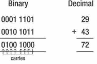

**图 1-3. 二进制值相加**

加法运算从最右边开始，将操作数中对应的位相加。图 1-3 显示，前六个位位置中的每一个都会向下一位置产生 1 的“进位”。这是因为每个数字只能是 0 或 1。当你计算 1 + 1 时，结果无法存储在当前位位置，等价于在左边下一个位位置加 1。

### 十六进制数

当你处理较大的二进制数时，书写它们会出现一个小问题。看看这个：

1111 0101 1011 1001 1110 0001

这里的二进制记数法在实际使用中开始变得相当繁琐，尤其是考虑到它在十进制中只是 16,103,905——区区八位十进制数字。针尖上能站下的天使都比这多！显然，你需要一种更经济的书写方式，但十进制并不总是合适。例如，你可能想指定一个数中从右数第 10 位和第 24 位为 1。要算出对应的十进制整数很费劲，而且很可能你无论如何都会算错。更简单的解决方案是使用十六进制记数法，其中数字用基 16 表示。

基 16 的算术是方便得多的选择，而且它与二进制配合得相当好。每个十六进制数字的取值可以是 0 到 15，而 10 到 15 的数字用字母 A 到 F（或 a 到 f）表示，如表 1-2 所示。0 到 15 的值恰好与四位二进制数字能够表示的值范围很好地对应。

**表 1-2. 十六进制数字及其十进制和二进制值**

| 十六进制 | 十进制 | 二进制 |
|---|---:|---:|
| 0 | 0 | 0000 |
| 1 | 1 | 0001 |
| 2 | 2 | 0010 |
| 3 | 3 | 0011 |
| 4 | 4 | 0100 |
| 5 | 5 | 0101 |
| 6 | 6 | 0110 |
| 7 | 7 | 0111 |
| 8 | 8 | 1000 |
| 9 | 9 | 1001 |
| A 或 a | 10 | 1010 |
| B 或 b | 11 | 1011 |
| C 或 c | 12 | 1100 |
| D 或 d | 13 | 1101 |
| E 或 e | 14 | 1110 |
| F 或 f | 15 | 1111 |


因为一个十六进制位对应四个二进制位，所以你可以直接用十六进制表示任意二进制数：从右往左每四位二进制位分一组，并为每组写出等价的十六进制位。看看下面的二进制数：

```
1111 0101 1011 1001 1101 0001
```

把每四位一组替换为表中对应的十六进制位，就得到：

```
F 5 B 9 E 1
```

你得到了六个十六进制位，分别对应六组四位二进制位。为了证明这一切都成立且没有作弊，你可以再次借助十进制数含义的类比，直接把这个数从十六进制转换为十进制：因此，这个十六进制数的值计算如下（F5B9E1 的十进制值由下式给出）：

```
15 × 16⁵ + 5 × 16⁴ + 11 × 16³ + 9 × 16² + 14 × 16¹ + 1 × 16⁰
```

值得庆幸的是，这算出来的结果，与你把等价的二进制数转换为十进制值时得到的结果相同：16,103,905。

十六进制数的一个便利巧合是，现代计算机以字为单位存储整数，而字包含偶数个字节，通常是 2、4、8、16 个字节左右。一个字节是 8 位，恰好是两个十六进制位，因此内存中的任何二进制整数字总是对应整数个十六进制位。

## 负二进制数

二进制算术还有另一个方面需要你理解：负数。到目前为止，我们一直假设一切都是正数——这是乐观主义者的观点——所以杯子仍然是半满的。但你无法回避生活中消极的一面——悲观主义者的视角——杯子已经是半空的了。那么，现代计算机中负数是如何表示的呢？你很快就会看到，这个看似简单的问题，答案其实远不明显……

既能取正值又能取负值的整数称为有符号整数。自然，你只能使用二进制位来表示数字。归根结底，你的计算机所说的任何语言都只由位和字节组成。如你所知，计算机内存通常由 8 位字节构成，所以所有二进制数都将以 8 位的某个倍数（通常是 2 的幂）来存储。因此，你也只能有 8 位、16 位、32 位或任意位数的有符号整数。

因此，有符号整数的一种直观表示法由固定数量的二进制位组成，其中一位被指定为所谓的符号位。在实践中，符号位总是选择最左边的一位。假设我们把所有有符号整数的大小固定为 8 位；那么数字 6 可以表示为 00000110，而 −6 可以表示为 10000110。把 +6 变成 −6 只需把符号位从 0 翻转为 1。这称为符号-数值表示法：每个数由一个符号位（正值为 0，负值为 1）加上给定数量的其他位组成，这些其他位指定该数的数值大小或绝对值（换句话说，就是不带符号的值）。

虽然符号-数值表示法对人类来说很容易处理，但它有一个不幸的缺点：对计算机来说完全不容易处理！更具体地说，在执行算术运算所需的电路复杂性方面，它会带来大量开销。例如，当两个有符号整数相加时，你不希望计算机胡乱检查其中一个或两个数是否为负数。你真正想要的是，无论操作数的符号如何，都使用同样简单且非常快速的“加法”电路。

让我们看看，当我们天真地把 12 和 −8 的符号-数值表示相加时会发生什么。你几乎事先就知道这行不通，但我们还是继续下去：

|  |  |
|---|---|
| 12 的二进制是 | `00001100` |
| −8 的二进制（你假设）是 | `10001000` |
| 如果现在把它们“相加”，得到 | `10010100` |

这似乎得到 −20，这当然完全不是你想要的。它肯定不是 +4，而你知道 +4 是 00000100。“啊，”我们听到你说，“你不能把符号像另一个数字位那样对待。”但这正是你为了加速二进制计算而想要做的！

因此，几乎所有现代计算机都采用不同的方法：它们使用所谓的*补码表示法*来表示负二进制数。使用这种表示法，你可以通过一个简单的过程在头脑中算出任意正二进制数的负数。此时，我们需要请你稍微相信我们，因为我们将避免解释它为什么有效。就像真正的魔术师一样，我们不会解释我们的魔术。我们将向你展示如何从正数得到负数的补码形式，而你可以自己证明它确实有效。为此，让我们回到前面的例子，其中你需要 −8 的补码表示：

- 1. 从 +8 的二进制开始：`00001000`。
- 2. 然后“翻转”每个二进制位，把 0 变成 1，反之亦然：`11110111`。这称为*反码*形式。
- 3. 如果现在给它加 1，就得到 −8 的补码形式：`11111000`。

注意，这个过程双向都有效。要把负数的补码表示转换回对应的正二进制数，你同样翻转所有位并加一。对于我们的例子，翻转 `11111000` 得到 `00000111`，再加一得到 `00001000`，即十进制的 +8。神奇！

但当然，底层想法的正确性要靠实践来检验。如果补码表示不能促进二进制算术，那它只不过是个有趣的小戏法。那么，让我们看看 `11111000` 在计算机的基本加法电路中表现如何：

|  |  |
|---|---|
| +12 的二进制是 | `00001100` |
| −8 的补码表示是 | `11111000` |
| 如果把它们相加，得到 | `00000100` |

答案是 4——它有效！“进位”传播穿过所有最左边的 1，把它们重新置为 0。有一个 1 从末尾掉出去了，但你不必担心——它很可能补偿了你在做减法得到 −8 时从末尾借来的那个 1。事实上，发生的事情是，你隐含地假设符号位（1 或 0）向左无限重复。自己试几个例子；你会发现它总是有效，像魔术一样。负数的补码表示法的伟大之处在于，它让算术——顺便说一句，不只是加法——对计算机来说非常容易。这也解释了计算机为什么如此擅长处理数字的其中一个原因。

### 八进制值

八进制整数是以 8 为基数表示的数。八进制值中的数字只能是 0 到 7。如今八进制很少使用。在计算机内存以 36 位字来衡量的时代，它很有用，因为你可以用 12 个八进制位来指定一个 36 位二进制值。那些日子早已远去，那么我们为什么还要介绍它呢？答案是它可能造成的潜在混淆。你仍然可以在 C++ 中写八进制常量。八进制值以零开头书写，所以 76 是十进制值，而 076 是八进制值，对应十进制 62。因此，这里有一条黄金法则：

> **注意** 永远不要在源代码中用前导零写十进制整数。否则你得到的值会与预期不同！

### 大端序和小端序系统

整数在内存中以二进制值的形式存储在连续的字节序列中，通常是 2、4、8 或 16 个字节为一组。字节出现的顺序可能很重要——这是那种直到它重要时才重要、而一旦重要就真的很重要的事情之一。

让我们考虑十进制值 262,657 存储为 4 字节二进制值的情况。我们选择这个值不是因为它是一个质数（那纯属巧合），而是因为在二进制中，每个字节恰好都有一种容易与其他字节区分的位模式：

```
00000000 00000100 00000010 00000001
```

如果你使用的是采用 Intel 处理器的 PC，这个数字将按如下方式存储：

|  | 00 | 01 | 02 | 03 |
|---|---|---|---|---|
| 字节地址： |  |  |  |  |
| 数据位： | `00000001` | `00000010` | `00000100` | `00000000` |

如你所见，该值的最高八位——也就是全为 0 的那八位——存储在地址最高的字节中（换句话说，是最后一个字节），而最低八位存储在地址最低的字节中，也就是最左边的字节。这种排列方式称为*小端序*。你可能会想，计算机到底为什么要反转这些字节的顺序？其动机一如既往，根源在于这样能实现更高效的计算和更简单的硬件。细节并不太重要；主要的是你要知道，如今大多数现代计算机都使用这种反直觉的编码方式。

不过，大多数计算机是这样，但并非所有计算机都如此。如果你使用的是基于 Motorola 处理器的机器，同样的数据很可能以更合乎逻辑的方式排列在内存中，就像这样：

|  | 00 | 01 | 02 | 03 |
|---|---|---|---|---|
| 字节地址： |  |  |  |  |
| 数据位： | `00000000` | `00000100` | `00000010` | `00000001` |

现在，字节顺序反过来了，最高八位存储在地址最低的最左边字节中。这种排列方式称为*大端序*。某些处理器，如 PowerPC 和所有近期的 ARM 处理器，都是*双端序*的，这意味着数据的字节顺序可以在大端序和小端序之间切换。然而在实践中，一旦应用程序启动，没有任何操作系统会容忍在运行时切换字节序。


> **注意** 无论字节序是大端序还是小端序，每个字节内的位都按最高有效位在左、最低有效位在右排列。

你可能会说，这一切都非常有趣，但它什么时候重要呢？大多数时候并不重要。通常，你完全可以在不知道代码将在何种字节序的计算机上运行的情况下愉快地编写程序。然而，当你处理来自另一台机器的二进制数据时，这就重要了。你需要知道字节序。二进制数据以字节序列的形式写入文件或通过网络传输。如何解释它由你决定。如果数据来源机器的字节序与运行代码的机器不同，就必须反转每个二进制值中字节的顺序。否则，得到的就是垃圾数据。

对于那些喜欢收集奇闻轶事背景信息的人，*大端序*和*小端序*这两个术语源自乔纳森·斯威夫特的书*《格列佛游记》*。在故事中，小人国皇帝命令所有臣民总是从较小的一端敲鸡蛋。这是因为皇帝的儿子按照从大端敲鸡蛋的传统做法割伤了自己的手指。普通守法的 Lilliputian 臣民从较小的一端敲鸡蛋，被称为小端派。大端派是 Lilliputian 王国中一个叛逆的传统主义者团体，他们坚持继续从大端敲鸡蛋。许多人因此被处死。

> **提示** 要确定你的程序是否正为大端序或小端序平台编译，C++20 标准库在 `<bit>` 模块中引入了 `std::endian::native`。在实际中，该值总是等于 `std::endian::little` 或 `std::endian::big` 之一。你可以查阅你最喜欢的标准库参考以了解更多细节。

## 浮点数

所有整数都是数，但当然并非所有数都是整数：3.1415 不是整数，-0.0001 也不是。大多数应用迟早都会处理实数小数。因此，你显然也需要一种在计算机中表示这类数的方法，并辅以高效执行计算的能力。几乎所有计算机都支持的处理小数的机制——你可能已经从章节标题猜到了——叫作浮点数。

不过，浮点数并不只是表示小数。作为额外的好处，它们还能处理非常大的数。例如，它们允许你表示宇宙中质子的数量，这需要约 79 个十进制数字（当然，并非精确到一个粒子，但这没关系——谁有时间把它们全数清呢？）。诚然，后一个例子也许有些极端，但显然有些情况下，你需要比 32 位二进制整数所能提供的十位十进制数字更多的位数，甚至需要比 64 位整数所能提供的 19 位更多的位数。同样，也有大量非常小的数，例如，普通汽车销售员接受你对一辆 2001 年本田的慷慨报价所需的时间（分钟）（而且它只跑了 480,000 英里……）。浮点数是一种能相当有效地表示这两类数的机制。

我们将首先用十进制浮点数解释基本原理。当然，你的计算机仍会使用二进制表示，但对我们人类来说，使用十进制数理解起来要容易得多。所谓的规格化数由两部分组成：尾数（或小数部分）和指数。两者都可以为正或为负。数的大小等于尾数乘以 10 的指数次幂。类比计算机的二进制浮点数表示，我们还会固定尾数和指数两者的十进制数字位数。演示这一点比描述更容易，所以让我们看一些例子。数字 365 可以写成如下浮点形式：

```
3.65000E02
```

这里的尾数有七位十进制数字，指数有两位。E 代表“指数”，它位于 10 的幂之前，而 3.65000（尾数）要乘以这个 10 的幂才能得到所需的值。也就是说，要回到常规十进制记法，你只需计算以下乘积：

```
3.65000 × 10² = 365.
```

现在让我们看一个小数：

```
-3.65000E-03
```

它的计算结果为 −3.65 × 10⁻³，即 −0.00365。它们被称为浮点数，原因相当明显：小数点“浮动”，其位置取决于指数值。

现在假设你有一个更大的数，例如 2,134,311,179。使用相同数量的数字，这个数看起来像这样：

```
2.134311E09
```

它并不完全相同。你丢失了三个低位数字，并将原始值近似为 2,134,311,000。这就是能够处理如此巨大数值范围所付出的代价：并非所有这些数都能以完整精度表示；一般来说，浮点数只是精确数值的近似表示。

除了精度上的固定精度限制外，还有一个方面你可能需要注意。当对数量级相差很大的数进行加减运算时，你需要格外小心。一个简单的例子可以说明这个问题。考虑将 1.23E-4 加到 3.65E+6。当然，精确结果是 3,650,000 + 0.000123，即 3,650,000.000123。但转换为七位精度的浮点数后，就变成以下结果：

```
3.65000E+06 + 1.23000E-04 = 3.65000E+06
```

把后一个较小的数加到前一个数上完全没有效果，所以你还不如省点事。问题直接在于你只保留七位精度。较大数的各位数字不受较小数任何数字的影响，因为较小数的数字都位于更靠右的位置。

说来有趣，当两个数几乎相等时，你也必须小心。如果你计算这类数之间的差，大多数数字会相互抵消，最终结果可能只有一两位精度。这被称为灾难性抵消；在这种情况下，很容易最终用完全垃圾的数字进行计算。

尽管浮点数使你能够执行没有它们就不可能完成的计算，但如果你想确保结果有效，就必须始终牢记它们的局限性。这意味着要考虑你可能会处理的值范围及其相对值。分析并最大化数学计算和算法精度——或数值稳定性——的领域称为数值分析。不过，这是一个高级主题，远远超出了本书的范围。只需说明一点：浮点数的精度是有限的，而且你用它们执行的算术运算的顺序和性质会对结果的准确性产生重大影响。

当然，你的计算机并不使用十进制数；它使用的是二进制浮点表示。还记得位和字节吗？具体来说，如今几乎所有计算机都使用 IEEE 754 标准规定的编码和计算规则。从左到右，每个浮点数由单个符号位、固定数量的指数位，以及最后一系列编码尾数的位组成。最常见的浮点数表示是所谓的*单精度*（1 个符号位、8 个指数位和 23 个尾数位，总共 32 位）和*双精度*（1 + 11 + 52 = 64 位）浮点数。

浮点数可以表示巨大的数值范围。例如，单精度浮点数已经可以表示从 10⁻³⁸ 到 10³⁸ 的数。当然，这种灵活性是有代价的：精度位数有限。你从上面已经知道这一点，而且这也完全合乎逻辑；当然，并非 10³⁸ 量级的所有数的全部 38 位数字都能用 32 位精确表示。毕竟，32 位二进制整数能精确表示的最大有符号整数只有 2³¹ − 1，约为 2 × 10⁹。浮点数的十进制精度位数取决于为其尾数分配了多少内存。例如，单精度浮点值提供约七位十进制数字的精度。我们说“约”，是因为 23 位的二进制小数并不完全对应于七位十进制小数。双精度浮点值对应约 16 位十进制数字的精度。

## 表示字符

计算机内部的数据没有内在含义。机器码指令只是数字：当然，数字就是数字，但字符等也是如此。每个字符都被分配一个唯一的整数值，称为其代码或码点。上面的内容可以是氢的原子序数；可以是生命、宇宙以及一切问题的答案；也可以是一个星号字符。这完全取决于你选择如何解释它。你可以在 C++ 中把单个字符写在单引号之间，例如 'a'、'?' 或 '*'，编译器会为这些字符生成代码值。

### ASCII 码

早在 20 世纪 60 年代，就定义了用于表示字符的美国信息交换标准代码（ASCII）。这是一种 7 位代码，因此有 128 个不同的代码值。ASCII 值 0 到 31 表示各种非打印控制字符，例如回车（代码 13）和换行（代码 10）。代码值 65 到 90（含）是大写字母 A 到 Z，97 到 122 对应小写字母 a 到 z。如果你查看字母代码值对应的二进制值，就会发现小写字母和大写字母的值只在第六位不同；小写字母的第六位为 1，大写字母的第六位为 0。其他代码表示数字 0 到 9、标点符号和其他字符。

如果你是美国或英国人，最初的 7 位 ASCII 没问题；但如果你是法国人或德国人，就需要文本中的重音符号和元音变音符号之类的东西，而这些并不包含在那个 7 位 ASCII 编码的 128 个字符中。为了克服 7 位代码带来的限制，人们定义了使用 8 位代码的 ASCII 扩展版本。0 到 127 的值表示与 7 位 ASCII 相同的字符，128 到 255 的值则各不相同。你可能遇到过的一种 8 位 ASCII 变体叫作 Latin-1，它为大多数欧洲语言提供字符，但也有其他变体用于俄语等语言。

然而，如果你说韩语、日语、汉语或阿拉伯语，8 位编码就完全不够用。给你一个直观概念：中日韩文字（它们有共同背景）的现代编码覆盖了近 88,000 个字符——只比你能从 8 位中挤出的 256 个字符多一点点！为了克服扩展 ASCII 的限制，通用字符集（UCS）在 20 世纪 90 年代出现。UCS 由 ISO 10646 标准定义，其代码最多可达 32 位。这提供了数亿个唯一代码值的潜力。


## UCS 与 Unicode

UCS 定义了字符与整数码值之间的映射，这些码值称为*码点*。重要的是要认识到，*码点*并不等同于*编码*。码点是一个整数；编码规定了一种将给定码点表示为一系列字节或字的方式。小于 256 的码值很常见，可以用一个字节表示。仅仅因为还有其他码需要几个字节，就用四个字节来存储只需一个字节的码值，会很低效。编码是表示码点的方式，使码点能够更高效地存储。

Unicode 是一个标准，它定义了一组字符及其码点，这些码点与 UCS 中的相同。Unicode 还为这些码点定义了几种不同的编码，并包含用于处理从右到左语言（如阿拉伯语）等事项的附加机制。码点的范围足以容纳世界上所有语言的字符集，以及许多不同的图形字符集，例如数学符号，甚至表情符号和 emoji。无论如何，这些码的安排方式使得大多数语言中的字符串可以表示为单个 16 位码的序列。

Unicode 有一个可能令人困惑的方面：它提供了不止一种*字符编码方法*。最常用的编码称为 UTF-8、UTF-16 和 UTF-32，其中任何一种都能表示 Unicode 字符集中的所有字符。它们之间的区别在于给定字符码点的表示方式；任何给定字符的数值码值在任何表示形式中都相同。以下是这些编码表示字符的方式：

- *UTF-8* 将字符表示为长度在 1 到 4 字节之间的可变长度序列。ASCII 字符集在 UTF-8 中表现为单字节码，其码值与 ASCII 相同。UTF-8 是迄今为止最流行的 Unicode 编码。例如，大多数网页使用 UTF-8 编码文本（根据最近的一项研究，占 95.2%）。
- *UTF-16* 将字符表示为一个或两个 16 位值。直到最近，Microsoft 还提倡在 Windows 上使用其基于 UTF-16 的原生 API。然而，如今大多数平台推荐的编码是 UTF-8。
- *UTF-32*，你猜对了，只是将所有字符表示为 32 位值。在实践中，应用程序内部很少使用 UTF-32。

在 C++20 中，有四种用于存储 Unicode 字符的类型：wchar_t、char8_t、char16_t 和 char32_t——然而，由于 char8_t 仅在 C++20 中引入，许多旧式应用程序和 API 仍会使用 char 来表示 UTF-8 编码的字符串。你将在第 2 章中进一步了解不同的字符类型。

## C++ 源字符

你使用*基本源字符集*编写 C++ 语句。这是允许在 C++ 源文件中显式使用的字符集。可用于定义名称的字符集是它的一个子集。当然，基本源字符集绝不会限制你在代码中处理的字符数据。你的程序可以通过多种方式创建由该字符集之外的字符组成的字符串，你将会看到。基本源字符集由以下字符组成：

- 字母 a 到 z 和 A 到 Z
- 数字 0 到 9
- 空白字符：空格、水平制表符、垂直制表符、换页符和换行符
- 字符 `{ } [ ] # ( ) < % : ; . ? * + - / ^ & | ~ ! = , \\ " '`

这简单明了。你有 96 个可以使用的字符，很可能在大多数时候足以满足你的需求。大多数时候基本源字符集就足够了，但偶尔你会需要它之外的字符。至少在理论上，你也可以在 C++ 名称中包含 Unicode 字符。使用哪种 Unicode 编码以及支持 Unicode 的哪个子集，取决于你的编译器。字符数据和字符串数据同样都可以包含 Unicode 字符。不过，如果你希望以任何编译器都能接受的形式，在字符字面量或字符串字面量（字面量将在第 2 章讨论）中包含 Unicode 字符，就应使用其码点的十六进制表示。也就是说：你应将其输入为 \udddd 或 \Udddddddd，其中 d 是十六进制数字。注意第一种情况中的小写 u 和第二种情况中的大写 U；两者都可接受。

## 转义序列

当你想在程序中使用字符常量（例如单个字符或字符串）时，某些字符会带来问题。显然，你不能像换行符这样的字符直接作为字符常量输入，因为它们只会做它们本该做的事：在源代码文件中换到新的一行（此规则的唯一例外是原始字符串字面量，第 7 章会介绍）。你可以借助转义序列在字符常量中输入这些有问题的字符。转义序列是一种间接指定字符的方式，并且总是以反斜杠开头。表 1-3 显示了最常用的转义序列。

表 1-3. 最常用的转义序列

| 转义序列 | 字符 |
| --- | --- |
| `\n` | 换行符 |
| `\r` | 回车（Windows 的 `\r\n` 换行序列的一部分） |
| `\t` | 水平制表符 |
| `\\` | 反斜杠（`\`） |
| `\"` | 字符串字面量中的双引号（`"`） |
| `\'` | 字符字面量中的单引号（`'`） |

表 1-3 中的前三个转义序列表示各种换行或空白字符。然而，最后三个字符是更普通的字符，但有时难以在代码中直接表示。显然，反斜杠字符本身很难表示，因为它标志着转义序列的开始；单引号和双引号字符也很难表示，因为它们被用作字面量的分隔符，例如常量 'A' 或字符串 "text"。下面这个使用转义序列的程序会向屏幕输出一条消息。要看到结果，你需要输入、编译、链接并执行代码：

```cpp
// Ex1_02.cpp
// Using escape sequences
import <iostream>;

int main()
{
    std::cout << "\"Least \'said\' \\\n\t\tsoonest \'mended\'.\"" << std::endl;
}
```

当你成功编译、链接并运行此程序后，应看到以下输出显示：

```text
"Least 'said' \
        soonest 'mended.'"
```

输出由下面语句中最外层双引号之间的内容决定：

```cpp
std::cout << "\"Least \'said\' \\\n\t\tsoonest \'mended.\'\"" << std::endl;
```

原则上，前一条语句中外部双引号之间的*一切*都会发送到 cout。一对双引号之间的字符序列称为*字符串字面量*。双引号字符是*分隔符*，用于标识字符串字面量的开头和结尾；它们不是字符串的一部分。字符串字面量中的每个转义序列都会被编译器转换为它所表示的字符，因此发送到 cout 的是该字符，而不是转义序列本身。字符串字面量中的反斜杠总是表示转义序列的开始，因此发送到 cout 的第一个字符是双引号字符。

接下来输出 Least，后跟一个空格。然后是一个单引号字符，接着是 said，再接着是另一个单引号。接下来是一个空格，然后是由 `\\` 指定的反斜杠。随后，与 `\n` 对应的换行字符被写入流，因此光标移到下一行的开头。然后你用 `\t\t` 向 cout 发送两个制表符，因此光标将向右移动两个制表符位置。接下来输出单词 soonest，后跟一个空格，然后是在单引号之间的 mended。最后输出一个句点，后跟一个双引号。

> **注意** 如果你不喜欢转义序列，第 7 章介绍了一种有趣的替代方案，称为*原始字符串字面量*。

事实是，在热情展示字符转义的过程中，我们可能在 Ex1_02.cpp 中做得有点过头了。实际上，你不必在字符串字面量中转义单引号字符 `'`；这本来就不存在混淆的可能。因此，下面的语句将产生相同的输出：

```cpp
std::cout << "\"Least 'said' \\\n\t\tsoonest 'mended.'\"" << std::endl;
```

只有在形如 `'\''` 的字符字面量中，单引号才真正需要转义。反过来，双引号当然就不需要反斜杠了；你的编译器会乐意接受 `'\''` 和 `'"'` 两者。不过我们有点操之过急了：字符字面量更多是下一章的主题。

> **注意** 严格来说，Ex1_02 中的 `\t` 转义序列也不是必需的——原则上，你同样可以在字符串字面量中直接键入制表符（例如 `"\"Least 'said' \\n    soonest 'mended.'\""`）。不过，仍然建议使用 `\t`；制表符的问题在于，人们通常无法区分制表符、`"    "` 和若干空格 `"  "`，更不用说正确数出制表符的数量了。此外，一些文本编辑器在保存时倾向于将制表符转换为空格。因此，样式指南要求字符串字面量中使用 `\t` 转义序列并不罕见。


## 总结

本章内容是一个广泛的概述，旨在让你感受 C++ 的一些一般概念。你将在后续章节中再次遇到本章讨论的所有内容，并且会详细得多。不过，本章涵盖的一些基础知识如下：

- 一个 C++ 程序由一个或多个函数组成，其中一个是 `main()`。执行总是从 `main()` 开始。
- 函数的可执行部分由包含在花括号之间的语句组成。
- 一对花括号用于包围一个语句块。
- 语句以分号结束。
- 关键字是在 C++ 中具有特定含义的保留字。程序中的任何实体都不能使用与关键字相同的名称。
- 一个 C++ 程序将包含在一个或多个文件中。源文件包含大部分可执行代码。
- 包含定义函数的代码的源文件通常具有扩展名 `.cpp`。
- 标准库提供了广泛的功能，支持并扩展了 C++ 语言。
- 通过在源文件中导入标准库模块文件，可以访问标准库函数和定义。
- 输入和输出使用流执行，并涉及插入和提取运算符 `<<` 和 `>>` 的使用。`std::cin` 是对应于键盘的标准输入流。`std::cout` 是用于将文本写入屏幕的标准输出流。两者都定义在 `<iostream>` 标准库模块中。
- 面向对象编程涉及定义特定于你的问题的新数据类型。一旦定义了所需的数据类型，就可以根据这些新数据类型编写程序。
- Unicode 定义了唯一的整数代码值，这些值表示世界上几乎所有语言的字符以及许多专用字符集。代码值称为码点。Unicode 还定义了这些码点如何编码为字节序列。

## 练习

以下练习让你尝试本章学到的内容。如果卡住了，可以回顾本章寻求帮助。如果之后仍然卡住，你可以从 Apress 网站（www.apress.com/book/download.html）下载解答，但这确实应该是最后的手段。

- 练习 1-1：创建、编译、链接并执行一个程序，该程序将在屏幕上显示文本“Hello World!”。
- 练习 1-2：创建并执行一个程序，该程序在第一行输出你的名字，在下一行输出你的年龄。
- 练习 1-3：以下程序会产生若干编译器错误。找出这些错误并改正，使程序能够干净地编译和运行。

```cpp
#import <iostream>
Int main
{
    std::cout << "Hola Mundo!" << std::endl
}
```

# 第 2 章：介绍基本数据类型


在本章中，我们将解释 C++ 内置的基本数据类型。你在每个程序中都会需要它们。所有面向对象能力都建立在这些基本数据类型之上，因为你创建的所有数据类型最终都是根据计算机所处理的基本数值数据来定义的。到本章结束时，你将能够编写一个传统形式的简单 C++ 程序：输入——处理——输出。

在本章中，你将学习

- C++ 中的基本数据类型是什么
- 如何声明、初始化和重新赋值变量
- 如何固定变量的值
- 什么是整数字面量以及如何定义它们
- 计算如何工作
- 如何使用包含浮点值的变量
- 你可以使用哪些初等数学函数和常量
- 如何将变量从一种类型转换为另一种类型
- 如何控制将变量转换为字符串时使用的格式
- 如何使用存储字符的变量
- `auto` 关键字的作用是什么

## 变量、数据与数据类型

变量是你定义的一块有名称的内存。每个变量只存储特定类型的数据。每个变量都有一个类型，该类型定义了它可以存储的数据种类。每种基本类型都由一个唯一的类型名称标识，该名称由一个或多个关键字组成。关键字是 C++ 中的保留字，不能用于其他任何用途。

编译器会进行广泛检查，以确保你在任何给定上下文中使用正确的数据类型。它还将确保当你在操作中组合不同类型时，例如，当你在加法这样的操作中组合不同类型时，要么它们属于同一类型，要么可以通过将一个值转换为另一个值的类型来使它们兼容。编译器会检测并报告组合不兼容的不同类型数据的尝试。

数值分为两大类：整数（即整数值）和浮点值（可以是非整数）。每一类中都有几种 C++ 基本类型，每种类型都可以存储特定范围的值。我们将从整数类型开始。

### 定义整数变量

下面是一条定义整数变量的语句：

```cpp
int apple_count;
```

这定义了一个类型为 int、名称为 apple_count 的变量。该变量将包含某个任意的垃圾值。你可以在定义变量时指定初始值，而且应该这样做，如下所示：

```cpp
int apple_count {15};                    // Number of apples
```

apple_count 的初始值出现在名称后面的花括号之间，因此它的值为 15。包围初始值的花括号称为花括号初始化器。你将在本书后面遇到花括号初始化器在花括号之间包含多个值的情况。定义变量时不必初始化它们，但这样做是个好主意。确保变量以已知值开始，可以更容易地弄清楚当代码不按预期工作时出了什么问题。

int 类型变量的大小通常是四个字节，因此它们可以存储从 −2,147,483,648 到 +2,147,483,647 的整数。这涵盖了大多数情况，这就是为什么 int 是最常用的整数类型。

下面是三个 int 类型变量的定义：

```cpp
int apple_count {15};                    // Number of apples
int orange_count {5};                    // Number of oranges
int total_fruit {apple_count + orange_count};
```

total_fruit 的初始值是先前定义的两个变量值之和。这表明变量的初始值可以是一个表达式。在 total_fruit 初始值的表达式中定义这两个变量的语句必须出现在源文件更早的位置；否则，total_fruit 的定义将无法编译。

还有两种初始化变量的方法：函数表示法和赋值表示法。它们如下所示（是的，番茄也是水果）：

```cpp
int lemon_count(4);                    // Functional notation
int tomato_count = 12;                  // Assignment notation
```

大多数时候，这三种表示法——花括号、函数和赋值表示法——是等价的。然而，花括号初始化器形式在所谓窄化转换方面稍微更安全。窄化转换会将值更改为具有更有限值范围的类型。因此，任何这样的转换都有可能丢失信息。下面是一个示例：

```cpp
int banana_count(7.5);                  // Typically compiles without warning
int tangerine_count = 5.3;               // Typically compiles without warning
```

通常，你提供的初始值将与所定义变量的类型相同。不过，如果不是，编译器会尝试将其转换为所需类型。在前面的示例中，我们为两个整数变量指定了非整数初始值。稍后我们将更详细地讨论浮点到整数的转换，但现在请相信我们：在这些变量定义之后，banana_count 和 tangerine_count 将分别包含整数值 7 和 5。这不太可能是作者的本意。

尽管如此，就 C++ 标准而言，这两个定义完全合法。它们被允许编译，甚至不会有丝毫警告。虽然有些编译器确实会对这种明显的窄化转换发出警告，但绝对不是所有编译器都会这样做。然而，如果你使用花括号初始化器形式，符合标准的编译器至少必须发出诊断消息。例如：

```cpp
int papaya_count{0.3};    // At least a compiler warning, often an error
```

如果这条语句编译通过，papaya_count 将被初始化为整数值 0。但至少编译器会警告你可能有些不对劲。有些编译器甚至会报错并完全拒绝编译这样的定义。

我们认为，无意的窄化转换不应被忽视，因为它们通常是错误。因此，在本书中我们将采用花括号初始化器语法。这是 C++11 中专门为标准化初始化而引入的最新语法。除了在窄化转换方面提供更好的安全保障外，它的主要优点是使你能够以相同的方式初始化几乎一切——这也是它通常被称为统一初始化的原因。

> **注意** 要表示小数，通常使用浮点变量而不是整数。我们将在本章后面描述这些内容。

你可以在一条语句中定义并初始化同一类型的多个变量。下面是一个示例：

```cpp
int foot_count {2}, toe_count {10}, head_count {1};
```

虽然这是合法的，但通常认为最好在单独的语句中定义每个变量。这使代码更可读，并且你可以在注释中解释每个变量的用途。你可以将任何基本类型变量的值写入标准输出流。下面是一个用几个整数实现这一点的程序：

```cpp
// Ex2_01.cpp
// Writing values of variables to the screen
import <iostream>;    // For input and output through std::cin / std::cout

int main()
{
    int apple_count {15};                            // Number of apples
    int orange_count {5};                            // Number of oranges
    int total_fruit {apple_count + orange_count};    // Total number of fruit

    std::cout << "The value of apple_count is " << apple_count << std::endl;
    std::cout << "The value of orange_count is " << orange_count << std::endl;
    std::cout << "The value of total_fruit is " << total_fruit << std::endl;
}
```

如果编译并执行这段代码，你会看到它在输出三个变量的值之前会先输出一些文字说明它们是什么。整数值会被插入运算符 `<<` 自动转换为字符表示形式输出。这对任何基本类型的值都适用。

> **提示** 当然，Ex2_01.cpp 中的三个变量实际上并不需要注释来解释它们代表什么。它们的变量名已经使含义一目了然——本来就该如此！相比之下，水平较低的编程者可能会写出下面这样的代码：

```cpp
int n {15};
int m {5};
int t {n + m};
```

如果没有额外的上下文或解释，没有人能猜到这段代码是在统计水果数量。因此，你应该始终尽量选择具有自描述性的变量名。命名得当的变量和函数通常不需要再以注释的形式额外解释。当然，这并不意味着你永远不应该在声明中添加注释。你不可能总能在单个名字中包含所有信息。几句话，或者如果需要的话，一小段注释，就能在帮助他人理解代码方面产生奇效。编写时多花一点功夫，就能在未来的开发中显著提速！

## 有符号整数类型

表 2-1 列出了用于存储有符号整数（即正数和负数）的完整基本类型集合。每种类型分配的内存大小，以及由此决定的可存储数值范围，可能因编译器而异。表 2-1 显示了所有常见平台和计算机体系结构下编译器使用的字节大小和取值范围。

**表 2-1.** *有符号整数类型*

| 类型名称 | 典型大小（字节） | 典型取值范围 | 理论最小大小 |
|---|---:|---:|---:|
| signed char | 1 | -128 到 +127 | 1 |
| short<br>short int<br>signed short<br>signed short int | 2 | -32,768 到 +32,767 | 2 |
| int<br>signed<br>signed int | 4 | -2,147,483,648 到 +2,147,483,647 | 2 |
| long<br>long int<br>signed long<br>signed long int | 4 或 8 | 与 int 或 long long 相同 | 4 |
| long long<br>long long int<br>signed long long<br>signed long long int | 8 | -9,223,372,036,854,775,808 到 +9,223,372,036,854,775,807 | 8 |

signed char 类型始终是一个字节（而一个字节几乎总是八位）；其他类型占用的字节数取决于编译器。不过，列表中的每种类型分配的内存始终不少于它前面的类型，并且（自 C++20 起）不少于表 2-1 最后一列所示的大小。

表 2-1 的第一列中出现了两个类型名称，排在前面的缩写名称更常用。也就是说，你通常会看到 `long` 而不是 `long int` 或 `signed long int`。

`signed` 修饰符通常可以省略；如果省略，你的类型默认就是有符号的。唯一的例外是 `char`。虽然未修饰的 `char` 类型确实存在，但它是否有符号取决于编译器。我们将在下一小节进一步讨论这一点。不过，对于除 `char` 之外的所有整数类型，你可以自由选择是否添加 `signed` 修饰符。就我们而言，通常只有在确实想强调某个变量是有符号的时候才会加上它。

## 无符号整数类型

当然，有些情况下你不需要存储负数。一个班级的学生人数或装配体中的零件数始终是正整数。你可以通过在任一有符号整数类型名称前添加 `unsigned` 关键字来指定只存储非负值的整数类型，例如 `unsigned char`、`unsigned short` 或 `unsigned long`。每种无符号类型都是与相应有符号类型不同的类型，但占用相同的内存大小。

与其他整数类型不同，`char` 类型是一种不同于 `signed char` 和 `unsigned char` 的整数类型。`char` 类型仅用于存储字符代码的变量，根据编译器不同，它可以是有符号类型，也可以是无符号类型。¹ 关于存储字符的变量，本章稍后会有更多介绍。

**提示** 仅使用未修饰的 `char` 类型变量来存储字母字符。要存储数字，应使用 `signed char` 或 `unsigned char`。如果你需要存储、引用或操作原始二进制数据（本书不讨论的高级主题），应使用 C++20 的 `std::byte` 类型，而不是更传统的 `char` 或 `unsigned char`。

除了 `unsigned char`（可能取值为 0 到 255）和也许 `unsigned short`（通常为 0 到 65,535）之外，增加可表示数值的范围很少是添加 `unsigned` 修饰符的主要动因。例如，能否表示最大到 2,147,483,647 或最大到 4,294,967,295 的数字，通常并不重要。相反，你添加 `unsigned` 修饰符主要是为了让代码更具自文档化特性，让给定变量将要或应该包含哪些值更加可预测。

**注意** 你也可以单独使用关键字 `signed` 和 `unsigned`。如表 2-1 所示，`signed` 类型被视为 `signed int` 的简写。因此，自然而然地，`unsigned` 是 `unsigned int` 的简写。

如果需要，你可以使用 `<limits>` 模块中的常量 `std::numeric_limits<char>::is_signed` 来确定在你的编译器中 `char` 是否有符号。本章稍后会进一步介绍 `<limits>` 模块。

### 零初始化

以下语句定义了一个初始值为零的整型变量：

```
int counter {0};      // counter starts at zero
```

你可以省去此处花括号初始化器中的 0，效果是一样的。定义 `counter` 的语句可以这样写：

```
int counter {};       // counter starts at zero
```

空的花括号有点像数字零，这使该语法易于记忆。零初始化适用于任何基本类型。例如，对于所有基本数值类型，空的花括号初始化器总是被视为包含数字零。

### 定义具有固定值的变量

有时你会希望定义值固定且不得更改的变量。你可以在定义不得更改的变量时使用 `const` 关键字。这类变量通常被称为常量。下面是一个例子：

```
const unsigned toe_count {10};        // An unsigned integer with fixed value 10
```

`const` 关键字告诉编译器，`toe_count` 的值不得更改。任何试图修改该值的语句都会在编译时被标记为错误；砍掉某人的脚趾绝对是不行的！你可以使用 `const` 关键字来固定任何类型变量的值。

> ■ 提示 别的姑且不论，知道哪些变量在过程中能改变值、哪些不能，会让你的代码更容易理解。因此，我们建议你只要适用就添加 `const` 限定符。

## 整数字面量

任何类型的常量值，如 42、2.71828、'z' 或 "Mark Twain"，都称为字面量。这些示例依次是整数字面量、浮点字面量、字符字面量和字符串字面量。每个字面量都有某种类型。我们首先讲解整数字面量，稍后将在具体情境中介绍其他种类的字面量。

### 十进制整数字面量

你可以用非常直接的方式书写整数字面量。下面是一些十进制整数的示例：

```
-123L     +123     123     22333     98U     -1234LL     12345ULL
```

无符号整数字面量带有后缀 `U` 或 `u`。`long` 类型和 `long long` 类型的字面量分别带有后缀 `L` 或 `LL`，如果它们是无符号的，还会附加 `u` 或 `U`。如果没有后缀，整数常量就是 `int` 类型。`U` 与 `L` 或 `LL` 可以按任意顺序出现。`L` 和 `LL` 后缀可以使用小写字母，但我们建议不要这样做，因为小写的 `l` 容易与数字 1 混淆。


### 十六进制字面量

你可以将整数字面量写成十六进制值。十六进制字面量以 0x 或 0X 为前缀，因此 0x999 是一个 int 类型的十六进制数，包含三个十六进制数字。另一方面，普通的 999 是一个 int 类型的十进制值，包含十进制数字，因此其值会完全不同。下面是十六进制字面量的更多示例：

|  |  |  |  |  |  |
|---|---|---|---|---|---|
| 十六进制字面量： | 0x1AF | 0x123U | 0xAL | 0xcad | 0xFF |
| 十进制字面量： | 431 | 291U | 10L | 3245 | 255 |

十六进制字面量的一个主要用途是定义特定的位模式。每个十六进制数字对应四位，因此很容易将位模式表示为十六进制字面量。例如，像素颜色的红、绿、蓝分量（RGB 值）通常表示为打包进一个 32 位字中的三个字节。白色可以指定为 0xFFFFFF，因为白色中三个分量的强度都具有相同的最大值 255，即 0xFF。红色则为 0xFF0000。以下是一些示例：

```
unsigned int color {0xffffff};    // Unsigned int hexadecimal constant - decimal 16,777,215
int mask {0XFF00FF00};            // Four bytes specified as FF, 00, FF, 00
unsigned long value {0xDEADUL};   // Unsigned long hexadecimal literal - decimal 57,005
```

### 八进制字面量

你也可以将整数字面量写成八进制值——也就是使用基数 8。通过在前面写零来标识一个数是八进制。

|  |  |  |  |  |  |
|---|---|---|---|---|---|
| 八进制字面量： | 0657 | 0443U | 012L | 06255 | 0377 |
| 十进制字面量： | 431 | 291U | 10L | 3245 | 255 |

> **警告** 不要用前导零来写十进制整数值。编译器会将这类值解释为八进制（基数 8），因此写成 065 的值等价于十进制表示法中的 53。

### 二进制字面量

二进制字面量由 C++14 标准引入。二进制整数字面量写作一串二进制数字（0 或 1），并以 0b 或 0B 为前缀。和往常一样，二进制字面量可以带有 L 或 LL 后缀，表示它是 long 或 long long 类型；如果是无符号字面量，还可以带有 u 或 U。以下是一些示例：

|  |  |  |  |  |  |
|---|---|---|---|---|---|
| 二进制字面量： | 0B110101111 | 0b100100011U | 0b1010L | 0B110010101101 | 0b11111111 |
| 十进制字面量： | 431 | 291U | 10L | 3245 | 255 |

我们在代码片段中展示了如何为前缀和后缀编写各种组合，例如 `0x` 或 `0X` 以及 `UL`、`ul`、`L` 或 `lu`，但当然，最好坚持使用一致的整数字面量写法。

就编译器而言，你在写整数值时选择哪种数基并不重要。最终它都会以二进制数存储。用不同方式书写整数只是为了方便。你可以根据上下文选择其中一种可能的表示形式。

> **注意** 你可以在任何整数字面量中使用单引号作为分隔符，以便更容易阅读。这包括十六进制或二进制字面量。例如：`0xFF00'00FFu` 或 `0b11001010'11011001`。

## 整数计算

首先，让我们先厘清一些术语。加法或乘法这样的运算由*运算符*定义——加法和乘法的运算符分别是 `+` 和 `*`。运算符作用的值称为*操作数*，因此在 `2 * 3` 这样的表达式中，操作数是 2 和 3。像乘法这样需要两个操作数的运算符称为*二元运算符*。只需要一个操作数的运算符称为*一元运算符*。一元运算符的一个例子是表达式 `-width` 中的减号。减号会取 width 值的相反数，因此该表达式的结果是一个与其操作数符号相反的值。这与 `width * height` 这类表达式中的二元乘法运算符形成对比，后者作用于两个操作数：width 和 height。

表 2-2 展示了对整数可以执行的基本算术运算符。

*表 2-2. 基本算术运算*

| 运算符 | 运算 |
|---|---|
| `+` | 加法 |
| `-` | 减法 |
| `*` | 乘法 |
| `/` | 除法 |
| `%` | 取模（除法后的余数） |

表 2-2 中的运算符都是二元运算符，其工作方式大体上与你预期的一样。不过，有两个运算符可能需要稍作解释：当然是不太为人熟知的取模运算符，另外还有除法运算符。整数除法在 C++ 中略显特殊。当应用于两个整数操作数时，除法运算的结果始终还是一个整数。例如，假设你编写以下代码：

```
int numerator = 11;
int quotient = numerator / 4;
```

从数学上讲，11/4 的除法结果当然是 2.75 或 2¾，也就是二又四分之三。但 2.75 显然不是整数，那该怎么办？任何理智的数学家都会建议将商四舍五入到最接近的整数，也就是 3。然而，遗憾的是，计算机并不会这样做。相反，计算机会直接完全丢弃小数部分 0.75。毫无疑问，这是因为正确舍入需要更复杂的电路，因此也需要更多求值时间。这意味着，在 C++ 中，11/4 始终会得到整数值 2。图 2-1 展示了除法和取模运算符在我们示例中的效果。

**整数除法运算符**

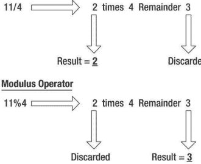

*图 2-1. 对比除法运算符和取模运算符*

整数除法返回分母除进分子的次数。任何余数都会被丢弃。取模运算符 % 与除法运算符互补，因为它产生整数除法后的余数。它的定义使得对于所有整数 x 和 y，(x / y) * y + (x % y) 等于 x。使用这个公式，你可以很容易地推断出取模运算符对负数操作数会做什么。当右操作数为零时，除法和取模运算符的结果都是未定义的——换句话说，会发生什么取决于你的编译器和计算机体系结构。

### 复合算术表达式

如果同一个表达式中出现多个运算符，乘法、除法和取模运算总是先于加法和减法执行。下面是一个此类情况的示例：

```
long width {4};
long length {5};
long area {width * length};      // Result is 20
long perimeter {2*width + 2*length}; // Result is 18
```

你可以使用括号控制更复杂表达式的执行顺序。你可以将计算 perimeter 值的语句写成如下形式：

```
long perimeter{ (width + length) * 2}; // Result is 18
```

以下是该程序典型输出的一个示例：

```
Enter a distance as yards, feet, and inches with the three values separated by spaces: 9 2 11
This distance corresponds to 359 inches.
Enter a distance in inches: 359
This distance corresponds to 9 yards 2 feet 11 inches.
```

main() 中的第一条语句定义了三个整数变量，并将它们初始化为零。它们的类型是 unsigned int，因为在这个示例中距离值不能为负数。这是一个在单条语句中定义三个变量很合理的实例，因为它们密切相关。

下一条语句向 std::cout 输出输入提示。我们使用了一条跨两行的单条语句，但它也可以写成两条单独的语句：

```
std::cout << "Enter a distance as yards, feet, and inches ";
std::cout << "with the three values separated by spaces: ";
```

当像原始语句中那样有一系列 << 运算符时，它们从左到右执行，因此前面两条语句的输出将与原始语句相同。

下一条语句从 cin 读取值，并将它们存储到变量 yards、feet 和 inches 中。>> 运算符期望读取的值类型由要存储该值的变量类型决定。因此，在这种情况下，期望输入的是无符号整数。>> 运算符会忽略空格，而值后的第一个空格会终止该操作。这意味着，即使你把空格存储到存储字符的变量中，也不能使用流的 >> 运算符读取并存储空格。示例中的输入语句同样也可以写成三条单独的语句：

```
std::cin >> yards;
std::cin >> feet;
std::cin >> inches;
```

这些语句的效果与原始语句相同。

你定义了两个变量 inches_per_foot 和 feet_per_yard，它们是你在从码、英尺和英寸转换为仅英寸，以及反向转换时需要的。这些变量的值是固定的，因此你将变量指定为 const。你可以在代码中使用显式值作为转换因子，但使用 const 变量要好得多，因为这样能更清楚地表明你在做什么。这些 const 变量也是正值，因此你将它们定义为 unsigned int 类型。如果你愿意，可以给整数字面量添加 U 修饰符，但没有必要。转换为英寸是在一条赋值语句中完成的：

```
total_inches = inches + inches_per_foot * (yards*feet_per_yard + feet);
```

括号之间的表达式首先执行。这会将 yards 值转换为英尺，并加上 feet 值以得到总英尺数。将这个结果乘以 inches_per_foot，就得到 yards 和 feet 值对应的总英寸数。再加上 inches，就得到最终的英寸数，你可以使用以下语句输出它：

```
std::cout << "This distance corresponds to " << total_inches << " inches.\n";
```

第一个字符串被传送到标准输出流 std::cout，随后是 total_inches 的值。接下来传送到 cout 的字符串以 \n 作为最后一个字符，这将使下一次输出从下一行开始。


将英寸值转换为码、英尺和英寸需要四条语句：

```cpp
feet   = total_inches / inches_per_foot;
inches = total_inches % inches_per_foot;
yards  = feet / feet_per_yard;
feet   = feet % feet_per_yard;
```

你复用之前转换时存储输入的变量来存储本次转换的结果。用 `total_inches` 的值除以 `inches_per_foot` 可得到整英尺数，并将其存入 `feet`。`%` 运算符产生除法后的余数，因此下一条语句计算剩余的英寸数，并将其存入 `inches`。计算码数和最终英尺数也使用同样的过程。

注意这里使用空白来整齐地勾勒这些赋值语句。你也可以不用空格写出同样的语句，但那样读起来很不流畅：

```cpp
feet=total_inches/inches_per_foot;
inches=total_inches%inches_per_foot;
yards=feet/feet_per_yard;
feet=feet%feet_per_yard;
```

我们通常在每个二元运算符前后各加一个空格，因为这有助于提高代码可读性。以半表格形式添加额外空格来勾勒相关赋值语句也无妨。

这个最终输出语句之后没有 return 语句，因为并不需要。当执行序列运行到 `main()` 末尾之外时，等价于执行 `return 0`。

## op= 赋值运算符

在 Ex2_02.cpp 中，有一条语句可以写得更简洁：

```cpp
feet = feet % feet_per_yard;
```

这条语句可以使用 op= 赋值运算符来写。op= 赋值运算符，也称复合赋值运算符，之所以这样称呼，是因为它们由一个运算符和赋值运算符 = 组成。你可以使用其中一个将前一条语句写成如下形式：

```cpp
feet %= feet_per_yard;
```

这与前一条语句是相同的操作。

一般来说，op= 赋值具有以下形式：

```cpp
lhs op= rhs;
```

`lhs` 表示某种变量，是运算符结果的存放目标。`rhs` 是任意表达式。这等价于以下语句：

```cpp
lhs = lhs op (rhs);
```

括号很重要，因为你可以写出如下语句：

```cpp
x *= y + 1;
```

这等价于以下内容：

```cpp
x = x * (y + 1);
```

如果没有隐含的括号，存储在 x 中的值将是 x * y + 1 的结果，这完全不同。

在 op= 形式的赋值中，op 可以使用一系列运算符。表 2-3 显示了完整集合，包括你将在第 3 章遇到的一些运算符。

**表 2-3. _op_= 赋值运算符**

| 操作 | 运算符 | 操作 | 运算符 |
|---|---|---|---|
| 加法 | `+=` | 按位与 | `&=` |
| 减法 | `-=` | 按位或 | \|= |
| 乘法 | `*=` | 按位异或 | `^=` |
| 除法 | `/=` | 左移 | `<<=` |
| 取模 | `%=` | 右移 | `>>=` |

注意 op 和 = 之间不能有空格。如果包含空格，会被标记为错误。当你想将变量增加某个量时，可以使用 +=。例如，下面两条语句效果相同：

```cpp
y = y + 1;
y += 1;
```

表中出现的移位运算符 << 和 >> 看起来与你一直在流中使用的插入和提取运算符相同。编译器可以根据上下文判断语句中的 << 或 >> 是什么意思。你将在本书后面理解同一个运算符为何能在不同情况下表示不同含义。

## sizeof 运算符

你可以使用 sizeof 运算符获取一个类型、一个变量或一个表达式结果所占用的字节数。以下是一些使用示例：

```cpp
int height {74};
std::cout << "The height variable occupies " << sizeof height << " bytes." << std::endl;
std::cout << "The \"long long\" occupies " << sizeof(long long) << " bytes." << std::endl;
std::cout << "The result of the expression height * height/2 occupies " << sizeof(height * height/2) << " bytes." << std::endl;
```

这些语句展示了如何输出变量的大小、类型的大小以及表达式结果的大小。要使用 sizeof 获取一个类型占用的内存，类型名必须放在括号内。对表达式使用 sizeof 时也需要括号。变量名外的括号不是必需的，但加上也无妨。因此，如果你始终对 sizeof 使用括号，就不会出错。

你可以将 `sizeof` 应用于任何基本类型、类类型或指针类型（你将在第 5 章学习指针）。`sizeof` 产生的结果类型为 `size_t`，这是一种无符号整数类型，定义在标准库的 `<cstddef>` 模块中。类型 `size_t` 由实现定义，但如果你使用 `size_t`，你的代码可在任何编译器上工作。

现在你应该能够创建自己的程序，用你的编译器列出基本整数类型的大小。

## 递增和递减整数

你已经看到如何使用 `++` 运算符递增变量，我们确信你也已推断出可以使用 `--` 递减变量。还有两个运算符可以完成同样的任务。它们分别称为*递增运算符*和*递减运算符*，即 `++` 和 `--`。

这些运算符不仅仅是简写选项。你会更频繁地看到它们，并且随着深入学习 C++，你会发现它们非常有用。特别是，在第 5 章处理数组和循环时，你会一直使用它们。递增和递减运算符是一元运算符，可应用于整数变量。以下三条修改 `count` 的语句效果完全相同：

```cpp
int count {5};
count = count + 1;
count += 1;
++count;
```

每条语句都将 count 增加 1。使用递增运算符显然最简洁。该运算符的作用与你见过的其他运算符不同，因为它直接修改其操作数的值。在表达式中的效果是先将变量的值递增，然后在表达式中使用递增后的值。例如，假设 count 的值为 5，并且你执行以下语句：

```cpp
total = ++count + 6;
```

在表达式中，递增和递减运算符会在任何其他二元算术运算符之前执行。因此，count 将递增为 6，然后这个值将用于计算赋值右侧的表达式。因此，total 将被赋值为 12。

递减运算符的使用方式相同：

```cpp
total = --count + 6;
```

假设在此语句之前 count 为 6，`--` 运算符会将其递减为 5，然后这个值将用于计算要存储在 total 中的值，结果将为 11。

你已经看到如何将 `++` 或 `--` 运算符放在其作用的变量之前。这称为这些运算符的*前缀形式*。你也可以将它们放在变量之后，这称为*后缀形式*。效果略有不同。

### 后缀递增和递减运算

`++` 的后缀形式会在变量的值在上下文中使用之后，再递增该变量。例如，你可以将前面的例子改写如下：

```cpp
total = count++ + 6;
```

当 count 的初始值为 5 时，total 被赋值为 11。在这种情况下，count 只有在周围表达式中使用之后才会递增为 6。因此，前一条语句等价于以下两条语句：

```cpp
total = count + 6;
++count;
```

在诸如 a++ + b，甚至 a+++b 这样的表达式中，你的意图并不明显，编译器的行为也不明显。这两个表达式实际上是相同的，但在第二种情况下，你可能想表达的是 a + ++b，这不同——它的求值结果比其他两个表达式多一。将前一条语句写成下面这样会更清晰：

```cpp
total = 6 + count++;
```

或者，你可以使用括号：

```cpp
total = (count++) + 6;
```

我们讨论过的与递增运算符相关的规则也适用于递减运算符。例如，假设 count 的初始值为 5，并且你写出以下语句：

```cpp
total = --count + 6;
```

这会使 total 被赋值为 10。不过，请考虑以下语句：

```cpp
total = 6 + count--;
```

在这个实例中，total 被设为 11。你应当注意，不要在表达式中对同一个变量多次应用这些运算符。假设 count 的值为 5，并且你写出以下内容：

```cpp
total = ++count * 3 + count++ * 5;
```

这条语句的结果是未定义的，因为该语句使用递增运算符多次修改 count 的值。尽管根据 C++ 标准这个表达式是未定义的，但这并不意味着编译器不会编译它们。它只意味着不能保证结果一致。

现在考虑以下语句：

```cpp
k = k++ + 5;
```

在右侧的表达式中，你递增的变量也出现在赋值运算符左侧。因此，你再次两次修改了 k 的值。在 C++17 之前，此类语句的效果也曾是未定义的。若在此语句之前 k 等于 10，我们在旧编译器中见过 15 和 16 两种可能结果。

非正式地说，C++17 标准增加了一条规则：赋值右侧的所有副作用（包括复合赋值、递增和递减）在计算左侧和实际赋值之前都已完全提交。这意味着在 C++17 中，我们的语句应将 k 从 10 变为 15。


尽管如此，关于一个表达式究竟何时被定义或未定义的精确定则仍然很微妙，即使在 C++17 及更高版本中也是如此。此外，根据我们的经验，并非所有编译器都完全遵守 C++17 的新求值顺序规则。因此我们的建议保持不变：

> **提示** 在一条语句中只修改一个变量一次，并且仅为了确定其新值才访问该变量的先前值——也就是说，不要在同一语句中修改某个变量后再次尝试读取它。

递增和递减运算符通常应用于整数，特别是在循环的上下文中，正如你将在第5章中看到的。你将在本章后面看到，它们也可以应用于浮点变量。在后面的章节中，你将探索它们如何也能应用于某些其他数据类型，在某些情况下会产生相当专门（但非常有用）的效果。

## 定义浮点变量

当你需要处理非整数值时，就使用浮点变量。有三种浮点数据类型，如表2-4所示。

*表2-4. 浮点数据类型*

| 数据类型 | 描述 |
| --- | --- |
| float | 单精度浮点值 |
| double | 双精度浮点值 |
| long double | 双扩展精度浮点值 |

> **注意** 不能对浮点类型使用 `unsigned` 或 `signed` 修饰符；浮点类型始终是有符号的。

如第1章所述，术语“精度”指尾数中的有效数字位数。这些类型按精度递增的顺序排列，float 提供的尾数位数最少，而 long double 提供的尾数位数最多。精度只决定尾数中的位数。特定类型所能表示的数值范围由可能指数的范围决定。

精度和值的范围并非由 C++ 标准规定，因此每种类型所得到的结果取决于你的编译器。而这又反过来取决于你的计算机所使用的处理器类型及其采用的浮点表示法。标准确实保证 long double 类型提供的精度不低于 double 类型，而 double 类型提供的精度不低于 float 类型。

然而，如今几乎所有编译器和计算机体系结构都使用我们在第1章介绍的 IEEE 标准所规定的浮点数和算术。因此，通常 float 提供七位十进制数字的精度（尾数为23位），double 提供近16位数字（52位尾数）。对于 long double，则取决于你的编译器；在大多数主流编译器中，它提供约18到19位数字的精度（64位尾数），但在其他编译器中（最值得注意的是 Microsoft Visual C++），long double 的精度仅与 double 相同。表2-5显示了在 Intel 处理器上使用浮点类型可以表示的典型值范围。

*表2-5. 浮点类型范围*

| 类型 | 精度（十进制位数） | 范围（+ 或 -） |
|---|---|---|
| float | 7 | ±1.18 × 10⁻³⁸ 到 ±3.4 × 10³⁸ |
| double | 15（接近16） | ±2.22 × 10⁻³⁰⁸ 到 ±1.8 × 10³⁰⁸ |
| long double | 18-19 | ±3.65 × 10⁻⁴⁹³² 到 ±1.18 × 10⁴⁹³² |

表2-5中的精度位数是近似值。每种类型都能精确表示零，但零与正范围或负范围下限之间的值无法表示，因此下限是最小的可能非零值。

以下是一些定义浮点变量的语句：

```cpp
float pi {3.1415926F};                    // Ratio of circle circumference to diameter
double inches_to_mm {25.4};
long double root2 {1.4142135623730950488L}; // Square root of 2
```

如你所见，定义浮点变量的方式与定义整数变量一样。在大多数情况下，double 类型完全足够。通常只有在速度或数据大小确实至关重要时，才会使用 float。不过，如果你确实使用了 float，就始终需要保持警惕，确保精度损失对你的应用来说是可接受的。

## 浮点字面量

从上一节的代码片段中可以看到，float 字面量后附加 f（或 F），long double 字面量后附加 L（或 l）。不带后缀的浮点字面量是 double 类型。浮点字面量包含小数点或指数，或两者兼有；两者都不包含的数值字面量是整数。

指数在浮点字面量中是可选的，表示乘以该值的10的幂。指数必须以 e 或 E 为前缀，并跟在值之后。以下是一些包含指数的浮点字面量：

```text
5E3 (5000.0)    100.5E2 (10050.0)    2.5e-3 (0.0025)    -0.1E-3L (-0.0001L)    .345e1F (3.45F)
```

每个带指数的字面量后面括号中的值，是去掉指数后的等价字面量。当需要表示非常小或非常大的值时，指数特别有用。

一如既往，大多数编译器会乐意用缺少正确 F 或 L 后缀的字面量，甚至用整数字面量来初始化浮点变量。不过，如果字面量值超出了变量类型的可表示范围，你的编译器至少应发出关于窄化转换的警告。

## 浮点计算

编写浮点计算的方式与整数计算相同。下面是一个例子：

```cpp
const double pi {3.141592653589793}; // Circumference of a pizza divided by its diameter
double a {0.2};                     // Thickness of proper New York-style pizza (in inches)
double z {9};                       // Radius of large New York-style pizza (in inches)
double volume {};                   // Volume of pizza - to be calculated
volume = pi*z*z*a;
```

## 数学函数

`<cmath>` 标准库头文件定义了大量三角函数和数值函数，你可以在程序中使用它们。在本节中，我们只讨论一些你可能经常使用的函数，但还有非常非常多。如今 `<cmath>` 定义的函数确实从非常基础的函数到一些最先进的数学函数都有（在后一类中，例如 C++17 标准最近添加了一些漂亮的东西，如柱诺依曼函数、连带拉盖尔多项式，以及我们最喜欢的黎曼 zeta 函数）。你可以查阅你最喜欢的标准库参考以获取完整列表。

**表2-7. `<cmath>` 头文件中的数值函数**

| 函数 | 描述 |
|---|---|
| `abs(arg)` | 计算 `arg` 的绝对值。与大多数 `<cmath>` 函数不同，如果 `arg` 是整数，则 `abs()` 返回整数类型。 |
| `ceil(arg)` | 计算一个浮点值，该值是大于或等于 `arg` 的最小整数，因此 `std::ceil(2.5)` 产生 `3.0`，而 `std::ceil(-2.5)` 产生 `-2.0`。 |
| `floor(arg)` | 计算一个浮点值，该值是小于或等于 `arg` 的最大整数，因此 `std::floor(2.5)` 得到 `2.0`，而 `std::floor(-2.5)` 得到 `-3.0`。 |
| `exp(arg)` | 计算 e 的 `arg` 次幂的值。 |
| `log(arg)` | 计算 `arg` 的自然对数（以 e 为底）。 |
| `log10(arg)` | 计算 `arg` 的以10为底的对数。 |
| `pow(arg1, arg2)` | 计算 `arg1` 的 `arg2` 次幂的值，即 `arg1^arg2`；`arg1` 和 `arg2` 可以是整数或浮点类型。`std::pow(2, 3)` 的结果是 `8.0`，`std::pow(1.5, 3)` 等于 `3.375f`，而 `std::pow(4.0, 0.5)` 等于 `2.0`。 |
| `sqrt(arg)` | 计算 `arg` 的平方根。 |
| `round(arg)`<br>`lround(arg)`<br>`llround(arg)` | 将 `arg` 舍入到最接近的整数。`round()` 的结果是浮点数，即使输入是整数也是如此，而 `lround()` 和 `llround()` 的结果分别是 `long` 和 `long long` 类型。中间情况会向远离零的方向舍入。换句话说，`std::round(0.5)` 得到 `1`，而 `std::round(-1.5)` 得到 `-2.0f`。 |

除此之外，`<cmath>` 还提供所有基本三角函数（`std::cos()`、`sin()` 和 `tan()`）及其反函数（`std::acos()`、`asin()` 和 `atan()`）。角度始终以弧度表示。让我们看一些如何使用这些函数的例子。下面是如何计算一个以弧度表示的角度的余弦：

```cpp
double angle {1.5};                    // In radians
double cosine_value {std::cos(angle)};
```

如果角度以度为单位，你可以使用 π 的值将其转换为弧度，然后计算正切：

```cpp
const double pi_degrees {180};                 // Equivalent of pi radians in degrees
double angle_deg {60.0};                       // Angle in degrees
double tangent {std::tan(std::numbers::pi * angle_deg / pi_degrees)};
```


如果你知道教堂尖顶的高度是 100 英尺，而你站在距其底部 50 英尺处，那么你可以这样计算尖顶顶部的角度（以弧度为单位）：

```cpp
double height {100.0};                 // Steeple height in feet
double distance {50.0};                // Distance from base in feet
double angle {std::atan(distance / height)};  // Result in radians
```

你可以使用这个 angle 值以及 distance 值来计算从你的脚尖到尖顶顶部的距离：

```cpp
double toe_to_tip {distance / std::sin(angle)};
```

当然，萨摩斯的毕达哥拉斯的拥趸可以更轻松地得到结果，如下所示：

```cpp
double toe_to_tip {std::sqrt(std::pow(distance, 2) + std::pow(height, 2))};
```

> **提示** 形式为 `std::atan(a / b)` 的表达式的问题在于，通过计算除法 `a / b`，你会丢失关于 `a` 和 `b` 符号的信息。在我们的示例中，这关系不大，因为 distance 和 height 都是正值；但一般来说，最好调用 `std::atan2(a, b)`（也由 `<cmath>` 定义）。因为 `atan2()` 知道 `a` 和 `b` 的符号，所以能够在结果角度中正确反映这一点。你可以查阅标准库参考以了解详细规范。

关于 `<cmath>` 的一个重要警告是：由于它源自 C 标准库，不能保证你可以将这个所谓的 C 头文件作为模块导入。因此，要在源文件中使用其功能，你应改用以下 `#include` 预处理指令。

```cpp
#include <cmath>
```

> **警告** 与 `import` 声明不同，`#include` 指令后面不能跟分号。另外，不要忘记开头的数字符号 `#`。大多数预处理指令都以 `#` 符号开头。

有关 `#include` 和其他预处理指令的更多信息，请参阅在线附录 A。目前，你可以通过名称中的 `c` 前缀来识别那些需要包含而不是导入的标准库头文件。如今在 C++ 代码中仍可使用的 C 头文件的其他示例包括 `<cassert>`、`<cstddef>` 和 `<cstdlib>`。

让我们尝试一个浮点示例。假设你想建造一个圆形池塘来养鱼。经过研究，你知道每六英寸鱼长必须提供两平方英尺的池塘表面积。你需要算出能让鱼快乐的池塘直径。可以这样做：

```cpp
// Ex2_03.cpp
// Sizing a pond for happy fish
import <iostream>;
import <numbers>;      // For the pi constant
#include <cmath>       // For the square root function
```

圆的面积由公式 πr² 给出，其中 r 是半径。因此，你可以通过将面积除以 π 并计算结果的平方根来算出圆形池塘的半径。直径是半径的两倍，因此整个计算由以下语句完成：

```cpp
const double pond_diameter {2.0 * std::sqrt(pond_area / std::numbers::pi)};
```

你使用来自 `<cmath>` 头文件的 `sqrt()` 函数来求平方根。

当然，你也可以像这样用一条语句计算池塘直径：

```cpp
const double pond_diameter
{2.0 * std::sqrt(fish_count * fish_length * fish_factor / std::numbers::pi)};
```

这样就不需要 pond_area 变量，因此程序会更小、更短。不过，这是否比原来的写法更好仍有争议，因为它的意图远没有那么明显。

main() 中的最后一条语句输出结果。然而，除非你是一位异常细致的池塘爱好者，否则池塘直径的小数位数会比你需要的更多。我们将在本章后面研究如何解决这个问题。

### 无效的浮点结果

就 C++ 标准而言，除以零的结果是未定义的。尽管如此，大多数计算机中的浮点运算都是按照 IEEE 754 标准（也称为 IEC 559）实现的。因此在实际中，编译器在用零除浮点数时的行为通常相当相似。具体细节可能因编译器而异，因此请查阅你的产品文档。

IEEE 浮点标准定义了一些特殊值，其二进制尾数全为零、指数全为一，用来表示 +无穷大或 -无穷大，具体取决于符号。当你用一个正的非零值除以零时，结果为 +无穷大；用负值除以零则得到 -无穷大。

该标准定义的另一个特殊浮点值称为非数，通常缩写为 NaN。它表示数学上未定义的结果，例如零除以零或无穷大除以无穷大。只要任一操作数或两个操作数为 NaN，任何运算的结果都是 NaN。一旦某个运算得到 ±无穷大，它也会污染其参与的所有后续运算。表 2-8 总结了所有可能情况。

**表 2-8.** 含 NaN 和 ±无穷大操作数的浮点运算

| 运算 | 结果 | 运算 | 结果 |
|---|---|---|---|
| ±value / 0 | ±无穷大 | 0 / 0 | NaN |
| ±无穷大 ± value | ±无穷大 | ±无穷大 / ±无穷大 | NaN |
| ±无穷大 * value | ±无穷大 | 无穷大 - 无穷大 | NaN |
| ±无穷大 / value | ±无穷大 | 无穷大 * 0 | NaN |

表中的 value 指任意非零值。你可以将以下代码放入 main() 来了解你的编译器如何表示这些值：

```cpp
double a{ 1.5 }, b{}, c{};
double result { a / b };
std::cout << a << "/" << b << " = " << result << std::endl;
std::cout << result << " + " << a << " = " << result + a << std::endl;
result = b / c;
std::cout << b << "/" << c << " = " << result << std::endl;
```

运行后，你会从输出中看到 ±无穷大和 NaN 是什么样子。一种可能的输出如下：

```cpp
1.5/0 = inf
inf + 1.5 = inf
0/0 = -nan
```

> **提示** 获取表示无穷大或 NaN 的浮点值的最简单方法是使用标准库 `<limits>` 模块的功能，我们将在本章后面讨论。这样你就不必真正记住通过除以零来获得它们的规则。要检查给定数字是无穷大还是 NaN，你应使用 `<cmath>` 提供的 `std::isinf()` 和 `std::isnan()` 函数——不过，这些函数返回的布尔类型结果该如何处理，要到第 4 章才会清楚。

### 陷阱

你需要了解使用浮点值的局限性。粗心的人不难产生不准确甚至错误的结果。正如你在第 1 章中记得的，使用浮点值时常见的错误来源包括以下内容：

- 许多十进制值不能精确转换为二进制浮点值。出现的小误差很容易在计算中被放大，从而产生大误差。
- 对两个几乎相同的值求差会损失精度。如果你对两个仅在第六位有效数字上不同的 float 类型值求差，得到的结果将只有一两位数字的精度。尾数中的其他数字将是垃圾。在第 1 章中，我们已经将这种现象称为*灾难性抵消*。
- 处理相差几个数量级的值可能导致错误。一个简单的例子是，将两个以 float 类型存储、具有七位精度的值相加，其中一个值比另一个大 10^7 倍。你可以任意多次将较小值加到较大值上，而较大值将保持不变。

## 混合表达式与类型转换

你可以编写涉及不同类型操作数的表达式。例如，你可以像这样在 Ex2_06 中定义用于存储鱼数量的变量：

```cpp
unsigned int fish_count {};        // Number of fish
```

鱼的数量当然是整数，所以这样做是合理的。一英尺中的英寸数也是整数，因此你可能想这样定义变量：

```cpp
const unsigned int inches_per_foot {12};
```

尽管这些变量现在类型不同，计算仍能正常工作。下面是一个示例（可在 Ex2_03A 中找到）：

```cpp
fish_length /= inches_per_foot;    // Convert to feet
double pond_area{fish_count * fish_length * fish_factor};
```

从技术上讲，所有二元算术运算都要求两个操作数类型相同。然而，当情况并非如此时，编译器会安排将其中一个操作数的值转换为与另一个相同的类型。这些称为隐式转换。其工作方式是：将取值范围更有限的类型的变量转换为另一个操作数的类型。第一条语句中的 fish_length 变量是 double 类型。double 类型的取值范围大于 unsigned int 类型，因此编译器会插入一个转换，将 inches_per_foot 的值转换为 double 类型，以便执行除法。在第二条语句中，fish_count 的值将被转换为 double 类型，以便在执行乘法运算前与 fish_length 类型相同。

对于每个具有不同类型操作数的运算，编译器会选择取值范围更有限的类型的操作数，将其转换为另一个操作数的类型。实际上，它按以下顺序对类型进行排名，从高到低：

| 排名 | 类型 | 排名 | 类型 | 排名 | 类型 |
|---|---|---|---|---|---|
| 1 | long double | 4 | unsigned long long | 7 | long |
| 2 | double | 5 | long long | 8 | unsigned int |
| 3 | float | 6 | unsigned long | 9 | int |

将被转换的操作数是排名较低的那个。因此，在操作数类型为 long long 和 unsigned int 的运算中，后者将被转换为 long long 类型。类型为 char、signed char、unsigned char、short 或 unsigned short 的操作数总是至少转换为 int 类型（记住这一点：下一章会用到！）。

隐式转换可能产生意外结果。考虑以下语句：

```cpp
unsigned int x {20u};
int y {30};
std::cout << x - y << std::endl;
```

你可能期望输出为 -10，但事实并非如此。输出将是 4294967286！这是因为 y 的值被转换为 unsigned int 以匹配 x 的类型，所以减法的结果是无符号整数值。而 -10 无法用无符号类型表示。对于无符号整数类型，低于

零总是回绕到可能的最大整数值。也就是说，对于 32 位无符号 int 类型，-1 会变成 2^32 - 1 或 4294967295，-2 会变成 2^32 - 2 或 4294967294，依此类推。这当然意味着 -10 确实会变成 2^32 - 10，即 4294967286。

**注意** 无符号整数相减的结果回绕成非常大的正数，这种现象有时称为*下溢*。一般来说，下溢是需要注意的情况（我们将在后面的章节中遇到这方面的例子）。自然，相反的现象也存在，称为*溢出*。例如，将 unsigned char 值 253 和 5 相加，不会得到 258——unsigned char 类型变量能容纳的最大值是 255！相反，结果会是 2，即 258 对 256 取模。

**警告** 溢出和下溢的结果只对无符号整数有定义。对于有符号整数类型的变量，超出其类型所能表示的范围时，结果是未定义的——也就是说，它取决于你的编译器及其目标计算机架构。

当赋值右侧的表达式产生的值与左侧变量类型不同时，编译器还会插入隐式转换。下面是一个示例：

```cpp
int y {};
double z {5.0};
y = z;                // Requires an implicit narrowing conversion
```

最后一条语句需要转换赋值右侧表达式的值，以便将其存储为 int 类型。编译器会插入转换来完成这件事，但由于这是窄化转换，它可能会发出警告，提示可能丢失数据。

在编写操作数类型不同的整数运算时要小心。不要依赖隐式类型转换来产生你想要的结果，除非你确定它会这样做。如果你不确定，那么你需要的是显式类型转换，也称为显式强制转换。

## 显式类型转换

要将表达式的值显式转换为给定类型，可以这样写：

```cpp
static_cast<type_to_convert_to>(expression)
```

static_cast 关键字反映了这样的事实：该转换是静态检查的，也就是在代码编译时检查。以后处理类时，你会遇到动态转换，其中转换是动态检查的，也就是在程序执行时检查。转换的作用是将求值 expression 得到的结果转换为尖括号中指定的类型。表达式可以是任何东西，从单个变量到包含大量嵌套括号的复杂表达式。你可以通过如下编写来消除上一节中赋值产生的警告：

```cpp
y = static_cast<int>(z);    // Never a compiler warning this time
```

通过添加显式转换，你向编译器表明窄化转换是有意为之。如果转换不是窄化转换，你很少会添加显式转换。下面是使用 `static_cast<>` 的另一个示例：

```cpp
double value1 {10.9};
double value2 {15.9};
int whole_number {static_cast<int>(value1) + static_cast<int>(value2)};  // 25
```

`whole_number` 的初始化值是 `value1` 和 `value2` 的整数部分之和，因此它们各自被显式转换为 `int` 类型。因此，`whole_number` 的初始值将是 25。注意，与整数除法一样，从浮点类型转换为整数类型使用的是*截断*。也就是说，它只是丢弃浮点数的整个小数部分。

> **提示** `<cmath>` 中的 `std::round()`、`lround()` 和 `llround()` 函数允许你将浮点数舍入到最接近的整数。在许多情况下，这比（隐式或显式）转换所使用的截断更好。

我们前面示例中的转换不会影响存储在 `value1` 和 `value2` 中的值，它们将分别保持为 10.9 和 15.9。转换产生的值 10 和 15 只是临时存储用于计算，然后被丢弃。尽管这两种转换都会造成信息丢失，但当你显式指定转换时，编译器总是假定你知道自己在做什么。当然，如果你这样写，`whole_number` 的值会不同：

```cpp
int whole_number {static_cast<int>(value1 + value2)};  // 26
```

`value1` 和 `value2` 相加的结果将是 26.8，转换为 `int` 类型时结果为 26。这又不同于你改为这样写所得到的结果：

```cpp
int whole_number {static_cast<int>(std::round(value1 + value2))};  // 27
```

与花括号初始化器一贯的情况一样，如果这条语句中没有显式类型转换，编译器将要么拒绝插入隐式窄化转换，要么至少对插入隐式窄化转换发出警告。一般来说，需要显式转换的情况应该很少，尤其是对于基本数据类型。如果你不得不在代码中包含大量显式转换，这通常表明你可以为变量选择更合适的类型。不过，有时确实需要类型转换，所以让我们看一个简单的例子。这个例子将一个以十进制值表示的码制长度转换为码、英尺和英寸：

```cpp
// Ex2_04.cpp
// Using explicit type conversions
import <iostream>;

int main()
{
    const unsigned feet_per_yard {3};
    const unsigned inches_per_foot {12};
    const unsigned inches_per_yard { feet_per_yard * inches_per_foot };

    double length {};
    unsigned int yards {};
    unsigned int feet {};
    unsigned int inches {};

    std::cout << "Enter a length in yards as a decimal: ";
    std::cin >> length;

    // Get the length as yards, feet, and inches
    yards = static_cast<unsigned int>(length);
    feet = static_cast<unsigned int>((length - yards) * feet_per_yard);
    inches = static_cast<unsigned int>(length * inches_per_yard) % inches_per_foot;

    std::cout << length << " yards converts to "
              << yards << " yards "
              << feet << " feet "
              << inches << " inches." << std::endl;
}
```

这是该程序的典型输出：

```text
Enter a length in yards as a decimal: 2.75
2.75 yards converts to 2 yards 2 feet 3 inches.
```

main() 中的前三条语句定义了无符号整数常量，用于在码、英尺和英寸之间进行转换。你将它们声明为常量，以防止它们被意外修改。用于存储将输入转换为码、英尺和英寸结果的变量是 unsigned int 类型，并初始化为零。

从输入值计算整码数的语句如下：

```cpp
yards = static_cast<unsigned int>(length);
```

该转换丢弃 length 值中的小数部分，并将整数结果存储在 yards 中。你可以省略这里的显式转换，让编译器处理，但在这种情况下，写出显式转换总是更好。如果不写，就不能明显看出你意识到了需要转换以及可能的数据丢失。许多编译器还会发出警告。

你用下面这条语句获得整英尺数：

```cpp
feet = static_cast<unsigned int>((length - yards) * feet_per_yard);
```

从 length 中减去 yards，会得到 length 中不足一码的部分，类型为 double。编译器会安排将 yards 中的值转换为 double 类型以进行减法。然后，feet_per_yard 的值会被转换为 double 以进行乘法，最后显式转换将结果从 double 类型转换为 unsigned int 类型。

计算的最后一部分获得剩余的整英寸数：

```cpp
inches = static_cast<unsigned int>(length * inches_per_yard) % inches_per_foot;
```

显式转换作用于 length 中的总英寸数，该总英寸数由 length 与 inches_per_yard 相乘得到。因为 length 是 double 类型，常量值将被隐式转换为 double 类型，以便计算乘积。将 length 中的整数英寸数除以一英尺中的英寸数后得到的余数，就是剩余的英寸数。

### 旧式类型转换

在 `static_cast<>` 于 1998 年左右引入 C++ 之前——所以那是非常非常久以前——显式转换是这样写的：

```cpp
(type_to_convert_to) expression
```

expression 的结果被转换为圆括号之间的类型。例如，前一个示例中计算英寸的语句可以这样写：

```cpp
inches = (unsigned int)(length * inches_per_yard) % inches_per_foot;
```

这种类型转换是 C 语言的遗留物，因此也称为 C 风格类型转换。C++ 中有几种转换现在已被区分开来，但旧式转换语法涵盖了所有这些转换。因此，使用旧式转换的代码更容易出错。你的意图并不总是清楚，而且你可能得不到预期的结果。此外，圆括号与周围的（复合）表达式过于融合——`static_cast<>` 运算符在视觉上要容易发现得多。因此：

> **提示** 你有时仍会看到旧式转换，因为它仍然是语言的一部分，但我们强烈建议你不要在新代码中使用它们。在 C++ 代码中绝不应该再使用 C 风格类型转换。就这样。这也是为什么这会是本书中最后一次提到这种语法……

## 格式化字符串

在本章前面，我们为你编写了一个非常科学的程序，用来为你的新鱼塘推荐合适的直径。对于 20 条平均长度为 9 英寸的鱼，Ex2_03A 产生了以下输出：

```text
Pond diameter required for 20 fish is 8.74039 feet.
```

非常有见地。只不过：我们不知道你怎么想，但每当我们挖池塘时，很少会把尺寸测量到千分之一英寸（使用公制的读者可以理解为百分之一毫米）。大多数鱼真的没那么挑剔。那么，为什么要以如此高的精度输出直径呢？

当然，你可以尝试在将每个数字发送到输出流之前，自己将其舍入到所需的小数位数（实际上，这会是一个有趣的练习）。但肯定有更好的解决方案。我们来探索一下。


## 格式化流输出

你可以使用*流操纵器*来改变输出流格式化数据的方式。通过使用流的 << 运算符将流操纵器与数据本身一起插入流中，即可应用流操纵器。例如，使用*<iomanip>*模块的*setprecision*()操纵器，你可以调整流用于格式化浮点数的十进制数字位数。下面是一个示例。

```cpp
std::cout << "Pond diameter required for " << fish_count << " fish is "
          << std::setprecision(2)            // Use two significant digits
          << pond_diameter << " feet.\n";    // Output value is 8.7
```

标准*<ios>*和*<iomanip>*模块定义了许多更多的流操纵器。示例包括*std::hex*（生成十六进制数）、*std::scientific*（为浮点数启用指数记数法）和*std::setw()*（用于格式化表格数据）。然而，我们在此不详细讨论流操纵器，因为本书将改用*std::format()*。原因是，与流操纵器相比，这个 C++20 函数稍微更强大，往往能产生更紧凑、更可读的代码，并且执行起来通常更快。你可以查阅标准库参考以了解更多关于流操纵器的信息。不过，一旦你了解了*std::format()*，这样做应该是轻而易举的，因为用操纵器进行格式化和用*std::format()*进行格式化基于完全相同的概念（宽度、精度、填充字符等）。

## 使用 std::format() 进行字符串格式化

导入 C++20 的*<format>*模块后，你可以将 Ex2_03A 的输出语句替换为以下语句（注意，在 Ex2_03A 中，*fish_count*的类型已从*double*改为*unsigned int*）：

```cpp
std::cout << std::format("Pond diameter required for {} fish is {} feet.\n",
                         fish_count, pond_diameter);
```

*std::format()*的第一个参数始终是*格式字符串*。此字符串包含任意数量的*替换字段*，每个替换字段都由一对花括号 {} 包围。格式字符串后面跟着零个或多个附加参数，通常每个替换字段对应一个参数。在我们的示例中有两个：*fish_count*和*pond_diameter*。然后，*std::format()*的结果就是格式字符串的副本，其中每个字段都被替换为这些参数之一的文本表示。

在我们最初的示例中，两个替换字段都是空的。这意味着*std::format()*将按从左到右的顺序将它们与另外两个参数*fish_count*和*pond_diameter*匹配，并使用其默认格式化规则将这些值转换为文本。以下是预期输出（你可以在 Ex2_03B.cpp 中找到完整程序）：

```text
Pond diameter required for 20 fish is 8.740387444736633 feet.
```

开局不错。只不过：我们似乎把事情弄得更糟了。我们现在挖池塘的精度达到了亚飞米级——这一精度大约比你平均原子小一百万倍。原因是*std::format()*的默认精度会确保所谓的*无损往返*。这意味着，如果你将任何格式化后的数字转换回相同类型的值，默认情况下你会得到与初始值完全相同的值。对于*double*，这可能导致字符串最多包含 16 个十进制数字，就像我们的示例中那样。

¹ 不过，并非所有*double*都会使用 16 位数字进行格式化。例如，*double*值 1.5 的默认格式化结果就只是 "1.5"。

但你当然可以覆盖默认格式化。你只需在替换字段的花括号之间添加一个*格式说明符*即可。我们将在下一小节讨论这一点。之后，我们将解释如何覆盖默认的从左到右顺序，以及如何多次输出同一个值。

### 格式说明符

格式说明符是一个看似晦涩的数字和字符序列，由冒号引入，告诉`std::format()`你希望如何格式化相应的数据。例如，要调整浮点精度，你需要在必需的冒号之后添加一个点，后跟一个整数：

```cpp
std::cout << std::format("Pond diameter required for {} fish is {:.2} feet.\n",
                         fish_count, pond_diameter);
```

默认情况下，这个整数指定*有效数字的总位数*（在我们的示例中为 2），同时计算小数点前后的数字。因此结果变为（见 Ex2_03C.cpp）：

```text
Pond diameter required for 20 fish is 8.7 feet.
```

你也可以让精度指定小数点后的数字位数——换句话说，即*小数位数*——方法是启用浮点数的所谓“定点”格式化。为此，你需要在格式说明符后追加字母`f`。如果在我们的运行示例中将`{:.2}`替换为`{:.2f}`，则会产生以下输出：

```text
Pond diameter required for 20 fish is 8.74 feet.
```

> **注意**  通过将`<< std::setprecision(2) << std::fixed`插入输出流，你可以用流操纵器获得等效结果。看看`{:.2f}`要简洁多少？

以下是基本类型和字符串类型字段的格式说明符的（略微简化的）一般形式：

```text
[[fill]align][sign][#][0][width][.precision][type]
```

方括号仅用于说明目的，表示可选的*格式化选项*。并非所有选项都适用于所有字段类型。例如，`precision`仅适用于浮点数（如你已知）和字符串（在字符串中它定义将使用字符串中的多少个字符）。

> **警告**  如果你指定了不支持的格式化选项，或者你在某个格式说明符中犯了任何语法错误，`std::format()`将失败。为了报告此失败，`std::format()`会引发所谓的*异常*。如果发生此类异常，并且没有放置错误处理代码，你的整个程序会立即因错误而终止。你可以通过将`Ex2_03C.cpp`中的格式字符串替换为以下内容来试一试（我们给第一个格式说明符添加了精度）：

```cpp
std::cout << std::format("Pond diameter required for {:.2} fish is {:.2} feet.\n",
                         fish_count, pond_diameter);
```

因为`fish_count`是整数，所以不允许为该字段指定精度。因此，这次对`std::format()`的调用，进而你的整个程序，在执行时都会失败。

尽管我们只在第 16 章解释如何处理异常，但你需要一种方法来调试失败的`std::format()`语句。毕竟：早在第 16 章之前，你就会在示例和练习中使用`std::format()`，而找出你在格式说明符中犯的细微错误有时可能很棘手。因此，有以下提示：

> **提示**  要调试失败的`std::format()`表达式，你可以将相应语句放入所谓的 try-catch 块中，如下所示（此代码可在`Ex2_03D.cpp`中获取）：

```cpp
try
{
    std::cout << std::format("Pond diameter required for {:.2f} fish is {:.2f} feet.\n",
                             fish_count, pond_diameter);
}
catch (const std::format_error& error)
{
    std::cout << error.what();  // Outputs "precision not allowed for this argument type"
}
```

现在程序将不再失败，而是会输出一条诊断消息，帮助你修复有错误的格式说明符。这个 try-catch 代码片段使用了几个你尚不了解的语言元素（引用、异常等），但每当需要时，你可以轻松地从`Ex2_03D.cpp`中复制粘贴它。

### 格式化表格数据

以下格式化选项（以黑色高亮显示）允许你控制每个字段的宽度和对齐方式。我们在本书中经常使用它们来输出类似表格的文本。

`[[fill]align][sign][#][0][width][.precision][type]`

`width`是一个正整数，定义*最小字段宽度*。如果需要，会向格式化字段中插入额外字符以达到此最小宽度。插入哪些字符以及插入到哪里，既取决于填充样式，也取决于存在哪些其他格式化选项：

- 对于数字字段，如果宽度选项前面有一个`0`（零），则会在数字的各位数字之前插入额外的`0`字符，但位于任何符号字符（`+`或`-`）或前缀序列（例如十六进制数的`0x`；见后文）之后。
- 否则，会插入所谓的*填充字符*。默认填充字符是空格，但你可以用填充格式化选项覆盖它。对齐选项决定此填充字符插入的位置。字段可以是*左对齐*（`<`）、*右对齐*（`>`）或*居中*（`^`）。默认对齐方式取决于字段的类型。

你不能只指定填充字符而不指定对齐方式。另请注意，除非你也指定宽度，否则填充、对齐和`0`选项均无效。


还在跟着我们吗？还是你的脑袋已经开始转晕了？我们知道：我们一下子向你扔来了大量格式化选项。这一次，我们用一些代码把这些内容都具体化。我们建议你花点时间分析下一个示例（也许你可以试着预测输出会是什么样子？），并尝试调整它的格式说明符，看看不同格式化选项的效果。

```cpp
// Ex2_05.cpp
// The width, alignment, fill, and 0 formatting options of std::format()
import <iostream>;
import <format>;

int main()
{
    // Default alignment: right for numbers, left otherwise
    std::cout << std::format("{:>7}|{:7}|{:7}|{:7}|{:7}\n", 1, -2, "str", 'c', true);
    // Left and right alignment + custom fill character
    std::cout << std::format("{:*<7}|{:*>7}|{:*^7}|{:*>7}|{:*>7}\n", 1, -2, "str", 'c', true);
    // Centered alignment + 0 formatting option for numbers
    std::cout << std::format("{:^07}|{:^07}|{:^7}|{:^7}|{:^7}\n", 1, -2, "str", 'c', true);
}
```

由于所有字段都使用相同的宽度 7，结果看起来像一个表格。更具体地说，结果如下：

```text
      1|     -2|str    |c      |true
1******|*****-2|**str**|******c|***true
0000001|-000002|  str  |   c   | true  
```

从第一行可以看出，字段的默认对齐方式并不总是相同。默认情况下，数值字段右对齐，而字符串、字符和布尔字段左对齐。

对于第二行，我们使用 `<` 和 `>` 对齐选项镜像了所有默认对齐方式。我们还将所有字段的填充字符设置为 `*`。

第三行展示了另外两个选项：居中对齐（`^`）以及用于数字的特殊 0 填充选项（`0` 只能用于数值字段）。

## 格式化数字

其余这四个选项主要与数值字段相关：

```text
[[fill]align][sign][#][0][width][.precision][type]
```

精度你在前面已经知道了，但格式化数字远不止这些。和上一节一样，这里有很多内容需要消化，稍后我们会用一个示例把它变得更具体。

- 定点格式（`f`；见前文）并不是格式化浮点数唯一受支持的类型选项。其他选项还有科学记数法格式（`e`）、通用格式（`g`），甚至十六进制格式（`a`）。

- 整数字段与浮点字段基本等效，只是不允许使用精度选项。支持的类型包括二进制格式（`b`）和十六进制格式（`x`）。

- 添加 `#` 字符会切换所谓的*替代形式*。对于整数，替代形式会添加基数前缀（`0x` 或 `0b`）；对于浮点数，它会使输出始终包含小数点，即使小数点后没有数字。

- `E`、`G`、`A`、`B` 和 `X` 格式类型与其小写等价类型相同，只是输出中的任何字母都会大写。这包括基数前缀（`0X` 或 `0B`）、十六进制数字（A 到 F），以及无穷大和 NaN 值（使用 `INF` 和 `NAN` 而不是 `inf` 和 `nan`）。

- 符号选项是单个字符，用于决定非负数前面打印什么。负数前面始终会有一个 `-` 字符。符号的可能值包括 `+`（指示在非负数前面放一个 `+`）和空格字符（在非负数前面放一个空格）。

下面的示例应该能说明这些要点（前面各个项目符号大致按顺序进行了演示）：

```cpp
// Ex2_06.cpp
// Formatting numeric values with std::format()
import <iostream>;
import <format>;
import <numbers>;

int main()
{
    const double pi = std::numbers::pi;
    std::cout << std::format("Default: {:.2}, fixed: {:.2f}, scientific: {:.2e}, "
                             "general: {:.2g}\n", pi, pi, pi, pi);
    std::cout << std::format("Default: {}, binary: {:b}, hex.: {:x}\n", 314, 314, 314);
    std::cout << std::format("Default: {}, decimal: {:d}, hex.: {:x}\n", 'c', 'c', 'c');
    std::cout << std::format("Alternative: {:#x}, binary: {:#b}, hex.: {:#X}\n",
                             314, 314, 314);

    std::cout << std::format("Forced sign: {:+}, space sign: {: }\n", 314, 314);
    std::cout << std::format("All together: {:+#10.4f}, {:+#09x}\n", pi, 314);
}
```

预期结果如下：

```text
Default: 3.1, fixed: 3.14, scientific: 3.14e+00, general: 3.1
Default: 314, binary: 100111010, hex.: 13a
Default: c, decimal: 99, hex.: 63
Alternative: 0x13a, binary: 0b100111010, HEX.: 0X13A
Forced sign: +314, space sign:  314
All together: +3.1416****, +0x00013a
```

你应该能自己理解其中大部分内容。只有浮点数的不同格式化选项可能值得再解释一下。*科学记数法格式*（e 或 E）始终会在输出中添加指数部分，就像我们在第 1 章解释浮点数时那样。在输入浮点字面量时，也可以使用相同的指数记法。指数通常对非常小的数（例如 2.50e-11，氢原子的半径）或非常大的数（例如 1.99e30，太阳的质量）比较有意义。

对于更常规大小的数字，始终添加指数部分通常并不理想，从我们的示例中可以看出这一点（其中 pi 的指数为 +00）。这时**通用格式**选项（g 或 G）就派上用场了：默认情况下，它等价于定点格式（f 或 F），只有对非常小或非常大的数字（确切的启发式规则并不那么重要），它才会切换为科学记数法格式（e 或 E）并添加指数。你可以在 Ex2_06 中给 pi 常量赋不同的值（大值或小值）来试一试。

## 参数索引

作为一位敏锐而挑剔的读者，你当然一直在想，为什么我们在每个格式说明符前面放一个冒号。原因当然是，在这个冒号左边仍然可以添加一些东西。而那个东西就是**参数索引**。到目前为止，所有替换字段都按从左到右的顺序与 `std::format()` 的参数匹配。不过，你可以通过给每个替换字段添加参数索引来覆盖这一顺序。为了说明这一点，请考虑我们最喜欢的 `format()` 表达式下面这个变体。

```cpp
std::cout << std::format(
    "{1:.2f} feet is the diameter required for a pond with {0} fishes.\n",
    fish_count, pond_diameter
);
```

通过改写我们的句子，我们交换了两个替换字段的顺序。为了保持另外两个参数 fish_count 和 pond_diameter 的顺序不变，我们不得不给两个替换字段都添加参数索引。这个索引与格式说明符之间用冒号分隔。如果不需要格式说明符，则索引后面不跟冒号。

参数索引的语义应该相当直接。唯一需要注意的是，你必须从零开始计数：第一个参数 fish_count 的索引是 0，第二个的索引是 1，依此类推。一开始这可能会显得奇怪，但这正是 C++ 中索引一贯的工作方式。例如，在第 5 章中，你在处理数组时会再次遇到同样的现象。

> **注意** 当然，在我们的玩具示例中，参数索引并不是真的需要。你完全可以简单地交换 fish_count 和 pond_diameter 参数的顺序。这样做甚至会让代码更清晰。但在现实场景中，确实会出现需要乱序格式化的需求：作为开发者，你不一定是提供（最终）格式字符串的人。相反，可能是技术文档撰写者在输入面向用户的文本（出于语法原因，顺序可能会改变），或者译者在提供翻译后的消息（不同语言之间的顺序甚至可能不同）。如果每次这些文本之一发生变化，程序都得重新修改，那就太可惜了。

除了重新排列字段之外，你还可以使用参数索引对同一个输入值进行多次格式化。例如，Ex2_06 的第二个输出语句可以写成如下形式（见 Ex2_06B）：

```cpp
std::cout << std::format("Default: {0}, binary: {0:b}, hex.: {0:x}\n", 314);
```

## 查找极限值

你已经见过各种类型上限和下限的典型示例。`<limits>` 标准库模块为所有基本数据类型提供这些信息，因此你可以针对自己的编译器访问这些信息。让我们看一个示例。要显示 `double` 类型变量中可存储的最大值，你可以这样写：

```cpp
std::cout << "Maximum value of type double is " << std::numeric_limits<double>::max();
```

表达式 `std::numeric_limits<double>::max()` 会生成你想要的值。通过在尖括号之间放入不同的类型名，你可以获得其他数据类型的最大值。你也可以将 `max()` 替换为 `min()` 来获得可存储的最小值，但最小值对于整数类型和浮点类型的含义不同。对于整数类型，`min()` 会得到真正的最小值，对于有符号整数类型来说这将是一个负数。对于浮点类型，`min()` 返回可存储的最小正值。

> **警告** `std::numeric_limits<double>::min()` 通常等于 2.225e-308，一个极小的*正*数。因此，对于浮点类型，`min()` 并不会给出 `max()` 的互补值。要获得某个类型能表示的最低负值，你应该改用 `lowest()`。例如，`std::numeric_limits<double>::lowest()` 等于 -1.798e+308，一个极大的负值。对于整数类型，`min()` 和 `lowest()` 的求值结果总是相同。

下面的程序将显示一些数值数据类型的最大值和最小值：

```cpp
// Ex2_07.cpp
// Finding maximum and minimum values for data types
import <iostream>;
import <limits>;
import <format>;

int main()
{
  std::cout
    << std::format("The range for type short is from {} to {}\n",
                   std::numeric_limits<short>::min(), std::numeric_limits<short>::max())
    << std::format("The range for type unsigned int is from {} to {}\n",
                   std::numeric_limits<unsigned int>::min(),
                   std::numeric_limits<unsigned int>::max())
    << std::format("The range for type long is from {} to {}\n",
                   std::numeric_limits<long>::min(), std::numeric_limits<long>::max())
    << std::format("The positive range for type float is from {} to {}\n",
                   std::numeric_limits<float>::min(), std::numeric_limits<float>::max())
    << std::format("The full range for type float is from {} to {}\n",
                   std::numeric_limits<float>::lowest(), std::numeric_limits<float>::max())
    << std::format("The positive range for type double is from {} to {}\n",
                   std::numeric_limits<double>::min(),
                   std::numeric_limits<double>::max())
    << std::format("The positive range for type long double is from {} to {}\n",
                   std::numeric_limits<long double>::min(),
                   std::numeric_limits<long double>::max());
}
```

你可以轻松扩展它以包含其他数值类型。在我们的测试系统上，运行该程序的结果如下：

```text
The range for type short is from -32768 to 32767
The range for type unsigned int is from 0 to 4294967295
The range for type long is from -9223372036854775808 to 9223372036854775807
The positive range for type float is from 1.17549e-38 to 3.40282e+38
The full range for type float is from -3.40282e+38 to 3.40282e+38
The positive range for type double is from 2.22507e-308 to 1.79769e+308
The positive range for type long double is from 3.3621e-4932 to 1.18973e+4932
```

**注意** 在 Ex2_07 中，我们使用了 `std::format()`，尽管我们实际上并不需要它任何强大的文本格式化功能（例如字段宽度、精度、对齐等）。我们这样做是为了说明 `std::format()` 即使在这种情况下也有优势。只需数一数将相同输出直接流式传输到 `std::cout` 时必须输入的 `"` 分隔符和 `<<` 运算符：

```cpp
<< "The range for type short is from " << std::numeric_limits<short>::min()
<< " to " << std::numeric_limits<short>::max() << '\n';
```

更重要的是，像这样交错文本和 `<<` 调用也会使代码更难阅读。也就是说：构造输出文本变得更困难，因为你必须扫描整条语句来寻找文本片段。另一方面，使用 `std::format()` 版本时，你可以立即看出输出将采用“The range for type short is from ... to ...\n”的形式。

## 查找基本类型的其他属性

你可以检索关于各种类型的许多其他信息项。例如，二进制位数（即比特数）由以下表达式返回：

```cpp
std::numeric_limits<type_name>::digits
```

`type_name` 是你感兴趣的类型。对于浮点类型，你将得到尾数中的位数。对于有符号整数类型，你将得到值中的位数，也就是不包括符号位。你还可以查明浮点值的指数部分的取值范围、某个类型是否有符号，等等。你可以查阅标准库参考以获取完整列表。

不过，在继续之前，还有两个 numeric_limits<> 函数我们仍想介绍。我们之前答应过你会介绍它们。要获得无穷大和非数（NaN）的特殊浮点值，你应该使用以下形式的表达式：

```cpp
float positive_infinity = std::numeric_limits<float>::infinity();
double negative_infinity = -std::numeric_limits<double>::infinity();
long double not_a_number = std::numeric_limits<long double>::quiet_NaN();
```

这些表达式都不能用于整数类型编译；如果编译器使用的浮点类型不支持这些特殊值（虽然不太可能），它们也无法编译。除了 quiet_NaN()，还有一个名为 signaling_NaN() 的函数——所以不是 loud_NaN() 或 noisy_NaN()。两者的区别超出了本简要介绍的范围。如果你感兴趣，可以随时查阅标准库文档。

## 使用字符变量

char 类型的变量主要用于存储单个字符的代码，并占用一个字节。C++ 标准没有规定基本字符集要使用的字符编码，因此原则上这取决于具体的编译器，但通常是 ASCII。

定义 char 类型变量的方式与你已经见过的其他类型变量相同。下面是一个示例：

```cpp
char letter;            // Uninitialized - so junk value
char yes {'Y'}, no {'N'}; // Initialized with character literals
char ch {33};           // Integer initializer equivalent to '!'
```

你可以用单引号之间的字符字面量或整数来初始化 char 类型的变量。整数初始化值必须在 char 类型的范围内——记住，它是有符号还是无符号类型取决于编译器。当然，你也可以用第 1 章中见过的转义序列之一来指定字符。

还有一些转义序列通过字符代码来指定字符，代码可以用八进制或十六进制值表示。八进制字符代码的转义序列是由反斜杠后跟一到三位八进制数字组成。十六进制字符代码的转义序列是由 \x 后跟一个或多个十六进制数字组成。当你想定义字符字面量时，可以将任一种形式写在单引号之间。例如，字母 'A' 在 ASCII 中可以写成十六进制 '\x41'。显然，你可以写出无法放入单个字节的代码，在这种情况下结果是实现定义的。

char 类型的变量是数值型的；毕竟，它们存储表示字符的整数代码。因此它们可以像 int 或 long 类型的变量一样参与算术表达式。下面是一个示例：

```cpp
char ch {'A'};
char letter {ch + 2};     // letter is 'C'
++ch;                     // ch is now 'B'
ch += 3;                  // ch is now 'E'
```

当你使用 cout 或 format() 输出 char 变量时，默认情况下它会作为字符输出，而不是整数。如果你想通过 cout 将其显示为数值，别无选择，只能先将其强制转换为另一种整数类型。使用 format() 时，你可以改用二进制（b）、十进制（d）或十六进制（x）格式来格式化该字符。下面是一个示例：

```cpp
std::cout << std::format("ch is '{0}' which is code {0:#x}\n", ch);
```

这会产生以下输出：

```
ch is 'E' which is code 0x45
```

我们使用参数索引 (0) 将同一个字符值格式化两次——一次使用默认格式，另一次使用小写十六进制格式 (x) 的替代形式 (#)。

当使用 >> 从流读入 char 类型的变量时，第一个非空白字符将被存储。这意味着不能用这种方式读取空白字符；它们会被直接忽略。此外，不能将数值读入 char 类型的变量；如果尝试这样做，存储的将是第一个数字的字符编码。

## 使用 Unicode 字符

对于使用拉丁字符的国家语言字符集，ASCII 通常足够。然而，如果要同时处理多种语言的字符，或者要处理许多非英语语言的字符集，256 个字符编码远远不够，而 Unicode 就是答案。可以参考第 1 章了解 Unicode 和字符编码的介绍。

类型 wchar_t 是一种基本类型，用于单个字符无法放入一个字节的字符集。因此得名：wchar_t 源自 wide character（宽字符），因为字符比通常的一字节字符“更宽”。相比之下，类型 char 被称为“窄”字符，因为可用字符编码的范围有限。

定义宽字符字面量的方式与 char 类型的字面量类似，但需要加上前缀 L。例如：

```
wchar_t z {L'Z'};
```

这将 z 定义为 wchar_t 类型，并将其初始化为 Z 的宽字符表示。

键盘上可能没有用于表示其他国家语言字符的按键，但仍可以使用十六进制表示法创建它们。例如：

```
wchar_t cc {L'\x00E7'}; // Initialized with the wide-character encoding of cedilla (ç)
```

单引号之间的值是一个转义序列，指定字符编码的十六进制表示。反斜杠表示转义序列的开始，反斜杠后的 x 或 X 表示编码为十六进制（另见第 1 章）。

wchar_t 类型的问题在于其大小高度依赖具体实现，编译器用于宽字符字面量的编码也是如此。二者通常对应目标平台首选的宽字符编码。因此在 Windows 上，wchar_t 通常为 16 位宽，宽字符字面量使用 UTF-16 编码；在大多数其他平台上，wchar_t 为 32 位宽，宽字符字面量使用 UTF-32 编码。虽然这使 wchar_t 非常适合与原生 Unicode API 交互，但它不适合编写可跨不同平台移植的代码。

因此，除非要与基于 wchar_t 的 API 交互，否则建议改用 char8_t、char16_t 或 char32_t 类型。这些类型的值分别用于存储以 UTF-8、UTF-16 或 UTF-32 编码的字符，并且它们在所有常见平台上的大小相同（我们相信你能猜到这些大小……）。以下是这三种类型的一些示例变量：

```
char8_t yen {u8'\x00A5'};  // Initialized with UTF-8 code for the yen sign (¥)
char16_t delta {u'\x0394'}; // Initialized with UTF-16 code for Greek Delta (Δ)
char32_t ya {U'\x044F'};    // Initialized with UTF-32 code for cyrillic letter ya (я)
```

字面量的前缀 u8、u 和 U 分别表示它们是 UTF-8、UTF-16 和 UTF-32。如果你的编辑器和编译器能够处理 Unicode 字符，并且你知道如何在键盘上输入这些字母，也可以不使用转义序列来定义 Unicode 字符变量（见第 1 章）：

```
wchar_t cc {L'ç'};
char8_t yen {u8'¥'};
char16_t delta {u'Δ'};
char32_t ya {U'я'};
```

由于 UTF-8 和 UTF-16 是可变宽度编码，并非所有字母都能用单个字符表示。例如，希腊字母 Δ 在 UTF-8 中需要两个字节的序列来编码。

```
char8_t delta8 {u8'Δ'};  /* Error: Δ (code point U+0394) encoded as 2 UTF-8 code units */
```

> **注意**  `char8_t` 类型是在 C++20 中引入的。因此，大多数旧代码和库仍将使用 `char` 来表示 UTF-8 编码的字母。这有时会令人困惑，因为同一类型也用于存储窄字符（通常为 ASCII 编码）字母。因此，新代码应尽可能转向使用 `char8_t`。

标准库提供了标准输入和输出流 `wcin` 和 `wcout`，用于读写 `wchar_t` 类型的字符，但库中没有提供处理 `char8_t`、`char16_t` 或 `char32_t` 字符数据的功能。我们将在第 7 章讨论字符串时简要回到处理 Unicode 字符的话题。

## auto 关键字

使用 `auto` 关键字表示编译器应推导变量的类型。以下是一些示例：

```
auto m {10};                 // m has type int
auto n {200uL};              // n has type unsigned long
auto p {std::numbers::pi};   // p has type double
```

编译器将根据你提供的初始值推导 m、n 和 p 的类型。也可以对 `auto` 的初始值使用函数式或赋值表示法：

```
auto m = 10;                 // m has type int
auto n = 200uL;              // n has type unsigned long
auto p(std::numbers::pi);    // p has type double
```

话虽如此，这并不是 `auto` 关键字真正预期的用法。定义基本类型的变量时，通常不妨显式指定类型。你将在本书后面再次见到 `auto` 关键字，在那里它会被更恰当、更有用地应用。

> **警告** 将花括号初始化器与 auto 关键字一起使用时需要小心。例如，假设你这样写（注意等号）：

```
auto m = {10};             // m has type std::initializer_list<int>
```

那么为 m 推导出的类型将不是 int，而是 std::initializer_list<int>。提供一些背景：这与在花括号之间使用元素列表时得到的类型相同：

```
auto list = {1, 2, 3};     // list has type std::initializer_list<int>
```

你稍后会看到，此类列表通常用于指定容器（如 std::vector）的初始值。从 C++17 起，这是你需要注意的唯一一个小怪癖。但是，如果使用较旧的编译器，在许多情况下可能会推导出意料之外的类型来代替 auto。以下是概览：

```
/* C++11 and C++14 */
auto i {10};                 // i has type std::initializer_list<int> !!!
auto pi = {3.14159};         // pi has type std::initializer_list<double>
auto list1{1, 2, 3};          // list1 has type std::initializer_list<int>
auto list2 = {4, 5, 6};       // list2 has type std::initializer_list<int>
```

```
/* C++17 and later */
auto i {10};                 // i has type int
auto pi = {3.14159};         // pi has type std::initializer_list<double>
auto list1{1, 2, 3};          // error: does not compile!
auto list2 = {4, 5, 6};       // list2 has type std::initializer_list<int>
```

总结一下，如果你的编译器正确支持 C++17，只要不将其与赋值结合，就可以使用花括号初始化以单个值初始化任何变量。但是，如果你的编译器尚未完全更新，就应完全不要将花括号初始化器与 auto 一起使用。相反，要么显式声明类型，要么使用赋值或函数式表示法。

## 小结

在本章中，我们介绍了 C++ 中计算的基础知识。你了解了该语言提供的大多数基本数据类型。到目前为止讨论的要点如下：

- 任何类型的常量都称为字面量。所有字面量都有类型。
- 可以将整数字面量定义为十进制、十六进制、八进制或二进制值。
- 浮点字面量必须包含小数点或指数，或两者兼有。如果两者都没有，则指定的是整数。
- 存储整数的基本类型是 short、int、long 和 long long。它们存储有符号整数，但也可以在这些类型名中的任意一个前面使用类型修饰符 unsigned，以生成占用相同字节数但存储无符号整数的类型。


- 浮点数据类型包括 `float`、`double` 和 `long double`。
- 未初始化的变量通常包含垃圾值。变量在定义时可以赋予初始值，这样做是良好的编程实践。花括号初始化器是指定初始值的首选方式。
- `char` 类型的变量可以存储单个字符，并占用一个字节。`char` 类型可以是有符号或无符号的，取决于编译器。也可以使用 `signed char` 和 `unsigned char` 类型的变量来存储整数。`char`、`signed char` 和 `unsigned char` 是不同类型。
- `wchar_t` 类型存储一个宽字符，占用两个或四个字节，取决于编译器。`char8_t`、`char16_t` 和 `char32_t` 类型可能更适合以跨平台方式处理 Unicode 字符。
- 可以使用 `const` 修饰符固定变量的值。编译器将检查程序源文件中任何修改定义为 `const` 的变量的尝试。
- 四种主要数学运算对应于二元 `+`、`-`、`*` 和 `/` 运算符。对于整数，取模运算符 `%` 给出整数除法后的余数。
- `++` 和 `--` 运算符是用于对数值变量加一或减一的特殊简写。二者都有后缀和前缀形式。
- 可以在表达式中混合使用不同类型的变量和常量。当二元运算中的两个操作数类型不同时，编译器会安排将一个操作数自动转换为另一个操作数的类型。
- 当赋值右侧表达式结果的类型与左侧变量的类型不同时，编译器会自动将其转换为左侧变量的类型。当左侧类型无法包含与右侧类型相同的信息时，这可能导致信息丢失——例如，将 `double` 转换为 `int`，或将 `long` 转换为 `short`。
- 可以使用 `static_cast<>()` 运算符显式地将一种类型的值转换为另一种类型。
- `<format>` 模块的 `std::format()` 函数提供了大量选项来调整文本输出的格式。

## 练习

以下练习使你能够尝试本章学到的内容。如果遇到困难，可以回顾本章以寻求帮助。如果之后仍然卡住，可以从 Apress 网站（www.apress.com/book/download.html）下载解决方案，但这确实应该是最后的手段。

- 练习 2-1。创建一个将英寸转换为英尺和英寸的程序。如果你不熟悉英制单位：1 英尺等于 12 英寸。例如，输入 77 英寸应产生 6 英尺 5 英寸的输出。提示用户输入与英寸数对应的整数值，然后进行转换并输出结果。
- 练习 2-2。编写一个计算圆面积的程序。程序应提示从键盘输入圆的半径。使用公式 area = pi * radius * radius 计算面积，然后显示结果。
- 练习 2-3。生日时你收到了一条长卷尺和一个测量角度的仪器（例如，水平线与指向树顶的直线之间的角度）。如果你知道自己与一棵树的距离 d，以及你通过测角仪器窥视时眼睛的高度 h，就可以用公式 h + d*tan(angle) 计算树的高度。创建一个程序，从键盘读取以英寸为单位的 h、以英尺和英寸为单位的 d，以及以度为单位的 angle，并输出以英尺为单位的树高。

  > **注意** 无需砍倒任何树木来验证程序的准确性。只需查看 Apress 网站上的解决方案即可！

- 练习 2-4。你的身体质量指数（BMI）是以千克为单位的体重 w 除以以米为单位的身高 h 的平方（w/(h*h)）。编写一个程序，根据以磅为单位输入的体重和以英尺和英寸为单位输入的身高计算 BMI。1 千克等于 2.2 磅，1 英尺等于 0.3048 米。
- 练习 2-5。知道自己的 BMI 精确到小数点后超过一位数字，嗯，毫无意义。相应调整练习 2-4 的程序。
- 练习 2-6。用程序重现表 2-6，当然不要硬编码数值或填充空格。如果你的命令行界面不支持 Unicode 字符（完全有可能），可以将 π 替换为 "pi"，并省略 φ（如果你想知道的话，这是希腊字母“phi”）。
- 练习 2-7。在练习 2-6 的表格中添加一行 sin(π/4)，用指数表示法显示结果，并保留小数点后五位。确保指数部分以大写 E 开头，而不是小写 e。
- 练习 2-8。这是给谜题爱好者的一道额外练习。编写一个程序，提示用户输入两个不同的正整数。在输出中标识较大整数的值和较小整数的值。使用第 5 章的决策功能，这就像在公园散步时从婴儿手里偷一块蛋糕一样容易。然而，这道题之所以是个棘手的脑筋急转弯，是因为仅使用本章学过的运算符就能完成！

# 第 3 章：使用基本数据类型

在本章中，我们将扩展上一章讨论的类型，并解释基本类型的变量在更复杂的情况下如何交互。我们还将介绍 C++ 的一些新特性，并讨论这些特性的一些使用方式。

在本章中，你将学习

- 表达式中的执行顺序如何确定
- 什么是位运算符以及如何使用它们
- 什么是变量作用域及其影响
- 变量的存储期是什么以及由什么决定
- 如何定义一个新类型，将变量限制在固定范围的可能值内
- 如何为现有数据类型定义替代名称

## 运算符优先级和结合性

你已经知道表达式中执行算术运算符有一个优先顺序。在本书中你会遇到更多运算符，包括本章中的一些。一般来说，表达式中运算符的执行顺序由运算符的*优先级*决定。运算符优先级只是运算符优先次序的一个花哨说法。

有些运算符（例如加法和减法）具有相同的优先级。这就引出了一个问题：像 a+b-c+d 这样的表达式如何求值。当同一优先级组中的多个运算符出现在表达式中，且没有括号时，执行顺序由该组的*结合性*决定。一组运算符可以是*左结合的*，这意味着运算符从左到右执行；也可以是*右结合的*，这意味着运算符从右到左执行。

几乎所有运算符组都是左结合的，因此大多数涉及相同优先级运算符的表达式都从左到右求值。唯一的右结合运算符是所有一元运算符、各种赋值运算符和条件运算符。表 3-1 显示了 C++ 中所有运算符的优先级和结合性。你还没有遇到其中大多数运算符，但当你需要知道任何运算符的优先级和结合性时，你会知道去哪里查找。

**表 3-1. C++ 运算符的优先级和结合性**

| 优先级 | 运算符 | 结合性 |
|---|---|---|
| 1 | `::` | 左 |
| 2 | `()` `[]` `->` `.`<br>后缀 `++` 和 `--` | 左 |
| 3 | `!` `~`<br>一元 `+` 和 `-`<br>前缀 `++` 和 `--`<br>取地址 `&` 和间接寻址 `*`<br>C 风格类型转换 `(type)`<br>`sizeof`<br>`co_await`（与协程相关，本书不讨论）<br>`new` `new[]` `delete` `delete[]` | 右 |
| 4 | `*` `->*`（成员指针，本书不讨论） | 左 |
| 5 | `*` `/` `%` | 左 |
| 6 | 二元 `+` 和 `-` | 左 |
| 7 | `<<` `>>` | 左 |
| 8 | `<=>` | 左 |
| 9 | `<` `<=` `>` `>=` | 左 |
| 10 | `==` `!=` | 左 |
| 11 | `&` | 左 |
| 12 | `^` | 左 |
| 13 | `\|` | 左 |
| 14 | `&&` | 左 |
| 15 | `\|\|` | 左 |
| 16 | `?:`（条件运算符）<br>`*=` `/=` `%=` `+=` `-=` `&=` `\|=` `^=` `<<=` `>>=`<br>`throw`<br>`co_yield`（与协程相关，本书不讨论） | 右 |
| 17 | `,`（逗号运算符） | 左 |

表 3-1 中的每一行都是一组具有相同优先级的运算符，各行按优先级从高到低排列。让我们看一个简单示例，以确保清楚这一切是如何工作的。考虑这个表达式：

`x*y/z - b + c - d`

`*` 和 `/` 运算符属于同一组，其优先级高于包含 `+` 和 `-` 的组，因此先对表达式 `x*y/z` 求值，结果假设为 `r`。包含 `*` 和 `/` 的运算符组是左结合的，因此该表达式会像 `(x*y)/z` 那样求值。下一步是对 `r - b + c - d` 求值。包含 `+` 和 `-` 运算符的组也是左结合的，因此这将按 `((r - b) + c) - d` 求值。因此，整个表达式会像下面这样书写一样求值：

`((((x*y)/z) - b) + c) - d`


记住，嵌套括号会从最内层到最外层依次求值。你大概无法记住每个运算符的优先级和结合性，至少在你花大量时间编写 C++ 代码之前是这样。每当你拿不准时，都可以加上括号，以确保运算按你想要的顺序执行。而且即使你很确定（因为你恰好是优先级方面的专家），为复杂表达式添加一些额外的括号也绝无害处。

## 位运算符

顾名思义，*位运算符*使你能够在位级别上操作整数变量。你可以将位运算符应用于任何类型的整数，包括有符号和无符号整数，也包括 `char` 类型。不过，它们通常应用于无符号整数类型。一个典型应用是设置整数变量中的各个位。单独的位常用作标志，这个术语用于描述二元状态指示器。你可以用一个位存储任何具有两种状态的值：开或关、男或女。

你也可以使用位运算符来处理存储在单个变量中的多项信息。例如，颜色值通常记录为三个 8 位值，分别表示颜色中红、绿、蓝分量的强度。这些值通常被打包进一个 4 字节字的三个字节中。第四个字节也没有浪费；它通常包含颜色透明度的值。这个透明度值称为颜色的 *alpha* 分量。此类颜色编码通常用 RGBA 或 ARGB 这样的字母四元组表示。这些字母的顺序对应红色（R）、绿色（G）、蓝色（B）和 alpha（A）分量在 32 位整数中出现的顺序，每个分量编码为一个字节。要处理各个颜色分量，你需要能够从字中分离出各个字节，而位运算符正是实现这一点的工具。

我们再考虑另一个例子。假设你需要记录字体信息。你可能想存储每种字体的样式和大小，以及它是粗体还是斜体。你可以将所有这类信息打包进一个 2 字节整数变量，如图 3-1 所示。

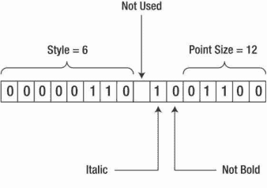

### 使用位存储字体数据

*图 3-1.* 将字体数据打包到两个字节中

这里，一个位记录字体是否为斜体——1 表示斜体，0 表示常规。另一个位指定字体是否为粗体。一个字节可从最多 256 种不同样式中选择一种。五个位可以记录最大到 31 的磅值（如果禁止字号为零的字母，则为 32）。因此，在一个 16 位字上，你有四项独立的数据。位运算符为你提供了非常容易地访问和修改整数中各个位及位组的手段，因此也为你提供了组装和拆解这个 16 位字的手段。

### 位移运算符

位移运算符将整数变量的内容向左或向右移动指定的位数。它们与其他位运算符结合使用，以实现上一节描述的那类操作。>> 运算符将位向右移动，<< 运算符将位向左移动。从变量任一端移出的位都会丢失。

所有位运算都适用于任意类型的整数，但为了简化图示，我们将使用 short 类型，它通常是两个字节。假设你用下面的语句定义并初始化一个变量 number：

```cpp
unsigned short number {16387};
```

你可以用下面的语句移动这个变量的内容：

```cpp
auto result{ static_cast<unsigned short>(number << 2) };   // Shift left two bit positions
```

> **注意** 如果你希望 result 与 number 具有相同类型，即 unsigned short，就必须使用 `static_cast<>` 添加显式类型转换。原因是表达式 `number << 2` 求值结果为 int 类型，尽管 number 一开始是 short。严格来说，对于比 int 小的整数类型，不存在位运算符甚至数学运算符（也就是说，对 `number + 1` 也会发生同样的情况）。如果它们的操作数是 char 或 short，它们总是会先被隐式转换为 int。在此转换过程中，有符号性也不会被保留。

左移运算符 << 的左操作数是要移位的值，右操作数指定将该值移动多少个位位置。图 3-2 展示了效果。

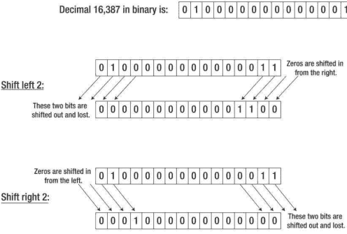

*图 3-2. 移位操作*

从图 3-2 可以看出，将 16,387 向左移动两个位置会得到值 12。值发生如此剧烈的变化，是丢失高位的结果。下面的语句将值向右移动两个位位置：

```cpp
result = static_cast<unsigned short>(number >> 2); // Shift right two bit positions
```

结果是 4,096，因此右移两位实际上相当于将值除以 4。只要没有丢失位，向左移动 n 位就相当于乘以 2 共 n 次。换句话说，相当于乘以 2ⁿ。类似地，向右移动 n 位相当于除以 2ⁿ。但要注意：正如你看到 number 左移的情况，如果丢失了有效位，结果就完全不像你预期的那样。然而，这与“真正的”乘法运算并无不同。如果将这个 2 字节数乘以 4，你会得到相同的结果，因此左移和乘法仍然是等价的。出现不正确的结果是因为乘法结果超出了 2 字节整数的范围。

当你希望使用移位操作修改变量的原始值时，可以使用 `>>=` 或 `<<=` 运算符。下面是一个例子：

```cpp
number >>= 2; // Shift right two bit positions
```

这等价于以下语句：

```cpp
number = static_cast<unsigned short>(number >> 2); // Shift right two bit positions
```

这些移位运算符与输入/输出的插入和提取运算符之间不会混淆。在这种情况下，对编译器来说，含义从上下文中很清楚。但有时你确实需要小心。例如，假设你想验证：当 number 等于 16,387 时，表达式 number << 2 是否确实如图 3-2 所示得到 12。那么你可能会写出下面这条看起来非常合理的语句：

```cpp
std::cout << number<<2 << std::endl;  // Prints 163872 ("16387" followed by "2")
```

不幸的是，编译器会将这个移位运算符解释为流插入运算符，因此你得不到想要的结果。要修正这一点，需要添加额外的括号：

```cpp
std::cout << (number<<2) << std::endl;  // Prints 65548
```

好一些了，但这仍然没有产生预期的结果 12。相反，它打印出 65,548，而这恰好是 16,387 乘以 4。原因是在将其位左移之前，number 作为 unsigned short 类型，再次被隐式提升为 (signed) int 类型的值。而 int 与 unsigned short 不同，其范围足够大，可以表示精确结果 65,548。要像图 3-2 那样得到 12，你可以使用 `static_cast<>` 将 int 结果显式转换回 unsigned short：

```cpp
std::cout << static_cast<unsigned short>(number<<2) << std::endl; // Prints 12
```

### 对有符号整数进行移位

你可以将位移运算符应用于有符号和无符号整数。正如你在前面章节中所了解的，C++20 始终使用二进制补码表示法来编码有符号整数。在本节中，你将学习使用这种编码的数字进行位移时是如何工作的。

对于负数，右移运算符在左侧引入 1 位来填充空出的位位置；对于正数，则引入 0 位。这称为符号扩展，因为在这两种情况下，添加的位都等于符号位。符号位会被传播，以保持右移和除法运算之间的一致性。我们可以用下面两个 signed char 类型的变量来说明这一点。

```cpp
signed char positive {+104};  // 01101000
signed char negative {-104}; // 10011000
```

（记住，要得到二进制补码编码，必须先将正二进制值的所有位取反，然后加一。）

你可以用下面的操作将这两个值都向右移动两位：

```cpp
positive >>= 2;  // Result is 00011010, or +26, which is +104 / 4
negative >>= 2;  // Result is 11100110, or -26, which is -104 / 4
```

结果如注释所示。在这两种情况下，右端移出两个 0，左侧插入两次符号位的值。所得值的十进制值为 ±26，这与除以 4 的结果相同，正如你所预料的。

对于无符号整数类型的位移运算，符号位当然不会被传播，并且左侧总是插入 0。


> **提示** 如果你的目标是操作二进制数据的位，请不要使用有符号整数类型（或 char）。这样可以避免最高位被传播。此外，出于这些及类似原因，你应该使用 `std::byte` 类型而不是 `unsigned char` 来操作二进制数据（`std::byte` 由 C++17 的 `<cstddef>` 模块定义）。

左移运算则更为直观：它以与相同位序列表示的无符号数完全相同的方式，移动一个二进制补码数的位。但这有一个有趣的后果。假设我们使用与之前相同的两个变量，同样等于 +104，但这次我们将它们的位向左移动两位，而不是向右：

```cpp
positive <<= 2;  // Result is 10100000, or -96 (+104 * 4 = +416, or 01'10100000)
negative <<= 2;  // Result is 01100000, or 96 (-104 * 4 = -416, or 10'01100000)
```

结果如注释所示。与无符号整数一样，向左移位会丢弃左侧的位，并在右侧补零。此示例表明，一旦有效位开始从左侧丢失，左移运算可能会改变整数的符号。如果与 2 的幂相乘（如注释中括号所示）的结果落到有符号整数类型的取值范围之外，就会发生这种情况。

## 位模式的逻辑运算

表 3-2 显示了四个按位运算符，它们用于修改整数值中的位。

**表 3-2.** 按位运算符

| 运算符 | 描述 |
| --- | --- |
| ~ | *按位取反运算符* 是一元运算符，它将操作数中的位反转，因此 1 变为 0，0 变为 1。 |
| & | *按位与运算符* 对操作数中对应的位执行 AND 操作。如果对应位均为 1，则结果位为 1；否则为 0。 |
| ^ | *按位异或运算符* 对操作数中对应的位执行异或操作。如果对应位不同，则结果为 1。如果对应位相同，则结果为 0。 |
| \| | *按位或运算符* 对操作数中对应的位执行 OR 操作。如果任一对应位为 1，则结果为 1。如果两个对应位均为 0，则结果为 0。 |

这些运算符在表 3-2 中按优先级顺序排列，因此按位取反运算符的优先级最高，按位或运算符的优先级最低。移位运算符 << 和 >> 优先级相同，它们低于 ~ 运算符，但高于 & 运算符。

### 使用按位与

你通常会使用按位与运算符来选择整数值中的特定位或位组。假设你使用一个 16 位整数来存储字体大小、字体样式以及是否加粗和/或倾斜，如图 3-1 所示。再假设你想定义并初始化一个变量，以指定一个 12 磅、倾斜、样式 6 的字体（实际上，正是图 3-1 所示的那个字体）。在二进制中，样式将为 00000110（二进制 6），倾斜位为 1，加粗位为 0，大小为 01100（二进制 12）。记住还有一个未使用的位，你需要将字体变量的值初始化为二进制数 0000 0110 0100 1100。因为四位一组对应一个十六进制数字，所以最紧凑的方式是以十六进制表示法指定初始值：

```cpp
unsigned short font {0x064C};           // Style 6, italic, 12 point
```

当然，自 C++14 以来，你也可以选择直接使用二进制字面量：

```cpp
unsigned short font {0b00000110'0'10'01100}; // Style 6, italic, 12 point
```

请注意这里创造性地使用了数字分组字符，以标示样式、倾斜/加粗和字号组件的边界。

之后要处理字号，你需要从 font 变量中提取它；按位与运算符可以让你做到这一点。因为按位与运算只有在两个位都为 1 时才产生 1，所以你可以定义一个值，当它与 font 进行 AND 运算时，能够“选择”定义字号的位。你需要定义一个值，在您感兴趣的位位置上包含 1，在其他所有位置上包含 0。这种值称为掩码，你可以用以下语句之一定义这样的掩码（两者等价）：

```cpp
unsigned short size_mask {0x1F};  // unsigned short size_mask {0b11111};
```

font 的低五位表示其字号，因此你将这些位设置为 1。其余位为 0，因此它们将被丢弃。（二进制 0000 0000 0001 1111 等于十六进制 1F。）

现在你可以使用以下语句从 font 中提取字号：

```cpp
auto size {static_cast<unsigned short>( font & size_mask )};
```

在 & 运算中，只要两个对应位都为 1，结果位就为 1。任何其他位组合都会产生 0。因此这些值按如下方式组合：

| 表达式 | 二进制值 |
| --- | --- |
| font | 0000 0110 0100 1100 |
| size_mask | 0000 0000 0001 1111 |
| font & size_mask | 0000 0000 0000 1100 |

我们以四位一组的形式展示二进制值，只是为了更容易识别十六进制等价形式；同时也有助于看清总共有多少位。掩码的作用是分离出表示字号的右边五位。

你可以使用相同的机制来选择字体样式，但你还需要使用移位运算符将样式值右移。你可以如下定义一个掩码来选择左侧的八位：

```cpp
unsigned short style_mask {0xFF00};     // Mask for style is 1111 1111 0000 0000
```

这些位按如下方式组合：

| 表达式 | 二进制值 |
| --- | --- |
| font | 0000 0110 0100 1100 |
| bold | 0000 0000 0010 0000 |
| font \| bold | 0000 0110 0110 1100 |

现在 font 指定字体为加粗且倾斜。请注意，此操作会将该位设置为开，无论其之前的状态如何。如果它原本是开，它会保持开。你还可以将多个掩码进行 OR 运算以同时设置多个位。以下语句同时设置加粗和倾斜位：

```cpp
font |= bold | italic;    // Set bold and italic
```

> **警告** 很容易陷入语言习惯导致选错运算符的陷阱。因为你说“将其设置为加粗”，所以会倾向于使用 & 运算符，但这是错误的。对两个掩码进行 AND 运算会得到一个所有位都为 0 的值，因此你不会改变任何东西。

### 使用按位取反运算符

如前所述，你可以使用 & 运算符关闭位——你只需要一个掩码，在要关闭的位位置上包含 0，在其他所有位置上包含 1。然而，这就引出了如何最好地指定这种掩码的问题。要显式指定它，你需要知道要更改的变量中有多少个字节（如果你希望程序可移植，这就不太方便）。不过，你可以对用于打开位的掩码使用按位取反运算符来获得你想要的掩码。你可以从打开加粗的 bold 掩码中得到关闭加粗的掩码：

| 表达式 | 二进制值 |
| --- | --- |
| bold | 0000 0000 0010 0000 |
| ~bold | 1111 1111 1101 1111 |

取反运算符的效果是翻转每一位，0 变为 1，或 1 变为 0。无论 bold 占两个、四个还是八个字节，这都会产生你想要的结果。

> **注意** 按位取反运算符有时被称为 *按位非运算符*，因为对于它操作的每一位，你得到的都不是你开始时的那一位。

因此，要关闭加粗，你只需将 bold 掩码的补码与 font 进行按位与运算。以下语句即可实现：

```cpp
font &= ~bold;            // Turn bold off
```

你可以使用 & 运算符组合多个反转掩码，并将结果与要修改变量进行按位与运算，从而将多个位设置为 0：

```cpp
font &= ~bold & ~italic;    // Turn bold and italic off
```

这会将 font 中的倾斜位和加粗位都设置为 0。此处不需要括号，因为 ~ 的优先级高于 &。但是，如果你对运算符优先级不确定，请加上括号来表达你想要的意图。这当然没有坏处，而且在必要时确实有益。请注意，你也可以使用以下语句实现相同的效果：

```cpp
font &= ~(bold | italic);    // Turn bold and italic off
```

这里的括号是必需的。我们建议你花一点时间让自己相信这两个语句是等价的。如果这还不能自然理解，请放心：你在下一章学习所谓的布尔表达式时，会得到更多类似逻辑的练习。

### 使用按位异或

按位 *异或运算符*（简称 *XOR 运算符*）的结果为 1，当且仅当对应的两个输入位中恰好有一个等于 1，而另一个等于 0。只要两个输入位相同，即使都为 1，结果位也是 0。后者是 XOR 运算符与常规 OR 运算符的不同之处。表 3-3 总结了所有三个二元按位运算符的效果。

**表 3-3.** 二元按位运算符真值表

| x | y | x & y | x \| y | x ^ y |
| --- | --- | --- | --- | --- |
| 0 | 0 | 0 | 0 | 0 |
| 1 | 0 | 0 | 1 | 1 |
| 0 | 1 | 0 | 1 | 1 |
| 1 | 1 | 1 | 1 | 0 |

XOR 运算符的一个有趣特性是它可以用来 *切换* 或 *翻转* 单个位的状态。使用之前定义的 font 变量和 bold 掩码，以下操作会切换加粗位——也就是说，如果该位之前是 0，那么现在它将变为 1，反之亦然：

```cpp
font ^= bold;    // Toggles bold
```

这实现了在典型文字处理器中点击“加粗”按钮的概念。如果所选文本尚未加粗，那么它就会变成加粗。然而，如果所选文本已经加粗，其字体则会恢复到常规的非加粗样式。让我们仔细看看这是如何工作的：

```cpp
font         0000 0110 0100 1100
bold         0000 0000 0010 0000
font ^ bold  0000 0110 0110 1100
```


```cpp
std::cout << "\nNow try successive exclusive OR operations:\n";
unsigned int mask{ red ^ white };
std::cout << std::format("mask = red ^ white = {:08X}\n", mask);
std::cout << std::format("        mask ^ red = {:08X}\n", mask ^ red);
std::cout << std::format("        mask ^ white = {:08X}\n", mask ^ white);

unsigned flags{ 0xFF };          // Flags
unsigned int bit1mask{ 0x1 };    // Selects bit 1
unsigned int bit6mask{ 0b100000 }; // Selects bit 6
unsigned int bit20mask{ 1u << 19 }; // Selects bit 20

std::cout << "Use masks to select or set a particular flag bit:\n";
std::cout << std::format("Select bit 1 from flags : {:08X}\n", flags & bit1mask);
std::cout << std::format("Select bit 6 from flags : {:08X}\n", flags & bit6mask);
std::cout << std::format("Switch off bit 6 in flags: {:08X}\n", flags &= ~bit6mask);
std::cout << std::format("Switch on bit 20 in flags: {:08X}\n", flags |= bit20mask);
}
```

如果你正确输入了代码，输出如下：

```
Try out bitwise complement, AND and OR operators:
Initial value:        red = 00FF0000
Complement:            ~red = FF00FFFF
Initial value:       white = 00FFFFFF
Complement:          ~white = FF000000
Bitwise AND: red & white = 00F00000
Bitwise OR: red | white = 00FFFFFF

Now try successive exclusive OR operations:
       mask = red ^ white = 000FFFFF
             mask ^ red = 00FFFFFF
           mask ^ white = 00F00000
Use masks to select or set a particular flag bit:
Select bit 1 from flags : 00000001
Select bit 6 from flags : 00000020
Switch off bit 6 in flags: 000000DF
Switch on bit 20 in flags: 000800DF
```

对于 `<format>` 模块有一个重要的声明，因为代码使用 `std::format()` 来方便地将所有值显示为十六进制形式。为了更容易比较输出值，我们还在整个程序中使用 `{:08X}` 替换字段，使它们具有相同的位数和前导零。`0` 前缀将填充字符设置为 `'0'`，`8` 设置字段宽度，`X` 后缀使整数使用大写字母的十六进制表示法格式化。如果你使用 `x` 而不是 `X`，整数将使用小写十六进制数字格式化。

要查看 `{:08X}` 替换字段中 `0` 和 `X` 组成部分的效果，例如，你可以按如下方式替换 `"Initial value"` 输出语句中的替换字段：

```cpp
std::cout << std::format("Initial value:    red = {:8x}\n", red);  // {:08X} --> {:8x}
```

格式化后的 red 字符串将使用小写字母，并且不再以前导零序列开头（默认填充字符是空格）：

```
Initial value:        red =    ff0000
Complement:           ~red = FF00FFFF
...
```

关于字符串格式化的讨论已经够多了——让我们回到当前的主题：位运算符。在 Ex3_01 中，你首先将常量 red 和 white 定义为无符号整数，并用十六进制颜色值初始化它们。在一些初始输出语句之后，你用下面两条语句将 red 和 white 按位与和按位或运算组合起来：

```cpp
std::cout << std::format("Bitwise AND: red & white = {:08X}\n", red & white);
std::cout << std::format("Bitwise OR: red | white = {:08X}\n", red | white);
```

如果你检查输出，你会发现结果与讨论的完全一致。两个位进行 AND 运算时，如果两个位都是 1，结果为 1；否则，结果为 0。当你对两个位进行按位 OR 运算时，除非两个位都是 0，否则结果为 1。

接下来，你创建了一个掩码，通过将两个值与 XOR 运算符组合来在 red 和 white 之间切换。mask 的值表明，当两个位不同时，两个位的异或结果为 1；当它们相同时，结果为 0。通过使用异或运算将 mask 与任一颜色值组合，你可以得到另一个颜色值。这意味着通过反复使用精心选择的掩码进行异或运算，你可以在两种不同颜色之间切换。应用一次掩码得到一种颜色，再应用一次则恢复为原始颜色。在计算机图形学中，使用所谓的 XOR 模式进行绘制或渲染时，经常会利用这一特性。

最后一组语句演示了如何使用掩码从一组标志位中选择单个位。选择特定位的掩码必须将该位设为 1，其他所有位设为 0。要从 flags 中选择一个位，你只需将适当的掩码与 flags 的值进行按位 AND 运算。要关闭一个位，你将 flags 与一个掩码进行按位 AND 运算，该掩码中要关闭的位为 0，其他所有位为 1。你可以通过对一个设置了相应位的掩码应用取反运算符来轻松生成这样的掩码，而 bit6mask 正是这样一个掩码。当然，如果要关闭的位已经是 0，它将保持为 0。

## 变量的生存期

所有变量都有有限的生存期。它们从你定义它们的那一刻起开始存在，并在某个时刻被销毁——最迟在你的程序结束时。特定变量能存在多久由其存储期决定。存储期有四种不同类型：

- 在块内定义的变量具有**自动存储期**。它们从定义点开始存在，直到块结束，也就是右花括号 `}`。它们被称为**自动变量**或**局部变量**。自动变量具有局部作用域或块作用域。到目前为止，你创建的所有变量都是自动变量。
- 使用 `static` 关键字定义的变量具有**静态存储期**。它们被称为**静态变量**。静态变量从定义点开始存在，并一直持续到程序结束。你将在第8章和第12章了解静态变量。
- 在运行时为其分配内存的变量具有**动态存储期**。它们从你创建之时起存在，直到你释放其内存以销毁它们。你将在第5章学习如何动态创建变量。
- 用 `thread_local` 关键字声明的变量具有线程存储期。不过，线程局部变量是一个高级主题，因此本书不会涉及。

变量的另一个属性是*作用域*。变量的作用域是程序中变量名有效的部分。在变量的作用域内，你可以引用它、设置它的值或在表达式中使用它。在其作用域之外，你不能引用它的名字。任何这样做的尝试都会导致编译器错误消息。请注意，变量在其作用域之外可能仍然存在，即使你不能引用它。稍后当你学习具有静态和动态存储期的变量时，你会看到这种情况的例子。

> 注意 请记住，变量的*生存期*和*作用域*是不同的概念。生存期是变量存活的执行时间周期。作用域是可以使用变量名的程序代码区域。重要的是不要混淆这两个概念。

### 全局变量

在定义变量的位置方面，你有很大的灵活性。最重要的考虑因素是变量需要具有什么样的作用域。你通常应该将定义放在尽可能靠近变量首次使用的地方。这会使你的代码更容易被其他程序员理解。在本节中，我们将介绍一个不符合这种情况的例子：所谓的全局变量。

你可以在程序中所有函数之外定义变量。在所有块和类之外定义的变量也称为*全局变量*，具有*全局作用域*（也称为*全局命名空间作用域*）。这意味着它们可以在源文件中定义点之后的所有函数中访问。如果你在源文件的开头定义它们，它们将在整个文件中可访问。在第11章中，我们将展示如何声明可在多个文件中使用的变量。

全局变量默认具有*静态存储期*，因此它们从程序开始时就存在，直到程序执行结束。全局变量的初始化发生在 `main()` 执行之前，因此它们在变量作用域内的任何代码中始终可以使用。如果你没有初始化全局变量，它默认会被零初始化。这与自动变量不同，自动变量在未初始化时包含垃圾值。

图3-3显示了源文件 Example.cpp 的内容，并说明了文件中每个变量的作用域范围。


由于全局变量在程序运行期间一直存在，你可能会想：“为什么不把所有变量都设为全局变量，从而避免处理那些会消失的局部变量呢？”这乍听起来很有吸引力，但它有严重的缺点，这些缺点完全盖过了任何优点。真实程序由大量语句、相当多的函数和非常多的变量组成。在全局作用域声明所有变量会大大增加意外、错误地修改变量的可能性。这会让人难以追踪代码的哪一部分导致了全局变量的变化。这也会使合理命名这些变量变得相当棘手。最后，全局变量在程序执行期间一直占用内存，因此程序所需的内存会比使用局部变量（内存可被复用）时更多。

通过将变量保持在函数或块的局部作用域内，你可以确保它们几乎完全不受外部影响。它们只从定义处到所在块的末尾存在并占用内存，整个开发过程也会变得更容易管理。

> **提示** —— 常见的编码和设计指南要求通常应避免使用全局变量，这是有充分理由的。全局常量——用 const 关键字声明的全局变量——是这条规则的一个高尚例外。建议所有常量只定义一次，而全局变量非常适合这一点。

下面是一个展示全局变量和自动变量相关方面的示例：

```cpp
// Ex3_02.cpp
// Demonstrating scope, lifetime, and global variables
import <iostream>;
long count1{999L};       // Global count1
double count2{3.14};     // Global count2
int count3;              // Global count3 - default initialization

int main()
{ /* Function scope starts here */
    int count1{10};      // Hides global count1
    int count3{50};      // Hides global count3
    std::cout << "Value of outer count1 = " << count1 << std::endl;
    std::cout << "Value of global count1 = " << ::count1 << std::endl;
    std::cout << "Value of global count2 = " << count2 << std::endl;

    { /* New block scope starts here */
      int count1{20};    // This is a new variable that hides the outer count1
      int count2{30};    // This hides global count2
      std::cout << "\nValue of inner count1 = " << count1 << std::endl;
      std::cout << "Value of global count1 = " << ::count1 << std::endl;
      std::cout << "Value of inner count2 = " << count2 << std::endl;
      std::cout << "Value of global count2 = " << ::count2 << std::endl;

      count1 = ::count1 + 3;  // This sets inner count1 to global count1+3
      ++::count1;             // This changes global count1
      std::cout << "\nValue of inner count1 = " << count1 << std::endl;
      std::cout << "Value of global count1 = " << ::count1 << std::endl;
      count3 += count2;       // Increments outer count3 by inner count2
    }
}
```

枚举器甚至不需要具有唯一的值。例如，你可以像这样将 Monday 和 Mon 都定义为值 1：

```cpp
enum class Day { Monday = 1, Mon = 1, Tuesday, Wednesday, Thursday, Friday, Saturday, Sunday };
```

现在你可以使用 Mon 或 Monday 作为一周的第一天。然后，可以用下面这条语句设置一个定义为 Day 类型的变量 yesterday：

```cpp
yesterday = Day::Mon;
```

你还可以根据前一个枚举器来定义枚举器的值。把目前看到的所有内容都放进一个示例中，你可以像下面这样定义类型 Day：

```cpp
enum class Day { Monday = 0,                 Mon = Monday,
                 Tuesday = Monday + 2,         Tues = Tuesday,
                 Wednesday = Tuesday + 2,       Wed = Wednesday,
                 Thursday = Wednesday + 2,      Thurs = Thursday,
                 Friday = Thursday + 2,         Fri = Friday,
                 Saturday = Friday + 2,         Sat = Saturday,
                 Sunday = Saturday + 2,         Sun = Sunday
               };
```

现在，Day 类型的变量可以具有从 Monday 到 Sunday 以及从 Mon 到 Sun 的值，而相匹配的枚举器对分别对应整数值 0、2、4、6、8、10 和 12。枚举器的值必须是*编译期常量*，也就是编译器能够求值的常量表达式。这类表达式包括字面量、先前定义过的枚举器，以及你指定为 const 的变量。不能使用非 const 变量，即使你已经用字面量初始化了它们。

枚举器可以是你选择的整数类型，而不是默认类型 int。你也可以为所有枚举器显式赋值。例如，你可以定义下面这个枚举：

```cpp
enum class Punctuation : char { Comma = ',', Exclamation = '!', Question = '?'};
```

枚举器的类型说明放在枚举类型名之后，并用冒号与其分隔。你可以为枚举器指定任何整数数据类型。Punctuation 类型变量的可能值定义为 char 字面量，并将对应于这些符号的编码值。因此，这些枚举器的值按十进制分别是 44、33 和 63，这也（再次）说明这些值不必按升序排列。

下面是一个示例，演示了你可以用枚举做的一些事情：

```cpp
// Ex3_03.cpp
// Operations with enumerations
import <iostream>;
import <format>;

int main()
{
  enum class Day { Monday, Tuesday, Wednesday, Thursday, Friday, Saturday, Sunday };
  Day yesterday {Day::Monday }, today{ Day::Tuesday }, tomorrow{ Day::Wednesday };
  const Day poets_day{ Day::Friday };

  enum class Punctuation : char { Comma = ',', Exclamation = '!', Question = '?' };
  Punctuation ch{ Punctuation::Comma };

  std::cout << std::format("yesterday's value is {}{} but poets_day's is {}{}\n",
      static_cast<int>(yesterday), static_cast<char>(ch),
      static_cast<int>(poets_day), static_cast<char>(Punctuation::Exclamation));

  today = Day::Thursday;       // Assign new ...
  ch = Punctuation::Question;   // Enumerator values
  tomorrow = poets_day;         // Copy enumerator value

  std::cout << std::format("Is today's value({}) the same as poets_day({})?\n",
      static_cast<int>(today), static_cast<int>(poets_day));

  //    ch = tomorrow;          /* Uncomment any of these for an error */
  //    tomorrow = Friday;
  //    today = 6;
}
```

输出如下：

```
yesterday's value is 0, but poets_day's is 4!
Is today's value(3) the same as poets_day(4)?
```

我们留给你去弄清楚原因。注意 main() 末尾的注释掉的语句。它们都是非法操作。你应该尝试它们，看看会产生什么编译器消息。

用 enum class 定义的枚举类型称为作用域枚举。默认情况下，如果不将类型名指定为作用域，就不能使用它们的枚举器。例如，在 Ex3_03 中，你不能简单地写 Friday（如注释掉的代码那样）；必须添加 Day:: 作为作用域。在 C++20 中，你可以通过 using enum 或 using 声明绕过这个有时很繁琐的要求。下面的代码片段说明了这些声明如何工作。你可以把它添加到 Ex3_03 的末尾。

```cpp
using enum Day;  // All Day enumerators can be used without specifying 'Day::'
today = Friday;   // Compiles now (of course, Day::Friday would still work as well)

using Punctuation::Comma; // Only Comma can be used without 'Punctuation::'
ch = Comma;               // 'ch = Question;' would still result in a compile error
```

> **注意** 作用域枚举淘汰了较旧的一类枚举——现在称为*无作用域枚举*。这类枚举仅用 `enum` 关键字定义，而不需要额外的 `class` 关键字。例如，你可以像下面这样定义一个无作用域的 Day 枚举：
> 
> ```cpp
> enum Day {Monday, Tuesday, Wednesday, Thursday, Friday, Saturday, Sunday};
> ```
> 
> 如果你坚持使用作用域枚举类型，你的代码将更不容易出错。这不仅仅是因为它们的名称不会泄漏到外围作用域中。旧式枚举器还会在没有显式转换的情况下转换为整型甚至浮点类型的值，这很容易导致错误。


**提示** 并不是因为你现在可以使用非限定枚举量，就应该开始在各处添加 using 声明。正如命名空间一样（参见即将出现的题为“将 using 用于命名空间”的边栏），我们建议你只偶尔使用 using，尽可能局部化，并且只在重复类型名称会降低代码可读性的作用域内使用。

## 将 using 用于命名空间

与作用域枚举一样，有时反复指定（嵌套）命名空间的名称会变得繁琐，甚至妨碍代码可读性。在源文件中，使用 using 声明可以免去用命名空间限定特定名称。下面是一个例子：

```cpp
using std::cout;  // Make cout available without qualification
```

这告诉编译器，当你写 cout 时，应将其解释为 std::cout。把这个声明放在 main() 函数定义之前，你就可以写 cout 而不是 std::cout，这可以节省输入，并使代码看起来不那么杂乱。

你可以在本书迄今大多数示例的开头加入这三个 using 声明，从而避免限定 cin、cout 和 format()：

```cpp
using std::cin;
using std::cout;
using std::format;  // No parentheses or parameters for a function
```

当然，你仍然必须用 std 限定 endl，尽管你也可以为它添加一个 using 声明。你可以把 using 声明应用于任何命名空间中的名称，而不仅是 std。

using 指令会导入命名空间中的所有名称。下面这样，你就可以使用 std 命名空间中的任何名称，而无需限定它：

```cpp
using namespace std;  // Make all names in std available without qualification
```

把这个指令放在源文件开头，你就不必限定 std 命名空间中定义的任何名称。乍看之下，这似乎是个有吸引力的想法。问题在于，它破坏了拥有命名空间的一个主要理由。你不太可能知道 std 中定义的所有名称，而有了这个 using 指令，你意外使用 std 中某个名称的概率就增加了。

在本书的示例中，如果原本需要的 using 声明数量过多，我们偶尔会对 std 命名空间使用 using 指令。我们建议，只有在有充分理由时才使用 using 指令。

## 数据类型的别名

你已经看到，枚举提供了一种定义自己的数据类型的方式。`using` 关键字使你能够指定类型别名，也就是你自己的数据类型名称，作为现有类型名称的替代。使用 `using`，你可以通过以下语句将类型别名 `BigOnes` 定义为等价于标准类型 `unsigned long long`：

```cpp
using BigOnes = unsigned long long; // Defines BigOnes as a type alias
```

重要的是要意识到，这并没有定义新类型。这只是将 `BigOnes` 定义为类型 `unsigned long long` 的替代名称。你可以用以下语句使用它来定义变量 `mynum`：

```cpp
BigOnes mynum {};        // Define & initialize as type unsigned long long
```

这个定义与使用标准类型名称没有区别。你仍然可以同时使用标准类型名称和别名，但很难想出同时使用两者的理由。还有一种较旧的语法可用于为类型名称定义别名，它使用 `typedef` 关键字。例如，你可以像这样定义类型别名 `BigOnes`：

```cpp
typedef unsigned long long BigOnes; // Defines BigOnes as an alias for unsigned long long
```

然而，除了若干其他优点之外，¹ 较新的语法更直观，因为它看起来和感觉起来都像常规赋值。使用旧的 `typedef` 语法时，你总是必须记住把现有类型 `unsigned long long` 和新名称 `BigOnes` 的顺序颠倒过来。相信我们，每当你需要类型别名时，都会在这个顺序上苦苦挣扎——我们当然也挣扎过！幸运的是，只要你遵循下面这条简单准则，就永远不必经历这些：

> **提示** 始终使用 `using` 关键字来定义类型别名。事实上，如果不是为了遗留代码，我们甚至会建议你忘掉 `typedef` 关键字的存在。

因为你只是在为一个已经存在的类型创建同义词，所以这看起来可能有点多余。事实并非如此。它的一个主要用途是简化涉及复杂类型名称的代码。例如，程序可能涉及像 `std::map<std::shared_ptr<Contact>, std::string>` 这样的类型名称。你将在本书后面发现这个复杂类型的各个组成部分意味着什么，但到目前为止，应该已经清楚：当这样长的类型必须过于频繁地重复时，会使代码冗长而晦涩。你可以通过定义类型别名来避免代码杂乱，如下所示：

```cpp
using PhoneBook = std::map<std::shared_ptr<Contact>, std::string>;
```

在代码中使用 `PhoneBook` 而不是完整类型说明，可以使代码更可读。类型别名的另一个用途是：为可能需要在多种计算机上运行的程序所使用的数据类型提供灵活性。定义类型别名并在整个代码中使用它，使得只需更改别名的定义就能修改实际类型。

¹ 相较于 `typedef` 语法，`using` 语法的其他优点只有在为更高级的类型指定别名时才会显现。例如，使用 `using` 为函数类型指定别名要容易得多。你将在第19章看到这一点。此外，`using` 关键字允许你指定所谓的类型别名模板，或参数化类型别名，而使用旧的 `typedef` 语法无法做到这一点。我们也会在第19章向你展示一个别名模板的示例。

不过，类型别名就像生活中的大多数事物一样，应适度使用。类型别名当然可以让你的代码更紧凑，没错。但紧凑的代码从来不是目标。很多时候，明确写出具体类型会让代码更容易理解。下面是一个例子：

```cpp
using StrPtr = std::shared_ptr<std::string>;
```

StrPtr 虽然紧凑，却无助于让代码更清晰。相反，这种晦涩且不必要的别名只会使代码更难懂。因此，有些准则甚至到了完全禁止类型别名的地步。我们当然不会走到那么远；在判断一个别名是有帮助还是使代码晦涩时，只要运用常识，就没问题。

## 小结

这些是你在本章学到的基本要点：

- 你不需要记住所有运算符的优先级和结合性，但在编写代码时需要意识到它。如果不确定优先级，请始终使用括号。
- 当你处理标志——表示状态的单个位——时，按位运算符是必要的。这类情况出现得惊人地频繁——例如，在处理文件输入和输出时。当你处理打包到单个变量中的值时，按位运算符也必不可少。一个极其常见的例子是类似 RGB 的编码，其中给定颜色的三到四个分量被打包到一个 32 位整数值中。
- 默认情况下，在块内定义的变量是自动变量，这意味着它只从定义它的那一点存在到其定义所在块的末尾，也就是包含其定义的块的右花括号处。
- 变量可以定义在程序中所有块之外，在这种情况下，它们默认具有全局命名空间作用域和静态存储期。具有全局作用域的变量可以从包含它们的程序文件内的任何位置访问，但要在其定义点之后，除非存在与全局变量同名的局部变量。即使在这种情况下，仍然可以使用作用域解析运算符 (::) 访问它们。
- 类型安全的枚举可用于表示固定值集合，尤其是那些有名称的值，例如一周中的各天或一副扑克牌中的花色。
- using 关键字有许多用途：
  - 它允许你引用作用域枚举的（特定或全部）枚举量，而无需将枚举名称指定为作用域。
  - 它允许你引用命名空间的（特定或全部）类型和函数，而无需将命名空间名称指定为作用域。
  - 它允许你为其他类型定义别名。在遗留代码中，你可能仍会遇到为相同目的而使用 typedef 的情况。


## 练习

以下练习让你尝试本章所学的内容。如果遇到困难，可以回顾本章寻求帮助。如果仍然卡住，你可以从 Apress 网站（www.apress.com/source-code）下载解决方案，但这确实应该是最后的手段。

- **练习 3-1.** 创建一个程序，提示输入一个整数，并将其存储为 int。反转该值中的所有位，并将结果存储为 int。接下来，将这个反转后的值转换为 unsigned int，并存储。输出原始值、反转位后的无符号值，以及同一个反转值加 1，每个值都用二进制表示，并输出在一行上。在下一行，输出原始值、有符号的反转值，以及有符号的反转值加 1，每个值都用十进制表示。这两行的格式应使其看起来像一张表格，同一列中的值居中。如果愿意，你还可以添加列标题。所有二进制值都应带前导零，以便它们都是 32 位长（假设 int 值为 32 位，通常如此）。

  注意：翻转所有位并加一——听起来耳熟吗？也许你还没运行程序就能推断出十进制输出会是什么？

- **练习 3-2.** 编写一个程序，计算在矩形架子上单层且不超出边缘的情况下可以容纳多少个方形盒子。从键盘读取以英尺为单位的架子尺寸和以英寸为单位的盒子边长。架子的长度和深度使用 double 类型变量，盒子边长使用 int 类型。定义并初始化一个整型常量，用于从英尺转换为英寸（1 英尺等于 12 英寸）。计算架子单层可容纳的盒子数量，使用 long 类型，并输出结果。

- **练习 3-3.** 在不运行它的情况下，你能算出以下代码片段会输出什么吗？

```cpp
auto k {430u};
auto j {(k >> 4) & ~(~0u << 3)};
std::cout << j << std::endl;
```

- **练习 3-4.** 编写一个程序，从键盘读取四个字符，并将它们打包到一个整型变量中。以十六进制显示该变量的值。解包该变量的四个字节，并按相反顺序输出它们，低字节在前。

- **练习 3-5.** 编写一个程序，定义 Color 类型的枚举，其中枚举值为 red、green、yellow、purple、blue、black 和 white。将枚举值的类型定义为无符号整型，并安排每个枚举值的整数值为其所表示颜色的 RGB 组合（你可以在网上轻松找到任何颜色的十六进制 RGB 编码）。创建 Color 类型的变量，分别用 yellow、purple 和 green 的枚举值初始化。访问枚举值，提取并分别输出 RGB 分量。

- **练习 3-6.** 我们将以一道面向谜题爱好者（且仅限他们）的练习作为结束。编写一个程序，提示输入两个整数值，并将它们存储在整型变量中，比如 a 和 b。在不使用第三个变量的情况下交换 a 和 b 的值。输出 a 和 b 的值。

  提示：这是一个特别难啃的硬骨头。要解决这个谜题，你只需要一个复合赋值运算符。

# 第 4 章
# 做出决策

决策是任何计算机编程的基础。这是计算机区别于计算器的地方之一。它意味着根据比较结果改变执行顺序。在本章中，你将探索如何做出选择和决策。这将使你能够验证程序输入，并编写能根据输入数据调整行为的程序。你的程序将能够处理那些逻辑对解决方案至关重要的问题。

在本章中，你将学习

- 如何比较数据值
- 如何根据比较结果改变程序执行顺序
- 什么是逻辑运算符和逻辑表达式，以及如何应用它们
- 如何处理多选情况

## 比较数据值

要做出决策，你需要一种比较事物的机制，而比较有几种类型。例如，诸如“如果交通信号灯是红色的，就停车”这样的决策涉及相等比较。你将信号的颜色与参考颜色红色进行比较，如果它们相等，就停车。另一方面，诸如“如果车速超过限速，就减速”这样的决策涉及另一种关系。这里你检查车速是否大于当前限速。这两种比较的相似之处在于，它们都会产生两个值之一：要么是 *true*，要么是 *false*。这正是 C++ 中比较的工作方式。

你可以使用两组新的运算符来比较数据值，即*关系运算符*和*相等运算符*。表 4-1 列出了用于比较两个值的六个运算符。

*表 4-1.* 关系运算符和相等运算符

| 运算符 | 含义 |
|---|---|
| < | 小于 |
| <= | 小于或等于 |
| > | 大于 |
| >= | 大于或等于 |
| == | 等于 |
| != | 不等于 |

> **注意**  相等运算符 `==` 有两个连续的等号。这与赋值运算符 `=` 不同，后者只有一个等号。初学者常犯的错误是在比较相等时使用一个等号而不是两个。这不一定会导致编译器发出警告消息，因为该表达式可能有效，只是不是你想要的，因此你需要特别小心以避免此错误。

这些运算符中的每一个都比较两个值，并产生一个 `bool` 类型的值。bool 值只有两种可能：`true` 和 `false`。`true` 和 `false` 是关键字，也是 bool 类型的字面量。它们有时被称为布尔字面量（以布尔代数之父乔治·布尔命名）。

创建 bool 类型变量与其他基本类型一样。下面是一个示例：

```cpp
bool isValid {true};    // Define and initialize a logical variable to true
```

这将变量 isValid 定义为 bool 类型，初始值为 true。如果使用空花括号 `{}` 初始化 bool 变量，其初始值为 false：

```cpp
bool correct {};        // Define and initialize a logical variable to false
```

虽然在这里显式使用 `{false}` 可以说能提高代码可读性，但最好记住，每当数值变量被初始化为零时，例如使用 `{}` 时，布尔变量将被初始化为 false。

### 应用比较运算符

通过看几个示例，你可以了解比较是如何工作的。假设有整型变量 i 和 j，值分别为 10 和 -5。考虑以下表达式：

```cpp
i > j        i != j        j > -8        i <= j + 15
```

所有这些表达式的求值结果都为 true。注意，在最后一个表达式中，加法 `j + 15` 先执行，因为 `+` 的优先级高于 `<=`。

你可以将任何这些表达式的结果存储在 bool 类型的变量中。下面是一个示例：

```cpp
isValid = i > j;
```

如果 i 大于 j，则将 true 存储在 isValid 中；否则存储 false。你也可以比较存储在字符类型变量中的值。假设你定义了以下变量：

```cpp
char first {'A'};
char last {'Z'};
```

你可以使用这些变量编写比较：

```cpp
first < last        'E' <= first        first != last
```

这里你比较的是代码值（回想第 1 章，字符通过 ASCII 和 Unicode 等标准编码方案映射为整数代码）。第一个表达式检查 first 的值（即 `'A'`）是否小于 last 的值（即 `'Z'`）。这始终为 true。第二个表达式的结果为 false，因为 'E' 的代码值大于 first 的值。最后一个表达式为 true，因为 'A' 肯定不等于 'Z'。

输出 bool 值与其他任何类型一样容易。下面是一个示例，展示它们默认看起来是什么样：

```cpp
// Ex4_01.cpp
// Comparing data values
import <iostream>;

int main()
{
  char first {};      // Stores the first character
  char second {};     // Stores the second character

  std::cout << "Enter a character: ";
  std::cin >> first;

  std::cout << "Enter a second character: ";
  std::cin >> second;

  std::cout << "The value of the expression " << first << '<' << second
            << " is " << (first < second) << std::endl;
  std::cout << "The value of the expression " << first << "==" << second
            << " is " << (first == second) << std::endl;
}
```

以下是该程序的示例输出：

```text
Enter a character: ?
Enter a second character: H
The value of the expression ?<H is 1
The value of the expression ?==H is 0
```

提示输入并从键盘读取字符是标准操作，你之前已经见过。注意，这里输出语句中比较表达式两侧的括号是必需的。如果省略它们，编译器会输出错误消息（要理解原因，你应该回顾上一章开头的运算符优先级规则）。这些表达式比较用户输入的第一个和第二个字符。从输出中可以看到，值 true 显示为 1，值 false 显示为 0。这是 true 和 false 的默认表示形式。你可以使用 std::boolalpha 操纵器让 bool 值输出为 true 和 false。只需在 main() 函数最后四行之前的某处添加以下语句：

```cpp
std::cout << std::boolalpha;
```

如果再次编译并运行该示例，bool 值将显示为 true 或 false。要将 bool 值的输出恢复为默认设置，请将 std::noboolalpha 操纵器插入流中。或者，你也可以直接使用 <format> 模块的功能来组合输出字符串。默认情况下，std::format() 会为布尔值输出 true 和 false，并且不受运算符优先级问题影响。这也会带来更可读的代码，因为文本本身不再与流运算符交错。使用 std::format() 的版本可在 Ex4_01A 中找到。


```cpp
std::cout << std::format("The value of the expression {} < {} is {}\n",
                         first, second, first < second);
std::cout << std::format("The value of the expression {} == {} is {}\n",
                         first, second, first == second);
```

## 比较浮点数值

当然，你也可以比较浮点数值。让我们考虑一些稍微复杂一点的数值比较。首先，用以下语句定义变量：

```cpp
int i {-10};
int j {20};
double x {1.5};
double y {-0.25e-10};
```

现在考虑以下逻辑表达式：

```cpp
-1 < y        j < (10 - i)        0.0*x < (3 + y)
```

比较运算符的优先级都低于算术运算符，因此这些括号并非严格必需，但它们确实有助于让表达式更清晰。第一个比较求值为 true，因为 y 有一个非常小的负值（约 −0.000000000025），它大于 −1。第二个比较结果为 false，因为表达式 10 − i 的值为 20，与 j 相同。第三个表达式为 true，因为 3 + y 略小于 3。

浮点比较的一个特殊之处在于：非数（not-a-number）值既不小于、也不大于、也不等于任何其他数。它们甚至不等于另一个非数值。让 nan 变量定义如下（关于 numeric_limits 模板，见第 2 章）：

```cpp
const double nan{ std::numeric_limits<double>::quiet_NaN() };
```

那么以下所有表达式都会求值为 false：

```cpp
i < nan     nan > j     nan == nan
```

你可以使用关系运算符比较任何基本类型的值。当你学习类之后，就会看到如何让你定义的类型也支持比较运算符。现在你需要的只是一种利用比较结果来改变程序行为的方法。我们很快就会研究这一点。但首先：来自外太空的一次造访……

## 宇宙飞船运算符

在 C++20 中，语言新增了一个用于比较值的运算符：三向比较运算符，记作 `<=>`。这个新运算符更广为人知的非正式名称是“宇宙飞船运算符”。它之所以得到这个绰号，是因为字符序列 `<=>` 有点像一个飞碟！

在某种意义上，`<=>` 的行为就像是把 `<`、`==` 和 `>` 全部压缩成了一个。简而言之，`<=>` 在单个表达式中判定 a 是小于、等于还是大于 b。不过，通过一些代码来解释 `<=>` 的基本工作方式最容易。下面的示例读取一个整数，然后使用 `<=>` 将该数字与零进行比较：

```cpp
// Ex4_02.cpp
// Three-way comparison of integers
import <compare>;  // Required when using operator <=> (even for fundamental types)
import <format>;
import <iostream>;

int main()
{
    std::cout << "Please enter a number: ";

    int value;
    std::cin >> value;

    std::strong_ordering ordering{ value <=> 0 };

    std::cout << std::format("value < 0: {}\n", ordering == std::strong_ordering::less);
    std::cout << std::format("value > 0: {}\n", ordering == std::strong_ordering::greater);
    std::cout << std::format("value == 0: {}\n", ordering == std::strong_ordering::equal);
}
```

对于整数操作数，运算符 `<=>` 会求值为 `std::strong_ordering` 类型的值；该类型在大多数情况下表现得像枚举类型（见第 3 章），可能取值为 less、greater 和 equal（从技术上说还有第四个值，但稍后会详细说明）。然后，根据 `ordering` 的值，你可以确定 value 相对于数字 0 的排序关系。

此时，你可能会想：这个运算符有什么意义？你有此疑问很合理。如同所有外星接触一样，宇宙飞船运算符乍看之下有些奇怪且令人费解。毕竟，Ex4_02 的最后四行可以更简洁地写成下面这样（类似于 Ex4_01A）：

```cpp
std::cout << std::format("value < 0: {}\n", value < 0);
std::cout << std::format("value > 0: {}\n", value > 0);
std::cout << std::format("value == 0: {}\n", value == 0);
```

输入量少得多，效率却同样高（好像性能对整数比较真的重要似的）。确实：单独比较基本类型的变量时，`<=>` 运算符几乎没有什么意义。然而，比较更复杂类型的变量可能代价高昂。此时，只比较一次（如 Ex4_02）而不是两到三次（如 Ex4_01）就会有所回报。我们将在第 7 章看到使用 string 对象的此类示例。在第 13 章，我们将向你展示：得益于 `<=>` 运算符，为自己的对象类型添加比较支持会变得轻而易举。但所有这些最终都建立在基本类型的 `<=>` 比较之上。而在达到那一步之前，我们需要在接下来的两个小节中再介绍一些基础知识。

## 比较类别

`<=>` 运算符并不总是求值为 `std::strong_ordering` 类型的值。它求值得到的类型取决于其操作数的类型。例如，对于浮点数 `f1` 和 `f2`，`f1 <=> f2` 的类型会是 `std::partial_ordering`。原因在于，从数学上说，浮点数不是强序的（或者在数学中更常称为全序）；它们只是偏序的。也就是说：并非所有浮点数对都可比较。具体来说，如上一节所示，非数值相对于任何其他数都没有顺序。因此，如果 `f1` 和/或 `f2` 是非数，`f1 <=> f2` 会求值为 `std::partial_ordering::unordered`。

表 4-2 展示了可用于三向比较的三种类型。比较大多数基本类型或标准库类型的两个值时，会得到 `strong_ordering`。当这些值是浮点值或包含浮点值时，结果会变为 `partial_ordering`。比较标准类型绝不会得到 `weak_ordering`，但和所有比较类别类型一样，你可以将它用于用户定义的 `<=>` 运算符（见第 13 章）。弱序的一个例子是：按点到原点的距离对欧几里得空间中的点进行排序。

**表 4-2.** 由 `<compare>` 定义的比较类别类型

| | 小于 | 大于 | 相等 | 等价 | 无序 | 用途 |
|---|---|---|---|---|---|---|
| `strong_ordering` | ✓ | ✓ | ✓ | ✓ | | 整数和指针 |
| `partial_ordering` | ✓ | ✓ | | ✓ | ✓ | 浮点数 |
| `weak_ordering` | ✓ | ✓ | | ✓ | | 仅限用户定义运算符 |

这三种比较类别类型由 `<compare>` 模块定义。每当你使用 `<=>` 运算符时，即使操作数是基本类型，也必须导入 `<compare>` 模块，否则会得到编译器错误（你可以用 Ex4_02 试一试）。

请注意，只有 `strong_ordering` 使用术语“相等”，而 `partial_ordering` 和 `weak_ordering` 使用“等价”。形式上说，相等意味着可替换性，而等价则不然。反过来，可替换性大致意味着：如果 `a == b` 为真，那么对于任意函数 `f`，`f(a) == f(b)` 也必须为真。例如，对于浮点值，尽管 `-0.0 == +0.0`，但 `signbit(-0.0) != signbit(+0.0)`（`signbit()` 是一个 `<cmath>` 函数，它返回——你猜对了——浮点数的符号位）。换句话说：`-0.0` 和 `+0.0` 非常接近相等，但并不完全相等；然而，从一切实际意义上看，它们完全等价。

**注意** `std::strong_ordering::equivalent` 等于 `std::strong_ordering::equal`。我们建议你主要使用后者，因为它能更好地表达强序的语义。

`strong_ordering` 值会隐式转换为 `weak_ordering` 或 `partial_ordering`，而 `weak_ordering` 值会隐式转换为 `partial_ordering`。这些转换会产生显而易见的结果。然而，`partial_ordering` 值不能转换为另外两种类型中的任何一种。这也完全合理：否则，你打算如何处理无序值呢？

**注意** 表 4-2 中的比较类别类型只是表现得像枚举类型，但它们实际上是类类型。其后果包括：不能对它们使用 enum 语句，而且在本章后面看到的 `switch` 语句中也不能使用它们。


## 命名比较函数

你可以将 Ex4_02 的最后三行更紧凑地写成如下形式（参见 Ex4_02A）：

```cpp
std::cout << std::format("value = 0: {}\n", std::is_lt(ordering));  // is less than
std::cout << std::format("value = 0: {}\n", std::is_gt(ordering));  // is greater than
std::cout << std::format("value = 0: {}\n", std::is_eq(ordering));  // is equivalent
```

std::is_lt()、is_gt() 和 is_eq() 是所谓的命名比较函数，由 `<compare>` 模块定义。还有三个这样的函数，即 std::is_neq()（不等价）、std::is_lteq()（小于或等价）和 std::is_gteq()（大于或等价）。尤其是后两个函数，可以省去大量输入。例如，要表达 std::is_lteq(ordering)，否则你就必须将 ordering 与 less 和 equal 两者进行比较，并使用本章后面将会遇到的逻辑 OR 运算符来组合结果。

命名比较函数可用于表 4-2 中的全部三种比较范畴类型，并且行为完全符合预期。

## if 语句

基本的 if 语句使您可以在给定条件为 true 时选择执行单条语句或一个语句块。图 4-1 展示了其工作方式。

```cpp
if (condition)
    statement;
Next statement;

or

if (condition)
{
    statement;
    ...
}
Next statement;
```

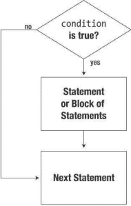

**if 后面的语句或语句块仅在条件为 true 时执行。**

*图 4-1.* 简单 if 语句的逻辑

下面是一个 if 语句示例，它测试 char 变量 letter 的值：

```cpp
if (letter == 'A')
    std::cout << "The first capital, alphabetically speaking.\n";  // Only if letter equals 'A'

std::cout << "This statement always executes.\n";
```

如果 letter 的值为 'A'，则条件为 true，这些语句会产生以下输出：

```text
The first capital, alphabetically speaking.
This statement always executes.
```

如果 letter 的值不等于 'A'，输出中只会出现第二行。你把要测试的条件放在紧跟在关键字 if 后面的圆括号中。我们采用在 if 和圆括号之间加一个空格的约定（以便在视觉上与函数调用区分开），但这不是必需的。像通常一样，编译器会忽略所有空白，因此以下写法同样有效：

```cpp
if(letter == 'A')          if( letter == 'A' )
```

if 后面的语句会缩进，以表示它仅在条件为 true 时才执行。缩进不是程序编译所必需的，但它确实有助于你识别 if 条件与依赖于它的语句之间的关系。有时，你会看到简单的 if 语句写在一行中，如下所示：

```cpp
if (letter == 'A') std::cout << "The first capital, alphabetically speaking.\n";
```

**注意** 绝不要在 if 语句的条件之后直接放置分号（;）。不幸的是，这样做可以编译而无错误（编译器最多会发出警告），但它完全不代表原本的意图：

```cpp
if (letter == 'A');  // Oops...
    std::cout << "The first capital, alphabetically speaking.\n";
```

第一行上的分号会导致所谓的空语句或空语句。多余的分号，因而也就是空语句，几乎可以出现在一系列语句中的任何位置。例如，下面的代码是合法的 C++：

```cpp
int i = 0; i += 5;; ; std::cout << i << std::endl ;;
```

通常，这样的空语句完全没有效果。但是，当分号紧跟在 if 的条件之后添加时，它会成为条件求值为 true 时要执行的语句。换句话说，在 if (letter == 'A') 测试之后写一个分号，与写成下面这样具有相同的效果：

```cpp
if (letter == 'A') { /* Do nothing */ }
std::cout << "The first capital, alphabetically speaking.\n";  // Always executes!
```

所以这表示：如果 letter 等于 'A'，则什么也不做。但更糟的是，第二行总是无条件执行，即使 letter 不同于 'A'——而这正是 if 语句想要防止的情况。因此，务必注意绝不要在条件测试之后直接放置分号，因为它实质上会使该测试失效！

你可以扩展这段代码片段，以便在 letter 的值为 'A' 时更改它的值。

```cpp
if (letter == 'A')
{
    std::cout << "The first capital, alphabetically speaking.\n";
    letter = 'a';
}

std::cout << "This statement always executes.\n";
```

当 if 条件为 true 时，块中的所有语句都会执行。如果没有花括号，只有第一条语句会成为 if 的受控语句，而将值 'a' 赋给 letter 的语句将总是执行。当然，块中的每条语句都以分号结束。不过，块结束的右花括号之后不需要分号。块中可以包含任意多条语句；甚至可以有嵌套块。当 letter 的值为 'A' 时，块中的两条语句都会执行，因此在显示与之前相同的消息后，其值会改为 'a'。如果条件为 false，这两条语句都不会执行。块之后的语句总是执行。

如果将 true 强制转换为整数类型，结果为 1；将 false 强制转换为整数，结果为 0。反过来，也可以将数值转换为 bool 类型。零转换为 false，任何非零值转换为 true。当需要 bool 值而提供的是数值时，编译器会插入隐式转换，将数值转换为 bool 类型。这在决策代码中很有用。

让我们实际试一下 if 语句。这个程序将对从键盘输入的整数进行范围检查：

```cpp
// Ex4_03.cpp
// Using an if statement
import <iostream>;

int main()
{
    std::cout << "Enter an integer between 50 and 100: ";

    int value {};
    std::cin >> value;

    if (value)
        std::cout << "You have entered a value that is different from zero." << std::endl;

    if (value < 50)
        std::cout << "The value is invalid - it is less than 50." << std::endl;

    if (value > 100)
        std::cout << "The value is invalid - it is greater than 100." << std::endl;

    std::cout << "You entered " << value << std::endl;
}
```

输出取决于你输入的值。对于 50 到 100 之间的值，输出大致如下：

```text
Enter an integer between 50 and 100: 77
You have entered a value that is different from zero.
You entered 77
```

在 50 到 100 范围之外，显示该值的输出之前会先出现一条表示该值无效的消息。例如，如果它小于 50，输出将如下：

```text
Enter an integer between 50 and 100: 27
You have entered a value that is different from zero.
The value is invalid - it is less than 50.
You entered 27
```

在提示并读取一个值后，第一个 if 语句检查输入的值是否不等于零：

```cpp
if (value)
    std::cout << "You have entered a value that is different from zero." << std::endl;
```

回想一下，除 0 之外的任何数字都会转换为 true；0 会转换为 false。因此，除非你输入的数字是零，否则 value 总是转换为 true。你经常会看到这样的测试写成这样，但如果你愿意，也可以很容易地把对零的测试写得更明确，如下所示：

```cpp
if (value != 0)
    std::cout << "You have entered a value that is different from zero." << std::endl;
```

然后第二个 if 语句检查你的输入是否小于 50：

```cpp
if (value < 50)
    std::cout << "The value is invalid - it is less than 50." << std::endl;
```

输出语句仅在 if 条件为 true 时执行，也就是 value 小于 50 时执行。下一个 if 语句以基本相同的方式检查上限，并在超过上限时输出一条消息。最后，最后一个输出语句总是执行，它输出该值。当然，当值低于下限时还检查是否超过上限是多余的。你可以让程序在输入的值低于下限时立即结束，如下所示：

```cpp
if (value < 50)
{
    std::cout << "The value is invalid - it is less than 50." << std::endl;
    return 0;                    // Ends the program
}
```


下面是一些典型输出：

```
Enter a letter: H
You entered an uppercase letter.
```

创建初始值为零的 `char` 变量 `letter` 后，程序提示你输入一个字母。随后的 `if` 语句检查输入的字符是否大于或等于 `'A'`。如果 `letter` 大于或等于 `'A'`，则执行检查输入是否小于或等于 `'Z'` 的嵌套 `if`。如果小于或等于 `'Z'`，你就可以断定它是大写字母并显示一条消息。此时工作已完成，因此执行 `return` 语句结束程序。

下一个 `if` 使用与第一个基本相同的机制，检查输入的字符是否为小写，显示一条消息并返回。你可能注意到，小写字符的测试只包含一对花括号，而大写测试有两对。这里花括号之间的代码块属于内层 `if`。事实上，两组语句都能正常工作——请记住，`if (condition) {...}` 实际上是一条语句，不需要再括在更多花括号中。不过，额外的花括号确实让代码更清晰，因此使用它们是个好主意。

最后一个 `if` 块之后的输出语句仅在输入的字符不是字母时执行，并显示一条说明这一点的消息。你可以看到，由于缩进，嵌套 `if` 与输出语句之间的关系更容易理解。缩进通常用于为程序的逻辑提供视觉提示。

这个程序演示了嵌套 `if` 如何工作，但它并不是测试字符的好方法。使用标准库，你可以编写独立于字符编码的程序。我们将在下一小节探讨其工作方式。

## 字符分类与转换

Ex4_04 的嵌套 `if` 依赖于关于用于表示字母字符的编码的三个内置假设：

- 字母 A 到 Z 由一组编码表示，其中 `'A'` 的编码最小，`'Z'` 的编码最大。
- 大写字母的编码是连续的，因此 `'A'` 和 `'Z'` 的编码之间没有非字母字符。
- 字母表中的所有大写字母都落在 A 到 Z 的范围内。

虽然前两个假设对当今实践中使用的任何字符编码都成立，但第三个假设对许多语言来说绝对不成立。例如，希腊字母表中有 Α、Θ 和 Π 等大写字母；俄语字母表包含 Ж、Ф 和 Ш；甚至像法语这样基于拉丁字母的语言也经常使用 É 和 Ç 等大写字母，它们的编码根本不会落在 `'A'` 和 `'Z'` 之间。因此，把这类假设写进代码并不是好主意，因为这会限制程序的可移植性。永远不要假设你的程序只会被英语母语者使用！

为避免在代码中做出这类假设，C 和 C++ 标准库提供了 locale（区域设置）的概念。locale 是一组参数，用于定义用户的语言和区域偏好，包括国家或文化字符集以及货币和日期的格式规则。不过，完整介绍这个主题超出了本书的范围。我们只介绍 `<cctype>` 头文件提供的字符分类函数，列于表 4-3。

### 表 4-3. `<cctype>` 头文件提供的字符分类函数

| 函数 | 操作 |
|---|---|
| `isupper(c)` | 测试 `c` 是否为大写字母，默认范围为 `'A'` 到 `'Z'`。 |
| `islower(c)` | 测试 `c` 是否为小写字母，默认范围为 `'a'` 到 `'z'`。 |
| `isalpha(c)` | 测试 `c` 是否为大写或小写字母（或者，如果 locale 的字母表包含既非大写也非小写的字母字符，则为任何字母字符）。 |
| `isdigit(c)` | 测试 `c` 是否为数字，即 `'0'` 到 `'9'`。 |
| `isxdigit(c)` | 测试 `c` 是否为十六进制数字，即 `'0'` 到 `'9'`、`'a'` 到 `'f'` 或 `'A'` 到 `'F'`。 |
| `isalnum(c)` | 测试 `c` 是否为字母数字字符；等同于 `isalpha(c) \|\| isdigit(c)`。 |
| `isspace(c)` | 测试 `c` 是否为空白字符，默认包括空格（`' '`）、换行（`'\n'`）、回车（`'\r'`）、换页（`'\f'`）、水平制表符（`'\t'`）或垂直制表符（`'\v'`）。 |
| `isblank(c)` | 测试 `c` 是否为用于分隔一行文本中单词的空格字符。默认是空格（`' '`）或水平制表符（`'\t'`）。 |
| `ispunct(c)` | 测试 `c` 是否为标点字符。默认情况下，这将是空格或以下之一：`_ { } [ ] # ( ) < > % : ; . ? * + - / ^ & \| ~ ! = , \ " '`。 |
| `isprint(c)` | 测试 `c` 是否为可打印字符，包括大写或小写字母、数字、标点字符和空格。 |
| `iscntrl(c)` | 测试 `c` 是否为控制字符，控制字符与可打印字符相反。 |
| `isgraph(c)` | 测试 `c` 是否具有图形表示，对于除空格以外的任何可打印字符都为真。 |

表 4-3 列出了 `<cctype>` 头文件提供的用于对字符进行分类的函数。在每种情况下，你都要向函数传入一个变量或字面量，即要测试的字符。

这些函数都返回 `int` 类型的值。如果字符属于正在测试的类型，该值将非零（真）；否则为 0（假）。你可能会奇怪，为什么这些函数不返回 `bool` 值，那样会更合理。它们不返回 `bool` 值的原因是，它们源自 C 标准库，并且早于 C++ 中的 `bool` 类型。

你可以使用 `<cctype>` 的字符分类函数来实现 Ex4_04，而不需要对字符集或其编码做任何硬编码假设。不同环境中的字符编码总是由标准库函数处理。另一个优点是，这些函数还让代码更简单、更易读。你可以在名为 Ex4_04A.cpp 的文件中找到调整后的程序。

```cpp
if (std::isupper(letter))
{
    std::cout << "You entered an uppercase letter." << std::endl;
    return 0;
}

if (std::islower(letter))
{
    std::cout << "You entered a lowercase letter." << std::endl;
    return 0;
}
```

由于 `<cctype>` 是 C++ 标准库的一部分，它在 `std` 命名空间内定义其所有函数。因此，通常应在其名称前加上 `std::`。然而，由于 `<cctype>` 原本是 C 标准库的头文件——其名称中的 `c` 前缀表明了这一点——不能保证你可以把它当作 C++ 模块使用。你在第 2 章中已经遇到过 `<cmath>` C 头文件的类似情况。因此，为了让 `<cctype>` 的函数可用，你应该使用 `#include <cctype>` 而不是 `import <cctype>`；（注意 `#include` 指令后没有分号）。

最后，`<cctype>` C 头文件还提供了表 4-4 所示的两个函数，用于在大写和小写字符之间转换。结果将以 `int` 类型返回，因此，例如如果你想把它存储为 `char` 类型，就需要显式转换。

### 表 4-4. `<cctype>` 头文件提供的字符转换函数

| 函数 | 操作 |
|---|---|
| `tolower(c)` | 如果 `c` 为大写，则返回对应的小写；否则返回 `c`。 |
| `toupper(c)` | 如果 `c` 为小写，则返回对应的大写；否则返回 `c`。 |

> **注意** 除 `isdigit()` 和 `isxdigit()` 外，所有标准字符分类和转换函数都按照当前 locale 的规则运行。表 4-3 中给出的所有示例都针对默认的所谓“C” locale，这是一组类似于英语美国人使用的偏好设置。C++ 标准库提供了一个广泛的库来处理其他 locale 和字符集。你可以使用它们来开发无论用户的语言和区域约定如何都能正确工作的应用程序。不过，这个主题对本书来说有点过于高级。更多细节请查阅标准库参考。

## if-else 语句

你一直使用的 `if` 语句在指定条件为真时执行一条语句或语句块。然后程序继续按顺序执行下一条语句。当然，你可能希望在条件为真时执行一个语句块，而在条件为假时执行另一组语句。`if` 语句的一种扩展称为 `if-else` 语句，可以实现这一点。

`if-else` 组合在两种选项之间提供选择。图 4-2 展示了其一般逻辑。


```cpp
if (condition)
{
    // Statements when condition is true
}
else
{
    // Statements when condition is false
}
// Next statement
```

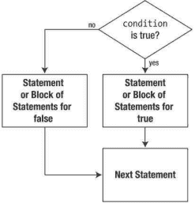

if-else 语句中的两个代码块总会执行其中一个。

*图 4-2. if-else 语句逻辑*

图 4-2 中的流程图展示了语句执行的顺序，具体取决于 if 条件为 true 还是 false。凡是能放置单条语句的地方，你始终都可以使用一个语句块。这样一来，if-else 语句的每个选项都可以执行任意数量的语句。你可以编写一个 if-else 语句，报告 char 变量 letter 中存储的字符是否为字母或数字：

```cpp
if (std::isalnum(letter))
{
    std::cout << "It is a letter or a digit." << std::endl;
}
else
{
    std::cout << "It is neither a letter nor a digit." << std::endl;
}
```

这里使用了前面见到的 `<cctype>` C 头文件中的 isalnum() 函数。如果 letter 中包含字母或数字，isalnum() 会返回一个正整数。这个库函数返回 bool 值，该值将为 true，因此会显示第一条消息。如果 letter 中包含字母或数字以外的内容，isalnum() 会返回 0，该值会转换为 false，因此 else 后面的输出语句会执行。这里的花括号同样不是必需的，因为它们包含的是单条语句，但加上花括号会更清晰。代码块中的缩进可以直观地表明各条语句之间的关系。你可以清楚地看到，结果为 true 时执行哪条语句，结果为 false 时执行哪条语句。你应始终缩进程序中的语句，以展示其逻辑结构。

下面是一个将 if-else 与数值一起使用的示例：

```cpp
// Ex4_05.cpp
// Using the if-else statement
#include <iostream>

int main()
{
    long number {};      // Stores input
    std::cout << "Enter an integer less than 2 billion: ";
    std::cin >> number;

    if (number % 2) // Test remainder after division by 2
    { // Here if remainder is 1
        std::cout << "Your number is odd." << std::endl;
    }
    else
    { // Here if remainder is 0
        std::cout << "Your number is even." << std::endl;
    }
}
```

下面是该程序的一个输出示例：

```text
Enter an integer less than 2 billion: 123456
Your number is even.
```

将输入读入 number 后，程序会在 if 条件中测试该值。这是一个表达式，会生成 number 除以 2 后的余数。如果 number 是奇数，余数为 1；如果是偶数，余数为 0，而这些值会分别转换为 true 和 false。因此，如果余数为 1，if 条件为 true，紧跟在 if 后面的代码块中的语句会执行。如果余数为 0，if 条件为 false，因此 else 关键字后面的代码块中的语句会执行。你可以将 if 条件指定为 `number % 2 == 0`，在这种情况下，代码块的顺序需要反过来，因为当 number 为偶数时，该表达式的求值结果为 true。

## 嵌套 if-else 语句

你已经看到，可以将 if 语句嵌套在 if 语句中。你无疑已经预料到，还可以将 if-else 语句嵌套在 if 中、将 if 嵌套在 if-else 语句中，以及将 if-else 语句嵌套在其他 if-else 语句中。这为你提供了很大的灵活性（也留下了相当大的混淆空间），因此我们来看几个示例。先看第一种情况，将 if-else 嵌套在 if 中的示例可能如下所示：

```cpp
if (coffee == 'y')
    if (donuts == 'y')
        std::cout << "We have coffee and donuts." << std::endl;
    else
        std::cout << "We have coffee, but not donuts." << std::endl;
```

这段代码加上花括号会更好，但不用花括号更容易说明我们想表达的观点。coffee 和 donuts 是 char 类型的变量，值可以是 'y' 或 'n'。只有在 coffee 的测试结果为 true 时，才会执行对 donuts 的测试，因此这些消息在每种情况下都反映了正确的情形。else 属于测试 donuts 的那个 if。然而，这很容易混淆。

如果你编写相同的内容，但使用不正确的缩进，就可能对这里发生的情况得出错误结论：

```cpp
if (coffee == 'y')
  if (donuts == 'y')
    std::cout << "We have coffee and donuts." << std::endl;   // This is indented incorrectly...
  else
    std::cout << "We have no coffee..." << std::endl;   // ...Wrong!
```

现在的缩进会误导性地暗示这是一个嵌套在 if-else 中的 if，但事实并非如此。第一条消息是正确的，但由 else 执行所产生的输出是完全错误的。这条语句只有在 coffee 的测试为 true 时才会执行，因为 else 属于对 donuts 的测试，而不是对 coffee 的测试。这个错误在这里很容易看出来，但对于更大、更复杂的 if 结构，你需要牢记下面关于哪个 if 拥有哪个 else 的规则：

> **注意** else 总是属于最近的前面那个尚未被另一个 else 占用的 if。这里可能产生的混淆被称为*悬空 else 问题*。

花括号始终能让情况更清晰：

```cpp
if (coffee == 'y')
{
  if (donuts == 'y')
  {
    std::cout << "We have coffee and donuts." << std::endl;
  }
  else
  {
    std::cout << "We have coffee, but not donuts." << std::endl;
  }
}
```

现在情况绝对清晰了。else 明确属于检查 donuts 的那个 if。

## 理解嵌套 if

既然你已经了解了规则，理解嵌套在 if-else 中的 if 应该很容易：

```cpp
if (coffee == 'y')
{
  if (donuts == 'y')
    std::cout << "We have coffee and donuts." << std::endl;
}
```

处理这类逻辑还有更好的方法。如果把足够多的嵌套 if 放在一起，几乎可以肯定某处会出错。下一节将帮助简化问题。

## 逻辑运算符

如你所见，当有两个或更多相关条件时，使用 if 可能会很繁琐。你已经用自己那点 if 技巧尝试查找 coffee 和 donuts，但在实践中，你可能需要检查复杂得多的条件。例如，你可能要在某人的档案中查找这样一个人：年龄大于 21 岁、小于 35 岁、女性、拥有学士或硕士学位、未婚，并且会说印地语或乌尔都语。为此定义一个测试可能会涉及一个极其庞大的 if。

逻辑运算符提供了一种简洁而简单的解决方案。使用逻辑运算符，你可以将一系列比较组合成一个表达式，从而几乎无论一组条件有多复杂，都只需要一个 if。更重要的是，你不会在选择使用哪个运算符时遇到困难，因为只有表 4-5 中所示的三个。

**表 4-5. 逻辑运算符**

| 运算符 | 描述 |
|---|---|
| `&&` | 逻辑与 |
| \|\| | 逻辑或 |
| `!` | 逻辑非（NOT） |

前两个运算符 `&&` 和 `||` 是二元运算符，它们组合两个 bool 类型的操作数，并产生 bool 类型的结果。第三个运算符 `!` 是一元运算符，因此它作用于单个 bool 类型的操作数，并产生 bool 结果。在接下来的内容中，我会先解释每个运算符的用法；然后通过一个示例演示它们。最后，我们会将逻辑运算符与你之前学过的按位运算符进行比较。

### 逻辑与

当你有两个条件，且只有两者都为 true 时结果才为 true，就使用 AND 运算符 `&&`。例如，你想既富有又健康。前面在判断一个字符是否为大写字母时，该值必须既大于或等于 'A'，又小于或等于 'Z'。`&&` 运算符只有在两个操作数都为 true 时才产生 true 结果。如果任一操作数或两个操作数都为 false，则结果为 false。下面是使用 `&&` 运算符测试 char 变量 letter 是否为大写字母的方法：

```cpp
if (letter >= 'A' && letter <= 'Z')
{
    std::cout << "This is an uppercase letter." << std::endl;
}
```

只有当由 `&&` 组合的两个条件都为 true 时，输出语句才会执行。该表达式中不需要括号，因为比较运算符的优先级高于 `&&`。和往常一样，如果你愿意，可以自由添加括号。你可以将语句写成如下形式：

```cpp
if ((letter >= 'A') && (letter <= 'Z'))
{
    std::cout << "This is an uppercase letter." << std::endl;
}
```


现在毫无疑问，比较会先被求值。不过，大多数有经验的程序员可能不会在这里加上这些额外的括号。

### 逻辑或

逻辑或运算符 || 适用于当两个操作数中有一个或两个都为 true 时希望结果为 true 的情况。只有当两个操作数都为 false 时，结果才为 false。

例如，如果你的年收入至少为 $100,000，或者你有 $1,000,000 现金，那么你可能会被认为信用足够好，可以获得银行贷款。可以这样测试：

```cpp
if (income >= 100'000.00 || capital >= 1'000'000.00)
{
    std::cout << "Of course, how much do you want to borrow?" << std::endl;
}
```

当两个条件中有一个或两个都为 true 时，就会输出这个响应。（更好的响应可能是“你为什么要借钱？”很奇怪，银行只会在你不需要钱的时候才借钱给你。）

还要注意，我们使用了数字分隔符来提高数字字面量的可读性：1'000'000.00 等于一百万，这比 1000000.00 明显得多。如果没有分隔符，你甚至能看出 1'000'000.00 和 1000000.00 之间的区别吗？（如果银行在填写这两个数字中的任何一个时犯了错误，你肯定希望错误对你有利！）

### 逻辑非

第三个逻辑运算符 ! 作用于单个 bool 操作数，并反转其值。因此，如果 bool 变量 test 的值为 true，那么 !test 为 false；如果 test 为 false，那么 !test 的结果为 true。

与所有逻辑运算符一样，你可以将逻辑非应用于任何求值为 true 或 false 的表达式。操作数可以是任何内容，从单个 bool 变量到比较和 bool 变量的复杂组合。例如，假设 x 的值为 10。那么表达式 !(x > 5) 的求值结果为 false，因为 x > 5 为 true。当然，在这种特定情况下，你也许最好直接写 x <= 5。后一个表达式是等价的，但由于它不包含逻辑非，可能更易读。

**注意** 设 foo、bar 和 xyzzy 是 bool 类型的变量（如果你愿意，也可以是任意表达式）。那么，像你这样的 C++ 初学者经常写出这样的语句：

```cpp
if (foo == true) ...
if (bar == false) ...
if (xyzzy != true) ...
```

虽然从技术上讲是正确的，但人们普遍认为，你应该改用下面这些等价但更短的 if 语句：

```cpp
if (foo) ...
if (!bar) ...
if (!xyzzy) ...
```

### 组合逻辑运算符

你可以按自己觉得舒服的程度任意组合条件表达式和逻辑运算符。这个示例实现了一个问卷，用来判断一个人是否是良好的贷款风险对象：

```cpp
// Ex4_06.cpp
// Combining logical operators for loan approval
import <iostream>;

int main()
{
    int age {};              // Age of the prospective borrower
    int income {};           // Income of the prospective borrower
    int balance {};          // Current bank balance

    // Get the basic data for assessing the loan
    std::cout << "Please enter your age in years: ";
    std::cin >> age;
    std::cout << "Please enter your annual income in dollars: ";
    std::cin >> income;
    std::cout << "What is your current account balance in dollars: ";
    std::cin >> balance;

    // We only lend to people who are at least 21 years of age,
    // who make over $25,000 per year,
    // or have over $100,000 in their account, or both.
    if (age >= 21 && (income > 25'000 || balance > 100'000))
    {
        // OK, you are good for the loan - but how much?
        // This will be the lesser of twice income and half balance
        int loan {};         // Stores maximum loan amount
        if (2*income < balance/2)
        {
            loan = 2*income;
        }
        else
        {
            loan = balance/2;
        }
        std::cout << "\nYou can borrow up to $" << loan << std::endl;
    }
    else    // No loan for you...
    {
        std::cout << "\nUnfortunately, you don't qualify for a loan." << std::endl;
    }
}
```

以下是一些示例输出：

```
Please enter your age in years: 25
Please enter your annual income in dollars: 28000
What is your current account balance in dollars: 185000

You can borrow up to $56000
```

有趣的部分是决定是否批准贷款的 if 语句。if 条件如下：

```
age >= 21 && (income > 25'000 || balance > 100'000)
```

这个条件要求申请人的年龄至少为 21 岁，并且其收入大于 $25,000 或账户余额大于 $100,000。表达式 (income > 25'000 || balance > 100'000) 两边的括号是必要的，以确保将收入和余额条件进行或运算的结果与年龄测试的结果进行与运算。没有括号时，年龄测试会与收入测试进行与运算，然后结果再与余额测试进行或运算。这是因为 && 的优先级高于 ||，正如你在第 3 章的表中所看到的那样。有了括号，这个条件本来会允许一个账户余额超过 $100,000 的 8 岁孩子获得贷款。这不是原本的意图。银行从不贷款给未成年人和八哥。

如果条件为 true，则执行确定贷款金额的语句块。loan 变量定义在这个块内，因此在块结束时会不复存在。块内的 if 语句判断申报收入的两倍是否小于账户余额的一半。如果是，贷款金额为收入的两倍；否则为账户余额的一半。这确保贷款金额符合规则所限定的最小金额。

> **提示** 组合逻辑运算符时，建议始终添加括号以阐明代码。

为了讨论方便，假设银行允许贷款的条件如下：

```
(age < 30 && income > 25'000) || (age >= 30 && balance > 100'000)
```

也就是说，对于较年轻的客户，决定完全取决于他们的年薪——是的，甚至幼儿也能获得贷款，当然，只要他们能提供足够收入的证明——而更成熟的客户必须已经拥有足够的储蓄。那么你也可以把这个条件写成如下形式：

```
age < 30 && income > 25'000 || age >= 30 && balance > 100'000
```

虽然两个表达式完全等价，但你肯定会同意，带括号的那个比不带括号的更容易阅读。因此，在组合 && 和 || 时，建议始终通过添加括号来阐明逻辑表达式的含义，即使严格来说并不需要这样做。

### 整数操作数上的逻辑运算符

在某种程度上，逻辑运算符可以——而且实际上相当频繁地——应用于整数操作数，而不是布尔操作数。例如，前面你看到过，可以用下面的代码测试 int 变量 value 是否不等于零：

```cpp
    if (value)
        std::cout << "You have entered a value that is different from zero." << std::endl;
```

同样常见的是，你会遇到以下形式的测试：

```cpp
    if (!value)
        std::cout << "You have entered a value that equals zero." << std::endl;
```

这里，逻辑非应用于整数操作数——而不是像通常那样应用于布尔操作数。类似地，假设你定义了两个 int 变量 value1 和 value2；那么你可以这样写：

```cpp
    if (value1 && value2)
        std::cout << "Both values are non-zero." << std::endl;
```

因为这些表达式非常简短，所以它们在 C++ 程序员中很流行。这种模式的典型用例出现在这些整数值表示例如对象集合中元素数量的情况下。因此，理解它们如何工作很重要：在此类表达式中，逻辑运算符的每个数值操作数都会先使用熟悉的规则转换为 bool：零转换为 false，其他所有数字转换为 true。不过，即使所有操作数都是整数，逻辑表达式仍然会求值为 bool。

### 逻辑运算符与按位运算符

重要的是，不要把作用于可转换为 bool 的操作数的逻辑运算符 &&、|| 和 ! 与作用于整型操作数内部各位的按位运算符 &、| 和 ^ 混淆。

从上一小节你会记得，逻辑运算符总是求值为 bool 类型的值，即使其操作数是整数。按位运算符则相反：它们总是求值为一个整数，即使两个操作数都是 bool 类型。然而，由于按位运算符的整数结果总是会转换回 bool，所以常常看起来逻辑运算符和按位运算符可以互换使用。例如，Ex4_06 中用于测试贷款是否可批准的核心测试，原则上可以这样写：

```cpp
    if (age >= 21 && (income > 25'000 | balance > 100'000))
    {
        ...
    }
```

这样写可以编译，并且最终结果与之前仍然使用 && 和 || 时相同。简而言之，发生的情况是：比较产生的 bool 值被转换为 int，然后使用按位运算符按位组合成一个单独的 int，之后这个单独的 int 又会为 if 语句转换回 bool。感到困惑？别担心，这并不那么重要。这种在 bool 和整数之间来回转换的情况很少会引起担忧。

然而，重要的是这两组运算符之间第二个更根本的区别；即，与按位运算符不同，二元逻辑运算符是所谓的短路运算符。


## 短路求值

考虑下面的代码片段：

```cpp
int x = 2;
if (x < 0 && (x*x + 632*x == 1268))
{
    std::cout << "Congrats: " << x << " is the correct solution!" << std::endl;
}
```

快速判断一下，x = 2 是正确解吗？当然不是，2 并不小于 0！甚至 2*2 + 632*2 是否等于 1268 都无关紧要（实际上它确实等于……）。因为 AND 运算符的第一个操作数已经是 false，最终结果也会是 false。毕竟，false && true 仍然是 false；AND 运算符求值为 true 的唯一情况是 true && true。

同样，在下面的代码片段中，应该立刻就能看出 x = 2 是正确解：

```cpp
int x = 2;
if (x == 2 || (x*x + 632*x == 1268))
{
    std::cout << "Congrats: " << x << " is the correct solution!" << std::endl;
}
```

为什么？因为第一个操作数为 true，你立刻就知道整个 OR 表达式也会求值为 true。甚至不需要计算第二个操作数。

自然，C++ 编译器也知道这一点。因此，如果二元逻辑表达式的第一个操作数已经决定了结果，编译器就会确保不会浪费时间计算第二个操作数。逻辑运算符 && 和 || 的这种特性称为短路求值。另一方面，按位运算符 & 和 | 不会短路。对于这些运算符，两个操作数始终都会被求值。

C++ 程序员经常利用逻辑运算符的这种短路语义：

-   如果你需要测试由逻辑运算符连接起来的多个条件，那么应该把计算成本最低的条件放在最前面。本节中的两个例子已经在一定程度上说明了这一点，但当然，只有当其中一个操作数的计算确实很昂贵时，这种技巧才真正划算。
-   短路更常用于防止对右侧操作数求值，否则该求值可能会失败——例如导致致命崩溃。做法是把其他条件放在前面，以便在其余操作数会失败时发生短路。正如我们将在本书后面看到的，这种技术的一个常见应用是在解引用指针之前检查它是否为空。

我们将在后续章节中看到更多依赖短路求值的逻辑表达式示例。目前只需记住：&& 的第二个操作数仅在第一个操作数求值为 true 后才会求值，而 || 的第二个操作数仅在第一个操作数求值为 false 后才会求值。对于 & 和 |，两个操作数始终都会被求值。

另外，哦对了，如果你想知道的话，前面那个方程的正确解是 x = -634。

## 逻辑异或

逻辑运算符中没有与按位异或运算符 ^（XOR，Exclusive OR 的缩写）对应的运算符。毫无疑问，部分原因是：对这个运算符进行短路没有意义（必须始终计算两个操作数才能知道该运算符的正确结果；也许可以花点时间想想这一点）。幸运的是，XOR 运算符像任何按位运算符一样，也可以直接应用于布尔操作数。例如，下面的测试对大多数年轻人和百万富翁会通过。不过，银行余额正常的成年人不会通过，青少年百万富翁也不会通过：

```cpp
if ((age < 20) ^ (balance >= 1'000'000))
{
    ...
}
```

换句话说，这个测试等价于以下逻辑运算符组合中的任意一种：

```cpp
if ((age < 20 || balance >= 1'000'000) && !(age < 20 && balance >= 1'000'000))
{
    ...
}
```

```cpp
if ((age < 20 && balance < 1'000'000) || (age >= 20 && balance >= 1'000'000))
{
    ...
}
```

说服自己这三个 if 语句确实等价，是一个不错的布尔代数小练习。

## 条件运算符

*条件运算符*有时被称为*三元运算符*，因为它涉及三个操作数——也是唯一拥有三个操作数的运算符。它类似于 if-else 语句：不是根据条件选择执行两个语句块之一，而是选择两个表达式之一的值。因此，条件运算符使你能够在两个值之间进行选择。让我们考虑一个例子。

假设你有两个变量 a 和 b，并且你想把两者中较大的值赋给第三个变量 c。下面的语句可以做到这一点：

```cpp
c = a > b ? a : b;    // Set c to the higher of a and b
```

条件运算符的第一个操作数是一个逻辑表达式，在本例中是 a > b。如果这个表达式为 true，则选择第二个操作数——在本例中是 a——作为该运算的结果值。如果第一个操作数为 false，则选择第三个操作数——在本例中是 b——作为值。因此，条件表达式的结果在 a 大于 b 时为 a，否则为 b。这个值被存入 c。该赋值语句等价于下面的 if 语句：

```cpp
if (a > b)
{
    c = a;
}
```

每组 case 语句之后出现的 break 语句对这里的逻辑至关重要。执行 break 语句会跳出 switch，使执行继续到右花括号之后的语句。如果省略某个 case 的 break 语句，则后续 case 的语句也会执行。注意，最后一个 case（通常是 default case）之后不需要 break，因为此时执行无论如何都会离开 switch。不过，包含它仍然是一种良好的编程风格，因为它可以防止意外落入你以后可能添加到 switch 中的另一个 case。switch、case、default 和 break 都是关键字。

这个例子演示了 switch 语句：

```cpp
// Ex4_08.cpp
// Using the switch statement
import <iostream>;

int main()
{
    std::cout << "Your electronic recipe book is at your service.\n"
              << "You can choose from the following delicious dishes:\n"
              << "1. Boiled eggs\n"
              << "2. Fried eggs\n"
              << "3. Scrambled eggs\n"
              << "4. Coddled eggs\n\n"
              << "Enter your selection number: ";

    int choice {};  // Stores selection value
    std::cin >> choice;

    switch (choice)
    {
    case 1:
        std::cout << "Boil some eggs." << std::endl;
        break;
    case 2:
        std::cout << "Fry some eggs." << std::endl;
        break;
    case 3:
        std::cout << "Scramble some eggs." << std::endl;
        break;
    case 4:
        std::cout << "Coddle some eggs." << std::endl;
        break;
    default:
        std::cout << "You entered a wrong number - try raw eggs." << std::endl;
    }
}
```

在输出语句中定义选项并将选择编号读入变量 choice 后，switch 语句开始执行，其选择表达式就写在关键字 switch 后紧跟的圆括号中，即 choice。switch 中的可能选择位于花括号之间，每个选择都由一个 case 标签标识。如果 choice 的值与任一 case 值对应，则执行该 case 标签之后的语句。

如果 choice 的值不与任何 case 值对应，则执行 default 标签之后的语句。如果你在这里没有包含 default case，并且 choice 的值不同于所有 case 值，那么 switch 将什么都不做，程序将继续执行 switch 之后的下一语句——实际上就是执行 `return 0;`，因为已经到达 `main()` 的末尾。

在这个例子中，每个 case 只有一条语句加一条 break 语句，但一般来说，一个 case 标签之后可以有任意多条需要的语句，而且通常不需要把它们括在花括号中。确实需要添加花括号的情况将在后面的某一节中讨论。

正如我们之前所说，每个 case 值都必须是编译期常量，并且必须唯一。不能有两个 case 值相同的原因是，如果它们相同，编译器就无法知道当那个特定值出现时应该执行哪些语句。然而，不同的 case 值不需要有各自唯一的操作。多个 case 值可以共享同一个操作，如下例所示：

```cpp
// Ex4_09.cpp
// Multiple case actions
import <iostream>;
#include <cctype>

int main()
{
    char letter {};
    std::cout << "Enter a letter: ";
    std::cin >> letter;

    if (std::isalpha(letter))
    {
        switch (std::tolower(letter))
        {
        case 'a': case 'e': case 'i': case 'o': case 'u':
            std::cout << "You entered a vowel." << std::endl;
            break;
        default:
            std::cout << "You entered a consonant." << std::endl;
            break;
        }
    }
    else
    {
        std::cout << "You did not enter a letter." << std::endl;
    }
}
```

以下是一些输出示例：

```text
Enter a letter: E
You entered a vowel.
```

if 条件首先使用标准库中的 `std::isalpha()` 分类函数检查你输入的确实是字母，而不是其他字符。如果参数是字母，返回的整数将非零，并会被隐式转换为 true，从而使 switch 执行。switch 条件使用标准库字符将值转换为小写

转换例程 `tolower()`，并使用结果来选择 case。转换为小写避免了需要同时为大写和小写字母设置 case 标签。所有标识元音字母的 case 都会执行相同的语句。可以看到，你只需把这些 case 依次写出来，后面跟上其中任一 case 选中时要执行的语句。如果输入不是元音字母，那它一定是辅音字母，默认 case 会处理这种情况。

如果 `isalpha()` 返回 0，这会被转换为 false，则不会执行 switch，因为会选择 else 子句；这会输出一条消息，指出输入的字符不是字母。

在 Ex4_09.cpp 中，我们把所有值为元音字母的 case 标签放在同一行。这并不是必需的。你也可以在 case 标签之间添加一个换行（或任何形式的空白）。下面是一个示例：

```cpp
switch (std::tolower(letter))
{
    case 'a':
    case 'e':
    case 'i':
    case 'o':
    case 'u':
        std::cout << "You entered a vowel." << std::endl;
        break;
    ...
}
```

break 语句并不是将控制权移出 switch 语句的唯一方式。如果某个 case 标签后面的代码包含 return 语句，控制权会立即退出 switch 语句，同时也会退出外围函数。因此，原则上你可以把 Ex4_09 中的 switch 语句重写如下：

```cpp
switch (std::tolower(letter))
{
case 'a': case 'e': case 'i': case 'o': case 'u':
    std::cout << "You entered a vowel." << std::endl;
    return 0;                         // Ends the program
}

// We did not exit main() in the above switch, so letter is not a vowel:
std::cout << "You entered a consonant" << std::endl;
```

在这个特定变体中，我们还可以看到默认 case 是可选的。如果你输入元音字母，输出会反映这一点，而 switch 语句中的 return 语句会终止程序。注意，在 return 语句之后绝不应再放 break 语句。如果你输入辅音字母，switch 语句什么也不做。这些 case 都不适用，而且没有默认 case。因此执行会继续执行 switch 语句之后的代码，并输出你实际上输入的是辅音字母——记住，如果你输入的是元音字母，程序早已因为 return 语句而终止了。

这个变体的代码以 Ex4_09A 的形式提供。不过，我们创建它是为了说明几个要点，而不是因为它必然体现了良好的编程风格。与在所有 case 都没有执行 return 后继续执行 switch 语句之后的代码相比，当然更推荐使用默认 case。

**提示** 你经常会使用 switch 语句来根据某个枚举值决定采取哪个操作（参见第 3 章）。对于基于枚举值的 switch，应避免使用默认 case。换句话说：通常应包含与相应枚举类型可能取值数量一样多的 case。这样，如果你以后给枚举类型添加新值，大多数编译器会为每个因此不再穷尽的 switch 语句发出警告。

## 贯穿（Fallthrough）

每组 case 语句末尾的 break 语句会把执行转移到 switch 之后的语句。你可以通过从前面示例 Ex4_08 或 Ex4_09 的 switch 语句中删掉 break 语句并观察会发生什么，来演示 break 语句的本质作用。你会发现，没有 break 语句的 case 后面紧邻的 case 标签下方的代码也会被执行。这种现象称为贯穿（fallthrough），因为从某种意义上说，我们“贯穿”到了下一个 case。

缺失 break 语句往往表明存在疏忽，因此是一个 bug。为了说明这一点，让我们回到前面的一个例子——那个关于彩票号码的例子：

```cpp
switch (ticket_number)
{
  case 147:
    std::cout << "You win first prize!" << std::endl;
  case 387:
    std::cout << "You win second prize!" << std::endl;
    break;
  case 29:
    std::cout << "You win third prize!" << std::endl;
    break;
  default:
    std::cout << "Sorry, you lose." << std::endl;
    break;
}
```

你会注意到，这一次我们“不小心”省略了第一个 case 后面的 break 语句。如果你现在执行这个 switch 语句，且 ticket_number 等于 147，输出将如下：

```
You win first prize!
You win second prize!
```

因为 ticket_number 等于 147，switch 语句会跳到对应的 case，你赢得一等奖。但由于没有 break 语句，执行会直接继续执行下一个 case 标签下方的代码，于是你也赢得二等奖——好耶！显然，这个 break 的遗漏一定是个意外疏忽。事实上，因为贯穿往往表示存在 bug，所以如果非空 switch case 后面没有 break 或 return 语句，许多编译器会发出警告。空 switch case，例如 Ex4_09 中使用的那些（用于检查元音字母），很常见，因此不会触发编译器警告。

不过，贯穿并不总是意味着犯了错误。有时故意编写使用贯穿的 switch 语句会非常有用。假设在我们的彩票中，有多个号码赢得二等奖和三等奖（分别有两个和三个号码），并且其中一个赢得三等奖的号码还会获得特别奖励奖。那么我们可以如下编写这个逻辑：

```
switch (ticket_number)
{
case 147:
    std::cout << "You win first prize!" << std::endl;
    break;
case 387:
case 123:
    std::cout << "You win second prize!" << std::endl;
    break;
case 929:
    std::cout << "You win a special bonus prize!" << std::endl;
case 29:
case 78:
    std::cout << "You win third prize!" << std::endl;
    break;
default:
    std::cout << "Sorry, you lose." << std::endl;
    break;
}
```

其思路是，如果你的 ticket_number 等于 929，结果应为：

```
You win a special bonus prize!
You win third prize!
```

然而，如果你的号码是 29 或 78，你只会赢得三等奖。这些非典型 case（双关语）带来的一点小烦恼是，编译器可能会发出贯穿警告，即使你确知这一次并不是错误。当然，作为一个自重的程序员，你希望编译所有程序时都没有警告。你总是可以重写代码并复制语句来输出你赢得三等奖。但一般来说，重复代码也是你想避免的。那么，该怎么办？

幸运的是，C++17 增加了一项语言特性，可以向编译器和阅读你代码的人表明你是在有意使用贯穿：你可以在原本要添加 break 语句的同一位置添加 `[[fallthrough]]` 语句：

```
switch (ticket_number)
{
...
case 929:
    std::cout << "You win a special bonus prize!" << std::endl;
    [[fallthrough]];
case 29:
case 78:
    std::cout << "You win third prize!" << std::endl;
    break;
...
}
```

对于空 case，例如号码 29 对应的那个，允许使用 `[[fallthrough]]` 语句，但不是必需的。编译器本来就不会为此发出警告。

## 语句块与变量作用域

switch 语句在花括号之间有它自己的块，其中包含 case 语句。if 语句也经常用花括号包围条件为真时要执行的语句，else 部分也可能有这样的花括号。就变量作用域而言，这些语句块与其他任何块没有区别。在块内声明的任何变量都会在块结束时消失，因此你不能在块外引用它。

这里，考虑下面这个相当随意的计算：

```cpp
if (value > 0)
{
  int savit {value - 1};    // This only exists in this block
  value += 10;
}
else
{
  int savit {value + 1};    // This only exists in this block
  value -= 10;
}
std::cout << savit;         // This will not compile! savit does not exist
```

末尾的输出语句会导致编译器错误消息，因为此时 savit 变量未定义。在块内定义的任何变量只能在该块内使用，因此如果你想从块外访问源自块内的数据，就必须在外部块中定义存储该信息的变量。

switch 语句块内的变量定义必须在执行过程中可达，并且不能通过跳到声明之后且在同一作用域内的某个 case 来绕过这些定义；否则代码将无法编译。你很可能还完全不理解我们的意思。不过，通过一个例子来解释会容易得多。下面的代码说明了 switch 中如何出现非法声明：

```cpp
int test {3};
switch (test)
{
  int i {1};          // ILLEGAL - cannot be reached

  case 1:
    int j {2};        // ILLEGAL - can be reached but can be bypassed
    std::cout << test + j << std::endl;
    break;

  int k {3};          // ILLEGAL - cannot be reached

  case 3:
  {
    int m {4};        // OK - can be reached and cannot be bypassed
    std::cout << test + m << std::endl;
    break;
  }
}
```


```cpp
default:
    int n{5};             // OK - can be reached and cannot be bypassed
    std::cout << test + n << std::endl;
    break;
}
std::cout << j << std::endl;    // ILLEGAL - j doesn't exist here
std::cout << n << std::endl;    // ILLEGAL - n doesn't exist here
```

在这个 switch 语句中，只有两个变量定义是合法的：m 和 n 的定义。对于定义而言，要合法，首先必须有可能在正常执行过程中到达并执行它。显然，变量 j 和 k 并非如此。其次，在执行过程中，不能绕过变量的定义而进入其作用域，变量 j 就属于这种情况。如果执行跳转到标签为 3 的 case 或 default 分支，就会绕过 j 的实际定义而进入定义了变量 j 的作用域，这是非法的。然而，变量 m 仅在从其声明到所在块结束的“作用域”内，因此这个声明不会被绕过。而变量 n 的声明不会被绕过，因为在 default 之后没有其他 case。注意，n 的声明合法并不是因为它涉及的是 default 分支；如果在 default 之后还有其他 case，n 的声明也同样是不合法的。

### 初始化语句

考虑以下代码片段：

```cpp
auto lower{ static_cast<char>(std::tolower(input)) };
if (lower >= 'a' && lower <= 'z') {
    std::cout << "You've entered the letter " << lower << '\'' << std::endl;
}
// . . . more code that does not use lower
```

我们将某个输入字符转换为小写字符 lower，并且首先使用该结果检查输入是否是一个字母，然后如果是，则产生一些输出。为了说明起见，请忽略我们本来可以——甚至应该——在此使用 std::isalpha() 函数的事实。你在本章中已经学习了所有相关内容。我们想通过这个例子说明的关键点是，lower 变量只被 if 语句使用，之后就不再被该代码片段之后的任何代码使用。通常，将变量的作用域限制在它们被使用的区域内被认为是一种良好的编码风格，即使这意味着需要添加一个额外的作用域，如下所示：

```cpp
{
    auto lower{ static_cast<char>(std::tolower(input)) };
    if (lower >= 'a' && lower <= 'z') {
        std::cout << "You've entered the letter " << lower << '\'' << std::endl;
    }
}
// . . . more code (lower does not exist here)
```

其结果是，对于其余代码而言，就好像 lower 变量从未存在过一样。像这样引入额外作用域（和缩进）来将局部变量绑定到 if 语句的模式相对常见。它们足够常见，以至于 C++ 为此提供了一种专门的语法。一般语法如下：

```cpp
if (initialization; condition) ...
```

这个额外的初始化*语句*会在计算条件表达式（即 if 语句通常的布尔表达式）之前执行。你将主要使用此类初始化语句来声明 if 语句局部的变量。这样一来，我们之前的示例就变成了下面这样：

```cpp
if (auto lower{ static_cast<char>(std::tolower(input)) }; lower >= 'a' && lower <= 'z') {
    std::cout << "You've entered the letter " << lower << '\'' << std::endl;
}
// ... more code (lower does not exist here)
```

在初始化语句中声明的变量既可以在 if 语句的条件表达式中使用，也可以在紧随 if 之后的语句或块中使用。对于 if-else 语句，它们也可以用在 else 之后的语句或块中。但对于 if 或 if-else 语句之后的任何代码，就好像这些变量从未存在过一样。

为完整起见，C++ 为 switch 语句也支持类似的语法：

```cpp
switch (initialization; condition) { ... }
```

> **注意** 这些扩展的 if 和 switch 语句仍然相对较新（该语法是在 C++17 中添加的），并且在 C++ 开发者中尚不广为人知。使用不熟悉的语法可能会妨碍代码的可读性。因此，如果你在团队中工作，明智的做法是与同事确认你是否想使用代码库中已有的内容。不过另一方面，如果没有像你这样受过良好教育的潮流引领者，新语法又如何能获得发展势头呢？

## 小结

在本章中，你为程序添加了决策能力。现在你已经了解了 C++ 中*所有的*决策语句是如何工作的。本章你学到的决策的基本要素如下：

- 你可以使用比较运算符比较两个值。这将产生一个 bool 类型的值，它可以是 true 或 false。
- 你可以将 bool 值转换为整数类型——true 将转换为 1，false 将转换为 0。
- 数值可以转换为 bool 类型——零值转换为 false，任何非零值转换为 true。当数值出现在需要 bool 值的位置（例如 if 条件中）时，编译器将插入数值到 bool 类型的隐式转换。
- if 语句根据条件表达式的值执行一条语句或一个语句块。如果条件为 true，则执行该语句或语句块；如果条件为 false，则不执行。
- if-else 语句在条件为 true 时执行一条语句或语句块，在条件为 false 时执行另一条语句或语句块。
- if 和 if-else 语句可以嵌套。

练习 4-6. 编写一个程序，仅使用条件运算符来确定输入的整数是 20 或更小、大于 20 但不大于 30、大于 30 但不超过 100，还是大于 100。

练习 4-7. 实现一个程序，提示输入一个字母。使用库函数判断该字母是否为元音字母以及是否为小写字母，并输出结果。最后，将小写字母连同其字符代码作为二进制值输出。作为附加练习，你可以尝试不使用 `std::format()` 来完成后者？

提示：即使 C++ 支持二进制整数字面量（形式如 `0b11001010`；参见第 2 章），C++ 流并不支持以二进制形式输出整数值。除了默认的十进制格式外，它们只支持十六进制和八进制格式（例如，对于 `std::cout`，可以使用定义在 `<ios>` 中的 `std::hex` 和 `std::oct` 输出操纵器）。因此，要用 `std::format()` 以二进制格式输出字符，你必须自己编写一些代码。不过这应该不难：`char` 只有 8 位，记得吗？你可以逐位输出这些位，即使还没学下一章也没关系。也许二进制整数字面量能帮上忙——否则我们为什么会在提示开头提到它们呢？

练习 4-8. 创建一个程序，提示用户输入 $0 到 $10 之间的金额（允许小数位）。任何其他值都应礼貌地拒绝。确定需要多少枚 25 美分硬币（quarters）、10 美分硬币（dimes）、5 美分硬币（nickels）和 1 美分硬币（pennies）来组成该金额。对于非美国读者，1 美元（$）等于 100 美分（c）。在屏幕上输出此信息，并确保输出在语法上合理（例如，如果只需要一枚一角硬币，输出应为“1 dime”而不是“1 dimes”）。

# 第 5 章：数组和循环

这定义了一个名为 `temperatures` 的数组，用于存储 366 个 double 类型的值。数据值称为元素。括号之间指定的元素数量就是数组的大小。该语句没有初始化数组元素，因此它们包含垃圾值。

数组的大小必须始终使用常量整数表达式来指定。凡是编译器能在编译时求值的整数表达式都可以使用，尽管大多数情况下这要么是整数字面量，要么是使用字面量初始化的常量整数变量。

你可以使用一个称为索引的整数来引用数组元素。特定数组元素的索引是它相对于第一个元素的偏移量。第一个元素的偏移量为 0，因此其索引为 0；索引值 3 表示第四个数组元素——从第一个元素开始计数。

要引用某个元素，你可以将索引放在数组名后的方括号中，因此要将 `temperatures` 数组的第四个元素设置为 99.0，可以这样写：

```cpp
temperatures[3] = 99.0;        // Set the fourth array element to 99
```

虽然一个包含 366 个元素的数组很好地说明了数组的必要性——想象一下，必须定义 366 个不同的变量来存储这些数值，那将相当麻烦。因此，让我们看看另一个数组：

```cpp
unsigned int height[6];        // Define an array of six heights
```

这个定义的结果是，编译器将分配六个连续的位置来存储 unsigned int 类型的值。height 数组中的每个元素包含一个不同的数字。由于 height 的定义没有为数组指定任何初始值，因此这六个元素将包含垃圾值（类似于定义一个没有初始值的 unsigned int 类型的单个变量时发生的情况）。你可以像这样使用正确的初始值来定义数组：

```cpp
unsigned int height[6] {26, 37, 47, 55, 62, 75};  // Define & initialize array of 6 heights
```

花括号初始化器包含六个以逗号分隔的值。这些可能是某个家庭成员的身高，记录到最接近的英寸。每个数组元素将按顺序从列表中分配一个初始值，因此这些元素将具有图 5-1 中所示的值。

图中的每个方框代表一个保存单个数组元素的内存位置。由于有六个元素，索引值从第一个元素的 0 到最后一个元素的 5。因此，每个元素都可以使用其上方的表达式来引用。

| height[0] | height[1] | height[2] | height[3] | height[4] | height[5] |
|---|---:|---:|---:|---:|---:|---:|
| 26 | 37 | 47 | 55 | 62 | 75 |

*图 5-1.* 包含六个元素的数组

> **注意** 数组的类型将决定每个元素所需的内存量。数组的元素存储在内存中一个连续的块中。因此，如果 unsigned int 类型在你的计算机上占用 4 字节，那么 height 数组将占用 24 字节。


初始化列表包含的值不能多于数组中的元素个数；否则，该语句将无法编译。不过，列表中的值也可以更少，在这种情况下，未提供初始值的元素将被初始化为 0（对于 bool 元素数组则为 false）。下面是一个示例：

```cpp
unsigned int height[6] {26, 37, 47};      // Element values: 26 37 47 0 0 0
```

前三个元素将具有列表中出现的值。最后三个元素将为 0。要将所有元素都初始化为 0，只需使用空的初始化列表：

```cpp
unsigned int height[6] {};      // All elements 0
```

要定义一组不可修改的值组成的数组，只需在其类型中添加关键字 const。下面的代码定义了一个包含六个 unsigned int 常量的数组：

```cpp
const unsigned int height[6] {26, 37, 47, 55, 62, 75};
```

现在，编译器将阻止对这六个数组元素中的任意一个进行任何修改（无论是赋值、递增还是任何其他修改）。

数组元素像其他变量一样参与算术表达式。你可以像这样对 height 的前三个元素求和：

```cpp
unsigned int sum {};
sum = height[0] + height[1] + height[2];    // The sum of three elements
```

在表达式中，你可以像使用普通整型变量一样使用对各个数组元素的引用。正如你之前所见，数组元素可以位于赋值语句的左侧以设置新值，因此你可以在赋值语句中将一个元素的值复制到另一个元素，如下所示：

```cpp
height[3] = height[2];      // Copy 3rd element value to 4th element
```

但是，你不能在一条赋值语句中将一个数组的所有元素值复制到另一个数组的元素中。你只能对单个元素进行操作。要将一个数组的值复制到另一个数组，必须一次复制一个值。你需要的是一种循环。

## 理解循环

*循环*是一种机制，它使你能够重复执行一条语句或一个语句块，直到满足特定条件。循环由两个基本要素构成：要重复执行的语句或语句块构成所谓的循环*体*，以及某种决定何时停止重复循环的*循环条件*。循环体的一次执行称为一次*迭代*。

循环条件可以采取不同形式，以提供不同的循环控制方式。例如，循环条件可以执行以下操作：

- 按给定次数执行循环
- 执行循环，直到某个给定值超过另一个值
- 执行循环，直到从键盘输入特定字符
- 对元素集合中的每个元素执行循环

你可以根据具体情况选择循环条件。循环有以下几种：

- *for 循环*主要提供按指定次数执行循环的能力，但除此之外还具有相当大的灵活性。
- *基于范围的 for 循环*对元素集合中的每个元素执行一次迭代。
- *while 循环*在指定条件为 true 时持续执行。条件在每次迭代开始时检查，因此如果条件一开始就为 false，则不会执行任何循环迭代。
- *do-while 循环*在给定条件为 true 时持续执行。它与 while 循环的不同之处在于，do-while 循环在每次迭代结束时检查条件。这意味着循环体至少总会执行一次迭代。

我们将先解释 for 循环如何工作。

### for 循环

for 循环通常按预定次数执行一条语句或一个语句块，但你也可以用其他方式使用它。你可以在 for 关键字后的圆括号内使用三个用分号分隔的表达式来指定 for 循环的工作方式。如图 5-2 所示。

```cpp
for (initialization; condition; iteration)
{
    // Loop statements
}
// Next statement
```

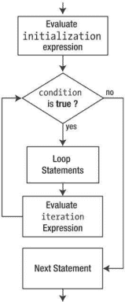

*图 5-2.* for 循环的逻辑

你可以省略控制 for 循环的任意一个或全部表达式，但必须始终包含分号。我们将在本章后面解释为什么以及何时可能省略某个控制表达式。初始化表达式只在循环开始时求值一次。接下来检查循环条件，如果为 true，则执行循环语句或语句块。如果条件为 false，则循环结束，并继续执行循环之后的语句。每次执行循环语句或语句块之后，都会对迭代表达式求值，并检查条件以决定循环是否应继续。

在 for 循环最典型的用法中，第一个表达式初始化计数器，第二个表达式检查计数器是否已达到给定上限，第三个表达式递增计数器。例如，你可以像这样将一个数组中的元素复制到另一个数组：

```cpp
double rainfall[12] {1.1, 2.8, 3.4, 3.7, 2.1, 2.3, 1.8, 0.0, 0.3, 0.9, 0.7, 0.5};
double copy[12] {};
for (size_t i = 0; i < 12; i++)
{
    copy[i] = rainfall[i];        // Copy ith element of rainfall to ith element of copy
}
```

第一个表达式将 i 定义为 size_t 类型，初始值为 0。你可能还记得 sizeof 运算符返回值所使用的 size_t 类型。它是一种无符号整数类型，通常用于表示大小和计数等。因此，使用 size_t 是合理的。第二个表达式即循环条件，只要 i 小于 12 就为 true，因此当 i 小于 12 时循环继续。当 i 达到 12 时，该表达式将为 false，因此循环结束。第三个表达式在每次循环迭代结束时递增 i，因此，将 rainfall 的第 i 个元素复制到 copy 的循环块将以 i 从 0 到 11 的值执行。

> **注意**  `size_t` 不是 int、long 或 double 这类内置基本类型的名称；它是由标准库定义的类型别名。更具体地说，它是某种无符号整数类型的别名，其范围足以容纳编译器支持的任何类型的大小（包括任何数组）。该别名定义在 `<cstddef>` 头文件中，也定义在许多其他模块中。不过在实践中，你通常不需要显式导入这些模块中的任何一个就能使用 `size_t` 别名；通过导入大多数示例所使用的其他更高级模块（例如 `<iostream>` 模块），该别名往往已经被间接定义。

> **警告**  不会检查数组索引值以验证其是否有效。你需要确保不引用数组边界之外的元素。如果使用超出数组有效范围的索引值存储数据，你要么会无意中覆盖内存中的某些内容，要么会导致所谓的*段错误*或*访问冲突*（这两个术语同义，表示操作系统在检测到未经授权的内存访问时引发的错误）。无论哪种情况，你的程序都几乎肯定会以糟糕的结局收场。

和往常一样，编译器会忽略 `for` 语句中的所有空白。另外，如果循环体只包含一条语句，花括号同样是可选的。因此，如果你愿意，可以像这样格式化前面的 `for` 循环：

```cpp
    for( size_t i {} ; i<12 ; ++i )    // i varies from 0 to 11
      copy[i] = rainfall[i];          // Copy ith element of rainfall to ith element of copy
```

在本书中，我们会在 `for` 关键字后放一个空格（以区分循环和函数调用），两个分号前不放空格（与其他任何语句一样），并且即使循环体只有一条语句也大多使用花括号（以便更好地从视觉上识别循环体）。当然，你可以自由遵循自己喜欢的任何编码风格。

在 `for` 循环的初始化表达式中定义诸如 `i` 这样的变量不仅是合法的，而且很常见。这有一些重要影响。循环定义了一个作用域。循环语句或语句块，包括控制循环的任何表达式，都落在循环的作用域内。在循环作用域内声明的任何自动变量在该作用域之外都不存在。由于 `i` 是在第一个表达式中定义的，因此它是循环的局部变量，所以当循环结束时，`i` 将不再存在。当你需要在循环结束后访问循环控制变量时，只需在循环之前定义它，如下所示：

```cpp
    size_t i {};
    for (i = 0; i < 12; ++i)      // i varies from 0 to 11
    {
      copy[i] = rainfall[i];      // Copy ith element of rainfall to ith element of copy
    }
    // i still exists here...
```

现在你可以在循环结束后访问 `i`——在这种情况下，它的值将是 12。`i` 在其定义中被初始化为 0，因此第一个循环控制表达式是多余的。你可以省略任意一个或全部循环控制表达式，因此该循环可以写成如下形式：

```cpp
    size_t i {};
    for ( ; i < 12; ++i)          // i varies from 0 to 11
    {
      copy[i] = rainfall[i];      // Copy ith element of rainfall to ith element of copy
    }
```

该循环的工作方式与之前完全相同。我们将在本章稍后讨论省略其他控制表达式。

> **注意**  在上一章末尾，我们告诉你 C++17 为 `if` 和 `switch` 语句引入了新的初始化语句语法。这些初始化语句是仿照 `for` 循环的初始化语句设计的，因此与它们完全类似。唯一的区别是，对于 `for` 循环，当你省略初始化语句时，不能省略第一个分号。


## 避免魔法数字

上一节的代码片段有一个小问题：它们使用了“魔法数字”12 作为数组大小。假设他们发明了第十三个月——Undecimber——你必须为那个月添加一个降雨量值。那么在增大 rainfall 数组大小之后，你很有可能会忘记更新 for 循环中的 12。这就是 bug 的滋生方式！

更安全的解决方案是，为数组大小定义一个 const 变量，并用它代替显式值：

```cpp
const size_t size {12};
double rainfall[size] {1.1, 2.8, 3.4, 3.7, 2.1, 2.3, 1.8, 0.0, 0.3, 0.9, 0.7, 0.5};
double copy[size] {};
for (size_t i {}; i < size; ++i)  // i varies from 0 to size-1
{
    copy[i] = rainfall[i];          // Copy ith element of rainfall to ith element of copy
}
```

这样出错的可能性就小得多，而且很明显 size 是两个数组的元素个数。

**提示** 如果同一个常量散布在代码中，很容易因为忘记更新其中一些而出错。因此，对于魔法数字或任何常量变量，请只定义一次。如果之后需要修改该常量，只需在一个地方修改即可。

让我们在一个完整的示例中尝试 for 循环：

```cpp
// Ex5_01.cpp
// Using a for loop with an array
import <iostream>;

int main()
{
    const unsigned size {6};                  // Array size
    unsigned height[size] {26, 37, 47, 55, 62, 75};  // An array of heights

    unsigned total {};                        // Sum of heights
    for (size_t i {}; i < size; ++i)
    {
        total += height[i];
    }

    const unsigned average {total/size};      // Calculate average height
    std::cout << "The average height is " << average << std::endl;

    unsigned count {};
    for (size_t i {}; i < size; ++i)
    {
        if (height[i] < average) ++count;
    }
    std::cout << count << " people are below average height." << std::endl;
}
```

## 确定数组的大小

前面你看到了，可以通过定义一个初始化为数组大小的常量来避免在数组元素个数上使用魔法数字。当你让编译器根据花括号初始化列表来决定元素个数时，显然也不想指定一个魔法数字作为数组大小。你需要一种万无一失的方法来在需要时确定大小。

最简单且推荐的方法是使用标准库 `<array>` 模块提供的 `std::size()` 函数。² 假设你定义了这样一个数组：

```
int values[] {2, 3, 5, 7, 11, 13, 17, 19, 23, 29};
```

然后你可以使用表达式 `std::size(values)` 来获取数组的大小，即 10。

**注意** `std::size()` 函数不仅适用于数组；你还可以用它作为替代手段来获取标准库定义的几乎所有元素集合的大小，包括我们将在本章后面介绍的 `std::vector<>` 和 `std::array<>` 容器。

在 C++17 标准库加入方便的 `std::size()` 之前，人们常常使用一种基于 `sizeof` 运算符的不同技巧。你在第 2 章已经知道，`sizeof` 运算符返回变量占用的字节数。这既适用于整个数组，也适用于单个数组元素。因此，`sizeof` 运算符提供了一种确定数组元素个数的方法：只需将数组的大小除以单个元素的大小。让我们两种方法都试一下：

```cpp
// Ex5_02.cpp
// Obtaining the number of array elements
import <iostream>;
import <array>;          // for std::size()

int main()
{
    int values[] {2, 3, 5, 7, 11, 13, 17, 19, 23, 29};

    std::cout << "There are " << std::size(values) << " elements in the array.\n";

    int sum {};
    const size_t old_school_size = sizeof(values) / sizeof(values[0]);
    for (size_t i{}; i < old_school_size; ++i)
    {
        sum += values[i];
    }
    std::cout << "The sum of the array elements is " << sum << std::endl;
}
```

²严格来说，`std::size()` 主要定义在 `<iterator>` 模块中。但由于它是一个非常常用的工具，标准库保证在导入 `<array>` 模块（以及其他几个模块）时也可用。由于你大多会配合数组使用 `std::size()`，我们认为记住导入 `<array>` 模块比 `<iterator>` 模块更容易。

这个示例产生以下输出：

```
There are 10 elements in the array.
The sum of the array elements is 129
```

values 数组中的元素个数由编译器根据定义中的初始化值数量决定。在第一个输出语句中，我们使用 std::size() 函数——清晰又简单。对于老式的 size 变量，我们改用 sizeof 运算符来计算数组元素个数——远不如前者清晰简单。表达式 sizeof(values) 求出整个数组占用的字节数，sizeof(values[0]) 求出单个元素占用的字节数（任何元素都可以，但通常取第一个元素）。右侧的表达式 sizeof(values) / sizeof(values[0]) 用整个数组占用的字节数除以一个元素占用的字节数，因此它求出的是数组中的元素个数。

显然，`std::size()` 比基于 `sizeof` 的旧表达式更容易使用和理解。因此，如果可能，你应该始终使用 `std::size()`（当然，也可以坚持使用 `std::array<>` 对象）。

for 循环本身决定了数组元素的总和。控制表达式不必采用某种特定形式。你已经看到可以省略第一个控制表达式。在示例的 for 循环中，你可以在第三个循环控制表达式内累加元素的总和。那么循环将变成下面这样（我们也按建议使用 `std::size()`）：

```
int sum {};
for (size_t i {}; i < std::size(values); sum += values[i++]);
```

第三个循环控制表达式现在做两件事：将索引 i 处的元素值加到 sum，然后递增控制变量 i。注意，之前 i 是使用前缀 ++ 运算符递增的，而现在则使用后缀 ++ 运算符。这里必须确保 i 递增之前，先由 i 选中的元素被加到 sum。如果使用前缀形式，你会得到错误的元素总和；还会使用一个无效的索引值，访问数组末尾之后的内存。

行末的单个分号是构成循环体的空语句。一般来说，这需要特别注意；绝不要在循环体之前添加分号。但在这里它是可行的，因为所有计算都已经发生在循环的控制表达式中。另一种更清晰的空循环体写法如下：

```
int sum {};
for (size_t i {}; i < std::size(values); sum += values[i++]) {}
```

> **警告** 在 for 循环的递增表达式（圆括号之间的最后一个部分）中执行除调整循环索引变量之外的操作，至少可以说是不常规的。在我们的示例中，更常见的做法是像 Ex5_02 那样，在循环体内简单地更新 sum 变量。我们在这里向你展示这些替代方案，只是让你感受一下原则上可能实现什么。但总的来说，你应该始终选择常规且清晰的代码，而不是紧凑和取巧的代码！

## 使用浮点值控制 for 循环

到目前为止的 for 循环示例都使用整数变量来控制循环，但你可以使用任何你喜欢的类型。下面的代码片段使用浮点值来控制循环：

```cpp
for (double radius {2.5}; radius <= 20.0; radius += 2.5)
{
    std::cout << std::format("radius = {:4.1f}, area = {:7.2f}\n",
                             radius, std::numbers::pi * radius * radius);
}
```

这个循环由 radius 变量控制，它的类型是 double。初始值为 2.5，在每次循环迭代结束时递增，直到超过 20.0，此时循环结束。循环语句使用标准公式 πr²（其中 r 是圆的半径）计算当前 radius 值对应的圆面积。4.1f 和 7.2f 格式说明为每个输出值指定了固定宽度（4 和 7）和精度（1 和 2）。宽度确保输出值垂直对齐（默认情况下值右对齐），精度控制小数点后的位数。最后的 f 后缀将浮点数的表示类型切换为定点表示，因此不允许使用指数记数法。

使用浮点变量控制 for 循环时需要小心。小数值可能无法精确表示为二进制浮点数。这可能会导致一些不想要的副作用，正如下面这个完整示例所示：

```cpp
// Ex5_03.cpp
// Floating-point control in a for loop
import <format>;
import <iostream>;
import <numbers>;

int main()
{
    const size_t values_per_line {3};  // Outputs per line
    size_t values_current_line {};     // Number of outputs on current line
    for (double radius {0.2}; radius <= 3.0; radius += 0.2)
    {
        const auto area = std::numbers::pi * radius * radius;
        std::cout << std::format("radius = {:4.2f}, area = {:5.2f}; ", radius, area);
        if (++values_current_line == values_per_line)  // When enough values written...
        {
            std::cout << std::endl;   // ...start a new line...
            values_current_line = 0;  // ...and reset the line counter
        }
    }
    std::cout << std::endl;
}
```


```
radius = 0.20, area = 0.13; radius = 0.40, area = 0.50; radius = 0.60, area = 1.13;
radius = 0.80, area = 2.01; radius = 1.00, area = 3.14; radius = 1.20, area = 4.52;
radius = 1.40, area = 6.16; radius = 1.60, area = 8.04; radius = 1.80, area = 10.18;
radius = 2.00, area = 12.57; radius = 2.20, area = 15.21; radius = 2.40, area = 18.10;
radius = 2.60, area = 21.24; radius = 2.80, area = 24.63;
```

该循环包含一个 if 语句，用于每行输出三组值。你预期最后输出的是半径为 3.0 的圆面积。毕竟，只要 radius 小于或等于 3.0，循环就应继续。但显示的最后值中 radius 为 2.8；哪里出错了？

循环比预期更早结束，因为当 0.2 加到 2.8 时，结果大于 3.0。表面上看这是一件令人震惊的算术现象，但请继续读下去！原因在于 0.2 表示为二进制浮点数时存在一个非常小的误差。0.2 无法用二进制浮点数精确表示。误差出现在精度的最后一位，因此如果你的编译器支持 double 类型的 15 位精度，该误差的量级为 10⁻¹⁵。通常这无关紧要，但这里你依赖于连续加 0.2 来恰好得到 3.0——而这并没有发生。

你可以通过将循环改为每行只输出一个圆面积，并显示 3.0 与下一个值之间的差值，来查看差异是什么。

```cpp
for (double radius {0.2}; radius <= 3.0; radius += 0.2)
{
    std::cout << std::format("radius = {:.4f}, area = {:.5f}, delta to 3 = {}\n",
        radius,
        std::numbers::pi * radius * radius,
        (radius + 0.2) - 3.0
    );
}
```

在我们的机器上，最后一行输出现在是这样：

```
radius = 2.80, area = 24.63, delta to 3 = 4.440892098500626e-16
```

如你所见，radius + 0.2 比 3.0 大约 4.44 × 10⁻¹⁶。这导致循环在下一次迭代之前终止。

> **注意** 任何分母为奇数的分数都不能精确表示为二进制浮点值。

虽然这个例子可能显得有点学术化，但舍入误差在实践中确实会导致类似的 bug。作者之一记得一个真实 bug，其 for 循环类似于 Ex5_03。这个 bug 几乎导致某件价值远超 $10,000 的高科技硬件被毁——仅仅因为循环偶尔（并非总是！）多运行了一次迭代。结论：

**警告** 比较浮点数可能很棘手。直接使用 `==`、`<=` 或 `>=` 等运算符比较浮点计算结果时，你应始终保持谨慎。舍入误差几乎总是使浮点值永远无法精确等于数学上的精确值。

对于 Ex5_03 中的 for 循环，一种选择是引入一个整型计数器，专门用于控制循环。另一种选择是用一个能预见舍入误差的条件替换循环条件。在这种特定情况下，使用类似 `radius < 3.0 + 0.001` 的写法就足够了。除了 0.001，你可以使用任何充分大于预期舍入误差、同时又充分小于循环 0.2 增量的数。修正后的程序版本可在 Ex5_03A.cpp 中找到。大多数数学库和所谓的单元测试框架都会提供实用函数，帮助你以可靠的方式比较浮点数。

## 更复杂的 for 循环控制表达式

你可以在第一个 for 循环控制表达式中定义并初始化多个给定类型的变量。只需用逗号将每个变量与下一个变量分隔开。下面是一个使用该特性的可运行示例：

```cpp
// Ex5_04.cpp
// Multiple initializations in a loop expression
import <iostream>;
import <format>;

int main()
{
  unsigned int limit {};
  std::cout << "This program calculates n! and the sum of the integers "
            << "up to n for values 1 to limit.\n";

  std::cout << "What upper limit for n would you like? ";
  std::cin >> limit;

  // The format string for all rows of the table
  const auto table_format = "{:8} {:8} {:20}\n";

  // Output column headings
  std::cout << std::format(table_format, "integer", "sum", "factorial");

  for (unsigned long long n {1}, sum {}, factorial {1}; n <= limit; ++n)
  {
    sum += n;          // Accumulate sum to current n
    factorial *= n;    // Calculate n! for current n
    std::cout << std::format(table_format, n, sum, factorial);
  }
}
```

该程序对从 1 到 limit 的每个整数 n，计算从 1 到 n 的整数之和，其中 limit 是你输入的上限。它还计算每个 n 的阶乘。（整数 n 的阶乘写作 n!，是从 1 到 n 的所有整数的乘积；例如，5! = 1 × 2 × 3 × 4 × 5 = 120。）

前四条语句定义了四个初始值为 1 的变量。最后一条语句输出三个由逗号运算符分隔的赋值表达式的结果。逗号运算符是左结合的，并且优先级在所有运算符中最低，因此该表达式的求值方式如下：

```cpp
(((value1 += ++i), (value2 += ++i)), (value3 += ++i));
```

其效果将是：value1 增加 2 得到 3，value2 增加 3 得到 4，value3 增加 4 得到 5。复合表达式的值是这一系列中最右侧表达式的值，因此输出的值是 5。你可以使用逗号运算符将这些计算并入 Ex5_04.cpp 中 for 循环的第三个循环控制表达式：

```cpp
for (unsigned long long n {1}, sum {1}, factorial {1}; n <= limit;
        ++n, sum += n, factorial *= n)
{
    std::cout << std::format(table_format, n, sum, factorial);
}
```

第三个控制表达式使用逗号运算符组合了三个表达式。第一个表达式像之前一样递增 n，第二个将递增后的 n 加到 sum，第三个将 factorial 乘以同一个值。这里重要的是我们先递增 n，然后才执行另外两个计算。还要注意，这里我们将 sum 初始化为 1，而之前初始化为 0。原因是第三个控制表达式只在循环体第一次执行之后才第一次执行。如果没有这一修改，第一次迭代就会一开始打印出错误的和 0。如果你用这个新版本替换 Ex5_04.cpp 中的循环并再次运行示例，你会看到它像之前一样工作（另见 Ex5_04A）。

## 基于范围的 for 循环

基于范围的 for 循环会遍历一个值范围中的所有值。这立刻引出一个问题：什么是范围？数组是元素的范围，字符串是字符的范围。标准库提供的容器也都是范围。我们将在本章后面介绍两个标准库容器。下面是基于范围的 for 循环的一般形式：

```cpp
for ([initialization;] range_declaration : range_expression)
    loop statement or block;
```

方括号仅用于参考，它们表示初始化部分是可选的。向基于范围的 for 循环添加初始化语句的能力是在 C++20 中引入的，并且除了它是可选的之外，与常规 for 循环的初始化完全类似。你可以用它初始化一个或多个变量，然后可以在基于范围的 for 循环的剩余部分中使用这些变量。

range_expression 标识作为数据源的范围，range_declaration 标识一个变量，该变量将依次被赋值为该范围中的每个值，并在每次迭代时赋予新值。通过一个示例会更清楚。考虑这些语句：

```cpp
int values [] {2, 3, 5, 7, 11, 13, 17, 19, 23, 29};
int total {};
for (int x : values)
    total += x;
```

变量 x 会在每次迭代时从 values 数组中取得一个值。它将依次被赋值为 2、3、5 等。因此，循环最终会累加 values 数组中所有元素的总和。变量 x 是循环的局部变量，在循环外部不存在。

花括号初始化列表本身就是一个有效的范围，因此你可以将前面的代码写得更紧凑，如下所示：

```cpp
int total {};
for (int x : {2, 3, 5, 7, 11, 13, 17, 19, 23, 29})
    total += x;
```

当然，编译器知道 values 数组中元素的类型，因此你也可以让编译器来确定 x 的类型，把前面的循环写成这样：

```cpp
for (auto x : values)
    total += x;
```

使用 auto 关键字会让编译器推导出 x 的正确类型。auto 关键字经常与基于范围的 for 循环一起使用。这是遍历数组或其他范围中所有元素的一种很好的方式。你不需要知道元素的数量，循环机制会处理这一点。

注意，范围中的值会被赋给范围变量 x。这意味着你不能通过修改 x 的值来修改 values 的元素。例如，下面的代码不会改变 values 数组中的元素：

```cpp
for (auto x : values)
    x += 2;
```

这只是给局部变量 x 加 2，而不是给数组元素加 2。x 中存储的值会在下一次迭代时被 values 中下一个元素的值覆盖。在下一章中，你将学习如何通过使用引用变量在基于范围的 for 循环中修改值。

## while 循环

while 循环使用逻辑表达式来控制循环体的执行。图 5-3 展示了 while 循环的一般形式。

```cpp
// Output column headings
std::cout << std::format(table_format, "integer", "sum", "factorial");

unsigned int n {};
unsigned int sum {};
unsigned long long factorial {1ULL};

while (++n <= limit)
{
    sum += n;                         // Accumulate sum to current n
    factorial *= n;                   // Calculate n! for current n
    std::cout << std::format(table_format, n, sum, factorial);
}
```

该程序的输出与 Ex5_04.cpp 相同。变量 n、sum 和 factorial 在循环之前定义。这里变量的类型可以不同，因此 n 和 sum 定义为 unsigned int。factorial 中能存储的最大值有限，因此它保持为 unsigned long long 类型。由于计算方式的实现，计数器 n 初始化为零。while 循环条件先递增 n，然后将新值与 limit 比较。只要条件为真，循环就会继续，因此循环会以 n 从 1 到 limit 的值执行。当 n 达到 limit+1 时，循环结束。循环体内的语句与 Ex5_04.cpp 中相同。

> **注意**  任何 for 循环都可以写成等价的 while 循环，反之亦然。例如，for 循环具有以下通用形式：

```cpp
for (initialization; condition; iteration)
    body
```

这通常可以用 while 循环写成如下形式：

```cpp
{
    initialization;
    while (condition)
    {
        body
        iteration;
    }
}
```

while 循环需要用额外的一对花括号包围，以模拟原始 for 循环对初始化代码中声明的变量进行作用域限定的方式。

```cpp
// Make sure table size is within the limits
if (table < table_min || table > table_max)
{
    std::cout << "Invalid table size entered. Program terminated." << std::endl;
    return 1;
}

// Create the top line of the table
std::cout << std::format("{:>6}", '|');
for (size_t i {1}; i <= table; ++i)
{
    std::cout << std::format("{:3} |", i);
}
std::cout << std::endl;

// Create the separator row
for (size_t i {}; i <= table; ++i)
{
    std::cout << "------";
}
std::cout << std::endl;

for (size_t i {1}; i <= table; ++i)
{
    // Iterate over rows
    std::cout << std::format("{:3} |", i);       // Start the row

    // Output the values in a row
    for (size_t j {1}; j <= table; ++j)
    {
        std::cout << std::format("{:3} |", i*j); // For each column
    }
    std::cout << std::endl;                       // End the row
}

// Check if another table is required
std::cout << "\nDo you want another table (y or n)? ";
std::cin >> reply;

} while (std::tolower(reply) == 'y');
}
```

下面是输出示例：

```text
What size table would you like (2 to 12)? 4
     |  1 |  2 |  3 |  4 |
-----+----+----+----+----
  1  |  1 |  2 |  3 |  4 |
  2  |  2 |  4 |  6 |  8 |
  3  |  3 |  6 |  9 | 12 |
  4  |  4 |  8 | 12 | 16 |
```

## 跳过循环迭代

有时你会希望跳过一次循环迭代并继续下一次。continue 语句可以实现这一点：

```cpp
continue;      // Go to the next iteration
```

当该语句在循环中执行时，执行会立即转移到当前迭代的末尾。只要循环控制表达式允许，执行就会继续进入下一次迭代。通过一个例子最容易理解这一点。假设你想输出一张表，列出字符及其十六进制和十进制格式的字符编码。当然，你不希望输出没有图形表示的字符——其中一些字符（例如制表符和换行符）会打乱输出。因此，程序应该只输出可打印字符。代码如下：

```cpp
// Ex5_08.cpp
// Using the continue statement to display ASCII character codes
import <iostream>;
import <format>;
#include <cctype>

int main()
{
  const auto header_format = "{:^11}{:^11}{:^11}\n";     // 3 cols., 11 wide, centered (^)
  const auto body_format = "{:^11}{:0^11X}{:0^11d}\n";   // Print same argument three times

  std::cout << std::format(header_format, "Character", "Hexadecimal", "Decimal");

  // Output 7-bit ASCII characters and corresponding codes
  char ch{};
  do
  {
    if (!std::isprint(ch))  // If it's not printable...
      continue;             // ...skip this iteration
    std::cout << std::format(body_format, ch);
  } while (ch++ < 127);
}
```

这会显示一张便捷的表格，列出所有 95 个可打印 ASCII 字符的编码。你可能还记得第 1 章中讲过，ASCII 是一种 7 位编码，这意味着所有 ASCII 码值都位于 0 到 127 之间（包括两端）。

| 字符 | 十六进制 | 十进制 |
|---|---|---|
|  | 20 | 32 |
| ! | 21 | 33 |
| " | 22 | 34 |
| # | 23 | 35 |
| ⋮ |  |  |
| } | 7D | 125 |
| ~ | 7E | 126 |

main() 函数顶部的格式字符串用于生成一个包含三列的表格，每列宽度为 11，并且每列的值居中（由 ^ 对齐选项指定）。注意，即使表格有三列，我们也只向 do-while 循环中的 std::format() 表达式传入一个参数。在 body_format 中，我们使用位置参数标识符 0（位于列说明的左侧）将这个参数打印三次：一次作为字母，一次作为大写十六进制数（得益于 X 后缀），一次作为十进制数（得益于 d 后缀，该后缀可以省略，因为十进制输出是默认值）。

然而，这里有趣的部分当然是（有条件的）continue 语句。你不希望输出没有可打印表示的字符的详细信息。<cctype> 中声明的 isprint() 函数可以帮助做到这一点：它仅对可打印字符返回 true。因此，当 ch 包含不可打印字符的编码时，if 语句中的表达式将为 true。在这种情况下，continue 语句会执行，从而跳过当前循环迭代中剩余的代码。

值得注意的是，简单的 for 循环在这里并不适用。也就是说，对该程序循环的一个自然的第一尝试可能是这样的 for 循环：

```cpp
for (char ch {}; ch <= 127; ++ch)
{
    // Output character and code...
}
```

遗憾的是，在 char 为有符号类型的系统上，这个朴素的循环永远不会结束。毕竟，对于有符号 char，127 是可能的最大值，因此 ch <= 127 将始终为真。在原始的 do-while 循环中，条件是在循环体执行之后、递增 ch 之前检查的（得益于后置递增表达式）。然而，朴素 for 循环的条件是在循环体执行之前、递增 ch 之后检查的。

尽管如此，写出这样的 for 循环仍然非常诱人。相信我，在你的职业生涯中，你至少会掉进这个陷阱（或类似的陷阱）一次。所以要注意不要写出始终为真的停止条件！

你也可以让 for 循环正常工作：将控制变量使用 int 类型，然后在将其传给 std::format() 时把该值转换为 char 类型。

### 跳出循环

有时，你需要提前结束循环；循环语句中可能出现某种情况，表明继续执行没有意义。在这种情况下，你可以使用 break 语句。它在循环中的作用与在 switch 语句中大致相同：在循环中执行 break 语句会立即结束循环，执行将继续进行循环之后的语句。break 语句经常与无限循环一起使用，所以接下来我们看看其中一种循环是什么样子。

### 无限循环

无限循环可能会永远运行下去。省略 for 循环中的第二个控制表达式会得到一个可能执行无限次迭代的循环。必须在循环块本身内部以某种方式结束循环；否则，循环将无限重复。

无限循环有许多实际用途，例如监控某种报警指示器的程序，或从工业工厂中的传感器收集数据的程序。当你事先不知道需要多少次循环迭代时，例如在读取数量可变的输入数据时，无限循环会很有用。在这些情况下，你在循环块内编写退出循环的代码，而不是在循环控制表达式中编写。


在最常见的无确定次数 for 循环形式中，所有控制表达式都被省略，如下所示：

```cpp
for (;;)
{
  // 执行某些操作的语句...
  // ...并且包含某种结束循环的方式
}
```

即使没有循环控制表达式，你仍然需要分号（;）。这个循环唯一能结束的方式是循环内部的某些代码终止它。你也可以使用无确定次数的 while 循环：

```cpp
while (true)
{
  // 执行某些操作的语句...
  // ...并且包含某种结束循环的方式
}
```

循环条件始终为 true，因此这是一个无限循环。这等同于没有控制表达式的 for 循环。当然，你也可以有无限版本的 do-while 循环，但通常不会使用它，因为它相对于其他两种循环没有任何优势。

结束无限循环的显而易见的方式是使用 break 语句。你本可以在 Ex5_07.cpp 中使用一个无限循环来允许用户多次尝试输入有效的表大小，而不是立即结束程序。这个循环可以实现：

```cpp
const size_t max_tries {3};   // 用户尝试输入表大小的最大次数
do
{
  for (size_t count {1}; ; ++count)  // 无限循环
  {
    std::cout <<
      std::format("What size table would you like ({} to {})? ", table_min, table_max);
    std::cin >> table;  // 获取表大小

    // 确保表大小在限制范围内
    if (table >= table_min && table <= table_max)
    {
      break;        // 退出输入循环
    }
    else if (count < max_tries)
    {
      std::cout << "Invalid input - try again.\n";
    }
    else
    {
      std::cout << "Invalid table size entered - yet again!\nSorry, only "
        << max_tries << " allowed - program terminated." << std::endl;
      return 1;
    }
  }
  ...
}
```

```cpp
            x[i] = x[i+1];
            x[i + 1] = temp;
            swapped = true;
         }
      }

      if (!swapped)    // 如果没有交换发生
         break;        // ...所有值都已排好序...
   }                   // ...否则，再次循环。

   std::cout << "Your data in ascending sequence:\n";
   const size_t perline (10);        // 每行输出的数量
   size_t n {};                      // 当前行上的数量
   for (size_t i {}; i < count; ++i)
   {
      std::cout << std::format("{:8.1f}", x[i]);
      if (++n == perline)            // 当写满 perline 个时...
      {
         std::cout << std::endl;     // 开始新的一行，并且...
         n = 0;                      // ...重置当前行的计数
      }
   }
   std::cout << std::endl;
}
```

典型输出如下所示：

```text
Enter a non-zero value, or 0 to end: 44
Enter a non-zero value, or 0 to end: -7.8
Enter a non-zero value, or 0 to end: 56.3
Enter a non-zero value, or 0 to end: 75.2
Enter a non-zero value, or 0 to end: -3
Enter a non-zero value, or 0 to end: -2
Enter a non-zero value, or 0 to end: 66
Enter a non-zero value, or 0 to end: 6.7
Enter a non-zero value, or 0 to end: 8.2
Enter a non-zero value, or 0 to end: -5
Enter a non-zero value, or 0 to end: 0
Starting sort.
Your data in ascending sequence:
    -7.8     -5.0     -3.0     -2.0      6.7      8.2     44.0     56.3     66.0     75.2
```

代码将可输入值的数量限制为 `size`，其值为 1,000。只有键盘技巧惊人且极具耐心的人才能填满整个数组。因此这在一定程度上浪费内存，但你将在本章后面学习如何在这种情况下避免这种浪费。

数据输入由第一个 `while` 循环管理。该循环一直运行，直到输入 0 或数组 `x` 已满（因为已经输入了 `size` 个值）。在后一种情况下，用户会看到一条指示限制的消息。

每个值都被读入变量 `input`。这样可以在值存入数组之前检查其是否为零。每个值都被存储在数组 `x` 中索引为 `count` 的元素中。在紧随其后的 `if` 语句中，count 被前置递增，因此是在与 size 比较*之前*递增的。这确保了在与 size 比较时，它代表数组中的元素个数。

元素在下一个无限 while 循环中按升序排序。对数组元素值进行排序是在嵌套的 for 循环中完成的，该循环遍历相邻的元素对，并检查它们是否按升序排列。如果一对元素包含未按升序排列的值，则交换这些值以正确排序。布尔变量 swapped 记录在嵌套 for 循环的任何一次完整执行过程中是否有必要交换元素。如果没有，则元素已按升序排列，执行 break 语句退出 while 循环。如果有任何一对需要交换，swapped 将为 true，因此 while 循环将再次迭代，这会使 for 循环再次遍历所有元素对。

这种排序方法被称为*冒泡排序*，因为元素逐渐“冒泡”到它们在数组中的正确位置。它不是最有效的排序方法，但优点是非常容易理解，并且很好地演示了无限循环的又一种用途。

> **提示** 一般来说，无限循环，甚至循环内的 break 语句，都应谨慎使用。它们有时被视为不良编码风格。你应该尽可能将决定循环何时终止的条件放在 for 或 while 语句的圆括号之间。这样做可以提高代码的可读性，因为这是每个 C++ 程序员查找此类条件的地方。循环体内任何（额外的）break 语句都更容易被遗漏，因此可能使代码更难理解。

## 使用无符号整数控制 for 循环

你可能没有注意到，但 Ex5_09 实际上包含了一个关于使用无符号整数（如 size_t 类型的值）控制 for 循环的极其重要的警示的完美示例。假设我们从 Ex5_09.cpp 的程序中省略以下检查：

```cpp
if (count == 0)
{
    std::cout << "Nothing to sort..." << std::endl;
    return 0;
}
```

那么，你认为如果用户决定不输入任何值会发生什么？也就是说，如果 count 等于 0？我敢肯定你已经猜到会发生不好的事情。而你当然猜对了！具体来说，程序执行将进入以下 for 循环，此时 count 等于 0：

```cpp
for (size_t i {}; i < count - 1; ++i)
{
    ...
}
```

从数学上讲，如果 count 等于 0，count - 1 应该是 -1。但由于 count 是无符号整数，它实际上无法表示像 -1 这样的负值。相反，从零减一会得到 numeric_limits<size_t>::max()，这是一个非常大的无符号值。在我们的测试系统上，这个值等于 18,446,744,073,709,551,615——一个超过 1800 京的数字。所以如果 count 等于 0，这实际上使循环变成如下形式：

```cpp
for (size_t i {}; i < 18'446'744'073'709'551'615; ++i)
{
    ...
}
```

虽然严格来说这不是一个无限循环，但即使是速度最快的计算机，数到 1800 京（多一点）也需要相当长的时间。不过在我们的例子中，程序会在计数器 i 接近那个数字之前很久就崩溃了。原因是循环计数器 i 被用于像 x[i] 这样的表达式，这意味着循环很快会开始访问和覆盖它不应该碰的内存部分。

> **警告** 在从无符号整数中减去时要小心。任何数学上应为负的值都会回绕成为一个巨大的正数。这类错误在循环控制表达式中可能造成灾难性后果。

第一个解决方案是在进入循环之前测试 count 不等于零，就像我们在 Ex5_09 中所做的那样。其他选项包括强制转换为有符号整数，或者重写循环使其不再使用减法：

```cpp
// 在减法之前强制转换为有符号整数
for (int i {}; i < static_cast<int>(count) - 1; ++i)
    ...

// 重写以避免从无符号值中减去
for (size_t i {}; i + 1 < count; ++i)
    ...
```

类似的警示也潜伏在使用 for 循环反向遍历数组时。假设我们有一个数组 my_array，我们想从最后一个元素开始处理它，一直回到数组的前面。那么一个可以理解的最初尝试可能是如下形式的循环：

```cpp
for (size_t i = std::size(my_array) - 1; i >= 0; --i)
    ... // 处理 my_array[i] ...
```

即使我们假设 my_array 至少包含一个值（让我们忽略如果 my_array 长度为 0 时发生的极其糟糕的事情），即使那样我们也陷入了严重的麻烦。因为索引变量 i 是无符号类型，根据定义，i 总是大于或等于零。这就是无符号的含义。换句话说，循环的终止条件 i >= 0 根据定义总是评估为 true，实际上将这个有 bug 的反向循环变成了一个无限循环。我们将把想出解决方案的任务留给你，在章末的练习中完成。


## 字符数组

一个 char 类型元素的数组可以具有双重身份。它可以只是一个字符数组，其中每个元素存储一个字符；也可以表示一个字符串。在后一种情况下，字符串中的字符存储在连续的数组元素中，后面跟着一个特殊的字符串终止字符，称为空字符，写作 '\0'。空字符标记字符串的结尾。

以 '\0' 结尾的字符数组称为 C 风格字符串。这与标准库中的 string 类型形成对比，我们将在第 7 章详细解释。与使用 char 类型的数组相比，string 类型的对象在字符串操作方面更加灵活和方便。目前，我们将在一般数组的上下文中介绍 C 风格字符串，并在第 7 章详细讨论它们和 string 类型。

你可以像这样定义并初始化一个 char 类型元素的数组：

```cpp
char vowels[5] {'a', 'e', 'i', 'o', 'u'};
```

这不是字符串——它只是一个包含五个字符的数组。每个数组元素都用初始化列表中的相应字符初始化。与数值数组一样，如果你提供的初始化值少于数组元素的数量，没有显式初始值的元素将被初始化为零的等价物，在这里就是空字符 '\0'。这意味着如果初始值不足，该数组实际上会包含一个字符串。下面是一个例子：

```cpp
char vowels[6] {'a', 'e', 'i', 'o', 'u'};
```

最后一个元素将被初始化为 '\0'。空字符的存在意味着它可以被当作 C 风格字符串处理。当然，你仍然可以把它看作一个字符数组。

你可以让编译器将数组大小设置为初始化值的个数：

```cpp
char vowels[] {'a', 'e', 'i', 'o', 'u'};    // An array with five elements
```

这也定义了一个包含五个字符的数组，用花括号初始化列表中的元音字母初始化。你还可以声明一个 char 类型的数组，并用字符串字面量初始化它，如下所示：

```cpp
char name[10] {"Mae West"};
```

这会创建一个 C 风格字符串。因为你用字符串字面量初始化数组，空字符将存储在最后一个字符串字符之后的元素中，因此数组的内容将如图 5-5 所示。

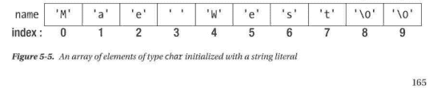

*图 5-5. 用字符串字面量初始化的 char 类型元素数组*

当你用字符串字面量初始化数组时，可以让编译器设置数组的大小：

```cpp
char name[] {"Mae West"};
```

这一次，数组将有九个元素：八个用于存储字符串中的字符，再加上一个额外元素用于存储字符串终止字符。当然，你本可以在声明 vowels 数组时使用这种方法：

```cpp
char vowels[] {"aeiou"};      // An array with six elements
```

这与之前没有显式数组维度的 vowels 定义有显著区别。这里你用字符串字面量初始化数组。字符串字面量会隐式地在末尾附加 '\0' 以标记字符串结尾，因此 vowels 数组将包含六个元素。用较早的定义创建的数组将只有五个元素，并且不能用作字符串。

你可以仅使用数组名来输出存储在数组中的字符串。例如，name 数组中的字符串可以用以下语句写入 cout：

```cpp
std::cout << name << std::endl;
```

这将显示整个字符串，直到 '\0' 为止。末尾必须有一个 '\0'。如果没有，标准输出流将继续从连续的内存位置输出字符，这些位置几乎肯定包含垃圾数据，直到碰巧出现空字符或发生非法内存访问。

> **注意** 你不能仅使用数组名来输出数值类型数组的内容。这仅适用于 char 数组。而且，即使传递给输出流的 char 数组也必须以空字符结尾，否则程序很可能会崩溃。

这个示例分析一个 char 类型元素的数组，以计算出其中使用了多少个元音和辅音：

```cpp
// Ex5_10.cpp
// Classifying the letters in a C-style string
import <iostream>;
#include <cctype>

int main()
{
  const int max_length {100};   // Array size
  char text[max_length] {};     // Array to hold input string

  std::cout << "Enter a line of text:" << std::endl;

  // Read a line of characters including spaces
  std::cin.getline(text, max_length);
  std::cout << "You entered:\n" << text << std::endl;

  size_t vowels {};            // Count of vowels
  size_t consonants {};        // Count of consonants
```

这将允许输入多行文本，因为按 Enter 产生的 `\n` 将不再终止输入操作。当然，你在读取操作中可以输入的字符总数仍然受 `max_length` 限制。

只是为了展示你能做什么，程序仅使用数组名 `text` 输出输入的字符串。然后，在 `for` 循环中以直接的方式分析该文本字符串。当当前索引 `i` 处的字符为空字符时，循环中的第二个控制表达式将为假，因此循环在到达空字符时结束。

接下来，要计算元音和辅音的数量，你只需要检查字母字符，`if` 语句会选择它们；`isalpha()` 仅对字母字符返回 true。因此，switch 语句仅对字母执行。将 switch 表达式转换为小写，可以避免同时为大小写字母编写 case。任何元音都会选择第一个 case，而任何不是元音的内容都会选择 default case，当然那一定是辅音。

顺便说一下，因为空字符 `\0` 是唯一转换为布尔假值的字符（类似于整数值的 0），你也可以像这样编写 Ex5_10 中的 `for` 循环：

```cpp
for (int i {}; text[i]; i++)
{
    ...
}
```

## 多维数组

到目前为止，所有数组都需要一个索引值来选择元素。这种数组称为 *一维数组*，因为改变一个索引就可以引用所有元素。你也可以定义需要两个或更多索引值来访问元素的数组。这些通常称为 *多维数组*。需要两个索引值来引用元素的数组称为 *二维数组*。需要三个索引值的数组是 *三维数组*，以此类推，可以有你想处理的任意多个维度。

假设你是一位热情的园丁，想记录你在小菜园里种出的胡萝卜的重量。为了存储每根胡萝卜的重量，你种了三行、每行四根，可以定义一个二维数组：

```cpp
double carrots[3][4] {};
```

这定义了一个包含三行、每行四个元素的数组，并将所有元素初始化为零。要引用数组中的特定元素，你需要两个索引值。第一个索引指定行，从 0 到 2；第二个索引指定该行中的某根胡萝卜，从 0 到 3。要存储第二行中第三根胡萝卜的重量，你可以这样写：

```cpp
carrots[1][2] = 1.5;
```

图 5-6 显示了该数组在内存中的排列方式。各行连续存储在内存中。如你所见，二维数组实际上是一个包含三个元素的一维数组，其中每个元素都是一个包含四个元素的一维数组。你有一个包含三个数组的数组，每个数组都有四个 double 类型元素。图 5-6 还表明，你可以使用数组名加上方括号中的一个索引值来引用整行。


数组名本身引用整个数组。请注意，对于这个数组，使用这种写法无法显示一行或整个数组的内容。下面是一个示例：

```cpp
std::cout << carrots << std::endl;    // Not what you may expect!
```

这条语句将输出一个十六进制值，它恰好是该数组第一个元素在内存中的地址。我们将在下一章讨论指针时说明为什么会这样。正如你之前看到的，`char` 类型的数组略有不同。

要显示整个数组，每行显示一行，你必须编写类似下面的代码：

```cpp
for (size_t i {}; i < std::size(carrots); ++i)       // Iterate over rows
{
    for (size_t j {}; j < std::size(carrots[i]); ++j) // Iterate over elements in row i
    {
        std::cout << std::format("{:7.3}", carrots[i][j]);
    }
    std::cout << std::endl;
}
```

> **注意** 这里也可以使用基于范围的 `for` 循环。不过，要把外层循环写成基于范围的 `for`，你需要先学习引用。你将在下一章学习这部分内容。

定义三维数组只是再加一组方括号。你可能想记录一年 52 周中每周 7 天每天三个温度。你可以用下面的声明来声明以下数组来存储这类数据：

```cpp
int temperatures[52][7][3] {};
```

该数组每一行存储三个值。一整周的数据有七个这样的行，而一年 52 周共有 52 组这样的数据。这个数组总共将有 1,092 个 `int` 类型的元素。它们都将被初始化为零。要显示第 26 周第 3 天的中间温度，你可以这样写：

```cpp
std::cout << temperatures[25][2][1] << std::endl;
```

记住索引值从 0 开始，因此周从 0 到 51，天从 0 到 6，一天中的样本从 0 到 2。

## 初始化多维数组

你已经看到，空的带花括号初始化器会将任意维数的数组初始化为零。当你想要非零初始值时，情况会稍微复杂一些。为多维数组指定初始值的方式源自这样一种概念：二维数组是一维数组的数组。一维数组的初始值写在花括号之间并用逗号分隔。据此，你可以用下面的语句声明并初始化二维 `carrots` 数组：

如果你没有包含足够的花括号来初始化数组中的所有行，那么没有用花括号括起初始值的行中的元素都将被设为 0。如果你在花括号初始化器中包含多个初始值，但省略了为各行括起值的嵌套花括号，那么这些值将按照它们在内存中的存储顺序依次赋给元素——最右边的索引变化最快。例如，假设你这样定义数组：

```cpp
double carrots[3][4] = {1.1, 1.2, 1.3, 1.4, 1.5, 1.6, 1.7};
```

列表中的前四个值将初始化第 0 行中的元素。列表中的后三个值将初始化第 1 行中的前三个元素。其余元素将被初始化为零。

## 默认设置维度

你可以让编译器根据初始化值集合确定任意维数数组的第一维（最左边的一维）的大小。然而，编译器只能确定多维数组中的一个维度，而且必须是第一维。你可以用下面的语句定义二维 `carrots` 数组：

```cpp
double carrots[][4] = {
    {2.5, 3.2},       // First row
    {4.1},            // Second row
    {2.8, 2.3, 0.9}   // Third row
};
```

该数组将和之前一样有三行，因为外层花括号内有三组花括号。如果只有两组，数组就会有两行。内层花括号对的数量决定行数。

你不能让编译器推导除第一维以外的任何维度。在一定程度上，这是合理的。例如，如果你为二维数组提供 12 个初始值，编译器无法知道该数组应该是三行每行四个元素、六行每行两个元素，还是任何总计为 12 个元素的组合。不过，这确实意味着，相当遗憾的是，像下面这样的数组定义也应该导致编译器错误：

```cpp
double carrots[][] = {                 /* Does not compile! */
    {2.5, 3.2, 3.7, 4.1},              // First row
    {4.1, 3.9, 1.6, 3.5},              // Second row
    {2.8, 2.3, 0.9, 1.1}               // Third row
};
```

除第一维外，你始终必须显式指定所有数组维度。下面是定义三维数组的示例：

```cpp
int numbers[][3][4] = {
    {
        { 2,  4,  6,  8},
        { 3,  5,  7,  9},
        { 5,  8, 11, 14}
    },
};
```

```cpp
std::cout << "Pick a lucky star! Enter a number between 1 and "
          << std::size(stars) << ": ";
std::cin >> choice;

if (choice >= 1 && choice <= std::size(stars))
{
    std::cout << "Your lucky star is " << stars[choice - 1] << std::endl;
}
else
{
    std::cout << "Sorry, you haven't got a lucky star." << std::endl;
}
```

这是该程序的一些典型输出：

```
Pick a lucky star! Enter a number between 1 and 8: 6
Your lucky star is Mae West
```

除了其令人难以置信的固有娱乐价值之外，这个示例中主要值得关注的地方是数组 `stars` 的定义。它是一个 `char` 元素的二维数组，可以保存多个字符串，每个字符串最多可包含 `max_length` 个字符，包括编译器自动添加的终止空字符。该数组的初始化字符串括在花括号之间并用逗号分隔。由于省略了第一个数组维度的大小，编译器会创建具有容纳所有初始化字符串所需行数的数组。正如你之前看到的，只能省略第一维的大小；其他所需维度的大小必须指定。

`if` 语句安排显示输出。它的条件在尝试显示姓名之前检查输入的整数是否在范围内。当需要引用字符串进行输出时，只需指定第一个索引值。单个索引会选择特定的 80 元素子数组，并且由于其中包含字符串，该操作将输出每个元素的内容，直到终止空字符。索引指定为 `choice - 1`，因为选择值从 1 开始，而索引值需要从 0 开始。在使用数组编程时，这是一种相当常见的惯用法。

## 在运行时分配数组

C++ 标准不允许在运行时指定数组维度。也就是说，数组维度必须是可由编译器求值的常量表达式。然而，一些当前的 C++ 编译器确实允许在运行时设置可变数组维度，因为 C 标准允许这样做，而且 C++ 编译器通常也会编译 C 代码。

这些所谓的变长数组可能是一个有用的特性，因此，如果你的编译器支持这一点，我们将通过一个示例展示它如何工作。不过请记住，这并不严格符合 C++ 语言标准。假设你想计算一组人的平均身高，并且希望容纳用户想要输入身高的任意人数。只要用户可以输入要处理的身高数量，你就可以创建一个与将要输入的数据完全匹配的数组，像这样：

```cpp
size_t count {};
std::cout << "How many heights will you enter? ";
std::cin >> count;
int height[count];              // Create the array of count elements
```

高度数组是在代码执行时创建的，它将包含 `count` 个元素。由于数组的大小在编译时是未知的，因此你不能为数组指定任何初始值。下面是一个使用此方法的可行示例：

```cpp
// EX5_12.cpp
// Allocating an array at runtime
import <iostream>;
import <format>;

int main()
{
    size_t count {};
    std::cout << "How many heights will you enter? ";
    std::cin >> count;
    int height[count];              // Create the array of count elements

    // Read the heights
    size_t entered {};
    while (entered < count)
    {
        std::cout << "Enter a height (in inches): ";
        std::cin >> height[entered];
        if (height[entered] > 0)    // Make sure value is positive
        {
            ++entered;
        }
        else
        {
            std::cout << "A height must be positive - try again.\n";
        }
    }

    // Calculate the sum of the heights
    unsigned int total {};
    for (size_t i {}; i < count; ++i)
    {
        total += height[i];
    }
    std::cout << std::format("The average height is {:.1f}\n",
                             static_cast<float>(total) / count);

}
```

下面是一些示例输出：

```text
How many heights will you enter? 6
Enter a height: 47
Enter a height: 55
Enter a height: 0
A height must be positive - try again.
Enter a height: 60
Enter a height: 78
Enter a height: 68
Enter a height: 56
The average height is 60.7
```

`height` 数组是使用为 `count` 输入的值分配的。身高值在 `while` 循环中被读入数组。在循环内部，`if` 语句检查输入的值是否为正数。如果是，则递增 `entered` 变量（该变量记录到目前为止已输入值的数量）。当值为零或负数时，会输出一条消息，然后执行下一次迭代，但不会递增 `entered`。这样，新的输入尝试将被读入 `height` 的当前元素，从而覆盖上一次迭代读取的值。一个直接的 `for` 循环将所有身高累加为 `total`，然后用它输出平均身高。你也可以在这里使用基于范围的 `for` 循环：

```cpp
for (auto h : height)
{
    total += h;
}
```

或者，你可以在 `while` 循环中直接累加身高的总和，完全去掉 `for` 循环。这将显著缩短程序。`while` 循环将变成这样（此变体也可在 Ex5_12A 中找到）：

```cpp
unsigned int total {};
size_t entered {};
while (entered < count)
{
    std::cout << "Enter a height (in inches): ";
    std::cin >> height[entered];
    if (height[entered] > 0)        // Make sure value is positive
    {
        total += height[entered++];
    }
    else
    {
        std::cout << "A height must be positive - try again.\n";
    }
}
```

将最新元素值加到 `total` 时，在 `height` 数组的索引表达式中使用后缀递增运算符，可以确保在 `entered` 递增并用于下一次循环迭代之前，先使用其当前值来访问数组元素。

> **注意** 如果你的编译器不允许变长数组，你可以使用 `vector` 获得相同的结果——甚至更多功能，我们稍后将讨论 `vector`。

## 使用数组的替代方案

标准库定义了丰富的数据结构集合，称为容器，它们提供了多种组织和访问数据的方式。你将在第 20 章中详细了解这些不同的容器。不过，在本节中，我们将简要介绍两个最基本的容器：`std::array<>` 和 `std::vector<>`。它们直接替代了 C++ 语言内置的普通数组，但使用起来更简单、更安全，并且比更底层的内置数组提供了显著更高的灵活性。我们这里的讨论不会面面俱到；只是足以让你把它们当作目前见过的内置数组来使用。更多信息将在第 20 章中介绍。

与所有容器一样，`std::array<>` 和 `std::vector<>` 被定义为类模板——这是你还不熟悉的两个 C++ 概念。你将从第 12 章开始全面学习类，并在第 10 章和第 17 章全面学习模板。尽管如此，我们还是倾向于在这里介绍这些容器，因为它们非常重要，而且这样我们可以在接下来章节的示例和练习中使用它们。此外，只要给出清晰的初步解释和一些示例，我们相信你一定能够成功地使用这些容器。毕竟，这些容器是专门设计为与内置数组行为类似，因此可以作为内置数组近乎直接的替代品。

编译器使用 `std::array<T,N>` 和 `std::vector<T>` 模板，根据你为模板参数 T 和 N 指定的内容来创建一个具体类型。例如，如果你定义一个类型为 `std::vector<int>` 的变量，编译器将生成一个专门用于保存和操作 `int` 值数组的 `vector<>` 容器类。模板的强大之处在于可以使用任何类型 T。在文中泛指它们时，我们通常会省略命名空间 `std` 以及类型参数 T 和 N，例如写作 `array<>` 和 `vector<>`。

### 使用 `array<T,N>` 容器

`array<T,N>` 模板定义在 `<array>` 模块中，因此你必须在源文件中导入它才能使用该容器类型。`array<T,N>` 容器是 N 个 T 类型元素的固定序列，因此它与普通数组类似，只是类型和大小的指定方式略有不同。下面是如何创建一个包含 100 个 `double` 类型元素的 `array<>`：

```cpp
std::array<double, 100> values;
```

这会创建一个包含 100 个 `double` 类型元素的对象。参数 N 的规范必须是常量表达式——就像普通数组的声明一样。事实上，在大多数情况下，`std::array<double, 100>` 类型的变量与如下声明的普通数组变量的行为完全相同：

```cpp
double values[100];
```

如果你创建 `array<>` 容器时没有指定初始值，它同样会包含垃圾值——就像普通数组一样。大多数标准库类型（包括 `vector<>` 和所有其他容器）总是会初始化其元素，通常初始化为零。但 `array<>` 是特殊的，因为它的设计目的就是尽可能模仿内置数组。当然，你也可以在定义时初始化 `array<>` 的元素，就像普通数组一样：

```cpp
std::array<double, 100> values {0.5, 1.0, 1.5, 2.0};  // 5th and subsequent elements are 0.0
```

初始化列表中的四个值用于初始化前四个元素；后续元素将为零。如果你希望所有值都初始化为零，可以使用空的花括号：

```cpp
std::array<double, 100> values {};  // Zero-initialize all 100 elements
```

### 对 `array<>` 的整体操作

只要容器大小相同且存储相同类型的元素，你就可以使用任何比较运算符来比较整个 `array<>` 容器。下面是一个示例：

```cpp
std::array these {1.0, 2.0, 3.0, 4.0};    // Deduced type: std::array<double, 4>
std::array those {1.0, 2.0, 3.0, 4.0};
std::array them  {1.0, 1.0, 5.0, 5.0};

if (these == those)  std::cout << "these and those are equal." << std::endl;
if (these != them)    std::cout << "those and them are not equal." << std::endl;
if (these > them)     std::cout << "these are greater than them." << std::endl;
if (them < these)     std::cout << "them are less than those." << std::endl;
```

容器是逐元素进行比较的。对于 `==` 要获得真值，所有对应的元素对都必须相等。对于不等比较，只要至少有一对对应元素不同，结果即为真。对于所有其他比较，第一对不同的元素将决定比较结果。这基本上就是字典中单词的排序方式，其中两个单词中第一对不同的对应字母决定了它们的顺序。上述代码片段中的所有比较都为真，因此执行时四条消息都会被输出。

```cpp
double these[] {1.0, 2.0, 3.0, 4.0};    // Deduced type: double[4]
double those[] {1.0, 2.0, 3.0, 4.0};
double them[]  {1.0, 1.0, 5.0, 5.0};

if (these == those)  std::cout << "these and those are equal." << std::endl;
if (these != them)    std::cout << "those and them are not equal." << std::endl;
if (these > them)     std::cout << "these are greater than them." << std::endl;
if (them < these)     std::cout << "them are less than those." << std::endl;
```

这段代码仍然可以编译（至少很可能可以编译：请参见下面的注释）。这看起来很有希望。然而，在我们的测试系统上运行这段代码却产生了以下令人失望的结果：

```text
those and them are not equal.
```

尽管 `those` 和 `them` 确实不相等，但我们原本希望像之前一样看到所有四条消息。你可以通过运行 Ex5_13.cpp 亲自尝试。结果会因你使用的编译器不同而有所差异，但你不太可能看到所有四条消息都按预期出现。那么这里到底发生了什么？为什么比较普通数组不像预期那样工作？你将在下一章中找到答案。（你看，并不只有漫画和电视节目才懂得使用悬念手法。）现在只需记住，将比较运算符应用于普通数组名称并不是那么有用。

> **注意** 使用 `<`、`>`、`==` 或 `!=` 比较 C 风格数组类型在 C++20 中已被弃用。这意味着目前建议编译器在编写类似我们前面示例的代码时发出警告，并且在未来的某个时间点，此类代码将完全不再被允许。


与标准数组不同，你还可以将一个 `array<>` 容器赋值给另一个 `array<>` 容器，只要它们都存储相同数量且类型相同的元素即可。下面是一个示例：

```cpp
them = those;        // Copy all elements of those to them
```

此外，`array<>` 对象可以存储在其它容器内部。常规数组则不能。例如，下面使用了一个 `vector<>` 容器，它可以保存 `array<>` 对象作为元素，而每个 `array<>` 对象又依次包含三个 `int` 值：

```cpp
std::vector<std::array<int, 3>> triplets;
```

`vector<>` 容器将在下一节讨论。

## 结论与示例

到现在，要点应该已经清楚了：在代码中始终优先选择 `array<>` 容器，而不是标准数组。我们已经给出了很多理由——按我们的统计至少有七条。而且，使用 `array<>` 绝对没有任何劣势。与标准数组相比，使用 `array<>` 容器的性能可以超过数组。（也就是说，除非你使用 `at()` 函数而不是 `array<>` 的 `[]` 运算符——当然，边界检查可能会带来少量运行时开销。）

> **注意**  即使你在代码中使用 `std::array<>` 容器，也仍然完全可以调用那些期望普通数组作为输入的旧式函数。你始终可以使用 `data()` 成员访问封装在 `array<>` 对象内部的内置数组。

下面是一个演示 `array<>` 容器实际用法的示例：

```cpp
// Ex5_14.cpp
// Using array<T,N> to create Body Mass Index (BMI) table
// BMI = weight/(height*height)
// weight in kilograms, height in meters

import <iostream>;
import <format>;
import <array>;        // For array<T,N>

int main()
{
    const unsigned min_wt {100};       // Minimum weight in table (in pounds)
    const unsigned max_wt {250};       // Maximum weight in table (in pounds)
    const unsigned wt_step {10};
    const size_t wt_count {1 + (max_wt - min_wt) / wt_step};

    const unsigned min_ht {48};        // Minimum height in table (inches)
    const unsigned max_ht {84};        // Maximum height in table (inches)
    const unsigned ht_step {2};
    const size_t ht_count {1 + (max_ht - min_ht) / ht_step };

    const double lbs_per_kg {2.2};   // Pounds per kilogram
    const double ins_per_m {39.37};  // Inches per meter
    std::array<unsigned, wt_count> weight_lbs {};
    std::array<unsigned, ht_count> height_ins {};

    // Create weights from 100lbs in steps of 10lbs
    for (unsigned i{0}, w{min_wt}; i < wt_count; w += wt_step, ++i)
    {
        weight_lbs[i] = w;
    }
    // Create heights from 48 inches in steps of 2 inches
    for (unsigned i{0}, h{min_ht}; h <= max_ht; h += ht_step)
    {
        height_ins.at(i++) = h;
    }
    // Output table headings
    std::cout << std::format("{:>8}", '|');
    for (auto & w : weight_lbs)
        std::cout << std::format("{:^6}|", w);
    std::cout << std::endl;

    // Output line below headings
    for (unsigned i{1}; i < wt_count; ++i)
        std::cout << "--------";
    std::cout << std::endl;

    const unsigned inches_per_foot {12};
    for (auto h : height_ins)
    {
        const unsigned feet = h / inches_per_foot;
        const unsigned inches = h % inches_per_foot;
        std::cout << std::format("{:>2}'{:>2}\" |", feet, inches);

        const double h_m = h / ins_per_m;      // Height in meter
        for (auto w : weight_lbs)
        {
            const double w_kg = w / lbs_per_kg; // Weight in kilogram
            const double bmi = w_kg / (h_m * h_m);
            std::cout << std::format("{:2.1f}|", bmi);
        }
        std::cout << std::endl;
    }
    // Output line below table
    for (size_t i {1}; i < wt_count; ++i)
        std::cout << "--------";
    std::cout << "\nBMI from 18.5 to 24.9 is normal" << std::endl;
}
```

我们让你自己运行程序查看输出，因为它会占用相当多的空间。这里定义了两组各四个 `const` 变量，它们与 BMI 表的体重和身高范围有关。体重和身高存储在元素类型为 `unsigned`（`unsigned int` 的缩写）的 `array<>` 容器中，因为所有体重和身高都是整数。这些容器在 `for` 循环中用适当的值进行初始化。初始化 `height_ins` 的第二个循环使用了一种不同的赋值方式，只是为了演示 `at()` 函数。在这个循环中这样做是合适的，因为该循环并不受容器索引限制的控制，所以有可能出现错误，使用超出容器合法范围的索引。如果发生这种情况，程序会终止；而使用方括号引用元素时则不会如此。

接下来的两个 `for` 循环输出表列标题，以及一条将标题与表格其余部分分隔开的线。表格使用嵌套的基于范围的 `for` 循环创建。外层循环遍历身高，并在最左列以英尺和英寸输出身高。内层循环遍历体重，并为当前身高输出一行 BMI 值。

## 使用 std::vector<T> 容器

`vector<T>` 容器是一种序列容器，看起来可能很像 `array<T,N>` 容器，但实际上要强大得多。不需要在编译时预先知道 `vector<>` 将存储多少个元素。事实上，甚至不需要在运行时预先知道它将存储多少个元素。也就是说，`vector<>` 的大小可以自动增长，以容纳任意数量的元素。你可以现在添加一些元素，之后再添加更多。你可以删除中间的一些元素，然后再插入一些。使用 `vector<>` 容器，这一切都非常容易。随着你不断添加元素，`vector<>` 会增长；每当需要时，都会自动分配额外的空间。实际上也没有真正的最大元素数量——当然，除了你的进程可用内存量所施加的限制之外——这就是为什么你只需要类型参数 `T`。使用 `vector<>` 时不需要 `N`。使用 `vector<>` 容器需要在源文件中导入 `<vector>` 模块。

下面是一个创建 `vector<>` 容器来存储 `double` 类型值的示例：

```cpp
std::vector<double> values;
```

这通常还没有为元素分配空间，因此当你添加第一个数据项时，需要动态分配内存。你可以使用容器对象的 `push_back()` 函数添加元素。下面是一个示例：

```cpp
values.push_back(3.1415);    // Add an element to the end of the vector
```

`push_back()` 函数会将你作为参数传入的值——在本例中是 3.1415——作为新元素添加到现有元素的末尾。由于这里还没有现有元素，所以它将成为第一个元素，这很可能会第一次触发内存分配。

你可以用预先定义的元素数量来初始化一个 `vector<>`，像这样：

```cpp
std::vector<double> values(20);    // Vector contains 20 double values - all zero
```

与内置数组或 `array<>` 对象不同，`vector<>` 容器总是会初始化其元素。在本例中，我们的容器一开始有 20 个元素，它们都被初始化为零。如果你不喜欢将零作为元素的默认值，可以显式指定另一个值：

```cpp
std::vector<long> numbers(20, 99L);    // Vector contains 20 long values - all 99
```

括号中的第二个参数指定所有元素的初始值，因此全部 20 个元素都将是 `99L`。与你目前见过的大多数其他数组类型不同，指定元素数量的第一个参数——在本例中是 20——不需要是常量表达式。它可以是运行时执行的表达式的结果，也可以是从键盘读取的值。当然，你可以使用 `push_back()` 函数向这个或其他任何 vector 的末尾添加新元素。

创建 `vector<>` 的另一种选择是使用花括号列表来指定初始值：

```cpp
std::vector<int> primes { 2, 3, 5, 7, 11, 13, 17, 19 };
```

`primes` vector 容器将创建为包含八个元素，并使用给定的初始值。如果你用至少一个给定值初始化 `vector<>`，C++17 编译器可以再次推导出模板类型参数，这可能会显得有些令人惊讶。下面有两个可行的示例：

```cpp
std::vector primes { 2, 3, 5, 7, 11, 13, 17, 19 };  // Deduced type: std::vector<int>
std::vector numbers(20, 99L);                         // Deduced type: std::vector<long>
```

**警告**  你可能已经注意到，我们没有使用通常的花括号初始化器语法来初始化 `values` 和 `numbers` 这两个 `vector<>` 对象，而是使用了圆括号：

```cpp
std::vector<double> values(20);     // Vector contains 20 double values - all zero
std::vector<long> numbers(20, 99L);  // Vector contains 20 long values - all 99
```

这是因为在这里使用花括号初始化器会产生显著不同的效果，正如语句旁边的注释所解释的那样：

```cpp
std::vector<double> values{20};     // Vector contains 1 double value: 20
std::vector<long> numbers{20, 99L};  // Vector contains 2 long values: 20 and 99
```

当你使用花括号初始化 `vector<>` 时，编译器总是将其解释为一系列初始值。这是所谓统一初始化语法并不那么统一的少数场合之一。要用给定数量的相同值来初始化 `vector<>`——也就是说，不必一遍又一遍地重复同一个值——你不能使用花括号。如果这样做，编译器会将其解释为包含一个或两个初始值的列表。

你可以使用方括号中的索引为现有元素设置值，或者只是在表达式中使用其当前值。下面是一个示例：

```cpp
values[0] = std::numbers::pi;       // Pi
values[1] = 5.0;                     // Radius of a circle
values[2] = 2.0*values[0]*values[1];  // Circumference of a circle
```

`vector<>` 的索引值从 0 开始，就像标准数组一样。你始终可以使用方括号中的索引引用现有元素，但不能通过这种方式创建新元素。要创建新元素，你需要使用例如 `push_back()` 函数。像这样对 vector 进行索引时，索引值不会被检查，因此你可能意外访问 vector 范围之外的内存，并使用方括号中的索引将值存储到这些位置。`vector<>` 对象同样提供了 `at()` 函数，就像 `array<>` 容器对象一样，因此只要索引有可能超出合法范围，你就可以考虑使用 `at()` 函数来引用元素。


除了 `at()` 函数之外，`array<>` 容器的几乎所有其他优点也直接适用于 `vector<>`：

- 每个 `vector<>` 都知道自己的大小，并有一个 `size()` 成员函数可用于查询。
- 将 `vector<>` 传递给函数很直接（见第 8 章）。
- 每个 `vector<>` 都有便捷函数 `front()` 和 `back()`，便于访问 `vector<>` 的第一个和最后一个元素。
- 可以使用 `<`、`>`、`<=`、`>=`、`==` 和 `!=` 运算符比较两个 `vector<>` 容器。与 `array<>` 不同，这甚至适用于元素数量不同的 vector。其语义与按字母顺序比较不同长度的单词时相同。我们都知道，在字典中 *aardvark* 排在 *zombie* 之前，尽管前者字母更多。同样，*love* 也排在 *loveliness* 之前——无论是在生活中还是在字典里。`vector<>` 容器的比较与此类似。唯一的区别是，元素并不总是字母，而可以是编译器知道如何使用 `<`、`>`、`<=`、`>=`、`==` 和 `!=` 进行比较的任何值。用技术术语来说，这一原则称为 *字典序比较*。
- 将一个 `vector<>` 赋值给另一个 `vector<>` 变量时，会把前者的所有元素复制到后者中，覆盖后者可能原有的任何元素，即使新的 `vector<>` 更短也是如此。如有需要，还会分配额外内存以容纳更多元素。
- `vector<>` 可以存储在其它容器中，因此例如可以创建整数向量的向量。

不过，`vector<>` 没有 `fill()` 成员函数。相反，它提供了 `assign()` 函数，可用于重新初始化 `vector<>` 的内容，很像第一次初始化它时那样：

```cpp
std::vector<long> numbers(20, 99);      // Vector contains 20 long values - all 99
numbers.assign(99, 20L);                // Vector contains 99 long values - all 20
numbers.assign({99L, 20L});             // Vector contains 2 long values - 99 and 20
```

### 删除元素

从 C++20 起，可以使用 `std::erase()` 从 `vector<>` 中删除某个元素的所有出现。与你目前见过的其他 `vector<>` 操作不同，`std::erase()` 是非成员函数。这样调用它：

```cpp
std::vector<int> numbers{ 7, 9, 7, 2, 0, 4 };
std::erase(numbers, 7);  // Erase all occurrences of 7; numbers becomes { 9, 2, 0, 4 }
```

还可以通过调用 vector 对象的 `clear()` 成员函数，一次性移除 `vector<>` 中的所有元素。下面是一个示例：

```cpp
std::vector<int> data(100, 99); // Contains 100 integers initialized to 99
data.clear();              // Remove all elements
```

**注意** `vector<>` 还提供了一个 `empty()` 函数，有时会被错误地调用，试图清空 `vector<>`。但 `empty()` 并不会清空 `vector<>`；`clear()` 才会。`empty()` 函数检查的是给定容器是否为空。也就是说，`empty()` 不会修改容器。相反，当且仅当容器为空时，它的求值结果为布尔值 true。因此，下面这条语句几乎肯定是错误的：

```cpp
data.empty();    // Remove all elements... or so I thought...
```

幸运的是，从 C++20 起，`empty()` 函数的定义方式使得编译器在遇到这样的代码时被鼓励发出警告（可以试一试！）。

可以通过调用 vector 对象的 `pop_back()` 函数来移除最后一个元素。下面是一个示例：

```cpp
std::vector<int> numbers{ 7, 9, 7, 2, 0, 4 };
numbers.pop_back();    // Remove the last element; numbers becomes { 7, 9, 7, 2, 0 }
```

这些远不是使用 `vector<>` 容器的全部内容。例如，我们只展示了如何移除某个元素的所有出现，或移除末尾的元素，而完全可以在任意位置删除任意单个元素。同样，我们只展示了如何在 `vector<>` 的末尾添加元素，而完全可以在任意位置插入元素。诸如此类。你将在第 20 章中进一步学习如何使用 `vector<>` 容器。

### 示例与结论

现在你可以创建一个新版本的 `Ex5_09.cpp`，它只使用当前输入数据所需的内存：

```cpp
// Ex5_15.cpp
// Sorting an array in ascending sequence - using a vector<> container
import <iostream>;
import <format>;
import <vector>;

int main()
{
    std::vector<double> x;    // Stores data to be sorted

    while (true)
    {
        double input {};        // Temporary store for a value
        std::cout << "Enter a non-zero value, or 0 to end: ";
        std::cin >> input;
        if (input == 0)
            break;

        x.push_back(input);
    }

    if (x.empty())
    {
        std::cout << "Nothing to sort..." << std::endl;
        return 0;
    }

    std::cout << "Starting sort." << std::endl;

    while (true)
    {
        bool swapped{ false };    // Becomes true when not all values are in order
        for (size_t i{}; i < x.size() - 1; ++i)
        {
            if (x[i] > x[i + 1])    // Out of order so swap them
            {
                const auto temp = x[i];
                x[i] = x[i + 1];
                x[i + 1] = temp;
                swapped = true;
            }
        }

        if (!swapped)    // If there were no swaps
            break;       // ...all values are in order...
                         // ...otherwise, go round again
    }

    std::cout << "Your data in ascending sequence:\n";
    const size_t perline {10};    // Number output per line
    size_t n {};                  // Number on current line
    for (size_t i {}; i < x.size(); ++i)
    {
        std::cout << std::format("{:+8.1f}", x[i]);
        if (++n == perline)    // When perline have been written...
        {
            std::cout << std::endl;    // Start a new line and...
            n = 0;                      // ...reset count on this line
        }
    }
    std::cout << std::endl;
}
```

输出将与 Ex5_09.cpp 相同。由于数据现在存储在类型为 `vector<double>` 的容器中，因此不再对更勤快的用户强加 1,000 个元素的上限。内存会按需逐步分配，以容纳输入的任意数据。我们也不再需要跟踪用户输入的值的数量；`vector<>` 已经替我们处理了这一点。

除了这些简化之外，函数内的所有其他代码都与之前相同。这表明你可以像使用常规数组一样使用 `std::vector<>`。但它还带来了额外好处：你不需要使用编译期常量来指定其大小。不过，正如你肯定能理解的那样，这一好处也伴随着很小的代价。幸运的是，这种很小的性能开销很少值得担忧，而且你很快会发现，`std::vector<>` 将成为你最常使用的容器。我们稍后会更详细地讨论这一点，但现在只需遵循这条简单的指导原则：

**提示** 如果你在编译期知道确切的元素数量，请使用 `std::array<>`。否则，请使用 `std::vector<>`。

## 总结

你将在下一章看到容器和循环的更多应用。几乎任何重要的程序都会涉及某种循环。由于循环对编程如此基础，你需要确保很好地掌握本章涵盖的概念。以下是你在本章学到的要点：

- 数组存储给定类型的固定数量的值。
- 使用方括号之间的索引值访问一维数组中的元素。索引值从 0 开始，因此在一维数组中，索引是从第一个元素开始的偏移量。
- 数组可以有多个维度。每个维度都需要一个单独的索引值来引用元素。访问二维或更高维数组中的元素时，每个数组维度都需要一个方括号中的索引。
- 循环是重复执行一组语句的机制。
- 可以使用四种循环：while 循环、do-while 循环、for 循环和基于范围的 for 循环。
- 只要指定条件为 true，while 循环就会重复执行。
- do-while 循环至少执行一次迭代，并且只要指定条件为 true 就会继续执行。
- for 循环通常用于重复给定次数，并具有三个控制表达式。第一个是初始化表达式，在循环开始时执行一次。第二个是循环条件，在每次迭代之前执行，必须求值为 true 循环才能继续。第三个在每次迭代结束时执行，通常用于递增循环计数器。
- 基于范围的 for 循环会遍历一个范围中的所有元素。数组是元素的范围，字符串是字符的范围。array 和 vector 容器定义了范围，因此你可以使用基于范围的 for 循环遍历它们包含的元素。
- 任何一种循环都可以嵌套在另一种循环中，且嵌套深度不限。
- 在循环中执行 continue 语句会跳过当前迭代的剩余部分，并直接进入下一次迭代，前提是循环控制条件允许。
- 在循环中执行 break 语句会立即退出循环。


$9.95。因为你还不了解如何创建复合类型，只需使用三个不同的类数组序列来表示这些记录。程序应将每个产品输出到单独一行，并包含总成本。最后一行应输出所有产品的总成本。各列应对齐，因此输出应类似如下：

| 产品 | 数量 | 单价 | 成本 |
|---|---|---|---|
| 1001 | 25 | $9.95 | $248.75 |
| 1003 | 10 | $15.50 | $155.00 |
| | | | $403.75 |

练习 5-8。著名的斐波那契数列是一个整数序列，前两个值为 1，后续每个值都是前两个值之和。因此，它从 1、1、2、3、5、8、13 等开始。这不仅仅是数学上的好奇。例如，这个序列也经常出现在生物情境中。它与贝壳呈螺旋生长的方式有关，而且许多花的花瓣数就是该序列中的一个数。创建一个包含 93 个元素的 array<> 容器。将斐波那契数列的前 93 个数存储到该数组中，然后每行输出一个。你知道为什么我们要让你生成 93 个斐波那契数，而不是比如 100 个吗？

# 第 6 章

# 指针与引用

指针和引用的概念有相似之处，因此我们将它们放在同一章中。指针很重要，因为它们为动态分配内存提供了基础。指针还能以其他方式使程序更有效、更高效。引用和指针都是面向对象编程的基础。

- 什么是指针，以及如何定义指针
- 如何获取变量的地址
- 如何在程序执行期间为新变量创建内存
- 如何释放你动态分配的内存
- 原始动态内存分配的诸多危险，以及你可以使用的更安全的替代方案
- 原始指针与智能指针的区别
- 如何创建和使用智能指针
- 什么是引用，以及它与指针有何不同
- 如何在基于范围的 for 循环中使用引用

## 什么是指针？

程序中的每个变量都位于内存中的某个位置，因此它们都有一个唯一的*地址*，用于标识其存储位置。这些地址取决于程序运行时被加载到内存中的位置，因此可能因每次执行而异。*指针*是一种变量，可以存储另一个变量的地址，即内存中其他位置某块数据的地址。图 6-1 展示了指针如何得名：它“指向”内存中存储其他值的某个位置。

### 十六进制内存地址

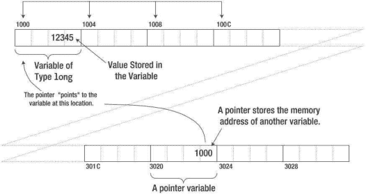

如你所知，整数与浮点值的表示方式不同，而一个数据项占用的字节数取决于它是什么。因此，要使用存储在指针所含地址处的数据项，你需要知道数据的类型。如果指针仅仅是某个任意数据的地址，那它就不会那么有趣。不知道数据类型，指针就没有多大用处。因此，每个指针都指向该地址处某一特定类型的数据项。当我们深入具体细节时，这一点会更清楚，所以让我们看看如何定义指针。指针的定义与普通变量的定义类似，区别在于类型名后面有一个星号，表示它是指针，而不是该类型的变量。下面是如何定义一个名为 pnumber 的指针，它可以存储 long 类型变量的地址：

```cpp
long* pnumber {};        // A pointer to type long
```

pnumber 的类型是“指向 long 的指针”，写作 long*。这个指针只能存储 long 类型变量的地址。试图存储非 long 类型变量的地址将无法编译。由于初始化器为空，该语句将 pnumber 初始化为指针等价的零，这是一个不指向任何内容的特殊地址。这个特殊的指针值写作 nullptr，你也可以将其显式指定为初始值：

```cpp
long* pnumber {nullptr};
```

定义指针时并非必须初始化，但不初始化是鲁莽的。未初始化的指针比未初始化的普通变量更危险。因此：

> **提示** 作为一条规则，定义指针时应始终初始化它。如果还不能给它预期的值，就把指针初始化为 `nullptr`。

用 p 开头的变量名来表示指针相对常见，尽管这种惯例近来已不受欢迎。遵循所谓匈牙利命名法——一种有些过时的变量命名方案——的人认为，这样可以更容易看出程序里哪些变量是指针，进而使代码更容易理解。本书中我们偶尔会使用这种记法，尤其是在将指针与常规变量混用的更人为的示例中。但总的来说，说实话，我们并不认为给变量名添加诸如 p 这样的类型特定前缀有多大价值。在实际代码中，几乎总能从上下文清楚看出某个东西是不是指针。

在前面的示例中，我们把指针类型的星号写在类型名旁边，但这不是唯一的写法。你可以把星号放在变量名旁边，像这样：

```cpp
long *pnumber {};
```

这定义的变量与之前完全相同。编译器接受两种记法。前者也许更常见，因为它更清楚地表达了类型“指向 long 的指针”。

然而，如果在同一条语句中混合定义普通变量和指针，就可能产生混淆。试着猜猜这条语句做什么：

```cpp
long* pnumber {}, number {};
```

这定义了两个变量：一个名为 pnumber，类型为“指向 long 的指针”，用 nullptr 初始化；另一个名为 number，类型为 long——不是指向 long 的指针——用 0L 初始化。number 并不是第二个 long* 类型的变量，这无疑会让你惊讶。你感到惊讶一点也不奇怪；把星号和类型名并置的记法至少可以说并不能清楚表明第二个变量的类型会是什么。如果你用这种形式定义这两个变量，就会稍微清楚一些：

```cpp
long *pnumber {}, number {};
```

这稍微不那么令人困惑，因为星号现在更明显地与变量 pnumber 关联。不过，真正唯一好的解决办法还是从一开始就避免这个问题。最好始终在单独的语句中定义指针和普通变量：

```cpp
long number {};        // Variable of type long
long* pnumber {};      // Variable of type 'pointer to long'
```

现在就不可能有混淆了，而且还有一个额外好处：你可以附加注释来说明这些变量如何使用。
请注意，如果你确实想让 number 成为第二个指针，可以这样写：

```cpp
long *pnumber {}, *number {};  // Define two variables of type 'pointer to long'
```

你可以定义指向任何类型的指针，包括你自己定义的类型。下面是另外几种类型的指针变量定义：

```cpp
double* pvalue {};        // Pointer to a double value
char16_t* char_pointer {};    // Pointer to a 16-bit character
```

不过，无论指针所指数据的类型或大小如何，指针变量本身的大小始终相同。准确地说，对于给定平台，所有指针变量的大小都相同。指针的大小只取决于目标平台的可寻址内存量。要了解你所在平台上的这个大小是多少，可以运行这个小程序：

```cpp
// Ex6_01.cpp
// The size of pointers
import <iostream>;

int main()
{
    // Print out the size (in number of bytes) of some data types
    // and the corresponding pointer types:
    std::cout << sizeof(double) << " = " << sizeof(char16_t) << std::endl;
    std::cout << sizeof(double*) << " = " << sizeof(char16_t*) << std::endl;
}
```

在我们的测试系统上，结果如下：

```
8 = 2
8 = 8
```

对于当今几乎所有平台，指针变量的大小要么是 4 字节，要么是 8 字节（分别对应 32 位和 64 位计算机架构——这两个术语你肯定听说过）。原则上，你也可能遇到其他值，例如当你面向更专门的嵌入式系统时。

## 取地址运算符

*取地址*运算符 & 是一元运算符，用于获取变量的地址。你可以用以下语句定义一个变量 number 和一个指针 pnumber，并用 number 的地址初始化 pnumber：

```cpp
long number {12345L};
long* pnumber {&number};
```

&number 生成 number 的地址，因此 pnumber 的初始值就是这个地址。pnumber 可以存储任何 long 类型变量的地址，所以你可以编写以下赋值：

```cpp
long height {1454L};    // The height of a building
pnumber = &height;    // Store the address of height in pnumber
```

该语句的结果是 pnumber 包含 height 的地址。其效果如图 6-2 所示。


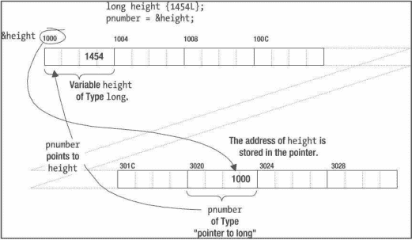

*图 6-2 将地址存储到指针中*

`&` 运算符可以应用于任何类型的变量，但只能将地址存储在恰当类型的指针中。例如，如果要存储 `double` 变量的地址，则指针必须声明为 `double*` 类型，即“指向 double 的指针”。

当然，你也可以使用 `auto` 关键字让编译器为你推导类型：

```cpp
auto pmynumber {&height};  // 推导类型：long*（指向 long 的指针）
```

这里我们建议使用 `auto*`，以便从声明中明确它涉及指针。使用 `auto*` 时，你定义的是一个编译器推导出的指针类型变量：

```cpp
auto* mynumber {&height};
```

使用 `auto*` 声明的变量只能用指针值初始化。如果用任何其他类型的值初始化，将导致编译错误。

获取变量的地址并将其存储在指针中固然不错，但真正有趣的是你如何使用它。访问指针所指向的内存位置中的数据是基础操作，你可以通过间接运算符来完成。

## 间接运算符

对指针应用间接运算符 `*`，可以访问它指向的内存位置的内容。“间接运算符”这一名称源于数据是“间接”访问的。间接运算符通常也称为解引用运算符，而访问指针所指向的内存位置中数据的过程称为解引用指针。要访问该位置的数据……

我们确信你已经意识到，在指针和原始变量之间随意互换使用并不是完成此计算的正确方式。不过，这个示例确实证明了使用解引用后的指针与使用它所指向的变量是等价的。你可以在表达式中像使用原始变量一样使用解引用后的指针，如 `price` 初始值的表达式所示。

同一个符号 `*` 有几种不同用途，这可能会让人困惑。它既是乘法运算符，也是间接运算符，还用于指针的声明。编译器能够根据上下文区分 `*` 的含义。表达式 `*count * *unit_price` 可能看起来有点令人困惑，但编译器能毫无困难地确定它是两个解引用指针的乘积。这个表达式没有其他有意义的解释。如果有，它就无法编译。你总是可以添加括号使代码更易读，比如：`(*count) * (*unit_price)`。

## 为什么要使用指针？

此时通常浮现的一个问题是：“为什么要用指针？”毕竟，获取一个你已经知道的变量的地址，把它放进指针里，以便之后解引用，这看起来像是一种可以省去的额外开销。指针之所以重要，有几个原因：

- 在本章后面，你将学习如何为新的变量动态分配内存——即在程序执行期间进行分配。这允许程序根据输入调整其对内存的使用。你可以在程序执行过程中按需创建新的变量。当你分配新内存时，内存通过其地址来标识，因此你需要一个指针来记录它。
- 你还可以使用指针表示法来操作存储在数组中的数据。这完全等同于常规的数组表示法，因此你可以选择最适合场合的表示法。大多数情况下，正如其名称所示，在操作数组时使用数组表示法更方便，但指针表示法也有其优点。
- 在第 8 章定义自己的函数时，你会看到指针被广泛使用，以使函数能够访问在函数外部定义的大块数据。
- 指针是使*多态*能够工作的基础。多态也许是面向对象编程方法所提供的最重要的能力。你将在第 15 章中学习多态。

> **注意** 本列表中最后两项同样适用于引用——这是 C++ 中的一种语言构造，在许多方面与指针类似。引用将在本章末尾附近讨论。

## 指向 char 类型的指针

“指向 char 的指针”类型变量有一个有趣的特性：它可以被字符串字面量初始化。例如，你可以用下面的语句声明并初始化这样一个指针：

```cpp
char* proverb { "A miss is as good as a mile"};    // 不要这样做！
```

这看起来类似于用字符串字面量初始化 char 数组，事实也确实如此。该语句从引号之间的字符串创建一个以空字符结尾的字符串字面量（实际上是一个 const char 元素组成的数组），并将第一个字符的地址存储在 `proverb` 中。如图 6-3 所示。

```cpp
char* proverb {"A miss is as good as a mile"};
```

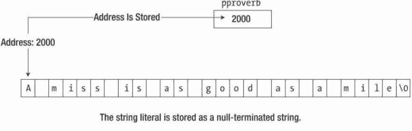

*图 6-3 初始化 char 类型的指针*

遗憾的是，事情并非表面看起来那么简单。字符串字面量是一种 C 风格的 char 数组，你不应该更改它。你之前应该记得，`const` 说明符用于那些不能或一定不能更改的变量的类型。换句话说，字符串字面量中字符的类型是 `const`。但这并没有反映在我们指针的类型中！然而该语句并未创建字符串字面量的可修改副本；它只是存储第一个字符的地址。这意味着如果你试图修改该字符串，将会出现问题。看下面这个语句，它试图将字符串的第一个字符改为 `'X'`：

```cpp
*proverb = 'X';
```

有些编译器不会抱怨，因为它们认为这没有问题。指针 `proverb` 没有声明为 `const`，因此编译器很满意。在其他编译器上，你会收到一条警告，提示存在从 `const char*` 类型到 `char*` 类型的弃用转换。在某些环境中，运行程序时会出错，导致程序崩溃。在其他环境中，该语句不会产生任何效果，这大概也不是所要求或期望的结果。原因在于字符串字面量仍然是常量，不允许更改。

你可能会合理地感到疑惑，为什么编译器一开始会允许你将指向 const 的指针值赋给指向非 const 类型的指针，尤其是在这会导致这些问题的情况下。原因在于字符串字面量是随着第一个 C++ 标准的发布才成为常量的，而且有大量遗留代码依赖于这种“不正确的”赋值。这种用法已被弃用，正确的方法是将指针声明为这样：

```cpp
const char* proverb {"A miss is as good as a mile"};  // 应该这样做！
```

这将 `proverb` 定义为 `const char*` 类型。因为它是指向 const 的类型，现在与字符串字面量的类型一致。任何通过该指针对字面量字符的赋值都会被编译器阻止。关于在指针中使用 `const` 还有更多要说的，我们将在本章后面再讨论。现在，让我们通过一个示例看看 `const char*` 类型的变量是如何使用的。这是“幸运之星”示例 `Ex5_11.cpp` 的一个版本，使用指针而不是数组：

```cpp
// Ex6_03.cpp
// Initializing pointers with strings
import <iostream>;

int main()
{
    const char* pstar1 {"Fatty Arbuckle"};
    const char* pstar2 {"Clara Bow"};
    const char* pstar3 {"Lassie"};
    const char* pstar4 {"Slim Pickens"};
    const char* pstar5 {"Boris Karloff"};
    const char* pstar6 {"Mae West"};
    const char* pstar7 {"Oliver Hardy"};
    const char* pstar8 {"Greta Garbo"};
    const char* pstr {"Your lucky star is "};

    std::cout << "Pick a lucky star! Enter a number between 1 and 8: ";
    size_t choice {};
    std::cin >> choice;

    switch (choice)
    {
    case 1: std::cout << pstr << pstar1 << std::endl; break;
    case 2: std::cout << pstr << pstar2 << std::endl; break;
    case 3: std::cout << pstr << pstar3 << std::endl; break;
    case 4: std::cout << pstr << pstar4 << std::endl; break;
    case 5: std::cout << pstr << pstar5 << std::endl; break;
    case 6: std::cout << pstr << pstar6 << std::endl; break;
    case 7: std::cout << pstr << pstar7 << std::endl; break;
    case 8: std::cout << pstr << pstar8 << std::endl; break;
    default: std::cout << "Sorry, you haven't got a lucky star." << std::endl;
    }
}
```

输出将与 `Ex5_11.cpp` 相同。

显然，最初的数组版本要优雅得多，但让我们暂且忽略这一点。在这个修改后的版本中，数组被八个指针 `pstar1` 到 `pstar8` 取代，每个指针都用字符串字面量初始化。还有一个额外的指针 `pstr`，用正常输出行开头的短语初始化。因为这些指针包含字符串字面量的地址，所以它们被指定为 `const`。

使用 `switch` 语句比使用 `if` 语句更容易选择适当的输出消息。输入的错误值由 `switch` 的 `default` 选项处理。


现在你几乎得到了所有可能世界中最好的结果。你有一个一维指针数组，其定义使得编译器根据初始化字符串的数量计算出数组大小。此语句产生的内存使用情况如图6-4所示。

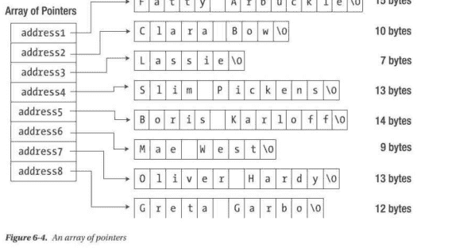

*图6-4. 指针数组*

对于Ex5_11的字符数组，每一行都必须至少达到最长字符串的长度，这导致相当多的字节被浪费。图6-4清楚地表明，通过单独分配所有字符串，这在Ex6_04中不再是问题。诚然，你确实需要一些额外内存来存储字符串的地址，通常每个字符串指针需要4或8字节。而且由于在我们的示例中字符串长度差异还不算大，我们实际上可能还没有获得多少好处（甚至相反）。

然而，一般来说，与字符串本身所需的内存相比，额外指针的成本通常可以忽略不计。即使对于我们的测试程序，这也并非完全不可想象。例如，假设我们要求你将以下名字添加为第九个选项：“Rodolfo Alfonso Raffaello Pierre Filibert Guglielmi di Valentina d'Antonguolla”（我们没有开玩笑，这是无声电影时代一位标志性明星的真实姓名）。

节省空间并不是使用指针获得的唯一优势。在许多情况下，你还可以节省时间。例如，想想如果你要在数组中交换“Greta Garbo”和“Mae West”会发生什么。例如，为了按字母顺序对字符串排序，你需要这样做。使用指针数组，你只需重新排列指针——字符串可以留在原处。使用字符数组，则需要进行大量复制。交换字符串需要将字符串“Greta Garbo”复制到临时位置，然后将“Mae West”复制到其位置。接着你需要将“Greta Garbo”复制到新位置。所有这些都比交换两个指针需要多得多的执行时间。使用指针数组的代码与使用字符数组的代码类似。用于检查输入的选择是否有效的数组元素数量以相同方式计算。

元素类型说明后面的额外`const`关键字将元素定义为常量，因此现在指针及其指向的字符串都被定义为常量。这个数组的任何内容都不能更改。

也许我们从指针数组开始让你觉得有点太复杂了。因为理解不同选项很重要，让我们用一个基本的const char变量再复习一遍，它只指向一位名人。我们考虑这个定义：

```cpp
const char* my_favorite_star{ "Lassie" };
```

这定义了一个指向const char元素的指针。这意味着，例如，编译器不会让你把Lassie改名为Lossie：

```cpp
my_favorite_star[1] = 'o';    // Error: my_favorite_star[1] is const!
```

然而，my_favorite_star的定义并不阻止你改变更喜欢哪位明星的想法。这是因为my_favorite_star变量本身不是const。换句话说，你可以自由覆盖存储在my_favorite_star中的指针值，只要用一个指向const char元素的指针来覆盖它：

```cpp
my_favorite_star = "Mae West";    // my_favorite_star now points to "Mae West"
my_favorite_star = pstars[1];      // my_favorite_star now points to "Clara Bow"
```

如果你想禁止此类赋值，必须添加第二个const来保护my_favorite_star变量的内容：

```cpp
const char* const forever_my_favorite{ "Oliver Hardy" };
```

总结一下，当const应用于指针及其指向的对象时，可以区分三种情况：

- *指向常量的指针：* 不能修改所指向的内容，但可以将指针设置为指向其他对象：

  ```cpp
  const char* pstring {"Some text that cannot be changed"};
  ```

  当然，这也适用于指向其他类型的指针。这里有一个例子：

  ```cpp
  const int value {20};
  const int* pvalue {&value};
  ```

  这里，value是一个常量，不能更改，而pvalue是指向常量的指针，因此你可以用它存储value的地址。你不能将value的地址存储在指向非const int的指针中（因为那将意味着你可以通过指针修改常量），但你可以将非const变量的地址赋给pvalue。在后一种情况下，通过指针修改该变量将变得非法。一般来说，总是可以增强const属性，但不允许削弱它。

- *常量指针：* 存储在指针中的地址不能更改。常量指针只能指向其初始化时所用的地址。但是，该地址的内容不是常量，可以更改。假设你定义一个整型变量和一个常量指针：

  ```cpp
  int data {20};
  int* const pdata {&data};
  ```

  pdata是const，因此它只能指向data。任何使其指向另一个变量的尝试都会导致编译器报错。不过，存储在data中的值不是const，因此你可以更改它：

  ```cpp
  *pdata = 25;        // Allowed, as pdata points to a non-const int
  ```

  同样，如果data被声明为const，你就不能用&data初始化pdata。pdata只能指向int类型的非const变量。

- *指向常量的常量指针：* 这里，存储在指针中的地址和所指向的项都是常量，因此两者都不能更改。举一个数值例子，你可以像这样定义一个名为value的变量：

  ```cpp
  const float value {3.1415f};
  ```

  value是常量，因此不能更改。不过，你仍然可以用value的地址初始化指针：

  ```cpp
  const float* const pvalue {&value};
  ```

  pvalue是指向常量的常量指针。你不能更改它指向的对象，也不能更改存储在该地址的内容。

> **提示**  在一些罕见情况下，会出现需要更复杂类型的需求，例如指向指针的指针。那么一个实用技巧是，你可以从右到左阅读所有类型名称。这样做时，将每个星号读作“指向……的指针”。考虑我们最近变量声明的这个变体——顺便说一句，它同样合法：
>
> ```cpp
> float const* const pvalue {&value};
> ```
>
> 从右向左读就会发现，pvalue确实是一个指向const float的const指针。这个技巧总是有效（即使本章后面引入引用时也是如此）。你可以用本节中的其他定义试一试。唯一的额外复杂之处是，第一个const通常写在元素类型之前。
>
> ```cpp
> const float* const pvalue {&value};
> ```
>
> 因此，从右向左读取类型时，你通常仍需将这个const与元素类型互换位置。不过，这应该不难记住。毕竟，“指向float const的const指针”听起来就是不一样！

## 指针和数组

指针和数组名之间存在密切联系。事实上，在许多情况下，你可以像使用指针一样使用数组名。例如，当数组名用于输出语句时，它本身大多表现得像指针。也就是说，如果你试图仅使用数组名来输出数组，你只会得到数组的十六进制地址——当然，除非它是字符数组，所有标准输出流都假定它表示C风格字符串。因为数组名可以解释为地址，你也可以用它来初始化指针：

```cpp
double values[10];
double* pvalue {values};
```

这会将values数组的地址存储在指针pvalue中。尽管数组名表示一个地址，但它不是指针。你可以修改存储在指针中的地址，而数组名表示的地址是固定的。

### 指针算术

你可以对指针执行算术运算，以更改其包含的地址。修改指针中包含的地址仅限于加法和减法，但你也可以比较指针以产生逻辑结果。你可以将一个整数（或一个求值为整数的表达式）加到指针上，结果是地址。你可以从指针中减去一个整数，结果也是地址。你可以用一个指针减去另一个指针，结果是整数，而不是地址。对指针进行其他算术运算都是非法的。

指针算术以特殊方式工作。假设你用这样的语句给指针加1：

```cpp
++pvalue;
```

这表面上将指针递增1。具体*如何*将指针递增1并不重要。你可以使用赋值或+=运算符获得相同的效果，因此使用以下语句结果将完全相同：

```cpp
pvalue += 1;
```

然而，存储在指针中的地址*不会*按普通算术意义递增1。指针算术隐含地假设指针指向一个数组。将指针递增1意味着将其递增它所指向类型的一个*元素*。编译器知道存储指针所指向数据项所需的字节数。给指针加1会将该地址增加相应字节数。换句话说，给指针加1会递增指针，使其指向数组中的下一个元素。例如，如果pvalue是指向double的指针，而double类型为8字节，那么pvalue中的地址将增加8。如图6-5所示。


```cpp
double values[10];
```

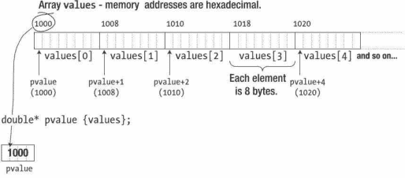

*图 6-5. 递增指针*

如图 6-5 所示，pvalue 一开始包含第一个数组元素的地址。对 pvalue 加 1 会将其包含的地址增加 8，因此结果就是下一个数组元素的地址。由此可见，将指针递增 2 会使指针向后移动两个元素。当然，pvalue 不一定非指向 values 数组的开头。你可以使用以下语句将数组第三个元素的地址存储到指针中：

```cpp
pvalue = &values[2];
```

那么表达式 pvalue + 1 的值将是 values[3] 的地址，即 values 数组的第四个元素，因此你可以使用以下语句让指针指向该元素：

```cpp
pvalue += 1;
```

一般而言，表达式 `pvalue + n`（其中 n 可以是任何结果为整数的表达式）会将 n * sizeof(double) 加到 pvalue 中的地址上，因为 pvalue 的类型是“指向 double 的指针”。从指针中减去一个整数也遵循同样的逻辑。如果 pvalue 包含 values[2] 的地址，则表达式 pvalue - 2 的值是第一个数组元素 values[0] 的地址。换句话说，指针的递增和递减是以所指向对象的类型为单位进行的。将指向 long 的指针递增 1，会将其内容改为下一个 long 的地址，因此地址增加 sizeof(long) 个字节。将其递减 1，地址则减少 sizeof(long) 个字节。

当然，你可以对执行过算术运算的指针进行解引用。（否则，指针算术就没有多大意义了。）例如，考虑以下语句：

```cpp
*(pvalue + 1) = *(pvalue + 2);
```

假设 pvalue 仍然指向 values[3]，则此语句等价于：

```cpp
values[4] = values[5];
```

请记住，像 `pvalue + 1` 这样的表达式并不会改变 pvalue 中的地址。它只是一个求值结果与 pvalue 类型相同的表达式。另一方面，表达式 `++pvalue` 和 `pvalue += n` 确实会改变 pvalue。

当你对递增或递减指针的表达式所得到的地址进行解引用时，表达式周围的括号必不可少，因为间接运算符的优先级高于算术运算符 `+` 和 `-`。表达式 `*pvalue + 1` 将 1 加到 pvalue 所含地址处存储的值上，因此它相当于执行 values[3] + 1。`*pvalue + 1` 的结果是数值，不是地址；如果在之前的赋值语句中使用它，编译器将生成错误消息。

当然，若使用包含无效地址的指针存储值（例如超出了相关数组边界的地址），你实际上是在尝试覆盖该地址处的内存。这通常会导致灾难，使程序以某种方式失败。问题原因可能并不明显，但根源在于指针的误用。

## 指针之间的差值

只有两个指针类型相同且指向同一数组中的元素时，它们相减才有意义。假设你有一个类型为 long 的一维数组 numbers，定义如下：

```cpp
long numbers[] {10, 20, 30, 40, 50, 60, 70, 80};
```

假设你如下定义并初始化两个指针：

```cpp
long *pnum1 {&numbers[6]};       // Points to 7th array element
long *pnum2 {&numbers[1]};       // Points to 2nd array element
```

你可以像这样计算这两个指针的差值：

```cpp
auto difference {pnum1 - pnum2};   // Result is 5
```

difference 变量将被设置为整数值 5，因为两个指针的差值同样以元素个数为单位度量，而不是以字节为单位。不过还有一个问题：difference 的类型会是什么呢？显然，它应该是一个有符号整数类型，才能支持如下语句：

```cpp
auto difference2 {pnum2 - pnum1};   // Result is -5
```

如你所知，pnum1 和 pnum2 这类指针变量的大小与平台相关——通常为 4 或 8 字节。当然，这也意味着存储指针偏移量所需的字节数在所有平台上也不可能相同。因此，C++ 语言规定，两个指针相减的结果类型为 `std::ptrdiff_t`，这是 `<cstddef>` 模块定义的某个有符号整数类型的平台相关别名。因此：

```cpp
std::ptrdiff_t difference2 {pnum2 - pnum1};   // Result is -5
```

取决于目标平台，`std::ptrdiff_t` 通常是 int、long 或 long long 的别名。

## 比较指针

你可以使用熟悉的 `==`、`!=`、`<`、`<=`、`>` 和 `>=` 运算符安全地比较相同类型的指针。这些比较的结果当然符合你对指针和整数运算的直觉。使用与之前相同的变量，表达式 `pnum2 < pnum1` 因此将求值为 true，因为 `pnum2 - pnum1 < 0` 同样成立（pnum2 - pnum1 等于 -5）。换句话说，指针在数组中的位置越靠后，或者所指元素的索引越大，指针值就越大。

## 结合数组名使用指针表示法

你可以将数组名当作指针来使用，以定位数组元素。假设你定义以下数组：

```cpp
long data[5] {};
```

你可以使用指针表示法 `*(data + 3)` 来引用元素 data[3]。这种表示法可以普遍应用：对应于元素 data[0]、data[1]、data[2]……，你可以分别写 `*data`、`*(data + 1)`、`*(data + 2)` 等。数组名本身表示数组起始地址，因此像 `data + 2` 这样的表达式会得到第一个元素之后两个元素的地址。

你可以把指针表示法和数组名配合使用，方式与在方括号中使用索引相同——无论是在表达式中还是在赋值左侧。你可以使用以下循环将 data 数组的元素设置为偶数：

```cpp
for (size_t i {}; i < std::size(data); ++i)
{
  *(data + i) = 2 * (i + 1);
}
```

表达式 `*(data + i)` 引用数组的连续元素。该循环将把五个数组元素的值分别设置为 2、4、6、8 和 10。你可以这样对数组元素求和：

```cpp
long sum {};
for (size_t i {}; i < std::size(data); ++i)
{
  sum += *(data + i);
}
```

让我们在一个更有实际内容的场景中尝试一下这些内容。这个示例计算素数（素数指只能被 1 和自身整除的整数）。代码如下：

```cpp
// Ex6_05.cpp
// Calculating primes using pointer notation
import <iostream>;
import <format>;

int main()
{
  const size_t max {100};    // Number of primes required
  long primes[max] {2L};     // First prime defined
  size_t count {1};          // Count of primes found so far
  long trial {3L};           // Candidate prime

  while (count < max)
  {
      bool isprime {true}; // Indicates when a prime is found

      // Try dividing the candidate by all the primes we have
      for (size_t i {}; i < count && isprime; ++i)
      {
          isprime = trial % *(primes + i) > 0; // False for exact division
      }

      if (isprime)
      {
          *(primes + count++) = trial; // ...so save it in primes array
      }

      trial += 2;                       // Next value for checking
  }

  // Output primes 10 to max
  std::cout << "The first " << max << " primes are:" << std::endl;
  for (size_t i {}; i < max; ++i)
  {
      std::cout << std::setw(7) << *(primes + i);
      if ((i+1) % 10 == 0)             // Newline after every 10th prime
          std::cout << std::endl;
  }
  std::cout << std::endl;
}
```

输出如下：

```
The first 100 primes are:
  2    3    5    7   11   13   17   19   23   29
 31   37   41   43   47   53   59   61   67   71
 73   79   83   89   97  101  103  107  109  113
127  131  137  139  149  151  157  163  167  173
179  181  191  193  197  199  211  223  227  229
233  239  241  251  257  263  269  271  277  281
283  293  307  311  313  317  331  337  347  349
353  359  367  373  379  383  389  397  401  409
419  421  431  433  439  443  449  457  461  463
467  479  487  491  499  503  509  521  523  541
```

常量 max 定义了要生成的素数数量。用于存储结果的 primes 数组已经定义了第一个素数，以便开始这个过程。变量 count 记录已经找到多少个素数，因此初始化为 1。

变量 trial 保存下一个待测试的候选值。它从 3 开始，因为后面的循环会对其递增。bool 变量 isprime 是一个标志，指示 trial 中的当前值是否为素数。


所有工作都在两个循环中完成：外部 `while` 循环选取下一个待检查的候选数，如果是素数则将其添加到 `primes` 数组中；内部循环检查当前候选数是否为素数。外部循环一直持续到 `primes` 数组填满为止。

检查素数的循环中的算法很简单。它基于这样一个事实：任何非素数都必须能被一个更小的素数整除。由于你是按升序查找素数，因此在任何时刻，`primes` 数组都包含所有小于当前候选数的素数。如果 `primes` 数组中的任何值都不是候选数的因子，那么候选数必定是素数。一旦你明白了这一点，编写检查 `trial` 是否为素数的内部循环就直截了当了：

```c
// Try dividing the candidate by all the primes we have
for (size_t i {}; i < count && isprime; ++i)
{
    isprime = trial % *(primes + i) > 0;  // False for exact division
}
```

在每次迭代中，`isprime` 被设置为表达式 `trial % *(primes + i) > 0` 的值。这计算了 `trial` 除以存储在地址 `primes + i` 处的数所得的余数。如果余数为正，则表达式为真。当 `i` 达到 `count` 或 `isprime` 变为 `false` 时，循环结束。如果 `primes` 数组中的任何素数能整除 `trial`，那么 `trial` 就不是素数，因此循环结束。如果没有素数能整除 `trial`，则 `isprime` 始终为 `true`，循环将由 `i` 达到 `count` 而结束。

> **注意** 严格来说，你只需要尝试用小于或等于该数平方根的素数来除，因此这个示例的效率并非最优。

内部循环结束后，无论是由于 `isprime` 被设置为 `false`，还是由于 `primes` 数组中的除数集合已用尽，`trial` 中的值是否为素数都由 `isprime` 的值来指示。这通过一条 `if` 语句进行测试：

```c
if (isprime)
{
    *(primes + count++) = trial;      // We got one...
                                     // ...so save it in primes array
}
```

如果 `isprime` 为 `false`，则说明某次除法是整除，所以 `trial` 不是素数。如果 `isprime` 为 `true`，则赋值语句将 `trial` 的值存储到 `primes[count]` 中，然后使用后缀递增运算符递增 `count`。当找到 `max_primes` 个素数时，外部 `while` 循环结束，并且由于 `for` 循环中的这些语句，素数将以七个字符的字段宽度输出到一行。

## 动态内存分配

到目前为止，你编写的大多数代码都在编译时为数据分配空间。最显著的例外是使用 `std::vector<>` 容器的时候，它会动态分配和释放容纳其元素所需的任何内存。除此之外，你大多在代码中预先指定了所需的所有变量和数组，程序启动时这些内容就会被分配，无论你是否需要整个数组。在程序中使用固定的变量集合会非常受限，而且常常造成浪费。

*动态内存分配*是指在运行时分配存储工作数据所需的内存，而不是在程序编译时预先定义内存大小。随着程序的执行，你可以更改程序专门使用的内存量。根据定义，动态分配的变量不能在编译时定义，因此不能在源程序中命名。当你动态分配内存时，可用空间由其地址标识。存储此地址的显而易见且唯一的位置是指针。借助指针的功能和 C++ 中的动态内存管理工具，在程序中编写这种灵活性既快速又容易。你可以在需要时向应用程序添加内存，然后在用完后释放已获取的内存。因此，专门用于应用程序的内存量可以随着执行的进展而增加和减少。

在第 3 章中，我们介绍了变量可能具有的三种存储期：自动、静态和动态，并讨论了前两种变量是如何创建的。在运行时为其分配内存的变量始终具有*动态*存储期。

### 栈和自由存储区

你知道，自动变量在其定义执行时创建。自动变量的空间在称为*栈*的内存区域中分配。栈的大小是固定的，由编译器决定。通常有一个编译器选项可以让你更改栈大小，尽管很少有必要这样做。在定义自动变量的块结束时，为该变量在栈上分配的内存被释放，从而可以重新使用。当你调用函数时，传递给函数的参数将与函数执行结束时返回位置的地址一起存储在栈上。

未被操作系统或其他当前加载的程序占用的内存称为*自由存储区*。¹ 你可以请求在运行时在自由存储区内为任何类型的新变量分配空间。这通过使用 `new` 运算符来完成，它返回所分配空间的地址，并将该地址存储在指针中。`new` 运算符与 `delete` 运算符互补，后者释放你先前使用 `new` 分配的内存。`new` 和 `delete` 都是关键字，因此你不能将它们用于其他目的。

你可以在程序的一部分为变量在自由存储区中分配空间，然后在程序的另一部分中，当不再需要时释放该空间并将其返回自由存储区。该内存随后可供同一程序稍后的其他动态分配变量或可能同时执行的其他程序重新使用。这非常有效地利用内存，使程序能够处理更大的问题，涉及的数据量可能远远超过其他方式所能处理的。

当你使用 `new` 为变量分配空间时，你在自由存储区中创建了该变量。该变量将一直为你保留，直到其占用的内存被 `delete` 运算符释放。在你使用 `delete` 释放它之前，为你的变量分配的内存块不能再被后续的 `new` 调用使用。请注意，无论你是否仍然记录其地址，内存都会继续保留。如果你不使用 `delete` 释放内存，它将在程序执行结束时自动释放。

¹ 经常用作自由存储区同义词的术语是*堆*。事实上，听到术语*堆*的频率可能比*自由存储区*更高。然而，有些人会争辩说，堆和自由存储区是不同的内存池。在他们看来，C++ 的 `new` 和 `delete` 运算符操作的是自由存储区，而 C 的内存管理函数（如 `malloc` 和 `free`）操作的是堆。虽然我们在这种技术性、术语性争论中不持任何立场，但在本书中我们始终使用术语“自由存储区”，因为这也是 C++ 标准使用的术语。

### 使用 new 和 delete 运算符

假设你需要一个 `double` 类型变量的空间。你可以定义一个 `double*` 类型的指针，然后请求在运行时分配内存。下面是其中一种方法：

```c
double* pvalue {};    // Pointer initialized with nullptr
pvalue = new double;  // Request memory for a double variable
```

这是回顾*所有指针都应被初始化*的好时机。动态内存的使用通常涉及大量指针的存在，确保它们不包含虚假值非常重要。如果指针没有包含合法地址，你应始终确保它包含 `nullptr`。

代码第二行中的 `new` 运算符返回自由存储区中分配给 `double` 变量的内存地址，该地址存储在 `pvalue` 中。如你所见，你可以使用间接运算符通过该指针引用自由存储区中的变量。下面是一个示例：

```c
*pvalue = 3.14;
```

当然，在极端情况下，可能无法分配内存。请求时自由存储区可能已完全分配。更确切地说，可能自由存储区中没有足够大的可用区域来容纳你请求的空间。对于存储单个 `double` 值所需的空间来说，这不太可能发生，但当你处理大型实体（如数组或复杂的类对象）时，这种情况可能会发生。这可能是你稍后需要考虑的事情，但现在你假设总能得到你请求的内存。当这种情况确实发生时，`new` 运算符会抛出一种称为异常的东西，默认情况下该异常将终止程序。我们将在第 16 章讨论异常时回到这个主题。

你可以初始化在自由存储区中创建的变量。让我们重新审视前面的示例：由 `new` 分配的 `double` 变量，其地址存储在 `pvalue` 中。`double` 变量本身的内存槽（通常为 8 字节）仍然保留着之前存在的任何位。一如既往，未初始化的变量包含垃圾值。不过，你可以在创建时将其初始化为例如 3.14，方法如下：

```c
pvalue = new double {3.14};    // Allocate a double and initialize it
```

你还可以在自由存储区中创建并初始化变量，并在创建指针时使用其地址来初始化指针：

```c
double* pvalue {new double {3.14}};  // Pointer initialized with address in the free store
```

这将创建指针 `pvalue`，在自由存储区中为 `double` 变量分配空间，用 3.14 初始化自由存储区中的变量，并用该变量的地址初始化 `pvalue`。

现在你应当不会感到惊讶，下面的语句会将 `pvalue` 指向的 `double` 变量初始化为零（0.0）：

```c
double* pvalue {new double {}};  // Pointer initialized with address in the free store
                                  // pvalue points to a double variable initialized with 0.0
```

不过，请注意这与下面的写法的区别：

```c
double* pvalue {};  // Pointer initialized with nullptr
```


当你不再需要动态分配的变量时，可以使用 delete 运算符释放它占用的内存：

```
    delete pvalue;      // Release memory pointed to by pvalue
```

这确保该内存随后可供另一个变量使用。如果你不使用 delete，并且在 pvalue 中存储了不同的地址，那么将无法释放原始内存，因为对该地址的访问已经丢失。该内存将保留给你的程序使用，直到程序结束。当然，你无法使用它，因为你不再拥有该地址。注意，delete 运算符会释放内存，但不会改变指针。执行上述语句后，pvalue 仍然包含已分配内存的地址，但该内存现在已空闲，可能会立即分配给其他对象。包含这种虚假地址的指针有时称为悬空指针。解引用悬空指针是灾难的绝佳配方，因此你应该养成习惯：在释放指针所指向的内存时，始终重置该指针，如下所示：

```
    delete pvalue;      // Release memory pointed to by pvalue
    pvalue = nullptr;   // Reset the pointer
```

现在 pvalue 不指向任何内容。该指针不能用于访问已释放的内存。使用包含 nullptr 的指针来存储或检索数据将立即终止程序，这比程序带着无效数据以不可预测的方式蹒跚前行要好。

> **提示** 对持有 `nullptr` 值的指针变量应用 `delete` 是完全安全的。该语句根本不会产生任何效果。因此，不需要使用如下所示的 `if` 测试：

```
    if (pvalue)        // No need for this test: 'delete nullptr' is harmless!
    {
        delete pvalue;
        pvalue = nullptr;
    }
```

## 数组的动态分配

在运行时为数组分配内存同样简单。例如，下面为包含 100 个 double 类型值的数组分配空间，并将其地址存储在 data 中：

```
    double* data {new double[100]};        // Allocate 100 double values
```

一如既往，该数组的内存包含未初始化的垃圾值。当然，你可以像处理常规数组一样初始化动态数组的元素：

```
    double* data {new double[100] {}};          // All 100 values are initialized to 0.0
    int* one_two_three {new int[3] {1, 2, 3}};  // 3 integers with a given initial value
    float* fdata{ new float[20] { .1f, .2f }};  // All but the first 2 floats set to 0.0f
```

与常规数组一样，你也可以让编译器从给定的初始化列表推导数组的维度。（在 new 表达式中推导数组大小是 C++20 才成为可能的；在早期 C++ 版本中，下面的语句无效。）

```
int* one_two_three {new int[] {1, 2, 3}};  // 3 integers with a given initial value
```

当你用完数组后，要从自由存储区中移除该数组，可以使用类似于 delete 运算符的运算符，但这一次 delete 后面必须跟 [ ]：

```
delete[] data;    // Release array pointed to by data
```

方括号很重要，因为它们表明你正在删除一个数组。从自由存储区移除数组时，必须包含方括号，否则结果将不可预测。注意，不需要指定任何维度，只需 [ ]。原则上，如果你愿意，也可以在 delete 和 [ ] 之间添加空白：

```
delete [] data;  // Release array pointed to by data
```

当然，既然指针不再指向你拥有的内存，再次重置该指针也是良好实践：

```
data = nullptr;  // Reset the pointer
```

让我们看看动态内存分配在实践中如何工作。与 Ex6_05 一样，这个程序计算素数。关键区别在于，这次素数的数量不是硬编码到程序中。相反，要计算的素数数量，也就是要分配的元素数量，由用户在运行时输入。

```cpp
// Ex6_06.cpp
// Calculating primes using dynamic memory allocation
import <iostream>;
import <format>;
#include <cmath>       // For square root function (std::sqrt())

int main()
{
  size_t max { };       // Number of primes required

  std::cout << "How many primes would you like? ";
  std::cin >> max;       // Read number required

  if (max == 0) return 0;  // Zero primes: do nothing

  auto* primes {new unsigned[max]};  // Allocate memory for max primes

  size_t count {1};        // Count of primes found
  primes[0] = 2;           // Insert first seed prime

  unsigned trial {3};      // Initial candidate prime

while (count < max)
{
    bool isprime {true};    // Indicates when a prime is found

    const auto limit = static_cast<unsigned>(std::sqrt(trial));
    for (size_t i {}; primes[i] <= limit && isprime; ++i)
    {
        isprime = trial % primes[i] > 0;    // False for exact division
    }

    if (isprime)                        // We got one...
        primes[count++] = trial;         // ...so save it in primes array

    trial += 2;                          // Next value for checking
}

// Output primes 10 to a line
for (size_t i {}; i < max; ++i)
{
    std::cout << std::format("{:10}", primes[i]);
    if ((i + 1) % 10 == 0)              // After every 10th prime...
        std::cout << std::endl;          // ...start a new line
}
std::cout << std::endl;

delete[] primes;                         // Free up memory...
primes = nullptr;                        // ...and reset the pointer
```

输出与上一个程序基本相同，因此这里不再重复。总体而言，该程序与上一版本相似但不相同。从键盘读取所需素数数量并将其存储到 max 中后，你使用 new 运算符在自由存储区中分配该大小的数组。new 返回的地址存储在指针 primes 中。这将是包含 max 个 unsigned (int) 类型元素的数组的第一个元素的地址。

与 Ex6_05 不同，此程序中涉及 primes 数组的所有语句和表达式都使用数组表示法。但这只是因为这样更容易；你同样可以使用指针表示法来编写它们：`*primes = 2`、`*(primes + i)`、`*(primes + count++) = trial`，等等。

在分配 primes 数组并插入第一个素数 2 之前，我们验证用户没有输入数字零。如果没有这项安全措施，程序否则会将值 2 写入超出已分配数组边界的内存位置，这将产生未定义的、可能灾难性的结果。

还要注意，与 Ex6_05.cpp 相比，判断候选数是否为素数的过程得到了改进。当尝试用不超过候选数平方根的素数去除 trial 中的候选数时就会停止，因此找到素数会更快。`<cmath>` 头文件中的 sqrt() 函数实现了这一点。

当所需数量的素数输出完毕后，你使用 delete[] 运算符从自由存储区中移除该数组，不要忘记包含方括号以表明你正在删除一个数组。下一条语句重置指针。在这里这不是必需的，但养成在释放指针所指向的内存后始终重置指针的习惯是好的；因为以后你可能会向程序中添加代码。

当然，如果你使用第 5 章学到的 `vector<>` 容器来存储素数，就可以忘记元素的内存分配以及用完后删除它们；这一切都由容器处理。因此，在实践中，你几乎应该总是使用 `std::vector<>` 来为你管理动态内存。事实上，本书中关于动态内存分配的示例和练习，可能应该是你仍然直接管理动态内存的最后场合之一。但我们跑得太快了：我们将在本章后面详细讨论低级动态内存分配的风险、缺点和替代方案！

## 多维数组

在上一章中，你学习了如何创建具有多个静态维度的数组。我们使用的示例是这个 3 × 4 的多维数组，用于保存你在花园中种植的胡萝卜的重量：

```
double carrots[3][4] {};
```

当然，作为一个内心和灵魂都热爱园艺的人，你每年都种胡萝卜，但数量或三行四列的配置并不总是相同。由于每个新播种季节都要从源代码重新编译实在太麻烦，让我们看看如何以动态方式分配多维数组。一个自然的尝试是写成这样：

```
size_t rows {}, columns {};
std::cout << "How many rows and columns of carrots this year?" << std::endl;
std::cin >> rows >> columns;
auto carrots{ new rows[columns] {} };  // Won't work!
...
delete[] carrots;  // Or delete[][]? No such operator exists!
```

唉！标准 C++ 不支持具有多个动态维度的多维数组，至少不是作为内置语言特性。使用内置 C++ 类型，你最多只能做到第一维的值是动态的数组。如果你乐意总是以四列来种植胡萝卜，C++ 确实允许你这样写：

```
size_t rows {};
std::cout << "How many rows, each of four carrots, this year?" << std::endl;
std::cin >> rows;
double (*carrots)[4]{ new double[rows][4] {} };
delete[] carrots;
```

不过，所需的语法简直可怕——`*carrots` 周围的括号是必需的——以至于大多数程序员都不熟悉这种写法。但至少这是可能的。好消息是，从 C++11 起，你当然也可以使用 `auto` 关键字完全避免这种语法：

```
auto carrots{ new double[rows][4] {} };
```

稍加努力，使用常规的一维动态数组来模拟完全动态的二维数组实际上也并不太难。毕竟，二维数组如果不是行的数组，又是什么呢？对于我们的园艺示例，一种方式可以写成如下：

```cpp
double** carrots{ new double*[rows] {} };
for (size_t i = 0; i < rows; ++i)
    carrots[i] = new double[columns] {};
...
for (size_t i = 0; i < rows; ++i)
    delete[] carrots[i];
delete[] carrots;
```

carrots 数组是一个 double* 指针的动态数组，每个指针依次包含一个 double 值数组的地址。后者这些数组表示多维数组的行，也由第一个 for 循环逐个在自由存储区中分配。使用完该数组后，必须使用第二个循环再次逐行释放这些行，然后才能释放 carrots 数组本身。

考虑到建立这样一个多维数组以及再次拆除它需要大量样板代码，强烈建议将此类功能封装在一个可复用的类中。在后续章节中学习完有关创建自己的类类型的全部内容后，我们将把它留给你作为练习。

> **提示** 我们在这里介绍的用于表示动态多维数组的朴素技术并不是最高效的。它在自由存储区中分别分配所有行，这意味着它们在内存中很可能不再连续。程序在操作连续内存时往往运行得快得多。这就是为什么封装多维数组的类通常只分配一个包含 rows * columns 个元素的单一数组，然后使用公式 i * columns + j 将第 i 行和第 j 列的数组访问映射到单个索引。

## 通过指针选择成员

指针可以存储类类型对象的地址，例如 vector<T> 容器。对象通常具有操作该对象的成员函数——例如，你已经看到 vector<T> 容器有一个用于访问元素的 at() 函数和一个用于添加元素的 push_back() 函数。假设 pdata 是一个指向 vector<> 容器的指针。这个容器可以通过如下语句在自由存储区中分配：

```cpp
auto* pdata { new std::vector<int>{} };
```

但它也完全可能是使用取地址运算符获得的局部对象的地址。

```cpp
std::vector<int> data;
auto* pdata = &data;
```

在两种情况下，编译器都会将 pdata 的类型推导为 vector<int>*，即“指向 int 元素 vector 的指针”。对于接下来的内容，vector<int> 是在自由存储区中创建，还是作为局部对象在栈上创建，并不重要。要添加元素，需调用 vector<int> 对象的 push_back() 函数，你已经看到如何在表示 vector 的变量和成员函数名之间使用句点。要使用指针访问 vector 对象，可以使用解引用运算符，因此添加元素的语句如下所示：

```cpp
(*pdata).push_back(66);        // Add an element containing 66
```

\*pdata 两边的括号对于该语句能够编译至关重要，因为 . 运算符的优先级高于 \* 运算符。在使用对象时，这种看起来笨拙的表达式会非常频繁地出现，这就是为什么 C++ 提供了一个运算符，把“解引用指向对象的指针”和“选择该对象的成员”组合在一起。可以将前面的语句写成这样：

```cpp
pdata->push_back(66);       // Add an element containing 66
```

-> 运算符由减号和大于号字符组成，被称为 *箭头运算符* 或 *间接成员选择运算符*。箭头运算符更能表达这里发生的情况。你将在本书后面广泛使用此运算符。

## 动态内存分配的危害

使用 new 动态分配内存时，你可能会遇到许多种严重问题。本节将列出最常见的问题。不幸的是，这些危害都非常真实，任何使用过 new 和 delete 的开发者都会证实这一点。作为一名 C++ 开发者，你所处理的较严重 bug 中有相当一部分往往归根结底是动态内存管理不当。

因此，在本节中，我们将为你描绘一幅看似非常黯淡的图景，其中充满动态内存的各种危害。但不要绝望。我们很快就会向你展示走出这片危险雷区的方法！就在本节之后，我们将列出经过验证的惯用法和实用工具，它们实际上能让你轻松避免这些问题中的大部分（如果不是全部的话）。事实上，你已经知道一个这样的工具：std::vector<> 容器。与直接使用 new[] 分配动态内存相比，这个容器几乎总是更好的选择。标准库中用于更好地管理动态内存的其他设施将在后续章节中讨论。但首先，让我们仔细思考与动态内存相关的所有这些“可爱”的风险、危害、陷阱以及其他类似隐患。

### 悬空指针和多次释放

如你所知，*悬空指针* 是一个仍然包含指向自由存储区内存地址的指针变量，而该内存已经被 *delete* 或 *delete[]* 释放。解引用悬空指针会使你读取或（通常更糟）写入可能已经分配给你程序其他部分并正在使用的内存，从而导致各种不可预测和意外的结果。*多次释放* 是指使用 *delete* 或 *delete[]* 第二次释放一个已经释放（因而悬空）的指针，这是另一种灾难的根源。

我们已经教过你一种基本策略来防止悬空指针，即，在指针所指向的内存被释放后，始终将指针重置为 nullptr。然而，在更复杂的程序中，代码的不同部分通常通过同一指针的不同副本来协作访问同一内存——一个对象或一个对象数组。在这种情况下，我们简单的策略很快就会失效。代码的哪一部分将调用 delete/delete[]？以及何时调用？也就是说，你如何确保代码的其他部分不再使用同一块动态分配的内存？

### 分配/释放不匹配

使用 new[] 分配的动态数组会被一个普通指针变量保存。使用 new 分配的单个值也是如此：

```cpp
int* single_int{ new int{123} };      // Pointer to a single integer, initialized with 123
int* array_of_ints{ new int[123] };   // Pointer to an array of 123 uninitialized integers
```

在此之后，编译器无法区分二者，尤其是当这样的指针在程序的不同部分之间传递时。这意味着以下两条语句将编译无错误（在许多情况下甚至没有警告）：

```cpp
delete[] single_int;    // wrong!
delete array_of_ints;   // wrong!
```

如果你将分配和释放运算符不匹配使用，会发生什么完全取决于与你的编译器相关的实现。但不会是什么好事。

> **警告** 每个 new 都必须与一个 delete 配对；每个 new[] 都必须与一个 delete[] 配对。任何其他事件顺序都会导致未定义行为或内存泄漏（接下来讨论）。

### 内存泄漏

当你使用 new 或 new[] 分配内存但未能释放它时，就会发生内存泄漏。如果你丢失了已分配的自由存储区内存的地址——例如，覆盖了你用来访问它的指针中的地址——那么你就发生了内存泄漏。这种情况经常发生在循环中，而且造成这类问题比你想象的更容易。其影响是程序逐渐消耗越来越多的自由存储区，程序可能越来越慢，甚至在所有自由存储区都被分配完时失败。

就作用域而言，指针与其他任何变量一样。指针的生存期从你在块中定义它的位置开始，到该块的右花括号结束。之后它不再存在，因此它包含的地址不再可访问。如果包含自由存储区中某块内存地址的指针离开了作用域，那么就不可能再释放该内存。

当内存的使用在接近分配它的位置处停止时，你仍然相对容易看出自己只是忘了使用 delete 来释放内存，但你会惊讶于程序员如此频繁地犯这种错误，尤其是例如 return 语句悄悄出现在变量的分配和释放之间时。而且，自然，在复杂程序中内存泄漏甚至更难发现，因为内存可能在一个程序部分中分配，而应在完全独立的另一部分中释放。

避免内存泄漏的一种基本策略是，每次使用 new 运算符时，立即在适当位置添加 delete 操作。但这一策略绝非万无一失。我们怎么强调都不为过：人类，即便是 C++ 程序员，也是容易犯错的生物。因此，每当你直接操作动态内存时，迟早都会引入内存泄漏。即使它在编写时能够工作，随着程序进一步发展，return 语句被添加、条件测试改变、异常被抛出（见第 16 章）等等，bug 也常常会潜入程序。突然之间就会出现内存不再被正确释放的场景！

### 自由存储区的碎片化

内存碎片化可能出现在频繁分配和释放内存块的程序中。每次使用 new 运算符时，它都会分配一个连续的字节块。如果你创建并销毁许多不同大小的内存块，就可能出现这样的情况：已分配的内存中散布着小的空闲内存块，其中没有一个块大到足以容纳新的内存分配。

由你的程序请求的。空闲内存的总量可能相当大，但如果所有单个块都很小（小于当前分配请求），则分配请求将失败。图 6-6 说明了内存碎片化的影响。

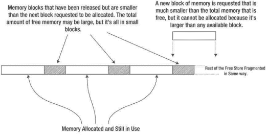

*图 6-6. 自由存储区的碎片化*

我们在这里提到这个问题主要是为了完整性，因为如今它相对较少出现。即使在相当普通的计算机上，虚拟内存也提供了很大的内存地址空间。而且 new/delete 背后的算法很巧妙，其设计目标是尽可能抵消这类现象。如今只有在极少数情况下，你才需要再担心碎片化。例如，对于代码中性能最关键的部分，在碎片化的内存上操作可能会严重降低性能。那么，避免自由存储区碎片化的方法就是不要分配许多小的内存块。分配较大的块，并自己管理内存的使用。但这是一个高级主题，远远超出了本书的范围。

## 动态内存分配的黄金法则

在花了超过六页篇幅学习如何使用 new 和 delete 运算符之后，我们关于动态内存分配的黄金法则可能会让你有点意外。尽管如此，它仍是我们在本书中给你的最有价值的单条建议之一：

> **提示** 在日常编码中绝不要直接使用 new、new[]、delete 和 delete[] 运算符。这些运算符在现代 C++ 代码中没有立足之地。始终使用 std::vector<> 容器（用于替代动态数组）或智能指针（用于动态分配单个对象并管理其生命周期）。这些高层替代方案比低层内存管理原语安全得多，并且能通过从程序中根除悬空指针、多次释放、分配/释放不匹配和内存泄漏，给你带来巨大帮助。

- 一个 weak_ptr<T> 链接到一个 shared_ptr<T>，并包含相同的地址。不过，创建 weak_ptr<> 不会增加与所链接的 shared_ptr<> 对象关联的引用计数，因此 weak_ptr<> 不会阻止其指向的对象被销毁。当最后一个引用它的 shared_ptr<> 被销毁或被重新赋值以指向不同地址时，即使关联的 weak_ptr<> 对象仍然存在，其内存仍将被释放。如果发生这种情况，weak_ptr<> 仍然不会包含悬空指针，至少不会包含你可能无意中访问的悬空指针。原因是你不能直接访问 weak_ptr<> 所封装的地址。相反，编译器会强制你先从中创建一个指向同一地址的 shared_ptr<>。如果 weak_ptr<> 的内存地址仍然有效，强制你先创建一个 shared_ptr<> 可确保引用计数再次递增，并且该指针可以再次安全使用。然而，如果内存已经被释放，此操作将导致 shared_ptr<> 包含 nullptr。

拥有 weak_ptr<> 对象的一个用途是避免与 shared_ptr<> 对象形成所谓的引用循环。从概念上讲，引用循环是指对象 x 内部的 shared_ptr<> 指向另一个对象 y，而 y 包含一个 shared_ptr<>，后者又指回 x。在这种情况下，x 和 y 都无法被销毁。在实践中，这可能以更复杂的方式发生。weak_ptr<> 智能指针允许你打破这种引用循环。弱指针的另一个用途是实现对象缓存。

然而，正如你无疑已经开始感觉到的那样，弱指针只用于更高级的用例。由于它们只是偶尔使用，我们在这里不再进一步讨论它们。不过，另外两种智能指针类型你应该一直使用，所以让我们更深入地探讨它们。

### 使用 unique_ptr<T> 指针

一个 unique_ptr<T> 对象唯一地存储一个地址，因此它所指向的值由 unique_ptr<> 智能指针独占拥有。当 unique_ptr<> 被销毁时，它所指向的值也会被销毁。像所有智能指针一样，unique_ptr<> 在处理动态分配的对象时最为有用。此时，对象不应由程序的多个部分共享，或者动态对象的生命周期自然应与程序中的单个其他对象绑定。unique_ptr<> 的一个常见用途是持有所谓多态指针，本质上是指向动态分配对象的指针，而该对象可以是任意数量的相关类类型。长话短说，只有在第 12 章到第 15 章学习了所有关于类对象和多态性的内容之后，你才会完全体会到这种智能指针类型的价值。

目前，我们的示例只会使用基本类型的动态分配值，这些值在实用性上并不出众。不过，已经显而易见的是，为什么这些智能指针比低层分配和释放原语安全得多；也就是说，它们让你不可能忘记释放或出现释放不匹配！

在（并不那么）久远的日子里，你必须像这样创建并初始化一个 unique_ptr<T> 对象：

```cpp
std::unique_ptr<double> pdata {new double{999.0}};
```

这会创建 pdata，它包含自由存储区中一个 double 变量的地址，该变量初始化为 999.0。虽然这种语法仍然有效，但如今创建 unique_ptr<> 的推荐方式是借助 std::make_unique<>() 函数模板（由 C++14 引入）。因此，要定义 pdata，通常应使用以下写法：

```cpp
std::unique_ptr<double> pdata { std::make_unique<double>(999.0) };
```

`std::make_unique<T>(...)` 的参数正是原本会出现在花括号初始化器中的那些值（即形如 `new T{...}` 的动态分配）。在我们的示例中，就是 double 字面量 `999.0`。为了少打一些字，你很可能想将此语法与 `auto` 关键字结合使用：

```cpp
auto pdata{ std::make_unique<double>(999.0) };
```

这样，你只需键入一次动态变量的类型 double。

**提示** 要创建一个指向新分配的 `T` 值的 `std::unique_ptr<T>` 对象，请始终使用 `std::make_unique<T>()` 函数。

你可以像普通指针一样解引用 pdata，并且可以以相同方式使用结果：

```cpp
*pdata = 8888.0;
std::cout << *pdata << std::endl;    // Outputs 8888
```

最大的区别在于，你不必再担心从存储区中删除这个 double 变量。你可以通过调用智能指针的 `get()` 函数来访问其内部存储的地址。下面是一个示例：

```cpp
std::cout << pdata.get() << std::endl;
```

这会以十六进制值输出 pdata 中所包含地址的值。所有智能指针都有一个 `get()` 函数，它会返回该指针所包含的地址。你只应访问智能指针内部的原始指针，以便将其传递给仅短暂使用该指针的函数，绝不要传递给会复制并保留该指针副本的函数或对象。不建议存储与智能指针指向同一对象的原始指针，因为这可能再次导致悬空指针，以及各种相关问题。

你也可以创建一个指向数组的唯一指针。和之前一样，我们建议你始终为此使用 `std::make_unique<T[]>(n)`：

```cpp
auto pvalues{ std::make_unique<double[]>(n) };    // Dynamically create array of n elements
```

然后，pvalues 指向自由存储区中一个包含 n 个 double 类型元素的数组。像原始指针一样，你可以对智能指针使用数组表示法来访问其指向数组的元素：

```cpp
for (size_t i {}; i < n; ++i)
  pvalues[i] = static_cast<double>(i + 1);
```

这会将数组元素设置为从 1 到 n 的值。`static_cast` 在这里用于消除你可能原本会收到的、关于从 `size_t` 到 `double` 的隐式转换的警告。你可以用类似方式输出元素的值：

```cpp
for (size_t i {}; i < n; ++i)
{
  std::cout << pvalues[i] << ' ';
  if ((i + 1) % 10 == 0)
    std::cout << std::endl;
}
```


这段程序只是输出这些值，每行十个。因此，你可以使用一个包含数组地址的 `unique_ptr<T[]>` 变量，就像使用数组名一样。

**提示** 通常建议使用 `vector<T>` 容器而不是 `unique_ptr<T[]>`，因为这种容器类型比智能指针强大且灵活得多。关于使用 vector 的各种优点，请参阅上一章末尾的讨论。

**注意** 表达式 `std::make_unique<T>()` 创建一个类型为 `T` 且经过值初始化的变量。对于基本类型（如 `int` 和 `double`），这意味着该变量被初始化为零。类似地，`std::make_unique<T[]>(n)` 创建一个包含 `n` 个经过值初始化的 `T` 值的数组。这种初始化并不总是必要的，有时可能影响性能（将内存清零需要时间）。因此在 C++20 中，你可以使用 `std::make_unique_default_init<T>()` 或 `std::make_unique_default_init<T[]>(n)`。这些新的创建函数使用默认初始化而不是值初始化。对于基本类型，默认初始化会产生不确定的、未初始化的值（类似于在栈上定义变量或数组变量但不初始化其值时得到的结果）。

你可以通过调用 `reset()` 函数来重置 `unique_ptr<>` 中包含的指针，或者重置任何类型的智能指针（就此而言）：

```cpp
pvalues.reset();        // Address is nullptr
```

pvalues 仍然存在，但它不再指向任何内容。这是一个 `unique_ptr<double>` 对象，因此由于不可能有其他 unique 指针包含该数组的地址，数组所占的内存将因此被释放。当然，你可以通过将智能指针与 `nullptr` 显式比较来检查它是否包含 `nullptr`，但智能指针也可以像原始指针一样方便地转换为布尔值（也就是说，当且仅当它包含 `nullptr` 时转换为 false）：

```cpp
if (pvalues)                // Short for:  if (pvalues != nullptr)
    std::cout << "The first value is " << pvalues[0] << std::endl;
```

你可以通过使用空花括号 `{}`，或者干脆省略花括号，来创建一个包含 `nullptr` 的智能指针：

```cpp
std::unique_ptr<int> my_number;    // Or:  ... my_number{};
                                    // Or:  ... my_number{ nullptr };
if (!my_number)
    std::cout << "my_number points to nothing yet" << std::endl;
```

创建空智能指针本来没什么用处，除非你始终可以更改智能指针所指向的值。你可以再次使用 `reset()` 来做到这一点：

```cpp
my_number.reset(new int{ 123 });   // my_number points to an integer value 123
my_number.reset(new int{ 42 });    // my_number points to an integer 42
```

因此，不带参数调用 `reset()` 等价于调用 `reset(nullptr)`。对 `unique_ptr<T>` 对象调用 `reset()` 时，无论带不带参数，该智能指针先前拥有的任何内存都会被释放。因此，在前一个代码片段的第二条语句中，包含整数值 123 的内存会被释放，之后智能指针取得保存数字 42 的内存槽的所有权。

除了 `get()` 和 `reset()`，`unique_ptr<>` 对象还有一个名为 `release()` 的成员函数。这个函数本质上用于将智能指针重新变成普通的原始指针。

```cpp
int* raw_number = my_number.release(); // my_number points to nullptr after this
...
delete raw_number;                     // The smart pointer no longer does this for you!
```

不过要小心：调用 `release()` 后，对其应用 `delete` 或 `delete[]` 又成了你的责任。因此，你只应在绝对必要时使用此函数，通常是在将动态分配的内存交给旧代码时。如果这样做，务必绝对确保这段旧代码确实会释放内存——否则，你应该调用的是 `get()`！

**警告** 小心在不捕获返回的原始指针的情况下调用 `release()`。也就是说，下面这种形式的语句很可能表示存在缺陷：

```cpp
pvalues.release();
```

为什么？因为单独执行这条语句当然会造成严重的内存泄漏！你让智能指针不再负责释放内存，但由于你忽略了捕获原始指针，你或其他任何人都无法再对其应用 `delete` 或 `delete[]`。虽然现在这看起来很明显，但你会惊讶地发现，有多少次本意是写 `reset()` 语句，却错误地调用了 `release()`：

```cpp
pvalues.reset();         // Not the same as release()!!!
```

这种混淆无疑源于 `release()` 和 `reset()` 这两个函数名称押头韵，而且两个函数都会将指针的地址设为 `nullptr`。尽管有这些相似之处，当然还是有一个相当关键的区别：`reset()` 会释放 `unique_ptr<>` 先前拥有的任何内存，而 `release()` 不会。

一般来说，`release()` 是一个只应偶尔使用的函数（通常是在与尚未使用智能指针的旧 C++ 代码交互时），并且要非常小心，以免引入内存泄漏。

### 使用 shared_ptr<T> 指针

你可以用与定义 `unique_ptr<T>` 对象类似的方式定义 `shared_ptr<T>` 对象：

```cpp
std::shared_ptr<double> pdata {new double(999.0)};
```

你还可以对它进行解引用，以访问它所指向的内容，或更改存储在该地址处的值：

```cpp
std::cout << *pdata << std::endl;    // Outputs 999
*pdata = 888.0;
std::cout << *pdata << std::endl;    // Outputs 888
```

创建 `shared_ptr<T>` 对象比创建 `unique_ptr<T>` 涉及更复杂的过程，尤其是因为需要维护引用计数。`pdata` 的定义涉及一次为 `double` 变量分配内存，以及另一次与智能指针对象相关的分配。在自由存储区中分配内存很耗时。你可以使用在 `<memory>` 模块中定义的 `std::make_shared<T>()` 函数来创建 `shared_ptr<T>` 类型的智能指针，从而使该过程更高效：

```cpp
auto pdata{ std::make_shared<double>(999.0) };  // Points to a double variable
```

要在自由存储区中创建的变量类型在尖括号之间指定。函数名后圆括号之间的参数用于初始化它创建的 `double` 变量。一般来说，`make_shared()` 函数可以有任意数量的参数，实际数量取决于所创建对象的类型。当你使用 `make_shared()` 在自由存储区中创建对象时，通常会有两个或更多用逗号分隔的参数。`auto` 关键字使 `pdata` 的类型根据 `make_shared<T>()` 返回的对象自动推导出来，因此它将是 `shared_ptr<double>`。

你可以在定义 `shared_ptr<T>` 时用另一个来初始化它：

```cpp
std::shared_ptr<double> pdata2 {pdata};
```

pdata2 与 pdata 指向同一个变量。你也可以将一个 `shared_ptr<T>` 赋值给另一个：

```cpp
std::shared_ptr<double> pdata{ std::make_shared<double>(999.0) };
std::shared_ptr<double> pdata2;          // Pointer contains nullptr
pdata2 = pdata;                          // Copy pointer - both point to the same variable
std::cout << *pdata2 << std::endl;       // Outputs 999
```

当然，复制 pdata 会增加引用计数。两个指针都必须被重置或销毁，`double` 变量占用的内存才会被释放。

虽然我们在上一小节可能没有明确提到，但这些操作对于 `unique_ptr<>` 对象都是不可能的。编译器绝不会允许你创建两个指向同一内存位置的 `unique_ptr<>` 对象。这是有充分理由的——如果允许这样做，两者最终都会释放同一块内存，可能导致灾难性后果。

> **注意** 与 `std::make_unique<>()` 一样，`std::make_shared<>()` 使用值初始化（对基本类型进行零初始化）。大多数情况下这没问题，但在少数情况下，你可能想改用 C++20 的 `std::make_shared_default_init<>()` 来提高性能。

从 C++20 开始，你还可以使用 `make_shared<T[]>()` 创建一个 `shared_ptr<T[]>`，它保存自由存储区中新创建数组的地址，如下所示：

```cpp
auto shared_boole{ std::make_shared<bool[]>(100) };  // A shared array of 100 Booleans
```

- \* `std::make_shared<>()` 通常只分配一个连续的内存块，然后在其中同时存储 `shared_ptr` 的引用计数变量和共享的 `T` 值。这既更快，也更节省内存使用。
- † 除非你通过使用原始指针绕过编译器的安全检查，例如使用 `new` 或 `get()`，否则不会。
- ‡ 混合使用原始指针和智能指针通常不是好主意。
- § `std::shared_ptr<>` 在 C++17 中就已经获得了管理动态数组的能力，但在 C++11 中，你仍然必须使用其构造函数和 `new[]` 运算符来初始化这类指针。


当然，另一种选择是存储你在自由存储区创建的 `array<T>` 或 `vector<T>` 容器对象的地址。下面是一个可运行的示例：

```cpp
// Ex6_07.cpp
// Using smart pointers
import <iostream>;
import <format>;
import <memory>;      // For smart pointers
import <vector>;      // For std::vector<> container
#include <cctype>      // For std::toupper()

int main()
{
  std::vector<std::shared_ptr<std::vector<double>>> records;  // Temperature records by days
  size_t day{ 1 };          // Day number

  while (true)              // Collect temperatures by day
  {
    // Vector to store current day's temperatures created in the free store
    auto day_records{ std::make_shared<std::vector<double>>() };
    records.push_back(day_records);   // Save pointer in records vector

    std::cout << "Enter the temperatures for day " << day++
              << " separated by spaces. Enter 1000 to end:\n";

    while (true)
    { // Get temperatures for current day
      double t{};            // A temperature
      std::cin >> t;
      if (t == 1000.0) break;

      day_records->push_back(t);
    }

    std::cout << "Enter another day's temperatures (Y or N)? ";
    char answer{};
    std::cin >> answer;
    if (std::toupper(answer) != 'Y') break;
  }

  day = 1;

  for (auto record : records)
  {
    double total{};
    size_t count{};

    std::cout << std::format("\nTemperatures for day {}:\n", day++);
    for (auto temp : *record)
    {
      total += temp;
      std::cout << std::format("{:6.2f}", temp);
      if (++count % 5 == 0) std::cout << std::endl;
    }
    std::cout << std::format("\nAverage temperature: {:.2f}", total / count) << std::endl;
  }
}
```

以下是使用任意输入值时的输出结果：

```text
23 34 29 36 1000
Enter another day's temperatures (Y or N)? y
Enter the temperatures for day 2 separated by spaces. Enter 1000 to end:
34 35 45 43 44 40 37 35 1000
Enter another day's temperatures (Y or N)? y
Enter the temperatures for day 3 separated by spaces. Enter 1000 to end:
44 56 57 45 44 32 28 1000
Enter another day's temperatures (Y or N)? n

Temperatures for day 1:
23.00 34.00 29.00 36.00
Average temperature: 30.50

Temperatures for day 2:
34.00 35.00 45.00 43.00 44.00
40.00 37.00 35.00
Average temperature: 39.13

Temperatures for day 3:
44.00 56.00 57.00 45.00 44.00
32.00 28.00
Average temperature: 43.71
```

该程序读取一天中记录的任意数量的温度值，并可处理任意天数。温度记录的累积存储在 `records` 向量中，其元素类型为 `shared_ptr<vector<double>>`。因此，每个元素都是一个指向 `vector<double>` 类型向量的智能指针。

任意天数的温度容器都在外层 while 循环中创建。一天的温度记录存储在一个向量容器中，该容器由以下语句在自由存储区创建：

```cpp
auto day_records{ std::make_shared<std::vector<double>>() };
```

`day_records` 指针类型由 `make_shared<>()` 函数返回的指针类型决定。该函数在自由存储区为 `vector<double>` 对象分配内存，同时分配并返回一个用其地址初始化的 `shared_ptr<vector<double>>` 智能指针。因此，`day_records` 的类型是 `shared_ptr<vector<double>>`，即指向 `vector<double>` 对象的智能指针。该指针被添加到 `records` 容器中。

`day_records` 所指向的向量由内层 while 循环中读取的数据填充。每个值都通过 `day_records` 所指向的当前向量的 `push_back()` 函数存储。该函数通过间接成员选择运算符调用。此循环会持续到输入 1000 为止；1000 不太可能是白天的温度值，因此不会将其误认为真实值。当当前天的所有数据输入完毕后，内层 while 循环结束，并提示是否要输入另一天的温度。如果回答是肯定的，外层循环继续，并在自由存储区创建另一个向量。当外层循环结束时，`records` 向量将包含指向各天温度向量的智能指针。

下一个循环是基于范围的 for 循环，它遍历 `records` 向量中的元素。内层基于范围的 for 循环遍历当前 `records` 元素所指向向量中的温度值。这个内层循环输出当天的数据，并累加当前温度值的总和。这样，内层循环结束时就可以计算当天的平均温度。尽管数据组织相当复杂——自由存储区中有一个存放指向向量的智能指针的向量——但使用基于范围的 for 循环访问和处理数据仍是轻松的任务。

这个示例说明了使用容器和智能指针如何成为一种强大而灵活的组合。该程序可处理任意数量的输入组，每组包含任意数量的值。自由存储区内存由智能指针管理，因此无需担心使用 `delete` 运算符或可能出现内存泄漏。`records` 向量本来也可以在自由存储区创建，但我们将其留作练习供你尝试。

> **注意**  在 Ex6_07 中使用共享指针主要是为了创建第一个示例。通常，你只需改用 `std::vector<std::vector<double>>` 类型的向量即可。只有在同一程序的多个部分确实共享同一个对象，并且难以判断哪一部分应回收内存时，才真正需要共享指针。因此，共享指针的实际使用通常涉及对象，以及比书中能展示的更多的代码行。

## 理解引用

引用在许多方面与指针相似，这就是我们在此介绍它的原因。只有学习第 8 章如何定义函数之后，你才会真正体会到引用的价值。在后续面向对象编程的语境中，引用会变得更加重要。

引用是一个名称，你可以将其用作另一个变量的别名。显然，它在指向内存中其他内容这一点上必须像指针，但有几个关键区别。与指针不同，你不能声明一个引用而不初始化它。因为引用是别名，所以在初始化引用时必须提供它所别名化的变量。此外，引用不能被修改为其他内容的别名。一旦引用被初始化为某个变量的别名，它在其生命周期的剩余时间内会一直引用同一个变量。

### 定义引用

假设你定义了以下变量：

```cpp
double data {3.5};
```

你可以像这样定义一个引用，作为 `data` 的别名：

```cpp
double& rdata {data};        // Defines a reference to the variable data
```

类型名后的与号（`&`）表示正在定义的变量 `rdata` 是对 `double` 类型变量的引用。它所代表的变量在花括号初始化器中指定。因此，`rdata` 的类型是“对 `double` 的引用”。你可以用该引用替代原始变量名。下面是一个示例：

```cpp
rdata += 2.5;
```

这会将 `data` 增加 2.5。区别之一是，你不需要解引用它——只需像使用变量一样使用引用的名称。引用始终充当真正的别名，否则与原始变量无法区分。例如，如果取引用的地址，结果甚至会是指向原始变量的指针。在以下代码片段中，`pdata1` 和 `pdata2` 中存储的地址因此将完全相同：

```cpp
double* pdata1 {&rdata};  // pdata1 == pdata2
double* pdata2 {&data};
```

让我们通过将上一段代码中的引用 `rdata` 与以下语句中定义的指针 `pdata` 进行对比，来彻底说明引用与指针的区别：

```cpp
double* pdata {&data};    // A pointer containing the address of data
```

这定义了一个指针 `pdata`，并用 `data` 的地址初始化它。这样你就可以像这样增加 `data`：

```cpp
*pdata += 2.5;            // Increment data through a pointer
```

必须解引用指针才能访问它所指向的变量。对于引用，则不需要解引用；解引用根本不适用。在某些方面，引用就像已经解引用过的指针，尽管它也不能被改为引用其他内容。不过，请不要误解；对于前面的 `rdata` 引用变量，以下代码片段并不会让 `rdata` 引用 `other_data` 变量：

```cpp
double other_data = 5.0;  // Create a second double variable called other_data
rdata = other_data;        // Assign other_data's current value to data (through rdata)
```

关键在于，最后一条语句并不会让 `rdata` 引用 `other_data` 变量。`rdata` 引用变量被定义为 `data` 的别名，并将永远是 `data` 的别名。引用是且始终是其所引用变量的完全等价物。换句话说，第二条语句的作用完全等同于你写成这样：

```cpp
data = other_data;        // Assign the value of other_data to data (directly)
```

指针则不同。例如，对于指针 `pdata`，我们可以这样做：

```cpp
pdata = &other_data;      // Make pdata point to the other_data variable
```

因此，引用变量非常像常量指针变量：

```cpp
double* const pdata {&data};  // A const pointer containing the address of data
```


注意：我们说的不是“指向 const 的指针变量”，而是“const 指针变量”。也就是说，const 需要放在星号之后。指向 const 的引用变量也同样存在。你可以使用 const 关键字定义这样的引用变量：

```cpp
const double& const_ref{ data };
```

这种引用类似于指向 const 的指针变量——确切地说，是一个指向 const 的 const 指针变量——从某种意义上说，它是一个别名，无法通过它修改原始变量。因此，例如下面这条语句将无法编译：

```cpp
const_ref *= 2;    // Illegal attempt to modify data through a reference-to-const
```

在第 8 章中，你将看到，在定义处理非基本对象类型实参的函数时，指向 const 的引用变量起着特别重要的作用。

### 在基于范围的 for 循环中使用引用变量

你知道可以使用基于范围的 for 循环遍历数组中的所有元素：

```cpp
double sum {};
unsigned count {};
double temperatures[] {45.5, 50.0, 48.2, 57.0, 63.8};
for (auto t : temperatures)
{
    sum += t;
    ++count;
}
```

变量 t 在每次迭代时被初始化为当前数组元素的值，从第一个元素开始。变量 t 并不访问该元素本身。它只是一个局部副本，其值与该元素相同。因此，你也不能使用 t 修改元素的值。不过，如果使用引用，就可以更改数组元素：

```cpp
const double F2C {5.0/9.0};      // Fahrenheit to Celsius conversion constant
for (auto& t : temperatures)     // Reference loop variable
    t = (t - 32.0) * F2C;
```

循环变量 t 现在的类型是 double&，因此它是每个数组元素的别名。循环变量在每次迭代时都会重新定义，并用当前元素初始化，因此引用在初始化后永远不会改变。这个循环将 temperatures 数组中的值从华氏度转换为摄氏度。凡是能够使用原始变量或数组元素的任何上下文中，你都可以使用别名 t。例如，前一个循环的另一种写法如下：

```cpp
const double F2C {5.0/9.0};      // Fahrenheit to Celsius conversion constant
for (auto& t : temperatures) {   // Reference loop variable
    t -= 32.0;
    t *= F2C;
}
```

当处理对象集合时，在基于范围的 for 循环中使用引用是高效的。复制对象可能在时间上代价高昂，因此通过使用引用类型来避免复制可以让代码更高效。

当在基于范围的 for 循环中为变量使用引用类型，并且不需要修改值时，可以为循环变量使用指向 const 的引用类型：

```cpp
for (const auto& t : temperatures)
    std::cout << std::format("{:.2f}", t);
std::cout << std::endl;
```

你仍然能获得使用引用类型带来的好处，使循环尽可能高效（不会复制元素！），同时还能防止该循环意外更改数组元素。

## 总结

本章探讨了一些重要概念。在实际的 C++ 程序中，你无疑会大量使用指针，尤其是智能指针；在本书余下内容中，你还会看到更多相关内容：

本章涵盖的关键要点如下：

- 指针是包含地址的变量。基本指针称为原始指针。
- 使用取地址运算符 `&` 可以获得变量的地址。
- 要引用指针所指向的值，使用间接运算符 `*`。它也称为解引用运算符。
- 通过指针或智能指针访问对象成员时，使用间接成员选择运算符 `->`。
- 可以对原始指针中存储的地址加上或减去整数值。其效果就好像指针指向一个数组，而指针会按该整数值指定的数组元素个数发生偏移。不能对智能指针进行算术运算。
- `new` 和 `new[]` 运算符在自由存储区中分配一块内存——分别保存单个变量和数组——并返回所分配内存的地址。
- 使用 `delete` 或 `delete[]` 运算符释放之前使用 `new` 或相应的 `new[]` 运算符分配的内存块。当自由存储区内存的地址存储在智能指针中时，不需要使用这些运算符。
- 低层动态内存操作等同于许多严重风险，例如悬空指针、多次释放、释放不匹配、内存泄漏等。因此我们的黄金法则是：绝不直接使用低层 `new`/`new[]` 和 `delete`/`delete[]` 运算符。容器（尤其是 `std::vector<>`）和智能指针几乎总是更好的选择！
- 智能指针是一种可以像原始指针一样使用的对象。默认情况下，智能指针仅用于存储自由存储区内存地址。
- 有两种常用的智能指针。对于给定类型 T 的某个对象，始终只能存在一个指向它的 unique_ptr<T> 指针，但可以有多个 shared_ptr<T> 对象包含该类型 T 的给定对象的地址。当不再有 shared_ptr<T> 对象包含其地址时，该对象将被销毁。
- 引用是变量的别名，表示一个永久存储位置。
- 在基于范围的 for 循环中，可以为循环变量使用引用类型，以便允许修改范围内元素的值。
- 如果在基于范围的 for 循环中使用指向 const 的引用作为循环变量，就可以在遍历范围时避免逐个复制所有元素。

## 练习

以下练习让你尝试本章学到的内容。如果遇到困难，可以回顾本章寻求帮助。如果之后仍然卡住，可以从 Apress 网站（www.apress.com/source-code）下载解答，但这确实应该是最后的手段。

- 练习 6-1。编写一个程序，声明并初始化一个包含前 50 个奇数（即非偶数）的数组。使用指针表示法将数组中的数字每行输出十个，然后同样使用指针表示法按相反顺序输出它们。
- 练习 6-2。重新完成上一个练习，但这次不要使用循环计数器访问数组值；在第一次输出数组时，应使用 ++ 运算符进行指针递增来遍历数组。之后，使用指针递减（使用 --）以相反方向再次遍历数组。
- 练习 6-3。编写一个程序，从键盘读取数组大小，并动态分配该大小的数组来保存浮点值。使用指针表示法初始化数组的所有元素，使索引位置 n 处元素的值为 1 / (n + 1)^2。使用数组表示法计算元素之和，将和乘以 6，并输出该结果的平方根。
- 练习 6-4。重复练习 6-3 中的计算，但使用在自由存储区中分配的 vector<> 容器。用超过 100,000 个元素测试该程序。你注意到结果有什么有趣之处吗？
- 练习 6-5。重新完成练习 6-3，但这次使用智能指针来存储数组，也就是说，如果你从一开始还没有这样做的话。好学生应该早就知道不要使用低层内存分配原语……
- 练习 6-6。重新完成练习 6-4，并在那里也将任何原始指针替换为智能指针。

# 第 7 章：处理字符串

本章讨论如何比通过存储在 char 元素数组中的 C 风格字符串所提供的机制更有效、更安全地处理文本数据：

本章你将学习

- 如何创建 string 类型的变量
- string 类型对象有哪些可用操作，以及如何使用它们
- 如何将各个片段连接起来形成单个字符串
- 如何在字符串中搜索特定字符或子字符串
- 如何修改现有字符串
- 如何将诸如 "3.1415" 的字符串转换为相应的数字
- 如何使用包含 Unicode 字符的字符串
- 什么是原始字符串字面量

## 更好的字符串类

你已经看到如何使用 char 类型元素的数组来存储以空字符结尾的（C 风格）字符串。<string> 模块提供了大量用于处理 C 风格字符串的函数，包括连接字符串、搜索字符串和比较字符串等功能。所有这些操作都依赖于空字符的存在，以标记字符串的结尾。如果该字符缺失或被覆盖，这些函数中的许多就会一路欢快地越过字符串末尾在内存中继续前进，直到在某个位置找到空字符，或者某种灾难性事件终止该过程。即使你的进程幸存下来，也常常会导致内存被随意覆盖。而一旦发生这种情况，后果就不堪设想了！因此，使用 C 风格字符串本质上是不安全的，并代表着严重的安全风险。幸运的是，还有一种更好的替代方案。

C++ 标准库的 <string> 模块定义了 std::string 类型，它比以空字符结尾的字符串更易于使用。string 类型由一个类（更准确地说，是一个类模板）定义，因此它不属于基本类型。string 类型是一种复合类型，即由若干数据项组合而成的类型，而这些数据项最终都由基本数据类型定义。除了组成其所表示字符串的字符之外，string 对象还包含其他数据，例如字符串中的字符数。由于 string 类型定义在 <string> 模块中，因此在使用 string 对象时必须导入该模块。string 类型名定义在 std 命名空间中，因此要使用其非限定形式的类型名，就需要 using 声明。我们将首先解释如何创建 string 对象。


## 定义 string 对象

string 类型的对象包含一个 char 类型的字符序列，该序列可以为空。下面的语句定义了一个 string 类型的变量，其中包含空字符串：

```cpp
std::string empty;  // An empty string
```

这条语句定义了一个 string 对象，你可以用名称 empty 来引用它。在这种情况下，empty 包含一个没有字符的字符串，因此它的长度为零。

你可以在定义 string 对象时用字符串字面量初始化它：

```cpp
std::string proverb {"Many a mickle makes a muckle."};
```

proverb 是一个 string 对象，其中包含初始化器中所示字符串字面量的副本。在内部，string 对象所封装的字符数组也始终以空字符终止。这样做是为了确保与众多期望 C 风格字符串的现有函数兼容。

不过，所有 std::string 函数的定义方式都使得你通常再也不需要担心终止空字符。例如，你可以使用 string 对象的 length() 函数获取其字符串长度，该函数不接受参数。这个长度从不包含字符串终止字符：

```cpp
std::cout << proverb.length();  // Outputs 29
```

这条语句为 proverb 对象调用 length() 函数，并将它返回的值输出到 cout。字符串长度的记录由对象自身保证维护。也就是说，为了确定所封装字符串的长度，string 对象不必遍历整个字符串来寻找终止空字符。当你追加一个或多个字符时，长度会自动增加相应的量；当你删除字符时，长度会减少。

**注意** 你可以使用两种类似的方法将 std::string 对象转换为 C 风格字符串。第一种是调用它的 c_str() 成员函数（C-string 的缩写）：

```cpp
const char* proverb_c_str = proverb.c_str();
```

这种转换总是得到 const char* 类型的 C 字符串。因此，这个指针不能用于修改字符串中的字符，只能用于访问它们。第二种选择是 data() 成员函数，它会得到 char* 指针¹：

```cpp
char* proverb_data = proverb.data();
```

只有在调用旧式 C 风格函数时，才应转换为 C 风格字符串。在你自己的代码中，我们建议你始终使用 std::string 对象（或等价物），因为它们比普通 char 数组安全得多，也方便得多。

¹ 前提是 proverb 本身不是 const std::string 类型。如果 proverb 是 const，那么 data() 也会得到 const char* 指针。关于 const 对象与 const 成员函数之间关系的更多细节，请参见第 11 章。在 C++17 之前，即使对于非 const 字符串，data() 也总是得到 const char* 指针，就像 c_str() 一样。

初始化 string 对象还有一些其他可能方式。例如，你可以使用字符串字面量中的初始序列：

```cpp
std::string part_literal { "least said soonest mended.", 5 };  // "least"
```

列表中的第二个初始化器指定了要使用第一个初始化器中的序列长度来初始化 part_literal 对象。

你不能用单引号之间的单个字符来初始化 string 对象——必须使用双引号之间的字符串字面量，即使它只是一个字符。不过，你可以用给定字符的任意多个实例来初始化字符串。你可以像下面这样定义并初始化一个表示睡眠的 string 对象：

```cpp
std::string sleeping(6, 'z');
```

string 对象 sleeping 将包含 "zzzzzz"。字符串长度将为 6。如果你想定义一个更适合浅睡眠者的 string 对象，可以这样写：

```cpp
std::string light_sleeper(1, 'z');
```

这会将 light_sleeper 初始化为字符串 "z"。

> **警告** 要使用重复字符值初始化 string，绝不能使用如下花括号：
>
> `std::string sleeping{6, 'z'};`
>
> 这种花括号语法确实可以编译，但肯定不会按你的预期工作。在我们的示例中，字面量 6 会被解释为某个字母字符的编码，这意味着 sleeping 会被初始化为某个晦涩的双字母单词，而不是预期的 "zzzzzz"。如果你还记得，在上一章中，你已经遇到过 C++ 近乎统一的初始化语法与 std::vector<> 配合时的类似怪异行为。

¹ 代码为 6 的字符通常是非打印字符——更具体地说，是转换控制字符 'ACK'（acknowledge，确认）。为了更好地可视化发生的情况，你可以例如输出 `std::string ounce{11, 'z'};` 的结果，这通常是字符串 "oz"。

还有一种选择是使用现有 string 对象来提供初始值。鉴于你之前已经定义了 proverb，你可以基于它定义另一个对象：

```cpp
std::string sentence {proverb};
```

sentence 对象将用 proverb 包含的字符串字面量初始化，因此它也会包含 "Many a mickle makes a muckle."，长度为 29。

你可以像数组一样，使用从 0 开始的索引值来引用 string 对象中的字符。你可以使用一对索引值来标识现有字符串的一部分，并用它来初始化新的 string 对象。下面是一个示例：

```cpp
std::string phrase {proverb, 0, 13};  // Initialize with 13 characters starting at index 0
```

这会读取字符，直到第一个空白字符，从而结束输入过程。读取到的内容存储在 string 对象 `name` 中。使用这个过程时，你不能输入包含嵌入空格的文本。当然，读取包含空格的完整短语也是可能的，只是不能用 `>>`。我们稍后会解释如何做到这一点。

总结一下，本节介绍了定义和初始化 string 对象的六种选项；下面的注释标明了每种情况下的初始化字符串：

- 1. 无初始化器（或空花括号 `{}`）：
  
  ```cpp
  std::string empty;                 // The string ""
  ```

- 2. 包含字符串字面量的初始化器：
  
  ```cpp
  std::string proverb{ "Many a mickle makes a muckle." };   // The given literal
  ```

- 3. 包含现有 string 对象的初始化器：
  
  ```cpp
  std::string sentence{ proverb };    // Duplicates proverb
  ```

- 4. 包含字符串字面量，后跟该字面量中要用于初始化 string 对象的序列长度的初始化器：
  
  ```cpp
  std::string part_literal{ "Least said soonest mended.", 5 };   // "Least"
  ```

- 5. 包含重复次数，后跟要在初始化 string 对象的字符串中重复的字符字面量的初始化器（注意圆括号！）：
  
  ```cpp
  std::string open_wide(5, 'a');       // "aaaaa"
  ```

- 6. 包含现有 string 对象、指定子字符串起始位置的索引以及子字符串长度的初始化器：
  
  ```cpp
  std::string phrase{proverb, 5, 8};   // "a mickle"
  ```

第七种选项（完整列表请参见标准库参考）是用现有的 `std::string` 对象和一个整数来创建字符串。得到的 string 对象随后包含从给定索引开始的子字符串。下面是一个示例：

```cpp
std::string string{ "Consistency is the key to success" };
std::string part_string{ string, 15 };   // "the key to success"
```

- 当然，你可以把前两个字符串字面量写成一个字符串字面量：`{" whippersnapper " " + word}`。
- 你可以省略两个字面量之间的 +：`{" whippersnapper " " " + word}`。编译器会将两个或更多连续出现的字符串字面量连接成一个字面量。
- 你可以引入括号：`{"whippersnapper" + (" " + word)}`。括号内将 " " 与 word 连接的表达式会先求值，生成一个 string 对象，随后可以用 + 运算符将其与第一个字面量连接。
- 你可以使用熟悉的初始化语法，将其中一个或两个字面量转换为 std::string 对象：`{std::string{" whippersnapper"} + " " + word}`。
- 你可以通过给字面量添加后缀 s，将其中一个或两个字面量转换为 std::string 对象，例如 `{" whippersnapper"s + " " + word}`。为此，你首先必须添加 `using namespace std::string_literals;` 指令。你可以将此指令添加到源文件开头，也可以在函数内部局部添加。一旦该指令在作用域内，给字符串字面量追加字母 s 就会将其转换为 std::string 对象，就像例如给整数字面量追加 u 会将其转换为无符号整数一样。

目前的理论已经足够了。该进行一些练习了。下面这个程序从键盘读取你的名字和姓氏：

```cpp
// Ex7_01.cpp
// Concatenating strings
import <iostream>;
import <string>;

int main()
{
  std::string first;                 // Stores the first name
  std::string second;                // Stores the second name

  std::cout << "Enter your first name: ";
  std::cin >> first;                 // Read first name

  std::cout << "Enter your second name: ";
  std::cin >> second;                // Read second name

  std::string sentence {"Your full name is "}; // Create basic sentence
  sentence += first + " " + second + ".";     // Augment with names

  std::cout << sentence << std::endl;         // Output the sentence
  std::cout << "The string contains "         // Output its length
            << sentence.length() << " characters." << std::endl;
}
```


下面是一个示例输出：

```
Enter your first name: Phil
Enter your second name: McCavity
Your full name is Phil McCavity.
The string contains 32 characters.
```

定义两个空字符串对象 `first` 和 `second` 后，程序提示输入第一个名字，然后提示输入第二个名字。输入操作会读取直到第一个空白字符之前的所有内容。因此，如果你的名字由多个部分组成，比如 Van Weert，这个程序不会让你输入完整。如果你确实输入了，例如将 Van Weert 作为第二个名字，`>>` 运算符只会从流中提取 Van 部分。本章后面你将学习如何读取包含空白的字符串。

获取这些名字后，你创建另一个用字符串字面量初始化的字符串对象。`sentence` 对象会与 `+=` 赋值运算符的右操作数所得的字符串对象进行拼接：

```
sentence += first + " " + second + ".";        // Augment with names
```

右操作数先将 `first` 与字面量 `" "` 拼接，然后将 `second` 追加到该结果，最后将字面量 `"."` 追加到其中，以生成最终结果，再与 `+=` 运算符的左操作数拼接。这条语句表明，`+=` 运算符也适用于 `string` 类型的对象，其工作方式与基本类型类似。该语句等价于以下语句：

```
sentence = sentence + (first + " " + second + ".");  // Augment with names
```

最后，程序使用流插入运算符输出 `sentence` 的内容及其所包含字符串的长度。

> **提示**  `std::string` 对象的 `append()` 函数是 `+=` 运算符的一种替代方案。使用它，你可以将前面的示例写成如下形式：

```
sentence.append(first).append(" ").append(second).append(".");
```

就其基本形式而言，`append()` 并没有那么有趣——除非你喜欢打字，或者键盘上的 `+` 键坏了。但当然，它的功能不止于此。`append()` 函数比 `+=` 更灵活，因为它允许例如拼接子字符串或重复字符：

```
std::string compliment("~~~ What a beautiful name... ~~~");
sentence.append(compliment, 3, 22);       // Appends "What a beautiful name"
sentence.append(3, '!');                  // Appends "!!!"
```

## 拼接字符串和字符

除了两个字符串对象，或一个字符串对象和一个字符串字面量之外，你还可以拼接一个字符串对象和一个单字符。例如，Ex7_01 中的字符串拼接也可以表示如下（另见 Ex7_01A.cpp）：

```
sentence += first + ' ' + second + '.';
```

另一种选择，仅用于说明各种可能性，是使用以下两条语句：

```
sentence += first + ' ' + second;
sentence += '.';
```

不过，和之前一样，你不能做的是拼接两个单独的字符。`+` 运算符的操作数之一应始终是字符串对象。

要观察将字符相加的另一个陷阱，你可以将 Ex7_01 中的拼接替换为以下变体：

```
sentence += second;
sentence += ',' + ' ';
sentence += first;
```

也许令人惊讶的是，这段代码确实能编译。但随后的一次可能会话可能如下所示：

```
Enter your first name: Phil
Enter your second name: McCavity
Your full name is McCavityLPhil
The string contains 31 characters.
```

注意最终句子的长度如何从 32 降到了 31？输出的第三行揭示了原因：McCavity 和 Phil 之间的逗号和空格字符不知何故神秘地融合成了一个大写字母 L。发生这种情况的原因是，编译器并没有拼接两个字符；相反，它把两个字符的字符码相加了。任何编译器都会对基本拉丁字符使用 ASCII 码（第 1 章已解释 ASCII 编码）。`','` 的 ASCII 码是 44，而 `' '` 字符的 ASCII 码是 32。因此它们的和 32 + 44 等于 76，而 76 恰好是大写字母 `'L'` 的 ASCII 码。

请注意，如果你将示例写成如下形式，它本来可以正常工作：

```
sentence += second + ',' + ' ' + first;
```

原因与之前类似：编译器会从左到右求值这条语句，就像存在以下括号一样：

```
sentence += ((second + ',') + ' ') + first;
```

因此，在这条语句中，两个拼接操作数之一始终是 `std::string`。令人困惑吗？也许有一点。不过，`std::string` 拼接的一般规则很简单：拼接从左到右求值，并且只要拼接运算符 `+` 的操作数之一是 `std::string` 对象，就能正确工作。

> **注意**  到目前为止，我们一直使用字面量来初始化字符串对象或与字符串对象拼接——要么是字符串字面量，要么是字符字面量。在我们使用字符串字面量的所有地方，你当然也可以使用任何其他形式的 C 风格字符串：`char[]` 数组、`char*` 变量，或任何求值为这两种类型之一的表达式。同样，所有涉及字符字面量的表达式，也都可以与任何产生 `char` 类型值的表达式一样正常工作。

## 拼接字符串和数字

C++ 中的一个重要限制是，你只能将 `std::string` 对象与字符串或字符拼接。与大多数其他类型（例如 `double`）拼接通常无法编译：

```
const std::string result_string{ "The result equals: "};
double result = std::numbers::pi;
std::cout << (result_string + result) << std::endl;    // Compiler error!
```

更糟的是，这类拼接有时能编译并产生不期望的结果，因为数字可能再次被当作字符码处理。下面是一个示例（字母 `'E'` 的 ASCII 码是 69）：

```
std::string song_title { "Summer of '" };
song_title += 69;
std::cout << song_title << std::endl;    // Summer of 'E
```

这个限制起初可能会让你感到沮丧，尤其是如果你习惯于在 Java 或 C# 等语言中处理字符串。在那些语言中，编译器会隐式地将任何类型的值转换为字符串。C++ 则不是这样。在 C++ 中，你必须自己将这些值显式转换为字符串。有几种方法可以实现这一点。对于基本数值类型的值，一种快速简便的方法是使用 `<string>` 模块中定义的 `std::to_string()` 函数族：

```
const std::string result_string{ "The result equals: "};
double result = std::numbers::pi;
std::cout << (result_string + std::to_string(result)) << std::endl;    // 3.141593

std::string song_title { "Summer of '" };
song_title += std::to_string(69);
std::cout << song_title << std::endl;    // Summer of '69
```

然而，你无法控制 `std::to_string()` 使用的格式。例如，对于浮点数，`std::to_string()` 将始终使用精度为 6 的定点输出。如果你想要更多控制，当然可以改用 `std::format()`（此时通常不使用字符串拼接）：

```
std::cout << std::format("The result equals: {:.15f}\n", result);    // 3.141592653589793
std::cout << std::format("Summer of '{:x}\n", 105); // Summer of '69 (hexadecimal for 105)
```

## 访问字符串中的字符

你可以像处理字符数组一样，使用方括号中的索引值来引用字符串中的特定字符。字符串对象中的第一个字符的索引值为 0。例如，你可以将 `sentence` 中的第三个字符引用为 `sentence[2]`。你可以在赋值运算符左侧使用这样的表达式，因此你既可以访问单个字符，也可以替换它们。下面的循环将 `sentence` 中的所有字符改为大写：

```
for (size_t i {}; i < sentence.length(); ++i)
    sentence[i] = static_cast<char>(std::toupper(sentence[i]));
```


这个循环依次对字符串中的每个字符应用 `toupper()` 函数，并将结果存储回字符串中的同一位置。最好添加一个 `static_cast<char>` 来消除编译器对隐式窄化转换的警告（C 函数 `toupper()` 返回的是 `int` 类型，而不是所需的 `char` 类型）。第一个字符的索引值为 0，最后一个字符的索引值为字符串长度减 1，因此只要 `i < sentence.length()` 为真，循环就会继续。

字符串对象是一个范围，因此你也可以使用基于范围的 `for` 循环来实现：

```cpp
for (char& ch : sentence)
    ch = static_cast<char>(std::toupper(ch));
```

将 `ch` 指定为引用类型，可以在循环内修改字符串中的字符。这个循环和之前的循环都需要包含 `<cctype>` C 头文件才能编译。

你可以在 `Ex5_10.cpp` 的一个版本中练习这种数组式访问方法，该版本原本用于统计字符串中元音和辅音的数量。新版本将使用字符串对象，并演示你可以使用 `getline()` 函数读取包含空格的一行文本：

```cpp
// Ex7_02.cpp
// Accessing characters in a string
import <iostream>;
import <string>;
#include <cctype>

int main()
{
    std::string text;                      // Stores the input
    std::cout << "Enter a line of text:\n";
    std::getline(std::cin, text);          // Read a line including spaces

    unsigned vowels {};                    // Count of vowels
    unsigned consonants {};                // Count of consonants
    for (size_t i {}; i < text.length(); ++i)
    {
        if (std::isalpha(text[i]))         // Check for a letter
        {
            switch (std::tolower(text[i])) // Convert to lowercase
            {
                case 'a': case 'e': case 'i': case 'o': case 'u':
                    ++vowels;
                    break;

                default:
                    ++consonants;
                    break;
            }
        }
    }

    std::cout << "Your input contained " << vowels << " vowels and "
              << consonants << " consonants." << std::endl;
}
```

以下是输出示例：

```text
Enter a line of text:
A nod is as good as a wink to a blind horse.
Your input contained 14 vowels and 18 consonants.
```

`text` 对象初始时包含一个空字符串。你使用 `getline()` 函数从键盘读取一行文本到 `text` 中。这个版本的 `getline()` 声明在 `<string>` 模块中；你之前使用过的 `getline()` 版本则声明在 `<iostream>` 模块中。该版本从第一个参数指定的流（此处为 `cin`）中读取字符，直到读取到换行符为止，并将结果存储在第二个参数指定的字符串对象（此处为 `text`）中。这次你无需担心输入中有多少个字符。字符串对象会自动容纳任意数量的输入字符，并且长度会记录在对象中。

你可以使用带第三个参数的 `getline()` 来更改表示输入结束的定界符，第三个参数指定新的输入结束定界符：

```cpp
std::getline(std::cin, text, '#');
```

这会一直读取字符，直到遇到 `'#'` 字符为止。由于在这种情况下换行符不表示输入结束，你可以随意输入多行文本，它们都会被组合成一个字符串。输入时产生的任何换行符都会保留在字符串中。

你统计元音和辅音的方式与 `Ex5_10.cpp` 基本相同，都使用了 `for` 循环。当然，你也可以改用基于范围的 `for` 循环：

```cpp
for (const char ch : text)
{
    if (std::isalpha(ch))          // Check for a letter
    {
        switch (std::tolower(ch))  // Convert to lowercase
        {
            ...
        }
    }
}
```

这段代码（可在 `Ex7_02A.cpp` 中找到）比原始代码更简洁、更易理解。不过，在这个示例中使用字符串对象相比 `Ex5_10.cpp` 的主要优势仍然是：你无需担心输入的字符串长度。

## 访问子字符串

你可以使用字符串对象的 `substr()` 函数从中提取子字符串。该函数需要两个参数：第一个是子字符串开始的索引位置，第二个是子字符串中的字符数。函数将子字符串作为字符串对象返回。示例如下：

```cpp
std::string phrase {"The higher the fewer."};
std::string word1 {phrase.substr(4, 6)};   // "higher"
```

这会从 `phrase` 中提取从索引位置 4 开始的六个字符组成的子字符串，因此在第二条语句执行后，`word1` 将包含 `"higher"`。如果你指定的子字符串长度超出了字符串对象的末尾，`substr()` 函数只会返回一个包含到字符串末尾为止的字符的对象。下面的语句演示了这种行为：

```cpp
std::string word2 {phrase.substr(4, 100)};  // "higher the fewer."
```

当然，`phrase` 中并没有 100 个字符，更不用说子字符串了。在这种情况下，结果将是 `word2` 包含从索引位置 4 到末尾的子字符串，即 `"higher the fewer."`。你可以省略长度参数，只提供指定子字符串第一个字符索引的第一个参数，从而获得相同的结果：

```cpp
std::string word {phrase.substr(4)};        // "higher the fewer."
```

这个版本的 `substr()` 也会返回从索引位置 4 到末尾的子字符串。如果你省略 `substr()` 的两个参数，则整个 `phrase` 都会被选为子字符串。

如果你为子字符串指定的起始索引超出了字符串对象的有效范围，将抛出 `std::out_of_range` 类型的异常，你的程序会异常终止——除非你已经实现了处理该异常的代码。你目前还不知道如何做到这一点，但我们将在第 16 章讨论异常及其处理方法。

> **警告**
> 
> 和之前一样，子字符串始终使用起始索引和长度来指定，而不是使用起始索引和结束索引。从 JavaScript 或 Java 等语言迁移时请务必牢记这一点！

## 比较字符串

在示例 Ex7_02 中，你使用了索引来访问字符串对象中的单个字符以进行比较。当你使用索引访问字符时，结果是 `char` 类型，因此你可以使用比较运算符比较单个字符。你也可以使用任何比较运算符来比较整个字符串对象。你可以使用以下比较运算符：

```text
>    >=    <    <=    ==    !=    <=>
```

你可以使用这些运算符比较两个 `string` 类型的对象，或者将字符串对象与字符串字面量或 C 风格字符串进行比较。比较字符串对象时，`<=>` 运算符的结果是 `std::strong_ordering`（参见第 4 章）——但关于这一点，下一小节会有更多介绍。

对于全部七个运算符，操作数都会被逐字符比较，直到遇到一对对应字符不同，或者到达其中一个或两个操作数的末尾。当一对字符不同时，字符代码的数值比较决定了哪个字符串的值更小。如果没有找到不同的字符对，且字符串长度不同，则较短的字符串“小于”较长的字符串。如果两个字符串包含相同数量的字符，且所有对应字符代码都相等，则这两个字符串相等。由于你比较的是字符代码，比较显然区分大小写。

这种字符串比较算法的技术术语是*字典序比较*，这只是说字符串的排序方式与字典或电话簿¹中的排序方式相同。你可以使用如下 `if` 语句比较两个字符串对象：

```cpp
std::string word1 {"age"};
std::string word2 {"beauty"};
if (word1 < word2)
    std::cout << word1 << " comes before " << word2 << '.' << std::endl;
else
    std::cout << word2 << " comes before " << word1 << '.' << std::endl;
```

执行这些语句将产生以下输出：

```text
age comes before beauty.
```

这表明那句老话一定是对的。前面的代码看起来很适合使用条件运算符。你可以用下面的语句产生类似的结果：

```cpp
std::cout << word1 << (word1 < word2 ? " comes " : " does not come ")
          << "before " << word2 << '.' << std::endl;
```

让我们在一个实际示例中比较字符串。该程序读取任意数量的姓名，并将它们按升序排序：

```cpp
// Ex7_03.cpp
// Comparing strings
import <iostream>;      // For stream I/O
import <format>;        // For string formatting
import <string>;        // For the string type
import <vector>;        // For the vector container

int main()
{
    std::vector<std::string> names;    // Vector of names
    std::string input_name;            // Stores a name

    for (;;)                           // Indefinite loop (stopped using break)
    {
        std::cout << "Enter a name followed by Enter (leave blank to stop): ";
        std::getline(std::cin, input_name);  // Read a name and...
        if (input_name.empty()) break;       // ...if it's not empty...
        names.push_back(input_name);         // ...add it to the vector
    }
}
```

¹或者，对那些已经不再熟悉字典和电话簿等古老纸质遗物的年轻读者来说：就像你的智能手机上联系人排序的方式一样。


```cpp
// Sort the names in ascending sequence
bool sorted {};
do
{
    sorted = true;                 // remains true when names are sorted
    for (size_t i {1}; i < names.size(); ++i)
    {
        if (names[i-1] > names[i])
        {                           // Out of order - so swap names
            names[i].swap(names[i-1]);
            sorted = false;
        }
    }
} while (!sorted);

// Find the length of the longest name
size_t max_length{};
for (const auto& name : names)
    if (max_length < name.length())
        max_length = name.length();

// Output the sorted names 5 to a line
const size_t field_width = max_length + 2;
size_t count {};

std::cout << "In ascending sequence the names you entered are:\n";
for (const auto& name : names)
{
    std::cout << std::format("{:>{}}", name, field_width); // Right-align + dynamic width
    if (!(++count % 5)) std::cout << std::endl;
}

std::cout << std::endl;
```

下面是该程序的一个示例会话：

```text
Enter a name followed by Enter (leave blank to stop): Zebediah
Enter a name followed by Enter (leave blank to stop): Meshach
Enter a name followed by Enter (leave blank to stop): Eshaq
Enter a name followed by Enter (leave blank to stop): Abednego
Enter a name followed by Enter (leave blank to stop): Moses
Enter a name followed by Enter (leave blank to stop): Job
Enter a name followed by Enter (leave blank to stop): Bathsheba
Enter a name followed by Enter (leave blank to stop):
In ascending sequence the names you entered are:
  Abednego  Bathsheba    Eshaq       Job    Meshach
     Moses   Zebediah
```

一个不定次数的 for 循环从用户那里收集名字，直到读到空行为止。为了检查输入是否为空，我们使用 `empty()` 函数——这是 `std::string` 与 `std::vector<>` 共有的众多函数之一（本章后面会看到）。

名字存储在由 string 元素组成的 vector 中。如你所知，使用 `vector<>` 容器意味着可以容纳任意数量的名字。该容器还会在需要时获取内存来存储 string 对象，并在 vector 被销毁时释放这些内存。容器还会记录其中有多少个元素，因此无需单独计数。

**注意** `std::string` 可以存储在容器中，这是 string 对象相对于常规 C 风格字符串的又一个主要优势；普通 char 数组不能存储在容器中。

排序使用与之前应用于数值的相同冒泡排序算法实现（见 Ex5_09）。因为需要比较 vector 中相邻元素并在必要时交换它们，所以 for 循环遍历 vector 元素的索引值；这里不适合使用基于范围的 for 循环。for 循环中的 `names[i].swap(names[i-1])` 语句交换两个 string 对象的内容；换句话说，它与下面这组赋值具有相同的效果：

```cpp
    auto temp = names[i];      // Out of order - so swap names
    names[i] = names[i-1];
    names[i-1] = temp;
```

**提示** 大多数标准库类型都提供 `swap()` 函数。除了 `std::string`，这还包括所有容器类型（例如 `std::vector<>` 和 `std::array<>`）、所有智能指针类型以及许多其他类型。不过，`std` 命名空间还定义了一个非成员函数模板，可以用于实现相同的效果：

```cpp
    std::swap(names[i], names[i-1]);
```

这个非成员模板函数的优势在于，它也适用于 `int` 或 `double` 等基本类型。你可以在 Ex5_09 中尝试这一点（不过，你可能需要先导入 `<utility>` 模块，因为基本的 `std::swap()` 函数模板就定义在那里）。

在程序的后半部分，有两个基于范围的 for 循环，因为 `vector<>` 容器表示一个范围。第一个基于范围的 for 循环确定最长名字的长度。我们在第二个循环中需要这个最大长度来垂直对齐名字。该循环中格式化单个名字的表达式如下所示：

```cpp
    std::format("{:>{}}", name, field_width)  // Right-align (>) + dynamic width ({}).
```

这里包含一个你尚未遇到过的构造：动态宽度。也就是说，输出的宽度并不像你目前习惯的那样硬编码在格式字符串中，而是取自第二个输入实参 `field_width`。你可以使用嵌套替换字段 `{}` 指定动态宽度，该字段在运行时会被 `std::format()` 的某个实参替换。假设在我们的示例中 `field_width` 等于 11，那么这个格式化表达式就等价于下面这个：

```cpp
    std::format("{:>11}", name)       // Right-align (>) + 11 wide
```

嵌套替换字段可以选择包含一个实参标识符，以便支持乱序实参的实例，但不能包含其他格式规范。下面是一个示例，其中我们交换了 `format()` 的第二个和第三个实参：

```cpp
std::format("{1:>{0}}", field_width, name) // Right-align (>) + dynamic width ({})
```

你也可以使用嵌套替换字段来实现动态精度。除了宽度和精度之外，格式规范的其他任何部分都不能用嵌套替换字段替换。

## 三路比较

如你在第4章中记得的那样，三路比较在单个表达式中确定一个值是小于、大于还是等于另一个值。对于整数和浮点数等基本类型，这样做实际上没有什么意义。但对于字符串等复合对象，三路比较也可能有意义。为了说明这一点，请看下面这些优美的抒情代码行：

```cpp
std::string s1{ "Little Lily Lovelace likes licking lollipops." };
std::string s2{ "Little Lily Lovelace likes leaping lizards." };

if (s1 < s2) ...
else if (s1 > s2) ...
else ...
```

当这个程序确定 `s1 < s2`（即第一个 if 语句的条件）为假时（因为 licking 中的第一个 l 排在 leaping 中的 e 之后），原则上它已经可以得出结论：`s1 > s2` 将为真。然而，为了计算 `s1 > s2`，比较又会从头开始：“Little Lily Lovelace etc.”。三路比较函数的存在正是为了克服这种低效。

从 C++20 起，有两种方法可以对 string 对象执行三路比较：新的 `<=>` 运算符和较旧的 `compare()` 函数。因此，你可以使用 `<=>` 或 `compare()` 来改进我们可爱的 Lily Lovelace 比较的性能，如下所示：

```cpp
const auto order = s1 <=> s2;              const int comp = s1.compare(s2);
if (std::is_lt(order)) ...                  if (comp < 0) ...
else if (std::is_gt(order)) ...             else if (comp > 0) ...
else ...                                     else ...
```

你已经从第4章了解了 `<=>`、`is_lt()` 和 `is_gt()`，所以这里没有意外（如前所述，`order` 的类型是 `std::strong_ordering`）。

表达式 `s1.compare(s2)` 同样会将 string 对象 `s1` 的内容与 `compare()` 的实参 `s2` 的内容进行比较。与飞船运算符不同，`compare()` 成员函数以 `int` 类型的值返回比较结果。如果 `s1` 大于 `s2`，该值为正整数；如果 `s1` 等于 `s2`，该值为零；如果 `s1` 小于 `s2`，该值为负整数。

这两种替代方案都可以将 string 对象与另一个 string 对象、字符串字面量或 C 风格字符串进行比较。那么你应该更倾向于哪一种呢？我们更倾向于 C++20 的飞船运算符 `<=>`。首先，这个运算符使后续代码更易读，尤其是对那些不熟悉 `compare()` 等旧式三路比较函数返回值的人来说。此外，`compare()` 还有下面这个注意事项：

**警告** 一个常见错误是编写形式为 `if (s1.compare(s2))` 的 if 语句，并假设当 `s1` 和 `s2` 相等时该条件会求值为 true。但当然，实际结果恰恰相反。对于相等的操作数，`compare()` 返回零，而零会转换为布尔值 false。要比较是否相等，应该改用 `==` 运算符。

另一方面，表达式 `if (s1 <=> s2)` 无法编译。`s1 <=> s2` 的类型是 `std::strong_ordering`，这是一种有意不转换为布尔值的类类型。

### 使用 compare() 比较子字符串

不过，`compare()` 函数确实比 `<=>` 运算符有一个优势：它灵活得多。例如，你可以用它来将 string 对象的子字符串与实参进行比较：

```cpp
std::string word1 {"A jackhammer"};
std::string word2 {"jack"};
const int result{ word1.compare(2, word2.length(), word2) };
if (result == 0)
    std::cout << word1 << " contains " << word2 << " starting at index 2" << std::endl;
```

初始化 `result` 的表达式将 `word1` 中从索引位置 2 开始的一个四字符子字符串与 `word2` 进行比较。图 7-2 对此进行了说明。

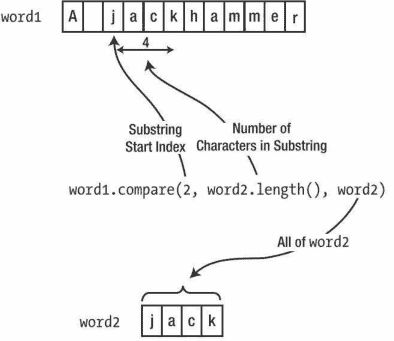

*图 7-2.* 使用 compare() 处理子字符串


compare() 的第一个参数是 word 的子字符串中第一个字符的索引位置，该子字符串要与 word2 进行比较。第二个参数是子字符串中的字符数，合理地将其指定为第三个参数 word2 的长度。显然，如果你指定的子字符串长度与第三个参数的长度不同，那么按定义该子字符串和第三个参数就不相等。

你可以使用 compare 函数来搜索子字符串。下面是一个示例：

```cpp
std::string text {"Peter Piper picked a peck of pickled peppers."};
std::string word {"pick"};
for (size_t i{}; i < text.length() - word.length() + 1; ++i)
    if (text.compare(i, word.length(), word) == 0)
        std::cout << "text contains " << word << " starting at index " << i << std::endl;
```

这个循环会在 text 中索引位置 12 和 29 找到 word。循环变量的上限允许将 text 中最后的 word.length() 个字符与 word 进行比较。这并不是搜索的最高效实现。当找到 word 时，更高效的做法是安排下一次检查的 text 子字符串向后移动 word.length() 个字符，但前提是 text 末尾之前仍有 word.length() 个字符。不过，搜索字符串对象还有更简单的方法，你很快就会看到。

你可以使用 compare() 函数将一个字符串的子字符串与另一个字符串的子字符串进行比较。这需要向 compare() 传递五个参数。下面是一个示例：

```cpp
std::string text {"Peter Piper picked a peck of pickled peppers."};
std::string phrase {"Got to pick a pocket or two."};
for (size_t i{}; i < text.length() - 3; ++i)
    if (text.compare(i, 4, phrase, 7, 4) == 0)
        std::cout << "text contains " << phrase.substr(7, 4)
                  << " starting at index " << i << std::endl;
```

这两个额外参数分别是 phrase 中子字符串的索引位置及其长度。phrase 的子字符串会与 text 的子字符串进行比较。

还没完！compare() 函数还可以将字符串对象的子字符串与以空字符结尾的字符串进行比较。

```cpp
std::string text {"Peter Piper picked a peck of pickled peppers."};
for (size_t i{}; i < text.length() - 3; ++i)
    if (text.compare(i, 4, "pick") == 0)
        std::cout << "text contains \"pick\" starting at index " << i << std::endl;
```

这段代码的输出将与前面的代码相同；"pick" 会在索引位置 12 和 29 被找到。还有一种选择是通过指定字符数，从以空字符结尾的字符串中选择前 n 个字符。循环中的语句可以写成如下形式：

```cpp
if (text.compare(i, 4, "picket", 4) == 0)
    std::cout << "text contains \"pick\" starting at index " << i << std::endl;
```

compare() 的第四个参数指定从 "picket" 中使用多少个字符参与比较。

**注意** 你已经看到，`compare()` 函数可以相当自然地处理不同类型、不同数量的参数。我们之前简要提到的 `append()` 函数也是如此。这里看到的是几个同名但不同的函数。它们被称为*重载函数*，你将在下一章学习如何以及为什么创建它们。

### 使用 substr() 比较子字符串

当然，如果你记不住 `compare()` 函数较复杂版本中的参数顺序，可以使用 `substr()` 函数来提取 `string` 对象的子字符串。然后在许多情况下，你可以将结果与比较运算符一起使用。例如，要检查两个子字符串是否相等，你可以编写如下测试：

```cpp
std::string text {"Peter Piper picked a peck of pickled peppers."};
std::string phrase {"Got to pick a pocket or two."};
for (size_t i{}; i < text.length() - 3; ++i)
  if (text.substr(i, 4) == phrase.substr(7, 4))
    std::cout << "text contains " << phrase.substr(7, 4)
              << " starting at index " << i << std::endl;
```

与前面使用 `compare()` 函数的等效操作不同，这段新代码很容易理解。当然，它会稍微低效一些（因为创建了临时子字符串对象），但在这里，代码的清晰度和可读性远比边际性能提升重要。事实上，这是一条应当遵循的重要准则。你应该始终选择正确且可维护的代码，而不是容易出错、晦涩难懂的代码，即使后者可能快几个百分点。只有当基准测试表明性能有可能显著提升时，你才应该把事情复杂化。

**提示** 假设创建临时子字符串对象真的让你困扰（它不应该困扰你，但假设你是一位死硬的 C++ 开发者，每一个字节和时钟周期都很重要）。那么你可以将前一个示例中的前两行替换为：

```cpp
std::string_view text {"Peter Piper picked a peck of pickled peppers."};
std::string_view phrase {"Got to pick a pocket or two."};
```

你将在第 9 章学习所有关于 `string_views` 的内容，但简而言之，`string_view` 允许你使用与 `std::string` 相同的高层函数来检查任何类型的字符序列（在我们的例子中是字符串字面量），但额外保证它绝不会复制任何（子）字符串。`string_view` 对象只允许你查看字符串的字符（因此得名），而不能修改、添加或删除它们。

### 检查字符串的开头或结尾

有时需要检查一个字符串是否以给定的子字符串开头或结尾。当然，你仍然可以使用 `compare()` 或 `substr()` 来做到这一点。例如，像这样：

```cpp
std::string text {"Start with the end in mind."};
if (text.compare(0, 5, "Start") == 0)
    std::cout << "The text starts with 'Start'." << std::endl;
if (text.substr(text.length() - 3, 3) != "end")
    std::cout << "The text does not end with 'end'." << std::endl;
```

但这段代码的可读性并不出色，而且也很容易把那些恼人的子字符串索引弄错。幸运的是，C++20 引入了两个有用的成员函数来解决这个问题：starts_with() 和 ends_with()。

```cpp
std::string text {"Start with the end in mind."};
if (text.starts_with("Start"))
    std::cout << "The text starts with 'Start'." << std::endl;
if (!text.ends_with("end"))
    std::cout << "The text does not end with 'end'." << std::endl;
```

这段代码可读性极佳，而且完全不容易出错。除了 C 风格字符串或字符串对象之外，这两个函数也适用于单个字符：

```cpp
if (text.ends_with('.'))
    std::cout << "The text ends with a period.";
```

此外，starts_with() 和 ends_with() 在空字符串上使用总是完全安全的（自然，对于空字符串它们都总是返回 false）。而 []、front()、back() 或 substr() 则不是这样。

## 搜索字符串

除了 compare() 之外，你还有许多其他在字符串对象内搜索的替代方法。它们都涉及返回索引的函数。我们将从最简单的一类搜索开始。字符串对象有一个 find() 函数，用于查找子字符串在其中的索引。你也可以用它来查找给定字符的索引。你要搜索的子字符串可以是另一个字符串对象，也可以是字符串字面量。下面是一个小示例，展示了这些选项：

```cpp
// Ex7_04.cpp
// Searching within strings
import <iostream>;
import <string>;

int main()
{
    std::string sentence {"Manners maketh man"};
    std::string word {"man"};
    std::cout << sentence.find(word) << std::endl;  // Outputs 15
    std::cout << sentence.find("M") << std::endl;  // Outputs 0
    std::cout << sentence.find('k') << std::endl;  // Outputs 10
    std::cout << sentence.find('x') << std::endl;  // Outputs std::string::npos
}
```

¹ 嗯，实际上，如果吹毛求疵的话，几乎总是如此。每个字符串都以空字符串开头和结尾，甚至空字符串也是如此。


在每个输出语句中，都会通过调用 `sentence` 的 `find()` 函数从头开始搜索 `sentence`。该函数返回被搜索内容第一次出现时首字符的索引。在最后一条语句中，字符串中找不到 `'x'`，因此返回 `std::string::npos`。这是一个在 `<string>` 模块中定义的常量。它表示字符串中的非法字符位置，用于表示搜索失败。

在我们的计算机上，Ex7_04 因此产生这四个数字：

- 15
- 0
- 10
- 18446744073709551615

从该输出可以看出，`std::string::npos` 被定义为一个非常大的数。更具体地说，它是类型 `size_t` 所能表示的最大值。对于 64 位平台，该值等于 2<sup>64</sup>−1，数量级为 10<sup>19</sup>——即 1 后面跟 19 个零。因此，你不太可能处理长到足以让 npos 表示有效索引的字符串。给你一个直观印象：我们上次统计时，英文版维基百科的所有字符可以放进一个仅有 210 亿个字符的字符串中——仍比 npos 小约 8.78 亿倍。

当然，对于搜索失败，你应当用类似下面的语句来处理：

```cpp
if (sentence.find('x') == std::string::npos)
    std::cout << "Character not found" << std::endl;
```

**注意** 当作为布尔值使用时，`std::string::npos` 常量求值为 true，而不是 false。

唯一求值为 false 的数值是零，而零作为索引是完全有效的值。因此，你应注意不要写出这样的代码：

```cpp
if (!sentence.find('x'))    // Oops...
    std::cout << "Character not found" << std::endl;
```

虽然这个 if 语句读起来似乎合理，但它实际做的事情却相当不合理。当字符 'x' 在索引 0 处被找到时，也就是对于所有以 'x' 开头的句子，它会打印 "Character not found"。

## 在子字符串中搜索

`find()` 函数的另一种变体允许你从指定位置开始搜索字符串的一部分。例如，在 `sentence` 像之前那样定义的情况下，你可以这样写：

```cpp
std::cout << sentence.find("an", 1) << std::endl;    // Outputs 1
std::cout << sentence.find("an", 3) << std::endl;    // Outputs 16
```

每条语句都从第二个参数指定的索引开始搜索 `sentence`，直到字符串末尾。第一条语句找到字符串中第一次出现的 "an"。第二条语句找到第二次出现，因为搜索从索引位置 3 开始。

你可以将字符串对象作为 `find()` 的第一个参数传入，从而搜索该字符串对象。下面是一个例子：

```cpp
std::string sentence {"Manners maketh man"};
std::string word {"an"};
int count {};                                      // Count of occurrences
for (size_t i {}; i <= sentence.length() - word.length(); )
{
    size_t position = sentence.find(word, i);
    if (position == std::string::npos)
        break;
    count++;
    i = position + 1;
}
std::cout << "\"" << word << "\" occurs in \"" << sentence
          << "\" " << count << " times." << std::endl;  // 2 times...
```

字符串索引的类型是 `size_t`，因此存储 `find()` 返回值的 `position` 也是该类型。循环索引 `i` 定义了 `find()` 操作的起始位置，所以它也是无符号类型。`word` 在 `sentence` 中最后一次出现的位置，至少要从 `sentence` 末尾往前 `word.length()` 个位置开始，因此循环中 `i` 的最大值是 `sentence.length() - word.length()`。递增 `i` 的循环表达式被省略了，因为这一步在循环体中完成。

如果 `find()` 返回 npos，说明没有找到 `word`，因此循环通过执行 break 语句结束。否则，`count` 递增，并且 `i` 被设置为找到 `word` 的位置之后的一个位置，为下一次迭代做准备。你可能认为应该把 `i` 设置为 `i + word.length()`，但这样无法找到重叠的出现，例如在字符串 "banana" 中搜索 "an" 时。

你还可以在字符串对象中搜索 C 风格字符串或字符串字面量的子串。在这种情况下，`find()` 的第一个参数是以空字符结尾的字符串，第二个参数是你想要开始搜索的索引位置，第三个参数是你想从该以空字符结尾的字符串中取多少个字符作为要查找的字符串。下面是一个例子：

```cpp
std::cout << sentence.find("ananas", 8, 2) << std::endl; // Outputs 16
```

这会从 `sentence` 中的位置 8（也就是在 Manners 之后）开始，在 `sentence` 中搜索 "ananas" 的前两个字符（即 "an"）。下面的变体展示了更改参数的效果：

```cpp
std::cout << sentence.find("ananas", 0, 2) << std::endl; // Outputs 1
std::cout << sentence.find("ananas", 8, 3) << std::endl; // Outputs std::string::npos
```

第一次搜索现在从 `sentence` 的开头查找 "an"，并在索引 1 处找到它。第二次搜索查找 "ana"，但失败了，因为该子串不在 `sentence` 中。

下面是一个程序，它在字符串对象中搜索给定的子串，并确定该子串出现了多少次：

```cpp
// Ex7_05.cpp
// Searching within substrings
import <iostream>;
import <string>;

int main()
{
    std::string text;             // The string to be searched
    std::string word;             // Substring to be found
    std::cout << "Enter the string to be searched and press Enter:\n";
    std::getline(std::cin, text);

    std::cout << "Enter the string to be found and press Enter:\n";
    std::getline(std::cin, word);

    size_t count{};               // Count of substring occurrences
    size_t index{};               // String index
    while ((index = text.find(word, index)) != std::string::npos)
    {
        ++count;
        index += word.length();   // Advance by full word (discards overlapping occurrences)
    }

    std::cout << "Your text contained " << count << " occurrences of \""
              << word << "\"." << std::endl;
}
```

下面是一些示例输出：

```text
Enter the string to be searched and press Enter:
Smith, where Jones had had "had had", had had "had". "Had had" had had the examiners' approval.
Enter the string to be found and press Enter:
had
Your text contained 10 occurrences of "had".
```

这里只有十处 "had" 出现。"Had" 不算，因为它以大写字母开头。程序在 `text` 中搜索 `word` 里的字符串，这两个字符串都是使用 `getline()` 从标准输入流读取的。输入以换行符终止，按下 Enter 时就会产生换行符。搜索在 while 循环中进行，只要 `text` 的 `find()` 函数不返回 npos，循环就会继续。返回值为 npos 表示从指定索引到字符串末尾，在 `text` 中未找到搜索目标，因此搜索结束。每次迭代返回非 npos 的值时，说明在 `text` 中找到了 `word` 中的字符串，因此 `count` 递增，`index` 增加该字符串的长度；这里假设我们不是在搜索重叠出现。这个循环中发生了很多事情，为了帮助你理解操作过程，图 7-3 展示了该过程。

另一个选项是查找*不在*给定集合中的字符。`find_first_not_of()` 和 `find_last_not_of()` 函数可以做到这一点。要找到 `text` 中第一个不是元音的字符的位置，你可以这样写：

```cpp
std::cout << text.find_first_not_of("AaEeIiOoUu") << std::endl; // Outputs 0
```

第一个不是元音的字符显然就是第一个字符，位于索引 0。

让我们在一个可运行的示例中尝试其中一些函数。这个程序从字符串中提取单词。它结合使用了 `find_first_of()` 和 `find_first_not_of()`。代码如下：

```cpp
// Ex7_06.cpp
// Searching a string for characters from a set
import <iostream>;
import <format>;
import <string>;
import <vector>;

int main()
{
    std::string text;
    std::cout << "Enter some text terminated by *:\n";
    std::getline(std::cin, text, '*');

    const std::string separators{ " ,;:.\"!?'\n" };   // Word delimiters
    std::vector<std::string> words;                   // Words found
    size_t start { text.find_first_not_of(separators) }; // First word start index

    while (start != std::string::npos)                // Find the words
    {
        size_t end = text.find_first_of(separators, start + 1); // Find end of word
        if (end == std::string::npos)                  // Found a separator?
            end = text.length();                       // No, so set to end of text
        words.push_back(text.substr(start, end - start)); // Store the word
        start = text.find_first_not_of(separators, end + 1); // Find first character of next word
    }

    std::cout << "Your string contains the following " << words.size() << " words:\n";
    size_t count{};                                    // Number output
    for (const auto& word : words)
    {
        std::cout << std::format("{:15}", word);
        if (!(++count % 5))
            std::cout << std::endl;
    }
    std::cout << std::endl;
}
```


以下是一些示例输出：

```text
Enter some text terminated by *:
To be, or not to be, that is the question.
Whether 'tis nobler in the mind to suffer the slings and
arrows of outrageous fortune, or by opposing, end them.*
Your string contains the following 30 words:
       To             be          or          not          to
       be            that          is          the       question
     Whether         'tis        nobler        in          the
       mind           to         suffer        the        slings
        and         arrows         of      outrageous    fortune
         or            by        opposing      end         them
```

字符串变量 text 将包含从键盘读取的字符串。该字符串由 getline() 函数从 cin 读取，并指定星号作为终止字符，这允许输入多行。separators 变量定义了单词分隔符集合。它被定义为 const，因为这些不应被修改。这个示例的有趣部分是对字符串的分析。

你将第一个单词的第一个字符的索引记录在 start 中。只要这是一个有效索引（即不等于 npos 的值），你就知道 start 将包含第一个单词的第一个字符的索引。while 循环找到当前单词的结尾，将该单词作为子字符串提取出来，并存入 words 向量。它还会将查找下一个单词的第一个字符索引的结果记录到 start 中。循环会一直持续到找不到第一个字符为止，在这种情况下，start 将包含 npos 以终止循环。

while 循环中的最后一次查找可能会失败，使 end 的值为 npos。如果 text 以字母或指定分隔符之外的任何内容结尾，就可能发生这种情况。为处理这种情况，你在 if 语句中检查 end 的值；如果查找确实失败，就将 end 设置为 text 的长度。这将比字符串末尾多一个字符（因为索引从 0 开始，而不是 1），因为 end 应对应单词中最后一个字符之后的位置。

## 反向搜索字符串

find() 函数在字符串中向前搜索，可以从开头开始，也可以从给定索引开始。rfind() 函数（名称来自 reverse find）反向搜索字符串。rfind() 具有与 find() 相同的一系列变体。你可以在整个 string 对象中搜索一个子字符串，该子字符串可以定义为另一个 string 对象，也可以定义为以空字符结尾的字符串。你也可以搜索一个字符。下面是一个示例：

```cpp
std::string sentence ("Manners maketh man");
std::string word ("an");
std::cout << sentence.rfind(word) << std::endl;    // Outputs 16
std::cout << sentence.rfind("man") << std::endl;  // Outputs 15
std::cout << sentence.rfind('e') << std::endl;     // Outputs 11
```

每次搜索都会找到 rfind() 参数的最后一次出现，并返回找到它的第一个字符的索引。图 7-4 说明了 rfind() 的用法。

### 使用带一个参数的 `rfind()`

```cpp
string sentence {"Manners maketh man"};
string word {"an"};
```

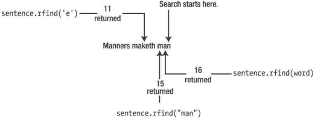

**与 find() 一样，如果找不到参数，则返回 `string::npos` 值。**

以 word 作为参数进行搜索，会找到字符串中 "an" 的最后一次出现。`rfind()` 函数返回所查找子字符串中第一个字符的索引位置。

如果子字符串不存在，则不会返回位置。例如，以下语句将得到如下结果：

```cpp
std::cout << sentence.rfind("miners") << std::endl;  // Outputs std::string::npos
```

该句子不包含子字符串 "miners"，因此该语句将返回并显示 `npos`。图 7-4 中说明的另外两次搜索与第一次类似。它们都从字符串末尾向后搜索，查找参数的第一次出现。

与 `find()` 一样，你可以为 `rfind()` 提供额外参数来指定反向搜索的起始索引；当第一个参数是 C 风格字符串时，还可以添加第三个参数。第三个参数指定从 C 风格字符串中取多少个字符作为要搜索的子字符串。

## 修改字符串

一旦搜索了字符串并找到了你要找的内容，你很可能会想以某种方式修改该字符串。你已经见过如何使用方括号之间的索引来选择 string 对象中的单个字符。你还可以在给定索引处将字符串插入 string 对象，或替换子字符串。不出所料，要插入字符串，你使用名为 `insert()` 的函数；要替换字符串中的子字符串，你使用名为 `replace()` 的函数。我们先解释插入字符串。

### 插入字符串

也许最简单的插入方式是在另一个 string 对象中的给定位置之前插入一个 string 对象。下面是一个如何执行此操作的示例：

```cpp
std::string phrase ("We can insert a string.");
std::string words ("a string into ");
phrase.insert(14, words);
```

图 7-5 说明了发生的情况。words 字符串被插入到 phrase 中索引 14 的字符之前。操作之后，phrase 将包含字符串 "We can insert a string into a string."

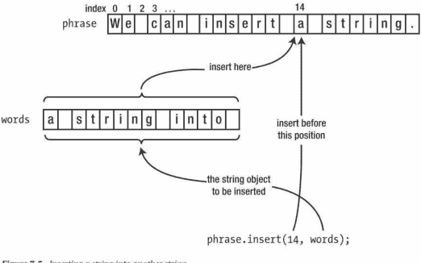

*图 7-5。* 将一个字符串插入另一个字符串

你也可以将以空字符结尾的字符串插入 string 对象。例如，你可以用以下语句实现与上一操作相同的结果：

```cpp
phrase.insert(14, "a string into ");
```

当然，在插入之前，以空字符结尾的字符串中的 '\0' 字符会被丢弃。

更复杂一点的是将一个 string 对象的子字符串插入另一个 string 对象。你需要为 insert() 提供两个额外参数：一个指定要插入的子字符串中第一个字符的索引，另一个指定子字符串中的字符数。下面是一个示例：

```cpp
phrase.insert(13, words, 8, 5);
```

这会将 `words` 中从位置 8 开始的五个字符的子字符串插入 `phrase` 中索引位置 13 之前。由于 `phrase` 和 `words` 包含与其名称对应的字符串，这会将 "into" 插入 "We can insert a string."，从而使 `phrase` 变为 "We can insert into a string."

还有一种类似的功能，可以将以空字符结尾的字符串中的若干字符插入 string 对象。以下语句产生与上一条相同的结果：

```cpp
phrase.insert(13, " into something", 5);
```

这会将 " into something" 的前五个字符插入 `phrase` 中索引 13 的字符之前。甚至还有一个 `insert()` 版本可以插入一串相同字符：

```cpp
phrase.insert(16, 7, '*');
```

这会在 `phrase` 中索引 16 的字符之前插入七个星号。随后 `phrase` 将包含这个信息量不大的句子 "We can insert a *******string."

### 替换子字符串

你可以用另一个不同的字符串替换 string 对象中的任何子字符串——即使插入的字符串与被替换的子字符串长度不同。我们将回到一个老例子，并像这样定义 text：

```cpp
std::string text {"Smith, where Jones had had \"had had\", had had \"had\"."};
```

你可以用以下语句将 "Jones" 替换为一个不太常见的名字：

```cpp
text.replace(13, 5, "Gruntfuttock");
```

第一个参数是 `text` 中要替换的子字符串第一个字符的索引，第二个参数是该子字符串的长度。这会将 `text` 中从索引 13 开始的五个字符替换为 "Gruntfuttock"。如果你现在输出 `text`，结果将如下：

Smith, where Gruntfuttock had had "had had", had had "had".

> **注意** 与往常一样，`replace()` 的第二个参数是长度，而不是第二个索引。

更实际的应用是先搜索要替换的子字符串。下面是一个示例：

```cpp
const std::string separators {",.;:\"'\n"};        // Word delimiters
size_t start {text.find("Jones")};                 // Find the substring
size_t end {text.find_first_of(separators, start + 1)}; // Find the end
text.replace(start, end - start, "Gruntfuttock");
```

这会找到 `text` 中 "Jones" 第一个字符的位置，并用它初始化 `start`。接下来，通过使用 `find_first_of()` 从 `separators` 中搜索分隔符，找到 "Jones" 最后一个字符之后的字符。这些索引位置用于 `replace()` 操作。


替换字符串可以是 `std::string` 对象，也可以是以空字符结尾的字符串。对于前者，你可以指定起始索引和长度，以选择一个子字符串作为替换字符串。例如，前面的替换操作可以写成这样：

```cpp
std::string name { "Amos Gruntfuttock" };
text.replace(start, end - start, name, 5, 12);
```

这些语句与前面使用 `replace()` 的效果相同，因为替换字符串从 name 的位置 5（即字符 'G'）开始，并包含 12 个字符。

如果第一个参数是以空字符结尾的字符串，你可以指定作为替换字符串的字符数。下面是一个例子：

```cpp
text.replace(start, end - start, "Gruntfuttock, Amos", 12);
```

这一次，要替换的字符串由“Gruntfuttock, Amos”的前 12 个字符组成，因此效果与前面的替换操作相同。

还有一种可能是将替换字符串指定为某个给定字符的多个副本。例如，你可以用下面的语句将“Jones”替换为三个星号：

```cpp
text.replace(start, end - start, 3, '*');
```

这里假设 start 和 end 像之前那样确定。结果是 text 将包含以下内容：

```text
Smith, where *** had had "had had", had had "had".
```

让我们在一个示例中试试替换操作。这个程序将字符串中某个给定单词的所有出现替换为另一个单词：

```cpp
// Ex7_07.cpp
// Replacing words in a string
import <iostream>;
import <string>;

int main()
{
    std::string text;                         // The string to be modified
    std::cout << "Enter a string terminated by *:\n";
    std::getline(std::cin, text, '*');

    std::string word;                         // The word to be replaced
    std::cout << "Enter the word to be replaced: ";
    std::cin >> word;

    std::string replacement;                  // The word to be substituted
    std::cout << "Enter the string to be substituted for " << word << ": ";
    std::cin >> replacement;

    if (word == replacement)                       // Verify there's something to do
    {
        std::cout << "The word and its replacement are the same.\n"
                  << "Operation aborted." << std::endl;
        return 1;
    }

    size_t start {text.find(word)};                 // Index of 1st occurrence of word
    while (start != std::string::npos)              // Find and replace all occurrences
    {
        text.replace(start, word.length(), replacement); // Replace word
        start = text.find(word, start + replacement.length());
    }

    std::cout << "\nThe string you entered is now:\n" << text << std::endl;
}
```

下面是一个输出示例：

```text
Enter a string terminated by *:
A rose is a rose is a rose.*
Enter the word to be replaced: rose
Enter the string to be substituted for rose: dandelion

The string you entered is now:
A dandelion is a dandelion is a dandelion.
```

要替换单词的字符串由 `getline()` 读入 text。可以输入任意多行，并以星号终止。要替换的单词及其替换词使用提取运算符读取，因此不能包含空白字符。如果要替换的单词与其替换词相同，程序会立即结束。

单词第一次出现的索引位置用于初始化 start。该变量用于查找并替换单词后续出现的 while 循环中。每次替换后，单词在 text 中下一次出现的索引会存入 start，为下一次迭代做好准备。当 text 中不再有单词出现时，start 将包含 npos，从而结束循环。然后输出 text 中修改后的字符串。

## 从字符串中删除字符

你始终可以使用 `replace()` 函数从字符串对象中删除子字符串：只需将替换字符串指定为空字符串即可。不过，还有一个专门用于此目的的函数：`erase()`。你通过第一个字符的索引位置和长度来指定要删除的子字符串。例如，你可以像这样删除 text 的前六个字符：

```cpp
text.erase(0, 6);    // Remove the first 6 characters
```

更典型的做法是使用 `erase()` 删除你之前搜索到的特定子字符串，因此更常见的示例可能如下：

```cpp
std::string word {"rose"};
size_t index {text.find(word)};
if (index != std::string::npos)
    text.erase(index, word.length());  // Second argument is a length, not an index!
```

这会在 text 中搜索 word，并在确认其存在后，使用 `erase()` 将其删除。要删除的子字符串中的字符数通过调用 word 的 `length()` 函数获得。`erase()` 函数也可以带一个参数或不带参数使用；下面是一个例子：

```cpp
text.erase(5);        // Removes all but the first 5 characters
text.erase();         // Removes all characters
```

执行最后一条语句后，text 将变为空字符串。另一个从字符串对象中删除所有字符的函数是 `clear()`：

```cpp
text.clear();
```

> **警告**  另一个常见错误是调用带单个参数 `i` 的 `erase(i)`，试图删除给定索引 `i` 处的单个字符。然而，`erase(i)` 的实际效果完全不同。它会从索引 `i` 处的字符开始，一直删除到字符串末尾的所有字符！要删除索引 `i` 处的单个字符，应改用 `erase(i, 1)`。

使用 C++20，你可以通过非成员函数 `std::erase()` 轻松删除给定字符的所有出现。在这个示例中，它展示了从我们最喜欢的类似避字电影台词中删除所有 'v' 字符：

```cpp
std::string s { "The only verdict is vengeance; a vendetta, held as a votive not in vain." };
std::erase(s, 'v');
std::cout << s;  // The only erdict is engeance; a endetta, held as a otive not in ain.
```

## std::string 与 std::vector<char>

你可能已经注意到，`std::string` 类似于 `std::vector<char>`。两者都是 char 元素的动态数组，并且都提供 `[]` 运算符来模拟普通的 char[] 数组。但相似之处远不止于此。`std::string` 对象支持 `std::vector<char>` 的几乎所有成员函数。显然，这包括你从第 5 章已经了解的 vector 函数：

- 字符串有一个 `push_back()` 函数，用于在字符串末尾（就在终止字符之前）插入一个新字符。不过它并不常用，因为 `std::string` 对象提供了更方便的 `+=` 语法来追加字符。
- 字符串有一个 `at()` 函数，与 `[]` 运算符不同，它会针对给定索引执行边界检查。
- 字符串有一个 `size()` 函数，它是 `length()` 的别名。之所以添加后者，是因为人们更常说“字符串的长度”，而不是“字符串的大小”。
- 字符串提供 `front()` 和 `back()` 便捷函数，用于访问其第一个和最后一个字符（不计空终止字符）。
- 字符串支持一系列 `assign()` 函数来重新初始化它。这些函数接受的参数组合类似于首次初始化字符串时在花括号初始化器中使用的组合。因此，例如赋值 `("x", 5)` 会将 `s` 重新初始化为 `"xxx"`，而 `s.assign("Reinitialize", 2, 4)` 会将字符串对象 `s` 的内容覆盖为 `"init"`。

不过，如果本章清楚说明了一件事，那就是 `std::string` 远不止是一个简单的 `std::vector<char>`。除了 `vector<char>` 提供的函数之外，它还提供了大量额外且有用的函数，用于常见的字符串操作，例如拼接、子字符串访问、字符串搜索和替换等。当然，`std::string` 知道终止其 char 数组的空字符，并知道在 `size()`、`back()` 和 `push_back()` 等成员中考虑这一点。

## 将字符串转换为数字

本章前面你了解到，可以使用 `std::to_string()` 将数字转换为字符串。但反方向呢：如何将 `"123"` 和 `"3.1415"` 这样的字符串转换为数字？在 C++ 中有几种方法可以做到这一点，但同样是由 `<string>` 模块为你提供最简单的选项。它的 `std::stoi()` 函数（“string to int”的缩写）将给定字符串转换为 int：

```cpp
std::string s{ "123" };
int i{ std::stoi(s) };        // i == 123
```

`<string>` 模块同样提供了 `stol()`、`stoll()`、`stoul()`、`stoull()`、`stof()`、`stod()` 和 `stold()`，它们都位于 `std` 命名空间中，用于将字符串分别转换为 `long`、`long long`、`unsigned long`、`unsigned long long`、`float`、`double` 和 `long double` 类型的值。

## 国际字符字符串

你会记得第 1 章讲过，在国际范围内使用的字符远多于标准 ASCII 字符集定义的 128 个字符。例如，法语和西班牙语经常使用带重音的字母，如 é、á 或 ñ。俄语、阿拉伯语、马来语或日语等语言当然会使用与 ASCII 标准定义的字符完全不同的字符。用单个 8 位 char 可能表示的 256 个不同字符，远远不足以表示所有这些可能的字符。仅中文就包含数万个字符！

支持多种国家字符集是一个高级主题，因此我们只介绍 C++ 提供的基本设施，而不详细说明如何使用其中任何一种。因此，本节只是指明当你必须处理不同国家字符集时应该查看哪里。处理可能包含扩展字符集的字符串时，你可能有四个选项：

- 你可以定义 `std::wstring` 对象，其中包含 `wchar_t` 类型的字符字符串——`wchar_t` 是内置于你的 C++ 实现中的宽字符类型。


-   对于 n 等于 8、16 或 32 的情况，你可以定义 `std::uNstring` 对象来存储 UTF-n 编码的字符串，使用类型为 `char_n_t` 的字符（每个字符至少 n 位，但通常恰好 n 位）。

`<string>` 模块定义了所有这些类型。

> **注意**  `<string>` 模块定义的所有五种字符串类型实际上只是同一个类模板 `std::basic_string<CharType>` 特定实例化的类型别名。例如，`std::string` 是 `std::basic_string<char>` 的别名，而 `std::wstring` 是 `std::basic_string<wchar_t>` 的简写。这就解释了为什么所有字符串类型都提供完全相同的一组函数。在第 17 章学习如何创建自己的类模板之后，你会更好地理解这是如何工作的。

## wchar_t 字符组成的字符串

`<string>` 模块中定义的 `std::wstring` 类型存储由 `wchar_t` 类型字符组成的字符串。使用 `wstring` 类型对象的方式与使用 `string` 类型对象的方式基本相同。你可以用下面这条语句定义一个宽字符串对象：

```cpp
std::wstring quote;
```

包含 `wchar_t` 类型字符的字符串字面量写在双引号之间，但要在前面加上 `L`，以便与包含 `char` 字符的字符串字面量区分开。因此，你可以像这样定义并初始化一个 `wstring` 变量：

```cpp
std::wstring saying {L"The tigers of wrath are wiser than the horses of instruction."};
```

开头双引号前的 `L` 指定该字面量由 `wchar_t` 类型字符组成。如果没有它，你就会得到一个 `char` 字符串字面量，而这条语句将无法编译。

要输出宽字符串，你需要使用 `wcout` 流。下面是一个例子：

```cpp
std::wcout << saying << std::endl;
```

我们在字符串对象上下文中讨论过的几乎所有函数也同样适用于 `wstring` 对象，因此这里不再逐一赘述。其他功能，例如 `to_wstring()` 函数，只是多接受一个用于指定数值类型的参数。在使用 `wstring` 对象时，你必须记得为字符串字面量和字符字面量指定 `L` 前缀，这样就没问题了！

`wstring` 类型的一个问题在于，宽字符串字面量所使用的字符编码，以及接受宽字符字符串的函数所期望的字符编码，是由实现定义的，因此可能因编译器而异。Windows 操作系统的原生 API 通常期望使用 UTF-16 编码的字符串。因此，在为 Windows 编译时，`wchar_t` 字符串通常也会由 2 字节的 UTF-16 编码字符组成。然而，大多数其他实现使用 4 字节的 UTF-32 编码 `wchar_t` 字符。如果你需要支持可移植的多国字符集，那么使用 `u8string`、`u16string` 或 `u32string` 类型可能更好，这些类型将在下一节中介绍。

## 包含 Unicode 字符串的对象

`<string>` 模块还定义了另外三种类型来存储 Unicode 字符组成的字符串。`std::u8string`（C++20 中新增）/ `u16string` / `u32string` 类型的对象分别存储由 `char8_t` / `char16_t` / `char32_t` 类型字符组成的字符串。它们旨在分别包含使用 UTF-8、UTF-16 和 UTF-32 编码的字符序列。与现有对象一样，你可以使用相应类型的字面量来初始化这些类型的对象。下面是一个例子：

```cpp
std::u8string quote {u8"Character is the real foundation of success."}; // char8_t characters
std::u16string question {u"Whither atrophy?"};                    // char16_t characters
std::u32string question {U"This sentence contains three errors."}; // char32_t characters
```

这些语句表明，包含 `char8_t` 字符的字符串字面量要加 `u8` 前缀，包含 `char16_t` 字符的字面量要加 `u` 前缀，而包含 `char32_t` 字符的字面量要加 `U` 前缀。`u8string`、`u16string` 和 `u32string` 类型的对象具有与 `string` 类型相同的一组函数。

原则上，你也可以使用本章中详细介绍过的 `std::string` 类型来存储 UTF-8 字符组成的字符串。事实上，在 C++20 之前，这是存储 UTF-8 字符串的唯一方式，因为 `char8_t` 和 `std::u8string` 类型直到 C++20 才被引入。问题在于，你无法轻松区分使用 UTF-8 编码的字符串和使用实现定义的原始字符编码（通常是 UTF-8，但当然并不总是如此）编码的字符串。

> **提示**  理想情况下，你应始终将 UTF-n 编码的字符串存储在 `std::u8string` 对象中，而将 `std::string` 和 `std::wstring` 留给不需要可移植性的情况，和/或用于与操作系统原生 API 交互。不幸的是，`std::string` 长期以来一直被用于存储 UTF-8 编码的字符串，因此在与尚未升级为使用 `std::u8string` / `char8_t` 的旧式 API 对接时，你可能不得不采取务实做法。

然而，请务必注意，所有字符串类型都完全不了解 Unicode 编码。例如，UTF-8 编码使用一到四个字节来编码单个字符，但操作字符串对象的函数并不会识别这一点。这意味着，例如，如果字符串包含任何需要两到三个字节来表示的字符，`length()` 函数将返回错误的长度，如下面的代码片段所示：

```cpp
std::u8string s {u8"字符串"}; // UTF-8 encoding of the Chinese word for "string"
std::cout << s.length();       // length: 9 code units, and not 3 Chinese characters!
```

> **提示**  在撰写本书时，标准库对操作 Unicode 字符串的支持仍然有限，在某些实现中更是如此。首先，没有 `std::tcout` 或 `std::to_wstring()`，标准正则表达式库也不支持 `uNstrings`。此外，在 C++17 中，标准库提供的用于在各种 Unicode 编码之间进行转换的大多数功能都已被弃用。因此，如果生成和操作可移植的 Unicode 编码文本对你的应用程序很重要，那么使用第三方库会好得多。可行的候选包括 ICU 和 Boost.Locale 库，或 Qt 的 `QString`。

## 原始字符串字面量

如你所知，常规字符串字面量不得包含换行符或制表符。要包含这些特殊字符，必须对它们进行转义——换行符和制表符分别变成 `\n` 和 `\t`。出于显而易见的原因，双引号字符也必须转义为 `\"`。由于这些转义序列的存在，反斜杠字符本身也需要转义为 `\\`。

然而，有时你会发现自己必须定义包含一些甚至许多此类特殊字符的字符串字面量。不得不持续转义这些字符不仅繁琐，而且还会使这些字面量难以阅读。下面是一些例子：

```cpp
auto path{ "C:\\ProgramData\\MyCompany\\MySoftware\\MyFile.ext" };
auto escape{ u8"The \"\\\" escape sequence is a backslash character, \\." };
auto text{ L"First line.\nSecond line.\nThird line.\nThe end." };
std::regex reg{ "\\*+" };  // Regular expression that matches one or more * characters
```

最后一个示例是正则表达式的一个例子——正则表达式是一种定义搜索和转换文本过程的字符串。本质上，正则表达式定义了要在字符串中匹配的模式，而找到的模式可以被替换或重新排序。C++ 通过 `<regex>` 模块支持正则表达式，不过对此的讨论超出了本书的范围。这里的主要要点是，正则表达式字符串经常包含反斜杠字符。不得不为每个反斜杠字符使用转义序列，可能会使正则表达式特别难以正确指定，并且非常难以阅读。

原始字符串字面量正是为解决这些问题而引入的。原始字符串字面量可以包含任何字符，包括反斜杠、制表符、双引号和换行符，因此不需要转义序列。原始字符串字面量在前缀中包含一个 `R`，除此之外，该字面量的字符序列还被圆括号包围。因此，原始字符串字面量的基本形式是 `R"(...)"`。圆括号本身不属于该字面量。你见过的任何类型的字面量都可以通过像之前一样在 `R` 前添加相同的前缀——`L`、`u`、`U` 或 `u8`——来指定为原始字面量。使用原始字符串字面量后，我们之前的示例就变成了下面这样：

```cpp
auto path{ R"(C:\ProgramData\MyCompany\MySoftware\MyFile.ext)" };
auto escape{ u8R"(The "\" escape sequence is a backslash character, \.)" };
auto text
{ LR"(First line.
Second line.
Third line.
The end.)" };
std::regex reg{ R"(\*+)" };  // Regular expression that matches one or more * characters
```

在原始字符串字面量内部，不需要进行任何转义。这意味着你可以直接复制粘贴，例如，将 Windows 路径序列粘贴到其中，甚至可以将一整部莎士比亚戏剧连同引号字符和换行符一起粘贴进去。在后一种情况下，你应注意前导空白和所有换行符，因为它们也会连同周围的 `R"( )"` 定界符之间的所有其他字符一起被包含到字符串字面量中。

请注意，甚至双引号也不需要——甚至不能——被转义，这就引出了一个问题：如果你的字符串字面量本身在某处包含序列 `)"` 会怎样？也就是说，如果它包含一个 `)` 字符，后面跟着一个 `"` 会怎样？下面就是这样一个有问题的字面量：

```cpp
R"(The answer is "(a - b)" not "(b - a)")"  // Error!
```


编译器会不接受这个字符串字面量，因为该原始字面量看起来已经在半途终止了，就在 `(a - b` 之后。但如果转义不是可选方案——任何反斜杠字符都只会原样复制到原始字面量中——你还能怎样让编译器明白，这个字符串字面量应包含第一个 `)` 序列，以及 `(b - a` 之后的那个 `)` 序列呢？答案是，用于标记原始字符串字面量开始和结束的定界符是灵活的。你可以使用任何形如 `"char_sequence(` 的定界符来标记字面量的开始，只要用匹配的序列 `)char_sequence"` 标记结束即可。下面是一个示例：

```
R"*(The answer is "(a - b)" not "(b - a)")*"
```

现在这就是一个有效的原始字符串字面量。你基本上可以选择任何你想要的 `char_sequence`，只要在两端使用相同的序列即可：

```
R"=Fa-la-la-la-la(The answer is "(a - b)" not "(b - a)")=Fa-la-la-la-la="
```

唯一的限制是：`char_sequence` 的长度不得超过 16 个字符，并且不能包含任何圆括号、空格、控制字符或反斜杠字符。

## 小结

在本章中，你学习了如何使用标准库中定义的 string 类型。与 C 风格字符串相比，string 类型使用起来更简单、更安全，因此在需要处理字符串时，它应当是你的首选。

以下是本章的重要知识点：

- `std::string` 类型存储一个字符串。
- 与 `std::vector<char>` 一样，它是动态数组——这意味着它会在必要时分配更多内存。
- 在内部，`std::string` 对象管理的数组中仍然存在终止空字符，但这只是为了兼容旧式和/或 C 函数。作为 `std::string` 的使用者，通常不需要知道它甚至存在。所有字符串功能都会为你透明地处理这个旧式字符。
- 你可以将 string 对象存储在数组中，或者更好的做法是存储在 `vector` 这样的序列容器中。
- 你可以使用方括号之间的索引来访问和修改 string 对象中的单个字符。string 对象中字符的索引值从 0 开始。
- 你可以使用 `+` 运算符将 string 对象与字符串字面量、字符或另一个 string 对象拼接起来。
- 如果你想拼接某个基本数值类型的值（例如 int 或 double），必须先将该数值转换为 string。最简单（但灵活性最低）的选择是使用 `<string>` 模块中定义的 `std::to_string()` 函数模板。
- string 类型的对象具有搜索、修改和提取子字符串的函数。
- `<string>` 模块提供了 `std::stoi()` 和 `std::stod()` 等函数，用于将字符串转换为 int 和 double 等数值类型的值。
- `wstring` 类型的对象包含 `wchar_t` 类型的字符组成的字符串。
- `uNstring` 类型的对象包含 `charN_t` 类型的字符组成的字符串，其中 `N` 等于 8、16 或 32。

## 练习

以下练习让你尝试本章学到的内容。如果遇到困难，可以回顾本章寻求帮助。如果之后仍然无法解决，可以从 Apress 网站（www.apress.com/source-code）下载解决方案，但这确实应作为最后的手段。

- **练习 7-1.** 编写一个程序，读取并存储任意数量学生的名字及其成绩。计算并输出平均成绩，并以表格形式输出所有学生的姓名和成绩，每行显示三名学生的姓名和成绩。
- **练习 7-2.** 编写一个程序，读取通过任意多行输入的文本。找出并记录文本中出现的每个唯一单词，并记录每个单词的出现次数。输出这些单词及其出现次数。单词和计数应按列对齐。单词左对齐，计数右对齐。表格中每行应包含三个单词（及其计数）。
- **练习 7-3.** 编写一个程序，从键盘读取任意长度的文本字符串，并提示输入一个要在该字符串中查找的单词。程序应查找并替换该单词的所有出现，不区分大小写，并用与单词字符数相同数量的星号替换。然后输出新字符串。只替换完整单词。例如，如果字符串是 “Our house is at your disposal.”，而要查找的单词是 “our”，那么结果字符串应如下："**** house is at your disposal."，而不是 "**** house is at y*** disposal."。
- **练习 7-4.** 编写一个程序，提示输入两个单词，并判断其中一个是否为另一个的变位词。一个单词的变位词是通过重新排列其字母形成的，且每个原始字母恰好使用一次。例如，listen 和 silent 互为变位词，但 listens 和 silent 不是。
- **练习 7-5.** 将练习 7-4 的程序推广，使其在判断两个字符串是否为变位词时忽略空格。按照这个推广后的定义，funeral 和 real fun 被视为变位词，eleven plus two 和 twelve plus one 以及 desperation 和 a rope ends it 也是如此。
- **练习 7-6.** 编写一个程序，从键盘读取任意长度的文本字符串，然后读取一个包含一个或多个字母的字符串。输出文本中所有以这些字母中任意一个开头的完整单词列表，不区分大小写。
- **练习 7-7.** 创建一个程序，将用户输入的一串任意长的整数序列读入单个 string 对象。该序列中的数字用空格分隔，并以 # 字符终止。用户可以在两个连续数字之间按或不按 Enter 键。接下来，从字符串中逐个提取所有数字。
- **练习 7-8.** Tautogram（同首字母文本）是一种文本，其中所有单词都以同一个字母开头。在英语中，一个例子是 “Truly automatic trim triumphant, trumpeting thrills to trounce terrible travesties.” 要求用户输入一个字符串，并验证它是否为 tautogram（忽略大小写）。如果是，还要输出每个单词开头的字母。

  注：真正的同首字母文本确实很难拼凑出来，所以也许你可以稍微放宽规则？比如允许单词以几个不同字母开头，如 “a”“to”“is”“are” 等，或者只要求一定比例的单词以同一个字母开头？尽情发挥吧！
- **练习 7-9.** 扩展你在练习 7-8 中的解决方案，删除 tautogram 开头字母的所有出现（忽略大小写）。你可以用简单的方法（还记得可用来完成此任务的标准库函数吗？），但也许用困难的方法自己编写完整代码会更有趣？

# 第 8 章

# 定义函数

将程序分割成可管理的代码块，是每种语言编程的基础。函数是 C++ 程序中的基本构建块。到目前为止，每个示例都只有一个函数 `main()`，并且通常使用了标准库中的函数。本章完全关于定义你自己的函数，并使用你选择的名称。

在本章中，你将学习

- 什么是函数，以及为什么应将程序分割成函数
- 如何声明和定义函数
- 数据如何传递给函数，以及函数如何返回值
- “按值传递”和“按引用传递”之间有什么区别，以及如何在两种机制之间选择
- 将字符串传递给函数的最佳方式是什么
- 如何为函数参数指定默认值
- 在现代 C++ 中返回函数输出的首选方式是什么
- 将 `const` 用作参数类型的限定符会如何影响函数的运行
- 在函数内将变量定义为 `static` 的效果
- 如何创建多个同名但参数不同的函数——你将会了解这种机制称为函数重载
- 什么是递归，以及如何应用它来实现优雅的算法

## 将程序分段

到目前为止，你编写的所有程序都只包含一个函数 `main()`。现实世界中的 C++ 应用程序由许多函数组成，每个函数都提供一项定义明确的独特功能。执行从 `main()` 开始，而 `main()` 必须定义在全局命名空间中。`main()` 调用其他函数，而其他函数中的每一个又可以调用其他函数，依此类推。除 `main()` 之外的函数可以定义在你创建的命名空间中。

当一个函数调用另一个函数，后者又调用另一个函数，如此层层调用时，就会出现多个函数同时处于活动状态的情况。每个调用了另一个尚未返回的函数的函数，都会等待被调用的函数结束。显然，必须有某种机制记录每次函数调用是从内存中的何处发起的，以及函数返回时执行应从何处继续。这些信息

会自动记录并维护在*栈*中。我们在讲解自由存储区内存时介绍了栈，在此语境中，栈通常被称为*调用栈*。调用栈记录所有尚未结束的函数调用以及传递给每个函数的数据的详细信息。大多数 C++ 开发系统附带的调试工具通常提供在程序执行时查看调用栈的方法。

## 类中的函数

类定义了一种新类型，而每个类定义通常都会包含一些函数，这些函数表示可以用类类型的对象执行的操作。你已经广泛使用过属于类的函数。在上一章中，你使用了属于 string 类的函数，例如 `length()` 函数，它返回 string 对象中的字符数，以及用于搜索字符串的 `find()` 函数。标准输入和输出流 `cin` 和 `cout` 是对象，使用流插入和提取运算符会调用这些对象的函数。属于类的函数是面向对象编程的基础，你将从第12章开始学习这些内容。

## 函数的特性

函数应执行单一且定义明确的操作，并且应相对简短。大多数函数不会涉及很多行代码，当然也不会是数百行。这适用于所有函数，包括在类中定义的函数。你之前看到的几个工作示例很容易拆分为函数。例如，如果再看一下 Ex7_06.cpp，你会看到该程序确实自然地分为三个不同的操作。首先从输入流读取文本，然后从文本中提取单词，最后输出这些单词。因此，该程序可以定义为执行这些操作的三个函数，再加上调用它们的 `main()` 函数。

## 定义函数

*函数*是具有特定用途的自包含代码块。函数定义通常与类定义具有相同的基本结构。函数定义由*函数头*后跟一个包含函数代码的块组成。函数头指定三件事：

- 返回类型，即函数执行完毕时返回的值的类型（如果有）。函数可以返回任何类型的数据，包括基本类型、类类型、指针类型或引用类型。它也可以不返回任何内容，在这种情况下，需要将返回类型指定为 `void`。
- 函数的名称。函数名称遵循与变量相同的规则。
- 调用函数时可以传递给函数的数据项的数量和类型。这称为*参数列表*，它出现在函数名后括号内，是以逗号分隔的列表。

函数的一般表示形式如下：

```cpp
return_type function_name(parameter_list)
{
    // Code for the function...
}
```

图 8-1 展示了一个函数定义示例。它实现了众所周知的基本数学幂运算或指数运算，对于任意整数 \(n > 0\)，其定义如下：

\(\operatorname{power}(x, 0) = 1\)

\(\operatorname{power}(x, n) = x^n = x * x * \cdots * x\) (\(n\) times)  \(\operatorname{power}(x, -n) = x^{-n} = \frac{1}{x * x * \cdots * x}\) (\(n\) times)

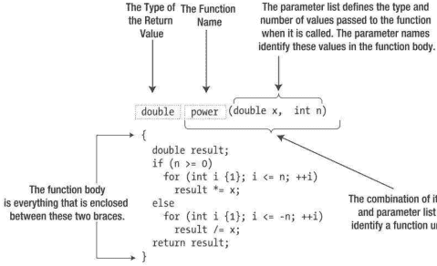

```cpp
double power(double x, int n)
{
    double result {1.0};
    if (n >= 0)
        for (int i {1}; i <= n; ++i)
            result *= x;
    else
        for (int i {1}; i <= -n; ++i)
            result /= x;
    return result;
}
```

*图 8-1. 函数定义示例*

如果调用函数时不传递任何内容，则括号之间不出现任何内容。如果参数列表中有多个项，则用逗号分隔。图 8-1 中的 `power()` 函数有两个参数，*x* 和 *n*。参数名用于函数体中，以访问传递给函数的相应值。我们的 power 函数可以从程序的其他位置这样调用：

```cpp
double number {3.0};
const double result { power(number, 2) };
```

当对 `power()` 的这次调用求值时，函数体中的代码将被执行，参数 *x* 和 *n* 分别初始化为 3.0 和 2，其中 3.0 是 number 变量的值。术语*实参*用于表示调用函数时传递给函数的值。因此，在我们的示例中，number 和 2 是实参，而 x 和 n 是对应的形参。函数调用中的实参顺序必须与函数定义参数列表中形参的顺序相对应。更具体地说，它们的类型应匹配。如果它们不完全匹配，编译器会在可能的情况下应用隐式转换。下面是一个示例：

```cpp
float number {3.0f};
const double result { power(number, 2) };
```

尽管这里传递的第一个实参的类型是 float，这段代码仍然可以编译；编译器会将该实参隐式转换为其对应形参的类型。当然，如果无法进行隐式转换，编译将失败。

从 float 到 double 的转换是无损的，因为 double 通常有可用来表示数字的位数是 float 的两倍——因此得名 double。所以，这种转换总是安全的。不过，编译器也会乐于为你执行相反的转换。也就是说，当把 double 实参赋给 float 形参时，它会隐式转换该实参。这是一种所谓的窄化转换；因为 double 表示数字的精度远高于 float，所以在此转换过程中可能会丢失信息。大多数编译器在执行此类窄化转换时会发出警告。

函数名和参数列表的组合称为函数的*签名*。编译器使用签名来决定在特定情况下应调用哪个函数。因此，具有相同名称的函数必须具有在某些方面不同的参数列表，以便能够区分它们。正如我们稍后将详细讨论的，这类函数称为重载函数。

> **提示** 尽管这样写代码紧凑，很适合放在图 8-1 中，但从编码风格的角度看，我们的 `power()` 定义所使用的参数名 x 和 n 在清晰度方面并不特别出色。也许可以说，在这个特定情况下 x 和 n 仍然可以接受，因为 power() 是众所周知的数学函数，而且 x 和 n 在数学公式中很常见。尽管如此，总体而言，我们建议你使用更具描述性的参数名。例如，不应使用 x 和 n，而可能应分别使用 base 和 exponent。事实上，你几乎应该始终为一切选择描述性名称：函数名、变量名、类名等等。始终如一地这样做，将大大有助于让你的代码易于阅读和理解。

我们的 `power()` 函数返回了 double 类型的值。不过，并非每个函数都必须返回值——它可能只是向文件或数据库写入内容，或修改某些全局状态。void 关键字用于指定函数不返回值，如下所示：

```cpp
void printDouble(double value) { std::cout << value << std::endl; }
```

> **注意** 返回类型指定为 void 的函数不返回值，因此不能在大多数表达式中使用。尝试以这种方式使用此类函数将导致编译器错误消息。

## 函数体

调用函数时，会执行函数体中的语句，其中参数具有你作为实参传递的值。回到图 8-1 中 `power()` 的定义，函数体的第一行定义了 double 变量 `result`，并用 `1.0` 初始化。`result` 是一个自动变量，因此只存在于函数体内。这意味着 `result` 在函数执行完毕后就不存在了。

计算在两个循环之一中执行，具体取决于 `n` 的值。如果 `n` 大于或等于零，则执行第一个 `for` 循环。如果 `n` 为零，则循环体完全不执行，因为循环条件立即为假，而 `result` 保持为 `1.0`。如果 `n` 为正，则循环变量 `i` 依次取从 1 到 `n` 的值，并在每次迭代中将 `result` 乘以 `x`。如果 `n` 为负，则执行第二个 `for` 循环，它在每次迭代中将 `result` 除以 `x`。

你在函数体内定义的变量以及所有参数都是该函数的局部变量。你可以在其他函数中使用相同的名称来实现完全不同的目的。你在函数内定义的每个变量的作用域从定义它的位置开始，直到包含它的块结束。这条规则的唯一例外是你定义为 static 的变量，我们将在本章后面讨论这些变量。

让我们在一个完整程序中试一试 `power()` 函数。

```cpp
// Ex8_01.cpp
// Calculating powers
import <iostream>;
import <format>;

// Function to calculate x to the power n
double power(double x, int n)
{
    double result {1.0};
    if (n >= 0)
    {
        for (int i {1}; i <= n; ++i)
            result *= x;
    }
    else // n < 0
    {
        for (int i {1}; i <= -n; ++i)
            result /= x;
    }
    return result;
}

int main()
{
    // Calculate powers of 8 from -3 to +3
    for (int i {-3}; i <= 3; ++i)
        std::cout << std::format("{:10}", power(8.0, i));

    std::cout << std::endl;
}
```


该程序产生以下输出：

```
0.00195313    0.015625    0.125    1    8    64    512
```

所有操作都发生在 main() 中的 for 循环里。power() 函数被调用七次。每次的第一个实参都是 8.0，但第二个实参依次从 -3 变化到 +3。因此，输出的七个值分别对应 8⁻³、8⁻²、8⁻¹、8⁰、8¹、8² 和 8³。

> **提示** 虽然编写自己的 `power()` 函数具有教育意义，但标准库当然已经提供了一个。`<cmath>` 模块提供了各种 `std::pow(base, exponent)` 函数，类似于我们的版本，不同之处在于它们旨在与所有数值参数类型最佳配合——也就是说，不仅与 double 和 int，还与 float 和 long、long double 和 unsigned short，甚至 unsigned long 配合。你应始终选择 `<cmath>` 模块的预定义数学函数；它们几乎肯定比你自行编写的任何函数都更高效、更准确。

## 返回值

返回类型不是 void 的函数必须返回函数头中指定类型的值。这条规则唯一的例外是 main() 函数：如你所知，到达右花括号等同于返回 0。不过，通常情况下，返回值是在函数体内计算出来的，并由 return 语句返回；return 语句结束函数，执行从调用点继续。函数体内可以有多个 return 语句，每个都可能返回不同的值。函数只能返回一个值这一事实看似是一种限制，但事实并非如此。返回的单个值可以是任何你想要的东西：数组、像 `std::vector<>` 这样的容器，甚至是以容器为元素的容器。

## return 语句如何工作

上一个程序中的 return 语句将 result 的值返回到函数被调用的位置。result 变量是函数的局部变量，在函数执行完毕时就不存在了，那么它是如何被返回的呢？答案是：被返回的 double 值会自动生成一个副本，这个副本可供调用函数使用。return 语句的一般形式如下：

```
return expression;
```

表达式必须求值为函数头中为返回值指定的类型的值，或者必须可转换为该类型。表达式可以是任何东西，只要它产生适当类型的值。它可以包含函数调用，甚至可以包含对它所出现的函数的调用，正如你将在本章后面看到的那样。

如果返回类型指定为 void，则 return 语句中不能出现表达式。它必须简单地写成如下形式：

```
return;
```

如果函数体中的最后一条语句执行完毕，从而到达右花括号，这等同于执行一个不带表达式的 return 语句。在返回类型不是 void 的函数中，这是错误，函数将无法编译——当然，`main()` 除外。

## 函数声明

Ex8_01.cpp 按原样完全可以正常工作，但我们试着重新排列代码，使 `main()` 的定义在源文件中位于 `power()` 函数的定义之前。程序文件中的代码将如下所示：

```cpp
// Ex8_02.cpp
// Calculating powers - rearranged
import <iostream>;
import <format>;

int main()
{
    // Calculate powers of 8 from -3 to +3
    for (int i {-3}; i <= 3; ++i)
        std::cout << std::format("{:10}", power(8.0, i));

    std::cout << std::endl;
}

// Function to calculate x to the power n
double power(double x, int n)
{
    double result {1.0};
    if (n >= 0)
    {
        for (int i {1}; i <= n; ++i)
            result *= x;
    }
    else // n < 0
    {
        for (int i {1}; i <= -n; ++i)
            result /= x;
    }
    return result;
}
```

如果你尝试编译它，不会成功。编译器会有问题，因为它在处理 `main()` 时，`main()` 中调用的 `power()` 函数尚未定义。原因是编译器自上而下处理源文件。当然，你可以恢复到原始版本，但在某些情况下这并不能解决问题。有两个重要问题需要考虑：

- 正如你稍后将看到的，一个程序可以由多个源文件组成。在一个源文件中调用的函数的定义可能包含在另一个单独的源文件中。
- 假设你有一个函数 `A()`，它调用函数 `B()`，而 `B()` 又调用 `A()`。如果你先放 `A()` 的定义，它将无法编译，因为它调用了 `B()`；如果你先定义 `B()`，也会出现同样的问题，因为它调用了 `A()`。

自然，这些困难有解决办法。你可以借助*函数原型*在使用或定义函数之前*声明*该函数。

> **注意** 相互定义的函数，例如我们刚才描述的 A() 和 B() 函数，称为*相互递归函数*。本章末尾附近我们会进一步讨论递归。

### 函数原型

*函数原型*是一条语句，它充分描述一个函数，使编译器能够编译对该函数的调用。它定义函数名、返回类型和形参列表。函数原型有时也称为*函数声明*。只有当调用之前源文件中存在函数声明时，该函数才能被编译。函数的定义同时也充当声明，这就是为什么在 Ex8_02.cpp 中不需要为 `power()` 提供函数原型。

你可以按如下方式编写 `power()` 函数的函数原型：

```cpp
double power(double x, int n);
```

如果你将函数原型放在源文件开头，那么无论函数定义在哪里，编译器都能编译代码。如果你在 `main()` 的定义之前插入 `power()` 函数的原型，Ex8_02.cpp 就能编译。

前面展示的函数原型与函数头后加分号完全相同。函数原型总是以分号结尾，但一般而言，它不必与函数头*完全相同*。你可以为形参使用与函数定义中不同的名称（当然，类型不能不同）。这里有一个示例：

```cpp
double power(double value, int exponent);
```

这也同样可行。编译器只需要知道每个形参的类型，因此你可以像这样在原型中省略形参名：

```cpp
double power(double, int);
```

这样编写函数原型并没有什么特别的好处。它比带形参名的版本提供的信息少得多。如果两个函数形参类型相同，那么这样的原型无法提供任何线索来说明哪个形参是哪个。我们建议你始终在函数原型中包含描述性的形参名。

始终为源文件中定义的每个函数编写原型可能是个好主意——当然，`main()` 除外，它从不需要原型。在文件开头附近指定原型可以消除因函数顺序不适当而引发的编译器错误的可能性。它还使其他程序员能够概览你的代码的功能。

### 向函数传递实参

准确理解实参如何传递给函数很重要。这会影响你编写函数的方式，并最终影响它们的运行方式。还有一些陷阱需要避免。一般而言，函数实参的类型和顺序应与函数定义中的形参列表相对应。就顺序而言，你没有回旋余地，但在……方面确实有一定灵活性

实参类型。如果你指定的函数实参类型与形参类型不对应，那么编译器会在可能的情况下插入从实参到形参类型的隐式转换。此类自动转换的规则与赋值语句中自动转换的规则相同。如果无法自动转换，你将收到编译器的错误消息。如果这种隐式转换可能导致精度损失，编译器通常会发出警告。此类窄化转换的示例包括从 long 到 int、从 double 到 float，或从 int 到 float 的转换（另见第 2 章）。

向函数传递实参有两种机制：*按值传递*和*按引用传递*。我们先解释按值传递机制。

## 按值传递

使用按值传递机制时，你指定为实参的变量或常量的值根本不会传递给函数。相反，会创建实参的副本，并将这些副本传递给函数。图 8-2 再次使用 power() 函数说明了这一点。

```cpp
double value {20.0};
int index {3};
double result {power(value, index)};
```

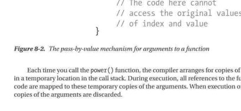

*图 8-2. 函数实参的按值传递机制*

每次调用 power() 函数时，编译器都会安排将实参的副本存储在调用栈中的临时位置。执行期间，代码中对函数形参的所有引用都会映射到这些实参的临时副本。函数执行结束时，实参的副本会被丢弃。

我们可以用一个简单示例演示其效果。下面的代码调用一个试图修改其某个实参的函数，当然，它彻底失败了：

```cpp
// Ex8_03.cpp
// Failing to modify the original value of a function argument
import <iostream>;

double changeIt(double value_to_be_changed);    // Function prototype

int main()
{
    double it {5.0};
    double result {changeIt(it)};

    std::cout << "After function execution, it = " << it
              << "\nResult returned is " << result << std::endl;
}

// Function that attempts to modify an argument and return it
double changeIt(double it)
{
    it += 10.0;                    // This modifies the copy
    std::cout << "Within function, it = " << it << std::endl;
    return it;
}
```

该示例产生以下输出：

```text
Within function, it = 15
After function execution, it = 5
Result returned is 15
```

输出表明，在 changeIt() 函数中给 it 加 10 对 main() 中的变量 it 没有影响。changeIt() 中的 it 变量是该函数的局部变量，它引用的是函数调用时传入的任意实参值的副本。当然，当 changeIt() 局部的 it 值被返回时，会创建其当前值的副本，而返回给调用程序的就是这个副本。

按值传递是向函数传递实参的默认机制。它通过防止函数修改调用函数拥有的变量，为调用函数提供了很大的安全性。然而，有时你确实希望修改调用函数中的值。需要时有没有办法做到这一点？当然有；一种方法是使用指针。

## 向函数传递指针

当函数形参是指针类型时，按值传递机制仍像之前一样运作。不过，指针包含另一个变量的地址；指针的副本包含相同的地址，因此指向同一个变量。

如果将第一个 changeIt() 函数的定义修改为接受 double* 类型的实参，就可以将 it 的地址作为实参传递。当然，还必须修改 changeIt() 函数体中的代码，以解引用指针形参。代码现在如下所示：

```cpp
// Ex8_04.cpp
// Modifying the value of a caller variable
import <iostream>;

double changeIt(double* pointer_to_it);    // Function prototype

int main()
{
    double it {5.0};
    double result {changeIt(&it)};          // Now we pass the address

    std::cout << "After function execution, it = " << it
              << "\nResult returned is " << result << std::endl;
}

// Function to modify an argument and return it
double changeIt(double* pit)
{
    *pit += 10.0;                           // This modifies the original double
    std::cout << "Within function, *pit = " << *pit << std::endl;
    return *pit;
}
```

该版本程序产生以下输出：

```text
Within function, *pit = 15
After function execution, it = 15
Result returned is 15
```

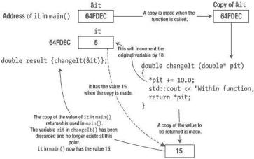

*图 8-3. 向函数传递指针*

这个版本的 changeIt() 仅用于说明指针形参如何允许修改调用函数中的变量——它并不是函数应如何编写的范例。由于你直接修改 it 的值，返回其值显得有些多余。

## 向函数传递数组

数组名本质上是一个地址，因此只需使用数组名就可以将数组的地址传递给函数。数组的地址会被复制并传递给函数。这带来了几个优点：

- 首先，传递数组的地址是将数组传递给函数的一种高效方式。按值传递所有数组元素会很耗时，因为每个元素都会被复制。事实上，你无法将数组中的所有元素作为单个实参按值传递，因为每个形参只表示一个数据项。
- 其次，更重要的是，由于函数处理的不是原始数组变量而是副本，函数体中的代码可以把表示数组的形参完全当作指针来处理，包括修改其包含的地址。这意味着你可以在函数体中对数组形参使用指针表示法的强大功能。在进入那部分之前，我们先尝试最直接的情况——使用数组表示法处理数组形参。

这个示例包含一个计算数组元素平均值的函数：

```cpp
// Ex8_05.cpp
// Passing an array to a function
import <iostream>;
import <array>;           // For std::size()

double average(double array[], size_t count);   // Function prototype

int main()
{
  double values[] {1.0, 2.0, 3.0, 4.0, 5.0, 6.0, 7.0, 8.0, 9.0, 10.0};
  std::cout << "Average = " << average(values, std::size(values)) << std::endl;
}

// Function to compute an average
double average(double array[], size_t count)
{
  double sum {};                       // Accumulate total in here
  for (size_t i {}; i < count; ++i)
    sum += array[i];                   // Sum array elements
  return sum / count;                  // Return average
}
```

这会产生以下简短输出：

```text
Average = 5.5
```

average() 函数可处理包含任意数量 double 元素的数组。从原型中可以看出，它接受两个实参：数组地址和元素数量计数。第一个形参的类型被指定为任意数量 double 类型值的数组。你可以将任何一维 double 类型元素数组作为实参传递给此函数，因此指定元素数量的第二个形参必不可少。函数将依赖调用方提供正确的 count 形参值。没有办法验证它是否正确，因此如果 count 的值大于数组长度，函数就会很乐意访问数组之外的内存位置。采用此定义时，确保这种情况不发生是调用方的责任。

顺便说明一下，你无法通过在 average() 函数内部使用 sizeof 运算符或 std::size() 来规避对 count 形参的需求。请记住，像 array 这样的数组形参只存储数组的地址，而不是数组本身。因此，表达式 sizeof(array) 返回的是包含数组地址的内存位置的大小，而不是整个数组的大小。用数组形参名调用 std::size() 将根本无法编译，因为 std::size() 也无法确定数组的大小。没有数组的定义，编译器无法确定其大小。它仅凭数组地址无法做到这一点。

在 average() 的函数体中，计算按你预期的方式表达。这与直接在 main() 中编写相同计算没有区别。average() 函数在 main() 的输出语句中被调用。第一个实参是数组名 values，第二个实参是求值为数组元素数量的表达式。

传递给 average() 的数组元素使用普通数组表示法访问。我们说过，也可以把传递给函数的数组当作指针，并使用指针表示法访问元素。在这种情况下，average() 如下所示：

```cpp
double average(double* array, size_t count)
{
  double sum {};
  for (size_t i {}; i < count; ++i)
    sum += *array++;        // Accumulate total in here
  return sum / count;       // Return average
}
```

无论从哪方面看，两种表示法都完全等价。事实上，正如你在第 5 章所见，可以自由混用这两种表示法。例如，你可以对指针形参使用数组表示法：

```cpp
double average(double* array, size_t count)
{
  double sum {};                 // Accumulate total in here
  for (size_t i {}; i < count; ++i)
    sum += array[i];             // Sum array elements
  return sum / count;            // Return average
}
```

这些函数定义的计算方式确实完全没有区别。事实上，编译器认为以下两个函数原型完全相同：

```cpp
double average(double array[], size_t count);
double average(double* array, size_t count);
```

我们将在后面关于函数重载的一节中重新讨论这一点。


> **注意** 关于将固定大小数组传递给函数，存在一种常见且可能危险的误解。考虑 average() 函数的以下变体：

```cpp
double average10(double array[10]) /* The [10] does not mean what you might expect! */
{
    double sum {};                 // Accumulate total in here
    for (size_t i {}; i < 10; ++i)
        sum += array[i];           // Sum array elements
    return sum / 10;               // Return average
}
```

显然，这个函数的作者编写它是为了精确计算十个值的平均值；不多也不少。我们邀请你将 Ex8_05.cpp 中的 average() 替换为前面的 average10() 函数，并相应地更新 main() 中的函数调用。生成的程序应该能够正常编译和运行。那么问题出在哪里？问题在于，这个函数的签名——不幸的是，它完全是合法的 C++ 语法——造成了一种错误预期：编译器会强制规定只能将大小恰好为十的数组作为参数传递给这个函数。为了验证，让我们看看如果修改示例程序中 main() 函数的主体，只传递三个值会发生什么（你可以在 Ex8_05A.cpp 中找到生成的程序）：

```cpp
double values[] { 1.0, 2.0, 3.0 };      // Only three values!!!
std::cout << "Average = " << average10(values) << std::endl;
```

尽管我们现在用一个远短于所需十个值的数组调用了 average10()，生成的程序仍然应该可以编译。如果你运行它，average10() 函数将盲目地读取远超 values 数组边界的内存。显然，这不会有什么好结果。程序要么崩溃，要么产生垃圾输出。

问题的根源在于，不幸的是，C++ 语言规定编译器应将这种形式的函数签名

```cpp
double average10(double array[10])
```

视为与以下两者同义：

```cpp
double average10(double array[])
double average10(double* array)
```

因此，在按值传递数组时，绝不应使用维度说明；它只会造成错误预期。按值传递的数组总是作为指针传递，编译器不会检查其维度。我们稍后会看到，可以改用按引用传递而不是按值传递，将给定大小的数组安全地传递给函数。

理论上，你也可以在第一个参数的类型说明中指定数组的第一维，但最好不要这样做。编译器同样会直接忽略这一点，类似于我们之前讨论的 average10() 函数的情况。不过，数组第二维的大小确实会产生预期效果——C++ 在这方面就是这么反复无常。任何以 4 作为第二维的二维数组都可以传递给这个函数，但以 3 或 5 作为第二维的数组则不行。

让我们通过一个具体示例尝试将二维数组传递给函数：

```cpp
// Ex8_06.cpp
// Passing a two-dimensional array to a function
import <iostream>;
import <array>;                // For std::size()

double yield(const double values[][4], size_t n);

int main()
{
  double beans[3][4] { { 1.0,  2.0,  3.0,  4.0},
                       { 5.0,  6.0,  7.0,  8.0},
                       { 9.0, 10.0, 11.0, 12.0} };

  std::cout << "Yield = " << yield(beans, std::size(beans))
            << std::endl;
}

// Function to compute total yield
double yield(const double array[][4], size_t size)
{
  double sum {};
  for (size_t i {}; i < size; ++i)   // Loop through rows
  {
    for (size_t j {}; j < std::size(array[i]); ++j) // Loop through elements in a row
    {
      sum += array[i][j];
    }
  }
  return sum;
}
```

这会产生以下输出：

```cpp
Yield = 78
```

yield() 函数的第一个参数被定义为由任意行、每行四个 double 类型元素组成的 const 数组。调用该函数时，第一个参数是 beans 数组，第二个参数是数组的长度。其计算结果为数组中的行数。

指针表示法并不特别适用于多维数组。在指针表示法中，嵌套 for 循环中的语句将如下所示：

```cpp
sum += *(*(array+i)+j);
```

想必你会同意，用数组表示法进行计算更清晰！

**注意** 由于编译器知道 array[i] 的大小，你可以将 Ex8_06 中 yield() 函数的内层循环替换为如下所示的基于范围的 for 循环：

```cpp
for (double val : array[i])    // Loop through elements in a row
{
    sum += val;
}
```

不过，你也不能同样地将外层循环替换为基于范围的 for 循环，也不能在那里使用 std::size()。请记住，编译器无法知道 double[][4] 数组的第一维；按值传递数组时，只能固定数组的第二维或更高维。

### 按引用传递

你可能还记得，*引用*是另一个变量的别名。你也可以将函数参数指定为引用，在这种情况下，函数对该参数使用*按引用传递*机制。调用函数时，与引用参数对应的实参不会被复制。相反，引用参数会用该实参进行初始化。因此，它成为调用函数中该实参的别名。在函数体中使用该参数名的任何地方，都好像是在直接访问调用函数中的实参值。

通过在类型名后添加 & 来指定引用类型。例如，要将参数类型指定为“对 string 的引用”，你会将该类型写为 string&。调用具有引用参数的函数与调用按值传递实参的函数没有区别。不过，对于 string 等类型的对象，使用引用可以提高性能。按值传递机制会复制对象，对于长字符串来说，这会耗时，而且也会耗内存。使用引用参数时，不会发生复制。

### 引用与指针

在许多方面，引用与指针相似。为了看出这种相似性，让我们使用 Ex8_04 的一个变体，其中包含两个函数：一个接受指针作为参数，另一个则接受引用：

```cpp
// Ex8_07.cpp
// Modifying the value of a caller variable - references vs pointers
import <iostream>;

void change_it_by_pointer(double* reference_to_it);    // Pass pointer (by value)
void change_it_by_reference(double& reference_to_it);  // Pass by reference

int main()
{
    double it {5.0};
    change_it_by_pointer(&it);        // Now we pass the address
    std::cout << "After first function execution, it = " << it << std::endl;

    change_it_by_reference(it);       // Now we pass a reference, not the value!
    std::cout << "After second function execution, it = " << it << std::endl;
}

void change_it_by_pointer(double* pit)
{
    *pit += 10.0;        // This modifies the original double
}
void change_it_by_reference(double& pit)
{
    pit += 10.0;        // This modifies the original double as well!
}
```

结果是 main() 中原来的 it 值被更新了两次，每次函数调用更新一次：

```cpp
After first function execution, it = 15
After second function execution, it = 25
```

最明显的区别是，要传递指针，你需要先使用取地址运算符取得该值的地址。当然，在函数内部，你还必须再次解引用该指针才能访问该值。对于按引用接受实参的函数，这两者都不需要做。但请注意，这种区别纯粹是语法上的；最终，两者效果相同。事实上，编译器大多会以与指针相同的方式编译引用。

那么，既然它们在功能上似乎等价，你应该使用哪种机制呢？这是个合理的问题。因此，让我们考虑一些在这个决定中起作用的方面。

指针最显著的特征是它可以是 nullptr，而引用必须始终引用某个对象。因此，如果你想允许空实参的可能性，就不能使用引用。当然，正因为指针参数可以为空，你几乎被迫在使用它之前始终检查 nullptr。引用的优点是你不必担心 nullptr。

如 Ex8_07 所示，调用具有引用参数的函数，其语法确实与调用按值传递实参的函数没有区别。一方面，由于不需要取地址和解引用运算符，引用参数允许更优雅的语法。然而，另一方面，恰恰因为没有语法上的区别，引用有时会带来意外。而令人意外的代码是糟糕的代码，因为意外会导致缺陷。例如，考虑以下函数调用：

```cpp
do_it(it);
```

如果没有 do_it() 的原型或定义，你无法知道这个函数的实参是按引用传递还是按值传递。因此，你也无法知道前面的语句是否会修改 it 值——当然，前提是 it 本身不是 const。按引用传递的这一特性有时会使代码更难理解；如果你没有预料到作为实参传递的值会被修改，就可能导致意外。因此：


**提示** 只要变量在初始化后其值不再需要改变，就始终将其声明为 `const`。这会让代码更可预测，因而更易读，也更不容易出现隐蔽的 bug。此外，或许更重要的是，在函数签名中，如果函数不会修改相应实参，就始终用 `const` 声明指针或引用参数。首先，这会让程序员更容易使用你的函数，因为他们只需查看函数签名就能轻松理解函数会修改什么、不会修改什么。其次，常量引用参数允许用 const 值调用你的函数。正如我们将在下一节展示的，const 值——如你现在所知，应尽可能使用——不能赋给非 const 引用参数。

总而言之，由于指针实参和引用实参非常相似，二者之间的选择并不总是泾渭分明。事实上，使用哪一种往往只是个人偏好问题。以下是一些指导原则：

- 如果希望允许 `nullptr` 实参，就不能使用引用。反过来，按引用传递可以看作一种契约：值不允许为空。还要注意，除了用可空指针表示可选值之外，你也可以考虑使用 `std::optional<>`。我们将在第 9 章讨论这个选项。
- 使用引用参数可以带来更优雅的语法，但可能掩盖函数正在修改某个值的事实。如果从上下文——例如从函数名——不能清楚看出会发生这种修改，就绝不要修改实参值。
- 由于潜在风险，一些编码指南建议绝不使用非 const 引用参数，并主张改为添加值参数或指向非 const 的指针参数。就个人而言，我们不会走到那么极端。非 const 引用本身并没有错，只要调用者能够预见到哪些实参可能会被修改。选择描述性的函数名和参数名，始终是让函数行为更可预测的良好起点。
- 通常更倾向于按常量引用传递实参，而不是传递指向 const 的指针值。由于这种情况非常常见，我们将在下一小节给出一个更大的示例。

## 输入参数与输出参数

在上一节中，你已经看到，引用参数使函数能够修改调用函数中的实参。然而，调用带引用参数的函数，在语法上与按值传递实参时调用函数无法区分。因此，在不修改实参的函数中，使用常量引用参数尤为重要。由于函数不会修改常量引用参数，编译器允许传入 const 和非 const 实参。但对于非 const 引用参数，只能提供非 const 实参。

让我们在 Ex7_06.cpp 的新版本中实现使用引用参数的效果，该版本从文本中提取单词：

```cpp
// Ex8_08.cpp
// Using a reference parameter
import <iostream>;
import <format>;
import <string>;
import <vector>;

using std::string;
using std::vector;

void find_words(vector<string>& words, const string& str, const string& separators);
void list_words(const vector<string>& words);

int main()
{
    std::string text;                    // The string to be searched
    std::cout << "Enter some text terminated by *:\n";
    std::getline(std::cin, text, '*');

    const std::string separators {",;.:\"?!\n"};  // Word delimiters
    std::vector<std::string> words;                 // Words found

    find_words(words, text, separators);
    list_words(words);
}

void find_words(vector<string>& words, const string& text, const string& separators)
{
    size_t start {text.find_first_not_of(separators)};  // First word start index

    while (start != string::npos)                    // Find the words
    {
        size_t end = text.find_first_of(separators, start + 1);  // Find end of word
        if (end == string::npos)                      // Found a separator?
            end = text.length();                      // No, so set end of text

        words.push_back(text.substr(start, end - start));  // Store the word
        start = text.find_first_not_of(separators, end + 1);  // Find 1st character of next word
    }
}

void list_words(const vector<string>& words)
{
    std::cout << "Your string contains the following " << words.size() << " words:\n";
    size_t count {};                              // Number of outputted words
    for (const auto& word : words)
    {
        std::cout << std::format("{:>15}", word);
        if (!(++count % 5))
            std::cout << std::endl;
    }
    std::cout << std::endl;
}
```

输出与 Ex7_06.cpp 相同。以下是一个示例：

```
Enter some text terminated by *:
Never judge a man until you have walked a mile in his shoes.
Then, who cares? He is a mile away and you have his shoes!*
Your string contains the following 26 words:

        Never        judge          a            man          until
          you         have         walked         a            mile
           in          his         shoes         Then           who
         cares         He            is            a            mile
          away         and          you          have           his
         shoes
```

现在除了 main() 之外还有两个函数：find_words() 和 list_words()。请注意，这两个函数中的代码与 Ex7_06.cpp 中 main() 里的代码相同。将程序划分为三个函数更易于理解，而且不会显著增加代码行数。

find_words() 函数在第二个实参所标识的字符串中查找所有单词，并将它们存储到第一个实参指定的 vector 中。第三个参数是一个包含单词分隔符字符的 string 对象。

find_words() 的第一个参数是一个引用，这避免了复制 vector<string> 对象。但更重要的是，它是对非 const vector 对象的引用——这允许我们在函数内部向该 vector 添加值。因此，这样的参数有时被称为*输出参数*，因为它用于收集函数的输出。而那些值纯粹用作输入的参数则被称为*输入参数*。

> **提示** 原则上，一个参数可以同时充当输入参数和输出参数。这样的参数被称为*输入输出参数*。带有这种参数的函数会以某种方式先从此参数读取，利用该输入产生一些输出，然后将结果存回同一个参数。不过，通常最好避免输入输出参数，即使这意味着要给函数增加一个额外参数。如果每个参数只承担单一用途——参数应当要么是输入，要么是输出，而不是二者兼有——代码往往更容易理解。

find_words() 函数不会修改传给第二个和第三个参数的值。换句话说，二者都是输入参数，因此绝不应按非 const 引用传递。非 const 引用参数应保留给需要修改原始值的情形——换句话说，保留给输出参数。对于输入参数，只剩下两个主要选项：按常量引用传递或按值传递。而由于 string 对象否则会被复制，唯一合乎逻辑的结论就是将输入参数声明为 const string&。

事实上，如果你把 find_words() 的第三个参数声明为对非 const string 的引用，代码甚至无法编译。不妨试一试。原因在于，main() 中函数调用的第三个实参 separators 是一个 const string 对象。不能将 const 对象作为非 const 引用参数的实参传入。也就是说，可以把非 const 实参传给常量引用参数，但绝不能反过来。简而言之，T 值可以传给 T& 和 const T& 引用，而 const T 值只能传给 const T& 引用。这是完全合乎逻辑的。如果你有一个允许修改的值，把它传给不会修改它的函数并无害处——不修改一个你本来可以修改的东西是没问题的。反过来则不成立：如果你有一个 const 值，最好不允许把它传给可能修改它的函数！


`list_words()` 的最后一个参数是对 const 的引用，因为它也是一个输入参数。该函数只访问实参；不会修改它。

> **提示** 输入参数通常应为对 const 的引用。只有较小的值，尤其是基本类型的值，才应按值传递。仅在输出参数中使用对非 const 的引用，而且即便如此，你也常常应考虑改为返回值。我们很快会学习如何从函数返回值。

## 按引用传递数组

乍看之下，对于数组而言，按引用传递它们似乎没有什么好处。毕竟，如果按值传递数组，数组元素本身并不会被复制。相反，复制的是指向数组第一个元素的指针。传递数组也已经允许你修改原数组的值——当然，除非你加上 `const`。那么，这想必已经涵盖了通常归因于按引用传递的两个优点：不复制，以及可以修改原值？

虽然这当然没错，但你之前已经发现了按值传递数组的主要限制，即无法在函数签名中指定数组的第一维，至少无法以让编译器强制只将恰好该大小的数组传递给函数的方式指定。不过，一个鲜为人知的事实是，你可以通过按引用传递数组来实现这一点。

为了说明这一点，我们请你再次将 `Ex8_05.cpp` 中的 `average()` 函数替换为 `average10()` 函数，但这次使用以下变体：

```cpp
double average10(const double (&array)[10])  // Only arrays of length 10 can be passed
{
    double sum {};                            // Accumulate total in here
    for (size_t i {}; i < 10; ++i)
        sum += array[i];                       // Sum array elements
    return sum / 10;                           // Return average
}
```

如你所见，按引用传递数组的语法稍微复杂一些。原则上，参数类型中可以省略 `const`，但这里更倾向于保留它，因为你不想在函数体中修改数组的值。不过，`array` 外面额外的圆括号是必需的。没有它们，编译器将不再把参数类型解释为对 double 数组的引用，而是解释为对 double 的引用的数组。由于 C++ 不允许引用数组，这会导致编译错误。

```cpp
double average10(const double& array[10])  // Error: array of double& is not allowed
```

有了我们新的改进版 `average10()`，编译器确实达到了预期。现在，尝试传递不同长度的数组会如期望那样导致编译错误：

```cpp
double values[] { 1.0, 2.0, 3.0 };       // Only three values!!!
std::cout << "Average = " << average10(values) << std::endl;  // Error...
```

此外请注意，如果按引用传递固定大小的数组，它可以作为 `sizeof()`、`std::size()` 和基于范围的 for 循环等操作的输入。对于按值传递的数组，这是不可能的。你可以利用这一点消除 `average10()` 函数体中出现两次的 10：

```cpp
double average10(const double (&array)[10])
{
    double sum {};                    // Accumulate total in here
    for (double val : array)
        sum += val;                   // Sum array elements
    return sum / std::size(array);    // Return average
}
```

> **提示** 你已经在第5章见过处理固定长度数组的一种更现代的替代方案：`std::array<>`。使用这种类型的值，你可以同样安全地按引用传递固定大小的数组，而且无需记住按引用传递普通固定大小数组的棘手语法。
>
> ```cpp
> double average10(const std::array<double,10>& values)
> ```
>
> 在第9章，我们会解释一种可能更好的替代方案，即 `std::span<double, 10>`。

我们为你提供了该程序的三个变体：`Ex8_09A` 使用按引用传递；`Ex8_09B` 消除了魔数；`Ex8_09C` 展示 `std::array<>` 的用法。

### 引用与隐式转换

程序常常使用许多不同的类型，而如你所知，编译器通常很乐意通过隐式转换来帮助你。不过，你是否应该总是乐于接受这类转换则是另一回事。撇开这一点不谈，大多数时候，像下面这样的代码能够顺利编译是很方便的，即使它把一个 `int` 值赋给了一个类型不同的 `double` 变量：

```cpp
int i{};        // Declare some differently typed variables
double d{};
d = i;          // Implicit conversion from int to double
```

对于采用按值传递的函数实参，发生这类转换也很自然。例如，给定同样的两个变量 `i` 和 `d`，签名为 `f(double)` 的函数因此不仅可以用 `f(d)` 或 `f(1.23)` 调用，还可以用类型不同的实参调用，如 `f(1)`、`f(123)` 或 `f(1.23f)`。

因此，对于按值传递，隐式转换仍然相当直接。我们来看看它们在引用实参下表现如何：

```cpp
// Ex8_10.cpp
// Implicit conversions of reference parameters
import <iostream>;

void double_it(double& it)       { it *= 2; }
void print_it(const double& it) { std::cout << it << std::endl; }

int main()
{
    double d(123);
    double_it(d);
    print_it(d);

    int i(456);
    // double_it(i);          /* error, does not compile! */
    print_it(i);
}
```

我们首先定义两个简单的函数：一个将 double 值翻倍，另一个将它们流式输出到 std::cout。然后 main() 的第一部分表明，这些函数当然适用于 double 变量——显然，因此你应该会在输出中看到数字 246。这个示例中有趣的部分是最后两条语句，其中第一条被注释掉了，因为它无法编译。

我们先来看 print_it() 语句，并解释为什么这能正常工作本身已经算是一个小小的奇迹。函数 print_it() 操作的是对 const double 的引用；如你所知，这个引用应当充当在别处定义的 double 的别名。在典型系统上，print_it() 最终会读取该引用背后内存位置中的八个字节，并将在那里找到的 64 位以某种人类可读格式打印到 std::cout。但我们作为实参传给函数的值并不是 double，而是 int！这个 int 通常只有四个字节大，其 32 位的布局与 double 完全不同。那么，如果程序中任何地方都没有定义这样的 double，这个函数怎么能从 double 的别名读取呢？答案是，编译器在调用 print_it() 之前，会在内存中某处隐式创建一个临时 double 值，将转换后的 int 值赋给它，然后把指向这个临时内存位置的引用传递给 print_it()。

这类隐式转换仅支持对 const 的引用参数，不支持对非 const 的引用参数。假设为了讨论起见，倒数第二行的 double_it() 语句能够无错误地编译。那么编译器想必会类似地将 int 值 456 转换为 double 值 456.0，将这个临时 double 存储在内存中某处，并对它应用 double_it() 的函数体。然后你会在某处得到一个临时 double，其值现在为 912.0，而 int 值 i 仍然等于 456。现在，虽然理论上编译器可以将得到的临时值再转换回 int，但 C++ 编程语言的设计者认为那太过分了。原因是这类逆向转换通常不可避免地意味着信息丢失。在我们的例子中，这会涉及从 double 到 int 的转换，至少会导致数字的小数部分丢失。因此，对于对非 const 的引用参数，永远不允许创建临时对象。这也是为什么在标准 C++ 中语句 double_it(i) 无效，并且应当编译失败的原因。

### 默认参数值

在许多情况下，为一个或多个函数参数设置默认实参值会很有用。这样你就可以仅在你需要与默认值不同的值时指定实参值。一个简单的例子是输出标准错误消息的函数。大多数时候，默认消息就足够了，但偶尔需要另一种消息。你可以通过在函数原型中指定默认参数值来实现。你可以像这样定义一个输出消息的函数：

```cpp
void show_error(std::string message)
{
    std::cout << message << std::endl;
}
```

你可以像这样指定默认实参值：

```cpp
void show_error(std::string message = "Program Error");
```

如果两者是分开的，你需要在函数原型中指定默认值，而不是在函数定义中指定。原因是在解析函数调用时，编译器需要知道给定数量的实参是否可接受。

要输出默认消息，你在调用这类函数时不提供相应的实参：

```cpp
show_error();        // Outputs "Program Error"
```

要输出特定消息，你指定该实参：

```cpp
show_error("Nothing works!");
```

在前面的示例中，参数是按值传递的。当然，你也可以用同样的方式为以常量引用传递的参数指定默认值：

```cpp
void show_error(const std::string& message = "Program Error");  // Better...
```

根据你在上一节学到的内容，以下情况也不应令人意外：如果默认值的隐式转换需要创建临时对象——就像我们的示例中那样——那么对于非 const 引用参数来说，这是非法的。因此，下面的代码不应编译通过：

```cpp
void show_error(std::string& message = "Program Error");  /* Does not compile */
```

指定默认参数值可以使函数更易于使用。当然，你不限于只有一个参数带默认值。

> **注意** 我们将在第 9 章进一步讨论字符串字面量到临时字符串对象的隐式实参转换。剧透警告：常量字符串引用参数的性能总体上会变得次优，正是因为它们有时需要创建这样的临时字符串对象。

### 多个默认参数值

所有带默认值的函数参数都必须集中放在参数列表的末尾。在函数调用中省略某个实参时，列表中后续的所有实参也必须省略。因此，带默认值的参数应按从最不可能被省略到最可能被省略的顺序排列在末尾。这些规则是编译器能够处理函数调用所必需的。

让我们构造一个具有多个默认参数值的函数示例。假设你编写了一个函数来显示一个或多个数据值，每行显示若干个，如下所示：

```cpp
void show_data(const int data[], size_t count, const std::string& title,
               size_t width, size_t perLine)
{
    std::cout << title << std::endl;     // Display the title

    // Output the data values
    for (size_t i {}; i < count; ++i)
    {
        std::cout << std::format("{:{}}", data[i], width); // Display a data item
        if ((i+1) % perLine == 0)                         // Newline after perLine values
            std::cout << '\n';
    }
    std::cout << std::endl;
}
```

`data` 参数是要显示的值数组，`count` 表示有多少个值。类型为 `const std::string&` 的第三个参数指定用于输出开头的标题。第四个参数确定每个项的字段宽度，最后一个参数是每行的数据项数。这个函数有很多参数。这显然适合使用默认参数值！下面是一个示例：

```cpp
// Ex8_11.cpp
// Using multiple default parameter values
import <iostream>;
import <format>;
import <string>;

// The function prototype including defaults for parameters
void show_data(const int data[], size_t count = 1,
               const std::string& title = "Data Values",
               size_t width = 10, size_t perLine = 5);
int main()
{
   int samples[] {1, 2, 3, 4, 5, 6, 7, 8, 9, 10, 11, 12};

   int dataItem {-99};
   show_data(&dataItem);

   dataItem = 13;
   show_data(&dataItem, 1, "Unlucky for some!");

   show_data(samples, std::size(samples));
   show_data(samples, std::size(samples), "Samples");
   show_data(samples, std::size(samples), "Samples", 6);
   show_data(samples, std::size(samples), "Samples", 8, 4);
}
```

Ex8_11.cpp 中 `show_data()` 的定义可以取自本节前面的内容。以下是输出：

```
Data Values
    -99
Unlucky for some!
     13
Data Values
      1       2       3       4       5
      6       7       8       9      10
     11      12
Samples
      1       2       3       4       5
      6       7       8       9      10
     11      12
Samples
      1   2   3   4   5
      6   7   8   9  10
     11  12
Samples
      1       2       3       4
      5       6       7       8
      9      10      11      12
```

`show_data()` 的原型为除第一个参数之外的所有参数指定了默认值。调用这个函数有五种方式：你可以指定全部五个实参，也可以省略最后两个、最后三个或最后四个。你可以只提供第一个实参来输出单个数据项，只要你对剩余参数的默认值满意即可。

记住，你只能在参数列表末尾省略实参；不允许省略第二个和第五个实参。下面是一个示例：

```
show_data(samples, , "Samples", 15);              // Wrong!
```

### main() 的实参

你可以定义 `main()`，使其接受程序执行时在命令行输入的实参。可以为 `main()` 指定的参数是标准化的；你可以定义不带参数的 `main()`，也可以按以下形式定义 `main()`：

```cpp
int main(int argc, char* argv[])
{
    // Code for main()...
}
```

第一个参数 `argc` 是命令行中发现的字符串实参数量。由于历史原因，它的类型是 `int`，而不是你可能根据一个不能为负的参数所预期的 `size_t`。第二个参数 `argv` 是指向命令行实参的指针数组，其中包括程序名。数组类型意味着所有命令行实参都作为

假设你定义一个函数，返回两个实参值中较大者的地址。这可以用在赋值语句的左侧，以便你可以更改包含较大值的变量，例如在这样的语句中：

```cpp
*larger(value1, value2) = 100;    // Set the larger variable to 100
```

实现这一点时很容易误入歧途。下面是一个不能正常工作的实现：

```cpp
int* larger(int a, int b)
{
    if (a > b)
        return &a;       // Wrong!
    else
        return &b;       // Wrong!
}
```

很容易看出问题所在：`a` 和 `b` 是函数的局部变量。实参值被复制到局部变量 `a` 和 `b`。当你返回 `&a` 或 `&b` 时，这些地址上的变量在调用函数中已不再存在。编译这段代码时，你通常会从编译器那里收到警告。你可以将参数指定为指针：

```cpp
int* larger(int* a, int* b)
{
    if (*a > *b)
        return a;       // OK
    else
        return b;       // OK
}
```

如果这样做，不要忘记同时解引用这些指针。前面的条件 `(a > b)` 仍然可以编译，但那时你比较的就不是值本身了。你比较的将是保存这些值的内存位置的地址。你可以用下面的语句调用该函数：

```cpp
*larger(&value1, &value2) = 100;    // Set the larger variable to 100
```

返回两个值中较大者地址的函数并不是特别有用，但让我们考虑更实用的东西。假设我们需要一个程序来归一化一组 `double` 类型的值，使它们都位于 0.0 到 1.0（含端点）之间。为了归一化这些值，我们可以先从中减去最小样本值，使它们全部变为非负。两个函数将有助于完成这件事：一个用于查找最小值，另一个用于按任意给定数量调整这些值。下面是第一个函数的定义：

```cpp
const double* smallest(const double data[], size_t count)
{
    if (!count) return nullptr;    // There is no smallest in an empty array

    size_t index_min {};
    for (size_t i {1}; i < count; ++i)
        if (data[index_min] > data[i])
            index_min = i;
```


```cpp
    return &data[index_min];
}
```

看懂这里发生了什么应该不难。最小值的索引存储在 index_min 中，它被随意初始化为指向第一个数组元素。循环将 index_min 处元素的值与其他每个元素的值进行比较，当某个元素更小时，就将其索引记录到 index_min 中。该函数返回数组中最小值的地址。返回索引可能更合理，但我们在这里主要是演示指针返回值等内容。第一个参数是 const，因为函数不修改数组。对于这个 const 参数，必须将返回类型指定为 const。编译器不允许你返回指向 const 数组元素的非 const 指针。

按给定数量调整数组元素值的函数如下所示：

```cpp
double* shift_range(double data[], size_t count, double delta)
{
    for (size_t i {}; i < count; ++i)
        data[i] += delta;
    return data;
}
```

这个函数将第三个参数的值加到每个数组元素上。返回类型可以是 void，这样它不返回任何内容，但返回 data 的地址使该函数可以作为参数传给另一个接受数组的函数。当然，仍然可以在不存储或以其他方式使用返回值的情况下调用该函数。

你可以将此函数与前一个函数结合使用，调整数组 samples 中的值，使所有元素都非负：

```cpp
const size_t count {std::size(samples)};   // Element count
shift_range(samples, count, -*smallest(samples, count)); // Subtract smallest
```

传给 shift_range() 的第三个参数调用了 smallest()，它返回指向最小元素的指针。该表达式对值取负，因此 shift_range() 会从每个元素中减去最小值，以实现我们想要的效果。现在 samples 中的元素从零到某个正的上限。要将这些值映射到 0 到 1 的范围，我们需要将每个元素除以最大元素。首先需要一个查找最大值的函数：

```cpp
const double* largest(const double data[], size_t count)
{
    if (!count) return nullptr;     // There is no largest in an empty array

    size_t index_max {};
    for (size_t i {}; i < count; ++i)
        if (data[index_max] < data[i])
            index_max = i;

    return &data[index_max];
}
```

其工作方式与 `smallest()` 基本相同。我们可以使用一个函数，通过除以给定值来缩放数组元素：

```cpp
double* scale_range(double data[], size_t count, double divisor)
{
    if (!divisor) return data;    // Do nothing for a zero divisor

    for (size_t i {}; i < count; ++i)
        data[i] /= divisor;
    return data;
}
```

除以零会是一场灾难，因此当第三个参数为零时，函数只返回原数组。我们可以将此函数与 `largest()` 结合使用，将现在从 0 到某个最大值的元素缩放到 0 到 1 的范围：

```cpp
scale_range(samples, count, *largest(samples, count));
```

当然，用户可能更希望有一个能将数值数组归一化的函数，从而避免陷入这些繁琐细节：

```cpp
double* normalize_range(double data[], size_t count)
{
    shift_range(data, count, -*smallest(data, count));
    return scale_range(data, count, *largest(data, count));
}
```

让我们看看它在实践中是否一切正常：

```cpp
// Ex8_13.cpp
// Returning a pointer
import <iostream>;
import <format>;        // for std::size()
import <array>;
import <string>;

void show_data(const double data[], size_t count = 1,
               const std::string& title = "Data Values",
               size_t width = 10, size_t perline = 5);
const double* largest(const double data[], size_t count);
const double* smallest(const double data[], size_t count);
double* shift_range(double data[], size_t count, double delta);
double* scale_range(double data[], size_t count, double divisor);
double* normalize_range(double data[], size_t count);

int main()
{
    double samples[] {
                    11.0, 23.0, 13.0,  4.0,
                    57.0, 36.0, 317.0, 88.0,
                    9.0, 100.0, 121.0, 12.0
        };

    const size_t count{std::size(samples)};             // Number of samples
    show_data(samples, count, "Original Values");       // Output original values
    normalize_range(samples, count);                    // Normalize the values
    show_data(samples, count, "Normalized Values", 12); // Output normalized values
}
```

```cpp
// Outputs an array of double values
void show_data(const double data[], size_t count,
               const std::string& title, size_t width, size_t perline)
{
    std::cout << title << std::endl;  // Display the title

    // Output the data values
    for (size_t i {}; i < count; ++i)
    {
        // Display a data item (uses a dynamic field width: see Chapter 7)
        std::cout << std::format("{:{}.6g}", data[i], width);
        if ((i + 1) % perline == 0)     // Newline after perline values
            std::cout << '\n';
    }
    std::cout << std::endl;
}
```

如果你编译并运行这个示例，并加上前面展示的 largest()、smallest()、shift_range()、scale_range() 和 normalize_range() 的定义，你应该会得到以下输出：

```text
Original Values
        11      23      13       4      57
        36     317      88       9     100
       121      12
Normalized Values
  0.0223642  0.0607029  0.028754      0  0.169329
   0.102236         1  0.268371  0.0159744  0.306709
   0.373802  0.0255591
```

输出表明结果符合要求。main() 中的最后两条语句可以通过将 normalize_range() 返回的地址作为第一个参数传给 show_data() 来合并为一条：

```cpp
show_data(normalize_range(samples, count), count, "Normalized Values", 12);
```

这样更简洁，但显然并不更清晰。

## 返回引用

从函数返回指针很有用，但可能带来问题。指针可以为空，而解引用 nullptr 通常会导致程序失败。解决方案——你肯定已经从本节标题猜到了——就是返回引用。引用是另一个变量的别名，因此我们可以给出以下关于引用的黄金法则：

> **注意** *永远不要返回函数中自动局部变量的引用。*

通过返回引用，你可以让对该函数的调用出现在赋值操作的左侧。事实上，从函数返回引用是使函数能够（无需解引用）出现在赋值操作左侧的唯一方式。
假设你编写一个 larger() 函数，如下所示：

```cpp
std::string& larger(std::string& s1, std::string& s2)
{
    return s1 > s2 ? s1 : s2;    // Return a reference to the larger string
}
```

返回类型是“string 的引用”，参数是非 const 值的引用。因为你想返回指向两个参数之一的非 const 引用，所以不能将参数指定为 const。
你可以使用该函数更改两个参数中较大的那个，如下所示：

```cpp
std::string str1 {"abc"};
std::string str2 {"adcf"};
larger(str1, str2) = "def";
```

由于参数不是 const，你不能将字符串字面量用作参数；编译器不会允许这样做。非 const 引用参数允许更改值，而更改常量不是编译器会明知故犯地允许的事情。如果将参数设为 const，就不能将非 const 引用用作返回类型。
我们现在不会详细考察使用引用返回类型的扩展示例，但可以肯定，不久之后你还会再次遇到它们。你将会发现，在使用类创建自己的数据类型时，引用返回类型会变得至关重要。

## 返回与输出参数

你现在知道函数将产生的结果传回调用者的两种方式：它可以返回值，也可以将值放入输出参数。在 Ex8_08 中，你遇到了后者的以下示例：

```cpp
void find_words(vector<string>& words, const string& str, const string& separators);
```

不过，声明此函数的另一种方式如下：

```cpp
vector<string> find_words(const string& str, const string& separators);
```


当你的函数输出一个对象时，你当然不希望这个对象被复制，尤其是当这个对象复制成本很高时，例如字符串 vector。在 C++11 之前，当时推荐的方法主要是使用输出参数。这是你能绝对确保在从函数返回 vector<> 时，vector<> 中的所有字符串都不会被复制的唯一方法。然而，随着 C++11 的出现，这一建议发生了巨大变化：

> **提示**  在现代 C++ 中，通常应优先选择返回值而不是输出参数。这使函数签名和调用更易读。参数用于输入，所有输出都通过返回值返回。使这成为可能的机制称为*移动语义*，将在第 18 章详细讨论。简而言之，移动语义确保返回管理动态分配内存的对象（例如 vector 和 string）时不再涉及复制该内存，因此开销非常低。值得注意的例外是数组或包含数组的对象，例如 `std::array<>`。对于这些情况，仍然最好使用输出参数。

## 返回类型推导

正如你可以让编译器根据变量的初始化来推导其类型一样，你也可以让编译器根据函数定义来推导函数的返回类型。例如，你可以这样写：

```
auto getAnswer() { return 42; }
```

根据这个定义，编译器将推导出 getAnswer() 的返回类型是 int。当然，对于像 int 这样短的类型名，使用 auto 没有什么意义。事实上，它甚至会多打一个字母。但你会遇到冗长得多类型名（迭代器是经典例子）。对于这些情况，类型推导可以节省时间。或者你可能希望函数返回与某个其他函数相同的类型，并且由于某种原因，你觉得没必要去查那个类型是什么或把它写出来。一般来说，这里适用的考虑与使用 auto 声明变量时相同。如果从上下文足够清楚类型会是什么，或者确切类型名对代码清晰度影响不大，那么返回类型推导会很实用。

> **注意**  返回类型推导另一个实用的场景是指定函数模板的返回类型。你将在第 10 章学习这一点。

编译器甚至可以推导包含多个 return 语句的函数的返回类型，前提是这些语句的表达式求值得到的值类型完全相同。也就是说，不会执行隐式转换，因为编译器无法决定要推导出哪种不同类型。例如，考虑下面这个函数，它以另一个字符串的形式获取字符串的首字母：

```
auto getFirstLetter(const std::string& text) // function to get first letter,
{
    if (text.empty())                       // not as a char but as another string
        return "";                          // deduced type: const char*
    else
        return text.substr(0, 1);            // deduced type: std::string
}
```

当然，这条规则并非返回类型推导特有。如果你使用 `auto` 声明局部变量，也同样如此：

```cpp
std::string test = "Your powers of deduction never cease to amaze me";
const std::string& ref_to_test = test;
auto auto_test = ref_to_test;
```

在前面的代码片段中，`auto_test` 的类型为 `std::string`，因此包含 `test` 的一个副本。与 `ref_to_test` 不同，这个新副本也不再是 const 的。

## 静态变量

到目前为止你见过的函数中，函数体内部不会在一次执行到下一次执行之间保留任何内容。假设你想统计一个函数被调用了多少次。你该怎么做？一种方法是在文件作用域定义一个变量，并在函数内部递增它。这样做的一个潜在问题是，文件中的任何函数都可以修改该变量，因此你无法确保它只在应该递增时才递增。

更好的解决方案是在函数体中将变量定义为 static。你在函数内定义的静态变量会在其定义第一次执行时创建。然后它会一直存在，直到程序终止。这意味着你可以将值从一次函数调用保留到下一次调用。要将变量指定为 static，在定义中的类型名前加上 static 关键字。让我们考虑这个简单示例：

```cpp
unsigned int nextInteger()
{
    static unsigned int count {0};
    return ++count;
}
```

以 static 开头的语句第一次执行时，count 被创建并初始化为 0。该语句后续执行不再有进一步效果。然后这个函数递增静态变量 count 并返回递增后的值。因此第一次调用该函数时，它返回 1。第二次调用时，它返回 2。每次调用该函数时，它返回的整数都比前一个值大 1。count 只在第一次调用函数时创建并初始化一次。后续调用只是递增 count 并返回结果值。只要程序在执行，count 就一直存在。

你可以将任何类型的变量指定为 static，并且可以将静态变量用于任何你想从一次函数调用保留到下一次调用的内容。例如，你可能想保留上次读取的文件记录编号，或先前参数中的最大值。

如果你不初始化静态变量，它将默认进行零初始化。因此在前面的示例中，你可以省略 `{0}` 初始化，仍然得到相同结果。不过要小心，因为普通局部变量不会发生这种零初始化。如果你不初始化这些变量，它们将包含垃圾值。

## 函数重载

你经常会发现需要两个或多个本质上做同样事情但参数类型不同的函数。Ex8_13.cpp 中的 largest() 和 smallest() 函数很可能就是候选。你会希望这些操作能用于不同类型的数组，例如 int[]、double[]、float[]，甚至 string[]。理想情况下，所有这类函数都应具有相同名称，即 largest() 或 smallest()。函数重载使这成为可能。

函数重载允许程序中的多个函数具有相同名称，只要它们的参数列表彼此不同即可。你在本章前面学过，编译器通过函数签名来识别函数，签名是函数名和参数列表的组合。重载函数名称相同，因此每个重载函数的签名必须仅通过参数列表来区分。这使编译器能够根据实参列表为每次函数调用选择正确的函数。如果以下至少一项为真，则两个同名函数是不同的：

- 函数的参数数量不同。
- 至少一对对应参数的类型不同。

> **注意**  函数的返回类型不是函数签名的一部分。为了决定使用哪个函数重载，编译器只查看函数参数和实参的数量与类型。如果你声明两个同名且参数列表相同但返回类型不同的函数，程序将编译失败。

下面是一个使用 largest() 函数重载版本的示例：

```cpp
// Ex8_14.cpp
// Overloading a function
import <iostream>;
import <string>;
import <vector>;

// Function prototypes
double largest(const double data[], size_t count);
double largest(const std::vector<double>& data);
int largest(const std::vector<int>& data);
std::string largest(const std::vector<std::string>& words);
// int largest(const std::vector<std::string>& words);
         /* Above function overload would not compile: overloaded functions
            must differ in more than just their return type! */

int main()
{
    double array[] {1.5, 44.6, 13.7, 21.2, 6.7};
    std::vector<int> numbers {15, 44, 13, 21, 16, 8, 5, 2};
    std::vector<double> data{3.5, 5, 6, -1.2, 8.7, 6.4};
    std::vector<std::string> names {"Charles Dickens", "Emily Bronte",
                                    "Jane Austen", "Henry James", "Arthur Miller"};
    std::cout << "The largest of array is " << largest(array, std::size(array))
              << std::endl;
}
```

```cpp
    std::cout << "The largest of numbers is " << largest(numbers) << std::endl;
    std::cout << "The largest of data is " << largest(data) << std::endl;
    std::cout << "The largest of names is " << largest(names) << std::endl;
}

// Finds the largest of an array of double values
double largest(const double data[], size_t count)
{
    double max{ data[0] };
    for (size_t i{ 1 }; i < count; ++i)
        if (max < data[i]) max = data[i];
    return max;
}

// Finds the largest of a vector of double values
double largest(const std::vector<double>& data)
{
    double max {data[0]};
    for (auto value : data)
        if (max < value) max = value;
    return max;
}

// Finds the largest of a vector of int values
int largest(const std::vector<int>& data)
{
    int max {data[0]};
    for (auto value : data)
        if (max < value) max = value;
    return max;
}

// Finds the largest of a vector of string objects
std::string largest(const std::vector<std::string>& words)
{
    std::string max_word {words[0]};
    for (const auto& word : words)
        if (max_word < word) max_word = word;
    return max_word;
}
```

这将产生以下输出：

```text
The largest of array is 44.6
The largest of numbers is 44
The largest of data is 8.7
The largest of names is Jane Austen
```

编译器根据参数列表选择要在`main()`中调用的`largest()`版本。每个版本的函数都有唯一的签名，因为参数列表不同。需要注意的是，接受`vector<T>`实参的形参是引用。如果未将它们指定为引用，vector对象将按值传递，从而被复制。对于元素很多的vector，这可能会代价高昂。数组类型的参数则不同。在这种情况下，只传递数组的地址，因此它们不需要是引用类型。

> **注意** Ex8_14.cpp 中的几个`largest()`函数是否让你感到困扰？它们只针对不同的类型，却有着完全相同的实现。如果是，那很好。一个好的程序员应该始终警惕多次重复相同的代码——不仅仅是因为程序员是一群懒惰的人。稍后，我们将把这种代码称为*重复代码*，并为你解释这样做的其他一些缺点，除了需要大量输入之外。为了避免这种特定类型的重复——多个函数执行相同的任务，但参数类型不同——你需要函数模板。你将在第10章中了解函数模板。

## 重载与指针参数

指向不同类型的指针是不同的，因此以下原型声明了不同的重载函数：

```cpp
int largest(int* pValues, size_t count);   // Prototype 1
int largest(float* pValues, size_t count);  // Prototype 2
```

请注意，`int*`类型的参数与`int []`参数类型的处理方式相同。因此，以下原型声明了与前面的原型1相同的函数：

```cpp
int largest(int values[], size_t count);   // Identical signature to prototype 1
```

无论使用哪种参数类型，参数都是一个地址，因此没有区别。事实上，你可能还记得之前，即使是下面的原型也声明了相同的函数：

```cpp
int largest(int values[100], size_t count);   // Identical signature to prototype 1
```

由于编译器会完全忽略这类数组维度说明，我们之前认为它们具有危险的误导性，并建议你永远不要使用这种形式。如果你确实需要维度说明，推荐的做法是使用`std::array<>`，或者按引用传递数组。

## 重载与引用参数

重载带引用参数的函数时需要小心。你不能用一个参数类型为`data_type`的函数去重载一个参数类型为`data_type&`的函数。编译器无法根据参数确定你想要哪个函数。以下原型说明了这个问题：

```cpp
void do_it(std::string number);    // These are not distinguishable...
void do_it(std::string& number);   // ...from the argument type
```

第8章 | 定义函数

假设你编写以下语句：

```cpp
std::string word {"egg"};

do_it(word);                 // Calls which???
```

第二条语句可以调用任一函数。编译器无法确定应该调用`do_it()`的哪个版本。因此，你不能基于一个版本的参数是给定类型，而另一个版本的参数是该类型的引用，来区分重载函数。

当你的重载函数中，一个版本的参数类型为`type1`，另一个版本的参数是`type2`的引用时，你也应该保持警惕——即使`type1`和`type2`不同。调用哪个函数取决于你使用的参数种类，但你可能会得到一些令人惊讶的结果。让我们通过一个示例来稍作探讨：

```cpp
// Ex8_15.cpp
// Overloading a function with reference parameters
import <iostream>;
import <format>;

double larger(double a, double b);  // Non-reference parameters
long& larger(long& a, long& b);     // Reference parameters

int main()
{
    double a_double {1.5}, b_double {2.5};
    std::cout << std::format("The larger of double values {} and {} is {}\n",
                             a_double, b_double, larger(a_double, b_double));

    int a_int {15}, b_int {25};
    std::cout << std::format("The larger of int values {} and {} is {}\n",
                             a_int, b_int,
                             larger(static_cast<long>(a_int), static_cast<long>(b_int)));
}

// Returns the larger of two floating point values
double larger(double a, double b)
{
    std::cout << "double larger() called." << std::endl;
    return a > b ? a : b;
}

// Returns the larger of two long references
long& larger(long& a, long& b)
{
    std::cout << "long ref larger() called" << std::endl;
    return a > b ? a : b;
}
```

这将产生以下输出：

```text
double larger() called.
The larger of double values 1.5 and 2.5 is 2.5.
double larger() called.
The larger of int values 15 and 25 is 25.0
```

输出的第三行可能并非你所预料的那样。你可能期望`main()`中的第二条输出语句调用带有`long&`参数的`larger()`版本。而这条语句却调用了带有double参数的版本——但这是为什么呢？是什么导致两个参数都被转换为long？

问题恰恰就在这里。参数不是`a_int`和`b_int`，而是转换为`long`类型后包含相同值的临时位置。正如我们之前解释过的，编译器不会使用临时地址来初始化非const引用。

那么，你能对此做些什么呢？你有几个选择。如果`a_int`和`b_int`是`long`类型，编译器将调用参数类型为`long&`的`larger()`版本。如果变量不能是`long`类型，你可以将参数指定为const引用，如下所示：

```cpp
long larger(const long& a, const long& b);
```

显然，你也必须更改函数原型。该函数既可以接受const参数，也可以接受非const参数。编译器知道该函数不会修改参数，因此对于作为临时值的参数，它将调用这个版本，而不是带有double参数的版本。注意，现在返回类型是`long`。如果你坚持要返回引用，返回类型必须是`const`，因为编译器无法将const引用转换为非const引用。

## 重载与const参数

`const`参数只有在作为引用或指针参数时才能与非`const`参数区分开来。例如，对于`int`这样的基本类型，`const int`与`int`是相同的。因此，以下原型是无法区分的：

```cpp
long larger(long a, long b);
long larger(const long a, const long b);
```

编译器会忽略第二个原型中参数的`const`属性。这是因为参数是按值传递的，意味着每个参数的一个副本被传入函数，因此原始参数受保护，不会被函数修改。当参数按值传递时，在函数原型中将参数指定为`const`是没有意义的。

当然，虽然这在函数原型中没有意义，但在函数定义中将参数变量声明为`const`无疑是有意义的。这样做可以防止函数对参数的本地副本进行修改，即使之前的某个函数原型没有包含`const`说明符，你甚至也可以这样做。因此，以下代码完全有效——甚至相当合理：

```cpp
// Function prototype
long larger(long a, long b);    // const specifiers would be pointless here

/* ... */
```


```cpp
// Function definition for the same function we declared earlier as a prototype
long larger(const long a, const long b)  // local a and b variables are constants
{
    return a > b ? a : b;
}
```

## 使用 const 指针参数进行重载

如果一个重载函数的参数类型是 type*，而另一个的参数类型是 const type*，那么这两个重载函数是不同的。这些参数是指向不同对象的指针——因此它们是不同的类型。例如，下面这些原型具有不同的函数签名：

```cpp
// Prototype 1: pointer-to-long parameters
long* larger(long* a, long* b);
// Prototype 2: pointer-to-const-long parameters
const long* larger(const long* a, const long* b);
```

将 const 修饰符应用于指针会阻止修改该地址处的值。没有 const 修饰符时，可以通过指针修改该值；按值传递机制绝不会阻止这样做。在本例中，前面展示的第一个函数由以下语句调用：

```cpp
long num1 {1L};
long num2 {2L};
long num3 {*larger(&num1, &num2)};  // Calls larger() that has non-const parameter
```

后一个带 const 参数的 larger() 版本由以下代码调用：

```cpp
const long num4 {1L};
const long num5 {2L};
const long num6 {*larger(&num4, &num5)};  // Calls larger() that has const parameter
```

编译器不会将指向 const 的值传递给参数为指向非 const 的指针的函数。允许通过指向非 const 的指针传递指向 const 的值会破坏变量的 const 性质。因此，编译器会选择带 const 指针参数的 larger() 版本来计算 num6。

然而，如果两个重载函数中一个的参数类型是“指向 type 的指针”，另一个的参数类型是“指向 type 的 const 指针”，那么它们是相同的。下面是一个例子：

```cpp
// Identical to Prototypes 1 and 2, respectively:
long* larger(long* const a, long* const b);
const long* larger(const long* const a, const long* const b);
```

原因很清楚：指针类型星号（*）之后的 const 说明符使指针变量本身成为常量。也就是说，不能给它们重新赋另一个值。由于函数原型不定义任何可能执行这种重新赋值的代码，因此在原型中星号后添加这些 const 说明符同样没有意义；这样做同样只应在函数定义中考虑。

## 重载与 const 引用参数

涉及 const 时，引用参数更为直接。首先，不允许在 & 符号（&）之后添加 const。引用本质上已经是常量，因为它们始终引用同一个值。并且，类型 T& 与类型 const T& 总是有区别的，因此类型 const int& 总是不同于类型 int&。这意味着你可以按照下面这些原型所暗示的方式重载函数：

```cpp
long& larger(long& a, long& b);
long larger(const long& a, const long& b);
```

每个函数将具有相同的函数体，返回两个参数中较大的那个，但函数的行为不同。第一个原型声明一个不接受 const 参数的函数，但你可以将该函数放在赋值左侧，以修改其中一个引用参数。第二个原型声明一个接受常量和非常量作为参数的函数，但返回类型不是引用，因此你不能将该函数放在赋值左侧。

## 重载与默认参数值

你知道可以为函数指定默认参数值。然而，重载函数的默认参数值有时会影响编译器区分不同调用的能力。例如，假设你有两个版本的 show_error() 函数，用于输出错误消息。下面是一个以 C 风格字符串为参数的版本：

```cpp
void show_error(const char* message)
{
    std::cout << message << std::endl;
}
```

这个版本接受字符串参数：

```cpp
void show_error(const std::string& message)
{
    std::cout << message << std::endl;
}
```

不应为两个函数都指定默认实参，因为这样会产生歧义。无论哪种情况，用于输出默认消息的语句都将如下所示：

```cpp
show_error();
```

编译器无法知道需要哪个函数。当然，这是一个愚蠢的例子：你没有理由为两个函数都指定默认值。只为其中一个指定默认值就能满足你的所有需要。然而，有时会出现并不那么愚蠢的情况，总的来说，你必须确保所有函数调用都能唯一确定应该调用哪个函数。

## 递归

函数可以调用自身，包含对自身调用的函数称为*递归*函数。递归看起来可能是一种导致无限循环执行的方法，如果不小心，它确实可能如此。避免无限持续时间循环的一个前提是，函数必须包含某种停止该过程的手段。

递归函数可以是间接的。例如，函数 fun1() 调用另一个函数 fun2()，而后者又调用 fun1()。在这种情况下，fun1() 和 fun2() 也称为相互递归函数。不过，我们不会看到任何相互递归函数的实际示例，而只局限于更简单也更常见的情况：单个函数 fun() 递归调用自身。

递归可用于解决许多不同的问题。编译器有时使用递归实现，因为语言语法通常以适合递归分析的方式定义。以树结构组织的数据是另一个例子。图 8-4 展示了一个树结构。这显示了一棵树，其中包含可视为子树的结构。描述汽车等机械装配体的数据通常组织为树。汽车由车身、发动机、变速器和悬架等子装配体组成。这些子装配体中的每一个又由更进一步的子装配体和组件组成，直到最终到达树的叶节点，这些叶节点都是没有进一步内部结构的组件。

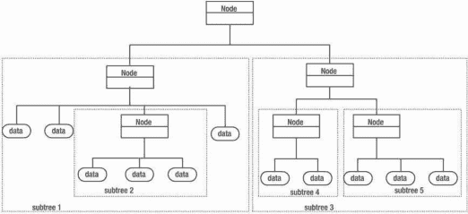

*图 8-4. 树结构示例*

以树结构组织的数据可以使用递归有效地遍历。树的每个分支都可以视为一棵子树，因此用于访问树中各项的函数在遇到分支节点时可以直接调用自身。当遇到数据项时，函数对该项执行所需操作并返回调用点。因此，找到树的叶节点——即数据项——提供了函数停止自身递归调用的手段。

## 快速排序算法

将快速排序算法应用于一个单词序列，包括在该序列中选择任意一个单词，并安排其他单词，使所有“小于”所选单词的单词排在它前面，所有“大于”所选单词的单词排在它后面。当然，序列中位于所选单词两侧的单词本身不一定按顺序排列。图 8-5 展示了这个过程。

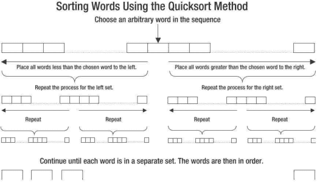

对越来越小的单词集合重复相同的过程，直到每个单词都位于一个单独的集合中。当出现这种情况时，过程结束，单词处于正确的顺序。当然，你在代码中重新排列的是地址，而不是移动单词本身。每个单词的地址可以存储为指向 string 对象的智能指针，而这些指针可以存储在 vector 中。

指向 string 对象的智能指针的 vector 类型看起来会有些杂乱，因此不利于代码的可读性。下面的类型别名将使代码更易读：

```cpp
using Words = std::vector<std::shared_ptr<std::string>>;
```

### main() 函数

main() 的定义将很简单，因为所有工作都将由其他函数完成。在 main() 的定义之前，应用程序中会有若干 import 指令和其他函数的原型：

```cpp
import <iostream>;
import <format>;
```


# 第 8 章：定义函数

```cpp
import <memory>;
import <string>;
import <vector>;

using Words = std::vector<std::shared_ptr<std::string>>;

void swap(Words& words, size_t first, size_t second);
void sort(Words& words);
void sort(Words& words, size_t start, size_t end);
void extract_words(Words& words, const std::string& text, const std::string& separators);
void show_words(const Words& words);
size_t max_word_length(const Words& words);
```

我们想现在你已经知道为什么需要所有这些标准库模块了。`<memory>` 用于智能指针模板定义，`<vector>` 包含 vector 容器的模板。类型别名会让代码更加简洁。

这里有六个函数原型：

- `swap()` 是一个辅助函数，用于交换 words 向量中索引 `first` 和 `second` 处的元素。
- 带有三个函数参数的 `sort()` 重载将使用快速排序算法，对 words 中从索引 `start` 到索引 `end`（包含两端）的连续元素序列进行排序。需要指定范围的索引，因为快速排序算法涉及对序列子集的排序，正如你之前所看到的。
- 只有一个参数的 `sort()` 重载只是简单地调用三个参数的重载（见后文）；它只是为了方便——允许你用单个 `vector<>` 参数调用 `sort()`。
- `extract_words()` 从文本中提取单词，并将指向这些单词的智能指针存储在 words 向量中。
- `show_words()` 输出 words 中的单词。
- `max_word_length()` 确定 words 中最长单词的长度，其作用只是让输出更美观。

最后两个函数的 words 向量参数是 const 引用，因为它们不需要修改它。其他函数则使用普通引用参数，因为它们需要修改。下面是 `main()` 的代码：

```cpp
int main()
{
  Words words;
  std::string text;                  // The string to be sorted
  const auto separators{" ,.!?\\\"\n"}; // Word delimiters

  // Read the string to be processed from the keyboard
  std::cout << "Enter a string terminated by *: " << std::endl;
  getline(std::cin, text, '*');

  extract_words(words, text, separators);
  if (words.empty())
  {
      std::cout << "No words in text." << std::endl;
      return 0;
  }

  sort(words);        // Sort the words
  show_words(words);  // Output the words
}
```

智能指针向量使用类型别名 Words 定义。向量将通过引用传递给每个函数，以避免复制向量，并在必要时允许更新它。在类型参数中忘记写 `&` 可能会导致一个令人困惑的错误。如果修改 words 的函数的参数不是引用，那么 words 是按值传递的，修改将应用于调用函数时创建的 words 副本。当函数返回时，副本被丢弃，原始向量将保持不变。

`main()` 中的过程很直接。将一些文本读入字符串对象 text 后，将文本传递给 `extract_words()` 函数，该函数将指向单词的指针存储在 words 中。在检查确认 words 不为空之后，调用 `sort()` 对 words 的内容进行排序，并调用 `show_words()` 输出单词。

### extract_words() 函数

你以前见过类似的函数。以下是代码：

```cpp
void extract_words(Words& words, const std::string& text, const std::string& separators)
{
    size_t start {text.find_first_not_of(separators)}; // Start index of first word

    while (start != std::string::npos)
    {
        size_t end = text.find_first_of(separators, start + 1); // Find end of a word
        if (end == std::string::npos)                         // No separator found?
            end = text.length();                              // Yes, so set to end of text
        words.push_back(std::make_shared<std::string>(text.substr(start, end - start)));
        start = text.find_first_not_of(separators, end + 1);  // Find start next word
    }
}
```

最后两个参数是 const 引用，因为该函数不会更改与它们对应的实参。separators 对象也可以定义为函数内部的静态变量，但将其作为参数传递会使函数更灵活。这个过程与你之前看到的基本相同。每个表示单词的子串都被传递给 <memory> 模块中定义的 `make_shared()` 函数。`make_shared()` 使用该子串在自由存储区中创建一个字符串对象，并附带一个指向它的智能指针。`make_shared()` 返回的智能指针被传递给 words 向量的 `push_back()` 函数，以将其作为新元素追加到序列中。

### swap() 函数

在多个地方需要交换向量中的地址对，因此定义一个辅助函数来处理这件事是个好主意：

```cpp
void swap(Words& words, size_t first, size_t second)
{
    auto temp{words[first]};
    words[first] = words[second];
    words[second] = temp;
}
```

这只是交换 words 中索引 first 和 second 处的地址。

### sort() 函数

你可以在快速排序方法的实现中使用 `swap()`，因为它涉及重新排列向量中的元素。排序算法的代码如下：

```cpp
void sort(Words& words, size_t start, size_t end)
{
  // start index must be less than end index for 2 or more elements
  if (!(start < end))
    return;

  // Choose middle address to partition set
  swap(words, start, (start + end) / 2);    // Swap middle address with start

  // Check words against chosen word
  size_t current {start};
  for (size_t i {start + 1}; i <= end; i++)
  {
    if (*words[i] < *words[start])           // Is word less than chosen word?
      swap(words, ++current, i);             // Yes, so swap to the left
  }

  swap(words, start, current);               // Swap chosen and last swapped words

  if (current > start) sort(words, start, current - 1); // Sort left subset if exists
  if (end > current + 1) sort(words, current + 1, end); // Sort right subset if exists
}
```

参数是地址向量以及待排序子集中第一个和最后一个地址的索引位置。第一次调用该函数时，start 为 0，end 为最后一个元素的索引。在随后的递归调用中，需要对向量元素的一个子序列进行排序，因此 start 和/或 end 在许多情况下将是内部的索引位置。

`sort()` 函数代码的步骤如下：

- 1. 检查 start 是否不小于 end，用于停止递归函数调用。如果集合中只有一个元素，函数返回。在每次执行 `sort()` 时，当前序列会在最后两个递归调用 `sort()` 的语句中被划分为两个更小的序列，因此最终必然会得到一个只包含一个元素的序列。
- 2. 在初始检查之后，任意选择序列中间的一个地址作为排序的基准元素。将其与索引 start 处的地址交换，只是为了把它移开。你也可以把它放在序列的末尾。
- 3. for 循环将选定的单词与 start 之后元素所指向的单词进行比较。如果某个单词小于选定的单词，其地址就会被交换到 start 之后的位置：第一个交换到 start+1，第二个交换到 start+2，依此类推。这个过程的效果是将所有小于选定单词的单词排在所有大于或等于它的单词之前。循环结束时，current 包含最后一个小于选定单词的单词的地址索引。位于 start 的选定单词的地址与 current 处的地址交换，因此小于选定单词的单词地址现在位于 current 的左侧，而大于或等于它的单词地址位于右侧。
- 4. 最后一步通过为每个子集调用 `sort()` 来对 current 两侧的子集进行排序。小于选定单词的单词索引范围从 start 到 current-1，大于它的单词索引范围从 current+1 到 end。

使用递归，排序代码相对容易理解。这还不是全部。如果你尝试不用递归实现快速排序，即只使用循环，你会发现这不仅困难得多，而且还需要自己维护一个排序栈。因此，用循环实现快速排序想比递归更快是相当有挑战性的。所以，递归不仅使算法非常自然、优雅，而且其性能在许多应用中也能接近最优。

这个递归 `sort()` 函数的一个小缺点是它需要三个参数；对向量排序需要你弄清楚第二个和第三个参数应该传什么，这有点不方便。因此我们提供了一个更便捷的单参数 `sort()` 函数，你可以改用它：

```cpp
// Sort strings in ascending sequence
void sort(Words& words)
{
    if (!words.empty())
        sort(words, 0, words.size() - 1);
}
```

这实际上是一种相当常见的模式。为了启动递归，你提供一个非递归的辅助函数。通常递归函数甚至不会暴露给用户（你稍后会学习如何封装或局部定义函数）。

还要注意对空输入的检查。如果省略它，空输入会发生什么，你能想到吗？没错。从等于零的无符号 `size_t` 值中减一会产生一个巨大的数（完整解释见第 5 章），在这种情况下会导致递归 `sort()` 函数以严重越界的索引访问 `vector<>`。而后者几乎肯定会导致程序崩溃！


### max_word_length() 函数

这是一个辅助函数，供 show_words() 函数使用：

```cpp
size_t max_word_length(const Words& words)
{
    size_t max {};
    for (auto& pword : words)
        if (max < pword->length()) max = pword->length();
    return max;
}
```

它会遍历 vector 元素所指向的单词，找到并返回最长单词的长度。你可以把这段代码直接放进 show_words() 函数体中。不过，如果将代码拆分成小而定义良好的块，会更容易理解。这个函数执行的操作是自包含的，因此适合作为一个独立函数。

### show_words() 函数

该函数输出 vector 元素所指向的单词。它相当长，因为它将所有以相同字母开头的单词列在同一行，每行最多八个单词。代码如下：

```cpp
void show_words(const Words& words)
{
    const size_t field_width {max_word_length(words) + 1};
    const size_t words_per_line {8};
    std::cout << std::format("{:{}}", words[0], field_width); // Output first word

    size_t words_in_line {};      // Number of words in current line
    for (size_t i {1}; i < words.size(); ++i)
    { // Output newline when initial letter changes or after 8 per line
        if ((*words[i])[0] != (*words[i - 1])[0] || ++words_in_line == words_per_line)
        {
            words_in_line = 0;
            std::cout << std::endl;
        }
        std::cout << std::format("{:{}}", words[i], field_width); // Output a word
    }
    std::cout << std::endl;
}
```

`field_width` 变量初始化为最长单词的字符数加一。该变量用于每个单词的字段宽度，因此它们会整齐地按列对齐。还有 `words_per_line`，它表示一行中最多可容纳的单词数。第一个单词在 for 循环之前输出。这是因为循环会将当前单词的首字符与前一个单词的首字符进行比较，以决定它是否应放在新行上。单独输出第一个单词可确保开始时有一个前一个单词。其余单词在 for 循环中输出。当一行已写入八个单词，或遇到首字母与前一个单词不同的单词时，就输出一个换行符。

# 第 8 章：定义函数

- 函数是自包含的紧凑代码单元，具有明确定义的目的。编写良好的程序由大量小函数组成，而不是少量大函数。
- 函数定义由函数头（指定函数名、参数和返回类型）和包含函数可执行代码的函数体组成。
- 函数原型使编译器即使尚未处理函数定义，也能处理对该函数的调用。
- 向函数传递实参的按值传递机制传递的是原始实参值的副本，因此在函数内部无法访问原始实参值。
- 将指针传递给函数允许函数更改所指向的值，即使指针本身是按值传递的。
- 将指针参数声明为 const 可防止修改原始值。
- 可以将数组的地址作为指针传递给函数。如果这样做，通常还应同时传递数组的长度。
- 将函数参数指定为引用可避免按值传递机制中隐含的复制。在函数内不会被修改的引用参数应指定为 const。
- 输入参数应为常量引用，但基本类型等较小的值除外。通常更倾向于返回值，而不是输出参数。
- 为函数参数指定默认值可以可选地省略实参。
- 从函数返回引用允许在赋值运算符左侧使用该函数。将返回类型指定为常量引用可防止这种情况。
- 函数的签名由函数名及其参数的数量和类型共同定义。
- 重载函数是名称相同但签名不同、因而参数列表不同的函数。重载函数不能通过返回类型来区分。
- 递归函数是调用自身的函数。用递归方式实现算法可以产生优雅而简洁的代码。有时（但当然并非总是）与实现同一算法的其他方法相比，这会以执行时间为代价。

## 练习

这些练习让你尝试本章学到的一些内容。如果卡住了，可以回顾本章寻求帮助。如果仍然卡住，可以从 Apress 网站（www.apress.com/source-code）下载解答，但这确实应该是最后的手段。

练习 8-1。编写一个函数 validate_input()，它接受两个整数实参，分别表示要输入的整数的上限和下限。它还应接受第三个实参，该实参是描述输入的字符串，该字符串将用于提示用户输入。该函数应提示输入由前两个实参指定范围内的值，并在提示中包含标识要输入值类型的字符串。该函数应检查输入，并持续提示输入，直到用户输入的值有效。在一个获取用户出生日期并按以下示例形式输出的程序中使用 validate_input() 函数：

```
You were born on the 21st of November, 2012
```

该程序应实现为使用独立函数 month()、year() 和 day() 来管理相应数值的输入。别忘了闰年——2017 年 2 月 29 日是不允许的！

练习 8-2。编写一个函数，读取字符串或字符数组作为输入并将其反转。说明你选择参数类型的理由？提供一个 main() 函数来测试你的函数，该函数提示输入一串字符，将其反转，并输出反转后的字符串。

练习 8-3。编写一个程序，接受 2 到 4 个命令行实参。如果调用时少于 2 个或多于 4 个实参，则输出一条消息告诉用户应该怎么做，然后退出。如果实参数量正确，则输出它们，每个占一行。

练习 8-4。创建一个函数 plus()，将两个值相加并返回它们的和。提供可处理 int、double 和 string 的重载函数，并测试它们能用于以下调用：

```
const int n {plus(3, 4)};
const double d {plus(3.2, 4.2)};
const string s {plus("he", "llo")};
const string s1 {"aaa"};
const string s2 {"bbb"};
const string s3 {plus(s1, s2)};
```

你能解释为什么下面的代码不起作用吗？

```
const auto d {plus(3, 4.2)};
```

练习 8-5。定义一个函数，检查给定数字是否为质数。你的素性检查不必高效；你能想到的任何算法都可以。以防你忘了，质数是严格大于 1 且除了 1 和自身之外没有正因数的自然数。编写另一个函数，生成一个 vector<>，其中包含从另一个数开始、小于或等于第一个数的所有自然数。默认情况下，它应从 1 开始。创建第三个函数，给定一个数字 vector<>，输出另一个 vector<>，其中包含它在输入中找到的所有质数。使用这三个函数创建一个程序，打印出所有小于或等于用户所选数字的质数（例如每行打印 15 个质数）。注意：原则上，打印这些质数不需要任何 vector；显然，这些额外函数是为了练习而添加的。

练习 8-6。实现一个程序，向用户查询若干成绩。成绩是 0 到 100（含两端）之间的整数。用户可随时输入负数来停止。收集完所有成绩后，程序应输出以下统计量：五个最高成绩、五个最低成绩、平均成绩、中位数成绩，以及成绩的标准差和方差。当然，你要为每个统计量编写一个单独的函数来计算。此外，你必须只编写一次打印五个值的代码。为了练习，请使用数组存储任意五个极值，而不是例如 vector。

提示：作为预处理步骤，你应首先对用户输入的成绩排序；你会发现这会让编写计算统计量的函数容易得多。你可以改编 Ex8_17 中的 quicksort 算法来处理成绩数值。

注意：如果用户输入少于五个甚至零个成绩，请确保做出合理的处理。只要不崩溃，怎么做都可以。

注意：中位数是出现在已排序列表中间位置的值。如果成绩个数为偶数，显然没有唯一的中间值——此时中位数定义为两个中间值的均值。对于 n 个成绩 xᵢ 的均值（μ）和标准差（σ），计算公式如下：

μ = (1/n) Σᵢ₌₀ⁿ⁻¹ xᵢ    σ = sqrt((1/n) Σᵢ₌₀ⁿ⁻¹ (xᵢ − μ)²)

方差则定义为 σ²。标准库的 `<cmath>` 模块导出 `std::sqrt()` 来计算平方根。

练习 8-7。所谓的 Fibonacci 函数在计算机科学和数学讲师中很受欢迎，用于介绍递归。该函数要计算著名的斐波那契数列中的第 n 个数，该数列以意大利数学家比萨的列奥纳多（又名 Fibonacci）命名。这个正整数序列的特点是：前两个数之后的每个数都是前两个数之和。对于 n ≥ 1，该序列定义如下：

1, 1, 2, 3, 5, 8, 13, 21, 34, 55, 89, 144, 233, 377, 610, 987, 1597, 2584, 4181...


# 第 9 章：词汇类型

有些数据类型会像 int 或 double 这样的基本类型一样，成为你日常词汇的一部分。你会在所有地方、所有时间使用它们：在函数签名中、在算法中、作为类的成员变量（见后文）等等。我们称这样的类型为词汇类型。在现代 C++ 中，它们是可理解、可维护且安全代码的基石之一。

事实上，你已经知道一些词汇类型：std::unique_ptr<>、std::shared_ptr<>、std::string、std::array<>、std::vector<> 等。到目前为止，这些类型有一个共同点：它们取代了核心语言中某些不安全且不方便的类型（原始指针、const char* 字符串、底层动态内存等）。本章介绍的三个词汇类型类似，但存在理由略有不同：它们旨在让你的代码更具自文档性、更高效、重复更少。

在本章中，你将学习

-   如何最好地为函数定义可选输入
-   如何定义可能返回、也可能不返回值的函数，这取决于其输入或应用程序的当前状态
-   如何最好地定义接受字符串但不修改字符串的函数
-   如何定义一个单一函数，使其能操作你传入的任何顺序范围，无论是 C 风格数组、vector 还是任何其他顺序容器

## 处理可选值

在编写自己的函数时，你经常会遇到可选输入参数，或者只有在一切顺利时才能返回值的函数。考虑以下示例：

```cpp
int find_last(const std::string& s, char char_to_find, int start_index);
```

从这个原型中，你可以想象 find_last() 函数从给定起始索引开始，从后向前在给定字符串中搜索给定字符。一旦找到，它就会返回该字符最后一次出现的索引。但如果该字符没有出现在字符串中呢？如果你希望算法考虑整个字符串呢？如果传入 -1 作为第三个参数，它或许能工作吗？遗憾的是，如果没有接口文档，或者不查看实现代码，就无法知道这个函数会如何表现。

一种传统解决方案是挑选某个或某些特定值，供调用者在希望函数使用默认设置时使用，或在无法计算出实际值时作为返回值。对于数组或字符串索引，典型选择是 -1。因此，find_last() 的一种可能规范是：如果 char_to_find 未出现在给定字符串中，则返回 -1；如果传入 -1 或任何负值作为 start_index，则搜索整个字符串。事实上，std::string 自己的 find() 函数就使用了这种确切技术；只不过它使用的不是 -1，而是常量 std::string::npos（size_t 是无符号类型，因此 -1 不是有效值）。

问题在于，一般来说，很难记住每个函数如何编码“未提供输入”或“未计算结果”。不同库之间，甚至同一库内部，约定往往不同。有些在失败时返回 0，另一些返回负数。有些接受 nullptr 作为输入，另一些则不接受。诸如此类。

为了帮助函数的使用者，可选参数通常会给定一个有效的默认值。下面是一个示例：

```cpp
int find_last(const std::string& s, char char_to_find, int start_index = -1);
```

然而，这种技术并不能扩展到返回值。另一个问题是，一般来说，甚至可能没有一种明显的方式来编码可选值。第一个原因可能是可选值的类型。想一想：例如，你会如何编码一个可选的 bool？第二个原因可能是具体情境。例如，假设你需要定义一个函数来读取某个配置文件。那么你可能会定义如下形式的函数：

```cpp
// Return the 'default' value provided by the caller if the setting is not found
int read_int_setting(const string& file, const string& settingName, int defaultValue);

// Output setting in output parameter and return true if found; return false otherwise
bool read_int_setting(const string& file, const string& settingName, int& output);
```

但是，如果配置文件中不包含具有给定名称的设置项，应该发生什么？由于这打算作为一个通用函数，你不能先验地假定 0、-1 或任何其他 int 值不是所请求设置项的有效值。传统的变通方法包括以下这些：

```cpp
// Return the 'default' value provided by the caller if the setting is not found
int read_int_setting(const string& file, const string& settingName, int defaultValue);

// Output setting in output parameter and return true if found; return false otherwise
bool read_int_setting(const string& file, const string& settingName, int& output);
```

虽然这些方法可行，但 C++ 标准库提供了更好的替代方案：std::optional<>。这个词汇类型会让你的函数声明更简洁、更易读。

> **注意** 词汇类型，尤其是 std::optional<>，在本书后半部分定义你自己的类时同样有用。例如，Car 对象可以有一个 optional<SpareTire>，Person 可以有一个用于中间名的 optional<string>，或者 Boat 可以有一个 optional<Engine>。不过目前，我们只会用函数来示例这些新的词汇类型。

### std::optional

从 C++17 起，标准库提供了 `std::optional<>`，旨在取代我们前面展示的所有可选值的隐式编码。使用这个词汇类型，任何可选输入或输出都可以用 `std::optional<>` 显式声明，如下所示：

```cpp
std::optional<int> find_last(const std::string& s, char c, std::optional<int> startIndex);
std::optional<int> read_int_setting(const std::string& file, const std::string& setting);
```

现在，所有可选输入和输出都在函数原型中、在代码层面被显式标记出来。不再需要额外文档，也不需要查看实现来知道什么是可选的。结果是干净、自文档化的函数声明。你的代码会立刻变得更容易理解和使用。

> **注意** `std::optional<>` 是一个类模板，就像 `std::vector<>` 和 `std::array<>` 一样。你可以用任意类型 T 实例化它，从而得到该类型的一个新的可选版本。你稍后会学习如何创建自己的类模板，但使用类模板应该不再有任何问题。

让我们看一些真实代码中 `std::optional<>` 的基本用法：

```cpp
// Ex_01.cpp
// Working with std::optional<>
import <optional>;     // std::optional<> is defined in the <optional> module
import <iostream>;
import <string>;

std::optional<size_t> find_last(
    const std::string& string, char to_find,
    std::optional<size_t> start_index = std::nullopt); // Or ... start_index = {};

int main()
{
    const auto string = "Growing old is mandatory; growing up is optional.";

    const std::optional<size_t> found_a{ find_last(string, 'a') };
    if (found_a)
        std::cout << "Found the last a at index " << *found_a << std::endl;

    const auto found_b{ find_last(string, 'b') };
    if (found_b.has_value())
        std::cout << "Found the last b at index " << found_b.value() << std::endl;

    // Following line gives an error (cannot convert std::optional<size_t> to size_t)
    // const size_t found_early_i{ find_last(string, 'i') };
    const auto found_early_i{ find_last(string, 'i', 10) };
    if (found_early_i != std::nullopt)
        std::cout << "Found an early i at index " << *found_early_i << std::endl;
}
```

```cpp
std::optional<size_t> find_last(const std::string& string, char to_find,
                                std::optional<size_t> start_index)
{
    // code below will not work for empty strings
    if (string.empty())
        return std::nullopt;        // or: 'return std::optional<size_t>{};'
                                    // or: 'return {};'

    // determine the starting index for the loop that follows:
    size_t index = start_index.value_or(string.size() - 1);

    while (true) // never use while (index > 0) here, as size_t is always >= 0!
    {
        if (string[index] == to_find) return index;
        if (index == 0) return std::nullopt;
        --index;
    }
}
```

该程序产生的输出如下：

```
Found the last a at index 46
Found an early i at index 4
```

为了展示 `std::optional<>`，我们定义了前面用作示例的 `find_last()` 函数的一个变体。注意，由于 `find_last()` 使用无符号的 `size_t` 索引而不是 `int` 索引，-1 作为第三个参数的默认值就不那么明显了。我们将其替换为等于 `std::nullopt` 的默认值。这个特殊常量由标准库定义，用于初始化尚未（或还没有）分配 T 值的 `optional<T>` 值。你很快就会看到，为什么它对函数参数也是一个有用的默认值。

在函数原型之后，你会看到程序的 `main()` 函数。在 `main()` 中，我们三次调用 `find_last()`，在某个示例字符串中搜索字母 'a'、'b' 和 'i'。这些调用本身确实没有什么令人惊讶的。如果你想要非默认的起始索引，只需向 `find_last()` 传入一个数字，就像我们在第三次调用中所做的那样。然后编译器会隐式地将这个数字转换为 `std::optional<>` 对象，完全如你所料。不过，如果你接受默认起始索引，就可以省略相应参数。此时默认参数值会负责创建一个空的 optional<>。

以下是 `main()` 函数中两个最值得注意的要点：

-   如何检查 `find_last()` 返回的 `optional<>` 值是空，还是已被赋予实际值
-   随后如何从 `optional<>` 中提取这个值

对于前一个问题，`main()` 按以下顺序展示了三种替代方式：让编译器替你把 `optional<>` 转换为布尔值，调用 `has_value()` 函数，或者将 `optional<>` 与 `nullopt` 进行比较。对于后一个问题，`main()` 展示了两种替代方式：你可以使用 `*` 运算符，或者调用 `value()` 函数。然而，将 `optional<size_t>` 返回值直接赋值给 `size_t` 是不可能的。编译器无法将 `optional<size_t>` 类型的值转换为 `size_t` 类型的值。

在 `find_last()` 的函数体中，除了空字符串和无符号索引类型带来的一些有趣挑战之外，请特别注意与 `optional<>` 相关的另外两个方面。首先，注意返回值很直接。你可以返回 `std::nullopt`，也可以返回实际值。随后编译器会将两者都转换为合适的 `optional<>`。其次，我们在那里使用了 `value_or()`。


如果 `optional<>` 的 `start_index` 包含一个值，则该函数将返回与 `value()` 相同的结果；如果它不包含值，`value_or()` 会直接计算为你作为参数传入的值。因此，`value_or()` 函数是等效的 if-else 语句或条件运算符表达式的理想替代方案，后者需要先调用 `has_value()` 再调用 `value()`。

> **注意**  Ex9_01 涵盖了关于 `std::optional<>` 的大部分知识。一如既往，如果你需要了解更多，请查阅你最喜欢的标准库参考。不过有一点现在就要指出：除了 `*` 运算符之外，`std::optional<>` 还支持 `->` 运算符。也就是说，在下面的示例中，最后两条语句是等价的：

```
std::optional<string> os{ "Failing in life is inevitable--staying down is optional." };
if (os) std::cout << (*os).size() << std::endl;
if (os) std::cout << os->size() << std::endl;
```

请注意，虽然这种语法让 `optional<>` 对象看起来和用起来都像指针，但它们绝对不是指针。每个 `optional<>` 对象都包含一个分配给它的值的副本，并且这个副本不保存在自由存储区中。也就是说，复制指针不会复制它指向的值，而复制 `optional<>` 总是涉及复制存储在其中的整个值。

## 字符串视图：新的 const 字符串引用

从上一章中，你知道将输入参数按引用传递给 const 而不是按值传递的主要动机是避免不必要的复制。例如，过于频繁地复制较大的字符串，在时间和内存方面都可能会变得相当昂贵。假设你有一个函数不会修改它作为输入接收的字符串。那么此时你的自然本能应该是将相应的参数声明为 `const string&`。例如，我们在 Ex8_08 中的 `find_words()` 就这样做了。

```
void find_words(vector<string>& words, const string& text, const string& separators);
```

然而不幸的是，`const string&` 参数并不完美。虽然它们确实避免了 `std::string` 对象的复制，但它们仍然有缺点。为了说明原因，假设我们稍微修改一下 Ex8_08 的 `main()` 函数，如下所示：

```
int main()
{
    std::string text;        // 要搜索的字符串
    std::cout << "Enter some text terminated by *:\n";
    std::getline(std::cin, text, '*');

    // const std::string separators{ " ,;:.!?\"\n" };
    std::vector<std::string> words;  // 找到的单词

    find_words(words, text, " ,;:.!?\"\n"); /* 不再使用 'separators' 常量！ */
    list_words(words);
}
```

唯一的区别是我们不再将分隔符存储在一个单独的 `separators` 常量中。相反，我们直接将它们作为第三个参数传递给 `find_words()`。你可以很容易地验证这仍然可以编译并正确工作。

那么第一个问题是，为什么这能编译并工作？毕竟，`find_words()` 的第三个参数期望的是一个 `std::string` 对象的引用，而我们现在传递的参数是一个 `const char[]` 类型的字符串字面量——一个字符数组——因此它肯定不是 `std::string` 对象。自然，你会回想起上一章的内容：编译器一定是在应用某种形式的隐式转换。也就是说，函数的引用实际上不会指向字面量，而是指向编译器在内存中某个位置静默创建的临时 `std::string` 对象。（我们将在后面的章节中解释这些转换是如何对非基本类型起作用的。）在这种情况下，临时字符串对象将用字符串字面量中所有字符的副本来初始化。

作为细心的读者，你现在会意识到为什么按引用传递字符串给 const 在某种程度上是有缺陷的。我们使用引用的动机是为了避免复制。但是，由于字符串字面量在传递给 `const std::string&` 参数时仍然会被复制，它们会被复制到由隐式转换产生的临时 `std::string` 对象中。

这就引出了本节第二个也是真正的问题：我们如何创建从不复制输入字符串参数的函数，即使是字符串字面量或其他字符数组也不复制？我们不想为此重新使用 `const char*`。那样的话，我们不仅必须同时传递字符串的长度，以避免总是扫描终止空字符，而且还会错过 `std::string` 提供的所有好用且安全的函数。

答案在于 `std::string_view`，这是 `<string_view>` 模块中定义的一种类型。这种类型的值在行为上类似于 `const std::string` 类型的值——注意是 const！——只有一个区别：创建 `string_view` 永远不会涉及复制任何字符。即使是从字符串字面量创建也是如此。它内部使用的只是字符串长度的副本和一个指向某个外部字符序列的指针。`string_view` 不关心字符本身存储在哪里：在 `std::string` 对象内部、作为字符串字面量、还是作为普通的 C 风格字符串。对于 `string_view` 和使用它的代码来说，这完全没有区别。在某种程度上，`string_view` 抽象掉了你所操作的文本数据的具体类型，使你能够轻松编写一个单一的函数，可以高效且有效地处理此类输入。

因此：

> **提示**  对于输入字符串参数，始终使用类型 `std::string_view` 而不是 `const std::string&`。（虽然使用 `const std::string_view&` 也没有错，但你也可以按值传递 `std::string_view`。因为这不涉及复制整个字符数组，初始化或复制一个 `string_view` 非常廉价。）

由于 string_view 是为字符串字面量而设计的，它们确实有一个重要的限制：底层字符串的字符永远不能通过 string_view 的接口进行修改。`string_views` 天生就是 const 的。即使是非 const 的 string_view 也不允许你更改底层字符串的字符。套用“老板”的话说，你可以看，但不能摸。但这通常已经足够了，如下一节的示例所证明的那样。

> **注意**  除了用于 `char` 元素字符串的 `std::string_view` 之外，当然还存在 `std::wstring_view`、`std::u8string_view`、`std::u16string_view` 和 `std::u32string_view`，用于宽字符或 Unicode 字符字符串的视图。由于它们都是同一个类模板（`std::basic_string_view<CharType>`）的实例化，它们的行为完全类似。

## 使用字符串视图函数参数

为了避免字符串字面量和其他字符序列的不经意复制，Ex8_08 中的 `find_words()` 函数最好声明如下：

```
void find_words(vector<string>& words, string_view text, string_view separators);
```

`std::string_view` 类型在大多数情况下可以替代 `const std::string&` 和 `const std::string` 直接使用。但在我们的示例中并非完全如此。巧合吗？当然不是！我们选择这个示例正是为了解释将 `const std::string&` 替换为 `string_view` 可能会如何出错。为了使 `find_words()` 函数定义使用新的改进签名进行编译，你必须稍微修改它，如下所示（完整程序见 Ex9_02.cpp）：

```
void find_words(vector<string>& words, string_view text, string_view separators)
{
    size_t start{ text.find_first_not_of(separators) };    // 第一个单词的起始索引
    size_t end{};                                          // 单词结束索引

    while (start != string_view::npos)                     // 查找单词
    {
        end = text.find_first_of(separators, start + 1);   // 查找单词结尾
        if (end == string_view::npos)                      // 找到了分隔符吗？
            end = text.length();                           // 没有，则设置为文本末尾

        words.push_back(std::string(text.substr(start, end - start)));  // 存储单词
        start = text.find_first_not_of(separators, end + 1); // 查找下一个单词的首字母
    }
}
```

我们必须修改的是倒数第二条语句，最初它没有包含显式的 `std::string{ ... }` 初始化：

```
words.push_back(text.substr(start, end - start));
```

然而，编译器会拒绝任何将 `std::string_view` 对象隐式转换为 `std::string` 类型的行为（你可以试试！）。这种刻意限制背后的理由是，你通常使用 `string_view` 是为了避免字符串复制操作，而将 `string_view` 转换回 `std::string` 总是涉及复制底层字符数组。为了保护你避免意外这样做，编译器不允许隐式进行这种转换。你总是必须自己显式地添加这种方向的转换。

> **注意**  还有另外两种情况，`string_view` 并不完全等同于 `const string`。首先，`string_view` 不提供 `c_str()` 函数将其转换为 `const char*` 数组。幸运的是，它确实与 `std::string` 共用 `data()` 函数，而在大多数情况下该函数是等效的。其次，`string_views` 不能使用加法运算符（`+`）进行连接。要在连接表达式中使用 `string_view` 值 `my_view`，你必须先将其转换为 `std::string`，例如使用 `std::string{my_view}`。


## 适当的动机

字符串字面量通常不会太大，因此你可能会想，即使复制它们又有什么关系呢？也许没什么关系。但`std::string_view`可以从任何C风格字符数组创建，而该数组可以任意大。例如，在`Ex9_02`中将分隔符参数改为`string_view`可能并没有带来多大好处。但对于另一个参数`text`，情况确实可能有所不同，如下面的代码片段所示：

```cpp
char* text = ReadHugeTextFromFile();       // last character in text is null ('\0')
find_words(words, text, ",;:!?\"\n");
delete[] text;
```

在这种情况下，假定字符数组以空字符元素结尾，这是C和C++编程中常见的约定。如果不是这种情况，你就需要使用更类似下面这种形式：

```cpp
char* text = ...;                 // again a huge amount of characters...
size_t numCharacters = ...;       // the huge amount
find_words(words, std::string_view(text, numCharacters), ",;:!?\"\n");
delete[] text;
```

无论哪种情况，关键在于：如果使用`std::string_view`，在将其传递给`find_words()`时不会复制巨大的文本数组；而如果使用`const std::string&`，则会被复制。

## Spans：指向vector或array的新型引用

在Ex8_14中，你可能已经注意到前两个`largest()`函数都计算相同数值类型`double`的序列中的最大值。为帮你回顾，这里是它们的函数原型：

```cpp
double largest(const std::vector<double>& data);
double largest(const double data[], size_t count);
```

除了一个操作普通数组而另一个操作vector之外，这两个函数几乎没有区别。

那时我们已经指出，函数模板可以解决重复的函数重载问题。我们将在下一章讨论这一点。但对于这种特殊情况——针对具有相同元素类型的序列的函数重载——C++20提供了一个有趣的替代方案，称为spans。`std::span<T>`类模板允许你引用任何连续的T值序列——无论是`std::vector<T>`、`std::array<T,N>`还是C风格数组——而无需指定具体的数组或容器类型。

让我们用一个例子来更具体地说明。导入`<span>`模块后，你可以将Ex8_14中上述两个`largest()`重载替换为单个重载，如下所示（另请参阅Ex9_03）：

```cpp
// double largest(const std::vector<double>& data);
// double largest(const double data[], size_t count);
double largest(std::span<double> data);
```

除了签名之外，你可以完全按照之前为`std::vector<double>`重载实现此新函数：

```cpp
// Finds the largest of a sequence of double values
double largest(std::span<double> data) /* Note: signature is not ideal yet: see later */
{
    double max {data[0]};
    for (auto value : data)
        if (max < value) max = value;
    return max;
}
```

换句话说，你不仅可以在基于范围的for循环中使用spans，它们还提供了方括号运算符`[]`，允许你按索引访问各个元素。与string_view对象一样，span<>对象可以非常高效地按值传递给函数。

> **注意**  除了范围支持和方括号运算符外，`std::span<>`还提供了你已经从`std::array<>`和`std::vector<>`中了解的各种其他函数：size()、empty()、data()、front()和back()。其他函数，例如用于创建subspan的一些成员，是span<>特有的。你可以查阅标准库参考以获取完整的成员列表。

有了新的largest()重载，你在Ex8_14的main()函数中需要修改的地方很少。只有表达式largest(array, std::size(array))需要修改，因为largest()现在期望输入一个span对象，而不是指针和大小。幸运的是，从指针-大小对创建span非常简单。完整写出来的更新输出语句如下：

```cpp
double array[] {1.5, 44.6, 13.7, 21.2, 6.7};
//
std::cout << "The largest of array is "
          << largest(std::span<double>{ array, std::size(array) }) << std::endl;
```

哎呀！这太冗长了。幸运的是，你可以省略参数类型，仅使用花括号初始化器来调用largest()，如下所示：

```cpp
std::cout << "The largest of array is " << largest({ array, std::size(array) })
          << std::endl;
```

编译器知道它必须在此处创建一个span对象，因为对应的函数重载是唯一接受此花括号初始化器的重载。

但你可以使用更短的表达式。因为编译器知道array的大小——它是类型为double(&)[5]的引用变量——所以大小参数是多余的。

```cpp
std::cout << "The largest of array is " << largest(array) << std::endl;
```

只有当第一个参数是类型为T*或const T*的指针变量，编译器无法从该指针推断出大小时，才需要额外的大小参数来创建span<T>对象。

### Spans与Views对比

在许多方面，`std::span`与`std::string_view`明显相似。两者都允许你检查（查看）未特化的类似数组的元素，无论是普通数组（C风格数组、字符串字面量等）还是属于某个容器对象（如`std::vector<>`、`std::array<>`、`std::string<>`等）的数组。而且，在这样做时，span和string_view都不会复制底层数组的元素。那么，为什么他们将其命名为`std::span<>`，而不是比如`std::array_view<>`呢？

原因是span和view之间有一个重要区别：与string_view不同，span<>允许你重新赋值或更改底层数组的元素。我们可以用下面的代码片段来说明这一点：

```cpp
std::vector<double> my_vector{ 0, 2, 15, 16, 23, 42 };
std::span<double> my_span(my_vector);
my_span.front() = 4;
my_span[1] *= 4;
std::cout << my_vector[0] << ", " << my_vector[1] << std::endl;  // 4, 8
```

std::span<T>的front()、back()和operator[]成员都返回T&引用，引用底层数组的非const元素。这允许你赋值或更改这些元素。回想一下，同样的操作对string_view无效：

```cpp
std::string my_string{
  "Don't accept the limitations of other people who claim things are 'unchangeable'. "
  "If it's written in stone, bring your hammer and chisel."
};
std::string_view my_string_view{ my_string };
// my_string_view[0] = 'W';  // Error: my_string_view[0] returns const char&
```

> **注意**  虽然span<>允许你重新赋值或以其他方式更改元素，但它不允许你添加或删除任何元素。也就是说，span<>不提供push_back()、erase()或clear()等成员。否则，就不可能为C风格数组或std::array<>对象创建span<>了。

### const元素的Spans

你可以修改span<T>所支持的元素这一事实意味着，你不应该能够从const容器等创建span。如果可以，这个span<>将为修改const容器的元素提供后门。你可以尝试编译下面的片段来试试（编译会失败）：

```cpp
const std::vector<double> my_const_vector{ 4, 8, 15, 16, 23, 42 };
std::span<double> my_span(my_const_vector);  // Should not compile!
my_span[3] = 100;                             // Reason: this should not be possible...
```

不幸的是，这给我们之前在`Ex9_03.cpp`中创建的`largest()`函数带来了一个看似严重的问题。为帮你回顾，这里是它的声明：

```cpp
// double largest(const std::vector<double>& data);
// double largest(const double data[], size_t count);
double largest(std::span<double> data);
```

因为无法从const vector创建`span<double>`，所以`Ex9_03`的`largest()`函数实际上根本不是原来两个函数重载的合适替代品。例如，使用本节前面定义的`my_const_vector`，下面的调用将无法工作：

```cpp
auto max = largest(my_const_vector);  // Does not compile!
```

幸运的是，这很容易解决。要替换`const vector<T>&`，你应该使用`span<const T>`而不是`span<T>`。也就是说，你应该使用const元素的span。`span<const T>`的所有元素访问器函数（包括`[]`运算符）都返回const `T&`引用，即使原始数组或容器是非const的。下面的片段说明了这一点。

```cpp
std::vector<double> my_vector{ 4, 8, 15, 16, 23, 42 };
std::span<const double> my_const_span(my_vector);
// my_const_span[3] = 100;          // Does not compile!
```

> **注意**  因此，`std::string_view`最类似于`std::span<const char>`。当然，关键区别在于`std::string_view`提供了专门用于处理字符串的额外成员函数。

因此，`largest()`函数的正确原型如下：

```cpp
double largest(std::span<const double> data);
```

除了签名之外，函数定义不需要其他任何更改。你可以在`Ex9_03A.cpp`中找到最终的程序。

> **提示**  使用`span<const T>`代替`const vector<T>&`。同样，使用`span<T>`代替`vector<T>&`，除非你需要插入或删除元素。

## 固定大小的Spans

你还可以使用`span<>`类模板编写一个能操作固定大小数组的泛型函数。你所需要做的就是将这个固定大小作为模板的第二个参数添加进去。例如，你可以用单个函数替换`Ex8_09A`、`Ex8_09B`和`Ex8_09C`中不同的`average10()`函数，如下所示：

```cpp
// double average10(const double (&values)[10]);
// double average10(const std::array<double, 10>& values);
double average10(std::span<const double, 10> values);
```


## 小结

这个较短的章节向你介绍了 C++17 和 C++20 中添加到标准库的一些较新的词汇类型：`std::optional<>`、`std::string_view` 和 `std::span<>`。总结如下：

- 使用 `std::optional<>` 表示可能不存在也可能存在的任何值。例如，函数的可选输入，或可能失败的函数的结果。这使你的代码具有自文档化特性，因而更安全。
- 使用 `std::string_view` 而不是 `const std::string&`，以避免无意中复制字符串字面量或其他字符数组。
- 使用 `std::span<T>` 而不是例如 `const std::vector<T>&` 参数，使同一个函数也能很好地适用于 C 风格数组、`std::array<>` 对象等。
- 类似地，使用 `std::span<T>` 而不是 `std::vector<T>&` 参数，除非你需要添加或删除元素的能力。
- 使用 `std::span<const T,N>` 而不是 `(const) std::array<T,N>&` 参数，使同一函数适用于 C 风格数组（或其他已知至少包含 N 个元素的容器）。

## 练习

这些练习让你尝试本章学到的一些内容。如果卡住了，回顾本章以寻求帮助。如果仍然卡住，你可以从 Apress 网站（www.apress.com/source-code）下载解决方案，但这确实应该是最后的手段。

- 练习 9-1。调整 Ex9_01 以使用 `std::string_view`。
- 练习 9-2。调整 Ex9_11 以使用 `std::string_view` 和 `std::span<>`。
- 练习 9-3。调整 Ex9_13 以使用词汇类型。
- 练习 9-4。无论你阅读还是编写代码，“如果……会怎样？”都应该是你首选的第一个问题。例如，考虑 Ex9_03 的 `largest()` 函数。它首先访问 `data[0]`。但如果 `data` 为空呢？在这种情况下，你有几种选择。

  第一：你可以添加一条代码注释，指明 `data` 不能为空。这称为*前置条件*。作为调用者违反前置条件，按定义会导致未定义行为。一旦违反前置条件，一切就都无法预料——或者，正如 Ellie Goulding 所说：任何事情都可能发生（包括崩溃）。

  第二：你可以为这类边界情况设计一种合理的行为。想出函数对空输入可以计算出的某种结果。比如说，对空数组的 `largest()` 返回一个非数（NaN）值？

  两者有时都可能是可行的选择。但是，本着本章的精神，你能想出第三种替代方案吗？

- 练习 9-5。正如承诺的那样，再编写 Ex8_09A、Ex8_09B 和 Ex8_09C 的另一个变体，这次 `average10()` 函数使用本章见到的一种词汇类型。证明这一个函数既可被固定大小的 C 风格数组调用，也可被 `std::array<>` 容器调用，并且仅适用于包含十个元素的数组。
- 练习 9-6。假设你有一个 `vector<>`，并且你确知它恰好包含十个元素（或至少十个元素）。那么你能调用上一个示例的 `average10()` 函数来计算这十个元素（或前十个元素）的平均值吗？显然不能直接调用，但这是可能的！毕竟，所有必要的数据（十个连续元素）都在该 vector 中。你可能需要为此查阅标准库参考。

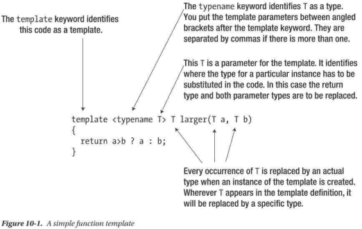

函数模板以 template 关键字开始，以表明它是函数模板。其后是一对尖括号，其中包含一个或多个模板参数的列表。在这个例子中，只有一个参数 T。T 常被用作参数名，因为大多数参数都是类型，但你可以为参数使用任何你喜欢的名字；像 type、MY_TYPE 或 Comparable 这样的名字同样有效。尤其当有多个参数时，可能建议使用更具描述性的名字。

typename 关键字表明 T 是一个类型。因此 T 被称为模板参数。这里你也可以使用 class 关键字——在此上下文中，class 和 typename 关键字是同义的——但我们更偏好 typename，因为类型实参也可以是基础类型，而不仅仅是类类型。

定义的其余部分与普通函数类似，只是参数名 T 散布其中。编译器通过将定义中所有的 T 替换为特定类型来创建模板的实例。在实例化期间分配给类型参数 T 的类型称为模板类型实参。

你可以像放置普通函数定义一样，将模板放在源文件中；也可以为函数模板指定原型。在这种情况下，它将如下所示：

```cpp
template<typename T> T larger(T a, T b);  // Prototype for function template
```

模板的原型或定义必须在任何导致该模板实例的语句之前出现在源文件中。

## 创建函数模板的实例

编译器会从任何使用 `larger()` 函数的语句创建该模板的实例。下面是一个示例：

```cpp
std::cout << "Larger of 1.5 and 2.5 is " << larger(1.5, 2.5) << std::endl;
```

你只需以正常方式使用该函数。你不需要为模板参数 T 指定值。编译器从 `larger()` 函数调用中的实参推导出要替换 T 的类型。这种机制称为*模板实参推导*。`larger()` 的实参是 double 类型的字面量，因此这个调用会让编译器查找已有的、参数为 double 的 `larger()` 定义。如果找不到，编译器会通过在模板定义中用 double 替换 T，从模板创建这个版本的 `larger()`。

生成的函数定义接受 double 类型的实参并返回 double 值。将 double 代入模板中 T 的位置后，模板实例实际上将如下所示：

```cpp
double larger(double a, double b)
{
    return a > b ? a : b;
}
```

编译器确保每个模板实例只生成一次。如果后续函数调用需要同一个实例，那么它可以使用已存在的该实例。你的程序始终只包含每个实例定义的一份副本，即使同一个实例在不同的源文件中生成。现在你已熟悉这个概念，让我们读一个函数模板：

```cpp
// Ex10_01.cpp
// Using a function template
import <iostream>;
import <string>;
import <format>;

template<typename T> T larger(T a, T b);    // Function template prototype

int main()
{
    std::cout << "Larger of 1.5 and 2.5 is " << larger(1.5, 2.5) << std::endl;
    std::cout << "Larger of 3.5 and 4.5 is " << larger(3.5, 4.5) << std::endl;

    int big_int {17011983}, small_int {10};
    std::cout << std::format("Larger of {} and {} is {}\n",
                             big_int, small_int, larger(big_int, small_int));

    std::string a_string {"A"}, z_string {"Z"};
    std::cout << std::format(R"(Larger of "{}" and "{}" is "{}")",
                             a_string, z_string, larger(a_string, z_string)) << std::endl;
}

// Template for functions to return the larger of two values
template <typename T>
T larger(T a, T b)
{
    return a > b ? a : b;
}
```

这会产生以下输出：

```
Larger of 1.5 and 2.5 is 2.5
Larger of 3.5 and 4.5 is 4.5
Larger of 17011983 and 10 is 17011983
Larger of "A" and "Z" is "Z"
```

作为 `main()` 中第一条语句的结果，编译器创建了一个接受 double 类型实参的 `larger()` 定义。下一条语句将调用同一个实例。第三条语句需要接受 int 类型实参的 `larger()` 版本，因此创建了一个新的模板实例。最后一条语句又创建了一个模板实例，其参数类型为 `std::string`，并返回 `std::string` 类型的值。

## 模板类型参数

模板类型参数的名称可以用于模板的函数签名、返回类型和函数体中的任何位置。它是类型的占位符，因此可以放在你通常放置具体类型的任何上下文中。也就是说，假设 T 是模板参数名；那么你可以使用 T 构造派生类型，例如 T&、const T&、T* 和 T[3]。或者你可以将 T 用作类模板的实参，例如在 std::vector<T> 中。

作为示例，我们可以考虑 Ex10_01 的 `larger()` 函数模板。它目前实例化的函数按值接受实参。然而，正如 Ex10_01 所表明的，这个模板也会用 `std::string` 等类类型实例化。在第 8 章中你了解到，按值传递对象会导致这些对象的不必要拷贝，这是如果可能就应避免的事情。当然，标准机制是改为按引用传递实参。因此，我们最好将模板重新定义如下：

```cpp
template <typename T>
const T& larger(const T& a, const T& b)
{
    return a > b ? a : b;
}
```

> **注意**  标准库的 `<algorithm>` 模块定义了一个 `std::max()` 函数模板，它与我们最新的 `larger()` 定义完全类似。它按常量引用接受两个实参，并返回一个常量引用，该引用指向两个函数实参中较大的那个。同一模块还定义了 `std::min()` 模板，它当然是一个实例化函数，用于确定两个值中的较小者。


## 显式模板实参

如果在 Ex10_01.cpp 的 `main()` 中加入以下语句，它将无法编译：

```cpp
std::cout << std::format("Larger of {} and 19.6 is {}\n", small_int,
                         larger(small_int, 19.6));
```

`larger()` 的实参类型不同，而模板中 `larger()` 的参数类型相同。编译器无法创建具有不同参数类型的模板实例。显然，可以将一个实参转换为另一个实参的类型，但必须显式编写代码；编译器不会这样做。可以定义模板允许 `larger()` 的参数为不同类型，但这会带来复杂性，本章后面会讨论：两种类型中用哪一个作为返回类型？现在，我们集中讨论调用函数时如何显式指定模板参数的实参。这样可以控制使用函数的哪个版本。编译器不再推导用于替换 T 的类型；它接受你指定的内容。

可以通过模板的*显式实例化*来解决 `larger()` 使用不同实参类型的问题：

```cpp
std::cout << std::format("Larger of {} and 19.6 is {}\n", small_int,
                         larger<double>(small_int, 19.6));  // Outputs 19.6
```

将函数模板的显式类型实参放在函数名后的尖括号中。这会生成 T 为 double 类型的实例。使用显式模板实参时，编译器完全相信你知道自己在做什么。它会为第一个实参插入到 double 类型的隐式类型转换。即使这可能不是你想要的，它也会提供隐式转换。下面是一个例子：

```cpp
std::cout << std::format("Larger of {} and 19.6 is {}\n", small_int,
                         larger<int>(small_int, 19.6));     // Outputs 19
```

你是在告诉编译器使用 T 为 int 类型的模板实例。这需要将第二个实参隐式转换为 int。转换结果是值 19，在这种情况下这可能并不是你真正想要的。大多数编译器会对这种危险的转换发出警告，尽管并非所有编译器都会。

## 函数模板特化

假设你扩展 Ex10_01.cpp，用指针实参调用 `larger()`：

```cpp
std::cout << std::format("Larger of {} and {} is {}\n", big_int, small_int,
                         *larger(&big_int, &small_int)); // Output may be 10!
```

编译器会实例化该模板，参数类型为 `int*`。这个实例的原型如下：

```cpp
int* larger(int*, int*);
```

返回值是一个地址，必须解引用它才能输出值。然而，结果很可能就是 10，这大概并非本意。原因在于比较的是作为实参传入的地址，而不是这些地址处的值。由于编译器可以随意重新安排局部变量的内存位置，实际结果可能因编译器而异。但考虑到 `small_int` 变量排在第二位，其地址更大并非不可想象。

> **注意**  如果你的编译器将前面的代码片段输出为非 10，可以尝试调整 `big_int` 和 `small_int` 的声明顺序。两个整数值的比较当然不应取决于它们的声明顺序。

原则上，可以定义模板的特化来适配指针类型的模板实参（尽管我们很快会告诉你这很少是个好主意）。对于特定参数值，或者在多参数模板情况下的一组值，模板特化定义了不同于标准模板的行为。模板特化的定义必须出现在原始模板的声明或定义之后。如果把特化放在前面，程序将无法编译。特化还必须出现在其第一次使用之前。

特化的定义以 `template` 关键字开头，但省略参数，因此关键字后的尖括号为空。`larger()` 针对 `int*` 类型的特化定义如下：

```cpp
template <>
int* larger(int* a, int* b)
{
    return *a > *b ? a : b;
}
```

函数体唯一的改动是对实参 a 和 b 解引用，以便比较值而不是地址。要在 Ex10_01.cpp 中使用它，需要将该特化放在模板原型之后、`main()` 之前。

不幸的是，模板特化有一些微妙的缺点。因此，就我们而言，我们把它和 typedef、new/new[]、delete/delete[] 一起列入不推荐使用的语言特性清单：

> **提示**  我们建议你*永远不要*使用函数模板特化。要为特定类型定制函数模板，应改为重载该函数模板，可以使用普通函数或另一个函数模板。下一节将讨论这些选项。一般而言，函数重载的行为比函数模板特化更直观。

## 函数模板与重载

可以通过定义其他同名函数来重载函数模板。这样可以为特定情况定义“覆盖”，而不必求助于模板特化。编译器总是优先使用更具体的重载，而不是更通用模板的实例。和往常一样，每个重载函数必须具有唯一的签名。

让我们重新考虑之前的情况：需要重载 `larger()` 函数以接受指针实参。与其为 `larger()` 使用模板特化，不如直接定义一个重载函数。下面的重载函数原型可以达到目的：

```cpp
int* larger(int* a, int* b); // Function overloading the larger template
```

然后，应使用下面的函数定义来代替特化定义：

```cpp
int* larger(int* a, int* b)
{
    return *a > *b ? a : b;
}
```

甚至可以用另一个专门针对指针类型的模板来重载原始模板：

```cpp
template<typename T>
T* larger(T* a, T* b)
{
    return *a > *b ? a : b;
}
```

注意，这*不是*原始模板的特化，而是第二个不同的模板，只会在指针类型上实例化。如果编译器遇到调用 `larger(x,y)`，其中 x 和 y 是指向同类型值的指针，它将实例化这第二个函数模板；否则，它仍会实例化我们之前的模板。

当然，也可以用另一个生成完全不同签名函数的模板来重载现有模板。例如，可以定义一个模板来重载 Ex10_01.cpp 中的 `larger()` 模板，以查找 vector 中包含的最大值：

```cpp
template <typename T>
const T* larger(const std::vector<T>& data)
{
    const T* result {};            // The largest of an empty vector is nullptr
    for (auto& value : data)
        if (!result || value > *result) result = &value;
    return result;
}
```

参数列表将由此模板生成的函数与原始模板的实例区分开来。

可以扩展 Ex10_01.cpp 来演示这一点。将前面的模板添加到源文件末尾，并在开头添加这些原型：

```cpp
template <typename T> T* larger(T*, T*);
template <typename T> const T* larger(const std::vector<T>& data);
```

然后可以将 `main()` 中的代码改为以下内容：

```cpp
int big_int {17011983}, small_int {10};
std::cout << std::format("larger of {} and {} is {}", 
                         big_int, small_int, larger(big_int, small_int)) << std::endl;
```


```cpp
std::cout << std::format("Larger of {} and {} is {}",
                          big_int, small_int, *larger(big_int, &small_int)) << std::endl;

std::vector<double> data {-1.4, 7.3, -100.0, 54.1, 16.3};
std::cout << "The largest value in data is " << *larger(data) << std::endl;

std::vector<std::string> words {"The", "higher", "the"};
std::cout << std::format(R"(The largest word in words is "{}")", *larger(words))
          << std::endl;
```

当然，你还需要为 `<vector>` 模块添加 import 声明。我们将完整代码放在 Ex10_02.cpp 中。这个程序会生成两个重载模板的实例。如果编译并执行它，输出将如下所示：

```text
Larger of 17011983 and 10 is 17011983
Larger of 17011983 and 10 is 17011983
The largest value in data is 54.1
The largest word in words is "the"
```

## 具有多个参数的函数模板

到目前为止，你一直在使用只有一个模板参数的函数模板，但也可以有多个参数。回顾一下，在表达式 larger(small_int, 9.6) 中，编译器无法推导模板类型实参，因为两个函数实参具有不同的类型——分别是 int 和 double。我们之前通过显式指定类型解决了这个问题。但也许你当时在想，为什么我们不能直接创建一个允许函数实参类型不同的 larger() 模板呢？那样的话，它可能看起来像这样：

```cpp
template <typename T1, typename T2>
??? larger(const T1& a, const T2& b)
{
    return a > b ? a : b;
}
```

允许每个函数实参具有不同的类型很容易做到，而且通常是个好主意，可以让模板尽可能通用。然而，在这种情况下，指定返回类型时就会遇到麻烦。也就是说，在前面的伪代码中，我们应该用什么替换三个问号？T1？T2？一般来说两者都不正确，因为两者都可能导致不需要的转换。第一种可能的解决方案是增加一个额外的模板类型参数，以提供控制返回类型的方法。下面是一个示例：

```cpp
template <typename ReturnType, typename T1, typename T2>
ReturnType larger(const T1& a, const T2& b)
{
    return static_cast<ReturnType>(a > b ? a : b);
}
```

我们添加了一个到 ReturnType 的显式转换，以消除任何关于隐式转换的警告。模板实参推导仅基于函数实参列表中传入的实参进行。根据这些实参，编译器可以轻松推导出 T1 和 T2，但无法推导出 ReturnType。因此，你必须始终自己指定 ReturnType 模板实参。不过，你仍然可以让编译器推导 T1 和 T2。一般来说，如果你指定的模板实参少于模板参数的数量，编译器将推导其余的参数。因此，下面三行是等价的：

```cpp
std::cout << "Larger of 1.5 and 2 is " << larger<int>(1.5, 2) << std::endl;
std::cout << "Larger of 1.5 and 2 is " << larger<int, double>(1.5, 2) << std::endl;
std::cout << "Larger of 1.5 and 2 is " << larger<int, double, int>(1.5, 2) << std::endl;
```

显然，这里模板定义中参数的顺序很重要。如果你把返回类型作为第二个参数，那么在调用时就必须始终指定两个参数。如果你只指定一个参数，它将被解释为实参类型，而返回类型则未定义。由于我们将返回类型指定为 int，在三种情况下，这些函数调用的结果都将是 2。编译器会创建一个接受 double 和 int 类型实参的函数，然后将其结果转换为 int 类型的值。

虽然我们确实说明了如何定义多个参数以及这对模板实参推导意味着什么，但你可能已经注意到，我们仍然没有找到一个令人满意的解决方案，使我们能够编写以下代码：

```cpp
std::cout << "Larger of " << small_int << " and 9.6 is "
          << larger(small_int, 9.6) << std::endl;
```

我们将在下一节彻底解决这个问题。

### 模板中的返回类型推导

在第 8 章中，你学习了普通函数的自动返回类型推导。在函数模板的上下文中，返回类型推导可能是天赐之物。具有一个或多个类型参数的模板函数的返回类型可能取决于用于实例化模板的类型。我们在上一节中已经通过以下示例看到了这一点：

```cpp
template <typename T1, typename T2>
??? larger(const T1& a, const T2& b)
{
    return a > b ? a : b;
}
```

在这里，你无法轻松指定应该返回哪种类型。但有一种简单的方法，可以让编译器在实例化模板后为你推导出来：

```cpp
template <typename T1, typename T2>
auto larger(const T1& a, const T2& b)
{
    return a > b ? a : b;
}
```

使用这个定义，以下语句将能够正常编译，而无需显式指定任何类型实参：

```cpp
int small_int {10};
std::cout << "larger of " << small_int << " and 9.6 is "
          << larger(small_int, 9.6) << std::endl;      // deduced return type: double

std::string a_string {"A"};
std::cout << "larger of \"" << a_string << "\" and \"Z\" is \""
          << larger(a_string, "Z") << '"' << std::endl; // deduced return type: std::string
```

在我们 Ex10_01 中 larger() 的原始定义中，它只有一个类型参数，这两个实例化都会产生歧义，因此无法编译。使用双参数版本的可运行程序见 Ex10_03.cpp。

#### decltype(auto)

使用 auto 作为函数的返回类型，意味着该返回类型将始终推导为值类型。因此，当 auto 用作函数模板的返回类型时，有时会无意中引入复制。为了说明这个问题，请重新考虑 Ex10_01 中的 larger<>() 模板。现在假设它被实例化，且 T1 和 T2 都等于 `std::vector<int>`。那么编译器实际上会生成以下实例：

```cpp
auto larger(const std::vector<int>& a, const std::vector<int>& b)
{
    return a > b ? a : b;
}
```

下一步，编译器会推导其返回类型：

```cpp
std::vector<int> larger(const std::vector<int>& a, const std::vector<int>& b)
{
    return a > b ? a : b;
}
```

由于这个模板实例的返回类型是 auto，编译器推导出的值类型是 `std::vector<int>`，而不是更理想的引用类型 `const std::vector<int>&`。不幸的是，这意味着 `larger<>(std::vector<int>)` 总是会复制其输入之一，而这些输入可能是任意大的向量。因此，当以非泛型方式编写这个函数时，你通常会改为这样写：

```cpp
const auto& larger(const std::vector<int>& a, const std::vector<int>& b)
{
    return a > b ? a : b;
}
```

问题在于，我们也不能在 larger<>() 模板中使用 const auto& 作为返回类型，因为在 T1 和 T2 不同（且没有继承关系；见第 14 章）的情况下，我们会返回一个临时值的地址。也就是说，在 larger<>() 中使用 const auto& 而不是 auto，会导致类似下面的实例：

```cpp
const auto& larger(const double& a, const int& b)
{
    return a > b ? a : b;    // Warning: returning a reference to a temporary double!!!
}
```

这里，a > b ? a : b 会创建一个 double 类型的新临时值（即 int 和 double 的所谓*公共类型*）。当然，我们教过你，不要像那样返回局部变量或临时变量的引用或指针（见第 8 章）！

对于这种 auto 和 const auto& 都不合适的困境，解决方案是更高级的 `decltype(auto)` 占位符类型。当用作函数的返回类型时，这个占位符会求值为 return 语句中表达式的确切类型。因此，你可以创建 larger<> 模板的改进版本，如下所示（另见 Ex10_03A）。

```cpp
template <typename T1, typename T2>
decltype(auto) larger(const T1& a, const T2& b)
{
    return a > b ? a : b;
}
```

对于 `larger<double, int>()`，推导出的返回类型仍将是 double，但 `larger<std::vector<int>, std::vector<int>>()` 的返回类型将是 `const std::vector<int>&`——正如所愿！

注意，你只应在模板中使用 `decltype(auto)`。在非泛型代码中，你应该始终在更具体的 auto 或 (const) auto& 之间显式选择。

## 模板参数的默认值

你可以为函数模板参数指定默认值。例如，你可以像这样在之前介绍的模板原型中指定 double 作为默认返回类型：

```cpp
// Template with default value for the first parameter
template <typename ReturnType=double, typename T1, typename T2>
ReturnType larger(const T1&, const T2&);
```

如果你不指定任何模板参数值，返回类型将是 double。请注意，我们使用这个示例只是为了介绍模板参数的默认值，而不是因为这样定义 larger() 一定是个好主意。这不是一个好主意的原因是，默认值 double 并不总是你想要的。例如，由以下语句生成的 larger() 函数接受 int 类型的实参，并将结果作为 double 类型返回：

```cpp
std::cout << larger(123, 543) << std::endl;
```

我们想通过这个示例传达的主要观点是，你可以在模板参数列表的开头为模板实参指定默认值。你会记得，对于函数参数，只能在列表末尾定义默认值。在指定模板参数的默认值时，你有更大的灵活性。在我们的第一个示例中，ReturnType 是列表中的第一个。但你也可以为列表中间或末尾的参数指定默认值。下面是另一个 larger() 模板，用以说明后者：

```cpp
// Template with a default value referring to an earlier parameter
template <typename T, typename ReturnType=T>
ReturnType larger(const T&, const T&);
```


在这个示例中，我们使用 T 作为 ReturnType 模板参数的默认值。只有在模板参数名（本例中的 T）出现在参数列表中更早的位置时，才能在其他参数的默认值中使用该名称。这个示例再次主要是为了说明哪些做法是可能的，而不是说它一定是个好主意。如果 ReturnType 的默认值不适合你，并且你必须显式指定另一种类型，那么你也必须同时指定所有其他实参。尽管如此，常见的做法是将模板参数的默认值放在参数列表末尾。标准库广泛使用了这种做法，也经常将其用于非类型模板参数。接下来讨论非类型模板参数。

## 非类型模板参数

到目前为止，你见到的所有模板参数都是类型。函数模板也可以有非类型参数。

你可以将非类型模板参数与任意类型参数一起包含在参数列表中。假设你需要一个函数对某个值执行范围检查，而该范围的界限是预先固定的。那么你可以定义一个模板来处理多种类型：

```cpp
template <typename T, int lower, int upper>
bool is_in_range(const T& value)
{
    return (value <= upper) && (value >= lower);
}
```

这个模板有一个类型参数 T，以及两个非类型参数 lower 和 upper，二者的类型都是 int。从 C++20 起，非类型模板参数可以是任何基本类型（bool、float、int 等）、枚举类型、指针或引用类型。理论上，类类型也可以用作非类型模板参数的类型，但限制非常严格。严格到足以让你忽略这种可能性。这里我们只考虑几个使用整数类型参数的简单示例，仅用于说明其工作方式。

显然，编译器无法通过我们对 is_in_range() 函数模板的使用来推导 lower 和 upper 这两个模板参数。因此，下面的调用将无法编译：

```cpp
double value {100.0};
std::cout << is_in_range(value);        // Won’t compile – incorrect usage
```

编译失败是因为 upper 和 lower 未被指定。要使用这个模板，必须显式指定模板参数值。正确用法如下：

```cpp
std::cout << is_in_range<double, 0, 500>(value);   // OK – checks 0 to 500
```

编译器需要能够在编译期求值与所有非类型参数对应的实参。这通常意味着这些模板实参将由字面量或编译期常量¹组成。在下面的示例中，i 是一个编译期整数常量，因此 i 和 i * 100 都可以用作非类型模板实参：

```cpp
const int i = 5;                                      // OK – compile-time constant
std::cout << is_in_range<double, i, i * 100>(value);  // OK – checks 5 to 500
```

¹ constexpr 和 consteval 函数也可以用于非类型模板实参表达式。这些函数分别可以在编译期求值或只能在编译期求值。不过，你并不经常需要它们，因此本书不再进一步讨论 constexpr 或 consteval 函数。

总而言之，最佳变体似乎是把类型参数 T 放在最后（以便推导该类型），并对 lower 和 upper 使用 auto（以避免硬编码它们的类型）：

```cpp
template <auto lower, auto upper, typename T>
bool is_in_range(const T& value)
{
    return (value <= upper) && (value >= lower);
}
```

话虽如此，对于 is_in_range() 的界限，你或许应该使用普通函数参数，而不是模板参数。函数参数让你能够灵活地传入在运行时计算出的值，而使用模板参数时，必须在编译期提供这些界限。我们使用 is_in_range() 模板仅仅是为了探索各种可能性，而不是因为它们中的任何一个都是恰当使用非类型模板参数的示例。

不过，别误会：非类型模板参数虽然相对少见，但确实有它们的用武之地。我们将在下一小节讨论一个具体用例。

## 用于接受固定大小数组实参的函数的模板

在第 8 章关于按引用传递数组的一节中，我们定义了以下函数：

```cpp
double average10(const double (&array)[10])  // Only arrays of length 10 can be passed!
{
    double sum {};                            // Accumulate total in here
    for (size_t i {}; i < 10; ++i)
        sum += array[i];                       // Sum array elements
    return sum / 10;                           // Return average
}
```

显然，如果能创建一个适用于任意数组大小的函数，而不只是适用于恰好包含十个值的数组，那将非常好。带有非类型模板实参的模板可以让你做到这一点，如下所示。为更周全起见，我们还会进一步泛化它，使其也适用于任何数值类型的数组，而不仅是 double 数组：

```cpp
template <typename T, size_t N>
T average(const T (&array)[N])
{
    T sum {};                                 // Accumulate total in here
    for (size_t i {}; i < N; ++i)
        sum += array[i];                       // Sum array elements
    return sum / N;                            // Return average
}
```

模板实参推导的强大程度甚至足以从传给此类模板的实参类型中推导出非类型模板实参 N。我们可以用一个小测试程序来验证这一点：

```cpp
// Ex10_04.cpp
// Defining templates for functions that accept fixed-size arrays
import <iostream>;

template <typename T, size_t N>
T average(const T (&array)[N]);

int main()
{
    double doubles[2] { 1.0, 2.0 };
    std::cout << average(doubles) << std::endl;

    double moreDoubles[] { 1.0, 2.0, 3.0, 4.0 };
    std::cout << average(moreDoubles) << std::endl;

    // double* pointer = doubles;
    // std::cout << average(pointer) << std::endl;     /* will not compile */

    std::cout << average( { 1.0, 2.0, 3.0, 4.0 } ) << std::endl;

    int ints[] { 1, 2, 3, 4 };
    std::cout << average(ints) << std::endl;
}
```

此示例输出如下：

```text
1.5
2.5
2.5
2
```

main() 内部共有五次对 average() 的调用，其中一次被注释掉了。第一次调用是最基本的情况，证明编译器能够正确推导出：在模板实例中，T 需要替换为 double，N 需要替换为 2。第二次调用表明，即使没有在类型中显式指定数组的维度，这种方法也有效。编译器仍然知道 moreDoubles 的大小是 4。第三次调用被注释掉，因为它无法编译。尽管数组和指针在大多数情况下是等价的，但编译器无法从指针推导出数组大小。第四次调用表明，你甚至可以通过直接传入花括号包围的列表作为实参来调用 average()。对于第四次调用，编译器不必再创建一个模板实例。它将复用为第二次调用生成的实例。第五次也是最后一次调用说明，如果 T 被推导为 int，那么结果也将是 int 类型——因此会得到整数除法的结果。

虽然至少在理论上，如果将这些模板用于许多不同大小的数组，可能会导致相当程度的代码膨胀，但基于此类模板定义函数重载仍然相对常见。例如，标准库就经常使用这种技术。

> **提示** 从 C++20 起，你可以在 Ex10_04 中改用固定大小的 span 作为 average() 的输入（见第 9 章）。
>
> 那么函数模板原型如下：
>
> ```cpp
> template <typename T, size_t N> T average(std::span<const T, N> span);
> ```
>
> 这样做的好处是，这些函数也将适用于 std::array<> 输入。事实上，除非 N 确实重要，否则最好直接使用普通的 span<>：
>
> ```cpp
> template <typename T> T average(std::span<const T> span);
> ```
>
> 这样，average() 模板就适用于所有顺序输入，无论固定大小还是可变大小。


### 缩写函数模板

引入模板的语法相当冗长。只需看看下面这个用于对输入求平方的函数的简单模板：

```cpp
template <typename T>    // ?? Do we really need this?
auto sqr(T x) { return x * x; }
```

声明一个模板类型参数 T 需要用到两个由八个字母组成的关键字：template 和 typename。C++20 允许我们以紧凑得多的方式编写这样的模板，如下所示：

```cpp
auto sqr(auto x) { return x * x; }
```

这种语法是对用于请求函数返回类型推导的语法的自然扩展。以前，你只能将 auto 关键字用作函数返回类型的占位符，但现在也可以将它用作函数参数类型的占位符。当然，其他占位符类型，如 auto*、auto& 和 const auto&，也是允许的。例如：

```cpp
auto cube(const auto& x) { return x * x * x; }
```

尽管 sqr() 和 cube() 的定义现在不再使用 template 关键字，但它们仍然是函数模板。事实上，从语义上讲，我们的第二个 sqr() 定义在各个方面都完全等价于最初的定义。唯一的区别是新语法更短。因此得名：缩写函数模板。例如，sqr() 是函数模板这一事实意味着，编译器在调用它的每个编译单元中始终需要访问其定义（我们将在下一章进一步讨论这一点）。这也意味着，如果你需要，可以显式实例化它（sqr<int>(...)）、特化它（template <> auto sqr(int x)），等等。

在缩写函数模板的函数参数列表中，每次出现 auto 实际上都会引入一个隐式的、未命名的模板类型参数。因此，下面两个原型完全等价（注意，函数返回类型中的 auto 不会产生额外的模板参数）：

```cpp
const auto& larger(const auto& a, const auto& b);
```

```cpp
template <typename T1, typename T2>
const auto& larger(const T1& a, const T2& b);
```

你甚至可以将两种记法混用，如下面这个人为示例所示：

```cpp
// A function template with two template type parameters: one explicit and one implicit
template <typename T>
const T& mixAndMatch(auto* mix, const T& match1, const T& match2);
```

### 缩写函数模板的限制

如果你希望模板实例化出多个参数具有相同类型或相关类型的函数，仍然必须使用旧语法。

```cpp
template <typename T>
const T& larger(const T& a, const T& b);
```

同样，如果你需要在其他地方——例如在函数体中——引用某个参数类型名，通常沿用旧语法会更方便。

```cpp
// Create a vector containing consecutive values in the range [from, to)
template <typename T>
auto createConsecutiveVector(const T& from, const T& to)
{
    std::vector<T> result;
    for (T t = from; t < to; ++t)
        result.push_back(t);
    return result;
}
```

## 总结

在本章中，你学习了如何为函数定义自己的参数化模板，以及如何实例化它们来创建函数。这使你能够创建对任意数量的相关类型都能正确且高效工作的函数。本章你应该掌握的重要内容如下：

- 函数模板是编译器用来生成重载函数的参数化配方。
- 函数模板中的参数可以是类型参数或非类型参数。对于每次对应唯一一组模板参数实参的函数调用，编译器都会创建一个函数模板实例。
- 函数模板可以与其他函数或函数模板重载。
- 诸如 `auto`、`const auto&` 和 `auto*` 这样的占位符类型，不仅可用于启用函数的返回类型推导——事实证明，这在函数模板中尤其有用——而且当用作函数参数的类型时，它们还会引入所谓的缩写函数模板。

## 练习

这些练习让你尝试本章学到的一些内容。如果遇到困难，可以回顾本章寻求帮助。如果仍然卡住，可以从 Apress 网站（www.apress.com/source-code）下载解答，但那确实应该是最后的手段。

- **练习 10-1.** 在 C++17 中，标准库 `<algorithm>` 模块新增了便捷的 `std::clamp()` 函数模板。表达式 `clamp(a,b,c)` 用于将值 `a` 钳制到给定的闭区间 `[b,c]`。也就是说，如果 `a` 小于 `b`，表达式的结果就是 `b`；如果 `a` 大于 `c`，结果就是 `c`；否则 `a` 位于区间 `[b,c]` 内，`clamp()` 直接返回 `a`。编写你自己的 `my_clamp()` 函数模板，并用一个小测试程序试用它。
- **练习 10-2.** 在 `Ex10_01` 的 `main()` 函数最后几行之后添加如下内容：

```cpp
const auto a_string = "A", z_string = "Z";
std::cout << "larger of " << a_string << " and " << z_string
          << " is " << larger(a_string, z_string) << std::endl;
```

如果你现在运行程序，很可能会得到以下输出（如果没有，请尝试调整 a_string 和 z_string 的声明顺序）：

```
Larger of 1.5 and 2.5 is 2.5
Larger of 3.5 and 4.5 is 4.5
Larger of 17011983 and 10 is 17011983
Larger of A and Z is A
```

这是怎么回事？“A”比“Z”还大？你能解释哪里出问题了吗？你能修复它吗？

提示。要比较两个字符数组，你也许可以先将其转换为另一种字符串表示形式。

- **练习 10-3.** 编写一个名为 plus() 的函数模板，它接受两个可能不同类型的参数，并返回等于两个参数之和的值。接下来，确保 plus() 也可以用于将两个给定指针所指向的值相加。

额外：现在，你能让它也能使用 plus() 连接两个字符串字面量吗？
警告：这可能并不像你想象的那么容易！

- **练习 10-4.** 编写你自己的 std::size() 函数族版本，名为 my_size()，它不仅适用于固定大小的数组，也适用于 std::vector<> 和 std::array<> 对象。不允许使用 sizeof() 运算符。
- **练习 10-5.** 你能想到一种方法来验证：对于任意给定实参类型，编译器只生成函数模板的一个实例吗？请针对 Ex10_01.cpp 中的 larger() 函数进行验证。
- **练习 10-6.** 在第 8 章中，你学习了一种适用于指向字符串的指针的快速排序算法。请泛化 Ex8_18.cpp 的实现，使其适用于任意类型的 vector（也就是存在 < 运算符的任意类型）。编写一个 main() 函数，利用它来对一些元素类型不同的 vector 排序，并输出未排序和排序后的元素列表。当然，你还应该创建一个函数模板，将元素类型任意的 vector 流式输出到 std::cout。

# 第 11 章

# 模块与命名空间

虽然始终可以把所有代码塞进单个源文件（即使对于大型程序也是如此），但如果将相关的源代码（函数、常量、类型等）组织成逻辑上可组合的单元，每个单元放在自己的文件中，那么较大的代码库会容易管理得多。尤其是因为这样你和其他人就可以用这些相同的构建块构造出不同的应用程序。从 C++20 起，首选的组合单元是*模块*。

代码库增长得越多，和/或你依赖的第三方库越多，出现两个函数、两个全局变量、两个类型等具有相同名称的可能性就越大。例如，两个相互独立的子系统可能无意中定义了自己的 `log()` 或 `validate()` 函数，或者定义了自己的 ErrorCode 枚举类型。由于现实中的代码库很容易跨越数百万行代码，而每个子系统大多由半自主的团队开发，如果没有某种约定好的分层命名方案，几乎不可能避免*名称冲突*或*名称碰撞*。在 C++ 中，推荐的方法是让不同子系统在互不相交的*命名空间*中声明它们的名称。

本章你将学习：

- 如何以模块形式构建可组合的代码单元
- 如何从模块导出实体，以便在导入该模块的任何源文件中使用它们
- 如何将较大的模块拆分为更小、更易管理的单元
- 模块分区与子模块之间的区别
- 进一步了解命名空间的使用，以及如何定义和管理自己的命名空间
- 模块与命名空间之间的关系
- 如何在模块和命名空间两个层面将组件的接口与其实现分离

## 模块

在最细的粒度上，任何 C++ 程序都是由函数、类型和变量等基本的、可复用的实体拼接而成的。

对于非常小的程序——比如你到目前为止编写的程序——这可能就是你自己代码中所需的全部。

但随着代码库开始增长，你很快就会注意到，你还需要一些其他机制，以便在更高的粒度上进一步组织代码。你会希望将相关功能组合在一起，这样你和其他所有人就知道到哪里去找它。你会希望将程序分解为更大的、离散的子组件，其中每个组件解决拼图中的某个特定部分。

在内部，这些子组件随后可以使用任意组合

函数、类型和/或他们可能需要的其他组件。作为子组件的使用者，你甚至不需要知道它内部是如何工作的。在 C++20 中，选用的机制是形成由相关功能组成的自包含子组件，称为*模块*。

模块可以导出任意数量的 C++ 实体（函数、常量、类型等），然后你可以在任何*导入*该模块的源文件中使用这些实体。一个模块甚至可以导出整个其他模块。一个模块导出的所有实体的组合称为*模块接口*。不属于模块接口（直接或间接）的实体只能从模块内部看到和使用。

你当然已经知道这种关系在使用端是如何工作的。例如，一旦你*导入*标准库的 `<string>` 模块，你就知道可以访问诸如 `std::string` 和 `string` 这样的类型，以及 `std::getline()`、`stoi()` 和 `to_string()` 这样的函数。`<string>` 模块据说*导出*这些实体；而你，作为该模块的*使用者*，则*导入*它们。

在本章中，你将学习如何创建自己的模块。通常，你会为每个包含共同目的的代码集合使用一个单独的模块。每个模块都表示类型和函数以及任何相关全局变量的某种逻辑分组。模块也可以用来包含一个发布单元，例如一个库。因此，模块有各种形状和大小。有些模块本质上只导出一个类型、一个模板（`vector`、`optional`、`span` 等）或一些常量（numbers 模块），而较大的模块可能导出一个庞大的相关类型和函数库（`<filesystem>` 模块就是一个稍大模块的好例子）。你可以自由选择模块的粒度。

随着你的某些模块不可避免地变得更大和/或更复杂，你可能希望进一步将它们分解为更小、更易管理的子组件。我们将向你展示如何选择在内部分解此类模块（使用*模块分区*），和/或将它们拆分为更小的、松散相关的模块（这些模块通常称为*子模块*）。但在开始组织较大的模块之前，当然最好先确保你能创建较小的模块。

> **警告** 在撰写本书时，还没有编译器完全支持模块。一些编译器已经对这项 C++20 语言特性提供了实验性支持，但这种支持仍然非常有限且不可靠。尽管我们在研究该语言规范时非常谨慎，但我们因此无法充分试用本章及后续章节中大多数与模块相关的代码。因此，如果你的编译器确实支持模块，而某些内容似乎无法工作，你应该首先查阅本书网站上的勘误。另外，如果你的编译器仍不支持模块，请知悉本书的在线下载部分将包含所有不使用模块的示例和练习解答的等价版本。如果你仍然被迫使用非模块化代码，那么在本章之后、继续阅读本书其余部分之前，你可能还想先阅读附录 A。附录 A 可在线获取。

¹因为 `<string>` 早于 C++20，所以从技术上讲，它不是作为模块编写的，而是作为*头文件*编写的。因此，它实际上也不会像真正的模块那样导出任何实体——至少不会显式导出。不过，大多数 C++ 标准库头文件——除了它从 C 继承的那些，例如 `<cmath>` 和 `<cctype>`（另见第 2 章）——都可以像模块一样被对待和导入。这些头文件定义的所有实体随后都表现得好像是从模块导出的。因此，从概念上讲，将 `<string>` 和大多数其他标准库头文件视为一个模块是完全可以的。关于头文件与模块之间关系的更多细节，我们参考附录 A。

## 你的第一个模块

接下来的这个文件包含你的第一个模块的定义。它是一个名为 `math` 的模块，导出了标准 `<cmath>` 头文件中明显缺失的一些特性：一个用于对数字求平方的函数模板（被认为对 `<cmath>` 来说过于高级，因此它只提供了逆运算 `std::sqrt(T)`），一个 lambda 常量（我们向 COVID-19 最聪明的受害者之一致敬：数学界最顽皮的奇才约翰·霍顿·康威），以及一个判断整数奇偶性（oddity）的函数（一个出了名困难的数学问题）。

```cpp
// math.cppm — Your first module
export module math;

export auto square(const auto& x) { return x * x; } // An abbreviated function template

export const double lambda{1.303577269034296391257}; // Conway's constant

export enum class Oddity { Even, Odd };
bool isOdd(int x) { return x % 2 != 0; } // Module-local function (not exported)
export auto getOddity(int x) { return isOdd(x) ? Oddity::Odd : Oddity::Even; }
```

> **注意** 在撰写本书时，对于模块文件应使用什么文件扩展名还没有共识。每个编译器，就其已经支持模块的程度而言，都使用自己的约定。在本书中，我们为模块接口文件使用 `.cppm` 扩展名（`.cppm` 是 C++——`cee plus plus`——module 的缩写）。请查阅你的编译器手册，以确定如何最好地命名你的模块文件。

除了使用一些新关键字*、`export` 和 `module`，当然还有缺少 `main()` 函数之外，这个模块文件看起来与你迄今为止见过的任何其他源文件完全一样。事实上，创建基本模块的语法如此直截了当，几乎不需要进一步解释。也许第一行的模块声明除外，也就是说……

每个模块文件的开头某处都有一个模块声明。每个模块声明都包含 `module` 关键字，后面跟着模块名（在我们的示例中是 `math`）。如果 `module` 关键字前面有 `export` 关键字，则该模块文件就成为模块接口文件。只有模块接口文件才能向模块接口提供导出的实体。

模块的命名规则与 C++ 中任何其他实体的命名规则基本相同，只是在模块名中可以使用点来把多个标识符串接起来。模块名是 C++ 中唯一允许这样做的名称。因此，`math123` 和 `A_B_C` 是有效的模块名，`math.polynomials` 和 `a.b.c` 也是。无效名称的示例包括 `123math`、`poly.math.`、`abc..a.b`。我们稍后会解释如何使用带点名称在本质上模拟分层子模块。

*模块直到 C++20 才被引入。虽然 `export` 一直是 C++ 关键字，但 `module` 和 `import` 不是。为了避免破坏现有代码，这两个词不能简单地变成像 `export` 那样的关键字，因为那会破坏使用 export、switch 或 enum 作为标识符的代码。也就是说，从技术上讲，你仍然可以使用 `module` 或 `import` 作为变量、函数、类型或命名空间的名称。当然，我们强烈建议在新代码中不要这样做。如果你确实必须在模块文件中使用名为 module 或 import 的遗留实体，有时你可能必须在它们的名称前加上作用域解析运算符（本章后面会介绍的 `::`），才能让编译器接受你的代码（也就是说，你可能必须使用 `::module` 或 `::import`，而不是 module 或 import）。

在阅读有关模块的内容时，你可能还会遇到“模块单元”这一术语，而不是“模块文件”。关于翻译单元和源文件之间的区别，我们参考附录 A。

要从模块中导出一个实体，你只需在其第一个声明前加上 `export`。在 `math.cppm` 中，你会看到一个导出模板、一个导出变量、一个导出枚举类型和一个导出函数 `getOddity()` 的示例。第二个函数 `isOdd()` 故意不被导出。只有模块接口文件可以包含 `export declarations`，并且只能位于其模块声明之后。只有模块导出的实体才能在导入该模块的文件中使用。

下面展示如何导入由 `math.cppm` 定义的 `math` 模块，并使用其导出的实体。

```cpp
// Ex11_01.cpp - Consuming your own module
import <iostream>;
import <format>;
import math;

int main()
{
    std::cout << "Lambda squared: " << square(lambda) << std::endl;

    int number;
    std::cout << "\nPlease enter an odd number: ";
    std::cin >> number;
    std::cout << std::endl;

// if (isOdd(number))      /* Error: identifier not found: 'isOdd' */
//   std::cout << "Well done!" << std::endl;

    switch (getOddity(number))
    {
        using enum Oddity;
        case Odd:
            std::cout << "Well done! And remember: you have to be odd to be number one!";
            break;
        case Even:
            std::cout << std::format("Odd, {} seems to be even?", number);
            break;
    }
    std::cout << std::endl;
}
```

> **注意** 在编译像 `Ex11_01.cpp` 这样的文件之前，你通常必须先编译它导入的所有模块的接口文件，在本例中包括 `math` 模块的接口文件。编译模块接口会创建所有导出实体的二进制表示，以便编译器在处理导入该模块的文件时快速查阅。如何编译模块同样因编译器而异。请查阅编译器的文档以获取更多细节。

你通过显而易见的 `import math;` 声明来导入 `math` 模块。与标准库模块的 `import` 声明不同，你自己的模块名不需要放在尖括号中。（关于 `import` 声明中尖括号用法的更多信息，我们建议你参阅在线附录 A。）


> **注意** 与头文件（参见附录 A）不同，用于 `import` 模块的名称并不基于包含模块接口的文件名。相反，它基于在 `export module` 声明中声明的名称。虽然有些编译器要求文件名与模块名称匹配，但其他编译器也允许模块接口文件使用任意名称。因此，尽管在本书中我们总是将模块接口文件命名为 `module_name.cppm`，但请记住，从技术上讲，这个文件的名称并不决定你在 `import` 声明中应使用的名称。

一旦导入了模块，你就可以使用它导出的所有实体。例如，`Ex11_01` 的 `main()` 函数使用了我们强大无比的 `math` 模块导出的所有实体：`square<>()` 函数模板的一个实例化、`lambda` 常量、`getOddity()` 函数以及 `Oddity` 枚举类型。

不过，关键在于你只能使用这些导出的实体。举例来说，你可以尝试取消注释 `Ex11_01.cpp` 中调用 `isOdd()` 的 `if` 语句。然后编译器会提示它不知道任何名为 `isOdd()` 的函数。这并不奇怪：并不是因为 `isOdd()` 在模块接口文件中声明，它就会自动成为模块接口的一部分。要让 `isOdd()` 从 `math` 模块外部可见，你还必须在其定义前添加 `export`。

除此之外，`Ex11_01.cpp` 的 `main()` 程序几乎没有什么新内容，也许除了 `switch` 语句中的 `using enum` 声明。我们在第 3 章向你展示了如何使用 `using enum` 声明，但这是我们第一次在 `switch` 语句（第 4 章介绍）中使用它。得益于这个 `using` 声明，你可以在枚举项名称 `Even` 和 `Odd` 前省略 `Oddity::`——但仅在该 `switch` 语句的作用域内。在本章后面，你会看到，同样可以把其他 `using` 声明和 `using` 指令放在语句、函数或命名空间的作用域中。

### 导出块

在 `Ex11_01` 中，我们使用四个单独的 `export` 声明，逐个导出了四个不同的实体。你也可以通过将它们分组到一个*导出块*中，一次性导出多个实体。导出块由 `export` 关键字后跟花括号之间的一系列声明组成。下面是 `Ex11_01` 中 `math` 模块的另一种定义，它使用导出块而不是四个导出声明的序列（该模块文件可从 `Ex11_01A` 获取）。

```cpp
// math.cppm - Exporting multiple entities at once
export module math;

bool isOdd(int x) { return x % 2 != 0; }  // Module-local function (not exported)

export
{
    auto square(const auto& x) { return x * x; }

    const double lambda{ 1.303577269034296391257 }; // Conway's constant

    enum class Oddity { Even, Odd };
    auto getOddity(int x) { return isOdd(x) ? Oddity::Odd : Oddity::Even; }
}
```

### 将接口与实现分离

到目前为止，所有实体都始终直接定义在模块接口文件中。对于像我们强大的 math 模块中的那些小函数和类型来说，这样做完全没问题。当然，math 的接口文件也许已经因为模块局部的 isOdd() 函数而显得有些杂乱，但还不至于太分散注意力。然而，在现实中，函数定义可能每个长达数十行，而且你可能需要更多局部函数和类型来实现导出的接口。如果不小心，所有这些实现细节都可能掩盖模块的接口，使人更难快速了解某个特定模块提供了什么。在这种情况下，你应该考虑将模块的接口（例如只包含导出函数的原型）与其实现（即这些导出函数连同任何模块局部实体一起定义的地方）分离。

将模块接口与实现分离的第一种选择，是在模块接口文件本身内部进行分离。如下所示：

```cpp
// math.cppm - Exporting multiple entities at once
export module math;

export   // The module's interface
{
    auto square(const auto& x);

    const double lambda = 1.303577269034296391257;  // Conway's constant

    enum class Oddity { Even, Odd };
    auto getOddity(int x);
}

// The implementation of the module's functions (+ local helpers)
auto square(const auto& x) { return x * x; }

bool isOdd(int x) { return x % 2 != 0; }
auto getOddity(int x) { return isOdd(x) ? Oddity::Odd : Oddity::Even; }
```

你始终可以像这样把函数定义移到模块接口文件的底部。你甚至可以把枚举类型 Oddity 的定义下移，先用 `enum class Oddity;` 声明它。不过，我们把 Oddity 的定义留在了导出块中，因为它是——而且需要是——模块接口的一部分（使用者需要知道枚举项才能使用该模块）。常量必须立即初始化，因此 lambda 的定义不能移动。

不过，请注意，你从之前的示例中已经知道了其中大部分内容：我们经常也把所有函数原型放在源文件顶部（以便清晰概览可用函数），并把所有函数定义放在底部（通常放在使用它们的 main() 函数之后）。

此时唯一真正值得注意的新一点是，你不必在底部的定义前重复 `export` 关键字。你可以重复，但不是必须。也就是说，你可以在 math.cppm 底部 square<>() 和 getOddity() 的定义前重复 export，但这样做完全是可选的。

然而，不允许在某个实体的声明前添加 export，而该实体最初声明时没有 export。例如，下面这组声明因此会导致编译错误。

```cpp
bool isOdd(int x);
// ...
export bool isOdd(int x); /* Error: isOdd() was previously declared as not exported! */
```

```cpp
static const std::string cds[]{ "", "C", "CC", "CCC", "CD", "D", "DC", "DCC", "DCCC", "CM" };
static const std::string xls[]{ "", "X", "XX", "XXX", "XL", "L", "LX", "LXX", "LXXX", "XC" };
static const std::string ivs[]{ "", "I", "II", "III", "IV", "V", "VI", "VII", "VIII", "IX" };
return ms[i / 1000] + cds[(i % 1000) / 100] + xls[(i % 100) / 10] + ivs[i % 10];
}
```

与所有模块文件一样，模块实现文件包含模块声明。然而，与模块接口文件不同，模块实现文件的模块声明不以 export 关键字开头。自然，这意味着模块实现文件不能导出任何实体。事实上，你甚至不能在这里 to_roman() 的定义前重复 export 关键字；你只能在模块接口文件中添加或重复 export。

to_roman() 函数本身的实现包含一些巧妙而紧凑的编码，用于将无符号整数转换为标准罗马数字。不过，既然你已在本节前半部分掌握了 C++ 表达式和函数，我们相信你能弄清楚它是如何工作的。由于本节的重点是模块，因此我们将解读这个函数体留作你的可选练习。

为完整起见，下面是我们 roman 模块的第二个模块实现文件；如你所知，它庞大到不可能放进单个实现文件。

```cpp
// from_roman.cpp - Implementation of the from_roman() function
module roman;

unsigned int from_roman(char c)
{
    switch (c)
    {
    case 'I': return 1;    case 'V': return 5;    case 'X': return 10;
    case 'L': return 50;   case 'C': return 100;  case 'D': return 500;
    case 'M': return 1000; default: return 0;
    }
}

unsigned int from_roman(std::string_view roman)
{
    unsigned int result{};
    for (size_t i{}, n{ roman.length() }; i < n; ++i)
    {
        const auto j{ from_roman(roman[i]) };   // Integer value of the i'th roman digit
        // Look at the next digit (if there is one) to know whether to add or subtract j
        if (i + 1 == n || j > from_roman(roman[i + 1])) result += j; else result -= j;
    }
    return result;
}
```

第二个实现文件与前一个类似，不同之处在于它定义了一个局部辅助函数，用于将单个罗马数字位转换为整数。from_roman() 的这个重载仅在当前源文件内可见。

由于 switch、for 和 if 语句都是熟悉的内容，我们同样完全相信你能弄清楚这些 from_roman() 函数如何工作（如果你感兴趣的话）。我们添加了一些注释来帮你入门（在你自己的代码中，只要逻辑不那么显而易见，添加这类注释也从来不是坏主意）。


这是一个小型测试程序及其输出：

```cpp
// Ex11_02.cpp
import <iostream>;
import <string>;
import roman;

int main()
{
   std::cout << "1234 in Roman numerals is " << to_roman(1234) << std::endl;
   std::cout << "MMXX in Arabic numerals is " << from_roman("MMXX") << std::endl;
}
```

```
1234 in Roman numerals is MCCXXXIV
MMXX in Arabic numerals is 2020
```

> **注意** 对于非模块化代码（更多细节请参阅在线附录 A），还有另一个可以说更强的动机，不要在头文件（它在某种程度上类似于模块接口文件）中定义函数：对头文件的每一次更改，无论多么小（甚至只是修正代码注释中的一个拼写错误），通常都意味着所有使用该头文件的代码（直接或间接）都必须重新编译。最坏情况下，由于递归的 #include，这意味着在开发过程中要一遍又一遍地重建几乎整个应用程序。考虑到函数的实现通常比其原型更频繁地发生变化，因此始终将所有实现从头文件移到单独的源文件中是值得的。然而，模块不会遭遇这个问题。模块在设计上就是自包含、独立的构建块。只有对实际模块接口的更改才会影响使用者，而且函数定义有意不属于模块接口的一部分¹（如下一小节所述）。因此，你可以安全地更改模块接口文件中的函数定义，甚至是导出函数的定义，而无需担心重新编译任何使用方代码。

## 实现文件的限制

一般来说，模块的导入方若要使用某个导出实体，所需的一切都必须存在于模块接口文件中。原因是，当编译器处理使用该模块的源文件时，它只考虑该模块接口的（预编译二进制表示）。编译后的模块实现文件的输出在那时不会被考虑，而只在链接阶段需要（第 1 章曾简要说明链接）。因此，有些实体必须始终定义在模块接口文件中，而不能定义在模块实现文件中。例如，所有导出模板的定义都必须属于模块接口的一部分。编译器需要这些模板定义来为模块的各种使用者实例化新的模板实例。实际上，你导出的是整个模板，即未来实例化的完整蓝图，而不是某个特定的函数原型（或类型定义；见第 17 章）。

另一方面，编译器调用常规函数所需的一切就是其原型。据此，它知道应从使用者那里接收什么实参，以及结果类型是什么。因此，大多数函数定义都可以原样移到模块实现文件中。是大多数，但并非全部。不能简单移出接口文件的一个函数定义示例⁶是带 auto 返回类型推导的导出函数。为了使 auto 返回类型推导正常工作，编译器需要函数定义属于模块接口的一部分。

因此，在 `Ex11_01` 的 `math.cppm` 接口文件中，`isOdd()` 函数是唯一可以原样将其定义移到模块实现文件的实体。不是因为 `isOdd()` 是唯一未导出的实体，而是因为 `square<>()` 是模板（这要归功于其 `const auto&` 参数；见第 10 章），并且因为 `getOddity()` 使用了 auto 返回类型推导。

## 实现文件中的隐式导入

作为敏锐的观察者，你当然注意到，我们在 `to_roman.cpp` 中没有导入 `<string>` 模块，尽管 `to_roman()` 的定义显然使用了 `std::string` 类型。同样，我们也没有在 `from_roman.cpp` 中导入 `<string_view>`。如果你漏掉了这一点，我们邀请你快速回看一下。我们可以省略这些模块导入的原因有两方面。

- 每个模块实现文件（不是分区文件；见后文）都会隐式导入它所属的模块。你可以这样理解：诸如 `module roman;` 这样的声明会在下一行隐式添加 `import roman;`。（顺便说一句，不允许在 `module roman;` 之后显式添加 `import roman;`。）
- 每当你将模块的一部分导入同一模块的另一部分时（后文会进一步说明），后者实际上就可以访问前者的所有声明，甚至包括未导出的声明。这不仅包括模块局部函数、类型和变量的声明，也包括对其他模块的导入，例如 `import <string>;` 和 `import <string_view>;`。

综合起来，这两条规则意味着，我们的模块实现文件 `to_roman.cpp` 和 `from_roman.cpp` 都从隐式导入的 `roman.cppm` 模块接口文件继承了针对 `<string>` 和 `<string_view>` 的导入声明。

> **警告** 只有形式完全为 `module my_module;` 的模块声明才会添加隐式的 `import my_module;` 声明（并因此禁止显式的 `import my_module;` 声明）。模块分区的模块声明（如后文所示）不会产生这种影响。要在分区文件中访问模块接口文件的所有声明，你必须显式添加 `import my_module;`。

⁶ 其他例子包括内联函数（其定义需要在调用侧内联）和 constexpr 函数（其定义需要用于静态求值）。我们将在附录 A（可在线获取）中更详细地讨论内联函数。

⁷ 这实际上并不完全准确：具有内部链接的实体永远不能从声明它们的文件之外使用，即使在同一模块内也不行。但是，由于编写模块时实际上从不需要创建具有内部链接的实体（用技术术语来说，简单地为所有未导出实体赋予模块链接要容易得多），我们这里暂不讨论这种可能性。有关不同类型的链接的更多细节，请参阅附录 A。

## 可达性与可见性

当你将模块导入一个不属于同一模块的文件时，你不会隐式继承模块接口文件中的所有导入。这本质上就是为什么我们必须在 Ex11_02.cpp 中导入 `<string>` 模块，尽管被导入的 roman 模块的模块接口文件也包含针对 `<string>` 的导入声明。如果你愿意，可以从模块中显式导出导入声明——我们将在后续小节进一步讨论这个选项——但默认情况下，当你导入一个模块时，你不会隐式获得对该模块所依赖的所有其他模块的完整访问权限。

这是一件好事。也就是说，你确实不希望接口文件中的所有导入都被随意导出给使用者。你绝不希望当某个模块更改其接口的实现时，该模块的使用者受到影响。只有对模块接口的更改才允许影响其使用者。如果所有导入都被随意导出和导入，那么你添加或删除的任何导入声明都会递归地波及所有（直接或间接）导入该模块的代码。而这极有可能对使用者产生不利影响；在深层某处移除一个导入可能会破坏其他原本依赖该导入的代码，而添加一个导入声明则可能引入名称冲突。（头文件正是会遭遇这些问题；详情请参阅在线附录 A。）

然而，如果你不让使用者了解模块接口中所使用的类型，他们大多就无法再使用该接口了。以 `Ex11_02` 的 roman 模块接口为例。要调用 `from_roman()`，你需要知道如何创建 `std::string_view` 对象；同样，要使用 `to_roman()` 的结果，你至少需要了解 `std::string` 类型的一些知识。

C++ 模块提供的恰当折中方案，是将实体声明的可达性与实体名称的可见性区分开来。我们将通过一个例子说明这意味着什么。复制 `Ex11_02` 的 roman 模块的所有文件，并新建一个源文件，其中包含一个空的 `main()` 函数。在这个新源文件中，你不应再像之前 Ex11_02.cpp 中那样导入 `<string>` 模块。换句话说，新源文件只包含以下两个导入声明：

```cpp
// Ex11_03.cpp—Using types with reachable definitions but whose names are not visible
import <iostream>;
import roman;

int main()
{
    // You can put all code used in the remainder of this section here...
}
```

任何在被导入的模块接口文件（例如 roman.cppm）中可达的声明（包括类型定义）（无论是通过本地声明还是通过导入），在导入文件中也是可达的。因此，通过导入 roman，`std::string` 和 `std::string_view` 两者的定义目前都在 Ex11_03.cpp 中变为可达。由此可见，声明的可达性会隐式且递归地传播到模块的所有直接和间接使用者。

一旦某个类型的定义可达，你在大多数情况下就可以完全按照自己习惯的方式使用该类型的值。例如，由于 `std::string_view` 的定义在 Ex11_03.cpp 中可达，你可以在其中用字符串字面量调用 `from_roman()`，从而在此过程中隐式创建一个 `std::string_view` 对象：

```cpp
std::cout << "MMXX in Arabic numerals is " << from_roman("MMXX") << std::endl;
```


你甚至可以在类型定义可达的对象上调用函数。用正式的话说，我们说可达类定义中成员的名字是可见的。因此，在 `Ex11_03.cpp` 的下面两行中，我们可以对 `to_roman()` 返回的 `std::string` 对象调用 `c_str()` 和 `size()` 函数，尽管我们从未导入 `<string>` 模块：

```cpp
std::cout << "1234 in Roman numerals is " << to_roman(1234).c_str() << std::endl;
std::cout << "This consists of " << to_roman(1234).size() << " numerals" << std::endl;
```

为了避免无意的名称冲突，并避免使用者依赖不同的内部名称，实体名称的*可见性*不会随意逃逸出模块。因此，`std::string` 和 `std::string_view` 这些名称在 `Ex11_03.cpp` 中不可见，因而无需在那里使用。

```cpp
// std::string_view sv{ "MXX" };  /* Error: the name std::string_view is not visible */
// std::string roman{ to_roman(567) };  /* Error: the name std::string is not visible */
```

不过幸运的是，你不需要访问函数返回类型的名称就能使用它们。你始终可以使用 `auto` 或 `const auto&` 作为该名称的占位符来捕获函数的结果。

```cpp
auto roman{ to_roman(567) };
std::cout << "567 in Roman numerals is " << roman.c_str() << std::endl;
```

与类型名称（`std::string`、`std::string_view` 等）的可见性一样，函数名称的可见性也不会随意越过模块边界。因此，诸如 `std::stoi()` 和 `std::to_string()` 这样的函数根本无法从 `Ex11_03.cpp` 内部调用。

```cpp
// std::cout << std::stoi("1234") << std::endl;  // Error: std::stoi() is not visible
```

这也至少部分解释了为什么我们之前在 `Ex11_02.cpp` 中必须导入 `<string>` 模块。没有该导入，下面这行就无法工作，因为 `<<` 运算符不可见。正如你将在第 13 章学到的，这个流输出运算符实际上也不过是一个函数，只不过它可以用不同的语法调用。

```cpp
// std::cout << "1234 in Roman numerals is " << to_roman(1234) << std::endl;
```

总之，声明的*可达性*和传递可见性会传播到模块的所有使用者——无论这种传播多么间接——但所声明名称的*可见性*不会。不过幸运的是，可达定义通常就足以让你使用模块接口而无需导入任何额外模块，尤其是如果你乐于使用 `auto`。

## 导出导入声明

与模块接口文件中的大多数声明一样，你也可以在导入声明前添加 `export`。任何导入模块接口文件的文件，也可以导入从该模块导出的声明。例如，假设在 `Ex11_02` 的 `roman.cppm` 中，你在其两个导入声明前添加 `export`，如下所示：

```cpp
// roman.cppm
export module roman;
export import <string>;
export import <string_view>;

export std::string to_roman(unsigned int i);
export unsigned int from_roman(std::string_view roman);
```

然后你就可以安全地移除 `Ex11_02.cpp` 中对 `<string>` 的导入声明，因为该文件随后通过导入 roman 间接导入了 `<string>`。

不过，你不应系统性地导出在模块内使用的所有模块导入。只有当你知道模块的每个使用者都将需要依赖模块所暴露的函数和/或类型名称时，才应导出某个导入声明。如你在上一节中所记得的，类型定义的可达性通常就足以使用模块接口，为此你不需要导出相应的导入。

导出导入声明的另一个可行原因是形成所谓的子模块。我们将在下一节讨论该策略。

## 管理更大的模块

模块越大，其功能越复杂，就越可能需要进一步将其代码划分为更小、更易管理的组件。

当然，你的首选方案是将模块拆分为若干更小的模块。如果其接口可以拆分为清晰、互不相交的子接口，并且这些子接口的实现也相互独立，那么这种方法就很有效。那么一种特别有趣的方法是将较大的模块拆分为若干所谓的子模块。我们在第一小节讨论该方案。

然而，有时你确实希望将所有内容捆绑在一个自包含的单一模块中。也许拆分其功能没有意义。或者也许模块接口已经相当小，而你只是需要大量内部机制来实现它。并非所有代码都需要始终导出到整个应用程序。将代码保持在模块局部有一个优势：你可以更灵活地修改它，而无需担心外部使用。C++20 为此类场合提供的答案是模块分区。我们将在第二个小节中简要讨论分区。

### 模拟子模块

尽管 C++ 并不正式支持嵌套子模块的概念，但你可以很容易地模拟它们。最好通过示例来解释这一原理。通过创建以下三个模块接口文件（为简洁起见，我们将省略函数定义），你可以将俗称的 roman 模块拆分为两个更小的子模块，分别称为 roman.from 和 roman.to。

```cpp
// roman.cpp - Module interface file of the roman module
export module roman;
export import roman.from;        // Not: 'export import .from;' (cf. partitions later)
export import roman.to;

// roman.from.cpp - Module interface file of the roman.from module
export module roman.from;
import <string_view>;
export unsigned int from_roman(std::string_view roman);

// roman.to.cpp - Module interface file of the roman.to module
export module roman.to;
import <string>;
export std::string to_roman(unsigned int i);
```

值得注意的是，就 C++ 而言，`roman.from` 和 `roman.to` 只是像其他任何模块名一样的模块名。如果你愿意，完全可以把这些（子）模块重命名为 `from_roman` 和 `to_roman`，甚至 `cattywampus` 和 `codswallop`。该语言根本不会强制任何层级命名方案。只是采用一种方案能让你更容易地看到模块与其子模块之间的关系，而且点号正是专门为了便于这种层级命名而允许在模块名中使用的。

有了这三个模块文件，在应用程序的剩余部分你就有如下选择：要么分别导入各个子模块，要么一次性全部导入。如果你只需要输出罗马数字，可以添加 `import roman.to;` 并仅访问 `to_roman()`。或者你只需添加 `import roman;` 就能一次性访问所有子模块。

> **提示** 从功能上讲，一次性导入所有子模块与只导入你实际需要的那部分之间没有区别。事实上，从功能角度看，前者更方便得多。不过，更细粒度地导入子模块的潜在优势包括：编译速度提升（源文件之间的依赖更少意味着有更多机会并行编译），以及在开发期间缩短增量构建时间（当你更改某个子模块的接口时，只有导入该特定子模块的文件需要重新构建）。

### 模块分区

如果将一个模块拆分成多个（子）模块并不适合你，*模块分区*为你提供了将原本庞大、单体式模块更好地结构化的手段。

> **注意** 子模块和分区之间的关键区别在于，子模块可以被应用程序的其余部分单独导入，而分区仅在模块内部可见。对于应用程序的其余部分，分区模块仍然表现为一个自包含的模块。你甚至可以在完全重新分区一个模块的同时，不更改应用程序中任何其他地方。

### 模块实现分区

你从 Ex11_02 中已经知道，可以将模块的实现划分到多个模块实现文件中。但这并不总是足够；有时你希望在多个源文件内使用相同的模块局部实体——最好不要在共享的模块接口文件中声明这些实现细节。这正是*模块实现分区*的用途。

一个示例是以下分区，摘自我们庞大的 `roman` 模块。它定义了 `from_roman(char)` 辅助函数，该函数此前已在 `from_roman.cpp` 中定义（这个重新分区后的 `roman` 模块的完整源代码见 Ex11_04）。

```cpp
// roman-internals.cpp - Module implementation file for the
//                    internals partition of the roman module
module roman:internals;

unsigned int from_roman(char c)
{
    // Same switch statement as before...
}
```

*模块分区文件*的模块声明与任何其他模块文件类似，不同之处在于，*分区*的名称添加在模块名称之后，并用冒号分隔。在我们的示例中，分区名因此是 internals，显然它是 roman 模块的一个分区。模块声明中缺少 export 关键字，表明这是一个*模块实现分区*，因此它不允许导出任何实体。名称 internals 唯一标识这个特定文件。

> ⚠️ **注意** 任意两个模块分区文件都不能共享同一个*分区名*——即使其中一个文件包含模块*接口*分区，而另一个包含模块*实现*分区也不行。因此，分区名始终唯一标识一个文件。

然后，要在定义 `from_roman(string_view)` 的模块实现文件中使用 internals 分区及其函数，你必须导入该分区，如下所示。

```cpp
// from_roman.cpp - Implementation of the from_roman() function
module roman;
import :internals;  // Caution: never 'import roman:internals;'

unsigned int from_roman(std::string_view roman)
{
    // Same as before... (uses from_roman(char) function from the :internals partition)
}
```

> ⚠️ **注意** 模块分区只能导入到同一模块的其他文件中，并且只能使用 `import :partition_name;`。看似诱人的语法 `import module_name:partition_name;` 永远无效（无论是在模块外部——那里无法访问该分区，还是在模块内部——那里 *模块名* 限定反正只会是多余的）。

当然，只有当这些分区随后被同一模块的多个其他实现文件和/或分区文件复用时，将模块局部功能分组到实现分区文件中才真正值得。如果像 `internals` 这样的分区只被另一个文件使用，那可能就不值得付出这种努力。


### 模块接口分区

有时模块接口也可能变得足够庞大，有必要将其划分为多个部分。为此，你可以使用*模块接口分区*。例如，Ex11_03的roman模块的接口包含*两个*函数。两个！显然，一个接口容纳的内容太多了，所以我们最好将这个接口拆分成多个部分。

创建模块接口分区相当容易。下面是一个示例，我们导出并定义了`to_roman()`函数（完整源代码见Ex11_05）。

```cpp
// roman-to.cpp - Module interface file for the to partition of the roman module
export module roman:to;
import <string>;

export std::string to_roman(unsigned int i)
{
  // Same function body as before...
}
```

与任何*模块分区文件*一样，模块接口分区文件的模块声明指定一个唯一的分区名称（此处为*to*）。与任何模块接口文件一样，该声明以关键字`export`开头。使用诸如`roman:to.cpp`之类的模块接口分区，你可以将模块划分为多个部分，每个部分定义模块功能的一个逻辑子集。

当然，使用模块接口分区也不妨碍将接口与实现分离。为了说明这一点，我们将第二个接口分区`roman:from`的所有定义移到一个实现文件中。

```cpp
// roman-from.cpp - Module interface file for the from partition of the roman module
export module roman:from;
import <string_view>;

export unsigned int from_roman(std::string_view roman);
```

现在需要注意一件事——此时你不能创建以`module roman:from;`开头的模块实现文件。这看起来似乎合理，但每个分区名称只能创建一个文件。因此，一旦你创建了名为*from*的*模块接口分区*，就不能再创建同名的*模块实现分区*。不过，你可以将该分区的函数定义移动到一个常规的、未命名的模块实现文件中（或者，如果你愿意，移动到一个名称不是*from*的模块实现分区中）。因为我们有现成的代码，所以还在实现中复用了Ex11_04中的internals分区。

```cpp
// roman.cpp - Module implementation file for the from partition of the roman module
module roman;
import :internals;

unsigned int from_roman(std::string_view roman)
{
  // Same as before... (uses from_roman(char) from the internals partition)
}
```

然而，无论你如何组织模块接口分区及其实现，关键是每个接口分区最终都必须从模块所谓的*主模块接口文件*中导出。请记住，对外部世界而言，分区模块仍然表现为一个单一的、自成体系的模块。

因此，每个模块必须恰好有一个主模块接口文件来导出其整个接口，即使该接口在内部被划分到多个文件中。这就是完成我们当前示例Ex11_05的roman模块的主模块文件。

```cpp
// roman.cpp - Primary module interface file for the roman module
export module roman;

export import :to;       // Not: 'export import roman:to;'
export import :from;     // Not: 'export import roman:from;'
// export import :internals;  /* Error: only interface partitions can be exported */
```

你不能导出诸如`:internals`这样的模块实现分区；只有模块接口分区可以（也必须）导出。在模块外部，分区模块只能整体导入（例如通过`import roman;`）；单个分区永远不能在模块外部导入（因此，如前所述，语法`import roman:from;`永远无效）。如果你希望各个部分能从主模块外部导入，你应该将它们改为子模块。

## 全局模块片段

模块仅在C++20中引入。这意味着，现存的非模块化C++代码已有三十多年之久。所有这些代码都被认为位于*全局模块*中，这是一个没有真实名称的隐式模块。你在此章之前编写的所有代码都位于全局模块中。你将在在线附录A中学习非模块化代码是如何组织到多个文件中的（确切地说是*头文件*和*源文件*）；在本节中，我们只是展示如何在模块文件中使用（真正的）非模块化代码。

许多（如果不是大多数的话）C++头文件据称是可导入的，这意味着你可以像导入模块一样直接导入它们。关于什么使头文件可导入与否，我们将在附录A中进一步说明；目前只需知道C++标准库的所有头文件都是可导入的，但来自C标准库的头文件除外（例如`<cmath>`、`<cctype>`等；它们的名称都以字母“c”为前缀）。标准C库头文件不一定可导入。从第2章和第4章你已经知道，为了使用这些功能，应该使用`#include`指令而不是import声明。

在模块文件中，通常所有`#include`指令都应放在所谓的*全局模块片段*中。下面是一个带有全局模块片段的模块文件的典型布局：

```cpp
module;                 // Start of the global module fragment

#include <cmath>        // Any number of #includes of nonmodular code (no semicolon!)

export module myModule; // Start of the module purview

import <string>;       // Any number of imports of modular code
import myOtherModule;

// Module code that consumes entities from <cmath>, <string>, and myOtherModule...
```

全局模块片段总是位于模块文件的模块声明之前。实际上，除了注释之外，模块声明之前只能出现全局模块片段。模块文件中以模块声明开始的部分正式称为*模块作用域*。

全局模块片段本身只能包含预处理指令，例如#include和#define。没有其他内容：全局模块片段不能包含任何函数声明，不能有变量定义，什么都不能。所有常规声明都属于模块作用域。有关预处理指令的更多详细信息，请参阅在线附录A。在此之前，我们只是偶尔需要全局模块片段来#include标准库的一些C头文件。

> **注意** 全局模块片段开头的`module;`行可能看起来多余。他们之所以强制要求这样做，是为了让编译器和构建系统更容易快速确定给定文件是否为模块文件（而无需处理任何#include指令）。

## 命名空间

我们在第1章简要介绍了命名空间，但它们的含义比我们当时解释的要多一些。对于大型程序，为所有实体选择唯一名称可能会变得困难。当一个应用由多个程序员并行开发，和/或包含来自各种第三方C++库的代码时，使用命名空间防止名称冲突就变得至关重要。

命名空间是一个块，它为其中声明的每个实体名称附加一个额外名称——命名空间名称。每个实体的完整名称是命名空间名称后跟作用域解析运算符`::`，再跟基本实体名称。不同的命名空间可以包含同名的实体，但这些实体因由不同的命名空间名称限定而得以区分。你已经知道标准库名称是在std命名空间中声明的。在本节中，你将学习如何定义自己的命名空间。但在深入讨论之前，先简单说一下所谓的全局命名空间。

### 全局命名空间

到目前为止，你编写的所有程序都使用了你在全局命名空间中定义的名称。如果没有定义命名空间，则默认使用全局命名空间。全局命名空间中的所有名称都按你声明的方式存在，不附加命名空间名称。

要显式访问全局命名空间中定义的名称，你可以使用不带左操作数的作用域解析运算符，例如`::power(2.0, 3)`。不过，只有在存在同名且更局部的声明隐藏了该全局名称时，才真正需要这样做。

> **注意** 一个名称可能被完全不同种类的实体名称所隐藏。例如，在下面的函数体中，函数参数名`power`隐藏了前面提到的全局命名空间中的`power()`函数。因此，要访问后者，你必须显式添加作用域解析运算符（或者，当然，重命名函数参数）。

```cpp
double zipAdee(int power)    // Compute the zip-a-dee of the given power
{
  double doodah = ::power(std::numbers::pi, power);
  // ...
```


对于小型程序，你可以在全局命名空间中定义名称，而不会遇到任何问题。在较大的代码库中，名称冲突的可能性会增加，因此应使用命名空间将代码划分为逻辑分组。这样，每个代码段从命名角度来看都是自包含的，从而可以防止名称冲突。

## 定义命名空间

命名空间定义采用以下形式：

```cpp
namespace mySpace
{
    // Code you want to have in the namespace,
    // including function definitions and declarations,
    // global variables, enum types, templates, etc.
}
```

注意，命名空间定义中右花括号后不需要分号。这里的命名空间名称是 mySpace。花括号括起命名空间 mySpace 的作用域，在该命名空间作用域内声明的每个名称都附带有 mySpace 名称。

> **注意** 不得将 main() 函数包含在命名空间内。运行时环境期望 main() 定义在全局命名空间中。

可以通过添加具有相同名称的第二个命名空间块来扩展命名空间作用域。例如，一个程序文件可能包含以下内容：

```cpp
namespace mySpace
{
    // This defines namespace mySpace
    // The initial code in the namespace goes here
}
namespace network
{
    // Code in a new namespace, network
}
namespace mySpace
{
    /* This extends the mySpace namespace
       Code in here can refer to names in the previous
       mySpace namespace block without qualification */
}
```

这里有两个定义为 namespace mySpace 的块，中间隔着一个 namespace network。第二个 mySpace 块被视为第一个块的延续，因此在每个 mySpace 块内声明的函数都属于同一个命名空间。同一个命名空间可以有任意多个块，并可以分散在任意多个源文件和模块文件中。

从同一命名空间内部引用名称不需要限定。例如，在命名空间 mySpace 中定义的名称可以在 mySpace 内部引用，而无需用命名空间名称限定它们。

以下示例说明了定义和使用命名空间的机制：

```cpp
// Ex11_06.cpp
// Defining and using a namespace
import <iostream>;
import <numbers>;

namespace math
{
    const double sqrt2 { 1.414213562373095 };      // the square root of 2
    auto square(const auto& x) { return x * x; }
    auto pow4(const auto& x) { return square(square(x)); }
}

int main()
{
    std::cout << "math::sqrt2 has the value " << math::sqrt2 << std::endl;
    std::cout << "This should be 0: " << (math::sqrt2 - std::numbers::sqrt2) << std::endl;
    std::cout << "This should be 2: " << math::square(math::sqrt2) << std::endl;
}
```

Ex11_06 中的命名空间 math 包含一个常量和两个（简写的）函数模板。可以看到，在 math 命名空间中定义名为 sqrt2 的常量是完全可以的，即使 std::numbers 命名空间中存在同名变量（std::numbers 是一个嵌套命名空间；我们将在下一节讨论嵌套命名空间）。只要使用它们的限定名称，就不会产生歧义。

注意，在从 pow4() 中（两次）调用 square() 时，不必用 math:: 限定它。原因是 pow4() 与 square() 定义在同一个命名空间中。即使 pow4() 定义在与 square() 不同的命名空间块中，甚至该块定义在不同的文件中，这仍然可行。当然，当从 math 命名空间外部调用 square() 时，例如从 Ex11_06.cpp 的 main() 函数（全局命名空间中的函数）中调用，就必须用 math:: 限定它。

该程序产生以下输出：

```text
math::sqrt2 has the value 1.41421
This should be 0: -2.22045e-16
This should be 2: 2
```

这有些令人惊讶的第二行只是再次确认了两件事：第一，math::sqrt2 和 std::numbers::sqrt2 实际上是两个基本名称相同的不同变量；第二，为了获得最佳精度，应尽可能使用预定义常量，例如 <numbers> 模块中的常量（第 2 章也推荐这样做）。请相信我们，我们真的不是有意让这两个常量不同！

## 嵌套命名空间

可以在另一个命名空间内定义一个命名空间。如果结合具体上下文来看，其机制最容易理解。例如，假设有以下*嵌套命名空间*：

```cpp
import <vector>;

namespace outer
{
    double min(const std::vector<double>& data)
    {
        // Determine the minimum value and return it...
    }

    namespace inner
    {
        void normalize(std::vector<double>& data)
        {
            const double minValue{ min(data) };   // Calls min() in outer namespace
            // ...
        }
    }
}
```

从内部命名空间内，`normalize()` 函数可以调用命名空间 `outer` 中的 `min()` 函数，而无需限定该名称。这是因为内部命名空间中的 `normalize()` 声明也位于 `outer` 命名空间内。要从全局命名空间（或任何其他不相关的命名空间）调用 `min()` 或 `normalize()`，当然必须按通常方式限定这两个名称：

```cpp
outer::inner::normalize(data);
const double result{ outer::min(data) };
```

不过，要从 outer 命名空间内部调用 `outer::inner::normalize()`，只需用 `inner::` 限定其名称即可。也就是说，对于嵌套在 `outer` 内的命名空间中的名称，可以省略 `outer::` 限定符。示例如下：

```cpp
namespace outer
{
    auto getNormalized(const std::vector<double>& data)
    {
        auto copy{ data };
        inner::normalize(copy);  // Same as outer::inner::normalize(copy);
        return copy;
    }
}
```

可以使用以下紧凑语法直接向嵌套命名空间添加内容。

```cpp
namespace outer::inner
{
    double average(const std::vector<double>& data) { /* body code... */ }
}
```

这等价于在外层命名空间的块内显式嵌套内层命名空间的块，但远比后者方便。

```cpp
namespace outer
{
    namespace inner
    {
        double average(const std::vector<double>& data) { /* body code... */ }
    }
}
```

## 命名空间与模块

通常，在单个程序中，你会为每一组具有共同目的的代码使用单独的命名空间。每个命名空间将表示类型和函数以及任何相关全局变量的一些逻辑分组。命名空间也可以用来包含一个发布单元，例如一个库。

如果上一段听起来很熟悉，那只是因为我们在本章前面讨论模块时写了完全相同的一段话——逐字逐句。确实如此，如果你忽略一些差异——模块是存储在单独文件中的可编译代码单元，而命名空间是名称的层次化分组——这两种语言特性通常服务于完全相同的目的：它们将相关的代码实体分组，以便在不断增长的代码库中带来结构、秩序和全局概览。因此还有以下建议：

> **提示** 虽然并非必需，但让模块和命名空间的名称保持一致通常是个好主意，这是合情合理的。例如，将 Ex11_06 中 math 命名空间的三个实体打包到一个 math 模块中就完全合理。这样，在使用模块及其实体时，你只需记住一个名称。

尽管可能建议模块和命名空间采用一致的命名，但 C++ 语言绝不强制这样做。与其他编程语言不同，在 C++ 中命名空间和模块完全正交。从单个模块中，你可以导出任意多个命名空间中的实体；反过来，同一命名空间中的实体也可以分散在任意多个模块中。

为了说明这一点，例如，你可以将 Ex11_06 中的 math 命名空间不打包到 math 模块中，而是打包到 squaring 模块中（参见 Ex11_06A）。

```cpp
export module squaring;

namespace math
{
    export const double sqrt2 { 1.414213562373095 };    // the square root of 2
    export auto square(const auto& x) { return x * x; }
    export auto pow4(const auto& x) { return square(square(x)); }
}
```

如果要导出命名空间块中的所有实体，也可以将 export 关键字移到 namespace 关键字前面。因此，以下内容与我们之前的 squaring 模块完全等价（参见 Ex11_06B）。


```cpp
export module squaring;

export namespace math        // Exports all nested declarations at once
{
  const double sqrt2 { 1.414213562373095 };    // the square root of 2
  auto square(const auto& x) { return x * x; }
  auto pow4(const auto& x) { return square(square(x)); }
}
```

无论如何，除了必须导入 squaring 模块之外，对于 Ex11_06 的 `main()` 程序来说，一切都没有改变。

## 组织更大的命名空间和模块

在组织更大的模块和/或命名空间时，你应当考虑以下一些策略：

-   你可以在多个模块中划分同一命名空间的实体。标准库对 `std` 命名空间所做的事情本质上就是如此。
-   你可以为部分或全部模块分配一个匹配的（嵌套）命名空间。例如，标准库的 `<ranges>` 模块就使用了 `std::ranges` 命名空间（详见第 20 章）。
-   你也可以将所有实体划分到有层次的子模块中。假设 `math` 命名空间包含的实体远多于 Ex11_06 中列出的那些。那么 `math.squaring` 将是 Ex11_06 和 Ex11_06b 模块的一个好名字。其他子模块可以命名为 `math.polynomials`、`math.geometry` 等等。利用之前讨论的技术，你可以让导入 `math` 时一次性导入所有 `math` 子模块。
-   你可以将层次化子模块与嵌套命名空间的并行层次结构结合起来（即 `math::squaring`、`math::polynomials` 等）。

无论你选择哪种方案，我们的建议是在你的代码库中尽量保持一致。毕竟，目标是在原本混乱的代码集合中建立起结构和秩序。

## 函数与命名空间

要使一个函数存在于命名空间中，只需让该函数的原型出现在一个命名空间块中即可。与全局命名空间中的函数一样，你可以在其他地方定义该函数——既可以在同一文件中，也可以（例如）在模块实现文件中。要定义这样一个其原型已经预先声明的函数，你有两种选择：要么再次将定义放在命名空间块中，要么使用函数的限定名称来引入其定义。

一个例子会使事情更加清晰。我们从一个用于又一个数学模块的模块接口文件开始。

```cpp
// math.cppm - Module interface file containing declarations and template definitions
export module math;
import <span>;

export namespace math
{
  auto square(const auto& x) { return x * x; }
}

namespace averages
{
    double arithmetic_mean(const std::span<double>& data);
    double geometric_mean(const std::span<double>& data);
    double rms(const std::span<double>& data);
    double median(const std::span<double>& data);
}
```

如前所述，将模块的接口与其实现分离，可以快速而方便地概览模块的内容。例如，这个特定的数学模块明确地专注于计算各种类型的平均值。

要导出（缩写的）`square<>()` 模板，其定义必须是模块接口的一部分，这一点之前也已解释过。你可以将其定义移到主接口文件的底部或接口分区文件中，但绝不能移到模块实现文件中。

另一方面，`math::averages` 命名空间中的函数定义可以移到模块实现文件中，如下所示。当然，你也可以简单地将它们放在模块接口文件的底部——这也没有任何问题。为简洁起见，我们在下面的概要中省略了函数体，但你可以在 Ex11_07 中找到完整的代码。

```cpp
// math.cpp - Module implementation file containing function definitions
module math;  // Remember: this implicitly imports the primary module interface...

// Option 1: define in nested namespace block (compact syntax)
namespace math::averages
{
    double arithmetic_mean(const std::span<double>& data) { /* body code... */ }
}
```

```cpp
// Option 2: define in nested namespace blocks
namespace math
{
    namespace averages
    {
        double geometric_mean(const std::span<double>& data) { /* body code... */ }
    }
}
```

```cpp
// Option 3: define using fully qualified function name
double math::averages::rms(const std::span<double>& data) { /* body code... */ }
```

```cpp
// Option 4: define using qualified name in outer namespace block
namespace math
{
    double averages::median(const std::span<double>& data) { /* body code... */ }
}
```

这个实现文件说明了在（嵌套）命名空间中声明的函数的不同定义方式。前两个函数定义只是简单地放在等效的嵌套命名空间块中。但是，由于所有函数都已在隐式导入的模块接口文件中各自对应的命名空间内声明过了，如果你不想的话，就不必再把它们的定义放在命名空间块中。你可以通过在定义中使用正确的命名空间名称来限定函数名，将定义与其声明关联起来。这就是 math.cpp 中选项 3 和选项 4 所展示的。

不言而喻，混合使用所有这些不同的选项并不是好的风格（尤其是在同一个文件中）。相反，你应该选择一种选项（最常见的是 math.cpp 中的选项 1 或选项 3），然后始终如一地在所有函数定义中使用这种风格。

## using 指令与 using 声明

从第 3 章你已经知道，通过使用 using 指令，你可以引用命名空间中的任何名称，而无需使用命名空间名称来限定它：

```cpp
using namespace std;
```

然而，这可能会破坏使用命名空间的初衷，并因为意外使用 `std` 命名空间中的名称而增加出错的可能性。因此，更好的做法通常是使用限定名称，或者为所引用的另一个命名空间中的名称添加 using 声明。正如你从第 3 章也了解到的，using 声明允许你使用某个特定的名称而无需其命名空间限定。下面是一些示例：

```cpp
using std::vector;
using std::max;
```

这些声明将名称 `vector` 和 `max` 从命名空间 `std` 引入当前作用域或命名空间。一条 using 声明可以引入许多不同的实体。例如，针对 `std::max` 的 using 声明可以通过一条 using 声明引入不同 `std::max()` 模板的所有可能实例化和重载。

我们在一些示例中偶尔已经在全局作用域中放置了一些 using 声明和指令。但你也可以将它们放置在命名空间内、函数内，甚至语句块内。当放置在命名空间中时，它使来自一个命名空间的名称在另一个命名空间中可用。下面是 Ex11_06b 的一个变体，它使用了这种技术：

```cpp
// squaring.cppm
module; // Start of the global module fragment (for #include directives)
#include <cmath> // For std::sqrt()
export module squaring;
import <numbers>; // For std::numbers::sqrt2

export namespace math
{
    using std::numbers::sqrt2;
    using std::sqrt; // Never 'using std::sqrt();' or 'using std::sqrt(double);'!
    auto square(const auto& x) { return x * x; }
    auto pow4(const auto& x) { return square(square(x)); }
}
```

通过添加 `using std::numbers::sqrt2;` 声明，你保证了在导入 squaring 后，既可以将 `sqrt2` 常量限定为 `std::numbers::sqrt2`，也可以限定为 `math::sqrt2`。请注意，如果整个 `math` 命名空间尚未被导出，你就需要使用 `export using std::numbers::sqrt2;` 来使这个别名在 squaring 模块外部可见。

导出的 `math` 命名空间中的第二个 using 声明同样也将 `sqrt()` 函数的所有重载引入到该命名空间中。你不能挑选函数中的某些重载导入命名空间；你只能导入一个特定的名称（另请参见代码中的注释）。例如，`std::sqrt()` 具有针对 `double`、`float`、`long double` 以及各种整数参数的重载；由于我们的单条 using 声明，所有这些重载现在都可以作为 `math::sqrt()` 来寻址。

如果你想将 `<numbers>` 模块的所有常量（和变量模板）引入 `math` 命名空间——而不是像我们最初那样只引入 `sqrt2` 常量——你可以通过添加（并导出）以下 using 指令来做到这一点。

```cpp
namespace math
{
    export using namespace std::numbers;
}
```

在非命名空间的任何作用域中添加 using 指令或声明时，适用类似的别名规则，但仅限于该作用域内。例如，以下函数模板用于计算给定直角三角形另外两条边长度的斜边长度（使用著名的毕达哥拉斯定理）。由于这个类型定义在全局命名空间中，其函数体默认必须用 `math::` 限定 `sqrt` 和 `square` 名称。

```cpp
auto hypot(const auto& x, const auto& y)
{
    using namespace math;
    // Or:
    //     using math::square;
    //     using math::sqrt; // Same as, of course: using std::sqrt;
    return sqrt(square(x) + square(y));
}
```

该声明或指令在包含它的块结束之前一直有效。

> **注意**  切勿在实际编程中使用这种朴素的 `hypot()` 实现。始终使用 `<cmath>` 中的 `std::hypot()` 函数。原因在于，我们这种朴素的解法常常会失败或不准确（它同时存在下溢和上溢问题）。因为创建高效且数值稳定的数学原语出奇地困难（仅关于 `hypot()` 的算法就写了许多科学论文），所以你应该始终优先寻找预定义的原语。

> **提示**  我们这里关于 using 指令和声明的内容同样适用于类型别名和 using 枚举声明（两者都在第 3 章中介绍过）。它们都可以从模块中导出和/或引入命名空间，或者在函数甚至语句作用域中更局部地应用。你在本章前面的 `from_roman()` 辅助函数中的 switch 语句中看到了局部 using 枚举声明的示例。
> 
> 就个人而言，我们倾向于尽量少地应用 using 指令和声明，并且总是尽可能在局部使用。这样我们不仅避免了意外的名称冲突，还向代码读者阐明了每个实体名称来自哪个命名空间。


## 命名空间别名

较长的命名空间名称通常源自深度嵌套的命名空间，使用起来可能过于繁琐。例如，每次函数调用都必须附上 `my_excessively_very_long_namespace_name_version2::` 或 `MyCompany::MyModule::MySubModule::MyGrouping::` 这样的名称，就绝不只是有点烦人。为了解决这个问题，你可以在局部范围内为命名空间名称定义别名。用于为命名空间名称定义别名的声明一般形式如下：

```
namespace alias_name = original_namespace_name;
```

然后，你就可以用 `alias_name` 代替 `original_namespace_name` 来访问该命名空间中的名称。例如，要为上一段提到的命名空间名称定义别名，可以这样写：

```
namespace v2 = my_excessively_very_long_namespace_name_version2;
namespace MyGroup = MyCompany::MyModule::MySubmodule::MyGrouping;
```

现在，你就可以用下面这样的语句调用原命名空间中的函数：

```
int fancyNumber( v2::doFancyComputation(MyGroup::queryUserInput()) );
```

## 小结

本章讨论了在程序文件之间、文件内部以及跨文件发挥作用的功能。C++ 程序通常由许多文件组成，程序越大，需要处理的文件就越多。为了让代码保持有序和组织良好，理解模块和命名空间至关重要。

本章的重要要点包括：

- 模块让你能够将源代码组织成逻辑上独立、自包含的构建块。
- 只有导出的声明在导入该模块的文件中可见。模块接口文件中的其他声明仅仅是可到达的，这通常足以使用该模块。仅存在于模块实现文件中的声明和定义在模块外部不可到达。
- 你几乎可以从模块中导出任何声明：函数声明、变量声明、类型声明、using 声明、using 指令、模块导入声明等。
- 只有模块接口（所有导出实体的集合）发生变化时，才需要重新编译该模块的使用方。函数定义不是模块接口的一部分，只有它们的原型是。
- 只有模块接口文件可以导出声明，但你可以将函数定义和任何模块局部实体移到模块实现文件中，使接口文件本身更清晰、更简单。
- 每个模块文件的开头都是模块声明。在模块接口文件中，该声明形式为 `export module name;`；在模块实现文件中，形式为 `module name;`。在这些声明中，`name` 通常是模块的名称；只有在模块分区文件中，该名称才采用 `module_name:partition_name` 的形式。
- 每个模块恰好有一个主模块接口文件（以 `export module module_name;` 开头）。每个模块接口分区都必须直接或间接地从模块的主接口文件中导出。
- 分区不能在模块外部导入。如果你希望模块的某些部分可以这样导入，可以将它们改为子模块。
- 模块声明之前可以有一个全局模块片段，其中包含预处理指令。全局模块片段通常是你主要添加 `#include` 指令的地方，用于那些不能作为模块导入的头文件（例如标准库的 C 头文件）。
- 命名空间是实体名称的层次化分组，旨在避免大型代码库中的名称冲突（尤其是在集成各种第三方库时）。虽然命名空间和模块在 C++ 中完全正交，但让命名空间和模块的名称保持一致显然是个合理的想法。
- `using` 指令和 `using` 声明有可能抵消命名空间的优势，因此只应少量使用，并尽可能局部化（理想情况下甚至只在函数体或语句块级别使用）。

## 练习

以下练习让你尝试本章学到的内容。如果遇到困难，可以回顾本章寻求帮助。如果仍然卡住，可以从 Apress 网站（www.apress.com/source-code）下载解决方案，但这确实应该是最后的手段。

- 练习 11-1。到目前为止你见过的较大程序之一是 Ex8_18.cpp。提取它的所有函数，放入一个单文件 words 模块，所有函数都属于 words 命名空间。该模块只应导出与 `main()` 函数相关的函数，`main()` 函数大部分应保持原样。所有其他函数，尤其是 `sort()` 的三元重载，都只是为了支持这些导出函数而存在。
- 练习 11-2。重新采用你对练习 11-1 的解决方案，将所有函数定义移到实现文件中，从而将模块的接口与实现分离。不要在实现文件中使用命名空间块。作为练习的一部分，将所有未导出的函数从 words 命名空间移到全局命名空间（然后想办法仍然从导出的单参数 `sort()` 函数调用三元 `sort()` 函数）。
- 练习 11-3。将练习 11-2 中庞大得离谱的 words 模块拆分成两个命名恰当的子模块：一个子模块包含所有排序功能，另一个包含剩余的实用工具（用程序员的话说，就是 utils）。还要将函数放入嵌套命名空间中，其名称与子模块的名称相对应。
- 练习 11-4。再次从练习 11-2 的解决方案开始，将 `swap()` 和 `max_word_length()` 移入一个内部模块实现分区。
- 练习 11-5。回到练习 11-1 的解决方案，但这一次不要像练习 11-2 那样创建实现文件，而是创建多个接口分区文件，每个文件仍然包含其函数定义。一个分区再次包含所有*排序*功能，另一个包含剩余的实用工具（*实用工具*）。还要复用练习 11-4 的*内部实现*分区。
- 练习 11-6。再次从练习 11-2 开始。因为 *words* 的长度夸张（五个字母，天哪），要确保这个命名空间中的所有名称也能用 *wrds*（四个字母，已经好多了）和 *w*（一个字母，完美！）来限定。为此使用两种不同的技术。（郑重声明，像 *wrds* 这样的隐晦缩写和像 *w* 这样的单字母标识符都不应出现在生产质量代码中：清晰永远胜过紧凑！）

仅用 int 或 double 值，或任何其他基本数据类型，来逼真地建模一名棒球运动员。要真正表示一名棒球运动员，你需要多种类型的多个值。

类提供了一种解决方案。类类型可以是由其他类型的变量组成的复合体——这些变量可以是基本类型，也可以是其他类类型。类还可以将函数作为其定义中不可分割的一部分。你可以定义一个名为 Box 的类类型，其中包含三个 double 类型的变量，分别存储长度、宽度和高度，用来表示盒子。然后，你可以像定义基本类型的变量一样定义 Box 类型的变量。同样，你也可以像使用基本类型那样定义 Box 元素数组。这些变量或数组元素中的每一个都称为同一个 Box 类的*对象*或*实例*。你可以在程序中创建和操作任意多个 Box 对象，每个对象都包含自己的长度、宽度和高度尺寸。

这朝着让基于现实世界对象的编程成为可能迈出了相当大的一步。

显然，你可以将类的这一思想应用于表示棒球运动员、银行账户或其他任何东西——你可以用类来建模任何想要的对象，并围绕它们编写程序。那么，面向对象编程到这里就全部讲完了，对吧？

嗯，还不完全。我们到目前为止定义的类是一个很大的进步，但还不止于此。除了用户定义类型的概念之外，面向对象编程还包含一些额外的重要思想（著名的*封装、数据隐藏、继承*和*多态*）。现在，我们将粗略而直观地说明这些额外的 OOP 概念可能意味着什么。这将为你将在本章及接下来三章中深入学习的详细编程提供一个参考框架。

## 封装

一般来说，定义给定类型的对象需要组合特定数量的不同属性——这些属性使对象成为它本身。对象包含一组精确的数据值，这些值以足够的细节描述对象，以满足你的需要。对于一个盒子，这可能只是长度、宽度和高度三个维度。对于一艘航空母舰，则可能要多得多。对象还可以包含一组作用于它的函数——例如，使用或改变属性的函数，或者提供对象的进一步特征（例如盒子的体积）的函数。类中的函数定义了可以应用于该类类型对象的操作集合，换句话说，定义了你能够用它做什么。给定类的每个对象都包含相同的组合：具体来说，就是作为类*成员变量*、用于刻画对象的一组数据值，以及作为类*成员函数*的一组操作。这种将数据值和函数打包在对象内部的做法称为*封装*。

图 12-1 用一个表示银行贷款账户的对象示例说明了这一点。每个 LoanAccount 对象的属性都由同一组成员变量定义；在这个例子中，一个变量保存未偿还余额，另一个变量保存利率。每个对象还包含一组定义对象操作的成员函数。图 12-1 中显示的对象有三个成员函数：一个用于计算利息并将其加到余额中，另外两个用于管理贷方和借方会计条目。这些属性和操作都封装在 LoanAccount 类型的每个对象中。当然，LoanAccount 由什么组成是任意选择的。你可以根据自己的目的做出完全不同的定义，但无论你如何定义 LoanAccount 类型，你指定的所有属性和操作都会封装在该类型的每个对象中。

> ¹在面向对象编程的语境中，你会发现*封装*这一术语实际上可能指两个相关但不同的概念。有些作者像我们一样定义封装，即把数据与操作这些数据的函数捆绑在一起；而另一些作者则将其定义为一种限制对对象成员直接访问的语言机制。后者就是我们在下一小节中称为数据隐藏的内容。关于哪种定义正确的争论已经浪费了足够多的墨水，所以我们不打算深入讨论（尽管显然我们的是对的！）。无论是阅读文本还是与同行讨论时，只要记住封装常被用作数据隐藏的同义词即可。


数据隐藏很重要，因为如果要保持对象的完整性，就必须这样做。如果一个对象应该代表一只鸭子，它就不应该有四条腿；强制执行这一点的方法是使腿的数量不可访问，换句话说，就是“隐藏”数据。当然，一个对象可能有一些可以合理变化的数据值，但即便如此，你通常也希望控制范围；毕竟，鸭子通常不会重达300磅，而且它的重量肯定很少为零或负数。隐藏对象所属的数据可以防止其被直接访问，但你可以通过作为对象成员的函数提供访问，要么以受控方式更改数据值，要么简单地获取其值。这些函数可以检查它们被要求进行的更改是否合法，并在必要时符合规定的限制。

你可以将成员变量视为表示对象的*状态*，而操纵它们的成员函数则表示对象面向外部世界的*接口*。使用类时，需要使用声明为接口的函数进行编程。使用类接口的程序仅依赖于接口指定的函数名称、参数类型和返回类型。这些函数的内部机制不会影响创建和使用该类对象的程序的其他部分。这意味着在设计阶段正确设计类接口非常重要。之后，你可以随心所欲地更改实现，而无需对使用该类的程序进行任何更改。

例如，随着程序随时间的推移而演进，你可能需要更改构成对象状态的成员变量。例如，你可能希望不再在每个单独的LoanAccount对象中存储利率，而是更改它，使每个LoanAccount对象引用一个新类AccountType的对象，并将利率存储在其中。图12-3说明了LoanAccount对象的这种重新设计的表示。

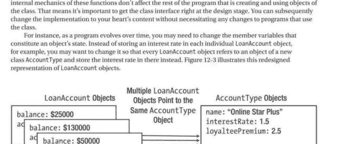

LoanAccount对象现在不再自己存储利率，而是指向一个AccountType，该AccountType存储计算账户利息所需的所有成员变量。因此，LoanAccount的calcInterest()成员函数会调用关联的AccountType来执行实际计算；为此，后者只需要账户的当前余额。这种更面向对象的设计允许你轻松地一次修改指向同一个AccountType的所有LoanAccount的利率，或者在不重新创建账户的情况下更改账户类型。

我们想用这个例子说明的主要观点是，即使LoanAccount的内部表示（InterestRate成员）和工作方式（calcInterest()成员）都发生了巨大变化，它与外部世界的接口保持不变。因此，就程序的其他部分而言，看起来好像什么都没变。如果来自类定义外部的代码直接访问了LoanAccount旧的、现已移除的`interestRate`成员变量，那么这种对LoanAccount表示和逻辑的大规模修改就会困难得多。我们还需要修改所有使用LoanAccount对象的代码。由于数据隐藏，外部代码只能通过定义良好的接口函数访问成员变量。所以，我们所要做的就是重新定义这些成员函数；我们不必担心程序的其他部分。

此外，请注意，由于外部代码只能通过`calcInterest()`接口函数获取年利息，我们很容易引入额外的“忠诚奖励”并在利息计算中使用它。如果外部代码直接读取旧的`interestRate`成员来自己计算利息，那么这又是不可能的。

隐藏对象内的数据不是强制性的，但通常是一个好主意。在某种程度上，直接访问定义对象的值决定了面向对象编程的整体理念。面向对象编程应该是根据对象来编程，而不是根据构成对象的位来编程。虽然这听起来相当抽象，但我们已经看到了至少两个非常好的、具体的理由来始终隐藏对象的数据，并且只通过其接口中的函数访问或操作它：

- 数据隐藏有助于保持对象的完整性。它允许你确保对象的内部状态——所有成员变量的组合——始终保持有效。

- 数据隐藏与精心设计的接口相结合，允许你重新设计对象的内部表示（即其状态）及其成员函数的实现（即其行为），而无需同时重新设计程序的其他部分。用面向对象的说法，我们说数据隐藏减少了类与使用它的代码之间的耦合。当然，如果你正在开发一个供外部客户使用的软件库，接口稳定性甚至更为关键。

仅通过接口函数访问成员变量的第三个动机是，它允许你向这些函数注入一些额外的代码。这些代码可以向日志文件添加条目以标记访问或更改，可以确保数据可以被多个调用者同时安全访问，或者可以通知其他对象某些状态已被修改（这些其他对象随后可以例如更新应用程序的用户界面，比如反映LoanAccount余额的更新），等等。如果允许外部代码直接访问成员变量，这一切都不可能实现。

第四个也是最后一个动机是，允许直接访问数据变量会使调试复杂化。大多数开发环境都支持断点的概念。断点是用户在软件调试运行期间指定的点，执行会在这些点暂停，允许你检查对象的状态。虽然一些环境具有更高级的功能，可以在特定成员变量更改时暂停执行，但将断点放在函数调用或函数内的特定代码行上仍然容易得多。

在本节中，我们创建了一个额外的AccountType类，以方便处理不同类型的账户。这绝不是将这些现实世界概念建模为类和对象的唯一方法。在下一节中，我们将介绍一个强大的替代方案，称为*继承*。你应该使用哪种设计将取决于具体应用的确切需求。

## 继承

*继承*是根据另一种类型定义一种类型的能力。例如，假设你定义了一个`BankAccount`类型，其中包含处理银行账户一般问题的成员。继承允许你将`LoanAccount`类型创建为`BankAccount`的一种特殊类型。你可以将`LoanAccount`定义为类似于`BankAccount`，但具有一些自己的额外属性和函数。`LoanAccount`类型继承`BankAccount`的所有成员，`BankAccount`被称为其*基类*。在这种情况下，你会说`LoanAccount`是*派生自*`BankAccount`的。

每个LoanAccount对象包含BankAccount对象所拥有的所有成员，但它可以选择定义自己的新成员，或重新定义它继承的函数，以便它们在其上下文中更有意义。在派生类中重新定义基类的函数称为覆盖；后一个函数覆盖前一个函数。这最后一种能力非常强大，你会看到的。

扩展当前示例，你可能还想通过向BankAccount添加不同的特性来创建新的CheckingAccount类型。这种情况如图12-4所示。

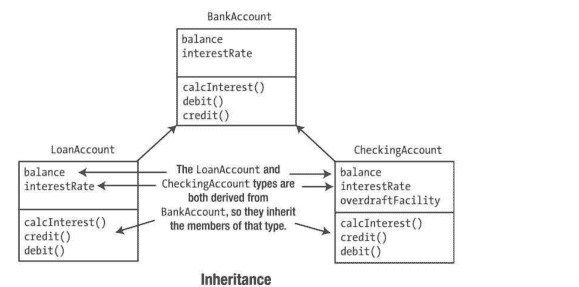

*图12-4. 继承的示例*

LoanAccount和CheckingAccount类型都被定义为派生自BankAccount类型。它们继承BankAccount的成员变量和成员函数，但可以自由定义特定于自身类型的新特性。

在本例中，CheckingAccount添加了一个名为overdraftFacility的成员变量，该变量是其独有的，两个派生类都可以覆盖它们从基类继承的任何成员函数。例如，它们很可能会覆盖calcInterest()，因为计算和处理支票账户的利息与贷款账户的利息有很大不同。

## 多态

*多态*意味着在不同时间呈现不同形式的能力。C++中的多态总是涉及使用指针或引用调用对象的成员函数。这类函数调用在不同时间可能产生不同的效果——有点像*化身博士*式的函数调用。该机制仅适用于

¹ 从技术上讲，编程语言理论区分了几种不同形式的多态。我们这里所说的“多态”正式称为子类型、子类型多态或包含多态。C++还支持的其他形式的多态包括参数多态（C++函数和类模板；见第10章和第17章）和特设多态（函数和运算符重载；见第8章和第13章）。然而，在面向对象编程的世界中，术语“多态”通常仅指子类型，因此这也是我们在本书中采用的术语。


对于派生自共同基类型的对象类型，例如 BankAccount 类型。多态意味着属于一个继承相关类“家族”的对象可以使用基类指针和引用来传递和操作。

LoanAccount 和 CheckingAccount 对象都可以通过指向 BankAccount 的指针或引用来传递。该指针或引用可用于调用其所指对象的继承成员函数。如果看一个具体案例，将更容易理解这一想法及其含义。

假设你已像之前那样定义了基于 BankAccount 类型的 LoanAccount 和 CheckingAccount 类型。再假设你已分别定义了这些类型的对象 debt 和 cash，如图 12-5 所示。由于这两种类型都基于 BankAccount 类型，一个类型为*指向 BankAccount 的指针*的变量（例如图 12-5 中的 pAcc）可以存储这两个对象中任一对象的地址。

```cpp
BankAccount* pAcc {}; // Pointer to base class
LoanAccount debt;
CheckingAccount cash;

pAcc = &cash;            // Pointer to check a/c
pAcc->calcInterest();    // Adds interest

pAcc = &debt;            // Pointer to loan a/c
pAcc->calcInterest();    // Debits interest
```

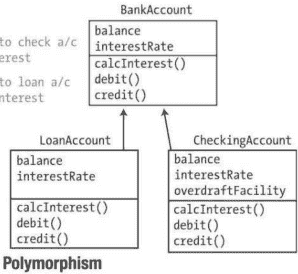

**图 12-5.** 多态示例

多态的美妙之处在于，pAcc->calcInterest() 所调用的函数会因 pAcc 指向的对象不同而不同。如果它指向 LoanAccount 对象，则调用该对象的 calcInterest() 函数，并从账户中扣除利息。如果它指向 CheckingAccount 对象，结果则不同，因为调用的是该对象的 calcInterest() 函数，并将利息记入账户。通过指针调用的具体函数是在运行时决定的。也就是说，它不是程序编译时决定的，而是在程序执行时决定的。因此，同一个函数调用可以根据指针指向的对象种类执行不同的操作。图 12-5 只展示了两种不同类型，但一般而言，只要从共同基类派生出的不同类型数量满足应用需要，就可以获得多态行为。你需要相当多的 C++ 语言知识才能完成我们描述的内容，而这正是你在本章剩余部分以及接下来三章中将要探索的内容。

## 术语

下面总结讨论类时使用的术语。其中包括一些你已经遇到过的术语：

- 类是用户定义的数据类型。
- 在类中定义的变量和函数是该类的**成员**。变量是**成员变量**，函数是**成员函数**。成员函数也常称为**方法**；成员变量也称为**数据成员**、**成员字段**，或简称为**字段**。
- 类类型的变量存储对象。对象有时称为类的**实例**。定义类的实例称为**实例化**。
- **面向对象编程**是一种基于将自己的数据类型定义为类的思想的编程风格。它涉及**封装**、**数据隐藏**、**类继承**和**多态**等思想。

当你深入面向对象编程的细节时，有些地方可能显得有点复杂。回到基础通常有助于让事情更清晰，因此请利用这个列表始终牢记对象真正的核心是什么。面向对象编程就是根据你问题领域特有的对象来编写程序。围绕类的所有机制都是为了让这一点尽可能全面和灵活。

## 定义类

类是用户定义的类型。类型的定义使用 `class` 关键字。类定义的基本组织方式如下：

```cpp
class ClassName
{
    // Code that defines the members of the class...
};
```

这个类类型的名称是 `ClassName`。常见约定是用户定义类使用大写名称，以区分类类型和变量名。我们将在示例中采用这一约定。类的成员都在花括号之间指定。目前我们会把所有成员函数的定义包含在类定义内部，但本章稍后我们会看到，它们也可以在类定义外部定义。注意，类定义右花括号后的分号必须存在。

默认情况下，类的所有成员都是私有的，这意味着不能从类外部访问它们。对于构成接口的成员函数来说，这显然不可接受。使用 `public` 关键字后跟一个冒号，可使后续所有成员都能从类外部访问。在 `private` 关键字之后指定的成员不能从类外部访问。public 和 private 是类成员的访问说明符。还有另一个访问说明符 `protected`，你稍后会遇到。带有访问说明符的类大纲如下：

```cpp
class ClassName
{
private:
    // Code that specifies members that are not accessible from outside the class...
public:
    // Code that specifies members that are accessible from outside the class...
};
```

public 和 private 位于一组可在类外部访问或不可在类外部访问的成员之前。public 或 private 的指定适用于其后的所有成员，直到出现不同的指定。这里可以省略第一个 private 指定，从而采用默认的私有状态，但最好显式写出。类的私有部分中的成员只能由同一类的成员函数访问。需要由非该类成员函数访问的成员变量或函数必须指定为 public。成员函数只需使用名称即可引用同一类的任何其他成员，无论其访问说明符是什么。

为了让所有这些一般性概念更清晰，我们先从一个定义表示盒子的类的示例开始：

```cpp
class Box
{
public:
    // Function to calculate the volume of a box
    double volume()
    {
        return m_length * m_width * m_height;
    }

private:
    double m_length {1.0};
    double m_width {1.0};
    double m_height {1.0};
};
```

`m_length`、`m_width` 和 `m_height` 是 `Box` 类的成员变量，且都是 `double` 类型。按照常见约定，我们给所有成员变量的名称添加前缀 `m_`。虽然这不是必需的——我们也可以对成员变量使用诸如 `length`、`width` 或 `height` 这样的名称——但添加 `m_` 的好处是便于区分成员变量与函数参数和局部变量。本书将在所有地方遵循这一相对标准的约定。

`Box` 的三个成员变量都是私有的，因此不能从类外部访问。只有公有的 `volume()` 成员函数可以引用这些私有成员。每个成员变量都初始化为 `1.0`。你不必以这种方式初始化成员变量——还有其他设置其值的方法，你将在后面一节中看到。不过，如果基本类型的成员变量没有通过某种机制初始化，它们将包含垃圾值。

在我们的示例中，我们将所有成员变量集中在类定义的末尾。但你不必这样做：你可以按需要频繁交替放置成员变量和函数。同样，你可以按需要频繁交替 public 和 private 部分，并以任意顺序放置它们。当然，仅仅因为你可以任意（重新）安排类成员，并不意味着你应该这样做。适度的能力伴随着适度的责任。如果你始终将相关成员组织在一起，并在所有类中使用相同的可预测顺序，你的类定义将变得更容易阅读和维护。

因此，在本书中并按照常见约定，我们将按如下方式安排类成员：

- 我们将所有 public 成员放在前面，所有 private 成员放在最后。作为类的使用者，你通常最关心它的公有接口，而不太关心其内部工作机制。你想知道能用类*做什么*，而不是它*如何*工作。这就是我们倾向于把公有接口放在前面的原因。


当然，体积将为 1，因为三个维度的初始值都是 1.0。Box 类的成员变量是私有的，这意味着我们无法设置这些成员。你可以将成员变量指定为公有，在这种情况下，你就可以从类外部显式地设置它们，如下所示：

```
    myBox.m_length = 1.5;
    myBox.m_width = 2.0;
    myBox.m_height = 4.0;
    std::cout << "Volume of myBox is " << myBox.volume() << std::endl;  // Volume is 12
```

但当然，将成员变量设为公有是不好的做法。这样做违背了数据隐藏原则。因此，我们需要一种不同的机制，用一组给定的值来初始化对象的私有成员变量。负责这一工作的特殊成员函数称为构造函数。

## 构造函数

类构造函数提供了在创建新对象时初始化该对象的机会，并确保成员变量包含有效值。它是类中一种特殊的函数，在几个重要方面与普通成员函数不同。类构造函数始终与类同名。构造函数也不返回值，因此没有返回类型。为构造函数指定返回类型是错误的。每当定义类的新实例时，都会调用构造函数。总是如此，没有例外。类类型的对象只能使用构造函数创建。

### 默认构造函数

等等，稍等一下！我们在上一节中创建了一个 Box 对象并计算了它的体积。这是怎么发生的？我们从未定义构造函数？好吧，如果你没有为类定义构造函数，编译器会提供一个默认构造函数。而且没错，这两个“默认”并不是笔误。多亏了这个默认的默认构造函数，Box 类的实际行为就好像定义如下：

```
    class Box
    {
    public:
      // The default constructor that was supplied by the compiler...
      Box()
      {
        // Empty body so it does nothing...
      }

      // Function to calculate the volume of a box
      double volume()
      {
        return m_length * m_width * m_height;
      }

    private:
      double m_length {1.0};
      double m_width {1.0};
      double m_height {1.0};
    };
```

*默认构造函数*是无需参数即可调用的构造函数。如果你没有显式调用带给定参数的构造函数，则默认调用此构造函数。

```
Box myBox;    // Invokes the default constructor
```

如果你没有为类定义*任何*构造函数——既没有默认构造函数，也没有任何其他构造函数——那么编译器会为你生成一个：默认构造函数。这就是它被称为默认的默认构造函数的原因；它是由默认情况下生成的默认构造函数。默认的默认构造函数没有参数，其唯一目的是允许创建对象。它不做其他事情，因此所有成员变量都将具有其默认值。如果没有为基本类型（double、int、bool、...）或指针类型（int*、const Box* ...）的成员变量指定初始值，它将包含任意垃圾值。在 Box 类中，我们将所有成员变量初始化为 1.0，因此默认的默认构造函数总是让 Box 对象处于定义良好的初始状态。

一旦你定义了任何构造函数，即使是带参数的非默认构造函数，也不再提供默认的默认构造函数。在某些情况下，除了你定义的带参数的构造函数之外，你还需要一个无参数的构造函数。在这种情况下，你必须确保类中有一个默认构造函数的定义。

### 定义类构造函数

让我们扩展上一示例中的 Box 类，加入一个构造函数，然后检查它是否能正常工作：

```cpp
// Ex12_01.cpp
// Defining a class constructor
import <iostream>;

// Class to represent a box
class Box
{
public:
  // Constructor
  Box(double length, double width, double height)
  {
    std::cout << "Box constructor called." << std::endl;
    m_length = length;
    m_width = width;
    m_height = height;
  }

  // Function to calculate the volume of a box
  double volume()
  {
    return m_length * m_width * m_height;
  }

private:
  double m_length {1.0};
  double m_width {1.0};
  double m_height {1.0};
};

int main()
{
    Box firstBox {80.0, 50.0, 40.0};      // Create a box
    double firstBoxVolume {firstBox.volume()};  // Calculate the box volume
    std::cout << "Volume of Box object is " << firstBoxVolume << std::endl;

    // Box secondBox;          // Causes a compiler error message
}
```

这会生成以下输出：

```text
Box constructor called.
Volume of Box object is 160000
```

Box 类的构造函数有三个 double 类型的参数，分别对应对象的 m_length、m_width 和 m_height 成员变量的初始值。不允许有返回类型，并且构造函数的名称必须与类名 Box 相同。构造函数体中的第一条语句输出一条消息，以显示它何时被调用。你不会在生产程序中这样做，但在测试程序以及理解正在发生什么和何时发生时，这很有帮助。我们会经常使用它来跟踪示例中正在发生的事情。构造函数体中的其余代码将参数赋给相应的成员变量。

> **注意**  请注意 m_ 命名约定在构造函数定义中是多么有效。如果我们改用 length、width 和 height 作为成员变量的名称，我们就必须为 Box 构造函数的三个参数发明不同的名称。

第一个 Box 对象通过以下语句创建：

```cpp
Box firstBox {80.0, 50.0, 40.0};
```

成员变量 m_length、m_width 和 m_height 的初始值出现在花括号初始化器中，并作为参数传递给构造函数。因为列表中有三个值，编译器会查找具有三个参数的 Box 构造函数。当构造函数被调用时，它会显示输出第一行中出现的消息，因此你知道你添加到类中的构造函数被调用了。

我们之前说过，一旦你定义了构造函数，编译器就不再提供默认构造函数，至少默认情况下不会。这意味着以下语句将不再编译：

```cpp
Box secondBox;        // Causes a compiler error message
```

如果你希望允许像这样定义 Box 对象，就必须添加一个无参数构造函数的定义。我们将在下一节中这样做。 ³

³ 有些人还会使用 this->length = length; 这样的语句来规避这种名称冲突（本章后面会讨论 this 指针），但我们更喜欢更简洁的 m_ 命名约定。

### 使用 default 关键字

一旦你添加了构造函数——任何构造函数——编译器就不再隐式定义默认的默认构造函数。如果此后你仍然希望对象可默认构造，那么就需要你确保该类有一个默认构造函数。当然，你的第一个选择是自己定义一个。例如，对于 Ex12_01.cpp 中的 Box 类，你只需在类的公有部分的某个位置添加以下构造函数定义：

```
Box()  {}		// Default constructor
```

因为 Box 的成员变量在初始化期间已经被赋予有效值 1.0，所以你在默认构造函数体中无事可做。

除了定义函数体为空的默认构造函数之外，你还可以使用 default 关键字。该关键字可用于指示编译器生成默认构造函数，即使存在其他用户定义的构造函数。对于 Box，如下所示：

```
Box() = default;	// Defaulted default constructor
```

等号和分号都是必需的。带有默认化构造函数的 Ex12_01 修改版可在网上 Ex12_01A.cpp 中获取。

虽然显式的空函数体定义和默认化的构造函数声明几乎等价，但在现代 C++ 代码中更推荐使用 default 关键字：

> **提示**  如果默认构造函数体（或初始化列表，我们稍后会遇到）中无事可做，那么你应该使用 `= default;` 而不是 `{}`。这不仅更清楚地表明它涉及默认的默认构造函数，还有一些技术原因使编译器生成的版本成为更好的选择。

### 在类外定义函数

我们之前说过，成员函数的定义可以放在类定义之外。类构造函数也是如此。此时类定义本身只包含构造函数的签名，而不包含其函数体。例如，对于 Box 类，可以如下定义：

```cpp
// Class to represent a box
class Box
{
public:
  Box() = default;
  Box(double length, double width, double height);

  double volume();  // Function to calculate the volume of a box

private:
  double m_length {1.0};
  double m_width {1.0};
  double m_height {1.0};
};
```


像这样将成员定义移到类定义之外，可以更容易快速了解类的（公共）接口。对于函数体较长的成员函数，或成员数量较多的类，这一点尤其有用。

然后，你可以把 Box 各成员的定义放在其类定义之后的某个位置。每个成员的名字都必须用类名限定，这样编译器才知道它们属于哪个类：

```cpp
// Constructor definition
Box::Box(double length, double width, double height)
{
  std::cout << "Box constructor called." << std::endl;
  m_length = length;
  m_width = width;
  m_height = height;
}
```

```cpp
// Member function definition
double Box::volume()
{
  return m_length * m_width * m_height;
}
```

Ex12_02.cpp 为你把这些内容整合在一起：先是 Box 类定义，接着是这两个成员定义，还有一个 main() 函数。这个 main() 函数与 Ex12_01.cpp 中的完全相同。

> **注意** 这种将类的接口与实现分离的做法，在动机和技术影响两方面，都完全类似于上一章中模块的做法。毫不意外的是，类外成员函数定义当然也可以移到实现文件中，只在接口文件（无论是头文件还是模块接口文件）中保留类定义。我们会在本节讨论构造函数之后进一步讨论这一点。

## 构造函数参数的默认实参

当我们讨论“普通”函数时，你已经看到可以在函数原型中为参数指定*默认值*。对于类成员函数（包括构造函数），也可以这样做。构造函数和成员函数的默认参数值总是放在类内部，而不是放在外部的构造函数或函数定义中。我们可以把上一个示例中的类定义改成下面这样：

```cpp
class Box
{
public:
  // Constructors
  Box() = default;
  Box(double length = 1.0, double width = 1.0, double height = 1.0);

  double volume();   // Function to calculate the volume of a box
private:
    // Some member variables as always...
};
```

如果对 Ex12_02 做这个修改，会发生什么？当然，你会收到编译器的错误消息！该消息基本上是说，你定义了多个默认构造函数。造成混淆的原因是，带三个参数的构造函数允许省略全部三个实参，这与调用默认构造函数无法区分。所有参数都有默认值的构造函数仍然算作默认构造函数。显而易见的解决方案是在这个实例中去掉不接受任何参数的默认构造函数。如果这样做，一切都能正常编译和执行。

## 使用成员初始化列表

到目前为止，你都是在构造函数体内通过显式赋值来设置成员变量的值。你可以使用另一种更高效的技术——成员初始化列表。我们将用 Box 类构造函数的另一个版本来说明：

```cpp
// Constructor definition using a member initializer list
Box::Box(double length, double width, double height)
    : m_length(length), m_width(width), m_height(height)
{
    std::cout << "Box constructor called." << std::endl;
}
```

成员变量的值在初始化列表中作为初始值指定，该列表是构造函数头部的一部分。例如，m_length 成员变量用 length 初始化。初始化列表与参数列表之间用冒号（:）分隔，每个初始化项之间用逗号（,）分隔。如果你在上一个示例中替换成这个版本的构造函数，你会看到它同样可以正常工作（最终程序见 Ex12_03.cpp）。

不过，这不仅仅是一种不同的写法。当你在构造函数体中使用赋值语句初始化成员变量时，成员变量会先被创建（如果它是某个类的实例，则会调用构造函数），然后赋值作为单独的操作执行。当你使用初始化列表时，初始值会在成员变量创建时用来初始化它。这可能是一个高效得多的过程，尤其是当成员变量是类实例时。这种在构造函数中初始化参数的技术之所以重要，还有另一个原因。你将会看到，它是为某些类型的成员变量设置值的唯一方法。

使用初始化列表时有一个小注意事项需要留意。成员变量的初始化顺序始终由它们在类定义中的声明顺序决定——而不是你可能以为的它们在成员初始化列表中的出现顺序。当然，只有在成员变量使用求值顺序会影响结果的表达式初始化时，这一点才重要。合理的例子包括：某个成员变量通过使用另一个成员变量的值来初始化，或者通过调用一个依赖其他成员变量已初始化的成员函数来初始化。在生产代码中这样依赖求值顺序可能是危险的。即使今天一切正常，明年也可能有人改变变量的声明顺序，并无意中破坏该类某个构造函数的正确性！

**提示** 作为一条规则，最好在类内或构造函数的成员初始化列表中初始化所有成员变量。这通常更高效。为了避免任何混淆，理想情况下，你应该按照成员变量在类定义中的声明顺序，将它们放入初始化列表（如果不这样做，一些编译器会发出警告）。只有在需要更复杂的逻辑，或者变量初始化顺序很重要时，才应该在构造函数体中初始化成员变量。

## 使用 explicit 关键字

单参数类构造函数的一个问题是，编译器可以把这种构造函数用作从参数类型到类类型的隐式转换。在某些情况下，这会产生不希望的结果。让我们考虑一个具体情形。假设你定义一个类，它表示所有三条边长度都相同的立方体箱子：

```cpp
class Cube
{
public:
    Cube(double side);              // Constructor
    double volume();                // Calculate volume of a cube
    bool hasLargerVolumeThan(Cube cube); // Compare volume of a cube with another
private:
    double m_side;
};
```

然后，你可以如下定义构造函数：

```cpp
Cube::Cube(double side) : m_side{side}
{
    std::cout << "Cube constructor called." << std::endl;
}
```

注意，因为所有构造函数（这里只有一个）都会初始化 m_side，所以不需要在声明中给这个成员变量一个初始值。

计算体积的函数的定义如下：

```cpp
double Cube::volume() { return m_side * m_side * m_side; }
```

如果一个 Cube 对象的体积大于另一个，那么它就比另一个大。因此，hasLargerVolumeThan() 成员可以如下定义：

```cpp
bool Cube::hasLargerVolumeThan(Cube cube) { return volume() > cube.volume(); }
```

**注意** 在本章后面你会看到，通常你会以 const 引用而不是按值传递 hasLargerVolumeThan() 的 cube 参数。不过，要让这种做法可行，你首先需要了解 const 成员函数，所以现在我们先简单地按值传递 cube。

该构造函数只需要一个 double 类型的实参。显然，编译器可以使用该构造函数把 double 值转换为 Cube 对象，但在什么情况下可能发生这种情况呢？你可能会以下面的方式使用 Cube 类（见 Ex12_04.cpp）：

```cpp
int main()
{
    Cube box1 {7.0};
    Cube box2 {3.0};
    if (box1.hasLargerVolumeThan(box2))
        std::cout << "box1 is larger than box2." << std::endl;
    else
        std::cout << "Volume of box1 is less than or equal to that of box2." << std::endl;

    std::cout << "Volume of box1 is " << box1.volume() << std::endl;
    if (box1.hasLargerVolumeThan(50.0))
        std::cout << "Volume of box1 is greater than 50" << std::endl;
    else
        std::cout << "Volume of box1 is less than or equal to 50" << std::endl;
}
```

输出如下：

```text
Cube constructor called.
Cube constructor called.
box1 is larger than box2.
Volume of box1 is 343
Cube constructor called.
Volume of box1 is less than or equal to 50
```

输出表明 box1 的体积绝对不小于 50，但最后一行输出却表明相反。代码原本假定 hasLargerVolumeThan() 会把当前对象的体积与 50.0 比较。实际上，该函数比较的是两个 Cube 对象。编译器知道 hasLargerVolumeThan() 函数的实参应该是 Cube 对象，但它很乐意编译这段代码，因为有一个构造函数可以把实参 50.0 转换为 Cube 对象。编译器生成的代码等价于下面这样：

```cpp
if (box1.hasLargerVolumeThan(Cube(50.0)))
    std::cout << "Volume of box1 is greater than 50" << std::endl;
else
    std::cout << "Volume of box1 is less than or equal to 50" << std::endl;
```

该函数并不是把 box1 对象的体积与 50.0 比较，而是与 125000.0 比较，这是边长为 50.0 的 Cube 对象的体积。结果与预期大不相同。

幸运的是，你可以通过把构造函数声明为 explicit 来防止这种噩梦发生：

```cpp
class Cube
{
public:
    explicit Cube(double side);     // Constructor
    double volume();                // Calculate volume of a cube
};
```


```cpp
bool hasLargerVolumeThan(Cube cube); // Compare volume of a cube with another
private:
    double m_side;
};
```

对于 Cube 的这种定义，Ex12_04.cpp 将无法编译。编译器绝不会使用声明为 explicit 的构造函数进行隐式转换，因此它只能在程序中显式使用。通过对具有单个参数的构造函数使用 explicit 关键字，可以防止从参数类型到类类型的隐式转换。hasLargerVolumeThan() 成员只接受 Cube 对象作为参数，因此使用 double 类型的参数调用它将无法编译。

> **提示**  隐式转换可能导致代码令人困惑；大多数时候，如果使用显式转换，代码为何能编译以及它的作用会变得更加明显。因此，默认情况下，您应该将单参数构造函数声明为 explicit（注意，这包括多参数构造函数中除第一个参数外其余参数都有默认值的情况）；只有在确实需要隐式类型转换时才省略 explicit。

> **注意**  虽然不太常见，但任何非单参数构造函数也可以标记为 explicit。假设 processBox() 是一个参数类型为 Box 或 const Box& 的函数，那么在现代 C++ 中，表达式 processBox({1.0, 2.0, 3.0}) 是 processBox(Box{1.0, 2.0, 3.0}) 的合法简写。要禁止这种简写形式，从而强制在每次构造时显式提及 Box 类型，可以将三参数构造函数 Box(double, double, double) 标记为 explicit。

## 委托构造函数

一个类可以有多个构造函数，提供创建对象的不同方式。一个构造函数的代码可以在初始化列表中调用同一个类的另一个构造函数。这可以避免在多个构造函数中重复相同的代码。下面用 Box 类简单说明这一点：

```cpp
class Box
{
public:
    Box(double length, double width, double height);
    explicit Box(double side);   // Constructor for a cube (explicit!)
    Box() = default;             // Defaulted default constructor

    double volume();             // Function to calculate the volume of a box

private:
    double m_length{1.0};
    double m_width {1.0};
    double m_height{1.0};
};
```

第一个构造函数的实现可以如下所示：

```cpp
Box::Box(double length, double width, double height)
    : m_length{length}, m_width{width}, m_height{height}
{
    std::cout << "Box constructor 1 called." << std::endl;
}
```

第二个构造函数创建一个所有边都相等的 Box 对象，我们可以这样实现它：

```cpp
Box::Box(double side) : Box{side, side, side}
{
    std::cout << "Box constructor 2 called." << std::endl;
}
```

该构造函数只是在初始化列表中调用前面的构造函数。side 参数被用作前面构造函数参数列表中的全部三个值。这称为委托构造函数，因为它将构造工作委托给另一个构造函数。委托构造函数有助于缩短和简化构造函数代码，并使类定义更易于理解。在线下载中的 Ex12_05.cpp 包含以下示例来说明这一点：

```cpp
int main()
{
    Box box1 {2.0, 3.0, 4.0};        // An arbitrary box
    Box box2 {5.0};                  // A box that is a cube
    std::cout << "box1 volume = " << box1.volume() << std::endl;
    std::cout << "box2 volume = " << box2.volume() << std::endl;
}
```

输出如下：

```text
Box constructor 1 called.
Box constructor 1 called.
Box constructor 2 called.
box1 volume = 24
box2 volume = 125
```

从输出可以看出，创建第一个对象只调用了构造函数 1。创建第二个对象先调用构造函数 1，再调用构造函数 2。这也表明构造函数的初始化列表的执行发生在构造函数体中的代码之前。体积与你预期的一样。

你只应在构造函数的初始化列表中调用同一类的构造函数。在委托构造函数的函数体中调用同一类的构造函数是不同的。此外，你不得在委托构造函数的初始化列表中初始化成员变量。如果这样做，代码将无法编译。你可以在委托构造函数的函数体中为成员变量设置值，但在这种情况下，你应该考虑该构造函数是否真的应该实现为委托构造函数。

## 复制构造函数

假设你在 Ex12_05.cpp 的 main() 中添加以下语句：

```cpp
Box box3 {box2};
std::cout << "box3 volume = " << box3.volume() << std::endl;  // Volume = 125
```

输出显示 box3 确实具有与 box2 相同的尺寸，但没有定义参数类型为 Box 的构造函数，那么 box3 是如何创建的呢？答案是编译器提供了一个默认复制构造函数，该构造函数通过复制现有对象来创建对象。默认复制构造函数将作为参数的对象成员变量的值复制到新对象。

默认行为对于 Box 对象来说没问题，但当一个或多个成员变量是指针时，它可能会引发问题。仅仅复制指针并不会复制它所指向的内容，这意味着当通过复制构造函数创建对象时，该对象与原对象相互关联。两个对象都会包含一个指向同一内容的成员。一个简单的例子是，如果一个对象包含一个指向字符串的指针，那么复制出来的对象也会有一个指向同一字符串的成员，因此如果该字符串对一个对象进行了修改，另一个对象也会随之改变。这通常不是你想要的。在这种情况下，你必须定义复制构造函数。我们将在第 13 章和第 18 章回到是否、何时以及为何应定义复制构造函数的问题。现在，我们只关注如何实现。

### 实现复制构造函数

复制构造函数必须接受相同类类型的参数，并以适当的方式创建副本。这带来了一个你必须立刻克服的问题；如果你尝试像下面这样为 Box 类定义复制构造函数，就能清楚地看到这个问题：

```cpp
Box::Box(Box box)   // Wrong!
    : m_length{box.m_length}, m_width{box.m_width}, m_height{box.m_height}
{}
```

新对象的每个成员变量都用作为参数的对象的成员变量值初始化。在这种情形下，复制构造函数的函数体不需要任何代码。这看起来没问题，但考虑一下调用构造函数时会发生什么。参数是按值传递的，但由于参数是 Box 对象，编译器会安排调用 Box 类的复制构造函数来复制该参数。当然，这次复制构造函数调用的参数也是按值传递的，因此需要再次调用复制构造函数，依此类推。简而言之，你制造了一种会无限递归调用复制构造函数的情况。你的编译器不会允许这段代码编译。

为了避免这个问题，复制构造函数的参数必须是引用。更具体地说，它应该是 const 引用参数。对于 Box 类，形式如下：

```cpp
Box::Box(const Box& box)
    : m_length{box.m_length}, m_width{box.m_width}, m_height{box.m_height}
{}
```

既然参数不再按值传递，就避免了复制构造函数的递归调用。编译器将传递给它的对象初始化给参数 box。参数应为 const 引用，因为复制构造函数只负责创建副本；它不应修改原对象。const 引用参数允许复制 const 和非 const 对象。如果参数是 non-const 引用，构造函数就不会接受 const 对象作为参数，从而不允许复制 const 对象。由此你可以得出结论：复制的参数类型为


构造函数*始终*是同一类类型的 `const` 对象的引用。换句话说，复制构造函数的形式对于任何类都是相同的：

```cpp
MyClass::MyClass(const MyClass& object)
    : // Initialization list to duplicate all member variables
{
    // Possibly some additional code to duplicate the object...
}
```

当然，复制构造函数也可以委托给其他非复制构造函数。这里有一个示例：

```cpp
Box::Box(const Box& box) : Box(box.m_length, box.m_width, box.m_height)
{}
```

> **注意**
>
> 通常你不应该自己编写 `Box` 的复制构造函数。编译器默认已经生成了一模一样的，所以自己定义可能带来的只有 bug（忘记复制某个成员变量）或维护问题（添加成员变量时忘记更新复制构造函数）。就像我们说的，这只是为了向你展示如何定义。我们将在后面的章节中讨论何时应该这样做。（剧透警告：你应该尽可能少地这样做；让编译器完成所有工作！）

### 删除复制构造函数

因此，编译器通常为每个类生成复制构造函数，但如果这不是你想要的怎么办？如果你的 `Box` 对象包含受国际版权和商标法禁止复制的极其珍贵的货物呢？不开玩笑了，你不想复制某些对象的原因可能有很多。如果是这样，你可以通过在类定义中的声明中添加 `= delete;` 来指示编译器不要生成复制构造函数。对于 `Box`，如下所示：

```cpp
class Box
{
public:
    Box() = default;
    Box(double length, double width, double height);
    Box(const Box& box) = delete;  // Prohibit copy construction

    // Rest of the class as always...
};
```

一旦删除复制构造函数，如下语句将不再编译：

```cpp
Box box3 {box2};   // Error: use of deleted constructor Box(const Box&)
```

请注意，如果类的任何成员变量具有已删除或私有的复制构造函数，则该类的默认复制构造函数会自动被隐式删除。事实上，即使显式默认的复制构造函数（你可以使用 `=default;` 定义）也会被删除。

> **注意** 每当你删除复制构造函数时，你可能也希望删除所谓的*复制赋值运算符*。我们将在下一章中详细介绍。

## 在模块中定义类

导出类以供模块外使用与导出函数或变量没有什么不同：只需将其定义放在模块接口中，并在前面添加关键字 `export`。例如，你可以将 Box 类及其成员的定义从 Ex12_03.cpp 移动到一个新模块接口文件中，如下所示：

```cpp
// Box.cppm - module interface file for a module exporting the Box class
export module box;
import <iostream>;

export class Box
{
    // Same class definition as before...
};

// Constructor definition
Box::Box(double length, double width, double height)
    : m_length{length}, m_width{width}, m_height{height}
{
    std::cout << "Box constructor called." << std::endl;
}

// Member function definition
double Box::volume() { return m_length * m_width * m_height; }
```

只能从模块中导出类的定义，而不是其成员的定义。实际上，将 `export` 关键字添加到类成员的定义是一个错误。要使用对象的成员，模块的使用者只需要访问其类的（导出的）定义。

在 box 模块之外使用 Box 对象之前，你当然必须首先导入该模块。下面是一个小程序示例，正是这样做的。

```cpp
// Ex12_06.cpp
// Exporting a class from a module
import <iostream>;    // For use of std::cout, std::endl, etc.
import box;           // For use of the Box class

int main()
{
    Box myBox{6.0, 6.0, 18.5};    // Create a box
    std::cout << "Volume of the first Box object is " << myBox.volume() << std::endl;
}
```

由于成员函数定义不能导出，它们当然也不需要成为模块接口文件的一部分。也就是说，你可以将它们放入模块实现文件中。对于 Ex12_06 的 box 模块，这样的实现文件如下所示（另请参阅 Ex12_06A）。然后，也可以从模块接口文件中删除 `<iostream>` 模块的导入声明。

```cpp
// Box.cpp - module implementation file defining the member functions of Box
module box;
import <iostream>;

// Constructor definition
Box::Box(double length, double width, double height)
  : m_length{length}, m_width{width}, m_height{height}
{
  std::cout << "Box constructor called" << std::endl;
}

// Member function definition
double Box::volume() { return m_length * m_width * m_height; }
```

当然，你也可以采用 Ex12_01.cpp 中的 Box 类定义，其中成员定义仍在类内完成（参见 Ex12_06B）。对于在模块中定义的类，在类内或类外定义成员之间绝对没有语义差异。将类的接口与实现分开的唯一优势是，可以在模块的接口文件中获得前者干净、简洁的概览。

## 访问私有类成员

禁止外部访问类的私有成员变量的值有点极端。保护它们免受未经授权的修改是一个好主意，但如果你不知道特定 Box 对象的尺寸，你就无法得知。当然，这不需要那么秘密，对吧？

确实不需要，但这并不意味着你应该使用 `public` 关键字公开成员变量。你可以通过添加返回成员变量值的成员函数来提供对私有成员变量值的访问。为了允许从类外部访问 Box 对象的尺寸，你只需要在类定义中添加这三个函数：

```cpp
class Box
{
public:
  // Constructors
  Box() = default;
  Box(double length, double width, double height);

  double volume();   // Function to calculate the volume of a box

  // Functions to provide access to the values of member variables
  double getLength() { return m_length; }
  double getWidth() { return m_width; }
  double getHeight() { return m_height; }

private:
  double m_length{1.0};
  double m_width {1.0};
  double m_height{1.0};
};
```

成员变量的值完全可以访问，但不能在类外部更改，因此在无需保密的情况下保持了类的完整性。检索成员变量值的函数被称为*访问器*函数。

使用这些访问器函数很简单：

```cpp
Box myBox {3.0, 4.0, 5.0};
std::cout << "myBox dimensions are " << myBox.getLength()
          << " by " << myBox.getWidth()
          << " by " << myBox.getHeight() << std::endl;
```

你可以将这种方法用于任何类。只需为要提供给外部世界的每个成员变量编写一个访问器函数。

在某些情况下，你*确实*希望允许在类外部更改成员变量。如果你提供一个成员函数来实现这一点，而不是直接公开成员变量，你就有机会对值执行完整性检查。例如，你可以添加函数来允许更改 Box 对象的尺寸：

```cpp
class Box
{
public:
  // Constructors
  Box() = default;
  Box(double length, double width, double height);

  double volume();    // Function to calculate the volume of a box

  // Functions to provide access to the values of member variables
  double getLength() { return m_length; }
  double getWidth() { return m_width; }
  double getHeight() { return m_height; }

  // Functions to set member variable values
  void setLength(double length) { if (length > 0) m_length = length; }
  void setWidth(double width)   { if (width > 0) m_width = width; }
  void setHeight(double height) { if (height > 0) m_height = height; }

private:
  double m_length{1.0};
  double m_width {1.0};
  double m_height{1.0};
};
```


现在你可以在一条语句中修改 Box 对象的所有尺寸：

```cpp
Box myBox{3.0, 4.0, 5.0};                 // Create a box
myBox.setLength(-20.0)->setWidth(40.0)->setHeight(10.0); // Set all dimensions of myBox
```

因为修改器函数返回 this 指针，所以你可以使用一个函数返回的值来调用下一个函数。因此，setLength() 返回的指针被用来调用 setWidth()，而 setWidth() 返回的指针又可用来调用 setHeight()。这不是很好吗？

当然，你也可以返回引用而不是指针。例如，setLength() 函数届时可以定义如下：

```cpp
Box& Box::setLength(double length)
{
    if (length > 0) m_length = length;
    return *this;
}
```

如果对 setWidth() 和 setHeight() 也做同样处理，你就得到了 Ex12_08 中的 Box 类。随后，Ex12_08.cpp 中的示例程序会展示：返回对 *this 的引用可以让你像下面这样把成员函数调用串联起来：

```cpp
myBox.setLength(-20.0).setWidth(40.0).setHeight(10.0); // Set all dimensions of myBox
```

这种模式称为 *方法链*。如果目标是便于编写采用方法链的语句，通常通过引用来实现。在下一章讨论运算符重载时，你会遇到这种模式的几个常见示例。

> **提示**  方法链并不是你通常会对设置器做的事情。能够在一条语句中设置对象的所有成员变量（而不是每个变量一条语句）很有用，但你已经有一种一次初始化所有成员的机制：它叫作构造函数。如果你把构造函数与下一章将学习的 *赋值运算符* 结合起来，就可以写出这样的语句：

```cpp
myBox = Box(-20.0, 40.0, 10.0); // Reinitialize a Box using constructor + assignment
```

或者，更短一些（编译器会推断这里应使用哪个构造函数）：

```cpp
myBox = {-20.0, 40.0, 10.0};
```

## const 对象与 const 成员函数

const 变量是其值不能被修改的变量。这一点你已经知道。自然，你也可以定义类类型的 const 变量。这些变量随后被称为 const 对象。构成 const 对象状态的任何成员变量都不能被修改。换句话说，const 对象的任何成员变量本身都是常量，因此不可变。

假设我们最喜欢的 `Box` 类的 `m_length`、`m_width` 和 `m_height` 成员变量暂时是 public 的（就暂时这样假设！）。那么下面的代码仍然无法编译：

```cpp
const Box myBox {3.0, 4.0, 5.0};
std::cout << "The length of myBox is " << myBox.m_length << std::endl; // Ok
myBox.m_length = 2.0; // Error! Assignment to a member variable of a const object...
myBox.m_width = 3.0;  // Error! Assignment to a member variable of a const object...
```

从 const 对象 myBox 读取成员变量是允许的，但任何试图给某个成员变量赋值或以其他方式修改此类成员变量的操作都会导致编译器错误。

从第 8 章你会回想起，这一原则也适用于指向 const 的指针和指向 const 的引用变量：

```cpp
Box myBox {3.0, 4.0, 5.0};        // A non-const, mutable Box

const Box* boxPointer = &myBox;  // A pointer-to-const-Box variable
boxPointer->m_length = 2;        // Error!
boxPointer->m_width = 3;         // Error!
```

在前面的代码片段中，myBox 对象本身是一个非 const、可变的 Box 对象。然而，如果你将其地址存储在一个类型为 pointer-to-const-Box 的变量中，就不能再使用该指针修改 myBox 的状态。如果用指向 const 的引用替换该指针，情况同样如此。

你还会回想起，当对象通过引用或使用指针传入函数或从函数返回时，这一点起着关键作用。假设 `printBox()` 是一个具有以下签名的函数：

```cpp
void printBox(const Box& box);
```

那么 `printBox()` 不能修改作为参数传入的 Box 对象的状态，即使原始 Box 是非 const 的。

在本节余下的示例中，我们将主要使用 const 对象。不过请始终记住，通过指向 const 的指针或指向 const 的引用访问对象时，与直接访问 const 对象一样，适用相同的限制。

### const 成员函数

为了了解成员函数对 const 对象的行为，让我们回到 Ex12_07 中的 Box 类。在这个版本的类中，Box 对象的成员变量被正确隐藏，只能通过 public 的获取器和设置器成员函数进行操作。现在假设你修改 Ex12_07 的 main() 函数中的代码，使 myBox 成为 const：

```cpp
const Box myBox {3.0, 4.0, 5.0};
std::cout << "myBox dimensions are " << myBox.getLength()
          << " by " << myBox.getWidth()
          << " by " << myBox.getHeight() << std::endl;

myBox.setLength(-20.0);
myBox.setWidth(40.0);
myBox.setHeight(10.0);
```

现在这个示例将不再能编译！当然，编译器拒绝编译前面代码片段中的最后三行，这正是你想要的。毕竟，你本就不应该能够修改 const 对象的状态。我们之前已经说过，编译器会阻止对成员变量的直接赋值——假设你有访问权限——那么它为什么应该允许在成员函数内部进行间接赋值呢？如果允许你调用这些设置器，这个 Box 对象就称不上什么不可变常量了，不是吗？

然而不幸的是，获取器函数也不能在 const 对象上调用，原因很简单：它们有可能会改变对象。在我们的示例中，这意味着编译器不仅会拒绝编译最后三行，还会拒绝编译前面的输出语句。同样，任何试图在 const myBox 上调用 volume() 成员函数的操作都会导致编译错误：

```cpp
std::cout << "myBox's volume is " << myBox.volume() << std::endl;  // Will not compile!
```

即使你知道 volume() 不会修改对象，编译器也不知道。至少在那个编译阶段不知道。编译这个 volume() 表达式时，编译器考虑的全部内容就是该函数的签名。而且，即使它从类定义内部知道该函数的定义——就像我们前面的三个获取器那样——编译器也不会尝试推断某个函数是否修改对象状态。在这种情形下，编译器使用的只是函数签名。

因此，按照我们当前的 Box 类定义，const Box 对象相当无用。你不能调用它的任何成员函数，甚至连那些明显不修改任何状态的成员函数也不能调用。要解决这个问题，你必须改进 Box 类的定义。你需要一种方法来告诉编译器，哪些成员函数允许在 const 对象上调用。解决方案就是所谓的 const 成员函数。

首先，你需要在类定义中把所有不修改对象的函数指定为 const：

```cpp
    export class Box
    {
    public:
      // Same constructors as before...

      double volume() const;  // Function to calculate the volume of a box

      // Functions to provide access to the values of member variables
      double getLength() const { return m_length; }
      double getWidth() const { return m_width; }
      double getHeight() const { return m_height; }

      // Functions to set member variable values
      void setLength(double length) { if (length > 0) m_length = length; }
      void setWidth(double width)   { if (width > 0) m_width = width; }
      void setHeight(double height) { if (height > 0) m_height = height; }

    private:
      // Same member variables as before...
    };
```

接下来，你必须相应地修改类外函数定义：

```cpp
    double Box::volume() const
    {
      return m_length * m_width * m_height;
    }
```

完成这些修改后，我们期望能对 const myBox 对象进行的所有调用都将实际可用。当然，仍然无法对它调用设置函数。完整示例可以下载为 Ex12_09。

> **提示** 对于 const 对象，只能调用 const 成员函数。因此，应将所有不修改其调用对象的成员函数都指定为 const。

## const 正确性

对于 const 对象，只能调用 const 成员函数。其理念是 const 对象必须完全不可变，因此编译器只允许你调用不会且永远不会修改它们的成员函数。当然，只有当 const 成员函数实际上无法修改对象状态时，这一点才真正合理。假设允许你编写以下代码（这无法通过编译）：

```cpp
void setLength(double length) const { if (length > 0) m_length = length; }
void setWidth(double width) const { if (width > 0) m_width = width; }
void setHeight(double height) const { if (height > 0) m_height = height; }
```

这三个函数显然会修改 Box 的状态。因此，如果允许像这样把它们声明为 const，你就又能对 const Box 对象调用这些设置函数。这意味着你又能修改本应不可变的对象的取值。这会破坏 const 对象的目的。幸运的是，编译器会强制要求你绝不能（无意中）从 const 成员函数内部修改 const 对象。任何从 const 成员函数内部修改对象成员变量的尝试都会导致编译器错误。

将成员函数指定为 const，实际上会使该函数中的 this 指针成为 const。例如，在之前的三个设置函数内部，this 指针的类型会是 const Box*，即指向 const Box 的指针。而你不能通过指向 const 的指针给成员变量赋值。

当然，你也不能从 const 成员函数内部调用任何非 const 成员函数。因此，不允许从 const 的 volume() 成员函数内部调用 setLength()：

```cpp
double Box::volume() const
{
    setLength(32);        // Not const (may modify the object): will not compile!
    return m_length * m_width * m_height;
}
```

另一方面，调用 const 成员函数则是允许的：

```cpp
double Box::volume() const
{
    return getLength() * getWidth() * getHeight();
}
```

由于这三个取值函数也是 const，从 volume() 函数内部调用它们没有问题。编译器知道它们同样不会修改对象。

这些由编译器强制执行的限制合在一起称为 const 正确性——它可以防止 const 对象被改动。我们将在下一小节的末尾看到这一点的最后一个方面。

### 基于 const 的重载

声明成员函数是否为 const 是函数签名的一部分。这意味着你可以用一个 const 版本重载非 const 成员函数。这可能很有用，并且常用于返回指向对象所封装内部数据（的一部分）的指针或引用的函数。假设我们不再为 Box 的成员变量使用传统的取值函数和设置函数，而是创建以下形式的函数：

```cpp
export class Box
{
public:
    // Rest of the class definition as before...

    double length() { return m_length; }   // Return references to dimension variable
    double width()  { return m_width; };
    double height() { return m_height; };

private:
    double m_length{1.0};
    double m_width{1.0};
    double m_height{1.0};
}
```

现在可以按如下方式使用这些成员函数：

```cpp
Box box;
box.length() = 2;    // References can be used to the right of an assignment
std::cout << box.length() << std::endl;    // Prints 2
```

在某种程度上，这些函数是试图在取值函数和设置函数之间做一种混合。但到目前为止，这种尝试是失败的，因为目前你已无法访问 const Box 的尺寸：

```cpp
const Box constBox;
// constBox.length() = 2;    // Does not compile; good!
// std::cout << constBox.length() << std::endl;    // Does not compile either; bad!
```

你可以通过用专用于 const 对象的版本重载这些成员函数来解决这个问题。通常，这些额外的重载会采用以下形式：

```cpp
const double& length() const { return m_length; };    // Return references to const variables
const double& width() const { return m_width; };
const double& height() const { return m_height; };
```

然而，由于 double 是基本类型，在这些重载中我们通常会按值返回它们，而不是按引用返回：

```cpp
double length() const { return m_length; };    // Return copies of dimension variables
double width()  const { return m_width; };
double height() const { return m_height; };
```

无论采用哪种方式，这都使得重载后的 `length()`、`width()` 和 `height()` 函数也能在 const 对象上调用。每个函数的两个重载中哪一个会被使用，取决于调用该成员函数的对象的 const 属性。你可以通过向两个重载都添加输出语句来确认这一点。你可以在 Ex12_10 下找到一个正是这样做的简短程序。

请注意，我们不建议使用这种形式的函数来替代前面展示的更传统的取值函数和设置函数。一个原因是以下形式的语句不符合常规，因而更难读或写：

```cpp
box.length() = 2;  // Less clear than 'box.setLength(2);'
```

此外，更重要的是，通过添加返回私有成员变量引用的公有成员函数，你基本上放弃了本章前面提到的数据隐藏的大部分优势。你无法再对赋给成员变量的值执行完整性检查（例如检查 Box 的尺寸是否保持为正），也无法更改对象的内部表示，等等。换句话说，这几乎和直接把成员变量设为公有一样糟糕！

不过，确实有一些情况推荐基于 const 进行重载。你稍后会遇到几个示例，例如在下一章中重载数组访问运算符时。

> **注意** 为保持 const 正确性，下面这种 Box 取值函数的变体无法通过编译：
>
> ```cpp
> // Attempt to return non-const references to member variables from const functions
> double& length() const { return m_length; }  // This must not be allowed to compile!
> double& width() const { return m_width; }
> double& height() const { return m_height; }
> ```

因为这些是 const 成员函数，它们的隐式 `this` 指针类型为指向 Box 的 const 指针（`const Box*`），这反过来又使 Box 成员变量名在这些成员函数定义的作用域内成为指向 const 的引用。因此，从 const 成员函数中，你绝不能返回指向对象状态中非 const 部分的引用或指针。这是一件好事。否则，这样的成员函数就会提供修改 const 对象的后门。

### 去除 const

极少数情况下会出现这样的情形：函数正在处理一个 const 对象（作为参数传入，或作为 this 所指向的对象），而有必要将其变为非 const。`const_cast<>` 运算符使你能够做到这一点。`const_cast<>` 运算符大多以以下两种形式之一使用：

```cpp
const_cast<Type*>(expression)
const_cast<Type&>(expression)
```

对于第一种形式，表达式的类型必须为 const Type* 或 Type*；对于第二种形式，它可以是 const Type&、Type 或 Type&。

> **警告** 使用 `const_cast` 几乎总是会遭到反对，因为它可能被用来误用对象。你绝不应使用该运算符来破坏对象的 const 属性。如果对象是 const，通常意味着你不应修改它。而做出意料之外的更改正是滋生错误的完美配方。只有在绝对确定对象的 const 性质不会因此遭到破坏时，才应使用 `const_cast`。一个例子是：在无法修改的代码中，有人在函数声明里忘了添加 const。另一个例子是实现我们称为 const-and-back-again 的习语，你将在第 17 章学习它。

### 使用 mutable 关键字

通常，const 对象的成员变量不能被修改。有时你希望允许特定类成员即使在 const 对象中也可修改。你可以通过将此类成员指定为 mutable 来做到这一点。例如，在 Ex12_11 中，我们再次从 Ex12_09 开始，并向 Box.cpp 中 Box 的声明添加了一个额外的 mutable 成员变量，如下所示：

```cpp
export class Box
{
public:
    // Constructors
    Box() = default;
    Box(double length, double width, double height);

    double volume() const;        // Function to calculate the volume of a box
    void printVolume() const;     // Function to print out the volume of a box

    // Getters and setters like before...

private:
    double m_length{1.0};
    double m_width{1.0};
    double m_height{1.0};
    mutable unsigned int m_count{};   // Counts the amount of time printVolume() is called
};
```

mutable 关键字表示即使对象是 const，m_count 成员也可以被更改。因此，即使新创建的 printVolume() 成员函数被声明为 const，你也可以在该函数内部的某些调试/日志代码中修改 m_count 成员：

```cpp
void Box::printVolume() const
{
    // Count how many times printVolume() is called using a mutable member in a const function
    std::cout << "The volume of this box is " << volume() << std::endl;
    std::cout << "printVolume() has been called " << ++m_count << " time(s)" << std::endl;
}
```


如果 m_count 没有被显式声明为 mutable，编译器本来会禁止从 const printVolume() 函数内部修改它。任何成员函数，无论 const 还是非 const，始终可以修改被指定为 mutable 的成员变量。

请注意，你只应在极少数情况下需要 mutable 成员变量。通常，如果你需要从 const 函数内部修改一个对象，那么这个函数可能本来就不应该是 const。mutable 成员变量的典型用途包括调试或日志记录、缓存以及线程同步成员。

## 友元

在正常情况下，你会通过将类的成员变量声明为 private 来隐藏它们。类中也很可能有私有成员函数。尽管如此，有时把选定的、并非该类成员的函数当作“荣誉成员”，并允许它们访问类对象的非公有成员，是很有用的。也就是说，你不希望外界访问对象的内部状态，而只希望少数几个相关函数能够访问。这样的函数称为类的友元。然而，友元可以访问类对象的任意成员，无论其访问说明符是什么。因此：

> **注意** 友元声明有可能破坏面向对象编程的基石之一：数据隐藏。因此，只有在绝对必要时才应使用它们，而这种需求并不经常出现。下一章学习运算符重载时，你会遇到一种需要使用友元的情形。不过，大多数类根本不需要任何友元。虽然这听起来可能有点可悲和孤独，但下面这个关于 C++ 编程语言的幽默定义应永远提醒你，为什么在 C++ 中确实应该非常明智地选择朋友：“C++：你的朋友可以访问你的私处。”

话虽如此，我们将考虑一个类声明其友元的两种方式——要么可以将单个函数指定为某个类的友元，要么可以将整个类指定为另一个类的友元。在后一种情况下，友元类的所有成员函数都具有与该类普通成员相同的访问权限。我们先考虑将单个函数作为友元。

### 类的友元函数

要使一个函数成为某个类的友元，你必须在类定义内部使用 friend 关键字将其声明为友元。决定友元的是类本身；无法从类定义外部使一个函数成为某个类的友元。友元函数可以是全局函数，也可以是另一个类的成员。根据定义，一个函数不能成为它所属类的友元，因此访问说明符不适用于类的友元。

在实践中，对友元函数的需求是有限的。当一个函数需要访问两种不同类型对象的内部时，它们很有用；将该函数设为这两个类的友元即可实现这一点。我们将在更简单的上下文中演示它们如何工作，这些上下文不一定反映确实需要它们的情形。假设你想在 Box 类中实现一个友元函数，用来计算 Box 对象的表面积。要使该函数成为友元，你必须在 Box 类定义内部将其声明为友元。下面是一个这样做的版本：

```cpp
export class Box
{
public:
    Box() : Box{ 1.0, 1.0, 1.0 } {}      // A delegating default constructor
    Box(double length, double width, double height);

    double volume() const;               // Function to calculate the volume of a box

    friend double surfaceArea(const Box& box); // Friend function for the surface area

private:
    double m_length, m_width, m_height;
};
```

你可能会注意到我们这次改用了委托默认构造函数。因此，现在所有构造函数都显式初始化全部三个成员变量，我们也不再在它们的声明中提供初始值。另一方面，第二个构造函数和 volume() 成员的定义中没有任何你之前没见过多次的内容。

下面是用于试用该友元函数的代码：

```cpp
// Ex12_12.cpp
// Using a friend function of a class
import <iostream>;
import <memory>;
import box;

int main()
{
    Box box1 {2.2, 1.1, 0.5};        // An arbitrary box
    Box box2;                        // A default box
    auto box3{ std::make_unique<Box>(15.0, 20.0, 8.0) }; // Dynamically allocated Box

    std::cout << "Volume of box1 = " << box1.volume() << std::endl;
    std::cout << "Surface area of box1 = " << surfaceArea(box1) << std::endl;

    std::cout << "Volume of box2 = " << box2.volume() << std::endl;
    std::cout << "Surface area of box2 = " << surfaceArea(box2) << std::endl;

    std::cout << "Volume of box3 = " << box3->volume() << std::endl;
    std::cout << "Surface area of box3 = " << surfaceArea(*box3) << std::endl;
}

// friend function to calculate the surface area of a Box object
double surfaceArea(const Box& box)
{
    return 2.0 * (box.m_length * box.m_width
                + box.m_length * box.m_height + box.m_height * box.m_width);
}
```

以下是预期的输出：

```
Box constructor called.
Box constructor called.
Box constructor called.
Volume of box1 = 1.21
Surface area of box1 = 8.14
Volume of box2 = 1
Surface area of box2 = 6
Volume of box3 = 2400
Surface area of box3 = 1160
```

main() 函数创建了一个通过指定尺寸的 Box 对象；一个未指定尺寸的对象，以及一个动态分配的 Box 对象。最后一个对象表明，你可以像已经见过的 std::string 对象那样，创建一个指向分配在自由存储区中的 Box 对象的智能指针。从输出中可以看到，三个对象都按预期工作。

你通过在 Box 类定义内部编写函数原型并在其前面加上 friend 关键字，将 surfaceArea() 函数声明为 Box 类的友元。该函数不会修改作为参数传入的 Box 对象，因此使用 const 引用参数说明是合理的。在类定义中放置友元声明时保持一致也是个好主意。你可以看到，我们选择将该声明放在该类所有公有成员的末尾。这样做的理由是，该函数是类接口的一部分，因为它可以完全访问所有类成员。

surfaceArea() 是一个全局函数，其定义位于 main() 的定义之后。你当然也可以将该函数放入 box 模块中，因为它与 Box 类相关，但我们想说明 C++ 中的友元关系可以跨越模块边界。请注意，如果你确实将 surfaceArea() 打包到 box 模块中，就必须将其导出。

请注意，在 surfaceArea() 的定义内部，你通过使用作为参数传递给该函数的 Box 对象来访问该对象的成员变量。友元函数不是类成员，因此不能仅通过成员变量的名称来引用它们。每个成员变量都必须像在任何访问类公有成员的普通函数中那样，用对象名进行限定。友元函数与普通函数相同，只不过它可以不受限制地访问一个类的所有成员（甚至是私有成员）。

尽管这个示例演示了如何编写友元函数，但它并不是很现实。你本可以使用访问器成员函数来返回成员变量的值。这样 surfaceArea() 就不需要成为友元函数。也许最好的选择是将 surfaceArea() 设为该类的公有成员函数，从而使计算长方体表面积的能力成为类接口的一部分。友元函数应始终作为最后的手段。

### 友元类

你可以将整个类声明为另一个类的友元。友元类的所有成员函数都可以不受限制地访问它被声明为友元的那个类的所有成员。


例如，假设你定义了一个 `Carton` 类，并且希望允许 `Carton` 类的成员函数访问 `Box` 类的成员。在 `Box` 类的定义中加入一条将 `Carton` 声明为友元的语句即可实现这一点：

```cpp
class Box
{
    // Public members of the class...

    friend class Carton;

    // Private members of the class...
};
```

友元关系并不是相互的。`Carton` 类中的函数可以访问 `Box` 类的所有成员，但 `Box` 类中的函数不能访问 `Carton` 类的私有成员。类之间的友元关系也不是传递的；仅仅因为类 A 是类 B 的友元，类 B 是类 C 的友元，并不能推出类 A 是类 C 的友元。

友元类的一个典型用途是：一个类的功能与另一个类的功能紧密交织。链表基本上涉及两种类类型：一个 `List` 类，用于维护对象（通常称为节点）的列表；以及一个 `Node` 类，用于定义节点是什么。`List` 类需要通过设置每个节点对象中的指针，使其指向下一个 `Node` 对象，从而将 `Node` 对象连接起来。让 `List` 类成为定义节点的类的友元，将使 `List` 类的成员能够直接访问 `Node` 类的成员。在本章后面，我们将讨论嵌套类，它是这种情况下一个可行的替代友元类的方案。

## 类对象数组

你可以像创建任何其他类型的元素数组一样，创建类类型的对象数组。每个数组元素都必须由构造函数创建，对于未指定初始值的每个元素，编译器会安排调用无参构造函数。你可以通过一个例子看到这一点。`Box.cpp` 中的 `Box` 类定义如下：

```cpp
// Box.cpp
export module box;

export class Box
{
public:
    /* Constructors */
    Box(double length, double width, double height);
    Box(double side);          // Constructor for a cube
    Box();                     // Default constructor
    Box(const Box& box);       // Copy constructor

    double volume() const { return m_length * m_width * m_height; }

private:
    double m_length {1.0};
    double m_width {1.0};
    double m_height {1.0};
};
```

`Box.cpp` 的内容如下：

```cpp
module box;
import <iostream>;

Box::Box(double length, double width, double height)  // Constructor definition
    : m_length{length}, m_width{width}, m_height{height}
{
    std::cout << "Box constructor 1 called." << std::endl;
}

Box::Box(double side) : Box{side, side, side}  // Constructor for a cube
{
    std::cout << "Box constructor 2 called." << std::endl;
}

Box::Box()
{
    std::cout << "Default Box constructor called." << std::endl;
}

Box::Box(const Box& box)                    // Copy constructor
    : m_length{box.m_length}, m_width{box.m_width}, m_height{box.m_height}
{
    std::cout << "Box copy constructor called." << std::endl;
}
```

最后，定义程序 `main()` 函数的 `Ex12_13.cpp` 源文件将包含以下内容：

```cpp
// Ex12_13.cpp
// Creating an array of objects
import <iostream>;
import box;

int main()
{
    const Box box1{2.0, 3.0, 4.0};  // An arbitrary box
    Box box2{5.0};                  // A box that is a cube
    std::cout << "box1 volume = " << box1.volume() << std::endl;
    std::cout << "box2 volume = " << box2.volume() << std::endl;
    Box box3{box2};
    std::cout << "box3 volume = " << box3.volume() << std::endl;  // Volume = 125

    std::cout << std::endl;

    Box boxes[6] {box1, box2, box3, Box {2.0}};
}
```

输出如下：

```
Box constructor 1 called.
Box constructor 1 called.
Box constructor 2 called.
box1 volume = 24
box2 volume = 125
Box copy constructor called.
box3 volume = 125

Box copy constructor called.
Box copy constructor called.
Box copy constructor called.
Box constructor 1 called.
Box constructor 2 called.
Default Box constructor called.
Default Box constructor called.
```

有趣的是最后七行，它们源于 `Box` 对象数组的创建。前三个数组元素的初始值是现有对象，因此编译器调用拷贝构造函数来复制 `box1`、`box2` 和 `box3`。第四个元素使用构造函数 2 在数组的花括号初始化中创建的对象进行初始化，构造函数 2 在其初始化列表中调用了构造函数 1。最后两个数组元素没有指定初始值，因此编译器调用默认构造函数来创建它们。

## 类对象的大小

你可以使用 `sizeof` 运算符获取类对象的大小，方式与之前用于基本数据类型时相同。你可以将该运算符应用于特定对象或类类型。类对象的大小通常是类的成员变量大小之和，但也可能大于这个值。这不是需要你担心的问题，但了解一下原因还是不错的。

在大多数计算机上，出于性能原因，双字节变量必须放在地址为 2 的倍数的位置上，四字节变量必须放在地址为 4 的倍数的位置上，依此类推。这称为边界对齐。其结果是，编译器有时必须在某个值的内存与下一个值的内存之间留下间隙。如果在这类机器上，你有三个占用两字节的变量，后面跟着一个需要四字节的变量，为了将第四个变量放在正确的边界上，可能会留下两字节的间隙。在这种情况下，这四个变量所需的总空间大于它们各自大小之和。

## 类的静态成员

你可以将类的成员声明为 static。静态成员与类本身绑定，而不是与任何单个对象绑定。在本节中，我们将讨论如何以及何时声明静态成员变量和静态成员函数，其间重点关注静态成员变量的一个特定用途，即定义类特有的静态常量。

### 静态成员变量

类的静态成员变量用于提供类级的数据存储，这些数据独立于该类的任何特定对象，但可被任何对象访问。它们记录的是整个类的属性，而不是单个对象的属性。当你将类的成员变量声明为 static 时，静态成员变量只定义一次，即使没有创建任何类对象，它也会存在。每个静态成员变量都可以在类的任何对象中访问，并在任意数量的对象之间共享。对象会获得普通成员变量各自独立的副本，但每个静态成员变量只存在一个实例，无论定义了多个类对象。

你可以使用静态成员变量来存储特定于类的常量（稍后讨论），或者存储有关类对象的一般信息，例如存在多少个对象。静态成员变量的一个此类用途是统计一个类的对象有多少个。你可以通过在类定义中添加以下语句，向 `Box` 类添加一个静态成员变量（对于静态成员变量，我们有时使用 `s_` 前缀而不是 `m_`）：

```cpp
static inline size_t s_object_count {};  // Count of objects in existence
```

图 12-6 展示了该成员如何存在于任何对象之外，但可被所有对象使用。

```cpp
class Box
{
    ...
private:
    static inline size_t s_object_count {};
    double m_length;
    double m_width;
    double m_height;
};
```

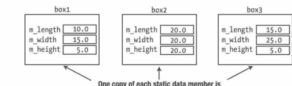

图 12-6. 静态类成员在对象之间共享。

静态成员 `s_object_count` 是私有的，因此你不能在 `*Box*` 类之外访问 `s_object_count`。当然，静态成员也可以是 public 或 protected。


```cpp
private:
    double m_length {1.0};
    double m_width {1.0};
    double m_height {1.0};
    static inline size_t s_object_count {};    // Count of objects ever created
};
```

`getObjectCount()` 函数已被声明为 `const`，因为它不修改类的任何成员变量，而且你可能希望针对 `const` 或非 `const` 对象调用它。

`Box` 的所有构造函数都需要递增 `s_object_count`（当然，委托给另一个 `Box` 构造函数的不算；否则计数会被递增两次）。示例如下：

```cpp
// Constructor definition
Box::Box(double length, double width, double height)
    : m_length {length}, m_width {width}, m_height {height}
{
    ++s_object_count;
    std::cout << "Box constructor 1 called." << std::endl;
}
```

我们相信你现在完全有能力完成其他构造函数。你可以修改 `Ex12_13` 中 `main()` 的版本，以输出对象计数：

```cpp
// Ex12_14.cpp
// Using a static member variable
import <iostream>;
import box;

int main()
{
    const Box box1 {2.0, 3.0, 4.0};                    // An arbitrary box
    Box box2 {5.0};                                    // A box that is a cube
    std::cout << "box1 volume = " << box1.volume() << std::endl;
    std::cout << "box2 volume = " << box2.volume() << std::endl;
    Box box3 {box2};
    std::cout << "box3 volume = " << box3.volume() << std::endl; // Volume = 125

    std::cout << std::endl;

    Box boxes[6] {box1, box2, box3, Box {2.0}};

    std::cout << "\nThere are now " << box1.getObjectCount() << " Box objects.\n";
}
```

该程序将产生与之前相同的输出，只是这一次会以如下一行结束：

```text
...
There are now 9 Box objects.
```

这段代码表明，确实只存在静态成员 `s_object_count` 的一个副本，并且所有构造函数都在更新它。`getObjectCount()` 函数是针对 `box1` 对象调用的，但你可以使用任何对象（包括任何数组元素）来得到相同结果。当然，你统计的只是已创建对象的数量。输出的计数对应当前创建的对象数量。一般来说，目前还无法知道对象何时被销毁，因此该计数不一定反映任意时刻仍然存在的对象数量。你将在本章后面了解如何统计被销毁的对象。

请注意，在类定义中加入 `s_object_count` 不会改变 `Box` 对象的大小。这是因为静态成员变量不属于任何对象；它们属于类。此外，由于静态成员变量不是类对象的一部分，`const` 成员函数可以修改非 `const` 的静态成员变量，而不会违反该函数的 `const` 性质。

## 访问静态成员变量

假设你在某个疏忽的时刻把 `s_object_count` 声明为公有类成员。这样你就不再需要 `getObjectCount()` 函数来访问它。要在 `main()` 中输出对象数量，只需这样写：

```cpp
std::cout << "Object count is " << box1.s_object_count << std::endl;
```

还有更多内容。我们曾说过，即使没有创建任何对象，静态成员变量也存在。这意味着你应该能够在创建第一个 `Box` 对象之前获取计数，但如何引用这个成员变量呢？答案是使用类名 `Box` 作为限定符：

```cpp
std::cout << "Object count is " << Box::s_object_count << std::endl;
```

通过修改前面的示例来试一试；你会看到它按所述方式工作。你始终可以使用类名访问类的公有静态成员。是否存在任何对象并不重要。事实上，推荐始终使用后一种语法来访问静态成员，正是因为这样能让代码阅读者立即清楚它涉及的是静态成员。

## 静态常量

静态成员变量常用于定义常量。这很合理。显然，将常量定义为非静态成员变量没有意义，因为那样每个对象都会得到该常量的一个精确副本。如果将常量定义为静态成员，那么该常量只有一个实例，由所有对象共享。

以下圆柱形盒子类的定义展示了一些示例，这是盒子界的最新创举：

```cpp
export module cylindrical;

import <string>;
import <string_view>;

export class CylindricalBox
{
public:
  static inline const float s_max_radius { 35.0f };
  static inline const float s_max_height { 60.0f };
  static inline const std::string_view s_default_material { "paperboard" };

  CylindricalBox(float radius, float height,
                 std::string_view material = s_default_material);
  float volume() const;

private:
  // The value of PI used by CylindricalBox's volume() function
  static inline const float PI { 3.141592f };

  float m_radius;
  float m_height;
  std::string m_material;
};
```

这个类定义了四个内联静态常量：`s_max_radius`、`s_max_height`、`s_default_material` 和 `PI`。请注意，与常规成员变量不同，将常量设为公有并无害处。事实上，定义包含函数参数边界值（如 `s_max_radius` 和 `s_max_height`）或建议默认值（`s_default_material`）的公有常量非常常见。使用这些常量，类外代码可以如下用默认材料创建一个更窄或更宽的 `CylindricalBox`：

```cpp
CylindricalBox bigBox { 1.23f,
                        CylindricalBox::s_max_height, CylindricalBox::s_default_material };
```

在 `CylindricalBox` 类的成员函数体内，无需用类名限定该类的静态常量成员：

```cpp
float CylindricalBox::volume() const
{
    return PI * m_radius * m_radius * m_height;
}
```

这个函数定义使用了 `PI`，而没有在前面加上 `CylindricalBox::`。（当然，你知道最好不要定义自己的 PI 常量，而应在这里使用 `std::numbers::pi_v<float>`……）

你会在 `Ex12_15` 中找到一个练习这个 `CylindricalBox` 类的小测试程序。

> **注意** 关键字 `static`、`inline` 和 `const` 可以按你喜欢的任意顺序出现。对于 `CylindricalBox` 的定义，我们四次使用了相同的顺序 `static inline const`（保持一致始终是个好主意！），但其他五种排列也同样有效。不过，这三个关键字都必须出现在变量类型名之前。

## 类自身类型的静态成员变量

静态成员变量不是类对象的一部分，因此它可以与类具有相同的类型。例如，`Box` 类可以包含一个 `Box` 类型的静态成员变量。这乍看可能有点奇怪，但它很有用。我们将用 `Box` 类来说明究竟如何做到这一点。假设你出于某种目的需要一个标准的“参考”盒子；例如，你可能希望以各种方式将 `Box` 对象与一个标准盒子关联起来。

当然，你可以在类外定义一个标准 `Box` 对象，但如果你打算在类的成员函数中使用它，这就会产生外部依赖，最好能避免这种依赖。假设我们只需要它供内部使用；那么你可以如下声明这个常量：

```cpp
class Box
{
    // Rest of the class as before...

private:
    const static Box s_reference_box;    // Standard reference box
    // ...
};
```

`s_reference_box` 是 `const`，因为它是一个不应被更改的标准 `Box` 对象。不过，你仍然必须在类外定义并初始化它。你可以使用下面这一行来定义 `s_reference_box`：

```cpp
const Box Box::s_reference_box{10.0, 10.0, 10.0};
```

`static` 关键字只用于类定义内部静态成员的声明，而不用于该静态成员的定义。这里会调用 `Box` 构造函数来创建 `s_reference_box`。由于类的静态成员变量会在创建任何对象之前创建，因此始终至少会存在一个 `Box` 对象。任何静态或非静态成员函数都可以访问 `s_reference_box`。由于它是私有成员，因此无法从类外访问。类常量是一种你可能希望将成员变量设为公有情形，前提是它在类外有有用的作用。只要它被声明为 `const`，就不能被修改。

## 静态成员函数

静态成员函数独立于任何单个对象，但如有必要，可以由任何类对象调用。如果它是公有成员，也可以从类外调用。静态成员函数的一个常见用途是操作静态成员变量，无论是否已定义该类的任何对象。一般来说：

> **提示** 如果成员函数不访问任何非静态成员变量，那么它可能是声明为静态成员函数的好候选。

即使没有创建任何类对象，也可以调用公有静态成员函数。在类中声明静态函数很容易。只需像处理 `s_object_count` 那样使用 `static` 关键字即可。在之前的示例中，你本可以将 `getObjectCount()` 函数声明为静态。使用类名作为限定符来调用静态成员函数。下面是如何调用静态 `getObjectCount()` 函数：

```cpp
std::cout << "Object count is " << Box::getObjectCount() << std::endl;
```

当然，如果你已经创建了类对象，也可以通过类的对象调用静态成员函数，就像调用任何其他成员函数一样。示例如下：

```cpp
std::cout << "Object count is " << box1.getObjectCount() << std::endl;
```


虽然后一种写法当然语法有效，但不推荐使用。原因是它会不必要地掩盖这样一个事实：它涉及的是静态成员函数。

静态成员函数无法访问调用它的对象。静态成员函数若要访问类的对象，就需要将该对象作为参数传递给函数。于是，在静态函数内部引用类对象的成员时，必须使用限定名（就像普通全局函数访问公有成员变量时那样）。

不过，就访问权限而言，静态成员函数是类的完整成员。如果将同一个类的对象作为参数传递给静态成员函数，它就可以访问该对象的私有成员以及公有成员。这样做并没有多大意义，但为了说明这一点，你可以在 Box 类中包含一个静态函数的定义，如下所示：

```cpp
static double edgeLength(const Box& aBox)
{
    return 4.0 * (aBox.m_length + aBox.m_width + aBox.m_height);
}
```

即使你把 Box 对象传递给该函数，也能访问其私有成员变量。当然，用普通成员函数来做这件事会更合理。

> **注意** 静态成员函数不能是 const。因为静态成员函数不与任何类对象关联，它没有 this 指针，所以 const 属性不适用。

## 析构函数

就像基本类型的变量一样，如果对类对象应用 delete 运算符，或者到达创建类对象的代码块末尾，类对象就会被销毁。当对象被销毁时，类中一个称为析构函数的特殊成员会被执行，以处理任何可能需要的清理工作。一个类只能有一个析构函数。如果你没有定义析构函数，编译器会提供一个什么都不做的默认版本。默认析构函数的定义如下所示：

```cpp
~ClassName() { }
```

类的析构函数名始终是类名前加一个波浪号 ~。析构函数不能有参数，也不能有返回类型。因此，Box 类中的默认析构函数如下所示：

```cpp
~Box() { }
```

当然，如果定义放在类外，析构函数名就要加上类名前缀：

```cpp
Box::~Box() { }
```

如果你的析构函数体要为空，那么同样最好使用 default 关键字：

```cpp
Box::~Box() = default;        // have the compiler generate a default destructor
```

类的析构函数在对象被销毁时总是会被自动调用。需要显式调用析构函数的情况非常罕见，你可以忽略这种可能性。在不必要时调用析构函数可能会引发问题。

只有在对象被销毁时需要完成某些操作时，才需要定义类析构函数。处理文件或需要关闭的网络连接等物理资源的类就是一个例子；当然，如果构造函数使用 `new` 分配了内存，析构函数就是释放内存的地方。在第 18 章中，我们将论证，定义析构函数实际上应当只保留给少数类——那些专门指定用于管理特定资源的类。尽管如此，Ex12_14 中的 Box 类也肯定会受益于析构函数的实现，也就是一个递减 `s_object_count` 的析构函数：

```cpp
class Box
{
public:
    // Same constructors as before...

    ~Box();                         // Destructor

    // Rest of the class as before...

    static size_t getObjectCount() { return s_object_count; }

private:
    // ...

    static inline size_t s_object_count;   // Count of objects in existence
};
```

已添加析构函数来递减 `s_object_count`，而 `getObjectCount()` 现在是静态成员函数（不带 const 限定符）。Box 析构函数的实现可以按如下方式添加到 Ex12_14 的 Box.cpp 文件中。它在被调用时会输出一条消息，以便你能看到它何时发生：

```cpp
Box::~Box()                              // Destructor
{
    std::cout << "Box destructor called." << std::endl;
    --s_object_count;
}
```

以下代码将检验析构函数的运行情况：

```cpp
// Ex12_16.cpp
// Implementing a destructor
import <iostream>;
import <memory>;
import box;

int main()
{
    std::cout << "There are now " << Box::getObjectCount() << " Box objects." << std::endl;

    const Box box1 {2.0, 3.0, 4.0};       // An arbitrary box

    Box box2 {5.0};            // A box that is a cube

    std::cout << "There are now " << Box::getObjectCount() << " Box objects." << std::endl;

    for (double d {}; d < 3.0 ; ++d)
    {
      Box box {d, d + 1.0, d + 2.0};
      std::cout << "Box volume is " << box.volume() << std::endl;
    }

    std::cout << "There are now " << Box::getObjectCount() << " Box objects." << std::endl;

    auto pBox{ std::make_unique<Box>(1.5, 2.5, 3.5) };
    std::cout << "Box volume is " << pBox->volume() << std::endl;
    std::cout << "There are now " << pBox->getObjectCount() << " Box objects." << std::endl;
}
```

该示例的输出如下：

```
There are now 0 Box objects.
Box constructor 1 called.
Box constructor 1 called.
Box constructor 2 called.
There are now 2 Box objects.
Box constructor 1 called.
Box volume is 0
Box destructor called.
Box constructor 1 called.
Box volume is 6
Box destructor called.
Box constructor 1 called.
Box volume is 24
Box destructor called.
There are now 2 Box objects.
Box constructor 1 called.
Box volume is 13.125
There are now 3 Box objects.
Box destructor called.
Box destructor called.
Box destructor called.
```

这个示例展示了构造函数和析构函数何时被调用，以及执行过程中各个时刻存在多少个对象。输出的第一行表明一开始没有 Box 对象。s_object_count 显然可以在没有任何对象的情况下存在，因为我们通过静态成员 getObjectCount() 获取它的值。box1 和 box2 像在 Ex12_14 中那样创建，输出表明确实存在两个对象。for 循环在每次迭代时创建一个新对象，输出表明新对象在当前迭代结束时、其体积输出之后被销毁。循环结束后，只存在最初的两个对象。最后一个对象通过调用 `make_unique<Box>()` 函数模板创建，该模板定义在 `<memory>` 模块中。这会调用带三个参数的 Box 构造函数，在自由存储区中创建对象。为了展示可以这样做，这里使用智能指针 pBox 调用 getObjectCount()。你可以看到 `main()` 结束时发生的三次析构函数调用输出，这些调用销毁了剩余的三个 Box 对象。

现在你知道，如果你没有定义默认构造函数、默认复制构造函数和析构函数，编译器会为每个类添加它们。编译器还可以向类中添加其他成员，你将在第 13 章和第 18 章中学习它们。

## 将指针用作类成员

现实中的程序通常由大量协作对象组成，这些对象通过指针、智能指针和引用相互链接。所有这些对象网络都需要被创建、链接在一起，并最终再次销毁。为确保所有对象都能及时删除，智能指针能提供极大帮助：

- `std::unique_ptr<>` 可确保你永远不会意外忘记删除从自由存储区分配的对象。
- 如果多个对象指向并使用同一个对象——无论是间歇性地还是甚至并发地——并且事先并不清楚它们何时都会用完它，那么 `std::shared_ptr<>` 就非常宝贵。换句话说，并不总是清楚哪个对象应负责删除共享对象，因为周围可能始终还有其他对象仍需要它。

**提示** 在现代 C++ 中，通常你不再需要 `new` 和 `delete` 关键字。动态分配的对象应始终由智能指针管理。这一原则称为*资源获取即初始化*——简称 RAII。内存是一种资源，要获取它，就应初始化一个智能指针。我们将在第 16 章回到 RAII 原则，届时会有更有说服力的理由使用它！

详细阐述建立和管理由许多类和对象组成的较大程序所需的面向对象设计原则和技术，会使我们在这里离题太远。在本节中，我们将带你走过第一个稍大的示例，并在过程中指出你需要做出的一些基本考虑——例如在不同指针类型之间进行选择时，或者 const 正确性对你的类设计的影响。具体来说，我们将定义一个带有指针成员变量的类，并使用该类的实例创建对象链表。

### 卡车装载示例

我们将定义一个类，表示任意数量 Box 对象的集合。Box 类定义的模块文件内容如下：

```cpp
// Box.cppm
export module box;
import <iostream>;
import <format>;
```


```cpp
export class Box
{
public:
    Box() = default;
    Box(double length, double width, double height)
        : m_length(length), m_width(width), m_height(height) {}

    double volume() const
    {
        return m_length * m_width * m_height;
    }

    int compare(const Box& box) const
    {
        if (volume() < box.volume()) return -1;
        if (volume() == box.volume()) return 0;
        return +1;
    }

    void listBox() const
    {
        std::cout << std::format("Box{{:.1f},{:.1f},{:.1f}}", m_length, m_width, m_height);
    }

private:
    double m_length {1.0};
    double m_width {1.0};
    double m_height {1.0};
};
```

我们省略了访问器成员函数，因为这里不需要它们，但我们添加了一个 `listBox()` 成员来输出 `Box` 对象。在这种情况下，`Box` 对象表示要交付的产品单元，而一组 `Box` 对象表示一卡车箱子，因此我们将该类称为 `Truckload`；`Box` 对象的集合将是一个链表。链表的长度可以随需要而定，你可以将对象添加到列表中的任何位置。该类将允许从单个 `Box` 对象或 `Box` 对象向量创建 `Truckload` 对象。它将提供添加和删除 `Box` 对象以及列出 `Truckload` 中所有 `Box` 对象的功能。

`Box` 对象没有内置功能来与另一个 `Box` 对象链接。修改 `Box` 类的定义以纳入此能力将与箱子的概念不一致——箱子不是那样的。将 `Box` 对象收集到列表中的一种方法是定义另一种类型的对象，我们将其称为 `Package`。一个 `Package` 对象将有两个成员：一个指向 `Box` 对象的指针和一个指向另一个 `Package` 对象的指针。后者将允许我们创建一条 `Package` 对象链。

图 12-7 展示了每个 `Package` 对象如何指向一个 `Box` 对象——`SharedBox` 将是 `std::shared_ptr<Box>` 的类型别名——以及如何构成由指针连接的 `Package` 对象链中的一个链接。

这条 `Package` 对象链构成了一种称为链表的数据结构。列表的长度可以不受限制。只要能够访问第一个 `Package` 对象，就可以通过它包含的 `m_next` 指针访问下一个 `Package`，而该指针又允许你通过下一个对象包含的 `m_next` 指针到达再下一个对象，依此类推，遍历列表中的所有对象。每个 `Package` 对象可以通过其 `m_box` 成员提供对 `Box` 对象的访问。这种安排优于让 `Package` 类拥有一个 `Box` 类型的成员，因为那样将需要为每个 `Package` 对象创建一个新的 `Box` 对象。`Package` 类只是将 `Box` 对象串联成链表的一种手段，每个 `Box` 对象都应独立于 `Package` 对象存在。

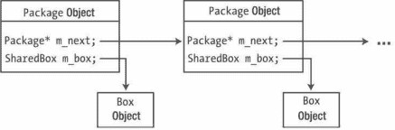

*图 12-7.* 链接的 Package 对象

一个 `Truckload` 对象将创建并管理一个 `Package` 对象列表。一个 `Truckload` 对象表示一车箱子的一个实例。一车箱子中可以有任意数量的箱子，每个箱子都将从一个 `Package` 内部被引用。`Package` 对象提供了一种机制，使 `Truckload` 对象能够访问其包含的 `Box` 对象的指针。图 12-8 说明了这些对象之间的关系。

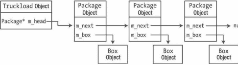

*图 12-8.* 一个管理三个 Package 对象链表的 Truckload 对象

图 12-8 展示了一个管理 `Package` 对象列表的 `Truckload` 对象；每个 `Package` 对象包含一个 `Box` 对象以及指向下一个 `Package` 对象的指针。`Truckload` 对象只需要跟踪列表中的第一个 `Package` 对象：`m_head` 成员包含其地址。沿着 `m_next` 指针链接，可以找到列表中的任意对象。在这个基础实现中，只能从列表开头开始遍历。更完善的实现可以为每个 `Package` 对象提供一个指向列表中前一个对象的指针，从而允许向前和向后遍历列表。让我们把这些想法写成代码。

> **注意** 你不需要为链表创建自己的类。`<list>` 和 `<forward_list>` 标准库模块中已经定义了非常灵活的版本。此外，正如我们将在第 20 章讨论的，在大多数情况下，最好改用 `std::vector<>`。不过，为链表定义自己的类非常有教育意义。

## SharedBox 类型别名

为了让其余代码更简洁一些，我们首先定义类型别名 `SharedBox`，作为 `std::shared_ptr<Box>` 的简写。由于 `truckload` 模块的使用者也需要访问这个别名，我们将 `SharedBox` 别名定义在它自己的小型模块接口分区中。

```cpp
// SharedBox.cpp - Minor interface partition exporting the SharedBox type alias
export module truckload:shared_box;
import <memory>;
import box;
export using SharedBox = std::shared_ptr<Box>;
```

通过对所有 `Box` 对象使用 `shared_ptr<>` 指针，我们确保至少在理论上可以与程序的其他部分共享这些相同的 `Box`，而无需担心它们的生命周期——也就是说，无需担心应由哪个类以及何时删除这些 `Box` 对象。因此，理论上同一个 `Box` 对象可以在一个 `Truckload`、卡车的目的地清单、面向客户的在线货运跟踪系统等之间共享。如果这些 `Box` 只被 `Truckload` 类引用，那么 `shared_ptr<>` 就不是最合适的智能指针。此时 `std::unique_ptr<>` 会更合适。但假设在这种情况下，我们的 `Truckload` 类将成为完全围绕这些 `Box` 构建的更大程序的一部分，而这就证明使用 `std::shared_ptr<>` 是合理的。

## 定义 Package 类

基于前面的讨论，`Package` 类可以在一个模块实现分区中定义如下：

```cpp
// Package.cpp - Module implementation partition defining the Package class
module truckload:package;
import :shared_box;

class Package
{
public:
  Package(SharedBox box) : m_box{box}, m_next{nullptr} {}  // Constructor
  ~Package() { delete m_next; }                             // Destructor

  // Retrieve the Box pointer
  SharedBox getBox() const { return m_box; }

  // Retrieve or update the pointer to the next Package
  Package* getNext() { return m_next; }
  void setNext(Package* package) { m_next = package; }

private:
  SharedBox m_box;     // Pointer to the Box object contained in this Package
  Package* m_next;     // Pointer to the next Package in the list
};
```

`Package` 类的 `SharedBox` 成员将存储一个 `Box` 对象的地址。每个 `Package` 对象恰好引用一个 `Box` 对象。请注意，要使用 `SharedBox` 别名，我们首先必须导入相应的模块分区（因为 `Package.cpp` 本身也是分区文件，所以它不会隐式导入 `Truckload` 模块）。

一个 `Package` 的 `m_next` 成员变量将指向列表中的下一个 `Package` 对象。列表中最后一个 `Package` 对象的 `m_next` 成员将包含 `nullptr`。构造函数允许创建一个 `Package` 对象，其中包含 `Box` 参数的地址。`m_next` 成员默认将为 `nullptr`，但可以通过调用 `setNext()` 成员将其设置为指向一个 `Package` 对象。`setNext()` 函数将 `m_next` 更新为列表中的下一个 `Package`。要将新的 `Package` 对象添加到列表末尾，请将其地址传递给列表中最后一个 `Package` 对象的 `setNext()` 函数。

`Packages` 本身不打算与程序的其他部分共享。它们的唯一目的是在一个 `Truckload` 的链表中形成一条链。因此，`shared_ptr<>` 不适合作为 `m_next` 成员变量。通常，你应该考虑为此成员使用 `unique_ptr<>` 指针。原因在于，本质上每个 `Package` 始终恰好被一个对象指向：要么被列表中的前一个 `Package` 指向，要么对于列表头而言，被 `Truckload` 本身指向。而且如果 `Truckload` 被销毁，其所有 `Packages` 也应被销毁。然而，本着本章尤其是上一节的精神，我们决定在这里改用原始指针，并借此机会向你展示一些非默认析构函数的示例。

如果一个 `Package` 对象被删除，其析构函数也会删除列表中的下一个 `Package`。这又会删除再下一个，依此类推。因此，要删除其 `Packages` 链表，`Truckload` 只需删除列表中的第一个 `Package` 对象，也就是头节点；然后列表中其余的 `Packages` 将由这些 `Packages` 的析构函数逐个删除。

> **注意** 对于列表中的最后一个 `Package`，`m_next` 将为 `nullptr`。尽管如此，在应用 `delete` 之前，你不需要在析构函数中检查 `nullptr`。也就是说，你不需要像下面这样编写析构函数：

```cpp
~Package() { if (m_next) delete m_next; }  // 'if (m_next)' is not required!
```

你经常会在生产代码中遇到这种过度谨慎的检查。但它们完全是多余的。`delete` 运算符被定义为：当传入 `nullptr` 时，它什么也不做。同样值得注意的是，在这个析构函数中，在删除后将 `m_next` 设置为 `nullptr` 几乎没有价值。我们之前告诉过你，一般来说，在删除指针所指向的值后将该指针重置为空被认为是一种良好实践。你应该这样做，以避免进一步使用悬空指针，其中包括意外地两次删除同一对象。但由于析构函数执行完毕后，`m_next` 成员已无法再被访问——相应的 `Package` 对象已不存在！——所以在这里这样做没有太大意义。

## 定义 Truckload 类

一个 `Truckload` 对象将封装一个 `Package` 对象列表。该类必须提供创建新列表、扩展列表和从列表中删除所需的一切，以及检索 `Box` 对象的手段。将指向列表中第一个 `Package` 对象的指针作为成员变量，可以让你通过使用 `Package` 类中的 `getNext()` 函数沿着 `m_next` 指针链逐步前进，从而到达列表中的任意 `Package` 对象。`getNext()` 函数将被反复调用，以一次一个 `Package` 对象的方式遍历列表，因此 `Truckload` 对象需要跟踪最近检索到的对象。存储最后一个 `Package` 对象的地址也很有用，因为这可以轻松地将新对象添加到列表末尾。图 12-9 展示了这一点。


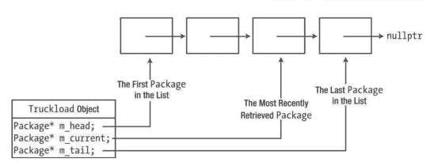

*图 12-9. Truckload 对象管理列表所需的信息*

考虑从 Truckload 对象中检索 Box 对象可能如何工作。这不可避免地需要遍历列表，因此起点是列表中的第一个对象。你可以在 Truckload 类中定义 getFirstBox() 成员函数，用于检索指向第一个 Box 对象的指针，并将包含它的 Package 对象的地址记录到 m_current 中。然后你可以实现 getNextBox() 成员函数，它将从列表中的下一个 Package 对象检索指向 Box 对象的指针，并相应更新 m_current。另一项基本能力是能够向列表添加 Box 以及从列表移除 Box，因此你需要成员函数来完成这些操作；addBox() 和 removeBox() 是合适的名称。一个列出列表中所有 Box 对象的成员函数也会很方便。

以下是基于这些想法定义 Truckload 类的文件：

```cpp
// Truckload.cpp - Module interface of the truckload module
export module truckload;

export import :shared_box;
import :package;
import <vector>;

export class Truckload
{
public:
  Truckload() = default;           // Default constructor - empty truckload

  Truckload(SharedBox box)         // Constructor - one Box
  { m_head = m_tail = new Package{box}; }
  Truckload(const std::vector<SharedBox>& boxes);  // Constructor - vector of Boxes
  Truckload(const Truckload& src); // Copy constructor

  ~Truckload() { delete m_head; }  // Destructor: clean up the list

  SharedBox getFirstBox();         // Get the first Box
  SharedBox getNextBox();          // Get the next Box
  void addBox(SharedBox box);      // Add a new SharedBox
  bool removeBox(SharedBox box);   // Remove a Box from the Truckload
  void listBoxes() const;          // Output the Boxes

private:
    Package* m_head {};                  // First in the list
    Package* m_tail {};                  // Last in the list
    Package* m_current {};               // Last retrieved from the list
};
```

成员变量是私有的，因为它们不需要在类外部访问。getFirstBox() 和 getNextBox() 成员提供了检索 Box 对象的机制。这两个函数都需要修改 m_current 指针，因此它们不能是 const。addBox() 和 removeBox() 函数也会改变列表，因此它们也不能是 const。

有四个构造函数。默认构造函数定义一个包含空列表的对象。你还可以从指向 Box 对象的单个指针、从指针的 vector，或作为另一个 Truckload 的副本创建对象。该类的析构函数确保其封装的链表被正确清理。如前所述，删除第一个 Package 会触发列表中所有其他 Package 也被删除。

接受指向 Box 对象的指针 vector 的构造函数、复制构造函数以及该类其他成员函数的定义将放在 Truckload.cpp 模块实现文件中。我们将在接下来的小节中讨论这些函数的定义。

### 遍历 Truckload 中包含的 Box 对象

在我们查看链表如何构造之前，先看看遍历列表的成员函数。我们从名为 listBoxes() 的 const 成员函数开始，它输出 Truckload 对象的内容，可以实现如下：

```cpp
void Truckload::listBoxes() const
{
    const size_t boxesPerLine{ 4 };
    size_t count {};
    Package* currentPackage{m_head};
    while (currentPackage)
    {
        std::cout << ' ';
        currentPackage->getBox()->listBox();
        if (!(++count % boxesPerLine)) std::cout << std::endl;
        currentPackage = currentPackage->getNext();
    }
    if (count % boxesPerLine) std::cout << std::endl;
}
```

该循环从 m_head 开始遍历链表中的 Package 对象，直到到达 nullptr。对于每个 Package，它通过对相应的 SharedBox 调用 listBox() 来输出其包含的 Box 对象。Box 对象每行输出四个。当输出的 Box 对象数量少于四个时，函数的最后一条语句输出一个换行。

如果你想的话，也可以把这个 while 循环写成 for 循环：

```cpp
void Truckload::listBoxes() const
{
    const size_t boxesPerLine{ 4 };
    size_t count {};
    for (Package* package{m_head}; package; package = package->getNext())
    {
        std::cout << ' ';
        package->getBox()->listBox();
        if (!(++count % boxesPerLine)) std::cout << std::endl;
    }
    if (count % boxesPerLine) std::cout << std::endl;
}
```

这两个循环完全等价，因此你可以自由使用任一模式来遍历链表。

可以说，for 循环稍微更好一些，因为 package 指针的初始化代码和推进代码（整齐地集中在循环体前面，位于 for (...) 语句的圆括号之间）与列出算法的核心逻辑（循环体，现在不再被任何列表遍历代码弄得杂乱）之间有着更清晰的区分。

为了让我们对 Truckload 类的分析能够以类似方式遍历存储在 Truckload 中的 SharedBox，该类提供了 getFirstBox() 和 getNextBox() 成员函数。在讨论它们的实现之前，最好先让你了解这些函数的预期用法。外部代码遍历 Truckload 中 Box 的模式将与 listBoxes() 成员函数的模式类似（当然，也可以使用等价的 while 循环）：

```cpp
Truckload truckload{ ... };

for (SharedBox box{truckload.getFirstBox()}; box; box = truckload.getNextBox())
{
    ...
}
```

getFirstBox() 和 getNextBox() 函数使用 Truckload 的 m_current 成员变量进行操作，这个指针必须始终指向其 Box 最近被这两个函数之一返回的 Package。这样的断言称为类不变式——类成员变量必须始终满足的一种性质。因此，所有成员函数在返回之前都应确保所有类不变式再次成立。反过来，它们可以信任这些不变式在其开始执行时成立。Truckload 类的其他不变式包括：m_head 指向列表中的第一个 Package，m_tail 指向最后一个 Package（另见图 12-9）。考虑到这些不变式，实现 getFirstBox() 和 getNextBox() 实际上并不太难。

```cpp
SharedBox Truckload::getFirstBox()
{
    // Return a head's box (or nullptr if the list is empty)
    m_current = m_head;
    return m_current ? m_current->getBox() : nullptr;
}
```

```cpp
SharedBox Truckload::getNextBox()
{
    if (!m_current)                         // If there's no current...
        return getFirstBox();               // ... return the 1st Box

    m_current = m_current->getNext();       // Move to the next package

    return m_current ? m_current->getBox() : nullptr;  // Return its box (or nullptr...)
}
```

getFirstBox() 函数小菜一碟——只有两条语句。我们知道列表中第一个 Package 对象的地址存储在 m_head 中。对这个 Package 对象调用 getBox() 函数可获得其 Box 对象的地址，这正是 getFirstBox() 所需的结果。只有当列表为空时，m_head 才会是 nullptr。对于空的 Truckload，getFirstBox() 也应返回一个空的 SharedBox。在返回之前，getFirstBox() 还会将第一个 Package 对象的地址存储到 m_current 中。这样做是因为类不变式规定，m_current 必须始终引用其 Box 最近被检索的 Package。

如果在 getNextBox() 开始时 m_current 指针为 nullptr，则通过调用 getFirstBox() 获取并返回列表中的第一个 Box（如果有）。否则，getNextBox() 函数通过调用 m_current->getNext() 访问其 Box 最近被返回的 Package 后面的 Package 对象。如果这个 Package* 为 nullptr，则已到达列表末尾，并返回 nullptr。否则，返回当前 Package 的 Box。当然，getNextBox() 也会正确更新 m_current，以遵守其类不变式。

### 添加和移除 Box 对象

我们从剩余成员中最简单的开始：基于 vector<> 的构造函数定义。它从指向 Box 对象的智能指针 vector 创建 Package 对象列表：

```cpp
Truckload::Truckload(const std::vector<SharedBox>& boxes)
{
    for (const auto& box : boxes)
    {
        addBox(box);
    }
}
```

该参数是一个引用，以避免不必要地多次复制实参。vector 元素类型为 SharedBox，它是 std::shared_ptr<Box> 的别名。循环遍历 vector 元素，将每个元素传递给 Truckload 类的 addBox() 成员，后者将在每次调用时创建并添加一个 Package 对象。

复制构造函数只是遍历源 Truckload 中的所有 package，并对每个 box 调用 addBox()，将其添加到新构造的 Truckload 中：

```cpp
Truckload::Truckload(const Truckload& src)
{
    for (Package* package(src.m_head); package; package = package->getNext())
    {
        addBox(package->getBox());
    }
}
```

这两个构造函数之所以简单，是因为所有繁重的工作都委托给了 addBox()。该成员的定义如下：

```cpp
void Truckload::addBox(SharedBox box)
{
    auto package( new Package{box} );  // Create a new Package

    if (m_tail)                        // Check list is not empty
        m_tail->setNext(package);      // Append the new object to the tail


```cpp
else                         // List is empty
    m_head = package;        // so new object is the head

m_tail = package;            // Either way: the latest object is the (new) tail
}
```

该函数根据自由存储区中的 box 指针创建一个新的 Package 对象，并将其地址存储在局部指针 `package` 中。对于空链表，`m_head` 和 `m_tail` 都将为 null。如果 `m_tail` 非空，则链表非空，新对象会通过将其地址存储到 `m_tail` 所指向的最后一个 Package 的 `m_next` 成员中，从而添加到链表末尾。如果链表为空，则新 Package 就是链表的头。无论哪种情况，新 Package 对象都位于链表末尾，因此会更新 `m_tail` 以反映这一点。

所有 `Truckload` 成员函数中最复杂的是 `removeBox()`。该函数也必须遍历链表，寻找要移除的 Box。因此，该函数的初始轮廓如下：

```cpp
bool Truckload::removeBox(SharedBox boxToRemove)
{
    Package* current(m_head);
    while (current)
    {
        if (current->getBox() == boxToRemove) // We found the Box!
        {
            // remove the *current Package from the linked list...

            return true;                       // Return true: we found and removed the box
        }
        current = current->getNext();          // move along to the next Package
    }

    return false;                              // boxToRemove was not found: return false
}
```

你在上一节中已经了解这种模式。一旦 `current` 指向需要移除的 Package，剩下的唯一挑战就是如何正确地将这个 Package 从链表中移除。图 12-10 说明了需要完成的操作。

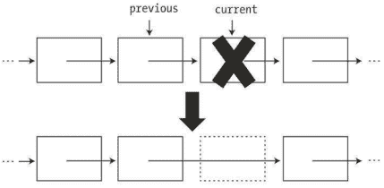

*图 12-10. 从链表中移除一个 Package*

图 12-10 清楚地表明，为了移除链表中某个位于中间的 Package，我们需要知道链表中前一个 Package 的 next 指针。在图中，这就是 `previous` 所指向的 Package。用我们最初的函数轮廓还无法做到这一点。`current` 指针已经越过了需要更新的 Package，而且无法再回退。

标准解决方案是在遍历链表时同时跟踪 `previous` 和 `current` 两个指针，其中 `previous` 始终指向 `current` 所指向的 Package 之前的那个 Package。`previous` 指针有时被称为尾随指针，因为它始终跟在遍历指针 `current` 后面一个 Package 的位置。完整的函数定义如下：

```cpp
bool Truckload::removeBox(SharedBox boxToRemove)
{
    Package* previous {nullptr};       // no previous yet
    Package* current {m_head};          // initialize current to the head of the list
    while (current)
    {
        if (current->getBox() == boxToRemove)    // We found the Box!
        {
            // If there is a previous Package make it point to the next one (Figure 12-10)
            if (previous) previous->setNext(current->getNext());

            // Update pointers in member variables
            if (current == m_head) m_head = current->getNext();
            if (current == m_tail) m_tail = previous;
            if (current == m_current) m_current = current->getNext();

            current->setNext(nullptr);          // Disconnect the current Package from the list
            delete current;                      // and delete it

            return true;                         // Return true: we found and removed the box
        }
        previous = current;                  // Move both pointers along (mind the order!)
        current = current->getNext();         // - first current becomes the new previous
                                              // - then move current along to the next Package
    }

    return false;     // Return false: boxToRemove was not found
}
```

一旦了解了尾随指针技术，把所有内容组合起来就不再那么困难了。和往常一样，你必须为移除链表头提供一种特殊情况处理，但这并不太难。还有一点需要注意，那就是你即将删除的 Package。不过，在删除之前，先将其 `m_next` 指针设置为 null 很重要。否则，Package 的析构函数会从 `m_next` 开始，删除原本跟在被删除 Package 后面的整个 Package 链表。

## 生成随机 Box

要装满一辆卡车，你需要 Box。普通卡车轻松就能容纳数百个 Box。现在，你可以自己输入大量随机的 Box 尺寸，也可以聪明地让计算机为你生成它们。标准库的 `<random>` 模块提供了实现这一点所需的一切（以及远不止于此的功能）。下面是一个小模块，它导出两个函数来生成随机 Box：

```cpp
export module box.random;
import box;
import <random>;       // For random number generation
import <functional>;   // For std::bind()
import <memory>;       // For std::make_shared() and std::shared_ptr<>

// Creates a pseudorandom number generator (PRNG) for random doubles between 0 and max
auto createUniformPseudoRandomNumberGenerator(double max)
{
    std::random_device seeder;                         // True random number generator to obtain a seed (slow)
    std::default_random_engine generator(seeder());    // Efficient pseudo-random number generator
    std::uniform_real_distribution distribution(0.0, max); // Generate in [0, max) interval
    return std::bind(distribution, generator);         // ... and in the darkness bind them!
}
export Box randomBox()
{
    const int dimLimit {100};                          // Upper limit on Box dimensions
    static auto random( createUniformPseudoRandomNumberGenerator(dimLimit) );
    return Box{ random(), random(), random() };
}
export auto randomSharedBox()
{
    return std::make_shared<Box>(randomBox());         // Uses copy constructor
}
```

我们将该模块命名为 `box.random`，是为了提醒你：即使模块不是子模块，模块名也允许包含点（`box.random` 并不是从 `box` 导出的，若它是真正的子模块则会如此；参见第 11 章）。

模块局部的 `createUniformPseudoRandomNumberGenerator()` 函数完成了大部分工作。它使用了各种你还不熟悉的概念——尤其是函数对象，你将在第 13 章和第 19 章学习这些内容——所以如果你还不能完全理解它，也不必担心。目前，你可以直接照搬这个函数及其使用方式。不过，我们至少想让你对这些内容的工作原理有一些概念。虽然我们的目标也不是教你标准 `<random>` 模块的所有细节，但以下是 `createUniformPseudoRandomNumberGenerator()` 使用的一些基本概念：

- `random_device` 是一种能够生成真正随机比特流的对象。也就是说，绝对无法预测接下来会出现哪个比特序列，并且每个可能的比特序列出现的可能性都相同。该设备依赖特殊的硬件指令来实现这一点。不过，由于这些指令相当慢，通常你不希望直接使用 `random_device` 来生成较长的数字序列。
- 伪随机数生成器（PRNG）（在 `<random>` 模块的术语中称为随机数引擎）会生成——你猜对了——伪随机数；就 `<random>` 的引擎而言，准确地说，是伪随机无符号整数。PRNG 可以（而且始终应该）用某个初始值（称为种子）初始化，之后它便开始生成确定但看似随机的新数字序列。也就是说，如果你了解这种生成器的内部工作原理，就能完美预测接下来会出现哪个数字，但对于不知情的使用者来说，输出的数字流确实显得随机。
- 分布会把给定的（伪）随机无符号整数（通常范围从 0 到某个不切实际的大最大值）转换为取自某个更有趣的统计分布的值。特别是均匀分布，它会在指定的整数或浮点区间内生成值，其中该区间内的每个数字被生成的可能性都相同。也存在其他分布，例如较大的数字比小数字更可能被生成，或者区间中间附近的数字更可能被生成。

为了感受这一切是如何运作的，你可以想象一个基于数学公式 `n = (n * 41 + 7) % 100` 构建的简单 PRNG。如果我们把 `n` 初始化为某个真正随机的值，比如 5，那么这个 PRNG 会生成以下整数序列：5、12（= (5 * 41 + 7) % 100 = 212 % 100）、99、66、13、40、47、34，依此类推。现在假设我们想要一个 10 到 25 之间的整数，而不是我们这个简单 PRNG 生成的 0 到 100 之间的整数。那么我们可以添加一个分布，对 PRNG 的结果应用 `n % 15 + 10`，从而得到序列 15、22、19、16、23、20、12、14，依此类推。

在 `createUniformPseudoRandomNumberGenerator()` 中，我们同样将这三个概念的具体且更高级的实例组合起来，形成我们所需的东西：首先，我们创建一个 `random_device`，并用它生成一个真正随机的种子值，以初始化一个类型为 `std::default_random_engine` 的 PRNG。然后，这个 PRNG 的输出（一个无符号整数序列）由 `std::uniform_real_distribution` 转换为半开区间 [0, max) 内的浮点数。PRNG 和分布通过 `std::bind()` 绑定在一起。因此，`createUniformPseudoRandomNumberGenerator()` 返回的最终结果就是一个以随机种子初始化的 PRNG，它生成 0 到给定最大值之间的 double 值。

`<random>` 模块还提供了更多引擎和分布，但无论你选择哪种组合，它们始终都使用这些相同步骤进行初始化和组合。因此，如果你将来需要满足略有不同要求的随机数，调整 `createUniformPseudoRandomNumberGenerator()` 中的四行代码来适应你的需求应该很容易。


## 综合运用

在 truckload 模块及其实现文件就位后，可以使用以下代码试用 Truckload 类：

```cpp
// Ex12_17.cpp
// Using a linked list
import box.random;
import truckload;

int main()
{
    Truckload load1;  // Create an empty list

    // Add 12 random Box objects to the list
    const size_t boxCount {12};
    for (size_t i {}; i < boxCount; ++i)
        load1.addBox(randomSharedBox());

    std::cout << "The first list:\n";
    load1.listBoxes();

    // Copy the truckload
    Truckload copy{load1};
    std::cout << "The copied truckload:\n";
    copy.listBoxes();

    // Find the largest Box in the list
    SharedBox largestBox{load1.getFirstBox()};

    SharedBox nextBox{load1.getNextBox()};
    while (nextBox)
    {
        if (nextBox->compare(*largestBox) > 0)
            largestBox = nextBox;
        nextBox = load1.getNextBox();
    }

    std::cout << "\nThe largest box in the first list is ";
    largestBox->listBox();
    std::cout << std::endl;
    load1.removeBox(largestBox);
    std::cout << "\nAfter deleting the largest box, the list contains:\n";
    load1.listBoxes();

    const size_t nBoxes {20};              // Number of vector elements
    std::vector<SharedBox> boxes;          // Array of Box objects

    for (size_t i {}; i < nBoxes ; ++i)
        boxes.push_back(randomSharedBox());
}
```

## 嵌套类

Package 类被设计为专门在 Truckload 类内部使用。确保 Package 对象只能由 Truckload 类的成员函数创建是合理的。诚然，由于 Package 类未从模块中导出，外部代码本来也无法使用它。但一般来说，你可能想更进一步，采用一种机制，使 Package 对象仅对 Truckload 类的成员私有，而不对模块其余部分可用。可以通过使用嵌套类来实现。嵌套类是在另一个类定义内部定义其定义的类。嵌套类的名称位于外围类的作用域内，并受外围类中成员访问规范的约束。我们可以将 Package 类的定义放在 Truckload 类的定义内部，如下所示：

```cpp
export module truckload;
import box;
import <memory>;
import <vector>;

// We no longer need the truckload:shared_box partition (or any other partition file)
export using SharedBox = std::shared_ptr<Box>;

export class Truckload
{
public:
    // Exact same public member functions as before...

private:
    class Package
    {
    public:
        SharedBox m_box;        // Pointer to the Box object contained in this Package
        Package* m_next;        // Pointer to the next Package in the list

        Package(SharedBox box) : m_box{box}, m_next{nullptr} {} // Constructor
        ~Package() { delete m_next; }                          // Destructor
    };

    Package* m_head {};      // First in the list
    Package* m_tail {};      // Last in the list
    Package* m_current {};   // Last retrieved from the list
};
```

现在，Package 类型局部于 Truckload 类定义的作用域。由于 Package 类的定义位于 Truckload 类的私有部分，因此无法从 Truckload 类外部创建或使用 Package 对象。由于 Package 类完全私有于 Truckload 类，将其所有成员设为 public 也无妨。因此，Truckload 对象的成员函数可以直接访问它们。原 Package 类的 getBox()、getNext() 和 setNext() 成员不再需要。所有 Package 成员都可以从 Truckload 对象直接访问，但在类外部不可访问。

Truckload 类的成员函数定义需要修改，以便直接访问 Package 类的成员变量。这很简单。只需将 Truckload.cpp 中所有出现的 getBox()、getNext() 和 setNext() 替换为直接访问相应成员变量的代码。将 Package 作为嵌套类后得到的 Truckload 类定义可与 Ex12_17.cpp 源文件配合使用。可运行的示例可在代码下载中的 Ex12_18 中找到。

> **注意** 将 Package 类嵌套在 Truckload 类内部，只是在外围类 Truckload 的上下文中定义了 Package 类型。Truckload 类型的对象不会受到任何影响——它们将拥有与之前相同的成员。

嵌套类的成员函数可以直接引用外围类的静态成员，以及外围类中定义的任何其他类型或枚举项。嵌套类可以通过常规方式访问外围类的其他成员：通过类对象，或通过指向类对象的指针或引用。在访问外围类的成员时，嵌套类的成员函数具有与外围类的成员函数相同的访问权限；也就是说，嵌套类的成员函数可以访问外围类对象的私有成员。

### 具有公有访问权限的嵌套类

当然，你也可以将 Package 类定义放在 Truckload 类的公有部分。这意味着 Package 类定义将成为公有接口的一部分，因此*确实*可以在外部创建 Package 对象。由于 Package 类名位于 Truckload 类的作用域内，不能单独使用它。必须用嵌套它的类名来限定 Package 类名。下面是一个示例：

```cpp
Truckload::Package myPackage{ myBox };    // Define a Package object
```

当然，在示例中将 Package 类型设为公有，会否定一开始将其设为嵌套类的理由！话虽如此，在其他情况下，公有嵌套类也可能有意义。我们将在下一小节中看到一个这样的例子。

### 遍历 Truckload 的更好机制：迭代器

getFirstBox() 和 getNextBox() 成员允许你遍历 Truckload 中存储的所有 Box。给类添加类似成员并非闻所未闻——我们在实际代码中至少遇到过两次——但这种模式有一些严重缺陷。也许你已经能想到一个了？

假设你发现——确实如此——Ex12_17 的 main() 函数太长、太拥挤，并决定将其部分功能拆分到可复用的函数中。那么，一个很好的首选候选就是用于查找 Truckload 中最大 Box 的辅助函数。一种自然的写法如下：

```cpp
SharedBox findLargestBox(const Truckload& truckload)
{
    SharedBox largestBox{ truckload.getFirstBox() };

    SharedBox nextBox{ truckload.getNextBox() };
    while (nextBox)
    {
        if (nextBox->compare(*largestBox) > 0)
            largestBox = nextBox;
        nextBox = truckload.getNextBox();
    }

    return largestBox;
}
```

然而不幸的是，这个函数无法编译！你能看出为什么吗？问题的根本原因是，getFirstBox() 和 getNextBox() 都必须更新 truckload 内部的 m_current 成员。这意味着它们都必须是 non-const 成员函数，进而意味着这两个函数都不能在 truckload 上调用，而 truckload 是一个常量引用参数。尽管如此，使用常量引用参数是常规做法。没有人会也不应该期望查找最大 Box 需要修改 Truckload。然而，就目前而言，无法遍历 const Truckload 的内容，这使得我们的 Truckload 对象几乎毫无用处。一个正确的 const Truckload& 引用应当允许代码遍历其中包含的 Box，但同时阻止调用 addBox() 或 removeBox()。

> **注意** 你可以尝试通过将 Truckload 类的 m_current 成员变量声明为 mutable 来绕过这个问题。这样你就可以将 getFirstBox() 和 getNextBox() 都变成 const 成员。虽然作为附加练习这可能对你很有趣，但该解决方案总体上仍有一些缺点。首先，对同一集合进行嵌套循环时你会遇到问题。其次，尽管并发性不在本讨论范围内，但你大概可以想象，使用 mutable 方案也永远无法支持多个执行线程并发遍历。在这两种情况下，每次遍历都需要一个 m_current 指针——而不是每个 Truckload 对象一个。

这个问题的正确解决方案就是所谓的迭代器模式。原理很简单。与其将 m_current 指针存储在 Truckload 对象本身内部，不如将其移到一个专门设计并创建用于遍历 Truckload 的另一个对象中。这样的对象称为迭代器。

> **注意** 在本书后面，你将了解到标准库的容器和算法也广泛使用迭代器。虽然标准库迭代器的接口与我们即将为 Truckload 定义的 Iterator 类略有不同，但基本原理相同：迭代器允许外部代码遍历容器的内容，而无需了解数据结构的内部细节。

让我们看看这对我们来说可能是什么样子。我们将从 Ex12_18 的 Truckload 类开始——也就是 Package 已经是嵌套类的版本——并添加第二个名为 Iterator 的嵌套类。为了向你展示这种可能性，我们还会在外围类的定义之外定义这两个嵌套类。

```cpp
export module truckload;
import box;
import <memory>;
import <vector>;
```


```cpp
export using SharedBox = std::shared_ptr<Box>;

export class Truckload
{
public:
    // Exact same public members as before,
    // only this time without getFirstBox() and getNextBox()...

    class Iterator;    // Declaration of a public nested class, Truckload::Iterator

    Iterator getIterator() const;

private:
    class Package;     // Declaration of a private nested class, Truckload::Package

    Package* m_head {};  // First in the list
    Package* m_tail {};  // Last in the list
};

// Out-of-class definition of the nested Iterator class (part of the module interface)
class Truckload::Iterator
{
public:
    SharedBox getFirstBox();  // Get the first Box
    SharedBox getNextBox();   // Get the next Box

private:
    Package* m_head;          // The head of the linked list (needed for getFirstBox())
    Package* m_current;       // The package whose Box was last retrieved

    friend class Truckload;   // Only a Truckload can create an Iterator
    explicit Iterator(Package* head) : m_head{head}, m_current{nullptr} {}
};

// Out-of-class definition of the nested Package class (implementation detail)
class Truckload::Package
{
public:
    SharedBox m_box;    // Pointer to the Box object contained in this Package
    Package* m_next;    // Pointer to the next Package in the list

    Package(SharedBox box) : m_box{box}, m_next{nullptr} {}  // Constructor
    ~Package() { delete m_next; }                            // Destructor
};
```

在类外部定义嵌套类（或成员类）与在类外部定义其他成员类似：你只需要记住在成员名称（此处为 Iterator 或 Package）前加上包含类（Truckload）的名称和两个冒号即可。事实上，由于 Package 仅在其他成员的定义中使用，你可以将其定义连同这些其他成员的定义一起移到实现文件中。然而，Iterator 类的定义应该是模块接口的一部分；模块的使用者需要它来遍历 Truckload 的内容。

下面是 getIterator() 成员的定义：

```cpp
Truckload::Iterator Truckload::getIterator() const { return Iterator(m_head); }
```

这里有两件事值得注意。首先，函数的返回类型 Truckload::Iterator 也必须以 Truckload:: 作为前缀。只有在函数体或参数列表中才不需要这样做。其次，由于我们在类外部定义了 Iterator，getIterator() 成员的定义也必须放在类外部，并且放在 Iterator 的定义之后。原因是 getIterator() 的函数体需要 Iterator 类的定义才能调用其构造函数。当然，我们从链表的头节点开始迭代。

m_current、getFirstBox() 和 getNextBox() 成员已从 Truckload 移入其嵌套的 Iterator 类中。这两个函数的实现方式与之前相同，只是现在它们不再更新 Truckload 对象的 m_current 成员变量。相反，它们使用专门由 getIterator() 创建用于遍历该 Truckload 的 Iterator 对象的 m_current 成员进行操作。由于同一个 Truckload 可以同时存在多个 Iterator，每个 Iterator 都有自己的 m_current 指针，因此对同一个 Truckload 进行嵌套遍历和并发遍历都成为可能。此外，更重要的是，创建迭代器不会修改 Truckload，因此 getIterator() 可以是 const 成员函数。这使得我们能够以 const 的 Truckload 引用参数正确实现之前的 findLargestBox() 函数：

```cpp
SharedBox findLargestBox(const Truckload& truckload)
{
    auto iterator{ truckload.getIterator() };    // Type of iterator is Truckload::Iterator
    SharedBox largestBox{ iterator.getFirstBox() };

    SharedBox nextBox{ iterator.getNextBox() };
    while (nextBox)
    {
        if (nextBox->compare(*largestBox) > 0)
            largestBox = nextBox;
        nextBox = iterator.getNextBox();
    }

    return largestBox;
}
```

我们将把这个示例的完成留作练习（参见练习 12-6）。不过，在结束本章之前，让我们先仔细看一下 Truckload 及其嵌套类定义中的访问权限。Iterator 是 Truckload 的嵌套类，因此它拥有与 Truckload 成员函数相同的访问权限。这很幸运，否则它就无法使用嵌套的 Package 类，而 Package 类被声明为仅供 Truckload 类内部私有使用。当然，Iterator 本身必须是公共嵌套类；否则，类外部的代码将无法使用它。请注意，我们确实决定将 Iterator 类的主构造函数设为私有，因为外部代码不能（它永远无法访问任何 Package 对象）也不应该以这种方式创建 Iterator。只有 getIterator() 函数会使用这个构造函数创建 Iterator。然而，要访问这个私有构造函数，我们需要一个友元声明。尽管你可以在嵌套类中访问外部类的私有成员，但反过来却不行。也就是说，外部类在访问内部类的成员时没有任何特殊权限。它与其他外部代码一样被对待。因此，如果没有友元声明，getIterator() 函数就不允许访问嵌套 Iterator 类的私有构造函数。

> **注意**  尽管外部代码不能使用我们的私有构造函数创建新的 `Iterator`，但仍然可以创建现有 `Iterator` 对象的副本。编译器生成的默认拷贝构造函数仍然是公共的。

## 小结

在本章中，你学习了定义和使用类类型所涉及的基本概念。然而，尽管你已经涵盖了很多内容，但这仅仅是个开始。要实现适用于类对象的操作还有很多工作要做，其中也包含许多微妙之处。在后续章节中，你将在此基础上继续深入学习，并了解更多如何扩展类功能的方法。此外，你还将探索在实践中使用类的更高级方式。本章需要记住的要点如下：

- 类提供了一种定义自己数据类型的方式。类可以表示你的特定问题所需的任何类型的对象。
- 类可以包含*成员变量*和*成员函数*。类的成员函数始终可以自由访问同一类的成员变量。
- 类的对象使用称为*构造函数*的成员函数来创建和初始化。当遇到对象声明时，构造函数会自动被调用。构造函数可以被重载，以提供不同的对象初始化方式。
- 拷贝构造函数是用于初始化对象的构造函数，该对象使用同一类的现有对象进行初始化。如果没有定义拷贝构造函数，编译器会为类生成一个默认的拷贝构造函数。
- 类的成员可以被指定为 public，在这种情况下，程序中的任何函数都可以自由访问它们。或者，它们也可以被指定为 private，在这种情况下，只有成员函数、类的友元或嵌套类的成员才能访问它们。
- 类的成员变量可以是静态的。无论创建了多少个类的对象，类的每个静态成员变量都只存在一个实例。
- 虽然类的静态成员变量可以在对象的成员函数中访问，但它们不是对象的一部分，也不贡献对象的大小。
- 每个非静态成员函数都包含指针 `this`，它指向调用该函数的当前对象。
- 即使没有创建类的对象，也可以调用静态成员函数。类的静态成员函数不包含指针 `this`。
- `const` 成员函数不能修改类对象的成员变量，除非成员变量被声明为 `mutable`。
- 使用类对象的引用作为函数调用的参数，可以避免将复杂对象传递给函数时的大量开销。


-   析构函数是在类对象被销毁时为其调用的成员函数。如果你没有定义类析构函数，编译器会提供一个默认析构函数。
-   嵌套类是在另一个类定义内部定义的类。

## 练习

以下练习让你尝试本章学到的内容。如果遇到困难，可以回顾本章以寻求帮助。如果之后仍然卡住，你可以从 Apress 网站（www.apress.com/source-code）下载解答，但这确实应该作为最后的手段。

**练习 12-1.** 创建一个名为 Integer 的类，其中有一个类型为 int 的私有成员变量。提供一个类构造函数，在创建对象时输出一条消息。定义用于获取和设置该成员变量以及输出其值的成员函数。编写一个测试程序，创建并操作至少三个 Integer 对象，并验证不能直接给该成员变量赋值。通过获取、设置并输出每个对象成员变量的值，练习所有类成员函数。确保至少创建一个 const Integer 对象，并验证哪些操作可以应用于它、哪些不能。

**练习 12-2.** 修改上一练习中的 Integer 类，使 Integer 对象可以在没有参数的情况下创建。此时应将成员值初始化为零。你能想到两种实现方法吗？另外，实现一个复制构造函数，在调用时打印一条消息。

接下来，添加一个成员函数，将当前对象与作为参数传入的 Integer 对象进行比较。如果当前对象小于参数，函数应返回 -1；如果对象相等，返回 0；如果当前对象大于参数，返回 +1。尝试两个版本的 Integer 类：一个版本的 compare() 函数参数按值传递，另一个版本按引用传递。调用该函数时，你看到构造函数输出了什么？确保你理解为什么会这样。你不能把这两个函数都作为重载函数放在同一个类中。为什么不能？

**练习 12-3.** 为 Integer 类实现成员函数 add()、subtract() 和 multiply()，分别用类型为 Integer 的参数所表示的值对当前对象进行加、减、乘运算。在类中用一版 main() 演示这些函数的操作：该 main() 创建若干封装整数值的 Integer 对象，然后用这些对象计算 4×5+3×6+5×7+5×8 的值。实现这些函数，使计算和结果输出能够在一条语句中完成。

**练习 12-4.** 修改练习 12-2 的解答，使 compare() 函数实现为 Integer 类的友元。然后问问自己，这个函数是否真的必须是友元。

**练习 12-5.** 为你在练习 12-2 中先前创建的 Integer 类实现一个静态函数 printCount()，用于输出现存的 Integer 对象数量。修改 main() 函数，测试该数量在需要时能正确增加和减少。

**练习 12-6.** 完成我们在本章末尾开始编写的嵌套 Truckload::Iterator 类。从 Ex12_18 开始，按前面列出的内容将 Iterator 类添加到其定义中，并实现其成员函数。使用 Iterator 类按前面概述的方式实现 findLargestBox() 函数（也许你可以不看解答完成？），并改写 Ex12_18 的 main() 函数以利用这一点。对类似的 findSmallestBox() 函数也做同样处理。

**练习 12-7.** 修改练习 12-6 解答中的 Package 类，使其包含一个指向列表中前一个对象的额外指针。这使它成为所谓的双向链表——自然，我们之前使用的数据结构称为单向链表。修改 Package、Truckload 和 Iterator 类以利用这一点，包括提供按相反顺序遍历列表中 Box 对象的能力，以及按相反顺序列出 Truckload 对象中各对象的能力。设计一个 main() 程序来演示这些新能力。

**练习 12-8.** 仔细分析 Ex12_17 的 main() 函数（因而也包括 Ex12_18 的 main() 函数以及前两个练习的解答），会发现以下性能缺陷：为了移除最大的 Box，我们对链表执行两次线性遍历。首先寻找最大的 Box，然后在 removeBox() 内部寻找要解除链接的 Package。设计一个基于练习 12-7 的 Iterator 类的解决方案，以避免第二次搜索。

提示：解决方案取决于一个具有以下签名的成员函数：

```cpp
bool removeBox(Iterator iterator);
```

如果你能改为编写以下内容，不是很好吗？

```cpp
if (*nextBox > *largestBox)
    largestBox = nextBox;
```

使用大于运算符比原来的方式更清晰，也更容易理解。你可能还想用诸如 box1 + box2 这样的表达式来相加 Box 对象的体积，或用 10 * box1 这样的表达式来乘以 Box，从而获得一个新的 Box 对象，其容量可容纳十个 box1 盒子。我们将通过实现为类类型对象重载基本运算符的函数，来解释如何完成所有这些以及更多操作。

# 运算符重载

运算符重载使你能够将 +、-、*、< 等标准运算符以及许多其他运算符应用于自己类类型的对象。事实上，你已经对标准库类型的对象使用过若干重载运算符，可能并未意识到它们是以重载函数实现的。例如，你使用 < 和 == 等运算符比较过 std::string 对象，使用 + 连接过字符串，并使用重载的 << 运算符将它们发送到 std::cout 输出流。这凸显了运算符重载的优美之处。如果应用得当，它会产生非常自然、合乎逻辑的代码——那种你直觉上就想编写、并且可以不假思索地阅读的代码。

要为自己类型的对象定义运算符，需要编写一个实现所需行为的函数。在大多数情况下，运算符函数定义与你目前编写的任何其他函数定义相同。主要区别在于函数名。重载给定运算符的函数名由 operator 关键字后跟你所重载的运算符组成。理解运算符重载工作原理的最佳方式是逐步分析一个示例。在下一节中，我们将先解释如何为 Box 类实现小于运算符 <。

## 实现重载运算符

作为类成员实现的二元运算符有一个参数。我们稍后会解释为什么只有一个参数。下面是在 Box 类定义中重载 < 运算符的成员函数：

```cpp
class Box
{
public:
    bool operator<(const Box& aBox) const;        // Overloaded ‘less-than’ operator

    // The rest of the Box class goes here...
};
```

由于实现的是比较，返回类型是 bool。使用 < 比较两个 Box 对象时，会调用 operator<() 函数。该函数将作为左操作数对象的成员被调用，而参数是右操作数，因此 this 将指向左操作数。由于该函数不改变任一操作数，参数和函数都指定为 const。为理解其工作方式，请看下面的语句：

```cpp
if (box1 < box2)
    std::cout << "box1 is less than box2" << std::endl;
```

if 表达式将导致调用该运算符函数。该表达式等价于函数调用 `box1.operator<(box2)`。如果你愿意，可以在 if 语句中这样写：

```cpp
if (box1.operator<(box2))
    std::cout << "box1 is less than box2" << std::endl;
```

这说明重载的二元运算符在很大程度上只是一个具有两个特殊属性的函数：它有一个特殊名称，并且可以通过将运算符写在两个操作数之间来调用该函数。了解表达式 `box1 < box2` 中的操作数如何映射到函数调用，就能轻松实现重载运算符。图 13-1 展示了该定义。

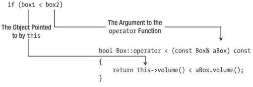

*图 13-1. 重载小于运算符*

引用函数参数避免了不必要的参数复制。返回表达式调用 `volume()` 成员来计算 `this` 所指向对象的体积，并使用基本 `<` 运算符将其与 aBox 的体积进行比较。因此，如果 this 所指向对象的体积小于作为参数传入的对象的体积，则返回 true；否则返回 false。

**注意** 我们在图 13-1 中使用 `this` 指针只是为了展示与第一个操作数的关联。这里没有必要显式使用 this。

让我们通过一个示例看看这是否可行。下面是 Box.cppm 的样子：

```cpp
// Box.cppm
export module box;

export class Box
{
public:
    // Constructors
    Box() = default;
    Box(double l, double w, double h) : m_length{l}, m_width{w}, m_height{h} {}

    double volume() const { return m_length * m_width * m_height; }
```


```cpp
// Accessors
double getLength() const { return m_length; }
double getWidth() const  { return m_width; }
double getHeight() const { return m_height; }

bool operator<(const Box& aBox) const     // Less-than operator
{ return volume() < aBox.volume(); }

private:
double m_length {1.0};
double m_width  {1.0};
double m_height {1.0};
};
```

所有成员函数（包括运算符函数）都定义在类内部。你也可以在类外部实现该运算符函数。在这种情况下，函数定义必须像图13-1所示那样。也就是说，`Box::` 限定符必须紧接在 `operator` 关键字之前。

下面是一个用于测试 `Box` 的小于运算符的小程序：

```cpp
// Ex13_04.cpp
// Implementing a less-than operator
import <iostream>;
import <vector>;
import box;

int main()
{
    std::vector boxes {Box {2.0, 2.0, 3.0}, Box {1.0, 3.0, 2.0},
                       Box {1.0, 2.0, 4.0}, Box {2.0, 3.0, 3.0}};

    Box smallBox {boxes[0]};
    for (const auto& box : boxes)
    {
        if (box < smallBox) smallBox = box;
    }

    std::cout << "The smallest box has dimensions "
              << smallBox.getLength() << 'x'
              << smallBox.getWidth() << 'x'
              << smallBox.getHeight() << std::endl;
}
```

这会产生以下输出：

```text
The smallest box has dimensions 1x2x1
```

`main()` 函数首先创建一个用四个 `Box` 对象初始化的 vector。你任意假定第一个数组元素是最小的，并用它来初始化 `smallBox`，当然这会涉及拷贝构造函数。基于范围的 `for` 循环将 `boxes` 的每个元素与 `smallBox` 比较，较小的元素会通过赋值语句存储到 `smallBox` 中。循环结束时，`smallBox` 包含体积最小的 `Box` 对象。如果你想跟踪调用，可以在 `operator<()` 函数中添加一条输出语句。

注意，`smallBox = box;` 语句表明赋值运算符可用于 `Box` 对象。这是因为编译器在类中提供了一个默认版本的 `operator=()`，它将右操作数成员的值复制到左操作数成员，就像它为拷贝构造函数所做的那样。这并不总是令人满意，你将在本章后面看到如何定义自己的赋值运算符版本。

## 非成员运算符函数

在上一节中，你了解到运算符重载可以定义为成员函数。大多数运算符也可以实现为普通的非成员函数。例如，由于 `volume()` 函数是 `Box` 类的公有成员，你也可以轻松地将 `operator<()` 实现为普通函数。其定义如下：

```cpp
export bool operator<(const Box& box1, const Box& box2)
{
    return box1.volume() < box2.volume();
}
```

以这种方式定义运算符后，前面的示例将以相同方式工作。当然，你不能将这个版本的运算符函数声明为 `const`；`const` 只适用于类的成员函数。运算符定义被导出，以便可以从 `box` 模块外部使用。即使运算符函数需要访问类的私有成员，也仍然可以通过将其声明为类的友元来实现为普通函数。不过，一般来说，如果函数必须访问类的私有成员，最好尽可能将其定义为类成员。

> **提示**  始终将非成员运算符定义在其操作对象所属类的同一命名空间中。因为我们的 `Box` 类属于全局命名空间，所以前面的 `operator<()` 也应如此。

## 实现运算符的完整支持

为类实现诸如 `<` 这样的运算符会带来一些预期。你可以编写 `box1 < box2` 这样的表达式，但 `box1 < 25.0` 或 `10.0 < box2` 呢？当前的 `operator<()` 无法处理其中任何一种。当你为类实现重载运算符时，需要考虑该运算符可能被使用的各种情形。

> **注意**  在第12章中，我们敦促你为大多数单参数构造函数添加关键字 `explicit`。否则，这些构造函数会被用于隐式转换，这可能导致令人意外的结果——从而产生缺陷。例如，假设你为 `Box` 定义了一个非显式的单参数构造函数，如下所示：

```cpp
Box(double side) : Box{side,side,side} {}  // Constructor for cube-shaped Boxes
```

那么，诸如 `box1 < 25.0` 这样的表达式将能编译，因为编译器会注入从 `double` 到 `Box` 的隐式转换。但此时 `box1 < 25.0` 将把 `box1` 的体积与 25.0 这个体积比较，而不是与尺寸为 25×25×25 的 `Box` 的体积比较。所以，很明显，立方体 `Box` 的构造函数确实必须是 `explicit`，正如我们之前得出的结论！由于你不能依赖隐式转换来方便 `Box` 对象与数字之间的比较，因此必须做一些额外工作来支持 `box1 < 25.0` 这样的表达式。

通过为 `operator<()` 添加额外的重载来比较 `Box` 对象，你可以轻松支持这些可能性。我们首先为 `<` 添加一个函数，其中第一个操作数是 `Box` 对象，第二个操作数的类型是 `double`。你需要将以下成员声明添加到 `Box` 类定义的公有部分：

```cpp
bool operator<(double value) const;     // Compare Box volume < double value
```

作为左操作数的 `Box` 对象将在函数中通过隐式指针 `this` 访问，而右操作数是一个值。实现这一点和第一个运算符函数一样简单；函数体中只有一条语句：

```cpp
// Compare the volume of a Box object with a constant
bool Box::operator<(double value) const
{
    return volume() < value;
}
```

处理 `10.0 < box2` 这样的表达式并不更难；只是有所不同。成员运算符函数总是将 `this` 指针作为左操作数提供。在这种情况下，左操作数的类型是 `double`，因此你不能将该运算符实现为成员函数。这样你就剩下两个选择：将其实现为普通运算符函数，或将其实现为友元函数。由于你不需要访问类的私有成员，可以将其实现为普通函数：

```cpp
// function comparing a constant with volume of a Box object
export bool operator<(double value, const Box& aBox)
{
    return value < aBox.volume();
}
```

现在，你有了三个针对 `Box` 对象的 `<` 运算符重载版本，以支持所有三种小于比较的可能性。让我们看看实际效果。我们假设你已经按所述修改了 `Box.cpp`。下面是一个使用 `Box` 对象的新比较运算符的程序：

```cpp
// Ex13_02.cpp
// Using the overloaded 'less-than' operators for Box objects
import <iostream>;
import <vector>;
import <format>;
import Box;

// Display box dimensions
void show(const Box& box)
{
    std::cout << std::format("Box {}x{}x{}",
        box.getLength(), box.getWidth(), box.getHeight()) << std::endl;
}

int main()
{
    std::vector boxes {Box {2.0, 2.0, 3.0}, Box {1.0, 3.0, 2.0},
                       Box {1.0, 2.0, 1.0}};
    const double minVolume{6.0};
    std::cout << "Objects with volumes less than " << minVolume << " are:\n";
    for (const auto& box : boxes)
        if (box < minVolume) show(box);

    std::cout << "Objects with volumes greater than " << minVolume << " are:\n";
    for (const auto& box : boxes)
        if (minVolume < box) show(box);
}
```

你应该会得到以下输出：

```text
Objects with volumes less than 6 are:
Box 1x2x1
Objects with volumes greater than 6 are:
Box 2x2x3
Box 2x3x3
```

在 `main()` 之前定义的 `show()` 函数输出作为参数传入的 `Box` 对象的详细信息。这只是一个供 `main()` 使用的有用辅助函数。输出表明重载运算符正在工作。同样，如果你想查看它们何时被调用，可以在每个定义中放入一条输出语句。当然，你不需要单独的函数来比较 `Box` 对象与整数。当这种情况发生时，编译器会在调用现有函数之一之前插入到 `double` 类型的隐式转换。

## 可以重载的运算符

大多数运算符都可以重载。尽管你不能重载每一个运算符，但限制并不特别苛刻。例如，不能重载的显著运算符包括条件运算符（`? :`）和 `sizeof`。不过，几乎所有其他运算符都可以重载，这给了你相当大的空间。表13-1列出了所有可以重载的运算符。


# 第 13 章：运算符重载

- 通常来说，你不能重写内置运算符。因此，重载运算符的签名通常会涉及至少一个类类型。我们将在下一章更详细地讨论*重写（overriding）*这一术语，但在这里，它的意思是你无法修改现有运算符作用于基本类型或数组类型的方式。换句话说，例如，你不能让整数加法执行乘法运算。虽然看看会发生什么会很有趣，但我们相信你会同意这是一个合理的限制。

尽管有这些限制，在运算符重载方面你仍然拥有相当大的自由。但并不是说仅仅因为可以重载某个运算符，你就应该这么做。如有疑问，请始终记住以下关键指导原则：

> **提示** 运算符重载的主要目的是提高使用你类的代码的编写便利性和可读性。重载运算符能使代码更紧凑，但这始终应排在第二位。紧凑却难以理解甚至具有误导性的代码对任何人都没有好处。确保代码既易于编写又易于阅读才是最重要的。由此产生的一个结论是，你应不惜一切代价避免重载的运算符行为与其内置版本的行为不一致。

显然，最好让你对标准运算符的重载版本与其通常用法保持合理一致，或者至少在含义和操作上是直观的。为一个类提供执行相当于乘法运算的重载 + 运算符是不明智的。但情况可能比这更微妙。假设我们为 Box 对象这样定义相等运算符：

```cpp
bool Box::operator==(const Box& aBox) const { return volume() == aBox.volume(); }
```

这看起来合理，并且与我们之前定义的 < 运算符非常类似。尽管如此，这种非常规的 operator == 定义很容易引起混淆。例如，假设我们创建了这样两个 Box 对象：

```cpp
Box oneBox { 1, 2, 3 };
Box otherBox { 1, 1, 6 };
```

那么你会认为这两个盒子“相等”吗？很可能的答案是：不会。毕竟，它们的尺寸差异很大。如果你订购了一个尺寸为 1 x 2 x 3 的盒子，而收到的是一个尺寸为 1 x 1 x 6 的盒子，你也不会高兴。然而，根据我们对 operator ==() 的定义，表达式 oneBox == otherBox 会求值为 true。这很容易导致误解，进而产生 bug。

大多数程序员期望的 Box 相等运算符定义方式如下：

```cpp
bool Box::operator==(const Box& otherBox) const
{
    return m_width == otherBox.m_width
        && m_length == otherBox.m_length
        && m_height == otherBox.m_height;
}
```

使用哪种定义取决于你的应用场景以及你期望 Box 对象如何被使用。但在本例中，我们认为最好坚持第二种更直观的 operator== 定义。（原因在于它可能带来的意外最少。当程序员看到 == 时，他们想到的是“等于”，而不是“具有相同的值”。如有必要，你随时可以引入一个名为 hasSameValues() 的成员函数来检查值是否相等。确实，hasSameValues() 需要比 == 键入更多内容，但它确实能确保代码保持可读性和可预测性——而这一点要重要得多！）

本章剩余的大部分内容将向你介绍类似的相应运算符重载。除非有充分的理由，否则你不应偏离这些惯例。

> **警告** 我们的运算符关键指导原则的一个具体结果是，你绝不应该重载逻辑运算符 && 或 ||。如果你希望为类的对象提供逻辑运算符，通常更可取的做法是改而重载 & 和 |。

原因在于，重载的 && 和 || 永远不会表现得与内置版本完全一致。回顾第 4 章，内置 && 运算符的左操作数如果求值为 false，则其右操作数不会被求值。类似地，对于内置 || 运算符，如果左操作数求值为 true，则右操作数永远不会被求值。使用重载运算符永远无法获得这种所谓的短路求值。[^1] 因为重载运算符本质上等同于一次普通函数调用，所以重载运算符的所有操作数总是在进入函数体之前被求值。对于重载的 && 和 || 运算符，这意味着左右两个操作数总是会被求值。由于任何使用 && 和 || 运算符的用户都会期望熟悉的短路求值，因此重载它们很容易导致一些微妙的 bug。而改而重载 & 和 | 时，你便清楚地表明不应期望短路求值。

## 运算符函数惯用法

本章的其余部分将介绍关于何时以及如何重载运算符的普遍接受模式和最佳实践。运算符函数真正的限制只有少数几个。但灵活性越大，责任也就越大。我们将教你何时以及如何重载各种运算符，以及 C++ 程序员在此上下文中通常遵循的各种惯例。如果你遵循这些惯例，你的类及其运算符将表现得可预测，从而易于使用并降低 bug 风险。

所有可重载的二元运算符的运算符函数都采用你在上一节中见过的形式。当重载运算符 Op，并且左操作数是正在为 Op 重载的类的对象时，定义该重载的成员函数具有以下形式：

```cpp
ReturnType operator Op(Type right_operand);
```

如果你为你的类重载了三路比较运算符 <=>，C++20 会自动为你提供对所有四个关系运算符（<、>、<= 和 >=）的完整支持，无需再费任何工夫。同样，如果你重载了 ==，C++20 也会确保 != 正常工作。因此，在 C++20 中，几乎不再需要定义自定义的 <、>、<=、>= 或 != 运算符。你仍然需要重载的比较运算符只有 <=> 和 ==。下面是对 Box 类的具体做法：

```cpp
// Box.cpp
export module box;

import <compare>;  // For std::partial_ordering (see Chapter 4)

export class Box
{
public:
    // ...
    // Same constructors and member functions as in Ex13_02, except no operator<.

    std::partial_ordering operator<=>(const Box& otherBox) const
    {
        return volume() <=> otherBox.volume();
    }
    std::partial_ordering operator<=>(double otherVolume) const
    {
        return volume() <=> otherVolume;
    }

    bool operator==(const Box& otherBox) const
    {
        return m_length == otherBox.m_length
            && m_width == otherBox.m_width
            && m_height == otherBox.m_height;
    }

private:
    double m_length {1.0};
    double m_width {1.0};
    double m_height {1.0};
};
```

<=> 运算符的重载应返回 <compare> 模块定义的三种比较类别类型之一：std::partial_ordering、weak_ordering 或 strong_ordering（参见第 4 章）。这里我们选择了 std::partial_ordering。

如前所述，我们不认为两个体积相同的盒子是相等的，除非它们的尺寸也相同。没错，将它们标记为“等价”（equivalent）是合理的，但它们并不“相等”（equal）（“等价”与“相等”的区别也请参见第 4 章）。因此排除了 std::strong_ordering。

于是只剩下了 partial_ordering 和 weak_ordering。在第 4 章中，你看到用 <=> 运算符比较两个浮点值会得到 partial_ordering 类型的值。原因在于其中一个或两个操作数可能是非数值（not-a-number）。虽然我们不期望 Box 的尺寸会是非数值，但目前也没有任何机制可以防止这种情况发生（异常机制可以对此有所帮助；参见第 16 章）。这意味着，至少在理论上，Box 的 volume() 也可能是非数值。


所以，理论上，比较两个 Box 可能得到 `std::partial_ordering::unordered`。更不用说，`Box::operator<=>(double)` 的输入当然同样很容易是 not-a-number。这就是为什么 `partial_ordering` 不仅是最简单的，也是我们两个 `<=>` 重载的合适选择。

通过只定义三个运算符函数（而不是原本需要的十七个），我们最新的 Box 类现在完整支持全部七个比较运算符（`<`、`>`、`<=`、`>=`、`==`、`!=` 和 `<=>`）。也就是说，你现在不仅可以使用这些运算符中的任意一个来比较两个 Box，还可以使用 `<`、`>`、`<=`、`>=` 或 `<=>` 将 Box 与 double 类型的值进行比较（反过来也可以！）。下面的程序证实了这一点：

```cpp
// Ex13_03.cpp
// Overloading <=> and == to fully support all comparison operators
import <iostream>;
import <string_view>;
import <vector>;
import <format>;
import box;

void show(const Box& box)
{
    std::cout << std::format("Box {{{}x{}}}",
        box.getLength(), box.getWidth(), box.getHeight()) << std::endl;
}
void show(const Box& box1, std::string_view relationship, const Box& box2)
{
    show(box1); std::cout << relationship; show(box2); std::cout << std::endl;
}

int main()
{
    const std::vector boxes {Box {2.0, 1.5, 3.0}, Box {1.0, 3.0, 5.0},
                             Box {1.0, 2.0, 1.0}, Box {2.0, 3.0, 2.0}};
    const Box theBox {3.0, 1.0, 4.0};

    for (const auto& box : boxes)
        if (theBox > box) show(theBox, " is greater than ", box); // > works

    std::cout << std::endl;

    for (const auto& box : boxes)
        if (theBox != box) show(theBox, " is not equal to ", box); // != works

    std::cout << std::endl;

    for (const auto& box : boxes)
        if (6.0 <= box) // Yes, even double <= Box works!!
            { std::cout << "6 is less than or equal to "; show(box); std::cout << std::endl; }
}
```

这个程序的最后几行证明，甚至 `6.0 <= box` 也确实可以开箱即用（请原谅这个双关）。这很了不起，因为我们不再定义任何以 double 作为第一个操作数类型的运算符。`6.0 <= box` 能工作的原因是，每当 C++20 编译器找不到专用的 `<=` 运算符时，它就会尝试将形如 `x <= y` 的表达式重写为 `is_lt_eq(x, y)` 或 `is_gt_eq(y, x)^2`；按这个顺序（这些具名比较函数见第 4 章）。因此，表达式 `6.0 <= box` 会像 `is_gt_eq(box, 6.0)` 一样求值（注意操作数顺序被交换了！）。

类似地，编译器会依据 `operator <=>` 重写所有包含 `<`、`>` 或 `>=` 的表达式（当然，前提是找不到专用运算符）。

然而，编译器不会依据 `<=>` 重写包含 `==` 或 `!=` 的表达式。一般来说，这样做可能导致次优性能^1。幸运的是，编译器确实会依据 `operator ==` 重写包含 `!=` 的表达式，所以至少我们不再需要为 `!=` 提供重载了。

> **提示** 即使编译器永远不会这样做，你当然也可以自由地用 `<=>` 来表达 `==`。事实上，在很多情况下那样也能很好地工作。

然而，就 `Box` 类而言，我们已经论证过为什么我们更喜欢真正的相等运算符，而不是“体积相等”运算符。因此我们采用了前面的相等运算符。从 `Ex13_03` 的输出中，你将能看到编译器确实使用 `==` 运算符来求值 `theBox != box`，而不是 `<=>` 运算符；否则输出中就不会包含 `"Box 3x1x4 is not equal to Box 2x3x2"` 这一行（两个 Box 的体积相同，都是 12）。

> **提示** 你当然也可以创建 `==` 运算符的重载，将你的类对象与其他类型的值进行比较。这里同样每种类型一个重载就足够了，因为编译器会在需要时为你交换 `==` 和 `!=` 表达式中操作数的顺序。

（我们将在本章末尾的练习中要求你完成一个这样的示例。）

> **注意** 标准库的 `<utility>` 模块在 `std::rel_ops` 命名空间中提供了一组运算符模板，它们依据类型 `T` 的 `<` 和 `==` 运算符，为任意类型 `T` 定义 `<`、`>`、`>=` 和 `!=` 运算符。不过，这种方案也有不少缺陷，不应再使用。

^1 实际上，编译器不会使用具名比较函数 `std::is_lt_eq()` 或 `std::is_gt_eq()`。它们只是为我们这些凡人准备的，目的是让代码更易读。但生成的代码当然会是等价的。

^2 考虑 `std::string` 的 `==` 和 `!=` 运算符。现在假设你正在比较字符串 `"Little Lily Lovelace likes luscious lemon lollipops"` 和 `"Little Lily Lovelace likes lasagna"`。仅通过比较它们的长度，运算符 `==` 和 `!=` 就能立即确定这两个字符串不可能相等。然而，`operator <=>` 必须更费力地为这两个字符串排序：它至少需要比较 29 个字符。与 `==` 和 `!=` 不同，`<=>` 运算符不能在比较字符串长度后就停止。`"lasagna"` 自然排在 `"Little Lily Lovelace likes luscious lemon lollipops"` 前面，但不是因为它更短。这说明了为什么依据 `<=>` 重写 `==` 和 `!=` 表达式可能导致次优性能。

## 默认定义比较运算符

与早期版本的 C++ 相比，最多只需实现两个比较运算符已是巨大进步。然而，即使只定义两个运算符，也很快会变成一件无聊、重复的苦差事。更糟的是：这是一件容易出错、无聊、重复的苦差事。例如，考虑你在 Ex13_03 中为 Box 类编写的 == 运算符（为便于说明，这里将其移出类定义）：

```cpp
bool Box::operator==(const Box& otherBox) const
{
    return m_length == otherBox.m_length
        && m_width == otherBox.m_width
        && m_height == otherBox.m_height;
}
```

现在想象一下，Box 还有十几个成员变量。或者你必须为另外十几个类定义同样的运算符。无聊又重复，对吧？再想象几个月后，你给 Box 类添加了一个成员变量。忘记更新这个 == 运算符会有多容易？相信我们：我们在遗留代码中已经遇到过许多过时的比较运算符（以及一些由它们引起的隐蔽 bug！）。

幸好，我们知道有一位真正擅长批量生成重复代码的专家：我们可靠的老朋友，C++20 编译器。而且他甚至完全不觉得这无聊。你只需好好请求，他就会乐意为你生成（更重要的是，永久维护）比较运算符。所需语法类似于你用于默认构造函数的语法（见第 12 章）：

```cpp
bool Box::operator==(const Box& otherBox) const = default;
```

当然，你可以，而且经常会，直接在类内默认定义这些运算符。在这种情况下，省略 `Box::` 前缀。默认的 == 运算符会按成员变量声明顺序比较所有成员变量——这正是你最初为 Box 编写的 == 运算符所做的。因此，对 Box 类来说，默认定义 == 运算符效果完美。你可以在 Ex13_03A 中找到按这种方式简化的 Box 类。

**警告** 如果 `MyClass` 并非所有成员变量都有可访问且未删除的 == 运算符，那么为 `MyClass` 默认定义 == 将导致隐式删除的 `operator ==`。也就是说，`= default` 此时与添加 `= delete` 效果相同（关于此语法也见第 12 章）。

虽然原则上你可以默认定义全部七个比较运算符（`==`、`!=`、`<`、`<=`、`>`、`>=` 和 `<=>`），但通常再次只需默认定义 `==` 和/或 `<=>` 就足够了。因此，通常你永远不需要默认定义其他五个运算符。那么，现在让我们看看默认定义 `<=>` 运算符。例如，为了进一步缩小 Ex13_03A 中 Box 类的大小，你可以像这样默认定义它的 `<=>` 运算符（当然也可以直接在类定义内部进行）：

```cpp
std::partial_ordering Box::operator<=>(const Box& otherBox) const = default;
```

1 默认定义的 `!=` 以及 `==`、`<`、`<=`、`>`、`>=` 运算符，一如既往地分别依据 `==` 和 `<=>` 来求值。你在 C++20 中定义或默认定义这些运算符的唯一原因，是允许获取这些函数的地址。然而在实践中，你在 C++ 中大多使用函数对象（见第 19 章），几乎从不需要使用函数指针。


事实上，你甚至可以少敲一些代码，在这里改用 `auto` 作为返回类型（另见第8章）。随后，编译器会根据该类成员变量的 `<=>` 运算符推导返回类型。由于 `Box` 类的三个成员变量都是 double 类型，对于下面的定义，编译器确实会推导出 `std::partial_ordering`：

```
auto Box::operator<=>(const Box& otherBox) const = default;
```

**提示** 每当你将 `<=>` 运算符默认定义时，编译器还会添加一个默认定义的 `==` 运算符。因此，如果所有比较运算符的默认行为都适合你，你只需再默认定义一个运算符函数：`<=>`。小菜一碟！

但是，默认定义的 `<=>` 运算符究竟做什么呢？自然，`Box` 的默认定义 `<=>` 运算符不会按 `volume()` 来比较 Box 对象。如果有一天编译器能弄明白 `Boxes` 应该按它们的体积来比较，那一天我们就该手忙脚乱地去关闭天网了。不，相反，这个默认定义的 `<=>` 运算符执行所谓的逐成员字典序比较。换句话说，它按声明顺序比较左右操作数的所有对应成员变量，并使用它们各自的 `<=>` 运算符。一旦找到一对不相等的变量，就返回它们的比较结果。

为清楚起见，对于 `Box` 类，生成的 `<=>` 函数将等价于：

```
std::partial_ordering Box::operator<=>(const Box& otherBox) const
{
    // See Chapter 4 for the 'if (initialization; condition)' syntax
    if (std::partial_ordering order = (m_length <=> otherBox.m_length); std::is_neq(order))
        return order;
    if (std::partial_ordering order = (m_width <=> otherBox.m_width); std::is_neq(order))
        return order;
    return m_height <=> otherBox.m_height; // return even if both heights are equivalent...
}
```

这显然已经相当多代码了。如果逐成员字典序比较适合你，那么编译器能为你生成（并维护！）它，实在是一件幸事。然而，对于我们的 `Box` 类，我们不会使用默认定义的 `<=>` 运算符；我们将坚持使用基于体积的定义。原因是，该定义更契合我们目前在应用程序中使用 `Boxes` 的方式。³

在实践中，你通常不会精确关心对象如何排序——只要它们以高效且一致的方式排序即可。此时，默认定义的 `<=>` 运算符通常完全够用。例如，如果目标只是对一组 `Box` 对象排序以便更高效地处理，或者将它们用作有序关联容器的键（见第20章），那么你确实不会关心 `Boxes` 是按字典序排序还是按体积排序。事实上，出于性能原因，更强的字典序甚至可能比更弱的基于体积的顺序更可取！

**注意** 如果 `MyClass` 并非所有成员变量都有可访问且未删除的 `<=>` 运算符，那么 `auto MyClass::operator<=>(const MyClass&) const = default;` 又会得到一个被删除的 `<=>` 运算符。如下文所述，此时你最好不要使用 `auto` 作为返回类型。

前面的警告在今天尤其相关：因为飞船运算符 `<=>` 是 C++20 新增的，许多类类型尚不支持它。当然，所有基本类型都已经支持，标准库中所有相关类型也都支持。但用户定义类型通常还不会支持 `<=>`。

但也不全是坏消息：幸运的是，许多遗留类型确实支持（至少）运算符 `<` 和 `==`。而且幸运的是，C++20 编译器能够合成默认定义的 `<=>` 运算符，用这类遗留类型的 `==` 和 `<` 运算符来比较其变量，而不是使用它们缺失的 `<=>` 运算符。那么你唯一要做的就是明确告诉编译器，默认定义的 `<=>` 运算符应使用哪个比较类别。也就是说，如果默认定义的 `<=>` 运算符要使用 `==` 和 `<` 来比较遗留类型的成员变量，你就不能用 `auto` 作为返回类型；此时必须显式指定 `std::partial_ordering`、`weak_ordering` 或 `strong_ordering` 作为返回类型。

关于比较运算符，我们想说的就是这些。总结如下：

**提示** 若要允许你自己类的两个对象之间进行任何及所有比较，你只需定义两个运算符：`<=>` 和 `==`。而且通常将它们定义为成员函数。此外，在许多情况下，这些运算符重载可以（而且应该）被默认定义，这样编译器就会为你生成（并维护）它们。

每当你将 `<=>` 运算符默认定义时——我们之前没有提到这一点——编译器还会添加一个默认定义的 `==` 运算符，除非你自己显式定义了一个。

你甚至可以让编译器自动推导默认定义 `<=>` 运算符的返回类型，但前提是所有成员变量都支持 `<=>`。否则，你应该显式指定 `partial_ordering`、`weak_ordering` 或 `strong_ordering`，以便编译器基于类成员变量的 `<` 和 `==` 运算符合成一个 `<=>` 运算符。

若要允许你自己类的对象与某些其他类型的值之间进行任何及所有比较，你同样只需重载 `<=>` 和/或 `==`。而且为此你也不再需要非成员函数：C++20 编译器会在需要的地方方便地为你合成操作数顺序。不过，不同类型之间的比较运算符永远不能被默认定义。除非天网获得自我意识并接管控制权，那才可能。

现在该把注意力转向其他运算符了。我们从 `<<` 运算符最常见的一类重载开始，因为这在后面的示例中很快就会派上用场。

## 为输出流重载 << 运算符

到目前为止，我们一直在定义特定函数，将 Box 对象输出到 `std::cout`。例如，在本章中，我们定义了几个名为 `show()` 的函数，然后在如下语句中使用它们：

```
show(box);
```

或者这样：

```
show(theBox, " is greater than ", box);
```

现在我们知道如何重载运算符了；不过，我们可以通过为输出流重载 `<<` 运算符，让 Box 对象的输出语句更自然。这样我们就能简单地写成：

```
std::cout << box;
```

以及：

```
std::cout << theBox << " is greater than " << box;
```

但是，我们如何重载这个 `<<` 运算符呢？在开始之前，我们先准确回顾第二条语句是如何工作的。第一步，加上括号以明确 `<<` 运算符的结合性：

```
((std::cout << theBox) << " is greater than ") << box;
```

最内层的 `<<` 表达式会先求值。因此，下面这样是等价的：

```
auto& something = (std::cout << theBox);
(something << " is greater than ") << box;
```

自然，这能起作用的唯一方式就是：最内层表达式的结果 something 仍然是一个流的引用。为进一步说明，我们还可以对 `operator<<()` 使用函数调用写法，如下所示：

```
auto& stream1 = operator<<(std::cout, theBox);
(stream1 << " is greater than ") << box;
```

再用几个类似的改写步骤，我们就能写出编译器求值整条语句所采取的每一步：

```
auto& stream0 = std::cout;
auto& stream1 = operator<<(stream0, theBox);
auto& stream2 = operator<<(stream1, " is greater than ");
auto& stream3 = operator<<(stream2, box);
```

虽然这相当冗长，但它清楚说明了我们想表达的观点。这个特定的 `operator<<()` 重载接受两个参数：一个流对象的引用（左操作数）和要输出的实际值（右操作数）。然后它返回一个指向同一个流对象的新引用，该引用可以沿链传递给下一次 `operator<<()` 调用。这就是我们在第12章中称为方法链的例子。

一旦你理解了这一点，解读为 Box 对象重载该运算符的函数定义就应当很直接：

```
std::ostream& operator<<(std::ostream& stream, const Box& box)
{
    stream << std::format("Box({:.1f}, {:.1f}, {:.1f})",
                          box.getLength(), box.getWidth(), box.getHeight());
    return stream;
}
```

第一个参数将左操作数标识为 `ostream` 对象，第二个参数将右操作数指定为 `Box` 对象。标准输出流 `cout` 的类型是 `std::ostream`。当然，我们不能把这个运算符函数加入 `std::ostream` 的定义中，所以必须把它定义为非成员函数。由于 `Box` 对象的尺寸是公开可访问的，我们不必使用 `friend` 声明。返回的值是——而且始终应该是——对运算符左操作数所引用的同一个流对象的引用。


> **注意** 我们使用 `std::format()` 来控制 Box 三个维度格式化时的宽度。这样做是因为你最熟悉这个函数。当然，你也可以在这里改用 `std::setw()` 和 `std::fixed` 流操纵器（简要介绍见第 2 章）。
> 
> 相关说明：你实际上也可以扩展 `<format>` 框架，以允许诸如 `std::format("My new box, {:.1f}, is fabulous!", box)` 这样的表达式。也就是说，你可以让 `std::format()` 知道如何格式化你自己类 Box 的对象，包括诸如 `.1f` 这样的格式化选项。但由于这样做涉及特化一个类模板，我们会把如何实现留作第 17 章的一个练习，让你自行弄清楚（别担心，我们会给你一些提示）。

要测试我们的 `<<` 运算符，你可以将其定义添加到 Ex13_03A 的 box 模块中（不要忘记从模块中导出该函数）。然后在 Ex13_03A 的 `main()` 函数中，你可以将诸如 `show(theBox, "is greater than ", box)` 这样的表达式替换为使用 `<<` 运算符的等效表达式：

```cpp
std::cout << theBox << " is greater than " << box << std::endl;
```

你可以在 Ex13_04 中找到生成的程序。

> **注意** 标准库流类的 `<<` 和 `>>` 运算符是绝佳例证，说明重载运算符并不一定总要等同于其内建版本——回想一下，内建的 `<<` 和 `>>` 运算符执行的是整数的按位移位！另一个很好的例子是使用 `+` 和 `+=` 运算符连接字符串的惯例，你已经多次对 `std::string` 对象使用过这种做法。直到现在，你可能都没有过多思考这类表达式如何以及为何能工作，这恰恰证明：如果使用得当，重载运算符可以带来非常自然的编码方式。

## 重载算术运算符

我们将通过考察如何为 Box 类重载加法运算符，来解释如何重载算术运算符。这是一个有趣的例子，因为加法是一种二元运算，涉及创建并返回一个新对象。新对象将是作为其操作数的两个 Box 对象之和（无论你如何定义这个“和”）。

两个 Box 对象之和可能意味着什么？我们可以考虑几种可能性，但由于 Box 的主要用途是容纳物品，其容积能力才是首要关注的，因此我们可以合理假设两个箱子之和是一个能够同时容纳两者的新箱子。基于这一假设，我们将两个对象之和定义为一个足够大的 Box 对象，能够容纳相互堆叠的两个原始箱子。这与该类可能用于包装的设想是一致的，因为将多个 Box 对象相加会得到一个能够容纳它们全部的 Box 对象。

你可以按如下简单方式实现加法运算符。新对象的 `m_length` 成员将是被相加对象中 `m_length` 成员的较大者，`m_width` 成员也以类似方式确定。如果 `m_height` 成员是操作数 `m_height` 成员之和，那么所得的 Box 对象就能够容纳这两个 Box 对象。通过修改构造函数，我们将使对象的 `m_length` 成员始终大于或等于 `m_width` 成员。

图 13-2 展示了将两个 Box 对象相加所产生的 Box 对象。由于这个加法的结果是一个新的 Box 对象，实现加法的函数必须返回一个 Box 对象。如果重载 + 运算符的函数要作为成员函数，那么在 Box 类定义中该函数的声明可以如下：

```cpp
Box operator+(const Box& aBox) const;    // Adding two Box objects
```

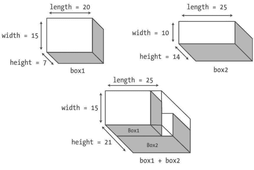

*图 13-2.* 将两个 Box 对象相加后得到的对象

aBox 参数是 const 的，因为该函数不会修改作为右操作数的实参。它是 const 引用，以避免不必要的右操作数复制。函数本身被指定为 const，因为它不会改变左操作数。成员函数在 Box.cpp 中的定义将如下所示：

```cpp
// Operator function to add two Box objects
Box Box::operator+(const Box& aBox) const
{
    // New object has larger length and width, and sum of heights
    return Box{ std::max(m_length, aBox.m_length),
                std::max(m_width, aBox.m_width),
                m_height + aBox.m_height };
}
```

按照算术运算符的惯例，会创建一个局部 Box 对象，并将其副本返回给调用程序。当然，由于这是一个新对象，绝不能用引用返回它。箱子的尺寸使用 `std::max()` 计算，该函数只是返回两个给定参数中的最大值。它由 `<algorithm>` 模块中的函数模板实例化而来。此模板适用于任何支持 `operator<()` 的参数类型。当然，也存在一个类似的 `std::min()` 函数模板，用于计算两个表达式中的最小值。

我们可以通过一个示例来看看加法运算符如何工作。我们将再次从 Ex13_04 中的 box 模块开始：

```cpp
// Box.cppm
export module box;
import <iostream>;
import <format>;
import <compare>;  // For std::partial_ordering
import <algorithm>;  // For the min() and max() function templates

export class Box
{
public:
  Box() = default;  // Default constructor
  Box(double length, double width, double height)
    : m_length{ std::max(length,width) }
    , m_width{ std::min(length,width) }
    , m_height{ height }
  {}

  double volume() const;  // Function to calculate the volume

  // Accessors
  double getLength() const { return m_length; }
  double getWidth() const { return m_width; }
  double getHeight() const { return m_height; }

  // Functions that add full support for comparison operators
  std::partial_ordering operator<=>(const Box& aBox) const;
  std::partial_ordering operator==(double value) const;
  bool operator==(const Box& aBox) const = default;

  Box operator+(const Box& aBox) const;  // Function to add two Box objects

private:
  double m_length {1.0};
  double m_width {1.0};
  double m_height {1.0};
};

// ... Include definitions of
//     - the operator<=>() member functions of Ex13_03A
//     - the operator==(double) nonmember function of Ex13_04
//     - the new operator+() member function
```

第一个重要区别是第二个构造函数，它使用 `std::min()` 和 `max()` 来确保 Box 的长度始终大于其宽度。第二个区别当然就是新增了 `operator+()` 的声明。

下面是用来尝试的代码：

```cpp
// Ex13_05.cpp
// Using the addition operator for Box objects
import <iostream>;
import <format>;
import <vector>;
import <random>;        // For random number generation
import <functional>;    // For std::bind()
import box;

auto createUniformPseudoRandomNumberGenerator(double max)
{
    std::random_device seeder;                 // True random generator to obtain a seed (slow)
    std::default_random_engine generator{seeder()};    // Efficient pseudo-random generator
    std::uniform_real_distribution distribution{1.0, max}; // Generate in [1, max) interval
    return std::bind(distribution, generator);          //... and in the darkness bind them!
}

int main()
{
    const double limit {99};       // Upper limit on Box dimensions
    auto random { createUniformPseudoRandomNumberGenerator(limit) };

    const size_t boxCount {20};    // Number of Box objects to be created
    std::vector<Box> boxes;        // Vector of Box objects

    // Create 20 Box objects
    for (size_t i {}; i < boxCount; ++i)
        boxes.push_back(Box{ random(), random(), random() });

    size_t first {};
    size_t second {};
    double minVolume {(boxes[first] + boxes[second]).volume()};

    for (size_t i {}; i < boxCount - 1; ++i)
    {
        for (size_t j {i + 1}; j < boxCount; ++j)
        {
            if (boxes[i] + boxes[j] < minVolume)
            {
                first = i;
                second = j;
                minVolume = (boxes[i] + boxes[j]).volume();
            }
        }
    }
}
```


```cpp
std::cout << "The two boxes that sum to the smallest volume are "
          << boxes[first] << " and " << boxes[second] << '\n';
std::cout << std::format("The volume of the first box is {:.1f}\n",
                         boxes[first].volume());
std::cout << std::format("The volume of the second box is {:.1f}\n",
                         boxes[second].volume());
std::cout << "The sum of these boxes is " << boxes[first] + boxes[second] << '\n';
std::cout << std::format("The volume of the sum is {:.1f}", minVolume.volume()) << std::endl;
}
```

我们得到以下输出：

```text
The two boxes that sum to the smallest volume are Box(39.8, 4.9, 17.0) and
Box(24.7, 8.8, 25.6)
The volume of the first box is 3341.7
The volume of the second box is 5586.6
The sum of these boxes is Box(39.8, 8.8, 42.6)
The volume of the sum is 14964.9
```

每次运行程序时，你应该会得到不同的结果。有关`createUniformPseudoRandomNumberGenerator()`函数的说明，请参阅第12章。

`main()`函数生成一个包含20个`Box`对象的向量，这些对象的尺寸为1到99之间的任意值。然后，嵌套的`for`循环测试所有可能的`Box`对象对，以找到组合后体积最小的那一对。内层循环中的`if`语句使用`operator+()`成员生成一个`Box`对象，该对象是当前对象对的和。然后（隐式地）使用`operator<=>()`成员将得到的`Box`对象与`minVolume`的值进行比较（请记住：编译器本质上会将`boxes[i] + boxes[j] <= minVolume`重写为`std::is_lteq(boxes[i] + boxes[j] <=> minVolume)`）。输出显示它有两个盒子，这是应该的。我们建议你对运算符函数和`Box`构造函数进行插桩，以查看它们何时以及被调用多少次。

当然，你可以在更复杂的表达式中使用重载的加法运算符来对`Box`对象求和。例如，你可以这样写：

```cpp
Box box4 {box1 + box2 + box3};
```

这会调用`operator+()`成员两次，创建一个表示三者之和的`Box`对象，并将其传递给`Box`类的复制构造函数以创建`box4`。结果是一个`Box`对象`box4`，它可以包含堆叠在一起的其他三个`Box`对象。

## 用另一个运算符实现一个运算符

一件事总是引向另一件事。如果你为一个类实现了加法运算符，就不可避免地会让人期望`+=`运算符也能工作。如果你要同时实现两者，值得注意的是，你可以非常经济地基于`+=`来实现`+`。

首先，我们为`Box`类定义`+=`。由于涉及赋值，惯例规定该运算符函数返回引用：

```cpp
// Overloaded += operator
Box& Box::operator+=(const Box& aBox)
{
    // New object has larger length and width, and sum of heights
    m_length = std::max(m_length, aBox.m_length);
    m_width  = std::max(m_width, aBox.m_width);
    m_height += aBox.m_height;
    return *this;
}
```

这很直接。你只需根据`Box`对象的加法定义，通过加上右操作数来修改左操作数（即`*this`）。现在你可以使用`operator+=()`来实现`operator+()`，因此`operator+()`的定义简化为以下内容：

```cpp
// Function to add two Box objects
Box Box::operator+(const Box& aBox) const
{
    Box copy(*this);
    copy += aBox;
    return copy;
}
```

函数体的第一行调用复制构造函数创建左操作数的副本，用于加法。然后调用`operator+=()`函数将右操作数对象`aBox`加到新的`Box`对象上。随后返回该对象。

复合赋值运算符返回指向自身的引用的惯例，其动机是它支持这样的语句，即在更大的表达式中使用赋值表达式的结果。为便于做到这一点，大多数通过惯例修改其左操作数的运算符会返回指向自身的引用，或者如果实现为非成员函数，则返回对第一个参数的引用。你已经在`<<`流运算符中看到了这一点，我们讨论递增和递减运算符的重载时还会再次遇到。

`Ex13_06`包含一个box模块，它从`Ex13_05`的模块开始，但按本节所述实现了加法运算符。使用这个新的`Box`定义，你可以轻松修改`Ex13_05`的`main()`函数，并尝试新的`+=`运算符。例如，在`Ex13_06.cpp`中，我们是这样做的：

```cpp
int main()
{
    // Generate boxCount random Box objects as before in Ex13_05...

    Box sum{0, 0, 0};          // Start from an empty Box
    for (const auto& box : boxes)  // And then add all randomly generated Box objects
        sum += box;

    std::cout << std::format("The sum of {} random boxes is {:.1f}ft", boxCount, sum.volume()) << std::endl;
}
```

> **提示** 始终根据对应的算术赋值运算符`op=()`来实现二元算术运算符`op()`。

## 成员函数与非成员函数

`Ex13_05`和`Ex13_06`都将`operator+()`定义为`Box`类的成员函数。然而，你也可以同样轻松地将这个加法实现为非成员函数。下面是这样一个函数的原型：

```cpp
Box operator+(const Box& aBox, const Box& bBox);
```

由于`Box`对象的尺寸可以通过公有成员函数访问，因此不需要友元声明。但即使成员变量的值不可访问，你仍然可以将该运算符定义为友元函数，这就引出了一个问题：这些选项中哪个最好？成员函数？非成员函数？还是友元函数？

在所有选项中，友元函数通常被认为是最不受欢迎的。虽然并不总是有可行的替代方案，但友元声明会破坏数据隐藏，因此应尽可能避免。

然而，在成员函数和非友元非成员函数之间做选择并不总是那么明确。运算符函数对类能力至关重要，因此我们大多倾向于将它们实现为类成员。这使这些函数成为该类型不可或缺的一部分，从而将其置于封装的核心。因此，你的默认选择可能应该是将运算符重载定义为成员函数。但至少有两种情况你应该改为将它们实现为非成员函数。

首先，有些情况下你别无选择，只能将它们实现为非成员函数，即使这意味着你必须求助于友元函数。这些情况包括二元运算符的重载，其中第一个参数要么是基础类型，要么是不同于你当前正在编写的类的类型。我们已经看到了这两类情况的示例：

```cpp
Box operator+(double value, const Box& box);    // double cannot have members
std::ostream& operator<<(std::ostream& stream, const Box& box); // cannot add ostream members
```

> **注意** 一旦某个运算符的某个重载需要是非成员函数，你可能会决定为了保持一致，也将所有其他重载变成非成员函数。例如，假设你为`Box`类定义了一个乘法运算符（留作练习）：
>
> ```cpp
> Box operator*(double, const Box&); // Must be nonmember function
> Box operator*(const Box&, double);   // Symmetrical case often done for consistency
> ```

这两个重载中只有第一个真正需要是非成员函数。C++20编译器只会尝试交换`<`、`>`、`<=`、`>=`、`==`、`!=`和`<=>`这些运算符的操作数顺序（见前文）。因此，为了获得对其他任何二元运算符（如`+`、`-`、`*`、`/`、`%`、`^`和`&`）的混合类型支持，你仍然至少需要一个非成员函数。不过，将另一种操作数顺序的函数也变成非成员函数，可以让你在源代码中很好地将这些声明分组在一起。

但还有一个原因可能让你有时更倾向于非成员函数而不是成员函数，那就是当希望二元运算符的左操作数进行隐式转换时。我们将在下一小节讨论这种情况。


## 运算符函数与隐式转换

正如本章前文以及前面几章所指出的，允许从double到Box的隐式转换并不是一个好主意。因为这类转换会导致令人不快的结果，所以Box对应的单参数构造函数确实应当声明为explicit。但并非所有单参数构造函数都如此。例如，你在第12章练习中较早处理的Integer类就提供了一个很好的例子。从本质上看，这个类是这样的：

```cpp
class Integer
{
public:
    Integer(int value = 0) : m_value{value} {}
    int getValue() const { return m_value; }
    void setValue(int value) { m_value = value; }
private:
    int m_value;
};
```

对这个类而言，允许隐式转换并无害处。主要原因是Integer对象比Box对象更接近int。你已经知道的其他无害（而且方便！）的隐式转换示例，包括从字符串字面量到std::string对象，或者从T值到std::optional<T>对象的转换。

对于允许隐式转换的类，将运算符重载为成员函数的一般准则通常会发生改变。以Integer类为例。你自然希望为Integer对象提供诸如operator+()这样的二元算术运算符。当然，你还希望它们也能用于Integer + int和int + Integer形式的加法。显然，你仍然可以像我们为Integer和Box的operator+()所做的那样定义三个运算符函数——两个成员函数和一个非成员函数。但还有一个更简单的选择。你只需要如下定义一个非成员运算符函数：

```cpp
Integer operator+(const Integer one, const Integer& other)
{
    return one.getValue() + other.getValue();
}
```

将这个函数与前面简单的Integer类定义一起放进一个integer模块中。为-、*、/和%添加类似的函数。由于int值会隐式转换为Integer对象，这五个运算符函数就足以让下面的测试程序正常工作。如果不依赖隐式转换，你至少需要15个函数定义才能覆盖所有可能性！

```cpp
// Ex13_07.cpp
// Implicit conversions reduce the number of operator functions
import <iostream>;
import integer;

int main()
{
    const Integer i{1};
    const Integer j{2};
    const auto result = (i * 2 + 4 / j - 1) % j;
    std::cout << result.getValue() << std::endl;
}
```

需要改用非成员函数才能让任一操作数都支持隐式转换，原因是编译器从不对成员函数的左操作数执行转换。也就是说，如果你把`operator/()`定义为成员函数，那么像`4 / j`这样的表达式将不再能编译。

> **提示** 运算符重载应主要实现为成员函数。只有在无法使用成员函数，或者希望第一个操作数进行隐式转换时，才使用非成员函数。

## 重载一元运算符

到目前为止，我们只看到了重载二元运算符的例子。当然，你也可以重载一元运算符。为了说明问题，假设对盒子的一种常见操作是“旋转”它们，也就是交换它们的宽度和长度。如果这个操作确实经常使用，你可能会想为它引入一个运算符。因为旋转只涉及一个Box——不需要额外的操作数——所以你必须从可用的一元运算符中选择一个。可行的候选有+、-、~、!和*。其中，operator*()似乎是个不错的选择。和二元运算符一样，一元运算符既可以定义为成员函数，也可以定义为普通函数。仍然从Ex13_04中的Box类开始，前一种可能性看起来像这样：

```cpp
class Box
{
public:
    // Constructors
    Box(double l, double w, double h) : m_length{l}, m_width{w}, m_height{h} {}

    Box operator*() const
    {
        return Box{m_width, m_length, m_height}; // Width and length are swapped
    }

    // Remainder of the Box class as before...
};
```

按照惯例，operator*()返回一个新对象，就像我们在那些不修改左操作数的二元算术运算符中看到的那样。把Box的“旋转”运算符定义为非成员函数也同样不足为奇：

```cpp
Box operator*(const Box& box)
{
    return Box{ box.getWidth(), box.getLength(), box.getHeight() };
}
```

只要采用其中任意一种运算符重载，你就可以编写类似下面的代码：

```cpp
Box someBox{ 1, 2, 3 };
std::cout << *someBox << std::endl;
```

你可以在Ex13_08中找到这个示例。如果运行该程序，你将得到如下结果：

```
Box(2.0, 1.0, 3.0)
```

> **注意** 可以说，这个运算符重载违反了本章前文给出的关键准则。虽然它显然能带来非常紧凑的代码，但不一定能形成自然、可读的代码。如果不看类定义，恐怕你的程序员中没有人能猜到表达式*someBox在做什么。因此，除非*someBox这种写法在包装和盒子领域司空见惯，否则在这里定义一个普通函数可能更好，例如rotate()或getRotatedBox()。

## 重载自增和自减运算符

++和--运算符会给为类实现它们的函数带来一个新问题，因为它们的行为取决于它们是否位于操作数之前。每个运算符都需要两个函数：一个用于前缀情形，另一个用于后缀情形。任一运算符的后缀形式运算符函数，都通过一个类型为int的哑元参数来与前缀形式区分。这个参数只用于区分这两种情形，除此之外并不使用。为任意类MyClass重载++的函数声明将如下所示：

```cpp
class MyClass
{
public:
  MyClass& operator++();          // Overloaded prefix increment operator

  const MyClass operator++(int);  // Overloaded postfix increment operator

  // Rest of MyClass class definition...
};
```

前缀形式的返回类型通常需要是对当前对象*this的引用，并且是在自增操作已应用于该对象之后。下面是Box类前缀形式的一种可能实现：

```cpp
Box& Box::operator++()  // Prefix ++ operator
{
  ++m_length;
  ++m_width;
  ++m_height;
  return *this;
}
```

这只会把每个尺寸都加一，然后返回当前对象。

> **注意** 自增或自减运算符的后缀形式返回的值应始终是原始对象在自增或自减之前的副本；前缀形式返回的值应始终是对当前（因而已经自增或自减）对象的引用。原因在于，这正是对应的内置运算符作用于基本类型时的行为。

## 重载下标运算符

下标运算符[]为某些种类的类提供了非常有趣的可能性。显然，这个运算符主要旨在从若干对象中选择一个对象，你可以把这些对象解释为数组，但这些对象可能存放在多种不同容器中的任意一种里。你可以重载下标运算符来访问稀疏数组（其中许多元素为空）、关联数组，甚至链表的元素。数据甚至可以存储在文件中，而你可以使用下标运算符来隐藏文件输入和输出操作的复杂性。

Ex12_17中的Truckload类就是一个可以支持下标运算符的类的例子。Truckload对象包含一组有序对象，因此下标运算符可以提供一种通过索引值访问这些对象的方式。索引0会返回列表中的第一个对象，索引1会返回第二个，依此类推。下标运算符的内部工作会负责遍历列表以找到所需对象。

Truckload类的operator[]函数需要接受一个索引值作为参数，该值表示列表中的位置，并返回指向该位置处Box对象的指针。Truckload类中该成员函数的声明如下：

```cpp
class Truckload
{
public:
  // Rest of the class as before...
  SharedBox operator[](size_t index) const;  // Overloaded subscript operator
  // ...
};
```

你可以像这样实现该函数：

```cpp
SharedBox Truckload::operator[](size_t index) const
{
  size_t count {};                         // Package count
  for (Package* package{m_head}; package; package = package->m_next)
  {
    if (count++ == index)                   // Up to index yet?
      return package->m_box;                // If so return the pointer to Box
  }
  return nullptr;
}
```

for循环遍历列表，并在每次迭代时递增count。当count的值与index相同时，循环已经到达位置index处的Package对象，因此返回指向该Package对象中Box对象的智能指针。如果遍历完整个列表时count仍未达到index的值，那么index一定超出范围，因此返回nullptr。让我们再试一个例子，看看这在实践中会如何发展。


这个示例将使用任何包含 operator<<() 的 Box 类，这使得将 Box 输出到 std::cout 更容易。我们也可以移除 Truckload 的 listBoxes() 成员，并为 << 运算符添加一个重载，以便将 Truckload 对象输出到流，类似于 Box 类。如果你使用为练习12-6创建的 Truckload 类（即包含嵌套 Iterator 类的那个），你可以实现这个运算符函数而无需 friend 声明。它的定义如下：

```cpp
std::ostream& operator<<(std::ostream& stream, const Truckload& load)
{
    size_t count {};
    auto iterator = load.getIterator();
    for (auto box = iterator.getFirstBox(); box; box = iterator.getNextBox())
    {
        std::cout << *box << ' ';
        if (!(++count % 4)) std::cout << std::endl;
    }
    if (count % 4) std::cout << std::endl;
    return stream;
}
```

你可以用它替换旧 Truckload 类的 listBoxes() 成员函数。代码与 listBoxes() 代码类似，只是现在只使用公有函数，而不是直接处理列表中的 Packages。该函数使用 Box 类的 operator<<() 函数。现在输出 Truckload 对象将非常简单——你只需使用 << 将其写入 cout。

如果你同时向 Truckload 类添加数组下标运算符和流输出运算符，可以使用以下程序来练习这些新运算符：

```cpp
// Ex13_10.cpp
// Using the subscript operator
import <iostream>;
import <memory>;
import <random>;     // For random number generation
import <functional>;  // For std::bind()
import truckload;

// Add the createUniformPseudoRandomNumberGenerator() function from Ex13_05 here.

int main()
{
    const double limit {99.0};      // Upper limit on Box dimensions
    auto random = createUniformPseudoRandomNumberGenerator(limit);

    Truckload load;
    const size_t boxCount {16};     // Number of Box object to be created

    // Create boxCount Box objects
    for (size_t i {}; i < boxCount; ++i)
        load.addBox(std::make_shared<Box>(random(), random(), random()));

    std::cout << "The boxes in the Truckload are:\n";
    std::cout << load;

    // Find the largest Box in the Truckload
    double maxVolume {};
    size_t maxIndex {};
    size_t i {};
    while (load[i])
    {
        if (load[i]->volume() > maxVolume)
        {
            maxIndex = i;
            maxVolume = load[i]->volume();
        }
        i++;
    }

    std::cout << "\nThe largest box is: ";
    std::cout << *load[maxIndex] << std::endl;

    load.removeBox(load[maxIndex]);
    std::cout << "\nAfter deleting the largest box, the Truckload contains:\n";
    std::cout << load;
}
```

当我们运行这个示例时，它产生了以下输出：

```text
The boxes in the Truckload are:
Box(47.7,20.3,38.5) Box(68.3,35.4,63.3) Box(10.1,81.2,4.1) Box(32.2,71.6,88.4)
Box(44.6,87.2,10.0) Box(73.3,78.2,18.7) Box(25.9,70.0,51.6) Box(42.7,49.8,71.9)
Box(35.0,82.5,74.9) Box(46.3,46.3,89.9) Box(77.0,88.5,82.1) Box(77.7,59.3,96.8)
Box(26.2,32.2,18.0) Box(58.5,75.0,21.5) Box(42.3,13.6,71.6) Box(31.3,13.6,94.4)

The largest box is: Box(77.0,88.5,82.1)
After deleting the largest box, the Truckload contains:
Box(47.7,20.3,38.5) Box(68.3,35.4,63.3) Box(10.1,81.2,4.1) Box(32.2,71.6,88.4)
Box(44.6,87.2,10.0) Box(73.3,78.2,18.7) Box(25.9,70.0,51.6) Box(42.7,49.8,71.9)
Box(35.0,82.5,74.9) Box(46.3,46.3,89.9) Box(77.7,59.3,96.8) Box(26.2,32.2,18.0)
Box(58.5,75.0,21.5) Box(42.3,13.6,71.6) Box(31.3,13.6,94.4)
```

`main()` 函数现在使用下标运算符从 Truckload 对象访问指向 Box 对象的指针。你可以从输出中看到下标运算符正常工作，并且查找和删除最大 Box 对象的结果正确。现在将 Truckload 和 Box 对象输出到标准输出流的工作方式与基本类型相同。

> **注意** 对于 Truckload 对象，下标运算符掩盖了一个特别低效的过程。因为很容易忘记每次使用下标运算符都涉及从开头遍历列表的至少一部分，所以在生产代码中添加此运算符之前应三思。特别是如果 Truckload 对象包含大量盒子，使用此运算符可能会对性能造成灾难性影响。

正因如此，标准库的作者决定不为他们的链表类模板 `std::list<>` 和 `std::forward_list<>` 提供任何下标运算符。重载下标运算符最好保留给那些可以由高效元素检索机制支持的情况。

为了解决 Truckload 数组下标运算符的这个性能问题，你应该要么省略它，要么将 Truckload::Packages 的链表替换为 `std::vector<SharedBox>`。我们最初使用链表的唯一原因是教学目的。在现实生活中，你很可能永远不应使用链表。`std::vector<>` 几乎总是更好的选择。我们将把此版本 Truckload 的实现推迟到第20章的练习。

## 修改重载下标运算符的结果

你可能会遇到这样的情况：你想重载下标运算符并使用它返回的对象，例如，在赋值左侧或对其调用函数。使用当前 Truckload 类中 `operator[]()` 的实现，如果编写以下任一语句，程序可以编译但不会正确工作：

```cpp
load[0] = load[1];
load[2].reset();
```

这会编译并执行，但不会影响列表中的项。你想要的是列表中的第一个指针被第二个替换，并且第三个被重置为 null，但这不会发生。问题在于 `operator[]()` 的返回值。该函数返回一个智能指针对象的临时副本，它指向与列表中原始指针相同的 Box 对象，但却是不同的指针。每次你在赋值左侧使用 `load[0]` 时，你得到的是列表中第一个指针的不同副本。两条语句都会执行，但只是修改列表中指针的副本，而这些副本不会存在很久。

这就是为什么下标运算符通常返回对数据结构内部值的引用，而不是该值的副本。然而，对 Truckload 类这样做带来了一个重大挑战。你不能再从 Truckload 类的 `operator[]()` 返回 `nullptr`，因为你不能返回对 `nullptr` 的引用。显然，在这种情况下你也绝不能返回对局部对象的引用。你需要设计另一种方式来处理无效索引。最简单的解决方案是返回一个不指向任何对象且永久存储在全局内存某处的 SharedBox 对象。

你可以通过将以下声明添加到类的私有部分，将 SharedBox 对象定义为 Truckload 类的静态成员：

```cpp
static SharedBox nullBox {};  // Pointer to nullptr
```

现在我们可以将下标运算符的定义改为：

```cpp
SharedBox& Truckload::operator[](size_t index)
{
    size_t count {};              // Package count
    for (Package* package{m_head}; package; package = package->m_next)
    {
        if (count++ == index)      // Up to index yet?
            return package->m_box;  // If so return the pointer to Box
    }
    return nullBox;
}
```

现在它返回对指针的引用，并且该成员函数不再是 const。下面是 Ex13_10 的扩展，用于尝试在赋值左侧使用下标运算符。我们只是扩展了 Ex13_10 中的 main()，以表明遍历 Truckload 列表中的元素仍然有效：

```cpp
int main()
{
    // All the code from main() in Ex13_10 here...

    load[0] = load[1];          // Copy 2nd element to the 1st
    std::cout << "\nAfter copying the 2nd element to the 1st, the list contains:\n";
    std::cout << load;

    load[1] = std::make_shared<Box>(*load[2] + *load[3]);
    std::cout << "\nAfter making the 2nd element a pointer to the 3rd plus 4th,"
              << " the list contains:\n";

    std::cout << load;
}
```

你可以在 Ex13_11.cpp 中找到完整程序。输出的第一部分与上一个示例类似，之后的输出如下：

```text
After copying the 2nd element to the 1st, the list contains:
Box(85.5,33.0,56.9) Box(85.5,33.0,56.9) Box(78.3,54.1,43.9) Box(69.1,31.6,78.1)
Box(41.6,30.0,14.8) Box(23.8,22.1,97.8) Box(97.8,33.4,74.0) Box(88.4,83.6,65.7)
Box(19.8,13.7,14.6) Box(77.6,72.1,35.0) Box(87.7,51.6,15.4) Box(95.0,53.5,83.9)
Box(65.6,29.6,91.7) Box(88.8,16.5,73.7) Box(64.3,2.7,30.7) Box(69.9,51.5,85.9)
Box(29.0,20.5,76.4) Box(72.8,19.2,49.1) Box(59.9,56.3,8.9)

After making the 2nd element a pointer to the 3rd plus 4th, the list contains:
Box(85.5,33.0,56.9) Box(78.3,31.6,92.0) Box(78.3,54.1,43.9) Box(69.1,31.6,78.1)
Box(41.6,30.0,14.8) Box(23.8,22.1,97.8) Box(87.8,33.4,74.0) Box(88.4,83.6,65.7)
Box(19.8,13.7,14.6) Box(77.6,72.1,35.0) Box(87.7,51.6,15.4) Box(95.0,53.5,83.9)
Box(65.6,29.6,91.7) Box(88.8,16.5,73.7) Box(64.3,2.7,30.7) Box(69.9,51.5,85.9)
Box(29.0,20.5,76.4) Box(72.8,19.2,49.1) Box(59.9,56.3,8.9)
```

第一块新输出表明前两个元素指向同一个 Box 对象，因此赋值按预期工作。第二块输出来自为 Truckload 对象中的第二个元素赋新值；新值是指向由第三个和第四个 Box 对象相加得到的 Box 对象的指针。输出表明第二个元素指向一个新对象，该对象是接下来两个对象之和。为了清楚说明发生了什么，执行此操作的语句等价于以下内容：

```cpp
load.operator[](1).operator=
    std::make_shared<Box>(load.operator[](2)->operator+(*load.operator[](3)));
```

清楚多了，不是吗？


# 第 13 章：运算符重载

**注意** 本节中，我们为处理下标运算符的无效索引而采用的那个略显笨拙的变通方法——返回对特殊“空对象”的非 const 引用——有一个关键缺陷。也许你已经能猜到是什么了？提示：如果传入无效索引，`operator[]()` 函数会返回对 `nullBox` 的非 const 引用。正是如此。这个引用是非 const 的，这意味着没有任何机制能阻止调用者修改 `nullBox`。一般来说，允许用户修改通过该运算符访问到的对象，正是我们想要做的。但对于特殊的 `nullBox` 对象，这会带来严重风险。它会让粗心的调用者给 `nullBox` 指针赋一个非空值，而这实际上会使下标运算符瘫痪！下面的示例说明了事情可能如何出错：

```cpp
Truckload load(std::make_shared<Box>(1, 2, 3));    // Create load with single box
...
load[10] = std::make_shared<Box>(6, 6, 6);         // Oops: assigning to nullBox...
...
auto secondBox = load[100];                        // Access nonexistent Box...
if (secondBox)                                     // nullBox is no longer null
{
    std::cout << secondBox->volume() << std::endl; // Prints 216 (6*6*6)
}
```

正如这个例子所示，一次对不存在元素的意外赋值会导致意外且不良的行为。现在，Truckload 似乎在索引 100 处有一个尺寸为 {6, 6, 6} 的 Box。（请注意，这甚至会一次性破坏所有 Truckload 对象的下标运算符。因为 `nullBox` 是 Truckload 的静态成员，所以它被该类的所有对象共享。）

由于这个危险的漏洞，你在实际程序中绝不应使用我们这里采用的技术。在第16章中，你将学习一种处理无效函数实参的更合适机制：异常。异常将允许你从函数返回，而不必凭空发明一个返回值。

## 函数对象

函数对象或函子是其类重载了函数调用运算符 `operator()` 的对象。函数对象可以作为实参传递，从而提供一种强大的方式来传递函数。我们将在第19章更深入地探讨这个主题。这里我们只快速展示如何重载函数调用运算符，并通过一个基本示例让你初步了解函数对象如何工作。

假设我们像这样定义一个 ComputeVolume 类：

```cpp
class ComputeVolume
{
public:
    double operator()(double x, double y, double z) const { return x * y * z; }
};
```

类中的函数调用运算符看起来像印刷错误。它就是 `operator()`。但是，在这个运算符重载就位后，你可以使用 ComputeVolume 对象来计算体积。

```cpp
ComputeVolume computeVolume;                 // Create a functor
double roomVolume { computeVolume(16, 12, 8.5) }; // Room volume in cubic feet
```

`computeVolume` 对象表示一个函数，一个可以通过其函数调用运算符来调用的函数。`roomVolume` 的花括号初始化器中的值，是对 `computeVolume` 对象调用 `operator()` 的结果，因此该表达式等价于 `computeVolume.operator()(16, 12, 8.5)`。由于函数调用运算符通常不修改函子对象的任何成员变量，所以它们通常被定义为 const 成员函数。

当然，你可以在一个类中定义多个 `operator()` 函数重载：

```cpp
class ComputeVolume
{
public:
    double operator()(double x, double y, double z) const { return x*y*z; }
    double operator()(const Box& box) const { return box.volume(); }
};
```

现在，ComputeVolume 对象也可以返回 Box 对象的体积：

```cpp
Box box{1.0, 2.0, 3.0};
std::cout << "The volume of the box is " << computeVolume(box) << std::endl;
```

当然，这个例子还完全不能让你相信函数对象的有用性。但是，如果我们告诉你，你已经遇到过一些非常有用的函数对象呢？还记得 `createUniformPseudoRandomNumberGenerator()` 吗？那个函数创建并使用了不少于四种不同的函数对象。随机设备、伪随机数生成器、均匀分布以及 `std::bind()`——所有这些都是表示函数的对象。例如，伪随机数生成器表示一个函数，每次被调用时都会返回不同的数。为了实现这一点，该对象在其成员变量中存储某些数据。这些数据首先根据给定的种子值（理想情况下来自真正的随机源）进行初始化，然后每次生成新数时更新（以便为生成下一个数做好准备）。使用普通函数无法做到这一点，因为普通函数不能存储数据。普通函数最多只能使用全局变量或静态变量，但这些通常不够（尤其是在多线程应用中）。为此，你需要函数对象！

如果你仍然不相信将可调用函数表示为对象是一个强大的概念，或者如果这一切仍然有点太抽象，我们建议你阅读第19章和第20章。在第19章中，你将学习函数对象（特别是 lambda 表达式）的多功能性；在第20章中，你将看到它们与标准库算法和容器结合时有多么强大。

> **注意：** 与大多数运算符不同，函数调用运算符必须作为成员函数重载。它们不能定义为普通函数。函数调用运算符也是唯一一种可以拥有任意数量参数并且可以拥有默认实参的运算符。

## 重载类型转换

你可以将运算符函数定义为类成员，以便从类类型转换为另一种类型。你要转换到的类型可以是基本类型或类类型。对于任意类 MyClass 的对象，转换运算符函数的形式如下：

```cpp
class MyClass
{
public:
    operator OtherType() const;        // Conversion from MyClass to OtherType
    // Rest of MyClass class definition...
};
```

OtherType 是转换的目标类型。注意没有指定返回类型，因为目标类型始终隐含在函数名中，所以这里的函数必须返回一个 OtherType 对象。例如，你可能想定义从 Box 类型到 double 类型的转换。出于应用原因，你可以决定该转换的结果是 Box 对象的体积。你可以这样定义：

```cpp
class Box
{
public:
    operator double() const { return volume(); }

    // Rest of Box class definition...
};
```

如果你这样写，就会调用该运算符函数：

```cpp
Box box {1.0, 2.0, 3.0};
double boxVolume{ box };      // Calls conversion operator
```

这会导致编译器插入隐式转换。你可以用下面的语句显式调用该运算符函数：

```cpp
double total { 10.0 + static_cast<double>(box) };
```

你可以通过在类中将转换运算符函数指定为 explicit，来阻止对它的隐式调用。在 Box 类中，你可以——而且很可能应该——这样写：

```cpp
explicit operator double() const { return volume(); }
```

现在，编译器将不会使用这个成员进行到 double 类型的隐式转换。

> **注意：** 与大多数运算符不同，转换运算符必须作为成员函数重载。它们不能定义为普通函数。它们也是唯一一种 `operator` 关键字前面没有返回类型的运算符（相反，返回类型位于关键字之后）。

## 转换可能带来的歧义

当你为类实现转换运算符时，可能会产生歧义，从而导致编译器错误。你已经看到，构造函数也可以有效地实现转换——从类型 Type1 到类型 Type2 的转换，可以通过在类 Type2 中包含如下声明的构造函数来实现：

```cpp
Type2(const Type1& theObject);    // Constructor converting Type1 to Type2
```

这可能与 Type1 类中的这个转换运算符冲突：

```cpp
operator Type2() const;          // Conversion from type Type1 to Type2
```

当需要隐式转换时，编译器将无法决定使用哪个构造函数或转换运算符函数。要消除歧义，请将其中一个或两个成员声明为 explicit。

## 重载赋值运算符

你已经遇到过几种情况：一个非基本类型的对象似乎被另一个对象使用赋值运算符覆盖，如下所示：

```cpp
Box oneBox{1, 2, 3};
Box otherBox{4, 5, 6};
...
oneBox = otherBox;
...
std::cout << oneBox.volume() << std::endl;    // Outputs 120 (= 4 x 5 x 6)
```

但这究竟是如何工作的？你又如何为自己的类支持这一点？

你知道编译器（有时）会隐式生成默认构造函数、拷贝构造函数和析构函数。不过，这并不是编译器提供的全部内容。与默认拷贝构造函数类似，编译器还会生成默认拷贝赋值运算符。对于 Box，该运算符具有以下原型：

```cpp
class Box
{
public:
    Box& operator=(const Box& rightHandSide);
    ...
};
```

与默认拷贝构造函数类似，默认拷贝赋值运算符只是逐个复制类的所有成员变量（按照它们在类定义中声明的顺序）。你可以通过提供用户定义的赋值运算符来覆盖此默认行为，我们接下来将讨论这一点。

> **注意：** 赋值运算符不能定义为普通函数。它是唯一一种必须始终作为类成员函数重载的二元运算符。


## 实现复制赋值运算符

默认赋值运算符会将赋值右侧对象的成员复制给左侧的同类型对象。对于 Box 来说，这种默认行为完全没问题，但并不是所有类都如此。考虑一个简单的 Message 类，出于某种不明智的原因，它使用了在自由存储区中分配的 C 风格字符串。这种类的朴素定义可能如下：

```cpp
#include <cstring>    // For std::strlen() and std::strcpy()

class Message
{
public:
    explicit Message(const char* text = "")
        : m_text(new char[std::strlen(text) + 1]) // Caution: include the null character!
    {
        std::strcpy(m_text, text);        // Mind the order: strcpy(destination, source)!
    }
    ~Message() { delete[] m_text; }
    const char* getText() const { return m_text; }
private:
    char* m_text;
};
```

构造函数使用了 C 标准库中的两个函数：std::strlen() 和 std::strcpy()。前者返回以空字符结尾的字符串的长度（不包括结尾的空字符），后者则将一个以空字符结尾的字符串复制到另一个字符串（包括结尾的空字符）。

> **注意** 可以看出，使用 C 风格字符串时多么容易出错。例如，如果在成员初始化列表中忘记在 strlen(text) 上加 1，strcpy() 就会毫无顾忌地写入超出新分配数组边界的一个字符。而一旦出现这种情况，什么都有可能发生。你的程序也许大多时候还能正常运行；也可能偶尔崩溃；或者偶尔表现得完全诡异。祝你调试愉快！

你是不是开始更加欣赏 std::string 类了？但事实就是如此，Message 使用了 C 风格字符串而不是 std::string。出于某种原因……

可以编写以下代码来调用 Message 的默认复制赋值运算符：

```cpp
Message message;
Message beware{"Careful"};
message = beware;        // Call the assignment operator
```

这段代码能够编译并运行。但现在思考一下 Message 类的默认赋值运算符在最后一条语句中具体做了什么。它将 m_text 成员从源 Message 对象复制到目标 Message 对象。然而，该成员只是一个裸指针变量，因此赋值之后，两个不同的 Message 对象的 m_text 指针指向同一个内存位置。一旦两个 Message 都超出作用域，两个对象的析构函数就会对同一位置执行 delete[]！无法预知第二次 delete[] 的结果是什么。不过，一种可能的结果是程序崩溃。

所以很明显，对于自己管理动态分配内存的类来说，默认赋值运算符是不够的。因此，你别无选择，只能为 Message 重新定义赋值运算符。（显然，除了改用 std::string 之外。但你不能换。出于某种原因……）

赋值运算符应返回一个引用，因此在 Message 类中，它看起来像这样：

```cpp
Message& operator=(const Message& message);    // Assignment operator
```

参数应为 const 引用，返回类型为非 const 引用。由于赋值运算符的代码只是将右操作数的成员数据复制到左操作数的成员，你可能会疑惑为什么它必须返回引用——或者说为什么需要返回任何东西。考虑一下赋值运算符在实际中是如何使用的。在正常用法中，你可以这样写：

```cpp
message1 = message2 = message3;
```

这是三个同类型对象，因此该语句使 message1 和 message2 成为 message3 的副本。由于赋值运算符是右结合的，这等价于以下代码：

```cpp
message1 = (message2 = message3);
```

显然，执行最右侧赋值的结果会成为最左侧赋值的右操作数，因此你确实需要返回一些东西。就 operator=() 而言，该语句等价于：

```cpp
message1.operator=(message2.operator=(message3));
```

你之前已经多次见过这种写法。这称为方法链。从 operator=() 返回的任何内容都可以作为另一个 operator=() 调用的参数。operator=() 的参数是对象的引用，因此运算符函数必须返回左操作数，即 this 指向的对象。此外，为了避免不必要的返回对象复制，返回类型必须是引用。

以下是为 Message 定义赋值运算符的合理初步尝试：

```cpp
Message& operator=(const Message& message)
{
  delete[] m_text;                            // Delete the previous char array
  m_text = new char[std::strlen(message.m_text) + 1]; // Replace it with a new array
  std::strcpy(m_text, message.m_text);        // Copy the text (mind the order!)
  return *this;                               // Return the left operand
}
```

this 指针包含左操作数的地址，因此返回 *this 即返回该对象。这个函数看起来没问题，似乎也能工作。在几乎所有情况下，它确实能正常工作。然而，美中不足的是有一个严重的问题。假设有人这样写：

```cpp
message1 = message1;
```

```cpp
int main()
{
    Message beware {"Careful"};
    Message warning;

    warning = beware;    // Call assignment operator

    std::cout << "After assignment beware is: " << beware.getText() << std::endl;
    std::cout << "After assignment warning is: " << warning.getText() << std::endl;
}
```

输出将表明一切正常，程序不会崩溃！

> **警告** 对于每一个自定义的复制赋值运算符，你可能也应该实现自定义的复制构造函数，反之亦然。例如，对于 Message 类，我们现在已经修复了复制赋值，但复制构造仍然会导致两个 Message 指向同一个字符串（并且会崩溃）：
>
> ```cpp
> Message warning;
> warning = beware;                 // Safe, uses correct custom copy assignment operator
> Message danger { beware };        // Danger, uses the incorrect default copy constructor!
> ```
>
> 因此，每当你实现自定义复制成员时（而且大多数情况下你不应该实现；参见第 18 章），一定要同时实现两者——也就是说，始终将复制构造函数和复制赋值运算符一起实现。

Ex13_12A 包含了 Ex13_12 的增强版本，其中添加了正确的复制构造函数。

> **注意** 在第 17 章中，你还会遇到另一个用户自定义复制赋值运算符的例子，你将研究一个类似 vector 的类的更大型示例，该类管理着一个动态分配内存的数组。基于该示例，我们还会介绍一种实现正确、安全赋值运算符的标准且更好的技术：所谓的*拷贝并交换（copy-and-swap）惯用法*。本质上，这种 C++ 编程模式要求在实现复制赋值运算符时，始终借助复制构造函数和 swap() 函数。

## 复制赋值与复制构造

复制赋值运算符与复制构造函数的调用时机不同。下面的代码片段说明了这一点：

```cpp
Message beware {"Careful"};
Message warning;
warning = beware;                 // Calls the assignment operator
Message otherWarning{warning};    // Calls the copy constructor
```

在第三行，你给一个先前构造好的对象赋一个新值，这意味着使用了赋值运算符。然而在最后一行，你构造了一个全新的对象作为另一个对象的副本，因此使用的是复制构造函数。如果你不使用统一初始化语法，这种区别并不总是那么明显。你也可以将最后一行重写如下：

```cpp
Message otherWarning = warning;  // Still calls the copy constructor
```

程序员有时会错误地认为这种形式等同于对隐式默认构造的 Message 对象进行复制赋值。但事实并非如此。尽管这条语句包含等号，编译器在这里仍然会使用复制构造函数，而不是赋值运算符。赋值运算符只在给先前已经构造好的现有对象赋值时才会发挥作用。

## 删除复制赋值运算符

与复制构造函数一样，你可能并不总是希望编译器过分热心地为你的类生成赋值运算符。其原因可能多种多样。例如，单例（singleton）和享元（flyweight）等经典设计模式依赖于不可复制的对象。你可以在专业文献中了解这些。当然，另一个显而易见的原因是编译器生成的运算符可能会出错，就像我们的 Message 类一样。不复制总比错误复制好。你可以这样创建一个对象不可复制的 Message 类：

```cpp
class Message
{
public:
    explicit Message(const char* text = "");
    ~Message() { delete[] m_text; }

    Message(const Message&) = delete;
    Message& operator=(const Message&) = delete;

    const char* getText() const { return m_text; }
private:
    const char* m_text;
};
```

如果你将这个新的 Message 类插入 Ex13_12A，你会注意到 Message 对象确实不能再被复制了。当然，在删除复制成员时，与实现自定义版本时同样的建议也适用：

> **提示** 若要防止复制，务必同时删除两个复制成员。只删除复制构造函数或只删除复制赋值运算符通常都不是好主意。


## 分配不同类型

你并非仅限于重载赋值运算符来复制同类型的对象。你可以为一个类编写多个重载版本的赋值运算符。额外的版本可以具有与类类型不同的参数类型，因此它们实际上就是转换。事实上，你甚至已经见过对象被赋值为不同类型的情况：

```
std::string s{"Happiness is an inside job."};
...
s = "Don't assign anyone else that much power over your life."; // 赋一个 const char[]
```

学完这一章关于运算符重载的内容后，我们确信你能自己弄清楚如何实现这样的赋值运算符。只需记住，按照惯例，任何赋值运算符都应返回对 *this 的引用！

## 本章小结

在本章中，你学习了如何添加函数，使你自己定义的数据类型对象能够与基本运算符协同工作。在特定类中需要实现什么由你自己决定。你需要决定每个类应提供的功能的性质和范围。始终牢记，你正在定义一种数据类型——一个连贯的实体——并且该类需要反映其性质和特征。你还应确保重载运算符的实现不会与运算符在标准形式下的行为相冲突。

本章的要点包括：

- 你可以在类中重载任意数量的运算符，以提供类特有的行为。但这样做仅仅是为了让代码更易于读写。
- 重载运算符应尽可能模仿其内置对应物。常见的例外是标准库流的 `<<` 和 `>>` 运算符，以及用于拼接字符串的 `+` 运算符。
- 运算符函数可以定义为类的成员函数，也可以定义为全局运算符函数。应尽可能使用成员函数。只有在别无选择，或者希望第一个操作数进行隐式转换时，才应使用全局运算符函数。
- 对于定义为类成员函数的一元运算符，操作数是类对象。对于定义为全局运算符函数的一元运算符，操作数是函数参数。
- 对于声明为类成员的二元运算符函数，左操作数是类对象，右操作数是函数参数。对于由全局运算符函数定义的二元运算符，第一个参数指定左操作数，第二个参数指定右操作数。
- 如果你重载了 `==` 和 `<=>` 运算符，你就可以免费获得 `!=`、`<`、`<=`、`>` 和 `>=` 运算符。在许多情况下，你甚至可以让编译器为你生成这些代码。
- 实现 `+=` 运算符重载的函数可用于实现 `+` 函数。这对于所有 `op=` 运算符都适用。
- 要重载自增或自减运算符，你需要两个函数来提供运算符的前缀和后缀形式。后缀运算符有一个额外的 `int` 类型参数，仅用于将该函数与前缀版本区分开来。
- 为支持自定义类型转换，你可以在转换运算符或转换构造函数与赋值运算符的组合之间进行选择。

## 练习题

以下练习让你尝试运用本章所学的内容。如果遇到困难，请回顾本章内容寻求帮助。如果仍然卡住，你可以从 Apress 网站（www.apress.com/book/download.html）下载解决方案，但这确实应该是最后的手段。

- 练习 13-1。在 Ex13_05 的 Box 类中定义一个运算符函数，允许将 Box 对象与一个数值进行后置乘法，生成一个新对象，其高度是原对象的 n 倍。这应同时适用于整数倍数和分数倍数。演示你的运算符函数能正常工作。

- 练习 13-2。定义一个运算符函数，允许将 Box 对象与一个数值进行前置乘法，产生与练习 13-1 中运算符相同的结果。演示该运算符能正常工作。

- 练习 13-3。再看一下你在练习 13-2 中的解决方案。如果它与我们的模型解决方案类似，那么它包含两个二元算术运算符：一个用于将两个 Box 相加，另一个重载运算符用于将 Box 与数字相乘。还记得我们说过，在运算符重载的世界中，一件事总会引出另一件事吗？虽然 Box 相减效果不好，但既然你有与整数相乘的运算符，你肯定也希望有与整数相除的运算符吧？此外，每个二元算术运算符 `op()` 都会产生对应复合赋值运算符 `op=()` 的预期。务必使用规范模式实现所有要求的运算符！

- 练习 13-4。如果我们允许 `my_box <= 6.0` 和 `6.0 <= my_box`，那么为什么不允许 `my_box == 6.0` 和 `6.0 != my_box` 呢？你需要多少个运算符函数才能实现这一点？扩展 Ex13_04 的 Box 类，并尝试你最新的运算符。

- 练习 13-5。创建必要的运算符，使 Box 对象能够在如下 `if` 语句中使用：

    ```
    if (my_box) ...
    if (!my_other_box) ...
    ```

    如果 Box 具有非零体积，则等价于 true；如果其体积为零，则 Box 应求值为 false。创建一个小型测试程序，展示你的运算符按预期工作。

- 练习 13-6。在练习 13-5 中，我们引导你使用两个运算符的解决方案：一个类型转换运算符和一个一元 ! 运算符。请相信我们，这并非有意为之。当我们最初创建这个练习时，我们仍然认为那是正确的解决方案。但事实证明，你实际上只需要其中一个。而且，这一点不太明显，在惯用用法中，声明该运算符时显式标记为 explicit，以避免在不希望进行隐式转换的地方转换为 bool 类型。幸运的是，在 if 语句内部或 ! 之后，即使转换运算符被标记为 explicit，到 bool 的转换也总是隐式执行的。简化你在练习 13-5 中的解决方案，并确认到 bool 的转换能按预期工作。

- 练习 13-7。实现一个名为 Rational 的类，表示一个有理数。有理数可以表示为两个整数的商或分数 n / d，其中 n 为整数分子，d 为非零正整数分母。不过，不必担心强制要求分母非零，那不是本练习的重点。一定要创建一个允许将有理数流式输出到 std::cout 的运算符。除此之外，你可以自由选择添加多少以及哪些运算符。你可以创建运算符来支持两个 Rational 数之间以及 Rational 数与整数之间的乘法、加法、减法、除法和比较。你可以创建运算符来对 Rational 数取负、自增或自减。那么转换为 float 或 double 呢？对于 Rational 类，你确实可以定义大量运算符。我们的模型解决方案中的 Rational 类支持超过 20 个不同的运算符，其中许多针对多种类型进行了重载。也许你能为你的 Rational 类想出更多合理的（就 sensible 而言）运算符？别忘了创建一个程序来测试你的运算符确实能工作。

- 练习 13-8。创建你自己的伪随机数生成器函数对象，生成 0 到 100 之间的整数值，并用它替换 Ex13_06 中的 createUniformPseudoRandomIntGenerator() 函数。为了获得适当的伪随机性，你当然仍应使用 std::random_device 函数对象来为生成器设置种子。提示：在第 12 章中，我们给出了一个可用于此目的的简单数学公式。

- 练习 13-9。再看一下 Ex13_11 中的 Truckload 类。是不是缺少一个运算符？该类有两个名为 m_head 和 m_tail 的原始指针。默认的复制赋值运算符会对这两个原始指针做什么？修复 Truckload 类的赋值操作，并修改 main() 函数以测试你新编写的运算符。自赋值能正常工作吗？


# 第 14 章：继承

在本章中，你将探讨一个处于面向对象编程核心的主题：*继承*。继承是一种手段，通过重用和扩展现有类定义来创建新类。继承也是使*多态*成为可能的基础。我们将在下一章讨论多态，因此你在那里学到的内容也是继承核心内容不可或缺的一部分。其中存在一些固有的微妙之处，我们将通过展示实际发生过程的代码来逐一阐明。

在本章中，你将学习

- 继承如何融入面向对象编程的思想
- 基类和派生类是什么，以及它们如何关联
- 如何根据现有类定义新类
- 将 `protected` 关键字用作类成员的访问说明
- 构造函数在派生类中的行为方式，以及调用它们时会发生什么
- 类层次结构中的析构函数会发生什么
- 在类定义中使用 `using` 声明
- 什么是多重继承
- 如何在类层次结构中的类型之间进行转换

## 类与面向对象编程

我们先回顾你到目前为止学到的关于类的知识，并解释这些知识如何引出本章将要介绍的概念。在第12章中，我们解释了类的概念，并说明类是一种为满足你自己的应用需求而定义的类型。在第13章中，你学习了如何重载基本运算符，使它们能够用于你的类类型对象。应用面向对象编程解决问题的第一步，是识别问题所涉及的实体类型，并确定每种类型的特征以及解决问题所需的操作。然后你可以定义这些类及其操作，这将提供你以类实例为基础编写问题解决方案所需的内容。

任何类型的实体都可以用类来表示——从完全抽象的事物（例如复数的数学概念）到明显具有物理形态的事物（例如一棵树或一辆卡车）。类定义刻画了一组实体，这些实体共享一组共同属性。因此，类除了是一种数据类型之外，还可以是一组现实世界对象的定义，或者至少是足以解决给定问题的一种近似。

在许多现实世界的问题中，所涉及的实体类型是相互关联的。例如，狗是一种特殊的动物。狗具有动物的所有属性，另外还有一些刻画狗的特征。因此，定义 Animal 和 Dog 类型的类应该以某种方式相关联。由于狗是一种特殊化的动物，你可以说任何 Dog 也是 Animal。你会期望类定义反映这一点。汽车和发动机说明了另一种关系。你不能说 Automobile 是 Engine，反之亦然。你能说的是，Automobile *有* 一个 Engine。在本章中，你将看到类如何表达 *是一个* 和 *有一个* 关系。

### 层次结构

在前面的章节中，我们定义了 Box 类来表示一个长方体盒子。Box 对象的定义属性只是三个正交维度。你可以将这个基本定义应用于现实世界中的许多不同种类的长方体盒子：纸板箱、木箱、糖果盒、麦片盒等。所有这些都有三个正交维度，在这一点上它们就像通用的 Box 对象。然而，它们各自还有其他属性，例如它们设计用来盛放的东西、制造材料或印在上面的标签。你可以将它们描述为特殊化的 Box 对象。

例如，Carton 类可以具有与 Box 对象相同的属性——即三个维度——再加上其复合材料这一附加属性。然后，你可以使用 Carton 定义进一步特殊化，来描述 FoodCarton 类，它是一种设计用来盛放食物的特殊 Carton。FoodCarton 对象将具有 Carton 对象的所有属性，并增加一个成员来建模其内容物。当然，Carton 对象具有 Box 对象的属性，因此 FoodCarton 对象也将具有这些属性。图14-1展示了表达这些关系的类之间的连接。

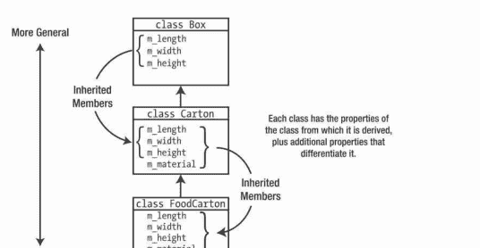

*图 14-1. 层次结构中的类*

Carton 类是 Box 类的扩展。你可以说 Carton 类*派生自* Box 类。类似地，FoodCarton 类派生自 Carton 类。通常用图示方式表示这种关系，即使用指向层次结构中更通用类的箭头。统一建模语言（UML）也使用这种表示法，它是可视化面向对象软件程序设计的实际标准方式。图14-1是一个简化的 UML 类图，并带有一些用于澄清的附加注释。

在根据另一个类来指定一个类时，你正在构建一个相互关联的类层次结构。一个类通过添加额外属性从另一个类派生而来——换句话说，通过*特殊化*——使新类成为更通用类的特殊化版本。在图14-1中，层次结构中的每个类都具有 Box 类的所有属性，这正好说明了类继承的机制。你可以完全独立地定义 Box、Carton 和 FoodCarton 类，但通过将它们定义为相互关联的类，你会获得巨大的收益。我们来看看这在实践中是如何运作的。

### 类中的继承

首先，我们将介绍用于相互关联类的术语。给定一个类 A，假设你创建一个新类 B，它是 A 的特殊化版本。类 A 是*基类*，类 B 是*派生类*。你可以把 A 看作“父”，把 B 看作“子”。基类有时被称为从其派生出的类的*超类*，而派生类是其基类的*子类*。派生类自动包含其基类的所有成员变量（有一些我们稍后讨论的限制），以及所有成员函数。派生类继承其基类的成员变量和成员函数。

如果类 B 是直接根据类 A 定义的派生类，那么类 A 是 B 的直接基类。类 B *派生自* A。在前面的示例中，Carton 类是 FoodCarton 的直接基类。因为 Carton 是根据 Box 类定义的，所以 Box 类是 FoodCarton 类的*间接基类*。FoodCarton 类的对象将拥有从 Carton 继承的成员，包括 Carton 类从 Box 类继承的成员。图14-2说明了派生类从基类继承成员的方式。

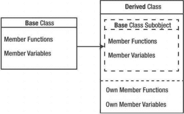

*图 14-2. 派生类从基类继承的成员*

如你所见，派生类拥有来自基类的一整套成员函数和变量，以及自己的成员函数和变量。因此，每个派生类对象都包含一个完整的基类子对象，以及自己的成员。

### 继承与聚合和组合

类继承不仅仅是一种让一个类的成员出现在另一个类中的手段。支撑整个概念的是一个重要理念：派生类应当是基类对象的合理特殊化。要判断在特定情况下是否如此，你可以应用 *是一个* 测试，即任何派生类对象都是一个基类对象。换句话说，派生类应定义基类所表示对象的一个子集。我们之前解释过，Dog 类可能派生自 Animal 类，因为狗是动物；更准确地说，Dog 对象是某一特定种类 Animal 对象的合理表示。另一方面，Table 类不应派生自 Dog 类。尽管 Table 和 Dog 对象有一个共同属性，即它们通常都有四条腿，但 Table 对象无论如何都不能真正被视为 Dog，反之亦然。

*是一个* 测试是一种很好的初步检查，但并非万无一失。例如，假设你定义一个 Bird 类，除其他内容外，它反映了大多数鸟会飞这一事实。现在，鸵鸟是鸟，但从 Bird 类派生 Ostrich 类是无意义的，因为鸵鸟不会飞！问题源于对 Bird 对象的定义不佳。你确实需要一个不把飞行能力作为属性的基类。然后你可以派生两个子类，一个用于会飞的鸟，另一个用于不会飞的鸟。如果你的类通过了 *是一个* 测试，你应该再检查一下：是否存在某些关于基类可以说（或可以要求基类具备）的内容，却不适用于派生类。如果存在，那么这种派生很可能不合理。从 Animal 派生 Dog 是合理的，但按我们描述的方式从 Bird 派生 Ostrich 则不合理。

如果类未通过 *是一个* 测试，那么你大概不应使用类派生。在这种情况下，你可以检查 *有一个* 测试。如果一个类对象包含另一个类的实例，则它通过 *有一个* 测试。你可以通过将第二个类的对象作为第一个类的成员变量包含进来，来满足这一点。我们之前提到的 Automobile 和 Engine 类就是一个例子。Automobile 对象会将 Engine 对象作为成员变量；它很可能还会将其他主要子装配体作为成员变量，其类型如 Transmission 和 Differential。这种关系称为聚合。

如果父对象中包含的子对象不能独立于其父对象而存在，则它们的关系称为组合而不是聚合。组合的一个例子是 House 和 Room 之间的关系（如果 Room 不能脱离 House 而存在）。如果删除一个 House，通常它的所有 Room 也会被删除。聚合的一个例子是 Class-Student 关系。如果学生的 Class 被取消，学生通常并不会不复存在。

当然，在类定义中包含什么合适取决于应用。有时，类派生只是用来汇集一组能力，使派生类成为包装给定函数集的外壳。即便如此，派生类通常表示一组以某种方式相关的函数。我们来看看从一个类派生另一个类的代码是什么样子。

### 派生类

下面是第13章中 Box 类的简化版本：

```cpp
// Box.cpp - defines Box class
export module box;

export class Box
{
public:
  Box() = default;
  Box(double length, double width, double height)
    : m_length{length}, m_width{width}, m_height{height}
  {}
};
```


```cpp
double volume() const { return m_length * m_width * m_height; }

// Accessors
double getLength() const { return m_length; }
double getWidth() const { return m_width; }
double getHeight() const { return m_height; }

private:
    double m_length {1.0};
    double m_width {1.0};
    double m_height {1.0};
};
```

我们可以基于这个 Box 类定义一个 Carton 类。Carton 对象将类似于 Box 对象，但多一个成员变量，用于指明它的制造材料。我们将把 Carton 定义为派生类，并使用 Box 类作为基类：

```cpp
// Carton.cppm - defines the Carton class with the Box class as base
export module carton;

import <string>;
import <string_view>;
import box;

export class Carton : public Box
{
public:
    explicit Carton(std::string_view material = "Cardboard")  // Constructor
        : m_material{material} {}

private:
    std::string m_material;
};
```

我们把这个新类放在一个名为 carton 的新模块中。必须导入 box 模块，因为该模块定义（并导出）Box 类，而 Box 是 Carton 的基类。Carton 类定义的第一行表明 Carton 确实派生自 Box。基类名跟在冒号之后，冒号将其与派生类名（此处为 Carton）分隔开。public 关键字是基类访问说明符，它决定 Box 的成员在 Carton 类内部可以如何被访问。稍后我们会进一步讨论这一点。

在其他方面，Carton 类的定义看起来与任何其他类一样。它包含一个新成员 m_material，由构造函数初始化。构造函数为描述 Carton 对象材料的字符串定义了默认值，因此它也是 Carton 类的默认构造函数。Carton 对象包含基类 Box 的所有成员变量，再加上额外的成员变量 m_material。由于 Carton 对象继承了 Box 对象的所有特征，所以 Carton 对象也是 Box 对象。Carton 类有一个明显的不足：它没有定义一个允许设置继承成员值的构造函数（也就是说，目前所有 Carton 的尺寸都将是 1×1×1）。但我们稍后会回到这一点。我们先通过一个示例看看这些类定义如何工作：

```cpp
// Ex18_01.cpp
// Defining and using a derived class
import <iostream>;
import box;
import carton;

int main()
{
  // Create a Box object and two Carton objects
  Box box {40.0, 30.0, 20.0};
  Carton carton;
  Carton chocolateCarton {"Solid bleached board"};  // Good old SBB
  // Check them out - sizes first of all
  std::cout << "box occupies " << sizeof box << " bytes" << std::endl;
  std::cout << "carton occupies " << sizeof carton << " bytes" << std::endl;
  std::cout << "chocolateCarton occupies " << sizeof chocolateCarton << " bytes" << std::endl;

  // Now volumes...
  std::cout << "box volume is " << box.volume() << std::endl;
  std::cout << "carton volume is " << carton.volume() << std::endl;
  std::cout << "chocolateCarton volume is " << chocolateCarton.volume() << std::endl;

  std::cout << "chocolateCarton length is " << chocolateCarton.getLength() << std::endl;

  // Uncomment any of the following for an error...
  // box.m_length = 10.0;
  // chocolateCarton.m_length = 10.0;
}
```

得到以下输出：

```text
box occupies 24 bytes
carton occupies 56 bytes
chocolateCarton occupies 56 bytes
box volume is 24000
carton volume is 1
chocolateCarton volume is 1
chocolateCarton length is 1
```

main() 函数创建了一个 Box 对象和两个 Carton 对象，并输出每个对象占用的字节数。输出结果符合预期——Carton 对象比 Box 对象大。Box 对象有三个 double 类型的成员变量，在几乎所有机器上每个变量占 8 字节，因此总共是 24 字节。两个 Carton 对象大小相同：56 字节。每个 Carton 对象额外占用的内存来自成员变量 m_material，也就是包含材料描述的 string 对象的大小。Carton 对象的体积输出表明，volume() 函数确实被 Carton 类继承，并且尺寸具有默认值 1.0。下一条语句表明，访问器函数也被继承，并且可以对派生类对象调用。

取消最后两条语句中任意一条的注释，都会导致编译器报错。Carton 类继承的成员变量在基类中是私有的，并且在派生类 Carton 中仍然是私有的，因此不能从类外部访问它们。不过还有更多问题。试着将下面这个函数作为公有成员添加到 Carton 类中：

```cpp
double cartonVolume() const { return m_length * m_width * m_height; }
```

这无法通过编译。原因是，虽然 Box 的成员变量被继承了，但它们是作为 Box 类的私有成员被继承的。private 访问说明符决定这些成员对该类完全私有。它们不仅不能从 Box 类外部访问，也不能从继承它们的类内部访问。

对派生类对象继承成员的访问权限，不仅取决于它们在基类中的访问说明，还取决于基类中的访问说明符以及派生类中基类的访问说明符。接下来我们会进一步讨论这一点。

## 类的受保护成员

基类的私有成员只能由基类的成员函数访问，至少可以说这很不方便。你常常希望基类的成员能在派生类内部访问，但仍然受到外部保护。除了类成员的 public 和 private 访问说明符之外，还可以把成员声明为 protected。在类内部，protected 关键字与 private 关键字的效果相同。protected 成员不能从类外部访问，除非通过已被指定为友元函数的函数来访问。不过，在派生类中情况会发生变化。基类中声明为 protected 的成员可以在派生类的成员函数中自由访问，而基类的 private 成员则不行。

我们可以修改 Box 类，使其成员变量为受保护的：

```cpp
class Box
{
public:
    // Rest of the class as before...

protected:
    double m_length {1.0};
    double m_width {1.0};
    double m_height {1.0};
};
```

Box 的成员变量仍然不能被普通全局函数访问，但现在可以在派生类的成员函数内部访问。

> **提示**  成员变量通常应始终为私有。前面的示例只是为了说明什么是可能的。一般来说，受保护的成员变量会引入与公有成员变量类似的问题，只是程度较轻。我们将在下一节中更详细地探讨这一点。

如果基类访问说明符是 public，那么继承成员的访问状态保持不变。通过使用 protected 和 private 基类访问说明符，你可以做两件事：

- 你可以阻止从派生类外部访问基类的公有成员——这两种说明符中的任意一种都可以做到。如果基类有公有成员函数，那么这是一个严重的步骤，因为基类的类接口在派生类中将从公有视图中移除。
- 你可以影响派生类的继承成员在另一个以该派生类为基类的类中如何被继承。

*图 14-5* 展示了基类的公有成员和受保护成员如何作为另一个派生类的受保护成员传递下去。私有继承的基类成员在任何进一步的派生类中都将无法访问。在大多数情况下，public 基类访问说明符最合适，同时将基类成员变量声明为 private 或 protected。在这种情况下，基类子对象的内部对于派生类对象来说是内部的，因此不属于派生类对象的公有接口。在实践中，由于派生类对象也是基类对象，你会希望基类接口在派生类中被继承，这意味着基类必须指定为 public。

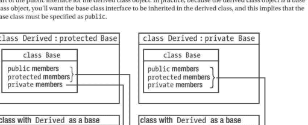

*图 14-5. 影响继承成员的访问说明符*

构造函数通常不会被继承，这是有充分理由的；但你将在本章后面看到如何使构造函数在派生类中被继承。

### 在类层次结构中选择访问说明符

定义类层次结构时，有两个方面需要考虑：每个类的成员的访问说明符，以及每个派生类中基类的访问说明符。类的公有成员定义了该类的外部接口，而该接口通常不应包含任何成员变量。事实上：


**提示** 作为规则，类的成员变量应始终为private。如果类外部代码需要访问成员变量，应添加public或protected的getter和/或setter函数。

（此实践不适用于结构体。结构体通常根本不定义任何成员函数；它们通常仅由一组公共成员变量组成。）

这一广泛接受的指导原则源于第12章解释的数据隐藏原则。如果你还记得，仅通过一组定义良好的接口函数来访问或修改成员变量至少有四个充分的理由。简要来说，这些理由如下：

- 数据隐藏允许你保持对象状态的完整性。
- 它减少了与外部代码的耦合和依赖，从而便于类内部表示或其接口函数的具体实现的演进和变更。
- 它允许你在每次访问和/或修改成员变量时注入额外的代码。除了有效性和安全性检查外，这还可以包括日志记录和调试代码，或者变更通知机制。
- 它便于调试，因为大多数开发环境支持在函数调用上设置所谓的调试断点。在getter和setter上设置断点可以更容易地跟踪哪些代码在何时读取或写入成员变量。

因此，大多数程序员遵守规则，始终避免使用公共成员变量。然而，经常被遗忘的是，protected成员变量与public成员变量有许多相同的缺点：

- 没有任何机制阻止派生类使对象状态失效，例如，这可能会使所谓的类不变量（对象状态应始终成立的属性）失效，而基类中的代码依赖于这些不变量。
- 一旦派生类直接操作基类的成员变量，在不更改所有派生类的情况下更改其内部实现就变得不可能。
- 如果派生类可以绕过基类中公共getter和setter函数添加的任何额外代码，这些代码将变得无效。
- 当成员变量被修改时，如果派生类可以直接访问它们，使用断点暂停调试会话至少会变得更加困难，而要在它们被读取时暂停则变得不可能。

因此，始终将成员变量设为private，除非你有充分的理由不这样做。

**注意** 为了保持代码示例简洁，我们在本书中有时会使用protected成员变量。不过，这种简写方式在专业质量的代码中没有立足之地。

不属于类公共接口的成员函数也不应从类外部直接访问，这意味着它们应该是private或protected。你为特定函数选择哪种访问说明符取决于你是否希望允许从派生类内部访问。如果是，则使用protected；否则，使用private。

## 更改继承成员的访问说明符

你可能希望将某个特定的基类成员从protected或private基类访问说明符的影响中豁免。通过示例更容易理解这一点。假设你在Ex14_01中从Box类派生Carton类，但将Box作为私有基类。所有从Box继承的成员现在在Carton中都是private，但你希望volume()函数在派生类中保持public，就像它在基类中一样。你可以通过using声明为某个在基类中为public的特定继承成员恢复public状态。

这本质上与命名空间的using声明相同。你可以通过如下定义Carton类来强制volume()函数在派生类中为public：

```cpp
class Carton : private Box
{
public:
    explicit Carton(std::string_view mat = "Cardboard") : m_material {mat} {}
    using Box::volume;        // Inherit as public
private:
    std::string m_material;
};
```

类定义定义了一个作用域，类定义中的using声明将一个名称引入该类作用域。成员访问说明符适用于using声明，因此volume名称被引入Carton类的public部分，从而覆盖了基类volume()成员的private基类访问说明符。该函数将在Carton类中作为public继承，而不是private。代码下载中的Ex14_01A演示了这一点。

这里有几个要点需要注意。首先，当你对基类成员的名称应用using声明时，必须使用基类名称限定该名称，因为这指定了成员名称的上下文。其次，注意你不需要为成员函数提供参数列表或返回类型——只需限定名称。这意味着重载函数总是一揽子出现的。第三，using声明同样适用于派生类中的继承成员变量。

你可以使用using声明来覆盖基类中原始的public或protected基类访问说明符。例如，如果volume()函数在Box基类中是protected，你可以通过Carton的public部分中的相同using声明使其在派生类Carton中成为public。然而，你不能应用using声明来放宽基类私有成员的访问说明符，因为私有成员无法在派生类中访问。

## 派生类中的构造函数

如果你在Ex14_01的Carton类和Box类的构造函数中添加输出语句并重新运行该示例，你将看到创建Carton对象时会发生什么。你需要定义默认的Box和Carton类构造函数以包含输出语句。创建每个Carton对象总是导致首先调用Box的默认构造函数，然后调用Carton类构造函数。

派生类对象总是以这种方式创建，即使存在多层派生。派生类的每个构造函数总是首先调用其基类的构造函数。然后该基类构造函数再调用其基类的构造函数，依此类推，直到到达不从任何其他类派生的类。结果是，第一个被完整求值的构造函数是最基类的构造函数，然后是派生自它的类的构造函数，依此类推，直到最后求值最派生类的构造函数。如果你仔细想想，这是有道理的。派生类对象内部包含一个完整的基类对象，并且需要在派生类对象的其余部分之前创建它。如果该基类又派生自另一个类，同样适用。

虽然在Ex14_01中，默认基类构造函数被自动调用，但情况并非必须如此。你可以在派生类构造函数的初始化列表中调用特定的基类构造函数。这将允许你使用默认构造函数之外的构造函数来初始化基类成员变量。它还允许你根据提供给派生类构造函数的数据选择特定的基类构造函数。让我们在另一个示例中看看它是如何工作的。

这是Box类的一个新版本：

```cpp
export class Box
{
public:
  // Constructors
  Box(double l, double w, double h) : m_length{l}, m_width{w}, m_height{h}
  { std::cout << "Box(double, double, double) called.\n"; }

  explicit Box(double side) : Box{side, side, side}
  { std::cout << "Box(double) called.\n"; }

  Box() { std::cout << "Box() called.\n"; }  // Default constructor

  double volume() const { return m_length * m_width * m_height; }

  // Accessors
  double getLength() const { return m_length; }
  double getWidth() const { return m_width; }
  double getHeight() const { return m_height; }

protected:
  double m_length {1.0};       // Protected to facilitate further examples
  double m_width {1.0};        // Later this chapter (should normally be private)
  double m_height {1.0};
};
```

现在有三个Box构造函数，它们在被调用时都会输出一条消息。operator<<()的定义与Ex14_01中相同。

Carton类如下所示：

```cpp
export class Carton : public Box
{
public:
  Carton() { std::cout << "Carton() called.\n"; }

  explicit Carton(std::string_view material) : m_material{material}
  { std::cout << "Carton(string_view) called.\n"; }

  Carton(double side, std::string_view material) : Box{side}, m_material{material}
  { std::cout << "Carton(double,string_view) called.\n"; }
};
```


```cpp
Carton(double l, double w, double h, std::string_view material)
    : Box{l, w, h, material}
    { std::cout << "Carton(double,double,double,string_view) called.\n"; }

private:
    std::string m_material {"Cardboard"};
};
```

这个类有四个构造函数，包括一个默认构造函数。你必须在这里定义它，因为如果你定义了任何构造函数，编译器就不会再提供默认构造函数。和往常一样，我们将单参数构造函数声明为 `explicit`，以避免不必要的隐式转换。

> **注意** 调用基类构造函数的语法与在构造函数中初始化成员变量的语法相同。这是完全一致的：本质上，你是用传递给 `Carton` 构造函数的参数来初始化 `Carton` 对象中的 `Box` 子对象。

下面是用来测试派生类 `Carton` 的代码：

```cpp
// Ex14_02.cpp
// Calling base class constructors in a derived class constructor
import <iostream>;
import carton;              // for the Carton class

int main()
{
    // Create four Carton objects
    Carton carton1;                         std::cout << std::endl;
    Carton carton2 {"White-chipboard"};    std::cout << std::endl;
    Carton carton3 {4.0, 5.0, 6.0, "PTE"}; std::cout << std::endl;
    Carton carton4 {2.0, "Folding boxboard"}; std::cout << std::endl;

    std::cout << "carton1 volume is " << carton1.volume() << std::endl;
    std::cout << "carton2 volume is " << carton2.volume() << std::endl;
    std::cout << "carton3 volume is " << carton3.volume() << std::endl;
    std::cout << "carton4 volume is " << carton4.volume() << std::endl;
}
```

输出如下：

```text
Box() called.
Carton() called.

Box() called.
Carton(string_view) called.

Box(double, double, double) called.
Carton(double,double,double,string_view) called.
Box(double, double, double) called.
Box(double) called.
Carton(double,string_view) called.

carton1 volume is 1
carton2 volume is 1
carton3 volume is 120
carton4 volume is 8
```

输出显示了在 `main()` 中创建的四个 `Carton` 对象分别调用了哪些构造函数：

- 创建第一个 `Carton` 对象 `carton1` 时，首先调用 `Box` 类的默认构造函数，然后调用 `Carton` 类的默认构造函数。
- 创建 `carton2` 时，先调用 `Box` 的默认构造函数，再调用带有 `string_view` 参数的 `Carton` 构造函数。
- 创建 `carton3` 对象时，先调用带三个参数的 `Box` 构造函数，再调用带四个参数的 `Carton` 构造函数。
- 创建 `carton4` 时，会导致两个 `Box` 构造函数被调用，因为 `Carton` 构造函数所调用的带单个 `double` 参数的 `Box` 构造函数，会在其初始化列表中调用带三个参数的 `Box` 构造函数。

这一切都与“构造函数按照从最基类到最派生类的顺序依次执行”的规则一致。每个派生类构造函数都会调用一个基类构造函数。如果用户定义的派生类构造函数没有在其初始化列表中显式调用基类构造函数，那么默认构造函数将被调用。

你绝不能在派生类构造函数的初始化列表中初始化基类的成员变量。即使这些成员是 `protected` 或 `public` 的也不行。例如，尝试将 Ex14_02 中第四个也是最后一个 `Carton` 构造函数替换为以下代码：

```cpp
// This constructor won't compile!
Carton::Carton(double l, double w, double h, std::string_view material)
    : m_length{l}, m_width{w}, m_height{h}, m_material{material}
{
    std::cout << "Carton(double,double,double,string_view) called.\n";
}
```

你可能会认为这能工作，因为 `m_length`、`m_width` 和 `m_height` 是公开继承的 `protected` 基类成员，因此 `Carton` 类构造函数应该可以访问它们。然而，编译器会报错说 `m_length`、`m_width` 和 `m_height` 不是 `Carton` 类的成员。即使你把 `Box` 类的成员变量设为 `public` 也是如此。如果你想显式地初始化继承来的成员变量，可以在派生类构造函数的初始化列表或函数体中进行。下面的构造函数定义可以编译：

```cpp
// Constructor that will compile
Carton::Carton(double l, double w, double h, std::string_view material)
    : m_material{material}
{
    m_length = l;   // These should normally be initialized in a base class constructor...
    m_width = w;
    m_height = h;
    std::cout << "Carton(double,double,double,string_view) called.\n";
}
```

这会产生以下输出：

```text
    Box(double, double, double) called.
    Carton(double,double,double,string_view) called.
    
    Box() called.
    Carton copy constructor
    
    Volume of carton is 24000
    Volume of cartonCopy is 1
```

一切并非如其所应。显然 `cartonCopy` 的体积与 `carton` 不同，但输出也说明了原因。要复制 `carton` 对象，你需要调用 `Carton` 类的复制构造函数。`Carton` 复制构造函数应该复制 `carton` 的 `Box` 子对象，为此它应该调用 `Box` 的复制构造函数。然而，输出清楚地表明实际调用的是 `Box` 的默认构造函数。

如果你不明确告诉 `Carton` 复制构造函数去调用 `Box` 复制构造函数，它就不会这么做。编译器知道它必须为 `carton` 对象创建一个 `Box` 子对象，但如果你不指定方式，编译器不会猜测你的意图——它只会创建一个默认的基类对象。

明显的解决方法是，在 `Carton` 复制构造函数的初始化列表中调用 `Box` 的复制构造函数。只需将复制构造函数的定义改为：

```cpp
    Carton(const Carton& carton) : Box{carton}, m_material{carton.m_material}
    { std::cout << "Carton copy constructor" << std::endl; }
```

`Box` 的复制构造函数以 `carton` 对象作为参数被调用。`carton` 对象的类型是 `Carton`，但它也是一个完全合格的 `Box` 对象。`Box` 类复制构造函数的参数是 `Box` 对象的引用，因此编译器会将 `carton` 以 `Box&` 类型传递，这会导致只将 `carton` 的基类部分传递给 `Box` 的复制构造函数。如果你再次编译并运行该示例，输出将如下：

```text
    Box(double, double, double) called.
    Carton(double,double,double,string_view) called.
    
    Box copy constructor
    Carton copy constructor
    
    Volume of carton is 24000
    Volume of cartonCopy is 24000
```

输出表明构造函数按正确的顺序被调用。特别是，`Box` 的复制构造函数在进入 `Carton` 复制构造函数体之前初始化了 `carton` 的 `Box` 子对象。作为验证，你可以看到 `carton` 和 `cartonCopy` 对象的体积现在完全相同。

## 派生类中的默认构造函数

你知道，如果你为一个类定义了一个或多个构造函数，编译器就不会再提供默认构造函数。你还知道，你可以使用 `default` 关键字让编译器在任何情况下都插入一个默认构造函数。你可以将 Ex14_02 中 `Carton` 类定义的默认构造函数替换为以下语句：

```cpp
Carton() = default;
```

现在编译器将提供一个定义，即使你已经定义了其他构造函数。编译器为派生类提供的定义会调用基类的构造函数，因此它看起来像这样：

```cpp
Carton() : Box{} {};
```

如果基类没有非私有的默认构造函数，或者其默认构造函数被删除（无论是隐式删除还是使用 `= delete` 显式删除），那么派生类的默认默认构造函数应被隐式删除。换句话说，在派生类中添加 `= default` 与添加 `= delete` 的效果相同。

为了演示这一点，你可以执行以下步骤。从 Ex14_02 开始。首先，将 `Carton` 类的默认构造函数替换为 `Carton() = default;`（如前所述），并移除 `Carton` 接受 `string_view` 的显式构造函数（该构造函数也依赖于 `Box` 的默认构造函数）。接下来，删除 `main()` 程序中调用后一个构造函数的行，但务必保留默认构造 `Carton` 的那一行。之后，你可以通过以下三种方式之一修改 `Box` 类的默认构造函数：要么将其移除，要么将其替换为 `Box() = delete;`，要么将其设为私有。无论如何，`Carton` 类和 `Carton` 模块都将继续正常编译（即使有了默认的默认构造函数），但 `main()` 函数中 `Carton` 的默认构造将导致编译错误。该错误通常应告知你，`Carton` 的默认默认构造函数确实是被隐式删除的。

本节讨论的 Ex14_02 的不同变体可在线获取，分别为 Ex14_04、Ex14_04A、Ex14_04B 和 Ex14_04C。

## 继承构造函数

基类构造函数通常不会在派生类中被继承。这是因为派生类通常有需要初始化的额外成员变量，而基类构造函数对这些变量一无所知。然而，你可以通过在派生类中放置一个 `using` 声明，使构造函数从直接基类继承。下面是一个如何让 Ex14_02 中 `Carton` 类的一个版本继承 `Box` 类构造函数的方法：

```cpp
class Carton : public Box
{
    using Box::Box; // Inherit Box class constructors

public:
    Carton(double length, double width, double height, std::string_view mat)
        : Box{length, width, height}, m_material{mat}
    { std::cout << "Carton(double,double,double,string_view) called.\n"; }

private:
    std::string m_material {"Cardboard"};
};
```


如果 Box 类定义与 Ex14_02 中相同，Carton 类将继承两个构造函数：`Box(double, double, double)` 和 `Box(double)`。派生类中的构造函数将如下所示：

```cpp
Carton(double length, double width, double height) : Box {length, width, height} {}
explicit Carton(double side) : Box(side) {}
Carton() : Box() {}
```

每个继承的构造函数都具有与基类构造函数相同的参数列表，并在其初始化列表中调用基类构造函数。每个构造函数的主体均为空。如 Carton 类示例所示，你可以向从直接基类继承构造函数的派生类中添加更多构造函数。

与常规成员函数不同，非私有构造函数始终使用与基类中对应构造函数相同的访问说明符来继承。因此，尽管 using `Box::Box` 声明位于 Carton 类的隐式私有部分中，但从 Box 继承的构造函数都是公有的。如果 Box 类具有受保护构造函数，那么这些构造函数也会在 Carton 中作为受保护构造函数被继承。

> **注意** 你可以将构造函数继承声明放在类定义中的任何位置。实际上，为了清晰起见，你通常会将其放在类定义的公有部分。我们把 Carton 类的该声明放在其隐式私有部分的唯一原因，是为了说明此类声明的位置不会影响继承构造函数的访问说明符。

你可以尝试修改 Ex14_02，在 `main()` 中创建以下对象：

```cpp
Carton cart;                                  // Calls inherited default constructor
Carton cube { 4.0 };                           // Calls inherited constructor
Carton copy { cube };                           // Calls default copy constructor
Carton carton {1.0, 2.0, 3.0};                  // Calls inherited constructor
Carton cerealCarton (50.0, 30.0, 20.0, "Chipboard"); // Calls Carton class constructor
```

最终程序可在线获取，名为 Ex14_05。Box 构造函数中的输出语句将表明，在调用继承的构造函数时，它们确实会被调用。

## 继承下的析构函数

销毁派生类对象会同时涉及派生类析构函数和基类析构函数。你可以通过在 Box 和 Carton 类定义中添加带输出语句的析构函数来演示这一点。你可以在正确版本的 Ex14_03 中修改类定义。向 Box 类添加析构函数定义：

```cpp
// Destructor
~Box() { std::cout << "Box destructor" << std::endl; }
```

对于 Carton 类：

```cpp
// Destructor
~Carton() { std::cout << "Carton destructor. Material = " << m_material << std::endl; }
```

当然，如果这些类分配了自由存储区内存并将地址存储在原始指针中，那么定义类析构函数对于避免内存泄漏至关重要。Carton 析构函数会输出材料，因此你可以通过给每个对象分配不同的材料来判断正在销毁的是哪个 Carton 对象。让我们看看这些类的行为：

```cpp
// Ex14_06.cpp
// Destructors in a class hierarchy
import <iostream>;
import carton;   // For the Carton class

int main()
{
    Carton carton;
    Carton candyCarton(50.0, 30.0, 20.0, "SBB");   // Solid bleached board

    std::cout << "carton volume is " << carton.volume() << std::endl;
    std::cout << "candyCarton volume is " << candyCarton.volume() << std::endl;
}
```

以下是输出：

```text
Box() called.
Carton() called.
Box(double, double, double) called.
Carton(double,double,double,string_view) called.
carton volume is 1
candyCarton volume is 30000
Carton destructor. Material = SBB
Box destructor.
Carton destructor. Material = Cardboard
Box destructor.
```

本练习的重点是观察析构函数的行为。析构函数调用产生的输出表明了对象销毁方式的两个方面。首先，你可以看到特定对象的析构函数调用顺序；其次，你可以看到对象的销毁顺序。输出中记录的析构函数调用对应以下操作：

| 析构函数输出 | 被销毁的对象 |
|---|---|
| Carton 析构函数。Material = SBB。 | candyCarton 对象 |
| Box 析构函数。 | candyCarton 的 Box 子对象 |
| Carton 析构函数。Material = Cardboard。 | carton 对象 |
| Box 析构函数。 | carton 的 Box 子对象 |

这表明，构成派生类对象的各个对象会按创建顺序的逆序销毁。carton 对象最先创建、最后销毁；candyCarton 对象最后创建、最先销毁。选择这种顺序是为了确保你永远不会得到一个处于非法状态的对象。一个对象只有在其定义之后才能被使用——这意味着任何给定对象只能包含指向（或引用）已创建对象的指针（或引用）。通过在某个对象可能指向（或引用）的任何对象*之前*销毁该对象，你可以确保析构函数的执行不会产生任何无效指针或引用。

### 析构函数的调用顺序

派生类对象的析构函数调用顺序与该对象的构造函数调用顺序相反。首先调用派生类析构函数，然后调用基类析构函数，正如示例所示。图 14-6 展示了三级类层次结构的情况。

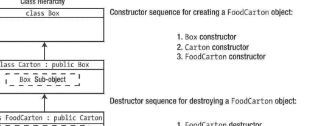

*图 14-6. 派生类对象的析构函数调用顺序*

对于具有多个派生层次的对象，这种析构函数调用顺序会贯穿整个类层次结构，从最派生类的析构函数开始，到最基类的析构函数结束。

### 重复的成员变量名

基类和派生类可能各自都有一个同名成员变量。如果你真的很不走运，甚至可能在基类和间接基类中出现重复名称。当然，这很令人困惑，你绝不应该故意在自己的类中制造这种安排。然而，环境或疏忽可能导致事情变成这样。那么，如果基类和派生类中的成员变量同名，会发生什么？

如果你想访问它，可在派生类中使用 using 声明。然后，任一函数都可以对派生类对象调用，如图 14-7 所示。

```cpp
class Base
{
public:
    void doThat(int arg);
};
...
```

默认情况下，派生类函数 `doThat()` 会隐藏同名的继承函数。using 声明将基类函数名 `doThat` 引入派生类作用域，因此函数的两个版本在派生类中都可用。编译器可以在派生类中区分它们，因为它们具有不同的签名。

```cpp
class Derived : public Base
{
public:
    void doThat(double arg);
    using Base::doThat;
    ...
};
```

```cpp
Derived object;
object.doThat(2);       // Call inherited base function
object.doThat(2.5);     // Call derived function
```

*图 14-7. 继承与成员函数同名的函数*

第二种可能性是两个函数具有相同的函数签名。你仍然可以通过使用类名限定基类函数来区分继承函数和派生类函数：

```cpp
Derived object;            // Object declaration
object.Base::doThat(3);    // Call base version of the function
```

后一种情况还有更多内容，我们在此无法讨论。这个主题与*函数重写*密切相关，而函数重写又与多态密切相关。我们将在下一章更深入地探讨这一点。

## 多重继承

到目前为止，你的派生类都是从单个直接基类派生而来的。然而，你并不局限于这种结构。一个派生类可以根据应用程序需要拥有任意多个直接基类。这称为*多重继承*，与只使用单个基类的*单继承*相对。这为继承开启了巨大的潜在复杂性维度，也许这就是多重继承的使用频率远低于单继承的原因。由于复杂性，最好审慎使用它。我们只解释多重继承工作原理背后的基本概念。

### 多个基类

多重继承涉及使用两个或多个基类来派生一个新类，因此事情立刻变得更加复杂。派生类是其基类的特化这一概念，在这种情况下导致这样一种观念：派生类定义的对象同时是两个或多个不同且独立的类类型的特化。在实践中，多重继承很少以这种方式使用。更常见的是，多个基类用于将基类的特性组合在一起，形成复合对象。


包含其基类的功能，有时被称为*混入*编程。这通常是为了实现上的便利，而不是为了反映对象之间的任何特定关系。例如，你可能会考虑某种编程接口——也许用于图形编程。一个全面的接口可以打包在一组类中，每个类定义了一个自包含的接口，提供某种特定功能，比如绘制二维形状。然后你可以使用其中几个类作为新类的基类，从而为应用程序提供你恰好需要的一组功能。

为了探讨多重继承的一些影响，我们将从一个包含 Box 和 Carton 类的层次结构开始。假设你需要一个表示食品包装（例如一盒麦片）的类。可以通过单一继承来实现，从 Carton 类派生一个新类，并添加一个成员变量来表示内容物（类似于图 14-1 所示），但你也可以使用图 14-8 所示的层次结构来实现。

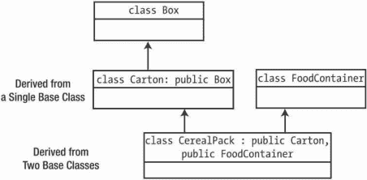

*图 14-8：多重继承的示例*

CerealPack 类的定义如下：

```cpp
class CerealPack : public Carton, public FoodContainer
{
    // Details of the class...
};
```

每个基类在类头中冒号后指定，基类之间用逗号分隔。每个基类都有自己的访问说明符，如果省略访问说明符，则默认为 private，这与单一继承相同。CerealPack 类将继承两个基类的所有成员，因此这将包括间接基类 Box 的成员。与单一继承的情况一样，每个继承成员的访问级别由两个因素决定：成员在基类中的访问说明符和基类访问说明符。CerealPack 对象拥有两个子对象：一个 FoodContainer 子对象和一个 Carton 子对象，后者又有一个 Box 类型的子对象。

### 继承成员歧义

多重继承可能会产生问题。我们将构建一个示例，以展示你可能遇到的各种复杂情况。Box 类与 Ex14_02 中的相同，但我们将稍微扩展该示例中的 Carton 类：

```cpp
export class Carton : public Box
{
public:
   // Same 4 constructors from Ex14_02 (all containing output statements)…

   // One new constructor
   Carton(double l, double w, double h, std::string_view m, double density, double thickness)
      : Carton{l, w, h, m}
   {
      m_thickness = thickness; m_density = density;
      std::cout << "Carton(double,double,double,string_view,double,double) called.\n";
   }

   // Copy constructor
   Carton(const Carton& carton) : Box{carton}, m_material{carton.m_material},
      m_thickness{carton.m_thickness}, m_density{carton.m_density}
   {
      std::cout << "Carton copy constructor" << std::endl;
   }

   // Destructor
   ~Carton()
   {
      std::cout << "Carton destructor. Material = " << m_material << std::endl;
   }

   double getWeight() const
   {
      return 2.0 * (m_length * m_width + m_width * m_height + m_height * m_length)
         * m_thickness * m_density;
   }

private:
   std::string m_material {"Cardboard"};
   double m_thickness {0.125};     // Material thickness in inch
   double m_density {0.2};         // Material density in pounds/cubic inch
};
```

我们添加了两个成员变量，用于记录制作 Carton 对象的材料的厚度和密度；添加了一个新的构造函数，允许设置所有成员变量；还添加了一个新的成员函数 getWeight()，用于计算空 Carton 对象的重量。新的构造函数在其初始化列表中调用了另一个 Carton 类构造函数，因此它是一个委托构造函数，正如你在第 12 章中看到的。委托构造函数不能再有更多的初始化器，因此 m_density 和 m_thickness 的值必须在构造函数体内设置。

# 第 14 章：继承

FoodContainer 类将描述可装在纸箱中的食品（例如早餐麦片）的相关属性。该类将具有成员变量，分别存储内容物的名称、体积和密度。下面是从一个恰如其分地命名为 food 的模块中公开的类定义：

```cpp
// food.cpp - The FoodContainer class
export module food;
import <string>;
import <string_view>;
import <iostream>;

export class FoodContainer
{
public:
    FoodContainer() { std::cout << "FoodContainer() called.\n"; }

    FoodContainer(std::string_view name) : name {name}
    { std::cout << "FoodContainer(string_view) called.\n"; }

    FoodContainer(std::string_view name, double density, double volume)
        : name {name}, density {density}, volume {volume}
    { std::cout << "FoodContainer(string_view,double,double) called.\n"; }

    ~FoodContainer() { std::cout << "FoodContainer destructor" << std::endl; }

    double getWeight() const { return volume * density; }

private:
    std::string name {"cereal"}; // Food type
    double volume {};             // Cubic inches
    double density {0.03};        // Pounds per cubic inch
};
```

除了构造函数和析构函数之外，该类还有一个公共成员函数 getWeight()，用于计算内容物的重量。

请注意，我们故意没有遵循通常的约定，即所有成员变量的名称都添加 m_ 前缀。我们这样做是为了说明一些潜在问题。你可能已经注意到，FoodContainer 构造函数中的两个成员初始化列表是如何用与这些成员变量完全同名的参数值来初始化它们的。这也只是为了说明这是可能的——这绝不是一种推荐的做法！

我们将定义 CerealPack 类，以 Carton 和 FoodContainer 类作为公共基类：

```cpp
// cereal.cpp - Class defining a carton of cereal
export module cereal;
import <iostream>;
import carton;
import food;

export class CerealPack : public Carton, public FoodContainer
{
public:
  CerealPack(double length, double width, double height, std::string_view cerealType)
    : Carton {length, width, height, "Chipboard"}, FoodContainer {cerealType}
  {
    std::cout << "CerealPack constructor" << std::endl;
    FoodContainer::volume = 0.9 * Carton::volume();  // Set food container's volume
  }

  ~CerealPack()
  {
    std::cout << "CerealPack destructor" << std::endl;
  }
};
```

该类继承自 Carton 和 FoodContainer 类。构造函数仅需要外部尺寸和麦片类型。Carton 对象的材料在初始化列表中的 Carton 构造函数调用中设置。CerealPack 对象将包含对应于两个基类的两个子对象。每个子对象都通过 CerealPack 构造函数初始化列表中的构造函数调用进行初始化。请注意，FoodContainer 类的 volume 成员变量默认为零，因此，在 CerealPack 构造函数体内，该值是根据纸箱的大小计算得出的。对从 FoodContainer 类继承的 volume 成员变量的引用必须在此处加以限定，因为它与通过 Carton 从 Box 继承的函数的名称相同。你可以通过此处和其他类中的输出语句跟踪构造函数和析构函数的调用顺序。

现在我们尝试创建一个 CerealPack 对象，并用以下简单程序计算其体积和重量：

```cpp
// Ex14_07 - doesn't compile!
// Using multiple inheritance
#include <iostream>
import cereal;       // For the CerealPack class

int main()
{
  CerealPack cornflakes {8.0, 3.0, 10.0, "Cornflakes"};

  std::cout << "cornflakes volume is " << cornflakes.volume() << std::endl
            << "cornflakes weight is " << cornflakes.getWeight() << std::endl;
}
```

不幸的是，这里有一个问题。程序无法编译。困难在于我们愚蠢地在基类中使用了一些不唯一的函数名。volume 这个名字既作为函数从 Box 继承，又作为成员变量从 FoodContainer 继承；而 getWeight() 函数在 CerealPack 类中既从 Carton 继承，又从 FoodContainer 继承。因此这里存在不止一个歧义问题。


当然，在编写用于继承的类时，首先应避免成员名称重复。该问题的理想解决方案是重写你的类。如果你无法重写这些类——例如，基类来自某种库——那么你将不得不在 main() 中限定函数名。你可以修改 main() 中的输出语句，使代码能够工作：

```cpp
std::cout << "cornflakes volume is " << cornflakes.Carton::volume() << std::endl
          << "cornflakes weight is " << cornflakes.FoodContainer::getWeight()
          << std::endl;
```

经过这一修改，程序将能够编译和运行，并产生以下输出：

```text
Box(double, double, double) called.
Carton(double,double,double,double,string_view) called.
FoodContainer(string_view) called.
CerealPack constructor
cornflakes volume is 240
cornflakes weight is 6.48
CerealPack destructor
FoodContainer destructor
Carton destructor. Material = Chipboard
Box destructor
```

从输出中可以看出，这种麦片将为你的一天提供扎实的开端——单包重量超过六磅。你还可以看到，构造函数和析构函数的调用顺序与单继承情境中的模式相同：构造函数从最基类到最派生类沿层次结构向下执行，而析构函数按相反顺序执行。CerealPack 对象拥有来自其继承链两条分支的子对象，并且这些子对象的所有构造函数都参与了 CerealPack 对象的创建。

使 Ex14_07 编译通过的另一种方法是，向任一基类的引用添加强制转换（我们转换为引用而不是类类型本身，以避免创建新对象）：

```cpp
std::cout << "cornflakes volume is " << static_cast<Carton&>(cornflakes).volume()
          << std::endl
          << "cornflakes weight is " << static_cast<FoodContainer&>(cornflakes).getWeight()
          << std::endl;
```

按照这种方式实现的可运行版本位于代码下载中的 Ex14_07A。

然而，显然非常不方便的是，我们当前 CerealPack 类的用户总是必须使用这些笨拙的变通方法来消除 volume() 和 getWeight() 成员的歧义。幸运的是，即使不能重命名成员（无论出于何种原因），你也可以防止这种情况发生。using 关键字允许你一劳永逸地明确指定：CerealPack 的 volume 应始终使用 Carton 的 volume() 成员计算，而其 weight 应使用 FoodContainer 的 getWeight() 成员计算。于是 CerealPack 类的定义变成如下所示（见 Ex14_07B）：

```cpp
export class CerealPack : public Carton, public FoodContainer
{
public:
  // Constructor and destructor as before...
  using Carton::volume;
  using FoodContainer::getWeight;
};
```

在本章前面，你遇到过 using 关键字的类似用法，用于从基类继承构造函数。在这种情况下，你用它来挑选多重继承的成员函数需要从哪个基类继承。现在，CerealPack 的用户——或者更常见的说法，吃早餐的人——可以简单地写成这样：

```cpp
std::cout << "cornflakes volume is " << cornflakes.volume() << std::endl
          << "cornflakes weight is " << cornflakes.getWeight() << std::endl;
```

显然，当对于应使用哪个多重继承成员有明确答案时，最后一种选择是首选。如果你已经在类定义中消除了继承歧义，就可以让你的类的用户免于应对原本必定会出现的编译器错误的麻烦。

## 重复继承

前面的示例演示了当基类的成员名称重复时，歧义会如何产生。另一种歧义可能在多重继承中出现：派生对象包含某个基类子对象的多个版本。你不能将同一个类作为直接基类使用多次，但最终可能会重复一个间接基类。假设 Ex14_07 中的 Box 和 FoodContainer 类本身派生自一个名为 Common 的类。图 14-9 显示了所创建的类层次结构。

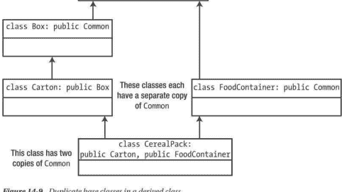

*图 14-9.* 派生类中重复的基类

CerealPack 类继承 FoodContainer 和 Carton 两个类的所有成员。Carton 类继承 Box 类的所有成员，而 Box 和 FoodContainer 两个类都继承 Common 类的成员。因此，如图 14-9 所示，Common 类在 CerealPack 类中重复。这对 CerealPack 类型对象的影响是：每个 CerealPack 对象都会有两个 Common 类型的子对象。这种重复继承所产生的复杂情况和歧义通常被称为*菱形问题*——得名于图 14-9 这类继承图的形状。

可以想象，你实际上可能希望允许 Common 类重复。在这种情况下，你必须限定对 Common 类成员的每一次引用，以便编译器能够判断在特定实例中你引用的是哪个继承成员。你可以使用 Carton 和 FoodContainer 类名作为限定符，因为这两个类各自包含一个唯一的 Common 类型子对象。当然，在创建 CerealPack 对象时若要调用 Common 类的构造函数，你也需要使用限定符来指定正在初始化的是两个基类对象中的哪一个。

不过，更常见的情况是，你希望防止基类重复，因此让我们看看如何做到这一点。

## 虚基类

为了避免基类重复，你必须向编译器指明该基类在派生类中只应出现一次。你可以通过使用 `virtual` 关键字将该类指定为*虚基类*来做到这一点。FoodContainer 类将定义如下：

```cpp
export class FoodContainer : public virtual Common
{
  ...
};
```

Box 类也将使用虚基类定义：

```cpp
export class Box : public virtual Common
{
  ...
};
```

现在，任何将 FoodContainer 和 Box 类用作直接或间接基类的类，都会像往常一样继承这些基类的其他成员，但只会继承 Common 类的一个实例。派生类 CerealPack 将只继承 Common 类的一个实例。由于 Common 的成员在 CerealPack 类中没有重复，因此在派生类中引用这些成员时无需限定成员名称。

## 在相关类类型之间转换

每个派生类对象内部都有一个基类对象等待“脱出”。从派生类型到其基类的转换始终合法且自动。下面是 Carton 对象的定义：

```cpp
Carton carton{40, 50, 60, "Corrugated fiberboard"};
```

我们已经看到这个对象可以通过两种方式转换为 Box 类型的基类对象。第一种是通过复制构造函数：

```cpp
Box box{carton};
```

第二种是复制赋值：

```cpp
Box box;
box = carton;
```

两者都会将 carton 对象转换为新的 Box 类型对象，并将其副本存储在 box 中。所使用的赋值运算符是 Box 类的默认赋值运算符。当然，只使用 carton 中 Box 子对象的那部分；Box 对象没有空间容纳 Carton 特有的成员变量。这种效应称为对象切片，可以这么说，Carton 对象特有的部分被切掉并丢弃。

> **警告** 对象切片通常是需要提防的，因为当你并不希望派生类对象的派生成员被切掉时，它可能发生。在下一章中，你将学习一种机制，它允许使用指向基类对象的指针或引用来工作，同时保留派生类的成员甚至行为。

只要没有歧义，沿类层次结构向上转换（即朝向基类）就是合法且自动的。当两个基类各自具有相同类型的子对象时，就可能产生歧义。例如，如果你使用包含两个 Common 子对象的 CerealPack 类定义（如上一节所见），并初始化一个 CerealPack 对象 cornflakes，那么下面的代码将有歧义：

```cpp
Common common{cornflakes};
```

编译器将无法确定 cornflakes 的转换应指向 Carton 的 Common 子对象，还是 FoodContainer 的 Common 子对象。这里的解决方案是将 cornflakes 转换为 Carton& 或 FoodContainer&。下面是一个示例：

```cpp
Common common{static_cast<Carton&>(cornflakes)};
```

你无法获得沿类层次结构向下（即朝向更专门的类）的对象自动转换。Box 对象不包含任何可能派生自 Box 的类类型的信息，因此这种转换没有合理的解释。

## 小结

在本章中，你学习了如何基于一个或多个现有类定义类，以及类继承如何决定派生类的组成。继承是面向对象编程的基本特征，并使多态成为可能（多态是下一章的主题）。本章需要掌握的重点包括以下内容：

- 一个类可以派生自一个或多个基类，在这种情况下，派生类继承其所有基类的成员。
- 单继承涉及从一个基类派生类。多重继承涉及从两个或更多基类派生类。
- 对派生类继承成员的访问由两个因素控制：成员在基类中的访问说明符，以及基类在派生类声明中的访问说明符。


# 第 14 章：继承

- 派生类的构造函数负责初始化该类的所有成员。这通常涉及调用基类的构造函数来初始化所有继承的成员。
- 创建派生类对象总是会涉及所有直接基类和间接基类的构造函数，这些构造函数在派生类构造函数执行之前按顺序调用（从最基类到最直接基类）。
- 派生类构造函数可以并且通常应该在其构造函数的初始化列表中显式调用其直接基类的构造函数。如果没有显式调用，则会调用基类的默认构造函数。例如，派生类中的拷贝构造函数应始终调用所有直接基类的拷贝构造函数。
- 在派生类中声明的成员名如果与继承的成员名相同，将隐藏该继承成员。要访问被隐藏的成员，应使用作用域解析运算符用其类名限定成员名。
- 你不仅可以将访问说明符用于类型，还可以用于继承构造函数（始终使用与基类中相同的访问说明符）、修改其他继承成员的访问说明符，或继承那些原本会被派生类中同名但签名不同的函数隐藏的函数。
- 当具有两个或更多直接基类的派生类包含两个或更多同一类的继承子对象时，可以通过将重复的类声明为虚基类来防止重复。

## 练习

以下练习让你尝试本章所学内容。如果遇到困难，请回顾本章以寻求帮助。如果仍然卡住，你可以从 Apress 网站（www.apress.com/source-code）下载解决方案，但这确实应该是最后的手段。

- 练习 14-1。定义一个名为 Animal 的基类，其中包含两个私有成员变量：一个用于存储动物名称的 string（例如 “Fido” 或 “Yogi”），以及一个名为 m_weight 的整数成员，用于存储动物的体重（磅）。还要包含一个公共成员函数 who()，它输出一条给出 Animal 对象名称和体重的消息。派生两个类，分别名为 Lion 和 Aardvark，以 Animal 作为公共基类。编写一个 main() 函数来创建 Lion 和 Aardvark 对象（例如 “Leo” 重 400 磅，“Algernon” 重 300 磅），并通过对派生类对象调用 who() 成员来证明 who() 成员在两个派生类中都被继承。
- 练习 14-2。将 Animal 类中 who() 函数的访问说明符改为 protected，但类的其余部分保持原样。现在修改派生类，使原版本的 main() 仍然无需改动即可工作。
- 练习 14-3。在前一个练习的解决方案中，将基类 who() 成员的访问说明符改回 public，并在每个派生类中将 who() 函数实现为成员函数，使输出消息还能标识类的名称。修改 main()，对每个派生类对象分别调用基类版本和派生类版本的 who()。
- 练习 14-4。定义一个 Person 类，包含用于存储人员年龄、姓名和性别的成员变量。从 Person 派生一个 Employee 类，添加一个用于存储人员编号的成员变量。从 Employee 派生一个 Executive 类。每个派生类都应定义一个成员函数 who()，用于显示关于自身是什么的信息。在这个练习中要仔细考虑适当的数据隐藏和访问说明符。在这个特定应用中，隐私方面的考虑禁止暴露个人详细信息，除非是对象的 who() 成员所打印的信息。每个类可以明确决定在那里公开什么。（姓名和类型即可——类似“Fred Smith is an Employee.”）此外，也不允许人们更改姓名或性别，但允许他们变老并过生日。编写一个 main() 函数，生成一个包含五名高管的 vector 和一个包含五名普通员工的 vector，并显示有关他们的信息。此外，通过调用从 Employee 类继承的成员函数来显示有关高管的信息。

```cpp
CerealPack cereal;

// You can store the address of
// the cereal object
// in any base class pointer:

Carton* pCarton (&cereal);
Box* pBox (&cereal);
FoodContainer* pFood (&cereal);

// You can store the address of
// a Carton object in a base pointer

Carton carton;
pBox = &carton;
```

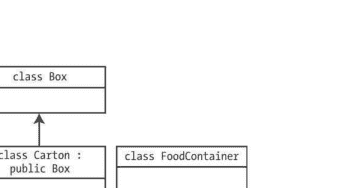

**图 15-1.** *将派生类对象的地址存储在基类指针中*

反过来则不成立。例如，你不能使用 Carton* 类型的指针来存储 Box 类型对象的地址。这是合乎逻辑的，因为指针类型包含了它可以指向的对象的类型。派生类对象是其基类的特化——它是一个基类对象——因此使用指向基类的指针来存储其地址是合理的。然而，基类对象绝对不是派生类对象，所以指向派生类类型的指针不能指向它。派生类总是包含其每个基类的完整子对象，但每个基类只代表派生类对象的一部分。

我们来看一个具体示例。假设你从 Box 类派生出两个类，分别表示不同种类的容器：Carton 和 ToughPack。再假设这两个派生类型的体积计算方式不同。对于由纸板制成的 Carton，你可能只需稍微减小体积以考虑材料厚度。对于 ToughPack 对象，你可能需要大幅减少可用体积，以留出保护性包装的空间。Carton 类的定义可以如下所示：

```cpp
class Carton : public Box
{
public:
  double volume() const;

  // Details of the class...
};
```

ToughPack 类可以有类似定义：

```cpp
class ToughPack : public Box
{
public:
  double volume() const;

  // Details of the class...
};
```

给定这些类定义（函数定义稍后给出），你可以如下声明并初始化一个指针：

```cpp
Carton carton {10.0, 10.0, 5.0};
Box* box {&carton};
```

指针 box 的类型为指向 Box 的指针，已用 carton 的地址初始化。这是可行的，因为 Carton 派生自 Box，因此包含一个 Box 类型的子对象。你可以使用同一个指针存储 ToughPack 对象的地址，因为 ToughPack 类也派生自 Box：

```cpp
ToughPack hardcase {12.0, 8.0, 4.0};
box = &hardcase;
```

box 指针可以包含任何以 Box 为基类的类的任何对象的地址。指针的类型 Box* 称为其静态类型。由于 box 是指向基类的指针，它还具有动态类型，该类型根据它所指向的对象的类型而变化。当 box 指向 Carton 对象时，其动态类型是指向 Carton 的指针。当 box 指向 ToughPack 对象时，其动态类型是指向 ToughPack 的指针。当 box 指向 Box 类型的对象时，其动态类型与其静态类型相同。多态的魔力正源于此。在我们稍后解释的条件下，你可以使用 box 指针调用一个在基类和每个派生类中都定义的函数，并让实际调用的函数在运行时根据 box 的动态类型来选择。考虑以下语句：

```cpp
double volume = box->volume();    // Store volume of the object pointed to
```

如果 box 包含 Carton 对象的地址，那么这条语句会调用 Carton 对象的 volume()。如果它指向 ToughPack 对象，那么这条语句会调用 ToughPack 的 volume()。对于任何派生自 Box 的类，只要满足上述条件，这都有效。如果满足条件，表达式 box->volume() 可以根据 box 所指向的对象产生不同的行为。也许更重要的是，适合 box 所指向对象的行为会在运行时自动选择。

多态是一种强大的机制。经常会出现无法预先确定对象具体类型的情况——无论是在设计时还是编译时。换句话说，有些情况下类型只能在运行时确定。使用多态可以轻松处理这种情况。多态通常用于交互式应用程序，其中输入类型取决于用户的喜好。例如，一个允许绘制不同形状——圆形、直线、曲线等——的图形应用程序，可以为每种形状类型定义一个派生类，而这些类都有一个名为 Shape 的公共基类。程序可以将用户创建的对象的地址存储在类型为 Shape* 的指针 shape 中，并用诸如 shape->draw() 的语句绘制该形状。这会调用所指向形状的 draw() 函数，因此这一个表达式可以绘制任何类型的形状。让我们更深入地了解继承函数的行为。

## 调用继承的函数

在我们进入多态的具体细节之前，需要进一步解释继承成员函数的行为。为帮助说明，我们将修改 Box 类，在熟悉的计算 Box 对象体积的函数旁边，加入一个显示结果体积的函数。类定义的新版本如下（关于模块分区的说明稍后给出）：

```cpp
// Box.cppm: module partition interface file for the box partition of the boxes module
export module boxes:box;
```


```cpp
import <iostream>;

export class Box
{
public:
  Box() : Box{1.0, 1.0, 1.0} {}
  Box(double l, double w, double h) : m_length {l}, m_width {w}, m_height {h} {}

  // Function to show the volume of an object
  void showVolume() const
  { std::cout << "Box usable volume is " << volume() << std::endl; }

  // Function to calculate the volume of a Box object
  double volume() const { return m_length * m_width * m_height; }

protected:
  // Should be private in production-quality code (add getters to access)
  double m_length, m_width, m_height;
};
```

我们可以通过调用某个对象的 showVolume() 函数来显示 Box 对象的可用体积。成员变量被指定为 protected，因此任何派生类的成员函数都可以访问它们。

接下来，我们将定义一个以 Box 为基类的 ToughPack 类。ToughPack 对象包含用于保护其内容的包装材料，因此其容量只有基本 Box 对象的 85%。因此，派生类中需要一个不同的 volume() 函数来考虑这一点。

```cpp
// ToughPack.cpp: partition interface file for the tough_pack partition
export module boxes:tough_pack;

import :box;  // Import the box partition for use of Box as base class

export class ToughPack : public Box
{
public:
  // Inherit the Box(length, width, height) constructor
  using Box::Box;

  // Function to calculate volume of a ToughPack allowing 15% for packing
  double volume() const { return 0.85 * m_length * m_width * m_height; }
};
```

可以设想，你可以在派生类 ToughPack 中添加额外的成员。但眼下我们会保持简单，专注于继承函数的工作方式。这里的想法是，当你为 ToughPack 类的对象调用继承来的 showVolume() 函数时，可以让它调用派生类版本的 volume()。

到目前为止，我们一直将每个类定义在其自己的模块中。不过，在本章中我们想向你展示一些其他选项。因此，对于 Ex15_01，我们将两个类——Box 和 ToughPack——定义在同一个模块 boxes 中。而且，由于一个包含太多庞大类的单个文件会非常难以处理（开玩笑：这当然只是为了说明这种有趣的可能性），我们将这个模块拆分成两个分区——boxes:box 和 boxes:tough_pack。

因此，为了将 Box 用作 ToughPack 的基类，我们首先必须将 boxes:box 分区导入到 boxes:tough_pack 分区中。负责这一点的模块导入声明如下所示：

```cpp
import :box;    // Import the box partition for use of Box as base class
```

因为你只能导入同一模块的分区，所以在这个声明中不需要指定 boxes 模块名。事实上，你甚至不允许在同一模块内或其他任何源文件中写 `import boxes:box;`。模块只能整体导入，而模块分区只能在同一模块的其他文件中导入。

现在我们有了这两个模块分区——每个都由一个分区接口文件组成——我们仍然需要创建该模块的主接口文件。这个文件将模块粘合在一起。如第 11 章所述，每个模块都恰好需要一个主接口文件（一个以 `export module name;` 开头的文件）。对于 boxes 模块，这个文件只是重新导出该模块的两个分区：

```cpp
// Boxes.cppm: primary module interface file
export module boxes;

export import :box;          // Export all partitions
export import :tough_pack;
```

有了这个主模块接口文件后，我们现在可以看看调用继承来的 showVolume() 函数是否能如人所愿地工作：

```cpp
// Ex15_01.cpp
// Behavior of inherited functions in a derived class
import boxes;

int main()
{
    Box box {20.0, 30.0, 40.0};          // Create a box
    ToughPack hardcase {20.0, 30.0, 40.0}; // Create a tough pack - same size

    box.showVolume();                     // Display volume of base box (calls volume() for box)
    hardcase.showVolume();                // Display volume of derived box (call volume() for hardcase)
}
```

不幸的是，当我们运行程序时，得到的输出相当令人失望：

```text
Box usable volume is 24000
Box usable volume is 24000
```

派生类对象 hardcase 的容量本应比基类对象少 15%（还记得吗，这是为了考虑包装材料？），所以程序显然没有按预期工作。

让我们试着弄清楚出了什么问题。main() 中对 showVolume() 的第二次调用是针对派生类 ToughPack 的对象的，但显然这一点没有被考虑进去。问题在于，当 Box 的 showVolume() 函数调用 volume() 函数时，编译器会一劳永逸地将其设置为基类中定义的 volume() 版本。无论你如何调用 showVolume()，它都永远不会调用 ToughPack 版本的 volume() 函数。它将始终调用 Box 版本的 volume()。

当函数调用在程序执行之前就以这种方式固定下来时，这被称为函数调用的*静态解析*，或*静态绑定*。*早期绑定*这个术语也很常用。在这个例子中，当程序被编译和链接时，Box::volume() 函数被绑定到 Box::showVolume() 内部的调用上。每次调用 showVolume() 时，它使用的都是这个静态绑定的 Box::volume() 函数。

但是，如果你不通过 showVolume()，而是直接为 ToughPack 对象调用 volume() 函数，会怎样呢？作为进一步的实验，让我们在 main() 中添加语句，直接调用 ToughPack 对象的 volume() 函数，以及通过基类指针调用它：

```cpp
std::cout << "hardcase volume is " << hardcase.volume() << std::endl;
Box* box {&hardcase};
std::cout << "hardcase volume through a Box* pointer is "
          << box->volume() << std::endl;
```

将这些语句放在 main() 的末尾。现在运行程序时，你会得到以下输出：

```text
Box usable volume is 24000
Box usable volume is 24000
hardcase volume is 20400
hardcase volume through a Box* pointer is 24000
```

这很有启发性。你可以看到，对派生类对象 hardcase 调用 volume() 会调用派生类的 volume() 函数，这正是你想要的。然而，通过基类指针 box 进行的调用却被解析为基类版本的 volume()，即使 box 包含的是 hardcase 的地址。换句话说，这两个调用都是静态解析的。编译器按如下方式实现这些调用：

```cpp
std::cout << "hardcase volume is " << hardcase.ToughPack::volume() << std::endl;
Box* box {&hardcase};
std::cout << "hardcase volume through a Box* pointer is "
          << box->Box::volume() << std::endl;
```

通过指针进行的静态函数调用完全由指针类型决定，而不是由它指向的对象决定。换句话说，它由指针的*静态类型*决定，而不是由对象的*动态类型*决定。指针 box 的静态类型是指向 Box 的指针，因此任何使用 box 的静态调用都会调用 Box 的成员函数。

> **注意**  
> 任何通过基类指针进行的、被静态解析的函数调用都会调用基类函数。这不仅适用于我们最新示例中的 box 这类指针，也适用于基类成员函数中的（隐式）*this* 指针（例如，前面 Box::showVolume() 函数内部）。

我们希望的是，程序在运行时而不是在编译时解析该调用哪个 volume() 函数。我们希望这基于所指向对象的动态类型，而不是指针的静态类型。因此，如果为派生类对象调用 showVolume()，就应该调用派生类的 volume() 函数，而不是基类版本。始终如此，即使 volume() 是通过基类指针调用的。这种操作被称为*动态绑定*或*后期绑定*。为了实现这一点，我们必须告诉编译器：Box 中的 volume() 函数以及从 Box 派生的类中的任何覆盖版本都是特殊的，对它们的调用要动态解析。我们可以通过将基类中的 volume() 指定为*虚函数*来获得这种效果，这将导致对 volume() 的虚函数调用。


```
// Function to calculate the volume of a Box object
virtual double volume() const { return m_length * m_width * m_height; }

// ...
};
```

> **注意** 如果成员函数定义在类定义之外，你*绝不能*在函数定义中添加 **virtual** 关键字；这样做是错误的。你只能在类定义内部的声明或定义中添加 **virtual**。

为了更有趣，让我们在一个名为 Carton 的新类中以稍微不同的方式实现 volume() 函数。以下是类定义：

```
// Carton.cppm
export module boxes:carton;

import :box;          // For the Box base class
import <algorithm>;   // For std::max()
import <string>;
import <string_view>;

export class Carton : public Box
{
public:
  // Constructor explicitly calling the base constructor
  Carton(double l, double w, double h, std::string_view mat = "cardboard")
    : Box(l, w, h), m_material(mat)
  {}

  // Function to calculate the volume of a Carton object
  double volume() const
  {
    const double volume {(m_length - 0.5) * (m_width - 0.5) * (m_height - 0.5)};
    return std::max(volume, 0.0);      // Or: return volume > 0.0 ? volume : 0.0;
  }

private:
  std::string m_material;
};
```

Carton 对象的 volume() 函数假设材料厚度为 0.25，因此从每个维度减去 0.5 以考虑纸箱的侧边。如果由于某种原因创建的 Carton 对象任一维度小于 0.5，那么这将导致体积为负值，因此在这种情况下，纸箱的体积将被设置为 0。

注意，我们没有向 Carton 或 ToughPack 类的 volume() 函数添加 virtual 关键字。将 virtual 关键字应用于基类中的 volume() 函数，就足以确定派生类中该函数的所有定义也将是虚函数。你也可以选择为派生类函数使用 virtual 关键字，如图 15-2 所示。是否这样做是个人偏好问题。我们将在本章后面回到这个选择。

程序现在干净地完成了我们想要的功能。对 box 对象调用 showVolume() 会调用基类版本的 volume()。因为 box 的类型是 Box，下一次对 showVolume() 的调用是针对 ToughPack 对象 hardware 的。它调用从 Box 类继承的 showVolume() 函数，但 showVolume() 中对 volume() 的调用被解析为 ToughPack 类中定义的版本，因为 volume() 是虚函数。因此，你得到的是适合 ToughPack 对象计算的体积。对 carton 对象第三次调用 showVolume() 会调用 Carton 类版本的 volume()，所以你也得到了正确的结果。

接下来，使用指针 base 直接调用 volume() 函数，并通过非虚函数 showVolume() 间接调用它。该指针首先包含 Box 对象的地址，然后依次包含两个派生类对象的地址。每个对象的输出结果表明，在每种情况下都会自动选择适当版本的 volume() 函数，因此你清楚地演示了多态性的实际作用。

## 虚函数运行的要求

要使函数表现出“虚”行为，其在派生类中的定义必须与基类中的签名相同。例如，如果基类函数是 const，那么派生类函数因此也必须是 const。通常，派生类中虚函数的返回类型也必须与基类中的相同，但当基类中的返回类型是指向类类型的指针或引用时存在例外。在这种情况下，虚函数的派生类版本可以返回指向比基类更专门类型的指针或引用。我们不会进一步深入讨论这一点，但如果你在其他地方遇到它，与这些返回类型相关的技术术语是协变。

如果派生类中函数的函数名和参数列表与基类中声明的虚函数相同，那么虚函数的返回类型必须相同。如果不同，派生类函数将无法编译。另一个限制是虚函数不能是模板函数。

在标准的面向对象编程术语中，派生类中重新定义基类虚函数的函数被称为重写该函数。与基类中虚函数同名的函数，只有在它们的签名其余部分也完全匹配时，才会重写该函数；如果不匹配，派生类中的函数就是一个新函数，它会隐藏基类中的函数。后者就是我们在上一章讨论重复成员函数名称时看到的情况。

这当然意味着，如果你尝试在派生类中为虚函数使用不同的参数或不同的 const 说明符，那么虚函数机制将不起作用。派生类中的函数随后定义了一个新的、不同的函数——因此这个新函数将使用在编译时建立并固定的静态绑定进行操作。

你可以通过从 Carton 类中 volume() 的定义里删除 const 关键字并再次运行 Ex15_02 来测试这一点。Carton 中的 volume() 函数签名不再与 Box 中的虚函数匹配，因此派生类的 volume() 函数不是虚函数。因此，解析是静态的，所以通过基类指针为 Carton 对象调用的函数，甚至通过 showVolume() 函数间接调用的函数，都是基类版本。

将 virtual 关键字用于基类函数，并对派生类中所有虚函数重写应用 override 说明符。但如果你觉得有帮助，也可以随意为函数重写包含 virtual 关键字。

## 使用 final

有时你可能希望防止成员函数在派生类中被重写。例如，这可能是因为你想限制派生类修改类接口行为的方式。你可以通过指定函数为 final 来做到这一点。你可以像这样指定，以防止 Carton 类中的 volume() 函数被从 Carton 派生的类中的定义重写：

```
    class Carton : public Box
    {
        public:
            double volume() const override final
            {
                // Function body as before...
            }

            // Details of the class as in Ex15_02...
    };
```

在将 Carton 作为基类的类中尝试重写 volume() 将导致编译器错误。这确保只有 Carton 版本可以用于派生类对象。放置 override 和 final 关键字的顺序无关紧要——因此 override final 和 final override 都是正确的——但两者都必须位于 const 或函数签名的任何其他部分之后。

> **注意** 原则上，你可以声明一个既是 virtual 又是 final 的成员函数，即使它不重写任何基类成员。不过，这将是自相矛盾的。你添加 virtual 是为了允许函数重写，而添加 final 是为了阻止重写。注意，将 override 和 final 组合在一起并不矛盾。这只是表示你不允许对你正在重写的函数进行任何进一步的重写。

你也可以将整个类指定为 final，像这样：

```
    class Carton final : public Box
    {
        public:
            double volume() const override
            {
                // Function body as before...
            }

            // Details of the class as in Ex15_02...
    };
```

现在编译器将不允许将 Carton 用作基类。不可能再从 Carton 类进一步派生。注意，这一次对没有自己基类的类使用 final 是完全合理的。不过，没有意义的是在 final 类中引入新的虚函数，即不重写基类函数的虚函数。


**注意** final 和 override 不是关键字，因为将它们设为关键字可能会破坏在它们引入之前编写的代码。这意味着你可以在代码中将 final 和 override 用作变量名，甚至类名。不过，这并不意味着你应该这样做；这样做只会造成混乱。

## 虚函数与类层次结构

如果你希望函数在使用基类指针调用时被视为虚函数，那么必须在基类中将其声明为虚函数。一个基类中可以有任意多个虚函数，但并非所有虚函数都必须在层次结构中最基础的基类中声明。图 15-3 展示了这一点。

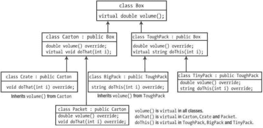

*图 15-3. 层次结构中的虚函数*

当你在某个类中将函数指定为虚函数时，该函数在该类直接或间接派生的所有类中都是虚函数。图 15-3 中从 Box 类派生的所有类都继承了 volume() 函数的虚特性，即使它们没有重复 virtual 关键字。你可以通过 Box* 类型的指针对这些类中任何类的对象调用 volume()，因为该指针可以保存层次结构中任何类的对象地址。

Crate 类没有定义 volume()，因此对其对象将调用从 Carton 继承的版本。它作为虚函数被继承，因此可以多态调用。

类型为 Carton* 的指针 carton 也可以用来调用 volume()，但只能用于 Carton 类的对象以及以 Carton 为基类的两个类：Crate 和 Packet。

Carton 类及其派生类还包含虚函数 doThat()。该函数也可以使用 Carton* 类型的指针进行多态调用。当然，你不能使用 Box* 类型的指针为这些类调用 doThat()，因为 Box 类没有定义 doThat() 函数。

同样，可以使用 `ToughPack*` 类型的指针为 ToughPack、BigPack 和 TinyPack 类型的对象调用虚函数 `doThis()`。当然，同一个指针也可以用来为这些类类型的对象调用 `volume()` 函数。

## 访问说明符与虚函数

派生类中虚函数的访问说明可以与基类中的说明不同。当你通过基类指针调用虚函数时，基类中的访问说明决定该函数是否可访问，而与所指向对象的类型无关。如果虚函数在基类中是 public，则无论派生类中的访问说明如何，都可以通过指向基类的指针（或引用）为任何派生类调用它。我们可以通过修改前面的示例来演示这一点。修改 Ex15_02 中的 ToughPack 类定义，将 `volume()` 函数设为 protected，并在其声明中添加 `override` 关键字，以确保它确实覆盖了基类中的虚函数：

```cpp
export class ToughPack : public Box
{
public:
  using Box::Box;  // Optional: constructor is inherited as public regardless
                   // Inherit Box(length, width, height) constructor

protected:
  // Function to calculate volume of a ToughPack allowing 15% for packing
  double volume() const override { return 0.85 * m_length * m_width * m_height; }
};
```

`main()` 函数只有很小的变化，并添加了一条被注释掉的语句：

```cpp
// Ex15_03.cpp
// Access specifiers and virtual functions
import <iostream>;
import boxes;

int main()
{
  Box box {20.0, 30.0, 40.0};
  ToughPack hardcase {20.0, 30.0, 40.0};       // A derived box - same size
  Carton carton {20.0, 30.0, 40.0, "Plastic"}; // A different derived box

  box.showVolume();             // Volume of Box
  hardcase.showVolume();        // Volume of ToughPack
  carton.showVolume();          // Volume of Carton

  // Uncomment the following statement for an error
  // std::cout << "\nhardcase volume is " << hardcase.volume() << std::endl;

  // Now using a base pointer...
  Box* base {&box};        // Points to type Box
  std::cout << "\nbox volume through base pointer is " << base->volume() << std::endl;
  base->showVolume();

  base = &hardcase;            // Points to type ToughPack
  std::cout << "hardcase volume through base pointer is " << base->volume() << std::endl;
  base->showVolume();

  base = &carton;              // Points to type Carton
  std::cout << "carton volume through base pointer is " << base->volume() << std::endl;
  base->showVolume();
}
```

毫不意外，除此之外，这段代码产生的输出与上一个示例相同。尽管 volume() 在 ToughPack 类中声明为 protected，你仍然可以通过从 Box 类继承的 showVolume() 函数为 hardcase 对象调用它。你也可以通过指向基类的指针 base 直接调用它。但是，如果你取消注释那行使用 hardcase 对象直接调用 volume() 函数的代码，代码将无法编译。

这里的关键在于调用是动态解析还是静态解析。当你使用类对象时，调用由编译器静态确定。对 ToughPack 对象调用 volume() 会调用该类中定义的函数。由于 volume() 函数在 ToughPack 中是 protected，对 hardcase 对象的调用将无法编译。所有其他调用都在程序执行时解析；它们是多态调用。在这种情况下，基类中虚函数的访问说明会被所有派生类继承。这与派生类中的显式说明无关；显式说明只影响静态解析的调用。

因此，访问说明符根据对象的*静态*类型决定函数是否可以被调用。其结果是，将函数覆盖的访问说明符改为比基类函数更严格的访问说明，多少有些徒劳。这种访问限制很容易通过使用指向基类的指针绕过。Ex15_03 中 ToughPack 的 showVolume() 函数展示了这一点。

> **提示** 函数的访问说明符决定你*是否可以调用*该函数；然而，它在决定你能否*覆盖*该函数方面不起任何作用。其结果是，你可以*覆盖*给定基类的*私有虚函数*。事实上，通常建议将虚函数声明为私有。

在某种程度上，私有虚函数让你两全其美。一方面，该函数是私有的，意味着不能从类外部调用它。另一方面，该函数是虚函数，允许派生类覆盖并自定义其行为。换句话说，即使你支持多态，你仍然可以完全控制这种私有虚成员函数在何处以及何时被调用。该函数可能是更复杂算法中的单个步骤，该步骤只有在算法的所有先前步骤都已正确执行后才能执行。或者，它可能是一个只能在获取特定资源之后调用的函数，例如在执行必要的线程同步之后。

其背后的基本思想与数据隐藏相同。你对成员的访问限制得越多，就越容易确保它们不会被错误使用。一些经典的面向对象设计模式——最突出的是所谓的*模板方法模式*——最好使用私有虚函数来实现。这些模式对我们来说有点过于高级，无法在这里深入细节。只需理解访问说明符和覆盖是两个正交的概念，并始终记住将虚函数声明为私有是一个可行的选择。


每次调用 showVolume() 函数时，引用参数都会用作为实参传递的对象进行初始化。由于该参数是对基类的引用，编译器会安排对虚函数 volume() 进行动态绑定。

## 多态集合

当处理所谓的多态集合或异构对象集合时，多态性会变得特别有趣——这两个花哨的名称都指包含不同动态类型对象的基类指针集合。集合的示例包括普通 C 风格数组，也包括标准库中更现代、更强大的 std::array<> 和 std::vector<> 类。

我们将使用 Ex15_03 中的 Box、Carton 和 ToughPack 类以及修改后的 main() 函数来演示这个概念：

```cpp
// Ex15_06.cpp
// Polymorphic vectors of smart pointers
import <iostream>;
import <memory>;    // For smart pointers
import <vector>;
import boxes;

int main()
{
    // Careful: this first attempt at a mixed collection is a bad idea (object slicing!)
    std::vector<Box> boxes;
    boxes.push_back(Box(20.0, 30.0, 40.0));
    boxes.push_back(ToughPack(20.0, 30.0, 40.0));
    boxes.push_back(Carton(20.0, 30.0, 40.0, "plastic"));

    for (const auto& box : boxes)
        box.showVolume();

    std::cout << std::endl;

    // Next, we create a proper polymorphic vector:
    std::vector<std::unique_ptr<Box>> polymorphicBoxes;
    polymorphicBoxes.push_back(std::make_unique<Box>(20.0, 30.0, 40.0));
    polymorphicBoxes.push_back(std::make_unique<ToughPack>(20.0, 30.0, 40.0));
    polymorphicBoxes.push_back(std::make_unique<Carton>(20.0, 30.0, 40.0, "plastic"));

    for (const auto& box : polymorphicBoxes)
        box->showVolume();
}
```

此示例的输出如下：

```text
Box usable volume is 24000
Box usable volume is 24000
Box usable volume is 24000

Box usable volume is 24000
Box usable volume is 20400
Box usable volume is 22722.4
```

程序的第一部分展示了**不要**如何创建多态集合。如果你像往常一样，按值将派生类对象赋给基类对象的 `vector<>`，就会发生对象切片。也就是说，只会保留与该基类对应的子对象。这个向量通常没有空间存储完整对象。对象的动态类型也会被转换为基类的动态类型。如果你想要多态，你知道必须始终使用指针或引用。

对于程序第二部分中真正多态的向量，我们本可以使用由普通 `Box*` 指针组成的 `vector<>`——即 `std::vector<Box*>` 类型的向量——并在其中存储指向动态分配的 Box、ToughPack 和 Carton 对象的指针。这样做的缺点是我们必须记得在程序结束时也删除这些对象。

你已经知道标准库提供了所谓的智能指针来帮助解决这个问题。智能指针让我们能够安全地使用指针，而不必时刻担心删除对象。

因此，在 polymorphicBoxes 向量中，我们存储 `std::unique_ptr<Box>` 类型的元素，这些是指向 Box 对象的智能指针。这些元素可以存储 Box 对象或任何派生自 Box 的类的对象地址，因此这与你到目前为止看到的原始指针完全对应。幸运的是，正如输出所示，多态性在智能指针下依然有效。当你在自由存储区创建对象时，智能指针仍然提供多态行为，同时消除任何内存泄漏的可能性。

> **提示**  要获得内存安全的多态对象集合，你可以将 `std::unique_ptr<>` 和 `shared_ptr<>` 等智能指针存储在 `std::vector<>` 和 `array<>` 等容器中。

### 通过指针销毁对象

在处理派生类对象时，使用指向基类的指针非常常见，因为这是利用虚函数的方式。如果你使用指针或智能指针指向在自由存储区创建的对象，那么销毁派生类对象时可能会出现问题。如果你给各个 Box 类添加显示消息的析构函数，就能看到这个问题。从 Ex15_06 的文件开始，给 Box 类添加一个在被调用时仅显示消息的析构函数：

```cpp
export class Box
{
public:
  Box() : Box{1.0, 1.0, 1.0} {}
  Box(double l, double w, double h) : m_length {l}, m_width {w}, m_height {h} {}

  ~Box() { std::cout << "Box destructor called" << std::endl; }

  // Remainder of the Box class as before...
};
```

对 ToughPack 和 Carton 类做同样的事情。也就是说，添加以下形式的析构函数：

```cpp
~ToughPack() { std::cout << "ToughPack destructor called" << std::endl; }
```

和

```cpp
~Carton() { std::cout << "Carton destructor called" << std::endl; }
```

你需要将 `<iostream>` 模块导入到尚未导入它的文件中。无需更改 `main()` 函数。完整程序在代码下载中名为 EX15_07。它产生的输出以以下十几行结束（你看到的输出对应于各个 Box 元素被压入并切片到第一个向量中的过程；但这不是我们在这里想要剖析的部分）：

```text
...
Box usable volume is 24000
Box usable volume is 24000
Box usable volume is 24000

Box usable volume is 24000
Box usable volume is 20400
Box usable volume is 22722.4
Box destructor called
Box destructor called
Box destructor called
Box destructor called
Box destructor called
Box destructor called
```

显然，我们这里出现了失败。所有六个对象调用的都是同一个基类析构函数，尽管其中四个是派生类的对象。即使是存储在多态向量中的对象也会发生这种情况。自然，这种行为的原因是析构函数像任何其他函数一样，是静态解析而不是动态解析的。为了确保为派生类调用正确的析构函数，我们需要析构函数进行动态绑定。我们需要的是虚析构函数。

> **注意**  你可能会认为，对于 ToughPack 或 Carton 等类的对象，调用错误的析构函数没什么大不了的，因为它们的析构函数基本上是空的。这些派生类的析构函数并不会执行任何关键的清理任务之类的事情，所以如果不调用它们又有什么危害呢？事实是，C++ 标准明确规定，对指向派生类对象的基类指针应用 `delete` 会导致未定义行为，除非该基类具有虚析构函数。因此，尽管调用错误的析构函数可能看起来无害，甚至程序执行期间也可能无害，但原则上任何事情都可能发生。如果你幸运，它是良性的，不会发生坏事。但它同样可能引入内存泄漏，甚至使程序崩溃。

### 虚析构函数

为了确保对在自由存储区分配的派生类对象始终调用正确的析构函数，你需要虚类析构函数。要在派生类中实现虚析构函数，你只需在基类的析构函数声明中添加关键字 virtual。这向编译器发出信号：通过指针或引用参数进行的析构函数调用应具有动态绑定，因此被调用的析构函数将在运行时选择。这使得从基类派生的每个类中的析构函数都成为虚函数，尽管派生类的析构函数名称不同；为此，析构函数被视为特殊情况。

你可以通过向 Ex15_07 的 Box 类中的析构函数声明添加 virtual 关键字来看到这种效果：

```cpp
export class Box
{
public:
    Box() : Box{1.0, 1.0, 1.0} {}
    Box(double l, double w, double h) : m_length {l}, m_width {w}, m_height {h} {}

    virtual ~Box() { std::cout << "Box destructor called" << std::endl; }

    // Remainder of the Box class as before...
};
```

由于声明了虚基类析构函数，所有派生类的析构函数都将自动成为虚函数。如果你再次运行该示例，输出将确认这一点。如果不是这样，我们为此函数添加的输出消息就会是一个空的 {} 块。不过，与其使用这种空块，我们建议使用 = default 声明析构函数。这样能更明显地看出使用的是默认实现。对于我们的 Box 类，你应编写以下内容：

```cpp
virtual ~Box() = default;
```

default 关键字可用于编译器通常会为你生成的所有成员。这包括析构函数，也包括你之前看到的构造函数和赋值运算符。请注意，编译器生成的析构函数永远不是虚函数，除非你显式地这样声明它们。

> **提示**  当预期到多态（甚至只是有可能出现多态）时，你的类必须具有虚析构函数，以确保对象始终被正确销毁。这意味着，一旦一个类至少有一个虚成员函数，其析构函数也应设为虚函数。（唯一不必遵循此准则的情况是，非虚析构函数为 protected 或 private，但这些是相当例外的情况。）

## 在类对象指针之间转换

你可以将指向派生类的指针隐式转换为指向基类的指针，并且对于直接基类和间接基类都可以这样做。例如，我们先定义一个指向 Carton 对象的智能指针：

```cpp
auto carton{ std::make_unique<Carton>(30, 40, 10) };
```

你可以将这个智能指针中内嵌的指针隐式转换为指向 Box 的指针，Box 是 Carton 的直接基类：

```cpp
Box* box_pointer {carton.get()};
```


# 第 15 章：多态

结果是一个指向 Box 的指针，该指针被初始化为指向新的 Carton 对象。从示例 Ex15_05 和 Ex15_06 可知，这对引用和智能指针也同样适用。例如，可以像下面这样从 carton 获得一个 Box 引用：

```
Box& box_reference { *carton};
```

> **注意** 通常来说，我们在本节中讨论的关于指针的一切内容同样适用于引用。不过，我们不会总是明确重复这一点，也不会总是给出引用的类似示例。

我们来看将指向派生类类型的指针转换为指向间接基类的指针。假设你定义了一个 CerealPack 类，并将 Carton 作为公有基类。Box 是 Carton 的间接基类，因此它也是 CerealPack 的间接基类。因此，可以这样写：

```
CerealPack* cerealPack{ new CerealPack{ 30, 40, 10, "carton" } };
Box* box {cerealPack};
```

这条语句将 cerealPack 中的地址从指向 CerealPack 的指针类型转换为指向 Box 的指针类型。如果需要显式指定转换，可以使用 static_cast<>() 运算符：

```
Box* box { static_cast<Box*>(cerealPack)};
```

编译器通常可以快速完成此转换，因为 Box 是 CerealPack 的基类。如果 Box 类不可访问或者是虚基类，则这样做不合法。

将派生类指针转换为基类指针类型的结果，是指向目标类型子对象的指针。在考虑转换指向类类型的指针时，很容易混淆。不要忘记，指向某个类类型的指针只能指向该类型的对象或派生类类型的对象，反之则不然。具体来说，指针 carton 可以包含 Carton 类型对象（它可能是 CerealPack 对象的子对象）的地址，或 CerealPack 类型对象的地址。它不能包含 Box 类型对象的地址，因为 CerealPack 对象是 Carton 的一种特殊类型，而 Box 对象不是。图 15-4 展示了指向 Box、Carton 和 CerealPack 对象的指针之间的可能情况。

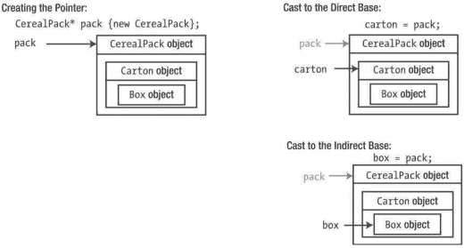

*图 15-4. 沿类层次向上转换指针*

尽管到目前为止我们讨论的是沿类层次向上转换指针，但有时也可以进行相反方向的转换。沿类层次将指针从基类向下转换为派生类则不同；转换是否有效取决于基类指针所指向对象的类型。要使从基类指针（如 `box`）到派生类指针（如 `carton`）的静态转换合法，基类指针必须指向某个 Carton 对象的 Box 子对象。如果不是这种情况，转换结果就是未定义的。换句话说，会发生糟糕的事情。

图 15-5 展示了从指针 `box`（它包含一个 Carton 对象的地址）进行的静态转换。转换为 `Carton*` 类型会成功，因为该对象是 Carton 类型。另一方面，转换为 `CerealPack*` 类型的结果是未定义的，因为不存在这种类型的对象。

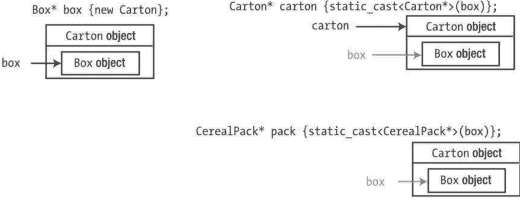

*图 15-5. 沿类层次向下转换指针*

如果你对静态转换的合法性有任何疑问，就不应使用它。沿类层次向下转换指针的尝试能否成功，取决于该指针是否包含目标类型对象的地址。静态转换不会检查情况是否如此，因此如果你在不知道指针指向何处的情况下尝试这种转换，就要冒结果未定义的风险。因此，当你想要沿类层次向下转换时，需要换一种方式——采用可在运行时检查该转换的方式。

## 动态转换

动态转换是在运行时执行的转换。`dynamic_cast<>()` 运算符执行动态转换。只能将此运算符应用于指向多态类类型的指针和引用；多态类类型是至少包含一个虚函数的类类型。原因在于，只有指向多态类类型的指针才包含 `dynamic_cast<>()` 运算符检查转换有效性所需的信息。此运算符专门用于在类层次中的类类型指针或引用之间进行转换。当然，转换前后的类型必须是指向同一类层次中类的指针或引用。不能将 `dynamic_cast<>()` 用于其他任何用途。我们首先讨论动态转换指针。

### 动态转换指针

动态转换有两种。第一种是“沿类层次向下转换”，即从指向直接或间接基类型的指针转换为指向派生类型的指针。这称为向下转换（downcast）。第二种可能是跨层次转换；这称为交叉转换（crosscast）。图 15-6 展示了这些转换。

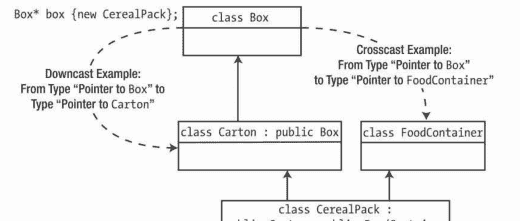

*图 15-6. 向下转换和交叉转换*

对于类型为 `Box*`、包含 `CerealPack` 对象地址的指针 box，可以按如下方式编写图 15-6 所示的向下转换：

```cpp
Carton* carton {dynamic_cast<Carton*>(box)};
```

dynamic_cast<>() 运算符的写法与 static_cast<>() 运算符相同。目标类型放在 dynamic_cast 后的尖括号之间，要转换为新类型的表达式放在圆括号之间。要使此转换合法，Box 和 Carton 类必须包含虚函数，无论是作为声明的成员还是继承的成员。为使前面的转换成功，box 必须指向 Carton 对象或 CerealPack 对象，因为只有这些类型的对象才包含 Carton 子对象。如果转换不成功，指针 carton 将被设置为 nullptr。

图 15-6 中的交叉转换可以写成如下形式：

```cpp
FoodContainer* foodContainer {dynamic_cast<FoodContainer*>(box)};
```

与前一种情况一样，FoodContainer 类和 Box 类都必须是多态的，转换才合法。只有当 box 包含 CerealPack 对象的地址时，转换才可能成功，因为这是唯一既包含 FoodContainer 对象、又可以通过 Box* 类型指针引用的类型。同样，如果转换不成功，nullptr 将被存入 foodContainer。

使用 dynamic_cast<>() 沿类层次向下转换可能会失败，但与静态转换不同，结果将是 nullptr，而不是仅仅“未定义”。这为如何使用它提供了线索。假设某个对象由指向 Box 的指针所指，而你想调用 Carton 类的非虚成员函数。基类指针只允许你调用派生类的虚成员函数，但 dynamic_cast<>() 运算符可以让你调用非虚函数。如果 surface() 是 Carton 类的非虚成员函数，可以用下面这条语句调用它：

```cpp
dynamic_cast<Carton*>(box)->surface();
```

这显然很危险，实际上并不比使用 static_cast<>() 好多少，甚至没有更好。你需要确保 box 指向 Carton 对象，或指向以 Carton 类为基类的类的对象。如果不是这种情况，dynamic_cast<>() 运算符会返回 nullptr，调用的结果又会变成未定义。为解决这个问题，可以使用 dynamic_cast<>() 运算符判断你打算做的事情是否有效。下面是一个示例：

```cpp
Carton* carton {dynamic_cast<Carton*>(box)};
if (carton)
  carton->surface();
```

现在，只有当转换结果不是 nullptr 时，你才会调用 surface() 成员函数。注意，不能使用 dynamic_cast<>() 去除 const 属性。如果转换前的指针类型是 const，那么转换后的指针类型也必须为 const。如果要从 const 指针转换为非 const 指针，必须首先使用 const_cast<>() 运算符转换为与原始类型相同的非 const 指针。不过，请记住，很少建议使用 const_cast<>()。大多数情况下，你手头只有一个 const 指针或引用是有充分理由的，这意味着使用 const_cast<>() 绕过 const 属性通常会导致意外或不一致的状态。

> **警告** 一个常见错误是过于频繁地使用动态转换，尤其是在多态会更合适的情况下。如果你在任何时候发现以下形式的代码，要知道你可能需要重新考虑类设计：

```cpp
Base* base = ...;    // Start from a pointer-to-Base
// dynamic_cast to any number of derived types in a chain of if-else statements
// (See Chapter 4 for the 'if (initialization; condition)' syntax)
```


```cpp
if (auto derived1 = dynamic_cast<Derived1*>(base); derived1 != nullptr)
    derived1->DoThis();
else if (auto derived2 = dynamic_cast<Derived2*>(base); derived2 != nullptr)
    derived2->do_this();
...
else if (auto derivedN = dynamic_cast<DerivedN*>(base); derivedN != nullptr)
    derivedN->doThat();
```

通常，这类代码应替换为基于多态的解决方案。在我们虚构的示例中，您可能应该在 Base 类中创建一个名为 DoThisOrThat() 的函数，并在任何需要不同实现的派生类中重写它。然后整个代码块就简化为：

```cpp
Base* base = ...;    // Start from a pointer-to-Base
base->DoThisOrThat();
```

这不仅短得多，而且如果将来某个时候又添加了一个从 Base 派生的 DerivedX 类，它甚至还能继续工作。这正是多态的强大之处。您的代码不需要知道现在或将来所有可能的派生类。它只需要知道基类的接口。任何使用动态转换来模仿这种机制的尝试都注定是劣质的。

虽然我们之前的示例显然是虚构的，但不幸的是，我们在真实代码中确实经常看到这种模式出现。因此，我们建议您对此非常谨慎！

我们有时会遇到 dynamic_cast 误用的一个相关症状，尽管不那么频繁，那就是对 this 指针进行动态转换。例如，这种不明智的代码可能看起来像这样：

```cpp
void Base::DoSomething()
{
    if (dynamic_cast<Derived*>(this))    // NEVER DO THIS!
    {
        /* do something else instead... */
        return;
    }
    ...
}
```

这里的正确解决方案是将 DoSomething() 函数设为虚函数，并在 Derived 中重写它。对 this 指针进行向下转换绝不是一个好主意，所以请不要这样做！基类的代码不应涉及派生类。这种模式的任何变体都应替换为多态的应用。

> **提示** 一般来说，利用多态可能涉及将一个函数拆分为多个函数，然后您可以重写其中的一些函数。如果您感兴趣，这又与前面提到的*模板方法设计模式*有关。您可以在网上或关于设计模式的书籍中找到更多信息。

## 转换引用

您可以将 `dynamic_cast<>` 运算符应用于函数中的引用参数，以沿类层次结构向下转换，从而产生另一个引用。在以下示例中，函数 `doThat()` 的参数是对基类 `Box` 对象的引用。在函数体中，您可以将该参数转换为对派生类型的引用：

```cpp
double doThat(Box& box)
{
  ...
  Carton& carton {dynamic_cast<Carton&>(box)};
  ...
}
```

这条语句从对 `Box` 的类型引用转换为对 `Carton` 的类型引用。当然，作为参数传递的对象可能不是 `Carton` 对象，如果是这种情况，转换就不会成功。不存在空引用这种东西，因此这种失败方式与指针转换失败不同。函数执行停止，并抛出类型为 `std::bad_cast` 的异常（该异常类定义在标准库的 `<typeinfo>` 模块中）。您还没有真正接触过异常，但您会在下一章中了解这意味着什么。

因此，盲目地对引用应用动态转换显然是有风险的，但有一个简单的替代方案。只需将引用转换为指针，并对指针应用转换即可。然后您可以再次检查结果指针是否为 `nullptr`：

```cpp
double doThat(Box& box)
{
  ...
  if (Carton* carton {dynamic_cast<Carton*>(&box)}; carton != nullptr)
  {
    ...
  }
  ...
}
```

## 调用虚函数的基类版本

您已经看到，通过指向派生类对象的指针或引用调用虚函数的派生类版本很容易——调用是动态进行的。但是，当您实际上想为派生类对象调用基类函数时，该怎么办？

如果在派生类中重写虚基类函数，您通常会发现在后者是前者的轻微变体。一个很好的例子是您在本章中一直使用的 `ToughPack` 类的 `volume()` 函数：

```cpp
// Function to calculate volume of a ToughPack allowing 15% for packing
double volume() const override { return 0.85 * m_length * m_width * m_height; }
```

显然，这个 return 语句中的 m_length * m_width * m_height 部分正是用于计算基类 Box 中 volume() 的公式。在这种情况下，您必须重新键入的代码量有限，但情况并非总是如此。因此，如果您能直接调用该函数的基类版本，那会好得多。

在我们的示例中，一个看似可行的首次尝试可能是这样：

```cpp
double volume() const override { return 0.85 * volume(); } // Infinite recursion!
```

然而，如果您这样写，volume() 重写函数只是在调用自身，然后又会再次调用自身，然后又会再次调用自身……您明白意思；这将导致我们在第 8 章中所谓的无限递归，从而导致程序崩溃（也就是说，如果您的编译器还没有直接拒绝这段代码的话）。解决方案是显式指示编译器调用该函数的基类版本（您可以在 Ex15_07A 中找到包含此修改的 ToughPack.cpp）：

```cpp
double volume() const override { return 0.85 * Box::volume(); }
```

像这样在函数重写中调用基类版本很常见。不过，在某些罕见情况下，您可能还想在其他地方做类似的事情。Box 类提供了一个机会来了解为什么可能需要这样的调用。计算 Carton 或 ToughPack 对象中的体积损失可能很有用；一种方法是计算 volume() 函数的基类版本和派生类版本返回的体积之差。您可以通过用类名限定来强制静态调用基类的虚函数。假设您有一个这样定义的指针 box：

```cpp
Carton carton {40.0, 30.0, 20.0};
Box* box {&carton};
```

您可以使用以下语句计算 Carton 对象的总体积损失：

```cpp
double difference {box->Box::volume() - box->volume()};
```

表达式 box->Box::volume() 调用 volume() 函数的基类版本。类名连同作用域解析运算符一起标识了特定的 volume() 函数，因此这将是编译时解析的静态调用。

您不能使用类名限定符来强制在通过指向基类的指针进行的调用中选择特定的派生类函数。表达式 box->Carton::volume() 将无法编译，因为 Carton::volume() 不是 Box 类的成员。通过指针调用函数要么是对指针所属类类型的成员函数的静态调用，要么是对虚函数的动态调用。

通过派生类的对象调用虚函数的基类版本可以类似地完成。您可以使用以下语句计算 Carton 对象的体积损失：

```cpp
double difference {carton.Box::volume() - carton.volume()};
```

## 从构造函数或析构函数中调用虚函数

Ex15_08 说明了当您从构造函数和析构函数内部调用虚函数时会发生什么。一如既往，我们从一个 Box 类开始，在其相关成员中包含必要的调试语句：

```cpp
// Box.cpp
export module boxes;
import <iostream>;

export class Box
{
public:
  Box(double length, double width, double height)
    : m_length {length}, m_width {width}, m_height {height}
  {
    std::cout << "Box constructor called for a Box of volume " << volume() << std::endl;
  }
  virtual ~Box()
  {
    std::cout << "Box destructor called for a Box of volume " << volume() << std::endl;
  }

  // Function to calculate volume of a Box
  virtual double volume() const { return m_length * m_width * m_height; }

  void showVolume() const
  {
    std::cout << "The volume from inside Box::showVolume() is "
              << volume() << std::endl;
  }

private:
  double m_length, m_width, m_height;
};
```

我们还需要一个派生类，一个重写 `Box::volume()` 的派生类；

```cpp
export module boxes::tough_pack;
import <iostream>;
import :box;

export class ToughPack : public Box
{
public:
  ToughPack(double length, double width, double height)
    : Box{length, width, height}
  {
    std::cout << "ToughPack constructor called for a Box of volume "
              << volume() << std::endl;
  }
  virtual ~ToughPack()
  {
    std::cout << "ToughPack destructor called for a Box of volume "
              << volume() << std::endl;
  }

  // Function to calculate volume of a ToughPack allowing 15% for packing
  double volume() const override { return 0.85 * Box::volume(); }
};
```


boxes 的主模块接口文件一如既往地简单：

```cpp
export module boxes;
export import :box;
export import :tough_pack;
```

在这个例子中，主程序也同样简单。它所做的只是创建派生类 ToughPack 的一个实例，然后显示其体积：

```cpp
// Ex15_08.cpp
// Calling virtual functions from constructors and destructors
import boxes;

int main()
{
    ToughPack toughPack{1.0, 2.0, 3.0};
    toughPack.showVolume();     // Should show a volume equal to 85% of 1x2x3, or 5.1
}
```

结果输出如下：

```text
Box constructor called for a Box of volume 6
ToughPack constructor called for a Box of volume 5.1
The volume from inside Box::showVolume() is 5.1
ToughPack destructor called for a Box of volume 5.1
Box destructor called for a Box of volume 6
```

首先，我们把注意力集中到输出的中间一行，这一行是调用 ToughPack::showVolume() 函数的结果。ToughPack 重写了 volume()，因此如果你在 ToughPack 对象上调用 volume()，你会期望使用 ToughPack 的版本，即使这个调用源自基类函数（例如 Box::showVolume()）内部也是如此。输出清楚地表明实际情况也正是如此。Box::showVolume() 打印出的体积为 0.85 * 1 * 2 * 3，也就是 5.1，符合预期。

现在来看看，如果你不是从常规的基类成员函数（如 showVolume()）中调用 volume()，而是从基类构造函数中调用它，会发生什么。输出的第一行表明，此时 volume() 返回 6。所以，很明显被调用的是 Box 的原始函数，而不是 ToughPack 重写后的版本！为什么会这样？你会记得上一章讲过，构造一个对象时，会先构造它的所有子对象，包括其所有基类的子对象。因此，在初始化这样一个子对象时——例如我们的 ToughPack 中的 Box 子对象——派生类对象最多只完成了部分初始化。一般而言，对子对象尚未完全初始化的对象调用成员函数是极其危险的。这就是为什么构造函数内部的所有函数调用（包括虚成员函数调用）总是静态解析的。

反过来，销毁一个对象时，其所有子对象会按构造顺序的逆序被析构。因此，等到基类子对象的析构函数被调用时，派生类已经部分析构了。因此，调用这个派生对象的成员同样不是好主意。所以，析构函数中的所有函数调用也同样采用静态解析。

> **警告** 从构造函数或析构函数内部发起的虚函数调用总是静态解析的。
> 如果你在极少数情况下确实需要在初始化期间进行多态调用，你应该在一个 `init()` 成员函数（它本身通常也是虚函数）中进行，然后在对象构造完成后调用它。
> 这被称为“初始化期间动态绑定”惯用法。

## 多态的成本

如你所知，天下没有免费的午餐，多态也不例外。使用多态需要付出两方面的代价：它需要更多内存，并且虚函数调用会带来额外的运行时开销。这些后果源于实践中虚函数调用通常的实现方式。幸运的是，这两种成本最多通常也只是边际性的，基本可以忽略不计。

例如，假设两个类 A 和 B 包含相同的成员变量，但 A 包含虚函数，而 B 的函数全都是非虚函数。在这种情况下，类型 A 的对象比类型 B 的对象需要更多内存。

> **注意** 你可以创建一个包含两个此类类对象的简单程序，并使用 `sizeof` 运算符查看有虚函数和无虚函数的对象所占内存的差异。

内存增加的原因是，当你创建多态类类型的对象时，会在该对象中创建一个特殊指针。这个指针用于调用对象中的任何虚函数。这个特殊指针指向为该类创建的函数指针表。这个表通常称为 *虚函数表*，类中每个虚函数在表中都有一个条目。图 15-7 说明了这一点。

```cpp
object->doMore();
```

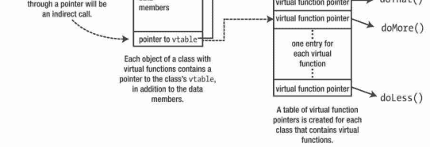

*图 15-7. 多态函数调用如何工作*

当通过指向基类对象的指针调用函数时，会发生以下事件序列：

- 1. 使用所指向对象中指向虚函数表的指针，找到该类的虚函数表起始位置。
- 2. 在虚函数表中找到要调用函数的条目，通常通过使用偏移量。
- 3. 通过虚函数表中的函数指针间接调用该函数。这种间接调用比直接调用非虚函数稍慢，因此每次虚函数调用都会带来一些开销。

不过，调用虚函数的开销很小，不应让你担心。每个对象多出几个字节，以及函数调用稍慢一些，这些都是为获得多态所提供的强大功能和灵活性而付出的小代价。这里解释只是让你了解为什么有虚函数的对象比没有虚函数的同类对象更大。

> **注意** 唯一需要认真权衡虚函数表指针开销是否值得的时候，是你同时拥有大量相应类型的对象时。假设你有一个表示三维空间中点的 `Point3D` 类。如果你的程序要处理数以百万计的此类点——例如，Microsoft Kinect 每秒最多可产生 900 万个点——那么在 `Point3D` 中避免使用虚函数可以节省大量内存。不过，对于大多数对象来说，虚函数表指针的成本只是边际性的，并且完全值得由此带来的好处。

## 确定动态类型

假设你有一个对多态类对象的引用——如你所记得的，多态类就是至少包含一个虚函数的类。那么你可以使用 `typeid()` 运算符确定该对象的动态类型。这个标准运算符返回一个对 `std::type_info` 对象的引用，该对象封装了其操作数的实际类型。`typeid()` 运算符的用法与 `sizeof` 运算符类似，其操作数可以是表达式或类型。具体来说，`typeid()` 运算符的语义大致如下：

- 如果其操作数是类型，`typeid()` 求值结果是对表示该类型的 `type_info` 对象的引用。
- 如果其操作数是任何求值为多态类型引用的表达式，则会对该表达式求值，运算符返回该求值结果所引用值的动态类型。
- 如果其操作数是任何其他表达式，则该表达式**不会求值**，结果是该表达式的静态类型。

我们向你介绍这个已经比较高级的运算符，是因为 `typeid()` 可以成为有用的学习或调试辅助工具。它使你能够轻松检查各种表达式的类型，或观察对象的静态类型与动态类型之间的差异。

我们来创建一个程序，看看这个运算符的实际运行。我们将再次使用 Ex15_06 中的 Box 和 Carton 类。当然，到现在你已经知道任何基类都应该有虚析构函数，所以这次我们自然给 Box 类一个默认的虚析构函数。不过，这个小改动在这个示例中并没有那么重要。这里，我们将使用 Box 类来说明 `typeid()` 在多态类中的行为。

> **注意** 要使用 `typeid()` 运算符，你总是必须先导入标准库中的 `<typeinfo>` 模块。这会使得 `std::type_info` 类可用，它就是该运算符返回对象的类型。注意，类型名称中有下划线，而模块名称中没有。真是让人琢磨不透！

```cpp
// EX15_09.cpp
// Using the typeid() operator
import <iostream>;
import <typeinfo>;    // For the std::type_info class
import boxes;

// Define polymorphic and non-polymorphic base and derived classes:
class NonPolyBase {};
class NonPolyDerived : public NonPolyBase {};

Box& getSomeBox();                 // Function returning a reference to a polymorphic type
NonPolyBase& getSomeNonPoly();     // Function returning a reference to a non-polymorphic type

int main()
{
  // Part 1: typeid() on types and == operator
  std::cout << "Type double has name " << typeid(double).name() << std::endl;
  std::cout << "1 is " << (typeid(1) == typeid(int) ? "an int" : "no int") << std::endl;

  // Part 2: typeid() on polymorphic references
  Carton carton{ 1, 2, 3, "paperboard" };
  Box& boxReference = carton;

  std::cout << "Type of carton is " << typeid(carton).name() << std::endl;
  std::cout << "Type of boxReference is " << typeid(boxReference).name() << std::endl;
  std::cout << "These are " << (typeid(carton) == typeid(boxReference) ? "" : "not ")
            << "equal" << std::endl;

  // Part 3: typeid() on polymorphic pointers
  Box* boxPointer = &carton;
  std::cout << "Type of &carton is " << typeid(carton).name() << std::endl;
  std::cout << "Type of boxPointer is " << typeid(*boxPointer).name() << std::endl;

  // Part 4: typeid() with non-polymorphic classes
  NonPolyDerived derived;
  NonPolyBase& baseRef = derived;

  std::cout << "Type of baseRef is " << typeid(baseRef).name() << std::endl;

  // Part 5: typeid() on expressions
  const auto& type_info1 = typeid(getSomeBox());       // function call evaluated
  const auto& type_info2 = typeid(getSomeNonPoly());   // function call not evaluated
```


```cpp
std::cout << "Type of getSomeBox() is " << type_info1.name() << std::endl;
std::cout << "Type of getSomeNonPoly() is " << type_info2.name() << std::endl;
}
Box& getSomeBox()
{
    std::cout << "getSomeBox() called..." << std::endl;
    static Carton carton{ 2, 3, 5, "duplex" };
    return carton;
}
NonPolyBase& getSomeNonPoly()
{
    std::cout << "getSomeNonPoly() called..." << std::endl;
    static NonPolyDerived derived;
    return derived;
}
```

该程序可能的输出如下：

```
Type double has name double
1 is an int
Type of carton is class Carton
Type of boxReference is class Carton
These are equal
Type of &carton is class Carton *
Type of boxPointer is class Box *
Type of *boxPointer is class Carton
Type of baseRef is class NonPolyBase
getSomeBox() called...
Type of getSomeBox() is class Carton
Type of getSomeNonPoly() is class NonPolyBase
```

如果你的结果看起来不同，不要惊慌。`type_info` 的 `name()` 成员函数返回的名称并不总是那么易读。在某些编译器下，返回的类型名是所谓的名称修饰（mangled name）后的名称，也就是编译器内部使用的名称。如果是这种情况，你的结果可能更像下面这样：

```
Type double has name d
1 is an int
Type of carton is 6Carton
Type of boxReference is 6Carton
These are equal
Type of &carton is P6Carton
Type of boxPointer is P3Box
Type of *boxPointer is 6Carton
Type of baseRef is 11NonPolyBase
getSomeBox() called...
Type of getSomeBox() is 6Carton
Type of getSomeNonPoly() is 11NonPolyBase
```

你可以查阅编译器的文档，了解如何解释这些名称，甚至了解如何将它们转换为人类可读的格式。通常，名称修饰后的名称本身就应该已经包含足够的信息，让你能跟上这里的讨论。

Ex15_09 测试程序由五部分组成，每部分分别演示使用 `typeid()` 运算符的某个特定方面。我们将依次讨论每一部分。

第一部分中，我们对一个硬编码的类型名应用 `typeid()`。这本身并不那么有趣，至少在你把得到的 `type_info` 与对实际值或表达式应用 `typeid()` 的结果进行比较之前是这样，正如 `main()` 的第二条语句所示。注意，编译器不会对类型名执行任何隐式转换。也就是说，`typeid(1) == int` 不是合法的 C++；你必须显式应用 `typeid()` 运算符，如 `typeid(1) == typeid(int)`。

程序的第二部分演示了 `typeid()` 确实可用于确定多态类型对象的动态类型——这是本节的主题。尽管 `boxReference` 变量的静态类型是 `Box&`，程序的输出应反映出 `typeid()` 正确确定了对象的动态类型：`Carton`。

程序的第三部分向你展示，`typeid()` 处理指针的方式与处理引用的方式并不完全相同。尽管 `boxPointer` 指向一个 Carton 对象，`typeid(boxPointer)` 的结果并不表示 `Carton*`；相反，它只是反映 `boxPointer` 的静态类型：`Box*`。因此，要确定指针所指向对象的动态类型，你必须先解引用该指针。`typeid(*boxPointer)` 的结果表明这样做确实有效。

程序的第四部分说明，无法确定非多态类型对象的动态类型。为测试这一点，我们快速定义两个简单的类 `NonPolyBase` 和 `NonPolyDerived`，二者都是平凡的非多态类。尽管 `baseRef` 是对一个动态类型为 `NonPolyDerived` 的对象的引用，`typeid(baseRef)` 求值得到的却是该表达式的静态类型，即 `NonPolyBase`。如果把 `NonPolyBase` 变成多态类，比如像下面这样添加一个默认的虚析构函数，你就能看到区别：

```cpp
class NonPolyBase { public: virtual ~NonPolyBase() = default; };
```

然后再次运行程序，输出应显示 `typeid(baseRef)` 现在解析为 `NonPolyDerived` 类型的 `type_info` 值。

> **注意** 要确定对象的动态类型，`typeid()` 运算符需要所谓的运行时类型信息（简称 RTTI），通常通过对象的虚函数表（vtable）访问。¹ 因为只有多态类型的对象才包含 vtable 引用，所以 `typeid()` 只能确定多态类型对象的动态类型。（顺便说一句，这也是 `dynamic_cast<>` 只适用于多态类型的原因。）

在第五部分也是最后一部分中，你会了解到：传给 `typeid()` 作为操作数的表达式，当且仅当它具有多态类型时才会被求值；从程序的输出中，你应该能看出 `getSomeBox()` 被调用了，而 `getSomeNonPoly()` 没有被调用。从某种意义上说，这是合乎逻辑的。在前一种情况下，`typeid()` 需要确定动态类型，因为 `getSomeBox()` 求值得到一个多态类型的引用。如果不执行该函数，编译器就无法确定其结果的动态类型。另一方面，`getSomeNonPoly()` 函数求值得到一个非多态类型的引用。在这种情况下，`typeid()` 运算符只需要静态类型，而编译器在编译时只需查看函数的返回类型就已经知道这个静态类型了。

¹ 有些编译器默认不启用运行时类型识别，因此如果这不起作用，请查找用于启用它的编译器选项。

**警告** 由于 `typeid()` 的这种行为可能有些不可预测——有时会对其操作数求值，有时又不会²——我们建议绝不要在 `typeid()` 的操作数中包含函数调用。如果你只把这个运算符用于变量名或类型，就能避免任何令人不快的意外。

## 纯虚函数

有些情形需要一个基类，该基类有若干派生类，并且有一个在每个派生类中都会重定义的虚函数，但该函数在基类中没有有意义的定义。例如，你可能定义一个基类 Shape，并从它派生出定义具体形状的类，如 Circle、Ellipse、Rectangle、Hexagon 等。Shape 类可以包含一个名为 `area()` 的虚函数，你会针对派生类对象调用它来计算特定形状的面积。不过，Shape 类本身不可能为 `area()` 函数提供有意义的实现，例如一种既能满足 Circle 又能满足 Rectangle 的实现。这正是 *纯虚函数* 的用武之地。

纯虚函数的目的是让函数的派生类版本能够被多态调用。要声明纯虚函数而不是带定义的“普通”虚函数，语法相同，但要在类内声明中加上 `= 0`。

如果这些抽象说法听起来令人困惑，可以通过下面这个定义我们刚才提到的 Shape 类的具体示例，了解如何声明纯虚函数：

```cpp
// Generic base class for shapes
class Shape
{
public:
  Shape(const Point& position) : m_position {position} {}
  virtual ~Shape() = default;  // Remember: Always use virtual destructors for base classes!

  virtual double area() const = 0;     // Pure virtual function to compute a shape’s area
  virtual void scale(double factor) = 0; // Pure virtual function to scale a shape

  // Regular virtual function to move a shape
  virtual void move(const Point& position) { m_position = position; }

private:
  Point m_position;          // Position of a shape
};
```

Shape 类包含一个 Point 类型（这是另一种类类型）的成员变量，用于存储形状的位置。它是基类成员，因为每个形状都必须有位置，而 Shape 构造函数会初始化它。`area()` 和 `scale()` 函数是虚函数，因为它们用 virtual 关键字限定；它们又是纯虚函数，因为参数列表后面的 `= 0` 指定该类中这些函数没有定义。


包含至少一个纯虚函数的类称为抽象类。Shape 类包含两个纯虚函数——area() 和 scale()——因此它毫无疑问是一个抽象类。我们再进一步看看这究竟意味着什么。

## 抽象类

尽管 Shape 类有一个成员变量、一个构造函数，甚至还有一个带实现的成员函数，但它仍然是对对象的不完整描述，因为 area() 和 scale() 函数没有被定义。因此，不允许创建 Shape 类的实例；这个类存在的纯粹目的就是供其他类从它派生。由于不能创建抽象类的对象，因此不能按值将它传递给函数；类型为 Shape 的参数将无法通过编译。同样，也不能从函数中按值返回 Shape。但是，指向抽象类的指针或引用可以用作参数类型或返回类型，因此像 Shape* 和 Shape& 这样的类型在这些场合没有问题。对于获得派生类对象的多态行为而言，必须如此，这一点至关重要。

这就引出了一个问题：“如果不能创建抽象类的实例，那么抽象类为什么还要包含构造函数？”答案是，抽象类的构造函数用于初始化其成员变量。抽象类的构造函数将由派生类构造函数调用，可能是隐式调用，也可能从构造函数初始化列表中调用。如果你试图从其他任何地方调用抽象类的构造函数，编译器会给出错误消息。

由于抽象类的构造函数通常不能使用，最好将其声明为类的 protected 成员，就像我们对 Shape 类所做的那样。这样既允许在派生类构造函数的初始化列表中调用它，又能阻止从其他任何地方访问它。注意，抽象类的构造函数不得调用纯虚函数；这样做的效果是未定义的。

任何从 Shape 类派生的类都必须定义 area() 函数和 scale() 函数。如果不这样做，它本身也是抽象类。更具体地说，如果抽象基类的任何纯虚函数未在派生类中定义，那么该纯虚函数将照原样被继承，派生类也将是抽象类。

为了说明这一点，可以定义一个名为 Circle 的新类，它以 Shape 类为基类。假设你从 shape 模块导出 Shape 类，那么可以创建一个新的 shape.circle 模块，按如下方式导出 Circle：

```cpp
export module shape.circle;
import shape;        // For the Shape base class
import <numbers>;    // For the constant π

// Class defining a circle
export class Circle : public Shape
{
public:
  Circle(const Point& center, double radius) : Shape{center}, m_radius{radius} {}

  double area() const override {
    return m_radius * m_radius * std::numbers::pi;
  }

  void scale(double factor) override { m_radius *= factor; }

private:
  double m_radius;   // Radius of a circle
};
```

area() 和 scale() 函数已定义，因此这个类不是抽象类。如果其中任一函数未定义，那么 Circle 类就会是抽象类。该类包含一个构造函数，它通过调用基类构造函数来初始化基类子对象。

当然，抽象类可以包含它确实定义的虚函数以及非虚函数。前者的一个例子是 Shape 中的 move() 函数。它也可以包含任意数量的纯虚函数。

> **注意** 对于本章中的所有 boxes 模块，我们将每个类定义在各自的模块分区中。对于 shapes，我们决定再次改变做法，将每个类重新定义在各自独立的模块中。也就是说，标识符 `shape.circle` 是模块的标识符，而不是分区的标识符。模块分区始终具有 `module:partition` 形式的标识符（注意冒号！）。区别在于，`shape.circle` 模块可以从任何源文件导入，而分区只能从属于同一模块的源文件导入。因此，作为这些模块的使用者，你总是会一次性获得所有 `Box` 类型——如果你愿意，可以把它看作一揽子交易——而不同的 `Shape` 类型则必须分别导入。为了兼得两者之长，你可以定义一个额外的伞形模块，让你可以轻松地一次性导入多个相关模块。例如：

```cpp
export module shapes;
export import shape.circle;
export import shape.rectangle;
// ... same for any other module exporting a shape class
```

如何将类型（和函数）打包到模块中完全由你决定。如果一组类型总是一起使用，你可能希望将它们归入同一个模块。但如果这些类型可以独立使用，或者通常独立使用，那么创建单独的模块可能更有意义。

### 抽象 Box 类

让我们看一个使用抽象类的工作示例。为此，我们将定义 Box 类的一个新版本，其中 volume() 函数被声明为纯虚函数。作为多态基类，它当然也需要一个虚析构函数：

```cpp
export module boxes:box;
export class Box
{
public:
    Box(double l, double w, double h) : m_length {l}, m_width {w}, m_height {h} {}
    virtual ~Box() = default;       // Virtual destructor
    virtual double volume() const = 0;  // Function to calculate the volume

protected:  // Should be private in production-quality code (add getters to access)
    double m_length, m_width, m_height;
};
```

由于 Box 现在是抽象类，你不能再创建这种类型的对象。即使构造函数是 public，从派生类构造函数以外的任何地方调用它都会导致编译器错误。

> **提示** 由于 Box 构造函数只打算供派生类中的构造函数使用，我们本也可以将它声明在 Box 类的 protected 区段中。然而，这样做虽然明确了意图，却也实际上阻止了构造函数继承。请记住，当继承构造函数时，你总是连同基类的访问说明符一起继承。无论你把继承声明放在派生类的哪个区段中，都是如此。因此，作为一条规则，我们更愿意将抽象基类的构造函数声明在 public 区段中。

本例中的 Carton 和 ToughPack 类与 Ex15_06 中的相同。它们都定义了 volume() 函数，因此不是抽象类，我们可以使用这些类的对象来表明虚函数 volume() 仍然像以前一样工作：

```cpp
// Ex15_10.cpp
// Using an abstract class
import <iostream>;
import boxes;

int main()
{
  // Box box{20.0, 30.0, 40.0};              // Uncomment for compiler error

  ToughPack hardcase {20.0, 30.0, 40.0};    // A derived box - same size
  Carton carton {20.0, 30.0, 40.0, "plastic"}; // A different derived box

  Box* base {&hardcase};                    // Base pointer - derived address
  std::cout << "hardcase volume is " << base->volume() << std::endl;

  base = &carton;                           // New derived address
  std::cout << "carton volume is " << base->volume() << std::endl;
}
```

这会产生以下输出：

```text
hardcase volume is 20400
carton volume is 22722.4
```

在 Box 类中将 volume() 声明为纯虚函数，可以确保 Carton 和 ToughPack 类的 volume() 函数成员也是虚函数。因此，你可以通过指向基类的指针调用它们，而这些调用将动态解析。ToughPack 和 Carton 对象的输出表明一切都在按预期工作。

> **注意** 现在你不能再像我们在 Ex15_09 中所做的那样实现 ToughPack 类的 `volume()` 成员：
>
> ```cpp
> double volume() const override { return 0.85 * Box::volume(); }
> ```
>
> `Box::volume()` 现在是纯虚函数，而且永远不能使用静态绑定调用纯虚函数（它没有函数体！）。由于不再提供基类实现，你在这里又必须写出 `m_length * m_width * m_height`。

### 作为接口的抽象类

有时，抽象类的出现仅仅是因为某个函数在该类的上下文中没有合理的定义，而只有在派生类中才有有意义的解释。然而，还有另一种使用抽象类的方式。一个只包含纯虚函数——没有成员变量或其他函数——的抽象类，可以用来定义面向对象术语中通常所说的接口。它通常表示一组相关函数的声明，这些函数支持某种特定能力——例如，一组用于通过调制解调器进行通信的函数。虽然 Java 和 C# 等其他编程语言为此提供了特定的类式语言构造，但在 C++ 中，人们使用仅由纯虚函数组成的抽象类来定义接口。正如我们已经讨论过的，从这种抽象基类派生的类必须为每个虚函数定义实现，但每个虚函数的具体实现方式由实现派生类的人指定。抽象类固定了接口，而派生类中的实现是灵活的。

由于上一节中的抽象 Shape 和 Box 类有成员变量，它们并不是真正的接口类。接口的一个例子是下面这个 Vessel 类，它定义在 Vessel.cpp 中。它所做的只是规定任何 Vessel 都有一个体积，该体积可以通过其（纯虚）volume() 成员函数获得：

```cpp
// Vessel.cpp - Abstract class defining a vessel
export module vessel;

export class Vessel
{
public:
    virtual ~Vessel() = default;       // As always: a virtual destructor!
    virtual double volume() const = 0;
};
```

可以有任意数量的类实现 Vessel 接口。所有类都会以自己的方式实现该接口的 `volume()` 函数。我们的第一个 Vessel 类自然将是我们钟爱的 Box 类：

```cpp
export module boxes:box;
import vessel;

export class Box : public Vessel
{
public:
    Box(double l, double w, double h) : m_length {l}, m_width {w}, m_height {h} {}

    double volume() const override { return m_length * m_width * m_height; }
};
```


```cpp
protected:    // Should be private in production-quality code (add getters to access)
  double m_length, m_width, m_height;
};
```

这样一来，任何从 Box 派生的类也都成为有效的 Vessel。例如，你可以使用 Ex15_09 中的 Carton 和 ToughPack 类（不过，现在你可以而且应该在其 ToughPack 重写函数中再次调用 Box::volume()，因为这个基类函数不再是纯虚函数）。

当然，你也可以添加另一个从 Vessel 派生的类。一个例子是定义一个罐子的类。下面是一个可以放在 Can.cppm 中的类定义：

```cpp
// Can.cppm Class defining a cylindrical can of a given height and diameter
export module can;
import vessel;
import <numbers>;

export class Can : public Vessel
{
public:
  Can(double diameter, double height)
    : m_diameter {diameter}, m_height {height} {}

  double volume() const override
  {
    return std::numbers::pi * m_diameter * m_diameter * m_height / 4;
  }

private:
  double m_diameter, m_height;
};
```

这定义了表示普通圆柱形罐（例如啤酒罐）的 Can 对象。你可以在 Ex15_11.cpp 中找到将所有内容整合在一起的程序：

```cpp
// Ex15_11.cpp
// Using an interface class and indirect base classes
import <iostream>;
import <vector>;
import vessel;
import boxes;
import can;

int main()
{
  Box box {40, 30, 20};
  Can can {10, 3};
  Carton carton {40, 30, 20, "Plastic"};
  ToughPack hardcase {40, 30, 20};
  std::vector<const Vessel*> vessels {&box, &can, &carton, &hardcase};

  for (const auto* vessel : vessels)
      std::cout << "Volume is " << vessel->volume() << std::endl;
}
```

这会生成以下输出：

```
Volume is 24000
Volume is 235.619
Volume is 2272.4
Volume is 20400
```

这一次，我们使用了一个指向 Vessel 对象的原始指针的 vector，来测试虚函数。输出表明，`volume()` 函数的所有多态调用都按预期工作。在这个例子中，你有一个三层类层次结构，如图 15-8 所示。

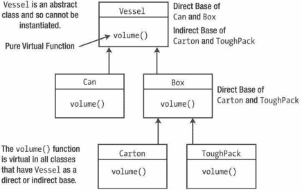

*图 15-8. 三层类层次结构*

回想一下，如果派生类没有定义基类中声明为纯虚函数的函数，那么该函数将作为纯虚函数被继承，这会使派生类成为抽象类。你可以通过从 Can 或 Box 类中删除 const 声明来演示这种效果。这会使该函数与基类中的纯虚函数不同，因此派生类会继承基类版本，程序将无法编译。

## 总结

在本章中，我们介绍了使用继承所涉及的主要概念。以下是你应该牢记的基础知识：

- 多态涉及通过指针或引用调用类的（虚）成员函数，并动态解析该调用。也就是说，要调用的具体函数由程序执行时被指向或引用的对象决定。
- 基类中的函数可以声明为 virtual。从该基类派生的类中，该函数的所有出现也都将成为虚函数。
- 应始终将打算用作基类的类的析构函数声明为 virtual（通常可以与 `= default` 结合使用）。这确保为动态创建的派生类对象正确选择析构函数。只需在最基类中这样做即可，但在其他地方这样做也无妨。
- 应使用 `override` 限定符修饰派生类中每个重写虚基类成员函数的成员函数。这会使编译器验证基类和派生类中的函数签名现在以及将来始终保持相同。
- `final` 限定符可用于单个虚函数重写，以表示不能再进一步重写它。如果整个类被指定为 `final`，则不能再为其定义任何派生类。
- 虚函数中参数的默认实参值是静态绑定的，因此如果虚函数的基类版本存在默认值，则对于动态解析的函数调用，派生类中指定的默认值将被忽略。
- `dynamic_cast<>` 运算符通常用于从指向多态基类的指针转换为指向派生类的指针。如果该指针不指向给定派生类类型的对象，则 `dynamic_cast<>` 求值为 `nullptr`。此类型检查在运行时动态执行。
- 纯虚函数没有定义。通过在成员函数声明末尾放置 `= 0`，可以将基类中的虚函数指定为纯虚函数。
- 包含一个或多个纯虚函数的类称为抽象类，不能为它创建对象。在从抽象类派生的任何类中，必须定义所有继承的纯虚函数。如果没有定义，它也会变成抽象类，并且不能创建该类的对象。

## 练习

以下练习让你尝试本章学到的内容。如果遇到困难，请回顾本章寻求帮助。如果之后仍然卡住，可以从 Apress 网站（www.apress.com/source-code）下载解决方案，但这确实应该是最后的手段。

### 练习 15-1.

定义一个名为 Animal 的基类，其中包含两个成员变量：一个 string 成员，用于存储动物的名字（例如 "Fido"）；以及一个整数成员 weight，用于保存动物的体重（以磅为单位）。还要包含一个公有成员函数 who()，它返回一个包含 Animal 对象的名字和体重的 string 对象；以及一个名为 sound() 的纯虚函数，派生类应返回一个表示该动物叫声的 string。至少派生三个类——Sheep、Dog 和 Cow——以 Animal 类作为公有基类，并在每个类中适当地实现 sound() 函数。

定义一个名为 Zoo 的类，它可以在一个 vector<> 容器中存储任意数量的各种类型的 Animal 对象的地址。编写一个 main() 函数，创建由 Animal 派生类的任意数量对象组成的随机序列，并将指向它们的指针存储在一个 Zoo 对象中。为简单起见，使用 std::shared_ptr<> 指针将 Animal 转移并存储到 Zoo 中。（稍后在第 18 章，我们将教你移动语义，这也将允许你为此使用 unique_ptr<> 智能指针。）对象数量应从键盘输入。为 Zoo 类定义一个成员函数，输出 Zoo 中每只动物的信息，包括它们发出的叫声文本。

### 练习 15-2.

从练习 15-1 的解决方案开始。因为 Cow 出了名地对自己的体重很在意，所以这个类的 who() 函数的结果必须不再包含该动物的体重。另一方面，Sheep 是异想天开的生物。它们倾向于在名字前加上 "woolly"——也就是说，对于一只名为 "Pete" 的 Sheep，who() 应返回一个包含 "woolly Pete" 的 string。除此之外，它还应返回 Sheep 的真实体重，即其总重量（存储在 Animal 基类对象中）减去其羊毛的重量（由 Sheep 自己知道）。假设一只新 Sheep 的羊毛默认占其总重量的 10%。

### 练习 15-3.

你能想出一种不在 Sheep 类中重写 who() 的情况下实现练习 15-2 要求的方法吗？（提示：也许 Animal::who() 可以调用多态函数来获取 Animal 的名字和体重。）

### 练习 15-4.

向你为练习 15-2 或 15-3 创建的 Zoo 类添加一个函数 herd()，它返回一个 vector<Sheep*>，其中包含指向 Zoo 中所有 Sheep 的指针。这些 Sheep 仍然是 Zoo 的一部分。为 Sheep 定义一个名为 shear() 的函数，用于去除它们的羊毛。该函数在正确调整 Sheep 对象的 weight 成员后，返回羊毛的重量。调整练习 15-2 的程序，使其使用 herd() 收集所有 Sheep，收集它们所有的羊毛，然后再次输出 Zoo 中的信息。

提示：要从给定的 shared_ptr<Animal> 中提取 Animal* 指针，可以调用 std::shared_ptr<> 模板的 get() 函数。


补充：在本章中，你了解了两种可用于对 Sheep 执行 herd() 的不同语言机制，也就是说，两种将 Sheep* 与其他 Animal* 指针区分开来的技术。请两种都尝试一下（将其中一种注释掉）。

练习 15-5。你可能会想，为什么练习 15-4 中的 herd() 函数要求你从使用 Animal 的 shared_ptr<> 改为原始 Sheep* 指针。难道不应该改用 shared_ptr<Sheep> 吗？主要问题在于，你不能简单地将 shared_ptr<Animal> 转换为 shared_ptr<Sheep>。对编译器而言，它们是无关类型。但你是对的；使用 shared_ptr<Sheep> 可能确实更好，而我们可能低估了你在这一方面的能力。你真正需要知道的是，要在 shared_ptr<Animal> 和 shared_ptr<Sheep> 之间转换，你绝不能使用内置的 dynamic_cast<> 和 static_cast<> 运算符，而应使用定义在 <memory> 模块中的 std::dynamic_pointer_cast<> 和 std::static_pointer_cast<> 标准库函数。例如，假设 shared_animal 是一个 shared_ptr<Animal>。那么 dynamic_pointer_cast<Sheep>(shared_animal) 会得到 shared_ptr<Sheep>。如果 shared_animal 指向一个 Sheep，则生成的智能指针将引用那个 Sheep；否则，它将包含 nullptr。请调整练习 15-4 的解答，以便在各处正确使用智能指针。

练习 15-6。从我们之前用来介绍抽象类的 Shape 和 Circle 类开始。再创建一个 Shape 派生类 Rectangle，它具有宽度和高度。引入一个名为 perimeter() 的额外函数，用于计算形状的周长。定义一个 main() 程序，首先用若干个 Shape 填充一个多态 vector<>（硬编码的 Shape 列表即可；无需随机生成它们）。接下来，打印它们面积和周长的总和，将所有 Shape 按 1.5 的因子缩放，然后再次打印这些相同的总和。当然，你没有忘记本书前半部分学到的内容，因此不应把所有代码都放在 main() 本身中。定义适当数量的辅助函数！

提示：对于半径为 r 的圆，其周长（或圆周）使用公式 2πr 计算。

# 第 16 章：运行时错误与异常

异常用于表示程序中的错误或意外情况。虽然确实存在其他错误处理机制，但异常通常能带来更简单、更清晰的代码，在其中你更不容易漏掉错误。特别是结合 RAII 原则（“resource acquisition is initialization”的缩写，即“资源获取即初始化”），我们将展示异常构成了现代 C++ 中一些最有效编程模式的基础。

- 在本章中，你将学习：
  - 什么是异常，以及何时应使用异常
  - 如何使用异常来表示错误条件
  - 如何在代码中处理异常
  - 如果忽略处理异常会发生什么
  - RAII 代表什么，以及这一惯用法如何有助于编写异常安全的代码
  - 何时使用 `noexcept` 说明符
  - 为什么在析构函数内使用异常时要格外小心
  - 标准库中定义了哪些类型的异常

## 处理错误

错误处理是成功编程的基本要素。你需要让程序具备处理潜在错误和异常事件的能力，而这往往比编写在一切正常时执行的代码需要更多精力。每当你的程序访问文件、数据库、网络位置、打印机等时，都可能发生意外——USB 设备被拔出、网络连接丢失、发生硬件错误，等等。即使没有外部错误来源，你的代码也可能并非没有缺陷，而且大多数非平凡算法有时确实会因意外输入而失败。错误处理代码的质量决定了程序的健壮程度，并且通常是让程序对用户友好的主要因素。它还会对更正代码中的错误或向应用程序添加功能的难易程度产生重大影响。

并非所有错误都一样，错误的性质决定最佳处理方式。对于程序正常使用中发生的错误，你通常不会使用异常。在许多情况下，你会直接在错误发生处处理这类错误。例如，当用户输入数据时，失误可能导致错误输入，但这并不是真正严重的问题。通常很容易检测到这类错误，而最合适的做法往往只是丢弃输入并提示用户重新输入数据。在这种情况下，错误处理代码与处理整个输入过程的代码集成在一起。

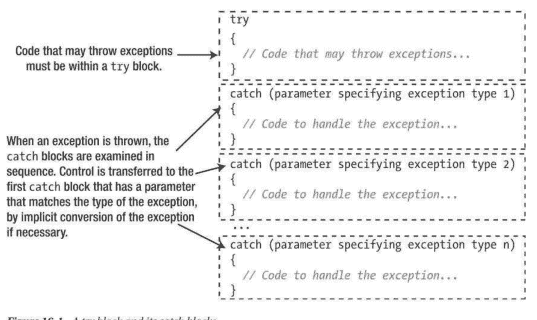

*图 16-1. 一个 try 块及其 catch 块*

catch 块中的代码仅当抛出了匹配类型的异常时才会执行。如果 try 块没有抛出异常，那么 try 块之后的 catch 块都不会执行。try 块总是从开括号后的第一条语句开始执行。

## 抛出异常

现在该抛出一个异常，看看会发生什么了。尽管你应该始终使用类对象来表示异常（本章后面你会这样做），但我们会先从基本类型开始，因为这能在解释其工作原理时让代码保持简单。你使用 *throw 表达式* 抛出异常，它是用 `throw` 关键字编写的。下面是一个例子：

```cpp
try
{
    // Code that may throw exceptions must be in a try block...

    if (test > 5)
        throw "test is greater than 5";      // Throws an exception of type const char*

    // This code only executes if the exception is not thrown...
}
catch (const char* message)
{
    // Code to handle the exception...
    // ...which executes if an exception of type 'char*' or 'const char*' is thrown
    std::cout << message << std::endl;
}
```

如果 test 的值大于 5，throw 语句就会抛出一个异常。在这种情况下，异常是字面量 "test is greater than 5"。控制权会立即从 try 块转移到为所抛出异常类型（const char*）匹配的第一个处理程序。这里只有一个处理程序，它恰好捕获 const char* 类型的异常，因此 catch 块中的语句会执行，并显示该异常。

让我们在一个可运行示例中尝试异常，该示例将抛出 int 和 const char* 类型的异常。输出语句可以让你看到控制流：

```cpp
// Ex16_01.cpp
// Throwing and catching exceptions
import <iostream>;

int main()
{
    for (size_t i {}; i < 5; ++i)
    {
        try
        {
            if (i < 2)
                throw i;

            std::cout << "i not thrown - value is " << i << std::endl;

            if (i > 3)
                throw "Here is another!";

            std::cout << "End of the try block." << std::endl;
        }
        catch (size_t i)       // Catch exceptions of type size_t
        {
            std::cout << "i caught - value is " << i << std::endl;
        }
        catch (const char* message)   // Catch exceptions of type char*
        {
            std::cout << "message caught - value is \"" << message << "\"" << std::endl;
        }

        std::cout << "End of the for loop body (after the catch blocks)"
                  << " - i is " << i << std::endl;
    }
}
```

此示例产生以下输出：

```text
i caught - value is 0
End of the for loop body (after the catch blocks) - i is 0
i caught - value is 1
End of the for loop body (after the catch blocks) - i is 1
i not thrown - value is 2
End of the try block.
End of the for loop body (after the catch blocks) - i is 2
```


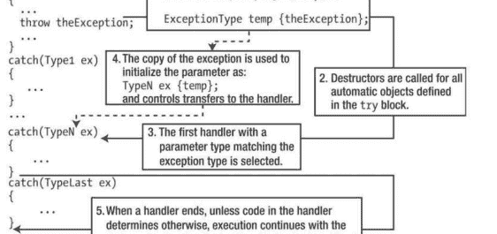

*图 16-2：抛出和捕获异常背后的机制*

当然，try 块是一个语句块，而你知道语句块定义了一个作用域。抛出异常会立即离开 try 块，因此在抛出异常之前，try 块内定义的所有自动对象都会被销毁。在处理器代码执行时，try 块中创建的自动对象一个也不存在，这一点至关重要；这意味着你不能抛出一个指向 try 块局部对象的指针作为异常对象。这也是为什么异常对象在抛出过程中会被复制的原因。

> **警告** 异常对象的类型必须是可复制的。尽管实际的复制操作经常被优化掉（使用复制省略；另见第 18 章），但具有私有、受保护或删除的复制构造函数的类类型对象通常不能用作异常（尽管一些编译器也允许仅移动的异常类型；关于移动语义的原理见第 18 章）。

因为 throw 表达式用于初始化一个临时对象，所以你可以抛出 try 块局部的对象，但不能抛出指向局部对象的指针。该对象的副本用于初始化被选中处理该异常的 catch 块的参数。

catch 块也是一个语句块，因此当 catch 块执行完毕时，其内部所有局部自动对象（包括参数）都将被销毁。除非你使用 return 语句等方式将控制权转移出 catch 块，否则执行将在 try 块的最后一个 catch 块之后的语句继续。一旦为异常选择了处理器并将控制权传递给它，该异常就被视为已处理。即使 catch 块为空且不执行任何操作，这一点也成立。

## 导致异常抛出的代码

在本讨论的开头，我们说过 try 块包围了可能抛出异常的代码。然而，这并不意味着抛出异常的代码必须物理上位于界定 try 块的花括号之间。它只需要在逻辑上位于 try 块内。如果在 try 块内调用了一个函数，那么在该函数内部抛出且未被捕获的任何异常都可以被该 try 块的一个 catch 块捕获。图 16-3 展示了这样一个例子。try 块中显示了两个函数调用：fun1() 和 fun2()。在这两个函数中的任何一个内部抛出的 ExceptionType 类型异常都可以被 try 块后面的 catch 块捕获。一个函数中抛出但未被捕获的异常可能会被传递给上一级调用函数。如果在那里没有被捕获，它可以再向上传递一级；图 16-3 展示了当 fun3() 被 fun1() 调用时抛出的异常。fun1() 中没有 try 块，因此 fun3() 抛出的异常将被传递给调用 fun1() 的函数。如果一个异常到达了某个没有更多 catch 处理程序的层级，并且仍然未被捕获，那么程序通常会终止（我们稍后将更详细地讨论未捕获异常后会发生什么）。

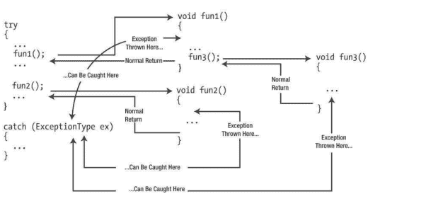

当然，如果同一个函数在程序的不同位置被调用，函数体中的代码可能抛出的异常可以在不同时间由不同的 catch 块处理。你可以在图 16-4 中看到这种情况的一个例子。

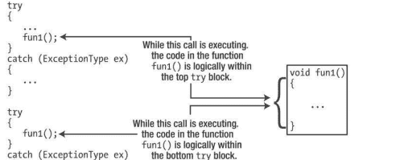

*图 16-4：在不同的 try 块内调用同一个函数*

由于第一个 try 块中的调用，该 try 块的 catch 块会处理 fun1() 抛出的任何 ExceptionType 类型异常。当 fun1() 在第二个 try 块中被调用时，该 try 块的 catch 处理程序会处理抛出的任何 ExceptionType 类型异常。由此你应该可以看出，你可以选择在最适合程序结构和操作的层级来处理异常。在极端情况下，你可以在 main() 中包围代码的 try 块后面附加各种合适的 catch 块，从而捕获程序中任何地方产生的所有异常。

## 嵌套 try 块

可以将一个 try 块嵌套在另一个 try 块中。每个 try 块都有自己的 catch 块集合，用于处理可能在它内部抛出的异常，try 块的 catch 块仅针对在该 try 块内部抛出的异常而被调用。这个过程如图 16-5 所示。

```cpp
try
{             // outer try block
    ...
    try
    {         // inner try block
        ...
    }
    catch (ExceptionType1 ex) // This handler catches ExceptionType1 exceptions thrown in the inner try block.
    {
        ...
    }
}
catch (ExceptionType2 ex) // This handler catches ExceptionType2 exceptions thrown in the outer try block, as well as uncaught exceptions of that type from the inner try block.
{
    ...
}
```

*图 16-5：嵌套 try 块*

图 16-5 为每个 try 块显示了一个处理程序，但通常可能有多个。catch 块捕获不同类型的异常，但它们也可以捕获相同类型的异常。当内部 try 块中的代码抛出异常时，它的处理程序优先获得处理机会。会依次检查该 try 块的每个处理程序的参数类型是否匹配，如果没有匹配的，外部 try 块的处理程序就有机会捕获该异常。你可以以这种方式将 try 块嵌套到适合应用程序的任何深度。

当外部 try 块中的代码抛出异常时，该块的 catch 处理程序将处理它，即使产生异常的语句位于内部 try 块之前。内部 try 块的 catch 处理程序永远不会参与处理外部 try 块内代码抛出的异常。两个 try 块内的代码都可以调用函数，在这种情况下，函数体内的代码在逻辑上位于调用它的 try 块内。

## 类对象作为异常

你可以抛出任何类型的类对象作为异常。然而，异常对象的目的是向处理程序传达出错的相关信息。因此，通常适合定义一个特定的异常类，用于表示特定类型的问题。这类异常类可能是特定于应用程序的，但你的异常类对象几乎总是包含某种解释问题的消息，可能还包含某种错误代码。你还可以让异常对象以任何适当的形式提供有关错误来源的额外信息。

让我们定义一个简单的异常类。我们将在一个名称相当通用的模块 `troubles` 中定义它，因为稍后我们会向这个模块添加更多异常类型。

```cpp
// troubles.cpp -- Exception classes
export module troubles;
import <string>;
import <string_view>;
```

```cpp
export class Trouble
{
public:
  explicit Trouble(std::string_view message = "There's a problem")
    : m_message{message}
  {}
  std::string what() const { return m_message; }
private:
  std::string m_message;
};
```

`Trouble` 类的对象简单地存储一条指示问题的消息，因此非常适合作为简单的异常对象。构造函数的参数列表中定义了默认消息，因此你可以使用默认构造函数获得一个包含默认消息的对象。当然，是否应该使用这样的默认消息完全是另一回事。请记住，通常的目的是提供有关问题原因的信息，以帮助进行问题诊断。`what()` 成员函数返回当前消息。为了保持异常处理逻辑的可管理性，你的函数应确保异常类的成员函数不会抛出异常。在本章后面，你将看到如何显式地表明某个成员函数永远不会抛出异常。

让我们通过抛出几个类对象来了解会发生什么。与前面的示例一样，我们不会刻意制造错误。我们只是抛出异常对象，以便你能观察它们在不同情况下会发生什么。我们将用一个在循环中抛出一些异常的简单示例来测试这个异常类：

```cpp
// Ex16_02.cpp
// Throw an exception object
import <iostream>;
import troubles;

void trySomething(int i);

int main()
{
  for (int i {}; i < 2; ++i)
  {
    try
    {
      trySomething(i);
    }
    catch (const Trouble& t)
    {
      // What seems to be the trouble?
      std::cout << "Exception: " << t.what() << std::endl;
    }
  }
}
```


```cpp
void trySomething(int i)
{
  // There's always trouble when 'trying something'...
  if (i == 0)
    throw Trouble {};
  else
    throw Trouble {"Nobody knows the trouble I've seen..."};
}
```

这会产生以下输出：

```text
Exception: There's a problem
Exception: Nobody knows the trouble I've seen...
```

在 for 循环期间，`trySomething()` 会抛出两个异常对象。第一个由 Trouble 类的默认构造函数创建，因此包含默认消息字符串。第二个异常对象在 if 语句的 else 子句中抛出，并包含作为构造函数参数传入的消息。catch 块会捕获这两个异常对象。

catch 块的参数是引用。如果没有将 catch 块的参数指定为引用，那么在捕获时就会复制它——完全没有必要。抛出异常对象时的事件顺序是：首先用该对象初始化一个临时对象，然后因为退出 try 块且该对象离开作用域，原对象被销毁。这个临时对象随后被传递给 catch 处理程序——如果参数是引用，则按引用传递。如果想观察这些事件的发生，只需向 Trouble 类添加一个拷贝构造函数和一个包含一些输出语句的析构函数。

## 将 catch 处理程序与异常匹配

我们之前说过，try 块后面的处理程序会按照它们在代码中出现的顺序进行检查，第一个参数类型与异常类型匹配的处理程序将被执行。对于基本类型（而不是类类型）的异常，必须与 catch 块中的参数进行精确类型匹配。对于类对象的异常，可以应用隐式转换，使异常类型与处理程序的参数类型匹配。当将参数类型与抛出的异常类型进行匹配时，以下情况被视为匹配：

- 参数类型与异常类型相同，忽略 const。
- 参数类型是异常类的直接或间接基类，或者是对异常类的直接或间接基类的引用，忽略 const。
- 异常和参数都是指针，并且异常类型可以隐式转换为参数类型，忽略 const。

这里列出的可能类型转换会影响你为 try 块排列 catch 块的顺序。如果在同一个类层次结构中有多个针对异常类型的处理程序，那么最派生的类类型必须排在最前面，最基类的类型排在最后。如果针对基类型的处理程序出现在针对该基类派生类型的处理程序之前，那么基类型总是会被选择来处理派生类异常。换句话说，针对派生类型的处理程序永远不会执行。

让我们向包含 Trouble 类的模块中再添加几个异常类，并将 Trouble 用作它们的基类。下面是定义了额外类之后模块文件内容的样子：

```cpp
// troubles.cpp -- Exception classes
export module troubles;
import <string>;
import <string_view>;

export class Trouble
{
public:
  explicit Trouble(std::string_view message = "There's a problem")
    : m_message {message}
  {}
  virtual ~Trouble() = default;    // Base classes must have a virtual destructor!
  virtual std::string_view what() const { return m_message; }
private:
  std::string m_message;
};

// Derived exception class
export class MoreTrouble : public Trouble
{
public:
  explicit MoreTrouble(std::string_view str = "There's more trouble...")
    : Trouble {str}
  {}
};

// Derived exception class
export class BigTrouble : public MoreTrouble
{
public:
  explicit BigTrouble(std::string_view str = "Really big trouble...")
    : MoreTrouble {str}
  {}
};
```

注意，基类的 `what()` 成员和析构函数已声明为虚函数。因此，在从 Trouble 派生的类中，`what()` 函数也是虚函数。这在这里没有太大区别，但原则上允许派生类重新定义 `what()`。不过，记住在基类中声明虚析构函数很重要。除了消息的默认字符串不同之外，派生类没有向基类添加任何内容。通常，仅仅使用不同的类名就能区分一种问题与另一种问题。当那种问题出现时，只需抛出特定类型的异常；类的内部实现不必不同。使用不同的 catch 块来捕获每个类类型，就提供了区分不同问题的手段。下面是抛出 Trouble、MoreTrouble 和 BigTrouble 类型异常的代码，以及捕获它们的处理程序：

```cpp
// Ex16_03.cpp
// Throwing and catching objects in a hierarchy
import <iostream>;
import troubles;

int main()
{
    for (int i {}; i < 7; ++i)
    {
        try
        {
            if (i == 3)
                throw Trouble{};
            else if (i == 5)
                throw MoreTrouble{};
            else if (i == 6)
                throw BigTrouble{};
        }
        catch (const BigTrouble& t)
        {
            std::cout << "BigTrouble object caught: " << t.what() << std::endl;
        }
        catch (const MoreTrouble& t)
        {
            std::cout << "MoreTrouble object caught: " << t.what() << std::endl;
        }
        catch (const Trouble& t)
        {
            std::cout << "Trouble object caught: " << t.what() << std::endl;
        }

        std::cout << "End of the for loop (after the catch blocks) - i is " << i << std::endl;
    }
}
```

以下是输出：

```text
End of the for loop (after the catch blocks) - i is 0
End of the for loop (after the catch blocks) - i is 1
End of the for loop (after the catch blocks) - i is 2
Trouble object caught: There's a problem
End of the for loop (after the catch blocks) - i is 3
End of the for loop (after the catch blocks) - i is 4
MoreTrouble object caught: There's more trouble...
End of the for loop (after the catch blocks) - i is 5
BigTrouble object caught: Really big trouble...
End of the for loop (after the catch blocks) - i is 6
```

在 for 循环内部，Trouble、MoreTrouble 和 BigTrouble 类型的对象会作为异常抛出。这些对象在抛出的时刻构造，异常通常也是如此。抛出的对象类型取决于循环变量 i 的值。每个 catch 块都包含不同的消息，因此输出显示了抛出异常时选择了哪个 catch 处理程序。在针对两个派生类型的处理程序中，继承的 `what()` 函数仍然返回消息。注意，与上一个示例一样，每个 catch 块的参数类型都是引用。使用引用的一个原因是避免对异常对象进行不必要的复制。在下一个示例中，你将看到另一个更关键的原因，说明为什么应该始终在处理程序中使用引用参数。

每个处理程序都会显示所抛出对象中包含的消息，你可以从输出中看到，每个处理程序都是根据所抛出异常的类型被调用的。处理程序的顺序很重要，因为异常与处理程序的匹配方式，以及异常类的类型之间存在关联。让我们更深入地探讨一下。

## 用基类处理程序捕获派生类异常

派生类类型的异常会被隐式转换为基类类型，以便与 catch 块参数匹配，因此你可以用单个处理程序捕获上一个示例中抛出的所有异常。你可以修改上一个示例来观察这一点。只需从上一个示例的 `main()` 中删除或注释掉针对两个派生类的处理程序：

```cpp
// Ex16_04.cpp
// Catching exceptions with a base class handler
import <iostream>;
import troubles;

int main()
{
  for (int i {}; i < 7; ++i)
  {
    try
    {
      if (i == 3)
        throw Trouble();
      else if (i == 5)
        throw MoreTrouble();
      else if (i == 6)
        throw BigTrouble();
    }
    catch (const Trouble& t)
    {
      std::cout << "Trouble object caught: " << t.what() << std::endl;
    }
    std::cout << "End of the for loop (after the catch blocks) - i is " << i << std::endl;
  }
}
```

该程序现在产生以下输出：

```text
End of the for loop (after the catch blocks) - i is 0
End of the for loop (after the catch blocks) - i is 1
End of the for loop (after the catch blocks) - i is 2
Trouble object caught: There's a problem
End of the for loop (after the catch blocks) - i is 3
End of the for loop (after the catch blocks) - i is 4
Trouble object caught: There's more trouble...
End of the for loop (after the catch blocks) - i is 5
Trouble object caught: Really big trouble...
End of the for loop (after the catch blocks) - i is 6
```


带有 `const Trouble&` 类型参数的 catch 块现在会捕获 try 块中抛出的所有异常。如果 catch 块中的参数是对基类的引用，那么它会匹配任何派生类异常。因此，尽管输出对每个异常都宣称“Trouble object caught”，但输出实际上对应的是从 Trouble 派生的其他类的对象。

异常按引用传递时会保留动态类型。要验证确实如此，可以获取动态类型并使用 `typeid()` 运算符显示它。只需将处理程序的代码修改为以下内容：

```cpp
catch (const Trouble& t)
{
   std::cout << typeid(t).name() << " object caught: " << t.what() << std::endl;
}
```

请记住，`typeid()` 运算符返回 `type_info` 类的对象，调用其 `name()` 成员会返回类名。对代码进行此修改后，输出表明派生类异常仍然保留其动态类型，即使异常处理程序中的引用指向基类。为记录在案，此版本程序的输出如下所示：

```
End of the for loop (after the catch blocks) - i is 0
End of the for loop (after the catch blocks) - i is 1
End of the for loop (after the catch blocks) - i is 2
class Trouble object caught: There's a problem
End of the for loop (after the catch blocks) - i is 3
End of the for loop (after the catch blocks) - i is 4
class MoreTrouble object caught: There's more trouble...
End of the for loop (after the catch blocks) - i is 5
class BigTrouble object caught: Really big trouble...
End of the for loop (after the catch blocks) - i is 6
```

> **注意** 如果你的编译器版本的 `typeid()` 运算符产生经过修饰的名称，那么程序输出中的异常类名可能看起来不太美观。第 15 章讨论过这一点。为了便于说明，我们将始终以未修饰、人类可读的格式显示结果。

尝试将处理程序的参数类型改为 `Trouble`，以便异常按值而不是按引用捕获：

```cpp
catch (Trouble t)
{
   std::cout << typeid(t).name() << " object caught: " << t.what() << std::endl;
}
```

此版本程序产生以下输出：

```
End of the for loop (after the catch blocks) - i is 0
End of the for loop (after the catch blocks) - i is 1
End of the for loop (after the catch blocks) - i is 2
class Trouble object caught: There's a problem
End of the for loop (after the catch blocks) - i is 3
End of the for loop (after the catch blocks) - i is 4
class Trouble object caught: There's more trouble...
End of the for loop (after the catch blocks) - i is 5
class Trouble object caught: Really big trouble...
End of the for loop (after the catch blocks) - i is 6
```

在这里，对于派生类对象仍然会选择 Trouble 处理程序，但动态类型没有被保留。这是因为参数使用基类拷贝构造函数初始化，因此与派生类关联的任何属性都会丢失。只保留原始派生类对象的基类子对象。这是对象切片的一个例子，发生这种情况是因为基类拷贝构造函数对派生对象一无所知。正如第 14 章所解释的，对象切片是由按值传递对象引起的常见错误来源。这使我们得出不可避免的结论：你应该始终在 catch 块中使用引用参数：

> **提示** 异常处理的黄金法则是始终按值抛出、按引用捕获（通常是 const 引用）。换句话说，你绝不能抛出用 new 创建的异常（更绝对不能抛出指向局部对象的指针），也绝不应该按值捕获异常对象。显然，按值捕获会导致多余的副本，但这还不是最糟糕的。按值捕获可能会切掉异常对象的一部分。这一点之所以如此重要，是因为它可能恰好切掉你诊断发生了哪个错误以及为什么发生错误所需的那部分宝贵信息！

## 重新抛出异常

当处理程序捕获异常时，它可以重新抛出该异常，以便外层 try 块的处理程序捕获它。你可以用仅由 throw 关键字组成的语句重新抛出当前异常：

```cpp
throw;    // Rethrow the exception
```

这会重新抛出已有的异常对象而不复制它。如果某个处理程序捕获多种派生类类型的异常，并发现该异常的类型要求将其传递到另一层 try 块，那么你可能会重新抛出异常。你可能希望在重新抛出异常之前，注册或记录程序中抛出异常的位置。或者，你可能需要在重新抛出异常以便在调用者函数中处理之前清理一些资源——释放一些内存、关闭数据库连接等。

请注意，从内层 try 块重新抛出异常并不会使该异常可供内层 try 块的其他处理程序使用。当处理程序正在执行时，抛出的任何异常（包括当前异常）都需要由包围当前处理程序的 try 块的处理程序捕获，如图 16-6 所示。重新抛出的异常不会被复制这一事实很重要，尤其是当异常是初始化了基类引用参数的派生类对象时。我们将用一个示例来演示这一点。


此示例抛出 Trouble、MoreTrouble 和 BigTrouble 异常对象，然后重新抛出其中一些，以展示重新抛出机制如何工作：

```cpp
// Ex16_05.cpp
// Rethrowing exceptions
import <iostream>;
import <typeinfo>;    // For the std::type_info type that is returned by typeid()
import troubles;

int main()
{
    for (int i {}; i < 7; ++i)
    {
        try
        {
            try
            {
                if (i == 3)
                    throw Trouble{};
                else if (i == 5)
                    throw MoreTrouble{};
                else if (i == 6)
                    throw BigTrouble{};
            }
            catch (const Trouble& t)
            {
                if (typeid(t) == typeid(Trouble))
                    std::cout << "Trouble object caught in inner block: " << t.what() << std::endl;
                else
                    throw;       // Rethrow current exception
            }
        }
        catch (const Trouble& t)
        {
            std::cout << typeid(t).name() << " object caught in outer block: "
                      << t.what() << std::endl;
        }
        std::cout << "End of the for loop (after the catch blocks) - i is " << i << std::endl;
    }
}
```

此示例显示以下输出：

```
End of the for loop (after the catch blocks) - i is 0
End of the for loop (after the catch blocks) - i is 1
End of the for loop (after the catch blocks) - i is 2
Trouble object caught in inner block: There's a problem
End of the for loop (after the catch blocks) - i is 3
End of the for loop (after the catch blocks) - i is 4
class MoreTrouble object caught in outer block: There's more trouble...
End of the for loop (after the catch blocks) - i is 5
class BigTrouble object caught in outer block: Really big trouble...
End of the for loop (after the catch blocks) - i is 6
```

for 循环的工作方式与前一个示例相同，但这次有一个 try 块嵌套在另一个 try 块中。内层 try 块中抛出了与前一个示例相同序列的异常对象，所有异常对象都被匹配的 catch 块捕获，因为参数是对基类 Trouble 的引用。catch 块中的 if 语句测试传入对象的类类型，如果它是 Trouble 类型，则执行输出语句。对于任何其他类型的异常，该异常会被重新抛出，因此可供外层 try 块的 catch 块捕获。参数同样是对 Trouble 的引用，所以它会捕获所有派生类对象。输出表明它捕获了抛出的对象，而且它们仍保持原始状态。

你可能会认为，内层 try 块处理程序中的 throw 语句等价于以下语句：

```cpp
throw t;    // Rethrow current exception
```


毕竟，你只是在重新抛出异常，不是吗？答案是否定的；这二者有着关键区别。如果你对程序代码做出这一修改并再次运行，将得到如下输出：

```
End of the for loop (after the catch blocks) - i is 0
End of the for loop (after the catch blocks) - i is 1
End of the for loop (after the catch blocks) - i is 2
Trouble object caught in inner block: There's a problem
End of the for loop (after the catch blocks) - i is 3
End of the for loop (after the catch blocks) - i is 4
class Trouble object caught in outer block: Really big trouble...
End of the for loop (after the catch blocks) - i is 5
class Trouble object caught in outer block: Really big trouble...
End of the for loop (after the catch blocks) - i is 6
```

带有显式异常对象的语句抛出的是一个新异常，而不是重新抛出原始异常。这会导致原始异常对象被复制，并使用 Trouble 类的复制构造函数。这又是那个恼人的对象切片问题！每个对象的派生部分都被切掉了，因此每种情况下你都只剩下基类子对象。从输出中可以看到，`typeid()` 运算符将所有异常类型都识别为类型 Trouble。因此：

> **提示** 总是按值抛出，按 const 引用捕获，并使用 `throw;` 语句重新抛出。

## 未捕获的异常

如果抛出的异常未被直接或间接捕获（也就是说，它不一定必须在同一个函数内被捕获，正如我们之前讨论的那样），那么程序会立即终止。你真的应该预料到这种终止会相当突然。首先，静态对象的析构函数将不再被调用；也无法保证仍分配在调用栈上的任何对象的析构函数会被执行。换句话说，程序基本上会立即崩溃。

> **注意** 实际上，如果某个异常未被捕获，就会调用标准库函数 `std::terminate()`（在 `<exception>` 模块中声明），后者又默认调用 `std::abort()`（在 `<cstdlib>` 中声明），然后终止程序。未捕获异常的此事件序列如图 16-7 所示。

从技术上讲，可以通过向 `std::set_terminate()` 传递函数指针来覆盖 `std::terminate()` 的行为。然而，这种方法很少被推荐，应留待（双关语……）特殊情况使用。而且在终止处理器中，你被允许做的事情也不多。可接受的用途包括确保某些关键资源得到正确清理，或编写所谓的崩溃转储，让你的客户可以将其发送给你做进一步诊断。不过，这些主题对本书来说过于深入，不值得进一步讨论。有一件事你绝不能做：在调用 `std::terminate()` 后试图让程序继续运行。`std::terminate()`，按定义，是在不可恢复的错误之后被调用的，任何恢复尝试都会导致未定义行为。你的终止处理器必须始终以两个函数调用之一结束：要么是 `std::abort()`，要么是 `std::exit()`。这两个函数都会结束程序而不执行任何进一步清理（两者之间的区别在于，使用后者时你可以决定进程向环境返回哪个错误码）。


*图 16-7. 未捕获的异常*

在未捕获异常后终止程序听起来可能很严厉，但确实还有其他选择吗？请记住，通常只有在发生了需要进一步关注、意外且不可恢复的情况时，你才会抛出异常。如果随后发现没有合适的代码来处理这个错误，那还有什么其他行动方针呢？程序本质上处于某种意外、错误的状态，所以若无其事地继续运行，通常只会导致更多、甚至可能严重得多的错误。此外，这些次级错误可能更难诊断。因此，唯一合理的做法就是停止执行。

## 捕获所有异常

你可以使用省略号（`...`）作为 catch 块的参数规范，以表明该块应处理任何异常：

```cpp
try
{
    // Code that may throw exceptions...
}
catch (...)
{
    // Code to handle any exception...
}
```

这个 catch 块处理任何类型的异常，因此这样的处理程序必须始终是 try 块的一系列 catch 块中的最后一个。当然，你并不知道异常是什么，正如我们稍后要解释的，这常常使你无法妥善处理该错误。请注意，即使你对异常一无所知，你仍然可以像上一个示例中那样重新抛出异常。

你可以修改之前的示例，用省略号代替参数来捕获内部 try 块的所有异常：

```cpp
// Ex16_06.cpp
// Catching any exception
import <iostream>;
import <typeinfo>;   // For use of typeid()
import troubles;

int main()
{
  for (int i {}; i < 7; ++i)
  {
    try
    {
      try
      {
        if (i == 3)
          throw Trouble{};
        else if (i == 5)
          throw MoreTrouble{};
        else if (i == 6)
          throw BigTrouble{};
      }
      catch (const BigTrouble& bt)
      {
        std::cout << "Oh dear, big trouble. Let's handle it here and now." << std::endl;
        // Do not rethrow
      }
      catch (...)   // Catch any other exception
      {
        std::cout << "We caught something else! Let's rethrow it." << std::endl;
        throw;      // Rethrow current exception
      }
    }
    catch (const Trouble& t)
    {
      std::cout << typeid(t).name() << " object caught in outer block: "
                << t.what() << std::endl;
    }
    std::cout << "End of the for loop (after the catch blocks) - i is " << i << std::endl;
  }
}
```

由你调用的函数可能会引发各种异常类型，你需要逐一考虑是否应该添加 catch 块，和/或将其留给调用函数来处理异常。一旦你知道异常类型，你通常可以从对象中提取更有用的信息（比如我们 Trouble 类的 `what()` 函数），并用于适当的错误处理和日志记录。还要注意，尤其是在开发期间，程序崩溃实际上比捕获所有异常的块更好。至少你能了解潜在错误，而不是盲目忽略它们，并可以调整代码以妥善预防或恢复它们。

别误会，我们并不是说捕获所有异常的代码块永远不应该使用——它们确实有其用武之地。例如，在进行一些日志记录或清理后重新抛出的捕获所有异常块可能特别有用。我们只是要告诫你，不要将它们当作更精准的错误处理的简单、低劣的替代品。

## 不抛出异常的函数

原则上，任何函数都可以抛出异常，包括普通函数、成员函数、虚函数、重载运算符，甚至构造函数和析构函数。所以，每次你在某处调用一个函数时，都应该学会思考可能出现的潜在异常，以及是否应该用 try 块处理它们。当然，这并不意味着每个函数调用都需要用 try 块包围。只要你不是在 `main()` 中工作，通常完全可以委托函数的调用者来承担捕获异常的责任。

不过，有时你完全清楚自己正在编写的函数永远不会抛出异常。某些类型的函数甚至根本不应该抛出异常。本节将简要讨论这些情况以及 C++ 为此提供的语言设施。

## noexcept 说明符

通过将 noexcept 关键字附加到函数头，你指定某个函数永远不会抛出异常。例如，以下代码指定 `doThat()` 函数永远不会抛出异常：

```cpp
void doThat(int argument) noexcept;
```

如果在函数头中看到 noexcept，你便可以确信这个函数永远不会抛出异常。编译器会确保，如果一个 noexcept 函数确实无意中抛出了未在函数自身内部捕获的异常，该异常不会在运行时传播给调用函数。相反，C++ 程序会将其视为不可恢复的错误，并调用 `std::terminate()`。正如本章前面所讨论的，`std::terminate()` 总是导致进程突然终止。

请注意，这并不意味着不允许在函数自身内部抛出异常；它只是意味着不会有任何异常从该函数逃逸。也就是说，如果在 noexcept 函数执行期间抛出了异常，它必须在该函数内部的某处被捕获，且不得被重新抛出。例如，以下形式的 `doThat()` 实现将是完全合法的：

```cpp
void doThat(int argument) noexcept
{
    try
    {
        // Code for the function...
    }
}
```


```cpp
catch (...)
{
    // Handles all exceptions and does not rethrow...
}
```

`noexcept` 说明符可用于所有函数，包括成员函数、构造函数和析构函数。你将在本章后面遇到具体示例。

在后面的章节中，你甚至会遇到几种应始终声明为 `noexcept` 的函数类型。这包括 `swap()` 函数（在第17章讨论）和移动成员（在第18章讨论）。

> **注意**  与例如 Java 不同，在 C++ 中你不能指定非 `noexcept` 函数可能抛出哪些类型的异常。过去，你可以通过在函数头后附加 `throw(exception_type1, ..., exception_typeN)` 来做到这一点，但该特性已从语言中移除。

## 异常与析构函数

从 C++11 开始，析构函数通常隐式地是 `noexcept`。即使你定义析构函数时没有 `noexcept` 说明，编译器通常也会隐式添加一个。这意味着如果执行下面类的析构函数，异常永远不会离开该析构函数。相反，将始终调用 `std::terminate()`（与编译器添加的隐式 `noexcept` 说明符一致）：

```cpp
class MyClass
{
public:
    ~MyClass() { throw BigTrouble{}; }
};
```

原则上可以定义允许抛出异常的析构函数。你可以通过添加显式的 `noexcept(false)` 说明来做到这一点。但由于通常绝不应该这样做，我们不再进一步讨论或考虑这种可能性。

> **提示**  绝不允许异常离开析构函数。所有析构函数通常³都是 `noexcept`，即使没有显式指定为如此，因此它们抛出的任何异常都会触发对 `std::terminate()` 的调用。

## 异常与资源泄漏

确保捕获所有异常可以防止灾难性的程序失败。而用位置正确且足够细粒度的 catch 块捕获它们，可以让你正确处理所有错误。其结果是一个程序在任何时候要么给出期望的结果，要么能精确告知用户出了什么问题。但这并不是故事的全部！一个从外部看起来运行稳健的程序，仍可能包含隐藏缺陷。例如，考虑下面的示例程序（它使用与 Ex16_06 相同的 troubles 模块）：

```cpp
// Ex16_07.cpp
// Exceptions may result in resource leaks!
import <iostream>;
import troubles;
#include <cmath>    // For std::sqrt()

double computeValue(size_t x);            // A function to compute a single value
double* computeValues(size_t howMany);    // A function to compute an array of values

int main()
{
    try
    {
        double* values{ computeValues(10'000) };
        // Unfortunately we won't be making it this far...
        delete[] values;
    }
    catch (const Trouble&)
    {
        std::cout << "No worries: I've caught it!" << std::endl;
    }
}

double* computeValues(size_t howMany)
{
    double* values{ new double[howMany] };
    for (size_t i{}; i < howMany; ++i)
        values[i] = computeValue(i);
    return values;
}

double computeValue(size_t x)
{
    if (x < 100)
        return std::sqrt(x);    // Return the square root of the input argument
    else
        throw Trouble{"The trouble with trouble is, it starts out as fun!"};
}
```

如果运行这个程序，一旦 computeValues() 中的循环计数器达到 100，就会抛出 Trouble 异常。由于异常在 main() 中被捕获，程序不会崩溃。它甚至会让用户放心，一切正常。如果这是一个真实程序，你甚至可以告诉用户此操作到底出了什么问题，并允许用户继续。但这并不意味着你已经脱离困境！你能看出这个程序还有哪里出了问题吗？

computeValues() 函数在自由存储区中分配一个 double 值数组，尝试填充它们，然后将该数组返回给调用者。释放这块内存是调用者的责任——在这里是 main()——。然而，由于在 computeValues() 执行到一半时抛出了异常，它的 values 数组实际上从未返回给 main()。因此，该数组也从未被释放。换句话说，我们刚刚泄漏了一个包含 10,000 个 double 的数组！

假设 computeValue() 本身会偶尔导致 Trouble 异常，那么我们唯一能修复此泄漏的地方就是 computeValues() 函数。毕竟，main() 甚至从未收到指向被泄漏内存的指针，所以在那里几乎无能为力。本着本章到目前为止的精神，因此第一个显而易见的解决方案是给 computeValues() 添加一个 try 块，如下所示（你可以在 Ex16_07A 中找到这个解决方案）：

```cpp
double* computeValues(size_t howMany)
{
    double* values{ new double[howMany] };
    try
    {
        for (size_t i {0}; i < howMany; ++i)
            values[i] = computeValue(i);
        return values;
    }
    catch (const Trouble&)
    {
        std::cout << "I sense trouble... Freeing memory..." << std::endl;
        delete[] values;
        throw;
    }
}
```

注意 values 必须定义在 try 块之外。否则，该变量将是 try 块的局部变量，我们就无法再从 catch 块内部引用它。如果你像这样重新定义 computeValues()，程序其余部分不需要进一步修改。它仍将得到类似结果，只是这一次 values 数组不会被泄漏：

```text
I sense trouble... Freeing memory...
No worries: I've caught it!
```

虽然这个带有 try 块的 computeValues() 构成了一个完全正确的程序，但它并不是最推荐的方法。该函数的代码变得大约有两倍长，也大约有两倍复杂。下一节将介绍没有这些缺点的更好解决方案。

## 资源获取即初始化

现代 C++ 的标志之一就是所谓的 RAII 惯用法，它是“resource acquisition is initialization”（资源获取即初始化）的缩写。其前提是：每次获取资源时，都应通过初始化一个对象来完成。自由存储区中的内存是一种资源，但其他例子还包括文件句柄（在持有它们时，其他进程通常可能无法访问某个文件）、互斥量（用于并发编程中的同步）、网络连接等。根据 RAII，每个这样的资源都应由一个对象管理，要么

尽管如此，当然有标准库类型可以完成与 DoubleArrayRAII 相同的工作。因此在实际中，你永远不会编写一个 RAII 类来管理数组。

第一种这样的类型是 `std::unique_ptr<T[]>`。如果包含 `<memory>` 模块，你可以如下编写 `computeValues()`：

```cpp
double* computeValues(size_t howMany)
{
    auto values{ std::make_unique<double[]>(howMany) };  // type unique_ptr<double[]>
    for (size_t i {}; i < howMany; ++i)
        values[i] = computeValue(i);
    return values.release();
}
```

事实上，使用 `std::unique_ptr<>` 时，更好的选择是像这样编写：

```cpp
std::unique_ptr<double[]> computeValues(size_t howMany)
{
    auto values { std::make_unique<double[]>(howMany) };
    for (size_t i {}; i < howMany; ++i)
        values[i] = computeValue(i);
    return values;
}
```

如果你从 `computeValues()` 返回 `unique_ptr<>` 本身，你当然必须相应地稍微调整 `main()` 函数。如果这样做，你会注意到那里不再需要 `delete[]` 语句。这又消除了一处潜在的内存泄漏源！除非你要将资源传递给例如遗留函数，否则很少需要从其 RAII 对象中释放资源。只需传递 RAII 对象本身即可！

> **注意**  如果你尝试像这样从 `computeValues()` 返回一个 `DoubleArrayRAII` 对象，你会遇到编译器错误，指出其复制构造函数已被删除。要从函数返回 `DoubleArrayRAII`，你首先需要为该类启用移动语义（就像例如 `std::unique_ptr<>` 所做的那样）。我们在第18章进一步解释这一点。

由于我们处理的资源是动态数组，你当然知道也可以简单地改用 `std::vector<>`：

```cpp
std::vector<double> computeValues(size_t howMany)
{
    std::vector<double> values;
    for (size_t i {}; i < howMany; ++i)
        values.push_back( computeValue(i) );
    return values;
}
```


在这种情况下，`vector<>` 可能是最合适的选择。毕竟，`vector<>` 是专门设计用来管理和操作动态数组的。无论你更喜欢哪一种，本节的主旨仍然如下：

> **提示** 所有动态内存都应由 RAII 对象管理。标准库为此提供了智能指针（如 `std::unique_ptr` 和 `std::shared_ptr`）和动态容器（如 `std::vector<>`）。对于智能指针，也始终应使用 `make_unique()` 和 `make_shared()`，而不是 `new` / `new[]`。这些准则的一个重要结果是，`new`、`new[]`、`delete` 和 `delete[]` 运算符在现代 C++ 程序中通常没有用武之地。安全起见：始终使用 RAII 对象！

## 标准库异常

标准库中定义了不少异常类型。它们都派生自 `<exception>` 模块中定义的 `std::exception` 类，并且都位于 `std` 命名空间中。供参考，标准异常类的层级结构如图16-8所示。


*图16-8。* 标准异常类类型及其定义所在的模块

许多标准异常类型分为两组，每组由一个派生自 `exception` 的基类标识。这两个基类 `logic_error` 和 `runtime_error` 都定义在 `<stdexcept>` 模块中。大多数情况下，标准库函数不会直接抛出 `logic_error` 或 `runtime_error` 对象，而只会抛出派生自这些类型的对象。派生自它们的异常列于图16-8的前两列。异常层级结构任一分支中类型的分类规则如下：

- 以 `logic_error` 为基类的类型，是用于表示那些（至少原则上）本可在程序执行前检测到的错误所抛出的异常，因为这些错误由程序逻辑缺陷引起。抛出 `logic_error` 的典型情形包括：用一个或多个无效参数调用函数，或在一个状态不满足该特定函数要求（或前置条件）的对象上调用成员函数。你可以通过在函数调用前显式检查参数有效性或对象状态，来避免程序中出现这类错误。

- 另一组派生自 `runtime_error`，用于表示通常依赖数据、只能在运行时检测到的错误。例如，派生自 `system_error` 的异常通常封装来自底层操作系统调用的错误，例如文件输入或输出失败。文件访问与任何硬件交互一样，总可能以无法预先预测的方式失败（想想磁盘故障、线缆被拔掉、网络故障等）。

图16-8中有很多异常类型，我们不打算逐一详述它们全部来自哪里。你的库文档会指出函数何时抛出异常。这里我们只提及一些由你已熟悉的操作抛出的异常类型：

- `std::out_of_range` 异常类型用于以无效索引访问类数组数据结构时（通常定义为超出有效范围 `[0, size−1]`）。`std::string` 的各种成员函数会抛出此异常，例如 `std::vector<>` 和 `std::array<>` 的 `at()` 访问器函数也会抛出此异常。对于后者，对应的重载运算符——数组访问运算符 `[]`——不会对索引执行边界检查。向这些运算符传递无效索引会导致未定义行为。

- `std::format()` 在传入无效格式字符串时会抛出 `std::format_error`。因此，为了调试新的格式字符串为何失败，临时用 try-catch 块包裹相应的 `std::format()` 表达式，并打印在捕获到的异常上调用 `what()` 的结果，可能会很有用（另见第2章）。不过，一旦格式字符串正常工作，`std::format()` 通常就不会再抛出异常，此时你应再次移除这段调试代码。否则它只会使你的代码变得杂乱。

- 如果将 `typeid()` 运算符应用于对指向多态类型的空指针进行解引用所得的结果，就会抛出 `std::bad_typeid` 异常。

- 如果 `expr` 无法转换为 `T&`，`dynamic_cast<T&>(expr)` 操作会抛出 `std::bad_cast` 异常。只有在转换为引用类型 `T&` 时才可能发生异常。当转换为指针类型 `T*` 失败时，`dynamic_cast<T*>(expr)` 只会求值为 `nullptr`。

- 对不持有值的 `std::optional<>` 对象调用其 `value()` 成员会抛出 `bad_optional_access` 异常。不过，`optional<>` 的 `*` 和 `->` 运算符从不抛出异常。对没有值的 `optional<>` 使用这些运算符会导致未定义行为。在实践中，这意味着你会读取到垃圾数据。

- 运算符 `new` 和 `new[]` 可能抛出 `std::bad_alloc` 异常（或派生自 `bad_alloc` 的另一异常）。例如，如果传给运算符 `new[]` 的是负数或过大的数组大小，它会抛出 `std::bad_array_new_length` 异常。但即使输入有效，只要内存分配失败，这两个运算符中的任意一个都可能抛出 `bad_alloc` 异常。可能原因包括自由存储区损坏或可用内存不足。推而广之，任何需要动态内存分配的操作也可能抛出 `bad_alloc` 异常。此类操作的显著示例包括复制 `std::vector<>` 或 `std::string` 对象，或向其添加元素。

## 异常类定义

你可以将标准异常类用作自己的异常类的基类。由于所有标准异常类都以 `std::exception` 为基类，因此最好了解这个类有哪些成员，因为它们会被所有其他异常类继承。异常类在 `<exception>` 模块中的定义如下：

```cpp
namespace std
{
  class exception
  {
  public:
    exception() noexcept;                         // Default constructor
    exception(const exception&) noexcept;         // Copy constructor
    exception& operator=(const exception&) noexcept; // Assignment operator
    virtual ~exception();                         // Destructor
    virtual const char* what() const noexcept;    // Return a message string
  };
}
```

这是公共类接口规范。特定实现可能具有额外的非公共成员。其他标准异常类也是如此。成员函数声明中出现的 noexcept 关键字表示它们不抛出异常，正如我们之前讨论的那样。析构函数默认是 noexcept。注意，这里没有成员变量。`what()` 返回的以空字符结尾的字符串定义在函数定义体内，并且依赖于实现。该函数被声明为虚函数，因此在任何派生自 `exception` 的类中它都会是虚函数。如果你有一个虚函数，可以针对每种异常类型传递相应的消息，那么你可以用它提供一种基本而经济的方式来记录抛出的任何异常。

带有基类参数的 catch 块可匹配任何派生类异常类型，因此你可以使用 `exception` 类型的参数捕获任何标准异常。当然，你也可以使用 `logic_error` 或 `runtime_error` 类型的参数来捕获派生自这些类型的任何异常。你可以为 `main()` 函数提供一个 try 块，以及一个用于捕获 `exception` 类型异常的 catch 块：

```cpp
int main()
{
  try
  {
    // Code for main...
  }
}
```


## 直接抛出标准异常

显然，如果你要抛出标准异常，就只应在与其用途一致的情况下抛出它们。这意味着，例如，你不应抛出 `bad_cast` 异常，因为它们已经有了特定作用。抛出 `std::exception` 类型的对象也不太有用，因为它过于通用；它没有提供一个可以传入描述性字符串的构造函数。最有用的标准异常类是在 `<stdexcept>` 模块中定义、派生自 `logic_error` 或 `runtime_error` 的那些类。举一个熟悉的例子，当作为参数提供的维度无效时，你可以在 `Box` 类构造函数中抛出一个标准的 `out_of_range` 异常：

```cpp
Box::Box(double length, double width, double height)
  : m_length {length}, m_width {width}, m_height {height}
{
    if (length <= 0.0 || width <= 0.0 || height <= 0.0)
        throw std::out_of_range("Zero or negative Box dimension.");
}
```

构造函数体会在任一参数为零或负数时抛出 `out_of_range` 异常。当然，源文件需要包含定义 `out_of_range` 类的 `<stdexcept>` 模块。`out_of_range` 类型是一种 `logic_error`，因此非常适合这种特定用途。这里的另一个候选是更通用的 `std::invalid_argument` 异常类。不过，如果没有一个预定义异常类符合你的需要，你可以自己派生一个异常类。

## 派生自己的异常类

从某个标准异常类派生自己的类的一个主要优点是，你的类会成为同一异常家族的一部分。这使你能够在同一个 catch 块中既捕获标准异常，也捕获自己的异常。例如，如果你的异常类派生自 `logic_error`，那么参数类型为 `logic_error` 的 catch 块既能捕获你的异常，也能捕获以该类为基类的标准异常。以 `exception` 为参数类型的 catch 块总能捕获标准异常——只要你的类以 `exception` 为基类，也能捕获你自己的异常。

你可以通过让 `Trouble` 异常类派生自 `exception` 类，非常简单地将 `Trouble` 异常类及其派生类纳入标准异常家族。只需按如下方式修改类定义：

```cpp
class Trouble : public std::exception
{
public:
    explicit Trouble(std::string_view message = "There's a problem");
    const char* what() const noexcept override;

private:
    std::string m_message;
};
```

这为基类中定义的虚 `what()` 成员提供了自己的实现。由于它是对基类成员的重定义，我们在 `what()` 的声明中添加了 `override`。按照我们的约定，我们还移除了 `virtual` 说明符。不过，更有意思的是，我们添加了 `noexcept` 规范，以表明不会从 `what()` 中抛出异常。事实上，我们必须这样做。任何对 `noexcept` 函数的覆盖也必须为 `noexcept`。还值得一提的是，`noexcept` 必须始终指定在 `const` 之后、`override` 之前。

成员函数的定义必须包含与类定义中该函数相同的异常规范。因此，`what()` 函数变成如下形式（不得重复 `virtual` 或 `override`，但 `noexcept` 要保留）：

```cpp
const char* Trouble::what() const noexcept { return m_message.c_str(); }
```

> **注意**  我们故意没有给 `Trouble` 的构造函数添加 `noexcept` 说明符。这个构造函数不可避免地必须将给定的错误消息复制到相应的 `std::string` 成员变量中。这反过来又不可避免地涉及字符数组的分配。而内存分配在原则上总是可能出错并抛出 `std::bad_alloc` 异常。

举一个更具体的例子，让我们再次回到 `Box` 类定义。对于上一节中定义的构造函数，从 `std::out_of_range` 派生一个异常类可能很有用，这样可以提供一种选择，使 `what()` 能返回更具体的字符串，以标识导致抛出异常的问题。你可以这样做：

```cpp
export module dimension_error;
import <stdexcept>;        // For derived exception classes such as std::out_of_range
import <string>;           // For std::to_string()

export class DimensionError : public std::out_of_range
{
public:
  explicit DimensionError(double value)
    : std::out_of_range("Zero or negative dimension: " + std::to_string(value))
    , m_value{value} {}

  // Function to obtain the invalid dimension value
  double getValue() const noexcept { return m_value; }
private:
  double m_value;
};
```

构造函数提供一个参数，用于指定导致抛出异常的维度值。它用一个新字符串对象调用基类构造函数，该字符串由一条消息和值拼接而成。`to_string()` 函数是定义在 `<string>` 模块中的模板函数；它返回其参数的字符串表示，而参数可以是任意数值类型的值。继承的 `what()` 函数将返回创建 `DimensionError` 对象时传递给构造函数的字符串。这个特定的异常类还添加了一个成员变量来存储无效值，以及一个公有函数来获取它，例如在 catch 块中使用。

下面展示这个异常类如何在 `Box` 类定义中使用：

```cpp
// Box.cpp
export module box;
import <algorithm>;        // For the std::min() function template
import dimension_error;
```

**练习 16-4.** 从图 16-8 中任意挑选若干标准库异常类型，并编写一个程序，使这些异常类型依次被引发（当然，不要自己实际抛出它们）。你应捕获每个异常并输出它们包含的 `what()` 消息，然后再继续触发下一个异常。

**练习 16-5.** 创建一个名为 `readEvenNumber()` 的函数，旨在从 `std::cin` 流中读取一个偶数整数。在某个读取过程开始时，`readEvenNumber()` 内部会发生一次读取，从而产生 `CurveBall` 异常。为此，你可以直接复用练习 16-4 中的代码。然而，正常情况下，该函数会验证用户输入，并在用户正确输入偶数时返回该偶数。然而，如果输入无效，该函数会抛出以下异常之一：

- 如果输入的任何值不是数字，则抛出 `NotANumber` 异常。
- 如果用户输入负数，则抛出 `NegativeNumber` 异常。
- 如果用户输入奇数，函数抛出 `OddNumber` 异常。

你应从 `std::domain_error`（`<stdexcept>` 模块中定义的标准异常类型之一）派生这些新异常类型。它们的构造函数应组合出一个至少包含错误输入值的字符串，然后将该字符串转发给 `std::domain_error` 的构造函数。

提示：在尝试从 `std::cin` 读取一个整数后，你可以使用 `std::cin.fail()` 检查该整数的解析是否成功。如果该成员函数返回 true，则用户输入的字符串不是数字。注意，一旦流处于这种失败状态，在调用 `std::cin.clear()` 之前，你不能再使用该流。此外，用户输入的非数字值仍会留在流中——在提取整数失败时它不会被移除。例如，你可以使用 `<string>` 中定义的 `std::getline()` 函数将其提取出来。把这一切放在一起，你的代码可能包含类似下面的内容：

```cpp
if (std::cin.fail())
{
    std::cin.clear();    // Reset the failure state
    std::string line;    // Read the erroneous input and discard it
    std::getline(std::cin, line);
}
```

一旦辅助函数 `readEvenNumber()` 准备就绪，就用它来实现 `askEvenNumber()`。该函数向 `std::cout` 打印用户指令，然后调用 `readEvenNumber()` 来处理实际输入和输入验证。一旦正确读取到一个数字，`askEvenNumber()` 会礼貌地感谢用户输入该数字，并且消息应包含数字本身。对于 `readEvenNumber()` 抛出的任何 `std::exception`，`askEvenNumber()` 至少应输出其 `what()` 消息。如果异常不是 `domain_error`，则应重新抛出它，因为 `askEvenNumber()` 不知道如何处理它。然而，如果异常是 `domain_error`，则应重试请求输入偶数，除非该异常是 `NotANumber`。如果发生 `NotANumber`，`askEvenNumber()` 将停止请求输入数字并直接返回。


最后，编写一个 `main()` 函数，该函数执行 `askEvenNumber()` 并捕获可能抛出的任何 `CurveBalls`。如果捕获到，它应输出“……hit it out of the park!”，因为当生活向你抛出曲线球时，你做的就是这件事！

练习16-6。`Exer16_06` 目录包含一个小程序，它调用一个虚构数据库系统的 C 接口（该接口实际上是 MySQL 的 C 接口的简化版本）。与 C 接口常见的情况一样，我们的数据库接口返回指向各种资源的所谓句柄——这些资源在使用完毕后需要通过调用另一个接口函数显式释放。在此情况下，有两种这样的资源：与数据库的连接，以及为存储 SQL 查询结果而分配的内存。仔细阅读 `DB.h` 中的接口规范，了解应如何使用该接口。由于这是一个练习，在 `Exer16_06` 的程序中，这些资源在某些条件下可能会泄漏。你能找出资源发生泄漏的任何条件吗？由于这是关于异常的一章中的练习，这些条件当然大多会涉及异常。

提示：为了体会错误处理可能有多么微妙，你是否想过，当向 `std::stoi()` 传入一个不包含数字的字符串时，它会做什么？查阅标准库参考——或者编写一个小测试程序——来找出答案。假设有客户住在 10B 号或 105/5 号。我们的程序中会发生什么？如果一位俄罗斯客户住在 k2，也就是其官方地址的街道“号码”以字母开头的一所房子，又会怎样？同样，如果某些客户的房号没有填写呢？也就是说，如果数据库中存储的房号是空字符串，会怎样？

要修复我们程序中的资源泄漏，你可以添加显式的资源清理语句，添加更多 `try-catch` 块，等等。不过，对于这个练习，我们希望你能改为创建并使用两个小型 RAII 类：一个确保活动数据库连接始终被断开，另一个释放为给定查询结果分配的内存。注意，如果你为 RAII 类添加转换运算符，以隐式转换为其封装的句柄类型（和/或转换为布尔值），你甚至可能不必改动代码的其余大部分！

注意：采用我们为这个练习建议的方法，主程序仍然使用 C 接口，只不过现在它会立即将所有资源句柄存储到 RAII 对象中。这当然是一个可行的选择，我们也在实际应用中用过。另一种方法是使用所谓的*装饰器/包装器*设计模式。然后你开发一组 C++ 类，封装整个数据库及其查询功能。只有这些装饰器类才应直接调用 C 接口；程序其余部分只需使用 C++ 装饰器类的成员。这些装饰器类的接口设计应确保不可能发生内存泄漏；程序能够访问的所有资源都应始终由 RAII 对象管理。C 资源句柄本身通常绝不应让程序其余部分访问。实现这种替代方法会使我们偏离本章主题（异常）太远，但如果你必须在更大的 C++ 程序中集成 C 接口，这是值得记住的一种方法。

# 第 17 章：类模板


函数模板和类模板都在整个 C++ 标准库中被广泛使用，以提供强大的泛型工具、算法和数据结构。你在第10章学习了编译器用来创建函数的模板；本章讨论编译器用来创建类的模板。类模板是生成新类类型的强大机制。

学完本章，你也接近了关于定义自己类的系列章节的尾声。因此，除了介绍类模板之外，我们还会加入一些稍微偏离主题的编码风格思考。借助这些边栏，我们希望引导你思考代码中超越单纯功能正确性的方面。我们将主张，编写代码不应仅仅确保它能计算出正确的值。你的代码应易于阅读和维护，应对意外条件和异常具有健壮性，等等。当然，我们也会沿途教你一些标准技术，帮助你实现这些基本的非功能性需求。

- 什么是类模板，以及如何定义类模板
- 什么是类模板的实例，以及它是如何创建的
- 如何在类模板定义之外定义类模板成员函数的模板
- 什么是类模板的偏特化，以及如何定义它
- 一个类如何嵌套在类模板内部
- 为什么值得投入高质量代码：不仅正确，而且易于维护且能抵御失败
- 什么是“复制并交换”（copy-and-swap）惯用法，以及如何使用它编写异常安全的代码
- 如何使用“const 去而复返”（const-and-back-again）惯用法避免重复重载成员函数

## 理解类模板

类模板与函数模板基于相同的理念（见第10章）。它是一种参数化类型，构成了创建一族类定义的配方。正如配方本身不能吃一样，类模板定义本身也没有与之关联的可执行代码。只有当编译器从类模板实例化出具体类定义时，才会产生实际代码。例如，在你的程序可以使用 `std::vector<int>` 类型的变量之前，编译器必须从 `vector<>` 类模板实例化出一个 `vector<int>` 类。在此过程中，编译器确保对于每一组唯一的模板实参只创建一个实例。在同一个可执行文件中，所有 `std::vector<int>` 类型的变量因此共享同一个类定义。这一过程如图17-1所示。


通过为每一组模板实参创建单独的、专用的类定义，编译器能够为每种情况生成高度特定、高度优化的代码。

你已经大量使用过从类模板实例化而来的类——例如 `vector<>` 和 `array<>`（第5章）、`unique_ptr<>` 和 `shared_ptr<>`（第6章）、`optional<>` 和 `span<>`（第9章）等类模板。甚至 `string`（第7章）和 `string_view`（第9章）也不过是 `basic_string<char>` 和 `basic_string_view<char>` 的类型别名，因此每当你使用这些类型的变量时，编译器首先也必须从各自的模板实例化出相应的类定义。

在本章中，我们迈出合乎逻辑的下一步，向你展示如何定义自己的类模板。我们会从简单的开始，带你创建一个基本模板。

## 定义类模板

类模板的一般形式如下：

```cpp
template <template parameter list>
class ClassName /*final*/ : parent classes (inheritance)
{
    // List of access specifiers and member declarations...
};
```

与 C++ 中的大多数模板一样，类模板以 `template` 关键字为前缀，后面是尖括号之间的模板参数列表。然后类模板本身始终以 `class`（或 `struct`）关键字开头，后跟类模板的名称，定义体位于花括号之间。编写模板体代码的方式与编写普通类体一样，只是某些成员声明和定义会用到尖括号中出现的模板参数。与普通类一样，整个定义以分号结束。

与普通类一样，从模板实例化出的类也可以受益于继承：它们可以从一个或多个基类继承成员，声明或重写虚函数，等等。所用语法正是你在第14章看到的语法。当然，你还可以添加 `final` 关键字（如第15章所示），以阻止任何进一步的类从你的模板实例派生。一旦越过了模板参数列表，类模板定义就与普通类定义完全类似，只是你通常会在各处使用模板参数名，作为在模板实例化期间填入的任何类型或值的占位符。

与函数模板一样，类模板的模板参数列表可以包含任意数量的两类参数——类型参数和非类型参数。图17-2展示了这两类参数的可选项。与类型参数对应的实参始终是一个类型，而非类型参数的实参可以是任何与参数类型兼容的常量表达式。模板类型参数比非类型参数常用得多，因此我们先解释这些，并把非类型参数的讨论推迟到本章后面。

简写函数模板（见第10章）和泛型 lambda（第18章）是仅有的不以 `template` 关键字开头的模板。不过，类模板及其成员的模板没有可简写的语法。


*图 17-2. 类模板参数*

> **注意** 从技术上说，模板参数还有第三种可能。模板参数本身也可以是一个模板，此时相应的实参必须是某个类模板的实例。不过，详细讨论这些很少使用的*模板模板参数*（是的，这里*模板*一词出现了两次）对本书来说会稍微过于高深。

## 模板类型参数

与函数模板一样，你可以使用 `typename` 关键字（见图 17-2）或 `class` 关键字来引入模板类型参数。在此上下文中，`typename` 和 `class` 再次同义。和之前一样，我们大多更倾向于 `typename`，因为 `class` 往往暗示一种类类型，而在大多数情况下，模板类型实参可以是任意类型，而不只是类类型。如果我们在这里仍然使用 `class` 关键字，那是为了明确标记那些实际上只能以特定类类型作为实参的类型参数。不过，在第 21 章中，你将看到更好的技术来显式编码这类类型约束。

按照惯例，类型参数名以大写字母开头，以便与普通变量名区分。尤其 `T` 是模板类型参数很常用的名称。当然，这些都不是必需的，你可以使用任何你想要的名称。使用比 `T` 更具描述性的参数名往往甚至更可取，尤其是当你的模板有多个类型参数时。

第一个构造函数声明为 `explicit`，以防止将其用于隐式转换。第二个构造函数是复制构造函数。它与复制赋值运算符一起，允许 `Array<T>` 对象从其他对象进行深拷贝，而这是普通数组做不到的。如果你想要禁止这种能力，应该用 `= delete` 声明这些成员，以阻止编译器提供默认版本（如第 13 章所示）。

下标运算符已针对 `const` 进行重载。非 const 版本的下标运算符适用于非 const 数组对象，并返回对数组元素的非 const 引用。因此，这个版本可以出现在赋值号左侧。const 版本则用于 const 对象，并返回对元素的 const 引用；显然，这个版本不能出现在赋值号左侧。

两个复制成员都接受一个类型为 `const Array<T>&` 的参数。该类型是对 const `Array<T>` 的引用。当从模板合成一个类时，这个类型就是对该特定类的类名的引用。例如，当 `T` 为 `double` 类型时，这个类型就会是 `const Array<double>&`。更一般地说，模板某个特定实例的类名由模板名后跟尖括号中的模板实参构成。模板名后跟尖括号中的参数名列表称为*模板 ID*。

在模板定义内部使用完整的模板 ID 并非必需。在 `Array` 模板的主体中，单独的 `Array` 将始终被理解为 `Array<T>`。这意味着我们可以按如下方式简化类模板：

```cpp
template <typename T>
class Array
{
public:
  explicit Array(size_t size);        // Constructor
  ~Array();                           // Destructor
  Array(const Array& array);          // Copy constructor
  Array& operator=(const Array& rhs); // Copy assignment operator

  // Other members remain the same...
};
```

## 定义类模板的成员函数

在模板主体之外定义成员的语法与适用于普通类的语法略有不同。理解这种语法的线索在于认识到：类模板成员函数的外部定义本身就是模板。即使某个成员函数不依赖于类型参数 `T`，这一点也成立。因此，例如即使 `getSize()`——无论 `T` 的值是什么，它总是返回类型为 `size_t` 的相同值——如果我们还没有在类模板内部定义它，也需要一个模板定义。用于定义成员函数的模板的参数列表必须始终与类模板的参数列表匹配。也就是说，例如，你不能省略成员函数模板不需要的模板参数（另见后文）。

你在本节中将要编写的所有成员函数定义，都是与 `Array<>` 类模板密不可分的模板。它们不是函数定义；它们是供编译器在需要生成类模板某个成员函数的代码时使用的模板。

> **注意** 成员模板的定义必须对需要其实例化的所有源文件可用。因此，你几乎总是将成员模板定义放在与相应类模板定义相同的文件中。如果模板从模块导出，这意味着你通常也会把所有成员模板定义放在模块接口中。这与函数模板定义类似（见第 10 章），但与普通成员定义不同（就此而言，也与普通函数定义不同）——普通成员定义可以自由移到实现文件中。

我们从为 `Array<>` 类的构造函数定义模板开始。

### 构造函数模板

当你在类模板定义之外定义构造函数模板时，其名称必须用类模板名进行限定，方式类似于普通类的成员函数。然而，这并不是函数定义；它是用于函数定义的*模板*，所以也必须表达出这一点。下面是构造函数模板的定义：

```cpp
template <typename T>
Array<T>::Array(size_t size) : m_elements {new T[size] {}}, m_size {size}
{}
```

第一行表明这是一个模板，并将模板参数指定为 `T`。如果整个构造能放在一行中，那么像我们这里这样将模板函数声明拆成两行并非必需，但为了清晰起见，人们通常还是会这样做。模板参数在构造函数名的限定中至关重要，因为它将定义与类模板绑定起来。注意，构造函数名之后不需要模板实参列表。一旦越过 `::`，任何出现的 `Array` 都将再次被理解为 `Array<T>`。

在构造函数模板中，你必须为 `m_elements` 数组在自由存储区中分配内存，该数组包含 `size` 个类型为 `T` 的元素。如果 `T` 是类类型，则类 `T` 中必须存在公有默认构造函数；否则，这个构造函数模板的实例将无法编译。

要复制一个 `Array<T>`，你必须创建一个具有相同大小的 `T` 元素数组，然后复制所有 `T` 元素。复制构造函数的模板正是这样做的：

```cpp
template <typename T>
Array<T>::Array(const Array& array) : Array{array.m_size}
{
    for (size_t i {}; i < m_size; ++i)
    m_elements[i] = array.m_elements[i];
}
```

这个函数模板的主体假定赋值运算符对类型 `T` 有效。

> **注意** 当 `T` 是类类型时，模板对类型 `T` 对象执行的操作会*隐式地*对类型 `T` 的定义提出要求。在本节中，我们已经提到了两个这样的要求：为了使 `Array<T>::Array(size_t)` 构造函数能够工作，类型 `T` 的对象必须*可默认构造*；为了使复制构造函数能够工作，它们还必须*可复制赋值*。在第 21 章中，你将学习如何*显式地*将这些限制传达给模板的用户。

### 析构函数模板

在许多情况下，从模板生成的类中使用默认析构函数是可以的，但这里并非如此。析构函数必须释放 `m_elements` 数组的内存，因此其定义如下：

```cpp
template <typename T>
Array<T>::~Array() { delete[] m_elements; }
```

我们正在释放为数组分配的内存，因此必须使用运算符的 `delete[]` 形式。如果未能定义这个模板，那么从该模板生成的所有类都会出现严重的内存泄漏。

### 下标运算符模板

`operator[]()` 函数模板同样直接明了。我们只需确保不能使用非法的索引值。对于超出范围的索引值，我们可以抛出异常：

```cpp
template <typename T>
T& Array<T>::operator[](size_t index)
{
    if (index >= m_size)
        throw std::out_of_range("Index too large: " + std::to_string(index));
    return m_elements[index];
}
```

如果 `index` 的值太大，就会抛出 `out_of_range` 类型的异常。我们本可以在这里定义一个异常类来使用，但借用 `<stdexcept>` 模块中已经定义的 `out_of_range` 类类型更容易。如果你用超出范围的索引值对 `string`、`vector<>` 或 `array<>` 对象进行索引，已经会抛出这个异常，因此我们这里的用法与之保持一致。注意，`index` 本身不可能为负，因为它是 `size_t` 类型的值，而 `size_t` 是一种无符号整数类型。

在最初的自然实现中，下标运算符 const 版本的模板主体会与非 const 版本的主体完全相同：

```cpp
template <typename T>
const T& Array<T>::operator[](size_t index) const
{
    if (index >= m_size)
        throw std::out_of_range("Index too large: " + std::to_string(index));
    return m_elements[index];
}
```

然而，为成员函数的 const 和非 const 重载引入重复定义被视为不良实践。这是通常所谓的代码重复的一个具体实例。由于避免代码重复是确保代码保持可维护性的关键，因此在继续讨论最后一个类成员模板——赋值运算符的模板——之前，我们会再稍微思考一下这个问题。

### 代码重复

多次编写相同或相似的代码很少是好主意。这不仅浪费时间，而且这种所谓的重复代码由于多种原因而不可取——最值得注意的是，它会削弱代码库的可维护性。需求会演变，会获得新的认识，也会发现缺陷。因此，代码在编写完成之后往往需要多次调整。此时，存在重复的代码片段就意味着你必须始终记得调整同一代码的所有副本。请相信我们，这简直是维护噩梦！避免代码重复的原则也称为“不要重复自己”（Don't Repeat Yourself，DRY）原则。

即使重复的代码只有几行，通常也值得重新考虑。例如，考虑我们刚刚为 `Array<>` 模板提出的重复 `operator[]()` 模板。现在想象你想更改抛出的异常类型，或者更改传递给异常的消息。那么你就必须在两个地方进行更改。这不仅繁琐，而且非常容易忘记其中一个重复项——尤其当这是别人编写的代码，或者你已经不记得其细节时。不幸的是，这种情况在实践中经常发生；对重复代码的更改或缺陷修复只在一个或部分重复项中进行，而其他重复项仍然保留着最初现已不正确的版本。如果每一段逻辑在代码库中只出现一次，这种情况就不会发生！

好消息是，你已掌握对抗代码重复所需的大多数工具。函数是可复用的计算块，模板会针对任意数量的类型实例化为函数或类，基类封装其派生类的所有共同之处，等等。所有这些机制正是为了确保你不必重复自己而创建的！

消除成员函数 const 和非 const 重载之间代码重复的传统方法是，用其 const 对应版本来实现非 const 版本。虽然这在原则上听起来足够简单，但生成的代码一开始可能——不，一定会——显得令人生畏。所以请做好准备。例如，对于我们的 `operator[]()` 模板，该习语的经典实现如下所示：

```cpp
template <typename T>
T& Array<T>::operator[](size_t index)
{
    return const_cast<T&>(static_cast<const Array<T>&>(*this)[index]);
}
```

哎哟！我们警告过你会变得吓人，不是吗？好消息是，C++17 引入了一个小助手模板 `std::as_const()`，可以让这段代码更容易接受：

```cpp
template <typename T>
T& Array<T>::operator[](size_t index)
{
    return const_cast<T&>(std::as_const(*this)[index]);
}
```

不过，既然这是你第一次遇到这个习语，让我们把这个仍然不明显的 return 语句重写成几个更小的步骤。这将有助于我们解释发生了什么：

```cpp
template <typename T>
T& Array<T>::operator[](size_t index)
{
    Array<T>& nonConstRef = *this;                    // Start from a non-const ref
    const Array<T>& constRef = std::as_const(nonConstRef); // Convert to const ref
    const T& constResult = constRef[index];           // Obtain the const result
    return const_cast<T&>(constResult);               // Convert to non-const result
}
```

因为这个模板生成非 const 成员函数，所以 `this` 指针具有指向非 const 类型的指针类型。因此在我们的例子中，解引用这个指针会得到 `Array<T>&` 类型的引用。我们需要做的第一件事是给这个类型加上 const。从 C++17 起，可以使用标准库 `<utility>` 模块中定义的 `std::as_const()` 函数模板来完成。给定 `T&` 类型的值，该模板的实例会生成 `const T&` 类型的值。

一旦我们有了指向 const 的引用，我们只需用同一组参数再次调用重载函数。在我们的例子中，我们再次用相同的 `size_t` 参数 `index` 调用 `[]` 运算符函数。唯一的区别是，这次我们通过指向 const 的引用变量来调用重载函数，这意味着会调用该函数的 const 重载——`operator[](size_t) const`。如果我们没有先给 `*this` 的类型加上 const，我们就只是再次调用同一个函数，这会触发无限递归。

因为我们现在在一个 const 对象上调用该函数，所以它通常也会返回对 const 元素的引用。如果不是这样，就会破坏 const 正确性。但我们需要的是对非 const 元素的引用。因此在最后一步，我们必须在从函数返回结果之前去掉结果的 const 属性。而在 C++ 中移除 const 的唯一（干净）方式是使用 `const_cast<>`（见第 12 章）。

套用 J. R. R. 托尔金的话，我们建议将这个习语称为“const 去而复返”。你先从非 const 转到 const（使用 `std::as_const`），然后再回到非 const（使用 `const_cast<>`）。请注意，这个习语是少数实际推荐使用 `const_cast<>` 的情形之一。一般来说，去掉 const 属性被视为不良实践。但使用“const 去而复返”习语消除代码重复，是这条规则被广泛接受的例外。

> **提示**  使用“const 去而复返”习语来避免成员函数 const 和非 const 重载之间的代码重复。一般来说，它的工作方式是使用以下模式，用成员的 const 对应版本实现其非 const 重载：
>
> ```cpp
> ReturnType MyClass::myFunction(Arguments)
> {
>     return const_cast<ReturnType>(std::as_const(*this).myFunction(Arguments));
> }
> ```

## 赋值运算符模板

赋值运算符可以如何工作，存在不止一种可能性。操作数必须是具有相同 `T` 的同一 `Array<T>` 类型，但这并不妨碍它们具有不同的值。你可以这样实现赋值运算符：只要可能，就让左操作数的 `m_elements` 成员保留相同的值。也就是说，如果右操作数的元素比左操作数少，你可以只从右操作数复制足够的元素来填充左操作数数组的部分内容。然后，你可以让多余的元素保留其原始值，或者将它们设置为由默认 `T` 构造函数生成的值。

不过，为保持简单，我们只会让左操作数始终分配一个新的 `m_elements` 数组，即使先前的数组已经足够长，足以容纳右操作数元素的副本。为实现这一点，赋值运算符函数必须释放目标对象中分配的任何内存，然后执行复制构造函数所做的工作。为了确保赋值运算符不会 `delete[]` 自己的内存，它们必须首先检查对象是否不相同（见第 13 章）。以下是定义：

```cpp
template <typename T>
Array<T>& Array<T>::operator=(const Array& rhs)
{
    if (&rhs != this)             // If lhs != rhs
    {
        delete[] m_elements;     // ... do the assignment...
                                  // Release any free store memory

        m_size = rhs.m_size;      // Copy the members of rhs into lhs
        m_elements = new T[m_size];
        for (size_t i = 0; i < m_size; ++i)
            m_elements[i] = rhs.m_elements[i];
    }
    return *this;                  // ... return lhs
}
```

请记住，在这里检查以确保左操作数与右操作数不相同至关重要；否则，你会释放 `this` 所指向对象的 `m_elements` 成员的内存，然后在它不再存在时尝试将其复制给自身！这种形式的每个赋值运算符都必须以这样的安全检查开始。当操作数不同时，在创建右操作数的副本之前，要释放左操作数拥有的任何自由存储区内存。

> **注意**  你注意到我们在这里如何重复自己了吗？如果你错过了，也许可以再看一眼赋值运算符模板。该模板首先重复析构函数模板的逻辑，接着重复复制构造函数模板的逻辑。因此，我们在这里明显违反了 DRY 原则。但这并不是这个模板唯一有问题的地方，我们将在接下来的边栏中解释。不过好消息是，你可以使用所谓的*复制并交换习语*一次性解决这两个问题。


## 异常安全与拷贝并交换

由我们刚刚提出的模板实例化得到的赋值运算符在正常情况下可以完美工作。但如果出了问题呢？如果在其执行期间发生错误并抛出异常呢？你能否定位函数模板代码中可能发生这种情况的两个位置？在继续阅读之前先尝试一下。

在下面的代码片段中，我们标注了函数模板主体内部的两个潜在异常源：

```cpp
template <typename T>
Array<T>& Array<T>::operator=(const Array<T>& rhs)
{
    if (&rhs != this)
    {
        delete[] m_elements;
        m_size = rhs.m_size;
        m_elements = new T[m_size];        // may throw std::bad_alloc
        for (size_t i = 0; i < m_size; ++i)
            m_elements[i] = rhs.m_elements[i]; // may throw any exception (depends on T)
    }
    return *this;
}
```

第一个潜在异常源是 operator new[]。你在第16章学到，如果由于某种原因无法为自由存储区分配内存，operator new[] 会抛出 std::bad_alloc 异常。虽然这不太可能，尤其是在当今的计算机上，但它确实可能发生。例如，当 rhs 是一个非常大的数组，无法在可用内存中容纳两份时。

> **注意**  如今自由存储区内存分配失败已很少见，因为物理内存很大，虚拟内存更大。因此，大多数代码都省略了对 bad_alloc 的检查。尽管如此，考虑到我们正在为唯一职责是管理元素数组的类实现模板，在这种特定情况下，妥善处理内存分配失败看起来确实合适。

第二个潜在异常源是 m_elements[i] = rhs.m_elements[i]。由于 `Array<T>` 模板可用于任何类型 T，T 很可能是一个类类型，其赋值运算符在赋值失败时会抛出异常。一个可能的候选者仍然是 std::bad_alloc。正如我们自己的赋值运算符模板所表明的，拷贝赋值通常涉及内存分配。但一般来说，这可以是任何异常类型。这完全取决于类型 T 的赋值运算符的定义。

> **提示**  通常，你应假定所调用的任何函数或运算符都可能抛出异常。因此，要考虑如果发生这种情况，你的代码应如何表现。如你在第16章所知，这条规则的唯一例外是标注了 noexcept 关键字的函数和大多数析构函数（析构函数通常隐式 noexcept）。

- 3. 一旦所有修改都成功，就用现在已完全修改的副本替换——或交换——原始对象。

一旦出现任何问题——无论是在复制原始对象期间，还是在后续任何修改步骤期间——你就放弃所有已复制、可能只修改了一半的对象，并让整个操作失败。原始对象则保持原样。

虽然这种惯用法几乎可用于任何代码，但它常用于成员函数内部。对于赋值运算符，这种惯用法的应用如下：

```cpp
template <typename T>
Array<T>& Array<T>::operator=(const Array& rhs)
{
    Array<T> copy(rhs);  // Copy...              (could go wrong and throw an exception)
    swap(copy);          // ... and swap!        (noexcept)
    return *this;
}
```

我们实际上已用拷贝构造函数重写了赋值。注意，在拷贝并交换赋值运算符中也不再需要自赋值测试（将对象与自身的副本交换完全安全），不过加上一个也无妨。

从某种意义上说，这实际上是拷贝并交换惯用法的一个退化实例。一般来说，在惯用法的拷贝阶段和交换阶段之间，被复制对象的状态可能需要进行任意数量的修改。当然，这些修改总是应用于副本，而绝不会直接应用于原始对象（在我们的例子中是 *this）。如果拷贝步骤本身或随后任何附加修改步骤抛出异常，栈分配的副本对象会被自动回收，而原始对象（*this）保持不变。

更新完副本后，你将其成员变量与原始对象的成员变量交换。拷贝并交换惯用法取决于这样一个假设：最后这一步（交换）可以在没有任何异常风险的情况下完成。也就是说，不可能在某个时刻已经交换了一些成员变量而另一些尚未交换时发生异常。幸运的是，实现一个 noexcept 的 swap 函数几乎总是轻而易举。

按照惯例，用于交换两个对象内容的函数称为 swap()，并实现为与它所交换对象的类位于同一命名空间中的非成员函数。（我们知道，在我们的 operator=() 模板中，我们将 swap() 用作成员函数。耐心点，我们马上就要讲到这一点！）标准库 `<utility>` 模块还提供了 `std::swap<>` 模板，可用于交换任何值数据类型的值或对象。目前，你可以把这个函数模板想象成如下实现：²

```cpp
template <typename T>
void swap(T& one, T& other) noexcept
{
    T copy(one);
    one = other;
    other = copy;
}
```

² 实际的 `swap<>` 模板在两个方面有所不同。第一，它会在可能时使用移动语义移动对象。你将在下一章学习有关移动语义的全部内容。第二，它只是有条件地 noexcept。具体来说，只有当其参数可以无异常地移动时，它才是 noexcept。条件 noexcept 规范是一种更高级的语言特性，本书不涉及。

此时，将此模板应用于 `Array<>` 对象不会特别高效。被交换对象的所有元素都会被复制多次。此外，我们永远无法在拷贝赋值运算符中使用它来交换 `*this` 和 `copy`——你知道为什么吗？³ 因此，我们将为 `Array<>` 对象创建自己的、更高效的 `swap()` 函数。许多标准库类型都有类似的 `std::swap()` 特化。

由于 `Array<>` 的成员变量是私有的，一种选择是将 `swap()` 定义为友元函数。这里，我们将采用略微不同的方法，这种方法也被 `std::vector<>` 等标准容器模板所遵循。思路是先向 `Array<>` 添加一个额外的成员函数 `swap()`，如下所示：

```cpp
template <typename T>
void Array<T>::swap(Array& other) noexcept
{
    std::swap(m_elements, other.m_elements); // Swap two pointers
    std::swap(m_size, other.m_size);         // Swap the sizes
}
```

然后，你使用这个 `swap()` 成员来实现传统的非成员 `swap()` 函数：

```cpp
template <typename T>
void swap(Array<T>& one, Array<T>& other) noexcept
{
    one.swap(other);      // Forward to public member function
}
```

你可以在 Ex17_01 中找到 `Array<>` 模板的完整源代码。

> **提示**  始终用拷贝构造函数和一个 `noexcept swap` 函数来实现赋值运算符。这个拷贝并交换惯用法的基本实例将确保你的赋值运算符具有所需的全有或全无行为。虽然 `swap()` 可以作为成员函数添加，但惯例规定，使对象可交换需要定义一个非成员 `swap()` 函数。遵循这一惯例还可以确保标准库的各种算法使用该 `swap()` 函数。

拷贝并交换惯用法可用于使任何非平凡的状态修改具备异常安全性，无论是在其他成员函数内部，还是在任何代码的中间。它有许多变体，但思路始终相同。首先复制你想要更改的对象，然后对该副本执行任意数量（零个或多个）有风险的步骤，只有当它们全部成功之后，才通过交换副本和实际目标对象的状态来提交更改。

³ 我们无法在拷贝赋值运算符内部使用 `std::swap()` 的原因是，`std::swap()` 反过来会使用拷贝赋值运算符。换句话说，在这里调用 `std::swap()` 会导致无限递归！


## 类模板实例化

编译器在定义由模板生成类型的对象时，会实例化对应的类模板。下面是一个例子：

```
Array<int> data {40};
```

当这条语句被编译时，会创建 `Array<int>` 类的定义，其中模板中的每个 `T` 都被替换为 `int`。但这里有一个微妙之处：编译器只编译程序中实际使用的成员函数，因此你得到的可能并不是简单替换模板参数后得到的完整类。仅基于对象 `data` 的定义，实例化的 `Array<int>` 类实际上等价于以下内容：

```
class Array<int>
{
public:
    explicit Array(size_t size);  // 构造函数
    ~Array();                     // 析构函数

private:
    int* m_elements;              // int 类型的数组
    size_t m_size;                // 数组元素个数
};
```

你可以看到，实例化的类只包含两个成员函数：构造函数和析构函数。编译器不会创建任何并非创建或销毁对象所需的实例，也不会包含程序中不需要的模板部分。

当然，`data` 的声明也会导致构造函数 `Array<int>::Array(size_t)` 被调用，因此在实例化类定义之后，编译器还会从相应的成员模板中为 `Array<int>` 类实例化构造函数的定义：

```
Array<int>::Array(size_t size) : m_elements {new int[size]}, m_size {size}
{}
```

当 `data` 对象不可避免地超出作用域时，编译器也会类似地为 `Array<int>` 类实例化析构函数。

> **注意** 这种所谓的成员函数模板的 *惰性实例化* 特性意味着，对于其对象不能被复制的类型 `T`（例如 `Array<std::unique_ptr<T>>`），你实际上仍然可以创建并使用 `Array<T>` 对象，前提是你不要使用复制构造函数或复制赋值运算符。不过，这也意味着类成员模板中的编码错误可能直到你首次使用它们时才会被发现。我们将在下一小节中给出一些关于如何快速测试这类错误的提示。

如果类模板的实例化是声明对象的副产品，则称为模板的 *隐式实例化*。这个术语也将其与模板的 *显式实例化* 区分开来，后者将在下一小节中看到，其行为略有不同。

## 显式模板实例化

你已经了解了如何在第 10 章中显式实例化函数模板。你也可以不定义模板类型的对象而显式实例化类模板。模板显式实例化的效果是，编译器根据你指定的参数值创建对应的实例。要实例化类模板，只需使用 `template` 关键字，后跟模板类名以及尖括号中的模板实参即可。

例如，下面的定义显式创建了 `Array` 模板在 `double` 类型上的实例：

```
template class Array<double>;
```

显式实例化类模板不仅生成完整的类类型定义，还会从模板中实例化该类的所有成员函数。无论你是否调用这些成员函数都会如此，因此可执行文件中可能包含从未使用过的代码。

> **提示** 你可以使用显式实例化来快速测试类模板及其所有成员模板能否针对给定类型无误地实例化。这省去了你为相应实例创建对象，然后逐一调用其所有成员函数的麻烦。一旦你确认所有模板都能实例化并正常编译，就可以再次移除这些显式类模板实例化。

## 测试 Array 类模板

现在是时候在一个可运行的示例中试试 `Array<>` 模板了。我们首先将类模板及其成员函数的模板收集到一个名为 `Array.cppm` 的模块接口文件中：

```cpp
// Array.cppm — Array class template definition
export module array;
import <stdexcept>;  // For standard exception types
import <string>;     // For std::to_string()
import <utility>;    // For std::as_const()

export template <typename T>
class Array
{
    // Definition of the Array<T> template...
};

// Definitions of the templates for member functions of Array<T>...

// (Optional: (exported) template for non-member swap(Array<T>&, Array<T>&) functions)
```

注意，`export` 关键字放在 `template` 关键字之前，而不是 `class` 关键字之前。这表示你实际上是在导出模板，而不是为导出的类定义模板（后者是不允许的）。

与常规的类外成员定义一样，`Array<>` 成员的模板都不能被导出；只有类模板本身可以导出。然而，由于它们是模板，你不能将这些成员模板移到模块实现文件中。编译器需要这些模板作为模块接口的一部分，以便在模块的使用者为类型参数 `T` 提供新值时实例化它们。

我们的数组模块完成后，现在需要一个程序来使用该模板声明一些数组并测试它们。为了怀旧，我们的示例将创建一组 `Box` 对象的 `Array<>`。你可以使用这个 `box` 模块：

```cpp
export module box;

export class Box
{
public:
    Box() : Box{ 1.0, 1.0, 1.0 } {};
    Box(double l, double w, double h) : m_length {l}, m_width {w}, m_height {h} {}

    double volume() const { return m_length * m_width * m_height; }
private:
    double m_length, m_width, m_height;
};
```

我们还会在示例中使用一些超出范围的索引值，只是为了展示它的效果：

```cpp
// Ex17_01.cpp - Using a class template
import array;
import box;
import <iostream>;
import <format>;

int main()
{
  try
  {
    const size_t numValues {20};
    Array<double> values {numValues};

    for (unsigned i {}; i < numValues; ++i)
      values[i] = i + 1;

    std::cout << "Sums of pairs of elements:";
    size_t lines {};
    for (size_t i {numValues - 1}; i > 0; --i)
    {
      std::cout << (lines++ % 5 == 0 ? "\n" : "")
                << std::format("{:5g}", values[i] + values[i-1]);
    }
  }
  catch (const std::out_of_range& ex)
  {
    std::cerr << "\nout_of_range exception object caught! " << ex.what() << std::endl;
  }

  try
  {
    const size_t numBoxes {5};
    Array<Box> boxes {numBoxes};
    for (size_t i {1}; i <= numBoxes; ++i)
      std::cout << "Box volume is " << boxes[i].volume() << std::endl;
  }
  catch (const std::out_of_range& ex)
  {
    std::cerr << "out_of_range exception object caught! " << ex.what() << std::endl;
  }
}
```

此示例将产生类似如下的输出：

```
Sums of pairs of elements:
39  37  35  33  31
29  27  25  23  21
19  17  15  13  11
 9   7   5   3
out_of_range exception object caught! Index too large: 18446744073709551615
Box volume is 1
Box volume is 1
Box volume is 1
Box volume is 1
Box volume is 1
Box volume is
out_of_range exception object caught! Index too large: 5
```

`main()` 函数创建了一个 `Array<double>` 类型的对象，这将隐式地创建类模板在类型实参为 `double` 时的一个实例。数组的元素个数由构造函数的实参 `numValues` 指定。因此，编译器也会从构造函数模板创建一个实例。

第一个 `for` 循环将 `values` 对象的元素初始化为从 1 到 `numValues` 的值。表达式 `values[i]` 会导致下标运算符函数的一个实例被创建。该实例被此表达式隐式地调用，即 `values.operator[](i)`。由于 `values` 不是 `const`，因此实例化并调用的是该运算符函数的非 `const` 版本。如果你使用了先加 `const` 再转回来的惯用法，这又会依次实例化并调用该运算符的 `const` 重载。

然后，`try` 块中的第二个 `for` 循环输出数组末尾开始每对连续元素的和。该循环也会调用下标运算符函数，但由于该函数模板的实例已经创建，因此不会再生成新实例。

显然，当 `i` 为 0 时，`values[i-1]` 表达式具有非法的索引值，因此 `operator[]` 函数会抛出异常。`catch` 块捕获该异常，并向标准错误流输出一条消息。你可以从输出中看到索引取了一个非常大的值，这确实表明它是由无符号零值递减而来的。当下标运算符函数抛出异常时，控制权立即传递给 `catch` 块。因此，非法的元素引用不会被使用。当然，`for` 循环也在此刻立即结束。

> ⁴ 这在某种程度上算是幸运，因为同一个粗心地将无效索引传给 `array[i-1]` 的开发人员，还错误地写了一个原本会无限循环的 `for` 循环。你知道为什么吗？


下一个 try 块接着定义了一个可存储 `Box` 对象的 `Array<>` 对象。编译器会生成类模板 `Array<Box>` 的第二个实例，因为该模板此前尚未针对 `Box` 对象进行实例化。该语句还调用构造函数来创建 `boxes` 对象，因此会创建该构造函数的函数模板的一个实例。当在自由存储区中创建 `m_elements` 成员时，`Array<Box>` 类的构造函数会调用 `Box` 类的默认构造函数。因此，`m_elements` 数组中的所有 `Box` 对象都具有 1x1x1 的默认尺寸。

`boxes` 中每个 `Box` 对象的体积会在最后一个 `for` 循环中输出。`boxes[i]` 表达式会调用重载的下标运算符，因此编译器也会第二次实例化这个模板。当 `i` 的值为 `numBoxes` 时，下标运算符函数会抛出异常，因为索引值 `numBoxes` 超出了 `m_elements` 数组的末尾。`try` 块之后的 `catch` 块会捕获该异常。由于退出了 `try` 块，所有局部声明的对象都将被销毁，包括 `boxes` 对象。

## 非类型类模板参数

非类型参数看起来像函数参数——一个类型名后跟参数名。下面是一个示例：

```cpp
template <typename T, size_t size>
class ClassName
{
    // Definition using T and size...
};
```

这个模板有一个类型参数 `T` 和一个非类型参数 `size`。其定义是用这两个参数和模板名来表示的。

你不能任意使用任何类型作为非类型模板参数的类型。尤其是大多数类类型都不允许。也就是说，不能将 `Box` 或 `std::string` 等类型用于非类型模板参数。非类型模板参数的类型几乎总是基本类型（`size_t`、`long`、`bool`、`char`、`float` 等——只是不能是 `void`）、枚举类型、指针类型或引用类型（包括函数指针和函数引用）。

如果需要，非类型参数的类型也可以是前面某个类型参数的类型名：

```cpp
template <typename T,     // T is the name of the type parameter
          T value>        // T is also the type of this non-type parameter
class ClassName
{
    // Definition using T and value...
};
```

参数 `T` 必须在其于参数列表中的使用之前出现，因此这里的 `value` 不能位于类型参数 `T` 之前。当然，使用类型参数作为非类型参数的类型，会隐式地将 `T` 的实参限制为前述允许用于非类型参数的类型。

从 C++20 起，原则上可以使用某些类类型（确切地说，是所谓字面量类的一个特定子集），但对这些类类型的限制非常严格，因此我们不会讨论这种可能性。

为了说明如何使用非类型参数，我们将向 Ex17_01 的 `Array` 模板添加一个非类型参数，以便灵活地对数组进行索引：

```cpp
template <typename T, int startIndex>
class Array
{
public:
    explicit Array(size_t size);             // Constructor
    ~Array();                                // Destructor
    Array(const Array& array);               // Copy constructor
    Array& operator=(const Array& rhs);      // Assignment operator
    void swap(Array& other) noexcept;        // noexcept swap() function
    T& operator[](int index);                // Subscript operator
    const T& operator[](int index) const;    // Subscript operator const arrays
    size_t getSize() const { return m_size; } // Accessor for size

private:
    T* m_elements;                           // Array of type T
    size_t m_size;                           // Number of array elements
};
```

这添加了一个 `int` 类型的非类型参数 `startIndex`。其思路是，你可以指定希望使用在给定范围内变化的索引值。例如，如果你不喜欢 C++ 中数组索引从 0 开始而不是从 1 开始，就应实例化 `startIndex` 等于 1 的 `Array<>` 类。你甚至可以创建允许索引值从 -10 到 +10 的 `Array<>` 对象。此时，你会将数组的非类型参数值指定为 -10，并将构造函数的实参指定为 21，因为该数组需要 21 个元素。

由于索引值现在可以为负，下标运算符函数的参数已改为 `int` 类型。注意，数组的大小仍将始终是正数，因此 `m_size` 成员的类型可以保持为 `size_t`。

### 带非类型参数的成员函数模板

由于你已向类模板定义添加了一个非类型参数，定义其成员函数的模板也需要相应修改。现在它们都需要与类模板相同的两个参数——即使是不使用新非类型参数的那些模板也是如此。这些参数是类模板标识的一部分，因此为了与模板匹配，它们必须具有相同的参数列表。例如，主要的 `Array<>` 构造函数的模板必须更新如下：

```cpp
template <typename T, int startIndex>
Array<T, startIndex>::Array(size_t size) : m_elements{new T[size] {}}, m_size{size}
{
}
```

模板 ID 现在是 `Array<T, startIndex>`，因此用它来限定构造函数名。除了向模板添加新的模板参数之外，这是相对于原始定义的唯一改动。

大多数其他成员模板只需要同样更新其模板参数列表和模板 ID。这里不再逐一列出。你可以在 Ex17_02 中找到更新后的定义。

唯一需要更重大修改的模板——同时也是唯一在其函数体中使用非类型模板参数 `startIndex` 的模板——是 const 下标运算符的模板：

```cpp
template <typename T, int startIndex>
const T& Array<T, startIndex>::operator[](int index) const
{
  if (index < startIndex)
    throw std::out_of_range("Index too small: " + std::to_string(index));

  if (index > startIndex + static_cast<int>(m_size) - 1)
    throw std::out_of_range("Index too large: " + std::to_string(index));

  return m_elements[index - startIndex];
}
```

如前所述，索引参数现在为 `int` 类型，以允许负值。对其值的有效性检查现在会验证它是否介于 `startIndex` 和 `startIndex + m_size - 1` 之间。注意：由于 `size_t` 是无符号整数类型，必须显式将 `m_size` 转换为 `int`；如果不这样做，表达式中的其他值将被隐式转换为 `size_t`，当 `startIndex` 为负时会产生错误结果。异常消息的选择也已更改。

如果你在 Ex17_01 中没有使用 const 去而复返惯用法，那么你还必须对非 const 下标运算符重载的模板应用所有这些相同的修改。而现在，在完成模板参数和 ID 的必需更新之后，你只需将其索引参数的类型改为 `int`。这恰好说明，不重复自己有多么值得！

```cpp
template <typename T, int startIndex>
T& Array<T, startIndex>::operator[](int index)
{
  return const_cast<T&>(std::as_const(*this)[index]);
}
```

下面的示例演练了我们最新 `Array<>` 类模板的新特性。要构建它，请将所有更新后的模板定义汇集到一个新的 array 模块中，并使用 Ex17_01 中的 box 模块：

```cpp
// Ex17_02.cpp
// Using a class template with a non-type parameter
import array;
import box;
import <iostream>;
import <format>;
import <typeinfo>;       // For use of typeid()

int main()
{
  try
  {
    try
    {
      const size_t size {21};                    // Number of array elements
      const int start {-10};                     // Index for first element
      const int end {start + static_cast<int>(size) - 1}; // Index for last element
```


```cpp
Array<double, start> values {size};                 // Define array of double values

for (int i {start}; i <= end; ++i)                  // Initialize the elements
  values[i] = i - start + 1;

std::cout << "Sums of pairs of elements: ";
size_t lines {};
for (int i {end}; i >= start; --i)
{
  std::cout << (lines++ % 5 == 0 ? "\n" : " ")
            << std::format("{:5g}", values[i] + values[i-1]);
}
}
catch (const std::out_of_range& ex)
{
  std::cerr << "\nout_of_range exception object caught! " << ex.what() << std::endl;
}

// Create an array of Box objects
const int numBoxes {9};
Array<Box, -numBoxes / 2> boxes {static_cast<size_t>(numBoxes)};

for (int i {-numBoxes / 2}; i <= numBoxes / 2 + numBoxes % 2; ++i)
  std::cout << std::format("Volume of Box[{}] is {}\n", i, boxes[i].volume());
}
catch (const std::exception& ex)
{
  std::cerr << typeid(ex).name() << " exception caught in main()!\n"
            << ex.what() << std::endl;
}
}
```

This displays the following output:

```
Sums of pairs of elements:
 41  39  37  35  33
 31  29  27  25  23
 21  19  17  15  13
 11   9   7   5   3
out_of_range exception object caught! Index too small: -11
Volume of Box[-4] is 1.0
Volume of Box[-3] is 1.0
Volume of Box[-2] is 1.0
Volume of Box[-1] is 1.0
Volume of Box[0] is 1.0
Volume of Box[1] is 1.0
Volume of Box[2] is 1.0
Volume of Box[3] is 1.0
Volume of Box[4] is 1.0
class std::out_of_range exception caught in main()! Index too large: 5
```

嵌套的 try 块首先定义了一些常量，这些常量指定了索引值的范围以及数组的大小。`size` 和 `start` 变量用于创建 `Array<>` 模板的一个实例，以存储 21 个 double 类型的值。第二个模板实参对应于非类型参数，并指定数组索引值的下限。数组的大小由构造函数实参指定。

接下来的 for 循环将值赋给 values 对象的各个元素。循环索引 i 从下限 start（即 -10）开始，一直到上限 end（即 +10）并包括它。在循环内部，数组元素的值被设置为从 1 到 21。

随后，第二个 for 循环输出连续元素对的和，从数组的最后一个元素开始并向下计数。lines 变量用于输出这些和，每行五个。与 Ex17_01 一样，对索引值的松散控制最终导致 `values[1-i]` 表达式抛出 out_of_range 异常。嵌套 try 块的处理程序捕获了该异常，并显示了你在输出中看到的消息。

创建用于存储 Box 对象的数组的语句位于 main() 的外部 try 块中。boxes 的类型是 `Array<Box, -numBoxes / 2>`，这证明了表达式可以作为模板实例化中非类型参数的实参值。此类表达式的类型必须与参数的类型匹配，或者至少能够通过隐式转换转换为相应的类型。

如果这样的表达式包含 > 字符，你需要格外小心。下面是一个示例：

```cpp
Array<Box, numBoxes > 5 ? numBoxes : 5> boxes{42};    // Will not compile!
```

使用条件运算符的第二个实参表达式的意图是提供至少为 5 的值，但就目前而言，这无法编译。表达式中的 > 与左尖括号配对，从而关闭了参数列表。要使语句有效，必须使用括号：

```cpp
Array<Box, (numBoxes > 5 ? numBoxes : 5)> boxes{42};    // OK
```

对于涉及箭头运算符 (->) 或右移运算符 (>>) 的非类型参数表达式，括号也可能必不可少。

最后一个 for 循环抛出了另一个异常，这次是因为索引超过了上限。该异常被 main() 函数体的 catch 块捕获。输出显示该异常被识别为 std::out_of_range 类型。这再次证实，当通过基类引用捕获异常时，不会发生对象切片（参见第 16 章）。

## 代码可读性

是时候再来一个关于代码质量的边栏了。对于 Ex17_02，我们为 `Array<>` 类模板使用了以下 `operator[]()` 模板的实现：

```cpp
template <typename T, int startIndex>
const T& Array<T, startIndex>::operator[](int index) const
{
  if (index < startIndex)
    throw std::out_of_range {"Index too small: " + std::to_string(index)};

  if (index > startIndex + static_cast<int>(m_size) - 1)
    throw std::out_of_range {"Index too large: " + std::to_string(index)};

  return m_elements[index - startIndex];
}
```

虽然这段代码在功能上没有任何问题，但很有可能你至少需要思考两次才能确信 if 语句中的条件是正确的，尤其是第二个条件。如果是这样，你可能会发现以下版本更容易理解：

```cpp
template <typename T, int startIndex>
const T& Array<T, startIndex>::operator[](int index) const
{
    // Subtract startIndex to obtain the actual index into the m_elements array.
    // If startIndex is 0, conventional 0-based array indexing is used.
    const int actualIndex = index - startIndex;

    if (actualIndex < 0)
        throw std::out_of_range("Index too small: " + std::to_string(index));

    if (actualIndex >= m_size)
        throw std::out_of_range("Index too large: " + std::to_string(index));

    return m_elements[actualIndex];
}
```

通过首先计算 actualIndex，我们大大简化了两个 if 条件中的逻辑。剩下的只是将 actualIndex 与 m_elements 数组的实际边界进行比较。换句话说，剩下的只是检查 actualIndex 是否位于半开区间 [0, m_size) 内，这是任何 C++ 程序员都比处理奇怪的 startIndex 更为习惯的事情。因此，现在显然可以看出条件是正确的。

我们还特意添加了“如果 startIndex 为 0...”这样的注释行，以便代码读者更容易确信 actualIndex 本身的计算是正确的。通常，在验证此类代码时，代入像 0 这样的边界情况往往会有所帮助。

诚然，这或许还不是最有说服力的例子，但我们想在这里传达的教训是，专业编码远不只是编写正确的代码。编写可读、易理解的代码至少同样重要。事实上，这样做已经在避免错误和保持代码库可维护性方面大有裨益。

> **提示** 每当你写完一段代码，无论大小，你都应该养成退后一步的习惯，设身处地地想象将来必须阅读并理解你代码的人。这个人可能是被指派修复 bug 或进行小改动的同事，也可能是一两年后的你自己（请相信我们，很有可能你早已不记得写过这段代码了！）。问问自己，难道我不能重写代码使它更具可读性吗？更容易理解吗？难道我不应该通过添加更多代码注释来澄清事情吗？起初，你可能会觉得这很困难、耗时，甚至觉得没有意义。但请相信我们，过一段时间，这将变成一种本能，有一天你会发现自己从一开始就能写出高质量的代码。

## 非类型参数的实参

非类型参数的实参必须是编译时常量表达式。这意味着你不能使用包含非常量整数变量的表达式作为 `Array<X>` 的实参，这有点不利，但编译器会验证该实参，这是一个补偿性的优势。例如，以下语句将无法编译：

```cpp
int start {-10};
Array<double, start> values{ 21 }; // Won't compile because start is not const
```

编译器将生成一条消息，大意是这里的第二个实参无效。以下是这两个语句的正确版本：

```cpp
const int start {-10};
Array<double, start> values{ 21 }; // OK
```

既然 start 已声明为 const，编译器就可以依赖其值，现在两个模板实参都是合法的。当参数需要匹配参数类型时，编译器会应用标准转换。例如，如果你有一个声明为 size_t 类型的非类型参数，编译器会将诸如 10 这样的整数字面量转换为所需的实参类型。

你不能在任何成员函数模板内修改参数的值。非类型模板实参的值被静态地硬连接到实例化的类类型中，因此实际上被视为常量。因此，非类型参数不能出现在赋值的左侧，也不能对其应用递增或递减运算符。

## 非类型模板实参与构造函数实参

除了模板实参必须是编译时常量这一事实之外，我们一直用作非类型模板参数示例的 `Array<>` 定义还有其他一些缺点：

```cpp
template <typename T, int startIndex>
class Array;
```

类模板中的非类型参数实参是模板实例类型的一部分。每个独特的模板实参组合都会产生不同的类类型。这意味着从 0 开始索引的 double 值数组的类型将不同于从 1 开始索引的 double 值数组的类型。这至少有两个不良后果。第一，你的程序中可能得到比预期多得多的编译代码（这种情况称为代码膨胀）；第二，你将无法在表达式中混合使用这两种类型的元素。例如，以下代码将无法编译：

```cpp
Array<double, 0> indexedFromZero{10};
Array<double, 1> indexedFromOne{10};
indexedFromOne = indexedFromZero;
```


你可以省略所有模板实参，来声明一个元素类型为 `int`、索引从 0 开始的数组。

```cpp
Array<> numbers {101};
```

合法索引值从 0 到 100，这由非类型模板参数的默认值和构造函数实参决定。即使不需要任何实参，你仍然必须提供尖括号。其他可选做法是省略第二个实参或全部提供，如下所示：

```cpp
Array<std::string, -100> messages {200};  // Array of 200 string objects indexed from -100
Array<Box> boxes {101};                   // Array of 101 Box objects indexed from 0
```

## 类模板实参推导

你应记得第10章讲过，对于函数模板，通常不必指定任何模板实参——即使是没有默认值的模板参数也是如此。大多数情况下，编译器可以从函数实参推导出所有函数模板实参。例如在 Ex10_01 中，你就看到了函数模板实参推导的实际应用：

```cpp
template<typename T> T larger(T a, T b);    // Function template prototype

int main()
{
    std::cout << "Larger of 1.5 and 2.5 is " << larger(1.5, 2.5) << std::endl;
    ...
```

你不必使用 `larger<double>(1.5, 2.5)` 来指定模板类型实参。编译器通过将两个函数实参的类型 `double` 与模板函数参数列表中两次出现的 `T` 相匹配，方便地推导出类型实参 `double`。

长期以来，类模板实参不存在推导。你总是必须显式指定所有没有默认值的实参（即使碰巧是零个实参，如上一节所示）。当然，并不总是有别的选择。例如考虑你在 Ex17_01 中遇到的变量定义：

```cpp
const size_t numValues {50};
Array<double> values {numValues};
```

你可以尝试从该变量的类型中省略 `<double>`，如下所示：

```cpp
const size_t numValues {50};
Array values {numValues};       // Will not compile (cannot deduce value for T)
```

但这样做会导致编译错误。编译器不可能从这次构造函数调用中推导出模板类型参数 `T` 的值。它可用的信息只有 `numValues`，即传递给 `size_t` 构造函数参数的一个 `size_t` 实参。模板参数 `T` 根本没有进入这个等式，类型 `double` 也没有，那么编译器怎么可能在这里推导出任何东西呢？因此在这种情况下，你只能自己指定模板实参 `double`，这很合理。

不过，假设你向 `Array<>` 模板添加一个所谓的*初始化列表构造函数*。这个构造函数的模板将如下所示（为此需要导入 `<initializer_list>` 模块）：

```cpp
template <typename T>
Array<T>::Array(std::initializer_list<T> elements)
    : m_elements {new T[elements.size()]}, m_size {elements.size()}
{
    // std::initializer_list<> has no operator[], but can be used in a range-based for loop.
    // The possibility to add variable initializations such as "size_t i {};"
    // to a range-based for loop is new in C++20.
    for (size_t i {}; const T& element : elements)
        m_elements[i++] = element;
}
```

你在第2章末尾简要接触过 `std::initializer_list<>` 类模板。简而言之，类型为 `std::initializer_list<>` 的对象可以自动从包含 `T` 类型值的花括号初始化列表创建。例如，当你调用初始化列表构造函数时就会发生这种情况（如需更多示例，请参阅第2章）。不过，调用初始化列表构造函数对你来说不应有任何秘密：你已经用 `std::vector<>` 这样做过很多次了。下面是一个例子：

```cpp
std::vector<float> floats{ 1.0f, 2.0f, 3.0f, 4.0f };
```

如你所知，这会创建一个 vector，并用一个包含给定的四个 `float` 值的动态数组初始化。如果你把前面展示的初始化列表构造函数添加到 Ex17_01 的 `Array<>` 模板中，你就可以类似地如下创建 `Array<>` 对象（另请参见 Ex17_03.cpp）：

```cpp
Array<int> integers{ 1, 2, 3, 4, 5 };
Array<double> doubles{ 1.0, 2.0, 3.0, 4.0, 5.0 };
```

只不过这一次，你可以如下省略模板实参列表：

```cpp
Array integers{ 1, 2, 3, 4, 5 };        // Deduced type: Array<int>
Array doubles{ 1.0, 2.0, 3.0, 4.0, 5.0 }; // Deduced type: Array<double>
```

从这些构造函数调用中，编译器可以推导出模板类型实参（分别为 `int` 和 `double`）。它可以做到，因为这一次模板类型参数 `T` 是构造函数签名的一部分。通过将构造函数的元素参数类型（`initializer_list<T>`）与实参类型（分别为 `initializer_list<int>` 和 `initializer_list<double>`）相匹配，编译器可以轻松地为 `T` 推导出正确的类型实参。¹

类模板实参推导（简称 CTAD）可以在构造你自己的泛型类型或任意数量的标准库类型（如 `std::pair`、`std::tuple`、`std::vector` 等）的值时，为你省去一些输入。但请始终记住：CTAD 仅适用于构造函数调用；当你将类模板实例用作函数参数或成员变量的类型、函数的返回类型等时，仍然始终必须指定完整的模板 ID。

¹ 详细说明精确的内置模板实参推导规则，或解释如何用所谓的*用户定义推导指南*覆盖或增强这些规则，对于这篇基础介绍来说会偏离太远。不过好消息是，内置规则大多工作得很好！

**注意**  对于常用的智能指针类型 `std::unique_ptr<>` 和 `std::shared_ptr<>`，类模板实参推导被有意禁用。也就是说，你不能编写以下代码：

```cpp
std::unique_ptr smartBox{ new Box{1.0, 2.0, 3.0} };        // Will not compile!
```

其动机是，通常编译器无法推导出类型为 `Box*` 的值是指向单个 `Box` 还是指向一个 `Box` 数组。你应记得，指针和数组密切相关，大多数情况下可以互换使用。因此，当用 `Box*` 构造时，编译器无法知道应该推导为 `unique_ptr<Box>` 还是 `unique_ptr<Box[]>`。因此，初始化智能指针变量的推荐方法仍然是使用 `std::make_unique<>()` 和 `std::make_shared<>()`。下面是一个例子：

```cpp
auto smartBox{ std::make_unique<Box>(1.0, 2.0, 3.0) };
```

**警告**  如果你使用 `Ex17_03` 的 `Array<>` 模板（即带有额外初始化列表构造函数的模板）编译并运行 `Ex17_01` 程序，你会注意到 `Ex17_01` 的输出发生了变化。原因是 `Ex17_01` 的 `main()` 函数中的这条语句开始做完全不同的事情：

```cpp
Array<double> values{ numValues };  // Now uses the initializer list constructor!
```

以前它会创建一个包含 20 个 double 值 0.0 的 `Array<>`（`numValues` 等于 20），而现在它突然创建一个只包含单个 double 值 20.0 的 `Array<>`。当你使用花括号初始化语法调用构造函数时，编译器只要可能就总是选择初始化列表构造函数。我们在第5章已经就 `std::vector<>` 的类似现象提醒过你。如果你还记得，解决这个困境的办法是在这些特定情况下改用圆括号：

```cpp
Array<double> values( numValues );  // Uses Array(size_t) constructor as before
```

## 类模板特化

你可能会遇到这样的情况：某个类模板定义无法令每一种可能的实参类型都满意。例如，你可以使用重载的比较运算符比较 `string` 对象，但对于以空字符结尾的字符串却不能这样做。如果一个类模板使用比较运算符比较对象，那么它对 `string` 类型有效，但对 `char*` 类型无效。要比较 `char*` 类型的对象，需要使用 `<cstring>` 头文件中声明的比较函数。处理这类情况的一种选择是定义类模板特化，它提供针对模板参数的一组给定实参的特定类定义。


## 定义类模板特化

假设需要为类型 const char* 创建 Array<> 模板第一个版本的特化。也许是因为你希望用指向空字符串（""）的指针而不是空指针来初始化数组元素。然后，你可以编写类模板定义的特化，如下所示：

```cpp
template <>
class Array<const char*>
{
    // Definition of a class to suit type const char*...
};
```

Array 模板针对类型 const char* 的这个特化定义之前，必须出现原始模板定义或原始模板的声明。

由于所有参数都已指定，这称为模板的完全特化。此时，template 关键字后面的尖括号集合为空。完全类模板特化是一个类定义，而不是类模板。编译器不会使用模板为 const char* 生成类，而是使用你为该类型定义的特化。因此，类模板特化提供了一种方式，可以预定义类模板的实例，供编译器在模板参数为特定实参集时使用。

类模板特化不要求与原始模板具有相同的成员：特化后的类可以不受限制地更改、添加或省略成员。原则上，例如，你可以为 double 数组定义如下特化：

```cpp
template <>
class Array<double>
{
public:
    // Constructor, destructor, copy members, ...

    double& operator[](size_t index);        // Subscript operator
    double operator[](size_t index) const;   // Subscript operator-const arrays

    double sum() const;
    double average() const { return sum() / m_num_values; }
    size_t count() const { return m_num_values; }

private:
    size_t m_num_values;
    double* m_values;
};
```

这个类的 const 下标运算符按值返回，而不是像泛型 Array<> 模板那样返回 const 引用。该类还具有额外的 sum() 和 average() 成员，并且对 getSize()、m_size 和 m_elements 成员使用了不同的名称。不过，按理说，创建像这样接口不一致的特化很少是个好主意。

> **注意**  在第 10 章中，我们提醒过你永远不要特化函数模板，而应改用函数重载。另一方面，类模板特化是完全安全的。

### 部分模板特化

如果你要特化 Ex17_02 中带两个参数的模板版本，你可能只想为特化指定类型参数，而让非类型参数保持开放。你可以通过对 Array<> 模板进行*部分特化*来实现，如下所示：

```cpp
template <int startIndex>                 // Because there is a parameter...
class Array<const char*, startIndex>       // This is a partial specialization...
{
    // Definition to suit type const char*...
};
```

原始模板的这个特化仍然是一个模板。template 关键字后面的参数列表必须包含需要为该模板特化的实例指定的参数——本例中只有一个。第一个参数被省略，因为它现在是固定的。模板名后面的尖括号指定原始模板定义中有多少个参数被特化。这里的列表必须与原始未特化模板中出现的参数数量相同。这个特化的第一个参数是 const char*。另一个参数则指定为此模板中对应的参数名。

除了你可能需要对通过将 const char* 用作类型参数而产生的模板实例给予特殊考虑之外，指针总体上很可能是一个需要与对象和引用区别对待的特殊子集。例如，当使用指针类型实例化模板时，要比较对象，就必须解引用指针；否则，你比较的只是地址，而不是这些地址处存储的对象或值。

针对这种情况，你可以定义该模板的另一个部分特化。在这种情况下，参数并非完全固定，但它必须符合你在模板名后面的列表中指定的特定模式。例如，Array 模板针对指针的部分特化如下所示：

```cpp
template <typename T, int startIndex>
class Array<T*, startIndex>
{
    // Definition to suit pointer types other than const char*...
};
```

第一个参数仍然是 T，但模板名后面尖括号中的 T* 表示，此定义将用于第一个参数被指定为指针类型的实例。另外两个参数仍然是完全可变的，因此这个特化将适用于第一个模板实参为指针的任何实例。

### 带嵌套类的类模板

一个类可以在其定义内部嵌套另一个类。类模板定义也可以包含一个嵌套类，甚至一个*嵌套类模板*。嵌套类模板是独立参数化的，因此在另一个类模板内部，它创造了生成类的二维能力。处理模板中的模板超出了本书的范围，但我们将介绍带嵌套类的类模板的某些方面。

一个 Stack 对象只需要存储一个指向顶部节点的指针。


*图 17-4. 作为链表的栈*

当你创建一个空栈时，指向链表头的指针为 nullptr，因此你可以利用它不包含任何 Node 对象这一事实，作为栈为空的指示。当然，只有 Stack 对象需要访问栈中的 Node 对象。Node 对象只是用于封装存储在栈中的对象的内部对象，因此 Stack 类之外的任何人都无需知道 Node 类型的存在。

Stack 模板的每个实例都需要一个定义链表中节点的嵌套类；并且由于节点必须持有 T 类型的对象（即 Stack 模板的参数类型），你可以根据 T 将其定义为嵌套类。我们可以将其添加到 Stack 模板的初始大纲中：

```cpp
template <typename T>
class Stack
{
    // Rest of the Stack class definition...
private:
    // Nested class
    class Node
    {
    public:
        Node(const T & item) : m_item {item} {} // Create a node from an object

        T m_item;          // The object stored in this node
        Node* m_next {};   // Pointer to next node
    };
};
```

Node 类被声明为 private，因此我们可以放心地将其所有成员设为 public，以便它们可以从 Stack 模板的成员函数中直接访问。Node 对象按值存储一个 T 类型的对象。当对象被压入栈时，会使用该构造函数。构造函数的参数是对 T 类型对象的 const 引用，该对象的副本存储在新 Node 对象的 m_item 成员中。Stack 类模板其余部分用于支持图 17-4 所示的 Node 对象链表，如下所示：

```cpp
template <typename T>
class Stack
{
public:
    Stack() = default;              // Default constructor
    ~Stack();                        // Destructor

    Stack(const Stack& stack);       // Copy constructor
    Stack& operator=(const Stack& rhs); // Copy assignment operator
    void swap(Stack& other) noexcept;   // noexcept swap() function

    void push(const T& item);        // Push an object onto the stack
    T pop();                         // Pop an object off the stack
    bool isEmpty() const;            // Empty test

private:
    // Nested Node class definition as before...

    Node* m_head {};                 // Points to the top of the stack
};
```

如前所述，Stack<> 对象只需要“记住”顶部节点，因此它只有一个成员变量 m_head，类型为 Node*。它有一个默认构造函数、一个析构函数、一个拷贝构造函数和一个拷贝赋值运算符函数。析构函数和拷贝成员在这里至关重要，因为节点将使用 new 动态创建，其地址存储在原始指针中。swap() 函数将用于为赋值运算符实现拷贝并交换惯用法，push() 和 pop() 成员将把对象移入和移出栈，而 isEmpty() 函数显然会在 Stack<> 对象为空时返回 true。我们将在下一小节讨论 Stack<> 类型的所有成员函数模板的定义。

### Stack 成员的函数模板

我们将从构造函数开始。默认构造函数在类模板内被默认化，因此编译器会在需要时为你生成一个。拷贝构造函数必须复制一个 Stack<T> 对象，这可以通过遍历节点并逐个复制它们来完成，如下所示：

```cpp
template <typename T>
Stack<T>::Stack(const Stack& stack)
{
    if (stack.m_head)
    {
        m_head = new Node {*stack.m_head}; // Copy the top node of the original
        Node* oldNode {stack.m_head};      // Points to the top node of the original
        Node* newNode {m_head};            // Points to the node in the new stack

        while (oldNode = oldNode->m_next)  // If m_next was nullptr, the last node was copied
        {
            newNode->m_next = new Node{*oldNode}; // Duplicate it
            newNode = newNode->m_next;            // Move to the node just created
        }
    }
}
```


这将由栈输入参数所表示的栈复制到当前的 Stack 对象，该对象假定为空（m_head 成员变量最初初始化为 nullptr）。它通过复制参数对象的 m_head，然后遍历 Node 对象序列，逐个复制它们来实现这一点。当 m_next 成员为 null 的 Node 对象被复制后，该过程结束。isEmpty() 函数仅检查 m_head 成员是指向实际的 Node 还是 nullptr：

```cpp
template <typename T>
bool Stack<T>::isEmpty() const { return m_head == nullptr; }
```

swap() 函数的模板实现如下：

```cpp
template <typename T>
void Stack<T>::swap(Stack& other) noexcept
{
    std::swap(m_head, other.m_head);
}
```

（为完整起见，你还可以添加非成员 swap(Stack<T>&, Stack<T>&) 函数的常规模板。我们这里不展示，但它是 Ex17_04 的一部分。）

赋值运算符的模板随后使用对应的 swap() 函数来实现本章前面介绍的 copy-and-swap 惯用法：

```cpp
template <typename T>
Stack<T>& Stack<T>::operator=(const Stack& rhs)
{
    auto copy{rhs}; // Copy this             (could go wrong and throw an exception)
    swap(copy);     // ... and swap!         (noexcept)
    return *this;
}
```

push() 操作的模板也相当简单：

```cpp
template <typename T>
void Stack<T>::push(const T& item)
{
    Node* node{new Node(item)}; // Create the new node
    node->m_next = m_head;      // Point to the old top node
    m_head = node;              // Make the new node the top
}
```

封装 m_item 的 Node 对象通过将引用传递给 Node 构造函数来创建。新节点的 m_next 成员需要指向之前位于栈顶的节点。然后新的 Node 对象成为栈顶，因此其地址存储在 m_head 中。

不过，pop() 操作要稍微复杂一些。你需要回答的第一个问题是，如果对空栈调用 pop() 会发生什么？由于该函数按值返回 T 对象，你无法轻易地通过返回值来指示错误。一个明显的解决方案是在这种情况下抛出异常，那我们就这么做吧。一旦处理好了这个边界情况，你就会知道该函数至少需要执行以下三个操作：

- 返回存储在当前 m_head 中的 T 项。
- 使 m_head 指向链表中的下一个 Node。
- 删除现在不再需要的旧 m_head Node。

这些操作应该按什么顺序执行，需要仔细斟酌。如果不小心，甚至可能遇到崩溃。不过，这里有一个可行的解决方案：

```cpp
template <typename T>
T Stack<T>::pop()
{
    if (isEmpty())                  // If it's empty, pop() is not valid so throw exception
        throw std::logic_error {"Stack empty"};

    auto* next {m_head->m_next};    // Save pointer to the next node
    T item {m_head->m_item};        // Save the T value to return later
    delete m_head;                  // Delete the current head
    m_head = next;                  // Make head point to the next node
    return item;                    // Return the top object
}
```

关键是你不能在不先提取出所有仍然需要的信息的情况下删除旧的 `m_head`——在这里，需要的包括它的 `m_next` 指针（它将变成新的 `m_head`）和它的 `T item`（你必须从 `pop()` 函数返回的值）。一旦明白了这一点，其余部分就顺理成章了。

在析构函数中，你也会遇到类似的问题（记住这一点，稍后会用到！）。显然，它需要释放当前 Stack 对象所拥有的所有动态分配的 Node 对象。从 `pop()` 模板中你知道，不要在不先复制仍然需要的内容的情况下删除任何 Node：

```cpp
template <typename T>
Stack<T>::~Stack()
{
    while (m_head)
    {
        auto* next = m_head->m_next;    // while current pointer is not null
        delete m_head;                  // Delete the current node
        m_head = next;                  // Make m_head point to the next node
    }
}
```

如果没有临时指针 `next` 来保存存储在 `m_head->m_next` 中的地址，你就无法再将 `m_head` 移动到链表中的下一个 Node。在 while 循环结束时，当前 Stack 对象所拥有的所有 Node 对象都将被删除，`m_head` 将为 nullptr。

以上就是定义栈所需的全部模板。如果你将所有模板集中到一个模块接口文件 Stack.cpp 中，就可以用以下代码进行测试：

```cpp
// Ex17_04.cpp
// Using a stack defined by nested class templates
import stack;
import <iostream>;
import <string>;

int main()
{
    std::string words[] {"The", "quick", "brown", "fox", "jumps"};
    Stack<std::string> wordStack;       // A stack of strings
```

因为这显然更易读，因此也更不容易出错，所以你绝对应该使用这个新版本。如果你担心性能，如今的优化编译器很可能为两个版本生成相同的代码——在内联 `isEmpty()` 和 `pop()` 函数调用之后，编译器很容易将代码重写为我们最初编写的样子。你可以在 Ex17_04A 中找到这个实现。

我们理解，一开始要像这样改进代码并不总是那么容易。而且起初这样做似乎会占用你很多时间。不幸的是，我们也无法给你一套固定的规则，来判断代码何时是好的、坏的或足够好。但经过足够的练习，你会发现这会变得越来越自然。从长远来看，应用你在这里学到的原则将大幅提高你作为程序员的生产力。你会发现自己持续编写出优雅、可读的代码，因此包含更少的错误，也更容易维护和调整。

现在，我们想用计算机科学先驱之一唐纳德·E. 克努斯（Donald E. Knuth）的一句名言来结束这些关于编写高质量代码的题外话：

> *计算机编程是一门艺术，*
> *因为它将积累的知识应用于世界，*
> *因为它需要技巧和独创性，*
> *尤其是因为它能产生美的对象。*
> *一个潜意识里将自己视为艺术家的程序员*
> *会享受他所做的事情，并会做得更好。*

## 依赖名称的麻烦

当编译器遇到模板时，它应当立即执行某些检查。因此，模板可能在实例化之前，甚至完全没有实例化时，就产生编译错误。由于编译器在不知道模板参数值的情况下显然无法检查所有内容，其他检查只能在模板实例化之后执行。这被称为*两阶段编译*或*两阶段（名称）查找*。

要亲自验证这一点，你可以将以下形式的函数模板添加到任意源文件中，然后尝试编译它：

```cpp
template <typename T>
void someFunction() { T::GOs6xM2D(); kfTz3e7l(); }
```

你的编译器应当解析这个模板定义并检查其中的编程错误。我们选择了无意义的名称 `GOs6xM2D` 和 `kfTz3e7l`，因为在编译器能将这些名称与声明或实体（如函数、变量或类型）匹配之前，所有名称在它看来都是这样的。

`GOs6xM2D` 被称为依赖名称，因为要解析它，编译器需要知道模板参数 T 的值。换句话说，名称 `GOs6xM2D` 依赖于 T。它是静态函数的名称吗？函数指针？函数对象？或者是嵌套类型的名称？又或者 `GOs6xM2D` 只是一个拼写错误，本应是 `GOs6xNB`？编译器仅凭查看模板定义是不可能知道的。事实上，虽然不太可能，但对于不同的 T 值，`GOs6xM2D` 甚至可能指代完全不同的实体。因此，编译器假定这条特定语句有效，并将进一步检查推迟到模板实例化之后。

另一方面，`kfTz3e7l` 显然不是依赖名称。因此，编译器应当在实例化之前解析名称 `kfTz3e7l`，并验证 `kfTz3e7l()` 是否为有效语句。所以，除非你的代码中恰好存在名为 `kfTz3e7l` 的类似函数的实体，否则你的编译器应当直接拒绝这个函数模板，即使它从未被实例化。


**注意** 并非所有编译器都（完全）实现两阶段查找，并且会将更多（如果不是大多数）检查推迟到模板实例化时。因此，你的编译器可能直到你实际使用该模板时，才会注意到我们先前示例中未声明的 `kfzT3e7l` 名称。如果是这样，你可能也不需要我们在接下来两个小节中讨论的部分或任何变通方法。

当然，编译器是在早期还是在实例化时才拒绝无效模板，通常并不重要。然而，我们在这里要处理的问题是，编译器有时也会在实例化之前拒绝看似有效的模板——这些模板在用实际类型文本替换所有类型参数名后会产生完全有效的代码。这是 C++ 最令人烦恼的怪癖之一：你的模板在你看来完全正确，但编译器却吐出一大堆令人困惑的错误消息。

这种情况有时发生的原因总是归结为同一件事：编译器试图理解未实例化的模板，并以某种方式误解了依赖名。要纠正这一点，你需要了解一些简单——但远非显而易见——的语法变通方法。我们现在概述两种相当常见的情况，你的编译器可能会像那样困惑，然后展示你可以使用哪些变通方法让它正确解析你的模板。

### 依赖类型名

假设你有一个如下形式的类模板（类似于之前的 Stack<> 模板）。

```cpp
template <typename T>
class Outer
{
public:
    class Nested { /* ... */ }; // Or a type alias of form "using Nested = ...;"
    // ...
};
```

**注意** 嵌套类型和类型别名成员在标准库中实际上相当常见。示例包括 `vector<>::iterator`、`optional<>::value_type` 和 `shared_ptr<>::weak_type`。

现在尝试定义以下函数模板（见 Ex17_05A.cpp）：

```cpp
template <typename T>
void someFunction() { Outer<T>::Nested* nested; /* ... */ }
```

在我们的一个编译器中，这会产生以下错误（没有任何进一步信息）：

```text
error: 'nested' was not declared in this scope
   17 | void someFunction() { Outer<T>::Nested* nested; /* ... */ }
      |                                       ^~~~~~
```

愚蠢的编译器……当然，nested 在那里还没有被声明：你正在拒绝的语句正是 nested 的声明！那么发生了什么？为什么我们的编译器在这里搞糊涂了？

问题在于，在模板体内，编译器通常不会将诸如 `T::name` 或 `MyClass<T>::name` 这样的依赖名解释为类型名。因此，在我们的示例中，编译器将函数体的起始语句读作两个变量 `Outer<T>::Nested` 和 `nested` 的乘法。因此，在编译器看来，`nested` 必须是一个非依赖名，就像我们先前示例中的[名称]一样。当然，编译器随后在周围作用域中找不到 `nested` 的声明——于是就有了那条令人困惑的错误消息。

要让编译器将诸如 `Nested` 这样的依赖名解释为类型名，你必须使用 `typename` 关键字显式地将其标记为类型名。例如，Ex17_05A 中的模板可以按如下方式修复：

```cpp
template <typename T>
void someFunction() { typename Outer<T>::Nested* nested; /* ... */ }
```

现在编译器会按预期解析其起始语句：将其解析为变量 `nested` 的声明，其类型为指向 `Outer<T>::Nested` 的指针。

这是否意味着你总是必须在依赖类型名前添加 `typename`？不完全如此。有时你的编译器确实会默认将依赖名识别为类型名。例如，当依赖名与 `new` 一起使用或位于强制转换表达式中时，你的编译器显然已经知道该名称只能指代类型。下面是一个示例（另见 Ex17_05B）：

```cpp
template <typename T> // assumed to define Nested Base and Derived types / aliases
void someOtherFunction()
{
    typename T::Base* b = new T::Derived();        // Or: auto* b = ...
    const typename T::Derived& d = static_cast<T::Derived&>(*b); // Or: const auto& d = ...
    /* ... */
}
```

在这里，你仍然需要 `typename` 来消除赋值左侧名称的歧义。不过，如所示，诸如 `auto`、`auto*` 或 `auto&` 这样的占位类型通常可以成为更紧凑的替代方案。

遗憾的是，在函数模板体之外，依赖类型名的规则甚至更加不稳定。例如，在 C++20 中，你不再需要在类模板的成员声明中消除依赖类型名的歧义（另见 Ex17_05C）：

```cpp
template <typename T>
class MyClass
{
public:
    Outer<T>::Nested memberFunction(const Outer<T>::Nested& nested);
private:
    T::Nested m_member_variable;
};
```

事实上，对于函数模板的返回类型，你再也不必使用 `typename`。但出于某种原因，在函数模板和成员函数模板的参数列表中，你仍然需要在依赖名前添加 `typename`。

```cpp
template<class T>
T::Nested nonMemberFunction(const typename T::Nested* nested);
```

```cpp
template<typename T>
Outer<T>::Nested MyClass<T>::memberFunction(const typename Outer<T>::Nested& nested)
{
    return nested;
}
```

准确知道 `typename` 在依赖类型名前何时可选或何时必需，并没有那么重要。老实说，我们也不知道完整的规则集。本节的主要收获应该是：你学会识别由被误解的依赖类型名引起的错误，并且知道如何通过添加 `typename` 来规避它们。在实践中，这意味着你基本上有以下选择：你可以稳妥起见，在所有（或大多数）依赖类型名前添加 `typename`，或者尽可能少地添加，并依靠编译器告诉你何时漏掉了一个。既然你理解了这个问题，这两种务实的方法都可以很好地工作。

### 依赖基类

当你将模板与继承结合时，依赖名带来的麻烦也会出现。更具体地说，当你使用依赖类型作为基类时，它们就会出现。其最常见的形式是，当你定义如下所示的类模板时（可在 Ex17_06.cpp 中找到）：

```cpp
template <typename T>
class Base
{
public:
    void baseFun() { /* ... */ }
protected:
    int m_base_var;
};

template <typename T>
class Derived : public Base<T>
{
public:
    void derivedFun();
};
```

这个设置根本没有什么特别之处：`Derived<T>` 类继承自 `Base<T>` 类，并且它们都有一些基本的、非常现实的成员。

现在假设你按如下方式为派生类的成员函数定义模板：

```cpp
template <typename T>
void Derived<T>::derivedFun()
{
    baseFun();
    std::cout << m_base_var << std::endl;
}
```

## 练习

以下练习让你尝试本章学到的内容。如果遇到困难，请回顾本章以寻求帮助。如果之后仍然卡住，你可以从 Apress 网站（www.apress.com/source-code/）下载解决方案，但这确实应该是最后的手段。

- **练习 17-1.** Ex17_01 中的 Array<> 模板在许多方面与 std::vector<> 相似。一个明显的缺点是，Array<> 的大小需要在构造时固定。我们来弥补这一点，并添加一个 push_back() 成员函数，用于在所有现有元素之后插入一个类型为 T 的单个元素。为了保持简单，你的 push_back() 版本可以在每次调用时分配一个新的、更大的数组来容纳 size + 1 个元素。另外，确保一个（空的）Array<> 可以被默认构造。编写一个小程序来练习这个新功能。

  额外要求：让 push_back() 具有强异常安全性应该不难。也就是说，如果 push_back() 期间的任何操作出错并抛出异常，请确保没有内存泄漏，并且原始 Array<> 保持原样，丢弃新元素。

- **练习 17-2.** 为表示可能不同类型的值对的类定义一个模板。这些值可以通过公有的 first 和 second 成员变量访问。然后可以创建并使用一个 int 和一个 std::string 组成的值对，如下所示：

```cpp
auto my_pair = Pair<int, std::string>(122, "abc");
++my_pair.first;
std::cout << "my_pair equals (" << my_pair.first
          << ", " << my_pair.second << ")" << std::endl;
```

虽然通常我们会建议不要使用公有成员变量，但在本练习中我们睁一只眼闭一只眼，因为 std::pair 的标准模板也使用这些相同的公有成员。

还要定义一个默认构造函数，并确保值对可以基于所谓的字典序比较，使用 ==、<、>、<=、>= 等运算符进行比较。也就是说，值对应该使用与排序由两个字母组成的单词时相同的逻辑来排序，只不过现在单词不是由两个字母组成，而是由两个不同的值组成。假设你有以下三个值对：

```cpp
auto pair1 = Pair<int, std::string>(0, "def");
auto pair2 = Pair<int, std::string>(123, "abc");
auto pair3 = Pair<int, std::string>(123, "def");
```

那么表达式 pair1 < pair2 和 pair2 < pair3 都应该求值为 true。第一个是因为 0 < 123；第二个是因为 "abc" < "def"。仅当第一个值使用 == 比较相等时，才会查看 Pair 的第二个值。

编写一个小程序来确保你的 Pair<> 模板符合要求地工作。例如，你可以使用我们在本练习任务中提供的代码片段。

类模板实参推导（CTAD）适用于 Pair<> 模板吗？

- **练习 17-3.** 创建一个 << 运算符模板，将练习 17-2 的 Pair 流式输出到输出流。同时调整测试程序以使用该运算符。


### 练习 17-4。

为一维稀疏数组定义一个模板，使其能够存储任意类型的对象，并且只有存储在数组中的元素才占用内存。该模板的实例可存储的元素潜在数量应几乎不受限制。该模板可用于定义包含指向 `double` 类型元素的指针的稀疏数组，例如以下语句：

```cpp
SparseArray<double> values;
```

为模板定义下标运算符，以便可以像在普通数组中一样获取和设置元素值。如果某个索引位置不存在元素，下标运算符应在给定索引处向稀疏数组添加一个默认构造的对象，并返回对新添加对象的引用。由于该下标运算符会修改对象，因此实际上不能有该运算符的 const 重载。因此，与各种标准库容器类似，你还应定义一个 `at(size_t)` 成员函数，并为其提供 const 重载；如果给定索引处不存在值，它不是添加默认构造值，而是抛出适当的异常。由于事先知道给定索引处是否存在元素仍然很有用，因此还应添加 `elementExistsAt()` 成员来检查这一点。

表示稀疏数组有很多方式，其中一些比其他方式更高效。但既然这不是本练习的本质，我们建议你保持简单。现在还不用担心性能；你将在后续章节学习标准库提供的更高效数据结构和算法——甚至包括几乎等同于你的 `SparseArray<>` 的容器类型；即 `std::map<>` 和 `std::unordered_map<>`。因此目前我们建议你简单地将稀疏数组表示为索引-值对的未排序 `vector<>`。对于各个对，你可以使用上一练习中定义的 `Pair<>` 类模板（当然，如果你愿意，也可以使用 `<utility>` 模块中类似的 `std::pair<>`）。

用一个 `main()` 函数试用 `SparseArray` 模板：在索引范围为 0 到 499 的稀疏数组中，将 20 个 `int` 类型的随机元素值存储在 32 到 212 范围内的随机索引位置。输出存在的元素值及其索引位置。

### 练习 17-5。

为链表类型定义一个模板，使链表可以双向遍历，即既可以从链表末尾向开头反向遍历，也可以从开头向末尾正向遍历。自然，你应为此使用第12章学到的迭代器设计模式（另见练习12-6和12-7）。为简单起见，遍历链表时不能修改存储在链表中的元素。可以使用 `push_front()` 和 `push_back()` 添加元素，以使用与标准库容器类似的成员名。还要添加 `clear()`、`empty()` 和 `size()` 函数，其作用与标准容器相同（见第5章和第20章）。将该模板应用于一个程序，该程序将任意散文或诗歌中的各个单词作为 `std::string` 对象存储在链表中，然后按顺序和逆序每行显示五个。

### 练习 17-6。

使用链表和稀疏数组模板编写程序，将散文或诗歌样本中的单词存储到一个最多包含 26 个链表的稀疏数组中，其中每个链表包含具有相同首字母的单词。输出这些单词，每组以给定首字母开头并另起一行。

### 练习 17-7。

在第13章中我们告诉过你，你可以让 `std::format()` 处理你自己类类型的对象。正如所承诺的，在本练习中，你将使其能够做到，例如 `std::format("My new box, {:.2}, is fabulous!", box)` 与以下代码做同样的事：

```cpp
std::format("My new box, Box({:.2}, {:.2}, {:.2}), is fabulous!",
             box.getLength(), box.getWidth(), box.getHeight());
```

像大多数标准库一样，`<format>` 的格式化框架是用模板定义的。默认情况下，`std::format()` 背后的模板只能为基础类型和标准字符串类型实例化。但你也可以添加特化，使它们也能为你自己的类型实例化。

因为函数模板特化有缺陷（见第10章），所以为允许自定义 `std::format()` 而选择的机制当然是类模板特化。对于 `std::format()` 必须格式化的每个类型 T 的参数，它会创建一个类型为 `std::formatter<T>` 的对象，然后在该对象上调用两个成员函数：`parse()` 和 `format()`。`parse()` 的任务是从格式规范（例如 `:.2`）中提取信息，并将该信息（例如：字段宽度 2）存储到一些成员变量中。这些成员变量随后在后续对 `format()` 的调用中用于生成所需的输出字符串。

为 `std::formatter<Box>` 创建完全特化可能相当费事（特别是如果你必须解析更复杂的格式说明符），因此我们建议你走捷径，利用现有的 `std::formatter<double>` 类型。如果 `std::formatter<Box>` 继承自该类，你只需让继承的 `parse()` 成员负责解析格式说明符，并使用继承的 `format()` 成员来格式化 Box 的长度、宽度和高度分量。

你的 `format()` 成员必须接受两个输入：显然是一个 Box，以及所谓的格式化上下文。这个格式化上下文的具体类型相当长，因此我们建议你改用 `auto` 作为占位符（这实际上会为此成员读取一个额外的模板类型参数：见第10章）。`format()` 的输出要写入所谓的输出迭代器（从 `context.out()` 获得），并且 `format()` 要返回一个用于剩余输出的输出迭代器。因为这是一个关于类模板的练习，而且你只在第20章才会学习输出迭代器，所以我们将给你 `format()` 成员的一个初始框架（它可能编译，也可能不编译）：

```cpp
auto format(const Box& box, auto& context)
{
    auto iter = format(box.getLength(), context);
    context.advance(iter);
    out = format(box.getWidth(), context);
    context.advance(iter);
    return format(box.getHeight(), context);
}
```

使用它来完成 `std::formatter<Box>` 类模板特化，并编写一个简短测试程序来表明它可以工作。在在线解答中，你还可以找到一种不依赖继承 `std::formatter<double>` 的实现 `std::formatter<Box>` 的替代方法。

# 移动语义

本章补充并完善了本书中间部分讨论的几个关键主题。例如，在第12章和第13章中，你从对象复制背后的机制（即复制构造函数和赋值运算符）中获得了深入理解。从第8章中你知道应优先使用按引用传递而不是按值传递，以避免不必要的参数复制。很长一段时间里，这基本上就是你需要知道的全部。C++ 提供了复制对象的设施，如果你想避免代价高昂的复制，那么只需使用引用或指针。然而，从 C++11 开始，有了一种强大的新选择。你不再只能复制对象；现在还可以移动它们。

在本章中，我们将向你展示移动语义如何让你高效地将资源从一个对象转移到另一个对象，而无需深拷贝。我们还将结束对特殊类成员的讨论——你已经知道这些成员：默认构造函数、析构函数、复制构造函数和复制赋值运算符。

在本章中，你将学习

- 左值和右值之间的区别
- 还有另一种引用：右值引用
- 移动对象意味着什么
- 如何为你自己类型的对象提供所谓的移动语义
- 对象何时被隐式移动，以及如何显式移动它们
- 移动语义如何带来既优雅又高效的代码
- 移动语义对有关定义自己的函数和类型的各种最佳实践有什么影响
- “五法则”和“零法则”指南

## 左值和右值

每个表达式要么是左值，要么是右值（有时写作 l-value 和 r-value，并按此发音）。左值求值得到一个具有内存地址的持久值，你可以持续地在该地址中存储内容；右值求值得到一个仅临时存储的结果。从历史上看，左值和右值之所以这样称呼，是因为左值表达式通常出现在一个……的左侧

赋值运算符，而右值只能出现在右侧。如果一个表达式不是左值，那么它就是右值。¹ 仅由一个变量名组成的表达式始终是左值。

> **注意**  尽管名称如此，左值和右值是对*表达式*的分类，而不是对值的分类。

考虑以下语句（`std::abs()` 和 `std::pow()` 都定义在 `<cmath>` 中）：

```cpp
int a {0}, b {1}, c {-2};
a = b + c;
double r = std::abs(a * c);
auto p = std::pow(r, std::abs(c));
```

第一条语句将变量 a、b 和 c 定义为 int 类型，并分别初始化为 0、1 和 −2。从那时起，名称 a、b 和 c 都是左值。

在第二条语句中，至少在原则上，对表达式 b + c 求值的结果会被短暂存储在某个地方，随后立即被复制到变量 a 中。当该语句执行完毕时，保存 b + c 结果的内存会被丢弃。因此，表达式 b + c 是右值。

一旦涉及函数调用，临时值的存在就变得明显得多。例如，在第三条语句中，先对 a * c 求值，并将其作为临时值保存在内存中的某个位置。这个临时值随后作为参数传给 std::abs() 函数。这使得 a * c 成为右值。std::abs() 本身返回的 int 也是临时的。它只存在一瞬间，刚好足够被隐式转换为 double。类似的推理也适用于第四条语句中两个函数调用的返回值——例如，std::abs() 返回的值显然只是短暂存在，以作为 std::pow() 的参数。

> **注意**  大多数函数调用表达式都是右值。只有返回引用的函数调用才是左值。
> 
> 后者的一个迹象是，返回引用的函数调用完全可以出现在内置赋值运算符的左侧。典型例子是你常用容器的下标运算符（`operator[]()`）和 `at()` 函数。例如，如果 `v` 是 `vector<int>`，那么 `v[1] = -5;` 和 `v.at(2) = 132;` 都会成为完全有效的语句。因此，`v[1]` 和 `v.at(2)` 显然是左值。

拿不准时，判断给定表达式是左值还是右值的另一条好准则如下。如果它求值得到的值存在时间足够长，让你能够取得其地址并在之后使用，那么该值就是左值。这里有一个例子（a、b 和 c 都是左值，v 是 `vector<int>`）：

```cpp
int* x = &(b + c);           // Error!
int* y = &std::abs(a * c);   // Error!
int* z = &123;               // Error!
int* w = &a;                 // Ok!
int* u = &v.at(2);           // Ok! (u contains the address of the third value in v)
```

存储表达式 b + c 和 std::abs() 结果的内存会在周围语句执行完毕后立即回收。如果允许它们存在，那么指针 `x` 和 `y` 在任何人甚至有机会查看它们之前就已经悬空了。这表明这些表达式是右值。该示例还说明所有数字字面量都是右值。编译器绝不会允许你取得数字字面量的地址。

诚然，对于基本类型的表达式，左值和右值之间的区别很少重要。这种区别只有在类类型的表达式中才变得相关，而且即便如此，也只有在例如传递给专门定义为接受右值表达式结果的函数重载时，或者将对象存储在容器中时，才相关。因此，你要真正领会这些小小的理论课程，唯一的方法就是耐心等到下一节。只是还需要先介绍一个概念。

## 右值引用

引用是一个名称，你可以用它作为其他事物的别名。这一点你从第 6 章已经知道了。你还不知道的是——你怎么会知道呢？——实际上有两种引用：*左值引用*和*右值引用*。

到目前为止你使用过的所有引用都是左值引用。通常，左值引用是另一个变量的别名；它被称为*左值引用*，是因为它通常指向一个持久存储位置，你可以在其中存储数据，从而使其能够出现在赋值运算符的左侧。我们说“通常”，是因为 C++ 确实允许 const 左值引用——即类型为 `const T&` 的变量——也绑定到临时右值。我们在第 8 章已经确认了这一点。

*右值引用*可以像左值引用一样作为变量的别名，但它与左值引用的不同之处在于，它还可以引用右值表达式的结果，尽管这个值通常是临时的。绑定到右值引用会延长这种临时值的生命周期。只要右值引用在作用域内，它的内存就不会被丢弃。你使用类型名后面的*两个*与号来指定右值引用类型。这里有一个例子：

```cpp
int count {5};
int&& rtemp {count + 3};                 // rvalue reference
std::cout << rtemp << std::endl;         // Output value of expression
int& rcount {count};                     // lvalue reference
```

这段代码可以编译并执行，当然它绝对*不是*使用右值引用的方式，你永远不应该这样写代码。这只是为了说明什么是右值引用。右值引用被初始化为右值表达式 `count + 3` 的结果的别名。下一条语句的输出将是 `8`。你不能用左值引用这样做——至少除非添加 `const` 限定符。这有用吗？在这种情况下，不，确实完全不推荐；但在不同的上下文中，它非常有用。是时候让你了解何时以及为何这样做了，你同意吗？

## 移动对象

在本章的运行示例中，你将使用一个与 Ex17_01A 类似的 `Array<>` 类模板。与 `std::vector<>` 类似，它是一个用于封装和管理动态分配内存的类的模板。这个 `Array<>` 类模板的定义如下：

```cpp
template <typename T>
class Array
{
public:
    explicit Array(size_t size);              // Constructor
    ~Array();                                  // Destructor
    Array(const Array& array);                 // Copy constructor
    Array& operator=(const Array& rhs);        // Copy assignment operator
    T& operator[](size_t index);               // Subscript operator
    const T& operator[](size_t index) const;   // Subscript operator-const arrays
    size_t getSize() const noexcept { return m_size; } // Accessor for size
    void swap(Array& other) noexcept;          // noexcept swap function

private:
  T* m_elements;      // Array of type T
  size_t m_size;      // Number of array elements
};
```

所有成员的实现都可以与 Ex17_01A 中相同。目前我们唯一添加的是在复制构造函数中增加一条额外的调试输出语句，以跟踪 `Array<>` 何时被复制：

```cpp
// Copy constructor
template <typename T>
inline Array<T>::Array(const Array& array)
  : Array(array.m_size)
{
  std::cout << "Array of " << m_size << " elements copied" << std::endl;
  for (size_t i {}; i < m_size; ++i)
    m_elements[i] = array.m_elements[i];
}
```

由于 Ex17_01A 的 `Array<>` 模板采用拷贝并交换惯用法，这条输出语句也覆盖了通过其拷贝赋值运算符复制给定 `Array<>` 的情况。为了唤起你的记忆，下面是这个拷贝并交换赋值运算符模板的一种可能定义。它通过拷贝构造和 noexcept 的 swap() 函数来重写拷贝赋值：

```cpp
// Copy assignment operator
template <typename T>
inline Array<T>& Array<T>::operator=(const Array& rhs)
{
  Array<T> copy(rhs); // Copy ...    (could go wrong and throw an exception)
  swap(copy);         // ... and swap! (noexcept)
  return *this;       // Return lhs
}
```

使用这个 `Array<>` 类模板，我们现在编写第一个示例，以强调复制的成本：

```cpp
// Ex18_01.cpp - Copying objects into a vector
import array;
import <string>;
import <vector>;

// Construct an Array<> of a given size, filled with some arbitrary string data
Array<std::string> buildStringArray(const size_t size)
{
  Array<std::string> result{ size };
```


```cpp
for (size_t i {}; i < size; ++i)
{
    result[i] = "You should learn from your competitor, but never copy. Copy and you die.";
    return result;
}

int main()
{
    const size_t numArrays{ 10 };        // Fill 10 Arrays with 1,000 strings each
    const size_t numStringsPerArray{ 1000 };

    std::vector<Array<std::string>> vectorOfArrays;
    vectorOfArrays.reserve(numArrays);   // Inform the vector<> how many Arrays we'll be adding

    for (size_t i {}; i < numArrays; ++i)
    {
        vectorOfArrays.push_back(buildStringArray(numStringsPerArray));
    }
}
```

**注意** 本示例使用了你尚未遇到的 `std::vector<>` 的一个成员函数：`reserve(size_t)`。本质上，它告诉 `vector<>` 对象分配足够的动态内存，以容纳给定数量的元素。然后，例如可以使用 `push_back()` 添加这些元素。

`Ex18_01.cpp` 中的程序构造了一个包含十个 `Array` 对象的 `vector<>`，每个 `Array` 对象包含 1,000 个字符串。单次运行的输出通常如下所示：

```text
Array of 1000 elements copied
Array of 1000 elements copied
Array of 1000 elements copied
... (10 times in total)
```

**注意** 你的输出甚至可能显示 `Array<>` 被拷贝了 20 次。原因是在每次执行 `buildStringArray()` 时，你的编译器可能首先创建该函数体内部定义的局部变量 `result`，然后第一次将这个 `Array<>` 拷贝到函数返回的对象中。之后，这个临时返回值又被第二次拷贝到由 `vector<>` 分配的 `Array<>` 中。不过，大多数优化编译器都会实现所谓的（具名）返回值优化，从而消除前一次拷贝。我们将在本章后面进一步讨论这种优化。

**提示** 如果 `Ex18_01` 确实为你执行了 20 次拷贝，最可能的原因是编译器被设置为使用非优化的、所谓的 Debug 配置。如果是这样，切换到完全优化的 Release 配置应该就能解决该问题。更多信息请查阅编译器文档。

`main()` 函数的 `for` 循环调用 `buildStringArray()` 十次。每次调用都返回一个包含 1,000 个字符串对象的 `Array<string>` 对象。显然，`buildStringArray()` 是一个右值，因为它返回的对象是临时的。换句话说，你的编译器会安排将这个对象临时存储起来（几乎可以肯定是在栈上的某个位置），然后再把它传给 `vectorOfArrays` 的 `push_back()` 函数。在内部，这个 `vector<>` 的 `push_back()` 成员随后使用 `Array<string>` 拷贝构造函数，将这个右值拷贝到由 `vector<>` 管理的动态内存中的某个 `Array<string>` 对象里。在此过程中，`Array<string>` 存储的所有 1,000 个 `std::string` 对象也会被拷贝。也就是说，对于这种临时 `Array<>` 被拷贝进 `vectorOfArrays` 的十次操作中的每一次，都会发生以下情况：

1. `Array<>` 拷贝构造函数分配一个新的动态内存块，以容纳 1,000 个 `std::string` 对象。
2. 对于这个拷贝构造函数必须拷贝的 1,000 个字符串对象中的每一个，它都会调用 `std::string` 的拷贝赋值运算符。这 1,000 次赋值中的每一次又会分配一个额外的动态内存块，然后将源字符串中的 73 个字符（char）拷贝到其中。

换句话说，你的计算机必须执行 10×1,001 次动态内存分配，以及相当多的字符拷贝。这本身并不是灾难，但确实让人觉得所有这些拷贝本应可以避免。毕竟，一旦 `push_back()` 返回，`buildStringArray()` 返回的那个临时 `Array<>` 就会被删除，连同它过去包含的所有字符串也一并删除。这意味着我们总共拷贝了不少于十个 `Array` 对象、10,000 个字符串对象和 730,000 个字符，结果片刻之后就把原件丢弃了！

想象一下，你被迫手动抄写一本有 10,000 句话的书——比如一本较厚的《哈利·波特》小说——结果却眼看着别人紧接着就把原书烧掉。这完全是白费力气！如果没人再需要原件，为什么不直接复用原件，而要创建一个副本呢？用哈利·波特的类比来总结：为什么不给这本书换上一个闪亮的新封面，然后假装你复制了所有页面呢？

换句话说，你需要一种方法，以某种方式将原始字符串从临时 `Array<>` 内部“移动”到 `vector<>` 所持有的新建 `Array<>` 对象中。你需要的是一个具体的“移动”操作，它不涉及任何多余的拷贝。如果在这个过程中原始 `Array<>` 对象要被销毁，那就随它去吧。反正我们知道它是一个临时对象，注定要被付之一炬。

## 定义移动成员

幸运的是，现代 C++ 正好提供了你所需的东西。C++11 的移动语义让你能够以自然、直观的风格编程，同时避免任何不必要且代价高昂的拷贝操作。你甚至完全不需要修改 `Ex18_01.cpp` 的代码。相反，你扩展 `Array<>` 模板，以确保编译器知道如何立即将一个临时 `Array<>` 对象移动到另一个 `Array<>` 中，而不实际拷贝其任何元素。

为此，我们将带你回到之前的示例 `Ex18_01.cpp`。在那里你研究了下面这条语句：

```cpp
vectorOfArrays.push_back(buildStringArray(numStringsPerArray));
```

面对这样的语句，任何 C++11 编译器当然都很清楚，拷贝 `buildStringArray()` 的结果是很愚蠢的。毕竟，编译器完全知道这里传给 `push_back()` 的对象是一个临时对象，随后就会被删除。因此，编译器知道你不希望拷贝被压入的 `Array<>`。显然，问题不在这里。问题在于，编译器别无选择，只能拷贝这个对象。毕竟，它只能使用拷贝构造函数。编译器不能凭空“移动”一个临时 `Array<>` 对象到新的 `Array<>` 对象中——需要告诉它该怎么做。

既然构造对象副本的代码由其类的拷贝构造函数定义（见第 12 章），那么从被移动对象构造新对象的代码同样由构造函数定义，也就很自然了——这个构造函数就是移动构造函数。接下来我们讨论如何定义这样的构造函数。

> **注意** 在合适的情况下，我们即将介绍的移动成员会由编译器生成，但显然不会为我们的 `Array<>` 模板生成。对于 `Array<>` 模板，你需要自己显式定义它们。我们将在本章后面解释原因。

### 移动构造函数

最后再看一次 `Array<>` 拷贝构造函数的模板：

```cpp
// Copy constructor
template <typename T>
inline Array<T>::Array(const Array& array)
    : Array(array.m_size)
{
    std::cout << "Array of " << m_size << " elements copied" << std::endl;
    for (size_t i{}; i < m_size; ++i)
        m_elements[i] = array.m_elements[i];
}
```

`Ex18_01` 中的 `push_back()` 函数使用的正是这个构造函数模板的一个实例，因此每次执行这条语句都会涉及 1,001 次动态内存分配和大量字符串拷贝：

```cpp
vectorOfArrays.push_back(buildStringArray(numStringsPerArray));
```

目标是写出完全相同的这一行代码，但让 `push_back()` 改用某个不同的构造函数——一个不拷贝 `Array<>` 及其 `std::string` 元素的构造函数。相反，这个新构造函数应该以某种方式将所有这些字符串移动到新对象中，而不实际拷贝它们。这样的构造函数被恰如其分地称为移动构造函数；对于 `Array<>` 模板，可以如下声明一个移动构造函数：

```cpp
template <typename T>
class Array
{
public:
    explicit Array(size_t arraySize);       // Constructor
    Array(const Array& array);              // Copy constructor
    Array(Array&& array);                   // Move constructor

    // ... other members like before
};
```


移动构造函数的参数类型 `Array&&` 是一个右值引用。这很有道理；毕竟，你希望这个参数绑定到临时的右值结果——而常规的左值引用做不到这一点。左值引用到 const 的参数也可以，但其 const 性质阻止了从它那里移动任何东西。在选择重载函数或构造函数时，编译器总是更倾向于将右值实参绑定到右值引用参数。因此，只要 `Array<>` 以一个 `Array<>` 右值作为唯一参数来构造（例如我们的 `buildStringArray()` 调用），编译器就会调用移动构造函数而不是拷贝构造函数。

现在剩下的就是实际实现移动构造函数了。对于 `Array<>`，你可以使用以下模板来实现：

```cpp
// Move constructor
template <typename T>
Array<T>::Array(Array&& moved)
    : m_size(moved.m_size), m_elements{moved.m_elements}
{
    std::cout << "Array of " << m_size << " elements moved" << std::endl;
    moved.m_elements = nullptr; // Otherwise destructor of moved would delete[] m_elements!
}
```

当调用这个构造函数时，moved 将绑定到一个右值的结果，换句话说，一个通常即将被销毁的值。无论如何，调用代码肯定不再需要被移动对象的内容了。既然没有人再需要它，那么你将 `m_elements` 数组从被移动对象中取出来，重新用于新构造的 `Array<>` 对象，自然也没有任何坏处。这为你和你的电脑省去了复制所有 T 值的麻烦。

因此，你首先在成员初始化列表中复制 `m_size` 和 `m_elements` 这两个成员。关键在于，你要意识到 `m_elements` 只不过是一个类型为 `T*` 的指针。也就是说，它是一个包含动态分配的 T 元素数组地址的变量。而复制这样一个指针并不等同于复制整个数组及其所有元素。远非如此。复制一个 `T*` 指针比复制整个 T 值数组要便宜得多，多得多！

> **注意** 这就是所谓的浅拷贝（shallow copy）与深拷贝（deep copy）之间的区别。浅拷贝只是逐个复制对象的所有成员，即使这些成员是指向动态内存的指针。而深拷贝则会同时复制任何指针成员所引用的所有动态内存。

对于移动构造函数来说，仅仅对被移动对象执行逐成员的浅拷贝通常是不够的。就 `Array<>` 而言，你可能已经猜到原因了。如我们在第6章中详细解释的那样，让两个对象指向同一块动态分配的内存通常不是个好主意。因此，`Array<>` 移动构造函数体中的下面这条赋值语句也至关重要：

```cpp
moved.m_elements = nullptr;   // Otherwise destructor of moved would delete[] m_elements!
```

如果在这里不把 `moved.m_elements` 设置为 `nullptr`，最终就会有两个不同的对象指向同一个 `m_elements` 数组。显然，有你新构造的对象，还有临时的 `Array<>` 对象 moved。那个对象也仍然指向同一个数组。这就会让你置身于我们在第6章中警告过的高度危险的雷区，伴随着悬垂指针和多次释放！通过将被移动对象的 `m_elements` 指针设置为 null，绑定到 moved 的临时对象的析构函数实际上会执行 `delete[] nullptr`，如你所知这是无害的。呼！雷区已排除。

你应该将这个移动构造函数插入到 Ex18_01 的 `Array<>` 模板中，然后重新运行程序（结果程序可以在 Ex18_02 中找到）。输出通常会变成如下所示（如果没有，请确保启用了足够的编译器优化）：

```text
Array of 1000 elements moved
Array of 1000 elements moved
Array of 1000 elements moved
... (10 times in total)
```

现在只复制了十个指针和十个 `size_t` 值，而不是10,000个 string 对象和75万个 char 值。就性能改进而言，这相当不错！当然，这绝对值得多写几行代码，你同意吗？

## 移动赋值运算符

正如拷贝构造函数通常伴随拷贝赋值运算符一样（见第13章），用户定义的移动构造函数通常也与用户定义的移动赋值运算符成对出现。对于 `Array<>`，你现在定义一个移动赋值运算符应该很容易：

```cpp
// Move assignment operator
template <typename T>
Array<T>& Array<T>::operator=(Array&& rhs)
{
    std::cout << "Array of " << rhs.m_size << " elements moved (assignment)" << std::endl;

    if (&rhs != this)        // prevent trouble with self-assignments
    {
        delete[] m_elements;        // delete[] all existing elements

        m_elements = rhs.m_elements; // copy the elements pointer and the size
        m_size = rhs.m_size;

        rhs.m_elements = nullptr;    // make sure rhs does not delete[] m_elements
    }
    return *this;                    // return lhs
}
```

这里唯一的新东西是用双与号 `&&` 指定的右值引用参数 `rhs`。运算符本身的主体只是包含了一些你已经见过的元素，要么来自第13章的拷贝赋值运算符，要么来自 `Array<>` 的移动构造函数。

如果存在移动赋值运算符，那么当赋值右侧的对象是临时 `Array<>` 对象时，编译器将使用它而不是拷贝赋值运算符。下面这段代码就是会出现这种情况的一个例子：

```cpp
Array<std::string> strings { 123 };
strings = buildStringArray(1000);    // Assign an rvalue
```

C++11 为这种情况提供了一种解决方案：你可以通过应用 C++11 最重要的标准库函数之一 `std::move()`，将任何左值转换为右值引用。为了查看其效果，你应首先将 `Ex18_03.cpp` 中 `main()` 的最后两行替换为以下内容，然后重新运行程序（你可以在 `Ex18_04` 中找到这个变体）：

```cpp
...
Array<std::string> more_strings{ 2'000 };
strings = std::move(more_strings);  // Move more_strings into strings
}
```

如果这样做，你会注意到 `more_strings` 确实不再被复制：

```text
Array of 1000 elements moved (assignment)
Array of 2000 elements moved (assignment)
```

### 仅移动类型

任何关于 `std::move()` 的讨论如果不提一下 `std::unique_ptr<>` 都是不完整的——毫无疑问，在现代 C++ 编程中，你会移动最多的类型就是它。正如第6章所解释的，绝不能有两个 `unique_ptr<>` 智能指针指向内存中的同一地址。否则，两者都会两次删除（或 `delete[]`）同一个原始指针，这简直是让程序惨遭失败的完美方式。因此，下面代码片段末尾被注释掉的两行都无法编译，这倒是件幸事：

```cpp
std::unique_ptr<int> one{ std::make_unique<int>(123) };
std::unique_ptr<int> other;

// other = one;                                /* Error: copy assignment operator is deleted! */
// std::unique_ptr<int> yet_another{ other }; /* Error: copy constructor is deleted! */
```

然而，可以编译的是下面这两行：

```cpp
other = std::move(one);    // Move assignment operator is defined
std::unique_ptr<int> yet_another{ std::move(other) }; // Move constructor is defined
```

也就是说，虽然 `std::unique_ptr<>` 的两个拷贝成员都被删除了（如第12章和第13章所述），但它的移动赋值运算符和移动构造函数都存在。下面是一个你通常会如何实现这一点的大致框架：

```cpp
namespace std
{
    template <typename T>
    class unique_ptr
    {
        ...
```

^2 严格来说，`std::move()` 定义在 `<utility>` 模块中。但在实践中，你很少需要显式导入这个模块就能使用 `std::move()`。


```cpp
// Prevent copying:
unique_ptr(const unique_ptr&) = delete;
unique_ptr& operator=(const unique_ptr&) = delete;

// Allow moving:
unique_ptr(unique_ptr&& source);
unique_ptr& operator=(unique_ptr&& rhs);
```

要定义仅移动（move-only）类型，你总是首先需要删除它的两个拷贝成员（如我们在第13章中教你的）。这样做会隐式地也删除移动成员（稍后详述），因此要允许不可拷贝的对象被移动，你必须显式地定义移动成员。通常情况下，但对于 `unique_ptr<>` 并非如此，使用 `= default;` 来定义两个移动成员并让编译器为你生成它们就足够了。

## 移动对象的扩展使用

根据定义，左值表达式求值为一个持久值，该值在左值父语句执行后仍然可寻址。这就是编译器通常倾向于拷贝左值表达式值的原因。然而，我们刚刚告诉了你如何用 `std::move()` 覆盖这种偏好。也就是说，你可以强制编译器将任何对象传递给移动构造函数或移动赋值运算符，即使它不是临时对象。这会引发一个问题：如果在移动后继续使用该对象会发生什么？这里有一个例子（如果你想，可以在 Ex18_04 中尝试）：

```cpp
...
Array<std::string> more_strings{ 2'000 };
strings = std::move(more_strings);        // Move more_strings into strings

std::cout << more_strings[101] << std::endl; // ???
}
```

在这种特定情况下，你当然已经知道会发生什么。毕竟，你自己已经为 `Array<>` 编写了移动赋值运算符的代码。一旦被移动，`Array<>` 对象将包含一个设置为 `nullptr` 的 `m_elements` 指针。之后对已移动的 `Array<>` 的任何进一步使用都会触发空指针解引用，这总是注定会导致程序悲惨而可怕的死亡。因此，这个例子很好地突出了这条准则背后的道理：

**警告** 作为一条规则，只有在你绝对确定不再需要某个对象时，才应该移动它。除非另有说明，你不应该继续使用已被移动的对象。默认情况下，对已移动对象的任何扩展使用都会导致未定义行为（读作：通常会导致程序崩溃）。

这条准则同样适用于标准库类型的对象。例如，与 `Array` 完全类似，你绝不能简单地继续使用已移动的 `std::vector<>`。这样做很可能同样以糟糕的结果告终。你可能会希望移动后的 `vector<>` 等价于一个空向量。虽然对某些实现来说确实如此，但一般情况下，C++ 标准完全没有规定移动后的 `vector<>` 应该处于什么状态。然而，（隐式地）允许这样做，而且没有多少开发者会知道的是：

> **提示** 如果需要，你可以通过调用 `vector<>` 的 `clear()` 成员来安全地复活被 `move()` 的 `vector<>`。调用 `clear()` 之后，`vector<>` 保证再次等价于一个空的 `vector<>`，因此可以安全地继续使用。

在极少数情况下，如果确实想重用已移动的标准库对象，你应该始终检查它们移动成员的规范。例如，当一个包含 `T` 值的 `std::optional<T>` 对象被移动时，它仍然会包含一个 `T` 值——但现在已被移动（我们在第 9 章中介绍了 `std::optional<>`）。与 `vector<>` 类似，`optional<>` 在调用其 `reset()` 成员后可以安全地重用。智能指针是一个罕见的例外：

> **提示** 标准库规范明确规定，在移出原始指针后，你可以继续使用类型为 `std::unique_ptr<>` 和 `std::shared_ptr<>` 的智能指针，而无需先调用 `reset()`。对于这两种类型，移动操作必须始终将封装的原始指针设置为 `nullptr`。

## 一堆矛盾

许多人起初觉得移动语义令人困惑，这是可以理解的。我们希望本节能在某种程度上让你免于这种命运，因为它旨在缓解一些最常见的困惑来源。

### std::move() 并不移动

不要搞错，`std::move()` 不会移动任何东西。这个函数所做的只是将给定的左值转换为右值引用。`std::move()` 实际上只不过是一种类型转换，与内置的转换运算符 `static_cast<>` 和 `dynamic_cast<>` 完全相似。事实上，你几乎可以像这样简单地实现自己的版本（略有简化）：

```cpp
template <typename T>
T&& move(T&& x) noexcept { return static_cast<T&&>(x); }
```

显然，这实际上什么都没做。然而，它确实使一个持久左值有资格与移动构造函数或赋值运算符的右值引用参数绑定。正是这些成员函数随后将原左值的成员移动到另一个对象中。`std::move()` 只执行类型转换，以使编译器选择正确的函数重载。

如果不存在带右值引用参数的函数或构造函数重载，右值将乐意与左值引用绑定。也就是说，你可以随意 `move()`；但如果没有函数重载准备好接收产生的右值，一切都将是徒劳的。

为了演示这一点，我们将再次从 `E18_04.cpp` 开始。你可能还记得，我们这个持续进行的示例的最新变体以这些语句结束：

```cpp
...
Array<std::string> more_strings{ 2'000 };
strings = std::move(more_strings);    // Move more_strings into strings
}
```

显然，这个最终语句的意图是将 `more_strings` 的 2,000 个字符串移动到 `strings` 中。在 `Ex18_04` 中这完美地工作了。但现在看看如果从它的 `Array<>` 模板中移除移动赋值运算符的声明和定义会发生什么。如果你随后不加修改地再次运行 `Ex18_04.cpp` 的 `main()` 函数，输出的最后一行会变回这样：

```text
...
Array of 2000 elements copied
```

即使你仍然在 `main()` 函数体中调用 `std::move()` 也没有关系。如果 `Array<>` 没有移动赋值运算符来接受右值，则将改用拷贝赋值运算符。所以，请始终记住，如果你传递值的函数或构造函数没有带右值引用参数的重载，添加 `std::move()` 不会产生任何影响！

### 右值引用是左值

准确地说，具有右值引用类型的命名变量的名称是左值。让我们来说明我们的意思，事实证明许多人起初对这种特性感到困惑。我们自然会继续使用同一个例子，所以再拿 `Ex18_04`（确保它包含仍定义了移动赋值运算符的原始 `Array<>` 模板），并将程序的最后两行改为以下内容：

```cpp
...
Array<std::string> more_strings{ 2'000 };
Array<std::string>&& rvalue_ref{ std::move(more_strings) };
strings = rvalue_ref;
}
```

尽管 `rvalue_ref` 变量显然具有右值引用类型，程序的输出将表明相应的对象是被拷贝的：

```text
Array of 1000 elements moved (assignment)
Array of 2000 elements copied
```

每个变量名表达式都是左值，即使该变量的类型是右值引用类型。因此，要移动一个命名变量的内容，你必须始终添加 `std::move()`：

```cpp
strings = std::move(rvalue_ref);
```

虽然你通常不会像我们最新示例中的 `rvalue_ref` 那样在代码块中间创建右值引用，但如果你定义函数参数为右值引用，类似的情况确实会经常发生。你可以在下一节找到这样的例子。

### 重新审视函数定义

在本节中，我们将研究移动语义如何影响了定义新函数的最佳实践指南，补充你在第 8 章中看到的内容。我们将回答如下问题：移动语义如何影响按引用传递和按值传递之间的选择？或者，要返回一个对象


**警告** 当通过右值引用传递像 `element` 这样的参数时，永远不要忘记在函数体内，表达式 `element` 又是一个左值。记住，任何命名变量都是左值，即使该变量本身具有右值引用类型！在我们的 `push_back()` 示例中，这意味着函数体中的 `std::move()` 非常有必要，它能迫使编译器选择 T 的移动赋值运算符而不是其复制赋值运算符。

## 按值传递的回归

移动语义的引入已经导致了你在某些函数的参数定义方式和应有方式上的重大转变。在 C++11 之前，生活很简单：为了避免复制，你只需始终通过引用传递对象，正如我们在第 8 章中教你的那样。然而，既然移动语义的支持已经很普遍，按引用传递就不再总是你的最佳选择。事实上，事实证明按值传递参数重新回到了考虑范围，至少在某些特定情况下如此。为了解释何时以及为什么，我们将继续基于刚才的同一个 `push_back()` 示例进行构建。

在上一小节中，我们创建了两个独立的 `push_back()` 重载，一个用于 `const T&` 引用，一个用于 `T&&` 引用。为了方便起见，你可以在 Ex18_05A 中找到此变体。虽然使用两个重载确实提供了一个可行的选项，但它确实意味着一些乏味的代码重复。解决这种重复的一种方法是根据 `T&&` 重载来重新定义 `const T&` 重载，如下所示：

```cpp
template <typename T>
void Array<T>::push_back(const T& element)
{
    push_back(T{ element });        // Create a temporary, transient copy and push that
}
```

但还有一种更好、更紧凑的方式，只需要一个函数定义。有点令人惊讶的是，这个单一的 `push_back()` 定义将使用按值传递。你可能永远也不会猜到可以用一个按值传递的单一定义来替换两个按引用传递的重载，但一旦你看到它的实际效果，你一定会欣赏这种方法纯粹的优雅。如果我们再次省略不相关的部分，你的新 `push_back()` 将如下所示：

```cpp
template <typename T>
void Array<T>::push_back(T element)    // Pass by value (copied lvalue, or moved rvalue!)
{
...
    newArray[m_size] = std::move(element); // Move the new element...
...
}
```

只要您只使用支持移动语义的类型（如标准库类型），此函数总是精确地执行您想要的操作。您传递什么类型的参数并不重要：左值参数会被复制一次，右值参数会被移动。因为函数参数是值类型 T，所以每当调用 `push_back()` 时都会创建一个类型为 T 的新对象。美妙之处在于，为了构造这个新的 T 对象，编译器将根据参数的类型使用不同的构造函数。如果函数的参数是左值，则使用 T 的复制构造函数构造 `element` 参数。然而，如果是右值，则将使用 T 的移动构造函数构造 `element`。

> **警告** 对于像 `Array<>` 这样的通用容器，你可能仍然需要考虑类型 `T` 不提供移动构造函数或赋值运算符的可能性。对于此类类型，按值接受 `T` 的变体实际上会将任何给定参数复制两次。请记住，除非 `T` 有移动赋值运算符，否则 `std::move()` 不会移动任何东西。如果没有，编译器将安静地回退到复制赋值运算符来求值 `newArray[m_size] = std::move(element)`。在现实世界中，像 `Array<>` 这样的容器因此很可能仍然会同时拥有 `push_back()` 的两个重载——一个用于左值，一个用于右值。
> 
> 在这里使用按值传递的唯一有趣之处在于，`push_back()` 总是且不可避免地要复制给定的左值。既然如此，复制无论如何都是不可避免的，你还不如在构造输入参数时就创建这个副本。当然，函数不需要复制的参数仍然应该通过 const 引用传递！

然而，对于本质上会复制任何左值输入的非模板函数来说，使用一个具有按值传递参数的单一函数几乎总是一种非常简洁的替代方案。具体的例子可以是具有如 `setNumbers(std::vector<double> values)` 或 `add(BigObject bigboy)` 签名的函数。传统的本能反应是使用 const 引用传递，但通过改为按值传递参数，你实际上可以一石二鸟。如果这样定义，同一个单一函数就可以以接近最优的性能同时处理左值和右值！

为了演示这确实有效，只需将我们在这里设计的 `push_back(T)` 函数添加到 Ex18_04 的 `Array<>` 模板中。既然 `Array<>` 支持 `push_back()`，那么将其构造函数的大小参数赋予默认值零也是有意义的：

```cpp
export template <typename T>
class Array
{
public:
  explicit Array(size_t size = 0);  // Constructor
  ...
  void push_back(T element);         // Add a new element (either copied or moved)
  // ...
};
```

所有其他成员都可以保持与 Ex18_04 中一样。有了这个，你可以编写以下示例程序（`buildStringArray()` 的定义也可以取自 Ex18_04）：

```cpp
// Ex18_05.cpp - Use of a pass-by-value parameter to pass by either lvalue or rvalue
import array;
import string;

// Construct an Array<> of a given size, filled with some arbitrary string data
Array<std::string> buildStringArray(const size_t size);

int main()
{
  Array<Array<std::string>> array_of_arrays;

  Array<std::string> array{ buildStringArray(1'000) };
  array_of_arrays.push_back(array);             // Push an lvalue

    array.push_back("One more for good measure");
    std::cout << std::endl;

    array_of_arrays.push_back(std::move(array));    // Push an rvalue
}
```

在 `main()` 中，我们创建了一个字符串的 `ArrayOfArrays`，恰当地命名为 `array_of_arrays`。我们首先将一个包含 1,000 个字符串的 `Array<>` 插入到这个容器中。这个 `Array<>` 元素，恰当地命名为 `array`，显然是作为左值被压入的，所以我们期望它被复制。这是一件好事：我们在程序的剩余部分仍然需要它的内容。在程序的最后，我们第二次添加 `array`，但这次我们首先通过对变量名应用 `std::move()` 将其转换为右值。我们这样做是希望 `Array<>` 及其 `string` 数组现在将被移动而不是复制。运行 `Ex18_05B` 证实了这确实是事实；总的来说，`array` 只被复制了一次。

```
Array of 1000 elements copied
Array of 1000 elements moved (assignment)
Array of 1001 elements moved (assignment)
```

各种移动赋值发生在 `push_back()` 函数体内。在将 `array` 作为左值添加和再次作为右值添加之间，我们向其中注入了一个额外的 `string`，以便能够在输出中区分两个 `Array<>` 元素。请注意，在推送这个额外的 `string` 的过程中，`array` 内部已有的 1,000 个 `string` 元素也不会被复制。它们都会通过 `std::string` 的移动赋值运算符被移动到一个更大的 `string` `Array<>` 中！

> **提示** 对于基本类型和指针，你可以直接使用按值传递。对于复制成本更高的对象，你通常应该使用 `const T&` 参数。这可以避免任何左值参数被复制，而且右值参数也能很好地与 `const T&` 参数绑定。然而，如果你的函数本质上要复制其 `T` 参数，那么你应该改为按值传递。这样，左值参数在传递给函数时会被复制，而右值参数会被移动。后一条准则假定参数类型支持移动语义——如今所有类型都应当如此。在不太可能的情况下，如果参数类型缺乏适当的移动成员，你应该坚持使用按引用传递。不过，如今越来越多的类型支持移动语义——尤其是所有标准库类型——所以按值传递无疑重新回到了考虑范围！

如果你使用调试构建或优化程度较低的编译器运行此示例，你可能会看到一些由 `Array<>` 的移动成员打印的额外输出。然而，即使如此，也应该只有一个数组被复制，这才是关键。


### 按值返回

从函数返回对象时，推荐的方式始终是按值返回；即使是像 `vector<>` 这样较大的对象也是如此。稍后我们将讨论，编译器一直擅长优化掉从函数返回的对象中的冗余副本。因此，移动语义的引入并不会改变最佳实践。不过，这个领域存在许多误解（相信我，确实如此！），所以仍然值得重新审视定义函数的这一方面。

本章中的许多示例程序都基于以下函数构建：

```cpp
Array<std::string> buildStringArray(const size_t size)
{
    Array<std::string> result{ size };
    for (size_t i{}; i < size; ++i)
        result[i] = "You should learn from your competitor, but never copy. Copy and you die.";
    return result;
}
```

这个函数按值返回一个 `Array<>`。其最后一行是带有右值表达式 `result` 的返回语句，`result` 是一个自动的、在栈上分配的变量的名称。注重性能的开发人员看到这种情况时常常会感到担忧。难道编译器不会使用 `Array<>` 的复制构造函数将 `result` 复制到返回的对象中吗？他们不必担心，至少在这种情况下不必担心。让我们回顾一下现代 C++ 编译器应如何处理按值返回（一如既往，略微简化）：

- 在形式为 `return name;` 的返回语句中，只要 `name` 是局部定义的自动变量或函数参数的名称，编译器就有义务将 `name` 视为右值表达式。
- 在形式为 `return name;` 的返回语句中，只要 `name` 是局部定义的自动变量的名称（因此不是函数参数），编译器就可以应用所谓的命名返回值优化（NRVO）。

对于我们的示例，NRVO 意味着编译器将 `result` 对象直接存储在指定用于保存函数返回值的内存中。也就是说，应用 NRVO 之后，不再为名为 `result` 的独立自动变量留出内存。

第一个要点意味着，在我们的示例中使用 `std::move(result)` 至少是多余的。即使没有 `std::move()`，编译器也已经将 `result` 视为右值。第二个要点还意味着，`return std::move(result)` 将禁止 NRVO 优化。NRVO 仅适用于形式为 `return result;` 的语句。通过添加 `std::move()`，你反而会强制编译器查找移动构造函数。这样做会引入两个潜在问题——其中第一个问题实际上可能非常严重：

- 如果返回的对象类型没有移动构造函数，那么添加 `std::move()` 会导致编译器回退到复制构造函数？是的，没错。添加 `move()` 可能会导致复制，而否则编译器很可能应用 NRVO。
- 即使返回的对象可以被移动，添加 `std::move()` 也只能使情况变得更糟——绝不会更好。原因是 NRVO 通常产生的代码比移动构造更高效（移动构造通常仍然涉及一些浅复制和/或其他语句；而 NRVO 不会）。

所以，添加 `std::move()` 最多只会让事情稍微变慢，最坏情况下会导致编译器复制返回值，而本来它不会这样做！因此：

> **提示** 如果 `value` 是局部变量（具有自动存储期）或函数参数，你绝不应编写 `return std::move(value);`。应始终编写 `return value;`。

请注意，对于诸如 `return MyClass(...);`、`return value + 1;` 或 `return buildStringArray(100);` 这样的返回语句，你也永远不必担心添加 `std::move()`。在这些情况下，你返回的已经是右值，因此添加 `std::move()` 最多只是多余的。事实上，在诸如此类的返回值没有名称的情况下，符合规范的编译器甚至不允许再进行复制或移动；相反，它必须应用所谓的*返回值优化*（RVO）。

> **注意** 从函数返回对象时，对象既不被复制也不被移动的整个过程，也称为*复制省略*。它包含返回值优化（RVO）和命名返回值优化（NRVO）。复制省略实现了零成本的按值传递语义。

这是否意味着你在返回值时永远不应该使用 `std::move()`？唉，并非如此。使用 C++ 的生活很少如此简单。大多数情况下，不带 `std::move()` 的按值返回是你想要的，但肯定不是总是如此：

- 如果 `return value;` 中的变量 `value` 具有静态或线程局部存储期（参见第 11 章），那么如果你想移动，就需要添加 `std::move()`。不过这种情况很少见。
- 当返回对象的*成员变量*时，例如 `return m_member_variable;`，如果你不想复制该成员变量，则同样需要 `std::move()`。
- 如果返回语句包含单个变量名称以外的任何其他值表达式，则 NRVO 不适用，编译器在查找构造函数时也不会将该值视为右值。

后一种情况的常见示例是形式为 `return array[i];` 或 `return condition ? var1 : var2;` 的返回语句。虽然可能不太明显，但诸如 `condition ? var1 : var2` 这样的条件表达式实际上是左值。然而，由于它显然不是变量名称，编译器会放弃 NRVO，并且不会隐式地将其视为右值。换句话说，它将查找复制构造函数来创建返回的对象（`var1` 或 `var2`）。为避免这种情况，你至少有三种选择。以下任何返回语句都将至少尝试移动返回的值：

```cpp
return std::move(condition ? var1 : var2);
```

```cpp
return condition ? std::move(var1) : std::move(var2);
```

```cpp
if (condition)
    return var1;
else
    return var2;
```

在这三种形式中，最后一种最受推荐。原因同样在于它允许聪明的编译器应用 NRVO（至少在理论上是这样）。前两种形式排除了 NRVO。

## 重新审视移动成员的定义

既然你现在已经是移动语义专家了，我们可以就如何正确定义自己的移动构造函数和移动赋值运算符再给出一些建议。我们的第一条指导原则——即始终将它们声明为 `noexcept`——尤其重要。没有 `noexcept`，你的移动成员几乎不会那么有效。（`noexcept` 说明符已在第 16 章中解释过。）

### 始终添加 `noexcept`

所有移动成员都应带有 `noexcept` 说明符，这一点很重要；当然，前提是它们不会抛出异常，而实际上移动成员很少抛出异常。添加 `noexcept` 非常重要，以至于我们甚至要不厌其烦地解释其原因。原因在于，我们坚信了解某个指导原则存在的原因，会让你更好地记住它。

为此，让我们接着之前 Ex18_05B 的讨论继续。在该示例中，你为 `Array<>` 定义了以下 `push_back()` 函数：

```cpp
template <typename T>
void Array<T>::push_back(T element)        // 按值传递（左值的副本，或移动的右值！）
{
    Array<T> newArray(m_size + 1);         // 分配一个更大的 Array<>
    for (size_t i { 0 }; i < m_size; ++i)  // 移动所有现有元素...
        newArray[i] = std::move(m_elements[i]);

    newArray[m_size] = std::move(element); // 移动新元素...

    swap(newArray);                        // ... 然后交换！
}
```

看起来不错，对吧？运行 Ex18_05B 也证实所有冗余复制都已消失。那么这个定义有什么问题呢？在第 17 章中，我们提醒过你要超越表面上的正确性来看待问题。首先，我们敦促你始终考虑出现意外异常时会发生什么。关于 `push_back()`，你能想到可能有什么问题吗？建议你花点时间思考一下。

答案是，尽管可能性不大，但 `T` 的移动赋值运算符原则上可能会抛出异常。这一点在这里尤为重要，因为 `Array<T>` 模板应该适用于任何类型 `T`。现在考虑一下，如果此类异常发生在函数的 `for` 循环中间，甚至在移动新元素时，会发生什么。

在某种程度上，在 `for` 循环中添加 `std::move()` 破坏了复制并交换惯用法的运作机制。对于复制并交换，至关重要的是，正在被修改的对象（在成员函数的情况下，通常是指 `this`）在最终 `swap()` 操作之前始终保持完好、未修改的状态。在 `swap()` 之前的任何修改，如果发生异常，都不会被撤销。因此，如果在 `push_back()` 内部移动元素数组中的某个对象时发生异常，那么没有任何机制可以恢复那些已经被移入 `newArray` 的先前对象。

事实证明，无论你尝试什么方法，如果移动成员可能抛出异常，你都无法在不复制的情况下安全地将现有元素移动到新数组中。如果有一种方法能让你知道某个给定的移动成员会抛出异常就好了。毕竟，如果移动永远不会抛出异常，那么安全地将现有元素移动到更大的数组就变得可行了。当然，你已经知道这样的方法了！我们


我们在第 16 章介绍了它：noexcept 说明符。如果一个函数是 noexcept 的，你就可以确信它绝不会抛出异常。换句话说，你希望在 push_back() 中以某种方式表达的是：

```cpp
template <typename T>
void Array<T>::push_back(T element)      // Pass by value (copy of lvalue, or moved rvalue!)
{
    Array<T> newArray(m_size + 1);       // Allocate a larger Array<>
    for (size_t i {}; i < m_size; ++i)   // Move existing elements (copy if not noexcept)...
        newArray[i] = move_assign_if_noexcept(m_elements[i]);

    newArray[m_size] = move_assign_if_noexcept(element);  // Move (or copy) the new one...

    swap(newArray);                      // ... and swap!
}
```

这里我们需要的 `move_assign_if_noexcept()` 函数，用于实现高效且安全的 `push_back()` 模板，它应当像 `std::move()` 一样行事，但前提是 `T` 的移动赋值运算符被指定为 noexcept。否则，`move_assign_if_noexcept()` 应将其参数转换为左值引用，从而触发使用 `T` 的拷贝赋值。

这正是我们遇到一个小障碍的地方：

> **警告** 标准库 `<utility>` 模块只提供 `std::move_if_noexcept()`，但细读细则会发现，该函数旨在根据移动构造函数是否为 noexcept，有条件地调用移动构造函数或拷贝构造函数。标准库没有提供用于有条件地调用移动赋值运算符的等价物。

> **警告** 退一步说，`Array<>::push_back()` 函数至少应该教会你：永远不要屈服于实现自己的容器类的诱惑，除非绝对必要（而这种情况很少见）。要把它们做到百分之百正确，看似简单，实则很难。请始终改用标准库的容器（或其他经过测试和验证的库，例如 Boost）。即使有了 `move_assign_if_noexcept()` 函数，你的 `Array<>` 类也很难称得上最优。你需要使用更高级的内存管理技术对它进行大幅重构，才能勉强接近完全优化的 `std::vector<>`！

接下来的侧栏将简要说明如何实现我们的异常安全 `push_back()` 成员所需的 `move_assign_if_noexcept()` 函数（结果可在 Ex18_06 中找到）。这涉及模板元编程，所以并不适合胆小的人。因此，请随意直接跳到下一个常规小节，在那里我们将演示在标准库容器中使用你的类型时，为移动成员添加 noexcept 的效果。

## 实现 MOVE_ASSIGN_IF_NOEXCEPT

模板元编程通常涉及根据模板实参（如你所知，通常是类型名）做出决策，以控制模板在编译器实例化时生成的代码。换句话说，它涉及编写在编译期求值的代码，即在编译器生成相应模板的具体实例时求值。对于 `move_assign_if_noexcept()`，我们本质上需要编码的是等价于一个常规 C++ if-else 语句，该语句为函数的返回类型表达以下逻辑：

> 如果类型 `T&&` 的右值可以在不抛异常的情况下被赋值，
> 那么返回类型应当是右值引用（即 `T&&`）；
> 否则，它应当是左值引用（const `T&`）。

下面是 `move_assign_if_noexcept()` 的模板类型实参。闲话少说，你可以使用 `<type_traits>` 标准库模块提供的一些模板元编程原语——即所谓的*类型特征*——来精确表达这一逻辑：

```cpp
std::conditional_t<std::is_nothrow_move_assignable_v<T>, T&&, const T&>
```

对模板元程序员来说，这几乎逐字读起来就像我们之前所说的内容。不过，这需要一些（准确说：大量）时间来适应，而这显然是我们现在没有时间做的。因此我们不再进一步赘述。毕竟，这个侧栏的目的只是让你快速初步体验模板元编程能做到什么。

有了前面的元表达式，组合出一个功能完整的 `move_assign_if_noexcept()` 函数实际上不再那么困难：

```cpp
template<class T>
std::conditional_t<std::is_nothrow_move_assignable_v<T>, T&&, const T&>
move_assign_if_noexcept(T& x) noexcept
{
    return std::move(x);
}
```

函数体很简单；所有模板元魔法都发生在函数的返回类型中。取决于类型 T 的属性——更具体地说，取决于 T&& 值是否可以在不抛异常的情况下被赋值——返回类型将是 T&& 或 const T&。注意，在后一种情况下，函数体中的 `std::move()` 仍然返回右值引用并无影响。如果模板对类型 T 的实例化中的返回类型是 const T&，那么从函数体返回的右值引用会立即转回左值引用。

## 在标准库容器内移动

自然，标准库的所有容器类型都经过优化，只要可能就会移动对象，就像你为 `Array<>` 容器模板所做的那样。这意味着 `std::vector<>` 的任何实现都面临与你处理 `push_back()` 时类似的挑战。也就是说，当把现有元素移动到新分配的更大数组时，如何在存在异常的情况下保证内部完整性？然后又如何保证期望的全有或全无行为——C++ 标准通常要求所有容器操作具备这种行为？

我们可以使用 Ex18_05B 的以下变体来推断标准库实现是如何应对这些挑战的：

```cpp
// Ex18_07.cpp - the effect of not adding noexcept to move members
import <array>;
import <string>;
import <vector>;
import <iostream>;

// Construct an Array<> of a given size, filled with some arbitrary string data
Array<std::string> buildStringArray(const size_t size);

int main()
{
    std::vector<Array<std::string>> v;

    v.push_back(buildStringArray(1'000));

    std::cout << std::endl;

    v.push_back(buildStringArray(2'000));
}
```

现在我们不再把这些 `Array<>` 添加到 `Array<>` 中，而是将它们添加到一个 `std::vector<>` 中。更具体地说，我们向单个 `vector<>` 添加两个类型为 `Array<>&&` 的值（`std::string` 的 `Array<>` 实现与往常相同）。那么一种可能的事件顺序如下（也就是说，前提是你开始时使用的 `Array<>` 模板中移动成员还没有必要的 noexcept 说明符）：

```text
Array of 1000 elements moved

Array of 2000 elements moved
Array of 1000 elements copied
```

从这个输出⁴可以清楚地看到，当添加第二个元素（包含 2,000 个元素的 `Array<>`）时，第一个元素（包含 1,000 个字符串的 `Array<>`）被拷贝。`std::vector<>` 的 `push_back()` 成员在将所有现有元素转移到更大的动态数组时执行此操作，类似于我们之前在 `Array::push_back()` 中所做的。

> **注意** 标准库规范并未明确规定，当你添加更多元素时，`vector<>` 应在何时以及多久分配一次更大的动态数组。因此，原则上使用 Ex18_07.cpp 时，你可能还看不到包含 1,000 个元素的 `Array<>` 被拷贝。如果是这样，只需添加更多 `push_back()` 语句来添加额外的 `Array<>&&` 元素。因为标准库确实要求 `vector<>` 将其所有元素存储在一个连续的动态数组中，最终 `vector<>` 不可避免地必须分配一个更大的数组，然后将其所有现有元素转移到其中。

⁴ 该输出可能再次因编译器不同或编译器配置不同而略有差异。不过，包含 1,000 个元素的数组总是会被拷贝，这是这里的主要结论。

如果仔细观察，你会发现该函数实际上包含的不是一处，而是两处重复：

- 第一，它包含与析构函数相同的逻辑，用于清理任何现有成员。在我们的例子中，这只是一条 `delete[]` 语句，但一般而言，这可能需要任意数量的步骤。
- 第二，它包含与移动构造函数相同的逻辑，用于拷贝所有成员，并将被移动对象的 `m_elements` 成员设置为 `nullptr`。

在第 17 章中我们告诉过你，尽可能合理地避免重复始终是一种好做法。任何重复，哪怕只有一行或几行代码，都只是另一个引入 bug 的机会——无论是现在还是将来。想象一下，有一天你向 `Array<T>` 添加了一个额外成员；那时很容易忘记逐一更新所有拷贝它们的地方。需要更新的地方越少越好。

对于拷贝赋值运算符，你已经熟悉解决类似问题的标准技术：拷贝并交换惯用法。幸运的是，对于移动赋值运算符，你也可以使用类似的模式：

```cpp
// Move assignment operator
template <typename T>
Array<T>& Array<T>::operator=(Array&& rhs) noexcept
{
    Array<T> moved(std::move(rhs));  // move...             (noexcept)
    swap(moved);                     // ... and swap      (noexcept)
    return *this;                    // return lhs
}
```

这种移动并交换惯用法消除了两处重复。任何现有元素都会由自动变量 `moved` 的析构函数删除，而拷贝成员并将 `nullptr` 赋值的职责则委托给移动构造函数。关键在于不要忘记在函数体中对 `rhs` 进行显式的 `std::move()`。请记住，并且我们再怎么强调也不为过：变量名始终是左值，即使该变量的类型是右值引用。

注意不要在消除重复方面走得太远。鉴于前面的准则，你可能会想进一步减少代码重复，并将拷贝赋值运算符和移动赋值运算符合并为以下形式的单个赋值运算符：

```cpp
// Assignment operator
template <typename T>
Array<T>& Array<T>::operator=(Array rhs)  // Copy or move...
{
    swap(rhs);                 // ... and swap!
    return *this;              // Return lhs
}
```

乍看之下，这似乎是一个不错且优雅的改进。只要赋值的右侧是临时对象，这个赋值运算符的 rhs 值参数就会使用移动构造函数构造并初始化。否则，就使用拷贝构造函数。然而，问题在于它违反了另一条准则，即移动赋值运算符应始终为 noexcept。否则，你就要冒这样的风险：容器和其他仅在存在 noexcept 时才进行移动的标准库模板仍会使用拷贝赋值。


以下准则总结了我们关于定义赋值运算符的建议：

> **Tip** 如果真要定义它们（见下一节），始终要分别定义拷贝赋值运算符和移动赋值运算符。后者应为 `noexcept`，前者通常不应为 `noexcept`（拷贝通常至少会有触发 `bad_alloc` 异常的风险）。为避免额外重复，拷贝赋值运算符应使用传统的拷贝-交换惯用法，移动赋值运算符应使用我们在此介绍的类似的移动-交换惯用法。

最后，拷贝赋值运算符应始终使用按 const 引用传递，而不是按值传递。否则，你可能会因赋值有歧义而遇到编译器错误。

## 特殊成员函数

共有六个所谓的*特殊成员函数*，而你现在已经全部知道了：

- 默认构造函数（第 12 章）
- 析构函数（第 12 章）
- 拷贝构造函数（第 12 章）
- 拷贝赋值运算符（第 13 章）
- 移动构造函数（本章）
- 移动赋值运算符（本章）

使它们“特殊”的性质在于，在适当的情况下，编译器会贴心地为你生成它们。有趣的是，看看编译器可能会为一个简单的类提供什么。下面是一个只有一个成员变量的类：

```cpp
class Data
{
  int m_value {1};
};
```

你实际得到的是以下内容：

```cpp
class Data
{
public:
  Data() : m_value{1} {}                                // Default constructor
  Data(const Data& data) : m_value(data.m_value) {}     // Copy constructor
  Data(Data&& data) noexcept : m_value(std::move(data.m_value)) {} // Move constructor

  ~Data() {}                                            // Destructor (implicitly noexcept)

  Data& operator=(const Data& data) // Copy assignment operator
  {
    m_value = data.m_value;
    return *this;
  }

  Data& operator=(Data&& data) noexcept   // Move assignment operator
  {
    m_value = std::move(data.m_value);
    return *this;
  }

private:
  int m_value;
};
```

默认生成的移动成员是我们尚未讨论的内容，因此我们先从这里开始。介绍完它们之后，本节余下部分将回顾你究竟应在何时定义这些特殊函数自己的版本。

### 默认移动成员

与两个默认拷贝成员类似（见第 12 章和第 13 章），编译器生成的移动成员只是按照成员变量在类定义中声明的顺序，逐个移动所有非静态成员变量。如果该类有基类，则首先调用基类的移动构造函数或移动赋值运算符，同样按照基类声明的顺序。最后，只要对应的成员函数对所有基类和非静态成员变量都是 noexcept，隐式定义的移动成员就总是 noexcept。

所以，这里没有意外。如果移动成员由编译器定义，它们的行为完全如你所料。但现在剩下的问题是：编译器何时生成这些默认移动成员？以及，例如，为什么它没有为我们的 Array<> 类模板这样做？答案如下：

> **Tip** 只要你声明了析构函数，或者声明了四个拷贝或移动成员中的任意一个，编译器就不再生成任何缺失的移动成员。

虽然这条规则乍看之下可能相当严格，但它实际上非常合理。考虑我们最初的 Array<> 模板。编译器观察到，你显式定义了析构函数、拷贝构造函数和拷贝赋值运算符。当然，你这样做的唯一合理原因在于：编译器生成的默认版本会是错误的。由此，编译器反过来只能得出一个合理结论：如果它生成默认移动成员，这些成员也几乎肯定是错误的（注意，对于 Array<> 来说，这一推理绝对成立！）。拿不准时，完全不生成默认移动成员显然总比生成错误的移动成员要好。毕竟，一个没有移动成员的对象最坏也只是偶尔被拷贝——与带有错误移动成员的对象可能遭遇的情况相比，这种命运实在微不足道！

### 五法则

自然，每当你定义移动构造函数时，也应定义其配套的移动赋值运算符——反之亦然。从第 13 章你会记得，定义拷贝成员时也是如此。这些观察结果被概括为所谓的五法则。这条最佳实践准则涉及以下五个特殊成员函数：拷贝构造函数、拷贝赋值运算符、移动构造函数、移动赋值运算符和析构函数。换言之，它适用于除默认构造函数之外的所有特殊成员函数。该法则如下：

> **Rule of Five** 如果你声明了除默认构造函数之外的五个特殊成员函数中的任意一个，那么通常应声明全部五个。

其动机并非偶然，而是与上一小节类似。一旦你需要为这五个特殊函数中的任意一个覆盖默认行为，你几乎肯定也需要为其余四个这样做。例如，如果你需要在析构函数中定义或 delete[] 成员变量的内存，那么按理说，对该成员进行浅拷贝将极其危险。反过来也许不那么明显，但通常也同样成立。

请注意，五法则并没有说必须为全部五个特殊成员声明实际提供显式定义。删除或默认化成员也算作声明。因此，有时使用 = delete;（例如创建不可拷贝类型时），甚至使用 = default;（通常与一些 = delete; 声明结合使用——例如创建本章前面展示的仅可移动类型），完全没问题。

### 零法则

五法则规定了如果你要声明自己的特殊成员函数、以及在何时声明时该怎么做。然而，它没有说明你应在何时这样做。这正是零法则的用武之地：

> **Rule of Zero** 尽可能少地实现特殊成员函数。

从某种意义上说，零法则是数学家所说的五法则的推论（推论是已证明命题的逻辑结果）。毕竟，五法则规定，定义任意一个特殊成员函数立刻意味着要定义五个特殊成员函数，还可能包括一个 swap() 函数，正如你已知的那样。即使采用拷贝-交换和移动-交换惯用法，定义五个成员也总是涉及编写大量代码。而大量代码意味着大量出错机会和显著的维护开销。

常见的动机示例是考虑向现有类添加一个新成员变量会带来什么影响。那么你需要多少个地方各加一行代码？拷贝构造函数的成员初始化列表里再多一行？移动构造函数里也再加一行？还有，哦对，我们差点忘了 swap() 里还要多一行！不管数量是多少，什么都比不过零！也就是说，在理想世界里，添加一个新成员变量所要做的全部事情，就是向类定义中添加相应声明。不多不少。

幸运的是，遵循零法则并不像乍看之下那么难。事实上，你通常需要做的只是遵循我们前面各章所提倡的关于容器和资源管理的各种准则：

- 所有动态分配的对象都应由智能指针管理（第 4 章）。
- 所有动态数组都应由 std::vector<> 管理（第 5 章）。
- 更一般地说，对象集合应由容器对象管理，例如标准库提供的容器对象（另见第 20 章）。
- 任何其他需要清理的资源（网络连接、文件句柄等）也应由专用的 RAII 对象管理（第 16 章）。


如果你只是将这些原则应用于类的所有成员变量，那么这些变量都不再是所谓的原始或裸资源。这通常意味着，五规则所提及的五个特殊成员函数也不再需要显式定义。

遵循零规则的一个结果是，五规则的应用几乎只保留在你定义自定义 RAII 或容器类型时。有了这些自定义 RAII 和容器类型，你就可以组合出更高级的类型，这些类型大多不再需要自己显式地声明复制、移动或析构函数。

有一个特殊成员函数不受五规则和零规则的约束：默认构造函数。通常，你可以通过在类定义中初始化所有成员变量来避免定义默认构造函数。例如，我们在本节开头对 Data 类就是这样做的：

```cpp
class Data
{
   int m_value {1};
};
```

请注意，你从第12章会记得，一旦你声明了任何构造函数，即使不是特殊成员函数，编译器也不再生成默认构造函数。因此，零规则绝对不排除像这样默认化默认构造函数：

```cpp
class Data
{
public:
   Data() = default;
   Data(int val);

private:
   int m_value {1};
};
```

## 总结

本章从多个方面总结了我们在第12章和第13章开始的内容。你学习了什么是移动语义，以及它如何实现自然、优雅，并且——也许最重要的是——高效的代码。我们教你如何为自己的类型促进移动。移动操作的思想是，由于参数是临时对象，函数不一定需要复制数据成员；它可以转而从参数对象中窃取数据。例如，如果参数对象的成员是指针，则可以转移这些指针而无需复制它们所指向的内容，因为参数对象将被销毁，因此不再需要它们。

本章的重要要点和最佳实践指南包括以下内容：

- 右值是一个通常产生临时值的表达式；左值是一个产生更持久值的表达式。
- 可以使用 `std::move()` 将左值（例如命名变量）转换为右值。但要小心。一旦被移动，对象通常不应再被使用。
- 右值引用类型使用双与号 `&&` 声明。
- 移动构造函数和移动赋值运算符具有右值引用参数，因此当参数是临时对象（或任何其他右值）时，将调用这些函数。
- 如果函数本质上需要复制其输入之一，则首选按值传递该参数，即使这涉及到类类型的对象。通过这样做，你可以用一个函数定义同时满足左值和右值输入。
- 自动变量和函数参数应按值返回，并且不要在 return 语句中添加 `std::move()`。
- 移动成员通常应为 noexcept；否则，它们可能不会被标准库容器和其他模板调用。
- 五规则要求你要么同时声明所有复制成员、移动成员和析构函数，要么一个也不声明。零规则鼓励你努力做到一个也不声明。实现零规则合规的方法你其实已经知道：始终使用智能指针、容器和其他 RAII 技术来管理动态内存和其他资源！

## 练习

以下练习让你尝试本章所学的内容。如果遇到困难，请回顾本章寻求帮助。如果仍然卡住，你可以从 Apress 网站下载解决方案（www.apress.com/book/download.html），但这确实应该是最后的手段。

- 练习 18-1. 为 TruckLoad 类定义移动运算符（你上一次遇到这个类是在练习 16-3 中），并提供一个小型测试程序来证明其有效。
- 练习 18-2. 另一个急需升级以具备移动能力的类是你在练习 17-5 中定义的 LinkedList<> 模板。它甚至可能需要比两个特殊移动成员更多的打磨。你能说出一个现代的 LinkedList<> 类型还需要什么吗？编写一个快速程序来演示新添加的移动能力。
- 练习 18-3. 既然我们已经在深入你之前创建的代码，那么练习 16-6 中在封装一个虚构数据库管理系统的 C 风格 API 时，你创建（或应该创建）的两个 RAII 类型又如何呢？如果你还记得，一个管理数据库连接并确保该连接始终及时断开，另一个封装了一个指向数据库查询结果的指针，当用户检查完该结果后必须释放其内存。显然，你不会希望这些对象被复制（为什么？）。添加适当的措施来防止这种情况。
- 练习 18-4. 像任何 RAII 类型一样（想想 std::unique_ptr<> 的例子），你在练习 18-3 中处理的这两种类型肯定能从移动成员中受益。相应地修改练习的解决方案，包括在 main() 函数中添加几行额外代码，以证明你的解决方案有效。你之前在练习 18-3 中所做的现在还需要吗？另外，练习 16-6 使用了 Customer 类。这个类型是否也需要移动成员？
- 练习 18-5. 在实现移动成员时，类似于 swap() 的 std::exchange() 函数常常很有用。查阅标准库参考以熟悉这个有用的工具，然后在练习 18-4 的 RAII 类的移动成员中尝试使用它。

# 第 19 章


# 一等函数

在 C++ 中，你有经济舱函数、商务舱函数和头等舱函数，它们具有不同程度的舒适度、空间、隐私和机上服务……不，当然这并非术语*一等*的含义。¹ 让我们重新开始：

在计算机科学中，如果一种编程语言允许你像对待任何其他变量一样对待函数，那么它就被认为提供*一等函数*。例如，在这样一种语言中，你可以像将整数或字符串赋值给变量一样，将函数作为值赋给变量。你可以将函数作为参数传递给其他函数，或者将一个函数作为另一个函数的结果返回。乍一看，你可能觉得这类语言结构的适用性难以想象，但它们极其有用且强大。

本章介绍了 C++ 在这一领域提供的功能，从函数指针和函数对象，到通过 lambda 表达式定义的匿名函数和闭包（别担心，所有这些花哨的术语在本章结束前都会变得清晰）。尤其是 C++11 中引入的 lambda 表达式彻底重塑了 C++。它将语言的表现力提升到了一个全新的水平。这在很大程度上归功于标准库中大量使用一等函数参数。特别是其通用算法库（这是下一章的主题）中的函数模板，是 lambda 表达式的主要用例。

在本章中，你将学习：

- 什么是函数指针以及它的用途
- 函数指针的局限性，以及如何使用标准的面向对象技术和运算符重载来克服这些局限性
- 什么是 lambda 表达式
- 如何定义 lambda 表达式
- 什么是 lambda 闭包，为什么它比匿名函数更强大
- 什么是捕获子句，以及如何使用它
- 如何将任何一等函数作为参数传递给另一个函数
- `std::function<>` 如何让你将任何一等函数表示为变量

¹这个术语确实有一个有点相似的起源。20世纪60年代，克里斯托弗·斯特雷奇（顺便说一下，正是这位计算机语言先驱首次形式化了左值和右值的概念）在将过程（函数）标记为编程语言 ALGOL 中的二等公民时创造了这个术语：“它们总是必须亲自出现，永远不能被变量或表达式表示……。”


## 函数指针

你已经熟悉指向数据的指针，即这样的变量：它存储内存中某些区域的地址，而这些区域包含其他变量、数组或动态分配内存的值。然而，计算机程序不仅仅是数据。分配给计算机程序的内存中另一个必不可少的部分存放其可执行代码，由编译后的 C++ 语句块组成。自然，属于给定函数的所有编译后代码通常也会被分组放在一起。

*指向函数的指针*或*函数指针*是一种变量，它可以存储函数的地址，因而在执行过程中的不同时刻指向不同的函数。你可以使用函数指针调用其包含地址处的函数。不过，仅有地址不足以调用函数。为了正常工作，函数指针还必须存储每个参数的类型以及返回类型。显然，定义函数指针所需的信息会限制该指针可指向的函数范围。它只能存储具有给定数量、特定类型的参数以及给定返回类型的函数的地址。这类似于存储数据项地址的指针。int 类型指针只能指向包含 int 类型值的位置。

### 定义函数指针

下面是一个指针的定义，该指针可以存储这样的函数地址：这些函数具有 long* 和 int 类型的参数，并返回 long 类型的值：

```cpp
long (*fun_ptr)(long*, int); // Variable fun_ptr (pointer to function that returns long)
```

由于有很多括号，这乍看可能有些奇怪。指针变量的名称是 fun_ptr。由于未初始化，它不指向任何对象。理想情况下，应将其初始化为 nullptr，或用某个特定函数的地址初始化。指针名两侧的括号和星号必不可少。没有它们，这条语句将声明一个函数，而不是定义指针变量，因为 `*` 会与 long 类型结合：

```cpp
long *fun_ptr(long*, int); // Prototype for a function fun_ptr() that returns long*
```

函数指针定义的一般形式如下：

```cpp
return_type (*pointer_name)(parameter_types);
```

该指针只能指向返回类型和参数类型与其定义中指定的 return_type 和 parameter_types 完全相同的函数。

当然，声明指针时始终应初始化它。可以将函数指针初始化为 nullptr，或用函数名初始化。假设有如下原型的函数：

```cpp
long findMaximum(const long* array, size_t size); // Returns the maximum element
```

那么可以用下面的语句定义并初始化指向该函数的指针：

```cpp
long (*fun_ptr)(const long*, size_t) { findMaximum };
```

使用 auto 会让定义指向该函数的指针简单得多：

```cpp
auto fun_ptr = findMaximum;
```

也可以使用 auto* 来强调 fun_ptr 是一个指针：

```cpp
auto* fun_ptr = findMaximum;
```

这将 fun_ptr 定义为可指向任何与 findMaximum() 具有相同参数列表和返回类型的函数的指针，并用 findMaximum() 的地址初始化它。在赋值中，你可以存储任何具有相同参数列表和返回类型的函数地址。如果 findMinimum() 与 findMaximum() 具有相同的参数列表和返回类型，可以像这样让 fun_ptr 指向它：

```cpp
fun_ptr = findMinimum;
```

> **注意** 即使函数名本身已经求值为函数指针类型的值，你也可以使用取地址运算符 & 显式获取其地址。换句话说，以下语句与前面的语句效果相同：
>
>     auto* fun_ptr = &findMaximum;
>     fun_ptr = &findMinimum;

有些人建议始终加上取地址运算符，因为这样做能更明显地表明你正在创建函数指针。

要使用 fun_ptr 调用 findMinimum()，只需像使用函数名一样使用指针名。示例如下：

```cpp
long data[] {23, 34, 22, 56, 87, 12, 57, 76};
std::cout << "Value of minimum is " << fun_ptr(data, std::size(data));
```

这会输出 data 数组中的最小值。与指向变量的指针一样，在使用函数指针调用函数之前，应确保该函数指针确实包含某个函数的地址。如果不初始化，程序几乎必然会发生灾难性故障。

为了体会这些新式函数指针及其实际表现，让我们在一个可运行程序中试用一下：

```cpp
// Ex19_01.cpp
// Exercising pointers to functions
import <iostream>;

long sum(long a, long b);           // Function prototype
long product(long a, long b);       // Function prototype

int main()
{
    long(*fun_ptr)(long, long) {};   // Pointer to function

    fun_ptr = product;
    std::cout << "3 * 5 = " << fun_ptr(3, 5) << std::endl; // Call product() thru fun_ptr

    fun_ptr = sum;                         // Reassign pointer to sum()
    std::cout << "3 * (4+5) + 6 = "      // Call sum() then fun_ptr twice
        << fun_ptr(product(3, fun_ptr(4, 5)), 6) << std::endl;
}

// Function to multiply two values
long product(long a, long b) { return a * b; }

// Function to add two values
long sum(long a, long b) { return a + b; }
```

该示例产生以下输出：

```text
3 * 5 = 15
3 * (4+5) + 6 = 33
```

这算不上一个有用的程序，但它确实展示了函数指针如何定义、赋值以及用于调用函数。在通常的开头部分之后，你将 fun_ptr 定义并初始化为一个函数指针，它可以指向 sum() 或 product() 这两个函数中的任意一个。

fun_ptr 被初始化为 nullptr，因此在使用它之前，将函数 product() 的地址存入 fun_ptr。随后在输出语句中通过指针 fun_ptr 间接调用 product() 函数。指针名的使用方式就像函数名一样，后面跟括号中的实参，与使用原函数名时完全一样。如果像下面这样定义并初始化指针，会省去很多麻烦：

```cpp
auto* fun_ptr = product;
```

为了演示可以这样做，指针被改为指向 sum()。然后它又被用于一个极其复杂绕弯的表达式中，进行一些简单算术以展示会发生什么。这表明可以像使用函数指针所指向的函数那样使用函数指针。图 19-1 展示了发生的过程。


*图 19-1. 使用函数指针执行表达式*

### 用于高阶函数的回调函数

*函数指针*是一种完全合理的类型，这意味着函数也可以拥有这种类型的参数。这样，该函数在被调用时就可以使用其函数指针参数来调用实参所指向的函数。对于“函数指针”类型的参数，可以直接指定函数名作为实参。作为实参传递给另一个函数的函数称为*回调函数*；接受另一个函数作为实参的函数称为*高阶函数*。考虑以下示例：

```cpp
// Optimum.cpp - a function template to determine the optimum element in a given vector
export module optimum;
import <vector>;

export template <typename T>
const T* findOptimum(const std::vector<T>& values, bool (*compare)(const T&, const T&))
{
    if (values.empty()) return nullptr;

    const T* optimum = &values[0];
    for (size_t i {1}; i < values.size(); ++i)
    {
        if (compare(values[i], *optimum))
            optimum = &values[i];
    }
    return optimum;
}
```

这个高阶函数模板泛化了前面提到的 findMaximum() 和 findMinimum() 函数。传递给 compare 参数的函数指针决定计算哪种“最优值”。该参数的类型强制你传入一个函数指针，该函数接受两个 T 值作为输入并返回布尔值。这个被指向的函数应比较两个 T 值，并判断第一个是否在某种意义上“优于”第二个。随后，高阶函数 findOptimum() 通过其 compare 参数反复调用给定的比较函数，并利用结果确定其 vector 参数中的所有 T 值里哪一个最好或最优。

关键在于，作为 findOptimum() 的调用者，你要决定一个 T 值比另一个 T 值更好或更优意味着什么。如果你想要最小元素，就传入一个等价于小于运算符的比较函数；如果你想要最大元素，就让 compare 回调表现得像大于运算符；依此类推。让我们看看实际效果：

```cpp
// Ex19_02.cpp
// Exercising the use of function pointers as callback functions
import <iostream>;
import <string>;
import optimum;

// Comparison function prototypes:
bool less(const int&, const int&);
template <typename T> bool greater(const T&, const T&);
bool longer(const std::string&, const std::string&);

int main()
{
    std::vector<int> numbers{ 91, 18, 92, 22, 13, 43 };
    std::cout << "Minimum element: " << *findOptimum(numbers, less) << std::endl;
    std::cout << "Maximum element: " << *findOptimum(numbers, greater<int>) << std::endl;

    std::vector<std::string> names{ "Moe", "Larry", "Shemp", "Curly", "Joe", "Curly Joe" };
    std::cout << "Alphabetically last name: "
              << *findOptimum(names, greater<std::string>) << std::endl;
    std::cout << "Longest name: " << *findOptimum(names, longer) << std::endl;
}

bool less(const int& one, const int& other) { return one < other; }

template <typename T>
bool greater(const T& one, const T& other) { return one > other; }
```


```cpp
bool longer(const std::string& one, const std::string& other)
{
    return one.length() > other.length();
}
```

该程序输出以下结果：

```
Minimum element: 13
Maximum element: 92
Alphabetically last name: Shemp
Longest name: Curly Joe
```

对 findOptimum() 的前两次调用表明，这个函数确实可以用来在给定 vector 中查找最小值和最大值。顺便，我们还展示了一个不同的函数指针，它指向例如 greater<>() 这样的函数模板实例化。你只需在 < 和 > 之间指定所有模板实参，从而显式实例化该模板。

示例的后半部分也许更有趣。如你所知，std::string 的默认比较运算符按字母顺序比较字符串。因此，就像电话簿中一样，Shemp 总是会排在最后。但有时你希望以不同方式比较字符串。在 Ex19_02 中，通过向 findOptimum() 传入指向 longer() 的指针来查找最长字符串，向 findOptimum() 这类函数添加回调参数使这一能力得以实现。

这个示例展示了高阶函数和回调在你与代码重复永无止境的斗争中的巨大价值。如果没有一等函数，仅仅为了让 Ex19_02 工作，你就已经不得不编写至少三个不同的 findOptimum() 函数：findMinimum()、findMaximum() 和 findLongest()。那么这三者都会包含同一个循环，用于从给定 vector 中提取相应的最优值。对初学者而言，至少写几次这样的循环可能是不错的练习，但很快就会变得乏味，而且在专业软件开发中当然没有立足之地。幸运的是，标准库提供了大量类似于 findOptimum() 的泛型算法可供复用，而且它们都接受类似的回调函数，让你可以根据需要调整它们。下一章将更详细地讨论这一点。

> **注意** 一等回调函数的用途远不止作为高阶函数的实参。在日常面向对象编程的其他方面，回调也被积极使用。对象经常将回调函数存储在其成员变量中。回调函数可以有任意多种用途。回调可以构成逻辑中用户可配置的步骤，或向其他对象发出某事件已发生的信号。各种形式的回调促进了许多标准面向对象惯用法，最显著的是经典观察者模式的各种变体。不过，讨论面向对象设计超出了本书范围；有其他优秀书籍专门讨论这个。可以在本章末尾的练习中找到回调成员变量的基本示例。

## 函数指针的类型别名

相信你会同意，定义函数指针变量所需的语法相当可怕。这种语法你写得越少越好。auto 关键字可以提供帮助，但有时你确实想显式指定函数指针的类型。例如，当函数指针用作函数参数或对象的成员变量时。不过，因为“指向函数的指针”就像其他任何类型一样，所以你可以使用 using 关键字为这类类型定义别名（见第 3 章）。

例如，我们不妨看看 Ex19_02 中 findOptimum() 函数模板里回调参数的定义：

```cpp
bool (*compare)(const T&, const T&)
```

不幸的是，这个类型包含模板类型参数 T，这使事情有点复杂。我们暂时简化一下，改为从这个类型模板的一个具体实例化开始：

```cpp
bool (*string_compare)(const std::string&, const std::string&)
```

复制整个变量定义并去掉变量名 string_compare，就得到了这个变量的类型：

```cpp
bool (*)(const std::string&, const std::string&)
```

这个类型可真够长的，因此很值得为它创建别名。使用基于 using 关键字的现代语法，为这个类型定义别名就像这样简单：

```cpp
using StringComparison = bool (*)(const std::string&, const std::string&);
```

这种类似赋值的语法右侧就是匹配的类型名；左侧当然是你选择的名称。有了这个类型别名，声明像 string_compare 这样的参数立刻变得不那么繁琐，可读性也高得多：

```cpp
StringComparison string_compare
```

using 语法用于类型别名的一个好处是，它能优雅地扩展到模板化类型。要为 Ex19_02 的 compare 回调参数的类型定义别名，你只需以最自然的方式泛化 StringComparison 的定义；像往常一样，只需在前面加上 template 关键字，后面跟尖括号中的模板参数列表：

```cpp
template <typename T>
using Comparison = bool (*)(const T&, const T&);
```

这定义了一个别名模板，即生成类型别名的模板。在 optimum 模块中，你可以使用这个模板来简化 findOptimum() 的签名：

```cpp
export template <typename T>
using Comparison = bool (*)(const T&, const T&);
export template <typename T>
const T* findOptimum(const std::vector<T>& values, Comparison<T> compare);
```

当然，别忘了也要从模块中导出别名模板。

导入后，你还可以使用别名模板定义具有具体类型的变量：

```cpp
Comparison<std::string> string_compare{ longer };
```

> **注意**  为便于历史参考，下面是使用旧式 typedef 语法定义 StringComparison 的方式（另见第 3 章）：
>
> ```cpp
> typedef bool (*StringComparison)(const std::string&, const std::string&);
> ```

由于别名不必要地出现在中间，这种语法再次比使用 using 关键字的语法复杂得多。此外，使用 typedef 甚至无法定义别名模板。因此，第 3 章的结论依然成立，而且比以往更加有力：定义类型别名时，应始终使用 using；typedef 在现代 C++ 中没有立足之地。

## 函数对象

就像指向数据值的指针一样，函数指针是 C++ 从 C 编程语言继承而来的低级语言构造。就像原始指针一样，函数指针也有其局限性，而使用面向对象的方法可以克服这些局限。在第 6 章中你了解到，智能指针是对本质上不安全的原始指针的面向对象解决方案。本节介绍一种类似的技术：使用对象作为普通 C 风格函数指针的更强大替代方案。这些对象称为*函数对象*或*仿函数*（这两个术语同义）。与函数指针一样，函数对象的行为完全像函数；但与原始函数指针不同，它是一个完整的类类型对象——拥有自己的成员变量，甚至可能拥有各种其他成员函数。我们将向你展示，因此函数对象比普通 C 风格函数指针强大得多，也更具表现力。

### 基本函数对象

一个*函数对象*或*仿函数*是可以像函数一样被调用的对象。构造它的关键是重载函数调用运算符，第 13 章已简要介绍。为了看看如何做到这一点，我们将定义一个函数对象类，用它封装这个简单的函数：

```cpp
bool less(int one, int other) { return one < other; }
```

快速回顾第 13 章的内容，下面是如何定义带有重载函数调用运算符的类：

```cpp
// Less.cpp - A basic class of functor objects
export module less;

export class Less
{
public:
  bool operator()(int a, int b) const { return a < b; }
};
```


这个基本的仿函数类只有一个成员：一个函数调用运算符。这里要记住的主要事情是，函数调用运算符用 `operator()` 表示，并且它的实际参数列表只在初始的一对空括号之后指定。除此之外，这与其他任何运算符函数都一样。

有了这个类定义，你就可以创建自己的第一个函数对象，然后像调用真正的函数一样调用它，如下所示：

```
Less less;                        // 创建一个“小于”仿函数...
const bool is_less = less(5, 6);  // ... 然后“调用”它
std::cout << (is_less ? "5 is less than 6" : "Huh?") << std::endl;
```

当然，被“调用”的并不是对象本身，而是它的函数调用运算符函数。如果你喜欢自虐和让代码变得晦涩难懂，你也可以把 `less(5, 6)` 写成 `less.operator()(5, 6)`。

诚然，创建一个仿函数仅仅为了紧接着调用它并不是很有用。如果你把仿函数用作回调函数，事情就会变得更有趣一些。为了演示这一点，你首先得泛化 Ex19_02 中的 `findOptimum()` 模板，因为目前它只接受函数指针作为其回调参数。当然，专门为 `Less` 类型创建一个额外的重载，会违背一开始就使用带回调的高阶函数的初衷。而且也不存在一个能涵盖所有函数对象类类型的单一类型。因此，泛化 `findOptimum()` 这类函数的最常见方式是声明第二个模板类型参数，并将其用作 `compare` 参数的类型：

```
// Optimum.cpp - 一个用于确定给定向量中最优元素的函数模板
export module optimum;
import <vector>;

export template <typename T, typename Comparison>
const T* findOptimum(const std::vector<T>& values, Comparison compare)
{
    if (values.empty()) return nullptr;

    const T* optimum = &values[0];
    for (size_t i {1}; i < values.size(); ++i)
    {
        if (compare(values[i], *optimum))
            optimum = &values[i];
    }
    return optimum;
}
```

因为 `Comparison` 是一个模板类型参数，现在你可以用任意类型的 `compare` 参数来调用 `findOptimum()`。当然，只有在 `compare` 参数是一个可以用两个 `T&` 参数调用的类函数值时，模板的实例化才能编译通过。而你已经知道，有两类参数可能符合这个要求：

-   `bool (*)(const T&, const T&)` 类型的函数指针（或类似类型，比如 `bool (*)(T, T)`）。因此，如果你把这个新的 `findOptimum<>()` 定义插入到 Ex19_02 中，该示例仍然会和之前一样正常工作。
-   像 `Less` 这样具有相应函数调用运算符类型的函数对象。

我们的下一个示例演示了这两种选项：

```cpp
// Ex19_03.cpp
// 练习使用仿函数作为回调函数
import <iostream>;
import optimum;
import less;

template <typename T>
bool greater(const T& one, const T& other) { return one > other; }

int main()
{
    Less less;

    std::vector numbers{ 91, 18, 92, 22, 13, 43 };
    std::cout << "Minimum element: " << *findOptimum(numbers, less) << std::endl;
    std::cout << "Maximum element: " << *findOptimum(numbers, greater<int>) << std::endl;
}
```

## 标准函数对象

你可以通过向标准库中的许多模板提供一等函数来自定义它们，就像你在示例 Ex19_02 和 Ex19_03 中对 `findOptimum()` 所做的那样。对于常规函数，你大多可以使用普通的函数指针，但对于内建运算符，这就不行了。你不能创建指向内建运算符的指针。当然，快速定义一个函数（如 Ex19_02 中）或仿函数类（Ex19_03 中的 `Less`）来模拟运算符的行为是很容易的，但每次都针对每个运算符这样做很快就会变得非常繁琐。

当然，这也没有逃过标准库设计者的注意。因此，标准库的 `<functional>` 模块定义了一系列函数对象类模板，每个模板对应一个你可能想要传给其他模板的内建运算符。例如，类模板 `std::less<>` 从根本上类似于 Ex19_03 中的 `Less` 模板。在添加了对 `<functional>` 模块的导入之后，你就可以把 Ex19_03 中 `less` 变量的定义替换为下面这个：

```cpp
std::less<int> less;    // 创建一个“小于”仿函数
```

> **提示** 从 C++14 开始，使用 `<functional>` 模块的函数对象类型的推荐方式实际上是省略类型参数，例如下面这样：

```cpp
std::less<> less;       // 创建一个“小于”仿函数
```

`<functional>` 定义的模板采用了更高级的模板编程技术，以确保在没有显式类型参数的情况下定义的仿函数通常与传统方式定义的仿函数行为完全相同，除非在涉及隐式转换的特定情况下。函数对象类型 `std::less<>` 可能比 `std::less<int>` 类型的函数对象产生更高效的代码（或者，举一个更常见的例子，比 `std::less<std::string>` 类型更高效）。不过，详细解释这一点会让我们偏离主题太远。请相信我们：如果你总是简单地省略类型参数，就能保证编译器在所有情况下都能生成最优代码。此外，这还能让你少打一些字，所以这明显是双赢！

表 19-1 列出了完整的模板集合。一如既往，所有这些类型都定义在 `std` 命名空间中。

*表 19-1. `<functional>` 模块提供的函数对象类模板*

| | |
|---|---|
| 比较运算 | `less<>`, `greater<>`, `less_equal<>`, `greater_equal<>`, `equal_to<>`, `not_equal_to<>` |
| 算术运算 | `plus<>`, `minus<>`, `multiplies<>`, `divides<>`, `modulus<>`, `negate<>` |
| 逻辑运算 | `logical_and<>`, `logical_or<>`, `logical_not<>` |
| 位运算 | `bit_and<>`, `bit_or<>`, `bit_xor<>`, `bit_not<>` |

我们可以使用 `std::greater<>` 来替换 Ex19_03 中的 `greater<>` 函数模板。这难道不是很棒吗？

```cpp
std::vector numbers{ 91, 18, 92, 22, 13, 43 };
std::cout << "Minimum element: " << *findOptimum(numbers, std::less<>) << std::endl;
std::cout << "Maximum element: " << *findOptimum(numbers, std::greater<>) << std::endl;
```

这一次，我们在函数调用表达式内部直接创建了 `std::less<>` 和 `std::greater<>` 函数对象作为临时对象，而不是先将它们存储在命名变量中。你可以在 Ex19_03A 中找到这个程序的变体。

## 参数化函数对象

也许你已经注意到，事实上，到目前为止你见过的所有函数对象都没有比普通函数指针更强大。如果定义一个普通函数要容易得多，那为什么还要费尽周折去定义一个带有函数调用运算符的类呢？肯定，函数对象应该不止于此吧？

确实如此。函数对象只有在你开始添加更多成员（无论是变量还是函数）时才会变得真正有趣。基于我们一直用的同一个 `findOptimum()` 示例，假设你想搜索的不是最小或最大的数字，而是最接近某个用户提供的值的数字。使用函数和函数指针，没有干净的方法来实现这一点。想想看：如果只有指针，回调函数体如何能访问用户输入的值？没有干净的方法能把这个值传递给函数。然而，如果你使用类函数对象，你可以通过将任何你想要的信息存储在对象的成员变量中来传递它。最简单的方法是我们直接向你展示如何做到这一点：

```cpp
// Nearer.cpp
// 一个函数对象类，根据两个值与构造仿函数时提供的某个第三个值的接近程度来比较它们
module;             // 全局模块片段，用于包含传统 C 头文件（参见第 11 章）
```


```cpp
#include <cmath> // For std::abs()
export module nearer;

export class Nearer
{
public:
  Nearer(int value) : m_value(value) {}
  bool operator()(int x, int y) const
  {
    return std::abs(x - m_value) < std::abs(y - m_value);
  }
private:
  int m_value;
};
```

每个 Nearer 类型的函数对象都有一个成员变量 m_value，用于存储要比较的值。该值通过其构造函数传入，因此它很容易是用户先前输入的数字。当然，该对象的函数调用运算符也可以访问这个数字，而这正是将函数指针用作回调时无法做到的部分。下面的程序演示了如何使用这个函子类：

```cpp
// Ex19_04.cpp
// Exercising a function object with a member variable
import iostream;
import format;
import optimum;
import nearer;

int main()
{
  std::vector numbers{ 91, 18, 92, 22, 13, 43 };

  int number_to_search_for {};
  std::cout << "Please enter a number: ";
  std::cin >> number_to_search_for;

  std::cout << std::format("The number nearest to {} is {}",
                           number_to_search_for,
                           *findOptimum(numbers, Nearer{ number_to_search_for })) << std::endl;
}
```

随后的一次可能会话如下：

```text
Please enter a number: 50
The number nearest to 50 is 43
```

> **注意** 在第 13 章中，我们解释了一个真实世界函数对象的示例，它比 Ex19_04 中的 Nearer 类更进一步：`<random>` 模块的伪随机数生成器。这些对象不仅存储一些（不可变的）成员变量，甚至会在每次调用其函数调用运算符后修改它们，以便每次都能返回一个不同（看似随机）的数字。这恰恰说明函数对象可以比函数指针强大多少。

## Lambda 表达式

Ex19_04 清楚地展示了几件事。首先，它展示了将函数对象作为回调传递的潜力。鉴于函数对象可以拥有任意数量的成员，它们当然比普通函数指针强大得多。但这并不是我们从 Ex19_04 中能学到的全部。事实上，如果 Ex19_04 还清楚地揭示了另一件事，那就是为函数对象定义类需要编写相当多的代码。即使像 Nearer 这样只有一个成员变量的简单回调类，也很快需要大约十行代码。

这就是 Lambda 表达式的用武之地。它们提供了一种方便、紧凑的语法，可以快速定义回调函数或函子。而且语法不仅紧凑，Lambda 表达式还允许你在想要使用回调的地方直接定义回调逻辑。这通常比不得不在某个类定义的函数调用运算符中定义这段逻辑要好得多。因此，Lambda 表达式通常能产生特别富有表现力但仍然非常可读的代码。

Lambda 表达式与函数定义有很多共同之处。在其最基本的形式中，Lambda 表达式本质上提供了一种定义没有名称的函数的方法，即匿名函数。但 Lambda 表达式远比这强大。一般来说，Lambda 表达式实际上定义了一个完整的函数对象，它可以携带任意数量的成员变量。其美妙之处在于，不再需要显式定义这个对象的类型；编译器会自动为你生成类型。

实际上，你会发现 Lambda 表达式与常规函数的不同之处在于，它可以访问定义它的外围作用域中存在的变量。例如，回想 Ex19_04，那里的 Lambda 表达式将能够访问 number_to_search_for，也就是用户输入的数字。不过，为了让更多 Lambda 表达式能够访问局部变量，我们首先再退一步，从解释如何使用 Lambda 表达式定义基本的无名或匿名函数开始。

### 定义 Lambda 表达式

考虑以下基本 Lambda 表达式：

```cpp
[] (int x, int y) { return x < y; }
```

如你所见，Lambda 表达式的定义确实看起来非常像函数定义。主要区别在于，Lambda 表达式以方括号开头，而不是返回类型和函数名。开头的方括号称为 Lambda 引导符。它们标记 Lambda 表达式的开始。Lambda 引导符的内容比这里看到的更多——括号并不总是空的——但我们稍后会更深入地解释这一点。Lambda 引导符之后是圆括号中的 Lambda 参数列表。这个列表与常规函数参数列表完全一样（从 C++14 起，甚至允许默认参数值）。在本例中，有两个 int 参数，x 和 y。

**提示** 对于没有参数的 Lambda 表达式，可以省略空参数列表 `()`。也就是说，形式为 `[]() {...}` 的 Lambda 表达式可以进一步缩短为 `[] {...}`。不过，空的 Lambda 引导符 `[]` 不能省略。始终需要 Lambda 引导符来标示 Lambda 表达式的开始。

Lambda 表达式位于花括号中的主体跟在参数列表之后，同样就像普通函数一样。这个 Lambda 的主体只包含一条语句，一条 `return` 语句，该语句还计算要返回的值。一般来说，Lambda 的主体可以包含任意数量的语句。返回类型默认为所返回值的类型。如果没有返回任何内容，返回类型为 `void`。

了解 Lambda 表达式如何编译的基本概念是有教育意义的。这将有助于你之后理解更高级 Lambda 表达式的行为。每当编译器遇到 Lambda 表达式时，它会在内部生成一个新的类类型。在我们的示例中，生成的类将类似于你在 `Ex19_03` 中定义的 `LessThan` 类。稍作简化，这样的类可能看起来像这样：

```cpp
class __Lambda8C1
{
public:
    auto operator()(int x, int y) const { return x < y; }
};
```

第一个值得注意的区别是，隐式类定义将具有某种唯一的、由编译器生成的名称。我们在这里选择了 `__Lambda8C1`，但你的编译器可以使用它想要的任何名称。无法预知这个名称会是什么（至少在编译期无法预知），也不能保证下次编译同一程序时它仍然相同。这在一定程度上限制了这些函数对象的使用方式，但限制不大——正如我们将在接下来的某一小节中向你展示的那样。

另一个首先值得注意的点是，至少默认情况下，Lambda 表达式会生成一个返回类型等于 `auto` 的函数调用 `operator()`。你在第 8 章首次接触到将 `auto` 用作返回类型。当时，我们向你解释过，编译器随后会尝试从函数体中的 `return` 语句推导实际返回类型。不过，这有一些限制：`auto` 返回类型推导要求函数的所有 `return` 语句都返回相同类型的值。编译器绝不会应用任何隐式转换——任何转换都需要你显式添加。因此，同样的限制也适用于 Lambda 表达式的主体。

你确实可以选择显式指定 Lambda 函数的返回类型。你可以这样做，以便让编译器为 `return` 语句生成隐式转换，或者只是让代码更具自文档性。虽然这里显然没有必要，但你可以像这样为前面的 Lambda 提供返回类型：

```cpp
[] (int x, int y) -> bool { return x < y; }
```

返回类型在参数列表之后出现的 `->` 运算符之后指定，这里是 `bool` 类型。


## 命名 Lambda 闭包

如你所知，lambda 表达式求值后得到一个函数对象。这个函数对象正式名称是 *lambda 闭包*，不过很多人也非正式地称其为 *lambda 函数* 或 *lambda*。你无法先验地知道 lambda 闭包的类型会是什么；只有编译器知道。因此，要把 lambda 对象存储到变量中，唯一的方法就是让编译器为你推导类型：

```cpp
auto less{ [](int x, int y) { return x < y; } };
```

auto 关键字告诉编译器根据赋值右侧出现的内容——在本例中是一个 lambda 表达式——推断变量 less 应具有的类型。假设编译器为这个 lambda 表达式生成一个名为 __Lambda8C1 的类型（如前所示），那么这条语句实际上会被编译如下：

```cpp
__Lambda8C1 less;
```

## 将 Lambda 表达式传递给函数模板

你可以像使用 Ex19_03 中等价的仿函数一样使用 less：

```cpp
auto less{ [](int x, int y) { return x < y; } };
std::cout << "Minimum element: " << *findOptimum(numbers, less) << std::endl;
```

这样可行，是因为 Ex19_03 的 findOptimum() 模板的回调参数是用模板类型参数声明的，编译器可以用它为 lambda 闭包生成的类型所选的任意名称来替换该模板类型参数：

```cpp
template <typename T, typename Comparison>
const T* findOptimum(const std::vector<T>& values, Comparison compare);
```

与先把 lambda 闭包存储到具名变量中相比，至少同样常见的是直接使用 lambda 表达式作为回调参数，如下所示：

```cpp
std::cout << "Minimum element: "
          << *findOptimum(numbers, [](int x, int y) { return x < y; }) << std::endl;
```

> **提示** 前面的语句也可以用 Ex19_02 的 findOptimum() 函数模板编译，该版本的回调参数仍然必须是函数指针（该版本 findOptimum() 中对应参数的类型仍然是 bool (*)(int,int)）。原因是编译器会确保不捕获任何变量的 lambda 闭包始终具有一个（非显式的）类型转换运算符，可转换为等价的函数指针类型。一旦 lambda 闭包需要成员变量，它就不能再被转换为函数指针。本章后面会解释 lambda 闭包如何以及何时将变量捕获到成员变量中。

Ex19_05 是 Ex19_02 和 Ex19_03 的又一个变体，只不过这次它使用 lambda 表达式来定义所有回调函数：

```cpp
// Ex19_05.cpp
// Exercising the use of lambda expressions as callback functions
import <iostream>;
import <string>;
import <string_view>;
import <optimum>;

int main()
{
    std::vector numbers{ 91, 18, 92, 22, 13, 43 };
    std::cout << "Minimum element: "
              << *findOptimum(numbers, [](int x, int y) { return x < y; }) << std::endl;
    std::cout << "Maximum element: "
              << *findOptimum(numbers, [](int x, int y) { return x > y; }) << std::endl;

    // Define two anonymous comparison functions for strings:
    auto alpha = [](std::string_view x, std::string_view y) { return x > y; };
    auto longer = [](std::string_view x, std::string_view y) { return x.size() > y.size(); };

    std::vector<std::string> names{ "Moe", "Larry", "Shemp", "Curly", "Joe", "Curly Joe" };
    std::cout << "Alphabetically last name: " << *findOptimum(names, alpha) << std::endl;
    std::cout << "Longest name: " << *findOptimum(names, longer) << std::endl;
}
```

结果将与之前相同。显然，如果你只需要按长度对字符串排序一次，那么 lambda 表达式比定义单独的 longer() 函数更方便，也绝对比定义 longer 仿函数类有趣得多。

> **提示** 如果 <functional> 定义了合适的仿函数类型，那么使用该类型通常比 lambda 表达式更紧凑、更易读。例如，std::less<> 和 std::greater<> 可以很容易地替换 Ex19_05.cpp 中的前三个 lambda 表达式（另见 Ex19_05A）。

## 泛型 Lambda

泛型 lambda 是一种 lambda 表达式，其中至少有一个占位符类型（例如 auto、auto& 或 const auto&）被用作参数类型。这样做实际上会把所生成类的函数调用运算符变成模板。就完全如同你为该成员函数使用了缩写函数模板语法（见第 10 章）一样。例如，在 Ex19_05 中，你可以把 alpha 和 longer 变量的定义替换为以下内容（这里你最好不要使用普通的 auto 作为占位符，因为那样排序时字符串会被不必要地复制）：

```cpp
auto alpha = [](const auto& x, const auto& y) { return x > y; };
auto longer = [](const auto& x, const auto& y) { return x.length() > y.length(); };
```

这会生成两个未命名的仿函数类，每个类都有一个成员函数模板，该模板会实例化函数调用运算符。在 `operator()` 内部，这些运算符模板会针对两个参数类型均以 const string& 进行实例化。你还可以通过向 Ex19_05 添加下面一行来进一步强调这些 lambda 实际上是泛型的：

```cpp
std::cout << alpha(1, 2) << ' ' << alpha(3.0, 4.0) << ' ' << alpha(5, 6.0);
```

这会把泛型 alpha 闭包的函数调用运算符模板再实例化三次：一次用于比较两个 int，一次用于比较两个 double，一次用于比较一个 int 和一个 double。

从 C++20 起，你甚至可以使用非缩写语法来定义泛型 lambda。也就是说，你可以在函数参数列表之前显式列出并命名模板参数。下面是一个例子：

```cpp
auto alpha = []<typename T>(const T& x, const T& y) { return x > y; };
```

使用这个新定义，表达式 alpha(5, 6.0) 的编译会失败，因为编译器无法明确推导出模板类型参数 T 的正确类型。

## 捕获子句

如前所述，lambda 引导符 [] 不一定为空。它可以包含一个捕获子句，用于指定如何从 lambda 函数体内部访问外围作用域中的变量。方括号之间没有任何内容的 lambda 表达式，其函数体只能使用参数以及 lambda 内部局部定义的变量。没有捕获子句的 lambda 称为无状态 lambda 表达式，因为它无法访问其外围作用域中的任何内容。

如果单独使用，捕获默认子句会应用于 lambda 定义所在外围作用域中的所有变量。有两种捕获默认值：= 和 &。接下来我们将依次讨论它们。捕获子句只能包含其中一个捕获默认值，绝不能同时包含两者。

### 按值捕获

如果你把 = 放在方括号之间，lambda 的函数体就可以按值访问外围作用域中的所有自动变量。也就是说，虽然所有变量的值都可以在 lambda 表达式内部使用，但存储在原始变量中的值不能被更改。下面是一个基于 Ex19_04 的例子：

```cpp
// Ex19_06.cpp
// Using a default capture-by-value clause to access a local variable
// from within the body of a lambda expression.
import <iostream>;
import <vector>;

int main()
{
    std::vector numbers{ 91, 18, 92, 22, 13, 43 };

    int number_to_search_for { };
    std::cout << "Please enter a number: ";
    std::cin >> number_to_search_for;

    auto nearer { [=](int x, int y) {
        return std::abs(x - number_to_search_for) < std::abs(y - number_to_search_for);
    }};
    std::cout << "The number nearest to " << number_to_search_for << " is "
              << *findOptimum(numbers, nearer) << std::endl;
}
```

= 捕获子句允许从 lambda 表达式函数体内部按值访问 lambda 定义出现处作用域内的所有变量。在 Ex19_06 中，这意味着 lambda 的函数体至少在原则上可以访问 main() 的两个局部变量——numbers 和 number_to_search_for。不过，按值捕获局部变量的效果与按值传递参数相当不同。为了正确理解捕获的工作方式，再次研究编译器可能为 Ex19_06 中的 lambda 表达式生成的类是有启发性的：

```cpp
class __Lambda9d5
{
public:
    __Lambda9d5(const int& arg1) : number_to_search_for(arg1) {}

    auto operator()(int x, int y) const
    {
        return std::abs(x - number_to_search_for) < std::abs(y - number_to_search_for);
    }

private:
    int number_to_search_for;
};
```

随后，lambda 表达式本身会被编译如下：

```cpp
__Lambda9d5 nearer{ number_to_search_for };
```

这个类与我们之前在 Ex19_04 中定义的 Nearer 类完全等价，这一点应该不会令人意外。具体来说，闭包对象会为外围作用域中在 lambda 函数体内部使用的每个局部变量提供一个成员。我们说这些变量被 lambda 捕获了。至少在概念上，所生成类的成员变量与被捕获的变量具有相同的名称。这样一来，lambda 表达式的函数体看起来可以访问外围作用域中的变量，而实际上它访问的是存储在 lambda 闭包内部的对应成员变量。

**注意** lambda 表达式函数体未使用的变量，例如 Ex19_06 中的 numbers 向量，永远不会被 = 这样的默认捕获子句捕获。

= 子句表示所有变量都要按值捕获，这就是为什么 number_to_search_for 成员变量具有值类型（在本例中为 int 类型）。换句话说，这个 number_to_search_for 成员包含同名原始局部变量的一个副本。虽然这意味着原始 number_to_search_for 变量的值在某种意义上在函数执行期间可用，但你不可能更新它的值。即使允许更新这个成员，你也只会更新一个副本。因此，为避免任何混淆，编译器甚至做出安排，使得默认情况下你不能更新


在 lambda 函数体内部完全无法访问 number_to_search_for——甚至连存储在闭包成员变量中的副本也无法访问。为此，它将函数调用运算符 `operator()` 声明为 `const`。你应该还记得第 12 章讲过，不能在一个对象的某个 const 成员函数内部修改该对象的任何成员变量。

> **提示** 如果你确实想要修改某个按值捕获的变量（这种情况不太可能发生），可以在 lambda 表达式的定义中、紧挨参数列表之后添加关键字 `mutable`。这样编译器就会在生成的类的函数调用运算符中省略 `const` 关键字。请记住，你仍然只是在更新原始变量的一个副本。如果要更新局部变量本身，就应该按引用捕获它。下一节将解释如何按引用捕获变量。

## 按引用捕获

如果在方括号之间放入 `&`，则外层作用域中的所有变量都可以通过引用访问，因此 lambda 函数体中的代码可以更改它们的值。例如，要统计 `findOptimum()` 执行的比较次数，可以使用下面这个 lambda 表达式：

```
unsigned count {};
auto counter( [&](int x, int y) { ++count; return x < y; } );
findOptimum(numbers, counter);
```

外层作用域中的所有变量都可以通过引用使用，因此 lambda 既可以读取也可以修改它们的值。例如，如果将这段代码片段放入 `Ex19_06`，那么调用 `findOptimum()` 之后 count 的值将是 5。

为完整起见，下面这个类类似于编译器会为此 lambda 表达式生成的类：

```
class __Lambda6c5
{
public:
  __Lambda6c5(unsigned& arg1) : count(arg1) {}
  auto operator()(int x, int y) const { ++count; return x < y; }
private:
  unsigned& count;
};
```

请注意，这一次被捕获的变量 count 是通过引用存储在闭包的成员变量中的。因此，尽管该成员函数用 `const` 声明，这个 `operator()` 中的 `++count` 递增仍能通过编译。对引用的任何修改都不会改变函数对象本身，而是会修改 count 引用所指向的变量。因此在这种情况下不需要 `mutable` 关键字。

> **提示** 尽管 `&` 捕获子句是合法的，但按引用捕获外层作用域中的所有变量并不被视为良好实践，因为有可能意外修改其中某个变量。同样，使用 `=` 默认捕获有可能引入代价高昂的副本。因此，更安全的做法是明确指定每个所需变量应如何捕获。接下来我们将解释如何做到这一点。

## 捕获特定变量

你可以在捕获子句中列出外层作用域中想要访问的特定变量，以此标识它们。对于每个变量，你可以选择按值捕获还是按引用捕获。在变量名前面加上 `&`，即可按引用捕获特定变量。可以把前面的语句改写如下：

```
auto counter{ [&count](int x, int y) { ++count; return x < y; } };
```

这里，count 是外层作用域中唯一可以从 lambda 函数体内部访问的变量。捕获规范使它按引用可用。如果没有 `&`，外层作用域中的 count 变量将按值可用，且不可更新。换句话说，`Ex19_06` 中的 lambda 表达式也可以写成如下形式：

```
auto nearer { [number_to_search_for](int x, int y) {
  return std::abs(x - number_to_search_for) < std::abs(y - number_to_search_for);
}};
```

**警告** 不能在想按值捕获的变量名前面加上 `=`。例如，捕获子句 `[=number_to_search_for]` 是无效的；唯一正确的语法是 `[number_to_search_for]`。

当在捕获子句中放入多个变量时，用逗号分隔它们。你可以自由地混合使用按值捕获的变量和按引用捕获的变量。还可以在捕获子句中同时包含默认捕获和要捕获的特定变量名。例如，捕获子句 `[=, &counter]` 将允许按引用访问 counter，并按值访问外层作用域中的任何其他变量。类似地，你可以编写诸如 `[&, number_to_search_for]` 这样的捕获子句，它会按值捕获 number_to_search_for，并按引用捕获所有其他变量。默认捕获（`=` 或 `&`）必须始终是捕获列表中的第一项。

**警告** 如果使用默认捕获，它应始终放在最前面。因此，诸如 `[&counter, =]` 或 `[number_to_search_for, &]` 这样的捕获子句是不允许的。

如果使用 `=` 默认捕获，就不再允许按值捕获任何特定变量；类似地，如果使用 `&`，就不再允许按引用捕获特定变量。因此，诸如 `[&, &counter]` 或 `[=, &number_to_search_for]` 这样的捕获子句是不允许的。

通过捕获 this 指针，你实际上让 lambda 表达式可以访问外围成员函数所能访问的所有成员。也就是说，即使 lambda 闭包将是 Finder 以外某个类的对象，它的函数调用运算符仍然可以访问 Finder 的所有受保护成员和私有成员，包括通常为 Finder 私有的成员变量 m_number_to_search_for。我们说所有成员，确实就是指所有成员。除了成员变量，lambda 表达式因此还可以访问所有成员函数——无论它们是 public、protected 还是 private。因此，我们的示例 lambda 还可以写成如下形式：

```cpp
return *findOptimum(values, [this](double x, double y) {
    return std::abs(x - getNumberToSearchFor()) < std::abs(y - getNumberToSearchFor());
});
```

> **注意** 正如在成员函数本身中一样，访问成员时无需添加 this->。编译器会为你处理这一点。

除了 this 指针之外，你仍然可以捕获其他变量。你可以将 this 与 & 或 = 默认捕获和/或任意一系列命名变量捕获组合在一起。此类捕获子句的例子有 [=, this]、[this, &counter] 和 [x, this, &counter]。

> **警告** 从技术上讲，= 默认捕获仍然意味着会捕获 this 指针，但此行为在 C++20 中已被弃用，不应再依赖。也就是说，在较旧的代码中，你可能仍会遇到如下表达式：

```cpp
return *findOptimum(values, [=](double x, double y) { // Also captures this (deprecated)
    return std::abs(x - m_number_to_search_for) < std::abs(y - m_number_to_search_for);
});
```

在 C++20 代码中，应始终显式捕获 this 指针，绝不要通过 = 隐式捕获（如果不这样做，编译器很可能会警告你）。

## std::function<> 模板

函数指针的类型与函数对象或 lambda 闭包的类型非常不同。前者是指针，后者是类。因此，乍看之下，编写能适用于任何可设想回调（即函数指针、函数对象或 lambda 闭包）的代码，似乎唯一的方法就是使用 auto 或模板类型参数。这就是我们在前面示例中为 findOptimum<>() 模板所做的事。正如你将在下一章看到的，同样的技术在整个标准库中被大量使用。

使用模板确实有代价。你可能面临模板代码膨胀的风险，即编译器必须为所有不同类型的回调生成专用代码，即使出于性能原因并不需要这样做。它也有其局限性：例如，如果你需要一个存放回调函数的 vector<>——这个 vector<> 可能混合存放函数指针、函数对象和 lambda 闭包，那该怎么办？

为了满足这类场景，<functional> 模块定义了 std::function<> 模板。使用 std::function<> 类型的对象，你可以存储、复制、移动和调用任何类型的类似函数的实体——无论是函数指针、函数对象还是 lambda 闭包。下面的示例正好演示了这一点：

```cpp
// Ex19_08.cpp
// Using the std::function<> template
import <iostream>;
import <functional>;
#include <cmath>       // for std::abs()

// A global less() function
bool less(int x, int y) { return x < y; }

int main()
{
   int a{ 18 }, b{ 8 };
   std::cout << std::boolalpha;  // Print true/false rather than 1/0

   std::function<bool(int,int)> compare;

   compare = less;               // Store a function pointer into compare
   std::cout << a << " < " << b << ": " << compare(a, b) << std::endl;

   compare = std::greater<>{};   // Store a function object into compare
   std::cout << a << " > " << b << ": " << compare(a, b) << std::endl;

   int n{ 10 };                  // Store a lambda closure into compare
   compare = [n](int x, int y) { return std::abs(x - n) < std::abs(y - n); };
   std::cout << a << " nearer to " << n << " than " << b << ": " << compare(a, b);

   // Check whether a function<> object is tied to an actual function
   std::function<void(const int&)> empty;
   if (empty)                    // Or, equivalently: 'if (empty != nullptr)'
   {
      std::cout << "Calling a default-constructed std::function<>?" << std::endl;
      empty(a);
   }
}
```

输出如下：

```
18 < 8: false
18 > 8: true
18 nearer to 10 than 8: false
```


在程序的第一部分中，我们定义了一个 `std::function<>` 变量 compare，并依次为它赋予三种不同类型的一等函数：首先是一个函数指针，然后是一个函数对象，最后是一个 lambda 闭包。在此过程中，这三个一等函数始终会被调用。更准确地说，它们是通过 compare 变量的函数调用运算符间接调用的。换言之，`std::function<>` 本身就是一个函数对象——一个可以封装任何其他类型的一等函数的函数对象。

对于可以赋值给给定 `std::function<>` 的类函数实体，只有一个限制：它们必须都具有匹配的返回类型和参数类型。这些类型要求指定在 `std::function<>` 类型模板的尖括号之间。例如，在 Ex19_08 中，compare 的类型是 `std::function<bool(int,int)>`。这表明 compare 只接受能够以两个 int 参数调用、并且返回可转换为 bool 的值的一等函数。

> **提示**  类型为 `std::function<bool(int,int)>` 的变量不仅可以存储签名恰好为 `(int, int)` 的一等函数。它还可以存储任何能够以两个 int 参数调用的函数。这里有一个细微差别。后者意味着，签名诸如 `(const int&, const int&)`、`(long, long)`，甚至 `(double, double)` 的函数也可以接受。同样，返回类型不必恰好等于 bool。只要其值可以转换为布尔值就足够了。因此，返回 int 甚至 `double*` 或 `std::unique_ptr<std::string>` 的函数也可以工作。你可以通过调整 Ex19_08.cpp 中 `less()` 函数的签名和返回类型来尝试这一点。

`std::function<>` 类型模板实例化的一般形式如下：

```cpp
std::function<ReturnType(ParamType1, ..., ParamTypeN)>
```

ReturnType 不是可选的，因此要表示不返回值的函数，应将 ReturnType 指定为 void。同样，对于没有参数的函数，仍然必须包含一个空的参数类型列表 `()`。任何 ParamType 以及 ReturnType 都允许使用引用类型和 const 限定符。总而言之，这是指定函数类型要求的一种最自然的方式。

默认构造的 `std::function<>` 对象尚不包含任何可调用的一等函数。此时调用其函数调用运算符将导致 `std::bad_function_call` 异常。在程序的最后五行中，我们展示了如何验证一个 `std::function<>` 是否可调用。如示例所示，有两种方法：`std::function<>` 隐式转换为布尔值（通过一个非显式转换运算符），或者它可以与 nullptr 进行比较（尽管一般而言，`std::function<>` 不必包含指针）。

`std::function<>` 模板形式是使用 auto 或模板类型参数的一种强大替代方案。与其他这些方法相比，其主要优势在于 `std::function<>` 允许你为一等函数变量命名类型。能够命名这种类型，有助于在比高阶函数模板更广泛的使用场景中使用支持 lambda 的回调函数：例如，`std::function<>` 可用于函数参数和成员变量（而无需借助模板），或用于将一等函数存储到容器中。其可能性是无限的。你将在后面的练习中找到这种用法的一个基本示例。

## 小结

本章介绍了各种形式和风格的一等函数——从普通的 C 风格函数指针，到面向对象的仿函数，再到完整的闭包。我们展示了 lambda 表达式提供了一种特别通用且富有表现力的语法，不仅可用于定义匿名函数，还可用于创建能够从其周围环境中捕获任意数量变量的 lambda 闭包。与函数对象一样，lambda 表达式比函数指针强大得多；但与函数对象不同，它们不要求你指定一个完整的类——编译器会为你处理这项繁琐的任务。例如，当 lambda 表达式与 C++ 标准库的算法库结合使用时，才能真正发挥其优势，因为该库中许多高阶模板函数都有一个参数，你可以提供一个 lambda 表达式作为该参数。我们将在下一章回到这一点。

本章涵盖的最重要要点如下：

-   函数指针存储函数的地址。函数指针可以存储任何具有指定返回类型以及参数数量和类型的函数的地址。
-   你可以使用函数指针调用其所含地址处的函数。你也可以将函数指针作为函数参数传递。
-   函数对象或仿函数是通过重载函数调用运算符而行为完全像函数的对象。
-   可以向函数对象添加任意数量的成员变量或成员函数，使其比普通函数指针通用得多。
-   函数对象很强大，但确实需要相当多的代码来设置。lambda 表达式正是在这里发挥作用；它们减轻了为所需的每个函数对象定义类的需要。
-   lambda 表达式定义匿名函数或函数对象。lambda 表达式通常用于将函数作为参数传递给另一个函数。
-   lambda 表达式总是以 lambda 引导符开始，该引导符由一对可以为空的方括号组成。
-   lambda 引导符可以包含捕获子句，用于指定可以从 lambda 表达式主体访问封闭作用域中的哪些变量。变量可以按值或按引用捕获。
-   有两种默认捕获子句：`=` 指定封闭作用域中的所有变量都按值捕获，`&` 指定封闭作用域中的所有变量都按引用捕获。
-   捕获子句可以指定要按值或按引用捕获的特定变量。
-   按值捕获的变量会创建局部副本。默认情况下，该副本不可修改。在参数列表后添加 mutable 关键字，允许修改按值捕获的变量的局部副本。
-   你可以使用尾置返回类型语法为 lambda 表达式指定返回类型。如果未指定返回类型，编译器会从 lambda 主体中的第一个 return 语句推导返回类型。
-   你可以使用定义在 `<functional>` 模块中的 `std::function<>` 模板类型，来指定一个函数参数的类型，该参数将接受任何一等函数作为参数，包括 lambda 表达式。事实上，它允许你为一个变量指定命名类型——无论是函数参数、成员变量还是自动变量——该变量可以持有 lambda 闭包。这是一项原本非常难以实现的壮举，因为只有编译器知道这种类型的名称。

## 练习

以下练习让你尝试本章学到的内容。如果遇到困难，可以回顾本章寻求帮助。如果之后仍然卡住，你可以从 Apress 网站（www.apress.com/book/download.html）下载解决方案，但这确实应该是最后的手段。

-   **练习 19-1.** 定义并测试一个 lambda 表达式，该表达式返回 `vector<string>` 容器中以给定字母开头的元素数量。
-   **练习 19-2.** 在本书中，你已经定义了各种排序函数，但它们总是按升序排序元素，并且总是根据 `<` 运算符的求值结果进行排序。显然，一个真正通用的排序函数会受益于比较回调，这完全类似于你在本章中一直使用的 `findOptimum<>()` 模板。取练习 10-6 的解决方案，并相应地泛化其 `sort<>()` 模板。使用它来按降序（即从大到小）对整数序列排序；按字母顺序对字符序列排序，忽略大小写（'a' 必须排在 'B' 之前，即使 'B' < 'a'）；以及按升序对浮点值序列排序但忽略符号（因此 5.5 应排在 -5.5 之前，但不应排在 -3.14 之前）。
-   **练习 19-3.** 在本练习中，你将比较两种排序算法的性能。给定一个包含 n 个元素的序列，理论上快速排序平均应使用约 n log₂ n 次比较，而冒泡排序应使用 n² 次比较。让我们看看你是否能在实践中复现这些理论结果！首先复用上一练习中的快速排序模板（也许将其重命名为 `quicksort()`）。然后，你应该从 `Ex5_09` 中提取冒泡排序算法，并将其泛化，使其也能适用于任何元素类型和比较回调。接下来，定义一个整数比较仿函数，用于统计其被调用的次数（它可以按你喜欢的任何顺序排序）。使用它来统计两种算法排序所需的比较次数，例如对 500、1000、2000 和 4000 个介于 1 到 100 之间的随机整数值组成的序列进行排序。这些数字是否至少或多或少与理论预期一致？
-   **练习 19-4.** 创建一个泛型函数，收集 `vector<T>` 中满足给定一元回调函数的所有元素。该回调函数接受一个 T 值，并返回一个布尔值，指示该元素是否应成为函数输出的一部分。结果元素应被收集并返回到另一个 vector 中。使用这个高阶函数从整数序列中收集所有大于用户提供值的数字，从字符序列中收集所有大写字母，并从字符串序列中收集所有回文。回文是指正读和反读都相同的字符串（例如 "racecar"、"noon" 或 "kayak"）。


练习 19-5。如前所述，除了作为高阶函数的参数之外，回调函数还有许多更有趣的用途。它们在更高级的面向对象设计中也被频繁使用。虽然创建一个完整的、复杂的对象间相互通信系统会使我们偏离主题太远，但一个说明其工作原理的基本示例应该足以让你入门。首先恢复练习 18-1 中的 `Truckload` 类。创建一个 `DeliveryTruck` 类，封装单个 `Truckload` 对象。添加 `DeliveryTruck::deliverBox()`，它不仅对其 `Truckload` 调用 `removeBox()`，还通知任何感兴趣的一方：给定的 `Box` 已送达。当然，它是通过调用回调函数来完成这一点的。事实上，请让一个 `DeliveryTruck` 可以拥有任意数量的回调函数，每当一个 `Box` 被送达时，所有这些回调函数都要被调用（然后，新送达的 `Box` 要作为参数传递给这些回调函数）。例如，你可以将这些回调函数存储在一个 `std::vector<>` 成员中。新的回调函数通过 `DeliveryTruck::registerOnDelivered()` 成员添加。我们将选择合适类型的工作留给你，但我们确实期望支持所有已知类型的一等函数（即函数指针、函数对象和 lambda 闭包）。在现实生活中，这类回调函数可以被运输公司用来累积配送时间统计、向客户发送其 Box 已到达的电子邮件，等等。在你的情况下，一个较小的测试程序就足够了。它至少应注册这些回调：一个全局 `logDelivery()` 函数，将送达的 Box 流式输出到 `std::cout`；以及一个 lambda 表达式，统计任何 Box 被送达的次数。

注意：你在本练习中要实现的是常用观察者模式的一种变体。在这种经典面向对象设计模式的术语中，`DeliveryTruck` 被称为可观察对象，而通过回调函数接收通知的实体被称为观察者。这个模式的好处在于，可观察对象不需要知道其观察者的具体类型，这意味着两者可以完全独立地开发和编译。

# 第 20 章

# 容器与算法

标准库提供了数量庞大的类型和函数，而且随着每个新版 C++ 标准的发布，这个数量只会不断增加。我们不可能在本书中完整介绍标准库的全部范围和内容。若要获得关于这个庞大且不断发展的库的全部可能性、细节和精妙之处的当代概览，我们强烈推荐 Peter Van Weert 和 Marc Gregoire 所著的 *《C++17 标准库快速参考》*。也有优秀的在线参考资料，但这些资料让人更难快速感受标准库所提供的每一项特性。

然而，如果不至少简要讨论一下 *容器与算法*，以及将它们粘合在一起的 *迭代器*，那么任何 C++ 入门介绍都是不完整的。很少有用 C++ 编写的程序不涉及这两个概念中的任何一个。毫无疑问，对于 C++20 的 *范围* 模块中的 *视图* 和 *范围适配器*，很快也会如此。因此，本章的目标是让你对这些概念有一个高层次的概览。我们将重点关注其背后的原理和思想，以及常见的使用惯用法，而不是逐一列出并展示每一个单独的函数和能力。我们的目标不是为你提供一份详尽的参考；关于这一点，我们建议你参阅前面提到的参考著作。相反，我们的目标是充分武装你，使你能够阅读、理解并有效地浏览这类参考资料。

在本章中，你将学习

- 除了 `std::vector<>` 和 `std::array<>` 之外，标准库还提供哪些容器
- 所有容器类型之间的差异、它们的优缺点，以及如何在它们之间进行选择
- 如何使用迭代器遍历任何容器的元素
- 什么是标准库算法，以及如何有效地使用它们
- 范围与视图之间有什么区别
- 基于范围的算法和范围适配器如何让你以更紧凑、更优雅的方式执行复杂的算法操作

## 容器

我们在第 5 章已经介绍了两个最常用的容器：`std::array<T, N>` 和 `std::vector<T>`。当然，并非所有容器都把元素存储在数组中。还有无数其他方式来组织数据，每种方式都针对使某一种或另一种操作更高效而定制。数组非常适合线性遍历元素，但它们并不真正适合快速查找特定元素。如果你要在干草堆里找那根众所周知的针，线性遍历所有草秆可能并不是最快的方法。如果你组织数据，使所有针自动聚集到一个共同区域，那么取出针就容易得多。这就是集合和映射的用武之地（统称为 *关联容器*）。不过，在介绍这些之前，我们先更广泛地看看不同的 *序列容器*。

### 序列容器

*序列容器*是一种按顺序存储元素的容器，以某种线性排列方式一个接一个地存储元素。元素存储的顺序完全由容器的使用者决定。`std::array<>` 和 `std::vector<>` 都是序列容器，但标准库还定义了另外三种这样的容器类型。这五种序列容器各自由不同的数据结构作为底层支撑。在本节中，我们将依次简要介绍它们。

### 数组

`std::array<T,N>` 和 `std::vector<T>` 都由一个 T 元素的内置数组作为底层支撑，正是你在第 5 章学会使用的那种数组。使用这些容器的优势在于，它们比内置数组更易用，而且几乎不可能被误用。

`std::array<>` 和 `std::vector<>` 的关键区别在于，前者由 *静态大小* 的数组作为底层支撑，而后者由分配在自由存储区中的 *动态数组* 作为底层支撑。因此，对于 `array<>`，你始终需要在编译时指定元素数量，这在一定程度上限制了该容器的可能用例。另一方面，`vector<>` 能够在你不断添加元素时动态增长其数组。它的实现方式与你第 18 章中 `Array<>` 模板的 `push_back()` 函数内部所做的非常相似——只是使用了更高效的技术。

你从第 5 章起就已经相当了解如何使用这些序列容器了。此时我们还想补充的主要内容是，如何在 `vector<>` 的中间添加或删除元素（使用 `insert()` 或 `erase()`），而不是只在末尾添加或删除（使用 `push_back()` 或 `pop_back()`）。不过，我们只有先介绍迭代器之后才能这样做，因此本章后面再讨论这一点。

### 链表

在所有代替数组使用的数据结构中，最简单的无疑就是 *链表*。你在本书中至少已经遇到过两次链表：第一次是在第 12 章处理 Truckload 类时，第二次是在第 17 章实现 `Stack<>` 模板时。如果你还记得，Truckload 本质上是一个 Box 对象的容器。在内部，它把每个单独的 Box 存储在一个名为 `Package` 的嵌套类对象中。除了一个 Box 之外，每个 Package 对象还包含一个指向列表中下一个 Package 的指针，从而把一长串微小的 Package 对象链接在一起。更多细节请参阅第 12 章。第 17 章的 `Stack<>` 类本质上类似，只是它使用更通用的名称 Node 而不是 Package 作为其嵌套类的名称。

标准库的 `<forward_list>` 和 `<list>` 模块提供了两种以类似方式实现的容器类型：

- `std::forward_list<T>` 将 T 值存储在所谓的单向链表中。术语 *单向链接* 指的是链表中的每个节点只与另一个节点——列表中的下一个节点——有一条链接。这种数据结构与你的 Truckload 和 `Stack<>` 类型的数据结构完全类似。回顾起来，Truckload 类本可以简单地使用 `std::forward_list<std::shared_ptr<Box>>`，而使用普通的 `std::forward_list<T>` 创建 `Stack<T>` 模板本来会容易得多。
- `std::list<T>` 将 T 值存储在 *双向链表* 中，其中每个节点不仅有一个指向列表中下一个节点的指针，还有一个指向前一个节点的指针。在练习 12-7 中，你创建了一个由类似数据结构作为底层支撑的 Truckload 类。


理论上，与其他序列容器相比，这些链表容器的关键优势在于：它们便于在序列中间插入和删除元素。如果你在 `vector<>` 中间插入一个元素——如前所述，我们稍后会展示如何做到这一点——`vector<>` 首先必须将插入点之后的所有元素向右移动一个位置。此外，如果已分配的数组不够大，无法容纳更多元素，就必须分配一个更大的新数组，并将所有元素移动到其中。而对于链表，在中间插入元素几乎没有任何开销。你只需创建一个新节点，并重新连接一些 next 和/或 previous 指针。

然而，链表的关键缺点在于它们缺少所谓的随机访问能力。`array<>` 和 `vector<>` 都被称为随机访问容器，因为你可以立即跳转到具有给定索引的任意元素。这种能力通过 `array<>` 和 `vector<>` 的数组下标运算符 `operator[]`（当然，也通过它们的 `at()` 函数）暴露出来。但对于链表，如果不先遍历包含其他元素的整个节点链，你就无法访问链表中的任何元素（对于 `forward_list<>`，你总是必须从链表的第一个节点——即所谓的头节点——开始；对于 `list<>`，你可以从任一端开始）。如果你首先必须线性遍历链表的一半才能到达那里，那么能够高效地在链表中间插入元素就意义不大了！

另一个缺点是，链表通常表现出特别差的内存局部性。链表的节点往往分散在自由存储区内存中，这使得计算机更难快速获取所有元素。因此，线性遍历链表比线性遍历 `array<>` 或 `vector<>` 要慢得多得多。

这些缺点结合起来，得出以下观察：

> **提示** 虽然链表非常适合练习指针和动态内存编程，但在生产代码中需要使用它们的情况非常罕见。`vector<>` 几乎总是更好的选择。即使有时需要在中间插入或删除元素，`vector<>` 通常仍然是更高效的选择（当今的计算机非常擅长移动内存块）。

在我们多年的 C++ 编程生涯中，我们从未在实践中使用过链表。因此，我们在这里不再进一步讨论它们。

## 双端队列

第五个也是最后一个序列容器叫做 `std::deque<>`。术语 *deque* 是 *双端队列* 的缩写，发音为 */dek/*，与单词 *deck*（如一副纸牌中的 deck）完全一样。它在某种程度上是一种混合数据结构，具有以下优点：

- 与 `array<>` 和 `vector<>` 一样，`deque<>` 是*随机访问容器*，这意味着它具有常数时间的 `operator[]` 和 `at()` 操作。
- 与 `list<>` 一样，`deque<>` 允许你在序列两端以常数时间添加元素。`vector<>` 只支持在序列后端进行常数时间添加（在前端插入至少需要将所有其他元素向右移动一个位置）。
- 与 `vector<>` 不同，当在序列前端或后端添加或删除元素时，`deque<>` 的元素从不会被移动到另一个更大的数组。这意味着，只要你不使用本章后面介绍的函数在序列中间插入或删除元素，指向容器内存储元素的 `T*` 指针（以及迭代器；见后文）就保持有效。

根据我们的经验，后一个优点主要是使 `deque<>` 有时很有用的原因（需要在序列两端插入的情况出奇地少见），尤其是在更复杂的场景中，其他数据结构存储指向 `deque<>` 内所存数据的指针。不过，对于日常使用——这占远超过 95% 的情况——你首选的序列容器仍应是 `std::vector<>`。

以下示例展示了 `deque<>` 的基本用法：

```cpp
// Ex20_01.cpp - Working with std::deque<>
import <iostream>;
import <deque>;

int main()
{
    std::deque<int> my_deque;  // A deque<> allows efficient insertions
    my_deque.push_back(2);     // to both ends of the sequence
    my_deque.push_back(4);
    my_deque.push_front(1);

    my_deque[2] = 3;           // A deque<> is a random-access sequence container

    std::cout << "There are " << my_deque.size() << " elements in my_deque: ";

    for (int element : my_deque)  // A deque<>, like all containers, is a range
        std::cout << element << ' ';
    std::cout << std::endl;
}
```

这段代码无需进一步解释。当然，此示例的输出如下：

```
There are 3 elements in my_deque: 1 2 3
```

## 关键操作

所有标准容器——不仅是序列容器——都提供了一组类似的功能，具有相似的名称和行为。所有容器都有 `empty()`、`clear()` 和 `swap()` 函数，几乎所有容器都有 `size()` 函数（唯一的例外是 `std::forward_list<>`）。所有容器都可以使用 `==` 和 `!=` 进行比较，并且除了无序关联容器之外，所有容器都可以使用 `<`、`>`、`<=`、`>=` 和 `<=>` 进行比较。不过，正如我们在本章引言中所说，我们并不打算为你提供详细而完整的参考。为此，我们已经将你引向其他资料。我们在这里想给你的，是各种序列容器关键区分操作的简要概述。

除了固定大小的 `std::array<>` 之外，你可以自由地向序列前端、后端甚至中间添加或删除任意数量的元素。下表展示了五个序列容器——`vector<>`（V）、`array<>`（A）、`forward_list<>`（F）、`list<>`（L）和 `deque<>`（D）——为插入、删除或访问其元素所提供的一些最重要的操作。如果方格被填充，则表示相应容器支持该操作。

| 操作 | V | A | F | L | D | 描述 |
|---|---|---|---|---|---|---|
| `push_front()`<br>`pop_front()` | □ | □ | ■ | ■ | ■ | 向序列前端添加一个元素，或从前端删除一个元素。 |
| `push_back()`<br>`pop_back()` | ■ | □ | □ | ■ | ■ | 向序列后端添加一个元素，或从后端删除一个元素。 |
| `insert()`<br>`erase()` | ■ | □ | ■ | ■ | ■ | 在任意位置插入或删除一个或多个元素。如本章后文所述，你使用迭代器来指示插入或删除元素的位置。（注意：`forward_list<>` 的相应成员函数称为 `insert_after()` 和 `erase_after()`。） |
| `front()` | ■ | ■ | ■ | ■ | ■ | 返回对序列中第一个元素的引用。 |
| `back()` | ■ | ■ | □ | ■ | ■ | 返回对序列中最后一个元素的引用。 |
| `operator[]`<br>`at()` | ■ | ■ | □ | □ | ■ | 返回对给定索引处元素的引用。 |
| `data()` | ■ | ■ | □ | □ | □ | 返回指向底层数组起始位置的指针。这对于传递给旧式函数或 C 库很有用。注意：在较旧的代码中，你经常会看到等价的 `&myContainer[0]`。 |

## 栈与队列

本节介绍三个相关的类模板：`std::stack<>`、`std::queue<>` 和 `std::priority_queue<>`。它们被称为容器适配器，因为从技术上讲，它们本身并不是容器。相反，它们封装了五个顺序容器之一（默认情况下是 `vector<>` 或 `deque<>`），并使用该容器来实现一组特定且非常有限的成员函数。例如，虽然 `stack<>` 通常由 `deque<>` 支持，但这个 `deque<>` 被严格保持私有。它绝不允许你从被封装的 `deque<>` 前端添加或删除元素，也不允许你通过索引访问其任何元素。换句话说，容器适配器采用第 12 章介绍的数据隐藏原则，迫使你只能以非常特定的方式使用被封装的容器。因此，对于这些特定但常见的顺序数据用例，使用适配器之一比直接使用容器本身要安全得多，也更不易出错。

### LIFO 与 FIFO 语义

`std::stack<>` 表示一种具有所谓*后进先出（LIFO）*语义的容器——最后放入的元素将最先取出。你可以把它比作自助餐厅里的一摞盘子。盘子被添加到顶部，把其他盘子向下压。顾客从顶部取一个盘子，也就是栈中最后添加的盘子。你已经在第 17 章中创建了自己的 `Stack<>` 模板。

`std::queue<>` 与 `stack<>` 类似，但具有*先进先出（FIFO）*语义。你可以把它比作夜店门口的队列。比你早到的人会先于你被允许进入（前提是你没有贿赂保安——不过，你没法贿赂 `queue<>`！）。

以下示例清楚地展示了两种容器适配器之间的区别：

```cpp
// Ex20_02.cpp - Working with stacks and queues
import <iostream>;
import <stack>;
import <queue>;
```


```cpp
int main()
{
  std::stack<int> stack;
  for (int i {}; i < 10; ++i)
    stack.push(i);

  std::cout << "The elements coming off the top of the stack:   ";
  while (!stack.empty())
  {
    std::cout << stack.top() << ' ';
    stack.pop();  // pop() is a void function!
  }
  std::cout << std::endl;

  std::queue<int> queue;
  for (int i {}; i < 10; ++i)
    queue.push(i);

  std::cout << "The elements coming from the front of the queue: ";
  while (!queue.empty())
  {
    std::cout << queue.front() << ' ';
    queue.pop();  // pop() is a void function!
  }
  std::cout << std::endl;
}
```

该程序展示了两个适配器的典型用法，先是栈，然后是队列。尽管以相同顺序向两者添加了同样的十个元素，输出结果证实它们会以相反的顺序被取出。

```
The elements coming off the top of the stack:  9 8 7 6 5 4 3 2 1 0
The elements coming from the front of the queue: 0 1 2 3 4 5 6 7 8 9
```

请注意，pop() 函数不返回任何元素。因此，通常必须先使用 top() 或 front() 访问这些元素，具体取决于你使用的是哪个适配器。（毫不意外，顺便说一下，各种序列容器的所有 pop_front() 和 pop_back() 成员也是如此。）

`std::stack<>` 和 `std::queue<>` 只提供少量成员函数——即示例中用到的那些。两者都有常规的 size()、empty() 和 swap() 函数，但也就这些了。正如我们所说，这些适配器的接口是专门为某一种特定用途量身定制的，且仅适用于该用途。

> **提示**  容器适配器通常用于管理表示需要按特定顺序执行的任务的元素。如果所有独立任务都同时堆积起来，那是不可行的。如果调度的是独立任务或连续任务，那么 queue<> 往往是最自然的数据结构。此时任务只需按照请求的顺序执行即可。如果这些任务表示其他已调度或已挂起任务的子任务，那么通常希望所有子任务先完成，再启动或恢复它们的父任务。此时 stack<> 是最简单的方法（注意，C++ 执行函数时也是如此——使用调用栈）。

因此，FIFO 和 LIFO 对大多数简单的任务调度应用都很有用；对于更复杂的场景，可能需要基于优先级的调度。这正是 `std::priority_queue<>` 所提供的，它是我们接下来将简要介绍的容器适配器。

## 优先队列

最后一个容器适配器是 `std::priority_queue<>`，它和 `queue<>` 一样由同一个 `<queue>` 模块定义。你可以把优先队列比作现实夜店中的排队方式；也就是说，某些客人群体可以比其他人先进场。优先级更高的客人——VIP、漂亮女士，甚至夜店老板的傻侄子——会比优先级较低的客人优先。另一个类比是本地超市或公交站的排队，残疾人士和孕妇可以插队。

与其他适配器类似，元素通过 push() 添加到 `priority_queue<>`，并通过 pop() 取出。要访问队列中的下一个元素，请使用 top()。元素离开 `priority_queue<T>` 的顺序由比较仿函数决定。默认情况下使用 `std::less<T>` 仿函数（见第 19 章）。你可以用自己的比较仿函数覆盖它。关于如何使用优先队列的更多细节，请参阅标准库参考。

> **警告**  在日常说法中，通常是具有*最高*优先级的元素优先。然而，在 `priority_queue<>` 中，队列的前端（或者更确切地说，`top()`）默认会是使用 `<` 比较时*最低*的元素。要让具有最高优先级的元素首先上升到 `top()`，可以通过 `std::greater<>` 覆盖默认的比较仿函数。为此，按如下方式实例化模板：`std::priority_queue<T, std::vector<T>, std::greater<T>>`（第一个可选模板类型参数决定底层序列容器）。

## 关联容器

C++ 标准库提供两种所谓的关联容器：集合和映射。我们现在依次讨论两者。

### 集合

集合是一种容器，其中每个元素最多出现一次。向集合中添加第二个与已存储的任一元素相等的元素不会产生任何效果。用一个简单示例最容易说明这一点：

```cpp
// Ex20_03.cpp - Working with sets
import <iostream>;
import <set>;       // For the std::set<> container template

void printSet(const std::set<int>& my_set);  // Print the contents of a set to std::cout

int main()
{
    std::set<int> my_set;

    // Insert elements 1 through 4 in arbitrary order:
    my_set.insert(1);
    my_set.insert(4);
    my_set.insert(3);
    my_set.insert(3);   // Elements 3 and 1 are added twice
    my_set.insert(1);
    my_set.insert(2);

    printSet(my_set);

    std::cout << "The element 1 occurs " << my_set.count(1) << " time(s)" << std::endl;

    my_set.erase(1);    // Remove the element 1 once
    printSet(my_set);

    my_set.clear();     // Remove all elements
    printSet(my_set);
}

void printSet(const std::set<int>& my_set)
{
  std::cout << "There are " << my_set.size() << " elements in my_set: ";
  for (int element : my_set)        // A set, like all containers, is a range
    std::cout << element << ' ';
  std::cout << std::endl;
}
```

执行这段代码会产生以下输出：

```
There are 4 elements in my_set: 1 2 3 4
The element 1 occurs 1 time(s)
There are 3 elements in my_set: 2 3 4
There are 0 elements in my_set:
```

集合容器没有“push”或“pop”成员。相反，你总是通过 insert() 添加元素，并通过 erase() 再次移除它们。你可以添加任意数量的元素，并以任意顺序添加。然而，正如 Ex20_03 清楚展示的那样，第二次添加同一元素确实不会产生任何效果。即使在示例中你两次将值 1 和 3 添加到 my_set，输出也清楚表明这两个元素在容器中只存储一次。

你经常会使用集合容器来管理或收集一组无重复元素。除此之外，它们的主要优势在于集合非常擅长快速检查是否包含给定元素。比方说，这比普通的无序 vector<> 要好得多。这并不奇怪，因为检查是否已经包含某个元素正是集合为了剔除重复项所需要做的事情。要检查给定元素是否包含在集合中，可以使用它的 count() 成员（对于集合容器始终返回 0 或 1；见 Ex20_03）、它的 contains() 成员（返回布尔值；C++20 新增）或它的 find() 成员（返回迭代器）。在让你彻底了解迭代器之后，我们会进一步讨论 find() 函数。

标准库提供两种通用集合容器：`std::set<>` 和 `std::unordered_set<>`。本质上，两者提供完全相同的功能。例如，你可以把 Ex20_03 中的 `std::set<>` 替换为 `std::unordered_set<>`，示例（几乎）仍会以相同方式工作。不过，它们在内部使用非常不同的数据结构来组织数据，尽管目标相同：快速确定是否要插入新元素以及插入到哪里。现在我们更详细地看一下这两种集合——有序集合和无序集合。

> **提示**  除了 `set<>` 和 `unordered_set<>` 之外，标准库还提供 `std::multiset<>` 和 `std::unordered_multiset<>`。与集合容器不同，多重集合容器（也称为包或 msets）可以多次包含同一元素（因此对于这些容器，`count()` 可能返回大于 1 的数字）。它们的关键特性仍然是：多重集合在确定给定元素是否存储在容器中以及存储在哪里方面非常快。

### 有序集合

正如 `unordered_set<>` 这个名字已经透露的那样，常规 `set<>` 的元素始终是有序的。这一点从 Ex20_03 中也显而易见。尽管你以某种任意顺序添加了元素 1 到 4，输出清楚证实容器会以某种方式组织其元素，使它们变得有序。这是有充分理由的：对数据排序可以让你更容易快速找到给定元素——只要想象一下，如果字典中的所有单词都以某种任意顺序打乱，你要找到单词 *反复无常的* 的定义需要多长时间！

> **注意**  对于那些了解数据结构的人来说，`std::set<>` 通常由某种平衡树数据结构（通常是*红黑树*）作为底层支持。除了这能为你带来对数复杂度的 `insert()`、`erase()`、`find()` 和 `count()` 操作之外，通常你几乎不需要了解这些实现细节。

默认情况下，`set<>` 使用 `<` 运算符对所有元素排序。因此，要存储在 `std::set<T>` 中，类 `T` 的元素应重写 `operator<` 或 `operator<=>`（见第 13 章）。不过，我们说的是“默认情况下”，因为你可以通过指定 `set<>` 应使用哪个函数来覆盖其元素排序方式。例如，你可以将 Ex20_03 中 my_set 的定义替换为以下内容：

```
std::set<int, std::greater<>> my_set;
```

然后，my_set 的元素会从最高到最低排序。要打印该集合，你还必须相应地更新 `printSet()` 的签名。要使用 `std::greater<>`，你可能还需要先导入 `<functional>` 模块。

`std::set<>` 类模板的第二个类型参数是可选的（默认是 `std::less<T>`）。你可以指定任意仿函数类型，只要它的二元函数调用运算符比较两个 `T` 元素，并在作为第一个参数传入的元素应排在作为第二个参数传入的元素之前时返回 true。通常，`set<>` 会默认构造相应类型的仿函数，但如有需要，你也可以自己将一个仿函数传给 `set<>` 的构造函数。


## 无序集合

`unordered_set<>` 自然不会对其元素进行排序——至少不会按照任何对你特别有用的顺序进行排序。相反，它由所谓的哈希表或哈希映射提供支持。因此，`unordered_set<>` 的所有操作通常都在接近常数的时间内运行，这使得它们可能比常规的 `set<>` 还要快。对于最常用的变量类型——包括所有基本类型、指针、字符串和智能指针——`unordered_set<>` 可以用作 `std::set<>` 的直接替代品。然而，在你能将自己的类类型对象存储到无序关联容器之前，首先必须定义一个所谓的哈希函数。你可以查阅标准库参考文档来了解如何做到这一点。

> **提示** 基准测试证实，对于许多真实数据集和操作，无序集合通常比有序集合更快。当然，要真正确定哪一种对你的应用更快——`set<>` 还是 `unordered_set<>`——唯一的方法是在真实、有代表性的输入上测量它们的性能。但在你这么做之前，请确保这值得付出努力：毕竟，对于大多数应用来说，这两种容器已经表现得绰绰有余了。

## 映射

最好将 `map`（或关联数组容器）视作字典或电话簿的泛化。给定一个特定的键（一个单词或人名），你希望存储或快速检索与之关联的值（定义或电话号码）。映射中的键必须是唯一的；值则不必如此（字典允许存在同义词，电话簿原则上也允许不同的人共用同一个电话号码）。

与 `set<>` 和 `unordered_set<>` 类似，标准库提供了两种不同的映射容器：`std::map<Key, Value>` 和 `std::unordered_map<Key, Value>`。与大多数容器不同，映射容器至少需要两个模板类型参数：一个用于确定键的类型，一个用于确定值的类型。让我们通过一个简单的示例来阐明这一点：

```cpp
// Ex20_04.cpp - Basic use of std::map<>
import <map>;
import <iostream>;
import <string>;

int main()
{
    std::map<std::string, unsigned long long> phone_book;
    phone_book["Donald"] = 202'456'1111;
    phone_book["Melania"] = 202'456'1111;
    phone_book["Francis"] = 39'06'6982;
    phone_book["Elizabeth"] = 44'020'7930'4832;

    std::cout << "The pope's number is " << phone_book["Francis"] << std::endl;

    for (const auto& [name, number] : phone_book)
        std::cout << name << " can be reached at " << number << std::endl;
}
```

这会生成以下结果：

```text
The pope's number is 39066982
Donald can be reached at 2024561111
Elizabeth can be reached at 4402079304832
Francis can be reached at 39066982
Melania can be reached at 2024561111
```

在 Ex20_04 中，`phone_book` 被定义为一个 `map<>`，键类型为 `std::string`，值类型为 `unsigned long long`（人们的电话号码很少为负数）。因此，它把字符串与数字唯一地关联起来。任意两个键都不能相同。该示例也证实了值没有此类限制；同一个电话号码可以被多次插入。

你通常使用映射的方式与使用任何数组或随机访问顺序容器非常相似：通过其数组下标运算符 `[]`。只不过，对于映射，你（不一定）需要通过连续的整数（通常称为索引）来定位值；相反，原则上你可以使用任意你喜欢的类型作为键。

适用于 `std::set` 的大部分内容也同样适用于 `std::map`。由于两者都由类似的数据结构（平衡树）作为支撑，它们都会对元素进行排序；但你可以通过一个可选的模板类型参数来配置这种顺序；并且两者都有一个功能上几乎等价的无序对应版本——`std::unordered_map<>`（一个教科书式的哈希表或哈希映射）。我们再在这里详细重复这些性质意义不大。接下来，我们将转而聚焦于映射特有的主题：首先详细阐述如何遍历它们的元素，然后在开发一个稍大的示例时，进一步深入探讨其 `[]` 运算符有些特殊的行为。

> **提示** 当然，`std::multimap<>` 和 `std::unordered_multimap<>` 也是存在的。它们是允许同一个键关联多个值的映射容器。例如，`multimap<K, V>` 因而成为 `map<K, vector<V>>` 的一种更紧凑、更高效的替代方案。

### 映射的元素

为了遍历 `phone_book` 容器的元素，Ex20_04 使用了一种你之前从未见过的语法：

```cpp
for (const auto& [name, number] : phone_book)
    std::cout << name << " can be reached at " << number << std::endl;
```

这种语法从 C++17 起才可用。看看如何使用更熟悉的 C++11 语法来表达这个循环，是很有启发性的：

```cpp
for (const auto& element : phone_book)
    std::cout << element.first << " can be reached at " << element.second << std::endl;
```

实际上，在这里把 `element` 那冗长的类型名称完整地写出来，会更具有启发性：

```cpp
for (const std::pair<const std::string, unsigned long long>& element : phone_book)
    std::cout << element.first << " can be reached at " << element.second << std::endl;
```

也就是说，`std::map<K, V>` 或 `unordered_map<K, V>` 中包含的元素类型为 `std::pair<const K, V>`。你在第 17 章的练习中已经简要接触过 `std::pair<>` 类型。它是一个基础类模板（定义在 `<utility>` 模块中），其每个对象都表示一对值，这两个值的类型可能不同。你可以通过其公有成员变量 `first` 和 `second` 访问这两个值。不过，从 C++17 开始，有一种更紧凑的方式。例如，请看下面这段 C++17 代码：

```cpp
std::pair my_pair( false, 77.50 );       // Reduced type: std::pair<bool, double>
auto [my_bool, my_number] = my_pair;
```

在 C++17 之前，你总是必须以冗长得多的方式编写这段代码（回想一下第 17 章，C++17 也为构造函数调用引入了类模板实参推导！）：

```cpp
std::pair<bool, double> my_pair { false, 77.50 };
bool my_bool = my_pair.first;
double my_number = my_pair.second;
```

Ex20_04 中的循环也很清楚地表明，这种 C++17 语法在遍历映射容器的元素时同样方便。它还表明 `auto []` 语法可以与 `const` 和 `&` 结合使用。我们将在下一小节探索的稍大示例中再次使用它。

### 统计单词

这些微小的玩具示例已经足够了。让我们来看一个更有实际内容的 `std::map` 使用示例。映射的一个可能用途是统计字符串中不同单词的数量。让我们通过一个基于 Ex8_17 的示例来看这是如何工作的。我们将使用以下类型别名和函数原型：

```cpp
// Type aliases
using Words = std::vector<std::string_view>;
using WordCounts = std::map<std::string_view, size_t>;

// Function prototypes
Words extractWords(std::string_view text, std::string_view separators = " ,.!?\n");
WordCounts countWords(const Words& words);
void showWordCounts(const WordCounts& wordCounts);
size_t maxWordLength(const WordCounts& wordCounts);
```

`extractWords()` 函数是 Ex8_17 中同名函数的一个小变体；因此，你应该完全可以自行定义它。该函数从给定文本中提取所有单独的单词。单词被定义为与给定分隔符不同的任意字符序列。

我们这里的主要关注点是 `countWords()` 函数。你或许已经猜到，它的任务是统计输入向量中每个单词出现的次数。为了统计所有不同的单词，该函数使用了一个 `std::map<std::string_view, size_t>`。在这个映射中，单词是键，与每个键关联的值是该单词在 `words` 向量中出现的次数。因此，函数每次遇到一个新单词时，都必须向映射中插入一个新的键/值对。每当再次看到同一个单词时，其计数就需要递增。这两个操作都可以用一行代码来实现：

```cpp
WordCounts countWords(const Words& words)
{
    WordCounts result;
```


```cpp
for (auto& word : words)
    ++result[word];
return result;
}
```

下面这一行完成了所有的工作：

```cpp
++result[word];
```

要理解这一点，我们需要把 map 容器的数组下标运算符 `operator[]` 的工作原理解释得更清楚一些：

- 如果给定键已经关联了一个值，该运算符就直接返回该值的左值引用。对这个引用应用 `++` 运算符，就会把 map 中已存储的值递增到 2 或更高。
- 如果给定键还没有关联任何值，该运算符会先在该 map 中插入一个新的键/值对。这个新元素的值会进行零初始化（如果涉及类类型的对象，则进行默认构造）。一旦新元素插入完成，运算符就会返回对这个零初始化值的引用。在 `countWords()` 中，我们随即将得到的 `size_t` 值递增到 1。

`Ex8_18` 中的 `maxWordLength()` 函数需要稍作修改，因为我们希望它使用存储在 map 中的单词。为了简洁起见，我们稍后只输出那些在输出中出现多次的单词，所以这里最好也先忽略这些单词：

```cpp
size_t maxWordLength(const WordCounts& wordCounts)
{
    size_t max{};
    for (const auto& [word, count] : wordCounts)
        if (count >= 2 && max < word.length()) max = word.length();
    return max;
}
```

最后，所有至少出现两次的单词通过 `showWordCounts()` 函数输出。

```cpp
void showWordCounts(const WordCounts& wordCounts)
{
    const size_t field_width(maxWordLength(wordCounts) + 1);
    const size_t words_per_line(5);

    size_t words_in_line{};          // Number of words in the current line
    char previous_initial{};
    for (const auto& [word, count] : wordCounts)
    {
        if (count < 2) continue;     // Skip words that appear only once

        // Output newline when initial letter changes or after 5 per line
        if ((previous_initial && word[0] != previous_initial)
             || words_in_line++ == words_per_line)
        {
            words_in_line = 0;
            std::cout << std::endl;
        }

        // Output "word (count)", where word has a dynamic field width
        std::cout << std::format("{:>{}} ({})", word, field_width, count);
        previous_initial = word[0];
    }
    std::cout << std::endl;
}
```

我们使用了 `map<>`，这自动保证了所有单词按字母顺序排序，因此我们也可以很容易地按字母顺序打印它们。特别是，`showWordCounts()` 会把以相同字母开头的单词分组在同一行。除此之外，`showWordCounts()` 并没有太多你在以前的类似输出函数中没见过的东西。因此，我们相信可以跳过进一步的解释，直接来看它在完整示例中的运行效果：

```cpp
// Ex20_05.cpp - Working with maps
import <iostream>;
import <format>;
import <map>;
import <string>;
import <string_view>;
import <vector>;

// Type aliases
using Words = std::vector<std::string_view>;
using WordCounts = std::map<std::string_view, size_t>;

// Function prototypes
Words extractWords(std::string_view text, std::string_view separators = " ,.!?\"\n");
WordCounts countWords(const Words& words);
void showWordCounts(const WordCounts& wordCounts);
size_t maxWordLength(const WordCounts& wordCounts);

int main()
{
    std::string text;    // The string to count words in

    // Read a string from the keyboard
    std::cout << "Enter a string terminated by *:" << std::endl;
    std::getline(std::cin, text, '*');

    Words words = extractWords(text);
    if (words.empty())
    {
        std::cout << "No words in text." << std::endl;
        return 0;
    }

    WordCounts wordCounts = countWords(words);
    showWordCounts(wordCounts);
}

// The implementations of the extractWords(), countWords(), showWordCounts(),
// and maxWordLength() functions as discussed earlier.
```

库作者通常会为所有容器类型定义具有类似接口的迭代器。标准库中的所有容器都是如此，我们稍后将讨论这一点。通过这种方式，我们就有可能以完全相同的方式遍历不同的容器——无论是数组、链表，还是某种更复杂的数据结构。于是，你完全不需要知道某个特定容器内部是如何工作的，就能检查它的元素！除其他外，这带来了如下优点：

- 易于编写和理解。
- 无 Bug 且健壮。与在潜在复杂的数据结构中遍历指针相比，使用迭代器时出错的空间要小得多。
- 高效。例如，正如本章前面讨论过的，链表数据结构的一个重要限制是：如果不先遍历给定索引之前的所有其他元素，你就无法直接跳到该索引对应的任意元素。例如，在 `TruckLoad` 中，你只能从链表头部开始，顺着许多 `next` 指针，才能到达你需要的 `Box`。这意味着下面这种形式的循环会特别低效：

  ```cpp
  for (size_t i {}; i < my_truckload.getNumBoxes(); ++i)
  {
     std::cout << my_truckload[i] << std::endl;
  }
  ```

在这样的循环中，每次调用数组下标运算符 `[]` 都会从第一个 `Package`（链表头）开始遍历链表，一直到第 `i` 个 `Package`。也就是说，for 循环每迭代一次，获取第 `i` 个 `Box` 的引用所需的时间就会越来越长。迭代器的 `getNextBox()` 函数则没有这个问题，因为它始终包含一个指向当前 `Package` 的指针，从当前位置移动到下一个位置可以在常数时间内完成。

- 灵活且可维护。你可以很容易地改变容器的内部表示，而不必担心破坏任何遍历其元素的外部代码。例如，在学完本章之后，你应该可以很轻松地用 `vector<>` 而不是自定义链表来重新实现 `TruckLoad` 类，同时仍然保留相同的公有函数，无论是类本身还是其 `Iterator` 类。
- 易于调试。你可以在迭代器的成员函数中添加额外的调试语句和断言。典型的例子是越界检查。库作者通常会有条件地添加这类检查，以便在那些便于调试但效率较低的构建配置中启用它们。如果外部代码直接操作内部指针或数组，这些都不可能实现。

> **注意** 迭代器与我们在第 12 章中解释的数据隐藏概念共享许多这些优点，这一点不足为奇。数据隐藏正是迭代器和其他面向对象设计模式所做的事情。它们通过易用的公有接口，向对象使用者隐藏复杂性和实现细节。

统一迭代器的另一个明显优势是，它们促进了函数模板的创建，这些模板适用于任何容器类型的迭代器——这些函数可以操作任何元素范围，无论这些元素是包含在比如 `vector`、`list` 甚至 `set` 中。由于所有迭代器都有类似的接口，这些函数模板不再需要知道容器的内部工作原理。正是这个想法，加上一等函数（见第 19 章），支撑起了标准库算法库中的高阶函数，我们将在本章的最后部分讨论这些函数。

## 标准库容器的迭代器

标准库的所有容器类型——以及大多数第三方 C++ 库中的容器类型——都提供完全类似的迭代器。无论你使用哪个容器，你都可以以相同的方式遍历其中存储的元素。你通过名称相同的函数创建新的迭代器对象，以相同的方式访问迭代器当前引用的元素，并以相同的方式前进到下一个元素。这些迭代器的公有接口与我们之前讨论的 `TruckLoad` 迭代器略有不同，但总体思路是一样的。

### 创建和使用标准迭代器

为给定容器创建迭代器的最常见方式是调用其 `begin()` 成员函数。每个标准容器都提供这个函数。下面是一个示例：

```cpp
std::vector letters{ 'a', 'b', 'c', 'd', 'e' };   // Deduced type: std::vector<char>
auto my_iter{ letters.begin() };
```

类型为 `ContainerType` 的容器的迭代器类型始终是 `ContainerType::iterator`，它要么是一个具体类型，要么是一个类型别名。因此，我们的 `my_iter` 变量定义的完整形式如下：

```cpp
std::vector<char>::iterator my_iter{ letters.begin() };
```

可以肯定地说，容器迭代器类型是 C++11 的 `auto` 类型推导真正让我们的生活轻松了很多的一个典型例子！

通过运算符重载的魔法（参见第 13 章），标准库容器提供的每个迭代器都模拟指针。例如，要访问我们的 `my_iter` 迭代器当前引用的元素，可以应用其解引用运算符：

```cpp
std::cout << *my_iter << std::endl;      // a
```

由于 `begin()` 总是返回一个指向容器中第一个元素的迭代器，这条语句将简单地打印出字母 `'a'`。

就像指针一样，解引用迭代器会得到对容器中实际存储元素的引用。在我们的示例中，`*my_iter` 因此产生一个 `char&` 类型的引用。由于这个表达式显然是一个左值引用，你当然也可以使用它，例如，放在赋值的左侧：

```cpp
*my_iter = 'x';
std::cout << letters[0] << std::endl;    // x
```


当然，迭代器能做的远不止访问容器的第一个元素。你可能还记得第 6 章讲过，指针支持算术运算 `++`、`--`、`+`、`-` 以及 `+=`、`-=`，你可以用这些运算在数组元素之间移动到下一个（或上一个）元素。使用 `vector<>` 迭代器的方式与此完全相同。下面是一个例子：

```cpp
++my_iter;                         // Move my_iter to the next element
std::cout << *my_iter << std::endl; // b

my_iter += 2;                       // Move my_iter two elements further
std::cout << *my_iter-- << std::endl; // d
std::cout << *my_iter << std::endl;   // c (iterator altered using the post-decrement
                                      // operator in the previous statement)

auto copy( my_iter );               // Create a copy of my_iter (pointing at c)
my_iter += 2;                       // Move my_iter two elements further
std::cout << *copy << std::endl;    // c (copy not affected by moving my_iter)
std::cout << *my_iter << std::endl; // e
std::cout << my_iter - copy << std::endl; // 2
```

这段代码的完整版本见 Ex20_06，到这里它应该已经不言自明了，因为所有这些都与使用指针完全类似。我们示例中的最后一行甚至也是如此，尽管它可能不像其他几行那样显而易见。也就是说，两个 `vector` 迭代器相减会得到一个有符号整数类型的值，表示这两个迭代器之间的距离。

> **提示** 迭代器还提供成员访问运算符（非正式地称为箭头运算符）`->`，用于访问其所指元素的成员变量或成员函数。也就是说，假设 `string_iter` 是一个指向 `std::string` 类型元素的迭代器；那么 `string_iter->length()` 就是 `(*string_iter).length()` 的简写——同样与指针的情况一样。本章后面我们会看到更多具体示例。

## 迭代器的不同类型

上一小节示例中使用的迭代器是所谓的随机访问迭代器。在所有迭代器类别中，随机访问迭代器提供的操作最丰富。标准容器返回的所有迭代器都支持运算符 `++`、`*` 和 `->`，以及 `==` 和 `!=`。但除此之外，还存在一些差异。所有限制都可以从各种容器底层数据结构的性质轻松解释：

- `std::forward_list<>` 的迭代器不支持 `--`、`-=` 或 `-`。原因当然在于，迭代器没有高效的方式回到前一个元素。单链表中每个节点只有一个指向链表中下一个元素的指针。这类迭代器称为*前向迭代器*。其他可能只支持前向迭代器的容器是无序关联容器。

- 另一方面，`std::list<>` 的迭代器确实支持 `--` 递减运算符（包括前置和后置递减）。在双向链表中回到前一个节点是轻而易举的。不过，一次跳转多个元素仍然无法高效完成。为了不鼓励这种用法，`std::list<>` 迭代器不提供例如 `+=`、`-=`、`+` 或 `-` 运算符。有序关联容器的迭代器也有同样的限制，因为遍历其底层树数据结构的节点类似于遍历双向链表的节点。这一类迭代器称为*双向迭代器*——原因显而易见。

- 唯一提供 `+=`、`-=`、`+`、`-` 和 `[]`，以及比较运算符 `<`、`<=`、`>`、`>=` 和 `<=>` 的迭代器是随机访问迭代器。要求提供随机访问迭代器的容器只有随机访问序列容器（`std::vector<>`、`std::array<>` 和 `std::deque<>`）。

> **注意** 只有在查阅标准库参考文档时，了解和理解这些术语才变得重要，尤其是本章后面讨论的泛型算法库部分。每个算法模板的参考文档都会说明它期望哪种类型的迭代器作为输入——前向迭代器、双向迭代器还是随机访问迭代器。

这三类迭代器构成一个层次结构。也就是说，每个随机访问迭代器同时也是有效的双向迭代器，每个双向迭代器同时也是前向迭代器。因此，对于例如需要前向迭代器的算法，你当然也可以传入随机访问迭代器。为完整起见，标准库参考文档在此语境下还可能使用输入迭代器和输出迭代器这两个术语。这些是更偏理论的概念，指的是要求比前向迭代器更少的迭代器。在实践中，标准容器创建的每个迭代器因此始终是有效的输入迭代器或输出迭代器。

> **注意** 三个容器适配器——`std::stack<>`、`std::queue<>` 和 `std::priority_queue<>`——根本不提供任何迭代器——连前向迭代器也没有。它们的元素只能通过 `top()`、`front()` 或 `back()` 函数（视适用情况而定）访问。

## 遍历容器元素

从第 6 章中，你知道如何使用指针和指针算术来遍历数组。例如，要打印数组中的所有元素，可以使用下面的循环：

```cpp
int numbers[] { 1, 2, 3, 4, 5 };
for (int* pnumber {numbers}; pnumber < numbers + std::size(numbers); ++pnumber)
{
    std::cout << *pnumber << ' ';
}
std::cout << std::endl;
```

你可以用完全相同的方式遍历 vector 的所有元素：

```cpp
std::vector numbers{ 1, 2, 3, 4, 5 };  // Deduced type: std::vector<int>
for (auto iter {numbers.begin()}; iter < numbers.begin() + numbers.size(); ++iter)
{
    std::cout << *iter << ' ';
}
std::cout << std::endl;
```

这个循环的问题在于它使用了两个随机访问迭代器独有的操作：`<` 和 `+`。因此，如果 numbers 的类型是例如 `std::list<int>` 或 `std::set<int>`，这个循环就无法编译。因此，表达同一个循环更常规的方式如下：

```cpp
for (auto iter {numbers.begin()}; iter != numbers.end(); ++iter)
{
    std::cout << *iter << ' ';
}
```

这个新循环与我们之前使用的循环等价，只是这一次它适用于任何标准容器。从概念上讲，容器的 `end()` 成员返回的迭代器指向“最后一个元素之后的位置”。因此，一旦迭代器递增到与容器的 `end()` 迭代器相等——也就是说，一旦迭代器递增越过容器的最后一个元素——你就应当明确终止循环。虽然此时会发生什么是未定义的，但解引用指向实际容器边界之外的迭代器不可能有什么好结果。

> **提示** 在 C++ 中，通常使用 `iter != numbers.end()` 而不是 `iter < numbers.end()`，因为前向迭代器和双向迭代器不要求支持通过 `<` 进行比较。通常也应使用 `++iter` 而不是 `iter++`，因为前置递增运算符往往更高效（回想第 13 章，后置递增运算符通常必须先创建并返回迭代器的副本，然后再将其移动到下一个元素）。

下面的示例使用与此完全相同的循环来遍历 `list<>` 中包含的所有元素：

```cpp
// Ex20_07.cpp
// Iterating over the elements of a list<>
#include <iostream>
#include <list>

int main()
{
    std::cout << "Enter a sequence of positive numbers, terminated by -1: ";

    std::list<unsigned> numbers;

    while (true)
    {
        signed number{-1};
        std::cin >> number;
        if (number == -1) break;
        numbers.push_back(static_cast<unsigned>(number));
    }

    std::cout << "You entered the following numbers: ";
    for (auto iter {numbers.begin()}; iter != numbers.end(); ++iter)
    {
        std::cout << *iter << ' ';
    }
    std::cout << std::endl;
}
```

一次可能的会话可能如下所示：

```text
Enter a sequence of positive numbers, terminated by -1: 4 8 15 16 23 42 -1
You entered the following numbers: 4 8 15 16 23 42
```

当然，每个容器本身也是一个范围，而范围可以用于基于范围的 for 循环（参见第 5 章）。因此，例如 Ex20_07 中的 for 循环可以替换为下面这个简单得多的基于范围的 for 循环：

```cpp
for (auto number : numbers)
{
    std::cout << number << ' ';
}
```

> **提示** 要遍历容器中的所有元素，应始终使用基于范围的 for 循环。只有当你明确需要在循环体中进行更高级的处理而访问迭代器，或者只想遍历容器元素的子范围时，才应使用更冗长、更复杂的基于迭代器的循环。

稍后我们会看到循环体需要访问迭代器的示例。

## const 迭代器

到目前为止，我们使用的所有迭代器都是所谓的可变（或非 const）迭代器。你可以通过解引用可变迭代器来修改它所指向的元素，或者对于类类型的元素，通过其成员访问运算符 `->` 来修改。下面是一个例子：

```cpp
// Ex20_08.cpp
// Altering elements through a mutable iterator
import <iostream>;
import <vector>;
import box; // From Ex11_04

int main()
{
    std::vector boxes{ Box{ 1.0, 2.0, 3.0 } }; // A std::vector<Box> containing 1 Box

    auto iter{ boxes.begin() };
    std::cout << iter->volume() << std::endl;  // 6 == 1.0 * 2.0 * 3.0
```


```cpp
*iter = Box( 2.0, 3.0, 4.0 );
std::cout << iter->volume() << std::endl;  // 24 == 2.0 * 3.0 * 4.0

iter->setHeight(7.0);
std::cout << iter->volume() << std::endl;  // 42 == 2.0 * 3.0 * 7.0
}
```

这个示例目前还没有任何新意或令人惊讶之处。我们想说明的是，除了类型为 ContainerType::iterator 的可变迭代器（见前文）之外，每个容器还提供类型为 ContainerType::const_iterator 的常量迭代器。对常量迭代器解引用会得到对常量元素的引用（在我们的示例中是 const Box&），并且其 -> 运算符只允许你以常量方式访问成员变量或调用常量成员函数。

通常有两种方式可以获得常量迭代器：

-   调用 `cbegin()` 或 `cend()` 而不是 `begin()` 或 `end()`。这些成员函数名称中的 c 当然代表 const。你可以在 Ex20_08 中把 `begin()` 改成 `cbegin()` 来试一试。
-   在常量容器上调用 `begin()` 或 `end()`。如果容器是常量，这些函数会返回常量迭代器；只有当容器本身可变时，结果才会同样是可变迭代器。（你在第 12 章看到过如何通过函数重载实现这种效果：为同一个函数定义一个 const 重载和一个非 const 重载。）你也可以在 Ex20_08 中 `boxes` 的 `vector<>` 声明前加上关键字 const 来试一试。

> **提示** 就像尽可能为变量声明添加 const 是良好实践一样，只要适用，你也应使用常量迭代器。这可以防止你或其他人在不希望或不应修改元素的上下文中意外修改元素。

例如，Ex20_07 中的 for 循环只是打印容器中的所有元素。这当然不应修改这些元素。因此，你可以这样编写循环：

```cpp
for (auto iter{ numbers.cbegin() }; iter != numbers.cend(); ++iter)
{
    std::cout << *iter << ' ';
}
```

> **注意** 集合和映射容器只提供常量迭代器。对于这些类型，`begin()` 和 `end()` 总是返回常量迭代器，即使在非常量容器上调用也是如此。一如既往，这些限制很容易由这些容器的性质解释。例如，`std::set<>` 会对其元素排序。如果你允许用户在遍历过程中通过迭代器修改这样的元素的值，那么维护这种排序不变式显然就不可行了。这也是映射容器的迭代器指向 `pair<const Key, Value>` 元素的原因：一旦插入映射，你就不再应该修改键。

## 在序列容器中插入和删除元素

第 5 章介绍了 `push_back()` 和 `pop_back()`——分别用于向大多数序列容器添加元素和从中删除元素的函数。只有一个限制：这些函数只允许操作序列的最后一个元素。本章前面你还看到了 `push_front()` 的实际应用，这是一个类似函数，某些序列容器提供它来向序列前端添加元素。这些都很好，但如果你需要在序列中间插入元素或从序列中间删除元素呢？这难道不也应该可行吗？

答案是当然可以在任何想要的位置插入和删除元素！既然你已经了解了迭代器，我们终于可以展示如何做到这一点。也就是说，要指出在哪里插入或删除哪些元素，你需要提供迭代器。除 `std::array<>` 外，所有序列容器都为此提供各种 `insert()` 和 `erase()` 函数，它们接受迭代器或迭代器范围：

让我们从一个简单的例子开始，向 vector 的开头添加单个元素：

```cpp
std::vector numbers{ 2, 4, 5 };       // Deduced type: std::vector<int>
numbers.insert(numbers.begin(), 1);   // Add single element to the beginning of the sequence
printVector(numbers);                 // 1 2 4 5
```

你作为 `insert()` 第二个参数提供的元素会被插入到第一个参数所提供迭代器所指向位置的正前方。因此，假设 `printVector()` 函数确实名副其实，这段代码的输出应该类似 1 2 4 5。

自然，你可以在任何想要的位置 `insert()` 新元素。例如，下面把数字 3 正好添加到序列中间：

```cpp
numbers.insert(numbers.begin() + numbers.size() / 2, 3); // Add in the middle
printVector(numbers);                                      // 1 2 3 4 5
```

此外，`insert()` 函数有几个重载允许一次添加多个元素。一个常见用法是将一个 `vector<>` 追加到另一个：

```cpp
std::vector more_numbers{ 6, 7, 8 };
numbers.insert(numbers.end(), more_numbers.begin(), more_numbers.end());
printVector(numbers);        // 1 2 3 4 5 6 7 8
```

与 `insert()` 的所有重载一样，第一个参数再次指出新元素应插入到其前面的位置。在这种情况下，我们选择了 `end()` 迭代器，这意味着我们插入到当前序列“末尾后一位置”的正前方——换句话说，就在最后一个元素之后。传给函数第二和第三参数的两个迭代器指出要插入的元素范围。在我们的示例中，这个范围对应整个 `more_numbers` 序列。

> **注意** 在标准 C++ 中，元素范围通常使用半开区间表示。第 7 章中，你看到 `std::string` 的许多成员函数接受通过 `size_t` 索引指定的半开字符区间。像 `insert()` 和 `erase()` 这样的容器成员同样使用由迭代器对表示的半开区间。如果你提供两个迭代器 `from` 和 `to`，那么该范围包含半开区间 `[from, to)` 中的所有元素。也就是说，该范围包括迭代器 `from` 指向的元素，但不包括 `to` 迭代器指向的元素。这也意味着你可以安全地将 `end()` 迭代器用作 `to` 迭代器——这很幸运，因为那些末尾后一位置的迭代器不指向任何元素，因此绝不应被解引用。几乎 `<algorithm>` 和 `<numeric>` 模块（本章后面讨论）的所有算法模板都有接受半开迭代器范围的重载。

`insert()` 的相反操作称为 `erase()`。下面一系列语句会逐一删除我们之前使用 `insert()` 添加的相同元素：

```cpp
numbers.erase(numbers.end() - 3, numbers.end());    // Erase last 3 elements
numbers.erase(numbers.begin() + numbers.size() / 2); // Erase the middle element
numbers.erase(numbers.begin());                      // Erase the first element
printVector(numbers);    // 2 4 5
```

带两个参数的 `erase()` 重载删除一个元素范围；带单个参数的重载只删除单个元素（记住这个区别；本章后面它还会很重要）。

本节中我们一直使用的示例的完整源代码可以在 Ex20_09 中找到。

> **注意** 大多数容器提供类似的 `insert()` 和 `erase()` 函数（唯一的例外是 `std::array<>`）。自然，集合和映射容器不允许你指出在哪里 `insert()` 元素（只有序列容器可以），但它们确实允许你 `erase()` 对应迭代器或迭代器范围的元素。查阅你的标准库参考以了解更多细节。

### 在迭代期间修改容器

在前面的章节中，我们向你展示了如何遍历容器中的元素，以及如何 `insert()` 和 `erase()` 元素。那么下一个合乎逻辑的问题就是：如果你在遍历容器时 `insert()` 或 `erase()` 元素，会发生什么？

除非另有说明（详情请查阅标准库参考），对容器的任何修改都会使为该容器创建过的所有迭代器失效。进一步使用已失效的迭代器会导致未定义行为，这当然意味着从不可预测的结果到崩溃的任何情况。考虑下面的函数模板（回想第 10 章，使用 `auto&` 占位符作为参数类型会使其成为缩写函数模板定义）：

```cpp
void removeEvenNumbers(auto& numbers)
{
    auto from{ numbers.begin() }, to{ numbers.end() };
    for (auto iter {from}; iter != to; ++iter)        /* Wrong! */
    {
        if (*iter % 2 == 0)
            numbers.erase(iter);
    }
}
```

其意图是编写一个模板，从各种类型的容器中删除所有偶数——无论是 `vector<int>`、`deque<unsigned>`、`list<long>`、`set<short>` 还是 `unordered_set<unsigned>`。

问题在于，这个模板包含两个严重但相当现实的缺陷，二者都是由循环体中的 `erase()` 触发的。一旦修改了序列（例如通过 `erase()`），通常就应停止使用任何现有迭代器。然而，`removeEvenNumbers()` 中的循环忽略了这一点。相反，它只是继续使用 `to` 和 `iter` 两个迭代器，甚至在对其二者所指向的容器调用 `erase()` 之后仍然如此。因此，无法预知执行这段代码会发生什么，但它肯定不会是你可能期望的结果。


下面的示例将我们刚刚开发的 removeEvenNumbers() 模板拿来试用一番。尽管它使用的是 vector<int> 容器，但我们也可以使用前面提到的任意类型：

```cpp
// Ex20_10.cpp
// Removing all elements that satisfy a certain condition
// while iterating over a container
import <vector>;
import <string_view>;
import <iostream>;

std::vector<int> fillVector_1toN(size_t N);   // Fill a vector with 1, 2, ..., N
void printVector(std::string_view message, const std::vector<int>& numbers);
void removeEvenNumbers(auto& numbers);

int main()
{
  const size_t num_numbers{20};

  auto numbers{ fillVector_1toN(num_numbers) };

  printVector("The original set of numbers", numbers);

  removeEvenNumbers(numbers);

  printVector("The numbers that were kept", numbers);
}

std::vector<int> fillVector_1toN(size_t N)
{
  std::vector<int> numbers;
  for (int i{1}; i <= N; ++i)
    numbers.push_back(i);
  return numbers;
}

void printVector(std::string_view message, const std::vector<int>& numbers)
{
  std::cout << message << ": ";
  for (int number : numbers) std::cout << number << ' ';
  std::cout << std::endl;
}
```

当然，这个程序的输出如下：

```text
The original set of numbers: 1 2 3 4 5 6 7 8 9 10 11 12 13 14 15 16 17 18 19 20
The numbers that were kept: 1 3 5 7 9 11 13 15 17 19
```

## 数组的迭代器

迭代器的行为与指针完全一样——以至于任何指针也都是有效的迭代器。更准确地说，任何原始指针都可以充当随机访问迭代器。这一观察将使我们下一节讨论的泛型算法模板既能遍历数组，也能遍历容器。事实上，数组指针可以用在任何原本会使用迭代器的上下文中。回顾 Ex20_09 中的以下语句：

```cpp
std::vector more_numbers{ 6, 7, 8 };
numbers.insert(numbers.end(), more_numbers.begin(), more_numbers.end());
```

现在假设 more_numbers 变量改为定义为内置数组。那么追加这些数字的一种方式是利用数组-指针二元性，并结合指针算术和 std::size() 函数，如第 5 章所介绍：

```cpp
int more_numbers[]{ 6, 7, 8 };
numbers.insert(numbers.end(), more_numbers, more_numbers + std::size(more_numbers));
```

虽然这完全可行，但还有一种更优雅、更统一的方式。为此，你可以使用标准库 <iterator> 模块中定义的 std::begin() 和 std::end() 函数模板：

```cpp
int more_numbers[]{ 6, 7, 8 };
numbers.insert(numbers.end(), std::begin(more_numbers), std::end(more_numbers));
```

这些函数模板不仅适用于数组，也适用于任何容器：

```cpp
std::vector more_numbers{ 6, 7, 8 };
numbers.insert(std::end(numbers), std::begin(more_numbers), std::end(more_numbers));
```

当用于容器时，得益于 C++ 中非成员函数的名称解析方式，你甚至不必显式指定 std:: 命名空间：

```cpp
std::vector more_numbers{ 6, 7, 8 };
numbers.insert(end(numbers), begin(more_numbers), end(more_numbers));
```

毫不意外，也存在 cbegin() 和 cend() 非成员函数，它们会为数组或容器创建相应的 const 迭代器：

```cpp
std::vector more_numbers{ 6, 7, 8 };
int even_more_numbers[]{ 9, 10 };
numbers.insert(end(numbers), cbegin(more_numbers), cend(more_numbers));
numbers.insert(end(numbers), std::cbegin(even_more_numbers), std::cend(even_more_numbers));
```

这种语法的简洁性和统一性使其成为本章其余部分中我们首选的指定范围的方式。不过，对于容器改用 (c)begin() 和 (c)end() 成员函数也没有任何问题。

## 算法

标准库的泛型算法结合了本书前面探讨过的各种概念的优势，例如函数模板（第 10 章）、一等函数和高阶函数（第 19 章），当然还有迭代器（本章前面）。你会发现，这些算法与 C++11 的 lambda 表达式（第 19 章）结合使用时尤其强大且富有表现力。

> **注意** 标准库的 `<algorithm>` 和 `<numeric>` 模块合起来提供了远超过 100 个算法，远超我们在这里能够覆盖的范围。因此，我们专注于最常用的算法（本节以及章末练习中），以及在许多算法中反复出现的常见模式。一旦掌握了这些，使用其他算法几乎总是类似的。我们建议你之后浏览一份标准库参考，以了解有哪些可用算法。

> **注意** 在本节中，我们首先介绍传统的*基于迭代器对的算法*。从 C++20 起，我们预计这些算法将逐步被淘汰，并由本章最后一节介绍的、功能等价的*基于范围的算法*取代。不过，基于迭代器的算法在未来一段时间内仍将在遗留代码中随处可见。

### 第一个示例

第 19 章定义的一些高阶函数实际上已经接近一些标准算法。还记得 `findOptimum()` 模板吗？它看起来如下：

```cpp
template <typename T, typename Comparison>
const T* findOptimum(const std::vector<T>& values, Comparison compare)
{
    if (values.empty()) return nullptr;

    const T* optimum = &values[0];
    for (size_t i{1}; i < values.size(); ++i)
    {
        if (compare(values[i], *optimum))
        {
            optimum = &values[i];
        }
    }
    return optimum;
}
```

尽管这个模板已经相当通用，但它仍有两个不幸的局限：

- 它只适用于存储在 `vector<T>` 类型容器中的元素。
- 它只适用于你想考虑给定集合的所有元素的情况。若只想考虑这些元素的一个子集，目前还无法做到，除非先把它们全部复制到一个新容器中。

通过使用迭代器进一步泛化这个模板，你可以相当轻松地解决这两个缺点：

```cpp
template <typename Iterator, typename Comparison>
Iterator findOptimum(Iterator begin, Iterator end, Comparison compare)
{
    if (begin == end) return end;

    Iterator optimum = begin;
    for (Iterator iter = ++begin; iter != end; ++iter)
    {
        if (compare(*iter, *optimum))
        {
            optimum = iter;
        }
    }
    return optimum;
}
```

这个新版本不再有上述两个问题：

- 迭代器可用于遍历所有容器类型和数组类型的元素。
- 新模板可以轻松处理子范围，只需传入完整 `[begin(), end())` 迭代器范围的一部分即可。

`<algorithm>` 模块实际上提供了一个完全像这样的算法。只不过它不叫 `findOptimum()`，而叫 `std::max_element()`。既然有 `max_element()`，当然也就有 `min_element()`。让我们通过调整上一章的一些示例来看看它们两者的实际应用：

```cpp
// Ex20_11.cpp
// Your first algorithms: std::min_element() and max_element()
#include <cmath>    // For std::abs
import <string>;
import <algorithm>;
import <vector>;

int main()
{
    std::vector numbers{ 91, 18, 92, 22, 13, 43 };
    std::cout << "Minimum element: "
              << *std::min_element(begin(numbers), end(numbers)) << std::endl;
    std::cout << "Maximum element: "
              << *std::max_element(begin(numbers), end(numbers)) << std::endl;

    int number_to_search_for {};
    std::cout << "Please enter a number: ";
    std::cin >> number_to_search_for;

    auto nearer { [=](int x, int y) {
        return std::abs(x - number_to_search_for) < std::abs(y - number_to_search_for);
    } };
```

```cpp
std::cout << "The number nearest to " << number_to_search_for << " is "
          << *std::min_element(begin(numbers), end(numbers), nearer) << std::endl;
std::cout << "The number furthest from " << number_to_search_for << " is "
          << *std::max_element(begin(numbers), end(numbers), nearer) << std::endl;
}
```

从这个示例中首先注意到的是，对于 `min_element()` 和 `max_element()`，比较回调函数是可选的。两者都提供了一个不带第三个参数的重载——这两个重载都使用小于运算符 `<` 来比较元素。除此之外，这些标准算法当然完全符合你的预期：

```text
Minimum element: 13
Maximum element: 92
Please enter a number: 42
The number nearest to 42 is 43
The number furthest from 42 is 92
```

**提示** `<algorithm>` 模块还提供了 `std::minmax_element()`，你可以用它一次性获取给定范围内的最小和最大元素。该算法返回一个 `pair<>` 迭代器对，具有预期的语义。因此，你可以将 Ex20_11 中的最后两条语句替换为：

```cpp
const auto [nearest, furthest] =
    std::minmax_element(begin(numbers), end(numbers), nearer);
std::cout << "The number nearest to " << number_to_search_for << " is "
          << *nearest << std::endl;
std::cout << "The number furthest from " << number_to_search_for << " is "
          << *furthest << std::endl;
```

关于 `pair<>` 模板和 `auto []` 语法的介绍，请参阅本章前面的内容。

## 查找元素

标准库提供了多种算法，用于在元素范围内搜索元素。在上一小节中，我们介绍了 `min_element()`、`max_element()` 和 `minmax_element()`。你可能最常使用的两个相关算法是 `std::find()` 和 `find_if()`。第一个是 `std::find()`，用于在范围内搜索等于给定值的元素（它使用 `==` 运算符比较值）。第二个是 `find_if()`，它则期望将一等回调函数作为参数。它使用这个回调函数来判断任意给定元素是否满足所需特征。

为了试用它们，让我们回顾一个以前常用的类：Box 类。因为 `std::find()` 需要比较两个 Box，所以你需要一个重载了 `operator==()` 的 Box 变体。例如，Ex13_03 中的 box 模块就完全够用：

```cpp
// Ex20_12.cpp - Finding boxes.
import <iostream>;
import <vector>;
import <algorithm>;
import box;      // From Ex13_03

int main()
{
    std::vector<Box> boxes{ Box{1,2,3}, Box{5,2,3}, Box{9,2,1}, Box{3,2,1} };

    // Define a lambda function to print the result of find() or find_if():
    auto print_result = [&](auto result) {
        if (result == end(boxes))
            std::cout << "No box found." << std::endl;
        else
            std::cout << "Found matching box at position "
                      << (result - begin(boxes)) << std::endl;
    };

    // Find an exact box
    Box box_to_find{3,2,1};
    auto result{ std::find(begin(boxes), end(boxes), box_to_find) };
    print_result(result);

    // Find a box with a volume larger than that of box_to_find
    const auto required_volume = box_to_find.volume();
    result = std::find_if(begin(boxes), end(boxes),
                          [required_volume](const Box& box) { return box > required_volume; });
    print_result(result);
}
```

输出如下：

```text
Found matching box at position 3
Found matching box at position 1
```

find() 和 find_if() 要么返回指向找到的元素的迭代器，要么在未找到符合搜索条件的元素时返回该范围的结束迭代器。

> **注意** 如果未找到元素，返回的是要搜索范围的结束迭代器，而不是容器的结束迭代器。尽管在许多情况下两者相同（在 Ex20_12 中就是如此），但这并不总是成立。

标准提供了许多变体。下面的列表展示了其中几个。更多细节请查阅标准库参考。

- `find_if_not()` 与 `find_if()` 类似，只是它搜索给定回调函数返回 false（而不是 true）的第一个元素。
- `find_first_of()` 在元素范围中搜索第一个与另一个给定范围中任意元素匹配的元素。
- `adjacent_find()` 搜索两个相等或满足给定谓词的连续元素。
- `search()` / `find_end()` 在另一个元素范围中搜索一个元素范围。前者返回第一个匹配项，后者返回最后一个匹配项。
- `binary_search()` 检查给定元素是否存在于已排序范围中。通过利用输入范围中元素已排序这一事实，它可以比 `find()` 更快地找到所需元素。元素使用 `<` 运算符或用户提供的比较回调进行比较。

> **注意** 在本章前面，我们解释过，set 和 map 容器本身已经非常擅长查找元素。因为它们了解自己数据的内部结构，所以查找元素的速度比任何泛型算法都快得多。因此，这些容器提供了一个 `find()` 成员函数，你应该始终使用它，而不是泛型 `std::find()` 算法。一般来说，只要容器提供了在功能上等价于某个算法的成员函数，你就应该始终使用前者。

## 处理多个输出值

`find()`、`find_if()`、`find_if_not()`——这三个算法都搜索满足特定要求的第一个元素。但如果你想要找出全部符合条件的元素，而不是只找第一个，该怎么办呢？如果你浏览标准库提供的所有算法，你会发现没有名为 `find_all()` 这样的算法。幸运的是，至少有三个算法可以让你获取给定范围内满足给定条件的所有元素：

- `std::remove_if()` 可用于移除所有不满足条件的元素。我们将在下一小节讨论这个算法。
- `std::partition()` 会重新排列范围内的元素，使满足回调条件的元素移到范围前面，不满足的移到后面。我们会把这一选项留给你在后面的练习中尝试。
- `std::copy_if()` 可用于将所有需要的元素复制到第二个输出范围。

```cpp
// Ex20_13.cpp — Extracting all odd numbers.
import <iostream>;
import <set>;
import <vector>;
import <algorithm>;

std::set<int> fillSet_intoN(size_t N);       // Fill a set with 1, 2, ..., N
void printVector(const std::vector<int>& v); // Print the contents of a vector to std::cout

int main()
{
    const size_t num_numbers{20};

    const auto numbers = fillSet_intoN(num_numbers);

    std::vector<int> odd_numbers( numbers.size() ); // Caution: not { numbers.size() } here!

    auto end_odd_numbers = std::copy_if(begin(numbers), end(numbers), begin(odd_numbers),
                                        [](int n) { return n % 2 == 1; });
    odd_numbers.erase(end_odd_numbers, end(odd_numbers));

    printVector(odd_numbers);
}
```

你可以复用 Ex20_09 中的 printVector() 函数，而 fillSet_intoN() 类似于 Ex20_10 中的 fillVector_intoN() 函数。现在编写这两个函数应该是常规操作了。

相反，让我们把注意力集中在程序中关键的三行代码上：也就是将所有奇数从 numbers 复制到 odd_numbers 的那几行。std::copy_if() 的前两个参数是所谓的输入迭代器。它们确定可能需要复制的元素范围。然后，第四个参数中的回调函数决定这些元素中哪些会被实际复制。不过，这里特别值得注意的是 copy_if() 的第三个参数。这是你看到的第一个输出迭代器的示例——输出迭代器决定算法将输出写入何处。它的工作方式最好通过一些代码来解释。将所有函数调用（包括 lambda 表达式的调用）内联后，Ex20_13 中的 copy_if() 语句的作用如下：

```cpp
auto output_iter = begin(odd_numbers);
for (auto input_iter = begin(numbers); input_iter != end(numbers); ++input_iter)
    if (*input_iter % 2 == 1)
        *output_iter++ = *input_iter;        // <- working of an output iterator
// return output_iter;
auto end_odd_numbers = output_iter;
```

算法必须输出的每个元素都会被赋给输出迭代器当时指向的位置。记住：解引用迭代器会得到一个（值）引用。在我们的示例中，这意味着表达式 *output_iter 的类型是 int&。每次赋值后，输出迭代器都会递增，以便准备接收下一个输出。

如果使用普通输出迭代器，那么目标范围——Ex20_13 中的 vector<> odd_numbers——必须足够大，以容纳算法将输出的所有元素，这一点至关重要。因为你并不总是事先知道将有多少个元素，所以你可能被迫分配比所需更大的内存缓冲区。你在 Ex20_13 中也会看到这一点：odd_numbers 用一个包含 numbers.size() 个元素（全为零）的动态数组初始化。由于这个数组大到足以容纳所有 numbers，它肯定也大到足以容纳所有奇数。但当然，结果它会比实际所需的大一倍。为此，std::copy_if() 算法返回一个指向输出范围的迭代器，它指向最后被复制元素之后的位置。你可以使用这个迭代器从目标容器中删除所有多余元素，就像 Ex20_13 中所做的那样。

> **注意** 注意不要忘记调用 erase() 时的第二个参数！它必须是容器的结束迭代器。如果忘记这个第二个参数，erase() 只会删除作为第一个参数传入的迭代器所指向的单个元素。（换句话说，在 Ex20_13 中，odd_numbers 中只会删除原始零中的一个！）

许多算法会以类似于 std::copy_if() 的方式将输出复制或移动到目标范围（std::copy()、move()、replace_copy()、replace_copy_if()、remove_copy()——这样的例子还有很多……）。因此，原则上它们都可以使用相同的模式：保守地分配一个过大的目标范围，然后使用算法返回的迭代器将其缩小到合适的大小。


这种模式虽然有时仍然有用，但显然笨拙、冗长，而且相当容易出错。幸运的是，有更好的方法。对于 Ex20_13，你可以改用以下两条语句（参见 Ex20_13A）：

```cpp
std::vector<int> odd_numbers;
std::copy_if(begin(numbers), end(numbers), back_inserter(odd_numbers),
             [](int n) { return n % 2 == 1; });
```

使用这种技术，就不需要过度分配容量，因此之后也无需调用 `erase()` 来删除多余的元素。相反，你通过 `std::back_inserter()` 函数创建了一个特殊的“伪”迭代器。在我们的示例中，`copy_if()` 通过这个特殊的输出迭代器赋值的每个元素，实际上都被转发到了 `odd_numbers` 的 `push_back()` 函数——也就是你创建迭代器时传给 `back_inserter()` 的那个容器。因此最终结果是一样的——所有奇数都被添加到 `odd_numbers` 中——但这次你用了更少的代码，更重要的是，代码更加清晰，而且出错的空间也大大减少。

> **提示** `<iterator>` 模块定义了 `back_inserter()`、`front_inserter()` 和 `inserter()` 函数，这些函数会创建“伪”迭代器对象，当值在解引用后被赋给这些迭代器时，它们会分别触发 `push_back()`、`push_front()` 和 `insert()`。当算法需要将值输出到容器中时，请使用这些函数。

## 移除-擦除惯用法

通常，你需要删除容器中满足特定条件的所有元素。在本章前面的 Ex20_10 的 `removeEvenNumbers()` 函数中，我们展示了如何使用一个相当复杂的 `for` 循环来做到这一点：该循环遍历容器的所有元素，检查元素是否满足条件，如果满足，则调用容器的 `erase()` 来删除该元素。然而，以这种方式实现既低效又容易出错。以 `vector<>` 为例。如果你从 `vector<>` 中间删除一个元素，则所有后续元素都需要向下移动以填补被删除元素留下的空位。这是非常低效的（它表现出二次复杂度）。此外，在遍历同一个容器时从容器中删除元素，你需要特别小心地正确处理迭代器，如前所述。这很容易出错。因此，移除-擦除惯用法以及下一小节讨论的更高级的辅助函数，是从容器中删除元素的更有效的方法。

顾名思义，移除-擦除惯用法通常涉及调用 `remove()` 或 `remove_if()` 算法，然后调用容器的 `erase()` 成员函数。

> **警告** 诸如 `remove()` 和 `remove_if()` 之类的算法实际上并不会从容器中删除任何元素。它们不能这样做，因为它们只能访问迭代器。如果没有对容器或其成员函数的访问权限，算法不可能 `erase()` 任何元素。相反，这类算法通过将所有需要保留的元素移动到输入范围的前部来操作。

当你将 `remove()` 和 `remove_if()` 等算法应用于序列容器的整个范围时，所有应该被擦除的元素都会聚集到序列的尾部。为此，`remove()` 和 `remove_if()` 会返回一个指向应该被擦除的第一个元素的迭代器。你通常使用这个迭代器作为容器的 `erase()` 方法的第一个参数，以擦除所有多余的元素。先 `remove()`，然后 `erase()`。这就是该惯用法名称的由来：remove-erase。

让我们通过一些实际代码看看移除-擦除惯用法是如何工作的。你可以使用与 Ex20_10 相同的程序，只是这次你用以下版本替换 `removeEvenNumbers()`：

```cpp
void removeEvenNumbers(std::vector<int>& numbers)
{
    // Use the remove_if() algorithm to remove all even numbers
    auto first_to_erase{ std::remove_if(begin(numbers), end(numbers),
                         [](int number) { return number % 2 == 0; }) };
    // Erase all elements including and following first_to_erase
    numbers.erase(first_to_erase, end(numbers));
}
```

结果程序（可在 Ex20_14 中找到）的输出应该保持不变：

```text
The original set of numbers: 1 2 3 4 5 6 7 8 9 10 11 12 13 14 15 16 17 18 19 20
The numbers that were kept: 1 3 5 7 9 11 13 15 17 19
```

如果你从 `removeEvenNumbers()` 中删除调用 `numbers.erase()` 的那一行，看看会发生什么，这可能会很有启发。如果你这样做，输出几乎肯定会变成以下这样：

```text
The original set of numbers: 1 2 3 4 5 6 7 8 9 10 11 12 13 14 15 16 17 18 19 20
The numbers that were kept: 1 3 5 7 9 11 13 15 17 19 11 12 13 14 15 16 17 18 19 20
```

如你所见，`remove_if()` 只是将所有需要保留的元素（奇数 1 到 19）移动到范围的前部，而将范围的后部弄得杂乱无章。也就是说，该算法不会费心地将所有偶数也整齐地移动到范围的后部。这样做只会浪费时间：范围的后部本来就是要被擦除的，所以即使那里留下了奇数也没关系！像 `remove()` 和 `remove_if()` 这样的算法总是应该紧跟一个 `erase()` 调用。永远如此。如果你也希望偶数移动到范围的后部，可以使用 `std::partition()`。

> **警告** 请注意——这一点我们怎么强调都不为过——不要忘记调用 `erase()` 时的第二个参数！它必须是容器的尾迭代器。如果你忘记这第二个参数，`erase()` 将只会擦除作为第一个参数传入的迭代器所指向的单个元素。例如，在 Ex20_14 中，这样只会删除数字 11。

## 擦除函数

与循环（要么递增迭代器，要么将 `erase()` 的结果赋值回去，就像 Ex20_10 中原始的 `removeEvenNumbers()` 函数那样）相比，基于算法的移除-擦除惯用法已经是一个很大的进步。但它仍然有些容易出错（忘记 `erase()` 的第二个参数真是太容易了），而且确实仍然相当冗长（仅仅为了删除一些元素就要调用两个函数？）。因此，C++20 向大多数容器模块（除了 `<array>`）添加了非成员函数模板 `std::erase(container, value)` 和/或 `std::erase_if(container, function)`。例如，使用 `std::erase_if`，你可以将 Ex20_14 中的 `removeEvenNumbers()` 简化为：

```cpp
void removeEvenNumbers(std::vector<int>& numbers)
{
    std::erase_if(numbers, [](int number) { return number % 2 == 0; });
}
```

很简洁，对吧？结果程序可在 Ex20_14A 中找到。

> **提示** 对于集合（set）和映射（map），没有 `std::erase()` 非成员函数，只有 `std::erase_if()` 函数。你应该改用这些容器的 `erase()` 成员函数。

> **注意** 不要因为引入了 `std::erase()` 和 `std::erase_if()`，就认为你不再需要了解移除-擦除惯用法。当然，这些函数应该取代该惯用法的所有应用——即先调用 `remove()` 或 `remove_if()`，再调用 `erase()`——但 `remove()` 和 `remove_if()` 并不是该惯用法适用的仅有算法。我们建议你参阅练习 20-8 中的示例。

## 排序

对数组和序列容器而言，另一个关键操作是对其元素进行排序。你可能需要这样做以便按排序顺序向用户呈现这些元素，但通常这也是进一步算法处理的前提（例如 `std::binary_search()`、`std::merge()`、`std::set_intersection()` 等）。

`std::sort()` 算法定义在 `<algorithm>` 中，用于对元素范围进行排序。传给该算法的前两个参数是要排序范围的起始迭代器和结束迭代器。第三个参数是可选比较器。如果没有指定比较器，元素将按升序排列。也就是说，如果应用于字符串范围，字符串将按字典序排序。下面的示例对字符串范围进行了两次排序，第一次按字典序，第二次按每个字符串的长度：

```cpp
// Ex20_15.cpp - Sorting strings
import <iostream>;
import <string>;
import <vector>;
import <algorithm>;
```


```cpp
int main()
{
    std::vector<std::string> names{"Frodo Baggins", "Gandalf the Gray",
        "Aragorn", "Samwise Gamgee", "Peregrin Took", "Meriadoc Brandybuck",
        "Gimli", "Legolas Greenleaf", "Boromir"};

    // Sort the names lexicographically
    std::sort(begin(names), end(names));
    std::cout << "Names sorted lexicographically:" << std::endl;
    for (const auto& name : names) std::cout << name << ", ";
    std::cout << std::endl;

    // Sort the names by length
    std::sort(begin(names), end(names),
        [](const auto& left, const auto& right) { return left.length() < right.length(); });
    std::cout << "Names sorted by length:" << std::endl;
    for (const auto& name : names) std::cout << name << ", ";
    std::cout << std::endl;
}
```

输出如下：

```text
Names sorted lexicographically:
Aragorn, Boromir, Frodo Baggins, Gandalf the Gray, Gimli, Legolas Greenleaf, Meriadoc
Brandybuck, Peregrin Took, Samwise Gamgee,

Names sorted by length:
Gimli, Aragorn, Boromir, Peregrin Took, Frodo Baggins, Samwise Gamgee, Gandalf the Gray,
Legolas Greenleaf, Meriadoc Brandybuck,
```

其他与排序相关的算法包括 `std::stable_sort()`（它保证不重排相等元素，例如 Ex20_15 中长度相等的字符串 "Peregrin Took" 和 "Frodo Baggins"）、`std::partial_sort()` / `partial_sort_copy()`（仅对前几个元素排序）以及 `std::is_sorted()`。从某种意义上说，`std::sort()` 的反面是 `std::shuffle()`，它以随机顺序排列元素。

## 并行算法

C++17 标准库最引人注目的新增内容之一，是大多数算法的并行版本。如今几乎每台计算机都有多个处理核心。就连最普通的手机现在也有多个处理核心。默认情况下，算法只使用其中一个核心。其他所有核心则可能闲置一旁，羡慕那个承担所有乐趣的核心。那真是可惜。处理大量数据时，如果算法能把工作分配给所有可用核心，运行速度会快得多。在 C++17 中，做到这一点变得易如反掌。例如，在 Ex20_15 中，要并行地对护戒小队排序，你只需告诉算法使用所谓的 `parallel execution policy`，如下所示：

```cpp
std::sort(std::execution::par, begin(names), end(names));
```

`std::execution::par` 常量由 execution 模块定义，所以必须先导入该模块。（该模块还提供其他执行策略，但这里不讨论。）

当然，护戒小队只有九名成员，你不太可能注意到任何差别。不过，如果换成萨鲁曼或索伦要对他们的军队名字排序，并行执行就合理得多。

几乎所有算法都可以通过这种方式并行化。这几乎不费什么成本，而收益可能很显著。因此，在处理较大的数据集时，请始终牢记这个选项。

> **提示**  `<algorithm>` 模块还定义了 `for_each()` 算法，你现在可以用它来并行化许多常规的基于范围的 for 循环。不过务必注意，循环的每次迭代都必须能够独立执行，否则就会遇到数据竞争。然而，数据竞争以及并发编程的其他方面超出了本书范围。

> **注意**  我们接下来讨论的基于范围的算法（目前还？）没有并行化重载。因此，要并行化算法执行，你仍然必须求助于我们在这里讨论的传统基于迭代器对的算法。

## 范围和视图

回顾迭代器模式的优点——简单、健壮、高效、灵活、可维护、可调试——你可能注意到，我们没有包括“能带来紧凑而优雅的代码”。确实如此：任何 C++ 开发者都会证明，使用迭代器对可能导致有些冗长和笨拙的代码。它或许比直接操作底层数据结构要好，但仍不如你所希望的那样紧凑和优雅。这正是 C++20 的范围和视图的用武之地。它们在迭代器之上增加了一层强大的额外抽象，使你能够比以往更舒适、更优雅地操作数据范围。

下文我们先从基础开始，即传统基于迭代器对算法的新*基于范围*替代方案。

### 基于范围的算法

到现在为止，你写过多少次 `begin(container), end(container)`？可能还没多到像我们一样对它厌烦，但也足以明白要点：这没必要地繁琐。例如 Ex20_15，你写了：

```
std::sort(begin(names), end(names));
```

直觉上，你想对 names 排序。你想对一个容器排序。一个值范围。必须不断在这种意图和迭代器对之间转换，很快就会令人乏味。而且这会导致代码笨拙而冗长。迭代器对很强大，但它们太细碎、太底层。

在 C++20 中，`std` 命名空间中的大多数算法因此在 `std::ranges` 命名空间中获得了等价的模板，使你能够直接处理范围，而不是迭代器对。得益于此，我们之前的 `std::sort()` 语句现在可以更优雅地写成如下形式：

```
std::ranges::sort(names);
```

有效的范围包括容器、静态大小的数组、字符串、字符串视图、`std::span`（见第 9 章）等——基本上任何支持 `begin()` 和 `end()` 的东西。在内部，基于范围的算法仍然使用迭代器，但作为库的用户，你不再需要不断接触它。本就该如此：一个好的、易于使用的 API 会隐藏实现细节（例如迭代器）。

在 §20.11A、§20.12A、§20.13B、§20.14A 和 §20.15A 中，你可以找到之前所有的算法示例，但这次是使用基于范围的算法而不是基于迭代器对的算法来表达的。

坦率地说，如果 C++20 中的范围所能提供的仅此而已，我们就已经欣喜若狂了。但还有更多更多：`<ranges>` 模块提供了一种全新且非常强大的范围，称为视图。不过，在我们继续讨论视图之前，先简单说说许多基于范围的算法的一个额外好特性，称为*投影*。

> **注意**  就像迭代器一样（见前文），范围也有不同种类：前向范围、双向范围、随机访问范围等。它们的分类在很大程度上与底层迭代器的分类相对应。不过，只有在阅读基于范围的算法规范时，这种区分才变得重要。例如，`std::ranges::sort()` 只适用于随机访问范围。因此，你不能将这个基于范围的算法应用于，比如说，一个 `std::list`。

### 投影

与 `std` 命名空间中的对应算法不同，许多（即使不是大多数）`std::ranges` 算法支持一个额外特性，称为*投影*。假设你想对一个 Box 序列排序，并且想按高度而不是体积排序。在 C++17 中，你可以按如下方式实现：

```
std::sort(begin(boxes), end(boxes),
    [](const Box& one, const Box& other) { return one.getHeight() < other.getHeight(); });
```

然而，在 C++20 中，你可以将其替换为以下内容：

```
std::ranges::sort(boxes, std::less{}, [](const Box& box) { return box.getHeight(); });
```

在元素被传递给比较函数之前，它会先经过一个投影函数。在这个例子中，投影函数先将所有 Box 转换为它们的高度，然后再交给通用的 `std::less{}` 函子。换句话说，`std::less{}` 函子总是接收两个 double 类型的值，却全然不知我们实际上是在对 Box 排序，而不是对 double 排序。

可选的投影参数甚至可以是指向（无参数）成员函数的指针，或指向（公有）成员变量的指针。这一点纯粹的优雅最好用一个例子来说明：

```
std::ranges::sort(boxes, std::less{}, &Box::getHeight);
// Or std::ranges::sort(boxes, std::less{}, &Box::m_height); should m_height be public
```

随后，投影要么通过在每个对象上调用给定的成员函数来实现，要么通过从每个对象读取给定成员变量的值来实现。

² 链表容器确实提供了 `sort()` 成员函数，你可以改用它们。


## 视图

冗长并不是经典的基于迭代器对的算法唯一的缺点。它们也不容易组合。假设给你一个名为 boxes 的 Box 容器，并且你想获得指向 boxes 中所有足够大、能容纳某个体积 required_volume 的 Box 的指针。由于输出应该由 Box* 指针组成，而不是 Box 的副本，因此你不能像 Ex20_13 中那样使用 copy_if()。于是你查阅标准库参考，了解到 std::transform() 算法可以将一种类型（Box）的元素范围转换为另一种类型（Box*）的元素范围。但令你大吃一惊的是，你找不到一个 transform_if() 算法来只转换元素的一个子集。因此在 C++17 中，你总是至少需要两步才能完成这样的任务。下面是一种选择：

```cpp
std::vector<Box*> box_pointers;
std::transform(begin(boxes), end(boxes), back_inserter(box_pointers),
    [](Box& box) { return &box; });
std::vector<Box*> large_boxes;
std::copy_if(begin(box_pointers), end(box_pointers), back_inserter(large_boxes),
    [=](const Box* box) { return *box >= required_volume; });
```

你首先将所有 Box 转换为 Box* 指针，然后只复制那些指向足够大的 Box 的指针。显然，对于如此简单的任务来说，这代码量过多了。而且这些过多的代码性能也不如应有的那么好：

- 如果大多数 Box 都无法容纳 required_volume，那么先把所有 Box* 指针收集到一个临时 vector 中显然是浪费。
- 尽管获取一个 Box 的地址仍然很廉价，但一般来说转换函数可能任意昂贵。此时将其应用于所有元素可能效率低下。

为了解决这些问题，你可能想先过滤掉不相关的对象，然后再只转换那些通过筛选的少数 Box。要在 C++17 中使用算法实现这一点，你不得不求助于更高级的中间容器，例如 std::vector<std::reference_wrapper<Box>>。我们现在不深入讨论这一点，但我们的观点应该很清楚：组合算法很快就会变得冗长而笨拙。

而这类必须组合若干算法步骤的问题出现得惊人地频繁。借助 C++20 的基于范围的算法，你可以非常有效地解决这些问题，而且通常甚至可以用多种不同方式解决。促成这一点的关键创新是一个称为视图的强大新概念。

> **警告** 在介绍视图之前，值得注意的是，与你可能最初的想法相反（或者至少与我们的最初想法相反），你无法轻易使用 `std::ranges::copy_if()` 的投影功能来解决我们那个“收集所有指向足够大的 Box 的指针”的挑战。虽然下面的表达式看起来完全合理，但它无法编译：

```cpp
std::ranges::copy_if(
    boxes,
    back_inserter(large_boxes),
    [](const Box* box) { return *box >= required_volume; }, // Condition for copy_if()
    [](Box& box) { return &box; } // Projection functor
);
```

## 范围适配器

在实践中，你不会经常像上一节那样直接使用构造函数来创建这些视图。相反，你主要会使用 `std::ranges::views` 命名空间中所谓的范围适配器，并结合重载的按位或运算符 `|`。一般来说，下面两个表达式是等价的：

```cpp
std::ranges::xxx_view( range, args )       /* View constructor */
range | std::ranges::views::xxx(args)       /* Range adaptor + overloaded | operator */
```

因为 `std::ranges::views` 相当冗长，我们预测相应的 using namespace 指令会流行起来。使用范围适配器，之前那两个视图可以按如下方式创建：

```cpp
using namespace std::ranges::views;
auto volumes_view = boxes | transform([](const Box& box) { return box.volume(); });
auto big_box_view = boxes | filter([](const Box& box) { return box >= required_volume; });
```

这种写法的优势在于，你可以串联 `|` 运算符调用，以组合多个视图。例如，我们那个“收集所有指向足够大的 Box 的指针”的问题，就可以使用范围适配器相当轻松地解决（从现在起，我们假设存在 using namespace `std::ranges::views` 指令）：

```cpp
std::ranges::copy(
    boxes | filter([](const Box& box) { return box >= required_volume; })
         | transform([](const Box& box) { return &box; }),
    back_inserter(large_boxes)
);
```

注意现在在转换之前进行过滤有多么容易？当然，如果你更愿意先执行转换步骤，只需交换 `filter()` 和 `transform()` 适配器的顺序即可。这时 `filter()` 适配器也需要调整，以便处理 `Box*` 指针而不是 `Box&` 引用。我们邀请你先尝试一下（Ex20_16 包含一个同时调整两个过滤器的适配解决方案），这样你就可以从那里开始。

> **注意** 一串范围适配器称为*管道*，在此上下文中 `|` 通常被称为管道字符或管道运算符。这种写法模仿了大多数 UNIX shell 用于将一个进程的输出连接到下一个进程的输入时所用的写法。

为完整起见，这里还有另外两种使用基于范围的算法和视图适配器来解决我们正在讨论的问题的方法：

```cpp
std::ranges::copy_if(    /* Transform using adaptor before filtering in copy_if() */
    boxes | transform([](Box& box) { return &box; }),       // Input view of boxes
    back_inserter(large_boxes),                             // Output iterator
    [](const Box* box) { return *box >= required_volume; }  // Condition for copy_if()
);
```

```cpp
std::ranges::transform(  /* Filter using adaptor before transforming using algorithm */
    boxes | filter([](const Box& box) { return box >= required_volume; }),
    back_inserter(large_boxes),                    // Output iterator
    [](Box& box) { return &box; }                  // Transform functor of transform()
);
```

**提示** 与基于范围的算法的投影参数类似，诸如 `transform()` 和 `filter()` 之类的范围适配器也接受成员指针作为输入。假设 `Box::isCube()` 是一个返回布尔值的成员函数，并且 `Box::m_height` 被设为 public（真丢人！），那么下面的管道将生成一个视图，其中包含某个 Box 范围内所有立方体的高度：

```cpp
boxes | filter(&Box::isCube) | transform(&Box::m_height)
```

## 将范围转换为容器

基于前几节一直使用的示例，你可能会以为下面这些被注释掉的语句中任意一条都能工作：

```cpp
auto range = boxes | filter([](const Box& box) { return box >= required_volume; })
              | transform([](Box& box) { return &box; });
```

```cpp
std::vector<Box*> large_boxes;
// large_boxes = range;
// large_boxes.assign(range);

// std::set<Box*> large_box_set{ range };
```

很遗憾，没有这种好运。标准库目前还没有提供特别优雅的语法来将范围转换为容器。我们希望他们在 C++23 中解决这个问题，但就目前而言，你必须依赖容器基于迭代器对的 API，先对范围应用 `begin()` 和 `end()`。

```cpp
large_boxes.assign(begin(range), end(range));
```

```cpp
std::set<Box*> large_box_set{ range.begin(), range.end() };
```

## 范围工厂

除了范围适配器之外，`<ranges>` 模块还提供所谓的**范围工厂**。顾名思义，这些构造不会适配给定的范围，而是凭空生成一个新的范围。下面的示例展示了一个这样的范围工厂的实际应用，并结合了几个视图适配器，其中一些对你来说也会是新的。

```cpp
// Ex20_17.cpp - Range factories and range adaptors
import <iostream>;
import <ranges>;  // For views, range factories, and range adaptors

using namespace std::ranges::views;

bool isEven(int i) { return i % 2 == 0; }
int squared(int i) { return i * i; }
```


```cpp
int main()
{
    for (int i : iota(1, 10))        // lazily generate range [1,10)
        std::cout << i << ' ';
    std::cout << std::endl;

    for (int i : iota(1, 1000) | filter(isEven) | transform(squared)
                         | drop(2) | take(5) | reverse)
        std::cout << i << ' ';
    std::cout << std::endl;
}
```

它产生以下输出：

```text
1 2 3 4 5 6 7 8 9
196 144 100 64 36
```

两个循环都调用了这个命名奇特的区间工厂 `std::ranges::views::iota()`（其名称在即将出现的注释中说明）。与管道操作符 `|` 在给定范围适配器时所做的工作类似，调用 `iota(from, to)` 工厂函数会构造一个 `iota_view`，就像通过 `std::ranges::iota_view(from, to)` 构造一样。这个视图表示一个范围，概念上包含从 `from`（含）到 `to`（不含）的数字。与往常一样，创建 `iota_view` 零成本。也就是说，它实际上并不会分配或填充任何范围。相反，这些数字在遍历视图时是惰性生成的。

> **注意**  iota 这个名字指的是希腊字母 iota，写作 ι。这是对经典编程语言 APL 的致敬，APL 由图灵奖得主 Kenneth E. Iverson 在 20 世纪 60 年代在其影响深远的著作 *A Programming Language*（APL 这个缩写正是源自这个书名）中开发。APL 编程语言使用数学符号来命名数值函数，其中一个就是 ι。例如，在 APL 中，ι3 会产生数组 `{1 2 3}`。

第一个循环只是打印一个小型 `iota()` 范围的内容，但在第二个循环中，我们决定展示一下，先把一个更大的 `iota()` 范围送入一个相当长的适配器管道。`filter()` 和 `transform()` 适配器你已经知道了；`drop(n)` 产生一个 `drop_view`，它会丢弃一个范围的前 *n* 个元素（因此 Ex20_17 中的 `drop(2)` 会丢弃元素 4 和 16，即前两个偶数的平方）；`take(n)` 产生一个 `take_view`，它取给定范围的前 *n* 个元素并丢弃其余部分（因此 Ex20_17 中的 `take(5)` 会丢弃 256 及之后的平方数）；`reverse` 产生一个反转给定范围的视图。我们邀请你玩玩 Ex20_17，看看不同适配器的效果，以及改变它们的顺序会发生什么，等等。

> **注意**  与大多数范围适配器不同，`std::ranges::views::reverse` 是一个变量，而不是一个函数。

与往常一样，你可以查阅标准库参考手册，了解 `<ranges>` 模块提供的所有可用视图、范围适配器和范围工厂的概述。不过，再加上你很快会在练习中遇到的范围适配器，我们确实相信我们已经涵盖了你会最常用的那些。

## 通过视图写入

只要一个视图（或就此而言的任何范围）基于非 const 迭代器，解引用其迭代器就会产生左值引用。例如，在下面的程序中，我们使用一个 `filter_view` 对给定范围内的所有偶数进行平方：

```cpp
// Ex20_18.cpp -- Writing through a view
import <iostream>;
import <vector>;
import <ranges>;  // For views, range factories, and range adaptors

bool isEven(int i) { return i % 2 == 0; }

int main()
{
    std::vector numbers { 1, 2, 3, 4, 5, 6, 7, 8, 9, 10 };

    for (int& i : numbers | std::ranges::views::filter(isEven))
        i *= i;

    for (int i : numbers) std::cout << i << " ";
    std::cout << std::endl;
}
```

结果如下：

```text
1 4 3 16 5 36 7 64 9 100
```

如果在 Ex20_18 中 `numbers` 变量的定义前加上 `const`，那么 for 循环中的复合赋值当然将无法编译。同样，如果你用例如 `std::ranges::views::iota(1, 11)` 替换 `numbers`，也会如此，因为这是一个天生只读的视图（该视图的元素只是即时生成然后丢弃，向它们写入没有意义）。

## 小结

本章为你提供了对标准库中一些最重要、最常使用的特性的扎实入门介绍：容器、迭代器、算法、视图和范围适配器。容器使用各种数据结构来组织你的数据，每种数据结构各有其优势和局限。典型的容器，尤其是顺序容器，除了添加、移除和遍历元素之外，并不提供太多功能。相反，更高级的数据操作（针对存储在这些容器中的现有数据）以一套令人印象深刻且通用的高阶函数模板集合的形式提供，这些模板被称为算法。与视图和范围适配器结合时，尤其是基于范围的算法，构成了一个极其强大、优雅的工具箱，用于操作任意数据范围。

我们这里的目标并不是让你成为所有不同容器和算法模板的专家用户。要做到这一点，需要的篇幅比本书剩余的多得多。因此，为了积极地开始使用你在本章学到的特性，你需要经常查阅标准库参考手册——一本列出各种容器所有成员函数以及现有众多算法模板（总共有超过 100 个！）的参考手册。即使是最资深的 C++ 开发者，也经常需要一本好的参考书或网站的指导。

在本章中，我们反而旨在传达一个宏观的鸟瞰式概述，重点关注通用原则、最佳实践和需要注意的常见陷阱，并给出了如何在标准库提供的丰富特性中进行选择的指南、典型用例和标准惯用法。简而言之，它包含了那些你无法轻易从典型参考书中获得的所有内容。本章涵盖的最重要要点如下：

- 顺序容器以简单的、由用户确定的线性顺序存储数据，一个元素接着一个元素。
- 你首选的顺序容器应该是 `std::vector<>`。其他顺序容器在实际应用中的实用价值通常是有限的，尤其是 `list<>`、`forward_list<>` 和 `deque<>`。
- 三个容器适配器——`std::stack<>`、`queue<>` 和 `priority_queue<>`——都封装了一个顺序容器，它们利用该容器实现一组有限的操作用于注入元素和稍后取出元素。它们的区别主要在于这些元素再次取出的顺序。
- 集合是无重复元素的容器，擅长判断是否包含给定元素。
- 映射将键与值一一关联，并允许你根据键快速检索值。
- 集合和映射都有两种形式：有序和无序。如果你还需要对数据进行排序视图，那么前者特别有用；后者可能更高效，但可能需要先定义有效的哈希函数，这带来了复杂性（我们这里没有涉及哈希函数，但你可以在你喜欢的标准库参考手册中阅读全部内容）。
- 你——当然还有标准算法——可以使用迭代器来枚举任何给定容器的元素，而无需知道这些数据在物理上实际如何组织。
- C++ 中的迭代器通常大量使用运算符重载，以使其在观感和行为上像指针。
- 标准库提供了超过 100 种不同的算法，其中大多数位于 `<algorithm>` 头文件中。我们确保你最可能经常使用的那些算法要么在正文中介绍，要么在接下来的练习中覆盖到。
- 所有算法都操作迭代器的半开范围，并且许多算法接受一流的回调函数。如果算法的默认行为不适合你，通常你会使用 lambda 表达式调用算法。
- 从范围中检索单个元素的算法（`find()`、`find_if()`、`min_element()`、`max_element()` 等）通过返回迭代器来实现。范围的尾迭代器随后始终用于表示“未找到”。
- 产生多个输出元素的算法（`copy()`、`copy_if()` 等）通常应始终与 `<iterator>` 模块提供的 `std::back_insert_iterator()`、`front_inserter()` 和 `inserter()` 工具结合使用。
- 要从容器中移除元素，应使用 `std::erase()` 或 `std::erase_if()` 函数（对于集合和映射，可使用 `erase(key)` 成员函数）。在 C++20 中，通常不再需要应用 remove-erase 惯用法，除非某些较少使用的算法。


-   你可以利用当前硬件的多处理能力，将 `std::execution::par` 执行策略作为第一个参数传递给大多数（基于迭代器对的）算法。
-   在 C++20 中，`std` 命名空间中的大多数算法在 `std::ranges` 命名空间中都有了对应版本，允许你直接操作范围，而不是迭代器对。
-   `<ranges>` 模块引入了各种视图，以及轻松生成和组合它们的方法。通过管道连接范围适配器时产生的视图会改变算法下一阶段感知范围的方式：它们可以转换元素、过滤掉元素或重新排列元素。由范围工厂生成的视图会即时生成新元素。创建视图并传递它们非常廉价：视图和/或其元素都是惰性生成的。

## 练习

以下练习让你尝试本章所学内容。如果遇到困难，请回顾本章以寻求帮助。如果仍然卡住，你可以从 Apress 网站（www.apress.com/book/download.html）下载解决方案，但这确实应该是最后的手段。

-   练习 20-1。在实践中，我们绝不会建议你实现自己的链表数据结构来在 Truckload 中存储盒子。当时，练习嵌套类和使用指针是完全合理的；但通常你应该遵循本章前面的建议，直接改用 `vector<>`（准确地说，是多态 `vector<>`——见第 15 章）。如果你需要序列容器，`vector<>` 几乎总是首选！根据这一准则，从练习 18-1 的 Truckload 类中删除链表。注意你现在也可以遵循零法则了（见第 18 章）？

-   练习 20-2。将 Ex17_04A 中你自定义的 `Stack<>` 的两个实例都替换为 `std::stack<>` 的实例。

-   练习 20-3。重做练习 17-6 的解决方案，将你的 `SparseArray<>` 和链表模板类型的所有实例替换为标准容器。仔细思考哪些容器类型最合适！

> **注意** 如果你想额外练习，也可以对练习 17-4 和 17-5 的解决方案做同样处理。

-   练习 20-4。研究 `partition()` 算法，并使用其中一个重新实现 Ex20_10 或 Ex20_14 中的 `removeEvenNumbers()` 函数。

-   练习 20-5。并非所有标准库算法都由 `<algorithm>` 模块定义。有些也由 `<numeric>` 模块定义。`accumulate()` 就是这样一个例子。研究这个算法，并用它实现一个类似算法的函数模板，用于计算给定迭代器范围的平均值。用一个小的测试程序来练习你新实现的模板。

-   练习 20-6。由 `<numeric>` 模块定义的另一个算法是 `iota()` 算法，你可以用它向给定范围填充值 M、M+1、M+2 等。用它重做 Ex20_10 的 `fillVector_iotaN()` 函数。

-   练习 20-7。说到 Ex20_10，你当然知道，不必填充一个值从 1 到 M 的 vector，你本可以使用合适的视图。而且不必从该 vector 中删除元素，你本可以使用另一个视图。重做 Ex20_10，使其使用视图。

-   练习 20-8。`erase()` 和 `erase_if()` 并不是唯一适用删除-擦除惯用法的算法。另一个例子是 `std::unique()`，它用于从预排序的元素范围中删除重复项。写一个小程序，用 0 到 10'000 之间相当大量的随机整数填充一个 `vector<>`，对该序列排序，删除重复项，然后打印剩余元素的数量。

-   练习 20-9。将你对上一题的解决方案并行化。

-   练习 20-10。在 Ex20_15A 接近末尾处，我们按字符串长度对字符串范围排序。想出两种不同的方式来重写这个算法调用。你不可以再为此（直接）使用 `<` 运算符。（而且，不，这并不意味着你应该改用 `<=>`，或者使用 `>` 然后再 `reverse(...)`。）

-   练习 20-11。编写一个函数，判断给定整数是否为质数。如果你不知道怎么做，你总是可以从 Ex6_05 中提炼出一个质数测试。现在使用这个函数按逆序打印前 100 个质数。不要使用任何容器。

  提示：你已经使用过 `iota(from,to)` 范围工厂，但 `iota(from)` 也同样有效。后一个工厂调用产生一个视图，概念上包含从 `from` 开始的无限多个连续值。因为视图的元素只是惰性生成的，所以拥有一个至少概念上无限大的视图没有问题。只要确保不要试图穷尽读取这样一个视图的所有元素，因为那可能要花很长时间……

-   练习 20-12。研究 `take_while()` 和 `drop_while()` 范围适配器，并使用它们修改你对练习 20-11 的解决方案，以输出所有小于 1,000 的质数。

-   练习 20-13。将 Ex20_05 的 `maxWordLength()` 函数中的循环替换为合适的算法。尝试想出几种替代解决方案。

-   练习 20-14。我们将以一个更难啃的坚果来结束本章。请用户输入一个数字序列，每个数字后按 Enter。每输入一个数字后，如果它是质数，就打印“是的，那是质数！”；如果不是质数，则什么也不打印。一旦用户输入负数，就可以停止程序。你说这坚果没那么难？那么转折来了：你不允许使用任何容器、if 语句或循环。甚至不能用它们来判断一个数是否为质数。你必须使用算法、视图适配器和视图工厂来完成所有事情。

  提示：也许可以研究一下 `std::ranges::istream_view<int>(std::cin)`？如果你想避免使用 `for_each()` 算法（因为那只是作弊，对吧？），也许可以研究一下特殊的输出迭代器 `std::ostream_iterator`？

# 第 21 章
# 约束模板与概念

模板定义了 C++ 实体的参数化家族，例如函数（第 10 章）或类类型（第 17 章）。在实践中，模板大多基于看似任意的类型进行参数化。然而，大多数模板并不能对任意类型实例化；至少无法无错地实例化。例如，二元 `std::max<>()` 函数模板只能为支持 `<` 运算符的类型实例化。而 `std::vector<>` 和 `std::optional<>` 类模板不能为引用类型、`void` 或数组类型实例化。你自己的大多数模板也有类似的限制，无论你是否意识到这一点。

所有这些模板的共同点是：对其模板类型参数的限制都是*隐式*的，并且源于依赖类型的值如何被使用，通常深藏在模板代码内部。没有任何东西*显式*阻止你为没有 `<` 运算符的值调用 `max<>()`，或尝试创建诸如 `vector<int[]>` 或 `optional<int&>` 类型的对象。只是这样做会导致大量通常难以理解的模板实例化错误。而且，如果模板头部没有任何提示，你怎么知道哪些参数可以使用、哪些不能使用？除非剖析模板代码，否则你最好的办法就是寻找代码注释或在线 API 文档——众所周知，这些往往很缺乏。

在本章中，你将学习

-   什么是概念，以及设计良好的概念应具备哪些品质
-   如何定义你自己的概念
-   如何使用标准库提供的概念
-   如何使用约束显式编码对模板类型参数的限制，以及为什么这样做能使你的模板更易于使用
-   什么是基于约束的模板特化，以及它如何允许你为选定的类型家族特化你的算法或数据结构
-   概念可以在模板上下文之外使用，以约束占位符类型，例如 `auto`、`auto*`、`const auto&`

你在本章学习的所有语言和库特性都是 C++20 新增的。


## 无约束模板

到目前为止你定义的所有模板，以及 C++20 之前标准库中的所有模板，都是所谓的*无约束模板*。尽管这类模板几乎总是对其模板实参带有*隐式*要求，但它们的定义中没有任何内容明确说明这些要求是什么。这使得很难发现这些模板可以或应该如何使用。更糟的是，每当你意外地使用了一个类型实参不合适的模板时，编译器通常会向你倾泻一大堆令人困惑的错误。作为一个（极端的）例子，我们邀请你尝试编译下面这个看似无辜的程序。

```cpp
// Ex21_01.cpp - Class template instantiation errors
import <set>;
import <list>;
import <vector>;
import <algorithm>;

class MyClass { /* just a dummy class */ };

int main()
{
   std::vector<int&> v;

   MyClass one, other;
   auto biggest = std::max(one, other);

   std::set<MyClass> objects;
   objects.insert(MyClass{});

   std::list numbers{ 4, 1, 3, 2 };
   std::sort(begin(numbers), end(numbers));
}
```

我们把该程序喂给的一个编译器产生了将近 2,000（！）行错误消息，而第二名也勉强将其控制在 500 行以下。在这片错误丛林的深处，至多埋藏着一些间接线索，说明你做错了什么。如果你对模板还不熟悉，祝你从所有这些内容中理出头绪时好运！

但当然，你对这些特定的模板并不陌生。所以在继续阅读之前：你知道我们在这四种情况下都做错了什么吗？

正如我们在本章引言中提到的，`vector<>` 不能针对引用类型实例化（很像你不能使用 `new int&[...]` 创建引用的动态数组），而 `std::max()` 的二元重载只适用于支持 `operator<` 的对象。并且，由于第 20 章的内容还记忆犹新，你当然知道也不应该将不支持 `<` 的对象插入有序集合。

Ex21_01.cpp 中只有最后一种情况也许不那么明显。尝试对一个整数列表排序究竟可能有什么错？为了弄清楚，让我们看看库代码中 `std::sort()` 的声明：

```cpp
template<typename RandomAccessIterator>
void sort(RandomAccessIterator first, RandomAccessIterator last);
```

我们很幸运：编写标准库这个特定实现的人知道不该用 T 作为这个模板类型形参的名字。因此，从这个名字我们可以推断出 `std::sort()` 期望随机访问迭代器（见第 20 章）。然而，从第 20 章你知道 `std::list<>` 只提供双向迭代器。无法直接跳到链表中某个特定位置（你总是必须线性遍历节点链），这就是链表迭代器不支持 `+`、`+=`、`-=` 或 `[]` 运算符的原因——而 `std::sort()` 的实现必然会使用其中一些运算符。

> **提示** 你应该改用列表容器的 `sort()` 成员函数来对其元素排序。

## 约束模板

编译诸如 Ex21_01.cpp 这样的代码时，我们会得到那么多错误，原因是编译器首先会完全实例化所有相关模板，以及这些模板所使用的所有模板，如此等等。这通常会产生大量代码，其中充斥着无效的声明和/或语句。在编译这些代码时，编译器当然会遇到许多不同的问题。此外，产生的错误消息大多只指向模糊的、间接的症状，这些症状源自模板内部某个幽深黑暗的角落。从这些消息回溯到它们的根本原因（无效的模板实参），有时会颇具挑战性。

如果你愿意，可以把它与调用一个普通函数（比如下面这个 `getLength()` 函数）作比较：

```cpp
size_t getLength(const std::string& s) { return s.length(); }
```

例如，当你随后调用 `getLength(1.23F)` 时，编译器不会用“`1.23F` 没有 `length()` 成员”这种说法来分散你的注意力。相反，它只是告知你，不能用实参 `1.23F` 调用 `getLength()`，因为 float 不能转换为 `std::string`。清晰而切中要害。事实上，编译器为此甚至根本不需要查看函数体：它所需的所有信息都在函数签名中。当然，这些信息在那里对你也同样易于获取。

通过向模板的形参添加所谓的约束，你可以为模板实现同样的品质，即：

- 从模板的头部就能立刻清楚地看出哪些模板实参是允许的，哪些是不允许的。
- 只有当模板实参满足所有约束时，模板才会被实例化。因此，你应当再也不必看到因模板被不当实例化而产生的无数晦涩错误。其意图是：一旦模板的所有约束都得到满足，实例化后的代码就总能无错误地编译。
- 反过来，任何对模板约束的违反都会产生一条更接近问题根本原因的错误消息，即你试图用不合适的模板实参使用某个模板。

例如，`std::ranges` 命名空间中的所有算法都是*约束函数模板*。这不仅包括我们在第 20 章讨论的基于范围的算法，还包括 `std` 命名空间中遗留的基于迭代器对的算法的约束版本。例如，当你把 `Ex21_01.cpp` 中的最后一条语句替换为 `std::ranges::sort(begin(numbers), end(numbers))` 时，你应该会得到一条比使用无约束算法时清晰得多的错误消息：

```
error: use of function 'void std::ranges::sort(Iter, Iter) [with Iter = std::_List_iterator<int>]' with unsatisfied constraints
    std::ranges::sort(numbers.begin(), numbers.end());
    [...] 
constraints not satisfied in instantiation of 'void std::ranges::sort(Iter, Iter)':
[...] 
    required for the satisfaction of 'std::random_access_iterator<Iter>'
[...] 
    the required expression '(i - n)' is invalid [...]
    the required expression '(i + n)' is invalid [...]
    the required expression '(i += n)' is invalid [...]
    the required expression '(i -= n)' is invalid [...]
    the required expression 'i[n]' is invalid [...]
    the required expression '(i < j)' is invalid
[...]
```

> **提示** 始终优先使用 `std::ranges` 命名空间中的算法，而不是 `std` 命名空间中的算法，即使是在处理迭代器对时也是如此。得益于其模板形参上的约束，当你犯错时，这些算法应当会产生更好的错误消息。额外的好处是，许多 `std::ranges` 算法接受一个可选的投影函数形参（见第 20 章）。

在我们向你展示如何向你自己的模板添加约束之前，必须先介绍用于表达这些要求的首选语言特性：概念。

## 概念

从概念上讲，*概念*是一组有名字的*要求*。我们区分三类要求：

- *语法要求。* 例如，要使 `i` 成为随机访问迭代器，对于整数 `n`，诸如 `i + n`、`i - n` 和 `i[n]` 这样的表达式都应当有效。

¹说实话，只有当我们使用自己基于本章后文开发的随机访问概念所编写的约束版 `std::sort()` 时，才得到如此清晰的错误。对于实际的标准库算法，错误还没有这么清晰。但至少存在产生更具信息性错误消息的潜力，我们预计编译器编写者和库设计者将在未来几年努力为约束模板获得越来越好的诊断信息。

- *语义要求。* 一个对象提供了必要的运算符使 `i + n`、`i - n` 和 `i[n]` 能够编译，并不意味着它们的实现符合我们对随机访问迭代器的期望。例如，`i[n]` 应当等价于 `*(i + n)`，`i - n` 应当等价于 `i -= n`，而 `i += n` 应当等价于 `n` 次 `++i`（对于正的 `n`）。`++i` 之后再 `--i` 应当让你回到起点，`&(i += n)` 应当等于 `&i`，依此类推。语义要求通常比语法要求多得多。
- *复杂度要求。* 对于随机访问迭代器 `i`，诸如 `i + n` 和 `i - n` 这样的表达式要求以常数时间求值，无论 `n` 的大小如何。因此，实现不允许用 `++` 或 `--` 运算符来实现这些运算符。

然而，我们能够放进实际代码中的唯一要求是语法要求。它们也是编译器能够可判定地强制执行的唯一一类要求（自动验证语义或复杂度要求往好了说也非常困难，而一般来说可证明是不可能的）。但这并不意味着其他要求就不那么重要——恰恰相反，一个概念所隐含的语义和复杂度要求通常甚至远比语法要求更重要。

> **提示** 以代码注释和/或代码文档的形式，明确说明一个概念中任何及所有不显而易见的语义和复杂度要求。

> **注意** 避免使用仅带有语法要求（例如“有一个 + 运算符”）的概念。随机访问迭代器、数字、字符串等等都有 + 运算符，但显然建模的是完全不同的概念。概念的目的首先是用*语义要求*（“行为像内建指针”，或“遵循交换律、传递律或结合律等算术性质”）来建模某种*语义概念*（例如“一个迭代器”“一个数字”“一个范围”或“全序”）。我们只能通过编码并强制执行一个概念的语法方面来近似这一点，这一事实并不会削弱上述目的。

### 概念定义与表达式

一个*概念定义*是一个用于命名一组*约束*的模板，其中每个约束为一个或多个模板形参规定一项或多项要求。一般来说，它具有以下形式：

```cpp
template <parameter list>
concept name = constraints;
```

与其他模板类似，概念的参数列表指定一个或多个模板形参。一如既往，这些形参大多是类型形参，尽管从技术上讲非类型模板形参也是允许的（受通常限制）。然而，与其他模板不同，概念从不会被编译器实例化。它们从不会产生可执行代码。相反，概念应被视为编译器在编译期求值的函数，用于判断一组实参是否满足给定约束。


概念定义主体中的约束是逻辑表达式，由一个或多个类型为 `bool` 的约束表达式的合取（`&&`）和/或析取（`||`）组成（并且必须恰好是 `bool`；不允许类型转换）。*常量表达式*是编译器可以在编译时求值的任何表达式。下面是一个简单的示例。

```cpp
template <typename T>
concept Small = sizeof(T) <= sizeof(int);
```

我们说类型 `T` 建模一个概念，如果它满足该概念的约束表达式。因此，如果 `T` 对象的物理大小不大于单个 `int` 的大小，则类型 `T` 建模 `Small<>`。

要验证给定类型是否建模某个概念，需要使用*概念表达式*。概念表达式由概念名称后跟尖括号中的模板实参列表组成。例如，`Small<char>` 和 `Small<short>` 这样的表达式求值为 true，而 `Small<double>` 和 `Small<std::string>` 通常求值为 false。

概念通常完全或至少部分地由其他概念的概念表达式来定义。以下是一些示例：

```cpp
template <typename I>
concept Integer = SignedInteger<I> || UnsignedInteger<I>;
```

```cpp
template <typename Iter>
concept RandomAccessIterator = BidirectionalIterator<Iter>
  && /* Additional syntactical requirements for random-access iterators... */;
```

因此，如果类型 `I` 建模 `SignedInteger<>` 或 `UnsignedInteger<>`（两者都是假设的概念）中的任意一个，那么它就建模 `Integer<>`。而一个类型要建模 `RandomAccessIterator<>`，它还必须首先建模 `BidirectionalIterator<>` 概念。当然，最终你需要的不仅仅是概念表达式。你最终需要表达一个概念的实际语法要求，例如前面提到的 `RandomAccessIterator<>` 特有的要求。为此，你通常会使用*requires 表达式*。

## requires 表达式

requires 表达式采用以下形式之一：

```cpp
requires { requirements }
requires (parameter list) { requirements }
```

其可选参数列表类似于函数定义的参数列表（尽管不允许默认实参值）。你使用它来引入 requires 表达式主体局部的有类型变量（那里不允许常规变量声明）。然后，在该主体中，你用这些参数名组成表达式。请注意，requires 表达式的参数永远不会绑定到实际实参，其主体中的表达式也永远不会被执行。编译器对这些表达式所做的全部事情就是检查它们是否构成有效的 C++ 代码。通过后续各节中的示例，这一切都会变得清晰。

requires 表达式的主体由一系列要求组成。每个要求以分号结尾，并且是*简单要求*、*复合要求*、*类型要求*或*嵌套要求*。我们现在依次查看每种要求类型。

### 简单要求

简单要求由一个任意 C++ 表达式语句组成，并且如果相应表达式作为真实可执行代码的一部分能够无错误地编译，则该简单要求得到满足。下面的示例展示了前面 `RandomAccessIterator<>` 概念定义的一个更完整版本：

```cpp
template <typename Iter>
concept RandomAccessIterator = BidirectionalIterator<Iter>
  && requires (Iter i, Iter j, int n)
  {
    i + n; i - n; n + i; i += n; i -= n; i[n];
    i < j; i > j; i <= j; i >= j;
  };
```

这个 requires 表达式由十个简单要求组成。如果所有相应表达式都有效，则它求值为 true。在此示例中，所有表达式都对两个参数名应用某个运算符，但当然也可以改用任何形式的表达式，包括字面量、函数调用、构造函数调用、类型转换、类成员访问等。你在这些表达式中使用的所有变量必须要么是全局变量，要么是在参数列表中引入的变量。也就是说，你不能按如下通常方式声明局部变量：

```cpp
requires (Iter i, Iter j)
{
    int n;                         /* Error: not an expression statement */
    i + n; i - n; n + i; i += n; i -= n; i[n]; /* Error: undeclared identifier */
    i < j; i > j; i <= j; i >= j;
}
```

> **提示**  为了更好地表达实际要求，你应当为 requires 表达式的每个参数的类型添加 `const` 限定符，前提是该参数未在任何实际要求其非 const 的表达式中使用。如有需要，你可以引入同一类型的 const 和非 const 变量。下面展示了如何沿着这些思路改进 `RandomAccessIterator<>` 的定义：

```cpp
template <typename Iter>
concept RandomAccessIterator = BidirectionalIterator<Iter>
  && requires (const Iter i, const Iter j, Iter k, const int n)
  {
    i + n; i - n; n + i; i[n];    // Required to work on const operands
    k += n;                         // Only these (left) operands must be non-const
    i < j; i > j; i <= j; i >= j;  // Required to work on const operands
  };
```

### 复合要求

*复合要求*类似于简单要求；只不过除了断言给定表达式必须有效之外，复合要求还可以禁止该表达式抛出异常，和/或约束其求值得到的类型。复合要求可以采用以下形式：

```cpp
{ expr };                              // expr is a valid expression (same as expr);
{ expr } noexcept;                     // expr is valid and never throws an exception
{ expr } -> type-constraint;           // expr is valid and its type satisfies type-constraint
{ expr } noexcept -> type-constraint;
```

第一种形式 `{ expr };` 完全等价于相应的简单要求。然而，`noexcept` 关键字增加了如下要求：必须已知 `expr` 永远不会抛出异常。换句话说，要满足 `noexcept` 要求，`expr` 调用的任何函数都必须是 `noexcept`（显式或隐式；见第 16 章）。作为这种复合要求的一个示例，下面是一个用于析构函数不得抛出异常的类型的 concept：

```cpp
template <typename T>
concept NoExceptDestructible = requires (T& value) { { value.~T() } noexcept; };
```

因为析构函数大多是隐式 `noexcept` 的（见第 16 章），所以几乎所有类型都建模 `NoExceptDestructible<>`。请注意，甚至像 `int` 或 `double` 这样的基础类型也表现得好像具有公开析构函数一样，正是为了便于此类泛型表达式。

> **注意**  复合要求的花括号内表达式之后没有分号。不过，和往常一样，完整的复合要求之后有分号。还要注意不要忘记表达式周围的花括号（尤其因为 `->` 也可能是一个有效运算符！）。

复合要求最常见的用途是约束表达式求值得到的类型。例如，在我们的 `RandomAccessIterator<>` 示例中，迭代器仅支持全部十个所需运算符是不够的；我们还期望 `i + n` 产生一个新的迭代器，`i < j` 可转换为 `bool`，等等。考虑到这一点，下面是更新后的定义：

```cpp
template<class Iter>
concept RandomAccessIterator = BidirectionalIterator<Iter>
    && requires(const Iter i, const Iter j, Iter k, const int n)
    {
        { i - n } -> std::same_as<Iter>;
        { i + n } -> std::same_as<Iter>;
        { n + i } -> std::same_as<Iter>;
        { k += n } -> std::same_as<Iter&>;
        { k -= n } -> std::same_as<Iter&>;
        { i[n] } -> std::same_as<decltype(*i)>;
        { i < j } -> std::convertible_to<bool>;
        // ... same for i > j, i <= j, i >= j
    };
```

`std::same_as<>` 和 `std::convertible_to<>` 是 `<concepts>` 标准库模块中最常用的两个概念。它们的命名很贴切，因此其用法应当相当不言自明。


`RandomAccessIterator<>` 中的复合要求现在断言：`i - n`、`i + n` 和 `n + i` 都必须产生一个类型为 `Iter` 的新迭代器（运算符 `+` 和 `-` 作用于 `const Iter`，并保持 `i` 不变）；`k += n` 和 `k -= n` 应求值为类型为“对 `Iter` 的引用”的值（例如，对于类类型迭代器，这些运算符应返回 `*this`）；并且 `i[n]` 的类型应与 `*i` 的类型相同。`decltype()` 是一种特殊运算符，它产生给定表达式的类型。最后，四个比较运算符必须求值为一个可（隐式或显式）转换为 `bool` 的类型。

> **注意** 复合要求中的 `->` 后面必须始终跟一个*类型约束*（稍后定义），绝不能跟一个*类型*。因此，下面的语法虽然很诱人，却是*不允许*的：

```cpp
requires(const Iter i, const Iter j, Iter k, const int n)
{
    { i - n } -> Iter;  /* Error: Iter is a type, not a type constraint! */
    // ...
};
```

一个*类型约束*，和概念表达式一样，由概念名后跟零个或多个尖括号中的模板实参组成。然而，类型约束的特别之处在于：你指定的模板实参总是比概念定义中的模板形参少一个。因此，对于一元概念，在类型约束中模板实参列表会变为空。这种空实参列表 `<>` 可以省略，而且通常也确实会被省略。例如，下面这段代码可以是一个用于随机访问容器的概念的开头：

```cpp
template<class Container>
concept RandomAccessContainer = requires (Container c)
{
    { c.begin() } -> RandomAccessIterator;   // Short for RandomAccessIterator<>
    // ...
};
```

尽管我们的 `RandomAccessIterator<>` 概念有一个类型形参，但它在类型约束中使用时接受零个实参。标准库的 `std::same_as<>` 或 `std::convertible_to<>` 概念同样有两个模板形参，但在前面 `RandomAccessIterator<>` 的概念定义中，我们始终只指定了一个实参。

其工作方式是：将 `->` 左侧表达式的类型插入到类型约束中已经指定的任何实参之前。因此，对于形如 `{ expr } -> conceptArgs...;` 的复合要求，实际求值的概念表达式是 `concept<decltype(expr), Args...>`。

### 类型要求与嵌套要求

最后，类型要求和嵌套要求具有以下形式：

```cpp
typename name;        // name is a valid type name
requires constraints; // same as in 'template <params> concept = constraints;'
```

两者都相对简单直接。下面是一个可能同时使用两者的 String<> 概念的一部分（自解释的概念 std::ranges::range<> 和 std::integral<> 分别由 <ranges> 和 <concepts> 模块定义）：

```cpp
template <typename S>
concept String = std::ranges::range<S> && requires(S& s, const S& cs)
{
  typename S::value_type;
  requires Character<typename S::value_type>;
  { cs.length() } -> std::integral;
  { s[0] } -> std::same_as<typename S::value_type&>;
  { cs[0] } -> std::convertible_to<typename S::value_type>;
  { s.data() } -> std::same_as<typename S::value_type*>;
  { cs.data() } -> std::same_as<const typename S::value_type*>;
  // ...
};
```

> **注意** 在 String<> 概念定义中，除第一次出现外，其他所有 typename 关键字都是必需的，以便让编译器正确解析该模板。原因正如你可能从第 17 章记得的那样：S::value_type 是一个依赖类型名。你可能还会注意到，我们没有像在 RandomAccessIterator<> 中那样定义一个额外的整数变量，而是采取了捷径，在 s[0] 和 cs[0] 表达式中直接使用整数字面量 0。

String<> 的 requires 表达式中的第一个要求是类型要求。如果 S::value_type 命名一个嵌套类、一个枚举类型或一个类型别名，则该要求得到满足。

第二个要求是一个嵌套要求，由单个约束组成，该约束要求（依赖）类型 S::value_type 建模 Character<>。由于这个约束只引用模板类型形参 S，你实际上也可以把它从 requires 表达式中提出来。只有当嵌套要求的约束引用由外层 requires 表达式的形参列表引入的变量时，嵌套要求才真正必要。

> **提示** 类型要求的另一个常见用途是检查给定的类模板能否针对给定类型（显式）实例化。此类类型要求具有以下形式：

```cpp
typename MyClassTemplate<Args...>;  // MyClassTemplate can be instantiated with Args...
```

为完整起见，我们在 String<> 中使用的 Character<> 概念可以定义如下：

```cpp
template <typename C>
concept Character = std::same_as<std::remove_cv_t<C>, char>
                 || std::same_as<std::remove_cv_t<C>, char8_t>
                 || std::same_as<std::remove_cv_t<C>, char16_t>
                 || std::same_as<std::remove_cv_t<C>, char32_t>
                 || std::same_as<std::remove_cv_t<C>, wchar_t>;
```

为了与 `std::integral<>` 等标准概念保持一致（顺便说一句，所有字符类型也都会建模 `std::integral<>`），我们希望对于所有字符类型 C，`Character<>` 和 `CharacterConst<>` 都为 true。为此，我们使用类型特征 `std::remove_cv_t<>`（来自 `<type_traits>` 模块）来去除类型 C 上的任何限定符，例如 `const`。你应当把类型特征看作作用于类型的编译期函数。在这里，`std::remove_cv_t<>` 将每个类型转换为另一个类型。`remove_cv_t<>` 和 `remove_cv_t<const char>` 都求值为类型 `char`。注意，`Character<>` 的定义还再次说明 `std::same_as<>` 实际上是一个二元概念。

## 断言某个类型建模某个概念

在定义自己的类类型时，你会希望验证它们建模某些概念。反过来，在定义新概念时，你会希望验证某些类型建模这些概念。你可以通过静态断言来完成任一验证。一般来说，`static_assert(expr);` 是一种特殊声明：如果常量表达式 `expr` 求值为 false，就会导致编译错误。而由于概念表达式和其他常量表达式一样，你也可以在静态断言中使用它们。下面这个示例应用了这一思路，以确认我们前面的概念定义确实有效。

```cpp
// Ex21_02.cpp - Asserting that a type models a concept
import <concepts>;      // For the std::same_as<> and std::convertible_to<> concepts
import <ranges>;        // For std::ranges::range<> concept
import <type_traits>;   // For the std::remove_cv<> type trait
import <list>;
import <vector>;
import <string>;

template <typename Iter>
concept BidirectionalIterator = true; // Feel free to further work out all requirements...

// Include these (sometimes partial) concept definitions from before:
// NoExceptDestructible<>, String<>, Character<>, and RandomAccessIterator<>.

static_assert(NoExceptDestructible<std::string>);
static_assert(NoExceptDestructible<int>);
static_assert(String<std::string>);
static_assert(!String<std::vector<char>>);
static_assert(Character<char>);
static_assert(Character<const char>);
static_assert(RandomAccessIterator<std::vector<int>::iterator>);
static_assert(!RandomAccessIterator<std::list<int>::iterator>);
static_assert(RandomAccessIterator<std::string*>);
```

## 标准概念

标准库当然也提供了一组丰富的概念。例如，我们前面定义的大多数概念在标准库中都有对应物：`NoExceptDestructible<>` 等价于 `<concepts>` 模块中的 `std::destructible<>`（包括 noexcept 要求）；`RandomAccessIterator<>` 与 `<iterator>` 模块中的 `std::random_access_iterator<>` 几乎相同；`RandomAccessContainer<>` 则在 `<ranges>` 模块中被泛化为 `std::random_access_range<>`（并非所有 range 都是容器）。


# 第 21 章：约束模板与概念

本质上，这些标准概念与我们自己构建的概念类似。例如，`std::random_access_iterator<>` 是根据 `std::bidirectional_iterator<>` 和 `std::totally_ordered<>` 定义的，其中后者组合了对类型的 `<`、`>`、`<=`、`>=`、`!=` 和 `==` 运算符的所有典型要求。不过总体而言，标准库中的概念会比我们迄今为止推导出的概念更好/更精炼。它们在标准化期间经过了彻底审查，并在许多次迭代中不断完善，同时从早期原型的实际使用中学习。因此我们的建议是：

> **提示** 只要有可能，就使用标准库或其他成熟库中已定义的概念。这不仅是为了一致性和互操作性，也是因为编写有用的概念看似容易实则很难，可能需要多次迭代才能完全正确。

据我们统计，C++20 标准库提供了大约 100 个概念，远远超出本书能够合理涵盖的范围。因此，我们以简要概述最重要的概念类别以及可以在哪些模块中找到它们来结束本节。在本章余下部分及其练习中，我们还会尽量给出每个最常用类别中的至少一个示例。不过，若要获得所有概念的完整列表和详细规范，你应查阅标准库参考文档。

`<concepts>` 模块提供核心语言概念（`same_as<>`、`derived_from<>`、`convertible_to<>` 等）、算术概念（`integral<>`、`floating_point<>` 等）、常见对象操作概念（`copyable<>`、`assignable_from<>`、`default_initializable<>` 等）、比较概念（`totally_ordered<>`、`equality_comparable<>` 等），以及类函数实体的概念（`invocable<>`、`predicate<>`、`equivalence_relation<>` 等）。如果你并非专门处理迭代器或范围，那么 `<concepts>` 是寻找合适概念的最佳起点。

`<iterator>` 模块提供广泛的迭代器概念（`input_or_output_iterator<>`、`forward_iterator<>`、`random_access_iterator<>` 等）、`<concepts>` 中某些概念的间接变体（`indirectly_copyable<>`、`indirectly_binary_predicate<>` 等），以及基于迭代器的算法的其他常见要求（`swappable<>`、`sortable<>` 等）。一般来说，`indirect_concept<Iter>` 等价于 `concept<iter_value_t<Iter>>`，其中 `iter_value_t<Iter>` 得到类型为 `Iter` 的迭代器所指向的值的类型。`<iterator>` 模块提供的其他类型特征在定义迭代器要求时很有用，包括 `projected<>` 和 `iter_difference_t<>`。

最后，`<ranges>` 模块毫不意外地提供了 `range<>` 和 `view<>` 概念，以及它们的各种细化版本。`range<>` 的许多细化版本与相关迭代器概念相对应：`input_range<>`、`bidirectional_range<>` 等。

> **注意** 我们的 `String<>` 概念在标准库中没有直接对应物，这无疑是因为大多数字符串算法都可以轻松泛化，以接受任意范围，而不仅仅是字符范围。例如，经典 Boyer-Moore 字符串搜索算法这类算法，在标准库中就以原则上可操作任意范围的方式进行了泛化（参见 `std::search()` 和 `std::boyer_moore_searcher<>`）。

## Requires 子句

你可以在模板参数列表与模板主体之间添加 *requires* 子句来约束模板类型参数。模板的参数列表与可选的 *requires* 子句合在一起构成 *模板头*。因此，受约束模板的总体轮廓如下：

```cpp
template <parameter list> requires constraints
template body;
```

模板 requires 子句中的约束部分与概念定义中的约束部分完全类似（就此而言，也与 requires 表达式中的嵌套要求类似）。换句话说，它是由一个或多个 bool 类型常量表达式构成的合取或析取。

作为第一个基本示例，我们约束第 10 章中一个旧爱：larger<> 模板。

```cpp
template <typename T> requires constraints
const T& larger(const T& a, const T& b) { return a > b ? a : b; }
```

你总是要先分析模板有哪些要求。从语法上说，larger<T>() 只要求两件事：可以使用 > 运算符比较两个类型为 T 的值，并且该比较结果可隐式转换为 bool。第一种（很少是好选择）方案是将这些要求精确编码为所谓的 *临时约束*，直接放在模板的 requires 子句中：

```cpp
template <typename T> requires requires (T x) { { x > x } -> std::convertible_to<bool>; }
const T& larger(const T& a, const T& b) { return a > b ? a : b; }
```

关键字 requires 在这里连续出现两次，因为我们使用了 requires 表达式——一个像其他表达式一样的 bool 类型常量表达式——作为模板的 requires 子句。

然而，这个特定的临时约束纯粹是语法性的，与任何语义概念几乎没有或完全没有关联。因此，一旦你明确了最小要求集合，通常更好的做法是寻找规定这些要求的合适概念（通常还连同其他相关要求一起规定）。例如，用于约束具有比较运算符的类型的标准概念是 std::totally_ordered<>（属于 <concepts> 模块）。

```cpp
template <typename T> requires std::totally_ordered<T>
const T& larger(const T& a, const T& b) { return a > b ? a : b; }
```

这个概念表达式添加了比严格需要更多的要求：std::totally_ordered<T> 要求 T 的所有比较和相等运算符（<、>、<=、>=、== 和 !=）都按预期行事，而不仅仅是其 > 运算符。但从语义上（从数学上说），全序正是 larger<>() 所需要的：如果类型 T 的值只是偏序的，那么两个值中可能不存在更大的值。

> **注意** 说到偏序，你应该知道 float、double 和 long double 也建模 std::totally_ordered<>，尽管存在不可比较的非数（not-a-number）值（见第 4 章和第 13 章）。据我们理解，totally_ordered<> 隐式添加了所谓的前置条件：不要将非数值传递给实例化函数的相应参数。或者换句话说，如果 T 受 totally_ordered<> 约束，那么使用非数值 T 值的行为至少在原则上未定义。顺便说一句，这对我们的 larger<> 模板来说完全可以接受：当涉及非数值时，“larger”这一概念就失去了全部意义。

前置条件的其他例子有：“不要使用会导致溢出的数”、“不要使用 nullptr”、“first <= last”、“不要使用带环的图”等等。概念约束类型，而前置条件约束值。尽管前置条件大多与类型和概念正交（并非所有操作相同类型的操作都具有相同的前置条件），但 totally_ordered<> 说明，概念的语义含义也会为实例化模板带来前置条件。

一般来说，施加比严格需要更多的要求——就像我们为 larger<>() 要求 std::totally_ordered<> 那样——会促进创建具有可预测、连贯操作集的类型，这也是我们在运算符重载那一章所提倡的。要求多于当前所需还能确保你仍然可以演进模板的实现，而不必担心使用模板头中过于狭窄的要求未覆盖的操作。一般来说，你应避免事后向模板头添加要求，因为这样做可能破坏现有代码。

> **提示** 始终指定有意义的语义要求。约束类型参数的首选工具是概念。设计良好的概念与清晰的语义概念相对应，因此会对完整、连贯的操作集施加要求。

有时要求涉及多个模板参数。例如，下面是第 10 章中众多 larger<>() 模板之一的受约束版本：

```cpp
template <typename T1, typename T2> requires std::totally_ordered_with<T1, T2>
auto&& larger(const T1& a, const T2& b) { return a > b ? a : b; }
```

要使类型 T1 和 T2 建模 std::totally_ordered_with<>，运算符 <、≤、>、≥、== 和 != 对于任一类型的操作数（可能混合）都应全部按预期行事。注意，这一要求意味着 T1 和 T2 都必须建模 std::totally_ordered<>。

> **提示** 尽量约束所有模板参数。未受约束的参数应是例外。

#### 简写形式

到目前为止，你引入每个模板类型参数时都使用 typename 关键字（当然，或者在你想要大胆一些时使用 class 关键字）。从 C++20 起，你也可以改用类型约束来引入类型参数。下面是一个示例：

```cpp
template <std::totally_ordered T>
const T& larger(const T& a, const T& b) { return a > b ? a : b; }
```


你已经在复合要求的 -> 箭头之后遇到过类型约束，因此，形如 concept<args...> T 的模板参数等价于常规类型参数 typename T，并将约束 concept<T, args...> 添加到模板的 requires 子句中，这应该不会令人意外。对于诸如 std::totally_ordered<> 这样的一元概念，空尖括号 <> 通常会在类型约束中省略。

> **提示** 对具有单个约束的类型参数使用简写记法。这会使模板头部更紧凑、更易读。如果要求由多个约束的合取组成，有时你也可以以清晰且有意义的方式将其中一个合取项提升为类型约束（稍后 §21.4 有一个示例），但并非总是如此——有时将所有约束都归组在 requires 子句中反而更清晰。

对于带多个参数的概念，当然也可以使用简写记法。能很好地运用这种记法的概念包括 std::convertible_to<> 和 std::derived_from<>（二者都来自 <concepts> 模块）。不过，如果一个约束跨多个模板参数，那么简写记法可以说并不总是那么优雅，如下例所示。

```cpp
template <typename T1, std::totally_ordered_with<T1> T2>
auto& larger(const T1& a, const T2& b) { return a > b ? a : b; }
```

## 受约束的函数模板

作为约束函数模板的进一步练习，我们现在回顾第 20 章中用作示例的基于迭代器的 find_optimum<>() 模板。它的定义如下：

```cpp
template <typename Iterator, typename Comparison>
Iterator find_optimum(Iterator begin, Iterator end, Comparison compare)
{
  if (begin == end) return end;

  Iterator optimum{ begin };
  for (Iterator iter{ ++begin }; iter != end; ++iter)
  {
    if (compare(*iter, *optimum)) optimum = iter;
  }
  return optimum;
}
```

一如既往，第一步是为该模板的两个参数确立最低要求。我们邀请你花一点时间思考一下……

即使对于这样一个简单的模板，也已经有不少要求。显然，Iterator 类型的值应该是某种迭代器。更具体地说，它们应支持前缀递增（++）、相等比较（== 和 !=）、解引用（使用一元 * 运算符），以及复制构造和赋值（用于初始化和更新 optimum）。接下来，Comparison 类型的值应是接受两个值的一等函数。不过，它们的函数参数不是 Iterator 类型，而是这些迭代器所指向的任意元素类型（即 *iter 和 *optimum 的类型）。

一旦要求明确，就应尝试将它们映射到已有的概念上。既然我们处理的是迭代器，<iterator> 模块显然是开始查找的合适位置。你能为我们的模板找到合适的概念吗？（为此你需要一本标准库参考手册。）

因为 find_optimum(Iterator) 会从 *iter 和 *optimum 读取，所以 Iterator 至少必须建模 std::input_iterator。但仅此还不够，原因有几点。首先，input_iterator 不要求迭代器可用 == 或 != 进行比较，也不要求它们可复制。其次，输入迭代器允许是单遍迭代器。使用单遍迭代器时，你只能遍历（隐含的）元素序列一次，并且只有在尚未推进迭代器时才能访问当前元素。在我们的例子中，如果 Iterator 迭代器是（可复制的）单遍迭代器，那么就无法保证在递增 iter 之后仍能解引用 optimum。此时范围及其元素可能已经消失。受约束迭代器在 input_iterator 之后的细化级别是 forward_iterator。该概念增加了相等可比较性、可复制性和多遍保证，因此非常适合用来约束我们的 Iterator 参数。（所有双向迭代器、随机访问迭代器和连续迭代器也都是前向迭代器。）

用来约束 Comparison 的最合适概念稍难找到：它是 std::indirect_strict_weak_order。因此，我们模板的完整声明如下：

```cpp
template <std::forward_iterator Iterator,
          std::indirect_strict_weak_order<Iterator> Comparison>
Iterator find_optimum(Iterator begin, Iterator end, Comparison compare);
```

在 indirect_strict_weak_order 中，strict 指的是对于相等元素，Comparison 关系应求值为 false（例如，< 和 > 是严格关系，<= 和 >= 则不是）；weak 表示该关系介于偏序和强序之间；而 indirect 如前所述，表示 Comparison 函数比较的不是 Iterator 值，而是这些迭代器所指向的值。你同样可以用 <concepts> 模块中的直接 strict_weak_order 概念来写这个约束，但那样就必须先用 <iterator> 模块中的 iter_value_t<> 或 iter_reference_t<> 自己转换 Iterator 类型。可以这样做：

```cpp
template <std::forward_iterator Iterator,
          std::strict_weak_order<std::iter_reference_t<Iterator>> Comparison>
Iterator find_optimum(Iterator begin, Iterator end, Comparison compare);
```

> **注意** 对于函数模板，你还可以添加所谓的尾随 requires 子句，即出现在函数参数列表之后的 requires 子句。你甚至可以将尾随 requires 子句与常规 requires 子句和/或使用简写记法指定的约束组合起来。因此，下面这些都是 find_optimum() 函数模板的等价声明。

```cpp
// All constraints moved to a trailing requires clause
template <typename Iter, typename Comp>
Iter find_optimum(Iter begin, Iter end, Comp compare)
    requires std::forward_iterator<Iter>, std::indirect_strict_weak_order<Comp, Iter>;

// Combination of regular and trailing requires clauses
template <typename Iter, typename Comp> requires std::forward_iterator<Iter>
Iter find_optimum(Iter begin, Iter end, Comp compare)
    requires std::indirect_strict_weak_order<Comp, Iter>;

// A trailing requires clause constraining an abbreviated template’s parameter type
template <std::forward_iterator Iter>
Iter find_optimum(Iter begin, Iter end, auto compare)
    requires std::indirect_strict_weak_order<decltype(compare), Iter>;
```

## 受约束的类模板

约束类模板与约束函数模板完全类似。而且，由于大多数类模板——即使是最基础的类模板——也不能对任意类型实例化，因此最好也约束大多数类模板参数。

在第 17 章中，我们开发了一个简单的 Array<> 模板。你可能还记得，在开发过程中，我们实际上已经提到了其类型参数的大多数要求。现在只需将这些要求转换为约束，最好转换为概念表达式。下面是这样一种受约束 Array<> 模板的概要：

```cpp
template <typename T> requires std::default_initializable<T> && std::destructible<T>
class Array
{
public:
  explicit Array(size_t size);
  ~Array();
  // ...
};
```

要使用 operator new[] 创建 T 类型的动态数组，该类型必须可默认初始化。这就排除了没有可访问默认构造函数的类型，以及引用类型和 void 之类的类型。为了以后能够再次 delete[] 这个数组，该类型的析构函数也必须是 public 且未被删除的。（如前所述，std::destructible<> 还要求该析构函数为 noexcept，而这绝对是我们所乐见的。）

下面是 Array<> 的成员模板，它们各自依赖这些约束之一：

```cpp
template <typename T> requires std::default_initializable<T> && std::destructible<T>
Array<T>::Array(size_t size) : m_elements{new T[size]}, m_size{size}
{}
```

```cpp
template <typename T> requires std::default_initializable<T> && std::destructible<T>
Array<T>::~Array() { delete[] m_elements; }
```

这里要注意的主要一点是，你必须在成员模板的定义中重复受约束类模板的 requires 子句（尽管至少有一个主流编译器允许省略这一点，但 C++ 标准要求重复整个模板头）。


## 受约束的类成员

有时某些成员比其他成员有更多要求。我们的 Array<> 模板也是如此。例如，Array<T> 的拷贝成员要求类型 T 具有公有且未删除的拷贝赋值运算符。在类模板中，这会转化为针对特定成员的额外 requires 子句。因此，一个完全受约束的 Array<> 模板可能如下所示：

```cpp
template <typename T> requires std::default_initializable<T> && std::destructible<T>
class Array
{
public:
  explicit Array(size_t size = 0);
  ~Array();
  Array(const Array& array) requires std::copyable<T>;
  Array& operator=(const Array& rhs) requires std::copyable<T>;
  Array(Array&& array) noexcept requires std::movable<T>;
  Array& operator=(Array&& rhs) noexcept requires std::movable<T>;
  void push_back(T value) requires std::movable<T>;
  // ...
};
```

要为受约束的类成员定义模板，必须同时重复模板类头部中的 requires 子句（如果有）以及该成员的额外 requires 子句。不过，只有前者可以成为成员模板头部的一部分；后者应指定为尾置 requires 子句。例如，对于 Array<T> 的拷贝构造函数的模板，我们必须按如下方式指定它的两个 requires 子句：

```cpp
template <typename T> requires std::default_initializable<T> && std::destructible<T>
Array<T>::Array(const Array& array) requires std::copyable<T>
  : Array{ array.m_size }
{
  std::ranges::copy_n(array.m_elements, m_size, m_elements);
}
```

另请注意，我们将第 17 章中的 for 循环替换为对 copy_n() 的调用。标准拷贝算法复制数组通常比朴素的 for 循环快得多。

当然，约束这些成员并不会阻止你对不可拷贝和/或不可移动的类型使用 Array<> 对象。只要编译器不必实例化任何约束被违反的成员，这样做仍然完全可行（另见第 17 章）。在下面的示例中，我们通过创建并移动一些 Array<std::unique_ptr<int>> 变量来演示这一点。但是，如果取消注释试图复制此类 Array<> 的那一行，将导致约束违反。

```cpp
// Ex21_03.cpp - Violating constraints of uninstantiated class members
import array;
import <memory>;  // For std::unique_ptr

// Assert that Array<std::unique_ptr<int>> is a valid type
static_assert(requires { typename Array<std::unique_ptr<int>>; });

int main()
{
    Array<std::unique_ptr<int>> tenSmartPointers(10);
    Array<std::unique_ptr<int>> target;
    // target = tenSmartPointers;   /* Constraint not satisfied: copyable<unique_ptr> */
    target = std::move(tenSmartPointers);
    target.push_back(std::make_unique(123));
}
```

**注意** 因为我们当前对 `Array<>` 的实现（间接地）在拷贝构造函数和移动构造函数中使用了拷贝赋值和移动赋值（并且两个赋值运算符都使用了拷贝并交换技术），所以从技术上讲，要求 `assignable_from<T&, const T&>` 和 `assignable_from<T&, T>` 分别代替 `copyable<T>` 和 `movable<T>` 就足够了。但那样会阻止我们以后优化构造函数，改为使用某种形式的构造（像我们现在这样先把所有对象默认初始化，然后立即覆盖它们，并不是特别高效）。此外，要求语义一致的操作集合从来不会有坏处。

## 基于约束的特化

有时，相同的功能、算法或数据结构可以或应该根据其操作的值类型以不同方式实现。函数重载是处理这种情况的一种方式，但有时多种类型需要类似的处理。模板特化是另一种选择（见第 17 章），但这也不总是适用。随着 C++20 引入 requires 子句，你终于可以以一种相当通用、同时又简单易读的方式实现这类事情²。你只需定义同一模板的多个版本，仅约束不同。然后，编译器根据模板实参满足哪些约束来实例化最合适的模板。

² 在 C++17 之前，你总是需要更高级的模板元编程技术（例如 SFINAE）来实现这一点。在 C++17 中，由于引入了 constexpr if 语句，这一点已经有所简化。当基于约束的模板特化不够用时，该技术在今天仍然有用。

作为示例，我们将实现自己的 `std::distance<>()` 版本，这是 `<iterator>` 模块中的一个模板，用于确定两个任意迭代器之间距离的函数。

```cpp
// Ex21_04.cpp - Constraint based specialization
import <concepts>;   // For the std::equality_comparable<> concept
import <iterator>;   // The iterator concepts and the iter_difference_t<> trait
import <vector>;
import <list>;
import <iostream>;

// Precondition: incrementing first eventually leads to last
template <std::input_or_output_iterator Iter> requires std::equality_comparable<Iter>
auto distanceBetween(Iter first, Iter last)
{
    std::cout << "Distance determined by linear traversal: ";
    std::iter_difference_t<Iter> result {};
    while (first != last) { ++first; ++result; }
    return result;
}

template <std::random_access_iterator Iter>
auto distanceBetween(Iter first, Iter last)
{
    std::cout << "Distance determined in constant time: ";
    return last - first;
}

int main()
{
    std::list l{ 'a', 'b', 'c' };
    std::vector v{ 1, 2, 3, 4, 5 };
    float a[] = { 1.2f, 3.4f, 4.5f };

    std::cout << distanceBetween(cbegin(l), cend(l)) << std::endl;
    std::cout << distanceBetween(begin(v), end(v)) << std::endl;
    std::cout << distanceBetween(a, a + std::size(a)) << std::endl;
}
```

在 Ex21_04.cpp 中，我们为两种 distanceBetween() 函数定义了模板：一种效率较低，适用于任何迭代器类型；另一种效率较高，仅适用于随机访问迭代器。这些模板头部唯一的区别在于对其 Iter 参数的约束。

第一个模板使用 std::input_or_output_iterator，这是最通用的迭代器概念。所有迭代器类型都建模 std::input_or_output_iterator。由于该概念不要求迭代器可使用 == 或 != 进行比较，因此你还必须单独添加该要求。这个模板还很好地展示了如何用 requires 子句中的一些额外约束来补充简写形式（参数列表中的 input_or_output_iterator 类型约束）。

第二个模板使用 std::random_access_iterator。如你所知，随机访问迭代器是唯一支持减法运算符的迭代器。这使你能够在一个表达式中立即计算两个此类迭代器之间的距离。考虑到 std::random_access_iterator 的复杂度要求，该表达式还应在常数时间内求值——因此比第一个模板的 while 循环快得多。

两个模板都用于接受两个相同类型实参的函数，因此在 Ex21_04 的 main() 函数中，编译器会为所有三次 distanceBetween() 调用同时考虑这两个模板。

当只有一个模板的约束得到满足时，编译器就简单地实例化那一个模板。这一点很清楚。在 Ex21_04 中第一次调用 distanceBetween() 时就是这种情况：因为 std::list<> 的迭代器不是随机访问迭代器，它们的类型只满足第一个模板的约束。程序的输出证实了这一点：

```text
Distance determined by linear traversal: 3
Distance determined in constant time: 5
Distance determined in constant time: 3
```

该输出还表明，对于另外两次调用，编译器实例化的是第二个模板（是的，原始指针也是有效的随机访问迭代器）。问题是，为什么？毕竟，所有随机访问迭代器都是输入迭代器，而且它们也都支持相等比较。因此对于最后两次调用，两个模板的约束都得到了满足。这就引出了一个问题：编译器如何在约束 `std::random_access_iterator<Iter>` 已满足的模板与约束 `std::input_or_output_iterator<Iter> && std::equality_comparable<Iter>` 已满足的模板之间进行选择？

在所有约束得到满足的模板中，编译器会选择约束最*具体*的那个模板；或者更正式地说，选择其约束*包含*（或*蕴含*）所有其他模板约束的那个模板。如果找不到这样的模板，编译将因歧义错误而失败。

要确定一个约束表达式是否包含另一个，首先会对两个表达式进行*规范化*。这基本上意味着所有概念表达式都会被递归展开，最终留下两个由常量 `bool` 表达式的合取和析取组成的大逻辑表达式。如果能够证明其中一个表达式在逻辑上蕴含另一个表达式，那么它就包含另一个表达式。

例如，`random_access_iterator<Iter>` 首先展开为 `bidirectional_iterator<Iter> && totally_ordered<Iter> && ...`，这又展开为 `forward_iterator<Iter> && ... && equality_comparable<Iter> && ...`，依此类推。这一过程会应用于 Ex21_04 中两个模板的约束，直到不再有概念表达式为止。完成后，编译器可以轻松确定第一个模板的约束合取是第二个模板约束合取的子集。换句话说，后者包含前者，因此更具体。

**警告** 编译器的约束包含求解器只*从语法上*比较原子表达式；它从不在*语义上*对它们进行推理。例如，`sizeof(T) > 4` 不会包含 `sizeof(T) >= 4`，尽管从语义上说它更具体。类似地，类型特征表达式 `is_integral_v<T>` 或 `is_floating_point_v<T>` 不会包含 `is_fundamental_v<T>`。约束规范化只展开概念表达式，从不展开类型特征表达式。这就是为什么你应该始终使用诸如 `std::integral<T>` 这样的概念表达式，而不是看似等价的类型特征表达式，例如 `std::is_integral_v<T>`。编译器的约束包含求解器只对逻辑合取（`&&`）和析取（`||`）进行推理，而不对逻辑否定（`!`）进行推理。它也从不展开 `!concept_expression` 形式的表达式。这意味着它不会推导出，例如，`!integral<T>` 包含 `!signed_integral<T>`。

**提示** 基于约束的特化也适用于其他类型的模板，例如类模板和受约束的类成员模板。原则始终相同：在多个满足不同约束集的模板中，编译器将实例化其约束在逻辑上包含所有其他约束的那个模板。


## 约束 `auto`

类型约束也可用于约束占位类型，如 `auto`、`auto*` 和 `auto&`。基本上，凡是能使用 `auto` 的地方，也可以使用“类型约束 `auto`”：定义局部变量、引入函数返回类型推导、简写模板语法、泛型 Lambda 表达式等等。每当为受约束的占位类型推导出的类型不满足其类型约束时，编译器就会报错。下面是一个示例：

```cpp
template <typename T>
concept Numeric = std::integral<T> || std::floating_point<T>;

Numeric auto pow4(const Numeric auto& x)
{
    const Numeric auto squared{ x * x };
    return squared * squared;
}
```

由于简写模板语法，`pow4()` 在技术上当然仍然是一个模板。不过，受约束的占位类型在模板之外也很有用。下面是一个小例子：

```cpp
bool isProperlySized(const Box& box)
{
    const Numeric auto volume{ box.volume() };
    return volume > 1 && volume < 100;
}
```

使用受约束的占位类型 `Numeric auto`，你实际上是在声明：就这个函数体而言，`volume` 的具体类型并不重要，唯一的要求是它满足 `Numeric`。与不受约束的 `auto` 一样，即使将 `Box::volume()` 的返回类型从 `float` 改为 `double` 或 `int`，此定义仍能正常编译——也就是说，不会出现错误或无意的类型转换。然而，与不受约束的占位类型相比，类型约束使代码更具自文档性，并且通常能在约束被违反时产生更有用的错误信息。毕竟，这些错误将指向变量的定义处，而不是指向对该变量执行不支持操作的位置。

当然，这里的类型约束也可以带有参数，如下例所示：

```cpp
bool isProperlySized(const Box& box)
{
    const std::totally_ordered_with<int> auto volume = box.volume();
    return volume > 1 && volume < 100;
}
```

## 小结

在本章中，你了解了约束与要求、概念定义与概念表达式、requires 表达式与 requires 子句，以及如何将这些概念应用于受约束模板、基于约束的特化和受约束的占位类型。你在本章中遇到的几乎所有语言特性都是 C++20 中新增的。本章需要你记住的内容包括：

-   **作为规则，你应该对所有模板参数使用类型约束和/或 requires 子句进行约束。** 这样做能使你的代码更具自文档性，并且在意外使用无效参数调用受约束模板时，可能极大地改善你收到的错误信息。
-   **概念是一组命名的要求，通常通过概念表达式和 requires 表达式来定义。**
-   **一个定义良好的概念始终对应一个恰当语义概念，不仅规定语法要求，还规定语义和复杂度要求，并且总是针对一组完整、语义连贯的操作。**
-   **基于约束的模板特化允许你轻松地为不同类型集合定义不同模板。** 当多个模板的约束同时满足时，编译器将实例化约束最具体的那个。
-   **你可以通过在 `auto` 关键字前添加类型约束来细化占位类型（如 `auto`、`auto*` 或 `const auto&`）。** 其动机与受约束模板相同：自文档化和更好的错误信息。

## 练习

这些练习让你尝试本章所学的一些内容。如果卡住了，请回顾本章寻求帮助。如果仍然卡住，你可以从 Apress 网站（www.apress.com/source-code）下载解答，但这真的应该是最后的手段。

练习 21-1. 复合要求仅仅是语法糖，允许你使用更方便的语法将多个要求合并为一个。将 Ex21_02 中 `RandomAccessIterator<>` 概念定义的复合要求改写为等价的简单要求和嵌套要求。

可选加分练习：`noexcept` 实际上也是一个运算符，可用于 `noexcept(expr)` 形式的常量表达式。如果给定表达式已知不会抛出异常，这样的 `noexcept` 表达式求值为 `true`。有了这个知识，应该很容易将 Ex21_02 的 `NoExceptDestructible<>` 概念也重新表述为不再使用复合要求的形式。

练习 21-2. 与 `std` 命名空间中的算法不同，`std::ranges` 命名空间中的算法允许迭代器对中第二个迭代器的类型与第一个迭代器的类型不同。在标准库中，这第二个迭代器被称为哨兵（sentinel）。如前所述，这些算法同样支持一个可选的投影参数。请相应地推广本章前面看到的 `find_optimum<>`。不要忘记约束你的模板类型参数（见后面的提示）。`<iterator>` 模块又是一个很好的起点。

提示：`std::projected<>`（位于 `<iterator>` 模块中）是一个类型特征，本质上，`std::projected<Iter, ProjectionFunction>` 给出将 `ProjectionFunction` 类型的函数应用于 `Iter` 类型的解引用迭代器后得到的类型。使用 `std::projected<>` 也约束了 `ProjectionFunction`，这就是为什么乍一看 `std::ranges` 中的大多数算法似乎没有约束相应类型的原因。

练习 21-3. 虽然不常见，但概念也可以用于约束非类型模板参数。创建一个 `medianOfSorted<>()` 模板，用于计算任意固定大小的 `span<>`（参见第 9 章）的中位数。对于奇数大小的 span，中位数就是中间元素；对于偶数大小的 span，中位数是两个中间元素的平均值。还要确保该模板不会为空 span 实例化。

练习 21-4. 推广你对练习 21-3 的解答，使 `medianOfSorted()` 同样适用于任何固定大小的范围（而不仅仅是要求元素在内存中连续存放的固定大小 span）。查找合适的概念来约束这些模板（我们相信你能弄清楚该在哪个头文件中查找）。然后，如果你查看该概念的定义/规范，你也会知道用什么常量表达式来确定任意固定大小范围的大小。

练习 21-5. `std::advance<>()` 是来自 `<iterator>` 模块的函数模板，给定额外一个迭代器和一个偏移量，它会产生一个新的偏移后的迭代器。因此，表达式 `std::advance(iter, 5)` 求值为一个在迭代顺序上比 `iter` 靠后 5 个位置的迭代器，而对于支持此操作的迭代器，`std::advance(iter, -1)` 是指向比 `iter` 靠前一个位置的迭代器。作为一个非常古老的模板，`std::advance<>()` 是不受约束的。请创建一个受约束的等价物，它不仅要适用于所有类型的迭代器，而且要在所有情况下都具有最优的时间复杂度。为了增加趣味性，你当然不允许使用 `std::advance<>()`。

练习 21-6. 在第 18 章中，我们使用一些基本的模板元编程技术创建了 `move_assign_if_noexcept<>()`。通常情况下，概念允许你以更易理解的方式实现同样的目的。定义一个适当的概念，并使用它来创建一个不使用任何类型特征的 `move_assign_if_noexcept<>()` 版本。

# 目录

- 关于作者 ... xxiii
- 关于技术审校 ... xxv
- 引言 ... xxvii
- 第 1 章：基本概念 ... 1
  - 现代 C++ ... 1
  - 标准库 ... 2
  - C++ 程序概念 ... 3
    - 源文件 ... 3
    - 注释和空白 ... 4
    - 标准库模块 ... 5
    - 函数 ... 5
    - 语句 ... 6
    - 数据输入和输出 ... 7
    - return 语句 ... 7
    - 命名空间 ... 8
    - 名称和关键字 ... 8
  - 类和对象 ... 9
  - 模板 ... 9
  - 代码外观与编程风格 ... 10
  - 创建可执行文件 ... 11
  - 过程式与面向对象编程 ... 12


### 表示数字 ... 13
- 二进制数 ... 13
- 十六进制数 ... 15
- 负二进制数 ... 16
- 八进制值 ... 18
- 大端序和小端序系统 ... 18
- 浮点数 ... 19

### 表示字符 ... 21
- ASCII 编码 ... 21
- UCS 和 Unicode ... 22

### C++ 源字符 ... 22
- 转义序列 ... 23

### 小结 ... 25

## 第 2 章：介绍基本数据类型 ... 27
### 变量、数据和数据类型 ... 27
- 定义整型变量 ... 28
- 零初始化 ... 32
- 定义具有固定值的变量 ... 32

### 整数字面量 ... 32
- 十进制整数字面量 ... 32
- 十六进制字面量 ... 34
- 八进制字面量 ... 34
- 二进制字面量 ... 34

### 整数计算 ... 35
- 复合算术表达式 ... 36

### 赋值操作 ... 37
- op= 赋值运算符 ... 40

### sizeof 运算符 ... 41

### 递增和递减整数 ... 42
- 后缀递增和递减操作 ... 42

### 定义浮点变量 ... 44

### 浮点字面量 ... 45

### 浮点计算 ... 45
- 数学常量 ... 46
- 数学函数 ... 47
- 无效的浮点结果 ... 50
- 陷阱 ... 51

### 混合表达式和类型转换 ... 52

### 显式类型转换 ... 53
- 旧式强制转换 ... 56

### 格式化字符串 ... 56
- 格式化流输出 ... 57
- 使用 `std::format()` 格式化字符串 ... 57

### 查找限制 ... 63
- 查找基本类型的其他属性 ... 64

### 使用字符变量 ... 65
- 使用 Unicode 字符 ... 66

### `auto` 关键字 ... 67

### 小结 ... 68

## 第 3 章：使用基本数据类型 ... 71
### 运算符优先级和结合性 ... 71

### 按位运算符 ... 73
- 按位移位运算符 ... 74
- 位模式上的逻辑运算 ... 77

### 变量的生命周期 ... 84

### 全局变量 ... 85

### 枚举数据类型 ... 89

### 数据类型的别名 ... 93

### 小结 ... 94

## 第 4 章：做出决策 ... 97
### 比较数据值 ... 97
- 应用比较运算符 ... 98
- 比较浮点值 ... 100
- 三路比较运算符 ... 100

### if 语句 ... 103
- 嵌套 if 语句 ... 107
- 字符分类和转换 ... 108

### if-else 语句 ... 110
- 嵌套 if-else 语句 ... 112
- 理解嵌套 if ... 113

### 逻辑运算符 ... 115
- 逻辑与 ... 115
- 逻辑或 ... 116
- 逻辑非 ... 116
- 组合逻辑运算符 ... 117
- 整数操作数上的逻辑运算符 ... 119
- 逻辑运算符与按位运算符 ... 119

### 条件运算符 ... 121

### switch 语句 ... 123
- 贯穿 ... 128

### 语句块和变量作用域 ... 130
- 初始化语句 ... 131

### 小结 ... 132

## 第 5 章：数组和循环 ... 135
### 数组 ... 135
- 使用数组 ... 135

### 理解循环 ... 137

### for 循环 ... 138

### 避免魔法数字 ... 141

### 使用花括号初始化器定义数组大小 ... 142

### 确定数组的大小 ... 143

### 使用浮点值控制 for 循环 ... 145

### 更复杂的 for 循环控制表达式 ... 147
- 逗号运算符 ... 148

### 基于范围的 for 循环 ... 149

### while 循环 ... 150

### do-while 循环 ... 153

### 嵌套循环 ... 155

### 跳过循环迭代 ... 158

### 跳出循环 ... 159
- 不定循环 ... 159

### 使用无符号整数控制 for 循环 ... 163

### 字符数组 ... 165

### 多维数组 ... 168
- 初始化多维数组 ... 170
- 多维字符数组 ... 173

### 在运行时分配数组 ... 174

### 使用数组的替代方案 ... 177
- 使用 `array<T,N>` 容器 ... 177
- 使用 `std::vector<T>` 容器 ... 183

### 小结 ... 188

## 第 6 章：指针和引用 ... 191
### 什么是指针？ ... 191

### 取地址运算符 ... 194

### 间接运算符 ... 195

### 为什么使用指针？ ... 197

### 指向 char 类型的指针 ... 197
- 指针数组 ... 200


# 目录

- 常量指针与指向常量的指针 ... 202
  - 指针算术 ... 205
  - 将指针表示法与数组名结合使用 ... 208
- 动态内存分配 ... 210
  - 栈与自由存储区 ... 211
  - 使用 `new` 和 `delete` 运算符 ... 212
  - 数组的动态分配 ... 213
- 通过指针进行成员选择 ... 217
- 动态内存分配的风险 ... 218
  - 悬垂指针与多次释放 ... 218
  - 分配/释放不匹配 ... 218
  - 内存泄漏 ... 219
  - 自由存储区的碎片化 ... 219
- 动态内存分配的黄金法则 ... 220
- 原始指针与智能指针 ... 221
  - 使用 `unique_ptr<T>` 指针 ... 222
  - 使用 `shared_ptr<T>` 指针 ... 225
- 理解引用 ... 229
  - 定义引用 ... 229
  - 在基于范围的 `for` 循环中使用引用变量 ... 231
- 小结 ... 232

## 第 7 章：使用字符串 ... 235

- 更好的字符串类 ... 235
  - 定义 `string` 对象 ... 236
  - 字符串对象的操作 ... 240
  - 访问字符串中的字符 ... 244
  - 访问子字符串 ... 246
  - 比较字符串 ... 247
- 搜索字符串 ... 255
- 修改字符串 ... 262
- `std::string` 与 `std::vector<char>` ... 267
- 将字符串转换为数字 ... 268
- 国际字符字符串 ... 268
  - `wchar_t` 字符的字符串 ... 269
  - 包含 Unicode 字符串的对象 ... 270
- 原始字符串字面量 ... 271
- 小结 ... 272

## 第 8 章：定义函数 ... 275

- 将程序分段 ... 275
  - 类中的函数 ... 276
  - 函数的特征 ... 276
- 定义函数 ... 276
  - 函数体 ... 279
  - 返回值 ... 280
  - 函数声明 ... 281
- 向函数传递参数 ... 282
  - 按值传递 ... 283
  - 按引用传递 ... 291
- 默认参数值 ... 298
  - 多个默认参数值 ... 299
- `main()` 的参数 ... 301
- 从函数返回值 ... 302
  - 返回指针 ... 302
  - 返回引用 ... 307
  - 返回与输出参数 ... 307
  - 返回类型推导 ... 308
- 静态变量 ... 310
- 函数重载 ... 311
  - 重载与指针参数 ... 313
  - 重载与引用参数 ... 313
  - 重载与 `const` 参数 ... 315
  - 重载与默认参数值 ... 317
- 递归 ... 318
  - 递归的基本示例 ... 319
  - 递归算法 ... 320
- 小结 ... 327

## 第 9 章：词汇类型 ... 333

- 使用可选值 ... 333
  - `std::optional` ... 335
- 字符串视图：新的 `const` 字符串引用 ... 337
  - 使用字符串视图函数参数 ... 339
  - 正当动机 ... 340
- 跨度：新的向量或数组引用 ... 340
  - 跨度与视图 ... 342
  - `const` 元素的跨度 ... 342
  - 固定大小的跨度 ... 343
- 小结 ... 344

## 第 10 章：函数模板 ... 347

- 函数模板 ... 347
- 创建函数模板的实例 ... 348
- 模板类型参数 ... 350
- 显式模板实参 ... 351
- 函数模板特化 ... 351
- 函数模板与重载 ... 352
- 多参数函数模板 ... 354
- 模板中的返回类型推导 ... 355
  - `decltype(auto)` ... 356
- 模板参数的默认值 ... 357
- 非类型模板参数 ... 358
  - 接受固定大小数组参数的函数模板 ... 360
- 简写函数模板 ... 362
  - 简写函数模板的限制 ... 362
- 小结 ... 363

## 第 11 章：模块与命名空间 ... 365

- 模块 ... 365
  - 你的第一个模块 ... 367
  - 导出块 ... 369
  - 分离接口与实现 ... 370
  - 可达性与可见性 ... 375
  - 导出导入声明 ... 376
  - 管理大型模块 ... 377
  - 全局模块片段 ... 381
- 命名空间 ... 382
  - 全局命名空间 ... 382
  - 定义命名空间 ... 383
  - 嵌套命名空间 ... 385
  - 命名空间与模块 ... 386
  - 函数与命名空间 ... 387
  - 使用指令与声明 ... 389
  - 命名空间别名 ... 391
- 小结 ... 391

## 第 12 章：定义你自己的数据类型 ... 395

- 类与面向对象编程 ... 395
  - 封装 ... 396
  - 继承 ... 399
  - 多态 ... 400
- 术语 ... 402
- 定义类 ... 402
  - 创建类的对象 ... 404
- 构造函数 ... 405
  - 默认构造函数 ... 405
  - 定义类构造函数 ... 406
  - 使用 `default` 关键字 ... 408
  - 在类外部定义函数 ... 408
  - 构造函数参数的默认实参 ... 409
  - 使用成员初始化列表 ... 410
  - 使用 `explicit` 关键字 ... 411
  - 委托构造函数 ... 413
  - 复制构造函数 ... 415
- 在模块中定义类 ... 417
- 访问私有类成员 ... 418
- `this` 指针 ... 420
  - 从函数返回 `this` ... 421
- `const` 对象与 `const` 成员函数 ... 422
  - `const` 成员函数 ... 423
  - `const` 正确性 ... 425
  - 基于 `const` 的重载 ... 426
  - 强制移除 `const` ... 427
  - 使用 `mutable` 关键字 ... 428
- 友元 ... 429
  - 类的友元函数 ... 429
  - 友元类 ... 431
- 类对象数组 ... 432
- 类对象的大小 ... 434
- 类的静态成员 ... 434
  - 静态成员变量 ... 435
  - 访问静态成员变量 ... 438
  - 静态常量 ... 438


- 类类型本身的静态成员变量 — 439
- 静态成员函数 — 440
- 析构函数 — 441
- 将指针用作类成员 — 444
- Truckload 示例 — 444
- 嵌套类 — 459
- 具有公有访问权限的嵌套类 — 460
- 小结 — 464

## 第 13 章：运算符重载 ... 467

- 为类实现运算符 — 467
- 运算符重载 — 468
- 实现重载运算符 — 468
- 非成员运算符函数 — 471
- 实现运算符的完整支持 — 471
- 可重载的运算符 — 473
- 限制与关键准则 — 474
- 运算符函数惯用法 — 476
- 支持所有比较运算符 — 477
- 为比较运算符提供默认实现 — 481
- 为输出流重载 << 运算符 — 483
- 重载算术运算符 — 485
- 借助另一个运算符实现一个运算符 — 489
- 成员函数与非成员函数 — 491
- 运算符函数与隐式转换 — 492
- 重载一元运算符 — 493
- 重载自增和自减运算符 — 494
- 重载下标运算符 — 496
- 修改重载下标运算符的结果 — 499
- 函数对象 — 501
- 重载类型转换 — 503
  - 转换中的潜在歧义 — 504
- 重载赋值运算符 — 504
  - 实现拷贝赋值运算符 — 505
  - 拷贝赋值与拷贝构造 — 508
  - 删除拷贝赋值运算符 — 509
  - 为不同类型赋值 — 510
- 小结 — 510

## 第 14 章：继承 ... 513

- 类与面向对象编程 — 513
  - 层次结构 — 514
- 类中的继承 — 515
  - 继承与聚合和组合 — 516
  - 派生类 — 516
- 类的受保护成员 — 519
- 继承的类成员的访问级别 — 520
  - 访问说明符与类层次结构 — 521
  - 在类层次结构中选择访问说明符 — 522
  - 更改继承成员的访问说明 — 524
- 派生类中的构造函数 — 524
  - 派生类中的拷贝构造函数 — 528
  - 派生类中的默认构造函数 — 530
  - 继承构造函数 — 530
- 继承下的析构函数 — 531
  - 析构函数的调用顺序 — 533
- 成员变量名重复 — 533
- 成员函数名重复 — 534
- 多重继承 — 535
  - 多个基类 — 535
  - 继承成员歧义 — 537
  - 重复继承 — 541
  - 虚基类 — 542
- 相关类类型之间的转换 — 542
- 小结 — 543

## 第 15 章：多态 ... 547

- 理解多态 — 547
  - 使用基类指针 — 547
  - 调用继承的函数 — 549
- 虚函数 — 553
  - 虚函数生效的要求 — 556
  - 使用 override 说明符 — 557
  - 使用 final — 558
  - 虚函数与类层次结构 — 559
  - 访问说明符与虚函数 — 560
  - 虚函数中的默认实参值 — 562
  - 使用引用调用虚函数 — 563
- 多态集合 — 564
  - 通过指针销毁对象 — 565
  - 虚析构函数 — 566
- 类对象指针之间的转换 — 567
  - 动态转换 — 570
    - 动态转换指针 — 570
    - 转换引用 — 573
  - 调用虚函数的基类版本 — 573
  - 从构造函数或析构函数调用虚函数 — 574
- 多态的代价 — 577
- 确定动态类型 — 578


# 目录

- 纯虚函数 ... 582
  - 抽象类 ... 583
  - 一个抽象类 ... 584
  - 抽象类作为接口 ... 586
- 小结 ... 589
- 第16章：运行时错误与异常 ... 593
  - 处理错误 ... 593
  - 理解异常 ... 594
    - 抛出异常 ... 595
    - 异常处理过程 ... 597
    - 导致抛出异常的代码 ... 599
    - 嵌套的 try 块 ... 600
  - 类对象作为异常 ... 601
    - 将 catch 处理程序与异常匹配 ... 603
    - 用基类处理程序捕获派生类异常 ... 606
  - 重新抛出异常 ... 608
  - 未处理的异常 ... 611
  - 捕获所有异常 ... 612
  - 不抛出异常的函数 ... 615
    - noexcept 说明符 ... 615
    - 异常与析构函数 ... 616
  - 异常与资源泄漏 ... 617
    - 资源获取即初始化 ... 618
    - 用于动态内存的标准 RAII 类 ... 620
  - 标准库异常 ... 622
    - 异常类定义 ... 624
    - 使用标准异常 ... 625
  - 小结 ... 629
- 第17章：类模板 ... 633
  - 理解类模板 ... 633
  - 定义类模板 ... 635
    - 模板类型参数 ... 636
    - 一个简单的类模板 ... 637
  - 定义类模板的成员函数 ... 638
    - 构造函数模板 ... 639
    - 析构函数模板 ... 640
    - 下标运算符模板 ... 640
    - 赋值运算符模板 ... 643
  - 类模板实例化 ... 648
    - 显式模板实例化 ... 649
  - 测试 Array 类模板 ... 649
  - 非类型类模板参数 ... 652
    - 带非类型参数的成员函数模板 ... 653
    - 非类型参数的实参 ... 658
    - 非类型模板实参与构造函数实参 ... 658
  - 模板参数的默认值 ... 659
  - 类模板实参推导 ... 660
  - 类模板特化 ... 662
    - 定义类模板特化 ... 663
    - 部分模板特化 ... 664
  - 带嵌套类的类模板 ... 664
    - Stack 成员的函数模板 ... 667
  - 依赖名称的麻烦 ... 672
    - 依赖类型名 ... 673
    - 依赖基类 ... 675
  - 小结 ... 677
- 第18章：移动语义 ... 681
  - 左值和右值 ... 681
    - 右值引用 ... 683
  - 移动对象 ... 683
    - 定义移动成员 ... 686
  - 显式移动的对象 ... 690
    - 仅可移动类型 ... 691
    - 移动对象的扩展使用 ... 692
  - 一堆矛盾 ... 693
    - std::move() 并不移动 ... 693
    - 右值引用是左值 ... 694
  - 重新审视函数定义 ... 694
    - 按右值引用传递 ... 695
    - 按值传递的回归 ... 697
    - 按值返回 ... 700
  - 重新审视移动成员的定义 ... 702
    - 始终添加 noexcept ... 702
    - “移动并交换”惯用法 ... 706
  - 特殊成员函数 ... 708
    - 默认移动成员 ... 709
    - 五法则 ... 709
    - 零法则 ... 710
  - 小结 ... 711
- 第19章：一等函数 ... 713
  - 函数指针 ... 714
    - 定义函数指针 ... 714
    - 高阶函数的回调函数 ... 717
    - 函数指针的类型别名 ... 720
- 范围与视图 ... 778
  - 基于范围的算法 ... 778
  - 视图 ... 780
- 小结 ... 785
- 第21章：受约束的模板与概念 ... 791
  - 无约束模板 ... 792
  - 受约束模板 ... 793
  - 概念 ... 794
    - 概念定义与表达式 ... 795
    - requires 表达式 ... 796
    - 断言类型满足概念 ... 801
    - 标准概念 ... 801
  - requires 子句 ... 803
    - 简写形式 ... 804
  - 受约束的函数模板 ... 805
  - 受约束的类模板 ... 807
    - 受约束的类成员 ... 808
  - 基于约束的特化 ... 809
  - 约束 auto ... 812
  - 小结 ... 813
- 索引 ... 815

# 引言

欢迎阅读《Beginning C++20》。本书是 Ivor Horton 原书《Beginning ANSI C++》的修订更新版。自那时起，C++ 语言已经得到了大量扩展和改进，以至于不再可能把 C++ 的全部详细解释都塞进一本书里。本教程将讲授 C++ 语言和标准库特性的要点，这些内容足以让你编写自己的 C++ 应用程序。借助本书中的知识，你在扩展 C++ 专业知识的深度和范围时应该不会有什么困难。

我们假定读者没有编程基础。如果你渴望学习，并且有逻辑思考的天赋，那么掌握 C++ 会比你想象的更容易。通过学习 C++ 技能，你将学习一门已被数百万人使用的语言，它几乎能在任何场景中提供应用程序开发能力。

C++ 非常强大。可以说，它比大多数编程语言都更强大。所以，是的，像任何强大的工具一样，如果没有经过适当训练就使用它，你可能会造成相当大的伤害。我们常把 C++ 比作瑞士军刀：历史悠久、值得信赖、极其多用途，但也可能令人费解，而且满是可能真正伤到你的尖锐部件。然而，一旦有人清楚地向你解释所有不同工具的用途，并教你一些基本的刀具安全规则，你就再也不用寻找另一把口袋刀了。

C++ 也完全不必危险或困难。当今的 C++ 比许多人想象的更易上手。这门语言自近 40 年前诞生以来已经取得了长足发展。我们已经学会如何以尽可能安全、有效的方式运用它所有强大的刀刃和工具。而且，也许更重要的是，C++ 语言及其标准库已经相应演进，以促进这一点。过去十年见证了如今被称为“现代 C++”的兴起。现代 C++ 强调使用更新、更具表现力、更安全的语言特性，并结合久经考验的最佳实践和编码准则。一旦你了解并应用少量简单规则和技术，C++ 就失去了大部分复杂性。关键在于，有人能适当且循序渐进地解释的不只是你用 C++ 能做什么，而是你应该用 C++ 做什么。这正是本书的用武之地！

在本书的最新修订版中，我们竭尽全力使其与我们身处的新现代 C++ 编程时代保持一致。和以前一样，我们当然以循序渐进、非正式的教程形式来实现这一点。我们将通过大量动手编码示例和练习，向你介绍 C++ 提供的所有闪亮刀刃和尖锐部件——无论新旧。但这还不是全部：我们比以往任何时候都更注重始终解释哪种工具最适合哪种用途、为何如此，以及如何避免被割伤。我们确保你从第一天开始学习 C++ 时，就使用雇主明天会期望你具备的安全、高效、现代编程风格。

本书中的 C++ 语言对应最新 ISO 标准，通常称为 C++20。本书并未涵盖 C++20 的所有内容，因为与之前版本相比，一些扩展面向更高级的用途。


## 使用本书

要使用本书学习 C++，你需要一个符合 C++20 标准的编译器，以及一个适合处理本书程序代码的文本编辑器。目前已有若干编译器在某种程度上支持 C++20 特性，其中许多是免费的。

> **注意** 在撰写本书时，尚无编译器完全支持 C++20。不过，如果以过去为鉴，我们相信它们很快会跟上。https://en.cppreference.com/w/cpp/compiler_support 提供了所有主流编译器对 C++20 特性支持情况的极佳概览。如果你的编译器尚不支持某项特性，你可能需要跳过某些示例，或改用替代方案重写它们。

GCC 和 Clang 是免费的开源编译器，对 C++20 的支持不断增强。如果你不熟悉这类操作，安装这些编译器并搭配一个合适的编辑器可能会有点麻烦。一种简便方法是下载免费的集成开发环境（IDE），如 Code::Blocks 或 Qt Creator，它同时提供编译器和合适的编辑器。此类 IDE 支持使用包括 GCC 和 Clang 在内的多种编译器完成完整的程序开发。

另一种选择是使用在 Microsoft Windows 下运行的商业 Microsoft Visual C++ IDE。社区版可免费供个人使用，甚至可供小型专业团队使用，其对 C++20 的支持与 GCC 和 Clang 不相上下。借助 Visual Studio，你可以获得全面且易用的专业编辑器和调试器，以及对 C# 和 JavaScript 等其他语言的支持。

还有其他支持 C++20 的编译器，快速在线搜索即可找到。本书内容按顺序阅读来编排，因此你应从开头读起，一直坚持读到结尾。然而，从来没有人仅靠读书就学会编程。只有通过编写代码，你才能学会如何用 C++ 编程，因此务必亲手输入所有示例——不要只是从下载文件中复制——并编译和执行你输入的代码。有时这可能显得枯燥，但令人惊讶的是，仅仅输入 C++ 语句就能极大地帮助你理解，尤其是当你结合一些想法来改变输入方式时。如果某个示例无法运行，不要动辄直接翻回书中找原因。试着从你的代码中找出问题所在。这是很好的练习，能让你为真正开发 C++ 应用程序时要做的事情做好准备。

犯错是学习过程的基本组成部分，而练习应为你提供充足的机会。最好自己构思一些练习。如果不确定某件事该怎么做，先尝试一下再查阅。你犯的错误越多，就越能洞察哪些地方可能出错、哪些地方确实会出错。务必尝试所有练习，并记住，在你确定自己无法解决之前，不要看答案。这些练习大多只是直接应用某一章所讲的内容——换句话说，它们只是练习——但有些练习还需要一点思考，甚至可能需要灵感。

祝你在 C++ 的学习中一切顺利。最重要的是，享受其中！
