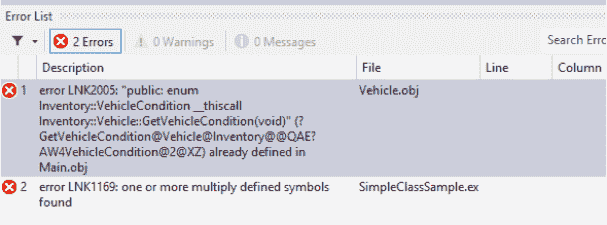

# C++ 简明指南

## *Succinctly* 系列图书背后的故事

Daniel Jebaraj，Syncfusion, Inc. 副总裁

### 保持领先

你们中的许多人可能知道，Syncfusion 是 Microsoft 平台软件组件的提供商。这使我们处于一个令人兴奋但充满挑战的位置：始终站在技术前沿。

每当 Microsoft 发布平台或工具时（如今似乎大约每隔一周就会发生一次），我们都必须迅速进行自我学习。

### 信息丰富，但更难消化

实际上，这转化为大量图书订单、博客搜索和 Twitter 浏览。

尽管互联网上可获取的信息越来越多，出版的书籍也越来越多，甚至涵盖相对较新的主题，但一直阻碍我们的一个方面是：找不到简明扼要的技术概览类书籍。

我们通常面临两种选择：阅读几本 500 多页的书，或在网上搜寻相关博客文章和其他文章。就像其他有工作要做、有客户要服务的人一样，我们觉得这相当令人沮丧。

### *Succinctly* 系列

这种沮丧转化为一种深切愿望：制作一系列面向在 Microsoft 平台上工作的开发者的简明技术书籍。

我们坚信，鉴于此类开发者具备的背景知识，大多数主题都可以写成 50 到 100 页的书籍。

这正是我们决心通过 *Succinctly* 系列实现的目标。一切美好的事物，不都源于让事物变得更好的深切愿望吗？

### 最佳作者，最佳内容

每位作者都是从一群才华横溢、认同我们愿景的专家中精心挑选出来的。您现在手中的这本书以及本系列的其他书籍，都是作者不懈努力的成果。您将看到原创内容，保证在喝几杯咖啡的时间里就能让您上手。

### 永久免费

Syncfusion 将致力于制作多个主题的书籍。这些书籍将始终免费。我们发布的任何更新也将免费。

### 免费？有什么玄机？

这里没有玄机。Syncfusion 在这项工作中有着切身利益。

作为组件供应商，我们一直以来的独特主张是：我们提供比市场上任何人都更深入、更广泛的框架。开发者教育极大地帮助我们在营销和销售方面与那些承诺“一键启用 AJAX 支持”或“把月亮变成奶酪！”的竞争厂商抗衡。

### 告诉我们您的想法

如果您有任何感兴趣的主题、想法或反馈，请随时发送至 [succinctly-series@syncfusion.com](mailto:succinctly-series@syncfusion.com)。

我们真诚希望您喜欢阅读本书，并希望它帮助您更好地理解所研究的主题。感谢阅读。

请在 Twitter 上关注我们，并在 Facebook 上“点赞”，帮助我们宣传 *Succinctly* 系列！


## 关于作者

Michael B. McLaughlin 是一名软件开发者、作者、顾问、退休律师，以及 Microsoft XNA/DirectX MVP。他是 Bob Taco Industries™ 的所有者，这是一家独立软件供应商（微型 ISV），目前专注于 Windows Phone、Windows 8 及其他 Microsoft 平台上的开发与咨询工作。自 1994 年以来，他无论是以专业人士还是业余爱好者的身份，一直从事软件开发并提供平台专业知识。他住在纽约州中哈德逊河谷，最近发现了骑摩托车的乐趣。

## 引言

*C++ Succinctly* 旨在帮助专业 C# 开发者学习现代 C++ 编程。本书的目标是利用您现有的 C# 知识来拓展您的技能。无论您需要在即将开展的项目中使用 C++，还是只想学习一门新语言（或重新熟悉它），本书都将帮助您学习 C++ 的所有基础知识，使您能够理解用 C++ 编写的项目和示例，并开始编写自己的 C++ 程序。

与任何大型主题一样，本书根本没有篇幅涵盖所有内容（一个例子是 C++11 中新增的原子特性），其他人可能会以不同的顺序安排主题。我特别想到的是指针，这个主题我只在本书较后面的部分才深入介绍。指针很重要，因此有些人可能会选择更早地介绍它们，但我认为您不需要理解指针就能理解其介绍之前的内容；理解前面的主题会让您更容易理解它们。

我已尽力做到尽可能准确，同时又不至于听起来像语言规范或文档文件。我希望我做到了。写作本书时，我频繁查阅 C++11 语言规范，也阅读了从 StackOverflow 帖子到 MSDN 文档、GCC 文档以及更多其他资料。有些地方我故意做了简化。当您继续扩展 C++ 知识时，无疑会遇到一些问题，需要更全面的理解才能实现目标或消除缺陷。如果阅读本书能传授足够的知识——以及对这门语言足够好的感觉，让您能够识别、诊断并解决这些问题——那么我会欣慰于自己实现了目标。欢迎来到 C++！

## 前言

### 商标等

作为一名退休律师，我觉得有必要加入这个简短的章节；除非您是这些公司或组织之一的律师，否则您可能并不关心它。对于非律师来说，本前言余下部分读起来会愉快得多，所以请不要因此望而却步。Microsoft®、Visual Studio®、Visual C++®、Visual C#®、Windows®、Windows NT®、Win32®、MSDN®、Silverlight®、DirectX® 和 IntelliSense® 是 Microsoft Corporation 的注册商标。GNU® 是 Free Software Foundation 的注册商标。ISO® 是 International Organization for Standardization 的注册服务商标。IEC® 是 International Engineering Consortium, Inc. 的注册服务商标。Unicode® 是 Unicode, Inc.（又称 The Unicode Consortium）的注册服务商标。Intel® 是 Intel Corporation 的注册商标。其他商标和服务商标均为其各自所有者的财产。

### 程序入口点

在 C# 中，程序的入口点是名为 Main 的静态方法。您通常实际上不会看到它，因为各种框架会提供自己的入口点（例如 Silverlight），但它就在某处，因为如果没有它，操作系统就不知道从何处开始执行您的程序。

C++ 程序的入口点是 main 函数。一个简单的版本如下所示：

```cpp
int main(int argc, char* argv[])
{
        // Your program starts here.

        // Returning 0 signifies success.
        return 0;
}
```

参数分别是参数个数，以及一个命令行参数数组（以字符串形式）。在 Windows 编程中，您经常会看到以下内容作为入口点：

```cpp
int wmain(int argc, wchar_t* argv[])
{
        // Your program starts here.

        // Returning 0 signifies success.
        return 0;
}
```

这个 wmain 入口点是 Microsoft 特有的。它被用作 Windows Unicode 程序的入口点（相对于较早的 ASCII/代码页程序）。支持 Unicode 的 Microsoft 操作系统（从 Windows 2000 和 Windows NT 4 起的所有系统，甚至安装特殊附加组件后的基于 Win 9X 的系统）使用 UTF-16 编码。因此，在编写程序时，您确实应始终使用 Unicode，除非您绝对需要支持不支持 Unicode 的较旧系统。

您还会经常看到以下内容作为 Windows 程序的入口点：


```cpp
#include <tchar.h>

int _tmain(int argc, _TCHAR* argv[])
{
    // Your program starts here.

    // Returning 0 signifies success.
    return 0;
}
```

Windows SDK 提供了 tchar.h 头文件，当需要构建将在 Unicode 和非 Unicode 版本的 Windows 上使用的项目时，你可以（而且应该）使用它。我在示例中没有使用它，因为只要有可能，我就希望让示例保持可移植并符合标准。

相反，我编写了一个小型头文件 pchar.h，它简化了入口点的可移植性问题。这并不能解决处理字符串时出现的大多数可移植性问题；不幸的是，字符串可移植性恰恰是 C++ 中并不容易处理的一个方面。确实，这里的头文件并不是一个很好的示例，说明当你真正需要命令行参数时应该怎么做。我们将在本书后面更详细地讨论字符串。现在，首先，下面是该头文件：

#### 示例：pchar.h

```cpp
#pragma once

#if !defined( _PCHAR_H )
#define _PCHAR_H 1

#if defined(WIN32) && defined(UNICODE)
#define _pmain wmain
#define _pchar wchar_t
#else
#define _pmain main
#define _pchar char
#endif

#endif
```

其次，现在的入口点如下所示（这里我省略了头文件的包含）：

```cpp
int _pmain(int /*argc*/, _pchar* /*argv*/[])
{
    // Your program starts here.

    // Returning 0 signifies success.
    return 0;
}
```

如你所见，参数名被注释掉了（使用 C 风格注释，即 /*...*/）。这在 C++ 中完全合法，而且每当一个函数被要求具有某些参数，而你又不打算使用这些参数时，就应该这样做。通过注释掉参数名，你可以确保不会意外使用它们。

`pchar.h` 中的代码为我们提供了一个相当可移植的入口点，而 `int _pmain(int, _pchar*[])` 入口点本身确保我们永远不会使用传入的命令行参数。如果你需要命令行参数，那么这个解决方案就不起作用——你需要一个更高级、更复杂的解决方案。

### 实参与形参

我在本书多处使用 *实参* 和 *形参* 这两个术语。对我来说，实参是程序调用函数时传入函数的值；而形参是函数规范的一部分，它告诉程序员该函数期望接收某种类型的值。它还告诉程序员函数可能如何处理该值。形参通常提供一个名称，以便引用该值；不过，如果要求某个函数具有特定形参（例如为了匹配接口规范），但又不打算实际使用它的值，C++ 允许我们只提供类型而不提供名称。

作为形参与实参对比的示例，在 C# 中你可能有这样一个类方法：`void AddTwoNumbers(int a, int b, ref int result) { result = a + b; }`。在这个例子中，`a`、`b` 和 `result` 是形参；我们知道 `AddTwoNumbers` 可能会改变为 result 形参传入的实参的值（事实上它确实会改变）。如果你这样调用该方法：`int one = 1, two = 2, answer = 0; someClass.AddTwoNumbers(one, two, ref answer);`，那么 `one`、`two` 和 `answer` 就都是传入 `AddTwoNumbers` 的实参。

### 语法高亮

本书中的代码示例使用 Visual Studio 2012 Ultimate RC 的语法高亮颜色。这有助于你理解代码，不过在单色电子书阅读器上阅读也没有问题。

#### 示例

本书中的示例可在 [https://bitbucket.org/syncfusion/cpp_succinctly](https://bitbucket.org/syncfusion/cpp_succinctly) 获取。

本书的示例使用 Visual Studio 2012 Ultimate RC 设计和开发。VS 2012 自带的 C++ 编译器包含 Visual Studio 2010 中未包含的 C++11 语言标准新特性。2012 年秋季，Microsoft 将发布免费的 Visual Studio 2012“Express”版本，该版本将允许开发者使用 C++ 来开发面向桌面的应用程序（例如示例所使用的控制台应用程序）。在此之前，要充分利用这些示例，你需要非 Express 版本的 Visual Studio 2012。

在开发过程中，我使用 Minimalist GNU for Windows (MinGW) 测试了许多示例，因此应该具有很好的跨编译器可移植性。我确定唯一一个按原样无法使用 MinGW 提供的 GCC 编译器运行的示例是 `StorageDurationSample`。它使用 Microsoft 特定的语言扩展 `__declspec(thread)` 来模拟 `thread_local` 存储。GCC 有自己的非常相似的扩展，其他编译器供应商无疑也有，因此如果你将其替换为所选编译器对应的适当代码，它就应该能够编译和运行。

最后，所有示例都是控制台示例。我选择控制台示例，是为了避免在窗口环境中创建和显示窗口时附带的所有无关代码。要查看任何特定示例的输出，你可以在 `_pmain` 函数末尾的 return 语句上设置断点，然后使用 Visual Studio 调试器运行它；也可以使用 Visual Studio 中 **调试** 菜单下的 **开始执行（不调试）** 命令运行它（通常使用 **Ctrl+F5** 键盘快捷键）。你还需要确保要运行的项目已设置为启动项目。要做到这一点，可以在解决方案资源管理器中右击项目名称，然后在出现的上下文菜单中左键单击 **设为启动项目**。

## C++11

2011 年，负责 C++ 语言设计和开发的 ISO/IEC 工作组通过了 C++ 语言标准的一个新主要版本。与 C++98 和 C++03 相比，C++11 感觉像是一门不同的语言。由于 C++11 太新，没有任何编译器支持它的每一个特性，有些编译器支持的特性甚至更少。我以 Visual C++ 及其当前最新版本（撰写本书时为 Visual Studio 2012 RC）中实现的特性为目标，不过我也提到了一些 Visual C++ 当前不支持的特性，并在适当之处指出了这一点。

Visual C++ 在 Visual Studio 2012 RC 和 Visual Studio 2012 RTM 之间不太可能有太大变化。有计划在 RTM 发布后的某个时候进行一次带外更新，以增加对 C++11 语言的额外支持。由于我无法预测会添加哪些特性，也没有任何内部消息，我基本上没有涵盖 RC 中不支持的内容。

如果你以前有过五年前或更早的 C++ 经验，你很可能会感到非常惊喜——这并不是说它拥有 C# 的一切。

在用 C++ 工作时，我会想念 C# 和 .NET 的一些特性。但在用 C# 工作时，我也会想念 C++ 的一些特性。在用 C++ 工作时，我会想念 C# 中由 CLR 类型系统提供的类型转换的简洁性。我也会想念 .NET 更完整的异常集，以及 .NET 经常提供的更好的 IntelliSense。在 C++ 中，我发现自己比在 C# 中更频繁地查阅文档，以弄清楚诸如可以向某个特定函数传入哪些实参值、应该传入哪些值，以及应该期望从它返回什么值之类的问题。

当我在用 C# 工作时，我会发现自己想念 C++ 不同存储期所提供的广度。在 C# 中，大多数东西最终都位于由 GC 管理的堆上，这大大简化了内存管理。但有时我并不一定希望类实例位于堆上。在 C# 中，我别无选择，只能把类重写为结构；而在 C++ 中，我可以轻松地在两者之间选择，而不需要更改类定义本身。我也想念独立函数（尽管在 C# 中，它们大多可以通过静态类中的静态方法来模拟）。我还喜欢我的 C++ 程序在编译后最终成为高度优化（因而难以理解）的机器代码，因此如果我希望代码保持机密，我并不真的需要担心尝试混淆程序（就像我在 .NET 中所做的那样，尽管市面上有一些非常好的混淆工具）。

每种语言都针对自己的一组问题，并且都有各自的历史和与之相关的怪癖。希望你会发现 C++ 是一门有趣且有用的语言，值得加入你的编程技能库。


## 第 1 章 类型

### 基本类型

C++ 包含你在 C# 中熟悉的相同关键字（例如 `int`）。鉴于两者都是类 C 语言，这并不奇怪。然而，有一个可能让你陷入麻烦的潜在陷阱。C# 显式定义了基本类型的大小（`short` 是 16 位整数，`int` 是 32 位整数，`long` 是 64 位整数，`double` 是 64 位双精度 IEEE 754 浮点数，等等），而 C++ 不提供这样的保证。

C++ 中最小的基本单元是 `char`，它只需要至少大到足以容纳 C++ 标准规定的 96 个基本字符，以及实现的基本字符集中的任何其他字符。理论上，某些 C++ 实现可以将 `char` 定义为 7 位或 16 位……几乎任何情况都有可能。但在实践中，你不需要太担心 `char` 不是 8 位（相当于 C# 中的 byte 或 sbyte 类型），在 Visual C++ 中它就是 8 位。

在 C++ 中，`char`、`signed char` 和 `unsigned char` 是三种不同的类型。三者都必须占用相同大小的内存存储空间。因此，`char` 在实践中要么是有符号的，要么是无符号的。它是有符号还是无符号由实现定义（参见侧栏）。在 Visual C++ 中，`char` 类型默认是有符号的。但你可以使用编译器开关让它按无符号处理。在 GCC 中，它是有符号还是无符号取决于你面向的 CPU 架构。

有符号整数类型按大小从小到大依次为：

- `signed char`
- `short int`
- `int`
- `long int`
- `long long int`

> **实现**
> 与许多编程语言一样，C++ 有来自不同公司和组织的多种实现。两个最流行的 C++ 实现是 Visual C++ 和 GCC。C++ 标准将一些细节留给实现者定义。如果你在编写跨平台代码，就需要牢记这些由实现定义的细节，以免发现程序在一个操作系统上运行正常，却在另一个操作系统上以奇怪的方式失败。

对于这些整数类型中每一种的大小，唯一的保证是：每种类型至少与比它小的下一种整数类型一样大。在 Visual C++ 中，`int` 和 `long int` 都是 32 位整数。只有 `long long int` 是 64 位整数。

> **注意：** 你可以直接写 `long` 或 `long long`；不必分别写成 `long int` 或 `long long int`。`short int` 也是如此（也就是说，你可以直接写 `short`）。在 Visual C++ 中，`short` 类型是 16 位有符号整数。

每种整数类型都有对应的无符号整数类型。你只需在前面加上关键字 `unsigned`，就能得到无符号版本（`signed char` 除外，要把它改成 `unsigned char`）。

如果你需要确保使用特定的大小，可以包含 C++ 标准库头文件 `cstdint`（例如 `#include <cstdint>`），它定义的类型包括：

- `int8_t`
- `int16_t`
- `int32_t`
- `int64_t`
- `uint8_t`
- `uint16_t`
- `uint32_t`
- `uint64_t`

这些类型有其用途，但你会发现大多数 API 并不使用它们，而是直接使用基本类型。这可能会让你的编程变得令人困惑，因为你需要不断检查底层基本类型，以确保不会出现意外的截断或扩展。

这些类型以后可能会得到更多使用，因此我建议不时检查它们在主要库和 API 中的使用情况，并且如果它们被广泛采用，就相应地调整你的代码。当然，如果你绝对需要一个变量是例如无符号 32 位整数，那你当然应该使用 `uint32_t`，并根据需要为 API 调用和可移植性做出调整。

浮点数在大小顺序规则方面也一样。它们从 float 到 double 再到 long double。在 Visual C++ 中，float 是 32 位浮点数，而 double 和 long double 都是 64 位浮点数（换句话说，long double 并不比 double 大）。

C++ 没有任何原生类型能与 C# 的 decimal 类型相比。不过，C++ 的一个好处是通常有大量免费或便宜的库可以获得许可使用。例如，有 decNumber 库、Intel Decimal Floating Point Math Library 和 GNU Multiple Precision Arithmetic Library。它们都不能与 C# 的 decimal 类型完全兼容，但如果你只为 Windows 系统编写代码，那么可以在需要时使用 DECIMAL 数据类型来获得这种兼容性，同时还可使用 Decimal Arithmetic Functions 和 Data Type Conversion Functions。

还有一种布尔类型 bool，它可以为 true 或 false。在 Visual C++ 中，bool 占用一个字节。与 C# 不同，bool 可以转换为整数类型。当它为 false 时，其等价的整数值为 0；当它为 true 时，值为 1。因此，语句 `bool result = true == 1;` 可以编译，并且该语句执行后 result 的求值结果为 true。

然后是 `wchar_t` 类型，它保存宽字符。宽字符的大小因平台而异。在 Windows 平台上，它是 16 位字符。它相当于 C# 的 `char` 类型。它经常用于构造字符串。我们将在另一章讨论字符串，因为字符串可以使用许多变体。

最后是 `void` 类型，其用法与 C# 中相同。还有一个 `std::nullptr_t` 类型，要准确解释它很麻烦，但基本上它是 `nullptr` 字面量的类型；你应该使用它而不是 `NULL` 或字面量 0（零）来检查空值。

### 枚举

枚举在 C++ 和 C# 中彼此相当相似。C++ 有两种枚举：有作用域枚举和无作用域枚举。

有作用域枚举定义为 `enum class` 或 `enum struct`。两者之间没有区别。无作用域枚举定义为普通的 `enum`。让我们看一个示例：

**示例：EnumSample\EnumSample.cpp**

```cpp
#include <iostream>
#include <ostream>
#include <string>
#include "../pchar.h"

enum class Color
{
    Red,
    Orange,
    Yellow,
    Blue,
    Indigo,
    Violet
};

// You can specify any underlying integral type you want, provided it fits.
enum Flavor : unsigned short int
{
    Vanilla,
    Chocolate,
    Strawberry,
    Mint,
};

int _pmain(int /*argc*/, _pchar* /*argv*/[])
{
    Flavor f = Vanilla;
    f = Mint; // This is legal since the Flavor enum is an un-scoped enum.

    Color c = Color::Orange;
    //c = Orange; // This is illegal since the Color enum is a scoped enum.

    std::wstring flavor;
    std::wstring color;

    switch (c)
    {
    case Color::Red:
        color = L"Red";
        break;
    case Color::Orange:
        color = L"Orange";
        break;
    case Color::Yellow:
        color = L"Yellow";
        break;
    case Color::Blue:
        color = L"Blue";
        break;
    case Color::Indigo:
        color = L"Indigo";
        break;
    case Color::Violet:
        color = L"Violet";
        break;
    default:
        color = L"Unknown";
        break;
    }

    switch (f)
    {
    case Vanilla:
        flavor = L"Vanilla";
        break;
    case Chocolate:
        flavor = L"Chocolate";
        break;
    case Strawberry:
        flavor = L"Strawberry";
        break;
    case Mint:
        flavor = L"Mint";
        break;
    default:
        break;
    }

    std::wcout << L"Flavor is " << flavor.c_str() << L" (" << f <<
        L"). Color is " << color.c_str() << L" (" <<
        static_cast<int>(color) << L")." << std::endl;
    std::wcout << L"The size of Flavor is " << sizeof(Flavor) <<
        L"." << std::endl;
    std::wcout << L"The size of Color is " << sizeof(Color) <<
        L"." << std::endl;

    return 0;
}
```

> **注意：** 在 C++ 中，作用域解析运算符是 `::`。我们稍后会更详细地讨论它。现在，只需把它看作承担与 C# 中 `.` 运算符许多相同用途的运算符。

这段代码将产生以下输出：

```text
Flavor is Mint (3). Color is Orange (1).
The size of Flavor is 2.
The size of Color is 4.
```

正如你在示例中看到的，有作用域的 Color 枚举要求你像 C# 一样访问其成员：在枚举成员前加上枚举名称和作用域解析运算符。相比之下，无作用域的 Flavor 枚举允许你直接指定成员，无需任何前缀。因此，我认为更好的做法是优先使用有作用域枚举：这样可以最大程度降低命名冲突的风险，并减少命名空间污染。

注意，有作用域枚举还有另一个区别：当我们想输出有作用域 Color 枚举的数值时，必须使用 static_cast 运算符将其转换为 int，而对于无作用域的 Flavor 枚举，我们不需要做任何强制转换。

对于 Flavor 枚举，我们将底层类型指定为 unsigned short int。你也可以为有作用域枚举指定底层类型。指定底层类型是可选的，但如果你想对无作用域枚举使用前向声明，则必须指定。前向声明是一种加快程序编译时间的方法：它只告诉编译器关于某个类型它需要知道的信息，而不是强制编译器编译定义该类型的整个头文件。

我们稍后会讨论这一点。现在，只需记住：无作用域枚举要使用其前向声明，必须显式指定其底层类型；有作用域枚举使用前向声明则不要求指定其底层类型（如果未指定，底层类型将是 int）。


`std::wcout << L"Flavor..."` 代码将宽字符数据输出到标准输出流。对于这样的控制台程序，标准输出就是控制台窗口。还有一个 `std::wcerr` 输出流，它会将宽字符数据输出到标准错误输出流。它也是控制台窗口，但你可以将 `std::wcout` 的输出重定向到一个文件，而将 `std::wcerr` 的输出重定向到另一个文件。还有一个 `std::wcin`，用于从控制台输入数据。我们不会探讨这个，也不会探讨它们对应的字节版本：`std::cout`、`std::cerr` 和 `std::cin`。

只是为了让你看看输入是什么样子，下面是一个示例。

**示例：ConsoleSample\ConsoleSample.cpp**

```cpp
#include <iostream>
#include <ostream>
#include <string>
#include "../pchar.h"

struct Color
{
        float ARGB[4];

        void A(float value) { ARGB[0] = value; }
        float A(void) const { return ARGB[0]; }
        void R(float value) { ARGB[1] = value; }
        float R(void) const { return ARGB[1]; }
        void G(float value) { ARGB[2] = value; }
        float G(void) const { return ARGB[2]; }
        void B(float value) { ARGB[3] = value; }
        float B(void) const { return ARGB[3]; }
};

// This is a stand-alone function, which happens to be a binary
// operator for the << operator when used with a wostream on
// the left and a Color instance on the right.
std::wostream& operator<<(std::wostream& stream, const Color& c)
{
        stream << L"ARGB:{" << c.A() << L", " << c.R() << L", "
               << c.G() << L", " << c.B() << L"}";
        return stream;
}

int _pmain(int /*argc*/, _pchar* /*argv*/[])
{
        std::wcout << L"Please input an integer and then press Enter: ";
        int a;

        std::wcin >> a;

        std::wcout << L"You entered '" << a << L"'. " << std::endl;

        std::wcout << std::endl <<
                L"Please enter a noun (one word, no spaces) " <<
                L"and then press Enter: ";

        std::wstring noun;

        // wcin breaks up input using white space, so if you include a space or
        // a tab, then it would just put the first word into noun and then
        // would still be a second word waiting in the input buffer.
        std::wcin >> noun;

        std::wcerr << L"The " << noun << L" is on fire! Oh no!" << std::endl;

        Color c = { { 100.0f/255.0f, 149.0f/255.0f, 237.0f/255.0f, 1.0f } };

        // This uses our custom operator from above. Come back to this sample
        // later when we've covered operator overloading and this should make
        // much more sense.
        std::wcout << std::endl <<
                L"Cornflower Blue is " << c << L"." << std::endl;

        return 0;
}
```

前面的代码是一个相当简单的演示。例如，它没有错误检查。因此，如果你为整数输入了不正确的值，它就会直接运行到结尾，`std::wcin` 会立即返回且不读取任何数据（除非你解决这个错误，否则它就会一直如此）。

如果你对 iostream 编程感兴趣，包括使用 `std::wofstream` 之类将数据输出到文件，以及使用 `std::wifstream` 从文件读取数据（它们的工作方式与 `std::wcout` 和 `std::wcin` 相同，只是额外增加了处理文件相关情况的功能），请参阅 MSDN 的 iostream 编程页面。仅学习流的所有细节本身就可以轻松写满一本书。

不过还有最后一件事。你无疑已经注意到，流功能与位移运算符 `<<` 和 `>>` 搭配时看起来有点奇怪。这是因为这些运算符已被重载。虽然你会期望位移运算符对整数以某种特定方式起作用，但对于它们分别应用于输出流或输入流时应该怎样工作，你可能并没有什么具体的预期。因此，C++ 标准库的流借用了这些运算符，用它们向流输入和输出数据。当我们希望能够读入或写出自己创建的自定义类型（例如前面的 `Color` 结构体）时，我们只需创建一个合适的运算符重载。我们将在本书后面进一步学习运算符重载，所以如果现在有点困惑，不必担心。

### 类和结构体

在 C++ 中，类与结构体之间的区别很简单：结构体的成员默认是 public，而类的成员默认是 private。仅此而已。除此之外它们是一样的。不存在 C# 中那样的值类型与引用类型之分。

话虽如此，你通常会看到程序员用类来表示复杂的类型（数据和函数的组合），而用结构体表示简单的纯数据类型。通常，这是一种风格选择，它体现了结构体在 C 语言中非面向对象的起源，使得通过查看它是结构体还是类，就能快速区分简单数据容器和完整对象。我建议遵循这种风格。

> **注意：** 这种风格的一个例外是，程序员编写的代码要同时用于 C 和 C++。由于 C 没有类类型，结构体类型可能会以类似于在 C++ 中使用类的方式来使用。本书不会介绍编写与 C 兼容的 C++。要做到这一点，你需要熟悉 C 语言以及它与 C++ 的差异。相反，我们关注的是编写干净、现代的 C++ 代码。

在 Windows 运行时（“WinRT”）编程中，公共结构体只能有数据成员（不能有属性或函数）。这些数据成员只能由基础数据类型和其他公共结构体组成——当然，这些公共结构体也受到同样的限制：只能包含数据、只能包含基础类型、只能包含公共结构体。如果你在使用 C++ 开发任何面向 Windows 8 的 Metro 风格应用，请记住这一点。

你有时会在类定义中看到使用 `friend` 关键字。它后面跟一个类名或一个函数声明。这种代码结构的作用是让那个类或函数能够访问该类的非公共成员数据和函数。通常，你会希望避免这样做，因为你的类通常应该通过其公共接口公开你想要公开的一切。但在少数情况下，你不希望公开某些数据成员或成员函数，但又希望一个或多个类或函数能够访问它们，这时你可以使用 `friend` 关键字来实现。

由于类是 C++ 编程中非常重要的一部分，我们将在本书后面更详细地探讨它们。

### 联合体

联合体类型有点奇怪，但它有它的用途。你会时不时遇到它。联合体是一种数据结构，表面上可以容纳许多数据成员，但在任何时候只允许你使用其中一个数据成员。最终结果是，这种数据结构为你提供了许多可能的用途，而不会浪费内存。联合体的大小只需大到足以容纳联合体中最大的成员。在实践中，这意味着数据成员在内存中相互重叠（因此，你一次只能使用一个）。这也意味着，除非你以某种方式跟踪它，否则你无法知道联合体的哪个成员是活动的。有很多方法可以做到这一点，但将联合体和一个枚举放入一个结构体中，是一种良好、简单、整洁的做法。下面是一个示例。

**示例：UnionSample\UnionSample.cpp**

```cpp
#include <iostream>
#include <sstream>
#include "../pchar.h"

enum class SomeValueDataType
{
        Int = 0,
        Float = 1,
        Double = 2
};

struct SomeData
{
        SomeValueDataType Type;
        union
        {
                int iData;
                float fData;
                double dData;
        } Value;
};
```


```cpp
SomeData(void)
{
        SomeData();
}

SomeData(int i)
{
        Type = SomeValueDataType::Int;
        Value.iData = i;
}

SomeData(float f)
{
        Type = SomeValueDataType::Float;
        Value.fData = f;
}

SomeData(double d)
{
        Type = SomeValueDataType::Double;
        Value.dData = d;
}
};

int _pmain(int /*argc*/, _pchar* /*argv*/[])
{
        SomeData data = SomeData(2.3F);
        std::wcout << L"Size of SomeData::Value is " << sizeof(data.Value) <<
                L" bytes." << std::endl;

        switch (data.Type)
        {
        case SomeValueDataType::Int:
                std::wcout << L"Int data is " << data.Value.iData << L"," 
                        << std::endl;
                break;
        case SomeValueDataType::Float:
                std::wcout << L"Float data is " << data.Value.fData << L"F," 
                        << std::endl;
                break;
        case SomeValueDataType::Double:
                std::wcout << L"Double data is " << data.Value.dData << L"," 
                        << std::endl;
                break;
        default:
                std::wcout << L"Data type is unknown." << std::endl;
                break;
        }
        return 0;
}
```

如你所见，我们定义了一个枚举，其成员分别代表联合体各成员的类型。然后我们定义了一个结构体，其中既包含一个该枚举类型的变量，又包含一个匿名联合体。这样，我们就在一个封装好的包中获得了确定该联合体当前持有哪种类型所需的全部信息。

如果你希望该联合体可在多个结构体中使用，可以在结构体外部声明它并给它命名（例如，`union SomeValue { ... };`）。然后你可以在结构体中以例如 `SomeValue Value;` 的方式使用它。不过，通常最好还是把它保持为匿名联合体，因为这样你无需担心更改它所带来的副作用，除非是在定义它的结构体内部。

联合体可以有构造函数、析构函数和成员函数。但由于它们始终只能有一个活跃的数据成员，为联合体编写成员函数几乎没有意义。你很少会看到这样的写法，也许永远也不会看到。

### typedef

关于 typedef 首先要理解的是，尽管其名称暗示了某些含义，但 typedef 并不会创建新类型。它是一种可用于许多场景的别名机制。

它在实现 C++ 标准库和其他基于模板的代码时被大量使用。可以说，这是它最重要的用途。我们将在模板章节中进一步探讨它。

它可以让你少打很多字（不过，随着 C++11 中 auto 关键字被重新用于类型推导，这一论点的说服力有所减弱）。如果你有一个特别复杂的数据类型，为它创建 typedef 意味着你只需要完整写一次。如果你复杂数据类型的用途不明确，用 typedef 给它一个语义更有意义的名称，有助于让程序更易于理解。

开发者有时会把它当作一种抽象手段，以便轻松更改底层类型（例如，从 `std::vector` 改为 `std::list`）或参数类型（例如，从 int 改为 long）。对于仅供自己内部使用的代码，这种做法应当避免。如果你正在开发其他人会使用的代码，比如库，你绝不应该以这种方式使用 typedef。如果你更改 typedef，这样做只会降低 API 破坏性变更的可发现性。当然，可以用它们来增加语义上下文，但不要用它们来更改其他人所依赖代码中的底层类型。

如果你需要更改某个东西的类型，请记住，对函数参数的任何更改都是破坏性变更，返回类型的更改或添加默认参数也是如此。处理未来可能发生类型变更的正确方式是使用抽象类或模板（如果两者都可行，选择更合适的或你更偏好的方式）。这样，代码的公共接口不会改变，只有实现会改变。Pimpl 惯用法是另一种保持 API 稳定、同时保留更改实现细节自由的好方法。我们将在后面的章节中探讨 Pimpl 惯用法（“pointer to implementation”的缩写）。

下面是一个小代码块，演示 typedef 的语法。

```cpp
class ExistingType;

typedef ExistingType AliasForExistingType;
```

下面是一个简短示例，展示 typedef 可能如何使用。这个示例的目的是说明 typedef 的一种简化但贴近实际的使用方式。在实践中，这样的 typedef 会放入命名空间，然后被包含在头文件中。由于我们还没有介绍这些内容，所以这个示例有意保持简单。

**示例：TypedefSample\TypedefSample.cpp**

```cpp
#include <iostream>
#include <ostream>
#include <vector>
#include <algorithm>
#include "../pch.h"

// This makes WidgetIdVector an alias for std::vector<int>, which has
// more meaning than std::vector<int> would have, since now we know that
// anything using this alias expects a vector of widget IDs
// rather than a vector of integers.
typedef std::vector<int> WidgetIdVector;

bool ContainsWidgetId(WidgetIdVector idVector, int id)
{
    return (std::end(idVector) !=
            std::find(std::begin(idVector), std::end(idVector), id)
           );
}

int _pmain(int /*argc*/, _pchar* /*argv*/[])
{
    WidgetIdVector idVector;

    // Add some id numbers to the vector.
    idVector.push_back(5);
    idVector.push_back(8);

    // Output a result letting us know if the id is in the
    // WidgetIdVector.
    std::wcout << L"Contains 8: " <<
        (ContainsWidgetId(idVector, 8) ? L"true." : L"false.") <<
        std::endl;

    return 0;
}
```

## 第 2 章 命名空间

### 全局命名空间

请看以下代码：

**示例：GlobalNamespaceSample\GlobalNamespaceSample.cpp**

```cpp
#include <iostream>
#include <ostream>
#include "../pch.h"

int g_x = 10;

int AddTwoNumbers(int a, int b)
{
        return a + b;
}

int _pmain(int /*argc*/, _pchar* /*argv*/[])
{
        int y = 20;
        std::wcout << L"The result of AddTwoNumbers(g_x, y) where g_x = " <<
                g_x << L" and y = " << y << L" is " << AddTwoNumbers(g_x, y) <<
                L"." << std::endl;

        if (true == 1)
        {
                std::wcout << L"true == 1!" << std::endl;
        }
        return 0;
}
```

在前面的示例中，我们定义了两个函数：AddTwoNumbers 和 _pmain。这两个函数都位于全局命名空间中。全局命名空间是程序内其他一切事物所在的基础层级。由于继承了 C 的传统，C++ 允许你在全局命名空间中定义任何内容（因此你可以定义命名空间、类、结构体、变量、函数、枚举和模板）。

C# 也有全局命名空间的概念，但它不允许你在其中定义除命名空间和类型之外的任何内容。在前面的示例中，我们有语句 `int g_x = 10;`，它在全局命名空间中定义了一个名为 g_x 的整数，并将其赋值为 10。这就是通常所说的全局变量。在 C# 中，全局变量是非法的。

> **关于函数**
>
> C++ 允许你拥有不属于类的方法。这些被称为函数。更具体地说，它们通常被称为独立函数，因为 C++ 中类方法的术语是类成员函数。我们将在后面的章节中更详细地讨论函数。

顺便说一句，我合作过的每一种编程语言都有其自身的糟糕特性——语言允许这些特性，但它们通常会导致问题。这些问题包括难以调试的故障、长期未被注意的隐蔽错误、可维护性问题、可读性问题，以及所有其他只会给开发时间增加许多小时却毫无益处的恼人事情。C++ 也不例外。当我们遇到符合这种描述的东西时，我会尽力指出来。现在就是其中一次。


全局变量很糟糕。尽可能避免使用它们。在 C++ 中使用全局变量时有一个常见约定，就是在变量名前加上 `g_`，如上一个示例所示。虽然这有助于提醒你和其他程序员这是一个全局变量，但并不能改变它是全局变量这一事实，也无法消除我描述的所有问题。这不是一本讲糟糕编程实践的书，所以我不会花时间解释[为什么全局变量不好](#)。你只需要知道 C++ 中存在这个特性，但应尽可能避免使用它。

### 作用域解析运算符 `::`

在 C++ 中，`::` 是作用域解析运算符。它用于分隔嵌套命名空间、将类型与其命名空间分隔，以及将成员函数和变量与其类型分隔。

请注意，只有在执行以下操作时，它才会用于最后一种情形：

- 定义成员函数。
- 在成员函数定义中访问基类的成员。
- 访问静态成员函数或变量。
- 给静态成员变量赋值。
- 获取成员函数的地址。

在其他情况下，你需要使用 `.` 运算符或 `->` 运算符，具体取决于你是直接访问成员还是通过指针访问成员。

这看起来可能很复杂，因为 C# 对于 C++ 中使用 `::`、`.` 和 `->` 的所有用途，都只使用 `.` 运算符。

> **注意：** 我们稍后会讨论 `.` 和 `->` 运算符。目前，你只需要知道它们用于访问成员变量和非静态成员函数（具体使用哪一个取决于你是否在处理指针）。

大多数情况下，你不会有什么问题。你唯一可能出错的地方是：尝试使用 `.` 运算符而不是 `::` 运算符访问基类成员，或者尝试使用 `::` 以外的东西指定枚举成员。如果你编译程序时收到一条语法错误，抱怨“missing ';' before '::'”，那很可能就是你在本该使用 `::` 的地方用了 `.`。

### 定义命名空间

命名空间的定义方式与 C# 中大致相同。下面是一个示例：

**示例：NamespacesSample\\NamespacesSample.cpp**

```cpp
#include <iostream>
#include <ostream>
#include <string>
#include "../pchar.h"

using namespace std;

namespace Places
{
        namespace Cities
        {
                struct City
                {
City(const wchar_t* name)
{
    Name = wstring(name);
}
wstring Name;
};
}
}
int _pmain(int /*argc*/, _pchar* /*argv*/[])
{
    auto nyc = Places::Cities::City(L"New York City");

    wcout << L"City name is " << nyc.Name.c_str() << L"\n" << endl;

    return 0;
}
```

如你所见，我们可以嵌套命名空间，进而使用作用域解析运算符访问这些命名空间以及其中包含的类型。你还会注意到我们使用了 `auto` 关键字。它相当于 C# 中的 `var` 关键字。

### using namespace 指令

查看 **NamespacesSample**，注意我们包含了 `using namespace std;` 这一行。这一行看起来与 C# 中的 using 指令非常相似，事实也确实如此；不过，在 C# 中，using 指令会自动将该命名空间中任何被引用程序集里的类型引入作用域。相比之下，在 C++ 中，using 指令只会把所包含头文件中的类型引入作用域，而不会把将要链接到你的程序或库中的库里的所有类型都引入作用域。你可能会问，什么是头文件？这个问题正好可以引出下一章。

> **注意：** 绝不要在头文件中包含 using 指令。如果这样做，你不仅会把该命名空间中的类型和命名空间导入到头文件中，还会把它们导入到任何包含该头文件的源文件或头文件中。这会导致非常严重的命名空间污染问题。我们接下来会讨论头文件，所以这里任何不清楚的地方到那时都应该能理解。只要记住，在头文件中使用 using namespace 指令是个坏主意；只在源代码文件中使用它们。

## 第 3 章 函数和类

### 声明与定义

> **提示：** 第一节“声明与定义”内容有点密集。在查看示例之前理解这些概念，将有助于你理解示例。反过来，查看示例也有助于你理解这些概念。我建议你先读这一节，然后浏览接下来两节中的示例。如果这一节有些部分不清楚，请回来重读这一节。

在 C# 中，类和其他类型是同时声明和定义的。即使使用 `partial` 关键字，也只是允许类定义分散到多个文件中；这并不会改变声明和定义的组合。这条规则的唯一例外是在进行互操作时（使用 `DllImportAttribute` 和 `extern` 关键字来声明一个在外部 DLL 中定义的函数）。在这种情况下，定义不在 C# 中，但几乎可以肯定在某个非 .NET 库中。（如果该 DLL 是 .NET 程序集，你只需添加对它的引用即可使用，而不需要任何互操作代码。）

我写这些是因为在 C++ 中，声明和定义通常可以分离，而且经常确实分离。常见的情况是，类在头文件（按惯例使用 `.H` 后缀）中声明，并在源文件（按惯例使用 `.CPP` 后缀）中定义。这不仅适用于类，也适用于独立函数，甚至适用于带有成员函数的结构体和联合体。

在 .CPP 文件顶部，你可能会看到一行或多行 `#include "SomeHeader.h"`。这些语句告诉编译器（更准确地说，是预处理器）：该文件中，或从该文件包含的文件中，存在声明以及可能的定义，而这些内容对于编译器理解后面的部分 C++ 代码是必要的。

在 Visual C++ 中，当包含属于你的项目的头文件，或包含在构建系统的包含路径中找不到的头文件时，使用 `#include "HeaderFile.h"` 语法。当包含系统包含文件（例如 `Windows.h`）时，使用 `#include <windows.h>` 语法。最后，当包含属于 C++ 标准库的包含文件（我们稍后会详细讨论）时，使用 `#include <vector>` 语法（即不包含 `.h`）。用于包含文件的 `" "` 与 `< >` 语法的含义由实现定义，不过 GCC 和 Visual C++ 都对本地头文件使用引号语法，对系统头文件使用尖括号语法。

> **注意：** C++ 标准库包含文件中省略 `.H` 后缀的原因，是为了避免与 C++ 标准库引入时已经提供使用这些名称的头文件的 C++ 编译器发生命名冲突。它们是普通头文件，不用担心。

要理解为什么声明和定义之间的区别在 C++ 中很重要，基本了解 C++ 构建过程很重要。通常会发生以下情况：

1. 预处理器检查源文件，插入由 include 语句指定的文件的文本（以及由这些文件中的 include 语句指定的文件的文本，依此类推），还会求值并处理任何其他 *预处理器指令*（例如展开宏）和任何 *pragma 指令*。
2. 编译器接收预处理器的输出，并将该代码编译为机器码，然后把它以及链接阶段所需的其他信息一起存储在 OBJ 文件中。
3. 对项目中的每个源文件重复步骤 1 和步骤 2。
4. 链接器检查编译器的输出文件以及你的项目链接的库文件。它会找到编译器将该特定源文件中某些内容标识为已声明但未定义的所有位置。然后，它定位该定义的适当地址，并将该地址修补进去。


- 5. 一旦所有内容都成功链接，链接器就会将所有内容绑定在一起，并输出最终产品（通常要么是可执行程序，要么是库文件）。

当然，这些阶段中任何一个阶段出错都会停止构建过程，而且前面的描述只是 Visual C++ 构建链的粗略草图。编译器作者在具体做法上有一定的灵活性。例如，并不要求生成任何中间文件，所以理论上，整个构建过程可以在内存中完成，尽管在实践中，我怀疑是否真有人会那样做。因此，把那个列表看作只是粗略大纲，而不是精确描述。

为了保持术语简单，我一直把所有内容都称为源文件。在 C++ 标准中，源文件加上其所有包含文件的组合被称为编译单元。我现在提到这一点，只是因为稍后我会用到这个术语。让我们依次考虑三个构建阶段。

预处理器不关心 C++ 的声明和定义。事实上，它甚至不关心你的程序是不是 C++。它与源文件唯一相关的事情，就是处理所有以 `#` 开头的行，从而把它们标记为预处理指令。只要这些行格式正确，并且它能找到所有被包含的文件（如果有的话），预处理器就会完成自己的工作，按照指示添加和删除文本。它会把结果传递给编译器，通常不会把结果写入文件，因为预处理之后紧接着就是编译。

编译器确实关心声明和定义，并且非常关心你的程序是不是有效的 C++ 代码。然而，当它遇到一个函数时，并不需要知道这个函数做什么。它只需要知道函数签名是什么——例如 `int AddTwoNumbers(int, int);`。

类、结构和联合也是如此；只要编译器知道声明（或者对于指针而言，仅仅知道那个特定标记是类、结构、联合或枚举），它就不需要任何定义。仅凭声明，它就知道你对 AddTwoNumbers 的调用在语法上是否正确，以及 class Vehicle; 确实是一个类，因此当它看到 Vehicle* v; 时，就能创建一个指向它的指针，而这正是它所关心的全部。

链接器确实关心定义。具体来说，它关心对于项目中的每个声明，都存在一个且仅一个与之匹配的定义。唯一的例外是内联函数，它们最终会在使用它们的每个编译单元中被创建。不过，它们的创建方式会避免任何多重定义问题。

在程序的各编译单元之间，你可以有重复的声明；只要只有一个定义与某个声明匹配（内联函数除外），这样做就是缩短构建时间的常见技巧。为了确保满足这一单一定义规则，C++ 编译器往往会使用一种称为名称修饰的机制。

这确保每个声明都与其正确的定义匹配，并处理诸如重载函数和命名空间（当使用位于不同命名空间时，命名空间允许重用同一名称）之类的问题，以及嵌套在类、结构或联合中的类、结构、联合和枚举定义。

正是这种名称修饰导致了可怕的链接器错误，我们将在[“内联成员函数”](#)一节中看到一个例子。

声明与定义的可分离性使你无需每次重新编译每个源文件就能构建 C++ 项目。它还让你能够构建使用没有源代码的库的项目。当然，还有其他方法可以实现这些目标（例如，[C# 使用不同的构建过程](#)）。这就是 C++ 的做法；理解这一基本流程有助于理解 C++ 中许多你在 C# 中不会遇到的特殊之处。

### 函数

C++ 中有两类函数：独立函数和成员函数。它们的主要区别在于，成员函数属于类、结构或联合，而独立函数不属于。

独立函数是最基本的函数类型。它们可以在命名空间中声明，可以被重载，也可以是内联的。让我们看几个例子。

#### 示例：FunctionsSample\Utility.h

```cpp
#pragma once

namespace Utility
{
        inline bool IsEven(int value)
        {
                return (value % 2) == 0;
        }

        inline bool IsEven(long long value)
        {
                return (value % 2) == 0;
        }

        void PrintIsEvenResult(int value);
        void PrintIsEvenResult(long long value);

        void PrintBool(bool value);
}
```

#### 示例：FunctionsSample\Utility.cpp

```cpp
#include "Utility.h"
#include <iostream>
#include <ostream>

using namespace std;
using namespace Utility;

void Utility::PrintIsEvenResult(int value)
{
        wcout << L"The number " << value << L" is "
                << (IsEven(value) ? L"" : L"not ") << L"even."
                << endl;
}

void Utility::PrintIsEvenResult(long long value)
{
        wcout << L"The number " << value << L" is "
                << (IsEven(value) ? L"" : L"not ") << L"even."
                << endl;
}

void Utility::PrintBool(bool value)
{
        wcout << L"The value is " <<
                (value ? L"true." : L"false.") << endl;
}
```

#### 示例：FunctionsSample\FunctionsSample.cpp

```cpp
#include "Utility.h"
#include "../pch.h"

using namespace Utility;

int _tmain(int /*argc*/, _TCHAR* /*argv*/[])
{
        int i1 = 3;
        int i2 = 4;

        long long ll1 = 6;
        long long ll2 = 7;

        bool b1 = IsEven(i1);

        PrintBool(b1);

        PrintIsEvenResult(i1);
        PrintIsEvenResult(i2);
        PrintIsEvenResult(ll1);
        PrintIsEvenResult(ll2);

        return 0;
}
```

头文件 **Utility.h** 声明并定义了两个内联函数，二者都名为 IsEven（使 IsEven 成为重载函数）。它还另外声明了三个函数：两个名为 PrintIsEvenResult，一个名为 PrintBool。源文件 **Utility.cpp** 定义了最后这三个函数。最后，源文件 **FunctionsSample.cpp** 使用这些代码创建了一个简单程序。

在头文件中定义的任何函数都必须声明为内联；否则，你最终会遇到多重定义和链接器错误。另外，函数重载之间的差异必须不止是返回类型；否则，编译器无法确保你真正得到的是你想要的方法版本。C# 也是如此，所以这应该不算什么新东西。

正如在 **Utility.cpp** 中所见，当定义位于命名空间中的独立函数时，你需要把命名空间放在函数名之前，并用作用域解析运算符分隔。如果使用了嵌套命名空间，就要包含整个命名空间嵌套链——例如，void RootSpace::SubSpace::SubSubSpace::FunctionName(int param) { ... };

### 简单类

下面的示例包含一个拆分为头文件和源文件的类。

#### 示例：SimpleClassSample\VehicleCondition.h

```cpp
#pragma once
#include <string>

namespace Inventory
{
    enum class VehicleCondition
    {
        Excellent = 1,
        Good = 2,
        Fair = 3,
        Poor = 4
    };

    inline const std::wstring GetVehicleConditionString(
        VehicleCondition condition
        )
    {
        std::wstring conditionString;

        switch (condition)
        {
        case Inventory::VehicleCondition::Excellent:
            conditionString = L"Excellent";
            break;
        case Inventory::VehicleCondition::Good:
            conditionString = L"Good";
            break;
        case Inventory::VehicleCondition::Fair:
            conditionString = L"Fair";
            break;
        case Inventory::VehicleCondition::Poor:
            conditionString = L"Poor";
            break;
        default:
            conditionString = L"Unknown Condition";
            break;
        }

        return conditionString;
    }
}
```

#### 示例：SimpleClassSample\Vehicle.h

```cpp
#pragma once
#include <string>

namespace Inventory
{
    enum class VehicleCondition;

    class Vehicle
    {
    public:
        Vehicle(
            VehicleCondition condition,
```


```cpp
double pricePaid
};

~Vehicle(void);

VehicleCondition GetVehicleCondition(void)
{
    return m_condition;
};

void SetVehicleCondition(VehicleCondition condition);

double GetBasis(void) { return m_basis; };

private:
    VehicleCondition        m_condition;
    double                  m_basis;
};
}
```

#### 示例：SimpleClassSample\Vehicle.cpp

```cpp
#include "Vehicle.h"
#include "VehicleCondition.h"

using namespace Inventory;
using namespace std;

Vehicle::Vehicle(VehicleCondition condition, double pricePaid) :
        m_condition(condition),
        m_basis(pricePaid)
{
}

Vehicle::~Vehicle(void)
{
}

void Vehicle::SetVehicleCondition(VehicleCondition condition)
{
        m_condition = condition;
}
```

#### 示例：SimpleClassSample\SimpleClassSample.cpp

```cpp
#include <iostream>
#include <ostream>
#include <string>
#include <iomanip>
#include "Vehicle.h"
#include "VehicleCondition.h"
#include "../pch.h"

using namespace Inventory;
using namespace std;

int _tmain(int /*argc*/, wchar_t* /*argv*/[])
{
        auto vehicle = Vehicle(Vehicle::Excellent, 325844942.65);
        auto condition = vehicle.GetVehicleCondition();
        wcout << L"The vehicle is in " <<
                GetVehicleConditionString(condition).c_str() <<
                L" condition. Its basis is $" << setw(10) <<
                setprecision(2) << setiosflags(ios::fixed) <<
                vehicle.GetBasis() << L"." << endl;

        return 0;
}
```

在 **Vehicle.h** 中，我们首先对 **VehicleCondition** 枚举类进行前向声明。我们将在本章末尾进一步讨论这项技术。目前的关键点是：（1）我们可以使用这个前向声明，也可以包含 **VehicleCondition.h** 头文件；（2）**VehicleCondition** 的声明必须位于 **Vehicle** 的类定义之前。

为了让编译器为 **Vehicle** 的实例分配足够的空间，它需要知道 **Vehicle** 的每个数据成员有多大。我们可以通过包含相应的头文件来让它知道，或者在某些情况下使用前向声明。如果 **VehicleCondition** 的声明出现在 **Vehicle** 的定义之后，那么编译器将拒绝编译代码，因为编译器不知道 **VehicleCondition** 有多大，甚至不知道它是什么数据类型。

在这种情况下，一个简单的声明就足以告诉编译器 **VehicleCondition** 是什么（一个枚举类）以及它有多大。除非另有指定，枚举类默认使用 int 作为其底层字段。如果我们让底层字段留空，但随后又在其他地方说使用 short、long 或其他底层字段类型，编译器将生成不同的错误消息，告诉我们存在多个相互冲突的声明。

然后我们继续定义 **Vehicle** 类。该定义包括其成员函数和成员变量的声明。大多数情况下，我们不定义成员函数。例外是 **GetVehicleCondition** 成员函数和 **GetBasis** 成员函数，我们将在“[内联成员函数](#)”一节中讨论它们。

我们在 **Vehicle.cpp** 中定义 **Vehicle** 的其他成员函数。在这种情况下，成员函数是构造函数、析构函数和 **SetVehicleCondition**。通常，像 **SetVehicleCondition** 这样的函数会是内联的，**Vehicle** 类中简单的构造函数和析构函数也会如此。这里单独定义它们，是为了说明当这些类型的成员函数不是内联函数时如何定义它们。我们将在专门讨论构造函数的章节中讨论那种看起来奇怪的构造函数语法。**Vehicle** 类的其余代码应该很清楚。

> **注意：** 虽然不要求你采用 **ClassName.h** 或 **ClassName.cpp** 的文件命名约定，但你几乎到处都会看到它被使用，因为它使代码的使用和维护更容易。

**VehicleCondition.h** 中的 **GetVehicleConditionString** 内联函数返回的是该函数中创建的 **std::wstring** 的副本，而不是局部值本身。如果你来自 C#，可能会觉得这有点奇怪，因为没有使用 new 关键字。我们将在讨论存储持续时间的章节中讨论自动持续时间类型时探讨这一点。

入口点函数使用了 C++ 标准库的一些 I/O 格式化功能。

#### 成员函数

如前所述，成员函数是类、结构体或联合体的一部分。简单来说，从这里开始，我将把它们作为类成员来讨论。

静态成员函数可以调用其他静态类成员函数，无论保护级别如何。静态成员函数还可以显式（即 `SomeClass::SomeFloat = 20.0f;`）或隐式（即 `SomeFloat = 20.0f;`）访问静态类成员数据，无论保护级别如何。

如果有一个与类成员同名的参数，显式形式会很有帮助。为成员数据添加 `m_` 前缀，例如 `m_SomeFloat`，可以消除这个问题，并清楚表明你正在处理的是类成员数据而不是局部变量或参数。这只是一种风格选择，不是要求。

实例（即非静态）成员函数会自动获得一个 `this` 指针，指向调用它们的实例的实例数据。实例成员函数可以调用其他类成员函数，并访问所有类成员数据，无论是显式地——与静态成员使用 `this->m_count++;` 访问实例数据一样——还是隐式地——与静态和实例数据一样（例如 `m_data++`），无论保护级别如何。

#### 内联成员函数

在 `SimpleClassSample\Vehicle.h` 中，`GetVehicleCondition` 和 `GetBasis` 成员函数都同时被声明和定义。这种声明与定义的组合在 C++ 中称为内联成员函数。由于这类似于在 C# 中编写方法，可能也会诱使你在 C++ 中这样做。除了一些例外情况，你不应该这样做。

正如我们之前讨论的，当你构建 C++ 项目时，编译器只会遍历每个源文件一次。它可能会对相同的源文件进行多遍处理以优化它们，但在完成后不会再回来。

相比之下，每当头文件被包含到另一个文件中时，编译器都会重新处理你的头文件，无论该文件是源文件还是另一个头文件。这意味着在一次构建过程中，编译器最终可能会多次遍历头文件中的代码。

在 `SimpleClassSample\Vehicle.h` 头文件的开头，你会看到 `#pragma once` 指令。这是一行有用且重要的代码。如果你在某个源文件中包含头文件 `A.h`，然后又包含另一个包含 `A.h` 的头文件，`#pragma once` 指令会告诉预处理器不要再次包含 `A.h` 的内容。这可以防止预处理器在两个相互包含的头文件之间无限地来回跳转。它还可以防止编译器错误。如果 `A.h` 被多次包含，编译器在遇到第二次包含 `A.h` 时的类型定义时会失败。

即使有了该指令，对于每个包含该头文件的源文件，编译器仍然需要包含并解析该头文件代码。你放入头文件的内容越多，构建每个源文件所需的时间就越长。这会增加编译时间；正如你将发现的，与 C# 相比，C++ 项目的编译时间可能相当长。

当你确实在头文件中内联包含成员函数的定义时，C++ 编译器可以在任何使用该函数的源文件中将该代码内联。这通常会使程序执行更快，因为程序可以直接就地运行代码，而不需要进行函数调用。

编译器会保留作用域，因此你无需担心内联函数中定义的变量与其使用位置所在函数中的变量之间发生命名冲突。对于像前面示例那样只是检索成员变量值的代码，内联定义可以提高速度，尤其是在代码在循环中执行时。


还有一种定义内联成员函数的方法。如果你希望类定义保持整洁，不在其中包含成员函数定义，但仍想拥有一些内联成员函数，可以改为类似下面的做法：

##### 示例：SimpleClassSample\Vehicle.h（备用代码在文件底部被注释掉）

```cpp
#pragma once
#include <string>

namespace Inventory
{
    enum class VehicleCondition;

    class Vehicle
    {
    public:
        Vehicle(
            VehicleCondition condition,
            double pricePaid
        );

        ~Vehicle(void);

        inline VehicleCondition GetVehicleCondition(void);

        void SetVehicleCondition(VehicleCondition condition);

        inline double GetBasis(void);

    private:
        VehicleCondition                 m_condition;
        double                           m_basis;
    };

    VehicleCondition Vehicle::GetVehicleCondition(void)
    {
        return m_condition;
    }

    double Vehicle::GetBasis(void)
    {
        return m_basis;
    }
}
```

如你所见，在类声明之后，我们定义了希望内联的成员函数，就像它们在源文件中一样。关键区别在于，类中的函数声明前有 `inline` 关键字，而函数定义位于头文件本身。如果省略该关键字，就会得到如图 1 所示的链接器错误。



*图 1：省略 `Vehicle::GetVehicleCondition` 成员函数上的 `inline` 关键字后的结果。*

顺便说一句，链接器错误看起来总是很糟糕。原因是链接器不再知道你的变量和函数在源文件中的名称。它只知道编译器为了确保所有名称唯一而将这些名称转换成了什么。这包括重载方法，它们在链接阶段需要唯一名称，以便链接器能将重载成员函数的调用连接到该函数的正确重载版本。

图 1 中的错误只是告诉我们，我们多次定义了 `Inventory::Vehicle::GetVehicleCondition(void)`。现在，我们知道只定义了一次，而且就在头文件中，但我们在 **SimpleClassSample** 项目的 **Vehicle.cpp** 和 **Main.cpp** 中都包含了该头文件。

由于我们有意忘记在 `Vehicle::GetVehicleCondition` 函数声明中添加 `inline` 关键字，编译器不会将代码内联。相反，它会在 **Main.cpp** 和 **Vehicle.cpp** 中都将其编译为一个函数。

当然，编译器对此没有问题，因为它将每个源文件视为独立的编译单元。编译器无法知道更多，因为当代码到达它那里时，代码已经由预处理阶段插入。只有当链接器获得所有已编译代码并尝试匹配所有内容时，我们才会进入构建过程说“嘿，我已经有这个函数的另一个版本了！”然后失败的阶段。

如你所见，有两种使成员函数内联的方法。两种方法都必须在头文件中完成，因为编译器会按照头文件被包含的次数多次评估头文件代码，而源文件只会被运行一次。如果使用第二种方法却忘记 `inline` 关键字，就会遇到可怕的链接器错误。如果使用第二种方法且记得 `inline` 关键字，但在源文件中定义函数，也会遇到可怕的链接器错误——这次会提示没有定义。

> **提示：** 不要试图把所有东西都内联。否则最终只会导致编译时间变慢，扼杀你的生产力。只内联有意义的东西，比如成员变量的简单 getter 和 setter 函数。和其他任何事情一样，先进行性能分析，然后再根据需要优化。

### 保护级别和访问说明符

成员函数和成员数据有三种可能的访问说明符：

- `public`
- `protected`
- `private`

这些访问说明符表示成员具有的可访问性级别。在 **SampleClass\Vehicle.h** 中，你可以看到两个使用示例。请注意，与 C# 不同，你不需要在每个成员前重复访问说明符。相反，你声明访问说明符，后跟一个冒号（例如 `public:`），然后其后的每个声明和定义都会获得该可访问性级别，直到遇到另一个访问说明符。

默认情况下，类成员是私有的。这意味着如果类声明开头没有访问说明符，那么所有声明的成员都将是私有的，直到遇到访问说明符。如果一直没遇到，你就会得到一个完全私有的类，这会非常奇怪。

结构体成员默认为公有，因此偶尔你会看到没有任何访问说明符的结构体。不过，如果你希望在结构体中使用它们，其工作方式与类中相同。

最后，你可以多次使用同一个访问说明符；如果你希望组织类，先定义成员函数，再定义成员变量（或相反），可以轻松地这样做：

*注意：此代码仅用于说明；未包含在任何示例中。*

```cpp
#include <string>

class SomeClass
{
public:
    SomeClass(void);
    virtual ~SomeClass(void);
    int AddTwoInts(int, int);
    void StoreAString(const wchar_t*);

private:
    bool CheckForIntAdditionOverflow(int, int);

public:
    int SomePublicInteger;

protected:
    std::wstring m_storedString;
};
```

前面的类定义并没有定义任何特别有用的东西。不过，它确实展示了所有三种访问说明符的用法。它还表明你可以多次使用说明符，例如上一个示例中的 public。

### 继承

在 C++ 中指定类所派生的类时，你也应指定访问说明符。如果不指定，就会得到默认访问级别：类为 private，结构体为 public。注意，我说的是类。C++ 支持多重继承。这意味着一个类或结构体可以有多个直接基类或基结构体，而不像 C# 中一个类只能有一个父类。

C++ 没有单独的接口类型。一般来说，应避免多重继承，除非是作为缺少单独接口的变通方法。换句话说，一个类应当只有零个或一个真正的基类，以及零个或多个纯抽象类（接口）。不过，这只是个人风格建议。

对于多重继承，也有一些很好的理由。例如，假设你有三组功能。每一组都由函数和数据组成。再假设每组彼此无关——它们之间没有联系，但也不是互斥的。在这种情况下，你可能希望将每个功能组放入自己的类中。然后，如果你遇到需要创建同时需要其中两组甚至全部三组功能的类的情况，只需创建一个继承自全部三者的类即可。

或者，只要你的公有和受保护成员函数及变量中没有命名冲突，你就完成了。例如，如果三个功能组都有一个成员函数 `void PrintDiagnostics(void);` 会怎样？你完蛋了，对吧？嗯，事实证明并非如此，你（通常）不会完蛋。你需要使用一些奇怪的语法来指定你想要哪个基类的 `PrintDiagnostics` 函数。即便如此，你也没有完全搞定。

C++ 允许你指定希望一个类是普通基类还是虚基类。方法是在基类说明符中，在类名之前放置或不放置关键字 `virtual`。我们很快就会看一个处理所有这些内容的示例，但在那之前，重要的是要理解：如果你至少两次继承一个类，并且其中两个或更多继承不是虚继承，你最终会得到该类数据成员的多个副本。

当试图指定你想使用其中哪一个副本时，这会引发一大堆问题。表面上看，解决方案是从所有类虚继承，但由于 C++ 实现解析虚成员的方式，这会带来运行时性能损失。更好的做法是尽量避免这种情况发生，但由于这并不总是可能，所以一定要记住虚继承。

现在来看一个有助于理解这一切的示例：

#### 示例：InheritanceSample\InheritanceSample.cpp

```cpp
#include <iostream>
#include <ostream>
#include <string>
#include <typeinfo>
#include "../pchar.h"

using namespace std;

class A
{
public:
    A(void) : SomeInt(0) { }
    virtual ~A(void) { }

    const wchar_t* Id(void) const { return L"A"; }

    virtual const wchar_t* VirtId(void) const { return L"A"; }

    int GetSomeInt(void) const { return SomeInt; }
    int                 SomeInt;
};

class B1 : virtual public A
```


```cpp
{
public:
        B1(void) :
                A(),
                m_fValue(10.0f)
        {
                // Because SomeInt isn't a member of B, we
                // cannot initialize it in the member initializer list
                // before the open brace where we initialize the
                // A base class and the m_fValue member data.
                SomeInt = 10;
        }
        virtual ~B1(void) { }

        const wchar_t* Id(void) const { return L"B1"; }

        virtual const wchar_t* VirtId(void) const override
        {
                return L"B1";
        }

        const wchar_t* Conflict(void) const { return L"B1::Conflict()"; }

private:
        float               m_fValue;
};

class B2 : virtual public A
{
public:
        B2(void) : A() { }
        virtual ~B2(void) { }

        const wchar_t* Id(void) const { return L"B2"; }

        virtual const wchar_t* VirtId(void) const override
        {
                return L"B2";
        }

        const wchar_t* Conflict(void) const { return L"B2::Conflict()"; }

};

class B3 : public A
{
public:
        B3(void) : A() { }
        virtual ~B3(void) { }

        const wchar_t* Id(void) const { return L"B3"; }

        virtual const wchar_t* VirtId(void) const override
        {
                return L"B3";
        }
        const wchar_t* Conflict(void) const { return L"B3::Conflict()"; }
};

class VirtualClass : virtual public B1, virtual public B2
{
public:
    VirtualClass(void) :
        B1(),
        B2(),
        m_id(L"VirtualClass")
    { }

    virtual ~VirtualClass(void) { }

    const wchar_t* Id(void) const { return m_id.c_str(); }

    virtual const wchar_t* VirtId(void) const override
    {
        return m_id.c_str();
    }

private:
    wstring             m_id;
};

// Note: If you were trying to inherit from A before inheriting from B1
// and B3, there would be a Visual C++ compiler error. If you
// tried to inherit from it after B1 and B3, there would still be a
// compiler warning. If you both indirectly and directly inherit
// from a class, it is impossible to get at the direct inheritance
// version of it.
class NonVirtualClass : public B1, public B3
{
public:
    NonVirtualClass(void) :
        B1(),
        B3(),
        m_id(L"NonVirtualClass")
    { }

    virtual ~NonVirtualClass(void) { }

    const wchar_t* Id(void) const { return m_id.c_str(); }

    virtual const wchar_t* VirtId(void) const override
    {
        return m_id.c_str();
    }

    /// If we decided we wanted to use B1::Conflict, we could use
    /// a using declaration. In this case, we would be saying that
    /// calling NonVirtualClass::Conflict means call B1::Conflict
    /// using B1::Conflict;

    /// We can also use it to resolve ambiguity between member
    /// data. In this case, we would be saying that
//// NonVirtualClass::SomeInt means B3::SomeInt, so
//// the nvC.SomeInt statement is
//// DemonstrateNonVirtualInheritance would be legal, even
//// though this statement says otherwise.
//using B3::SomeInt;

private:
    wstring                         m_id;
};

void DemonstrateNonVirtualInheritance(void)
{
    NonVirtualClass nvC = NonVirtualClass();

    //// SomeInt is ambiguous since there are two copies of A, one
    //// indirectly from B1 and the other indirectly from B3.
    //nvC.SomeInt == 20;

    // But you can access the two copies of SomeInt by specifying which
    // base class' SomeInt you want. Note that if NonVirtualClass also
    // directly inherited from A, then this too would be impossible.
    nvC.B1::SomeInt = 20;
    nvC.B3::SomeInt = 20;

    //// It is impossible to create a reference to A due to ambiguity.
    // A& nvCA == nvC;

    // We can create references to B1 and B3 though.
    B1& nvCB1 = nvC;
    B3& nvCB3 = nvC;

    // If we want a reference to some particular A, we can now get one.
    A& nvCAfromB1 = nvCB1;
    A& nvCAfromB3 = nvCB3;

    // To demonstrate that there are two copies of A's data.
    wcout <<
        L"B1::SomeInt = " << nvCB1.SomeInt << endl <<
        L"B3::SomeInt = " << nvCB3.SomeInt << endl <<
        endl;

    ++nvCB1.SomeInt;
    nvCB3.SomeInt += 20;

    wcout <<
        L"B1::SomeInt = " << nvCB1.SomeInt << endl <<
        L"B3::SomeInt = " << nvCB3.SomeInt << endl <<
        endl;

    // Let's see a final demo of the result. Note that the Conflict
    // member function is also ambiguous because both B1 and B3 have
    // a member function named Conflict with the same signature.
    wcout <<
        typeid(nvC).name() << endl <<
        nvC.Id() << endl <<
        nvC.VirtId() << endl <<
        //// This is ambiguous between B1 and B3
        //nvC.Conflict() << endl <<
        // But we can see that ambiguity.
        nvC.B3::Conflict() << endl <<
        nvC.B1::Conflict() << endl <<
        /// GetSomeInt is ambiguous too.
        //nvC.GetSomeInt() << endl <<
        endl <<

        typeid(nvCB3).name() << endl <<
        nvCB3.Id() << endl <<
        nvCB3.VirtId() << endl <<
        nvCB3.Conflict() << endl <<
        endl <<

        typeid(nvCB1).name() << endl <<
        nvCB1.Id() << endl <<
        nvCB1.VirtId() << endl <<
        nvCB1.GetSomeInt() << endl <<
        nvCB1.Conflict() << endl <<
        endl;
}

void DemonstrateVirtualInheritance(void)
{
        VirtualClass vC = VirtualClass();

        // This works since VirtualClass has virtual inheritance of B1,
        // which has virtual inheritance of A, and VirtualClass has virtual
        // inheritance of A, which means all inheritances of A are virtual
        // and thus there is only one copy of A.
        vC.SomeInt = 20;

        // We can create a reference directly to A and also to B1 and B2.
        A& vCA = vC;
        B1& vCB1 = vC;
        B2& vCB2 = vC;

        // To demonstrate that there is just one copy of A's data.
        wcout <<
                L"B1::SomeInt = " << vCB1.SomeInt << endl <<
                L"B2::SomeInt = " << vCB2.SomeInt << endl <<
                endl;

        ++vCB1.SomeInt;
        vCB2.SomeInt += 20;

        wcout <<
                L"B1::SomeInt = " << vCB1.SomeInt << endl <<
                L"B2::SomeInt = " << vCB2.SomeInt << endl <<
                endl;

        // Let's see a final demo of the result. Note that the Conflict
        // member function is still ambiguous because both B1 and B2 have
        // a member function named Conflict with the same signature.
        wcout <<
                typeid(vC).name() << endl <<
                vC.Id() << endl <<
            vC.VirtId() << endl <<
            vC.B2::Id() << endl <<
            vC.B2::VirtId() << endl <<
            vC.B1::Id() << endl <<
            vC.B1::VirtId() << endl <<
            vC.A::Id() << endl <<
            vC.A::VirtId() << endl <<
            // This is ambiguous between B1 and B2
            //vC.Conflict() << endl <<
            // But we can solve that ambiguity.
            vC.B2::Conflict() << endl <<
            vC.B1::Conflict() << endl <<
            // There's no ambiguity here because of virtual inheritance.
            vC.GetSomeInt() << endl <<
            endl <<

            typeid(vCB2).name() << endl <<
            vCB2.Id() << endl <<
            vCB2.VirtId() << endl <<
            vCB2.Conflict() << endl <<
            endl <<

            typeid(vCB1).name() << endl <<
            vCB1.Id() << endl <<
            vCB1.VirtId() << endl <<
            vCB1.GetSomeInt() << endl <<
            vCB1.Conflict() << endl <<
            endl <<

            typeid(vCA).name() << endl <<
            vCA.Id() << endl <<
            vCA.VirtId() << endl <<
            vCA.GetSomeInt() << endl <<
            endl;
}

int _tmain(int /*argc*/, _TCHAR* /*argv*/[])
{
    DemonstrateNonVirtualInheritance();
    DemonstrateVirtualInheritance();
    return 0;
}
```

***注意：*** *前面的示例中，许多成员函数通过在声明中的参数列表后包含 const 关键字而被声明为 const。这种写法是 const 正确性（const-correctness）概念的一部分，我们将在别处讨论。const 成员函数写法唯一表示的是：该成员函数不会修改类的任何成员数据；在多线程场景中调用它时，你无需担心副作用。编译器会强制执行这种写法，因此你可以确信标记为 const 的函数确实是 const 的。*

前面的示例演示了虚成员函数与非虚成员函数之间的区别。类 A 中的 Id 函数是非虚函数，而 VirtId 函数是虚函数。结果是，当创建指向 NonVirtualClass 的基类引用并调用 Id 时，我们得到的是基类版本的 Id；而当我们调用 VirtId 时，得到的是 NonVirtualClass 版本的 VirtId。


当然，对于 VirtualClass 也是如此。尽管示例中总是小心地指定 virtual 并覆盖 VirtId 的默认行为（你也应该如此），但只要 A::VirtId 被声明为 virtual，那么所有具有相同签名的派生类都将被视为对 VirtId 的虚拟覆盖。

前面的示例还演示了多重继承可能产生的菱形问题，以及虚拟继承如何解决该问题。菱形问题这个名称来源于这样一种想法：如果类 Z 派生自类 X 和类 Y，而这两个类又都派生自类 W，那么这种继承关系的图示看起来就像一个菱形。如果没有虚拟继承，这种继承关系实际上并不会形成菱形；相反，它会形成一个双叉叉，每个叉都拥有自己的 W 副本。

NonVirtualClass 从 B1 和 B3 继承，其中 B1 虚拟继承自 A，而 B3 非虚拟继承自 A。这导致了菱形问题：A 类成员数据的两份副本成为 NonVirtualClass 成员数据的一部分。DemonstrateNonVirtualInheritance 函数展示了由此产生的问题，也展示了当你需要使用 A 的某个成员时，用来解析你到底想要哪个 A 的语法。

VirtualClass 虚拟继承自 B1 和 B2，而 B1 和 B2 也都虚拟继承自 A。由于从 VirtualClass 到 A 的所有继承链都是虚拟的，因此 A 的数据只有一份副本；这样就避免了菱形问题。DemonstrateVirtualInheritance 函数展示了这一点。

即使使用了虚拟继承，VirtualClass 仍然存在一个歧义。B1::Conflict 和 B2::Conflict 具有相同的名称和相同的参数（本例中都没有参数），因此如果不使用基类说明符语法，就无法解析你想要哪一个。

在处理多重继承时，如果想要避免歧义，命名非常重要。不过，有一种方法可以解决歧义。NonVirtualClass 中被注释掉的两个 using 声明展示了这种解析机制。如果我们决定总是以某种方式解决歧义，using 声明可以让我们做到这一点。


> *注意：using 声明在类之外（例如在命名空间或函数中）也同样适用于解决歧义。如果你只想将命名空间中的某些类型引入作用域，而不想通过 using namespace 指令将整个命名空间引入作用域，它也非常有用。在头文件中使用 using 声明是可行的，前提是它位于类、结构体、联合或函数定义内部，因为 using 声明仅限于其所在的作用域。你不应在这类位置之外使用它们，因为那样你会将该类型引入全局命名空间或你所在任何命名空间的作用域中。*

在示例中我没有涉及的一点是除 public 之外的继承访问说明符。如果你愿意，可以编写类似 class B : protected A { ... } 的代码。这样，类 A 的成员可以在 B 的方法内部访问，并且对从 B 派生的任何类也可访问，但不能公开访问。你也可以用 class B : private A { ... }。这样，类 A 的成员可以在 B 的方法内部访问，但对从 B 派生的任何类不可访问，也不能公开访问。

我顺带提到这些，仅仅是因为它们很少使用。不过，你可能会遇到它们，甚至可能找到它们的用途。如果是这样，请记住：私有继承自基类的类仍然可以完全访问该基类；你只是在说，任何进一步派生的类都不应有权访问基类的成员函数和变量。

更常见的是，你会遇到这样的错误：你或其他人忘记在基类说明符前输入 public，导致默认的私有继承。你可以通过大量错误消息来识别这个问题，这些消息告诉你无法访问某个基类的私有成员函数或数据，除非你正在编写库并且没有测试该类。在这种情况下，你会从用户的愤怒咆哮中意识到这个问题。这也是单元测试是个好主意的又一个原因。

### 抽象类

抽象类至少有一个纯虚成员函数。下面的示例展示了如何模拟 C# 接口。

#### 示例：AbstractClassSample\IWriteData.h

```cpp
#pragma once

class IWriteData
{
public:
        IWriteData(void) { }
        virtual ~IWriteData(void) { }

        virtual void Write(const wchar_t* value) = 0;
        virtual void Write(double value) = 0;
        virtual void Write(int value) = 0;

        virtual void WriteLine(void) = 0;
        virtual void WriteLine(const wchar_t* value) = 0;
        virtual void WriteLine(double value) = 0;
        virtual void WriteLine(int value) = 0;
};
```

#### 示例：AbstractClassSample\ConsoleWriteData.h

```cpp
#pragma once

#include "IWriteData.h"

class ConsoleWriteData :
        public IWriteData
{
public:
        ConsoleWriteData(void) { }
        virtual ~ConsoleWriteData(void) { }

        virtual void Write(const wchar_t* value);
        virtual void Write(double value);
        virtual void Write(int value);

        virtual void WriteLine(void);
        virtual void WriteLine(const wchar_t* value);
        virtual void WriteLine(double value);
        virtual void WriteLine(int value);
};
```

#### 示例：AbstractClassSample\ConsoleWriteData.cpp

```cpp
#include <iostream>
#include <ostream>
#include "ConsoleWriteData.h"

using namespace std;

void ConsoleWriteData::Write(const wchar_t* value)
{
        wcout << value;
}

void ConsoleWriteData::Write(double value)
{
        wcout << value;
}

void ConsoleWriteData::Write(int value)
{
        wcout << value;
}

void ConsoleWriteData::WriteLine(void)
{
        wcout << endl;
}

void ConsoleWriteData::WriteLine(const wchar_t* value)
{
        wcout << value << endl;
}

void ConsoleWriteData::WriteLine(double value)
{
        wcout << value << endl;
}

void ConsoleWriteData::WriteLine(int value)
{
        wcout << value << endl;
}
```

#### 示例：AbstractClassSample\AbstractClassSample.cpp

```cpp
#include "IWriteData.h"
#include "ConsoleWriteData.h"
#include "../pchar.h"

int _pmain(int /*argc*/, pchar* /*argv*/[])
{
        /// The following line is illegal since IWriteData is abstract.
        //IWriteData iwd = IWriteData();

        ///// The following line is also illegal. You cannot have an
        ///// instance of IWriteData.
        //IWriteData iwd = ConsoleWriteData();

        ConsoleWriteData cwd = ConsoleWriteData();

        // You can create an IWriteData reference to an instance of a class
        // that derives from IWriteData.
        IWriteData& r_iwd = cwd;

        // You can also create an IWriteData pointer to an instance of a
        // class that derives from IWriteData.
        IWriteData* p_iwd = &cwd;

        cwd.WriteLine(10);
        r_iwd.WriteLine(14.6);
        p_iwd->WriteLine(L"Hello Abstract World!");

        return 0;
}
```

前面的示例演示了如何在 C++ 中实现接口风格的类。IWriteData 类可以被一个将数据写入日志文件、网络连接或任何其他输出的类继承。通过传递指向 IWriteData 的指针或引用，你可以轻松切换输出机制。

抽象成员函数（称为纯虚函数）的语法很简单，就是在声明后面加上 = 0，如 IWriteData 类中的：void Write(int value) = 0; 你不需要让一个类完全抽象；你可以实现成员函数，或包含对该类所有实例通用的成员数据。如果一个类哪怕只有一个纯虚函数，它就被视为抽象类。

Visual C++ 提供了一种 [Microsoft 特定的定义接口的方式](#)。以下是使用 Microsoft 语法的等价 IWriteData：

#### 示例：AbstractClassSample\IWriteData.h

```cpp
#pragma once

interface IWriteData
{
    virtual void Write(const wchar_t* value) = 0;
    virtual void Write(double value) = 0;
    virtual void Write(int value) = 0;

    virtual void WriteLine(void) = 0;
    virtual void WriteLine(const wchar_t* value) = 0;
    virtual void WriteLine(double value) = 0;
    virtual void WriteLine(int value) = 0;
};
```

与将其定义为类不同，你可以使用 __interface 关键字来定义它。你不能定义构造函数、析构函数，也不能定义除纯虚成员函数之外的任何成员函数。你也不能从除其他接口之外的任何内容继承。你不需要包含 public 访问说明符，因为所有成员函数都是 public 的。

### 预编译头文件

预编译头文件是一种特殊类型的头文件。与普通头文件一样，你可以在其中放置 include 语句和代码定义。它的不同之处在于有助于加快编译速度。


预编译头会在你第一次构建程序时被编译。此后，只要你不修改预编译头，也不修改预编译头直接或间接包含的任何内容，编译器就可以复用预编译头现有的已编译版本。编译时间会加快，因为大量代码（例如 Windows.h 和 C++ 标准库头文件）不会在每次构建时重新编译。

如果使用预编译头文件，需要将其作为每个源代码文件的第一个 include 语句包含进来。但是，不应将其包含在任何头文件中。如果忘记包含它，或在它上面放置了其他 include 语句，那么编译器将产生错误。这一要求是预编译头工作方式的必然结果。

预编译头文件不属于 C++ 标准的一部分。其实现取决于编译器供应商。如果对它们有任何疑问，应查阅编译器供应商的文档，并且如果在在线论坛提问，务必说明你使用的是哪个编译器。

### 前向声明

正如我们讨论过的，当你包含一个头文件时，预处理器只是取出所有代码，并将其直接插入到当前正在编译的源代码文件中。如果该头文件又包含其他头文件，那么所有这些头文件也会一并进入。

有些头文件非常庞大。有些包含许多其他头文件。有些既庞大又包含许多其他头文件。结果就是，仅仅因为你在一个头文件中包含了另一个头文件，大量代码就可能被反复编译。

避免在一个头文件中包含其他头文件的一种方法是使用前向声明。请考虑以下代码：

```cpp
#pragma once

#include "SomeClassA.h"
#include "Flavor.h"
#include "Toppings.h"

class SomeClassB
{
public:
    SomeClassB(void);
    ~SomeClassB(void);

    int GetValueFromSomeClassA(
        const SomeClassA* value
    );

    bool CompareTwoSomeClassAs(
        const SomeClassA& first,
        const SomeClassA& second
    );

    void ChooseFlavor(
        Flavor flavor
    );

    void AddTopping(
        Toppings topping
    );

    void RemoveTopping(
        Toppings topping
    );

private:
    Toppings             m_toppings;
    Flavor               m_flavor;

    // Other member data and member functions...
};
```

我们包含了 **SomeClassA.h**、**Flavor.h** 和 **Toppings.h** 头文件。SomeClassA 是一个类。Flavor 是作用域枚举（具体来说是 enum class）。Toppings 是无作用域枚举。

看看我们的函数定义：在 GetValueFromSomeClassA() 中有一个指向 SomeClassA 的指针。在 CompareTwoSomeClassAs 中有两个对 SomeClassA 的引用。然后还有 Flavor 和 Toppings 的各种用法。

在这种情况下，我们可以消除那三个 include 语句。为什么？因为要编译这个类定义，编译器只需要知道 SomeClassA 的类型，以及 Flavor 和 Toppings 的底层数据类型。我们可以通过前向声明把这一切告诉编译器。

```cpp
#pragma once

class SomeClassA;
enum class Flavor;
enum Toppings : int;

class SomeClassB
{
public:
    SomeClassB(void);
    ~SomeClassB(void);

    int GetValueFromSomeClassA(
        const SomeClassA* value
    );

    bool CompareTwoSomeClassAs(
        const SomeClassA& first,
        const SomeClassA& second
    );

    void ChooseFlavor(
        Flavor flavor
    );

    void AddTopping(
        Toppings topping
    );

    void RemoveTopping(
        Toppings topping
    );

private:
    Toppings             m_toppings;
    Flavor               m_flavor;

    // Other member data and member functions...
};
```

#pragma once 后面的三行告诉编译器它需要知道的一切。编译器被告知 SomeClassA 是一个类，因此它可以为链接目的确定其类型。编译器被告知 Flavor 是一个 enum class，因此它知道需要为 int 预留空间（enum class 的默认底层类型）。最后，编译器被告知 Toppings 是一个底层类型为 int 的枚举，因此它也可以为其预留空间。

如果 **SomeClassA.h**、**Flavor.h** 和 **Toppings.h** 中这些类型的定义与这些前向声明不匹配，那么你会收到编译器错误。如果你希望 SomeClassA 实例作为 SomeClassB 的成员变量，或者希望直接将其作为参数传递而不是作为指针或引用传递，那么就需要包含 SomeClassA。此时编译器需要为 SomeClassA 预留空间，并且需要其完整定义以确定其在内存中的大小。最后，你仍然需要在 **SomeClassB.cpp** 源代码文件中包含那三个头文件，因为你将在 SomeClassB 的成员函数定义中使用它们。

那么，我们得到了什么？每当你在源代码文件中包含 **SomeClassB.h** 时，该代码文件不会自动包含来自 **SomeClassA.h**、**Flavor.h** 和 **Toppings.h** 的所有代码并与其一起编译。如果需要，你可以选择包含它们，但你已经消除了它们的自动包含，以及它们所包含的任何头文件的自动包含。

假设 **SomeClassA.h** 包含了 **Windows.h**，因为它除了提供某些值之外，还要与应用程序中的窗口交互。你突然减少了任何包含 **SomeClassB.h** 但不包含 **SomeClassA.h** 或 **Windows.h** 的源代码文件需要编译的代码行数（减少了成千上万行）。如果你在几十个文件中包含 **SomeClassB.h**，那么突然之间，这就涉及数万到数十万行代码。

前向声明可以节省几毫秒、几分钟或数小时（对于大型项目）。当然，它们并不是解决所有问题的神奇方案，但它们是很有价值的工具，使用得当可以节省时间。

## 第 4 章 存储期

### 概述

引用 C++ 语言标准的话：“存储期是对象的一种属性，它定义了包含该对象的存储的最小潜在生存期。”基本上，它告诉你应该预期一个变量能使用多久。该变量可能是基本类型，例如 int，也可能是复杂类型，例如类。无论其类型如何，变量只保证在编程语言规定的期限内有效。

C++ 管理内存的方式与 C# 非常不同。一方面，C++ 不要求有垃圾回收器，而且很少有实现提供垃圾回收器。在 C++ 实现确实具有自动内存管理的范围内，它们大多通过智能指针和引用计数来实现。C++ 类不会自动存在于堆上（无论是否由 GC 管理）。相反，它们[的工作方式更像 C# 中的结构体](#)。

需要时，你可以将 C++ 类实例放到堆上；但如果你在局部声明它，并且不做任何特殊处理，那么它将具有自动存储期，通常使用栈来实现，并且当程序离开该类实例所在的作用域时会被自动销毁。

与 C# 相比，C++ 让你对内存管理有更多控制。其后果是，C++ 语言和运行时环境在防止错误代码方面所能做的不如 C# 语言和 CLR 那么多。成为一名优秀 C++ 程序员的关键之一，是理解内存管理如何工作，并运用最佳实践来编写高效、正确的代码。

### 静态存储期

全局变量（包括命名空间内的全局变量）以及用存储期关键字 `static` 标记的变量具有静态存储期。

全局变量在程序初始化期间（即程序实际开始执行 main 或 wmain 函数之前的时期）初始化。它们按照在源代码中定义的顺序初始化。通常，依赖初始化顺序并不是一个好主意，因为重构和其他看似无害的更改很容易在程序中引入潜在 bug。

局部静态变量在程序执行第一次到达包含该局部静态变量的代码块时被零初始化。通常，此时它们会被初始化为指定值，或通过调用指定的构造函数进行初始化。除极少数情况外，直到程序到达并执行该语句时，才需要进行赋值或构造阶段。一旦局部静态变量完成初始化，其声明中指定的初始化将永远不会再次运行。当然，这正是我们对局部静态变量所期望的。如果每次程序到达其定义行时它都不断重新初始化，那么它就会和非静态局部变量一样了。

你可以为全局静态变量和局部静态变量赋其他值，当然，除非你也把它们声明为 const。

### 自动存储期

在代码块内，如果对象定义时没有使用 new 运算符来实例化它，也没有使用存储期关键字，那么它具有自动存储期；不过它可以选择性地带有 register 关键字。这意味着对象在定义时创建，并在程序退出声明该变量的代码块时，或在给该变量赋新值时被销毁。


> **注意：** `auto` 关键字过去曾用于显式选择自动存储期。在 C++11 中，这种用法已被移除。它现在相当于 C# 中的 `var` 关键字。如果你尝试使用 `auto` 的旧含义编译代码，将会收到编译器错误，因为作为类型说明符的 `auto` 必须是唯一的类型说明符。

### 动态存储期

动态存储期是使用 new 运算符或 new[] 运算符的结果。new 运算符用于分配单个对象，而 new[] 运算符用于分配动态数组。你必须跟踪动态分配数组的大小。虽然只要你使用了 delete[] 运算符，C++ 实现就会正确释放动态分配的数组，但没有简单或可移植的方法来确定该分配的大小。这很可能是不可能的。单个对象使用 delete 运算符释放。

当你使用 new 或 new[] 分配内存时，返回值是一个指针。指针是保存内存地址的变量。在 C# 中，如果你将指向某个对象的所有引用都设置为 null 或其他值，那么该内存在程序中就不再可达，因此垃圾回收器（GC）可以释放该内存以供其他用途。

在 C++ 中，如果你将指向某个对象的所有指针都设置为 nullptr 或其他值，并且无法使用指针算术计算出原始地址，那么你就失去了使用 delete 或 delete[] 运算符释放该内存的能力。你由此造成了内存泄漏。如果程序泄漏了足够多的内存，最终它会崩溃，因为系统将用尽可供它使用的内存地址。不过，甚至在此之前，计算机也会变得极其缓慢，因为它被迫增加分页以容纳程序不断增长的内存占用（假设它有虚拟内存，而大多数智能手机没有虚拟内存）。

> **注意：** 常量指针，例如语句 `const wchar_t* someStr = L"Hello World!";` 中的 `someStr`，不是动态存储期指针。那块内存只是程序本身的一部分。如果你尝试对它调用 `delete` 或 `delete[]`，程序会直接崩溃。然而，字符串是字符数组，所以如果可以删除它，那么 `delete[]` 运算符才是正确的选择。

处理动态内存时，为了消除潜在泄漏并限制其他相关错误的可能性，你应始终使用智能指针，例如 `std::unique_ptr` 或 `std::shared_ptr`。我们将在涵盖指针的章节中讨论这些内容。

### 线程存储期

线程存储期是最不常用的存储期。它直到最近才被标准化。截至撰写本文时，很少有（如果有的话）C++ 编译器供应商实现了对 C++11 标准中新增的 `thread_local` 关键字的支持。

这肯定会改变，但就目前而言，如果你需要此类功能，可以使用供应商特定的扩展，例如 Microsoft 特定的扩展 `__declspec(thread)` 或 GCC 特定的扩展 `__thread`。

线程存储期与静态存储期类似，只不过这些变量不是持续整个程序的生命周期，而是每个线程局部的；线程的副本在线程的持续期间存在。每个线程的线程存储期对象实例在首次在该线程中使用时初始化，并在线程退出时销毁。线程存储期对象不会从启动它所在线程的那个线程继承其值。

### 选择合适的存储期

自动存储期通常是对象合适的存储期形式，除非你需要它们在其创建所在的作用域结束后仍然存在。如果是这种情况，你应选择其余存储期中最符合需求的一种。

- 如果对象应在程序执行的整个期间存在，请使用静态存储期。
- 如果对象应在特定线程的整个期间存在，请使用线程存储期。
- 如果对象只在程序或线程持续时间的一部分内存在，请使用动态存储期。

如果这样做有意义，你可以偏离这些建议，但在大多数情况下，这一指导会正确引导你。

### 存储期示例

以下示例旨在帮助阐明这些概念。该示例有大量文档注释，因此不包含额外评论。我强烈建议你构建并运行这个特定示例。在单步执行代码时查看输出，会比仅仅阅读代码更容易帮助你掌握这些概念。

**示例：StorageDurationSample\SomeClass.h**

```cpp
#pragma once
#include <string>
#include <memory>

class SomeClass
{
public:
    explicit SomeClass(int value = 0);

    SomeClass(
        int value,
        const wchar_t* stringId
    );

    ~SomeClass(void);

    int GetValue(void) { return m_value; }

    void SetValue(int value) { m_value = value; }

    static std::unique_ptr<SomeClass> s_someClass;

private:
    int                 m_value;
    std::wstring        m_stringId;
};
```

**示例：StorageDurationSample\SomeClass.cpp**

```cpp
#include "SomeClass.h"
#include <string>
#include <memory>
#include <iostream>
#include <ios>
#include <iomanip>
#include <thread>
#include <memory>

using namespace std;

SomeClass::SomeClass(int value) :
    m_value(value),
    m_stringId(L"(No string id provided.)")
{
    SomeClass* localThis = this;
    auto addr = reinterpret_cast<const unsigned int>(localThis);
    wcout << L"Creating SomeClass instance." << endl <<
        L"StringId: " << m_stringId.c_str() << L"." << endl <<
        L"Address is: 0x" << setw(8) << setfill(L'0') <<
        hex << addr << dec << L"." << endl <<
        L"Value is :" << m_value << L"." << endl <<
        L"Thread id: " <<
        this_thread::get_id() << L"." << endl << endl;
}

SomeClass::SomeClass(
    int value,
    const wchar_t* stringId
) : m_value(value),
    m_stringId(stringId)
{
    SomeClass* localThis = this;
    auto addr = reinterpret_cast<int>(localThis);
    wcout << L"Creating SomeClass instance." << endl <<
        L"StringId: " << m_stringId.c_str() << L"." << endl <<
        L"Address is: 0x" << setw(8) << setfill(L'0') <<
        hex << addr << dec << L"." << endl <<
        L"Value is :" << m_value << L"." << endl <<
        L"Thread id: " <<
        this_thread::get_id() << L"." << endl << endl;
}

SomeClass::~SomeClass(void)
{
    // This is just here to clarify that we aren't deleting a
    // new object when we replace an old object with it, despite
    // the order in which the Creating and Destroying output is
    // shown.
    m_value = 0;
    SomeClass* localThis = this;
    auto addr = reinterpret_cast<unsigned int>(localThis);
    wcout << L"Destroying SomeClass instance." << endl <<
        L"StringId: " << m_stringId.c_str() << L"." << endl <<
        L"Address is: 0x" << setw(8) << setfill(L'0') <<
        hex << addr << dec << L"." << endl <<
        L"Thread id: " <<
        this_thread::get_id() << L"." << endl << endl;
}

// Note that when creating a static member variable, the definition also
// needs to have the type specified. Here, we start off with
// 'unique_ptr<SomeClass>' before proceeding to the
// 'SomeClass::s_someClass = ...' value assignment.
unique_ptr<SomeClass> SomeClass::s_someClass =
    unique_ptr<SomeClass>(new SomeClass(10, L"s_someClass"));
```

**示例：StorageDurationSample\StorageDurationSample.cpp**

```cpp
#include <iostream>
#include <ostream>
#include <sstream>
#include <thread>
#include <memory>
#include <cstddef>
#include "SomeClass.h"
#include "../pch.h"

using namespace std;

struct SomeStruct
{
        int Value;
};

namespace Value
{
        // Visual C++ does not support thread_local as of VS 2012 RC. We can
        // partially mimic thread_local with __declspec(thread), but we cannot
        // have things as classes with functions (including constructors
        // and destructors) with __declspec(thread).
        __declspec(thread) SomeStruct ThreadLocalSomeStruct = {};

        // g_staticSomeClass has static duration. It exists until the program
        // ends or until a different value is assigned to it. Even if you left
        // off the static keyword, in this case it would be static since
        // it is not a local variable, is not dynamic, and is not a thread-
        // local variable.
        static SomeClass g_staticSomeClass = SomeClass(20,
L"g_staticSomeClass");
}

        // This method creates a SomeClass instance, and then changes the
        // value.
void ChangeAndPrintValue(int value)
{
        // Create an identifier string.
        wstringstream wsStr(L"");
        wsStr << L"ChangeAndPrintValue thread id: " << this_thread::get_id()
              << L"\n";
        // Create a SomeClass instance to demonstrate function-level block
        // scope.
        SomeClass sc(value, wsStr.str().c_str());

        // Demonstrate __declspec(thread).
        wcout << L"Old value is " << Value::ThreadLocalSomeStruct.Value <<


```cpp
    L", Thread id: " << this_thread::get_id() << L"\n" << endl;
    Value::ThreadLocalSomeStruct.Value = value;
    wcout << L"New value is " << Value::ThreadLocalSomeStruct.Value <<
        L", Thread id: " << this_thread::get_id() << L"\n" << endl;
}

void LocalStatic(int value)
{
        static SomeClass sc(value, L"LocalStatic sc");

        //// If you wanted to reinitialize sc every time, you would have to
        //// un-comment the following line. This, however, would defeat the
        //// purpose of having a local static. You could do something
        //// similar if you wanted to reinitialize it in certain circumstances
        //// since that would justify having a local static.
        //// sc = SomeClass(value, L"LocalStatic reinitialize");

        wcout << L"Local Static sc value: " << sc.GetValue() <<
                L"\n" << endl << endl;
}

int _pmain(int /*argc*/, _pchar* /*argv*/[])
{
        // Automatic storage; destroyed when this function ends.
        SomeClass sc1(1, L"_pmain sc1");
        wcout << L"sc1 value: " << sc1.GetValue() <<
                L"\n" << endl << endl;

        {
                // The braces here create a new block. This means that
                // sc2 only survives until the matching closing brace, since
                // it also has automatic storage.
                SomeClass sc2(2, L"_pmain sc2");
                wcout << L"sc2 value: " << sc2.GetValue() <<
                        L"\n" << endl << endl;
        }

        LocalStatic(1000);
        // Note: The local static in LocalStatic will not be reinitialized
        // with 5000. See the function definition for more info.
        LocalStatic(5000);

        // To demonstrate __declspec(thread) we change the value of this
        // thread's Value::ThreadLocalSomeStruct to 20 from its default 0.
        ChangeAndPrintValue(20);

        // We now create a new thread that automatically starts and
        // changes the value of Value::ThreadLocalSomeStruct to 40. If it
        // were shared between threads, then it would be 20 from the
        // previous call to ChangeAndPrintValue. But it's not. Instead, it
        // is the default 0 that we would expect as a result of this being
        // a new thread.
        auto thr = thread(ChangeAndPrintValue, 40);

        // Wait for the thread we just created to finish executing. Note that
        // calling join from a UI thread is a bad idea since it blocks
        // the current thread from running until the thread we are calling
        // join on completes. For WinRT programming, you want to make use
// of the PPLTasks API instead.
thr.join();

// Dynamic storage. WARNING: This is a 'naked' pointer, which is a very
// bad practice. It is here to clarify dynamic storage and to serve
// as an example. Normally, you should use either
// std::unique_ptr or std::shared_ptr to wrap any memory allocated with
// the 'new' keyword or the 'new[]' keyword.
SomeClass* p_dsc = new SomeClass(1000, L"_pmain p_dsc");

const std::size_t arrIntSize = 5;

// Dynamic storage array. THE SAME WARNING APPLIES.
int* p_arrInt = new int[arrIntSize];

// Note that there's no way to find how many elements arrInt
// has other than to manually track it. Also note that the values in
// arrInt are not initialized (i.e. it's not arrIntSize zeroes, it's
// arrIntSize arbitrary integer values).

for (int i = 0; i < arrIntSize; i++)
{
    wcout << L"i: '" << i << L"'. p_arrInt[i] = '" <<
        p_arrInt[i] << L"'." << endl;

    // Assign a value of i to this index.
    p_arrInt[i] = i;
}

wcout << endl;

//// If you wanted to zero out your dynamic array, you could do this:
//uninitialized_fill_n(p_arrInt, arrIntSize, 0);

for (int i = 0; i < arrIntSize; i++)
{
    wcout << L"i: '" << i << L"'. p_arrInt[i] = '" <<
        p_arrInt[i] << L"'." << endl;
}

// If you forgot this, you would have a memory leak.
delete p_dsc;

//// If you un-commented this, then you would have a double delete,
//// which would crash your program.
//delete p_dsc;

//// If you did this, you would have a program error, which may or may
//// not crash your program. Since dsc is not an array, it should not
//// use the array delete (i.e. delete[]), but should use the non-array
//// delete shown previously.
//delete[] p_dsc;

// You should always set a pointer to nullptr after deleting it to
// prevent any accidental use of it (since what it points to is unknown
// at this point).
p_dsc = nullptr;
// If you forgot this, you would have a memory leak. If you used
// 'delete' instead of 'delete[]' unknown bad things might happen. Some
// implementations will do ...
// knows what else.
delete[] p_arrInt;
p_arrInt = nullptr;

wcout << L"Ending program." << endl;
return 0;
}
```

对于不方便运行该示例的人，以下是我在 Windows 8 Release Preview 的命令提示符下运行此程序时得到的输出，该程序使用 Visual Studio 2012 Ultimate RC 以 Debug 配置编译，目标为 x86 芯片组。如果你在自己的系统上运行，可能会得到不同的地址和线程 ID 值。

```text
Creating SomeClass instance.
StringId: s_someClass.
Address is: '0x009fade8'.
Value is '10'.
Thread id: '3660'.

Creating SomeClass instance.
StringId: g_staticSomeClass.
Address is: '0x013f8554'.
Value is '20'.
Thread id: '3660'.

Creating SomeClass instance.
StringId: _pmain sc1.
Address is: '0x007bfe98'.
Value is '1'.
Thread id: '3660'.

sc1 value: '1'.

Creating SomeClass instance.
StringId: _pmain sc2.
Address is: '0x007bfe70'.
Value is '2'.
Thread id: '3660'.

sc2 value: '2'.

Destroying SomeClass instance.
StringId: _pmain sc2.
Address is: '0x007bfe70'.
Thread id: '3660'.

Creating SomeClass instance.
StringId: LocalStatic sc.
Address is: '0x013f8578'.
Value is '1000'.
Thread id: '3660'.

Local Static sc value: '1000'.

Local Static sc value: '1000'.

Creating SomeClass instance.
StringId: ChangeAndPrintValue thread id: '3660'.
Address is: '0x007bfbf4'.
Value is '20'.
Thread id: '3660'.

Old value is 0. Thread id: '3660'.
New value is 20. Thread id: '3660'.
Destroying SomeClass instance.
StringId: ChangeAndPrintValue thread id: '3660'.
Address is: '0x007bfbf4'.
Thread id: '3660'.

Creating SomeClass instance.
StringId: ChangeAndPrintValue thread id: '5796'.
Address is: '0x0045faa8'.
Value is '40'.
Thread id: '5796'.

Old value is 0. Thread id: '5796'.
New value is 40. Thread id: '5796'.
Destroying SomeClass instance.
StringId: ChangeAndPrintValue thread id: '5796'.
Address is: '0x0045faa8'.
Thread id: '5796'.

Creating SomeClass instance.
StringId: _pmain p_dsc.
Address is: '0x009fbcc0'.
Value is '1000'.
Thread id: '3660'.

i: '0', p_arrInt[i] = '-842150451'.
i: '1', p_arrInt[i] = '-842150451'.
i: '2', p_arrInt[i] = '-842150451'.
i: '3', p_arrInt[i] = '-842150451'.
i: '4', p_arrInt[i] = '-842150451'.

i: '0', p_arrInt[i] = '0'.
i: '1', p_arrInt[i] = '1'.
i: '2', p_arrInt[i] = '2'.
i: '3', p_arrInt[i] = '3'.
i: '4', p_arrInt[i] = '4'.
Destroying SomeClass instance.
StringId: _pmain p_dsc.
Address is: '0x009fbcc0'.
Thread id: '3660'.

Ending program.
Destroying SomeClass instance.
StringId: _pmain sc1.
Address is: '0x007bfe98'.
Thread id: '3660'.

Destroying SomeClass instance.
StringId: LocalStatic sc.
Address is: '0x013f8578'.
Thread id: '3660'.

Destroying SomeClass instance.
StringId: g_staticSomeClass.
Address is: '0x013f8554'.
Thread id: '3660'.

Destroying SomeClass instance.
StringId: s_someClass.
Address is: '0x009fadc8'.
Thread id: '3660'.
```

## 第 5 章 构造函数、析构函数和运算符

### 概述

C++ 构造函数比 C# 的构造函数更复杂。首先，构造函数有五种类型。虽然你很少会为某个特定类或结构编写全部五种类型，但你需要知道它们是什么、做什么以及长什么样。否则，你可能会遇到一些非常令人困惑的 bug 或编译错误。

C++ 构造函数比 C# 构造函数更复杂的原因是 C++ 类可以具有多种存储期。默认情况下，C++ 对象具有值语义，而 C# 类具有引用语义。下面是一个示例：

```cpp
Vehicle someVehicle = vehicle;
```

假设 vehicle 不为 null，而是一个有效的 Vehicle 类型对象，并且 Vehicle 类型是类类型，而不是结构或其他类型。

让我们将前面的代码语句视为 C# 代码。在 C# 中，vehicle 所引用的对象存在于 GC 管理的堆中的某个位置。前面的代码语句将该对象的引用存储在 someVehicle 变量中，该引用来自现有的 vehicle 对对象的引用。该对象仍然只有一个实例，但有两个引用指向它。

现在让我们将前面的语句视为 C++ 代码。在 C++ 中，vehicle 所引用的对象很可能是一个自动存储期对象，但也可能是静态存储期对象，甚至可能是线程存储期对象。默认情况下，前面的代码语句会创建 vehicle 对象的副本，并将其存储在自动存储期的 someVehicle 变量的地址中。这是通过一种称为复制赋值运算符的东西完成的，它是复制构造函数的近亲。

现在有两个副本，而之前只有一个。除非 Vehicle 类有指针、`std::shared_ptr`、引用或类似性质的成员变量，否则这两个副本是完全独立的。更改甚至销毁其中一个，对另一个不会有任何影响。

当然，如果你希望 someVehicle 成为 vehicle 对象的引用，你可以稍微修改代码来实现。但如果你希望 someVehicle 变成 vehicle，并让 vehicle 不再存在——被销毁而不带走其原有资源，该怎么办？C++ 通过所谓的移动构造函数和移动赋值运算符使这成为可能。

如果你想有意禁用复制语义（包括赋值和构造）或移动语义，那也是可能的。

### 默认构造函数

我们从默认构造函数开始。默认构造函数可以在没有参数的情况下调用。一个类最多只能有一个默认构造函数。如果你定义一个类且不包含任何构造函数，则会产生一个隐式默认构造函数，由编译器为你创建。但是，如果你有一个类成员变量，它是没有默认构造函数的类、结构或联合，那么你必须至少定义一个构造函数，因为编译器无法创建隐式默认构造函数。


如果你定义一个没有参数的构造函数，它就是显式默认构造函数。也可以定义一个带参数的构造函数，并通过默认实参使其仍然成为默认构造函数，我们稍后会讨论这一点。

如果你定义一个至少有一个必需参数的构造函数，那么编译器不会生成默认构造函数。如果你想要默认构造函数，就必须显式定义一个。

### 函数声明中的默认实参

C++ 中的构造函数以及一般函数，可以在其声明中为部分或全部参数指定默认实参（类似于 C# 的可选参数）。在 C++ 函数中，函数声明里所有带默认实参的参数都必须出现在任何不带默认实参的参数的右侧。C++ 不支持 C 风格的命名实参，但你可以使用[命名参数惯用法](#)实现类似效果。

为什么这里要提到默认实参？事实证明，如果某个构造函数的所有参数都有默认实参，那么该构造函数就是默认构造函数。这很合理，因为如果你有一个签名为 `Vehicle(VehicleType type = VehicleType::Car, double odometerReading = 0.0);` 的构造函数，那么你可以用空括号调用该构造函数，并使用那些默认实参。如果你定义默认构造函数，那么只能有一个，无论它没有参数，还是它的所有参数都有默认实参。

这一原则还可进一步推广。在同一作用域中声明的同名函数，不能在这些完全相同的位置上具有相同的参数类型。你猜对了：为了区分函数签名，带默认实参的参数会被忽略。

这一切都说得通，因为默认实参使得无法区分 `double Add(double a, double b = 0.0);` 和 `double Add(double a, int b = 0);`，因为二者都可以像 `double dbl = Add(5.0);` 这样调用。编译器在这种情况下无法知道你想要哪一个，所以它干脆编译失败并显示错误消息。

### 带参构造函数

带参构造函数有一个或多个参数。如果带参构造函数的所有参数都有默认实参，那么它也是类的默认构造函数。C++ 中的带参构造函数没有什么特别之处。

### 转换构造函数

转换构造函数至少有一个参数。如果有多个参数，那么这些额外参数必须具有默认实参。

如果你不希望某个构造函数成为转换构造函数，可以用函数说明符 explicit 标记它。看一个示例：

```cpp
#include <string>

class SomeClass
{
public:
        SomeClass(const wchar_t* value) :
                m_strValue(value),
                m_intValue()
        {
        }

        explicit SomeClass(int value) :
                m_strValue(),
                m_intValue(value)
        {
        }

        ~SomeClass(void) { }

        const wchar_t* GetStringValue(void)
        {
                return m_strValue.c_str();
        }

        int GetIntValue(void) { return m_intValue; }

private:
        std::wstring        m_strValue;
        int                 m_intValue;
};

void DoSomething(void)
{
    // Normal constructor use.
    SomeClass sc1 = SomeClass(L"Hello World");

    // Fine because the const wchar_t* constructor
    // is a conversion constructor.
    SomeClass sc2 = L"Hello World";

    // Normal constructor use.
    SomeClass sc3 = SomeClass(1);

    //// Illegal since the int constructor is not a
    //// conversion constructor.
    //SomeClass sc4 = 1;

    // ...
}
```

如你所见，转换构造函数让我们可以通过直接将 sc2 设置为字符串值来构造它。编译器看到该语句，检查 SomeClass 是否有一个能接收这类值的转换构造函数，然后继续调用适当的 SomeClass 构造函数。如果我们对注释掉的 sc4 行尝试这样做，编译器会失败，因为我们使用 explicit 告诉编译器，那个接受 int 的构造函数不应被视为转换构造函数，而应像其他任何带参构造函数一样。

转换构造函数可能有用，但也可能导致缺陷。例如，当你只是拼错变量名而本意是赋值时，可能会意外创建一个新对象并将其赋给现有变量。如果存在有效的转换构造函数，编译器不会报错；如果不存在，则会报错。因此请记住这一点，并记得将单参数构造函数标记为 explicit，除非你有充分理由提供转换构造函数。

```cpp
        int        m_value;
};

class B : virtual public A
{
public:
        explicit B(int) :
                A(CallingMsg(L"A")),
                m_b(InitializingIntMsg(2, L"m_b")),
                m_a(InitializingIntMsg(5, L"m_a"))
        {
                wcout << L"Constructing B. m_a is " <<
                        m_a << L" and m_b is " << m_b << L"." << endl;
        }
        virtual ~B(void)
        {
                wcout << L"Destroying B." << endl;
        }

private:
        int        m_a;
        int        m_b;
};

class C
{
public:
        explicit C(int) :
                m_c(InitializingIntMsg(0, L"m_c"))
        {
                wcout << L"Constructing C. m_c is " <<
                        m_c << L"." << endl;
        }
        virtual ~C(void)
        {
                wcout << L"Destroying C." << endl;
        }

private:
        int        m_c;
};

class D
{
public:
        explicit D(int) :
                m_d(InitializingIntMsg(3, L"m_d"))
        {
                wcout << L"Constructing D. m_d is " <<
                        m_d << L"." << endl;
        }
        virtual ~D(void)
        {
                wcout << L"Destroying D." << endl;
        }

private:
```

```cpp
wcout << endl << "Break between Y and Z." << endl
     << endl;

{
        Z someZ(CallingMsg(L"Z"));
        wcout << L"Z::GetSomeInt returns " <<
        someZ.GetSomeInt() << L"." << endl;
}
return 0;
}
```

我们做的第一件事是定义两个写消息的辅助函数，这样就能轻松跟踪事情发生的顺序。你会注意到，每个类都有一个接受 int 的构造函数，不过只有 Y 和 Z 实际使用了它。A、B、C 和 D 甚至没有在其 int 参数构造函数中为这个 int 指定名称；它们只是指定有一个 int 参数。这完全是合法的 C++ 代码，而我们一直在 main 中使用自定义参数名。A 类有两个构造函数：一个默认构造函数和一个接受 int 的带参构造函数。其余类只有带参构造函数，每个都接受一个 int。

- B 类虚继承自 A。
- C 类不继承任何类。
- D 类不继承任何类。
- Y 类按该顺序虚继承自 B、直接继承自 D、虚继承自 C。
- Z 类同样按该顺序直接继承自 D、虚继承自 B、直接继承自 C。

让我们看看该程序给我们的输出，然后讨论正在发生什么以及为什么。

```text
Calling Y constructor.
Initializing DEFAULT m_value.
DEFAULT Constructing A. m_value is '5'.
Calling B constructor.
Initializing m_a.
Initializing m_b.
Constructing B. m_a is '5' and m_b is '2'.
Calling C constructor.
Initializing m_c.
Constructing C. m_c is '0'.
Calling D constructor.
Initializing m_d.
Constructing D. m_d is '3'.
Initializing m_someInt.
Constructing Y. m_someInt is '0'.
Y::GetSomeInt returns '0'.
Destroying Y.
Destroying D.
Destroying C.
Destroying B.
Destroying A.

Break between Y and Z.

Calling Z constructor.
Calling A constructor.
Initializing m_value.
Constructing A. m_value is '20'.
Calling B constructor.
Initializing m_a.
Initializing m_b.
Constructing B. m_a is '5' and m_b is '2'.
Calling D constructor.
Initializing m_d.
Constructing D. m_d is '3'.
Calling C constructor.
Initializing m_c.
Constructing C. m_c is '0'.
Initializing m_someInt.
Constructing Z. m_someInt is '0'.
Z::GetSomeInt returns '0'.
Destroying Z.
Destroying C.
Destroying D.
Destroying B.
Destroying A.
```

在我们的 main 函数中，首先在 Y 自己的作用域内创建一个 Y 类型的对象。然后调用它的 GetSomeInt 成员函数。这有助于确保即使你改动代码，编译器也不会在发布版本中优化掉 Y 的创建。它还充当构造与析构之间的标记。

然后我们退出 Y 的作用域，触发其析构。之后，我们写入另一个标记字符串，将 Y 实例的实例化与随后 Z 实例的实例化分隔开。我们在 Z 自己的作用域中创建 Z 实例，以便像跟踪 Y 一样跟踪它的构造和析构。

那么我们看到了什么？信息很多。先关注 Y。

当我们调用 Y 构造函数时，它做的第一件事是调用 A 的默认构造函数。由于若干原因，这看起来可能非常不对，但实际上是对的。Y 构造函数规定要遵循以下顺序：

1. 初始化基类 C。
2. 初始化 Y 的成员变量 m_someInt。
3. 初始化基类 D。
4. 初始化基类 B。

但最终得到的却是以下顺序：

1. 通过 A 的默认构造函数初始化基类 A。
2. 初始化基类 B。
3. 初始化基类 C。
4. 初始化基类 D。
5. 初始化 Y 的成员变量 m_someInt。

既然我们知道 B 虚继承自 A，并且 B 是 A 的唯一继承来源，我们可以得出结论：B 优先于其他类，而 A 优先于 B。


嗯，我们在继承其他类之前先继承 B。所以原因可能就在这里，但为什么 D 不在 B 之后立即初始化呢？这是因为 D 是直接继承的，而 C 是虚继承的。虚基类优先。

规则如下：

- 1. 虚基类按照基类列表中的书写顺序从左到右构造。
- 2. 如果你没有为虚继承的基类调用特定构造函数，编译器将在适当的时候自动调用其默认构造函数。
- 3. 在确定要构造的基类顺序时，基类先于其派生类初始化。
- 4. 当所有虚基类都构造完成后，再按照声明顺序从左到右构造直接基类——与虚基类相同。
- 5. 当一个类的所有基类都构造完成后，该类的成员变量会：
  - 如果没有初始化器，则进行默认初始化。
  - 如果初始化器是一对空括号，则进行值初始化。
  - 初始化为初始化器括号内表达式的结果。
- 6. 成员变量按照它们在类定义中声明的顺序初始化。
- 7. 当构造函数中的所有初始化器都运行完毕后，将执行构造函数体内的任何代码。

把所有这些规则放在一起，最初会得到 B、C、D 的顺序，因为 B 和 C 是虚继承，因此排在 D 之前。然后我们在 B 之前加入 A，因为 B 派生自 A。所以最终顺序是 A、B、C、D。

由于基类先于派生类初始化这一规则，并且 A 是通过虚继承引入的，因此在我们进入所调用的 B 构造函数中的 A 初始化器之前，A 就已经用其默认构造函数初始化了。一旦我们进入 B 构造函数，由于 A 已经初始化，B 构造函数中针对 A 的初始化器就会被直接忽略。

类 B 的成员变量按照 m_a、m_b 的顺序初始化，因为这就是它们在类中声明的顺序，尽管在构造函数中我们以相反的顺序列出它们的初始化。

> ### 默认初始化与值初始化
>
> 默认初始化不会对基本类型和指针进行初始化。它会为类类型调用默认构造函数。整数、指针等将只具有任意值。
>
> 值初始化会将基本类型初始化为零或等价值（例如，bool 为 false，指针为 null）。它会为类类型调用默认构造函数。

### 委托构造函数

*注意：Visual C++ 在 Visual Studio 2012 RC 中不支持委托构造函数。*

委托构造函数会调用同一个类中的另一个构造函数（目标构造函数）。委托构造函数只能有一个初始化器语句，即对目标构造函数的调用。它的函数体可以包含语句；这些语句将在目标构造函数完全执行完毕后运行。下面是一个示例：

```cpp
#include <iostream>
#include <ostream>

using namespace std;

class SomeClass
{
public:
    SomeClass(void) : SomeClass(10)
    {
        // Statements here will execute after the
        // statements in the SomeClass(int) constructor
        // body have finished executing.
        wcout << "Running SomeClass::SomeClass(void)." << endl;
    }

    SomeClass(int value)
        : m_value(value)
    {
        // Statements here will execute after the m_value
        // initializer above.
        wcout << "Running SomeClass::SomeClass(int)." << endl;
    }

    int GetValue(void) { return m_value; }

private:
    int        m_value;
};

int main(int argc, char* argv[])
{
    SomeClass someC;
    wcout << "SomeClass::GetValue() = " << someC.GetValue() << endl;

    return 0;
}
```

如果使用 GCC 等编译器编译并运行该代码，你将看到以下输出：

```
Running SomeClass::SomeClass(int).
Running SomeClass::SomeClass(void).
SomeClass::GetValue() = 10
```

### 拷贝构造函数

拷贝构造函数只有一个必需参数：对与构造函数所属类同类型的变量的引用。拷贝构造函数可以有其他参数，只要它们都提供了默认实参。它的用途是允许你构造一个对象的副本。

如果编译器能够提供，它就会为你提供一个默认拷贝构造函数；只要所有属于类、结构体或联合体的成员变量都有拷贝构造函数，它就能够提供。它提供的拷贝构造函数是浅拷贝构造函数。例如，如果你有一个指向数据数组的指针，那么副本得到的是指针的副本，而不是一个包含相同数据副本的新数组。

如果随后在该类的析构函数中有一条 delete 语句，那么当其中一个副本被销毁时，另一个副本就会处于无效状态；并且当剩余副本被销毁时，你尝试第二次删除那块内存，就会发生运行时错误——前提是你的程序还没有崩溃。这是你应该始终使用智能指针的众多原因之一。我们将在[关于 RAII 的章节](#)中介绍它们。

如果你不想使用编译器提供的拷贝构造函数，或者编译器无法提供，但你仍然希望有一个，那么你可以编写一个拷贝构造函数。例如，也许你想要对数据进行更深层的拷贝，或者你的类有一个 `std::unique_ptr`，而你需要为类的用途决定它的何种“副本”是可以接受的。我们将在 **ConstructorsSample** 中看到一个示例。

拷贝构造函数通常应具有以下声明：`SomeClass(const SomeClass&);` 为避免奇怪的错误，构造函数应始终对你所拷贝的类采用 `const` 值引用。在拷贝构造函数中，你没有理由改变所拷贝的类。将其设为 const 不会造成损害，并能为你的操作提供一些保证。拷贝构造函数不应定义为 `explicit`。

### 拷贝赋值运算符

如果你定义了自定义拷贝构造函数，那么你也应该定义自定义拷贝赋值运算符。该运算符的结果应是：返回的值是它所拷贝的类的一个副本。当你有一条诸如 `a = b;` 的语句，且 a 和 b 都是同一类型（例如 `SomeClass`）时，被调用的就是这个运算符。

该运算符是其类的非静态成员函数，因此只有当你向类的现有实例进行拷贝赋值时，才会调用它。如果你有类似 `SomeClass a = b;` 的写法，那么这会调用拷贝构造函数，而不是拷贝赋值运算符。

拷贝赋值运算符应具有以下声明：`SomeClass& operator=(const SomeClass&);`。

### 移动构造函数

在 C++ 中，如果你只有拷贝构造函数，并且你想将类实例传入 `std::vector`（类似于 .NET 的 `List<T>`）或从函数返回它，那么你就需要制作它的一个副本。即使你无意再次使用它，也仍然要付出制作副本所需的时间。如果你要向 `std::vector` 添加许多元素，或者编写了一个频繁使用的工厂函数，那么这会造成很大的性能损失。

这就是 C++ 拥有移动构造函数的原因。移动构造函数是 C++11 新增的。在某些情况下，编译器会为你提供一个移动构造函数，但一般来说，对于需要移动构造函数的类，你应该自己编写。

这很容易做到。注意，如果你编写了移动构造函数，那么你还需要编写拷贝构造函数。截至 Visual Studio 2012 RC，Visual C++ 并未强制执行这条规则，但它是 C++ 语言标准的一部分。如果你需要使用其他编译器编译程序，那么你应该确保在编写移动构造函数时，也编写拷贝构造函数和拷贝赋值运算符。

移动构造函数通常应具有以下声明：`SomeClass(SomeClass&&);` 它不能是 const（因为我们将修改它），也不能是 `explicit`。


### std::move

std::move 函数可帮助你编写移动构造函数和移动赋值运算符。它位于 <utility> 头文件中。它接受单个参数，并以适合移动的条件返回该参数。传入的对象将作为右值引用返回，除非已为其禁用移动语义；在这种情况下，你会遇到编译器错误。

### 移动赋值运算符

每当你为一个类编写移动构造函数时，也应该编写一个移动赋值运算符。该运算符的结果应当是：返回的值包含旧类的全部数据。可以在移动构造函数中调用一个正确的移动赋值运算符，以避免代码重复。

移动赋值运算符应采用以下声明：SomeClass& operator=(SomeClass&&);。

### 移除复制或移动语义

如果需要移除复制或移动语义，有两种方法。第一种，要移除复制语义，可以将复制构造函数和复制赋值运算符声明为 private，并且不实现它们。C++ 只在你尝试使用某个函数时才会关心它的实现。这样做之后，任何试图使用复制语义的程序在编译时都会失败，并产生错误消息，指出你试图使用该类的私有成员，而且它没有实现（如果你在类自身内部意外使用了它）。将构造函数和赋值运算符设为 private 的同一模式同样适用于移动语义。

第二种方法是 C++11 新增的，截至 Visual Studio 2012 RC，Visual C++ 尚不支持它。使用这种方法，你会将该功能声明为显式删除。例如，要显式删除复制构造函数，可以写 SomeClass(const SomeClass&) = delete;。同样的 = delete 语法适用于赋值运算符、移动构造函数以及任何其他功能。然而，在 Visual C++ 支持它之前，你需要坚持使用第一种方法。

### 析构函数和虚析构函数

任何作为另一个类的基类的类都应当具有虚析构函数。使用 virtual 关键字声明虚析构函数（例如：virtual ~SomeClass(void);）。这样，如果你将对象向下转型为其某个子类，然后销毁该对象，就会调用正确的析构函数，确保子类所捕获的所有资源都被释放。

正确的析构函数对 RAII 惯用法至关重要，我们很快会探讨它。绝不应允许在析构函数中抛出异常，除非你在析构函数内部捕获并处理该异常。如果存在无法处理的异常，应执行安全的错误日志记录，然后退出程序。可以使用 <exception> 头文件中的 std::terminate 函数来调用当前的终止处理程序。默认情况下，终止处理程序会调用 <cstdlib> 头文件中的 abort 函数。我们将在探讨 C++ 标准库异常时进一步讨论此功能。

### 运算符重载

运算符重载是 C++ 的一项强大的高级特性。你可以按类重载运算符，也可以使用独立函数全局重载运算符。C++ 中几乎每个运算符都可以重载。我们很快会看到重载复制赋值、移动赋值、&、| 和 |= 运算符的示例。有关可重载的其他运算符列表以及这些重载如何工作，我建议访问 MSDN 上关于该主题的文档。它是一项有用的特性，但你可能并不经常使用。在需要时查阅它，通常比试图立即记住它更快。


> **提示：** 不要重载运算符来赋予其可能令人困惑、且违背他人对该重载行为的预期的含义。例如，+ 运算符通常应执行加法或连接操作。让它执行减法、拆分、除法、乘法或其他任何看起来奇怪的操作，会让人困惑，并带来很大的缺陷隐患。这并不是说你不应在特定情况下使用没有明确语义的运算符。C++ 标准库中的 `std::wcout` 和 `std::wcin` I/O 功能就使用 `>>` 和 `<<` 运算符来写入和读取数据。

由于位移操作应用于流时并没有特定含义，以这种方式改变这些运算符的用途看起来有些奇怪和不同寻常，但并不会导致人们对其用途得出任何明显错误的结论。一旦你理解了这些运算符应用于流时的作用，改变它们的用途就为语言增加了功能，否则将需要更多代码来实现。

#### 示例：ConstructorsSample\Flavor.h

```cpp
#pragma once

namespace Desserts
{
        enum class Flavor
        {
                None,
                Vanilla,
                Chocolate,
                Strawberry
        };

        inline Flavor operator|(Flavor a, Flavor b)
        {
                return static_cast<Flavor>(static_cast<int>(a) |
static_cast<int>(b));
        }

        inline const wchar_t* GetFlavorString(Flavor flavor)
        {
                switch (flavor)
                {
                case Desserts::Flavor::None:
                        return L"No Flavor Selected";
                        break;
                case Desserts::Flavor::Vanilla:
                        return L"Vanilla";
                        break;
                case Desserts::Flavor::Chocolate:
                        return L"Chocolate";
                        break;
                case Desserts::Flavor::Strawberry:
                        return L"Strawberry";
                        break;
                default:
                        return L"Unknown";
                        break;
                }
        }
}
```

#### 示例：ConstructorsSample\Toppings.h

```cpp
#pragma once
#include <string>
#include <sstream>

namespace Desserts
{
        class Toppings
        {
        public:

                enum ToppingsList : unsigned int
                {
                        None = 0x00,
                        HotFudge = 0x01,
                        RaspberrySyrup = 0x02,
                        CrushedWalnuts = 0x04,
                        WhippedCream = 0x08,
                        Cherry = 0x10
                } m_toppings;

                Toppings(void) :
                        m_toppings(None),
                        m_toppingsString()
                {
                }

                Toppings(ToppingsList toppings) :
                        m_toppings(toppings),
                        m_toppingsString()
                {
                }

                ~Toppings(void)
                {
                }

                const wchar_t* GetString(void)
                {
                        if (m_toppings == None)
                        {
                                m_toppingsString = L"None";
                                return m_toppingsString.c_str();
                        }
                        bool addSpace = false;
                        std::wstringstream wstringstream;
                        if (m_toppings & HotFudge)
                        {
                                if (addSpace)
                                {
                                        wstringstream << L" ";
                                }
                                wstringstream << L"Hot Fudge";
                                addSpace = true;
                        }
                        if (m_toppings & RaspberrySyrup)
{
    if (addSpace)
    {
        wstringstream << L" ";
    }
    wstringstream << L"Raspberry Syrup";
    addSpace = true;
}
if (m_toppings & CrushedWalnuts)
{
    if (addSpace)
    {
        wstringstream << L" ";
    }
    wstringstream << L"Crushed Walnuts";
    addSpace = true;
}
if (m_toppings & WhippedCream)
{
    if (addSpace)
    {
        wstringstream << L" ";
    }
    wstringstream << L"Whipped Cream";
    addSpace = true;
}
if (m_toppings & Cherry)
{
    if (addSpace)
    {
        wstringstream << L" ";
    }
    wstringstream << L"Cherry";
    addSpace = true;
}
m_toppingsString = std::wstring(wstringstream.str());
return m_toppingsString.c_str();
}
private:
    std::wstring              m_toppingsString;
};

inline Toppings operator&(Toppings a, unsigned int b)
{
    a.m_toppings =
        static_cast<Toppings::ToppingsList>(static_cast<int>(a.m_toppings) & b);
    return a;
}

inline Toppings::ToppingsList operator&(Toppings::ToppingsList a,
unsigned int b)
{
    auto val =
        static_cast<Toppings::ToppingsList>(static_cast<unsigned int>(a) & b);
    return val;
}
```


```cpp
inline Toppings::ToppingsList operator|(Toppings::ToppingsList a,
Toppings::ToppingsList b)
{
    return static_cast<Toppings::ToppingsList>(static_cast<int>(a) |
static_cast<int>(b));
}

inline Toppings operator|(Toppings a, Toppings::ToppingsList b)
{
    a.m_toppings =
static_cast<Toppings::ToppingsList>(static_cast<int>(a.m_toppings) |
static_cast<int>(b));
    return a;
}
```

#### 示例：ConstructorsSample\IceCreamSundae.h

```cpp
#pragma once
#include "Flavor.h"
#include "Toppings.h"
#include <string>

namespace Desserts
{
    class IceCreamSundae
    {
    public:
        IceCreamSundae(void);

        IceCreamSundae(Flavor flavor);

        explicit IceCreamSundae(Toppings::ToppingsList toppings);

        IceCreamSundae(const IceCreamSundae& other);
        IceCreamSundae& operator=(const IceCreamSundae& other);

        IceCreamSundae(IceCreamSundae&& other);
        IceCreamSundae& operator=(IceCreamSundae&& other);

        ~IceCreamSundae(void);

        void AddTopping(Toppings::ToppingsList topping);

        void RemoveTopping(Toppings::ToppingsList topping);

        void ChangeFlavor(Flavor flavor);

        const wchar_t* GetSundaeDescription(void);

    private:
        Flavor                       m_flavor;
        Toppings                     m_toppings;
        std::wstring                 m_description;
    };
}
```

#### 示例：ConstructorsSample\IceCreamSundae.cpp

```cpp
#include "IceCreamSundae.h"
#include <string>
#include <sstream>
#include <iostream>
#include <ostream>
#include <memory>

using namespace Desserts;
using namespace std;

IceCreamSundae::IceCreamSundae(void) :
        m_flavor(Flavor::None),
        m_toppings(Toppings::None),
        m_description()
{
        wcout << L"Default constructing IceCreamSundae(void)." <<
                endl;
}

IceCreamSundae::IceCreamSundae(Flavor flavor) :
        m_flavor(flavor),
        m_toppings(Toppings::None),
        m_description()
{
        wcout << L"Conversion constructing IceCreamSundae(Flavor)." <<
                endl;
}

IceCreamSundae::IceCreamSundae(Toppings::ToppingsList toppings) :
        m_flavor(Flavor::None),
        m_toppings(toppings),
        m_description()
{
        wcout << L"Parameter constructing IceCreamSundae(\
                Toppings::ToppingsList)." << endl;
}

IceCreamSundae::IceCreamSundae(const IceCreamSundae& other) :
        m_flavor(other.m_flavor),
        m_toppings(other.m_toppings),
        m_description()
{
        wcout << L"Copy constructing IceCreamSundae." << endl;
}

IceCreamSundae& IceCreamSundae::operator=(const IceCreamSundae& other)
{
        wcout << L"Copy assigning IceCreamSundae." << endl;

        m_flavor = other.m_flavor;
        m_toppings = other.m_toppings;
        return *this;
}

IceCreamSundae::IceCreamSundae(IceCreamSundae&& other) :
    m_flavor(),
    m_toppings(),
    m_description()
{
    wcout << L"Move constructing IceCreamSundae." << endl;
    *this = std::move(other);
}

IceCreamSundae& IceCreamSundae::operator=(IceCreamSundae&& other)
{
    wcout << L"Move assigning IceCreamSundae." << endl;

    if (this != &other)
    {
        m_flavor = std::move(other.m_flavor);
        m_toppings = std::move(other.m_toppings);
        m_description = std::move(other.m_description);
        other.m_flavor = Flavor::None;
        other.m_toppings = Toppings::None;
        other.m_description = std::wstring();
    }
    return *this;
}

IceCreamSundae::~IceCreamSundae(void)
{
    wcout << L"Destroying IceCreamSundae." << endl;
}

void IceCreamSundae::AddTopping(Toppings::ToppingsList topping)
{
    m_toppings = m_toppings | topping;
}

void IceCreamSundae::RemoveTopping(Toppings::ToppingsList topping)
{
    m_toppings = m_toppings & ~topping;
}

void IceCreamSundae::ChangeFlavor(Flavor flavor)
{
    m_flavor = flavor;
}

const wchar_t* IceCreamSundae::GetSundaeDescription(void)
{
    wstringstream str;
    str << L"A " << GetFlavorString(m_flavor) <<
        L" sundae with toppings: " <<
    m_toppings.GetString();
    m_description = wstring(str.str());
    return m_description.c_str();
}
```

#### 示例：ConstructorsSample\ConstructorsSample.cpp

```cpp
#include <iostream>
#include <ostream>
#include "IceCreamSundae.h"
#include "Flavor.h"
#include "Toppings.h"
#include "../pch.h"

using namespace Desserts;
using namespace std;

typedef Desserts::Toppings::ToppingsList ToppingsList;

int _pmain(int /*argc*/, _pchar* /*argv*/[])
{
    const wchar_t* outputPrefixStr = L"Current Dessert: ";

    IceCreamSundae s1 = Flavor::Vanilla;

    wcout << outputPrefixStr << s1.GetSundaeDescription() << endl;
    s1.AddTopping(ToppingsList::HotFudge);
    wcout << outputPrefixStr << s1.GetSundaeDescription() << endl;
    s1.AddTopping(ToppingsList::Cherry);
    wcout << outputPrefixStr << s1.GetSundaeDescription() << endl;
    s1.AddTopping(ToppingsList::CrushedWalnuts);
    wcout << outputPrefixStr << s1.GetSundaeDescription() << endl;
    s1.AddTopping(ToppingsList::WhippedCream);
    wcout << outputPrefixStr << s1.GetSundaeDescription() << endl;
    s1.RemoveTopping(ToppingsList::CrushedWalnuts);
    wcout << outputPrefixStr << s1.GetSundaeDescription() << endl;

    wcout << endl <<
        L"Copy constructing s2 from s1." << endl;
    IceCreamSundae s2(s1);

    wcout << endl <<
        L"Copy assignment to s1 from s2." << endl;
    s1 = s2;

    wcout << endl <<
        L"Move constructing s3 from s1." << endl;
    IceCreamSundae s3(std::move(s1));

    wcout << endl <<
        L"Move assigning to s1 from s2." << endl;
    s1 = std::move(s2);

    return 0;
}
```

## 第 6 章 资源获取即初始化

### 什么是 RAII？

RAII 代表“资源获取即初始化”。RAII 是一种使用 C++ 代码消除资源泄漏的设计模式。当程序获取的资源随后未被释放时，就会发生资源泄漏。最熟悉的例子是内存泄漏。由于 C++ 不像 C# 那样具有 GC，你需要小心确保动态分配的内存被释放。否则，你就会泄漏那块内存。资源泄漏还可能导致无法打开文件（因为文件系统认为它已经打开）、无法在多线程程序中获得锁，或者无法释放 COM 对象。

### RAII 如何工作？

RAII 能起作用是因为三个基本事实。

- 1. 当自动存储期对象离开作用域时，其析构函数会运行。
- 2. 当异常发生时，自上一个 try 块开始以来已完全构造的所有自动存储期对象，会在调用任何 catch 处理程序之前，按创建时的相反顺序销毁。
- 3. 如果嵌套 try 块，并且内层 try 块的任何 catch 处理程序都不处理该类型的异常，那么异常会传播到外层 try 块。然后，在该外层 try 块内已完全构造的所有自动存储期对象，会在调用任何 catch 处理程序之前按创建时的相反顺序销毁，依此类推，直到某个东西捕获该异常，或者你的程序崩溃。

RAII 通过简单地使用包含资源的自动存储期对象，帮助确保你在没有异常发生的情况下释放资源。它类似于 C# 中 System.IDisposable 接口与 using 语句的组合。一旦执行离开当前块，无论是通过成功执行还是通过异常，资源都会被释放。

涉及异常时，需要记住的一个关键点是：只有完全构造的对象才会被销毁。如果你在构造函数执行到一半时收到异常，而最后一个 try 块是在该构造函数之外开始的，那么由于对象尚未完全构造，它的析构函数不会运行。

这并不意味着作为对象的成员变量不会被销毁。在异常发生之前，在构造函数内已完全构造的任何成员变量对象都是完全构造的自动存储期对象。因此，这些成员对象会像任何其他完全构造的对象一样被销毁。

这就是为什么你应该始终将动态分配放入 std::unique_ptr 或 std::shared_ptr 中。当分配成功时，这些类型的实例会成为完全构造的对象。即使你正在创建的对象的构造函数在后续过程中失败，std::unique_ptr 的资源也会由其析构函数释放，而 std::shared_ptr 的资源引用计数会递减，如果计数变为零就会被释放。

当然，RAII 并不只关乎 shared_ptr 和 unique_ptr。它也适用于其他资源类型，例如文件对象：获取资源就是打开文件，而析构函数确保文件被正确关闭。这是一个特别好的例子，因为你只需要在编写类时创建那段代码一次，而不是一次又一次地创建；如果你在每个需要打开文件的地方都编写关闭逻辑，那就需要反复编写。


### 如何使用 RAII？

RAII 的用途从其名称即可看出：获取动态资源应当完成对象的初始化。如果遵循这种每对象一资源的模式，那么就不可能最终出现资源泄漏。要么你成功获取资源，此时封装该资源的对象将完成构造并会被销毁；要么获取尝试失败，此时你并未获取资源，因此没有资源需要释放。

封装资源的对象的析构函数必须释放该资源。除其他原因外，这也是析构函数绝不应抛出异常（除非它们自行捕获并处理）的重要原因之一。

如果析构函数抛出了未捕获的异常，那么引用本贾尼·斯特劳斯特鲁普的话来说，“各种糟糕的事情都可能发生，因为标准库和语言本身的基本规则将遭到违反。不要这样做。”

正如他所说，*不要这样做*。要确保你知道析构函数中调用的所有内容可能抛出哪些异常（如果有的话），以便确保正确处理它们。

现在你可能会想，如果遵循这种模式，最终会编写大量类。你偶尔会在这里或那里额外写一个类，但由于智能指针的存在，你不太可能写太多类。智能指针也是对象。大多数类型的动态资源都可以放入至少一种现有智能指针类中。当你将资源获取放入合适的智能指针中时，如果获取成功，那么该智能指针对象将完整构造。如果发生异常，则会调用该智能指针对象的析构函数，资源将被释放。

有几种重要的智能指针类型。我们来看看它们。

### `std::unique_ptr`

唯一指针 `std::unique_ptr` 旨在持有指向动态分配对象的指针。仅当希望该对象只存在一个指针时，才应使用此类型。它是一个模板类，接受一个必需模板实参和一个可选模板实参。必需实参是它将持有的指针类型。例如，`auto result = std::unique_ptr<int>(new int());` 将创建一个包含 `int*` 的唯一指针。可选实参是删除器的类型。我们将在后续示例中了解如何编写删除器。通常可以避免指定删除器，因为如果未指定删除器，就会为你提供 `default_deleter`，它几乎涵盖你能想象到的所有情况。

以 `std::unique_ptr` 作为成员变量的类不能有默认复制构造函数。`std::unique_ptr` 的复制语义被禁用。如果希望在有唯一指针的类中提供复制构造函数，就必须自己编写。还应编写复制运算符的重载。通常在这种情况下，你需要的是 `std::shared_ptr`。

然而，你可能拥有类似数据数组的东西。你还可能希望该类的任何副本都创建当时存在的数据副本。在这种情况下，带有自定义复制构造函数的唯一指针可能是正确选择。

`std::unique_ptr` 定义在 `<memory>` 头文件中。

`std::unique_ptr` 有四个值得关注的成员函数。

`get` 成员函数返回存储的指针。如果需要调用某个函数并向其传递所含指针，可使用 `get` 获取该指针的副本。

release 成员函数也返回存储的指针，但 release 在此过程中通过将存储的指针替换为空指针来使 unique_ptr 失效。如果你有一个函数，希望创建动态对象然后返回它，同时仍保持异常安全，那么可以使用 std::unique_ptr 存储动态创建的对象，然后返回调用 release 的结果。这样既提供了异常安全，又允许你返回动态对象，而不会在末尾返回 release 得到的指针值、控制流退出函数时，让 std::unique_ptr 的析构函数销毁它。

swap 成员函数允许两个唯一指针交换它们存储的指针，因此如果 A 持有指向 X 的指针，B 持有指向 Y 的指针，调用 A::swap(B); 的结果是 A 现在持有指向 Y 的指针，B 持有指向 X 的指针。各自的删除器也会被交换，因此如果你为任一或两个唯一指针设置了自定义删除器，请放心，每个唯一指针都会保留其关联的删除器。

reset 成员函数在大多数情况下会销毁存储指针所指向的对象（如果有）。如果当前存储的指针为空，则不会销毁任何内容。如果传入一个指向当前存储指针所指向对象的指针，则不会销毁任何内容。可以选择传入新指针、nullptr，或不带参数调用该函数。如果传入新指针，则存储该新对象。如果传入 nullptr，则唯一指针将存储空值。不带参数调用该函数与传入 nullptr 调用它相同。

### `std::shared_ptr`

共享指针 std::shared_ptr 旨在持有指向动态分配对象的指针，并为其维护引用计数。它并非魔法；如果创建两个共享指针，并分别向它们传入指向同一对象的指针，最终会得到两个共享指针——每个的引用计数都是 1，而不是 2。先被销毁的那个会释放底层资源，当你尝试使用另一个，或另一个被销毁并试图释放已经释放的底层资源时，就会产生灾难性结果。

要正确使用共享指针，先用对象指针创建一个实例，然后基于该对象已有的有效共享指针，为该对象创建所有其他共享指针。这可确保共用同一个引用计数，从而使资源具有正确的生命周期。我们来看一个简短示例，了解创建 shared_ptr 对象的正确与错误方式。

**示例：SharedPtrSample\\SharedPtrSample.cpp**

```cpp
#include <memory>
#include <iostream>
#include <ostream>
#include "../pchar.h"

using namespace std;

struct TwoInts
{
        TwoInts(void) : A(), B() { }
        TwoInts(int a, int b) : A(a), B(b) { }
        int A;
        int B;
};

wostream& operator<<(wostream& stream, TwoInts* v)
{
        stream << v->A << L" " << v->B;
        return stream;
}
```

```cpp
int _pmain(int /*argc*/, wchar* /*argv*/[])
{
    /// Bad: results in double free.
    //try
    //{
    //    TwoInts* p_i = new TwoInts(10, 20);
    //
    //    auto sp1 = shared_ptr<TwoInts>(p_i);
    //    auto sp2 = shared_ptr<TwoInts>(p_i);
    //    p_i = nullptr;
    //
    //    wcout << L"sp1 count is " << sp1.use_count() << L"," << endl <<
    //        L"sp2 count is " << sp2.use_count() << L"." << endl;
    //}
    //catch(exception& e)
    //{
    //    wcout << L"There was an exception." << endl;
    //    wcout << e.what() << endl << endl;
    //}
    //catch(...)
    //{
    //    wcout << L"There was an exception due to a double free " <<
    //        L"because we tried freeing p_i twice!" << endl;
    //}

    // This is one right way to create shared_ptrs.
    {
        auto sp1 = shared_ptr<TwoInts>(new TwoInts(10, 20));
        auto sp2 = shared_ptr<TwoInts>(sp1);

        wcout << L"sp1 count is " << sp1.use_count() << L"," << endl <<
            L"sp2 count is " << sp2.use_count() << L"," << endl;

        wcout << L"sp1 value is " << sp1 << L"," << endl <<
            L"sp2 value is " << sp2 << L"." << endl;
    }

    // This is another right way. The std::make_shared function takes the
    // type as its template argument, and then the arguments (values) to the
    // constructor you want as its parameters, and it automatically
    // constructs the object for you. This is usually more memory-
    // efficient, as the reference count can be stored with the
    // shared_ptr's pointed-to object at the time of the object's creation.
    {
        auto sp1 = make_shared<TwoInts>(10, 20);
        auto sp2 = shared_ptr<TwoInts>(sp1);

        wcout << L"sp1 count is " << sp1.use_count() << L"," << endl <<
            L"sp2 count is " << sp2.use_count() << L"," << endl;

        wcout << L"sp1 value is " << sp1 << L"," << endl <<
            L"sp2 value is " << sp2 << L"." << endl;
    }

    return 0;
}
```


`std::shared_ptr` 定义在 `<memory>` 头文件中。

`std::shared_ptr` 有五个值得关注的成员函数。

`get` 成员函数与 `std::unique_ptr::get` 成员函数的作用相同。

`use_count` 成员函数返回一个 `long`，它告诉你目标对象当前的引用计数是多少。这不包括弱引用。

`unique` 成员函数返回一个 `bool`，告知你这个特定的共享指针是否是目标对象的唯一所有者。

`swap` 成员函数与 `std::unique_ptr::swap` 成员函数的作用相同，此外资源的引用计数保持不变。

`reset` 成员函数会递减底层资源的引用计数，并在资源计数变为零时销毁该资源。如果传入一个指向对象的指针，共享指针将存储它，并为该指针开始一个新的引用计数。如果传入 `nullptr`，或者没有传入参数，那么共享指针将存储空值。

#### std::make_shared

`std::make_shared` 模板函数是构造初始 `std::shared_ptr` 的一种便捷方式。正如我们之前在 **SharedPtrSample** 中看到的，你将类型作为模板参数传入，然后只需为所需的构造函数传入参数（如果有的话）。`std::make_shared` 将构造模板参数对象类型的堆实例，并将其变为一个 `std::shared_ptr`。然后，你可以将该 `std::shared_ptr` 作为参数传递给 `std::shared_ptr` 构造函数，以创建对该共享对象的更多引用。

#### WRL 中用于 Metro 风格应用的 ComPtr

Windows 运行时 C++ 模板库 (WRL) 在 `Microsoft::WRL` 命名空间中提供了一个名为 `ComPtr` 的智能指针，用于 Windows 8 Metro 风格应用中的 COM 对象。该指针位于 `<wrl/client.h>` 头文件中，是 Windows SDK（最低版本 8.0）的一部分。

你可以在 Metro 风格应用中使用的大部分操作系统功能由 Windows 运行时 (WinRT) 公开。WinRT 对象为对象创建和销毁提供了自己的自动引用计数功能。某些系统功能（例如 Direct3D）要求你通过经典 COM 直接使用和操作它。`ComPtr` 为你处理 COM 基于 `IUnknown` 的引用计数。它还为 `QueryInterface` 提供了便捷包装，并包含其他对智能指针有用的功能。

你通常使用的两个成员函数是 `As` 和 `Get`：`As` 用于获取底层 COM 对象的不同接口，`Get` 用于获取指向 `ComPtr` 所持有的底层 COM 对象的接口指针（这相当于 `std::unique_ptr::get`）。

有时你会使用 `Detach`，它的工作方式与 `std::unique_ptr::release` 相同，但名称不同，因为 COM 中的 `Release` 意味着递减引用计数，而 `Detach` 不会这样做。

你可能在以下情况下使用 `ReleaseAndGetAddressOf`：你有一个现有的 `ComPtr`，它可能已经持有一个 COM 对象，而你想用相同类型的新 COM 对象替换它。`ReleaseAndGetAddressOf` 与 `GetAddressOf` 成员函数做的事情相同，但它会先释放其底层接口（如果有的话）。

### C++ 中的异常

与 .NET 不同，在 .NET 中所有异常都派生自 `System.Exception`，并具有保证的方法和属性；而 C++ 异常不要求派生自任何东西，甚至不要求是类类型。在 C++ 中，`throw "Hello World!"` 对编译器来说完全可以接受，`throw 5;` 也是如此。基本上，异常可以是任何东西。

话虽如此，许多 C++ 程序员会不高兴看到不派生自 `std::exception`（位于 `<exception>` 头文件中）的异常。让所有异常都派生自 `std::exception` 提供了一种方法：可以捕获未知类型的异常，并在重新抛出它们之前通过 `what` 成员函数从中检索信息。`std::exception::what` 不接受参数并返回一个 `const char*` 字符串，你可以查看或记录该字符串，从而知道异常是由什么引起的。

C++ 异常没有堆栈跟踪——这里不计调试器提供的堆栈跟踪能力。因为捕获异常的 try 块作用域内具有自动存储期的对象会在相应的 catch 处理程序（如果有）被激活之前自动销毁，所以你没有余裕去检查可能导致异常的数据。最初你只能使用来自 `what` 成员函数的消息。

如果很容易重现导致异常的条件，你可以设置断点并重新运行程序，从而单步执行问题区域，并可能发现问题所在。因为并不总是能够这样做，所以尽可能精确地提供错误消息很重要。

当从 `std::exception` 派生时，你应确保重写 `what` 成员函数，以提供有用的错误消息，帮助你和其他开发者诊断出了什么问题。

一些程序员使用一条规则的变体，该规则要求你应始终抛出派生自 `std::exception` 的异常。这些程序员记得入口点（`main` 或 `wmain`）返回一个整数，因此当他们的代码可以恢复时，会抛出派生自 `std::exception` 的异常；但如果失败不可恢复，就只抛出一个定义良好的整数值。入口点代码将包裹在 try 块中，该块有一个针对 `int` 的 catch。catch 处理程序将返回捕获到的 `int` 值。在大多数系统上，程序返回 0 表示成功。任何其他值表示失败。

如果发生灾难性失败，那么抛出一个定义良好的非 0 整数值有助于提供一些含义。除非你所在项目偏好这种风格，否则你应坚持使用派生自 `std::exception` 的异常，因为它们让程序可以使用简单的日志系统记录未处理异常的消息，并执行任何安全的清理。抛出未派生自 `std::exception` 的内容会干扰这些错误日志记录机制。

最后要注意的一点是，C# 的 `finally` 构造在 C++ 中没有等价物。RAII 惯用法在正确实现后，使这一构造变得不必要，因为所有内容都会被清理。

#### C++ 标准库异常

我们已经讨论过 `std::exception`，但标准库中可用的类型不止这一种，还有额外功能可以探索。让我们先看看 `<exception>` 头文件中的功能。

`std::terminate` 函数默认会使任何应用程序崩溃退出。应尽量少使用它，因为调用它而不是抛出异常将绕过所有正常的异常处理机制。如果你愿意，可以编写一个没有参数和返回值的自定义 terminate 函数。一个示例将在 **ExceptionsSample** 中看到，它即将出现。

要设置自定义 terminate，你调用 `std::set_terminate` 并传入该函数的地址。你可以随时更改自定义 terminate 处理程序；最后设置的函数将在调用 `std::terminate` 或发生未处理异常时被调用。默认处理程序会调用 `<cstdlib>` 头文件中的 `abort` 函数。

`<stdexcept>` 头文件提供了一个基本的异常框架。它定义了两个继承自 `std::exception` 的类。这两个类作为其他几个类的父类。

`std::runtime_error` 类是由运行时抛出的异常或由于 C++ 标准库函数中的错误而抛出的异常的父类。它的子类有 `std::overflow_error` 类、`std::range_error` 类和 `std::underflow_error` 类。

`std::logic_error` 类是由于程序员错误而抛出的异常的父类。它的子类有 `std::domain_error` 类、`std::invalid_argument` 类、`std::length_error` 类和 `std::out_of_range` 类。

你可以从这些类派生，或创建自己的异常类。设计一个好的异常层次结构是一项困难的任务。一方面，你希望异常足够具体，以便你可以基于构建时的知识处理所有异常。另一方面，你不希望为可能发生的每个错误都创建一个异常类。否则你的代码最终会变得臃肿而笨重，更不用说为每个异常类匹配 catch 处理程序所浪费的时间了。

花些时间在白板前，或用纸笔，或以任何你喜欢的方式，思考你的应用程序应该具有的异常树。

以下示例包含一个名为 `InvalidArgumentExceptionBase` 的类，它被用作名为 `InvalidArgumentException` 的模板类的父类。基类可以用一个异常处理程序捕获，而模板类允许我们根据参数类型自定义输出诊断信息；这种基类与模板类的组合是在特化与代码膨胀之间取得平衡的一种选择。

这个模板类现在可能看起来令人困惑；我们将在后续章节中讨论模板，届时当前任何不清楚的地方都应该会变得清楚。

**示例：ExceptionsSample\InvalidArgumentException.h**

```cpp
#pragma once
#include <exception>
#include <stdexcept>
#include <string>
#include <sstream>

namespace CppForCsExceptions
{
    class InvalidArgumentExceptionBase :
        public std::invalid_argument
    {
    public:
        InvalidArgumentExceptionBase(void) :
            std::invalid_argument("") { }

        virtual ~InvalidArgumentExceptionBase(void) throw() { }

        virtual const char* what(void) const throw() override = 0;
    };

    template <class T>
    class InvalidArgumentException :
        public InvalidArgumentExceptionBase
    {
```


```cpp
public:
        inline InvalidArgumentException(
                const char* className,
                const char* functionSignature,
                const char* parameterName,
                T parameterValue
        );

        inline virtual ~InvalidArgumentException(void) throw();

        inline virtual const char* what(void) const throw() override;

private:
        std::string m_whatMessage;
};

template<class T>
InvalidArgumentException<T>::InvalidArgumentException(
        const char* className,
        const char* functionSignature,
        const char* parameterName,
        T parameterValue) : InvalidArgumentExceptionBase(),
        m_whatMessage()
{
        std::stringstream msg;
        msg << className << "::" << functionSignature <<
                " - parameter '" << parameterName << "' had invalid value '" <<
                parameterValue << "'.";
        m_whatMessage = std::string(msg.str());
}

template<class T>
InvalidArgumentException<T>::~InvalidArgumentException(void) throw()
{ }

template<class T>
const char* InvalidArgumentException<T>::what(void) const throw()
{
        return m_whatMessage.c_str();
}
```

#### 示例：ExceptionsSample\ExceptionsSample.cpp

```cpp
#include <iostream>
#include <ostream>
#include <exception>
#include <stdexcept>
#include <typeinfo>
#include <algorithm>
#include <cstdlib>
#include "InvalidArgumentException.h"
#include "../pch.h"

using namespace CppForCsExceptions;
using namespace std;

class ThrowClass
{
public:
    ThrowClass(void)
        : m_shouldThrow(false)
    {
        wcout << L"Constructing ThrowClass." << endl;
    }

    explicit ThrowClass(bool shouldThrow)
        : m_shouldThrow(shouldThrow)
    {
        wcout << L"Constructing ThrowClass. shouldThrow = "
              << (shouldThrow ? L"true." : L"false.") << endl;

        if (shouldThrow)
        {
            throw InvalidArgumentException<const char*>(
                "ThrowClass",
                "ThrowClass(bool shouldThrow)",
                "shouldThrow",
                "true"
            );
        }
    }

    ~ThrowClass(void)
    {
        wcout << L"Destroying ThrowClass." << endl;
    }

    const wchar_t* GetShouldThrow(void) const
    {
        return (m_shouldThrow ? L"True" : L"False");
    }

private:
    bool          m_shouldThrow;
};

class RegularClass
{
public:
    RegularClass(void)
    {
        wcout << L"Constructing RegularClass." << endl;
    }

    ~RegularClass(void)
    {
        wcout << L"Destroying RegularClass." << endl;
    }
};

class ContainStuffClass
{
public:
    ContainStuffClass(void) :
        m_regularClass(new RegularClass()),
        m_throwClass(new ThrowClass())
    {
        wcout << L"Constructing ContainStuffClass." << endl;
    }

    ContainStuffClass(const ContainStuffClass& other) :
        m_regularClass(new RegularClass(*other.m_regularClass)),
        m_throwClass(other.m_throwClass)
    {
        wcout << L"Copy constructing ContainStuffClass." << endl;
    }

    ~ContainStuffClass(void)
    {
        wcout << L"Destroying ContainStuffClass." << endl;
    }

    const wchar_t* GetString(void) const
    {
        return L"I'm a ContainStuffClass";
    }

private:
    unique_ptr<RegularClass>        m_regularClass;
    shared_ptr<ThrowClass>          m_throwClass;
};

void TerminateHandler(void)
{
    wcout << L"Terminating due to unhandled exception." << endl;

    // If you call abort (from <cstdlib>), the program will exit
    // abnormally. It will also exit abnormally if you do not call
    // anything to cause it to exit from this method.
    abort();

    /// If you were instead to call exit(0) (also from <cstdlib>),
    /// then your program would exit though nothing had
    /// gone wrong. This is bad because something did go wrong.
    /// I present this so you know that it is possible for
    /// a program to throw an uncaught exception and still
    /// exit in a way that isn't interpreted as a crash, since
    /// you may need to find out why a program keeps abruptly
    /// exiting yet isn't crashing. This would be one such cause
    /// for that.
    ///exit(0);
}

int wmain(int /*argc*/, wchar_t* /*argv*/[])
{
    // Set a custom handler for std::terminate. Note that this handler
    // won't run unless you run it from a command prompt. The debugger
    // will intercept the unhandled exception and will present you with
    // debugging options when you run it from Visual Studio.
    set_terminate(&TerminateHandler);

    try
    {
        ContainStuffClass csc;
        wcout << csc.GetString() << endl;

        ThrowClass tC(false);
        wcout << L"tC should throw? " << tC.GetShouldThrow() << endl;

        tC = ThrowClass(true);
        wcout << L"tC should throw? " << tC.GetShouldThrow() << endl;
    }
    // One downside to using templates for exceptions is that you need a
    // catch handler for each specialization, unless you have a base
    // class they all inherit from, that is. To avoid catching
    // other std::invalid_argument exceptions, we created an abstract
    // class called InvalidArgumentExceptionBase, which serves solely to
    // act as the base class for all specializations of
    // InvalidArgumentException<T>. Now we can catch them all, if desired,
    // without needing a catch handler for each. If you wanted to, however,
    // you could still have a handler for a particular specialization.
    catch (InvalidArgumentExceptionBase& e)
    {
        wcout << L"Caught '" << typeid(e).name() << L"'." << endl <<
            L"Message: " << e.what() << endl;
    }
    // Catch anything derived from std::exception that doesn't already
    // have a specialized handler. Since you don't know what this is, you
    // should catch it, log it, and re-throw it.
    catch (std::exception& e)
    {
        wcout << L"Caught '" << typeid(e).name() << L"'." << endl <<
            L"Message: " << e.what() << endl;
        // Just a plain throw statement like this is a re-throw.
        throw;
    }
    // This next catch catches everything, regardless of type. Like
    // catching System.Exception, you should only catch this to
    // re-throw it.
    catch (...)
    {
        wcout << L"Caught unknown exception type." << endl;
        throw;
    }

    // This will cause our custom terminate handler to run.
    wcout << L"tC should throw? " <<
        ThrowClass(true).GetShouldThrow() << endl;

    return 0;
}
```

虽然我在注释中提到了这一点，但我想再次指出，除非你从命令提示符运行此示例，否则你不会看到自定义终止函数运行。如果你在 Visual Studio 中运行它，调试器会拦截程序，并在给你机会检查状态以确定哪里出错之后，自行安排程序终止。另外，请注意该程序总是会崩溃。这是有意为之，因为它让你看到终止处理程序的实际运行。

## 第7章 指针、引用和常量正确性

### 指针概述

指针无非是一个保存内存地址的变量。如果使用得当，指针保存的是一个有效内存地址，该地址包含一个与指针类型兼容的对象。与 C++ 中的引用类似，在特定执行环境中，所有指针都具有相同的大小，无论指针指向的数据类型是什么。例如，当程序为 32 位操作系统编译并运行时，指针通常为 4 字节（32 位）。

指针可以指向任何内存地址。你可以（而且经常会有）指向栈上对象的指针。你也可以有指向静态对象、线程局部对象，以及当然还有动态（即堆分配）对象的指针。那些对指针只是略有了解的程序员在想到指针时，通常是在动态对象的上下文中。

由于可能发生泄漏，你绝不应在智能指针之外分配动态内存。C++ 标准库提供了两种你应该考虑的智能指针：`std::shared_ptr` 和 `std::unique_ptr`。

通过将动态存储期对象放入其中一种智能指针，你可以保证当 `std::unique_ptr` 或包含指向该内存的指针的最后一个 `std::shared_ptr` 超出作用域时，内存将使用正确的 delete 版本（delete 或 `delete[]`）被正确释放，从而不会泄漏。这就是上一章中 RAII 模式的实际应用。

当你用智能指针正确实现 RAII 时，只可能发生两种情况：分配成功，因此当智能指针超出作用域时内存将被正确释放；或者分配失败，在这种情况下没有分配内存，因此也没有泄漏。实际上，最后一种情况在现代 PC 和服务器上应该相当罕见，因为它们拥有大内存并提供虚拟内存。

如果你不使用智能指针，那你就是在自找内存泄漏。在用 `new` 或 `new[]` 分配内存与用 `delete` 或 `delete[]` 释放内存之间出现的任何异常，都很可能导致内存泄漏。如果你不小心，你可能会意外地使用一个已经被删除但未被设置为 `nullptr` 的指针。然后你会访问内存中的某个随机位置，并将其当作有效指针来使用。

在那种情况下，最好的结果就是程序崩溃。如果没有崩溃，那么你就在以奇怪、未知的方式破坏数据，并可能将这些损坏的数据保存到数据库或通过网络传输。你也可能为安全问题敞开大门。所以请使用智能指针，让语言为你处理内存管理问题。

### 常量指针

常量指针的形式为 `SomeClass* const someClass2 = &someClass1;`。换句话说，`*` 位于 const 之前。结果是指针本身不能指向其他任何东西，但指针所指向的数据保持可变。在大多数情况下，这不太可能非常有用。

### 指向常量的指针

指向常量的指针的形式为 `const SomeClass* someClass2 = &someClass1;`。在这种情况下，`*` 位于 const 之后。结果是指针可以指向其他东西，但你不能修改它所指向的数据。这是一种常见的方式，用于声明你只想检查而不修改其数据的参数。


### 指向常量的常量指针

指向常量的常量指针采用 `const SomeClass* const someClass2 = &someClass1;` 的形式。这里，`*` 夹在两个 const 关键字之间。其结果是，该指针不能指向其他任何对象，并且不能修改它所指向的数据。

### const 正确性与 const 成员函数

const 正确性是指使用 const 关键字修饰参数和函数，以便 const 关键字的存在与否能够正确传达任何潜在的副作用。可以将 const 关键字放在函数参数声明之后，将成员函数标记为 const。

例如，`int GetSomeInt(void) const;` 声明了一个 const 成员函数——一个不修改其所属对象数据的成员函数。编译器将强制执行这一保证。它还将强制执行这样的保证：当把一个对象传递给一个将该对象作为 const 接收的函数时，该函数不能调用该对象的任何非 const 成员函数。

从开始就遵循 const 正确性来设计程序会更容易。当你遵循 const 正确性时，使用多线程会变得更容易，因为你确切知道哪些成员函数有副作用。追踪与无效数据状态相关的错误也会更容易。与你共同参与项目的其他人也会在调用某些成员函数时意识到类数据可能发生的变化。

### *、& 和 -> 运算符

在处理指针（包括智能指针）时，有三个运算符值得关注：*、& 和 ->。

间接寻址运算符 * 对指针进行解引用，这意味着你操作的是所指向的数据，而不是指针本身。在接下来的几段中，我们假设 p_someInt 是一个指向整数的有效指针，且没有 const 限定。

语句 `p_someInt = 500000;` 不会将值 500000 赋给所指向的整数。相反，它会把指针设置为指向内存地址 500000（在 32 位系统上是 0x004C4B40）。内存地址 0x004C4B40 处有什么？谁知道呢？它可能是你的整数，但很可能不是。如果运气好，它是一个无效地址。下次你试图正常使用 p_someInt 时，程序会崩溃。不过，如果它是一个有效的数据地址，那你很可能会破坏数据。

语句 `*p_someInt = 500000;` 会将 500000 赋给 p_someInt 所指向的整数。这就是间接寻址运算符的作用；它接收 p_someInt，并用一个表示所指向地址处数据的 L-value 替换它（我们很快会讨论 L-value）。

取地址运算符 & 获取变量或函数的地址。这允许你创建指向局部对象的指针，并可以将该指针传递给需要指针的函数。你甚至不需要为此创建一个局部指针；只需在局部变量前使用取地址运算符作为参数，一切都会正常工作。

指向函数的指针类似于 C# 中的委托实例。给定以下函数声明：`double GetValue(int idx);` 那么正确的函数指针是：`double (*SomeFunctionPtr)(int);`。

如果你的函数返回一个指针，比如像这样：`int* GetIntPtr(void);` 那么正确的函数指针是：`int* (*SomeIntPtrDelegate)(void);`。不要让双星号困扰你；只需记住在 * 和函数指针名周围加上第一组括号，这样编译器就会正确将其解释为函数指针，而不是函数声明。

-> 成员访问运算符用于在拥有类实例指针时访问类成员。它的作用相当于间接寻址运算符和 . 成员访问运算符的组合。因此，`p_someClassInstance->SetValue(10);` 和 `(*p_someClassInstance).SetValue(10);` 做的是同一件事。

### 左值和右值

如果不至少简要讨论一下左值和右值，那就不算是在讲 C++。左值之所以这样称呼，是因为它们传统上出现在等号左侧。换句话说，它们是可被赋值的值——那些在当前表达式求值后仍然存在的值。最常见的左值类型是变量，但它也包括调用返回左值引用的函数的结果。

右值传统上出现在等式右侧，或者更准确地说，它们是不能出现在左侧的值。它们是诸如常量或表达式求值结果之类的东西。例如，a + b，其中 a 和 b 可能是左值，但将它们相加的结果是右值，或者是一个返回除 void 或左值引用之外任何内容的函数的返回值。

### 引用

引用的行为就像非指针变量。一旦引用被初始化，它就不能引用另一个对象。你还必须在声明引用的地方初始化它。如果你的函数接受引用而不是对象，你就不会承担复制构造的开销。由于引用指向对象，对引用的更改就是对对象本身的更改。

就像指针一样，你也可以有 const 引用。除非你需要修改对象，否则应使用 const 引用，因为它们提供编译器检查，以确保在你认为自己没有修改对象时确实没有修改对象。

引用有两种类型：左值引用和右值引用。左值引用通过在类型名后附加 & 来标记（例如，SomeClass&），而右值引用通过在类型名后附加 && 来标记（例如，SomeClass&&）。在大多数情况下，它们的行为相同；主要区别在于右值引用对移动语义极其重要。

### 指针和引用示例

以下示例展示了指针和引用的用法，并在注释中给出了说明。

**示例：PointerSample\PointerSample.cpp**

```cpp
#include <memory>
// See the comment to the first use of assert() in _pmain below.
//#define NDEBUG 1
#include <cassert>
#include "../pchar.h"

using namespace std;

void SetValueToZero(int& value)
{
        value = 0;
}

void SetValueToZero(int* value)
{
        *value = 0;
}

int _pmain(int /*argc*/, _pchar* /*argv*/[])
{
        int value = 0;
        const int intArrCount = 20;
        // Create a pointer to int.
        int* p_intArr = new int[intArrCount];

        // Create a const pointer to int.
        int* const cp_intArr = p_intArr;

        // These two statements are fine since we can modify the data that a
        // const pointer points to.
        // Set all elements to 5.
        uninitialized_fill_n(cp_intArr, intArrCount, 5);
        // Sets the first element to zero.
        *p_intArr = 0;

        //// This statement is illegal because we cannot modify what a const
        // pointer points to.
        //cp_intArr = nullptr;

        // Create a pointer to const int.
        const int* pc_intArr = nullptr;

        // This is fine because we can modify what a pointer to const points
        // to.
        pc_intArr = p_intArr;

        // Make sure we "use" pc_intArr.
        value = *pc_intArr;

        //// This statement is illegal since we cannot modify the data that a
        // pointer to const points to.
        //pc_intArr = 10;

        const int* const cpc_intArr = p_intArr;

        //// These two statements are illegal because we cannot modify
        // what a const pointer to const points to or the data it
        //// points to.
        //cpc_intArr = p_intArr;
        //cpc_intArr = 20;

        // Make sure we "use" cpc_intArr.
        value = *cpc_intArr;

        *p_intArr = 6;

        SetValueToZero(*p_intArr);

        // From <cassert>, this macro will display a diagnostic message if the
        // expression in parentheses evaluates to anything other than zero.
        // Unlike the _ASSERT macro, this will run during Release builds. To
        // disable it, define NDEBUG before including the <cassert> header.
        assert(*p_intArr == 0);

        *p_intArr = 9;

        int& r_first = *p_intArr;

        SetValueToZero(r_first);

        assert(*p_intArr == 0);

        const int& cr_first = *p_intArr;

        /// This statement is illegal because cr_first is a const reference,
        /// but SetValueToZero does not take a const reference, only a
        /// non-const reference, which makes sense considering it wants to
        /// modify the value.
        //SetValueToZero(cr_first);

        value = cr_first;

        // We can initialize a pointer using the address-of operator.
        // Just be wary because local non-static variables become
        // invalid when you exit their scope, so any pointers to them
        // become invalid.
        int* p_firstElement = &r_first;

        *p_firstElement = 10;

        SetValueToZero(*p_firstElement);

        assert(*p_firstElement == 0);

        // This will call the SetValueToZero(int*) overload because we
        // are using the address-of operator to turn the reference into
        // a pointer.
        SetValueToZero(&r_first);

        *p_intArr = 3;

        SetValueToZero(&(*p_intArr));

        assert(*p_firstElement == 0);

        // Create a function pointer. Notice how we need to put the
        // variable name in parentheses with a * before it.
        void (*FunctionPtrToSVTZ)(int&) = nullptr;

        // Set the function pointer to point to SetValueToZero. It picks
        // the correct overload automatically.
        FunctionPtrToSVTZ = &SetValueToZero;

        *p_intArr = 20;

        // Call the function pointed to by FunctionPtrToSVTZ, i.e.
        // SetValueToZero(int&).
        FunctionPtrToSVTZ(*p_intArr);

        assert(*p_intArr == 0);

        *p_intArr = 50;

        // We can also call a function pointer like this. This is
        // closer to what is actually happening behind the scenes;
```


```cpp
// FunctionPtrToSVTZ is being de-referenced with the result
// being the function that is pointed to, which we then
// call using the value(s) specified in the second set of
// parentheses, i.e. *p_intArr here.
(*FunctionPtrToSVTZ)(*p_intArr);

assert(*p_intArr == 0);

// Make sure that we get value set to 0 so we can "use" it.
*p_intArr = 0;
value = *p_intArr;

// Delete the p_intArray using the delete[] operator since it is a
// dynamic pointer.
delete[] p_intArr;
p_intArr = nullptr;
return value;
}
```

### Volatile

我提到 volatile 只是为了提醒不要使用它。与 const 一样，变量可以声明为 volatile。你甚至可以有 const volatile；两者并不互斥。

这里关于 volatile 的关键是：它很可能并不是你以为的意思。例如，[它并不适合多线程编程](https://)。volatile 的实际用例极其狭窄。很可能，如果你在变量上加上 volatile 限定符，你就是在做一件极其错误的事情。

Microsoft C# 语言团队成员 Eric Lippert 将 volatile 的用途描述为：“这表明你正在做一件彻头彻尾疯狂的事。你试图在两个不同线程上读写同一个值，却没有加锁。”他说得对，而且他的论点完全适用于 C++。

对 volatile 的使用应该比 goto 受到更多质疑。我这么说是因为我至少能想到一个有效的通用 goto 用例：在非异常条件完成后跳出深度嵌套的循环结构。相比之下，volatile 实际上只有在你编写设备驱动程序或为某种 ROM 芯片编写代码时才有用。在这一点上，你确实应该彻底熟悉 ISO/IEC C++ 编程语言标准本身、你的代码将运行所在执行环境的硬件规范，可能还应该熟悉 ISO/IEC C 语言标准。

> **注意：你还应该熟悉目标硬件的汇编语言，这样你才能查看生成的代码，并[确保编译器针对你对 volatile 的使用生成了正确的代码（PDF）](https://)。**

我一直忽略 volatile 关键字的存在，并且将在本书剩余部分继续这样做。这完全安全，因为：

-   它是一种语言特性，除非你实际使用它，否则不会发挥作用。
-   几乎所有人都可以安全地避免使用它。

关于 volatile 的最后一点说明：它很可能产生的一个效果是代码变慢。从前，人们认为 volatile 能产生与原子性相同的结果。并非如此。正确实现时，原子性保证多个线程和多个处理器不能同时读写一块以原子方式访问的内存。实现这一点的机制包括锁、互斥量、信号量、栅栏、特殊处理器指令等。volatile 唯一做的事情是强制 CPU 从内存中获取 volatile 变量，而不是使用它可能缓存在寄存器或栈中的任何值。正是这种内存获取拖慢了所有事情。

### `dynamic_cast`

`dynamic_cast` 运算符对于通过虚继承进行转换很有用。`static_cast` 可以从派生类转换到基类，无论继承是否为虚继承。然而，假设你得到一个 A 类型的对象，但你知道它实际上是 B 类型的对象——并且 B 虚继承自 A。如果你想将这个对象转换回 B，以使用只有 B 提供的成员函数，就需要使用 `dynamic_cast`。

关于 `dynamic_cast` 有几点。首先，它只适用于指针到指针或引用到引用的转换。其次，如果对象实际上不是 B（也不是从 B 派生的类型），它就不能真正将 A 对象转换为 B。指针到指针的 `dynamic_cast` 失败时返回空指针。引用到引用的转换失败时抛出 `std::bad_cast` 异常。

### `reinterpret_cast`

`reinterpret_cast` 运算符是一种直接转换，几乎没有好的用途。它的大多数操作都会给出未定义结果。这在实践中意味着，在使用它做任何事情之前，你应该阅读编译器供应商的文档。

它的一个用途，正如我们在 **StorageDurationSample** 中看到的，是将指针转换为足够大、能容纳它的整数类型。这会给出指针的内存地址，这对于调试和跟踪操作（例如将数据转储到日志文件并创建核心转储，但可能无法轻松运行调试器）可能有用。你会看到它有时被正当地用于其他目的，但一般来说，它应该被视为最后才考虑的转换（不包括 C 风格转换，它排在 `reinterpret_cast` 之后）。

### C 风格转换

C 风格转换（例如 `auto someData = (SomeType*)dataOfSomeOtherType;`）不是你的朋友。你无疑从 C# 中熟悉它，在那里它非常有用。在 C# 中，如果你尝试使用该语法进行转换，而转换无效，就会产生 InvalidCastException。发生这种情况是因为 CLR 会跟踪你创建的所有内容的类型，并检测错误的转换。

C++ 不会检查你的 C 风格转换是否有效，当然，前提是它能编译。C++ 只是假定它有效。如果这是一次糟糕的转换，而你又幸运，程序会立即崩溃。如果不幸运，你最终会得到处于未知状态的数据，这肯定会以微妙而隐蔽的方式损坏。

此外，与其他转换不同——你可以通过查找 `_cast` 轻松发现它们——C 风格转换并不显眼。当你快速浏览大量代码时，包裹文本的圆括号看起来既像函数调用，也像转换操作。你可以在 Visual Studio 2012 中使用正则表达式搜索：`\(.*\)[A-Z-a-z]`。即便如此，你仍然放弃了其他转换的所有好处和保护。

C 风格转换能做而其他转换不能做的一件事是：将对象转换为其受保护或私有继承的基类之一。你真的不应该这样做，因为如果你需要公有继承，就应该使用公有继承。

简而言之，不要使用 C 风格转换。

#### 示例

有一个示例 **CastingSample**，演示了许多可能的转换类型。它随本书源代码一起提供。为简洁起见，我在这里省略它。

## 第 9 章 字符串

### 引言

字符串是 C 和 C++ 中那些麻烦的事情之一。在这些语言的早期，字符串都是字符数组，通常是 7 位 ASCII（不过在 C 被移植到的 IBM 大型机上也许是 EBCDIC）。然后出现了一堆特定于操作系统的变通方案，例如代码页，以支持字符不在英文字母表中的语言。经过一段混乱时期后，Unicode 出现了。然后又是 Unicode。然后又是 Unicode。这里那里还出现了几个 Unicode，这正是今天问题的根源。

Unicode 本质上包含两件事。它是一组已定义的码点序列，其中特定码点与特定值一一映射，有些是图形字符，另一些是控制字符，用于操纵格式或其他所需信息。所有使用 Unicode 的人都同意所有这些内容，包括私用码点，大家都同意这些码点保留给符合 Unicode 的应用程序。到目前为止，一切顺利。

然后是编码方案，分歧正来自这里。Unicode 中有 1,114,112 个码点。你如何表示它们？答案就是编码方案。UTF-16 是第一个。后来出现了 UTF-8 和 UTF-32。其中一些还存在字节序问题。

其他格式来了又去，有些甚至从未成为 Unicode 的一部分。

Windows 最终采用了 UTF-16，.NET 和 Java 也是如此。许多 GNU/Linux 和其他类 UNIX 系统采用了 UTF-8。一些类 UNIX 系统使用 UTF-32。一些可能使用 UTF-16。Web 大部分使用 UTF-8，因为该编码有意设计为在很大程度上向后兼容 ASCII。只要你只在一个系统上工作，一切都没问题。当你尝试跨平台时，事情可能会变得更加令人困惑。

### `char*` 字符串

`char*` 字符串（指向 char 数组的指针）最初指 ASCII 字符串。现在它们*有时*指 ASCII，但更常见的是指 UTF-8。在 UNIX 世界中尤其如此。

为 Windows 编程时，通常应假定 `char*` 字符串是 ASCII 字符串或代码页字符串。代码页利用 7 位 ASCII 剩余的额外位来增加另外 128 个字符，从而创建大量仍然适合每字符一个字节的本地化文本。

### `wchar_t*` 字符串

`wchar_t*` 字符串（指向 wchar_t 数组的指针，也称为*宽字符*）使用不同的、依赖于实现的字符集。在 Windows 上，这意味着一个 16 位值，用于 UTF-16。除非你必须支持非常非常旧的操作系统版本（即旧的 Windows 9X 系列），否则在 Windows 上应始终将 `wchar_t` 作为你的本机字符类型。

在代码中编写宽字符字符串常量时，要在开头的双引号前加上 L。例如：`const wchar_t* s = L"Hello World";`。如果你只需要单个字符，同样使用 `L`，但配合单引号：`wchar_t ch = L'A';`。

### `std::string` 和 `std::wstring` 字符串

`std::string` 和 `std::wstring` 类位于 `<string>` 头文件中。如你所想，`std::string` 对应 `char*`，而 `std::wstring` 对应 `wchar_t*`。


这些类提供了一种便捷方式来存储可变长度字符串，并且应代替相应的原始指针（char* 和 wchar_t*）用于类成员变量。只有在字符串将按原样使用，或在本地复制到这些字符串类型之一时，才应使用原始指针将字符串作为参数传递。

无论哪种情况，函数都应将字符串指针作为指向 const 的指针接收（例如 const wchar_t* someStr）。毕竟，指针不会像 std::string 和 std::wstring 那样产生构造和析构开销。使用指向 const 的指针可确保函数不会意外修改数据，也不会尝试释放所指向的内存。

若要获取指向这些类型之一内容的 const 指针，请调用其 c_str 成员函数。注意，返回的指针指向 const，因为不应修改数据，也不应对该指针调用 delete。内存仍由底层 std::string 或 std::wstring 实例拥有和管理。这也意味着，如果底层实例被销毁，c_str 给你的指针就会失效；因此，如果你需要在字符串被传入的函数作用域之外使用该字符串，就应始终将字符串数据存储在这些类型之一中，而不是直接存储指针。

若要添加文本，请使用 append 成员函数。

若要查看某个特定字符序列是否出现在字符串中，请使用 find 成员函数或其更具体的变体之一，例如 find_first_of。如果该序列不在字符串中，则返回值将等于 std::npos。否则，它将是该序列相关起始点的索引。

若要获取子字符串，请使用 substr 成员函数，并向其传入从零开始的起始索引和要复制的元素数（即 char 或 wchar_t 字符的数量）。它将返回 std::string 或 std::wstring，并且不会因为你传入不准确的计数或不恰当的起始索引而允许缓冲区溢出。

还有其他有用的方法，这些方法都作为 basic string 类的一部分记录在文档中；basic string 是一个模板类，std::string 和 std::wstring 是它的预定义特化。

### std::wstringstream 字符串

std::wstringstream 类（也有 std::stringstream）类似于 .NET StringBuilder 类。它的使用方式与任何其他 C++ 标准库流大致相同。我发现这种类型对于在成员函数内构造字符串很有用，随后该字符串会存储到 std::wstring 类成员中。

有关其用法示例，请参见 ConstructorsSample\Toppings.h 文件中的 Toppings::GetString 成员函数。以下是其代码，仅供回顾：

```cpp
const wchar_t* GetString(void)
{
    if (m_toppings == None)
    {
        m_toppingsString = L"None";
        return m_toppingsString.c_str();
    }
    bool addSpace = false;
    std::wstringstream wstrstream;
    if (m_toppings & HotFudge)
    {
        if (addSpace)
        {
            wstrstream << L" ";
        }
        wstrstream << L"Hot Fudge";
        addSpace = true;
    }
    if (m_toppings & RaspberrySyrup)
    {
        if (addSpace)
        {
            wstrstream << L" ";
        }
        wstrstream << L"Raspberry Syrup";
        addSpace = true;
    }
    if (m_toppings & CrushedWalnuts)
    {
        if (addSpace)
        {
            wstrstream << L" ";
        }
        wstrstream << L"Crushed Walnuts";
        addSpace = true;
    }
    if (m_toppings & WhippedCream)
    {
        if (addSpace)
        {
            wstrstream << L" ";
        }
        wstrstream << L"Whipped Cream";
        addSpace = true;
    }
    if (m_toppings & Cherry)
    {
        if (addSpace)
        {
            wstrstream << L" ";
        }
        wstrstream << L"Cherry";
        addSpace = true;
    }
    m_toppingsString = std::wstring(wstrstream.str());
    return m_toppingsString.c_str();
}
```

## 第 10 章 C++ 语言用法与惯用法

### 概述

我们已讨论过 RAII 惯用法。C++ 中的一些语言用法和编程惯用法乍看可能显得陌生或毫无意义，但它们确实有其目的。在本章中，我们将探讨其中一些奇怪的用法和惯用法，以理解它们的由来以及为何使用它们。

### 递增与递减

你经常会看到 C++ 使用 ++i 而不是 i++ 的语法来递增整数。其原因部分源于历史，部分出于实用，部分则像一种秘密暗号。常见出现位置之一是在 for 循环中（例如 for (int i = 0; i < someNumber; i++) { ... }）。为什么 C++ 程序员使用 ++i 而不是 i++？让我们考虑这两个运算符的含义。

```cpp
int i = 0;
int x = ++i;
int y = i++;
```

在前面的代码中，当三条语句全部执行完毕后，i 将等于 2。但 x 和 y 将等于多少？它们都将等于 1。这是因为语句 ++i 中的前置递增运算符表示“递增 i，并将 i 的新值作为结果”。因此，在给 x 赋值时，i 从 0 变为 1，而 i 的新值 1 被赋给 x。语句 i++ 中的后置递增运算符表示“递增 i，并将 i 的原始值作为结果”。因此，在给 y 赋值时，i 从 1 变为 2，而 i 的原始值 1 被赋给 y。

如果我们按所写内容逐步分解该指令序列，消除前置递增和后置递增运算符，并用普通加法替换它们，就会意识到，为了执行对 y 的赋值，我们需要一个额外的变量来保存 i 的原始值。结果将类似下面这样：

```cpp
int i = 0;

// int x = ++i;
i = i + 1;
int x = i;

// int y = i++;
int magicTemp = i;
i = i + 1;
int y = magicTemp;
```

事实上，早期的编译器曾这样做。现代编译器现在会判定，先给 y 赋值不存在可观察的副作用，因此它们生成的汇编代码即使未优化，通常也会类似于以下 C++ 代码的汇编语言等价形式：

```cpp
int i = 0;

// int x = ++i;
i = i + 1;
```

C++11 新增了一个关键字 `nullptr`，当你需要将空值赋给指针或检查指针是否为空时，可以而且应该用它代替 0、NULL 以及其他任何东西。使用它有若干充分理由。

`nullptr` 关键字是一种语言关键字；它不会被预处理器消除。由于它会传递到编译器，编译器可以检测错误并生成使用警告，而使用字面量 0 或任何宏时，它无法检测或生成这些警告。

它也不能被意外或有意重定义，不像 NULL 这样的宏。这消除了宏可能引入的所有错误。

最后，它提供了面向未来的保障。将二进制零作为空值在当时是一个实用决定，但无论如何它是任意的。另一个合理选择可能是将空值设为无符号原生整数的最大值。这样的值有利有弊，但据我所知，没有什么会使其不可用。

有了 `nullptr`，突然就可以在不对任何已完全采用 `nullptr` 的 C++ 代码进行更改的情况下，改变特定运行环境中空值是什么。编译器可以接受与 `nullptr` 的比较，或将 `nullptr` 赋给指针变量的赋值，并据此生成目标环境所需的任何机器代码。试图用二进制 0 做同样的事情即使并非不可能，也会非常困难。如果将来有人决定设计一种计算机体系结构和操作系统，为所有内存地址增加一个空标志位来表示空值，那么现代 C++ 由于 `nullptr` 而可以支持这一点。

### 看起来奇怪的布尔相等性检查

你经常会看到人们编写类似 `if (nullptr == p_a) { ... }` 的代码。我在示例中没有遵循那种风格，因为它在我看来就是错的。在我用 C 和 C++ 编写程序的 18 年里，我从未遇到过这种风格所避免的问题。尽管如此，其他人遇到过此类问题。这种风格可能属于你被要求遵循的风格规则的一部分；因此，值得讨论。

如果你写成 `if (p_a = nullptr) { ... }` 而不是 `if (p_a == nullptr) { ... }`，那么程序会将空值赋给 `p_a`，并且 `if` 语句将始终求值为 false。C++ 由于其 C 语言传统，允许在控制语句（例如 `if`）的括号内使用求值为任意整型的表达式。C# 要求任何此类表达式的结果必须是布尔值。由于你不能给 `nullptr` 之类的东西或常量值（例如 3 和 0.0F）赋值，如果你将该右值放在相等性检查的左侧，编译器就会提醒你这个错误。这是因为你会在给不能赋值的东西赋值。

出于这个原因，一些开发者开始用这种方式编写相等性检查。重要的不是选择哪种风格，而是你要意识到，在诸如 `if` 表达式这样的结构中，赋值在 C++ 中是合法的。这样，你就知道要留意此类问题。

无论你做什么，都不要有意编写类似 `if (x = 3) { ... }` 的语句。那是非常糟糕的风格，会使你的代码更难理解，也更容易产生 bug。

### `throw()` 和 `noexcept(bool expression)`


> **注意：** 截至 Visual Studio 2012 RC，[Visual C++ 编译器接受但不实现异常规范](#)。但是，如果你包含 `throw()` 异常规范，编译器很可能会优化掉它原本会生成的、用于在抛出异常时支持栈展开的任何代码。如果从标记为 `throw()` 的函数中抛出异常，你的程序可能无法正常运行。其他确实实现了 `throw` 规范的编译器会期望它们被标记

因此，如果你的代码需要使用其他编译器进行编译，就应当实现正确的异常规范。

> **注意：** 使用 `throw()` 语法（称为动态异常规范）的异常规范从 C++11 起已弃用。因此，将来可能会从语言中移除它们。`noexcept` 规范与运算符是此语言特性的替代方案，但截至 Visual Studio 2012 RC，Visual C++ 尚未实现它们。

C++ 函数可以通过 `throw()` 异常规范关键字来指定是否抛出异常，以及如果抛出，则抛出何种类型的异常。

例如，`int AddTwoNumbers(int, int) throw();` 声明了一个函数；由于空括号，它表示该函数不抛出任何异常，但不包括它在内部捕获且不再重新抛出的异常。相比之下，`int AddTwoNumbers(int, int) throw(std::logic_error);` 声明了一个函数，表示它可以抛出 `std::logic_error` 类型的异常，或任何派生自该类型的异常。

函数声明 `int AddTwoNumbers(int, int) throw(...);` 声明它可以抛出任意类型的异常。此语法是 Microsoft 专用的，因此对于可能需要使用 Visual C++ 编译器以外的编译器进行编译的代码，应避免使用它。

如果未出现说明符，例如 `int AddTwoNumbers(int, int);`，则该函数可以抛出任何异常类型。这等同于具有 `throw(...)` 说明符。

C++11 添加了 `noexcept(bool expression)` 规范与运算符。截至 Visual Studio 2012 RC，Visual C++ 不支持这些内容，但我们会简要讨论它们，因为将来无疑会添加它们。

说明符 `noexcept(false)` 等同于 `throw(...)`，也等同于没有 throw 说明符的函数。例如，`int AddTwoNumbers(int, int) noexcept(false);` 等同于 `int AddTwoNumbers(int, int) throw(...);` 和 `int AddTwoNumbers(int, int);`。

说明符 `noexcept(true)` 和 `noexcept` 等同于 `throw()`。换句话说，它们都指定该函数不允许任何异常从其中逃逸。

重写虚成员函数时，派生类中重写函数的异常规范不能指定超出它所重写类型所声明异常的异常。让我们看一个示例。

```cpp
#include <stdexcept>
#include <exception>

class A
{
public:
        A(void) throw(...);
        virtual ~A(void) throw();

        virtual int Add(int, int) throw(std::overflow_error);
        virtual float Add(float, float) throw();
        virtual double Add(double, double) throw(int);
};

class B : public A
{
public:
        B(void); // Fine, since not having a throw is the same as throw(...).
        virtual ~B(void) throw(); // Fine since it matches ~A.

        // The int Add override is fine since you can always throw less in
        // an override than the base says it can throw.
        virtual int Add(int, int) throw() override;

        // The float Add override here is invalid because the A version says
        // it will not throw, but this override says it can throw an
        // std::exception.
        virtual float Add(float, float) throw(std::exception) override;

        // The double Add override here is invalid because the A version says
        // it can throw an int, but this override says it can throw a double,
        // which the A version does not specify.
        virtual double Add(double, double) throw(double) override;
};
```

由于 throw 异常规范语法已弃用，为了指定某个特定函数不抛出异常，你应只使用其空括号形式 `throw()`；否则，就不要使用它。如果你想让其他人知道你的函数可能抛出哪些异常，可以考虑在头文件或其他文档中使用注释，并确保这些注释保持最新。

`noexcept(bool expression)` 也是一个运算符。作为运算符使用时，它接受一个表达式；如果该表达式不能抛出异常，则求值为 true，如果可能抛出异常，则求值为 false。请注意，结果只是一次简单求值；它会检查所调用的所有函数是否都是 noexcept(true)，以及表达式中是否存在任何 throw 语句。如果发现任何 throw 语句，即使你知道它们不可达（例如，if (x % 2 < 0) { throw "This computer is broken"; }），它仍可能求值为 false，因为编译器不需要进行深层分析。

### Pimpl（指向实现的指针）

指向实现的指针惯用法是一种较老的技术，但在 C++ 中一直备受关注。这是好事，因为它非常有用。该技术的本质是：在头文件中定义类的公共接口。你唯一的数据成员是一个私有指针，指向一个前向声明的类或结构（包装在 std::unique_ptr 中，以实现异常安全的内存处理），它将作为实际实现。

在源文件中，你定义这个实现类及其所有成员函数和成员数据。接口中的公共函数会调用实现类来获得其功能。结果是，一旦确定了类的公共接口，头文件就永远不需要更改。因此，包含该头文件的源文件不会因为不影响公共接口的实现更改而需要重新编译。

每当你想要更改实现时，唯一需要重新编译的是包含该实现类的源文件，而不是每个包含该类头文件的源文件。

下面是一个简单示例。

#### 示例：PimplSample\Sandwich.h

```cpp
#pragma once
#include <memory>

class SandwichImpl;

class Sandwich
{
public:
    Sandwich(void);
    ~Sandwich(void);

        void AddIngredient(const wchar_t* ingredient);
        void RemoveIngredient(const wchar_t* ingredient);
        void SetBreadType(const wchar_t* breadType);
        const wchar_t * GetSandwich(void);

private:
        std::unique_ptr<SandwichImpl> m_pImpl;
};
```

#### 示例：PimplSample\Sandwich.cpp

```cpp
#include "Sandwich.h"
#include <vector>
#include <string>
#include <algorithm>

using namespace std;

// We can make any changes we want to the implementation class without
// triggering a recompile of other source files that include Sandwich.h since
// SandwichImpl is only defined in this source file. Thus, only this source
// file needs to be recompiled if we make changes to SandwichImpl.
class SandwichImpl
{
public:
        SandwichImpl();
        ~SandwichImpl();

        void AddIngredient(const wchar_t* ingredient);
        void RemoveIngredient(const wchar_t* ingredient);
        void SetBreadType(const wchar_t* breadType);

        const wchar_t* GetSandwich(void);

private:
        vector<wstring>         m_ingredients;
        wstring                 m_breadType;
        wstring                 m_description;
};

SandwichImpl::SandwichImpl()
{
}

SandwichImpl::~SandwichImpl()
{
}

void SandwichImpl::AddIngredient(const wchar_t* ingredient)
{
    m_ingredients.emplace_back(ingredient);
}

void SandwichImpl::RemoveIngredient(const wchar_t* ingredient)
{
    auto it = find_if(m_ingredients.begin(), m_ingredients.end(), [=]
        (wstring item) -> bool
    {
        return (item.compare(ingredient) == 0);
    });

    if (it != m_ingredients.end())
    {
        m_ingredients.erase(it);
    }
}

void SandwichImpl::SetBreadType(const wchar_t* breadType)
{
    m_breadType = breadType;
}

const wchar_t* SandwichImpl::GetSandwich(void)
{
    m_description.clear();
    m_description.append(L"A ");
    for (auto ingredient : m_ingredients)
    {
        m_description.append(ingredient);
        m_description.append(L", ");
    }
    m_description.erase(m_description.end() - 2, m_description.end());
    m_description.append(L" on ");
    m_description.append(m_breadType);
    m_description.append(L".");

    return m_description.c_str();
}

Sandwich::Sandwich(void)
    : m_pImpl(new SandwichImpl())
{
}

Sandwich::~Sandwich(void)
{
}

void Sandwich::AddIngredient(const wchar_t* ingredient)
{
    m_pImpl->AddIngredient(ingredient);
}

void Sandwich::RemoveIngredient(const wchar_t* ingredient)
{
    m_pImpl->RemoveIngredient(ingredient);
}
```


```cpp
void Sandwich::SetBreadType(const wchar_t* breadType)
{
    m_pImpl->SetBreadType(breadType);
}

const wchar_t* Sandwich::GetSandwich(void)
{
    return m_pImpl->GetSandwich();
}
```

#### 示例：PimplSample\PimplSample.cpp

```cpp
#include <iostream>
#include <ostream>

#include "Sandwich.h"
#include "../pchar.h"

using namespace std;

int _pmain(int /*argc*/, _pchar* /*argv*/[])
{
    Sandwich s;
    s.AddingIngredient(L"Turkey");
    s.AddingIngredient(L"Cheddar");
    s.AddingIngredient(L"Lettuce");
    s.AddingIngredient(L"Tomato");
    s.AddingIngredient(L"Mayo");
    s.RemoveIngredient(L"Cheddar");
    s.SetBreadType(L"a Roll");

    wcout << s.GetSandwich() << endl;

    return 0;
}
```

### 示例：TemplatesSample\SimpleMath.h

```cpp
#pragma once
template<class T>
class SimpleMath
{
public:

    SimpleMath(void) { }

    ~SimpleMath(void) { }

    T Add(T a, T b)
    {
        return a + b;
    }

    T Subtract(T a, T b)
    {
        return a - b;
    }

    T Multiply(T a, T b)
    {
        return a * b;
    }

    T Divide(T a, T b)
    {
        return a / b;
    }
};
```

顾名思义，这个类只不过是一个演示。它只有一个类型参数。查看类定义可以推断出，此例中对 T 的要求是它必须具有以下运算符，这些运算符都作用于两个 T 实例并返回一个 T 实例：

- `+`
- `-`
- `*`
- `/`

尽管这些运算符从逻辑上属于数字，但你可以为任何类或数据类型定义这些运算符，然后实例化这个模板类的实例，该实例会针对你的自定义类（例如 Matrix 类）进行特化。

最后一点，如果你要在类定义之外定义成员函数，当然仍是在同一个头文件内，那么你需要在声明中使用 inline 关键字；定义看起来会像这样：`SimpleMath<T>::SimpleMath(void) { }`。

这是本示例的最后一个文件，展示了前面每个模板的简单用法。

### 示例：TemplatesSample\TemplatesSample.cpp

```cpp
#include <iostream>
#include <ostream>
#include <vector>
#include "SimpleMath.h"
#include "PeekLastItem.h"
#include "../pchar.h"

using namespace std;

int _pmain(int /*argc*/, _pchar* /*argv*/[])
{
    SimpleMath<float> smf;

    wcout << L"1.1F + 2.02F = " << smf.Add (1.1F, 2.02F) << L"F." <<
        endl;

    vector<const wchar_t*> strs;
    strs.push_back(L"Hello");
    strs.push_back(L"World");

    wcout << L"Last word was " <<
        PeekLastItem<std::vector<const wchar_t*,const wchar_t*> >(strs) <<
        L"." << endl;

    return 0;
}
```

## 第 12 章 Lambda 表达式

### 无捕获 Lambda

我假设你已有 C# 中 Lambda 的使用经验，因此我们这里要做的是介绍 C++ 所采用的语法。所有代码片段都来自同一示例中的同一个文件。

#### 示例：LambdaSample\LambdaSample.cpp

```cpp
// Create a lambda-expression closure.
auto lm1 = []()
{
    wcout << L"No capture, parameterless lambda." << endl;
};

// Invoke the lambda.
lm1();
```

### 带参数的 Lambda

```cpp
// Create a lambda closure with parameters.
auto lm2 = [](int a, int b)
{
    wcout << a << L" + " << b << L" = " << (a + b) << endl;
};

lm2(3,4);
```

### 指定 Lambda 的返回类型

这里的尾置返回类型是在参数说明之后的 -> int。

```cpp
// Create a lambda closure with a trailing return type.
auto lm3 = [](int a, int b) -> int
{
    wcout << a << L" % " << b << L" = ";
    return a % b;
};

wcout << lm3(7, 5) << endl;
```

### 捕获外部变量

```cpp
int a = 5;
int b = 6;
// Capture by copy all variables that are currently in the scope.
// Note also that we do not need to capture the closure;
// here we simply invoke the anonymous lambda with the
// () after the closing brace.
[=]()
{
    wcout << a << L" + " << b << L" = " << (a + b) << endl;
    /// It's illegal to modify a here because we have
    /// captured by value and have not specified that
    /// this lambda should be treated as mutable.
    //a = 10;
}();

[=]() mutable -> void
{
    wcout << a << L" + " << b << L" = " << (a + b) << endl;
    // By marking this lambda as mutable, we can now modify a.
    // Since we are capturing by value, the modifications
    // will not propagate outside.
    a = 10;
}();

wcout << L"The value of a is " << a << L"." << endl;

[&]()
{
    wcout << a << L" + " << b << L" = " << (a + b) << endl;
    // By capturing by reference, we now do not need
    // to mark this as mutable.
    // Because it is a reference, though, changes now
    // propagate out.
    a = 10;
}();

wcout << L"The value of a is " << a << L"." << endl;

// Here we specify explicitly that we are capturing a by
// value and b as a reference.
[a,&b]()
{
    b = 12;
    wcout << a << L" + " << b << L" = " << (a + b) << endl;
}();

// Here we specify explicitly that we are capturing b as
// a reference and that all other captures should be by
// value.
[=,&b]()
{
    b = 15;
    wcout << a << L" + " << b << L" = " << (a + b) << endl;
}();

// Here we specify explicitly that we are capturing a by
// value and that all other captures should be by reference.
[&,a]()
{
    b = 18;
    wcout << a << L" + " << b << L" = " << (a + b) << endl;
}();
```

### 类成员函数中的 Lambda

在类成员函数中使用 Lambda 时，不能使用默认的按引用捕获。这是因为该 Lambda 会获得一个 `this` 指针，而它必须被复制。此外，在处理引用计数的智能指针时，经常会遇到 Lambda 持有对该类的引用所导致的问题。通常引用计数永远不会回到零，从而导致程序发生内存泄漏。

## 第 13 章 C++ 标准库

### 简介

C++ 标准库中的内容远多于我们有时间介绍的范围。我们将只限于查看一些我们尚未探索过的最常用特性。

### 迭代器

迭代器与 .NET 中的 IEnumerable 及相关接口具有相同的目的，例如提供一种遍历集合的通用方式。例如，给定一个 `std::vector`，你可以使用以下代码循环访问其项集合：

```cpp
vector<int> vec;
vec.push_back(1);
vec.push_back(4);
vec.push_back(7);
vec.push_back(12);
vec.push_back(8);

for (auto i = begin(vec); i != end(vec); i++)
{
    wcout << *i << endl;
}
```

`std::begin` 函数提供一个指向集合第一项的迭代器。`std::end` 提供一个迭代器，用于表示我们已经到达集合末尾；假设集合中有项，那么集合的最后一项就是 `std::end` 所给项之前的一项。这就是我们在 `for` 循环中检查 `!=` 的原因。如果集合中没有项，那么 `std::begin` 和 `std::end` 将返回相同的值。

除了来自这两个模板函数的迭代器之外，许多集合还通过名为 `cbegin` 和 `cend` 的成员函数提供迭代器，通过 `rbegin` 和 `rend` 提供反向迭代器（向后遍历集合），并通过 `crbegin` 和 `crend` 提供常量反向迭代器。在前面的示例中，你可以将 `begin(vec)` 替换为 `vec.rbegin()`，将 `end(vec)` 替换为 `vec.rend()`，以反向遍历该 vector。

### 基于范围的 for 循环

C++11 增加了一种额外的 for 循环类型，称为基于范围的 for 循环，它提供的功能类似于 C# 中的 `foreach` 循环。基于范围的 for 循环使用迭代器，免去了解引用指针的麻烦，也避免了错误检查结束位置的可能性。与上一示例中的 for 循环等价的基于范围的 for 循环如下所示：

```cpp
for (auto item : vec)
{
    wcout << item << endl;
}
```


### std::vector 及其他容器

你最可能使用的集合是 `std::vector`。它是一种快速、通用的集合，类似于 .NET 中的 `List<T>`。它位于 `<vector>` 头文件中。

要向 vector 末尾添加项，请使用成员函数 `push_back`。要从 vector 末尾移除项，请使用 `pop_back`。你可以像使用数组一样，使用 `[]` 按索引访问项。要在从零开始的特定索引处添加一个元素或一系列元素，请使用 `insert` 成员函数。要在从零开始的特定索引处移除一个元素或一系列元素，请使用 `erase` 成员函数。

C++11 增加的一个巧妙特性是由 `emplace` 和 `emplace_back` 成员函数提供的原地构造功能。与其先构造对象，再用 `insert` 或 `push_back` 将其添加到 vector 中，你可以调用 `emplace_back`，并直接向它传入与传给该 vector 将保存类型的构造函数相同的参数。然后 vector 会构造并添加该对象的新实例，而无需复制或移动附带的额外计算，也不会使用额外的局部内存。

`emplace` 函数的工作方式相同，只是需要先向它传入一个指定位置的迭代器。你可以使用 `c.begin()` 或 `c.end()` 将项添加到 vector 的开头或末尾。如果你希望将项原地构造在某个特定的从零开始索引处，可以使用 `c.begin() + idx`。如果你希望将项放在距离末尾若干位置处，也可以从 `c.end()` 中减去。

`vector` 提供了更多功能，因此你绝对应该进一步探索它。例如，`at` 成员函数会返回指定索引处的项。有些方法可以让 vector 调整其内部容量，以便腾出更多可用空间——例如，如果你确切知道自己将需要 125 个项——或者以便最小化内存使用——如果你已经添加了它永远需要的所有元素，而内存约束又很紧张。

除了 `std::vector`，还有几种类似容器具有不同的使用场景。当你需要极快的随机访问时——当你主要向集合最末尾添加项和从最末尾移除项时——`std::vector` 本身是最佳选择。如果你还需要频繁向集合前端添加项，则应考虑改用 `std::deque`。

使用 `std::queue` 作为先进先出容器。使用 `std::stack` 作为后进先出容器。

`std::map` 类提供有序字典。`std::unordered_map` 提供哈希表。

`std::set` 类是一个有序的键控集合，其中存储的项本身就是键，因此每个元素必须唯一。`std::unordered_set` 是 `std::set` 的无序等价物。

`std::list` 类提供双向链表。`std::forward_list` 提供单向链表。

### `<algorithm>` 头文件

`<algorithm>` 头文件包含许多非常有用的函数：诸如 find、sort、copy 之类的函数及其所有相关方法。学习它们的最佳方式是亲自试验。

### C 运行时库（CRT）

C 运行时库中的某些功能可能很有用。通常，访问该库的最佳方式是包含相关的 `<c...>` 头文件，例如 `<cstdlib>`。

## 第 14 章 Visual Studio 和 C++

### IntelliSense

如果你使用几乎任何 Visual Studio 键盘映射，键入 Ctrl+J 都会调出 IntelliSense。在 Visual Studio 2012 中，IntelliSense 在 C++ 中应自动出现。在 Visual Studio 2010 及更早版本中，你需要手动调用它。

### 代码片段

代码片段是 Visual Studio 2012 中 C++ 的新功能。早期版本中没有这些功能。如果你从未在任何语言中使用过它们，那么在一个 C# 项目中，开始键入“for”以开始一个 for 循环；一旦 IntelliSense 选择了 for 代码片段，按两次 Tab 键，然后观察一个 for 循环出现，并带有可编辑的自动字段。使用 Tab 键在字段之间切换。完成字段编辑后，按 Enter。光标将被移动到循环体内，你所做的字段编辑会作为普通文本出现。

对于根据枚举进行切换的 switch 语句，代码片段尤其方便，因为它们会自动用该枚举的所有成员填充 switch 语句。

### 包含库

在 C++ 中，通常仅包含头文件是不够的。通常你需要告诉链接器链接到一个库，该库实现头文件中声明的代码。为此，你需要编辑项目属性，可通过 **项目** 菜单中的 **项目名 属性...** 访问。

在属性中，**配置属性 > 链接器 > 输入** 下有一个字段是 **附加依赖项**。这是一个以分号分隔的 **.LIB** 文件列表，这些文件是你需要链接的库。它应以 `%(AdditionalDependencies)` 结尾，以便通过 MSBuild 链接的任何附加库都会被添加。

例如，对于一个典型的 DirectX 11 Metro 风格游戏，你可能会看到以下内容：

```
d2d1.lib; d3d11.lib; dxgi.lib; ole32.lib; windowscodecs.lib; dwrite.lib;
xaudio2.lib; xinput.lib; mfcore.lib; mfplat.lib; mfreadwrite.lib; mfuuid.lib;
%(AdditionalDependencies)
```

如果你收到链接器错误，提示找不到你正在使用的某项内容的定义，请在 MSDN 上查找该函数或类；文档会同时告诉你需要的头文件和库文件。

### 生成汇编代码文件

如果你想查看代码编译成的汇编代码的非常接近的近似结果，请在项目属性中的 **配置属性 > C/C++ > 输出文件** 下，将 **汇编输出** 选项设置为 **无列表** 以外的某个值。

我建议使用 **仅汇编列表 (/FA)** 或 **带源代码的汇编 (/FAs)**。**仅汇编列表** 会散布足够的行号注释，通常你可以将其与源文件交叉对照，以查看哪些 C++ 代码对应哪段汇编代码。如果你希望在一个地方查看所有内容，而不必在打开 .ASM 文件的程序（我使用 Notepad++）和 Visual Studio 之间来回切换，这会很有帮助。

注意，生成的汇编使用 MASM 宏（可在 MSDN 上找到它们）。如果你不知道某条特定汇编指令的含义（例如 LEA），可以在互联网上搜索它，或从 Intel 网站（假设是 x86/Itanium）、AMD 网站（假设是 x64）或 ARM Holdings 网站（假设是 ARM）下载相应的编程手册。如果你从未学过任何汇编，我绝对推荐你学一学（试着创建一个简单的 Windows 控制台应用）。

理解汇编能让你更好地理解计算机内部真正如何工作。将此与以下知识结合起来：计算机每次通电时都硬连线开始执行相同的代码（传统上是 PC 上的 BIOS，不过现在正被 UEFI 取代），计算机如何以及为何工作的神秘感就会迅速消退。

### 可怕的生成错误

如果你遇到一个看起来完全糟糕的生成错误，那很可能是来自链接器。例如，你会看到如下消息：

```
Error    2    error LNK2019: unresolved external symbol "__thiscall
SomeClass::SomeClass(wchar_t const *)" (??0SomeClass@@QAE@P?W@Z) referenced in
function "void __cdecl DoSomething(void)" (?DoSomething@@YAXXZ)
D:\VS2010\ProjCppSandbox\CppSandbox\CppSandbox.obj    CppSandbox
```

它只是在说，它找不到你说它应该能找到的函数。在这个例子中，我在 CPP 文件中的构造函数定义里添加了 `inline` 关键字，却忘了把该定义移到头文件。任何内联函数都需要放在头文件中，这样链接器就不必再寻找它。

那些 ?? 和 @@ 只是 C++ 在将代码编译到目标文件时修饰名称的方式。名称修饰对于相关编译器来说在内部是一致的，但 ISO/IEC 标准并未规定任何特定的名称修饰方案。不同的编译器可以、而且经常会以不同方式修饰名称。

通常，如果你看到可怕的生成错误消息，那很可能是来自链接器，并且是未解析符号错误。如果它说找不到你编写的某项内容，请检查以确保头文件中的声明与定义匹配，定义通常在代码文件中，但也可能在头文件中；或者也许你忘了编写它，或者也许你将其声明为内联，却仍把它留在代码文件中。

这方面的一个例子就是前一个案例：我的 `SomeClass::SomeClass(wchar_t const *)` 构造函数（我总是写 `const type` 而不是 `type const`，所以甚至连这一点也被重构了）。

如果是别人的函数或其他符号，那很可能你没有告诉链接器包含它的 .LIB 文件。

在 .NET 中，你只需添加对程序集的引用，就能一次性获得声明部分和实际定义。在 C++ 中，声明是头文件，而定义代码——不包括内联代码，内联代码也需要位于头文件中——位于单独的库中。在 MSDN 库中搜索缺失的符号，并找到需要添加的库文件的名称。

C++ 生成错误可能看起来相当吓人，尤其是当你收到涉及模板的生成错误时。那些错误可能让你想放弃。但不要放弃。永远不要让可怕的错误消息获胜。首先，弄清楚它来自编译器（它将具有 `C####` 错误号格式）还是链接器（`LNK####` 错误号格式）。

如果来自编译器，通常意味着语法错误。检查你是否忘记在头文件顶部写 `#pragma once` 等问题。另一个问题可能是你使用了标准库中的某项内容（例如 `endl`），但忘记加上 `using namespace std;`，或忘记给它加上 `std::` 前缀（即 `std::endl`）。

你可以二者择一，也可以两者都做，但必须至少做一项。有些内容可能位于不同的命名空间中。例如，在 Visual Studio 2010 中，某些功能位于 `stdext` 命名空间中。你自己代码中的任何命名空间也是如此。


如果你自己尝试后仍毫无进展，请前往 MSDN，输入错误消息的第一部分。你很可能会找到一些有用的链接，指向 MSDN 论坛、StackOverflow 上的讨论，或许还有一篇 MSDN 文章或一篇 MSDN 博客文章——甚至可能只需错误代码的页面本身，就能提供你所需的提示。如果这些都不奏效，请在论坛网站上提问：MSDN、相应的 StackExchange 站点或 App Hub。

链接器错误通常是未解析符号，这通常意味着你的声明与定义不匹配、将内联函数定义在了其头文件之外，或者没有在项目的链接器选项中把正确的库添加到项目的额外依赖项中。如果是其他情况，请尝试上一段中的策略；这些策略同样适用于链接器错误，也适用于编译器错误。
