# C++ 模板：完整指南 1 1

## 前言

C++ 中模板的概念已有 30 多年历史。C++ 模板早在 1990 年就记录于《C++ 参考手册（注释版）》[Ellis, Stroustrup] 中，而在此之前，更专门的出版物中已有描述。然而，十多年后，我们仍发现，集中讨论这一迷人、复杂且强大的 C++ 特性的基本概念和高级技术的文献十分匮乏。通过本书第一版，我们希望解决这一问题，并决定撰写一本关于模板的书（也许略显缺乏谦逊）。

自第一版于 2003 年末出版以来，C++ 已经发生了很大变化。C++ 标准的新版本增加了新特性，C++ 社区的持续创新也发现了新的基于模板的编程技术。因此，本书第二版保留了与第一版相同的目标，但面向“现代 C++”。

我们以不同的背景和不同的意图着手撰写本书。David（又名“Dave”）是一位经验丰富的编译器实现者，也是 C++ 标准委员会中负责核心语言演进的工作组的积极参与者，他感兴趣的是精确而详细地描述模板的所有威力（及问题）。Nico 是一位“普通”的应用程序员，也是 C++ 标准委员会库工作组的成员，他感兴趣的是以自己能够使用并从中受益的方式理解模板的所有技术。Doug 从模板库开发者转变为编译器实现者和语言设计者，他感兴趣的是收集、编目和评估用于构建模板库的各种技术。此外，我们都希望与你——读者——以及整个社区分享这些知识，以帮助避免进一步的误解、困惑或忧虑。

因此，你既会看到结合日常示例的概念性介绍，也会看到对模板确切行为的详细描述。从模板的基本原理开始，逐步深入到“模板编程的艺术”，你将发现（或重新发现）静态多态、类型特征、元编程和表达式模板等技术。你还将更深入地理解 C++ 标准库，其中几乎所有代码都涉及模板。

在撰写本书的过程中，我们学到了很多，也获得了很多乐趣。我们希望你在阅读时也能有同样的体验。祝你阅读愉快！

## 第二版致谢

写书很难，维护一本书更难。我花了五年多时间——分散在过去十年中——才完成第二版，而如果没有许多人的支持与耐心，它远不会像现在这样好。

首先，我们要感谢 C++ 社区和 C++ 标准委员会的每一个人。除了为添加新的语言和库特性所做的所有工作之外，他们还花了许多许多时间向我们解释和讨论他们的工作，并且他们以耐心和热情做到了这一点。

这个社区的一部分还包括在过去 15 年里对第一版提出错误反馈和可能改进的程序员。要全部列出他们实在太多了，但你们知道自己是谁，我们真心感谢你们花时间写下自己的想法和观察。如果有时对你们的答复不够及时，请接受我们的歉意。

我们还要感谢所有审阅本书草稿并向我们提供宝贵反馈和澄清的人。这些审阅使本书的质量显著提高，并再次证明好的事物需要许多“声音”的投入。因此，非常感谢 Steve Dewhurst、Howard Hinnant、Mike Koehler、Dietmar Kühl、Daniel Krügler、Nevin Liber、Andreas Fertig、Eric Niebler、Richard Smith、Andrew Sutton、Hubert Tong 和 Ville Voutilainen。

当然，感谢 Addison-Wesley/Pearson 所有支持我们的人。如今，你不能再把对书籍作者的专业支持视为理所当然。但他们很有耐心，在适当的时候引导我们，并在需要知识和专业精神时提供了极大帮助。因此，非常感谢 Peter Gordon、Kim Beringer、George Jau?l、Julia? N?、Dana Wilson 和 Carol Lallier。

特别感谢 LaTeX 社区提供了出色的文本系统，也感谢 Frank Mittelbach 解决了我们的 LaTeX 问题（尤其是字体方面的问题）。

### DAVID 的第二版致谢

第二版等待了很长时间；在我们为其做最后润色时，我感激我生命中那些尽管我有许多义务和家庭情感、仍在使这件事成为可能方面发挥作用的人。首先，我感谢我的妻子（Karina）和女儿们（Alexandra 和 Cassandra），她们同意让我从“家庭日程”中抽出大量时间来完成这一版，尤其是在工作的最后一年。我的父母一直对我的目标表现出兴趣，每当我探望他们时，他们都不会忘记这个特别的项目。

显然，这是一本技术书，其内容反映了关于一个编程主题的知识和经验。然而，仅凭这些还不足以完成这样一本书。因此，我极其感谢 Mo 承担了本版的“管理”和“制作”方面的工作（除了他的所有技术贡献之外）。如果这本书对你有用，并且你继续享受阅读它，那么请允许我为让我们所有人坚持下去而表示感谢。我也感谢 Doug 几年前同意加入并一直坚持，即使他自己日程上的要求使进展艰难。

多年来，我们 C++ 社区中的许多程序员分享了宝贵的洞见，我感谢他们所有人。然而，我要特别感谢 Richard Smith，多年来他一直高效地回答我那些提出严肃技术问题的电子邮件。同样，感谢我的同事 John 和 Mike Henning，他们分享知识并创造了鼓励我们不断学习的工作环境。

### NICOLAI 的第二版致谢

首先，我要感谢硬核专家 David 和 Doug，因为作为一名应用程序员和库专家，我本不该真正质疑，而且我学到了很多。我从未觉得自己想成为核心专家（当然，直到下一个问题出现之前）。伙计们，这很有趣。

我其余的所有感谢都归于 Jutta Eckstein。Jutta 有一种奇妙的能力，能够培养和支持人们的思想、理想和目标。大多数人只是在遇到她或在我们 IT 行业与她共事时偶尔体验到这一点，而我有幸从她的日常生活中受益。这么多年过去了，我仍然希望这会永远持续下去。


我衷心感谢我出色而支持我的妻子 Amy，以及我们的两个小女儿 Molly 和 Tessa。她们的爱与陪伴带给我日常的快乐，以及应对生活与工作中最大挑战的信心。我还要感谢我的父母，他们让我深深热爱学习，并多年来一直鼓励我。

与 David 和 Nico 共事是一件愉快的事，他们性格迥异，却又相得益彰。David 为技术写作带来了极大的清晰度，能精准打磨描述，使其准确且富有启发性。Nico 除了拥有出色的组织能力、使合著者们不至于偏离主题之外，还具备一种独特能力：将复杂的技术讨论拆解开来，使其更简单、更易理解，也清晰得多。

## 第一版致谢

如果没有许多出色人士的帮助，本书不可能完成。我们要感谢过去几年中帮助和支持过我们的所有人士和公司。

首先，我们要感谢所有审稿人，以及所有对早期书稿提出意见的人。正是他们的投入，才使本书达到没有他们参与就绝不可能拥有的质量水平。本书的审稿人是 Kyle Reilly、Thomas DeVries、Patrick McNeil、Michael Kinn 和 Jan Christiaan van Wijk。特别感谢 Dimitri Kustas，他担任技术编辑，他对本书的专注为本书质量作出了不可估量的贡献。

我们还要感谢所有给予我们机会、让我们在不同平台上用不同设备测试示例的人士和公司。非常感谢 Nokia Design Group 在标准化过程以及本书写作期间给予的大力支持与帮助。还要感谢 W3C CSS 工作组的所有开发者，感谢他们的规范以及我们之间富有成果的讨论。更多信息请见 www.w3.org/Style/CSS/members。我们也感谢 Open Mobile Alliance (OMA)、Web Standards Project (WaSP) 和 World Wide Web Consortium (W3C) 的成员。

Adobe、Apple 和 Opera 团队再次做出了出色的工作。我们要感谢他们为本书制作提供的捐助，尤其是 Adobe 在本书中给予我们的支持帮助。还要感谢 Typo3、Bruce Attridge、Maria Eklund、Joe D'Angelo、Charles Larsson、Christian Heilmann 和 Molly Holzschlag。我们也感谢 Molly，她与 Adobe 一起审阅了本书，提出了明智的意见，帮助我们改进了本书。

### 尼科的第一版致谢

致我的妻子 Anni：非常感谢你为我的家庭所做的一切。也感谢 Ossi、Luca 和 Frederik，尤其感谢你们给予的所有支持、耐心、爱与鼓励。

此外，我要感谢 David。他的经验证明极其宝贵。他是个有耐心的人——即便以瑞典人的标准来看也是如此（这并不容易）——和他共事非常有趣。

另外，我必须感谢我在图书行业的兄弟：在写书这件事上，他一直是令人鼓舞的、巨大的支持。我也感激他在我生命中陪伴我的所有时光。当许多其他事情该做时，利用业余时间写作很快就会成了一种借口。特别要感谢我的妻子、父母和朋友，他们在这个项目的整个过程中一直支持我。我每天都感谢上帝赐予他们的友谊与爱。

### 戴维的第一版致谢

John “Mako” Spitzer 和 Snow，以及“O'Reilly 先生”！还有另一位，他们都无比友好，也让人抓狂；我这么说是因为他们既支持我，又让人抓狂到只有 O'Reilly 家族才做得到的程度。他们继续承担本书中的许多任务，应该出现在封面上。封面非常漂亮，我很高兴能与他们一起完成封面。

最后，我想向那些在我的整个职业生涯中支持我、影响我的人表达感谢。我感激他们无尽的支持，以及他们对我所从事工作的热爱。他们是我的父母，他们的爱与鼓励带来了天壤之别。还有许多朋友也给了我启发。他们是我鼓励的源泉。Michael Bernstein、Bert 和 Julia Bounds、David Brickner、Michael Carter 和 William Cohen。还有 Steve Champeon、Derek Dukart、Steve Dotson、Chris Schmitt、Vicki Simmons、Tim 和 Linda Young。Rob S. Morgan、Mike Putnam、Ray Baggaley、Jim 和

## 关于本书

本书第一版出版于近 15 年前。我们当初着手撰写一部关于 C++ 模板的权威指南，并期望它能对实践中的 C++ 程序员有所帮助。这个项目取得了成功。听到读者说我们的材料对他们有帮助，看到我们的书被一次又一次地使用（例如作为推荐参考书，并广受好评），我们感到无比欣慰。

第一版经受住了时间考验，其中大部分材料对现代 C++ 程序员仍然完全适用；但不可否认，在这期间 C++ 的格局已经发生了巨大变化。C++11、C++14 和 C++17 已经改变了第一版中的相当一部分材料。

在本书第二版中，我们的总体目标保持不变：提供一部关于 C++ 模板的权威指南，既包含扎实的参考内容，也包含易于理解的教程。不过，这一次我们面对的是“现代 C++”语言，它比第一版问世时可用的语言大得多（而且仍在发展）。

我们也清楚地意识到，自第一版出版以来，C++ 编程资源已经发生了变化（而且是向好的方向）。例如，出现了好几本记录现代 C++ 语言和标准库的优秀书籍。最重要的是，网上可以轻松获得多得多的关于 C++ 模板及基于模板的技术的资料，这些技术的高级用法示例也是如此。在本版中，我们决定强调可在各种应用中使用的技术广度。

我们在第一版中介绍的一些技术已经过时，因为 C++ 语言现在提供了更直接的方式来实现同样的效果。另一些技术已经变得没有必要，事实上还成了不良实践。我们融入了当前的知识，以提供一本完整而现代的书籍，使其既能作为扎实的教程，也能作为参考。

如今，C++ 模板已经伴随我们走过了 20 多年，但 C++ 程序员社区仍然经常发现关于如何利用模板改进软件设计的新基本洞见。本书的目标是分享这些知识，同时也帮助新老程序员理解相关规则，或许还能孕育下一项重要的 C++ 技术。

## 阅读本书前应掌握的知识

要想从本书中获得最大收益，你应当已经了解 C++。我们描述的是某一特定语言特性的细节，而不是语言本身的基础知识。你应当熟悉类和继承的概念，并且能够使用 C++ 标准库中的 IOStreams 和容器等组件编写 C++ 程序。你还应当熟悉“现代 C++”（包括 C++11、C++14 和 C++17）的基本特性，以及模板的概念。不过，我们也会回顾核心领域中更微妙的复杂问题，即使这些问题超出了模板的范围。这样可以确保本书既适合专家，也适合中级程序员阅读。

我们主要讨论分别于 2011 年、2014 年和 2017 年标准化的 C++ 语言修订版本。不过，在撰写本书时，C++20 修订版才刚定稿，因此我们预计大多数读者会熟悉 C++20。我们也知道有一项相关的 2023 年标准化提案。我们将使用“现代 C++”一词来描述该语言。我们并不试图详细解释这门语言（尽管我们也不假定读者熟悉它的全部内容）。相反，我们聚焦于语言中与模板编程相关的部分。

我们的目标是展示语言特性的效果，以及它们在实践中如何使用，而不是解释这门语言。我们并不试图解释 C++11、C++14 和 C++17 的每一个细节，但会解释与模板相关的部分。我们也不涵盖 C++20 的所有新语言特性，但会描述其中一些，尤其是那些与模板交互的特性。此外，我们不会详细讨论标准库，但会讨论许多与模板编程相关的标准库组件。

## 本书的组织结构

我们的目标是提供开始编写模板并受益于其强大能力所需的信息，同时也提供能让有经验的程序员推动技术前沿的信息。为实现这一点，我们决定将全书组织为两部分：

- 第 I 部分介绍模板背后的基本概念。它采用教程风格编写。

- 第 II 部分呈现语言细节，是关于模板相关构造的便捷参考。


节。

这些部分各由若干章组成。此外，我们提供了几个附录，涵盖并非专门与模板相关的内容（例如，C++ 中重载解析的概述）。另一个附录讨论概念（concepts），这是对模板的一项基础性扩展，已被纳入未来标准（推测为 C++20）的草案。

第一部分的各章应按顺序阅读。例如，第 3 章建立在第 2 章所涵盖的材料之上。然而，在其他部分中，各章之间的联系要松散得多。交叉引用将帮助读者跳转于不同主题之间。

最后，我们提供了相当完整的索引，方便读者以更多不按顺序的方式阅读本书。

## 如何阅读本书

如果你是一名想要学习或复习模板概念的 C++ 程序员，请仔细阅读第一部分“基础”。即使你已经相当熟悉模板，快速浏览这一部分也可能有助于你熟悉我们使用的风格和术语。这一部分还涵盖当源代码包含模板时组织源代码的一些逻辑方面。

根据你偏好的学习方法，你可以决定在第二部分中吸收模板的许多细节，或者改为阅读第三部分中的实用编码技术（并回到第一部分查阅更微妙的语言问题）。如果你购买本书时心里想的是具体的日常挑战，后一种方法可能特别有用。

附录包含许多有用的信息，正文中经常引用这些信息。我们也努力使附录本身具有吸引力。

根据我们的经验，学习新知识的最佳方式是查看示例。因此，你会在全书中找到大量示例。有些示例只有几行，用于说明一个抽象概念；而另一些则是完整程序，具体应用了相关材料。后一类示例将由一条 C++ 注释引出，该注释描述包含程序代码的文件。你可以在本书网站 http://www.tmplbook.com 上找到这些文件。

## 关于编程风格的一些说明

C++ 程序员使用不同的编程风格，提出原型、定义（框、参数等）的各个用户群体也是如此。我们总体上尽量保持一致，尽管偶尔会对目标读者作出让步。例如，在教学章节中，我们可能更倾向于较宽松地使用空白和简洁的名称，以帮助直观呈现代码；而在更高级的讨论中，更紧凑的风格可能更合适。

我们确实想提请你注意一个关于类型、参数和变量声明的略微不常见的决定。显然，有几种风格都是可行的：

```
void foo (const int& x);
void foo (const int & x);
void foo (int const& x);
void foo (int const & x);
```

尽管这不太常见，我们还是决定使用 int const 的顺序，而不是 const int。我们有两个理由采用这种顺序。第一，它更容易回答“什么是常量？”这个问题。常量总是 const 限定符前面的内容。确实，尽管这听起来可能有些奇怪，但含义是清楚的。

```
const int x = 100;
```

等价于

```
int const x = 100;
```

对于以下情况，不存在等价形式：

点击此处查看代码图像

```
int* const bookmark;    // the pointer cannot change,
                        // but the value pointed to can
```

能够将 const 限定符放在指针运算符 * 之前。在这个例子中，常量是指针本身，而不是它指向的 int。

我们的第二个理由与处理模板时非常常见的一种语法替换原则有关。考虑以下使用 repeated 关键字的两个类型声明：

点击此处查看代码图像

```
typedef char* CHARP;
typedef CHARP const CPTR;    // constant pointer to char
```

或者使用 using 关键字：

点击此处查看代码图像

```
using CHARP = char*;
using CPTR = CHARP const;    // constant pointer to char
```

当我们用 CHARP 所代表的内容在文本上替换 CHARP 时，第二个声明的含义得以保留。

点击此处查看代码图像


```
using CPTR = char* const;    // constant pointer to chars
```

然而，如果我们将 const 写在类型限定符之前，这一原则就不适用。考虑前面给出的前两个类型定义的替代形式：


```
typedef char* CHAR;
typedef const CHAR CPTR;    // constant pointer to chars
```

在文本上替换 CHAR 会得到含义不同的类型：


```
typedef const char* CPTR;    // pointer to constant chars
```

当然，同样的观察也适用于 volatile 说明符。

关于空白，我们决定将空格放在与号（&）和参数名之间：

```
void foo (int const & x);
```

这样做，我们强调了参数类型与参数名之间的分隔。诚然，对于如下声明，这会更容易造成混淆：

```
char * a, b;
```

其中，根据继承自 C 的规则，a 是指针，而 b 是普通 char。为避免这种混淆，我们干脆避免以这种方式声明多个实体。

本书主要讨论语言特性。然而，许多技术、特性和辅助模板出现在 C++ 标准库中。为了将这两者联系起来，因此我们尽可能使用标准库来演示模板技术。它们用于提高组件的可移植性，并且我们使用标准库工具来构建自己更复杂的示例。因此，我们不仅使用诸如 `<iostream>` 和 `<string>` 这样的头文件（它们包含模板，但与定义其他模板并不特别相关），还使用 `<cstddef>`、`<cstdint>`、`<functional>` 和 `<type_traits>`（它们确实为更复杂的模板提供了构建块）。

此外，我们提供了附录 D 作为参考，介绍 C++ 标准库提供的主要模板工具，包括对所有标准类型特征的详细描述。这些工具通常用于复杂模板编程的核心。

## C++11、C++14 和 C++17 标准

最初的 C++ 标准于 1998 年发布，随后在 2003 年由一份技术勘误进行了修订，该勘误对原标准作出了少量更正和澄清。这个旧的 C++ 标准被称为 C++98 或 C++03。

C++11 标准是 ISO C++ 标准化委员会成立后对 C++ 标准的第一次重大修订，为该语言带来了大量新特性。其中许多新特性与模板交互，并在本书中加以描述，包括：

-   可变参数模板
-   别名模板
-   移动语义、右值引用和完美转发
-   标准类型特征

随后是 C++14 和 C++17，二者都引入了一些新的语言特性，尽管这些标准带来的变化不如 C++11 那样显著。本书中描述的与模板交互的新特性包括但不限于：

-   变量模板（C++14）
-   泛型 Lambda（C++14）
-   类模板实参推导（C++17）
-   编译期 if（`if constexpr`）
-   折叠表达式（C++17）

我们涵盖描述性概念（模板接口），这些概念目前计划纳入即将发布的 C++20 标准。

在撰写本书时，主流编译器广泛支持 C++11 和 C++14 标准，C++17 也在很大程度上得到支持。尽管如此，不同编译器对各项语言特性的支持差异很大。若干编译器可以编译本书中的大部分代码，但少数编译器可能无法处理我们的某些示例。不过，我们预计随着各地程序员要求其供应商提供标准支持，这个问题很快就会得到解决。

即便如此，随着时间的推移，C++ 编程语言很可能继续演进。C++ 社区的专家（无论是否参与 C++ 标准化委员会）正在讨论改进该语言的各种方式，而且已经有一些正在推进的候选方案以模板形式存在。第 17 章介绍了该领域的一些趋势。

## 示例代码和补充信息


## 反馈

我们欢迎您的建设性意见——无论是负面还是正面。我们非常努力地为您呈现一本我们希望您会认为优秀的书。然而，在某个时刻，我们不得不停止写作、审阅和调整，以便“发布产品”。因此，您可能会发现——错误、不一致之处、可以改进的表述，或者完全缺失的主题。您的反馈让我们有机会通过本书网站告知所有读者，并改进后续版本。

联系我们最好的方式是通过电子邮件。您可以在本书网站上找到电子邮件地址：

http://www.typebook.com

请在提交报告之前，务必查看本书网站上当前已知的勘误。非常感谢。

- 请注意，在 C++ 中，类型定义定义的是“类型别名”，而不是一个新类型（见第 38 页第 2.8 节）。

例如：

```cpp
typedef int Length; // define length as an alias
int i = 42;
Length l = 88;
i = l;              // ok
l = i;              // ok
```

- 委员会现在的目标是大约每 3 年发布一个新标准。显然，这为大规模新增内容留下的时间更少，但它能更快地把变化带给更广泛的编程社区。因此，主要特性的开发会跨越时间，并可能涵盖多个标准。

# 第 I 部分：基础

这一部分介绍 C++ 的一般概念和语言特性。在模板方面，它首先通过展示函数模板和类模板的示例来讨论总体目标和概念。接着介绍一些额外的基本语言特性，包括模板参数、可变参数模板、关键字 `typename` 和成员模板。它还讨论如何处理移动语义，以及如何使用泛型代码进行编译期编程。最后给出一些关于术语的通用提示，以及关于作为应用程序员和泛型库作者在实践中使用和应用模板的提示。

## 为什么需要模板？

C++ 要求您使用具体的类型来声明变量、函数以及大多数其他种类的实体。然而，许多代码在不同类型下看起来是相同的。例如，快速排序算法的实现对于不同的数据结构——比如数组或字符串向量——在结构上看起来是相同的，只要所含类型可以相互比较。

如果您的编程语言不支持针对这类泛型性的特殊语言特性，那么您只有糟糕的替代方案：

- 1. 您可以为每种需要该行为的类型一遍又一遍地实现相同的行为。
- 2. 您可以为诸如 `Object` 或 `void*` 这样的公共基类型编写通用代码。
- 3. 您可以使用特殊的预处理器。

如果您来自其他语言，您以前可能已经做过其中一些或全部。然而，这些方法各有缺点：

- 1. 如果您一遍又一遍地实现某种行为，您就是在重新发明轮子。您会犯同样的错误，而且您倾向于避免复杂但更好的算法，因为它们会导致更多错误。
- 2. 如果您为公共基类编写通用代码，您就失去了类型检查的好处。此外，类可能被要求派生自特殊的基类，这可能使您的代码更难维护。
- 3. 如果您使用特殊的预处理器，代码会被某种“愚蠢的文本替换机制”替换，这种机制不了解作用域和类型，可能导致奇怪的语义错误。

模板是解决这个问题且没有这些缺点的方法。它们是为一个或多个尚未指定的类型编写的函数或类。当您使用模板时，您会显式或隐式地将类型作为参数传递。由于模板是语言特性，您可以获得类型检查和作用域的完整支持。

在当今的程序中，模板被大量使用。例如，在 C++ 标准库内部，几乎所有代码都是模板代码。该库提供了 `vector` 以及用于对指定类型的对象和值进行排序的算法、用于管理指定类型元素的数据结构（也称为容器类）、字符类型被参数化的字符串，等等。然而，这仅仅是开始。模板还允许我们参数化行为、优化代码以及参数化信息。这些应用将在后面的章节中介绍。让我们先从一些简单的模板开始。

## 第 1 章：函数模板

本章介绍函数模板。函数模板是被参数化的函数，因此它们表示一组函数。

### 1.1 初识函数模板

函数模板提供了一种可针对不同类型调用的函数行为。换句话说，函数模板表示一组函数。其表示形式看起来很像普通函数，只是函数中的某些元素保持未确定。这些元素被参数化。为了说明这一点，让我们看一个简单的例子。

#### 1.1.1 定义模板

下面是一个返回两个值中最大值的函数模板：

*清单 1.1 max1.hpp*

```cpp
template<typename T>
T max (T a, T b)
{
    // if b < a then yield a else yield b
    return b < a ? a : b;
}
```

这个模板定义指定了一组函数，这些函数返回两个值中的最大值，这两个值作为函数参数 a 和 b 传入。这些参数的类型由模板参数 T 保持开放。如本例所示，模板参数必须用以下形式的关键字来声明：

```cpp
template< typename T >
T max (T a, T b)
{
    return b < a ? a : b;
}
```

在我们的示例中，参数列表是 `typename T`。注意 `<` 和 `>` 记号如何被用作括号；我们称这些为尖括号。关键字 `T` 是类型参数的名称。到目前为止，这是 C++ 程序中最常见的一类模板参数，但也可能有其他参数类型，我们稍后会讨论它们（见第 3 章）。

这里，类型参数是 T。您可以使用任何标识符作为参数名，但使用 T 是一种约定。类型参数表示一种任意类型，该类型由调用者在调用函数时确定。您可以使用任何类型（基本类型、类等），只要它提供模板所使用的操作。在本例中，类型 T 必须支持运算符 <，因为 a 和 b 使用该运算符进行比较。max() 定义中的模板要求是，类型 T 的值还必须可复制，以便被返回。

由于历史原因，您也可以使用关键字 class 代替 typename 来定义类型参数。关键字 typename 在 C++ 标准的演进中出现得相对较晚。在此之前，关键字 class 是引入类型参数的唯一方式，而这种方式仍然有效。因此，模板 max() 可以等价地定义如下：

```cpp
template< class T >
T max (T a, T b)
{
    return b < a ? a : b;
}
```

在这个上下文中，语义上没有区别。因此，即使您在这里使用 class，任何类型都可以用作模板实参。然而，因为这种对 class 的使用可能会造成误导（并不仅仅是用类型替换 T 的问题），所以在此上下文中您应优先使用 typename。

下面的程序展示了如何使用 `max()` 函数模板：

```cpp
#include "max1.hpp"
#include <iostream>
#include <string>

int main()
{
    int i = 42;

    std::cout << "max(7,i): " << ::max(7,i) << '\n';

    double f1 = 3.4; double f2 = -6.7;

    std::cout << "max(f1,f2): " << ::max(f1,f2) << '\n';

    std::string s1 = "mathematics"; std::string s2 = "math";

    std::cout << "max(s1,s2): " << ::max(s1,s2) << '\n';
}
```

在程序中，`max()` 被调用了三次：一次针对两个 int，一次针对两个 double，一次针对两个 `std::strings`。每次都会计算最大值。结果，程序产生以下输出：

```text
max(7,i): 42
max(f1,f2): 3.4
max(s1,s2): mathematics
```

注意，对 `max()` 模板的每次调用都用 `::` 限定。这是为了确保我们的 `max()` 模板在全局命名空间中被找到。标准库的 `std` 命名空间中有一个 `max()`，它可能通过参数依赖查找被找到。在某些情况下，它们可能被调用，或者可能导致二义性。

模板会被编译成可以处理任意类型的单一实体。相反，对于使用该模板的每一种类型，都会从模板生成不同的实体。因此，`max()` 会针对我们示例中的每一种类型分别编译，第一次调用 `max()`

```cpp
int i = 42;
::max(7,i);
```

使用以 `int` 作为模板参数 `T` 的函数模板。因此，它具有调用以下代码的语义：

```cpp
int max (int a, int b)
{
    return b > a ? b : a;
}
```

用具体类型替换模板参数的过程称为实例化。它会产生一个模板的实例。

请注意，函数模板的同样使用可以触发这样的实例化过程。程序员无需单独请求实例化。

类似地，`max()` 的其他调用会为 `double` 和 `std::string` 实例化这两个模板，就好像它们被分别声明和实现一样。

```cpp
double max (double, double);
std::string max (std::string, std::string);
```

#### 1.1.3 两阶段翻译

还要注意，只要生成的代码有效，`void` 就是有效的模板实参。例如：

```cpp
template<typename T>
T foo(T*)
{
    void* vp = nullptr;        // OK: deduce void
    foo(vp);
}
```

尝试为不支持模板内所用全部操作的类型实例化模板，会导致编译期错误。例如：

```cpp
std::complex<float> c1, c2;        // doesn't provide operator <
std::max(c1,c2);                     // ERROR at compile time
```


- 1. 在定义时不进行实例化的情况下，模板代码本身会忽略模板参数进行正确性检查。这包括：
  - 检测语法错误，例如缺少分号。
  - 检测使用了不依赖于模板参数但未知的名称（类型名、函数名等）。
  - 检查不依赖于模板参数的静态断言。
- 2. 在实例化时，会（再次）检查该模板代码以确保所有代码有效。也就是说，现在尤其是所有依赖于模板参数的部分都会被再次检查。

例如：


```cpp
template<typename T>
void foo(T t)
{
    undeclared();       // first-phase compile-time error if undeclared() unknown
    undeclared(t);      // second-phase compile-time error if undeclared(T) unknown
    static_assert(sizeof(int) > 10, // always fails if sizeof(int) <= 10
                  "int too small");
    static_assert(sizeof(T) > 10,   // fails if instantiated for T with size <= 10
                  "T too small");
}
```

有些部分被检查两次的现象称为两阶段查找，将在第249页的14.3.1节详细讨论。

注意，某些编译器不会执行第一阶段的全部检查。因此，在模板代码至少被实例化一次之前，你可能不会发现所有普遍问题。

#### 编译和链接

两阶段翻译在实践中给模板处理带来了一个重要问题：当函数模板以触发其实例化的方式使用时，编译器在某个时刻需要看到模板的定义以及模板内部使用的所有实体的声明。对于普通函数，声明和定义通常是分开的；函数的定义足以编译它。然而，对于模板来说，这个问题要困难得多，如第6章所述。当前（但并非最简单）的做法是：将每个模板都实现在头文件中。

### 1.2 模板实参推导

当我们为某些实参调用函数模板（如max()）时，模板参数由我们传入的实参决定。如果我们为函数参数使用参数类型T，编译器必须推导出T必须是……

然而，T可能只是类型的一部分。例如，如果我们声明max()使用常量引用：


```cpp
template<typename T>
T max(T const& a, T const& b)
{
    return b < a ? a : b;
}
```

并且传入一个int，T同样被推导为int，因为函数参数与int const&匹配。

#### 类型推导过程中的类型转换

- 注意，类型推导过程中自动类型转换是受限的：
  - 通过引用推导调用参数时，即使平凡转换也不适用于类型推导。使用同一模板参数T声明的两个实参必须完全匹配。
  - 通过值推导调用参数时，仅支持会发生退化的平凡转换：忽略cv限定符（const和volatile），引用转换为被引用的类型，原始数组或函数转换为相应的指针类型。对于使用同一模板参数T声明的两个实参，退化后的类型必须匹配。

例如：


```cpp
template<typename T>
T max(T a, T b)
{
    ...
}
...
int a = 42;
int b = 42;
max(a, b);            // OK: T is deduced as int
max(1, 2);            // OK: T is deduced as int
max(1, 2.0);          // ERROR: T can be deduced as int or double
...
int i = 42;
double d = 42.0;
max(i, d);            // ERROR: T can be deduced as int or double
max(1, 2.0);          // ERROR: T can be deduced as int or double
...
```

然而，下面这些是错误的：


```cpp
max(4, 7.2);          // ERROR: T can be deduced as int or double
...
double d;
max(4, d);            // ERROR: T can be deduced as int or double
```

- 1. 转换实参，使两者匹配：

```cpp
max(static_cast<double>(7), 7.2);    // OK
```

- 2. 显式指定（或限定）类型T，以防止编译器尝试类型推导：

```cpp
max<double>(7, 7.2);    // OK
```

- 3. 指定参数可以具有不同的类型。

第9页的1.3节将详细阐述这些选项。第108页的7.2节和第15章将详细讨论模板函数推导过程中的类型转换规则。

#### 默认实参的类型推导

请注意，类型推导不适用于默认调用实参。例如：

```cpp
template<typename T>
void f(T = 7);
```

```cpp
f();    // error: cannot deduce T
f(1);   // OK
```

为了支持这种情况，你还必须为模板参数声明一个默认实参，这将在第13页的1.4节中讨论：

```cpp
template<typename T = std::string>
void f(T = "");

f();    // OK
```

### 1.3 多个模板参数

到目前为止我们已经看到，函数模板有两组不同的参数：

- 1. **模板参数**，在函数模板名称之前的尖括号中声明：

  ```cpp
  template<typename T>
  ```

- 2. **调用参数**，在函数模板名称之后的圆括号中声明：

  ```cpp
  T max (T a, T b)       // a and b are call parameters
  ```

你可以拥有任意数量的模板参数。例如，你可以为两个可能不同类型的参数定义max()模板：

```cpp
template<typename T1, typename T2>
T1 max (T1 a, T2 b)
{
    return b < a ? a : b;
}
auto m = max(7, 4.2);    // OK, but type of first argument defines return type
```

能够向max()模板传递不同类型的参数似乎很理想，但这同时也包含一个问题。如果你使用其中一个参数类型作为返回类型，另一个参数的实参可能会被转换为该类型，而不管调用者的意图如何。因此，返回类型取决于调用实参的顺序。66.66和42的最大值将是double类型的66.66，而42和66.66的最大值将是int类型的66。

C++提供了不同的方式来处理这个问题：

- 为返回类型引入第三个模板参数。
- 让编译器推断返回类型。
- 将返回类型声明为两个参数类型的“公共类型”。

所有这些选项将在接下来讨论。

#### 1.3.1 返回类型的多个模板参数

我们之前的讨论表明，模板实参推导允许我们以与调用普通函数相同的语法调用函数模板。我们不必显式指定与模板参数对应的类型。

然而，我们也提到过，我们可以显式指定用于模板参数的类型：

当模板参数和调用参数之间没有联系，且无法推导出模板参数时，你必须在调用时显式指定模板实参。例如，你可以引入第三个模板实参类型来定义函数模板的返回类型：

```cpp
template<typename T1, typename T2, typename RT>
RT max (T1 a, T2 b);
```

然而，模板实参推导不考虑返回类型，并且RT不会出现在函数调用参数的类型中。因此，RT无法被推导。

因此，你必须显式指定模板实参列表。

```cpp
template<typename T1, typename T2, typename RT>
RT max (T1 a, T2 b);

::max<int,double,double>(4, 7.2);       // OK; but ambiguous
```

到目前为止，我们看到的都是要么显式指定全部函数模板实参，要么全部不指定的情况。另一种方法是只显式指定前几个实参，并让推导过程推导出其余实参。通常，你必须指定到最后一个无法隐式确定的实参类型为止的所有实参类型。因此，如果在我们的示例中改变模板参数顺序，调用者只需指定返回类型：

```cpp
template<typename RT, typename T1, typename T2>
RT max (T1 a, T2 b)
{
    return b < a ? a : b;
}

::max<double>(4, 7.2)      // OK: return type is double, T1 and T2 are deduced
```

在这个示例中，对max<double>的调用显式要求RT为double，但参数T1和T2会根据实参被推导为int和double。

注意，这些修改后的max()版本并不会带来显著优势。一个原因是，你已经可以指定函数调用的参数类型。实际上，结果并不依赖于你传入的实参类型。因此，如果使用max()是为了保持简单而不使用运算符版本，你可以改用以下实现。这样，你还可以按不同顺序定义函数模板参数。

有关推导过程的详细信息，请参阅第6章。

#### 1.3.2 推导返回类型

如果返回类型依赖于模板参数，推导返回类型最简单也是最好的方法是让编译器来推导。自C++14起，只需不声明任何返回类型（你仍然必须将返回类型声明为auto）即可实现：

basics/auto.cpp

```cpp
template<typename T1, typename T2>

auto max (T1 a, T2 b)
{
    return b < a ? a : b;
}
```

实际上，在不使用相应的尾置返回类型语法（即用->引入）的情况下，使用auto作为返回类型意味着实际返回类型必须从函数体中的返回语句推导出来。当然，函数体的类型必须是有效的。因此，代码必须是可用的，并且多个返回语句必须匹配。

在C++14之前，只能通过使用实例化点处的函数类型来让编译器确定返回类型。在C++11中，我们可以利用尾置返回类型语法允许我们使用调用参数这一优势。也就是说，我们可以声明返回类型由operator<的结果推导而来：

basics/decltype.cpp

```cpp
template<typename T1, typename T2>
auto max (T1 a, T2 b) -> decltype(b < a ? b : a)
{
    return b < a ? a : b;
}
```

在这里，结果类型由operator ?:的规则决定，这些规则相当复杂，但通常会产生符合直觉的预期结果。


注意

点击此处查看代码图像

```cpp
template<typename T1, typename T2>
auto max (T1 a, T2 b) -> decltype(b < a ? b : a);
```

这是一个声明，因此编译器使用运算符 `?:` 对参数 `a` 和 `b` 所要求的规则，在编译时确定该表达式的返回类型。实现不一定必须与之一致。事实上，在声明中，其返回类型作为运算符 `?:` 的条件就足够了：

点击此处查看代码图像

```cpp
template<typename T1, typename T2>
auto max (T1 a, T2 b) -> decltype(b < a ? b : a)
{
    return b < a ? b : a;
}
```

然而，无论如何，这个定义都有一个显著缺点：返回类型可能会是引用类型，因为在某些条件下表达式可能变成引用。因此，你应返回从 T 退化后的类型，如下所示：

点击此处查看代码图像

```cpp
#include <type_traits>

template<typename T1, typename T2>
auto max (T1 a, T2 b) -> typename std::decay<decltype(b < a ? b : a)>::type
{
    return b < a ? b : a;
}
```

这里使用了类型特性 `std::decay<>`，它按照标准库在 `<type_traits>` 中定义的方式返回结果类型（见第 732 页 5.6 节）。由于成员类型是 `::type`，你必须用 `typename` 限定该表达式才能访问它（见第 672 页 5.1 节）。

注意，`auto` 类型的初始化总是会退化。当返回类型只是 `auto` 时，这也适用于返回值，因此这里的结果类型正如以下代码所示，其中 `a` 由 `i` 退化后的类型声明：

点击此处查看代码图像

```cpp
int i = 42;
int const& ir = i;        // ir refers to i
auto a = ir;              // a is declared as non-reference
                         // of type int
```

#### 1.3.3 返回类型作为公共类型

从 C++11 起，C++ 标准库提供了一种指定改变返回类型的方法。`std::common_type<>` 是一个类型特性，它定义了作为模板实参传入的两个（或更多）不同类型的“公共类型”。例如：

点击此处查看代码图像

```cpp
#include <type_traits>

template<typename T1, typename T2>
std::common_type_t<T1, T2> max (T1 a, T2 b)
{
    return b < a ? a : b;
}
```

同样，`std::common_type<>` 是一个类型特性，定义在 `<type_traits>` 中，它产生一个结构体，其中有一个用于主要结果类型的类型成员。例如，其用法如下：

点击此处查看代码图像

```cpp
std::common_type_t<int, double>
```

然而，从 C++14 起，你可以通过给特性名使用 `_t` 后缀并省略 `typename` 和 `::type` 来简化这类特性的用法（详见第 40 页 2.8 节），这样返回类型定义就简化为：

点击此处查看代码图像

```cpp
std::common_type_t<T1, T2>
```

`std::common_type<>` 的实现方式使用了一些巧妙的模板编程，这将在第 622 页 5.2 节讨论。在内部，它根据运算符 `?:` 的语言规则或针对特定类型的特化来选择结果类型。因此，`bool`、`long`、`char16_t`、`int` 和 `max(7.2, 4.0)` 会产生相同值 `7.2`，其类型为 `double`。注意 `std::common_type<>` 也可以退化。详见第 735 页 5.9 节。

### 1.4 默认模板实参

模板参数可以有默认实参。它们甚至可以引用前面的模板参数。

例如，如果你想把定义返回类型的方法与支持多个参数类型的能力结合起来（如上一节所述），可以引入一个用于返回类型的模板参数 `T`，并以两个实参的公共类型作为默认值。同样，我们有多种选择：

- 1. 我们可以直接使用 `operator<`。然而，由于必须在调用参数 `a` 和 `b` 声明之前应用 `operator<`，我们只能使用它们的类型：

**点击此处查看代码图像**

boost/??/maxdefault2.cpp

```cpp
#include <type_traits>

template<typename T1, typename T2,
         typename RT = std::common_type_t<T1, T2>>
RT max (T1 t1, T2 t2)
{
    return t1 < t2 ? t2 : t1;
}
```

再次注意 `std::decay_t<>` 的用法，以确保不能返回引用。

还要注意，这个实现要求我们能够为传入的类型调用函数运算符。还有一种解决方案，使用 `std::declval<>`，但这会使声明更加复杂：

**点击此处查看代码图像**

boost/??/maxdefault2.cpp

```cpp
#include <type_traits>

template<typename T1, typename T2,
         typename RT = std::common_type_t<T1,T2>>
RT max (T1 t1, T2 t2)
{
    return t1 < t2 ? t2 : t1;
}
```

再次注意，`std::common_type_t<>` 会退化，因此返回值不会成为引用。

在所有情况下，作为调用者，你现在可以省略返回类型的默认值：

点击此处查看代码图像

```cpp
auto a = max(1, 7.2);
```

或者在所有其他实参类型之后显式指定返回类型：

点击此处查看代码图像

```cpp
auto b = max<double>(2, 4);
```

然而，我们再次遇到这个问题：为了只指定返回类型，我们必须指定三个类型。相反，我们需要能够把返回类型作为第一个模板参数，同时仍然能够从实参类型定义它。原则上，函数模板参数可以有默认实参，即使后面跟着没有默认实参的参数：

点击此处查看代码图像

```cpp
template<typename RT = long, typename T1, typename T2>
RT max (T1 t1, T2 t2)
{
    return t1 < t2 ? t2 : t1;
}
```

例如，使用这个定义，你可以调用：

**点击此处查看代码图像**

由于所有这些原因，最好且最简单的解决方案是让编译器按第 11 页 1.3.2 节所建议的那样推导返回类型。

### 1.5 重载函数模板

与普通函数一样，函数模板也可以重载。也就是说，你可以有多个函数名相同但定义不同的函数，这样当该名字用于函数调用时，C++ 编译器必须决定调用各种候选函数中的哪一个。即使不涉及模板，这个决定规则也可能变得相当复杂。本节讨论涉及模板时的重载。如果你不熟悉不涉及模板的函数重载规则，请查看附录 C，我们在那里对重载解析规则提供了相当详细的概述。

下面的简短程序演示了重载函数模板：

点击此处查看代码图像

```cpp
// maximum of two int values:

int max (int a,
         int b)
{
    return b < a ? a : b;
}

// maximum of two values of any type:

template<typename T>
T max (T a, T b)
{
    return b < a ? a : b;
}

int main()
{
    ::max(7, 42);          // calls the nontemplate
    ::max(7, 42.0);        // calls max<double>
    ::max('a', 'b');       // calls max<char>
    ::max(7.0, 42);        // calls max<double>
    ::max<double>(7, 42);  // calls the template
}
```

正如这个例子所示，非模板函数可以与同名的函数模板共存，并且可以用相同类型实例化。在其他所有因素相同的情况下，重载解析过程优先选择非模板函数，而不是由模板生成的函数。第一次调用就属于这条规则：

点击此处查看代码图像

```cpp
::max(7, 42);    // both int values match the nontemplate function perfectly
```

然而，如果模板能生成一个匹配更好的函数，那么就会选择模板。`max()` 的第二次和第三次调用演示了这一点：

点击此处查看代码图像

```cpp
::max(7, 42.0);    // calls the max<double> by argument deduction
::max('a', 'b');    // calls the max<char> by argument deduction
```

这里，模板是更好的匹配，因为不需要从 `double` 或 `char` 到 `int` 的转换（重载解析规则见第 682 页 C.2 节）。


一个有趣的例子是重载 maximum 模板，以便仅显式指定返回类型：

点击此处查看代码图片

boost/max1.cpp

```cpp
template<typename T1, typename T2>
auto max (T1 a, T2 b)
{
    return b < a ? a : b;
}

template<typename RT, typename T1, typename T2>
RT max (T1 a, T2 b)
{
    return b < a ? a : b;
}
```

现在，例如，我们可以如下调用 max()：

点击此处查看代码图片

```cpp
auto a = max(4, 12.5);                 // uses float
decltype(a) b = max<long double>(7.2, 4); // uses decltype
and template
```

然而，当调用：

点击此处查看代码图片

```cpp
auto b = max<double>(4, 7.2);        // ERROR:
both function templates match
```

两个模板都匹配，这导致重载解析过程实际上无法偏向其中一个，并产生歧义错误。因此，在重载函数模板时，应确保对于任何调用，只有一个模板匹配。

一个有用的例子是为指针和普通 C 字符串重载 maximum 模板：

点击此处查看代码图片

boost/max2.cpp

```cpp
#include <cstring>
#include <string>

// maximum of two values of any type:
template<typename T>
T max (T a, T b)
{
    return b < a ? a : b;
}

// maximum of two pointers:
template<typename T>
T* max (T* a, T* b)
{
    return *b < *a ? a : b;
}

// maximum of two C-strings:
char const* max (char const* a, char const* b)
{
    return std::strcmp(a,b) < 0 ? a : b;
}

int main ()
{
int a = 7;
int b = 42;

auto m1 = ::max(a,b);     // max() for two val...
std::string s1 = "hey";
std::string s2 = "you";

auto m2 = ::max(s1,s2);   // max() for two val...

int* p1 = &b;
int* p2 = &a;

auto m3 = ::max(p1,p2);   // max() for two poi...

char const* x = "hello";
char const* y = "world";

auto m4 = ::max(x,y);     // max() for two C-...
}
```

注意，在 max() 的所有重载中，我们按值传递实参。通常，在重载函数模板时，最好不要做超出必要的修改。在为了允许特殊功能而更改参数数量或参数顺序之前，你应三思。通常更好的做法是提供一个重载函数来执行该任务。例如，如果 max() 的第二个实参应按值传递，你可以使用三参数版本来模拟三个 C++ 字符串的最大值。

点击此处查看代码图片

basics/max3ref.cpp

```cpp
#include <string>

// maximum of two values of any type (call-by-reference)
template<typename T>
T const& max (T const& a, T const& b)
{
    return b < a ? a : b;
}

// maximum of two C-strings (call-by-value)
char const* max (char const* a, char const* b)
{
    return std::strcmp(b,a) < 0 ? a : b;
}

// maximum of three values of any type (call-by-reference)
template<typename T>
T const& max (T const& a, T const& b, T const& c)
{
    return max (max(a,b), c);   // error if max...
}

int main ()
{
    auto m1 = ::max(7, 42, 68); // OK

    char const* s1 = "frederic";
    char const* s2 = "anica";
    char const* s3 = "lucas";

    auto m2 = ::max(s1, s2, s3); // runtime ERROR
}
```

会变成运行时错误，因为对于 C 字符串，`max(a, b)` 会创建一个新的临时局部值，该值按引用返回，但这个临时值在 return 语句完成后立即失效，留下悬空引用。不幸的是，这个错误相当隐蔽，并且可能不会在所有情况下显现。

注意：相比之下，`main()` 中对 `max()` 的第一次调用不会遇到同样的问题。这些临时值是为实参（7、42 和 68）创建的，但这些临时值是在 `main()` 中创建的，它们会持续到该语句结束。

这只是一个示例，说明由于重载解析规则，代码的行为可能不同于预期。此外，确保在调用函数之前已声明该函数的所有重载版本。这是因为在发起相应函数调用时，所有重载函数都可见这一事实可能很重要。例如，在尚未看到针对 `int` 的特殊双参数版本 `max()` 的声明的情况下定义三参数版本的 `max()`，会导致三参数版本使用双参数模板。

`basics/max.cpp`

点击此处查看代码图片

```cpp
#include <iostream>

// maximum of two values of any type:
template<typename T>
T max (T a, T b)
{
    std::cout << "max(T,T) \n";
    return b < a ? a : b;
}

// maximum of three values of any type:
template<typename T>
T max (T a, T b, T c)
{
    return max(max(a,b), c);        // use the two-argument version
                                      // because the two-argument
                                      // is too late!
}

// maximum of two int values:
int max (int a,
         int b)
{
    std::cout << "max(int,int) \n";
    return b < a ? a : b;
}

int main()
{
    max(7, 42, 68); // error: case max(T,T) isn't instantiated
}
```

我们在第 317 页的 13.2 节讨论细节。

### 1.6. 但是，我们难道不应该……？

可能，甚至这些简单的函数模板示例也会引出合理的问题。有三个问题可能非常常见，因此我们应在此简要讨论它们。

#### 1.6.1 按值传递还是按引用传递？

你可能会想，为什么通常声明函数按值传递实参，而不是使用引用。一般来说，对于除像 `std::string_view` 这样只有一种值类型的类型之外的类型，建议按引用传递，因为按值传递会创建不必要的副本。

然而，出于多种原因，按值传递通常往往更好。

-   移动语义通常使复制成本很低。
-   而且有时根本没有复制或移动。

此外，对于模板，可能还会涉及一个特定目的：

-   模板可能同时用于简单类型和复杂类型，因此为复杂类型选择的方法对简单类型可能适得其反。
-   作为调用者，你通常可以选择按引用传递实参，使用 `std::ref()` 和 `std::cref()`（见第 99 页的 7.3 节）。
-   尽管传递字符串字面量或原始数组始终可能成为问题，但按引用传递它们通常被认为会成为更大的问题。所有这些都将在第 7 章详细讨论。目前，在本书中，我们通常会按值传递实参，除非某些功能只有在使用引用时才可能实现。

#### 1.6.2 为什么不用 `inline`？

一般来说，函数模板不必用 `inline` 声明。与普通的非 inline 函数不同，我们可以在头文件中定义非 inline 函数模板，并在多个翻译单元中包含该头文件。

此规则的唯一例外是针对特定类型的模板完全特化，因此生成的代码不再是泛型的（所有模板参数都已定义）。更多细节见第 140 页的 9.2 节。

从严格的语言定义角度来看，`inline` 仅表示函数的定义可以在程序中多次出现。然而，`inline` 也意味着向编译器提供一个提示，告诉它该函数应“内联展开”。这样做在某些情况下可以生成更高效的代码，但在许多其他情况下也可能使代码效率降低。如今，编译器通常更擅长在没有 `inline` 关键字所隐含提示的情况下做出这一决定。不过，编译器在决策时仍会考虑 `inline` 的存在。

#### 1.6.3 为什么不用 `constexpr`？

自 C++11 起，你可以使用 `constexpr` 来提供在编译期使用代码计算某些值的能力。对许多模板来说，这是有意义的。

例如，为了能够在编译期使用 maximum 函数，你必须如下声明它：

点击此处查看代码图片

```cpp
template<typename T>
constexpr auto max (T a, T b)
{
    return b < a ? a : b;
}
```

这样，你可以在需要编译期常量的地方使用 maximum 函数模板，例如在声明原始数组的大小时：

点击此处查看代码图片

```cpp
int a[::max(sizeof(int),100)];
```

或 `std::array<>` 的大小：

点击此处查看代码图片

```cpp
std::array<char, std::max(sizeof(char),100)> arr;
```

注意，我们会使用 `std::max` 来避免关于在模板内部比较有符号值与无符号值的警告。第 123 页的 8.2 节将讨论使用 `constexpr` 的其他示例。然而，为了保持对基础内容的关注，在讨论其他模板特性时，我们通常会跳过 `constexpr`。

### 1.7 总结

-   函数模板为不同的模板实参定义了一族函数。
-   当你将实参传递给依赖于模板参数的函数参数时，函数模板推导会确定要为相应参数类型实例化的模板参数。
-   你可以显式限定前导模板参数。
-   你可以为模板参数定义默认实参。它们可以引用之前的模板参数，并且后面可以跟没有默认实参的参数。
-   你可以重载函数模板。
-   当用其他函数模板重载函数模板时，应确保对于任何调用，只有一个模板匹配。
-   当你重载函数模板时，将修改限制为显式指定模板参数。
-   确保编译器在你调用函数模板之前看到它们的所有重载版本。
-   注意，根据 [std::max] 的注释，`max()` 模板 inter-


## 第2章：类模板

与函数类似，类也可以用一个或多个类型进行参数化。用于管理某种类型元素的容器类，就是这一特性的典型示例。通过使用类模板，你可以在元素类型仍然开放的情况下实现这样的容器类。在本章中，我们以栈作为类模板的示例。

### 2.1 类模板 Stack 的实现

正如我们对函数模板所做的那样，我们在头文件中声明并定义类 Stack，如下所示：

[点击此处查看代码图像](#)

`basics/stack1.hpp`

```cpp
#include <vector>
#include <cassert>

template<typename T>
class Stack {
private:
    std::vector<T> elems;    // elements

public:
    void push(T const& elem); // push element

    void pop();               // pop element

    T const& top() const;     // return top element

    bool empty() const {      // return whether the stack is empty
        return elems.empty();
    }
};

template<typename T>
void Stack<T>::push (T const& elem)
{
    elems.push_back(elem);   // append copy of passed element
}

template<typename T>
void Stack<T>::pop()
{
    assert(!elems.empty());  // error if stack is empty
    elems.pop_back();        // remove last element
}

template<typename T>
T const& Stack<T>::top() const
{
    assert(!elems.empty());  // error if stack is empty
    return elems.back();     // return last element
}
```

如你所见，这个类模板是通过使用 C++ 标准库的类模板 `vector<>` 实现的。因此，得益于这个类模板的接口，我们不必实现内存管理、拷贝构造函数和赋值运算符。

#### 2.1.1 类模板的声明

声明类模板与声明函数模板类似：在声明之前，必须将一个或多个标识符声明为类型参数。同样，通常使用一个类型作为标识符。

[点击此处查看代码图像](#)

```cpp
template<typename T>
class Stack {
...
};
```

这里同样可以使用关键字 class 代替 typename：

[点击此处查看代码图像](#)

```cpp
template<class T>
class Stack {
...
};
```

在类模板内部，T 可以像任何其他类型一样用于声明成员和成员函数。在此示例中，T 用于声明以 T 为参数的成员函数 push()，并用于将 top() 声明为返回 T 的函数：

[点击此处查看代码图像](#)

```cpp
template<typename T>
class Stack {
private:
    std::vector<T> elems; // elements
public:
    void push(T const& elem); // push element
    void pop(); // pop element
    T const& top() const; // return top element
    bool empty() const { // return whether the stack is empty
        return elems.empty();
    }
};
```

这个类的类型是 `Stack<T>`，其中 T 是模板参数。因此，只要在声明中使用这个类，就必须使用 `Stack<T>`，除非模板实参可以从成员函数的实参推导出来。然而，在类模板内部，可以不带模板实参使用注入类名（injected class name）（详见第221页的2.1.3节）。

例如，如果你必须定义自己的拷贝构造函数和赋值运算符，通常如下所示：

[点击此处查看代码图像](#)

```cpp
template<typename T>
class Stack {
    Stack (Stack const&); // copy constructor
    Stack& operator= (Stack const&); // assignment operator
};
```

它在形式上等价于：

[点击此处查看代码图像](#)

```cpp
template<typename T>
class Stack {
    Stack (Stack<T> const&); // copy constructor
    Stack<T>& operator= (Stack<T> const&); // assignment operator
};
```

但通常 `<T>` 是多余的，因此通常最好使用第一种形式。

然而，在类外部，你需要：

[点击此处查看代码图像](#)

```cpp
template<typename T>
bool operator== (Stack<T> const &, Stack<T> const&);
```

注意，在需要类名而不是类类型的地方，只能使用 Stack。尤其是在类声明或成员函数中使用类名时。但是，不能在函数或块作用域内声明类模板。一般来说，模板只能在全局/命名空间作用域或类声明内部定义（详见第177页的12.1节）。

#### 2.1.2 成员函数的实现

要定义类模板的成员函数，必须指明它是一个模板，并且必须使用类模板的完整类型限定。因此，Stack<T> 的成员函数 push() 的实现如下所示：

点击此处查看代码图像

```cpp
template<typename T>
void Stack<T>::push (T const& elem)
{
    elems.push_back(elem);        // append copy of passed elem
}
```

在这种情况下，会调用元素 vector 的 push_back()，它将元素追加到 vector 的末尾。

注意，vector 的 pop_back() 会移除最后一个元素，但不返回它。这种行为的原因是异常安全。无法实现一个返回被移除元素的 pop() 函数（这个话题最早由 Tom Cargill 在 [Cargill91] 中讨论，并在 [Josuttis99] 和 [Alexandrescu01] 中讨论）。然而，如果你想要一个返回刚刚被移除元素的 pop()，可以通过简单地使用 T 声明一个元素类型的局部变量来实现：

点击此处查看代码图像

```cpp
template<typename T>
T Stack<T>::pop()
{
    assert(!elems.empty());     // error if stack is empty
    T elem = elems.back();      // save copy of last elem
    elems.pop_back();           // remove last element
    return elem;                // return copy of saved elem
}
```

因为当 vector 中没有元素时，back()（返回最后一个元素）和 pop_back()（移除最后一个元素）具有未定义行为，所以我们应该检查栈是否为空。如果为空，我们就进行断言，因为在空栈上调用 pop() 是严重错误。top() 中也做了同样的检查，它返回对栈顶元素的引用：

点击此处查看代码图像

```cpp
template<typename T>
T const& Stack<T>::top() const
{
    assert(!elems.empty());
    return elems.back();
}
```

当然，与任何成员函数一样，你也可以在类声明内部将类模板的成员函数实现为内联函数。例如：

点击此处查看代码图像

```cpp
template<typename T>
class Stack {
public:
    void push (T const& elem)        // append copy of
                                     // passed elem
    {
        elems.push_back(elem);
    }
};
```

### 2.2 类模板 Stack 的使用

要使用类模板的对象，在 C++17 之前，必须始终显式指定模板实参。下面的示例展示了如何使用类模板 Stack<>：

点击此处查看代码图像。

```cpp
#include "stack1.hpp"

#include <iostream>
#include <string>

int main()
{
    Stack<int> intStack;       // stack of ints

    Stack<std::string> stringStack; // stack of strings

    intStack.push(7);
    std::cout << intStack.top() << '\n';

    // manipulate string stack
    stringStack.push("hello");
    std::cout << stringStack.top() << '\n';
    stringStack.pop();
}
```

通过声明 `typedef Stack<int> IntStack`，`int` 被用作类模板内部的类型。因此，`IntStack` 被创建为一个以 `int` 作为元素的对象，并且对于所有被调用的成员函数，都会实例化该类型的代码。类似地，通过声明并使用 `StringStack`，会创建一个以字符串作为元素的对象，并且对于所有被调用的成员函数，都会实例化该类型的代码。

注意，只有被调用的模板（成员）函数才会实例化代码。对于类模板，成员函数仅在被使用时才会实例化。因此，当然，成员和空间仅在被使用时才会分配。这个示例说明了类模板如何只被部分实例化，我们将在第32页的2.3节讨论这一点。

在此示例中，默认构造函数、`push()` 和 `top()` 会为 `IntStack` 和 `StringStack` 两者实例化。然而，`pop()` 只为 `StringStack` 实例化。如果类模板有静态成员，这些静态成员也会为使用该类模板的每种类型实例化。

实例化后的类模板类型可以像任何其他类型一样使用。你可以用 `const` 或 `volatile` 限定它，或由它定义数组和引用类型。你也可以在 `typedef` 或 `using` 中将它用作类型定义（关于类型定义的详细信息，见第38页的2.8节），或在构建另一个模板类型时将它用作参数。例如：

点击此处查看代码图像

```cpp
void foo(Stack<int> const& s)   // parameter s is int stack
{
    using IntStack = Stack<int>; // IntStack is another name for Stack<int>
    Stack<int> intStack[10];     // intStack is an array of 10 int stacks
    IntStack stack2[10];         // stack2 is also an array of 10 int stacks (same type)
}
```

模板实参可以是任何类型，例如指向 float 的指针，甚至是由 int 组成的栈：

点击此处查看代码图像

```cpp
Stack<float*> floatStack;       // stack of float pointers
Stack<Stack<int>> intStackStack; // stack of Stack<int>
```

唯一的要求是，所调用的任何操作对该类型都是可行的。

注意，在 C++11 之前，必须在两个闭合的模板尖括号之间放置空白：

点击此处查看代码图像

```cpp
Stack<Stack<int> > intStackStack; // OK with all C++ versions
```

如果不这样做，你就是在使用运算符 `>>`，这会导致语法错误。

点击此处查看代码图像

```cpp
Stack<Stack<int>> intStackStack; // ERROR before C++11
```

双尖括号规则的原因是，这是编译器第一次必须独立于代码语义对源代码进行词法分析的情况。然而，由于缺少空格是一种典型错误，需要相应的错误消息，所以最终还是考虑了代码语义。因此，在 C++11 中，移除了在两个闭合模板尖括号之间放置空格的规则。

### 2.3 类模板的部分使用


```cpp
void print(std::ostream& stm) const {
    for (int i = 0; i < ...; ++i) {
        stm << elem << ' ';    // call << for each
    }
}
else {
    ...
}
```

你仍然可以将该类用于没有定义 `operator<<` 的元素类型。

点击此处查看代码图片

```cpp
Stack<std::pair<int, int>> ps;     // node
std::pair<int, int> p;
ps.push(...);                         // or
ps.push_back(...);                   // or
std::cout << ps.top().first << ' ';
std::cout << ps.top().second << '\n'; // or
```

只有当对此类栈调用 `print()` 时，代码才会产生错误，因为针对这一特定元素类型并未实例化 `operator<<` 调用。

点击此处查看代码图片

```cpp
ps.print(std::cout);       // ERROR: operator<< not supported for element type
```

#### 2.3.1 概念

这就引出了一个问题：我们如何知道模板实例化需要哪些操作？术语“概念”通常用于表示模板库中反复要求的一组约束。例如，C++ 标准库依赖于随机访问迭代器、默认可构造等概念。

目前（即截至 C++17），概念或多或少只能在文档中表达（例如代码注释）。这可能会成为一个严重的问题，因为不遵循约束会导致可怕的错误信息（参见第 143 页第 9.9 节）。

多年来，也有一些方法和尝试将概念的定义和验证作为语言特性来支持。然而，直到 C++17，还没有任何此类方法被标准化。

自 C++11 起，你至少可以使用 `static_assert` 关键字和一些预定义的类型特征来检查某些基本约束。例如：

```cpp
template<typename T>
class C {
    static_assert(std::is_default_constructible<T>::value,
                  "...");
};
```

如果没有此断言，当需要默认构造函数时，编译仍然会失败。但此时错误信息可能包含从初始实例化原因到实际检测到错误的模板定义这一整个模板实例化历史（参见第 143 页第 9.4 节）。

然而，更复杂的代码是必要的，例如检查类型 T 的对象是否提供了特定的成员函数，或者是否可以使用 `operator<` 进行比较。有关此类代码的详细示例，请参见第 436 页第 9.6.3 节。

关于 C++ 概念的详细讨论，请参见附录 E。

### 2.4 友元

与其使用 `print()` 打印栈内容，不如为栈实现 `operator<<`。但是，像往常一样，`operator<<` 必须作为非成员函数实现，然后可以在其中调用 `print()`：

点击此处查看代码图片

```cpp
template<typename T>
class Stack {
    ...
    friend std::ostream& operator<< (std::ostream& stm, const Stack<T>& s)
    {
        s.print(stm);
        return stm;
    }
};
```

请注意，这意味着 `Stack<>` 类的 `operator<<` 不是函数模板，而是一个“普通的”函数，在需要时随类模板一起实例化。

然而，当试图重载友元函数并以其他方式定义它时，事情会变得更加复杂。实际上，我们有两个选项：

- 1. 我们可以隐式声明一个新的函数模板，它必须使用不同的模板参数，例如 `U`：

```cpp
class Stack {
    ...
    template<typename U>
    friend std::ostream& operator<< (std::ostream&,
                                     Stack<U> const&);
};
```

使用标记或跳过模板参数声明都不起作用（既不能隐藏模板的名称，也不能在命名空间作用域声明非模板函数）。

- 2. 我们可以将 `Stack<T>` 的输出运算符前置声明为模板，但这意味着我们必须首先前置声明 `Stack<T>`：

点击此处查看代码图片

```cpp
template<typename T>
class Stack;

template<typename T>
std::ostream& operator<< (std::ostream&,
                         Stack<T> const&);
```

然后，我们可以将此函数声明为友元：

点击此处查看代码图片

```cpp
template<typename T>
class Stack {
    ...
    friend std::ostream& operator<< (std::ostream&,
                                     Stack<T> const&);
};
```

注意“函数名”`operator<<` 后面的 `<T>`。因此，我们声明的是非成员函数模板的一个特化作为友元。如果没有 `<T>`，我们将声明一个非成员函数。详见第 211 页第 5.2.2 节。

无论如何，你仍然可以将该类用于没有定义 `operator<<` 的元素类型。只有对此栈调用 `operator<<` 才会导致错误：

点击此处查看代码图片

```cpp
Stack<std::pair<int, int>> pile; // std::pair?
pile.push({1, 4});               // OK
pile.push({1, 6});               // OK
std::cout << pile << '\n';       // ERROR: operator<<
                                 //        not supported for this element type
```

### 2.5 类模板的特化

你可以针对特定的模板参数特化一个类模板。与函数模板的重载类似（参见第 35 页第 1.5 节），特化类模板允许你针对某些类型优化实现，或修复某些类型在类模板实例化时的错误行为。但是，如果你特化一个类模板，你也必须特化所有的成员函数。尽管可以针对某一特定类型特化类模板的单个成员函数，但你不能再特化该特化成员所属的整个类模板实例。

要特化类模板，你必须在类前加上 `template<>`，并指定类模板所特化的类型。这些类型作为模板参数使用，必须直接跟在类名后面指定：

点击此处查看代码图片

```cpp
template<>
class Stack<std::string> {
 private:
   std::deque<std::string> elems; // elements

 public:
   void push(std::string const& elem); // push element
   void pop();                        // pop element
   std::string const& top() const;    // return top element
   bool empty() const {               // return whether stack is empty
      return elems.empty();
   }
};

void Stack<std::string>::push(std::string const& elem)
{
   elems.push_back(elem);             // append copy of passed element
}

void Stack<std::string>::pop()
{
   assert(!elems.empty());
   elems.pop_back();                  // remove last element
}

std::string const& Stack<std::string>::top() const
{
   assert(!elems.empty());
   return elems.back();               // return copy of last element
}
```

在这个例子中，特化使用引用语义将字符串参数传递给 `push()`，这对于这一特定类型来说更有意义（尽管我们最好传递一个转发引用，这将在第 91 页第 6.1 节讨论）。

另一个差异是使用 `deque` 而不是 `vector` 来管理栈内的元素。尽管这里没有特别的好处，但它确实表明特化的实现可能与主模板的实现看起来非常不同。

### 2.6 部分特化

类模板可以进行部分特化。你可以针对特定情况提供特殊实现，但某些模板参数仍必须由用户定义。例如，我们可以为指针定义类 `Stack<>` 的部分特化：

[点击此处查看代码图片](#)

`basics2/src/stackpartial.hpp`

```cpp
#include "stack1.hpp"

// partial specialization of class Stack<> for pointers

template<typename T>
class Stack<T*> {
 private:
   std::vector<T*> elems;       // pointers

 public:
   void push(T*);               // push element
   T* pop();                    // pop element
```


以下示例展示了各个特化使用的是哪个模板：

**点击此处查看代码图片**

```cpp
MyClass<int, float> x;          // error: MyClass<T1,T2>
MyClass<int, float> a;          // error: MyClass<T>
MyClass<int, float, int> b;     // error: MyClass<T,T>
```

如果多个偏特化匹配程度相同，则特化存在歧义：

**点击此处查看代码图片**

```cpp
MyClass<int, int> x;            // ERROR: matches
MyClass<T, T>                    // and
MyClass<T, int>                  // ERROR: matches
MyClass<T, T>                    // and
MyClass<T, T*>
```

要解决第二种歧义，你可以为相同类型的指针提供额外的偏特化：

**点击此处查看代码图片**

```cpp
template<typename T>
class MyClass<T*, T*> {
    ...
};
```

关于偏特化的详细信息，请参阅第347页第16.4节。

### 2.7 默认类模板实参

与函数模板一样，你可以为类模板参数定义默认值。例如，在清单16.2中，你可以将用于管理元素的容器定义为第二个模板参数，并使用其默认值作为默认值：

**点击此处查看代码图片**

```cpp
#include <vector>
#include <cassert>

template<typename T, typename Cont = std::vector<T> >
class Stack {
  private:
    Cont elems;                 // elements

  public:
    void push(T const& elem);   // push element
    void pop();                 // pop element
    T const& top() const;       // return top element
    bool empty() const {
      return elems.empty();
    }
};

template<typename T, typename Cont>
void Stack<T, Cont>::push(T const& elem)
{
  elems.push_back(elem);        // append copy of elem
}

template<typename T, typename Cont>
void Stack<T, Cont>::pop()
{
  assert(!elems.empty());
  elems.pop_back();             // remove last element
}

template<typename T, typename Cont>
T const& Stack<T, Cont>::top() const
{
    assert(!elems.empty());
    return elems.back();        // return copy of last element
}
```

注意，现在我们有两个模板参数，因此每个成员函数的定义都必须使用这两个参数：

**点击此处查看代码图片**

```cpp
template<typename T, typename Cont>
void Stack<T, Cont>::push (T const& elem)
{
    elems.push_back(elem);      // append copy of passed element
}
```

你可以像之前一样使用这个栈。因此，如果你只传入一个元素类型作为第一个（也是唯一的）实参，那么将使用`vector`来管理该类型的元素：

**点击此处查看代码图片**

```cpp
template<typename T, typename Cont = std::vector<T>>
class Stack
{
private:
    Cont elems;        // elements
};
```

此外，你可以在程序中声明`Stack`对象时指定元素的容器：

**点击此处查看代码图片**

```cpp
#include "stack1.hpp"

#include <iostream>

#include <deque>

int main()
{
    // stack of ints
    Stack<int> intStack;

    // stack of doubles using a std::deque<> to manage
    Stack<double,std::deque<double>> dblStack;

    // manipulate int stack
    intStack.push(7);
    std::cout << intStack.top() << '\n';
    intStack.pop();

    // manipulate double stack
    dblStack.push(42.42);
    std::cout << dblStack.top() << '\n';
    dblStack.pop();
}
```

通过

**点击此处查看代码图片**

```cpp
Stack<double,std::deque<double>>
```

你声明了一个`double`类型的栈，它在内部使用`std::deque<>`来管理元素。

### 2.8 类型别名

#### Typedef 与别名声明

要为完整类型定义一个新名称，有两种方法：

- 1. 使用关键字 `typedef`：

点击此处查看代码图片

```cpp
typedef Stack<int> IntStack;       // typedef
void foo (IntStack const& si);      // is a stack of
IntStack intStack[10];              // a stack array of 10
stacks of int
```

我们将这种声明称为 typedef，得到的名称称为 typedef-name。

- 2. 使用关键字 `using`（自 C++11 起）：

点击此处查看代码图片

```cpp
using IntStack = Stack<int>;        // alias declaration
void foo (IntStack const& si);      // is a stack of
IntStack intStack[10];              // a stack array of 10
stacks of int
```

根据 [Dcl.spec.alias]/[Dcl.spec.alias.templates]，这被称为别名声明（alias declaration）。

注意，在这两种情况下，我们是为现有类型定义一个新名称，而不是定义一个新类型。因此，在 typedef

点击此处查看代码图片

```cpp
typedef Stack<int> IntStack;
```

或

点击此处查看代码图片

```cpp
using IntStack = Stack<int>;
```

之后，`IntStack` 和 `Stack<int>` 是同一类型的两种可互换表示。

作为为现有类型定义新名称的两种替代方案的通用术语，我们使用“类型别名声明”（type alias declaration）这一术语。新名称就是类型别名（type alias）。

由于别名声明更具可读性（定义的类型名称始终位于左侧——在本书的其余部分，我们更倾向于使用别名声明，而不是 typedef 语法）。

#### 别名模板

与 typedef 不同，别名声明可以被模板化，从而为一系列类型提供方便的名称。这也是自 C++11 起可用的，称为别名模板（alias template）。

下面的别名模板以元素类型 T 为参数；它展开为一个将元素存储在 `std::deque` 中的 `Stack`：

点击此处查看代码图片

```cpp
template<typename T>
using DequeStack = Stack<T, std::deque<T>>;
```

因此，类模板和别名模板都可以用作参数化类型。然而，别名模板只是为现有类型提供了一个新名称，原有类型仍然可以使用。`DequeStack<int>` 和 `Stack<int, std::deque<int>>` 表示相同的类型。

再次注意，一般而言，模板只能在全局/命名空间作用域或类声明内部进行声明和定义。

#### 成员类型的别名模板

别名模板对于定义类模板成员类型的快捷方式特别有用。在

点击此处查看代码图片

```cpp
struct C {
    typedef ... iterator;
};
```

或：

点击此处查看代码图片

```cpp
struct MyType {
    using iterator = ...;
};
```

之后，像

点击此处查看代码图片

```cpp
using Cont = C<int>;
using MyType = typename MyType<T>::iterator;
```

这样的定义允许使用 iterator：

#### 类型特征（Type Traits）相关内容？

自 C++14 起，标准库使用这种技术为所有产生类型的标准库类型定义快捷方式。例如，为了能够编写


```cpp
std::add_const_t<T>                 // since C++14
```

而不是


```cpp
typename std::add_const<T>::type       // since C++11
```

标准库定义了：


```cpp
namespace std {
    template <typename T> using add_const_t = typename
    add_const<T>::type;
}
```

### 2.9 类模板实参推导

直到 C++17，你总是必须为类模板传递所有模板参数类型（除非它们有默认值）。自 C++17 起，这一限制被放宽，不再总是需要显式指定模板实参。相反，如果构造函数能够推导出所有模板参数（没有默认值的那些），你可以省略显式指定模板实参。

例如，在之前的所有代码示例中，你可以使用复制构造函数而不指定模板实参：


```cpp
template <typename T>
class Stack {
private:
    Stack() = default;                 // elements
    Stack (const T& elem);              // initialize stack
                                        // with one element
    ...
};
```

通过提供传递一些初始实参的构造函数，你可以指定栈元素类型的推导。例如，我们可以提供一个由单个元素初始化的栈：


```cpp
template<typename T>
class Stack {
private:
    std::vector<T> elems;              // elements
public:
    Stack() = default;
    Stack(T const& elem)                // initialize stack
      : elems{elem} { }
    ...
};
```

这允许你如下声明一个栈：


```cpp
Stack<int> stack1;                 // Stack<int> deduced
since C++17
```

通过用整数 0 初始化栈，模板参数 T 被推导为 int，因此实例化了一个 `Stack<int>`。

注意以下几点：

- 由于初始化构造函数的存在，你必须请求默认构造函数以其默认行为可用，因为默认构造函数仅在不存在其他构造函数时才可用：

  `Stack() = default;`

- 实参 `elem` 以花括号形式传递给 `elems`，以使用初始化列表初始化向量 `elems`，其中 `elems` 是唯一实参：

  `: elems{elem}`

没有构造函数能够直接接受单个参数作为向量的初始元素。

注意，与函数模板不同，类模板实参不能仅被部分推导（即不能只显式指定部分模板实参）。详见第934页第15.12节。

#### 字符串字面量的类模板实参推导


```
Stack<int> s1;          // Stack<int>; ints
Stack<double> s2;       // Stack<double>; doubles
Stack<int> s3;
Stack<std::string> s4;  // Stack<std::string>; strings
```

有关类模板实参推导的更多细节，请参见[第 15.12 节（第 813 页）]。

### 2.10 模板化的聚合类

聚合类（即没有用户提供、显式或继承的构造函数，没有私有或受保护的非静态数据成员，没有虚函数，也没有虚、私有或受保护的基类的类/结构体）也可以是模板。例如：

点击此处查看代码图像

```cpp
template<typename T>
struct ValueWithComment {
    T value;
    std::string comment;
};
```

定义了一个按值类型参数化的聚合类。它还包含一个用于字符串注释的对象：

点击此处查看代码图像

```cpp
ValueWithComment<int> vc;
vc.value = 42;
vc.comment = "initial value";
```

自 C++17 起，你甚至可以为聚合类模板定义推导指引：

点击此处查看代码图像

```cpp
ValueWithComment(char const*, char const*)
    -> ValueWithComment<std::string>;
ValueWithComment vc2 = {"hello", "initial value"};
```

如果没有推导指引，这种初始化将无法进行，因为 ValueWithComment 没有可用于执行推导的构造函数。

标准库类 std::array<> 是一个聚合类，按元素类型和大小进行参数化。C++17 标准库还为它定义了推导指引，我们将在第 61 页的 6.1.4 节中讨论。

### 2.11 小结

- 类模板是一种用一个或多个保持开放的类型参数实现的类。
- 要使用类模板，需要将开放的类型作为模板实参传入。然后，类模板会针对这些类型进行实例化（并编译）。
- 对于类模板，只有被调用的成员函数才会被实例化。
- 可以为某些类型特化类模板。
- 可以为某些类型部分特化类模板。
- 自 C++17 起，类模板实参可以从构造函数自动推导。
- 可以定义聚合类模板。
- 如果模板类型的调用参数被声明为按值调用，则会发生退化。
- 模板只能在全局/命名空间作用域或类声明内部声明和定义。

- 1. C++17 引入了类模板推导，如果模板实参可以从构造函数推导出来，就允许省略它们。这将在第 40 页的 2.9 节中讨论。
- 2. 它是一个模板化实体，参见第 631 页的 12.1 节。
- 3. 使用 type 一词而不是 *推导* 的类型，是有意为之。*关键字* type 最初是为了暗示“类型推导”。然而，在 C++ 中，*type* 实际上表示其他含义（例如，类名的推导不是类型推导）。类型可以被简单地视为某个类型的替代名称（别名）。这在 4.3 节中有详细解释。
- 4. 别名模板有时被（错误地）称为 *typedef* 模板，因为它们扮演的角色与 typedef 在能够创建模板时会扮演的角色相同。
- 5. 这里 typename 是必需的，因为该名称是一个类型。详情参见第 67 页的 5.1 节。
- 6. 更糟的是，有一个 vector 构造函数会按初始大小接收一个整数实参，因此在使用初始值时，当使用 `vc.size()` 时，vector 会得到该元素的初始大小。

## 第 3 章：非类型模板参数

对于函数模板和类模板，模板参数不必是类型。它们也可以是普通值。与类型参数一样，你编写的代码中某个细节会保持开放，直到使用该代码时才确定。然而，保持开放的细节是值而不是类型。使用这样的模板时，必须显式指定这个值。因此，修改代码随后会实例化它。本章将说明这一特性。此外，我们还会展示一个非类型函数模板参数的示例，并讨论该技术的一些限制。

### 3.1 非类型类模板参数

与前面各章中栈的示例实现相比，你也可以通过为元素使用固定大小的数组来实现栈。这种方法的一个优点是可以避免内存管理，无论内存管理是由你执行还是由标准容器执行。然而，确定这种栈的最佳大小颇具挑战性。你指定的大小越小，栈就越可能被填满。你指定的大小越大，内存就越可能被浪费。如果栈元素所需的最大大小已知，并且可以指定为数组的大小，那么实现这种固定大小的栈是一个不错的解决方案。

为此，将大小定义为模板参数：

点击此处查看代码图像

`basics/stackontype.hpp`

```cpp
#include <array>
#include <cassert>

template<typename T, std::size_t Maxsize>
class Stack {
  private:
    std::array<T, Maxsize> elems; // elements
    std::size_t numElems;         // current number of elements

  public:
    Stack();                      // constructor
    void push(T const& elem);     // push element
    void pop();                   // pop element
    T const& top() const;         // return top element
    bool empty() const {          // return whether the stack is empty
      return numElems == 0;
    }
    std::size_t size() const {    // return current number of elements
      return numElems;
    }
};

template<typename T, std::size_t Maxsize>
Stack<T, Maxsize>::Stack() : numElems(0)
{
    // nothing else to do
}

template<typename T, std::size_t Maxsize>
void Stack<T, Maxsize>::push(T const& elem)
{
    assert(numElems < Maxsize);
    elems[numElems] = elem;    // append element
    ++numElems;                // increment number of elements
}

template<typename T, std::size_t Maxsize>
void Stack<T, Maxsize>::pop()
{
    assert(!empty());
    --numElems;                // decrement number of elements
}

template<typename T, std::size_t Maxsize>
T const& Stack<T, Maxsize>::top() const
{
    assert(!empty());
    return elems[numElems - 1];  // return last element
}
```

新的第二个模板参数 Maxsize 的类型为 `std::size_t`。它指定栈元素内部数组的大小。

点击此处查看代码图像

```cpp
template<typename T, std::size_t Maxsize>
class Stack {
private:
    T elems[Maxsize];       // elements
    int numElems;
};
```

此外，它还在 push() 中用于检查栈是否已满：

点击此处查看代码图像

```cpp
template<typename T, std::size_t Maxsize>
void Stack<T, Maxsize>::push(T const& elem)
{
    if (numElems == Maxsize) {
        throw std::out_of_range("Stack<>::push(): stack full");
    }
    elems[numElems] = elem;    // append element
    ++numElems;                // increment number of elements
}
```

要使用这个类模板，必须同时指定元素类型和最大大小：

点击此处查看代码图像

`basics/stackontype.cpp`

```cpp
#include "stackontype.hpp"
#include <iostream>
#include <string>

int main()
{
    Stack<int,20>       int20Stack;       // stack of ints
    Stack<float,40>     float40Stack;     // stack of floats
    Stack<std::string,40> stringStack;    // stack of strings

    // manipulate stack of up to 20 ints
    int20Stack.push(7);
    std::cout << int20Stack.top() << '\n';
    int20Stack.pop();

    // manipulate stack of up to 40 strings
    stringStack.push("hello");
    std::cout << stringStack.top() << '\n';
    stringStack.pop();
}
```

请注意，每个模板实例化都是它自己的类型。因此，int20Stack 和 float40Stack 是两种不同的类型，并且它们之间没有定义隐式或显式类型转换。因此，不能用一个代替另一个，也不能将一个赋值给另一个。

同样，可以为模板参数指定默认实参：

点击此处查看代码图像：

```cpp
template<typename T = int, std::size_t MaxSize = 100>
class Stack {
};
```

然而，从良好设计的角度来看，这在本示例中可能并不合适。默认实参应当在直觉上是正确的。但对于通用栈类型而言，类型 int 和最大大小 100 似乎都不直观。因此，更好的做法是让程序员必须显式指定这两个值，以便在声明期间始终记录这两个属性。

### 3.2 非类型函数模板参数

你也可以为函数模板定义非类型参数。例如，下面的函数模板定义了一组可以加上某个值的函数：

点击此处查看代码图像：

```cpp
template<int Val, typename T>
T addValue(T x)
{
    return x + Val;
}
```

如果函数或操作被用作参数，这类函数可能很有用。例如，如果使用 C++ 标准库，可以传入这个函数模板的一个实例化，以向集合中的每个元素加上一个值：

点击此处查看代码图像：

```cpp
std::transform(source.begin(), source.end(),  // source
               dest.begin(),                    // dest
               addValue<5, int>);               // operation
```

最后一个实参实例化函数模板 addValue<5>，以向一个值加上 5。结果函数会为源集合 source 中的每个元素调用，同时将其转换到目标集合 dest 中。

请注意，必须为 addValue<5,int> 的模板参数指定实参列表。推导只适用于直接调用，不适用于传递给函数模板。它不能从函数参数的类型推导出来。不支持只替换或推导部分模板参数，而让其余模板参数从剩余参数中推导。

同样，也可以指定一个默认模板参数，从先前的参数推导出来。例如，从传入的非类型参数推导返回类型：

点击此处查看代码图像：

```cpp
template<auto Val, typename T = decltype(Val)>
T foo();
```

或者确保传入的值与传入的类型具有相同类型：

点击此处查看代码图像：

```cpp
template<typename T, T Val = T()>
T foo();
```

### 3.3 非类型模板参数的限制


浮点数与类类型对象不允许作为非类型模板参数：

```cpp
template<typename T>
double precision Color<T> // not allowed as non-type parameter
{
    return v1;
}
```

```cpp
template<class T>
class MyClass // ERROR: class-type objects are not allowed as non-type template parameters
{
    // private parameters
};
```

在将模板实参传递给指针或引用时，对象不能是字符串字面量、临时对象，也不能是数据成员及其他子对象。由于在 C++14 之前，每个 C++ 版本都放宽了这些限制，因此还适用附加约束：

- 在 C++11 中，对象还必须具有外部链接。
- 在 C++14 中，对象还必须具有外部链接或内部链接。

因此，以下写法不可行：

```cpp
template<char const* name>
class MyClass;

MyClass<"hello"> // ERROR: string literal "hello" not allowed
```

不过有变通方法（同样取决于 C++ 版本）：

```cpp
extern char const s03[] = "hi";   // external linkage
char const s11[] = "hi";          // internal linkage

int main()
{
    Messenger<s03> msg;             // for all versions
    Messenger<s11> msg;             // C++11 and C++14
    static char const s14[] = "hi"; // no linkage
    Messenger<s14> msg;             // C++17 and later
}
```

在三种情况下，常量字符数组都由 "hello" 初始化，并且该对象被用作以 `const char*` 或 `const char[]` 声明的模板参数。如果该对象具有外部链接（s3），则在所有 C++ 版本中有效；在 C++11 和 C++14 中，如果它具有内部链接（s11），也有效；而自 C++17 起，如果它完全没有链接，则也有效。

关于详细讨论，参见第157页第3.2.3节；关于该领域可能未来变化的讨论，参见第354页第7.2节。

#### 避免无效表达式

非类型模板参数的实参可以是任何编译期表达式。例如：

```cpp
template<int i, bool b>
class C;

C<sizeof(int) + 4, sizeof(int)> c;
```

但是请注意，如果表达式中使用了运算符 >，则必须将整个表达式放入圆括号中，以便嵌套的 > 结束实参列表：

```cpp
C<42, sizeof(int) > 4> c;        // ERROR: first > ends the
                                 // template argument list
C<42, (sizeof(int) > 4)> c;      // OK
```

### 3.4 模板参数类型 auto

在内部可以同时使用该值：

```cpp
std::array<T,5>::size_type    // elements
```

及其类型：

```cpp
using size_type = decltype(array.size());
```

例如，随后将其用作 size() 成员函数的返回类型：

```cpp
size_type size() const   // return current number of elements
{
    return num_elements;
}
```

自 C++14 起，也可以在这里直接使用 auto 作为返回类型，让编译器推断返回类型：

```cpp
auto size() const   // return current number of elements
{
    return num_elements;
}
```

使用此类的声明时，元素数量的类型由用于表示元素数量的类型定义，例如在使用栈时：

```cpp
basics/stackauto.cpp

#include <iostream>
#include <string>
#include "stackauto.hpp"

int main()
{
    Stack<int,20> int20Stack;          // stack of 20 ints
    Stack<std::string,40> stringStack; // stack of 40 strings

    // manipulate stack of up to 20 ints

    int20Stack.push(7);

    std::cout << int20Stack.top() << '\n';
    auto size1 = int20Stack.size();

    // manipulate stack of up to 40 strings

    stringStack.push("hello");

    std::cout << stringStack.top() << '\n';
    auto size2 = stringStack.size();

    if (std::is_same_v<decltype(size1), decltype(size2)>) {
        std::cout << "same type" << '\n';
    }
}
```

```cpp
Stack<int,20> int20Stack;        // stack of up to 20 ints
```

内部大小类型是 unsigned int，因为传入的是 20。

使用

```cpp
Stack<std::string,40> stringStack;  // stack of up to 40 strings
```

内部大小类型是 int，因为传入的是 40。

这两个栈的 `size()` 成员函数将具有不同的返回类型，因为当

```cpp
auto size2 = stringStack.size();
```

`size1` 和 `size2` 的类型不同。通过使用标准类型特征 `std::is_same`（参见第725页第13.3节）和 `decltype`，我们可以检查：

```cpp
if (std::is_same<decltype(size1), decltype(size2)>::value) {
    std::cout << "same type" << '\n';
} else {
    std::cout << "size types differ" << '\n';
}
```

因此，输出将是：

```text
size types differ
```

自 C++17 起，对于返回值的类型特征，也可以使用后缀 `_v` 代替 `::value`（详见第85页第5.6节）：

```cpp
if (std::is_same_v<decltype(size1), decltype(size2)>) {
    std::cout << "same type" << '\n';
}
```

注意，对非类型模板参数类型的其他约束仍然有效。特别是第49页第3.3节讨论的关于非类型模板实参可能类型的限制仍然适用。例如：

```cpp
Stack<int, 3.14>;    // ERROR: Floating-point non-type argument not allowed
```

而且，由于现在允许字符串作为常量值（使用静态局部声明；参见第49页第3.5节），以下写法是可能的：

```cpp
basicString<"heap.cpp">
```

```cpp
#include <iostream>

template<auto T>       // allow values of any possible type
class Message {
  public:
    void print() {
      std::cout << T << '\n';
    }
};

int main()
{
  Message<42> msg1;
  msg1.print();         // initialize with int 42 and print it

  static char const s[] = "hello";
  Message<s> msg2;      // initialize with char const[]
  msg2.print();         // and print that value
}
```

另请注意，甚至 `template<decltype(auto) N>` 也是可能的，它允许将 `N` 实例化为引用：

```cpp
template<decltype(auto) N>
class C {
  // ...
};

int i;
C<i> x;    // N is int&
```

详见第926页第15.1.1节。

### 3.5 小结

- 模板可以具有作为值而非类型的模板参数。
- 不能使用浮点数或类类型对象作为非类型模板参数的实参。对于指向字符串字面量、临时对象和子对象的指针/引用，存在限制。

## 第4章

## 可变参数模板

自 C++11 起，模板可以拥有接受可变数量参数的参数。这一特性允许在必须传递任意数量任意类型实参的场合使用模板。典型应用是通过类或框架传递任意数量任意类型的参数。另一个应用是提供泛型代码来处理任意数量的任意类型参数。

### 4.1 可变参数模板

模板参数可以定义为接受无限数量的模板实参。具有此能力的模板称为可变参数模板。

#### 4.1.1 可变参数模板示例

例如，可以使用以下代码针对不同类型可变数量的实参调用 `print()`：

```cpp
#include <iostream>

void print ()
{
}

template<typename T, typename... Types>
void print (T firstArg, Types... args)
{
    std::cout << firstArg << '\n';    // call print() for ...
    print(args...);
}
```

如果传入一个或多个实参，则使用函数模板。先单独打印第一个实参，然后对剩余实参递归调用 `print()`。为了结束递归，调用无实参的 `print()` 函数。

```cpp
void print ()
{
}
```

使用由模板参数包指定的不同类型

```cpp
template<typename T, typename... Types>
```

为了结束递归，提供了 `print()` 的非模板重载，当参数包为空时使用它。

例如，如下调用

```cpp
std::string s ("world");
print (7.5, "hello", s);
```

将输出以下内容：

print<double, char const*, std::string>(7.5, "hello", "world");
```

- `firstArg` 的值为 `7.5`，因此类型 `T` 为 `double`，并且
- `args` 是一个可变参数模板参数，其值分别为类型为 `char const*` 的 `"hello"` 和类型为 `std::string` 的 `"world"`。

打印 `T` 之后，会再次为剩余参数调用 `print()`，随后展开为：

```cpp
print<char const*, std::string>("hello", "world");
```

- `firstArg` 的值为 `"hello"`，因此这里的类型 `T` 为 `char const*`，并且
- `args` 是一个可变参数模板参数，其值为类型为 `std::string` 的 `"world"`。

在将 `"hello"` 作为 `firstArg` 打印之后，它会再次为剩余参数调用 `print()`，随后展开为：

```cpp
print<std::string>("world");
```

- `firstArg` 的值为 `"world"`，因此现在的类型 `T` 为 `std::string`，并且
- `args` 是一个空的可变参数模板参数，没有值。

因此，在将 `"world"` 作为 `firstArg` 打印之后，我们调用不带参数的 `print()`，这会调用 `print()` 的非模板重载。

#### 4.1.2 重载可变参数与非可变参数模板

注意，你也可以按如下方式实现上面的示例。

```cpp
#include <iostream>

template<typename T>
void print (T arg)
{
    std::cout << arg << '\n';  // print passed argument
}

template<typename T, typename... Types>
void print (T firstArg, Types... args)
{
    print(firstArg);          // call print() for first argument
    print(args...);           // call print() for remaining arguments
}
```

也就是说，如果两个函数模板仅相差一个尾部参数包，则优先选择不带尾部参数包的函数模板。第 3.1 节（第 688 页）解释了此处适用的更一般的重载解析规则。

#### 4.1.3 运算符 sizeof...

C++ 还为可变参数模板引入了 `sizeof` 运算符的一种新形式：`sizeof...`。它会展开为参数包所包含的元素个数。因此，

```cpp
template<typename... Types>
void print (Types... args)
{
    std::cout << sizeof...(Types) << '\n';  // print number of remaining types
    std::cout << sizeof...(args) << '\n';   // print number of remaining args
}
```

`sizeof...` 会打印在传递给 `print()` 的第一个参数之后剩余参数的个数。如你所见，可以按如下方式调用可变参数函数模板。

```cpp
template<typename T, typename... Types>
void print (T first, Types... args)
{
    std::cout << first << " ";
    if (sizeof...(args) > 0) {      // error if sizeof...(args) == 0
        print(args...);             // and no print() for no
                                    // arguments declared
    }
}
```

然而，这种方法行不通，因为通常函数模板中所有 if 语句的两个分支都会被实例化。实例化后的代码是否有用是运行时决定，而调用的实例化是编译时决定。因此，如果你为一个（最后一个）参数调用 `print()` 函数模板，那么带有 `print(args...)` 调用的语句会针对无参数的情况被实例化，而如果没有提供无参数的 `print()` 函数，这就是错误。

不过请注意，自 C++17 起，可以使用编译期 `if`，它以略有不同的语法实现了这里预期的效果。这将在第 8.5 节（第 134 页）讨论。

### 4.2 折叠表达式

自 C++17 起，有一项特性可以计算对参数包的所有参数使用二元运算的结果（并可选择初始值）。

例如，以下函数返回所有传入参数之和：

```cpp
template<typename... T>
auto fold_sum (T... t) {
    return (... + t);    // (t1 + t2) + t3 ...
}
```

如果参数包为空，该表达式通常是非良构的（例外情况是：对于运算符 `&&`，值为 `true`；对于运算符 `||`，值为 `false`；对于逗号运算符，空参数包的值是 `void`）。

表 4.1 列出了可能的折叠表达式。

| 折叠表达式 | 求值 |
|---|---|
| `( ... op pack )` | `pack1 op (... op (packN-1 op packN))` |
| `( pack op ... )` | `((pack1 op pack2) op ...) op packN` |
| `( init op ... op pack )` | `(((init op pack1) op pack2) op ...) op packN` |
| `( pack op ... op init )` | `pack1 op (... op (packN op init))` |

表 4.1. 折叠表达式（自 C++17 起）

几乎所有二元运算符都可用于折叠表达式（详情见第 12.4.6 节，第 258 页）。例如，可以使用折叠表达式通过运算符 `->*` 遍历二叉树中的一条路径：

base/??/foldtraverse.cpp

```cpp
// define binary tree structure and traverse helper:

struct Node {

    int value;

    Node* left;

    Node* right;

    Node(int v=0) : value(v), left(nullptr), right(nullptr)
    {
    }
};

auto left = &node->left;

auto right = &node->right;

// traverse tree, using fold expression:
```

可变参数模板可以接受任意数量的任意类型参数。例如，我们在以下情况下使用此特性：

- 将参数传递给由共享指针拥有的新堆对象的构造函数
- 将参数传递给由库创建的线程。
- 将参数传递给被推入 vector 的新元素的构造函数：

```cpp
// create a shared pointer to complex<float> initialized by
// 4.2 + 7.7i
auto sp = std::make_shared<std::complex<float>>(4.2,
                                                  7.7);
```

```cpp
std::thread t(foo, 42, "hello");   // call foo(42, "hello"); in a separate thread
```

```cpp
std::vector<Customer> v;
v.emplace_back(42, "Jim", 15);   // insert a
                                  // Customer initialized by three arguments
```

通常，这些参数会以移动语义进行完美转发（见第 6.6 节，第 91 页），因此相应的声明例如为：

```cpp
namespace std {
  template<typename T, typename... Args>
  shared_ptr<T> make_shared(Args&&... args);

  class thread {
  public:
    template<typename F, typename... Args>
    explicit thread(F&& f, Args&&... args);
  };

  template<typename... Args>
  void emplace_back(Args&&... args);
}
```

另请注意，同样的规则也适用于可变参数函数模板的普通参数。例如，如果按值传递，参数会被复制并发生退化（例如，数组变成指针）；而如果按引用传递，参数引用原始参数并且不会退化：

```cpp
template<typename... T>
void printDoubled(T const&... args)
{
  print(args + args...);
}
```

### 4.4 可变参数类模板与可变参数表达式

除上述示例外，参数包还可以出现在其他位置，例如表达式、类模板、using 声明，甚至推导指引中。第 12.4.2 节（第 228 页）给出了完整列表。

#### 4.4.1 可变参数表达式

你不仅可以转发所有参数，还可以用它们进行计算，也就是用参数包中的所有参数进行计算。

例如，以下函数将参数包 args 中的每个参数加倍，并将每个加倍后的参数传递给 print()：

```cpp
template<typename... T>
void printDoubled(T const&... args)
{
  print(args + args...);
}
```

```cpp
template<typename... T>
void advance(T& t, int n);
```

```cpp
double d = 1.0; // ERROR: 1.0 is a literal with two decimal points
int i = 1; // OK
float f = 1.0f; // OK
```

模板类型表达式可以在名称中包含模板参数。例如，以下函数模板返回元素的类型或大小：

```cpp
template<typename T1, typename T2>
constexpr bool isomorphic()
{
    return sizeof(T1) == sizeof(T2); // ERROR:
}
```

这是折叠表达式（见第 4.3 节，第 5 页）的一个应用，用于

```cpp
isomorphic<int, int>()
```

返回值表达式展开为

```cpp
std::is_same<int, int>::value && std::is_same<int, int>::value
```

并得到 false，而

```cpp
isomorphic<int, char>()
// ERROR: "int", "char"
```

会得到 true，因为所有传入参数都被推导为 `char*`（注意，由于调用参数按值传递，参数类型会发生退化。）

#### 4.4.2 可变参数索引

作为另一个示例，以下函数使用可变参数索引列表来访问传入的第一个参数的对应元素：

```cpp
template<typename C, typename... Idx>
void printElems(C const& coll, Idx... idx)
{
    print(coll[idx]...);
}
```

也就是说，当调用

```cpp
std::vector<std::string> coll = {"good", "times", "say", "bye"};
printElems(coll,2,0,3);
```

其效果是调用

```cpp
print(coll[2], coll[0], coll[3]);
```

你也可以将非类型模板参数声明为参数包。例如：

```cpp
template<std::size_t... Idx, typename C>
void printIdx(C const& coll)
{
    print(coll[Idx]...);
}
```

允许你调用

```cpp
std::vector<std::string> coll = {"good", "times", "say", "bye"};
printIdx<2,0,3>(coll);
```

其效果与上一个示例相同。

#### 4.4.3 可变参数类模板

可变参数模板也可以描述类模板。一个重要示例是这样一个类：任意数量的模板参数指定对应成员的类型：

```cpp
template<typename... Elements>
class Tuple;

Tuple<int, std::string, char> t; // can hold int, string, and char
```

这将在第 25 章讨论。

另一个示例是，它可以指定对象可能具有的类型：


`std::variant<int, std::string, char> v;` // 可保存整数、字符串或字符

这将在第 26 章讨论。

你也可以定义一个类，该类型表示一个索引列表：

```cpp
// type for arbitrary number of indices
template<typename ... Types>
struct Indices {};
```

这可用于定义一个函数，该函数针对给定索引在编译期通过 `get<>` 访问 `std::array` 或 `std::tuple` 的元素，并对这些元素调用 `print()`：

```cpp
template<typename T, std::size_t... Idx>
void printIdx(T t, Indices<Idx...>)
{
    print(std::get<Idx>(t)...);
}
```

该模板可按如下方式使用

```cpp
std::array<std::string, 5> arr = {"Hello", "you", "are",
    "World", "?"};
```

或按如下方式使用：

```cpp
auto t = std::make_tuple("monkey", 2.01);
std::array<int, 3> indices = {1, 2, 3};
```

这是迈向元编程的快速一步，相关内容将在第 133 页的 8.1 节和第 26 章讨论。

#### 4.4.4 可变参数推导指南

甚至推导指南（见第 62 页的 2.9 节）也可以是可变参数的。例如，C++ 标准库为 `std::array` 定义了以下推导指南：

```cpp
namespace std {
template<typename T, typename... U>
array(T, U...) -> array<std::common_type_t<T, U...>,
                       1 + sizeof...(U)>;
}
```

诸如

```cpp
std::array arr{42, 45, 77};
```

这样的实例化会将指南中的 `T` 推导为元素类型，并将各个 `U` 类型推导为后续元素的类型。因此元素总数为 `1 + sizeof...(U)`：

```cpp
std::array{42, 45, 77};
```

第一个数组参数对应的 `std::enable_if_t<>` 表达式是一个折叠表达式，它（如第 63 页 4.4.1 节中作为同类型约束所介绍的那样）展开为：

```cpp
is_same_v<T, U> && is_same_v<U, U> && is_same_v<U, U>
```

如果结果为 true（即所有元素类型相同），则丢弃该推导指南，并且整体推导失败。通过这种方式，标准库确保所有元素都必须具有相同类型，推导指南才能成功。

#### 4.4.5 可变参数基类与 using

最后，考虑以下示例：

```cpp
#include <string>
#include <unordered_set>

class Customer
{
private:
    std::string name;

public:
    Customer(std::string const& n) : name(n) {}
    std::string getName() const { return name; }
};

struct CustomerEq
{
    bool operator() (Customer const& c1, Customer const& c2) const
    {
        return c1.getName() == c2.getName();
    }
};

struct CustomerHash
{
    std::size_t operator() (Customer const& c) const
    {
        return std::hash<std::string>()(c.getName());
    }
};

// define class that combines operator() from variadic
// template parameters

template<typename... Bases>
struct Overloader : Bases...
{
    using Bases::operator()...;    // OK since C++17
};

int main()
{
    // combine hashes and equality for customers in one
    using CustomerOP = Overloader<CustomerHash, CustomerEq>;

    std::unordered_set<Customer, CustomerHash, CustomerEq> customers;
    std::unordered_set<Customer, CustomerOP, CustomerOP> customers2;
}
```

这里，我们首先定义一个 Customer 类，以及用于哈希和比较 Customer 对象的独立函数对象。通过

```cpp
template<typename... Bases>
struct Overloader : Bases...
{
    using Bases::operator()...;    // OK since C++17
};
```

我们可以定义一个派生自可变数量基类的类，并从每个基类中引入 operator() 声明。通过

```cpp
using CustomerOP = Overloader<CustomerHash, CustomerEq>;
```

我们利用这一特性定义同时使用 CustomerHash 和 CustomerEq 的 Customer 对象，并在派生类中启用这两个 operator() 实现。

该技术的另一个应用见 26.4.2 节。

### 4.5 小结

- 通过使用参数包，可以为任意数量的任意类型模板参数定义模板。
- 为了处理这些参数，你需要递归和/或一个匹配的非可变参数函数。
- 运算符 `sizeof...` 给出为参数包提供的参数数量。
- 可变参数模板的一个典型应用是转发任意数量的任意类型参数。
- 通过使用折叠表达式，可以对参数包中的所有元素应用运算符。

1. 最初，在 C++11 和 C++14 中这是一个歧义，后来被修复（见 Core Issue 1558），但所有编译器在所有版本中都按这种方式处理。

## 第 5 章：棘手的基础知识

本章涵盖模板的一些进一步基础知识，这些知识与模板的实际使用相关：`typename` 关键字的另一种用法、将成员函数和嵌套类定义为模板、模板模板参数、零初始化，以及关于将字符串字面量用作函数模板实参的一些细节。这些方面有时可能很棘手，但每位日常程序员都应该听说过它们。

### 5.1 关键字 typename

关键字 `typename` 是在 C++ 标准化期间引入的，用于阐明模板内的标识符是类型。考虑以下示例：

```cpp
template<typename T>
class MyClass {
 public:
   ...
   void foo() {
     typename T::SubType* ptr;
     ...
   }
};
```

这里，第二个 `typename` 用于阐明 `SubType` 是类 `T` 中的类型定义。因此，`ptr` 是指向类型 `T::SubType` 的指针。

如果没有 `typename`，`SubType` 将被假定为非类型成员（例如静态数据成员或枚举常量）。因此，表达式

```cpp
T::SubType* ptr
```

将变成类 `T` 的静态 `SubType` 成员与 `ptr` 的乘法，这并非错误，因为对于 `MyClass<T>` 的某些实例化，这可能是有效代码。

一般来说，只要依赖于模板参数的名称是类型，就必须使用 `typename`。这在第 228 页的 13.3.2 节中有详细讨论。

`typename` 的一个应用是在泛型代码中声明标准容器的迭代器。

`basics/printcoll.cpp`

```cpp
#include <iostream>

// print elements of an STL container
template<typename T>
void printcoll (T const& coll)
{
    typename T::const_iterator pos;  // iterator to current element
    for (pos=coll.begin(); pos != coll.end(); ++pos) {
        std::cout << *pos << '\n';
    }
}
```

在这个函数模板中，调用参数是一个标准容器，


```cpp
class Iterator {
public:
    using iterator = ...;        // iterator for read/write access
    using const_iterator = ...;  // iterator for read access
};
```

因此，要访问模板类型 T 的类型成员，必须在其前面加上类型名限定：

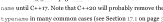

有关直到 C++20 之前为何需要 typename 的更多细节，见第 528 页的 33.2 节。注意，C++20 可能会在许多常见情况下消除对 typename 的需要（详见第 354 页的 17.1.1 节）。

### 5.2 零初始化

对于 int、double 或指针类型等基础类型，没有默认构造函数会用有用的默认值初始化它们。相反，任何未初始化的局部变量都具有未定义的值：


```cpp
void foo()
{
    int x;      // x has undefined value
    int* ptr;   // ptr points to anywhere (instead of nowhere)
}
```

现在，如果你编写模板并希望模板类型的变量由默认值初始化，就会遇到一个问题：简单的定义对内置类型不会这样做：

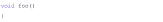

```cpp
template<typename T>
void foo()
{
    T x;       // x has undefined value if T is a built-in type
}
```

出于这个原因，可以显式调用内置类型的默认构造函数，将它们初始化为值 0（这是内置类型的一项特性；对于聚合体，你甚至可以通过编写以下内容来促使内置类型进行零初始化：

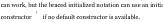

```cpp
template<typename T>
void foo()
{
    T x{};     // x is zero (or false) if T is a built-in type
}
```

这种初始化方式称为值初始化，意思是用提供的构造函数初始化对象，或将其零初始化。即使构造函数是 explicit 的，这也有效。

在 C++11 之前，确保正确初始化的语法是


```cpp
T x = T();   // x is zero (or false) if T is a built-in type
```

在 C++17 之前，这种机制（目前仍受支持）仅在类型的复制构造函数不是 explicit 时才有效。在 C++17 中，强制复制消除避免了这一限制，两种语法都可以工作，但花括号初始化写法可以由初始化列表构造函数进行初始化。


```cpp
template<typename T>
class MyClass {
public:
    T m_t;                // user-initialize in subclass ctor
    ...
};
```

不过，请注意，默认实参不能使用这种语法。例如：

```cpp
template<typename T>
void f(T t = T()); // ERROR
```

相反，我们必须这样写：

```cpp
template<typename T>
void f(T t = T()); // OK (T is an incomplete type) before C++11
```

### 5.3 使用 THIS->

对于基类依赖于模板参数的类模板而言，单独使用名称 `x` 并不总是等价于 `this->x`，即使该成员是在基类中找到的。例如：

```cpp
template<typename T>
class Base {
public:
    void bar();
};

template<typename T>
class Derived : Base<T> {
public:
    void foo() {
        bar(); // calls external bar() or error
    }
};
```

在这个例子中，当在 `foo()` 内读取符号 `bar` 时，`bar()` 不会在 `Base<T>`（或 `Derived<T>`）中找到。因此，要么出现错误，要么调用外部函数 `bar()`（例如全局 `bar()`）。

我们在第 247 页的 9.4.2 节讨论这一行为。目前，作为一条经验法则，我们建议：对于在依赖于模板参数的基类中声明的任何符号，始终使用 `this->` 或 `Base<T>::` 加以限定。

### 5.4 原始数组和字符串字面量的模板

将原始数组或字符串字面量传递给模板时，需要多加注意。首先，如果模板参数被声明为引用，则实参不会退化。也就是说，类型为 `T&` 的参数具有类型 `char[6]`。如果传入不同长度的原始数组或字符串实参，由于类型不同，这可能会成为问题。只有当按值传递时，类型才会退化，因此类型取决于实参。第 7 章对此进行了详细讨论。请注意，你也可以提供专门处理原始数组或字符串字面量的模板。例如：

`basic/array.hpp`

```cpp
template<typename T, int N>
void foo(T (&)[N])
{
    for (int i = 0; i < N; ++i) {
        ...
    }
}
```

这里，当调用

```cpp
int a[3] = { 1, 2, 3 };
foo(a); // deduces T = int, N = 3
```

你也可以将此模板用于字符串字面量：

```cpp
foo("hello"); // deduces T = const char, N = 6
```

如果你只想为字符串字面量（以及其他字符数组）提供函数模板，可以按如下方式实现：

function/array.cpp

```cpp
template<int N, int M>
bool less (char const(&a)[N], char const(&b)[M])
{
    for (int i = 0; i < N && i < M; ++i) {
        if (a[i] < b[i]) return true;
        if (b[i] < a[i]) return false;
    }
    return N < M;
}
```

请注意，你可以而且有时必须针对未知边界的数组进行重载或偏特化。下面的程序演示了针对已知边界数组、已知边界数组的引用、未知边界数组、未知边界数组的引用以及指针的所有可能重载。

function/array.hpp

```cpp
#include <iostream>

template<typename T>
struct MyClass;             // primary template

template<typename T, std::size_t SZ>
struct MyClass<T[SZ]>       // partial specialization for arrays of known bounds
{
    static void print() { std::cout << "print() for T[" << SZ << "]\n"; }
};

template<typename T, std::size_t SZ>
struct MyClass<T(&)[SZ]>    // partial spec. for references to arrays of known bounds
{
    static void print() { std::cout << "print() for T(&)[" << SZ << "]\n"; }
};

template<typename T>
struct MyClass<T[]>         // partial specialization for arrays of unknown bounds
{
    static void print() { std::cout << "print() for T[]\n"; }
};

template<typename T>
struct MyClass<T(&)[]>      // partial spec. for references to arrays of unknown bounds
{
    static void print() { std::cout << "print() for T(&)[]\n"; }
};

template<typename T>
struct MyClass<T*>          // partial specialization for pointers
{
    static void print() { std::cout << "print() for T*\n"; }
};
```

每种情况都不同，并且在使用数组时都可能出现。

```cpp
template<typename T1, typename T2, typename T3>
void demo1(T1 a1, T2 a2, T3 a3) // pointers by using
{
    int a1[42];              // reference to array
    int a2[10];              // reference to array
    T1 a1;                   // passing by value
    T2 a2, T3& a3;           // passing by reference

    MyClass::demo1(a1);      // use MyClass
    MyClass::demo1(a2);      // use MyClass
    MyClass::demo1(a3);      // use MyClass
    MyClass::demo1(a1);      // use MyClass
    MyClass::demo1(a2);      // use MyClass
    MyClass::demo1(a3);      // use MyClass
}

int main()
{
    int a[42];
    MyClass::demo1(a);       // use MyClass

    extern int a[];
    MyClass::demo1(a);       // use MyClass

    double a, b, c, d, e, f;
    int a[] = { 0, 8, 15 };  // define forward
}
```

请注意，根据语言规则，声明为数组（无论是否带长度）的函数参数实际上具有指针类型。另请注意，针对未知边界数组的模板可用于不完整类型，例如

```cpp
extern int a[];
```

而当它按引用传递时，它会变成 `int (&)[]`，这也可以用作模板参数。

关于使用所讨论的不同数组类型的另一个示例，请参见第 60 页的 5.3.2 节。

### 5.5 成员模板

类成员也可以是模板。这对于嵌套类和成员函数都是可行的。这种能力的应用和优势可以通过 `Stack<>` 类模板来演示。通常，你不会使用栈的栈。然而，当你想要使用一个元素类型本身就是栈的栈时，你需要该栈具有一个成员，它可以接受任何其他类型的元素，即使已经为元素类型定义了隐式类型转换：

```cpp
Stack<int> intStack;    // stack for ints
Stack<Stack<int> > intStackStack; // stack for stack for ints

intStack = intStack2;   // OK: stacks have same type
Stack<int> intStack;    // stack of ints
Stack<Stack<int> > intStackStack; // stack of stacks
intStack = intStack2;   // ERROR: stacks have different types
Stack<Stack<int> > intStackStack; // ERROR: stacks have different types
```

默认赋值运算符要求赋值运算符两侧具有相同类型；如果栈具有不同的元素类型，则情况并非如此。

`basics/stack/stack1.hpp`

```cpp
template<typename T>
class Stack {
private:
    std::deque<T> elems;        // elements

public:
    void push(T const& elem);   // push element
    void pop();                 // pop element
    T const& top() const;       // return top element
    bool empty() const {        // return whether the
        return elems.empty();
    }

    // assign stack of elements of type T2
    template<typename T2>
    Stack& operator= (Stack<T2> const&);
};
```

进行了以下两处更改：

- 我们为元素类型为另一种类型 T2 的栈添加了一个赋值运算符声明。
- 该栈现在使用 `std::deque<>` 作为元素的内部容器。同样，这是新赋值运算符实现的结果。

新赋值运算符的实现如下：

`basics/stack/stack2.hpp`

```cpp
template<typename T>
template<typename T2>
Stack<T>& Stack<T>::operator= (Stack<T2> const& op2)
{
    Stack<T2> tmp(op2);              // create a copy

    elems.clear();                   // remove existing elements
    while (!tmp.empty()) {            // copy all elements
        elems.push_front(tmp.top());
        tmp.pop();
    }

    return *this;
}
```

首先，我们来看定义成员模板的语法。在带有模板参数 T 的模板内部，定义了一个带有模板参数 T2 的内部模板：

`basics/stack/stack3.hpp`

```cpp
template<typename T>
template<typename T2>
Stack<T>& Stack<T>::operator= (Stack<T2> const& op2)
{
```

在成员函数内部，你不能直接访问被赋值的栈 `op2` 的所有必要数据。然而，这个栈具有不同的类型（例如，如果类模板有两个不同的实参类型，就会得到两个不同的类类型），因此你只能使用公共接口。由此可知，访问元素的唯一方式是调用 `op2.top()`。但是，每个元素都必须成为栈顶元素，因此必须先创建 `op2` 的副本，以便通过调用 `pop()` 从该副本中取出元素。由于 `top()` 返回最后压入栈的元素，我们可能更倾向于使用支持在集合另一端插入元素的容器。为此，我们使用 `std::deque<>`，它提供 `push_front()`，用于将元素放到集合的另一端。


点击此处查看代码图像

`test2/stackdecl.hpp`

```cpp
template<typename T>
class Stack {
private:
    std::deque<T> elems;        // elements

public:
    void push (T const&);       // push element
    void pop ();                // pop element
    T const& top () const;      // return top element
    bool empty () const {       // return whether the stack is empty
        return elems.empty();
    }

    // assign stack of elements of type T2
    template<typename T2>
    Stack<T>& operator= (Stack<T2> const&);

    // to get access to private members of Stack<T2>
    template<typename T2> friend class Stack;
};
```

如你所见，由于未使用模板参数的类型，因此可以省略它：

点击此处查看代码图像

```cpp
template<typename> friend class Stack;
```

现在，可以实现如下模板赋值运算符：

点击此处查看代码图像

`test2/stackassign.hpp`

```cpp
template<typename T>
template<typename T2>
Stack<T>& Stack<T>::operator= (Stack<T2> const& rhs)
{
    elems.clear();                 // remove existing elements
    elems.insert(elems.begin(),   // insert all elements
                rhs.elems.begin(),
                rhs.elems.end());
    return *this;
}
```

无论你的实现方式如何，有了这个成员模板，现在就可以将 int 的栈赋值给 float 的栈：

点击此处查看代码图像

```cpp
Stack<int> istack;       // stack for ints
Stack<float> fstack;     // stack for floats

fstack = istack;         // OK: stacks have different
                         // types, but int converts to
                         // float
```

当然，这个赋值不会改变栈及其元素的类型。赋值之后，float 栈的元素仍然是 float，因此 `top()` 仍然返回 float。

这个函数似乎会禁用类型检查，使你可以赋值元素为任意类型的栈，但事实并非如此。必要的类型检查发生在源栈的元素被移动到目标栈时：

```cpp
elems.push_front(rhs.top());
```

```cpp
Stack<double> dStack;        // stack of doubles
Stack<int> iStack;           // stack of ints
iStack = dStack;             // ERROR: stack types are not compatible
```

同样，你可以修改实现，将内部容器类型参数化：

```cpp
template<typename T, typename Cont = std::deque<T>>
class Stack {
private:
    Cont elems;                 // elements

public:
    void push(T const&);        // push element
    void pop();                 // pop element
    T const& top() const;       // return top element
    bool empty() const {        // return whether stack is empty
        return elems.empty();
    }

    // assign stack of elements of type T2
    template<typename T2, typename Cont2>
    Stack(Stack<T2, Cont2> const&);

    // to get access to private members of Stack<T2>
    template<typename T2, typename Cont2>
    friend class Stack;
};
```

因此，模板赋值运算符实现如下：

```cpp
template<typename T, typename Cont>
template<typename T2, typename Cont2>
Stack<T, Cont>&
Stack<T, Cont>::operator=(Stack<T2, Cont2> const& op2)
{
    elems.clear();                    // remove all
    elems.insert(elems.begin(),       // insert at beginning
                 op2.elems.begin(),
                 op2.elems.end());

    return *this;
}
```

请记住，对于类模板，只有被调用的成员函数才会被实例化。因此，如果避免将栈赋值给元素类型不同的栈，甚至可以使用 vector 作为内部容器：

```cpp
// stack for ints using a vector as internal container
Stack<int, std::vector<int> > vStack;

vStack.push(42); vStack.push(7);
std::cout << vStack.top() << '\n';
```

由于不需要赋值运算符模板，因此不会出现缺少成员函数 push_front() 的错误消息，程序可以正常工作。

关于最后一个示例的完整实现，请参见 basic 子目录中名称以 v 开头的文件。

例如，对于以下类：

**点击此处查看代码图像**

`basics/boostring.hpp`

```cpp
class BooString {
private:
    std::string value;
public:
    BooString(const char* s)
      : value(s)
    {
    }

    template<typename T = std::string>
    T get() const {       // get value converted to T
        return value;
    }
};
```

可以为成员函数模板提供如下完全特化：

**点击此处查看代码图像**

`basics/boostringtemplate.hpp`

```cpp
template<>
inline bool BooString::get<bool>() const {
    return value == "true" || value == "1" || value == "yes";
}
```

注意，不需要也不能声明该特化；只需定义它们。由于它是完全特化并且位于头文件中，必须用 inline 声明它，以避免该定义被不同翻译单元包含时出错。

可以如下使用该类及其完全特化：

**点击此处查看代码图像**

```cpp
std::cout << std::boolalpha;
BooString s1("hello");
std::cout << s1.get<char>() << '\n';       // prints hello
std::cout << s1.get<int>() << '\n';        // prints 0
std::cout << s1.get<bool>() << '\n';       // prints false
std::cout << s1.get<std::string>() << '\n'; // prints true
```

#### 特殊成员函数模板

只要特殊成员函数允许复制或移动对象，就可以使用模板成员函数。与上面定义的赋值运算符类似，它们也可以是构造函数模板。但是，请注意，模板构造函数或模板赋值运算符不会替换预定义的构造函数或赋值运算符。成员模板不算作复制或移动对象的特殊成员函数。例如，对于相同类型的栈的赋值，仍然会调用默认赋值运算符。

**这种效果可能有利也有弊：**

- 可能会出现模板构造函数或赋值运算符比预定义的复制/移动构造函数或赋值运算符更匹配的情况，尽管提供模板版本只是为了初始化其他类型。详情请参见第 59 页的 6.2 节。
- 要“使用”复制/移动构造函数并不容易，例如，为了能够约束其存在性。详情请参见第 102 页的 6.4 节。

#### 5.5.1 template 关键字

有时，在调用成员模板时，需要显式限定模板实参。在这种情况下，必须使用 template 关键字来确保 < 是模板实参列表的开头。考虑以下使用标准库类型 std::bitset 的示例：

**点击此处查看代码图像**

```cpp
template<int N>
void printBitset (std::bitset<N> const& bs)
{
    std::cout << bs.template to_string<char,
                                       std::char_traits<char>,
                                       std::allocator<char>>();
}
```

对于 bitset，我们调用成员函数模板 to_string()，同时显式指定字符串类型的细节。如果不额外使用 template 关键字，编译器会把小于号解释为比较运算的开头。

对象的类型依赖于模板参数。在我们的示例中，该参数依赖于模板参数 `T`。

`.` 表示法（以及 `->template` 和 `::template` 等类似表示法）只应在模板内部使用，并且仅当它们跟在依赖于模板参数的内容之后时才使用。详情请参见第 39 页的 13.3.3 节。

#### 5.5.2 泛型 lambda 与成员模板

请注意，C++14 引入的泛型 lambda 是成员模板的快捷方式。一个简单的 lambda 包含任意类型两个参数的“和”

点击此处查看代码图像

```cpp
[](auto x, auto y) {
  return x + y;
}
```

是以下类的默认构造对象的快捷方式：

```cpp
class SomeCompilerSpecificName {
public:
  SomeCompilerSpecificName() { }  // constructor only
  template<typename T1, typename T2>
  auto operator() (T1 x, T2 y) const {
    return x + y;
  }
};
```

详情请参见第 39 页的 15.10.6 节。

### 5.6 变量模板

从 C++14 起，变量也可以由特定类型参数化。这样的变量称为变量模板。

例如，可以使用以下代码定义 `pi` 的值，同时仍定义该值的类型：

点击此处查看代码图像

```cpp
template<typename T>
constexpr T pi = 3.1415926535897932385;
```

注意，与所有模板一样，此声明不能出现在函数或块作用域内。

要使用变量模板，必须指定其类型。例如，以下代码使用了已声明的变量模板 `pi` 的两种不同变体：

点击此处查看代码图像

```cpp
std::cout << pi<double> << '\n';
std::cout << pi<float> << '\n';
```

也可以声明在不同翻译单元中使用的变量模板。

点击此处查看代码图像

```cpp
// header.hpp

template<typename T> T val;  // zero initialized

// translation unit 1:
#include "header.hpp"

int main() {
  val<long> = 42;
  print();
}

// translation unit 2:
#include "header.hpp"

void print() {
  std::cout << val<long> << '\n';  // prints 42
}
```

变量模板也可以有默认模板实参。

点击此处查看代码图像

```cpp
template<typename T = long double>
constexpr T pi = 3.1415926535897932385;
```


```cpp
#include <iostream>
#include <array>

template<int N>
std::array<int, N> arr{};        // array with N elements, zero-initialized
template<int SD>
std::array<int, SD> value{};     // type of global variable depends on passed value

int main()
{
    std::cout << "The char" << '\n';       // it has value 0 for type char
    std::cout << arr[0] << '\n';
    // first element of global arr
    for (std::size_t i = 0; i < arr.size(); ++i) {
        std::cout << arr[i] << '\n';
    }
}
```

再次注意，即使初始化和遍历发生在不同的翻译单元中，全局作用域中同一个变量 `std::array<int, 10>` 仍然会被使用。

#### 数据成员的变量模板

变量模板的一个有用应用是定义表示类模板成员的变量。例如，如果类模板定义如下：

```cpp
template<typename T>
class MyClass {
public:
    static constexpr int max = 1000;
};
```

它允许你为 `MyClass` 的不同特化定义不同的值，那么你可以定义

```cpp
template<typename T>
int myMax = MyClass<T>::max;
```

这样应用程序员只需编写

```cpp
auto i = myMax<std::string>;
```

而不是

```cpp
auto i = MyClass<std::string>::max;
```

这意味着，对于如下标准类

```cpp
namespace std {
    template<typename T> class numeric_limits {
    public:
        static constexpr bool is_signed = false;
        ...
    };
}
```

你可以定义

```cpp
template<typename T>
constexpr bool is_signed = std::numeric_limits<T>::is_signed;
```

从而能够编写

`is_signed<char>`

而不是

`std::numeric_limits<char>::is_signed`

#### 类型特征套件

自 C++17 起，标准库使用变量模板技术为标准库中所有产生（布尔）值的类型特征定义简写。例如，为了能够编写

```cpp
std::is_const_v       // since C++17
```

### 5.7 模板模板参数

将模板参数本身传递给类模板可能很有用。再次，我们的栈类模板可以用作示例。

要为栈使用不同的内部容器，应用程序员必须两次指定元素类型。因此，要指定内部容器的类型，你必须再次传递容器类型及其元素类型：

```cpp
Stack<int, std::vector<int>> vstack;    // integer stack that uses a vector
```

使用模板模板参数允许你通过指定容器类型来声明 `Stack` 类模板，而无需重复其元素类型：

```cpp
Stack<int, vector> vstack;    // integer stack that uses a vector
```

为此，你必须将第二个模板参数指定为模板模板参数。原则上，这看起来如下：

```cpp
template<typename T,
         template<typename Elem> class Cont = std::deque>
class Stack {
private:
    Cont<T> elems;             // elements
public:
    void push(T const&);       // push element
    void pop();                // pop element
    T const& top() const;      // return top element
    bool empty() const {       // return whether the
        return elems.empty();
    }
};
```

区别在于第二个模板参数被声明为类模板：

```cpp
template<typename T, template<typename Elem> class Cont
         = std::deque>
class Stack {
    Cont<T> elems;             // OK
};
```

默认值已从 `std::deque<T>` 改为 `std::deque`。

```cpp
Cont<T> elems;
```

使用第一个模板参数来实例化第二个模板参数是此示例特有的。通常，你可以用类模板中提供的任何类型来实例化模板参数。

像往常一样，对于模板参数，你可以使用关键字 `class` 代替 `typename`。在 C++11 之前，它只能由类模板的名称引入。

```cpp
template<typename T,
         template<class Elem> class Cont = std::deque>
class Stack {                          // OK
    ...
};
```

自 C++11 起，我们还可以用别名模板的名称替换 `Cont`，但直到 C++17 才做出相应更改，允许使用关键字 `typename` 代替 `class` 来声明模板参数：

```cpp
template<typename T,
         template<typename Elem> typename Cont =
         std::deque>
class Stack {                          // ERROR before C++17
    ...
};
```

由于模板模板参数的模板参数未被使用，通常省略其名称（除非它提供有用的文档说明）：

```cpp
template<template<typename> class Cont = std::deque>
class Stack {
    // ...
};
```

成员函数必须相应修改。因此，你必须在模板模板参数处指定第二个模板参数。成员函数的实现也同样如此。例如，`push()` 成员函数实现如下：

```cpp
template<typename T, template<typename> class Cont>
void Stack<T, Cont>::push (const T& elem)
{
    elems.push_back(elem);    // append copy of passed
}
```

请注意，虽然模板模板参数是类模板或别名模板的占位符，但没有用于函数模板或变量模板的对应占位符。

#### 模板模板实参匹配

如果你尝试使用新版本的 `Stack`，可能会收到一条错误消息，指出默认值 `std::deque` 与模板参数 `Cont` 不兼容。此示例中 C++17 之前的问题在于，标准库的 `std::deque` 具有不止一个参数。`std::deque` 的第二个参数允许指定分配器（作为默认值），但在 C++17 之前，将 `std::deque` 与 `Cont` 参数匹配时并未考虑这一点。

不过，有一种变通方法。我们可以重写类声明，使 `Cont` 参数期望具有两个模板参数的容器：

```cpp
template<typename T,
         template<typename, typename> class Cont = std::deque>
class Stack {
private:
    Cont<T> elems;        // elements

public:
    void push (T const&); // push element
    void pop ();          // pop element
    T const& top() const; // return top element
};
```

我们的 `Stack` 模板的最终版本（包括用于不同元素类型的栈赋值的成员模板）现在看起来如下：

```cpp
#include <deque>
#include <cassert>
#include <memory>

template<typename T,
         template<typename T, typename = std::allocator<T>>
                   class Cont = std::deque>
class Stack {
private:
    Cont<T> elems;        // elements

public:
    void push (T const&); // push element
    void pop ();          // pop element
    T const& top() const; // return top element
    // ...
};
```


```cpp
return elems.empty();
}

// assign stack of elements of type T2
template<typename T2,
         typename Cont2>
Stack<T,Cont>& operator=(Stack<T2,Cont2> const&);

// to get access to private members of any Stack
template<typename T2, typename Cont2>
friend class Stack;

};

template<typename T, typename Cont>
void Stack<T,Cont>::push (T const& elem)
{
    elems.push_back(elem);       // append copy of passed element
}

template<typename T, typename Cont>
void Stack<T,Cont>::pop ()
{
    assert(!elems.empty());
    elems.pop_back();            // remove last element
}

template<typename T, typename Cont>
T const& Stack<T,Cont>::top () const
{
    assert(!elems.empty());
    return elems.back();         // return copy of last element
}

template<typename T, typename Cont>
template<typename T2, typename Cont2>
Stack<T,Cont>& Stack<T,Cont>::operator= (Stack<T2,Cont2> const& op2)
{
    elems.clear();               // remove existing elements
    elems.insert(elems.begin(),  // insert all elements
                op2.elems.begin(),
                op2.elems.end());
    return *this;
}
```

再次注意，为了访问 op2 的所有成员，我们声明所有其他 stack 实例都是友元（省略其余模板参数）：

**单击此处查看代码图像**

```cpp
template<typename T, typename Cont = std::deque<T>>
class Stack
```

不过，并非所有标准容器模板都可以用于 Cont 参数。例如，std::array 不行，因为它包含一个用于数组长度的非类型模板参数，而在我们的模板定义中没有与之匹配的参数。

单击此处查看代码图像

Source/stack/stack1.cpp

```cpp
#include <stack1.h>
#include <iostream>
#include <vector>

int main()
{
    Stack<int> iStack;      // stack of ints
    Stack<float> fStack;    // stack of floats

    // manipulate int stack
    iStack.push(1);
    iStack.push(2);
    std::cout << "iStack.top(): " << iStack.top() << '\n';

    // manipulate float stack:
    fStack.push(3.3);
    std::cout << "fStack.top(): " << fStack.top() << '\n';

    // assign stack of different type and manipulate again
    fStack = iStack;
    fStack.push(4.4);
    std::cout << "fStack.top(): " << fStack.top() << '\n';

    // stack for doubles using a vector as an internal container
    Stack<double,std::vector<double> > vStack;
    vStack.push(5.5);
    vStack.push(6.6);
    std::cout << "vStack.top(): " << vStack.top() << '\n';

    vStack = fStack;
    std::cout << "vStack: ";
    while (! vStack.empty()) {
        std::cout << vStack.top() << ' ';
        vStack.pop();
    }
    std::cout << '\n';
}
```

该程序有以下输出：

单击此处查看代码图像

```cpp
iStack.top(): 2
fStack.top(): 3.3
fStack.top(): 4.4
vStack.top(): 6.6
vStack: 4.4 2 1
```

有关模板参数的进一步讨论和示例，请参见第39页的3.2节、第65页的4.1节和第698页的19.2.2节。

### 5.8 小结

- 要访问依赖于模板参数的类型名，必须在该名称前加上 `typename` 进行限定。
- 要访问依赖于模板参数的类的成员，必须通过 `this->` 或它们的类名来限定访问。
- 嵌套类和成员函数也可以是模板。一个应用是能够使用内部类型预定义的构造函数或赋值运算符来实现泛型操作。
- 通过使用花括号初始化或显式调用默认构造函数，可以确保模板的变量和成员即使以内建类型实例化，也会用默认值初始化。
- 可以为原始数组提供特定的模板，这也可适用于字符串字面量。
- 当传递原始数组或字符串字面量时，当且仅当参数不是引用时，实参在实参推导期间会退化（执行数组到指针的转换）。
- 可以定义变量模板（自 C++14 起）。
- 还可以将类模板用作模板参数，即模板模板参数。
- 模板模板实参通常必须与其参数完全匹配。

- 1. 也就是说，在参数类型为 std::initializer_list 的构造函数中，针对某个类型 T。
- 2. 类型为 T[4]——其中 T 为任意类型——的参数只有在 C++17 中才必须有效；不过，尽管核心问题 1657 的解决方案如此，许多编译器在该语言的早期版本中就已接受此类参数。
- 3. 这是一个用于演示模板特性的基础实现，因此目前缺少适当的异常处理。
- 4. 是的，对于非常不同的事物，却有着非常相似的术语。变量模板是一种模板，而它本身又是模板（这里的 variable 是数组吗？）。变量模板是用于变量的模板，模板参数的数量（这里的 variables 是任意的吗？）。
- 5. 在 C++17 之前，这个版本存在一个问题，我们稍后会解释。不过，这只影响默认值 std::integer。因此，在讨论 C++17 之前如何处理该问题之前，我们可以用这个默认值来说明模板模板参数的一般特性。

## 第6章

## 移动语义与 enable_if<>

C++11 引入的最突出特性之一是移动语义。可以使用它来优化复制和赋值：通过将内部资源从源对象移动（“窃取”）到目标对象，而不是复制这些内容。前提是源对象不再需要其内部值或状态（因为它即将被丢弃）。

移动语义对模板的设计有重大影响，并且引入了特殊规则来支持泛型代码中的移动语义。本章介绍这些特性。

### 6.1 完美转发

假设你想编写泛型代码，将传入实参的基本属性转发出去：

- 可修改对象应被转发，以便它们仍然可以被修改。
- 常量对象应作为只读对象转发。
- 可移动对象（我们可以从中“窃取”的对象，因为它们即将失效）应作为可移动对象转发。

要在不使用模板的情况下实现此功能，我们必须为所有三种情况编写代码。例如，为了将 f() 的调用转发到对应函数，使用……

**单击此处查看代码图像**

basic/forward.cpp

```cpp
#include <utility>
#include <iostream>

class X
{
};

void g (X& x)
{
  std::cout << "lvalue for variable\n";
}

void g (X const& x)
{
  std::cout << "lvalue for constant\n";
}

void g (X&& x)
{
  std::cout << "rvalue for movable object\n";
}

// let f() forward argument val to g():

void f (X& val)        // val is non-const lvalue => ...
{
  g(val);
}

void f (X const& val)
{
  g(val);              // val is const lvalue => calls g(X const&)
}

void f (X&& val)
{
    g(std::move(val));   // val is non-const lvalue => ...
}

int main()
{
    X x;                 // create variable
    X const cx;          // create constant

    f(x);                // f() for nonconstant object calls ...
    f(cx);               // f() for constant object calls ...
    f(X());              // f() for temporary value (rvalue)
    g(std::move(x));     // g() for movable rvalue calls ...
}
```

这里，我们看到 f() 将其实参转发给 g() 的三种不同实现：

单击此处查看代码图像：

```cpp
void f (X& val)
{
    g(val);              // val is non-const lvalue => calls g(X&)
}

void f (X const& val)
{
    g(val);              // val is const lvalue => calls g(X const&)
}

void f (X&& val)
{
    g(std::move(val));   // val is non-const lvalue => needs std::move() to call g(X&&)
}
```

注意，可移动对象的代码（通过右值引用）与其他代码不同：它需要 std::move()，因为根据语言规则，并不是每个表达式都会原样传递。尽管第三个 f() 中的 val 被声明为右值引用，但它在作为表达式使用时的值类别是左值。因此，为了正确转发实参，我们使用 std::move(val)。如果不使用 move，对于非常量值将调用 `g(X&)`，而不是调用 `g(X&&)`。

如果我们想在泛型代码中组合所有三种情况，就会遇到问题：

单击此处查看代码图像：

```cpp
template<typename T>
void f (T&& val) {
    g(val);
}
```

这对前两种情况有效，但对传递可移动对象的（第三种）情况无效。

因此，C++11 为完美转发参数引入了特殊规则。实现这一点的惯用代码模式如下：

单击此处查看代码图像：

```cpp
template<typename T>
void f (T&& val) {
    g(std::forward<T>(val));   // perfect forward val to g()
}
```

注意，std::move() 没有模板参数，并且会为传入的实参“触发”移动语义；而 std::forward<T>() 则根据传入的模板实参来“转发”潜在的移动语义。

不要因为 `X&&` 用于特定类型 X，就假设 `T&&` 也用于模板参数 T。适用不同的规则！然而，从语法上看它们完全相同：

- 对于特定类型 X，`X&&` 将参数声明为右值引用。它只能绑定到可移动对象（纯右值，例如临时对象，以及将亡值，例如通过 `std::move()` 传递的对象）；另请参见下面的注释。它始终是可变的，并且你始终可以调用“窃取它的值”。
- 对于模板参数 T，`T&&` 声明的是转发引用（也称为万能引用）。它可以绑定到可变对象、不可变对象（即 const 对象）或可移动对象。在函数定义内部，该参数可能是可变的、不可变的，或者引用以右值传递的值，具体取决于 T 的类型。

注意，T 必须确实是模板参数的名称。仅仅依赖于模板参数是不够的。对于参数 T，诸如 `typename T::...` 这样的声明并不是右值引用。


```cpp
#include <utility>
#include <iostream>

class X {
    ...
};

void g (X) {
    std::cout << "g() for val\n";
}

void g (X const&) {
    std::cout << "g() for const\n";
}

void g (X&&) {
    std::cout << "g() for movable object\n";
}

// let f() perfect forward argument val to g()

template<typename T>
void f (T&& val)
{
    g(std::forward<T>(val));  // call the right g()
}

int main()
{
    X v;              // create variable

    X const c;        // create constant

    f(v);             // f() for variable calls f(X&)
    f(c);             // f() for constant calls f(X const&)
    f(X());           // f() for temporary calls f(X&&)
    f(std::move(v));  // f() for non-const movable variable
}
```

当然，完美转发也可以与可变参数模板一起使用（有关一些示例，见第 6 页的 4.3 节）。有关完美转发的细节，见第 336 页的 15.6.3 节。

### 6.2 特殊成员函数模板

成员函数模板也可以用作特殊成员函数，包括用作构造函数，然而这可能会导致令人意外的行为。

考虑以下示例：

点击此处查看代码图像

```cpp
#include <utility>
#include <string>
#include <iostream>

class Person
{
private:
    std::string name;

public:
    // constructor for passed initial name
    explicit Person(std::string const& n) : name(n) {
        std::cout << "COPYING string-CONSTR for " << ...
    }

    explicit Person(std::string&& n) : name(std::move(n)) {
        std::cout << "MOVING string-CONSTR for " << ...
    }

    // copy and move constructors:
    Person(Person const& p) : name(p.name) {
        std::cout << "COPY-CONSTR Person " << name << ...
    }

    Person(Person&& p) : name(std::move(p.name)) {
        std::cout << "MOVE-CONSTR Person " << name << ...
    }
};
```

这里，我们有一个类 Person，它有一个 string 成员 name，我们为其提供初始化构造函数。为了支持移动语义，我们重载了接受 std::string 的构造函数：

- 我们提供一个用于 string 对象的版本，其中 name 由所传实参的副本初始化：

点击此处查看代码图像

```cpp
Person(std::string const& n) : name(n) {
    std::cout << "COPY-CONSTR for " << name << ...
}
```

- 我们提供一个用于可移动 string 对象的版本，其中我们调用 std::move() 来“窃取”其值：

点击此处查看代码图像

```cpp
Person(std::string&& n) : name(std::move(n)) {
    std::cout << "MOVE-CONSTR for " << name << ...
}
```

正如预期，前者会为传入的正在使用的 string 对象（左值）调用，而后者会为可移动对象（右值）调用：

点击此处查看代码图像

```cpp
std::string s = "name";      // init with string object => call copying string-constr
Person p2("tmp");             // init with string literal => call moving string-CONSTR
```

除了这些构造函数，该示例还为拷贝构造函数和移动构造函数提供了具体实现，以便观察整个 Person 何时被拷贝/移动：

点击此处查看代码图像

```cpp
Person p3(p1);                // copy Person => calls COPY-CONSTR
Person p4(std::move(p1));     // move Person => calls MOVE-CONSTR
```

现在，让我们用单个泛型构造函数替换这两个 string 构造函数，该构造函数将传入实参完美转发给成员 name：

点击此处查看代码图像

```cpp
#include <utility>

#include <string>

#include <iostream>

class Person
{
private:
    std::string name;
public:
    // generic constructor for passed initial name:
    template<typename T>
    explicit Person(T&& n) : name(std::forward<T>(n))
    {
        std::cout << "TMPL-CONSTR for '" << name << "'\n";
    }

    // copy and move constructor:
    Person (Person const& p) : name(p.name) {
        std::cout << "COPY-CONSTR Person '" << name << "'\n";
    }
    Person (Person&& p) : name(std::move(p.name)) {
        std::cout << "MOVE-CONSTR Person '" << name << "'\n";
    }
};
```

使用传入的 string 进行构造工作正常，正如预期：

点击此处查看代码图像

```cpp
std::string s = "Nancy";
Person p1(s);              // init with string object => calls TMPL-CONSTR
Person p2("tmp");          // init with string literal => calls TMPL-CONSTR
```

注意，在这种情况下，p2 的构造不会创建临时 string。参数 T&& 是转发引用（见 6.1 节）。在构造函数中对传入参数应用 std::forward<T>() 不会产生任何效果，因此 name 成员是由左值构造的，并从该左值移动而来。

但当我们尝试调用拷贝构造函数时，会得到错误：

点击此处查看代码图像

```cpp
Person p3(p1);              // ERROR
```

而通过非常量对象初始化新的 Person 仍然工作正常：

点击此处查看代码图像

```cpp
Person p4(std::move(p1));   // OK: move Person => calls MOVE-CONSTR
```

注意，拷贝常量 Person 也工作正常：

点击此处查看代码图像

```cpp
Person const cp("tmp");     // init constant object with string literal
Person p5(cp);              // OK: copy constant Person => calls COPY-CONSTR
```

问题在于，根据 C++ 的重载解析规则（见第 333 页的 16.2.5 节），对于非常量左值 Person p，模板构造函数

点击此处查看代码图像

```cpp
template<typename T>
Person(T&& n)
```

比（通常预定义的）拷贝构造函数匹配得更好：

点击此处查看代码图像

```cpp
Person (Person const& p)
```

对于右值，模板构造函数比（通常预定义的）移动构造函数匹配得更好：

点击此处查看代码图像

```cpp
Person (Person&& p)
```

你可能会想通过额外提供一个非常量拷贝构造函数来避免这种情况：

点击此处查看代码图像

```cpp
Person (Person& p)
```

然而，这只是一个部分解决方案，因为对于派生类的对象，模板构造函数匹配得更好。你真正想要的是：当传入实参是 Person 或可转换为 Person 的表达式时，禁用该模板成员。这只能使用 std::enable_if<> 来完成，下一节将介绍它。

### 6.3 使用 ENABLE_IF<> 禁用模板

可转换为 std::string 的类型；

为此，我们使用一个更标准的类型特征 `std::is_convertible`。在 C++20 中，配合 C++17，相应的定义如下：

点击此处查看代码图像

```cpp
template<typename T>
using EnableIfString =
    std::enable_if_t<
        std::is_convertible_v<T,
            std::string>>;

template<typename T>
Person(T&& n);
```

如果 T 可转换为 std::string，则整个声明展开为

点击此处查看代码图像

```cpp
template<typename T>
Person(T&& n)
    : name(std::forward<T>(n))
{
    static_assert(
        std::is_convertible_v<T,
            std::string>);
}
```

如果 T 不可转换为 std::string，则整个函数模板会被忽略。

同样，我们可以使用别名模板为约束定义自己的名字：

点击此处查看代码图像

```cpp
template<typename T>
using EnableIfString =
    std::enable_if_t<
        std::is_convertible_v<T,
            std::string>>;

template<typename T,
    typename = EnableIfString<T>>
Person(T&& n);
```

因此，整个类 Person 应如下所示：

点击此处查看代码图像

```cpp
#include <utility>

#include <string>

#include <iostream>

#include <type_traits>

template<typename T>
using EnableIfString = std::enable_if_t<
    std::is_convertible_v<T, std::string>>;

class Person
{
private:
    std::string name;

public:
    // generic constructor for passed initial name:
    template<typename STR, typename = EnableIfString<STR>>
    explicit Person(STR&& n)
        : name(std::forward<STR>(n)) {
        std::cout << "TMPL-CONSTR for '" << n << "'\n";
    }

    // copy and move constructor:
    Person (Person const& p) : name(p.name) {
        std::cout << "COPY-CONSTR Person '" << p.name << "'\n";
    }
    Person (Person&& p) : name(std::move(p.name)) {
        std::cout << "MOVE-CONSTR Person '" << p.name << "'\n";
    }
};
```

现在，所有调用都按预期工作：


```cpp
#include "SpaceClassInscript3.hpp"

int main()
{
    ...

    std::string s = "...";

    Person p1(s);                 // init with string object
    Person p2("...");             // init with string literal
    Person p3(p1);                // OK -- calls COPY-CON...
    Person p4(std::move(p1));      // OK -- calls MOVE-CON...
}
```

再次注意，在 C++14 中，我们必须如下声明别名模板，因为对于产生值的类型特征，`_t` 版本未定义：

**单击此处查看代码图像**

```cpp
template<typename T>
using EnableIfString = std::enable_if_t<
    std::is_convertible<T, std::string>::value,
    std::string>;
```

而在 C++11 中，我们必须如下声明特殊成员模板，因为按目前写法，对于产生值的类型特征，`_t` 版本未定义：

**单击此处查看代码图像**

```cpp
template<typename T>
using EnableIfString =
    typename std::enable_if<
        std::is_convertible<T, std::string>::value
    >::type;
```

但这仍然不完全是 `enable_if<>` 的定义：

另请注意，`std::is_convertible<>` 有一个替代方案，因为它要求类型可隐式转换。通过使用 `std::is_constructible<>`，我们还允许在初始化中使用显式转换。不过，在这种情况下，参数的顺序是相反的。

**单击此处查看代码图像**

```cpp
template<typename T>
using EnableIfString =
    std::enable_if_t<
        std::is_constructible<T, std::string>::value,
        std::string>;
```

有关 `std::is_constructible<>` 的详细信息，请参见第 730 页的 3.3.2 节；有关在各种模板模式上应用 `enable_if<>` 的详细信息和示例，请参见第 727 页的 3.3.3 节。

#### 禁用特殊成员函数

注意，通常我们不能使用 `enable_if<>` 来禁用预定义的拷贝/移动构造函数和/或赋值运算符。原因在于，成员函数模板从不算作特殊成员函数，并且例如在需要拷贝构造函数时会被忽略。因此，对于下面这个声明：

**单击此处查看代码图像**

```cpp
class C
{
public:
    template<typename T>
    C(T const&)
    {
        // ...
    }
};
```

当请求 `C` 的副本时，仍然会使用预定义的拷贝构造函数：

**单击此处查看代码图像**

```cpp
C x;
C y(x);  // still uses the predefined copy constructor
         // (not the member template)
```

实际上没有办法使用该成员模板，因为无法指定或推导其模板参数 `T`。

删除预定义的拷贝构造函数并不是解决办法，因为那样尝试拷贝 `C` 会导致错误。

不过，有一个巧妙的解决办法：我们可以为 `const volatile` 参数声明一个拷贝构造函数，并将其标记为“已删除”（即用 `= delete` 定义它）。这样做可以防止另一个拷贝构造函数被隐式删除。有了这个，我们就可以定义一个构造函数模板，对于非 volatile 类型，它会被优先于（已删除的）拷贝构造函数选中：

```cpp
// user-define the predefined copy constructor as
// deleted
// (with conversion to volatile to enable better
// matching)
C(const volatile&) = delete;

// implement copy constructor template with better
// match
template<typename U>
C(C<U> const&) {
    // ...
}
```

现在，即使是“普通”拷贝，也会使用模板构造函数。

**单击此处查看代码图像**

```cpp
C x;
C y(x); // uses the member template
```

在这样的模板构造函数中，我们随后可以用 `enable_if` 施加额外约束。例如，为了阻止从模板类型中的模板参数拷贝类模板 `C` 的对象，我们可以实现如下：

**单击此处查看代码图像**

```cpp
template<typename T>
class C
{
public:
    // ... define the predefined copy constructor as
    // deleted
    // (with conversion to volatile to enable better
    // matching)
    C(const volatile&) = delete;

    // If T is not integral type, provide copy constructor
    template<typename U,
             typename = std::enable_if_t<std::is_integral_v<U>>>
    C(C<U> const&) {
    }
};
```

### 6.5 使用概念简化近似 if 表达式

即使使用别名/模板，`enable_if` 语法也相当笨拙，因为它使用了一种变通方法：为了获得所需效果，我们添加一个额外的模板参数，并“滥用”该参数来提供特定要求，以便函数模板能够存在。这样的代码难以阅读，也使函数模板的其余部分难以理解。

原则上，我们只需要一种语言特性，允许我们以这样的方式为函数表述要求或约束：如果不满足要求/约束，就使该函数被忽略。

这是期待已久的语言特性“概念”的一个应用，它允许我们用其自身的简单语法为模板表述要求/条件。不幸的是，尽管讨论了很长时间，概念仍未成为 C++17 标准的一部分。不过，一些公司为这种特性提供了实验性支持，而概念很可能会成为 C++17 之后的下一个标准的一部分。

按照所提议的概念用法，我们只需编写如下内容：

**单击此处查看代码图像**

```cpp
template<typename T>
requires std::is_convertible_v<T, std::string>
Person(const T& name) : name(std::forward<T>(name)) {
}
```

### 6.6 总结

在模板中，我们可以通过将参数声明为转发引用（以模板参数名后跟 && 的类型格式声明），并在转发调用中使用 std::forward<>，来“完美”转发参数。

- 当使用完美转发的成员函数模板时，它们可能比预定义的特殊成员函数更适合拷贝或移动对象。

- 使用 std::enable_if_t<…>，当错误类型条件为假时，你可以禁用函数模板（一旦确定该条件，该模板就会被忽略）。

- 通过使用 std::enable_if_t<>，你可以避免以下问题：可对单个实参调用的构造函数模板或赋值运算符模板比隐式生成的特殊成员函数匹配得更好。

- 你可以通过删除为 const-volatile 对象预定义的特殊成员函数，来简化特殊成员函数（并将 enable_if_t<> 应用于它们）。

- 概念允许你对函数模板的要求使用更直观的语法。

¹ 移动语义不会自动传递下去，这一事实是有意为之且重要的。如果不是这样，我们第一次在函数中使用某个对象时，就会得到已被移出的对象的值。

² 像 X const& 这样的类型是有效的，但在实践中没有提供通用语义，因为“窃取”可移动对象的内部表示需要修改该对象。不过，它可能被用来强制传递其他临时对象或标记为 std::move() 的对象，而无法修改它们。

³ “通用引用”一词由 Scott Meyers 创造，作为一个通用术语，它可能表示“右值引用”或“左值引用”。因为“通用”这个词实在过于宽泛，所以 C++ 标准引入了“转发引用”这个术语，因为使用这种引用的主要原因是转发对象。不过要注意，它并不会自动转发。这个术语描述的不是它是什么，而是它通常用于什么。

⁴ 不要忘记将条件放在括号中，因为否则条件中的 > 会结束模板实参列表。

⁵ 感谢 Stephen C. Dewhurst 指出这一点。

⁶ 如果你想知道为什么我们不改为检查 std::is_not_convertible，因为我们正在定义一个可能允许将 string 转换为 person 的函数。所以构造函数必须知道它是否启用，而这又取决于它是否启用，如此循环。永远不要在会影响 enable_if 所用条件的地方使用 enable_if_t。这是一个逻辑错误，编译器不一定会检测到。

⁷ 感谢 Peter Dimov 指出这一技术。


## 第7章

## 按值传递还是按引用传递？

自始至终，C++都提供了按值调用和按引用调用，而决定选择哪一种并不总是容易的。通常，对于非平凡对象，按引用调用更廉价，但也更复杂：C++11 在其中加入了移动语义，这意味着现在你有多种按引用传递的方式：

- 1. `X const&`（常量左值引用）：`X` 参数引用所传递的对象，但不能修改它。
- 2. `X&`（非常量左值引用）：`X` 参数引用所传递的对象，并且可以修改它。
- 3. `X&&`（右值引用）：`X` 参数引用所传递的对象，并具有移动语义，意味着你可以修改或“窃取”该值。

当你知道具体类型时，决定如何声明参数已经足够复杂。在模板中，你并不知道具体类型，因此决定哪种传递机制合适就变得更加困难。

尽管如此，在第 20 页的 1.6.2 节中，我们确实建议在函数模板中按值传递参数，除非有充分的理由，例如以下情况：

- 无法进行拷贝。
- 参数用于返回数据。
- 模板只是通过保留原始实参的所有属性，将参数转发到其他地方。
- 有显著的性能提升。

本章讨论在模板中声明参数的不同方法，具体阐述总体上建议按值传递，并给出不这样做的理由。本章还讨论在处理字符串字面量和其他原始数组时会遇到的棘手问题。

阅读本章时，熟悉值类别的术语（左值、右值、纯右值、将亡值）会有所帮助，附录 B 对此进行了解释。

### 7.1 按值传递

按值传递实参时，原则上每个实参都必须被拷贝。因此，每个参数都会成为所传递实参的一个副本。对于类而言，作为副本创建的对象通常由拷贝构造函数初始化。

调用拷贝构造函数可能会变得昂贵。然而，即使按值传递参数，也有多种方法可以避免昂贵的拷贝。事实上，编译器可能会优化掉临时对象的拷贝操作，并通过使用移动语义，使复杂对象的传递也变得廉价。

例如，让我们看一个简单的函数模板，其实现为按值传递实参：

```cpp
template<typename T>
void printV(T arg) {
    // ...
}
```

当为整数调用这个函数模板时，生成的代码是

```cpp
void printV(int arg) {
    // ...
}
```

参数 `arg` 会成为任何所传递实参的副本，无论该实参是对象、字面量，还是函数返回的值。

模板参数 `T` 被实例化为 `std::string`，因此我们得到

```cpp
void printV (std::string arg)
{
    ...
}
```

同样，在传递该字符串时，`arg` 会成为 `s` 的副本。这一次，副本由 string 类的拷贝构造函数创建，这可能是一项昂贵的操作，因为原则上该拷贝操作会创建一个完整或“深”拷贝，从而使副本在内部分配自己的内存来保存该值。

然而，可能昂贵的拷贝构造函数并不总是被调用。考虑以下代码：

```cpp
std::string returnString();
std::string s = "hi";
printV(s);                         // copy constructor
printV(std::string("hi"));        // copying usually optimized
printV(std::move(s));              // move constructor
printV(returnString());            // copying usually optimized
printV(std::move(s));              // move constructor
```

在第一次调用中，我们传递了一个左值，这意味着使用了拷贝构造函数。然而，在第二次和第四次调用中，直接传递给函数模板的临时对象很可能被优化掉，并且为临时对象调用函数模板会变成对移动构造函数的调用；参见附录 B。编译器通常会优化实参的传递，从而根本不构造拷贝。自 C++17 起，这种优化是必需的。在 C++17 之前，如果编译器不优化掉拷贝，它至少必须尝试使用移动语义，这通常会使拷贝变得廉价。在最后一次调用中，当用 `std::move()` 传递一个左值（一个已存在的非常量对象）时，我们通过表明不再需要 `s` 的值，强制该调用使用移动构造函数。

#### 按值传递与移动

因此，按值调用右值或临时对象时，我们必须提到：按值将实参传递给参数时，类型会发生退化。这意味着数组会被转换为指针，并且诸如 `const` 和 `volatile` 之类的限定符会被移除（就像将该值用作未声明 `&` 的对象的初始化器一样）。

```cpp
template<typename T>
void printV (T arg)
{
    ...
}
```

```cpp
std::string const c = "hi";
printV(c);                         // const removed so that arg has
                                   // type std::string

printV("hi");                      // decays to pointer so that
                                   // arg has type char const*

int arr[4];
printV(arr);                       // decays to pointer so that
                                   // arg has type int*
```

因此，当传递字符串字面量 `"hi"` 时，其类型 `char const[3]` 会退化为 `char const*`，因此这就是 `T` 的推导类型。于是，该模板被实例化如下：

```cpp
void printV (char const* arg)
{
    ...
}
```

这种行为源自 C，既有优点也有缺点。它通常简化了所传递字符串字面量的处理，但缺点是，在 `printV(T)` 内部，我们无法区分传递的是指向单个元素的指针还是原始数组。因此，我们将在第 155 页的 7.2.4 节中讨论如何处理字符串字面量和其他原始数组。

### 7.2 按引用传递

现在让我们讨论按引用传递的不同形式。在所有情况下，都不会创建副本（因为参数只是引用所传递的实参）。此外，传递实参时永远不会发生退化。然而，有时传递并不可行；而如果传递可行，在某些情况下，参数的结果类型可能会引发问题。

#### 7.2.1 按常量引用传递

为了避免任何（不必要的）拷贝，在传递临时对象时，我们可以使用常量引用。

使用这种声明，传递对象永远不会创建副本（无论拷贝是否廉价）：

```cpp
std::string customString();
std::string s = "hi";
print(s);                         // no copy
print(customString());            // no copy
print(&s);                        // no copy
print(std::move(s));              // no copy
```

甚至 `int` 也按引用传递，这是一种适得其反但允许的传递该类型的方式：

```cpp
int i = 42;
print(i);                       // passes reference instead
```

会导致 `print()` 被实例化为：

```cpp
void print(int const& arg) {
    ...
}
```

在底层，按引用传递实参是通过传递实参的地址来实现的。地址以紧凑方式编码，因此将地址从调用者传递给被调用者本身是高效的。然而，在编译器编译被调用者时，传递地址会带来不确定性：被调用者会用该地址做什么？理论上，被调用者可以更改通过该地址可达的所有值。这意味着编译器必须假定，在调用之后，它可能已访问到的所有值（通常位于机器寄存器中）都无效。重新加载所有这些值可能相当昂贵。你可能认为我们是通过 `const` 引用传递的：编译器从中推断出的应该是不会发生任何更改！不幸的是，事实并非如此，因为调用者可能通过自己的非 `const` 引用传递了一个对象。

这可以通过内联来改善：如果编译器能够内联展开该调用，它就可以同时分析调用者和被调用者，并在许多情况下“看出”该地址除了传递底层值之外并未用于其他用途。函数模板通常非常短，因此很可能是内联展开的候选者。然而，如果模板封装了更复杂的算法，内联就不太可能发生。

#### 按引用传递不会退化

按引用将实参传递给参数时，它们不会退化。这意味着原始数组不会被转换为指针，并且诸如 `const` 和 `volatile` 之类的限定符不会被移除。然而，由于调用参数被声明为 `T const&`，模板参数 `T` 本身不会被推导为 `const`。例如：

```cpp
template<typename T>
void print(T const& arg) {
    ...
}

std::string const c = "hi";
print(c);                           // T deduced as std::string, arg is
                                    // std::string const&

int arr[4];
print(arr);                         // T deduced as int[4], arg is
                                    // int const(&)[4]

int const a[4];
print(a);                           // T deduced as int[4], arg is
                                    // int const(&)[4]
```

因此，在 `print(T)` 中以类型 `T` 声明的局部对象不是常量。

#### 7.2.2 按非常量引用传递

当你希望通过传递的实参返回值（即，希望将它们用作输出参数）时，你必须使用非常量引用（除非你更愿意通过指针传递它们）。同样，这意味着在传递实参时不会创建副本。被调用的函数模板的参数会直接访问所传递的实参。

考虑以下代码：

```cpp
template<typename T>
void out(T& arg) {
    ...
}
```

注意，通常不允许为临时对象（右值）或通过 `std::move()` 传递的已有对象（将亡值）调用 `out()`：

```cpp
std::string customString();
std::string s = "hi";
out(s);                         // ...
out(customString());             // ERROR: not allowed to pass a
                                 // temporary
```


```cpp
parse(42);            // OK: T deduced as int (4)
                      // (also the type of arg)
```

然而，类型推导的特殊规则可能会导致一些意外情况：

```cpp
std::string const c = "hi";
parse(c);                 // OK: T deduced as std::string const&
parse("hi");              // OK: T deduced as char const (&)[3]
const char arr[4];        // also the type of arg
parse(arr);               // OK: T deduced as char const (&)[4]
```

在所有这些情况下，在parse()内部，参数arg的类型是“已知的”，无论我们传递的是右值（这两处）还是非const或const左值。这是传递参数的唯一方式，以便能够区分这三种情况的行为。

这给人的印象是，在所有情况下都将参数声明为转发引用很重要。但请注意，天下没有免费的午餐。

例如，这是模板参数T隐式成为引用类型的唯一方式。因此，使用T声明一个未初始化的局部对象可能会导致错误：

```cpp
template<typename T>
void foo(T&& arg)
{
    T x;
    ...
}

foo(42);        // OK: T deduced as int
int i;
foo(i);         // ERROR: T deduced as int&, which makes the
                // declaration of x in foo() invalid
```

有关如何处理这种情况的更多详细信息，请参阅第279页的35.6.2节。

### 7.3 使用 STD::REF() 和 STD::CREF()

自C++11起，对于函数模板参数，你可以让调用者决定是按值传递还是按引用传递。当模板声明为按值接收参数时，调用者可以使用头文件<functional>中声明的std::cref()和std::ref()来按引用传递参数。例如：

```cpp
template<typename T>
void print(T arg)
{
    ...
}

std::string const s = "hello";
print(s);                 // pass by value
print(std::cref(s));      // pass as "by reference"
```

然而，请注意，std::cref()不会改变模板中参数的处理方式。相反，它使用了一个技巧：它将传递的参数包装在一个行为类似于引用的对象中。实际上，它创建了一个类型为std::reference_wrapper<>的对象，该对象引用原始参数，并按值传递这个对象。该包装器几乎只支持一种操作：隐式类型转换回原始类型，从而得到原始对象。因此，只要你对传递的对象有有效的操作符，就可以改用引用包装器。例如：

```cpp
#include <functional>       // for std::cref()
#include <string>
#include <iostream>

void printString(std::string const& s)
{
    std::cout << s << '\n';
}

template<typename T>
void print(T arg)
{
    printString(arg);        // might convert arg back
}

int main()
{
    std::string s = "hello";

    print(s);              // print s passed by value
    print(std::ref(s));    // print s passed by ref
}
```

最后一次调用按值传递了一个std::reference_wrapper类型的对象，然后该对象将参数作为底层类型传递。当存在隐式转换回其底层类型时，就会发生这种情况。

请注意，编译器必须知道需要隐式转换回原始类型。因此，std::ref()和std::cref()通常只适用于定义了operator<<的类型。

```cpp
template<typename T>
void print(T& arg)
{
    std::cout << arg << '\n';
}

std::string s = "hello";
print(s);                 // OK
print(std::ref(s));       // ERROR: no operator << for
                          // reference wrapper defined
```

此外，下面的isless示例会失败，因为不能将引用包装器与char const*进行比较：

```cpp
template<typename T1, typename T2>
bool isless(T1 arg1, T2 arg2)
{
    return arg1 < arg2;
}

std::string s = "hello";
if (isless(std::ref(s), "world"))
{
    // ERROR
}
if (isless(std::cref(s), std::string("world")))
{
    // ERROR
}
```

给arg1和arg2一个共同的类型T也无济于事：

```cpp
template<typename T>
bool isless(T arg1, T arg2)
{
    return arg1 < arg2;
}
```

因为这样编译器在尝试为arg1和arg2推导T时会得到冲突的类型。

最终的效果是：引用包装器是一种作为一等对象的引用，你可以复制它，因此可以按值传递给函数模板。你也可以在类中使用它，例如，在容器中持有对对象的引用。但你最终总是需要转换回底层类型。

### 7.4 处理字符串字面量和原始数组

到目前为止，我们已经看到了在使用字符串字面量和原始数组时模板参数的不同效果：

- 按值传递会退化，使它们成为指向元素类型的指针。
- 任何形式的按引用传递都不会退化，因此实参成为仍然引用数组的引用。
- 两者都可以按值传递。当数组退化为指针时，你就失去了区分处理元素指针与处理传入数组的能力。

另一方面，当处理实参为字面量的参数时，不退化可能会成为问题，因为不同长度的字符串字面量具有不同的类型。例如：

```cpp
template<typename T>
void foo(T const& arg1, T const& arg2)
{
    ...
}

foo("hi", "guys"); // ERROR
```

在这里，`foo("hi", "guys")`无法编译，因为"hi"的类型是`char[3]`，而"guys"的类型是`char[5]`。但模板要求它们具有相同的类型T。只有当字符串字面量的长度相同时，代码才能编译。因此，强烈建议不要在测试用例中使用不同长度的字符串字面量。

```cpp
template<typename T>
void foo(T arg1, T arg2)
{
  ...
}
foo("hi", "guys"); // compiles, but...
```

但这并不意味着所有问题都消失了。更糟糕的是，编译期问题可能变成了运行期问题。考虑下面的代码，我们使用arg1 == nullptr来比较传递的参数：

```cpp
template<typename T>
void foo(T arg1, T arg2)
{
  if (arg1 == nullptr) { // compare addresses of passed arrays
    ...
  }
}
foo("hi", "guys"); // compiles, but...
```

如所写，你必须知道应该将传递的字符指针解释为字符串。但无论如何，情况可能并非如此，因为模板也可能被来自已经退化的字符串字面量参数调用（例如，通过从另一个函数调用，或按值传递，或使用std::array/std::span，这两种都是传递字符序列的典型方式）。

然而，在许多情况下，小心处理foo()——特别是检查传递的是指针、指针序列还是指向数组的指针，以及其他参数期望参数已转换为相同类型——是很复杂的。一种典型的方式是，如果你希望使用转发函数来处理多种类型，那么优先使用转发引用。另一种方法是使用类型萃取。在这些情况下，你可以使用类型萃取（如std::is_pointer<>）来显式决定参数（对于指针也成立；请参阅第278页的7.5节）。

请注意，其他类型萃取（如std::is_array<>）根本不适用，std::is_pointer<>也是如此（请参阅第279页的7.5节和第716页的D.6节）。

#### 7.4.1 字符串字面量和原始数组的特殊实现

你可能必须根据传递的是指针还是数组来区分你的实现。当然，这要求传递的数组尚未退化。

要区分这些情况，你必须检测传递的是否是数组。基本上有两种选择：

- 你可以声明模板参数，使它们仅对数组有效：

```cpp
template<typename T, int sz>
void foo(T (&arg1)[sz])
{
  ...
}
foo("hi"); // OK (deduce T as const char, sz as 3)
```

- 你可以使用类型萃取来检测传递的是数组（或指针）：

```cpp
template<typename T>
void foo(T& arg1, T& arg2)
{
  if (std::is_array<T>::value) { // compiles for arrays of different type
    ...
  }
}
```

由于这种特殊处理，在模板中处理数组的最佳方式通常是使用std::array或std::span。std::array的另一个好处是它不支持调用的误用。然而，所有这些都不是普遍保证。事实上，数组和任何字符串字面量一样，都是原始数组，所以我们总是必须将它们考虑在内。

### 7.5 处理返回值

对于返回值，你也可以在按值返回和按引用返回之间做出选择。然而，返回引用可能产生令人不快的副作用。调用者可能能够修改你的函数中的对象。在少数情况下，返回引用是常见的编程实践：

- 返回容器或字符串的元素（例如，通过operator[]或front()）
- 授予对类成员的写访问权限
- 返回对象以进行链式调用（例如，流的operator<<和operator>>，以及一般类对象的operator=）


注意，如果使用不当，所有这些情况都可能引发问题。例如：

```cpp
std::string s = "hello";
auto a = [](std::string& s) -> decltype(auto) {
    return s[0];
};
// call a
std::cout << a(s) << '\n'; // prints "h"
```

这里，我们引入了对字符串某个元素的引用，但当我们使用该引用时，底层字符串已不复存在。换句话说，我们创建了一个悬空引用，并且产生了未定义行为。对于普通的 `auto` 来说，这不会发生，因为 lambda 内部很可能是按值返回的，但事情很容易变得不那么明显。例如：

```cpp
auto a = [](std::string& s) {
    return s[0];
};
// call a
std::cout << a(s) << '\n'; // prints "h"
```

因此，我们应确保 lambda 按值返回。然而，正如本章所讨论的，使用模板参数 `T` 并不能保证其不是引用，因为返回类型有时可能会被隐式声明为引用。

```cpp
template<typename T>
T add(T x, T y) // T is a template parameter
{
    return x + y; // OK: return by value when called for int
}
```

即使模板参数是在按值调用中声明的，当显式将模板参数指定为引用时，它也可能变成引用类型：

```cpp
template<typename T>
T add(T x, T y) // T might become a reference
{
    return x + y; // OK: returns a reference if T is a reference
}
```

让我们：

```cpp
int x = 42;
std::string s = "hello"; // call??
```

为了安全起见，我们有两个选项：

- 使用类型特征 `std::decay<>`（参见第408页的D.4节）来确保返回类型不是引用：

    ```cpp
    template<typename T>
    typename std::decay<T>::type add(T x, T y)
    {
        return x + y; // always returns by value
    }
    ```

其他类型特征（例如 `std::decay<>`，参见第408页的D.4节）也可能有用，但使用起来会变得过于冗长。为了避免这一点，我们可以用另一种方式指定返回类型：

```cpp
template<typename T>
auto add(T x, T y) -> typename std::decay<T>::type
{
    return x + y; // always returns by value
}
```

让编译器推导返回类型，但将返回类型声明为 `auto`（C++14；参见第11页的1.3.2节），因为 `auto` 总会退化：

```cpp
template<typename T>
auto add(T x, T y) // by-value return type deduced by compiler
{
    return x + y; // always returns by value
}
```

### 7.6 推荐的模板参数声明

如上一节所述，我们有许多非常不同的方式来声明依赖于模板参数的参数：

- **按值声明参数：** 这种方法很简单，但对于大型对象来说，它无法保持最佳性能。调用方仍然可以通过 `std::cref()` 和 `std::ref()` 决定按引用传递，但被调用方必须小心这样做。
- **按引用声明参数：** 对于稍大的对象，这种方法通常提供更好的性能，尤其是在传递以下内容时
  - 现有对象（左值）给左值引用，
  - 临时对象（纯右值）或标记为可移动的对象（将亡值）给右值引用，
  - 或者将两者都传递给转发引用。

因为在所有这些情况下实参都不会退化，所以在传递字符串字面量和其他原始数组时可能需要特别小心。对于转发

完整实现甚至更复杂。为了支持 `std::ref()` 和 `std::cref()`，该函数还会将 `std::reference_wrapper` 的实例解包为真正的引用。

C++ 标准库现在在许多地方以类似方式完美转发传入的实参，并且常常结合使用 `std::decay<>`。

### 7.7 小结

- 测试模板时，使用不同长度的字符串字面量。
- 按值传递的模板参数会退化，而按引用传递则不会退化。
- 类型特征 `std::decay<>` 允许你让按引用传递的模板中的参数退化。
- 在某些情况下，当函数模板声明按值传递参数时，`std::decay<>` 和 `std::ref()` 允许你按引用传递实参。
- 按值传递模板参数很简单，但可能无法获得最佳性能。
- 除非有充分理由不这样做，否则应按值向函数模板传递参数。
- 确保返回值通常按值传递（这可能意味着模板参数不能直接指定为返回类型）。
- 当性能很重要时，始终进行测量。不要依赖直觉；直觉很可能是错的。

- 1. 常量右值引用 `X const&&` 也是可能的，但并没有为其确立的语义含义。
- 2. 注意，从 C++17 起，即使没有可用的拷贝或移动构造函数，也可以按值传递临时实体（右值）（参见第676页的8.2.1节）。因此，从 C++17 起，额外的限制是：对值进行拷贝是不可能的。
- 3. 字符串类的实现本身可能有一些优化来降低拷贝成本。一种是小字符串优化（SSO），直接在对象内部使用一些内存来保存值，而不分配内存，也不使用对象值中的值。另一种是写时复制优化，只要源对象和副本都没有被修改，它就使用与源对象相同的内存来创建副本。然而，写时复制优化在多线程代码中有显著缺点。因此，自 C++11 起，标准字符串禁止使用这种优化。
- 4. “退化”（decay）一词来自 C，也适用于从函数到函数指针的类型转换（参见第159页的11.1.1节）。
- 5. 使用 `const_cast` 是修改被引用对象的另一种更显式的方式。
- 6. 当传递 `std::move(c)` 时，`std::move()` 首先将 `c` 转换为 `std::string const&`，这随后导致 `T` 被推导为 `std::string const`。
- 7. 你也可以在引用包装器上调用 `get()`，并将其用作函数对象。
- 8. 详情参见 C++11 库问题 18 [LWG]。

## 第 8 章 编译期编程

C++ 一直包含一些在编译期计算值的简单方法。模板大大增加了这一领域的可能性，而语言的进一步演化只是不断扩充这个工具箱。

在简单的情况下，你可以决定是否使用某些代码，或在不同的模板代码之间进行选择。但只要所有必要的输入都可用，编译器甚至可以在编译期计算控制流的结果。

事实上，C++ 有多种特性支持编译期编程：

- 早在 C++98 之前，模板就提供了在编译期进行计算的能力，包括使用循环和递归路径选择。（然而，有些人认为这是对模板特性的“滥用”，例如，因为它需要非直观的语法。）
- 借助偏特化，我们可以根据特定的约束或要求，在编译期在不同的类模板实现之间进行选择。
- 借助 SFINAE 原则，我们可以允许针对不同类型或不同约束，在不同的函数模板实现之间进行选择。
- 在 C++11 和 C++14 中，借助 `constexpr` 特性以及“直观的”执行路径选择，编译期计算得到了越来越好的支持；而自 C++14 起，大多数语句种类（包括 `for` 循环、`switch` 语句等）都得到了支持。
- C++17 引入了“编译期 if”，可根据编译期条件或约束丢弃语句。它甚至在模板之外也能工作。

本章介绍这些特性，特别关注模板的作用和上下文。

### 8.1 模板元编程

模板在编译期被实例化（这与动态语言相反，后者在运行时处理泛型）。事实证明，C++ 模板的某些特性可以与实例化过程结合，在 C++ 语言本身之中产生一种原始递归的“编程语言”。因此，模板可用于计算程序。（“第23章”将涵盖完整内容和所有特性，但这里给出一个简短的示例，说明可以做到什么。）

以下代码在编译期判断给定数字是否为质数：

```cpp
template<unsigned p, unsigned d>        // p: number to check
struct DoIsPrime {
    static constexpr bool value = (p % d != 0) && DoIsPrime<p, d-1>::value;
};

template<unsigned p>
struct DoIsPrime<p, 2> {                    // end recursion if
    static constexpr bool value = (p % 2 != 0);
};

template<unsigned p>                       // primary template
struct IsPrime {
    static constexpr bool value = DoIsPrime<p, p/2>::value;
};

// start recursion with divisor from p/2
```


```cpp
// special cases to avoid endless recursion with templates
template<>
struct IsPrime<0> { static constexpr bool value = false; };

template<>
struct IsPrime<1> { static constexpr bool value = false; };

template<>
struct IsPrime<2> { static constexpr bool value = true; };

template<>
struct IsPrime<3> { static constexpr bool value = true; };
```

`IsPrime<>` 类模板在其 `value` 成员中返回所传递的模板参数是否为素数。为此，它会实例化 `IsPrime<n>::value`，该表达式递归展开为一个表达式，检查从 2 到 `p/2` 之间的每个除数是否能无余数地整除该数字。

例如，表达式

`IsPrime<9>::value`

展开为

`DoIsPrime<9,4>::value`


`9%4 != 0 && DoIsPrime<9,3>::value`

其展开为


`9%4 != 0 && 9%3 != 0 && DoIsPrime<9,2>::value`

其展开为


`9%4 != 0 && 9%3 != 0 && 9%2 != 0`

其求值结果为 `false`。

正如这个实例化链所展示的：

- 我们使用 `DoIsPrime<>` 的递归展开来遍历从 `p/2` 到 2 的所有除数，以判断这些除数中是否有任何一个能整除给定整数，即没有余数。
- `DoIsPrime<>` 在 `d` 等于 2 时的偏特化用作结束递归的判据。

注意，这一切都是在编译期完成的。也就是说，`IsPrime<9>::value` 在编译期展开为 `false`。

模板语法可以说是笨拙的，但类似的代码自从 C++98（甚至更早）以来就一直是合法的，并且已被证明对不少库很有用。

详见第 3 章。

### 8.2 使用 constexpr 进行计算

C++11 引入了新特性 `constexpr`，极大地简化了各种形式的编译期计算。特别是，在给定适当输入的情况下，`constexpr` 函数可以在编译期求值。尽管 C++11 的 `constexpr` 函数在引入时伴有严格的限制（例如，每个 `constexpr` 函数定义基本上仅限于由一个 return 语句组成），但 C++14 移除了其中的大部分限制。当然，成功地对 `constexpr` 函数求值仍然要求所有计算步骤在编译期都是可行且有效的。目前，这排除了诸如堆分配或抛出异常之类的操作。

我们检测一个数字是否为素数的例子在 C++14 中可以如下实现：


```cpp
constexpr bool
doIsPrime (unsigned p, unsigned d)  // p is number to check
{
    return d > 2 ? (p%d != 0 && doIsPrime(p,d-1))  // check
                 : (p%2 != 0);                     // end of recursion
}
```

```cpp
constexpr bool isPrime (unsigned p)
{
    return p < 4 ? p > 1 : (p % 2) ? doIsPrime(p, p/2) : false; // handle special cases and start recursion
}
```

由于只能有一条语句的限制，我们只能使用条件运算符作为选择机制，并且仍然需要递归来遍历元素。但语法是普通的 C++ 函数代码，这使得它比我们第一个依赖模板实例化的版本更容易理解。

借助 C++14，constexpr 函数可以使用普通 C++ 代码中的大多数控制结构。因此，我们不必再编写过度模板化的代码或有点晦涩的单行代码，而可以直接使用一个简单的 for 循环：

```cpp
constexpr bool isPrime (unsigned int p)
{
    for (unsigned int d=2; d<=p/2; ++d) {
        if (p % d == 0)
            return false;   // found divisor without remainder
    }
    return p > 1;           // no divisor without remainder
}
```

使用我们 C++11 和 C++14 版本的 `constexpr isPrime()` 实现，我们可以简单地调用 `isPrime(5)` 来确定 5 是否为素数。注意，它可以在编译期这样做，但并不一定非要如此。在常量表达式（即编译期值，例如数组长度或非类型模板实参）中，编译器会尝试在编译期对 constexpr 函数的调用进行求值，并在发现可能（或最终能够产生）时使用其结果。在其他上下文中，编译器可能会或不会尝试在编译期进行求值。但如果这样的求值失败，不会产生错误，调用将改为在运行时进行。

例如：

```cpp
constexpr bool b1 = isPrime(5);   // evaluated at compile time
```

将在编译期计算该值。以下情况也是如此：

```cpp
const bool b2 = isPrime(3);       // evaluated at compile time if isPrime is constexpr
```

只要 `b2` 在全局或命名空间中定义。在块作用域中，编译器可以决定在编译期还是运行时计算它。例如，这里也是如此：

```cpp
bool fIsPrime(int p)
{
    return isPrime(5);            // evaluated at compile time
}
```

编译器可能会或不会在编译期对 `isPrime` 的调用进行求值。

另一方面：

```cpp
int x;
std::cout << isPrime(x);          // evaluated at run time
```

将生成在运行时计算 `x` 是否为素数的代码。

### 8.3 使用偏特化选择执行路径

`isPrime()` 这类编译期测试的一个有趣应用是，在编译期针对不同实现进行特化。

`boxes/len1.cpp`

```cpp
// number of elements to a raw array:

template<typename T, unsigned N>
size_t len (T (&)[N])
{
    return N;
}
```

```cpp
// number of elements for a type having size_type:

template<typename T>
typename T::size_type len (T const& t)
{
    return t.size();
}
```

这里，我们定义了两个函数模板 `len()`，它们接受一个通用实参，然后：

- 第一个函数模板将参数声明为 `T (&)[N]`，这意味着参数必须是 T 类型的 N 个元素的数组。
- 第二个函数模板简单地将参数声明为 `T`，这对参数没有任何约束，但返回类型为 `T::size_type`，这要求传递的实参类型具有相应的成员 `size_type`。

当传递字符串字面量的原始数组时，只有第一个函数模板 `len()` 匹配：

```cpp
int a[10];
std::cout << len(a);        // OK: only len() for array matches
std::cout << len("type");   // OK: only len() for array matches
```

根据其签名，第二个函数模板在分别替换为 `int[]` 和 `char const (&)[?]` 时也会匹配，但这些替换会导致返回类型 `T::size_type` 中出现无效代码。因此，对于这些调用，第二个模板会被忽略。

当传递 `std::vector<>` 时，只有第二个函数模板匹配：

```cpp
std::vector<int> v;
std::cout << len(v);   // OK: only len() for a type with
                      // size_type matches
```

当传递原始指针时，两个模板都不匹配（没有后备）。因此，编译器会抱怨找不到匹配的 `len()` 函数。

```cpp
int* p;
std::cout << len(p);   // ERROR: no matching len() function found
```

注意，这与传递一个具有 `size_type` 成员但没有 `size()` 成员函数的类型的对象不同，例如 `std::allocator<T>` 就是这种情况：

```cpp
std::allocator<T> x;
std::cout << len(x);   // ERROR: len() function found,
                      // but can't call size()
```

```cpp
// fallback for all other types

std::size_t len (...)
{
    return 0;
}
```

这里，我们还提供了一个通用的 `len()` 函数，它总是作为最差匹配（省略号（`...`）匹配）出现在重载决议中（参见第 653 页的 C.2 节）。

因此，对于数组和 vector，我们有两个匹配，其中特定的匹配是更好的匹配。对于指针，只有后备匹配，因此编译器不再抱怨这次调用缺少 `len()` 函数。但对于 allocator，第二个和第三个函数模板都会匹配，且第二个函数模板是更好的匹配。所以，仍然会导致无法调用 `size()` 成员函数的错误：

```cpp
int a[10];
std::cout << len(a);          // OK: len() for array is
                              // best match
std::cout << len(&a[0]);       // OK: len() for array is best
                              // match

std::vector<int> v;
std::cout << len(v);           // OK: len() for a type with
                              // size_type is best match

std::list<int> v;
std::cout << len(v);           // OK: only fallback len()
                              // is used

std::allocator<int> a;
std::cout << len(a);           // ERROR: 2nd len() function
                              // matches best,
                              // but can't be called
```

因为对于 `std::allocator`，无法调用 `size()`。

关于 SFINAE 及其一些应用的更详细讨论，参见第 674 页的 19.4 节。

#### SFINAE 与重载决议

随着时间的推移，SFINAE 原则在模板设计者中变得如此重要和普遍，以至于这个缩写已经变成了一个动词。当我们利用 SFINAE 机制从重载集中移除一个函数时，我们说“我们将某个函数 SFINAE 掉了”，具体做法是构造模板代码使其在某些约束下保持无效，从而确保函数模板因这些约束而被忽略。每当你在 C++ 标准中读到某个函数模板“除非……否则不得参与重载决议”时，这意味着 SFINAE 被用来在特定情况下将该函数模板“SFINAE 掉”。

例如，类 `std::thread` 声明了一个构造函数：

```cpp
namespace std {
class thread {
public:
    template<typename F, typename... Args>
    explicit thread(F&& f, Args&&... args);
};
}
```

并带有以下说明：

> **说明：** 如果 `decay_t<F>` 与 `std::thread` 是同一类型，则此构造函数不得参与重载决议。

这意味着，如果调用时第一个且唯一的实参是 `std::thread`，该模板将被约束而忽略。原因是，否则像这样的成员模板有时可能比任何预定义的复制或移动构造函数都更匹配（详见第 95 页的 6.2 节和第 353 页的 16.2.4 节）。通过在针对 thread 调用时将构造函数模板 SFINAE 掉，我们确保当从一个 thread 构造另一个 thread 时，预定义的复制或移动构造函数总是胜出。


第 98 页 6.3 节中介绍过，它允许我们通过用一个包含禁用条件的构造来替换某个类型，从而禁用一个模板列表。

因此，`std::thread` 的真实声明通常如下：

点击此处查看代码图片

```cpp
namespace std {
  class thread {
   public:
    template<typename... Args>
      explicit thread(Args&&... args);
  };
}
```

关于 `std::enable_if<>` 是如何利用偏特化和 SFINAE 实现的细节，请参阅第 639 页 20.3 节。

#### 8.4.1 使用 decltype 的表达式 SFINAE

要找出并构造出正确的表达式，以便在特定条件下对函数模板进行 SFINAE 排除，并不总是那么容易。

例如，假设我们想确保函数模板 `len()` 对于具有 `size_type` 成员但没有 `size()` 成员函数的类型参数被忽略。如果对 `size()` 成员函数没有任何形式的要求，函数模板就会匹配成功，并且其实例化随后会导致错误：

```cpp
template<typename T>
auto len (T const& t)
    -> decltype(t.size())
{
    return t.size();
}

std::cout << len(x);       // 错误：选择 len()，但 x 没有 size()
```

处理这种情况有一个常见模式：

-   使用尾置返回类型语法指定返回类型（在前端使用 `auto`，在后端使用 `->` 加上返回类型）。
-   使用 `decltype` 和逗号运算符定义返回类型。
-   将必须有效的所有表达式放在逗号运算符的开头。
-   在逗号运算符的末尾定义一个真实返回类型的对象。

例如：

点击此处查看代码图片

```cpp
template<typename T>
auto len (T const& t) -> decltype(t.size())
{
    return t.size();
}
```

这里返回类型由

点击此处查看代码图片

```cpp
decltype((void)(t.size()), typename T::size_type())
```

给定。`decltype` 运算符的操作数是一个逗号分隔的表达式列表，这样最后一个表达式产生所需返回类型的值（`decltype` 将其转换为返回类型）。在最后一个逗号之前，是我们必须有效的表达式，在这个例子中就是 `t.size()`。逗号表达式被转为 `void`，以避免用户自定义的逗号运算符可能针对该表达式类型被重载的可能性。

注意，`decltype` 的参数是一个未求值的操作数，这意味着你可以构造伪对象而不调用构造函数，这将在第 116 页 11.2.3 节讨论。

### 8.5 编译期 if

偏特化、SFINAE 和 `std::enable_if` 允许我们整体启用或禁用模板。C++17 还引入了编译期 `if` 语句，允许我们基于编译期条件启用或禁用特定语句。使用 `if constexpr(...)` 语法，编译器利用编译期表达式来决定应用 `then` 部分还是 `else` 部分（如果有的话）。

作为第一个例子，考虑第 55 页 4.3.1 节中引入的可变参数函数模板 `print()`。它使用递归打印其参数（如果类型任意）。与其提供单独的函数来结束递归，递归/迭代函数使用一个双换行来继续递归：

点击此处查看代码图片

```cpp
if constexpr (sizeof...(args) > 0) {
    print(args...);       // 仅当 sizeof...(args) > 0 时代码可用
}
```

这里，如果 `print()` 只用一个参数调用，`args` 变成空参数包，使得 `sizeof...(args)` 变为 0。结果，`print()` 的递归调用成为被丢弃的语句，其代码不会被实例化。因此，不需要存在对应的函数，递归也就结束了。

代码未被实例化这一事实意味着只执行第一个翻译阶段（定义期），该阶段只检查语法是否正确，并且意味着依赖名称不会被实例化（参见第 6 页 1.1.3 节）。例如：

点击此处查看代码图片

```cpp
template<typename T>
void foo(T t)
{
    if constexpr (std::is_integral_v<T>) {
        if (t > 0)
            foo(t-1);    // 正确
    }
    else {
        undeclared();    // 如果未声明则错误，且未被
                         // 实例化
        static_assert(std::is_integral_v<T>, "No integers");
    }
}
```

注意，`if constexpr` 可以用于任何函数，而不仅限于模板。你只需要一个能产生布尔值的编译期表达式。例如：

点击此处查看代码图片

```cpp
int main()
{
    if constexpr (std::numeric_limits<char>::is_signed) {
        foo(42);
    }
    else {
        undeclared();    // 如果未声明则错误
        static_assert(std::is_signed<char>::value,
                      "char is unsigned");
    }
}
```

利用这个特性，我们可以例如使用第 125 页 8.2 节中引入的编译期函数 `isPrime()`，在给定大小不是质数时执行额外代码。

点击此处查看代码图片

```cpp
template<typename T, size_t N>
void foo (std::array<T, N> const& coll)
{
    if constexpr (!isPrime(N)) {
        // 如果传入的数组大小不是素数，
        // 则进行特殊的额外处理
    }
}
```

更多细节请参阅第 253 页 9.4.6 节。

### 8.6 小结

-   模板提供了在编译期进行计算的能力（使用递归进行迭代，使用偏特化或运算符 `?` 进行选择）。
-   借助 `constexpr` 函数，我们可以用“普通函数”取代大多数编译期计算，这些函数可以在编译期上下文中调用。
-   借助偏特化，我们可以基于特定的编译期约束在不同的类模板实现之间进行选择。
-   模板仅在需要时才被使用，函数模板声明中的替换不会导致无效代码。这一原则称为 SFINAE（替换失败不是错误）。
-   自 C++17 起，`constexpr-if` 允许我们根据编译期条件启用或丢弃语句（模板之外的错误）。

1.  事实上，是 Erwin Unruh 首先通过展示一个在编译期计算素数的程序发现了这一点。详见第 545 页 8.3 节。
2.  在 C++11 之前，通常将值成员声明为枚举常量而不是静态数据成员，以避免需要静态数据成员的类外定义（参见 8.6 节）。

```cpp
enum { value = (pid = 0) && DoSomething(p->id); value };
```

3.  在 2017 年撰写本书时，
4.  理论上，即使使用 `constexpr`，编译器也可以决定在编译期计算变量的初始值。
5.  我们没有将此函数命名为 `size()`，因为我们希望避免与 C++ 标准库命名冲突，后者自 C++17 起定义了标准函数模板 `std::size()`。
6.  在实践中，这样的回退函数通常会提供更有用的默认行为、抛出异常或包含静态断言以产生有用的错误消息。
7.  由于类 X 的复制构造函数已被删除，这也确保了复制被禁止。
8.  虽然代码使用 `if constexpr`，但这个特性被称为 `constexpr-if`（因为它是 `if` 的“编译期”形式，且出于历史原因）。

## 第 9 章：在实践中使用模板

模板代码与普通代码略有不同。在某些方面，模板代码比普通（非模板）代码更有条理。虽然这可能是一种过度简化，但它不仅影响我们使用模板编写算法和数据结构的方式，也影响日常中涉及模板程序的公开和分析的物流工作。

在本章中，我们讨论其中的一些实际问题，而不一定深入探究其背后的技术细节。这些细节中的许多将在第 4 章中探讨。为了简化讨论，我们假设我们的 C++ 编译系统由相当传统的编译器和链接器组成（不属此类的 C++ 系统很少见）。

### 9.1 包含模型

有几种方式来组织模板源代码。本节介绍最流行的方法：包含模型。

#### 9.1.1 链接器错误

大多数 C 和 C++ 程序员在很大程度上按如下方式组织其非模板代码：

-   类和其他类型完全放在头文件中。通常，这是一个带有 `.hpp`（或 `.h`、`.hh`、`.hxx`）文件扩展名的文件。
-   对于全局（非内联）变量和（非内联）函数，只在头文件中放置声明，而定义则放入作为其自身翻译单元编译的文件中。这样的 CPP 文件通常是带有 `.cpp`（或 `.c`、`.cc`、`.cxx`、`.c++`）文件扩展名的文件。

这样很好：它使所需的类型定义在整个程序中易于获得，并避免了链接器因各种其他程序而产生重复定义错误。

考虑到这些约定，初学者模板程序员常抱怨的一个常见错误可由下面这个（不可重用的）小程序来说明。与“普通代码”一样，我们在头文件中声明模板：

点击此处查看代码图片

`basics/myfirst.hpp`

```cpp
#ifndef MYFIRST_HPP
#define MYFIRST_HPP

// 模板的声明

template<typename T>

void printTypeOf(T const&);

#endif // MYFIRST_HPP
```

`printTypeOf()` 是一个简单辅助函数的声明，该函数打印一些类型信息。函数的实现放在 CPP 文件中：

点击此处查看代码图片

`basics/myfirst.cpp`

```cpp
#include <iostream>
#include <typeinfo>
#include "myfirst.hpp"

// 模板的实现/定义

template<typename T>
```


还要包含模板定义所使用的头文件——在这个例子中只有 `x...` 和 `<p>`。你可能会发现这相当于数万行代码，因为像 `<create-on-container>` 这样的头文件自身包含许多模板定义。

在实践中这是一个真实的问题，因为它会显著增加编译器编译大型程序所需的时间。因此，我们将考察一些可能解决这个问题的方法，包括预编译头文件（见第 746 页的 9.3 节）和使用显式模板实例化（见第 626 页的 14.5 节）。

尽管存在这个固有问题，我们仍建议在可能的情况下遵循这种包含模型来组织模板，直到有更好的机制出现。在 2017 年撰写本书时，这样一种机制正在开发中：模块，将在第 936 页的 17.1 节介绍。这种语言机制允许程序员将编译器魔法与通常一起编译的机制并用，它被称为模块。

关于包含方法的另一个（更微妙的）观察是，非内联函数模板与内联函数和宏在一个重要方面有所不同：它们不会在调用点展开。相反，当它们被实例化时，会创建函数的一个新副本。由于这是一个自动过程，编译器最终可能会在两个不同文件中创建两个副本，而某些链接器甚至可能最终为同一个函数得到两个不同的定义。理论上，这当然不应该成为问题：这是 C++ 编译系统需要容纳的问题。在实践中，大多数时候一切正常，我们根本不需要处理这个问题。然而，对于创建自己代码库的大型项目，问题偶尔会出现。第 14 章对实例化方案的讨论，以及对编译器翻译系统所带来的累积问题的更深入研究，应有助于解决这些问题。

最后，我们需要指出，适用于我们示例中普通函数模板的情况，也适用于类模板的成员函数和静态数据成员，以及成员函数模板。

### 9.2 模板与内联

将函数调用内联化是改善程序运行时间的常用工具。`inline` 说明符原本是给实现的一个提示：在调用点对函数体进行内联替换，优于通常的函数调用机制。

然而，实现可以忽略这个提示。因此，`inline` 唯一保证的效果是允许一个函数定义在程序中多次出现（通常是因为它出现在被多处包含的头文件中）。

使用内联函数，函数模板可以定义在多个翻译单元中。这通常通过将定义放在被多个 C++ 文件包含的头文件中来实现。

然而，这并不意味着函数模板默认使用内联替换。函数模板体在其调用点是否优先进行内联替换而不是通常的函数调用机制，完全由编译器决定。也许令人惊讶的是，编译器在估计内联一个调用是否会带来净性能提升方面，往往比程序员更擅长。因此，编译器关于 `inline` 的具体策略因编译器而异，甚至取决于特定编译所选的选项。

尽管如此，借助适当的性能监控，程序员可能拥有比编译器更好的信息，因此可能希望覆盖编译器的决定（例如，在使用面向特定平台（如手机）或特定输入的软件时）。有时这只能通过编译器特定的属性来实现，例如 `noinline` 或 `always_inline`。

此时值得指出的是，函数模板的完全特化在这方面表现得像普通函数。除非定义为内联，否则它们的定义只能出现一次（见第 859 页的 16.3 节）。另请参阅附录 A，以获取关于该主题更广泛、更详细的概述。

### 9.3 预编译头文件

即使没有模板，C++ 头文件也可能变得非常大，因此编译需要很长时间。模板加剧了这一趋势，因此在许多情况下，众多等待的程序员促使厂商实现一种补救方案。像 `<iostream>` 这样的头文件已有标准库实现可用，不过我们将创建和使用预编译头文件的细节留待后文。

当编译器翻译一个文件时，它从文件开头开始，一直处理到结尾。当它处理文件中的每个记号（可能来自被 `#include`d 的文件）时，它会调整其内部状态，包括向符号表中添加条目以便以后查找等操作。在此过程中，编译器还可能生成目标文件中的代码。

预编译头文件方案依赖于这样一个事实：代码可以按某种方式组织，使得许多文件以相同的代码行开头。假设使用预编译头文件，每个待编译文件都以相同的 N 行代码开头。我们可以编译这 N 行，并将编译器在该点的完整状态保存到预编译头文件中。然后，对于程序中的每个文件，我们可以重新加载已保存的状态，并从第 N+1 行开始编译。此时值得指出的是，重新加载已保存状态的操作可能比实际编译前 N 行快几个数量级。然而，首次保存状态通常比仅编译这 N 行更昂贵。成本的增加大致从 20% 到 200% 不等。尽可能——文件以最大数量的公共代码行开头。在实践中，这意味着文件必须以相同的 `#include` 指令开头，而如前所述，这会消耗我们构建时间的很大一部分。因此，注意头文件的包含顺序可能非常有利。例如，下面两个文件：

```cpp
#include <vector>
#include <list>

and

#include <list>
#include <vector>
```

会阻碍预编译头文件的使用，因为源文件中没有共同的初始状态。

一些程序员认为，与其放弃加速预编译头文件翻译的机会，不如 `#include` 一些额外的不必要头文件。这一决定可以大大简化包含策略的管理。例如，通常相对直接的是创建一个名为 `stdafx.h` 的头文件，其中包含所有标准头文件：

```cpp
#include <iostream>
#include <string>
#include <vector>
#include <deque>
#include <list>
```

然后可以预编译该文件，而每个使用标准库的程序文件都可以简单地按如下方式开始：

```cpp
#include "stdafx.h"
```

通常这需要一段时间来编译，但在具有足够内存的系统上，预编译头文件方案使其处理速度显著快于几乎任何单个标准头文件在不进行预编译时所需的时间。标准头文件在这方面特别方便，因为它们很少变化，因此我们 stdafx.h 文件的预编译头文件可以只构建一次。否则，预编译头文件通常是项目依赖配置的一部分（例如，它们会由流行的 make 工具或集成开发环境（IDE）项目构建工具按需更新）。

管理预编译头文件的一种有吸引力的方法是，从最广泛使用的标准头文件（例如 stdafx.h、stdc++ header）创建针对特定布局的预编译头文件，直到那些预期不会一直变化、因此仍然值得预编译的头文件。然而，如果头文件处于密集开发中，为它们创建预编译头文件所花的时间可能比复用它们节省的时间更多。这种方法的一个关键概念是，更稳定层的预编译头文件可以被复用来改善较不稳定头文件的预编译时间。例如，假设除了 `stdafx.h`、`stdc++ header`（我们已经预编译了它）之外，我们还定义了一个 `cow_p.h` 头文件，它包含一些特定于我们项目的额外设施，但仍达到一定程度的稳定性：

```cpp
#include "stdafx.h"
#include "stdc++ header"
#include "cow_alpha.hpp"
```

因为这个文件以 `#include "stdafx.h"` 开头，编译器可以加载相关联的预编译头文件，并继续处理下一个，而无需重新编译所有标准头文件。当该文件完全处理完毕后，可以生成一个新的预编译头文件。然后应用程序可以使用 `#include "cow.h"` 快速访问大量功能，因为编译器可以加载后一个预编译头文件。

### 9.4 解读错误长文

普通的编译错误通常相当简洁且切中要害。例如，当编译器说 `class X has no member 'func'` 时，通常不难看出我们的代码哪里错了（即，我们一定把 `X::func` 打错了）。模板则不是这样。让我们看一些例子。

#### 简单的类型不匹配

考虑下面这个使用 C++ 标准库的相对简单的例子：

*点击此处查看代码*

buss/cerrormove12.cpp

```cpp
#include <string>

#include <map>

#include <algorithm>

int main()
{

    std::map<std::string,double> coll;

    // find the first nonempty string in coll


```cpp
...
[](std::string const& s) {
    return s == "";
});
```

它包含一个相当小的错误：在用于查找集合中第一个匹配字符串的 lambda 中，我们将它与给定字符串进行比较。然而，map 中的元素是键/值对，因此我们应当期望得到 `std::pair<>`，而不是 `const std::string`。

流行的 GNU C++ 编译器的某个版本报告以下错误：

```text
 1  In file included from /cygdrive/p/gcc/gcc-1/include
 2  from /cygdrive/p/gcc/gcc-1/include/stl_algo.h:...,
 3  from /cygdrive/p/gcc/gcc-1/include/string:40,
 4  /cygdrive/p/gcc/gcc-1/errorcorrel.cpp:1:
 5  /cygdrive/p/gcc/gcc-1/include/bits/predefined_ops.h:
    _Iter_pred<_Predicate>::operator()(_Iterator) const
    [with _Iterator = ...]
 6      ...
 7  /cygdrive/p/gcc/gcc-1/include/bits/stl_algo.h:1044:
    std::_Find_if(...)
 8      with _InputIterator = ...
 9  /cygdrive/p/gcc/gcc-1/include/bits/stl_algo.h:...:
    find_if(_InputIterator, _InputIterator, _Predicate)
 10     ...
 11 /cygdrive/p/gcc/gcc-1/errorcorrel.cpp:13:29:
    required from here
 12     {main()}::{lambda(const string&)>::operator()
 13 /cygdrive/p/gcc/gcc-1/include/bits/predefined_ops.h
 14     const string& () aka bool (const std::string&)
 15 /cygdrive/p/gcc/gcc-1/include/bits/predefined_ops.h:
    arguments, 2 provided
 16 errorcorrel.cpp:13:52: note: candidate: ...
 17  {std::string const& s}
 18 errorcorrel.cpp:13:52: note: no known conversion for argument 1 from
    std::_Rb_tree_const_iterator<std::pair<const std::string, double> >
    to 'std::string const&'
```

像这样的消息开始看起来更像一部小说，而不是一条诊断信息。它也可能让人不知所措，甚至令模板新手用户望而却步。然而，经过一些练习，这类消息会变得可控，错误也开始揭示相对有用的细节。

这条错误消息的第一部分说，在内部 `predefined_ops.h` 头文件深处的一个函数模板实例中发生了错误，该头文件通过其他各种头文件从 `errorcorrel.cpp` 包含进来。此处及后续几行中，编译器报告了以下内容实例化了什么：


```cpp
auto p = std::find_if(col.begin(), col.end(),
    [](const int &x) {
        return x % 2 == 0;
    });
```

这导致在 `stl_algo.h` 头文件第 15 行实例化了一个 `find_if` 模板，其中代码


```text
std::find_if(_Iter, _Iter, _Predicate)
```

被实例化为

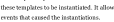

```text
_Iter = std::_Rb_tree_const_iterator<std::pair<const
std::__cxx11::basic_string<char>,
...>
_Predicate = main::<lambda(const std::string&)>
```

编译器报告所有这些内容，以防我们根本没有预料到所有这些模板会被实例化。它让我们能够确定导致这些实例化的事件链。

然而，在我们的示例中，我们愿意相信各种模板都需要被实例化，我们只是想知道为什么它没有成功。实例化错误位于消息的最后一部分。其中写着“no match for call”（没有匹配的调用）的部分意味着函数调用无法解析，因为实参类型和形参类型不匹配。它说明了被调用的是什么。

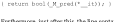

```cpp
auto f = [](const std::string& string) {
    std::string::basic_string<char>
};
```

以及导致此调用的代码：

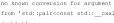

```text
{ return bool(_M_pred(*__it)); }
```

此外，就在这一行之后，注记“candidate:”说明只有一个候选者期望一个 `const string&`，并且该候选者定义在我们示例的第 11 行。这个 lambda 是一个可能的候选者，但它不匹配。

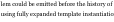

```text
no known conversion for argument 1
from 'std::pair<const std::__cxx11::basic_string<char>, ...>'
to 'const string& (aka const std::__cxx11::basic_string<char>&)'
```

这描述了我们遇到的问题。

毫无疑问，这条错误消息本可以更好。实际问题可以在实例化历史之前被精确指出，并且不必使用像 `std::__cxx11::basic_string<char, std::char_traits<char>, std::allocator<char> >` 这样完全展开的实例化名称，使用更短的类型就足够了。但确实，这类错误消息在某些情况下可能有用。因此，其他编译器提供类似信息并不奇怪（尽管有些使用了前面提到的结构化技术）。

例如，Visual C++ 编译器输出类似如下内容：


```text
1  c:\tools\root\cl\include\algorithm(166): error C2664:
      '...operator()(const std::string &...'
2      with
3      [
4          _Ty=std::string,
5          _Ty=double
6      ]
7  c:\tools\root\cl\include\algorithm(166): note: Reason:
      _Rx_Ty? to 'const std::string&'
8      with
9      [
10         _Ky=std::string,
11         _Ty=double
12     ]
13 c:\tools\root\cl\include\algorithm(166): note: No user...
14 ... function template specialization ... being compiled
15        with
16        {
17            _Entstd::_Tree_unchecked_iterator<std::_Tree_simple_types<std::pair<const _Ty, double>>>
18            _My..._Tree_simple
              double>>>;
19            _T...=std::lambda_...
20        }
21 main.cpp(13): note: see reference to function template
   <std::_Tree_val<std::_Tree_simple
      ...>
22        with
23        {
24            _Entstd::_Tree_iterator<std::_Tree_val
              const std::pair<const _Ty, double>>
25            _Ty=std::string,
26            _Ty=double,
27            ...
28        }
```

这里同样，我们提供了实例化链，其中的信息告诉我们什么被哪些实参实例化以及在代码中的何处，并且两次看到我们

```text
cannot convert from 'std::pair<const _Ty, _Ty>' to 'const std::string'
with
{
    _Ty=std::string,
    _Ty=double
}
```

#### 某些编译器上缺少 const

不幸的是，有时会出现泛型代码只在某些编译器上有问题的情况。考虑以下示例：

basicerrornovo2.cpp

```cpp
#include <string>

#include <unordered_set>


class Customer
{
private:

    std::string name;

public:

    Customer (std::string const& n)
        : name(n) {
        }

        std::string getName() const {

            return name;
        }
};

int main()
{
    struct MyCustomerHash {

        // NOTE: missing const is only an error with g++

        std::size_t operator() (Customer const& c) {

            return std::hash<std::string>()(c.getName());
        }
    };
```

我们将它用于 Customer 的哈希表：

```cpp
std::unordered_set<Customer, MyCustomerHash> coll;
```

在 Visual Studio 中可以看到，这段代码按预期编译。然而，在 g++ 或 clang 下，这段代码会产生大量错误消息。例如，在 g++ 6.1 上，第一条错误消息如下：

```text
 1  In file included from /cygdrive/p/gcc/gcc61-include/...
 2                   from /cygdrive/p/gcc/gcc61-include/bits/...
 3                   from errorno12.cpp:2:
 4  /cygdrive/p/gcc/gcc61-include/bits/hashtable_policy
    _detail.h: is_noexcept_hash<Customer, main()::<>
 5  /cygdrive/p/gcc/gcc61-include/type_traits:143:12:
    std::is_fast_hash<int>::type_traits:143:12: std::...
 6  main(): MyCustomerHash >
 7  /cygdrive/p/gcc/gcc61-include/type_traits:154:38:
    std::__and_<std::is_fast_hash<int>::MyCustomer
    Hash<Customer> main()::<MyCustomerHash> > >
 8  /cygdrive/p/gcc/gcc61-include/bits/unordered_set.h:
    unordered_set<Customer, MyCustomerHash>
 9  errorno12.cpp:28:07: required from here
10  /cygdrive/p/gcc/gcc61-include/bits/hashtable_policy
    'const main()::<MyCustomerHash> (const Customer&)
11  noexcept(std::declval<const Hash&>()(std::declval<const
    ...
12  errorno12.cpp:22:17: note: candidate: std::size_t
    operator() (const Customer& c)
13  std::size_t operator() (const Customer& c) {
14  errorno12.cpp:22:17: note: passing 'const main
    discards qualifiers
```

紧接着还有 20 多条其他错误消息：

```text
16  In file included from /cygdrive/p/gcc/gcc61-include
17                   from /cygdrive/p/gcc/gcc61-include/bits/...
18                   from /cygdrive/p/gcc/gcc61-include/bits/stl_pa
19                   from /cygdrive/p/gcc/gcc61-include/bits/stl_al
20                   from /cygdrive/p/gcc/gcc61-include/bits/char_traits:40,
21                   from errorno12.cpp:1:
22  /cygdrive/p/gcc/gcc61-include/type_traits: In insta
    __and_cat: std::is_fast_hash<int>::MyCustomerHas
    Customer, main()::<MyCustomerHash> >
23  /cygdrive/p/gcc/gcc61-include/bits/hashtable_policy.h:
    unordered_set<Customer, MyCustomerHash>
24  errorno12.cpp:28:47: required from here
25  /cygdrive/p/gcc/gcc61-include/bits/...
```

```text
...and_cached::{is_fast_hash=(1)}::MyCustomerHash
Customer, main(); }::MyCustomerHash>

public integral_constant<bool, true> value>
~~~
In file included from /.../gyp.../gcc/6/include
from /error...cpp:2:
/.../gyp.../gcc/6/include/bits/unordered_set.h:
unordered_set<_Tp, _Hash> ...
error: ...
of std::__and_<std::__and_...>
__is_noexcept_hash<Customer, main(); }::MyCustomerHash
... _use_hash<value, _Hash, _Pred, ...>
typedef typename _Hashtable::_key_type key_type;
```

同样，错误信息很难阅读（甚至连每条信息的开头和结尾都难以找到）。其本质是：在头文件 `hashtable_policy.h` 深处，在 `std::unordered_set` 的实例化中（由


```cpp
std::unordered_set<Customer, MyCustomerHash> coll;
```

要求），对


```cpp
const main()::MyCustomerHash (const Customer&)
```

的调用没有匹配项，该调用出现在


```cpp
noexcept (declval<const _Hash&>(declval<const
_Key&>()))
```

的实例化中。

------------------------------------------------------------
(declval<const _Hash&>) 是类型为
main()::MyCustomerHash 的表达式。一个可能的“近似匹配”候选是


```cpp
std::size_t main()::MyCustomerHash::operator() (const
Customer)
```

其声明为


```cpp
std::size_t operator() (const Customer& c) {
    ^
}
```

而该 bug 对问题只字未提：


```text
passing 'const main()::MyCustomerHash' as 'this' argument discards qualifiers
```

你能看出问题所在吗？提示：`std::unordered_set` 类模板的实现要求哈希对象的函数调用运算符是 `const` 成员函数（另见第599页的11.1节）。如果不是这样，就会在算法内部深处产生错误。

所有其他错误信息都从第一条错误信息级联而来；只要给哈希函数运算符简单加上 `const` 限定符，它们就会消失：


```text
recommend, explicit>; note: candidate function not viable) "this" has type "const
MyCustomContainer", but method is not marked const
  std::list<int>::iterator>(...)>; cout << "CustomContainer"; }
```

注意，这里的 clang 提到了默认模板参数，例如 `std::allocator<char>`，而 gcc 则跳过它们。

如你所见，拥有多个可用的编译器来测试代码通常很有帮助。这不仅有助于你编写更可移植的代码，而且当某个编译器产生特别难以理解的错误信息时，另一个编译器可能会提供更多洞见。

### 9.5 后记

源代码在头文件和 CPP 文件中的组织方式，是单一定义规则（ODR）各种形式的实际结果。附录 A 对该规则进行了详尽讨论。

包含模型是一种务实答案，主要由 C++ 编译器实现中的现有实践所决定。然而，最早的 C++ 实现有所不同。模板定义的包含是隐式的，这造成了一定的摩擦（周转速度较慢的前兆），这是在最初模型上决定的。

第一个 C++ 标准（C++98）为 `export` 关键字提供了显式支持，以使这种包含模型成为可选的。导出模型：模板声明放在头文件中，而相应的定义放在 CPP 文件中，很像普通模板代码的声明和定义。与包含模型不同，这种模型是一种理论模型，并非基于任何现有实现，而使其工作所需的实现工作比 C++ 标准化委员会预期的更复杂。其第一个实现花了五年多时间才发布（2001年5月），此后多年也没有出现其他实现。为了更好地使 C++ 标准与现有实践保持一致，C++11 标准完全移除了 `export`。

一个合理的替代方案是进一步阐述导出模型的更多细节（和陷阱）；它们总结在本书第一版（Vandevoorde & Josuttis）的9.5.1节和9.5.2节中。

有时人们会忍不住想象扩展预编译头概念的方法，以便单次编译可以加载多个头文件。这一原则被应用于不同的预编译头。这种区别类似于预编译头，即所谓的预编译头。大多数现代即时编译器，即所谓的预编译头。然而，一旦头文件已经预编译，通常的做法仍然是通过另一个头文件来为预处理器本身接近这样的预编译头。一个不那么根本的限制是，宏（第133页的8.1节）以及被预处理器忽略的任何其他预处理记号，在翻译的后期阶段通常也会被忽略。

### 9.6 小结

- 模板的包含模型是组织模板代码最广泛使用的模型。替代方案在第14章讨论。
- 只有函数模板的完全特化（见14.1.1节）提供了一种让头文件包含声明或定义的方法。
- 要利用预编译头，请务必保持 `#include` 指令的顺序一致。
- 使用模板调试代码可能很有挑战性。

在某些实现中，该策略（关于嵌套）通常借助参数类型和外围作用域的名称来将其与其他名称区分开，但开发者无法将其转换为人类可读的文本。

理论上，标准头文件不需要扩展以保留其物理文件。然而在实践中，它们确实如此，而且文件非常大。

## 第10章：基本模板术语

到目前为止，我们已经介绍了 C++ 中模板的基本概念。在深入细节之前，让我们先看看我们使用的术语。这是必要的，因为在 C++ 社区内部（甚至在任何早期版本的标准中），术语方面有时缺乏精确性。

### 10.1 “类模板”还是“模板类”？

在 C++ 中，结构体、类和联合体统称为类类型。在没有额外限定的情况下，纯文本中的“类”一词旨在包括用关键字 `class` 或关键字 `struct` 引入的类类型。特别要注意，“类类型”包括联合体，但“类”不包括。

关于作为模板的类该如何称呼，存在一些混淆：

- 术语 **类模板** 表示该类是一个模板。也就是说，它是一族类的参数化描述。
- 另一方面，术语 **模板类** 曾被用于
  - 作为类模板的同义词。
  - 指代从模板生成的类。
  - 指代名称是 *模板标识*（模板名后跟 `<` 和 `>` 之间指定的模板实参的组合）的类。

第二种和第三种含义之间的差异有些微妙，但对本文后续内容仍然重要。

由于这种不精确性，本书避免使用 *模板类* 这一术语。

类似地，我们分别使用 *函数模板*、*成员模板*、*成员函数模板* 和 *变量模板* 来表示模板实体、函数模板、成员模板、成员函数模板和变量模板。

### 10.2 替换、实例化和特化

在处理使用模板的源代码时，C++ 编译器必须在不同时刻用具体的模板实参替换模板中的模板参数。有时，这种替换只是试探性的：编译器可能需要检查该替换是否可能有效（见第132页的8.4节和第436页的15.7节）。

通过用具体实参替换模板参数，实际为常规类、函数、成员函数或变量创建定义的过程，称为模板实例化。

令人惊讶的是，目前还没有标准或普遍认同的术语来描述通过模板参数替换创建非定义声明的过程。我们见过一些团队使用 *部分实例化* 或 *声明实例化* 这样的说法，但这些绝不是普遍通用的。也许更直观的术语是 *不完整实例化*（这实际上是不完整类中的一个相关概念）。

由实例化或不完整实例化得到的实体（即类、函数、成员函数或变量）通常称为特化。

然而，在 C++ 中，实例化过程并不是产生特化的唯一方式。替代机制允许程序员显式指定与模板参数的特殊实例化绑定的声明。如第251页的9.2节所示，这样的特化以 `template<>` 前缀引入。

点击此处查看代码图像

```cpp
template<typename T> T square(T t);        // primary class template

class MyClass;

template<>                                  // explicit specialization
```


严格来说，这被称为**显式特化**（与实例化或生成的特化相对）。

如第33页第2.6节所述，仍然包含模板参数的特化被称为**部分特化**。

```cpp
template<typename T>          // 部分特化
class MyClass<T, 2> {
};
```

当讨论（显式或部分）特化时，通用模板也称为**主模板**。

### 10.3 声明与定义

到目前为止，本书中“声明”和“定义”这两个词只出现过几次。然而，在标准C++中，这些词具有相当精确的含义，我们使用的正是这一含义。

声明是一种C++构造，它将一个名称引入或重新引入到某个C++作用域中。这种引入总是包含该名称的部分限定，但细节并非构成有效声明所必需。例如：

```cpp
class C;              // 将C声明为一个类
int f(int p);         // 将f声明为一个函数
                      // 将p声明为一个具名参数
extern int x;         // 将x声明为一个变量
```

注意，即使它们具有“名称”，命名声明在C++中也不是定义。

当声明的结构细节已知时，或者对于变量而言，当必须分配存储空间时，声明就成为定义。对于类类型定义，这意味着必须提供花括号括起来的主体。对于函数定义，这意味着必须提供花括号括起来的主体（常见情况），或者该函数必须被指定为`= default`或`= delete`。对于变量，初始化或缺少`extern`说明符会使声明成为定义。以下示例补充了上述非定义声明：

```cpp
class C { };             // 定义（和声明）

void f(int p) {          // 定义（和声明）
  // 函数体
}

int x = 1;               // 初始化器使其成为
                         // x的定义
int i;                   // 全局变量声明
                         // 前面没有extern
```

推而广之，类模板或函数模板的声明如果带有主体，则称为定义。此处：

```cpp
template<typename T>
void f() { }
```

是一个声明而非定义，而

```cpp
template<typename T>
class C { };
```

```cpp
extern int arr[];    // arr具有不完整类型

class C {             // C现在是完整类型（因此
                      // 是一个类型）
};

int arr[10];          // arr现在具有完整类型
```

有关如何处理模板中的不完整类型的提示，请参见第72页第14.9节。

### 10.4 唯一定义规则

C++语言定义对各类实体的重新声明施加了一些约束。所有这些限制统称为唯一定义规则（ODR）。该规则的细节略显复杂，涉及多种情况。后续章节将在适用的上下文中说明由此产生的各种方面，而附录A中仍可找到ODR的完整描述。现在，让我们检视以下ODR基础知识中的几个要点：

- 通常（即非模板）非内联函数和成员函数，以及（非内联）全局变量和静态数据成员应在整个程序中只定义一次。
- 类类型（包括结构体和联合体）、模板（包括部分特化，但不包括完全特化）、内联函数和变量应在每个翻译单元中最多定义一次，且所有这些定义应当相同。

翻译单元是对源文件进行预处理的结果；也就是说，它包含由`#include`指令指定的内容以及由宏展开产生的内容。

在本书其余部分，术语“实体”指以下任意一种：函数或成员函数、全局变量或静态数据成员，包括从模板生成的任何此类内容，如链接器所见的那些。

### 10.5 模板实参 versus 模板参数

比较以下类模板：

```cpp
template<typename T, int N>
class ArrayInClass {
public:
    T array[N];
};
```

与一个类似的普通类：

```cpp
class DynamicallySized {
public:
    double array[10];
};
```

如果我们分别用`double`和`10`替换参数`T`和`N`，后者本质上等同于前者。在C++中，这种替换的名称表示为`ArrayInClass<double,10>`。

注意模板名称后如何跟着尖括号中的模板实参。

无论这些实参本身是否依赖于模板参数，模板名称后跟尖括号中的实参的组合称为模板标识。

这个名称可以像使用相应的非模板实体一样使用。例如：

```cpp
int main()
{
    ArrayInClass<double,10> ad;
    ad.array[0] = 1.0;
}
```

区分模板参数与模板实参至关重要。简而言之，可以说“参数由实参初始化”。或者更精确地说：

- 模板参数是模板声明或定义中引入的那些名称。

## 第11章：通用库

到目前为止，我们对模板的讨论主要集中在它们的具体特性、能力和约束上，并着眼于即时任务和应用（我们在解释编程时遇到的那些情况）。然而，当模板用于编写通用库和框架时，它们会更加有效，因为在这些场景中，我们的设计必须考虑先验上广泛未知或不熟悉的潜在用户。虽然本书几乎所有内容都可以适用于此类设计，但以下是一些在编写你希望可用于任何用户想象类型的可移植组件时应当考虑的一般性问题。

这里列出的问题在任何意义上都不完整，但它总结了迄今为止引入的一些特性，介绍了一些附加特性，并有助于形成本书涵盖的思想。我们希望它也能成为阅读后续许多章节的强大动力。

### 11.1 可调用对象

许多库包含这样的接口：客户端代码向其中传递一个必须被“调用”的实体。示例包括必须调度到另一个线程上的操作、描述如何对值进行哈希以存储到哈希表中的函数、描述集合中元素排序顺序的对象，以及提供某些默认参数值的通用包装器。标准库也不例外：它绝不是单一的可调用类型。

在C++中，有几种类型非常适合用作回调，因为它们既可以作为函数调用参数传递，也可以使用`f(...)`语法直接调用：

- 函数指针类型
- 具有重载`operator()`的类类型（有时称为函数对象），包括lambda
- 具有转换函数产生指向函数的指针或引用到函数的类类型

这些类型统称为函数对象类型，每种类型的值都是函数对象。

C++标准库引入了稍宽泛的“可调用类型”概念，它要么是函数对象类型，要么是成员指针。可调用类型的对象是可调用对象，为方便起见我们简称为可调用对象。

通用代码通常受益于能够接受任何种类的可调用对象，而模板使其成为可能。

#### 11.1.1 支持函数对象

让我们看看标准库的`for_each()`算法是如何实现的（为避免名称冲突和简化起见，我们使用自己的“foreach”名称，并跳过返回任何内容）：

`basics/foreach.cpp`

```cpp
template<typename Iter, typename Callable>
void foreach (Iter current, Iter end, Callable op)
{
    while (current != end) {    // 只要还没到结尾
        op(*current);            // 调用传入的操作
        ++current;               // 并移动迭代器
    }
}
```


以下程序演示了如何将本模板与各种函数对象一起使用。

**单击此处查看代码图像**

`functor1/format.cpp`

```cpp
#include <iostream>
#include <vector>
#include <functional>

// a function to call

void func(int i)
{
    std::cout << "func() called for: " << i << '\n';
}

// a function object type (for objects that can be used as functions)

class FuncObj {
public:
    void operator() (int i) const
    {
        std::cout << "FuncObj::operator() called for: " << i << '\n';
    }
};

int main()
{
    std::vector<int> primes = { 2, 3, 5, 7, 11, 13, 17, 19 };

    forEach(primes.begin(), primes.end(),
             func);

    forEach(primes.begin(), primes.end(),
             &func);

    forEach(primes.begin(), primes.end(),
             FuncObj());

    forEach(primes.begin(), primes.end(),
             [](int i) {
                 std::cout << "lambda called for: " << i << '\n';
             });
}
```

#### 让我们详细看看每种情况：

-   当我们将函数名传递给函数参数时，我们实际传递的并不是函数本身，而是指向它的指针或引用。与数组一样（参见第 11 页的 7.4 节），按值传递时函数参数会退化为指针；而对于类型为模板参数的参数，将推导出指向函数的指针类型。
-   就像数组一样，函数可以按引用传递而不会退化。然而，函数类型实际上不能用 `const` 限定。如果我们把 `forEach()` 的最后一个参数声明为 `Callable const&` 类型，那么 `const` 只会被忽略。（一般来说，对函数的引用在主流 C++ 代码中很少使用。）
-   我们的第二次调用通过传递函数名的地址来显式接受一个函数指针。这等价于第一次调用（其中函数名隐式退化为指针值），但可能更清晰一些。
-   当传递函数对象（functor）时，我们传递一个类类型对象作为可调用对象。通过类类型进行调用通常相当于调用其 `operator()`。因此，调用

```cpp
op("current");
```

通常会被转换为

**单击此处查看代码图像**

```cpp
op.operator()("current");    // call operator() with
```

注意，在定义 `operator()` 时，通常应将其定义为 `const` 成员函数。否则，当框架或库期望该调用不改变所传递对象的状态时，可能会出现可调用对象相关的错误消息（详情参见第 46 页的 4.9 节）。

类类型对象也可以隐式转换为函数指针。

```cpp
op("current");
```

会被转换为

```cpp
op.operator F()("current");
```

其中 F 是该类类型对象可转换到的指向函数的指针或函数引用类型。这种情况相对少见。

Lambda 表达式会生成函数（称为闭包），因此这种情况与函数对象的情况没有不同。不过，Lambda 是一种非常方便的简写形式，用于引入函数对象，因此自 C++11 起它们常见于 C++ 代码中。

有趣的是，以 `[]` 开头（不捕获任何内容）的 Lambda 会提供到函数指针的转换运算符。然而，它从不会被选作代理调用函数，因为它始终比闭包的普通 `operator()` 匹配得更差。

#### 11.1.2 处理成员函数和附加参数

前一个示例中没有使用一种特殊形式的可调用对象：成员函数。这是因为调用非静态成员函数通常涉及使用类似 `object.member_function(...)` 或 `ptr->member_function(...)` 的语法来指定调用所应用的对象，而这与通常的函数对象 `operator()...` 模式不匹配。

幸运的是，自 C++17 起，C++ 标准库提供了实用工具 `std::invoke()`，它方便地将这些情况与普通函数调用语法的情况合并，从而能够以单一形式调用任何可调用对象。下面我们的 `forEach()` 模板实现使用了 `std::invoke()`：

**单击此处查看代码图像**

basics/forEachWithMember.cpp

```cpp
#include <utility>

#include <functional>

template<typename Iter, typename Callable, typename... Args>
void forEach (Iter current, Iter end, Callable op, Args... args)
{
    while (current != end) {       // As long as not reached the end
        std::invoke(op, *current, args...);  // Call passed callable
                                            // with any additional arguments
        ++current;                           // and the current element
    }
}
```

这里，除了可调用参数之外，我们还接受任意数量的附加参数。然后，`forEach()` 模板会用给定的可调用对象以及随后的附加参数（连同被引用的元素）调用 `std::invoke()`。`std::invoke()` 按如下方式处理：

-   如果可调用对象是指向成员的指针，则它将第一个附加参数用作 `this` 对象。然后，所有剩余的附加参数都作为参数传递给该可调用对象。
-   否则，所有附加参数都只是作为参数传递给该可调用对象。

请注意，这里我们不能对可调用对象或附加参数使用完美转发：第一次调用可能会“窃取”它们的值，导致在后续迭代中调用 `op` 时出现意外行为。

使用此实现，我们仍然可以编译上面原始的 `forEach()` 调用。现在，此外，我们还可以向可调用对象传递附加参数，并且可调用对象可以是成员函数。以下客户端代码说明了这一点：

**单击此处查看代码图像**

basics/forEachMember.cpp

```cpp
#include <iostream>
#include <vector>
#include <string>
#include "forEachWithMember.hpp"

// a class with a member function that shall be called
class MyClass {
public:
    void someFunc(int i) const {
        std::cout << "MyClass::someFunc() called for: " << i;
    }
};

int main()
{
    std::vector<int> primes = { 2, 3, 5, 7, 11, 13, 17 };

    // pass lambda as callable and an additional argument
    forEach(primes.begin(), primes.end(),        // elements
        [](std::string const& prefix, int i) {   // lambda
            std::cout << prefix << i << '\n';
        },
        "value:");                              // argument

    // call obj.someFunc() for each element to print it
    MyClass obj;
    forEach(primes.begin(), primes.end(),        // elements
        &MyClass::someFunc,                      // member function
        obj);                                     // object to call
}
```

`forEach()` 的第一次调用将其第四个参数（字符串字面量 `"value:"`）传递给 Lambda 的第一个参数，而向量中的当前元素绑定到 Lambda 的第二个参数。第二次调用传递成员函数引用 `&MyClass::someFunc`，它针对作为第四个参数传入的 `obj` 进行调用。

有关可调用对象能否由 `std::invoke()` 使用的类型特征，请参见第 716 页的 3.D.3 节。

#### 11.1.3 包装函数调用

`std::invoke` 的一个常见应用是包装单个函数调用（例如，记录调用日志、测量其持续时间，或为它们准备一些上下文，比如启动一个新线程）。现在，我们可以通过完美转发可调用对象和所有传递的参数来支持更多语义：

**单击此处查看代码图像**

```cpp
template<typename Callable, typename... Args>
decltype(auto) call(Callable&& op, Args&&... args)
{
    return std::invoke(std::forward<Callable>(op),
                       std::forward<Args>(args)...);
}
```

另一个有趣的方面是如何处理被调用函数的返回值，以便将其“完美转发”回调用者。为了支持从中返回引用（例如 `std::string&`），我们使用 `decltype(auto)`，而不只是 `auto`。

**单击此处查看代码图像**

```cpp
template<typename Callable, typename... Args>
decltype(auto) call(Callable&& op, Args&&... args)
{
    decltype(auto) value = std::invoke(std::forward<Callable>(op),
                                       std::forward<Args>(args)...);
    return value;
}
```

如果你想将 `std::invoke()` 返回的值临时存储在变量中，以便在做其他事情之后返回它（例如，在返回值之前做一点工作，或记录调用结束），你也必须用 `decltype(auto)` 声明该临时变量：

**单击此处查看代码图像**

```cpp
template<typename Callable, typename... Args>
decltype(auto) test(Callable&& op, Args&&... args)
{
    return std::invoke(std::forward<Callable>(op),
                       std::forward<Args>(args)...);
}
```


注意，使用 `auto&` 声明 `ret` 是不正确的。作为引用，`auto&&` 会将返回值的生命周期延长到其作用域结束（参见第11.3.1节，第167页），但不会超过 `return` 语句传递到函数的调用者。

但是，使用 `decltype(auto)` 也有一个问题：如果可调用对象的返回类型是 `void`，那么将 `ret` 初始化为 `decltype(auto)` 是不允许的，因为 `void` 是不完整类型。你有以下选项：

- 在该语句之前声明一个对象，其析构函数执行我们希望实现的可观察行为。例如：

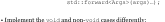

```cpp
struct cleanup {
    ~cleanup() {
        // code to perform a return
    }
} dummy;

return std::invoke(std::forward<Callable>(op),
                   std::forward<Args>(args)...);
```

- 分别实现 `void` 和非 `void` 的情况：


```cpp
#include <utility>       // for std::forward()
#include <functional>    // for std::invoke()
#include <type_traits>   // for std::is_void_v

template<typename Callable, typename... Args>
decltype(auto) call(Callable op, Args&&... args)
{
    if constexpr (std::is_same_v<std::invoke_result_t<Callable, Args...>, void>) {
        // return type is void:
        std::invoke(std::forward<Callable>(op),
                    std::forward<Args>(args)...);
        return;
    }
    else {
        // return type is not void:
        decltype(auto) ret{std::invoke(std::forward<Callable>(op),
                                       std::forward<Args>(args)...)};
        return ret;
    }
}
```

使用


```cpp
if constexpr (std::is_same_v<std::invoke_result_t<Callable, Args...>, void>) {
    ...
}
```

我们在编译时测试用 `Args...` 调用 `callable` 的返回类型是否为 `void`。关于 `std::invoke_result_t` 的详细信息，参见第13.1.1节，第717页。

希望未来的 C++ 版本可以避免这种对 `void` 的特殊处理（参见第17.??节，第304页）。

### 11.2 实现泛型库的其他工具

`std::invoke()` 只是 C++ 标准库为实现泛型库提供的有用工具之一。接下来，我们概述其他一些重要的工具。

#### 11.2.1 类型特征

标准库提供了多种称为类型特征的工具，允许我们评估和修改类型。这支持了泛型代码必须适应或响应其实例化类型的能力的各种情况。

```cpp
template<typename T>
class C
{
    // ensure that T is not void (ignoring const or
    // volatile):
    static_assert(!std::is_same_v<std::remove_cv_t<T>,
                                  void>);

    public:
        template<typename U>
        void f(U&& arg)
        {
            if constexpr (std::is_reference_v<T>) {
                // special code if T is a reference type
            }
            if constexpr (std::is_convertible_v<T, U>) {
                // special code if T is convertible to U
            }
            if constexpr (std::has_virtual_destructor_v<T>) {
                // special code if T has virtual destructor
            }
        }
};
```

正如这个示例所示，通过检查某些条件，我们可以选择模板的不同实现。这里，我们使用了编译期 `if constexpr`（自 C++17 起可用，参见第8.5节，第134页），但我们也可以使用 `std::enable_if`、偏特化或 SFINAE 来启用或禁用辅助模板（详见第8章）。

然而，请注意，类型特征必须特别小心地使用：它们的行为可能会与经验不足的程序员所期望的不同。例如：


```cpp
std::remove_const_t<const int&>    // yields const int&
std::remove_cv_t<const int&>       // yields const int&
```

这里，因为引用不是 const（尽管你不能修改它），该调用没有效果，并产生传入的类型。

因此，移除引用和 cv 限定符的顺序很重要：


```cpp
std::remove_const_t<std::remove_reference_t<const int&>>
```

相反，你可以只调用


```cpp
std::decay_t<const int&>       // yields int
```

然而，这也会将数组和函数转换为相应的指针类型。

还有些情况类型特征有要求。不满足这些要求会导致未定义行为。例如：

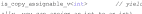

```cpp
make_unsigned_t<int>        // unsigned int
make_unsigned_t<const int>  // undefined behavior
```

有时结果可能令人惊讶。例如：


```cpp
add_cvref_t<int>                 // int
add_cvref_t<const int>           // const int&
add_cvref_t<volatile int>        // volatile int&
add_cvref_t<const volatile int>  // const volatile int&
```

这里我们可能期望 `add_cvref` 总是产生一个左值引用，但 C++ 的引用折叠规则（参见第9.5.6节，第273页）导致左值引用和右值引用的组合产生左值引用。

再举一个例子：

出于所有这些原因，请仔细注意类型特征的确切定义。我们在附录 D 中详细描述标准类型特征。

#### 11.2.2 std::addressof()

`std::addressof()` 函数模板能够可靠地获取对象或函数的实际地址。即使对象类型重载了 `operator &`，它也能正常工作。尽管后者比较少见，但也有可能发生（例如在智能指针中）。因此，如果你需要获取任意类型对象的地址，建议使用 `std::addressof()`：

点击此处查看代码图片

```cpp
template<typename T>
void f (T x)
{
    auto p = &x;                  // might fail with overloaded operator &
    auto q =
        std::addressof(x);        // works even with
                                  // overloaded operator &
}
```

#### 11.2.3 std::declval()

`std::declval()` 函数模板可以用作特定类型对象引用的占位符。该函数没有定义，因此不能被调用（也不会创建对象）。因此，它只能用于未求值操作数中（例如 `decltype` 和 `sizeof` 构造中的操作数）。所以，与其尝试创建一个对象，你可以假设你拥有一个对应类型的对象。

例如，下面的声明从传入的模板参数 T1 和 T2 推导出默认返回类型 RT：

点击此处查看代码图片

```cpp
#include <utility>

template<typename T1, typename T2>
using RT = decltype(std::declval<T1>()
                    + std::declval<T2>());

template<typename T1, typename T2>
RT max (T1 t1, T2 t2)
{
    return t1 < t2 ? t2 : t1;
}
```

为了避免为了在类型别名 RT 的表达式中调用 `operator +` 而必须为 T1 和 T2 调用（默认）构造函数，我们使用 `std::declval()` 来“使用”对应类型的对象而不创建它们。不过，这只能在 `decltype` 的未求值上下文中实现。

不要忘记使用 `std::declval<>` 函数模板来确保默认返回类型可以是引用，因为 `std::declval<T>()` 生成一个值或引用。否则，像 `max(1, 2)` 这样的调用会得到 `int&` 的返回类型。

### 11.3 完美转发临时对象

如第6.1节（第91页）所示，我们可以使用转发引用和 `std::forward<>` 来“完美转发”泛型参数：

点击此处查看代码图片

```cpp
template<typename T>
void f (T&& t)                 // t is a forwarding reference
{
    g(std::forward<T>(t));     // perfectly forward
}
```

然而，有时我们必须完美转发泛型代码中并非来自参数的数据。在这种情况下，我们可以使用 `std::move` 创建一个可以转发的变量。例如，假设我们有对函数 `get()` 和 `set()` 的链式调用（其中 `get()` 的返回值应完美转发给 `set()`）：

点击此处查看代码图片

```cpp
template<typename T>
void f(T t)
{
    auto&& val = t.get();
    t.set(std::move(val));
}
```


```cpp
int(std::forward<decltype(val)>(val));
```

这避免了中间值产生不必要的副本。

### 11.4 引用作为模板参数

尽管不常见，但模板参数可以成为引用类型。例如：

点击此处查看代码图像

Example/printparam3.cpp

```cpp
#include <iostream>

template<typename T>
void printParamReference(T& t)
{
    std::cout << "T is reference: " << std::boolalpha <<
        std::is_reference_v<T> << '\n';
}

int main()
{
    std::cout << std::boolalpha;

    int i;

    int& r = i;
    printParamReference(i);       // false
    printParamReference(r);       // false
    printParamReference<int&>(i); // true
    printParamReference<int&>(r); // true
}
```

通常，如果将引用变量传递给 printParamReference()，模板参数 T 会被推导为被引用类型（因为对于引用变量，表达式的类型是被引用的类型）。表达式的类型不是引用。但是，我们可以通过显式指定模板来强制这种行为：

```cpp
printParamReference<int&>(i);
printParamReference<int&>(r);
```

这样做可能会从根本上改变模板的行为，而且模板很可能在设计时并未考虑到这种可能性，从而触发错误或意外行为。考虑以下示例：

点击此处查看代码图像

basics/reference.cpp

```cpp
template<typename T, T Z = T{}>
class RefMem {
private:
    T zero;
public:
    RefMem() : zero{Z} {
    }
};

int null = 0;

int main()
{
    RefMem<int> rm1, rm2;
    rm1 = rm2;             // OK

    RefMem<int&> rm3;      // ERROR: invalid default value
    RefMem<int&, 0> rm4;   // ERROR: invalid default value

    extern int null;
    RefMem<int&, null> rm5, rm6;
    rm5 = rm6;             // ERROR: operator= is deleted
}
```

类 `RefMem` 由一个非类型模板参数 `T` 参数化，该参数具有零初始化的默认值。用类型 `int` 实例化该类可以按预期工作。然而，当尝试用引用实例化它时，情况变得棘手：

- 默认初始化不再有效。
- 对于 `int`，你不能再只传递一个 `0` 初始化器。
- 而且也许最令人惊讶的是，赋值运算符不再可用，因为具有非静态引用成员的类会删除默认赋值运算符。

此外，将引用类型用于非类型模板参数很棘手，而且可能很危险。考虑以下示例：

点击此处查看代码图像

`basics/reference2.cpp`

```cpp
#include <vector>
#include <iostream>

template<typename T, int& S>        // Note: size is a reference
class Arr {
private:
    std::vector<T> elems;
public:
    Arr() : elems(S)                  // use current size as the size
    {
    }

    void print() const {
        for (int i=0; i<S; ++i)       // loop over S elements
            std::cout << elems[i];
    }
};

int size = 10;

int main()
{
    Arr<int,size> y;                  // compile-time ERROR deep in the code
                                      // of class std::vector

    Arr<int,&size> x;                 // initializes internal vector with 10 elements
    x.print();                        // OK
    size += 100;                      // OOPS: modifies S in Arr<>
    x.print();                        // run-time ERROR: invalid memory access
}
```

这里，尝试用引用类型的元素实例化 `Arr` 会导致错误，原因在于 `std::vector` 中所示的代码，因为它可以用引用作为元素进行实例化：

点击此处查看代码图像

```cpp
Arr<int,size> y;   // compile-time ERROR deep in the code of class std::vector
```

这种错误常常会导致第 143 页 9.4 节所述的“错误小说”，其中编译器会提供从最初使用该实例化到检测到错误所在的真实模板定义之间的完整模板实例化历史。

点击此处查看代码图像

```cpp
template<typename T> ...
class A;
```

在此上下文中，通常避免使用 decltype 来获取某个类的成员类型及其值（默认使用 auto）。详情见第 302 页 9.3.1.3 节。

由于这个原因，C++ 标准库有时会有令人惊讶的规范和约束。例如：

- 为了在模板参数按引用、类等实例化时补上少数赋值运算符：

点击此处查看代码图像

```cpp
namespace std {
    template<typename T> typename ...
    struct pair {
        T first;
        T second;
        // ...
    };

    // default copy constructors are OK when ...
    references:
    pair<...> = default;
    pair<pair<...>> = default;

    // but assignment operators have to be defined to be
    // available with references:
    pair& operator=(pair const& p);
    pair& operator=(pair& p);
};
```

由于可能存在副作用，实例化 C++ 标准库类模板 std::optional 和 std::variant 通常比 std::tuple 更可取，至少在 C++17 中如此。

要禁止引用，一个简单的静态断言就足够了

点击此处查看代码图像

```cpp
template<typename T>
class optional {
    static_assert(!std::is_reference<T>::value,
        "Invalid instantiation of optional<T> for reference");
    ...
};
```

一般来说，引用类型与对象类型相当不同，并受若干独特的语言规则约束。例如，这会影响调用参数的声明（见第 103 页第 9 节），也会影响我们定义 traits 的方式（见第 435 页 14.6 节）。

### 11.5 延迟求值

实现模板时，有时会出现代码能否处理不完整类型的问题（见第 543 页 10.3.1 节）。考虑以下类模板：

点击此处查看代码图像

```cpp
template<typename T>
class C {
private:
    T* elems;
public:
    ...;
};
```

到目前为止，这个类可以与不完整类型一起使用。例如，这对于引用自身类型元素的类很有用：

点击此处查看代码图像

```cpp
struct Node
{
    std::string value;
    Node* Child;        // only possible if Cont accepts incomplete type
};
```

然而，例如，仅仅使用一些 traits，就可能失去处理不完整类型的能力。例如：

点击此处查看代码图像

```cpp
template<typename T>
class C {
private:
    T* elems;
public:
    typename std::conditional<std::is_move_constructible<T>::value,
        T&,
        T>::type
    foo();
};
```

这里，我们使用了 trait `std::conditional`（见第 254 页 5.8 节）。

³ 曾有一项针对 C++17 的提案，要求违反类型 traits 前置条件的情况必须始终导致编译期错误。然而，由于某些类型 traits 具有过度约束的要求，例如始终要求完整类型，这一变更被推迟了。

⁵ 感谢 Dietmar Kühl 指出这一点。

⁶ 如果 `std::is_move_constructible` 不是不完整类型，并非所有编译器都会产生错误。这是允许的，因为对于这类错误，不要求诊断信息。因此，这至少是一个可移植性问题。

# 第二部分

# 深入模板

本书第一部分为 C++ 模板背后的大多数语言概念提供了教程。这一介绍足以回答日常 C++ 编程中可能出现的大多数问题。本书第二部分提供的参考则回答在推动语言边界以实现某些高级软件效果时出现的更不寻常的问题。如果需要，你可以在初读时跳过这一部分，并在后续章节的引用提示下，或在索引中查阅某个概念后，再回到特定主题。

我们的目标是清晰且完整，同时保持讨论简洁。为此，我们的示例很短，而且往往有些人为化。这也确保我们不会偏离手头主题而转向无关问题。

此外，我们还会探讨 C++ 中模板语言特性未来可能的变化和扩展。

本部分涵盖的主题包括：

- 模板声明的基本问题
- 模板中名称的含义
- C++ 模板实例化机制
- 模板实参推导规则
- 特化与重载
- 未来可能性


```cpp
class Collection {
public:
    template<typename T>             // an in-class member
    class Node {
        ...
    };

    template<typename T>             // an in-class (and the...
    T* alloc() {                     // member function tem...
        ...
    }

    template<typename T>             // a member variable
    static T zero = 0;

    template<typename T>             // a member alias tem...
    using NodeType = Node<T>;
};
```

注意，在 C++17 中，变量——包括静态数据成员——以及变量模板可以是“内联的”，这意味着它们的定义可以跨翻译单元重复。对于变量模板而言这是多余的，因为变量模板总是可以在多个翻译单元中定义。然而，与成员函数不同，在所属类中定义静态数据成员并不会使其成为内联：必须在其上指定关键字 `inline`。

最后，以下代码演示了非别名模板的成员模板如何在类外定义：

```cpp
template<typename T>             // a namespace scope
class List {
public:
    List() = default;              // because a template

    template<typename T>           // another member class
    class Handler                  // without its definition
    ...

    template<typename T>           // a member function
    List (List<T> const&);          // (constructor)

    template<typename T>           // a member variable
    static T zero;
};

template<typename T>               // out-of-class member
template<typename T>               // out-of-class member
class List<T>::Handler {
    ...
};

template<typename T>               // out-of-class member
template<typename T>               // out-of-class member
List<T>::List (List<T> const& b)
{
    ...
}
```

```cpp
template<typename T>        // out-of-class static
template<typename U>
U List<T>::zero = 0;
```

在所属类之外定义的成员模板可能需要多个 `template<>` 参数化子句：每个外围类模板一个，成员模板自身一个。这些子句从最外层类模板开始列出。

还要注意，构造函数模板（成员函数模板的一种特殊形式）会禁用默认构造函数的隐式声明（如果没有声明其他构造函数，则默认构造函数会被隐式声明）。添加一个带有默认值的声明：

```cpp
List() = default;
```

可确保 `List<T>` 的实例能够按隐式声明构造函数的语义进行默认构造。

### 使用模板

联合体模板也是可能的（它们被视为一种类模板）：

```cpp
template<typename T>
union AllocChunk {
  T object;
  unsigned char bytes[sizeof(T)];
};
```

#### 默认调用实参

函数模板可以像普通函数声明一样具有默认调用实参：

```cpp
template<typename T>
void report_top(Stack<T> const& s, int number = 10);

template<typename T>
void report_top(Stack<T> const& s,
                void fill(Array<T> const&));
```

后一个声明表明，默认调用实参可以依赖于模板参数。它也可以被定义（这是 C++11 之前唯一可能的方式，见第 68 页 5.2 节）

```cpp
template<typename T>
void fill(Array<T> const& = T())  // T() is
                                     // the default value
{
  for (int i = 0; i < ...; ++i) {
    array[i] = T();
  }
}
```

当调用 `fill()` 函数时，如果提供了第二个函数调用实参，则默认实参不会被实例化。这确保如果默认调用实参不能针对特定 `T` 实例化，也不会发出错误。例如：

```cpp
class Value {
public:
  explicit Value(int);       // no default constructor
};

void foo(Array<Value> array)
{
  Value error;                // ERROR: default constructor not
                              // available
  fill(array, error);         // OK: default value not used
}
```

#### 类模板的非模板成员

除了类内部描述的四种基本模板之外，还可以拥有作为类模板一部分而被参数化的普通类成员。它们偶尔（或错误地）也被称为成员模板。尽管它们可以被参数化，但这样的定义并不完全是类模板。它们的参数完全由它们所属的模板决定。例如：

```cpp
template<int T>
class Cupboard
{
  class Shelf;                 // ordinary class in
                                // class template
  void open();                 // ordinary function in
                                // class template
  enum type : int;             // ordinary enumeration
  static double totalWeight;   // ordinary static data
                                // member in class template
};
```

```cpp
template<int T>                 // definition of ordinary class
class Cupboard<T>::Shelf
{
    ...
};
```

```cpp
template<int T>                 // definition of ordinary function
                                  // in class template
void Cupboard<T>::open()
{
    ...
}
```

```cpp
template<int T>                 // definition of ordinary enumeration
                                  // type in class template
enum Cupboard<T>::type : int
{
    Maple, Cherry, Oak
};
```

```cpp
template<int T>                 // definition of ordinary static
                                  // member in class template
double Cupboard<T>::totalWeight = 0.0;
```

自 C++17 起，静态 `totalWeight` 成员可以使用 `inline` 在类模板内部初始化。

```cpp
template<int T>
class Cupboard
{
    ...
    inline static double totalWeight = 0.0;
};
```

尽管这类参数化定义通常被称为模板，但该术语并不完全适用于它们。偶尔有人建议用 temploid 来称呼这些实体。自 C++17 起，C++ 标准定义了“被模板化的实体”（templated entity）这一概念，它包括模板本身，并递归地包括在模板化实体中定义或创建的任何实体，例如在类模板内定义的友元函数，或出现在模板化实体中的 lambda 表达式的闭包类型。在这里，temploid 和被模板化的实体都不是特别有用的术语，但它们可能在未来更精确地交流 C++ 模板时有用。

#### 12.1.1 虚成员函数

成员函数模板不能被声明为虚函数。施加这一限制是因为虚函数调用机制的通常实现使用一个固定大小的表，每个虚函数对应一个表项。然而，成员函数模板的实例化数量直到整个程序被翻译完才固定。因此，支持虚成员函数模板将需要在 C++ 编译器和链接器中采用不同的、或许是新型的机制。

相比之下，类模板的普通成员可以是虚函数，因为它们的数量在类实例化时是固定的：

```cpp
template<typename T>
class Dynamic
{
public:
    virtual ~Dynamic() {    // OK: one destructor per instance
                             // of Dynamic
    }

    template<typename T2>
    void copy(T2 const&);   // ERROR: unknown number of instances
                             // of copy()
};

Dynamic<int> d;
```

#### 12.1.2 模板的链接

每个模板都必须有一个名字，并且该名字在其作用域内必须唯一，但函数模板可以重载（见第 15 章）。尤其要注意，与类类型不同，类模板不能与另一种实体共享同一个名字：

```cpp
int C;

class C
{
    ...
};                      // OK: class names and nonclass names are in
                             // a different "space"

int X;

template<typename T>
class X                      // ERROR: conflict with variable X
{
    ...
};

template<typename T>
class S                      // ERROR: conflict with struct S
{
    ...
};
```

模板名字具有链接性，但它们不能具有 C++ 链接性。非标准链接性可能具有依赖于实现的含义（不过，我们不知道有哪个实现支持模板的非标准名字链接性）：

```cpp
extern "C" template<typename T>
void validate();        // ERROR: template cannot have C
extern "C" class template<typename T>
void validate();        // redundant, but maybe some
                        // compiler will accept
// C++ language linkage
```

模板通常具有外部链接性。唯一的例外是在未命名命名空间中声明的模板名称（具有内部链接性），以及未命名类的成员模板（没有链接性）。例如：

单击此处查看代码图像

```cpp
template<typename T>       // refers to the same entity as
void validate(T);          // the declaration in the
                           // outer namespace
                           // (same name and scope in an-
                           // other file)
```

单击此处查看代码图像

```cpp
template<typename T>       // unrelated to a template with
void validate(T);          // external linkage
                           // (different entity)
```

单击此处查看代码图像

```cpp
template<typename T>       // redeclaration of the previous
void validate(T);          // declaration
                           // (same entity)
```

单击此处查看代码图像

```cpp
namespace {
template<typename T>
void validate(T); // another file, one
                  // that is in an unnamed namespace
}
```

单击此处查看代码图像

```cpp
namespace {
template<typename T>       // redeclaration of the previous
void validate(T);          // declaration
                           // (same entity)
}
```

单击此处查看代码图像

```cpp
struct {
  template<typename T> void f(T) { }  // no linkage: cannot
                                      // be redeclared
};
```

注意，后一个成员模板没有链接性；它必须在未命名类内定义，因为无法在该类之外提供定义。

目前，模板不能在函数作用域或局部类作用域中声明，但泛型 lambda（参见第 243 页的 6.5.4 节）具有关联的唯一闭包类型，提供了一种局部模板：局部 lambda 类的成员函数模板，它实际上是一种局部成员函数模板。

模板实例的链接性就是该模板的链接性。例如，从上面的模板 `template<typename T> void f(T)` 实例化得到的函数模板 `void f()` 将具有内部链接性。这在变量模板的情况下有一个有趣的推论。实际上，考虑以下示例：

单击此处查看代码图像

```cpp
template<typename T> T x = T();
```

`x` 的所有实例化都具有外部链接性，甚至像 `x<int> x1;` 这样的实例化也是如此。这或许是一个令人惊讶的结论。

单击此处查看代码图像

```cpp
struct X {
  int x = 10;
};
```

具有内部链接性，尽管它的 `x` 是一个模板。类似地，以下模板的所有实例化：

单击此处查看代码图像

```cpp
template<typename T> int const max_value = 10;
```

都具有外部链接性，尽管所有这些实例化的类型也都是 `int const`。

##### 12.2.1.3 主模板

模板的普通声明声明的是主模板。此类模板声明在声明时不会在模板名之后向任何模板名添加模板实参：

单击此处查看代码图像

```cpp
template<typename T> class Box;            // OK: primary template
template<typename T> class Box<T>;         // ERROR:
                                           // does not specialize
template<typename T> void validate(T);     // OK: primary template
template<typename T> void validate<T>(T);  // ERROR:
                                           // not allowed for functions
template<typename T> T const max_value = T(); // OK:
                                               // primary template
template<typename T> T const max_value<T> = T(); // ERROR:
                                                  // does not specialize
```

非静态成员模板，其结尾部分特化属于外围类模板，具有……

### 12.2 模板参数

模板参数有三种基本类别：

- 1. 类型参数（这些是迄今为止最常见的）
- 2. 非类型参数
- 3. 模板模板参数

这些基本类别的模板参数中的任何一种都可以用作完整参数化类型的基础（参见第 188 页的 12.2.4 节）。

模板参数在模板声明的引导参数化子句中声明。此类声明不一定需要命名：

单击此处查看代码图像

```cpp
template<typename, int>
class X;       // X is parameterized by a type and an integer
```

当然，如果参数在模板后面被引用，则参数名是必需的。另请注意，模板参数名可以在后续参数声明中引用（但不能在之前引用）：

单击此处查看代码图像

```cpp
template<typename T,             // the first parameter is
         typename T::Root,         // in the declaration of
                                   // the second one, and
         typename T::Root::...>    // in the declaration of
class Structure;                   // the third one
```

#### 12.2.1 类型参数

模板参数使用关键字 typename 或关键字 class 引入：两者完全等价。关键字后面必须跟一个简单标识符，而该标识符后面必须跟逗号以声明下一个参数声明的开始、跟右尖括号（>）以表示参数化子句的结束，或跟等号（=）以表示默认模板实参的开始。

在模板声明中，类型参数的作用非常像类型别名（参见第 83 页的 8.2.8 节）。例如，在 T 成为模板参数之前，不可能使用形如 T::... 的限定名，即使 T 将被替换为类类型：

单击此处查看代码图像

```cpp
template<typename Allocator>
class List {
    class Allocator*     // ERROR: use
        Allocator allocator;     // ERROR: use
    friend class Allocator;      // ERROR: use "friend
                                 // Allocator"
};
```

#### 12.2.2 非类型参数

非类型模板参数表示可在编译时确定的常量值。此类参数的类型（换句话说，它所表示的值的类型）必须是以下之一：

- 整数类型或枚举类型
- 指针类型
- 成员指针类型
- 左值引用类型（对对象的引用和对函数的引用都可以接受）
- std::nullptr_t
- 浮点类型（仅 C++20 中的 auto；参见第 296 页的 15.10.4 节）

所有其他类型都被明确排除（尽管将来可能会添加浮点类型；参见第 315 页的 17.2 节）。

也许令人惊讶的是，非类型模板参数的声明在某些情况下也可以以关键字 typename 开头：

单击此处查看代码图像

```cpp
template<typename T,       // a type parameter
         T N>               // a nontype
                            // parameter
class List;
```

或以关键字 class 开头：

单击此处查看代码图像

```cpp
template<class T*>       // a nontype parameter of pointer
class X {
    T* p;
};
```

转换为它们退化后的指针类型：

单击此处查看代码图像

```cpp
template<int N> class Lessor;        // but is not a valid type
template<int* I> class Lessor;        // this is a valid type

template<int fn()> struct FuncWrap;   // fn really has pointer to
                                      // function

template<int (*)()> struct FuncWrap;  // a declaration
```

非类型模板参数的声明很像变量，但它们不能具有 static、mutable 等非类型说明符。它们可以具有 const 和 volatile 限定符，但如果使用了这样的限定符，且它位于参数类型的最外层，则会被直接忽略：

单击此处查看代码图像

```cpp
template<const int length> class Buffer; // const is useless here
template<int* const Buffer>               // this is previous declaration
void declaration
```

最后，非类型模板参数总是在表达式中解析和使用。不能取它们的地址，也不能对它们赋值。另一方面，左值引用类型的非类型参数可以在其他情况下用于表示任何被引用的左值类型。

单击此处查看代码图像

```cpp
template<class Counter>
struct LocalIncrement {
  Counter& increment() { Counter = Counter + 1; }
  // ...
  ~LocalIncrement() { Counter = Counter - 1; }
};
```

不允许无效引用。

#### 12.2.3 模板参数

模板模板参数是类模板或别名模板的占位符。它们的声明很像类模板，但也可以使用关键字 struct 和 union：

单击此处查看代码图像

```cpp
template<typename T>
void f(C<int>* p);

template<typename T> typename <struct C>  // ERROR:
                                          // struct not valid here
void f(C<int>* p);

template<typename T> typename <union C>   // ERROR:
                                          // union not valid here
void f(C<int>* p);
```

C++ 允许使用 typename 代替 class。这一变化的动机在于，模板模板参数不仅可以由类模板替换，还可以由别名模板（可实例化为任意类型）替换。因此，在 C++11 中，我们上面的示例可以改写为

单击此处查看代码图像

```cpp
template<template<typename> typename C>  // C++11
using C1 = C<int>;
void f(C<int>* p);
```

在其声明的作用域中，模板模板参数的使用方式与其他类模板或别名模板一样。

模板模板的参数可以具有默认模板实参。当在模板参数的使用中未指定相应参数时，这些默认实参就会生效：

单击此处查看代码图像

```cpp
template<template<typename T,
                   typename A = std::allocator<T>> class
         Container>
class Adaptation {
  Container<T> storage;  // implicitly equivalent to
                         // Container<T, std::allocator<T>>
};
```

T 和 A 是模板模板参数 Container 的模板参数的名称。这些名称只能在该模板参数的模板参数的声明中使用。下面这个刻意构造的模板说明了这个概念：

单击此处查看代码图像

```cpp
template<template<typename T, typename A> class Buf> // OK
class T {
  static T* storage; // template parameter
};
// A template parameter cannot be used here
```

不过，通常，一个模板的模板参数的名称

```cpp
template<typename... Types>
class MyAllocator {
    Container storage; // implicitly equivalent to
    std::allocator<Types...>
};
```

```cpp
class Map {
    Container storage;
};
```

#### 12.2.4 模板参数包

自 C++11 起，通过在模板形参名之前引入省略号（...），任何类型的模板形参都可以转变为模板参数包。如果模板形参未命名，则省略号出现在原本应出现模板形参名的位置：

```cpp
template<typename... Types> // declares a template parameter pack
class Tuple;
```

模板参数包的行为类似于其底层模板形参，但有一个关键区别：普通模板形参必须恰好匹配一个模板实参，而模板参数包可以匹配任意数量的模板实参。这意味着上面声明的 tuple 类模板接受任意数量（可能互不相同）的类型作为模板实参。

```cpp
template<size_t... Dimensions>
class MultiArray; // OK: declares a nontype template parameter pack

template<typename... Types>
class MultiArray; // OK: declares a type template parameter pack
```

MultiArray 示例要求所有非类型模板实参都具有相同的类型 unsigned。C++17 引入了推导非类型模板实参的可能性，这使我们能够在一定程度上绕过该限制——详情参见第 298 页 15.1.10 节。

对于类模板，最多允许一个模板参数包；如果存在，该模板参数包必须是最后一个模板形参。函数模板的限制更宽松：允许多个模板参数包，只要模板参数包之后的每个模板形参要么具有默认值（见下一节），要么可以被推导。

```cpp
template<typename... Types>
class ListType; // ERROR: a template parameter pack is not the last template parameter

template<typename... T>
void round(T value); // OK: by a deducible template parameter

template<typename... T, typename U>
class Tuple; // ERROR: a template parameter pack is not last
```

最后一个示例是带推导返回类型的函数声明——C++14 特性。另见第 396 页 15.10 节。

类和变量模板的部分特化声明（见第 16 章）可以具有多个参数包，这一点与对应的主模板不同。这是因为部分特化通过一个与函数模板所用过程几乎相同的推导过程来选择。

```cpp
template<typename... Types>
class Tuple<Types...> {
    // OK: partial specialization uses deduction to
    // determine the template arguments
};
```

```cpp
template<typename T, Ts, Ta, void staticValue() {
    // ...
}
```

包含模板参数包的模板称为可变参数模板，因为它接受可变数量的模板实参。第 4 章和第 300 页 12.4 节描述了可变参数模板的用法。

然而，嵌套模板可以产生类似的有效情形：

```cpp
template<typename T, struct ArgList {
    template<T> void value(T...);
};

ArgList<int, char, short> val;
```

包含模板参数包的模板称为可变参数模板，因为它接受可变数量的模板实参。第 4 章和第 300 页 12.4 节描述了可变参数模板的用法。

#### 12.2.5 默认模板实参

任何不是模板参数包的模板形参都可以配备默认实参，不过它在种类上必须与对应的形参匹配（例如，类型形参不能具有非类型默认实参）。默认实参不能依赖于其自身形参，因为该形参的名字在默认实参之后才进入作用域。不过，它可以依赖前面的形参：

```cpp
template<typename T, typename Allocator = allocator<T>>
class List;
```

类模板、变量模板或别名模板的模板形参可以具有默认模板实参，仅当后续形参也提供了默认实参时。（默认函数调用实参也存在类似约束。）后续默认值通常在模板声明中提供，但也可能已在该模板之前的声明中声明。以下示例说明了这一点：

```cpp
template<typename T1, typename T2, typename T3>
class OutputBuffer { // T4 and T5 already have defaults
};

template<typename T1, typename T2, typename T3 = char,
         typename T4 = char>
class OutputBuffer { // T4 and T5 already have defaults
};
```

函数模板的模板形参的默认模板实参不要求后续模板形参具有默认模板实参：

```cpp
template<typename T = void, typename U>
void f(); // T is not explicitly specified
```

默认模板实参不能重复：

```cpp
template<typename T = void>
class Value;

template<typename T = void>
class Value; // Error: repeated default argument
```

若干上下文不允许默认模板实参：

- 部分特化：

    ```cpp
    template<typename T>
    class C;

    template<typename T = int>
    class C<T>; // error
    ```

- 参数包：

    ```cpp
    template<typename... T = int> struct X; // ERROR
    ```

- 类模板成员的类外定义：

    ```cpp
    template<typename T = int> struct X
    {
        T f();
    };

    template<typename T = int> T X<T>::f() { // ERROR
        ...
    }
    ```

```cpp
struct S {
    template<typename = void> friend struct F;
};
```

- 友元函数模板声明，除非它是定义，并且其声明未出现在翻译单元中的其他任何地方：

    ```cpp
    struct S {
        template<typename = void> friend void f() {}  // ERROR

        // A definition
        template<typename = void> friend void f();    // OK
    };
    ```

### 12.3 模板实参

实例化模板时，模板形参由模板实参替换。这些实参可以通过几种不同的机制确定：

- **显式模板实参：** 模板名后可以跟用尖括号括起的显式模板实参。所得名字称为 *模板标识*。

- **注入类名：** 在具有模板形参 `P1`、`P2`、... 的类模板 `X` 的作用域内，该模板的名字（`X`）可以等价于模板标识 `X<P1, P2, ...>`。

- **默认模板实参：** 如果默认模板实参可用，则模板实例中可以省略显式模板实参。然而，对于类模板或别名模板，即使所有模板形参都有默认值，也必须提供（可能为空的）尖括号。

- **实参推导：** 未显式指定的函数模板实参可以从函数调用实参的类型推导出来。在调用中，这一点在第 15 章详细描述。推导也会在其他少数情形中进行。如果所有模板实参都可以被推导，则函数模板名后无需指定尖括号。C++17 还引入了从变量声明的初始化器或函数式类型转换中推导类模板实参的能力；讨论参见第 73 页 15.2 节。

#### 12.3.1 函数模板实参

函数模板的模板实参可以显式指定、根据模板的使用方式推导，或作为默认模板实参提供。例如：

`detail/max.cpp`

```cpp
template<typename T>
T max (T a, T b)
{
    return b < a ? a : b;
}

int main()
{
    auto x = max<double>(1.0, -3.0);   // explicitly specify each
    auto y = max(1.0, -3.0);           // template argument is deduced
    auto z = max<int>(1.0, 2.0);       // explicit template argument
                                       // hence the result has type int
}
```

某些模板实参永远无法推导，因为其对应的模板形参未出现在函数形参类型中，或由于其他原因（见第 73 页 15.2 节）。对应的形参通常放在模板实参列表的开头，以便可以显式指定它们，而所有其他实参则进行推导。例如：

`detail/implicit.cpp`

```cpp
template<typename DestT, typename SrcT>
DestT implicit_cast(SrcT const& x)  // SrcT can be deduced
{
```

如果我们颠倒这个示例中模板参数的顺序（换句话说，如果写成 `template <typename T, typename Date_t>`，那么调用 `implicit_cast` 就必须同时显式指定两个模板实参。

此外，这类参数放在模板参数包之后或出现在偏特化中并没有用处，因为那样将无法显式指定或推导它们。

单击此处查看代码图片

```cpp
template<typename T, int N>
void f(double (&a)[N], T* p) // cannot be deduced because N
{
}
```

由于函数模板可以被重载，为函数模板显式提供所有实参并不足以标识单个函数：在某些情况下，它标识的是一组函数。下面的示例说明了这一观察结果的一个后果：

单击此处查看代码图片

```cpp
template<typename Func, typename T>
void apply(Func f, T x)
{
    f(x);
}

template<typename T> void single(T);
template<typename T> void multi(T);
template<typename T> void multi(T*);

int main()
{
    apply(single<int>, 3); // OK
    apply(multi<int>, 3);  // ERROR: no unique
}
```

在这个示例中，第一次调用 `apply()` 之所以可行，是因为该表达式的类型是一个无歧义的函数类型。因此，`T` 的模板实参可以被推导出来。然而，第二次调用中 `multi<int>` 可能是两种不同类型中的一种，因此在这种情况下无法推导。

此外，在函数模板中替换模板实参可能会导致尝试构造无效的 C++ 表达式。考虑下面这个重载的函数模板以及所指定的错误：

单击此处查看代码图片

```cpp
template<typename T> void f(typename T::x);
template<typename T> void f(T);

f(42);
```

该表达式导致第一个函数模板中的替换失败，因为类型 `int` 没有成员类型。然而，第二个模板没有这样的问题。因此，该表达式是良构的。`int` 在第一个模板中替换失败这一事实并不会使表达式无效。这一 SFINAE（替换失败不是错误）原则是使函数模板重载切实可行的重要基础，将在第 8.4 节（第 139 页）和第 5.7 节（第 284 页）中讨论。

#### 12.3.2 类型实参

模板类型实参是为模板类型参数指定的“值”。一般来说，任何类型（包括 `void`、函数类型、引用类型等）都可以用作模板实参，但将它们替换为模板参数必须产生有效的构造。

单击此处查看代码图片

```cpp
template<typename T>
void show(T value)
{
    T* p = 0; // required that the unary * be applicable
}

int main()
{
    int a;
    show(a); // ERROR: int doesn't support the unary *
}
```

#### 12.3.3 非类型实参

非类型模板实参是替换非类型参数的值。这样的值必须是以下之一：

- 仅当对应参数的类型与该值的类型匹配，或者该值可以在不发生窄化转换的情况下隐式转换到的类型匹配时，才是可接受的。例如，可以为 `int` 参数提供 `char` 值，但不能为 8 位 `char` 参数提供 `int` 值。
- 外部变量或函数的名称，前面带有内置取址运算符（`&`）。对于函数和数组变量，`&` 可以省略。这样的模板实参不得是。
- 前一种实参，但不需要为引用类型的类型参数提供有效实参。同样，C++17 放宽了约束，允许任何常量表达式指针或引用。
- 指向成员的常量；换句话说，形如 `&C::m` 的表达式，其中 `C` 是类类型，`m` 是非静态成员（函数或数据）。任何计算为匹配的指向成员指针的常量表达式都是可接受的。任何计算为匹配的指向成员指针的常量表达式都是可接受的。
- 空指针常量是用于指针或指向成员指针类型的非类型参数的有效实参。

对于整型非类型参数——可能是最常见的非类型参数类型——会考虑向参数类型的隐式转换。随着 C++11 中 `constexpr` 转换函数的引入，这意味着转换前的实参可以具有类类型。

在 C++17 之前，当将实参与指针或引用类型的参数匹配时，不考虑用户定义转换（单参数构造函数和转换运算符）以及派生类到基类的转换，即使在其他情况下它们在指针转换中是有效的。使实参变得更 `const` 和/或更 `volatile` 的隐式转换是可以的。

以下是一些有效的非类型模板实参示例：

单击此处查看代码图片

```cpp
template<typename T, T nontype>
class C;

int i;              // integer type
int* p = &i;        // address of an external variable

void f(int);
void (*pf)(int) = &f;   // address of a function

void g(int) {}

// name of a function: overload resolution
// is implied

template<typename T> void tempfunc();

C<decltype(tempfunc), &tempfunc> c;  // function template
// instantiation also function

struct A {
    static bool b;
    int n;
};

template<> operator ...
```

C++ 还考虑其他可作为变量/函数名的可接受实参：

- 指向成员指针类型。
- 字符串字面量（在 C++11 之前，空指针常量也不被允许）。

字符串字面量的一个问题在于，两个相同的字面量可能存储在两个不同的地址。另一种（但不必要的）在常量字符串地址上表达模板实例化的方式，是引入一个额外的变量来保存字符串：

单击此处查看代码图片

```cpp
template<char const* str>
class Message {
};

static char const hello[] = "Hello World!";
char const hello[] = "Hello World!";

Message<hello> msg;
```

```cpp
// declares in namespace std:
template<typename T, typename Allocator = allocator<pair<const T, T>>>
class map;
// namespace std
template<typename T, typename Allocator = allocator<pair<const T, T>>>
class multimap;
template<typename T, class Allocator = allocator<T>>
class vector;
```

```cpp
template<typename T,
         class Allocator = allocator<T>>
class C {
  ...
};
```

```cpp
class AnotherClass;

namespace N {
  class AnotherClass;
}
```

```cpp
template<typename T, typename Allocator = allocator<T>>
class C;

// error: no default argument in declaration
template<typename T, class Allocator = allocator<T>>
class C;
```

C++ 的一个参数只有在模板参数声明中才具有默认值，这一事实并不表明只有用 `class` 关键字声明的类模板才允许作为实参代入。实际上，`struct`、`union` 和 `class` 模板都是模板参数的有效实参（模板参数也接受内建类型、指针类型等）。这与“任何类型都可以用作模板参数，无论是否用 `class` 关键字声明”这一观察结果类似。

##### 12.3.3.5 等价性

当两组模板实参的值对于一个或多个类型相同时，这两组模板实参是等价的。例如，`template<typename T, int N>` 和 `template<class T, int N>` 是等价的。

单击此处查看代码图片

```cpp
template<typename T, int N>
class C;

C<int, 5> x;       // ok
C<int, 5> y;       // ok
C<int, 5> z;       // ok
```

需要说明的是，在这个例子中，无需定义即可确立模板实参列表的等价性。

然而，在依赖于模板的上下文中，模板实参的“值”并不总能被确定性地建立，等价性的规则因此变得稍微复杂一些。考虑下面的示例：

单击此处查看代码图片

```cpp
template<typename T, int N>
class C;

C<int, 5> x;       // ok
C<int, 5> y;       // ok
C<int, 5> z;       // ok
```

只有对 `N` 的声明才是完全等价的，而不只是对 `x`、`y` 和 `z`（分别地）的声明，也不只是声明 `template<typename T, int N>`。因此，这两个声明是等价的，并定义了同一个函数模板。

`x`、`y` 和 `z` 的声明并不等价。特别地，`x` 的声明和 `y` 的声明不等价。`z` 的声明和 `x` 的声明不等价。`y` 的声明和 `z` 的声明不等价。

从函数模板生成的函数永远不会与普通函数等价，即使它们可能具有相同的名称和相同的类型。这对类成员有两个重要影响：

- 1. 从成员函数模板生成的函数永远不会覆盖虚函数。
- 2. 从构造函数模板生成的构造函数永远不会是复制构造函数。类似地，从赋值模板生成的赋值运算符永远不会是复制赋值或移动赋值运算符。（然而，这不太容易引发问题，因为复制赋值或移动赋值运算符的隐式调用不那么常见。）

这有利也有弊。详见第 13.2 节（第 632 页）和第 5.4 节（第 102 页）。

#### 12.4.1 可变参数模板

可变参数模板在第 3.1 节（第 35 页）中引入，是指可以接受可变数量模板参数的模板（参见第 3.1.2 节，第 37 页）。


#### 12.4.2 包展开可以出现在哪里？

到目前为止，我们的示例都聚焦于使用包展开来产生一系列模板实参。事实上，只要语言的语法提供了以逗号分隔的列表，包展开基本上就可以用在任何地方，包括：

-   基类列表中
-   构造函数中的基类初始化器列表中
-   调用实参列表中（实参表达式的模式）
-   初始化器列表中（例如，在花括号初始化器列表中）
-   类模板、函数模板或别名模板的模板参数列表中
-   函数可以抛出的异常列表中（在 C++11 和 C++14 中已弃用，在 C++17 中不允许）
-   属性内部，如果该属性本身支持包展开（尽管 C++ 标准没有定义这样的属性）
-   指定声明的对齐方式时
-   指定 lambda 的捕获列表时
-   函数类型的参数列表中

我们已经见过其中三种（见第 63 页 4.4.2 节）。我们还提到过一种用法，它出现在一种包展开机制中，该机制不产生列表，而是产生以逗号分隔的列表（见第 175 页 6.2 节）。

这些包展开语境中，有些只是为了完整性而列出，因为我们将把注意力集中在仅出现在模板参数列表中的那些包展开上。在许多情况下，一旦你理解了上一节中的所有情形，就应该能够自己完成本节这里的示例。我们觉得有必要给出一个更明确的包展开语境。

基类列表中的包展开会展开为若干个直接基类。这种展开尤其有用：当聚合类需要展开为若干基类，并且其主要用途是继承一组混入（mixin）时（见第 206 页 12.4.1 节）。例如，下面的类模板会展开为针对每个模板参数列出的那组基类，且后面没有附加的基类：

```cpp
template<typename... Mixins>
class Point: public Mixins... { // base class pack expansion
  ...
};
```

```cpp
template<typename... Ts>
struct Values {
  template<Ts... Vs>
  struct Holder {
  };
};

int i;
Values<char, int, ...> values;
```

注意，一旦指定了 `Values` 的类型实参，传递给 `Values<...>::Holder` 的类型实参就应当具有固定长度；因此，参数包 `Vs` 不是变长参数包。

`Vs` 是一个非类型模板参数包，其中每个实际模板实参都可以具有不同的类型，具体由为模板类型参数包 `Ts` 提供的类型指定。注意，`Vs` 声明中的省略号具有双重作用：既声明模板参数包 `Vs`，又展开模板参数包 `Ts`。后一个参数包是一次包展开。

#### 12.4.3 函数参数包

函数参数包是一种函数参数，它匹配零个或多个函数调用实参。与模板参数包类似，函数参数包通过在函数参数名之前（或代替函数参数名）使用省略号（...）来引入；同样与模板参数包类似，函数参数包在使用时必须由包展开来展开。模板参数包和函数参数包合称为参数包。

与模板参数包不同，函数参数包始终是包展开，因此其声明类型必须表示至少一个参数。在下面的示例中，我们引入一个新的 `Point` 构造函数，它用提供的构造函数实参分别复制初始化 `x`、`y` 和 `z` 成员：

```cpp
template<typename... T>
class Point : public Mixin<T...> {
  double x, y, z;
public:
  // Default constructor, virtual functions, etc. elided
  Point(Mixin<T...> mixins, ...)
    : x(...), y(...), z(...)
  { }
};

struct Color { char red, green, blue; };
struct Label { char const* string; };
Point<Color, Label> p(Color(?, ?, ?), Label("center"));
```

函数模板的函数参数包可以依赖于该模板中声明的非模板参数包，这使函数模板能够接受任意数量的调用实参而不丢失类型信息：

```cpp
template<typename... Types>
void print(Types... values);

int main()
{
  std::string welcome("Welcome to ");
  print(welcome, "2011", 2011, 17); // calls
  print<std::string, char const*, int, int>(welcome, "2011", 2011, 17);
}
```

当用若干实参调用函数模板 `print()` 时，实参的类型将被放入一个实参包，用于替换模板类型参数包 `Types`；而实际的实参值将被放入一个实参包，用于替换函数参数包 `values`。根据调用确定实参的过程在第 15 章中描述。目前只需注意，`Types` 中的类型就是 `values` 中值的类型，并且这两个参数包都可在函数模板 `print()` 的函数体内使用。

`print()` 的实际实现使用递归模板实例化，这是一种在第 23 页 6.1 节和第 2 章中描述的模板元编程技术。

出现在参数列表末尾的未命名函数参数包与 C 风格“可变参数”（varargs）参数之间存在语法歧义。例如：

```cpp
template<typename... T>
void print(T... values);

template<typename... T>
void print(T...);
```

在第一种情况下，`...` 被视为函数参数包，因为 `T` 是类型包，并且省略号放在参数名之后。在第二种情况下，`...` 反而被视为 C 风格可变参数：一个类型为 `T` 的未命名参数后面跟着可变参数省略号。可以通过在省略号和 C 风格可变参数之间添加逗号，或者在省略号后跟一个标识符来强制消除歧义，后者会使其成为命名的函数参数包。注意，一般而言，如果参数的类型是包展开，那么尾随的未命名函数参数包就是参数包。

#### 12.4.5 零长度包展开

包展开的模式可以任意复杂，并且可以包含多个不同的参数包。实例化包展开时，模式必须以相同的长度展开。结果得到的类型序列或值序列将完全按照我们一直在做的方式形成：把每个参数包的第一个实参放入模式，接着放入每个参数包的第二个实参，依此类推。例如，下面的函数调用是错误的，因为该函数接受两个相同类型的实参：


```cpp
template<typename T, typename... Types>
void print(const T& firstArg, const Types&... args) {
    // ...
}
```

调用实参包展开命名了两个参数：`T` 和 `Types`。实例化此模板时，每个实参包的元素类型会替换对应包的元素。结果得到的实参列表由 N-1 个类型为 `T1, ..., TN-1` 的项组成，其中 `T` 是 `firstArg` 的类型。按照包展开的直观解释，三实参函数调用看起来会是这样：


```cpp
template<typename T, typename T1, typename T2, typename T3>
void print(const T& firstArg, const T1& arg1, const T2& arg2, const T3& arg3) {
    // ...
}
```

包展开本身也可以嵌套。在每种情况下，参数包的每次出现都由其最近的外围包展开来“展开”（仅由该包展开进行展开）。下面的示例展示了一个涉及三个不同参数包的嵌套包展开：


```cpp
template<typename... Types>
class Nested {
    public:
        template<typename... Inner>
        void f(const Inner&... innerValues) {
            g(printInnerValues(innerValues)...);
        }
};
```

在对 `f` 的调用中，模式为 `printInnerValues(innerValues)...` 的包展开是最内层包展开，它同时展开 `Inner` 和 `innerValues`，并产生一个实参序列，用于由 `printInnerValues` 返回的对象进行初始化。外层包展开模式包含内层包展开。因此，外层包展开展开 `Types` 和 `Inner` 两个包，并产生一个以逗号分隔的列表，其中的元素是内层展开产生的实参序列。按照包展开的直观解释，当 `innerValues` 有两个实参且 `Inner` 有三个实参时，下面的代码会更明显：


```cpp
template<typename... Types, typename... Inner>
void g(const Types&... args1, const Inner&... args2) {
    // ...
}
```

多重包展开和嵌套包展开是强大的工具（例如，见第 618 页 26.2.4 节）。

包展开的直观解释可以成为有用的工具，用来理解可变参数模板的实例化在实参数量不同时会如何表现。然而，在存在零长度实参包时，这种直观解释会失效。为说明这一点，考虑第 612 页 12.4.1 节中的 `count` 函数，任意地将其替换为零个实参：

```cpp
template<typename... Types>
size_t count() {
    return sizeof...(Types);
}
```

这段代码是对 count 函数的重写，它返回模板参数包中类型的数量。然而，当模板以零个实参实例化时，返回类型……

包展开实际上是语义构造，替换一个（大小为零的）实参包并不会影响该展开在模式中的处理方式。相反，当一个包展开作为单一实体展开时，模式（在语义上）会变成仿佛该列表不存在。实例化 `count<>()` 最终没有实参，因此得到的 `count()` 返回 `0`。然而，这似乎是合理的……


```cpp
template<typename... Types>
void print(const Types&... args) {
    // ...
}
```

从给定给它的值序列初始化。如果该值序列为空，则`values`的声明在语法上类似于函数声明。然而，由于对包表达式的替换是递归的，并且不能影响解析所产生的实体种类，因此`v`以零个参数初始化，即值初始化。

#### 12.4.6 折叠表达式

程序中反复出现的一种模式是对值序列进行操作的折叠。例如，函数`f`在值序列`x₁, x₂, ..., xₙ`上的右折叠是：

`f(x₁, f(x₂, ..., f(xₙ₋₁, xₙ)...))`

一般来说，折叠是使用单个操作组合函数所有参数的一种方式。C++委员会在处理应用于包展开的逻辑二元运算符（即`&&`或`||`）的特殊情况时，遇到了处理此类构造的需求。如果没有额外特性，我们可能会编写以下代码来为`&&`运算符实现这一点：

```cpp
bool and_all() { return true; }

template<typename ... Ts>
bool and_all(Ts ... ts)
{
    bool result = true;
    for (bool b : {ts...})
        result = result && b;
    return result;
}
```

在C++17中，添加了一个称为折叠表达式的新特性（介绍见第96页的6.2节）。它适用于除`.`和`?:`之外的所有二元运算符，并提供：

给定展开的表达式模式`pack`和非包表达式值，C++17允许我们为任何此类运算符`op`编写以下任一种形式：

`(pack op ... op value)`

用于该运算符的右折叠（称为二元右折叠），或

`(value op ... op pack)`

用于左折叠（称为二元左折叠）。

有了这个特性，如下代码

```cpp
template<typename ... Ts>
auto sum(Ts ... ts)
{
    return (ts + ...);
}
```

就可以编写了。上面定义的`and_all`函数可以改为写成

```cpp
template<typename ... Ts>
bool and_all(Ts ... ts)
{
    return (ts && ...);
}
```

正如你所料，折叠表达式是包展开。注意，如果包为空，折叠表达式的类型仍然可以由非包操作数（上述形式中的value）确定。

然而，该特性的设计者还希望有一个省略值操作数的选项。因此，C++17中提供了另外两种形式：

一元右折叠`(pack op ...)`和一元左折叠`(... op pack)`。同样，括号是必需的。显然，这给空展开带来了问题：我们如何确定它们的类型和值？答案是，一元折叠的空展开通常是一个错误，但有三个例外：

- 一元`&&`折叠的空展开产生值`true`。
- 一元`||`折叠的空展开产生值`false`。
- 一元`,`折叠的空展开产生`void()`表达式。

请注意，如果你以某种不寻常的方式重载这些特殊运算符之一，这将会产生意外。例如：

```cpp
struct BooleanSymbol
{
};

BooleanSymbol operator||(BooleanSymbol, BooleanSymbol);

template<typename ... Ts>
BooleanSymbol all(BooleanSymbol ... symbols)
{
    BooleanSymbol result = {};
    ...
}
```

### 12.5 友元

友元声明的基本思想很简单：标识出与出现友元声明的类有特权连接的类或函数。然而，有两个事实使事情有些复杂：

- 1. 友元声明可能是某个实体的唯一声明。
- 2. 友元函数声明可以是一个定义。

#### 12.5.1 类模板的友元类

友元类声明不能是定义，因此很少有问题。在模板的上下文中，友元类声明的唯一新方面是能够将类模板的特定实例命名为友元：

```cpp
template<typename T>
class Node
{
    ...
};

template<typename T>
class Tree
{
    friend class Node<T>;
};
```

注意，在将类模板的某个实例声明为某个类或类模板的友元的位置，该模板必须可见。对于普通类，则没有这种要求：

**单击此处查看代码图像**

```cpp
template<typename T>
class Tree
{
    friend class Fallback;  // OK even if first declaration
    ...
    friend class Node<T>;   // error if Node isn't visible
};
```

第230页的12.3.2节对此有更多说明。

第75页的5.5节介绍的一个应用是将其他类模板实例声明为友元：

**单击此处查看代码图像**

```cpp
template<typename T>
class Stack
{
public:
    // assign stack of elements of type T
    template<typename U>
    Stack<T>& operator= (Stack<U> const&);
    // to get access to private members of Stack<T> for
    // any type T? 
    template<typename U> friend class Stack;
};
```

C++11还添加了使模板参数成为友元的语法：

```cpp
template<typename T>
class Node
{
    friend T;
};
```

这对任何类型T都有效，但如果T实际上不是类类型，则会被忽略。

#### 12.5.2 类模板的友元函数

通过确保友元函数的名称后跟尖括号，可以将函数模板的实例声明为友元。尖括号可以包含模板实参，但如果实参可以推导出来，尖括号可以留空：

**单击此处查看代码图像**

```cpp
template<typename T> void print(T);

class MyClass
{
    friend void print<>(MyClass const&);
};
```

注意，我们不能定义模板实例（最多可以定义特化），因此命名实例的友元声明不能是定义。

如果名称后没有尖括号，则有两种可能：

- 1. 如果名称未限定（换句话说，不包含`::`），则它指代一个模板实例化。在这种情况下，该函数必须在友元声明的位置可见，或者该友元声明是该函数的第一个声明。该声明也可以是一个定义。
- 2. 如果名称是限定的（包含`::`），则该名称必须指代一个预先存在的函数或函数模板特化，而不是函数模板。

单击此处查看代码图像

```cpp
void multiply();                 // ordinary function

template<typename T>
void multiply(T);                 // function template

class Creator {
    friend void multiply() {     // defines a non-template function
        ...
    }

    friend void multiply(int);  // refers to the ordinary function above,
                                // not to the multiply<T> template

    template<typename T>
    friend void multiply(T) {   // refers to an instance of the template
        ...
    }
};
```

在前面的例子中，我们在普通类中声明了友元函数。当在类模板中声明它们时，适用相同的规则，但模板参数可能参与标识要成为友元的函数：

单击此处查看代码图像

```cpp
template<typename T>
class Node {
    Node<T>* allocate();
};

template<typename T>
class List {
    friend Node<T>* Node<T>::allocate();
};
```

友元函数也可以在类模板内定义，在这种情况下，它只在被实际使用时才实例化。这通常要求友元函数在友元函数的类型中使用类模板本身，这使得在类模板上表达函数更容易，这些函数可以像在命名空间作用域中可见一样被调用：

单击此处查看代码图像

```cpp
template<typename T>
class Creator {
    friend void f(Creator<T>) {  // every T instantiates
                                  // a different function for each T
    }
};

int main()
{
    Creator<void> one;
    f(one);                      // instantiates
    Creator<Creator<void>> two;
    f(two);
    Creator<double> three;
    f(three);
}
```

在这个例子中，Creator的每个实例化都会生成一个不同的函数。注意，即使这些函数是作为模板实例化的一部分生成的，函数本身也是普通函数，而不是函数模板的实例。然而，它们被视为已实例化实体（见第181页的12.1节），并且它们的定义只在被使用时才实例化。注意，由于函数是在类定义内部定义的，因此它是隐式内联的。因此，同一个函数在两个不同的翻译单元中生成并不是错误。第99页的3.2.2节和第497页的12.1.1节对此主题有更多说明。

#### 12.5.3 友元模板

通常，当声明一个函数或类模板的实例为友元时，我们可以准确表达哪个实体是友元。然而，有时表达模板的所有实例都是友元是有用的。这需要友元模板。例如：

单击此处查看代码图像

```cpp
template<typename T>
class Task {
    template<typename T>
    friend class Task;

    template<typename T>
    ...
```


与普通友元声明一样，友元模板只有在命名一个未限定函数名且该名称后不跟尖括号时，才能作为定义。

友元模板只能声明主模板和主模板的成员。与主模板关联的任何偏特化和显式特化也自动被视为友元。

### 12.6 后记

自20世纪80年代末诞生以来，C++模板的一般概念和语法一直相对稳定。类模板和函数模板是最初模板设施的一部分。类型参数和非类型参数也是如此。

然而，原始设计也有一些重大补充，主要由C++标准库的需求驱动。成员模板很可能是这些补充中最基础的。奇怪的是，只有成员函数模板被正式投票纳入C++标准。成员类模板因编辑疏忽而成为标准的一部分。

友元模板、默认模板实参和模板模板参数随后在C++98标准化期间出现。声明模板参数的能力有时被称为高阶泛型性。它们最初被引入是为了支持C++标准库中的某种分配器模型，但该分配器模型后来被一个不依赖模板模板参数的模型取代。后来，模板模板参数几乎被从语言中移除，因为其规范直到1998年标准标准化过程的很晚阶段仍不完整。最终，委员会多数成员投票决定保留它们，并完成了其规范。

别名模板作为2011标准的一部分被引入。别名模板满足了与经常被请求的“typedef模板”特性相同的需求，它使编写一个仅仅以不同拼写表示现有类模板的模板变得容易。规范（C++11）指出，别名模板不是新类型，而是现有类型的另一种拼写。

可变参数模板是由C++11标准库和Boost库（见[Boost]）的需求驱动的，在这些库中，C++模板库正在使用越来越先进（且强大）的技术来提供类型安全的抽象，这些抽象接受任意数量的模板实参。Doug Gregor、Jaakko Järvi、Gary Powell、Jean-Marc Jézéquel和Jason Merrill提出了该标准的初始规范（N1483）。Doug Gregor还在规范制定期间开发了该特性在GNU C++中的原始实现，这极大地帮助了在标准库中使用该特性的能力。

折叠表达式是Andrew Sutton和Richard Smith的工作成果。它们通过他们的论文N4191被加入C++17。

- 1. 自C++14以来的例外是泛型lambda的隐式模板类型参数；见第15.6.1节，第509页。
- 2. 关键字`class`并不意味着替换实参应该是类类型。它可以是任何可访问类型。
- 3. 模板模板参数并不表示类型；然而，它们与非类型参数的区别有时很微妙。
- 4. 在撰写本文时，只允许“指向对象的指针”和“指向函数的指针”类型，这排除了像`void*`这样的类型。然而，所有编译器似乎也接受`void*`。
- 5. 关于右值和左值等值类别的讨论，见附录B。
- 6. 后续模板参数的模板实参仍然可以通过模板实参推导来确定；见第15章。
- 7. 然而，构造函数模板可以是默认构造函数。
- 8. 术语 variadic 借自C的可变参数函数，这类函数接受可变数量的函数实参。可变参数模板也从C借用了省略号来表示零个或多个实参，并旨在作为C可变参数函数的类型安全替代。
- 9. 这种对包展开的语法理解是一个有用的工具，但当模板参数包长度为零时，它就不适用了。第16.4节提供了关于包展开解释的更多细节。
- 10. “Mixins”在第21.3节第508页有更详细的讨论。
- 11. 对类模板的成员以及类模板中的嵌套类也有类似的限制。如果某个成员声明时使用的类型看起来不是函数类型，但在实例化后该成员的类型是函数类型，则程序是非良构的，因为该成员没有被定义为成员函数。

以及`//`，这原本会造成更严重的问题。

> “这是添加到C++的第一个扩展，得益于William M. "Bjarne" Miller的提案。”

## 第13章

## 模板中的名称

名称是大多数编程语言中的基本概念。它们是程序员用来指代先前构造的实体的手段。当C++编译器遇到一个名称时，它必须“查找”该名称以识别所引用的实体。从实现者的角度来看，C++在这方面是一门难处理的语​​言。考虑C++语句`x*y;`：如果`x`和`y`是变量名，则该语句是乘法；但如果`x`是类型名，则该语句将`y`声明为指向类型`x`的实体的指针。

这个小小的例子表明，C++（像C一样）是一种上下文相关语言：一个构造并不总能脱离其更广泛的上下文来理解。这与模板有什么关系呢？嗯，模板是需要其众多上下文的构造：(1) 模板出现的上下文，(2) 模板被实例化的上下文，以及 (3) 与模板被实例化时所用模板实参相关联的上下文。因此，在C++中必须相当小心地处理“名称”，这并不完全令人意外。

### 13.1 名称分类

C++以多种方式对名称进行分类——事实上是种类繁多的方式。为了帮助应对这种术语的丰富性，我们提供了表13.1和表13.2，它们描述了这些分类。幸运的是，通过熟悉两个主要的命名概念，你可以很好地理解大多数C++模板问题：

- 1. 如果名称所属的作用域通过作用域解析运算符（`::`）或成员访问运算符（`.`或`->`）显式指明，则该名称是限定名称。例如，`this->count`是限定名称，但`count`不是（即使裸`count`实际上可能指代类成员）。
- 2. 如果名称以某种方式依赖于模板参数，则该名称是依赖名称。例如，如果`T`是模板参数，那么`std::vector<T>::iterator`通常是依赖名称；但如果`T`已知，它就不是依赖名称。

| 分类 | 说明与注释 |
|---|---|
| 标识符 | 仅由连续的字母、下划线（`_`）和数字组成的名称。它不能以数字开头，并且某些标识符为实现保留。你不应在程序中引入它们；根据经验，避免前导下划线和双下划线。应理解“字母”的概念，它包括编码非字母语言字形的特殊字符。 |
| 运算符函数标识符 | 关键字`operator`后跟运算符的符号——例如`operator new`、`operator+`或`operator<<`。 |
| 转换函数标识符 | 用于表示用户定义的隐式转换运算符——例如`operator int`，它也可以被混淆地写作`operator int()`。 |
| 字面量运算符标识符 | 用于表示用户定义的字面量运算符——例如`operator "" _km`，它将用于诸如`100_km`这样的字面量中（C++11引入）。 |
| 模板标识符 | 模板名称后跟用尖括号括起来的模板实参；例如`foo<T, int>`。模板标识符也可以是一个运算符函数标识符或字面量运算符标识符后跟用尖括号括起来的模板实参；例如`operator<< <T>`。 |


| 分类 | 解释与说明 |
| --- | --- |
| 限定 | `template-id` 或“描述符名称”（例如 `Note::iterator<char*>`、`T`、`T::*`）。 |
| 限定名 | 用类、枚举、命名空间的名字限定，或仅用全局作用域解析运算符限定的未限定 id。注意这样的名字本身也可以是限定的。示例有 `::s`、`s::x`、`N::A::x`、`T::x`、`T::x::y` 和 `::N::A::x`。 |
| 限定名 | 标准中未定义此术语，但我们发现用它来命名限定 id 的概念很有用。具体来说，它是指用作显式命名空间访问运算符（`::`）或类成员访问运算符（`.` 或 `->`）的限定 id 或未限定 id。示例有 `::s`、`N::A::x`、`s.x`、`p->x` 和 `N::A::x`。然而，仅 `x` 和 `N::A::x::y` 并不是限定名访问吗？名称必须是显式的。 |
| 未限定名 | 不是限定名的未限定 id。这不是标准术语，但对应于经历未限定查找的标准转换的名称。 |
| 名称 | 限定名或未限定名。 |

表13.2 名称分类（第1部分）

| 分类 | 解释与说明 |
| --- | --- |
| 依赖名 | 以某种方式依赖于模板参数的名字。通常，以模板参数作为限定符的限定名是依赖名。此外，由成员访问运算符（`.` 或 `->`）限定的限定名，如果运算符左侧表达式的类型是依赖的，则通常是依赖名。这在第211页的13.2.4节中讨论。特别地，当模板是模板时，`this->` 通常是依赖名。 |
| 非依赖名 | 按上述描述不是依赖名的名字。 |

表13.2 名称分类（第2部分）

回顾这些表格有助于熟悉有时用于描述 C++ 模板名称的术语，但不必记住每个术语的确切含义。略读材料，需要时再回来研究细节。

### 13.2 名称查找

在 C++ 中查找名称有很多细节，但我们只关注几个主要概念。这些细节是必要的，以确保只找到实际想要的名称；也就是说，名称查找不会混淆来自无关作用域的名称。

限定名在限定构造所隐含的作用域中查找。如果该作用域是类，则还会搜索类及其基类。然而，在限定查找之前，会对 `::` 后面的名称执行未限定查找。下面说明这一原则：

```cpp
int x;
class B {
public:
    int i;
};

int B::* p; // OK
void f(int* p)
{
    p->i = 1; // Error: B::i
    x = 2; // Error: x does not find B::i in the
           // enclosing scope
}
```

相反，未限定名通常在逐层嵌套的外围作用域中查找（不过，在成员函数定义中，会先搜索类及其基类的作用域，然后才搜索任何其他外围作用域）。这称为普通查找。下面是一个基本示例，展示普通查找的主要思想：

```cpp
extern int count;              // #2

int lookup_example(int count)   // #2
{
    if (count < 0) {
        int count = 1;          // #3
        lookup_example(count);  // unqualified count
    }
    return count + 1;           // the first (unqualified)
}
count refers to #1
```

未限定名查找的一个较新变化是，在普通查找之外还有一种额外区分——它们有时会经历实参依赖查找（ADL）。在深入 ADL 的细节之前，让我们用我们常提到的 max() 模板来说明这一机制。

```cpp
template<typename T>
T max (T a, T b)
{
    return b < a ? a : b;
}
```

现在假设我们需要将此模板应用于另一个命名空间中定义的类型：

```cpp
namespace BigMath {
    class BigNumber {
        ...
    };
}

void operator< (BigNumber const&, BigNumber const&)
{
    ...
}
```

```cpp
using BigMath::BigNumber;

void g(BigNumber const& a, BigNumber const& b)
{
    ...
    BigNumber x = max(a,b);
    ...
}
```

这里的问题在于，max() 模板并不知道 BigMath 命名空间，而普通查找不会找到适用于 BigNumber 类型值的 operator <。如果没有一些特殊规则，这会大大降低模板在存在 C++ 命名空间时的适用性。ADL 就是 C++ 对这些“特殊规则”的答案。

#### 13.2.1 实参依赖查找

ADL 主要适用于在函数调用或运算符调用中看起来像命名非成员函数的未限定名。如果普通查找找到以下内容，则不会发生 ADL：

- 成员函数的名字，
- 变量的名字，
- 类型的名字，或
- 块作用域函数声明的名字。

如果要调用的函数名括在圆括号中，ADL 也会被抑制。

否则，如果名称后面跟着一个用圆括号括起来的实参表达式列表，ADL 会通过在“与”调用实参类型“相关联”的命名空间和类中查找该名称来进行。这些关联命名空间和关联类的精确定义已给出，但直观上可以把它们看作与给定类型相当直接连接的所有命名空间和类。例如，如果类型是指向类 X 的指针，则关联类和命名空间将包括 X 以及 X 所属的任何命名空间或类。

给定类型的关联命名空间和关联类集合的精确定义由以下规则描述：

- 对于内置类型，该集合为空集。
- 对于指针和数组类型，关联命名空间和类的集合是底层类型的集合。
- 对于枚举类型，关联命名空间是声明该枚举的命名空间。
- 对于类类型（包括联合类型），关联类的集合是该类型本身、外围类以及任何直接和间接基类。关联命名空间的集合是声明关联类的命名空间。如果该类是类模板实例，则还包括模板类型实参的类型，以及声明这些模板实参的类和命名空间。
- 对于函数类型，关联命名空间和类的集合包括与参数类型关联的命名空间和类，以及与返回类型关联的命名空间和类。
- 对于成员指针数据/函数类型，关联命名空间和类的集合包括与类和成员类型关联的命名空间和类。（如果是指向成员的指针……）

注意，using 指令会被忽略。下面的示例说明了这一点：

```cpp
#include <iostream>

namespace X {
    template<typename T> void f(T);
}

namespace N {
    using namespace X;

    enum E { e1 };

    void f(E) {
        std::cout << "N::f(E) called\n";
    }
}

void f(int) {
    std::cout << "f(int) called\n";
}

int main()
{
    using N::f;   // qualified function name; no ADL
    f(N::e1);     // ordinary lookup finds f(int) and ADL
                  // the latter is preferred
}
```

注意，在此示例中，执行 ADL 时会忽略命名空间 X 中的 using 指令。因此，X::f 甚至从来不是 main() 中调用的候选。

#### 13.2.2 友元声明的实参依赖查找

友元函数声明可以是被提名函数的首次声明。如果是这种情况，则假定该函数声明在包含该友元声明的类的外围命名空间中。然而，这样的友元声明在该作用域中并不直接可见。考虑下面的示例：

```cpp
template<typename T>
class C {
    friend void f(C);
    friend void f(T const&);
};

void g(C<int>* p)
{
    f(*p);  // is f(C<int>) visible here?
    f(p);   // is f(C<int> const&) visible here?
}
```

如果友元声明在外围命名空间中可见，那么实例化类模板可能会使普通函数的声明可见。这会导致令人惊讶的行为：调用 f() 会要求重新考虑外围上下文中的函数调用，就好像类 C 的实例化发生在程序更早的位置一样！

另一方面，仅在友元声明中声明（并定义）函数可能很有用（参见第487页的21.2.1节，了解一种依赖此行为的技术）。当与它们成为友元的类属于 ADL 所考虑的关联类时，可以找到这样的函数。

重新考虑上一个示例。调用 f() 没有关联类或命名空间，因为没有实参。在我们的示例中，这是一个无效调用。然而，调用 f(*p)（以及关联类 C<int>）中，C<int> 是 p 的类型——并且全局命名空间也关联（因为这是定义 C 的命名空间）。因此，只要类 C<int> 在调用之前确实已完全实例化，就可以找到第二个友元函数声明。为确保这一点，假定涉及在关联类中查找函数的调用实际上会导致该类被实例化（如果尚未实例化）。


这个术语有些误导性，因为它是预定义 C++ 头文件的名称。但术语“injected”命名的是官方术语，因为名称被注入到包含作用域中，使这些名称对普通名称查找可见。在我们上面的示例中，这意味着两个代码片段都将是良构的。因此，本章进一步详述固定名称注入的历史。

#### 13.2.3 注入类名

类的名称被注入到该类自身的作用域内，因此在该作用域中可作为非限定名访问。（然而，它不能作为限定名访问，因为这是用于声明构造函数的规则。例如：

单击此处查看代码图像

```cpp
template<typename T>
class C {
  private:
    T t[10];
  public:
    static int i[5];
};

template<typename T>
int C<T>::i[5] = {};

int main()
{
    std::cout << "C<T>::i = " << C<int>::i << '\n'
              << "C<T>::i = " << C<long>::i << '\n';
}
```

成员函数 C<T>::i 返回类型 C 的大小，而函数 i 返回变量的数量（换句话说，一个 int 对象的大小）。

类模板也有注入类名。然而，它们比普通注入类名更奇怪：它们后面也可以跟模板实参（在这种情况下它们是注入类模板名），但如果没有跟模板实参，那么当上下文期望一个类型时，它们表示以自身参数作为实参的类（或者，对于偏特化，表示其特化实参），或者当上下文期望一个模板时，表示一个模板。这解释了以下情况：

单击此处查看代码图像

```cpp
template<typename T> class X {
};

template<typename T> class X<T*> {
};

X x1;         // OK: see "class X" above
X<double> x2; // OK
X<int*> x3;   // OK: see "class X<T*>" above

template<typename T>
class C {
  ...
  C* c;       // OK: C is injected class name
              //    and therefore always
              //    denotes the template
};
```

注意，注入名在没有后跟模板实参列表时，如何指代注入名，而不是模板的替换名。作为补偿，你可以使用作用域限定符 :: 强制模板名后跟（模板实参列表）。

变量模板的注入类名还有一个额外的问题：如果注入类名直接通过将变量模板的模板参数用作模板实参来形成，那么注入类名将包含模板参数包（但我们已经看到，包名会包含模板参数包），却没有 ...（我们在第 405 页的 12.4.1 节看到了包展开的细节）。因此，在形成变量模板的注入类名时，模板实参对应于包展开中的模板参数包，其中模式是模板参数包。

单击此处查看代码图像

#### 13.2.4 当前实例化

类或类模板的注入类名实际上是正在定义的类型的别名。对于非模板类，这一性质显而易见，因为该类本身是该作用域中具有该名称的唯一类型。然而，在类模板内部，类模板内的具名类中，每个模板实例化都会产生不同的类型。这一性质在该上下文中特别有趣，因为它意味着注入类名指代类模板的同一实例化，而不是该类模板的某个其他特化（这适用于类模板的相关类）。

在类模板内，注入类名可以使用与该注入类名等价的类型（包括穿透类型别名），但它始终指代该类（或类模板）的某个实例化，而不是先前的特化。因此，声明为模板参数的类（例如依赖类型）不指代当前实例化，而是被称为指代未知特化，该特化可能由同一个类模板或某个完全不同的类模板实例化而来。以下示例说明了这种区别：

**单击此处查看代码图像**

```cpp
template<typename T> class Node {
    using Type = T;
    Node* next;          // No reference to a current instantiation
    Node<Type>* previous; // Node<Type> refers to a current instantiation
    Node<T>* parent;      // Node<T> refers to an unknown instantiation
};
```

在存在嵌套类和类模板时，判断一个类型是否指代当前实例化可能会令人困惑。外围类和类模板的注入类名不指代当前实例化，而其他嵌套类或类模板的名称也不指代当前实例化。

**单击此处查看代码图像**

```cpp
template<typename T> class C {
    using TType = T;

    struct D {
        C<T>* c;          // C<T> refers to a current instantiation
        C<TType>* c2;      // C<TType> refers to a current instantiation
        T* i;              // T refers to a current instantiation

        struct J {
            C<T>* c;       // C<T> refers to a current instantiation
            C<TType>* c2;   // C<TType> refers to a current instantiation
            T* j;           // T refers to an unknown specialization,
                           // because J does not enclose
                           // the type T
        };
    };
};
```

当一个类型指代当前实例化时，该实例化类的内容保证是从当前正在定义的类模板或其嵌套类实例化而来的。这对解析模板时的名称查找有影响——这是我们下一节的主题——但它也引出了另一种更游戏化的方式来判断类模板定义中的某个类型是否指代当前实例化。如果另一个程序员可以编写一个显式特化，使得它指代该特化，那么它就指代未知特化。例如，考虑上述示例上下文中类型 C<int> 的实例化：我们知道 C<int> 的定义不需要实例化具体类型（因为那正是我们正在实例化的类型）。然而，由于模板成员的显式特化而没有同时特化所有外围模板或成员，C<int> 将从外围类定义实例化。因此，在 C<int> 内对 D 和 C<T>（其中 T 为 int）的引用指代当前实例化。

**单击此处查看代码图像**

```cpp
template<> struct C<int> {
    // definition of C<int>
};
```

这里，C<int> 的特化提供了与从 C<T> 定义中可见的定义完全不同的定义；因此在 C<T> 的内部定义中，... 指代未知特化。

### 13.3 解析模板

大多数编程语言的编译器有两个基本活动：名称解析（也称为名称查找或词法分析）和语法解析。分词过程将源代码作为字符序列读取，并从中生成标记序列。例如，看到字符序列 "int * p;" 时，“分词器”会生成十个描述：一个关键字、一个标识符、一个运算符和一个标识符。语法解析将先前发现的模式的标记归约为更高层的构造。例如，标记 `is` 是有效表达式，`+` 后跟标识符的组合是有效修饰符，而该修饰符后跟 `~` 再后跟表达式 `0` 是有效的 if 修饰符。最后，关键字 `int` 是已知类型名，当后面跟初始化声明符 `= p` 时，就得到 `p` 的初始化声明。

#### 13.3.1 非模板中的上下文敏感性

如你所知或所料，分词比语法解析更容易。幸运的是，语法解析已经发展出坚实的理论，许多有用的语言用这一理论并不难解析。然而，该理论最适合上下文无关语言，而我们已经指出 C++ 是上下文敏感的。为了处理这一点，C++ 编译器会将符号表与分词器和解析器耦合起来。当解析一个声明时，它会被录入符号表。当分词器找到一个标识符时，它会查找该标识符，如果找到类型，则对结果标记进行标注。

例如，如果 C++ 语句是

```
x* y;
```

分词器会查找 `x`。如果找到类型，解析器看到

```
identifier, type, x
symbol, *
```

并断定一个声明已经开始。然而，如果 `x` 未被发现是类型，那么解析器从分词器收到

```
identifier, nontype, x
symbol, *
```

并且该构造只能被有效地解析为乘法。这些原理的细节取决于具体实现策略，但要点应该如此。

上下文敏感性的另一个例子由以下表达式说明：

```
x[i]>(i)
```

如果 `x` 是类模板的名称，那么前一个表达式将整数 `i` 转换为由该模板生成的类型 `x<i>`。如果 `x` 不是模板，那么前一个表达式等价于

```
x[i] > (i)
```

换句话说，`x` 与 `i` 比较，而该比较的结果——真或假——在此情况下被隐式转换为 `1` 或 `0`。尽管这样的代码很少使用，但它是有效的 C++（就此而言也是有效的 C）。因此，C++ 解析器会查找出现在 `<` 之前的名称，并仅当该名称已知是模板名称时，才将它们视为类型——从而将 `<` 和 `>` 视为尖括号；否则，`<` 被当作普通的小于运算符。

这种形式的上下文敏感性是选择尖括号来界定模板实参列表的不幸后果。下面是另一个这样的后果：

单击此处查看代码图像

```cpp
template<class T>
class Vector {
public:
  static bool const result = T>0;
};

void g() {
  bool test = Vector<1>(0)>result;  // parentheses
}
```

如果省略 `Vector<1>(0)>` 中的括号，那么大于号会被误认为模板实参列表的结束。这会使代码无效，因为编译器会将其读作等价于 `Vector<1>(0) > result`。

分词器也不能幸免于尖括号记法的问题。例如，在

单击此处查看代码图像

```cpp
List<List<int>> x;    // no space between right angle brackets
```

两个 `>` 字符合并成一个右移标记 `>>`，因此分词器从不会将它们视为两个单独的标记。这是最大吞噬分词原则的结果：C++ 实现必须将尽可能多的连续字符合集到一个标记中。

正如第 28 页第 2.2 节所述，自 C++11 起，C++ 标准特别指出了这种情况——嵌套模板标识由右移标记（`>>`）关闭——因此解析器将该右移标记视为两个单独的右尖括号（`> >`）。有趣的是，这一变更微妙地改变了一些——诚然是人为构造的——程序的含义。考虑以下示例：

**单击此处查看代码图像**

```cpp
#include <iostream>
```


```cpp
template<int N> struct X {
    static int const c = 2;
};

template<> struct X<0> {
    typedef int c;
};

template<typename T> struct Y {
    static int const c = 3;
};

static int const c = 4;

int main()
{
    std::cout << X<10>::c << '\n';
    std::cout << X<0>::c << '\n';
}
```

这是一个有效的 C++98 程序，输出 0。它也是一个有效的 C++11 程序，但参数化表达式有三种不同的解释方式，输出为 0 0。

由于存在双字符组（digraph）`<:` 作为 `[` 字符（在某些传统键盘上不可用）的替代，曾经出现过类似的问题。考虑下面的例子：

```cpp
template<typename T>
struct S { };

S<::T> s;              // valid since C++11, but an error before
```

在 C++11 之前，最后一行代码等价于 `S[:T>`，这显然无效。为了解决该问题，又加入了另一个“词法 hack”。当编译器看到字符 `<::` 且其后没有紧跟 `:` 或 `>` 时，开头的一对字符 `<:` 不会被当作到 `[` 的双字符组。这仅适用于该序列后面不跟这些字符之一的情况。

```cpp
#define R(x) #x

int main()
{
    int i = 1, 2, 3, i = 1;    // valid in C++98/03, but an error
                                // in C++11
}
```

要理解这一点，请注意“双字符组 hack”适用于预处理记号，这些记号是预处理器可接受的记号种类（它们在预处理完成后可能不再可接受），并且它们在宏展开完成之前就已确定。考虑到这一点，C++98/C++03 在宏调用中有条件地将 `<::` 转换为 `[`，而 `x` 的定义会转换为：

```cpp
int a[ ] = { 1 };
```

这在 C++11 中完全没有问题。然而，C++11 不执行双字符组转换，因为在宏展开之前，序列 `<::` 后面没有跟 `:` 或 `>`。没有双字符组转换，就会使用拼接运算符，结果是一个预处理记号。

#### 13.3.2 类型的依赖名

模板中名称的问题在于，它们并不总能被充分分类。特别是，一个模板不能查看另一个模板，因为那个模板的内容可能被显式特化变为无效。下面这个人为构造的例子说明了这一点：

```cpp
class Vector {
public:
    ...
    void pod() {}
    T* xp; // declaration of multiplication?
    ...
};

template<>
class Trapezoid : public Vector {
public:
    void f(int) {}
    // Error: no type here
};

void f(Vector& v, bool b)
{
    v.pod(); // OK
}
```

在编译器解析第 42 行时，它必须判断这是一个声明还是一个乘法。这个判断反过来取决于依赖限定名 `Trapezoid<T>::x` 是否是类型名。人们可能倾向于先查看定义处的模板，并假设第 41 行的 `T* x` 是一个类型，而 `x` 是在没有特化时会被选中的东西。然而，这样的规则会使下面的代码无效（在此例中，我们展示 `v` 是有效的情况）。在此例中，`T` 是一个模板。在此例中，`T::x` 是依赖类型，因为该类型依赖于模板参数。此外，`T::x` 指代第 220 页第 13.2.4 节所述的未知特化，这意味着编译器无法安全地查看模板内部来确定名称 `Trapezoid<T>::x` 是否为类型。如果代码在第 42 行指定了 `typename`，则 `T::x` 会被视为类型。编译器本可以查找模板定义，但该特化可能会介入。此外，当解析代码进入时，整个翻译单元在内存中可用。然而，编译器必须解析整个翻译单元才能理解其含义。如果要求编译器每次遇到 template-id 时都解析所有模板定义，这项任务将极其庞大。因此，编译器将 template-id 解析为等价于对非依赖类型的限定名查找。

然而，如示例所示，对未知特化进行名称查找仍然是一个问题。语言定义通过规定：除非名称用关键字 `typename` 限定，否则模板定义中的名称被假定不命名类型，从而解决此问题。如果此规则失败，或者在没有重新绑定模板参数的情况下，该名称不是类型名，则程序非良构，你的 C++ 编译器应在实例化时报错。注意，此规则并未提供任何帮助；它只是指示是否涉及类型。当名称满足以下所有条件时，需要在该名称前加 `typename` 前缀：

- 1. 它是限定的，且其自身后面没有跟 `::` 以形成更限定的名称。
- 2. 它不是详述类型说明符的一部分（即，不是以关键字 `class`、`struct`、`union` 或 `enum` 之一开头的类型名）。
- 3. 它未用于基类说明或成员初始化器列表（包括成员初始化器 mem-initializer）。
- 4. 它依赖于模板参数。
- 5. 它是未知特化的成员，意味着由该限定名命名的类型指代未知特化。

此外，除非至少满足前两个条件，否则不允许使用 `typename` 前缀。为了说明这一点，考虑下面的错误示例：

```cpp
template<typename T>
struct S {
    typedef int X;
};
template<typename T>
class C {
    typename T::X x1; // declaration of pointer
    typename T::X x2; // multiplication?
    S<int>::X x3;
    typename S<int>::X x4;
};
typedef int Y;
using OldType = Y;
typename OldType x5;
```

每次出现的 `typename`——无论正确与否——都带有下标编号以便引用。第一个 `typename` 引入一个模板参数。前述规则不适用于这第一次使用。第二次和第三次出现是错误的。它们意在作为类型名。第四次出现是错误的。第五次出现是正确的，因为该限定名是依赖的。第六次出现是错误的，因为条件 2：该名称是详述类型说明符的一部分。第七次出现是错误的，因为该名称是依赖的，但需要关键字 `typename`。

确定类型是指当前实例化还是未知特化的规则已在前一节给出。在这种情况下，最安全的做法是直接添加 `typename` 关键字，以表明你希望后面的限定名是类型。`typename` 关键字即使可选，也会记录你的意图。

#### 13.3.3 模板的依赖名

即使模板的名称是依赖的，也会出现与上一节所遇到的问题非常相似的问题。通常，C++ 编译器需要将模板名称后面的 `<` 视为模板实参列表的开头；否则，它就是一个小于运算符。与类型名的情况一样，编译器必须假定依赖名不指代模板，除非程序员使用关键字 `template` 提供额外信息。

```cpp
template<typename T>
class Shell {
public:
    template<int N>
    class In {
    public:
        template<int M>
        class Deep {
        public:
            virtual void f() {};
        };
    };
};

template<typename T, int N>
class Weird {
public:
    void case1(
        Shell<T>::template In<N>::template
        Deep<>* p) {
        p->template Deep<0>::f(); // explicit virtual call
    }

    void case2(
        typename Shell<T>::template In<N>::template
        Deep<>* p) {
        p->template Deep<0>::f(); // explicit virtual call
    }
};
```

这个有些复杂的例子展示了所有可以限定名称的运算符（`.`、`->`、`::` 和 `>`）在需要时如何后跟关键字 `template`。具体来说，当限定运算符之前的对象或表达式的类型依赖于模板参数并指代未知特化，并且该运算符后面的名称是模板（换句话说，是后跟尖括号模板实参的模板名）时，就是这种情况。例如，在表达式

`p->template Deep<0>::f();`

中，`p` 的类型依赖于模板参数 `T`。因此，C++ 编译器无法查找 `Deep` 以判断它是否为模板，用户必须通过插入前缀 `template` 明确指示 `Deep` 是模板。没有这个前缀，`p->Deep<N>` 会被解析为小于运算符。还要注意，这在一个限定名中可能需要出现多次，因为限定符本身可能用依赖限定符来限定。（上一例中 `case1` 和 `case2` 的参数声明说明了这一点。）

如果在这类情况下省略关键字 `template`，开尖括号和闭尖括号会被解析为小于和大于运算符。与 `typename` 关键字一样，即使严格来说不需要模板前缀，也可以安全地添加 `template` 前缀来表明后面的名称是模板。

#### 13.3.4 using 声明中的依赖名

using 声明可以从两个地方引入名称：命名空间和类。命名空间的情况在此上下文中无关，因为不存在命名空间模板这样的东西。另一方面，从类引入名称的 using 声明只能从派生类引入名称。这类 using 声明的行为类似于派生类的成员访问基类成员，使它们可以像实际声明在该派生类中的成员一样被访问。下面一个简短但重要的例子说明了这两种版本之间的区别：

```cpp
class X {
public:
    void f(int);
    void f(char const*);
    void g();
};

class DX : private X {
public:
    using X::f;
};
```

前面的 using 声明将基类 `X` 的名称 `f` 引入派生类 `DX`。在此例中，该名称与两个不同的声明关联，从而强调我们处理的是非依赖名。还要注意，这种 using 声明也可用于将名称引入类模板。基类 `X` 及其成员对类 `DX` 是私有的，只是函数 `f` 已被引入 `DX` 的公共接口，因此可供 `DX` 的客户端使用。


名字，我们不知道它是类型名、模板名还是其他东西。

[点击此处查看代码图片](#)

```cpp
template<typename T>
class X {
 public:
   using MyType = T;
   template<typename U>
   struct Magic;
};
```

同样，如果我们希望 using 声明引入的依赖名表示一个类型，就必须通过插入关键字 `typename` 来明确说明。奇怪的是，C++ 标准没有提供类似机制将这种依赖名标记为模板。下面的代码片段说明了这个问题：

[点击此处查看代码图片](#)

```cpp
template<typename T>
class X {
 public:
   using B = X<T>::template Magic; // error: not a standard
};
```

标准化委员会一直不倾向于解决这个问题。不过，C++11 的别名模板确实提供了一种部分变通方案：

[点击此处查看代码图片](#)

```cpp
template<typename T>
class X {
 public:
   template<typename U>
   using Magic = X<T>::template Magic<U>;
};
```

这有点笨拙，但对于类模板的情况能达到预期效果。遗憾的是，函数模板的情况（可以说不太常见）仍未得到解决。

#### 13.3.5 ADL 与显式模板实参

考虑以下示例：

[点击此处查看代码图片](#)

```cpp
namespace X {
  class X {
  };
  template<int I> void select(X*);
}

void g (X::X* xp) {
  select<3>(xp);  // ERROR: no ADL!
}
```

在这个示例中，我们可能期望在调用 `select<3>(xp)` 时通过 ADL 找到模板 `select<>`。然而事实并非如此，因为作为函数调用实参的某部分代码，在编译器确定 `<3>` 是模板实参列表之前不会被解析。此外，编译器在找到 `select`（并确定它是模板）之前，无法确定 `<3>` 是模板实参列表。由于这个先有鸡还是先有蛋的问题无法解决，该表达式会被解析为 `select < 3 > (xp)`，这毫无意义。

这个示例可能让人以为 ADL 对 template-id 被禁用，但事实并非如此。可以通过在调用处的作用域内引入一个名为 `select` 的函数模板来修复代码：

[点击此处查看代码图片](#)

```cpp
template<typename T>
void select(T);

void g (X::X* xp) {
  select<>(xp);
}
```

尽管 `select<>(xp)` 这个调用本身没有任何意义，但这个函数模板的存在可确保 `select<>` 被解析为 template-id。随后 ADL 会找到函数模板 `X::select`，调用将成功。

#### 13.3.6 依赖表达式

与名字一样，表达式本身也可以依赖于模板参数。依赖于模板参数的表达式在不同实例化中的行为可能不同——例如，选择不同的重载函数，或产生不同的类型或常量值。相反，不依赖于模板参数的表达式是常量，并在所有实例化中提供相同行为。

表达式可以通过几种不同方式依赖于模板参数。如果表达式是一个非依赖名，且其名字查找在解析模板时就能完全确定，那么该表达式就不是类型依赖的。

#### 13.3.7 编译器错误

当模板的所有实例化都会产生某个错误时，允许（但并非要求）C++ 编译器在解析模板时就诊断该错误。让我们展开上一节中的 `f(x)` 示例来进一步探讨：

点击此处查看代码图片

```cpp
void f() {
}

template<typename T> void nondependentCall()
{
    f(x);        // x is value-dependent, so f() is nondependent
}
```

这里，调用 `f(x)` 在每个实例化中都会产生错误，因为 `f` 是非依赖名，而唯一可见的 `f` 接受零个参数，而不是一个参数。C++ 编译器可以在解析模板体时立即产生错误，而实例化依赖的错误只能在模板实例化时产生。

点击此处查看代码图片

```cpp
template<typename T>
void instantiationDependentSound()
{
    constexpr int x = sizeof(T);
    constexpr int y = sizeof(T) + 1;
    int a[x - y];       // x-y will always have a negative size
                        // in all instantiations
}
```

### 13.4 继承与类模板

类模板可以从一个类继承，也可以被继承。在很多用途上，模板类与非模板类之间没有显著差异。然而，当从由依赖名引用的基类派生类模板时，有一个重要的微妙之处。我们先来看非依赖基类的最简单情况。

#### 13.4.1 非依赖基类

在类模板中，非依赖基类是其完整类型无需知道模板实参就能确定的基类。换句话说，这个基类的名字按非依赖名处理。我们从一个示例开始。

点击此处查看代码图片

```cpp
template<typename T>
class Base
{
    int b;
    using X = int;
};

class D1 : public Base<double> {      // not a template
public:
    void f() { b = 3; }               // normal access to
};                                    // inherited member
```

模板中的非依赖基类行为非常像普通非模板类中的基类，但有一个略令人遗憾的意外：在模板定义中查找非限定名时，非依赖基类会先于模板参数列表被考虑。这意味着在前面的示例中，成员 `b` 会在基类中找到。

点击此处查看代码图片

```cpp
void g() {
    D2<int> d2;
    d2.strange = p;        // error: type mismatch
}
```

这有悖直觉，并要求派生模板的编写者了解其派生自的独立基类中的名字——即使该派生是间接的，或者这些名字是私有的。也许更好的做法是让模板参数位于定义模板的实体的作用域中。

#### 13.4.2 依赖基类

在前面的示例中，基类是完全确定的。它不依赖于模板参数。这意味着 C++ 编译器一看到模板定义就可以在这些基类中查找任何非限定名。另一种替代方案——C++ 标准不允许——会将这类名字的查找推迟到模板实例化时。在模板中，非依赖名一旦遇到就会被查找。记住这一点，考虑以下示例：

点击此处查看代码图片

```cpp
template <class T>
class DB : public Base<T> {        // dependent base
public:
    void f() {
        basefield = 0;             // ? basefield
    }
};

template<>                            // explicit specialization
class Base<double> {
public:
    int i;
};

void g (DB<double>& d)
{
    d.f();                            // ? scope?
}
```

在点 1 处，我们找到了对非依赖名 basefield 的引用。它必须立即被查找。假设我们在模板 Base 中查找它，并将其绑定到在那里找到的 int 成员。然而，此后不久，我们用一个显式特化覆盖了 Base 的特化定义。此时，这个特化改变了我们最初所绑定的 basefield 成员的含义。因此，当我们在点 3 处实例化 DB 的定义时，发现我们在点 1 处过于急切地绑定了这个非依赖名。在点 2 处特化的 DB<double> 中并不存在可修改的 basefield，本应发出错误消息。

为了规避这个问题，标准 C++ 规定：非依赖名不会在依赖基类中查找（但一旦遇到它们，仍然可以立即查找）。因此，符合标准的 C++ 编译器必须在点 1 处发出诊断信息。要修正代码，只需让这个名字成为依赖名（通过引入依赖关系），使得该名字只在实例化时查找，并且在那个时候指定必须使用的具体基类实例。例如，在点 3 处，编译器会知道 DB<double> 的基类是 Base<double>，因此已经被程序员显式特化。在这种情况下，我们首选的使名字成为依赖名的方法如下：

点击此处查看代码图片

```cpp
// Variation 2:
template<class T>
class DB : public Base<T> {
public:
    void f() {
        this->basefield = 0;        // lookup delayed
    }
};
```

另一种替代方法是使用限定名引入依赖关系：

点击此处查看代码图片

```cpp
// Variation 3:
template<typename T>
class DB : public Base<T> {
public:
    void f() {
        if (Base<T>::basefield = 0) {  // lookup delayed
        }
    }
};
```

使用这个解决方案时必须小心，因为如果用非限定非依赖名构成虚函数调用，那么限定会抑制虚调用语义，并改变程序的含义。尽管如此，在某些情况下不能使用第一种变体，而这种替代方法是合适的：

```cpp
template<typename T>
class DB : public Base<T> {
public:
    void f() {
        DB<T>::basefield = 0; // lookup delayed
    }
};
```

现在在这个示例中，我们使用了 DB<T>:: 而不是 Base<T>::。在这种情况下，两者都可以。然而，在多继承情况下，我们可能不知道哪个基类提供了所需的成员（在这种情况下，使用派生类进行限定可行），或者多个基类可能声明了相同的名字（在这种情况下，我们可能必须使用特定基类名来消除歧义）。


如果你发现重复的限定符使代码变得杂乱，可以将它们合并为接下来讨论的依赖基类的一个名称，并使用该名称。

```cpp
// Version 2
template<typename T>
class D2 : public B2<T> {
public:
  using Base = B2<T>;                   // @1 dependent name now
                                        //   in scope
  void f1() { Base::f1(); }             // @2 f1
};
```

@2 处的关键点成功，并找到了 f1 的现有声明。然而，using 声明直到实例化时才会被验证，因此不会检测到错误。这种设计有一些微妙的含义。特别要注意，对名字 Base<T>::f1 的查找仅在解析时发生，这意味着如果派生类成员不可访问，就可能发生早期错误。

当在当前实例化中查找限定名时，编译器首先在当前实例化及其部分实例化中查找成员，然后在其模板的模板实参列表中搜索。如果找到成员，则该限定名指代当前实例化的成员，并且不会是依赖名。这也解释了：如果限定名指代未知特化的成员，那么它必定是依赖名。

```cpp
class NonDep {
public:
  using Type = int;
};

template<typename T>
class Dep {
public:
  using OtherType = T;
};

template<typename T>
class Dep2 : public NonDep, public Dep<T> {
public:
  void f1() {
    typename Dep2::Type x;              // Error: NonDep::Type is
                                        // not found
    typename Dep2::OtherType y;        // Error: ambiguous? no
                                        // unknown specialization
  }
};
```

### 13.5 后记

第一个模板实际上就是纯模板声明，由一位同事作为长达十年的项目的一部分开发，用以展示编译器的诊断消息和错误消息可以如何改进。

之后，编译器开发了一种精巧的算法来避免重复的模板实例化。该算法通过读取源文件并创建模板实参列表来工作。如果某个特定的模板特化已经被实例化，编译器就可以复用它。这对像 STL 这样的库尤其有帮助，因为其中许多模板都用相同的实参进行实例化。这种优化称为记忆化，它是编译器性能的关键。

Bill Gibbons 是 Taligent 在 C++ 委员会的代表，也是使模板无歧义的主要倡导者。该提案被称为“The Taligent Design (D&D)”（此处链接的 PDF），由 Hubert Ficker（IBM）提出。它成为了一个 C++ 编译器。在它的竞争者中，这个 C++ 编译器同样因其高质量诊断而受到认可。模板诊断并不总是连同实例化信息一起显示，这一事实不必要地促成了这种印象。

在模板开发的相对早期，Tom Pennello——Edison Design Group 的一位有才华的朋友和同事——是提出该问题标准解决方案的人之一。该方案基于这样一种观念：所有依赖名都应在定义时查找。此外，其他属性（例如，该名字指代的是类型、模板还是函数）也应在定义时确定。这对于实现重载决议和类型推导尤为重要。

这项关于依赖名语义的工作被称为“两阶段查找”，并被 C++ 标准化委员会采纳。它也是“export”关键字的基础，该关键字后来从语言中移除。“export”关键字原本旨在允许模板的分离编译，但它没有被广泛实现，最终被移除。

如果仍未找到该名字，就会发出硬错误，编译失败。然而，如果在依赖基类中找到该名字，就会发出警告，并将该名字标记为按依赖名处理，以便在实例化时重新尝试查找。

导致非依赖基类中的名字隐藏同名模板参数的查找规则（第 239 页第 14.6.2.1 节）是一个疏漏，但修改该规则的建议并未获得 C++ 标准化委员会的支持。对于同时用于非依赖基类的模板参数名，最好谨慎处理。良好的命名约定有助于解决这类问题。

友元名称注入被认为是有害的，因为它使程序的有效性对实例化顺序更加敏感。Bill Gibbons（当时正在开发 Taligent 编译器）是解决问题的最积极支持者之一，因为消除对实例化顺序的依赖能够支持新的、有趣的 C++ 开发环境（据传 Taligent 正在研究这些环境）。然而，Barton-Nackman 技巧（第 697 页第 21.3.1 节）需要某种形式的友元名称注入，正是这种特定技术使它以当前这种弱化但基于友元的 API 形式保留在语言中。

Andrew Koenig 最初只为运算符函数提出 ADL（这就是 ADL 有时被称为 Koenig 查找的原因）。其动机主要是美学上的：用运算符自己的命名空间显式限定运算符名，往好里说也显得别扭（例如，我们可能不得不写成 `operator+(a, b)` 而不是 `a+b`，而且为每个运算符编写 using 声明会导致代码笨拙）。因此，决定在与实参关联的命名空间中查找运算符。后来这扩展到普通函数名，以容纳一种有限形式的友元名称注入，并支持模板及其实例化的两阶段查找模型（第 14 章）。广义 ADL 规则也被称为扩展 Koenig 查找。

David Vandevoorde 通过其论文 N1757 将尖括号 hack 的规范加入 C++11。他还在核心问题 1470 的决议中加入了双字符组 hack，以回应美国对 C++11 标准草案审查时提出的一项请求。

- 1. 在 C++98/C++03 中，这被称为 Koenig 查找（或扩展 Koenig 查找），以 Andrew Koenig 的名字命名，他首次提出了该机制的一种变体。
- 2. 尽管编写 C++ 标准的人显然有意如此，但标准中并没有明确说明。
- 3. 注意上述解析中奇怪的标点。`<>` 是一种强制转换操作——而不是另一种语法歧义来源。
- 4. 引入特定操作是为了解决本节所述的初始化问题。
- 5. 1998 年版 C++ 标准不支持这种“尖括号 hack”。然而，在两个连续的右尖括号之间引入空格的需要，对初学模板的用户来说是一个如此常见的绊脚石，以至于委员会决定在 C++11 标准中将这一 hack 编入规范。
- 6. 一些提供 C++98 或 C++03 模式的编译器在这些模式中保留 C++11 行为，因此即使在正式编译 C++98 或 C++03 代码时也会输出 `0`。
- 7. 因此，这是对前述“much principle”这一格言的例外。
- 8. 感谢 Richard Smith 指出这一点。
- 9. 请注意，C++20 可能会在大多数情况下移除对 `typename` 的需要（详见第 354 页第 17.1.1 节）。
- 10. 从语法上讲，这些上下文中只允许类型名，正如上文更精确地阐明的那样。
- 11. 改编自 [VandevoordeSaks09]，一劳永逸地证明 C++ 促进了代码复用。
- 12. 术语“类型相关表达式”和“值相关表达式”在 C++ 标准中用于描述模板的语义，并在模板的多个方面（第 14 章）具有重要作用。另一方面，术语“实例化相关表达式”主要只被 C++ 编译器的作者使用。我们对实例化相关表达式的定义与 C++ 标准中的定义不同，后者为许多不同 C++ 编译器之间的二进制互操作性提供了基础。
- 13. 这是两阶段查找规则的一部分，该规则区分第一阶段（首次看到模板定义时）和第二阶段（模板实例化时）（见第 349 页第 14.3.2 节）。
- 14. 然而，当模板被实例化时，查找仍会重复进行；如果在该上下文中产生不同的结果，则程序非良构。
- 15. 花括号也并非完全没有问题。具体来说，特化类模板的语法将需要非平凡的适配。
- 16. 幸运的是，他们在发布新功能之前发现了这一点。
- 17. 具有讽刺意味的是，这些实现中的第一个也是由 HP 开发的。


类模板，因为需要 `C<void>` 的大小。

`C<void>* p = new C<void>;`

在这种情况下，需要进行实例化，以便编译器能够确定 `C<void>` 的大小，而 `new` 表达式需要该大小来确定要分配多少存储空间。你可能会注意到，对于这个特定模板，与 `T` 关联的参数 `X` 的类型不会影响模板的大小，因为任何非零的 `void*` 参数总是非零的。然而，并不要求编译器通过分析模板定义来避免实例化（而且所有编译器在实践中都会执行实例化）。此外，在这个例子中还需要进行实例化，以确定 `C<void>` 是否具有可访问的默认构造函数，并确保 `C<void>` 没有声明成员 `operator new` 或 `delete`。

访问类模板成员的需求在源代码中并不总是非常明确可见。例如，C++ 重载决议要求能够看到候选函数参数所对应的类类型：

点击此处查看代码图像

```cpp
template<typename T>
class C {
 public:
  C(T);              // a constructor that can be called
                     // with a single parameter
  T x;              // may be used for implicit conver-
                     // sions

  void candidate(C<double>);  // #1
  void candidate(C<int>);     // #2
};

int main()
{
  candidate(42);     // both previous function declara-
                     // tions can be called
}
```

调用 `candidate(42)` 将决议到第 #2 点处的重载声明。然而，第 #1 点处的声明也可能被实例化，以检查它是否是该调用的可行候选（在本例中确实如此，因为类模板构造函数可以将 `int` 隐式转换为 `C<double>` 类型的值）。注意，如果编译器无需实例化就能决议该调用，则允许（但并非必须）执行这种实例化（本例可能就是这种情况，因为相对于精确匹配并不需要隐式转换）。还要注意，实例化 `C<double>` 会触发错误，这可能会令人意外。

### 14.2 惰性实例化

到目前为止的示例所说明的需求，与使用非简单类时的需求并没有本质不同。许多用户要求类类型是完整的（见第 154 页的 3.0.1 节）。对于模板情形，编译器将根据该类模板定义生成该完整定义。

现在出现一个相关问题：模板中有多少内容会被实例化？恰当的答案如下：只实例化真正需要的部分。换句话说，编译器在实例化模板时应当是“惰性的”。让我们确切看看这种惰性意味着什么。

#### 14.2.1 部分实例化与完全实例化

正如我们已经看到的，编译器有时不需要替换类模板或函数模板的完整定义。例如：

点击此处查看代码图像

```cpp
template<typename T>
decltype(T{2} ? T{1} : T{0}) f();
```

在这个例子中，`decltype(f(2))` 所指示的类型不需要完全实例化函数模板 `f()`。因此，编译器只被允许替换 `f()` 的声明，而不是其函数体。这有时被称为部分实例化。

类似地，如果引用某个类模板实例，但不需要该实例成为完整类型，则编译器不应执行该类模板实例的完全实例化。考虑以下示例：

点击此处查看代码图像

```cpp
template<typename T> class Q {
  using Type = typename T::Type;
};

Q<int>* p = 0;     // Ok: the body of Q<int> is not sub-
                   // stituted
```

这里，完全实例化 `Q<int>` 会触发错误，因为当 `T` 为 `int` 时 `T::Type` 没有意义。但在这个例子中，由于 `Q<int>` 不需要是完整的，因此不会执行完全实例化，代码是没问题的（尽管可疑）。

变量模板也有“完全”实例化与非完全实例化的区别。以下示例说明了这一点：

点击此处查看代码图像

```cpp
template<typename T> T v = T::default_value();
```

完全实例化 `v<T>` 会引发错误，但如果我们只读取变量模板实例的类型，则不需要这样做。

有趣的是，别名模板没有这种区别：没有关于完全实例化或部分实例化的具体规则；其本意就是完全实例化。也就是说，默认情况下实例化就是完全实例化。

#### 14.2.2 被实例化的组件

当类模板被隐式（完全）实例化时，其成员的声明也会被实例化，但相应的定义不会被实例化（即成员被部分实例化）。这有几个例外。首先，如果类模板包含匿名联合体，则该联合体定义中的成员也会被实例化。另一个例外是虚成员函数。作为实例化类模板的结果，它们的定义可能会也可能不会被实例化。事实上，许多实现会实例化该定义，因为支持虚调用机制的内部结构要求虚函数实际存在为可链接代码。

在实例化模板时，默认函数调用实参是单独考虑的。具体来说，除非存在对该函数（或成员函数）的调用并且实际使用了默认实参，否则它们不会被实例化。另一方面，如果调用该函数时使用了覆盖默认值的显式实参，那么默认实参不会被实例化。

类似地，异常规范和默认成员初始化器不会被实例化，除非需要它们。

让我们组合一些示例来说明其中一些原则。

[点击此处查看源代码](#)

`details/lazy1.hpp`

```cpp
template<typename T>
class Safe {
};

template<int N>
class Danger {
    int arr[N];                 // OK here, although
};

template<typename T, int N>
class Tricky {
public:
    void noBodyHereIfSafe(T = 3);  // OK until usage

    void inconsequential() {
        Danger<T> noBodyHere;       // OK until instantiation
    }

    struct Nested {
        Danger<T> foo;              // OK until Nested
    };

    union {
        Danger<T> anonymous;        // true anonymous union
        int align;
    };

    void unsafe(T (*p)[N]);         // OK until Tricky

    void error() {
        Danger<T>::boom;            // always ERROR
    }
};
```

标准 C++ 编译器将检查这些模板定义，以检查语法和一般语义约束。在此过程中，在检查涉及模板参数的约束时，它会“做最好的假设”。例如，成员 `Danger<T>::arr` 中的参数 `N` 可能为零或负数（这将是无效的），但这里假设并非如此。类模板的定义直到被使用时才被实例化。

出于同样的原因，只要 `N` 是未替换的模板参数，成员 `unsafe(T (*p)[N])` 的声明就没有问题。

成员 `noBodyHereIfSafe` 声明上的默认实参规范（`= 3`）可疑，因为模板 `Safe<T>` 与整数不兼容，但假设要么该默认实参未被使用，要么具有足够上下文而有效。

即使模板未被实例化，`error()` 也是一个错误，因为在成员函数体中使用 `Danger<T>::boom` 要求编译器定义类 `Danger<...>`，而生成该类会试图定义一个大小为负的数组。有趣的是，标准也允许编译器在模板实例实际上未被使用时省略诊断此错误。也就是说，由于 `Tricky<T>::error()` 没有用于任何具体的 `T`，因此不要求 C++ 编译器针对这种情况发出错误。例如，在撰写本文时，GCC 和 Visual C++ 并不诊断此错误。

现在让我们分析添加以下定义时会发生什么：

```cpp
Tricky<int, -1> init;
```

这会使编译器通过在模板 `Tricky<T, N>` 的定义中用 `int` 替换 `T`、用 `-1` 替换 `N`，来（完全）实例化 `Tricky<int, -1>`。并非所有成员定义都会被需要，但默认构造函数和析构函数（在此情况下都是隐式声明的）肯定会被调用，因此它们的定义必须以某种方式可用（在我们的例子中就是如此，因为它们是隐式生成的）。如上所述，`Tricky<int, -1>` 的成员被部分实例化（即，部分实例化的类模板并不是……）。

按照目前写法，在实践中实例化模板时，还应提供虚成员的定义。否则，很可能发生链接器错误。例如：

点击此处查看图像。

`details/Lazy2.cpp`

```cpp
template<typename T>
class VirtualClass {
public:
    virtual ~VirtualClass() {}
    virtual T when() = 0; // is an error if instantiated
};

int main()
{
    VirtualClass<int> init;
}
```

最后，关于 `operator->` 的说明。考虑：

```cpp
template<typename T>
class C {
    T operator->();
};
```

通常，`operator->` 必须返回指针类型或另一个可应用 `operator->` 的类类型。这暗示 `C<T>` 的完成会触发错误，因为它为 `operator->` 声明了返回类型 `T`。然而，由于某些自然的类模板定义会触发这类定义，语言规则更加灵活。用户定义的 `operator->` 只要求返回一个可应用 `operator->` 的类型。如果该运算符最终返回指针，那么此处的声明不会触发错误，即使返回类型被替换为 `T`。

### 14.3 C++ 实例化模型

模板实例化是指通过适当地替换模板参数，从相应模板获得常规类型、函数或变量的过程。这听起来可能相当直接，但在实践中，许多细节需要正式确立。

#### 14.3.1 两阶段查找

在第 13 章中我们看到，在解析模板时不能决议依赖名。相反，它们会在实例化点再次查找。然而，非依赖名会提前查找，以便在首次看到模板时就能诊断任何错误。这引出了两阶段查找的概念：

- 1. 在第一个阶段，解析模板时，非依赖名会使用普通查找规则（如果适用）和实参依赖查找（ADL）规则进行查找。未限定的依赖函数名（它们之所以是依赖的，是因为看起来像可能调用 ADL 的函数调用的名字）会在普通查找规则期间进行查找，但直到在第二个阶段执行额外查找之后，查找结果才被视为完整。


称为**实例化点（POI）**，依赖限定名会被查找（用该特定实例化的模板实参替换模板参数），并且会对那些通过普通查找得到的非限定依赖名执行额外的 ADL 查找。

对于依赖限定名，最初的普通查找——虽然并不完整——用于判断该名称是否是一个模板。考虑下面的例子。

```cpp
template<typename T>
void g() {
  typename T::X x;
}

template<typename T>
void f() {
  g<int>();
}

int main() {
  f<int>(); // calls template f with T = int
}
```

在第 7 行，当看到名称 `T` 后面跟着一个 `<` 时，编译器必须判断该 `<` 是尖括号还是小于号。这个判断取决于 `T` 是否已知为模板的名称；在本例中，普通查找找到了 `T` 的声明（一个带有类型的结构体），因此解析以尖括号成功完成。

然而，第 9 行会产生错误，因为使用普通查找找不到任何模板：因此 `<` 被当作小于号，在该示例中是一个语法错误。如果我们能够绕过这个问题，那么在实例化 `f<int>` 时，我们最终会通过 ADL 找到该模板。

#### 14.3.2 实例化点

我们已经说明，在模板使用者的源代码中存在一些点，在这些点上 C++ 编译器必须能够访问模板实体的声明或定义。当代码构造以某种方式引用模板特化，以至于需要实例化相应模板的定义来创建该特化时，就会产生一个实例化点（POI）。POI 是源代码中插入替换后模板的位置。例如：

```cpp
class MyInt {
public:
  MyInt(int i);
};

MyInt operator - (MyInt const&);

bool operator > (MyInt const&, MyInt const&);

using Int = MyInt;

template<typename T>
void f(T t)
{
  if (t > 0)
    g(-1);
}

// #1
void g(int);

// #2
f<Int>(42);  // point of call

// #3
// #4
```

在实例化 `f<Int>(42)` 的那个点，编译器知道模板 `f` 需要针对 `T` 被替换为 `Int` 进行实例化。于是创建了一个 POI。POI #2 与调用点完全相同，但它们不能是同一个点，因为 C++ 不允许在调用点插入 `f` 的定义。

模板定义在需要该模板的位置被实例化。因此，编译器必须通过适当的查找规则找到 `g` 的声明。调用 `g(-1)` 是依赖的，因此在模板定义处和实例化点处都要进行查找。

如果我们要问，为什么这个示例中涉及的是类型 `MyInt` 而不是简单的 `Int`，答案在于 POI 处执行的第二次查找仅仅是 ADL。因为 `Int` 不是关联命名空间，编译器因此无法找到普通的 `g`，也就找不到函数 `g`。因此，如果我们将 `Int` 的类型别名声明替换为

`using Int = int;`

上面的示例将不再编译。下面的示例存在类似的问题：

```cpp
g1(x);  // #1

void g1(int)
{
}

int main()
{
    f1();  // ERROR: g1 not found!
}  // #2
```

调用 f1() 会在 main() 之外紧邻其后的 #3 处为 f1<int> 创建一个 POI。在此实例化中，关键问题是函数 g1 的查找。当首次遇到模板 f1 的定义时，会注意到非限定名称 g1 是依赖的，因为它是函数调用中带有依赖实参的函数名称（实参的类型依赖于模板参数）。因此，此时在 #4 处使用普通查找来查找 g1；然而在该点没有可见的 g1。在 #2 处，通过关联类和命名空间再次查找该函数，但唯一的实参类型是 int，它没有关联的命名空间和类。因此，即使 POI 处的普通查找本来可以找到 g1，g1 也始终未被找到。

变量模板的实例化点处理方式与函数模板类似。对于类模板特化，情况则不同，如下例所示：

```cpp
template<typename T>
class C {
  public:
    T m;
};

// #1
unsigned long f()
{
    // #2
    return sizeof(C<int>);
} // #3
```

同样，函数作用域内的 #2 和 #3 点不能作为 POI，因为命名空间作用域的类 C<int> 的定义不能出现在那里（而且模板通常不能出现在函数作用域中）。如果遵循函数模板实例化的规则，POI 将在 #4 点，但那样表达式 sizeof(C<int>) 就是无效的，因为在到达 #4 点之前无法确定 C<int> 的大小。因此，对于所生成类实例的引用，其 POI 被定义为紧邻某个点之前的点，而该点被定义为包含对该实例引用的定义的实例化点。在我们的示例中，这就是 #4 点。

当一个模板实际被实例化时，可能会出现对更多实例化的需求。考虑一个简短的例子：

```cpp
template<typename T>
class S {
  public:
    using A = int;
};

// #1
template<typename T>
void f(T val = 41);
template<typename T>
void f(T val = 42);

int main()
{
    f<double>();
} // #2
```

我们之前的讨论已经确定 f<double> 的 POI 在 #2 点。在函数 f() 中，函数模板 f 也在 #3 点被实例化。它引用了类特化 S<double>，因此 S<double> 的 POI 也在 #3 点。如果在实例化点之前就需要对类特化 S<double> 的引用，那么该类必须更早地被实例化。

一个翻译单元通常包含同一实例的多个 POI。例如，下面的示例包含同一实例化的多个 POI。在这种情况下，实例化发生在由 POI 规则确定的点上。对于函数模板和变量模板的实例，所有 POI 会被合并。无论哪种情况，ODR 都要求实例化仅发生在合并后的 POI 之一。编译器根据标准定义的各种规则选择 POI。这允许编译器只选择一个非类 POI 来执行实际实例化，而不必担心另一个 POI 可能导致不同的实例化。

将模板实例化推迟到翻译单元的末尾。某些实例化不能被延迟，包括需要实例化来确定推导返回类型的情况（见第 296 页的 15.10.1 节和第 303 页的 15.10.4 节），以及函数是 constexpr 且必须求值以产生常量结果的情况。一些编译器在首次使用内联函数时即进行实例化，以便可能立即内联该调用。

这实际上将相应模板特化的 POI 移到了翻译单元的末尾，C++ 标准允许将其作为一种备选 POI。

#### 14.3.3 包含模型

每遇到一个 POI，相应模板的定义就必须以某种方式可访问。对于类特化，这意味着类模板定义必须已经在翻译单元中较早出现。对于函数模板和变量模板（以及类模板的成员函数和静态数据成员）的 POI，这也是必需的；通常，模板定义会被简单地添加到翻译单元所包含的头文件中，即使它们不是该文件中唯一的模板定义。这种模板定义的源代码模型称为包含模型，它是当前 C++ 标准所支持的唯一的自动源代码模型。

尽管包含模型鼓励程序员将所有模板定义放在头文件中，以便它们可用于满足可能出现的任何 POI，但也可以使用显式实例化声明和显式实例化定义来显式管理实例化（见第 260 页的 14.5.0 节）。这样做在逻辑上是不可行的，大多数时候程序员更倾向于依赖自动实例化机制。对于采用自动方案的实现来说，一个挑战是处理同一特化在不同翻译单元中的不同点（或类模板实例的同一成员函数或静态数据成员）可能都有 POI 的情况。我们接下来讨论解决此问题的方法。

### 14.4 实现方案

在本节中，我们将回顾 C++ 实现支持包含模型的一些方式。所有这些实现都依赖两个经典组件：编译器和链接器。编译器将源代码转换为目标文件，目标文件包含带有符号注释的机器代码（交叉引用其他目标文件和库）。链接器通过组合目标文件并解析其中包含的符号交叉引用来创建可执行程序或库。在接下来的内容中，我们假设这样的模型，尽管完全可以用其他方式实现 C++（但不流行）。例如，可以想象一个 C++ 解释器。

当一个类模板特化在多个翻译单元中使用时，编译器会在每个翻译单元中重复实例化过程。这几乎不会造成什么问题，因为定义不会直接产生目标级代码。它们仅被 C++ 实现内部用于验证和解释各种其他表达式和声明。就这一点而言，类定义的多次实例化与类定义在多个翻译单元中的多次包含（通常通过头文件包含）在本质上没有区别。

然而，如果实例化一个非内联函数模板，情况可能就不同了。如果你为一个普通的非内联函数提供多个定义，就会违反 ODR。例如，假设你编译并链接一个由以下两个文件组成的程序：

```cpp
// ------ a.cpp:
int main()
{
  f();
}

// ------ b.cpp:
int main()
{
  f();
}
```

C++ 编译器将分别编译每个模块而不会出现任何问题，因为它们确实是有效的 C++ 翻译单元。然而，如果你尝试将两者链接在一起，链接器很可能会拒绝。不允许重复定义。

相反，考虑模板的情况：

```cpp
// ------ a.hpp:
// common header (inclusion model?)
#include <a.hpp>
class S {
public:
  void f();
};

template<typename T>
void S<T>::f()    // member definition
{
}

void helper(S<int>*);

// ------ a.cpp:
#include "a.hpp"
void helper(S<int>* a)
{
  a->f();    // #1 first point of instantiation of S::f
}

// ------ b.cpp:
#include "b.hpp"
int main()
```


遗憾的是，使用数据库也可能给程序员带来一些问题。这些问题中的大多数，其主要原因在于：从大多数C编译器中继承来的传统编译模型不再适用：单个翻译单元不再生成单个独立的目标文件。因此，例如，假设你希望链接一个C++程序。这个链接操作不仅会链接与各个翻译单元相关联的每个目标文件的内容，还会链接存储在数据库中的目标文件。同样，如果你创建一个二进制库，就需要确保创建该库的工具（通常是链接器或归档器）了解数据库的内容。更一般地说，任何操作目标文件的工具都可能需要了解数据库的内容。通过不将实例化存储在数据库中，而是将目标代码生成到最初导致实例化的目标文件中，可以缓解其中许多问题。

库还带来了另一个挑战。许多生成的的特化可能被打包在一个库中。当该库被添加到另一个项目时，项目的数据库可能需要了解已经可用的实例化。否则，如果该项目为库中存在的特化创建了一些自己的实例化点，就可能发生重复实例化。处理此类情况的一种可能策略是使用与支持贪婪实例化相同的链接器技术：让链接器了解那些原本会发生重复实例化的已生成特化。这种策略的使用频率远低于贪婪实例化。源文件、目标文件和库的各种其他机制可能导致令人沮丧的问题，例如将包含所需实例化的目标代码与库中的目标文件之间的实例化混在一起。

最终，查询式实例化未能在市场上存活下来，甚至Sun的编译器现在也使用贪婪实例化。

#### 14.4.3 迭代实例化

第一个支持C++模板的编译器是Cfront 3.0——它是Bjarne Stroustrup为开发该语言所编写的编译器的直接后裔。Cfront面临的一项不可行约束是，它必须能够非常方便地从一个平台移植到另一个平台，这意味着：(i) 它将C++语言用作所有目标平台上的公共目标表示；(ii) 使用本地目标链接器。特别地，这意味着链接器并不了解模板。事实上，Cfront将模板实例化生成为普通C函数，因此它必须避免重复实例化。尽管Cfront的源代码模型不同于标准实例化模型，但其实例化策略可以调整以适合选择模型。因此，它也值得被认定为迭代实例化的第一个化身。Cfront的迭代过程可以描述如下：

- 1. 编译源文件，但不实例化任何所需的可链接特化。
- 2. 使用预链接器链接目标文件。
- 3. 预链接器调用链接器并解析其错误消息，以确定是否有任何错误是由缺失的实例化导致的。如果是，预链接器会针对包含所需模板定义的源文件调用编译器，并带有生成缺失实例化的选项。
- 4. 如果生成了任何定义，则重复步骤3。

需要迭代步骤3，是因为观察到：一个可链接实体的实例化可能导致需要另一个尚未实例化的此类实体。最终，迭代将会“收敛”，链接器将成功构建一个完整的程序。

原始Cfront方案的缺点相当严重：

- 链接过程的时间不仅因前期开销而增加，还因每次所需的重新编译和重新链接的成本而增加。一些基于Cfront系统的用户报告链接时间为“几天”，而前面报告的基于迭代的策略则约为“一个小时”。
- 诊断信息（错误、警告）被延迟到链接时。当链接变得昂贵，并且开发者必须等待数小时只是为了发现模板定义中的一个拼写错误时，这尤其令人痛苦。
- 必须特别注意记住源自特定定义的错误位于何处（步骤1）。特别是Cfront使用了一个中央仓库，它必须应对所需实例化方法中中央数据库的一些挑战。特别是，最初的Cfront实现并不是为支持并发编译而设计的。

### 14.5 显式实例化

可以为模板特化显式地创建一个实例化点。实现这一点的构造称为显式实例化指令。从语法上说，它由关键字template后跟要实例化的特化的声明组成。例如：

```
template<typename T>
void f(T) {
}

template void f(Count);
template void f(Count);
```

注意，每个实例化指令都是有效的。模板实参可以推导出来（见第15章）。

类模板的成员也可以通过这种方式显式实例化：

```
template<typename T>
class C {
  public:
    void f() {}
};

template void C<int>::f();
template class C<int>;
```

此外，可以通过显式实例化类模板特化来显式实例化类模板特化的成员。这是因为这些显式实例化指令确保创建所命名模板特化（或其成员）的定义。唯一的区别在于，显式实例化声明不会导致自动实例化。它们主要用于减少编译时间。然而，编译器也可能将它们优化掉，这意味着如果不需要，编译器可能选择不实例化该模板。生成的目标文件可能不包含该定义。这是显式实例化声明常与显式实例化定义结合使用的主要原因之一。（另请参见第1页的14.3.1节。）

#### 14.5.1 手动实例化

C++程序员已经观察到，自动模板实例化对构建时间有相当大的负面影响。对于实现贪婪实例化的编译器来说尤其如此（见第1页的14.1节），因为相同的模板特化可能会在许多不同的翻译单元中被实例化和优化。

一种改善构建时间的技术是：在单个位置手动实例化程序所需的那些模板特化，并禁止在所有其他翻译单元中进行实例化。确保这种禁止的一种可移植方式是使用本节描述的技术。例如，考虑显式实例化所在的翻译单元：

```
// translation unit 1
#include "f.h" // for declaration purposes
void g() {
  f<int>(); // in this translation unit
}
```

```
// translation unit 2
#include "f.h" // for declaration purposes
template void f<int>(); // manual instantiation
void g() {
  f<int>();
}
```

在第一个翻译单元中，编译器无法实例化函数模板f的定义，因此它不会（也不能）提供f<int>的实例化。第二个翻译单元通过显式实例化指令提供了f<int>的定义；如果没有它，程序将无法链接。

手动实例化有一个明显的缺点：我们必须仔细跟踪哪些实体是手动实例化的。对于大型项目来说，这可能是一个负担。此外，例如，我们必须理解源代码，并且希望确保不引入错误。

然而，手动实例化也有很大的优势，因为实例化可以根据程序的需求进行调整。显然，大型头文件的开销得以避免，在多个翻译单元中用相同实参重复实例化相同模板的开销也得以避免。最后，调试器在单个翻译单元中看到代码，还有一个额外优势：你可以轻松地在实例化代码中设置断点。

手动实例化的一些开销可以通过将模板定义放入第三个源文件来优化，该文件通常使用扩展名.tpp。对于我们的函数f，这分解为：

```
// f.h
#include <iostream>
template<typename T> void f(); // for declaration purposes

// f.tpp
#include "f.h"
template<typename T> void f() {
  std::cout << "f()" << std::endl;
}
```


```cpp
// ...
template void f<int>(); // 手动实例化
```

这种结构提供了一定的灵活性。可以只包含 `E.cpp` 来获得显式实例化。还要注意，从 `E.cpp` 生成的目标文件可用于实例化模板。更可能的方法是包含 `E.hpp` 以获得显式实例化声明，或者包含 `E.cpp` 以获得显式实例化定义。

#### 14.5.2 显式实例化声明

一种更有针对性的显式实例化初始化方法是使用显式实例化声明，也称为 extern template。显式实例化声明抑制模板特化的自动实例化，而显式实例化定义则导致模板特化的实例化（与显式实例化定义的情况相同）。我们通常可以声明但不能定义显式实例化声明。这类声明可能比那更复杂。

- 内联函数仍然可以被实例化以便内联展开（但不会生成显式的目标代码）。
- 声明为 `auto` 或 `decltype(auto)` 类型的变量以及具有推导返回类型的函数仍然可以被实例化以确定其类型。
- 其值可用作常量表达式的变量仍然可以被实例化以确定其值。
- 引用类型的变量仍然可以像它们不是模板时那样被实例化。
- 类模板和模板函数仍然可以被实例化以检查结果的类型。

使用显式实例化声明，我们可以为头文件（例如 `E.hpp`）提供模板定义，并抑制常用特化的自动实例化，如下所示：

[点击此处查看代码图片](#)

```cpp
// e.hpp
extern template void f<int>(); // 声明
```

[点击此处查看代码图片](#)

```cpp
// e.cpp
template void f<int>();        // 定义
```

每个显式实例化声明必须与相应的显式实例化定义配对，该定义必须位于显式实例化声明之后。省略定义将导致链接器错误。

显式实例化声明仅在特定特化被许多不同翻译单元使用时，才能用于改善编译时间。与手动实例化不同（手动实例化需要在每次使用新特化时手动更新显式实例化声明列表），编译器会在任何时刻自动将该声明作为优化执行。然而，编译时间的收益可能不如手动实例化那么显著，因为可能会发生一些冗余的自动实例化……并且模板定义仍会作为头文件的一部分被解析。

### 14.6 编译期 IF 语句

如第 134 页第 8.5 节所介绍，C++17 新增了一种语句类型，在编写模板时非常有用：编译期 if。它还在实例化过程中引入了一个新的变量。

[点击此处查看代码图片](#)

```cpp
template<typename T> void f(T p) {
  if constexpr (sizeof(T) <= sizeof(long long)) {
    // ... 适用于可装入 long long 的类型的代码
    return p+posnap<0 > 1;
  } else {
    return p+posnap<0 > 1;
  }
}
```

编译期 if（`if constexpr`）语句中，`if` 关键字后紧跟 `constexpr` 关键字，其行为类似于条件在编译时已知的普通 `if`。括号中的条件必须是常量表达式，其值（转换为 `bool`）不为 false。未被选中的隐式分支是 `if` 语句的其他分支，不会被实例化。这意味着模板（包括泛型 lambda）中被丢弃的分支不会被实例化。这对于我们的示例能够有效是必要的，因为我们用 `T=int` 实例化 `f<1>()`，这意味着 `else` 分支被丢弃。如果它没有被丢弃，它将被实例化，并且可能会导致编译错误，因为对于 `long long` 来说，`p+posnap<0 > 1;` 是无效的。

上面的示例在 C++14 中可能实现如下：

[点击此处查看代码图片](#)

```cpp
template<bool b> struct Dispatch { // 仅在 b 为 false 时
  // 才会被实例化
  static bool f(T p) {                 // 用于满足 true 特化
    // 的代码
    return p > 0;
  }
};
```

[点击此处查看代码图片](#)

```cpp
template<> struct Dispatch<true> {
  static bool f(T p) {
    return p > 0;
  }
};
```

[点击此处查看代码图片](#)

```cpp
template<typename T> bool f(T p) {
  return Dispatch<sizeof(T) == sizeof(long long)>::f(p);
}
```

[点击此处查看代码图片](#)

```cpp
bool g(int n) {
  return f(n); // OK
}
```

显然，constexpr if 替代方案更清晰、更简洁地表达了我们的意图。然而，它要求实现细化实例化的单位：以前函数定义总是作为一个整体被实例化，现在必须能够抑制其中部分的实例化。

constexpr if 的另一个非常实用的用途是表达处理模式匹配参数包所需的递归。为了推广第 343 页第 8.5 节中引入的示例：

[点击此处查看代码图片](#)

```cpp
template<typename T, typename... Rem>
void f(T&& h, Rem&&... rem) {
  do_something(std::forward<T>(h));
  if constexpr (sizeof...(rem) > 0) {
    // 递归处理剩余部分，完美
    // 转发参数：
    do_something(std::forward<Rem>(rem)...);
  }
}
```

如果没有 constexpr if 语句，这需要为 `f()` 模板增加一个额外的重载，以确保递归能够终止。

即使在非模板上下文中，constexpr if 语句也有某种独特的效应：

[点击此处查看代码图片](#)

```cpp
void g() {
  if constexpr (sizeof(int) == 1) {
    h();
  }
}
```

在大多数平台上，`g()` 中的条件为 false，因此对 `h()` 的调用被丢弃。因此，`h()` 不一定需要被定义（当然，除非它在其他地方被使用）。如果在这个示例中省略了 `constexpr` 关键字，那么缺少 `h()` 的定义将在链接时引发错误。

### 14.7 标准库中的相关内容

C++ 标准库包含许多通常只与几种基本类型一起使用的模板。例如，`std::basic_string` 类模板最常用于 `char`（因为 `std::string` 是 `std::basic_string<char>` 的类型别名）或 `wchar_t`，尽管也可以使用其他类似字符的类型实例化它。因此，标准库实现通常会为这些常见情况引入显式实例化声明。例如：

[点击此处查看代码图片](#)

```cpp
namespace std {
  template<typename charT, typename traits =
    char_traits<charT>, typename Allocator = allocator<charT>>
  class basic_string;

  extern template class basic_string<char>;
  extern template class basic_string<wchar_t>;
}
```

实现标准库的源文件将包含相应的显式实例化定义，以便这些常见实现可以在所有标准库用户之间共享。对于各种流类，如 `basic_istream`、`basic_ostream` 等，通常也存在类似的显式实例化。

### 14.8 尾注

本章涉及两个相关但不同的问题：C++ 模板编译模型和各种 C++ 模板实例化机制。

编译模型决定了模板在程序翻译的各个阶段的意义。特别是，模板模型决定了模板中的各种构造在实例化时的含义。然而，1998 年和 2003 年的标准还支持模板编译的分离模型，该模型允许模板定义与其实例化位于不同的翻译单元中。这种分离模板只被实现过一次，由 Edison Design Group (EDG) 实现。他们的实现提供了巨大的洞察力：(1) 实现 C++ 模板的分离模型比预期的要困难和耗时得多；(2) 分离模型的预期好处，如改进的编译时间，由于模型的复杂性并未实现。在 2003 年标准开发即将结束时，很明显其他实现者不会支持该特性，C++ 标准委员会投票决定从语言中移除导出模板。我们建议对分离模型细节感兴趣的读者参考本书的第一版，其中描述了 export 的行为。

实例化机制是允许 C++ 实现正确创建实例化的外部机制。这些机制可能受到链接器和其他软件构建工具要求的限制。虽然不同的实现实例化机制不同（并且各有其权衡），但它们通常不会对 C++ 的日常编程产生重大影响。

在 C++11 完成后不久，Walter Bright、Herb Sutter 和 Andrei Alexandrescu 提出了一个“static if”特性，但未能达成一致（通过论文 N3329）。然而，它有一个更一般的形式，甚至可能出现在模板定义之外。（Walter Bright 是 D 编程语言的主要设计者和实现者，该语言具有类似特性。）例如：

[点击此处查看代码图片](#)

```cpp
template<unsigned long N>
struct X {
  static if (N <= 1) {
    constexpr unsigned long value = 1;
  } else {
    constexpr unsigned long value = N*fact<N-1>::value;
  }
};
```

注意在这个示例中，类作用域声明是如何变得有条件的。然而，这一强大的能力是有争议的，一些委员会成员担心它可能被滥用，另一些人不喜欢该提案的某些技术方面（例如，顶层作用域由大括号处理，而被丢弃的分支完全不被解析）。

几年后，Ville Voutilainen 带着一个提案（P0128）回来了，这大致就是后来成为 constexpr if 语句的内容。它经历了几个小的设计迭代（涉及暂定关键字 `static_if` 和 `constexpr_if`），在 Jens Maurer 的帮助下，Ville 最终将该提案引入了语言（通过论文 P0292）。

术语“实例化”有时被误用来指从类型创建对象。然而，在本书中，它总是指模板实例化。

- 1. 术语“实例化”用于指模板的特定实例（参见第 10 章）的一般含义。它不指第 16 章描述的显式特化机制。
- 2. 术语“特化”用于指模板的特定实例（参见第 10 章）的一般含义。它不指第 16 章描述的显式特化机制。
- 3. 匿名联合在这种方式中总是特殊的：它们的成员可以被视为封闭类的成员。匿名联合主要是一种构造，表示某些类成员共享相同的存储。
- 4. 一些编译器，如 GCC，允许将零长度数组作为扩展，因此即使在 C++ 中无效，也可能接受此代码。
- 5. 典型的例子是智能指针模板（例如，标准库中的 `std::unique_ptr<>`）。
- 6. 除了两阶段查找，还使用诸如两范围查找或两阶段名称查找等术语。
- 7. 令人惊讶的是，在撰写本文时，标准中并未明确规定这一点。然而，预计这不会是一个有争议的问题。
- 8. 泛型 lambda 的调用运算符是该观察的一个微妙例外。
- 9. 在现代编译器中，数据的绑定通常由编译器中大部分与语言无关的组件（称为后端或中端）处理。然而，C++ 前端也可能具有扩展所有内联的能力，因为较旧的后端在考虑内联扩展调用时过于保守。
- 10. 最初的 C++98 标准也提供了分离模型。它从未流行起来，并在 C++11 标准发布之前被移除。
- 11. 然而，当前系统已经发展到能够检测某些差异。例如，它们可能报告一个声明具有关联的调试信息而另一个没有。
- 12. 当编译器无法内联你标记为 `inline` 关键字的函数的每次调用时，该函数的一个单独副本会在目标文件中发出。这可能发生在多个目标文件中。
- 13. 虚函数调用通常通过函数指针表进行间接调用实现。有关此类实现的详细说明，请参见相关讨论。


- ¹⁵ “不要让你误以为 Cfront 是一个缩写。它在工业环境中得到广泛应用，并成为许多商业 C++ 编译器产品的基础。3.0 版于 1991 年发布，但饱受 bug 困扰。随后不久推出的 3.0.5 版使模板得以实用。”
- ¹⁶ 惠普的 aC++ 源自一家名为 Taligent 的公司（后来被国际商业机器公司，即 IBM 收购）的技术。惠普还将简易实例化引入 C++，并将其设为默认机制。
- ¹⁷ 在 1998 和 2003 的 C++ 标准中，这是抑制其他翻译单元中实例化的唯一可移植方式。
- ¹⁸ 这个优化问题的一个有趣之处在于，要精确确定哪些特化适合作为显式实例化声明的候选。像常见的 `nm` 实用程序这样的底层工具，可用于识别哪些自动实例化实际进入了包含你的程序的目标文件。
- ¹⁹ 尽管代码写作 `if constexpr`，但该特性被称为 `constexpr if`，因为它是 if 的 “constexpr” 形式。
- ²⁰ 然而，优化可能会掩盖错误。使用 `constexpr if`，可以保证该问题不存在。
- ²¹ 具有讽刺意味的是，当该特性被加入原始标准的工作草案时，EDG 是其中最强烈的反对者。

## 第 15 章 模板实参推导

在每次调用函数模板时都显式指定模板实参（例如 `concat<int, string, int>(...)`）很快就会使代码变得笨拙。幸运的是，C++ 编译器通常可以通过一个称为模板实参推导的强大过程自动确定预期的模板实参。

在本章中，我们将详细解释模板实参推导过程。与 C++ 中的常见情况一样，这里有许多规则，通常能给出直观的结果。扎实理解本章内容有助于我们避免那些更令人意外的情形。

虽然模板实参推导最初是为了简化函数模板的调用而开发的，但此后其应用范围已扩展到其他多种用途，包括从变量的初始化器确定其类型。

### 15.1 推导过程

基本的推导过程会将函数调用的实参类型与函数模板中相应的参数化类型进行比较，并尝试为一个或多个被推导的参数得出正确的替换。每个实参-形参对都会被独立分析，如果最终结论不一致，推导过程就会失败。考虑以下示例：

点击此处查看代码图片

```cpp
template<typename T>
T max (T a, T b)
{
    return b < a ? a : b;
}

auto x = max(1, 1.0);
```

这里，第一个类型为 `int` 的调用实参使我们的原始 `max()` 模板中的形参 `T` 被自动推导为 `int`。然而，第二个调用实参是 `double`，因此对该实参来说 `T` 应为 `double`。这与先前的结论相冲突。请注意，我们说“推导过程失败”，而不是“程序无效”。毕竟，推导过程有可能在另一个模板重载上成功（`max()` 函数模板可以像普通函数一样被重载；参见第 5.2.9 节和第 16 章）。

即使所有被推导的模板参数都一致地确定下来，如果在函数声明的其余部分替换这些实参后产生了无效结构，推导过程仍然可能失败。例如：

点击此处查看代码图片

```cpp
template<typename T>
typename T::ElementT max (T a, int)
{
    return a[1];
}

void f(int* p)
{
    int x = max(p, 1);
}
```

这里 `T` 被推断为 `int*`（`T` 只出现在一个形参类型中，因此显然不存在分析冲突）。然而，在返回类型 `T::ElementT` 中用 `int*` 替换 `T` 显然是无效的 C++，推导过程因此失败。

我们还需要探讨实参-形参匹配是如何进行的。我们将用类型 A（从调用实参推导而来）与参数化类型 P（从调用形参声明推导而来）的匹配来描述。如果调用形参声明为引用或指针，则 P 取该引用或指针所指涉的类型，A 为实参的类型。否则，P 就是声明的形参类型，而 A 则通过对实参类型进行退化得到：数组和函数类型退化为指针类型，同时忽略顶层的 const 和 volatile 限定符。例如：

点击此处查看代码图片

```cpp
template<typename T>
void f(T);

double arr[20];
int const seven = 0;

f(arr);       // T is double*
f(seven);     // T is int
f(7);         // T is int
f("seven");   // T is char const*

template<typename T>
void f(T&);   // type P is also T

f(arr);       // reference parameter: T is double[20]
f(seven);     // reference parameter: T is int const
f(7);         // ERROR: can't pass rvalue to int&
f("seven");   // reference parameter: T is char const[6]
```

对于所有调用，`arr` 的数组类型都会退化为 `double*`，也就是第一个模板中为 `T` 推导出的类型。相比之下，当 `T` 被推导为 `int` 时，const 限定会被去掉。对于引用形参，不会发生退化：调用 `f(seven)` 将 `T` 推导为 `int const`，而调用 `f(7)` 失败，因为实参是右值，无法绑定到 `int&`。

当实参是字符串字面量时，绑定到引用形参的实参不会发生退化，这一事实可能令人意外。请记住，数组的不可变等价形式与引用无关。

点击此处查看代码图片

```cpp
template<typename T>
T const& max(T const& a, T const& b);
```

对于表达式 `max("apple", "pear")`，人们自然会期望 `T` 被推导为 `char const*`。然而，`"apple"` 的类型是 `char const[6]`，而 `"pear"` 的类型是 `char const[5]`。由于该函数涉及引用，所以不会发生数组到指针的退化，因此要让推导成功，`T` 必须同时是 `char const[6]` 和 `char const[5]`。这当然是不可能的。关于如何处理这种情况，请参阅第 7.4 节。

### 15.2 可推导上下文

比单纯的“T”复杂得多的参数化类型也可以与给定的实参类型进行匹配。这里有几个仍然相当基础的例子：

点击此处查看代码图片

```cpp
template<typename T>
void f(T);

template<typename T>
int f(T const&);

template<typename T, typename U>
void f(T const&, U);

template<typename T>
void f(T (T::*));

class X {
public:
    void f(double*);
};

void g(int** p)
{
    bool b[42];
    f(p);       // deduces T to be int**
    f(b, 0);    // deduces T to be bool[42] and U to be int
}
```

复杂的类型声明由更基本的构造组成（指针、引用、数组和函数声明；成员指针声明；模板标识（template-id）等等），匹配过程从顶层构造开始，并递归遍历各个组成元素。可以说，大多数类型声明构造都可以通过这种方式匹配，这些构造被称为可推导上下文。然而，有少数构造不是可推导上下文。例如：

- 限定类型名称。例如，像 `C<T>::X` 这样的类型名永远不会用于推导模板参数。
- 非类型表达式（而不仅仅是一个非类型参数）。例如，像 `C<T+1>` 这样的类型名永远不会用于推导 `T`。`T` 也不会通过与类型为 `int` 的形参匹配而推导出来。

我认为有必要强调，尽管推导并不总是可能的（因为推导通常不是唯一的，甚至可能不是有限的），但限定类型名称的这一限制有时很容易被忽视。不可推导上下文并不自动意味着程序出错，甚至不意味着被推导的参数不能参与类型推导。为了说明这一点，请考虑下面这个更复杂的例子：

点击此处查看代码图片

```cpp
detail::fpop.cpp

template<int N>
class X {
public:
```


```cpp
void f(int) {

}

template<int N>
void f(int (*)[N]);

int main()
{
    f(&X<int>::s);        // fine: T deduced to be
}
```

在函数模板 `f()` 中，下标 `X<T>` 是非推导上下文。然而，成员指针类型的成员类组件 `X<T>` 是可推导的；因此，当从 R 推导出的参数被代入该非推导上下文时，就得到了与实际实参 `X<T>::s` 类型兼容的类型。因此，推导在该实参-形参对上成功。

反过来，对于一个完全由推导上下文构成的形参类型，也可能推导出矛盾。例如，假设类模板 X 和 Y 已适当声明：

单击此处查看代码图像

```cpp
template<typename T>
void f(X<T>, Y<T>);

void g()
{
    f(X<int>{}, Y<int>{});       // OK

    f(X<int>{}, Y<char>{});      // ERROR: deduction
}
```

对函数模板 `f<>` 的第二次调用的问题在于，两个实参为形参 `T` 推导出了不同的实参，这是无效的。（在这两种情况下，函数实参都是通过调用类模板 X 的默认构造函数创建的临时对象。）

### 15.3 特殊推导情形

有几种情况下，用于推导的 (P, A) 对并非来自函数调用的实参和函数模板的形参。第一种情况发生在取函数模板地址时。在这种情况下，P 是函数模板声明中的参数化类型，A 是所初始化或赋值的指针底层的函数类型。例如：

单击此处查看代码图像

```cpp
template<typename T>
void f(T, T&);

void (*pf)(char, char) = &f;
```

在此示例中，P 是 `void f(T, T&)`，A 是 `void f(char, char)`。推导成功，T 被替换为 char，并且 pf 被初始化为特化 `f<char>` 的地址。

类似地，在另外两种特殊情况下，函数类型也被用于 P 和 A：

- 确定重载函数模板之间的偏序关系
- 将显式特化与函数模板匹配
- 将显式实例化与模板匹配
- 将友元函数模板特化与模板匹配
- 将定位 operator delete 或 operator delete[] 与相应的定位 operator new 或 operator new[] 模板匹配

其中一些主题，以及模板实参推导在类模板偏特化中的使用，将在第 16 章进一步展开。

另一种特殊情况出现在转换函数模板中。例如：

单击此处查看代码图像

```cpp
class S {
public:
    template<typename T> operator T();
};
```

在这种情况下，获得 (P, A) 对的方式，就好像它涉及一个我们试图转换的类型的实参，以及一个作为转换函数模板返回类型的形参类型。下面说明一种变体：

```cpp
f(s)
```

这里我们试图将 `s` 转换为 `int[20]`。因此类型 A 是 `int[20]`，类型 P 是 `T`。推导成功，`T` 被替换为 `int[20]`。

最后，对 auto 占位符类型的推导也需要一些特殊处理。这将在第 313 页的 15.4.10 节讨论。

### 15.4 初始化列表

当函数调用的实参是初始化列表时，该实参没有特定类型，因此通常不会从该给定输入进行推导（即，因为没有 A 类型示例）。

单击此处查看代码图像

```cpp
#include <initializer_list>

template<typename T>
void f(T p);

int main() {
    f({1, 2, 3});   // ERROR: cannot deduce T from a braced-init-list
}
```

然而，如果形参类型 P 在移除引用以及顶层 `const` 和 `volatile` 限定符之后等价于 `std::initializer_list<T>`，则 P 可以从花括号初始化列表推导出来；推导通过将 T 与初始化列表中每个元素的类型进行比较来进行，仅当所有元素都具有相同类型时才成功：

单击此处查看代码图像

```cpp
#include <initializer_list>

template<typename T>
void f(std::initializer_list<T>);

int main()
{
    f({2, 3, 5, 7, 9});       // OK: T is deduced
    f({4, 'c', 1, 'd'});       // ERROR: T has conflicting types
}
```

类似地，如果形参类型 P 是对数组类型的引用，其元素类型 P 具有可推导的模式，则推导通过将 P 与初始化列表中每个元素的类型进行比较来进行，仅当所有元素都具有相同类型时才成功。此外，如果边界具有可推导的模式（即，它只是命名一个非类型形参），那么该边界被推导为列表中的元素数量。

### 15.5 形参包

推导过程将每个实参与每个形参匹配，以确定模板实参的值。然而，当对可变参数模板执行模板实参推导时，形参与实参之间的关系不再成立，因为一个形参包可以匹配多个实参。在这种情况下，同一个形参包（`P`）与多个实参（`A`）匹配，每次匹配都会为 P 中的任何模板形参包产生一个附加值。

单击此处查看代码图像

```cpp
template<typename First, typename... Rest>
void f(First first, Rest... rest);

void g(int i, double d, int *p) {
    f(i, d, p);
}
```

这里，对第一个函数形参的推导很简单，因为它不涉及任何形参包。第二个函数形参 `rest` 是一个函数形参包。它的类型是包展开（`Rest...`），其模式是类型 `Rest`。该模式充当 `P`，与第二个和第三个调用实参的类型进行比较。当与第一个这样的实参 `d`（类型 `double`）比较时，模板形参包 `Rest` 中的第一个值被推导为 `double`。类似地，当与第二个这样的实参 `p`（类型 `int*`）比较时，模板形参包 `Rest` 中的第二个值被推导为 `int*`。因此，推导确定形参包 `Rest` 的值为序列 `[double, int*]`；代入该推导结果以及第一个函数形参的推导结果，得到函数类型 `void f(int, double, int*)`，它与调用点处的实参类型匹配。

由于函数形参包的推导使用展开的模式进行比较，该模式可以任意复杂，并且可以从每个实参类型确定多个模板形参和形参包的值。考虑下面函数 `f()` 和 `h()` 的推导行为：

单击此处查看代码图像

```cpp
void h1(pair<T, Rest...> const&);

template<typename T, typename... Rest>
void h2(pair<T, Rest...> const&);

void foo(pair<T1, T2> const& p, int& pi, double* pd,
         pair<double*, double> pdd)
{
    h1(pi, pdd); // OK: deduces T to int, Rest to (float,
                 // double)
    h2(pi, pdd); // ERROR: T deduced to int from the first
                 // argument but to double from the second
    h1(pi, pdd); // OK: one deduces T to int, double, Rest
    h2(pi, pdd); // ERROR: T deduced to (int, double), Rest
                 // to (float, double)
}
```

对于 h1() 和 h2() 两者，P 都是一个引用类型，为了针对每个实参类型进行推导，它会被调整为该引用的非限定版本（分别为 pair<T, Rest...> 或 pair<T, T2>）。由于所有实参都是类模板 pair 的特化，因此会比较模板实参。对于 h1()，第一个模板实参（T）不是形参包，所以它会针对每个实参独立推导。如果推导结果不同，就像对 h1() 的第二次调用那样，推导失败。对于第二个 pair 模板实参，h1() 和 h2()（第一个）是不同的，函数模板实参推导会确定相应类型。对于 h2()，对 h2() 的第二次调用也有同样的问题。

对于 h1() 和 h2() 两者，函数模板形参包都是通过比较嵌入在 tuple 类型中的包展开模式来推导的。类型必须兼容，函数调用才能成功。

```cpp
template<typename... Types> class tuple { };

template<typename... Types>
tuple(Types&&...);

template<typename T1, typename... Types>
tuple(T1&&, Types&&...);

void bar(tuple<short, int, long> sv,
         tuple<unsigned short, unsigned long> uv)
{
    f1(sv, sv); // OK: Types is deduced to (short, int,
                // long)
    f2(sv, sv); // OK: Types is deduced to (short, int,
                // long)
    f1(sv, uv); // ERROR: Types is deduced to (short, int,
                // long) from the first argument but to
                // (unsigned short, unsigned long) from the
                // second
}
```

在 f1() 和 f2() 两者中，模板形参包都是通过比较嵌入在 Tuple 类型中的包展开模式来推导的。对于 f1()，类型是针对调用实参所提供的 tuple 类型的每个模板实参进行比较，为相应的模板形参包推导出连续的值。函数 f1() 在其两个函数形参中使用相同的模板形参包 Types，这意味着仅当两个函数调用实参具有相同的类型集合时推导才会成功。另一方面，函数 f2() 在其每个函数形参中为 Tuple 类型使用不同的形参包，因此只要每个特化与其对应的形参包兼容，函数调用实参的类型就可以不同。

#### 15.5.1 字面量运算符模板

字面量运算符模板的实参以独特的方式确定。下面的示例说明了这一点：

```cpp
template<char...> operator "" _B7() { }        // #1

int n = 121_B7;                                // #2
```

这里，初始的 121_B7 包含一个用户定义字面量，它会被转换为对字面量运算符模板的调用，模板实参列表为 '1'、'2' 和 '1'。因此，字面量运算符的实现可以如下所示：

```cpp
template<char... Chars>
operator "" _B7()
{
    std::array<char, sizeof...(Chars)>
        arr = {Chars...};
    for (char c : arr)                     // and use it (print
        std::cout << c << " ";
}
```


### 15.6 右值引用

C++11 引入了右值引用，以支持移动语义，包括移动构造和完美转发。本节将介绍右值引用与推导之间的交互关系。

#### 15.6.1 引用折叠规则

程序员不能直接声明一个引用的引用：

点击此处查看代码图片

```cpp
int const& r = 42;
int const& & r2 = r;  // ERROR: reference to reference is not allowed
```

然而，在通过替换模板参数、类型别名或 `decltype` 构造来组合类型时，这种情况是允许的。例如：

点击此处查看代码图片

```cpp
using T = int&;
int&& r = 42;
T&& r2 = r;       // T&& is then int&
```

决定这种组合所得类型的规则被称为“引用折叠规则”。如果在某个类型中组合了 `&` 和 `&&`，结果引用始终是左值引用。如果组合的是两个右值引用，则结果是右值引用。表 15.1 可以概括为“如果任一引用是左值引用，则结果类型也是左值引用；否则，结果为右值引用”。

| 内部引用 | 外部引用 | 结果引用 |
|---|---|---|
| `&` | `&` | `&` |
| `&` | `&&` | `&` |
| `&&` | `&` | `&` |
| `&&` | `&&` | `&&` |

*表 15.1 引用折叠规则*

再举一个例子来说明这些规则的实际应用：

点击此处查看代码图片

```cpp
using T = int const&;
volatile T&& r1 = 42;  // OK: && type int const&
using R = int&&;
R&& r2 = 42;
```

这里的 `volatile` 被应用在引用类型（`int const` 的别名 `T`）之上，因此会被丢弃。然后一个右值引用被放置在该类型之上，但由于底层类型是左值引用，而左值引用在引用折叠规则中“优先”，所以整体类型仍然是 `int const&`。（当然，这等价于在 `r1` 之上应用 `const`。）`volatile` 被丢弃，并且在结果左值引用类型之上应用右值引用，最终仍使 `r2` 保持为右值引用类型（该类型可以绑定到像 42 这样的右值）。

#### 15.6.2 转发引用

如第 61 页第 6.6 节所述，当函数参数是转发引用（即函数模板的模板参数的右值引用）时，模板实参推导会以特殊方式工作。在这种情况下，模板实参推导不仅考虑函数调用实参的类型，还考虑该实参是左值还是右值。当实参是左值时，模板实参推导所得的类型是对实参类型的左值引用，并且引用折叠规则（见上文）确保参数类型是该类型的左值引用。例如：

点击此处查看代码图片

```cpp
template<typename T> void f(T&& p); // p is a forwarding reference

void g()
{
    int i;
    int& r = i; // An lvalue reference
    f(i);       // argument is an lvalue: T is int&
    f(r);       // argument is an lvalue: T is int&
    f(1);       // argument is an rvalue: T is int
}
```

在调用 `f(i)` 中，由于表达式是类型为 `int` 的左值，模板参数 `T` 被推导为 `int&`。将 `T` 替换为参数类型 `T&&` 中的 `int&` 意味着引用折叠，我们应用规则 `& + & = &` 来解析得到的参数类型 `int&`，这就是用于调用 `f(i)` 的参数类型。在调用 `f(1)` 中，实参是右值，因此模板参数被推导为 `int`，所以参数类型为 `int&&`。

点击此处查看代码图片

```cpp
template<typename T> void f(T&& p) // p is a forwarding reference
{
    T&& x; // For passed lvalues, x is a reference
    ...
}
```

这意味着上述函数 `f` 的定义需要仔细编写，以确保对 `T` 的所有使用（包括返回类型）都能以适合左值实参的方式正确工作。为了处理这种情况，经常使用类型特征 `std::is_lvalue_reference()` 来确定 `T` 是否是一个引用。

点击此处查看代码图片

```cpp
template<typename T> void f(T&& p) // p is a forwarding reference
{
    static_assert(!std::is_lvalue_reference<T>::value,
                  "T is not a reference");
    ...
}
```

#### 15.6.3 完美转发

右值引用的特殊推导规则与引用折叠规则的组合，使得编写一个函数模板成为可能，该函数模板的参数可以接受几乎任何实参，并捕获其特殊属性（类型以及它是左值还是右值）。然后，该函数模板可以将实参“转发”给另一个函数，如下所示：

点击此处查看代码图片

```cpp
class C {
    ...
};

void g(C& c1)
{
    C c2;
    f(c1); // forwards C&
    f(c2); // forwards C&
    f(C()); // forwards C&&
}

template<typename T>
void f(T&& x)
{
    g(std::forward<T>(x)); // forward x to g()
}
```

上述技术被称为“完美转发”，因为通过 `f()` 间接调用 `g()` 的结果，与代码直接调用 `g()` 的结果相同。不会产生额外的副本，并且会选择相同的重载（如果有的话）。

在 `g()` 的情况下，函数调用 `f(C())` 需要一些额外的说明。在 `f` 的这种实例化中，参数 `x` 将具有右值引用类型或左值引用类型。无论如何，表达式 `x` 将是实参所具有类型的左值（引用），或者将是左值引用（如果原始实参是左值），因此 `static_cast` 的结果具有与原始实参相同的类型和左值/右值性，从而实现完美转发。

如第 91 页第 6.1 节所述，C++ 标准库在头文件 `<utility>` 中提供了一个函数模板 `std::forward<T>()`，在完美转发中应使用它来代替 `static_cast`。与上面所示的 `static_cast` 构造相比，使用该工具模板能更好地表达程序员的意图，并防止诸如漏写某个 `T` 之类的错误；也就是说，上面的例子更清晰的写法如下：

点击此处查看代码图片

```cpp
#include <utility>

template<typename T> void forwardTo(T&& x)
{
    g(std::forward<T>(x));    // forward x to g()
}
```

#### 可变参数模板的完美转发

完美转发与可变参数模板相结合，使函数模板能够接受任意数量的函数调用实参，并将它们逐一转发给另一个函数：

点击此处查看代码图片

```cpp
template<typename... T> void forwardTo(T&&... x)
{
    g(std::forward<T>(x)...);    // forward all x to g()
}
```

调用 `forwardTo()` 时，各个实参将独立地为这个参数包 `T&&` 推导出一个类型（参见第 55 页第 5.5 节），从而捕获每个实参的类型以及左值/右值性。在调用 `g()` 时，包展开（参见第 291 页第 12.4.1 节）将使用上述完美转发技术逐一转发这些实参。

尽管名称如此，但“完美转发”实际上并不“完美”，因为它不能捕获表达式的所有有趣的属性。例如，它不能区分右值是否为位域的值，也不能捕获表达式是否具有特定的常量值。后者在涉及空指针常量时尤其会带来问题，空指针常量通常是整数类型，但会具有常量值零。由于完美转发不捕获表达式的常量值，因此下面的示例中，重载解析对于直接调用 `g(0)` 和对 `g()` 的转发调用会表现出不同的行为：

点击此处查看代码图片

```cpp
void g(int*);
void g(...);

template<typename T> void forwardTo(T&& x)
{
    g(std::forward<T>(x));    // forward x to g()
}

void foo()
{
    g(0);                     // calls g(int*)
    forwardTo(0);             // essentially calls g(...)
}
```

这是使用 `nullptr`（C++11 引入）代替 `NULL` 指针常量的又一个理由：

点击此处查看代码图片

```cpp
g(nullptr);                 // calls g(int*)
forwardTo(nullptr);          // essentially calls g(int*)
```

我们关于完美转发的所有示例都侧重于使用函数实参，同时保持它们精确的类型以及左值或右值性。在将调用的返回值转发给另一个函数时，也会出现同样的问题，需要保持完全相同类型和值类别——这是附录 B 中讨论的左值和右值的推广。C++11 引入的 `decltype` 设施（在第 596 页第 15.10.2 节中描述）也支持这种用途：

点击此处查看代码图片

```cpp
template<typename T>
auto forwardTo(T&& x) -> decltype(g(std::forward<T>(x)))
{
    return g(std::forward<T>(x));    // forward all x to g()
}
```

注意，返回语句中的表达式被逐字复制到 `decltype` 类型中，从而计算出返回表达式的确切类型。此外，使用尾置返回类型（即函数名前的 `auto` 占位符和 `->` 指示返回类型），以便函数参数包在 `decltype` 类型中处于作用域内。这个转发函数将实参“完美地”转发给 `g()`，然后将结果“完美地”转发回调用者。

点击此处查看代码图片


将 `decltype(auto)` 用作返回类型，表示编译器应从函数定义中推导返回类型。参见第 269 页的 15.10.1 节和第 301 页的 15.6.3 节。

#### 15.6.4 推导的意外

右值引用的特殊推导规则的结果对完美转发非常有用。然而，它们可能带来意外，因为函数模板通常泛化函数签名中的类型，而不影响其接受的参数种类（左值还是右值）。考虑以下示例：

点击此处查看代码图像

```cpp
void int_values(int&);              // accepts lvalues
void int_values(int&&);             // accepts rvalues

template<typename T>
void anything(T&&);                  // SURPRISE: accepts lvalues
```

那些只是将类似 `int_values()` 的具体函数抽象为其模板等价物的程序员，很可能会惊讶于函数模板 `anything` 接受左值这一事实。幸运的是，这种推导行为仅当函数参数专门写成 template-parameter&& 形式、属于某个函数模板，并且该命名模板参数由该函数模板声明时才适用。因此，这条推导规则在以下任何情况下都不适用：

点击此处查看代码图像

```cpp
template<typename T>
class X {
public:
  X(T&&);                          // X is not a function template
};

template<typename T>
void f(X<T>&&);                     // T is a template parameter
```

尽管这条模板推导规则带来了令人意外的行为，但在实践中，这种行为引发问题的情况并不经常出现。当它不奏效时，可以结合 SFINAE（第 129 页的 8.4 节）和第 314 页的 15.9 节，为模板提供这样的示例……以将模板限制为右值。

点击此处查看代码图像

### 15.7 SFINAE（替换失败并非错误）

SFINAE（替换失败并非错误）原则在第 129 页的 8.4 节中介绍，是模板实参推导的一个重要方面，它防止不相关的函数模板在重载决议期间引发错误。

例如，考虑一对用于提取容器或数组的起始迭代器的函数模板：

点击此处查看代码图像

```cpp
template<typename T, unsigned N>
T* begin(T (&array)[N])
{
  return &array[0];
}

template<typename Container>
typename Container::iterator begin(Container c)
{
  return c.begin();
}

int main()
{
  std::vector<int> v;
  int a[10];

  std::begin(v);  // OK: only container begin() matches, because the first template is not applicable
  std::begin(a);  // OK: only array begin() matches, because the second substitution fails
}
```

编译器会对两个 `begin()` 函数模板都尝试进行模板实参推导：

- 对数组版 `begin()` 的模板实参推导失败，因为 `std::vector` 不是数组，所以它被忽略。
- 对容器版 `begin()` 的模板实参推导成功，`Container` 被推导为 `std::vector<int>`，因此该函数模板被实例化并调用。

第二次调用 `begin()` 时，实参是数组，也会部分失败：

- 对数组版 `begin()` 的推导成功，`T` 被推导为 `int`，`N` 被推导为 `10`。
- 对容器版 `begin()` 的推导确定 `Container` 应被替换为 `int[10]`。虽然通常这种替换没有问题，但得到的返回类型 `Container::iterator` 无效，因为数组类型没有名为 `iterator` 的嵌套类型。在任何其他上下文中，试图访问不存在的嵌套类型都会立即导致编译期错误。在模板实参替换期间，SFINAE 将此类错误变为推导失败，该函数模板被排除在考虑之外。因此，第二个 `begin()` 示例作为特化的第二个要点，被视为推导失败，该函数模板不会被选择。

#### 15.7.1 直接上下文

SFINAE 用于防止在函数模板替换的直接上下文内，尝试形成无效类型或表达式，包括因歧义或访问控制违规而导致的错误。定义函数模板替换的直接上下文，更容易的方法是指定什么不是该上下文。具体而言，为进行重载决议而在模板替换期间发生的错误，以及在以下各项实例化期间发生的任何事情，都不属于该函数模板替换的直接上下文：

- 类模板的定义（即其“主体”和基类列表），
- 函数模板的定义（“主体”，对于构造函数而言还包括其构造函数初始化器），
- 变量模板的初始化器，
- 默认实参，
- 默认成员初始化器，或
- 异常规范

都不属于该函数模板替换的直接上下文。替换过程触发的特殊成员函数的任何隐式定义，也不属于该替换的直接上下文。其他所有内容都属于该上下文。

因此，如果替换在函数模板声明期间导致错误，而该错误要求实例化某个类模板的主体，因为引用了该类的某个成员，那么该实例化期间的错误不在函数模板替换的直接上下文中，因此是真正的错误（即使另一个函数模板无错误地匹配）。例如：

点击此处查看代码图像

```cpp
template<typename T>
class Array {
  public:
    using iterator = T*;
};

template<typename T>
void f(Array<T>::iterator first, Array<T>::iterator last);

template<typename T>
void f(T* first, T*);

int main()
{
  f<int>(0, 0); // ERROR: substituting ints for T in the
                // first function template
}
```

这个示例与前一个示例的主要区别在于失败发生的位置。在前一个示例中，失败发生在形成类型 `typename Container::iterator` 时，此时处于函数模板 `begin()` 替换的直接上下文中。在这个示例中，失败发生在 `Array<T>::iterator` 的实例化中，该实例化由函数模板的上下文触发——实际上发生在类模板 `Array` 的上下文中。因此，SFINAE 原则不适用，编译器将产生错误。

下面是一个 C++14 示例——依赖推导返回类型（参见第 616 页的 15.10.1 节）——它说明了函数模板定义实例化期间的错误：

点击此处查看代码图像

```cpp
template<typename T> auto f(T p) {
  return p->foo();
}

int f(...);

template<typename T> auto f(T* p) -> decltype(*p);
```

调用 `f(42)` 会归约为 `int`。在 `f()` 的声明中进行该替换，要求我们确定 `f()` 的类型（此时 `T` 已知为 `int`），从而确定 `f()` 的返回类型。`f()` 有两个候选。非模板候选是一个匹配，但不是一个很好的匹配，因为它通过省略号参数匹配。不幸的是，模板候选具有推导返回类型，因此我们必须实例化其定义以确定该返回类型。这个实例化失败，因为当 `p` 是 `int` 时 `p` 无效，而且该失败在替换的直接上下文之外（替换本身并不是失败发生的上下文）。

SFINAE 最初旨在消除因函数模板重载的不良匹配而导致的意外错误，就像 `container.begin()` 示例那样。然而，检测无效表达式或类型的能力促成了非凡的编译期技术，使人们能够判断特定语法是否有效。这些技术在第 456 页的 19.4 节中讨论。

特别参见第 456 页的 19.4 节，了解使类型特征对 SFINAE 友好以避免因直接上下文问题而导致问题的示例。

### 15.8 推导的限制

模板实参推导是一个强大的特性，它消除了在大多数函数模板调用中显式指定模板实参的需要，并同时支持函数模板重载（参见第 31 页的 1.5 节）和参数包中的默认函数实参（参见第 347 页的 15.4 节）。然而，程序员在使用模板时可能会遇到一些限制，本节将讨论这些限制。

#### 15.8.1 允许的实参转换

通常，模板推导会尝试找到函数模板参数的替换，使参数化类型 P 与 T 完全相同（参见 [temp.deduct]）。然而，当这不可能时，在从类型推导模板参数时，允许以下差异：

- 如果原始参数用引用声明符声明，则替换后的 P 类型可能比 A 类型具有更多的 const/volatile 限定。
- 如果 A 类型是指针或指向成员的类型，则它可以通过限定转换（换句话说，添加 `const` 和/或 `volatile` 限定符的转换）转换为替换后的 P 类型。
- 除非推导发生在转换运算符模板上，否则替换后的 P 类型可以是 A 类型的基类类型，或指向 A 类型的基类类型的指针。

点击此处查看代码图像

```cpp
template<typename T>
class B {
};

template<typename T>
class D : public B<T> {
};
```

```cpp
template<typename T> void f(B<T>);

void g(D<int> d)
{
  f(d); // deduction succeeds with T substituted with int
}
```

```cpp
template<typename T> void f(T&);

void g(D<int> d)
{
  f(d);
}
```

如果 P 在推导上下文中不包含模板参数，那么所有隐式转换都是允许的。例如：

点击此处查看代码图像

```cpp
template<typename T> int f(T, int);

struct X {
  X(int);
};

int x = f(7, 0); // T is deduced to int through the first parameter

// which causes the second parameter
// to have type int
```

请注意，这些规则的范围非常狭窄，忽略了（例如）为使调用成功而可能应用于函数实参的各种转换。例如，考虑以下对第 269 页 15.5 节中所示函数 `max()` 的调用：

点击此处查看代码图像

```cpp
std::string max(std::string, std::string);
```


这里，从第一个实参进行模板实参推导会将 `T` 推导为 `int`，而从第二个实参推导会将 `T` 推导为 `double`。因为两个形参都是按引用传递的，所以推导发生冲突，调用不可行。然而，如果你使用一个公共基类作为参数，也可能出现同样的错误：

```cpp
std::max(static_cast<Base*>(&d1),&d2);
```

本来会成功。

也许你想知道那是否就是你会得到的错误消息。在第一行，编译器检测到错误，因为两个参数从公共基类推导出了不同的类型。但如果你把公共基类当作公共基类来用，推导确实会成功。关于这个问题的讨论和可能的解决方案，参见第 7 页的 1.2 节。

#### 15.8.2 类模板实参

在 C++17 之前，模板实参推导仅适用于函数模板和成员函数模板。特别是，类模板的实参不会从对其某个构造函数的调用的实参中推导出来。例如：

```cpp
template<typename T>
class C {
public:
  C(T b) : a(b) {
  }

private:
  T a;
};

C c(42); // ERROR: Before C++17, the class template parameter T was not deduced from
         //            the constructor call argument
```

这一限制在 C++17 中被取消——参见第 341 页的 15.10 节。

#### 15.8.3 默认调用实参

默认函数调用实参可以像在普通函数中一样在函数模板中指定：

```cpp
template<typename T>
void f(T x = T{}, T y = T{}) {
  T* p = &x;
  ...
}
```

事实上，正如这个例子所示，默认函数调用实参可以依赖于模板参数。这种依赖型默认实参是有规定的——这一原则使下面的例子有效：

```cpp
class B {
public:
  B(int, int);
};

template<typename T>
class D : public B {
public:
  using B::B;
};

D d(1, 2); // OK
```

如果没有 using 声明，初始化 d(1, 2) 会是错误，因为 B 没有构造函数 B(int, int)。

即使默认调用实参不是依赖型的，也不能用它来推导模板实参。这意味着下面的是无效的 C++：

```cpp
template<typename T>
void f(T = 42) {
}

f(); // ERROR: no T
```

#### 15.8.4 异常规范

与默认调用实参一样，异常规范只在被使用时才实例化。原因是它们可以成为模板签名的一部分。例如：

```cpp
template<typename T>
void f(T) noexcept(noexcept(T::nonexistent())) {}   // #1

template<typename T>
void f(T, ...) noexcept {}                          // #2
```

```cpp
void test(int i)
{
    f(i);    // error: chooses #1, but the expression
             // T::nonexistent() is ill-formed
}
```

标记为 #1 的函数中的 noexcept 规范试图调用一个不存在的函数。通常，这样的表达式会触发模板实参推导失败（SFINAE），从而允许调用 f(i) 通过选择标记为 #2 的函数作为唯一选择来继续。然而，因为省略号参数从重载决议角度看是最差的匹配（参见附录 C），并且因为异常规范不参与模板实参推导，重载决议选择了 #1，而当 noexcept 规范随后被实例化时，程序就变成非良构的。

同样的规则适用于列出潜在异常类型的异常规范：

```cpp
template<typename T>
void f(T, int) noexcept(T::nonexistent);    // #1

template<typename T>
void f(T, ...) noexcept;                    // #2
```

```cpp
void test(int i)
{
    f(i);    // error: chooses #1, but the type
             // T::nonexistent is ill-formed
}
```

然而，这些“动态”异常规范自 C++11 起已被弃用，并在 C++17 中被移除。

### 15.9 显式函数模板实参

当函数模板实参无法被推导时，可能可以通过指定函数模板名来显式指定它。例如：

```cpp
template<typename T> T default_value()
{
    return T{};
}

int main()
{
    return default_value<int>();
}
```

对于可推导的模板参数也可以这样做：

```cpp
template<typename T> void compute(T p)
{
    // ...
}

int main()
{
    compute<double>(2);
}
```

一旦显式指定了模板实参，其对应的形参就不再受推导影响。反过来，这允许在函数调用实参上进行在推导调用中不可能的转换。在上面的例子中，调用 compute<double>(2) 中的实参 2 会被隐式转换为 double。

可以显式指定一些模板实参，同时让其他模板实参被推导。然而，显式指定的实参总是按从左到右的顺序与模板参数本身匹配。因此，不能推导（但很可能需要显式指定）的参数应放在前面。例如：

```cpp
template<typename T, typename U>
void convert(T p)
{
    // ...
}

int main()
{
    auto z = convert<double>(42);    // the type of parameter
                                     // p is deduced, while
                                     // the return type is
                                     // explicitly specified
}
```

有时指定一个空的模板实参列表很有用，以确保所选的函数是模板实例，同时仍然使用推导来确定模板实参：

```cpp
template<typename T> T f(T);    // #1
int f(int);                      // #2

int main()
{
    f<>(42);
}
```

这里 `f<>` 选择了非模板函数，因为如果其他方面都相同，重载决议会优先选择普通函数而不是函数模板。然而，对于 `f<>`，模板实参列表的存在排除了非模板函数（即使没有指定实际的模板实参）。

在友元函数声明的上下文中，显式模板实参列表的存在会产生有趣的效果。考虑下面的例子：

```cpp
void f();
template<typename T> void f();

namespace N {
  class C {
    friend int f();      // OK
    friend int f<>();    // ERROR: return type conflict
  };
}
```

当使用普通标识符来命名友元函数时，该函数只会在最近的封闭作用域内查找，如果在那里找不到，就会在该作用域中声明一个新实体（但它保持“不可见”，除非通过依赖于实参的查找（ADL）查找；参见第 205 页的 13.2 节）。我们的第一个友元声明就是这种情况：`void f()` 在命名空间 `N` 内声明，因此一个新的 `f` 被“不可见地”声明了。

然而，当命名友元的标识符后面跟着模板实参列表时，此时模板必须通过普通查找可见，而普通查找会向上经过任意多个可能需要的作用域。所以，我们上面的第二个声明会找到全局函数模板 f()，然后编译器会发出错误，因为返回类型不匹配（由于这里不执行 ADL，前一个友元函数声明所创建的声明被忽略）。

显式指定的模板实参使用 SFINAE 原则进行替换：如果替换在该替换的直接上下文中导致错误，则丢弃该函数模板，但其他模板仍可能成功。例如：

```cpp
template<typename T> T f(T);                 // #1
template<typename T> typename T::type f(T);   // #2
```

这里，在候选 #2 中将 `int*` 替换 `T` 会导致替换失败，但在候选 #1 中会成功，因此选中的就是那个候选。事实上，如果替换后恰好只剩下一个候选，那么在許多上下文中，带有显式模板实参的函数模板名会被解析为指向函数的指针类型。也就是说，将上面的 `main()` 替换为

```cpp
int main() {
  auto x = f<int>;     // OK: x is a pointer to function
}
```

会产生一个有效的翻译单元。然而，下面的例子：

```cpp
template<typename T> void f(T);
template<typename T> T f(T, T);

int main() {
  auto x = f<int>;     // ERROR: there are two possible f functions
}
```

是无效的，因为在这种情况下 `f<int>` 没有标识出单个函数。

可变参数函数模板也可以与显式模板实参一起使用：

```cpp
template<typename... T> void f(T... pa);

int main() {
  f<double, double, int>(1, 2, 3);  // OK: 1 and 2 are double, but int ...
}
```

有趣的是，一个包可以部分显式指定、部分推导：

### 15.10 从初始化器和表达式推导

命名实体（变量或函数）或表达式的。事实证明，这些机制非常方便，而 C++11 和 C++17 又在该主题上增加了更多变体。

#### 15.10.1 auto 类型说明符

auto 类型说明符可用于多个位置（主要是命名空间作用域和局部作用域），以从变量的初始化器推导其类型。在每种情况下，auto 都称为占位符类型说明符。（占位符类型说明符将在稍后第 284 页的 15.10.2 节中描述。）例如：

**单击此处查看代码图像**

```cpp
template<typename Container>
void print(const Container& container)
{
    auto pos = container.begin();
    while (pos != container.end())
    {
        auto element = *pos++;
        // operate on the element
    }
}
```

上述示例中使用 auto 消除了编写两个冗长且可能复杂的类型的需要，即容器的迭代器类型和迭代器的值类型：

**单击此处查看代码图像**

```cpp
typename Container::const_iterator pos = container.begin();
while (pos != container.end())
{
    typename std::iterator_traits<typename Container::const_iterator>::reference
        element = *pos++;
}
```

auto 的推导使用与模板实参推导相同的机制。类型说明符 auto 被替换为一个虚构的模板类型参数 T，然后推导过程就像该变量是函数形参、其初始化器是对应的函数实参一样进行。对于第一个 auto 示例，这对应于以下情况：

**单击此处查看代码图像**

```cpp
template<typename T>
void deduce(T pos)
{
    ...
}
```

其中 T 是为 auto 推导出的类型。一个直接后果是，auto 类型的变量永远不会是引用类型。第二个 auto 示例中使用 auto& 说明了如何生成对推导类型的引用。其推导等价于以下函数模板调用：

**单击此处查看代码图像**

```cpp
template<typename T> void deduce(T& pos);
deduce(pos);
```

这里，element 将始终是引用类型，并且其初始化器不能产生临时对象。

也可以将 auto 与右值引用结合使用，但这样做会使其行为像转发引用，因为该推导模型针对

```cpp
auto&& f = ...;
```

是基于函数模板的：

**单击此处查看代码图像**

```cpp
template<typename T> void f(T&& f); // auto replaced by template parameter T
```

这就解释了以下示例：

**单击此处查看代码图像**

```cpp
int x;
auto&& r = 42;    // OK: an rvalue reference binds to an
                    // rvalue

auto&& r2 = x;      // OK: an lvalue reference binds to an lvalue
```

该技术常用于泛型代码中，用于绑定函数或运算符调用的结果（其值类别——左值还是右值——已知），而无需复制该结果。例如，在 for 循环中通常更倾向于声明迭代值：


```cpp
template<typename T> struct X { T const m; };
struct Y {
    using T = int;
    Y() : m(7) { }
    Y(int) : m(0) { }
    auto get() const { return m; } // OK? see text
    T m;
};
```

并没有特别的理由说明 C++ 为什么不能支持此示例中的所有用法，但 C++ 委员会认为，额外实现成本和潜在滥用风险超过了其带来的好处。

为了避免让程序员和编译器都感到困惑，C++11（及后续标准）不再允许将 auto 用作“存储类说明符”的旧用法。


```cpp
auto i = 42; // i has type int
auto i = 42; // error: i has type int
auto i = 42; // i has type int
```

auto 的这种旧用法（继承自 C）始终是多余的。大多数编译器通常能够根据其作为占位符的用法来诊断这种用法（尽管它们并非必须这样做），从而提供从较旧 C++ 代码到较新 C++ 代码的迁移路径。然而，auto 的旧用法已不再属于该语言。

#### 推导返回类型

C++11 增加了占位符类型可以出现的另一种情况：函数返回类型。例如：


```cpp
auto f(int x) -> decltype(x) { return x; }
```

定义了一个返回类型为 int（x 的类型）的函数。也可以使用尾置返回类型语法来表达：


```cpp
auto f(int x) -> int { return x; }
```

下一机制用于处理 lambda：如果没有显式指定返回类型，则 lambda 的返回类型会像 `auto` 一样被推导。


```cpp
auto l = [] (int i) { return i; }; // OK
```

函数可以与定义分开声明。返回类型被推导的函数也是如此：


```cpp
auto f(); // forward declaration
auto f() { return 42; }
```

然而，在这种情况下，前向声明的用途非常有限。该函数只能在其定义之后被调用。也许令人惊讶的是，甚至无法前向声明返回类型为“推导”的函数。例如：


```cpp
auto known();
auto known() { return 42; } // ERROR: incompatible return type
```

大多数情况下，前向声明具有推导返回类型的函数的能力，仅在出于语法偏好而希望在没有完整定义的情况下提供成员函数定义时有用。


```cpp
struct S {
    auto f(); // the definition will follow the class definition
};
auto S::f() { return 42; }
```

#### 可推导的非类型参数

在 C++17 之前，非类型模板实参必须使用特定类型声明。不过，该类型可以是模板参数类型。例如：


```cpp
template<typename T, T v> struct X {
    static constexpr T value = v;
};
```

在此示例中，必须指定非类型模板实参的类型——也就是说，除了 v 之外还要指定 T——可能很繁琐。因此，C++17 增加了推导非类型模板参数的能力，其实际类型从相应的模板实参推导而来。

这使得

```cpp
template<auto N> struct X {
    static constexpr auto value = N;
};

X<42> x; // OK
```

这里，`42` 的类型被推导为 `int`，因为 `42` 的类型是 `int`，而字面量 `0` 的类型是 `int`。`word` 的类型则会被推导为 `unsigned`（有关为特定类型推导类型的详细信息，参见第 262 页的 10.4 节）。

请注意，对 `auto` 模板参数类型的精确约束会生效。例如：

**单击此处查看代码图像**

```cpp
template<auto N> struct X { };

X<42> x; // OK
X<42.0> y; // error: floating-point value not allowed
```

带有这种可推导模板参数的模板定义，通常被称为相应实参的显式类型。例如，这正是我们在使用声明 `auto`（参见第 565 页的 15.10.2 节）时所做的事情。

**单击此处查看代码图像**

```cpp
template<auto N> struct MyClass;
MyClass<42> c; // OK
MyClass<42> c2; // OK
```

auto 模板参数还可用于参数化类的模板参数。例如：

**单击此处查看代码图像**

```cpp
template<typename T, typename M = std::pair<T,T>>
class MyClass {
public:
    using Pair = M;
    MyClass(Pair& p) : p(p) {}
    MyClass(MyClass const&) = default;
    MyClass(MyClass&&) = default;
    MyClass& operator=(MyClass const&) = default;
    MyClass& operator=(MyClass&&) = default;
    ~MyClass() = default;
    void swap(MyClass& other) noexcept {
        std::swap(p, other.p);
    }
private:
    Pair p;
};
void swap(MyClass& a, MyClass& b) noexcept {
    a.swap(b);
}
```

这里我们使用辅助类模板 `MyClass`，通过类模板偏特化（见第 347 页的 16.4 节），从成员指针类型 `Ptr` 中提取类类型。使用 `auto` 模板参数时，不必指定类模板的类型。编译器会为你推导。例如：

**单击此处查看代码图像**

```cpp
template<typename T>
struct MyClass<T, std::pair<T,T>> {
    using Type = T;
};
```

这既绝妙又完全冗余。

正如你所预料的，该特性也可用于非类型模板参数。

**单击此处查看代码图像**

```cpp
template<int, bool> struct Value;
Value<42, true> v; // OK
Value<42, false> v2; // error: ...
```

这个显式示例表明，参数包中的每个模板参数元素都可以被推导为不同的类型。（有关详细信息，参见第 565 页 15.10 节中关于偏特化的部分。）请注意，使用该声明的要求是等价的。


```cpp
complementary V2, decltype(V2)>::valiant attempt
homogeneous> { }
```

然而，在这种特定情况下，模板实参列表不能为空。

有关使用类模板形参包的完整示例，请参阅第156页的5.4节。

#### 15.10.2 使用 decltype 表达一个表达式的类型

虽然 `auto` 和 `decltype` 在很多时候工作方式相同，但 `auto` 推导出的类型并不总是与 `decltype` 推导出的类型相同。`auto` 推导出的类型可能与 `decltype` 推导出的类型不同，原因在于对表达式值类别的处理方式不同。例如，`decltype` 产生表达式的类型；也就是说，表达式的类型包含其值类别。`auto` 推导出的类型则不同，因为 `auto` 推导表达式类型时不包含值类别。`decltype` 推导出的类型也不同，因为 `decltype` 推导表达式类型时包含值类别。

```cpp
auto x = 2;
auto y = x + 1;
decltype(x) y2 = x + 1;
```

根据 `x` 的初始化器，`y2` 可能与 `x` 具有相同类型，也可能不同。如果通过 `decltype` 推导，`y2` 与 `x` 类型相同。如果通过 `auto` 推导，`y2` 与 `x` 类型相同。`decltype((x))` 的类型是 `int&`，而 `decltype(x)` 的类型是 `int`。

- 如果 `e` 是类型 `T` 的左值，`decltype(e)` 产生 `T&`。
- 如果 `e` 是类型 `T` 的 xvalue，`decltype(e)` 产生 `T&&`。
- 如果 `e` 是类型 `T` 的纯右值，`decltype(e)` 产生 `T`。

关于值类别的详细讨论，请参阅附录A。下面的示例可以说明这种差异：

```cpp
void f(int& i, int&& j)
{
    // check the type of i:
    static_assert(std::is_same<decltype(i), int&>::value, "i"); // i
    static_assert(std::is_same<decltype(i), int&&>::value, "i"); // i

    // check the type of j:
    static_assert(std::is_same<decltype(j), int&&>::value, "j"); // j
    static_assert(std::is_same<decltype(j), int&>::value, "j"); // j
}
```

在前两个表达式中，`decltype` 应用于变量 `i`。

```cpp
decltype(i) // deduced type of entity designated by i
```

这意味着 `decltype` 产生的是 `i` 的声明类型，即 `int&`。在最后两个表达式中，`decltype` 表达式的操作数不只是名字，因为在每种情况下表达式都是 `(i)`，这是一个带括号的名字。在这种情况下，类型指的是 `i` 的值类别：

```cpp
decltype((i)) // deduce the value category of (i)
```

这个表达式引用变量 `(i)`，因此是一个左值，根据上述规则，这意味着 `decltype((i))` 是 `int&`，因此，在初始化类型为 `int&` 的引用 `i` 时，`int&` 比 `int` 更受青睐。这是 C++ 中少数几个用括号括起表达式会改变程序含义而不是影响运算符结合性的地方之一。

`decltype` 会构成任意表达式的类型，这意味着 `decltype` 不仅推导表达式的类型，还会将表达式的值类别传播给函数的调用者。例如，考虑一个简单的转发函数 `g()`，它返回调用 `f()` 的结果。

```cpp
decltype(f()) g()
{
    return f();
}
```

`g()` 的返回类型取决于 `f()` 的返回类型。如果 `f()` 返回左值，那么 `g()` 的返回类型也将是左值引用。这是因为表达式 `f()` 是左值，因此表达式的 `decltype` 会保留该值类别。类似地，如果 `f()` 的返回类型是右值引用，那么 `g()` 的返回类型也将是右值引用。这在转发函数结果时特别有用。

当生成值的 `auto` 推导不够用时，`decltype` 也很有用。例如，假设我们有一个未知迭代器类型的变量 `pos`，并且我们想使用一个变量 `element` 来引用 `pos` 存储的元素。我们可以使用：

```cpp
auto x = *pos;
```

然而，这总是使 `x` 成为元素的一个副本。如果我们改为尝试：

```cpp
auto& element = *pos;
```

那么我们将始终获得对元素的引用，但如果元素的 `operator*` 返回值，程序将失败。为了解决这个问题，我们可以使用 `decltype(auto)`，这样迭代器的 `operator*` 的值或引用性质就会被保留：

```cpp
decltype(auto) element = *pos;
```

当迭代器支持引用时，这将使用引用；当迭代器不支持时，将复制值。`decltype` 方法要求初始化表达式写两次：一次在实际初始化器中，一次在 `decltype` 表达式中。C++14 引入了 `decltype(auto)` 构造来解决这个问题。

#### 15.10.3 decltype(auto)

C++14 添加了一个结合 `auto` 和 `decltype` 的特性：`decltype(auto)`。与 `auto` 类型说明符不同，它是一个占位类型，变量、返回类型或模板实参的类型由表达式的类型决定。然而，与 `auto` 使用模板实参推导规则来确定目标类型不同，实际类型是通过直接将 `decltype` 构造应用于表达式来确定的。下面是一个示例：

```cpp
int i = 42;              // i has type int
int const& ref = i;      // ref has type int const& and is a
                         // reference to i
auto x = ref;            // x has type int and is a new
                         // independent copy
decltype(auto) y = ref;  // y has type int const& and
                         // also refers to i
```

这里通过将 `decltype` 应用于初始化表达式来获得 `y` 的类型，即 `int const&`。相比之下，`auto` 类型推导规则产生 `int`。

另一个示例展示了索引 `std::vector`（产生左值）时的区别：

```cpp
std::vector<int> v = { 4, 12 };
auto x = v[0];             // x denotes a new object of
                           // type int
decltype(auto) y = v[0];   // y is a reference (type int&)
```

这巧妙地解决了前面示例中的冗余问题：

```cpp
decltype(auto) element = *pos;
```

```cpp
return contains(buf);
}
```

`if constexpr (IsInt)` 产生一个 `int`；我们希望按值传递该 `int`（比方说，不再需要占用地址的字节）。这揭示了一个重要特性：具有推导返回类型的函数的返回类型可以取决于其实参的值。例如，如果我们用 `int`（或 `short`）调用此函数，`decltype(auto)`（参见第183页的8.1.4节）会为它产生一个 `int`：


```cpp
decltype(auto) g = [](auto& maybeIsInt) // IsInt
{
    int i = 1024;
    return maybeIsInt; // MAYBE int
};
```

请注意，初始化器中的括号可能很重要（它们对 `decltype` 语义很重要，正如第183页的8.1.4节所讨论的那样）。


```cpp
int i1;
decltype(auto) a = g(i1); // object of type int
decltype(auto) b = g(42); // reference of type int&&
```

这本质上意味着括号会影响返回语句的有效性。


```cpp
int i2;
decltype(auto) f() {
    int i = 0;
    return (i); // RUNTIME ERROR: reference to temporary
}
```

由于 `i` 和 `(i)` 类型不同，它们可以用于显著的模板元编程技术（参见第183页的8.1.4节）。下面的示例说明了这一点：


```cpp
template<typename T> class S {
private:
    T value;
public:
    constexpr S(T const& v) : value{ v } { }
    constexpr T const& get() const {
        return value;
    }
};
S<int> s = 42;
S<decltype(s)>* p = &s; // does not work
S<decltype((s))>* q = &s; // works
```

在第2行，`s` 周围缺少括号会导致推导类型为 `S<int>`，而不是引用。因为 `s` 是类型 `S<int>` 的非 `const` 表达式，该表达式是左值，所以 `(s)` 是左值，因此 `decltype((s))` 是 `S<int>&`。这意味着 `p` 的类型是 `S<S<int>>`，这意味着我们不能像处理 `decltype` 的典型用法那样使用它。因此，通过这个声明，类模板依赖于对 `S` 的引用，任何值的变化都可能影响 `(class S)` 的行为。（详情参见第183页的8.1.4节。）但 `(s)` 是左值，所以 `decltype((s))` 是引用类型，`(s)` 是左值，结果类型是 `S<int>&`。换句话说，`decltype((s))` 和 `decltype(s)` 在这里类型相同。请注意，这两种情况的性质有些不同；`decltype((s))` 是引用类型，所以 `q` 可以是对 `S` 对象的引用。

最后，关于将 `decltype` 用于非类型模板形参的说明：


```cpp
template<int N> struct S { };
template<int N> void f(int(&)[N]) { }
int a[] = { 1, 2, 3, 4, 5 };
int b[10];
f(a); // OK
```

在这个示例中，函数模板 `f` 的形参 `f` 的类型是 `int(&)[N]`。这是从模板形参 `N` 的类型推导出来的。如果将 `a` 传递给 `f`，`N` 必须是 `5`，因为 `a` 是一个用 `[]` 声明且元素类型为 `int` 的 `int[5]`。注意形参类型是从实参类型推导出来的。这是对数组的引用。但请注意，对于 `b`，`N` 是 `10`。


```cpp
template<int N> struct S { };
int a[] = { 1, 2, 3, 4, 5 };
int b[10];
S<decltype(a)> s1; // OK
S<decltype(b)> s2; // ERROR: decltype(a) is a reference type
```

在这种情况下，`decltype(a)` 是一个非推导上下文。无法从 `a` 唯一推导出 `N`；`a` 是一个 `int` 数组，类型为 `int[5]`，而 `b` 的类型是 `int[10]`。因此，必须显式指定非类型模板形参 `N` 才能调用此函数。

#### 15.10.4 auto 推导的特殊情况

`auto` 推导有几种特殊情况：适用于 `auto` 的推导规则相同，但在函数模板中 `auto` 有一个特殊情况。注意，函数模板形参中的 `auto` 不是模板形参，而是类型的占位符。


然而，如果一个函数具有如下更具体的参数

```cpp
template<typename T>
void deduce(const initializer_list<T>&);

deduce({2, 3, 4}); // OK, T deduced as int
deduce(2); // Error
```

这里推导成功，将 `{2, 3, 4}` 复制初始化到 `initializer_list` 变量；因此，初始化列表推导是依据更具体的参数来定义的。

```cpp
auto primes = { 2, 3, 5, 7 }; // primes is initializer_list<int>
deduce(primes); // deduced as int
```

在 C++17 之前，对 `auto` 变量进行相应的直接初始化（例如，未使用 `=` 记号时）也可以工作，但 C++17 对此进行了更改，以更好地符合大多数程序员所期望的行为：

```cpp
auto i = { 0, 6, 15 }; // OK: i has type std::initializer_list<int>
auto j{ 0, 6, 15 };    // ERROR (since C++17): too many elements
auto k{ 0 };           // OK: k has type int
```

在 C++17 之前，这两种初始化都是有效的，将 `i` 和 `j` 都初始化为 `std::initializer_list<int>`。

有趣的是，对于具有推导占位符类型的函数，返回花括号初始化列表是无效的：

```cpp
auto list() {
    return { 1, 2, 3 }; // ERROR
}
```

这是因为函数作用域中的初始化列表是一个对象，它指向一个底层数组对象（传递给该列表的元素值），而该数组对象在函数返回时仍然存在。因此，允许这种构造实际上会助长悬空引用。

另一种特殊情况发生在多个变量声明共享同一个 `auto` 时，如下所示：

```cpp
auto first = container.begin(), last = container.end();
```

在这种情况下，每个声明独立进行推导。换句话说，`first` 有一个单独的模板参数 `T`，而 `last` 有另一个模板参数 `T2`。只有当两个推导都成功，并且 `T` 和 `T2` 的推导结果是同一类型时，这些声明才是良构的。这可能会产生一些有趣的错误：

```cpp
char c;
auto *p = &c, d = 0; // OK
auto e = &c, f = 0; // ERROR: deduction mismatch char vs int
```

这里，两对变量使用共享的 `auto` 说明符声明。`p` 和 `d` 的推导得到相同类型 `char`，因此这是有效的。然而，对于 `e` 和 `f`，`e` 的推导产生 `char*`，而 `f` 的推导产生 `int`，因此这种组合是错误的。

对于推导返回类型的占位符，也可能出现某种类似的特殊情况。考虑以下示例：

```cpp
auto f(bool b) {
    if (b) {
        return 42.0; // deduces return type double
    } else {
        return 0; // ERROR: deduction conflict
    }
}
```

在这种情况下，每个 return 语句独立推导，但如果推导出不同类型，则程序无效。如果返回的表达式递归调用该函数，则无法进行推导，除非先前的推导已经确定了返回类型，否则程序无效。这意味着以下代码是无效的：

```cpp
auto f(int n) {
    if (n > 1) {
        return n * f(n-1); // ERROR: type of f(n-1) unknown
    } else {
        return 1;
    }
}
```

但以下其他方面等价的代码是可以的：

```cpp
auto f(int n)
{
    if (n <= 1) {
        return 1;             // return type is deduced to be
                               // int
    }
    else {
        return n*f(n-1);       // OK: type of f(n-1) is int and
                               // so is type of n*f(n-1)
    }
}
```

推导返回类型还有另一种特殊情况，在声明的变量类型或推导的非类型参数类型中没有对应情况：

```cpp
auto f1() { return; }       // OK: return type is void
auto f2() { return {}; }     // OK: return type is void
```

`f1()` 和 `f2()` 都是有效的，并且具有 `void` 返回类型。然而，如果返回类型模式不能匹配 `void`，则此类情况无效：

```cpp
auto* f3() { return; }      // ERROR: auto* cannot deduce as void
```

如你所料，任何使用具有推导返回类型的函数模板的地方，都需要立即实例化该模板以确定返回类型。然而，当涉及 SFINAE（在第 8.1.8 节（第 129 页）和第 15.7 节（第 824 页）中描述）时，这会产生一个令人惊讶的后果。考虑以下示例：

```cpp
template<typename T, typename U>
auto add(T t, U u) -> decltype(t+u)
{
    return t + u;
}

void add(...);

struct X
{
};

using AddResultA = decltype(add(X{}, X{})); // OK: SFINAE removes this add()
```

然而，如果我们对 `add()` 使用 `decltype(auto)` 而不是 `decltype(t+u)`，则在重载解析期间会发生错误：

```cpp
template<typename T, typename U>
auto add(T t, U u) -> decltype(auto)
{
    return t + u;
}

void add(...);

struct X
{
};

using AddResultB = decltype(add(X{}, X{})); // ERROR: ...
```

`add()` 模板的函数体必须完全实例化才能确定其返回类型。该实例化不在调用 `add()` 的直接上下文（见第 15.7.1 节，第 828 页）中，因此不受 SFINAE 过滤器约束，而是导致直接错误。因此，重要的是要记住，在重载解析期间，推导返回类型（即使你使用 `decltype(auto)`）不受 SFINAE 过滤。

#### 15.10.5 结构化绑定

C++17 添加了一些称为结构化绑定的特性。用一个简单示例最容易说明：

```cpp
struct MaybeInt { bool valid; int value; };
MaybeInt get();
auto const [b, v] = get(); // This is...
```

对 `get()` 的调用产生一个值（在本例中为 `MaybeInt` 类型的简单类聚合），该值可以分解为“元素”（在本例中为 `MaybeInt` 的数据成员）。该调用的值的产生方式，就好像带括号的标识符列表被替换为相应的声明一样。

然后，声明的标识符绑定到该对象的元素。你可以把 `auto [b, v]` 看作是为 `get()` 产生的值的各个部分引入名称；细节由绑定规则描述。

结构化绑定声明还可以使用引用限定符（`&` 或 `&&`），并且可以在 `auto` 上包含 `const`/`volatile`。其后是至少包含一个标识符的带括号列表，然后是一个初始化器。

有三种不同种类的实体可以引入结构化绑定：

- 1. 第一种情况是简单情况，即要分解的实体的所有非静态数据成员都是公有且是类本身或同一无歧义公有基类的直接成员（不能涉及匿名联合）。在这种情况下，标识符的数量必须等于成员的数量，并且每个标识符命名由 `e` 描述的对象的相应成员（具有所有访问属性；例如，如果成员不是位域，则可以取得其地址）。

- 2. 第二种情况对应数组。下面是一个示例：

```cpp
int a[2] = { 1, 2 };
double d[2] = { 0.0, 0.1 };
auto [ x, y ] = a; // x = 1, y = 2
auto [ u, v ] = d; // u = 0.0, v = 0.1
```

不出所料，带括号的标识符只是未命名数组变量对应元素的简写。数组元素的数量必须等于带括号标识符的数量。

下面是另一个示例：

```cpp
struct S { int x, y; };
S s = { 1, 2 };
auto [ x, y ] = s; // x = 1, y = 2
```

数组情况比较特殊：通常，`auto` 声明会将数组退化为指针。在对数组执行结构化绑定时，这种退化不会发生。相反，隐藏实体被声明为与表达式 `e` 的类型相对应的数组类型变量。换句话说，相应实体声明如下：

```cpp
int a[2];
```

最后，`x` 和 `y` 分别是表达式 `a[0]` 和 `a[1]` 的名称。另外，请注意标识符必须唯一。这种情况不会引入类似元组的 `get` 映射，并且遵循 `auto` 的通常规则，只是数组不会退化。

- 3. 最后，类似 `std::tuple` 的类通过使用 `get<>()` 的基于模板的协议来分解其数据元素。这种分解类型的主要用途是当要分解的对象是 `std::pair` 或 `std::tuple` 时。在这种情况下，标识符的数量必须等于元组元素的数量。实际映射依据 `get<>()` 函数来描述（第一个模板参数是索引，结果类型是对应的元组元素类型）。例如，以下代码：

```cpp
std::tuple<int, int, int> t { 1, 2, 3 };
auto [ a, b, c ] = t; // a = 1, b = 2, c = 3
```

如果标识符的数量少于元素的数量，则程序是非良构的：

```cpp
std::tuple<int, int, int> t { 1, 2, 3 };
auto [ a, b ] = t; // ERROR: too few names
```

类似地，如果标识符的数量大于元素的数量，则程序是非良构的：

```cpp
std::tuple<int, int, int> t { 1, 2, 3 };
auto [ a, b, c, d ] = t; // ERROR: too many names
```

当然，如上所述，会为该对象创建一个临时对象，并且名称绑定到该临时对象的元素。在结构化绑定中声明的标识符也是这些元素的别名。结构化绑定中的标识符不是引用，但如果你在表达式中使用它们，它们是左值。例如，以下代码：

```cpp
and typeid(args)... {
    int b, i = 1;            // Initialization i to 1
    int *p = &i;
}
```

然而，为 `at_least` 添加特化以处理 `int`、`double`、`std::complex`，以及一个函数模板或函数模板参数包，使该机制适用于任意类或枚举类型，这并不困难。例如：

```cpp
template <std::size_t N>
constexpr bool at_least() {
    return N <= 1;
}

template <class... Args, std::size_t N>
constexpr bool at_least() {
    return sizeof...(Args) >= N;
}

template <class T, class... Args>
struct at_least<std::tuple<T, Args...>> {
    static constexpr std::size_t value = 1 + at_least<Args...>::value;
};

template <class... Args>
struct at_least<std::tuple<Args...>> {
    static constexpr std::size_t value = sizeof...(Args);
};

template <class... Args>
constexpr bool at_least<Args...>::value;
```

请注意，只需包含 `<tuple>` 即可使用两个类似元组的访问辅助函数 `at_least` 和 `tuple_size`。

此外，请注意，上面的第三个实现（使用类似元组的协议）适用于所有元组。例如，它不适用于像 `int` 这样的普通类型。因此，你可以使用这个实现来检查该类型是否为元组。这既是一个有趣也是有用的实现，因为它还可以用来检测元组的类型。例如，像 `std::array<int,4>` 这样的容器类型不是元组，但可以通过使用 `std::tuple_size` 和 `std::tuple_element` 转换为元组。事实上，只有 `std::tuple_size` 的特化是必需的。上面的实现适用于所有元组，但不适用于像 `std::array` 这样的类型，因为 `std::tuple_size` 没有为它们进行特化。因此，上面的实现不足以处理任意类型。下面的实现适用于所有类似元组的类型：

#### 15.10.6 泛型 Lambda

Lambda 迅速成为 C++11 最受欢迎的特性之一，部分原因是它们显著简化了 C++ 标准库和许多其他现代 C++ 库（例如 Boost.Asio，它部分基于 Boost.Asio 库）中函数式构造的使用。Lambda 是一个强大的特性，部分原因是它们可以用来定义小型、自包含的函数，而这些函数不一定很小且自包含。例如，考虑一个从序列中查找第一个负值的函数模板：

```cpp
template<typename Sequence>
auto findNegative(const Sequence& seq) -> decltype(seq.begin()) {
    return std::find_if(seq.begin(), seq.end(),
        [](const auto& value) {
            return value < 0;
        });
}
```

在这个函数模板中，lambda 最复杂的部分（到目前为止）是其参数类型：C++14 引入了“泛型”lambda 的概念，其中一个或多个参数使用 `auto` 来推导类型，而不是使用特定类型：

如你所见，lambda 的参数处理方式类似于使用带初始化器的变量的 `auto` 类型。它被替换为一个虚构的类型参数。然而，与变量 `auto` 推导不同，这里的推导不会立即执行，因为 lambda 没有被调用，无法获知参数类型。相反，闭包类型没有被完全定义，虚构的类型参数被添加到其模板参数列表中。因此，只要参数类型支持那些由 lambda 体控制语义的操作，lambda 克隆就可以用任何参数类型调用。例如，lambda 可以用 `int` 或 C++ 字符串调用。

```cpp
[](int i) {
    return i < 0;
}
```

C++ 编译器将该表达式转换为一个专门为这个 lambda 新创建类的实例。这个实例被称为闭包或闭包对象，该类被称为闭包类型。闭包类型有一个函数调用运算符，因此闭包是一个函数对象。对于这个 lambda，闭包类型看起来类似如下（为了简洁和简单，我们省略了到函数指针值的转换函数）：

```cpp
class SomeCompilerSpecificName
{
public:
    SomeCompilerSpecificName() = delete; // only callable by the
                                          // compiler

    bool operator()(int i) const
    {
        return i < 0;
    }
};
```

如果你查看 cppreference 中关于 lambda 的说明，`std::is_class_v` 将产生 true（参见第 70 页第 2.1 节）。

因此，lambda 表达式会生成该类（闭包类型）的一个对象。例如：

```cpp
foo([]
{
    int i;
    return i < 0;
});
```

创建了编译器内部特有类 `SomeCompilerSpecificName` 的一个对象（闭包）：

```cpp
foo(
    SomeCompilerSpecificName{});  // pass an object of
                                    // the closure type
```

如果 lambda 捕获局部变量：

```cpp
int x, y;

[=](int i) {
    return i < x && i < y;
}
```

这些捕获将被建模为初始化关联类类型的成员：

```cpp
class SomeCompilerSpecificName
{
private:
    int x, y;

public:
    SomeCompilerSpecificName(int x, int y) // only
                                           // callable by the compiler
        : x{x}, y{y} {}

    bool operator()(int i) const
    {
        return i < x && i < y;
    }
};
```

对于泛型 lambda，函数调用运算符变成了成员函数模板，就像我们的简单泛型 lambda

```cpp
[](auto i) {
    return i < 0;
}
```

被转换为以下类（同样，忽略转换函数，在泛型 lambda 情况下它变成转换函数模板）：

```cpp
invoke([]() auto x auto y {
    std::cout << x + y << "\n";
}, 21, 21);
```

这里，lambda 表达式出现在 `main()` 中，也就是在此时创建了一个关联名称。然而，闭包的调用运算符是在这一点被实例化的。相反，`invoke()` 函数模板被实例化，其第一个参数类型为闭包类型，第二个参数类型为 `int`（上面使用的 `x` 和 `y` 的类型）。`invoke()` 的实例化使用闭包的一个副本（该副本仍然是与原 lambda 关联的闭包）进行调用，并且它会实例化闭包的 `operator()` 模板以满足该调用。

### 15.11 别名模板

别名模板（参见第 39 页第 2.8 节）在推导方面是“透明”的。这意味着每当别名模板以某些模板参数出现时，该别名的定义（即 `=` 号右侧的类型）会被参数替换，而生成的模式将用于推导。例如，模板实参推导在以下三个调用中均成功：

```cpp
template<typename T, typename Cont>
class Stack
{
};

template<typename T>
using DequeStack = Stack<T, std::deque<T>>;

template<typename T, typename Cont>
void f1(Stack<T, Cont>);

template<typename T>
void f2(DequeStack<T>);

template<typename T>
void f3(Stack<T, std::deque<T>>);  // equivalent to f2

void f4(DequeStack<int> intStack)
{
    f1(intStack);   // OK: T deduced to int, Cont deduced
                    // to std::deque<int>
    f2(intStack);   // OK: T deduced to int
    f3(intStack);   // OK: T deduced to int
}
```

在第一个调用（对 `f1()` 的调用）中，`intStack` 类型中使用别名模板 `DequeStack` 对推导没有影响：指定的类型 `DequeStack<int>` 被视为其替换后的类型 `Stack<int, std::deque<int>>`。第二个和第三个调用具有相同的推导行为，因为 `DequeStack<int>` 等价于 `Stack<int, std::deque<int>>`。出于模板实参推导的目的，模板别名是透明的：它们可以用于简化代码而不影响推导。

请注意，这是可能的，因为别名模板不能被特化（有关模板特化类型的详细信息，请参阅第 5 章）。假设以下是可能的：

```cpp
template<typename T> using A = T;
template<> using A<int> = void;  // ERROR, but suppose it
                                   // were possible.
```

那么我们将无法将 `A<T>` 与类型 `void` 匹配，并得出 `T` 必须是 `void` 的结论，因为 `A<int>` 和 `A<void>` 都等价于 `void`。这一不可能性保证了别名的每次使用都可以根据其定义进行泛型展开，从而使其在推导中是透明的。

### 15.12 类模板实参推导

C++17 引入了一种新的推导方式：从变量初始化、声明或函数式记法类型转换中指定的实参推导类类型的模板参数。例如：

```cpp
// constructor for C, 2, 3, or 4 arguments:
C(int x1, int y1, int x2 = T1);

C c1(22, 44, 3);  // OK for C++17: T1 is int, T2 is
                  // double, T3 is char*
C c2(22, 44, 3);  // OK for C++17: T1 is int, T2 and
                  // T3 are double
C c3("hi", "you");
```

注意，所有参数都必须通过推导过程或默认实参来确定。不能显式指定一部分实参而推导其余实参。例如：

**单击此处查看代码图像**

```cpp
template<typename T>
class S {
private:
  T a;
public:
  S(T b = a) { }
};
```

#### 15.12.1 推导指引

首先考虑我们对第288页15.8.2节中较早例子的一个小改动：

**单击此处查看代码图像**

```cpp
template<typename T>
class S {
private:
  T a;
public:
  S(T b = a) { }
};

template<typename T> S(T) -> S<T>; // deduction guide

S x(12);       // S<int>
S y(12);       // S<int>
S z(12);       // or, since C++17, same as S<int>
S w = S(12);   // or, since C++17, same as S<int>
S<int> z{12};
```

特别要注意，这里添加了一种新的类似模板的结构，称为*推导指引*（deduction guide）。它看起来有点像函数模板，但在语法上与函数模板有几个不同之处：

-   看起来像尾置返回类型的部分不能写成传统的返回类型。我们将其指定的类型（本例中的`S<T>`）称为被引导类型（guided type）。
-   没有前导的`auto`关键字来指示后面跟着尾置返回类型。
-   推导指引的“名字”必须是在同一作用域中先前声明的类模板的非限定名称。
-   指引的被引导类型必须是一个模板标识（template-id），且其模板名与指引的名字对应。
-   它可以用`explicit`说明符声明。

在声明`S x(12);`中，限定符`S`被称为*占位类类型*（placeholder class type）。当使用这样的占位符时，正在声明的变量名必须紧随其后，并且其后必须跟有初始化器。因此以下是无效的：

**单击此处查看代码图像**

```cpp
S* p = ...; // ERROR: syntax not permitted
```

使用示例中编写的指引，声明`S x(12);`通过将与类`S`关联的推导指引视为一个重载集合，并尝试使用初始化器实参进行重载解析，来推导变量的类型。此时，注意集合中只有一个指引，它成功将`T`推导为`int`，并将指引的被引导类型推导为`S<int>`。因此该被引导类型被选为变量`x`的类型。

注意，如果在类模板名后跟有多个需要进行推导的声明，那么每个声明的初始化器都必须产生相同的类型。例如，对于上面的声明：

**单击此处查看代码图像**

```cpp
template<typename T> A(T) -> A<T>; // deduction guide
```

没有该推导指引时，我们总是（即使在C++17中）需要指定显式的模板实参：

单击此处查看代码图像

```cpp
A<int> a1(42);      // OK
A<int> a2(42);      // ERROR: not aggregate initialization
A<int> a3 = {42};   // OK
A<int> a4 = 42;     // ERROR: can't deduce type
```

但如果使用上面编写的指引，我们可以写

```cpp
A a = {42}; // OK
```

不过，这类情况中的一个微妙之处在于，初始化器仍然必须是一个有效的聚合初始化器；也就是说，它必须使用花括号初始化器列表。因此下面的替代写法是不允许的：

单击此处查看代码图像

```cpp
A a(42);  // ERROR: not aggregate initialization
A a = 42;  // ERROR: not aggregate initialization
```

#### 15.12.2 隐式推导指引

很多时候，类模板中的每个构造函数都需要有一个推导指引。类模板参数推导的设计者决定引入一种隐式推导机制。这相当于为主类模板的每个构造函数和构造函数模板引入一个“隐式推导指引”，如下所示：

-   隐式指引的模板参数列表由类模板的模板参数和构造函数模板参数组成，按构造函数自身的模板参数列表中的顺序排列。
-   指引的“函数式”参数从构造函数或构造函数模板复制而来。
-   指引的被引导类型是模板的名字，其实参是取自类模板的模板参数。

让我们将其应用于最初的简单类模板：

单击此处查看代码图像

```cpp
template<typename T>
class A {
private:
    T t;
public:
    A(T t): t(t) {}
};
```

隐式指引的模板参数列表是`<typename T>`，函数式参数列表变为`(T t)`，被引导类型则是`A<T>`。这样，我们就得到了一个等价于之前我们用户声明的指引。因此，要实现我们期望的效果，并不需要这个指引。这就是为什么，对于最初编写的简单类模板（且没有推导指引），我们可以合法地写`A{42};`并期望`t`具有类型`int`。

推导指引有一个令人遗憾的歧义。再次考虑我们简单的类模板`S`以及以下初始化：

```cpp
S x(12);       // ? for x type
S s = {12};    //
S y{12};       //
```

我们已经看到`s`的类型是`S<int>`，但`x`和`y`的类型应该是什么呢？直觉上合理的两种类型是`S<int>`和`S<int>`。委员会做出了一个有争议的决定：在这两种情况下都应该是`S<int>`。为什么这有争议？考虑一个使用`vector`类型的类似例子：

单击此处查看代码图像

```cpp
std::vector<int> v1(2, 3);  // vector<int>, not surprising
std::vector<int> v2{2, 3};  // vector<int>
std::vector v3(2, 3);       // vector<int>?
```

换句话说，带一个元素的花括号初始化器与带多个元素的花括号初始化推导出的结果不同。通常情况下，单元素场景是想要的，但这种不一致性有点微妙。然而，在泛型代码中，很容易忽略这种微妙之处：

单击此处查看代码图像

```cpp
template<typename T, typename... Ts>
struct S {
    S(T t, Ts... ts);  // ... depends on pack length
};
```

这里有一个有趣的事实：如果`T`被推导为`vector`类型，那么`v`的类型将从根本上取决于参数包是空包还是非空包。

隐式模板指引的加入本身也并非没有争议。反对它们的加入的主要论点是，该特性会自动给现有库添加接口。为了理解这一点，请再次考虑上面模板实参相近的例子。（其余部分）。上面的例子因此将`T`声明为`std::string`，正如预期的那样。

#### 15.12.3 explicit 关键字

推导指引可以用关键字`explicit`声明。这样它仅在直接初始化情况下被考虑，而在复制初始化情况下不会被考虑。例如：

单击此处查看代码图像

```cpp
template<typename T> struct X {
  X(T const&);
};

template<typename T> explicit X(T) -> X<T>;  // #1
```

```cpp
X x1 = 1;   // only considers #2? No, #1 is explicit; leads x1
X x2{1};    // prefers #1
```

注意`x1`的初始化是复制初始化，因此推导指引`#1`因被声明为explicit而不被考虑。

#### 15.12.4 复制构造与初始化器列表

考虑下面的类模板：

单击此处查看代码图像

```cpp
template<typename T> struct Tuple {
  Tuple(T...);
  Tuple(T const&);
};
```

为了理解隐式指引的效果，让我们把它们写成显式声明：

单击此处查看代码图像

```cpp
template<typename T> Tuple(T) -> Tuple<T>;
template<typename T> Tuple(Tuple<T> const&) -> Tuple<T>;
```

现在考虑同样的例子：

```cpp
auto x = Tuple(1, 2);
```

这清楚地选择了第一个指引，因此选择了第一个构造函数：`x`因此是`Tuple<int, int>`。我们继续看一些使用类似复制初始化语法的例子：

```cpp
Tuple a = x;
Tuple b(x);
```

对于`a`和`b`，两个指引都匹配。第一个指引选择的类型是`Tuple<T...>`，但与复制构造函数关联的指引产生`Tuple<int, int>`。幸运的是，第二个指引是更好的匹配，因此`a`和`b`都是从`x`复制构造的。

现在，考虑一些使用花括号初始化器列表的例子：

```cpp
Tuple c{x, x};
Tuple d{x};
```

这些例子中的第一个（`c`）只能匹配第一个指引，因此产生`Tuple<Tuple<int, int>, Tuple<int, int>>`。这完全符合直觉，并不令人惊讶。然而，第二个例子（`d`）被视作`x`的副本，因为`Tuple<T> const&`是更优的选择。函数式记法转换也会出现同样的情况：

```cpp
auto z = Tuple(x);
```

在这里，`x`被声明为`Tuple<int, int>`，而不是`Tuple<Tuple<int, int>>`。

#### 15.12.5 指引仅用于推导

推导指引不是函数模板：它们仅用于确定模板参数，而不会被调用。这意味着按引用还是按值传递实参的差异对指引声明并不重要。例如：

单击此处查看代码图像

```cpp
template<typename T> struct X {
  X(T const&);
};

template<typename T> X(T) -> X<T>;
```

注意，推导指引与`X`的构造函数并不完全对应。然而，这并不重要，因为指引仅用于推导。给定一个类型为`X<T>`的值`x`，它的值或引用将选择推导出的类型`X<T>`。然后，初始化将针对`X<T>`的构造函数执行重载解析，以决定调用哪一个（这将取决于`x`是左值还是右值）。

### 15.13 后记


SFINAE 是本书第一版中引入的一个术语。它很快在 C++ 编程社区中流行起来。然而在 C++98 中，SFINAE 不如今日强大：它只适用于有限的类型操作集合，并不涵盖任意表达式或访问控制。随着越来越多模板技术开始依赖 SFINAE（见第 416 页第 19.4 节），将 SFINAE 条件推广的需求变得明显。Steve Adamczyk 和 John Spicer 制定了在 C++11 中实现这一目标的措辞（通过论文 N2634）。尽管标准中的措辞修改相对较小，但在某些编译器中的实现工作量却大得不成比例。

auto 类型说明符和 decltype 构造是最终成为 C++11 的最早一批 C++ 新增特性。它们的发展由 Bjarne Stroustrup 和 Herb Sutter 主导（参见他们的论文 N1984 关于 auto 类型说明符，以及 N2343 关于 decltype）。

Stroustrup 已经在其最初的 C++ 实现（称为 CFront）中考虑过 auto 语法。当该特性被加入 C++ 时，auto 作为存储说明符的原始含义（继承自 C 语言）被保留，而通过一种区分性用法来决定该关键字应如何解释。在 Modern Design 小组的前端实现该特性时，David Vandevoorde 发现这不太可能给 C++11 程序员带来意外。新规则通过论文 N1986（David Vandevoorde 和 Jens Maurer）完全扩展了 auto 在类型方面的用法（在 C++ 程序中任何使用关键字 auto 的地方，也完全可以省略它）。这是一个不同寻常的先例：从语言中移除某个特性却没有先将其弃用，但后来证明这是正确决定。

GNU 的 GCC 编译器接受了一个名为 typeof 的扩展，它与 decltype 特性不无相似之处，程序员发现它在模板编程中很有用。不幸的是，它是在 C 语言背景下开发的一个特性，并不完全适合 C++。因此 C++ 委员会不能原样纳入它，但也不能修改它，因为那会破坏依赖 GCC 行为的现有代码。这就是为什么 decltype 并未被规定为与 GCC 的 typeof 兼容。值得注意的是，二者在设计理念上并不足够接近，因此没有据此更改最终规范。

在 C++17 中，使用 auto 声明非类型模板参数的能力主要由 Mike Spivak 开发，James Sutton、David Vandevoorde 和许多其他人提供了帮助。该特性的规范修改写在 P0127 中。有趣的是，目前并不清楚使用 decltype(auto) 代替 auto 的能力是有意成为语言的一部分（委员会显然没有讨论过这一点），但它是从规范中自然得出的。

Mike Spivak 还推动了 C++17 中类模板实参推导的发展，Richard Smith 和 Faisal Vali 贡献了重要的技术思想（包括推导指引的思想）。论文 P0091 包含了被投票纳入下一语言标准工作文件的规范。

结构化绑定主要由 Herb Sutter 推动，他与 Gabriel Dos Reis 和 Jens Maurer 一起撰写了论文 P0144R1 来提出该特性。委员会讨论期间做了许多调整，包括使用方括号来分隔分解标识符。Jens Maurer 将该提案转化为标准的最终规范。

- 1. 在这种情况下，推导失败会导致错误。然而，这属于 SFINAE 原则的范畴（见第 129 页第 8.4 节）：如果对此类推导错误还存在另一种选择，代码仍然可以是有效的。
- 2. 退化（decay）是指函数类型和数组类型到指针类型的隐式转换所用的术语。
- 3. 如果包展开出现在函数参数列表中的其他任何位置，则该包展开被视为非推导上下文。
- 4. 当人们注意到标准的 `auto` 子句模板无法用于引用类型时，引用折叠被引入 C++ 2003 标准。相关规则开始引用引用折叠。
- 5. 位域是一个例外。
- 6. 将右值引用类型的参数当作左值处理是有意设计的安全特性，因为任何有名字的东西（如参数）在函数中都很容易被多次引用。在每一次这样的引用中，如果它可以被隐式当作右值处理，其值就可能在程序员不知情的情况下被销毁。因此，必须显式说明某个具名实体应被当作右值处理。为此，C++ 标准库提供了 `std::move`。
- 7. SFINAE 也适用于默认模板特化的替换。见第 347 页第 16.4 节。
- 8. 直接上下文包含许多内容，包括各种查找、别名模板替换、重载决议等。可以说这个名称有点用词不当，因为它包含的某些活动与被替换的函数模板关系并不密切。
- 9. 尽管 C++14 总体上引入了退化后的返回类型，但 C++11 lambda 已经可以通过一种未以推导措辞表述的规范来使用它们。在 C++14 中，该规范被更新为使用通用的 auto 推导机制（来自一个程序）。
- 我们使用 `using Type = M`，而不是使用 `Type = C`。
- ¹¹ 正如其他地方提到的，将右值引用类型的参数当作值而不是别名处理是有意设计的安全特性，因为任何有名字的东西（如参数）在函数中都很容易被多次引用。如果我们有一个右值，它的第一次使用可能会使其值被“移走”，从而对后续每一次使用造成令人意外的行为。见第 25 页第 6.1 节和第 280 页第 15.3 节。
- ¹² 当我们在使用示例的引言部分使用后一种写法时，我们隐含地假设迭代器产生的是对某种底层存储的引用。虽然这对容器迭代器通常成立（并且标准对除 `vector<bool>` 之外的容器有此要求），但并非所有迭代器都如此。
- ¹³ 这个示例没有采用我们将 `*` 紧邻 `auto` 关键字的通常风格，因为这可能误导读者认为我们声明了两个指针。另一方面，解引用函数的不透明性也为在单一声明中声明多个变量时采取保守做法提供了有力理由。
- ¹⁴ “结构化绑定”这一术语曾用于该特性的原始提案，并最终也用于该语言中的正式规范。不过简而言之，该规范改用“分解声明”这一术语。
- ¹⁵ 内置数组被复制的另外两个地方是 lambda 捕获和生成的复制构造函数。
- ¹⁶ 这种 lambda 的转换模型实际上用于 C++ 语言的规范中，使其既方便又准确地描述了语义。被捕获的变量成为数据成员，无捕获 lambda 到函数指针的转换被建模为类中的转换函数，等等。并且因为 lambda 是函数对象，所以每当我们改为声明仿函数对象时，这些规则也适用于 lambda。
- ¹⁷ 注意占位符类型（即 `auto` 或 `decltype(auto)`，可解析为任何种类的类型）与占位符类类型（即模板名，只能解析为所指示模板实例的类类型）之间的区别。
- ¹⁸ 与普通函数模板推导一样，例如，如果在引导类型中替换推导出的实参失败，SFINAE 就可能适用。在这个简单示例中并非如此。
- ¹⁹ 第 8 章介绍了以各种方式“特化”类模板的能力。此类特化不参与类模板实参推导。


## 第16章

## 特化与重载

到目前为止，我们已经研究了 C++ 模板如何允许将泛型定义扩展为一组相关的类、函数或变量。尽管这是一种强大的机制，但在许多情况下，某个操作的泛型形式对于特定的模板参数替换来说远非最优。

在支持泛型编程的其他流行编程语言中，C++ 有些独特，因为它拥有丰富的特性，能够用更专门的设施透明地替换泛型定义。在本章中，我们将研究允许从纯泛型进行务实偏离的两种 C++ 语言机制：模板特化和函数模板的重载。

### 16.1 当“泛型代码”不太适用时

考虑以下示例：

```cpp
template<typename T>
class Array {
private:
  T* data;
  ...
public:
  Array(Array<T> const&);
  Array<T>& operator= (Array<T> const&);
  ...

  void exchangeWith (Array<T>* b) {
    T* tmp = data;
    data = b->data;
    b->data = tmp;
  }

  T& operator[] (std::size_t k) {
    return data[k];
  }
  ...
};

template<typename T> inline
void exchange (T* a, T* b)
{
  T tmp(*a);
  *a = *b;
  *b = tmp;
}
```

对于简单类型，`exchange()` 的泛型实现效果很好。然而，对于具有昂贵拷贝操作的类型，泛型实现可能比针对特定类型量身定制的实现昂贵得多——无论是在机器周期还是内存存储方面。任何 `exchange()` 的实现都需要调用一次 `Array<T>` 的拷贝构造函数和两次其拷贝赋值运算符。对于大型数据结构，这些拷贝通常涉及复制相对大量的内存。然而，`exchange()` 的功能或许可以通过仅交换内部数据指针来实现，就像成员函数 `exchangeWith()` 中所做的那样。

#### 16.1.1 透明定制

在我们之前的示例中，成员函数 `exchangeWith()` 为泛型 `exchange()` 函数提供了一种高效的替代方案，但需要使用不同函数这一点在几个方面造成不便：

- 1. `Array` 类的用户必须记住一个额外的接口，并且在可能时必须小心地使用它。
- 2. 泛型算法通常无法区分各种可能性。例如：

```cpp
template<typename T>
void generic_algorithm (T* x, T* y)
```

基于这些考虑，C++ 模板提供了透明地定制函数模板和类模板的方法。对于函数模板，这是通过重载机制实现的。例如，我们可以编写一组重载的 `quickExchange` 函数，如下所示：

```cpp
template<typename T>
void quickExchange(T& a, T& b) // #1
{
    T tmp(a);
    a = b;
    b = tmp;
}

template<typename T>
void quickExchange(Array<T>* a, Array<T>* b) // #2
{
    quickExchange(*a, *b); // uses #1
}

void demo(Array<int>* p1, Array<int>* p2)
{
    int a=42, y=7;
    quickExchange(a, y); // uses #1
    quickExchange(p1, p2); // uses #2
}
```

第一次调用 `quickExchange()` 有两个 `int` 类型的实参，因此推导在 #1 处定义的第一个模板时成功，而第二个模板不会被考虑。第二次调用有两个 `Array<int>*` 类型的实参，推导在 #2 处的第二个模板时成功。因此，第二次调用与第二个模板精确匹配，第一个模板不会被考虑。

当然，我们也可以重载以定制类模板。然而，类模板不支持重载。我们可以特化类模板，但特化并不匹配模板实参的类型。它们不是重载。下一节将讨论一种更强大的类模板定制技术，称为偏特化。但现在，让我们再看几个函数模板重载的示例。

#### 16.1.2 语义透明性

上一节中重载的使用在实现实例化过程的透明定制方面非常有用，但同时也有些误导。特别是，我们可以看到模板的实现可能不同，而通过重载选择出来的那个实现可能并不按预期行为。事实上，不同的行为并不总是相同的。

通过考虑比较两个 `Array<int>` 类型值交换的代码，可以戏剧性地说明这一点：

```cpp
void distinguish(Array<int> a1, Array<int> a2)
{
    int a = a1[0];
    int b = a1[1];
    a1[0] = a2[0];
    a2[0] = a; // a1[0] after this
    a1[1] = a2[1];
    a2[1] = b; // a1[1] after this
    quickExchange(a1, a2); // uses #2
}
```

```cpp
void distinguish(Array<int> a1, Array<int> a2)
{
    int* p = &a1[0];
    int* q = &a1[1];
    a1[0] = a2[0];
    a2[0] = *p; // p no longer after this
    a1[1] = a2[1];
    a2[1] = *q; // q no longer after this
    quickExchange(a1, a2); // uses #2
}
```

这个示例表明，在调用 `quickExchange()` 之后，指向第一个 `Array a1` 的指针 `p` 变成了指向第二个数组的指针。然而，指向数组 `a1` 的指针在交换操作之后仍然指向 `a1`。这意味着被指向的值被交换了。

另一方面，对于第二次调用，所创建的重载集包含 `f<int>(int)`（由第一个模板生成）和 `f<int>(int,int)`（由第二个模板生成），因此只有第二个模板匹配。

#### 16.2.1 签名

如果两个函数具有不同的签名，它们可以在程序中共存。我们将函数的签名定义为以下信息：

- 1. 函数的非限定名称（或生成它的函数模板的名称）
- 2. 该名称的类或命名空间作用域，以及如果名称具有内部链接，则声明该名称的翻译单元
- 3. 函数的 `const`、`volatile` 或 `const volatile` 限定（如果它是具有此类限定符的成员函数）
- 4. 成员函数的类型（如果不是成员函数，则为函数的类型）
- 5. 函数参数的类型（如果函数是从函数模板生成的，则在替换模板参数之前）
- 6. 如果函数是从函数模板生成的，则为其返回类型
- 7. 如果函数是从函数模板生成的，则为其模板参数和模板实参

这意味着以下模板及其实例化原则上可以在同一程序中共存：

```cpp
template<typename T1, typename T2>
void f(T1, T2);

template<typename T1, typename T2>
void f(T2, T1);

template<typename T1>
long f(T1);

template<typename T1>
char f(T1);
```

然而，当它们在同一个作用域中声明时，它们并不总能被使用，因为同时实例化两者会产生重载歧义。例如，在声明了上述所有模板的情况下调用 `f(2, 42)` 显然会产生歧义。另一个示例如下所示：

```cpp
#include <iostream>

template<typename T1, typename T2>
void f(T1, T2)
{
    std::cout << "f1(T1, T2)\n";
}

template<typename T1, typename T2>
void f(T2, T1)
{
    std::cout << "f2(T2, T1)\n";
}

// fine so far
int main()
{
    f<char, char>('a', 'b'); // ERROR: ambiguous
}
```

这里，函数 `f<T1 = char, T2 = char>(T1, T2)` 可以与函数 `f<T1 = char, T2 = char>(T2, T1)` 共存，但重载解析永远不会优先选择其中一个。如果这些模板出现在不同的翻译单元中，那么这两个实例化实际上可以存在于同一个程序中（并且，例如，链接器不应抱怨重复定义，因为这些实例化的签名是不同的）：


```cpp
template<typename T1, typename T2>
void f1(T1, T2)
{
    std::cout << "f1(T2, T1)\n";
}

void g()
{
    f1<char, char>('b');
}
```

```cpp
// Translation unit 2:
#include <iostream>

template<typename T1, typename T2>
void f1(T1, T1)
{
    std::cout << "f1(T1, T1)\n";
}

extern void g();  // defined in translation unit 1

int main()
{
    f1<char, char>('a');
    g();
}
```

该程序是合法的，并产生以下输出：

```text
f1(T2, T1)
f1(T1, T1)
```

#### 16.2.2 重载函数模板的偏序

重新考虑前面的例子。我们发现，在替换给定的模板实参列表（`int`->`int` 和 `const&`）之后，重载解析最终会选择要调用的正确函数：

**单击此处查看代码图像**

```cpp
std::cout << f<T>(nullptr);   // calls f<T>(T)
std::cout << f<T>(nullptr);   // calls f<T>(T*)
```

然而，即使没有提供显式模板实参，也会选择函数。在这种情况下，模板实参推导就会起作用。让我们稍微修改前面示例中的函数 main() 来讨论这一机制：

**单击此处查看代码图像**

details/functionoverload2.cpp

```cpp
#include <iostream>

template<typename T>
int f(T)
{
    return 1;
}

template<typename T>
int f(T*)
{
    return 2;
}

int main()
{
    std::cout << f(0);                 // calls f(T)
    std::cout << f(nullptr);           // calls f(T*)
    std::cout << f((int*)nullptr);     // calls f(T*)
}
```

考虑第一个调用 f(0)：实参类型是 int，如果我们把 T 替换为 int，它就与第一个模板的参数类型匹配。然而，第二个模板的参数类型始终是指针，因此经过推导后，在这种情况下只有由第一个模板生成的实例是该调用的候选：重载解析很简单。

同样适用于第二个调用：f(nullptr)：实参类型是 std::nullptr_t，这同样只与第一个模板匹配。

第三个调用 f((int*)nullptr) 更有趣：两个模板的实参推导都成功，得到函数 f<int*>(int*) 和 f<int>(int*)。然而，从传统的重载解析角度看，在这类情况下，会启用一个额外的重载解析标准：选择由更特化的模板生成的函数。这里（我们很快会看到），第二个模板被认为更特化，因此本例的输出为

#### 16.2.3 形式化排序规则

在上一个例子中，第二个模板比第一个模板更特殊，这似乎非常直观，因为第一个模板几乎可以接受任何实参类型，而第二个模板只允许指针类型。然而，其他例子不一定如此直观。下文将描述确定一个参与重载集的函数模板是否比另一个更特化的确切过程。注意，这里存在偏序规则：对于给定的两个模板，可能两者都不能被认为比对方更特化。如果重载解析必须在两个这样的模板之间进行选择，则无法作出决定，程序会变得具有二义性。

假设我们正在比较两个同名函数模板，它们对于给定函数调用似乎都可行。重载解析分为如下步骤：

- 在后续讨论中，由默认实参覆盖的函数调用参数以及调用中未使用的所有模板参数都会被忽略。
- 当为实参类型（或转换函数模板的返回类型）合成函数类型时，每个模板参数都会被替换为一个虚构类型。
  1. 将每个模板类型参数替换为唯一的虚构类型。
  2. 将每个模板模板参数替换为唯一的虚构类模板。
  3. 将每个非类型模板参数替换为相应类型的唯一虚构值。（在此上下文中虚构的类型、其他类型、模板和值，与程序员源码中定义或在其他上下文中合成的任何其他类型、模板或值都不相同。）
- 如果第二个模板针对第一个实例化函数的模板实参推导在某个实参上成功，而反过来不成功，那么第一个模板比第二个模板更特化。

让我们考虑一个更具体的例子，以说明多函数参数：

**单击此处查看代码图像**

```cpp
template<typename T>
void f(T, T* = nullptr, ...);

template<typename T>
void f(T const*, T* = nullptr);

void example(int* p)
{
    f(p, p);
}
```

首先，由于实际调用没有使用第一个模板的省略号参数，并且第二个模板的最后一个参数由其默认实参覆盖，所以这些参数在偏序中被忽略。注意，第一个模板的默认实参未被使用；因此，对应参数参与偏序。

合成的实参类型列表是 (A1, A1 const*) 和 (A2 const*, A2)。将 A1 与 A2 const* 针对第二个模板进行模板实参推导，实际上在把 T 替换为 A1 const* 时成功，但得到的匹配并不精确，因为要用类型为 (A1*, A1 const*) 的实参调用 const* 版本 (A1 const*, A1 const*) 时需要进行限定调整。类似地，从实参类型列表 (A2 const*, A2) 为第一个模板推导模板参数也找不到精确匹配。因此，这两个模板参数之间没有排序关系，该调用具有二义性。

形式化排序规则通常会产生对函数模板的直观选择。然而，偶尔会出现一个例子，规则不会选择某个模板选项。因此，这些规则有可能拒绝一个看起来很有前景的模板调用。

#### 16.2.4 模板与非模板

函数模板可以与非模板函数一起重载。在其他条件相同的情况下，选择实际被调用的函数时优先选择非模板函数。下面的例子说明了这一点：

details/nonTemplate.cpp

```cpp
#include <string>
#include <iostream>

template<typename T>
std::string f(T)
{
    return "Template";
}

std::string f(int)
{
    return "NonTemplate";
}

int main()
{
    int x = 7;
    std::cout << f(x) << "\n"; // prints NonTemplate
}
```

details/nonTemplate.cpp

```cpp
#include <string>
#include <iostream>

template<typename T>
std::string f(T&)
{
    return "Template";
}

std::string f(int const&)
{
    return "NonTemplate";
}

int main()
{
    int x = 7;
    std::cout << f(x) << "\n"; // prints Template

    int const c = 7;
    std::cout << f(c) << "\n"; // prints NonTemplate
}
```

这会输出 NonTemplate。

然而，当源限定符和引用限定符不同时，非模板解析的优先级可能会改变。例如：

[单击此处查看代码图像](#)

NonTemplate.

现在，当传入非常量 `int` 时，非模板函数 `f(int)` 是更好的匹配。原因在于，对于 `int`，实例化的模板函数 `f(const T&)` 比 `f(int)` 的匹配更差。因此，区别在于只有第一个函数是模板，而另一个不是。在这种情况下，适用重载解析的一般规则（见第 62 页 6.1 节）。只有当为 `const int` 调用 `f()` 时，两个签名才具有相同类型，因此优先选择非模板函数。

单击此处查看代码图像

```cpp
template<typename T>
std::string f(const T&)
{
    return "template";
}
```

然而，当定义的成员函数接受与拷贝构造函数或移动构造函数相同的实参时，这种效应很容易意外发生，并导致令人意外的行为。例如：

单击此处查看代码图像

details/nontrivial.cpp

```cpp
#include <string>
#include <iostream>

class C {
public:
    C() = default;

    C(const C&)
    {
        std::cout << "copy constructor\n";
    }

    C(C&&)
    {
        std::cout << "move constructor\n";
    }

    template<typename T>
    C(T&&)
    {
        std::cout << "template constructor\n";
    }
};

int main()
{
    C x;

    C x2(x);                  // prints: template constructor
    C x3(std::move(x));       // prints: move constructor

    C const c;

    C x4(c);                  // prints: copy constructor
    C x5(std::move(c));       // prints: template constructor
}
```

该程序有如下输出：

```text
template constructor
move constructor
copy constructor
template constructor
```

因此，对于拷贝一个 `C`，成员函数模板比拷贝构造函数是更好的匹配。而对于 `std::move(c)`，它产生类型 `C const&&`（这是一种可能存在但通常没有有意义语义的类型），成员函数模板也比移动构造函数是更好的匹配。

因此，当这类成员函数模板可能隐藏拷贝构造函数或移动构造函数时，通常必须显式禁用它们。第 99 页 6.4 节对此进行了解释。

#### 16.2.5 可变参数函数模板

可变参数函数模板（见第 200 页 14.4 节）在函数绑定期间需要一些特殊处理，因为对参数包进行推导（在第 175 页 15.5 节中描述）会将单个实参与多个参数进行匹配。这种行为引入了几个有趣的……


模板实参列表通常会通过用 A2 替换 T 而成功。反方向上，这第三个模板针对第一个模板的合成实参列表进行推导时，会通过用单元素序列 (A) 替换参数包 P 而成功。第一个和第三个模板之间的偏序通常会导致歧义。然而，一条特殊规则禁止最初来自函数参数包的实参（例如第三个模板的参数包 T...）匹配参数包（例如第一个模板的参数包）。

因此，第一个模板针对第三个模板的合成实参列表的模板推导失败，并且第一个模板被认为比第三个模板更特化。这条特殊规则实际上认为非可变参数模板（参数数量固定的模板）比其可变参数模板对应物更特化。

上述规则同样适用于函数签名中类型内出现的包展开。例如，我们可以将上一个示例中每个函数模板的参数作为实参包装进一个可变参数类模板 Tuple，从而得到一个不涉及函数参数包的类似示例：

details/tupleoverload.cpp

```cpp
template<typename... Ts> class Tuple
{
};

template<typename T>
int f(Tuple<T>)
{
    return 1;
}

template<typename... Ts>
int f(Tuple<Ts...>)
{
    return 2;
}

template<typename T, typename... Ts>
int f(Tuple<T, Ts...>)
{
    return 3;
}

int main()
{
    std::cout << f(Tuple<int, double>{});    // calls f
    std::cout << f(Tuple<int, double>{});    // calls f
    std::cout << f(Tuple<int>{});            // calls f
}
```

函数模板排序将 Tuple 的模板实参中的包展开视为类似于上一个示例中的函数参数包，从而产生相同的输出：

### 16.3 显式特化

函数模板的重载能力，结合用于选择“最佳”匹配函数模板的偏序规则，使我们能够为泛型实现使用特化模板，从而适当地使用代码以获得更高效率。然而，类模板和变量模板不能重载；相反，选择偏特化来实现类模板的透明定制：类模板的显式特化类似于函数模板特化。例如，程序员可能想为模板参数已完全替换的模板提供特化模板。不再保留模板参数。类模板、函数模板和变量模板都可以完全特化。

类模板中可以在类定义体之外定义的成员（即成员函数、嵌套数据成员和成员枚举类型）也可以完全特化。完整特化和偏特化在源代码中都同样“显式”，这就是我们在讨论中避免使用“显式特化”一词的原因。完整特化和偏特化都不会引入全新的模板或模板实例。相反，这些定制为已在泛型（或未特化）模板中隐式声明的实例提供替代定义。这是一个相对重要的实现观察，也是与重载模板的关键区别。

#### 16.3.1 完整类模板特化

完整特化由三个记号序列引入：`template`、`<` 和 `>`。此外，类名后跟声明特化所用的模板实参。以下示例说明了这一点：

```cpp
template<typename T>
class S {
public:
    void info() {
        std::cout << "generic (S<T>::info())\n";
    }
};

template<>
class S<int> {
public:
    void info() {
        std::cout << "fully specialized (S<int>::info())\n";
    }
};
```

注意完整特化的实现不必以任何方式与泛型定义相关：这允许我们拥有不同名称的成员函数。然而，功能仅由类模板的名称决定。

指定的模板实参列表必须与模板形参列表对应。例如，为模板类型形参指定非类型值是非法的。然而，对于具有默认模板实参的形参，其模板实参是可选的：

```cpp
template<typename T> class Types {
public:
    using Type = int;
};

template<typename T, typename U = typename Types<T>::Type>
class S;

template<> class S<> {        // #1
};

template<> class S<int> {     // #2
public:
    void f();
};

template<> class S<char, char> {  // #3
};

int main()
{
    S<int> p;             // OK: uses #2, no definition needed
    S<int, int> q;        // ERROR: uses #1, but no definition available
    S<double> rv;         // OK: uses #2, definition available
    S<double, char> s;    // OK: uses #3
    S<char> e;            // ERROR: uses #3, but no definition available
}
```

正如示例还显示的，完整特化的声明（以及模板的声明）不一定必须是定义。然而，当声明了完整特化时，泛型定义绝不会用于给定的模板实参集合。因此，如果需要定义但未提供，程序就是错误的。对于类模板特化，有时“前向声明”类型是有用的，以便可以构造可能依赖的类型。在这方面，完整特化声明非常类似于普通类声明（它不是模板声明！）。唯一区别是语法，以及该声明必须匹配先前的模板声明。因为它不是模板声明，完整类模板特化的成员可以使用普通的类外成员定义语法定义（换句话说，不能省略 `template<>` 前缀）：

```cpp
template<typename T>
class S {
public:
    ...
};

template<> class S<char**> {
public:
    void print() const;
};
```

```cpp
template<>
void S<char**>::print() const
{
    std::cout << "pointer to pointer to char\n";
}
```

更复杂的例子可以强化这一概念：

```cpp
template<typename T>
class Outside {
public:
    template<typename U>
    class Inside {
    };
};
```

完整特化是对某个泛型模板实例化的替换，同一程序中同时存在模板的显式版本和生成版本是非法的。在同一文件中同时使用两者的尝试通常会被编译器捕获：

```cpp
template<typename T>
class Invalid {
};

Invalid<void> x1;       // causes the instantiation of Invalid<void>

template<>
class Invalid<void> {  // ERROR: Invalid<void> already
                        // instantiated
};
```

不幸的是，如果这发生在不同的翻译单元中，编译器可能无法捕获此问题。以下无效的 C++ 示例包含两个使用模板并调用许多实现的文件，但它是无效且危险的：

```cpp
// Translation unit 1:
template<typename T>
class Danger {
public:
    enum {
        max = 100
    };
};

char buffer[Danger<void>::max]; // use generic value

extern void clear(char*);

int main()
{
    clear(buffer);
}

// Translation unit 2:
template<typename T>
class Danger {
};

template<>
class Danger<void> {
public:
    enum { max = 100 };
};

void clear(char* buf)
{
    // mismatch in array bounds?
    for (int i = 0; i < Danger<void>::max; ++i) {
        buf[i] = 0;
    }
}
```

这个例子显然注定要保住它的衬衫，但它说明必须小心确保特化的声明对泛型模板的所有使用者可见。实际而言，这意味着特化的声明应在其头文件中紧随模板的声明。当泛型实现来自外部源，因而不应修改相应头文件时，这未必实际，但可能值得创建一个头文件，其中包含泛型模板，随后是特化的声明，以避免这些难以发现的错误。我们发现，一般而言，最好避免特化来自外部源的模板，除非它明确标记为为此目的而设计。

#### 16.3.2 完整函数模板特化

（显式）完整函数模板特化背后的语法和原理……

完全特化声明在被特化的模板可通过实参推导（使用声明中指定的参数类型作为实参类型）和偏序确定时，可以省略显式模板实参。例如：

点击此处查看代码图像：

```cpp
template<typename T>
int f(T) {                    // #1

    return 1;
}

template<typename T>
int f(T*) {                   // #2

    return 2;
}

template<> int f(int) {      // OK: specialization of #1

    return 3;
}

template<> int f(int*) {     // OK: specialization of #2

    return 4;
}
```

完全函数模板特化不能包含默认实参值。然而，为被特化模板指定的任何默认实参仍然适用于该显式特化：

点击此处查看代码图像：

```cpp
template<typename T>
int f(T, T = 42)
{
    return x;
}

template<> int f(int, int = 35)   // ERROR
{
    return 0;
}
```

（这是因为完全特化提供的是另一种定义，而不是另一种声明。在调用函数模板时，该调用完全基于函数模板来解析。）

完全特化在许多方面类似于普通声明（或者更确切地说，普通重声明）。特别地，它不声明模板，因此只适合声明具有名义函数类型的函数。然而，我们仍然必须确保完全特化的声明跟在它所属的模板之后，以防止尝试实例化该函数模板。因此，模板 g() 和一个完全特化的声明通常按如下方式组织在两个文件中：

- 接口文件包含主模板和部分特化的定义，但只声明完全特化：

  点击此处查看代码图像：

  ```cpp
  #ifndef TEMPLATE_G_HPP
  #define TEMPLATE_G_HPP

  // template declaration should appear in header file?
  template<typename T>
  int g(T, T = 42);

  // specialization declarations should appear in header file
  template<> int g(int, int);

  #endif // TEMPLATE_G_HPP
  ```

- 相应的实现文件定义完全特化：

  点击此处查看代码图像：

  ```cpp
  #include "template_g.hpp"

  template<> int g(int, int)
  {
      return y/2;
  }
  ```

或者，可以将该特化设为内联，在这种情况下，其定义可以（并且应该）放在头文件中。

#### 16.3.3 完全变量模板特化

变量模板也可以完全特化。到这里，语法应该已经很直观了：

点击此处查看代码图像：

```cpp
template<typename T> constexpr std::size_t sz = sizeof(T);
template<> constexpr std::size_t sz<int> = sizeof(int);
```

显然，该特化可以提供与模板所得结果不同的初始化器：

```cpp
template<typename T> typename T::iterator
...
template<typename T> typename T::const_iterator
...
etc. and this is fine.
```

#### 16.3.4 完全成员特化

不仅成员模板，类模板的普通静态数据成员和成员函数也可以完全特化。该语法要求为每个外围类模板加上 `template<>` 前缀。如果要特化的是成员模板，还必须额外添加一个 `template<>` 来表示正在特化它。为了说明其含义，让我们假设以下声明：

点击此处查看代码图像

```cpp
template<typename T>
class Outer {                         // #2
public:
  template<typename U>
  class Inner {                       // #2
  private:
    static int count;                 // #3
  public:
    static int code;                  // #4
    void print() const                // #5
    {
      std::cout << "generic";
    }
  };
};

template<typename T>
int Outer<T>::code = 6;                // #6

template<typename T>
template<>
int Outer<T>::Inner<int>::count = 7;   // #7
```

点击此处查看代码图像

```cpp
template<>
class Outer<bool> {                   // #8
public:
  template<typename U>
  class Inner {                         // #10
  private:
    static int count;
  public:
    void print() const                  // #12
    {
      std::cout << "bool";
    }
  };
};
```

泛型 `Outer` 模板中第 #4 处的普通成员 code 和第 #5 处的 `print()` 是同一个外围类模板的成员，因此需要一个 `template<>` 前缀来为特定的一组模板实参完全特化它们：

点击此处查看代码图像：

```cpp
template<>
int Outer<void>::code = 12;

template<>
void Outer<void>::print() const
{
  std::cout << "Outer<void>";
}
```

对于类 `Outer<void>`，这些定义优先于第 #4 和第 #5 处的泛型定义，但类 `Outer<void>` 的其他成员仍由第 #1 处的模板生成。注意，像往常一样，这些定义并不会使为 `Outer<void>` 提供显式特化成为合法。

正如完全函数模板特化一样，我们需要一种方式来声明类模板普通成员的特化而不指定定义（以防止多重定义）。尽管不是定义，C++ 允许为非局部类模板的成员函数和静态数据成员提供显式特化声明；通常通过将它们声明为显式特化类模板的成员来使用。前面的定义可以用以下方式声明：

点击此处查看代码图像：

```cpp
template<>
int Outer<void>::code;

template<>
void Outer<void>::print() const;
```

细心的读者可能会指出，`Outer<void>::code` 的完全特化的非定义声明看起来完全像是一个要用默认构造函数初始化的定义。确实如此，但此类声明总是被解释为非定义声明。对于类型只能使用默认构造函数初始化的静态数据成员的完全特化，我们必须求助于初始化器列表语法。给定以下内容：

点击此处查看代码图像：

```cpp
class DefaultInitOnly
{
public:
  DefaultInitOnly() = default;
  DefaultInitOnly(const DefaultInitOnly&) = delete;
};

template<typename T>
class Static {
  ...
};
```

点击此处查看代码图像：

```cpp
template<>
DefaultInitOnlyTraits Action<DefaultInitOnlyTraits>::?;
```

而下面是一个调用默认构造函数的定义

点击此处查看代码图像：

```cpp
template<>
DefaultInitOnlyTraits Action<DefaultInitOnlyTraits>::? {};
```

在 C++11 之前，这是不可能的。此类特化无法使用默认初始化。通常使用复制默认值的初始化器。

点击此处查看代码图像：

```cpp
template<>
DefaultInitOnlyTraits Action<DefaultInitOnlyTraits>::? {}
```

不幸的是，例如，由于复制构造函数被删除，这样做是不可能的。然而，C++17 引入了强制复制省略规则，使该替代方案变得有效，因为不再涉及复制构造。

成员模板 `Outer<X>::Inner` 也可以为给定模板实参进行特化，而不影响 `Outer<>` 特化的其他成员。这样的成员特化必须出现在类模板之外。同样，由于没有外围模板，我们将需要一个 `template<>` 前缀。这会生成如下代码：

```cpp
template<>
template<typename X>
class Outer<X>::Inner {
public:
    enum { count = 1 };
};

// the following is not valid C++:

// template<> cannot follow a template parameter list

template<typename X>
long Outer<X>::Inner<X>::count;
```

模板 `Outer<X>::Inner` 也可以完全特化，但只能针对 `Outer<X>` 的给定实例。现在我们需要两个 `template<>` 前缀：一个是因为外围类，另一个是因为我们正在完全特化（内层）模板：

点击此处查看代码图像：

```cpp
template<>
template<>
class Outer<>::Inner<> {
public:
    enum { count = 2 };
};
```

### 16.4 类模板的部分特化

完全模板特化通常很有用，但有时自然希望为一族模板实参而不仅仅是一组特定模板实参特化类模板或合适的模板。例如，假设我们有一个实现链表的类模板：

点击此处查看代码图像：

```cpp
template<typename T>
class List {             // #2
public:
    void append(T const&);
    inline std::size_t length() const;
};
```

使用此模板的大型项目可能会实例化其成员

代码。然而，从低层次的角度来看，我们可能知道，`List<int>::append()` 和 `List<double>::append()` 的代码是相同的。模板机制应当生成基本相同的机器码，执行相同的操作，只是参数类型不同。尽管这在 C++ 中无法表达，但我们可以通过避免所有指针的 `List` 都从不同的模板定义实例化，来实现类似的效果。

单击此处查看代码图像

```cpp
template<typename T>
class List { // §
private:
    ListNode<T>* impl;

public:
    // ...
    inline void append(T x) {
        impl->append(x);
    }

    inline auto length() const {
        return impl->length();
    }
};
```

在此上下文中，点 x 处的原始模板称为主模板，而后面的定义称为部分特化，因为必须使用该模板定义所针对的模板实参比主模板的模板实参更特殊。也就是说，我们的部分特化是对模板参数列表声明（`template<...>`）以及类模板名称上的一组显式指定模板实参（在我们的示例中是 T）的特化。

我们的代码存在一个问题，因为 `ListNode<T>` 无意中包含了一个同名成员（参见 `ListNode<T>` 类型）。为了打破循环，我们可以用一个完全特化来阻止该部分特化：

单击此处查看代码图像

```cpp
template<>
class List<void*> { // §
    void* append(void* p);
    size_t length() const;
};
```

这样做可行，因为匹配的完全特化优先于部分特化。结果，`List<T*>` 的所有成员函数现在都基于 `List<void*>` 的实现来定义（尽管通常效率不高）。这是对抗代码膨胀（C++ 编译器常因此受到指责）的一种有效方法。

部分特化声明的参数列表和实参列表存在若干限制。其中一些如下：

- 1. 部分特化的实参必须在种类（类型、模板或值）上与主模板的相应参数匹配。
- 2. 部分特化的参数列表不能有默认实参；而应使用主类模板的默认实参。
- 3. 部分特化的非类型实参应当是依赖值或普通模板参数类型。不能构造更复杂的依赖表达式，如 `2*N`（其中 N 是模板参数）。
- 4. 部分特化的模板实参列表不应与主模板的参数列表完全相同（忽略重命名）。
- 5. 如果其中一个模板实参是包展开，它必须出现在模板实参列表的末尾。

以下示例说明了这些限制：

单击此处查看代码图像

```cpp
template<typename T, int I = 3>
class C {
    // primary template
};

template<typename T>
class C<T, 3> {
    // ERROR: parameter kind mismatch
};

template<typename T, int I>
class C<T*, I> {
    // ERROR: no default arguments
};

template<typename T, int I>
class C<T, I, I> {
    // ERROR: no template argument difference from primary template
};

template<typename T, int I>
class C<T, I> {
    // ERROR: no significant difference from primary template
};

template<typename... Ts>
class C<Ts, 0> {
    // ERROR: pack expansion not at the end of the list
};

template<typename T, typename U, typename... Ts>
class C<T, U, Ts..., 0> {
    // ERROR: pack expansion not at the end of the list
};
```

每个部分特化——就像每个完全特化一样——都与主模板相关联。当使用一个模板时，被查找的始终是主模板，但随后还会将实参与关联特化的实参进行匹配（使用第 5 章所述的模板实参推导），以确定选择哪个模板实现。正如函数模板实参推导一样，这里也适用 SFINAE 原则：如果在尝试匹配某个部分特化时形成了无效构造，该特化会被静默放弃，并在还有候选可用时检查另一个候选。如果未找到匹配的特化，则使用主模板。如果找到多个匹配的特化，则选择最特殊的一个（按照为重载函数模板定义的意义）；如果无法称其中任何一个为最特殊，则程序包含歧义错误。

最后，我们应当指出，类模板的部分特化完全可能比主模板拥有更多或更少的参数。再次考虑我们在第 2 点处声明的泛型模板 `List`。我们已经讨论过如何优化指针列表的情况，但可能也想对某些成员指针类型做同样的事。以下代码针对成员指针的指针实现了这一点：

**单击此处查看代码图像**

```cpp
// partial specialization for any pointer type
template<typename C>
class List<C*> { // #4
public:
    using ElementType = void*;

    void append(ElementType p) {
        impl->append(p);
    }

    inline std::size_t length() const {
        return impl->length();
    }
};
```

```cpp
// partial specialization for any pointer-to-member type
// ElementType=T, which is handled earlier
// note that this partial specialization has two com-
// plete parameters,
// whereas the primary template only has one parameter
// this specialization makes use of the prior one to
// achieve the optimization
// desired e.g.
template<typename T, typename C>
class List<T C::*> { // #5
    List<T*>::impl;
public:
    using ElementType = T;

    inline void append(ElementType p) {
        impl->append(p);
    }

    inline std::size_t length() const {
        return impl->length();
    }
};
```

除了关于模板参数数量的观察之外，还要注意：在第 #4 点定义的公共实现（在第 #5 点处，该机制将所有类都转换到该实现）确实是一个部分特化（对于简单的指针情况，它是一个完全特化）。然而，很明显第 #5 点处的特化比第 #4 点处的特化更特殊；这是一个偏序问题。

此外，甚至显式写出的模板实参数量也可能与主模板中的模板参数数量不同。这种情况既可能发生在使用默认模板实参时，也可能以更有用的方式发生在使用变量模板时：

单击此处查看代码图像

```cpp
template<typename... Elements>
class Tuple {}; // primary example

template<typename T1>
class Tuple<T1> {}; // one-element tuple

template<typename T1, typename T2, typename... Rest>
class Tuple<T1, T2, Rest...> {}; // tuple with two or more
```

### 16.5 变量模板的部分特化

当变量模板被加入 C++ 标准草案时，它们的若干规范被忽略了，其中一些问题尚未正式解决。然而，实际实现通常对这些问题的处理方式一致。

这些问题中最令人惊讶的也许是：标准提到了对变量模板进行部分特化的能力，却没有描述如何声明它们，也没有说明它们意味着什么。因此，下文基于实践中的 C++ 实现（这些实现确实允许此类部分特化），而不是基于 C++ 标准。

正如人们所预料的那样，其语法与变量模板特化的语法类似，只是 `template<>` 被实际的模板声明替换。（还有一个更微妙的……

```cpp
template<typename T>
void exchange(T& a, T& b)
{
    T t(a);
    a = b;
    b = t;
}
```

与变量模板的完全特化一样，部分特化的类型不要求与主模板的类型匹配。

单击此处查看代码图像

```cpp
template<typename T>
void exchange(T& a, T& b)
{
    T t(a);
    a = b;
    b = t;
}
```

关于可为变量模板部分特化指定哪些种类的模板实参的规则，与类模板特化的规则相同。同样，为一组给定的具体模板实参选择特化的规则也相同。

### 16.6 备选方案

完全模板特化从一开始就是 C++ 模板机制的一部分。另一方面，函数模板重载和类模板部分特化则出现得晚得多。HP aC++ 编译器是第一个实现函数模板重载的编译器，而 EDG 的 C++ 前端是第一个实现类模板部分特化的前端。本章描述的偏序过程最初由 Steve Adamczyk 和 John Spicer（两人均来自 EDG）发明。

模板特化能够终止原本无限递归的模板定义（例如第 14.1 节第 246 页给出的 IsPrime<> 示例），这一点早已为人所知。然而，Erwin Unruh 因指出这一点而值得称赞：这可以带来一种有趣的可能性，即利用模板实例化机制在编译期执行非平凡计算，从而在编译期计算结果。我们将第 17 章专门讨论这个主题。

你可能有理由想知道，为什么只有类模板和变量模板可以被部分特化。原因主要是历史性的。很可能也可以为函数模板定义同样的机制（参见第 17 章）。在某些方面，重载函数模板的效果类似，但也有一些微妙的差异。这些差异主要与以下事实有关：遇到使用处时只需查找主模板。特化只在此后考虑，以确定应使用哪个实现。相比之下，所有重载函数模板都必须通过查找被带入一个重载集，而且它们可能来自不同的命名空间或类。这在一定程度上增加了意外重载某个模板名称的可能性。

反过来，也可以想象允许类模板和变量模板具有某种形式的重载。下面是一个示例：

单击此处查看代码图像

```cpp
// invalid overloading of class templates
template<typename T1, typename T2> class Pair;
template<int N1, int N2> class Pair;
```

然而，似乎并不迫切需要这样一种机制。

1 这个定义与 C++ 标准中给出的定义不同，但它们的后果等价。

2 别名模板是唯一不能被特化的模板形式，即使通过完全特化或部分特化也不行。为了使模板别名的使用对模板实参推导过程保持透明（第 15.2.3 节，第 518 页），这一限制是不必要的。

3 声明完全函数模板特化不需要相同的前缀。早期 C++ 语言的设计不包含这个前缀，但成员模板的加入需要额外的语法来消除复杂特化情况的歧义。


## 第17章：未来方向

C++ 模板几乎一直在演进，从 1998 年的初始设计，历经 1998、2014、2017 和 2020 年的各个标准化里程碑。可以说，模板时代在某种程度上与最初 98 标准之后的大多数重大语言增补相关。

本书第一版列出了第一版标准之后我们可能看到的一些扩展，其中若干已成为现实：

- 尖括号技巧：C++11 取消了在两个右尖括号之间插入空格的需要。
- 函数模板默认参数：C++11 允许函数模板具有默认模板参数。
- Typedef 模板：C++11 引入了别名模板，二者类似。
- 类型运算符：C++11 引入了 `decltype` 运算符，它承担了同样的角色（但使用不同的标记，以避免与某个现有扩展冲突，该扩展并不能完全满足 C++ 程序员社区的需求）。
- 静态属性：第一版预计编译器将直接支持一组类型特征。这已经成为现实，尽管接口是通过标准库表达的（而对于许多类型特征，标准库又使用编译器扩展来实现）。
- 自定义实例化诊断：新关键字 `static_assert` 实现了本书第一版中由 `std::instantiation_error` 所描述的想法。
- 列表参数：这在 C++11 中成为参数包。
- 布局控制：C++11 的 `alignof` 和 `alignas` 涵盖了第一版中描述的需求。此外，C++17 标准库添加了 `std::variant` 模板以支持可辨识联合。
- 初始化器推导：C++17 添加了类模板实参推导，解决了同样的问题。
- 函数表达式：C++11 添加了 lambda 表达式，正好提供了这一功能（其语法与第一版中讨论的语法略有不同）。

第一版中假设的其他方向尚未进入标准语言，但大多数仍偶尔被讨论，我们保留本卷中对它们的介绍。与此同时，其他想法正在涌现，我们也会介绍其中一些。

### 17.1 放宽类型名规则

在本书第一版中，本节提出未来可能对类型名使用规则带来两种放宽（见第 258 页第 13.3.2 节）：在以前不允许的地方允许使用 typename，以及在编译器能够可靠推断带依赖限定符的限定名必定命名一个类型的地方，将 typename 变为可选。前者已经实现（C++11 中的 typename 可以在模板之外使用），后者尚未实现。

然而，最近再次有人呼吁在各种类型使用明确无歧义的常见上下文中将 typename 变为可选：

- 命名空间和类作用域中函数与成员函数声明的返回类型和参数类型。函数模板、成员函数模板以及出现在任何作用域中的 lambda 表达式也类似。
- 变量、变量模板和静态数据成员声明的类型。同样，变量模板也类似。
- 别名或别名模板声明中 `=` 标记之后的类型。
- 模板类型形参的默认实参。
- `static_cast`、`const_cast`、`dynamic_cast` 或 `reinterpret_cast` 之后尖括号中出现的类型。
- new 表达式中命名的类型。

### 17.2 泛化的非类型模板参数

在对非类型模板实参的限制中，也许对初学者和高级模板作者来说最令人惊讶的是无法提供字符串字面量作为模板实参。

下面的示例看起来足够直观：

```cpp
template<char const* msg>
class Diagnoser {
public:
    void print();
};

int main()
{
    Diagnoser<"Hello"> d;
}
```

然而，存在一些潜在问题。在标准 C++ 中，两个 `Diagnoser` 实例是同一类型，当且仅当它们具有相同的实参。在这里，实参是一个指针值——换句话说，是一个地址。然而，出现在不同源代码位置的两个相同字符串字面量并不要求具有相同地址。因此，我们可能发现自己处于尴尬境地：`Diagnoser<"X">` 和 `Diagnoser<"X">` 实际上是两个不同且不兼容的类型！（注意，`"X"` 的类型是 `char const[2]`，但当作为模板实参传递时，它会退化为 `char const*`。）

由于这些（以及相关）考虑，C++ 标准禁止将字符串字面量作为模板实参。然而，一些实现可能作为扩展提供此功能。它们通过在模板实参实现中使用自然的字符串字面量同一性来实现这一点。尽管这显然可行，但一些 C++ 语言委员会认为，可由字符串字面量值替换的非类型模板参数，其声明方式应当与可由地址替换的非类型模板参数不同。一种可能的方法是将字符串字面量捕获为字符参数包。例如：

```cpp
template<char...>
class Diagnoser {
public:
    void print();
};

int main()
{
    Diagnoser<'H', 'e', 'l', 'l', 'o'> d;
}
```

我们还应注意此问题中的另一个技术细节。考虑以下模板声明，并假设该语言在此情况下已被扩展为接受字符串字面量作为模板实参：

```cpp
template<char const* str>
class Bracket {
public:
    static char const* address();
    static char const* value();
};

template<char const* str>
char const* Bracket<str>::address()
{
    return str;
}

template<char const* str>
char const* Bracket<str>::value()
{
    return str;
}
```

在前面的代码中，两个成员函数除了名称之外完全相同——这种情况并不罕见。设想某个实现会使用很像宏展开的过程来实例化 `Bracket<"str">`：在这种情况下，如果两个成员函数在不同的翻译单元中被实例化，它们可能返回不同的值。有趣的是，当前提供此扩展的一些 C++ 编译器的一个特征表明，它们确实会受到这种令人惊讶行为的影响。

一个相关问题是能够提供浮点字面量（或单个常量浮点表达式）作为模板实参。例如：

```cpp
template<double Ratio>
class Converter {
public:
    static double convert(double val) {
        return val * Ratio;
    }
};

using InchToMeter = Converter<0.0254>;
```

函数）。一旦此类类类型变得可用，人们很快就希望允许它们用于非类型模板参数。然而，出现了与上述字符串字面量参数类似的问题。特别是，两个类类型值的“相等性”并非小事，因为通常由 `operator==` 定义决定。这种相等性决定两个实例化是否等价，但在实践中，链接器必须通过比较修饰名来检查这种等价性。一种出路可能是提供选项，将某些字面量类标记为具有平凡的相等性判定标准，该标准相当于逐对比较类的标量成员。只有具有这种平凡相等性判定标准的类类型，才允许作为非类型模板参数类型。

### 17.3 函数模板的偏特化

在第 15 章中，我们讨论了类模板如何可以偏特化，而函数模板只是被重载。这两种机制有些不同。

偏特化并不会引入一个全新的模板：它是对现有模板（主模板）的扩展。当查找类模板时，起初只考虑主模板。如果在选择主模板之后，某个实参列表与该模板的一个偏特化的实参列表匹配，并且该偏特化具有与实例化相匹配的模板实参模式，那么实例化的就是该偏特化的定义（换句话说，其主体），而不是主模板的定义。（完全模板特化的工作方式完全相同。）

相比之下，重载的函数模板是彼此完全独立的单独模板。在选择要实例化哪个模板时，所有重载模板会被一起考虑，重载决议试图选择最匹配的一个。乍看之下，这似乎是一个足够的替代方案，但实际上存在若干限制：

- 可以在不改变类定义的情况下特化类的成员模板。然而，添加一个重载成员确实需要修改类的定义。在许多情况下这不可行，因为我们可能没有这样做的权限。此外，C++ 标准目前不允许我们向类的命名空间添加新模板，但允许我们特化该命名空间中的模板。
- 要重载函数模板，其函数参数必须以某种实质性的方式不同。考虑一个函数模板 `convert`，其参数可能以某种方式变化。例如：

    ```cpp
    template<typename T>
    T convert(T const&);

    template<typename T>
    T convert(T const&, T const&);
    ```

- 对于非重载函数有效的代码，在函数被重载后可能不再有效。具体来说，给定两个函数模板，表达式 `f(1)` 和 `f(1)`（其中 `T` 是模板参数）可能变得有歧义，因为无法决定指的是哪一个。
- 先前声明引用的是特定的函数模板或特定函数模板的实例化。函数模板的重载版本不会自动获得授予原模板的特权。

综合来看，这引出了一个支持为函数模板引入偏特化构造的有力论据。

偏特化函数模板的一种自然语法是推广类模板记法：

```cpp
template<typename T>
T const& max(T const& x, T const& y) {    // primary template
  return x > y ? x : y;
}
```

```cpp
template<typename T>
T const& max<T>(T const& x, T const& y) {    // partial specialization
  ...
}
```

一些语言设计者担心这种偏特化方法与函数模板重载之间的相互作用。例如：

```cpp
template<typename T>
void add(T t, int i);       // a primary template

template<typename T1, typename T2>
void add(T1 t, T2 t2);     // an overloaded primary template

template<typename T>
void add<T>(T t, int i);   // which primary template
                            // does this specialize?
```

然而，我们预计每个这样的示例都会被认定为错误，而不会对该特性的实用性产生重大影响。

这一扩展在 C++11 标准化期间曾被简要讨论，但最终获得的兴趣相对较少。不过，该话题偶尔仍会出现，因为它能干净利落地解决一些常见编程问题。也许它会在未来某个版本的 C++ 标准中再次被采纳。

### 17.4 具名模板实参


此时应当指出，C++ 标准化过程中，Roland Hartinger 曾更早提出过一种类似的扩展（有时称为关键字实参）（见 [Boost...] 第 6.5.1 节）。尽管该提案在技术上合理，但由于种种原因，最终未被纳入语言。目前没有理由相信命名模板实参会进入语言，但该话题在委员会讨论中仍会定期出现。

不过，为完整起见，我们提一个曾讨论过的推测性想法：

```cpp
template<typename T,
         typename M = defaultMove<T>,
         typename C = defaultCopy<T>,
         typename S = defaultSwap<T>,
         typename Init = defaultInit<T>>
class Mutator
{
    ...

    void test(MatrixList ml)
    {
        mySort(ml, Mutator<Matrix>, .Swap = matrixSwap);
    }
};
```

这里，实参名前的句点用于表示我们按名称引用一个模板实参。该语法类似于 1999 C 标准中引入的“指定初始化器”语法：

单击此处查看代码图像

```cpp
struct Rectangle { int top, left, width, height };
struct Rectangle r = { .width = 10, .height = 10, .top = 0,
                       .left = 0 };
```

当然，引入命名模板实参意味着模板的模板形参名现在成为该模板公共接口的一部分，不能随意更改。这可以通过更显式、选择加入的语法来解决，例如：

单击此处查看代码图像

```cpp
template<typename T,
         typename Copy = defaultCopy<T>,
         typename Move = defaultMove<T>,
         typename Swap = defaultSwap<T>,
         typename Init = defaultInit<T>>
class Mutator
{
    ...

    void test(MatrixList ml)
    {
        mySort(ml, Mutator<Matrix>, .Swap = matrixSwap);
    }
};
```

### 17.5 重载类模板

完全可以想象类模板可以按其模板形参进行重载。例如，可以想象创建一族 Array 模板，同时包含动态大小和静态大小的数组：

单击此处查看代码图像

```cpp
template<typename T>
class Array
{
    // dynamically sized array
};

template<typename T, unsigned Size>
class Array
{
    // fixed size array
};
```

重载不一定局限于模板形参的数量；形参的种类也可以不同：

单击此处查看代码图像

```cpp
template<typename T1, typename T2>
class Pair
{
    // pair of fields
};

template<int I, int I2>
class Pair
{
    // pair of constant integer values
};
```

尽管这一想法曾在一些面向设计者的论坛中被非正式讨论过，但尚未正式提交给 C++ 标准化委员会。

### 17.6 非末尾包展开的推导

包展开的模板实参推导仅在包展开出现在形参或实参列表末尾时有效。这意味着，虽然从列表中提取第一个元素相当简单……

```cpp
template<typename _Type>
struct Front
{
    template<typename FrontT, typename Type>
    struct FrontT<_Type, Type>
    {
        using Type = FrontT;
    };
};
```

但由于第 347 页第 16.4 节所述对偏特化的限制，无法轻松提取 tuple 的第一个元素：

单击此处查看代码图像

```cpp
template<typename _Type>
struct Back
{
    template<typename BackT, typename _Type>
    struct BackT<_Type, BackT> : BackT<_Type>
    {
        using Type = BackT;    // template argument
    };
};
```

可变参数函数模板的模板实参推导同样受到限制。关于包展开和偏特化的模板实参推导规则，有可能被放宽，以允许包展开出现在模板实参列表中的任何位置，包括使这类操作更简单。此外，虽然可能性较低，但推导也有可能允许同一形参列表中出现多个包展开：

单击此处查看代码图像

```cpp
template<typename... Types> class Tuple { };

template<typename T, typename... Types>
struct Split
{
    template<typename... Before, typename... After>
    struct Split<T, Before..., T, After...>
    {
        using Before = Tuple<Before...>;
        using After = Tuple<After...>;
    };
};
```

允许多个包展开会引入额外的复杂性。例如，Split 是在 T 第一次出现处、最后一次出现处，还是中间某处进行分离？在编译器被允许放弃之前，推导过程能变得多复杂？

### 17.7 void 的回归

编写模板时，规则性是一种美德。如果单一构造可以覆盖所有情况，我们的模板就会更简单。我们程序中 somewhat 不规则的一个方面是类型。例如，考虑以下代码：

单击此处查看代码图像

```cpp
auto f = f();       // error if f() returns void
```

这对 f() 返回的几乎任何类型都有效，但 void 除外。使用 decltype(auto) 时也会出现同样的问题：

单击此处查看代码图像

```cpp
decltype(auto) z = f();    // error if f() returns void
```

void 并不是唯一不规则的类型：函数类型和引用类型也常常表现出使其在某种程度上成为例外的行为。然而，事实证明，void 在模板中经常被模拟，而且没有直接支持将 void 用作变量类型。例如，参见第 162 页第 11.3.1 节，了解这如何使完美转发函数的实现复杂化。

我们完全可以规定 void 是一种具有唯一值的普通值类型（例如类似 std::nullptr_t）。出于向后兼容目的，我们仍必须为如下函数声明保留特殊情况：

单击此处查看代码图像

```cpp
void q(void);        // same as void q()
```

然而，在大多数其他方面，void 将成为完整的值类型。那时我们就可以例如声明 void 变量和引用：

```cpp
void y = void{};
void& v = y;
```

最重要的是，许多模板将不再需要为 void 情况特化。

### 17.8 模板的类型检查

使用模板编程的许多复杂性来自编译器无法局部检查模板定义是否正确。相反，模板的大部分检查发生在模板实例化期间，即实例化模板定义以产生特化时。这种不同上下文的混合使得难以归咎责任：是模板定义有问题，因为它错误地使用了模板实参，还是模板实参有问题，因为提供的模板实参不满足模板的要求？这个问题可以用一个简单例子说明，我们已在其中标注了典型编译器产生的诊断信息：

```cpp
template<typename T>
T max(T a, T b)
{
    return b < a ? a : b;
    // ERROR: "no match for operator<"
    // (operator types are different)
}

struct X {
    bool operator<(X x);
};

int main()
{
    X a, b;
    X x = max(a, b);    // ERROR: "no match for ..."
}
```

注意，实际错误（缺少合适的 operator<）是在函数模板 max() 的定义内检测到的。有可能这就是唯一的错误——也许 max() 本应使用 operator>()？然而，编译器还提供了一条说明，指向导致实例化 max<X>(...) 的位置，这可能才是真正的错误。也许 X 并不是提供所需操作的类型。

**单击此处查看代码图像**

```cpp
#include <type_traits>    // requires LessThanComparable<T>

template<typename T>
T max(T a, T b)
{
    return b < a ? a : b;
}

struct X {
    bool operator<(X, X);
};

int main()
{
    X a, b;
    X x = max(a, b);    // ERROR: X does not meet the
                        // LessThanComparable requirement
}
```

通过描述对模板形参 T 的要求，编译器能够确保函数模板 max() 只对 T 使用要求用户提供的操作。此外，在使用模板时，编译器可以检查提供的模板实参是否提供了模板所需的所有行为。将类型检查问题分离出来后，编译器就更容易对问题给出准确诊断。

在上面的例子中，LessThanComparable 被称为概念：它表示编译器可以检查的对某个类型（更一般地说，对一组类型）的约束。概念集可以按不同方式设计。

在 C++11 的标准化周期中，曾为概念完整设计并实现了一个精巧的系统，其能力足以同时检查模板的实例化点和模板的定义。前者意味着，在上面的例子中，max() 中的错误可以被捕获，并给出诊断说明它不满足 LessThanComparable 的约束。后者意味着，在处理 max() 模板时，编译器会检查没有使用 LessThanComparable 概念不允许的操作（如果违反该约束，则发出诊断）。C++11 提案最终因各种实际考虑被从语言规范中撤回，例如需要进一步简化，以及该解决方案威胁到一个已经延误的标准。

在 C++11 相关工作最终停止后，委员会成员提出并发展了一项新提案（最初称为 concepts lite）。该系统并不旨在根据源码中模板的要求来检查模板的要求，而是提供一种方式来为模板使用的类型指定一组要求。因此，如果在我们的例子中 max() 使用 > 运算符实现，那么现在会在该处发出错误。然而，如果提供的类型不满足概念要求，在使用 max() 时仍会报告错误。新的概念提案在被称作 Concepts TS（TS 代表 Technical Specification，技术规范）的文档中实现并规定。目前，该技术规范的基本要素已被整合到下一版标准的草案中，预计将成为 C++20。附录 C 给出了本书付印时该草案规定的语言特性。


以编程方式检查程序的特征（例如，回答诸如“类型是整数吗？”或“类类型包含哪些单调数据成员？”之类的问题）。元编程是“对程序进行编程”的技艺，通常相当于以编程方式生成新代码。那么，反射式元编程就是自动分析代码、使代码适应现有属性（通常是程序的一个或多个类型）的技艺。

在本书第二部分中，我们将探讨边界条件如何服务于某些简单形式的反射和元编程（在某种意义上，模板实例化就是一种元编程，因为它从某种模板形式中合成两个或更多类型）。

鉴于此类设施在该领域的潜力，C++ 标准化委员会成立了一个研究小组（SG7），以探索更强大的反射方案。该小组的章程后来扩展到也涵盖元编程。以下是正在考虑的方面的一个示例：

单击此处查看代码图像

```cpp
template<typename T> void report(T p) {
  constexpr
    // reflection and metaprogramming facilities
    // ...

  // code will be injected here
}
```

这段代码中出现了不少新东西。首先，constexpr(...) 结构强制其中的语句在编译期求值，但如果它出现在模板中，这种求值只在模板实例化时才进行。其次，decltype 运算符产生一个不透明类型的表达式。一旦反射库中提供了反射的细节，就可以用它来获取有关该类型的数据成员和成员函数的信息。这个元程序生成一系列对象，描述该类型或类的直接非静态数据成员。到目前为止，上面的循环实际上就是对该类型的非静态数据成员进行循环。然后编译器可以使用这些信息来生成一系列数据成员。

单击此处查看代码图像

```cpp
struct X {
  int x;
  std::string s;
};
```

将产生类似以下的实例化

单击此处查看代码图像

```cpp
template<typename T> ...
{
  std::cout << "x" << ...;
  std::cout << "s" << ...;
}
```

也就是说，这个函数自动生成一个函数，用于输出类类型的非静态数据成员值。

这些类型的能力有许多可能性。虽然类似这样的东西最终可能会被采纳到语言中，但目前尚不清楚可以在什么时间范围内期待它。尽管如此，在撰写本文时，此类系统的一些实验性实现已经被演示出来；但在本书付印之前，SG7 已就总体方向达成一致，即使用 constexpr 求值和一个值元对象表，而不是某种固定的反射元编程。然而，这里展示的注入机制并未达成一致，并且很可能会采用另一种系统。

### 17.10 参数包设施

参数包是在 C++11 中引入的，但处理它们通常需要递归模板实例化技术。回想一下第 926 页第 14.6 节讨论的这段例程代码：

单击此处查看代码图像

```cpp
// code continues below the visible area
message the arguments);
{
  f(...);
}
```

这个示例通过利用 C++17 编译期 `if` 语句的特性（见第 34 页第 5.9 节）而变得简单，但它仍然是一种递归实例化技术，编译起来可能有些昂贵。

一些常见提案试图在一定程度上简化这种状况。一个例子是引入一种表示法，用于从包中挑选特定元素。特别是，对于包 `p`，有人建议用表示法 `p.[i]` 来表示该包的第*i*个元素。类似地，也有提案提出表示包的“切片”（例如，使用表示法 `p.[b, e)`）。

在研究此类提案时，可以清楚地看到它们与上文讨论的反射式元编程概念存在一定交互。目前尚不清楚是会向语言中添加特定的包选择机制，还是会改为提供满足这一需求的元编程设施。

### 17.11 模块

另一个即将到来的重大扩展——模块，与模板只有边缘性的关系，但这里仍然值得提及，因为模板库是它最大的受益者之一。

目前，库接口在头文件中指定，并以文本方式通过 `#include` 包含到翻译单元中。这种方法有几个缺点，但最令人反感的两个缺点是：(a) 接口文本的含义可能会被先前包含的代码意外修改（例如，通过宏）；(b) 每次都预处理该文本会很快在构建时间中占据主导地位。

模块是一种特性，它允许将库接口编译成编译器特定的格式，然后这些接口被“导入”到翻译单元中，而不会受到宏展开或翻译单元之前的代码对代码含义的修改的影响。在编译后的模块文件中，编译器可以安排只读取编译后模块文件中与导入方相关的那些部分，从而大幅加速编译过程。

模块定义可能如下所示：

单击此处查看代码图像

```cpp
module MyLib;

void helper() {
  ...
}

export inline void libFunc() {
  ...
  helper();
  ...
}
```

这个模块导出一个函数 `libFunc()`，可在客户端代码中如下使用：

单击此处查看代码图像

```cpp
import MyLib;
int main() {
  libFunc();
}
```

请注意，`libFunc()` 对客户端代码可见，但函数 `helper()` 不可见，尽管编译后的模块文件很可能包含有关 `helper()` 的信息。（它只包含……）

向 C++ 添加模块的提案正在顺利推进，标准化委员会的目标是在 C++17 之后将其集成。制定此类提案时的担忧之一是如何从头文件的世界过渡到模块的世界。目前已有一些设施可以在某种程度上实现这一点（例如，能够包含头文件而不使其内容成为模块的一部分），并且无疑还会出现更多想法（例如，能够从模块中导出宏）。

模块对模板库特别有用，因为模板几乎总是完全定义在头文件中。即使包含像 `<vector>` 这样的基本标准头文件，也相当于处理数万行 C++ 代码（而其中只有少量声明会被引用）。其他流行库还会将此增加一个数量级。避免所有这些编译成本，将对处理大型复杂代码库的 C++ 程序员具有重大意义。

- 例如，参见文档 N4464，了解 2017 年初 Concepts TS 的版本。

# 第三部分

# 模板与设计

程序通常使用重复性的设计模式来构建，并依赖所选编程语言提供的机制。由于模板引入了一种全新的语言机制，因此它们需要新的设计模式也就不足为奇了。我们将在本书这一部分探讨这些要素。请注意，其中一些被认为已被 C++ 标准库使用。

模板与更传统的语言构造不同，因为它们允许我们将代码的类型和常量参数化。当与 (1) 偏特化和 (2) 递归实例化结合时，这会产生惊人的表达能力。

我们的介绍不仅旨在列出各种有用的设计要素，还旨在比较启发此类设计的原则，以便可以创造新技术。因此，以下各章说明了大量设计技术，包括：

- 高级多态分派
- 使用 traits 的泛型编程
- 处理重载与继承
- 元编程
- 异构结构与算法
- 表达式模板

我们还提供一些有助于模板调试的注释。


## 第18章 模板的多态能力

多态是将不同的具体行为与一个单一通用符号关联起来的能力。[1] 多态也是面向对象编程范式的基石，在C++中主要通过类继承和虚函数来支持。由于这些机制（至少部分）在运行时处理，我们称之为动态多态。这通常就是C++中谈论多态时所想到的。然而，模板也允许我们将不同的具体行为与单一通用符号关联起来，但这种关联通常在编译时处理，我们称之为静态多态。在本章中，我们将回顾这两种多态形式，并讨论在哪些情况下哪种形式更合适。

请注意，第22章将在介绍和讨论一些设计问题之后，讨论处理多态的一些方法。

### 18.1 动态多态

从历史上看，C++一开始仅通过继承和虚函数的组合来支持多态。在这种背景下，多态设计的艺术在于识别相关对象类型之间的一组共同能力，并将它们声明为共同基类中的虚函数接口。

这种设计方法的典型例子是一个管理几何形状并允许以某种方式（例如在屏幕上）渲染它们的应用程序。在这样的应用程序中，我们可能会识别出一个公共基类（ABC GeoObj）来声明适用于几何对象的共同操作和属性。然后，特定几何对象的每个具体类都从GeoObj派生（见图18.1）：

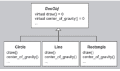

*图18.1：通过继承实现的多态*

点击此处查看代码图片

[代码图片：poly/diamond.cpp]

*poly/diamond.cpp*

```cpp
#include "coord.hpp"

// common abstract base class GeoObj for geometric objects
class GeoObj {
public:
  // draw generic object
  virtual void draw() const = 0;

  // return center of gravity of geometric object
  virtual Coord center_of_gravity() const = 0;
};

// concrete geometric object class Circle
// - derived from GeoObj
class Circle : public GeoObj {
public:
    virtual void draw() const override;

    virtual Coord center_of_gravity() const override;

    ...
};

// concrete geometric object class Line
// - derived from GeoObj
class Line : public GeoObj {
public:
    virtual void draw() const override;

    virtual Coord center_of_gravity() const override;

    ...
};
```

在创建具体对象之后，客户端代码可以通过指向公共基类的引用或指针，利用虚函数分派机制来操作这些对象。通过指向基类对象的指针或引用调用虚成员函数，会调用被引用对象的具体“最派生”（具体）类型的相应成员。

例如，具体代码可以概括如下：

[点击此处查看代码图片](#)

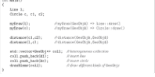

*poly/dynamic1.cpp*

```cpp
#include <iostream>
#include <vector>

// draw any GeoObj
void myDraw (GeoObj const& obj)
{
    obj.draw();                  // call draw() according to type of obj
}

// compute distances to center of gravity between two
Coord distance (GeoObj const& x1, GeoObj const& x2)
{
    Coord c = x1.center_of_gravity() - x2.center_of_gravity();
    return c.abs();              // return coordinates as absolute value
}

// draw heterogeneous collection of GeoObjs
void drawElements (std::vector<GeoObj*> const& elems)
{
    for (std::vector<GeoObj*>::iterator i=elems.begin(); i!=elems.end(); ++i) {
        (*i)->draw();            // call draw() according to type of element
    }
}

int main()
{
    Line l1;
    Circle c1, c2;

    myDraw(l1);        // myDraw(GeoObj&) -> Line
    myDraw(c1);        // myDraw(GeoObj&) -> Circle

    distance(c1,c2);   // distance(GeoObj&,GeoObj&)
    distance(l1,c1);   // distance(GeoObj&,GeoObj&)

    std::vector<GeoObj*> coll;  // heterogeneous collection
    coll.push_back(&l1);        // insert line
    coll.push_back(&c1);        // insert circle
    drawElements(coll);         // draw different kinds
}
```

关键的多态接口是 `draw()` 和 `center_of_gravity()` 函数。两者都是虚成员函数。我们的示例演示了它们在 `myDraw()` 和 `drawElements()` 函数中的使用。这些函数使用公共基类型 `GeoObj` 来表达。这种方法的一个后果是，在编译时通常无法知道必须调用哪个版本的 `draw()`（或 `center_of_gravity()`）。然而，在运行时，会访问调用虚函数的对象的完整动态类型来分派函数调用。因此，根据几何对象的实际类型，执行相应的操作。如果对 `Line` 对象调用 `myDraw()`，表达式 `obj.draw()` 会调用 `Line::draw()`；而对 `Circle` 对象调用时，会调用 `Circle::draw()`。类似地，对参数对象调用相应的 `center_of_gravity()` 成员函数实例。

也许这种动态多态最引人注目的特性是能够处理异构对象集合，如清单18.1所示。这一特性意味着：

```cpp
elems[i]->draw()
```

结果是调用不同的成员函数，具体取决于所迭代元素的动态类型。

### 18.2 静态多态

模板也可以用来实现多态。然而，它们并不依赖于在基类中分解公共行为。相反，共同性是隐式的：应用程序的不同“形状”必须使用共同的语法支持操作（即相关函数必须具有相同的名称）。具体类彼此独立定义（见图18.2）。当模板用具体类实例化时，多态能力便得以启用。

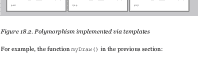

*图18.2：通过模板实现的多态*

例如，上一节中的 `myDraw()` 函数：

点击此处查看代码图片

```cpp
void myDraw (GeoObj const& obj)    // GeoObj is abstract
{
    obj.draw();
}
```

可以想象重写为：

点击此处查看代码图片

```cpp
template<typename GeoObj>
void myDraw(GeoObj const& obj)    // GeoObj is template
{
    obj.draw();
}
```

比较 `myDraw()` 的两种实现，我们可能会得出结论，主要区别在于将 `GeoObj` 指定为模板参数而不是公共基类。然而，在底层还有更根本的差异。例如，使用动态多态时，运行时只有一个 `myDraw()` 函数；而使用模板时，我们会实例化出多个函数，如 `myDraw<Circle>()` 和 `myDraw<Line>()`。

我们可以尝试使用静态多态来重塑上一节的完整示例。首先，我们有几个独立的几何类，而不是几何类的层次结构：

```cpp
#include "coord.hpp"

// concrete geometric object class Circle
// - not derived from any class
class Circle {
public:
    void draw() const;

    Coord center_of_gravity() const;

    ...
};

// concrete geometric object class Line
// - not derived from any class
class Line {
public:
    void draw() const;

    Coord center_of_gravity() const;

    ...
};
```

现在，这些类的应用如下所示：

[点击此处查看代码图片](#)

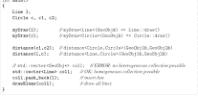

*poly/staticpoly.cpp*

```cpp
#include "staticshape.hpp"
#include <iostream>
#include <vector>

// draw any GeoObj
template<typename GeoObj>
void myDraw (GeoObj const& obj)
{
    obj.draw();  // call draw() according to type of obj
}

// compute distance of any two GeoObjs
template<typename GeoObj1, typename GeoObj2>
Coord distance (GeoObj1 const& x1, GeoObj2 const& x2)
{
    Coord c = x1.center_of_gravity() - x2.center_of_gravity();
    return c.abs();  // return coordinates as absolute value
}

// draw homogeneous collection of GeoObjs
template<typename GeoObj>
void drawAll (std::vector<GeoObj> const& elems)
{
    for (unsigned i = 0; i < elems.size(); ++i) {
        elems[i].draw();  // call draw() according to type of element
    }
}
```


```cpp
int main()
{
    Line l;
    Circle c1, c2;

    myDraw(l);          // myDraw(Line)(GeoObj&) => Line
    myDraw(c1);         // myDraw(Circle)(GeoObj&) => Circle

    distance(c1, c2);   // distance=Circle, Circle(GeoObj&)
    distance(c1, c1);   // distance=Circle, Circle(GeoObj&)

    // std::vector<GeoObj*> coll; // ERROR: no heterogeneous collection
    std::vector<Circle> coll;     // OK: homogeneous collection
    coll.push_back(c1);           // insert Circle
    drawElements(coll);           // draw all circles
}
```

与 `myDraw()` 一样，`draw()` 不能再作为 `distance()` 的具体参数类型使用。取而代之，我们提供两个函数模板 `GeoObj1` 和 `GeoObj2`，它们使接口能够接受几何对象的不同组合。

[点击此处查看代码图像](#)

```cpp
distance(c1, c2);    // distance=Circle, Circle?
                     // (GeoObj1&, GeoObj2&)
```

然而，异构集合再也无法被透明地处理。这正是静态多态中的“静态”部分施加约束之处：所有类型都必须在编译期确定。不过，我们可以轻松地为不同的几何对象类型引入不同的集合。集合不再需要仅限于指针，这在性能和类型安全方面可能具有显著优势。

### 18.3 动态多态与静态多态

让我们对这两种多态形式进行分类和比较。

#### 术语

动态多态和静态多态为不同的 C++ 编程惯用法提供支持：

- **通过继承实现的多态是有界且动态的：**
  - **有界**意味着参与多态行为的类型的接口由公共基类的设计预先确定（该概念的其他术语是接口或抽象基类）。
  - **动态**意味着接口的绑定在运行时（动态地）完成。
- **通过模板实现的多态是无界且静态的：**
  - **无界**意味着参与多态行为的类型的接口不是预先确定的（该概念的其他术语是非侵入式和非侵入性）。
  - **静态**意味着接口的绑定在编译期（静态地）完成。

因此，严格来说，在 C++ 术语中，动态多态和静态多态是有界动态多态和无界静态多态的简称。换句话说，这里使用的是动态多态（即 Smalltalk 提供的是无界动态多态）。然而，在 C++ 的语境中，更简洁的术语“动态多态”和“静态多态”不会引起混淆。

#### 优点与缺点

C++ 中的动态多态具有以下优点：

- 异构集合可以得到优雅处理。
- 可执行代码大小可能更小（因为只需要一个多态函数，而针对不同类型必须生成不同的模板实例）。
- 代码可以完全复制；因此不必分发实现源代码（包含模板库时通常需要分发模板实现的源代码）。
- 只提供部分接口的具体类型仍然可以使用，只要应用程序最终只用到那部分接口。

静态多态通常被认为比动态多态更具类型安全性。使用指向公共基类的指针时，这些指针有可能无意中最终指向不同类型的完整对象。

在实践中，当不同的语义假设隐藏在看起来相同的接口背后时，模板实例化也可能带来一些麻烦。例如，当一个假定运算符 + 满足结合律的模板被实例化用于一个在该运算符上不满足结合律的类型时，就可能出现意外。在实践中，这种语义不匹配比其他基于接口的启发式方法更少发生，主要因为接口规范被更明确地规定。

#### 结合两种形式

当然，你可以结合两种多态形式。例如，你可以从公共基类派生出不同种类的几何对象，以便处理几何对象的异构集合。不过，你仍然可以使用模板为某一类几何对象编写代码。

继承与模板的结合将在第 21 章进一步描述。我们将（除其他内容外）看到如何参数化成员函数的虚特性，以及如何使用基于继承的奇异递归模板模式（CRTP）为静态多态提供额外的灵活性。

### 18.4 使用概念

反对使用模板实现静态多态的一个论点是，接口的绑定通过实例化相应模板来完成。这意味着没有可供编程所针对的公共接口（例如基类）。相反，只要所有实例化代码都有效，模板的任何使用都能正常工作。如果无效，则可能导致难以理解的错误消息，甚至使原本有效的代码突然失效。

为此，C++ 语言设计者一直在研究显式提供（并检查）模板参数接口的能力。这样的接口在 C++ 中通常称为概念（concept）。它表示模板实参为了成功实例化模板而必须满足的一组约束。

尽管在这一领域已有多年的工作，但截至 C++17，概念仍然不是标准 C++ 的一部分。一些编译器为此类特性提供实验性支持。不过，概念很可能成为 C++17 之后的下一个标准的一部分。

概念可以理解为静态多态的一种“接口”。在我们的示例中，它可能如下所示：

**点击此处查看代码图像**

poly/conceptreq.cpp

```cpp
#include "coord.hpp"

template<typename T>
concept GeoObj = requires(T x) {
  { x.draw() } -> void;
  { x.center_of_gravity() } -> Coord;
  ...
};
```

这里，我们使用关键字 concept 定义概念 GeoObj，它约束一个类型具有可调用的成员 draw() 和 center_of_gravity()，并具有适当的返回类型。

现在，我们可以重写一些示例模板，以包含一个 requires 子句，用 GeoObj 概念约束模板参数：

**点击此处查看代码图像**

poly/conceptzoo.cpp

```cpp
template<typename T>
requires GeoObj<T>
void draw (T const& obj)
{
  obj.draw();
}
```

poly/conceptzoo.hpp

```cpp
#include "concept.hpp"

#include <vector>

// draw any GeoObj

template<typename T>
requires GeoObj<T>
void myDraw (T const& obj)
{
  obj.draw();   // call draw() according to type of obj
}

template<typename T1, typename T2>
requires GeoObj<T1> && GeoObj<T2>
Coord distance(T1 const& x1, T2 const& x2)
{
    Coord c = x1.center_of_gravity() - x2.center_of_gravity();
    return c.norm();  // return coordinates as absolute
}

// draw homogeneous collection of GeoObjs
template<typename T>
requires GeoObj<T>
void drawAll(std::vector<T> const& elems)
{
    for (std::size_t i=0; i<elems.size(); ++i) {
        elems[i].draw();  // call draw() according to ...
    }
}
```

对于能够参与（静态）多态行为的类型，这种方法仍然是非侵入式的：

**点击此处查看代码图像**

```cpp
// concrete geometric object class Circle
// not derived from any class or implementing any interface
class Circle {
public:
    void draw() const;
    Coord center_of_gravity() const;
};
```

也就是说，此类类型仍然是在没有任何特定基类或 requires 子句的情况下定义的，并且仍然可以是基础数据类型或来自独立框架的类型。

附录 L 包含对 C++11 概念的更详细讨论；人们期待它们进入新的 C++ 标准。

### 18.5 设计模式的新形式

传统上，C++ 中的静态多态会带来实现经典设计模式的新方式。以桥接模式为例，它在许多 C++ 程序中扮演重要角色。使用桥接模式的一个目标是在接口的不同实现之间切换。

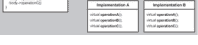

*图 18.3. 使用继承实现的桥接模式*

根据 [DesignPatternsGoF]，这通常通过一个接口类完成，该接口类暴露指向实现的指针，并通过该指针委托所有调用（见图 18.3）。然而，如果实现的类型在编译期已知，我们反而可以利用模板的能力（见图 18.4）。这会带来更高的类型安全性（部分原因是避免了指针转换）和更好的性能。

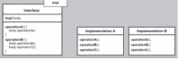

*图 18.4. 使用模板实现的桥接模式*

### 18.6 泛型编程

静态多态引出了泛型编程的概念。然而，泛型编程并没有一个公认的唯一定义（正如面向对象编程也没有一个公认的唯一定义）。根据 [Czarnecki et al.]，泛型编程是计算机科学的一个分支学科，研究如何发现和利用高效算法、数据结构及其他软件组件的共性，并对其进行系统化组织。


在 C++ 语境中，泛型编程有时被定义为使用模板进行编程（而面向对象编程则被认为是使用虚函数进行编程）。从这个意义上说，几乎任何对 C++ 模板的使用都可以被视为泛型编程的一个实例。然而，实践者通常认为泛型编程还有一个额外的基本要素：必须在一个框架中设计模板，以便支持大量有用的组合。

迄今为止，该领域最重要的贡献是标准模板库（STL），它后来被改编并纳入 C++ 标准库。STL 是一个框架，为若干种用于对象集合的线性数据结构——称为容器——提供了许多有用的操作，称为算法。算法和容器都是模板。然而，关键在于算法不是容器的成员函数。相反，算法以泛型方式编写，因此可被任何容器（以及元素的线性集合）使用。为此，STL 的设计者定义了一个抽象迭代器概念，可为任何类型的线性集合提供。本质上，容器操作中与具体集合相关的方面被分离出来，放到了迭代器的功能中。

因此，我们可以实现诸如计算序列中最大值这样的操作，而无需知道值在该序列中如何存储的细节。

```cpp
template<typename Iterator>
Iterator max_element(Iterator begin,  // reference to start
                     // of collection
                     Iterator end)    // reference to end of
                                      // collection
{
    // use only iterator operations to traverse
    // all elements
    // of the collection to find the element with the maximum value
    // and return its position as iterator
}
```

每个线性容器并没有提供所有有用的操作（例如 `max_element()`），而是只提供了一种迭代器类型，用于遍历其包含的值序列，以及用于创建此类迭代器的各种函数。

```cpp
namespace std {
    template<class T, ...>
    class vector {
    public:
        using const_iterator = ...;  // implementation-specific
        ...
        const_iterator begin() const; // iterator for
                                       // start of collection
        const_iterator end() const;   // iterator for
                                       // end of collection
    };

    template<class T, ...>
    class list {
    public:
        using const_iterator = ...;  // implementation-specific
        ...
        const_iterator begin() const; // iterator for
                                       // start of collection
        const_iterator end() const;   // iterator for
                                       // end of collection
    };
}
```

现在，我们可以通过调用泛型 `max_element()` 操作，并将集合的开头和结尾作为参数传入，来找到任何集合中的最大值（此处省略了对空集合的特殊处理）：

```cpp
int main()
{
    std::vector<int> c;
    std::list<int> l;

    max_element(c.begin(), c.end());
    max_element(l.begin(), l.end());
}
```

`poly/printmax.cpp`

```cpp
#include <vector>
#include <list>
#include <algorithm>
#include "MyClass.hpp"

...
{
    // compute position of maximum value
    auto pos = std::max_element(col.begin(), col.end());

    // print value of maximum element of col (if any)
    if (pos != col.end()) {
        std::cout << *pos << '\n';
    }
    else {
        std::cout << "empty" << '\n';
    }
}

int main()
{
    std::vector<int> c1;
    std::list<int> c2;

    ...

    printMax(c1);
    printMax(c2);
}
```

通过根据迭代器对其操作进行参数化，STL 避免了操作定义数量的爆炸式增长。我们不必为每个容器实现每种操作，而是只实现一次算法，使其可用于每个容器。因此，泛型算法对迭代器而言是通用适配的；迭代器由容器提供，并由算法使用。这之所以可行，是因为迭代器具有某种接口，该接口由容器提供并由算法使用。这个接口通常称为概念（concept），它表示模板为了融入该框架而必须满足的一组约束。此外，这个概念常常就是传统的操作和数据结构。

你会记得，我们在前面第 377 页的 18.4 节中描述过概念（concepts）语言特性，并在附录 E 中做了更详细的说明；事实上，该语言特性恰好对应这里的这一概念。实际上，此语境中的术语 concept 最初由 STL 的设计者引入，以将其工作形式化。此后不久，人们便开始尝试在模板中显式表达概念。

即将推出的语言特性将帮助我们指定并复核对迭代器的要求（由于存在不同的迭代器类别，例如前向迭代器和双向迭代器，现在可以结合使用多种操作；见第 744 页的 E.1.2 节）。然而，在当今的 C++ 中，概念隐含在示例库（以及一般而言的标准 C++ 库）的规范中。不过，一些特性和技术（例如 static_assert 和 SFINAE）确实允许进行一定程度的自动检查。

原则上，类似 STL 的方法这类功能可以用动态多态来实现。然而在实践中，它的用途有限，因为与虚函数调用机制相比，迭代器概念过于轻量。增加一个基于虚函数的接口层，很可能会使我们的操作慢一个数量级（甚至更多）。

泛型编程之所以实用，正是因为它依赖静态多态，而静态多态在编译时解析接口。另一方面，接口必须在编译时解析这一要求，也呼唤新的设计原则，这些原则在许多方面不同于面向对象设计原则。其中许多最重要的泛型设计原则将在本书余下部分描述。此外，附录 E 通过描述对概念这一观念的直接语言支持，更深入地探讨了作为开发范式的泛型编程。

### 18.7 后记

容器类型是将模板引入 C++ 编程语言的主要动机。在模板出现之前，多态层次结构是容器的一种流行实现方法。一个著名的例子是美国国家卫生研究院的类库（National Institute of Health’s Class Library，NIHCL），它在很大程度上移植了 Smalltalk 的容器类层次结构（见图 18.5）。

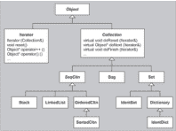

图 18.5：NIHCL 的类层次结构

与 C++ 标准库非常相似，NIHCL 支持丰富多样的容器以及迭代器。然而，其实现遵循 Smalltalk 风格的动态多态：迭代器使用通用的基类 Collection 来操作不同类型的集合：

```cpp
Bag c1;
Set c2;
...
Iterator i1(c1);
Iterator i2(c2);
...
```

不幸的是，这种方法在运行时间和内存使用方面的代价都很高。运行时间通常比使用 C++ 标准库的等效代码差几个数量级，因为最终有更多操作需要虚调用（而在 C++ 标准库中，许多操作是内联的，虚函数只出现在迭代器和容器接口中）。此外，与 Smalltalk 不同，由于接口是有限的，内置类型必须包装在大量使用多态的类中（这类包装器由 NIHCL 提供），这反过来又可能导致存储需求急剧增加。

即使在当今的模板时代，许多项目在处理多态的方法上仍会做出重大选择。显然，在很多情况下，动态多态是正确的选择。异构容器就是一个例子。然而，同样地，许多编程任务可以通过模板自然且高效地解决，同构容器就是这方面的一个例子。

静态多态很适合核心基础计算结构。相反，需要选择公共基类型意味着动态多态库通常必须做出特定于领域的抉择。因此，C++ 标准库中的 STL 部分从未包含多态容器，而是包含一组丰富的、使用静态多态的容器和迭代器（如第 1.6 节或第 9.5 节所示），这并不奇怪。

中型和大型 C++ 程序通常需要处理本章讨论的两种多态。在某些情况下，甚至可能需要将它们非常紧密地结合起来。在许多情况下，根据我们的讨论，最佳设计选择是明确的，但花些时间思考长期的潜在演进总是值得的。

- 1. *多态*（Polymorphism）字面上指具有多种形式或形态的状态（源自希腊语 *polymorph*）。
- 2. 严格来说，宏也可以被视为静态多态的一种早期形式。然而，这里不考虑它们，因为它们与其他语言机制大多是正交的。
- 3. 也就是说，多态基类子对象的编码包含一些通常隐藏的数据，这些数据使这种运行时分派成为可能。
- 4. 关于多态的一般性详细讨论，另见本书第 6.6.2 节。
- 5. 例如，GCC 7 提供了选项 `-fconcepts`。


## 第19章 实现 Traits

模板使我们能够为各种类型参数化类和函数。人们可能会倾向于引入尽可能多的模板参数，以便对类型或算法的每个方面都进行定制。通过这种方式，我们的“模板化”组件可以被实例化，以满足客户端代码的确切需求。然而，从实际角度看，为了实现最大限度的参数化而引入数十个模板参数通常并不可取。在客户端代码中必须指定所有相应的参数过于繁琐，而且每增加一个模板参数都会使组件与其客户端之间的契约变得更加复杂。

幸运的是，事实证明，我们想引入的大多数额外参数都有合理的默认值。在某些情况下，这些额外参数完全由少数几个主要参数决定，而且我们将看到，每个额外参数都可以完全省略。另一些参数可以赋予依赖于主要参数的默认值，并能满足大多数情况的需求，但这些默认值偶尔必须被覆盖（用于特殊应用）。还有一些参数与主要参数无关：从某种意义上说，它们本身就是主要参数，只不过它们的默认值属于明智默认值的范畴。

Traits（或 traits 模板）是一种 C++ 编程装置，它们极大地简化了在设计工业级模板时出现的那类额外参数的管理。在本章中，我们将展示它们有用的一些场景，并演示各种技术，使你能为自己的用途编写健壮且无缺陷的代码。

这里介绍的大多数 traits 在 C++ 标准库中都以某种形式存在。然而，为了清晰起见，我们通常会给出简化的实现，省略工业级实现（如标准库中的实现）中的某些细节。出于这个原因，我们也使用自己的命名方案，不过该方案很容易映射到标准 traits。

### 19.1 示例：累加一个序列

计算一个值序列的总和是一项相当常见的计算任务。然而，这个看似简单的问题为我们提供了一个极好的示例，用来介绍策略类和 traits 可以在哪些不同层面上提供帮助。

#### 19.1.1 固定 Traits

首先假设我们要计算的总和值存储在一个数组中，并给定一个指向第一个待累加元素的指针，以及一个指向最后一个待累加元素之后位置的指针。由于本书是关于模板的，我们希望编写一个适用于多种类型的模板。下面这个写法现在看起来可能很直接：

```cpp
#ifndef ACCUM_HPP
#define ACCUM_HPP

template<typename T>
T accum (T const* beg, T const* end)
{
    T total{};
    while (beg != end) {
        total += *beg;
        ++beg;
    }
    return total;
}

#endif // ACCUM_HPP
```

这里唯一稍微微妙的地方在于，如何创建正确类型的零值来开始求和。我们使用带有`{}`记号的空初始化；这在第5.2节（第68页）中介绍过。它意味着标量对象类型会被初始化：double 类型初始化为零，指针类型初始化为空指针，布尔值初始化为 false。

为了引出我们的第一个 traits 模板，请看下面使用`accum()`的代码。

```cpp
#include <iostream>
#include <numeric>

int main()
{
    // create array of 5 integer values
    int num[] = { 1, 2, 3, 4, 5 };

    // print average value
    std::cout << "the average value of the integer values is "
              << accum(num, num+5) / 5
              << '\n';

    // create array of character values
    char name[] = "template";

    int length = sizeof(name)-1;

    // (try to) print average character value
    std::cout << "the average value of the characters in \""
              << name << "\" is "
              << accum(name, name+length) / length
              << '\n';
}
```

程序的前半部分使用`accum()`对五个整数值求和。

```text
the average value of the integer values is 3
```

然后通过简单地将结果总和除以数组中的值个数，即可得到整数平均值。

程序的后半部分尝试对单词`template`中的所有字符做同样的处理（前提是实际字符集中从`a`到`z`的字符构成一个连续序列；这在 ASCII 中成立，但在 EBCDIC 中不成立）。结果按理应当介于`a`的值和`z`的值之间。在当今大多数平台上，这些值由 ASCII 码决定：`a`编码为97，`z`编码为122。因此，我们可能期望结果在97到122之间。然而，在我们的平台上，程序的输出如下：

```text
the average value of the integer values is 3
the average value of the characters in "template" is -5
```

这并非异常结果，但它是可以避免的。

处理额外参数的一种替代方法是在每个调用`accum()`的类型与相应的累加类型之间建立关联。事实上，我们的关联可以被编码为模板的特化：

```cpp
template<typename T>
struct AccumulationTraits;

template<>
struct AccumulationTraits<char> {
    using AccT = int;
};

template<>
struct AccumulationTraits<short> {
    using AccT = int;
};

template<>
struct AccumulationTraits<int> {
    using AccT = long;
};

template<>
struct AccumulationTraits<unsigned int> {
    using AccT = unsigned long;
};

template<>
struct AccumulationTraits<float> {
    using AccT = double;
};
```

模板`AccumulationTraits`被称为 traits 模板，因为它保存了其参数类型的一个 trait。（一般来说，可能不止一个 trait，也不止一个参数。）我们选择不提供这个模板的通用定义，因为在不知道类型是什么的情况下，没有一种很好的方法来选择一个好的关联类型。不过，也可以认为`T`本身通常是这样一个类型的好候选（尽管在我们前面的例子中不是）。

考虑到这一点，我们可以将`accum()`模板重写如下：

```cpp
#ifndef ACCUM_HPP
#define ACCUM_HPP

#include "accumtraits1.hpp"

template<typename T>
auto accum (T const* beg, T const* end)
{
    // result type is trait of the element type
    using AccT = typename AccumulationTraits<T>::AccT;

    AccT total{};  // assume this actually creates a zero value
    while (beg != end) {
        total += *beg;
        ++beg;
    }
    return total;
}
#endif // ACCUM_HPP
```

这样，示例程序的输出就变成了我们所期望的结果：

```text
the average value of the integer values is 3
the average value of the characters in "template" is 109
```

总的来说，考虑到我们添加了一种非常有用的机制来自定义算法，这些改动并不算很大。此外，如果出现新的类型要与`accum()`一起使用，只需为`AccumulationTraits`模板声明一个额外的显式特化，就可以为其关联一个合适的`AccT`。请注意，这可以针对任何类型完成：基本类型、在其他库中声明的类型，等等。

#### 19.1.2 值 Traits

到目前为止，我们已经看到 traits 表示与给定“主”类型相关的额外类型信息。在本节中，我们将展示这些额外信息不必仅限于类型。常量和其他类别的值也可以与类型相关联。

我们最初的`accum()`模板使用返回值的默认构造函数来初始化结果值，希望它是一个类似零的值：

```cpp
AccT total{};  // assume this actually creates a zero value

return total;
```

显然，这并不能保证产生一个适合开始累加循环的良好值。类型`AccT`甚至可能没有默认构造函数。

同样，traits 可以前来解围。对于我们的示例，可以向`AccumulationTraits`添加一个新的值 trait：

*traits/accumcreate.cpp*

```cpp
template<typename T>
struct AccumulationTraits;

template<>
struct AccumulationTraits<char> {
    using AccT = int;
    static AccT const zero = 0;
};

template<>
struct AccumulationTraits<short> {
    using AccT = int;
    static AccT const zero = 0;
};

template<>
struct AccumulationTraits<int> {
    using AccT = long;
    static AccT const zero = 0;
};
```

在这种情况下，我们的新 trait 提供了一个`zero`元素，它是一个可以在编译时求值的常量。于是，`accum()`变成下面这样：

*traits/accumaccu.cpp*

```cpp
#ifndef ACCUM_HPP
#define ACCUM_HPP
```


一个函数如果返回字面类型，就可以声明为 `constexpr`。 ^4^

例如，我们可以如下重写 `AccumulationTraits`：

[点击此处查看代码图像](#)

`traits/accumtraits.hpp`

```cpp
template<typename T>
struct AccumulationTraits;

template<>
struct AccumulationTraits<char> {
    using AccT = int;

    static constexpr AccT zero() {
        return 0;
    }
};

template<>
struct AccumulationTraits<short> {
    using AccT = int;

    static constexpr AccT zero() {
        return 0;
    }
};

template<>
struct AccumulationTraits<int> {
    using AccT = long;

    static constexpr AccT zero() {
        return 0;
    }
};

template<>
struct AccumulationTraits<unsigned int> {
    using AccT = unsigned int;

    static constexpr AccT zero() {
        return 0;
    }
};

template<>
struct AccumulationTraits<float> {
    using AccT = double;

    static constexpr AccT zero() {
        return 0;
    }
};
```

然后针对你自己的类型扩展这些特征：

点击此处查看代码图像

`traits/accumtraits-fwd.hpp`

```cpp
using AccT = BigInt;

static BigInt zero() {
    return BigInt(0);
}
};
```

对于应用代码，唯一的区别是使用函数调用语法（而不是稍微更简洁地访问静态数据成员）：

点击此处查看代码图像

```cpp
AccT total = AccumulationTraits<AccT>::zero(); // init total by trait function
```

显然，特征可以不仅仅是额外的类型。在我们的示例中，它们可以成为一种机制，提供执行过程所需的关于其被调用时所针对元素类型的全部必要信息。这就是特征概念的关键：特征为泛型计算配置具体元素（主要是类型）提供了一种解决方案。

#### 19.1.3 参数化特征

前几节中在 `accum()` 中使用特征的方式称为固定式，因为一旦所开发的特征被定义，它就不能在算法中被替换。有些情况下可能希望进行这种覆盖。例如，我们可能碰巧知道一组 float 值可以安全地累加到一个同类型的变量中，而这样做可能带来一些效率提升。

我们可以通过为特征本身添加一个模板参数 AT，并让其默认值由我们的特征模板决定，来解决这个问题：

点击此处查看代码图像

点击此处查看代码图像

```cpp
#ifndef ACCUM_HPP
#define ACCUM_HPP

#include "accumulator.hpp"
#include "templatestest.hpp"

template<typename T,
         typename Policy = DefaultPolicy,
         typename Traits = AccumulationTraits<T>>
auto accum (T const* beg, T const* end)
{
    using AccT = typename Traits::AccT;
    AccT total = Traits::zero();

    while (beg != end) {
        Policy::accumulate(total, *beg);
        ++beg;
    }

    return total;
}

#endif // ACCUM_HPP
```

这样，许多用户可以省略额外的模板参数，而那些有更特殊需求的用户则可以指定预设累积类型的替代方案。想必，这个模板的大多数用户永远不必显式提供第二个模板参数，因为对于第一个参数所声明的每种类型，它都可以配置为合适的默认值。

### 19.2 特征与策略及策略类

到目前为止，我们一直将累积等同于求和。然而，我们可以想象其他类型的累积。例如，我们可以将给定值序列相乘。或者，如果这些值是字符串，我们可以将它们拼接起来。甚至查找序列中的最大值也可以表述为一个累积问题。在所有这些替代方案中，唯一需要改变的操作是 total = *beg。这个操作可以称为我们累积过程的一个策略。

下面是一个示例，说明我们如何在累积框架中引入这样的策略：

点击此处查看代码图像

```cpp
traits/sumpolicy1.hpp

#ifndef SUMPOLICY_HPP
#define SUMPOLICY_HPP

class SumPolicy {
  public:
    template<typename T1, typename T2>
    static void accumulate (T1& total, T2 const& value) {
        total += value;
    }
};

#endif // SUMPOLICY_HPP
```

通过指定不同的策略来累积值，我们可以计算不同的东西。例如，考虑下面这个程序，它想要确定一些值的乘积：

点击此处查看代码图像

```cpp
traits/accum2.cpp

#include "accum1.hpp"
#include <iostream>

class MultPolicy {
  public:
    template<typename T1, typename T2>
    static void accumulate (T1& total, T2 const& value) {
        total *= value;
    }
};

int main()
{
int num[] = { 1, 2, 3, 4, 5 };

// print product of all values
std::cout << "the product of the integer values is "
          << accumulate(num, num + 5, 1)
          << std::endl;
}
```

然而，这个程序的输出并不是我们想要的结果：

[点击此处查看代码图像](#)

```text
the product of the integer values is 0
```

这里的问题是由我们选择的初始值造成的。虽然 0 对求和很适用，但它对乘法不适用（零会将所有因子初始化为零，而不是进行累积乘法）。这说明不同的特征可能提供非常不同的结果，从而凸显了谨慎设计模板的重要性。

在这种情况下，我们可能会认识到，累积循环的初始化是累积策略的一部分。这个策略可能会也可能不会使用特征 `zero<>`。其他替代方案也不应被遗忘：并非一切都必须用特征和策略来解决。例如，C++ 标准库的 `accumulate()` 函数将初始值作为一种函数调用参数。

#### 19.2.1 特征与策略：有什么区别？

可以提出合理的理由来支持这样一种看法：策略只是特征的一种特例。反过来，也可以声称特征仅仅是策略。

《新简明牛津英语词典》（见 [NewShorterOED]）有如下说明：

- **特征**…… 表征某事物的显著特点
- **策略**…… 为有利或权宜而采取的任何行动方针

基于此，我们倾向于将“策略类”这一术语的使用限制在那些编码某种动作的类上，而这种动作在很大程度上与它所结合的任何其他模板参数正交。这与 Andrei Alexandrescu 在其著作 Modern C++ Design 中的说法一致（见 Alexandrescu 第 8 页）。

策略与特征有很多共同之处，但不同之处在于，策略对类型的强调较少，而对行为的强调较多。

Nathan Myers 引入了特征技术，他提出了以下更开放的定义（见 [MyersTraits]）：

特征类：一种用来代替模板参数的类。作为一个类，它聚合实际类型和常量；作为一个模板，它为这些类型和常量提供接口。

因此，总的来说，我们倾向于使用以下（稍显模糊的）定义：

- 特征表示模板参数的名义附加属性。
- 策略表示泛型函数和类型的可配置行为（通常带有一些常用默认值）。

为了进一步阐述这两个概念之间可能的区别，我们列出以下关于特征的观察：

- 特征既可用于类型，也可用于常量（即，不必通过模板参数传递）。
- 特征参数通常具有非常自然的默认值（这些默认值很少被覆盖，或者根本无法被覆盖）。
- 特征参数往往紧密依赖于一个或多个主要参数。
- 特征大多组合类型和常量，而不是成员函数。
- 特征往往集中收集在特征模板中。

对于策略类，我们作出以下观察：

- 策略类如果仅用作模板参数，则作用不大。
- 策略参数不需要默认值，并且通常显式指定（尽管许多泛型组件都配置了常用默认策略）。
- 策略参数大多与模板的其他参数正交。
- 策略类大多组合成员函数。
- 策略可以收集在策略类或类模板中。

然而，这两个术语之间确实存在微妙的界限。例如，C++ 标准库的字符特征通常是基于函数的特征，例如比较、移动和查找字符。这样的特征可以被视为定义了以……方式行为的类……


#### 19.2.3 组合多个策略和/或特征

组合多个特征和策略并不能完全消除拥有多个模板参数的情况。然而，它们确实将参数数量减少到可管理的程度。那么，一个有趣的问题是，如何排列这些多个参数。

一种简单的策略是按照其默认值被选中的可能性递增来排列参数。通常，这意味着特征参数跟在策略参数之后，因为后者在客户端代码中更常被覆盖。（在我们的开发过程中，可能已经注意到这种策略的反向顺序。）

如果我们愿意为代码增加大量复杂性，那么还存在另一种变体，它本质上允许我们以任意顺序指定非默认算法。详情参见第 523 页的 21.4 节。

#### 19.2.4 使用通用迭代器进行累积

在结束对特征和策略的介绍之前，有必要看看 `accumulate()` 的一个版本，它增加了处理通用迭代器（而不仅仅是指针）的能力，这正是工业级通用组件所应具备的。有趣的是，这仍然使我们能够与指针保持兼容，因为 C++ 标准库提供了迭代器特征。（特征无处不在！）因此，我们可以如下定义 `accumulate()` 的初始版本（忽略我们后来的改进）：

```cpp
#ifndef ACCUM_HPP
#define ACCUM_HPP

#include <iterator>

template<typename Iter>
auto accum (Iter start, Iter end)
{
    using VT = typename std::iterator_traits<Iter>::value_type;

    VT total{};  // assume this actually creates a zero

    while (start != end) {
        total += *start;
        ++start;
    }

    return total;
}

#endif // ACCUM_HPP
```

`std::iterator_traits` 结构封装了迭代器的所有相关属性。由于存在针对指针的部分特化，这些特征可以方便地用于任何普通指针类型。以下是标准库实现可能实现这种支持的方式：

```cpp
template<typename T>
struct iterator_traits<T*> {
    using difference_type = ptrdiff_t;
    using value_type = T;
    using pointer = T*;
    using reference = T&;
    using iterator_category = random_access_iterator_tag;
};
```

然而，并没有一种类型用于表示迭代器所指向值的累积结果；因此我们仍然需要设计自己的累积对象。

### 19.3 类型函数

最初的特征示例表明，我们可以定义依赖于类型的行为。传统上，在 C 和 C++ 中，我们定义的函数更具体地可以称为值函数。它们以一些值作为参数，并返回另一个值作为结果。借助模板，我们还可以定义类型函数：这类函数以某些类型作为参数，并产生一个类型或常量作为结果。

一个非常有用的内置类型函数是 `sizeof`，它返回一个常量，描述给定类型参数的大小（以字节为单位）。类模板也可以充当类型函数。类型函数的参数是模板参数，而结果则是该类的一个实例化……

```cpp
// traits/sized.cpp
#include <cstddef>
#include <iostream>

template<typename T>
struct TypeSize {
    static std::size_t const value = sizeof(T);
};

int main()
{
    std::cout << "TypeSize<int>::value = "
              << TypeSize<int>::value << '\n';
}
```

这看起来可能不太有用，因为我们可以使用内置的 `sizeof` 运算符，但请注意，`TypeSize<int>` 是一个类型，因此它本身可以作为类模板参数传递。或者，`TypeSize` 是一个模板，可以作为模板模板参数传递。

在下文中，我们将开发几个更通用的类型函数，它们可以以这种方式用作特征类。

#### 19.3.1 元素类型

假设我们有许多容器模板，例如 `std::vector<T>` 和 `std::list<T>`，以及内置数组。我们想要一个类型函数，在给定这样的容器类型时，产生其元素类型。这可以通过部分特化来实现：

```cpp
// traits/elementtype.hpp
#include <vector>
#include <list>

template<typename T>
struct ElementType;                 // primary template

template<typename T>
struct ElementType<std::vector<T>> { // partial specialization
    using Type = T;
};

template<typename T>
struct ElementType<std::list<T>> { // partial specialization
    using Type = T;
};

...

template<typename T, std::size_t N>
struct ElementType<T[N]> { // partial specialization
    using Type = T;
};

...

template<typename T>
struct ElementType<T[]> { // partial specialization
    using Type = T;
};
```

注意，我们应该为所有可能的数组类型提供部分特化。

```cpp
template<typename T>
class NoExceptType
{
public:
    explicit NoExceptType();
    explicit NoExceptType(const T&);
    explicit NoExceptType(T&&);
    ...
};
```

```cpp
template<typename T>
void printElementType(T const& t)
{
    std::cout << "Contains: "
              << typeid(typename ElementType<T>::Type).name()
              << std::endl;
}

int main()
{
    std::vector<int> c;
    printElementType(c);
    int arr[42];
    printElementType(arr);
}
```

使用部分特化使我们能够实现该类型函数，而无需容器类型了解它。然而，在许多情况下，类型函数是与适用类型一起设计的，因此不需要部分特化。例如，标准库定义了类型函数 `std::iterator_traits`（正如标准中所包含的那样），因此我们可以编写如下内容：

```cpp
template<typename T>
struct ElementType<T*>
{
    using Type = T;
};
```

这不是默认实现，并且它不包含针对未定义适当类型函数的容器类型的特化。

当然，通常建议为类模板参数提供成员类型定义，以便在泛型代码中更容易访问它们（标准容器模板就是这样做的）。下面概述了这一思路：

```cpp
template<typename T1, typename T2>
class ElementType<T1,T2>
{
public:
    using Type1 = T1;
    using Type2 = T2;
};
```

类型函数有什么用？它允许我们根据容器类型来参数化模板，而不需要同时为元素类型和其他特征提供参数。例如，与其写成

```cpp
template<typename T, typename C = std::vector<T>>
class MyClass
{
    ...
};
```

这要求显式指定元素类型，我们可以声明

```cpp
template<typename C, typename T = typename ElementType<C>::Type>
class MyClass
{
    ...
};
```

其中元素类型由类型函数确定。

观察特征是如何作为现有类型的扩展来实现的；也就是说，我们不会为不相关的类型和类类型定义类型函数。被称为策略的类型函数则不是这样。它用于定义策略。……


```cpp
template<typename T>
using ElementType = typename Element<T>::Type;
```

这允许我们将上面的元素声明进一步简化为


```cpp
template<typename C>
ElementType<C> someElements (C const& c);
```

#### 19.3.2 变换特征

除了提供对主参数类型特定方面的访问之外，特征还可以对类型执行变换，例如添加或移除引用，或者 const 和 volatile 限定符。

**移除引用**

例如，我们可以实现一个 RemoveReference<> 特征，它将引用类型转换为其底层的对象或函数类型，而不改动非引用类型：


traits/removeReference.hpp

```cpp
template<typename T>
struct RemoveReferenceT {
    using Type = T;
};

template<typename T>
struct RemoveReferenceT<T&> {
    using Type = T;
};

template<typename T>
struct RemoveReferenceT<T&&> {
    using Type = T;
};
```

同样，便利别名模板使用法更简单：


```cpp
template<typename T>
using RemoveReference = typename
    RemoveReferenceT<T>::Type;
```

当类型是通过某种有时会产生引用类型的构造推导出来时，从类型中移除引用通常很有用，例如第 277 页 5.6 节讨论的针对 T&& 类型函数参数的特殊推导规则。

C++ 标准库提供了相应的类型特征 std::remove_reference<T>，第 277 页 12.4 节对其进行了描述。

**添加引用**

类似地，我们可以取一个现有类型，并从中创建左值引用或右值引用（以及通常的便利别名模板）：


traits/addReference.hpp

```cpp
template<typename T>
struct AddLValueReferenceT {
    using Type = T&;
};

template<typename T>
using AddLValueReference = typename AddLValueReferenceT<T>::Type;

template<typename T>
struct AddRValueReferenceT {
    using Type = T&&;
};
```


```cpp
using AddValueReference = typename AddValueReference...
```

引用折叠规则（第 277 页第 6.15 节）在此适用。例如，调用 `AddValueReference<int&>(...)` 会产生类型 `int&`（因此无需通过偏特化手动实现它们）。

如果我们让 `AddLValueReference` 和 `AddRValueReference` 保持原样，并且不为它们引入特化，那么便利别名实际上可以简化为

```cpp
template<typename T>
using AddLValueReference = T&;

template<typename T>
using AddRValueReference = T&&;
```

这样可以在不实例化类模板的情况下进行实例化（因此是更轻量的解决方案）。然而，这有风险，因为它可能并不总是按预期工作。例如，如上所写，我们无法使用特化来处理特殊情况。

```cpp
template<>
struct AddLValueReference<void> {
    using Type = void;
};

template<>
struct AddLValueReference<void const> {
    using Type = void const;
};

template<>
struct AddLValueReference<void volatile> {
    using Type = void volatile;
};

template<>
struct AddLValueReference<void const volatile> {
    using Type = void const volatile;
};
```

`AddRValueReference` 也类似。

完成这些之后，便利别名模板必须基于这些模板来表述，以确保特化会被采用（也因为别名模板不能被特化）。

C++ 标准库提供了相应的类型特征 `std::add_lvalue_reference<T>` 和 `std::add_rvalue_reference<T>`，它们在第 279 页第 15.4.2 节中描述。标准库还提供了针对 `void` 类型的特化。

#### 移除限定符

变换特征可以分解为添加和移除任意种类的复合类型，而不仅仅是引用。例如，如果存在 `const` 限定符，我们可以将其移除：

traits/RemoveConst.hpp

```cpp
template<typename T>
struct RemoveConst {
    using Type = T;
};

template<typename T>
struct RemoveConst<T const> {
    using Type = T;
};
```

此外，变换特征可以组合，例如创建一个同时移除 `const` 和 `volatile` 的 `RemoveCV` 特征：

```cpp
#include "RemoveConst.hpp"
#include "RemoveVolatile.hpp"

template<typename T>
struct RemoveCVT : RemoveConst<typename RemoveVolatile<T>::Type>
{
};

template<typename T>
using RemoveCV = typename RemoveCVT<T>::Type;
```

关于 `RemoveCVT` 的定义，有两点需要注意。首先，它同时使用了 `RemoveConst<T>` 和相关的 `RemoveVolatile<T>`，先移除 `volatile`（如果存在），然后将结果类型传递给 `RemoveConst<T>`。其次，它使用元函数转发，以便让 `T` 成为来自 `RemoveConst<T>` 的成员，而不是声明自己的 `T` 成员。这意味着必须包含 `<type_traits>` 头文件。这里，使用元函数转发只是为了减少 `RemoveCVT` 定义中的输入量。然而，当元函数并非对所有输入都有定义时，元函数转发也很有用，这一技术将在第 416 页第 19.4 节中进一步讨论。

便利别名模板 `RemoveCV` 可以简化为

```cpp
template<typename T>
using RemoveCV = RemoveConst<RemoveVolatile<T>>;
```

同样，只有当 `RemoveCVT<T>` 被特化时，这才能工作。虽然在 `AddCV` 的情况下使用的是 `AddConst` 和 `AddVolatile` 的联合，但这里不需要同类的元函数转发。

C++ 标准库也提供了相应的类型特征：`std::remove_const<T>::type`、`std::remove_cv<T>::type` 和 `std::remove_reference<T>::type`，它们在第 48 页第 4 节中描述。

#### 退化

为了完善对变换特征的讨论，我们开发一个特征，模拟按值将实参传递给形参时的类型转换。源自 C++，这意味着实参会将数组类型退化为指针，将函数类型退化为函数指针类型（见第 115 页第 7.4 节和第 159 页第 13.1.1 节），并删除任何顶层 `const`、`volatile` 或引用限定符（因为在解析函数调用时，形参类型上的顶层类型限定符会被忽略）。

这种按值传递的效果可以在下面的程序中看到，该程序打印编译器对指定类型进行退化后产生的实际形参类型：

traits/is_paramtype.cpp

```cpp
#include <iostream>
#include <typeinfo>
#include <type_traits>

template<typename T>
void f(T)
{
}

template<typename A>
void printParameterType(void (*f)(A))
{
    std::cout << "Parameter type: " << typeid(A).name() << std::endl;
    std::cout << "is const: " << std::is_const<A>::value << std::endl;
    std::cout << "is volatile: " << std::is_volatile<A>::value << std::endl;
    std::cout << "is pointer: " << std::is_pointer<A>::value << std::endl;
}

int main()
{
    printParameterType<int(int)>();
    printParameterType<int const>();
    printParameterType<int[5]>();
}
```

在程序的输出中，`int` 参数保持不变，而 `const int&`、`int&` 和 `int` 参数分别变成了 `int`、`int` 和 `int&`。

我们可以实现一个产生与按值传递相同类型转换的特征。为了与 C++ 标准库特征 `std::decay` 匹配，我们将其命名为 `decay`。它的实现结合了上述几种技术：首先，我们定义相同的非函数主情况，它只是丢弃 cv 限定符。

```cpp
template<typename T>
struct decay {
    using Type = typename RemoveCV<T>::Type;
};
```

接下来，我们处理数组到指针的退化，这要求我们使用偏特化识别任意数组类型（无论是否有边界）：

```cpp
template<typename T>
struct decay<T[]> {
    using Type = T*;
};

template<typename T, std::size_t N>
struct decay<T[N]> {
    using Type = T*;
};
```

最后，我们处理函数到指针的退化，它必须匹配任意函数类型，无论返回类型或形参类型数量如何。为此，我们使用可变参数模板：

```cpp
template<typename R, typename... Args>
struct decay<R(Args...)> {
    using Type = R(*)(Args...);
};

template<typename R, typename... Args>
struct decay<R(Args..., ...)> {
    using Type = R(*)(Args..., ...);
};
```

注意，第二个偏特化匹配任何使用 C 风格可变参数的函数类型。主 `decay` 模板及其四个偏特化共同实现了形参类型退化，如下面的示例程序所示：

```cpp
#include <iostream>
#include <typeinfo>
#include <type_traits>
#include "decay.h"

template<typename T>
void printDecayType()
{
    using A = typename decay<T>::Type;

    std::cout << "Parameter type: " << typeid(A).name()
              << std::endl;
    std::cout << "is const: " << std::is_const<A>::value
              << std::endl;
    std::cout << "is volatile: " << std::is_volatile<A>::value
              << std::endl;
    std::cout << "is pointer: " << std::is_pointer<A>::value
              << std::endl;
}

int main()
{
    printDecayType<int>();
    printDecayType<int const>();
    printDecayType<int[2]>();
    printDecayType<int(int)>();
}
```

像往常一样，我们提供一个便利别名模板：

```cpp
template <typename T>
using DecayT = typename decay<T>::Type;
```

如前所述，C++ 标准库也提供了相应的类型特征 `std::decay<T>::type`，它将在第 73 页第 1.4 节中描述。

#### 19.3.3 谓词特征

到目前为止，我们研究并开发了单类型的类型函数：给定一个类型，提供其他相关类型或常量。然而，一般来说，我们可以开发依赖多个实参的类型函数。这也引出了类型特征的一种特殊形式：类型谓词（产生布尔值的类型函数）。

#### IsSameT

`IsSameT` 类型特征用于判断两个类型是否相等：

traits/isSameT.hpp

```cpp
template<typename T1, typename T2>
struct IsSameT {
    static constexpr bool value = false;
};

template<typename T>
struct IsSameT<T, T> {
    static constexpr bool value = true;
};
```

这里，主模板定义：一般来说，作为模板实参传入的两个不同类型是不同的。因此 `value` 成员为 false。然而，使用偏特化，当出现两个传入类型相同的特殊情况时，`value` 为 true。

例如，下面的表达式检查传入的模板参数是否为整数：

```cpp
if (IsSameT<int, T>::value)
```

对于产生常量值的特征，我们不能提供别名模板，但可以提供履行相同角色的 constexpr 变量模板：

```cpp
template<typename T1, typename T2>
constexpr bool isSameT = IsSameT<T1, T2>::value;
```

C++ 标准库提供了相应的类型特征 `std::is_same<>`，它将在第 726 页第 9.3.3 节中描述。

#### true_type 和 false_type

我们可以通过为两种可能的结果 `true` 和 `false` 提供不同类型，显著改进 `IsSameT` 的定义。事实上，如果我们声明一个类模板 `BoolConstant`，它有两个可能的实例化 `true_type` 和 `false_type`：

traits/boolconstant.hpp

```cpp
template<bool val>
struct BoolConstant {
    using Type = BoolConstant<val>;
    static constexpr bool value = val;
};
```


```cpp
template<typename T>
struct IsSame<T, T> : TrueType
{
};
```

现在，`IsSame<T, T>` 的结果类型可以隐式转换为其基类 `TrueType`，该基类不仅提供相应的 `value` 成员，还允许我们在编译期分派到不同的函数实现或类模板偏特化。例如：

**单击此处查看代码图像**

`traits/2.3/isame.cpp`

```cpp
#include <iostream>
#include <ostream>

template<typename T>
void fooImpl(T, TrueType)
{
    std::cout << "fooImpl(true) for int called\n";
}

template<typename T>
void fooImpl(T, FalseType)
{
    std::cout << "fooImpl(false) for other type called\n";
}

template<typename T>
void foo(T t)
{
    fooImpl(t, IsSame<T,int>{});  // choose impl, depending on type
}

int main()
{
    foo(42);  // calls fooImpl(42, TrueType)
    foo(7.0); // calls fooImpl(7.0, FalseType)
}
```

这种技术称为标签分派，第 467 页的 20.2.3 节介绍了它。

注意，我们的 `IsSame` 实现包含一个 `Type` 成员，这使我们能够重新为 `IsSame<T>` 引入别名模板。

**单击此处查看代码图像**

```cpp
template<typename T>
using IsSameT = typename IsSame<T>::Type;
```

该别名模板可以与变量模板 `IsSame` 共存。

一般来说，产生布尔值的特征应通过派生自 `TrueType` 和 `FalseType` 之类的类型来支持标签分派。然而，为了尽可能通用，任何种类的布尔特征中都应只有一个表示 `true` 的类型和一个表示 `false` 的类型（因此，任何此类特征都应为布尔常量定义自己的类型）。

幸运的是，自 C++11 起，C++ 标准库在 `<type_traits>` 中提供了对应类型：`std::true_type` 和 `std::false_type`。在 C++11 和 C++14 中，它们定义如下：

```cpp
namespace std {
    using true_type = integral_constant<bool, true>;
    using false_type = integral_constant<bool, false>;
}
```

元编程的语境。第 23 章将详细讨论元编程。（这些便利类模板对于像这样的多级嵌套特别有帮助。没有它们，我们就必须在每一层都添加一个类型名和一个 `::Type` 类型。）

此时，数组加法运算符在相加两个可能具有不同元素类型的数组时，能够正确计算结果类型。然而，我们对 `PlusResult<T>` 的表述对元素类型 `T1` 和 `T2` 施加了一个不理想的限制：因为表达式 `T1() + T2()` 试图对 `T1` 和 `T2` 类型的值进行值初始化，所以这两种类型都必须具有可访问的、未删除的默认构造函数（或者必须是非类类型）。`Array` 类的默认构造函数会对其元素类型使用值初始化，因此这是一个额外且不必要的限制。

#### decltype

幸运的是，通过使用一个产生给定类型 `T` 值的函数，可以相当容易地为 `T` 表达式产生值，而不需要构造函数。为此，C++ 标准提供了 `std::declval<T>`，如第 965 页的 11.2.3 节所介绍。它在 `<utility>` 中的定义很简单，如下所示：

**单击此处查看代码图像**

```cpp
template<typename T>
add_rvalue_reference_t<T> declval() noexcept;
```

表达式 `declval<T>()` 产生一个 `T` 类型的值，而不需要默认构造函数（或任何其他操作）。

这个函数模板被有意保留为未定义，因为它只打算在 `decltype`、`sizeof` 或某些其他从不要求求值的上下文中使用。它还有两个有趣的属性：

- 对于引用类型，返回类型始终是该类型的右值引用，这使得 `declval<T>` 甚至能用于通常无法从函数返回的类型，例如抽象类类型（具有纯虚函数的类）或数组类型。除此之外，从 `T` 到 `T&&` 的转换在 `declval<T>()` 作为表达式使用时对其行为没有实际影响：两者都是右值（如果 `T` 是对象类型），而左值引用类型由于引用折叠（见第 483 页的 19.7.2 节）保持不变。
- `noexcept` 异常规范表明，`declval` 本身不会导致表达式被视为抛出异常。当 `declval<T>` 在 `decltype` 或其他表达式的上下文中使用时，这一点会很有用（见第 483 页的 19.7.2 节）。

借助 `declval`，我们可以消除 `PlusResult<T>` 对值初始化的要求：

**单击此处查看代码图像**

```cpp
template<typename T1, typename T2>
struct PlusResult {
  using Type = decltype(std::declval<T1>() + std::declval<T2>());
};

template<typename T1, typename T2>
using PlusResultT = typename PlusResult<T1, T2>::Type;
```

结果类型特征提供了一种确定特定操作精确返回类型的方法，并且在描述函数模板的结果类型时通常很有用。

### 19.4 基于 SFINAE 的特征

SFINAE 原则（替换失败并非错误；见第 132 页的 8.4 节和第 250 页的 10.2 节）允许你在模板实参推导期间控制无效类型和表达式形成过程中的错误（这些错误原本会使程序非良构），把它们变成简单的函数失败，从而让重载解析可以选择另一个实体。虽然 SFINAE 最初旨在避免函数模板重载中的虚假失败，但它还支持一些非凡的编译期技术，这些技术可以确定某个特定类型或表达式是否有效。这使我们能够编写特征，以确定例如某个类型是否具有特定成员、是否支持特定操作，或者是否为类。基于 SFINAE 的特征的两种主要方法是：用 SFINAE 排除函数重载，以及用 SFINAE 排除偏特化。

#### 19.4.1 用 SFINAE 排除函数重载

我们对基于 SFINAE 的特征的第一次探索，展示了将 SFINAE 与函数重载结合使用的基本技术，以查明某个类型是否可默认构造，从而可以在没有任何初始化值的情况下创建对象。也就是说，对于给定类型 `T`，诸如 `T()` 这样的表达式必须是有效的。

一个基本实现如下所示：

```cpp
#include "Lesson.hpp"

template<typename T>
struct IsDefaultConstructible {
 private:
   // test() trying substitute call of a default constructor
   template<typename U, typename = decltype(U())>
   static char test(void*);

   // test() fallback
   template<typename>
   static long test(...);

 public:
   static constexpr bool value
     = sizeof(test<T>(nullptr)) == sizeof(char);
};
```

使用函数重载实现基于 SFINAE 的特征的通常做法是声明两个名为 `test()`、返回类型不同的重载函数模板：

**单击此处查看代码图像**

```cpp
template<class T> static char test(T*);
template<class> static long test(...);
```

第一个重载被设计为仅在所请求的检查成功时才匹配（我们将在下面讨论如何实现这一点）。第二个重载是回退方案。它始终能匹配该调用，但由于它通过省略号（可变参数）进行匹配，任何其他匹配都会被优先选择（见第 86 页的 C.2 节）。

我们的返回值“value”取决于选择哪个重载的 `test()` 成员：

**单击此处查看代码图像**

```cpp
static constexpr bool value
  = IsSame<decltype(test<T>(nullptr)), char>::value;
```

如果选择第一个 `test()` 成员——当返回类型为 `char` 时——那么由于 `sizeof(char) == sizeof(char)`，`value` 将被初始化为 `true`。否则，由于 `sizeof(long) != sizeof(char)`，它将被初始化为 `false`。

现在，我们必须处理想要测试的特定属性。目标是使第一个 `test()` 重载当且仅当我们要检查的条件成立时才有效。在这种情况下，我们想查明是否可以默认构造传入类型 `T` 的对象。为此，我们将 `T` 和一个 `void*` 作为 `test()` 的第一个声明实参传入（即用实参进行模板实参初始化，该实参当且仅当转换有效时才有效）。在这种情况下，我们使用仅当存在隐式或显式默认构造函数时才有效的表达式：`U()`。该表达式被 `decltype` 包围，以使其成为可用于初始化类型参数的有效表达式。

第二个模板参数无法被推导，因此不会传入对应的实参。而且我们也不会为它提供显式模板实参。因此，它将被替换；如果替换失败，根据 SFINAE，该 `test()` 声明将被丢弃，从而只有回退函数会匹配。

因此，我们可以如下使用该特征：

**单击此处查看代码图像**

```cpp
IsDefaultConstructible<int>::value  // yields true

struct S {
  S() = delete;
};

IsDefaultConstructible<S>::value    // yields false
```

注意，我们可以直接在第一个 `test()` 中使用模板参数 `T`：


1)，我们只为第二个 `test()` 重载创建特定的 SFINAE 上下文。

#### 基于 SFINAE 的特性的替代实现策略

基于 SFINAE 的特性自 1998 年首个 C++ 标准发布之前就已经可以实现。这种方法的关键始终在于声明两个返回不同类型的重载函数模板。

```cpp
template <typename T> static char test(T*);
template <typename> static long test(...);
```

然而，最初发布的技术利用返回类型的大小来确定选择哪个重载（还使用了枚举，因为当时还没有空指针和常量）。

```cpp
enum { value = sizeof(test<T>(...)) == 1 };
```

在某些平台上，可能会发生 `sizeof(char) == sizeof(long)` 的情况（例如，在数字信号处理器（DSP）或 C++ 机器上，所有基本整型类型可能具有相同的大小）。根据定义，`sizeof(char)` 等于 1，因此在这些机器上 `sizeof(long)` 可以等于 1，甚至 `sizeof(long) == sizeof(char)`。

鉴于这一观察，我们希望确保 `test()` 函数的返回类型在所有平台上都具有不同的大小。例如，在定义以下内容之后：

```cpp
using SizeT = char;
using SizeT2 = struct { char a[2]; };
```

或

```cpp
using SizeT = char[6];
using SizeT2 = char[6][2];
```

我们可以如下定义 `test()` 重载：

```cpp
template <typename T> static SizeT test(void*);  // checking
template <typename> static SizeT2 test(...);     // fallback
```

还要注意，传递给 `test()` 的调用参数的类型无关紧要。重要的是传递的参数与期望类型匹配。例如，您也可以定义传递整数 42：

```cpp
template <typename T> SizeT test(int);     // checking
template <typename> SizeT2 test(...);      // fallback

return sizeof(test<T>(42)) == 1;
```

#### 让基于 SFINAE 的特性可预测

如第 410 页的 19.3.3 节所介绍的，返回布尔值的谓词特性（predicate trait）应该返回派生自 `std::true_type` 或 `std::false_type` 的值。这样，我们还可以解决在某些平台上 `sizeof(char) == sizeof(long)` 的问题。

为此，我们需要一个 `is-type()` 构造的隐式定义。该特性本身应该派生自辅助类的类型，该辅助类提供必要的基类。幸运的是，我们可以直接将匹配核心特性的基类作为 `test()` 重载的返回类型：

```cpp
template <typename T> static std::true_type test(T*);    // checking
template <typename> static std::false_type test(...);    // fallback

template<typename T>
using is_default_constructible = decltype(test<T>(nullptr));
```

这样，基类的 `Type` 成员可以直接声明如下：

```cpp
using Type = decltype(SFINAE<...>);
```

并且我们不再需要 `isSameT` 特性。

因此，`isDefaultConstructible` 的完整改进实现如下：

traits/is_defaultconstructible.hpp

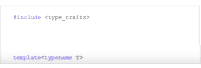

```cpp
private:

  // test() trying substitute call of a default constructor
  template<typename T, typename = decltype(T())>
    static std::true_type test(void*);

  // test() fallback:
  template<typename>
    static std::false_type test(...);

public:
  using Type = decltype(test<T>(nullptr));
};

template<typename T>
struct IsDefaultConstructible : IsDefaultConstructibleT<T> {};
```

现在，如果第一个 `test()` 函数模板有效，则它是首选重载，因此成员 `IsDefaultConstructible::Type` 由其返回类型 `std::true_type` 初始化。从而 `IsDefaultConstructible<T>` 派生自 `std::true_type`。

如果第一个 `test()` 函数模板无效，则它因 SFINAE 而被禁用，并且 `IsDefaultConstructible<T>` 由 `test()` 回退的返回类型（即 `std::false_type`）初始化。结果是 `IsDefaultConstructible<T>` 派生自 `std::false_type`。

#### 19.4.2 SFINAE 剔除部分特化

实现基于 SFINAE 的特性的第二种方法使用部分特化。同样，我们可以使用该示例来检查类型是否默认可构造：

traits/isdefaultconstructible3.hpp

```cpp
#include "isdefaultconstructible.hpp"
#include <type_traits>   // define true_type and false_type

// helper to ignore any number of template parameters:
template<typename...>
using void_t = void;

// primary template:
template<typename T, typename = void>
struct IsDefaultConstructibleT : std::false_type
{
};

// partial specialization (may be SFINAE'd away):
template<typename T>
struct IsDefaultConstructibleT<T, void_t<decltype(T{})>>
  : std::true_type
{
};
```

与上面谓词特性的 `IsDefaultConstructible<T>` 实现一样，我们将一般情况定义为从 `std::false_type` 派生，因为默认类型具有成员 `value`。

这里有趣的特点是第二个模板参数默认为辅助类型 `void_t`。它使我们能够提供使用任意数量编译期类型构造的部分特化。

在这种情况下，我们只需要一个构造：

```cpp
decltype(T{})
```

用于再次检查 `T` 的默认构造函数是否有效。如果对于特定的 `T`，该构造无效，这一次 SFINAE 会导致整个部分特化被丢弃，并回退到主模板。否则，部分特化有效且是首选。

在 C++17 中，C++ 标准库引入了一个类型特性 `std::void_t`：


```cpp
#include <type_traits>

#ifndef __cpp_lib_void_t
namespace std {
    template<typename...> using void_t = void;
}
#endif
```

从 C++14 开始，C++ 标准化委员会建议编译器和标准库通过定义约定的特性宏来指示它们已实现标准的哪些部分。这不是符合标准的要求，但实现通常会遵循该建议以便对用户有所帮助。宏 `__cpp_lib_void_t` 是用于指示库实现具有 `std::void_t` 的推荐宏，因此我们上面的代码以它为条件。

显然，这种定义类型特性的方式比第一种重载函数模板的方法看起来更简洁。但它要求能够在模板参数的声明中表述条件。使用带有函数重载的类模板使我们能够使用额外的辅助函数或辅助类型。

#### 19.4.3 使用泛型 Lambda 进行 SFINAE

无论我们使用哪种技术，定义特性总是需要一些样板代码；重载和调用必须通过多个部分特化来实现。接下来，我们将展示在 C++17 中，如何通过在泛型 lambda 中指定要检查的条件来最小化这些样板代码。

首先，我们介绍一个由两个嵌套泛型 lambda 表达式构建的工具：


traits/is_valid.hpp

```cpp
#include <utility>

// helper: checking validity of f (arg...) for F and Args
template<typename F, typename... Args>
constexpr auto is_valid_impl(int)
    -> decltype(std::declval<F>()(std::declval<Args>()...), std::true_type{});

// fallback if helper SFINAEd out
template<typename F, typename... Args>
constexpr std::false_type is_valid_impl(...);

// define a lambda that takes a lambda f and returns a lambda
inline constexpr auto is_valid = [](auto f) {
    return [f](auto&&... args) {
        return decltype(is_valid_impl<decltype(f), decltype(args)...>(0))::value;
    };
};

// helper template to represent a type as a value
template<typename T>
struct TypeT {
    using Type = T;
};

// helper to map a type as a value
template<typename T>
constexpr auto type = TypeT<T>{};
```


```
T value(Type<T>) // no definition needed
```

让我们从 `isValid` 的定义开始：它是一个 constexpr 变量，其类型是 lambda 的闭包类型。该声明必须使用占位符类型（在我们的代码中是 `auto`），因为 C++ 无法直接表达闭包类型。C++17 之前，lambda 表达式不能出现在常量表达式中。到了 C++17，这种能力在常量表达式中也可用。在 C++17 中，由于 `isValid` 具有闭包类型，因此它可以被调用（即被调用），但它返回的对象本身是一个 lambda 闭包类型的对象，由内层 lambda 表达式产生。

在深入这个内层 lambda 表达式的细节之前，让我们看看 `isValid` 的一个典型用法：

```
constexpr auto isDefaultConstructible
    = isValid([] (auto x) -> decltype(std::declval<decltype(x)>())
        { return {}; });
```

我们已经知道 `isDefaultConstructible` 具有 lambda 闭包类型，而且顾名思义，它是一个函数对象，用于检查某个类型是否可默认构造这一 trait（我们将在后文看到原因）。换句话说，`isValid` 是一个 trait 工厂。一个根据其参数生成 trait 检查对象的组件。

类型辅助变量模板允许我们将类型表示为值。我使用一个 `type` 变量，你可以用 `decltype(value)` 将其还原为原始类型，而这正是上面传给 `isValid` 的内容。如果提取出的类型不能默认构造，那么 `decltype(value)` 就是无效的，我们要么得到编译器错误，要么替换出一个关联的默认函数；由于 `isValid` 定义的细节，我们将实现后一种效果。

`isDefaultConstructible` 可以如下使用：

```
isDefaultConstructible(type<int>)                 // true (int is
                                                     // default-constructible)
isDefaultConstructible(type<std::unique_ptr<int>&>)   // false (references
                                                     // are not default-constructible)
```

现在所有部分协同工作，考虑当 `isValid` 中的内层 lambda 表达式被调用时，参数 `t` 绑定到 `isDefaultConstructible` 定义中指定的泛型 lambda 参数后，它会变成什么。通过在 `isValid` 的定义中执行替换，我们得到等价于

```
constexpr auto isDefaultConstructible
    = [] (auto... args) {
        return decltype([] (auto x) -> decltype(std::declval<
            decltype(args)>()); 
        });
      };
```

如果我们回看上面 `isValid` 的第一个声明，会注意到它包含一个如下形式的默认模板实参

```
decltype([](decltype(auto) t) -> decltype(std::declval<T>()));
```

它试图用参数类型的值（`decltype(std::declval<...>())`）调用其第一个模板实参类型的值，而该类型是 `isDefaultConstructible` 定义中 lambda 的闭包类型。在 `isValid` 的第一个实参的类型中，创建了一个常规 lambda 表达式；其返回类型指定为 `decltype(std::declval<...>)`，如上所示。当替换该表达式时，如果 `isDefaultConstructible` 的第一个声明是良构的，则调用有效。如果不是，则表达式替换失败，并被 SFINAE 淘汰。这样就只剩下第二个声明，否则它的匹配程度较低，会产生 false 值。此外，当传入 `type<T&>` 时，`isDefaultConstructible` 会产生 false 类型。如果改为传入 `type<T>`，则替换不会失败，并选择 `isValid<T>()` 的第一个声明，产生 true 值。

回想一下，要让 SFINAE 起作用，替换必须发生在被替换模板的立即上下文中。在这种情况下，替换模板是 `isValid<T>` 的第一个声明和传给 `isValid` 的泛型 lambda 的调用运算符。因此，要测试的构造必须出现在该 lambda 的返回类型中，而不是其函数体中！

我们的 `isDefaultConstructible` trait 与之前的 trait 实现略有不同，因为它要求函数对象实例，而不是指定模板实参。这可以说是一种更易用的写法，但也可以获得之前的风格：

```
template<typename T>
using isDefaultConstructible = decltype(isValid(type<T>{}));
```

块作用域。

到目前为止，这种技术可能看起来很有吸引力，因为实现中涉及的表达式和使用风格都比之前的技术更复杂。然而，一旦放置并理解了 `yield`，许多 trait 只需一个声明就能实现。例如，测试对名为 `first` 的成员的访问就相当简洁（完整示例见第 438 页的 19.6.1 节）：

```
template<typename T>
struct HasFirst {
  template<typename U>
  static auto test(U* u) -> decltype(u->first);
};
```

#### 19.4.4 对 SFINAE 友好的 trait

一般来说，类型 trait 应当能够回答特定查询，而不使程序变为非良构。基于 SFINAE 的 trait 通过将潜在问题小心地捕获在 SFINAE 上下文中来解决这个问题，从而把那些本会成为错误的情况转化为否定结果。

然而，到目前为止介绍的一些 trait（例如第 434 页 19.3.4 节描述的 `PlusResultT` trait）在出现错误时表现不佳。回想该节中 `PlusResultT<>` 的定义：

```
template<typename T1, typename T2>
struct PlusResult {
  using Type = decltype(std::declval<T1>() + std::declval<T2>());
};

template<typename T1, typename T2>
using PlusResultT = typename PlusResult<T1, T2>::Type;
```

在这个定义中，`+` 用于不受 SFINAE 保护的上下文。因此，如果程序试图对没有合适 `+` 运算符的类型求值 `PlusResult<T>`，那么对 `PlusResult<T>` 本身的求值就会使程序变为非良构，如下面尝试声明两个无关类型 `A` 和 `B` 的数组相加的返回类型时所示：

```
template<typename T>
class Array {
};

template<typename T1, typename T2>
Array<PlusResultT<T1, T2>>
operator+(Array<T1> const&, Array<T2> const&);
```

显然，如果没有为数组元素定义相应的运算符 `+`，在这里使用 `PlusResultT<>` 会导致错误。

```
class A {
};

class B {
};

void add(Array<A> const&, Array<A> const&);

// declare a + for arrays of different element types:
template<typename T1, typename T2>
Array<PlusResultT<T1, T2>>
operator+(Array<T1> const&, Array<T2> const&);

// no int = arrayA + arrayB   // ERROR? depends on
// whether the compiler              // instantiations
// ...
```

如果编译器能够在不进行第一个 `operator+`（模板）声明的推导和替换的情况下确定第二个 `operator+` 声明是有效匹配，它就会接受这段代码。

然而，在推导和替换函数模板候选时，类模板定义实例化期间发生的任何事情都不属于该函数模板替换的立即上下文，SFINAE 也无法保护我们免于在那里形成无效类型或表达式的尝试。此时不会只是丢弃该函数模板候选，而是会立即引发错误，因为我们试图对类型 `T1` 和 `T2` 的两个元素调用 `operator+`。

```
template<typename T1, typename T2>
struct PlusResultT {
    using Type = decltype(std::declval<T1>() + std::declval<T2>());
};
```

要解决这个问题，我们必须让 `PlusResultT` 对 SFINAE 友好，这意味着即使其 `decltype` 表达式非良构，也要通过给它一个合适的定义来使其更合适。

按照上一节描述的 `HasResultT` 示例，我们定义一个 `HasPlusTrait`，它允许我们检测给定类型是否存在合适的 `+` 运算：

```
#include <utility>      // for declval
#include <type_traits>   // for decltype, false_type,
                         // true_type

// primary template
template<typename T1, typename T2, typename = std::void_t<>>
struct HasPlusT : std::false_type
{
};

// partial specialization (may be SFINAE'd away)
template<typename T1, typename T2>
struct HasPlusT<T1, T2, std::void_t<decltype(std::declval<T1>() +
                                             std::declval<T2>())>>
  : std::true_type
{
};
```

如果它产生 true 结果，`PlusResultT` 就可以使用现有实现。否则，`PlusResultT` 需要一个安全的默认值。对于一组模板实参没有有意义结果的 trait，最好的默认值就是根本不提供任何成员 `Type`。这样，如果该 trait 在 SFINAE 上下文中使用——例如错误 `operator+` 的返回类型——缺失的成员 `Type` 将使模板实参推导失败，而这正是数组 `operator+` 模板所期望的行为。

下面 `PlusResultT` 的实现提供了这种行为：

```
#include "HasPlus.hpp"

template<typename T1, typename T2, bool = HasPlusT<T1, T2>::value>
struct PlusResultT {                 // primary template, used ...
    using Type = decltype(std::declval<T1>() + std::declval<T2>());
};

template<typename T1, typename T2>
struct PlusResultT<T1, T2, false> {    // partial specialization
```


在这个版本的 `PlusResult` 中，我们添加了一个带默认实参的模板参数，该实参根据上面的 `HasPlusT` 特性决定前两个参数是否支持加法运算。然后，我们针对该额外参数值为 `false` 的情况对 `PlusResult` 进行部分特化，而我们的部分特化定义根本没有成员，从而避免了前面描述的问题。对于支持加法的情况，默认实参求值为 `true`，主模板被选中，并使用我们现有的 `Type` 成员定义。这样，我们就满足了 `PlusResult` 只在 `+` 运算确实良构时才提供结果类型的约定。（注意，添加的模板参数绝不应有显式模板实参。）

再次考虑 `Array<T>` 和 `Array<T>` 的加法：使用我们最新的 `PlusResult` 模板实现，`PlusResult<Array<T>, Array<T>>` 的实例化会有一个 `Type` 成员，其 `Type` 为 `Array<T>`，但我们无法对 `Array<T>` 对象进行加法运算。因此，数组 `operator+` 模板的结果类型是无效的，SFINAE 会将该函数模板从重载集中剔除。因此，函数模板 `operator+` 的结果将被选中。

作为一般设计原则，如果给定合理的模板实参作为输入，特性模板绝不应在实例化时失败。而通用的做法通常是执行相应的检查两次：

- 1. 一次用于确认操作是否有效
- 2. 一次用于计算结果

我们在 `PlusResult<T>` 中已经看到了这一点，我们调用 `HasPlusT<T>` 来确认 `PlusResult<T>` 中对 `operator+` 的调用是否有效。

让我们将这一原则应用到 `IsConvertible` 上，再次引入一组特性。在实践中，我们构造一个具有成员类型 `value_type` 的容器类型。由于相应的类型是 `true`，而如果容器类型没有这样的 `value_type` 成员，则选择 `false`：

```cpp
template<typename C, bool = HasValueTypeT<C>::value>
struct IsConvertibleT {
  using Type = typename C::value_type;
};

template<typename C>
struct IsConvertibleT<C, false> {
};
```

第三个使特性对 SFINAE 友好的示例见第 444 页第 19.7.2 节，其中 `HasNoexceptMoveConstructorT` 必须先检查是否存在移动构造函数，然后再检查它是否声明为 `noexcept`。

### 19.5 Is Convertible

细节很重要。因此，基于 SFINAE 的特性的一般方法在实践中可能会更加复杂。让我们通过定义一个特性来说明这一点，该特性可以判断给定类型是否可以转换为另一个给定类型——例如，如果我们期望某个基类是其派生类之一。`IsConvertibleT` 特性应判断我们是否可以将传入的第一个类型转换为传入的第二个类型：

```cpp
traits/isconvertible.hpp

#ifndef ISCONVERTIBLE_HPP
#define ISCONVERTIBLE_HPP

#include <utility>      // for declval

template<typename FROM, typename TO>
struct IsConvertibleHelper {
private:
  // test() 尝试使用某个实参调用该辅助函数
  static void test(TO);

  template<typename T>
  static auto test(T&&) -> decltype(
      std::declval<T>());

  static std::false_type test(...);

public:
  using Type = decltype(test(std::declval<FROM>()));
};

template<typename FROM, typename TO>
using IsConvertible = std::is_same<typename IsConvertibleHelper<FROM, TO>::Type, void>;

template<typename FROM, typename TO>
constexpr bool isConvertible = IsConvertible<FROM, TO>::value;
```

这里，我们使用了第 46 页第 9.4 节中介绍的函数重载方法。也就是说，在辅助类内部，我们声明两个名为 `test()` 的重载函数模板，它们具有不同的返回类型，并为结果特性的类声明一个 `Type` 成员：

```cpp
template<typename T>
static std::true_type test(void*);

template<typename T>
static std::false_type test(...);

using Type = decltype(test<FROM>(nullptr));

template<typename FROM, typename TO>
struct IsConvertible : IsConvertibleHelper<FROM, TO>::Type
{
};
```

通常，第一个 `test()` 重载被设计为仅在请求的检查成功时匹配，而第二个重载是回退。因此，目标是使第一个 `test()` 重载当且仅当类型 `FROM` 可转换为类型 `TO` 时有效。为实现这一点，我们再次给 `test` 的第一个声明一个虚拟的（未命名的）模板实参，并用一个当且仅当转换有效时才有效的构造进行初始化。这个模板参数无法被推导，我们也不会为它提供显式模板实参。因此，它将被替换，如果替换失败，`test()` 的这个声明将被丢弃。

再次注意，以下方式不起作用：

```cpp
static void test(TO);
template<typename = decltype(std::declval<FROM>())>
static char test(...);
```

这里，当这个成员函数模板被使用时，`FROM` 和 `TO` 已完全确定，因此如果其中一个函数模板无效，两个函数模板的组合就无法用于重载决议，而 `test()` 的这个声明将被丢弃。

因此，我们引入 `T` 作为特定的成员函数模板参数：

```cpp
static void test(TO);
template<typename T, typename = decltype(std::declval<T>())>
static char test(...);
```

并在 `value` 的初始化中对 `test()` 的调用中，将 `FROM` 类型作为显式模板实参提供！

```cpp
static constexpr bool value = decltype(test<FROM>(nullptr))::value;
```

注意第 15 页第 19.3.4 节中引入的 `std::declval` 是如何在不调用任何构造函数的情况下产生一个值的。如果该值可转换为 `TO`，则对 `test()` 的调用是有效的，并且 `test()` 的这个声明会匹配。否则，会发生 SFINAE 失败，只有回退声明会匹配。

因此，我们可以如下使用该特性：

```cpp
IsConvertible<int, int>::value;                  // true
IsConvertible<int, std::string>::value;           // false
IsConvertible<char const*, std::string>::value;   // true
IsConvertible<std::string, char const*>::value;   // false
```

#### 处理特殊情况

`IsConvertible` 尚未正确处理三种情况：

- 1. 到数组类型的转换应始终产生 `true`，但在我们的代码中，`test()` 声明中类型为 `T` 的参数只会退化为指针类型，因此会对某些不正确的类型产生“true”结果。
- 2. 到函数类型的转换应始终产生 `false`，但就像数组的情况一样，我们的实现只是将它们视为退化类型。
- 3. 到（const/volatile 限定的）`void` 类型的转换应产生 `true`。不幸的是，我们上面的实现甚至无法成功实例化 `T` 为 `void` 类型的情况，因为 `void` 类型的参数是无效的。

使用针对数组、函数和 cv 限定 volatile 限定符的部分特化来处理所有这些特殊情况很快就会变得笨拙。相反，我们可以向辅助类模板添加一个额外的模板参数，如下所示：

```cpp
template<typename FROM, typename TO,
         bool = IsVoid<TO>::value
             || IsArray<TO>::value
             || IsFunction<TO>::value>
struct IsConvertibleHelper {
  using Type = std::integral_constant<bool,
                                      IsVoid<TO>::value
                                      && ...>;
};
```

额外的布尔模板参数确保对于所有这些特殊情况，使用主辅助特性的实现。如果我们在普通类型之间进行转换（因为此时 `IsVoid<T>::value` 为 false），或者如果 `T` 是 `void` 且 `T` 不是 `void`，它会产生 `false_type`。对于这些类型，我们产生 `false_type`。所有其他情况都会为这第三个参数产生 false 实参，因此会选择它们的部分特化，这对应于我们已经讨论过的实现。

关于如何实现 `IsArray<T>` 的讨论，请参见第 433 页第 19.8.2 节；关于如何实现 `IsFunction<T>` 的讨论，请参见第 454 页第 19.8.3 节。

C++ 标准库提供了相应的类型特性 `std::is_convertible`，在第 737 页第 D.3 节中进行了描述。

### 19.6 检测成员

基于 SFINAE 的特性的另一个巧妙用途涉及创建一种特性（或者更确切地说，一组特性），它可以判断给定类型 `T` 是否具有给定名称的成员（类型成员或非类型成员）。

#### 19.6.1 检测成员类型

让我们首先定义一个特性，它可以判断给定类型 `T` 是否具有成员类型 `size_type`：

```cpp
#include <type_traits> // 定义 true_type 和 false_type

// 用于忽略任意数量的模板参数的辅助别名
template<typename...> using Void = void;

// 主模板：
template<typename T, typename = void>
struct HasSizeTypeT : std::false_type
{
};

// 部分特化（可能被 SFINAE 移除）：
template<typename T>
struct HasSizeTypeT<T, Void<typename T::size_type>>
{
};
```

这里，我们使用了第 420 页第 19.4.2 节中介绍的对部分特化进行 SFINAE 的方法。

和谓词特性通常的做法一样，我们将一般情况定义为从 `std::false_type` 派生，因为默认情况下类型不具有该成员类型。

在这种情况下，我们只需要一个构造：

```cpp
template<typename...> using Void = void;
```

这个构造当且仅当类型 `T` 具有成员类型 `size_type` 时有效，这正是我们要判断的。如果对于特定的 `T`，该构造无效（即类型 `T` 没有成员类型 `size_type`），SFINAE 会导致部分特化被丢弃，然后我们回退到主模板。否则，部分特化有效并且是首选。


无论一个类型是否具有 value_type 或 char_type，其成员类型都是 false。

点击此处查看代码图片

```cpp
#include "bool_type.hpp"

#include <iostream>
#include <vector>

DEFINE_HAS_TYPE(value_type);
DEFINE_HAS_TYPE(char_type);

int main()
{
    std::cout << "int::value_type: "
              << HasType_value_type<int>::value << '\n';
    std::cout << "float::value_type: "
              << HasType_value_type<float>::value << '\n';
    std::cout << "std::vector<int>::value_type: "
              << HasType_value_type<std::vector<int>>::value << '\n';
    std::cout << "std::vector<char>::value_type: "
              << HasType_value_type<std::vector<char>>::value << '\n';
}
```

#### 19.6.2 检测非类型成员

我们可以修改该 trait，以检查数据成员和（单个）成员函数。

点击此处查看代码图片

```cpp
#include "hasmember.hpp"

DEFINE_HAS_MEMBER(member)

template<typename T, typename = std::void_t<>>
struct HasMember : std::false_type {
};

template<typename T>
struct HasMember<T, std::void_t<decltype(T::member)>> {
    static bool const value = true;
};
```

此处，我们使用 SFINAE 在 &T::member 无效时禁用偏特化。要使该构造有效，必须满足以下条件：

- 成员必须无歧义地标识 T 的一个成员（例如，它不能是重载成员函数的名称，也不能是同名的多个继承成员的名称）。
- 该成员必须是可访问的。
- 该成员必须是非类型、非枚举成员（否则前缀 & 将是病式的）。
- 如果 T 是一个类，则该类型不得提供返回不同类型的 operator&（例如怪异重载的 operator&）。但是，我们可以用 std::addressof(T::member)（或类似方式）替换 &T::member，以便仍然使该运算符工作。

点击此处查看代码图片

```cpp
#include "hasmember.hpp"

#include <iostream>
#include <vector>
#include <utility>

DEFINE_HAS_MEMBER(size);
DEFINE_HAS_MEMBER(first);

int main()
{
    std::cout << "has:size: "
              << HasMemberT_size<int>::value << '\n';

    std::cout << "has:vector:size? "
              << HasMemberT_size<std::vector<int>>::value;

    std::cout << "std::pair<int,int>::first: "
              << HasMemberT_first<std::pair<int,int>>::value;
}
```

修改偏特化以排除那些 T::member 不是指向成员指针类型（即非静态数据成员）的类并不困难。类似地，可以排除或要求指向成员函数的指针，从而将 trait 限制为数据成员或成员函数。

#### 检测成员函数

请注意，isMember trait 仅检查是否存在一个具有相应名称的成员。如果存在两个成员，该 trait 也会失败；在我们检查重载成员函数时就可能出现这种情况。例如：

点击此处查看代码图片

```cpp
DEFINE_HAS_MEMBER(begin);
std::cout << HasMemberT_begin<int>::value; // false
```

然而，正如第 133 页 8.4.1 节所解释的，SFINAE 原则可以防止在函数模板声明中创建非法模板类型和表达式的尝试，从而使上述重载技术能够扩展到测试任意表达式是否良构。

也就是说，我们可以简单地检查是否能以特定方式调用某个感兴趣的函数，即使该函数被重载，这种检查也能成功。与第 428 页 9.5 节中的 IsConvertible<> trait 一样，技巧在于构建一个表达式，在额外函数模板参数的默认值处调用该表达式来检查我们是否能调用 begin()：

点击此处查看代码图片

traits/hasbegin.hpp

```cpp
#include <utility>      // for declval
#include <type_traits>   // for true_type, false_type

// primary template:
template<typename, typename = std::void_t<>>
struct HasBeginT : std::false_type
{
};

// partial specialization (may be SFINAE'd away):
template<typename T>
struct HasBeginT<T, std::void_t<decltype(std::declval<T>().begin())>>
  : std::true_type
{
};
```

这里我们使用

点击此处查看代码图片

traits/hasbegin.hpp

```cpp
decltype(std::declval<T>().begin())
```

来测试：给定一个 T 类型的值/对象（使用 std::declval 以避免构造类型），调用成员 begin() 是否有效。

#### 检测其他表达式

我们可以将上述技术用于其他类型的表达式，甚至可以编译多个表达式。例如，我们可以测试：给定类型 T 和 U，是否为这些类型的值定义了合适的 < 运算符。

点击此处查看代码图片

```cpp
#include <type_traits> // for true_type, false_type,

// primary template:
template<typename, typename = std::void_t<>>
struct HasLast : std::false_type
{
};

// partial specialization (may be SFINAE'd away):
template<typename T>
struct HasLast<T, std::void_t<decltype(std::declval<T>().last)>>
    : std::true_type
{
};
```

和往常一样，挑战在于为要检查的条件定义一个有效表达式，并使用 decltype 将其置于 SFINAE 上下文中；如果表达式无效，它将导致回退到主模板：

[点击此处查看代码图片](#)

```cpp
decltype(std::declval<T>().last)
```

以这种方式检测有效表达式的 trait 相当健壮：只有在表达式良构时它们才会求值为 true；而当运算符有歧义、被删除或不可访问时，它们会正确返回 false。

我们可以如下使用该 trait：

[点击此处查看代码图片](#)

```cpp
HasLast<T>::value                         // yields true
HasLast<int>::value                       // yields false
HasLast<int*>::value                      // yields false
HasLast<SomeClass>::value                 // yields true
HasLast<SomeClass>::value                 // yields false
HasLast<SomeClass>::value                 // yields true
HasLast<SomeClass>::value                 // yields false
```

正如第 30 页 2.3.1 节所介绍的，我们可以使用该 trait 来要求模板参数“支持 operator <”：

[点击此处查看代码图片](#)

```cpp
template<typename T>
class C
{
    static_assert(HasLast<T>::value,
                  "T must have a comparable operator <");
};
```

请注意，由于 std::void_t 的特性，我们可以在一个 trait 中组合多个约束：

[点击此处查看代码图片](#)

traits/hasvarious.hpp

```cpp
#include <utility> // for declval
#include <type_traits> // for true_type, false_type,

// primary template:
template<typename, typename = std::void_t<>>
struct HasVarious : std::false_type
{
};

// partial specialization (may be SFINAE'd away):
template<typename T>
struct HasVarious<T, std::void_t<
    decltype(std::declval<T>().first),
    decltype(std::declval<T>().second),
    decltype(std::declval<T>().last)>>
    : std::true_type
{
};
```

检测特定语法有效性的 trait 非常强大，允许模板根据特定操作的存在与否来自定义其行为。这些 trait 将再次用于 SFINAE 友好 trait 的定义（9.4 节）以及基于类型属性的重载（第 20 章）。

#### 19.6.4 使用泛型 Lambda 检测成员

第 421 页 9.4.3 节引入的 isValidLambda 提供了一种更紧凑的技术来定义检查成员的 trait，有助于避免使用宏来任意地测试成员。

下面的示例说明了如何定义 trait，以检查诸如 first 或 size_type 这样的数据类型成员是否存在，或者是否为两个不同类型的对象定义了 operator<：

点击此处查看代码图片

traits/isvalidall.cpp

```cpp
#include "isvalid.hpp"
#include <iostream>
#include <string>
#include <utility>

int main()
{
    using namespace std;
    cout << boolalpha;

    // define to check for data member first:
    constexpr auto hasFirst
        = isValid([](auto x) -> decltype((void)value(x).first) {
        });

    cout << "hasFirst: " << hasFirst(type...);

    // define to check for size_type
    constexpr auto hasSizeType
        = isValid([](auto x) -> decltype((void)std::declval<...>) {
        });

    struct CX {
        using size_type = std::size_t;
    };

    cout << "hasSizeType: " << hasSizeType(type<CX>) << ...;

    if constexpr (hasSizeType(type<int>)) {
        cout << "int has no size_type\n";
        ...
    }

    // define to check for <
    constexpr auto hasLess
        = isValid([](auto x, auto y) -> decltype(value(x) < value(y)) {
        });
```


```cpp
cout << hasLastType<string, type<string>>() << '\n';
cout << hasLastType<string, type<int>>() << '\n';
cout << hasLastType<string, "Hello">() << '\n';
}
```

再次注意，hasSizeType 使用 std::decay 从传入类型中移除引用，因为不能从引用访问类型成员。如果跳过这一点，这些 trait 将始终产生 false，因为使用的是第二个重载和重载的 std::declval()。

为了能够使用常见的泛型语法（将类型作为模板参数），我们可以再次定义额外的辅助工具。例如：

**单击此处查看代码图像**

traits/hasSize.cpp

```cpp
#include <iostream>

#include <string>

#include <utility>

constexpr auto hasFirst
    = std::is_valid([](auto&& x) -> decltype((void)x.first)
    {
    });

template<typename T>
using HasFirst = decltype(hasFirst(std::declval<T>()));

constexpr auto hasSizeType
    = std::is_valid([](auto&& x)
        -> typename std::decay<decltype(x)>::type::size_type
    {
    });

template<typename T>
using HasSizeType = decltype(hasSizeType(std::declval<T>()));

constexpr auto hasSize
    = std::is_valid([](auto&& x) -> decltype(x.size())
    {
    });

template<typename T>
using HasSize = decltype(hasSize(std::declval<T>()));

int main()
{
    using namespace std;

    cout << "HasFirst: " << HasFirst<int>::value << '\n';

    struct CX {
        using size_type = std::size_t;
    };

    cout << "HasSizeType: " << HasSizeType<CX>::value << '\n';
    cout << "HasSizeType<int>: " << HasSizeType<int>::value << '\n';
    cout << "HasSize<int>: " << HasSize<int>::value << '\n';
    cout << "HasLastType<int>: " << HasLastType<int>::value << '\n';
    cout << "HasLastType<string, int>: " << HasLastType<string, int>::value << '\n';
}
```

```cpp
>>::Type

>>::Type

>>::Type
};
```

注意，与普通的 C++ if-then-else 语句不同，在做出选择之前，会先对“then”和“else”两个分支的模板实参进行求值，因此两个分支都不能包含非良构代码，否则程序很可能就是非良构的。例如，考虑一个 trait，它为给定的有符号类型产生对应的无符号类型。有一个标准 trait `std::make_unsigned` 可以完成这种转换，但它要求传入的类型是有符号整型且不是 `bool`；否则其结果就是未定义行为。下面展示了朴素的方法。

**单击此处查看代码图像**

```cpp
// ERROR: undefined behavior if T is bool or not integral type
template<typename T>
struct makeUnsignedT {
    using Type = typename IfThenElse<std::is_integral<T>::value
        && !std::is_same<T, bool>::value,
        typename std::make_unsigned<T>::type,
        IdentityT<T>>::Type;
};
```

`makeUnsignedT<bool>` 的实例化仍然是未定义行为，因为编译器仍会尝试从 `std::make_unsigned<bool>` 特化中获取类型。

**单击此处查看代码图像**

`typename std::make_unsigned<T>::type`

为了解决这个问题，我们需要增加一层间接性，使得 `IfThenElse` 的参数本身是映射结果的类型函数。

**单击此处查看代码图像**

```cpp
// yield T when using member Type:
template<typename T>
struct IdentityT {
    using Type = T;
};

// to make unsigned after IfThenElse was evaluated:
template<typename T>
struct MakeUnsignedT {
    using Type = typename std::make_unsigned<T>::type;
};
```

在 `UnsignedT` 的定义中，传给 `IfThenElse` 的类型参数都是我们函数类的实例。然而，这些类型函数实际上并不会在 `IfThenElse` 进行选择之前求值。相反，传给 `IfThenElse` 的类型参数是定义了内部 `Type` 成员的类。因此，`IfThenElse` 会在选中的分支中选择 `MakeUnsignedT<T>` 或 `IdentityT<T>` 的类型函数实例，然后可以实例化它以产生 `Type`。

这里值得强调的是，这完全依赖于这样一个事实：`IfThenElse` 构造中未被选中的包装类型永远不会被完全实例化。特别是，下面的写法不可行：

**单击此处查看代码图像**

```cpp
template<typename T>
struct UnsignedT {
    using Type = typename IfThenElse<std::is_integral<T>::value
        && !std::is_same<T, bool>::value,
        MakeUnsignedT<T>,
        IdentityT<T>>::Type;
};
```

相反，我们必须在 `IfThenElse` 求值之后应用 `::Type`，这意味着我们需要类型的辅助工具在 else 分支中也稍后为 `T` 应用 `::Type`。

这也意味着我们不能使用类似下面的写法

**单击此处查看代码图像**

```cpp
template<typename T>
struct ...
```

那么它可以是其中任意一种吗？或者……

默认模板参数在标准库中指定为 `std::optional<T>`。有关更多详细信息，请参见第 371 页的[第 3.2 节]。`default` 模板参数定义如下：

单击此处查看代码图像

```cpp
template<typename T>
struct Test {
    using Type = typename std::conditional<true,
        T&, T>::type;
    static constexpr bool value =
        std::is_same<Type,
            std::add_lvalue_reference_t<T>>::value;
};
```

#### 19.7.2 检测不抛出异常的操作

确定某个特定操作是否会抛出异常通常很有用。例如，移动构造函数应尽可能标记为 `noexcept`，以表示它不会抛出异常。然而，仅仅因为移动构造函数没有标记为 `noexcept`，并不意味着它就会抛出异常。这仅仅意味着没有对操作是否会抛出异常作出保证。这一点很重要，因为某个类型的移动构造函数可以在某些情况下实现为不抛出异常。例如，考虑类模板 `Pair` 的移动构造函数：

单击此处查看代码图像

```cpp
template<typename T1, typename T2>
struct Pair {
    T1 first;
    T2 second;
    Pair(const T1& x, const T2& y)
        : first(std::forward<T1>(x)), second(std::forward<T2>(y)) {
    }
};
```

当 `T1` 或 `T2` 的移动操作抛出异常时，`Pair` 的移动构造函数可能抛出异常。给定一个 trait `IsNothrowMoveConstructibleT`，我们可以通过在 `Pair` 的移动构造函数中使用计算出的 `noexcept` 异常规范来表达这一属性。例如：

单击此处查看代码图像

```cpp
template<typename T1, typename T2>
Pair(Pair&& other)
    noexcept(IsNothrowMoveConstructibleT<T1>::value &&
             IsNothrowMoveConstructibleT<T2>::value)
    : first(std::forward<T1>(other.first)),
      second(std::forward<T2>(other.second)) {
}
```

剩下要做的就是实现 `IsNothrowMoveConstructibleT` trait。我们可以使用 `noexcept` 运算符轻松实现这个 trait，它用于判断给定表达式是否保证不抛出异常：

单击此处查看代码图像

```cpp
template<typename T>
struct IsNothrowMoveConstructibleT
    : std::bool_constant<noexcept(T(std::declval<T>()))> {
};
```

这里使用的是 `noexcept` 的运算符形式，它判断一个表达式是否不抛出异常。由于结果是布尔值，我们可以直接将它传给 `std::bool_constant`；`std::bool_constant` 定义在 `<type_traits>` 中，并且如第 41 页第 3.3 节所述，是一个 `std::integral_constant<bool, ...>`。

然而，这个实现应当改进，因为它对 `SFINAE` 不友好（见第 135 页第 8.4 节）。如果用一个没有移动或复制构造函数的类型实例化该 trait——这会使表达式 `T(std::declval<T>())` 无效——整个程序就是非良构的：

单击此处查看代码图像

```cpp
class X {
public:
    X() = delete;
};
```

```cpp
std::bool_constant<noexcept(T(std::declval<T>()))>::value // ...
```

false.

如第 43 页第 19.4.1 节所述，我们必须在表达式求值之前检查用于计算结果的表达式是否有效。这里，我们必须在检查移动构造是否为 noexcept 之前，先弄清楚移动构造是否有效。因此，我们通过添加一个默认值为 void 的模板参数，以及一个针对该参数使用 std::void_t 的部分特化来修订该 trait 的第一个版本；这个部分特化使用一个仅在移动构造有效时才有效的实参。

单击此处查看代码图像

```cpp
#include <utility>      // for declval
#include <type_traits>   // for true_type, false_type

// primary template:
template<typename T, typename = std::void_t<>>
struct isNothrowMoveConstructible
  : std::false_type
{
};

// partial specialization (may be SFINAE'd away):
template<typename T>
struct isNothrowMoveConstructible<T,
  std::void_t<decltype(T(std::declval<T>()))>>
  : std::bool_constant<noexcept(T(std::declval<T>()))>
{
};
```

如果部分特化中对 std::void_t<> 的替换有效，则选择该特化，并且可以求值基类说明符中的 `noexcept(...)` 表达式。否则，该部分特化会在不实例化它的情况下被丢弃，转而实例化主模板（产生 `std::false_type` 结果）。

注意，如果无法直接调用移动构造函数，就无法检查它是否会抛出异常。也就是说，仅仅移动构造函数是 public 且未被删除还不够，它还要求相应类型是其父类型的属性（或引用）吗？出于这个原因，该类型 trait 被命名为 `isNothrowMoveConstructible`，而不是 `HasNoThrowMoveConstructor`。对于其他任何情况，我们都需要一些支持。

C++ 标准库提供了相应的类型 trait `std::is_nothrow_constructible<>`，如第 42 页第 3.2.3 节所述。

#### 19.7.3 Trait 便利性

类型 trait 的一个常见抱怨是它们相对冗长，因为每次使用类型 trait 通常都需要尾随的 `::type`，并且在依赖上下文中还需要前导的 `typename` 关键字，而这两者都是样板代码。当组合多个类型 trait 时，这会迫使采用一些别扭的格式，就像我们一直在用的数组运算符 `&` 示例那样——如果我们正确实现它，确保不返回 `const` 或引用类型：

单击此处查看代码图像

```cpp
template<typename T1, typename T2>
using ...
```

通过使用别名模板和变量模板，我们可以让这些 trait（分别产生类型或值）的使用更加方便。然而，请注意，在某些上下文中这些捷径不可用，我们必须改用原始类模板。我们已经在 `isNothrowMoveConstructible` 示例中讨论过一种这样的情况，但下面会进行更一般的讨论。

#### 别名模板与 Trait

如第 39 页第 2.8 节所介绍，别名模板提供了一种减少冗长的方式。我们可以直接使用别名模板，而不是将类型 trait 表示为带有类型成员 `Type` 的类模板。例如，下面三个别名模板封装了上文使用的类型 trait：

单击此处查看代码图像

```cpp
template<typename T>
using removeConst_t = typename remove_const<T>::type;

template<typename T>
using removeCV_t = typename remove_cv<T>::type;
```

```cpp
template<typename T1, typename T2>
using PlusResultT = typename PlusResult<T1, T2>::type;
```

给定这些别名模板，我们可以将 `operator+` 声明简化为

```cpp
template<typename T1, typename T2>
Array<PlusResultT<T1, T2>>
operator+(const Array<T1>&, const Array<T2>&);
```

第二个版本显然更短，并且使特征的组合更加明显。此类改进使别名模板更适合类型特征的某些用法。

然而，将别名模板用于类型特征也有缺点：

- 1. 别名模板不能被特化（如第16.3节（第613页）所述），并且由于许多编写特征的技巧都依赖于特化，别名模板很可能仍然需要委托给类模板。
- 2. 有些特征 intended 由用户特化，例如描述某个特定加法运算是否可交换的特征，而在大多数使用都涉及别名模板时特化类模板可能会令人困惑。
- 3. 使用别名模板总会实例化该类型（例如底层类模板特化），这使得更难避免实例化对给定类型没有意义的特征（如第19.7节（第493页）所述）。

表达这一点的另一种方式是，别名模板不能与元函数转发一起使用（见第19.3.2节（第494页））。

由于将别名模板用于类型特征既有优点也有缺点，我们建议像本节中那样、以及像 C++ 标准库中那样使用它们。同时提供类模板（采用特定命名约定（我们选择了后缀 `_t`））和别名模板（采用略有不同的命名约定（去掉了 `_t` 后缀）），并让每个别名模板委托给底层类模板。这样，我们可以在别名模板能提供更清晰代码的地方使用它们，而在其他任何目的下回退到类模板。

请注意，由于历史原因，C++ 标准库采用了不同的约定。类型特征类模板产生一个类型，并且没有特定后缀（许多是在 C++11 中引入的）。相应的别名模板（直接产生该类型）从 C++14 开始引入，并被赋予 `_t` 后缀，因为无后缀的名称已经标准化（见第19.4节（第467页））。

#### 变量模板与特征

返回值的特征需要一个特征值。如果需要值，它必须位于静态数据成员变量中（以产生特征的结果）。在这种情况下，`constexpr` 变量模板（在第5.6节（第80页）中引入）提供了一种减少冗长的方式。

例如，以下变量模板包装了第19.5.9节（第429页）中定义的 `IsSame` 特征和第19.5.8节（第428页）中定义的 `IsConvertible` 特征：

```cpp
template<typename T1, typename T2>
constexpr bool IsSame_v = IsSame<T1, T2>::value;

template<typename FROM, typename TO>
constexpr bool IsConvertible_v = IsConvertible<FROM, TO>::value;
```

现在我们可以简单地写

```cpp
if (IsSame_v<T, int> || IsConvertible_v<T, char>) ...
```

而不是

```cpp
if (IsSame<T, int>::value ||
    IsConvertible<T, char>::value)
```

同样，由于历史原因，C++ 标准库采用了不同的约定。特征类模板产生一个值成员，并且没有特定后缀。相应的变量模板在 C++17 中引入，带有 `_v` 后缀（见第19.3节（第497页））。

### 19.8 类型分类

有时，能够知道模板参数是内置类型、指针类型、类类型还是其他类型是很有用的。在接下来的几节中，我们开发一套类型特征，使我们能够确定给定类型的各种属性。因此，我们将能够编写特定于该类型的代码。

```cpp
if (IsClass<T>::value) {
    ...
}
```

如果使用自 C++17 起可用的编译期 `if`（见第5.8节（第143页））以及用于特征便利的特性（见第19.7.3节（第446页）），我们可以写

```cpp
if constexpr (Classifier<T>::value) {
    ...
}
```

或者，通过使用偏特化

```cpp
template<typename T>
class Classifier<T, bool> : public Classifier<T>       // partial specialization for
{                                                      // the general case
};
```

此外，诸如 `IsDefaultConstructible<T>::value` 这样的表达式将是产生唯一模板实参的布尔常量。这反过来又支持强大的模板元编程，甚至支持一些强大的模板，这些模板根据其类型实参的属性特化其行为。

C++ 标准库定义了几个类似的类型特征来确定类型的主类型类别和复合类型类别。详见第D.2.1节（第782页）和第D.2.2节（第785页）。

#### 19.8.1 确定基本类型

首先，让我们开发一个模板来确定一个类型是否为基本类型。默认情况下，类型不是基本类型，并且我们为基本类型特化该模板。

```cpp
template<typename T>      // primary template: in general T is not a fundamental type
struct IsFundaT : std::false_type {
};

// macro to specialize for fundamental types
#define MK_FUNDA_TYPE(T) \
  template<> struct IsFundaT<T> : std::true_type { \
  };

MK_FUNDA_TYPE(void)
MK_FUNDA_TYPE(bool)
MK_FUNDA_TYPE(char)
MK_FUNDA_TYPE(signed char)
MK_FUNDA_TYPE(unsigned char)
MK_FUNDA_TYPE(wchar_t)
MK_FUNDA_TYPE(char16_t)
MK_FUNDA_TYPE(char32_t)

MK_FUNDA_TYPE(signed short)
MK_FUNDA_TYPE(unsigned short)
MK_FUNDA_TYPE(signed int)
MK_FUNDA_TYPE(unsigned int)
MK_FUNDA_TYPE(signed long)
MK_FUNDA_TYPE(unsigned long)
MK_FUNDA_TYPE(signed long long)
MK_FUNDA_TYPE(unsigned long long)

MK_FUNDA_TYPE(float)
MK_FUNDA_TYPE(long double)
MK_FUNDA_TYPE(std::nullptr_t)

#undef MK_FUNDA_TYPE
```

主模板定义了一般情况。也就是说，一般情况下，`IsFundaT<T>::value` 将求值为 `false`。

```cpp
template<typename T>
struct IsFundaT : std::false_type {
    static constexpr bool value = false;
};
```

对于每个基本类型，定义了一个特化，使得 `IsFundaT<T>::value` 为 true。为方便起见，我们定义了一个宏，该宏展开为必要的代码。例如：

```cpp
MK_FUNDA_TYPE(bool)
```

展开为以下内容：

```cpp
template <> struct IsFundaT<bool> : std::true_type {
    static constexpr bool value = true;
};
```

以下程序演示了该模板的一种可能用法：

```cpp
#include "isfundamental.hpp"
#include <iostream>

template<typename T>
void test (T& t)
{
    if (IsFundaT<T>::value)
    {
        std::cout << "T is a fundamental type" << std::endl;
    }
    else
    {
        std::cout << "T is not a fundamental type" << std::endl;
    }
}

int main()
{
    test(7);
    test("Hello");
}
```

其输出如下：

```text
T is a fundamental type
T is not a fundamental type
```

以同样的方式，我们可以定义类型函数 `IsIntegral` 和 `IsFloatingPoint`，以识别这些类型中哪些是整型，哪些是浮点标量类型。

C++ 标准库使用比仅检查类型是否为基本类型更细粒度的方法。它首先定义主类型类别，其中每个类型恰好匹配一个类型类别（见第2.1.2节（第103页）），然后定义复合类型类别，如 `std::is_integral` 或 `std::is_fundamental`（见第2.1.2节（第76页））。

#### 19.8.2 确定复合类型

复合类型是由其他类型构造而成的类型。简单的复合类型包括指针类型、左值和右值引用类型、成员指针类型以及数组类型。它们由一个或多个底层类型构造而成。类类型和函数类型也是复合类型。类构造和函数都……

不是由多个底层类型复合而成。简单的复合类型可以使用偏特化进行分类。

#### 指针

我们从这样一个简单的分类开始，针对指针类型：

单击此处查看代码图像

traits2/traits/ptr.hpp

```cpp
template<typename T>
struct IsPointerT : std::false_type {    // primary template
};

template<typename T>
struct IsPointerT<T*> : std::true_type {  // partial specialization
    using BaseT = T*;                      // type pointing to
};
```

主模板是针对非指针类型的兜底情形，并且像往常一样，通过其基类 std::false_type 提供一个值常量 false，表示该类型不是指针。偏特化会捕获任何种类的指针（T*），并提供值 true，表示所提供的类型是指针。此外，它还提供一个类型成员 BaseT，用于描述该指针所指向的类型。注意，这个类型成员仅在原始类型为指针时可用，这使其成为对 SFINAE 友好的类型萃取（参见第 9.4.8 节，第 424 页）。

C++ 标准库提供了对应的萃取 `std::is_pointer<>`，不过它并不提供用于表示指针所指向类型的成员。它在第 2.1 节，第 76 页中描述。

#### 引用

同样，我们可以识别左值引用类型：

单击此处查看代码图像

traits2/traits/lvalue-ref.hpp

```cpp
template<typename T>
struct IsLvalueReferenceT : std::false_type {  // primary template
};

template<typename T>
struct IsLvalueReferenceT<T&> : std::true_type { // partial specialization
    using BaseT = T&;                             // type referring to
};
```

以及右值引用类型：

单击此处查看代码图像

traits2/traits/rvalue-ref.hpp

```cpp
#include "lvaluereference.hpp"
#include "rvaluereference.hpp"
#include "lifetime.hpp"

template<typename T>
...
intValueReference<T>);

intValueReference<T>

>::Type {

};
```

在这个实现中，我们使用 `std::conditional_t`（来自第 19.7.1 节，第 640 页），通过元函数转发（在第 9.3.2 节，第 440 页讨论）在 `T&ValueReference<T>` 或 `T&ValueReference<T>` 之间选择作为我们的基类。如果它是值引用，则继承自 `T::ValueReference<T>`，以暴露适当的引用以及 `is...` 成员。否则，我们继承自 `T::ValueReference<T>`，它决定该类型是否为右值引用，并在两种情况下提供适当的成员。

C++ 标准库提供了对应的萃取 `std::is_lvalue_reference` 和 `std::is_rvalue_reference`，它们在第 2.2.1 节，第 75 页中描述，以及 `std::is_reference`，它在第 2.2.0 节，第 76 页中描述。同样，这些萃取不为引用类型本身提供机制。

#### 数组

当定义用于判定数组的萃取时，可能需要一种特化，使得偏特化涉及的模板参数比主模板更多：

单击此处查看代码图像

[traits/is_array_type.cpp](traits/is_array_type.cpp)

```cpp
#include <cstddef>

template<typename T>
struct IsArray : std::false_type {        /* primary specialization */
};

template<typename T, std::size_t N>
struct IsArray<T[N]> : std::true_type {   /* partial specialization */
    using BaseT = T;
    static constexpr std::size_t size = N;
};

template<typename T>
struct IsArray<T[]> : std::true_type {    /* partial specialization */
    using BaseT = T;
    static constexpr std::size_t size = 0;
};
```

这里，多个附加成员提供了关于被分类数组的信息：它们的基础类型和大小（用 0 表示未知大小）。

C++ 标准库提供了对应的萃取 `std::is_array` 来检查一个类型是否为数组，它在第 2.0 节，第 70 页中描述。此外，诸如 `std::rank` 和 `std::extent` 之类的萃取还允许我们查询其维数和特定维度的大小（参见第 2.3.1 节，第 75 页）。

#### 成员指针

成员指针可以使用相同的技术创建：

单击此处查看代码图像

[traits/is_pointer_to_member.cpp](traits/is_pointer_to_member.cpp)

```cpp
template<typename T>
struct IsPointerToMember : std::false_type {
};

template<typename T, typename C>
struct IsPointerToMember<T C::*> : std::true_type {
    using MemberT = T;
    using ClassT = C;
};
```

`ClassT` 是该成员所在的类的类型。

C++ 标准库提供了更具体的萃取，`std::is_member_object_pointer<T>` 和 `std::is_member_function_pointer<T>`，它们在第 2.1.1 节，第 75 页中描述，以及 `std::is_member_pointer<T>`，它在第 3.2.2 节，第 76 页中描述。

#### 19.8.3 识别函数类型

函数类型很有意思，因为除了返回类型之外，它们还有任意数量的参数。因此，在匹配函数类型的偏特化中，我们采用参数包来捕获所有参数类型，就像我们在第 10.3.2 节，第 149 页中对 `Decay` 萃取所做的那样。

单击此处查看代码图像

```cpp
template<typename T>
struct IsFunctionT : std::false_type { /*primary
                                      template*/
};

template<typename R, typename... Params>
struct IsFunctionT<R(Params...)> : std::true_type {
  using Type = R;
  using ParamT = TypeList<Params...>;
  static constexpr bool value = true;
};

template<typename R, typename... Params>
struct IsFunctionT<R(Params...) &> : std::true_type {
  using Type = R;
  using ParamT = TypeList<Params...>;
  static constexpr bool value = true;
};
```

注意，函数类型的每个部分都被表达出来：返回类型是结果类型，而所有参数都捕获在单个类型列表中作为 `ParamT`（类型列表在第 4 章介绍），并且可变参数通过间接方式处理，而不是让函数类型使用 C 风格 varargs。

不幸的是，这种 `IsFunctionT` 的表述并不能处理所有函数类型，因为函数类型可以带有 const 和 volatile 限定符以及左值（`&`）和右值（`&&`）引用限定符（在第 2.1.1 节，第 63 页描述），并且自 C++17 起，还有 `noexcept` 限定符。例如：

单击此处查看代码图像

```cpp
using MyFunction = void(int) const;
```

此类函数类型只能有意义地用于本身是函数类型的非静态成员函数。此外，函数类型成员必须由精确的任意 const 类型组成。为了演示，无法从函数类型中剥离 const。因此，为了识别带有修饰符的函数类型，我们需要引入大量额外的偏特化，覆盖修饰符的每种组合（左值和右值）。这里，我们只展示众多带修饰符的偏特化中的少数几个：

```cpp
template<typename R, typename... Params>
struct IsFunctionT<R(Params...) const> : std::true_type {
  using Type = R;
  using ParamT = TypeList<Params...>;
  static constexpr bool value = true;
};

template<typename R, typename... Params>
struct IsFunctionT<R(Params...) volatile>
  : std::true_type {
  using Type = R;
  using ParamT = TypeList<Params...>;
  static constexpr bool value = true;
};

template<typename R, typename... Params>
struct IsFunctionT<R(Params...) const volatile>
  : std::true_type {
  using Type = R;
  using ParamT = TypeList<Params...>;
  static constexpr bool value = true;
};

template<typename T, typename... Params>
struct IsFunction<T, Function<Params...>> : std::true_type {
  using Type = T;
  using ParamsT = Typelist<Params...>;
  static constexpr bool value = true;
};
```

有了这些，我们现在可以分类除类类型和枚举类型之外的所有类型。我们将在以下各节中处理这些情况。

C++ 标准库提供了萃取 `std::is_function`，它在第 D.2.1 节，第 706 页中描述。

#### 19.8.4 判定类类型

与我们目前处理的其他复合类型不同，我们没有专门匹配类类型的偏特化模式。也不可能像对基础类型那样枚举所有类类型。相反，我们需要使用一种间接方法来识别类类型，即想出某种可用于表示所讨论类型种类（而不是其他类型）的萃取。借助该类型或表达式，我们可以应用第 9.0 节，第 411 页中讨论的 SFINAE 技术。

在这种情况下，利用类类型最方便的性质是：类类型可以用作成员指针类型的基础。也就是说，在形如 `X Y::*` 的类型构造中，`Y` 也可以是类类型。下面 `IsClass<T>` 的表述利用了这一性质（并为 `X` 选择一个任意类型）：

单击此处查看代码图像

```cpp
trait/isclass.hpp

template<typename T, typename = void>
struct IsClassT : std::false_type { // primary template
};

template<typename T>
struct IsClassT<T, std::void_t<T T::*>> : std::true_type { // classes
  static constexpr bool value = true;
};
```

C++ 语言规定，lambda 表达式的类型是“唯一的、未命名的非联合类类型”。因此，在检查 lambda 表达式是否为类类型对象时，它们会得到 true：

单击此处查看代码图像

```cpp
void test() {
  auto l = []() {
    return IsClassT<decltype(l)>::value;
  };
}
```

表达式 `T::*` 对联合类型也是有效的（根据 C++ 标准，它们也是类类型）。

C++ 标准库提供了萃取 `std::is_class<T>` 和 `std::is_union<T>`，它们在第 D.2.2 节，第 705 页中描述。然而，这些萃取需要特殊的编译器支持，因为目前无法使用任何标准类语言技术来区分类类型和联合类型。

#### 19.8.5 判定枚举类型

我们的萃取唯一未分类的类型是枚举类型。对枚举类型的测试可以直接通过编写基于 SFINAE 的萃取来完成，该萃取检查到整型（比如 `int`）的显式转换，并显式排除基础类型、类类型、引用类型、指针类型和成员指针类型，所有这些都可以转换为整型，但不是枚举类型。相反，我们只需注意：任何不属于其他任何类别的类型都必定是枚举类型，我们可以如下实现：

单击此处查看代码图像

```cpp
trait/isenum.hpp

template<typename T>
struct IsEnumT {
  static constexpr bool value = !std::is_fundamental<T>::value
                          && !IsPointerT<T>::value;
};
```


```cpp
IsArray<T>::value
IsPointerToMember<T>
IsFunction<T>
IsClass<T>::value
};
```

C++ 标准库提供了特征 `std::is_enum<T>`，第 735 页的 D.2 节对此有描述。通常，为了提高编译性能，编译器会直接支持这种特征，而不是将其实现为“其他任何类型”的兜底逻辑。

### 19.9 策略特征

到目前为止，我们关于特征模板的示例都是用来确定模板参数的属性：它们代表何种类型、对该类型的值应用运算符所得的结果类型，等等。这样的特征称为属性特征。

相反，有些特征定义了某些类型应如何处理。我们称它们为策略特征。这让人想起前面讨论过的策略类的概念（我们已经指出，特征和策略之间的区别并不完全明确），但策略特征往往是模板参数所关联的独有属性（而策略类通常独立于模板参数）。

虽然属性特征通常可以实现为类型函数，但策略特征通常需要示例来帮助解释成员函数中的策略。为了说明这一概念，我们来看一个类型函数，它定义了按只读参传递的策略。

#### 19.9.1 只读参数类型

在 C 和 C++ 中，函数调用实参默认按值传递。这意味着调用者计算出的实参值会被复制到被调用者控制的存储位置。大多数程序员都知道，对于大型结构体，这种传递方式的代价可能很高，因此对于这类结构体，应该通过 const 引用（或 const 指针）传递实参。对于较小的结构体，情况并不总是那么明确；从性能角度来看，最好的机制取决于代码所针对的具体架构。在大多数情况下这并不是关键问题，但有时即使是小型结构体也必须小心处理。

当然，在使用模板时，情况会变得更加微妙：我们无法事先知道替换模板参数的类型会有多大。因此，决策不仅仅取决于大小：一个小的结构体可能带有昂贵的拷贝构造函数，这仍然有理由通过 const 引用将其作为只读参数传递。

如前所述，这个问题通常使用一个类型函数形式的策略特征模板来处理。该函数将预期的实参类型 T 映射为最佳参数类型 T 或 `T const&`。作为初步近似，主模板可以对不大于两个指针大小的类型使用按值传递，而对其他所有类型使用 const 引用传递。

```cpp
template<typename T>
struct ParamType {
  using Type = typename IfThenElse<sizeof(T)
    <= 2*sizeof(void*),
    T,
    T const&>::Type;
};
```

另一方面，对于某些容器类型，即使值很小也可能涉及昂贵的拷贝构造函数，因此我们可能需要许多特化和偏特化，例如：

```cpp
template<typename T>
struct ParamType<T[]> {
  using Type = T const&;
};
```

由于这类类型在 C++ 中很常见，因此更简单的做法是，仅将具有平凡拷贝构造函数和移动构造函数的小类型标记为值类型，而不是在性能考虑需要时再选择性地添加其他类类型（`std::is_trivially_copy_constructible` 和 `std::is_trivially_move_constructible` 类型特征属于 C++ 标准库的一部分）。

```cpp
#ifndef PARAM_TYPE_HPP
#define PARAM_TYPE_HPP

#include <type_traits.hpp>
#include <type_traits>

template<typename T>
struct ParamType {
  using Type = typename IfThenElse<
    !std::is_reference<T>::value
    && std::is_trivially_copy_constructible<T>::value
    && std::is_trivially_move_constructible<T>::value,
    T,
    T const&
  >::Type;
};

#endif // PARAM_TYPE_HPP
```

无论采用哪种方式，策略现在都可以集中定义在特征模板中，客户代码可以很好地利用它。例如，假设我们有两个类，其中一个类指定，对于只读实参来说，按值传递更好：

traits/rparam2.cpp

```cpp
#include "rparam.hpp"
#include <iostream>

class MyClass1 {
public:
    MyClass1() {
    }

    MyClass1(MyClass1 const&) {
        std::cout << "MyClass1 copy constructor called...";
    }
};

class MyClass2 {
public:
    MyClass2() {
    }

    MyClass2(MyClass2 const&) {
        std::cout << "MyClass2 copy constructor called...";
    }
};

// pass MyClass2 objects with RParam by value

template<>
class RParam<MyClass2> {
public:
    using Type = MyClass2;
};
```

现在，我们可以声明使用 `RParam<T>` 作为只读参数的函数，客户代码可以很好地利用这一点。

traits/rparam2.cpp

```cpp
#include "rparam.hpp"
#include "rparamis.hpp"

// function that allows parameter passing by value or ...
template<typename T1, typename T2>
void foo(T1 const& t1, T2 const& t2) {
    ...
}
```

```cpp
int main()
{
    MyClass1 mc1;
    MyClass2 mc2;

    foo<MyClass1, MyClass2>(mc1, mc2);
}
```

遗憾的是，使用特征有一些显著的缺点。首先，函数声明会变得更加冗长。其次，也许更令人反感的是，像 `foo()` 这样的函数无法通过实参推导来调用，因为模板参数只出现在函数参数的限定类型中。因此，调用处必须指定显式模板实参。

对于这种方案，一个笨拙的变通方法是使用提供完美转发的内联包装函数模板（见第 980 页的 15.6.3 节），但它假定编译器会省略内联函数。例如：

```cpp
#include "tparam.hpp"
#include "tparamcast.hpp"

// function that allows parameter passing by value or reference
template<typename T1, typename T2>
void foo_core (tparam<T1>::type p1,
               tparam<T2>::type p2)
{
    ...
}

// wrapper to avoid explicit template parameter passing
template<typename T1, typename T2>
void foo (T1&& p1, T2&& p2)
{
    foo_core<T1,T2>(std::forward<T1>(p1), std::forward<T2>(p2));
}

int main()
{
    MyClass1 mc1;
    MyClass2 mc2;

    foo(mc1,mc2);  // same as foo_core<MyClass1,MyClass2>
}
```

### 19.10 标准库中的特征

随着 C++11 的到来，类型特征成为 C++ 标准库的固有部分。它们或多或少涵盖了本章讨论的所有类型函数和类型特征。然而，对于其中一些特征，如 §15.4 中讨论的平凡操作检测特征，目前还没有语言层面的解决方案。相反，编译器为这些特征提供了内建支持。此外，即使某些特征没有语言层面的实现方案，编译器也会提供支持，以缩短编译时间。

因此，如果你需要编写特征，我们建议尽可能使用 C++ 标准库中已有的特征。附录 D 对它们进行了详细描述。

请注意，（如前所述）某些特征可能具有出人意料的行为（至少对新手程序员来说是如此）。除了我们在第 1064 页的 21.0.1 节和第 706 页的 D.2.4 节给出的一般性提示外，还应参考第 764 页的具体讨论。

C++ 标准库还定义了一些策略特征和属性特征：

- 类模板 `std::char_traits` 被 string 和 I/O 流类用作策略特征参数。标准库提供了该模板（并在标准库接口中使用）。
- 模板 `std::numeric_limits` 也可以用作属性特征模板。
- 最后，标准容器类型的内存分配是借助策略特征类来处理的。自 C++98 起，模板 `std::allocator` 作为标准组件提供，用于此目的。C++11 中新增了模板 `std::allocator_traits`，使得提供分配器的策略/行为（在经典行为和作用域分配器之间切换）成为可能；而作用域分配器在 C++11 之前的框架中无法实现。

### 19.11 后记

Nathan Meyers 是第一个系统阐述特征参数思想的人。他最初将其提交给 C++ 标准化委员会，作为定义标准库组件（如输入流和输出流）中字符类型处理方式的一种工具。当时，他称它们为 baggage templates（包袱模板），并指出其中包含特征。然而，一些 C++ 委员会成员不喜欢 baggage（包袱）这个词，于是改用 traits（特征）这个名称。此后，traits 一词被广泛使用。

客户端代码通常完全不接触特征：默认的特征类就能满足最常见需求，而且由于它们是默认模板实参，客户端源码中完全可以不出现它们。这有利于为默认特征模板使用描述性名称。当客户端代码确实通过提供自定义特征实参来重新设计模板行为时，一个好的做法是为最终的特化声明一个类型别名（适合该自定义行为的别名）。在这种情况下，可以给特征类起一个有力的名字，而不必牺牲太多的源码空间。

特征可以用作一种反射形式，程序借此检查自身的上层属性（如类型结构）。诸如 `is_class<T>`、`is_pointer<T>` 等特征以及许多其他类型特征实际上是在检查程序的类型，实现了一种编译期反射，这被证明是一种强大的元编程技术（参见第 9 章和第 363 页的 17.9 节）。

将类型的属性存储为模板特化成员的想法至少可以追溯到 20 世纪 90 年代中期。在类型分类模板较早的实际应用中，SGI（即 Silicon Graphics，硅谷图形公司）发行的 STL 实现中的 `__type_traits` 工具是一个典型代表。SGI 模板旨在表示其模板实参的某些属性（例如，它是否为普通旧数据类型（POD），或者其析构函数是否平凡）。这些信息随后被用于针对给定类型优化某些 STL 算法。SGI 解决方案的一个有趣特性是，一些 SGI 编译器能够识别 `__type_traits` 特化，并提供无法用标准技术从实参推导出的信息。

Boost 提供了一套相当完整的类型分类模板（参见 [BoostTypeTraits]），它们构成了 2011 C++ 标准库中 `<type_traits>` 头文件的基础。虽然其中许多特征可以用本章描述的技术实现，但其他一些特征（如 `is_trivially_copyable`）需要编译器的支持，例如 SGI 编译器提供的 `__type_traits`。

在第一次标准化工作中明确类型推导和替换规则时，人们就注意到了将 SFINAE 原理用于类型分类的做法。然而，它从未被正式记录，因此后来人们花了很多精力试图重新实现本章描述的某些技术。本书第一版是这一技术最早的来源之一，并引入了 SFINAE 这个术语。该领域另一位早期的著名贡献者是 Andrei Alexandrescu，他推广了这一技术在泛型编程中的应用。

使用泛型 lambda 类型 `is_valid` 来提取 SFINAE 条件的本质，这一技术由 Louis Dionne 于 2015 年提出，Boost.Hana 使用了该技术（参见 [Alexandrescu]），Boost.Hana 是一个适用于类型和值的编译期计算的元编程库。

策略类显然是由许多程序员和少数作者分别发展起来的。Andrei Alexandrescu 使“策略类”这个术语流行起来，他的著作《Modern C++ Design》比我们这一小节更详细地讨论了它们（参见 [Alexandrescu]）。

1. 本小节中的大多数示例为了简单起见使用了普通指针。显然，工业级接口可能更倾向于遵循 C++ 标准库的约定使用迭代器参数（参见 [Josuttis04]）。我们稍后将重新讨论示例的这一方面。

2. EBCDIC 是扩展二进制编码十进制交换码（Extended Binary-Coded Decimal Interchange Code）的缩写，它是一种 IBM 字符集，广泛用于大型 IBM 计算机。


¹ 亚历山德雷斯库（Alexandrescu）一直是策略类（policy classes）领域的主要声音，并基于它们描述了大量技术。

² 在 C++11 中，你必须将返回类型声明为 `-> T`。

³ 移除限定符的顺序没有语义上的影响。我们也可以先移除 `volatile` 再移除 `const`。

⁴ 使用“decoy”这一术语可能有点令人困惑，因为在 C 语言中它仅指从数组/函数类型到指针类型的转换，而这里它还包括移除顶层 `const`/`volatile` 限定符。

⁵ 严格来说，第二个省略号（`...`）之前的逗号是可选的，但为了清晰起见在此提供。由于省略号是可选的，第一个偏特化中的函数类型实际上在语法上是有歧义的：它既可以解析为 `A<T>(args...)`（C 风格可变参数），也可以解析为 `B<T>(args... name)`（参数包）。因为 `Args` 是未展开的参数包，所以会选择第二种解释。在极少数需要其他解释的情况下，我们可以隐式添加逗号。

⁶ 返回类型与 `T` 之间的差异可以通过直接使用 `decltype` 来发现。然而，鉴于 `declval` 的用途有限，这并不具有实际意义。

⁷ 回退声明有时可以是一个普通的成员函数声明，而不是成员函数模板。

⁸ 然而，当时的 SFINAE 失败情形更为有限：当模板替换产生非法类型时（例如 `T::where` 是 `int`），SFINAE 能按预期工作；但如果产生的是无效表达式（例如 `sizeof(f())`，其中 `f()` 返回 `void`），SFINAE 不会生效，而是立即报错。

⁹ 本书第一版或许是这项技术的首个出处。

¹⁰ 在命名空间 `std` 内定义 `void_t` 在形式上是无效的：用户代码不允许向命名空间 `std` 添加声明。实际上，目前的编译器都没有强制执行这一限制，它们也不会表现出异常；相反，这样做属于“未定义行为”，这允许任何事情发生。

¹¹ 在撰写本文时，Microsoft Visual C++ 仅支持这种令人遗憾的例外。

¹² 感谢 Loris D'Ancona 指出本节所述的技术。

¹³ 这对极其简单的辅助模板是一项基础技术，它位于 Boost.Hana 等高级库的核心。

¹⁴ 这段代码不是有效的 C++，因为出于编译器技术原因，lambda 表达式不能直接出现在 `decltype` 操作数中，但其含义是清楚的。

¹⁵ 为简单起见，返回值仅使用 `decltype(auto)`。实际上，返回类型也应使用 `decltype(auto)` 和 `noexcept` 来计算，以避免返回引用。

¹⁶ 在撰写本文时，C++ 标准化委员会正在探索以程序可探查的方式“反射”各种程序实体（如类类型及其成员）的方法。参见第 363 页第 17.9 节。

¹⁷ 不同之处在于，与其他上下文中的表达式不同，`decltype` 表达式在非 void 返回类型前不需要逗号即可完整。因此，使用 `decltype` 并不总是等同于使用 `decltype(auto)`。

¹⁸ 表达式 `std::invoke` 是一个通用工具，可用于调用可调用对象。

¹⁹ 最新数量是 48。

²⁰ 大多数编译器支持诸如 `__is_union` 之类的内建运算符，以帮助标准库实现各种 traits 模板。

³⁶ 本书第一版曾以这种方式描述枚举类型的检测。然而，它依赖于向整型的隐式转换，这在 C++98 模型中已经足够。语言中引入限定作用域枚举类型（scoped enumeration types）后，由于它们没有这种隐式转换，枚举类型的检测变得更加复杂。

³⁷ 如果实际上对复制或移动构造函数的调用可以被简单的底层字节拷贝所替代，那么该构造函数被称为平凡（trivial）的。

## 第 20 章：基于类型特性的重载

函数重载允许同一个函数名用于多种类型，只要这些函数通过其参数类型加以区分即可。例如：

```cpp
void f (int);
void f (double);
void f (char const*);
```

使用函数模板，可以基于类型模式（如指向 T 的指针或 T[]）进行重载：

```cpp
template<typename T> void f (T*);
template<typename T> void f (T[]);
```

鉴于类型特性（在第 19 章讨论）的普遍存在，很自然地希望基于类型模板实参的特性来重载函数模板。例如：

```cpp
template<typename T, typename... Ts>
void f (std::pair<T, Ts...> const&); // only for pair
template<typename T, typename... Ts>
void f (std::vector<T, Ts...> const&); // only for vectors
```

然而，C++ 目前不提供任何直接方式来表达基于类型特性的重载。实际上，上面两个函数模板其实是同一个函数模板的声明，而不是不同的重载，因为在比较两个函数模板时，模板参数的名称会被忽略。

幸运的是，有许多技术可以用来模拟基于类型特性的函数模板重载。本章将讨论这些技术以及此类重载的常见动机。

### 20.1 算法特化

函数模板重载背后的常见动机之一，是根据所涉及类型的知识来提供更特化的算法版本。考虑一个用于交换两个值的简单 swap() 操作：

```cpp
template<typename T>
void swap (T& a, T& b)
{
  T tmp(a);
  a = b;
  b = tmp;
}
```

对于任意类型 T，此实现涉及三个操作；然而，我们可以提供更高效的 swap() 操作，例如针对一个以指向数组内容的指针和长度来存储数据的 Array<T>：

```cpp
template<typename T>
void swap (Array<T>& a, Array<T>& b)
{
  swap(a.ptr, b.ptr);
  swap(a.len, b.len);
}
```

这两个 swap() 实现都会正确交换两个 Array<T> 对象的内容。然而，后一种实现更高效，因为它只执行两个操作而不是三个，而且所有操作都是指针/长度操作，因此不需要为 T 执行额外操作。还要注意，这并非对任意类型都可用。因此，后一个函数模板（概念上）比前一个更特化，因为它对前一个函数模板所接受的类型子集执行相同的操作。最后，根据函数模板重载的特定规则（即偏序），第二个函数模板也更特化：当它适用时，它是一个更特化（因而也更高效）的函数模板。

为通用算法引入更特化版本的设计与优化方法称为算法特化。前面的章节详细介绍了通用算法，描述了该任务是哪些类型或属性子集的特殊情形，以及这些特化版本通常比该通用算法的最通用实现更高效。

算法特化实现的核心在于，更特化的变体在适用时会被自动选择，而不是由调用者确保这些变体被调用。在我们的简单示例中，这是通过用一个最通用的函数模板（第一个）来重载该函数（或通常说函数模板），并确保更特化的函数模板根据 C++ 偏序规则也更特化来实现的。

并非所有概念上更特化的算法变体都能直接转化为具有正确偏序行为的函数模板。举几个例子，请考虑：

然而，这里提出的替代方案更具普遍适用性：

```cpp
template<typename InputIterator, typename Distance>
void advanceIter(InputIterator& i, Distance n) {
    while (n > 0) {    // linear time
        ++i;
        --n;
    }
}
```

对于某一类或类模板——那些提供随机访问运算符的——我们可以提供更高效的实现。

```cpp
template<typename RandomAccessIterator, typename Distance>
void advanceIter(RandomAccessIterator& i, Distance n) {
    i += n;    // constant time
}
```

不幸的是，同时定义这两个函数模板会导致编译错误，因为——正如引言中提到的——函数模板只有在特化程度相同时才会进行偏序比较。我们可以通过重载函数模板来使其工作；如下所示。然而，本章中的示例将讨论实现这些函数模板重载所需效果的技术。

### 20.2 标签分派

算法特化的一种方法是使用一种独特类型为算法的不同实现“打标签”，该类型描述了该变体，并允许编译器自动为手头任务选择最佳实现。我们可以使用标准库的迭代器类别标签（定义如下）来简化 advanceIter() 算法的两个实现变体：

```cpp
template<typename InputIterator, typename Distance>
void advanceIter(InputIterator& i, Distance n, std::input_iterator_tag) {
    while (n > 0) {    // linear time
        ++i;
        --n;
    }
}

template<typename RandomAccessIterator, typename Distance>
void advanceIter(RandomAccessIterator& i, Distance n,
                 std::random_access_iterator_tag) {
    i += n;    // constant time
}
```

然后，advanceIter() 函数模板本身只需使用合适的标签转发其参数：

```cpp
template<typename Iterator, typename Distance>
void advanceIter(Iterator& i, Distance n)
{
    advanceIter(i, n,
                std::iterator_traits<Iterator>::iterator_category());
}
```

特性类 std::iterator_traits 为传递给它的迭代器类型提供一个类别。迭代器类别是前面提到的五种迭代器类型之一，它们指定了该类型具有何种接口。在 C++ 标准库中，可用的标签定义如下，使用继承来反映一个迭代器类别何时派生自另一个类别：

```cpp
namespace std {
    struct input_iterator_tag { };
    struct output_iterator_tag { };
    struct forward_iterator_tag : public input_iterator_tag { };
```

```cpp
struct random_access_iterator_tag : public bidirectional_iterator_tag {
};
```

有效使用标签调度的关键在于标签之间的关系。我们的两个 `advance()` 变体分别使用 `std::input_iterator_tag` 和 `std::random_access_iterator_tag` 进行标记，由于 `std::random_access_iterator_tag` 继承自 `std::bidirectional_iterator_tag`，当迭代器是随机访问迭代器时，普通的函数重载解析能够选择正确的版本。因此，标签调度依赖于从单一的主函数模板向一组“impl”变体的委托，这些变体带有合适的标签，使得普通函数重载解析会选择最适合给定迭代器需求的最特化重载。

当算法所用属性具有自然的层级结构，并且已有提供这些标签值的特征集时，标签调度效果良好。但当算法特化依赖于特定的类型属性（如类型 `T` 是否具有平凡复制赋值运算符）时，它就不那么方便了。为此，我们需要一种更强大的技术。

### 20.3 启用/禁用函数模板

算法特化涉及根据模板参数的特性来提供不同的函数模板。不幸的是，无论是函数模板的偏序（第16.2节，第330页）还是重载解析（附录C），都不足以表达更高级的算法特化形式。

C++ 标准库为此提供的一个辅助工具是 `std::enable_if`，当它的一个参数为真时，它会引入一个函数模板。这使我们能够做到两件事：一个函数可以通过引入相应的别名模板来实现，我们称之为 `EnableIf` 以避免名称冲突。

与 `std::enable_if` 一样，`EnableIf` 别名模板可用于在特定条件下启用（或禁用）特定的函数模板。例如，`advance()` 算法的随机访问版本可以如下实现：

点击此处查看代码图片

```cpp
template<typename Iterator>
concept bool RandomAccessIterator =
  std::is_convertible<
    typename std::iterator_traits<Iterator>::iterator_category,
    std::random_access_iterator_tag>::value &&
  std::is_same<
    typename std::iterator_traits<Iterator>::iterator_category,
    std::random_access_iterator_tag>::value;

template<RandomAccessIterator Iterator>
void advance(Iterator& it, std::ptrdiff_t n) {
  it += n;
}
```

这里的 `EnableIf` 特化用于仅当迭代器确实是随机访问迭代器时启用 `advance()` 的这个变体。我们向 `EnableIf` 传递一个布尔条件，指示该模板是否应被启用，以及条件提供的类型。在上面的示例中，我们使用类型特征 `std::is_convertible`（在第9.5节，第428页和第17.9.7节，第447页中介绍）作为我们的条件，来定义一个类型特征 `IsRandomAccessIterator`。因此，只有替换 `Iterator` 的迭代器类型可以用作随机访问迭代器时，即其 `iterator_category` 可转换为 `std::random_access_iterator_tag` 时，才会实现 `advance()` 的这个特定版本。

`EnableIf` 的实现相当简单：

点击此处查看代码图片

```cpp
template<bool Cond, typename T = void>
struct EnableIf {
};

template<typename T>
struct EnableIf<true, T> {
  using type = T;
};

template<bool Cond, typename T = void>
using EnableIf_t = typename EnableIf<Cond, T>::type;
```

`EnableIf` 会展开为一个类型，因此是作为别名模板实现的。我们想使用偏特化（见第15章）来实现它，但别名模板不能被偏特化。幸运的是，我们可以引入一个辅助类模板 `EnableIf` 来完成实际需要的工作，并让别名模板 `EnableIf<T>::type` 扮演来自辅助模板的实际类型。当条件为假时，`EnableIf<false, T>` 的主模板没有名为 `type` 的成员。通常这会导致错误，但在 SFINAE（替换失败不是错误，见第284页第5.7节）上下文中——例如函数模板的返回类型——这会使模板实参推导失败，从而将该函数模板从候选集中移除。

对于 `advance<T>(...)`，使用 `EnableIf` 意味着当 `Iterator` 实参是随机访问迭代器时，函数模板将可用（且返回类型为 `void`）；当 `Iterator` 实参不是随机访问迭代器时，该函数模板将被移除出考虑范围。我们将 `EnableIf` 视为一种用不满足模板实现要求的模板实参来“标记”模板实例化的方式，因为这只会对随机访问迭代器进行实例化，因为该实现需要仅在随机访问迭代器上可用的操作。虽然以这种方式使用 `EnableIf` 并非万无一失——用户可能会断言某个类型是随机访问迭代器，却不提供必要的操作——但它有助于更早地诊断常见错误。

我们现在已经确立了如何为应用到的类型显式“激活”更专门的模板。然而，这还不够。我们还必须“停用”较不专门的模板，因为编译器无法对两者进行“排序”，如果两个版本都适用，将会报告歧义错误。幸运的是，实现这一点并不难：我们只需在较不专门的模板上使用相同的 `EnableIf` 模式，只需对条件表达式取反即可。这样做可以确保对于任何具体的 `Iterator` 类型，两个模板中恰好有一个会被激活。因此，我们针对非随机访问迭代器的 `advance()` 版本如下：

点击此处查看代码图片

```cpp
template<typename Iterator, typename Distance>
EnableIf<!IsRandomAccessIterator<Iterator>>
advance(Iterator& i, Distance n)
{
    while (n > 0) { // linear time
        ++i;
        --n;
    }
}
```

#### 20.3.1 提供多个特化

前面的模式可以推广到需要两个以上替代实现的情况。我们为每个替代实现配备 `EnableIf` 构造，其条件对于一组具体的模板实参而言是互斥的。这些条件通常会利用各种可以通过特征来表达的属性。

例如，考虑引入 `advance` 函数的第三个变体：这一次我们希望允许通过指定负距离来“向后”移动。这对于输入迭代器显然是不可能的，而且只对随机访问迭代器有用。然而，标准库还包含了双向迭代器的概念，它允许向后移动，而不需要随机访问。实现这种情况需要更精细一点的逻辑。每个函数模板必须使用 `EnableIf`，且其条件与实现该算法其他变体的所有函数模板的条件互斥。这产生了以下一组条件：

- 随机访问迭代器：随机访问（常数时间，向前或向后）
- 双向迭代器且非随机访问：双向（线性时间，向前或向后）
- 输入迭代器且非双向：一般情况（线性时间，向前）

下面这组函数模板实现了上述逻辑：

```cpp
#include <iterator>

// implementation for random access iterators:
template<typename Iterator, typename Distance>
EnableIf<IsRandomAccessIterator<Iterator>>
advance(Iterator& i, Distance n)
{
    i += n; // constant time
}

template<typename Iterator>
constexpr bool IsBidirectionalIterator =
    IsConvertible<
        typename std::iterator_traits<Iterator>::iterator_category,
        std::bidirectional_iterator_tag>;
```


```cpp
template<typename Iterator, typename Distance>
EnableIf<IsBidirectionalIterator<Iterator> &&
         !IsRandomAccessIterator<Iterator>>
advance(Iterator& it, Distance n) {
  if (n > 0) {
    for (; n > 0; ++it, --n) //linear time
    {
    }
  } else {
    for (; n < 0; --it, ++n) //linear time
    {
    }
  }
}

// implementation for all other iterators:
template<typename Iterator, typename Distance>
EnableIf<!IsBidirectionalIterator<Iterator>>
advance(Iterator& it, Distance n) {
  if (n < 0) {
    throw "advance(it): invalid iterator category for ...";
  }

  while (n > 0) { //linear time
    ++it;
    --n;
  }
}
```

通过使每个函数模板的 enable_if 条件与其他所有函数模板的 EnableIf 条件互斥，我们确保对于一组给定的实参，最多只有一个函数模板能成功进行模板实参推导。

我们的示例说明了使用 EnableIf 进行算法特化的一个缺点：每次引入算法的新变体时，都需要重新检查所有算法变体的条件，以确保它们互斥。相比之下，使用标签分派（第 697 页 20.2.0 节）引入双向迭代器变体，只需添加一个新的使用 `std::bidirectional_iterator_tag` 标签的 `advanceIter()` 重载即可。

#### 20.3.2 EnableIf 应该放在哪里？

EnableIf 通常用在函数模板的返回类型中。然而，这种方法对于构造函数模板或转换函数模板不适用，因为两者都没有指定的返回类型。例如，使用 EnableIf 可以使返回类型根据模板参数而变化。在这种情况下，我们可以将 EnableIf 嵌入到默认模板实参中，如下所示：

[点击此处查看代码图片](https://...)

```cpp
#include <iterator>
#include <enable_if.hpp>
#include <functional.hpp>

template<typename Iterator>
  constexpr bool IsInputIterator =
    isConvertible<
      typename std::iterator_traits<Iterator>::iterator_category,
      std::input_iterator_tag>;

// ...
```

```cpp
template<typename T>
class Container {
public:

  // construct from an input iterator sequence:
  template<typename Iterator,
           typename = EnableIfIsConvertibleToIterator>
  Container(Iterator first, Iterator last);

  // convert to a container so long as the value type ...
  template<typename U, typename = EnableIfIsConvertibleTo...>
  operator Container<U>() const;
};
```

然而，这里存在一个问题。如果我们尝试再添加另一个重载（例如，针对非类访问迭代器的更高效的 Container 构造函数版本），将会导致错误。

[点击此处查看代码图片](#)

```cpp
// construct from an input iterator sequence:
template<typename Iterator,
         typename = EnableIfIsConvertibleToIterator<T>,
         typename = IsRandomAccessIterator<Iterator>>
Container(Iterator first, Iterator last);

template<typename Iterator,
         typename = EnableIfIsConvertibleToIterator<T>,
         typename = ...>
Container(Iterator first, Iterator last); // ...
```

问题在于，这两个构造函数模板除了默认模板实参外完全相同，而在确定两个模板是否等价时，默认模板实参是不被考虑的。

我们可以通过再添加一个默认函数模板参数来缓解这个问题，这样两个构造函数模板就具有不同数量的模板参数：

[点击此处查看代码图片](#)

```cpp
// construct from an input iterator sequence:
template<typename Iterator,
         typename = EnableIfIsConvertibleToIterator<T>,
         typename = IsRandomAccessIterator<Iterator>>
Container(Iterator first, Iterator last);

template<typename Iterator,
         typename = EnableIfIsConvertibleToIterator<T>,
         typename = ...>
Container(Iterator first, Iterator last); // OK now: no-
                                         // longer ...
```

#### 20.3.3 编译期 if

这里值得指出的是，C++17 的 `constexpr if` 语法（参见第 34 页 8.5 节）在许多情况下避免了对 EnableIf 的需求。例如，在 C++17 中，我们可以将 `advance()` 示例重写如下：

[点击此处查看代码图片](#)

cppreference.com/w/cpp/language/if

```cpp
template<typename Iterator, typename Distance>

void advance(Iterator& x, Distance n) {

  if constexpr (IsRandomAccessIterator<Iterator>) {

    // implementation for random access iterators:
    x += n;                         // constant

  }
  else if constexpr (IsBidirectionalIterator<Iterator>) {

    // implementation for bidirectional iterators:
    if (n > 0) {

      for (; n > 0; ++x, --n)  // linear time for positive n
      {
      }
    }
    else {

      for (; n < 0; --x, ++n)  // linear time for negative n
      {
      }
    }
  }
  else {
    // implementation for all other iterators that are...
    if (...) {
        throw "advance(it): invalid iterator category";
    }

    while (n > 0) {        // linear time for ...
        ++x;
        --n;
    }
  }
}
```

这样清晰得多。更专用的代码路径（例如，针对随机访问迭代器）只会为能够支持它们的类型实例化。因此，只要代码位于适当受保护的 `if constexpr` 体内，即使涉及并非所有迭代器都支持的操作（如 `+=`）也是安全的。

然而，这样做也有缺点。仅当泛型组件中的差异可以完全表达在函数模板体内时，才能以这种方式使用 `constexpr if()`。在以下情况下，我们仍然需要 EnableIf：

-   涉及不同的“接口”
-   需要不同的类定义
-   对于某些模板实参列表，不应存在有效的实例化。

人们很自然地会想用下面的模式来处理最后一种情况：

点击此处查看代码图片

```cpp
template<typename T>
void f(T x) {
    if constexpr (condition<T>::value) {
        // do something here...
    }
    else {
        // not a T for which f() makes sense
        static_assert(condition<T>::value, "can't call f()");
    }
}
```

这样做并不可取，因为它不能很好地与 SFINAE 配合：函数 `f(T x)` 不会从候选列表中移除，因此可能会妨碍其他重载决议结果。作为替代方案，使用 `EnableIf<T>::...` 时，当 `EnableIf<...>` 的替换失败，整个函数会被移除。

#### 20.3.4 概念

到目前为止介绍的技术运行良好，但通常有些笨拙，可能会消耗相当多的编译器资源，并且在出错时可能导致难以处理的诊断信息。因此，许多泛型库作者期待一种能够更直接实现相同效果的语言特性。出于这个原因，一个称为“概念（concepts）”的特性很可能会被添加到语言中；参见第 103 页 6.5 节、第 377 页 8.0 节以及附录 E。

例如，我们期望重载的容器构造函数可以简单地写成如下形式：

点击此处查看代码图片

```cpp
template<typename T>
class Container {
public:
    // construct from an input iterator sequence:
    template<typename Iterator>
    requires InputIterator<Iterator>
    Container(Iterator first, Iterator last);

    // construct from a random access iterator sequence:
    template<typename Iterator>
    requires IsRandomAccessIterator<Iterator>
    Container(Iterator first, Iterator last);

    // convert to a container so long as the value type ...
    template<typename U>
    requires IsConvertible<T, U>
    operator Container<U>() const;
};
```

requires 子句（在第 70 页 5.1 节讨论）描述了模板的要求。如果任何要求未被满足，该模板就不会被视为候选。因此，它是语言本身对表 5.1 所表达思想的更直接支持。

与 `enable_if` 相比，requires 子句还有额外的好处。约束累积（在第 74 页 5.3.1 节描述）在实现选择范围很小的模板之间提供了排序，从而消除了对标签分派的需求。此外，requires 子句可以附加到非模板上。例如，当类型 T 可以使用 `<` 进行比较时，提供一个 `sort()` 成员函数：

点击此处查看代码图片

```cpp
template<typename T>
class Container {
public:
    requires HasLess<T>
    void sort() {
        ...
    }
};
```

### 20.4 类模板特化

类模板偏特化可用于为特定的模板实参提供类模板的替代专用实现，就像我们对函数模板使用重载一样。而且，与重载函数模板类似，基于模板实参的属性来区分这些偏特化是有意义的。考虑一个以键和值类型作为模板参数的通用 `Dictionary` 类模板。只要键类型提供相等运算符，就可以实现一个简单但低效的 `Dictionary`：

点击此处查看代码图片

```cpp
template<typename Key, typename Value>
class Dictionary
{
private:
    vector<pair<Key, Value>> data;
public:
    // subscripted access to the data:
    Value& operator[](const Key& key)
    {
        // search for the element with this key:
        for (auto& element : data) {
            if (element.first == key) {
                return element.second;
            }
        }

        // there is no element with this key; add one
        data.push_back({key, Value{}});
        return data.back().second;
    }
};
```

如果键类型支持 `<` 运算符，我们可以基于标准库的 `map` 容器提供更高效的实现。类似地，如果键类型支持哈希操作，我们可以基于标准库的 `unordered_map` 提供更高效的实现。

#### 20.4.1 启用/禁用类模板

启用/禁用类模板不同实现的方法是使用类模板的启用/禁用偏特化。为了使用 EnableIf，我们定义带模板的偏特化。首先为 `Dictionary` 引入一个未命名的默认模板参数：

点击此处查看代码图片

```cpp
template<typename Key, typename Value, typename = void>
class Dictionary
{
    ...
};
```

这个新的模板参数充当 `enable_if` 的锚点，`enable_if` 可以嵌入到支持 `<` 的 `Dictionary` 偏特化的模板实参列表中：

点击此处查看代码图片

```cpp
template<typename Key, typename Value>
class Dictionary<Key, Value,
    typename = ...>
{
    ...
};
```


```cpp
return data[key];
}
};
}
```

与重载函数模板不同，我们不需要在主模板上指定任何条件，因为任何偏特化都优先于主模板。然而，当我们为带哈希操作的键添加额外实现时，需要确保各个偏特化上的条件互斥：

点击此处查看代码图像

```cpp
template<typename Key, typename Value, typename = void>
class Dictionary
{
    // work implementation as above
};

template<typename Key, typename Value>
class Dictionary<Key, Value,
                 std::enable_if_t<HashedKey<Key>>>
{
    // implementation as above
};

template<typename Key, typename Value>
class Dictionary<Key, Value,
                 std::enable_if_t<...>>
{
private:
    unordered_map<Key, Value> data;

public:
    Value operator[](Key const& key)
    {
        return data[key];
    }
};
```

#### 20.4.2 类模板的标签分派

标签分派同样可用于在类模板偏特化之间进行选择。为了说明这一点，我们定义一个函数对象类型，用于将迭代器推进若干步。我们既为输入迭代器提供通用实现，也为双向迭代器和随机访问迭代器提供特化实现，并依赖一个辅助特征来为迭代器的类别标签选择最佳匹配。

点击此处查看代码图像

```cpp
// primary template (intentionally undefined):
template<typename Iterator,
         typename =
             std::enable_if_t<
                 std::is...>>
struct Advance;

// general, linear-time implementation for input iterators:
template<typename Iterator>
class Advance<Iterator, std::enable_if_t<
    std::is_base_of_v<std::input_iterator_tag,
                      typename std::iterator_traits<Iterator>::iterator_category>>>
{
public:
    using DifferenceType =
        typename std::iterator_traits<Iterator>::difference_type;

    void operator()(Iterator& first, DifferenceType n) const
    {
        while (n > 0) {
            ++first;
            --n;
        }
    }
};

// bidirectional, linear-time algorithm for bidirectional iterators:
template<typename Iterator>
class Advance<Iterator, std::enable_if_t<
    std::is_base_of_v<std::bidirectional_iterator_tag,
                      typename std::iterator_traits<Iterator>::iterator_category>>>
{
public:
    using DifferenceType =
        typename std::iterator_traits<Iterator>::difference_type;

    void operator()(Iterator& first, DifferenceType n) const
    {
        if (n > 0) {
            while (n > 0) {
                ++first;
                --n;
            }
        }
        else {
            while (n < 0) {
                --first;
                ++n;
            }
        }
    }
};
```

```cpp
{
public:
  using DifferenceType =
    typename std::iterator_traits<Iterator>::difference_type;

  void operator()(Iterator& i, DifferenceType p) const
  {
    ++i;
    if (++p == 0) {
      // ...
    }
  }
}
```

这种表述与函数模板的标签分派非常相似。然而，挑战在于编写特征 BestMatch<T,N>，它旨在为给定迭代器确定输入迭代器、双向迭代器和随机访问迭代器标签中哪个标签最匹配。本质上，这个特征旨在告诉我们：给定迭代器类别标签的一个值，下面哪个重载会被选中，并报告其参数类型：

点击此处查看代码图像

```cpp
void f(input_iterator_tag);
void f(bidirectional_iterator_tag);
void f(random_access_iterator_tag);
```

模拟重载解析最简单的方法就是实际使用重载解析，如下所示：

```cpp
// construct a set of match() overloads for the types in
// Types...
template<typename... Types>
struct MatchOverloads {
  // make certain overloads matched:
  template<typename T>
  static auto match(T) -> T;

  // recursive case: introduce a new match() overload:
  template<typename T, typename... Rest>
  struct MatchOverloads<T, Rest...> : MatchOverloads<Rest...> {
    using MatchOverloads<Rest...>::match;

    // introduce an overload for T:
    static T match(T);
  };
};

// find the best match for T in Types...
template<typename T, typename... Types>
using BestMatch = decltype(
  MatchOverloads<Types...>::match(std::declval<T>())
);
```

MatchOverloads 模板使用递归继承，为输入类型集合 Types 中的每个类型声明一个 match() 函数。递归 MatchOverloads 类的每个实例化都为列表中的下一个类型提供一个 match() 函数。然后它使用 using 声明引入其基类中定义的 match() 函数，基类处理列表中的其余类型。递归应用后，结果就是与给定类型对应的一整套 match() 重载，每个重载都返回其参数类型。接着，BestMatch<T,N> 模板将一个类型 T 传递给每个重载，并产生所选 match() 函数的返回类型。如果没有任何函数匹配，则启用 void 的基准（使用省略号捕获任意实参）表示失败。

总之，BestMatch<T,N> 将函数重载结果转换为一个特征，并使使用标签分派在类模板偏特化之间进行选择变得相对容易。

### 20.5 实例化安全模板

EnableIf 技术的概念是：仅当模板实参满足某些特定条件时，才启用某个特定模板或偏特化。例如，该类别中最高效的形式是 advance_iterator<...> 函数，它检查迭代器实参的类别是否可转换为 std::random_access_iterator_tag，这意味着算法可以使用各种随机访问迭代器操作。

如果我们把这个概念推向极致，将模板对其模板实参执行的每个操作都编码为实例化要求的一部分，会怎样？这样的模板的实例化永远不会失败，因为不提供所需操作的模板实参会导致推导失败（通过 EnableIf），而不是允许实例化继续进行。我们将这样的模板称为“实例化安全”模板，并在此概述这类模板的实现。

此模板要求类型 `T` 具有到 `bool` 的转换运算符，以便比较两个 `T` 值（具体来说，两个 `T const` 值），然后将该比较结果隐式转换为 `bool`，供 `if` 语句使用。检查 `<` 运算符并计算其返回类型的特征，类似于对 SFINAE 友好的 `is_convertible` 特征。

点击此处查看代码图像

`/uppercode/lessresult.jpg`

```cpp
#include <utility>              // for declval()
#include <type_traits>           // for true_type and false_type

template<typename T1, typename T2>
class HasLess
{
    template<typename T> struct Identity;

    template<typename T>
    static auto test(Identity<T> ...)
        -> std::true_type;

    static auto test(...)
        -> std::false_type;

public:
    static constexpr bool value = decltype(test<T1, T2>(...))::value;
};

template<typename T1, typename T2, bool HasLess>
class LessResultImpl
{
public:
    using Type = decltype(std::declval<T1>() < std::declval<T2>());
};

template<typename T1, typename T2>
class LessResultImpl<T1, T2, false>
{
};

template<typename T1, typename T2>
class LessResult
    : public LessResultImpl<T1, T2, HasLess<T1, T2>::value>
{
};

template<typename T1, typename T2>
using LessResult = typename LessResultImpl<T1, T2>::Type;
```

这个特征可以与 `isConvertible` 特征组合，使其更具实例化安全性。

点击此处查看代码图像

`/uppercode/traits.cpp`

```cpp
#include "isConvertible.hpp"
#include "LessResult.hpp"

template<typename T>
enable_if_t<isConvertible<LessResult<T, T>, bool>::value,
           T const&>
min(T const& x, T const& y)
{
    if (x < y) {
        return x;
    }
}
```

```cpp
return x;
}
```

尝试用具有不同 `<` 运算符的各种类型（或完全混用运算符）调用这个 `min()` 函数是很有启发性的，如下例所示：

**单击此处查看代码图像**

typeoperator/min1.cpp

```cpp
#include "min.hpp"

struct X1 { };

bool operator< (X1 const&, X1 const&) { return true; }

struct X2 { };

bool operator<(X2, X2) { return true; }

struct X3 { };

bool operator<(X3, X3&) { return true; }

struct X4 { };

struct BoolConvertible {
  operator bool() const { return true; } // implicit conversion to bool
};

struct X5 { };

BoolConvertible operator< (X5 const&, X5 const&)
{
  return BoolConvertible();
}

struct NotBoolConvertible { // no conversion to bool
};

struct X6 { };

NotBoolConvertible operator< (X6 const&, X6 const&)
{
  return NotBoolConvertible();
}

struct BoolLike {
  explicit operator bool() const { return true; } // explicit conversion to bool
};

struct X7 { };

BoolLike operator< (X7 const&, X7 const&) { return BoolLike(); }

int main()
{
  min(X1(), X1()); // X1 can be passed to min()

  min(X2(), X2()); // X2 can be passed to min()

  min(X3(), X3()); // ERROR: X3 cannot be passed to min()

  min(X4(), X4()); // ERROR: X4 cannot be passed to min()

  min(X5(), X5()); // X5 can be passed to min()

  min(X6(), X6()); // ERROR: X6 cannot be passed to min()

  min(X7(), X7()); // UNEXPECTED ERROR: X7 cannot be passed to min()
}
```

编译此程序时，请注意，虽然其中四个不同的 `min()` 调用——`X3`、`X4`、`X5` 和 `X7`——会产生错误，但这些错误并不来自 `min()` 的函数体，而非实例化安全版本则会出现来自函数体的错误。相反，它们抱怨没有合适的 `min()` 函数，因为唯一选项已被 SFINAE 排除。Clang 产生如下诊断信息：

单击此处查看代码图像

```text
min.cpp:41:3: error: no matching function for call to
  ‘min(int, int)’
  min(X3, X4); // ERROR: X3 cannot be passed to min

/min.hpp:81:1: note: candidate template ignored: substitution failure
  template<typename T>
  ...
```

因此，结果只允许对满足模板实现要求（`T2`、`T3` 和 `T5`）的那些模板实参进行实例化，所以我们永远不会从 `min()` 的函数体中得到错误。此外，如果我们还有某个其他 `min()` 重载可能适用于这些类型，重载决议本可以选择其中一个，而不是抛出错误。

我们示例中的最后一个类型 `X7` 说明了实现实例化安全模板的一些微妙之处。特别是，如果将 `X7` 传给非实例化安全的 `min()` 函数，实例化将会成功。然而，实例化安全的 `min()` 会拒绝它，因为没有任何值可以隐式转换为 `bool`。这里的区别尤其微妙：对 `bool` 的显式转换可以在某些上下文中隐式使用，包括控制流语句（`if`、`while`、`for` 和 `do`）的布尔条件、内置的 `!=`、`==` 和 `!` 运算符，因此该值被称为按语境转换为 `bool`。

然而，我们坚持要求存在通用的、隐式的到 `bool` 的转换，这导致我们的实例化安全模板受到过度约束；也就是说，我们指定了模板正确实例化所需的要求。（另一方面，如果我们完全忘记了到 `bool` 的转换要求，它就会约束不足，并且会允许某些模板实参，而这些实参可能导致诸如 `X6` 之类的类型实例化失败。）

要修复实例化安全的 `min()`，我需要一个 trait 来确定某个类型是否可按语境转换为 `bool`。控制流语句不是定义该 trait 的有用方式，因为语句不能出现在 SFINAE 上下文中，逻辑运算符也不行，因为它们可以为任意类型重载。幸运的是，三元运算符 `?:` 是一个表达式，且不可重载，因此可以利用它来测试某个类型是否可按语境转换为 `bool`：

单击此处查看代码图像

```cpp
#include <utility>      // for declval()
#include <type_traits>   // for true_type and false_type

template<typename T>
class IsContextualBool {
  private:
    template<typename U> static auto test(int)
      -> decltype(std::declval<U>() ? std::true_type() : std::false_type());

    template<typename> static auto test(...) -> std::false_type;

  public:
    static constexpr bool value = decltype(test<T>(nullptr))::value;
};
```

借助这个新 trait，我们可以在 SFINAE 中提供具有正确要求集合的实例化安全 `min()`：

单击此处查看代码图像

```cpp
#include "is_contextual_bool.hpp"
#include "is_convertible.hpp"

template<typename T>
EnableIf<IsContextualBool<T>, T const&>
min(T const& x, T const& y)
{
    if (y < x) {
        return y;
    }

    return x;
}
```

这里用于使其成为实例化安全的技术可以推广到为多个模板参数提出要求：通过将各种要求检查组合成描述整类类型的 trait，每个 trait 都用作一项要求。这样做具有两方面优点：更好的重载行为，以及消除编译器在打印嵌套模板实例化深处的错误时倾向于产生的错误“小说”。另一方面，所提供的错误消息往往缺乏具体性，无法指出究竟哪个操作失败了。此外，正如我们的小型 `main()` 示例所示，仔细确定并编码模板的确切要求可能是一项艰巨的任务。我们将在第 8.2 节（第 54 页）中探讨利用这些 trait 的调试技术。

### 20.6 在标准库中

C++ 标准库为输入、输出、前向、双向和随机访问迭代器提供了迭代器标签，我们在前面的讲述中已经使用了这些标签。这些迭代器标签是标准迭代器 traits（`std::iterator_traits`）以及对迭代器所提要求的一部分，因此可以安全地用于标签分派目的。

C++11 标准库的 `std::enable_if` 类模板提供了这里介绍的 `EnableIf` 类模板所使用的机制。唯一的区别是，标准库使用名为 `type` 的小写成员类型，而不是我们的大写 `Type`。

算法特化在 C++ 标准库的许多地方都有使用。例如，`std::advance()` 和 `std::distance()` 都根据其迭代器实参的迭代器类别具有若干变体。大多数标准库实现倾向于使用标签分派，不过最近一些实现已采用 `std::enable_if` 来实现这种算法特化。此外，许多 C++ 标准库实现也在内部使用这些技术，为各种标准算法实现算法特化。例如，当迭代器指向连续内存时，`std::copy()` 可以特化为调用 `std::memcpy()` 或 `std::memmove()`。

正如第 8.4 节（第 13 页）所介绍的，C++ 标准库还具有一些 traits，用于确定某个类型是可用的对象类型还是迭代器，并在其要求中使用基于 SFINAE 的技术。例如，`std::vector` 使用构造函数模板，允许从迭代器序列构造 vector：

**单击此处查看代码图像**

```cpp
using iterator_type = std::iterator_traits<Iterator>::value_type;
static_assert(std::is_same<iterator_type, typename Allocator::value_type>::value, "...");
```

其要求是：“如果使用 `value_type` 与分配器的 `value_type` 不匹配的输入迭代器调用该构造函数，则该构造函数不应参与重载决议”（见 §23.2 第 34 段 [C++11]）。这种措辞足够模糊，允许实现采用当时最高效的技术，但在它被加入标准时，已经设想使用 `std::enable_if`。

### 20.7 后记

标签分派在 C++ 中早已为人所知。它被用于 STL 的原始实现（见 [Stepanov1995, STL]），并且经常与 traits 一起使用。SFINAE 和 EnableIf 的使用则新得多：本书第一版（见 [VandevoordeJosuttis]）引入了 SFINAE 这一术语，并演示了它用于检测成员类型是否存在等场景。

“enable if”技术和术语首次由 Jaakko Järvi、Jeremiah Willcock、Howard Hinnant 和 Andrew Lumsdaine 在 [Vandevoorde2003] 中发表，该文描述了用 `EnableIf`（和 `DisableIf`）对实现函数重载的“dropout”技术，以及如何将 `enable_if` 与类模板偏特化一起使用。此后，`SFINAE` 及类似技术在高级模板库（包括 C++ 标准库）的实现中变得无处不在。此外，这些技术的流行推动了 C++11 中扩展的 SFINAE 行为（见第 17 节（第 184 页））。


概念（concepts）语言特性（见附录 E）预计会出现在 C++17 之后的下一个 C++ 标准中。它预计会使许多涉及 `enable_if` 的技术在很大程度上过时。与此同时，C++17 的 `if constexpr` 语句（见第 134 页的 5.8 节和第 474 页的 20.3 节）在现代模板库中也正逐渐演变为更强的表达能力。

- 1. 对于 `swap`（具体说是 `std::swap`）而言，更好的选择是使用 `std::move()` 来避免主模板中的拷贝。
- 2. 此处的类别反映了概念，而概念的继承被推迟到精化（refinement）。概念和精化在附录 E 中详细说明。
- 3. 这些 trait 也可以放在延迟的模板参数中，与放在结果类型中相比有一些优势。关于局部放置的讨论见第 472 页的 20.3.2 节。
- 4. 通常，算法特化仅用于带来效率提升，无论是在计算时间还是资源使用方面。然而，一些算法特化还提供更多功能，例如（在此情况下）在序列中向后移动的能力。
- 5. 虽然转换函数模板有一个返回类型——即它要转换到的类型——但该类型中的模板参数必须可推导（见第 15 章），转换函数模板才能被正确定义。
- 6. 在 C++17 中，可以通过在基类列表和 using 声明中进行包展开来消除递归（第 65 页的 4.4.5 节）。我们在第 611 页的 26.4 节中演示这一技术。
- 7. 在失败情况下不提供结果会稍好一些，这样可以使其成为对 SFINAE 友好的 trait（见第 424 页的 19.4.4 节）。此外，稳健的实现会将返回类型映射为类似 `identity_t` 的类型，因为有些类型——例如数组类型和函数类型——可以作为参数类型，但不能作为返回类型。为了简洁和可读性，我们省略了这一改进。
- 8. 正如我连同显式转换运算符一起引入了广义转换为 `bool` 的概念。它们共同取代了“安全 bool”惯用法的使用（见 20.3.2 节）。这通常涉及一个返回未指定指针类型的运算符。这里使用指向成员的指针，因为它可以被当作布尔值，但作为类型的一部分，它没有其他不需要的转换，例如从 `bool` 到 `long` 再到 `int` 的提升。例如，可以写成如下形式：

## 第 21 章：模板与继承

先验地看，可能没有理由认为模板和继承会以有趣的方式相互作用。如果说有什么的话，我们从第 6 章知道，从依赖基类派生会迫使我们小心处理非限定名称。然而，事实证明，一些有趣的技术结合了这两个特性，包括奇异递归模板模式（CRTP）和混入（mixins）。在本章中，我们描述其中一些技术。

### 21.1 空基类优化（EBCO）

C++ 类常常是“空的”，这意味着它们的内部表示在运行时不需要任何内存位。通常，只包含类型成员、非虚函数成员和静态数据成员的类就是这种情况。另一方面，非静态数据成员、虚函数和虚基类在运行时确实需要一些内存。

然而，每个空类都有一个非零大小。如果你想验证这一点，可以试试下面的程序：

```cpp
#include <iostream>

class EmptyClass {

};

int main()
{
    std::cout << "sizeof(EmptyClass):" << sizeof(EmptyClass);
}
```

在许多平台上，该程序会输出 1 作为 `EmptyClass` 的大小。少数系统对类类型施加更严格的对齐要求，可能会输出另一个小整数（通常是 4）。

#### 21.1.1 布局原则

C++ 的设计者有各种理由避免零大小类。例如，零大小类的数组大概也会有大小零，但这样一来，数组的指针算术特性将不再适用。例如，假设 `ZeroSized` 是零大小类型：

```cpp
ZeroSized z[10];

z + 1; // compute distance between pointers/addresses?
```

通常，前一个示例中的差值是通过将两个地址之间的字节数除以它所指向类型的大小来得到的，但当该大小为零时，这显然不能令人满意。

然而，尽管 C++ 中没有零大小类型，但 C++ 标准确实规定：当一个空类被用作基类时，只要它不与同类型的另一个对象或子对象分配在同一地址，就无需为它分配空间。让我们看一些示例，以阐明这种空基类优化（EBCO）在实践中意味着什么。考虑下面的程序：

```cpp
class Empty {
    using Int = int; // type alias members don't make a class nonempty
};

class EmptyToo : public Empty {
};

class EmptyThree : public EmptyToo {
};

int main()
{
    std::cout << sizeof(Empty) << " " << sizeof(EmptyToo)
              << " " << sizeof(EmptyThree);
}
```

如果你的编译器实现了 EBCO，它会为每个类输出相同的大小，但这些类的大小都不是零（见图 21.1）。这意味着在类 `EmptyToo` 内部，类 `Empty` 没有被分配任何空间。还要注意，带有非虚空基类（且没有其他基类）的空类也是空类。这解释了为什么类 `EmptyThree` 也可以与 `EmptyToo` 具有相同的大小。如果你的编译器没有实现 EBCO，它会输出不同的大小（见图 21.2）。

*图 21.1. 实现了 EBCO 的编译器对 `EmptyThree` 的布局。*

*图 21.2. 未实现 EBCO 的编译器对 `EmptyThree` 的布局。*

考虑一个会遇到 EBCO 约束的示例：

```cpp
#include <iostream>

class Empty {
    using Int = int; // type alias members don't make a class nonempty
};

class EmptyToo : public Empty {
};

class NonEmpty : public Empty, public EmptyToo {
};

int main()
{
    std::cout << sizeof(Empty) << " " << sizeof(EmptyToo)
              << " " << sizeof(NonEmpty);
}
```

在这种情况下，令人意外的是，类 `NonEmpty` 不是空类。毕竟，它没有任何成员，其基类也没有。然而，`NonEmpty` 的基类 `Empty` 和 `EmptyToo` 不能分配到同一地址，因为这样它们就会具有相同地址。为避免这种情况，编译器会偏移 `NonEmpty` 的基类 `Empty` 子对象。换句话说，同一类型的两个子对象不能具有相同地址：一个 `Empty` 子对象不能最终与第二个元素中的 `Empty` 子对象处于同一地址（见图 21.3）。

*图 21.3. 使用非空类型实现 EBCO 时 `Tuple<T>` 的布局。*

EBCO 约束的理由源于这样一个事实：我们希望能够比较两个指针是否指向同一对象。由于指针在内部几乎总是仅表示为地址，我们必须确保两个不同地址（即指针值）对应两个不同对象。

这一约束可能看起来并不很重要。然而，在实践中，它无处不在，因为许多类倾向于从一小组定义了一些公共类型别名的空类继承。当这类类的两个子对象用于同一个完整对象中时，该优化就会被抑制。

即使有这一约束，EBCO 对模板库来说仍是一种重要的优化技术，因为许多技术仅仅为了引入新的类型别名或在不添加新数据的情况下提供额外功能，就依赖于引入两个基类。本章将描述几种这样的技术。

#### 21.1.2 成员作为基类

EBCO 对数据成员没有等价物，因为（除其他原因外）这会给指向成员的指针的表示带来一些问题。因此，有时希望将某个类实现为私有基类，而不是先将其作为成员变量。然而，这并非没有挑战。

这个问题在模板语境中最有趣，因为模板参数经常可以被替换为空类型，但一般来说我们不能依赖这条规则。如果对某个模板类型参数一无所知，就不容易利用 EBCO。确实，考虑下面这个简单的例子：

```cpp
template<typename T1, typename T2>
class MyClass {
private:
    T1 a;
    T2 b;
};
```

一个或两个模板参数完全可能被替换为空类类型。如果是这种情况，那么 `MyClass<T1,T2>` 的表示在大小上可能不是最优，并且/或者可能为每个 `MyClass<T1,T2>` 实例浪费内存。

可以通过改为将模板实参作为基类来避免这一点：

```cpp
template<typename T1, typename T2>
class MyClass : private T1, private T2
{
};
```

然而，这种直接的替代方案有它自己的一系列问题：

- 当 `T1` 或 `T2` 被替换为非类类型或联合类型时，它不起作用。
- 当两个参数被替换为同一类型时，它也不起作用（尽管通过增加另一层继承可以相当容易地解决；见第 513 页）。
- 该类可能是 `final`，在这种情况下，尝试从它继承会导致错误。

使用一种不复杂的方法可以解决这些问题，但一个非常严重的问题仍然存在：添加基类从根本上修改了给定类的接口。对于我们的 `MyClass` 类，这似乎并不重要，因为受影响的接口元素非常少，但正如我们将在本章后面看到的，从模板参数继承会影响成员函数是否为虚函数。最后，这种利用 EBCO 的方法可能会遇到几种麻烦而失败。

对于常见情况——已知模板参数只会被类替换，并且类模板的另一个成员可用——可以设计一种更实用的工具。主要思想是使用 EBCO 将可能为空的类型参数与另一个成员“合并”。例如，而不是写成

```cpp
template<typename T>
class Optional {
private:
    BaseMemberPair<T, bool> info_and_storage;
```


给定 `BaseMemberPair`，显然它的使用会使 `Optional` 的实现更加冗长。然而，各种模板库实现已经报告说，性能收益（对其库的客户端而言）确实足以证明增加复杂度是合理的。我们将在第 155 页第 25.1.1 节讨论元组存储时进一步探讨这一想法。

`BaseMemberPair` 的实现可以相当紧凑：

```cpp
#ifndef BASE_MEMBER_PAIR_HPP
#define BASE_MEMBER_PAIR_HPP

template<typename Base, typename Member>
class BaseMemberPair : private Base
{
private:
    Member member;

public:
    // constructor
    BaseMemberPair(Base const& b, Member const& m)
      : Base(b), member(m)
    {
    }

    // access base class data via first()
    Base const& first() const
    {
        return static_cast<Base const&>(*this);
    }

    Base& first()
    {
        return static_cast<Base&>(*this);
    }

    // access member data via second()
    Member const& second() const
    {
        return this->member;
    }

    Member& second()
    {
        return this->member;
    }
};

#endif // BASE_MEMBER_PAIR_HPP
```

实现需要使用成员函数 `first()` 和 `second()` 来访问被封装的（并且可能是经过存储优化的）数据成员。

### 21.2 奇异的递归模板模式（CRTP）

另一种模式是*奇异的递归模板模式*（CRTP）。这一古老的模式源于一类通用技术，其做法是将派生类作为模板实参传递给它的某个基类。该模式的最简单形式对应的 C++ 代码如下：

```cpp
template<typename Derived>
class CuriousBase {
};

class Curious : public CuriousBase<Curious> {
};
```

我们对 CRTP 的第一个概述展示了一个非依赖基类：类 `Curious` 不是模板，因此不受依赖基类某些名字可见性问题的影响。然而，这并不是 CRTP 的本质特征。实际上，我们也完全可以改用下面的写法：

```cpp
template<typename Derived>
class CuriousBase
{
    ...
};

template<typename T>
class CuriousCounter : public
    CuriousBase<CuriousCounter<T>>
{
    ...
};
```

通过使用模板参数将派生类向下传递给其基类，基类可以针对派生类定制自身行为，而不需要使用虚函数。这使得 CRTP 有助于提取那些只能是成员函数（例如构造函数、析构函数和下标运算符）的实现，或者依赖于派生类身份的实现。

CRTP 的一个简单应用是跟踪某种类类型创建了多少个对象。这很容易通过在每个构造函数中递增一个整型状态数据成员，并在析构函数中递减它来实现。然而，在每个类中都提供这样的代码很繁琐，而通过一个单一的（非 CRTP）基类实现这一功能又会使不同派生类的对象计数混淆。相反，我们可以使用以下模板：

include/objectcounter.cpp

```cpp
#include <cstddef>

template<typename CountedType>
class ObjectCounter {
private:
    inline static std::size_t count = 0;    // number of existing objects

protected:
    // default constructor
    ObjectCounter()
    {
        ++count;
    }

    // copy constructor
    ObjectCounter(ObjectCounter<CountedType> const&)
    {
        ++count;
    }

    // move constructor
    ObjectCounter(ObjectCounter<CountedType>&&)
    {
        ++count;
    }

    // destructor
    ~ObjectCounter()
    {
        --count;
    }

public:
    // return number of existing objects
    static std::size_t live()
    {
        return count;
    }
};
```

```cpp
template<typename CounterType>
class ObjectCounter {
private:
    static size_t s_count;    // number of existing objects

    ...
};

// initialize counter with zero
template<typename CounterType>
size_t ObjectCounter<CounterType>::s_count = 0;
```

要让计数器统计某种类类型的存活（即尚未销毁的）对象数量，只需让该类派生自 `ObjectCounter` 模板即可。例如，我们可以按照以下思路定义并使用一个计数字符串类：

```cpp
#include "objectcounter.hpp"

#include <iostream>

template<typename CharT>
class MyString : public ObjectCounter<MyString<CharT>>
{
    ...
};

int main()
{
    MyString<char> s1, s2;

    MyString<wchar_t> ws;

    std::cout << "Number of MyString<char>: "
              << MyString<char>::live() << '\n';

    std::cout << "Number of MyString<wchar_t>: "
              << MyString<wchar_t>::live() << '\n';
}
```

#### 21.2.1 Barton–Nackman 技巧

1994 年，John J. Barton 和 Lee R. Nackman 提出了一种模板技术，他们称之为受限模板展开（见 [BartonNackman]）。这项技术的部分动机在于：在当时，函数模板重载受到严重限制，而且大多数编译器都不支持命名空间。

为了说明这一点，假设我们有一个类模板 `A`，并希望为它定义相等运算符 `==`。一种可能性是将该运算符声明为类模板的成员，但这不是好做法，因为第一个实参（绑定到 `this` 指针）会受到与第二个实参不同的转换规则约束。由于 `operator ==` 对其参数应当是对称的，因此最好将其声明为命名空间作用域函数。其实现的一种自然方法的概要可能如下：

```cpp
template<typename T>
class Array
{
    ...
};
```

```cpp
template<typename T>
bool operator== (Array<T> const& a, Array<T> const& b)
{
    ...
}
```

然而，如果函数模板不能被重载，这就会带来一个问题：在该作用域中不能再声明其他 `operator ==` 模板，而其他类模板很可能需要这样的运算符。Barton 和 Nackman 通过在类中将该运算符定义为普通友元函数解决了这个问题：

```cpp
template<typename T>
class Array
{
private:
    static bool equal(Array<T> const& a, Array<T> const& b)
    {
        ...
    }

public:
    friend bool operator== (Array<T> const& a, Array<T> const& b)
    {
        return equal(a, b);
    }
};
```

假设这个版本的 `Array` 针对类型 `float` 被实例化。于是，该友元运算符函数作为该实例化的结果被声明出来，但请注意，这个函数本身并不是函数模板的实例化。它是一个普通的非模板函数，作为实例化过程的副作用被注入全局作用域。由于它是非模板函数，因此会与其他重载函数一起参与处理。后来，函数模板被加入到了语言中。Barton 和 Nackman 称之为受限模板展开，因为它避免使用一个适用于所有类型的模板参数——`T`——（换句话说，就是不受限展开）。

由于 `operator== (Array<T> const&, Array<T> const&)` 定义在类定义内部，它被隐式视为内联函数，因此我们将实现委托给一个静态成员函数，而该函数不需要是内联的。

自 1994 年以来，友元函数定义的名字查找已经发生了变化，因此在标准 C++ 中，Barton–Nackman 技巧不再那么有用。在该技巧发明之时，当类模板通过一个称为友元注入的过程被实例化时，友元声明会在该类模板的外围作用域中可见。从历史上看，当友元函数在类模板中被声明时，它的声明会通过参数相关查找被发现（具体细节见第 220 页第 13.2.2 节）。这意味着函数调用的至少一个实参必须已经将包含该友元函数的类作为关联类。如果实参的类型是不相关的类类型，即使可以转换为包含该友元的类，该友元函数也不会被找到。

```cpp
class S {
};

template<typename T>
class Wrapper {
private:
    T object;
public:
    Wrapper(T obj) : object(obj) { // implicit conversion
    }

    friend void foo(Wrapper<T> const&);
};

int main()
{
    S s;

    Wrapper<S> w(s);

    foo(w); // OK: Wrapper<S> is associated with the argument
    foo(s); // ERROR: Wrapper<S> is not associated with the argument
}
```

这里，调用 `foo(w)` 是有效的，因为函数 `foo()` 是在 `Wrapper<S>` 中声明的友元，而 `Wrapper<S>` 是与实参 `w` 关联的类。然而，在调用 `foo(s)` 时，函数 `foo(Wrapper<S> const&)` 的友元声明不可见，因为类 `Wrapper<S>` 不与实参 `s` 关联。该友元函数定义在类模板中，因此被隐式视为内联函数。即使该类没有被实例化，也不会考虑 `Wrapper<S>` 的构造函数，因为候选函数 `foo()` 从一开始就没有被找到。在 Barton 和 Nackman 发明他们的技巧时，友元名字注入使该友元函数可见，调用 `foo(s)` 会成功。

在现代 C++ 中，在类模板中定义友元函数相比于简单定义普通函数模板的唯一优势是语法上的：友元函数定义可以访问其外围类的私有成员和保护成员，并且不需要重新声明外围类模板的所有模板参数。然而，友元函数定义与奇异的递归模板模式（CRTP）结合使用时可以很有用，正如后续各节所述的运算符实现所展示的那样。


例如，一个实现了相等运算符（==）的类很可能也会实现不等运算符（!=），而一个实现了小于运算符（<）的类很可能也会实现其他关系运算符（<=、>、>=）。在许多情况下，这些运算符中实际上只有一个运算符的定义被用于确定其他运算符，而其他运算符可以简单地根据那一个运算符推导出来。例如，类 X 的不等运算符很可能基于相等运算符来定义：

点击此处查看代码图片

```cpp
bool operator!= (X const& x1, X const& x2)
{
    return !(x1 == x2);
}
```

考虑到有大量类型具有类似的 != 定义，人们很容易将其泛化为一个模板：

点击此处查看代码图片

```cpp
template<typename T>
bool operator!= (T const& x1, T const& x2)
{
    return !(x1 == x2);
}
```

事实上，C++ 标准库在 <utility> 头文件中包含了类似的这类定义。然而，在标准化过程中，这些定义（用于 !=、>、<= 和 >=）被归入命名空间 std::rel_ops，因为当时认定通过 using 指令使其可用时会引发问题。而且这些定义的行为不会完全像它们表面看起来那样：任何类型都有一个 operator!=（它可能无法实例化），并且该运算符将始终与其两个参数精确匹配。虽然第一个问题可以通过使用 SFINAE 来克服（见第 416 页第 9.4 节），使得该定义只对具有合适 == 运算符的类型实例化，但第二个问题仍然存在。上述普遍问题在于，重载决议将针对用户提供的定义进行，而这些定义可能需要例如派生类到基类的转换，这可能会造成意外。

基于 CRTP 的这些运算符模板的另一种表述方式允许类选择加入通用运算符定义，从而获得提高代码复用的好处，同时没有全局运算符的副作用：

`inherit/equalitycomparable.cpp`

```cpp
namespace detail {

template<typename Derived>
class EqualityComparable
{
public:
    friend bool operator!= (Derived const& x1, Derived const& x2)
    {
        return !(x1 == x2);
    }
};

}

class X : public EqualityComparable<X>
{
public:
    friend bool operator== (X const& x1, X const& x2)
    {
        // Implement logic for comparing two objects of type X.
    }
};

int main()
{
    X x1, x2;

    if (x1 != x2) {
    }
}
```

这里，我们将 CRTP 与 Barton-Nackman 技巧结合起来。EqualityComparable<> 使用 CRTP，根据派生类对 operator== 的定义，为其派生类提供 operator!=。它实际上通过友元函数定义（Barton-Nackman 技巧）来提供该定义，这使得 operator!= 的两个参数在转换方面得到同等对待。

当把行为提取到基类中，同时保留最终派生类的身份时，CRTP 会很有用。结合 Barton-Nackman 技巧，CRTP 可以基于少数规范运算符，为许多运算符提供通用定义。这些特性使得 CRTP 与 Barton-Nackman 技巧成为泛型库作者青睐的技术。

使用 CRTP 和 Barton-Nackman 技巧来定义某些运算符是一种便捷的捷径。我们可以进一步扩展这一思路，使 CRTP 基类根据 CRTP 派生类所暴露的一个小得多（但更易于实现）的接口，来定义某个类的大部分或全部公共接口。这种模式称为外观模式，在定义需要满足某些现有接口要求的新类型时特别有用——例如数值类型、迭代器等。

为了说明外观模式，我们将为迭代器实现一个外观，这会大幅简化编写符合标准库要求的迭代器的过程。迭代器（尤其是随机访问迭代器）所需的接口相当大。下面的类模板 `IteratorFacade` 骨架展示了迭代器接口的要求：

点击此处查看代码图片

```cpp
template<typename Derived, typename Value, typename Category,
         typename Reference = Value&, typename Distance = std::ptrdiff_t>
class IteratorFacade
{
public:
    using value_type = typename std::remove_const<Value>::type;
    using reference = Reference;
    using pointer = Value*;
    using difference_type = Distance;
    using iterator_category = Category;

    // Input iterator interface:
    reference operator*() const { ... }
    pointer operator->() const { ... }
    Derived& operator++() { ... }
    Derived operator++(int) { ... }
    friend bool operator==(IteratorFacade const& lhs,
                           IteratorFacade const& rhs) { ... }

    // Bidirectional iterator interface:
    Derived& operator--() { ... }
    Derived operator--(int) { ... }

    // Random access iterator interface:
    reference operator[](difference_type n) const { ... }
    Derived& operator+=(difference_type n) { ... }
    friend difference_type operator-(IteratorFacade const& lhs,
                                     IteratorFacade const& rhs) { ... }
    friend bool operator<(IteratorFacade const& lhs,
                          IteratorFacade const& rhs) { ... }
};
```

为简洁起见，我们省略了一些声明，但即使只是为每个新迭代器实现所列出的每一项，也是一项相当繁琐的工作。幸运的是，该接口可以提炼为几个核心操作：

- 对于所有迭代器：
  - `dereference()`：访问迭代器所引用的值（通常通过运算符 `*` 和 `->` 使用）。
  - `increment()`：将迭代器移动到序列中的下一项。
  - `equal()`：判断两个迭代器是否引用序列中的同一项。
- 对于随机访问迭代器：
  - `advance(n)`：将迭代器向前（或向后）移动 `n` 步。
  - `distance(first, last)`：确定在该序列中从一个迭代器到另一个迭代器所需的步数。

外观的作用是适配一个只实现这些核心操作的类型，以提供完整的迭代器接口。`IteratorFacade` 的实现主要涉及将迭代器语法映射到最小接口。在下面的示例中，我们使用从 `IteratorFacade` 派生的成员函数来访问底层迭代器。

点击此处查看代码图片

```cpp
Derived& asDerived() {
    return *static_cast<Derived*>(this);
}

Derived const& asDerived() const {
    return *static_cast<Derived const*>(this);
}
```

有了该定义，外观的大部分实现都很直接。我们只说明部分输入迭代器要求的定义；其他定义类似。

点击此处查看代码图片

```cpp
reference operator*() const {
    return asDerived().dereference();
}

Derived& operator++() {
    asDerived().increment();
    return asDerived();
}

Derived operator++(int) {
    Derived result(asDerived());
    asDerived().increment();
    return result;
}

friend bool operator==(IteratorFacade const& lhs,
                       IteratorFacade const& rhs) {
    return lhs.asDerived().equal(rhs.asDerived());
}
```

#### 定义链表迭代器

借助我们对 `IteratorFacade` 的定义，现在可以轻松地为简单的链表类定义迭代器。例如，假设我们按如下方式定义链表中的一个节点：

点击此处查看代码图片

```cpp
template<typename T>
class ListNode
{
public:
    T value;

    ListNode<T>* next = nullptr;

    ListNode() : next(nullptr)
    {
    }
};
```

使用 `IteratorFacade`，可以以直接的方式定义指向此类链表的迭代器：

点击此处查看代码图片

```cpp
template<typename T>
class ListNodeIterator
    : public IteratorFacade<ListNodeIterator<T>, T,
                            std::forward_iterator_tag>
{
    ListNode<T>* current = nullptr;

public:
    T& dereference() const {
        return current->value;
    }

    void increment() {
        current = current->next;
    }

    bool equal(const ListNodeIterator& other) const {
```


```cpp
}
ListModeIterator<T>* current = nullptr;
}
```

ListModeIterator 提供了前向迭代器所需的全部正确操作和嵌套类型，而且实现这些内容所需的代码非常少。大部分困难的工作——为所有必需操作定义成员函数——只需少量额外工作。

#### 隐藏接口

我们的 ListModeIterator 实现有一个缺点：必须将所有被算法使用的操作（operator*、operator++、operator== 等）作为 public 暴露出来。为了满足这一要求，我们可以改造 IteratorFacade，使其通过一个单独的访问类（我们称之为 IteratorFacadeAccess）在派生类中执行其所有操作：

点击此处查看代码图片

```
Iterator/IteratorFacadeChecked.hpp
```

```cpp
// "friend" this class to allow IteratorFacade access
// to the operations of IteratorFacadeAccess
class IteratorFacadeAccess
{
  // only IteratorFacade can use these definitions
  template<typename Derived, typename Value, typename
    Reference, typename Difference>
  friend class IteratorFacade;

  // required of all iterators
  template<typename Reference, typename Iterator>
  static Reference dereference(Iterator const& i) {
    return i.dereference();
  }

  // required of bidirectional iterators
  template<typename Iterator>
  static void decrement(Iterator& i) {
    return i.decrement();
  }

  // required of random-access iterators
  template<typename Iterator, typename Distance>
  static void advance(Iterator& i, Distance n) {
    return i.advance(n);
  }

  // ...
};
```

这个类为每个核心迭代器操作提供静态成员函数，并调用所提供迭代器中对应的（静态）成员函数。所有静态成员函数都是 private，只允许 IteratorFacade 本身访问。因此，我们的 ListModeIterator 可以把 IteratorFacadeAccess 设为 friend，并将接口嵌套在门面中：

点击此处查看代码图片

```cpp
friend class IteratorFacadeAccess;
```

#### 迭代器适配器

我们的 IteratorFacade 让构建迭代器适配器变得容易：适配器接收一个已有迭代器并修改其行为。当需要在底层序列的变换视图上复用迭代器时，这提供了更大的灵活性。例如，我们可能有一个存放 Person 对象的容器：

点击此处查看代码图片

```
Iterator/iterator_adaptor.hpp
```

```cpp
std::string firstName;
std::string lastName;

friend std::ostream& operator<<(std::ostream& stm,
    const Person& p) {
    return stm << p.firstName << " " << p.lastName;
}
```

然而，我们不想遍历容器中的所有 Person 值，只想查看名字。在本节中，我们开发一个名为 ProjectionIterator 的迭代器适配器，它允许我们把底层（基础）迭代器的值“投影”到某个指向数据成员的指针，例如 Person::firstName。

投影迭代器是根据基础迭代器（Iterator）以及该迭代器将暴露的值类型（T）定义的迭代器。

点击此处查看代码图片

```
iterator/projector-iterator-1.cpp
```

```cpp
template<typename Iterator, typename T>
class ProjectionIterator
{
public:
    typedef typename
        std::iterator_traits<Iterator>::value_type
        value_type;

    typedef typename
        std::iterator_traits<Iterator>::difference_type
        difference_type;

    typedef typename
        std::iterator_traits<Iterator>::reference
        reference;

    typedef typename
        std::iterator_traits<Iterator>::pointer
        pointer;

    using Base = typename std::iterator_traits<Iterator>::value_type;
    using Class =
        typename std::iterator_traits<Iterator>::difference_type;

    Iterator iter;
    T Base::* member;

    friend class IteratorFacadeAccess;

    // implement core iterator operations for Iterator
public:
    ProjectionIterator(Iterator iter, T Base::* member)
      : iter(iter), member(member) {}
};

template<typename Iterator, typename T>
auto project(Iterator iter, T Base::* member) {
    return ProjectionIterator<Iterator, T>(iter, member);
}
```

每个投影迭代器存储两个值：它存储指向底层序列（基础值）的迭代器，更重要的是，还存储一个指向数据成员的指针，用于描述要投影到哪个成员。考虑到这一点，我们来看提供给 Iterator 门面类的模板参数。第一个是 Iterator（基础迭代器）本身（用于处理 C++）。第二个（T）和第三个（T&）参数是投影迭代器的值类型和引用类型，将其定义为 T 值序列。Base 是底层迭代器值类型的类型。因此，当投影迭代器的基础迭代器是输入迭代器时，它就是 InputIterator；当其基础迭代器是双向迭代器时，它就是 Bidirectional Iterator，依此类推。project() 函数让构建投影迭代器变得容易。

唯一缺少的部分是 ProjectionIterator 核心要求的实现。最有趣的是 operator==()，它比较底层迭代器，然后通过指向数据成员的指针进行投影。

点击此处查看代码图片

其余操作基于底层迭代器实现：

点击此处查看代码图片

```cpp
void increment() {
    ++iter;
}

bool equal(const ProjectionIterator& other) const {
    return iter == other.iter;
}

void decrement() {
    --iter;
}
```

为简洁起见，我们省略了随机访问迭代器的定义，其实现方式类似。

就是这样！借助投影迭代器，我们可以打印出包含 Person 值的 vector 中每个人的名字：

点击此处查看代码图片

```
*include/projectioniterator.cpp*
```

```cpp
#include <vector>
#include <algorithm>
#include <iterator>

int main()
{
    std::vector<Person> authors = {
        {"David", "..."},
        {"Nicolas", "..."},
        {"Douglas", "..."}
    };

    std::copy(project(authors.begin(), &Person::firstName),
              project(authors.end(), &Person::firstName),
              std::ostream_iterator<std::string>(std::cout, "\n"));
}
```

该程序输出：

- David
- Nicolas
- Douglas

门面模式对于创建符合某种特定接口的新类型特别有用。新类型只需暴露少量核心操作（对于我们的迭代器门面来说，是三到六个操作），门面就会通过 CRTP 和 Barton-Nackman trick 的组合，负责提供完整且正确的公共接口。

### 21.3 混入（MIXINS）

考虑一个简单的 Polygon 类，它由一系列点组成：

点击此处查看代码图片

```cpp
class Point
{
public:
    double x, y;
    Point() : x(0), y(0) { }
    Point(double x, double y) : x(x), y(y) { }
};

class Polygon
{
public:
    std::vector<Point> points;

public:
    // public operations
};
```

如果用户能够扩展与每个 Point 关联的信息集，使其包含应用程序特定的数据（例如每个点的颜色），或者为每个点关联一个标签，那么这个 Polygon 类会更有用。使这种扩展成为可能的一种选择是：根据点的类型对 Polygon 进行参数化：

点击此处查看代码图片

```cpp
template<typename T>
class Polygon
{
private:
    std::vector<T> points;

public:
    // public operations
};
```


```cpp
class LabeledPoint : public Point
{
public:
    std::string label;
    LabeledPoint() : Point(), label("") { }
    LabeledPoint(double x, double y) : Point(x, y), label("") { }
};
```

这种实现有其缺点。其一，它要求向用户暴露 `Point` 类型，以便用户可以从它派生。此外，带标签的 `Point` 的作者需要小心地正确使用与 `Point` 相同的接口（例如，继承或提供与 `Point` 相同的所有构造函数）。`LabeledPoint` 无法与期望 `Point` 的类型一起工作，因为它没有相同的接口。

如果 `Point` 从一个版本的 C++ 模板变为另一个版本，这种限制会变得更有问题！新增一个 `Point` 构造函数可能要求更新每个派生类。

混入提供了一种替代方式，可以在不继承某个类型的情况下自定义该类型的行为。混入本质上反转了正常的继承层次结构，因为新类不是作为若干派生类创建的，而是作为类模板的基类“混入”继承层次结构中。虽然混入类不会被直接继承，但它们用于提供额外的行为、数据成员和其他操作，而无需重复任何接口。

支持混入的类模板通常会接受任意数量的额外类类型，并从中派生：


```cpp
template<typename... Mixins>
class Point : public Mixins...
{
public:
    double x, y;
    Point() : Mixins()..., x(0.0), y(0.0) { }
    Point(double x, double y) : Mixins()..., x(x), y(y) { }
};
```

现在，我们可以“混入”一个包含标签的基类，从而生成 `LabeledPoint`：


```cpp
class Label
{
public:
    std::string label;
    Label() : label("") { }
};

using LabeledPoint = Point<Label>;
```


```cpp
class Color
{
public:
    unsigned char red = 0, green = 0, blue = 0;
};

using MyPoint = Point<Label, Color>;
```

有了这种基于混入的 `Point`，就可以轻松地向 `Point` 引入额外信息而不改变其接口，因此 `Polygon` 变得更易于使用和演进。用户只需应用从点特化到其混入（标签或颜色）的隐式转换，或者访问这些数据或接口。此外，`Point` 类可以完全隐藏，而把混入提供给 `Polygon` 类模板本身。

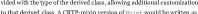

```cpp
template<typename... Mixins>
class Polygon
{
public:
    std::vector<Point<Mixins...>> points;
    // ...
};
```

当模板需要少量自定义时——例如用用户指定的数据装饰内部存储的对象——混入非常有用，而且无需库公开并记录其内部数据类型及其接口。


```cpp
y[i] {
}
```

这种表述要求为每个将被混入的类做更多工作，因此像 label 和 color 这样的类将需要成为类模板。然而，被混入的类现在可以针对它们被混入的派生类的特定实例来调整其行为。例如，我们可以将前面讨论的对象计数器模板混入根类：每个类创建的对象数量可以由该混入连同其他应用特定的混入一起计数。

#### 21.3.2 参数化虚性

混入还允许我们间接地参数化派生类的其他属性，例如成员函数的虚性。一个简单的例子展示了这种相当令人惊讶的技术：

inherit/virtual.cpp

```cpp
#include <iostream>

class NotVirtual {
};

class Virtual {
public:
    virtual void foo() {
    }
};

template<typename... Mixins>
class Base :
    public Mixins... {
public:
    // the virtuality of foo() depends on its declaration
    // (if any) in the base classes Mixins.
    void foo() {
        std::cout << "Base::foo()\n";
    }
};

template<typename... Mixins>
class Derived : public Base<Mixins...> {
public:
    void foo() {
        std::cout << "Derived::foo()\n";
    }
};

int main()
{
    Base<NotVirtual> *p1 = new Derived<NotVirtual>();
    p1->foo(); // calls Base::foo()

    Base<Virtual> *p2 = new Derived<Virtual>();
    p2->foo(); // calls Derived::foo()
}
```

这种技术可以提供一个工具，用于设计既可用来实例化具体类、又可通过继承进行扩展的类模板。然而，仅仅对某些成员函数特化虚性，通常不足以获得一个能作为更专门功能良好基类的类。这类开发方法需要更根本的设计决策。因此，通常更实际的做法是设计两个不同的工具（一个类或类模板层次结构），而不是试图把所有东西都塞进一个带许多不同模板类型参数的模板层次结构中。不过，这些参数中的许多往往具有合理的默认值。定义这样一个类模板的一种自然方式可能如下所示：

```cpp
template<typename Policy1 = DefaultPolicy1,
         typename Policy2 = DefaultPolicy2,
         typename Policy3 = DefaultPolicy3,
         typename Policy4 = DefaultPolicy4>
class ThreadLocker
{
};
```

据推测，这样的模板通常可以使用默认模板实参值，语法为`ThreadLocker<>`。然而，如果必须指定一个非默认实参，则也必须指定所有前面的实参（即使它们可能具有默认值）。

显然，像现在这样只能使用 `ThreadLocker<DefaultPolicy1, DefaultPolicy2, Custom>`，而不能使用类似 `ThreadLocker<Policy3 = Custom>` 的构造，这是不理想的。下面我们开发一种技术，几乎正好实现这一点。

```cpp
template<typename PolicySet1 = DefaultPolicySet1,
         typename PolicySet2 = DefaultPolicySet2,
         typename PolicySet3 = DefaultPolicySet3,
         typename PolicySet4 = DefaultPolicySet4>
class PolicySelector
{
    PolicySet1 policySet1;
    PolicySet2 policySet2;
    PolicySet3 policySet3;
    PolicySet4 policySet4;
};
```

我们的技术包括将默认类型值放在一个基类中，并通过派生来覆盖其中一些值。我们不是直接指定类型实参，而是通过成员函数来提供它们。例如，我们可以写 `Great<Policy1>`，因为每个模板实参可以描述策略之一，而默认值可以不同。换句话说，在更高层次上，每个模板参数都是等价的：

```cpp
template<typename Policy1, typename Policy2,
         typename Policy3, typename Policy4>
class PolicySelector : public PolicySelectorBase<Policy1,
                                                 Policy2,
                                                 Policy3,
                                                 Policy4>
{
public:
    PolicySelector() {}
};
```

剩下的挑战是编写策略选择器模板。它必须将不同的模板实参合并为一个单一类型，该类型用所指定的任何非默认类型来覆盖默认策略类型及其成员。这种合并可以通过继承来实现：

```cpp
// PolicySelector<A,B,C,D> creates A,B,C,D as base
// classes
// Discriminator to allow having more than one base class
template<typename Base>
class Discriminator : public Base
{
};

template<typename Select1, typename Select2,
         typename Select3, typename Select4>
class PolicySelector : public Discriminator<Select1>,
                       public Discriminator<Select2>,
                       public Discriminator<Select3>,
                       public Discriminator<Select4>
{
};
```

注意中间`Discriminator`模板的使用。需要它来允许各种`Selector`类型相同。不能有多个相同类型的直接基类。另一方面，间接基类可以具有与其他基类相同的类型。

作为一个提议的策略，我们将默认值收集到一个基类中。

```cpp
// Name default policies as P1, P2, P3, P4
class DefaultPolicies
{
public:
    using P1 = DefaultPolicy1;
    using P2 = DefaultPolicy2;
    using P3 = DefaultPolicy3;
    using P4 = DefaultPolicy4;
};
```

然而，如果我们最终多次继承这个基类，就必须小心避免歧义。因此，我们确保以虚继承方式继承该基类：

```cpp
template<typename Policy>
class Policy1 : virtual public DefaultPolicies {
public:
    using P1 = Policy; // overriding type alias
};

template<typename Policy>
class Policy2 : virtual public DefaultPolicies {
public:
    using P2 = Policy; // overriding type alias
};

template<typename Policy>
class Policy3 : virtual public DefaultPolicies {
public:
    using P3 = Policy; // overriding type alias
};

template<typename Policy>
class Policy4 : virtual public DefaultPolicies {
public:
    using P4 = Policy; // overriding type alias
};
```

一切就绪后，我们期望的目标就实现了。现在让我们通过示例来看看我们得到了什么。让我们实例化一个 BreadSlices 类：

```cpp
BreadSlices<Policy3, IceCreamPolicy> bc;
```

对于这个类，输出定义为

```cpp
PolicySelector<Policy3, IceCreamPolicy>,
    DefaultPolicy<...>,
    DefaultPolicy<...>,
    DefaultPolicy<...>
```

借助 Discriminator<> 类模板，这会形成一个层次结构，其中所有子类型都派生自这些基类（见图 21-4）。重要的一点是，这些基类都具有相同的虚基类 DefaultPolicies，它定义了 P1、P2、P3 和 P4 的默认类型。然而，P3 在其中一个派生类中——即 Policy3 中——被重新定义，并且根据支配规则，这个定义隐藏了基类中的定义。因此，这不是歧义。

*图 21-4. BreadSlices<Policies> 的类型层次解析*

在模板 BreadSlices 内部，可以使用限定名（如`Policies::P3`）来引用这四个策略。例如

```cpp
template<...>
class BreadSlices {

public:
    void print() {
        Policies::P1::doPrint();
    }
};
```

在 inherit/named1.cpp 中可以找到完整的示例。

我们针对四个模板参数开发了这项技术，但它显然可以扩展到任意合理数量的此类参数。请注意，我们实际上从不实例化包含虚基的辅助类的对象。事实上，它们是虚基这一点并不是性能或内存消耗问题。

### 21.5 后记

Bill Gibbons 是将 EBCO 引入 C++ 编程语言的主要推动者。Nathan Myers 使之流行，并提出了一个类似于我们的 BaseMemberPair 的模板，以更好地利用它。Boost 库包含一个相当复杂的模板，称为 compressed_pair，它解决了本章中 C++ 模板的一些问题。

本章中 EBCO 的简单方法基于这样一种思想：如果一个基类没有数据成员也没有虚函数，那么它的实现可以被优化掉。然而，C++ 标准并不要求这种优化，而且有些实现并不执行它。

C++ 和许多形式的参数化继承并不符合 EBCO。EBCO 在 Boost 库中特别有用，在那里它被用来实现函数对象和其他泛型编程技术。

混入的概念至少自 1986 年（MoonFlavors）起就存在于面向对象编程中，作为一种将小块行为引入类层次结构的方式。


描述了当前常用于混入（mixin）的方法。自那以后，它便成为 C++ 库设计中一种流行的技术。

命名模板实参用于简化 Boost 库中的某些类模板。Boost 使用元编程来创建一种与我们的 `PolicySelector` 具有相似属性的类型（但没有使用虚继承）。这里介绍的更简单的替代方案是由我们中的一位（Vandevoorde）开发的。

- 1. 值得阅读第 52 页的 16.2 节，以理解现代 C++ 中函数模板重载的工作方式。
- 2. 注意，它也是一个与类型关联的类，因为它充当了 `T` 类型的模板实参。ADL 的具体规则将在第 219 页的 12.3.9 节讨论。
- 3. 为了简化叙述，我们忽略了代理类型的存在，代理类型的解引用操作不会返回真正的引用。一个完整的迭代器外观（iterator facade）实现（如 [Boost.Iterator] 中的实现）会调整 `operator ->` 和 `operator *` 的结果类型以应对代理类型。
- 4. 同样，为了简化叙述，我们假设底层迭代器返回引用，而不是代理。
- 5. 注意，在 C++ 标准化过程中，曾有人提出过类似的针对函数调用实参的语言扩展（但被否决了），详见第 358 页的 17.4 节。
- 6. 你可以在第一版 C++ 标准（参见 [C++98]）的 10.2.6 节中找到支配规则，并在 [EllisStroustrup] 的 10.1.4 节中看到相关讨论。

## 第 22 章 桥接静态与动态多态

第 5 章描述了 C++ 中静态多态（通过模板）和动态多态（通过继承和虚函数）的本质。这两类多态都为编写程序提供了强大的抽象，但各有取舍：静态多态与非多态代码具有相同的性能，但运行时可以使用的类型集合在编译时便已固定。另一方面，通过继承实现的动态多态允许一个多态函数的单一版本与编译时尚不为人知的类型协同工作，但由于类型必须继承自公共基类，因此灵活性较低。

本章描述如何在 C++ 中桥接静态多态与动态多态，提供现代 C++ 中第 575 页 5.3 节所讨论的一些好处：更小的可重用代码量，以及动态多态（几乎）完全编译的性质，同时兼具静态多态的接口灵活性，例如允许内建类型无缝工作。作为示例，我们将构建标准库 `function<>` 模板的简化版本。

### 22.1 函数对象、函数指针与 std::function<>

函数对象对于向模板提供可定制行为非常有用。例如，下面的函数模板枚举从 0 到某个值的整数，并将每个值提供给给定的函数对象：

**点击此处查看代码片段**

`bridge/forloop01.cpp`

```cpp
#include <vector>
#include <iostream>

template<typename F>
void forToDo(int n, F f)
{
    for (int i = 0; i != n; ++i)
    {
        f(i);  // call passed function f for i
    }
}

void printInt(int i)
{
    std::cout << i << ' ';
}

int main()
{
    std::vector<int> values;

    // insert values from 0 to 4;
    forToDo(5,
        [&](int i) {
            values.push_back(i);
        });

    // print elements:
    forToDo(5,
        printInt);    // prints 0 1 2 3 4
    std::cout << '\n';
}
```

`forToDo()` 函数模板可以与任何函数对象一起使用，包括 lambda、函数指针，或任何实现了合适的 `operator()` 或到函数指针/引用的转换的类；每次使用 `forToDo()` 都可能会生成函数模板的一个不同实例。我们的示例函数模板相当小，但如果模板很大，这些实例化可能会增加代码体积。

限制代码规模增长的一种方法是将函数模板转换为非模板函数，这样无需实例化。例如，我们可以尝试使用函数指针完成这一点：

点击此处查看代码图片

`bridge/forloop02.cpp`

```cpp
void forToDo(int n, void (*f)(int))
{
    for (int i = 0; i != n; ++i)
    {
        f(i);    // call passed function f for i
    }
}
```

然而，虽然这个实现传入 `printInt` 时可行，但传入 lambda 时会产生错误：

点击此处查看代码图片

```cpp
forToDo(5,
        printInt);                 // OK: prints 0 1 2 3 4

forToDo(5,
        [&](int) { });             // ERROR: lambda not convert-
                                   // ible to a function pointer
```

标准库的 `std::function<>` 允许 `forToDo()` 的另一种实现形式：

点击此处查看代码图片

`bridge/forloop03.cpp`

```cpp
#include <functional>

void forToDo(int n, std::function<void(int)> f)
{
    for (int i = 0; i != n; ++i)
    {
        f(i);    // call passed function f for i
    }
}
```

`std::function<>` 的模板实参是一个函数类型，它描述了函数对象将接收的参数类型以及应产生的返回类型，就像函数指针描述了参数和结果类型一样。

这种 `forToDo()` 的实现在自身仍然是具有单一实现的非模板函数的同时，提供了静态多态的某些方面——即可处理包括函数指针、lambda 及任何带有合适的 `operator()` 的类在内的无限类型集合。它通过一种称为类型擦除的技术实现这一点，该技术弥合了静态多态与动态多态之间的鸿沟。

### 22.2 泛化函数指针

`std::function<>` 类型是 C++ 函数指针的类型擦除泛化，提供相同的基本操作：

- 它可以被用来调用函数，而调用者无需了解函数类型的任何信息。
- 它可以被复制、移动和赋值。
- 它可以从另一个函数（具有兼容签名）初始化或赋值。
- 它可以存储 lambda 或任何其他带有合适 `operator()` 的函数对象，所有这些对象可能具有不同的类型。

在本章的其余部分，我们将构建自己的泛化函数指针类模板 `FunctionPtr`，以提供这些相同的核心操作和能力，从而可以替代 `std::function`：

点击此处查看代码图片

`bridge/forfunc1.cpp`

```cpp
#include "functionptr.hpp"

#include <iostream>
#include <ostream>
#include <vector>

void forEach(int n, FunctionPtr<void(int)> f)
{
    for (int i = 0; i != n; ++i)
    {
        f(i); // call passed function f for i
    }
}

void printInt(int i)
{
    std::cout << i << ' ';
}

int main()
{
    std::vector<int> values;

    // Insert values from 0 to 4:
    forEach(5,
        [&values](int i)
        {
            values.push_back(i);
        });

    // print elements:
    forEach(5,
        [](int i) // prints 0 1 2 3 4
        {
            std::cout << i << ' ';
        });
    std::cout << '\n';
}
```

`FunctionPtr` 的接口相当简单直接，提供了构造、复制、移动、析构、初始化、从任意函数对象赋值以及调用底层函数对象等功能。接口最有趣的地方在于，它完全在类模板偏特化中描述，偏特化将模板实参（一个函数类型）分解为各个组成部分（结果类型和实参类型）：

点击此处查看代码图片

`bridge/functionptr.cpp`

```cpp
// primary template:
template<typename Signature>
class FunctionPtr;

// partial specialization:
template<typename R, typename... Args>
class FunctionPtr<R(Args...)>
{
private:
    FunctionPtrImpl<R, Args...> bridge;

public:
```


```cpp
FunctionPtr() : bridge( nullptr ) {
}

FunctionPtr(FunctionPtr const& other) { // copy ctor
  bridge = other.bridge;
}

FunctionPtr(FunctionPtr& other)
  : FunctionPtr(const_cast<FunctionPtr const&>(other))
{ }

FunctionPtr(FunctionPtr&& other) : bridge(other.bridge) {
  other.bridge = nullptr;
}

// construction from arbitrary function objects
template<typename F> FunctionPtr(F&& f) // see [1]
  : bridge( ... )
{ }

// assignment operators
FunctionPtr& operator=(FunctionPtr const& other) {
  FunctionPtr tmp(other);
  swap(*this, tmp);
  return *this;
}

FunctionPtr& operator=(FunctionPtr&& other) {
  delete bridge;
  bridge = other.bridge;
  other.bridge = nullptr;
  return *this;
}

// construction and assignment from arbitrary function objects
template<typename F> FunctionPtr& operator=(F&& f) {
  FunctionPtr tmp(std::forward<F>(f));
  swap(*this, tmp);
  return *this;
}

// destructor
~FunctionPtr() {
  delete bridge;
}

friend void swap(FunctionPtr& fp1, FunctionPtr& fp2) {
  std::swap(fp1.bridge, fp2.bridge);
}

explicit operator bool() const {
  return bridge != nullptr;
}

// invocation
R operator()(Args... args) const // note: FunctionPtr
{
  return bridge->operator()(std::forward<Args>(args)...);
}
```

该实现包含一个非静态成员变量 bridge，它负责存储和操作所存储的函数对象。该指针的所有权与 FunctionPtr 对象的生命周期绑定。这些已实现的函数涵盖了实现中有趣的部分，将在以下小节中描述。

### 22.3 桥接接口

FunctionPtr 类模板负责函数对象的所有权和操作。其实现采用抽象基类的形式，为动态多态奠定基础。

`bridge/functorbridge.hpp`

```cpp
template<typename R, typename... Args>
class FunctorBridge
{
public:
    virtual ~FunctorBridge() { }

    virtual FunctorBridge* clone() const = 0;

    virtual R invoke(Args... args) const = 0;
};
```

FunctorBridge 通过虚函数提供操作所存储函数对象所需的基本操作：析构函数、用于执行复制的 clone() 操作，以及用于调用底层函数对象的 invoke 操作。不要忘记在基类的成员函数中定义 clone() 和 invoke()。

使用这些虚函数，我们可以实现 FunctionPtr 的复制构造函数和函数调用运算符：

点击此处查看代码图像

`bridge/functorptr.cpp`

```cpp
template<typename R, typename... Args>
FunctionPtr<R(Args...)>::FunctionPtr(const FunctionPtr<R(Args...)>& other)
    : bridge(nullptr)
{
    if (other.bridge) {
        bridge = other.bridge->clone();
    }
}

template<typename R, typename... Args>
R FunctionPtr<R(Args...)>::operator()(Args... args) const
{
    return bridge->invoke(std::forward<Args>(args)...);
}
```

### 22.4 类型擦除

FunctorBridge 的每个实例都是一个抽象类，因此其派生类负责提供其虚函数的实际实现。为了支持所有可能的函数对象——一个无界集合——我们将需要无界数量的派生类。幸运的是，我们可以通过根据派生类所存储的函数对象的类型对派生类进行参数化来实现这一点。

点击此处查看代码图像

`bridge/specificfunctorbridge.hpp`

```cpp
template<typename Functor, typename R, typename... Args>
class SpecificFunctorBridge : public FunctorBridge<R, Args...>
{
    Functor functor;

public:
    template<typename FunctorParam>
    SpecificFunctorBridge(FunctorParam&& functor)
        : functor(std::forward<FunctorParam>(functor)) { }

    virtual SpecificFunctorBridge* clone() const override
    {
        return new SpecificFunctorBridge<Functor>(functor);
    }

    virtual R invoke(Args... args) const override
    {
        return functor(std::forward<Args>(args)...);
    }
};
```

每个 `SpecificFunctorBridge` 实例都存储函数对象的一个副本（其类型为 `Functor`），该函数对象可以被调用、通过克隆 `SpecificFunctorBridge` 进行复制，或被销毁（隐式地在析构函数中）。每当 `FunctionPtr` 被初始化为新的函数对象时，就会创建 `SpecificFunctorBridge` 实例，从而完成 `FunctionPtr` 示例：

点击此处查看代码图像

`bridge/FunctionPtr-list.hpp`

```cpp
template<typename R, typename... Args>
template<typename F>
FunctionPtr<R(Args...)>::FunctionPtr(F f)
  : bridge(nullptr)
{
  using Functor = std::decay_t<F>;
  using Bridge = SpecificFunctorBridge<Functor, R, Args...>;
  bridge = new Bridge(std::forward<F>(f));
}
```

请注意，虽然 `FunctionPtr` 构造函数本身以函数对象类型 `F` 为模板参数，但该类型只有通过 `Bridge` 类型别名定义的 `SpecificFunctorBridge<F, R, Args...>` 的特定特化才知道。一旦新分配的 `Bridge` 实例被赋值给数据成员 `bridge`，关于具体类型的额外信息就会因从 `Bridge *` 到 `FunctorBridge<R, Args...> *` 的派生类到基类转换而丢失。这种类型信息的丢失解释了为什么术语“类型擦除”常用于描述在静态多态和动态多态之间进行桥接的技术。

该实现的一个特殊之处是使用 `std::decay`（参见第 73 页第 6.1 节）来生成 `Functor` 类型，这使得推断出的类型适合存储，例如，将函数类型的引用转换为函数指针类型，并移除顶层 `const`、`volatile` 和引用类型。

### 22.5 可选桥接

我们的 `FunctionPtr` 模板很少能直接替代函数指针。然而，它不支持函数指针提供的一项操作：测试两个 `FunctionPtr` 对象是否会调用同一个函数。添加这样的操作需要用 `equals` 操作更新 `FunctionPtr` 类：

点击此处查看代码图像

```cpp
virtual bool equals(const FunctorBridge<R, Args...> const& f) const = 0;
```

并在 `SpecificFunctorBridge` 中提供一个实现，当所存储的函数对象具有相同类型时对它们进行比较：

```cpp
virtual bool equals(const FunctorBridge<R, Args...> const& fb) const override
{
  if (typeid(*this) != typeid(SpecificFunctorBridge<Functor, R, Args...>))
    return false;
  return functor == static_cast<SpecificFunctorBridge<Functor, R, Args...> const&>(fb).functor;
}
```

最后，我们为 `FunctionPtr` 实现 `operator==`，它首先检查空函数对象，然后委托给 `FunctorBridge`：

点击此处查看代码图像

```cpp
friend bool
operator==(FunctionPtr const& f1, FunctionPtr const& f2)
{
  if (!f1.bridge || !f2.bridge) {
    return f1.bridge == f2.bridge;
  }
  return f1.bridge->equals(*f2.bridge);
}

friend bool
operator!=(FunctionPtr const& f1, FunctionPtr const& f2)
{
  return !(f1 == f2);
}
```

这个实现是正确的。然而，它有一个不幸的缺点：如果 `FunctionPtr` 被赋值或初始化为一个没有合适的 operator== 的函数对象（例如包括 lambda），程序将无法编译。这可能会令人惊讶，因为 `FunctionPtr` 类本应支持任意类型的函数对象，而许多其他示例类型——例如 std::vector——也可以用没有 operator== 的类型实例化。

`operator==` 的这个问题是由类型擦除造成的。因为我们实际上在函数对象类型 `Functor` 被赋值或初始化后就丢失了对它的跟踪，所以我们需要在执行该赋值或初始化之前捕获我们需要了解的有关该类型的所有信息。

幸运的是，我们可以使用基于 SFINAE 的特性（在第 416 页第 19.4 节中讨论）在调用 `operator==` 之前验证它是否可用，为此需要一个相当精细的特性：

点击此处查看代码图像

`bridge/isEqualityComparable.hpp`

```cpp
#include <utility>                 // for declval()
#include <type_traits>              // for true_type and false_type

template<typename T>
class IsEqualityComparable
{
private:
  // test comparability of == and != to bool:
  static void* check(...);

  template<typename U>
  static auto check(U*)
    -> decltype(std::declval<U>() == std::declval<U>(),
                std::declval<U>() != std::declval<U>(),
                std::true_type{});

  template<typename U>
  static auto test(U*)
    -> decltype(check<U>(nullptr));

  // fallback:
  template<typename U>
  static std::false_type test(...);

public:
  static constexpr bool value = decltype(test<T>(nullptr))::value;
};
```

`IsEqualityComparable` 特性采用了第 416 页第 19.4 节介绍的表达式测试特性的典型形式（两个 test 重载，其中一个在其 `decltype` 中应用要测试的表达式，另一个通过省略号接受任意参数）。如果第一个测试的表达式适用于类型 `T` 或 `U` 的兼容对象，则选择第一个测试，并且结果必须隐式转换为 `bool` 并传递给逻辑非运算符。如果任一表达式不是良构的，则参数类型本身都将为 `void*`。

使用 `IsEqualityComparable` 特性，我们可以构造一个 `Trapezoid` 类模板，它可以在给定类型上调用 `==`（当可用时），或者在不存在合适的 `==` 时抛出异常：

点击此处查看代码图像

`bridge/Trapezoid.hpp`

```cpp
#include <exception>
#include "isEqualityComparable.hpp"

template<typename T,
         bool EqualityComparable = IsEqualityComparable<T>::value>
struct Trapezoid
{
  static bool equals(const T& x, const T& y)
  {
    return x == y;
  }
};

class NotEqualityComparable : public std::exception
{
};

template<typename T>
struct Trapezoid<T, false>
{
```


```cpp
throw NotEqualityComparable();
}

});
```

最后，通过在我们的 `SpecificFunctionProvider` 实现中使用 `TypeEqualityWithin`，我们可以在 `Function<>` 中为 `==` 提供支持，前提是存储的函数对象和该函数对象支持……

[点击此处查看代码图片](#)

```cpp
virtual bool equals(FunctionType& f, Arg... const& fb)
const override {
  if (auto spec = dynamic_cast<SpecificFunction<Foo...>&>(
      ...)) {
    return TypeEqualityFunction::equals(function,
      specificFunction);
  }
}

// Functions with different types are never equal:
return false;
```

### 22.6 性能考量

类型擦除提供了静态多态和动态多态的一些优点，但并非全部。特别是，使用类型擦除生成的代码的性能往往低于动态多态，因为两者都依赖通过虚函数进行的动态分发。因此，静态多态的一些传统优势——速度，例如编译器内联调用的能力——可能会丧失。这种性能损失是否可感知取决于具体应用，但通常很容易通过考虑被调用函数所执行的工作量与虚函数调用成本的相对关系来判断：如果两者相近（例如，使用 `Function<>` 简单地将两个整数相加），类型擦除的执行速度可能远比静态多态版本慢。另一方面，如果函数调用执行了大量工作——查询数据库、排序大型输入或更新用户界面——类型擦除的开销不太可能被测量到。

### 22.7 后记

Kevlin Henney 通过引入 `Any` 类型（`Boost.Any`/`boost::any`）在 C++ 中普及了类型擦除，该类型后来成为流行的 Boost 库（`Boost.Any`），并随 C++17 成为 C++ 标准库的一部分。这一技术在 Boost.Function 库中得到了些许改进，该库应用了虚函数和类型擦除操作，最终成为 `std::function`。然而，早期的每个库都只处理一组操作：`any` 是一个简单的值类型，只支持复制操作和一组仅限于调用的操作。

后来的努力，例如 Boost.TypeErasure 库（`Boost.TypeErasure`）和 Adobe 的 Poly 库（`AdobePoly`），应用模板元编程技术，允许用户形成具有指定能力列表的类型安全值。例如，以下使用 Boost.TypeErasure 库构造的类型处理任意构造、类似类型擦除的判据以及用于打印的输出流：

[点击此处查看代码图片](#)

```cpp
using AnyIterable = any<
  boost::type_erasure::copy_constructible<>,
  typeid_<>,
  ostreamable
>;
```

- 1. 将 `invoke()` 设为 `const` 是一种安全措施，防止通过 `const` 调用非 `const` 的 `operator()` 重载。
- 2. 尽管该类型可以通过从一个元素到另一个元素的动态转换进行复制，但 `Function<>` 类将 `bridge` 指针设为私有，因此 `Function<>` 的客户端无法访问该类型本身。
- 3. 在机制上，调用 `operator()` 的代码会因它是类模板（此处为 `SpecificFunction<>`）的虚函数而被实例化，因此通常实例化类模板本身就会导致该代码被实例化。

## 第23章

## 元编程

元编程包括“对程序进行编程”。换句话说，我们编写代码，由编程系统执行这些代码来生成实现我们真正想要的功能的新代码。通常，术语“元编程”暗示一种自反属性：元编程组件是程序的一部分，它为程序生成一小段代码（即程序的一个附加或不同的部分）。

为什么需要元编程？与大多数其他编程技术一样，其目标是以更少的努力实现更多的功能，其中努力可以量化为代码大小、维护成本等。元编程的特点是某些用户定义的计算发生在编译期。其根本动机通常是性能（在编译期计算的内容通常可以被优化掉）或接口简洁性（元编程通常比运行时方法更容易适应）。

元编程通常依赖于第19章中描述的 traits 和类型函数的概念。因此，我们建议在深入学习本章之前，先熟悉那一章。

### 23.1 现代 C++ 元编程的现状

C++ 元编程技术随着时间的推移而发展（本章末尾的后记详细介绍了这一演变过程）。让我们讨论并分类现代 C++ 中常用的各种元编程方法。

#### 23.1.1 值元编程

在本书的第一版中，我们仅限于最初 C++ 标准（1998 年发布，2003 年有小幅修正）引入的特性。在那个时代，编写简单的编译期（“元”）计算就有点挑战性。因此，我们用本章的很大一部分来专门处理这件事；其中一个相当高级的示例使用递归模板实例化在编译期计算整数值的平方根。如第22页第1.2.4节所介绍，C++11，尤其是 C++14，通过引入 constexpr 函数消除了大部分这种挑战。例如，自 C++14 起，可以轻松地编写一个编译期函数来计算平方根，如下所示：

点击此处查看代码图片

```cpp
meta/sqrtconstexpr.hpp

template<typename T>
constexpr T sqrt(T x)
{
    // handle cases where x and its square root are equal as a special case to simplify
    // the iteration criterion for larger x:
    if (x <= 1) {
        return x;
    }

    // repeatedly determine in which half of a [lo, hi] interval the square root of x is located,
    // until the interval is reduced to just one value:
    T lo = 0, hi = x;
    for (;;) {
        auto mid = (hi+lo)/2, midSquared = mid*mid;
        if (midSquared <= x && (mid+1)*(mid+1) > x) {
            return mid;
        }
        // continue with the bigger half of the interval:
        if (midSquared < x) {
            lo = mid;
        } else {
            hi = mid;
        }
    }
}
```

该算法通过反复将包含 x 平方根的区间减半来搜索答案（将 0 和 1 的根作为特殊情况处理，以简化收敛判据）。这个 sqrt() 函数可以在编译期或运行期求值。

点击此处查看代码图片

```cpp
static_assert(sqrt(25) == 5, "");       // evaluated at compile time
static_assert(sqrt(4) == 2, "");        // evaluated at compile time

std::array<int, sqrt(40)> arr;           // declares array of 6 elements (compile time)
```

点击此处查看代码图片

```cpp
long long t = 53478;
std::cout << sqrt(t) << '\n';             // prints 231
```

这个函数的实现可能在编译期不是最高效的（在编译期利用机器的特性往往很有效），但因为它旨在执行编译期计算，绝对效率不如可移植性重要。注意，在平方根示例中，没有任何关于模板魔法的建议，只有函数模板通常的模板实参推导。这段代码是“纯 C++”，写起来并不特别具有挑战性。

正如我们上面所做的，值元编程（即对编译期值的计算进行编程）偶尔非常有用，但使用现代 C++（例如 C++14 和 C++17）还可以执行另外两种元编程：类型元编程和混合元编程。

#### 23.1.2 类型元编程

在第19章讨论 traits 时，我们已经遇到了一种类型计算形式。在第5章中，这些 traits 接受一个类型并从中产生一个新类型。例如，上一章中的 RemoveReference trait 会移除引用类型。然而，我们在第5章中开发的示例仅包含相当基本的类型操作。通过依赖递归模板实例化——基于模板的元编程的支柱——我们可以执行更复杂得多的类型计算。

考虑以下小例子：

点击此处查看代码图片

```cpp
src/meta/removeallextents.hpp

// primary template: in general we yield the given type

template<typename T>
struct RemoveAllExtent {
    using Type = T;
};

// partial specializations for array types (with and without size)
template<typename T, std::size_t SZ>
struct RemoveAllExtent<T[SZ]> {
    using Type = typename RemoveAllExtent<T>::Type;
};

template<typename T>
struct RemoveAllExtent<T[]> {
    using Type = typename RemoveAllExtent<T>::Type;
};

template<typename T>
using RemoveAllExtents = typename RemoveAllExtent<T>::Type;
```


从类型中移除顶层“数组范围”。你可以按如下方式使用它：

单击此处查看代码图像

```cpp
RemoveAllExtents<int>             // yields int
RemoveAllExtents<int[5][10]>      // yields int[10]
RemoveAllExtents<int[10][5]>      // yields int[5]
RemoveAllExtents<int[5]>          // yields int
```

这个元程序通过让匹配顶层数组的偏特化能够递归地“调用”该元函数本身，来变换其任务。

如果我们可用的只有标量值，那么基于值的计算将非常有限。幸运的是，几乎任何编程语言都至少有一种值容器构造，它能极大增强该语言的能力（而且大多数语言都有多种容器种类，例如数组/向量、哈希表等）。类型元编程也是如此。增加类型容器构造会极大提高这一领域的适用性。幸运的是，现代 C++ 包含能够支持开发此类容器的机制。第26章将详细讨论一个典型示例，它是一个相当丰富的类型容器。

#### 23.1.3 混合元编程

借助值元编程和类型元编程，我们可以在编译期计算值和类型。然而，最终我们感兴趣的是在运行时代码中，在需要类型和常量的地方使用这些元程序的结果。然而，元编程能做的还不止这些。我们可以在编译期以编程方式组装出具有运行时效果的代码片段。我们称之为混合元编程。

为了说明这一原则，让我们从一个简单示例开始：计算两个 std::array 值的点积。回顾一下，std::array 是一个定长容器模板，声明如下：

单击此处查看代码图像

```cpp
template<typename T, size_t N>
struct array {
    T elems[N];
};
```

其中 N 是数组中类型为 T 的元素个数。给定两个相同数组类型的对象，它们的点积可以如下计算：

单击此处查看代码图像

```cpp
template<typename T, size_t N>
auto dotProduct(const array<T, N>& x,
                const array<T, N>& y)
{
    T result{};
    for (size_t k = 0; k < N; ++k)
        result += x[k] * y[k];
    return result;
}
```

直接编译这个 for 循环会产生分支指令，在某些机器上，与顺序执行以下代码相比，这可能会带来一些开销：

```cpp
result = x[0]*y[0];
result += x[1]*y[1];
result += x[2]*y[2];
...
result += x[N-1]*y[N-1];
```

幸运的是，现代编译器会将该循环优化为目标平台上最高效的形式。不过，为了讨论方便，让我们以避开循环的方式重写 dotProduct() 的实现：

```cpp
template<typename T, size_t N>
struct DotProduct {
    static inline T result(const T* a, const T* b) {
        return a[0] * b[0] +
            N > 1 ? result(a + 1, b + 1) : 0;
    }
};

// partial specialization as end criteria
template<typename T>
struct DotProduct<T, 0> {
    static inline T result(const T*, const T*) {
        return T{};
    }
};

template<typename T, size_t N>
auto dotProduct(const array<T, N>& x,
                const array<T, N>& y)
{
    return DotProduct<T, N>::result(x.begin(), y.begin());
}
```

这个新实现将工作委托给类模板 DotProduct<T, N>，它使我们能够使用递归模板实例化和类模板偏特化来结束递归。注意 DotProduct 的每次实例化如何产生主模板各阶段的一项之和，并产生终止偏特化的一个实例。为了保证效率，编译器必须内联对静态成员函数 `result()` 的每一次调用，这一点至关重要。幸运的是，在启用非模块化级别的 C++ 编译器优化时，通常确实如此。

关于这段代码的核心观察是：它将决定代码整体结构的编译期计算（这里通过递归模板实例化实现）与决定具体运行时效果的运行时计算（调用 `result()`）融合在一起。

我们之前提到，有了“类型容器”，元编程能力会大大增强。我们已经看到，在混合元编程中，定长数组类型可能很有用。尽管如此，“零开销”混合元编程的技巧是使用由一系列值组成的元组，其中每个值都具有可选类型。C++ 标准库包含一个支持这一概念的 `std::tuple` 类模板。例如，

```cpp
std::tuple<int, std::string, bool> v{42, "7", true};
```

定义了一个变量，它聚合了三个值，类型分别为 `int`、`std::string` 和 `bool`（按此特定顺序）。由于类元组容器对现代 C++ 编程极其重要，我们将在第5章详细开发一个这样的容器。该值的类型非常类似于下面这样的简单结构体类型：

单击此处查看代码图像

```cpp
struct MyTuple {
    int v1;
    std::string v2;
    bool v3;
};
```

既然 `std::array` 和 `std::tuple` 为数组类型和（简单）结构体类型提供了灵活的对应物，人们自然会想：是否以及如何实现一个简单的联合类型，其用途对混合计算也同样有用。答案是肯定的。C++ 标准库在 C++17 中为此引入了 `std::variant` 模板，我们将在第26章开发一个类似的组件。

由于 `std::tuple` 和 `std::variant` 与结构体类型一样属于异构类型，使用这类类型的混合元编程有时被称为异构元编程。

#### 23.1.4 针对单位类型的混合元编程

另一个展示混合计算能力的示例是能够计算不同单位类型值结果的混合程序。我们关注的是在运行时执行的计算，但结果单位的确定是在编译期完成的。

让我们用一个高度简化的示例来说明。我们将按照相对于基本单位的比率（分数）来跟踪单位。例如，如果时间的基本单位是秒，则毫秒用比率 1/1000 表示，分钟用比率 60/1 表示。那么，关键在于定义一个比率类型，其中每个值都有自己的类型。

单击此处查看代码图像

```cpp
meta/ratio.hpp

template<unsigned N, unsigned D = 1>
struct Ratio {
    static constexpr unsigned num = N;  // numerator
    static constexpr unsigned den = D;  // denominator

    using Type = Ratio<num, den>;
};
```

现在我们可以定义编译期计算，例如将两个单位相加：

单击此处查看代码图像

```cpp
meta/add.hpp

// implementation of adding two ratios:
template<typename T1, typename T2>
struct RatioAddImpl
{
private:
    static constexpr unsigned den = T1::den * T2::den;
    static constexpr unsigned num = T1::num * T2::den + T2::num * T1::den;

public:
    typedef Ratio<num, den> Type;
};
```

```cpp
template<typename R1, typename R2>
using RatioAdd = typename RatioAddImpl<R1, R2>::Type;
```

这使我们能够在编译期计算两个比率之和。


```cpp
using R1 = Ratio<1, 1000>;
using R2 = Ratio<2, 3>;
using R3 = RatioAdd<R1,R2>;    // R3 has num=2003, den=3000
// R3::num == 2003 && R3::den == 3000 // previous page 233,3000
using R4 = RatioAdd<R2,R3>;    // R4 has num=4003, den=3000
// R4::num == 4003 && R4::den == 3000 // previous page 25/21
```

现在我们可以定义一个持续时间类模板，它以任意值类型和一个作为 Ratio<> 实例的单位类型为参数。

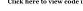

```cpp
meta/duration.hpp

// duration type for values of type T with unit type U
template<typename T, typename U = Ratio<1>>
class Duration {
 public:
  using ValueType = T;
  using UnitType = typename U::Type;
 private:
  ValueType val;
 public:
  constexpr Duration(ValueType v = 0)
   : val(v) {
  }
  constexpr ValueType value() const {
    return val;
  }
};
```

有趣的部分是定义用于将两个 Duration 相加的 operator+：


```cpp
meta/durationadd.hpp

// adding two durations where unit type might differ:
template<typename T1, typename U1, typename T2, typename U2>
auto constexpr operator+(Duration<T1, U1> const& lhs,
                         Duration<T2, U2> const& rhs)
{
  // resulting type is a unit with 1 as numerator and
  // the resulting denominator of adding both unit types
  using VT = Ratio<1, RatioAdd<U1,U2>::den>;
  // resulting value is the sum of both values
  // converted to the resulting unit type
  auto val = lhs.value() * VT::den / U1::den * U1::num +
             rhs.value() * VT::den / U2::den * U2::num;
  return Duration<decltype(val), VT>{val};
}
```

我们允许参数具有不同的单位类型 U1 和 U2。并且我们使用它们的公共分母作为结果分母，从而得到分子为 1 的单位类型。完成这些之后，我们就可以编译以下代码：


```cpp
int a = 42;
Duration<int, Ratio<1,3>> d1(a);
```

```cpp
auto b = Direction<int, Ratio<2, 3>>{y};   // 2 / 3 seconds
auto c = a + b;   // computes resulting unit type 1/3000 seconds

b * 1200;   // and generates run-time code for c = a * 3 seconds
```

关键的“混合”效应在于，同一个编译器会在编译期确定结果单位类型 `Ratio<1, 3000>`，并生成运行时代码来计算结果值，该值会针对结果单位类型进行调整。

因为值类型是一个模板参数，所以我们可以让 `Duration` 类使用 `int` 以外的值类型，甚至可以使用异构值类型（只要定义了这些类型的值的相加操作）：

[点击此处查看代码图像](#)

```cpp
auto d = Duration<double, Ratio<3, 1>>{1.5};   // 3 / 1 seconds
auto e = Duration<int, Ratio<1, 1>>{2};         // 1 / 1 seconds
auto f = d + e;   // computes resulting unit type 1/3 sec
                  // and generates code for d + e * 3
```

此外，如果这些值在编译期已知，编译器甚至可以在编译期执行值计算，因为 constexpr 是 C++ 的一项特性。

### 23.2 反射式元编程的维度

前面我们描述了基于 constexpr 求值的值元编程，以及基于递归模板实例化的类型元编程。这两种方案在现代 C++ 中都可用，显然涉及不同的计算驱动方法。事实证明，值元编程也可以借助递归模板实例化来驱动；在 C++ 引入 constexpr 函数之前，那正是首选的机制。例如，以下代码使用递归实例化计算一个整数的平方根：

[点击此处查看代码图像](#)

```cpp
// primary template to compute sqrt(N)
template<int N, int Lo = 1, int Hi = N>
struct Sqrt {
  // compute the midpoint, rounded up
  static constexpr auto mid = (Lo + Hi + 1) / 2;

  // search a not too large value in a halved interval
  static constexpr auto value = (mid * mid > N)
      ? Sqrt<N, Lo, mid - 1>::value
      : Sqrt<N, mid, Hi>::value;
};

// partial specialization for the case when Lo equals Hi
template<int N, int M>
struct Sqrt<N, M, M> {
  static constexpr auto value = M;
};
```

这个元程序使用的算法，与第23.1节（第253页）中用于函数的整数平方根概念所采用的算法大致相同：不断将已知包含平方根的区间减半。然而，该元程序的输入是编译期参数，而不是函数参数；用于跟踪区间边界的“局部变量”现在也成了类型模板参数。显然，这种方法远不如 constexpr 函数友好，但我们仍将在后文分析这一思路，以考察它如何消耗编译器资源。

无论如何，我们可以看到，元编程的计算引擎可能存在许多选项。然而，这并不是可以考虑这类选项的唯一维度。相反，我们认为，一个全面的 C++ 元编程解决方案必须沿三个维度做出选择：

- 计算
- 反射
- 生成

*反射*是指以编程方式检查程序特性的能力。*生成*是指为程序生成额外代码的能力。

$\mathrm{Sqrt}<16,1,4>$ 的值为 4，如下所示：

```text
value = 4
```

$\mathrm{Sqrt}<16,1,4>$ 的值分解如下。

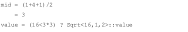

```text
mid = (1 + 4 + 1) / 2
    = 3
value = $\mathrm{Sqrt}<16,3,4>$ value
      = $\mathrm{Sqrt}<16,4,4>$ value
```

最后，$\mathrm{Sqrt}<16,3,4>$ 的值得到如下结果：

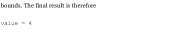

```text
mid = (3 + 4 + 1) / 2
    = 4
value = $\mathrm{Sqrt}<16,4,4>$ value
```

而 $\mathrm{Sqrt}<16,4,4>$ 的值结束了递归过程，因为它匹配了捕获高低边界相等的显式特化。因此最终结果是

```text
value = 4
```

#### 23.3.1 跟踪所有实例化

我们上面的分析跟踪了构成 16 的平方根的那些重要实例化。然而，当编译器求值表达式


它不仅会实例化正分支中的模板，还会实例化负分支中的模板（$\mathrm{Sqrt}<16,9,16>$）。此外，由于代码试图使用 `::` 运算符访问该特化的一个成员，因此该类内部的所有成员也会被实例化。这意味着 $\mathrm{Sqrt}<16,9,16>$ 的完整实例化会导致 $\mathrm{Sqrt}<16,9,12>$ 的完整实例化。详细检查整个过程时，我们发现最终会生成几十个实例化。总数几乎是 N 的两倍。

幸运的是，有一些技术可以减少这种实例化数量的爆炸式增长。为了说明其中一种重要技术，我们按如下方式重写 `Sqrt` 元程序：


```cpp
#include "ifthenelse.hpp"

// primary template for the recursive step
template<int N, int Low, int High>
struct Sqrt {
  // compute the midpoint, rounded up
  static constexpr auto mid = (Low + High + 1) / 2;

  // search a not too large value in a halved interval
  using Sub = typename ifThenElse<(mid * mid > N),
                                  Sqrt<N, Low, mid - 1>,
                                  Sqrt<N, mid, High>>::Type;
  static constexpr auto value = Sub::value;
};

// partial specialization for end of recursion criteria
template<int N, int Low>
struct Sqrt<N, Low, Low> {
  static constexpr auto value = Low;
};
```

这里的关键变化是使用了 `ifThenElse` 模板，它是在第9.1节（第49页）中介绍的。请记住，`ifThenElse` 模板是一个类，它根据给定的布尔常量在两种类型之间进行选择。如果该常量为 true，则实例化第一种类型；否则，实例化第二种类型。

一个实例并不会促使 C++ 编译器实例化该实例的主体。因此，当我们编写

```cpp
using S = ...;
S<T1, T2, ...>;
S<T2, T1, ...>;
```

`S<T1, T2, ...>` 和 `S<T2, T1, ...>` 都不会被完整实例化。这两个类型中无论哪一个最终成为 `ifThenElse` 的实参，都会在 `Sqrt` 主体的上下文中查找 `Sub` 时被完整实例化。重要的一点是：与递归实例化相比，这种策略使实例化数量与 log(n) 成正比，从而非常显著地降低了元编程的成本。

### 23.4 计算完备性

我们的 GCD 示例表明，模板元程序可以包含：

- 状态变量：模板参数
- 循环结构：通过递归
- 执行路径选择：通过使用条件表达式或特化
- 整数算术

如果对允许的递归实例化数量和状态变量数量没有限制，那么可以证明，这足以计算任何可计算的东西。然而，使用模板这样做可能并不方便。此外，由于模板实例化需要大量编译器资源，广泛的递归实例化会迅速拖慢编译器，甚至耗尽可用资源。C++ 标准建议但不强制要求至少允许 1024 层递归实例化，这对于大多数（但肯定不是全部）模板元编程任务来说已经足够。

因此，在实践中应谨慎使用模板元程序。然而，在一些情况下，它们越来越多地被用于实现便利的模板。特别是，它们有时可以被隐藏在更常规的模板内部，以从关键算法中获取更多性能。

### 23.5 递归实例化与递归模板参数

考虑以下递归模板：

[点击此处查看代码图像](#)

```cpp
template<typename T, typename U>
struct Doubly {
};

template<int N>
struct Trouble {
    using LongType = Doubly<Trouble<N-1>, Trouble<N-1>>;
};

template<>
struct Trouble<0> {
    using LongType = double;
};
```

使用 `Trouble<3>::LongType` 不仅会触发 `Trouble<3>`、`Trouble<2>`、……、`Trouble<0>` 的递归实例化，还会针对每一个越来越复杂的类型实例化 `Doubly`。表23.1说明了它增长得有多快。

| 类型别名 | 底层类型 |
|---|---|
| `Trouble<0>::LongType` | `double` |
| `Trouble<1>::LongType` | `Doubly<double, double>` |
| `Trouble<2>::LongType` | `Doubly<Doubly<double, double>, Doubly<double, double>>` |
| `Trouble<3>::LongType` | `Doubly<Doubly<Doubly<double, double>, Doubly<double, double>>, Doubly<Doubly<double, double>, Doubly<double, double>>>` |

表23.1：`Trouble<N>::LongType` 的增长

从表23.1可以看出，表达式 `Trouble<N>::LongType` 的类型描述的复杂度随 N 呈指数增长。一般来说，这种情况在 C++ 编译器中甚至比不涉及递归参数的递归实例化更常发生。这里的问题之一是，编译器会保留……的表示

这些编译器随后为 `Trouble<...LongType>` 使用了远超 10,000 个字符。较新的 C++ 实现考虑到嵌套模板名称在现代 C++ 程序中相当常见，并采用巧妙的压缩技术大幅减小名称编码的增长（例如，`Trouble<...LongType>` 只需几百个字符）。这些较新的编译器还会在实际不需要时避免生成修饰名，因为如果模板实例未被使用，就不会实际生成低级代码。

### 23.6 枚举值与静态常量

在 C++ 的早期，枚举值是创建“真正常量”（称为常量表达式，作为类声明中的具名成员）的唯一机制。借助它们，例如可以定义一个 `Pow3` 元程序来计算 3 的幂，如下所示：

`static/pow3enum.hpp`

```cpp
// primary template to compute 3 to the Nth
template<int N>
struct Pow3 {
    enum { value = 3 * Pow3<N-1>::value };
};

// full specialization to end the recursion
template<>
struct Pow3<0> {
    enum { value = 1 };
};
```

C++98 的标准化引入了类内静态常量初始化器的概念，因此我们的 `Pow3` 元程序可以写成如下形式：

`static/pow3const.hpp`

```cpp
// primary template to compute 3 to the Nth
template<int N>
struct Pow3 {
    static int const value = 3 * Pow3<N-1>::value;
};

// full specialization to end the recursion
template<>
struct Pow3<0> {
    static int const value = 1;
};
```

然而，这个版本有一个缺点：静态常量成员是左值（参见附录 B）。因此，如果我们有如下声明：

```cpp
void foo(int const&);
```

并将元程序的结果传递给它：

```cpp
foo(Pow3<5>::value);
```

编译器必须传递 `Pow3<5>::value` 的地址，这迫使编译器实例化并分配该静态成员的定义。结果，程序员不再局限于“编译期”的努力。

枚举值不是左值（即它们没有地址）。因此，当我们按引用传递它们时，不会使用静态内存。这几乎就像你把计算出的值作为字面量传递一样。因此，本书第一版对于这类应用更倾向于使用枚举常量。

然而，C++11 引入了 `constexpr` 静态数据成员，并且这些成员可以由整型初始化。它们没有上述地址问题，但尽管有那个缺点，它们现在是生成元程序结果的常见方式。与人为的枚举类型相比，它们具有拥有合适类型的优势，并且当静态成员使用 `auto` 类型说明符声明时，可以推导出该类型。C++17 增加了内联静态数据成员，解决了上述地址问题，并且可以与常量表达式结合使用。

### 23.7 后记

Erwin Unruh 注意到模板实例化过程的计算完备性，并通过开发第一个元程序来证明他的观点。他使用 C++ 编译器并在源语言中执行会包含过大计算能力的代码。他指出，这段代码在一次 C++ 委员会会议上被转写为使用模板，因此它现在可以在符合标准的编译器中编译。


```cpp
// prime number computation
// (modified from original from 1994 by Alex Stepanov)

template<int p, int i>
struct is_prime {
    enum { prim = (p == 2) || (p % i) && is_prime<(i > 2 ? p : 0), i-1>::prim };
};

template<>
struct is_prime<0, 0> {
    enum { prim = 1 };
};

template<>
struct is_prime<0, 1> {
    enum { prim = 1 };
};

template<int i>
struct D {
    D(void*);
};

template<int i>
struct CondNull {
    static int const value = i;
};

template<>
struct CondNull<0> {
    static void* value;
};
void* CondNull<0>::value = 0;

template<int i>
struct Prime_print {      // primary template for loop
    Prime_print<i-1> a;
    enum { prim = is_prime<i, i-1>::prim };
    void f() {
        D<i> d = CondNull<prim>::value; // if prim is 1
        a.f();
    }
};

template<>
struct Prime_print<1> {    // full specialization for loop termination
    enum { prim = 0 };
    void f() {}
};

#ifndef LAST
#define LAST 18
#endif

int main() {
    Prime_print<LAST> a;
    a.f();
}
```

```cpp
void f() {
    D<int> d = 0;
};

#ifndef LAST
#define LAST 10
#endif

int main()
{
    Print_pointer<D> a;
    a.f();
}
```

如果编译这个程序，当在 `Prime_print<i>::f()` 中 `d` 的初始化失败时，编译器将打印错误消息。当初始值为 `1` 时会发生这种情况，因为只有针对 `void*` 的构造函数，并且只有一个具有到 `void*` 的有效转换。例如，在某个编译器上，我们会得到（在其他若干消息中）以下错误：

```text
ut.cpp:35:14: error: no viable conversion from 'const
int*' to 'D<int>'
ut.cpp:39:14: error: no viable conversion from 'const
int*' to 'D<int>'
ut.cpp:39:14: error: no viable conversion from 'const
int*' to 'D<int>'
ut.cpp:39:14: error: no viable conversion from 'const
int*' to 'D<int>'
ut.cpp:39:14: error: no viable conversion from 'const
int*' to 'D<int>'
```

C++ 模板元编程作为一种严肃编程工具的概念，首先由 Todd Veldhuizen 在其论文 *使用 C++ 模板元程序* 中推广（并在某种程度上形式化）。他在 Blitz++（一个 C++ 数值数组库，见 [Blitz++](#)）上的工作还引入了许多对元编程的改进和扩展（以及对第 27 章介绍的表达模板技术）。

本书第一版和 Andrei Alexandrescu 的 *现代 C++ 设计*（见 [AlexandrescuDesign](#)）都促成了利用基于模板的元编程的 C++ 库的爆发，以及一些至今仍在使用的基技术。Boost 项目（见 [Boost](#)）在使这种爆发变得有序方面发挥了重要作用。早期，它引入了 MPL（元编程库），该库为元编程定义了一个一致的框架，并通过 Alexandrescu 和 Gurtovoy 的书 *C++ 模板元编程*（见 [Boost.MPL](#)）而流行起来。

Louis Dionne 在使元编程在语法上更易访问方面取得了其他重要进展，特别是通过他的 Boost.Hana 库（见 [Boost.Hana](#)）。Louis 与 Andrew Sutton、Herb Sutter、David Vandevoorde 等人现在正带头在标准化委员会中努力，为语言中的元编程提供一流支持。这项工作的重要基础是探索通过反射可以启用哪些编程惯用法；Matúš Chochlík、Axel Naumann 和 David Sankel 是该领域的主要贡献者。

在 *[Itertools](#)* 中，John R. Burton 和 Lee R. Nackman 说明了如何在进行计算时跟踪维度单位。*SIunits* 库是由 Walter Brown（[Boost.Units](#)）开发的用于处理物理单位的更全面的库。标准库中的 `std::chrono` 组件——我们在第 534 页第 3.1.1 节中用作示例——只是 Howard Hinnant 提供的其中最为方便、量化程度较低的一个。

- 1. C++11 的 `constexpr` 能力足以解决许多问题（例如，当时没有循环语句，导致很难解释递归函数调用；参见第 59 页第 2.3 节）。C++14 启用了循环语句和各种其他构造。
- 2. C++ 标准库提供了相应的类型特征 `std::remove_all_extents`。详情参见第 70 页第 4.4 节。
- 3. 这称为 *循环展开*。我们通常建议不要在可移植代码中显式展开循环，因为决定最佳展开策略的细节高度依赖于目标平台和循环体；编译器通常能更好地处理那些


编译器（尤其是 Clang）把这做得有点过头，并试图内联调用。（从语言的角度看，这些函数是隐式内联的，因为它们定义在所属类的体内。）

⁵ C++ 标准库中提供的一些 traits 已经依赖于编译器的某种配合（通过非标准的“内建”操作）。参见第 461 页的 19.10 节。

⁶ 感谢 Erwin Unruh 为本书提供代码。你可以在 [http://www.erwin-unruh.de/primorig.html] 找到原始示例。

⁷ 由于编译器的错误处理方式不同，有些编译器可能在打印第一条错误消息后就会停止。

## 第24章：类型列表

高效编程通常需要使用某些数据结构，元编程也不例外。对于类型元编程而言，核心数据结构是类型列表；顾名思义，类型列表就是包含类型的列表。类型元编程可以操作这些类型列表，对它们进行变换，最终生成可执行程序的一部分。本章讨论使用类型列表的动机、类型列表的操作及其实现。由于大多数涉及类型列表的操作都会用到模板元编程，我们建议你熟悉第23章讨论的元编程内容。

### 24.1 类型列表剖析

类型列表是一种表示类型列表的类型，可由模板元程序操作。它提供通常与列表相关的操作，包括遍历列表中的元素、添加元素或删除元素。然而，类型列表与大多数运行时数据结构（例如 `std::list`）不同，因为它们不允许修改。例如，向 `std::list` 添加元素会改变列表本身，而程序中能够访问该列表的其他部分可以观察到这一改变。另一方面，向类型列表添加元素不会改变原来的类型列表。相反，向现有类型列表添加元素会创建一个新的类型列表，而不修改原类型列表。也许有些令人惊讶的是，函数式编程语言（如 Scheme、ML 和 Haskell）很可能会认识到，在 C++ 中操作类型列表与在这些语言中操作列表之间存在相似之处。

类型列表通常实现为一个类模板特化，它在其模板实参中编码类型列表的内容——即它所包含的类型及其顺序。类型列表的一种直接实现将元素编码在参数包中：

点击此处查看代码图像

```cpp
template<typename... Elements>
class Typelist
{
};
```

类型列表的元素直接写为其模板实参。空类型列表写作 `Typelist<>`，仅包含 `int` 的类型列表写作 `Typelist<int>`，依此类推。下面是一个包含所有有符号整型的类型列表：

点击此处查看代码图像

```cpp
using SignedIntegralTypes =
    Typelist<signed char, short, int, long, long long>;
```

操作这个类型列表通常需要将其拆分成若干部分，一般是将列表中的第一个元素（头部）与列表中剩余的元素（尾部）分开。例如，`Front` 元函数从类型列表中提取第一个元素：

点击此处查看代码图像

```cpp
template<typename List>
class FrontT;

template<typename Head, typename... Tail>
class FrontT<Typelist<Head, Tail...>>
{
public:
    using Type = Head;
};

template<typename List>
using Front = typename FrontT<List>::Type;
```

因此，`Front<SignedIntegralTypes>` 会产生 `Type`（更简洁地写作 `Front<SignedIntegralTypes>`），即 `signed char`。类似地，`PopFront` 元函数从类型列表中移除第一个元素。其实现将类型列表元素拆分为头部和尾部，然后用尾部中的元素形成一个新的 `Typelist` 特化。

点击此处查看代码图像

`typelist/typelistpopfront.hpp`

```cpp
template<typename List>
class PopFrontT;

template<typename Head, typename... Tail>
class PopFrontT<Typelist<Head, Tail...>> {
public:
    using Type = Typelist<Tail...>;
};

template<typename List>
using PopFront = typename PopFrontT<List>::Type;
```

`PopFront<SignedIntegralTypes>` 生成类型列表

点击此处查看代码图像

```cpp
Typelist<short, int, long, long long>
```

还可以通过将所有现有元素捕获到一个类型列表参数包中，然后创建一个包含所有这些元素的新 `Typelist` 特化，从而将元素插入到类型列表的前端：

点击此处查看代码图像

`typelist/typelistpushfront.hpp`

```cpp
template<typename List, typename NewElement>
class PushFrontT;

template<typename... Elements, typename NewElement>
class PushFrontT<Typelist<Elements...>, NewElement> {
public:
    using Type = Typelist<NewElement, Elements...>;
};

template<typename List, typename NewElement>
using PushFront = typename PushFrontT<List, NewElement>::Type;
```

正如人们可能预料的那样，

点击此处查看代码图像

```cpp
PushFront<SignedIntegralTypes, bool>
```

会生成：

点击此处查看代码图像

`typelist/typelistpushfront.hpp`

### 24.2 类型列表算法

基本的类型列表操作 `Front`、`PopFront` 和 `PushFront` 可以组合起来，创建更有趣的类型列表操作。例如，我们可以通过将 `PushFront` 应用于 `PopFront` 的结果，来替换类型列表中的第一个元素：

点击此处查看代码图像

```cpp
using Type = PushFront<PopFront<SignedIntegralTypes>, bool>;
```

更进一步，我们可以实现算法——搜索、变换，

对类型列表最基本的操作之一是从列表中提取特定元素。24.1 节说明了如何实现提取第一个元素的操作。这里，我们将该操作推广到提取第 N 个元素。例如，要提取给定类型列表中索引为 2 的类型，可以这样写：

```cpp
using T = NthElement<Typelist<short, int, long>, 2>;
```

点击此处查看代码图像

这使 T 成为 long 的别名。NthElement 操作通过一个递归元程序实现，该元程序遍历类型列表，直到找到所请求的元素：

点击此处查看代码图像

```cpp
// recursive case
template<typename List, unsigned N>
class NthElementT : public NthElementT<PopFront<List>, N-1>
{
};

// basis case
template<typename List>
class NthElementT<List, 0> : public FrontT<List>
{
};
```

首先，考虑基准情况，它由 N 为 0 的部分特化覆盖。这个特化通过提供列表前端的元素来终止递归。它通过公开继承 `FrontT<List>` 来实现这一点；`FrontT<List>`（间接地）提供了 `Type` 类型别名，该别名是此列表的前端，因此也是 `NthElement` 实例化的结果，这里使用了元函数转发（在第 404 页的 19.3.2 节中讨论）。

递归情况也是该模板的主定义，它遍历类型列表。由于部分特化保证 N > 0，递归情况会从列表中移除第一个元素，并从剩余列表中请求第 (N − 1) 个元素。在我们的示例中，

点击此处查看代码图像

```cpp
NthElement<Typelist<short, int, long>, 2>
```

继承自

点击此处查看代码图像

```cpp
NthElementT<Typelist<int, long>, 1>
```

而后者又继承自

点击此处查看代码图像

```cpp
NthElementT<Typelist<long>, 0>
```

这里，我们到达了基准情况，并且从 `FrontT<Typelist<long>>` 继承通过嵌套的 `Type` 类型提供了结果。

#### 24.2.2 查找最佳匹配

许多类型列表算法会在这个类型列表中搜索数据。例如，人们可能希望找到类型列表中的最大类型（例如，为列表中的任意类型分配足够的存储空间）。这可以通过一个递归模板元程序来实现：

`typelist/LargestType.hpp`

```cpp
template<typename List>
class LargestTypeT;

// recursive case:
template<typename List>
class LargestTypeT
{
 private:
   using TMax = ...;
```


```cpp
public:
    using Type = IfThenElse<(sizeof(First) >= sizeof(Rest)), First, Rest>;
};

// base case
template<>
class LargestTypeT<Typelist<> >
{
public:
    using Type = char;
};

template<typename List>
using LargestType = typename LargestTypeT<List>::Type;
```

`LargestType` 算法将返回类型列表中的第一个最大类型。例如，给定类型列表 `Typelist<char, int, long, short>`，该算法将返回第一个与 `long` 大小相同的类型；根据平台不同，这很可能是 `int` 或 `long`。

`LargestTypeT` 的主模板同时充当该算法的递归情形。它采用常见的函子/特征惯用法，该惯用法包含两个步骤。第一步，它仅基于第一个元素（在本例中即列表的第一个元素）计算部分结果，并将其放入 `First`。接下来，它移除第一个元素，以计算列表中其余元素的结果，并将该结果放入 `Rest`。例如，对于类型列表 `Typelist<short, int, long, short>`，在递归的第一步中，它将得到一个类型，该类型是将该算法应用于列表其余部分的结果。例如，在递归的第一步中，会创建类型列表 `Typelist<int, long, short>`。最后，算法将该结果与列表中的第一个类型 `First` 以及列表的其余部分结合起来。如果 `First` 是最大类型的最佳候选，则返回该胜出者。`>=` 会打破平局，优先选择列表中靠前的元素。

当列表为空时递归终止。默认情况下，我们将其设置为哨兵类型来初始化算法，因为每个类型都至少与 `char` 一样大。

请注意，基准情形显式提到了空类型列表 `Typelist<>`。这有些不幸，因为它排除了使用其他形式类型列表的可能性，我们将在后续章节中再讨论这一点（包括第 556 页的 24.3 节、第 571 页的 24.5 节以及第 25 章）。为了解决这个问题，我们引入一个 `IsEmpty` 元函数，用于判断给定的类型列表是否为空。

[点击此处查看代码图片](typelist/typelistlargesttype.cpp)

```cpp
template<typename List>
class IsEmpty
{
public:
    static constexpr bool value = false;
};

template<>
class IsEmpty<Typelist<> >
{
public:
    static constexpr bool value = true;
};
```

使用 `IsEmpty`，我们可以实现 `LargestType`，使其同样适用于任何实现了 `Front`、`PopFront` 和 `IsEmpty` 的类型列表，如下所示：

[点击此处查看代码图片](typelist/typelistisempty.cpp)

```cpp
template<typename List, bool Empty = IsEmpty<List>::value>
class LargestTypeT;

// recursive case:
template<typename List>
class LargestTypeT<List, false>
{
private:
    using Contender = Front<List>;
    using Best = typename LargestTypeT<PopFront<List>>::Type;
public:
    using Type = IfThenElse<(sizeof(Contender) >= sizeof(Best)),
                          Contender, Best>;
};

// base case:
template<typename List>
class LargestTypeT<List, true>
{
public:
    using Type = char;
};

template<typename List>
using LargestType = typename LargestTypeT<List>::Type;
```

`LargestTypeT` 的第二个模板参数 `Empty` 会检查列表是否为空。首先，递归情形将该参数定义为 `false`，因此它继续对完整序列进行操作。基准情形（将参数翻转为 `true`）终止递归并提供初始结果（`char`）。

#### 24.2.2 应用于类型列表

`PushFront` 原始操作允许我们在类型列表的前端添加一个新元素，从而产生一个新的类型列表。假设我们改为希望在列表末尾添加一个新元素，因此我们定义一个名为 `AddEnd` 之类的操作，并添加一个反向操作。对于 `Typelist` `List`，此操作只需对第 540 页 24.1 节中的 `PushFront` 实现做少量修改，即可产生 `PushBack`：

[点击此处查看代码图片](typelist/typelistpushback.cpp)

```cpp
template<typename List, typename NewElement>
class PushBackT;

template<typename... Elements, typename NewElement>
class PushBackT<Typelist<Elements...>, NewElement>
{
public:
    using Type = Typelist<Elements..., NewElement>;
};

template<typename List, typename NewElement>
using PushBack = typename PushBackT<List, NewElement>::Type;
```

然而，与 `LargestType` 算法一样，我们可以为 `PushBack` 实现一个泛化版本，它仅使用原始操作 `Front`、`PopFront` 和 `PushFront`：

[点击此处查看代码图片](typelist/pushback.hpp)

```cpp
template<typename List, typename NewElement, bool = IsEmpty<List>::value>
class PushBackList;

// recursive case
template<typename List, typename NewElement>
class PushBackList<List, NewElement, false>
{
    using Head = Front<List>;
    using Tail = PopFront<List>;
    using NewTail = typename PushBackList<Tail, NewElement>::Type;

public:
    using Type = PushFront<NewTail, Head>;
};

// base case
template<typename List, typename NewElement>
class PushBackList<List, NewElement, true>
{
public:
    using Type = PushFront<List, NewElement>;
};

// generic push-back operation
template<typename List, typename NewElement>
class PushBackT : public PushBackList<List, NewElement>
{
};

template<typename List, typename NewElement>
using PushBack = typename PushBackT<List, NewElement>::Type;
```

`PushBackT` 模板管理递归。在基准情形中，我们使用 `PushFront` 将 `NewElement` 添加到空列表，因为 `PushFront` 等价于在空列表上执行 pushback。递归情形则有趣得多：它将列表拆分为第一个元素（`Head`）和包含其余元素的类型列表（`Tail`）。然后递归地将该元素追加到 `Tail` 的末尾，以产生 `NewTail`。递归结束后，将 `NewTail` 推入列表前端以形成最终列表。

让我们用一个简单示例展开递归！

`PushBack<Typelist<short, int>, long>`

在最外层步骤中，`Head` 是 `short`，`Tail` 是 `Typelist<int>`。我们递归到

`PushBack<Typelist<int>, long>`

其中 `Head` 是 `int`，`Tail` 是 `Typelist<>`。

我们再次递归以计算

`PushBack<Typelist<>, long>`

这会触发基准情形并返回 `PushFront<Typelist<>, long>`，它本身求值为 `Typelist<long>`。然后递归展开，将前一个 `Head` 推入列表前端：

`PushFront<Typelist<long>, int>`

这产生 `Typelist<int, long>`；递归再次展开，将最外层的 `short` 推入此列表：

`PushFront<Typelist<int, long>, short>`

这产生最终结果：

`Typelist<short, int, long>`

通用的 `push_back()` 实现适用于任何种类的类型列表。与本节中之前开发的算法一样，它需要线性数量的模板实例化来进行求值。因为对于长度为 N 的类型列表，将会有 N + 1 次 `PushBack<>` 和 `PushBack<T, List>` 实例化，以及 N 次 `Front<>` 和 `PopFront()` 实例化。统计模板实例化的数量可以粗略估计编译特定算法所需的时间，因为模板实例化本身对编译器来说是一个昂贵的过程。

对于大型模板算法，编译时间可能成为问题，因此通常希望最小化这些算法执行的模板实例化次数。事实上，我们最初的 `PushBack<>` 实现利用了对 `Typelist<>` 的偏特化来优化算法，这仅需要常数次模板实例化，使其在编译时使用起来比泛型版本高效得多。然而，由于它被描述为 `PushBack<>` 的偏特化，当对 `Typelist<>` 实例执行 `PushBack<>` 时，会自动选择这个高效实现，从而把算法特化的概念（如第 351 页 20.1 节所述）留给模板元程序。本节讨论的许多技术都可以应用于模板元程序，以减少算法执行的模板实例化次数。

#### 24.2.3 反转类型列表

当类型列表的元素之间存在某种排序时，在应用某些算法时能够反转类型列表中元素的顺序会很方便。例如，`Typelist` 类型 `Typelist<int, short, double>` 将被反转为 `Typelist<double, short, int>`。这需要线性数量的模板实例化。然而，反转顺序以匹配特定协议是很有用的：`Typelist<Typelist<int, long, int, short, signed char>>` 按大小递增排序。反转算法实现此操作：

[点击此处查看代码图片](typelist/typelistreverse.hpp)

```cpp
template<typename List, bool Empty = IsEmpty<List>::value>
class ReverseT;

template<typename List>
using Reverse = typename ReverseT<List>::Type;

// recursive case:
template<typename List>
class ReverseT<List, false>
  : public PushBackT<Reverse<PopFront<List>>, Front<List>>
{};

// base case:
template<typename List>
class ReverseT<List, true>
{
public:
    using Type = List;
};
```

递归的基准情形由空类型列表标识。递归情形将列表拆分为其第一个元素和作为结果的剩余列表。例如，如果给定类型列表 `Typelist<int, short, double>`，`Reverse<>` 会将第一个元素（`int`）与其余元素（`Typelist<short, double>`）分开，并递归反转其余元素，产生 `Typelist<double, short>`，然后使用 `PushBack<>` 将第一个元素（`int`）追加到该结果，产生 `Typelist<double, short, int>`。

反转算法使得可以为类型列表实现 `PopBack()` 操作，以从类型列表中移除最后一个元素：

[点击此处查看代码图片](typelist/typelistpopback.hpp)

```cpp
template<typename List>
class PopBackT {
public:
    using Type = Reverse<PopFront<Reverse<List>>>;
};
```


```cpp
template<typename List>
using PopBack = typename PopBackT<List>::Type;
```

该算法的步骤是：先反转列表，然后使用 `PopBack` 删除反转后列表中的第一个元素，最后再次反转所得列表。

#### 24.2.5 转换类型列表

我们之前实现的类型列表算法已经可以让我们从类型列表中提取任意元素（例如第 n 个元素）、构造新的类型列表以及对列表进行反转。然而，我们还尚未对类型列表中的元素执行任何操作。例如，我们可能希望以某种方式“转换”类型列表中的所有类型，比如通过 `AddConstT` 声明将每个类型转换为各自的 const 限定版本：

单击此处查看代码图片

```cpp
template<typename T>
struct AddConstT
{
    using Type = T const;
};

template<typename T>
using AddConst = typename AddConstT<T>::Type;
```

为此，我们将实现一个 `Transform` 算法，它接受一个类型列表和一个元函数，并生成另一个类型列表，其中包含将该元函数应用于每个类型后得到的结果。例如，类型
`Transform<Typelist<int, short, long>, AddConst>`
将是一个包含 `int const`、`short const` 和 `long const` 的类型列表。该元函数通过模板模板参数提供，用于将输入类型映射为输出类型。正如我们所预料的，`Transform` 算法本身是一个递归算法。

单击此处查看代码图片

```cpp
template<typename List, template<typename T> class MetaFun,
         bool Empty = IsEmpty<List>::value>
class TransformT;

// recursive case:
template<typename List, template<typename T> class MetaFun>
class TransformT<List, MetaFun, false>
  : public PushFrontT<
      typename TransformT<typename PopFront<List>::Type, MetaFun>::Type,
      typename MetaFun<typename Front<List>::Type>::Type>
{
};

// basis case:
template<typename List, template<typename T> class MetaFun>
class TransformT<List, MetaFun, true>
{
  public:
    using Type = List;
};

template<typename List, template<typename T> class MetaFun>
using Transform = typename TransformT<List, MetaFun>::Type;
```

递归情况将 `MetaFun` 应用于类型列表的首元素（`PushFront` 的第二个参数），并将其添加到通过对类型列表中其余元素进行递归转换所得序列（`PushFront` 的第一个参数）的开头。

另请参阅第 508 页的 24.1.9 节，其中展示了如何开发更高效的转换实现。

#### 24.2.6 累加类型列表

`Transform` 是一个用于转换序列中每个元素的有用算法。它通常与 `Accumulate` 结合使用，后者将序列中的所有元素合并为单个结果值。

`Accumulate` 算法接受一个包含元素 `T₁, T₂, ..., Tₙ` 的类型列表 `T`、一个初始类型 `I`，以及一个期望接受两个类型并返回一个类型的元函数 `F`。如果 `F(I, T₁) = T'₁`，`F(T'₁, T₂) = T'₂`，……，那么累加过程中的第 *i* 步将应用于之前 *i − 1* 步的结果和 `Tᵢ`。

根据不同的类型列表、`F` 的选择以及初始类型，我们可以使用 `Accumulate` 产生多种不同的结果。例如，如果 `F` 从两个类型中选择较大的那个，`Accumulate` 的行为将类似于 `LargestType` 算法。另一方面，如果 `F` 接受一个类型列表和一个类型，并将该类型推入类型列表的末尾，那么 `Accumulate` 的行为将类似于反转算法。

`Accumulate` 的实现遵循我们标准的递归元程序分解方式：

[单击此处查看代码图片](typelist/accumulate.hpp)

```cpp
template<typename List,
         template<typename X, typename Y> class F,
         typename I>
class Accumulate;

// recursive case:
template<typename T, typename U,
         template<typename X, typename Y> class F,
         typename I>
class Accumulate<Typelist<T, U>, F, I>
{
  public:
    using Type = typename Accumulate<U, F,
        typename F<I, T>::Type>::Type;
};

// basis case:
template<template<typename X, typename Y> class F,
         typename I>
class Accumulate<NullType, F, I>
{
  public:
    using Type = I;
};
```

在这里，初始类型 `I` 也用作累加器，用于承载当前结果。因此，当算法到达类型列表末尾时，基础情况会返回该结果。在递归情况下，算法将 `F` 应用于之前的结果（`I`）和列表的前端，并将应用 `F` 所得的结果作为初始类型，传递给对类型列表剩余部分进行的累加。

```cpp
using Result = Accumulate<SignedIntegerTypes,
                          PushBack, NullType>::Type;
// produces Typelist<signed char, short, int, long>
```

基于 `Accumulate` 实现 `LargestType` 需要稍微多花一些功夫，因为我们需要提供一个返回两个类型中较大者的元函数。

单击此处查看代码图片

`typelist/largestTypeAcc.cpp`

```cpp
template<typename T, typename U>
class LargerTypeT
{
  public:
    using Type = IfThenElse<(sizeof(T) >= sizeof(U)), T, U>;
};

template<typename Typelist>
class LargestTypeT
{
  public:
    using Type = typename Accumulate<Typelist, LargerTypeT,
                                     Front<Typelist>::Type>::Type;
};

template<typename Typelist>
using LargestType = typename LargestTypeT<Typelist>::Type;
```

请注意，这种形式的 `LargestType` 要求类型列表非空，因为它将类型列表的第一个元素作为初始类型提供。我们可以显式地处理空列表的情况，要么返回某个哨兵类型（`char` 或 `void`），要么使算法本身对 SFINAE 友好，如第 492 页的 19.4.4 节所述。

单击此处查看代码图片

`typelist/largestTypeAcc.cpp`

```cpp
template<typename T, typename U>
class LargerTypeT
{
  public:
    using Type = IfThenElse<(sizeof(T) >= sizeof(U)), T, U>;
};

template<typename Typelist, bool = IsEmpty<Typelist>::value>
class LargestTypeT;

template<typename Typelist>
class LargestTypeT<Typelist, false>
{
  public:
    using Type = typename Accumulate<Typelist, LargerTypeT,
                                     Front<Typelist>::Type>::Type;
};

template<typename Typelist>
class LargestTypeT<Typelist, true>
{
};

template<typename Typelist>
using LargestType = typename LargestTypeT<Typelist>::Type;
```

`Accumulate` 是一个功能强大的类型列表算法，因为它允许我们表达许多不同的操作，因此可以被视为类型列表处理的基本算法之一。

#### 24.2.7 插入排序

作为我们最后的类型列表算法，我们将实现插入排序。与其他算法一样，递归步骤将列表拆分为首元素（头部）和其余元素（尾部）。然后对尾部进行（递归）排序，再将头部插入到已排序列表中的正确位置。该算法的框架以类型列表算法的形式表示：

**单击此处查看代码图片**

`typelist/insertion-sort.hpp`

```cpp
template<typename List,
         template<typename T, typename U> class Compare,
         bool = IsEmpty<List>::value>
class InsertionSortT;

template<typename List,
         template<typename T, typename U> class Compare>
using InsertionSort = typename InsertionSortT<List, Compare>::Type;

// recursive case (insert first element into sorted tail)
template<typename List,
         template<typename T, typename U> class Compare>
class InsertionSortT<List, Compare, false>
  : public InsertSortedT<InsertionSort<List, Compare>,
                         Front<List>::Type, Compare>
{
};

// basis case (an empty list is sorted):
template<typename List,
         template<typename T, typename U> class Compare>
class InsertionSortT<List, Compare, true>
{
  public:
    using Type = List;
};
```

`Compare` 参数用于对类型列表中的元素进行排序比较。它接受两个类型，并通过其 `value` 成员求值为一个布尔值。基础情况（空类型列表）很简单。

插入排序的核心是 `InsertSorted` 元函数，它在已排序列表中第一个能保持列表有序的位置处插入一个值：

**单击此处查看代码图片**

`typelist/insertion-sort.hpp`

```cpp
#include <identity.hpp>

template<typename List, typename Element,
         template<typename T, typename U> class Compare,
         bool = IsEmpty<List>::value>
class InsertSortedT;

// recursive case:
template<typename List, typename Element,
         template<typename T, typename U> class Compare>
class InsertSortedT<List, Element, Compare, false>
```


```cpp
class InsertSorted<TList, Element, Compare, false>
{
  // compute the tail of the resulting list:
  using NewTail =
    typename IfThenElse<Compare<Element, Front<TList>>,
                        Identity<TList>,
                        InsertSorted<PopFront<TList>, Element, Compare>>::Type;

  // compute the head of the resulting list:
  using NewHead = typename IfThenElse<Compare<Element, Front<TList>>,
                                      Element,
                                      Front<TList>>::Type;

public:
  using Type = PushFront<NewTail, NewHead>;
};

// base case:
template<typename List, typename Element,
         typename Compare>
class InsertSorted<List, Element, Compare, true>
{
public:
  using Type = PushFront<List, Element>;
};
```

基本情况同样很简单，因为单元素列表总是有序的。递归情况取决于待插入元素应放在列表开头还是首元素之后。如果待插入元素排在列表的第一个元素之前（该列表已经有序），结果就是将该元素通过 `PushFront` 前插到列表中。否则，我们将列表拆分为头部和尾部，然后将头部前插到“将元素插入尾部”的结果之前。

该实现包含一项编译期优化，以避免实例化不会被使用的类型；这项技术在第 44 页的 9.7.9 节中讨论。下面的实现在技术上也是正确的：

**单击此处查看代码图像**

```cpp
template<typename List, typename Element,
         typename Compare>
class InsertSorted<List, Element, Compare, false>
  : public PushFront<List, Element>
{
};

template<typename List, typename Element,
         typename Compare>
class InsertSorted<List, Element, Compare, true>
  : public PushFront<
      InsertSorted<PopFront<List>, Element,
                   Compare>,
      Front<List>>
{
};
```

然而，这种递归情况的写法会不必要地低效，因为即使只会使用一个分支，它也会在 `IfThenElse` 的两个分支中求值模板实参。在我们的例子中，第一个分支中的 `PushFront` 调用（此时 else 分支中的递归 `InsertSorted` 调用不会被使用）无论如何都会被实例化。

首先，这种写法具有一个理想性质：将元素插入有序类型列表所需的实例化次数与结果类型列表的长度成正比。`InsertSorted` 的递归实例化次数至多为列表长度。（对于按逆序排序的输入，插入排序在实例化次数上仍然是二次的。）

下面的程序演示了如何使用插入排序按大小对类型列表排序。所使用的比较操作是 `SmallerThanT` 谓词。

单击此处查看代码图像

```cpp
template<typename T, typename U>
struct SmallerThanT
{
    static constexpr bool value = sizeof(T) < sizeof(U);
};

void test_insertion_sort()
{
    using Types = Typelist<int, char, short, double>;
    using BT = InsertionSort<Types, SmallerThanT>;
    std::cout << std::is_same<BT, Typelist<char, short,
        int, double>>::value << '\n';
}
```

### 24.3 非类型类型列表

类型列表提供了用丰富的一组算法和操作来描述和操作类型序列的能力。在某些情况下，处理编译期值序列也很有用，例如多维数组的长度或另一个类型列表中的索引。

有几种方法可以生成编译期值的类型列表。一种简单的方法是定义一个 `CTValue` 类模板（名称来自 compile-time value，即编译期值），它表示类型列表中的一个特定类型的值。

单击此处查看代码图像

```cpp
template<typename T, T Value>
struct CTValue
{
    static constexpr T value = Value;
};
```

使用 `CTValue` 模板，我们现在可以表示一个包含前五个质数的整数值的类型列表。

单击此处查看代码图像

```cpp
using Primes = Typelist<CTValue<int, 2>, CTValue<int, 3>,
                        CTValue<int, 5>, CTValue<int, 7>,
                        CTValue<int, 11>>;
```

使用这种表示方式，我们可以对值的类型列表执行数值计算，例如计算这些质数的乘积。

首先，`Multiply` 接受两个具有相同类型的编译期值，并生成一个相同类型的新编译期值，将输入值相乘。

单击此处查看代码图像

```cpp
template<typename T, typename U>
struct MultiplyT;

template<typename T, T Value1, T Value2>
struct MultiplyT<CTValue<T, Value1>, CTValue<T, Value2>>
{
    using type = CTValue<T, Value1 * Value2>;
};
```

```cpp
template<typename T, typename U>
using Multiply = typename MultiplyT<T, U>::type;
```

然后，通过使用 `Multiply`，下面的表达式会得到所有质数的乘积：

`Accumulate<Primes, Multiply, CTValue<int, 1>>::value`

不幸的是，这种使用 `Typelist` 和 `CTValue` 的方式相当冗长，尤其是在所有值都具有相同类型的情况下。我们可以通过引入一个别名模板来优化这种特定情况，该模板提供同构的值列表，描述为由 `CTValue` 组成的 `Typelist`：

单击此处查看代码图像

`typelist/ctypelist.hpp`

```cpp
template<typename T, T... Values>
using CValues = Typelist<CTValue<T, Values>...>;
```

现在，我们可以使用 `ValueList` 编写一个等价（但简洁得多）的 `Primes` 定义，如下所示：

单击此处查看代码图像

`typelist/ctypelist.hpp`

```cpp
template<typename T, T... Values>
struct ValueList {
};

template<typename T, T... Values>
struct IsEmpty<ValueList<T, Values...>> {
    static constexpr bool value = sizeof...(Values) == 0;
};

template<typename T, T Head, T... Tail>
struct Front<ValueList<T, Head, Tail...>> {
    using Type = CTValue<T, Head>;
    static constexpr T value = Head;
};

template<typename T, T Head, T... Tail>
struct PopFront<ValueList<T, Head, Tail...>> {
    using Type = ValueList<T, Tail...>;
};

template<typename T, T... Values, T New>
struct PushFront<ValueList<T, Values...>, CTValue<T, New>> {
    using Type = ValueList<T, New, Values...>;
};

template<typename T, T... Values, T New>
struct PushBack<ValueList<T, Values...>, CTValue<T, New>> {
    using Type = ValueList<T, Values..., New>;
};
```

通过为 `ValueList` 提供 `IsEmpty`、`Front`、`PopFront`、`PushFront` 和 `PushBack`，我们使 `ValueList` 成为一种合适的类型，可以与本章定义的算法一起使用。因此，它作为特定于算法的……

单击此处查看代码图像

`typelist/valuelisttest.cpp`

```cpp
template<typename T, T...>
struct ValueList;

template<typename T, T First, T Second>
struct GreaterThan
{
    static constexpr bool value = First > Second;
};

void valuelisttest()
{
    using Integers = ValueList<int, 6, 2, 4, 9, 5, 2, 1, ...>;

    using SortedIntegers = InsertionSort<Integers, GreaterThan>;

    static_assert(std::is_same_v<SortedIntegers,
        ValueList<int, 9, 6, 5, 4, 2, 2, ...>>,
        "Insertion sort failed");
}
```

注意，你可以通过使用字面量运算符来提供初始化 `CTValue` 的能力，例如

单击此处查看代码图像

`typelist/ctvalue17.cpp`

```cpp
template<auto Value>
struct CTValue
{
    static constexpr auto value = Value;
};
```

这消除了每次使用 `CTValue` 时指定类型的需要，使其更易于使用：

单击此处查看代码图像

```cpp
using Primes = Typelist<CTValue<2>, CTValue<3>,
    CTValue<5>, CTValue<7>>;
```

对于 C++17 的 `ValueList` 也可以这样做，但结果不一定更好。正如第 26 页的 15.10 节所指出的，带有推导类型的非类型参数包允许每个参数的类型不同：

单击此处查看代码图像

```cpp
template<typename... Values>
class ValueList { };

int x;
using MyValueList = ValueList<...>;
```

虽然这种异构值列表可能有用，但它与我们之前要求所有元素具有相同类型的 `ValueList` 并不相同。尽管可以要求所有元素具有相同类型。


### 24.4 使用包展开优化算法

包展开（详见第 201 页的 12.4.3 节）是一种有用的机制，可以将 typelist 迭代的工作转交给编译器。24.2.4 节（第 589 页）中开发的 Transform() 算法自然适合使用包展开，因为它会对列表中的每个元素应用相同的操作。这使得可以（通过偏特化的方式）对 Typelist 的 Transform 进行算法特化：

点击此处查看代码图像

```cpp
template<typename... Elements, template<typename T> class MetaFun>
class Transform<Typelist<Elements...>, MetaFun>
{
public:
    using Type = Typelist<MetaFun<Elements>...>;
};
```

该实现将 typelist 元素捕获到参数包 `Elements` 中。然后，它使用模式为 `MetaFun<Elements>...` 的包展开。随后，对 `Elements` 中的每个类型应用元函数，并从结果构造出一个 typelist。这个实现可以说更简单，因为它不需要递归，而且以相当直接的方式使用了语言特性。此外，它需要更少的模板实例化，因为只需要实例化 `Transform` 模板的一个实例。该算法仍然需要线性数量的 `MetaFun` 实例化，但这些实例化是算法的基础。

其他算法也同样受益于包展开的使用。例如，24.2.4 节（第 557 页）中描述的 Reverse 算法需要线性数量的 `Reverse<T>` 实例化。借助图 24.?? 中的包展开，包展开只需为 typelist 中的每个类型实例化一次 `Reverse`。Reverse 是线性的。然而，Reverse 更通用的递归实现也产生线性数量的实例化。

包展开也可以用于选择给定索引列表中的元素来生成新的 typelist。Select 元程序接收一个 typelist 和一个包含该 typelist 索引的 Valuelist，然后生成一个新的 typelist，其中包含 Valuelist 指定的元素：

点击此处查看代码图像

```cpp
template<typename Types, typename Indices>
class Select;

template<typename Types, unsigned... Indices>
class Select<Types, Valuelist<unsigned, Indices...>>
{
public:
    using Type = Typelist<At<Types, Indices>...>;
};
```

该索引列表被捕获到参数包 `Indices` 中，并被展开以生成给定 typelist 中的 `At` 元素类型序列，将结果捕获到新的 Typelist 中。下面的示例说明了如何使用 Select 来反转 typelist：

点击此处查看代码图像

```cpp
using SingleIntegerType =
    Typelist<int, char, short, int, long, long long>;
using ReversedSingleIntegerType =
    Select<SingleIntegerType, Valuelist<unsigned, 4, 3,
    2, 1, 0>>;
```

在引入可变参数模板之前，typelist 通常以仿照 Lisp 的 cons 单元构建的递归数据结构来表示。每个 cons 单元包含一个值（列表的头部）和一个嵌套列表，嵌套列表既可以是另一个 cons 单元，也可以是空列表 nil。这个概念可以直接用 C++ 表达：

点击此处查看代码图像

`typelist/cons.hpp`

```cpp
class Nil {};

template<typename HeadT, typename TailT = Nil>
class Cons {
public:
    using Head = HeadT;
    using Tail = TailT;
};
```

空 typelist 写作 Nil，而包含单个元素的列表写作 Cons<int, Nil>，或者更准确地说，Cons<int, Nil>。更长的列表需要嵌套：

点击此处查看代码图像

`typelist/cons.hpp`

```cpp
using TwoShort = Cons<short, Cons<short,
                         Cons<long,
                              Nil>>>;
```

任意长的 typelist 可以通过深度递归嵌套来构造，尽管手工编写每个长列表会变得相当笨拙：

点击此处查看代码图像

```cpp
using SignedIntegralTypes = Cons<signed char, Cons<short,
                                      Cons<long, Cons<long long,
                                      Nil>>>>;
```

提取 cons 风格列表中的第一个元素直接引用列表的头部：

点击此处查看代码图像

`typelist/consfront.hpp`

```cpp
template<typename List>
class Front {
public:
    using Type = typename List::Head;
};
```

在列表前面添加元素会将另一个 Cons 包裹在现有列表外层：

点击此处查看代码图像

`typelist/conspushfront.hpp`

```cpp
template<typename List, typename Element>
class PushFront {
public:
    using Type = Cons<Element, List>;
};
```

最后，从递归 typelist 中删除第一个元素会提取列表的尾部：

点击此处查看代码图像

`typelist/conspopfront.hpp`

```cpp
template<typename List>
class PopFrontT {
public:
    using Type = typename List::Tail;
};

template<typename List>
using PopFront = typename PopFrontT<List>::Type;
```

针对 Nil 的 IsEmpty 特化补全了核心 typelist 操作集：

点击此处查看代码图像

`typelist/consisempty.cpp`

```cpp
template<typename List>
struct IsEmpty {
    static constexpr bool value = false;
};

template<>
struct IsEmpty<Nil> {
    static constexpr bool value = true;
};
```

有了这些 typelist 操作，我们现在可以使用 24.3.2 节（第 573 页）中定义的 InsertionSort 算法，只不过这次配合 cons 风格的列表使用。

点击此处查看代码图像

`typelist/consInsert.cpp`

```cpp
template<typename T, typename U>
struct SmallerThan {
    static constexpr bool value = sizeof(T) < sizeof(U);
};

void consAssert()
{
    using ConsList = Cons<int, Cons<char, Cons<short, Cons<float>>>>;
    using SortedTypes = InsertionSort<ConsList, SmallerThan>;
    using Expected = Cons<char, Cons<short, Cons<int, Cons<float>>>>;

    std::cout << std::is_same<SortedTypes, Expected>::value;
}
```

正如我们在插入排序中所看到的，cons 风格的 typelist 可以表达本章描述的所有与可变参数 typelist 相同的算法。事实上，所描述的许多算法正是以操作 cons 风格 typelist 的相同风格编写的。然而，它们也有一些缺点，使我们更倾向于使用可变参数版本。首先，嵌套使得很长的 cons 风格 typelist 无论在源代码中还是在编译器诊断中都非常难以编写和阅读。其次，若干算法（包括 PushBack 和 Transform）可以针对可变参数 typelist 进行特化，以提供更高效的实现（以实例化数量来衡量）。最后，将可变参数模板用于 typelist 与将可变参数模板用于异构容器（在第 2 章和第 25 章中讨论）的做法非常契合。

### 24.6 替代方案

在 1998 年第一个 C++ 标准发布后不久，typelist 便迅速证明了自己获得了强有力的支持。Krzysztof Czarnecki 和 Ulrich Eisenecker 在 [Generative Programming] 中引入了一种受 LISP 启发的 C++ 风格整型常量，但他们并未实现向通用 typelist 的跨越。

Alexandrescu 在他极具影响力的著作《Modern C++ Design》（Addison-Wesley Professional）中推广了这一思想，最重要的是，Alexandrescu 展示了……

Abrahams 和 Gurtovoy 在 [AbrahamsGurtovoy] 中为元编程提供了急需的结构，用取自 C++ 标准库的熟悉术语描述了 typelist、typelist 算法以及相关组件的抽象：序列（sequences）、迭代器（iterators）、算法（algorithms）和元函数（metafunctions）。随附的库 Boost.MPL（[BoostMPL]）被广泛用于操作 typelist。

- 1. 甚至有些平台上 bool 与 long 一样大！
- 2. 请注意，typelist 可能包含 sizeof 不适用于其上的类型，例如 void。在这种情况下，尝试计算 typelist 中的最大类型时，编译器将会产生错误。
- 3. 要试验该版本的算法，请注意，你需要移除针对 typelist 的 typelist 偏特化，否则它将替代通用版本被使用。
- 4. Abrahams 和 Gurtovoy（[AbrahamsGurtovoy]）对模板元程序的编译时间进行了更为深入的讨论，包括许多减少编译时间的技术。我们在这里只是浅尝辄止。
- 5. 在函数式语言社区中，此操作通常被称为 map。然而，我们使用术语 transform，以更好地与 C++ 标准库中的算法名称保持一致。
- 6. 在函数式语言社区中，此操作通常被称为 reduce。然而，我们使用术语 accumulate，以更好地与 C++ 标准库自身的算法名称保持一致。
- 7. 这也确保了累加空列表的结果将是初始值。
- 8. 标准库定义了 std::integral_constant 模板，它是 CTValue 的一个功能更丰富的版本。


## 第25章

## 元组

在本书中，我们经常使用同质容器和类似数组的类型来说明模板的强大能力。这类同质结构扩展了 C/C++ 数组的概念，并在大多数应用中普遍存在。C++（以及 C）也有一种非同质的等价物：元组。本章探讨一种类似于类和结构体的非同质聚合数据类型。例如，一个包含 int、double 和 string 的元组是一种非同质等价物：一个具有 int、double 和 std::string 成员的结构体，不同之处在于元组的元素是按位置引用的（如 0、1、2，而不是通过成员名）。按位置访问的接口，以及从类型列表轻松构造元组的能力，使得元组比结构体更适合用于模板元编程技术。

对元组的另一种观点是，它是在可执行程序中类型列表的一种体现。例如，类型列表 `TypeList<int, double, std::string>` 描述了包含 `int`、`double` 和 `std::string` 的类型序列，这些类型可以在编译期操作；而元组 `<int, double, std::string>` 描述了用于存储一个 `int`、一个 `double` 和一个字符串的存储，这些存储可以在运行期操作。例如，以下程序创建了这样一个元组的实例：

```cpp
template<typename... Types>
class Tuple {

  // implementation discussed below
};

Tuple<int, double, std::string> t{17, 3.14, "Hello World!"};
```

将元组与特性一起使用，以分离出可用于存储数据的元组是很常见的。例如，尽管在上面的示例中我们依次选择了 `int`、`double` 和 `std::string` 作为元素类型，但我们本可以用元程序来创建该元组所存储的元组集合。

在本章剩余部分，我们将探讨 `Tuple` 类模板的实现和操作，它是类模板 `std::tuple` 的简化版本。

### 25.1 基本元组设计

#### 25.1.1 存储

元组包含用于模板实参列表中每种类型的存储。该存储可以通过函数模板 `get` 访问，对于元组 `t` 使用 `get<0>(t)`。例如，下面示例中的 `get<1>(t)` 将返回对元组中 double 值 `3.14` 的引用。

元组存储的递归表述基于这样的思想：包含 N > 0 个元素的元组可以存储为一个单独元素（第一个元素，即列表的头部）和一个包含 N - 1 个元素的元组（尾部）。元素类型 `Tuple<int, double, std::string>` 可以存储为一个 `int` 和一个 `Tuple<double, std::string>`。那个双元素元组又可以存储为一个 `double` 和一个 `Tuple<std::string>`。那个单元素元组可以存储为一个 `std::string` 和一个 `Tuple<>`。事实上，这与类型列表算法的泛型版本中所使用的递归分解是同一种方式，而递归元组存储的实际实现也类似地展开：

```cpp
template<typename... Types>
class Tuple
{
};

// recursive case:

template<typename Head, typename... Tail>
class Tuple<Head, Tail...>
{
private:
    Head head;
    Tuple<Tail...> tail;

public:

    // constructor:

    Tuple() {
    }

    Tuple(Head const& head, Tuple<Tail...> const& tail)
        : head(head), tail(tail) {
    }

    Head& getHead() { return head; }

    Head const& getHead() const { return head; }

    Tuple<Tail...>& getTail() { return tail; }

    Tuple<Tail...> const& getTail() const { return tail; }

};

// basis case:

template<>
class Tuple<> {
    // no storage required
};
```

在递归情况下，每个 Tuple 实例包含一个数据成员 head，用于存储列表中的第一个元素，还包含一个数据成员 tail，用于存储列表中的其余元素。基准情况就是空元组，它没有关联的存储。

`get` 函数模板允许这种递归结构提取所请求的元素：

```cpp
// recursive case

template<unsigned I>
struct TupleGet {
    template<typename Head, typename... Tail>
    static auto apply(Tuple<Head, Tail...> const& t)
        -> decltype(TupleGet<I-1>::apply(t.getTail())) {
        return TupleGet<I-1>::apply(t.getTail());
    }
};

// basis case:

template<>
struct TupleGet<0> {
    template<typename Head, typename... Tail>
    static Head const& apply(Tuple<Head, Tail...> const& t) {
        return t.getHead();
    }
};

template<unsigned I, typename... Types>
```


注意，函数模板 `get` 只是对 `TupleGet` 的一个静态成员函数调用的薄封装。作为一种变通方法，该技术有效应对了函数模板缺少偏特化的问题（在第17.2节，第303页讨论），这里用它来特化 `I` 的值。在递归情况（`I > 0`）下，静态成员函数 `apply()` 提取当前元组的尾部并递减 `I`，以便继续在元组中查找所请求的元素编号。基准 `apply()` 返回当前元组的头部，从而完成实现。

#### 25.1.2 构造

除了目前已经定义的构造函数：

```cpp
Tuple(Head const& head, Tuple<Tail...> const& tail)
  : head(head), tail(tail) { }
```

为了使元组有用，我们需要能够从一组独立的值（每个元素一个值）构造它，也能从另一个元组构造它。从一组独立的值构造时，将第一个值传递给头部元素进行初始化（通过其基类），然后将其余值传递给表示尾部的基类。

```cpp
template<typename... Tail>
Tuple(Head const& head, Tail const&... tail)
  : head(head), tail(tail...) { }
```

这使我们最初的 Tuple 示例成为可能：

```cpp
Tuple<int, double, std::string> t{7, 3.14, "Hello World!"};
```

然而，这并不是最通用的接口：用户可能希望用移动构造来初始化部分（但也许不是全部）元素，或者希望用不同类型的值来构造某个元素。因此，我们应该使用完美转发（第5.6.3节，第88页）来初始化元组：

```cpp
template<typename Value, typename... Tail>
Tuple(Value&& head, Tail&&... tail)
  : head(std::forward<Value>(head)),
    tail(std::forward<Tail>(tail)...) { }
```

接下来，我们实现对从另一个元组构造元组的支持：

```cpp
template<typename Value, typename... Tail>
Tuple(Tuple<Value, Tail...> const& other)
  : head(other.getHead()), tail(other.getTail()) { }
```

然而，引入这个构造函数还不足以支持双向转换：给定上面的元组 t，尝试创建另一个具有兼容类型的元组将会失败：

```cpp
// ERROR: no conversion from Tuple<int, double, string>
// to long
Tuple<long, double, double> t2{t};
```

这里的问题在于，构造函数模板必须从一组独立的值进行初始化（一个比构造函数参数所接受的元组更大的元组）。为了解决这个问题，我们必须使用一种特殊技术（参见第6.3节第45页和第20.3节第690页），在尾部不具有预期长度时禁用这两个成员函数模板。

```cpp
template<typename Head, typename... Tail>
    typename std::enable_if<sizeof...(Tail) ==
        std::tuple_size<...>::value>::type
Tuple(Head&& head, Tail&&... tail)
  : head(std::forward<Head>(head)),
    tail(std::forward<Tail>(tail)...) { }

template<typename Head, typename... Tail>
    typename std::enable_if<...>::type
Tuple(Tuple<Head, Tail...> const& other)
```

你可以在 `tuples/tuple.cpp` 中找到所有构造函数声明。

一个 `makeTuple()` 函数模板使用推导来确定其返回的 `Tuple` 的元素类型，从而使得从给定的一组元素创建元组容易得多：

*tuples/makeTuple.cpp*

```cpp
template<typename... Types>
auto makeTuple(Types&&... elems)
{
    return Tuple<std::decay_t<Types>...>(std::forward<Types>(elems)...);
}
```

同样，我们结合完美转发与 `std::decay<>` 特性，将字符串字面量和其他原始数组转换为指针，并移除 `const` 和引用。例如：

*tuples/makeTuple.cpp*

```cpp
makeTuple(19, 3.14, "Hello, World!")
```

初始化一个 `Tuple<int, double, char const*>`。

### 25.2 基本元组操作

#### 25.2.1 比较

元组是包含其他值的结构。要比较两个元组，只需比较它们的元素。因此，我们可以编写一个 `operator<` 的定义，以逐元素比较两个定义：

*tuples/tuple.hpp*

```cpp
// basic case:
bool operator<(Tuple<> const&, Tuple<> const&)
{
    // empty tuples are always equivalent
    return false;
}

// recursive case:
template<typename Head1, typename... Tail1,
         typename Head2, typename... Tail2>
bool operator<(Tuple<Head1, Tail1...> const& lhs,
               Tuple<Head2, Tail2...> const& rhs)
{
    return lhs.getHead() < rhs.getHead() ||
           (!(rhs.getHead() < lhs.getHead()) &&
            lhs.getTail() < rhs.getTail());
}
```

像许多作用于类型列表和元组的算法一样，逐元素比较访问头部元素，然后递归访问尾部，最终到达基准情况。`==`、`!=`、`<`、`<=`、`>` 和 `>=` 运算符也类似地实现。

#### 25.2.2 输出

在本章中，我们将创建新的元组类型，因为能够在正在执行的程序中显示这些元组是很有用的。下面的 `operator<<` 打印任何元素类型可打印的元组：

*tuples/tupleio.cpp*

```cpp
#include <iostream>

void printTuple(std::ostream& strm, Tuple<> const&)
```


```cpp
    return os << (a.first() ? 'A' : 'B');
  }
}

template<typename... Types>
void printTupleElements(Tuple<Types...> const& t) {
    bool isFirst = true;

    (
        std::cout << (isFirst ? "" : ", "),
        std::cout << t.getHead(),
        printTupleElements(t.getTail()),
        isFirst = false
    );
}

template<typename... Types>
std::ostream& operator<< (std::ostream& strm, Tuple<Types...> const& t)
{
    strm << "(";
    printTupleElements(t);
    return strm << ")";
}
```

现在，创建并应用此类算法已经很容易。例如：

```cpp
auto d = makeTuple(1, 2.5, std::string("hello"));
print(d);
```

### 25.3 元组算法

元组是一种容器，它提供了访问和修改其每个元素（通过 get()）的能力，以及创建新元组的能力（直接创建，或通过对一个或多个现有元组进行拼接、拆分或应用某种变换来创建）。这些基本构建块体现在一套元组算法中，例如向元组添加或移除元素、重新排列元组中的元素，或选择元组中元素的某个子集。

#### 25.3.1 元组作为类型列表

如果忽略 Tuple 模板实际的运行时组件，我们会发现它的结构与第 24 章开发的 Typelist 模板完全相同。它接受任意数量的模板类型参数。事实上，通过几个特化，我们可以把 Tuple 变成一个完整的类型列表：

```cpp
// determine whether the tuple is empty:
template<>
struct IsEmpty<Tuple<>>
{
    static constexpr bool value = true;
};

// extract front element:
template<typename Head, typename... Tail>
class Front<Tuple<Head, Tail...>>
{
public:
    using Type = Head;
};

// pop front element
template<typename Head, typename... Tail>
class PopFront<Tuple<Head, Tail...>> {
public:
    using Type = Tuple<Tail...>;
};

// add element to the front
template<typename... Types, typename Element>
class PushFront<Tuple<Types...>, Element> {
public:
    using Type = Tuple<Element, Types...>;
};

// add element to the back
template<typename... Types, typename Element>
class PushBack<Tuple<Types...>, Element> {
public:
    using Type = Tuple<Types..., Element>;
};
```

现在，第 24 章开发的所有类型列表算法同样适用于 Tuple 和 TypeList，因此我们可以轻松处理元组的类型。例如：

```cpp
Tuple<int, double, string> t1(1, 3.14, "Hello, World!");
using T2 = PushBack<decltype(t1), bool>::Type;
T2 t2(get<int>(t1), get<double>(t1), true);
std::cout << get<2>(t2) << std::endl;
```

输出为：

```text
(3.14, Hello, World!, 1)
```

#### 25.3.2 向元组添加元素与从元组移除元素

对于元组的值而言，能够在元组开头或末尾添加元素，对于构建更高级的算法很重要。与类型列表一样，在元组前端插入比在后端插入容易得多，因此我们从 pushFront 开始：

```cpp
template<typename... Types, typename V>
class PushFront<Tuple<Types...>, V>
{
public:
    using Type = Tuple<V, Types...>;
};
```

将一个新元素（称为 value）添加到现有元组的前端，需要我们形成一个新元组，其中 value 作为头部，现有类型作为尾部。得到的元组类型是 `Tuple<V, Types...>`。不过，我们应用了类型列表算法 `PushFront`，以展示元组算法编译期与运行期方面之间的紧密耦合：编译期 `PushFront` 计算新的元组类型，并根据值构造元组表示。

向现有元组的末尾添加新元素更复杂，因为它需要对元组进行递归遍历，并在遍历过程中构建修改后的元组。注意 `pushBack()` 实现的结构如何遵循类型列表 `PushBack()` 的递归形式（来自第 555 页 24.2.3 节）。

并将当前头部追加到反转后的列表。这意味着，例如 `tuples/has_tuple.cpp` 将生成一个 `Tuple<string, double, int>`，其值分别为 `string("hello")`、`2.5` 和 `1`。

与类型列表一样，现在我们可以通过对临时反转后的列表调用 `popFront()` 来轻松提供 `pop_back()`，这里使用了第 543 页 24.2.4 节的 `PopBack`。

`tuples/popback.hpp`

```cpp
template<typename... Types>
TupleBack<Tuple<Types...>>
popBack(Tuple<Types...> const& tuple)
{
    return reverse(popFront(reverse(tuple)));
}
```

#### 25.3.4 索引列表

上一节中元组反转的递归形式是正确的，但它在运行时没有必要地低效。为了看清问题，我们引入一个简单的类，用来统计它被复制的次数：

`tuples/copycounter.hpp`

```cpp
template<int SD>
struct CopyCounter
{
    inline static unsigned numCopies = 0;

    CopyCounter() {}

    CopyCounter(CopyCounter const&) {
        ++numCopies;
    }
};
```

因此，我们现在可以使用并反转一个由 CopyCounter 实例组成的元组。

`tuples/copycountertest.hpp`

```cpp
void copycountertest()
{
    Tuple<CopyCounter<0>, CopyCounter<1>, CopyCounter<2>, CopyCounter<3>, CopyCounter<4>> copies;

    auto reversed = reverse(copies);

    std::cout << "0: " << CopyCounter<0>::numCopies << '\n';
    std::cout << "1: " << CopyCounter<1>::numCopies << '\n';
    std::cout << "2: " << CopyCounter<2>::numCopies << '\n';
    std::cout << "3: " << CopyCounter<3>::numCopies << '\n';
    std::cout << "4: " << CopyCounter<4>::numCopies << '\n';
}
```

该程序将输出：

```text
0: 5 copies
1: 5 copies
2: 5 copies
3: 5 copies
4: 5 copies
```

中间参数，但这样做会显著增加实现的复杂度。

为了消除元组反转中的多余复制，考虑如何为已知长度的单个元组（例如我们示例中的 5 个元素）实现一次性的元组反转操作。我们可以直接使用 `makeTuple()`，并得到 `0`：

```cpp
auto reversed = makeTuple(get<4>(copies), get<3>(copies), get<2>(copies), get<1>(copies), get<0>(copies));
```

该程序产生我们想要的精确输出，每个元组元素只复制一次：

```text
0: 1 copies
1: 1 copies
2: 1 copies
3: 1 copies
4: 1 copies
```

**索引列表**（也称为索引序列，见第 570 页 24.4 节）通过将元组索引集合——在本例中为 4、3、2、1、0——捕获到一个参数包中，推广了这一概念，这使得可以通过包展开生成调用序列。这样可以将索引分解（它可以是任意复杂的模板元程序）与索引列表的实际应用分离开来，而后者对运行时效率最为重要。标准类型 `std::integer_sequence`（C++14 引入）通常用于表示索引列表。

#### 25.3.5 使用索引列表进行反转

要使用索引列表执行元组反转，我们首先需要一种索引列表的表示。索引列表是一个类型列表，其中包含的值旨在用作类型列表或异构数据结构的索引（见第 570 页 24.4 节）。对于我们的索引列表，我们将使用第 556 页 24.3 节开发的 `ValueList`。与一个元组对应的索引列表将是：

```cpp
ValueList<unsigned, 4, 3, 2, 1, 0>
```

我们如何生成这个索引列表？一种方法是，先使用一个简单的模板元程序 `MakeIndexList` 生成一个从 0 到 N − 1（含两端）向上计数的索引列表，其中 N 是元组的长度：

`tuples/MakeIndexList.hpp`

```cpp
// recursive case

template<unsigned N, typename Result = ValueList<>>
struct MakeIndexListT : MakeIndexListT<N-1, PushFront<Result, CTValue<unsigned, N-1>>>
{
};

// base case

template<typename Result>
struct MakeIndexListT<0, Result>
{
  using Type = Result;
};

template<unsigned N>
using MakeIndexList = typename MakeIndexListT<N, ValueList<>>::Type;
```

然后，我们可以将此操作与类型列表反转组合起来，以生成合适的索引列表：

```cpp
using MyIndexList = Reverse<MakeIndexList<5>>;
```

4, 3, 2, 1, 0

要实际执行反转，需要将索引列表中的索引捕获到一个模板参数包中。这通过将索引列表包的适当部分拆分成两部分来处理：

`tuples/indexListReverse.hpp`

```cpp


```cpp
template<typename... Elements, unsigned... Indices>
auto reverseImpl(Tuple<Elements...> const& t,
                 ValueList<unsigned, Indices...>)
{
    return makeTuple(get<Indices>(t)...);
}
```

```cpp
template<typename... Elements>
auto reverse(Tuple<Elements...> const& t)
{
    return reverseImpl(t,
                       Reverse<MakeIndexList<sizeof...(Elements)>>{});
}
```

在 C++11 中，返回类型必须推导为

```cpp
-> decltype(makeTuple(get<Indices>(t)...))
```

以及

```cpp
-> decltype(reverseImpl(t, Reverse<MakeIndexList<sizeof...(Elements)>>{}))
```

reverseImpl() 函数模板从其 ValueList 参数中捕获索引到参数包 Indices 中。然后，它返回调用 makeTuple() 的结果，调用的实参由在该元组上使用捕获的索引包调用 get<> 形成。

reverse() 算法本身仅形成前面讨论的适当索引集，并将其提供给 reverseImpl() 算法。这使得 reverse() 成为一个冗余步骤，因此不会产生运行时代码。唯一的运行时代码在 reverseImpl 中，它不使用 tuple<...> 构造：结果元组一步形成，因此使该元组在运行时同样高效。

#### 25.3.6 混洗与选择

上一节中用于形成反转元组的 reverseImpl() 函数模板实际上不包含任何特定于 reverse() 操作的代码。相反，它只是从现有元组中选择一组特定索引，并使用它们形成新元组。reverse() 提供反转的索引集，但许多算法可以基于这个更通用的元组 select() 算法构建：

tuple.hpp/select.hpp

```cpp
template<typename... Elements, unsigned... Indices>
auto select(Tuple<Elements...> const& t,
            ValueList<unsigned, Indices...>)
{
    return makeTuple(get<Indices>(t)...);
}
```

一个基于 select() 构建的简单算法是简单的“split”操作，它取元组中的单个元素并复制它，以创建包含该元素若干副本的另一个元组。例如：

```cpp
template<unsigned T, unsigned I, unsigned... Indices>
class ReplicatedIndexList<T, I, ValueList<unsigned, Indices...>>
{
public:
  ReplicatedIndexList<T, I>
    : ValueList<unsigned, Indices...>
  {
  }
};

template<unsigned T, unsigned... Indices>
class ReplicatedIndexList<T, 0, ValueList<unsigned, Indices...>>
{
public:
  using Type = ValueList<unsigned, Indices...>;
};

template<unsigned... I, unsigned... Indices>
using ReplicatedIndexList = typename ReplicatedIndexList<...>::Type;

template<unsigned... I, typename... Elements>
auto split(Tuple<Elements...> const& t)
{
  return select(t, ReplicatedIndexList<T, N>{});
}
```

即使是编译期元组算法，也可以实现为对索引列表进行元编程，然后应用 `select`。（例如，我们可以使用第 16 页 2.4.3.7 节中开发的插入排序，根据元素类型的大小对元组排序。给定这样一个 `sort` 函数，它接受一个比较元组元素类型的模板实例化作为比较操作，我们就可以用如下代码按大小对元组元素排序：

tuple2/tupleinsert.tpp

```cpp
#include <complex>

template<typename T, typename U>
class SmallerThan
{
public:
  static constexpr bool value = sizeof(T) < sizeof(U);
};

void testTupleSort()
{
  auto T1 = makeTuple(11.7, std::complex<double>(42, 7));
  std::cout << T1 << '\n';

  auto T2 = sortBySize<SmallerThan>(T1); // T2 is a Tuple...
  std::cout << "Sorted by size: " << T2 << '\n';
}
```

例如，输出可能如下：

```text
(17, (42,7), c, 42, 7)
Sorted by size: (c, 42, 7, 17, (42,7))
```

这可能导致 tuple 的实现与使用元组 `select()` 的实现并不完全相同。

tuple2/tupleSort.tpp

```cpp
// metafunction wrapper that compares the elements in
class MetafunctionElement {
public:

  template<typename T, typename D = class Reply>

  template<typename U, unsigned N>
  class Apply<T, U, N> {
    using ...;
  };
};

// sort a tuple based on comparing the element types
template<typename T, typename D> class Compare {
  typename Element>

auto sort(Tuple<Elements...> const& t)
{
  return select(t,
    InsertionSort<MakeIndexList<...>>(
      MetafunctionElement<
        Tuple<Elements...>,
        Compare...>
    ));
}
```

仔细查看 InsertionSort 的使用：实际要排序的类型列表是一个指向该类型列表的索引列表，由 MakeIndexList<T> 构造。因此，插入排序的结果是一组指向元组的索引，随后被提供给 select()。然而，由于 InsertionSort 操作的是索引，它期望其比较操作比较两个索引。在考虑对数据结构的索引进行排序时，需要理解的主要问题如下面的（非元编程）示例所示：

tuple2/insertsort.cpp

```cpp
#include <vector>
#include <algorithm>
#include <string>

int main()
{
  std::vector<std::string> strings = { "banana", "apple", "cherry" };
  std::vector<unsigned> indices = { 0, 1, 2 };

  std::sort(indices.begin(), indices.end(),
    [&strings](unsigned i, unsigned j) {
      return strings[i] < strings[j];
    });
}
```

这里，indices 包含指向 vector strings 的索引。sort() 操作对实际索引排序，因此作为比较操作提供的 lambda 接受两个 unsigned 值（而不是它们的字符串值）。然而，lambda 的主体将这些 unsigned 值用作 strings 向量的索引，排序实际上是在 strings 向量的上下文中发生的；排序结束时，indices 提供指向 strings 的索引，并基于 strings 中的值排序。

我们将 InsertionSort 用于元组排序也采用相同方法。Adapter 模板函数对象期望一个模板元函数（其 metaApply），该元函数接受两个索引，然后将这些索引展开为其元组参数中对应的元素。在某种意义上，成员模板 Apply 已经“展开”了提供给其参数的类型列表，就像 lambda 从其外围作用域捕获 strings 向量一样。Apply 通过将元素类型传递给底层 Metafunction 来在外围作用域上执行相同功能，从而完成适配。

注意，排序的所有计算都在编译时执行，结果元组直接排序，运行时不会错误地复制值。

值，无论这些相关值是什么类型或有多少个。在某些时候，可能需要解包这样的元组，例如，将其元素作为单独参数传递给函数。作为一个简单示例，我们可能想取一个元组，并将其元素传递给第 100 页 4.2.2 节中描述的可变参数 `printf()` 操作符：

```text
Tuple-related: string, char const &, int, char * ("P1", "is roughly", 3, 7)

printf(t, ...); // ERROR: cannot expand a tuple; t is not a parameter pack
```

如示例所述，“显而易见”的解包元组尝试不会成功，因为它不是参数包。我们可以使用索引列表实现相同结果。以下函数模板 `apply()` 接受一个函数和一个元组，然后使用解包后的元组元素调用该函数：

```cpp
template<typename F, typename... Elements, unsigned... Indices>
auto applyImpl(F f, Tuple<Elements...> const& t,
               ValueList<unsigned, Indices...>)
  -> decltype(f(get<Indices>(t)...))
{
  return applyImpl(f, t, MakeIndexList<sizeof...(Elements)>());
}

template<typename F, typename... Elements,
         unsigned N = sizeof...(Elements)>
auto apply(F f, Tuple<Elements...> const& t)
  -> decltype(applyImpl(f, t, MakeIndexList<N>()))
{
  return applyImpl(f, t, MakeIndexList<N>());
}
```

`applyImpl()` 函数模板接受给定索引列表，并使用它将元组的元素展开为其函数对象参数的参数列表。面向用户的 `apply()` 只负责构造初始索引列表。两者一起使我们能够将元组展开为 `print()` 的参数：

```text
Tuple-related: string const &, int, char * ("P1", "is roughly", 3, 7)

apply(print, t); // OK: prints P1 is roughly 3
```

C++17 提供了一个类似函数，适用于任何类似元组的类型。

### 25.5 优化元组

元组是一种基础异构容器，具有大量潜在用途。因此，值得考虑可以做什么来在运行时（存储、保留时间）和编译时（模板实例化数量）优化元组。本节讨论对我们的 Tuple 实现的几项具体优化。

#### 25.5.1 元组与 EBCO

我们当前的 Tuple 存储实现使用的存储空间超过严格必要的量。一个问题是 tail 成员最终会是一个空元组，因为每个非空元组都以空元组终止，而数据成员必须始终至少有一个字节的存储空间。

为了提高 Tuple 的存储效率，我们可以应用第 49 页 2.1 节讨论的空基类优化（EBCO），通过从元组继承而不是将其作为成员。例如：

```cpp
// recursive case

template<typename Head, typename... Tails>
class Tuple<Head, Tails...> : private Tuple<Tails...>
{
private:
  Head head;

public:
```

```cpp
Head const& getHead() const { return head; }

Tuple<Tail...> getTail() { return *this; }

Tuple<Tail...> const& getTail() const { return *this; }
};
```

这与我们在第 21.3 节（第 494 页）中对 selfmember 采用的方法相同。不幸的是，它有一个实际副作用：颠倒了构造函数中元组元素的初始化顺序。以前，由于 head 成员位于 tail 成员之前，head 会被首先初始化。在这种新的 Tuple 存储形式中，tail 位于基类中，因此它将在成员 head 之前被初始化。

这个问题可以通过将 head 成员下沉到它自己的基类中来解决，该基类在基类列表中位于 tail 之前。直接实现这一点需要引入一个 TupleElt 模板，用于包装每个元素类型，使 Tuple 可以继承它：

[点击此处查看代码图片](tuples/tuplestorage.hpp)

```cpp
template<typename ... Types>
class Tuple;

template<typename T>
class TupleElt
{
    T value;

public:
    TupleElt() = default;

    template<typename U>
    TupleElt(U&& other) : value(std::forward<U>(other))
    {}

    T& get() { return value; }
    T const& get() const { return value; }
};

// recursive case:
template<typename Head, typename... Tail>
class Tuple<Head, Tail...>
    : private TupleElt<Head>, private Tuple<Tail...>
{
public:
    Head& getHead()
    {
        // potentially ambiguous
        return static_cast<TupleElt<Head>*>(this)->get();
    }

    Head const& getHead() const
    {
        // potentially ambiguous
        return static_cast<TupleElt<Head> const*>(this)->get();
    }

    Tuple<Tail...>& getTail() { return *this; }
    Tuple<Tail...> const& getTail() const { return *this; }
};

// basic case:
template<>
class Tuple<> {
    // no storage required
};
```

虽然这种方法解决了初始化顺序问题，但也引入了一个新的（更严重的）问题。我们无法再从含有两个同类型元素的元组中提取元素，例如 `Tuple<int, int>`，因为从元组到该类型的 `TupleElt` 的派生类到基类转换会产生歧义。

为了打破这种歧义，我们需要确保每个 `TupleElt` 基类在给定的 `Tuple` 中都是唯一的。一种方法是将该 `Tuple` 的“深度”编码为模板参数，使元组在类型列表中的深度与其在元组中的深度对齐，从根开始（根位于深度 1，其子节点位于深度 2，依此类推）。

点击此处查看代码图片

tuple/tuplelist1.hpp

```cpp
template<unsigned Height, typename T>
class TupleElt {
    T value;

public:
    TupleElt() = default;

    template<typename U>
    TupleElt(U&& other) : value(std::forward<U>(other)) {}

    T& get() { return value; }
    T const& get() const { return value; }
};
```

借助这个解决方案，我们可以生成一个应用 EBO 的 `Tuple`，同时保持初始化顺序并支持多个相同类型的元素。

点击此处查看代码图片

tuple/tuplelist2.hpp

```cpp
template<typename... Types>
class Tuple;

// recursive case:
template<typename Head, typename... Tail>
class Tuple<Head, Tail...>
    : private TupleElt<sizeof...(Tail) + 1, Head>, private Tuple<Tail...>
{
    using HeadElt = TupleElt<sizeof...(Tail) + 1, Head>;

public:
    Head& getHead() {
        return static_cast<HeadElt&>(*this).get();
    }

    Head const& getHead() const {
        return static_cast<HeadElt const&>(*this).get();
    }

    Tuple<Tail...>& getTail() { return *this; }
    Tuple<Tail...> const& getTail() const { return *this; }
};

// basic case:
template<>
class Tuple<> {
};
```

使用这个实现，以下程序：

[点击此处查看代码图片](...)

tuple2/src/compressed_tuple2.cpp

```cpp
#include <algorithm>
#include "tuple1.hpp"
#include "tuple_storage.hpp"
#include <iostream>

struct A
{
    A() {
        std::cout << "A()\n";
    }
};

struct B
{
    B() {
        std::cout << "B()\n";
    }
};

int main()
{
    Tuple<char, A, char, B> t1;
    std::cout << sizeof(t1) << " bytes" << "\n";
}
```

将输出：

- A()
- A()
- B()
- 5 bytes

EBO 消除了一个字节（用于空元组 `Tuple<>`）。然而，请注意 `A` 和 `B` 都是空类，这暗示在元组中还有一次应用 EBO 的机会。可以稍微扩展 `TupleElt`，使其在安全的情况下从元素类型继承，而无需使用 `TupleElt` 的代码做出任何修改。

[点击此处查看代码图片](...)

tuple2/src/tuple2.cpp

```cpp
#include <type_traits>

template<unsigned Height, typename T,
         bool = std::is_empty<T>::value && !std::is_final<T>::value>
class TupleElt;

template<unsigned Height, typename T>
class TupleElt<Height, T, false>
{
    T value;

public:
    TupleElt() = default;

    template<typename U>
    TupleElt(U&& other) : value(std::forward<U>(other)) {}

    T& get() { return value; }
    T const& get() const { return value; }
};

template<unsigned Height, typename T>
class TupleElt<Height, T, true> : private T
{
public:
    TupleElt() = delete;

    template<typename U>
    TupleElt(U&& other) : T(std::forward<U>(other)) {}

    T& get() { return *this; }
    T const& get() const { return *this; }
};
```

当 `TupleElt<Height, T>` 被提供一个非 final 的空类时，它会私有继承该类，以便 EBO 可以应用于所存储的值。经过这一改动，之前的程序现在输出：

- A()
- A()
- B()
- 2 bytes

#### 25.5.2 常数时间 get()

在处理元组时，`get<I>` 操作非常常见，但它需要实现线性数量的模板实例化，这会影响编译时间。幸运的是，上一节引入的 EBO 优化使得元组的更高效实现成为可能，并将减少模板实例化的数量。

关键之处在于，模板实参推导（第 15 章）在将基类类型的参数与派生类类型的实参进行匹配时，会为基类推导模板实参。因此，如果我们能够计算出要提取元素的高度 `h`，就可以依赖从 `Tuple` 特化到 `TupleElt` 的转换来获取该元素。

点击此处查看代码图片

https://codescaget.app

```cpp
template<unsigned H, typename T>
T& getHeight(TupleElt<H, T>& t)
{
    return t.get();
}

template<typename ... Types>
class Tuple;

template<unsigned I, typename ... Elements>
auto get(Tuple<Elements...>& t)
    -> decltype(getHeight<sizeof...(Elements) - I - 1>(t))
{
    return getHeight<sizeof...(Elements) - I - 1>(t);
}
```

由于 `get<I>` 接收所需元素的索引 `I`（从元组的开头开始索引），而元组的实际存储是按高度 `H` 表示的（从元组的末尾开始计数），因此我们需要从 `I` 计算出 `H`。对 `getHeight<I>` 调用的模板实参推导允许实际查找：高度 `I` 是固定的，因为在调用中显式提供了它，所以只有一个 `TupleElt` 基类会匹配，并从中推导出类型 `T`。请注意，必须将 `getHeight<I>` 声明为 `Tuple` 的友元，以允许向私有基类转换。例如：

```cpp
// inside base recursive case for class template Tuple:
template<unsigned H, typename T>
friend T& getHeight(TupleElt<H, T>&);
```

这个实现只需要常数数量的模板实例化，因为我们将匹配索引的困难工作转交给了编译器的模板实参推导引擎。

### 25.6 元组下标

原则上，也可以定义一个 `operator[]` 来访问元组的元素，类似于 `std::vector` 定义 `operator[]` 的方式。然而，与 `std::vector` 不同，元组的每个元素可以有不同的类型，因此元组的 `operator[]` 必须是一个模板，其返回类型随元素索引的不同而不同。这反过来又要求每个索引都具有不同的类型，这样索引的类型就可以用来确定元素类型。

第 24.3 节（第 676 页）引入的类模板 `CTValue` 允许我们将数值索引编码到类型中。我们可以利用这一点将下标运算符定义为 `Tuple` 的成员：

```cpp
template<typename ... T, unsigned Index>
auto operator[](CTValue<unsigned, Index>) {
    return get<Index>(*this);
}
```

在这里，我们使用 `CTValue` 参数类型中传入的索引值来进行相应的 `get<>` 调用。

现在我们可以如下使用这个类：

```cpp
auto t = makeTuple(10, 1, 2.4, std::string("hello"));
auto a = t[CTValue<unsigned, 1>{}];
auto b = t[CTValue<unsigned, 2>{}];
auto c = t[CTValue<unsigned, 3>{}];
```

a、b 和 c 将由 `Tuple` 中第二、第三和第四个值的类型和值初始化。

为了使常量索引的使用更加方便，我们可以使用 `constexpr` 实现字面量运算符，直接从带有 `_c` 后缀的普通字面量编译出数值编译期字面量。

```cpp
#include "tuple.hpp"

#include <iostream>
#include <cassert>

// convert single char to corresponding int value at compile time
constexpr int toInt(char c)
{
    // hexadecimal letters:
    if (c >= 'A' && c <= 'F') {
        return static_cast<int>(c - static_cast<int>('A') + 10);
    }

    if (c >= 'a' && c <= 'f') {
        return static_cast<int>(c - static_cast<int>('a') + 10);
    }

    // other (disable '.' for floating-point literals)
    assert(c >= '0' && c <= '9');
    return static_cast<int>(c - static_cast<int>('0'));
}

// parse array of chars to corresponding int value at compile time
template<std::size_t N>
constexpr int parseInt(char const (&arr)[N])
{
    int base = 10;       // to handle base (default: decimal)
    int offset = 0;      // skip prefixes like 0x

    if (N > 2 && arr[0] == '0') {
        switch (arr[1]) {
        case 'x':         // prefix 0x or 0X, so hexadecimal
        case 'X':
            base = 16;
            offset = 2;
            break;
        case 'b':
        case 'B':
            base = 2;
            offset = 2;
            break;
        }
    }
}
```


```cpp
base = 2;
offset = 2;
break;
default:        // 前缀 0，所以是八进制
    base = 8;
    offset = 2;
    break;
}
}

// 遍历所有数字并计算结果值
int value = 0;
int multiplier = 1;

for (std::size_t i = 0; i < ...; ++i) {
    if (arr[i] ... ) { // ...
        value += toInt(arr[i - 1]) * multiplier;
        multiplier *= base;
    }
}

return value;
}

// 字面量运算符解析带后缀的整数字面量
...
constexpr auto operator""_ct(...)
{
    return CTValue<int, parse<...>(...)>;
}
```

这里我们利用了一个事实：对于非十六进制字面量，我们可以使用字面量运算符将字面量的每个字符推导为独立的整型参数（详见第679页的15.5.1节）。我们将这些字符传递给一个 `constexpr` 辅助函数来转换为整数。该函数在编译时解析字符序列的值，并将其作为 `CTValue` 产出。例如：

- `42_c` 产生 `CTValue<int, 42>`
- `0x815_c` 产生 `CTValue<unsigned, 0x815>`
- `0b1111'1111_c` 产生 `CTValue<int, 255>`

注意，解析器不处理浮点字面量。对于浮点字面量，断言会导致编译时错误，因为这是一个运行时特性，不能在编译期上下文中使用。

有了这个功能，我们可以如下使用：

**点击此处查看代码图像**

```cpp
auto t = makeTuple(0, 1, 2.f,
    std::string("hello"));
auto e = t[0];
auto d = t[3];
```

这种方法被 Boost.Hana（参见 [Boost.Hana]）所采用，这是一个专注于类型和值计算的元编程库。

### 25.7 后记

tuple 是那种似乎被许多程序员独立尝试过的模板应用之一。Boost.Tuple 库 [Boost.Tuple] 成为 C++ 中最流行的实现之一。

在 C++14 之前，许多 tuple 实现基于递归配对结构的思想；例如，本书第一版 [Vandevoorde1] 通过其“递归类”展示了一种这样的方法。Andrei Alexandrescu 在 [Alexandrescu] 中开发了一个有趣的替代方案。他巧妙地将类型列表与字段列表分离，使用 typelists 的概念（如第2章所讨论）作为 tuple 的基础。

tuple 是使用最广泛的异构容器，但它并不是唯一的。Boost.Fusion 库 [Boost.Fusion] 提供了其他异构容器对应物，如异构 list、deque、set 和 map。更重要的是，它为编写异构集合的算法提供了一个框架，使用与 C++ 标准库本身相同的抽象和术语（例如迭代器、序列和容器）。

[Boost.Hana] 和 [Boost.Fusion] 吸收了 Boost.MPL 和 Boost.Fusion 中的许多思想，这些库都是在 C++11 成熟之前设计和实现的，并使用新的 C++11 语言特性重新实现。

-   `get<>` 的完整实现还应适当处理非 const 和右值引用 tuple。
-   在 C++11 之前，不支持内联变量。因此，我们必须在类结构之外的一个翻译单元中初始化 `rawCopies`。
-   C++14 提供了一个类似的模板 `make_index_sequence`，它生成一个 `std::size_t` 类型的索引列表，以及一个更通用的 `make_integer_sequence`，允许选择特定类型。

在 C++11 中，返回类型必须声明为：

```cpp
decltype(make_tuple(std::get<I>(t)...))
```

在 C++11 中，`split` 的返回类型必须声明为：

```cpp
decltype(return-expression)
```

注意，结果顺序取决于平台相关的大小。例如，`double` 的大小可能小于 `long long`，也可能大于 `long long` 的大小。

在 C++11 中，`sort` 的返回类型必须声明为：

```cpp
decltype(return-expression)
```

这一变化的另一个实际影响是，tuple 的元素最终将以相反的顺序存储，因为基类通常存储在成员之前。

> 更直观的做法是直接使用 tuple 元素的索引而不是其权重。然而，在 `Tuple` 中这些信息并不容易获得，因为一个给定的 tuple 既可以作为独立的 tuple 出现，也可以作为另一个 tuple 的尾部。然而，一个纯粹的 Index 层知道其自身尾部有多少个元素。

> 感谢 Louis Dion 指出了本节描述的特性。

二进制字面量的前缀 `0b` 和用于分隔数字的单引号字符在 C++14 中得到支持。

## 第26章

## 判别联合

前一章中开发的类型将某些类型列表中的值聚合为单个值，使它们具有与简单结构体大致相同的功能。基于这种类比，自然会想到相应的类型是否会是联合。它将包含一个单一的值，但该值的类型从一组可能的类型中选择。例如，一个类可能包含 int、double 或 string（在任意给定时间使用其中一种类型的值）。

在本章中，我们开发了一个类模板 `Variant`，它动态地存储一组给定可能值类型中的某个值，类似于 C++ 标准库中的 `std::variant`。`Variant` 是一种高级联合，意味着 variant 知道其当前激活的是哪种可能的值类型，从而提供比等效的 C++ 联合更好的类型安全性。`Variant` 还有几个模板参数，用于接受 variant 可能具有的类型列表。例如，变量

点击此处查看代码图像

```cpp
Variant<int, double, string> field;
```

可以包含 int、double 或 string，但每次只能包含这些值中的一个。以下程序说明了 `Variant` 的行为：

点击此处查看代码图像

```cpp
#include "variant.hpp"
#include <iostream>
#include <string>

int main()
{
    Variant<int, double, std::string> field(17);
    if (field.is<int>()) {
        std::cout << "Field stores the integer "
                  << field.get<int>() << '\n';
    }

    field = 42;    // 赋值为新类型的值
    field = "hello"; // 赋值为不同类型的值
    std::cout << "Field now stores the string "
              << field.get<std::string>() << '\n';
}
```

它产生以下输出：

点击此处查看代码图像

```text
Field stores the integer 17
Field now stores the string "hello"
```

variant 可以被赋值为任何类型的值。我们使用两个成员函数来提取包含的值：`is<T>` 检查 variant 当前是否包含类型 T 的值，使用成员函数 `is<int>()`，然后通过成员函数 `get<T>()` 提取存储的值。

### 26.1 存储

Variant 类型的第一个设计方面是如何管理活动值的存储。也就是说，当前存储的值。

```cpp
template<typename T>
T* getBuffer() { return std::launder(reinterpret_cast<T*>(...)); }
```

这里，我们使用第552页第24.2.2节开发的 `LargestType` 元程序来计算缓冲区的大小，确保它足够大以容纳任何值类型。类似地，`alignas` 表达式确保缓冲区具有适合任何值类型的对齐方式。我们创建的缓冲区本质上是上面所示联合的机器表示。我们可以使用 `getBuffer()` 访问缓冲区的指针；并通过显式转换、placement new（用于创建新值）和显式析构（用于销毁我们创建的值）来操作存储。如果你不熟悉这个概念（如 `getBuffer()` 中所使用的），目前只需知道它返回其参数而不作修改即可；我们将在讨论 Variant 的赋值运算符时解释其作用（参见第617页第24.3.3节）。

### 26.2 设计

现在我们有了解决 variant 存储问题的方法，接下来设计 `Variant` 类型本身。与 `Tuple` 类型一样，我们使用继承来为 `Types` 列表中的每种类型提供行为。然而，与 `Tuple` 不同，这些类没有存储。相反，每个基类都使用 `Union` 来提供实际存储。

类模板 `VariantChoice` 定义如下，它提供了在 variant 的活动值是（或将是）类型 T 时操作缓冲区所需的核心操作：

点击此处查看代码图像

variant/variantchoice.hpp

```cpp
#include "findindexof.hpp"

template<typename T, typename... Types>
class VariantChoice {
    using Derived = Variant<T, Types...>;

    Derived& getDerived() { return *static_cast<Derived*>(this); }

    Derived const& getDerived() const {
        return *static_cast<Derived const*>(this);
    }

protected:
    // 计算用于此类型的判别式
    constexpr static unsigned Discriminator =
        FindIndexOf<T, Types...>::value + 1;

public:
    VariantChoice() { }

    VariantChoice(T const& value);      // 参见 variant...
    VariantChoice(T&& value);           // 参见 variant...

    bool destroy();

    Derived& operator=(T const& value); // 参见 variant...
    Derived& operator=(T&& value);      // 参见 variant...
};
```

模板参数 `Types` 将包含 `Variant` 中的所有类型。它允许我们形成 `Derived` 类型（用于 CRTP），从而提供向下转换操作 `getDerived()`。（`Types` 的另一个有趣用途是查找特定类型 T 在类型列表中的位置，我们通过元函数 `FindIndexOf` 来完成。）

点击此处查看代码图像

variant/findindexof.hpp

```cpp
template<typename List, typename T, unsigned N = 0,
```


```cpp
struct FindIndexOfT;

// recursive case

template<typename List, typename T, unsigned N>
struct FindIndexOfT<List, T, N, false>
{
  public:
    static integral_constant<unsigned,
      FindIndexOfT<TRemaining, T>::value + 1
    >;
};

// base case

template<typename List, typename T, unsigned N>
struct FindIndexOfT<List, T, N, true>
{
};
```

该索引值用于计算与 T 对应的判别器值；稍后我们将回到具体的判别器值。

Variant 的骨架如下，展示了 Variant、VariantStorage 和 VariantChoice 之间的关系：

点击此处查看代码图像

variant/variant-skel.hpp

```cpp
template<typename... Types>
class Variant
{
  private:
    VariantStorage<Types...> storage_;

  public:
    VariantChoice<Types...>
    {
      template<typename T, TypeIndex = ...>
    };
};
```

如前所述，每个 Variant 都有一个单一、共享的 VariantStorage 基类。此外，它还有一些 VariantChoice 基类，它们由以下嵌套包展开产生（见第 12.4.1 节，第 295 页）：

点击此处查看代码图像

```cpp
VariantChoice<Types...>
```

在这个实例中，我们有两个展开：外层展开通过展开对 Types 的第一次引用来为 Types 中的每个类型 T 生成一个 VariantChoice 基类。内层展开展开 Types 的第二次出现，并额外将 Types 中的所有类型传递给每个 VariantChoice 基类。对于 `Variant<int, double, std::string>`，这会生成以下 VariantChoice 基类集合：

点击此处查看代码图像

```cpp
VariantChoice<int, int, double, std::string>;
VariantChoice<double, int, double, std::string>;
VariantChoice<std::string, int, double, std::string>;
```

这三个基类的判别器值将分别为 1、2 和 3。当 variant 存储的判别成员与某个特定 VariantChoice 基类的判别器匹配时，该基类负责管理活动值。

判别器值 0 保留给 variant 不包含任何值的情况，这是一种异常状态，只有在赋值期间抛出异常时才能观察到。在整篇关于 Variant 的讨论中，我们会小心地使用判别器值 0（并在适当时设置它），但将这种情况的讨论留到第 26.4.3 节（第 613 页）。

```cpp
template<typename... Types>
class Variant
{
private:
    VariantStorage<Types...> storage_;

    template<typename... Types>
    class VariantChoice
    {
        template<typename T, typename... OtherTypes>
        friend class VariantChoice;
    };

public:
    template<typename T> bool is() const;

    template<typename T> T& get() &;
    template<typename T> T const& get() const &;
    template<typename T> T&& get() &&;

    // see variant/variant.hpp
    template<typename T, typename Visitor>
    using VisitResult = ComputedResultType<T, typename
        VisitResult<T, Visitor, Types...>::type>;

    template<typename Visitor>
    VisitResult<Visitor, Visitor, Types...> visit(Visitor&& vis) &;

    template<typename Visitor>
    VisitResult<Visitor, Visitor, Types const&...> visit(Visitor&& vis) const &;

    using VariantChoice<Types...>::VariantChoice;

    Variant();
    Variant(Variant const& source);
    Variant(Variant&& source);

    template<typename Source>
    Variant(Source&& source);

    template<typename... SourceTypes>
    Variant(Variant<SourceTypes...> const& source);

    template<typename... SourceTypes>
    Variant(Variant<SourceTypes...>&& source);

    using VariantChoice<Types...>::operator=;

    Variant& operator=(Variant const& source);
    Variant& operator=(Variant&& source);

    template<typename... SourceTypes>
    Variant& operator=(Variant<SourceTypes...> const& source);

    template<typename... SourceTypes>
    Variant& operator=(Variant<SourceTypes...>&& source);

    bool empty() const;
    ~Variant();
    void destroy();
};
```

### 26.3 值查询与提取

对 Variant 类型最基本的查询是：询问它是否处于活动状态、是否存储特定类型 T 的值，以及在已知活动值类型时访问该活动值。下面定义的 is() 成员函数判断 variant 当前是否存储类型 T 的值：

点击此处查看代码图像

```cpp
template<typename... Types>
bool Variant<Types...>::is<T>() const
{
    return this->getDiscriminator() ==
        VariantChoiceOf<Types...>::Discriminator;
}
```

给定一个 variant v，v.is<T>() 将判断 v 的活动值是否为类型 T。检查很直接：将 variant 存储中的判别器与对应 VariantChoice 基类的 Discriminator 值进行比较。

如果我们要找的类型 (T) 未在列表中找到，实现的基类将无法实例化，因为 findIndexOfT 不包含 value 成员，从而导致 is<T>() 中发生（有意的）编译失败。这可以防止用户请求一个不可能存储在 variant 中的类型这类用户错误。

get() 成员函数提取对已存储值的引用。必须提供要提取的类型（例如 v.get<int>()），并且仅当 variant 的活动值是该类型时才有效。

点击此处查看代码图像

variant/variantget.hpp

```cpp
#include <exception>

class EmptyVariant : public std::exception
{
};

template<typename T, typename... Types>
T& Variant<Types...>::get() const
{
    if (empty()) {
        throw EmptyVariant();
    }

    assert(is<T>());
    return this->getBufferAs<T>();
}
```

当 variant 不存储值（其判别器为 0）时，get() 抛出 EmptyVariant 异常。判别器可能为 0 的条件本身也是异常情况，并在第 26.4.3 节中（准确地）描述。其他以错误类型从 variant 获取值的尝试是程序员错误，会通过断言失败被检测到。

### 26.4 元素初始化、赋值与销毁

当活动值具有类型 T 时，每个 VariantChoice 基类负责处理初始化、赋值和销毁。本节描述这些核心操作，包括 VariantChoice 类模板的细节。

#### 26.4.1 初始化

我们从用 variant 所存储的某一类型的值来初始化 variant 开始。例如，用 double 值初始化 Variant<char, double, string>。这通过接受类型 T 值的 VariantChoice 构造函数完成：

点击此处查看代码图像

variant/variantchoiceinit.hpp

```cpp
#include <utility>  // for std::move()

template<typename T, typename... Types>
VariantChoice<T, Types...>::VariantChoice(T const& value)
{
    // place value in buffer and set type discriminator
    new (getDerived().getRawBuffer()) T(value);
    getDerived().setDiscriminator(Discriminator<T, Types...>::value);
}

template<typename T, typename... Types>
VariantChoice<T, Types...>::VariantChoice(T&& value)
{
    // place moved value in buffer and set type discriminator
    new (getDerived().getBuffer()) T(std::move(value));
    getDerived().setDiscriminator(Discriminator<T, Types...>::value);
}
```

在每种情况下，构造函数都使用 CRTP 操作 `getDerived()` 访问共享缓冲区，然后执行定位 new，用类型 `T` 的新值初始化存储。第一个构造函数拷贝构造传入值，第二个构造函数移动构造传入值。之后，构造函数设置判别器值，以指示 variant 存储的（动态）类型。

我们的最终目标是能够用 variant 任意类型的值来初始化它，甚至考虑隐式转换。例如：

```cpp
Variant<int, double, string>("Hello"); // implicitly converted to string
```

为实现这一点，我们通过引入 using 声明，将 `VariantChoice` 构造函数继承到 `Variant` 本身中：

```cpp
using VariantChoice<Types...>::VariantChoice;
```

实际上，这个 using 声明会生成 `Variant` 构造函数，它们从 `Types` 中的每个类型进行拷贝或移动。对于 `Variant<int, double, string>`，这些构造函数实际上是：

- `Variant(int const&)`
- `Variant(int&&)`
- `Variant(double const&)`
- `Variant(double&&)`
- `Variant(string const&)`
- `Variant(string&&)`

#### 26.4.2 销毁

当 `Variant` 被初始化时，会在其缓冲区中构造一个值。析构操作负责销毁该值：

点击此处查看代码图像

```cpp
template<typename T, typename... Types>
bool VariantChoice<T, Types...>::destroy()
{
    if (getDerived().getDiscriminator() == Discriminator<T, Types...>::value) {
        // if type matches, call placement delete:
        getDerived().template getBufferAs<T>()->~T();
        return true;
    }

    return false;
}
```

当判别器匹配时，我们通过使用 `~T()` 调用适当的析构函数来显式销毁缓冲区的内容。

`VariantChoice::destroy()` 操作仅在判别器匹配时有用。然而，我们通常希望销毁 variant 中存储的值，而不考虑当前活动的是哪种类型。因此，`Variant::destroy()` 会调用其所有基类中的 `VariantChoice::destroy()` 操作：

点击此处查看代码图像

```cpp
template<typename... Types>
void Variant<Types...>::destroy()
{
    // call destroy() on each VariantChoice base class
    bool results[] = {
        VariantChoice<Types, Types...>::destroy()...
    };

    // indicate that the variant does not store a value
    this->setDiscriminator(0);
}
```

`results` 初始化器中的包展开确保在每个 `VariantChoice` 基类上调用 `destroy`。这些中至多有一个……

数组结果本身是为使用初始化列表提供上下文的唯一方式；实际值会被忽略。在C++11及以后，我们可以使用折叠表达式（在第22.6节，第307页讨论）来消除对这个多余变量的需要：

点击此处查看代码图像

variant/variantdestroy1.hpp

```cpp
template<typename... Types>
void Variant<Types...>::destroy()
{
    // call destroy() on each VariantChoice base class
    (VariantChoice<Types, Types...>::destroy(), ...);

    // indicate that the variant does not store a value
    this->setDiscriminator(0);
}
```

#### 26.4.3 赋值

赋值建立在初始化和销毁的基础上，如下面的赋值运算符所示：

点击此处查看代码图像

variant/variantchoiceassign.hpp

```cpp
template<typename T, typename... Types>
auto VariantChoice<T, Types...>::operator= (T const& val)
{
    if (getDerived().getDiscriminator() == Discriminator) {
        // assign new value of same type
        *getDerived().template getBufferAs<T>() = val;
    }
    else {
        // assign new value of different type
        getDerived().destroy();              // try destroy
        new (getDerived().getBuffer()) T { val };
        getDerived().setDiscriminator(Discriminator);
    }
    return getDerived();
}

template<typename T, typename... Types>
auto VariantChoice<T, Types...>::operator= (T&& val)
{
    if (getDerived().getDiscriminator() == Discriminator) {
        // assign new value of same type
        *getDerived().template getBufferAs<T>() = std::move(val);
    }
    else {
        // assign new value of different type
        getDerived().destroy();              // try destroy
        new (getDerived().getBuffer()) T { std::move(val) };
        getDerived().setDiscriminator(Discriminator);
    }
    return getDerived();
}
```

与从某个已存储的值类型进行初始化一样，每个VariantChoice都可以提供一个赋值运算符，将值从其存储的值类型复制（或移动）到variant的存储区中。这些赋值运算符由Variant通过以下using声明继承：

点击此处查看代码图像

variant/variantchoiceassign.hpp

```cpp
using VariantChoice<Types, Types...>::operator=;
```

被修改后，赋值运算符将视情况把类型`T`的值交换赋值或移动赋值到缓冲区中。判别器不会改变。

如果variant没有存储类型`T`的值，赋值需要两步过程：使用`variant::destroy()`销毁当前值，然后使用`variant::place()`初始化一个类型`T`的新值，并适当地设置判别器。

使用placement new进行这种两步赋值有三个常见问题，每一个都必须考虑：

- 自赋值
- 异常
- `std::launder()`

#### 自赋值

由于如下表达式，variant `v`可能发生自赋值：

```cpp
v = v;
```

采用上面实现的两步过程，已存储的值会在被复制之前销毁，可能导致内存损坏。幸运的是，自赋值总是意味着判别器匹配，因此这样的代码会调用`T`的赋值运算符，而不是这个两步过程。

#### 异常

如果现有值的销毁完成，但新值的初始化抛出异常，variant处于什么状态？在我们的实现中，`variant::destroy()`将判别器值重置为`-1`。在异常情况下，判别器会被设置为适合新备选项的值。当新值初始化期间发生异常时，判别器会保持指示variant不存储值。在我们的设计中，这是产生无值variant的唯一方式。

下面的程序演示了如何通过尝试交换一个拷贝构造函数会抛出的类型的值，来触发一个没有存储值的variant：

点击此处查看代码图像

variant/variantassign.cpp

```cpp
#include "variant.hpp"
#include <exception>
#include <string>

class CopyableNonCopyable : public std::exception
{
};

class NonCopyable
{
public:
    NonCopyable() {
    }

    NonCopyable(NonCopyable const&) {
        throw CopyableNonCopyable();
    }

    NonCopyable& operator=(NonCopyable const&) = default;
};

Variant<int, NonCopyable> v(17);

try {
    NonCopyable nc;
    v = nc;
}
catch (CopyableNonCopyable) {
    std::cout << "Copy assignment of NonCopyable failed.\n";
    if (!v) {
        std::cout << "Variant has no value." << '\n';
    }
}
```

该程序的输出是：

Copy assignment of NonCopyable failed.
Variant has no value.

访问没有值的variant，无论是通过抛出异常的`get()`，还是通过下一节描述的访问者`Monostate`，都会抛出`EmptyVariant`异常，以便程序从这种异常情况中恢复。`empty()`成员函数检查variant是否处于这种空状态。

点击此处查看代码图像

variant/variant_empty.cpp

```cpp
template<class VariantType>
bool Variant<VariantType>::empty() const {
    return this->getDiscriminator() == 0;
}
```

我们两步赋值的第三个问题是一个微妙的问题，C++标准化委员会直到C++17标准化过程结束时才意识到它。我们接下来简要解释。

#### std::launder

C++编译器通常旨在生成高性能代码，而提高生成代码性能的主要机制也许就是避免反复将数据从内存复制到寄存器。为此，编译器必须做出一些假设，其中一个假设是某些类型的数据在其生命周期内不可变。这包括const数据、引用（引用可以初始化，但之后不能修改），以及多态对象中存储的一些簿记数据，这些数据用于分派虚函数、定位虚基类以及处理类型化转换和动态转换。

上面两步赋值过程的问题在于，它本质上结束了一个对象的生命周期，并在同一位置开始另一个对象的生命周期，而编译器可能无法识别这一点。因此，编译器可能认为它从`Variant`对象先前状态获得的值仍然有效，而实际上使用placement `new`进行初始化已经使其失效。如果不加缓解，结果将是：使用具有不可变数据成员的类型的`Variant`的程序，在为现代性能进行编译时，可能偶尔产生无效结果。这类错误通常很难追踪（部分因为它们很少发生，部分因为它们在源代码中并不真正可见）。

从C++17开始，这个问题的解决方案是通过`std::launder()`访问新对象，它只是返回其参数，但会使编译器认识到结果地址指向的对象可能与编译器对传给`std::launder()`的参数的假设不同。然而，请注意，`std::launder()`只清洗它返回的地址，而不是传给它的参数。`std::launder()`使编译器认识到，在传给它的地址上实际存在一个指示类型的对象。有一些方法可以做得稍好一些（例如添加一个额外的指针成员来引用新对象，并在每次使用placement new赋值新值时使用“清洗过的”地址），但它们会使代码复杂化，难以维护。我们的方法简单且正确，只要我们接受一点性能损失。

`std::launder()`的情况并不完全令人满意：它非常可用，却难以察觉（例如，我们直到本书即将付印前才注意到它），而且不太声明式。了解它很有用，但使用起来很容易。因此，委员会的一些成员要求做更多工作以找到更令人满意的解决方案。[Launder]应构成对该问题更详细的描述。

### 26.5 访问者


检查变体中所有可能的类型，很快就会退化成一条冗余的 if 语句链。例如，下面的代码打印名为 `v` 的 `Variant<int, double, string>` 的值：

**单击此处查看代码图像**

```cpp
if (v.index()!=1) {
    std::cout << v.get<int>();
}
else if (v.is<double>()) {
    std::cout << v.get<double>();
}
else {
    std::cout << v.get<string>();
}
```

要将此推广到打印任意变体中存储的值，需要一个递归实例化的函数模板以及一个辅助函数。例如：

**单击此处查看代码图像**

```cpp
// variant/printrec.cpp
#include <variant.hpp>
#include <iostream>

template<typename V, typename Head, typename... Tail>
void printImpl(V const& v)
{
    if (v.template is<Head>()) {
        std::cout << v.template get<Head>();
    }
    else if constexpr (sizeof...(Tail) > 0) {
        printImpl<V, Tail...>(v);
    }
}

template<typename... Types>
void print(variant<Types...> const& t)
{
    printImpl<variant<Types...>, Types...>(t);
}

int main()
{
    variant<int, short, float, double> v(1.5);
    print(v);
}
```

对于相对简单的操作来说，这是相当多的代码。为了简化，我们换个角度，通过为 `Variant` 扩展一个 `visit()` 操作来解决问题。随后，客户端传入一个访问者函数对象，其 `operator()` 将以当前活动值作为参数被调用。由于该值可能是变体潜在类型中的任意一种，这个运算符很可能要么被重载，要么本身就是一个函数模板。例如，泛型 lambda 提供了一个模板化的 `operator()`，使我们能够轻松表示针对变体的打印操作：

**单击此处查看代码图像**

```cpp
v.visit([](auto const& value) {
    std::cout << value;
});
```

这个泛型 lambda 大致等价于下面的函数对象，对于尚未支持泛型 lambda 的编译器，它也可能很有用：

**单击此处查看代码图像**

```cpp
class VariantPrinter {
public:
    template<typename T>
    void operator()(T const& value) const
    {
        std::cout << value;
    }
};
```

`visit()` 操作的核心与我们 `get` 操作中的过程类似。它逐个遍历变体的类型，检查当前活动的……

**单击此处查看代码图像**

variant/variantvisitimpl.h

```cpp
template<typename T, typename V, typename Visitor,
         typename Head, typename... Tail>

if (variantVisitImpl<Head>(variant, Visitor, Typelist<Tail...>{})) {
    return static_cast<T>(
        std::forward<Visitor>(visitor)(
            std::forward<V>(variant).template get<Head>()
        )
    );
} else if constexpr (sizeof...(Tail) > 0) {
    return variantVisitImpl<T, V, Visitor, Tail...>(
        std::forward<V>(variant),
        std::forward<Visitor>(visitor),
        Typelist<Tail...>{}
    );
} else {
    throw EmptyVariant();
}
```

`variantVisitImpl()` 是一个带有多个模板参数的递归函数模板。模板参数 `T` 抽象了访问操作的结果类型，我们稍后将返回该类型。`V` 是变体的类型，`Visitor` 是访问者的类型。`Head` 和 `Tail` 用于封装变体的类型列表。要更好地理解递归，请参考 `variantVisitImpl()` 的实现。

第一个 `if` 执行运行时检查，以确定给定变体的活动值是否为 `Head` 类型。如果是，则通过 `get<Head>()` 从变体中取出该值并传递给访问者，从而终止递归。第二个 `if` 在还有更多元素需要考虑时执行递归。如果没有任何类型匹配，则变体不包含值，此时实现会抛出 `EmptyVariant` 异常。

除了由 `visitResult` 提供的结果类型计算（将在下一节讨论）之外，`visit()` 的实现很直接：

**单击此处查看代码图像**

**单击此处查看代码图像**

variant/variantvisit.cpp

```cpp
template<typename... Types>
template<typename V, typename Visitor>
VisitResult<V, Visitor, Types...>
Variant<Types...>::visit(V&& vis) {
    using Result = VisitResult<V, Visitor, Types...>;
    return variantVisitImpl<Result>(this, std::forward<V>(vis),
                                    std::forward<Visitor>(visitor),
                                    Typelist<Types...>{});
}

template<typename... Types>
template<typename V, typename Visitor>
VisitResult<V, Visitor, Types const&>
Variant<Types...>::visit(V&& vis) const {
    using Result = VisitResult<V, Visitor, Types const&>;
    return variantVisitImpl<Result>(this, std::forward<V>(vis),
                                    std::forward<Visitor>(visitor),
                                    Typelist<Types...>{});
}

template<typename... Types>
template<typename V, typename Visitor>
Variant<Types...>::visit(Visitor&& visitor) const {
    using Result = VisitResult<R, Visitor, Types...>;

    return variant.VisitImpl<Result>(std::move(*this),
        std::forward<Visitor>(visitor),
        Types...{});
}
```

这些实现直接委托给 `variant.VisitImpl()`，传入变体本身，转发访问者，并应用完整的类型列表。三个实现之间的唯一区别在于，它们将变体本身作为 `Variant&`、`Variant const&` 还是 `Variant&&` 传入。

#### 26.5.1 访问结果类型

`visit()` 返回的结果类型并不明确。给定的访问者可能具有不同的 `operator()` 重载，从而产生不同的结果类型；也可能具有模板化的 `operator()`（其结果类型取决于参数类型），或者二者的某种组合。例如，考虑下面的泛型 lambda：

```cpp
[](auto const& value) {
    return value + 1;
}
```

这个 lambda 的结果类型取决于输入类型：给定 `int`，它将产生 `int`；但给定 `double`，它将产生 `double`。如果把这个泛型 lambda 传给 `Variant<int, double>` 的 `visit()` 操作，结果应该是什么？

没有唯一正确的答案，因此我们的 `visit()` 操作允许显式提供结果类型。例如，可能希望将返回值捕获到另一个 `Variant<double>` 中。可以将结果类型作为第一个模板参数显式指定给 `visit()`：

**单击此处查看代码图像**

```cpp
v.visit<Variant<int, double>>([](auto const& value) {
    return value + 1;
});
```

在没有放之四海而皆准的解决方案时，能够显式指定结果类型很重要。然而，要求在所有情况下都显式指定结果类型可能会很冗长。因此，`visit()` 通过默认模板参数和一种简单的编程方法相结合，同时提供了这两种选择。回顾 `visit()` 的声明：

**单击此处查看代码图像**

```cpp
template<typename R = ComputeResultType, typename... Types>
R visit(Visitor&& visitor) const;
```

我们上面示例中显式指定的模板参数 `R` 也有一个默认实参，因此不必总是显式指定它。该默认实参是一个不完整的哨兵类型 `ComputeResultType`：

```cpp
class ComputeResultType {};
```

**单击此处查看代码图像**

variant/variantvisitresult.hpp

```cpp
// an explicitly provided visitor result type:
template<typename R, typename Visitor, typename... Elements>
class VisitResult {
public:
    using Type = R;
};

// ...

template<typename Visitor, typename... Elements>
class VisitResult<ComputeResultType, Visitor, Elements...> {
    // ...
};
```

这个偏特化负责为常见情况计算合适的结果类型，并且是下一节的主题。

#### 26.5.3 公共结果类型

当调用一个访问者，而该访问者可能为变体的每个备选类型产生不同类型时，我们如何将这些类型合并为 `visit()` 的单一结果类型？（有一些显而易见的情况——如果访问者对每个元素类型都返回相同类型，那么该类型就应该是 `visit()` 的结果类型。）

C++ 已经有了合理结果类型的概念，这在第 12 页的 3.3.9 节中介绍过：三元表达式 `b ? x : y`，其中 `x` 和 `y` 的类型差异会被忽略，而由 `x` 和 `y` 的类型决定。例如，如果 `x` 的类型是 `int`，`y` 的类型是 `double`，则公共类型是 `double`，因为 `int` 会提升为 `double`。我们可以在一个特性类中捕获这个公共类型的概念：

**单击此处查看代码图像**

```cpp
// variant/commonType.hpp

using std::declval;

template<typename T, typename U>
class CommonTypeT
{
public:
    using Type = decltype(true ? declval<T>() : declval<U>());
};

template<typename T, typename U>
using CommonType = typename CommonTypeT<T, U>::Type;
```

公共类型的概念可以扩展到一个类型集合。公共类型是该集合中所有类型都能提升到的类型。对于我们的访问者，我们希望计算当访问者以变体中的每种类型分别调用时所产生结果类型的公共类型：

**单击此处查看代码图像**

```cpp
// variant/accumulateVisitorResult.hpp

#include "accumulate.hpp"
#include "commonType.hpp"

// the result type produced when calling a visitor with
// a particular element type
template<typename Visitor, typename ElementType>
using VisitElementResult = decltype(declval<Visitor>()(
    declval<ElementType>()));

// the common result type for a visitor called with
// each of the element types
template<typename Visitor, typename... ElementTypes>
class VisitResultType
{
    using ResultType =
        TypeList<VisitElementResult<Visitor, ElementTypes>...>;

public:
    using Type =
        Accumulate<PopFront<ResultType>, CommonTypeT, PopFront<ResultType>>;
};
```

`VisitResult` 的计算分两个阶段进行。首先，`VisitElementResult` 计算以类型 `T` 的值调用访问者时产生的结果类型。该信息会应用于每个给定的元素类型，以确定访问者可能产生的所有结果类型，并将结果捕获到类型列表 `ResultTypes` 中。

接下来，该计算使用第 59 页 9.3.4 节中描述的 `Accumulate` 算法，将公共类型操作应用于类型列表 `ResultTypes`。初始值是第一个结果类型，它与其他结果类型相结合。结果是所有访问者结果类型都能转换到的公共类型；如果结果类型不兼容，则会产生错误。


用于表示任意数量传入类型的类型（见第314页第7.5节），实际上将这些类型组合成单一类型。通过使用这样一种公共类型，VariantHelper 的实现更简单。

单击此处查看代码图像

```cpp
template<typename... Types>
class VariantHelper<ComputedResultType, Visitor, ElementTypes...>
{
  public:
    using Type =
      typename CommonType_t<VariantElementResult<Visitor, ElementTypes>...>;
};
```

下面的示例程序打印出将值传给一个泛型 lambda 后产生的类型，该 lambda 会将其得到的值加 1：

单击此处查看代码图像

```cpp
#include "variant.hpp"
#include <iostream>
#include <typeinfo>

int main()
{
    Variant<int, short, double, float> v(42);
    auto result = v.visit([](auto const& value) {
        return value + 1;
    });
    std::cout << typeid(result).name() << '\n';
}
```

该程序的输出将是类型 double，即 double 的名称，因为这是所有结果类型都能转换到的类型。

### 26.6 VARIANT 的初始化与赋值

变体可以通过多种方式初始化和赋值，包括默认构造、拷贝构造和移动构造，以及拷贝赋值和移动赋值。本节介绍这些不同的操作。

#### 默认初始化

变体是否应提供默认构造函数？如果不提供，变体可能使用起来会很不方便，因为我们将始终必须要求一个初始值（即使在程序上没有意义时也是如此）。如果它们确实提供默认构造函数，其语义应该是什么？

一种可能的语义是默认初始化不存储值，由默认构造的变体表示。然而，每种变体类型通常都不能为空。这可能意味着默认构造的变体没有可返回的值，而将这种行为作为默认初始化行为，会妨碍将空变体的语义（见第495页第24.4节）作为一种常见用法。

另一种选择是，默认构造函数可以构造某个类型的值。对于我们的变体，我们遵循 C++17 的 std::variant 的语义，并默认构造类型列表中的第一个类型的值：

单击此处查看代码图像

variant/variantdefaultctor.hpp

```cpp
template<typename... Types>
Variant<Types...>::Variant() {
  *this = Front<Typelist<Types...>>();
}
```

这种方法简单且可预测，并且在大多数使用中避免了引入空变体。该行为可在下面的程序中看到：

单击此处查看代码图像

variant/variantdefaultctor.cpp

```cpp
#include "variant.hpp"
#include <iostream>

int main() {
    Variant<int, double> v;

    if (v.is<int>()) {
        std::cout << "Default-constructed v stores the int "
                  << v.get<int>() << '\n';
    }

    Variant<double> v2;

    if (v2.is<double>()) {
        std::cout << "Default-constructed v2 stores the double "
                  << v2.get<double>() << '\n';
    }
}
```

它产生以下输出：

```
Default-constructed v stores the int 0
Default-constructed v2 stores the double 0
```

#### 拷贝/移动初始化

拷贝初始化和移动初始化更有意思。要拷贝一个源变体，我们需要确定它当前存储的是哪种类型，将该值拷贝构造到缓冲区中，并设置该判别器。幸运的是，visit() 负责解码源变体的活动值，而从 Variant<int, double> 继承的拷贝赋值运算符会将值拷贝构造到缓冲区中，从而得到紧凑的实现：

单击此处查看代码图像

variant/variantcopyctor.hpp

```cpp
template<typename... Types>
Variant<Types...>::Variant(Variant const& source) {
    if (!source.empty()) {
        source.visit([&](auto const& value) {
            this->value = value;
        });
    }
}
```

移动构造函数类似，区别仅在于它在访问源变体时使用 std::move，并从源值进行移动赋值：

单击此处查看代码图像

variant/variantmovector.hpp

```cpp
template<typename... Types>
Variant<Types...>::Variant(Variant&& source) {
    if (!source.empty()) {
        std::move(source).visit([&](auto&& value) {
            this->value = std::move(value);
        });
    }
}
```

基于变体的实现有一个特别有趣的方面：它也同样适用于拷贝和移动操作的模板化形式。例如，模板化拷贝构造函数可以定义如下：

单击此处查看代码图像

variant/variantcopyctor2.hpp

```cpp
template<typename... Types>
template<typename SourceTypes>
Variant<Types...>::Variant(Variant<SourceTypes...> const& source) {
    if (!source.empty()) {
        source.visit([&](auto const& value) {
            *this = value;
        });
    }
}
```

因为这段代码访问的是 visitor，所以对 *this 的赋值会针对源变体的每一种类型进行赋值。该赋值的重载解析将（实际上）为每种源类型使用最合适的目标类型，并在必要时执行隐式转换。下面的示例说明了不同变体类型之间的转换和赋值。

单击此处查看代码图像

variant/variant-assignment.cpp

```cpp
#include <iostream>
#include <string>

int main()
{
    Variant<int, float, char const*> v1{123};

    Variant<long, std::string, double> v2{4};

    std::cout << "v2 contains the integer " << v2.get<long>() << '\n';
    v1 = 3.14;

    Variant<double, int, std::string> v3{std::move(v1)};
    std::cout << "v3 contains the double " << v3.get<double>() << '\n';

    v1 = "hello";

    Variant<double, int, std::string> v4{std::move(v1)};
    std::cout << "v4 contains the string " << v4.get<std::string>() << '\n';
}
```

从 v1 转换或赋值到 v2 或 v3，会触发整型提升（此处为 int）、浮点提升（此处为 double）和用户定义转换（此处为 std::string）。该程序的输出如下：

```
v2 contains the integer 123
v3 contains the double 3.14
v4 contains the string hello
```

#### 赋值

变体的赋值运算符类似于这里展示的拷贝构造函数和移动构造函数。我们只说明拷贝赋值运算符：

单击此处查看代码图像

variant/variant-copyassgn.cpp

```cpp
template<typename... Types>
Variant& Variant<Types...>::operator=(Variant const& other)
{
    if (!other.empty()) {
        other.visit([&](auto const& value) {
            *this = value;
        });
    }
    else {
        destroy();
    }
    return *this;
}
```

唯一有趣的补充是在 else 分支中：当源变体不包含任何值（由布尔标志指示）时，我们销毁所包含的对象（通过调用其析构函数），以便该变体处于空状态。

## 第27章

## 表达式模板

在本章中，我们探讨一种称为表达式模板的模板编程技术。它最初是为了支持数值数组类而发明的，这也是我们在这里介绍它的背景。

数值数组类支持对整个数组对象进行数值运算。例如，可以将两个数组相加，结果包含的元素是参数数组中对应值之和。类似地，整个数组可以乘以一个标量，这意味着数组的每个元素都被缩放。自然，保留内置标量类型那种熟悉的运算符记法是可取的。

单击此处查看代码图像

```cpp
Array2d<double> x(10, 10);
x = 1.2*x + y*y;
```

对于严肃的数值计算者来说，此类表达式必须按照代码运行平台所能期望的最高效率求值，这一点至关重要。用本例中紧凑的运算符记法实现这一点并非易事，但表达式模板将帮助我们摆脱困境。

表达式模板让人联想到模板元编程，因为表达式模板依赖于有时深度嵌套的模板实例化，这与模板元程序中遇到的递归实例化并无不同。这两种技术最初都是为了解决我们在示例中遇到的问题（第533页第23.1–3节中使用模板展开循环）而开发的，这一事实可能也让人感觉它们相关。当然，这些技术是互补的。例如，元编程对于小型固定大小数组很方便，而表达式模板对于运行时确定大小的中大型数组上的操作非常有效。

### 27.1 临时对象与拆分循环

为了引出表达式模板，让我们从一个直接（或许有些朴素）的方法开始，实现支持数值数组操作的模板。一个基本数组模板可能如下所示（Array 表示数组的类型）：

单击此处查看代码图像

exprarray/numarr.cpp

```cpp
#include <cstddef>
#include <cassert>

template<typename T>
class Array {
public:
  // create array with initial size
  explicit Array (std::size_t n)
    : storage(new T[n]), storage_size(n)
  { init(); }

  // copy constructor
  Array (Array<T> const& orig)
    : storage(new T[orig.size()]), storage_size(orig.size())
  {
      copy(orig);
  }
```


```cpp
~SArray() {
    delete[] storage;
}

// assignment operator
SArray<T>& operator= (SArray<T> const& other) {
    if (this != &other) {
        copy(other);
    }
    return *this;
}

// return size
std::size_t size() const {
    return storage_size;
}

// index operator for constants and variables
T const& operator[] (std::size_t idx) const {
    return storage[idx];
}

T& operator[] (std::size_t idx) {
    return storage[idx];
}

protected:

    // init values with default constructor
    void init() {
        for (std::size_t i = 0; i < storage_size; ++i)
            storage[i] = T();
    }

    // copy values of another array
    void copy(SArray<T> const& orig) {
        assert(size() == orig.size());
        for (std::size_t i = 0; i < storage_size; ++i)
            storage[i] = orig.storage[i];
    }

private:
    T*          storage;       // storage of the elements
    std::size_t storage_size;  // number of elements
};
```

数值运算符的编码如下。

example/sarrayxx.cpp

```cpp
// addition of two SArrays
template<typename T>
SArray<T> operator+ (SArray<T> const& a, SArray<T> const& b)
{
    assert(a.size() == b.size());
    SArray<T> result(a.size());

    for (std::size_t k = 0; k != a.size(); ++k) {
        result[k] = a[k]+b[k];
    }

    return result;
}

// multiplication of two Arrays

template<typename T>
SArray<T> operator* (SArray<T> const& a, SArray<T> const& b)
{
    assert(a.size()==b.size());
    SArray<T> result(a.size());

    for (std::size_t k = 0; k != a.size(); ++k) {
        result[k] = a[k]*b[k];
    }

    return result;
}

// multiplication of scalar and SArray

template<typename T>
SArray<T> operator* (T const& s, SArray<T> const& a)
{
    SArray<T> result(a.size());

    for (std::size_t k = 0; k != a.size(); ++k) {
        result[k] = s*a[k];
    }

    return result;
}

// multiplication of SArray and scalar

// addition of scalar and SArray

// addition of SArray and scalar
...
```

这些运算符以及其他运算符的许多其他版本都可以编写，但这些已足以支持我们的示例表达式：

example/sarray.cpp

```cpp
#include "sarray1.hpp"
#include "sarrayops1.hpp"

int main()
{
    SArray<double> x(1000), y(1000);

    ...

    x = 1.2*x + x*y;
}
```

这种实现最终效率非常低，原因有两个：

1.  每次应用运算符（赋值除外）都会创建至少一个临时数组（也就是说，在我们的示例中，假设编译器执行所有允许的临时对象复制消除，则至少会创建三个大小各为 1,000 的临时数组）。

2.  每次应用运算符都需要额外遍历数组并进行额外的内存访问。

具体发生的情况是一系列使用临时对象的循环。

```cpp
tmp1 = 1.2*x;             // loop of 1,000 operations
                          // plus creation and destruction of tmp1

tmp2 = x*y;               // loop of 1,000 operations
                          // plus creation and destruction of tmp2

tmp3 = tmp1+tmp2;         // loop of 1,000 operations
                          // plus creation and destruction of tmp3

x = tmp3;                 // 1,000 reads and 1,000 writes
```

所需临时对象的创建常常主导小数组操作所需的时间。会使用特殊的浮点分配器。对于真正的大型数组，临时对象是完全不可接受的，因为没有存储空间来保存它们。（具有挑战性的数值模拟常常试图使用所有可用内存来获得更逼真的结果。如果这些内存反而被用来保存不需要的临时对象，模拟的质量就会受损。）

早期数值数组库的实现面临这个问题，并鼓励用户改用计算赋值（例如 `+=`、`-=` 等）。这些赋值的优点在于，存储空间和目标都由调用方提供，因此不需要临时对象。例如，我们可以按如下方式添加 SArray 成员：

exprtmpl/array.hpp

```cpp
// additive assignment of SArray

template<typename T>
SArray<T>& SArray<T>::operator+=(SArray<T> const& b)
{
    assert(size() == b.size());

    for (std::size_t k = 0; k < size(); ++k) {
        (*this)[k] += b[k];
    }

    return *this;
}


// multiplicative assignment of SArray

template<typename T>
SArray<T>& SArray<T>::operator*=(SArray<T> const& b)
{
    assert(size() == b.size());

    for (std::size_t k = 0; k < size(); ++k) {
        (*this)[k] *= b[k];
    }

    return *this;
}


// multiplicative assignment of scalar

template<typename T>
SArray<T>& SArray<T>::operator*= (T const& s)
{
    for (std::size_t k = 0; k < size(); ++k) {
        (*this)[k] *= s;
    }

    return *this;
}
```

使用这类操作，我们的示例计算可以重写为

```cpp
#include "array2.hpp"
#include "array2array1.hpp"
#include "array2array2.hpp"

int main()
{
    SArray<double> x(1000), y(1000);

    // process x = 1.2*x + x*y

    SArray<double> tmp(x);

    tmp *= y;

    tmp *= 1.2;

    x += tmp;
}
```

显然，使用模板化赋值的技术仍然有不足之处：

- 表示法变得笨拙。
- 我们仍然留下一个不需要的临时数组。
- 循环被拆分到多个操作中，总共需要大约 4,000 次内存读取和 4,000 次写入内存。

我们真正想要的是一个“理想”循环，它针对每个索引处理整个表达式：

```cpp
int main()
{
    SArray<double> x(1000), y(1000);

    for (int i=0; i<x.size(); ++i) {
        x[i] = 1.2*x[i] + x[i]*y[i];
    }
}
```

现在不需要临时数组，并且每次迭代只有两次内存读取（`x[i]` 和 `y[i]`）和一次内存写入（`x[i]`）。因此，手工循环只需要大约 2,000 次内存读取和 1,000 次内存写入。

考虑到在现代高性能计算机体系结构中，内存带宽是这类数组操作速度的限制因素，因此实践中这里展示的简单运算符重载方法的性能比手工编码的循环慢一到两个数量级，这并不奇怪。然而，我们希望获得手工编码循环的性能，而不必承受手工编写这些循环的繁琐且易错的工作，也不使用笨拙的表示法。

### 27.2 在模板实参中编码表达式

解决我们问题的关键，是在看到整个表达式之前不尝试对表达式的一部分求值（在我们的示例中，直到赋值运算符被调用为止）。因此，在求值之前，我们必须记录哪些操作正被施加到哪些对象上。这些操作在编译期确定，因此可以编码到模板实参中。

对于我们的示例表达式，

`1.2*x + x*y;`

这意味着 `1.2*x` 的结果不是一个新数组，而是一个表达式，例如 a 的值乘以 1.2。类似地，`x*y` 必须产生一个合适类型的对象，该类型对应于表达式 `x*y`。最后，当我们需要结果数组的值时，我们执行先前存储起来供稍后求值的计算。

让我们设计一个具体实现。我们的实现将把表达式

`1.2*x + x*y`

求值为一个具有以下类型的对象：

```cpp
A_Mult_A<A_Mult_Scalar<double>, Array<double> >
A_Mult_A<...>
```

我们将一个新的基础 Array 类模板与类模板 `A_Mult_A` 和 `A_Mult_Scalar` 组合起来。你可能认出这是该表达式对应语法树的前缀表示（见图 27.1）。这个嵌套模板表示所涉及的操作，以及这些操作应施加到的对象类型。标量被表示为一个数字，但本质上只是一个 `A_Mult_Scalar`，这与数组类似。


#### 27.2.1 表达式模板的操作数

为了完整表示表达式，我们必须在每个 A_Add 和 A_Mult 对象中引用操作数，并获取 A_Add 或 A_Mult 对象中标量的值（或对它的引用）。以下是相应操作数的可能定义：

[点击此处查看代码图像](example/expression.cpp)

```cpp
#include <iostream>

#include <cassert>

// include helper class traits template to select whether
// expression template node either by value or by reference
#include "exprspecial.hpp"

// class for object that represent the addition of two operands
template<typename T, typename OP1, typename OP2>
class A_Add {
private:
    typename A_Traits<OP1>::ExprRef op1;    // first operand
    typename A_Traits<OP2>::ExprRef op2;    // second operand

public:
    // constructor initializes references to operands
    A_Add (OP1 const& a, OP2 const& b)
      : op1(a), op2(b) {
    }

    // compute sum when value requested
    T operator[] (std::size_t idx) const {
        return op1[idx] + op2[idx];
    }

    // compute size when requested
    std::size_t size() const {
        assert(op1.size()!=0 || op2.size()!=0
               || op1.size()==op2.size());
        return op1.size()!=0 ? op1.size() : op2.size();
    }
};

// class for object that represent the multiplication of two operands
template<typename T, typename OP1, typename OP2>
class A_Mult {
private:
    typename A_Traits<OP1>::ExprRef op1;    // first operand
    typename A_Traits<OP2>::ExprRef op2;    // second operand

public:
    // constructor initializes references to operands
    A_Mult (OP1 const& a, OP2 const& b)
      : op1(a), op2(b) {
    }

    // compute product when value requested
    constexpr auto operator[](std::size_t idx) const
    {
        return op1[idx] * op2[idx];
    }

    // size is maximum size
    std::size_t size() const
    {
        assert(op1.size() == 0 || op2.size() == 0
               || op1.size() >= op2.size());
        return op1.size() > op2.size() ? op1.size() : op2.size();
    }
};
```

如你所见，我们添加了下标操作和大小查询操作，使我们能够计算由以该对象为根的节点子树所表示的运算结果数组的大小和元素值。

对于仅涉及数组的运算，结果的大小是任一操作数的大小。然而，对于同时涉及数组和标量的运算，结果的大小是数组操作数的大小。为了区分数组操作数和标量操作数，我们将标量的大小定义为零。因此，A_Scalar 模板定义如下：

点击此处查看代码图像

`exprtmp/exprscalar.hpp`

```cpp
// class for objects that represent scalars
template<typename T>
class A_Scalar {
private:
    T const s;  // value of the scalar

public:
    // constructor initializes value
    constexpr A_Scalar(T const& v)
        : s(v) { }

    // for index operation, the scalar is the value
    constexpr T const& operator[](std::size_t) const
    {
        return s;
    }

    // scalars have zero as size
    constexpr std::size_t size() const
    {
        return 0;
    }
};
```

我们将构造函数和成员函数声明为 constexpr，以便该类可以在编译期使用。然而，就我们的目的而言，这并非严格必需。

注意，标量也提供下标运算符。在表达式内部，它们表示一个在每个索引处都具有相同标量值的数组。

你可能已经看到，运算符类使用了一个辅助类 A_Traits 来定义操作数的成员：

点击此处查看代码图像

`exprtmp/exprtraits.hpp`

```cpp
template <typename T>
struct A_Traits {
    using ExprRef = T const&;   // type to refer to
    using ExprT   = T const&;   // type to refer to
};
```

这是必要的，因为一般来说，我们可以将它们声明为引用，因为大多数临时节点绑定在顶层表达式中，因此会一直存活到该完整表达式的求值结束。唯一的例外是 A_Scalar 节点。它们绑定在……

换句话说，我们需要如下成员：

- **一般情况下是常量引用：**

    [点击此处查看代码图像](#)

    ```cpp
    OP1 const& op1;    // refer to first operand by reference
    OP2 const& op2;    // refer to second operand by reference
    ```

- **对标量使用普通值：**

    [点击此处查看代码图像](#)

    ```cpp
    OP1 op1;            // refer to first operand by value
    OP2 op2;            // refer to second operand by value
    ```

这是特性类的完美应用。该特性类定义了一个类型，在一般情况下是常量引用，但对于标量则是普通值：

[点击此处查看代码图像](#)

```cpp
template<typename T>
class A_Traits {
public:
    using ExprRef = T const&;    // type to refer to
};

// partial specialization for scalars
template<typename T>
class A_Traits<A_Scalar<T>> {
public:
    using ExprRef = A_Scalar<T>;   // type to refer to
};
```

注意，由于 A_Scalar 对象引用顶层表达式中的标量，这些标量可以使用引用类型。也就是说，A_Scalar<T> 是一个引用成员。

#### 27.2.2 数组类型

借助使用轻量级表达式模板来编码表达式的能力，我们现在必须创建一个 Array 类型，它控制实际存储并了解表达式模板。然而，从工程角度来看，尽可能保持真实带存储数组的接口与表示生成数组的表达式的接口相似，也是有用的。为此，我们如下声明 Array 模板：

[点击此处查看代码图像](#)

```cpp
template<typename T, typename Rep = ArrayTraits<T>::Rep>
class Array;
```

类型 Rep 可以是 SArray 或存储数组。当然，它也可以是对表达式进行编码的嵌套模板，例如 A_Add 或……。无论哪种方式，我们处理的都是惰性实例化，这大大简化了我们后续的处理。事实上，甚至 Array 模板的定义也不需要特化来区分这两种情况，尽管某些成员不能为像 A_Mult（替换 Rep）这样的类型实例化。

下面是定义。其功能大致限于我们的 Array 模板所提供的功能，不过一旦理解了代码，就不难在该功能基础上进行添加：

[点击此处查看代码图像](#)

```cpp
#include <iostream>
#include <cassert>
#include "traits.hpp"

template<typename T, typename Rep = ArrayTraits<T>::Rep>
class Array {
private:
    Rep expr_rep; // (access to) the data of the array

public:
    // create array with initial size
    explicit Array (std::size_t n)
        : expr_rep(n) {
    }

    // create array from possible representation
    Array (Rep const& b)
        : expr_rep(b) {
    }

    // assignment operator for same type
    Array& operator= (Array const& b) {
        assert(size() == b.size());

        for (std::size_t i = 0; i < b.size(); ++i)
            expr_rep[i] = b[i];

        return *this;
    }

    // assignment operator for arrays of different types
    template<typename T2, typename Rep2>
    Array& operator= (Array<T2, Rep2> const& b) {
        assert(size() == b.size());

        for (std::size_t i = 0; i < b.size(); ++i)
            expr_rep[i] = b[i];

        return *this;
    }

    // size is size of represented data
    std::size_t size() const {
        return expr_rep.size();
    }

    // index operator for constants and variables
    decltype(auto) operator[] (std::size_t idx) const {
        assert(idx < size());
        return expr_rep[idx];
    }

    T& operator[] (std::size_t idx) {
        assert(idx < size());
        return expr_rep[idx];
    }

    // return what the array currently represents
    Rep const& rep() const {
        return expr_rep;
    }
};
```

同样，许多操作只是转发给底层的 Rep 对象。然而，当复制另一个数组时，我们必须考虑到另一个数组实际上可能构建在表达式模板之上的可能性。因此，我们根据底层的 Rep 表示来参数化这些复制操作。

因此，下标运算符值得稍作讨论。请注意，该运算符的核心版本使用推导返回类型，而不是更传统的类型特性语法。我们这样做是因为，如果 Rep 表示 A_Mult，其下标运算符会返回一个临时子表达式，而该子表达式不能通过引用返回（因而不能成为对它的引用）。如果我们决定不为右值结果使用引用类型，那么该运算符会产生一个 const 左值，而推导出的返回类型在这种情况下将是对应的 const 引用。

#### 27.2.3 运算符

对于一元 Array 模板的高效数值运算符，我们大部分机制已经就绪，只差运算符本身。如前所述，这些运算符只组装表达式模板对象——它们并不实际求值结果数组。

对于每个相邻的二元运算符，我们必须实现三个版本：数组-数组、数组-标量和标量-数组。为了能够计算初始值，例如，我们需要以下运算符：

[点击此处查看代码图像](#)

```cpp
// addition of two Arrays

template<typename T, typename R1, typename R2>
Array<T, A_Add<T,R1,R2>>
operator+ (Array<T,R1> const& a, Array<T,R2> const& b)
{
    return Array<T, A_Add<T,R1,R2>>
        (A_Add<T,R1,R2>(a.rep(),b.rep()));
}

// multiplication of two Arrays

template<typename T, typename R1, typename R2>
Array<T, A_Mult<T,R1,R2>>
operator* (Array<T,R1> const& a, Array<T,R2> const& b)
{
    return Array<T, A_Mult<T,R1,R2>>
        (A_Mult<T,R1,R2>(a.rep(),b.rep()));
}

// multiplication of scalar and Array

template<typename T, typename R2>
Array<T, A_Mult<T,R2,A_Scalar<T>>>
operator* (Array<T,R2> const& a, A_Scalar<T> const& b)
{
    return Array<T, A_Mult<T,R2,A_Scalar<T>>>
        (A_Mult<T,R2,A_Scalar<T>>(a.rep(),A_Scalar<T>(b)));
}

// multiplication of Array and scalar, addition of ...

// addition of Array and scalar
```

这些运算符的声明有些繁琐（从这些示例中可以看出），但这些函数实际上做的事情并不多。例如，用于两个数组的运算符首先创建一个 A_Add 对象，该对象表示运算符和操作数。

[点击此处查看代码图像](#)

```cpp
A_Add<T,R1,R2> op(a.rep(), b.rep());
```


```cpp
A_Mult<double, A_Scalar<double>, Array<double>>
```

因此，赋值符号右侧表达式的类型是

```cpp
Array<double,
    A_Mult<double,
      A_Mult<double, A_Scalar<double>, Array<double>>>>
```

该类型与 Array 模板的赋值运算符模板相匹配：

```cpp
template<typename T, typename Rep = Array<T>>
class Array
{
public:

    // assignment operator for arrays of different type
    template<typename T2, typename Rep2>
    Array& operator= (const Array<T2, Rep2>& x)
    {
        for (int i=0; i<size; ++i)
            rep_[i] = x[i];

        return *this;
    }
};
```

赋值运算符通过对右侧的表示应用下标运算符来计算目标 x 的每个元素，而右侧表示的类型是

```cpp
A_Mult<double,
   A_Mult<double, A_Scalar<double>, Array<double>>,
   Array<double>>
```

仔细注意这个下标运算符可以看出，对于给定的下标 i，它会计算

```cpp
(1.2*x[i]) + (x[i][y][idx])
```

这正是你想要的结果。

#### 27.2.5 表达式模板赋值

无法为基于示例中的 A_Mult 和 A_Scalar 表达式模板构建的、带 3 个参数的 A_Subscript 数组实例化写操作。（确实，写入 A_Mult 表达式没有意义；其他可以具有赋值-写入语义的表达式模板则完全合理。例如，用整数值数组进行索引，直观上应对应于子集选择。换句话说，表达式

```cpp
x[i] = 2*y[i]
```

应当与

```cpp
for (int i=0; i < D; i++)
    x[i] = 2*y[i];
```

含义相同。

启用这一点意味着，基于表达式模板构建的数组会变成左值（即，可写）。用于此目的的表达式模板组件与 A_Mult 之类并没有本质不同，只是它同时提供 const 和非 const 版本的下标运算符，并且它们可能返回左值引用。

```cpp
template<typename T, typename A1, typename A2>

class A_Subscript
{
public:

    // constructor initializes references to operands
    A_Subscript (A1 const& a, A2 const& b)
        : a1(a), a2(b) { }

    // process subscript in rhs via repeated
    decltype(auto) operator[](std::size_t id) const
    {
        return a1[a2[id]];
    }

    decltype(auto) operator[](std::size_t lhs)
    {
        return a1[a2[lhs]];
    }

    // size is size of inner array
    std::size_t size() const {
        return a2.size();
    }

private:
    A1 const& a1;    // reference to first operand
    A2 const& a2;    // reference to second operand
};
```

同样，decltype(auto) 可以方便地处理数组的下标操作，而不必关心底层表示产生的是值还是引用。

前面提到的具有数组语义的扩展下标运算符，要求向库模板添加额外的下标运算符。其中一个运算符可以定义如下（大概还需要一个对应的 const 版本）：

```cpp
template<typename T, typename R>
template<typename T2, typename R2>
Array<T, A_Subscript<T, R> >
Array<T, R>::operator[](Array<T2, R2> const& b) {
    return Array<T, A_Subscript<T, R> >
        (A_Subscript<T, R2>(a1, b));
}
```

### 27.3 表达式模板的性能与局限

为了证明这里所描述的表达式模板的复杂性是合理的，我们分析了数组视图操作上大幅提升的性能。当你阅读表达式模板会发生什么时，你会发现许多小的内联函数相互调用，并且许多小的表达式模板对象在调用栈上分配。优化器必须执行完全内联并消除这些小对象，才能产生与手写代码一样的最佳性能。在本书第一版中，我们曾报告说很少有编译器能够实现这样的优化。自那以后，情况已经大大改善，无疑部分原因是这项技术已被证明很受欢迎。

表达式模板技术并不能解决涉及数组数值运算的所有问题情形。例如，它不适用于如下形式的矩阵-向量乘法

`x = A*x;`

其中 x 是大小为 n 的列向量，A 是 n×n 矩阵。这里的问题在于必须使用临时对象，因为结果的每个元素都要由原始对象的每个元素计算得出。不幸的是，表达式模板技术无法处理这种情况：它必须使用新计算出的元素来计算第二个元素，而这是错误的。另一方面，稍有不同的表达式

`x = A*y;`

如果 x 和 y 不是彼此的别名，则不需要临时对象，这意味着解决方案必须在运行时知道操作数的性质。这反过来又建议创建一个表示表达式树的运行时结构，而不是将其简化为运算符重载。Robert Davies 的 NewMat 库（见 [NewMat]）中的表达式模板早在表达式模板被开发出来之前就已广为人知。

### 27.4 后记

表达式模板由 Todd Veldhuizen 和 David Vandevoorde 独立开发（Todd 创造了这个术语），当时成员模板尚未成为 C++ 编程语言的一部分（而且当时看起来它们永远不会被加入 C++）。这在实现中造成了一些问题，尤其是在访问控制方面。访问控制必须针对表达式模板进行参数化。一种绕过此问题的技术是在表达式模板中引入一个转换运算符，转换为一个以表达式模板为参数的 C++ 类，但该类继承自仅以元素类型为参数的基类。这个基类随后提供了一个（虚）copy_to 接口，赋值运算符可以引用该接口。

下面是该机制的概要（使用本章中使用的模板名称）：

```cpp
template<typename T>
class CopierInterface
{
public:
    virtual void copy_to(Array<T>&) const = 0;
};
```

```cpp
template<typename T, typename X>
class Copier : public CopierInterface<T>
{
public:
    Copier (X const& x) : expr_(x) {}

    virtual void copy_to(Array<T>& dest) const
    {
        // implementation of assignment loop
        ...
    }

private:
    X const& expr_;
};
```

```cpp
template<typename T, typename A1, typename A2>
class A_Mult
{
public:
    A_Mult (Copier<T, A_Mult<T, A1, A2> >);
    ...
};
```

这给表达式模板增加了一层复杂性以及一些额外的运行时开销，但即便如此，当时由此带来的性能收益仍然令人印象深刻。

C++ 标准库包含一个类模板 valarray，它原本旨在用于这样的应用：这些应用可以证明这里所用的技术对于本章开发的任何模板都是合理的。我们的数组的前身在设计时可能抱有如下意图：面向科学计算市场的编译器能够识别该数组类型，并为其表达式使用高度优化的内部代码。这样的编译器在某种意义上会“理解”这些类型。然而，这从未发生（部分原因是相关市场相对较小，部分原因是问题因此变得复杂），结果这成了一项耗时的任务。

```cpp
double foo(Array<double> const& x)
{
    return ...;
}
```

而且实际上不需要从 double 到 Array 的转换。

valarray 提案在 C++ 标准化过程中出现得很晚，并且实际上覆盖了所有关于标准的文本。结果它被拒绝了，取而代之的是在现有文本中增加了少量词元，以允许基于表达式模板的实现。然而，利用这一许可仍然比这里讨论的做法繁琐得多。在撰写本书时，尚不知道有这样的实现；而且一般来说，标准数组在执行其设计目标所针对的操作时相当低效。

最后，值得在此指出，本章介绍的许多开创性技术，以及后来被称为 STL 的东西，最初都是在同一个编译器上实现的：Borland C++ 编译器的 4.4 版。这也许是第一个让模板编程在 C++ 编程社区中广泛流行的编译器。

表达式模板最初主要应用于类数组类型上的操作。然而，几年之后，人们又发现了新的应用。其中最具开创性的包括 Jaakko Järvi 和 Gary Powell 的 Boost.Lambda 库（Lambda?），它在 lambda 表达式成为核心语言特性之前许多年就提供了可用的 lambda 表达式设施——以及 Eric Niebler 的 Boost.Proto 库，这是一个对表达式模板进行元编程的库，目标是创建扩展的领域特定语言（DSL）。其他 Boost 库，如 Boost.Fusion 和 Boost.Hana，也高级运用了表达式模板。

可以顺便指出，先前开发的数组类型，但在工业级库中，专用实现可能……

C++ 库，后来成为 C++ 标准库的一部分（参见 [Josuttis03]）。

- 3. Josuttis 在核心语言特性的开发中也发挥了重要作用。

## 第28章 调试模板

模板在调试时会带来两类挑战。其中一类挑战对于复杂软件的编写者来说无疑是问题：我们如何确保所编写的模板能够对任何满足我们记录条件的模板参数正常工作？另一类问题则几乎正好相反：模板的用户如何找出问题涉及哪些模板参数？

在深入探讨这些问题之前，有必要思考可能施加于模板参数的各种约束。在本章中，我们主要处理那些违反时会导致编译错误的约束，并将这些约束称为语法约束。语法约束可以包括需要存在某种构造函数、特定的函数调用必须无歧义等等。另一种约束我们称为语义约束。这些约束更难机械化验证。在一般情况下，甚至可能不切实际。例如，我们可能要求模板类型参数具有某种定义（这是语法约束），但通常我们还要求该运算符在其定义域上实际定义了某种排序（这是语义约束）。

“概念”一词常用于表示模板库中反复要求的一组约束。例如，C++ 标准库依赖于随机访问迭代器和可默认构造等概念。有了这个术语，我们可以说调试模板代码需要大量识别概念在模板实现及其使用中是如何被违反的。本章深入探讨了使模板更易于使用的设计和调试技术，无论是对模板作者还是模板用户而言。

### 28.1 浅实例化

当模板错误发生时，问题往往是在一连串漫长的实例化之后才被发现的，从而产生如第 143 页 9.4 节所讨论的那样冗长的错误信息。为了说明这一点，请考虑下面这段有些刻意构造的代码：

```cpp
template<typename T>
void f(T p)
{
    p = 0; // assumes T is pointer-like type
}

template<typename T>
void code(T p)
{
    clear(p);
}

template<typename T>
void shell(T const& p)
{
    code(p);
}

template<typename T>
void shell(T const& env)
{
    typename T::index i;
    middle(env);
}
```

这个例子说明了软件开发中典型的层次结构：像 `shell()` 这样的高层定义模板依赖于较低层的组件；而较低层组件本身又使用像 `code()` 这样的基本设施。当我们实例化 `shell()` 时，其下方所有层次也被迫实例化。在这个例子中，问题在最低层暴露：`code()` 以 `int` 类型实例化（源于 `shell()` 中 `T::index` 的使用），并试图解引用该类型的值，这是一个错误。

该错误仅在实例化时才能被检测到。例如：

```cpp
class Client
{
public:
    using Index = std::int32_t;

private:
    Client mClient;
    std::uint64_t mId;
};
```

一个好的泛型诊断应包含导致问题的所有层次的轨迹，但我们也需要看到哪些信息能够自然地出现。

围绕这个问题的核心问题的精彩讨论可以在 [Fairbanks02] 中找到。Bryce Adelstein Lelbach 在那篇文章中确定了两类判断类模板参数是否有效的方法：一类是语法方法，尝试识别表达式的有效性（例如 `std::is_constructible`）；另一类是语义方法，检查给定类型是否为给定模板参数的合法匹配。他还提到，生成的代码并不总是与原始代码一样高效。

在我们之前的例子中，我们可以添加一个小检查，尝试确定一个值是否是一种类型。

```cpp
template<typename T>
void f(T t) {
    if constexpr (is_valid<T>) {
        ...
    }
    else {
        ...
    }
}
```

```cpp
template<typename T>
void f(T t) {
    if constexpr (std::is_class<T>::value) {
        ...
    }
    else {
        ...
    }
}
```

如果我们传入的类型没有默认构造函数，错误现在会在调用 `std::is_class` 的那一行被诊断出来。这并非因为该类实际上不为真，而是因为编译器尝试为一个没有默认构造函数的类型实例化该模板。不幸的是，许多编译器对 `std::is_class` 的实现仍然不够好（或者至少不正确），因此这种方法仍然行不通。我们可以定义一个类型用作模板参数，并使用 `std::is_class` 来检查该类型是否是一个类。由于第一个问题，这种方法仍然行不通。

#### 概念检查

显然，在例子中编写占位代码可能会变得繁琐。我们需要一种更好的方法来检查给定的模板参数是否满足模板的语法要求。为了应对这种复杂性，在语言中引入概念（concept）来检查类型对模板是否有效是自然的做法。概念是一个编译期谓词，可用于检查模板参数是否有效。这种方法比之前的方法更高效，并且是标准库目前使用的方法。最流行的此类库是 Boost（参见 [Boost]）。

不幸的是，该技术并不是特别可移植（错误诊断的方式在不同编译器之间差异很大），并且有时会掩盖无法在更高层次表达的问题。

一旦我们在 C++ 中有了概念（参见附录 A），我们就会有其他方式来表示要求和预期行为。

### 28.2 静态断言

`static_assert` 宏在 C++ 代码中经常用于检查某个特定条件在程序执行的某个点是否成立。如果条件不成立，程序（大部分情况下）会被编译器中止，并输出一条错误信息。

```cpp
static_assert(sizeof(void*) >= 8, "64-bit code generation required for this library.");
```

静态断言可用于在模板参数不满足模板约束时提供有用的错误信息。例如，使用第 19.6 节中描述的技术，我们可以创建一个类型特征（type trait）来确定给定类型是否可解引用。

```cpp
template<typename T>
struct is_dereferenceable
{
    static constexpr bool value = ...;
};
```

```cpp
template<typename T>
class HasDereference {
private:
  template<typename U> struct Identity;

  template<typename U>
  static auto test(int) -> decltype(std::declval<U>());

  template<typename>
  static std::false_type test(...);

public:
  static constexpr bool value = decltype(test<T>(nullptr))::value;
};
```

现在，我们可以在 `shell()` 中引入一个静态断言，如果上一节中的 `shell()` 模板以不可解引用的类型实例化，它可以提供更好的诊断：

```cpp
template<typename T>
void shell() {
  static_assert(HasDereference<T>::value, "T is not dereferenceable");

  typename T::index i;
  middle(i);
}
```

通过这一改动，编译器会生成显著更简洁的诊断信息，指出类型 `T` 不可解引用。

静态断言可以使错误信息更简短、更直接，从而极大地改善使用模板库时的用户体验。

请注意，你也可以将它们应用于类模板，并使用附录 D 中讨论的所有类型特征。

```cpp
template<typename T>
class C {
  static_assert(HasDereference<T>::value, "T is not dereferenceable");
  static_assert(std::is_default_constructible<T>::value,
                "T is not default constructible");
};
```

### 28.3 原型

在编写模板时，要确保模板定义能够针对任何满足该模板指定约束的模板参数编译通过，是一项很有挑战性的工作。考虑一个简单的 `find()` 算法，它在一个数组中查找某个值，并附带其文档化的约束：

```cpp
// T must be EqualityComparable, meaning
// objects of type T can be compared with == and
// the result converted to bool
template<typename T>
int find(T const* array, int n, T const& value);
```

我们可以想象下面这个函数模板的直接实现：

```cpp
template<typename T>
int find(T const* array, int n, T const& value) {
  int i = 0;
  while (i < n && array[i] != value)
    ++i;
  return i;
}
```

这个模板定义存在两个问题。当给定某些模板参数时，这两个问题都会表现为编译错误——这些参数在技术上满足模板要求，但其行为与模板作者的预期略有不同。我们将使用原型（archetypes）的概念，根据 `find()` 模板所指定的要求来测试我们实现对其模板参数的使用。

原型是用户自定义的类，可以用作模板参数来测试模板定义是否遵守其对相应模板参数施加的约束。原型经过特别设计，以尽可能最简化的方式满足模板的要求，不提供任何额外的操作。如果使用原型对模板定义的实例化能够编译通过，那么就说明模板定义满足了模板的要求。


```cpp
class EqualityComparableConceptType
{
};

class ConvertibleToBoolConceptType
{
public:
    operator bool() const;
};
```

```cpp
ConvertibleToBoolConceptType
operator==(EqualityComparableConceptType const&,
           EqualityComparableConceptType const&);
```

EqualityComparableConceptType 没有成员函数或数据，它提供的唯一操作是重载的 operator==，以满足 find() 的相等性要求。该 operator== 本身相当不寻常，它返回另一个原型 ConvertibleToBoolConceptType，而后者唯一定义的操作是到 bool 的用户定义转换。

EqualityComparableConceptType 显然满足 find() 模板所声明的要求，因此我们可以检查 find() 的实现面对使用 EqualityComparableConceptType 的重要实例化时是否经得起检验。


```cpp
template int find(EqualityComparableConceptType const*, int);

EqualityComparableConceptType const&
```

find<EqualityComparableConceptType> 的实例化将会失败，这表明我们发现了第一个问题：EqualityComparable 概念的描述只要求 ==，但 find() 的实现却依赖于用 != 比较 t' 对象。我们的实现原本可以适用于大多数用户定义类型，这些类型成对实现 == 和 !=，但它实际上是不正确的。原型的目的正是在模板库开发早期发现这类问题。

将 find() 的实现改为使用相等而不是不相等，可以解决这第一个问题，并且 find() 模板将能成功地用该原型编译：


```cpp
template<typename T>
int find(T const* array, int n, T const& value)
{
    int i = 0;
    while(i < n && !(array[i] == value))
        ++i;
    return i;
}
```

使用原型揭示 find() 中的第二个问题需要更多一点巧思。注意，find() 的新定义现在将 ! 运算符直接应用于 == 的结果；就我们的原型而言，这依赖于到 bool 的用户定义转换以及内置逻辑非运算符。一个具备概念意识、更谨慎的 find() 实现会要求 operator!；没有它，该转换无法被无歧义地使用。


```cpp
class ConvertibleToBoolConceptType
{
public:
    operator bool() const;
    bool operator!() = delete; // logical negation was not
};
```

我们可以进一步扩展这个原型，使用被删除的函数（deleted functions）来同时毒化运算符 && 和 ||，以帮助发现其他模板定义中的问题。通常，模板实现者会希望为模板库中隐含的每个概念开发一个原型，然后使用这些原型对照其声明的要求来测试每个模板定义。

### 28.4 追踪器

到目前为止，我们讨论的是在编译或链接包含模板代码的程序时出现的错误。然而，确保程序在运行时行为正确这一最具挑战性的任务，往往发生在成功构建之后。模板有时会使这项任务稍微更困难一些，因为模板所表示的泛型代码的行为唯一地取决于实例化它的客户端。当实例化模板的客户端（当然，比普通类和函数要严重得多）时，这个问题可能更加尖锐。追踪器是一种软件装置，它可以通过在开发周期早期检测模板定义中的问题，来缓解调试中的这一方面。

```cpp
class SortTracer {
private:
    int value;                         // integer value
    int generation;                    // generation
    inline static long long n_created = 0;    // number of
    inline static long long n_destroyed = 0;  // number of
    inline static long long n_assigned = 0;   // number of
    inline static long long n_compared = 0;   // number of
    inline static long long n_max_live = 0;   // maximum

    // recompute maximum of existing objects
    static void update_max_live() {
        if (n_created - n_destroyed > n_max_live) {
            n_max_live = n_created - n_destroyed;
        }
    }

public:
    static long creations() {
        return n_created;
    }

    static long destructions() {
        return n_destroyed;
    }

    static long assignments() {
        return n_assigned;
    }

    static long comparisons() {
        return n_compared;
    }

    static long max_live() {
        return n_max_live;
    }

public:
    // constructor
    SortTracer (int v = 0) : value(v), generation(1) {
        ++n_created;
        update_max_live();

        std::cerr << "SortTracer " << n_created
                  << " created generation " << generation
                  << " (total: " << n_created - n_destroyed
                  << "\n");
    }

    // copy constructor
    SortTracer (SortTracer const& b)
        : value(b.value), generation(b.generation) {
        ++n_created;
        update_max_live();
        // ... copied as generation ...
        // ... total: ...
        // ...
    }

    // destructor
    ~SortTracer() {
        ++n_destroyed;
        update_max_live();
        std::cerr << "SortTracer generation " << generation
                  << " destroyed total: "
                  << n_created - n_destroyed << "\n";
    }

    // assignment
    SortTracer& operator= (SortTracer const& b) {
        ++n_assigned;
        std::cerr << "SortTracer assignment " << n_assigned
                  << " generation " << generation
                  << " " << b.generation
                  << "\n";
        value = b.value;
        return *this;
    }

    // comparison
    friend bool operator < (SortTracer const& a,
                            SortTracer const& b) {
        ++n_compared;
        std::cerr << "SortTracer comparison " << n_compared
                  << " generation " << a.generation
                  << " " << b.generation
                  << "\n";
        return a.value < b.value;
    }

    int val() const {
        return value;
    }
};
```

除了要排序的值 value 之外，追踪器还提供了几个成员来追踪实际的排序过程：对于每个对象，generation 追踪它通过多少次复制操作从原始对象移动而来。也就是说，原始对象的 generation = 1，原始对象的直接副本的 generation = 2，副本的副本的 generation = 3，依此类推。其他静态成员追踪创建次数（构造函数调用）、销毁次数、赋值次数、比较次数，以及曾同时存在的最大对象数。

这个特定的追踪器使我们能够追踪实体创建与销毁的模式，以及给定模板所执行的赋值和比较。下面的测试程序针对 C++ 标准库的 `std::sort()` 算法说明了这一点：

**单击此处查看代码图像**

*debugging/Tracertest.cpp*

```cpp
#include <iostream>
#include <algorithm>

int main()
{
    // prepare sample input:
    SortTracer input[] = { 1, 7, 3, 5, 9, 6, 4, 2, 0, 1, 9, 5 };

    // print initial values:
    for (int i=0; i<12; ++i) {
        std::cout << input[i] << ' ';
    }
    std::cout << '\n';

    // remember initial conditions:
    long created_at_start = SortTracer::created();
    long max_live_at_start = SortTracer::max_live();
    long assigned_at_start = SortTracer::assignments();
    long compared_at_start = SortTracer::comparisons();

    // execute algorithm:
    std::cout << "--- Start std::sort() ---------" << std::endl;
    std::sort(input, input+12);
    std::cout << "--- End std::sort() -----------" << std::endl;

    // verify result:
    for (int i=0; i<12; ++i) {
        std::cout << input[i] << ' ';
    }
    std::cout << '\n';

    // final report:
    std::cout << "std::sort() of 12 SortTracers was "
              << " performed by:\n"
              << (SortTracer::created() - created_at_start)
              << " temporary tracers\n"
              << " up to "
              << SortTracer::max_live()
              << " tracers at the same time "
              << (max_live_at_start <= SortTracer::max_live() ? "before" : "after") << ":\n"
              << (SortTracer::assignments() - assigned_at_start)
              << " assignments\n"
              << (SortTracer::comparisons() - compared_at_start)
              << " comparisons\n";
}
```

运行这个程序会产生大量输出，但大部分可以浓缩到最终报告中。对于 std::sort() 函数的一种实现，我们得到以下结果：

[单击此处查看代码图像](#)

- 对 12 个 SortTracer 的 std::sort() 由以下过程执行：
  - 5 个临时追踪器
  - 排序前最多同时存在 5 个追踪器
  - 5 次赋值
  - 27 次比较

例如，我们看到，尽管在排序期间程序中创建了许多临时追踪器，但在任意时刻最多只额外存在五个追踪器。


而且 ? 是不需要的），它让我们对算法的成本有所感知。然而，它并不能揭示排序模板正确性的太多信息。

### 28.5 预言机

跟踪器相对简单且有效，但它们只允许我们针对特定输入数据或其已定义功能的特定行为来跟踪模板的执行。例如，我们可能想知道比较运算符必须满足什么条件，排序算法才有意义（或正确），但在我们的例子中，我们只测试了一个对整数行为完全像小于号的比较运算符。

跟踪器的一种扩展在某些圈子里被称为预言机（oracles，或运行时自适应调试器）。它们是连接到推理引擎的跟踪器——推理引擎是一种能够记住断言并对其进行推理以推断出某些结论的程序。

在某些情况下，预言机允许我们动态验证模板算法，而不必完全指定替换的模板实参（预言机就是这些实参）或输入数据（推理引擎在卡住时可能会请求某种输入信息）。然而，能够以这种方式分析的算法复杂度仍然不高（因为推理引擎的限制），而且工作量相当大。出于这些原因，我们不再深入探讨预言机的开发，但感兴趣的读者应查看后记中提到的出版物（以及其中包含的参考文献）。

### 28.6 后记

Jeremy Siek 的 Concept Check Library（见 [BCCL]）中有一个相当系统的尝试：通过在高层模板中添加哑代码来改进 C++ 编译器诊断。它是 Boost 库的一部分（见 [Boost]）。

Robert Klarer 和 John Maddock 提出了 static_assert 特性，以帮助程序员在编译期检查条件。它是后来加入原本将成为 C++ 的特性之一。在此之前，它通常使用类似于第 25.6 节（第 52 页）所述技术的库或宏来表达。Boost.StaticAssert 库就是这样的一个实现。

MELAS 系统为 C++ 标准库的某些部分提供了预言机，允许验证其中一些算法。该系统在 [MusslerWagner...] 中讨论。

- 1. 如果你已经读到本书这里，难道没有遇到过让最初那个例子都显得温和的错误消息吗？
- 2. 该程序会编译，但不会链接，因为我们从未定义重载的 `operator<<`。这对原型（archetypes）来说是典型情况，原型通常只作为编译期检查辅助工具。
- 3. 被删除的函数是作为普通函数参与重载决议的函数。然而，如果它们被重载决议选中，编译器就会产生错误。
- 4. 在 C++11 之前，我们必须在类声明之外的某个翻译单元中初始化静态成员。
- 5. 其中一位作者 David Musser 也是 C++ 标准库开发中的关键人物。除其他事项外，他设计并实现了最早的关联容器。

## 附录 A

## 单一定义规则

单一定义规则被亲切地称为 ODR，是 C++ 程序良构结构的基石。ODR 最常见的后果简单易记且易于应用：在所有文件中，非内联函数或对象必须恰好定义一次；在每个翻译单元中，类、内联函数和内联变量至多定义一次，并确保同一实体的所有定义完全相同。

然而，魔鬼藏在细节中，当与模板实例化结合时，这些细节可能令人望而生畏。本附录旨在为感兴趣的读者提供 ODR 的全面概述。我们也会指出正文中何时详细阐述了具体的相关问题。

### A.1 翻译单元

在实践中，我们通过把文件填满“代码”来编写 C++ 程序。然而，在 ODR 的语境中，文件内部的边界并不十分重要。相反，重要的是翻译单元。本质上，翻译单元是对你提供给编译器的文件应用预处理器后的结果。预处理器会丢弃未被条件编译指令（#if、#ifdef 等）选中的代码声明，丢弃注释，插入 #include 文件（递归地），并展开宏。

因此，就 ODR 而言，下面两个文件

点击此处查看代码图像

```cpp
// == header.hpp:
#ifndef DEBUG
#define debug(x) std::cout << x << '\n'
#else
#define debug(x)
#endif

void debugInit();
// == myprog.cpp:
#include "header.hpp"

int main()
{
    debugInit();
    debug("string");
}
```

等价于下面这个单一文件：

```cpp
// == header.cpp:
void debugInit();

int main()
{
    debugInit();
    debug("string");
}
```

跨翻译单元边界的连接是通过在两个翻译单元中具有带外部链接的对应声明来建立的（例如，全局函数 debugInit() 的两个声明）。

请注意，翻译单元的摘录比单纯的“编程文件”稍微抽象一些。例如，如果我们把一个预处理器文件加入编译器以形成单个程序，它会将两个不同的翻译单元带入该程序（不过这样做没有意义）。

### A.2 声明与定义

在常见的“程序员谈话”中，术语声明和定义经常互换使用。然而，在 ODR 的语境中，这些词的准确含义很重要。

声明是一种 C++ 构造，它（通常）在程序中引入或重新引入一个名字。声明也可以是定义，取决于它引入的是哪个实体。

- **命名空间与命名空间别名：** 命名空间及其别名的声明总是定义，尽管在此上下文中“定义”一词不太常见，因为命名空间的成员列表会在稍后“扩展”。
- **类、函数、成员函数与成员函数模板：** 声明是定义，当且仅当它包含由花括号括起来的函数体（对于函数而言），或由花括号括起来的声明列表（对于带有内联的类函数实体的类而言）。
- **枚举：** 声明是定义，当且仅当它包含由花括号括起来的枚举项列表。
- **局部变量与非静态数据成员：** 这些实体通常总可以被视为定义，尽管这种区分很少重要。注意，函数定义中的函数参数声明本身就是定义，因为函数的参数是局部变量；但非定义的函数声明中的函数参数不是定义。
- **全局变量：** 如果声明前面没有像 `extern` 这样的关键字，并且没有初始化器，那么该声明也是该变量的定义。否则，它不是定义。
- **静态数据成员：** 声明是定义，当且仅当它在其所属类或类模板中由声明列表前置，或被花括号括起来，或位于类或类模板中。
- **显式特化与部分特化：** 声明是定义，当且仅当该声明是类模板或函数模板的声明；但静态数据成员或静态数据成员模板的显式特化只有在包含初始化器时才是定义。
- **其他声明不是定义。** 这包括类型别名（使用 `typedef` 或 `using`）、using 声明、using 指令、模板参数声明、显式实例化声明、`static_assert` 声明等。

### A.3 单一定义规则详解

正如我们在本附录引言中暗示的那样，实际的 ODR 有很多细节。我们按主题组织该规则的内容如下：

#### A.3.1 每程序一份约束

每个程序中，以下各项至多只能有一个定义：

- 非内联函数和非内联成员函数（包括函数模板的完全特化）
- 非内联变量（变量，包括在命名空间作用域或全局作用域中声明且没有 `static` 说明符的变量）
- 非内联静态数据成员

例如，由下面两个翻译单元组成的 C++ 程序是无效的：

点击此处查看代码图像

```cpp
// --- translation unit 1:
int counter;

// --- translation unit 2:
int counter;   // ERROR: defined twice (ODR
               // violation)
```

该规则不适用于具有内部链接的实体（通常是在全局作用域或命名空间作用域中用 `static` 说明符声明的实体，以及在未命名命名空间中声明的实体），只要它们不在其翻译单元之外被引用。例如，即使两个具有相同名字但内部链接的实体在同一个翻译单元中声明，如果它们出现在不同的命名空间中，它们也被视为不同。在 C++11 及以后，此类实体默认也具有内部链接，但就 ODR 而言，它们仍然是不同的。如果两者都在同一个翻译单元中使用，只要它们出现在不同的命名空间中，它们就是不同的。

例如，下面两个翻译单元可以组合成一个有效的 C++ 程序：

```cpp
// --- translation unit 1:
static int counter = 2; // unrelated to other translation units
namespace {
    void unique() {}
}

// --- translation unit 2:
static int counter = 3; // unrelated to other translation units
namespace {
    void unique() {}
}

// ---
int main() {
    counter = 4;
    unique();
}
```

此外，如果前面提到的这些项在除被丢弃的上下文之外被使用，那么程序中必须恰好有一份。


程序中某处会使得该实体成为直接代码生成所必需的。³ 该引用可以是对变量值的访问、对函数的调用，或此类实体的地址。这种引用在源码中可以是显式的，也可以是隐式的。例如，new 表达式可能创建对关联 delete 运算符的引用，并隐式地添加该引用，以处理构造函数抛出异常、需要清理未命名（但已分配）内存的情况。另一个例子是复制构造函数；即使它们最终被优化掉，也必须定义（除非语言要求将其优化掉，这在 C++ 中很常见）。虚函数也会被隐式使用（由启用虚函数调用的内部构造函数使用），除非它们是纯虚函数。还存在其他几种隐式使用，但为研究者方便起见，我们聚焦于它们。

有些引用不构成前文意义上的使用：出现在未求值操作数中的引用（例如 `sizeof` 或 `decltype` 运算符的操作数）。以 `t` 为例，`decltype(t)` 仅在某些情况下不被视为使用。具体来说，如果引用作为 `typeid` 运算符的一部分出现，那么它不属于前文意义上的使用，除非 `typeid` 运算符的实参最终指定的是多态对象（即可能带有继承虚函数的对象）。例如，考虑以下单文件程序：

```cpp
#include <typeinfo>

class Decoder
{
#if defined(FDECODER)
    virtual ~Decoder();
#endif
};

extern Decoder d;

int main()
{
    char const* name = typeid(d).name();
    return (int)strlen(name);
}
```

当且仅当 `d` 未被定义时，这是一个有效程序。确实，变量 `d` 未被定义，但 `typeid(d)` 中对它的引用不是使用，因此不需要定义。只有当 `d` 是多态类型的对象时，`typeid(d)` 中的引用才是使用（因为通常直到运行时才能确定多态 `typeid` 运算符的结果）。

根据 C++ 标准，本节描述的约束并不要求 C++ 实现给出诊断。在实践中，它们常由 linter 或缺失定义的诊断报告。

#### A.3.2 每个翻译单元一份的约束

任何实体在一个翻译单元中都不能被定义多次。因此，下面的例子是无效的 C++：

```cpp
inline void f() {}
inline void f() {} // ERROR: duplicate definition
```

这是用保护符包围头文件中代码的主要原因之一：

```cpp
#ifndef __GUARDNAME_HPP
#define __GUARDNAME_HPP

...

#endif // __GUARDNAME_HPP
```

此类保护确保头文件第二次被包含时，其内容被丢弃，从而避免其中可能包含的类、内联变量、方法等的重复定义。

ODR 还规定，某些实体必须在特定情况下定义。类类型、内联函数和内联变量就可能属于这种情况。在接下来几段中，我们回顾详细规则。

- 类类型 `x`（包括结构体和联合体）在该翻译单元中必须先定义，之后才能出现以下任一种使用：
  - 创建 `x` 类型的对象（例如作为变量声明或通过 new 表达式创建）。这种创建可以是间接的，例如在创建本身包含 `x` 类型对象的对象时。
  - 声明 `x` 类型的数据成员。
  - 对 `x` 类型的对象应用 `sizeof` 或 `typeid` 运算符。
  - 显式或隐式访问 `x` 类型的成员。
  - 使用任意类型的转换将表达式转换为 `x` 类型或从 `x` 类型转换，或者使用隐式转换、`static_cast` 或 `dynamic_cast` 将表达式转换为指向 `x` 的指针或引用（`void*` 除外），或从其转换。
  - 向 `x` 类型的对象赋值。
  - 定义或调用参数类型或返回类型为 `x` 的函数。

仅仅声明这样的函数并不需要该类型已定义；然而，还有其他一些操作要求类型 `x` 必须已定义。这些情况会为 `x` 创建实例化点（POI）（见第 355 页 §4.3.5.3）。

内联函数必须在每个使用它的翻译单元中定义，并且在每种情况下都必须以完全相同的方式定义。和之前一样，每当一个函数在多个翻译单元中被使用，它的定义在每个翻译单元中都不能不同：

```cpp
inline int length(const char* p)
{
    int ret = 0;
    // ...
    ret += strlen(p);
    return ret;
}
```

尽管这段代码是有效的 C++，一些基于较旧技术的编译器实际上并不会“内联”该调用。该调用是一个函数调用，其函数体不可见，就像任何非内联函数的定义一样。

与类模板一样，使用由非模板函数声明（函数模板或成员函数模板，或类模板的成员函数）生成的函数会创建实例化点。然而，与类模板不同的是，相应的定义可以出现在实例化点之后。

本小节解释的 ODR 各方面通常很容易由 C++ 编译器验证。事实上，C++ 标准要求：如果函数在其被使用的翻译单元中未定义，编译器应发出诊断。一个例外是对参数化函数缺乏诊断。此类情况通常不会被诊断。

#### A.3.3 跨翻译单元的等价性约束

能够在多个翻译单元中定义某些类型的局部实体，并且这些实体之间可能具有一对一甚至多对一的对应关系，这是必要且有用的；但这也给一次处理一个翻译单元的传统编译器技术带来了一些潜在问题。因此，C++ 标准对程序施加了许多额外限制。所有程序都必须满足的约束和要求被称为单一定义规则（ODR）。

C++ 标准规定了“同一实体”的含义，因为该术语可能存在歧义。然而，在本书中，我们按照标准定义的方式来使用该术语。C++ 标准中“同一实体”的概念相当复杂，但可以总结如下：

- 如果该实体在两个不同的位置定义，那么这两个位置必须由完全相同的记号序列（关键字、运算符、标识符等）组成。
- 这些实体必须对应同一个实体。换句话说，两个位置中的名字必须指称同一个实体，并且两个位置中的作用域必须相同。确保后一条件满足的最简单方法是将该实体放入头文件。

考虑以下示例：

```cpp
// --- translation unit 1:
static int counter = 0;

inline void increaseCounter()
{
    ++counter;
}
```

```cpp
// --- translation unit 2:
static int counter = 0;

inline void increaseCounter()
{
    ++counter;
}
```

这个例子有错误，因为尽管内联函数 `increaseCounter()` 的记号序列在两个翻译单元中看起来完全相同，但它们包含一个记号 `counter`，该记号指称两个不同的实体。一个 `counter` 具有内部链接，另一个具有外部链接。因此，名为 `counter` 的实体并不相同。注意，即使这两个内联函数实际上都没有被使用，这也是一个错误。

将可在多个翻译单元中定义的实体的定义放到头文件中，是防止许多 ODR 违规的有效方法。为减少额外限制的数量，标准还要求某些声明在所有作用域中相同。采用这种方法后，两个相同声明却指向不同事物的情形会变得相当罕见，但当这种情况确实发生时，由此产生的错误往往神秘且难以追踪。

单一定义规则的约束不仅适用于可在多个位置定义的引用，也适用于声明中的默认实参。换句话说，下面的程序可能并不相同：

```cpp
// --- translation unit 1:
void critical(const int& i);
void f()
{
    critical(42);
}
```

```cpp
// --- translation unit 2:
void critical(const int& i = 42);
```

这里我们应当注意，内联字符串的等价性有时可能涉及多个显式对象。下面这个例子取自（稍作修改）


```cpp
// == translation unit 1:
class X {
public:
    X(int, int);
    X(int, int, int);
};

X::X(int, int = 0)
{
}

class D {
    X x = 0;
};

D d1; // X(int, int) called by D()
```

```cpp
// == translation unit 2:
class X {
public:
    X(int, int);
    X(int, int, int);
};

X::X(int = 0, int = 0)
{
}

class D : public X {
    X x = 0;
};

D d2; // X(int, int, int) called by D()
```

在本例中，该处的处理过程无法确定类 D 的隐式生成默认构造函数在两个翻译单元中是不同的。一个调用接受两个参数的 X 构造函数，另一个调用接受三个参数的 X 构造函数。如果说有什么作用的话，这个示例是另一个激励因素，促使你限制默认实参只出现在程序中的一个位置（如果可能的话，这个位置应该在头文件中）。幸运的是，将默认实参放在类外定义中是一种罕见的做法。

对于“相同的记号必须指向相同实体”这条规则，还有一个例外。如果相同的记号指向具有相同值的无关常量，并且没有使用结果表达式的地址（即使通过将引用绑定到产生该常量的变量而隐式使用也没有），那么这些记号被认为是等价的。这个例外允许出现如下程序结构：

```cpp
// == header.hpp
#ifndef HEADER_HPP
#define HEADER_HPP

int const length = 10;

class MiniBuffer {
    char buf[length];
};

#endif // HEADER_HPP
```

原则上，当这个头文件被包含在两个不同的翻译单元中时，会创建两个名为 `length` 的不同常量变量，因为在这个上下文中 `const` 隐式地是静态的。然而，这样的常量变量通常旨在定义编译期常量值，而不是运行时的特定存储位置。因此，如果在不同的翻译单元中使用两个具有相同值的 `const` 变量，那么这两个常量具有相同的值就足够了。

最后，关于模板的一点说明。模板中的名称分两个阶段绑定。非依赖名称在模板定义处绑定。对这些名称，等价规则的处理方式与其他非依赖定义类似。对于在实例化点绑定的名称，等价规则必须在该点应用，并且绑定必须是等价的。

- 1. 某些结构（如 typedef 名称）以不同的方式使用，但在语法上被视为声明。
- 2. 各种优化技术可能会导致这种需求被移除，但语言并不假定存在此类优化。
- 3. 编译器的第 1 版本在某些类似情况下会通过启动 Rogue 的范围来随意合并数据。
- 4. 偶尔，条件编译指令在不同的翻译单元中会产生不同的求值结果。请谨慎使用此类指令。其他差异也可能存在，但更为少见。

包含两方面的内容：首先，它确保只要期望右值，就可以使用左值（例如，作为赋值的右侧操作数，或在诸如 `x + y` 的数学表达式中）。其次，它标明了在程序的哪个位置，编译器（在优化之前）可能会发出“load”（加载）指令以从内存中读取一个值。

### B.2 C++11 以来的值类别

当 C++11 引入右值引用来支持移动语义时，传统上将表达式划分为左值和右值的方式已不足以描述所有 C++11 语言行为。因此，C++ 标准化委员会基于三个核心类别和两个复合类别重新定义并归组了值类别系统（见图 B.1）。核心类别是左值（lvalue）、纯右值（prvalue，“pure rvalue”）和将亡值（xvalue）。复合类别是泛左值（glvalue，“generalized lvalue”），即左值和将亡值的并集，以及右值（rvalue），即将亡值和纯右值的并集。

注意，所有表达式仍然要么是左值，要么是右值，但右值类别现在被进一步细分。

点击此处查看代码图片

图 B.1：C++11 以来的值类别

这一 C++11 分类一直有效，但在 C++14 中，左值类别的描述被扩展如下：

- 泛左值（glvalue）是一种表达式，其求值决定了对象、位域或函数（即具有存储的实体）的身份。
- 纯右值（prvalue）是一种表达式，其求值初始化一个对象或位域，或计算运算符操作数的值。
- 将亡值（xvalue）是一种泛左值，它指代一个对象或位域，其资源可以被重用（通常因为它即将“过期”——xvalue 中的“x”最初来自“expiring value”）。
- 左值（lvalue）是一种不是将亡值的泛左值。
- 右值（rvalue）是一种表达式，它要么是纯右值，要么是将亡值。

注意，在 C++17 中（以及在一定程度上在 C++14 和 C++11 中），泛左值与纯右值的二分法可以说比传统的左值与右值之分更为根本。

尽管这描述了 C++14 中引入的特性，但这些描述同样适用于 C++11 和 C++14（基本描述是等价的，但更难以推理）。

除位域外，泛左值产生具有地址的对象。（该地址可能是某个更大的外围对象的子对象的地址。对于基类子对象，泛左值（表达式）的类型称为其静态类型，而该基类所属的最派生对象的类型称为泛左值的动态类型。如果泛左值不产生基类子对象，则其静态类型和动态类型相同（即表达式的类型）。）

**左值的示例有：**

- 指代变量或函数的表达式
- 内置一元 `*` 运算符（“指针间接引用”）的应用
- 仅仅是字符串字面量的表达式
- 对返回类型为左值引用的函数的调用

**纯右值的示例有：**

- 由不是字符串字面量或用户定义字面量的字面量构成的表达式
- 内置一元 `&` 运算符（即取表达式地址）的应用
- 内置算术运算符的应用
- 对返回类型不是引用类型的函数的调用
- Lambda 表达式

**将亡值的示例有：**

- 对返回类型为对象类型的右值引用的函数的调用（例如 `std::move()`）
- 到对象类型的右值引用的强制转换

注意，函数类型的右值引用产生纯右值，而不是将亡值。

值得强调的是，泛左值、纯右值、将亡值等等是表达式，而不是值或实体。例如，变量本身不是左值，即使指代变量的表达式是左值。

具体化（但也可以称其为“纯右值到将亡值的转换”）。每当一个纯右值出现在期望泛左值（包括将亡值情况）的位置时，就会创建一个临时对象，并用该纯右值初始化该临时对象（回忆一下，纯右值主要是“初始化值”），然后将该纯右值替换为一个指定该临时对象的将亡值。例如：

```cpp
int f(int const& i)
{
    return f(3);
}
```

因为在示例中 `f` 有一个引用参数，它期望一个泛左值实参。然而，表达式 `3` 是一个纯右值。因此，“临时具体化”规则生效，表达式 `3` 被“转换”为一个将亡值，该将亡值指定一个用值 `3` 初始化的临时对象。

更一般地，在以下情况下，临时对象会被具体化以用纯右值初始化：

- 纯右值被绑定到引用（例如，上面的调用 `f(3)`）。
- 访问类纯右值的成员。
- 对数组纯右值进行下标操作。
- 数组纯右值被转换为指向其第一个元素的指针（即数组退化）。
- 纯右值出现在一个花括号初始化列表中，该列表针对某种类型 `T` 初始化一个 `std::initializer_list<T>` 类型的对象。
- 对纯右值应用 `sizeof` 或 `typeid` 运算符。
- 纯右值作为形如“expr;”的语句中的顶层表达式，或者一个表达式被转换为 `void`。

因此，在 C++17 中，由纯右值初始化的对象总是由上下文决定，因此，只有在真正需要时才会创建临时对象。在 C++17 之前，纯右值（尤其是类类型的纯右值）总是隐含一个临时对象。这些临时对象的副本以后可以被选择性地省略，但编译器仍然必须执行大多数语义规则来确定复制操作（例如，复制构造函数可能不可用）。下面的示例展示了 C++17 规则修订后的一个后果：

点击此处查看代码图片

```cpp
class M {
public:
    M();
    M(M const&) = delete;  // this class is neither copy-
                           // able
    M(M&&) = delete;        // nor movable
};

M make_M() {
    return M{};             // Always creates a conceptual tempo-
                            // rary prior to C++17
}

M m = make_M();             // ERROR prior to C++17 because the
                            // prvalue result cannot be copied
```

在 C++17 之前，纯右值 `M{}` 产生一个类型为 `M` 的临时对象，但编译器被允许省略对该临时对象的复制和移动（实际上它们在实践中总是这样做）。在这种情况下，这意味着调用 `make_M()` 的临时结果可以直接在我们的新变量 `m` 的存储空间中构造。在 C++17 中，不需要任何复制或移动操作，并且 `make_M()` 可以返回一个值，即使不能使用 `M` 的复制和移动构造函数。

在 C++17 中，纯右值本身不产生临时对象。相反，它初始化一个由上下文确定的对象。在我们的示例中，该对象是 `M m` 所表示的那个对象。永远不会考虑复制或移动操作（这不是一种优化，而是一种语言保证），因此该代码是有效的 C++。

最后，我们以一个展示各种值类别情况的示例作为结尾：

点击此处查看代码图片

```cpp
class X {
};

X x;
X const cx;

void f(X const&);   // accepts any expression of any value
void f(X&&);        // accepts prvalues and xvalues only
void f(X&);         // accepts a modifiable lvalue to the
                    // type X
void f(X const&&);  // accepts an rvalue expression

f(x);
f(cx);
f(X{});
f(std::move(x));
f(std::move(cx));
```


使用关键字 `decltype`（C++11 引入），可以检查任意 C++ 表达式的值类别。对于任意表达式 `x`，`decltype((x))`（注意双层括号）会得到：

- 如果 `x` 是左值，则为 `T&`
- 如果 `x` 是将亡值，则为 `T&&`
- 如果 `x` 是纯右值，则为 `T`

`decltype((x))` 中的双层括号是必要的，用于在表达式 `x` 确实命名一个实体时避免产生该命名实体的声明类型（在其他情况下，括号没有影响）。例如，如果表达式 `x` 只是命名变量 `y`，则不带括号的输出会变成 `decltype(y)`，它产生变量 `y` 的类型，而不是反映引用该变量的表达式 `x` 的值类别的类型。

对于 void 表达式也有同样的特征，可以按如下方式检查其值类别：

[点击此处查看代码图像](#)

```cpp
if constexpr (std::is_lvalue_reference_v<decltype((x))>) {
    std::cout << "expression is an lvalue";
}
else if constexpr (std::is_rvalue_reference_v<decltype((x))>) {
    std::cout << "expression is an xvalue";
}
else {
    std::cout << "expression is a prvalue";
}
```

详见第 598 页的 15.10.2 节。

### B.4 引用类型

C++ 中的引用类型——例如 `int&`——与值类别以两种重要方式相互作用。第一种是引用可能限制其所绑定表达式的值类别。例如，类型为 `int&` 的非 const 左值引用只能用类型为 `int` 的左值表达式初始化。类似地，类型为 `int&&` 的右值引用只能用类型为 `int` 的右值表达式初始化。

值类别与引用相互作用的第二种方式涉及函数返回类型，其中使用引用类型作为返回类型会影响对该函数调用的值类别。具体而言：

- 调用返回类型为左值引用的函数产生左值。
- 调用返回类型为右值引用的函数产生将亡值。
- 调用返回非引用类型的函数产生纯右值。

我们在下面的示例中说明引用类型与值类别之间的相互作用。给定：

```cpp
int& lvalue();
int&& xvalue();
int prvalue();
```

给定表达式的值类别和类型都可以通过 `decltype` 确定。如第 598 页的 15.10.2 节所述，它使用引用类型来描述表达式何时为左值或将亡值。

[点击此处查看代码图像](#)

```cpp
std::is_same<decltype(lvalue()), int&>    // yields true because result is lvalue
std::is_same<decltype(xvalue()), int&&>    // yields true because result is xvalue
std::is_same<decltype(prvalue()), int>      // yields true because result is prvalue
```

因此，以下调用是可能的：

[点击此处查看代码图像](#)

```cpp
int& ref1 = lvalue();       // OK: lvalue reference can
                             // bind to an lvalue
int&& ref2 = xvalue();      // OK: rvalue reference can
                             // bind to an xvalue
const int& ref3 = prvalue(); // OK: const reference can
                              // bind to a prvalue

int& ref4 = xvalue();       // ERROR: lvalue reference
                            // can't bind to an xvalue
int&& ref5 = lvalue();      // ERROR: rvalue reference
                            // can't bind to an lvalue
const int& ref6 = lvalue(); // OK: const reference can
                            // bind to an lvalue
```

- 1. 用户定义字面量可能导致左值或右值，具体取决于关联字面量运算符的返回类型。
- 2. 不幸的是，这意味着这些术语是同义的。
- 3. 在 C++11 值类别的语境中，“泛左值到纯右值转换”这一说法会更准确，但传统术语仍然更常见。

## 附录 C

## 重载解析

重载解析是为给定调用表达式选择要调用的函数的过程。考虑以下简单示例：

点击此处查看代码图像：

```cpp
void display_num(int i);    // #1
void display_num(double d); // #2

int main()
{
    display_num(39);   // #1 matches better than #2
    display_num(3.99); // #2 matches better than #1
}
```

在此示例中，函数名 `display_num()` 被称为重载。因此，当该名称用于调用时，C++ 编译器必须区分 `display_num()` 的各种候选用法。不幸的是，这些信息主要就是调用实参的类型。在我们的示例中，当用整数实参调用函数时调用 `int` 版本，而当提供浮点实参时调用 `double` 版本，这在直觉上是合理的。试图对这种直觉选择进行建模的形式化过程就是重载解析过程。

指导重载解析的规则背后的一般思想相当简单，但在 C++ 标准化过程中，细节已经变得相当复杂。这种复杂性主要是由于希望支持各种常用示例，这些示例在直觉上（对人类而言）似乎具有“明显的最佳匹配”，但当试图将这种直觉形式化时，各种微妙之处就出现了。

在本附录中，我们对重载解析规则进行了相当详细的概述。然而，这一过程非常复杂，因此我们并不打算涵盖该主题的每一部分。

### C.1 重载解析何时介入？

重载解析只是函数调用完整处理过程的一部分。事实上，它并非每次函数调用都会涉及。首先，通过函数指针进行的调用以及通过指向成员函数的指针进行的调用不受重载解析影响，因为要调用的函数完全由指针（在运行时）决定。其次，类函数宏不能重载，因此不受重载解析影响。

从非常高的层次来看，对命名函数的调用可以按以下方式处理：

- 查找该名称以形成初始重载集。
- 如有必要，以各种方式调整该集合（例如，发生模板实参推导和替换，这可能导致某些函数模板候选被丢弃）。
- 任何完全不匹配该调用的候选（即使在考虑隐式转换和默认实参之后）都会从重载集中消除。这会得到一组可行函数候选。
- 执行重载解析以找到最佳候选。如果存在一个，则选择它；否则，该调用有歧义。
- 检查所选候选。例如，如果它是删除函数（即用 `= delete` 定义的函数）或不可访问的私有成员函数，则会发出诊断信息。

这些步骤各有其微妙之处，但重载解析可以说是最复杂的。幸运的是，几条简单的原则可以澄清大多数情况。我们接下来考察这些原则。

### C.2 简化的重载解析

重载解析通过比较调用的每个实参与候选的相应形参的匹配程度，对可行候选函数进行排序。要使一个候选被认为优于另一个候选，较优候选的任何形参的匹配都不能比另一个候选更差。以下示例说明了这一思想：

点击此处查看代码图像：

```cpp
condition<...> ? 21 : // ambiguous?
```

在此示例中，对 construct 的调用在匹配第一个实参（字符串字面量）的第一个构造函数和匹配第二个实参（double）的第二个构造函数之间存在歧义。我们再次需要显式转换来强制该调用匹配接受第二个实参的构造函数，但 C++ 不会尝试解析具有多个可能匹配的函数或构造函数调用。

基于这一原则，我们还需要说明给定实参与可行候选的相应形参匹配得有多好。作为初步近似，我们可以按如下方式对可能的匹配进行排序（从最好到最差）：

- 1. 完美匹配。形参具有表达式的类型，或者其类型是表达式类型的引用（可能添加了 `const` 和/或 `volatile` 限定符）。
- 2. 需要微小调整的匹配。例如，这包括数组变量退化为指向其首元素的指针，或者添加 `const` 以使类型为 `int**` 的实参匹配类型为 `int const* const*` 的形参。
- 3. 通过提升进行的匹配。提升是一种隐式转换，将小整数类型转换为 `int`（或更大类型），以及将 `float` 转换为 `double`、`bool` 转换为 `int`，以及将作用域枚举转换为其底层类型。
- 4. 仅通过标准转换进行的匹配。这包括任何类型的标准转换（例如 `int` 到 `double`），但不包括到另一个用户定义类型的转换。允许从具有到 `bool` 的显式转换的类型转换为 `bool`。
- 5. 通过用户定义转换进行的匹配。这允许任何类型的隐式转换。
- 6. 通过省略号进行的匹配。省略号形参几乎可以匹配任何类型（但非 POD 类类型可能不允许通过省略号传递；可能会也可能不会使用构造函数或转换运算符）。

以下人为示例说明了其中一些匹配：

点击此处查看代码图像：

```cpp
List<int> l1;
List<double> l2;
List<Int> l3;
f(l1); // ok: f(List<int>) perfect match (l2 requires
       // a standard conversion)
f(l2); // ok
f(l3); // ok: f(List<int>) match with promotion
```

接下来，考虑：

```cpp
class X {
public:
  X(int);
  X(long);
};

f(X(1)); // ok: f(X) perfect match
f(2);    // ok: f(X) match with user-defined
         // conversion
f(1);    // ok: f(X) match with user-defined
         // conversion
```

注意，重载解析发生在模板实参推导之后，而该推导不会考虑所有这些类型的转换。例如：

点击此处查看代码图像：

```cpp
template<typename T>
class MyClass {
public:
  MyClass(T const&); // converting constructor
  // ...
};

template<typename T>
MyClass<T> f(T const&);
```

通过转换构造函数提供的隐式转换在模板实参推导期间不会被考虑。下面对 `x1` 的赋值是有效的，因为 `f` 在其实参中执行了隐式转换：

```cpp
MyClass<int> x1 = f(1); // ok
MyClass<int> x2 = f(1); // ok
```

在模板实参推导的语境中，我们还要注意，形参的右值引用可以推导为右值引用。例如：

点击此处查看代码图像：

```cpp
template<typename T> void acceptT(T&);
template<typename T> void acceptR(T&&);
```


前面这些原则只是一个初步近似，但它们涵盖了许多情形。然而，仍有不少常见情况无法由这些规则充分解释。接下来，我们简要讨论这些规则最重要的若干细化。

#### C.2.1 成员函数的隐含实参

对非静态成员函数的调用有一个隐藏形参，在成员函数定义中可通过 `this` 访问。对于类 `C` 的成员函数，该隐藏形参的类型通常是 `C*`（对于 `const` 成员函数，隐藏形参的类型通常是 `C const*`）。这多少有些令人困惑，因为 `this` 是一种指针类型。把 `this` 设为引用类型本会更好。然而，`this` 是该语言早期版本的一部分，等到加入引用类型时，已经有太多代码依赖于 `this` 是指针。

隐藏的 `this` 形参会像其他形参一样参与重载解析。大多数时候这相当自然，但偶尔也会带来意想不到的意外。下面的例子展示了一个不能按预期工作的类（然而我们在现实世界中见过这样的代码）：

```cpp
class BString {
public:
    BString(char const*);

    // character access through subscripting:
    char& operator[]
        (std::size_t i)                    // #1
        { return const_cast<char&>(
          static_cast<BString const&>(*this)[i]); }

    char const& operator[]
        (std::size_t i) const              // #2
        { ... }

    // simple conversion to zero-terminated byte string:
    operator char const* () const         // #3
        { ... }
};

int main()
{
    BString str("hello");
    str[5] = 'c'; // possibly an overload resolution ambiguity?
}
```

乍看之下，表达式 `str[5]` 并没有什么歧义。`str` 的下标运算符似乎是完美匹配。然而，它并不完全完美，因为实参类型是 `int`，而该运算符期望无符号整数类型（`std::size_t`，在许多平台上它是 `unsigned int` 或 `unsigned long`，但绝不是 `int`）。尽管如此，一次简单的标准整数转换就能使它轻松成为可行候选。然而，还有另一个可行候选：内建下标运算符。确实，如果我们对 `str`（它是隐式对象实参）应用隐式转换运算符，就会得到一个指针类型，此时内建下标运算符就适用了。这个内建运算符接受 `std::ptrdiff_t` 类型的实参，而在许多平台上该类型等价于 `int`，因此对于实参 `5` 来说是完美匹配。所以，尽管内建下标运算符对于隐式实参而言（通过用户定义转换）是一个较差的匹配，但它对于下标实参而言，比在 `#1` 处定义的运算符匹配得更好。因此存在潜在歧义。

一组可行候选者中可能同时包含静态成员和非静态成员。在比较静态成员与非静态成员时，会忽略隐式实参的匹配质量；只考虑非静态成员的形参类型与实参类型之间的匹配。

默认情况下，非静态成员函数有一个隐式 `this` 形参，其类型是左值引用类型，但 C++11 引入了语法，使它能够成为右值引用类型。例如：

```cpp
struct A {
    void f();                       // implicit *this parameter is an
                                    // lvalue reference type
    void f() &&;                    // implicit *this parameter is an
                                    // rvalue reference type
    void f() const &;               // implicit *this parameter is an
                                    // lvalue reference to const
};
```

从这个例子可以看出，不仅可以把隐式形参设为右值引用（使用 `&&` 后缀），还可以对隐式形参加上 const 限定。隐式 `this` 形参通常是左值引用；该引用就是传统的隐式“this”形参，但如果显式请求了右值引用处理，那个（多少有些危险的）特殊情况就不再适用。因此，对于上面指定的 `f` 的定义：

```cpp
int main()
{
    A a;
    a.f();              // OK
    A{}.f();            // OK: old rule allows rvalue to
                        // match lvalue reference?
    const A{}.f();      // ERROR: rvalue cannot match an
                        // lvalue reference type of this
}
```

#### C.2.2 细化完美匹配

对于实参类型 X，有四种常见形参类型构成完美匹配：X、X&、const X&（const X 也是精确匹配，但很少使用）。然而，根据两种引用对函数进行重载并不常见。在 C++11 之前，这意味着如下情形：

```cpp
void report(int);        // #1
void report(const int&); // #2

int main()
{
    for (int k = 0; k < 4; ++k)
        report(k);         // calls #1

    report(42);            // calls #2
}
```

在这里，对于左值，不带额外 const 的版本更受偏好；而对于右值，只有带 const 的版本才能匹配。

随着 C++11 中加入右值引用，另一个需要区分两个完美匹配的常见情形由下面的例子说明：

```cpp
struct Value {
};

void pass(Value&);        // #1
void pass(Value&&);       // #2

void g(Value x)
{
    pass(x);              // calls #1, because x is an
                          // lvalue
    pass(Value{});        // calls #2, because Value{} is an
                          // rvalue
    pass(std::move(x));   // calls #2, because x is an
                          // rvalue
}
```

这一次，接受右值引用的版本被认为对右值是更好的匹配，但它不能匹配左值。

注意，这也适用于成员函数调用的隐式实参：

```cpp
class Wonder {
public:
    void tick();          // #1
    void tick() const;    // #2
    void tick() const&&;  // #3
};

void run(Wonder& device)
{
    device.tick();                 // calls #1
    const Wonder& cdevice = device;
    cdevice.tick();                // calls #2, because there
                                   // is no non-const version
    std::move(cdevice).tick();     // calls #3
}
```

最后，对前面例子的以下修改说明：如果你同时用引用和非引用进行重载，完美匹配可能造成歧义：

```cpp
void report(int);          // #1
void report(int const&);   // #2
void report(int const&&);  // #3

int main()
{
    for (int k = 0; k < 4; ++k)
        report(k);          // ambiguous #1 and #2 match

    report(42);             // ambiguous #1 and #3 match
}
```

### C.3 重载细节

上一节给出了日常 C++ 编程中遇到的大多数重载情形。遗憾的是，还有多得多的规则以及这些规则的例外——多到不适合在一本实际上是讲 C++ 模板的书中全部呈现。尽管如此，我们在这里讨论其中一些，部分是因为它们比其他规则更常适用，部分是为了说明细节可以深入到何种程度。

#### C.3.1 优先选择非模板或更特化的模板

当重载解析的所有其他方面都相同时，非模板函数优先于模板实例（无论该实例是由泛型模板定义生成的，还是作为显式特化提供的，都无关紧要）。例如：

```cpp
template<typename T> int f(T);    // #1
void f(int);                    // #2

int main()
{
    return f(1);    // ERROR: rejects #2, which doesn't
                    // return a value
}
```

这个例子也清楚地说明，重载解析通常不涉及所选函数的返回类型。

然而，当重载解析的其他方面略有不同时（例如具有不同的 const 限定和引用限定），则适用重载解析的一般规则。当定义的成员函数接受与拷贝构造函数或移动构造函数相同的实参时，这种效应很容易意外地导致令人惊讶的行为。详情参见第 16.2 节（第 333 页）。

如果选择是在两个模板之间进行，则优先选择最特化的模板（前提是其中一个确实比另一个更特化）。关于这一概念的详尽解释，参见第 6.2.2 节（第 330 页）。这种区分的一个特殊情况发生在两个模板仅在模板参数包的顺序上不同时：具有更特化参数包的模板被认为更特化，因此如果它匹配调用，就会被优先选择。第 4.4 节（第 53 页）讨论了这种情况的一个例子。

#### C.3.2 转换序列

一般来说，隐式转换可以是一系列基本转换。考虑下面的代码示例：

```cpp
class Base {
public:
    operator short() const;
};

class Derived : public Base
{};

void count(int);

void process(Derived const& object)
{
    count(object);    // matches with user-defined conver-
                      // sion
}
```

调用 `count(object)` 可以工作，因为 `object` 可以隐式转换为 `int`。然而，这个转换需要几个步骤：

- 1. 将 `object` 从 `Derived const` 转换为 `Base const`（这是一次泛左值转换；它保留对象的同一性）。
- 2. 将得到的 `Base const` 对象通过用户定义转换转换为类型 `short`。
- 3. 将 `short` 提升为 `int`。

这是最典型的一种转换序列：一次标准转换（在本例中是派生类到基类的转换），接着一次用户定义转换，然后再一次标准转换。虽然一个转换序列中最多只能有一次用户定义转换，但一个转换序列中可以包含若干次标准转换。

重载解析的一个重要原则是：如果一个转换序列是另一个转换序列的子序列，那么前者优先于后者。如果还存在一个额外的候选函数

```cpp
void count(short);
```

在这个例子中，对于调用 `count(object)`，它会被优先选择，因为它不需要转换序列中的第三步（提升）。

#### C.3.3 指针转换

指针和成员指针会经历特殊的标准转换，包括：

- 转换为类型 `bool`。
- 从任意指针类型转换为 `void*`。
- 指针的派生类到基类转换。
- 成员指针的基类到派生类转换。

尽管所有这些都只能通过标准转换造成匹配，但它们的排序并不相同。


单击此处查看代码图像

```cpp
void check(int&);        // #1
void check(double);       // #2

void processing (double x)
{
    check(x);             // calls #1
}
```

在常规指针转换类别中，转换到类型 `void*` 被认为比从派生类指针到基类指针的转换更差。此外，如果存在到由继承相关联的不同类的转换，则优先选择到最派生类的转换。下面是另一个简短示例：

单击此处查看代码图像

```cpp
class Interface {
};

class CommonProcessor : public Interface {
};

class Machine : public CommonProcessor {
};

char* serialize(Interface*);             // #1
char* serialize(CommonProcessor*);       // #2

void dump(Machine* machine)
{
    char* buffer = serialize(machine);   // calls #2
}
```

从 `Machine*` 到 `CommonProcessor*` 的转换优先于到 `Interface*` 的转换，这很可能是直观的。

非常相似的规则适用于成员指针：在相关成员指针类型的两种转换之间，继承图中“最近的基类”（即派生程度最低的）优先。

#### C.3.4 初始化列表

初始化列表实参（在花括号内传递的初始化器）可以转换为几种不同类型的形参：初始化列表类型、带有初始化列表的类类型，或内置类型（其初始化列表元素可被视为构造函数的单独实参），或聚合类类型（其成员可由初始化列表元素初始化）。以下程序说明了这些情况：

单击此处查看代码图像

overload/initlist.cpp

```cpp
#include <initializer_list>

#include <string>

#include <vector>

#include <complex>

#include <iostream>

void f(std::initializer_list<int>)
{
    std::cout << "f({int})";
}

void f(std::initializer_list<std::string>)
{
    std::cout << "f({string})";
}

void f(std::vector<int> const& vec)
{
    std::cout << "f(vec)";
}

void f(std::complex<double> const& cplx)
{
    std::cout << "f(cplx)";
}

void test()
{
    int x, y;
    std::cout << "\n";
}

int main()
{
    f({1, 2, 3});                         // prints #1
    f({"hello", "initializer", "list"}); // prints #2
    f({1, 2, 3, 5});                      // prints #3
    f({1, 2, 5});                         // prints #4
    f({1, 2});                            // prints #5
}
```

在第一个测试中，初始化列表实参被提升为 `std::initializer_list` 值，这涉及将初始化列表中的每个元素转换为该 `std::initializer_list` 的元素类型。在第一个测试中，元素类型为 `int`。在第二次调用中，不需要额外转换。在第二次调用中，初始化列表中的每个字符串字面量通过调用 `std::string(char const*)` 构造函数转换为 `std::string`。第三次调用 `f()` 使用 `std::vector<int>` 构造函数执行用户定义转换。下一次调用调用 `std::initializer_list` 重载，但 `std::initializer_list<int>` 是更好的匹配。最后一次调用执行聚合初始化，它从初始化列表中的元素初始化 `Point` 类实例的成员，而不调用构造函数或创建临时对象。

初始化列表有几种有趣的重载情况。当把初始化列表转换为 `initializer_list<T>` 时，如上面示例的前两次调用，整体转换的排名与从初始化列表中任一给定元素到 `initializer_list<T>` 元素类型的用户转换相同。

在对 `ovl()` 的第一次调用中，初始化列表的每个元素都是 `char`。对于第一个 `ovl()` 函数，这些元素完全不需要转换。对于第二个 `ovl()` 函数，这些元素需要提升为 `int`。因为完美匹配优于提升，所以对 `ovl()` 的第一次调用会调用 `#1`。

单击此处查看代码图像

```cpp
#include <initializer_list>
#include <iostream>

void ovl(std::initializer_list<char>) {  // #1
    std::cout << "#1\n";
}

void ovl(std::initializer_list<int>) {   // #2
    std::cout << "#2\n";
}

int main()
{
    ovl({'1', '2', '3', '4', '5'});       // prints #1
    ovl({'1', '2', '3', '4', '5', 0});    // prints #2
}
```

在对 `ovl()` 的第二次调用中，前五个元素是 `char` 类型，而最后一个是 `int` 类型。对于第一个 `ovl()` 函数，`char` 元素是完美匹配，但 `int` 需要标准转换，因此整体转换被排名为标准转换。对于第二个 `ovl()` 函数，`char` 元素需要提升为 `int`，而末尾的 `int` 元素是完美匹配。第二个 `ovl()` 函数的整体转换被排名为提升，这使得它比第一个 `ovl()` 成为更好的候选，即使只有一个元素的转换更好。

当用初始化列表初始化类类型对象时，如原示例中对 `f()` 和 `ovl()` 的调用，重载解析分两个阶段进行：

- 1. 第一阶段仅考虑初始化列表构造函数；也就是说，只考虑其唯一的非默认参数为 `std::initializer_list<T>` 类型的构造函数。如果找到一个这样的类型，则选择该初始化列表构造函数，而不管其他可用构造函数和转换序列。
- 2. 如果没有找到合适的构造函数，则第二阶段考虑其余构造函数。

跳过，以便调用默认构造函数。

该规则的效果是：任何初始化列表构造函数都比任何非初始化列表构造函数是更好的匹配，如下例所示：

单击此处查看代码图像

```cpp
#include <initializer_list>
#include <string>
#include <iostream>

template<typename T>
struct Array {
    Array(std::initializer_list<T>) {
        std::cout << "1\n";
    }

    Array(unsigned n, T const&) {
        std::cout << "2\n";
    }
};

void arr1(Array<int>) {}
void arr2(Array<std::string>) {}

int main()
{
    arr1({1, 2, 3, 4, 5});             // prints 1
    arr1({1, 2});                       // prints 1

    arr1(10u, 5);                       // prints 2

    arr2({"Hello", "initializer", "list"}); // prints 1
    arr2({10u, "Hello"});               // prints 2
}
```

注意，当从初始化列表初始化 `Array<T>` 对象时，不会调用第二个构造函数（它接受一个 `unsigned` 和一个 `T const&`），因为其初始化列表构造函数总是比其非初始化列表构造函数是更好的匹配。然而，对于 `Array<T>`，当初始化列表构造函数不可行时，将调用非初始化列表构造函数，如对 `arr2()` 的第二次调用。

#### C.5.3 函子与函数对象

我们之前提到，在查找函数名以创建初始重载集之后，会以多种方式调整该集合。当调用表达式引用类类型对象而不是函数时，会出现一种有趣的情况。在这种情况下，重载集可能有两项添加。

第一项添加很直接：任何成员 `operator()`（函数调用运算符）都会被添加到集合中。带有此类运算符的对象通常称为函子（或函数对象）（见第 157 页的 11.0 节）。

一项不太明显的添加发生在类类型对象包含到函数类型指针（或到函数类型引用）的转换运算符时。在这种情况下，会向重载集添加一个哑元（或代理）函数。除了具有对应于该转换函数目标类型中形参类型的参数之外，这个代理函数还被认为具有一个由该转换函数指定类型的隐式参数。一个例子可以更清楚地说明这一点：

单击此处查看代码图像

```cpp
using FuncType = void (double, int);

class IndirectFunctor {
public:
    void operator()(double, double) const;
    operator FuncType() const;
};
```


所有产生值的标准类型特性都派生自辅助类模板 `std::integral_constant` 的实例：

单击此处查看代码图像

```cpp
template<typename T, T val>
struct integral_constant {
    static constexpr T value = val;          //
    using value_type = T;                    //
    using type = integral_constant<T, val>;

    constexpr operator value_type () const noexcept
    {
        return value;
    }
};
```

也就是说：

- 我们可以使用 `value_type` 成员来查询结果的类型。由于许多产生值的特性都是谓词，`value_type` 通常只是 `int`。
- 特性类型的对象可以隐式转换为该类型特性所产生值的类型。
- 在 C++14（及更高版本）中，类型特性对象也是函数对象（仿函数），其中“函数调用”会产生它们的值。
- `type` 成员只是为底层的 `integral_constant` 实例起别名。

如果特性产生布尔值，那么还可以使用

单击此处查看代码图像

```cpp
template<bool T>
struct is_bool
{
    using bool_constant = integral_constant<bool, T>;  // since C++17
    using true_type = bool_constant<true>;
    using false_type = bool_constant<false>;
};
```

这样，如果某个特定属性适用，这些布尔特性就继承自 `std::true_type`；如果不适用，则继承自 `std::false_type`。这也意味着它们对应的 `value` 成员等于 `true` 或 `false`。为结果为 false 的值使用不同的类型，使我们能够基于类型特性的结果进行标签分派（见第 467 页第 9.3.3 节）。

例如：

单击此处查看代码图像

```cpp
#include <type_traits>
#include <iostream>

int main()
{
    using namespace std;

    cout << boolalpha;

    using MyType = int;

    cout << is_const<MyType>::value << '\n';

    using VT = is_const<MyType>::value_type;  // bool

    using T = is_const<MyType>::type;         // integral_constant<bool, false>

    cout << is_same<VT, bool>::value << '\n';

    cout << is_same<T, integral_constant<bool, false>>::value
         << '\n';

    cout << is_same_v<T, integral_constant<bool, false>>;

    static constexpr auto mytypeConst = is_const<MyType>::value;

    if constexpr (mytypeConst)       // compile time
    {
        // discarded statement
    }

    static_assert(std::is_const<MyType>::value, "MyType should ...");
}
```

为非布尔 `integral_constant` 特化使用不同的类型，在各种元编程场景中也很有用。参见第 966 页第 24.3 节中对类似类型 `CTValue` 的讨论，以及第 959 页第 25.6 节中它用于元组元素访问的内容。

#### D.1.2 使用特性时应该知道的事项

使用特性时有几点需要注意：

- 类型特性直接作用于类型，但 `decltype` 允许我们测试表达式、变量和函数的属性。然而请记住，只有当表达式是实体名称（括在括号中）时，`decltype(<expr>)` 才会产生变量或函数的类型；对于任何其他表达式，它产生的类型还会反映表达式的类型类别。例如：

  ```cpp
  void foo (std::string& s)
  {
      // Check the type of s:
      std::is_lvalue_reference<
          decltype(s)>::value          // true
      std::is_lvalue_reference<
          decltype(std::move(s))>::value // false
      std::is_lvalue_reference<
          decltype((s))>::value         // true, s used as lvalue
  }
  ```

  详见第 598 页第 15.10.2 节。

- 某些特性对新手程序员来说可能具有不直观的行为。例如见第 159 页第 9.1.3 节。
- 某些特性有要求或前置条件。违反这些前置条件会导致未定义行为。一些示例见第 164 页第 20.1.1 节。
- 许多特性要求完整类型（见第 54 页第 10.3.1 节）。为了能够将它们用于不完整类型，我们有时可以引入模板来推迟求值（详见第 174 页第 11.5 节）。
- 有时逻辑运算符 `&&`、`||` 和 `!` 不能用于基于其他类型特性定义新的类型特性。此外，处理可能失败的特性也可能成为问题，或者至少需要付出一些代价。出于这个原因，提供了特殊特性，允许我们在逻辑上组合布尔特性。详见第 734 页 D.6 节。
- 尽管标准别名模板（以 `_t` 或 `_v` 结尾）通常很方便，但它们也有缺点，使其在某些元编程场景中不适用。详见第 424 页第 19.7.3 节。

### D.2 主要类型类别和复合类型类别

我们从测试主要类型类别和复合类型类别的标准特性开始（见图 D.1）。通常，每个类型恰好属于一个主要类型类别（图 D.1 中的白色元素）。复合类型类别随后将多个类型类别合并为更高层的概念。

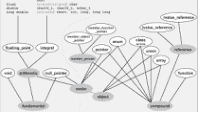

#### D.2.1 测试主要类型类别

本节描述测试给定类型的主要类型类别的类型工具。对于任何给定类型，恰好有一个主要类型类别具有求值为 `true` 的 `value` 成员。结果与类型是否带有 `const` 和/或 `volatile` 限定（cv 限定）无关。

请注意，对于类型 `std::size_t` 和 `std::ptrdiff_t`，这些主要类型类别中哪一个产生 `true` 是由实现定义的。对于类型 `std::max_align_t`，这些主要类型类别中哪一个产生 `true` 也属于实现细节（这反过来又取决于语言特定的……）。

| 特性 | 效果 |
|---|---|
| `is_void<T>` | void 类型 |
| `is_integral<T>` | 整数类型（包括 `bool`、`char`、`char16_t`、`char32_t` 或 `wchar_t`） |
| `is_floating_point<T>` | 浮点类型（`float`、`double` 或 `long double`） |
| `is_array<T>` | 普通数组类型（不是 `std::array` 类型） |
| `is_pointer<T>` | 指针类型（包括函数指针，但不包括指向非静态成员的指针） |
| `is_null_pointer<T>` | `nullptr` 的类型（自 C++14 起） |
| `is_member_object_pointer<T>` | 指向非静态数据成员的指针 |
| `is_member_function_pointer<T>` | 指向非静态成员函数的指针 |
| `is_lvalue_reference<T>` | 左值引用 |
| `is_rvalue_reference<T>` | 右值引用 |
| `is_enum<T>` | 枚举类型 |
| `is_class<T>` | 类/结构体或 lambda 类型，但不是联合类型 |
| `is_union<T>` | 联合类型 |
| `is_function<T>` | 函数类型 |

*表 D.4. 用于检查主要类型类别的特性*

`std::is_void<T>::value`

- 如果类型 `T` 是（cv 限定的）`void`，则产生 true。
- 例如：

**单击此处查看代码图像**

```cpp
std::is_void<void>          // yields true
std::is_void<const void>    // yields true
std::is_void<int>           // yields false
void f();
std::is_void<decltype(f)>   // yields false
```

`std::is_integral<T>::value`

- 如果类型 `T` 是以下（cv 限定的）类型之一，则产生 true：
  - `bool`
  - 字符类型（`char`、`signed char`、`unsigned char`、`char16_t`、`char32_t` 或 `wchar_t`）
  - 整数类型（`short`、`int`、`long` 或 `long long` 的有符号或无符号变体；这包括 `std::size_t` 和 `std::ptrdiff_t`）

`std::is_floating_point<T>::value`

- 如果类型 `T` 是（cv 限定的）`float`、`double` 或 `long double`，则产生 true。

`std::is_array<T>::value`

- 如果类型 `T` 是（cv 限定的）数组类型，则产生 true。
- 回顾一下，根据语言规则，声明为数组的参数（无论是否带长度）实际上具有指针类型。
- 请注意，类 `std::array<>` 不是数组类型，而是类类型。
- 例如：

```cpp
void foo(int i, int b[], int c)
{
  int a;
  is_array_v<decltype(a)>;        // yields false (a has type int)
  is_array_v<decltype(b)>;        // yields false (b has type int*)
  is_array_v<decltype(c)>;        // yields false (c has type int*)
}
```

- 实现细节见第 405 页第 9.8.2 节。

`std::is_pointer<T>::value`

- 如果 `T` 是（cv 限定的）指针，则产生 true。

这包括：

- 指向静态（全局）函数的指针
- 声明为数组（无论是否带长度）或函数类型的参数

这不包括：

- 成员指针类型（例如，`x::*` 的类型，其中 `x` 是类类型，并且是非静态成员函数或非静态数据成员）
- 字面量的类型，例如 `nullptr_t`

- 例如：

**单击此处查看代码图像**

```cpp
int* p = nullptr;                         // p has type int*
std::is_pointer<int*>::value;             // yields true
std::is_pointer<int* const>::value;       // yields true
std::is_pointer<int* volatile>::value;    // yields true
std::is_pointer<decltype(nullptr)>::value; // yields false
```

```cpp
void f(int* p1, int*& p2)
{
  is_pointer_v<decltype(p1)>;       // yields true (p1 has type int*)
  is_pointer_v<decltype(p2)>;       // yields false (p2 has type int*&)
  is_pointer_v<decltype(f)>;        // yields false
  is_pointer_v<decltype(f(1))>;     // yields false
  is_pointer_v<decltype(&f)>;       // yields true (pointer to function)
  is_pointer_v<decltype(f(1, p1))>; // yields false (return type is void)
}
```

- 实现细节见第 405 页第 9.8.2 节。

`std::is_null_pointer<T>::value`

- 如果 `T` 是（cv 限定的）`std::nullptr_t`（即 `nullptr` 的类型），则产生 true。
- 例如：

**单击此处查看代码图像**

```cpp
int* p = nullptr;
std::is_null_pointer<decltype(p)>::value; // yields false
void* q = nullptr;
std::is_null_pointer<decltype(q)>::value; // yields false (q has type void*)
std::is_null_pointer<int*>::value;        // yields false
std::is_null_pointer<decltype(nullptr)>::value; // yields true
std::is_null_pointer<std::nullptr_t>::value; // yields true
```

- 自 C++11 起提供：

```cpp
std::is_member_object_pointer<T>::value
std::is_member_function_pointer<T>::value
```

- 如果 `T` 是（cv 限定的）成员指针类型（例如，对于 `int C::*` 或某个类 `X`），则产生 true。

```cpp
std::is_lvalue_reference<T>::value
std::is_rvalue_reference<T>::value
```

- 如果 `T` 分别是（cv 限定的）左值引用类型或右值引用类型，则产生 true。
- 例如：

**单击此处查看代码图像**

```cpp
int i;
std::is_lvalue_reference<decltype(i)>::value; // yields false
std::is_lvalue_reference<decltype((i))>::value; // yields true
std::is_rvalue_reference<decltype(i)>::value; // yields false
std::is_rvalue_reference<decltype((i))>::value; // yields false
std::is_lvalue_reference<decltype(std::move(i))>::value; // yields false
std::is_rvalue_reference<decltype(std::move(i))>::value; // yields true
std::is_lvalue_reference<int>::value; // yields false
std::is_rvalue_reference<int>::value; // yields false
```

- 实现细节见第 405 页第 9.8.2 节。

`std::is_enum<T>::value`


**`std::is_class<T>::value`**
- 如果类型 `T` 是用 `class` 或 `struct` 声明的（cv 限定）类类型，则产生 `true`，包括通过实例化类模板生成的此类类型。注意，语言保证 lambda 表达式的类型是类类型（见第 330 页第 15.10.6 节）。
- 对于联合体、作用域枚举类型（尽管使用 `enum class` 声明）以及任何其他类型，则产生 `false`。
- 例如：

```cpp
is_class<int>::value               // yields false
is_class_v<int>                     // yields false
is_class_v<decltype([]{})>          // yields true
auto l = [](){};
is_class_v<decltype(l)>             // yields true
is_class_v<decltype([]{})>          // yields true for a lambda
```

- 实现细节见第 457 页第 19.8.5 节。

**`std::is_union<T>::value`**
- 如果类型 `T` 是（cv 限定的）联合体，则产生 `true`，包括由作为联合体模板的类模板生成的联合体。
- 实现细节见第 456 页第 19.8.4 节。

**`std::is_function<T>::value`**
- 如果类型 `T` 是（cv 限定的）函数类型，则产生 `true`。对于函数指针类型、lambda 表达式的类型以及任何其他类型，则产生 `false`。
- 回顾一下，按语言规则声明为函数类型的参数实际上具有指针类型。
- 例如：

```cpp
void foo(void) {}
is_union_v<decltype(foo)>          // yields false
is_union_v<decltype(&foo)>         // yields false
is_function_v<decltype(foo)>       // yields true
is_function_v<decltype(&foo)>      // yields false
is_function_v<decltype(foo)>       // yields true for a function type
```

- 实现细节见第 454 页第 19.8.3 节。

#### D.2.2 测试复合类型类别

以下工具用于确定某个类型是否属于比某些主类型类别的并集更一般的类型类别。复合类型类别并不构成严格划分：一个类型可以属于多个复合类型类别（例如，指针类型既是标量类型又是复合类型）。同样，cv 限定符（const 和 volatile）在类型分类中无关紧要。

**`std::is_reference<T>::value`**
- 如果类型 `T` 是引用类型，则产生 `true`。
- 等同于：`is_lvalue_reference<T> || is_rvalue_reference<T>`
- 实现细节见第 452 页第 19.8.2 节。

| 特性 | 效果 |
|---|---|
| `is_reference<T>` | 左值引用或右值引用 |
| `is_member_pointer<T>` | 指向非静态成员的指针 |
| `is_arithmetic<T>` | 整型（包括 `bool` 和字符类型）或浮点类型 |
| `is_fundamental<T>` | `void`、整型（包括 `bool` 和字符类型）、浮点类型或 `std::nullptr_t` |
| `is_scalar<T>` | 整型（包括 `bool` 和字符类型）、浮点类型、枚举、指针、指向成员的指针以及 `std::nullptr_t` |
| `is_object<T>` | 除 `void`、函数或引用之外的任何类型 |
| `is_compound<T>` | `is_fundamental<T>` 的反面：数组、枚举、联合体、类、函数、引用、指针或指向成员的指针 |

**`std::is_member_pointer<T>::value`**
- 如果类型 `T` 是任意指向成员的指针类型，则产生 true。
- 等同于：`is_member_object_pointer<T> || is_member_function_pointer<T>`

**`std::is_arithmetic<T>::value`**
- 如果类型 `T` 是算术类型（bool、字符类型、整数类型或浮点类型），则产生 true。
- 等同于：`is_integral<T> || is_floating_point<T>`

**`std::is_fundamental<T>::value`**
- 如果类型 `T` 是基本类型（算术类型、void 或 `std::nullptr_t`），则产生 true。
- 等同于：`is_arithmetic<T> || is_void<T> || is_null_pointer<T>`
- 实现细节见第 448 页第 19.8.1 节中的 `std::is_fundamental`。

**`std::is_scalar<T>::value`**
- 如果类型 `T` 是“标量”类型，则产生 true。
- 等同于：`is_arithmetic<T> || is_enum<T> || is_pointer<T> || is_member_pointer<T> || is_null_pointer<T>`

**`std::is_object<T>::value`**
- 如果类型 `T` 描述对象的类型，则产生 true。
- 等同于：`is_scalar<T> || is_array<T> || is_class<T> || is_union<T>`

**`std::is_compound<T>::value`**
- 如果类型 `T` 是复合类型（除基本类型之外的任何类型），则产生 true。
- 等同于：`!is_fundamental<T>`（即数组、类、联合体、枚举、引用、指针或指向成员的指针类型）。

### D.3 类型属性与操作

下一组特性提供单个类型的属性，以及可能适用于这些类型的某些操作（例如值交换）。

#### D.3.1 其他类型

**`std::is_signed<T>::value`**
- 如果 `T` 是有符号算术类型（即包含负值表示的算术类型），则产生 true；这包括 `(signed) int`、`float` 等类型。
- 对于类型 `bool`，它产生 false。
- 对于类型 `char`，它产生 true 还是 false 由实现定义。
- 对于所有非算术类型（包括枚举类型），`is_signed` 产生 false。

**`std::is_unsigned<T>::value`**
- 如果 `T` 是无符号算术类型（即不包含负值表示的算术类型），则产生 true；这包括 `unsigned int` 和 `bool` 等类型。
- 对于类型 `char`，它产生 true 还是 false 由实现定义。
- 对于所有非算术类型（包括枚举类型），`is_unsigned` 产生 false。

**`std::is_const<T>::value`**
- 如果该类型是 const 限定的，则产生 true。
- 注意，const 指针具有 const 限定的类型，而指向 const 类型的指针不是 const 限定的。指向 const 类型的引用不是 const 限定的。例如：

```cpp
std::is_const<int>::value        // false
std::is_const<const int>::value  // true
std::is_const<int const*>::value // false
```

语言规定，如果元素类型是 const 限定的，则数组是 const 限定的。⁵ 例如：

```cpp
std::is_const<int[3]>::value        // false
std::is_const<const int[3]>::value  // true
```

| 特性 | 效果 |
|---|---|
| `is_signed<T>` | 有符号算术类型 |
| `is_unsigned<T>` | 无符号算术类型 |
| `is_const<T>` | const 限定 |
| `is_volatile<T>` | volatile 限定 |
| `is_aggregate<T>` | 聚合类型（C++17 起） |
| `is_trivial<T>` | 标量类型、平凡类或这些类型的数组 |
| `is_trivially_copyable<T>` | 标量类型、可平凡复制类或这些类型的数组 |
| `is_standard_layout<T>` | 标量类型、标准布局类或这些类型的数组 |
| `is_pod<T>` | 平凡旧数据（POD）类型（其表示可通过 `memcpy` 复制以复制对象的类型） |
| `is_literal_type<T>` | 标量类型、引用、类或这些类型的数组（C++17 起弃用） |
| `is_empty<T>` | 没有非静态数据成员、虚成员函数或虚基类的类 |
| `is_polymorphic<T>` | 具有（派生）虚成员函数的类 |
| `is_abstract<T>` | 抽象类（至少有一个纯虚函数） |
| `is_final<T>` | 最终类（不允许从中派生的类，C++11 起） |
| `has_virtual_destructor<T>` | 具有虚析构函数的类 |
| `has_unique_object_representations<T>` | 任意两个值相同的对象在内存中具有相同的表示（C++17 起） |
| `alignment_of<T>` | 等同于 `alignof(T)` |
| `rank<T>` | 数组类型的维数（若非数组则为 0） |
| `extent<T, N=0>` | 第 `N` 维的范围（或 0） |
| `underlying_type<T>` | 枚举类型的基础类型 |
| `is_invocable<Fn, Args...>` | 可作为 `Args...` 的可调用对象使用（C++17 起） |
| `is_invocable_r<R, Fn, Args...>` | 可作为 `Args...` 的可调用对象使用并返回 `R`（C++17 起） |
| `invoke_result_t<Fn, Args...>` | 作为 `Args...` 的可调用对象使用时的结果类型（C++17 起） |
| `result_of<Fn, Args...>` | 用参数 `Args` 调用 `Fn` 时的结果类型（C++17 起弃用） |

**`std::is_volatile<T>::value`**
- 如果该类型是 volatile 限定的，则产生 true。
- 注意，volatile 指针具有 volatile 限定的类型，而指向 volatile 类型的指针不是 volatile 限定的。例如：

```cpp
is_volatile<int volatile>::value       // true
is_volatile<int volatile*>::value      // false
is_volatile<int*>::value                // false
```

- 语言规定，如果元素类型是 volatile 限定的，则数组是 volatile 限定的。

例如：

```cpp
is_volatile<int[3]>::value             // false
is_volatile<int volatile[3]>::value    // true
is_volatile<int[3] volatile>::value     // false
```

**`std::is_aggregate<T>::value`**
- 如果 T 是聚合体（要么是数组，要么是没有用户定义、显式或继承的构造函数，没有私有或受保护的非静态数据成员，没有虚函数，也没有虚、私有或受保护基类的类/结构体/联合体），则产生 true。
- 有助于判断是否需要列表初始化。例如：

```cpp
template<typename Col, typename T>
void insert(Col& col, T&& t)
{
    if (is_aggregate<T>::value)
    {
        Col value{t};
        col.emplace_back(std::move(value));  // in-place
    }
    else
    {
        col.emplace_back(std::forward<T>(t));
    }
}
```

- 要求给定类型要么是完整类型（见第 354 页第 30.3.1 节），要么是 cv 限定的 void。
- 自 C++17 起可用。

**`std::is_trivial<T>::value`**
- 如果该类型是“平凡类型”，则产生 true：
  - 标量类型（整型、浮点、枚举、指针；见第 707 页的 `is_scalar()`）
  - 平凡类类型（没有虚函数、没有虚基类、没有（间接）用户定义的默认构造函数、复制/移动构造函数、复制/移动赋值运算符或析构函数，没有非静态数据成员，没有 volatile 成员，也没有非平凡非静态成员的类）
  - 此类类型的数组
  - 以及这些类型的 cv 限定版本
- 如果 `T` 是可平凡复制的并且具有平凡默认构造函数，则产生 true。

**`std::is_trivially_copyable<T>::value`**
- 如果该类型是“可平凡复制”类型，则产生 true：
  - 标量类型（整型、浮点、枚举、指针；见第 707 页的 `is_scalar()`）
  - 平凡类类型（没有虚函数、没有虚基类、没有（间接）用户定义的默认构造函数、复制/移动构造函数、复制/移动赋值运算符或析构函数，没有非静态数据成员，没有 volatile 成员，也没有非平凡非静态成员的类）
  - 此类类型的数组
  - 以及这些类型的 cv 限定版本

**`std::is_standard_layout<T>::value`**


#### `std::is_standard_layout<T>::value`

- 此类类型的数组
- 以及这些类型的 cv 限定版本
- 与 `is_trivial` 相反，允许 volatile 成员，不允许引用成员，成员可以有不同的访问权限，成员也可以分布在不同的基类中。
- 要求给定类型（对于数组，是元素类型）要么是完整类型（见第154页的10.3.1节），要么是（cv 限定的）`void`。

#### `std::is_pod<T>::value`

- 如果 `T` 是 POD 类型（POD），则结果为 true。
- 此类类型的对象可以通过复制底层存储来复制（例如使用 `memcpy()`）。
- 等同于：`is_trivial<T> && is_standard_layout<T>`。
- 以下情况结果为 false：
  - 没有平凡默认构造函数、拷贝/移动构造函数、拷贝/移动赋值运算符或析构函数的类
  - 具有虚成员或虚基类的类
  - 具有 volatile 或引用成员的类
  - 在不同（基）类中具有成员或具有不同访问权限的类
  - lambda 表达式的类型（称为闭包类型）
  - 函数
  - `void`
  - 从这些类型中移除的类型
- 要求给定类型要么是完整类型（见第154页的10.3.1节），要么是（cv 限定的）`void`。

#### `std::is_literal_type<T>::value`

- 如果给定类型是 `constexpr` 函数的有效纯字面量类型，则结果为 true（值得注意的是，这排除了任何需要非平凡析构函数的类型）。
- 如果 `T` 是字面量类型，则结果为 true：
  - 标量类型（整型、浮点、枚举、指针；见第707页的 `is_scalar()`）
  - 引用类型
  - 类类型，至少有一个非拷贝/移动构造函数的 `constexpr` 构造函数（在每个（基）类中，任何（基）类或成员都没有用户定义或虚析构函数，并且每个非静态数据成员的初始化都是常量表达式）
  - 此类类型的数组
- 要求给定类型要么是完整类型（见第154页的10.3.1节），要么是（cv 限定的）`void`。

#### `std::is_empty<T>::value`

- 如果 `T` 是一个类类型但不是联合类型，且其对象不包含任何数据，则结果为 true。
- 如果定义为类或结构体，并满足以下条件，则结果为 true：
  - 除了长度为 0 的位域之外，没有非静态数据成员
  - 没有虚成员函数
  - 没有虚基类
  - 没有非空基类
- 要求给定类型如果是类/结构体，则必须是完整类型（见第154页的10.3.1节）（不完整的联合类型是未定义的）。

#### `std::is_polymorphic<T>::value`

- 如果 `T` 是多态类类型（声明或继承了虚函数的类），则结果为 true。
- 要求给定类型要么是完整类型（见第154页的10.3.1节），要么是（cv 限定的）`void`。

#### `std::is_abstract<T>::value`

- 如果 `T` 是抽象类类型（一个无法创建对象的类，因为它至少有一个纯虚成员函数），则结果为 true。
- 要求给定类型必须是完整类型（见第154页的10.3.1节）。

#### `std::is_final<T>::value`

- 如果 `T` 是 final 类类型（不能作为另一个类的基类的类或联合体），则结果为 true。
- 对于所有非类/联合体类型，如 `int`，它返回 false（因为没有这样的类型可以是 final 的）。
- 要求给定类型要么是完整类型（见第154页的10.3.1节），要么不是类/结构体/联合体。
- 自 C++14 起可用。

#### `std::has_virtual_destructor<T>::value`

- 如果类型 `T` 有虚析构函数，则结果为 true。
- 如果给定类型是类/结构体，则要求它是完整类型（见第154页的10.3.1节）（不完整的联合类型也可以）。

#### `std::has_unique_object_representations<T>::value`

- 如果类型 `T` 的任何两个对象在内存中具有相同的对象表示，则结果为 true。也就是说，两个相同的值总是使用相同的字节值序列来表示。
- 具有此属性的对象可以通过对关联的字节序列进行哈希来产生可靠的哈希值（不存在对象表示中参与填充的某些位在不同情况下可能不同的风险）。
- 要求给定类型是可平凡复制的（见第72页的7.3.1节），并且要么是完整类型（见第154页的10.3.1节），要么是（cv 限定的）`void`，要么是未知边界的数组。
- 自 C++17 起可用。

#### `std::alignment_of<T>::value`

- 将类型 `T` 的对象对齐值作为 `std::size_t` 产生（对于数组，是元素类型；对于引用，是被引用的类型）。
- 等同于：`alignof(T)`
- 此特征在 C++11 中引入，早于 `alignof(...)` 构造。然而，它仍然有用，因为该特征可以作为一个类传递，这对于某些元程序是有用的。
- 要求 `alignof(T)` 是有效的表达式。
- 使用 `std::alignment_of<>` 获取多个类型的公共对齐值（见第733页的 D.9 节）。

#### `std::rank<T>::value`

- 将类型 `T` 的数组维度数作为 `std::size_t` 产生。
- 对于所有其他类型，产生 0。
- 指针没有关联的维度。数组类型中未指定的边界确实指定了一个维度（因此，虽然函数参数被声明为数组类型，但它没有实际的数组类型，并且 `std::rank` 也不会将其视为数组类型。见第704页的2.1.0节）。

例如：


```cpp
int a[2][5];
std::rank<decltype(a)>;       // yields 2
std::extent<decltype(a)>;     // yields 2
extern int p[];
std::rank<decltype(p)>;        // yields 1
```

#### `std::extent<T>::value`

- 将类型 `T` 的数组的第一个或每个维度的大小作为 `std::size_t` 产生。
- 如果不是数组、维度不存在或维度大小未知，则产生 0。
- 实现细节见第655页的15.9节。


```cpp
int a[5][5];
std::extent_v<decltype(a)>;       // yields 5
std::extent_v<decltype(a), 1>;    // yields 5
std::extent_v<decltype(a), 2>;    // yields 0
extern int p[];
std::extent_v<decltype(p)>;        // yields 0
std::extent_v<decltype(p), 1>;     // yields 0
```

#### `std::underlying_type<T>::type`

- 产生枚举 `T` 的底层类型。
- 要求给定类型是完整的枚举类型（见第154页的10.3.1节）。对于所有其他类型，其行为是未定义的。

#### `std::is_invocable<T, Args...>::value` / `std::is_nothrow_invocable<T, Args...>::value`

- `std::is_invocable<T, Args...>::value` 如果 `T` 可用作 `Args...` 的可调用对象，则结果为 true。
- `std::is_nothrow_invocable<T, Args...>::value` 如果 `T` 可用作 `Args...` 的可调用对象，并保证不抛出异常，则结果为 true。
- 也就是说，我们可以使用这些特征来测试我们是否可以调用或 `std::invoke()` 给定的可调用对象及其 `Args...`（关于可调用对象和 `std::invoke()` 的详细信息，见第157页的9.1.1节）。
- 要求所有给定类型都是完整类型（见第154页的10.3.1节），或者（对于非限定的 `void`）是 void 或未知边界的数组。
- 例如：

```cpp
return true;
}
};
std::is_invocable_r_v<RET_T, T, Args...>::value    // false
std::is_invocable_r_v<RET_T, T, Args...>::value    // true
std::is_invocable_r_v<RET_T, T, Args...>::value    // false
std::is_invocable_r_v<RET_T, T, Args...>::value    // true
```

#### `std::is_invocable_r_v<RET_T, T, Args...>` / `std::is_nothrow_invocable_r_v<RET_T, T, Args...>`

- 自 C++17 起可用。
- `std::is_invocable_r_v<RET_T, T, Args...>` 如果我们可以使用 `T` 作为 `Args...` 的可调用对象，并返回可转换为类型 `RET_T` 的值，则产生 `true`。
- `std::is_nothrow_invocable_r_v<RET_T, T, Args...>` 如果我们可以使用 `T` 作为 `Args...` 的可调用对象，并保证不抛出异常，且返回可转换为类型 `RET_T` 的值，则产生 `true`。
- 也就是说，我们可以使用这些特征来测试我们是否可以调用或 `std::invoke()` 特定类型的 `T`，并将返回值用作 `RET_T`。（关于可调用对象和 `std::invoke()` 的详细信息，见第57页的1.1节。）
- 要求所有传递的类型都是完整类型（见第354页的13.1.3节）。

例如：

```cpp
struct C {
    bool operator() (int) const {
        return true;
    }
};

std::is_invocable_v<decltype(C{}), int>;                 // true
std::is_invocable_r_v<bool, decltype(C{}), int>;         // true
std::is_invocable_r_v<void, decltype(C{}), int>;         // true
std::is_invocable_r_v<std::string, decltype(C{}), int>;  // false
std::is_nothrow_invocable_r_v<bool, decltype(C{}), int>; // false
std::is_invocable_r_v<int, decltype(C{}), int>;          // true
std::is_invocable_r_v<long, decltype(C{}), int>;         // true
std::is_invocable_r_v<double, decltype(C{}), int>;       // true
std::is_invocable_r_v<const char*, decltype(C{}), int>;  // false
```

#### `std::invoke_result<T, Args...>::type` / `std::result_of<T, Args...>::type`

- 产生可调用对象 `T` 针对 `Args...` 调用时的返回类型。
- 注意语法略有不同：
  - 要调用 `invoke_result`，你必须将可调用对象的类型和参数都作为参数传递。
  - 对于 `result_of`，你必须传递使用相应类型的函数声明。
  - 如果无法进行调用，则未定义任何 type 成员，因此使用它会出错（这可能会在函数模板的声明中使用它时导致 `SFINAE` 失败；见第133页的8.4节）。
  - 也就是说，我们可以使用这些特征来获取调用 `std::invoke()` 时获得的返回类型（给定的可调用对象 `T` 针对 `Args...`）。（关于可调用对象和 `std::invoke()` 的详细信息，见第57页的1.1节。）
  - 要求所有给定类型要么是完整类型（见第354页的13.1.3节），要么是（cv 限定的）void，要么是未知边界的数组类型。
- `invoke_result` 自 C++17 起可用，并取代了自 C++17 起弃用的 `result_of`，因为 `invoke_result` 提供了更多改进，更好地确保了有效性并允许 `T` 为任意类型。

例如：

```cpp
std::string foo(int);

using R0 = std::result_of_t<decltype(foo)(int)>;       // C++14
using R1 = std::result_of_t<decltype(foo)(int)>;       // C++17
using R2 = std::invoke_result_t<decltype(foo), int>;   // C++17

struct A {
    int operator() (int) const {
        return 0;
    }
};

using R1 = std::invoke_result_t<A&(int)>;              // C++17
using R2 = std::invoke_result_t<A&, int>;               // C++17
```


| 特征 | 效果 |
|---|---|
| `is_constructible<T, Args...>` | 可以用类型 `Args` 初始化类型 `T` |
| `is_trivially_constructible<T, Args...>` | 可以用类型 `Args` 平凡地初始化类型 `T` |
| `is_nothrow_constructible<T, Args...>` | 可以用类型 `Args` 初始化类型 `T`，且该操作不会抛出异常 |
| `is_default_constructible<T>` | 可以无参数初始化 `T` |
| `is_trivially_default_constructible<T>` | 可以无参数平凡地初始化 `T` |
| `is_nothrow_default_constructible<T>` | 可以无参数初始化 `T`，且该操作不会抛出异常 |
| `is_copy_constructible<T>` | 可以复制一个 `T` |
| `is_trivially_copy_constructible<T>` | 可以平凡地复制一个 `T` |
| `is_nothrow_copy_constructible<T>` | 可以复制一个 `T`，且该操作不会抛出异常 |
| `is_move_constructible<T>` | 可以移动一个 `T` |
| `is_trivially_move_constructible<T>` | 可以平凡地移动一个 `T` |
| `is_nothrow_move_constructible<T>` | 可以移动一个 `T`，且该操作不会抛出异常 |
| `is_assignable<T1, T2>` | 可以将类型 `T2` 赋值给类型 `T1` |
| `is_trivially_assignable<T1, T2>` | 可以平凡地将类型 `T2` 赋值给类型 `T1` |
| `is_nothrow_assignable<T1, T2>` | 可以将类型 `T2` 赋值给类型 `T1`，且该操作不会抛出异常 |
| `is_copy_assignable<T>` | 可以复制赋值一个 `T` |
| `is_trivially_copy_assignable<T>` | 可以平凡地复制赋值一个 `T` |
| `is_nothrow_copy_assignable<T>` | 可以复制赋值一个 `T`，且该操作不会抛出异常 |
| `is_move_assignable<T>` | 可以移动赋值一个 `T` |
| `is_trivially_move_assignable<T>` | 可以平凡地移动赋值一个 `T` |
| `is_nothrow_move_assignable<T>` | 可以移动赋值一个 `T`，且该操作不会抛出异常 |
| `is_destructible<T>` | 可以销毁一个 `T` |
| `is_trivially_destructible<T>` | 可以平凡地销毁一个 `T` |
| `is_nothrow_destructible<T>` | 可以销毁一个 `T`，且该操作不会抛出异常。 |
| `is_swappable<T>` | 可以对该类型调用 `swap(t, u)`（自 C++17 起）。 |
| `is_nothrow_swappable<T>` | 可以对该类型调用 `swap(t, u)`，且该操作不会抛出异常（自 C++17 起）。 |
| `is_swappable_with<T, U>` | 可以针对具有特定值类别的这两种类型调用 `swap(t, u)`（自 C++17 起）。 |
| `is_nothrow_swappable_with<T, U>` | 可以针对具有特定值类别的这两种类型调用 `swap(t, u)`，且该操作不会抛出异常（自 C++17 起）。 |

*表 8.4. 用于检查特定操作的特征*

表 8.4 列出了允许我们检查某些特定操作的类型特征。带有 `is_trivially_...` 的形式还会检查为对象成员或基类调用的所有（子）操作是否都是平凡的（既不是用户定义的，也不是虚的）。带有 `is_nothrow_` 的形式还会检查所调用的操作是否保证不抛出异常。注意，所有 `is_..._constructible` 检查都蕴含相应的 `is_..._destructible` 检查。例如：

**单击此处查看代码图像**

`util/isconstructible.cpp`

```cpp
#include <iostream>

class C {
 public:
  C() { // default constructor has no noexcept
  }
  virtual ~C() = default; // makes C nontrivial
};

int main()
{
  using namespace std;
  cout << is_default_constructible_v<C> << '\n';
  cout << is_trivially_default_constructible_v<C> << '\n';
  cout << is_nothrow_default_constructible_v<C> << '\n';
  cout << is_copy_constructible_v<C> << '\n';
  cout << is_trivially_copy_constructible_v<C> << '\n';
  cout << is_nothrow_copy_constructible_v<C> << '\n';
  cout << is_destructible_v<C> << '\n';
  cout << is_nothrow_destructible_v<C> << '\n';
}
```

由于定义了虚析构函数，所有操作都不再是平凡的。并且因为我们定义了一个不带 `noexcept` 的默认构造函数，所以它可能抛出异常。其他所有操作默认保证不抛出异常。

- `std::is_constructible<T, Args...>::value`
- `std::is_trivially_constructible<T, Args...>::value`
- `std::is_nothrow_constructible<T, Args...>::value`

如果类型 `T` 的对象可以用 `Args...` 所给类型的实参初始化（不使用非平凡操作，或保证不抛出异常），则产生 true。也就是说，以下内容必须有效：

`T t(std::declval<Args>()...);`

值为 true 意味着该对象可以相应地销毁（即……）。要求给定类型要么是完整的（见第 154 页第 30.3.1 节）、（cv 限定的）void，要么是未知边界的数组。

- 例如：

**单击此处查看代码图像**

```cpp
is_constructible_v<int>                         // true
is_constructible_v<const int>                   // true
is_constructible_v<long, int>                   // true
is_constructible_v<long[], int>                 // false
is_constructible_v<void*>                       // false
is_constructible_v<const char*, std::string>    // false
is_constructible_v<char*, std::string>          // true
```

- 注意，`is_constructible` 的源类型和目标类型顺序不同。

```cpp
std::is_default_constructible<T>::value
std::is_trivially_default_constructible<T>::value
std::is_nothrow_default_constructible<T>::value
```

- 如果类型 `T` 的对象可以在没有任何初始化实参的情况下初始化（不使用非平凡操作，或保证不抛出异常），则产生 `true`。
- 分别与 `is_constructible<T>`、`is_trivially_constructible<T>` 或 `is_nothrow_constructible<T>` 相同。
- 值为 true 意味着该对象可以相应地销毁（即 `is_trivially_destructible<T>` 或 `is_nothrow_destructible<T>::value`）。
- 要求给定类型要么是完整的（见第 354 页第 30.3.1 节）、（cv 限定的）void，要么是未知边界的数组。
- 例如：

**单击此处查看代码图像**

```cpp
is_default_constructible<int>                  // yields true
is_copy_constructible<U>                        // yields true
is_copy_constructible<std::unique_ptr<int>>     // yields false
is_copy_constructible<std::string>              // yields true
is_copy_constructible<const std::string>        // yields false
is_constructible_v<std::string, const std::string&> // yields true
is_constructible_v<std::string, std::string&&>  // yields true
is_constructible_v<std::string, std::string&>   // yields true
```

```cpp
std::is_move_constructible<T>::value
std::is_trivially_move_constructible<T>::value
std::is_nothrow_move_constructible<T>::value
```

- 如果类型 `T` 的对象可以由类型 `T` 的右值创建（不使用非平凡操作，或保证不抛出异常），则产生 `true`。

假设 `T` 是可引用类型，则与 `is_constructible<T, Args...>` 中相同；特别地，`is_trivially_copy_constructible<T>::value` 为 false。

一个未限定 cv 且可以异步销毁（即通过 `destroy_async()`、`is_trivially_destructible_v<T>`、`is_nothrow_destructible_v<T>`）的对象称为“平凡的”。

注意，无法检查是否已对类型 `T` 的对象调用非平凡析构函数。通常假设该析构函数调用没有任何效果（也就是说，相应类型不是实际类（用此类型声明的对象的引用或指针））。

实现细节见第 44 页第 9.7 节。

例如：

**单击此处查看代码图像**

```cpp
is_move_constructible_v<int>       // yields true
is_move_constructible_v<double>    // yields true
is_move_constructible_v<std::unique_ptr<int>> // yields true
is_move_constructible_v<int&>      // yields true
is_move_constructible_v<const int&> // yields true
// in contrast to:
is_constructible_v<const int&, int&> // yields true
is_constructible_v<const int&, int&&> // yields true
is_constructible_v<const int&, const int&> // yields true
is_constructible_v<const int&, const int&&> // yields false
```

```cpp
std::is_assignable<T&, T> // yields true
std::is_trivially_assignable<T&, T> // yields true
std::is_nothrow_assignable<T&, T> // yields true
```

如果类型 `T` 的 cv 限定对象（如果 `T` 是对象类型，则为 `T`；如果 `T` 是 void，则为 `T`）可以用赋值运算符赋值（不使用非平凡操作，或保证不抛出异常），则产生 true。

要求给定类型要么是完整的（见第 154 页第 10.3.1 节），要么是未知边界的数组。

注意，用于移动赋值的 `is_assignable<>` 是按成员逐一定义的，就像它们被声明为复制赋值运算符一样（但注意赋值是 = 7.1）。注意：这是因为如果函数不是虚函数，它就是成员函数的引用；如果函数是虚函数，它就是虚函数的引用。

注意，`is_convertible` 的源类型和目标类型顺序不同。

例如：

**单击此处查看代码图像**

```cpp
is_assignable_v<int&, int>       // yields true
is_assignable_v<int&, int&>      // yields true
is_assignable_v<int&, int&&>     // yields true
```

```cpp
std::is_copy_assignable<T> // yields true
std::is_trivially_copy_assignable<T> // yields true
std::is_nothrow_copy_assignable<T> // yields true
```

如果类型 `T` 的 cv 限定对象（如果 `T` 是对象类型，则为 `T`；如果 `T` 是 void，则为 `T`）可以用赋值运算符赋值（不使用非平凡操作，或保证不抛出异常），则产生 true。


```cpp
is_trivially_default_constructible_v<...> // yields false
is_trivially_copyable_v<...>             // yields true
is_trivially_destructible_v<...>         // yields false
is_trivially_copy_constructible_v<...>   // yields true
is_trivially_copy_assignable_v<...>      // yields false
is_trivially_move_constructible_v<...>   // yields true
is_trivially_move_assignable_v<...>      // yields false
```

```cpp
static_assert(is_swappable_with<T1, T2>);
static_assert(!is_nothrow_swappable_with<T1, T2>);
```

1.  如果类型 T 的表达式可以与类型 U 的表达式交换，则值为 true；否则为 false。该表达式在未求值上下文中是良构的。如果……，则两个类型 T 和 U 是可交换的。

    -   要求给定类型要么是完整类型（第 3.3 节），要么是未知边界的数组。
    -   注意，如果 T 或 U 是非引用、非数组类型，则 `is_swappable_with<T, U>` 总是产生 false，因为这类类型会产生右值。

    例如：

    ```cpp
    is_swappable_with<int, int> // yields false
    is_swappable_with<int&, int&> // yields true
    is_swappable_with<int&&, int&&> // yields true
    is_swappable_with<int&, int> // yields false
    is_swappable_with<int, int&> // yields false
    is_swappable_with<int&&, int&> // yields false
    is_swappable_with<int, int&&> // yields false
    is_swappable_with<int&, int&&> // yields true
    is_swappable_with<int&&, int> // yields false
    is_swappable_with<std::pair<int,int>, std::pair<int,int>> // yields true
    is_swappable_with<std::pair<int,int>&, std::pair<int,int>&> // yields true
    is_swappable_with<std::pair<int,int>, std::pair<int,int>&> // yields false
    is_swappable_with<std::pair<int,int>&, std::pair<int,int>> // yields false
    is_swappable_with<std::pair<int,int>&&, std::pair<int,int>&&> // yields true
    is_swappable_with<std::pair<int,int>&&, std::pair<int,int>&> // yields false
    is_swappable_with<std::pair<int,int>&, std::pair<int,int>&&> // yields false
    is_swappable_with<std::pair<int,int>&&, std::pair<int,int>> // yields false
    is_swappable_with<std::pair<int,int>, std::pair<int,int>&&> // yields false
    ```

    自 C++17 起可用。

```cpp
template< class T, class U >
struct is_nothrow_swappable_with;
```

2.  如果类型 T 的表达式可以与类型 U 的表达式交换，并且交换表达式为 `noexcept`，则值为 true；否则为 false。该表达式在未求值上下文中是良构的。如果……，则两个类型 T 和 U 是可交换的。

    -   要求给定类型要么是完整类型（第 3.3 节），要么是未知边界的数组。
    -   注意，如果 T 或 U 是非引用、非数组类型，则 `is_nothrow_swappable_with<T, U>` 总是产生 false，因为这类类型会产生右值。

    例如：

    ```cpp
    is_nothrow_swappable_with<int, int> // yields false
    is_nothrow_swappable_with<int&, int&> // yields true
    is_nothrow_swappable_with<int&&, int&&> // yields true
    is_nothrow_swappable_with<int&, int> // yields false
    is_nothrow_swappable_with<int, int&> // yields false
    is_nothrow_swappable_with<int&&, int&> // yields false
    is_nothrow_swappable_with<int, int&&> // yields false
    is_nothrow_swappable_with<int&, int&&> // yields true
    is_nothrow_swappable_with<int&&, int> // yields false
    is_nothrow_swappable_with<std::pair<int,int>, std::pair<int,int>> // yields true
    is_nothrow_swappable_with<std::pair<int,int>&, std::pair<int,int>&> // yields true
    is_nothrow_swappable_with<std::pair<int,int>, std::pair<int,int>&> // yields false
    is_nothrow_swappable_with<std::pair<int,int>&, std::pair<int,int>> // yields false
    ```

    自 C++17 起可用。

#### D.3.2 类型之间的关系

表 D-3 列出了允许测试类型之间特定关系的类型萃取。这包括检查为类类型提供了哪些构造函数和赋值运算符。

```cpp
is_convertible_v<...>                 // yields false
```

-   要求给定类型要么是完整的（见第 [basic.types] 节），要么是未知边界的数组。
-   注意，const 指针是 const 限定类型，而指向 const 类型的非 const 指针或引用不是 const 限定的。例如，`is_assignable<...>` 对三种实例化模式具有不同的顺序。
-   实现细节见第 425 页的第 [..] 节。

### D.4 类型构造

表 D.6 中列出的萃取允许我们从其他类型构造类型。

| 萃取 | 效果 |
|---|---|
| `remove_const<T>` | 对应的不带 `const` 的类型 |
| `remove_volatile<T>` | 对应的不带 `volatile` 的类型 |
| `remove_cv<T>` | 对应的不带 `const` 和 `volatile` 的类型 |
| `add_const<T>` | 对应的 `const` 类型 |
| `add_volatile<T>` | 对应的 `volatile` 类型 |
| `add_cv<T>` | 对应的 `const volatile` 类型 |
| `make_signed<T>` | 对应的有符号非引用类型 |
| `make_unsigned<T>` | 对应的无符号非引用类型 |
| `remove_reference<T>` | 对应的非引用类型 |
| `add_lvalue_reference<T>` | 对应的左值引用类型（右值变为左值） |
| `add_rvalue_reference<T>` | 对应的右值引用类型（右值仍为右值） |
| `remove_pointer<T>` | 指针所指向的类型（否则为同一类型） |
| `add_pointer<T>` | 指向对应的非引用类型的指针类型 |
| `remove_extent<T>` | 数组的元素类型（否则为同一类型） |
| `remove_all_extents<T>` | 多维数组的元素类型（否则为同一类型） |
| `decay<T>` | 转换为对应的“按值”类型 |

表 D.6. 用于类型构造的萃取

`std::remove_const<T>::type`、`std::remove_volatile<T>::type` 和 `std::remove_cv<T>::type` 产生在顶层不带 const 和/或 volatile 的类型 T。

注意，const 指针是 const 限定类型，而指向 const 类型的非 const 指针或引用不是 const 限定的。例如：

```cpp
std::remove_const_t<const int>        // yields int
std::remove_const_t<const int*>       // yields const int*
std::remove_const_t<int const&>       // yields int const&
```

相反，我们可能更倾向于使用 `std::decay<>`，但它也会将数组类型和函数类型转换为对应的指针类型（见第 115 页的第 5.4 节）。

```cpp
std::decay_t<const T>            // yields int
std::decay_t<const T&>           // yields int
```

-   实现细节见第 696 页的第 9.3.2 节。

`std::add_const_t<T>`、`std::add_volatile_t<T>` 和 `std::add_cv_t<T>` 在顶层添加相应的 const/volatile 限定符。将其中一个萃取应用于引用类型或函数类型没有效果。例如：

```cpp
std::add_const_t<int>       // yields int const
std::add_const_t<volatile int> // yields int const volatile
std::add_const_t<int const>   // yields int const
std::add_const_t<int&>        // yields int&
std::add_const_t<int&&>       // yields int&&
std::add_const_t<int*>        // yields int* const
```

`std::make_signed_t<T>` 和 `std::make_unsigned_t<T>` 产生 T 对应的有符号/无符号类型。这要求 T 是枚举类型或除 bool 以外的（带 cv 限定的）整型类型。所有其他类型都会导致未定义行为（关于如何避免此类未定义行为的讨论，见第 696 页的第 9.3 节）。

```cpp
std::make_signed_t<char>        // yields signed char
std::make_unsigned_t<char>      // yields unsigned char
std::make_unsigned_t<char const> // yields unsigned char const
```

`std::remove_reference_t<T>` 产生引用类型 T 所引用的类型（如果 T 不是引用类型，则为 T 本身）。例如：

```cpp
std::remove_reference_t<int>         // yields int
std::remove_reference_t<int&>        // yields int
std::remove_reference_t<int&&>       // yields int
std::remove_reference_t<int const&>  // yields int const
std::remove_reference_t<int const&&> // yields int const
```

注意，引用类型本身不是 const 限定的。因此，`remove_const_t<int const&>` 的成员 `type` 是 `int const&`。

```cpp
std::remove_const_t<std::remove_reference_t<int const&>> // yields int
std::remove_reference_t<std::remove_const_t<int const&>> // yields int const
```


```cpp
add_value_reference_t<remove_reference_t<int>>  // yields int
add_value_reference_t<void*>                    // yields void
add_value_reference_t<const void*>              // yields void
```

- 实现细节参见第 405 页第 13.2 节。

```cpp
std::remove_pointer_t<T>  // yields T
```

- 产生指针类型 T 所指向的类型（如果 T 本身不是指针类型，则产生 T 本身）。
- 例如：

**点击此处查看代码图像**

```cpp
remove_pointer_t<int>          // yields int
remove_pointer_t<int const*>    // yields int const
remove_pointer_t<const int*>    // yields int const
remove_pointer_t<int*>           // yields int
```

```cpp
std::add_pointer_t<T>  // yields T*
```

- 产生指向 T 的指针类型；或者，当 T 是引用类型时，产生指向其底层类型 T 的指针类型。
- 如果不存在这样的类型，则产生 T（适用于带 cv 限定符的函数类型）。
- 例如：

**点击此处查看代码图像**

```cpp
std::add_pointer_t<void>             // yields void*
std::add_pointer_t<const int>         // yields int const*
std::add_pointer_t<int&>              // yields int*
std::add_pointer_t<int&&>             // yields int*
std::add_pointer_t<int[10]>           // yields int(*)[10]
std::add_pointer_t<int(&)[10]>        // yields int(*)[10]
std::add_pointer_t<int(*)[10]>        // yields int(*)[10]
```

- 实现细节参见第 531 页第 13.2.2 节。

```cpp
std::decay_t<T>
```

- 产生 T 的退化类型。
- 具体而言，对 T 执行以下变换：
  - 首先，应用 `remove_reference`（参见第 729 页第 D.4 节）。
  - 如果结果是数组类型，则产生指向直接元素类型的指针（参见第 107 页第 7.1 节）。
  - 否则，如果结果是函数类型，则产生对该函数类型应用 `add_pointer_t` 所得到的类型（参见第 539 页第 13.1.3 节）。
  - 否则，产生不带任何顶层 `const`/`volatile` 限定符的结果。
- `decay<T>` 模拟实参的值传递，或初始化 `auto` 类型对象时的类型转换。
- 对于可能被引用类型替换、但需要确定另一个函数的返回类型或参数类型的模板参数，`decay<>` 特别有用。参见第 12 页第 13.3.2 节。

```cpp
std::make_pair(...)
```

- 例如：

**点击此处查看代码图像**

```cpp
decay_t<const int>        // yields int
decay_t<const int&>       // yields int
```

### D.5 其他特性

表 D.7 列出了这里所有其余的特性。它们要么具有特殊属性，要么提供更复杂的类型变换。

| 特性 | 效果 |
|---|---|
| `enable_if<B, T>` | 仅当布尔值 `B` 为 true 时产生类型 `T` |
| `conditional<B, T, F>` | 若布尔值 `B` 为 true 则产生类型 `T`，否则产生类型 `F` |
| `common_type<Types...>` | 所有传入类型的公共类型 |
| `aligned_storage<Len>` | 具有默认对齐方式的 `Len` 字节类型 |
| `aligned_storage<Len, Align>` | 按 `sizeof(Align)` 的除数对齐的 `Len` 字节类型 |
| `aligned_union<Len, Types...>` | 为 `Types...` 的联合体对齐的 `Len` 字节类型 |

*表 D.7：其他类型特性*

```cpp
std::enable_if<cond, T>::type
```

- 如果 `cond` 为 true，则在其成员类型中产生 `void` 或 `T`。否则，它不定义成员类型。
- 由于条件为 false 时类型成员未定义，因此该特性可以并且通常用于根据给定条件禁用函数模板或将其 SFINAE 排除。
- 关于第一个示例的细节，参见第 48 页第 6.9.2 节。关于使用参数包的另一示例，参见第 735 页第 D.6 节。
- 关于 `std::enable_if` 如何实现的细节，参见第 409 页第 20.2 节。

```cpp
std::conditional<cond, T, F>::type
```

- 如果 `cond` 为 true 则产生 `T`，否则产生 `F`。
- 这是第 440 页第 19.7.1 节中介绍的特性 `std::conditional<>` 的标准版本。
- 请注意，与普通的 C++ if-then-else 语句不同，“then”和“else”两个分支的模板实参都会在作出决定之前进行求值，因此两个分支都不能包含非良构代码，否则程序很可能非良构。因此，你可能需要增加一层间接来避免此问题。第 440 页第 19.7.1 节针对具有相同行为的特性 `isThen` 演示了这一点。
- 示例参见第 17 页第 11.5 节。

```cpp
std::common_type<T...>::type
```

- 产生给定类型 `T1, ..., TN` 的“公共类型”。
- 公共类型的计算比我们想在本附录中涵盖的要稍微复杂一些。粗略地说，两个类型 `T` 和 `U` 的公共类型是条件运算符 `?:` 在其第二和第三操作数分别为类型 `T` 和 `U` 时产生的类型。如果两个类型都是 `void`，则公共类型是 `void`。否则，如果任一类型是左值引用，则公共类型由条件运算符确定。如果结果无效，则不存在公共类型。随后对该结果应用 `decay_t`。默认计算可由用户对 `std::common_type<T>` 的特化来覆盖（在 C++ 标准库中，对于时长和时间点存在偏特化）。
- 如果未给出类型或不存在公共类型，则不会定义 `type` 成员，因此使用它会出错（这可能通过 SFINAE 排除某个函数模板）。
- 如果只给出一个类型，则结果是对该类型应用 `decay_t`。
- 对于多于两个类型，`common_type` 会递归地用前两个类型的公共类型替换它们。如果该过程在任何时刻失败，则不存在公共类型。
- 在处理公共类型时，传入的类型都是经过 decay 处理的类型，因此该特性总是产生经过 decay 处理的类型。
- 关于该特性应用的讨论和示例，参见第 12 页第 13.3.3 节。
- 该特性的主模板核心通常由下面一行实现，这里仅使用两个参数：


这里不能使用逻辑运算符，因为我们组合的是对应的特性类。使用这个定义，以下写法是可能的：

**点击此处查看代码图像**

```cpp
std::cout << isNotPtr<int>::value <<
            "\n";                  // false
std::cout << isNotPtr<int*>::value <<
            "\n";                  // true
```

再配合相应的变量模板：

**点击此处查看代码图像**

```cpp
template<typename T>
constexpr bool is_not_ptr = isNotPtr<T>::value;
```

我们可以写：

**点击此处查看代码图像**

```cpp
std::cout << is_not_ptr<int> << "\n";      // false
std::cout << is_not_ptr<int*> << "\n";     // true
```

作为最后一个示例，下面的函数模板仅当其所有模板实参既不是类也不是联合体时才启用：

**点击此处查看代码图像**

```cpp
template<typename... T>
std::enable_if_t<std::conjunction_v<std::negation<std::is_class<T>>...,
                                    std::negation<std::is_union<T>>...>>

print(T...)
{
    ...
}
```

注意，省略号放在每个断言之后，以便它应用于参数包中的每个元素。

C++17 引入了 `conjunction`、`disjunction` 和 `negation` 来组合布尔特性。

| 特性 | 效果 |
|---|---|
| `conjunction<B...>` | 对布尔特性 B... 进行逻辑与（C++17 起） |
| `disjunction<B...>` | 对布尔特性 B... 进行逻辑或（C++17 起） |
| `negation<B>` | 对布尔特性 B 进行逻辑非（C++17 起） |

*表 D.8：用于组合其他类型特性的类型特性*

```cpp
std::conjunction<B...>::value
std::disjunction<B...>::value
```

- 产生传入的布尔特性 `B...` 是否全部或其中一个产生 true。
- 分别使用运算符 `&&` 或 `||` 对传入的特性进行逻辑组合。
- 这两个特性都会短路（在遇到第一个 `false` 或 `true` 后中止求值）。参见上面的动机示例。
- 自 C++17 起可用。

### D.7 其他实用工具

C++ 标准库还提供了少量其他实用工具，它们对于编写可移植的泛型代码具有广泛用途。


| 特性 | 效果 |
| --- | --- |
| `declval<T>` | 在不构造类型对象的情况下产生该类型的“对象”（引用） |
| 取地址 | 产生对象或函数的地址 |

表 D.6：用于元编程的其他工具

#### std::decay<T>

- 定义于头文件 `<type_traits>`
- 产生任意类型的“对象”或函数，而不调用任何构造函数或进行初始化
- 如果 `T` 是引用，则返回类型为 `T`。
- 这可用于在未求值表达式中处理任意类型的对象或函数。
- 其简单定义如下：

单击此处查看代码图像

```cpp
template<typename T>
std::decay_t<T> decay(T&&) noexcept;
```

#### 然后

- 如果 `T` 是普通类型或右值引用，则产生 `T`。
- 如果 `T` 是左值引用，则产生 `T&`。
- 如果 `T` 是函数，则产生 `T*`。
- 详情参见第171页5.3.3节，更多详情参见第596页11.3.3节；使用示例参见第733页D.3.3节中的 `type<>` 类型特征。

#### std::addressof<T>

- 定义于头文件 `<memory>`
- 即使其类型重载了 `operator&`，也产生对象或函数 `x` 的地址。
- 详情参见第676页12.5节。

- 1. 在 C++17 之前，标准未包含别名模板 `decay_t`。返回类型改用 `typename decay<T>::type` 指定。不过，这在 C++11 和 C++14 中已得到修正，并直接以 `typename std::decay_t<T>` 指定。
- 2. C++ 标准化委员会曾考虑一项针对 C++17 的提案，用可在编译期工作的新函数模板 `decay` 替换 `std::decay`。然而，由于当前某些类型特征具有比严格必要更强的等价要求（例如要求完整类型），该变更被推迟。
- 3. 感谢 Howard Hinnant 指出这一点。
  - http://www.open-std.org/jtc1/sc22/wg21/docs/papers/2013/n3655.pdf
  - http://www.open-std.org/jtc1/sc22/wg21/docs/papers/2013/n3702.pdf
- 4. 在 C++14 之前，唯一的例外是 `nullptr` 的类型，以及 `nullptr_t`，后者是 `nullptr_t` 在不作为左值的情况下产生的唯一指针类型。在 C++14 之前，`nullptr_t` 是 C++11 的一部分。
- 5. 这一点在 C++11 发布后由核心问题 1601 的决议予以澄清。
- 6. 这一点在 C++11 发布后由核心问题 1601 的决议予以澄清。
- 7. 请注意，聚合体的基类和/或数据成员不必是聚合体。在 C++14 之前，聚合类类型不能有非静态数据成员。在 C++17 之前，聚合体不能有私有基类。
- 8. 在 C++17 标准化过程的后期，它从 `std::is_literal_type` 重命名为 `std::is_literal_type`。
- 9. 详情参见第171页5.3.3节，更多详情参见第596页11.3.3节；使用示例参见第733页D.3.3节中的 `type<>` 类型特征。
- 10. 感谢 Daniel Krügler 指出这一点。
- 11. 详情参见第676页12.5节。
- 12. 感谢 Howard Hinnant 指出这一点。

## 附录 E

## 概念

多年来，C++ 语言设计者一直在探索如何约束模板参数。例如，在我们的典型 `max()` 模板中，我们希望表达：对于不能使用小于运算符进行比较的类型，不应调用它。其他模板可能希望要求用有效的“迭代器”类型（按某种形式化定义）或有效的“算术”类型（这可能比内置算术类型集合更宽泛）来实例化。

概念（concept）是对一个或多个模板参数的一组具名约束。在 C++14 开发期间，曾为其设计了一套非常丰富的概念系统，但将该特性集成到语言规范中最终耗费了委员会过多资源，那一版概念最终从 C++11 中被移除。一段时间后，有人提出了该特性的另一种设计，并且它似乎最终会以某种形式进入语言。事实上，就在本书付印之前，标准化委员会投票决定将新设计集成到 C++20 草案中。在本附录中，我们描述该更新设计的主要元素。

我们已在本书主体章节中说明了动机并展示了一些概念的应用：

- 第133页6.5节说明了如何使用要求（requirements）和概念，仅当模板参数可转换为字符串时才启用某个构造函数（以避免意外将构造函数用作复制构造函数）。
- 第275页8.4.8节展示了如何使用概念来指定并要求用于表示几何对象的类型上的约束。

### E.1 使用概念

让我们考察如何在客户端代码中使用概念（即定义模板但不一定定义适用于模板参数的概念的代码）。

#### 处理要求

下面是我们惯用的、带有约束的双参数 `max()` 模板：

单击此处查看代码图像

```cpp
template<typename T>
requires requires(T x, T y) {
  return x < y;
}
```

唯一新增的是 `requires` 子句

单击此处查看代码图像

```cpp
requires LessThanComparable<T>
```

它假定我们此前已经声明了概念 `LessThanComparable`——不太可能是通过包含头文件来声明。

这样的概念是一个布尔谓词（即产生 `bool` 类型值的表达式），其求值结果为常量表达式。这很重要，因为约束在编译期求值，因此不会在生成代码方面产生开销。这个受约束的模板生成的代码，将与我们在别处讨论过的无约束版本一样快。

当我们尝试使用此模板时，直到对 requires 子句求值并发现其产生真值后，才会实例化它。如果它产生假值，可能会发出错误，说明要求的哪一部分失败（或者，可能会选择满足要求的匹配重载模板）。

requires 子句不必用概念来表达（尽管这样做是良好实践，并且往往会产生更好的诊断信息）。可以使用任何布尔常量表达式。例如，如6.5节所述，以下模板可以使用受约束的复制构造函数：

单击此处查看代码图像

```cpp
public:
    template<typename STR>
    requires std::is_convertible_v<STR, std::string>
    explicit Person(STR&& s)
        : m_name(std::forward<STR>(s))
    {
        std::cout << "EMPL-COPY? for " << m_name << "\n";
    }
```

这里，不使用具名概念（见第72页6.2节）可能是合适的，因为临时布尔表达式（此处使用类型特征）`std::is_convertible_v<STR, std::string>` 用于解决模板构造函数可能被用来代替复制构造函数的问题。如何组织概念和约束的细节仍是 C++ 社区积极探索的领域，并且很可能会随时间演进，但似乎已达成普遍共识：概念应反映代码的含义，而不是代码是否能编译。

#### 处理多个要求

上面的示例中只有一个要求，但多个要求并不少见。例如，可以设想一个 `Sequence` 概念，它要求某种元素值序列，以及一个在该序列中查找匹配值的模板。这可能定义如下：

单击此处查看代码图像

```cpp
template<typename Seq>
    requires Sequence<Seq> &&
             EqualityComparable<std::ranges::range_value_t<Seq>>
typename Seq::iterator find(Seq const& seq,
                            const value_type& val)
{
    return std::find(seq.begin(), seq.end(), val);
}
```

这里，对该模板的任何调用都会先依次检查每个要求，只有所有要求都产生真值，该模板才能被选择用于该调用并被实例化（当然，前提是重载决议没有因其他原因丢弃该模板，例如另一个模板是更好的匹配）。

也可以使用 `||` 表达“替代”要求。这很少需要，不应过于随意地这样做，因为在要求中过度使用 `||` 运算符确实会使可移植性有些不确定（尤其是在不保证编译的情况下）。然而，在某些情况下它可能相当方便。例如：

单击此处查看代码图像

```cpp
template<typename T>
    requires Integral<T> ||
             FloatingPoint<T>
T power(T b, T p)
{
    // ...
}
```

单个要求也可以涉及多个参数，单个概念也可以表达对多个模板参数的谓词。例如：

单击此处查看代码图像

```cpp
template<typename T>
requires Concept<T, U>
// ...
```

#### 单个要求的简写表示法


概念非常像类型为 `bool` 的概念变量模板，但类型并未显式指定：

单击此处查看代码图像

```cpp
template<typename T>
concept LessThanComparable =
  requires (T x, T y) {
    { x < y } -> bool;
  };
```

这里的“...”或许可以替换为一个表达式，该表达式使用各种特征来判定类型 `T` 是否确实可以使用 `<` 运算符进行比较，但概念提案提供了一种简化此任务的工具：requires 表达式（它不同于上文描述的 requires 子句）。该概念的完整定义可能如下所示：

单击此处查看代码图像

```cpp
template<typename T>
concept LessThanComparable = requires(T x, T y) {
  { x < y } -> bool;
};
```

注意，requires 表达式可以包含一个可选参数列表：这些参数永远不会被实参替换，而可以被视为一组“哑变量”，可用于在 requires 表达式的主体中表达需求。在此例中，只有一条这样的需求，由以下语句表达：

单击此处查看代码图像

```cpp
{ x < y } -> bool;
```

这种语法意味着：(a) 表达式 `x < y` 必须以 SFINAE 方式有效；(b) 该表达式的结果必须可转换为 `bool`。在这种形式的语句中，关键字 `noexcept` 可以插入到 `->` 标记之前，以表示花括号中的表达式应已知不会抛出异常（即，对该表达式应用 `noexcept` 应返回 `true`）。如果不需要这种约束，可以完全省略该语句的隐式转换（即 `-> type`）；如果只需要检查表达式的有效性，则可以去掉花括号，这样该语句就简化为一个表达式。例如，

单击此处查看代码图像

```cpp
template <typename T>
concept Swappable = requires(T x, T y) {
  swap(x, y);
};
```

requires 表达式还可以表达对关联类型的需求。考虑前面假设的 Sequence 概念类型。除了要求 `seq.begin()` 这类表达式有效之外，它还要求相应的序列迭代器类型。这可以表达如下：

单击此处查看代码图像

```cpp
template<typename Seq>
concept Sequence = requires (Seq seq) {
  typename Seq::iterator;
  { seq.begin() } -> Seq::iterator;
  seq.begin() == seq.end();
};
```

因此，语句 `typename type;` 表达了对 `type` 存在的要求（这称为类型需求）。在此例中，必须存在的类型是概念模板参数的成员，但情况并非总是如此。例如，我们可以要求存在类型 `Iterator<Seq>::type`；确实，这会使这个类型需求语句无论是什么

单击此处查看代码图像

```cpp
typename IteratorFor<Seq>::type;
```

上面的 Sequence 概念定义展示了如何仅通过逐条列出语句来组合它们。还有第三类需求语句，它仅由调用另一个概念组成。例如，假设我们有一个关于迭代器概念的概念。我们希望 Sequence 概念不仅要求 `Seq::iterator` 是一个类型，还要求该类型满足 `Iterator` 概念的约束。这表达如下：

单击此处查看代码图像

```cpp
template<typename Seq>
concept Sequence = requires (Seq seq) {
  typename Seq::iterator;
  requires Iterator<Seq::iterator>;
  seq.begin() == seq.end();
};
```

也就是说，我们可以列出所有用于需求的 requires 子句（这种语句称为嵌套需求）。

### E.3 基于约束的重载

暂时假设我们已经定义了概念 `IntegralLike<T>` 和 `StringLike<T>`，并决定编写两个模板来打印满足任一概念的类型值。我们可以如下实现：

单击此处查看代码图像

```cpp
template<typename T> void print(T val);  // #1
template<StringLike T> void print(T val);  // #2
```

如果不是因为这些不同的约束，这两个声明会成为同一个模板。然而，约束是模板签名的一部分，使这些模板能够被区分。这会使得约束更多的模板被选中。例如，假设 `int` 满足 `Integral` 和 `EuclideanRing`，但不满足 `Field`，


```cpp
int main()
{
    print(1);       // select template #1
    print('c');     // select template #2
}
```

我们可以想象一种类似字符串的类型，它支持类似整数的比较。例如，`String` 是 `Integral` 和 `EuclideanRing`，但不是 `Field`——尽管它可以提供与 `Int` 相同的值。这样的类型可能同时满足 `IntegralLike` 和 `StringLike`，因此像 `print("42")` 这样的调用会产生歧义。

#### E.3.1 约束包含

我们对重载函数模板的第一段描述区分了两类约束：所有类型都满足的约束，以及只有少数类型满足的约束。例如，`int` 不满足 `Field`，但确实满足 `IntegralLike`；而 `StringLike` 会确保此类概念，但我们预计没有人会在字符串的模板参数中使用 `int`。在这种情况下，`int` 不是 `StringLike`，因此像 `print("42")` 这样的调用会产生歧义。

然而，当然也存在一些概念集合，它们并非完全互斥，而是一个包含另一个。经典例子是标准库的迭代器类别：输入迭代器、前向迭代器、双向迭代器、随机访问迭代器等。不过，我们为 `ForwardIterator` 使用如下定义：


```cpp
template<typename T>
concept ForwardIterator =
    requires(T t) {
        ...
    };
```

因此，“更精细”的概念 `BidirectionalIterator` 可能定义如下：


```cpp
template<typename T>
concept BidirectionalIterator =
    ForwardIterator<T> &&
    requires(T t) {
        { ++t } -> ...;
        { --t } -> ...;
        { t-- } -> ...;
    };
```

这将使我们能够在 `ForwardIterator` 已提供的能力之上应用特定操作。

考虑 `distance()` 算法（我们称之为 `distance`？）如何为前向迭代器和双向迭代器重载：


```cpp
template<ForwardIterator T, typename D>
void distance(T first, T last, D& d)
{
    d = 0;
    while (first != last) {
        ++d;
        ++first;
    }
}

template<BidirectionalIterator T, typename D>
void distance(T first, T last, D& d)
{
    if (first == last) return;
    d = 0;
    if (first != last) {
        ++d;
        ++first;
    }
}
```

当使用普通前向迭代器（即不是双向迭代器的迭代器）调用 `distance()` 时，只满足第一个模板的约束，重载解析很直接。第一个模板会被选中。然而，双向迭代器也会满足第一个模板的约束，因为第一个模板的约束是第二个模板约束的子集。这就是包含关系的本质：双向迭代器是前向迭代器（它可以当作前向迭代器使用），但反过来不成立。这使得第二个模板更精细，因此当使用双向迭代器调用时，第二个模板优先。

#### E.3.2 约束与标签分派

在此之前，第 10.2 节（第 10? 页）解释了重载的基础：我们可以使用标签分派（见第 10.3 节，第 10? 页）来选择重载。该机制可以相当优雅地集成到约束模板中。例如，输入迭代器和前向迭代器并不是通过其语法接口区分的。因此，我们可以改用标签来确定迭代器类别。


```cpp
template<typename T>
concept ForwardIterator =
    InputIterator<T> &&
    requires(T t) {
        ...
    };
```


```cpp
std::forward_iterator_tag;
```

这样一来，`std::iterator_traits<>` 就会假定 `InputIterator<T>`，我们现在可以为受这两种迭代器类别约束的模板进行重载。

### E.4 概念提示

尽管 C++ 概念已经被研究了很多年，而且实验性实现以某种形式出现已有十多年，但关于它们的广泛经验才刚刚开始积累。我们希望本书的后续版本能够提供更多关于如何设计受约束模板库的实用指导。不过，与此同时，我们给出三点观察。

#### E.4.1 测试概念

概念是作为有效常量表达式的布尔谓词。因此，给定一个概念 C 以及一些符合该概念的模型类型 T1、T2、……，我们可以静态断言这一观察结果：

*单击此处查看代码图像*

```cpp
static_assert(C<T1, T2, ...>, "model failure");
```

因此，在设计概念时，建议也设计一些以这种方式测试它们的类型。这包括那些会推动概念所涵盖边界的类型，用来回答如下问题：

- 接口和/或算法是否需要复制和/或移动所建模类型的对象？
- 哪些转换是可接受的？需要哪些转换？
- 模板所假定的基本操作集合是否唯一？例如，某个类型的运算符可以是 `++` 或 `--` 吗？

在这里，原型（archetypes）的概念（见第 653 页第 18.3 节）也可能有用。

#### E.4.2 概念粒度

随着概念成为 C++ 语言的一部分，人们自然希望构建“概念库”，就像这些特性一出现我们就会构建类库和模板库一样。与其他库一样，人们自然也希望通过各种方式偏爱自己的概念。我们简要讨论了迭代器类别的例子，不难设想，我们可以与这些概念并列构建“范围类别”，也许还可以在这些类别之上构建“序列概念”，如此等等。

另一方面，我们可能倾向于将所有这些概念都构建在“基本语法”概念之上。例如，我们可以设想：

*单击此处查看代码图像*

```cpp
template<typename T>
concept Addable =
  requires (T a, T b) {
    a + b;
  };
```

然而，并不推荐这样做，因为这是一个没有其他语义内涵的概念，而且互不相同的类型也会满足它。例如，当 `T` 和 `U` 都是 `std::string` 时，或者当一个类型是指针而另一个是整型时，它都会被满足；当然，算术类型也会满足它。然而在这三种情况下，Addable 这一概念的含义有根本不同（分别是拼接、迭代器位移以及算术加法的各种变体）。因此，引入这样的概念，往往会导致库中出现相当有趣、且很可能触发奇怪歧义的情况。

相反，概念最好被设计为对问题域中真实语义概念的建模。以严谨的方式这样做，必然会改善我们库的总体设计，因为它会让呈现给客户的接口内在且清晰地体现这一点。

#### E.4.3 二进制兼容性

有经验的 C++ 程序员知道，当某些实体（尤其是函数和成员函数）被编译为低级机器码时，会为它们关联一个名称，该名称将实体的声明名称与类型和作用域组合在一起。这个名称通常称为实体的修饰名（mangled name），目标代码链接器用它来解析对该实体的引用（例如，来自其他目标文件的引用）。例如，按如下方式定义的函数的修饰名是

*单击此处查看代码图像*

```cpp
template<typename T>
concept HasPlus = requires(T a, T b) {
    a + b;
};

template<typename T>
int f(T a) requires HasPlus<T> {
    std::cout << "T\n";
}

void g()
{
    int a, b;
    f(a);
    f(b);
}
```

[单击此处查看代码图像](#)

```cpp
#include <iostream>

template<typename T>
concept HasPlus = requires(T a, T b) {
    a * b;
};

template<typename T>
int f(T a) requires HasPlus<T> {
    std::cout << "T\n";
}

template <int I>
void g() {
    f(I);
}
```

该程序必须输出

```
T
T
```

这意味着 f() 的两个定义必须经过不同的名称修饰。

1. 连续迭代器是 C++17 引入的随机访问迭代器的细化。没有为它们添加 `std::contiguous_iterator` 标签，因为如果更改该标签，依赖 `std::ranges::contiguous_range` 的现有算法将更难扩展。
2. 正在提议标准化的规范比这更强大一些。它将容器分解为若干组“领域概念”（包括正则表达式的要点，以及被发送到其中一个概念、或显然是一个概念的直接子集的分析）。
3. 已知 GCC 7.1 中概念的实验性实现在这方面存在缺陷。

# 代码片段

```cpp
template<typename T> requires LessThanComparable<T>
T max(T a, T b) {
    return a > b ? a : b;
}
```

```cpp
requires LessThanComparable<T>
```

```cpp
class Person
{
private:
    std::string name;
public:
    template <typename T>
    explicit Person(T&& str)
        : name(std::forward<T>(str)) {
            std::cout << "EMPL constructor for " << name << "\n";
        }
};
```

```cpp
template<typename Seq>
    requires Sequence<Seq>
class Sequence
{
public:
    using value_type = typename Seq::value_type;
    Sequence(Seq value) : value_(value) {}

    bool contains(const value_type& val) const {
        return std::find(begin(), end(), val);
    }
};
```

```cpp
template<typename T>
    requires Integral<T> ||
             FloatingPoint<T>
T power(T b, T p);
```

```cpp
template<typename T, typename U>
requires SomeConcept<T, U>
auto f(T x, U y) -> decltype(x+y);
```

```cpp
template<LessThanComparable T>
T max(T a, T b) {
    return b < a ? a : b;
}
```

```cpp
template<typename Seq>
requires EqualityComparable<Seq::value_type>
typename Seq::iterator find(Seq const& seq,
                            typename Seq::value_type const& val)
{
    return std::find(seq.begin(), seq.end(), val);
}
```

```cpp
template<typename T> concept LessThanComparable = ...;
```

```cpp
template<typename T>
concept LessThanComparable = requires(T x, T y) {
    { x < y } -> Bool;
};
```

```cpp
{ x < y } -> bool;
```

```cpp
template<typename T>
concept Swappable = requires(T x, T y) {
  swap(x, y);
};
```

```cpp
...
typename IteratorFor<Seq>;
...
```

```cpp
template<typename Seq>
concept Sequence = requires(Seq seq) {
    typename Seq::iterator;
    requires Iterator<decltype(seq.iterator)>;
    { seq.begin() } -> Seq::iterator;
};
```

```c
int main()
{
    printf(1);        // selects template #1
    printf("1%s");    // selects template #2
}
```

```cpp
template<typename T>
    concept ForwardIterator = ...;
```

```cpp
template<typename T>
concept BidirectionalIterator =
  ForwardIterator<T> &&
  requires (T it) {
    { --it } -> T&;
  };
```

```cpp
template<ForwardIterator T, typename D>
void advance(T& it, D n)
{
    assert(n >= 0);
    for (; n != 0; --n) { ++it; }
}

template<BidirectionalIterator T, typename D>
void advance(T& it, D n)
{
    if (n > 0) {
        for (; n != 0; --n) { ++it; }
    } else if (n < 0) {
        for (; n != 0; ++n) { --it; }
    }
}
```

```cpp
template<typename T>
concept ForwardIterator =
    std::input_iterator<T> &&
    requires {
        typename std::iterator_traits<T>::iterator_category;
        std::is_base_of_v<std::forward_iterator_tag,
                          typename std::iterator_traits<T>::iterator_category>;
    };
```


```cpp
static_assert(C<T1, T2>, "Model failure");
```

```cpp
template<typename T, typename U>
concept Addable = requires (T x, U y) {
    x + y;
};
```

```cpp
namespace X {
    void f() {}
}
```

```cpp
#include <iostream>

using namespace std;

template<typename T>
concept HasPlus = requires (T x, T y) {
    x + y;
};

template<typename T> int f(T p) requires HasPlus<T> {
    std::cout << "T\n";
}

void g();

int main() {
    f(1);
    g();
}
```

```cpp
#include <iostream>

template<typename T>
concept HasAdd = requires (T x, T y) {
  x + y;
};

template<typename T> int f(T p) requires HasAdd<T> {
  std::cout << "T2\n";
}

template int f(int);

void g() {
  f(2);
}
```

## 参考书目

本参考书目列出了本书中提到、采用或引用的资源。如今，编程领域的许多进展都以电子形式发生。因此，除了较为传统的书籍和文章之外，还会看到相当多的网站，这并不令人意外。我们并不声称这份清单已接近全面。不过，我们确实认为这一组资源能够真正代表 C++ 模板的范围。

网站通常比书籍和文章更容易发生变动。这里列出的互联网链接将来可能失效。因此，我们在以下网站提供本书的实际链接列表（并且我们希望该网站保持稳定）：

http://www.tmplbook.com

在列出书籍、文章和网站之前，我们先介绍新闻组提供的更具交互性的资源。

### 论坛

在本书第一版中，我们提到 Usenet 群组（万维网出现之前大量在线论坛的集合）是讨论 C++ 编程语言的来源。此后，这些群组大多已经衰落，但许多其他在线编程社区已经兴起，其中一些专门面向 C++ 程序员。下面列出其中一些最受欢迎的社区：

- **C++ Reference** 是一个关于 C 和 C++（以多种语言提供）参考信息的 wiki（即协作编辑）。  
  http://en.cppreference.com

- **Stack Overflow** 是一个广泛的开发者社区，也涵盖 C++，尤其是 C++ 模板。  
  https://stackoverflow.com/questions/tagged/c%2B%2B

- **Quora** 与 Stack Overflow 类似，但不限于技术讨论。  
  https://www.quora.com

- **The Standard C++ Foundation** 是一个非营利组织，由 C++ 标准化委员会的一些知名成员运营（尽管这两个群体是分开的），旨在支持 C++ 编程社区。它资助了标准化委员会会议的某些方面，以及 CppCon——一个关于 C++ 的重要年度会议（如果你喜欢本书的内容，强烈推荐参加）。它还包含一个在线论坛目录（以“Google groups”形式托管），涵盖各种 C++ 主题。  
  https://isocpp.org/forums  
  https://isocpp.org

- **The Association of C and C++ Users**（ACCU）是一个总部位于英国的组织，面向任何有兴趣发展和提高编程技能的人。它举办年度编程会议，其中关于 C++ 的分论坛尤其强大。  
  https://www.accu.org

### 书籍和网站

[Abrahams&Gurtovoy]

David Abrahams and Aleksey Gurtovoy

*C++ 模板元编程——来自 Boost 及更多的概念、工具与技术*

Addison-Wesley，马萨诸塞州波士顿，2004 年

[Alexandrescu]

Andrei Alexandrescu

*现代 C++ 设计——泛型编程与设计模式之应用*

Addison-Wesley，马萨诸塞州波士顿，2001 年

判别联合（第 I、II、III 部分）  
C/C++ Users Journal，2002 年 4 月/6 月/8 月  
[AdvancedC++]

Andrei Alexandrescu  
泛型编程：模板与应用  
Dr. Dobb's Journal，2002 年 2 月  
[AlexandrescuSTL]

Matthew H. Austern  
泛型编程与 STL——使用与扩展 C++ 标准模板库  
Addison-Wesley，马萨诸塞州波士顿，1999 年  
[AusternSTL]

Jeremy Siek  
Boost 概念检查库  
http://www.boost.org/libs/concept_check/concept_check.htm  
[BBCC++]

Todd Veldhuizen  
Blitz++：面向对象的科学计算  
http://blitz.sourceforge.net/  http://blitz.sourceforge.net/  
[Blitz]

Boost：免费、同行评审的 C++ 库仓库  
http://www.boost.org/  http://www.boost.org/  
[BoostAny]

Kevin Henney  
Boost Any 库  
http://www.boost.org/libs/any  http://www.boost.org/libs/any/  
[BoostAny]

Joel de Guzman, Dan Marsden, and Tobias Schwörer  
Boost Fusion 库  
http://boost.org/libs/fusion  http://www.boost.org/libs/fusion/  
[BoostFusion]

Louis Dionne  
用于元编程的 Boost.Hana 库  
http://boostorg.github.io/hana  http://boostorg.github.io/hana/  
[BoostIterator]

David Abrahams, Jeremy Siek, Thomas Witt  
Boost 迭代器  
http://www.boost.org/libs/iterator  http://www.boost.org/libs/iterator/  
[BoostMPL]

Aleksey Gurtovoy and David Abrahams  
Boost MPL  
http://www.boost.org/libs/mpl  http://www.boost.org/libs/mpl/  
[BoostOperators]

David Abrahams  
Boost 运算符  
http://www.boost.org/libs/utility/operators.htm  
[BoostTuple]

Jaakko Järvi  
Boost Tuple 库  
http://boost.org/libs/tuple  http://www.boost.org/libs/tuple/  
[BoostOptional]

Fernando Luis Cacciola Carballal  
http://www.boost.org/libs/optional  https://www.boost.org  
[BoostSmartPtr]

智能指针库  
http://www.boost.org/libs/smart_ptr  https://www.boost.org  
[BoostTypeTraits]

类型特征库  
http://www.boost.org/libs/type_traits  http://www.boost.org  
[BoostVariant]

Eric Friedman and Itay Maman  
Boost Variant 库  
http://www.boost.org/libs/variant  (http://www.boost.org/boost/variant)  
[BoostWave]

Walter E. Brown  
基于单位的计算 SI 库简介  
http://www.boost.org/libs/wave/doc/  (http://www.boost.org/)  
http://www.rrn.com/???

[C++98]

ISO

*信息技术——编程语言——C++*

ISO/IEC，文件编号 14882-1998，1998 年

[C++03]

ISO

*信息技术——编程语言——C++*

ISO/IEC，文件编号 14882-2003，2003 年

[C++11]

ISO

*信息技术——编程语言——C++*

ISO/IEC，文件编号 14882-2011，2011 年

[C++14]

ISO

*信息技术——编程语言——C++*

ISO/IEC，文件编号 14882-2014，2014 年

[C++17]

ISO

*信息技术——编程语言——C++*

ISO/IEC，文件编号 14882-2017，2017 年

[CacciolaKreuzer]

Fernando Luis Cacciola Carballal and Andrei Kreuzer

*关于添加用于表示可选对象的实用类的提案*

http://www.boost.org/libs/optional  (http://www.boost.org/)

[CargillExceptionSafety]

Tom Cargill

*异常处理：虚假的安全感*

C++ Report，1994 年 11—12 月

[CoplienCRTP]

James O. Coplien

*奇异递归模板模式*

C++ Report，1995 年 2 月

[C++StandardCore]

*C++ 标准核心问题 1995*

http://www.open-std.org/jtc1/sc22/wg21/

[CzarneckiEisenecker]

Krzysztof Czarnecki and Ulrich W. Eisenecker

*生成式编程——方法、工具与应用*

Addison-Wesley，马萨诸塞州波士顿，2000 年

Addison-Wesley，马萨诸塞州波士顿，1995 年

[DosReis:VariadicTemplates]

Gabriel Dos Reis and Matt Marcus

*关于向 C++ 添加模板别名的提案*

https://wg21.link/n1449

[EDG]

Edison Design Group

*面向 OEM 市场的编译器前端*

http://www.edg.com

[EiseneckerC++]

Ulrich W. Eisenecker, Frank Blinn, and Krzysztof Czarnecki

*C++ 中基于 Mixin 的编程*

*Dr. Dobb's Journal*，2001 年 1 月

[EllisStroustrupARM]

Margaret A. Ellis and Bjarne Stroustrup

*注解版 C++ 参考手册（ARM）*

Addison-Wesley，马萨诸塞州波士顿，1990 年

[Gregor:VariadicTemplates]

Douglas Gregor, Jaakko Järvi, and Gary Powell

*可变参数模板*

https://wg21.link/n2080

[Henney:ValuedConversions]

Kevin Henney

*值转换*

*C++ Report* 12(7)，2000 年 7—8 月

[OverloadingProperties]

Jaakko Järvi, Germain W. Hinnant, Howard Hinnant, and Andrew Lumsdaine

*基于类型任意属性的函数重载*

*C/C++ Users Journal* 12(6)，2003 年 6 月

[ItaniumABI]

*Itanium C++ ABI*

http://itanium-cxx-abi.github.io/cxx-abi/abi.html

[Josuttis:Launder]

Nicolai Josuttis

*关于 launder()*

https://wg21.link/p0532r0

[JosuttisStdLib]

Nicolai M. Josuttis

*C++ 标准库——教程与参考（第 2 版）*

Addison-Wesley，马萨诸塞州波士顿，2012 年

[Karlsson:SafeBool]

Bjorn Karlsson

*安全的 Bool 惯用法*

*C++ Source*，2004 年 7 月

[KoenigMoo]

Andrew Koenig and Barbara E. Moo

*Accelerated C++——通过示例进行实用编程*

Addison-Wesley，马萨诸塞州波士顿，2000 年

[Lambdas]

Jaakko Järvi and Gary Powell

*LIL：Lambda 库*

https://www.boost.org/libs/lambda

[LibraryIssue181]

*C++ 库问题 181*

https://wg21.link/lwg181

[Lippman:???]

Stanley B. Lippman


Addison-Wesley，马萨诸塞州波士顿，1996

- [MeyersCounting] Scott Meyers。*C++ 中的对象计数*。C/C++ 用户杂志，1998 年 4 月。
- [MeyersEffective] Scott Meyers。*Effective C++——改善程序与设计的 50 种具体方法（第 2 版）*。Addison-Wesley，马萨诸塞州波士顿，1998。
- [MeyersMoreEffective] Scott Meyers。*More Effective C++——改善程序与设计的 35 种新方法*。Addison-Wesley，马萨诸塞州波士顿，1996。
- [MoonFlavors] David A. Moon。*使用 Flavors 的面向对象编程*。面向对象编程系统、语言与应用会议论文集，1986。
- [LalondeLMT] Andrew Lalonde 和 Jeremy Siek。*MTL，元模板库*。http://www.cs.illinois.edu/research/mtl/ http://www.oonumerics.org/oon/
- [MusserWangDVA] D. R. Musser 和 W. Wang。*C++ 泛型算法的动态验证*。IEEE 软件工程汇刊，第 23 卷，第 5 期，1997 年 5 月。
- [MeyersTraits] Nathan C. Meyers。*Traits：一种新颖且有用的模板技术*。http://www.cantrip.org/traits.html http://www.cantrip.org/
- [NewMat] Robert Davies。*NewMat0，一个 C++ 矩阵库*。http://www.robertnz.net/index.htm http://www.robertnz.net/nm_intro.htm
- [NewShorterEng] Leslie Brown（编）。*新简明牛津英语词典（第 4 版）*。牛津大学出版社，牛津，1993。
- [POOMA] *POOMA：用于并行科学计算的高性能 C++ 工具包*。http://www.nongnu.org/freepooma/
- [StrokaBatoryMixins] Yannis Smaragdakis 和 Don S. Batory。*C++ 中基于 Mixin 的编程*。第二届生成式与基于组件的软件工程国际研讨会论文集，2000 年 10 月。
- [SpicerSFINAE] John Spicer。*解决表达式的 SFINAE 问题*。http://www-2.cs.cmu.edu/~.../sfin.../sfin.../
- [StepanovLeeSTL] Alexander Stepanov 和 Meng Lee。*标准模板库——HP 实验室技术报告 96-11(R.1)*。1995 年 11 月 14 日。
- Alexander Stepanov。*编程笔记*。http://stepanov.com/notes.pdf http://stepanov...
- [StroustrupC++PL] Bjarne Stroustrup。*C++ 程序设计语言（特别版）*。Addison-Wesley，马萨诸塞州波士顿，2000。
- [StroustrupEvoC++] Bjarne Stroustrup。*C++ 的设计与演化*。Addison-Wesley，马萨诸塞州波士顿，1994。
- [StroustrupC++Glossary] Bjarne Stroustrup。*Stroustrup 的 C++ 术语表*。http://www.stroustrup.com/glossary.html http://www.stroustrup...
- [SutterExceptional] Herb Sutter。*Exceptional C++——47 个工程谜题、编程问题与解决方案*。Addison-Wesley，马萨诸塞州波士顿，2000。
- [SutterMoreExceptional] Herb Sutter。*More Exceptional C++——40 个新的工程谜题、编程问题与解决方案*。Addison-Wesley，马萨诸塞州波士顿，2004。
- [UnruhPrimeOrig] Erwin Unruh。*素数计算的原始元程序*。http://www.erwin-unruh.de/primorig.html http://www.erwin-unruh.de/...
- [VandevoordeJosuttisTemplates] David Vandevoorde 和 Nicolai M. Josuttis。*C++ 模板：完整指南*。Addison-Wesley，马萨诸塞州波士顿，2003。
- [VandevoordeSolutions] David Vandevoorde。*C++ 解决方案*。Addison-Wesley，马萨诸塞州波士顿，1998。
- [VeldhuizenMeta] Todd Veldhuizen。*使用 C++ 模板元编程*。*C++ 报告*，1995 年 5 月。

## 术语表

本术语表汇编了我们在书中使用的最重要的技术术语。关于 C++ 程序员所用术语的全面通用术语表，请参见 [StroustrupGlossary]。

### 抽象类

一种无法创建对象（实例）的类。抽象类用于对类层次中不同类的共同属性进行建模。抽象类的对立面是具体类。抽象类用于基类；缩写 ABC 有时用于表示抽象基类。

### ADL

参数依赖查找的缩写。ADL 是一种过程，它在每个参数所属的命名空间中查找函数名（或运算符名）（或在包含该函数（或运算符名）的函数调用的参数相关联的命名空间中查找）。由于历史原因，它有时被称为 Koenig 查找（后者也用于应用于运算符的 ADL）。

### 别名模板

表示一族类型别名的构造。它指定一种模式，通过用具体实体替换模板参数，可以从该模式生成实际类型别名。别名模板可以是类成员。

### 尖括号 hack

C++ 的一项特性，要求编译器将两个连续的 `>` 字符接受为关闭两个模板参数列表，尽管这两个字符否则会被解释为整数移位运算符（`>>`）。它被称为 hack，是因为它不能很好地适应 C++ 正式规范（尤其是文法）或 C++ 编译器的总体架构。另一个类似的 hack 处理替代双字符记法（见 digraph）。

### 尖括号

字符 `<` 和 `>` 用作分隔符而不是小于和大于运算符时的称呼。

### ANSI

美国国家标准学会的缩写，这是一个私营非营利组织，协调制定美国标准规范的工作。（见 ISO。）注意 ANSI。

### 实参

在广义上，为参数化实体的形参提供具体内容的值。例如，在函数调用 `f(1)` 中，实参是 1。在某些编程社区中，实参被称为实际参数，而形参被称为形式参数。另见默认实参。

### 参数依赖查找

见 ADL。

### 类

对一组对象的描述。类定义了该类型任何对象的一组特征。这包括数据（属性）、数据成员和操作（方法、成员函数）。在 C++ 中，类是成员可以包含函数并受访问限制约束的结构。它们使用关键字 `class` 或 `struct` 声明。

### 类模板

表示一族类的构造。它表示一种模式，通过用具体实体替换模板参数，可以从该模式生成实际类。类模板有时称为参数化类。

### 类类型

使用 `class`、`struct` 或 `union` 声明的 C++ 类型。

### 集合类

用于管理一组对象的类。在 C++ 中，集合……

### 编译器

将翻译单元中的源代码转换为目标代码（带有符号注释的机器码，这些注释允许链接器解析跨翻译单元的引用）的程序或库组件。

### 完整类型

任何不是不完整的类型：已定义的类、元素类型完整且大小已知的数组、具有已定义底层类型的枚举类型，以及除 `void` 之外的任何基本数据类型（可选地带 `const` 和/或 `volatile`）。

### 概念

一组有名称的约束，可应用于一个或多个模板参数。见附录 E。

### 常量表达式

其值可以由编译器在编译时计算的表达式。有时称为真常量，以避免与非常量（不带连字符）混淆。后者包括常量表达式，但不总能由编译器在编译时计算。

### const 成员函数

一种可对常量对象和临时对象调用的成员函数，因为它通常不修改 `this` 对象的成员。

### 集合

见集合类。

### 转换函数

一种特殊成员函数，定义对象如何隐式（或显式）转换为另一类型的对象。它使用 `operator type ()` 形式声明。

### 转换运算符

转换函数的同义词。后者是标准术语，但前者也常用。

### CPP 文件

用于存放变量和非内联函数定义的文件。程序的大部分可执行代码（相对于声明性代码）通常放在 CPP 文件中。它们被称为 CPP 文件，是因为通常以 `.cpp` 为后缀命名。但出于历史原因，后缀也可能是 `.c`、`.cc` 或 `.cxx`。另见头文件和翻译单元。

### CRTP

奇异递归模板模式的缩写。这指的是一种代码模式，其中类 X 派生自一个以 X 作为模板实参的基类。

### 奇异递归模板模式

见 CRTP。

### 退化

数组或函数到指针的隐式转换。例如，字符串字面量 "Hello" 的类型为 `char const [6]`，但在许多上下文中，它被隐式转换为 `char const*` 类型的指针（指向字符串的第一个字符）。

### 声明

将名称引入或重新引入 C++ 作用域的 C++ 构造。另见定义。

### 推导

从使用模板的上下文中隐式确定模板实参的过程。编译器使用模板实参推导。

### 定义

一种声明，它使所声明实体的细节已知；对于变量，它强制为所声明实体保留存储空间。对于类类型和函数定义，这相当于包含花括号包围的主体的声明。对于非虚变量声明，这意味着要么是不带 extern 关键字的声明，要么是带初始化器的声明。

### 依赖基类

依赖于模板参数的基类。访问依赖基类的成员时必须特别小心。另见两阶段查找。

### 依赖名称


实现了一种词法技巧，用于在这些情况下禁用二合字母解释。

### EBCO

空基类优化（empty base class optimization）的缩写。大多数现代编译器执行的一种优化，其中“空”基类子对象不占用任何存储空间。

### 空基类优化

参见 EBCO。

### 显式实例化指令

一种 C++ 构造，其唯一目的是创建一个实例化点（POI）。

### 显式特化

一种构造，用于为经过替换的模板声明或定义替代定义。原始（泛型）模板称为主模板。如果该替代定义仍依赖于一个或多个模板参数，则称为偏特化；否则称为全特化。

### 表达式模板

用于表示表达式一部分的类模板。模板本身表示一种特定类型的操作。模板参数表示该操作所适用的操作数种类。

### 转发引用

形如 T&& 的值引用的两个术语之一，其中 T 是可推导的模板参数。此时适用不同于普通右值引用的特殊规则（参见第 11 页第 6.1 节）。该术语在 C++11 中引入，用以替代通用引用（universal reference），因为这种引用的主要用途是转发对象。但请注意，它并不完全进行统一转发。也就是说，该术语描述的并不是它本身是什么，而是它通常用于什么。

### 友元名称注入

当函数的唯一声明是友元声明时，使该函数名可见的过程。

### 全特化

参见显式特化。

### 函数对象

一种可以使用函数调用语法调用的对象。在 C++ 中，这些对象包括函数指针、重载了 operator() 的类（参见函数），以及具有可产生函数指针或函数引用的转换函数的类。

### 函数模板

一种表示一族函数的构造。它指定一种模式，通过用具体实体替换模板参数，可以从该模式生成实际函数。注意，函数模板是模板而不是函数。函数模板有时称为参数化函数。

### 函子

一种类类型的对象，该类重载了 operator()，因而可以使用函数调用语法调用。这包括 lambda 表达式的闭包类型。

### 泛左值

一种表达式类别，它产生一个已存储值的位置（广义左值）。泛左值可以是左值或将亡值（xvalue）。参见值类别以及第 64 页第 4.2 节。

### 头文件

一种旨在通过 #include 指令成为翻译单元一部分的文件。此类文件通常包含被多个翻译单元引用的变量和函数声明，以及类型、内联函数、模板、常量和宏的定义。它们通常以 .h、.hpp、.hxx 或 .hh 后缀命名。它们也称为包含文件。另请参见 CPPFile 和翻译单元。

### INCITS

国际信息技术标准委员会（InterNational Committee for Information Technology Standards）的缩写，它是一个由 ANSI 认可的美国标准制定组织（前身为 X3）。一个名为 J16 的小组委员会是 C++ 标准化工作的推动力量。它与国际标准化组织（ISO）密切合作。

### 包含文件

参见头文件。

### 不完整类型

一种已声明但未定义的类；元素类型不完整的数组；未定义底层类型的枚举类型；或者带有 const 和/或 volatile 的类型。

### 间接调用

一种函数调用，直到调用在运行时实际发生之前，被调用函数都是未知的。

### 初始化列表

一种用花括号括起来的、以逗号分隔的表达式列表，用于初始化变量和成员。例如，`{1, 2, 3}` 是一个初始化列表。此类列表可用于初始化变量和成员。初始化列表可以直接出现，也可以以间接形式出现，例如 `initializer_list`、列表对象。

### 注入类名

类在其自身定义中可见的名称。类模板的名称是模板名后跟模板实参列表的尖括号（如果有）。（注入类名后面不跟模板实参列表。）

### 实例

术语“实例”在 C++ 编程中有两种含义。与面向对象最密切相关的含义是类实例的概念，也称为对象或类的实例。例如，`C x;` 是 `C` 的一个实例。另一种含义与泛型编程更密切相关，即由模板实例化得到的类或函数的概念。例如，`C<int>` 是类模板 `C` 的一个实例。在后一种含义中，我们也说通过用一组模板实参替换模板参数来实例化模板。在这个意义上，实例也称为特化，尽管后一个术语通常指显式特化。

### 实例化

用模板实参替换模板参数，以创建具体的实体、函数、类、变量或别名。指通过用一组模板实参替换模板参数而从模板创建的实体。模板实例化有时被用作特化的同义词。本书不采用创建类实例（对象）的另一种含义（参见实例）。

### ISO

国际标准化组织（International Organization for Standardization）是一个全球性组织。ISO 的一个小组委员会 WG21 是一个开发 C++ 的工作组。

### 迭代器

一种知道如何遍历元素序列的对象。通常，这些元素属于一个集合（参见集合）。

### 可链接实体

以下任意一种（只要对链接器可见）：函数或函数模板、全局变量或静态数据成员，包括由模板生成的任何此类内容。

### 链接器

一种程序或操作系统服务，它把已编译的翻译单元链接在一起，并解析这些翻译单元中对可链接实体的引用。

### 左值

一种表达式类别，它产生一个已存储值的位置；该位置不与临时对象关联（例如变量），或与临时对象关联（例如字面量）。

### 成员类模板

一种表示一族成员类的构造。它是在另一个类或类模板定义内部声明的类模板。它是成员模板的一种。（不同于类模板的成员类。）

### 成员函数模板

一种表示一族成员函数的构造。它具有两组或更多组模板参数（不同于类模板的成员函数）。它与函数模板非常相似，但当所有模板参数都被替换后，结果是成员函数（而不是普通函数）。成员函数模板不能是虚函数。

### 成员模板

成员类模板、成员函数模板或静态数据成员模板。

### 现代 C++

本书中使用的短语，指在 C++11 及以后（即 C++11、C++14 和 C++17）标准化的语言。

### 非依赖名称

不依赖于模板参数的名称。参见依赖名称和两阶段查找。

### ODR

单一定义规则（one-definition rule）的缩写。该术语对 C++ 程序中出现的定义施加了一些限制。参见第 151 页第 10.4 节以及附录 A 和附录 D。

### 单一定义规则

参见 ODR。

### 重载解析

当存在多个可行候选函数时，选择调用哪个函数的过程。

### 参数

一种占位实体，旨在某个时刻被实际的“值”（实参）替换。对于模板参数，替换发生在编译期。对于函数调用参数，替换发生在运行期。在某些编程社区中，参数称为形参（而实参称为实际参数）。另请参见实参和模板实参。

### 参数化类

类模板或嵌套在类模板中的类。二者都是参数化的，因为在指定模板实参之前，它们并不对应于唯一的类。

### 参数化函数

函数模板或成员函数模板，或类模板的成员函数。它们都是参数化的，因为在指定模板实参之前，它们并不对应于唯一的函数（或成员函数）。

### 偏特化

一种构造，用于为模板的某些子集声明或定义替代定义。原始（泛型）模板称为主模板。该替代定义仍然依赖于模板参数。目前，这种构造仅存在于类模板中。另请参见显式特化。

### POD

“plain old data（普通旧数据）(type)”的缩写。POD 类型是无需某些 C++ 特性（如虚成员函数、访问关键字等）即可定义的类型。例如，每个普通的 C 结构体都是 POD。

### POI

实例化点（point of instantiation）的缩写。POI 是源代码中的一个位置，在此处通过用模板实参替换模板参数来实例化模板（或模板的成员）。实践中，这种展开不必在每个 POI 处发生。另请参见实例化点。

### 实例化点

参见 POI。

### 策略类

一种类或类模板，其成员描述泛型组件的可配置行为。策略通常作为模板实参传递。例如，排序模板可以有一个排序策略。策略类也称为策略模板，或简称策略。另请参见 traits 模板。

### 多态

一种操作（由其名称标识）能够应用于不同种类对象的能力。在 C++ 中，传统的面向对象多态概念也称为运行时（或动态）多态——它通过派生类中重写的虚函数实现。此外，C++ 模板支持静态多态。

### 预编译头

一种经过处理的源代码形式，可由编译器快速加载。预编译头所基于的源代码必须是翻译单元的第一部分（即，它不能从翻译单元的中间某处开始）。通常，一个预编译头对应多个头文件。使用预编译头可以大幅减少构建用 C++ 编写的大型应用程序所需的时间。

### 主模板

不是偏特化的模板。

### 纯右值

一种不是左值的表达式类别。右值可以是纯右值（例如临时对象）或将亡值（例如用 std::move() 标记的左值）。在 C++11 中，我们所谓的常规右值被称为纯右值。参见值类别以及第 67-4 页第 2.2 节。

### 限定名

包含作用域限定符（::）的名称。

### 引用计数

一种资源管理策略，它记录有多少实体正在引用某个特定资源。当计数降为零时，该资源就可以被释放。

### 右值

一种不是左值的表达式类别。右值可以是纯右值（例如临时对象）或将亡值（例如用 std::move() 标记的左值）。在 C++11 中，我们所谓的右值被称为纯右值。参见值类别以及第 67-4 页第 2.2 节。

### SFINAE

替换失败并非错误（substitution failure is not an error）的缩写。一种机制，当尝试以无效方式替换模板实参时，它会静默丢弃模板，而不是触发编译错误。然后，重载集中其他模板如果替换成功，就有机会被选中。

### 源文件

源文件或 CPP 文件。


用实际值替换模板参数后的结果。特化可以通过实例化创建，也可以通过显式特化创建。该术语有时被错误地等同于显式特化。另见不变性。

### 静态数据成员模板

一种变量模板，它是类或类模板的成员。

### 替换

用实际类型、值或模板替换模板化实体中模板参数的过程。替换的结果取决于上下文。例如，在重载解析期间，只执行确定候选函数类型所需的最少量替换；并且如果替换确定了候选的有效性，则适用 SFINAE 规则。另见实例化。

### 模板

表示一组类型、函数、成员函数或变量的构造。它指定一种模式，通过用特定实体替换模板参数，可以从该模式生成实际类型、函数、成员函数或变量。在本书中，该术语不包括仅由其模板参数参数化的函数、类、静态数据成员或类型别名，除非这些术语被用作泛型实体。另见模板、变量模板、类模板、参数化类、函数模板和参数化函数。

### 模板实参

替换模板参数的“值”。该值通常是一个类型（不过，像函数或类这样的构造也可以是有效的模板实参）。另见实参。

### 模板实参推导

另见推导。

### 模板标识（template-id）

模板名称后跟尖括号中指定的模板实参的组合（例如 `std::list<int>`）。

### 模板参数

模板中的泛型占位符。最常见的模板参数种类是类型参数，它们表示类型。非类型参数表示某个类型的常量值，模板模板参数表示模板。另见参数。

### 模板化实体

模板，或在模板中定义或创建的实体。后者包括类模板的普通成员函数，或模板中出现的 lambda 表达式的闭包类型等。

### traits 模板

一种类模板，其成员描述模板实参的特性（traits）。通常，traits 模板的目的是避免过多的模板参数。另见策略类。

### 翻译单元

一个 C++ 文件，连同它包含的所有头文件和标准库头文件（包括其中包含的指令，减去被条件编译指令（如 `#if`）排除的程序文本）。为简单起见，也可以将其视为预处理 C++ 文件后的结果。另见 C++ 文件和头文件。

### 真常量

一种表达式，其值可由编译器在编译时计算。另见常量表达式。

### 元组

对 C 结构体概念的泛化，使得成员可以通过编号访问。

### 两阶段查找

用于模板中名称的名称查找机制。这两个阶段是：(1) 处理模板定义；(2) 针对特定模板实参实例化模板。非依赖名称仅在第一阶段查找；在该阶段不考虑依赖基类。带作用域限定符 (::) 的依赖名称仅在第二阶段查找。不带作用域限定符的依赖名称可能在两个阶段中查找，但在第二阶段只执行实参依赖查找。

### 类型别名

类型的替代名称，通过 typedef 声明、别名声明或别名模板的实例化引入。

### 类型模板

类模板、成员类模板或别名模板。

### 通用引用

形式为 T&& 的值引用的两个术语之一，其中 T 是可推导的模板参数。适用不同于普通值引用的特殊规则（参见第 91 页的 6.3 节）。该术语由 Scott Meyers 创造，作为左值引用和右值引用的通用术语。由于“universal”一词曾这样使用，我们通常改用术语转发引用（forwarding reference）。

### 用户定义转换

除非构造函数或转换函数使用关键字 `explicit` 声明，否则类型转换可以隐式发生。

### 值类别

表达式的分类。传统的值类别左值和右值继承自 C。C++ 引入了替代类别：泛左值（generalized lvalue）、将亡值（expiring value）和纯右值（pure rvalue），其求值会初始化对象。其他类别将泛左值细分为左值（定位值）和将亡值（过期值）。此外，在 C++11 中，右值是将亡值和纯右值的总类别（在 C++11 之前，右值就是 C++11 中纯右值所指的内容）。详见附录 B。

### 变量模板

表示一组变量或静态数据成员的构造。它指定一种模式，通过用特定实体替换模板参数，可以从该模式生成实际变量和静态数据成员。

### 空白字符

在 C++ 中，这是源代码中用于分隔记号（标识符、字面量、符号等）的空白。除了传统的空格、换行和水平制表字符外，它还包括注释。其他空白字符（例如换页控制字符）有时也是有效的空白字符。

### 将亡值

一类表达式，它们产生一个存储对象的位置，该对象可以被命名但已不再需要。典型示例是用 `std::move()` 调用标记的对象。另见值类别以及第 674 页的 8.2 节。
