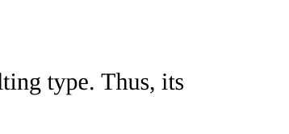
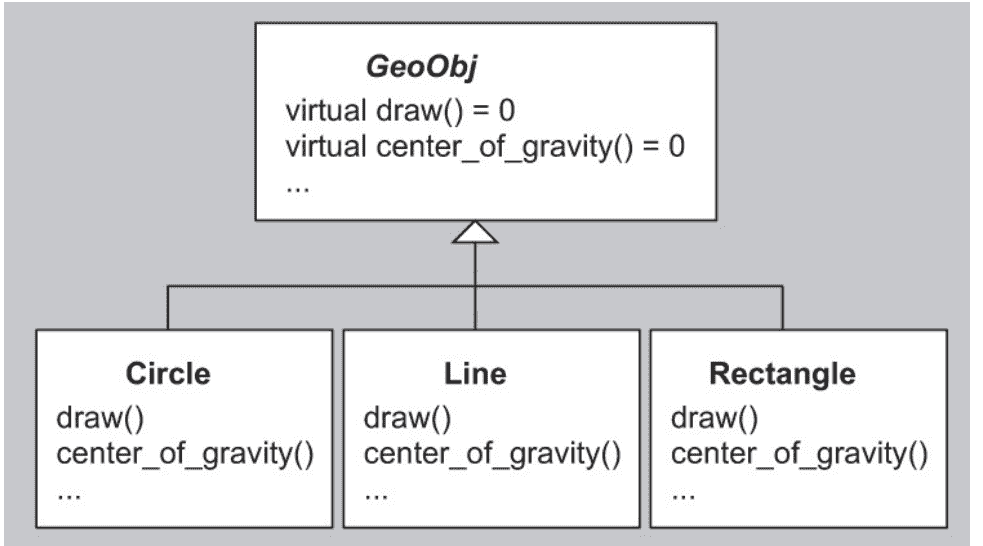
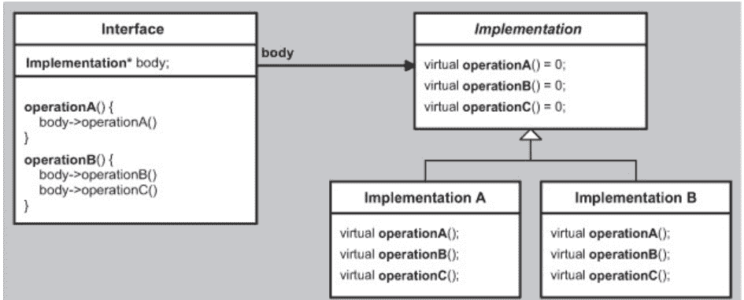
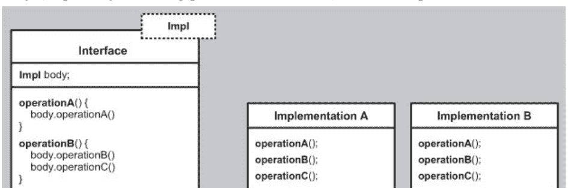
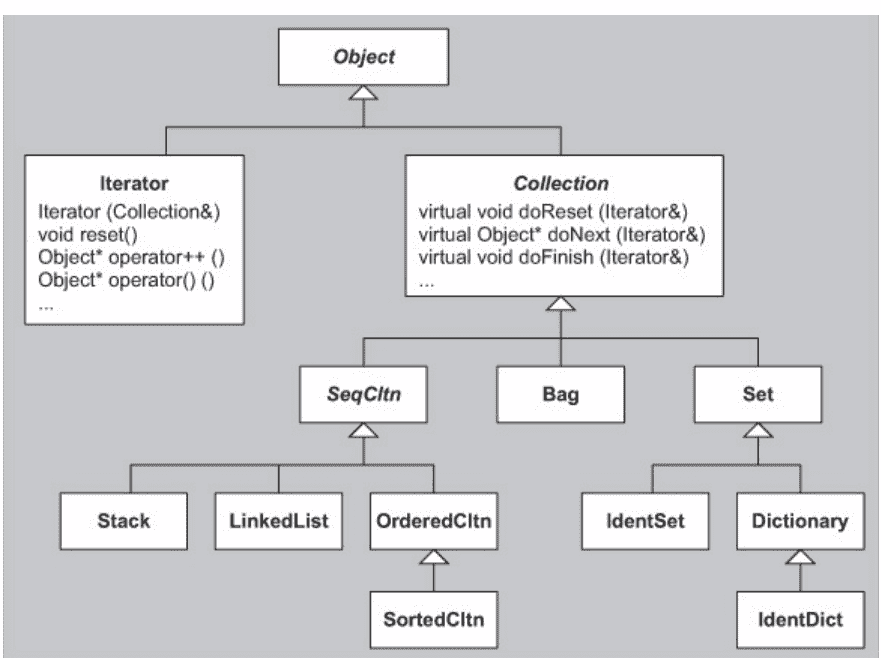
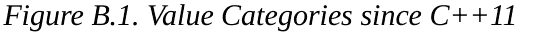
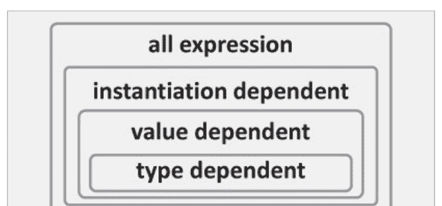
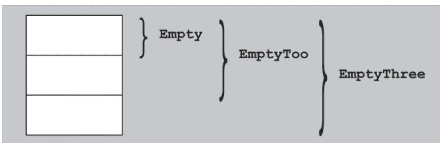
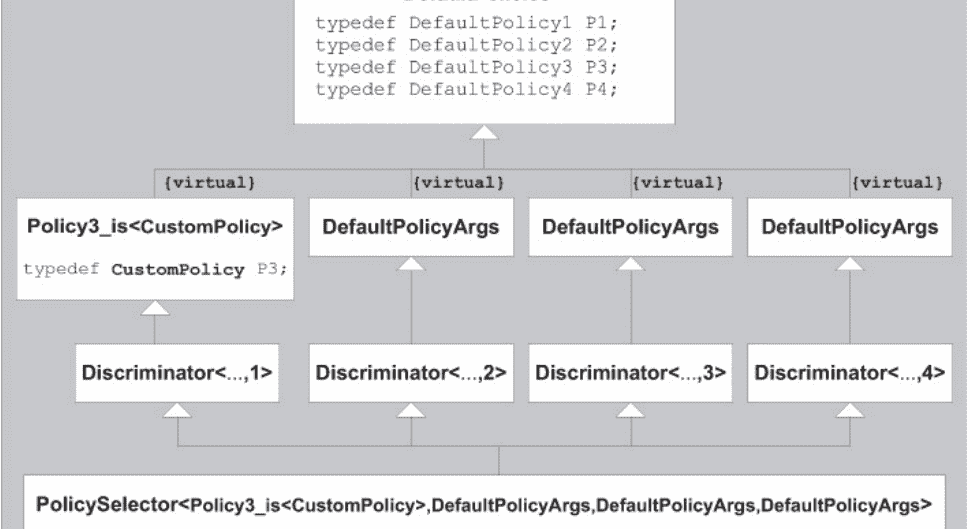
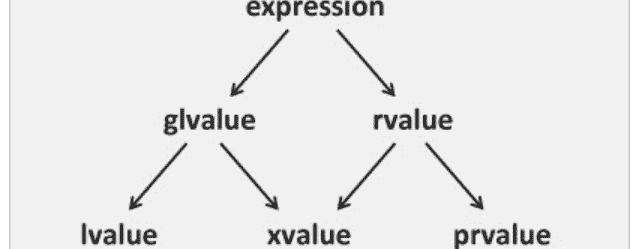

# C++ 模板完全指南（第2版）


美国国会图书馆控制号：2017946531
版权所有 © 2018 Pearson Education, Inc.
本书由 Nicolai M. Josuttis 使用 LaTeX 文档处理系统排版。保留所有权利。在美国印刷。本出版物受版权保护，未经出版者事先许可，不得以任何形式或任何方式（电子的、机械的、 photocopying、录音或其他方式）进行任何禁止的复制、存储于检索系统或传播。有关许可信息、申请表及 Pearson Education Global Rights & Permissions 部门的相应联系方式，请访问 www.pearsoned.com/permissions/。
ISBN-13: 978-0-321-71412-1
ISBN-10: 0-321-71412-1
谨以此书献给 Alessandra 和 Cassandra

——David

献给那些关心他人与人类的人

——Nico

谨以此书献给 Amy、Tessa 和 Molly

——Doug

## 前言

C++ 中模板的概念已有30多年的历史。C++ 模板早在1990年就记录在《带注释的 C++ 参考手册》（ARM；见 [EllisStroustrupARM]）中，之前在一些更专门的出版物中也有过描述。然而，十多年后，我们发现集中阐述这一迷人、复杂且强大的 C++ 特性的基本概念和高级技术的文献仍然匮乏。在本书的第一版中，我们希望解决这个问题，并决定写一本关于模板的书（也许稍欠谦逊）。

自第一版于2002年底出版以来，C++ 发生了巨大变化。C++ 标准的新版本增加了新特性，C++ 社区的持续创新也揭示了新的基于模板的编程技术。因此，本书的第二版保留了第一版的目标，但面向的是“现代 C++”。

我们以不同的背景和不同的意图着手撰写这本书。David（别名“Daveed”）是一位经验丰富的编译器实现者，也是参与核心语言演进的 C++ 标准委员会工作组的积极成员，他对模板的所有强大功能（和问题）的精确、详细描述感兴趣。Nico 是一位“普通”应用程序程序员，也是 C++ 标准委员会库工作组的成员，他希望以能够使用并从中受益的方式理解模板的所有技术。Doug 曾是模板库开发者，后来成为编译器实现者和语言设计者，他对收集、分类和评估用于构建模板库的无数技术感兴趣。此外，我们都希望与您（读者）和整个社区分享这些知识，以帮助避免进一步的误解、困惑或担忧。

因此，您既会看到带有日常示例的概念介绍，也会看到模板精确行为的详细描述。从模板的基本原理出发，逐步上升到“模板编程的艺术”，您将发现（或重新发现）静态多态、类型特征、元编程和表达式模板等技术。您还将更深入地理解 C++ 标准库，其中几乎所有的代码都涉及模板。

在撰写本书的过程中，我们学到了很多，也收获了极大的乐趣。我们希望您在阅读时也能有同样的体验。尽情享受吧！

## 第二版致谢

写书很难。维护一本书更难。我们花了五年多的时间——跨越过去十年——才完成这第二版，如果没有许多人的支持和耐心，这是不可能完成的。

首先，我们要感谢 C++ 社区和 C++ 标准化委员会中的每一个人。除了所有添加新语言和库特性的工作之外，他们还花费了大量时间与我们解释和讨论他们的工作，而且他们以耐心和热情做到了这一点。

这个社区的一部分还包括过去15年来为第一版提供错误反馈和可能改进建议的程序员。人数太多，无法一一列举，但你们知道你们是谁，我们真心感谢你们花时间写下自己的想法和观察。如果我们的回复有时不够及时，请接受我们的歉意。

我们还要感谢所有审阅本书草稿并提供宝贵反馈和澄清的人。这些审阅将这本书的质量提升到了一个显著更高的水平，并再次证明好事需要许多“智者”的投入。因此，非常感谢 Steve Dewhurst、Howard Hinnant、Mikael Kilpeläinen、Dietmar Kühl、Daniel Krügler、Nevin Lieber、Andreas Neiser、Eric Niebler、Richard Smith、Andrew Sutton、Hubert Tong 和 Ville Voutilainen。

当然，还要感谢 Addison-Wesley/Pearson 的全体支持人员。如今，作者获得专业支持已不再理所当然。但他们很耐心，在适当的时候督促我们，并在需要知识和专业精神时给予了极大的帮助。非常感谢 Peter Gordon、Kim Boedigheimer、Greg Doench、Julie Nahil、Dana Wilson 和 Carol Lallier。

特别感谢 LaTeX 社区提供了一个出色的文本系统，并感谢 Frank Mittelbach 解决了我们的 LATEX 问题（这几乎总是我们自己的错）。

## David 的第二版致谢

这第二版让大家等了很久。在我们进行最后润色之际，我感激生命中那些让这一切成为可能的人，尽管他们有许多亟待处理的事务。首先，我感谢我的妻子（Karina）和女儿们（Alessandra 和 Cassandra），她们同意让我从“家庭日程”中抽出大量时间来完成这一版，尤其是在最后一年的工作中。我的父母一直对我的目标表现出兴趣，每次我去探望他们时，他们都不会忘记这个特别的项目。

显然，这是一本技术书籍，其内容反映了关于一个编程主题的知识和经验。然而，这并不足以完成这类工作。因此，我极其感谢 Nico 承担了这一版的“管理”和“制作”方面的工作（除了他所有的技术贡献之外）。如果这本书对您有用，并且哪天您遇到 Nico，一定要感谢他让我们坚持下去。我也感谢 Doug，他几年前同意加入，并在自己日程紧张、进展艰难的情况下继续坚持下去。

多年来，我们 C++ 社区中的许多程序员分享了宝贵的见解，我对他们所有人都心怀感激。然而，我特别感谢 Richard Smith，多年来他一直高效地回复我那些带有晦涩技术问题的电子邮件。同样，感谢我的同事 John Spicer、Mike Miller 和 Mike Herrick，他们分享知识并创造了一个鼓励学习的工作环境，让我们能够不断学到更多。

## Nico 的第二版致谢

首先，我要感谢两位核心专家 David 和 Doug，因为作为一名应用程序程序员和库专家，我问了许多傻问题，也学到了很多。我现在感觉自己快要成为一名核心专家了（当然，只到下一个问题出现为止）。伙计们，这很有趣。

我其余的感谢都归于 Jutta Eckstein。Jutta 有一种奇妙的能力，能够推动和支持人们实现他们的理想、想法和目标。虽然大多数人只有在我们 IT 行业遇到她或与她共事时才能偶尔感受到这一点，但我很荣幸在日常生活中受益于她。这么多年过去了，我仍然希望这会永远持续下去。

## Doug 的第二版致谢

我衷心感谢我出色而支持我的妻子 Amy，以及我们的两个小女孩 Molly 和 Tessa。她们的爱和陪伴给我带来日常的喜悦，以及应对生活和工作中最大挑战的信心。我还要感谢我的父母，他们从小培养了我对学习的浓厚热爱，并在这些年里一直鼓励我。

与 David 和 Nico 共事非常愉快，他们性格迥异却又如此互补。David 为技术写作带来了极大的清晰度，专注于精准且富有启发的描述。Nico 除了拥有出色的组织能力，能让两位合著者免于陷入细枝末节之外，还拥有一种独特的能力，能够将复杂的技术讨论分解开来，使其更简单、更易懂，而且清晰得多。


## 第一版致谢

本书呈现了来自众多来源的思想、概念、解决方案和示例。我们要感谢在过去几年中帮助和支持我们的所有人和公司。

首先，我们要感谢所有审阅者，以及所有就早期手稿向我们提供意见的人。正是这些人的意见，赋予了本书一种如果缺少他们的贡献就绝不会有的品质。本书的审阅者包括 Kyle Blaney、Thomas Gschwind、Dennis Mancl、Patrick McKillen 和 Jan Christiaan van Winkel。特别感谢 Dietmar Kühl，他一丝不苟地审阅并编辑了整本书。他的反馈是对本书质量的巨大贡献。

我们还要感谢所有让我们有机会在不同平台上使用不同编译器测试示例的人与公司。非常感谢 Edison Design Group 提供的出色编译器和支持。在标准化过程和本书写作过程中，这对我们是一大帮助。同样要感谢免费的 GNU 和 egcs 编译器的所有开发者（Jason Merrill 尤其响应迅速），以及微软提供的 Visual C++ 评估版（我们在那里的联系人是 Jonathan Caves、Herb Sutter 和 Jason Shirk）。

现有的“C++ 智慧”很大一部分是由在线 C++ 社区共同创造的。其中大部分来自有管理的 Usenet 新闻组 `comp.lang.c++.moderated` 和 `comp.std.c++`。因此，我们特别感谢这些小组的积极版主，他们使讨论保持有用且富有建设性。我们也非常感谢多年来有这么多人花时间描述并阐释他们的想法，供大家分享。

Addison-Wesley 团队再次做得非常出色。我们最感谢 Debbie Lafferty（我们的编辑），感谢她为支持本书所做的温和督促、中肯建议和不懈努力。还要感谢 Tyrrell Albaugh、Bunny Ames、Melanie Buck、Jacquelyn Douette、Chanda Leary-Coutu、Catherine Ohala 和 Marty Rabinowitz。同样感谢 Marina Lang，她在 Addison-Wesley 最先赞助了本书。Susan Winer 进行了一轮早期编辑，帮助塑造了我们后续的工作。

### Nico 的第一版致谢

我首先要将充满亲吻的个人感谢献给我的家人：Ulli、Lucas、Anica 和 Frederic 以极大的耐心、体谅和鼓励支持了本书的写作。

另外，我要感谢 David。他的专业知识令人难以置信，但他的耐心更胜一筹（有时我会问非常愚蠢的问题）。与他一起工作非常有趣。

### David 的第一版致谢

我的妻子 Karina 对本书的最终完成起到了重要作用，我对她在我的生活中所扮演的角色深怀感激。当众多其他活动争夺你的日程安排时，在“业余时间”写作很快就会变得断断续续。Karina 帮助我管理日程，教会我说“不”，以便挤出时间在写作过程中稳步推进，最重要的是，她对这一项目的支持令人惊叹。我每天都在感谢上帝赐予我她的友谊和爱。

我也非常庆幸能与 Nico 共事。除了他对文本直接可见的贡献之外，他的经验和纪律让我们从我不像样的涂鸦走向了井然有序的成品。

John “模板先生” Spicer 和 Steve “重载先生” Adamczyk 是极好的朋友和同事，但在我看来（他们两人一起）也是 C++ 核心语言的最高权威。他们澄清了本书中描述的许多较棘手的问题；如果你发现书中对某个 C++ 语言元素的描述有误，那几乎肯定是因为我没有向他们请教。

最后，我想对所有支持这个项目、但未必直接参与其中的人表达感谢（鼓励的力量不容低估）。首先是我的父母：他们对我的爱和鼓励至关重要。然后是许多询问“书写得怎么样了？”的朋友们，他们同样是我鼓励的来源：Michael Beckmann、Brett 和 Julie Beene、Jarran Carr、Simon Chang、Ho 和 Sarah Cho、Christophe De Dinechin、Ewa Deelman、Neil Eberle、Sassan Hazeghi、Vikram Kumar、Jim 和 Lindsay Long、R.J. Morgan、Mike Puritano、Ragu Raghavendra、Jim 和 Phuong Sharp、Gregg Vaughn 以及 John Wiegley。

## 关于本书

本书的第一版于近 15 年前出版。当时我们着手撰写 C++ 模板的权威指南，期望它能对实践中的 C++ 程序员有所帮助。这个项目是成功的：听到读者认为我们的材料有用，看到我们的书一次又一次被推荐为参考书，并获得普遍好评，这让我们感到无比欣慰。

第一版经受住了时间的考验，大部分内容对现代 C++ 程序员来说仍然完全适用，但不可否认，语言的演进——最终形成“现代 C++”标准，即 C++11、C++14 和 C++17——使得有必要对第一版的内容进行修订。

因此，这第二版的总体目标没有改变：提供 C++ 模板的权威指南，既是扎实的参考书，也是易于学习的教程。不过这一次，我们使用的语言是“现代 C++”，它（仍然！）比前一版时期可用的语言庞大多了。

我们也敏锐地意识到，自第一版出版以来，C++ 编程资源已经发生了变化（向更好的方向）。例如，已经有多本书详细深入地讲解了特定的基于模板的应用。更重要的是，关于 C++ 模板和基于模板的技术的大量信息如今在网上很容易获得，这些技术的高级用法示例也是如此。因此，在这版中，我们决定强调一系列可以用于各种应用的技术。

我们在第一版中呈现的某些技术已经过时，因为 C++ 语言现在提供了更直接的方法来达到相同的效果。这些技术已被移除（或降级为一些小注释），取而代之的是展示新语言最新应用的新技术。

我们与 C++ 模板相伴已经超过 20 年，但 C++ 程序员社区仍然定期发现关于它们如何契合我们软件开发需求的新根本性见解。我们撰写本书的目标是分享这些知识，同时也让读者充分具备发展新理解的能力，并有可能发现下一项重要的 C++ 技术。

### 阅读本书前你应该了解什么

要充分从本书获益，你应该已经了解 C++。我们描述的是某个特定语言特性的细节，而不是语言本身的基础。你应该熟悉类和继承的概念，并能使用 C++ 标准库中的 IOStreams 和容器等组件编写 C++ 程序。你还应熟悉“现代 C++”的基本特性，如 auto、decltype、移动语义和 lambda 表达式。尽管如此，只要有必要，我们还会回顾一些更微妙的问题，即使它们与模板并无直接关系。这确保了本书对专家和中级程序员来说都同样可读。

我们主要讨论 2011 年、2014 年和 2017 年标准化的 C++ 语言修订版。然而，在撰写本书时，C++17 修订版的墨迹几乎还没有干，我们预计大多数读者对其细节不会非常熟悉。所有这些修订都对模板的行为和使用产生了重大影响。因此，我们对那些与主题关系最大的新特性做了简短介绍。不过，我们的目标既不是介绍现代 C++ 标准，也不是详尽描述该标准先前版本（[C++98] 和 [C++03]）的变化。相反，我们以现代 C++ 标准（[C++11]、[C++14] 和 [C++17]）为基础，专注于 C++ 中模板的设计和使用，并且偶尔会指出现代 C++ 标准与先前标准相比，启用或鼓励了哪些不同的技术。

### 本书的整体结构

我们的目标是提供开始使用模板并从中受益所需的必要信息，同时提供能让经验丰富的程序员将技术水平推进到极限的信息。为了实现这一目标，我们决定将内容分为几个部分：

- 第一部分介绍模板所基于的基本概念。它以教程风格写成。
- 第二部分呈现语言细节，是与模板相关的构造的便捷参考。
- 第三部分讲解 C++ 模板所支持的基本设计和编码技术。这些技术涵盖了从近乎微不足道的想法到复杂的惯用法。

这些部分中每一部分都由若干章节组成。此外，我们还提供了一些

这些附录涵盖了一些不专属于模板的内容（例如，C++中重载解析的概述）。另外还有一个附录介绍*概念*，这是对模板的一个基本扩展，已被纳入未来标准（预计是C++20）的草案中。

第一部分的章节需要按顺序阅读。例如，第3章建立在第2章所涵盖内容的基础上。然而，在其他部分，章节之间的联系则要松散得多。交叉引用可以帮助读者跳转到不同的主题。

最后，我们提供了一个相当完整的索引，以鼓励读者采用其他方式不按顺序阅读本书。

## 如何阅读本书

如果你是想要学习或复习模板概念的C++程序员，请仔细阅读第一部分，基础。即使你已经非常熟悉模板，快速浏览这一部分也有助于熟悉我们使用的风格和术语。这一部分还涵盖了在源代码包含模板时，如何组织源代码的一些实用方面的内容。

根据你偏好的学习方法，你可以决定在第二部分吸收模板的诸多细节，或者也可以阅读第三部分中关于实用编码技术的内容（并在遇到更微妙的语言问题时，回看第二部分）。如果你买这本书是为了解决具体的日常问题，后一种方法可能特别有用。

附录包含了许多正文中经常引用的有用信息。我们也努力让这些附录本身具有趣味性。

根据我们的经验，学习新事物的最好方式是看示例。因此，你会在书中找到大量示例。有些只是几行说明抽象概念的代码，而另一些则是提供具体应用的完整程序。后一种示例会由一条C++注释引出，该注释描述了包含程序代码的文件。你可以在本书的网站上找到这些文件，网址是 http://www.tmplbook.com。

## 关于编程风格的一些说明

C++程序员使用不同的编程风格，我们也不例外：关于在哪里放置空格、分隔符（花括号、圆括号）等常见问题也随之出现。我们总体上力求一致，尽管偶尔会为当前主题做出一些让步。例如，在教程部分，我们可能倾向于多使用空格和具体的名称来帮助可视化代码，而在更高级的讨论中，更紧凑的风格可能更合适。

我们确实想提请你们注意一个关于类型、参数和变量声明的不太常见的决定。显然，以下几种风格都是可能的：

```
void foo (const int &x);
```

```
void foo (const int& x);
```

```
void foo (int const &x);
```

```
void foo (int const& x);
```

虽然这有点不太常见，但我们决定使用 int const 而不是 const int 来表示“常量整数”。我们使用这种顺序有两个原因。首先，它能更容易回答“什么是不变的？”这个问题。答案始终是 const 限定符前面的内容。实际上，尽管 const int N = 100; 等价于

```
int const N = 100;
```

但下面这个却没有等价形式：

```
int* const bookmark; // the pointer cannot change, but the value pointed to can
```

也就是说，无法将 const 限定符放在指针运算符 * 前面。在这个例子中，常量的是指针本身，而不是它指向的 int。

我们的第二个理由与在处理模板时非常常见的语法替换原则有关。考虑下面两个使用 typedef 关键字的类型声明：¹

```
typedef char* CHARS;
typedef CHARS const CPTR; // constant pointer to chars
```

或者使用 using 关键字：

```
using CHARS = char*;
using CPTR = CHARS const; // constant pointer to chars
```

当我们用 CHARS 所代表的类型进行文本替换时，第二个声明的含义得以保留：

```
typedef char* const CPTR; // constant pointer to chars
```

或者：

```
using CPTR = char* const; // constant pointer to chars
```

然而，如果我们把 const 写在它限定的类型前面，这个原则就不适用了。考虑我们之前给出的前两个类型定义的另一种写法：

```
typedef char* CHARS;
typedef const CHARS CPTR; // constant pointer to chars
```

对 CHARS 进行文本替换会得到含义不同的类型：

```
typedef const char* CPTR; // pointer to constant chars
```

当然，同样的观察也适用于 volatile 说明符。

关于空格，我们决定在 & 符号和参数名之间留一个空格：void foo (int const& x); 通过这样做，我们强调了参数类型和参数名称之间的分离。诚然，对于像 char* a, b; 这样的声明，这会更加令人困惑；根据从C语言继承的规则，a 是指针，而 b 是普通的 char。为了避免这种混淆，我们干脆避免以这种方式声明多个实体。

这主要是一本关于语言特性的书。然而，许多技术、特性和辅助模板现在出现在C++标准库中。为了将两者联系起来，我们通过演示如何使用这些模板技术实现某些库组件来介绍它们，并使用标准库工具来构建我们自己更复杂的示例。因此，我们不仅使用像 `<iostream>` 和 `<string>` 这样的头文件（它们包含模板但对于定义其他模板并不特别重要），还使用 `<cstddef>`、`<utilities>`、`<functional>` 和 `<type_traits>`（它们确实为更复杂的模板提供了构建块）。

此外，我们在附录D中提供了一个关于C++标准库提供的主要模板工具的参考，包括对所有标准类型特征的详细描述。这些常用于复杂模板编程的核心。

## C++11、C++14 和 C++17 标准

最初的C++标准于1998年发布，随后在2003年通过一份技术勘误表进行了修订，该勘误表对原标准提供了少量修正和澄清。这个“旧C++标准”被称为C++98或C++03。

C++11标准是ISO C++标准化委员会推动的C++第一次重大修订，为该语言带来了大量新特性。其中许多新特性与模板相关，并在本书中进行了描述，包括：

- 可变参数模板
- 别名模板
- 移动语义、右值引用和完美转发
- 标准类型特征

紧随其后的是C++14和C++17，两者都引入了一些新的语言特性，尽管这些标准带来的变化不如C++11那样显著。² 与模板相关并在本书中描述的新特性包括但不限于：

- 变量模板（C++14）
- 泛型Lambda（C++14）
- 类模板实参推导（C++17）
- 编译期if（C++17）
- 折叠表达式（C++17）

我们甚至描述了概念（模板接口），这些概念目前计划纳入即将到来的C++20标准中。

在撰写本文时，主流编译器已广泛支持C++11和C++14标准，C++17也基本得到支持。尽管如此，不同编译器对不同语言特性的支持程度差异很大。有些编译器能够编译本书中的大部分代码，但少数编译器可能无法处理我们的一些示例。然而，我们预计这个问题很快会得到解决，因为世界各地的程序员都需要供应商提供标准支持。

即便如此，C++编程语言很可能会随着时间的推移继续发展。C++社区的专家们（无论他们是否参与C++标准化委员会）正在讨论改进该语言的各种方式，而且已经有一些候选改进影响到了模板。第17章介绍了这一领域的一些趋势。

## 示例代码与附加信息

你可以通过本书的网站访问所有示例程序并找到更多关于本书的信息，其网址如下：http://www.tmplbook.com


## Feedback

我们欢迎您的建设性意见——无论是负面的还是正面的。我们付出了很大努力为您带来我们希望您会认为是一本优秀的书籍。然而，在某个时间点，我们必须停止写作、审阅和调整，以便“发布产品”。因此，您可能会发现错误、不一致、可以改进的呈现方式，或完全缺失的主题。您的反馈使我们有机会通过本书的网站通知所有读者，并改进后续版本。

联系我们的最佳方式是通过电子邮件。您可以在本书的网站上找到电子邮件地址：http://www.tmplbook.com 请务必在提交报告前先查看本书网站上已知的勘误表。非常感谢。

> ¹ 请注意，在 C++ 中，类型定义定义的是“类型别名”而不是新类型（参见第 2.8 节第 38 页）。

例如：

```
typedef int Length; // define Length as an alias for int
int i = 42;
Length l = 88;
i = l; // OK
l = i; // OK
```

> ² 委员会现在的目标大约每 3 年发布一次新标准。显然，这留给大规模添加的时间更少，但它能更快地将更改带给更广泛的编程社区。因此，大型特性的开发跨越时间，可能涵盖多个标准。

## Part I
## The Basics

本部分介绍 C++ 模板的一般概念和语言特性。它首先通过展示函数模板和类模板的示例来讨论一般目标和概念。它继续介绍一些额外的基本模板特性，例如非类型模板参数、可变参数模板、`typename` 关键字和成员模板。还讨论如何处理移动语义、如何声明参数，以及如何使用通用代码进行编译时编程。它以关于术语的一般提示以及模板在实践中的使用和应用方面的建议结束，既作为应用程序程序员，也作为通用库的作者。

## Why Templates?

C++ 要求我们使用特定类型声明变量、函数和大多数其他类型的实体。然而，对于不同类型来说，很多代码看起来都一样。例如，算法 *quicksort* 的实现对于不同数据结构在结构上看起来都一样，例如 `int` 的数组或字符串的向量，只要包含的类型可以相互比较。

如果您的编程语言不支持这种通用性的特殊语言特性，您只有糟糕的选择：1. 您可以为需要此行为的每种类型一次又一次地实现相同的行为。2. 您可以为 `Object` 或 `void*` 等通用基类型编写通用代码。3. 您可以使用特殊预处理器。

如果您来自其他语言，您可能以前做过其中一些或全部。然而，每种方法都有其缺点：1. 如果您一次又一次地实现行为，您就是在重新发明轮子。您会使

2. 如果您为通用基类编写通用代码，您会失去类型检查的好处。此外，类可能需要派生自特殊基类，这使得维护代码变得更加困难。

3. 如果您使用特殊预处理器，代码会被某些“愚蠢的文本替换机制”替换，该机制不知道作用域和类型，这可能会导致奇怪的语义错误。模板是解决此问题的方案，没有这些缺点。它们是为一个或多个尚未指定的类型编写的函数或类。当您使用模板时，您将类型作为参数传递，显式或隐式。因为模板是语言特性，您可以获得类型检查和作用域的完全支持。

在今天的程序中，模板被大量使用。例如，在 C++ 标准库内部几乎所有代码都是模板代码。库提供用于对指定类型的对象和值进行排序的排序算法、用于管理指定类型元素的 数据结构（也称为 *container classes*）、字符串，其字符的类型是参数化的，等等。然而，这只是开始。模板还允许我们参数化行为、优化代码并参数化信息。这些应用将在后面的章节中介绍。让我们先从一些简单的模板开始。

## Chapter 1
## Function Templates

本章介绍函数模板。函数模板是参数化的函数，使其代表一组函数。

## 1.1 A First Look at Function Templates

函数模板提供可在不同类型上调用的功能行为。换句话说，函数模板代表一组函数。其表示看起来很像普通函数，只是函数的某些元素未确定：这些元素是参数化的。为了说明，让我们看一个简单的例子。

### 1.1.1 Defining the Template

下面是一个返回两个值中较大者的函数模板：

Click here to view code image

basics/max1.hpp

```
template<typename T>
T max (T a, T b)
{
// if b < a then yield a else yield b
return b < a ? a : b;
}
```

此模板定义指定了一组返回作为函数参数 a 和 b 传递的两个值中的较大者的函数。¹ 这些参数的类型作为模板参数 T 留空。正如本例所示，模板参数必须使用以下形式的语法声明：

Click here to view code image

```
#include "max1.hpp"
#include <iostream>
#include <string>
int main()
{
  int i = 42;
  std::cout << "max(7,i): " << ::max(7,i) << '\n';

  double f1 = 3.4; double f2 = -6.7;
  std::cout << "max(f1,f2): " << ::max(f1,f2) << '\n';

  std::string s1 = "mathematics", std::string s2 = "math";
  std::cout << "max(s1,s2): " << ::max(s1,s2) << '\n';
}
```

在程序内部 `max()` 被调用三次：一次用于两个 ints，一次用于两个 doubles，一次用于两个 `std::strings`。每次都计算最大值。因此，程序有以下输出：[Click here to view code image](#)

```
max(7,i): 42
max(f1,f2): 3.4
max(s1,s2): mathematics
```

请注意，每次调用 `max()` 模板都用 `::` 限定。这是为了确保我们的 `max()` 模板在全局命名空间中找到。标准库中也有一个 `std::max()` 模板，在某些情况下可能会被调用或导致歧义。

模板不是编译成可处理任何类型的单一实体。相反，对于模板被使用的每种类型，都会从模板生成不同的实体。因此，`max()` 会为这三种类型中的每一种编译。例如，`max()` 的第一次调用

```
int i = 42;
max(7,i);
```

使用模板参数 T 为 `int` 的函数模板。因此，它具有调用以下代码的语义：`int max (int a, int b)`

```
{
  return b < a ? a : b;
}
```

用具体类型替换模板参数的过程称为 *instantiation*。它产生模板的 *instance*。

请注意，仅使用函数模板就可以触发此类实例化过程。程序员无需单独请求实例化。

类似地，`max()` 的其他调用将 `max` 模板实例化为 `double` 和 `std::string`，就好像它们是单独声明和实现的：

[Click here to view code image](#)

```
double max (double, double);
std::string max (std::string, std::string);
```

还请注意，`void` 是有效的模板参数，前提是生成的代码有效。例如：[Click here to view code image](#)

```
template<typename T>
T foo(T*)
{
}
```

```
void* vp = nullptr;
foo(vp); // OK: deduces void foo(void*)
```

### 1.1.3 Two-Phase Translation

尝试为不支持模板内部使用的所有操作的类型的实例化模板将导致编译时错误。例如：[Click here to view code image](#)

```
std::complex<float> c1, c2; // doesn’t provide operator <
...
::max(c1,c2); // ERROR at compile time
```

因此，模板是“编译”的两阶段：1. 在 *definition time* 未实例化时，模板代码本身会被检查正确性，忽略模板参数。这包括：

- 语法错误被发现，例如缺少分号。
- 使用的未知名称（类型名称、函数名称、…）不依赖于模板参数会被发现。
- 不依赖于模板参数的静态断言会被检查。

2. 在 *instantiation time*，模板代码会被再次检查以确保所有代码有效。也就是说，现在尤其是，所有依赖于模板参数的部分都会被双重检查。

例如：

**[Click here to view code image](#)**

```
template<typename T>
void foo(T t)
```


```cpp
{
    undeclared(); // first-phase compile-time error if undeclared()
    undeclared(t); // second-phase compile-time error if undeclared(T)
    static_assert(sizeof(int) > 10, // always fails if sizeof(int)<=10
                  "int too small");
    static_assert(sizeof(T) > 10, // fails if instantiated for T with size <=10
                  "T too small");
}
```

名字被检查两次这一事实被称为*两阶段查找*，将在第249页的14.3.1节中详细讨论。

注意，有些编译器不会执行第一阶段的完整检查。⁶ 因此，在模板代码至少被实例化一次之前，你可能看不到一般性问题。

## 编译和链接

两阶段翻译在实践中导致模板处理中的一个重要问题：当函数模板以触发实例化的方式被使用时，编译器（在某个时刻）需要看到该模板的定义。对于普通函数，声明足以编译其使用，而这打破了编译和链接的通常区分。处理这个问题的方法将在第9章讨论。目前，我们采用最简单的方法：将每个模板实现在头文件内。

## 1.2 模板实参推导

当我们为某些实参调用类似`max()`的函数模板时，模板参数由我们传入的实参决定。如果我们向参数类型T传递两个`ints`，C++编译器必须推断出T必须是`int`。

但是，T可能只是类型的一部分。例如，如果我们声明`max()`使用常量引用：

```cpp
template<typename T>
T max (T const& a, T const& b)
{
    return b < a ? a : b;
}
```

如果传入int，T再次被推导为int，因为函数参数匹配`int const&`。

### 类型推导期间的类型转换

注意，在类型推导期间，自动类型转换是受限的：

- 当通过引用声明调用参数时，即使是平凡转换也不适用于类型推导。使用同一模板参数`T`声明的两个实参必须完全匹配。
- 当通过值声明调用参数时，只支持会发生衰减的平凡转换：`const`或`volatile`限定符会被忽略，引用转换为被引用类型，原始数组或函数转换为相应的指针类型。对于使用同一模板参数`T`声明的两个实参，衰减后的类型必须匹配。

例如：

```cpp
template<typename T>
T max (T a, T b);
...
int const c = 42;
max(i, c); // OK: T is deduced as int
max(c, c); // OK: T is deduced as int
int& ir = i;
max(i, ir); // OK: T is deduced as int
int arr[4];
foo(&i, arr); // OK: T is deduced as int*
```

然而，以下是错误示例：

```cpp
max(4, 7.2); // ERROR: T can be deduced as int or double
std::string s;
foo("hello", s); // ERROR: T can be deduced as char const[6] or std::string
```

有三种方法可以处理此类错误：

1. 对实参进行转换，使两者匹配：

   ```cpp
   max(static_cast<double>(4), 7.2); // OK
   ```

2. 显式指定（或限定）`T`的类型，以阻止编译器尝试类型推导：

   ```cpp
   max<double>(4, 7.2); // OK
   ```

3. 指定参数可以具有不同的类型。

第9页的1.3节将详细阐述这些选项。第108页的7.2节以及第15章将详细讨论类型推导期间类型转换的规则。

### 默认实参的类型推导

还要注意，类型推导不适用于默认调用实参。例如：

```cpp
template<typename T>
void f(T = "");
...
```

```cpp
f(1); // OK: deduced T to be int, so that it calls f<int>(1)
f(); // ERROR: cannot deduce T
```

为了支持这种情况，你还必须为模板参数声明一个默认实参，这将在第13页的1.4节中讨论：

```cpp
template<typename T = std::string>
void f(T = "");

f(); // OK
```

## 1.3 多个模板参数

到目前为止我们已经看到，函数模板有两组不同的参数：

1. 模板参数，声明在函数模板名称之前的尖括号中：

   ```cpp
   template<typename T> // T is template parameter
   ```

2. 调用参数，声明在函数模板名称之后的括号中：

   ```cpp
   T max (T a, T b) // a and b are call parameters
   ```

你可以根据需要拥有任意多个模板参数。例如，你可以为两个可能不同类型的调用参数定义`max()`模板：

```cpp
template<typename T1, typename T2>
T1 max (T1 a, T2 b)
{
    return b < a ? a : b;
}
...
auto m = ::max(4, 7.2); // OK, but type of first argument defines return type
```

能够向`max()`模板传入不同类型的参数似乎很理想，但正如这个例子所示，它引发了一个问题。如果你使用其中一个参数类型作为返回类型，另一个参数的实参可能会被转换为该类型，而不管调用者的意图如何。因此，返回类型取决于调用实参的顺序。66.66和42的最大值为`double`类型的66.66，而42和66.66的最大值为`int`类型的66。

- 为返回类型引入第三个模板参数。
- 让编译器推导返回类型。
- 将返回类型声明为两个参数类型的“公共类型”。

接下来将讨论所有这些选项。

### 1.3.1 返回类型的模板参数

我们之前的讨论表明，*模板实参推导*允许我们以与调用普通函数相同的语法调用函数模板：我们不必显式指定与模板参数对应的类型。

然而，我们也提到，我们可以显式指定模板参数要使用的类型：

```cpp
template<typename T>
T max (T a, T b);
...
::max<double>(4, 7.2); // instantiate T as double
```

在模板参数与调用参数之间没有联系，且模板参数无法被推导的情况下，你必须随调用显式指定模板实参。例如，你可以引入第三个模板实参类型来定义函数模板的返回类型：

```cpp
template<typename T1, typename T2, typename RT>
RT max (T1 a, T2 b);
```

```cpp
template<typename T1, typename T2>
auto max (T1 a, T2 b)
{
    return b < a ? a : b;
}
```

事实上，对返回类型使用`auto`而没有相应的*尾置返回类型*（在末尾用`->`引入）表明，实际返回类型必须从函数体中的返回语句推导出来。当然，从函数体推导返回类型必须是可行的。因此，代码必须可用，并且多个返回语句必须匹配。

在C++14之前，只有让函数的实现在某种程度上成为其声明的一部分，编译器才能确定返回类型。在C++11中，我们可以利用*尾置返回类型*语法允许我们使用调用参数这一事实。也就是说，我们可以声明返回类型由`operator?:`产生的结果推导而来：

```cpp
template<typename T1, typename T2>
auto max (T1 a, T2 b) -> decltype(b<a?a:b)
{
    return b < a ? a : b;
}
```

这里，结果类型由`operator?:`的规则决定，这些规则相当复杂，但通常会产生符合直觉预期的结果（例如，如果a和b具有不同的算术类型，则会为结果找到一个公共算术类型）。

注意

```cpp
template<typename T1, typename T2>
auto max (T1 a, T2 b) -> decltype(b<a?a:b);
```

是一个声明，因此编译器在编译时使用针对参数a和b调用`operator?:`的规则来找出`max()`的返回类型。实现不一定必须与之匹配。事实上，在声明中对`operator?:`使用`true`作为条件就足够了：

```cpp
template<typename T1, typename T2>
```


auto max (T1 a, T2 b) -> decltype(true?a:b); 然而，在任何情况下该定义都有一个显著的缺点：返回类型可能是引用类型，因为在某些条件下 T 可能是引用。因此你应该返回从 T 衰减后的类型，其写法如下：Click here to view code image

# basics/maxdecltypedecay.hpp

```
#include <type_traits>
template<typename T1, typename T2>
auto max (T1 a, T2 b) -> typename std::decay<decltype(true?a:b)>::type
{ return b < a ? a : b;
}
```

这里，使用了类型特征 std::decay<>，它以成员类型返回结果类型。它由标准库在 <type_traits> 中定义（参见第 D.5 节第 732 页）。因为成员类型是一个类型，你必须用 typename 限定表达式来访问它（参见第 5.1 节第 67 页）。

请注意，auto 类型的初始化总是会衰减。这也适用于返回值为 auto 时的返回值。auto 作为返回类型表现就像以下代码中一样，其中 a 由 i 的衰减类型 int 声明：Click here to view code image

```
int i = 42;
int const& ir = i; // ir refers to
i auto a = ir; // a is declared as new object of type int
```

### 1.3.3 Return Type as Common Type

自 C++11 起，C++ 标准库提供了一种指定选择“更通用类型”的方法。std::common_type<>::type 给出作为模板参数传递的两个（或更多）不同类型的“公共类型”。例如：Click here to view code image

# basics/maxcommon.hpp

```
#include <type_traits>
template<typename T1, typename T2>
std::common_type_t<T1,T2> max (T1 a, T2 b)
{
return b < a ? a : b;
}
```

同样，std::common_type 是一个类型特征，定义在 <type_traits> 中，



# NASIM SADIKU

# WEB DEVELOPER

# PERSONAL DATA

- NAME: Nasim Sadiku
- DATE OF BIRTH: 22 June 1987
- ADDRESS: Rr. Ilinden, nr. 7, 10000, Prishtine, Kosova
- PHONE: +377 44 444 444
- E-MAIL: nasim_sadiku@hotmail.com
- DRIVER'S LICENCE: Category B

# PROFILE

I am a Web Developer with over 6 years of experience in web design and development. I have strong analytical and problem-solving skills, and I am proficient in current web standards, SEO, and cross-browser compatibility. I am a dedicated team player who is able to work well under pressure and adhere to strict deadlines. I consider myself a lifelong learner and am always looking to improve my skills and knowledge.

# EDUCATION

2006 - 2010 Bachelor of Computer Science, University of Prishtina, Kosova. Relevant coursework: Web Design, Database Management, and Human-Computer Interaction.

# WORK EXPERIENCE

2013 - Present Senior Web Developer at Digital Agency "Teknologjia", Prishtine. Leading a team of developers, building responsive websites and web applications for clients across various industries.

2011 - 2013 Web Developer at Startup "Inovacioni", Prishtine. Developed and maintained websites, collaborated with designers, and ensured cross-browser compatibility.

# SKILLS

- HTML5, CSS3, JavaScript
- PHP, MySQL
- WordPress, Joomla
- Responsive Design
- SEO Best Practices
- Git, Agile/Scrum

再次注意使用 `std::decay_t<>` 以确保不能返回引用。¹⁰

还要注意该实现要求我们能够为传递的类型调用默认构造函数。还有另一种解决方案，使用 `std::declval`，但这会使声明变得更加复杂。参见第 11.2.3 节第 166 页的示例。

2. 我们也可以使用 `std::common_type<>` 类型特征来指定返回类型的默认值：[Click here to view code image](#)

# *basics/maxdefault3.hpp*

```
```cpp
#include <type_traits>

template<typename T1, typename T2,
typename RT = std::common_type_t<T1,T2>>
RT max (T1 a, T2 b)
{
return b < a ? a : b;
}
```
```

同样，注意 `std::common_type<>` 会衰减，因此返回值不能成为引用。
在所有情况下，作为调用者，你现在可以使用返回类型的默认值：[Click here to view code image](#)

```
```cpp
auto a = ::max(4, 7.2); or specify the return type after all other
argument types explicitly: Click here to view code image

auto b = ::max<double,int,long double>(7.2, 4); However, again we
have the problem that we have to specify three types to be able to
specify the return type only. Instead, we would need the ability to
have the return type as the first template parameter, while still
being able to deduce it from the argument types. In principle, it is
possible to have default arguments for leading function template
parameters even if parameters without default arguments follow: Click
here to view code image

template<typename RT = long, typename T1, typename T2>
RT max (T1 a, T2 b)
{
return b < a ? a : b;
}
```
```

使用此定义，例如你可以调用：[Click here to view code image](#)

```
```cpp
int i; long l;
…
max(i, l); // returns long (default argument of template parameter
```
```

for return type)
max<int>(4, 42); // returns int as explicitly requested
```

然而，这种方法只有在模板参数存在“自然”默认值时才有意义。这里，我们需要默认参数依赖于之前的模板参数。原则上这是可能的，我们在第 26.5.1 节第 621 页讨论过，但该技术依赖于类型特征并使定义复杂化。

出于所有这些原因，最佳且最简单的解决方案是让编译器推导返回类型，如第 1.3.2 节第 11 页所提出。

## 1.5 Overloading Function Templates

像普通函数一样，函数模板也可以被重载。也就是说，你可以有同名但不同的函数定义，以便当该名称在函数调用中使用时，C++ 编译器必须决定调用哪一个候选。这一决定的规则可能变得相当复杂，即使没有模板。在本节中我们讨论涉及模板的重载。如果你不熟悉没有模板的基本重载规则，请参阅附录 C，我们在其中提供了重载解析规则的相当详细的概述。

以下简短程序说明了重载函数模板：Click here to view code image

basics/max2.cpp

```
// maximum of two int values:
int max (int a,
int b)
{
return b < a ? a : b;
}
// maximum of two values of any type:
template<typename T>
T max (T a, T b)
{
return b < a ? a : b;
}
int main()
{
::max(7, 42); // calls the nontemplate for two ints
::max(7.0, 42.0); // calls max<double> (by argument deduction)
::max('a', 'b'); //calls max<char> (by argument deduction)
```

```
::max<>(7, 42); // calls max<int> (by argument deduction)
::max<double>(7, 42); // calls max<double> (no argument deduction)
::max('a', 42.7); //calls the nontemplate for two ints
}
```

正如这个例子所示，非模板函数可以与具有相同名称且可以用相同类型实例化的函数模板共存。在其他因素相同的情况下，重载解析过程更倾向于非模板而非由模板生成的函数。第一次调用就属于此规则：Click here to view code image

```
::max(7, 42); // both int values match the nontemplate function perfectly
```

如果模板可以生成匹配更好的函数，则会选择模板。这由 max() 的第二次和第三次调用演示：Click here to view code image

```
::max(7.0, 42.0); // calls the max<double> (by argument deduction)
::max('a', 'b'); //calls the max<char> (by argument deduction)
```

这里模板是更好的匹配，因为不需要从 double 或 char 转换为 int（参见第 C.2 节第 682 页的重载解析规则）。

也可以显式指定空的模板参数列表。此语法表示只有模板可以解析调用，但所有模板参数应从调用参数推导：Click here to view code image

```
::max<>(7, 42); // calls max<int> (by argument deduction)
```

因为对于推导的模板参数不考虑自动类型转换，但对于普通函数参数会考虑，最后一次调用使用非模板函数（而 'a' 和 42.7 都被转换为 int）：Click here to view code image

```
::max('a', 42.7); //only the nontemplate function allows nontrivial conversions
```

一个有趣的例子是重载最大值模板以能够仅显式指定返回类型：Click here to view code image

basics/maxdefault4.hpp

```
template<typename T1, typename T2>
auto max (T1 a, T2 b)
{
```


return b < a ? a : b;
}
template<typename RT, typename T1, typename T2>
RT max (T1 a, T2 b)
{
return b < a ? a : b;
}

现在，我们可以如下所示调用 max()，例如：

```
auto a = ::max(4, 7.2); // uses first template
auto b = ::max<long double>(7.2, 4); // uses second template
```

然而，当调用：

```
auto c = ::max<int>(4, 7.2); // ERROR: both function templates match
```

两个模板都能匹配，这通常会导致重载解析过程不偏向任何一个，并产生歧义错误。因此，在重载函数模板时，应确保对于任何调用只有一个模板能够匹配。

一个有用的示例是为指针和普通 C 字符串重载 max 模板：

*basics/max3val.cpp*

```
#include <cstring>
#include <string>

// maximum of two values of any type:
template<typename T>
T max (T a, T b)
{
return b < a ? a : b;
}

// maximum of two pointers:
template<typename T>
T* max (T* a, T* b)
{
return *b < *a ? a : b;
}

// maximum of two C-strings:
char const* max (char const* a, char const* b)
{
return std::strcmp(b,a) < 0 ? a : b;
}
```

```
int main ()
{
int a = 7;
int b = 42;
auto m1 = ::max(a,b); // max() for two values of type int

std::string s1 = "hey";
std::string s2 = "you";
auto m2 = ::max(s1,s2); // max() for two values of type std::string

int* p1 = &b;
int* p2 = &a;
auto m3 = ::max(p1,p2); // max() for two pointers

char const* x = "hello";
char const* y = "world";
auto m4 = ::max(x,y); // max() for two C-strings
}
```

请注意，在所有 max() 的重载中，我们都是按值传递参数。一般来说，重载函数模板时最好不要做超出必要的改动。应将改动限制在参数个数或显式指定模板参数上。否则，可能会出现意想不到的后果。例如，如果你实现的 max() 模板按引用传递参数，并为按值传递的两个 C 字符串重载了该模板，则无法使用三参数版本计算三个 C 字符串的最大值：

# basics/max3ref.cpp

```
#include <cstring>

// maximum of two values of any type (call-by-reference)
template<typename T> T const& max (T const& a, T const& b)
{
return b < a ? a : b;
}
// maximum of two C-strings (call-by-value)
char const* max (char const* a, char const* b)
{
return std::strcmp(b,a) < 0 ? a : b;
}

// maximum of three values of any type (call-by-reference)
template<typename T> T const& max (T const& a, T const& b, T const& c)
{
return max (max(a,b), c); // error if max(a,b) uses call-by-value
}
int main ()
{
auto m1 = ::max(7, 42, 68); // OK
char const* s1 = "frederic";
char const* s2 = "anica";
char const* s3 = "lucas";
auto m2 = ::max(s1, s2, s3); // run-time ERROR
}
```

问题在于，如果你为三个 C 字符串调用 `max()`，该语句会变成运行时错误，因为对于 C 字符串，`max(a,b)` 会创建一个新的临时局部值，并通过引用返回它，但该临时值在 return 语句完成后立即失效，从而留给 `main()` 一个悬垂引用。不幸的是，这个错误相当隐蔽，可能不会在所有情况下都显现出来。

相反，请注意，`main()` 中对 `max()` 的第一次调用不会遇到同样的问题。临时对象是为参数 (7, 42, 68) 创建的，但它们在 `main()` 中创建，并一直存在到该语句执行完毕。

这仅仅是代码可能因详细的重载解析规则而表现与预期不同的一个例子。此外，要确保在调用函数之前声明该函数的所有重载版本。这是因为当进行相应的函数调用时，并非所有重载函数都可见，这一事实可能会产生影响。例如，在尚未看到针对 `ints` 的特化二参数版本 `max()` 声明的情况下，定义三参数版本 `max()`，会导致三参数版本使用二参数模板：*basics/max4.cpp*

```
#include <iostream>

// maximum of two values of any type:
template<typename T>
T max (T a, T b)
{
std::cout << "max<T>() \n";
return b < a ? a : b;
}

// maximum of three values of any type:
template<typename T>
T max (T a, T b, T c)
{
return max (max(a,b), c); // uses the template version even for ints
} //because the following declaration comes
// too late:

// maximum of two int values:
int max (int a,
int b)
{
std::cout << "max(int,int) \n";
return b < a ? a : b;
}

int main()
{
::max(47,11,33); // OOPS: uses max<T>() instead of max(int,int)
}
```

我们将在第217页的13.2节详细讨论。

## 1.6 但是，难道我们不应该……？

即使这些简单的函数模板示例，也可能会引出更多问题。有三个问题可能非常常见，我们有必要在此简要讨论一下。

### 1.6.1 按值传递还是按引用传递？

你可能想知道，为什么我们通常将函数声明为按值传递参数，而不是使用引用。一般来说，对于除了廉价简单类型（如基本类型或 std::string_view）之外的类型，推荐按引用传递，因为这样不会创建不必要的副本。

然而，基于几个原因，按值传递通常往往更好：

- 语法简单。
- 编译器能更好地优化。
- 移动语义通常使拷贝变得廉价。
- 而且有时根本没有拷贝或移动。

此外，对于模板，还有一些特定方面会起作用：

- 作为调用者，你通常仍然可以决定按引用传递参数，使用 `std::ref()` 和 `std::cref()`（见第112页的7.3节）。
- 尽管传递字符串字面量或原始数组总是可能成为问题，但按引用传递通常被认为是更大的问题。所有这些都将在第7章详细讨论。目前，除非某些功能只有使用引用才能实现，否则我们在本书中通常按值传递参数。

### 1.6.2 为什么不用 inline？

一般来说，函数模板不必用 `inline` 声明。与普通的非内联函数不同，我们可以在头文件中定义非内联函数模板，并在多个翻译单元中包含该头文件。

这条规则唯一的例外是针对特定类型的模板全特化，因为其生成的代码不再具有通用性（所有模板参数都已定义）。更多细节参见第140页的9.2节。

从严格的语言定义角度来看，`inline` 仅意味着函数的一个定义可以在程序中出现多次。然而，它也是给编译器的一个提示，即对该函数的调用应该“内联展开”。这样做在某些情况下可以产生更高效的代码，但在许多其他情况下也可能使代码效率降低。如今，编译器通常在没有 `inline` 关键字暗示的情况下也能更好地做出这一决定。然而，编译器在做决定时仍会考虑是否存在 `inline`。

### 1.6.3 为什么不用 constexpr？

自 C++11 起，你可以使用 `constexpr` 来提供在编译期计算某些值的能力。对于许多模板来说，这是有意义的。

例如，为了能在编译期使用最大值函数，你必须按如下方式声明它：

basics/maxconstexpr.hpp

```cpp
template<typename T1, typename T2>
constexpr auto max (T1 a, T2 b)
{
    return b < a ? a : b;
}
```

有了它，你就可以在需要编译期上下文的地方使用这个最大值函数模板，例如在声明原始数组的大小时：

```cpp
int a[::max(sizeof(char),1000u)];
```

或者 std::array<> 的大小：

```cpp
std::array<std::string, ::max(sizeof(char),1000u)> arr;
```

请注意，我们传入 1000 作为 unsigned int，以避免模板内部将有符号值与无符号值进行比较时产生警告。

第125页的8.2节将讨论使用 constexpr 的其他示例。不过，为了保持对基础知识的专注，在讨论其他模板特性时，我们通常会略过 constexpr。

## 1.7 小结

- 函数模板为不同的模板参数定义了一族函数。
- 当向依赖于模板参数的函数参数传递实参时，函数模板会推导出要为相应参数类型实例化的模板参数。
- 你可以显式限定前置模板参数。
- 你可以为模板参数定义默认实参。这些默认实参可以引用前面的模板参数，也可以后接没有默认实参的参数。
- 你可以重载函数模板。
- 当用其他函数模板重载函数模板时，应确保对于任何调用只有一个模板能够匹配。
- 重载函数模板时，应将改动限制为显式指定模板参数。
- 确保编译器在调用之前看到函数模板的所有重载版本。

¹ 请注意，根据 *[StepanovNotes]*，**max()** 模板特意返回“b < a ? a : b”而不是“a < b ? b : a”，以确保即使两个值等价但不


相等。

2. 在 C++17 之前，类型 T 还必须可拷贝才能作为实参传入；但从 C++17 开始，即使拷贝构造函数和移动构造函数都不可用，你也可以传入临时对象（右值，参见附录 B）。

3. 例如，如果某个实参类型定义在命名空间 std 中（如 `std::string`），根据 C++ 的查找规则，全局的 `max()` 模板和 std 中的 `max()` 模板都会被找到（参见附录 C）。

4. 可以设想一种“一实体通吃”的替代方案，但在实践中并未使用（它在运行时效率较低）。所有语言规则都基于这样的原则：为不同的模板实参生成不同的实体。

5. 术语 instance 和 instantiate 在面向对象编程中有不同的使用语境——即用于指类的具体对象。然而，由于本书讨论的是模板，除非另有说明，我们用这些术语来表示模板的“使用”。

6. 例如，某些版本的 Visual C++ 编译器（如 Visual Studio 2013 和 2015）允许不依赖于模板参数的未声明名称，甚至接受一些语法缺陷（如缺少分号）。

7. 推导可以看作重载解析的一部分——这一过程同样不基于返回类型的选择。唯一的例外是转换运算符成员的返回类型。

8. 在 C++ 中，返回类型也不能从调用者使用调用的上下文中推导出来。

9. 在 C++11 之前，由于函数模板发展过程中的一个历史性缺陷，默认模板实参只允许出现在类模板中。

10. 同样，在 C++11 中你必须使用 `typename std::decay<...>::type` 而不是 `std::decay_t<...>`（参见第 40 页的 2.8 节）。

11. 一般而言，符合标准的编译器甚至不允许拒绝这段代码。

## 第2章
## 类模板

与函数类似，类也可以用一个或多个类型进行参数化。用于管理某种类型元素的容器类是这一特性的典型例子。通过使用类模板，你可以在元素类型仍然开放的情况下实现这样的容器类。在本章中，我们使用栈作为类模板的示例。

### 2.1 类模板 Stack 的实现

与函数模板一样，我们在头文件中声明和定义类 `Stack<>`，如下所示：点击此处查看代码图片

*basics/stack1.hpp*

```
#include <vector>
#include <cassert>

template<typename T>
class Stack {
private:
std::vector<T> elems; // elements
public:

void push(T const& elem); // push element
void pop(); // pop element
T const& top() const; // return top element
bool empty() const { // return whether the stack is empty
return elems.empty();
}
};
template<typename T>
void Stack<T>::push (T const& elem)
{
elems.push_back(elem); // append copy of passed elem}
```

```
template<typename T>
void Stack<T>::pop ()
{
assert(!elems.empty());
elems.pop_back(); // remove last element
}
```

```
template<typename T>
T const& Stack<T>::top () const
{
assert(!elems.empty());
return elems.back(); // return copy of last element
}
```

如你所见，这个类模板是通过使用 C++ 标准库中的一个类模板 `vector<>` 来实现的。因此，我们不必实现内存管理、拷贝构造函数和赋值运算符，从而可以专注于这个类模板的接口。

### 2.1.1 类模板的声明

声明类模板与声明函数模板类似：在声明之前，你必须将一个或多个标识符声明为类型参数。同样，T 通常用作标识符：点击此处查看代码图片

```
template<typename T>
class Stack {
...;
};
```

这里同样可以用关键字 class 代替 typename：点击此处查看代码图片

```
template<class T>
class Stack {
...;
};
```

在类模板内部，T 可以像任何其他类型一样用于声明成员和成员函数。在本例中，T 被用于将元素类型声明为 T 的 vector，将 `push()` 声明为以 T 为参数的成员函数，并将 `top()` 声明为返回 T 的函数：点击此处查看代码图片

```
template<
typename T>
class Stack {
```

```
private:
std::vector<T> elems; // elements

public:
void push(T const& elem); // push element
void pop(); // pop element
T const& top()
const; // return top element
bool empty() const { // return whether the stack is empty
return elems.empty();
}
};
```

这个类的类型是 `Stack<T>`，其中 T 是一个模板参数。因此，只要在声明中使用这个类的类型，你就必须使用 `Stack<T>`，除非模板实参可以被推导。然而，在类模板内部，使用不带模板实参的类名表示的是以模板参数作为实参的类（详见第 221 页的 13.2.3 节）。

例如，如果你必须声明自己的拷贝构造函数和赋值运算符，通常是这样：[点击此处查看代码图片](#)

```
template<typename T>
class Stack {
...
Stack (Stack const&); // copy constructor
Stack& operator= (Stack const&); // assignment operator
...
};
```

它在形式上等价于：[点击此处查看代码图片](#)

```
template<typename T>
class Stack {
...
Stack (Stack<T> const&); // copy constructor
Stack<T>& operator= (Stack<T> const&); // assignment operator
...
};
```

但通常 `<T>` 表示对特殊模板参数的特殊处理，所以通常最好使用第一种形式。

不过，在类的外部，你需要：[点击此处查看代码图片](#)

```
template<typename T>
bool operator== (Stack<T> const& lhs, Stack<T> const& rhs);
```

请注意，在需要类名而不是类类型的地方，只能使用 Stack。指定构造函数（而不是其参数）和析构函数的名称时尤其如此。

另请注意，与非模板类不同，你不能在函数或块作用域内声明或定义类模板。通常，模板只能在全局/命名空间作用域内或类声明中定义（详见第 177 页的 12.1 节）。

### 2.1.2 成员函数的实现

要定义类模板的成员函数，你必须指定它是一个模板，并且必须使用类模板的完整类型限定。因此，类型 `Stack<T>` 的成员函数 `push()` 的实现如下所示：点击此处查看代码图片

```
template<typename T>
void Stack<T>::push (T const& elem)
{
  elems.push_back(elem); // append copy of passed elem
}
```

在这种情况下，会调用元素 vector 的 `push_back()`，它将元素追加到 vector 的末尾。

请注意，vector 的 `pop_back()` 会移除最后一个元素，但不会返回它。这样做的原因是异常安全。要实现一个完全异常安全且返回被移除元素的 `pop()` 版本是不可能的（这个话题最早由 Tom Cargill 在 [CargillExceptionSafety] 中讨论，并在 [SutterExceptional] 中作为第 10 项讨论）。然而，如果不考虑这一危险，我们可以实现一个返回刚被移除元素的 `pop()`。为此，我们只需使用 T 声明一个元素类型的局部变量：点击此处查看代码图片

```
template<typename T>
T Stack<T>::pop ()
{
  assert(!elems.empty());
  T elem = elems.back(); // save copy of last element
  elems.pop_back(); // remove last element
  return elem; // return copy of saved element
}
```

因为当 vector 中没有元素时，`back()`（返回最后一个元素）和 `pop_back()`（移除最后一个元素）的行为是未定义的，所以我们决定检查栈是否为空。如果为空，我们就断言，因为对空栈调用 `pop()` 是用法错误。这也是

```
stringStack.pop();
}
```

通过声明类型 `Stack<int>`，int 在类模板内部被用作类型 T。因此，`intStack` 被创建为一个使用 int 的 vector 作为元素的对象，并且对于所有被调用的成员函数，都会为该类型实例化代码。类似地，通过声明和使用 `Stack<std::string>`，会创建一个使用 string 的 vector 作为元素的对象，并且对于所有被调用的成员函数，都会为该类型实例化代码。

请注意，代码只为被调用的模板（成员）函数实例化。对于类模板，成员函数只在被使用时才实例化。这当然节省了时间和空间，并允许部分使用类模板，我们将在第 29 页的 2.3 节讨论这一点。

在这个例子中，默认构造函数、`push()` 和 `top()` 为 int 和 string 都实例化了。然而，`pop()` 只为 string 实例化。如果类模板有静态成员，这些成员也会为使用该类模板的每种类型实例化一次。

实例化后的类模板类型可以像任何其他类型一样使用。你可以用 const 或 volatile 限定它，或者从中派生出数组类型和引用类型。你还可以在 typedef 或 using 中将它用作类型定义的一部分（关于类型定义的详细信息，参见第 38 页的 2.8 节），或者在构建另一个模板类型时将其用作类型参数。例如：点击此处查看代码图片

```
void foo(Stack <int> const& s) // parameter s is int stack
{
using IntStack = Stack <int>; // IntStack is another name for Stack<int>
Stack< int> istack[10]; // istack is array of 10 int stacks
IntStack istack2[10]; // istack2 is also an array of 10 int stacks (same type)
...
}
```

模板实参可以是任何类型，例如指向 float 的指针，甚至是 int 的栈：点击此处查看代码图片

```
Stack< float*> floatPtrStack; // stack of float pointers
Stack<Stack< int>> intStackStack; // stack of stack of ints
```

唯一的要求是，根据该类型，被调用的任何操作都是可能的。

请注意，在 C++11 之前，你必须在两个闭合的模板尖括号之间加上空格：点击此处查看代码图片


```
Stack<Stack< int> > intStackStack; // OK with all C++ versions
```

如果你没有这样做，就会使用运算符 >>，从而导致语法错误：点击此处查看代码图片

```
Stack<Stack< int>> intStackStack; // ERROR before C++11
```

旧行为的原因在于，它有助于C++编译器的第一遍扫描在不依赖代码语义的情况下对源代码进行词法分析。然而，由于缺少空格是一个典型错误，需要相应的错误消息，因此无论如何都越来越需要考虑代码的语义。因此，在C++11中，通过“尖括号技巧”（详见第226页第13.3.1节）移除了两个闭合模板尖括号之间必须留空格的规则。

## 2.3 类模板的部分使用

类模板通常会对其实例化所针对的模板参数执行多种操作（包括构造和析构）。这可能会让人以为这些模板参数必须提供类模板所有成员函数所需的全部操作。但事实并非如此：模板参数只需提供实际需要的所有必要操作（而不是可能需要的操作）。

例如，如果类 `Stack<>` 提供了一个成员函数 `printOn()` 来打印整个栈的内容，该函数会对每个元素调用 `operator<<`：

```
template<typename T>
class Stack {
...
void printOn(std::ostream& strm) const {
for (T const& elem : elems) {
strm << elem << ' '; // call << for each element
}
}
};
```

你仍然可以将这个类用于没有定义 `operator<<` 的元素：

```
Stack<std::pair< int, int>> ps; // note: std::pair<> has no operator<< defined
ps.push({4, 5}); // OK
ps.push({6, 7}); // OK
std::cout << ps.top().first << '\n'; // OK
```

```
std::cout << ps.top().second << '\n'; // OK
```

只有当你对这样的栈调用 `printOn()` 时，代码才会产生错误，因为它无法为这种特定元素类型实例化 `operator<<` 的调用：点击此处查看代码图片

```
ps.printOn(std::cout); // ERROR: operator<< not supported for element type
```

### 2.3.1 概念

这就引出了一个问题：我们如何知道一个模板要能够被实例化需要哪些操作？术语“概念”（concept）通常用来表示模板库中反复要求的一组约束。例如，C++ 标准库依赖于随机访问迭代器（random access iterator）和可默认构造（default constructible）等概念。

目前（即截至 C++17），概念或多或少只能通过文档（例如代码注释）来表达。这可能成为一个严重的问题，因为不遵循约束会导致糟糕的错误消息（详见第143页第9.4节）。

多年来，一直有各种方法和尝试，希望将概念的定义和验证作为一种语言特性来支持。然而，直到 C++17，还没有任何一种方法被标准化。

自 C++11 起，你至少可以使用 `static_assert` 关键字和一些预定义的类型特征（type traits）来检查一些基本约束。例如：点击此处查看代码图片

```
template<typename T>
class C
{
static_assert(std::is_default_constructible<T>::value, "Class C requires default-constructible elements");
...};
```

如果没有这个断言，当需要默认构造函数时，编译仍然会失败。然而，此时的错误消息可能会包含从实例化的最初原因到检测到错误的实际模板定义的整个模板实例化历史（详见第143页第9.4节）。

然而，要检查例如类型 T 的对象是否提供了特定的成员函数，或者是否可以使用 `operator <` 进行比较，则需要更复杂的代码。有关此类代码的详细示例，请参见第436页第19.6.3节。

关于 C++ 概念的详细讨论，请参见[附录 E](#)。

## 2.4 友元

与其使用 `printOn()` 打印栈内容，不如为栈实现 `operator<<`。然而，像往常一样，`operator<<` 必须作为非成员函数实现，然后它可以内联调用 `printOn()`：

```cpp
template<typename T>
class Stack {
...
void printOn(std::ostream& strm) const {
...
}
friend std::ostream& operator<< (std::ostream& strm,
Stack<T> const& s) {
s.printOn(strm);
return strm;
}
};
```

注意，这意味着类 `Stack<>` 的 `operator<<` 不是函数模板，而是一个在需要时随类模板一起实例化的“普通”函数。²

然而，当试图*声明*友元函数并在之后*定义*它时，事情就变得更加复杂了。实际上，我们有两种选择：1. 我们可以隐式声明一个新的函数模板，它必须使用不同的模板参数，例如 U：

```cpp
template<typename T>
class Stack {
...
template<typename U>
friend std::ostream& operator<< (std::ostream&, Stack<U> const&);
};
```

无论是再次使用 T 还是跳过模板参数声明都是行不通的（要么内部的 T 隐藏了外部的 T，要么我们在命名空间作用域中声明了一个非模板函数）。

2. 我们可以将 `Stack<T>` 的输出运算符前置声明为一个模板，但这意味着我们必须首先前置声明 `Stack<T>`：

```
template<typename T>
class Stack;

template<typename T>
std::ostream& operator<< (std::ostream&, Stack<T> const&);
```

然后，我们可以将这个函数声明为友元：点击此处查看代码图片

```
template<typename T>
class Stack {
...
friend std::ostream& operator<< <T> (std::ostream&,
Stack<T> const&);
};
```

注意“函数名” `operator<<` 后面的 `<T>`。因此，我们将非成员函数模板的一个特化声明为友元。如果没有 `<T>`，我们将声明一个新的非模板函数。详见第211页第12.5.2节。

无论如何，你仍然可以将这个类用于没有定义 `operator<<` 的元素。只有对这个栈调用 `operator<<` 才会导致错误：点击此处查看代码图片

```
Stack<std::pair< int, int>> ps; // std::pair<> has no operator<<
defined
ps.push({4, 5}); // OK
ps.push({6, 7}); // OK
std::cout <<
ps.top().first << '\n'; // OK
std::cout <<
ps.top().second << '\n'; // OK
std::cout << ps << '\n'; // ERROR: operator<< not supported
// for element type
```

## 2.5 类模板的特化

你可以针对特定的模板参数对类模板进行特化。与函数模板的重载类似（见第15页第1.5节），特化类模板允许你针对某些类型优化实现，或者修复某些类型在类模板实例化时的错误行为。然而，如果你特化了一个类模板，你也必须特化所有的成员函数。虽然可以特化类模板的单个成员函数，但一旦你这样做了，就不能再特化该特化成员所属的整个类模板实例。

要特化一个类模板，你必须使用前导的 `template<>` 以及类模板所特化的类型说明来声明该类。这些类型用作模板参数，并且必须直接跟在类名后面：点击此处查看代码图片

```
template<>
class Stack<std::string> {
...;
};
```

对于这些特化，任何成员函数的定义都必须定义为“普通”成员函数，其中每次出现的 T 都被替换为特化类型：点击此处查看代码图片

```
void Stack<std::string>::push (std::string const& elem)
{
elems.push_back(elem); // append copy of passed elem
}
```

下面是一个针对类型 std::string 的 Stack<> 特化的完整示例：点击此处查看代码图片

basics/stack2.hpp

```
#include "stack1.hpp"
#include <deque>
#include <string>
#include <cassert>

template<>
class Stack<std::string> {
private:
std::deque<std::string> elems; // elements

public:
void push(std::string const&); // push element
void pop(); // pop element
std::string const& top() const; // return top element
bool empty() const { // return whether the stack is empty
return elems.empty();
}
};

void Stack<std::string>::push (std::string const& elem)
{
elems.push_back(elem); // append copy of passed elem
}

void Stack<std::string>::pop ()
```


```cpp
template<typename T1, typename T2>
class MyClass {
...
};
```

以下偏特化是可能的：点击此处查看代码图片

```cpp
// partial specialization: both template parameters have same type
template<typename T>
class MyClass<T,T> {
...
};
```

```cpp
// partial specialization: second type is int
template<typename T>
class MyClass<T,int> {
...
};
```

```cpp
// partial specialization: both template parameters are pointer types
template<typename T1, typename T2>
class MyClass<T1*,T2*> {
...
};
```

以下示例展示了哪个模板被哪个声明使用：点击此处查看代码图片

```cpp
MyClass<int, float> mif; // uses MyClass<T1,T2>
MyClass<float, float> mff; // uses MyClass<T,T>
MyClass<float, int> mfi; // uses MyClass<T,int>
MyClass<int*, float*> mp; // uses MyClass<T1*,T2*>
```

如果有多个偏特化匹配得同样好，则声明是二义的：点击此处查看代码图片

```cpp
MyClass<int, int> m; // ERROR: matches MyClass<T,T>
// and MyClass<T,int>
MyClass<int*, int*> m; // ERROR: matches MyClass<T,T>
// and MyClass<T1*,T2*>
```

要解决第二个二义性，你可以为相同类型的指针提供一个额外的偏特化：点击此处查看代码图片

```cpp
template<typename T>
class MyClass<T*,T*> {
...
};
```

关于偏特化的详细信息，请参见第347页的16.4节。

## 2.7 默认类模板实参

与函数模板一样，你可以为类模板参数定义默认值。例如，在类Stack<>中，你可以将用于管理元素的容器定义为第二个模板参数，并使用std::vector<>作为默认值：点击此处查看代码图片

basics/stack3.hpp

```cpp
#include <vector>
#include <cassert>

template<typename T, typename Cont = std::vector<T>>
class Stack {
private:
    Cont elems; // elements

public:
    void push(T const& elem); // push element
    void pop(); // pop element
    T const& top() const; // return top element
    bool empty() const { // return whether the stack is empty
        return elems.empty();
    }
};

template<typename T, typename Cont>
void Stack<T,Cont>::push (T const& elem)
{
    elems.push_back(elem); // append copy of passed elem
}

template<typename T, typename Cont>
void Stack<T,Cont>::pop ()
{
    assert(!elems.empty());
    elems.pop_back(); // remove last element
}

template<typename T, typename Cont>
T const& Stack<T,Cont>::top () const
{
    assert(!elems.empty());
    return elems.back(); // return copy of last element
}
```

注意，我们现在有两个模板参数，因此每个成员函数的定义都必须使用这两个参数来定义：点击此处查看代码


```cpp
template<typename T, typename Cont>
void Stack<T,Cont>::push (T const& elem)
{
    elems.push_back(elem); // append copy of passed elem
}
```

你可以像以前一样使用这个栈。因此，如果你只传递第一个参数作为元素类型，就会使用一个vector来管理该类型的元素：[点击此处查看代码图片](#)

```cpp
template<typename T, typename Cont = std::vector<T>>
class Stack {
private:
    Cont elems; // elements
...
};
```

此外，你可以在程序中声明Stack对象时指定用于元素的容器：[点击此处查看代码图片](#)

basics/stack3test.cpp

```cpp
#include "stack3.hpp"

#include <iostream>

#include <deque>
int main()
{

    // stack of ints;
    Stack<int> intStack;

    // stack of doubles using a std::deque<> to manage the elements
    Stack<double, std::deque<double>> dblStack;

    // manipulate int stack
    intStack.push(7);
    std::cout << intStack.top() << '\n';
    intStack.pop();

    // manipulate double stack
    dblStack.push(42.4);
    std::cout << dblStack.top() << '\n';
    dblStack.pop();
}
```

使用声明类型别名时的语法。

## 别名模板

与`typedef`不同，别名声明可以被模板化，为一系列类型提供方便的名称。这也是自C++11起可用的，被称为*别名模板*。

以下别名模板DequeStack以元素类型T为参数，展开为一个将其元素存储在`std::deque`中的Stack：[点击此处查看代码图片](#)

```cpp
template<typename T>
using DequeStack = Stack<T, std::deque<T>>;
```

因此，类模板和别名模板都可以用作参数化类型。但同样，别名模板只是给现有类型起一个新名称，现有类型仍然可以使用。DequeStack<int>和Stack<int, std::deque<int>>表示相同的类型。

再次注意，一般来说，模板只能在全局/命名空间作用域内或类声明内部进行声明和定义。

### 成员类型的别名模板

别名模板对于为类模板的成员类型定义快捷方式尤其有用。在[点击此处查看代码图片](#)

```cpp
struct C {
typedef … iterator;
…
};
```

或：

[点击此处查看代码图片](#)

```cpp
struct MyType {
using iterator = …;
…
};
```

这样的定义

[点击此处查看代码图片](#)

```cpp
template<typename T>
using MyTypeIterator = typename MyType<T>::iterator;
```

允许使用

[点击此处查看代码图片](#)

```cpp
MyTypeIterator<int> pos;
```

而不是以下形式：⁵

点击此处查看代码图片

```cpp
typename MyType<T>::iterator pos;
```

### 类型特征后缀_t

自C++14起，标准库使用这种技术为标准库中所有产生类型的类型特征定义快捷方式。例如，为了能够编写点击此处查看代码图片

```cpp
std::add_const_t<T> // since C++14
```

而不是

点击此处查看代码图片

```cpp
typename std::add_const<T>::type // since C++11
```

标准库定义了：

点击此处查看代码图片

```cpp
namespace std {
template<typename T> using add_const_t = typename add_const<T>::type;
}
```

## 2.9 类模板实参推导

在C++17之前，你总是必须将所有模板参数类型传递给类模板（除非它们有默认值）。自C++17起，总是必须显式指定模板实参这一约束被放宽了。相反，如果构造函数能够推导出所有模板参数（那些没有默认值的参数），你可以跳过显式定义模板实参。例如，在之前所有的代码示例中，你可以在不指定模板实参的情况下使用拷贝构造函数：点击此处查看代码图片

```cpp
Stack<int> intStack1; // stack of ints
Stack<int> intStack2 = intStack1; // OK in all versions
Stack intStack3 = intStack1; // OK since C++17
```

通过提供传递一些初始实参的构造函数，你可以支持推导栈的元素类型。例如，我们可以提供一个可以用单个元素初始化的栈：点击此处查看代码图片

```cpp
template<typename T>
class Stack {
private:
    std::vector<T> elems; // elements
public:
    Stack () = default;
    Stack (T const& elem) // initialize stack with one element
        : elems({elem}) {
    }
};
```

这允许你如下声明一个栈：点击此处查看代码图片

```cpp
Stack intStack = 0; // Stack<int> deduced since C++17
```

通过用整数0初始化栈，模板参数T被推导为int，因此实例化了一个Stack<int>。

注意以下几点：

- 由于int构造函数的定义，你必须请求默认构造函数以其默认行为可用，因为默认构造函数只有在没有定义其他构造函数时才可用：`Stack() = default;`
- 实参elem在传递给elems时带有花括号，以便用初始化器列表初始化vector elems，其中elem是唯一的实参：`: elems({elem})`

vector没有能够直接将单个参数作为初始元素的构造函数。⁶

注意，与函数模板不同，类模板实参不能仅部分推导（即只显式指定部分模板实参）。详细信息请参见第314页的15.12节。

### 使用字符串字面量的类模板实参推导

原则上，你甚至可以用字符串字面量初始化栈：点击此处查看代码图片

```cpp
Stack stringStack = "bottom"; // Stack<char const[7]> deduced since C++17
```

但这会引起很多麻烦：一般来说，当按引用传递模板类型T的实参时，参数不会发生退化（decay），退化是指将原始数组类型转换为相应原始指针类型的机制。这意味着我们实际上初始化了一个Stack<char const[7]>，并在使用T的任何地方使用char const[7]类型。例如，我们可能无法


push 一个不同大小的字符串，因为它具有不同的类型。有关详细讨论，请参阅第 7.4 节第 115 页。

然而，当按值传递模板类型 T 的参数时，参数会 *衰减*，这是将原始数组类型转换为相应原始指针类型的机制的术语。也就是说，构造函数的调用参数 T 被推导为 `char const*`，因此整个类被推导为 `Stack<char const*>`。

因此，可能值得将构造函数声明为按值传递参数：

```
```cpp
template<typename T>
class Stack {
private:
std::vector<T> elems; // elements
public:
Stack (T elem) // initialize stack with one element by value
: elems({elem}) { // to decay on class tmpl arg deduction
}
…
};
```
```

这样，以下初始化就可以正常工作：

```
```cpp
Stack stringStack = "bottom"; // Stack<char const*> deduced since C++17
```
```

在这种情况下，我们最好将临时的 `elem` 移动到栈中，以避免不必要的复制：

```
```cpp
template<typename T>
class Stack {
private:
std::vector<T> elems; // elements
public:
Stack (T elem) // initialize stack with one element by value
: elems({std::move(elem)}) {
}
…
};
```
```

## 推导指引

与其声明构造函数按值调用，还有另一种解决方案：由于在容器中处理原始指针会带来麻烦，我们应该禁用为容器类自动推导原始字符指针。

你可以定义特定的 *推导指引* 来提供附加或修复现有的

有关类模板参数推导的更多细节，请参阅第 15.12 节第 313 页。

## 2.10 模板化聚合

聚合类（没有用户提供的、显式的或继承的构造函数、没有私有或受保护的非静态数据成员、没有虚函数、并且没有虚、私有或受保护的基类的类/结构体）也可以是模板。例如：

```
template<typename T>
struct ValueWithComment {
T value;
std::string comment;
};
```

定义了一个聚合，其参数化为其持有的值 val 的类型。你可以像对任何其他类模板一样声明对象，并且仍然将其用作聚合：

```
ValueWithComment< int> vc;
vc.value = 42;
vc.comment = "initial value"; 自 C++17 起，你甚至可以为聚合类模板定义推导指引：
```

```
ValueWithComment(
char const*, char const*)
-> ValueWithComment<std::string>;
ValueWithComment vc2 = {"hello", "initial value"}; 如果没有推导指引，初始化将无法进行，因为 ValueWithComment 没有构造函数可以进行推导。
```

标准库类 std::array<> 也是一个聚合，其参数化为元素类型和大小。C++17 标准库还为其定义了推导指引，我们将在第 4.4.4 节第 64 页讨论它。

## 2.11 总结

- 类模板是使用一个或多个类型参数留空实现的类。
- 要使用类模板，你将开放的类型作为模板参数传递。类模板随后针对这些类型实例化（并编译）。
- 对于类模板，只有被调用的成员函数才会被实例化。
- 你可以为特定类型特化类模板。
- 你可以为特定类型部分特化类模板。
- 自 C++17 起，类模板参数可以从构造函数自动推导。
- 你可以定义聚合类模板。
- 如果模板类型的调用参数声明为按值传递，则会衰减。
- 模板只能在全局/命名空间作用域或类声明内部声明和定义。

1 C++17 引入了类模板参数推导，允许在可以从构造函数推导时跳过模板参数。这将在第 2.9 节第 40 页讨论。

2 它是一个模板化实体，请参阅第 12.1 节第 181 页。

3 有意使用 typedef 这个词而不是“类型定义”。typedef 关键字最初本意是表示“type definition”。然而，在 C++ 中，“类型定义”其实另有含义（例如，类或枚举类型的定义）。相反，typedef 应该仅被视为现有类型的替代名称（“别名”），这可以通过 typedef 实现。

4 别名模板有时（错误地）被称为 typedef 模板，因为它们承担了 typedef 如果能做成模板时所扮演的角色。

5 这里需要 typename 是因为该成员是一个类型。有关详细信息，请参阅第 5.1 节第 67 页。

6 更糟糕的是，还有一个 vector 构造函数接受一个整型参数作为初始大小，因此对于初始值为 5 的栈，vector 将获得初始大小为五个元素，当使用 : elems(elem) 时。

## 第 3 章

## 非类型模板参数

对于函数和类模板，模板参数不必是类型。它们也可以是普通值。与使用类型参数的模板一样，你定义在代码使用前仍留有一个细节未确定的代码。然而，未确定的细节是一个值而不是一个类型。在使用此类模板时，你必须显式指定此值。然后生成的代码将被实例化。本章针对栈类模板的新版本说明了此功能。此外，我们展示了非类型函数模板参数的示例并讨论了此技术的一些限制。

## 3.1 非类型类模板参数

与前几章中栈的示例实现相反，你也可以通过使用固定大小的数组来为元素实现栈。这种方法的优点是避免了由你或标准容器执行的内存管理开销。然而，确定此类栈的最佳大小可能具有挑战性。你指定的大小越小，栈满的可能性就越大。你指定的大小越大，内存被不必要地保留的可能性就越大。一个好的解决方案是让栈的用户指定数组的大小作为栈元素所需的最大大小。

为此，将大小定义为模板参数：

basics/stacknontype.hpp

```
#include <array>
#include <cassert>

template<typename T, std::size_t Maxsize>
class Stack {
private:
std::array<T,Maxsize> elems; // elements
std::size_t numElems; // current number of elements
public:
Stack(); // constructor
void push(T const& elem); // push element
void pop(); // pop element
T const& top() const; // return top element
bool empty() const { //return whether the stack is empty
return numElems == 0;
}
std::size_t size() const { //return current number of elements
return numElems;
}
};

template<typename T, std::size_t Maxsize>
Stack<T,Maxsize>::Stack ()
: numElems(0) //start with no elements
{
// nothing else to do
}

template<typename T, std::size_t Maxsize>
void Stack<T,Maxsize>::push (T const& elem)
{
assert(numElems < Maxsize);
elems[numElems] = elem; // append element
++numElems; // increment number of elements
}

template<typename T, std::size_t Maxsize>
void Stack<T,Maxsize>::pop ()
{
assert(!elems.empty());
--numElems; // decrement number of elements
}

template<typename T, std::size_t Maxsize>
T const& Stack<T,Maxsize>::top () const
{
assert(!elems.empty());
return elems[numElems-1]; // return last element
}
```

新的第二个模板参数 Maxsize 的类型为 int。它指定栈元素内部数组的大小：

```
template<typename T, std::size_t Maxsize>
class Stack {
private:
std::array<T,Maxsize> elems; // elements
... 
};
```


此外，它在 push() 中用于检查栈是否已满：Click here to view code image

```
template<typename T, std::size_t Maxsize>
void Stack<T,Maxsize>::push (T const& elem)
{
assert(numElems < Maxsize);
elems[numElems] = elem; // append element ++numElems; // increment number of elements
}
```

要使用此类模板，你必须同时指定元素类型和最大大小：Click here to view code image

basics/stacknontype.cpp

```
#include "stacknontype.hpp"
#include <iostream>
#include <string>

int main()
{
Stack<int,20> int20Stack; // stack of up to 20 ints
Stack<int,40> int40Stack; // stack of up to 40 ints
Stack<std::string,40> stringStack; // stack of up to 40 strings

// manipulate stack of up to 20 ints
int20Stack.push(7);
std::cout << int20Stack.top() << '\n';
int20Stack.pop();

// manipulate stack of up to 40 strings
stringStack.push("hello");
std::cout << stringStack.top() << '\n';
stringStack.pop();
}
```

请注意，每个模板实例化都是其自己的类型。因此，int20Stack 和 int40Stack 是两种不同的类型，并且它们之间没有隐式或显式的类型转换定义。因此，一个不能代替另一个使用，你也不能将一个赋值给另一个。

同样，可以为模板参数指定默认值：Click here to view code image

```
template<typename T = int, std::size_t Maxsize = 100>
class Stack {
... 
};
```

然而，从良好的设计角度来看，在此示例中可能并不合适。默认值应直观正确。但 int 类型和最大大小为 100 对于一个通用栈类型来说似乎都不直观。因此，最好让程序员显式指定这两个值，以便在声明期间始终记录这两个属性。

## 3.2 非类型函数模板参数

你也可以为函数模板定义非类型参数。例如，以下函数模板定义了一组可用于添加特定值的函数：Click here to view code image

*basics/addvalue.hpp*

```
template<int Val, typename T>
T addValue (T x)
{
return x + Val;
}
```

如果函数或操作作为参数使用，这类函数会很有用。例如，如果你使用 C++ 标准库，你可以将此函数模板的实例化传递给对集合的每个元素添加一个值：Click here to view code image

```
std::transform (source.begin(), source.end(), //start and end of source
dest.begin(), //start of destination
addValue<5,int>); // operation
```

最后一个参数将函数模板 addValue<>() 实例化为对传递的 int 值添加 5。 resulting function is called for each element in the source collection source, while it is translated into the destination collection dest.

请注意，你必须为 addValue<>() 的模板参数 T 指定参数 int。推导仅适用于直接调用，而 std::transform() 需要一个完整类型来推导其第四个参数的类型。没有支持仅替换/推导某些模板参数并查看可能匹配的内容，然后推导剩余参数。

同样，你也可以指定模板参数从前一个参数推导。例如，从传递的非类型推导返回类型：Click here to view code image

```
template<auto Val, typename T = decltype(Val)>
T foo();
```

或确保传递的值具有与传递的类型相同的类型：Click here to view code image

```
template<typename T, T Val = T{}>
T bar();
```

## 3.3 非类型模板参数的限制

请注意，非类型模板参数有一些限制。一般来说，它们只能是常量积分值（包括枚举）、指向对象/函数/成员的指针、指向对象或函数的左值引用，或 std::nullptr_t（nullptr 的类型）。

浮点数和类类型对象不允许作为非类型模板参数：Click here to view code image

```
template<double VAT> // ERROR: floating-point values are not
double process (double v) // allowed as template parameters
{
return v * VAT;
}
```

```
template<std::string name> // ERROR: class-type objects are not
class MyClass { // allowed as template parameters
... 
};
```

在将模板参数传递给指针或引用时，对象不得是字符串字面量、临时对象或数据成员和其他子对象。由于这些限制在 C++17 之前每个版本都被放宽，因此还适用额外的约束：
- 在 C++11 中，对象还必须具有外部链接。
- 在 C++14 中，对象还必须具有外部或内部链接。

因此，以下是不可能的：Click here to view code image

```
template<char const* name>
class MyClass {
... 
};
```

```
MyClass<"hello"> x; //ERROR: string literal "hello" not allowed
```

然而存在变通方法（再次取决于 C++ 版本）：[Click here to view code image](#)

```
extern char const s03[] = "hi"; // external linkage
char const s11[] = "hi"; // internal linkage

int main()
{
Message<s03> m03; // OK (all versions)
Message<s11> m11; // OK since C++11
static char const s17[] = "hi"; // no linkage
Message<s17> m17; // OK since C++17
}
```

在这三种情况下，常量字符数组都由 "hello" 初始化，并且该对象被用作模板参数声明为 `char const*`。如果对象具有外部链接（s03），则在所有 C++ 版本中有效；在 C++11 和 C++14 中，如果它具有内部链接（s11），也是有效的；自 C++17 起，如果它没有任何链接也是有效的。

请参阅第 12.3.3 页第 194 页的详细讨论以及第 17.2 页第 354 页关于此领域可能未来变化的讨论。

# 避免无效表达式

非类型模板参数的参数可能是任何编译时表达式。例如：[Click here to view code image](#)

```
template<int I, bool B>
class C;

C<sizeof(int) + 4, sizeof(int)==4> c; However, note that if operator> is used in the expression, you have to put the whole expression into parentheses so that the nested > ends the argument list: [Click here to view code image](#)

C<42, sizeof(int) > 4> c; // ERROR: first > ends the template argument list
C<42, (sizeof(int) > 4)> c; // OK
```

## 3.4 模板参数类型 auto

自 C++17 起，你可以定义一个非类型模板参数以通用地接受任何允许作为非类型参数的类型。使用此功能，我们可以

提供一个具有固定大小的更通用的栈类：Click here to view code image

# *basics/stackauto.hpp*

```
#include <array>
#include <cassert>

template<typename T, auto Maxsize>
class Stack {
public:
using size_type = decltype(Maxsize);
private:
std::array<T,Maxsize> elems; // elements
size_type numElems; // current number of elements
public:
Stack(); // constructor
void push(T const& elem); // push element
void pop(); // pop element
T const& top() const; // return top element
bool empty() const { //return whether the stack is empty
return numElems == 0;
}
size_type size() const { //return current number of elements
return numElems;
}
};

// constructor
template<typename T, auto Maxsize>
Stack<T,Maxsize>::Stack ()
: numElems(0) //start with no elements
{
// nothing else to do
}

template<typename T, auto Maxsize>
void Stack<T,Maxsize>::push (T const& elem)
{
assert(numElems < Maxsize);
elems[numElems] = elem; // append element
++numElems; // increment number of elements
}

template<typename T, auto Maxsize>
void Stack<T,Maxsize>::pop ()
{
assert(!elems.empty());
--numElems; // decrement number of elements
}
```

```
template<typename T, auto Maxsize>
T const& Stack<T,Maxsize>::top () const
{
assert(!elems.empty());
return elems[numElems-1]; // return last element
}
```

通过定义 Click here to view code image

```
template<typename T, auto Maxsize>
class Stack {
```
};

通过使用占位符类型 auto，你将 Maxsize 定义为尚未指定的类型的值。它可能是允许作为非类型模板参数类型的任何类型。

在内部，你可以使用值：Click here to view code image

```
std::array<T,Maxsize> elems; // elements
```

及其类型：

Click here to view code image

```
using size_type = decltype(Maxsize); which is then, for example,
used as return type of the size() member function: Click here to view code image
```

```
size_type size() const { //return current number of elements
return numElems;
}
```

自 C++14 起，你也可以在这里直接使用 auto 作为返回类型，让编译器找出返回类型：Click here to view code image

```
auto size() const { //return current number of elements
return numElems;
}
```

使用此类声明时，元素数量的类型由使用栈时使用的元素数量的类型定义：Click here to view code image

basics/stackauto.cpp

```
#include <iostream>
#include <string>
#include "stackauto.hpp"

int main()
{
```


```
Stack<int,20u> int20Stack; // stack of up to 20 ints
Stack<std::string,40> stringStack; // stack of up to 40 strings

// manipulate stack of up to 20 ints
int20Stack.push(7);
std::cout << int20Stack.top() << '\n';
auto size1 = int20Stack.size();

// manipulate stack of up to 40 strings
stringStack.push("hello");
std::cout << stringStack.top() << '\n';
auto size2 = stringStack.size();

if (!std::is_same_v<decltype(size1), decltype(size2)>) {
std::cout << "size types differ" << '\n';
}
```

With

```
Stack<int,20u> int20Stack; // stack of up to 20 ints
```

the internal size type is `unsigned int`, because `20u` is passed.

With

```
Stack<std::string,40> stringStack; // stack of up to 40 strings
```

the internal size type is `int`, because `40` is passed.

`size()` for the two stacks will have different return types, so that after

```
auto size1 = int20Stack.size();
...
auto size2 = stringStack.size();
```

the types of `size1` and `size2` differ.

By using the standard type trait `std::is_same` (see Section D.3.3 on page 726) and `decltype`, we can check that:

```
if (!std::is_same<decltype(size1), decltype(size2)>::value) {
std::cout << "size types differ" << '\n';
}
```

Thus, the output will be: `size types differ`

Since C++17, for traits returning values, you can also use the suffix `_v` and skip `::value` (see Section 5.6 on page 83 for details):

```
if (!std::is_same_v<decltype(size1), decltype(size2)>) {
```

### 3.5 Summary

- Templates can have template parameters that are values rather than types.
- You cannot use floating-point numbers or class-type objects as arguments for nontype template parameters. For pointers/references to string literals, temporaries, and subobjects, restrictions apply.
- Using `auto` enables templates to have nontype template parameters that are values of generic types.

## Chapter 4 Variadic Templates

Since C++11, templates can have parameters that accept a variable number of template arguments. This feature allows the use of templates in places where you have to pass an arbitrary number of arguments of arbitrary types. A typical application is to pass an arbitrary number of parameters of arbitrary type through a class or framework. Another application is to provide generic code to process any number of parameters of any type.

### 4.1 Variadic Templates

Template parameters can be defined to accept an unbounded number of template arguments. Templates with this ability are called *variadic templates*.

#### 4.1.1 Variadic Templates by Example

For example, you can use the following code to call `print()` for a variable number of arguments of different types:

*basics/varprint1.hpp*

```
#include <iostream>

void print ()
{
}

template<typename T, typename... Types>
void print (T firstArg, Types... args)
{
std::cout << firstArg << '\n'; //print first argument
print(args...); // call print() for remaining arguments
}
```

If one or more arguments are passed, the function template is used, which by specifying the first argument separately allows printing of the first argument before recursively calling `print()` for the remaining arguments. These remaining arguments named `args` are a function parameter pack:

```
void print (T firstArg, Types... args)
```

using different "Types" specified by a template parameter pack:

```
template<typename T, typename... Types>
```

To end the recursion, the nontemplate overload of `print()` is provided, which is issued when the parameter pack is empty.

For example, a call such as

```
std::string s("world");
print (7.5, "hello", s);
```

would output the following:

```
7.5
hello
world
```

The reason is that the call first expands to

```
print<double, char const*, std::string> (7.5, "hello", s);
```

with

- `firstArg` having the value `7.5` so that type `T` is a `double` and `args` being a variadic template argument having the values `"hello"` of type `char const*` and `"world"` of type `std::string`.

After printing `7.5` as `firstArg`, it calls `print()` again for the remaining arguments, which then expands to:

```
print<char const*, std::string> ("hello", s);
```

with

- `firstArg` having the value `"hello"` so that type `T` is a `char const*` here and `args` being a variadic template argument having the value of type `std::string`.

After printing `"hello"` as `firstArg`, it calls `print()` again for the remaining arguments, which then expands to:

```
print<std::string> (s);
```

with

- `firstArg` having the value `"world"` so that type `T` is a `std::string` now and `args` being an empty variadic template argument having no value.

Thus, after printing `"world"` as `firstArg`, we call `print()` with no arguments, which results in calling the nontemplate overload of `print()` doing nothing.

#### 4.1.2 Overloading Variadic and Nonvariadic Templates

Note that you can also implement the example above as follows:

*basics/varprint2.hpp*

```
#include <iostream>

template<typename T>
void print (T arg)
{
std::cout << arg << '\n'; //print passed argument
}

template<typename T, typename... Types>
void print (T firstArg, Types... args)
{
print(firstArg); // call print() for the first argument
print(args...); // call print() for remaining arguments
}
```

That is, if two function templates only differ by a trailing parameter pack, the function template without the trailing parameter pack is preferred.¹ Section C.3.1 on page 688 explains the more general overload resolution rule that applies here.

#### 4.1.3 Operator sizeof…

C++11 also introduced a new form of the `sizeof` operator for variadic templates: `sizeof…`. It expands to the number of elements a parameter pack contains. Thus,

```
template<typename T, typename... Types>
void print (T firstArg, Types... args)
{
std::cout << sizeof...(Types) << '\n'; //print number of remaining types
std::cout << sizeof...(args) << '\n'; //print number of remaining args
…
}
```

twice prints the number of remaining arguments after the first argument passed to `print()`. As you can see, you can call `sizeof…` for both template parameter packs and function parameter packs.

This might lead us to think we can skip the function for the end of the recursion by not calling it in case there are no more arguments:

```cpp
template<typename T, typename... Types>
void print (T firstArg, Types... args)
{
  std::cout << firstArg << '\n';
  if (sizeof...(args) > 0) { //error if sizeof...(args)==0
    print(args...); // and no print() for no arguments declared
  }
}
```

However, this approach doesn’t work because in general both branches of all *if* statements in function templates are instantiated. Whether the instantiated code is useful is a *run-time* decision, while the instantiation of the call is a *compile-time* decision. For this reason, if you call the `print()` function template for one (last) argument, the statement with the call of `print(args...)` still is instantiated for no argument, and if there is no function `print()` for no arguments provided, this is an error.

However, note that since C++17, a compile-time `if` is available, which achieves what was expected here with a slightly different syntax. This will be discussed in Section 8.5 on page 134.

### 4.2 Fold Expressions

Since C++17, there is a feature to compute the result of using a binary operator over all the arguments of a parameter pack (with an optional initial value).

For example, the following function returns the sum of all passed arguments:

```cpp
template<typename... T>
auto foldSum (T... s) {
  return (... + s); // ((s1 + s2) + s3) ...
}
```

If the parameter pack is empty, the expression is usually ill-formed (with the exception that for operator `&&` the value is `true`, for operator `||` the value is `false`, and for the comma operator the value for an empty parameter pack is `void()`).

Table 4.1 lists the possible fold expressions.


| 折叠表达式 | 求值 |
|---|---|
| `( ... op pack )` | `((( pack1 op pack2 ) op pack3 ) ... op packN )` |
| `( pack op ... )` | `( pack1 op ( ... ( packN-1 op packN ) ) )` |
| `( init op ... op pack )` | `((( init op pack1 ) op pack2 ) ... op packN )` |
| `( pack op ... op init )` | `( pack1 op ( ... ( packN op init ) ) )` |

*表 4.1. 折叠表达式（自 C++17 起）*

你可以使用几乎所有的二元运算符进行折叠表达式（详见第 12.4.6 节第 208 页）。例如，你可以使用折叠表达式通过运算符 `->*` 在二叉树中遍历路径：[点击此处查看代码图像](#)

```
basics/foldtraverse.cpp

// define binary tree structure and traverse helpers:
struct Node {
    int value;
    Node* left;
    Node* right;
    Node(int i=0) : value(i), left(nullptr), right(nullptr) {
    }
};
auto left = &Node::left;
auto right = &Node::right;

// traverse tree, using fold expression:
template<typename T, typename... TP>
Node* traverse (T np, TP... paths) {
    return (np ->* ... ->* paths); // np ->* paths1 ->* paths2 ...
}

int main()
{
    // init binary tree structure:
    Node* root = new Node{0};
    root->left = new Node{1};
    root->left->right = new Node{2};
    ...
    // traverse binary tree:
    Node* node = traverse(root, left, right);
    ...
}
```

## 4.3 可变参数模板的应用

可变参数模板在实现通用库时发挥重要作用，例如 C++ 标准库。

一个典型的应用是转发任意类型的可变数量参数。例如，我们在以下情况使用此特性时：

- 将参数传递给由共享指针拥有的新堆对象的构造函数：点击此处查看代码图像

```
// create shared pointer to complex<float> initialized by 4.2 and 7.7:
auto sp = std::make_shared<std::complex<float>>(4.2, 7.7);
```

- 将参数传递给由库启动的线程：点击此处查看代码图像

```
std::thread t (foo, 42, "hello"); //call foo(42,"hello") in a separate thread
```

- 将参数传递给推入 vector 的新元素的构造函数：点击此处查看代码图像

```
std::vector<Customer> v;
...
v.emplace("Tim", "Jovi", 1962); //insert a Customer initialized by three arguments
```

通常，参数会使用移动语义“完美转发”（详见第 6.1 节第 91 页），因此相应的声明例如为：点击此处查看代码图像

```
namespace std {
template<typename T, typename... Args> shared_ptr<T>
make_shared(Args&&... args);

class thread {
public:
template<typename F, typename... Args>
explicit thread(F&& f, Args&&... args);
...
};

template<typename T, Allocator = allocator<T>>
class vector {
public:
template<typename... Args> reference emplace_back(Args&&... args);
...
};
}
```

还要注意，可变函数模板参数的相同规则也适用于普通参数。例如，如果按值传递，参数会被复制并发生衰变（例如，数组变为指针），而如果按引用传递，参数引用原始参数且不会衰变：点击此处查看代码图像

```
// args are copies with decayed types:
template<typename... Args> void foo (Args... args);
// args are nondecayed references to passed objects:
template<typename... Args> void bar (Args const&... args);
```

## 4.4 可变参数类模板和可变参数表达式

除了上述示例外，参数包还可以在其他地方出现，包括例如表达式、类模板、using 声明，甚至推导指引。第 12.4.2 节第 202 页有一个完整列表。

### 4.4.1 可变参数表达式

你不仅可以转发所有参数，还可以对它们进行计算，这意味着对参数包中的所有参数进行计算。
例如，以下函数将参数包 args 的每个参数加倍并将每个加倍后的参数传递给 print()：点击此处查看代码图像

```
template<typename... T>
void printDoubled (T const&... args)
{
print (args + args...);
}
```

如果例如你调用 点击此处查看代码图像

```
printDoubled(7.5, std::string("hello"), std::complex<float>(4,2));
```

函数具有以下效果（除构造函数副作用外）：
点击此处查看代码图像

```
print(7.5 + 7.5,
std::string("hello") + std::string("hello"),
std::complex<float>(4,2) + std::complex<float>(4,2));
```

如果你只想对每个参数加 1，请注意省略号的点不能直接跟在数字字面量后面：点击此处查看代码图像

```
template<typename... T>
void addOne (T const&... args)
{
print (args + 1...); // ERROR: 1... is a literal with too many decimal points
print (args + 1 ...); // OK
print ((args + 1)...); // OK
}
```

编译时表达式也可以以相同的方式包含模板参数包。例如，以下函数模板返回所有参数的类型是否相同：点击此处查看代码图像

```
template<typename T1, typename... TN>
constexpr bool isHomogeneous (T1, TN...)
{
return (std::is_same<T1,TN>::value && ...); // since C++17
}
```

这是一个折叠表达式的应用（详见第 4.2 节第 58 页）：对于 点击此处查看代码图像

```
isHomogeneous(43, -1, "hello")
```

返回值的表达式展开为 点击此处查看代码图像

```
std::is_same<int,int>::value && std::is_same<int,char const*>::value
```

并产生 false，而 点击此处查看代码图像

```
isHomogeneous("hello", "", "world", "!") yields true because all passed arguments are deduced to be char const* (note that the argument types decay because the call arguments are passed by value).
```

### 4.4.2 可变参数索引

作为另一个示例，以下函数使用可变参数索引列表来访问所传递第一个参数的相应元素：点击此处查看代码图像

```
template<typename C, typename... Idx>
void printElems (C const& coll, Idx... idx)
{
print (coll[idx]...);
}
```

也就是说，当调用 点击此处查看代码图像

```
std::vector<std::string> coll = {"good", "times", "say", "bye"};
printElems(coll,2,0,3);
```

[image](点击此处查看代码图像)

```
print (coll[2], coll[0], coll[3]);
```

你也可以声明非类型模板参数为参数包。例如：[点击此处查看代码图像](点击此处查看代码图像)

```
template<std::size_t... Idx, typename C>
void printIdx (C const& coll)
{
print(coll[Idx]...);
}
```

允许你调用 [点击此处查看代码图像](点击此处查看代码图像)

```
std::vector<std::string> coll = {"good", "times", "say", "bye"};
printIdx<2,0,3>(coll);
```

其效果与前一个示例相同。

### 4.4.3 可变参数类模板

可变参数模板也可以是类模板。一个重要的例子是类，其中任意数量的模板参数指定相应成员的类型：[点击此处查看代码图像](点击此处查看代码图像)

```
template<typename... Elements>
class Tuple;
```

```
Tuple<int, std::string, char> t; // t can hold integer, string, and character
```

这将在 [第 25 章](Chapter 25) 中讨论。

另一个例子是可以指定对象可能具有的类型：[点击此处查看代码图像](点击此处查看代码图像)

```
template<typename... Types>
class Variant; Variant<int, std::string, char> v; // v can hold integer, string, or character
```

这将在 [第 26 章](Chapter 26) 中讨论。

你也可以定义一个类，其作为类型表示索引列表：[点击此处查看代码图像](点击此处查看代码图像)

```
// type for arbitrary number of indices:
template<std::size_t...>
struct Indices {
```

这可用于定义一个函数，该函数使用 `get<>()` 的编译时访问为给定索引调用 `std::array` 或 `std::tuple` 的元素：点击此处查看代码图像

```
template<typename T, std::size_t... Idx>
void printByIdx(T t, Indices<Idx...>)
{
  print(std::get<Idx>(t)...);
}
```

此模板可按如下方式使用：点击此处查看代码图像

```
std::array<std::string, 5> arr = {"Hello", "my", "new", "!", "World"}; printByIdx(arr, Indices<0, 4, 3>()); or as follows:
```

点击此处查看代码图像

```
auto t = std::make_tuple(12, "monkeys", 2.0);
printByIdx(t, Indices<0, 1, 2>());
```

这是迈向元编程的第一步，将在第 8.1 节第 123 页和第 23 章中讨论。

### 4.4.4 可变参数推导指引

甚至推导指引（详见第 2.9 节第 42 页）也可以是可变参数的。例如，C++ 标准库为 `std::arrays` 定义了以下推导指引：点击此处查看代码图像

```
namespace std {
template<typename T, typename... U> array(T, U...)
-> array<enable_if_t<(is_same_v<T, U> && ...), T>, (1 + sizeof...(U))>;
}
```

像 `std::array a{42,45,77};` 这样的初始化将指引中的 T 推导为元素类型，而各种 U... 类型推导为后续元素的类型。因此元素总数为 1 + sizeof...(U)：点击此处查看代码图像

```
std::array<int, 3> a{42,45,77}; The std::enable_if<> expression for the first array parameter is a fold expression that (as introduced as isHomogeneous() in Section 4.4.1 on page 62) expands to: 点击此处查看代码图像
```

```
is_same_v<T, U1> && is_same_v<T, U2> && is_same_v<T, U3> …
```


如果结果不是 true（即并非所有元素类型都相同），则推导指南会被丢弃，整体推导失败。这样，标准库确保只有当所有元素具有相同类型时，推导指南才会成功。

### 4.4.5 可变参数基类和 using

最后，考虑以下示例：

`basics/varusing.cpp`

```cpp
#include <string>
#include <unordered_set>

class Customer
{
private:
    std::string name;
public:
    Customer(std::string const& n) : name(n) { }
    std::string getName() const { return name; }
};

struct CustomerEq {
    bool operator() (Customer const& c1, Customer const& c2) const {
        return c1.getName() == c2.getName();
    }
};

struct CustomerHash {
    std::size_t operator() (Customer const& c) const {
        return std::hash<std::string>()(c.getName());
    }
};

// define class that combines operator() for variadic base classes:
template<typename... Bases>
struct Overloader : Bases...
{
    using Bases::operator()...; // OK since C++17
};

int main()
{
    // combine hasher and equality for customers in one type:
    using CustomerOP = Overloader<CustomerHash,CustomerEq>;

    std::unordered_set<Customer,CustomerHash,CustomerEq> coll1;
    std::unordered_set<Customer,CustomerOP,CustomerOP> coll2;
    ...
}
```

这里，我们首先定义了一个类 `Customer` 以及用于哈希和比较 `Customer` 对象的独立函数对象。借助

```cpp
template<typename... Bases>
struct Overloader : Bases...
{
    using Bases::operator()...; // OK since C++17
};
```

我们可以定义一个从可变数量基类派生的类，该类引入了来自每个基类的 `operator()` 声明。借助

```cpp
using CustomerOP = Overloader<CustomerHash,CustomerEq>;
```

我们使用此特性使 `CustomerOP` 从 `CustomerHash` 和 `CustomerEq` 派生，并在派生类中启用两种 `operator()` 实现。

另请参阅第 611 页第 26.4 节中对此技术的另一种应用。

## 4.5 总结

- 通过使用参数包，模板可以为任意数量的任意类型的模板参数定义。
- 为了处理参数，需要递归和/或匹配的非可变参数函数。
- 运算符 `sizeof...` 给出为参数包提供的参数数量。
- 可变参数模板的典型应用是将任意数量的任意类型参数转发。
- 通过使用折叠表达式，您可以将运算符应用于参数包的所有参数。

¹ 最初，在 C++11 和 C++14 中这是一个歧义，后来被修复（参见 *CoreIssue1395*），但所有编译器在所有版本中都以这种方式处理它。

## 第 5 章：棘手的基礎

本章涵盖了一些与模板的实际使用相关的模板的进一步基本方面：`typename` 关键字的额外用法，将成员函数和嵌套类定义为模板、模板模板参数、零初始化，以及使用字符串字面量作为函数模板参数的一些细节。这些方面有时会很棘手，但每个日常程序员都应该听说过它们。

### 5.1 关键字 typename

`typename` 关键字是在 C++ 标准化期间引入的，以澄清模板内部的标识符是一个类型。考虑以下示例：

```cpp
template<typename T>
class MyClass {
public:
    ...
    void foo() {
        typename T::SubType* ptr;
    }
};
```

这里，第二个 `typename` 用于澄清 `SubType` 是在类 `T` 内部定义的类型。因此，`ptr` 是指向类型 `T::SubType` 的指针。

如果没有 `typename`，`SubType` 将被假定为非类型成员（例如静态数据成员或枚举常量）。因此，表达式 `T::SubType* ptr` 将是类 `T` 的静态 `SubType` 成员与 `ptr` 的乘法，这不是一个错误，因为对于 `MyClass<>` 的某些实例化，这可能是有效的代码。

通常，只要依赖于模板参数的名称是一个类型，就必须使用 `typename`。这在第 228 页第 13.3.2 节中有详细讨论。

`typename` 的一个应用是在通用代码中声明标准容器的迭代器：

`basics/printcoll.hpp`

```cpp
#include <iostream>

// print elements of an STL container
template<typename T>
void printcoll (T const& coll)
{
    typename T::const_iterator pos; // iterator to iterate over coll
    typename T::const_iterator end(coll.end()); // end position
    for (pos=coll.begin(); pos!=end; ++pos) {
        std::cout << *pos << ' ';
    }
    std::cout << '\n';
}
```

在此函数模板中，调用参数是类型为 `T` 的标准容器。为了遍历容器的所有元素，使用容器的迭代器类型，该类型在每个标准容器类内部声明为类型 `const_iterator`：

```cpp
class stlcontainer {
public:
    using iterator = ...; // iterator for read/write access
    using const_iterator = ...; // iterator for read access
...
};
```

因此，要访问模板类型 `T` 的类型 `const_iterator`，您必须使用前导 `typename` 限定它：

```cpp
typename T::const_iterator pos;
```

有关 C++17 之前需要 `typename` 的更多详细信息，请参阅第 228 页第 13.3.2 节。请注意，C++20 很可能会在许多常见情况下消除对 `typename` 的需求（有关详细信息，请参阅第 354 页第 17.1 节）。

### 5.2 零初始化

对于 `int`、`double` 或指针类型等基本类型，没有默认构造函数来用有用的默认值初始化它们。相反，任何未初始化的局部变量都有一个未定义的值：

```cpp
void foo()
{
    int x;       // x has undefined value
    int* ptr;    // ptr points to anywhere (instead of nowhere)
}
```

现在，如果您编写模板并希望模板类型的变量由默认值初始化，您会遇到这样的问题：对于内置类型，简单的定义并不会这样做：

```cpp
template<typename T>
void foo()
{
    T x; // x has undefined value if T is built-in type
}
```

出于这个原因，可以显式调用内置类型的默认构造函数，用零（或 `bool` 的 `false` 或指针的 `nullptr`）初始化它们。因此，您可以通过编写以下内容确保即使对于内置类型也能正确初始化：

```cpp
template<typename T>
void foo()
{
    T x{}; // x is zero (or false) if T is a built-in type
}
```

这种初始化方式称为 *值初始化*，意味着要么调用提供的构造函数，要么 *零初始化* 一个对象。这甚至在构造函数是 `explicit` 时也有效。

在 C++11 之前，确保正确初始化的语法是

```cpp
T x = T(); // x is zero (or false) if T is a built-in type
```

在 C++17 之前，此机制（仍然受支持）仅在为复制初始化选择的构造函数不是 `explicit` 时才有效。在 C++17 中，强制复制省略避免了该限制，并且任一语法都可以使用，但大括号初始化记法如果没有默认构造函数可用，可以使用初始化列表构造函数¹。

为了确保类模板中类型为参数化的成员得到初始化，您可以定义一个使用大括号初始化器初始化该成员的默认构造函数：

```cpp
template<typename T>
class MyClass {
private:
    T x;
public:
    MyClass() : x{} { // ensures that x is initialized even for built-in types
    }
...
};
```

**C++11 之前的语法**

```cpp
MyClass() : x() { // ensures that x is initialized even for built-in types
}
```

仍然有效。

自 C++11 以来，您还可以为非静态成员提供默认初始化，因此以下内容也是可能的：

```cpp
template<typename T>
class MyClass {
private:
    T x{}; // zero-initialize x unless otherwise specified
...
};
```

然而，请注意，默认参数不能使用该语法。例如，

```cpp
template<typename T>
void foo(T p{}) { // ERROR
...
}
```

相反，我们必须写：

```cpp
template<typename T>
void foo(T p = T{}) { // OK (must use T() before C++11)
...
}
```

### 5.3 使用 this->

对于具有依赖于模板参数的基类的类模板，使用名称 `x` 本身并不总是等同于 `this->x`，即使成员 `x` 是继承的。例如：


```cpp
template<typename T>
class Base {
public:
    void bar();
};

template<typename T>
class Derived : Base<T> {
public:
    void foo() {
        bar(); // calls external bar() or error
    }
};
```

在这个例子中，为了解析 `foo()` 内部的符号 `bar`，在 `Base` 中定义的 `bar()` *永远不会*被考虑。因此，要么出现错误，要么会调用另一个 `bar()`（例如全局 `bar()`）。

我们将在 13.4.2 节（第 237 页）详细讨论这个问题。目前，根据经验法则，我们建议你始终使用 `this->` 或 `Base<T>::` 来限定任何声明在某个以某种方式依赖于模板参数的基类中的符号。

## 5.4 原始数组和字符串字面量的模板

向模板传递原始数组或字符串字面量时需要格外小心。首先，如果模板参数被声明为引用，实参不会发生退化。也就是说，传递的实参 `"hello"` 的类型为 `char const[6]`。如果传递不同长度的原始数组或字符串实参，这可能成为问题，因为它们的类型不同。只有当实参按值传递时，类型才会退化，因此字符串字面量会被转换为 `char const*` 类型。第 7 章将详细讨论这一点。

注意，你也可以提供专门处理原始数组或字符串字面量的模板。例如：

`basics/lessarray.hpp`

```cpp
template<typename T,
         int N,
         int M> bool less (T(&a)[N], T(&b)[M])
{
    for (int i = 0; i<N && i<M; ++i)
    {
        if (a[i]<b[i]) return true; if (b[i]<a[i]) return false;
    }
    return N < M;
}
```

此处，当调用

```cpp
int x[] = {1, 2, 3};
int y[] = {1, 2, 3, 4, 5};
std::cout << less(x,y) << '\n';
```

`less<>()` 将以 `T` 为 `int`、`N` 为 3、`M` 为 5 进行实例化。

你也可以将这一模板用于字符串字面量：

```cpp
std::cout << less("ab","abc") << '\n';
```

在这种情况下，`less<>()` 将以 `T` 为 `char const`、`N` 为 3、`M` 为 4 进行实例化。

如果你只想为字符串字面量（以及其他字符数组）提供一个函数模板，可以这样做：

`basics/lessstring.hpp`

```cpp
template<int N, int M>
bool less (char const(&a)[N], char const(&b)[M])
{
    for (int i = 0; i<N && i<M; ++i) {
        if (a[i]<b[i]) return true;
        if (b[i]<a[i]) return false;
    }
    return N < M;
}
```

注意，对于未知边界的数组，你能够（有时不得不）进行重载或部分特化。下面的程序演示了数组的所有可能重载：

`basics/arrays.hpp`

```cpp
#include <iostream>

template<typename T>
struct MyClass; // primary template

template<typename T, std::size_t SZ>
struct MyClass<T[SZ]> // partial specialization for arrays of known bounds
{
    static void print() { std::cout << "print() for T[" << SZ << "]\n"; }
};

template<typename T, std::size_t SZ>
struct MyClass<T(&)[SZ]> // partial spec. for references to arrays of known bounds
{
    static void print() { std::cout << "print() for T(&)[" << SZ << "]\n"; }
};

template<typename T>
struct MyClass<T[]> // partial specialization for arrays of unknown bounds
{
    static void print() { std::cout << "print() for T[]\n"; }
};

template<typename T>
struct MyClass<T(&)[]> // partial spec. for references to arrays of unknown bounds
{
    static void print() { std::cout << "print() for T(&)[]\n"; }
};

template<typename T>
struct MyClass<T*> // partial specialization for pointers
{
    static void print() { std::cout << "print() for T*\n"; }
};
```

这里，类模板 `MyClass<>` 针对多种类型进行了特化：已知边界和未知边界的数组、已知边界和未知边界数组的引用，以及指针。每种情况都不相同，并且在使用数组时都可能出现：

`basics/arrays.cpp`

```cpp
#include "arrays.hpp"

template<typename T1, typename T2, typename T3>
void foo(int a1[7], int a2[], // pointers by language rules
         int (&a3)[42], // reference to array of known bound
         int (&x0)[], // reference to array of unknown bound
         T1 x1, // passing by value decays
         T2& x2, T3&& x3) // passing by reference
{
    MyClass<decltype(a1)>::print(); // uses MyClass<T*>
    MyClass<decltype(a2)>::print(); // uses MyClass<T*>
    MyClass<decltype(a3)>::print(); // uses MyClass<T(&)[SZ]>
    MyClass<decltype(x0)>::print(); // uses MyClass<T(&)[]>
    MyClass<decltype(x1)>::print(); // uses MyClass<T*>
    MyClass<decltype(x2)>::print(); // uses MyClass<T(&)[]>
    MyClass<decltype(x3)>::print(); // uses MyClass<T(&)[]>
}

int main()
{
    int a[42];
    MyClass<decltype(a)>::print(); // uses MyClass<T[SZ]>

    extern int x[]; // forward declare array
    MyClass<decltype(x)>::print(); // uses MyClass<T[]>

    foo(a, a, a, x, x, x, x);
}

int x[] = {0, 8, 15}; // define forward-declared array
```

注意，根据语言规则，声明为数组（无论是否带有长度）的*调用参数*实际上具有指针类型。另外还要注意，针对未知边界数组的模板可以用于不完整类型，例如 `extern int i[]`；当这种类型按引用传递时，它会变成 `int (&)[]`，也可以用作模板参数。²

参见 19.3.1 节（第 401 页），其中有另一个在泛型代码中使用不同数组类型的示例。

## 5.5 成员模板

类成员也可以是模板。这一点对于嵌套类和成员函数都成立。这种能力的应用和优势可以再次通过 `Stack<>` 类模板来展示。通常，只有当两个栈具有相同类型时，才能相互赋值，这意味着它们的元素类型也相同。然而，即使已为元素类型定义了隐式类型转换，你也不能将一个元素类型为其他任意类型的栈赋给它：

```cpp
Stack<int> intStack1, intStack2; // stacks for ints
Stack<float> floatStack; // stack for floats
...
intStack1 = intStack2; // OK: stacks have same type
floatStack = intStack1; // ERROR: stacks have different types
```

默认的赋值运算符要求赋值运算符两侧具有相同类型，而如果两个栈的元素类型不同，则不满足这一要求。

然而，通过将赋值运算符定义为模板，你可以使那些元素类型已定义适当类型转换的栈能够相互赋值。为此，你必须将 `Stack<>` 声明如下：

`basics/stack5decl.hpp`

```cpp
template<typename T>
class Stack {
private:
    std::deque<T> elems; // elements

public:
    void push(T const&); // push element
    void pop(); // pop element
    T const& top() const; // return top element
    bool empty() const { // return whether the stack is empty
        return elems.empty();
    }

    // assign stack of elements of type T2
    template<typename T2>
    Stack& operator= (Stack<T2> const&);
};
```

我们进行了以下两项更改：

1. 我们为元素类型为另一种类型 T2 的栈添加了一个赋值运算符的声明。
2. 该栈现在使用 `std::deque<>` 作为元素的内部容器。同样，这是新赋值运算符实现的结果。

新赋值运算符的实现如下所示：³

`basics/stack5assign.hpp`

```cpp
template<typename T>
template<typename T2>
Stack<T>& Stack<T>::operator= (Stack<T2> const& op2)
{
    Stack<T2> tmp(op2); // create a copy of the assigned stack

    elems.clear(); // remove existing elements
    while (!tmp.empty()) { // copy all elements
        elems.push_front(tmp.top());
        tmp.pop();
    }
    return *this;
}
```

首先，我们来看定义成员模板的语法。在带有模板参数 T 的模板内部，定义了一个带有模板参数 T2 的内部模板：

```cpp
template<typename T>
template<typename T2>
...
```

在成员函数内部，你可能会期望直接访问被赋值栈 op2 的所有必要数据。然而，这个栈具有不同的类型（如果你用两个不同的实参类型实例化一个类模板，你会得到两个不同的类类型），因此你只能使用公有接口。由此可见，访问元素的唯一方式是调用 `top()`。然而，这样一来，每个元素都必须成为栈顶元素。因此，必须首先制作一个 op2 的副本，然后通过调用 `pop()` 从该副本中取出元素。由于 `top()` 返回的是最后压入栈的元素，我们可能更倾向于使用一种支持在集合另一端插入元素的容器。出于这个原因，我们使用 `std::deque<>`，它提供了 `push_front()`，可以将元素放入集合的另一端。

为了访问 op2 的所有成员，你可以将所有其他栈实例声明为友元：

`basics/stack6decl.hpp`

```cpp
template<typename T>
class Stack {
private:
    std::deque<T> elems; // elements
public:
    void push(T const&); // push element
    void pop(); // pop element
    T const& top() const; // return top element
    bool empty() const { // return whether the stack is empty
        return elems.empty();
    }

    // assign stack of elements of type T2
    template<typename T2>
    Stack& operator= (Stack<T2> const&);
    // to get access to private members of Stack<T2> for any type T2:
    template<typename> friend class Stack;
};
```


正如你所见，因为模板参数的名称未被使用，你可以省略它：Click here to view code image

```
template<typename> friend class Stack; Now, the following implementation of the template assignment operator is possible: Click here to view code image
```

# basics/stack6assign.hpp

```
template<typename T>
template<typename T2>
Stack<T>& Stack<T>::operator= (Stack<T2> const& op2)
{
 elems.clear(); // remove existing elements
 elems.insert(elems.begin(), // insert at the beginning
 op2.elems.begin(), // all elements from op2
 op2.elems.end());
 return *this;
}
```

无论你的实现如何，有了这个成员模板，你现在就可以将一个 int 的栈赋给一个 float 的栈：Click here to view code image

```
Stack<int> intStack; // stack for ints
Stack<float> floatStack; // stack for floats
...
floatStack = intStack; // OK: stacks have different types,
// but int converts to float
```

当然，这种赋值不会改变栈及其元素的类型。赋值后，floatStack 的元素仍然是 float，因此 top() 仍然返回一个 float。

看起来这个函数会禁用类型检查，使得你可以为任意类型的元素栈赋值，但事实并非如此。必要的类型检查发生在源栈元素（的副本）移动到目标栈时进行：elems.push_front(tmp.top()); 如果例如将一个字符串栈赋给一个浮点栈，编译这行代码时会产生错误信息，指出 tmp.top() 返回的字符串无法作为参数传递给 elems.push_front()（消息因编译器而异，但大意如此）：Click here to view code image

```
Stack<std::string> stringStack; // stack of strings
Stack<float> floatStack; // stack of floats
...
floatStack = stringStack; // ERROR: std::string doesn’t convert to float
```

同样，你也可以更改实现以参数化内部容器类型：Click here to view code image

# basics/stack7decl.hpp

```
template<typename T, typename Cont = std::deque<T>>
class Stack {
private:
Cont elems; // elements

public:
void push(T const&); // push element
void pop(); // pop element
T const& top() const; // return top element
bool empty() const { // return whether the stack is empty
return elems.empty();
}

// assign stack of elements of type T2
template<typename T2, typename Cont2>
Stack& operator= (Stack<T2,Cont2> const&);
// to get access to private members of Stack<T2> for any type T2:
template<typename, typename> friend class Stack;
};
```

然后模板赋值运算符的实现如下：Click here to view code image

# basics/stack7assign.hpp

```
template<typename T, typename Cont>
template<typename T2, typename Cont2>
Stack<T,Cont>&
Stack<T,Cont>::operator= (Stack<T2,Cont2> const& op2)
{
elems.clear(); // remove existing elements
elems.insert(elems.begin(), // insert at the beginning
op2.elems.begin(), // all elements from op2
op2.elems.end());
return *this;
}
```

记住，对于类模板，只有被调用的成员函数才会被实例化。因此，如果你避免为不同类型的元素栈赋值，你甚至可以使用 vector 作为内部容器：Click here to view code image

```
// stack for ints using a vector as an internal container
Stack<int, std::vector<int>> vStack;
...
vStack.push(42); vStack.push(7);
std::cout << vStack.top() << '\n'; Because the assignment operator template isn’t necessary, no error message of a missing member function push_front() occurs and the program is fine.
```

有关最后一个示例的完整实现，请参阅 basics 子目录中以 stack7 开头的所有文件。

# Specialization of Member Function Templates

成员函数模板也可以进行偏特化或全特化。例如，对于以下类：Click here to view code image

basics/boolstring.hpp

```
class BoolString {
private:
std::string value;
public:
BoolString (std::string const& s)
: value(s) {
}

template<typename T = std::string>
T get() const { // get value (converted to T)
return value;
}
};
```

你可以按如下方式为成员函数模板提供全特化：Click here to view code image

basics/boolstringgetbool.hpp

```
// full specialization for BoolString::getValue<>() for bool
template<>
inline bool BoolString::get<bool>() const {
return value == "true" || value == "1" || value == "on";
}
```

注意你不需要也不可以声明特化；你只需要定义它们。因为它是全特化并且在头文件中，你必须用 inline 声明它，以避免定义被不同翻译单元包含时产生的错误。

你可以按如下方式使用类和全特化：[Click here to view code image](#)

```
```cpp
std::cout << std::boolalpha;
BoolString s1("hello");
std::cout << s1.get() << '\n'; //prints hello
std::cout << s1.get<bool>() << '\n'; //prints false
BoolString s2("on");
std::cout << s2.get<bool>() << '\n'; //prints true
```
```

# Special Member Function Templates

模板成员函数可以在允许复制或移动对象的特殊成员函数处使用。与上面定义的赋值运算符类似，它们也可以是构造函数。然而请注意，模板构造函数或模板赋值运算符不会取代预定义的构造函数或赋值运算符。成员模板不计为复制或移动对象的*特殊*成员函数。在此示例中，对于相同类型的栈赋值，仍然调用默认的赋值运算符。

- 这种效果可能好也可能坏：
  - 可能发生模板构造函数或赋值运算符比预定义的复制/移动构造函数或赋值运算符匹配更好，尽管模板版本仅为初始化其他类型而提供。详见第 6.2 节第 95 页。
  - 例如，要“模板化”复制/移动构造函数以便限制其存在并不容易。详见第 6.4 节第 102 页。

## 5.5.1 The .template Construct

有时，在调用成员模板时需要显式限定模板参数。在这种情况下，你必须使用 `template` 关键字来确保 `<` 是模板参数列表的开始。考虑以下使用标准 `bitset` 类型的示例：[Click here to view code image](#)

```
```cpp
template<unsigned long N>
void printBitset (std::bitset<N> const& bs) {
  std::cout << bs.template to_string<char, std::char_traits<char>,
  std::allocator<char>>();
}
```
```

对于 bitset bs，我们调用成员函数模板 `to_string()`，同时显式指定字符串类型细节。如果没有额外的

.template，编译器就不知道随后出现的小于号（<）并不是真正的小于号，而是模板参数列表的开始。请注意，这仅在句点前的构造依赖于模板参数时才是个问题。在我们的示例中，参数 bs 依赖于模板参数 N。
.template 记法（以及类似的 ->template 和 ::template 记法）应仅在模板内部使用，并且仅在它跟随依赖于模板参数的东西之后使用。详见第 13.3.3 节第 230 页。

## 5.5.2 Generic Lambdas and Member Templates

请注意，通用 lambda，自 C++14 引入，是成员模板的简写。计算任意类型两个参数的“和”的简单 lambda：Click here to view code image

```
[] (auto x, auto y) {
  return x + y;
}
```

是以下类的默认构造对象的简写：Click here to view code image

```
class SomeCompilerSpecificName {
public:
  SomeCompilerSpecificName(); // constructor only callable by compiler
  template<typename T1, typename T2>
  auto operator() (T1 x, T2 y) const {
    return x + y;
  }
};
```

详见第 15.10.6 节第 309 页。

## 5.6 Variable Templates

自 C++14 起，变量也可以由特定类型参数化。这种东西称为变量模板。⁴

例如，你可以使用以下代码定义 ^ 的值，同时仍不定义值的类型：Click here to view code image

```
template<typename T>
```


```cpp
#include <array>

template<int N>
std::array<int,N> arr{}; // 具有 N 个元素的数组，零初始化
template<auto N>
constexpr decltype(N) dval = N; // dval 的类型取决于传入的值

int main()
{
std::cout << dval<'c'> << '\n'; // N 具有 char 类型的值 'c'
arr<10>[0] = 42; // 设置全局 arr 的第一个元素
for (std::size_t i=0; i<arr<10>.size(); ++i) { // 使用 arr 中设置的值
std::cout << arr<10>[i] << '\n';
}
}
```

再次注意，即使对 `arr` 的初始化和遍历发生在不同的翻译单元中，仍然会使用全局作用域中的同一个变量 `std::array<int,10> arr`。

## 用于数据成员的变量模板

变量模板的一个有用应用是定义表示类模板成员的变量。例如，如果类模板定义如下：

```cpp
template<typename T>
class MyClass {
public:
    static constexpr int max = 1000;
};
```

这允许你为 `MyClass<>` 的不同特化定义不同的值；那么你可以定义

```cpp
template<typename T>
int myMax = MyClass<T>::max;
```

这样应用程序程序员就可以直接写

```cpp
auto i = myMax<std::string>;
```

而不是

```cpp
auto i = MyClass<std::string>::max;
```

这意味着，对于像这样的标准类：

```cpp
namespace std {
template<typename T>
class numeric_limits {
public:
    static constexpr bool is_signed = false;
};
}
```

你可以定义

```cpp
template<typename T>
constexpr bool isSigned = std::numeric_limits<T>::is_signed;
```

以便能够写出

```cpp
isSigned<char>
```

而不是

```cpp
std::numeric_limits<char>::is_signed
```

## 类型特征后缀 `_v`

自 C++17 起，标准库使用变量模板技术为标准库中所有产生（布尔）值的类型特征定义快捷方式。例如，为了能够写出

```cpp
std::is_const_v<T> // 自 C++17 起
```

而不是

```cpp
std::is_const<T>::value // 自 C++11 起
```

标准库定义了

```cpp
namespace std {
template<typename T> constexpr bool is_const_v = is_const<T>::value;
}
```

## 5.7 模板模板参数

允许模板参数本身是一个类模板可能很有用。同样，我们的栈类模板可以作为一个例子。

为了对栈使用不同的内部容器，应用程序程序员必须指定元素类型两次。因此，要指定内部容器的类型，你必须再次传递容器的类型及其元素的类型：

```cpp
Stack<int, std::vector<int>> vStack; // 使用 vector 的整数栈
```

使用模板模板参数，你可以通过仅指定容器的类型而无需重新指定其元素类型来声明 `Stack` 类模板：

```cpp
Stack<int, std::vector> vStack; // 使用 vector 的整数栈
```

为此，你必须将第二个模板参数指定为模板模板参数。原则上，如下所示：

`basics/stack8decl.hpp`

```cpp
template<typename T,
template<typename Elem> class Cont = std::deque>
class Stack {
private:
    Cont<T> elems; // 元素

public:
    void push(T const&); // 压入元素
    void pop(); // 弹出元素
    T const& top() const; // 返回栈顶元素
    bool empty() const { // 返回栈是否为空
        return elems.empty();
    }
    ...
};
```

区别在于第二个模板参数被声明为一个类模板：

```cpp
template<typename Elem> class Cont
```

默认值已从 `std::deque<T>` 改为 `std::deque`。该参数必须是一个类模板，它会针对作为第一个模板参数传入的类型进行实例化：`Cont<T> elems;`。

使用第一个模板参数来实例化第二个模板参数是这个例子所特有的。通常，你可以在类模板内部使用任何类型来实例化一个模板模板参数。

像往常一样，对于模板参数，你可以使用关键字 `class` 而不是 `typename`。在 C++11 之前，`Cont` 只能被类模板的名称所替换。

```cpp
template<typename T,
template<class Elem> class Cont = std::deque>
class Stack { // OK
    ...
};
```

自 C++11 起，我们也可以用别名模板的名称来替换 `Cont`，但直到 C++17 才做出了相应的更改，允许使用关键字 `typename` 而不是 `class` 来声明模板模板参数：

```cpp
template<typename T,
template<typename Elem> typename Cont = std::deque>
class Stack { // C++17 之前是错误
    ...
};
```

这两种变体的含义完全相同：使用 `class` 而不是 `typename` 并不会阻止我们将别名模板指定为对应于 `Cont` 参数的类型实参。

由于模板模板参数的模板参数未被使用，通常省略其名称（除非它能提供有用的文档）：

```cpp
template<typename T,
template<typename> class Cont = std::deque>
class Stack {
    ...
};
```

成员函数必须相应地进行修改。因此，你必须将第二个模板参数指定为模板模板参数。这也适用于成员函数的实现。例如，`push()` 成员函数实现如下：

```cpp
template<typename T, template<typename> class Cont>
void Stack<T,Cont>::push (T const& elem)
{
    elems.push_back(elem); // 追加传入 elem 的副本
}
```

请注意，虽然模板模板参数是类模板或别名模板的占位符，但没有相应的函数模板或变量模板占位符。

### 模板模板实参匹配

如果你尝试使用新版本的 `Stack`，你可能会看到一条错误消息，指出默认值 `std::deque` 与模板模板参数 `Cont` 不兼容。

```cpp
template<typename T,
         template<typename Elem,
                  typename = std::allocator<Elem>> class Cont = std::deque>
class Stack {
private:
    Cont<T> elems; // 元素

public:
    void push(T const&); // 压入元素
    void pop(); // 弹出元素
    T const& top() const; // 返回栈顶元素
    bool empty() const { // 返回栈是否为空
        return elems.empty();
    }

    // 赋值具有 T2 类型元素的栈
    template<typename T2,
             template<typename Elem2,
                      typename = std::allocator<Elem2>> class Cont2>
    Stack<T,Cont>& operator= (Stack<T2,Cont2> const&);
    // 以便访问任何具有 T2 类型元素的 Stack 的私有成员：
    template<typename, template<typename, typename> class>
    friend class Stack;
};

template<typename T, template<typename, typename> class Cont>
void Stack<T,Cont>::push (T const& elem)
{
    elems.push_back(elem); // 追加传入 elem 的副本
}

template<typename T, template<typename, typename> class Cont>
void Stack<T,Cont>::pop ()
{
    assert(!elems.empty());
    elems.pop_back(); // 移除最后一个元素
}

template<typename T, template<typename, typename> class Cont>
T const& Stack<T,Cont>::top () const
{
    assert(!elems.empty());
    return elems.back(); // 返回最后一个元素的副本
}

template<typename T, template<typename, typename> class Cont>
template<typename T2, template<typename, typename> class Cont2>
Stack<T,Cont>&
Stack<T,Cont>::operator= (Stack<T2,Cont2> const& op2)
{
    elems.clear(); // 移除现有元素
    elems.insert(elems.begin(), // 在开头插入
                 op2.elems.begin(), // 来自 op2 的所有元素
                 op2.elems.end());
    return *this;
}
```

再次注意，为了访问 `op2` 的所有成员，我们声明所有其他栈实例为友元（省略模板参数的名称）：

```cpp
template<typename, template<typename, typename>class>
friend class Stack;
```

不过，并非所有标准容器模板都可以用于 `Cont` 参数。例如，`std::array` 无法工作，因为它包含一个非类型模板参数用于数组长度，该参数与我们模板模板参数的声明不匹配。

下面的程序使用了这个最终版本的所有特性：

`basics/stack9test.cpp`

```cpp
#include "stack9.hpp"
#include <iostream>
#include <vector>

int main()
{
    Stack<int> iStack; // 整数栈
    Stack<float> fStack; // 浮点数栈

    // 操作整数栈
    iStack.push(1);
    iStack.push(2);
    std::cout << "iStack.top(): " << iStack.top() << '\n';

    // 操作浮点数栈：
    fStack.push(3.3);
    std::cout << "fStack.top(): " << fStack.top() << '\n';

    // 赋值不同类型的栈并再次操作
    fStack = iStack;
    fStack.push(4.4);
    std::cout << "fStack.top(): " << fStack.top() << '\n';

    // 使用 vector 作为内部容器的 double 栈
    Stack<double, std::vector> vStack;
    vStack.push(5.5);
    vStack.push(6.6);
    std::cout << "vStack.top(): " << vStack.top() << '\n';

    vStack = fStack;
    std::cout << "vStack: ";
    while (! vStack.empty()) {
        std::cout << vStack.top() << ' ';
        vStack.pop();
    }
    std::cout << '\n';
}
```


程序输出如下：

```text
iStack.top(): 2
fStack.top(): 3.3
fStack.top(): 4.4
vStack.top(): 6.6
vStack: 4.4 2 1
```

关于模板模板参数的进一步讨论和示例，请参阅第 187 页的 12.2.3 节、第 197 页的 12.3.4 节以及第 398 页的 19.2.2 节。

## 5.8 小结

- 要访问依赖于模板参数的类型名，必须使用前置的 `typename` 限定该名称。
- 要访问依赖于模板参数的基类成员，必须通过 `this->` 或它们的类名来限定访问。
- 嵌套类和成员函数也可以是模板。其中一个应用是能够实现带有内部类型转换的泛型操作。
- 构造函数或赋值运算符的模板版本不会取代预定义的构造函数或赋值运算符。
- 通过使用花括号初始化或显式调用默认构造函数，可以确保模板的变量和成员在使用内置类型实例化时也会被默认值初始化。
- 可以为原始数组提供特定模板，这些模板也适用于字符串字面量。
- 传递原始数组或字符串字面量时，当且仅当参数不是引用，实参才会在实参推导期间退化（执行数组到指针的转换）。
- 可以定义*变量模板*（自 C++14 起）。
- 也可以将类模板用作模板参数，即*模板模板参数*。
- 模板模板实参通常必须与其参数完全匹配。

1. 也就是说，对于某个类型 X，构造函数带有一个类型为 `std::initializer_list<X>` 的参数。

2. 对于某个任意类型 X，类型为 X (&)[] 的参数只有在 C++17 中才有效，这是通过解决 Core issue 393 实现的。然而，许多编译器在早期版本的语言中已接受此类参数。

3. 这是一个用于演示模板特性的基本实现。当然缺少了诸如正确异常处理之类的问题。

4. 是的，我们使用非常相似的术语来表示截然不同的事物：变量模板（variable template）是一个作为模板的变量（这里的 variable 是名词）。可变参数模板（variadic template）是用于可变数量模板参数的模板（这里的 variadic 是形容词）。

5. 在 C++17 之前，这个版本存在一个问题，我们稍后会解释。然而，这仅影响默认值 `std::deque`。因此，在讨论如何在 C++17 之前处理它之前，我们可以用这个默认值来演示模板模板参数的一般特性。

## 第 6 章：移动语义与 enable_if<>

C++11 引入的最显著特性之一是*移动语义*。你可以使用它来优化拷贝和赋值，通过从源对象移动（“窃取”）内部资源到目标对象，而不是拷贝这些内容。只要源对象不再需要其内部值或状态（因为它即将被丢弃），就可以这样做。

移动语义对模板的设计有重大影响，并且引入了特殊规则来在泛型代码中支持移动语义。本章介绍这些特性。

### 6.1 完美转发

假设你想编写泛型代码来转发所传实参的基本属性：

- 可修改对象应被转发，以便它们仍然可以被修改。
- 常量对象应作为只读对象被转发。
- 可移动对象（我们可以“窃取”其内容的对象，因为它们即将过期）应作为可移动对象被转发。

要在不使用模板的情况下实现此功能，我们必须对所有三种情况进行编程。例如，将对 f() 的调用转发给相应的函数 g()：

```cpp
// basics/move1.cpp
#include <utility>
#include <iostream>

class X {
    ...
};

void g (X&) {
    std::cout << "g() for variable\n";
}
void g (X const&) {
    std::cout << "g() for constant\n";
}
void g (X&&) {
    std::cout << "g() for movable object\n";
}

// let f() forward argument val to g():
void f (X& val) {
    g(val); // val is non-const lvalue => calls g(X&)
}
void f (X const& val) {
    g(val); // val is const lvalue => calls g(X const&)
}
void f (X&& val) {
    g(std::move(val)); // val is non-const lvalue => needs std::move() to call g(X&&)
}

int main()
{
    X v; // create variable
    X const c; // create constant

    f(v); // f() for nonconstant object calls f(X&) => calls g(X&)
    f(c); // f() for constant object calls f(X const&) => calls g(X const&)
    f(X()); // f() for temporary calls f(X&&) => calls g(X&&)
    f(std::move(v)); // f() for movable variable calls f(X&&) => calls g(X&&)
}
```

这里，我们看到 f() 将其实参转发给 g() 的三种不同实现：

```cpp
void f (X& val) {
    g(val); // val is non-const lvalue => calls g(X&)
}
void f (X const& val) {
    g(val); // val is const lvalue => calls g(X const&)
}
void f (X&& val) {
    g(std::move(val)); // val is non-const lvalue => needs std::move() to call g(X&&)
}
```

注意，可移动对象（通过*右值引用*）的代码与其他代码不同：它需要 `std::move()`，因为根据语言规则，移动语义不会被传递。¹ 尽管第三个 f() 中的 `val` 被声明为右值引用，但它在作为表达式使用时，其值类别是非常量左值（见附录 B），其行为与第一个 f() 中的 val 相同。如果没有 move()，将调用针对非常量左值的 g(X&)，而不是 g(X&&)。

如果要在泛型代码中组合所有三种情况，我们会遇到一个问题：

```cpp
template<typename T>
void f (T val) {
    g(val);
}
```

这适用于前两种情况，但不适用于（第三种）传递可移动对象的情况。

C++11 为此引入了用于完美转发参数的特殊规则。实现这一点的惯用代码模式如下：

```cpp
template<typename T>
void f (T&& val) {
    g(std::forward<T>(val)); // perfect forward val to g()
}
```

注意，std::move() 没有模板参数，并且会“触发”所传实参的移动语义，而 std::forward<>() 则根据所传模板实参“转发”潜在的移动语义。

不要认为模板参数 T 的 T&& 与特定类型 X 的 X&& 行为相同。适用的规则不同！然而，它们在语法上看起来相同：

- 对于特定类型 X，`X&&` 声明参数为右值引用。它只能绑定到可移动对象（纯右值，如临时对象，以及将亡值，如使用 std::move() 传递的对象；详见附录 B）。它总是可变的，你总是可以“窃取”它的值。²
- 对于模板参数 T，`T&&` 声明一个转发引用（也称为通用引用）。³ 它可以绑定到可变的、不可变的（即 const）或可移动的对象。在函数定义内部，参数可以是可变的、不可变的，或者引用一个你可以“窃取”其内部内容的值。

注意，T 必须确实是模板参数的名称。仅仅依赖于模板参数是不够的。对于模板参数 T，像 `typename T::iterator&&` 这样的声明只是右值引用，而不是转发引用。

因此，用于完美转发实参的完整程序如下所示：

```cpp
// basics/move2.cpp
#include <utility>
#include <iostream>

class X {
    ...
};

void g (X&) {
    std::cout << "g() for variable\n";
}
void g (X const&) {
    std::cout << "g() for constant\n";
}
void g (X&&) {
    std::cout << "g() for movable object\n";
}

// let f() perfect forward argument val to g():
template<typename T>
void f (T&& val) {
    g(std::forward<T>(val)); // call the right g() for any passed argument
}

int main()
{
    X v; // create variable
    X const c; // create constant

    f(v); // f() for variable calls f(X&) => calls g(X&)
    f(c); // f() for constant calls f(X const&) => calls g(X const&)
    f(X()); // f() for temporary calls f(X&&) => calls g(X&&)
    f(std::move(v)); // f() for move-enabled variable calls f(X&&) => calls g(X&&)
}
```

当然，完美转发也可以与可变参数模板一起使用（一些示例见第 60 页的 4.3 节）。完美转发的详细信息见第 280 页的 15.6.3 节。

### 6.2 特殊成员函数模板

成员函数模板也可以用作特殊成员函数，包括用作构造函数，然而这可能会导致令人惊讶的行为。考虑以下示例：


`basics/specialmemtmpl1.cpp`

```cpp
#include <utility>
#include <string>
#include <iostream>

class Person
{
private:
    std::string name;
public:
    // constructor for passed initial name:
    explicit Person(std::string const& n) : name(n) {
        std::cout << "copying string-CONSTR for '" << name << "'\n";
    }
    explicit Person(std::string&& n) : name(std::move(n)) {
        std::cout << "moving string-CONSTR for '" << name << "'\n";
    }
    // copy and move constructor:
    Person(Person const& p) : name(p.name) {
        std::cout << "COPY-CONSTR Person '" << name << "'\n";
    }
    Person(Person&& p) : name(std::move(p.name)) {
        std::cout << "MOVE-CONSTR Person '" << name << "'\n";
    }
};

int main()
{
    std::string s = "sname";
    Person p1(s); // init with string object => calls copying string-CONSTR
    Person p2("tmp"); // init with string literal => calls moving string-CONSTR
    Person p3(p1); // copy Person => calls COPY-CONSTR
    Person p4(std::move(p1)); // move Person => calls MOVE-CONSTR
}
```

这里，我们有一个类 `Person`，它带有一个字符串成员 `name`，并为该成员提供了初始化构造函数。为了支持移动语义，我们重载了接收 `std::string` 的构造函数：

-   我们为调用者仍需要的字符串对象提供一个版本，该版本通过拷贝传入参数来初始化 `name`：

```cpp
explicit Person(std::string const& n) : name(n) {
    std::cout << "copying string-CONSTR for '" << name << "'\n";
}
```

-   我们为可移动的字符串对象提供一个版本，在该版本中我们调用 `std::move()` 来“偷走”其值：

```cpp
explicit Person(std::string&& n) : name(std::move(n)) {
    std::cout << "moving string-CONSTR for '" << name << "'\n";
}
```

不出所料，前者在传入仍在使用的字符串对象（左值）时被调用，而后者在传入可移动对象（右值）时被调用：

```cpp
std::string s = "sname";
Person p1(s); // init with string object => calls copying string-CONSTR
Person p2("tmp"); // init with string literal => calls moving string-CONSTR
```

除了这些构造函数外，示例还专门实现了拷贝构造函数和移动构造函数，以便观察整个 `Person` 在何时被拷贝/移动：

```cpp
Person p3(p1); // copy Person => calls COPY-CONSTR
Person p4(std::move(p1)); // move Person => calls MOVE-CONSTR
```

现在，让我们把这两个字符串构造函数替换成一个泛型构造函数，将传入参数完美转发给成员 `name`：

`basics/specialmemtmpl2.hpp`

```cpp
#include <utility>
#include <string>
#include <iostream>

class Person
{
private:
    std::string name;
public:
    // generic constructor for passed initial name:
    template<typename STR>
    explicit Person(STR&& n) : name(std::forward<STR>(n)) {
        std::cout << "TMPL-CONSTR for '" << name << "'\n";
    }

    // copy and move constructor:
    Person(Person const& p) : name(p.name) {
        std::cout << "COPY-CONSTR Person '" << name << "'\n";
    }
    Person(Person&& p) : name(std::move(p.name)) {
        std::cout << "MOVE-CONSTR Person '" << name << "'\n";
    }
};
```

用传入字符串进行构造时，和预期一样工作正常：

```cpp
std::string s = "sname";
Person p1(s); // init with string object => calls TMPL-CONSTR
Person p2("tmp"); // init with string literal => calls TMPL-CONSTR
```

注意，在这种情况下，`p2` 的构造并不会创建临时的 `string`：参数 `STR` 被推导为 `char const[4]` 类型。对该构造函数的指针参数应用 `std::forward<STR>` 没有太大效果，因此 `name` 成员是由一个以空字符结尾的字符串构造的。

但是，当我们尝试调用拷贝构造函数时，却会得到一个错误：

```cpp
Person p3(p1); // ERROR
```

而用一个可移动对象来初始化新的 `Person` 仍然工作正常：

```cpp
Person p4(std::move(p1)); // OK: move Person => calls MOVE-CONSTR
```

注意，拷贝一个常量 `Person` 也工作正常：

```cpp
Person const p2c("ctmp"); // init constant object with string literal
Person p3c(p2c); // OK: copy constant Person => calls COPY-CONSTR
```

问题在于，根据 C++ 的重载决议规则（参见第 333 页的 16.2.4 节），对于非 const 左值 `Person p`，成员模板

```cpp
template<typename STR>
Person(STR&& n)
```

是比（通常预定义的）拷贝构造函数更好的匹配：

```cpp
Person(Person const& p)
```

`STR` 只是被替换为 `Person&`，而拷贝构造函数则需要一次到 `const` 的转换。

你可能会想通过同时提供一个非 const 拷贝构造函数 `Person(Person& p)` 来解决这个问题。然而，这只是部分解决方案，因为对于派生类的对象，成员模板仍然是更好的匹配。你真正想要的是：当传入参数是一个 `Person` 或可以转换为 `Person` 的表达式时，禁用这个成员模板。这可以通过使用 `std::enable_if<>` 来实现，下一节将介绍它。

## 6.3 使用 enable_if<> 禁用模板

自 C++11 起，C++ 标准库提供了一个辅助模板 `std::enable_if<>`，用于在某些编译期条件下忽略函数模板。

例如，如果函数模板 `foo<>` 定义如下：

```cpp
template<typename T>
typename std::enable_if<(sizeof(T) > 4)>::type
foo() {
}
```

那么当 `sizeof(T) > 4` 为 false 时，`foo<>` 的这个定义会被忽略。[^4] 如果 `sizeof(T) > 4` 为 true，该函数模板实例将展开为 `void foo() { }`。

也就是说，`std::enable_if<>` 是一个类型萃取，它会对作为其（第一个）模板参数传入的编译期表达式进行求值，其行为如下：

-   如果表达式为 `true`，其类型成员 `type` 会产生一个类型：
    -   如果没有传入第二个模板参数，该类型为 `void`。
    -   否则，该类型为第二个模板参数的类型。
-   如果表达式为 `false`，则该成员类型不会被定义。由于一种名为 SFINAE（替换失败不是错误）的模板特性（将在第 129 页的 8.4 节介绍），这会使得包含 `enable_if` 表达式的函数模板被忽略。

与所有自 C++14 起产生类型的类型萃取一样，有一个对应的别名模板 `std::enable_if_t<>`，它可以让你省去 `typename` 和 `::type`（详见第 40 页的 2.8 节）。因此，从 C++14 开始，你可以这样写：

```cpp
template<typename T>
std::enable_if_t<(sizeof(T) > 4)>
foo() {
}
```

如果向 `enable_if<>` 或 `enable_if_t<>` 传入第二个参数：

```cpp
template<typename T>
std::enable_if_t<(sizeof(T) > 4), T>
foo() {
    return T();
}
```

当表达式为 true 时，`enable_if` 构造会展开为这第二个参数。因此，如果 `MyType` 是作为 `T` 传入或推导出的具体类型，且其大小大于 4，那么效果就是 `MyType foo()`。

注意，将 `enable_if` 表达式放在声明中间相当笨拙。因此，使用 `std::enable_if<>` 的常见方式是增加一个带默认值的函数模板参数：

```cpp
template<typename T,
typename = std::enable_if_t<(sizeof(T) > 4)>>
void foo() {
}
```

当 `sizeof(T) > 4` 时，它会展开为：

```cpp
template<typename T,
typename = void>
void foo() {
}
```

如果这样仍然过于笨拙，并且你想让这个要求/约束更明确，可以使用别名模板为它定义自己的名字：[^5]

```cpp
template<typename T>
using EnableIfSizeGreater4 = std::enable_if_t<(sizeof(T) > 4)>;
```

```cpp
template<typename T,
typename = EnableIfSizeGreater4<T>>
void foo() {
}
```

关于 `std::enable_if` 的实现方式的讨论，参见第 469 页的 20.3 节。

## 6.4 使用 enable_if<>

我们可以使用 `enable_if<>` 来解决 6.2 节（第 95 页）中引入的构造函数模板问题。

我们必须解决的问题是：禁用该模板构造函数的声明。


```cpp
template<typename STR>
Person(STR&& n);
```

如果传递的参数 `STR` 具有正确的类型（即是 `std::string` 或可转换为 `std::string` 的类型）。

为此，我们使用另一个标准类型特征 `std::is_convertible<FROM, TO>`。在 C++17 中，对应的声明如下：

```cpp
template<typename STR,
typename = std::enable_if_t<std::is_convertible_v<STR, std::string>>>
Person(STR&& n);
```

如果类型 `STR` 可转换为类型 `std::string`，整个声明展开为

```cpp
template<typename STR,
typename = void>
Person(STR&& n);
```

如果类型 `STR` 不能转换为类型 `std::string`，整个函数模板将被忽略。<sup>6</sup>

再次，我们可以通过使用别名模板为约束定义自己的名称：

```cpp
template<typename T>
using EnableIfString = std::enable_if_t<std::is_convertible_v<T, std::string>>;
...
template<typename STR, typename = EnableIfString<STR>>
Person(STR&& n);
```

因此，整个类 `Person` 应该如下所示：

`basics/specialmemtmpl3.hpp`

```cpp
#include <utility>
#include <string>
#include <iostream>
#include <type_traits>

template<typename T>
using EnableIfString = std::enable_if_t<std::is_convertible_v<T,std::string>>;

class Person
{
private:
```

声明后。准备就绪后，我们可以定义一个构造函数模板，该模板对于非易失类型而言会优先于（已删除的）拷贝构造函数：

```cpp
class C
{
public:
    // 用户声明预定义的拷贝构造函数为已删除
    // （通过转换为 volatile 以实现更好的匹配）
    C(C const volatile&) = delete;

    // 实现具有更好匹配的拷贝构造函数模板：
    template<typename T>
    C(T const&) {
        std::cout << "tmpl copy constructor\n";
    }
};
```

现在即使对于“正常”拷贝，构造函数模板也被使用：

```cpp
C x;
C y{x}; // 使用成员模板
```

在这样的构造函数模板中，我们随后可以使用 `enable_if<>` 应用额外的约束。例如，为了防止在模板参数为整型类型时能够拷贝类模板 `C<>` 的对象，我们可以实现如下：

```cpp
template<typename T>
class C
{
public:
    // 用户声明预定义的拷贝构造函数为已删除
    // （通过转换为 volatile 以实现更好的匹配）
    C(C const volatile&) = delete;

    // 如果 T 不是整型类型，提供具有更好匹配的拷贝构造函数模板：
    template<typename U,
             typename = std::enable_if_t<!std::is_integral<U>::value>>
    C(C<U> const&) {
        ...
    }
};
```

请参阅附录 E 以了解有关 C++ 概念的详细讨论。

## 6.6 Summary

- 在模板中，你可以通过将它们声明为 *转发引用*（使用模板参数名称后跟 `&&` 形成的类型声明）并在转发调用中使用 `std::forward<>` 来“完美地”转发参数。
- 当使用完美转发成员函数模板时，它们可能比预定义的特殊成员函数更匹配以拷贝或移动对象。
- 使用 `std::enable_if<>`，当编译时条件为假时，你可以禁用一个函数模板（在确定该条件后模板将被忽略）。
- 通过使用 `std::enable_if<>`，你可以避免在构造函数模板或可用于单个参数的赋值运算符模板比隐式生成的特殊成员函数更匹配时出现的问题。
- 你可以通过为 `const volatile` 删除预定义的特殊成员函数来将特殊成员函数模板化（并应用 `enable_if<>`）。
- 概念将允许我们使用更直观的语法来表达对函数模板的要求。

1. 移动语义不会自动传递这一事实是有意为之且很重要。如果不是这样，我们第一次在函数中使用可移动对象时就会失去其价值。
2. `X const&&` 这样的类型是有效的，但在实践中没有提供常见的语义，因为“窃取”可移动对象的内部表示需要修改该对象。不过，它可能被用来强制只传递临时对象或用 `std::move()` 标记的对象，而又不能修改它们。
3. *通用引用* 一词由 Scott Meyers 提出，作为一个通用术语，它可能导致“左值引用”或“右值引用”。因为“通用”实在太通用了，C++17 标准引入了 *转发引用* 这一术语，因为使用此类引用的主要原因是转发对象。然而，请注意它并不会自动转发。该术语描述的不是它是什么，而是它通常用于什么。
4. 不要忘记将条件放在括号中，否则条件中的 `>` 将会结束模板参数列表。
5. 感谢 Stephen C. Dewhurst 指出这一点。
6. 如果你想知道为什么我们不改为检查 `STR` 是否“不可转换为 `Person`”，请注意：我们正在定义一个可能允许我们将字符串转换为 `Person` 的函数。因此构造函数必须知道它是否启用，这取决于它是否可转换，而这又取决于它是否启用，等等。永远不要在影响 `enable_if` 使用的条件的地方使用 `enable_if`。这是一个逻辑错误，编译器不一定能检测到。
7. 感谢 Peter Dimov 指出这一技巧。

## Chapter 7: By Value or by Reference?

从一开始，C++ 就提供了按值调用和按引用调用，选择其中之一并不总是容易：通常按引用调用对于非平凡对象更便宜但更复杂。C++11 增加了移动语义，这意味着我们现在有不同的按引用传递方式：<sup>1</sup>

1. **`X const&`**（常量左值引用）：参数引用传递的对象，但不能修改它。
2. **`X&`**（非常量左值引用）：参数引用传递的对象，可以修改它。
3. **`X&&`**（右值引用）：参数引用传递的对象，具有移动语义，意味着你可以修改或“窃取”其值。

决定如何声明已知具体类型的参数已经很复杂。在模板中，类型未知，因此决定合适的传递机制变得更加困难。

尽管如此，在第 1.6.1 节第 20 页中，我们仍然建议在函数模板中按值传递参数，除非有充分的理由，例如以下情况：

- 拷贝不可行。<sup>2</sup>
- 参数用于返回数据。
- 模板只是将参数转发到其他地方，同时保留原始参数的所有属性。
- 有显著的性能提升。

本章讨论在模板中声明参数的不同方法，论证了一般建议按值传递，并提供了不这样做的理由。它还讨论了处理字符串字面量和其他原始数组时遇到的棘手问题。

阅读本章时，了解值类别的术语（*左值、右值、纯右值、万能右值等*）会很有帮助，这些术语在附录 B 中有解释。

### 7.1 Passing by Value

按值传递参数时，每个参数原则上必须被拷贝。因此，每个参数都成为传递参数的拷贝。对于类，作为拷贝创建的对象通常由拷贝构造函数初始化。

调用拷贝构造函数可能会变得昂贵。然而，即使按值传递参数，也有多种方法可以避免昂贵的拷贝：事实上，编译器可能会优化掉拷贝操作，并且即使对于复杂对象，使用移动语义也可以使拷贝变得便宜。

例如，让我们看一个简单地按值传递参数的函数模板实现：

```cpp
template<typename T>
void printV (T arg) {
...
}
```

当为整数调用此函数模板时，结果代码为

```cpp
void printV (int arg) {
...
}
```

参数 `arg` 成为任何传递参数的拷贝，无论它是对象还是字面量还是函数返回的值。

如果我们定义一个 `std::string` 并为其调用函数模板：

```cpp
std::string s = "hi";
printV(s);
```

模板参数 `T` 被实例化为 `std::string`，因此我们得到

```cpp
void printV (std::string arg)
{
...
}
```

再次，传递字符串时，`arg` 成为 `s` 的拷贝。这次拷贝由字符串类的拷贝构造函数创建，这可能是一项昂贵的操作，因为原则上此拷贝操作会创建完整或“深层”拷贝，以便拷贝在内部分配自己的内存来保存值。<sup>3</sup>


```
std::string returnString();
std::string s = "hi";
printV(s); //copy constructor
printV(std::string("hi")); //copying usually optimized away (if not, move constructor)
printV(returnString()); // copying usually optimized away (if not, move constructor)
printV(std::move(s)); // move constructor
```

在第一次调用中我们传递的是一个左值，这意味着会使用拷贝构造函数。然而，在第二次和第三次调用中，当直接调用 prvalue 的函数模板时，即临时对象是在飞行中创建的或由另一个函数返回；参见附录 B，编译器通常会优化参数的传递，使得根本不会调用拷贝构造函数。注意，自 C++17 起，此优化是强制要求的。在 C++17 之前，如果编译器没有优化掉拷贝，至少必须尝试使用移动语义，这通常会使拷贝变得廉价。在最后一次调用中，当传递 xvalue 时，即通过 `std::move()` 的已有非 const 对象，我们通过表明不再需要 s 的值来强制调用移动构造函数。

因此，调用按值传递参数的 `printV()` 实现通常只有在我们传递左值时才昂贵，即我们之前创建并且之后通常仍会使用该对象的对象，因为我们没有使用 `std::move()` 来传递它。不幸的是，这是一个相当常见的情况。一个原因是创建对象以便稍后传递它们是相当常见的，通常在进行一些修改后传递给其他函数。

## 按值传递会衰减

我们必须提及按值传递的另一个属性：传递参数给按值参数时，类型会衰减。这意味着原始数组会被转换为指针，并且限定符如 const 和 volatile 会被移除，就像使用该值作为用 auto 声明的对象的初始化器一样：⁴

```
template<typename T>
void printV (T arg) {
...
}
```

```
std::string const c = "hi";
printV(c); // c 衰减使得 arg 的类型为 std::string
```

```
printV("hi"); //衰减为指针使得 arg 的类型为 char const*
int arr[4];
printV(arr); // 衰减为指针使得 arg 的类型为 char const*
```

因此，当传递字符串字面量 "hi" 时，其类型 char const[3] 会衰减为 char const*，因此这是 T 推导出的类型。因此，模板会被实例化如下：

```
void printV (char const* arg)
{
...
}
```

这种行为源自 C，具有其优点和缺点。通常它简化了传递字符串字面量的处理，但缺点是，在 `printV()` 内部我们无法区分传递的是指向单个元素的指针还是传递的是原始数组。出于这个原因，我们将在第 7.4 节第 115 页讨论如何处理字符串字面量和其他原始数组。

## 7.2 按引用传递

现在让我们讨论按引用传递的不同形式。在所有情况下，都不会创建拷贝，因为参数只是引用传递进来的参数。此外，传递参数永远不会衰减。然而，有时传递是不可能的，并且如果传递是可能的，结果参数的类型可能会导致问题。

### 7.2.1 按常量引用传递

为了避免任何不必要的拷贝，当传递非临时对象时，我们可以使用常量引用。例如：

```
template<typename T>
void printR (T const& arg) {
...
}
```

使用此声明，传递对象永远不会创建拷贝，无论它是否廉价：

```
std::string returnString();
std::string s = "hi";
printR(s); // 无拷贝
printR(std::string("hi")); // 无拷贝
printR(returnString()); // 无拷贝
printR(std::move(s)); // 无拷贝
```

即使 int 也是按引用传递，这有点适得其反，但应该影响不大。因此：

```
int i = 42;
printR(i); // 传递引用而不是简单地拷贝 i
```

会导致 `printR()` 被实例化为：

```
void printR(int const& arg) {
...
}
```

在底层，按引用传递参数是通过传递参数的地址实现的。地址被紧凑地编码，因此将地址从调用者传递给被调用者本身是高效的。然而，传递地址会为编译器在编译调用者代码时带来不确定性：被调用者对该地址做了什么？理论上，被调用者可以更改通过该地址“可达”的所有值。这意味着，编译器必须假设它可能缓存的所有值，通常在机器寄存器中，在调用后都是无效的。重新加载所有这些值可能相当昂贵。你可能会想，我们是按常量引用传递的：编译器不能从中推断出不会发生更改吗？不幸的是，情况并非如此，因为调用者可能通过自己的非 const 引用修改被引用的对象。⁵

这个坏消息被内联所缓和：如果编译器可以内联展开调用，它可以一起推理调用者和被调用者，并且在许多情况下“看到”地址没有被用于任何除了传递底层值之外的用途。函数模板通常很短，因此很可能是内联展开的候选。然而，如果模板封装了更复杂的算法，内联就不太可能发生。

## 按引用传递不会衰减

当按引用传递参数给参数时，它们不会衰减。这意味着原始数组不会被转换为指针，并且限定符如 const 和 volatile 不会被移除。然而，由于调用参数被声明为 T const&，模板参数 T 本身不会被推导为 const。例如：

```
template<typename T>
void printR (T const& arg) {
...
}

std::string const c = "hi";
printR(c); // T 推导为 std::string，arg 是 std::string const&

printR("hi"); // T 推导为 char[3]，arg 是 char const(&)[3]
int arr[4];
printR(arr); // T 推导为 int[4]，arg 是 int const(&)[4]
```

因此，在 `printR()` 中用类型 T 声明的局部对象不是常量。

### 7.2.2 按非常量引用传递

当你想通过传递的参数返回值时，即当你想使用 *out* 或 *inout* 参数时，你必须使用非常量引用，除非你更喜欢通过指针传递。同样，这意味着在传递参数时不会创建拷贝。被调用函数模板的参数只是直接访问传递进来的参数。

考虑以下内容：

```
template<typename T>
void outR (T& arg) {
...
}
```

注意，调用 `outR()` 对于临时对象 prvalue 或通过 `std::move()` 传递的已有对象 xvalue 通常是不允许的：

```
std::string returnString();
std::string s = "hi";
outR(s); // OK: T 推导为 std::string，arg 是 std::string&
outR(std::string("hi")); // ERROR: 不允许传递临时对象 prvalue
outR(returnString()); // ERROR: 不允许传递临时对象 prvalue
outR(std::move(s)); // ERROR: 不允许传递 xvalue
```

你可以传递非常量类型的原始数组，它们同样不会衰减：

```
int arr[4];
outR(arr); // OK: T 推导为 int[4]，arg 是 int(&)[4]
```

因此，你可以修改元素，并且例如处理数组的大小。
例如：

```
template<typename T>
void outR (T& arg) {
if (std::is_array<T>::value) {
std::cout << "got array of " << std::extent<T>::value << " elems\n";
}
...
}
```

然而，模板在这里有点棘手。如果传递 const 参数，推导可能会导致 arg 成为常量引用的声明，这意味着传递右值突然被允许，而期望的是左值：

```
std::string const c = "hi";
outR(c); // OK: T 推导为 std::string const
outR(returnConstString()); // OK: 如果 returnConstString() 返回 const string 则相同
outR(std::move(c)); // OK: T 推导为 std::string const
outR("hi"); // OK: T 推导为 char const[3]
```

当然，在这种情况下，在函数模板内部对传递进来的参数的任何修改尝试都是错误。传递 const 对象在调用表达式本身是可能的，但在函数完全实例化时，可能会在编译过程的后面发生，任何修改值的尝试都会触发错误，该错误可能发生在被调用模板的深处；参见第 9.4 节第 143 页。

- 如果你想禁用向非常量引用传递常量对象，你可以这样做：
- 使用静态断言来触发编译时错误：

```
template<typename T>
void outR (T& arg) {
static_assert(!std::is_const<T>::value,
"out parameter of foo<T>(T&) is const");
...
}
```

- 通过使用 std::enable_if<> 禁用此情况下的模板，参见第 6.3 节第 98 页：

```
template<typename T,
typename = std::enable_if_t<!std::is_const<T>::value>
void outR (T& arg) {
...
}
```


或概念一旦得到支持（参见第 6.5 节第 103 页和附录 E）：

```cpp
template<typename T>
requires !std::is_const_v<T>
void outR (T& arg) {
...
}
```

### 7.2.3 通过转发引用传递

使用按引用调用的一个原因是能够完美转发参数（参见第 6.1 节第 91 页）。但请记住，当使用转发引用时，即模板参数的右值引用时，适用特殊规则。考虑以下示例：

```cpp
template<typename T>
void passR (T&& arg) { // arg 声明为转发引用
...
}
```

你可以将任何东西传递给转发引用，并且与通常按引用传递一样，不会创建拷贝：

```cpp
std::string s = "hi";
passR(s); // OK: T 推导为 std::string& （也是 arg 的类型）
passR(std::string("hi")); // OK: T 推导为 std::string，arg 是 std::string&&
passR(returnString()); // OK: T 推导为 std::string，arg 是 std::string&&
passR(std::move(s)); // OK: T 推导为 std::string，arg 是 std::string&&
passR(arr); // OK: T 推导为 int (&)[4] （也是 arg 的类型）
```

然而，类型推导的特殊规则可能会导致一些惊讶：

```cpp
std::string const c = "hi";
passR(c); //OK: T 推导为 std::string const&
passR("hi"); //OK: T 推导为 char const (&)[3] （也是 arg 的类型）
int arr[4];
passR(arr); //OK: T 推导为 int (&)[4] （也是 arg 的类型）
```

在每种情况下，在 `passR()` 内部，参数 `arg` 的类型“知道”我们传递的是右值（以使用移动语义）还是常量/非常量左值。这是唯一能够传递参数的方式，以便可以区分这三种情况的行为。

这给人一种声明参数为转发引用几乎完美的印象。但请注意，没有免费的午餐。

例如，这是模板参数 T 隐式可以成为引用类型的唯一情况。因此，使用 T 声明未初始化的局部对象可能会成为错误：

```cpp
template<typename T>
void passR(T&& arg) { // arg 是转发引用
    T x; // 对于传递的左值，x 是引用，需要初始化器
    …
}

passR(42); // OK: T 推导为 int
int i;
passR(i); // ERROR: T 推导为 int&，这使得 passR() 中 x 的声明无效
```

有关如何处理这种情况的更多细节，请参阅第 15.6.2 节第 279 页。

## 7.3 使用 std::ref() 和 std::cref()

自 C++11 起，你可以让调用者决定函数模板参数是按值传递还是按引用传递。当模板声明为按值接收参数时，调用者可以使用在头文件 `<functional>` 中声明的 `std::cref()` 和 `std::ref()` 来按引用传递参数。例如：

```cpp
template<typename T>
void printT (T arg) {
    …
}

std::string s = "hello";
printT(s); // 按值传递 s
printT(std::cref(s)); // “如同按引用”传递 s
```

然而，请注意，`std::cref()` 并不会改变模板中参数的处理方式。相反，它使用了一个技巧：它用一个像引用一样工作的对象包装传递的参数 s。事实上，它创建了一个引用原始参数的对象 `std::reference_wrapper<>` 并按值传递该对象。包装器或多或少只支持一种操作：隐式转换回原始类型，从而得到原始对象。⁷ 因此，只要你对传递的对象有一个有效的操作符，就可以使用引用包装器代替。例如：

```cpp
// basics/cref.cpp

#include <functional> // for std::cref()
#include <string>
#include <iostream>

void printString(std::string const& s)
{
std::cout << s << '\n';
}

template<typename T>
void printT (T arg)
{
printString(arg); // 可能将 arg 转换回 std::string
}

int main()
{
std::string s = "hello";
printT(s); // 按值打印 s
printT(std::cref(s)); // “如同按引用”打印 s
}
```

最后一次调用按值传递类型为 `std::reference_wrapper<std::string const>` 的对象给参数 `arg`，然后将其传递给 `printString`，因此将其转换回其底层类型 `std::string`。

请注意，编译器必须知道需要隐式转换回原始类型。因此，`std::ref()` 和 `std::cref()` 通常只有在你通过通用代码传递对象时才有效。例如，直接尝试输出通用类型 T 的传递对象会失败，因为没有为 `std::reference_wrapper<>` 定义输出操作符：

```cpp
template<typename T>
void printV (T arg) {
std::cout << arg << '\n';
}
...

std::string s = "hello";
printV(s); //OK
printV(std::cref(s)); // ERROR: 未定义 reference wrapper 的 operator <<
```

此外，以下内容也会失败，因为你无法将引用包装器与 `char const*` 或 `std::string` 进行比较：

```cpp
template<typename T1, typename T2>
bool isless(T1 arg1, T2 arg2)
{
return arg1 < arg2;
}
...
std::string s = "hello";
if (isless(std::cref(s), "world")) ... //ERROR
if (isless(std::cref(s), std::string("world"))) ... //ERROR
```

即使给 `arg1` 和 `arg2` 一个共同的类型 T 也无济于事：

```cpp
template<typename T>
bool isless(T arg1, T arg2)
{
return arg1 < arg2;
}
```

因为此时编译器在尝试为 `arg1` 和 `arg2` 推导 T 时会得到冲突的类型。

因此，类 `std::reference_wrapper<>` 的作用是能够将引用用作“第一类对象”，你可以复制它并因此按值传递给函数模板。你也可以在类中使用它，例如在容器中保存对对象的引用。但你最终始终需要转换回底层类型。

## 7.4 处理字符串字面量和原始数组

到目前为止，我们已经看到了使用字符串字面量和原始数组时模板参数的不同效果：

- 按值调用会衰减，从而变成指向元素类型的指针。
- 任何形式的按引用调用都不会衰减，因此参数仍然引用数组。

两者都可能好也可能坏。当数组衰减为指针时，你会失去区分处理元素指针与传递数组的能力。尽管如此，在许多情况下衰减是有帮助的，尤其是在检查两个对象（都作为参数传递或一个作为参数传递另一个期望参数）是否具有或可转换为相同类型时。一个典型的用法是完美转发。但如果你想使用完美转发，你必须将参数声明为转发引用。在这些情况下，你可以使用类型特征 `std::decay<>` 显式衰减参数。请参阅第 7.6 节第 120 页中 `std::make_pair()` 的故事作为具体示例。

请注意，其他类型特征有时也会隐式衰减，例如 `std::common_type<>`，它产生两个传递参数类型的共同类型（参见第 1.3.3 节第 12 页和第 D.5 节第 732 页）。

### 7.4.1 字符串字面量和原始数组的特殊实现

你可能需要根据传递的是指针还是数组来区分实现。当然，这要求传递的数组尚未衰减。

为了区分这些情况，你必须检测是否传递了数组。基本上，有两个选项：

- 你可以声明模板参数使其仅对数组有效：

```cpp
template<typename T, std::size_t L1, std::size_t L2>
void foo(T (&arg1)[L1], T (&arg2)[L2])
{
T* pa = arg1; // decay arg1
T* pb = arg2; // decay arg2
if (compareArrays(pa, L1, pb, L2)) {
...
}
}
```

这里，`arg1` 和 `arg2` 必须是相同元素类型 T 但大小为 `L1` 和 `L2` 的原始数组。然而，请注意，你可能需要多个实现来支持各种形式的原始数组（参见第 5.4 节第 71 页）。

- 你可以使用类型特征来检测是否传递了数组（或指针）：

```cpp
template<typename T,
typename = std::enable_if_t<std::is_array_v<T>>>
```


```cpp
void foo (T&& arg1, T&& arg2)
{
...
}
```

由于这些特殊处理，通常处理数组的最好方法就是简单地使用不同的函数名。更好的是，当然是确保模板的调用者使用 `std::vector` 或 `std::array`。但只要字符串字面量是原始数组，我们就始终必须考虑它们。

## 7.5 处理返回值

对于返回值，你也可以在按值返回或按引用返回之间做出选择。然而，返回引用可能是一个麻烦的来源，因为你引用的是你无法控制的东西。有几种情况下返回引用是常见的编程实践：

- 返回容器或字符串的元素（例如，通过 `operator[]` 或 `front()`）
- 授予对类成员的写访问权限
- 返回用于链式调用的对象（流的 `operator<<` 和 `operator>>` 以及类对象通常的 `operator=`）

此外，返回 const 引用以授予对成员的只读访问权限也很常见。

请注意，如果使用不当，所有这些情况都可能导致麻烦。例如：

[Click here to view code image](#)

```cpp
std::string* s = new std::string("whatever");
auto& c = (*s)[0];
delete s;
std::cout << c; // run-time ERROR
```

这里，我们获得了一个字符串元素的引用，但当我们使用该引用时，底层字符串已不再存在（即我们创建了一个 *悬空引用*），从而导致未定义行为。这个例子有点牵强（经验丰富的程序员很可能会立刻注意到问题），但事情很容易变得不那么明显。例如：[Click here to view code image](#)

```cpp
auto s = std::make_shared<std::string>("whatever");
auto& c = (*s)[0];
s.reset();
std::cout << c; // run-time ERROR
```

因此，我们应该确保函数模板按值返回其结果。

然而，正如本章所讨论的那样，使用模板参数 T 并不能保证它不是引用，因为 T 有时会被隐式推导为引用：Click here to view code image

```cpp
template<typename T>
T retR(T&& p) // p is a forwarding reference
{
return T{}; // OOPS: returns by reference when called for lvalues
}
```

即使 T 是从按值调用推导出的模板参数，当显式指定模板参数为引用时，它也可能变成引用类型：Click here to view code image

```cpp
template<typename T>
T retV(T p) //Note: T might become a reference
{
return T{}; // OOPS: returns a reference if T is a reference
}
```

```cpp
int x;
retV<int&>(x); // retT() instantiated for T as int&
```

为了安全，你有两个选择：
- 使用类型特征 std::remove_reference<>（参见第 D.4 节第 729 页）将类型 T 转换为非引用：Click here to view code image

```cpp
template<typename T>
typename std::remove_reference<T>::type retV(T p)
{
return T{}; // always returns by value
}
```

其他特征，如 std::decay<>（参见第 D.4 节第 731 页），在这里也可能有用，因为它们也会隐式移除引用。

- 让编译器通过将返回类型声明为 auto 来推导返回类型（自 C++14 起；参见第 1.3.2 节第 11 页），因为 auto 总是会衰减：Click here to view code image

```cpp
template<typename T>
auto retV(T p) // by-value return type deduced by compiler
{
return T{}; // always returns by value
}
```

## 7.6 推荐的模板参数声明

正如我们在前几节中所学到的，我们有非常不同的方式来声明依赖于模板参数的参数：
- 声明为按值传递参数：这种方法简单，它会衰减字符串字面量和原始数组，但对于大型对象来说性能并不最佳。尽管如此，调用者仍可使用 std::cref() 和 std::ref() 按引用传递，但调用者必须小心这样做是否有效。
- 声明为按引用传递参数：这种方法对于相对较大的对象通常提供更好的性能，尤其是在传递 – 现有对象（左值）给左值引用， – 临时对象（纯右值）或标记为可移动的对象（xvalue）给右值引用， – 或两者都传递给转发引用时。
因为在所有这些情况下参数都不会衰减，你在传递字符串字面量和其他原始数组时可能需要特别注意。对于转发引用，你还必须注意，使用这种方法时模板参数隐式可以推导为引用类型。

### 一般建议

考虑到这些选项，对于函数模板，我们建议如下：

1. 默认情况下，声明参数为按值传递。这很简单，即使使用字符串字面量也通常有效。对于小型参数以及临时或可移动对象，性能足够好。调用者有时可以使用 std::ref() 和 std::cref() 传递现有的大型对象（左值）以避免昂贵的复制。
2. 如果有充分理由，则另行处理：
   - 如果你需要一个 out 或 inout 参数，该参数返回新对象或允许修改供调用者使用的参数，则将参数作为非常量引用传递（除非你更喜欢通过指针传递）。然而，你可能需要考虑禁用意外接受 const 对象，如第 7.2.2 节第 110 页所讨论的那样。
   - 如果模板是为了转发参数而提供的，请使用完美转发。即，声明参数为转发引用，并在适当的地方使用 std::forward<>()。考虑使用 std::decay<> 或 std::common_type<> 来“协调”不同类型的字符串字面量和原始数组。
   - 如果性能是关键，并且预计复制参数代价高昂，请使用常量引用。当然，如果你无论如何都需要本地副本，则不适用。
3. 如果你知道得更好，就不要遵循这些建议。然而，不要对性能做出直觉上的假设。即使是专家，如果尝试的话也会失败。相反：进行测量！

### 不要过度泛化

请注意，实际上，函数模板通常不是针对参数的任意类型。相反，一些约束适用。例如，你可能知道只会传递某种类型的向量。在这种情况下，最好不要将此类函数声明得过于通用，因为正如所讨论的，可能会出现令人惊讶的副作用。相反，请使用以下声明：Click here to view code image

```cpp
template<typename T>
void printVector (std::vector<T> const& v)
{
...
}
```

使用这种参数 v 的声明，在 printVector() 中，我们可以确定传递的 T 不能成为引用，因为向量不能使用引用作为元素类型。此外，很明显，按值传递向量参数几乎总是会变得昂贵，因为 std::vector<> 的拷贝构造函数会复制元素。因此，出于这个原因，将此类向量参数声明为按值传递几乎永远没有用处。如果我们仅将参数 v 声明为类型 T，则在调用方之间选择按值调用还是按引用调用就不那么明显了。

### std::make_pair() 示例

std::make_pair<>() 是一个很好的例子，展示了决定参数传递机制的陷阱。它是 C++ 标准库中的一个便利函数模板，用于使用类型推导创建 std::pair<> 对象。它的声明在不同版本的 C++ 标准中发生了变化：
- 在第一个 C++ 标准 C++98 中，make_pair<>() 在命名空间 std 内声明，使用按引用调用以避免不必要的复制：Click here to view code image

```cpp
template<typename T1, typename T2>
pair<T1,T2> make_pair (T1 const& a, T2 const& b)
{
return pair<T1,T2>(a,b);
}
```

然而，这几乎立即导致了使用不同大小的字符串字面量或原始数组对时出现重大问题。⁸

- 作为后果，在 C++03 中，函数定义被更改为使用按值调用：Click here to view code image

```cpp
template<typename T1, typename T2>
pair<T1,T2> make_pair (T1 a, T2 b)
{
return pair<T1,T2>(a,b);
}
```

正如你在问题解决的 rationale 中所读到的，“看起来这比其他两个建议对标准来说是一个更小的改动，任何效率问题都比解决方案的优势要小得多。”

- 然而，随着 C++11，make_pair() 必须支持移动语义，因此参数必须变为转发引用。出于这个原因，定义大致再次更改如下：Click here to view code image

```cpp
template<typename T1, typename T2>
constexpr pair<typename decay<T1>::type, typename decay<T2>::type>
make_pair (T1&& a, T2&& b)
{
return pair<typename decay<T1>::type, typename decay<T2>::type>(forward<T1>(a), forward<T2>(b));
}
```

完整的实现甚至更复杂：为了支持 std::ref() 和 std::cref()，函数还将 std::reference_wrapper 的实例解包为真正的引用。

C++ 标准库现在在许多地方以类似的方式完美转发传递的参数，通常结合使用 std::decay<>。

## 7.7 总结

- 测试模板时，使用不同长度的字符串字面量。
- 按值传递的模板参数会衰减，而按引用传递则不会衰减。
- 类型特征 std::decay<> 允许你在模板中衰减按引用传递的参数。
- 在某些情况下，std::cref() 和 std::ref() 允许你按


按引用传递的参数，而函数模板却声明它们按值传递。

- 按值传递模板参数很简单，但可能无法带来最佳性能。
- 除非有充分的理由不这样做，否则应按值向函数模板传递参数。
- 确保返回值通常按值传递（这可能意味着模板参数不能直接指定为返回类型）。
- 在性能重要时始终进行测量。不要依赖直觉；直觉很可能是错误的。

1 常量右值引用 X const&& 也是可行的，但对其没有既定的语义含义。

2 注意，自 C++17 起，即使没有可用的复制或移动构造函数，你也可以按值传递临时实体（右值）（参见第 676 页的 B.2.1 节）。因此，自 C++17 起，额外的约束是对于左值不能进行复制。

3 string 类的实现本身可能有一些优化来降低复制的成本。一种是短字符串优化（SSO），只要值不太长，就使用对象内部的一些内存直接保存值，而无需分配内存。另一种是写时复制优化，只要源和副本都没有被修改，就使用与源相同的内存来创建副本。然而，写时复制优化在多线程代码中具有明显的缺点。因此，自 C++11 起，标准字符串禁止使用这种优化。

4 术语 decay 源自 C 语言，也适用于从函数到函数指针的类型转换（参见第 159 页的 11.1.1 节）。

5 使用 const_cast 是另一种更明确的修改引用对象的方式。

6 当传递 std::move(c) 时，std::move() 首先将 c 转换为 std::string const&&，然后这会导致 T 被推导为 std::string const。

7 你还可以在引用包装器上调用 get()，并将其用作函数对象。

8 详情请参见 C++ 库问题 181 [LibIssue181]。

## 第 8 章：编译期编程

C++ 一直包含一些在编译期计算值的简单方法。模板极大地增加了这方面的可能性，而语言的进一步演进也为这个工具箱增添了更多工具。

在简单情况下，你可以决定是否使用某些代码，或在不同模板代码之间进行选择。但如果所有必要的输入都可用，编译器甚至可以在编译期计算控制流的结果。

实际上，C++ 有多个特性支持编译期编程：

- 早在 C++98 之前，模板就提供了在编译期计算的能力，包括使用循环和执行路径选择。（然而，有些人认为这是对模板特性的“滥用”，例如因为它需要不直观的语法。）
- 借助部分特化，我们可以根据特定的约束或要求在编译期选择不同的类模板实现。
- 借助 SFINAE 原则，我们可以针对不同的类型或不同的约束，在不同函数模板实现之间进行选择。
- 在 C++11 和 C++14 中，编译期计算通过 constexpr 特性得到了越来越好的支持，它使用“直观”的执行路径选择，并且自 C++14 起，支持大多数语句种类（包括 for 循环、switch 语句等）。
- C++17 引入了“编译期 if”，根据编译期条件或约束丢弃语句。它甚至在模板之外也能工作。

本章将介绍这些特性，并特别关注模板的作用和上下文。

### 8.1 模板元编程

模板在编译期实例化（与动态语言不同，动态语言在运行时处理泛型）。事实证明，模板的某些特性

它展开为

```cpp
9%4!=0 && DoIsPrime<9,3>::value
```

它展开为

```cpp
9%4!=0 && 9%3!=0 && DoIsPrime<9,2>::value
```

它展开为

```cpp
9%4!=0 && 9%3!=0 && 9%2!=0
```

它求值为 false，因为 9%3 为 0。

正如这个实例化链所展示的：
- 我们使用 DoIsPrime<> 的递归展开来遍历从 p/2 到 2 的所有除数，以判断这些除数是否能整除给定整数（即没有余数）。
- DoIsPrime<> 对 d 等于 2 的部分特化用作结束递归的标准。

请注意，所有这些都是在编译期完成的。也就是说，IsPrime<9>::value 在编译期展开为 false。

模板语法可以说是笨拙的，但类似这样的代码自 C++98（及更早）以来一直有效，并且已被证明对相当多的库很有用。²

详情参见第 23 章。

### 8.2 使用 constexpr 进行计算

C++11 引入了一个新特性 constexpr，它极大地简化了各种形式的编译期计算。特别是，在给定适当输入的情况下，constexpr 函数可以在编译期求值。虽然在 C++11 中，constexpr 函数的引入带有严格的限制（例如，每个 constexpr 函数定义基本上仅限于由一个 return 语句组成），但大多数这些限制在 C++14 中被移除。当然，成功地对 constexpr 函数求值仍然要求所有计算步骤在编译期是可能且有效的：目前，这排除了诸如堆分配或抛出异常之类的事情。

我们用于测试一个数是否为素数的示例可以在 C++11 中实现如下：

*basics/isprime11.hpp*

```cpp
constexpr bool
doIsPrime (unsigned p, unsigned d) // p: number to check, d: current divisor
{
    return d!=2 ? (p%d!=0) && doIsPrime(p,d-1) // check this and smaller divisors
                : (p%2!=0); // end recursion if divisor is 2
}

constexpr bool isPrime (unsigned p)
{
    return p < 4 ? !(p<2) // handle special cases
                 : doIsPrime(p,p/2); // start recursion with divisor from p/2
}
```

由于只有一个语句的限制，我们只能使用条件运算符作为选择机制，并且仍然需要递归来遍历元素。但语法是普通的 C++ 函数代码，使其比我们第一个依赖模板实例化的版本更容易理解。

在 C++14 中，constexpr 函数可以使用通用 C++ 代码中可用的大多数控制结构。因此，我们可以使用普通的 `for` 循环，而无需编写笨拙的模板代码或有些晦涩的单行代码：

*basics/isprime14.hpp*

```cpp
constexpr bool isPrime (unsigned int p)
{
    for (unsigned int d=2; d<=p/2; ++d) {
        if (p % d == 0) {
            return false; // found divisor without remainder
        }
    }
    return p > 1; // no divisor without remainder found
}
```

对于我们 `constexpr isPrime()` 实现的 C++11 和 C++14 版本，我们可以简单地调用 isPrime(9) 来判断 9 是否为素数。请注意，它可以在编译期这样做，但并不一定非要这样做。在需要编译期值（例如数组长度或非类型模板实参）的上下文中，编译器将尝试在编译期评估对 `constexpr` 函数的调用，如果不可能，则会发出错误（因为最终必须生成一个常量）。在其他上下文中，编译器可能会也可能不会尝试在编译期进行求值³，但如果这样的求值失败，不会发出错误，而是将调用保留为运行时调用。

例如：

```cpp
constexpr bool b1 = isPrime(9); // evaluated at compile time
```

将在编译期计算该值。下面的情况也是如此：

```cpp
const bool b2 = isPrime(9); // evaluated at compile time if in namespace scope
```

前提是 b2 在全局作用域或命名空间作用域中定义。在块作用域中，编译器可以决定是在编译期还是运行期计算它。⁴ 例如，这里也是如此：

```cpp
bool fiftySevenIsPrime() {
    return isPrime(57); // evaluated at compile or running time
}
```

编译器可能会也可能不会在编译期评估对 isPrime 的调用。

另一方面：

```cpp
int x;
...
std::cout << isPrime(x); // evaluated at run time
```

将生成在运行期计算 x 是否为素数的代码。

### 8.3 使用部分特化进行执行路径选择

编译期测试（如 isPrime()）的一个有趣应用是使用部分特化在编译期选择不同的实现。

例如，我们可以根据模板实参是否为素数来选择不同的实现：

```cpp
// primary helper template:
template<int SZ, bool = isPrime(SZ)>
struct Helper;
```

```cpp
// implementation if SZ is not a prime number:
template<int SZ>
```


```cpp
struct Helper<SZ, false>
{
...
};

// implementation if SZ is a prime number:
template<int SZ>
struct Helper<SZ, true>
{
...
};

template<typename T, std::size_t SZ>
long foo (std::array<T,SZ> const& coll)
{
    Helper<SZ> h; // implementation depends on whether array has prime number as size
    ...
}
```

这里，根据 `std::array<>` 实参的大小是否为素数，我们对类 `Helper<>` 使用两种不同的实现。这种偏特化的应用方式具有广泛的适用性，可以根据函数模板被调用时实参的属性，在一个函数模板的不同实现之间进行选择。

上面，我们用两个偏特化来实现两种可能的选择。其实，我们也可以使用主模板来处理其中一种（默认）情况，而用偏特化来处理其他特殊情况：

```cpp
// primary helper template (used if no specialization fits):
template<int SZ, bool = isPrime(SZ)>
struct Helper
{
...
};

// special implementation if SZ is a prime number:
template<int SZ>
struct Helper<SZ, true>
{
...
};
```

由于函数模板不支持偏特化，你必须使用其他机制，根据特定约束来改变函数实现。我们的选择包括：

- 使用带静态函数的类，
- 使用第 98 页 6.3 节引入的 `std::enable_if`，
- 使用接下来介绍的 *SFINAE* 特性，或
- 使用自 C++17 起可用的编译期 `if` 特性，下文第 135 页 8.5 节将介绍它。

第 20 章将讨论基于约束选择函数实现的技术。

## 8.4 SFINAE（替换失败并非错误）

在 C++ 中，重载函数以适应各种实参类型是非常常见的。因此，当编译器看到对重载函数的调用时，必须分别考虑每个候选，评估调用的实参，并选出最匹配的候选（有关此过程的更多细节，另见附录 C）。

当一次调用的候选集包含函数模板时，编译器必须首先确定为该候选应该使用什么模板实参，然后将这些实参替换到函数参数列表和返回类型中，再评估其匹配程度（就像普通函数一样）。然而，替换过程可能会遇到问题：它可能产生没有意义的构造。语言规则并没有认定这种无意义的替换会导致错误，而是规定具有这类替换问题的候选将被直接忽略。

我们称这一原则为 *SFINAE*（发音类似 *sfee-nay*），它表示“替换失败并非错误”。

注意，这里描述的替换过程不同于按需实例化过程（见第 27 页 2.2 节）：即使是对于并不需要的潜在实例化，替换也可能发生（以便编译器评估它们是否确实不需要）。它替换的是直接出现在函数声明中的构造（而不是函数体中的构造）。

考虑以下示例：

```cpp
basics/len1.hpp

// number of elements in a raw array:
template<typename T, unsigned N>
std::size_t len (T(&)[N])
{
```

```cpp
std::allocator<int> x;
std::cout << len(x); // ERROR: len() function found, but can’t size()
```

传递这种类型的对象时，编译器会发现第二个函数模板是匹配的函数模板。因此，结果不再是没有找到匹配的 len() 函数的错误，而是会产生编译错误：对 `std::allocator<int>` 调用 size() 是无效的。这一次，第二个函数模板不会被忽略。

如果某个候选者因替换返回类型无意义而被忽略，可能会导致编译器选择另一个参数匹配度更差的候选者。例如：

`basics/len2.hpp`

```cpp
// number of elements in a raw array:
template<typename T, unsigned N>
std::size_t len (T(&)[N])
{
    return N;
}

// number of elements for a type having size_type:
template<typename T>
typename T::size_type len (T const& t)
{
    return t.size();
}

// fallback for all other types:
std::size_t len (...)
{
    return 0;
}
```

这里，我们还提供了一个通用的 len() 函数，它总能匹配，但匹配度最差（在重载决议中与省略号 (...) 匹配，见第 682 页 C.2 节）。

因此，对于原生数组和 vector，我们有两个匹配，其中更具体的匹配是更好的匹配。对于指针，只有后备函数匹配，所以编译器不再因为缺少 len() 而对这个调用报错。⁶ 但对于 allocator，第二个和第三个函数模板都能匹配，其中第二个函数模板是更好的匹配。所以，仍然会导致无法调用 size() 成员函数的错误：

```cpp
int a[10];
std::cout << len(a); // OK: len() for array is best match

std::cout << len("tmp"); // OK: len() for array is best match

std::vector<int> v;
std::cout << len(v); // OK: len() for a type with size_type is best match

int* p;
std::cout << len(p); // OK: only fallback len() matches

std::allocator<int> x;
std::cout << len(x); // ERROR: 2nd len() function matches best,
// but can’t call size() for x
```

更多关于 SFINAE 的细节见第 284 页 15.7 节；关于 SFINAE 的一些应用见第 416 页 19.4 节。

### SFINAE 与重载决议

随着时间的推移，SFINAE 原则在模板设计者中变得如此重要和普遍，以至于这个缩写已经变成了一个动词。如果我们要应用 SFINAE 机制，通过将模板代码设计为在特定约束下产生无效代码，从而确保函数模板在这些约束下被忽略，我们就说“我们 *SFINAE 掉一个函数*”。而且，每当你在 C++ 标准中读到某个函数模板“*除非……，否则不得参与重载决议*”时，那意味着 SFINAE 被用于在特定情况下“SFINAE 掉”该函数模板。

例如，类 `std::thread` 声明了一个构造函数：

```cpp
namespace std {
class thread {
public:
...
template<typename F, typename... Args>
explicit thread(F&& f, Args&&... args);
...
};
}
```

并带有以下说明：

> *备注：* 如果 `decay_t<F>` 与 `std::thread` 是同一类型，则此构造函数不得参与重载决议。

这意味着，如果用一个 `std::thread` 作为第一个也是唯一的参数调用该模板构造函数，它就会被忽略。原因是，否则这样的成员模板有时可能比任何预定义的拷贝或移动构造函数都更匹配（详见第 95 页 6.2 节和第 333 页 16.2.4 节）。通过*SFINAE 掉*以 thread 对象为参数时的构造函数模板，我们确保当从一个 thread 对象构造另一个 thread 对象时，始终使用预定义的拷贝或移动构造函数。

逐个案例地应用这种技术可能很笨拙。幸运的是，标准库提供了一些工具，可以更容易地禁用模板。其中最著名的特性是 `std::enable_if<>`，它在第 98 页 6.3 节中介绍过。它允许我们通过将一个类型替换为包含禁用条件的构造来禁用模板。

因此，`std::thread` 的实际声明通常如下：

```cpp
namespace std {
class thread {
public:
...
template<typename F, typename... Args,
typename = std::enable_if_t<!std::is_same_v<std::decay_t<F>,
thread>>>
explicit thread(F&& f, Args&&... args);
...
};
}
```

关于 `std::enable_if<>` 如何使用偏特化和 SFINAE 实现，详见第 469 页的 20.3 节。

### 8.4.1 使用 decltype 的表达式 SFINAE

要找出并构造出合适的表达式来针对某些条件 *SFINAE 掉*函数模板，并不总是那么容易。

例如，假设我们要确保函数模板 `len()` 对于具有 `size_type` 成员但没有 `size()` 成员函数的类型实参被忽略。如果函数声明中没有对 `size()` 成员函数提出任何形式的要求，函数模板仍会被选中，并且其最终实例化会导致错误：

```cpp
template<typename T>
typename T::size_type len (T const& t)
{
```


```cpp
return t.size();
}
```

```cpp
std::allocator<int> x;
std::cout << len(x) << '\n'; //ERROR: len() selected, but x has no size()
```

有一种常见的模式或惯用法来处理这种情况：

- 使用尾随返回类型语法指定返回类型（`auto` 放在前面，`->` 放在最后的返回类型之前）。
  - 使用 `decltype` 和逗号运算符定义返回类型。
  - 在逗号运算符的开头写出所有必须有效的表达式（如果逗号运算符被重载，则转换为 `void`）。
  - 在逗号运算符的末尾定义一个真实返回类型的对象。

例如：

```cpp
template<typename T>
auto len (T const& t) -> decltype( (void)(t.size()), T::size_type() )
{
return t.size();
}
```

这里返回类型由以下代码给出：

```cpp
decltype( (void)(t.size()), T::size_type() )
```

`decltype` 构造的操作数是一个逗号分隔的表达式列表，因此最后一个表达式 `T::size_type()` 产生所需返回类型的值（`decltype` 用它转换为返回类型）。在（最后一个）逗号之前，我们放置必须有效的表达式，这里只是 `t.size()`。将表达式转换为 `void` 是为了避免可能出现的针对表达式类型重载的用户自定义逗号运算符。

注意，`decltype` 的参数是一个不求值的操作数，这意味着，例如，你可以创建“虚拟对象”而无需调用构造函数，这将在第166页11.2.3节讨论。

## 8.5 编译期 if

部分特化、SFINAE 和 `std::enable_if` 使我们能够整体启用或禁用模板。C++17 还引入了编译期 if 语句，允许我们根据编译期条件启用或禁用特定语句。通过 `if constexpr(...)` 语法，编译器使用编译期表达式来决定是应用 then 部分还是 else 部分（如果有的话）。

作为第一个例子，考虑第55页4.1.1节引入的可变参数函数模板 `print()`。它使用递归打印其（任意类型的）参数。不必提供单独的函数来结束递归，`constexpr if` 特性允许我们在局部决定是否继续递归：⁸

```cpp
template<typename T, typename... Types>
void print (T const& firstArg, Types const&... args)
{
std::cout << firstArg << '\n';
if constexpr(sizeof...(args) > 0) {
print(args...); //code only available if sizeof...(args)>0 (since C++17)
}
}
```

这里，如果 `print()` 只用一个参数调用，`args` 变为空参数包，因此 `sizeof...(args)` 为0。结果，递归调用 `print()` 成为被丢弃的语句，其代码不会被实例化。因此，不需要存在相应的函数，递归结束。

代码未被实例化的事实意味着只执行第一个翻译阶段（定义时刻），该阶段检查语法正确性和不依赖模板参数的名字（参见第6页1.1.3节）。

例如：

```cpp
template<typename T>
void foo(T t)
{
if constexpr(std::is_integral_v<T>) {
if (t > 0) {
foo(t-1); // OK
}
}
else {
undeclared(t); // error if not declared and not discarded (i.e. T is not integral)
undeclared(); // error if not declared (even if discarded)
static_assert(false, "no integral"); // always asserts (even if discarded)
static_assert(!std::is_integral_v<T>, "no integral"); //OK
}
}
```

注意，`if constexpr` 可用于任何函数，不仅限于模板。

- SFINAE 可用于仅为某些类型和/或约束提供函数模板。
- 自 C++17 起，编译期 if 允许我们根据编译期条件启用或丢弃语句（甚至在模板之外）。

1 事实上，最早是 Erwin Unruh 通过展示一个在编译期计算素数的程序发现了这一点。详见第545页23.7节。

2 在 C++11 之前，通常将值成员声明为枚举常量，而不是静态数据成员，以避免需要静态数据成员的类外定义（详见第543页23.6节）。例如：

```cpp
enum { value = (p%d != 0) && DoIsPrime<p,d-1>::value };
```

3 在2012年写这本书的时候。

4 理论上，即使使用 `constexpr`，编译器也可以决定在运行时计算 `b` 的初始值。

5 我们没有把这个函数命名为 `size()`，因为要避免与 C++ 标准库命名冲突，C++17 起标准库定义了一个标准函数模板 `std::size()`。

6 在实践中，这样的回退函数通常会提供更有用的默认行为、抛出异常，或者包含静态断言以产生有用的错误消息。

7 由于 `thread` 类的拷贝构造函数被删除，这也确保了禁止拷贝。

8 虽然代码写作 `if constexpr`，但该特性被称为 `constexpr if`，因为它是 `if` 的 “constexpr” 形式（并且出于历史原因）。

考虑到这些约定，下面这个（错误的）小程序说明了初学者模板程序员常抱怨的一个常见错误。与“普通代码”一样，我们在头文件中声明模板：

`# basics/myfirst.hpp`

```cpp
#ifndef MYFIRST_HPP
#define MYFIRST_HPP

// declaration of template
template<typename T>
void printTypeof (T const&);

#endif //MYFIRST_HPP
```

`printTypeof()` 是一个简单辅助函数的声明，它打印一些类型信息。函数的实现放在一个 CPP 文件中：

`# basics/myfirst.cpp`

```cpp
#include <iostream>
#include <typeinfo>
#include "myfirst.hpp"

// implementation/definition of template
template<typename T>
void printTypeof (T const& x)
{
std::cout << typeid(x).name() << '\n';
}
```

该示例使用 `typeid` 运算符打印一个字符串，该字符串描述传递给它的表达式的类型。它返回一个静态类型 `std::type_info` 的左值，该类型提供了一个成员函数 `name()`，用于显示某些表达式的类型。C++ 标准实际上并未要求 `name()` 必须返回有意义的内容，但在良好的 C++ 实现中，你应该得到一个能很好描述传递给 `typeid` 的表达式类型的字符串。¹

最后，我们在另一个 CPP 文件中使用该模板，该文件通过 `#include` 包含了我们的模板声明：

`# basics/myfirstmain.cpp`

```cpp
// declaration of template
template<typename T>
void printTypeof (T const&);

// implementation/definition of template
template<typename T>
void printTypeof (T const& x)
{
std::cout << typeid(x).name() << '\n'; }
#endif //MYFIRST_HPP
```

这种组织模板的方式称为*包含模型*。有了这个，你会发现我们的程序现在可以正确编译、链接和执行。

此时我们可以做一些观察。最值得注意的是，这种方法显著增加了包含头文件 `myfirst.hpp` 的成本。在这个例子中，成本并非来自模板定义本身的大小，而是因为我们必须同时包含模板定义所使用的头文件——这里指 `<iostream>` 和 `<typeinfo>`。你可能会发现这相当于数万行代码，因为像 `<iostream>` 这样的头文件本身包含了许多模板定义。

这在实践中是一个真正的问题，因为它大大增加了编译器编译大型程序所需的时间。因此，我们将研究一些可能的方法来解决这个问题，包括预编译头（见第141页9.3节）和显式模板实例化的使用（见第260页14.5节）。

尽管存在这个构建时问题，我们仍然建议在可能的情况下遵循这种包含模型来组织你的模板，直到有更好的机制可用。在2017年编写本书时，这样的机制正在开发中：*模块*，见第366页17.11节。它们是一种语言机制，允许程序员更合理地组织代码，使编译器可以分别编译所有声明，然后在需要时高效且有选择地导入处理过的声明。

关于包含方法的另一个（更微妙的）观察是，非内联函数模板与内联函数和宏有一个重要区别：它们不会在调用点展开。相反，当它们被实例化时，会创建函数的一个新副本。由于这是一个自动过程，编译器可能会在两个不同的文件中创建两个副本，并且


编译器特定的属性，例如 `noinline` 或 `always_inline`。
这里值得指出的是，函数模板的完全特化在这方面与普通函数类似：除非定义为 `inline`（参见第338页的16.3节），否则它们的定义只能出现一次。有关此主题更广泛、更详细的概述，另请参见附录 A。

## 9.3 预编译头

即使没有模板，C++ 头文件也可能变得非常大，因此需要很长的编译时间。模板加剧了这一趋势，程序员等待编译的抱怨在许多情况下促使厂商实现了一种通常称为*预编译头（PCH）*的方案。该方案在标准范围之外运作，依赖于厂商特定的选项。虽然我们将如何创建和使用预编译头文件的细节留给具有此功能的各种 C++ 编译系统的文档，但了解其工作原理仍然是有益的。

当编译器翻译一个文件时，它是从文件开头一直处理到文件末尾的。在处理文件中的每个记号（这些记号可能来自 `#included` 文件）时，它会调整其内部状态，包括向符号表中添加条目以便后续查找。在此过程中，编译器还可能在目标文件中生成代码。

预编译头方案依赖于这样一个事实：代码可以按某种方式组织，使得许多文件以相同的代码行开头。为了便于讨论，假设每个要编译的文件都以相同的 *N* 行代码开头。我们可以编译这 *N* 行代码，并将此时编译器的完整状态保存到*预编译头*中。然后，对于程序中的每个文件，我们可以重新加载保存的状态并从第 *N+1* 行开始编译。此时值得指出的是，重新加载保存的状态比实际编译前 *N* 行要快若干个数量级。然而，首次保存状态通常比仅仅编译这 *N* 行更昂贵。成本增加幅度大约在 20% 到 200% 之间。

`#include <iostream>` 有效利用预编译头的关键在于——尽可能——让文件以最大数量的公共代码行开头。实际上，这意味着文件必须以相同的 `#include` 指令开头（如前所述，这些指令消耗了我们构建时间的很大一部分）。因此，注意这些头文件的包含顺序可能非常有利。例如，以下两个文件：

```cpp
#include <vector>
#include <list>
...
```

和

```cpp
#include <list>
#include <vector>
...
```

会阻碍预编译头的使用，因为在这些源文件中没有共同的初始状态。

有些程序员认为，宁可 `#include` 一些额外不必要的头文件，也不愿错过使用预编译头加速文件编译的机会。这一决定可以大大简化包含策略的管理。例如，创建一个名为 `std.hpp` 的头文件包含所有标准头文件通常是相对简单的。²

```cpp
#include <iostream>
#include <string>
#include <vector>
#include <deque>
#include <list>
...
```

这个文件可以预先编译，每个使用标准库的程序文件就可以简单地以 `#include "std.hpp"` 开始。

...

通常这会需要一段时间来编译，但如果有足够内存的系统，预编译头方案可以使其处理速度显著快于没有预编译时几乎任何单个标准头文件所需的编译时间。标准头文件在这方面特别方便，因为它们很少更改，因此我们的 `std.hpp` 文件的预编译头可以只构建一次。否则，预编译头通常是项目依赖配置的一部分（例如，它们会按需由流行的 make 工具或集成开发环境（IDE）的项目构建工具更新）。

管理预编译头的一种有吸引力的方法是创建预编译头的*层次*，从最广泛使用且稳定的头（例如，我们的 `std.hpp` 头）到那些预计不会一直更改、因此仍然值得预编译的头。然而，如果头文件处于大量开发之中，为它们创建预编译头所花费的时间可能超过重用它们所节省的时间。这种方法的一个关键概念是，更稳定层的预编译头可以被复用来改善不太稳定头的预编译时间。例如，假设除了我们的 `std.hpp` 头（我们已经预编译了）之外，我们还定义了一个 `core.hpp` 头，它包含特定于我们项目但达到一定稳定性的额外设施：

```
#include "std.hpp"
#include "core_data.hpp"
#include "core_algos.hpp"
```

... 由于此文件以 `#include "std.hpp"` 开头，编译器可以加载关联的预编译头并继续处理下一行，而无需重新编译所有标准头。当文件完全处理后，可以生成新的预编译头。应用程序随后可以使用 `#include "core.hpp"` 来快速访问大量功能，因为编译器可以加载后者的预编译头。

## 9.4 解读错误信息

普通的编译错误通常非常简洁且切中要害。例如，当编译器说 “class X has no member ‘fun’” 时，通常不难发现我们代码中的问题（例如，我们可能将 run 误打成 fun）。但对于模板来说，情况并非如此。让我们看一些例子。

### 简单类型不匹配

考虑以下使用 C++ 标准库的相对简单的示例：点击此处查看代码图片

basics/errornovel1.cpp

```
#include <string>
#include <map>
#include <algorithm>
int main()
{
std::map<std::string,double> coll;
"""
// find the first nonempty string in coll:
auto pos = std::find_if (coll.begin(), coll.end(),
```

```
[] (std::string const& s){
return s != "";
});
}
```

它包含一个相当小的错误：在用于查找集合中第一个匹配字符串的 lambda 中，我们与一个给定的字符串进行比较。然而，map 中的元素是键/值对，因此我们应该期望一个 `std::pair<std::string const, double>`。

流行的 GNU C++ 编译器的某个版本报告了以下错误：[点击此处查看代码图片]()

```
1 In file included from /cygdrive/p/gcc/gcc61-include/bits/stl_algobase.h:71:0,
2 from /cygdrive/p/gcc/gcc61-include/bits/char_traits.h:39,
3 from /cygdrive/p/gcc/gcc61-include/string:40,
4 from errornovel1.cpp:1
5 /cygdrive/p/gcc/gcc61-include/bits/predefined_ops.h: In instantiation of 'bool __gnu_cxx
:: __ops::__Iter_pred<_Predicate>::operator()(_Iterator) [with _Iterator = std::_Rb_tree_i
terator<std::pair<const std::__cxx11::basic_string<char>, double>
>; _Predicate = main()
:: <lambda(const string&)>' :
6 /cygdrive/p/gcc/gcc61-include/bits/stl_algo.h:104:42: required
from '_InputIterator
std::__find_if(_InputIterator, _InputIterator, _Predicate,
std::input_iterator_tag)
[with _InputIterator = std::_Rb_tree_iterator<std::pair<const
std::__cxx11::basic_string
<char>, double> >; _Predicate =
__gnu_cxx::__ops::__Iter_pred<main()::<lambda(const
string&)>> ]'
7 /cygdrive/p/gcc/gcc61-include/bits/stl_algo.h:161:23: required
from '_Iterator std::__
find_if(_Iterator, _Iterator, _Predicate) [with _Iterator =
std::_Rb_tree_iterator<std::
pair<const std::__cxx11::basic_string<char>, double> >; _Predicate
= __gnu_cxx::__ops::
Iter_pred<main()::<lambda(const string&)>> ]'
8 /cygdrive/p/gcc/gcc61-include/bits/stl_algo.h:3824:28: required
from '_IIter std::find
_if(_IIter, _IIter, _Predicate) [with _IIter =
std::_Rb_tree_iterator<std::pair<const
std::__cxx11::basic_string<char>, double> >; _Predicate = main()::
<lambda(const string&)
> ]'
9 errornovel1.cpp:13:29: required from here
10 /cygdrive/p/gcc/gcc61-include/bits/predefined_ops.h:234:11:
error: no match for call to
```


```
_Predicate = main()::<lambda(const string&)>
```

编译器报告所有这些信息，只是因为我们原本没有预料到所有这些模板都会被实例化。它让我们能够确定导致实例化的事件链。

然而，在我们的示例中，我们愿意相信各种模板都需要被实例化，只是想知道为什么它不起作用。这些信息出现在消息的最后部分：“no match for call”表示函数调用无法解析，因为参数类型和参数类型不匹配。它列出了所谓的

```
(main()::<lambda(const string&)>) (std::pair<const std::__cxx11::basic_string<char>, double>&)
```

以及导致此调用的代码：

```
{ return bool(_M_pred(*__it)); }
```

此外，紧随其后，含有“note: candidate:”的行说明了有一个候选类型期望 `const string&`，并且该候选定义在 errornovel1.cpp 的第11行，即 `lambda [] (std::string const& s)`，同时还有一个可能候选不适合的原因：

```
no known conversion for argument 1
from 'std::pair<const std::__cxx11::basic_string<char>, double>'
to 'const string& {aka const std::__cxx11::basic_string<char>&}'
```

这描述了我们遇到的问题。

毫无疑问，错误消息可以写得更好。实际问题可以在实例化历史之前输出，而且不要使用完全展开的模板实例化名称，比如 `std::__cxx11::basic_string<char>`，只用 `std::string` 也许就够了。然而，同样正确的是，这个诊断中的所有信息在某些情况下都可能有用。因此，其他编译器提供类似信息也就不足为奇了（尽管有些编译器使用了前面提到的结构化技术）。

例如，Visual C++ 编译器输出类似如下内容：

```
1 c:\tools_root\cl\inc\algorithm(166): error C2664: 'bool main::<lambda_b863c1c7cd07048816f454330789acb4>::operator ()(const std::string &) const': cannot convert argument 1 from
'std::pair<const _Kty,_Ty>' to 'const std::string &'
2 with
3 [
4 _Kty=std::string,
5 _Ty=double
6 ]
7 c:\tools_root\cl\inc\algorithm(166): note: Reason: cannot
convert from 'std::pair<const _Kty,_Ty>' to 'const std::string'
8 with
9 [
10 _Kty=std::string,
11 _Ty=double
12 ]
13 c:\tools_root\cl\inc\algorithm(166): note: No user-defined-conversion operator available
that can perform this conversion, or the operator cannot be called
14 c:\tools_root\cl\inc\algorithm(177): note: see reference to
function template instantiation '_InIt
std::_Find_if_unchecked<std::_Tree_unchecked_iterator<_Mytree>,_Pr>(_InIt,_InIt,_Pr &)' being compiled
15 with
16 [
17 _InIt=std::_Tree_unchecked_iterator<std::_Tree_val<std::_Tree_simple_types<std::pair<const std::string,double>>>>,
18 _Mytree=std::_Tree_val<std::_Tree_simple_types<std::pair<const std::string,double>>>
19 _Pr=main::<lambda_b863c1c7cd07048816f454330789acb4>
20 ]
21 main.cpp(13): note: see reference to function template
instantiation '_InIt std::find_if<std::_Tree_iterator<std::_Tree_val<std::_Tree_simple_types<std::pair<_Kty,_Ty>>>>,main::<lambda_b863c1c7cd07048816f454330789acb4>>(_InIt,_InIt,_Pr)' being compiled
22 with
23 [
24 _InIt=std::_Tree_iterator<std::_Tree_val<std::_Tree_simple_types<std::pair<const std::string,double>>>>,
25 _Kty=std::string,
26 _Ty=double,
27 _Pr=main::<lambda_b863c1c7cd07048816f454330789acb4>
28 ]
```

这里，我们再次看到实例化链，其中包含信息告诉我们哪个参数实例化了什么、在代码中的位置，并且我们两次看到

```
cannot convert from 'std::pair<const _Kty,_Ty>' to 'const std::string'
with
[
_Kty=std::string,
_Ty=double
]
```

## 某些编译器上缺少 const

不幸的是，有时泛型代码只在某些编译器上出问题。考虑以下示例：

*basics/errornovel2.cpp*

```cpp
#include <string>
#include <unordered_set>

class Customer
{
private:
    std::string name;
public:
    Customer (std::string const& n)
        : name(n) {
    }
    std::string getName() const {
        return name;
    }
};
int main()
{
    // provide our own hash function:
    struct MyCustomerHash {
        // NOTE: missing const is only an error with g++ and clang:
        std::size_t operator() (Customer const& c) {
            return std::hash<std::string>()(c.getName());
        }
    };

    // and use it for a hash table of Customers:
    std::unordered_set<Customer,MyCustomerHash> coll; ...
}
```

使用 Visual Studio 2013 或 2015 时，这段代码按预期编译。然而，使用 g++ 或 clang 时，代码会产生大量错误消息。例如，在 g++ 6.1 上，第一条错误消息如下：

```
1 In file included from /cygdrive/p/gcc/gcc61-include/bits/hashtable.h:35:0,
2 from /cygdrive/p/gcc/gcc61-include/unordered_set:47,
3 from errornovel2.cpp:2:
4 /cygdrive/p/gcc/gcc61-include/bits/hashtable_policy.h: In instantiation of 'struct std::__is_noexcept_hash<Customer, main()::MyCustomerHash>':
  __detail::__is_noexcept_hash<Customer, main()::MyCustomerHash>'
5 /cygdrive/p/gcc/gcc61-include/type_traits:143:12: required from 'struct std::__and_<
  std::__is_fast_hash<main()::MyCustomerHash>,
  std::__detail::__is_noexcept_hash<Customer,
  main()::MyCustomerHash> >'
6 /cygdrive/p/gcc/gcc61-include/type_traits:154:38: required from
  'struct std::__not_<
  std::__and_<std::__is_fast_hash<main()::MyCustomerHash>,
  std::__detail::__is_noexcept_hash<Customer,
  main()::MyCustomerHash> > >'
7 /cygdrive/p/gcc/gcc61-include/bits/unordered_set.h:95:63:
  required from 'class std::unordered_set<Customer, main()::MyCustomerHash>'
8 errornovel2.cpp:28:47: required from here
9 /cygdrive/p/gcc/gcc61-include/bits/hashtable_policy.h:85:34:
  error: no match for call to
  '(const main()::MyCustomerHash) (const Customer&)'
10 noexcept(declval<const _Hash&>()(declval<const _Key&>()))
11 ~~~~~~~
12 errornovel2.cpp:22:17: note: candidate: std::size_t
  main()::MyCustomerHash::operator()(
  const Customer&) <near match>
13 std::size_t operator() (const Customer& c) {
14 ^~~~~~~~
15 errornovel2.cpp:22:17: note: passing 'const
  main()::MyCustomerHash*' as 'this' argument
  discards qualifiers
```

紧接着是超过20条其他错误消息：

```
16 In file included
from /cygdrive/p/gcc/gcc61-include/bits/move.h:57:0,
18 from /cygdrive/p/gcc/gcc61-include/bits/stl_pair.h:59,
19 from /cygdrive/p/gcc/gcc61-include/bits/stl_algobase.h:64,
20 from /cygdrive/p/gcc/gcc61-include/bits/char_traits.h:39,
21 from /cygdrive/p/gcc/gcc61-include/string:40,
22 from errornovel2.cpp:1:
23 /cygdrive/p/gcc/gcc61-include/type_traits: In instantiation of 'struct std::__not_<std::__and_<std::__is_fast_hash<main()::MyCustomerHash>,
```

对于 `std::unordered_set<Customer,MyCustomerHash> coll;`，在实例化 `noexcept(declval<const _Hash&>()(declval<const _Key&>()))` 时，`const main()::MyCustomerHash (const Customer&)` 的调用没有匹配项。

（`declval<const _Hash&>()` 是一个类型为 `main()::MyCustomerHash` 的表达式）。一个可能的“近似匹配”候选是

```
std::size_t main()::MyCustomerHash::operator()(const Customer&)
```

其声明为

```
std::size_t operator() (const Customer& c) {
^~~~~~~
```

最后一条说明提到了问题所在：

```
passing ‘const main()::MyCustomerHash*’ as ‘this’ argument discards qualifiers
```

你能看出问题是什么吗？这个 `std::unordered_set` 类模板的实现要求哈希对象的函数调用运算符是一个 const 成员函数（另请参见第159页的11.1.1节）。如果不是这样，就会在算法深处引发错误。

所有其他错误消息都源自第一条，只要在哈希函数运算符上简单地添加 const 限定符，它们就都会消失：

```
std::size_t operator() (const Customer& c) const {
...
}
```

Clang 3.9 在第一条错误消息的末尾给出了稍微好一点的提示，指出哈希仿函数的 `operator()` 没有标记为 const：

```
...
errornovel2.cpp:28:47: note: in instantiation of template class
’std::unordered_set<Customer
```


鼓励采用分离模型的读者阅读本书第一版的第6.3节和第10.3节（[VandevoordeJosuttisTemplates1st]）。

有时人们会忍不住设想扩展预编译头概念的方法，使得单次编译可以加载多个头文件。原则上，这将允许更细粒度的预编译方法。这里的障碍主要在于预处理器：一个头文件中的宏可以完全改变后续头文件的含义。然而，一旦文件被预编译，宏处理就完成了，试图为其他头文件引起的预处理器效果而修补预编译头几乎不切实际。一种称为*模块*的新语言特性（参见第366页第17.11节）预计将在不久的将来添加到C++中，以解决这个问题（宏定义不能泄漏到模块接口中）。

## 9.6 小结

-   模板的包含模型是组织模板代码最广泛使用的模型。其他模型在[第14章]中讨论。
-   只有函数模板的完全特化在类或结构体之外的头文件中定义时才需要`inline`。
-   为了利用预编译头，请确保保持`#include`指令的顺序一致。
-   使用模板调试代码可能具有挑战性。

¹ 在某些实现中，该字符串会被*修饰*（用参数类型和周围作用域的名称编码，以与其他名称区分），但可以使用*符号还原器*将其转换为人类可读的文本。

² 理论上，标准头文件实际上并不需要对应物理文件。然而在实践中，它们确实对应物理文件，而且这些文件非常庞大。

## 第10章：基本模板术语

到目前为止，我们已经介绍了C++中模板的基本概念。在深入细节之前，让我们看看我们使用的术语。这是必要的，因为在C++社区内部（甚至在标准的早期版本中），术语有时缺乏精确性。

### 10.1 “类模板”还是“模板类”？

在C++中，结构体、类和联合体统称为*类类型*。在没有额外限定的情况下，普通文本中的“class”一词意在包括用关键字`class`或`struct`引入的类类型。特别要注意，“类类型”包括联合体，但“类”不包括。

关于一个作为模板的类应该如何称呼，存在一些混淆：
-   术语*类模板*表明该类是一个模板。也就是说，它是一个参数化的类族描述。
-   另一方面，术语*模板类*曾被用于：
    -   作为类模板的同义词。
    -   指从模板生成的类。
    -   指名称是*模板标识符*的类（模板名称后跟位于<和>之间的模板实参的组合）。

第二种和第三种含义之间的差异有些微妙，对本文其余部分并不重要。由于这种不精确性，我们在本书中避免使用术语*模板类*。类似地，我们使用*函数模板*、*成员模板*、*成员函数模板*和*变量模板*，但避免使用*模板函数*、*模板成员*、*模板成员函数*和*模板变量*。

### 10.2 替换、实例化与特化

在处理使用模板的源代码时，C++编译器必须在不同时刻用具体的模板实参*替换*模板中的模板参数。有时，这种替换只是试探性的：编译器可能需要检查该替换是否有效（参见第129页第8.4节和第284页第15.7节）。

通过为模板参数替换具体实参，从模板实际创建常规类、类型别名、函数、成员函数或变量的*定义*的过程称为*模板实例化*。

令人惊讶的是，目前还没有一个标准或普遍认可的术语来表示通过模板参数替换创建*声明*（而非定义）的过程。我们看到一些团队使用*部分实例化*或*声明的实例化*这样的说法，但它们绝非通用。也许更直观的术语是*不完整实例化*（对于类模板，它产生一个不完整的类）。

由实例化或不完整实例化得到的实体（即类、函数、成员函数或变量）通常称为*特化*。

然而，在C++中，实例化过程并不是产生特化的唯一方式。其他机制允许程序员显式指定与模板参数的特定替换绑定的声明。如我们在第31页第2.5节所示，这种特化以template<>前缀引入：

```cpp
template<typename T1, typename T2> // primary class template
class MyClass {
...;
};

template<> // explicit specialization
class MyClass<std::string,float> {
...;
};
```

严格来说，这被称为*显式特化*（与*实例化的*或*生成的特化*相对）。

如第33页第2.6节所述，仍然具有模板参数的特化称为*部分特化*：

```cpp
template<typename T> // partial specialization
class MyClass<T,T> {
...
};

template<typename T> // partial specialization
class MyClass<bool,T> {
...
};
```

在讨论（显式或部分）特化时，通用模板也称为*主模板*。

### 10.3 声明与定义

到目前为止，本书中*声明*和*定义*这两个词只使用了几次。然而，在标准C++中，这些词带有相当精确的含义，我们使用的正是这一含义。

*声明*是一种C++构造，它向C++作用域中引入或重新引入一个名称。这种引入总是包含对该名称的部分分类，但有效声明并不要求提供细节。例如：

```cpp
class C; // a declaration of C as a class
void f(int p); // a declaration of f() as a function and p as a named parameter
extern int v; // a declaration of v as a variable
```

请注意，即使宏定义和goto标签具有“名称”，它们在C++中也不被视为声明。

当结构的细节变得已知，或者对于变量，当必须分配存储空间时，声明就变成了*定义*。对于类类型定义，这意味着必须提供花括号包围的类体。对于函数定义，这意味着（通常情况下）必须提供花括号包围的函数体，或者该函数必须被指定为= default²或= delete。对于变量，初始化或缺少extern说明符会使声明成为定义。以下示例补充了前面的非定义声明：

```cpp
class C {}; // definition (and declaration) of class C

void f(int p) { // definition (and declaration) of function f()
    std::cout << p << '\n';
}

extern int v = 1; // an initializer makes this a definition for v
int w; // global variable declarations not preceded by
       // extern are also definitions
```

同样，如果类模板或函数模板的声明具有函数体（或类体），则该声明被称为定义。因此，

```cpp
template<typename T>
void func(T);
```

是一个声明而非定义，而

```cpp
template<typename T>
class S {};
```

实际上是一个定义。

### 10.3.1 完整类型与不完整类型

类型可以是完整的或不完整的，这一概念与声明和定义之间的区别密切相关。一些语言构造要求完整类型，而另一些构造在不完整类型下也是有效的。

不完整类型包括以下几种：
-   已声明但尚未定义的类类型。
-   未指定界限的数组类型。
-   元素类型不完整的数组类型。
-   `void`
-   只要底层类型或枚举值尚未定义的枚举类型。
-   上述任何类型，只要应用了`const`和/或`volatile`。

所有其他类型都是完整的。例如：

```cpp
class C; // C is an incomplete type
C const* cp; // cp is a pointer to an incomplete type
extern C elems[10]; // elems has an incomplete type
extern int arr[]; // arr has an incomplete type
...
class C { }; // C now is a complete type (and therefore cp and elems
             // no longer refer to an incomplete type)
int arr[10]; // arr now has a complete type
```

关于如何在模板中处理不完整类型的提示，参见第171页第11.5节。

### 10.4 单一定义规则

C++语言定义对各种实体的重新声明施加了一些约束。这些约束的总和被称为单一定义


brackets.

无论这些参数本身是否依赖于模板参数，模板名称后跟尖括号中的参数的组合称为 *template-id*。

这个名称可以像对应的非模板实体一样使用。例如：Click here to view code image

```
int main()
{
ArrayInClass<double,10>
ad; ad.array[0] = 1.0;
}
```

必须区分 *template parameters* 和 *template arguments*。简而言之，可以说“*parameters* 由 *arguments* 初始化。”⁴

- *Template parameters* 是在模板声明或定义中 `template` 关键字之后列出的那些名称（在我们的示例中为 T 和 N）。
- *Template arguments* 是替换模板参数的项（在我们的示例中为 `double` 和 `10`）。与模板参数不同，模板参数不仅仅是“名称”。

模板参数被模板参数替换在用 template-id 指示时是显式的，但在各种情况下替换是隐式的（例如，如果模板参数被其默认参数替换）。

一个基本原则是，任何模板参数都必须是可以在编译时确定的量或值。正如后面会变得清楚的那样，这一要求转化为模板实体的运行时间成本的巨大好处。因为模板参数最终会被编译时值替换，所以它们本身就可以用来形成编译时表达式。这在 `ArrayInClass` 模板中被用来确定成员数组 `array` 的大小。数组的大小必须是 *constant-expression*，而模板参数 N 符合这一条件。

我们可以将这一推理再推进一步：因为模板参数是编译时实体，所以它们也可以用来创建有效的模板参数。以下是一个示例：Click here to view code image

```
template<typename T>
class Dozen {
public:
ArrayInClass<T,12> contents;
};
```

注意在这个示例中，名称 T 既是模板参数也是模板参数。因此，有一种机制可以使我们从更简单的模板构建更复杂的模板。当然，这与允许我们组装类型和函数的机制在根本上并没有什么不同。

## 10.6 Summary

- 对类、函数和变量分别使用 *class template*、*function template* 和 *variable template*，如果它们是模板。
- *Template instantiation* 是通过用具体的 *arguments* 替换模板 *parameters* 来创建常规类或函数的过程。 resulting entity is a *specialization*。
- 类型可以是完整的或不完整的。
- 根据单一定义规则（ODR），非内联函数、成员函数、全局变量和静态数据成员在整个程序中只能定义一次。

1 在 C++ 中，`class` 和 `struct` 之间的唯一区别是 `class` 的默认访问权限为 `private`，而 `struct` 的默认访问权限为 `public`。然而，我们更喜欢对使用新 C++ 特性的类型使用 `class`，而对可作为“普通旧数据”（POD）使用的普通 C 数据结构使用 `struct`。

2 默认函数是特殊的成员函数，编译器会为其提供默认实现，例如默认拷贝构造函数。

3 自 C++17 起，全局变量、静态变量和数据成员可以定义为 `inline`。这消除了它们必须在恰好一个翻译单元中定义的要求。

4 在学术界，*arguments* 有时被称为 *actual parameters*，而 *parameters* 被称为 *formal parameters*。

• 具有重载 operator() 的类类型（有时称为仿函数），包括 lambda • 具有产生指向函数指针或引用到函数的转换函数的类类型 统称为函数对象类型，这类类型的值是函数对象。157

C++ 标准库引入了稍广的概念 callable type，即函数对象类型或指向成员的指针。callable 类型对象是 callable object，我们为方便起见称之为 callable。

通用代码通常受益于能够接受任何类型的 callable，而模板使得做到这一点成为可能。

## 11.1.1 Supporting Function Objects

让我们看看标准库的 for_each() 算法是如何实现的（使用我们自己的名称“foreach”以避免名称冲突，并且为简单起见跳过返回任何内容）：Click here to view code image

basics/foreach.hpp

```
template<typename Iter, typename Callable>
void foreach (Iter current, Iter end, Callable op)
{
while (current != end) { //as long as not reached the end
op(*current); // call passed operator for current element
++current; // and move iterator to next element
}
}
```

以下程序演示了此模板与各种函数对象的用法：Click here to view code image

basics/foreach.cpp

```
#include <iostream>
#include <vector>
#include "foreach.hpp"

// a function to call:
void func(int i)
{ std::cout << "func() called for: " << i << '\n';
}

// a function object type (for objects that can be used as functions):
```

```
```cpp
class FuncObj {
public:
void operator() (int i) const { //Note: const member function
std::cout << "FuncObj::op() called for: " << i << '\n';
}
};

int main()
{
std::vector<int> primes = { 2, 3, 5, 7, 11, 13, 17, 19 };
foreach(primes.begin(), primes.end(), // range
func); // function as callable (decays to pointer)
foreach(primes.begin(), primes.end(), // range
&func); // function pointer as callable
foreach(primes.begin(), primes.end(), // range
FuncObj()); // function object as callable
foreach(primes.begin(), primes.end(), // range
[] (int i) { //lambda as callable
std::cout << "lambda called for: " << i << '\n';
});
}
```
```

让我们详细查看每种情况：• 当我们将函数名作为函数参数传递时，我们实际上并没有传递函数本身，而是传递指向它的指针或引用。与数组一样（参见第 7.4 节第 115 页），函数参数在按值传递时会 *decay* 为指针，并且在参数类型为模板参数的情况下，会推导出指向函数的指针类型。

与数组一样，函数也可以通过引用传递而不会衰减。然而，函数类型实际上不能用 const 限定。如果我们将 `foreach()` 的最后一个参数声明为类型 `Callable const&`，const 只是会被忽略。一般来说，函数引用在主流 C++ 代码中很少使用。• 我们的第二次调用通过传递函数名的地址显式地采用函数指针。这与第一次调用（函数名隐式衰减为指针值）等价，但可能更清晰一些。

• 当传递仿函数时，我们将类类型对象作为 callable 传递。通过类类型调用通常相当于调用其 `operator()`。因此调用 `op(*current);` 通常被转换为

[Click here to view code image](#)

```
```cpp
op.operator()(*current); // call operator() with parameter
                         // *current for op
```
```

注意在定义 `operator()` 时，你通常应该将其定义为

```
#include <functional>

template<typename Iter, typename Callable, typename... Args>
void foreach (Iter current, Iter end, Callable op, Args const&... args)
{
while (current != end) { //as long as not reached the end of the elements
std::invoke(op, //call passed callable with
args..., //any additional args
*current); // and the current element
++current;
}
}
```

在这里，除了 callable 参数之外，我们还接受任意数量的额外参数。foreach() 模板然后使用给定的 callable，后跟给定的额外参数以及引用的元素调用 std::invoke()。std::invoke() 按如下方式处理：• 如果 callable 是指向成员的指针，它使用第一个额外参数作为 this 对象。所有剩余的额外参数只是作为参数传递给 callable。

• 否则，所有额外参数只是作为参数传递给 callable。

注意我们不能在这里为 callable 或额外参数使用完美转发：第一次调用可能会“窃取”它们的值，导致在后续迭代中调用 op 时出现意外行为。

有了这个实现，我们仍然可以编译上面对 foreach() 的原始调用。现在，此外，我们还可以向 callable 传递额外参数，并且 callable 可以是成员函数。¹ 以下客户端代码说明了这一点：Click here to view code image

# basics/foreachinvoke.cpp

```
#include <iostream>
#include <vector>
#include <string>
#include "foreachinvoke.hpp"

// a class with a member function that shall be called
class MyClass {
public:
void memfunc(int i) const {
std::cout << "MyClass::memfunc() called for: " << i << '\n';
}
};
```


### 11.1.3 包装函数调用

`std::invoke()` 的一个常见应用是包装单个函数调用（例如记录调用、测量其持续时间，或准备一些上下文，如为其启动新线程）。现在，我们可以通过完美转发可调用对象和所有传递的参数来支持移动语义：

```cpp
basics/invoke.hpp

#include <utility>      // for std::invoke()
#include <functional>   // for std::forward()

template<typename Callable, typename... Args>
decltype(auto) call(Callable&& op, Args&&... args)
{
    return std::invoke(std::forward<Callable>(op),   // passed callable with
                       std::forward<Args>(args)...); // any additional args
}
```

另一个有趣的方面是如何处理被调用函数的返回值以“完美转发”回调用者。为了支持返回引用（如 `std::ostream&`），你必须使用 `decltype(auto)` 而不是仅使用 `auto`：

```cpp
template<typename Callable, typename... Args>
decltype(auto) call(Callable&& op, Args&&... args)
{
    return std::invoke(std::forward<Callable>(op),
                       std::forward<Args>(args)...);
}
```

`decltype(auto)`（自 C++14 起可用）是一种占位符类型，它根据相关表达式的类型（初始化器、返回值或模板参数）确定变量的类型、返回类型或模板参数。有关详细信息，请参阅第 15.10.3 节第 301 页。

如果你想暂时将 `std::invoke()` 返回的值存储在变量中，以便在做其他事情后返回它（例如处理返回值或记录调用结束），你也必须使用 `decltype(auto)` 声明临时变量：

```cpp
decltype(auto) ret{std::invoke(std::forward<Callable>(op),
                               std::forward<Args>(args)...)};
...
return ret;
```

请注意，用 `auto&&` 声明 `ret` 是不正确的。作为引用，`auto&&` 会延长返回值的生命周期直至其作用域结束（参见第 11.3 节第 167 页），但不会延长到返回语句之外以传递给函数调用者。

然而，使用 `decltype(auto)` 也存在一个问题：如果可调用对象的返回类型为 `void`，则以 `decltype(auto)` 初始化 `ret` 是不允许的，因为 `void` 是一个不完整类型。你有以下几种选择：

- 在该语句前声明一个对象，其析构函数执行你想要实现的可观察行为。例如：²

```cpp
struct cleanup {
    ~cleanup() {
        ... // code to perform on return
    }
} dummy;
return std::invoke(std::forward<Callable>(op),
                   std::forward<Args>(args)...);
```

- 对 `void` 和非 `void` 情况进行不同的实现：

```cpp
basics/invokeret.hpp

#include <utility>      // for std::invoke()
#include <functional>   // for std::forward()
#include <type_traits>  // for std::is_same<> and invoke_result<>

template<typename Callable, typename... Args>
decltype(auto) call(Callable&& op, Args&&... args)
{
    if constexpr(std::is_same_v<std::invoke_result_t<Callable, Args...>, void>) {
        // return type is void:
        std::invoke(std::forward<Callable>(op),
                    std::forward<Args>(args)...);
        ...
        return;
    }
    else {
        // return type is not void:
        decltype(auto) ret{std::invoke(std::forward<Callable>(op),
                                       std::forward<Args>(args)...)};
        ...
        return ret;
    }
}
```

通过

```cpp
if constexpr(std::is_same_v<std::invoke_result_t<Callable, Args...>, void>)
```

我们在编译时测试使用 `Args...` 调用 `callable` 的返回类型是否为 `void`。有关 `std::invoke_result<>` 的详细信息，请参阅第 D.3.1 节第 717 页。³

未来的 C++ 版本也许能够避免对 `void` 这种特殊处理的需要（参见第 17.7 节第 361 页）。

## 11.2 实现通用库的其他实用工具

`std::invoke()` 只是 C++ 标准库为实现通用库提供的有用实用工具的一个例子。接下来，我们将介绍一些其他重要的实用工具。

### 11.2.1 类型特征

标准库提供了一系列称为 *类型特征* 的实用工具，允许我们评估和修改类型。这支持通用代码根据实例化它们的类型的能力进行适配或反应的各种情况。例如：

```cpp
#include <type_traits>

template<typename T>
class C
{
    // ensure that T is not void (ignoring const or volatile):
    static_assert(!std::is_same_v<std::remove_cv_t<T>, void>,
                  "invalid instantiation of class C for void type");
public:
    template<typename V>
    void f(V&& v) {
        if constexpr(std::is_reference_v<T>) {
            ... // special code if T is a reference type
        }
        if constexpr(std::is_convertible_v<std::decay_t<V>, T>) {
            ... // special code if V is convertible to T
        }
        if constexpr(std::has_virtual_destructor_v<V>) {
            ... // special code if V has virtual destructor
        }
    }
};
```

正如这个示例所示，通过检查某些条件，我们可以在模板的不同实现之间进行选择。在这里，我们使用了自 C++17 起可用的编译时 `if` 特性（参见第 8.5 节第 134 页），但我们也可以使用 `std::enable_if`、偏特化或 SFINAE 来启用或禁用辅助模板（有关详细信息，请参阅第 8 章）。然而，请注意类型特征必须谨慎使用：它们的行为可能与（天真）程序员的预期不同。例如：

```cpp
std::remove_const_t<int const&>   // yields int const&
```

这里，因为引用不是 const（尽管你不能修改它），调用没有效果并返回传递的类型。因此，移除引用和 const 的顺序很重要：

```cpp
std::remove_const_t<std::remove_reference_t<int const&>>   // int
std::remove_reference_t<std::remove_const_t<int const&>>   // int const
```

相反，你可以只调用

```cpp
std::decay_t<int const&>   // yields int
```

这会将原始数组和函数也转换为相应的指针类型。

此外，类型特征在某些情况下有要求。不满足这些要求会导致未定义行为。⁴ 例如：

```cpp
make_unsigned_t<int>          // unsigned int
make_unsigned_t<int const&>   // undefined behavior (hopefully error)
```

有时结果可能令人惊讶。例如：

```cpp
add_rvalue_reference_t<int>        // int&&
add_rvalue_reference_t<int const>  // int const&&
add_rvalue_reference_t<int const&> // int const& (lvalue-ref remains lvalue-ref)
```

这里我们可能期望 `add_rvalue_reference` 总是产生右值引用，但 C++ 的引用折叠规则（参见第 15.6.1 节第 277 页）导致左值引用和右值引用的组合产生左值引用。

另一个例子：

```cpp
is_copy_assignable_v<int>   // yields true (generally, you can assign an int to an int)
is_assignable_v<int,int>    // yields false (can’t call 42 = 42)
```

虽然 `is_copy_assignable` 只是一般性地检查是否可以将一个 int 赋给另一个 int（检查左值的操作），`is_assignable` 会考虑值类别（参见附录 B）（这里检查是否可以将纯右值赋给纯右值）。也就是说，第一个表达式等价于

```cpp
is_assignable_v<int&,int&>   // yields true
```

出于同样的原因：

```cpp
is_swappable_v<int>              // yields true (assuming lvalues)
is_swappable_v<int&,int&>        // yields true (equivalent to the previous check)
is_swappable_with_v<int,int>     // yields false (taking value category into account)
```

由于所有这些原因，请仔细注意类型特征的确切定义。我们


这避免了中间值的多余拷贝。

## 11.4 参考作为模板参数

尽管并不常见，模板类型参数可以成为引用类型。例如：

`basics/tmplparamref.cpp`

```cpp
#include <iostream>

template<typename T>
void tmplParamIsReference(T) {
    std::cout << "T is reference: " << std::is_reference_v<T> << '\n';
}
int main()
{
    std::cout << std::boolalpha;
    int i;
    int& r = i;
    tmplParamIsReference(i); // false
    tmplParamIsReference(r); // false
    tmplParamIsReference<int&>(i); // true
    tmplParamIsReference<int&>(r); // true
}
```

即使将引用变量传递给 `tmplParamIsReference()`，模板参数 `T` 也会被推导为被引用类型的类型（因为，对于引用变量 `v`，表达式 `v` 具有被引用的类型；表达式的类型永远不是引用）。然而，我们可以通过显式指定 `T` 的类型来强制引用情况：`tmplParamIsReference<int&>(r); tmplParamIsReference<int&>(i);` 这样做可能会从根本上改变模板的行为，而且很可能模板并没有考虑到这种可能性，从而触发错误或意外行为。请考虑以下示例：

`basics/referror1.cpp`

```cpp
template<typename T, T Z = T{}>
class RefMem {
private:
    T zero;
public:
    RefMem() : zero{Z} {
    }
};

int null = 0;

int main()
{
    RefMem<int> rm1, rm2;
    rm1 = rm2; // OK

    RefMem<int&> rm3; // ERROR: invalid default value for Z
    RefMem<int&, 0> rm4; // ERROR: invalid default value for Z

    extern int null;
    RefMem<int&,null> rm5, rm6;
    rm5 = rm6; // ERROR: operator= is deleted due to reference member
}
```

这里我们有一个类，其成员的类型为模板参数类型 `T`，使用非类型模板参数 `Z` 初始化，该参数具有零初始化的默认值。用类型 `int` 实例化该类按预期工作。然而，当尝试用引用实例化它时，事情变得棘手：

- 默认初始化不再工作。
- 你不能再仅传递 `0` 作为 `int&` 的初始化器。
- 而且，也许最令人惊讶的是，赋值运算符不再可用，因为带有非静态引用成员的类具有已删除的默认赋值运算符。

此外，使用引用类型作为非类型模板参数是棘手的并且可能很危险。请考虑此示例：

`basics/referror2.cpp`

```cpp
#include <vector>
#include <iostream>

template<typename T, int& SZ> // Note: size is reference
class Arr {
private:
    std::vector<T> elems;
public:
    Arr() : elems(SZ) { // use current SZ as initial vector size
    }
    void print() const {
        for (int i=0; i<SZ; ++i) { // loop over SZ elements
            std::cout << elems[i] << ' ';
        }
    }
};
```

因此，在这种情况下通常会被避免（默认使用 auto）。请参阅第 302 页第 15.10.3 节了解详情。

因此，出于这个原因，C++ 标准库有时会有令人惊讶的规范和约束。例如：

- 为了即使模板参数被实例化为引用时仍能拥有赋值运算符，类 `std::pair<>` 和 `std::tuple<>` 实现赋值运算符而不是使用默认行为。例如：

```cpp
namespace std {
template<typename T1, typename T2>
struct pair {
    T1 first;
    T2 second;
    ...
    // default copy/move constructors are OK even with references:
    pair(pair const&) = default;
    pair(pair&&) = default;
    ...
    // but assignment operator has to be defined to be available with references:
    pair& operator=(pair const& p);
    pair& operator=(pair&& p) noexcept(...);
    ...;
};
}
```

- 由于可能产生副作用的复杂性，C++17 标准库类模板 `std::optional<>` 和 `std::variant<>` 对于引用类型的实例化是不良的（至少在 C++17 中）。

要禁用引用，一个简单的静态断言就足够了：

```cpp
template<typename T>
class optional
{
    static_assert(!std::is_reference<T>::value,
                  "Invalid instantiation of optional<T> for references");
    ...;
};
```

引用类型总体上与其他类型大不相同，并且受制于若干独特的语言规则。这会影响例如调用参数的声明（参见第 105 页第 7 节）以及我们定义类型特征的方式（参见第 432 页第 19.6.1 节）。

## 11.5 延迟求值

在实现模板时，有时会出现代码是否能处理不完整类型的问题（参见第 154 页第 10.3.1 节）。考虑以下类模板：

```cpp
template<typename T>
class Cont {
private:
    T* elems;
public:
    ...
};
```

到目前为止，此类可以用不完整类型使用。这在例如类引用其自身类型元素的类时很有用：

```cpp
struct Node
{
    std::string value;
    Cont<Node> next; // only possible if Cont accepts incomplete types
};
```

然而，例如，仅通过使用某些特征，你可能会失去处理不完整类型的能力。例如：

```cpp
template<typename T>
class Cont {
private:
    T* elems;
public:
    ...
    typename std::conditional<std::is_move_constructible<T>::value,
                              T&&,
                              T&
                             >::type
    foo();
};
```

这里，我们使用特征 `std::conditional`（参见第 732 页第 D.5 节）来决定成员函数 `foo()` 的返回类型是 `T&&` 还是 `T&`。该决定取决于模板参数类型 `T` 是否支持移动语义。

问题在于特征 `std::is_move_constructible` 要求其参数是完整类型（并且不是 `void` 或未知边界的数组；参见第 721 页第 D.3.2 节）。因此，使用此 `foo()` 声明，`struct Node` 的声明会失败。⁶

我们可以通过用成员模板替换 `foo()` 来解决此问题，以便将 `std::is_move_constructible` 的求值延迟到 `foo()` 实例化的点：

```cpp
template<typename T>
class Cont {
private:
    T* elems;
public:
    template<typename D = T>
    typename std::conditional<std::is_move_constructible<D>::value,
                              T&&,
                              T&
                             >::type
    foo();
};
```

现在，特征依赖于模板参数 `D`（默认为 `T`，即我们想要的值），并且编译器必须等待直到 `foo()` 被像 `Node` 这样的具体类型调用之前才求值该特征（到那时 `Node` 是完整类型；它在被定义时只是不完整的）。

## 11.6 编写通用库时需要考虑的事情

让我们列出在实现通用库时需要记住的一些事情（注意其中一些可能在本书后面介绍）：

- 使用转发引用在模板中转发值（参见第 91 页第 6.1 节）。如果值不依赖于模板参数，请使用 `auto&&`（参见第 167 页第 11.3 节）。
- 当参数声明为转发引用时，请准备好在传递左值时模板参数具有引用类型（参见第 279 页第 15.6.2 节）。
- 当你需要获取依赖于模板参数的对象的地址时，使用 `std::addressof()` 以避免在绑定到具有重载 `operator&` 的类型时出现意外（第 166 页第 11.2.2 节）。
- 对于成员函数模板，确保它们不会比预定义的拷贝/移动构造函数或赋值运算符匹配得更好（第 99 页第 6.4 节）。

1. 而不是调用函数，它返回附加参数引用的对象中的相应数据成员的值。
2. 感谢 Daniel Krügler 指出这一点。
3. `std::invoke_result<>` 自 C++17 起可用。自 C++11 起，要获取返回类型你可以调用：`typename std::result_of<Callable(Args...)>::type`
4. 有一个针对 C++17 的提案，要求类型特征的先决条件违反必须始终导致编译时错误。然而，因为一些类型特征具有过度限制的要求，例如 *始终* 要求完整类型，因此此更改被推迟。
5. 感谢 Dietmar Kühl 指出这一点。
6. 并非所有编译器在 `std::is_move_constructible` 用不完整类型实例化时都会产生错误。这是允许的，因为对于这种错误，不需要诊断。因此，这至少是一个可移植性问题。


## 第二部分
## 深入模板

本书的第一部分提供了 C++ 模板底层语言概念的大部分教程。那种介绍足以回答日常 C++ 编程中可能出现的大多数问题。本书的第二部分提供了一个参考，回答了在将语言的极限推向实现某些高级软件效果时出现的甚至更不寻常的问题。如果需要，你可以在初次阅读时跳过这一部分，并在后续章节的引用提示下或在索引中查找概念后返回到特定主题。

我们的目标是清晰、完整，同时保持讨论简洁。为此，我们的示例简短且常常有些人为。这也确保了我们不会偏离手头的话题而涉及不相关的问题。

此外，我们还探讨了 C++ 中模板语言特性可能的未来变化和扩展。

本部分的话题包括：
- 基本模板声明问题
- 模板中名称的含义
- C++ 模板实例化机制
- 模板参数推导规则
- 特化和重载
- 未来可能性

## 第12章
## 深入基础

在本章中，我们回顾了在本书第一部分中介绍的一些基础知识 *深入*：模板的声明、模板参数的限制、模板参数的约束等等。

### 12.1 参数化声明

C++ 目前支持四种基本的模板类型：类模板、函数模板、变量模板和别名模板。这些模板类型中的每一个都可以在命名空间作用域中出现，也可以在类作用域中出现。在类作用域中，它们成为嵌套类模板、成员函数模板、静态数据成员模板和成员别名模板。此类模板的声明与普通类、函数、变量和类型别名（或其类成员对应物）的声明非常相似，只是它们由 *parameterization clause* 形式为 `template<parameters here>` 的参数化子句引入。请注意，C++17 引入了另一种以此类参数化子句引入的构造：*deduction guides*（参见第 2.9 节第 42 页和第 15.12.1 节第 314 页）。在本书中它们不被称为 *templates*（例如，它们不会被实例化），但语法被选择为让人联想到函数模板。

我们将在后面的章节再回到实际的模板参数声明。首先，一些示例说明了四种模板类型。它们可以出现在 *namespace scope*（全局或在命名空间中）中，如下所示：Click here to view code image

*details/definitions1.hpp*

```
template<typename T> // a namespace scope class template
class Data {
public:
static constexpr bool copyable = true;
...;
};
```

```
template<typename T> // a namespace scope function template
void log (T x) {
...
}

template<typename T> // a namespace scope variable template (since C++14)
T zero = 0;

template<typename T> // a namespace scope variable template (since C++14)
bool dataCopyable = Data<T>::copyable;

template<typename T> // a namespace scope alias template
using DataList = Data<T*>;
```

请注意，在此示例中，静态数据成员 Data<T>::copyable 不是变量模板，即使它通过类模板 Data 的参数化间接参数化。然而，变量模板可以出现在类作用域中（如下一个示例将说明），并且在这种情况下它是静态数据成员模板。

以下示例展示了作为类成员的四种模板类型，并在其父类中定义：Click here to view code image

# details/definitions2.hpp

```
class Collection {
public:
template<typename T> // an in-class member class template definition
class Node {
... 
};

template<typename T> // an in-class (and therefore implicitly inline)
T* alloc() { //member function template definition
...
}

template<typename T> // a member variable template (since C++14)
static T zero = 0;
template<typename T> // a member alias template
using NodePtr = Node<T>*;
};
```

请注意，在 C++17 中，变量——包括静态数据成员——和变量模板可以是“内联”的，这意味着它们的定义可以在翻译单元之间重复。对于可以在多个翻译单元中定义的变量模板来说这是多余的。然而，与成员函数不同，静态数据成员在其封闭类中定义并不使其成为内联：关键字 inline 必须在所有情况下指定。

最后，以下代码演示了如何将非别名模板的成员模板在类外定义：Click here to view code image

# details/definitions3.hpp

```
template<typename T> // a namespace scope class template
class List {
public:
List() = default; // because a template constructor is defined

template<typename U> // another member class template,
class Handle; // without its definition

template<typename U> // a member function template
List (List<U> const&); // (constructor)

template<typename U> // a member variable template (since C++14)
static U zero;
};

template<typename T> // out-of-class member class template definition
template<typename U>
class List<T>::Handle {
...
};

template<typename T> // out-of-class member function template
definition
template<typename T2>
List<T>::List (List<T2> const& b)
{
...
}

template<typename T> // out-of-class static data member template
definition
template<typename U>
U List<T>::zero = 0;
```

在封闭类之外定义的成员模板可能需要多个 template<...> 参数化子句：一个用于每个封闭类模板，一个用于成员模板本身。子句的列出顺序从最外层的类模板开始。

还请注意，构造函数模板（一种特殊的成员函数模板）会禁用默认构造函数的隐式声明（因为它仅在未声明其他构造函数时才隐式声明）。添加默认声明 List() = default; 确保 List<T> 的实例是可默认构造的，具有隐式声明构造函数的语义。

### 联合模板

联合模板也是可能的（并且被认为是一种类模板）：Click here to view code image

```
template<typename T>
union AllocChunk {
T object;
unsigned char bytes[sizeof(T)];
};
```

### 默认调用参数

函数模板可以像普通函数声明一样具有默认调用参数：Click here to view code image

```
template<typename T>
void report_top (Stack<T> const&, int number = 10);
```

```
template<typename T>
void fill (Array<T>&, T const& = T{}); // T{} is zero for built-in types
```

后者声明表明默认调用参数可能依赖于模板参数。它也可以定义为（在 C++11 之前唯一可能的方式，参见第 5.2 节第 68 页）Click here to view code image

```
template<typename T>
void fill (Array<T>&, T const& = T()); // T() is zero for built-in types
```

当调用 fill() 函数时，如果提供了第二个函数调用参数，则不会实例化默认参数。这确保了如果默认调用参数不能为特定 T 实例化，也不会发出错误。例如：Click here to view code image

```
class Value {
public:
explicit Value(int); // no default constructor
};

void init (Array<Value>& array)
{
Value zero(0);

fill(array, zero); // OK: default constructor not used
fill(array); // ERROR: undefined default constructor for Value is used
}
```

### 类模板的非模板成员

除了在类内部声明的四种基本模板类型之外，你还可以拥有通过成为类模板的一部分而被参数化的普通类成员。它们有时（错误地）也被称作成员模板。尽管它们可以被参数化，但此类定义并不是一流的模板。它们的<|message|>


`totalWeight` 成员可以在类模板内部使用 `inline` 初始化：

```cpp
template<int I>
class CupBoard
{
    ...
    inline static double totalWeight = 0.0;
};
```

尽管这类参数化定义通常被称为*模板*，但这个术语并不完全适用于它们。偶尔有人建议将这些实体称为*temploid*。自 C++17 起，C++ 标准确实定义了*模板化实体（templated entity）*的概念，它既包括模板和 temploid，也递归地包括在模板化实体中定义或创建的任何实体（例如，在类模板内部定义的友元函数（见第 30 页的 2.4 节），或模板中出现的 lambda 表达式的闭包类型）。到目前为止，*temploid* 和*模板化实体*都还没有得到广泛使用，但未来它们可能有助于更精确地交流 C++ 模板相关话题。

### 12.1.1 虚拟成员函数

成员函数模板不能声明为 virtual。之所以有这个限制，是因为虚拟函数调用机制的通常实现使用一个固定大小的表，每个虚拟函数对应一个表项。然而，成员函数模板的实例化数量在整个程序翻译完成之前是不固定的。因此，支持虚拟成员函数模板将需要在 C++ 编译器和链接器中支持一种全新的机制。

相比之下，类模板的普通成员可以是虚拟的，因为当一个类被实例化时，其成员数量是固定的：

```cpp
template<typename T>
class Dynamic {
public:
    virtual ~Dynamic(); // OK: one destructor per instance of Dynamic<T>

    template<typename T2>
    virtual void copy(T2 const&);
    // ERROR: unknown number of instances of copy()
    // given an instance of Dynamic<T>
};
```

### 12.1.2 模板的链接

每个模板都必须有一个名称，并且该名称在其作用域内必须是唯一的，但函数模板可以重载（见第 16 章）。特别注意，与类类型不同，类模板不能与不同类型的实体共享名称：

```cpp
int c;
...
class C; // OK: class names and nonclass names are in a different "space"

int X;
...
template<typename T>
class X; // ERROR: conflict with variable X

struct S;
...
template<typename T>
class S; // ERROR: conflict with struct S
```

模板名称有链接，但不能具有 C 链接。非标准链接可能具有依赖于实现的含义（不过，我们不知道有哪种实现支持模板的非标准名称链接）：

```cpp
extern "C++" template<typename T>
void normal(); // this is the default: the linkage specification could be left out

extern "C" template<typename T>
void invalid(); // ERROR: templates cannot have C linkage

extern "Java" template<typename T>
void javaLink(); // nonstandard, but maybe some compiler will someday
                 // support linkage compatible with Java generics
```

模板通常具有外部链接。唯一的例外是带有 `static` 说明符的命名空间作用域函数模板、直接或间接作为未命名命名空间成员的模板（具有内部链接），以及未命名类的成员模板（没有链接）。例如：

```cpp
template<typename T> // refers to the same entity as a declaration of the
void external(); // same name (and scope) in another file

template<typename T> // unrelated to a template with the same name in
static void internal(); // another file

template<typename T> // redeclaration of the previous declaration
static void internal();

namespace {
    template<typename> // also unrelated to a template with the same name
    void otherInternal(); // in another file, even one that similarly appears
} // in an unnamed namespace

namespace {
    template<typename> // redeclaration of the previous template declaration
    void otherInternal();
}

struct {
    template<typename T> void f(T) {} // no linkage: cannot be redeclared
} x;
```

注意，由于后一个成员模板没有链接，它必须在未命名类中定义，因为无法在类外部提供定义。

目前，模板不能在函数作用域或局部类作用域中声明，但泛型 lambda（见第 309 页的 15.10.6 节）可以在局部作用域中出现，其关联的闭包类型包含成员函数模板，这实际上意味着一种局部成员函数模板。

模板实例的链接与模板本身相同。例如，从上面声明的模板 `internal` 实例化出的函数 `internal<void>()` 将具有内部链接。这在变量模板的情况下会产生一个有趣的后果。事实上，考虑以下示例：

```cpp
template<typename T> T zero = T{};
```

`zero` 的所有实例化都具有外部链接，甚至像 `zero<int const>` 这样的实例也是如此。这可能有些反直觉，因为 `int const zero_int = int{};` 由于用常量类型声明而具有内部链接。类似地，模板

```cpp
template<typename T> int const max_volume = 11;
```

的所有实例化都具有外部链接，尽管所有这些实例化的类型也是 `int const`。

### 12.1.3 主模板

模板的普通声明声明的是*主模板*。这类模板声明在模板名之后不加尖括号中的模板实参：

```cpp
template<typename T> class Box; // OK: primary template
template<typename T> class Box<T>; // ERROR: does not specialize

template<typename T> void translate(T); // OK: primary template
template<typename T> void translate<T>(T); // ERROR: not allowed for functions

template<typename T> constexpr T zero = T{}; // OK: primary template
template<typename T> constexpr T zero<T> = T{}; // ERROR: does not specialize
```

在声明类模板或变量模板的*偏特化*时会出现非主模板。这些将在第 16 章讨论。函数模板必须始终是主模板（关于未来可能出现的语言变更的讨论，见第 356 页的 17.3 节）。

## 12.2 模板参数

模板参数有三种基本类型：

- 1. 类型参数（这是目前最常见的）
- 2. 非类型参数
- 3. 模板模板参数

任何这些基本类型的模板参数都可以用作*模板参数包*的基础（见第 188 页的 12.2.4 节）。

模板参数在模板声明的起始参数化子句中声明。¹ 这类声明不一定需要命名：

```cpp
template<typename, int>
class X; // X<> is parameterized by a type and an integer
```

当然，如果参数在模板后面被引用，则需要参数名称。还要注意，模板参数名称可以在后续的参数声明中被引用（但不能在之前引用）：

```cpp
template<typename T, // the first parameter is used
         T Root, // in the declaration of the second one and
         template<T> class Buf> // in the declaration of the third one
class Structure;
```

### 12.2.1 类型参数

类型参数通过关键字 `typename` 或 `class` 引入：两者完全等价。² 关键字后面必须跟一个简单标识符，该标识符后面必须跟一个逗号表示下一个参数声明的开始，或跟一个右尖括号（`>`）表示参数化子句的结束，或跟一个等号（`=`）表示默认模板实参的开始。

在模板声明中，类型参数的作用很像类型别名（见第 38 页的 2.8 节）。例如，当 `T` 是模板参数时，不能使用 `class T` 形式的详细名称，即使 `T` 被替换为类类型也不行：

```cpp
template<typename Allocator>
class List {
    class Allocator* allocptr; // ERROR: use "Allocator* allocptr"
    friend class Allocator; // ERROR: use "friend Allocator"
    ...
};
```

### 12.2.2 非类型参数

非类型模板参数表示在编译或链接时可以确定的常量值。³ 这种参数的类型（换句话说，它所表示的值的类型）必须是以下之一：

- 整数类型或枚举类型
- 指针类型⁴
- 指向成员的指针类型
- 左值引用类型（对对象的引用和对函数的引用都可以）
- `std::nullptr_t`
- 包含 `auto` 或 `decltype(auto)` 的类型（仅限 C++17；见第 296 页的 15.10.1 节）

目前所有其他类型都被排除在外（尽管未来可能会加入浮点类型；见第 356 页的 17.2 节）。

也许令人惊讶的是，非类型模板参数的声明在某些情况下也可以以关键字 `typename` 开头：

```cpp
template<typename T, // a type parameter
         typename T::Allocator* Allocator> // a nontype parameter
class List;
```

或者以关键字 `class` 开头：

```cpp
template<class X*> // a nontype parameter of pointer type
class Y;
```

这两种情况很容易区分，因为第一种是


后面跟着一个简单的标识符，然后是少量标记中的一个（'=' 表示默认实参，',' 表示后面还有另一个模板参数，或者用右尖括号 > 来结束模板参数列表）。第67页的5.1节和第229页的13.3.2节解释了第一个非类型参数中需要关键字 typename 的原因。

```
template<int buf[5]> class Lexer; // buf is really an int*
template<int* buf> class Lexer; // OK: this is a redeclaration

template<int fun()> struct FuncWrap; // fun really has pointer to
// function type
template<int (*)()> struct FuncWrap; // OK: this is a redeclaration
```

非类型模板参数的声明方式与变量非常类似，但它们不能有 static、mutable 等非类型说明符。它们可以有 const 和 volatile 限定符，但如果这样的限定符出现在参数类型的最外层，则会被直接忽略：

```
template<int const length> class Buffer; // const is useless here
template<int length> class Buffer; // same as previous declaration
```

最后，非引用非类型参数在表达式中使用时始终是纯右值⁵。不能对它们取地址，也不能给它们赋值。另一方面，左值引用类型的非类型参数可以用来表示左值：

```
template<int& Counter>
struct LocalIncrement {
LocalIncrement() { Counter = Counter + 1; } //OK: reference to an integer
~LocalIncrement() { Counter = Counter - 1; }
};
```

不允许右值引用。

## 12.2.3 模板模板参数

模板模板参数是类模板或别名模板的占位符。它们的声明方式与类模板非常类似，但不能使用关键字 struct 和 union：

```
template<template<typename X> class C> // OK
void f(C<int>* p);
```

```
template<template<typename X> struct C> // ERROR: struct not valid here
void f(C<int>* p);
```

```
template<template<typename X> union C> // ERROR: union not valid here
void f(C<int>* p);
```

C++17 允许使用 typename 代替 class：这一变化是因为模板模板参数不仅可以被类模板替代，还可以被别名模板（实例化为任意类型）替代。因此，在 C++17 中，我们上面的例子可以改写为

```
template<template<typename X> typename C> // OK since C++17
void f(C<int>* p);
```

在它们的声明作用域内，模板模板参数的使用方式与其他类模板或别名模板完全相同。

模板模板参数可以有默认模板实参。当模板模板参数的使用中没有指定相应参数时，这些默认实参就会生效：

```
template<template<typename T,
typename A = MyAllocator> class Container>
class Adaptation {
Container<int> storage; // implicitly equivalent to
Container<int,MyAllocator>
...};
```

T 和 A 是模板模板参数 Container 的模板参数的名称。这些名称只能用于该模板模板参数的其他参数的声明中。下面这个刻意构造的模板说明了这一概念：

```
template<template<typename T, T*> class Buf> // OK
class Lexer {
static T* storage; // ERROR: a template template parameter cannot be used here
...};
```

不过，通常不需要在模板模板参数的其他模板参数的声明中使用它的模板参数名称，因此它们常常完全不命名。例如，我们之前的 Adaptation 模板可以这样声明：

```
template<template<typename,
typename = MyAllocator> class Container>
class Adaptation {
```

```
Container<int> storage; // implicitly equivalent to
Container<int,MyAllocator>
... 
};
```

## 12.2.4 模板参数包

自 C++11 起，任何类型的模板参数都可以通过在模板参数名称前引入省略号（...）来变成模板参数包；如果模板参数未命名，则省略号放在模板参数名称可能出现的位置：

```
template<typename... Types> // declares a template parameter pack named Types
class Tuple;
```

模板参数包的行为与其底层模板参数类似，但有一个关键区别：普通模板参数恰好匹配一个模板实参，而模板参数包可以匹配任意数量的模板实参。这意味着上面声明的 Tuple 类模板可以接受任意数量（可能各不相同）的类型作为模板实参：

```
using IntTuple = Tuple<int>; // OK: one template argument
using IntCharTuple = Tuple<int, char>; // OK: two template arguments
using IntTriple = Tuple<int, int, int>; // OK: three template arguments
using EmptyTuple = Tuple<>; // OK: zero template arguments
```

类似地，非类型模板参数包和模板模板参数包可以分别接受任意数量的非类型实参或模板模板实参：

```
template<typename T, unsigned... Dimensions>
class MultiArray; // OK: declares a nontype template parameter pack

using TransformMatrix = MultiArray<double, 3, 3>; // OK: 3x3 matrix

template<typename T, template<typename,typename>... Containers>
void testContainers(); // OK: declares a template template parameter pack
```

MultiArray 示例要求所有非类型模板实参都是同一个类型 unsigned。C++17 引入了推导非类型模板实参的可能性，这在一定程度上绕过了这一限制——详见第298页的15.10.1节。

主类模板、变量模板和别名模板最多只能有一个模板参数包，而且如果有的话，该模板参数包必须是最后一个模板参数。函数模板的限制更宽松：允许有多个模板参数包，只要模板参数包之后的每个模板参数要么有默认值（见下一节），要么可以被推导（见第15章）：

```
template<typename... Types, typename Last>
class LastType; // ERROR: template parameter pack is not the last template parameter

template<typename... TestTypes, typename T>
void runTests(T value); // OK: template parameter pack is followed
// by a deducible template parameter
template<unsigned...> struct Tensor;
template<unsigned... Dims1, unsigned... Dims2>
auto compose(Tensor<Dims1...>, Tensor<Dims2...>);
// OK: the tensor dimensions can be deduced
```

最后一个例子是带有推导返回类型的函数声明——这是 C++14 的特性。另见第296页的15.10.1节。

类模板和变量模板的偏特化声明（见第16章）可以有多个参数包，这与它们的主模板不同。这是因为偏特化是通过一个与函数模板几乎相同的推导过程来选择的。

```
template<typename...> Typelist;
template<typename X, typename Y> struct Zip;
template<typename... Xs, typename... Ys>
struct Zip<Typelist<Xs...>, Typelist<Ys...>>;
// OK: partial specialization uses deduction to determine
// the Xs and Ys substitutions
```

也许并不奇怪，类型参数包不能在自己的参数子句中展开。例如：

```
template<typename... Ts, Ts... vals> struct StaticValues {};
// ERROR: Ts cannot be expanded in its own parameter list
```

然而，嵌套模板可以产生类似的合法情况：

```
template<typename... Ts> struct ArgList {
template<Ts... vals> struct Vals {};
};
ArgList<int, char, char>::Vals<3, 'x', 'y'> tada;
```

包含模板参数包的模板称为可变参数模板，因为它接受可变数量的模板实参。第4章和第200页的12.4节描述了可变参数模板的使用。


## 12.2.5 默认模板实参

任何不是模板参数包的模板参数都可以带有默认实参，但该默认实参必须在种类上与对应参数匹配（例如，类型参数不能有非类型默认实参）。默认实参不能依赖于其自身参数，因为该参数的名字直到默认实参之后才进入作用域。不过，它可以依赖之前的参数：

```
template<typename T, typename Allocator = allocator<T>>
class List;
```

对于类模板、变量模板或别名模板，只有当后续参数也已提供默认实参时，其模板参数才能有默认模板实参。（默认函数调用实参也存在类似的约束。）后续默认值通常在同一模板声明中提供，但也可以在该模板之前的声明中提供。下面的例子说明了这一点：

```
template<typename T1, typename T2, typename T3,
typename T4 = char, typename T5 = char>
class Quintuple; // OK
```

```
template<typename T1, typename T2, typename T3 = char,
typename T4, typename T5>
class Quintuple; // OK: T4 and T5 already have defaults
```

```
template<typename T1 = char, typename T2, typename T3,
typename T4, typename T5>
class Quintuple; // ERROR: T1 cannot have a default argument
// because T2 doesn’t have a default
```

函数模板的模板参数的默认模板实参，不要求后续模板参数也具有默认模板实参：

```
template<typename R = void, typename T>
R* addressof(T& value); // OK: if not explicitly specified, R will be void
```

默认模板实参不能重复：

```
template<typename T = void>
class Value;
```

```
template<typename T = void>
class Value; // ERROR: repeated default argument
```

有些上下文不允许使用默认模板实参：
- 偏特化：

```
template<typename T>
class C;
...
template<typename T = int>
class C<T*>; // ERROR
```
- 参数包：

```
template<typename... Ts = int> struct X; // ERROR
```
- 类模板成员的类外定义：

```
template<typename T> struct X
{
T f();
};

template<typename T = int> T X<T>::f() { // ERROR
...
}
```
- 友元类模板声明：

```
struct S {
template<typename = void> friend struct F;
};
```
- 友元函数模板声明，除非它是一个定义，并且在翻译单元中其他任何地方都没有它的声明：

```
struct S {
template<typename = void> friend void f(); // ERROR: not a definition
template<typename = void> friend void g() { //OK so far
}
};
template<typename> void g(); // ERROR: g() was given a default template argument
// when defined; no other declaration may exist here
```

## 12.3 模板实参

实例化模板时，模板参数会被模板实参替换。实参可以通过几种不同的机制确定：
- 显式模板实参：模板名后可以紧跟由尖括号括起来的显式模板实参。得到的名字称为*模板标识（template-id）*。
- 注入类名：在具有模板参数 P1, P2, ... 的类模板 X 的作用域内，该模板的名字（X）可以等价于模板标识 X<P1, P2, ...>。详见第 221 页的 13.2.3 节。
- 默认模板实参：如果提供了默认模板实参，则可以省略模板实例中的显式模板实参。但是，对于类模板或别名模板，即使所有模板参数都有默认值，也必须提供（可能是空的）尖括号。
- 实参推导：未显式指定的函数模板实参，可以从调用中函数调用实参的类型推导出来。第 15 章对此进行了详细描述。在其他一些情况下也会进行推导。如果所有模板实参都可以推导出来，则函数模板名后无需指定尖括号。C++17 还引入了从变量声明的初始化器或函数式记法类型转换中推导类模板实参的能力；相关讨论见第 313 页的 15.12 节。

### 12.3.1 函数模板实参

函数模板的模板实参可以显式指定、根据模板的使用方式推导，或作为默认模板实参提供。例如：

*details/max.cpp*

```
template<typename T>
T max (T a, T b)
{
return b < a ? a : b;
}

int main()
{
::max<double>(1.0, -3.0); // explicitly specify template argument
::max(1.0, -3.0); // template argument is implicitly deduced to be
double
::max<int>(1.0, 3.0); // the explicit <int> inhibits the deduction;
// hence the result has type int
```

有些模板实参永远无法被推导出来，因为与之对应的模板参数没有出现在函数参数类型中，或出于其他原因（见第 271 页的 15.2 节）。相应的模板参数通常被放在模板参数列表的开头，以便在允许推导其他实参的同时显式指定它们。例如：

```
details/implicit.cpp

template<typename DstT, typename SrcT>
DstT implicit_cast (SrcT const& x) // SrcT can be deduced, but DstT cannot
{
    return x;
}

int main()
{
    double value = implicit_cast<double>(-1);
}
```

如果我们在本例中颠倒模板参数的顺序（换句话说，如果写成 `template<typename SrcT, typename DstT>`），那么调用 `implicit_cast` 时就必须显式指定两个模板实参。

此外，这样的参数放在模板参数包之后或出现在偏特化中是没有意义的，因为没有办法显式指定或推导它们。

```
template<typename ... Ts, int N>
void f(double (&)[N+1], Ts ... ps); // useless declaration because N
                                     // cannot be specified or deduced
```

因为函数模板可以重载，所以为函数模板显式提供所有实参可能不足以确定单个函数：在某些情况下，它确定的是一组函数。下面的例子说明了这一观察结果的一个后果：

```
template<typename Func, typename T>
void apply (Func funcPtr, T x)
{
    funcPtr(x);
}
```

```
template<typename T> void single(T);

template<typename T> void multi(T);
template<typename T> void multi(T*);

int main()
{
apply(&single<int>, 3); // OK
apply(&multi<int>, 7); // ERROR: no single multi<int>
}
```

在此示例中，第一次调用 `apply()` 之所以有效，是因为表达式 `&single<int>` 的类型没有歧义。因此，`Func` 参数的模板实参值很容易推导。然而，在第二次调用中，`&multi<int>` 可能是两种不同类型之一，因此 `Func` 在这种情况下无法推导。

此外，在函数模板中替换模板实参，有可能导致尝试构造无效的 C++ 类型或表达式。考虑下面的重载函数模板（RT1 和 RT2 是未指定类型）：

```
template<typename T> RT1 test(typename T::X const*);
template<typename T> RT2 test(...);
```

表达式 `test<int>` 对这两个函数模板中的第一个没有意义，因为类型 `int` 没有成员类型 `X`。然而，第二个模板没有这样的问题。因此，表达式 `&test<int>` 标识的是单个函数的地址。将 `int` 替换进第一个模板失败这一事实，并不会使该表达式无效。SFINAE（替换失败不是错误）原则是使函数模板重载切实可行的重要因素，相关讨论见第 129 页的 8.4 节和第 284 页的 15.7 节。

### 12.3.2 类型实参

模板类型实参是为模板类型参数指定的“值”。通常，任何类型（包括 `void`、函数类型、引用类型等）都可以用作模板实参，但将它们替换为模板参数之后，必须产生有效的构造：

```
template<typename T>
void clear (T p)
{
*p = 0; // requires that the unary * be applicable to T
}
```


```
int main()
{
int a;
clear(a); // ERROR: int doesn't support the unary *
}
```

## 12.3.3 非类型实参

非类型模板实参是替换非类型参数的值。这样的值必须是以下之一：
- 另一个具有正确类型的非类型模板参数。
- 整数（或枚举）类型的编译期常量值。仅当对应参数的类型与该值的类型匹配，或者该值可以隐式转换到该类型且不发生窄化转换时，该值才是可接受的。例如，可以为 int 参数提供 char 值，但 500 不能作为 8 位 char 参数的有效值。
- 一个外部变量或函数的名称，前面加上内置的一元 &（“取地址”）运算符。对于函数和数组变量，可以省略 &。这类模板实参匹配指针类型的非类型参数。C++17 放宽了这一要求，允许任何产生指向函数或变量的指针的常量表达式。
- 前一种实参但不带前导 & 运算符的形式，是引用类型非类型参数的有效实参。同样，C++17 放宽了约束，允许任何针对函数或变量的常量表达式泛左值。
- 成员指针常量；换句话说，形式为 &C::m 的表达式，其中 C 是类类型，m 是非静态成员（数据或函数）。这仅匹配成员指针类型的非类型参数。同样，在 C++17 中，实际语法形式不再受限：任何求值为匹配的成员指针常量的常量表达式都是允许的。
- 空指针常量是指针或成员指针类型的非类型参数的有效实参。

对于整数类型的非类型参数——可能是最常见的一类非类型参数——会考虑对参数类型的隐式转换。随着 C++11 引入 constexpr 转换函数，这意味着转换前的实参可以具有类类型。

在 C++17 之前，当将实参与指针或引用类型的参数匹配时，实参必须是具有外部链接（C++11 起也允许内部链接）的常量表达式（任一链接形式均可）。字符串字面量的一个问题是，两个相同的字面量可能存储在两个不同的地址。要在常量字符串上实例化模板，还有一种（但比较笨拙）的替代方法是引入一个额外变量来保存该字符串：单击此处查看代码图像

```
template<char const* str>
class Message {
...;
};

extern char const hello[] = "Hello World!";
char const hello11[] = "Hello World!";

void foo()
{
static char const hello17[] = "Hello World!";

Message<hello> msg03; // OK in all versions
Message<hello11> msg11; // OK since C++11
Message<hello17> msg17; // OK since C++17
}
```

要求是，声明为引用或指针的非类型模板参数在所有 C++ 版本中都可以是带有外部链接的常量表达式，自 C++11 起可以是内部链接，自 C++17 起可以是任意链接。

关于此领域未来可能的变化，参见第 354 页的 17.2 节。下面是一些其他（不太令人惊讶的）无效示例：单击此处查看代码图像

```
template<typename T, T nontypeParam>
class C;

struct Base {
int i;
} base;

struct Derived : public Base {
} derived;

C<Base*, &derived>* err1; // ERROR: derived-to-base conversions are not considered

C<int&, base.i>* err2; // ERROR: fields of variables aren’t considered to be variables

int a[10];
C<int*, &a[0]>* err3; // ERROR: addresses of array elements aren’t acceptable either
```

## 12.3.4 模板模板实参

模板模板实参通常必须是类模板或别名模板，其参数必须与它所替换的模板模板参数完全匹配。在 C++17 之前，模板模板实参的默认模板实参会被忽略（但如果模板模板参数具有默认实参，则在模板实例化期间会考虑这些默认实参）。C++17 放宽了匹配规则，只要求模板模板参数至少与相应的模板模板实参一样特化（参见第 330 页的 16.2.2 节）。

这使得以下示例在 C++17 之前无效：单击此处查看代码图像

```
#include <list>
// declares in namespace std:
// template<typename T, typename Allocator = allocator<T>>
// class list;

template<typename T1, typename T2,
template<typename> class Cont> // Cont expects one parameter
class Rel {
...
};

Rel<int, double, std::list> rel; // ERROR before C++17: std::list has more than
// one template parameter
```

这个示例的问题在于，标准库的 std::list 模板有多个参数。第二个参数（描述分配器）有一个默认值，但在 C++17 之前，将 std::list 与 Container 参数匹配时不会考虑该默认值。

可变参数模板模板参数是上述 C++17 之前“精确匹配”规则的一个例外，为这个限制提供了解决方案：它们允许与模板模板实参进行更通用的匹配。模板模板参数包可以匹配模板模板实参中任意数量（零个或多个）的同类模板参数：单击此处查看代码图像

```
#include <list>

template<typename T1, typename T2,
template<typename...> class Cont> // Cont expects any number of
class Rel { // type parameters
...
};
```

```
Rel<int, double, std::list> rel; // OK: std::list has two template parameters
// but can be used with one argument
```

模板参数包只能匹配同一种类的模板实参。例如，下面的类模板可以用任何只具有模板类型参数的类模板或别名模板来实例化，因为这里作为 TT 传递的模板类型参数包可以匹配零个或多个模板类型参数：单击此处查看代码图像

```
#include <list>
#include <map>
// declares in namespace std:
// template<typename Key, typename T,
// typename Compare = less<Key>,
// typename Allocator = allocator<pair<Key const, T>>>
// class map;
#include <array>
// declares in namespace std:
// template<typename T, size_t N>
// class array;
```

```
template<template<typename... > class TT>
class AlmostAnyTmpl {
};
```

```
AlmostAnyTmpl<std::vector> withVector; //two type parameters
AlmostAnyTmpl<std::map> withMap; // four type parameters
AlmostAnyTmpl<std::array> withArray; // ERROR: a template type parameter pack
// doesn’t match a nontype template parameter
```

在 C++17 之前，只有关键字 class 可以用于声明模板模板参数，但这并不意味着只有用关键字 class 声明的类模板才能作为替换实参。事实上，struct、union 和别名模板都是模板模板参数的有效实参（别名模板自 C++11 引入时起即可）。这与任何类型都可以用作以关键字 class 声明的模板类型参数的实参这一事实类似。

## 12.3.5 等价性

当两组模板实参的值逐项相同时，它们是等价的。对于类型实参，类型别名无关紧要：比较的是最终位于类型别名声明底层的类型。对于整数非类型实参，比较的是实参的值；该值的表达方式并不重要。下面的示例说明了这个概念：单击此处查看代码图像

```
template<typename T, int I>
class Mix;

using Int = int;

Mix<int, 3*3>* p1;
Mix<Int, 4+5>* p2; // p2 has the same type as p1
```

（从这个示例可以清楚地看到，不需要模板定义就能确定模板实参列表的等价性。）然而，在依赖于模板的上下文中，模板实参的“值”并不总能明确确定，等价性规则因此会变得稍微复杂一些。考虑以下示例：单击此处查看代码图像

```
template<int N> struct I {};

template<int M, int N> void f(I<M+N>); // #1
template<int N, int M> void f(I<N+M>); // #2

template<int M, int N> void f(I<N+M>); // #3 ERROR
```

仔细研究声明 #1 和 #2，你会注意到，只需将 M 和 N 分别重命名为 N 和 M，就能得到相同的声明：因此这两个声明是*等价的*，声明了相同的函数模板 f。这两个声明中的表达式 M+N 和 N+M 被称为*等价*的。

然而，声明 #3 有一个微妙的区别：操作数的顺序颠倒了。这使得 #3 中的表达式 N+M 与其他两个表达式中的任意一个都*不*等价。但是，由于该表达式对所涉及的模板参数的任意值都会产生相同的结果，因此这些表达式被称为*功能等价*的。如果模板的声明方式仅仅因为包含实际上不等价但功能等价的表达式而不同，那是错误的。不过，这种错误不一定需要编译器诊断出来。这是因为某些编译器可能会在内部以与 N+2 完全相同的方式表示 N+1+1，而其他编译器可能不会。标准并没有强制规定具体的实现方式，而是允许任一种情况，并要求程序员在这一领域小心谨慎。

从函数模板生成的函数与普通函数永远不等价，即使它们可能具有相同的类型和相同的名称。这对类成员有两个重要后果：1. 生成的函数


从成员函数模板永远不会覆盖虚函数。
2. 从构造函数模板生成的构造函数永远不是拷贝或移动构造函数。⁷ 同样，从赋值模板生成的赋值永远不是拷贝赋值或移动赋值运算符。（然而，这更容易避免问题，因为拷贝赋值或移动赋值运算符的隐式调用较少见。）这既有好处也有坏处。有关详细信息，请参阅第 6.2 节第 95 页和第 6.4 节第 102 页。

## 12.4 可变参数模板

可变参数模板在第 4.1 节第 55 页引入，是包含至少一个模板参数包的模板（参见第 12.2.4 节第 188 页）。⁸ 可变参数模板在模板的行为可以推广到任意数量的参数时很有用。第 12.2.4 节第 188 页引入的 Tuple 类模板就是这样一种类型，因为元组可以有任意数量的元素，所有元素都被同等对待。我们也可以设想一个简单的 print() 函数，它接受任意数量的参数并按顺序显示它们。

当为可变参数模板确定模板参数时，可变参数模板中的每个模板参数包都将匹配零个或多个模板参数的序列。我们将此模板参数序列称为参数包。以下示例说明了模板参数包 Types 如何根据为 Tuple 提供的模板参数而匹配不同的参数包：Click here to view code image

```
template<typename... Types>
class Tuple {
// provides operations on the list of types in Types
};

int main() {
Tuple<> t0; // Types contains an empty list
Tuple<int> t1; // Types contains int
Tuple<int, float> t2; // Types contains int and float
}
```

由于模板参数包表示模板参数的列表而不是单个模板参数，它必须在相同语言结构适用于参数包中所有参数的上下文中使用。其中一种结构是 sizeof... 操作，它计算参数包中的参数数量：Click here to view code image

```
template<typename... Types>
class Tuple {
public:
static constexpr std::size_t length = sizeof...(Types);
};

int a1[Tuple<int>::length]; // array of one integer
int a3[Tuple<short, int, long>::length]; // array of three integers
```

### 12.4.1 参数包展开

sizeof... 表达式是参数包展开的一个例子。参数包展开是一种将参数包展开为单独参数的结构。虽然 sizeof... 执行此展开只是为了计算单独参数的数量，但其他形式的模板参数包——那些出现在 C++ 期望列表的地方——可以展开为该列表中的多个元素。此类参数包展开由列表中元素的右侧的省略号 (...) 标识。以下是一个简单的示例，我们创建一个新的类模板 MyTuple，它从 Tuple 派生并传递其参数：Click here to view code image

```
template<typename... Types>
class MyTuple : public Tuple<Types...> {
// extra operations provided only for MyTuple
};
```

```
MyTuple<int, float> t2; // inherits from Tuple<int, float>
```

模板参数 Types... 是一个参数包展开，它为 Types 模板类型参数包所替换的参数包中的每个参数生成一个模板参数。如示例所示，类型 MyTuple<int, float> 的实例化将参数包 int, float 替换为模板类型参数包 Types。 当这发生在参数包展开 Types... 中时，我们为 int 得到一个模板参数，为 float 得到一个模板参数，因此 MyTuple<int, float> 从 Tuple<int, float> 继承。

理解参数包展开的一种直观方法是将其视为语法展开，其中模板参数包被替换为恰好正确数量的（非包）模板参数，并且参数包展开被写为单独的参数，每个非包模板参数一次。例如，如果 MyTuple 针对两个参数展开，它将如下所示：⁹

Click here to view code image

到目前为止，我们的示例主要集中在参数包展开用于生成模板参数序列的使用上。事实上，参数包展开可以在语言中几乎任何提供以逗号分隔的列表的语法的地方使用，包括：

- 在基类列表中。
- 在构造函数中基类初始化器列表中。
- 在调用参数列表中（模式为参数表达式）。
- 在初始化器列表中（例如，在大括号初始化器列表中）。
- 在类、函数或别名模板的模板参数列表中。
- 在函数可能抛出的异常列表中（在 C++11 和 C++14 中已弃用，在 C++17 中被禁止）。
- 在属性内，如果属性本身支持参数包展开（尽管 C++ 标准未定义此类属性）。
- 在指定声明的对齐方式时。
- 在指定 lambda 的捕获列表时。
- 在函数类型的参数列表中。
- 在 using 声明中（自 C++17 起；参见第 4.4.5 节第 65 页）。我们已经提到 sizeof... 作为一种不实际生成列表的参数包展开机制。C++17 还添加了折叠表达式，这是一种不产生以逗号分隔的列表的另一种机制（参见第 12.4.6 节第 207 页。

其中一些参数包展开上下文仅为完整性而列出，因此我们将重点关注在实践中通常有用的参数包展开上下文。由于所有上下文中的参数包展开遵循相同的原则和语法，您应该能够从这里给出的示例中推断出如果您需要更晦涩的参数包展开上下文。

基类列表中的参数包展开会展开为若干个直接基类。此类展开对于通过混入来聚合外部提供的数据和功能很有用，混入是旨在“混入”类层次结构以提供新行为的类。例如，以下 Point 类在多个不同上下文中使用参数包展开以允许任意混入：¹⁰

Click here to view code image

```
template<typename... Mixins>
class Point : public Mixins... { //base class pack expansion
double x, y, z;
public:
Point() : Mixins()... { } // base class initializer pack expansion
```

```
template<typename Visitor>
void visitMixins(Visitor visitor) {
visitor(static_cast<Mixins&>(*this)...); // call argument pack
expansion
};
```

```
struct Color { char red, green, blue; };
struct Label { std::string name; };
Point<Color, Label> p; // inherits from both Color and Label
```

Point 类使用参数包展开将提供的每个混入展开为一个公共基类。Point 的默认构造函数然后在基类初始化器列表中应用参数包展开，以值初始化通过混入机制引入的每个基类。

成员函数模板 visitMixins 最有趣，因为它使用参数包展开的结果作为调用的参数。通过将 *this 转换为每种混入类型，参数包展开会生成引用与混入对应的每个基类的调用参数。实际上为 visitMixins 编写访问者以利用这种任意数量的函数调用参数，涵盖在第 12.4.3 节第 204 页。

参数包展开也可以在模板参数列表内使用，以创建非类型或模板参数包：Click here to view code image

```
template<typename... Ts>
struct Values {
template<Ts... Vs>
struct Holder {
};
};
```

```
int i;
Values<char, int, int*>::Holder<'a', 17, &i> valueHolder; Note that once the type arguments for Values<...> have been specified, the nontype argument list for Values<...>::Holder has a fixed length; the parameter pack Vs is thus not a variable-length parameter pack.
```

Values 是一个非类型模板参数包，其中每个实际模板参数可以具有不同的类型，如为模板类型参数包 Types 提供的类型所指定。请注意，Values 声明中的省略号具有双重作用，既声明模板参数为模板参数包，又声明该模板参数包的类型为参数包展开。虽然此类模板参数包在实践中很少见，但同样的原则也适用于更一般的上下文：函数参数。


## 12.4.3 函数参数包

*函数参数包* 是一种匹配零个或多个函数调用参数的函数参数。与模板参数包类似，函数参数包使用省略号 (...) 在函数参数名称之前（或代替函数参数名称）引入，并且与模板参数包类似，函数参数包在使用时必须通过包展开进行展开。模板参数包和函数参数包合称为 *参数包*。

与模板参数包不同，函数参数包始终是包展开，因此其声明的类型必须包含至少一个参数包。在下面的示例中，我们引入了一个新的 Point 构造函数，它从提供的构造函数参数中复制初始化每个 mixin：

```cpp
template<typename... Mixins>
class Point : public Mixins...
{
double x, y, z;
public:
//default constructor, visitor function, etc. elided
Point(Mixins... mixins) // mixins is a function parameter pack
: Mixins(mixins)... { } //initialize each base with the supplied mixin value
};
```

```cpp
struct Color { char red, green, blue; };
struct Label { std::string name; };
Point<Color, Label> p({0x7F, 0, 0x7F}, {"center"});
```

函数模板的函数参数包可能依赖于该模板中声明的模板参数包，这允许函数模板接受任意数量的调用参数而不丢失类型信息：

```cpp
template<typename... Types>
void print(Types... values);
```

```cpp
int main()
{
std::string welcome("Welcome to ");
print(welcome, "C++", 2011, '\n'); //calls print<std::string, char const*, int, char>
}
```

调用函数模板 print() 时，参数的类型将被放入参数包中以替换模板类型参数包 `Types`，而实际参数值将被放入参数包中以替换函数参数包 `values`。参数如何从调用中确定的过程在第 15 章中有详细描述。现在只需注意，`Types` 中的第 *i* 个类型是 `values` 中第 *i* 个值的类型，并且这两个参数包都在函数模板 `print()` 的主体内可用。

`print()` 的实际实现使用递归模板实例化，这是一种在第 8.1 节第 123 页和第 23 章中描述的模板元编程技术。

在参数列表末尾出现的未命名函数参数包与 C 风格的“vararg”参数之间存在语法歧义。例如：

```cpp
template<typename T> void c_style(int, T...);
template<typename... T> void pack(int, T...);
```

在第一种情况下，`T...` 被视为 `T, ...`：类型为 T 的未命名参数，后跟 C 风格的 vararg 参数。在第二种情况下，`T...` 构造被视为函数参数包，因为 T 是一个有效的展开模式。可以通过在省略号前添加逗号来强制消除歧义（这确保省略号被视为 C 风格的“vararg”参数），或在 `...` 后跟一个标识符，使其成为命名的函数参数包。请注意，在通用 lambda 中，尾随的 `...` 如果紧接其前的类型（中间没有逗号）包含 auto，则将被视为表示参数包。

## 12.4.4 多个和嵌套的包展开

包展开的模式可以任意复杂，并且可能包含多个不同的参数包。在实例化包含多个参数包的包展开时，所有参数包必须具有相同的长度。由此产生的类型或值的序列将通过将每个参数包的第一个参数代入模式，然后是每个参数包的第二个参数，依此类推，按元素方式形成。例如，下面的函数在将其转发给函数对象 `f` 之前复制其所有参数：

```cpp
template<typename F, typename... Types>
void forwardCopy(F f, Types const&... values) {
  f(Types(values)...);
}
```

调用参数包展开命名了两个参数包，`Types` 和 `values`。在实例化此模板时，`Types` 和 `values` 参数包的按元素展开会产生一系列对象构造，这会通过将其转换为 `Types` 中的第 *i* 个类型来构建 `values` 中第 *i* 个值的副本。在包展开的语法解释下，三参数的 `forwardCopy` 看起来像这样：

```cpp
template<typename F, typename T1, typename T2, typename T3>
void forwardCopy(F f, T1 const& v1, T2 const& v2, T3 const& v3) {
  f(T1(v1), T2(v2), T3(v3));
}
```

包展开本身也可以嵌套。在这种情况下，参数包的每次出现都由其最近的封闭包展开“展开”（并且仅由该包展开）。下面的示例说明了涉及三个不同参数包的嵌套包展开：

```cpp
template<typename... OuterTypes>
class Nested {
  template<typename... InnerTypes>
  void f(InnerTypes const&... innerValues) {
    g(OuterTypes(InnerTypes(innerValues)...)...);
  }
};
```

在对 `g()` 的调用中，模式为 `InnerTypes(innerValues)` 的包展开是最内层的包展开，它展开了 `InnerTypes` 和 `innerValues`，并为 `OuterTypes` 所表示的对象的初始化产生了一系列函数调用参数。外层包展开的模式包含内层包展开，从内层展开产生的函数调用参数序列初始化 `OuterTypes` 中的每个类型，从而为函数 `g()` 产生一组调用参数。在此包展开的语法解释下，其中 `OuterTypes` 有两个参数，而 `InnerTypes` 和 `innerValues` 都有三个参数，嵌套变得更加明显：

```cpp
template<typename O1, typename O2>
class Nested {
  template<typename I1, typename I2, typename I3>
  void f(I1 const& iv1, I2 const& iv2, I3 const& iv3) {
    g(O1(I1(iv1), I2(iv2), I3(iv3)),
      O2(I1(iv1), I2(iv2), I3(iv3)));
  }
};
```

多个和嵌套的包展开是一种强大的工具（例如，参见第 26.2 节）。

## 12.4.5 零长度包展开

包展开的语法解释对于理解可变参数模板在不同数量参数下的实例化行为是有用的工具。然而，在存在零长度参数包的情况下，语法解释通常会失败。为了说明这一点，请考虑第 12.4.2 节第 202 页的 `Point` 类模板，用零个参数进行语法替换：

```cpp
template<>
class Point : {
Point() : { }
};
```

上面编写的代码格式错误，因为模板参数列表现在为空，并且空基类和基类初始化列表中各有一个多余的冒号字符。

包展开实际上是语义构造，参数包的任何大小的替换都不会影响包展开（或其封闭的可变参数模板）的解析方式。相反，当包展开展开为空列表时，程序在语义上表现得好像该列表不存在一样。实例化 `Point<>` 最终没有基类，其默认构造函数没有基类初始化器，但本身是格式良好的。此语义规则即使在零长度包展开的语法解释会是格式良好（但不同）的代码时也成立。例如：

```cpp
template<typename T, typename... Types>
void g(Types... values) {
    T v(values...);
}
```

可变参数函数模板 `g()` 创建一个值 `v`，该值从给定的值序列直接初始化。如果该值序列为空，则 `v` 的声明在语法上看起来像一个函数声明 `T v()`。然而，由于对包展开的替换是语义上的，并且不能影响解析产生的实体种类，`v` 是用零个参数初始化的，即值初始化。[^11]


## 12.4.6 折叠表达式

编程中反复出现的一种模式是对一系列值进行操作的 *折叠*。例如，对序列 x[1], x[2], ..., x[n-1], x[n] 的函数 fn 的 *右折叠* 由 `fn(x[1], fn(x[2], fn(..., fn(x[n-1], x[n])...)))` 给出。在探索新的语言特性时，C++ 委员会遇到了需要处理此类构造的需求，特别是在逻辑二元运算符（即 `&&` 或 `||`）应用于包展开的特殊情况下。如果没有额外的特性，我们可能会写出以下代码来实现 `&&` 运算符：

```cpp
bool and_all() { return true; }
template<typename T>
bool and_all(T cond) { return cond; }
template<typename T, typename... Ts>
bool and_all(T cond, Ts... conds) {
  return cond && and_all(conds...);
}
```

在 C++17 中，添加了一个名为 *折叠表达式* 的新特性（参见第 4.2 节第 58 页的介绍）。它适用于除 `,`, `->*` 和 `[]` 之外的所有二元运算符。

给定一个未展开的表达式模式 *pack* 和一个非模式表达式 *value*，C++17 允许我们对任意这样的运算符 *op* 写出 `(pack op ... op value)` 以进行运算符的右折叠（称为 *二元右折叠*），或 `(value op ... op pack)` 以进行左折叠（称为 *二元左折叠*）。请注意，这里需要括号。参见第 4.2 节第 58 页的一些基本示例。

折叠操作应用于通过展开 pack 并将 `value` 添加为序列的最后一个元素（对于右折叠）或第一个元素（对于左折叠）而得到的序列。

有了这个特性，代码如

```cpp
template<typename... T> bool g() {
  return and_all(trait<T>()...);
}
```

（其中 `and_all` 如上定义），可以改写为

```cpp
template<typename... T> bool g() {
  return (trait<T>() && ... && true);
}
```

正如你所期望的，折叠表达式是包展开。请注意，如果 pack 为空，折叠表达式的类型仍可从非包操作数（上述形式中的 value）确定。

然而，该特性的设计者还希望提供省略 value 操作数的选项。因此 C++17 中还提供了另外两种形式：单目右折叠 `(pack op ...)` 和单目左折叠 `(... op pack)`。同样，需要括号。显然这对空展开造成了问题：我们如何确定其类型和值？答案是，单目折叠的空展开通常是错误，有三个例外：

- 单目折叠 `&&` 的空展开产生值 `true`。
- 单目折叠 `||` 的空展开产生值 `false`。
- 逗号运算符 `,` 的单目折叠空展开产生一个 `void` 表达式。

请注意，如果你以某种不寻常的方式重载这些特殊运算符中的一个，这会造成惊讶。例如：

```cpp
struct BooleanSymbol {
...;
};

BooleanSymbol operator||(BooleanSymbol, BooleanSymbol);

template<typename... BTs> void symbolic(BTs... ps) {
BooleanSymbol result = (ps || ...);
...
}
```

假设我们用派生自 BooleanSymbol 的类型调用 symbolic。对于所有展开，结果会产生一个 BooleanSymbol 值，除了空展开，它会产生一个 bool 值。¹² 因此我们通常不建议使用单目折叠表达式，并建议改用二元折叠表达式（带显式指定的空展开值）。

## 12.5 友元

友元声明的基本思想很简单：标识与声明友元的类具有特权连接的类或函数。然而，情况却因以下两个事实而变得有些复杂：

1. 友元声明可能是实体的唯一声明。
2. 友元函数声明可以是定义。

### 12.5.1 类模板的友元类

友元类声明不能是定义，因此很少有问题。在模板的上下文中，友元类声明的唯一新方面是能够将类模板的特定实例命名为友元：

```cpp
template<typename T>
class Node;
```

```cpp
template<typename T>
class Tree {
friend class Node<T>;
...
};
```

请注意，类模板必须在将其实例设为类或类模板的友元时可见。对于普通类，没有此类要求：

```cpp
template<typename T>
class Tree {
friend class Factory; // OK 即使是 Factory 的首次声明
friend class Node<T>; // 如果 Node 不可见则错误
};
```

第 13.2.2 节第 220 页对此有更多说明。

一个应用，在第 5.5 节第 75 页引入，是声明其他类模板实例化为友元：

```cpp
template<typename T>
class Stack {
public:
...
// assign stack of elements of type T2
template<typename T2>
Stack<T>& operator= (Stack<T2> const&);
// 为了访问任意类型 T2 的 Stack<T2> 的私有成员：
template<typename> friend class Stack;
...;
};
```

C++11 还添加了语法使模板参数成为友元：

```cpp
template<typename T>
class Wrap {
  friend T;
  …
};
```

这对任何类型 T 都是有效的，但如果 T 并非实际的类类型则会被忽略。

### 12.5.2 类模板的友元函数

可以通过确保友元函数名后跟尖括号来使函数模板的实例成为友元。尖括号可以包含模板参数，但如果参数可以推导，尖括号可以留空：

```cpp
template<typename T1, typename T2>
void combine(T1, T2);

class Mixer {
  friend void combine<>(int&, int&);
  // OK: T1 = int&, T2 = int&
  friend void combine<int, int>(int, int);
  // OK: T1 = int, T2 = int
  friend void combine<char>(char, int);
  // OK: T1 = char T2 = int
  friend void combine<char>(char&, int);
  // ERROR: doesn't match combine() template
  friend void combine<>(long, long) { … }
  // ERROR: definition not allowed!
};
```

请注意，我们不能 *定义* 模板实例（最多只能定义特化），因此命名实例的友元声明不能是定义。

如果名称后不跟尖括号，则有两种可能性：

1. 如果名称未限定（换句话说，不包含 `::`），它永远不会引用模板实例。如果在友元声明点不可见匹配的非模板函数，则友元声明是该函数的首次声明。该声明也可以是定义。

2. 如果名称已限定（包含 `::`），名称必须引用先前声明的函数或函数模板。匹配的函数优先于匹配的函数模板。然而，此类友元声明不能是定义。

一个示例可能有助于澄清各种可能性：

```cpp
void multiply(void*); // ordinary function

template<typename T>
void multiply(T); // function template

class Comrades {
friend void multiply(int) { }
// defines a new function ::multiply(int)

friend void ::multiply(void*);
// refers to the ordinary function above,
// not to the multiply<void*> instance
friend void ::multiply(int);
// refers to an instance of the template

friend void ::multiply<double*>(double*);
// qualified names can also have angle brackets,
// but a template must be visible
friend void ::error() { }
// ERROR: a qualified friend cannot be a definition
};
```

在我们之前的示例中，我们在普通类中声明了友元函数。相同的规则适用于在类模板中声明它们，但模板参数可以参与标识要成为友元的函数：

```cpp
template<typename T>
class Node {
Node<T>* allocate();
... 
};

template<typename T>
class List {
friend Node<T>* Node<T>::allocate();
... 
};
```

友元函数也可以在类模板内定义，在这种情况下，它仅在实际使用时才实例化。这通常要求友元函数在友元函数的类型中使用类模板本身，这使得更容易表达可在命名空间作用域中调用的类模板上的函数，就好像它们是可见的一样：

```cpp
template<typename T>
class Creator {
  friend void feed(Creator<T>) { // every T instantiates a different function ::feed()
    ...
  }
};
```


```cpp
};

int main()
{
Creator<void> one;
feed(one); // instantiates ::feed(Creator<void>)
Creator<double> two;
feed(two); // instantiates ::feed(Creator<double>)
}
```

在此示例中，每次实例化 `Creator` 都会生成一个不同的函数。请注意，尽管这些函数是在模板实例化过程中生成的，但它们本身是普通的函数，而不是模板的实例。然而，它们被视为 *模板实体*（参见第 12.1 节第 181 页）并且其定义仅在使用时才被实例化。此外请注意，由于这些函数的函数体是在类定义内部定义的，因此它们是隐式内联的。因此，即使在两个不同的翻译单元中生成相同的函数也不会构成错误。第 13.2.2 节第 220 页和第 21.2.1 节第 497 页对该主题有更多说明。

### 12.5.3 友元模板

通常在声明一个友元为函数或类模板的实例时，我们可以精确地表达要成为友元的实体。有时尽管如此，表达模板的所有实例都是某个类的友元仍然是有用的。这需要 *友元模板*。例如：[Click here to view code image](#)

```cpp
class Manager {
template<typename T>
friend class Task;

template<typename T>
friend void Schedule<T>::dispatch(Task<T>*);

template<typename T>
friend int ticket() {
return ++Manager::counter;
}
static int counter;
};
```

与普通的友元声明一样，友元模板只有在它命名一个未限定的函数名且该函数名后不跟尖括号时，才可以是定义。

友元模板只能声明主模板以及主模板的成员。与主模板相关联的任何偏特化和显式特化也会自动被视为友元。

### 12.6 尾注

C++ 模板的总体概念和语法自 20 世纪 80 年代末诞生以来一直保持相对稳定。类模板和函数模板是最初模板设施的一部分。类型参数和非类型参数也是如此。

然而，与原始设计相比也有一些重要的补充，主要是由 C++ 标准库的需求驱动的。成员模板可能是其中最基础的补充。值得注意的是，只有成员函数模板才正式被投票纳入 C++ 标准。成员类模板则因编辑疏忽而成为标准的一部分。

友元模板、默认模板参数和模板模板参数是在 C++98 标准化过程中随后加入的。声明模板模板参数的能力有时被称为高阶泛型。它们最初是为了支持 C++ 标准库中的某种分配器模型而引入的，但该分配器模型后来被不依赖于模板模板参数的模型所取代。后来，模板模板参数几乎被从语言中移除，因为其规范在 1998 年标准的标准化过程中直到很晚才保持不完整。最终，委员会的大多数成员投票决定保留它们，并且其规范得以完成。

别名模板作为 2011 年标准的一部分引入。别名模板满足与经常被请求的“typedef 模板”功能相同的需求，使得编写一个仅是现有类模板不同拼写的模板变得容易。被纳入标准的规范（N2258）由 Gabriel Dos Reis 和 Bjarne Stroustrup 撰写；Mat Marcus 也为该提案的早期草案做出了贡献。Gaby 还为 C++14 的变量模板提案（N3651）制定了细节。最初，该提案仅打算支持 constexpr 变量，但在被纳入草案标准时，该限制被取消了。

可变参数模板由 C++11 标准库和 Boost 库的需求驱动（参见 [Boost]），其中 C++ 模板库正在使用越来越先进（且复杂）的技术来提供接受任意数量模板参数的模板。Doug Gregor、Jaakko Järvi、Gary Powell、Jens Maurer 和 Jason Merrill 提供了标准的初始规范（N2242）。Doug 在规范制定期间还在 GNU 的 GCC 中开发了该特性的原始实现，这极大地帮助了该特性在标准库中的使用。

折叠表达式是 Andrew Sutton 和 Richard Smith 的工作：它们通过论文 N4191 被添加到 C++17 中。

1 自 C++14 起的一个例外是通用 lambda 的隐式模板类型参数；参见第 15.10.6 节第 309 页。
2 关键字 `class` *并不* 意味着替换参数应为类类型。它可以是任何可访问的类型。
3 模板模板参数也不表示类型；然而，它们与 *非类型* 参数不同。这种奇怪之处源于历史：模板模板参数是在类型参数和非类型参数之后添加到语言中的。
4 在撰写本文时，仅允许“指向对象的指针”和“指向函数的指针”类型，这排除了 `void*` 等类型。然而，所有编译器似乎也接受 `void*`。
5 请参阅附录 B，了解值类别（如右值和左值）的讨论。
6 后续模板参数的模板参数仍可通过模板参数推导确定；参见第 15 章。
7 然而，构造函数模板可以是默认构造函数。
8 术语 *variadic* 源自 C 的可变参数函数，后者接受可变数量的函数参数。可变参数模板也从 C 借用了省略号来表示零个或多个参数，并旨在作为 C 的可变参数函数在某些应用中的类型安全替代品。
9 这种对包展开的语法理解是有用的工具，但在模板参数包长度为零时就会失效。第 12.4.5 节第 207 页提供了有关零长度包展开解释的更多细节。
10 混入在第 21.3 节第 508 页有更详细的讨论。
11 类模板和类模板内的嵌套类的成员存在类似的限制：如果一个成员被声明为看起来不是函数类型的类型，但在实例化后该成员的类型变为函数类型，则程序格式错误，因为该成员的语义解释已从数据成员变为成员函数。

2 由于重载这三个特殊运算符是不常见的，这个问题很幸运地很少见（但很微妙）。折叠表达式的原始提案为更常见的运算符如 + 和 * 包含了空展开值，这本会造成更严重的问题。

3 这是被添加到 C++11 的第一个扩展，得益于 William M. “Mike” Miller 的提案。

## 第 13 章

### 模板中的名称

名称是大多数编程语言中的基本概念。它们是程序员引用先前构建的实体的手段。当 C++ 编译器遇到一个名称时，它必须“查找”该名称以识别所引用的实体。从实现者的角度来看，C++ 在这方面是一种困难的语言。考虑 C++ 语句 `X* y;`。如果 x 和 y 是变量的名称，则该语句是乘法，但如果 X 是类型的名称，则该语句将 y 声明为指向类型 X 的实体的指针。

这个小例子表明 C++（像 C 一样）是一种 *上下文相关语言*：构造不总是可以在不知道其更广泛上下文的情况下被理解。这与模板有什么关系？嗯，模板是必须处理多个更广泛上下文的构造：（1）模板出现的上下文，（2）模板被实例化的上下文，以及（3）模板被实例化的模板参数相关的上下文。因此，“名称”在 C++ 中必须被非常谨慎地处理也就不足为奇了。

### 13.1 名称分类

C++ 以多种方式对名称进行分类——事实上是大量方式。为了帮助应对这种术语的丰富性，我们提供了表 13.1 和表 13.2，它们描述了这些分类。幸运的是，你可以通过熟悉两个主要命名概念来获得对大多数 C++ 模板问题的良好洞察：

- 1. 如果名称所属的作用域是使用作用域解析运算符（`::`）或成员访问运算符（`.` 或 `->`）显式表示的，则该名称是 *限定名*。例如，`this->count` 是限定名，但 `count` 不是（即使普通的 `count` 实际上可能引用类成员）。
- 2. 如果名称以某种方式依赖于模板参数，则该名称是 *依赖名*。例如，`std::vector<T>::iterator` 通常是


如果 T 是模板参数，则为依赖名称，但如果 T 是已知类型别名（例如 using T = int 中的 T），则为非依赖名称。

| 分类 | 说明与注释 |
|---|---|
| 标识符 | 一个名称，仅由不间断的字母、下划线（_）和数字序列组成。它不能以数字开头，并且某些标识符是为实现保留的：你不应在程序中引入它们（一条经验法则：避免前导下划线和双下划线）。“字母”的概念应宽泛理解，包括编码非字母语言字形的特殊*通用字符名称（UCN）*。 |
| 运算符函数标识 | 关键字 `operator` 后跟运算符符号，例如 `operator new` 和 `operator []`。¹ |
| 转换函数标识 | 用于表示用户定义的隐式转换运算符，例如 `operator int&`，也可以混淆成 `operator int bitand`。 |
| 字面量运算符标识 | 用于表示用户定义的字面量运算符，例如 `operator ""_km`，在编写 `100_km` 这样的字面量时会用到（C++11 引入）。 |
| 模板标识 | 模板名称后跟尖括号括起来的模板实参；例如 `List<T, int, 0>`。模板标识也可以是运算符函数标识或字面量运算符标识后跟尖括号括起来的模板实参；例如 `operator+<X<int>>`。 |
| 非限定标识 | 标识符的泛化形式。它可以是上述任何一种（标识符、运算符函数标识、转换函数标识、字面量运算符标识或模板标识），也可以是“析构函数名称”（例如 `~Data` 或 `~List<T, T, N>` 这样的记号）。 |
| 限定标识 | 用类、枚举或命名空间的名称，或仅用全局作用域解析运算符限定的非限定标识。注意，这样的名称本身也可以被限定。例如 `::X`、`S::x`、`Array<T>::y` 和 `::N::A<T>::z`。 |

| 分类 | 说明与注释 |
|---|---|
| 限定名称 | 这个术语在标准中没有定义，但我们用它来指代经历*限定查找*的名称。具体来说，就是限定标识，或在显式成员访问运算符（`.` 或 `->`）之后使用的非限定标识。例如 `S::x`、`this->f` 和 `p->A::m`。但是，在隐式等价于 `this->class_mem` 的上下文中，单独的 `Class_mem` 并不是限定名称：成员访问必须是显式的。 |
| 非限定名称 | 不是限定名称的非限定标识。这不是标准术语，但对应于标准所称*非限定查找*所针对的名称。 |
| 名称 | 限定名称或非限定名称。 |

*表13.1 名称分类（第1部分）*

| 分类 | 说明与注释 |
|---|---|
| 依赖名称 | 以某种方式依赖于模板参数的名称。通常，显式包含模板参数的限定或非限定名称就是依赖的。此外，由成员访问运算符（`.` 或 `->`）限定的限定名称，如果访问运算符左侧表达式的类型是*类型依赖*的，则通常是依赖的，该概念在第233页的13.3.6节讨论。特别是，在模板中，`this->b` 中的 `b` 通常是依赖名称。最后，一个要经历实参依赖查找（在第217页的13.2节描述）的名称，例如 `ident(x, y)` 调用中的 `ident` 或 `x + y` 表达式中的 `+`，当且仅当任一实参表达式是类型依赖时，才是依赖名称。 |
| 非依赖名称 | 根据上述描述，不是依赖名称的名称。 |

*表13.2 名称分类（第2部分）*

通读这些表格有助于熟悉这些术语，这些术语

```
return count + ::count; // the first (unqualified) count refers to #2;
} //the second (qualified) count refers to #1
```

非限定名称查找的一个较新的转折是——除了普通查找之外——它们有时还可能经历*实参依赖查找*（ADL）。² 在继续讨论 ADL 的细节之前，让我们用我们常用的 max() 模板来说明这个机制：template<typename T>
T max (T a, T b)
{
return b < a ? a : b;
}

现在假设我们需要将这个模板应用于另一个命名空间中定义的类型：点击此处查看代码图片

```
namespace BigMath {
class BigNumber {
...
};
bool operator < (BigNumber const&, BigNumber const&);
...
}

using BigMath::BigNumber;

void g (BigNumber const& a, BigNumber const& b)
{
...
BigNumber x = ::max(a,b);
...
}
```

这里的问题在于，max() 模板不知道 BigMath 命名空间，但普通查找不会找到适用于 BigNumber 类型值的 operator <。如果没有一些特殊规则，这会大大降低模板在存在 C++ 命名空间时的适用性。ADL 正是 C++ 对这些“特殊规则”的答案。

## 13.2.1 实参依赖查找

ADL 主要适用于那些在函数调用或运算符调用中看起来像非成员函数的非限定名称。如果普通查找找到的是以下名称，则不会发生 ADL：

- 成员函数的名称，
- 变量的名称，
- 类型的名称，或
- 块作用域函数声明的名称。

如果被调用的函数名称用括号括起来，ADL 也会被抑制。

否则，如果名称后跟括号括起来的一组实参表达式，ADL 会在与调用实参类型“关联”的命名空间和类中查找该名称。这些*关联命名空间*和*关联类*的精确定义稍后给出，但直观上可以认为它们是与给定类型相当直接相关的所有命名空间和类。例如，如果类型是指向类 X 的指针，那么关联类和命名空间将包括 X 以及 X 所属的任何命名空间或类。

- 对于给定类型，*关联命名空间*和*关联类*集合的精确定义由以下规则确定：
- 
- 对于内建类型，该集合为空集。
- 对于指针和数组类型，关联命名空间和类的集合是底层类型的集合。
- 对于枚举类型，关联命名空间是声明该枚举的命名空间。
- 对于类成员，外围类就是关联类。
- 对于类类型（包括联合类型），关联类的集合是类型本身、外围类，以及任何直接和间接基类。关联命名空间的集合是声明这些关联类的命名空间。如果该类是类模板实例，那么模板类型实参的类型，以及声明模板模板实参的类和命名空间也被包含在内。
- 对于函数类型，关联命名空间和类的集合包括所有参数类型关联的命名空间和类，以及返回类型关联的命名空间和类。
- 对于指向类 X 成员的指针类型，关联命名空间和类的集合包括与 X 关联的命名空间和类，以及与成员类型关联的命名空间和类。（如果是指向成员函数的指针类型，那么参数类型和返回类型也可能有贡献。）

然后 ADL 在所有关联命名空间中查找该名称，就好像该名称依次被每个命名空间限定一样，但忽略 using 指令。下面的例子说明了这一点：[点击此处查看代码图片](#)

```
details/adl.cpp
```

```
};
void g (C<int>* p)
{
{ f(); // is f() visible here?
f(*p); // is f(C<int> const&) visible here?
}
```

如果友元声明在所在命名空间中可见，那么实例化类模板可能会使普通函数的声明变为可见。这会导致令人惊讶的行为：调用 f() 将导致编译错误，除非程序中早先发生过类 C 的实例化！

另一方面，仅在友元声明中声明（和定义）一个函数可能很有用（有关依赖此行为的技术，请参见第497页的21.2.1节）。当作为其友元的类属于 ADL 所考虑的关联类之一时，就可以找到这样的函数。

重新考虑我们最后的例子。调用 f() 没有关联类或命名空间，因为没有实参：在我们的例子中它是无效调用。然而，调用 f(*p) 确实有关联类 C<int>（因为这是 *p 的类型），同时全局命名空间也是关联的（因为这是声明 *p 类型的命名空间）。因此，只要类 C<int> 在调用前确实被完全实例化，就可以找到第二个友元函数声明。为了确保这一点，可以假设涉及在关联类中查找友元的调用实际上会导致该类被实例化（如果尚未实例化的话）。³

实参依赖查找找到友元声明和定义的能力有时被称为友元名称注入。然而，这个术语有点误导，因为它是标准之前的 C++ 特性的名称，该特性确实将友元声明的名称“注入”到外围作用域中，使它们对普通名称查找可见。在上面的例子中，这意味着两个调用都是良构的。本章的尾注进一步详细说明了友元名称注入的历史。

## 13.2.3 注入式类名

类的名称被注入到该类自身的作用域内，因此在该作用域中可以作为非限定名称访问。（然而，它不能作为限定名称访问，因为这是用来表示构造函数的记号。）例如：点击此处查看代码图片


# details/inject.cpp

```
#include <iostream>

int c;
class C {
private:
int i[2];
public:
static int f() {
return sizeof(C);
}
};

int f()
{
return sizeof(C);
}

int main()
{
std::cout << "C::f() = " << C::f() << ','
<< " ::f() = " << ::f() << '\n';
}
```

成员函数 C::f() 返回类型 C 的大小，而函数 ::f() 返回变量 C 的大小（换句话说，int 对象的大小）。

类模板也具有注入的类名。然而，它们比普通的注入类名更奇怪：它们可以跟随模板参数（在这种情况下它们是注入的类模板名），但如果它们没有跟随模板参数，它们就表示其参数作为其参数的类（或对于偏特化，其特化参数），如果上下文期望一个类型，或者如果上下文期望一个模板，则表示一个模板。这解释了以下情况：Click here to view code image

```
template<template<typename> class TT> class X {
};

template<typename T> class C {
C* a; // OK: same as "C<T>* a;"
C<void>& b; // OK
X<C> c; // OK: C without a template argument list denotes the template C
X<::C> d; // OK: ::C is not the injected class name and therefore always
// denotes the template
};
```

注意，未限定的名称指的是注入的名称，并且如果它没有跟随模板参数列表，则不被视为模板的名称。为了补偿，我们可以通过使用文件作用域限定符 :: 来强制找到模板的名称。

可变参数模板的注入类名还有一个额外的复杂性：如果注入类名直接通过使用可变参数模板的模板参数作为模板参数形成，则注入类名将包含尚未展开的模板参数包（有关包展开的细节，请参阅第 12.4.1 节第 201 页）。因此，在形成可变参数模板的注入类名时，对应于模板参数包的模板参数是一个包展开，其模式是该模板参数包：Click here to view code image

```
template<int I, typename... T> class V {
V* a; // OK: same as "V<I, T...> * a;"
V<0, void> b; // OK
};
```

## 13.2.4 Current Instantiations

类或类模板的注入类名有效地是正在定义的类型的一个别名。对于非模板类，该属性是显而易见的，因为该类本身是该名称和该作用域中唯一的类。然而，在类模板内部或类模板内的嵌套类中，每个模板实例化都会产生不同的类型。该属性在该上下文中特别有趣，因为它意味着注入类名指的是类模板的同一实例化，而不是该类模板的某些其他特化（这也适用于类模板的嵌套类）。

在类模板内，注入类名或任何等同于注入类名（包括通过类型别名声明查找）的任何封闭类或类模板的类型被称为引用当前实例化。依赖于模板参数（即依赖类型）的类型但不引用当前实例化被称为引用未知特化，该特化可以从同一类模板实例化，也可以从完全不同的类模板实例化。以下示例说明了这种区别：Click here to view code image

```
template<typename T> class Node {
using Type = T;
Node* next; // Node refers to a current instantiation
Node<Type>* previous; // Node<Type> refers to a current instantiation
Node<T*>* parent; // Node<T*> refers to an unknown specialization
};
```

在存在嵌套类和类模板的情况下，判断一个类型是否引用当前实例化可能会令人困惑。*封闭*类和类模板的注入类名（或等同于它们的类名）确实引用当前实例化，而其他嵌套类或类模板的名称则不引用：Click here to view code image

```
template<typename T> class C {
using Type = T;

struct I {
C* c; // C refers to a current instantiation
C<Type>* c2; // C<Type> refers to a current instantiation
I* i; // I refers to a current instantiation
};
struct J {
C* c; //C refers to a current instantiation
C<Type>* c2; // C<Type> refers to a current instantiation
I* i; // I refers to an unknown specialization,
// because I does not enclose
JJ* j; // J refers to a current instantiation
};
};
```

当一个类型引用当前实例化时，可以保证该实例化类的内容是从当前正在定义的类模板或其嵌套类实例化而来的。这对解析模板时的名称查找有影响——这是我们下一节的主题——但它也提供了一种替代的、更游戏化的方法来确定类模板定义内的类型 X 是否引用当前实例化或未知特化：如果另一位程序员可以编写一个显式特化（在第 16 章中详细描述），使得 X 引用该特化，那么 X 就引用未知特化。例如，考虑在上述示例的上下文中 C<int>::J 的实例化：我们知道用于实例化具体类型 C<T>::J 的定义（因为那是我们正在实例化的类型）。此外，由于显式特化不能在不特化所有封闭模板或成员的情况下特化模板或模板的成员，C<int> 将从封闭的类定义实例化。因此，J 内部对 J 和 C<int>（其中 Type 为 int）的引用指的是当前实例化。另一方面，可以为 C<int>::I 编写显式特化，如下所示：Click here to view code image

```
template<> struct C<int>::I {
// definition of the specialization
};
```

这里，C<int>::I 的特化提供了与从 C<T>::J 的定义中可见的定义完全不同的定义，因此 C<T>::J 的定义中的 I 引用未知特化。

## 13.3 Parsing Templates

编译器对大多数编程语言的两个基本活动是词法分析——也称为扫描或词法分析——和解析。词法分析过程将源代码作为字符序列读取，并从中生成标记序列。例如，在看到字符序列 int* p = 0; 时，“词法分析器”会为关键字 int、符号/运算符 *、标识符 p、符号/运算符 =、整数字面量 0 和符号/运算符 ; 生成标记描述。

解析器随后会通过递归地将标记或先前找到的模式归约为更高级别的构造，从而在标记序列中找到已知的模式。例如，标记 0 是一个有效的表达式，组合 * 后跟标识符 p 是一个有效的声明符，而该声明符后跟“=”后跟表达式“0”是一个有效的初始化声明符。最后，关键字 int 是一个已知的类型名，并且当后跟初始化声明符 * p = 0 时，你就得到了 p 的初始化声明。

### 13.3.1 Context Sensitivity in Nontemplates

正如你可能知道或期望的那样，词法分析比解析更容易。幸运的是，解析是一个已经发展出坚实理论的主题，并且许多有用的语言都可以使用该理论轻松解析。然而，该理论最适用于上下文无关语言，而我们已经注意到 C++ 是上下文敏感的。为此，C++ 编译器会将符号表耦合到词法分析器和解析器：当声明被解析时，它会被输入符号表。当词法分析器找到标识符时，它会查找它，如果找到类型，则会注释生成的标记。

例如，如果 C++ 编译器看到
x*

词法分析器会查找 X。如果它找到一个类型，解析器会看到 `identifier, type, X symbol, *` 并得出声明已经开始的结论。然而，如果 X 未被发现为类型，则解析器会从词法分析器接收到 `identifier, nontype, X symbol, *`，并且该构造只能被有效解析为乘法。这些原则的细节取决于特定的实现策略，但其要点应该存在。

上下文敏感性的另一个例子说明在以下表达式中：`X<1>(0)`

如果 X 是类模板的名称，则前面的表达式将整数 0 转换为由该模板生成的类型 `X<1>`。如果 X 不是模板，则前面的表达式等同于 `(X<1)>0`。

换句话说，X 与 1 进行比较，并且该比较的结果——真或假，在此情况下隐式转换为 1 或 0——与 0 进行比较。虽然这种代码很少使用，但它是有效的 C++（也是有效的 C）。因此，C++ 解析器会查找出现在 `<` 之前的名称，并且只有在该名称已知为模板时才将 `<` 视为尖括号；否则，`<` 被视为普通的小于运算符。

这种上下文敏感性是不幸地选择尖括号来分隔模板参数列表的结果。这里是另一个这样的后果：[Click here to view code image](#code-image)

```
template<bool B>
class Invert {
public:
static bool const result = !B;
};

void g()
{
bool test = Invert<(1>0)>::result; // parentheses required!
}
```

如果 `Invert<(1>0)>` 中的括号被省略，大于号将被误认为是模板参数列表的结束。这将使代码无效，因为编译器会将其读取为等同于 `((Invert<1>))0>::result`。⁴

词法分析器也无法避免尖括号表示法带来的问题。对于


例如，在[点击此处查看代码图片](#)

```
List<List<int>> a;
// ^-- no space between right angle brackets
```

两个 > 字符会组合成一个右移记号 >>，因此*词法分析器*永远不会将它们视为两个独立的记号。这是*最大吞噬*（maximum munch）词法分析原则的必然结果：C++ 实现必须尽可能多地将连续字符收集到一个记号中。

正如在第 28 页的 2.2 节所述，自 C++11 起，C++ 标准明确指出了这种情况——嵌套的模板标识由右移记号 >> 关闭——并在解析器内将右移视为等同于两个单独的大于号 > 和 >，以一次性关闭两个模板标识。有趣的是，这一修改悄然改变了一些（诚然是人为构造的）程序的含义。考虑以下示例：[点击此处查看代码图片](#)

```
names/anglebrackethack.cpp

#include <iostream>

template<int I> struct X {
static int const c = 2;
};

template<> struct X<0> {
typedef int c;
};

template<typename T> struct Y {
static int const c = 3;
};

static int const c = 4;

int main()
{
std::cout << (Y<X<1> >::c >::c) << ' ';
std::cout << (Y<X< 1> >::c >::c) << '\n';
}
```

这是一个有效的 C++98 程序，输出 **0 3**。它也是一个有效的 C++11 程序，但在那里，尖括号技巧使两个括号表达式等价，输出为 **0 0**。

类似的问题也因双字符组 <: 的存在而出现，它是源字符 [ 的替代形式（在某些传统的键盘上不可用）。考虑以下示例：[点击此处查看代码图片](#)

```
```cpp
template<typename T> struct G {};
struct S;
G<::S> gs; // valid since C++11, but an error before that
```
```

在 C++11 之前，最后一行代码等价于 `G[:S> gs;`，这显然是无效的。为了解决这个问题，又加入了一个“词法技巧”：当编译器看到字符序列 `<::` 后面没有紧跟 `:` 或 `>` 时，前两个字符 `<:` 不会被当作等价于 `[` 的双字符组记号。⁸ 这个*双字符组技巧*可能会使之前有效（但有些人为构造）的程序变得无效。⁹

[点击此处查看代码图片](#)

```
```cpp
#define F(X) X ## :

int a[] = { 1, 2, 3 }, i = 1;
int n = a F(<::)i]; // valid in C++98/C++03, but not in C++11
```
```

要理解这一点，请注意，“双字符组技巧”适用于*预处理记号*，即预处理程序可接受的记号种类（它们在预处理完成后可能不再可接受），并且它们在宏展开完成之前就被确定。考虑到这一点，C++98/C++03 在宏调用 `F(<::)` 中无条件地将 `<:` 转换为 `[`，于是 n 的定义展开为 `int n = a [ :: i];`，这完全没问题。然而，C++11 不执行双字符组转换，因为在宏展开之前，序列 `<::` 后面跟的不是 `:` 或 `>`，而是 `)`。没有双字符组转换，连接运算符 `##` 必须尝试将 `::` 和 `:` 粘合成一个新的预处理记号，但这行不通，因为 `:::` 不是有效的连接记号。该标准将此行为定义为未定义行为，这允许编译器做任何事情。有些编译器会诊断此问题，而另一些则不会，只是将两个预处理记号保持分开，这会导致语法错误，因为它使 n 的定义展开为 `int n = a < :: i];`

## 13.3.2 依赖类型名

模板中的名字问题在于它们并不总能被充分分类。特别是，一个模板无法查看另一个模板的内部，因为那个模板的内容可能因显式特化而变得无效。下面这个人为构造的例子说明了这一点：[点击此处查看代码图片](#)

```
template<typename T>
class Trap {
public:
enum { x }; // #1 x is not a type here
};

template<typename T>
class Victim {
public:
int y;
void poof() {
Trap<T>::x * y; // #2 declaration or multiplication?
}
};

template<>
class Trap<void> { //evil specialization!
public:
using x = int; // #3 x is a type here
};

void boom(Victim<void>& bomb)
{
bomb.poof();
}
```

当编译器解析第 #2 行时，它必须判断看到的是一个声明还是一个乘法。这个判断又取决于依赖限定名 Trap<T>::x 是否是一个类型名。此刻，人们可能会忍不住去查看模板 Trap，并发现根据第 #1 行，Trap<T>::x 不是一个类型，这将让我们相信第 #2 行是一个乘法。然而，稍后源代码通过为 T 为 void 的情况覆盖通用的 Trap<T>::x 而破坏了这一想法。在这种情况下，Trap<T>::x 实际上是一个类型 int。

在这个例子中，类型 Trap<T> 是一个依赖类型，因为该类型依赖于模板参数 T。此外，Trap<T> 指的是一个未知特化（见第 223 页的 13.2.4 节），这意味着编译器不能安全地查看模板内部以确定名字 Trap<T>::x 是否为类型。如果 :: 前面的类型指的是当前实例化——例如使用 Victim<T>::y——编译器就可以查看模板定义，因为它确信不会有其他特化介入。因此，当 :: 前面的类型指的是当前实例化时，模板中的限定名查找与非依赖类型的限定名查找行为非常相似。

然而，正如这个例子所示，对未知特化的名字查找仍然是一个问题。语言定义通过规定：一般来说，依赖限定名*不*表示类型，除非该名字以关键字 `typename` 作为前缀，来解决这个问题。如果在替换模板参数后发现该名字不是类型名，则程序无效，你的 C++ 编译器应在实例化时发出抱怨。注意，`typename` 的这种用法不同于它表示模板类型参数的用法。与类型参数不同，你不能用 `class` 等价地替换 `typename`。

名字前的 `typename` 前缀在满足以下所有条件时是*必需*的：¹⁰

- 1. 它是限定名，且其后没有跟着 `::` 以构成更长的限定名。
- 2. 它不是*详细类型说明符*的一部分（即，不是以关键字 `class`、`struct`、`union` 或 `enum` 之一的类型名开头）。
- 3. 它不用于基类说明列表或引入构造函数定义的成员初始化器列表中。¹¹
- 4. 它依赖于模板参数。
- 5. 它是*未知特化的成员*，意味着该限定符所命名的类型指的是一个未知特化。

此外，除非至少满足前两个条件，否则 `typename` 前缀是*不允许*的。为了说明这一点，考虑下面这个错误的示例。¹²

[点击此处查看代码图片](#)

```
template<typename₁ T>
struct S : typename₂ X<T>::Base {
  S() : typename₃ X<T>::Base(typename₄ X<T>::Base(0)) {
  }
  typename₅ X<T> f() {
    typename₆ X<T>::C * p; // declaration of pointer p
    X<T>::D * q; // multiplication!
  }
  typename₇ X<int>::C * s;

  using Type = T;
  using OtherType = typename₈ S<T>::Type;
};
```

每个 `typename`——无论正确与否——都带有一个下标以便引用。第一个 `typename₁` 表示模板参数。前面的规则不适用于这第一次使用。第二个和第三个 typename

```
```cpp
};
};
};

template<typename T, int N>
class Weird {
public:
void case1 (
typename Shell<T>::template In<N>::template Deep<N>* p) {
p->template Deep<N>::f(); // inhibit virtual call
}
void case2 (
typename Shell<T>::template In<N>::template Deep<N>& p) {
p.template Deep<N>::f(); // inhibit virtual call
}
};
```
```

这个有些错综复杂的例子展示了所有可以限定名字的运算符（`::`、`->` 和 `.`）之后何时可能需要加上关键字 `template`。具体来说，当限定运算符前面的名字或表达式的类型依赖于模板参数并指代一个未知特化，且该运算符后面的名字是一个模板标识（换句话说，是一个模板名后跟尖括号中的模板参数）时，就需要这样。例如，在表达式 `p.template Deep<N>::f()` 中，`p` 的类型依赖于模板参数 `T`。因此，C++ 编译器无法查看 `Deep` 是否为模板，我们必须通过插入前缀 `template` 来明确指出 `Deep` 是一个模板的名字。没有这个前缀，`p.Deep<N>::f()` 会被解析为 `((p.Deep)<N>)>f()`。还要注意，在一个限定名中可能需要多次这样做，因为限定符本身可能由依赖限定符来限定。（上一示例中 `case1` 和 `case2` 的形参声明说明了这一点。）如果在诸如此类的情况下省略了关键字 `template`，那么尖括号的开始和结束会被解析为小于和大于运算符。与 `typename` 关键字一样，即使并不严格需要 `template` 前缀，也可以安全地加上它，以表示后面的名字是一个 `template-id`。

## 13.3.4 使用声明中的依赖名

使用声明可以从两个地方引入名字：命名空间和类。命名空间的情况在上下文中并不相关，因为没有这样的


things as *namespace templates*. Using declarations that bring in names from classes, on the other hand, can bring in names only from a base class to a derived class. Such using declarations behave like “symbolic links” or “shortcuts” in the derived class to the base declaration, thereby allowing the members of the derived class to access the nominated name as if it were actually a member declared in that derived class. A short nontemplate example illustrates the idea better than mere words:
```
class BX {
public:
void f(int);
void f(char const*);
void g();
};
```
```
class DX : private BX {
public:
using BX::f;
};
```
The previous using declaration brings in the name f of the base class BX into the derived class DX. In this case, this name is associated with two different declarations, thus emphasizing that we are dealing with a mechanism for names and not individual declarations of such names. Note also that this kind of using declaration can make accessible an otherwise inaccessible member. The base BX (and thus its members) are private to the class DX, except that the functions BX::f have been introduced in the public interface of DX and are therefore available to the clients of DX.

By now you can probably perceive the problem when a using declaration brings in a name from a dependent class. Although we know about the name, we don’t know whether it’s the name of a type, a template, or something else:
```
template<typename T>
class BXT {
public:
using Mystery = T;
template<typename U>
struct Magic;
};
```
```
template<typename T>
class DXTT : private BXT<T> {
public:
using typename BXT<T>::Mystery;
```
```
Mystery* p; // would be a syntax error without the earlier typename
};
```
Again, if we want a dependent name to be brought in by a using declaration to denote a type, we must explicitly say so by inserting the keyword typename. Strangely, the C++ standard does not provide for a similar mechanism to mark such dependent names as templates. The following snippet illustrates the problem:
```
template<typename T>
class DXTM : private BXT<T> {
public:
using BXT<T>::template Magic; // ERROR: not standard
Magic<T>* plink; // SYNTAX ERROR: Magic is not a
}; // known template
```
The standardization committee has not been inclined to address this issue.
However, C++11 alias templates do provide a partial workaround:
```
template<typename T>
class DXTM : private BXT<T> {
public:
template<typename U>
using Magic = typename BXT<T>::template Magic<T>; // Alias template
Magic<T>* plink; // OK
};
```
This is a little unwieldy, but it achieves the desired effect for the case of class templates. The case of function templates (arguably less common) remains unaddressed, unfortunately.

## 13.3.5 ADL and Explicit Template Arguments

Consider the following example:
```
namespace N {
class X {
... 
};

template<int I> void select(X*);
}

void g (N::X* xp)
{
```
```
select<3>(xp); // ERROR: no ADL!
}
```
In this example, we may expect that the template select() is found through ADL in the call select<3>(xp). However, this is not the case because a compiler cannot decide that xp is a function call argument until it has decided that <3> is a template argument list. Furthermore, a compiler cannot decide that <3> is a template argument list until it has found select() to be a template. Because this chicken-and-egg problem cannot be resolved, the expression is parsed as (select<3>)(xp), which makes no sense.

This example may give the impression that ADL is disabled for template-ids, but it is not. The code can be fixed by introducing a function template named select that is visible at the call:
```
template<typename T> void select(); Even though it doesn’t make any sense for the call select<3>(xp), the presence of this function template ensures that select<3> will be parsed as a template-id. ADL will then find the function template N::select, and the call will succeed.
```

## 13.3.6 Dependent Expressions

Like names, expressions themselves can be dependent on template parameters. An expression that depends on a template parameter can behave differently from one instantiation to the next—for example, selecting a different overloaded function or producing a different type or constant value. Expressions that do not depend on a template parameter, in contrast, provide the same behavior in all instantiations.

An expression can be dependent on a template parameter in several different ways. The most common form of dependent expression is a type-dependent expression, where the type of the expression itself can vary from one instantiation to the next—for example, an expression that refers to a function parameter whose type is that of a template parameter:
```
template<typename T> void typeDependent1(T x)
{
 x; // the expression type-dependent, because the type of x can vary
}
```
Expressions that have type-dependent subexpressions are generally type-dependent themselves—for example, calling a function f() with the argument
x:
```
template<typename T> void typeDependent2(T x)
{
f(x); // the expression is type-dependent, because x is type-dependent
}
```
Here, note that type of f(x) can vary from one instantiation to the next both because f might resolve to a template whose result type depends on the argument type and because two-phase lookup (discussed in Section 14.3.1 on page 249) might find completely different functions named f in different instantiations.

Not all expressions that involve template parameters are type-dependent. For example, an expression that involves template parameters can produce different constant values from one instantiation to the next. Such expressions are called value-dependent expressions, the simplest of which are those that refer to a nontype template parameter of nondependent type. For example:
```
template<int N> void valueDependent1()
{
N; // the expression is value-dependent but not type-dependent,
// because N has a fixed type but a varying constant value
}
```
Like type-dependent expressions, an expression is generally value-dependent if it is composed of other value-dependent expressions, so N + N or f(N) are also value-dependent expressions.

Interestingly, some operations, such as sizeof, have a known result type, so they can turn a type-dependent operand into a value-dependent expression that is not type-dependent. For example:
```
template<typename T> void valueDependent2(T x)
{
sizeof(x); // the expression is value-dependent but not type-dependent
}
```
The sizeof operation always produces a value of type std::size_t, regardless of its input, so a sizeof expression is never type-dependent, even if—as in this case—its subexpression is type-dependent. However, the resulting constant value will vary from one instantiation to the next, so sizeof(x) is a value-dependent expression.

What if we apply sizeof on a value-dependent expression?
```
template<typename T> void maybeDependent(T const& x)
{
sizeof(sizeof(x));
}
```
Here, the inner sizeof expression is value-dependent, as noted above. However, the outer sizeof expression always computes the size of a std::size_t, so both its type and constant value are consistent across all instantiations of the template, despite the innermost expression (x) being type-dependent. Any expression that involves a template parameter is an instantiation-dependent expression,¹³ even if both its type and constant value are invariant across valid instantiations. However, an instantiation-dependent expression may turn out to be invalid when instantiated. For example, instantiating maybeDependent() with an incomplete class type will trigger an error, because sizeof cannot be applied to such types.

Type-, value-, and instantiation-dependence can be thought of as a series of increasingly more inclusive classifications of expressions. Any type-dependent expression is also considered to be value-dependent, because an expression whose type that varies from one instantiation to the next will naturally have its constant value vary from one instantiation to the next. Similarly, an expression whose type or value varies from one instantiation to the next depends on a template parameter in some way, so both type-dependent expressions and value-dependent expressions are instantiation-dependent. This containment relationship is illustrated by Figure 13.1.

Figure 13.1. Containment relationship among type-, value-, and instantiation-dependent expressions

As one proceeds from the innermost context (type-dependent expressions) to the outermost context, more of the behavior of the template is determined when the template is parsed and therefore cannot vary from one instantiation to the next. For example, consider the call f(x): If x is type-dependent, then f is a dependent name that is subject to two-phase lookup (Section 14.3.1 on page 249), whereas if x is value-dependent but not type-dependent, f is a nondependent name for which name lookup can be completely determined at the time that the template is parsed.


### 13.3.7 编译器错误

C++ 编译器被允许（但并非必须！）在解析模板时，如果该模板的所有实例化都会产生该错误，则可以在当时就做出诊断。让我们进一步扩展上一节中的 `f(x)` 示例来深入探讨这一点：

点击此处查看代码

```cpp
void f() { }

template<int x> void nondependentCall()
{
f(x); // x 是值依赖的，因此 f() 是非依赖的；
// 这个调用永远不会成功
}
```

这里，调用 `f(x)` 在每次实例化中都会产生错误，因为 `f` 是一个非依赖名称，而唯一可见的 `f` 接受零个参数，而非一个。C++ 编译器可以在解析模板时产生错误，也可能等到第一次模板实例化时才报错：即使是这个简单的例子，常见的编译器之间也存在差异。我们可以用类似的方式构造一些表达式，这些表达式是实例化依赖的，但不是值依赖的：

点击此处查看代码

```cpp
template<int N> void instantiationDependentBound()
{
constexpr int x = sizeof(N);
constexpr int y = sizeof(N) + 1;
int array[x - y]; // 在所有实例化中，array 都会具有负的大小
}
```

## 13.4 继承与类模板

类模板可以继承，也可以被继承。在很多情况下，模板场景与非模板场景之间没有什么显著的区别。然而，当从依赖名称所引用的基类派生出类模板时，有一个重要的微妙之处。让我们先看看相对简单的非依赖基类的情况。

### 13.4.1 非依赖基类

在类模板中，非依赖基类是一个具有完整类型的基类，它……

在前面的示例中，基类是完全确定的。它不依赖于模板参数。这意味着 C++ 编译器可以在看到模板定义后，立即在这些基类中查找非依赖名称。另一种做法（C++ 标准不允许）是将此类名称的查找延迟到模板实例化时。这种替代方法的缺点是，它也会将因缺少符号而产生的任何错误消息延迟到实例化时。因此，C++ 标准规定，模板中出现的非依赖名称应在遇到时立即查找。记住这一点，请考虑以下示例：

点击此处查看代码

```cpp
template<typename T>
class DD : public Base<T> { // 依赖基类
public:
void f() { basefield = 0; } // #1 问题...
};

template<> // 显式特化
class Base<bool> {
public:
enum { basefield = 42 }; // #2 狡猾！
};

void g (DD<bool>& d)
{
d.f(); // #3 糟糕？
}
```

在点 #1 处，我们看到了对非依赖名称 `basefield` 的引用：它必须立即查找。假设我们在模板 `Base` 中查找它，并绑定到在其中找到的 `int` 成员。然而，在此之后不久，我们用显式特化覆盖了 `Base` 的通用定义。恰好，这个特化改变了我们已经绑定的 `basefield` 成员的含义！因此，当我们在点 #3 处实例化 `DD::f` 的定义时，我们发现我们在点 #1 处过于急切地绑定了非依赖名称。在点 #2 处被特化的 `DD<bool>` 中没有可修改的 `basefield`，此时本应发出错误消息。

为了避免这个问题，标准 C++ 规定非依赖名称不会在依赖基类中查找¹⁴（但它们仍然会在遇到时立即查找）。因此，标准 C++ 编译器会在点 #1 处发出诊断信息。要修正代码，只需使名称 `basefield` 成为依赖名称，因为依赖名称只能在实例化时查找，而那时必须探索的具体基类实例将是已知的。

例如，在点 #3 处，编译器将知道 `DD<bool>` 的基类是 `Base<bool>`，并且该基类已被程序员显式特化。在这种情况下，我们更倾向于使用以下方式使名称成为依赖名称：

点击此处查看代码

```cpp
// 变体 1：
template<typename T>
class DD1 : public Base<T> {
public:
void f() { this->basefield = 0; } // 查找被延迟
};
```

另一种替代方案是使用限定名称引入依赖性：

点击此处查看代码

```cpp
// 变体 2：
template<typename T>
class DD2 : public Base<T> {
public:
void f() { Base<T>::basefield = 0; }
};
```

必须小心使用这种解决方案，因为如果非限定的非依赖名称被用来形成虚函数调用，那么限定会抑制虚调用机制，从而改变程序的含义。尽管如此，在某些情况下，第一种变体无法使用，而这种替代方案是合适的：

点击此处查看代码

```cpp
template<typename T>
class B {
public:
enum E { e1 = 6, e2 = 28, e3 = 496 };
virtual void zero(E e = e1);
virtual void one(E&);
};

template<typename T>
class D : public B<T> {
public:
void f() {
typename D<T>::E e; // this->E 不是有效的语法
this->zero(); // D<T>::zero() 会抑制虚性
one(e); // one 是依赖的，因为它的参数
} // 是依赖的
};
```

请注意，在此示例中，我们使用了 `D<T>::E` 而不是 `B<T>::E`。在这种情况下，两者都可以。然而，在多继承的情况下，我们可能不知道哪个基类提供了所需的成员（这种情况下，使用派生类进行限定是可行的），或者多个基类可能声明了相同的名称（这种情况下，我们可能必须使用特定的基类名称来消除歧义）。

请注意，调用 `one(e)` 中的名称 `one` 依赖于模板参数，仅仅是因为调用中一个显式参数的类型是依赖的。隐式使用的默认参数，其类型依赖于模板参数，则不算数，因为编译器在决定查找之前无法验证这一点——这是一个先有鸡还是先有蛋的问题。为了避免这种微妙之处，我们更倾向于在所有允许的情况下使用 `this->` 前缀——即使是非模板代码。

如果你发现重复的限定使代码变得杂乱，你可以将依赖基类中的名称一次性引入派生类中：

点击此处查看代码

```cpp
// 变体 3：
template<typename T>
class DD3 : public Base<T> {
public:
using Base<T>::basefield; // #1 依赖名称现在在作用域内
void f() { basefield = 0; } // #2 没问题
};
```

在点 #2 处的查找成功，并找到了点 #1 处的 using 声明。然而，using 声明直到实例化时才会被验证，我们的目标已经实现。这种方案有一些微妙的限制。例如，如果从多个基类派生，程序员必须精确选择包含所需成员的那个基类。

在当前实例化中查找限定名称时，C++ 标准规定，名称查找首先在当前实例化及其所有非依赖基类中进行搜索，类似于对该名称执行非限定查找的方式。如果找到了任何名称，那么该限定名称指的是当前实例化的成员，并且不会是依赖名称。¹⁵ 如果没有找到这样的名称，并且该类有任何依赖基类，那么该限定名称指的是未知特化的成员。例如：

点击此处查看代码

```cpp
class NonDep {
public:
using Type = int;
};

template<typename T>
class Dep {
public:
using OtherType = T;
};

template<typename T>
class DepBase : public NonDep, public Dep<T> {
public:
  void f() {
    typename DepBase<T>::Type t; // 找到 NonDep::Type；
    // typename 关键字是可选的
    typename DepBase<T>::OtherType* ot; // 找不到任何东西；
    DepBase<T>::OtherType
    // 是未知特化的成员
  }
};
```

## 13.5 后记

第一个真正解析模板定义（而非延迟到实例化）的编译器是由一家名为 Taligent 的公司于 20 世纪 90 年代中期开发的。在此之前——甚至在此之后数年——大多数编译器都将模板视为一串令牌，在实例化时通过解析器回放。因此，除了足以找到模板定义末尾的最少量解析外，不做任何解析。在撰写本文时，Microsoft Visual C++ 编译器仍然以这种方式工作。Edison Design Group (EDG) 的编译器前端使用一种混合技术，即模板在内部被处理为带注释的令牌序列，但在需要的情况下，会执行“通用解析”来验证语法（EDG 的产品模拟了多种其他编译器；特别是，它可以密切模拟 Microsoft 编译器的行为）。

Bill Gibbons 是 Taligent 在 C++ 委员会中的代表，也是使模板能够被无歧义解析的主要倡导者。Taligent 的努力成果直到该编译器被惠普 (HP) 收购并完成，成为 aC++ 编译器后才得以发布。在其竞争优势中，aC++ 编译器很快因其高质量的诊断信息而受到认可。模板诊断信息并不总是延迟到实例化时间，这一事实无疑促成了这一印象。

在模板开发的相对早期，Tom Pennello——一位在 Metaware 工作的广受认可的解析专家——注意到了与尖括号相关的一些问题。Stroustrup 也在 [*StroustrupDnE*] 中评论了该主题，并认为人类更喜欢阅读尖括号而不是圆括号。然而，其他可能性也存在，Pennello 特别在 1991 年的一次 C++ 标准会议上（在……举行）提出了花括号（例如，`List{::X}`）。


达拉斯)。[^16] 当时问题的范围更有限，因为嵌套在其他模板内部的模板——称为*成员模板*——是无效的，因此第 230 页第 13.3.3 节的讨论在很大程度上无关紧要。结果，委员会拒绝了用尖括号替换的提议。

第 237 页第 13.4.2 节中描述的非依赖名称和依赖基类的名称查找规则于 1993 年引入了 C++ 标准。它在 1994 年初被描述给“普通公众”，见 Bjarne Stroustrup 的 [*StroustrupDnE*]。然而，这一规则的第一个可普遍获得的实现直到 1997 年初才出现，当时 HP 将其纳入其 aC++ 编译器，而到那时，大量代码已从依赖基类派生类模板。事实上，当 HP 工程师开始测试他们的实现时，他们发现大多数以非平凡方式使用模板的程序不再能够编译。[^17] 特别是，*标准模板库* (STL) 的所有实现都在数百处——有时甚至数千处——违反了该规则。[^18] 为了让客户更容易过渡，HP 对假设非依赖名称可以在依赖基类中找到的代码所关联的诊断进行了软化，方法如下：当在类模板的作用域中使用的非依赖名称未按标准规则找到时，aC++ 会窥探依赖基类内部。如果名称仍未找到，则会发出硬错误，编译失败。但是，如果名称在依赖基类中找到，则会发出警告，并且该名称会被标记为被视为依赖，以便在实例化时重新尝试查找。

导致非依赖基类中的名称隐藏同名模板参数的查找规则（第 236 页第 13.4.1 节）是一个疏忽，但更改该规则的建议未获得 C++ 标准化委员会的支持。最好避免使用模板参数名称也用于非依赖基类的代码。良好的命名约定对这类问题很有帮助。

友元名称注入被认为是有害的，因为它使程序的有效性更易受实例化顺序的影响。Bill Gibbons（当时正在 Taligent 编译器上工作）是解决该问题最直言不讳的支持者之一，因为消除实例化顺序依赖性使新的有趣 C++ 开发环境成为可能（据传 Taligent 正在从事该工作）。然而，Barton-Nackman 技巧（第 497 页第 21.2.1 节）需要一种形式的友元名称注入，正是这种特定技术导致它以基于 ADL 的当前（削弱）形式保留在语言中。

Andrew Koenig 最初只为运算符函数提出了 ADL（这就是为什么 ADL 有时被称为 *Koenig lookup*）。动机主要是美观：用其封闭命名空间显式限定运算符名称看起来很别扭（例如，我们可能需要写 `N::operator+(a, b)` 而不是 a+b），并且为每个运算符编写 using 声明可能导致代码难以处理。因此，决定运算符将在与参数关联的命名空间中查找。ADL 后来扩展到普通函数名，以适应有限形式的友元名称注入并支持模板及其实例化的两阶段查找模型（*第* 14 章）。广义的 ADL 规则也称为 *扩展 Koenig lookup*。

尖括号 hack 的规范由 David Vandevoorde 通过他的论文 N1757 添加到 C++11 中。他还通过核心问题 1104 的解决添加了二合字母 hack，以解决美国对 C++11 标准草案审查的要求。

- 2. 在 C++98/C++03 中，这也被称为 Andrew Koenig 提出的 *Koenig lookup*（或 *extended Koenig lookup*），他首先提出了这种机制的一个变体。
- 
- 3. 尽管这是编写 C++ 标准的人明确意图的，但标准中并未明确写出。
- 
- 4. 请注意双括号以避免将 `(Invert<1>)0` 解析为强制转换操作——又一个语法歧义的来源。
- 
- 5. 引入了特定例外来解决本节所述的标记化问题。
- 
- 6. 1998 年和 2003 年版本的 C++ 标准不支持这种“尖括号 hack”。然而，在两个连续的右尖括号之间引入空格的需求对于初学模板用户来说是一个如此常见的绊脚石，以至于委员会决定在 2011 年标准中将这种 hack 法典化。
- 
- 7. 一些提供 C++98 或 C++03 模式的编译器在这些模式中保留 C++11 行为，因此即使在正式编译 C++98/C++03 代码时也会打印 `0 0`。
- 
- 8. 因此，这是对前述 *最大吞噬* 原则的例外。
- 
- 9. 感谢 Richard Smith 指出这一点。
- 
- 10. 请注意，C++20 很可能会在大多数情况下消除对 `typename` 的需求（有关详细信息，请参阅第 354 页第 17.1 节）。

[1] 语法上，只有类型名称允许在这些上下文中使用，因此限定名称始终假定为命名一个类型。

[2] 改编自 [VandevoordeSolutions]，证明 C++ 促进代码重用。

[3] C++ 标准中使用的术语 *type-dependent expression* 和 *value-dependent expression* 用于描述模板的语义，并且它们对模板实例化的几个方面产生影响（第 14 章）。另一方面，术语 *instantiation-dependent expression* 主要仅由 C++ 编译器的作者使用。我们的 instantiation-dependent expression 的定义来自 Itanium C++ ABI [*ItaniumABI*]，它为许多不同的 C++ 编译器之间的二进制互操作性提供了基础。

[4] 这是 *两阶段查找* 规则的一部分，该规则区分了模板定义首次出现时的第一阶段和模板被实例化时的第二阶段（请参阅第 249 页第 14.3.1 节）。

[5] 然而，查找在模板被实例化时仍会被重复，如果在该上下文中产生不同的结果，程序就是 ill-formed。

[6] 大括号也不是完全没有问题的。具体来说，专门化类模板的语法将需要非平凡的调整。

[7] 幸运的是，他们在发布新功能之前就发现了。

[8] 具有讽刺意味的是，这些实现中的第一个也是由 HP 开发的。

执行实例化）。此外，在此示例中还需要实例化以确定 C<void> 是否具有可访问的默认构造函数并确保 C<void> 未声明成员运算符 new 或 delete。

访问类模板的成员的需求在源代码中并不总是非常明确可见。例如，C++ 重载解析需要对候选函数的参数的类类型进行可见性：Click here to view code image

```
template<typename T>
class C {
public:
C(int); // a constructor that can be called with a single parameter
}; // may be used for implicit conversions

void candidate(C<double>); // #1
void candidate(int) { } // #2

int main()
{
candidate(42); // both previous function declarations can be called
}
```

调用 candidate(42) 将解析为点 #2 处的重载声明。然而，点 #1 处的声明也可以被实例化以检查它是否是调用的可行候选（在本例中是可行的，因为单参数构造函数可以将 42 隐式转换为 C<double> 类型的右值）。请注意，如果编译器可以在不执行此操作的情况下解析调用（正如本例中可能发生的情况，因为隐式转换不会被选为精确匹配），编译器允许（但不是必须）执行此实例化。还请注意，C<double> 的实例化可能会触发错误，这可能会令人惊讶。

## 14.2 延迟实例化

到目前为止的示例说明了与使用非模板类时的需求没有根本不同的需求。许多使用需要类类型是完整的（请参阅第 154 页第 10.3.1 节）。对于模板情况，编译器将从类模板定义生成此完整定义。

现在出现了一个相关问题：模板的多少部分被实例化？一个


模糊的答案如下：仅在真正需要时才进行。换句话说，编译器在实例化模板时应保持“懒惰”。让我们来看看这种懒惰具体包含什么。

## 14.2.1 部分和完全实例化

正如我们所见，编译器有时不需要替换类或函数模板的完整定义。例如：

```
template<typename T> T f (T p) { return 2*p; }
decltype(f(2)) x = 2; In this example, the type indicated by decltype(f(2)) does not require the complete instantiation of the function template f(). A compiler is therefore only permitted to substitute the declaration of f(), but not its “body.” This is sometimes called partial instantiation.
```

类似地，如果对类模板的实例的引用不需要该实例是一个完整类型，编译器就不应对该类模板实例进行完全实例化。考虑以下示例：

```
template<typename T> class Q {
using Type = typename T::Type;
};

Q<int>* p = 0; // OK: the body of Q<int> is not substituted
```

这里，Q<int> 的完全实例化会触发错误，因为当 T 为 int 时 T::Type 没有意义。但由于在此示例中 Q<int> 不必完整，因此不会执行完全实例化，代码是可行的（尽管令人怀疑）。

变量模板也有“完全”与“部分”实例化的区别。以下示例说明了这一点：

```
template<typename T> T v = T::default_value();
decltype(v<int>) s; // OK: initializer of v<int> not instantiated
```

v<int> 的完全实例化会引发错误，但如果我们只需要变量模板实例的类型，则不需要。

有趣的是，别名模板没有这种区别：没有两种替换方式。

在 C++ 中，当谈到“模板实例化”而不具体说明是完全还是部分实例化时，指的就是前者。也就是说，实例化

默认情况下为完全实例化。

## 14.2.2 已实例化的组件

当类模板被隐式（完全）实例化时，其成员的每个声明也会被实例化，但相应的定义不会（即成员被部分实例化）。对此有几个例外。首先，如果类模板包含匿名联合，则该联合的成员定义也会被实例化。³ 另一个例外涉及虚成员函数。实例化类模板的结果可能实例化或不实例化它们的定义。许多实现实际上会实例化定义，因为实现虚调用机制的内部结构要求虚函数实际上存在为可链接的实体。

默认函数调用参数在实例化模板时被单独考虑。具体来说，除非对该函数（或成员函数）进行调用并且实际使用了默认参数，否则它们不会被实例化。另一方面，如果函数使用显式参数覆盖默认值调用，则默认参数不会被实例化。

类似地，除非需要，否则异常规范和默认成员初始值设定项不会被实例化。

让我们把一些示例放在一起，说明这些原则：

details/lazy1.hpp

```
template<typename T>
class Safe {
};
```

```
template<int N>
class Danger {
int arr[N]; // OK here, although would fail for N<=0
};
```

```
template<typename T, int N>
class Tricky {
public:
void noBodyHere(Safe<T> = 3); // OK until usage of default value
results in an error
void inclas() {
Danger<N> noBoomYet; // OK until inclas() is used with N<=0
}
```

```
struct Nested {
Danger<N> pfew; // OK until Nested is used with N<=0
};
union { //due anonymous union:
Danger<N> anonymous; // OK until Tricky is instantiated with N<=0
int align;
};
void unsafe(T (*p)[N]); // OK until Tricky is instantiated with N<=0
void error() {
Danger<-1> boom; // always ERROR (which not all compilers detect)
}
};
```

标准的 C++ 编译器会检查这些模板定义以检查语法和一般语义约束。在此过程中，它在检查涉及模板参数的约束时会“假设最好”。例如，成员 Danger::arr 中的参数 N 可能是零或负数（这将无效），但假设这种情况不会发生。⁴ 因此，inclass()、struct Nested 和匿名联合的定义都不是问题。

出于同样的原因，只要 N 是一个未被替换的模板参数，成员 unsafe(T (*p)[N]) 的声明就不是问题。

成员 noBodyHere() 声明上的默认参数规范（= 3）令人怀疑，因为模板 Safe<> 不能用整数初始化，但假设要么默认参数对于 Safe<T> 的通用定义实际上不需要，要么 Safe<T> 将被特化（参见第 16 章）以启用用整数值初始化。然而，成员函数 error() 的定义即使在模板未被实例化时也是错误，因为使用 Danger<-1> 需要类 Danger<-1> 的完整定义，而生成该类会导致尝试定义负大小的数组。有趣的是，虽然标准明确指出此代码无效，但它也允许编译器在模板实例未实际使用时不诊断错误。也就是说，由于 Tricky<T,N>::error() 未对任何具体的 T 和 N 使用，编译器不需要对此情况发出错误。例如，截至本文撰写时，GCC 和 Visual C++ 都不会诊断此错误。

现在让我们分析添加以下定义时会发生什么：Tricky<int, -1> inst; 这会导致编译器通过将 int 替换为 T 并将 -1 替换为 N 来（完全）实例化 Tricky<int, -1>。并非所有成员定义都是必需的，但默认构造函数和析构函数（在本例中隐式声明）

肯定会被调用，因此必须以某种方式提供它们的定义（在我们的示例中是这种情况，因为它们是隐式生成的）。如上所述，Tricky<int, -1> 的成员被部分实例化（即它们的声明被替换）：该过程可能会导致错误。例如，unsafe(T (*p)[N]) 的声明创建了一个具有负元素数的数组类型，这是一个错误。同样，成员 anonymous 现在会触发错误，因为类型 Danger<-1> 无法完成。相比之下，成员 inclass() 和 struct Nested 的定义尚未被实例化，因此不会因它们需要完整的类型 Danger<-1>（其中包含我们之前讨论的无效数组定义）而出现错误。

如所写，实例化模板时，实际上应提供虚成员的定义。否则，很可能会出现链接错误。

例如：

details/lazy2.cpp

```
template<typename T>
class VirtualClass {
public:
virtual ~VirtualClass() {}
virtual T vmem(); // Likely ERROR if instantiated without definition
};

int main()
{
VirtualClass<int> inst;
}
```

最后，关于 operator-> 的说明。考虑：
```
template<typename T>
class C {
public:
T operator->();
};
```
通常，operator-> 必须返回指针类型或另一个可应用 operator-> 的类类型。这表明 C<int> 的完成会触发错误，因为它为 operator-> 声明了 int 返回类型。然而，由于某些自然的类模板定义会触发这类定义，⁵ 语言规则更灵活。用户定义的 operator-> 只有在该运算符实际被重载解析选中时，才需要返回可应用另一个（例如内置）operator-> 的类型。这确实


```
}

template<typename> void f() {}

template<typename T> void h(T P) {
    f<int>(p); // #1
    g<int>(p); // #2 ERROR
}

int main() {
    h(N::e); // calls template h with T = N::E
}
```

在第 #1 行，看到名称 f 后跟一个 < 时，编译器必须决定该 < 是尖括号还是 *小于* 号。这取决于 f 是否已知为模板的名称；在这种情况下，普通查找找到了 f 的声明，它确实是一个模板，因此解析会以尖括号成功。

然而，第 #2 行会产生错误，因为使用普通查找找不到模板 g；因此 < 被视为小于号，这在此示例中是语法错误。如果我们能度过这个问题，在为 T = N::E 实例化 h 时，我们最终会通过 ADL 找到模板 N::g（因为 N 是与 E 关联的命名空间），但在成功解析 h 的通用定义之前，我们无法走到那一步。

## 14.3.2 实例化点

我们已经说明，在模板客户端的源代码中存在一些点，C++ 编译器必须能够访问模板实体的声明或定义。*实例化点*（POI）是在代码构造引用模板特化时创建的，以至于需要实例化相应的模板以创建该特化。POI 是源代码中可以插入已替换模板的位置。例如：


```
class MyInt {
public:
    MyInt(int i);
};

MyInt operator - (MyInt const&);

bool operator > (MyInt const&, MyInt const&);
```

```
```cpp
using Int = MyInt;

template<typename T>
void f(T i)
{
    if (i>0) {
        g(-i);
    }
}
// #1
void g(Int)
{
    // #2
    f<Int>(42); // point of call
    // #3
}
// #4
```
```

当 C++ 编译器看到调用 `f<Int>(42)` 时，它知道模板 `f` 需要为 T 替换为 `MyInt` 进行实例化。创建了一个 POI。点 #2 和 #3 与调用点非常接近，但它们不能是 POI，因为 C++ 不允许我们在那里插入 `::f<Int>(Int)` 的定义。点 #1 和点 #4 之间的本质区别在于，在点 #4 处函数 `g(Int)` 是可见的，因此模板相关的调用 `g(-i)` 可以被解析。然而，如果点 #1 是 POI，则该调用无法被解析，因为 `g(Int)` 尚未可见。幸运的是，C++ 将对函数模板特化的引用的 POI 定义为紧跟在包含该引用的最近命名空间作用域声明或定义之后。在我们的示例中，这就是点 #4。

你可能会想知道为什么这个示例涉及类型 `MyInt` 而不是简单的 `int`。答案在于，在 POI 处执行的第二次查找只是 ADL。因为 `int` 没有关联的命名空间，所以 POI 查找因此不会发生，也找不到函数 `g`。因此，如果我们将类型别名声明 `Int` 替换为 `using Int = int;`，之前的示例将不再编译。以下示例也存在类似问题：[点击此处查看代码图像](#)

```
```cpp
template<typename T>
void f1(T x)
{
    g1(x); // #1
}

void g1(int)
{
```
```

不同的实例化。

在实践中，大多数编译器会将大多数函数模板的实际实例化延迟到翻译单元的末尾。有些实例化无法延迟，包括需要实例化以确定推导返回类型的情况（参见第 15.10.1 节第 296 页和第 15.10.4 节第 303 页）以及函数是 `constexpr` 并且必须被求值以产生常量结果的情况。一些编译器在函数首次使用时实例化内联函数，以便立即内联调用。⁹ 这有效地将相应模板特化的 POI 移动到翻译单元的末尾，这是 C++ 标准允许的替代 POI。

## 14.3.3 包含模型

每当遇到 POI 时，对应模板的定义必须以某种方式可访问。对于类特化，这意味着类模板定义必须已在翻译单元中更早看到。对于函数和变量模板的 POI（以及类模板的成员函数和静态数据成员）也是如此，通常模板定义只是添加到被 `#included` 到翻译单元的头文件中，即使它们是非类型模板。这种模板定义的源模型称为 *包含模型*，它是当前 C++ 标准支持的唯一自动模板源模型。¹⁰

尽管包含模型鼓励程序员将所有模板定义放在头文件中，以便为可能出现的任何 POI 提供支持，但也可以使用 *显式实例化声明* 和 *显式实例化定义*（参见第 14.5 节第 260 页）显式管理实例化。这样做在后勤上并不简单，大多数情况下程序员更愿意依赖自动实例化机制。自动方案实现的一个挑战是处理在不同翻译单元中对同一函数或变量模板（或同一类模板实例的同一成员函数或静态数据成员）的特化具有 POI 的可能性。我们接下来讨论解决此问题的方法。

## 14.4 实现方案

特别是可链接的模板实例化——实际上可能在各个目标文件和库中重复出现。编译器通常会以特殊方式标记这些实体。当链接器找到多个实例时，它保留一个并丢弃其他所有实例。就这样。

理论上，贪婪实例化有一些严重的缺点：
- 编译器可能浪费时间生成和优化 N 个实例，而其中只有一个会被保留。
- 链接器通常不检查两个实例是否相同，因为对于一个模板特化的多个实例，生成的代码可能存在一些微不足道的差异是有效的。这些小的差异不应导致链接器失败。（这些差异可能源于实例化时编译器状态的细微差异。）然而，这通常也导致链接器没有注意到更实质性的差异，例如一个实例化是用严格的浮点数学规则编译的，而另一个是用宽松的、更高性能的浮点数学规则编译的。¹¹
- 所有目标文件的总和可能比替代方案大得多，因为相同的代码可能被多次重复。
在实践中，这些缺点似乎并没有造成重大问题。也许这是因为贪婪实例化在一点上与替代方案相比非常有利：传统的源-对象依赖关系得以保留。特别是，一个翻译单元生成一个目标文件，每个目标文件包含对应源文件中所有可链接定义的编译代码（包括实例化定义）。另一个重要好处是，所有函数模板实例都是内联的候选，而无需诉诸昂贵的“链接时”优化机制（并且在实践中，函数模板实例通常是受益于内联的小函数）。其他实例化机制对内联函数模板实例进行特殊处理以确保它们可以内联展开。然而，贪婪实例化甚至允许非内联函数模板实例进行内联展开。

最后，值得注意的是，允许可链接实体重复定义的链接器机制通常也用于处理重复的溢出内联函数¹² 和虚函数分派表。¹³ 如果该机制不可用，通常的替代方案是以内部链接发出这些项，以生成更大代码为代价。内联函数必须具有单一地址的要求使得以符合标准的方式实现该替代方案变得困难。


## 14.4.2 查询式实例化

在 1990 年代中期，*Sun Microsystems*¹⁴ 公司发布了其 C++ 编译器（版本 4.0）的重新实现，其中采用了一种新颖且有趣的实例化问题解决方案，我们称之为 *查询式实例化*。查询式实例化在概念上非常简单而优雅，然而它在时间上是我们在此回顾的实例化方案中最晚出现的一类。在该方案中，维护一个由参与程序的所有翻译单元的编译共享的数据库。该数据库跟踪哪些特化已被实例化以及它们依赖于哪些源代码。生成的特化本身通常连同这些信息一起存储在数据库中。每当遇到可链接实体的实例化点时，可能发生以下三种情况之一：

1. 没有可用的特化：在这种情况下，进行实例化，并将生成的特化录入数据库。
2. 特化可用但已过期，因为在生成它之后源代码发生了更改。这里同样进行实例化，但生成的特化会替换数据库中先前存储的特化。
3. 数据库中存在最新的特化。无需执行任何操作。

尽管概念上很简单，该设计在实现上仍存在一些挑战：

- 正确维护数据库内容相对于源代码状态的依赖关系并非易事。虽然将第三种情况误判为第二种情况并不算错误，但这样会增加编译器的工作量，从而延长整体构建时间。
- 并发编译多个源文件的情况相当常见。因此，工业级实现需要在数据库中提供适当的并发控制。

尽管存在这些挑战，该方案仍可相当高效地实现。此外，与例如可能导致大量浪费工作的贪婪实例化相比，没有明显的病态情况会导致此解决方案扩展性变差。

使用数据库也可能给程序员带来一些问题，不幸的是。大多数这些问题的根源在于，继承自大多数 C 编译器的传统编译模型已不再适用：单个翻译单元不再产生单个独立的目标文件。例如，假设你希望链接最终程序。此链接操作不仅需要与要实例化的特化声明相关联的每个目标文件的内容。例如：

```cpp
template<typename T>
void f(T)
{
}
```

```cpp
// four valid explicit instantiations:
template void f<int>(int);
template void f<>(float);
template void f(long);
template void f(char);
```

请注意，每个实例化指令都是有效的。模板参数可以被推导（参见第 15 章）。

类模板的成员也可以以这种方式显式实例化：

```cpp
template<typename T>
class S {
public:
    void f()
    {
    }
};
```

```cpp
template void S<int>::f();
```

```cpp
template class S<void>;
```

此外，通过显式实例化类模板特化，可以显式实例化该类模板特化的所有成员。因为这些显式实例化指令确保了命名模板特化（或其成员）的定义被创建，所以上述显式实例化指令更准确地称为显式实例化定义。被显式实例化的模板特化不应被显式特化，反之亦然，因为这意味着两个定义可能不同（从而违反 ODR）。

## 14.5.1 手动实例化

许多 C++ 程序员已观察到，自动模板实例化对构建时间有非平凡的负面影响。对于实现贪婪实例化（第 14.4.1 节，第 256 页）的编译器而言尤其如此，因为相同的模板特化可能在许多不同的翻译单元中被实例化和优化。

一种改善构建时间的技术是在单个位置手动实例化程序所需的那些模板特化，并在所有其他翻译单元中禁止实例化。一种可移植的确保这种禁止的方法是，除了在显式实例化的翻译单元中之外，不提供模板定义。¹⁷ 例如：

```cpp
// ==== translation unit 1:
template<typename T> void f(); // no definition: prevents instantiation
// in this translation unit
void g()
{
    f<int>();
}

// ==== translation unit 2:
template<typename T> void f()
{
    // implementation
}

template void f<int>(); // manual instantiation

void g();

int main()
{
    g();
}
```

在第一个翻译单元中，编译器无法看到函数模板 f 的定义，因此它不会（也不能）生成 f<int> 的实例化。第二个翻译单元通过显式实例化定义提供 f<int> 的定义；如果没有它，程序将无法链接。

手动实例化有一个明显的缺点：我们必须仔细跟踪要实例化的实体。对于大型项目，这很快就会变得负担过重；因此我们不推荐这种做法。我们曾参与多个最初低估了这种负担的项目，随着代码的成熟，我们为自己的决定感到后悔。

然而，手动实例化也有一些优点，因为实例化可以针对程序的需求进行调整。显然，大型头文件的开销被避免了，正如在多个翻译单元中重复实例化相同模板的相同参数的开销一样被避免了。此外，模板定义的源代码可以保持隐藏，但这样客户端程序就无法创建额外的实例化。

手动实例化的部分负担可以通过将模板定义放入第三个源文件中来减轻，通常扩展名为 `.tpp`。对于我们的函数 f，这分解为：

```cpp
// ===== f.hpp:
template<typename T> void f(); // no definition: prevents instantiation

// ===== f.tpp:
#include "f.hpp"
template<typename T> void f() // definition
{
    // implementation
}

// ===== f.cpp:
#include "f.tpp"

template void f<int>(); // manual instantiation
```

这种结构提供了一些灵活性。可以仅包含 **f.hpp** 以获取 **f** 的声明，而不会自动实例化。显式实例化可以根据需要手动添加到 **f.cpp** 中。或者，如果手动实例化变得过于繁重，也可以包含 **f.tpp** 以启用自动实例化。

## 14.5.2 显式实例化声明

消除冗余自动实例化的更具针对性的方法是使用 *显式实例化声明*，它是以关键字 `extern` 为前缀的显式实例化指令。显式实例化声明 *通常* 会抑制命名模板特化的自动实例化，因为它声明命名模板特化将在程序中的某处被定义（通过显式实例化定义）。我们说 *通常*，因为存在许多例外：

- 内联函数仍可被实例化以便内联展开（但不会生成单独的目标代码）。
- 具有推导的 `auto` 或 `decltype(auto)` 类型的变量以及具有推导返回类型的函数仍可被实例化以确定其类型。
- 其值可用作常量表达式的变量仍可被实例化以便对其值进行求值。
- 引用类型的变量仍可被实例化以便解析它们引用的实体。
- 类模板和别名模板仍可被实例化以检查其


resulting types.

使用显式实例化声明，我们可以在头文件（t.hpp）中提供模板 f 的定义，然后对常用的特化抑制自动实例化，如下所示：

```
// ==== t.hpp:
template<typename T> void f()
{
}

extern template void f<int>(); // declared but not defined
extern template void f<float>(); // declared but not defined

// ==== t.cpp:
template void f<int>(); // definition
template void f<float>(); // definition
```

每个显式实例化声明都必须与对应的显式实例化定义配对，且显式实例化定义必须跟随在显式实例化声明之后。省略定义将导致链接错误。

显式实例化声明可用于在某些特化在许多不同的翻译单元中使用时改善编译或链接时间。与手动实例化不同，手动实例化要求每次需要新的特化时手动更新显式实例化定义的列表，显式实例化声明可以在任何时候作为优化引入。然而，与手动实例化相比，其编译时间优势可能并不显著，因为很可能会发生一些冗余的自动实例化¹⁸，并且模板定义仍作为头文件的一部分被解析。

## 14.6 编译期 if 语句

如第 8.5 节第 134 页所述，C++17 添加了一种新的语句形式，在编写模板时被证明非常有用：编译期 if。它也在实例化过程中引入了一个新的变化。

以下示例说明了其基本操作：

```
template<typename T> bool f(T p) {
if constexpr (sizeof(T) <= sizeof(long long)) {
return p>0;
} else {
return p.compare(0) > 0;
}
}
bool g(int n) {
return f(n); // OK
}
```

编译期 if 是一个 if 语句，其中 if 关键字后面立即跟随 constexpr 关键字（如本示例中所示）。¹⁹ 其后的带括号的条件必须具有常量布尔值（隐式转换为 bool 也包含在该考虑中）。因此编译器知道将选择哪个分支；另一个分支称为被丢弃的分支。特别值得注意的是，在模板（包括泛型 lambda）的实例化期间，被丢弃的分支不会被实例化。这对我们的示例有效是必要的：我们用 T = int 实例化 f(T)，这意味着 else 分支被丢弃。如果它没有被丢弃，它将被实例化，我们将遇到表达式 p.compare(0) 的错误（当 p 是一个简单整数时该表达式无效）。

在 C++17 及其 constexpr if 语句之前，避免此类错误需要显式模板特化或重载（参见第 16 章）来实现类似效果。

上面的示例，在 C++14 中，可能实现如下：

```
template<bool b> struct Dispatch { //only to be instantiated when b is false
static bool f(T p) { //(due to next specialization for true)
return p.compare(0) > 0;
}
};

template<> struct Dispatch<true> {
static bool f(T p) {
return p > 0;
}
};

template<typename T> bool f(T p) {
return Dispatch<sizeof(T) <= sizeof(long long)>::f(p);
}

bool g(int n) {
return f(n); // OK
}
```

显然，constexpr if 替代方案表达我们的意图更加清晰简洁。然而，它要求实现细化实例化的单位：以前函数定义总是作为一个整体被实例化，现在必须能够抑制其部分内容的实例化。

*constexpr if* 的另一个非常实用的用途是表达处理函数参数包所需的递归。为了推广第 8.5 节第 134 页引入的示例：

```cpp
template<typename Head, typename... Remainder>
void f(Head& h, Remainder&&... r) {
  doSomething(std::forward<Head>(h));
  if constexpr (sizeof...(r) != 0) {
    // handle the remainder recursively (perfectly forwarding the arguments):
    f(std::forward<Remainder>(r)...);
  }
}
```

如果没有 *constexpr if* 语句，这就需要 f() 模板的额外重载以确保递归终止。

即使在非模板上下文中，*constexpr if* 语句也有一种相当独特的效果：

```cpp
void h();
void g() {
  if constexpr (sizeof(int) == 1) {
    h();
  }
}
```

在大多数平台上，g() 中的条件为 false，因此对 h() 的调用被丢弃。作为结果，h() 不一定必须被定义（当然除非它在其他地方被使用）。如果在此示例中省略了 constexpr 关键字，则由于 h() 缺少定义，通常会在链接时引发错误。²⁰

## 14.7 在标准库中

C++ 标准库包含许多模板，这些模板通常只与少数基本类型一起使用。例如，`std::basic_string` 类模板最常用的是 `char`（因为 `std::string` 是 `std::basic_string<char>` 的类型别名）或 `wchar_t`，尽管可以用其他字符类类型实例化它。因此，标准库实现通常会为这些常见情况引入显式实例化声明。例如：

```
namespace std {
template<typename charT, typename traits = char_traits<charT>,
typename Allocator = allocator<charT>>
class basic_string {
  ...
};
extern template class basic_string<char>;
extern template class basic_string<wchar_t>;
}
```

实现标准库的源文件随后将包含相应的显式实例化定义，以便这些常见实现可以在所有标准库用户之间共享。类似的显式实例化通常也存在于各种流类，例如 `basic_iostream`、`basic_istream` 等。

## 14.8 附注

本章涉及两个相关但不同的问题：C++ 模板 *编译模型* 和各种 C++ 模板 *实例化机制*。

编译模型决定了模板在程序翻译的各个阶段的含义。特别是，它决定了模板被实例化时其中各种构造的含义。名称查找是编译模型的一个重要组成部分。

标准 C++ 仅支持单一的编译模型，即包含模型。然而，1998 年和 2003 年的标准还支持模板编译的 *分离模型*，该模型允许模板定义与其实例化写在不同的翻译单元中。这些 *导出模板* 仅由 Edison Design Group（EDG）²¹ 实现过一次。他们的实现工作确定了（1）实现 C++ 模板的分离模型比预期困难和耗时得多，以及（2）分离模型的预期好处，例如改进编译时间，由于该模型的复杂性并未实现。随着 2011 年标准的制定接近尾声，很明显其他实现者不会支持该特性，C++ 标准委员会投票决定将导出模板从语言中移除。我们将对分离模型感兴趣的读者参考本书的第一版（[*VandevoordeJosuttisTemplates1st*]），其中描述了导出模板的行为。

storage.

4 有些编译器，例如 GCC，允许零长度数组作为扩展，因此即使 N 最终为 0 也可能接受此代码。

5 典型示例是智能指针模板（例如标准的 std::unique_ptr<T>）。

6 除了两阶段查找之外，还使用诸如两阶段查找或两阶段名称查找等术语。

7 令人惊讶的是，这在撰写本文时在标准中并未明确指定。然而，预计这不会是一个有争议的问题。

8 泛型 lambda 的调用运算符是对该观察的一个微妙例外。

9 在现代编译器中，调用内联通常由编译器专门用于优化的、基本与语言无关的组件处理（“后端”或“中端”）。然而，在 C++ 早期时代设计的 C++“前端”（C++ 编译器的 C++ 特定部分）也可能具有内联展开调用的能力，因为较旧的后端在考虑调用内联展开时过于保守。

10 原始 C++98 标准也提供了分离模型。它从未流行起来，并在发布 C++11 标准之前被移除。

11 当前系统已发展到检测某些其他差异。例如，它们可能会报告一个实例化具有关联的调试信息而另一个没有。

12 当编译器无法将标记为 inline 关键字的函数的所有调用“内联”时，函数的一个单独副本会发出到目标文件中。这可能发生在多个目标文件中。

13 虚函数调用通常通过指向函数的指针表间接调用。参见 [LippmanObjMod] 了解 C++ 此类实现方面的深入研究。

14 Sun Microsystems 后来被 Oracle 收购。

15 不要让这个短语误导你认为 Cfront 是一个学术原型：它在工业环境中使用，并构成了许多商业 C++ 编译器产品的基础。3.0 版于 1991 年发布，但漏洞百出。随后不久发布的 3.0.1 版使模板可用。

16 HP 的 aC++ 源自一家名为 Taligent 的公司（后来被国际商业机器公司，即 IBM 吸收）的技术。HP 还向 aC++ 添加了贪婪实例化，并使其成为默认机制。


17 在 1998 年和 2003 年的 C++ 标准中，这是阻止在其他翻译单元中实例化的 *唯一* 可移植方法。

18 这个优化问题的有趣之处在于确定哪些特化是显式实例化声明的良好候选。诸如常见的 Unix 工具 `nm` 之类的低级实用程序在识别哪些自动实例化最终进入了构成程序的对象文件中非常有用。

19 尽管代码写的是 `if constexpr`，但该特性被称为 *constexpr if*，因为它是 `if` 的“constexpr”形式。

20 优化可能仍然会掩盖错误。有了 *constexpr if*，这个问题就被保证不存在了。

21 具有讽刺意味的是，EDG 在该特性被添加到原始标准工作草案时是最激烈的反对者。

## 第 15 章
### 模板参数推导

在每次对函数模板的调用上显式指定模板参数（例如，concat<std::string, int>(s, 3)）很快就会导致代码难以处理。幸运的是，C++ 编译器通常可以使用一种强大的过程自动确定预期的模板参数，该过程称为模板参数推导。

在本章中，我们解释模板参数推导过程的细节。正如 C++ 中经常出现的情况一样，有许多规则通常会产生直观的结果。对本章的透彻理解使我们能够避免更令人惊讶的情况。

尽管模板参数推导最初是为了简化函数模板的调用而开发的，但此后已被扩展到适用于其他几种用途，包括根据其初始值确定变量的类型。

### 15.1 推导过程

基本推导过程将函数调用的参数类型与函数模板的相应参数化类型进行比较，并尝试得出一个或多个推导参数的正确替换。每个参数-参数对独立分析，如果最终结论不同，则推导过程失败。考虑以下示例：

```
template<typename T>
T max (T a, T b)
{
return b < a ? a : b;
}
```

```
auto g = max(1, 1.0); 这里第一个调用参数的类型为 int，因此我们原始 max() 模板的参数 T 暂时推导为 int。然而第二个调用参数是一个 double，因此对于该参数 T 应该是 double：这与之前的结论冲突。请注意，我们说的是“推导过程失败”，而不是
```

“程序无效”。毕竟，可能存在另一个名为 max 的模板，推导过程会成功（函数模板可以像普通函数一样被重载；参见第 1.5 节第 15 页和第 16 章）。

如果所有推导的模板参数都一致确定，推导过程仍可能失败，如果将参数代入函数声明的其余部分导致无效构造。例如：

```cpp
template< typename T>
typename T::ElementT at (T a, int i)
{
return a[i];
}

void f (int* p)
{
int x = at(p, 7);
}
```

这里 T 被推断为 `int*`（只有一个参数类型中出现 T，因此显然没有分析冲突）。然而，用 `int*` 替换 T 在返回类型 `T::ElementT` 中显然是无效的 C++，推导过程失败。¹

我们仍需探讨参数-参数匹配如何进行。我们将其描述为将类型 A（源自调用参数类型）与参数化类型 P（源自调用参数声明）进行匹配。如果调用参数是用引用声明符声明的，则 P 取为被引用的类型，A 为参数的类型。否则，P 为声明的参数类型，A 通过 *衰变*² 将数组和函数类型衰变为指针类型，从类型中忽略顶层 const 和 volatile 限定符得到。例如：

```cpp
template<typename T> void f(T); // 参数化类型 P 为 T
template<typename T> void g(T&); // 参数化类型 P 也是 T

double arr[20];
int const seven = 7;

f(arr);  // 非引用参数：T 为 double*
g(arr);  // 引用参数：T 为 double[20]
f(seven); // 非引用参数：T 为 int
g(seven); // 引用参数：T 为 int const
f(7);    // 非引用参数：T 为 int
g(7);    // 引用参数：T 为 int => 错误：不能将 7 传递给 int&
```

对于调用 `f(arr)`，arr 的数组类型衰变为类型 `double*`，这是为 T 推导的类型。在 `f(seven)` 中 const 限定符被剥离，因此 T 被推导为 `int`。相比之下，调用 `g(x)` 推导出 T 为类型 `double[20]`（不发生衰变）。类似地，`g(seven)` 有一个类型为 `int const` 的左值参数，并且由于在匹配引用参数时不会丢弃 const 和 volatile 限定符，T 被推导为 `int const`。然而请注意，`g(7)` 将推导出 T 为 `int`（因为非类右值表达式永远不会具有 const 或 volatile 限定类型），并且调用将失败，因为参数 7 不能传递给类型为 `int&` 的参数。

当参数绑定到引用参数时不发生衰变这一事实在参数为字符串字面量时可能会令人惊讶。重新考虑我们使用引用的 `max()` 模板声明：

```
template<typename T>
T const& max(T const& a, T const& b);
```

对于表达式 `max("Apple", "Pie")`，可以合理地期望 T 被推导为 `char const*`。然而，“Apple”的类型是 `char const[6]`，“Pie”的类型是 `char const[4]`。不发生数组到指针的衰变（因为推导涉及引用参数），因此为了使推导成功，T 必须同时为 `char[6]` 和 `char[4]`。这显然是不可能的。参见第 7.4 节第 115 页，了解如何处理这种情况的讨论。

### 15.2 推导上下文

可以与给定参数类型匹配的参数化类型可能比仅仅“T”复杂得多。以下是一些仍然相当基础的示例。

```
template<typename T>
void f1(T*);

template<typename E,
         int N>
void f2(E(&)[N]);

template<typename
T1, typename T2, typename T3>
void f3(T1 (T2::*)(T3*));

class S {
public:
  void f(double*);
};

void g (int*** ppp)
```

```
{
bool p[42];
f1(ppp); // 推导出 T 为 int**
f2(b);   // 推导出 E 为 bool 且 N 为 42
f3(&S::f); // 推导出 T1 = void, T2 = S, 且 T3 = double}
```

复杂的类型声明由更基本的构造（指针、引用、数组和函数声明符；指向成员的声明符；模板-id 等）构建，匹配过程从顶层构造开始并递归地遍历组成元素。可以说大多数类型声明构造都可以通过这种方式匹配，这些被称为 *推导上下文*。然而，有一些构造不是推导上下文。例如：

- 限定类型名。例如，像 `Q<T>::X` 这样的类型名永远不会用于推导模板参数 T。
- 不是仅仅非类型参数的非类型表达式。例如，像 `S<I+1>` 这样的类型名永远不会用于推导 I。T 也不会通过与类型为 `int(&)[sizeof(S<T>)]` 的参数匹配来推导。这些限制不足为奇，因为推导通常不是唯一的（甚至不是有限的），尽管限定类型名的这一限制有时很容易被忽视。非推导上下文并不自动意味着程序有错误，甚至不意味着正在分析的参数不能参与类型推导。为了说明这一点，请考虑以下更复杂的示例：

# *details/fppm.cpp*

```
template<int N>
class X {
public:
using I = int;
void f(int) {
}
};

template<int N>
void fppm(void (X<N>::*p)(typename X<N>::I));

int main()
{
fppm(&X<33>::f); // 正常：N 推导为 33
}
```

在函数模板 `fppm()` 中，子构造 `X<N>::I` 是一个非推导上下文。然而，指向成员类型的成员类组件 `X<N>` 是一个可推导上下文，并且当参数 N 从其中推导时，


is plugged into the non-deduced context, a type compatible with that of the actual argument `&X<T>::f` is obtained. The deduction therefore succeeds on that argument-parameter pair.

Conversely, it is possible to deduce contradictions for a parameter type entirely built from deduced contexts. For example, assuming suitably declared class templates `X` and `Y`:

```cpp
template<typename T>
void f(X<Y<T>, Y<T>>);
void g()
{
  f(X<Y<int>, Y<int>>()); // OK
  f(X<Y<int>, Y<char>>()); // ERROR: deduction fails
}
```

The problem with the second call to the function template `f()` is that the two arguments deduce different values for the parameter `T`, which is not valid. (In both cases, the function call argument is a temporary object obtained by calling the default constructor of the class template `X`.)

## 15.3 Special Deduction Situations

There are several situations in which the pair `(A, P)` used for deduction is not obtained from the arguments to a function call and the parameters of a function template. The first situation occurs when the address of a function template is taken. In this case, `P` is the parameterized type of the function template declaration, and `A` is the function type underlying the pointer that is initialized or assigned to. For example:

```cpp
template<typename T>
void f(T, T);

void (*pf)(char, char) = &f;
```

In this example, `P` is `void(T, T)` and `A` is `void(char, char)`. Deduction succeeds with `T` substituted with `char`, and `pf` is initialized to the address of the specialization `f<char>`.

Similarly, function types are used for `P` and `A` for a few other special situations:

- Determining a partial ordering between overloaded function templates
- Matching an explicit specialization to a function template
- Matching an explicit instantiation to a template
- Matching a friend function template specialization to a template
- Matching a placement operator `delete` or operator `delete[]` to a corresponding placement operator `new` or operator `new[]` template

Some of these topics, along with the use of template argument deduction for class template partial specializations, are further developed in Chapter 16.

Another special situation occurs with conversion function templates. For example:

```cpp
class S {
public:
    template<typename T> operator T&();
};
```

In this case, the pair `(P, A)` is obtained as if it involved an argument of the type to which we are attempting to convert and a parameter type that is the return type of the conversion function. The following code illustrates one variation:

```cpp
void f(int (&)[20]);

void g(S s)
{
    f(s);
}
```

Here we are attempting to convert `S` to `int (&)[20]`. Type `A` is therefore `int[20]` and type `P` is `T`. The deduction succeeds with `T` substituted with `int[20]`.

Finally, some special treatment is also needed for the deduction of the `auto` placeholder type. That is discussed in Section 15.10.4 on page 303.

## 15.4 Initializer Lists

When the argument of a function call is an initializer list, that argument doesn’t have a specific type, so in general no deduction will be performed from that given pair `(A, P)` because there is no `A`. For example:

```cpp
#include <initializer_list>

template<typename T> void f(T p);

int main() {
    f({1, 2, 3});  // ERROR: cannot deduce T from a braced list
}
```

However, if the parameter type `P`, after removing references and top-level `const` and `volatile` qualifiers, is equivalent to `std::initializer_list<P'>` for some type `P'` that has a deducible pattern, deduction proceeds by comparing `P'` to the type of each element in the initializer list, succeeding only if all of the elements have the same type:

`deduce/initlist.cpp`

```cpp
#include <initializer_list>

template<typename T> void f(std::initializer_list<T>);

int main()
{
    f({2, 3, 5, 7, 9}); // OK: T is deduced to int
    f({'a', 'e', 'i', 'o', 'u', 42}); // ERROR: T deduced to both char and int
}
```

Similarly, if the parameter type `P` is a reference to an array type with element type `P'` for some type `P'` that has a deducible pattern, deduction proceeds by comparing `P'` to the type of each element in the initializer list, succeeding only if all of the elements have the same type. Furthermore, if the bound has a deducible pattern (i.e., just names a nontype template parameter), then that bound is deduced to the number of elements in the list.

## 15.5 Parameter Packs

The deduction process matches each argument to each parameter to determine the values of template arguments. When performing template argument deduction for variadic templates, however, the 1:1 relationship between parameters and arguments no longer holds, because a parameter pack can match multiple arguments. In this case, the same parameter pack (`P`) is matched to multiple arguments (`A`), and each matching produces additional values for any template parameter packs in `P`:

```cpp
template<typename First, typename... Rest>
void f(First first, Rest... rest);

void g(int i, double j, int* k)
{
    f(i, j, k); // deduces First to int, Rest to {double, int*}
}
```

Here, the deduction for the first function parameter is simple, since it does not involve any parameter packs. The second function parameter, `Rest`, is a function parameter pack. Its type is a pack expansion (`Rest...`) whose pattern is the type `Rest`. This pattern serves as `P`, to be compared against the types `A` of the second and third call arguments. When compared against the first such `A` (the type `double`), the first value in the template parameter pack `Rest` is deduced to `double`. Similarly, when compared against the second such `A` (the type `int*`), the second value in the template parameter pack `Rest` is deduced to `int*`. Thus, deduction determines the value of the parameter pack `Rest` to be the sequence `{double, int*}`. Substituting the results of that deduction and the deduction for the first function parameter yields the function type `void(int, double, int*)`, which matches the argument types at the call site.

Because deduction for function parameter packs uses the pattern of the expansion for its comparison, the pattern can be arbitrarily complex, and values for multiple template parameters and parameter packs can be determined from each of the argument types. Consider the deduction behavior of the functions `h1()` and `h2()`, below:

```cpp
template<typename T, typename U> class pair { };

template<typename T, typename... Rest>
void h1(pair<T, Rest> const&...);
template<typename... Ts, typename... Rest>
void h2(pair<Ts, Rest> const&...);

void foo(pair<int, float> pif, pair<int, double> pid,
         pair<double, double> pdd)
{
  h1(pif, pid);  // OK: deduces T to int, Rest to {float, double}
  h2(pif, pid);  // OK: deduces Ts to {int, int}, Rest to {float,
                 // double}
  h1(pif, pdd);  // ERROR: T deduced to int from the 1st arg, but to
                 // double from the 2nd
  h2(pif, pdd);  // OK: deduces Ts to {int, double}, Rest to {float,
                 // double}
}
```

For both `h1()` and `h2()`, `P` is a reference type that is adjusted to the unqualified version of the reference (`pair<T, Rest>` or `pair<Ts, Rest>`, respectively) for deduction against each argument type. Since all parameters and arguments are specializations of class template `pair`, the template arguments are compared. For `h1()`, the first template argument (`T`) is not a parameter pack, so its value is deduced independently for each argument. If the deductions differ, as in the second call to `h1()`, deduction fails. For the second pair template argument in both `h1()` and `h2()` (`Rest`), and for the first pair argument in `h2()` (`Ts`), deduction determines successive values for the template parameter packs from each of the argument types in `A`.

Deduction for parameter packs is not limited to function parameter packs where the argument-parameter pairs come from call arguments. In fact, this deduction is used wherever a pack expansion is at the end of a function parameter list or a template argument list.³ For example, consider two similar operations on a simple `Tuple` type:

```cpp
template<typename... Types> class Tuple { };

template<typename... Types>
bool f1(Tuple<Types...>, Tuple<Types...>);

template<typename... Types1, typename... Types2>
bool f2(Tuple<Types1...>, Tuple<Types2...>);

void bar(Tuple<short, int, long> sv,
         Tuple<unsigned short, unsigned, unsigned long> uv)
{
    f1(sv, sv); // OK: Types is deduced to {short, int, long}
    f2(sv, sv); // OK: Types1 is deduced to {short, int, long},
                // Types2 is deduced to {short, int, long}
    f1(sv, uv); // ERROR: Types is deduced to {short, int, long} from the 1st arg, but
                // to {unsigned short, unsigned, unsigned long} from the 2nd
    f2(sv, uv); // OK: Types1 is deduced to {short, int, long},
                // Types2 is deduced to {unsigned short, unsigned, unsigned long}
}
```

In both `f1()` and `f2()`, the template parameter packs are deduced by comparing the pattern of the pack expansion embedded within the `Tuple` type (e.g., `Types` for `f1()`) against each of the template arguments of the `Tuple` type provided by the call argument, deducing successive values for the corresponding template parameter pack. The function `f1()` uses the same template parameter pack `Types` in both function parameters, ensuring that deduction only succeeds when the two function call arguments have the same `Tuple` specialization as their type. The function `f2()`, on the other hand, uses different parameter packs for the `Tuple` types in each of its function parameters, so the types of the function call arguments can be different—so long as both are specializations of `Tuple`.


### 15.5.1 字面量运算符模板

字面量运算符模板的实参以一种独特的方式确定。以下示例说明了这一点：

```cpp
template<char...> int operator "" _B7(); // #1
...
int a = 121_B7; // #2
```

这里，#2 的初始化表达式包含一个用户定义的字面量，它被转换为对字面量运算符模板 #1 的调用，模板实参列表为 <'1', '2', '1'>。因此，像下面这样的字面量运算符实现

```cpp
template<char... cs>
int operator"" _B7()
{
    std::array<char,sizeof...(cs)> chars{cs...}; // initialize array of passed chars
    for (char c : chars) { // and use it (print it here)
        std::cout << '"' << c << '"';
    }
    std::cout << '\n';
    return ...;
}
```

会为 121.5_B7 输出 '1', '2', '1', '.', '5'。

请注意，此技术仅支持在不带后缀时仍然有效的数值字面量。例如：

```cpp
auto b = 01.3_B7;  // OK: deduces <'0', '1', '.', '3'>
auto c = 0xFF00_B7; // OK: deduces <'0', 'x', 'F', 'F', '0', '0'>
auto d = 0815_B7;   // ERROR: 8 is no valid octal literal
auto e = hello_B7;  // ERROR: identifier hello_B7 is not defined
auto f = "hello"_B7; //ERROR: literal operator _B7 does not match
```

参见第 599 页第 25.6 节，了解该特性在编译时计算积分字面量的应用。

## 15.6 右值引用

C++11 引入了右值引用以实现新的技术，包括移动语义和完美转发。本节描述右值引用与推导之间的交互。

### 15.6.1 引用折叠规则

程序员不允许直接声明“引用到引用”：

```cpp
int const& r = 42;
int const& && ref2rref = i; // ERROR: reference to reference is invalid
```

然而，在通过模板参数的替换、类型别名或 decltype 构造组合类型时，这种情况是允许的。例如：

```cpp
using RI = int&;
int i = 42;
RI r = i;
RI const&& rr = r; // OK: rr has type int&
```

确定此类组合产生的类型的规则称为 *引用折叠* 规则。⁴ 首先，施加在内部引用之上的任何 const 或 volatile 限定符都会被简单丢弃（即，仅保留内部引用 *之下* 的限定符）。然后根据表 15.1 将两个引用简化为单个引用，可以概括为“如果任一引用是左值引用，则结果类型也是左值引用；否则，它是右值引用。”

| Inner reference | Outer reference | Resulting reference |
|---|---|---|
| `&` | `&` | `&` |
| `&` | `&&` | `&` |
| `&&` | `&` | `&` |
| `&&` | `&&` | `&&` |

*Table 15.1. Reference Collapsing Rules*

另一个示例展示了这些规则的实际应用：

```cpp
using RCI = int const&;
RCI volatile&& r = 42; // OK: r has type int const&
using RRI = int&&;
RRI const&& rr = 42; // OK: rr has type int&&
```

这里 volatile 施加在引用类型 RCI（int const& 的别名）之上，因此被丢弃。然后在该类型之上放置一个右值引用，但由于底层类型是左值引用，而左值引用在引用折叠规则中“占优先”，因此整体类型仍为 int const&（或 RCI，即等价的别名）。同样，RRI 之上的 const 被丢弃，并在由此产生的右值引用类型之上应用右值引用，最终仍然得到右值引用类型（能够绑定像 42 这样的右值）。

### 15.6.2 转发引用

如第 91 页第 6.1 节所述，当函数参数是转发引用（函数模板的模板参数的右值引用）时，模板实参推导会以特殊方式表现。在这种情况下，模板实参推导不仅考虑函数调用实参的类型，还考虑该实参是左值还是右值。在实参为左值的情况下，模板实参推导确定的类型是实参类型的左值引用，并且引用折叠规则（见上文）确保替换后的参数将是左值引用。否则，为模板参数推导的类型只是实参类型本身（不是引用类型），而替换后的参数是该类型的右值引用。例如：

```cpp
template<typename T> void f(T&& p); // p is a forwarding reference

void g()
{
    int i;
    int const j = 0;
    f(i); // argument is an lvalue; deduces T to int& and
          // parameter p has type int&
    f(j); // argument is an lvalue; deduces T to int const&
          // parameter p has type int const&
    f(2); // argument is an rvalue; deduces T to int
          // parameter p has type int&&
}
```

在调用 f(i) 中，模板参数 T 被推导为 int&，因为表达式 i 是类型为 int 的左值。将 int& 代入参数类型 T&& 需要引用折叠，我们应用规则 & + && → & 得出结果参数类型为 int&，这非常适合接受类型为 int 的左值。相比之下，在调用 f(2) 中，实参 2 是右值，因此模板参数被推导为该右值的类型本身（即 int）。结果函数参数不需要引用折叠，只是 int&&（同样适合其实参）。

将 T 推导为引用类型会对模板的实例化产生一些有趣的影响。例如，使用类型 T 声明的局部变量，在为左值实例化后将具有引用类型，因此需要初始化器：

```cpp
template<typename T> void f(T&&) // p is a forwarding reference
{
    T x; // for passed lvalues, x is a reference
    ...
}
```

这意味着上面 f() 函数的定义在使用类型 T 时必须小心，否则函数模板在使用左值实参时将无法正常工作。为了解决这种情况，经常使用 std::remove_reference 类型特征来确保 x 不是引用：

```cpp
template<typename T> void f(T&&) // p is a forwarding reference
{
    std::remove_reference_t<T> x; // x is never a reference
    ...
}
```

### 15.6.3 完美转发

右值引用的特殊推导规则与引用折叠规则的结合使得可以编写一个函数模板，其参数接受几乎任何实参并捕获其显著属性（其类型以及它是左值还是右值）。函数模板随后可以按如下方式将实参“转发”给另一个函数：

```cpp
class C {
    ...;
};

void g(C&);
void g(C const&);
void g(C&&);

template<typename T>
void forwardToG(T&& x)
{
    g(static_cast<T&&>(x)); // forward x to g()
}
```

```cpp
void foo()
{
    C v;
    C const c;
    forwardToG(v); // eventually calls g(C&)
    forwardToG(c); // eventually calls g(C const&)
    forwardToG(C()); // eventually calls g(C&&)
    forwardToG(std::move(v)); // eventually calls g(C&&)
}
```

上面说明的技术称为完美转发，因为通过 forwardToG() 间接调用 g() 的结果与代码直接调用 g() 的情况相同：不会产生额外的拷贝，并且会选择相同的 g() 重载。

函数 forwardToG() 中 static_cast 的使用需要进一步解释。在 forwardToG() 的每次实例化中，参数 x 将要么具有左值引用类型，要么具有右值引用类型。无论如何，表达式 x 都是对其所引用类型的左值。⁶ static_cast 将 x 转换回其原始类型和左值/右值性。类型 T&& 要么折叠为左值引用（如果原始实参是左值导致 T 为左值引用），要么是右值引用（如果原始实参是右值），因此 static_cast 的结果具有与原始实参相同的类型和左值/右值性，从而实现完美转发。

如第 91 页第 6.1 节所述，C++ 标准库在头文件 <utility> 中提供了函数模板 std::forward<>()，应在使用 static_cast 进行完美转发时使用它。使用该实用程序模板比上面显示的 arguably 晦涩的 static_cast 构造更能体现程序员的意图，并防止出现遗漏一个 & 等错误。也就是说，上面的示例更清晰地写成如下形式：

```cpp
#include <utility>

template<typename T> void forwardToG(T&& x)
{
    g(std::forward<T>(x)); // forward x to g()
}
```


## 可变参数模板的完美转发

完美转发与可变参数模板结合得很好，允许一个函数模板接受任意数量的函数调用参数并将每个参数转发给另一个函数：Click here to view code image

```
template<typename... Ts> void forwardToG(Ts&&... xs)
{
g(std::forward<Ts>(xs)...); // forward all xs to g()
}
```

对 forwardToG() 的调用会（独立地）为参数包 Ts 推导出连续的值（参见第 15.5 节第 275 页），从而捕获每个参数的类型以及左值或右值属性。调用 g() 中的参数包展开（参见第 12.4.1 节第 201 页）然后使用上面解释的完美转发技术转发这些参数中的每一个。

尽管其名称如此，完美转发实际上并非“完美”，因为它并不能捕获表达式的所有有趣属性。例如，它无法区分左值是否为位域左值，也无法捕获表达式是否具有特定常量值。后者在使用空指针常量时尤其会造成问题，空指针常量是求值为常量值零的整型值。由于表达式的常量值未被完美转发捕获，因此以下示例中对 g() 的直接调用与对 g() 的转发调用的重载决议行为会不同：Click here to view code image

```
void g(int*);
void g(...);

template<typename T> void forwardToG(T&& x)
{
g(std::forward<T>(x)); // forward x to g()
}

void foo()
{
g(0); // calls g(int*)
forwardToG(0); // eventually calls g(...)
}
```

这又是使用 nullptr（在 C++11 中引入）而不是空指针常量的另一个原因：Click here to view code image

```
g(nullptr); // calls g(int*)
forwardToG(nullptr); // eventually calls g(int*)
```

resolution.⁷

例如，考虑一对函数模板，用于提取容器或数组的开始迭代器：Click here to view code image

```
template<typename T, unsigned N>
T* begin(T (&array)[N])
{
return array;
}

template<typename Container>
typename Container::iterator begin(Container& c)
{
return c.begin();
}

int main()
{
std::vector<int> v;
int a[10];

::begin(v); // OK: only container begin() matches, because the first deduction fails
::begin(a); // OK: only array begin() matches, because the second substitution fails
}
```

对 begin() 的第一次调用，其中参数为 std::vector<int>，会尝试对两个 begin() 函数模板进行模板参数推导：
- 对数组 begin() 的模板参数推导失败，因为 std::vector 不是数组，因此被忽略。
- 对容器 begin() 的模板参数推导成功，Container 推导为 std::vector<int>，因此函数模板被实例化并调用。

对 begin() 的第二次调用，其中参数为数组，也会部分失败：
- 对数组 begin() 的推导成功，T 推导为 int，N 推导为 10。
- 对容器 begin() 的推导确定 Container 应被替换为 int[10]。虽然通常这种替换是可以的，但产生的返回类型 Container::iterator 是无效的，因为数组类型没有名为 iterator 的嵌套类型。在任何其他上下文中，尝试访问不存在的嵌套类型都会导致立即的编译时错误。在模板参数的替换期间，SFINAE 将此类错误转换为推导失败，并将函数模板从

考虑中移除。因此，第二个 begin() 候选被忽略，并调用第一个 begin() 函数模板的特化。

## 15.7.1 立即上下文

SFINAE 保护免受在函数模板替换的立即上下文中形成无效类型或表达式的尝试，包括由于歧义或访问控制违规而导致的错误。定义函数模板替换的立即上下文最容易通过定义其不在该上下文中的内容来完成。⁸ 具体来说，在为推导目的进行函数模板替换期间，以下内容中的任何事情都不是该函数模板替换的立即上下文的一部分：
- 类模板的定义（即其“主体”和基类列表），
- 函数模板的定义（“主体”以及在构造函数的情况下，其构造函数初始值设定项），
- 变量模板的初始值设定项，
- 默认参数，
- 默认成员初始值设定项，或
- 异常规范

替换过程中触发的特殊成员函数的任何隐式定义也不是该替换的立即上下文的一部分。其余一切都是该上下文的一部分。

因此，如果替换函数模板声明的模板参数需要实例化类模板的主体，因为正在引用该类的成员，则该实例化期间发生的错误不在函数模板替换的立即上下文中，因此是真正的错误（即使另一个函数模板在没有错误的情况下匹配）。例如：

Click here to view code image

```
template<typename T>
class Array {
public:
using iterator = T*;
};

template<typename T>
void f(Array<T>::iterator first, Array<T>::iterator last);

template<typename T>
void f(T*, T*);

int main()
```

```
{
f<int&>(0, 0);// ERROR: substituting int& for T in the first function template
} // instantiates Array<int&>, which then fails
```

此示例与前一个示例的主要区别在于失败发生的位置。在前一个示例中，失败发生在形成类型 typename Container::iterator 时，该类型处于函数模板 begin() 替换的立即上下文中。在此示例中，失败发生在 Array<int&> 的实例化中，虽然它是由函数模板的上下文触发的，但实际上发生在类模板 Array 的上下文中。因此，SFINAE 原则不适用，编译器会产生错误。

下面是一个 C++14 示例——依赖于推导返回类型（参见第 15.10.1 节第 296 页）——涉及在函数模板定义实例化期间发生的错误：Click here to view code image

```
template<typename T> auto f(T p) {
return p->m;
}

int f(...);

template<typename T> auto g(T p) -> decltype(f(p));

int main()
{
g(42);
}
```

调用 g(42) 将 T 推导为 int。在 g() 的声明中进行该替换需要我们确定 f(p) 的类型（其中 p 现在已知为 int 类型），因此需要确定 f() 的返回类型。f() 有两个候选。非模板候选是匹配的，但不是很好的匹配，因为它使用省略号参数匹配。不幸的是，模板候选具有推导返回类型，因此我们必须实例化其定义以确定该返回类型。该实例化失败，因为当 p 为 int 时 p->m 无效，并且由于失败发生在替换的立即上下文之外（因为它在函数定义的后续实例化中），失败会产生错误。因此，我们建议避免使用推导返回类型，如果它们可以很容易地显式指定。

SFINAE 最初旨在消除由于函数模板重载的非预期匹配而导致的令人惊讶的错误，如容器 begin() 示例所示。然而，检测无效表达式或类型的能力使得出色的编译时技术成为可能，允许确定特定语法是否有效。这些技术在第 19.4 节第 416 页中讨论。

请特别参阅第 19.4.4 节第 424 页，了解使类型特征 *SFINAE-friendly* 以避免由于 *immediate context* 问题而产生问题的示例。

## 15.8 推导的限制

模板参数推导是一个强大的功能，消除了在大多数对函数模板的调用中显式指定模板参数的需要，并同时实现了函数模板重载（参见第 1.5 节第 15 页）和部分类模板特化（参见第 16.4 节第 347 页）。然而，使用模板时程序员可能会遇到一些限制，这些限制在本节中讨论。

### 15.8.1 允许的参数转换

通常，模板推导尝试找到函数模板参数的替换，使得参数化类型 *P* 与类型 *A* 相同。然而，当这不可能时，只要 *P* 包含在推导上下文中的模板参数，以下差异是可以容忍的：
- 如果原始参数是用引用声明符声明的，则替换的 *P* 类型可能比 *A* 类型具有更多的 `const/volatile` 限定。
- 如果 *A* 类型是指针或指向成员的类型，则它可以通过限定转换（即添加 `const` 和/或 `volatile` 限定符的转换）转换为替换的 *P* 类型。
- 除非为转换运算符模板进行推导，否则替换的 *P* 类型可以是 *A* 类型的基类类型，或 *A* 为指针类型时所指向的类类型的基类类型的指针。例如：Click here to view code image

```
template<typename T>
class B {
};
```

```
template<typename T>
class D : public B<T> {
};
```


```cpp
template<typename T> void f(B<T>*);

void g(D<long> d)
{
    f(&d); // deduction succeeds with T substituted with long
}
```

如果 P 不包含在推导上下文中的模板参数，则 *所有* 隐式转换都是允许的。例如：[点击此处查看代码图片](#)

```cpp
template<typename T> int f(T, typename T::X);

struct V {
    V();
    struct X {
        X(double);
    };
} v;
int r = f(v, 7.0);  // OK: T is deduced to int through the first
                     // parameter,
                     // which causes the second parameter to have type V::X
                     // which can be constructed from a double value
```

仅在无法进行精确匹配时才会考虑宽松的匹配要求。即使如此，推导也只有在恰好找到一种替换方式，使 A 类型与这些额外转换下的替换后 P 类型相匹配时才成功。

请注意，这些规则的适用范围非常狭窄，忽略了（例如）可应用于函数参数以使调用成功的各种转换。例如，考虑对第 15.1 节第 269 页所示的 `max()` 函数模板的以下调用：[点击此处查看代码图片](#)

```cpp
std::string maxWithHello(std::string s)
{
    return ::max(s, "hello");
}
```

这里，从第一个参数的模板参数推导得出 T 为 `std::string`，而从第二个参数的推导得出 T 为 `char[6]`，因此模板参数推导失败，因为两个参数都使用相同的模板参数。这种失败可能会让人感到惊讶，因为字符串字面量 `"hello"` 可以隐式转换为 `std::string`，并且调用 `::max<std::string>(s, "helloa")` [点击此处查看代码图片](#) 将会成功。

也许更令人惊讶的是，当两个参数具有派生自同一基类的不同类类型时，推导不会将该公共基类作为推导类型的候选。参见第 1.2 节第 7 页中对此问题的讨论以及可能的解决方案。

## 15.8.2 类模板参数

在 C++17 之前，模板参数推导仅适用于函数和成员函数模板。特别是，类模板的参数不会从其构造函数之一的调用参数中推导出来。例如：点击此处查看代码图片

```
template<typename T>
class S {
public:
S(T b) : a(b) {
}
private:
T a;
};
S x(12);// ERROR before C++17: the class template parameter T was not deduced from
// the constructor call argument 12
```

此限制在 C++17 中被解除——参见第 15.12 节第 313 页。

## 15.8.3 默认调用参数

默认函数调用参数可以在函数模板中指定，就像在普通函数中一样：点击此处查看代码图片

```
template<typename T>
void init (T* loc, T const& val = T())
{
*loc = val;
}
```

事实上，正如这个例子所示，默认函数调用参数可以依赖于模板参数。这样的依赖默认参数仅在未提供显式参数时才会被实例化——这一原则使得以下示例有效：点击此处查看代码图片

```
class S {
public:
S(int, int);
};
```

标记为 #2 的参数是另一种较差的匹配（使用省略号参数匹配是重载决议中最差的匹配类型；参见附录 C）。然而，由于异常规范不参与模板参数推导，重载决议会选择 #1，并且在 noexcept 规范稍后被实例化时程序变得格式错误。

相同的规则也适用于列出潜在异常类型的异常规范：点击此处查看代码图片

```
template<typename T>
void g(T, int) throw(typename T::Nonexistent); //#1

template<typename T>
void g(T, ...); //#2

void test(int i)
{
g(i, i);// ERROR: chooses #1 , but the type T::Nonexistent is ill-formed
}
```

然而，这些“动态”异常规范自 C++11 起已被弃用，并在 C++17 中被移除。

## 15.9 显式函数模板参数

当函数模板参数无法推导时，可能在函数模板名称后显式指定它。例如：点击此处查看代码图片

```
template<typename T> T default_value()
{
return T{};
}

int main()
{
return default_value<int>();
}
```

这也可以对可推导的模板参数执行：点击此处查看代码图片

```
template<typename T> void compute(T p)
{
...
}
```

```
int main()
{
compute<double>(2);
}
```

一旦显式指定了模板参数，其对应的参数将不再受推导约束。这反过来允许在函数调用参数上进行转换，而在推导调用中是不可能的。在上面的示例中，调用 compute<double>(2) 中的参数 2 将被隐式转换为 double。

可以显式指定一些模板参数，同时让其他参数被推导。然而，显式指定的参数始终按从左到右的顺序与模板参数匹配。因此，无法推导（或更可能显式指定的）参数应首先指定。例如：点击此处查看代码图片

```
template<typename Out, typename In>
Out convert(In p)
{
...
}

int main() {
auto x = convert<double>(42); // the type of parameter p is deduced,
// but the return type is explicitly specified
}
```

有时指定一个空的模板参数列表以确保所选函数是模板实例，同时仍使用推导来确定模板参数是很有用的：点击此处查看代码图片

```
int f(int); // #1
template<typename T> T f(T); // #2

int main() {
auto x = f(42); // calls #1
auto y = f<>(42); // calls #2
}
```

这里 f(42) 选择非模板函数，因为如果其他条件相同，重载决议更倾向于普通函数而不是函数模板。然而，对于 f<>(42)，模板参数列表的存在排除了非模板函数（即使实际上没有指定模板参数）。

在友元函数声明的上下文中，显式模板参数列表的存在具有有趣的效果。考虑以下示例：点击此处查看代码图片

```
void f();
template<typename> void f();
namespace N {
class C {
friend int f(); // OK
friend int f<>(); // ERROR: return type conflict
};
}
```

当使用普通标识符命名友元函数时，该函数仅在最近的封闭作用域内查找，如果在那里找不到，则在该作用域中声明一个新实体（但它在通过基于参数的查找 ADL 查找时除外时保持“不可见”；参见第 13.2.2 节第 220 页）。这就是上面第一个友元声明发生的情况：在命名空间 N 中没有声明 f，因此“不可见”地声明了一个新的 N::f()。

然而，当命名友元的标识符后面跟着模板参数列表时，必须通过正常查找在该点可见模板，并且正常查找会向上遍历所需任意数量的作用域。因此，我们上面的第二个声明将找到全局函数模板 f()，但编译器随后会报错，因为返回类型不匹配（由于此处不执行 ADL，由前一个友元函数声明创建的声明将被忽略）。

显式指定的模板参数使用 SFINAE 原则进行替换：如果替换导致在该替换的直接上下文中出现错误，则函数模板将被丢弃，但其他模板仍可能成功。例如：点击此处查看代码图片

```
template<typename T> typename T::EType f();// #1
template<typename T> T f();// #2

int main() {
auto x = f<int*>();
}
```

这里，将 int* 代入候选 #1 中的 T 导致替换失败，但在候选 #2 中它成功，因此选择了该候选。事实上，如果在替换后恰好只剩下一个候选，那么带有显式模板参数的函数模板名称的行为几乎就像一个普通函数名称一样，包括在许多上下文中衰减为指向函数的指针类型。也就是说，将上面的 main() 替换为 点击此处查看代码图片

```
int main() {
auto x = f<int*>; // OK: x is a pointer to function
}
```

生成一个有效的翻译单元。然而，下面的例子：

```
template<typename T> void f(T);
template<typename T> void f(T, T);

int main() {
auto x = f<int*>; // ERROR: there are two possible f<int*> here
}
```

在该情况下是无效的，因为 f<int*> 不能标识单个函数。

可变参数函数模板也可以与显式模板实参一起使用：

```
template<typename ... Ts> void f(Ts ... ps);

int main() {
f<double, double, int>(1, 2, 3); // OK: 1 and 2 are converted to double
}
```

有趣的是，一个包可以部分显式指定、部分推导：

```
template<typename ... Ts> void f(Ts ... ps);

int main() {
f<double, int>(1, 2, 3); // OK: the template arguments are <double, int, int>
}
```

## 15.10 从初始化器和表达式推导

C++11 包含了根据初始化器推导变量类型的能力。它还提供了一种机制，用于表达命名实体（变量或函数）或表达式的类型。这些设施被证明非常方便，C++14 和 C++17 在此基础上增加了更多变体。

### 15.10.1 auto 类型说明符

auto 类型说明符可以在许多地方使用（主要是命名空间作用域和局部作用域），以根据变量的初始化器推导其类型。在这种情况下，auto 被称为占位类型（另一种占位类型 decltype(auto) 将在第 298 页的 15.10.2 节稍后介绍）。例如：

```
template<typename Container>
void useContainer(Container const& container)
{
auto pos = container.begin();
while (pos != container.end()) {
auto& element = *pos++;
... // operate on the element
}
}
```

上面例子中 auto 的两种用法省去了书写两个冗长且可能复杂的类型——容器的迭代器类型和迭代器的值类型——的需要：

```
typename Container::const_iterator pos = container.begin();
...
typename std::iterator_traits<typename Container::iterator>::reference
element = *pos++;
```

auto 的推导使用与模板实参推导相同的机制。类型说明符 auto 被替换为一个虚构的模板类型参数 T，然后推导过程就像变量是函数参数、其初始化器是对应的函数实参一样进行。对于第一个 auto 示例，这对应于以下情况：

```
template<typename T> void deducePos(T pos);
deducePos(container.begin());
```

其中 T 是要为 auto 推导的类型。这带来的一个直接结果是，auto 类型的变量永远不会是引用类型。第二个 auto 示例中 auto& 的用法说明了如何生成对已推导类型的引用。其推导等价于以下函数模板和调用：

```
template<typename T> deduceElement(T& element);
deduceElement(*pos++);
```

这里，element 将始终是引用类型，且其初始化器不能产生临时对象。

也可以将 auto 与右值引用结合，但这样做会使其表现得像转发引用，因为 auto&& fr = ...; 的推导模型基于函数模板：

```
template<typename T> void f(T&& fr); // auto replaced by template parameter T
```

这解释了以下示例：

```
int x;
auto&& rr = 42; // OK: rvalue reference binds to an rvalue (auto = int)
auto&& lr = x;  // Also OK: auto = int& and reference collapsing makes
                // lr an lvalue reference
```

这种技术经常在泛型代码中使用，用于绑定值类别（左值与右值）未知的函数或运算符调用的结果，而无需复制该结果。例如，它通常是在基于范围的 for 循环中声明迭代值的首选方式：

```
template<typename Container> void g(Container c) {
  for (auto&& x: c) {
    ...
  }
}
```

这里我们不知道容器迭代接口的签名，但通过使用 `auto&&`，我们可以确信我们正在迭代的值不会被额外复制。如果需要完美转发所绑定的值，可以像通常一样对变量调用 `std::forward<T>()`。这实现了一种“延迟”完美转发。参见第 167 页的 11.3 节示例。

除引用之外，还可以将 auto 说明符组合使用，以将变量声明为 const、指针、成员指针等，但 auto 必须是声明的“主要”类型说明符。它不能嵌套在模板实参中，也不能成为类型说明符之后的声明符的一部分。以下示例说明了各种可能性：

```
template<typename T> struct X { T const m; };
auto const N = 400u;  // OK: constant of type unsigned int
auto* gp = (void*)nullptr; // OK: gp has type void
auto const S::*pm = &X<int>::m; // OK: pm has type int const X<int>::*
X<auto> xa = X<int>(); // ERROR: auto in template argument
int const auto::*pm2 = &X<int>::m; // ERROR: auto is part of the “declarator”
```

在技术上，C++ 并非不能支持最后这个示例中的所有情况，但 C++ 委员会认为，额外的实现成本和滥用可能性超过了其好处。

为了避免混淆程序员和编译器，将 `auto` 用作“存储类说明符”的旧用法在 C++11（及后续标准）中不再允许：

```
int g() {
  auto int r = 24;  // valid in C++03 but invalid in C++11
  return r;
}
```

auto 的这种旧用法（继承自 C）总是冗余的。大多数编译器通常能将该用法与作为占位符的新用法区分开（尽管它们不必如此），从而为从旧 C++ 代码迁移到新 C++ 代码提供了一条过渡路径。然而，实际上 auto 的旧用法非常罕见。

## 推导返回类型

C++14 增加了另一种可推导 `auto` 占位类型可以出现的情况：函数返回类型。例如：`auto f() { return 42; }` 定义了一个返回类型为 `int`（即 42 的类型）的函数。这也可以使用*尾随返回类型语法*来表达：`auto f() -> auto { return 42; }` 在后一种情况下，第一个 auto 声明尾随返回类型，第二个 auto 是要推导的占位类型。然而，几乎没有理由偏好这种更冗长的语法。

默认情况下，lambda 也存在相同的机制：如果没有显式指定返回类型，lambda 的返回类型会像 `auto` 一样被推导。

```
auto lm = [] (int x) { return f(x); };
// same as: [] (int x) -> auto { return f(x); };
```

函数可以与其定义分开声明。对于返回类型被推导的函数也是如此：

```
auto f(); // forward declaration
auto f() { return 42; }
```

然而，在这种情况下，前向声明的用途非常有限，因为在使用该函数的任何位置，定义都必须可见。也许令人惊讶的是，提供带有“已解析”返回类型的前向声明是无效的。例如：

```
int known();
```

```
auto known() { return 42; } //ERROR: incompatible return type
```

大多数情况下，能够前向声明具有推导返回类型的函数，仅仅是为了能出于风格偏好将成员函数定义移到类定义之外：

```
struct S {
auto f(); // the definition will follow the class definition
};
auto S::f() { return 42; }
```

## 可推导的非类型参数

在 C++17 之前，非类型模板实参必须用特定类型声明。然而，该类型可以是模板参数类型。例如：

```
template<typename T, T V> struct S;
S<int, 42>* ps;
```

在这个例子中，必须指定非类型模板实参的类型——即除了 42 之外还要指定 int——可能很繁琐。因此 C++17 增加了声明非类型模板参数的能力，其实际类型从相应的模板实参推导。它们声明如下：

```
template<auto V> struct S;
```

这便允许：

```
S<42>* ps;
```

这里，S<42> 中 V 的类型被推导为 int，因为 42 的类型是 int。如果我们写的是 S<42u>，那么 V 的类型将被推导为 unsigned int（有关推导 auto 类型说明符的详细信息，参见第 294 页的 15.10.1 节）。

请注意，关于非类型模板参数类型的一般约束仍然有效。例如：

```
S<3.14>* pd;// ERROR: floating-point nontype argument
```

带有这种可推导非类型参数的模板定义通常还需要表达对应实参的实际类型。使用 decltype 构造可以很容易做到这一点（参见第 298 页的 15.10.2 节）。例如：

```
template<auto V> struct Value {
using ArgType = decltype(V);
};
```

auto 非类型模板参数也可用于在……上参数化模板


类的成员。例如：Click here to view code image

```
template<typename> struct PMClassT;
template<typename C, typename M> struct PMClassT<M C::*> {
using Type = C;
};
template<typename PM> using PMClass = typename PMClassT<PM>::Type;

template<auto PMD> struct CounterHandle {
PMClass<decltype(PMD)>& c;
CounterHandle(PMClass<decltype(PMD)>& c): c(c) {
}
void incr() {
++(c.*PMD);
}
};

struct S {
int i;
};

int main() {
S s{41};
CounterHandle<&S::i> h(s);
h.incr();// increases s.i
}
```

这里我们使用辅助类模板 PMClassT 来从指针到成员类型中检索其“父”类类型，使用类模板偏特化¹⁰（在第 16.4 节第 347 页描述）。使用 auto 模板参数，我们只需将指针到成员常量 &S::i 指定为模板参数即可。在 C++17 之前，我们还必须指定指针成员类型；也就是说，像 Click here to view code image

```
OldCounterHandle<int S::*, &S::i>
```

这样，是很笨拙且感觉冗余的。

正如你所期望的，该特性也可以用于非类型参数包：Click here to view code image

```
template<auto... VS> struct Values {
};
Values<1, 2, 3> beginning;
Values<1, 'x', nullptr> triplet;
```

三元组示例表明，参数包的每个非类型参数元素都可以推导为不同的类型。与多个变量声明符的情况不同（参见第 15.10.4 节第 303 页），并不要求所有推导结果都等价。

如果我们想强制一个同质的非类型模板参数包，也是可以的：[Click here to view code image](#)

```
template<auto V1, decltype(V1)... VRest> struct HomogeneousValues {
};
```

然而，在这种特定情况下，模板参数列表不能为空。参见第 3.4 节第 50 页，了解使用 `auto` 作为模板参数类型的完整示例。

## 15.10.2 使用 `decltype` 表示表达式的类型

虽然 auto 避免了写出变量类型的需要，但它并不容易让你使用该变量的类型。`decltype` 关键字解决了这个问题：它允许程序员表达表达式或声明的确切类型。然而，程序员应注意一个微妙的区别，即 `decltype` 的产生结果取决于传递的参数是声明的实体还是表达式：

- 如果 e 是 *实体* 的 *名称*（例如变量、函数、枚举数或数据成员）或类成员访问，`decltype(e)` 产生该实体或所指类成员的 *声明类型*。因此，`decltype` 可用于检查变量的类型。

这在想要精确匹配现有声明的类型时很有用。例如，考虑以下变量 y1 和 y2：`auto x = ...;`

```
auto y1 = x + 1;
decltype(x) y2 = x + 1;
```

根据 x 的初始化器，y1 可能与 x 具有相同的类型，也可能不相同：这取决于 + 的行为。如果 x 推导为 `int`，y1 也将是 `int`。如果 x 推导为 `char`，y1 将是 `int`，因为 `char` 与 1（按定义为 `int`）的和是 `int`。在 y2 的类型中使用 `decltype(x)` 确保它始终与 x 具有相同的类型。

- 否则，如果 e 是任何其他表达式，`decltype(e)` 产生反映该表达式 *类型和值类别* 的类型，如下所示：
  - 如果 e 是类型为 T 的左值，`decltype(e)` 产生 T&。
  - 如果 e 是类型为 T 的 xvalue，decltype(e) 产生 T&&。
  - 如果 e 是类型为 T 的纯右值，decltype(e) 产生 T。

参见附录 B 了解关于值类别的详细讨论。以下示例可演示这种差异：Click here to view code image

```
void g (std::string&& s)
{
// check the type of s:
std::is_lvalue_reference<decltype(s)>::value; // false
std::is_rvalue_reference<decltype(s)>::value; // true (s as declared)
std::is_same<decltype(s),std::string&>::value; // false
std::is_same<decltype(s),std::string&&>::value; // true

// check the value category of s used as expression:
std::is_lvalue_reference<decltype((s))>::value; // true (s is an lvalue)
std::is_rvalue_reference<decltype((s))>::value; // false
std::is_same<decltype((s)),std::string&>::value; // true (T& signals an lvalue)
std::is_same<decltype((s)),std::string&&>::value; // false
}
```

在前四个表达式中，decltype 是针对变量 s 调用的：Click here to view code image

```
decltype(s) //declared type of entity e designated by s
```

这意味着 decltype 产生 s 的声明类型，std::string&&。在最后四个表达式中，decltype 构造的操作数不仅仅是一个名称，因为在每种情况下表达式都是 (s)，即带括号的名称。在这种情况下，类型将反映 (s) 的值类别：Click here to view code image

```
decltype((s)) //check the value category of (s)
```

我们的表达式通过名称引用一个变量，因此是左值：¹¹ 根据上述规则，这意味着 decltype(s) 是对 std::string 的普通（即左值）引用（因为 (s) 的类型是 std::string）。这是 C++ 中少数几个加括号改变程序含义的地方之一，除影响运算符的结合性外。

`decltype` 计算任意表达式 e 的类型这一事实在各种地方都很有帮助。具体来说，decltype(e) 保留了足够关于表达式的信息，使得可以描述返回该表达式本身的函数的返回类型“完美”：decltype 计算该表达式的类型，但它也将表达式的值类别传播给函数的调用者。例如，考虑一个简单的转发函数 g()，它返回调用 f() 的结果：Click here to view code image

```
??? f();

decltype(f()) g()
{
return f();
}
```

g() 的返回类型取决于 f() 的返回类型。如果 f() 返回 int&，则计算 g() 返回类型的过程首先确定表达式 f() 的类型为 int。该表达式是左值，因为 f() 返回左值引用，因此 g() 的声明返回类型变为 int&。
类似地，如果 f() 的返回类型是右值引用类型，则调用 f() 将是 xvalue，而 decltype 将产生与 f() 返回的类型完全匹配的右值引用类型。从本质上讲，这种形式的 decltype 将任意表达式的主要特征——其类型和值类别——编码到类型系统中，从而能够完美转发返回值。

当值产生的 auto 推导不足时，decltype 也很有用。例如，假设我们有一个类型未知的迭代器变量 pos，我们想创建一个引用 pos 所存储元素的变量 element。我们可以使用 auto element = *pos; 然而，这总是会复制元素。如果我们改为尝试 auto& element = *pos; 那么我们总是会得到对元素的引用，但如果迭代器的 operator* 返回一个值，程序将失败。¹² 为了解决这个问题，我们可以使用 decltype 使迭代器的 operator* 的值或引用性得以保留：Click here to view code image

```
decltype(*pos) element = *pos; 这将在迭代器支持时使用引用，在迭代器不支持时复制值。其主要缺陷是初始化表达式需要写两次：一次在 decltype 中（其中不求值），一次作为实际的初始化器。C++14 引入了 decltype(auto) 构造来解决这个问题，我们将在下一节讨论。
```

## 15.10.3 decltype(auto)

C++14 增加了一个结合了 auto 和 decltype 的特性：decltype(auto)。像 auto 类型说明符一样，它是一个占位符类型，变量、返回类型或模板参数的类型是从相关表达式的类型（初始化器、返回值或模板参数）确定的。然而，与仅使用 auto 不同，后者使用模板参数推导规则来确定感兴趣的类型，实际类型是通过直接将 decltype 构造应用于表达式来确定的。一个示例说明了这一点：Click here to view code image

```
int i = 42; // i has type int
int const& ref = i; // ref has type int const& and refers to i

auto x = ref; // x1 has type int and is a new independent object

decltype(auto) y = ref; // y has type int const& and also refers to i
```

y 的类型是通过将 decltype 应用于初始化表达式，这里是 ref，得到 int const&。相比之下，auto 类型推导规则产生类型 int。

另一个示例显示了在索引 std::vector 时的差异（这会产生左值）：Click here to view code image

```
std::vector<int> v = { 42 };
auto x = v[0]; // x denotes a new object of type int
decltype(auto) y = v[0]; // y is a reference (type int&)
```

这很好地解决了我们之前的示例中的冗余问题：Click here to view code image

```
decltype(*pos) element = *pos; 现在可以重写为
```

Click here to view code image

```
decltype(auto) element = *pos; 它对于返回类型也很方便。考虑以下示例：Click here to view code image

template<typename C> class Adapt
{
C container;
...
decltype(auto) operator[] (std::size_t idx) {
return container[idx];
}
};
```

如果 container[idx] 产生左值，我们希望将该左值传递给调用者（调用者可能希望获取其地址或修改它）：这需要左值引用类型，而 decltype(auto) 正好解析为该类型。如果相反


如果产生了一个纯右值，引用类型会导致悬空引用，但幸运的是，对于这种情况，`decltype(auto)`会产生一个对象类型（而不是引用类型）。

与 `auto` 不同，`decltype(auto)` 不允许使用会修改其类型的限定符或声明符运算符。例如：

```cpp
decltype(auto)* p = (void*)nullptr; // invalid
int const N = 100;
decltype(auto) const NN = N*N; // invalid
```

还要注意，初始化器中的括号可能是有意义的（因为它们对于 `decltype` 构造来说是有意义的，如第 6.1 节第 91 页所述）：

```cpp
int x;
decltype(auto) z = x; // object of type int
decltype(auto) r = (x); // reference of type int&
```

这尤其意味着括号会对返回语句的有效性产生严重影响：

```cpp
int g();
...
decltype(auto) f() {
int r = g();
return (r); // run-time ERROR: returns reference to temporary
}
```

自 C++17 起，`decltype(auto)` 也可用于可推导的非类型参数（参见第 15.10.1 节第 296 页）。以下示例说明了这一点：

```cpp
template<decltype(auto) Val> class S
{
...};
constexpr int c = 42;
extern int v = 42;
S<c> sc; // #1 produces S<42>
S<(v)> sv; // #2 produces S<(int&)v>
```

在第 #1 行，`c` 周围缺少括号导致可推导参数的类型为 `c` 本身的类型（即 `int`）。由于 `c` 是值为 42 的常量表达式，这等价于 `S<42>`。在第 #2 行，括号导致 `decltype(auto)` 成为引用类型 `int&`，它可以绑定到类型为 `int` 的全局变量 `v`。因此，通过此声明，类模板依赖于对 `v` 的引用，并且 `v` 的值任何更改都可能影响类 `S` 的行为（有关详细信息，请参见第 11.4 节第 167 页）。`(S<v>` without ...

```cpp
template<typename T>
void deduceInitList(std::initializer_list<T>);
...
deduceInitList({ 2, 3, 5, 7 }); // OK: T deduced as int
```

那么推导就成功了。因此，用 `=` 标记进行拷贝初始化的 `auto` 变量与初始化列表的初始化是这样定义的：

```cpp
auto primes = { 2, 3, 5, 7 }; // primes is std::initializer_list<int>
deduceT(primes); // T deduced as std::initializer_list<int>
```

在 C++17 之前，对应的 `auto` 变量的直接初始化（即不使用 `=` 标记）也是这样处理的，但在 C++17 中已更改，以更好地匹配大多数程序员期望的行为：

```cpp
auto oops { 0, 8, 15 }; // ERROR in C++17
auto val { 2 }; // OK: val has type int in C++17
```

在 C++17 之前，这两种初始化都是有效的，将 `oops` 和 `val` 都初始化为类型 `initializer_list<int>`。

有趣的是，对于具有可推导占位符类型的函数，返回大括号初始化列表是无效的：

```cpp
auto subtleError() {
  return { 1, 2, 3 }; // ERROR
}
```

这是因为函数作用域中的初始化列表是一个指向底层数组对象的对象（其元素值在列表中指定），该对象在函数返回时过期。允许这种构造因此会鼓励实际上是悬空引用的情况。

当多个变量声明共享同一个 `auto` 时，会出现另一种特殊情况，如下所示：

```cpp
auto first = container.begin(), last = container.end();
```

在这种情况下，每个声明的推导都是独立进行的。换句话说，`first` 有一个发明的模板类型参数 `T1`，`last` 有另一个发明的模板类型参数 `T2`。只有当两种推导都成功，并且 `T1` 和 `T2` 的推导是相同类型时，声明才是良构的。这会产生一些有趣的情况：¹³

```cpp
char c;
auto *cp = &c, d = c; // OK
auto e = c, f = c+1; // ERROR: deduction mismatch char vs. int
```

这里，两个变量对使用共享的 `auto` 说明符声明。`cp` 和 `d` 的声明为 `auto` 推导出相同的类型 `char`，因此这是有效的代码。然而，`e` 和 `f` 的声明由于计算 `c+1` 时的提升而推导出 `char` 和 `int`，这种不一致导致错误。

对于推导返回类型的占位符，也会出现一个相当平行的特殊情况。考虑以下示例：

```cpp
auto f(bool b) {
if (b) {
return 42.0; // deduces return type double
} else {
return 0; // ERROR: deduction conflict
}
}
```

在这种情况下，每个 return 语句都是独立推导的，但如果推导出不同类型，程序就是无效的。如果返回的表达式递归调用函数，则无法进行推导，除非之前的推导已经确定了返回类型，否则程序无效。这意味着以下代码是无效的：

```cpp
auto f(int n)
{
if (n > 1) {
return n*f(n-1); // ERROR: type of f(n-1) unknown
} else {
return 1;
}
}
```

但以下在其他方面等价的代码是可以的：

```cpp
auto f(int n)
{
if (n <= 1) {
return 1; // return type is deduced to be int
} else {
return n*f(n-1); // OK: type of f(n-1) is int and so is type of n*f(n-1)
}
}
```

对 `addB()` 的调用因此不落入 SFINAE 过滤器，而是导致直接错误。因此，必须记住推导的返回类型不仅仅是复杂显式返回类型的简写，并且应谨慎使用（即理解它们不应在会依赖 SFINAE 属性的其他函数模板的签名中被调用）。

## 15.10.5 结构化绑定

C++17 添加了一个名为结构化绑定的新特性。¹⁴ 它最容易通过一个小示例来介绍：

```cpp
struct MaybeInt { bool valid; int value; };
MaybeInt g();
auto const&& [b, N] = g(); // binds b and N to the members of the result of g()
```

对 `g()` 的调用产生一个值（在本例中是类型为 `MaybeInt` 的简单类聚合），该值可以分解为“元素”（在本例中是 `MaybeInt` 的数据成员）。该调用的值是产生的，就好像方括号标识符列表 `[b, N]` 被替换为一个不同的变量名。如果该名称为 `e`，初始化将等价于：`auto const&& e = g();` 然后方括号标识符被绑定到 `e` 的元素。因此，你可以认为 `[b, N]` 引入了 `e` 的各个部分的命名（我们将在下面讨论该绑定的一些细节）。

在语法上，结构化绑定必须始终具有 `auto` 类型，可选择扩展为 `const` 和/或 `volatile` 限定符和/或 `&` 和/或 `&&` 声明符运算符（但不是 `*` 指针声明符或其他声明构造）。它后面跟着一个包含至少一个标识符的方括号列表（类似于 lambda 的“捕获”列表）。然后它必须后跟一个初始化器。

三种不同类型的实体可以初始化结构化绑定：

1. 第一种情况是简单的类类型，其中所有非静态数据成员都是公共的（如我们上面的示例）。对于此情况适用，所有非静态数据成员必须是公共的（要么全部直接在类本身中，要么全部在同一个、无歧义的公共基类中；不涉及匿名联合）。在这种情况下，方括号标识符的数量必须等于成员的数量，并且在结构化绑定的作用域内使用其中一个标识符相当于使用对象 `e` 所表示的相应成员（具有所有相关属性；例如，如果相应成员是位域，则它不是 ...

2. 第二种情况对应于 *数组*。这里有一个例子：

```cpp
int main() {
double pt[3];
auto& [x, y, z] = pt;
x = 3.0; y = 4.0; z = 0.0;
plot(pt);
}
```

不出所料，方括号标识符只是对未命名数组变量的相应元素的简写。数组元素的数量必须等于方括号标识符的数量。

这里是另一个例子：

```cpp
auto f() -> int(&)[2]; // f() returns reference to int array

auto [x, y] = f(); // #1
auto& [r, s] = f(); // #2
```

第 #1 行是特殊的：通常，对于这种情况，前面描述的实体 *e* 将从以下内容推导出来：`auto e = f();` 然而，这将推导出数组的衰减指针，这不是在对数组进行结构化绑定时发生的情况。相反，*e* 被推导为与初始化器类型对应的数组类型的变量。然后该数组按元素从初始化器 *复制*：这对于内置数组来说是一个有点不寻常的概念。¹⁵ 最后，`x` 和 `y` 成为表达式 `e[0]` 和 `e[1]` 的别名，分别。

第 #2 行不涉及数组复制并遵循 `auto` 的通常规则。因此，假设的 *e* 声明如下：`auto& e = f();` 这产生对数组的引用，并且 `x` 和 `y` 再次成为表达式 `e[0]` 和 `e[1]` 的别名，分别（它们是直接引用由对 `f()` 的调用产生的数组元素的左值）。

3. 最后，第三个选项允许 `std::tuple-like` 类通过使用 `get<>()` 的基于模板的协议将其元素分解。设 *E* 为表达式（*e*）的类型，其中 *e* 如上所述声明。由于 *E* 是表达式的类型，它永远不是引用类型。如果表达式 `std::tuple_size<E>::value` 是一个有效的积分常量表达式，它必须等于方括号标识符的数量（并且协议启动，优先于第一个选项，但不优先于第二个选项的 *数组*）。


让我们用 n₀、n₁、n₂ 等表示方括号中的标识符。如果 e 有名为 get 的成员，则行为就好像这些标识符被声明为

```
std::tuple_element<i, E>::type& n_i = e.get<i>();
```

如果 e 被推导为引用类型，或者

```
std::tuple_element<i, E>::type&& n_i = e.get<i>();
```

否则。如果 e 没有成员 get，则相应的声明改为

```
std::tuple_element<i, E>::type& n_i = get<i>(e);
```

或

```
std::tuple_element<i, E>::type&& n_i = get<i>(e);
```

其中 get 仅在关联类和命名空间中查找。 （在所有情况下，get 被假定为模板，因此 < 后跟的是尖括号。）std::tuple、std::pair 和 std::array 模板都实现了此协议，使得例如以下代码有效：

```
#include <tuple>

std::tuple<bool, int> bi{true, 42};
auto [b, i] = bi;
int r = i; // initializes r to 42
```

然而，很容易为 std::tuple_size、std::tuple_element 以及函数模板或成员函数模板 get<>() 添加特化，从而使该机制适用于任意类或枚举类型。例如：

```
#include <utility>

enum M {};

template<> class std::tuple_size<M> {
public:
static unsigned const value = 2; // map M to a pair of values
};
template<> class std::tuple_element<0, M> {
public:
using type = int; // the first value will have type int
};
```

```
template<> class std::tuple_element<1, M> {
public:
using type = double; // the second value will have type double
};

template<int> auto get(M);
template<> auto get<0>(M) { return 42; }
template<> auto get<1>(M) { return 7.0; }

auto [i, d] = M(); // as if: int&& i = 42; double&& d = 7.0;
```

请注意，你只需要包含 <utility> 即可使用两个 tuple-like 访问辅助函数 std::tuple_size<> 和 std::tuple_element<>。

此外，请注意，上述第三种情况（使用 tuple-like 协议）会实际初始化方括号初始化器，并且绑定是实际的引用变量；它们不仅仅是另一个表达式的别名（不像使用简单类类型和数组的前两种情况）。这很有趣，因为该引用初始化可能会出错；例如，它可能会抛出异常，而该异常现在是不可避免的。然而，C++标准化委员会也讨论过不将标识符与已初始化的引用关联，而是让标识符的每次后续使用都求值一个 get<>() 表达式的可能性。那样就可以使用结构化绑定于“第一个”值必须在访问“第二个”值之前被测试的类型（例如基于 std::optional）。

## 15.10.6 泛型 Lambda

Lambda 已迅速成为最受欢迎的 C++11 特性之一，部分原因是它们极大地简化了 C++ 标准库以及许多其他现代 C++ 库中函数式构造的使用，这主要归功于其简洁的语法。然而，在模板内部，lambda 由于需要写出参数和结果类型而变得相当冗长。例如，考虑一个从序列中查找第一个负值的函数模板：

```
template<typename Iter>
Iter findNegative(Iter first, Iter last)
{
return std::find_if(first, last,
[] (typename std::iterator_traits<Iter>::value_type
value) {
return value < 0;
});
}
```

在此函数模板中，lambda 最复杂的部分（毋庸置疑）是其参数类型。C++14 引入了“泛型”lambda 的概念，其中一个或多个参数类型使用 auto 来推导类型，而不是具体写出：

```
template<typename Iter>
Iter findNegative(Iter first, Iter last)
{
return std::find_if(first, last,
[] (auto value) {
return value < 0;
});
}
```

lambda 参数中的 auto 处理方式与带初始化器的变量类型中的 auto 类似：它被替换为一个发明的模板类型参数 T。然而，与变量情况不同，推导不是在 lambda 创建时立即执行，因为此时参数还未知。相反，lambda 本身变得泛型（如果它尚未泛型），并且发明的模板类型参数被添加到其模板参数列表中。因此，上面的 lambda 可以用任何参数类型调用，只要该参数类型支持 < 0 操作，其结果可转换为 bool。例如，此 lambda 可以用 int 或 float 值调用。

为了理解 lambda 成为泛型意味着什么，我们首先考虑非泛型 lambda 的实现模型。给定 lambda [] (int i) { return i < 0; }

C++ 编译器将此表达式翻译为特定于此 lambda 的新发明类的实例。此实例称为闭包或闭包对象，类称为闭包类型。闭包类型具有函数调用运算符，因此闭包是一个函数对象。¹⁶ 对于此 lambda，闭包类型看起来像以下（我们为了简洁和简单省略了转换为函数指针值的转换函数）：

```
class SomeCompilerSpecificNameX
{
public:
SomeCompilerSpecificNameX(); // only callable by the compiler
bool operator() (int i) const
{
return i < 0;
```

```
};
};
```

如果你检查 lambda 的类型类别，std::is_class<> 将产生 true（参见第 705 页第 D.2.1 节）。

因此 lambda 表达式产生此类的对象（闭包类型）。例如：foo(...,

```
[] (int i) {
return i < 0;
});
```

创建内部编译器特定类 SomeCompilerSpecificNameX 的对象（闭包）：

```
foo(...,
SomeCompilerSpecificNameX{}); // pass an object of the closure type
```

如果 lambda 要捕获局部变量：

```
int x, y;
...
[x,y](int i) {
return i > x && i < y;
}
```

这些捕获将被建模为关联类类型的成员初始化：

```
class SomeCompilerSpecificNameY {
private
int _x, _y;
public:
SomeCompilerSpecificNameY(int x, int y) //only callable by the compiler
: _x(x), _y(y) {
}
bool operator() (int i) const {
return i > _x && i < _y;
}
};
```

对于泛型 lambda，函数调用运算符变为成员函数模板，因此我们的简单泛型 lambda [] (auto i) {

```
return i < 0;
}
```

被转换为以下发明的类（同样忽略转换函数，在泛型 lambda 情况下它变为转换函数模板）：

```
class SomeCompilerSpecificNameZ
{
public:
SomeCompilerSpecificNameZ();// only callable by compiler
template<typename T>
auto operator() (T i) const
{
return i < 0;
}
};
```

成员函数模板在闭包被调用时实例化，这通常不是 lambda 表达式出现的位置。例如：

```
#include <iostream>

template<typename F, typename... Ts> void invoke (F f, Ts... ps)
{
f(ps...);
}

int main()
{
invoke([](auto x, auto y) {
std::cout << x+y << '\n'
},
21, 21);
}
```

这里 lambda 表达式出现在 main() 中，并且在那里创建了关联的闭包。然而，闭包的调用运算符不是在那时实例化的。相反，invoke() 函数模板被实例化，闭包类型作为第一个参数类型，int（21 的类型）作为第二个和第三个参数类型。invoke 的该实例化使用闭包的副本调用（它仍然是与原始 lambda 关联的闭包），并且它实例化闭包的 operator() 模板以满足实例化的调用 f(ps...)。

## 15.11 别名模板

别名模板（参见第 39 页第 2.8 节）相对于推导是“透明的”。这意味着无论别名模板出现并带有某些模板参数的位置，该别名的定义（即 = 右侧的类型）都会被参数替换，并且用于


generically expanded according to its definition, which allows it to be transparent for deduction.

## 15.12 Class Template Argument Deduction

C++17 introduces a new kind of deduction: Deducing the template parameters of a class type from the arguments specified in an initializer of a variable declaration or a functional-notation type conversion. For example: Click here to view code image

Click here to view code image

```
template<typename T1, typename T2, typename T3 = T2>
class C
{
public:
// constructor for 0, 1, 2, or 3 arguments:
C (T1 x = T1{}, T2 y = T2{}, T3 z = T3{});
...};
C c1(22, 44.3, "hi"); // OK in C++17: T1 is int, T2 is double, T3 is char const*
C c2(22, 44.3); // OK in C++17: T1 is int, T2 and T3 are double
C c3("hi", "guy"); // OK in C++17: T1, T2, and T3 are char const*
C c4; // ERROR: T1 and T2 are undefined
C c5("hi"); // ERROR: T2 is undefined
```

Note that all parameters must be determined by the deduction process or from default arguments. It is not possible to explicitly specify a few arguments and deduce others. For example: Click here to view code image

```
C<string> c10("hi","my", 42); // ERROR: only T1 explicitly specified, T2 not deduced
C<> c11(22, 44.3, 42); // ERROR: neither T1 nor T2 explicitly specified
C<string,string> c12("hi","my"); // OK: T1 and T2 are deduced, T3 has default
```

### 15.12.1 Deduction Guides

Consider first a small change to our earlier example from Section 15.8.2 on page 288: Click here to view code image

```
template<typename T>
class S {
private:
T a;
public:
S(T b) : a(b) {
}
};
```

```
template<typename T> S(T) -> S<T>; // deduction guide
```

```
S x{12}; // OK since C++17, same as: S<int> x{12};
S y(12); // OK since C++17, same as: S<int> y(12);
auto z = S{12}; // OK since C++17, same as: auto z = S<int>{12};
```

Note in particular the addition of a new template-like construct called a deduction guide. It looks a little like a function template, but it differs syntactically from a function template in a few ways:

- The part that looks like a trailing return type cannot be written as a traditional return type. We call the type it designates (S<T> in our example) as the guided type.
- There is no leading auto keyword to indicate that a trailing return type follows.
- The “name” of a deduction guide must be the unqualified name of a class template declared earlier in the same scope.
- The guided type of the guide must be a template-id whose template name corresponds to the guide name.
- It can be declared with the explicit specifier.

In the declaration S x(12); the specifier S is called a placeholder class type.¹⁷ When such a placeholder is used, the name of the variable being declared must follow immediately and that in turn must be followed by an initializer. The following is therefore invalid: Click here to view code image

```
S* p = &x; // ERROR: syntax not permitted
```

With the guide as written in the example, the declaration S x(12); deduces the type of the variable by treating the deduction guides associated with class S as an overload set and attempting overload resolution with the initializer against that overload set. In this case, the set has only one guide in it, and it successfully deduces T to be int and the guide’s guided type to be S<int>.¹⁸ That guided type is therefore selected as the type of the declaration.

Note that in the case of multiple declarators following a class template name requiring deduction, the initializer for each of those declarators has to produce the same type. For example, with the declarations above: Click here to view code image

consider for each constructor whether you want to offer it as a source for an implicit deduction guide for the remainder of the library’s lifetime. If not, replace each instance of a deducible constructor parameter of type X by something like typename ValueArg<X>::Type. There is unfortunately no simpler way to “opt out” of implicit deduction guides.

### 15.12.3 Other Subtleties

#### Injected Class Names

Consider the following example:

```
template<typename T> struct X {
template<typename Iter> X(Iter b, Iter e);
template<typename Iter> auto f(Iter b, Iter e) {
return X(b, e); // What is this?
}
};
```

This code is valid C++14: The X in X(b, e) is the *injected class name* and is equivalent to X<T> in this context (see Section 13.2.3 on page 221). The rules for class template argument deduction, however, would naturally make that X equivalent to X<Iter>. In order to maintain backward compatibility, however, class template argument deduction is disabled if the name of the template is an injected class name.

#### Forwarding References

Consider another example:

```
template<typename T> struct Y {
Y(T const&);
Y(T&&);
};
void g(std::string s) {
Y y = s;
}
```

Clearly, the intent here is that we deduce T to be `std::string` through the implicit deduction guide associated with the copy constructor. Writing the implicit deduction guides as explicitly declared guides reveals a surprise, however: [Click here to view code image](#)

```
template<typename T> Y(T const&) -> Y<T>; // #1
 template<typename T> Y(T&&) -> Y<T>; // #2
```

Recall from Section 15.6 on page 277 that T&& behaves specially during template argument deduction: As a *forwarding reference*, it causes T to be deduced to a reference type if the corresponding call argument is an lvalue. In our example above, the argument in the deduction process is the expression s, which is an lvalue. Implicit guide #1 deduces T to be `std::string` but requires the argument to be adjusted from `std::string` to `std::string const`. Guide #2, however, would normally deduce T to be a reference type `std::string&` and produce a parameter of that same type (because of the reference collapsing rule), which is a better match because no `const` must be added for type adjustment purposes.

This outcome would be rather surprising and likely would result in instantiation errors (when the class template parameter is used in contexts that do not permit reference types) or, worse, silent production of misbehaving instantiations (e.g., producing dangling references). The C++ standardization committee therefore decided to disable the special deduction rule for T&& when performing deduction for implicit deduction guides if the T was originally a class template parameter (as opposed to a constructor template parameter; for those, the special deduction rule remains). The example above thus deduces T to be `std::string`, as would be expected.

#### The explicit Keyword

A deduction guide can be declared with the keyword `explicit`. It is then considered only for direct-initialization cases, not for copy-initialization cases. For example: [Click here to view code image](#)

```
template<typename T, typename U> struct Z {
  Z(T const&);
  Z(T&&);
};

template<typename T> Z(T const&) -> Z<T, T&>; // #1
template<typename T> explicit Z(T&&) -> Z<T, T>; // #2

Z z1 = 1; // only considers #1 ; same as: Z<int, int&> z1 = 1;
Z z2{2}; // prefers #2 ; same as: Z<int, int> z2{2};
```

Note how the initialization of z1 is copy-initialization, and therefore the deduction guide #2 is not considered because it is declared explicit.

#### Copy Construction and Initializer Lists

Consider the following class template:

```
template<typename ... Ts> struct Tuple {
Tuple(Ts...);
Tuple(Tuple<Ts...> const&);
};
```

To understand the effect of the implicit guides, let’s write them as explicit declarations:

```
template<typename... Ts> Tuple(Ts...) -> Tuple<Ts...>;
template<typename... Ts> Tuple(Tuple<Ts...> const&) -> Tuple<Ts...>;
```

Now consider some examples:

auto x = Tuple{1,2}; This clearly selects the first guide and therefore the first constructor: x is therefore a Tuple<int, int>.
Let’s continue with some examples that use syntax that is suggestive of copying x: Tuple a = x;

```
Tuple b(x);
```

For both a and b, both guides match. The first guide selects type Tuple<Tuple<int, int>, whereas the guide associated with the copy constructor produces Tuple<int, int>. Fortunately, the second guide is a better match, and therefore both a and b are copy-constructed from x.

Now, consider some examples using braced initializer lists: Tuple c{x, x};

```
Tuple d{x};
```

The first of these examples (x) can only match the first guide, and so produces Tuple<Tuple<int, int>, Tuple<int, int>>. That is entirely intuitive and not a surprise. That would suggest that the second example should deduce d to be of type Tuple<Tuple<int>>. Instead, however, it is treated as a copy construction (i.e., the second implicit guide is preferred). This also happens with functional-notation casts: auto e = Tuple{x}; Here, e is deduced to be a Tuple<int, int>, not a Tuple<Tuple<int>>.


## 指南仅用于推导

推导指南不是函数模板：它们仅用于推导模板参数，而不会被“调用”。这意味着在引导声明中，传递参数时使用引用还是值的区别并不重要。例如：

```cpp
template<typename T> struct X {
...
};

template<typename T> struct Y {
    Y(X<T> const&);
    Y(X<T>&&);
};

template<typename T> Y(X<T>) -> Y<T>;
```

注意推导指南与 `Y` 的两个构造函数并不完全对应。然而，这无关紧要，因为指南仅用于推导。给定一个类型为 `X<TT>` 的值 `xtt`——左值或右值——它将选择推导出的类型 `Y<TT>`。然后，初始化将在 `Y<TT>` 的构造函数上执行重载决议以决定调用哪一个（这将取决于 `xtt` 是左值还是右值）。

## 15.13 尾注

函数模板的模板参数推导是 C++ 原始设计的一部分。事实上，由显式模板参数提供的替代方案直到多年后才成为 C++ 的一部分。

SFINAE 这一术语是在本书第一版中引入的。它迅速在整个 C++ 编程社区中变得非常流行。然而，在 C++98 中，SFINAE 的功能不如现在强大：它仅适用于有限的类型操作集合，并且不涵盖任意表达式或访问控制。随着越来越多的模板技术开始依赖 SFINAE（参见第 19.4 节，第 416 页），将 SFINAE 条件推广的必要性变得明显。Steve Adamczyk 和 John Spicer 开发了在 C++11 中实现这一点的措辞（通过论文 N2634）。尽管标准中的措辞变化相对较小，但在某些编译器中的实现工作量却不成比例地大。

`auto` 类型说明符和 `decltype` 构造是 C++0x 最早加入的特性之一，最终成为 C++11。它们的开发由 Bjarne Stroustrup 和 Jaakko Järvi 主导（参见他们关于 `auto` 类型说明符的论文 N1607 和关于 `decltype` 的论文 N2343）。Stroustrup 在他对 C++ 的原始实现（称为 Cfront）中就已经考虑过 `auto` 语法。当该特性加入 C++11 时，从 C 语言继承的 `auto` 作为存储说明符的原始含义被保留，并且一个消歧规则决定了关键字应如何解释。在 Edison Design Group 的前端实现该特性时，David Vandevoorde 发现该规则很可能会给 C++11 程序员带来惊讶（N2337）。在研究该问题后，标准化委员会决定通过论文 N2546（由 David Vandevoorde 和 Jens Maurer 撰写）完全放弃 `auto` 的传统用法（在 C++03 程序中，每次使用关键字 `auto` 时，都可以同样将其省略）。这是在未先弃用的情况下从语言中删除特性的一个不寻常先例，但此后已被证明是正确的决定。

GNU 的 GCC 编译器接受了一个类似于 `decltype` 特性的扩展 `typeof`，程序员在模板编程中发现它很有用。不幸的是，它是在 C 语言的上下文中开发的特性，并不完全适合 C++。因此 C++ 委员会既不能照原样纳入它，也不能修改它，因为那样会破坏依赖于 GCC 行为的现有代码。这就是为什么 `decltype` 不是拼写为 `typeof`。Jason Merrill 和其他人提出了强有力的论点，认为最好使用不同的运算符而不是当前 `decltype(x)` 和 `decltype((x))` 之间微妙的差异，但他们并没有足够有说服力以改变最终规范。

在 C++17 中使用 `auto` 声明非类型模板参数的能力主要由 Mike Spertus 开发，在 James Touton、David Vandevoorde 和许多其他人的帮助下。该特性的规范变更写在 P0127R2 中。有趣的是，使用 `decltype(auto)` 而不是 `auto` 的能力是否是有意成为语言的一部分尚不明确（它显然没有被委员会讨论过，但它源于规范）。

Mike Spertus 还推动了 C++17 中 *类模板参数推导* 的开发，Richard Smith 和 Faisal Vali 贡献了重要的技术思想（包括推导指南的想法）。论文 P0091R3 包含了被投票纳入下一个语言标准工作草案的规范。

结构化绑定主要由 Herb Sutter 推动，他与 Gabriel Dos Reis 和 Bjarne Stroustrup 一起撰写了论文 P0144R1 来提出该特性。在委员会讨论期间进行了许多调整，包括使用方括号来分隔分解标识符。Jens Maurer 将该提案翻译成标准的最终规范（P0217R3）。

- 1. 在这种情况下，推导失败会导致错误。然而，这属于 SFINAE 原则（参见第 8.4 节，第 129 页）：如果存在另一个推导成功的函数，代码可能是有效的。
- 2. *衰变* 是指函数类型和数组类型隐式转换为指针类型的术语。
- 3. 如果在函数参数列表或模板参数列表中的其他位置发生包展开，则该包展开被视为非推导上下文。
- 4. 引用折叠是在注意到标准 `pair` 类模板无法使用引用类型时引入 C++ 2003 标准中的。2011 标准通过纳入右值引用的规则进一步扩展了引用折叠。
- 5. 位字段是一个例外。
- 6. 将右值引用类型的参数视为左值是作为安全特性而设计的，因为任何具有名称的东西（如参数）都可以在函数中被多次引用。如果这些引用中的每一个都可以隐式地视为右值，其值可能会在程序员不知情的情况下被销毁。因此，必须明确指出何时应将命名实体视为右值。为此，C++ 标准库函数 `std::move` 将任何值视为右值（或更精确地说，*xvalue*；详见附录 B）。
- 7. SFINAE 也适用于偏特化类模板的替换。参见第 16.4 节，第 347 页。
- 8. *立即上下文* 包括许多内容，包括各种查找、别名模板替换、重载决议等。可以说该术语有点名不副实，因为其中包含的一些活动与正在替换的函数模板关系并不密切。
- 9. 尽管 C++14 引入了一般的推导返回类型，但它们早已可用于 C++11 lambda，使用的是未以推导形式表述的规范。在 C++14 中，该规范被更新为使用通用的 `auto` 推导机制（从程序员的角度来看，没有区别）。
- 10. 同样的技术也可以用来提取关联的成员类型：不用 `using Type = C;` 而用 `using Type = M;`。
- 11. 如其他地方所述，将右值引用类型的参数视为左值

## 第 16 章

## 特化和重载

到目前为止，我们研究了 C++ 模板如何允许将通用定义扩展为相关的类、函数或变量族。虽然这是一个强大的机制，但在许多情况下，操作的通用形式对于特定的模板参数替换来说远非最优。

C++ 在支持通用编程的流行编程语言中是 somewhat 独特的，因为它有一套丰富的特性，可以实现对通用定义的透明替换为更专业的设施。在本章中，我们研究允许对纯通用性进行实用偏离的两种 C++ 语言机制：模板特化和函数模板的重载。

### 16.1 当“通用代码”不够好时

考虑以下示例：

```cpp
template<typename T>
class Array {
private:
    T* data;
    ...
public:
    Array(Array<T> const&);
    Array<T>& operator= (Array<T> const&);

    void exchangeWith (Array<T>* b) {
        T* tmp = data;
        data = b->data;
        b->data = tmp;
    }
    T& operator[] (std::size_t k) {
        return data[k];
    }
    ...
```


```cpp
template<typename T> inline
void exchange (T* a, T* b)
{
    T tmp(*a);
    *a = *b;
    *b = tmp;
}
```

对于简单类型，`exchange()` 的通用实现工作良好。然而，对于具有昂贵拷贝操作的类型的，通用实现可能比针对特定给定结构定制的实现要昂贵得多——无论是在机器周期方面还是在内存使用方面。在我们的示例中，通用实现需要一次对 `Array<T>` 的拷贝构造函数的调用和两次对它的拷贝赋值运算符的调用。对于大型数据结构，这些拷贝通常涉及拷贝相对大量的内存。然而，`exchange()` 的功能很可能经常可以通过交换内部数据指针来实现，就像成员函数 `exchangeWith()` 所做的那样。

## 16.1.1 透明定制

在我们之前的示例中，成员函数 `exchangeWith()` 为通用的 `exchange()` 函数提供了一种高效的替代方案，但使用不同函数的需求在几个方面都很不方便：

- `Array` 类的用户必须记住额外的接口，并且必须在可能时小心使用它。
- 通用算法通常无法区分各种可能性。

例如：

```cpp
template<typename T>
void genericAlgorithm(T* x, T* y)
{
    ...
    exchange(x, y); // How do we select the right algorithm?
    ...
}
```

由于这些考虑，C++ 模板提供了透明地定制函数模板和类模板的方法。对于函数模板，这通过重载机制实现。例如，我们可以按如下方式编写一组重载的 `quickExchange()` 函数模板：

```cpp
template<typename T>
void quickExchange(T* a, T* b)          // #1
{
    T tmp(*a);
    *a = *b;
    *b = tmp;
}

template<typename T>
void quickExchange(Array<T>* a, Array<T>* b)  // #2
{
    a->exchangeWith(b);
}

void demo(Array<int>* p1, Array<int>* p2)
{
    int x=42, y=-7;
    quickExchange(&x, &y);                 // uses #1
    quickExchange(p1, p2);                 // uses #2
}
```

对 quickExchange() 的第一次调用有两个类型为 int* 的参数，因此推导仅在第一个模板上成功，该模板在 #1 处声明，

```cpp
struct S {
    int x;
} s1, s2;

void distinguish (Array<int> a1, Array<int> a2)
{
    int* p = &a1[0];
    int* q = &s1.x;
    a1[0] = s1.x = 1;
    a2[0] = s2.x = 2;
    quickExchange(&a1, &a2); // *p == 1 after this (still)
    quickExchange(&s1, &s2); // *q == 2 after this
}
```

此示例表明，指向第一个 Array 的指针 p 在调用 quickExchange() 后会变成指向第二个数组的指针。然而，指向非 Array s1 的指针在交换操作后仍然指向 s1：只有被指向的值被交换了。这种差异足够显著，以至于可能会让模板实现的客户端感到困惑。前缀 quick_ 有助于引起人们注意，可能已采取捷径来实现所需操作。然而，原来的通用 exchange() 模板仍然可以对 Array<T> 有有用的优化：

```cpp
template<typename T>
void exchange (Array<T>* a, Array<T>* b)
{
    T* p = &(*a)[0];
    T* q = &(*b)[0];
    for (std::size_t k = a->size(); k-- != 0; ) {
        exchange(p++, q++);
    }
}
```

此版本相对于通用代码的优势在于不需要（潜在地）大的临时 Array<T>。exchange() 模板被递归调用，因此即使对于 Array<Array<char>> 这样的类型也能获得良好的性能。还请注意，更专门化的模板版本未声明为 inline，因为它本身做了相当多的工作，而原来的通用实现是 inline，因为它只执行很少的操作（每个操作都可能很昂贵）。

## 16.2 重载函数模板

在上一节中我们看到，即使它们可能被实例化为具有相同的参数类型，两个同名的函数模板也可以共存。以下是另一个简单示例：

```cpp
template<typename T>
int f(T)
{
    return 1;
}

template<typename T>
int f(T*)
{
    return 2;
}
```

当 T 被 `int*` 替换在第一个模板中时，得到一个函数，其参数（和返回）类型与通过将 `int` 替换为 T 在第二个模板中得到的函数完全相同。不仅这些模板可以共存，即使它们具有相同的参数和返回类型，它们的各自实例化也可以共存。

以下演示了如何使用显式模板参数语法调用这样生成的两个函数（假设之前的模板声明）：

```cpp
#include <iostream>
#include "funcoverload1.hpp"

int main()
```

```cpp
template<typename T1, typename T2>
void f1(T2, T1);

template<typename T>
long f2(T);

template<typename T>
char f2(T);
```

然而，当它们在同一作用域中声明时，它们并不总是可以使用，因为实例化两者会产生重载歧义。例如，当同时声明了上面的两个模板时，调用 `f2(42)` 显然会产生歧义。另一个示例如下所示：

```cpp
#include <iostream>

template<typename T1, typename T2>
void f1(T1, T2)
{
    std::cout << "f1(T1, T2)\n";
}

template<typename T1, typename T2>
void f1(T2, T1)
{
    std::cout << "f1(T2, T1)\n";
}

// fine so far

int main()
{
    f1<char, char>('a', 'b');  // ERROR: ambiguous
}
```

这里，函数 `f1<T1 = char, T2 = char>(T1, T2)` 可以与函数 `f1<T1 = char, T2 = char>(T2, T1)` 共存，但重载决议永远不会偏好其中一个。如果模板出现在不同的翻译单元中，那么两个实例化实际上可以在同一个程序中存在（例如，链接器不会因重复定义而抱怨，因为实例化的签名是不同的）：

```cpp
// translation unit 1:
#include <iostream>

template<typename T1, typename T2>
void f1(T1, T2)
{
    std::cout << "f1(T1, T2)\n";
}

void g()
{
    f1<char, char>('a', 'b');
}

// translation unit 2:
#include <iostream>

template<typename T1, typename T2>
void f1(T2, T1)
{
    std::cout << "f1(T2, T1)\n";
}

extern void g(); // defined in translation unit 1

int main()
{
    f1<char, char>('a', 'b');
    g();
}
```

此程序有效，并产生以下输出：

```
f1(T2,  T1)
f1(T1,  T2)
```

## 16.2.2 重载函数模板的部分排序

重新考虑我们之前的示例：我们发现，在替换给定的模板参数列表（<int*> 和 <int>）之后，重载决议最终选择了正确的函数来调用：

```cpp
std::cout << f<int*>((int*)nullptr); // calls f<T>(T)
std::cout << f<int>((int*)nullptr); // calls f<T>(T*)
```

然而，即使没有提供显式模板参数，也会选择一个函数。在这种情况下，模板参数推导发挥作用。让我们稍微修改前一个示例中的函数 main() 来讨论此机制：

details/funcoverload2.cpp

```cpp
#include <iostream>

template<typename T>
int f(T)
{
    return 1;
}

template<typename T>
int f(T*)
{
    return 2;
}

int main()
{
    std::cout << f(0); // calls f<T>(T)
    std::cout << f(nullptr); // calls f<T>(T)
    std::cout << f((int*)nullptr); // calls f<T>(T*)
}
```

考虑第一次调用，f(0)：参数的类型是 int，这与第一个模板的参数类型匹配，如果我们用 int 替换 T。然而，第二个模板的参数类型始终是指针，并且，


因此，在推导之后，只有从第一个模板生成的实例才是调用的候选。在这种情况下，重载解析是简单的。

同样的情形也适用于第二次调用 f(nullptr)：参数类型是 `std::nullptr_t`，它同样只匹配第一个模板。

第三次调用（f((int*)nullptr)）更有趣：两个模板的参数推导都成功，分别产生函数 `f<int*>(int*)` 和 `f<int>(int*)`。从传统的重载解析角度来看，两者对于 `int*` 参数来说都是同样好的调用候选，这似乎表明该调用是歧义的（见附录 C）。然而，在这种情况下，有一个额外的重载解析标准发挥作用：选择由更特化的模板生成的函数。这里（正如我们稍后将要看到的），第二个模板被认为更特化，因此我们示例的输出是 112。

## 16.2.3 形式化排序规则

在我们上一个例子中，第二个模板比第一个模板更特化似乎是很直观的，因为第一个模板几乎可以容纳任何参数类型，而第二个模板只允许指针类型。然而，其他例子就不一定那么直观了。接下来，我们描述确定参与重载集的某个函数模板是否比另一个更特化的精确过程。请注意，这些是偏序规则：对于给定的两个模板，有可能两者都不能被认为比另一个更特化。如果重载解析必须在这两个模板之间进行选择，则无法做出决定，程序将包含歧义错误。

假设我们正在比较两个同名的函数模板，它们对于给定的函数调用似乎都是可行的。重载解析按如下方式决定：

- 在接下来的过程中，由默认实参覆盖的函数调用参数和未使用的省略号参数将被忽略。
- 然后，我们通过如下替换每个模板参数，综合出两个人工参数类型列表（对于转换函数模板，则是返回类型列表）：

  1. 将每个模板类型参数替换为唯一的虚构类型。
  2. 将每个模板模板参数替换为唯一的虚构类模板。
  3. 将每个非类型模板参数替换为适当类型的唯一的虚构值。

  （在此上下文中虚构的类型、模板和值与程序员在其他上下文中使用的或编译器合成的任何其他类型、模板或值都是不同的。）

- 如果第二个模板针对第一个综合参数类型列表进行模板实参推导时能够精确匹配成功，而反向推导不能成功，那么第一个模板比第二个模板更特化。相反，如果第一个模板针对第二个综合参数类型列表进行模板实参推导时能够精确匹配成功，而反向推导不能成功，那么第二个模板比第一个模板更特化。否则（要么没有推导成功，要么两者都成功），则两个模板之间没有偏序关系。

让我们通过将其应用于上一个例子中的两个模板来具体说明。从这两个模板出发，我们按照前面描述的方式替换模板参数，综合出两个参数类型列表：`(A1)` 和 `(A2*)`（其中 A1 和 A2 是唯一的虚构类型）。显然，针对第二个参数类型列表，第一个模板的实参推导通过将 `T` 替换为 `A2*` 而成功。然而，无法使第二个模板的 `T*` 匹配第一个列表中的非指针类型 `A1`。因此，我们正式得出结论：第二个模板比第一个模板更特化。

考虑一个涉及多个函数参数的更复杂的例子：

```cpp
template<typename T>
void t(T*, T const* = nullptr, ...);

template<typename T>
void t(T const*, T*, T* = nullptr);

void example(int* p)
{
    t(p, p);
}
```

首先，由于实际调用没有使用第一个模板的省略号参数，并且第二个模板的最后一个参数由它的默认实参覆盖，这些参数在偏序排序中被忽略。注意，第一个模板的默认实参没有被使用；因此相应的参数参与排序。

综合出的参数类型列表是 `(A1*, A1 const*)` 和 `(A2 const*, A2*)`。针对第二个模板，使用参数类型列表 `(A1*, A1 const*)` 进行模板实参推导实际上通过将 `T` 替换为 `A1 const` 而成功，但结果不是精确匹配，因为要用类型为 `(A1*, A1 const*)` 的实参调用 `t<A1 const>(A1 const*, A1 const*, A1 const* = 0)`，需要进行限定符调整。类似地，从参数类型列表 `(A2 const*, A2*)` 为第一个模板推导模板实参，也找不到精确匹配。因此，这两个模板之间没有偏序关系，该调用是歧义的。

形式化排序规则通常会产生直观的函数模板选择。然而，偶尔会出现规则并不选择直观选择的例子。因此，未来这些规则可能会被修订以适应这些例子。

## 16.2.4 模板与非模板

函数模板可以与非模板函数重载。在其他条件相同的情况下，选择实际被调用的函数时，非模板函数更受青睐。下面的例子说明了这一点：

`details/nontmpl1.cpp`

```cpp
#include <string>
#include <iostream>

template<typename T>
std::string f(T)
{
    return "Template";
}

std::string f(int&)
{
    return "Nontemplate";
}

int main()
{
    int x = 7;
    std::cout << f(x) << '\n';  // prints: Nontemplate
}
```

这会输出：

Nontemplate

然而，当 const 和引用限定符不同时，重载解析的优先级可能会改变。例如：

`details/nontmpl2.cpp`

```cpp
#include <string>
#include <iostream>

template<typename T>
std::string f(T&)
{
    return "Template";
}

std::string f(int const&)
{
    return "Nontemplate";
}

int main()
{
    int x = 7;
    std::cout << f(x) << '\n'; // prints: Template
    int const c = 7;
    std::cout << f(c) << '\n'; // prints: Nontemplate
}
```

该程序具有以下输出：

Template  
Nontemplate

现在，当传递一个非常量 `int` 时，函数模板 `f<> (T&)` 是更好的匹配。原因是对于一个 `int`，实例化的 `f<>()(int&)` 比 `f(int const&)` 是更好的匹配。因此，差别不仅在于一个是模板而另一个不是。在这种情况下，应用重载解析的一般规则（见第 682 页的 C.2 节）。只有当为一个 `int const` 调用 `f()` 时，两个签名才具有相同的类型 `int const&`，此时非模板更受青睐。

因此，将成员函数模板声明为以下形式是一个好主意：

```cpp
template<typename T>
std::string f(T const&)
{
    return "Template";
}
```

然而，当定义的成员函数接受与拷贝或移动构造函数相同的参数时，这种效应很容易意外发生并导致令人惊讶的行为。例如：

`details/tmplconstr.cpp`

```cpp
#include <string>
#include <iostream>

class C {
public:
    C() = default;
    C(C const&) {
        std::cout << "copy constructor\n";
    }
    C(C&&) {
        std::cout << "move constructor\n";
    }
    template<typename T>
    C(T&&) {
        std::cout << "template constructor\n";
    }
};

int main()
{
    C x;
    C x2{x}; // prints: template constructor
    C x3{std::move(x)}; // prints: move constructor
    C const c;
    C x4{c}; // prints: copy constructor
    C x5{std::move(c)}; // prints: template constructor
}
```


程序输出如下：

```text
template constructor
move constructor
copy constructor
template constructor
```

因此，在复制`C`时，成员函数模板比复制构造函数更匹配。而对于`std::move(c)`，其类型为`C const&&`（这种类型是可能的，但通常没有有意义的语义），成员函数模板也比移动构造函数更匹配。

因此，当成员函数模板可能隐藏复制或移动构造函数时，通常必须部分禁用它们。这一点将在第99页的6.4节中说明。

### 16.2.5 可变参数函数模板

可变参数函数模板（参见第200页的12.4节）在部分排序过程中需要一些特殊处理，因为对参数包的推导（在第275页的15.5节中描述）会将单个参数匹配到多个实参。这种行为给函数模板排序带来了一些有趣的情况，下面的示例说明了这一点：

`details/variadicoverload.cpp`

```cpp
#include <iostream>

template<typename T>
int f(T*)
{
    return 1;
}

template<typename... Ts>
int f(Ts...)
{
    return 2;
}

template<typename... Ts>
int f(Ts*...)
{
    return 3;
}

int main()
{
    std::cout << f(0, 0.0); // calls f<>(Ts...)
    std::cout << f((int*)nullptr, (double*)nullptr); // calls f<Ts*...>
    std::cout << f((int*)nullptr); // calls f<T*>
}
```

这个示例的输出是`231`，我们稍后将讨论它。

在第一次调用`f(0, 0.0)`中，名为`f`的每个函数模板都会参与考虑。对于第一个函数模板`f(T*)`，推导失败，既因为模板参数`T`无法推导，也因为这个非可变参数函数模板的函数实参多于形参。第二个函数模板`f(Ts...)`是可变参数的：此情况下的推导会将函数参数包`(Ts)`的模式与两个实参的类型（分别为`int`和`double`）进行比较，将`Ts`推导为序列`(int, double)`。对于第三个函数模板`f(Ts*...)`，推导会将函数参数包`Ts*`的模式与每个实参类型进行比较。该推导失败（`Ts`无法推导），因此只有第二个函数模板可行。此时不需要进行函数模板排序。

第二次调用`f((int*)nullptr, (double*)nullptr)`更有趣：对于第一个函数模板，推导因函数实参多于形参而失败，但对于第二个和第三个模板，推导成功。显式地写出，得到的调用将是：

```cpp
f<int*, double*>((int*)nullptr, (double*)nullptr) // for second template
```

和

```cpp
f<int, double>((int*)nullptr, (double*)nullptr) // for third template
```

随后，部分排序会考虑第二个和第三个模板，它们都是可变参数的。当将第331页的16.2.3节所描述的形式化排序规则应用于可变参数模板时，每个模板参数包都会被替换为一个人为构造的单一类型、类模板或值。例如，这意味着第二个和第三个函数模板的综合实参类型分别是`A1`和`A2*`，其中`A1`和`A2`是唯一的人为构造类型。用第三个模板的实参类型列表对第二个模板进行推导时，可以通过将单元素序列`(A2*)`替换为参数包`Ts`来成功推导。然而，没有任何办法让第三个模板参数包的模式`Ts*`匹配非指针类型`A1`，因此第三个函数模板（接受指针实参）被认为是比第二个函数模板（接受任意实参）更特化的。

第三次调用`f((int*)nullptr)`引入了新的复杂情况：对全部三个函数模板的推导都成功，因此需要通过部分排序来比较非可变参数模板和可变参数模板。为了说明这一点，我们比较第一个和第三个函数模板。这里，综合实参类型是`A1*`和`A2*`，其中`A1`和`A2`是唯一的人为构造类型。用第三个模板的综合实参列表对第一个模板进行推导，通常会通过将`A2`替换为`T`而成功。反方向上，用第一个模板的综合实参列表对第三个模板进行推导，可以通过将单元素序列`(A1)`替换为参数包`Ts`而成功。第一个和第三个模板之间的部分排序通常会带来歧义。然而，有一条特殊规则禁止来自函数参数包（例如第三个模板的参数包`Ts*...`）的实参匹配非参数包的形参（第一个模板的形参`T*`）。因此，用第三个模板的综合实参列表对第一个模板进行模板推导会失败，于是第一个模板被认为比第三个更特化。这条特殊规则实际上认为非可变参数模板（形参数量固定的模板）比可变参数模板（形参数量可变的模板）更特化。

上述规则同样适用于函数签名中类型内的包展开。例如，我们可以将前面例子中每个函数模板的参数和实参包装到一个可变参数类模板`Tuple`中，从而得到一个不涉及函数参数包的类似示例：

`details/tupleoverload.cpp`

```cpp
#include <iostream>

template<typename... Ts> class Tuple
{
};

template<typename T>
int f(Tuple<T*>)
{
    return 1;
}

template<typename... Ts>
int f(Tuple<Ts...>)
{
    return 2;
}

template<typename... Ts>
int f(Tuple<Ts*...>)
{
    return 3;
}

int main()
{
    std::cout << f(Tuple<int, double>());  // calls f<>(Tuple<Ts...>)
    std::cout << f(Tuple<int*, double*>());  // calls f<>(Tuple<Ts*...>)
    std::cout << f(Tuple<int*>());  // calls f<>(Tuple<T*>)
}
```

函数模板排序对`Tuple`的模板实参中的包展开的处理方式，与对我们之前例子中函数参数包的处理方式类似，因此产生了相同的输出：`231`。

## 16.3 显式特化

函数模板的重载能力，结合用于选择“最佳”匹配函数模板的部分排序规则，使我们能够向通用实现添加更特化的模板，以透明地调整代码以获得更高的效率。然而，类模板和变量模板不能被重载。相反，我们选择了另一种机制来实现类模板的透明定制：*显式特化*。标准术语*显式特化*指的是我们称之为*完全特化*的语言特性。它为模板参数被完全替换的模板提供了一种实现：不再有模板参数保留。类模板、函数模板和变量模板都可以被完全特化。²

可以在类定义体外定义的类模板成员（即成员函数、嵌套类、静态数据成员和成员枚举类型）也是如此。

在后面的章节中，我们将描述*部分特化*。它与完全特化类似，但不是完全替换模板参数，而是在模板的替代实现中保留一些参数化。完全特化和部分特化在我们的源代码中都是同样“显式”的，这就是我们在讨论中避免使用术语*显式特化*的原因。完全特化和部分特化都不会引入一个全新的模板或模板实例。相反，这些构造为已在通用（或未特化）模板中隐式声明的实例提供了替代定义。这是一个相对重要的概念性观察，也是与重载模板的一个关键区别。

### 16.3.1 完全类模板特化

完全特化由三个记号组成的序列引入：`template`、`<`和`>`。³ 此外，类名后面跟着要声明特化的模板实参。下面的示例说明了这一点：

```cpp
template<typename T>
class S {
public:
    void info() {
        std::cout << "generic (S<T>::info())\n";
    }
};
```

```cpp
template<>
class S<void> {
public:
    void msg() {
        std::cout << "fully specialized (S<void>::msg())\n";
    }
};
```

请注意，完全特化的实现不需要与通用定义有任何关系：这允许我们拥有不同名称的成员函数（`info`与`msg`）。连接完全由类模板的名称决定。

指定的模板实参列表必须与模板参数列表对应。例如，为模板类型参数指定一个非类型值是不合法的。然而，对于具有默认模板实参的参数，其模板实参是可选的：

```cpp
template<typename T>
class Types {
public:
    using I = int;
};

template<typename T, typename U = typename Types<T>::I>
```


```cpp
template<typename T, typename U = int>
class S; // #1

template<>
class S<void> { // #2
public:
    void f();
};

template<> class S<char, char>; // #3

template<> class S<char, 0>; // ERROR: 0 cannot substitute U

int main()
{
    S<int>* pi; // OK: uses #1, no definition needed
    S<int> e1; // ERROR: uses #1, but no definition available
    S<void>* pv; // OK: uses #2
    S<void, int> sv; // OK: uses #2, definition available
    S<void, char> e2; // ERROR: uses #1, but no definition available
    S<char, char> e3; // ERROR: uses #3, but no definition available
}

template<>
class S<char, char> { // definition for #3
};
```

正如这个例子所示，完全特化的声明（以及模板的声明）不一定是定义。然而，一旦声明了一个完全特化，对于给定的模板实参集合，通用定义将永远不会被使用。因此，如果需要定义却没有提供，程序就会出错。对于类模板特化，有时“前置声明”类型很有用，这样可以构造相互依赖的类型。在这方面，完全特化声明与普通的类声明相同（它不是模板声明）。唯一的区别在于语法以及该声明必须与先前的模板声明匹配这一事实。因为不是模板声明，完全类模板特化的成员可以使用普通的类外成员定义语法来定义（换句话说，不能指定`template<>`前缀）：

```cpp
template<typename T>
class S;

template<> class S<char **> {
public:
    void print() const;
};

// the following definition cannot be preceded by template<>
void S<char **>::print() const
{
    std::cout << "pointer to pointer to char\n";
}
```

一个更复杂的例子可以强化这一概念：

```cpp
template<typename T>
class Outside {
public:
    template<typename U>
    class Inside {
    };
};

template<>
class Outside<void> {
    // there is no special connection between the following nested class
    // and the one defined in the generic template
    template<typename U>
    class Inside {
    private:
        static int count;
    };
};

// the following definition cannot be preceded by template<>
template<typename U>
int Outside<void>::Inside<U>::count = 1;
```

完全特化是对某个通用模板实例化的替代，在同一程序中同时存在显式版本和生成版本的模板是无效的。在同一文件中同时使用两者的尝试通常会被编译器捕获：

```cpp
template<typename T>
class Invalid {
};

Invalid<double> x1; // causes the instantiation of Invalid<double>

template<>
class Invalid<double>; // ERROR: Invalid<double> already instantiated
```

不幸的是，如果这些使用发生在不同的翻译单元中，问题可能不会那么容易被发现。下面这个无效的C++示例由两个文件组成，在许多实现上都能编译和链接，但它是无效且危险的：

```cpp
// Translation unit 1:
template<typename T>
class Danger {
public:
  enum { max = 10 };
};
char buffer[Danger<void>::max]; // uses generic value

extern void clear(char*);

int main()
{
  clear(buffer);
}

// Translation unit 2:
template<typename T>
class Danger;

template<>
class Danger<void> {
public:
  enum { max = 100 };
};

void clear(char* buf)
{
  // mismatch in array bound:
  for (int k = 0; k < Danger<void>::max; ++k) {
    buf[k] = '\0';
  }
}
```

这个例子显然是为了简短而刻意构造的，但它说明了必须小心确保特化的声明对通用模板的所有使用者可见。实际而言，这意味着特化的声明通常应该放在头文件中模板声明之后。当通用实现来自外部源（因此相应的头文件不应被修改）时，这不一定是实际可行的，但可能值得创建一个头文件，其中包含通用模板及其后的特化声明，以避免这些难以发现的错误。我们发现，一般来说，最好避免特化来自外部源的模板，除非它明确标记为为此目的而设计。

## 16.3.2 完全函数模板特化

（显式）完全函数模板特化背后的语法和原理与完全类模板特化非常相似，但重载和实参推导会发挥作用。

当被特化的模板可以通过实参推导（即使用声明中提供的参数类型作为实参类型）和偏序来确定时，完全特化声明可以省略显式模板实参。例如：

```cpp
template<typename T>
int f(T) // #1
{
  return 1;
}

template<typename T>
int f(T*) // #2
{
  return 2;
}

template<> int f(int) // OK: specialization of #1
{
  return 3;
}

template<> int f(int*) // OK: specialization of #2
{
  return 4;
}
```

完全函数模板特化不能包含默认实参值。然而，为被特化的模板指定的任何默认实参仍然适用于显式特化：

```cpp
template<typename T>
int f(T, T x = 42)
{
  return x;
}

template<> int f(int, int = 35) // ERROR
{
  return 0;
}
```

（这是因为完全特化提供了替代定义，而不是替代声明。在调用函数模板时，该调用完全基于函数模板来解析。）

完全特化在许多方面类似于普通声明（或者更确切地说，普通的重声明）。特别是，它不声明模板，因此程序中只能出现一个非内联完全函数模板特化的定义。然而，我们仍然必须确保完全特化的声明跟在模板之后，以防止尝试使用从模板生成的函数。因此，模板`g()`和一个完全特化的声明通常按如下方式组织在两个文件中：

- 接口文件包含主模板和部分特化的定义，但只声明完全特化：

  ```cpp
  #ifndef TEMPLATE_G_HPP
  #define TEMPLATE_G_HPP

  // template definition should appear in header file:
  template<typename T>
  int g(T, T x = 42)
  {
  return x;
  }

  // specialization declaration inhibits instantiations of the template;
  // definition should not appear here to avoid multiple definition errors
  template<> int g(int, int y);

  #endif // TEMPLATE_G_HPP
  ```

- 相应的实现文件定义完全特化：

  ```cpp
  #include "template_g.hpp"

  template<> int g(int, int y)
  {
  return y/2;
  }
  ```

另外，该特化也可以设为内联，这种情况下其定义可以（并且应该）放在头文件中。

## 16.3.3 完全变量模板特化

变量模板也可以完全特化。到现在，语法应该很直观了：

```cpp
template<typename T> constexpr std::size_t SZ = sizeof(T);
template<> constexpr std::size_t SZ<void> = 0;
```

显然，特化可以提供不同于模板所产生的初始化器。有趣的是，变量模板特化不要求其类型与被特化的模板类型匹配：

```cpp
template<typename T> typename T::iterator null_iterator;
template<> BitIterator null_iterator<std::bitset<100>>;
// BitIterator doesn’t match T::iterator, and that is fine
```

## 16.3.4 完全成员特化

不仅成员模板，而且类模板的普通静态数据成员和成员函数，都可以完全特化。语法要求每个外围类模板都有`template<>`前缀。如果特化的是成员模板，还必须添加`template<>`来表示它正在被特化。为了说明这一点的影响，我们假设有以下声明：

```cpp
template<typename T>
class Outer { // #1
public:
  template<typename U>
  class Inner { // #2
  private:
    static int count; // #3
  };
  static int code; // #4
  void print() const { // #5
    std::cout << "generic";
  }
};
template<typename T>
int Outer<T>::code = 6; // #6

template<typename T> template<typename U>
int Outer<T>::Inner<U>::count = 7; // #7

template<>
class Outer<bool> { // #8
public:
  template<typename U>
  class Inner { // #9
  private:
```

```cpp
static int count; //#10
};
void print() const { //#11
}
};
```

在泛型模板 `Outer` #1 中，位于点 #4 的普通成员 `code` 和位于点 #5 的 `print()` 只有一个外围类模板，因此需要用一个 `template<>` 前缀来为特定的模板实参集完全特化它们：

```cpp
template<>
int Outer<void>::code = 12;

template<>
void Outer<void>::print() const
{
std::cout << "Outer<void>";
}
```

对于类 `Outer<void>`，这些定义会取代点 #4 和 #5 处的泛型定义，但类 `Outer<void>` 的其他成员仍然从点 #1 处的模板生成。注意，在这些声明之后，再为 `Outer<void>` 提供显式特化就不再合法了。

正如函数模板完全特化一样，我们需要一种方式来声明类模板的普通成员的特化，而无需指定定义（以防止多重定义）。虽然在 C++ 中，对于普通类的成员函数和静态数据成员，不允许在类外进行非定义声明，但在特化类模板的成员时，这种做法是允许的。前面的定义可以用以下方式声明：

```cpp
template<>
int Outer<void>::code;

template<>
void Outer<void>::print() const;
```

细心的读者可能会指出，`Outer<void>::code` 的完全特化的非定义声明看起来就像是使用默认构造函数初始化的定义。事实确实如此，但这种声明总是被解释为非定义声明。对于类型只能使用默认构造函数初始化的静态数据成员的完全特化，我们必须借助初始化列表语法。考虑以下代码：

```cpp
class DefaultInitOnly {
public:
DefaultInitOnly() = default;
DefaultInitOnly(DefaultInitOnly const&) = delete;
};

template<typename T>
class Statics {
private:
static T sm;
};
```

下面是一个声明：

```cpp
template<>
DefaultInitOnly Statics<DefaultInitOnly>::sm;
```

而下面则是一个调用默认构造函数的定义：

```cpp
template<>
DefaultInitOnly Statics<DefaultInitOnly>::sm{};
```

在 C++11 之前，这是不可能的。因此，对于此类特化，默认初始化并不可用。通常使用一种复制默认值的初始化器：

```cpp
template<>
DefaultInitOnly Statics<DefaultInitOnly>::sm = DefaultInitOnly();
```

不幸的是，对我们的示例而言这并不可行，因为拷贝构造函数已被删除。不过，C++17 引入了强制性拷贝省略规则，使得这种替代方案变得有效，因为不再涉及拷贝构造函数的调用。

成员模板 `Outer<T>::Inner` 也可以针对给定的模板实参进行特化，而不会影响 `Outer<T>` 特定实例化的其他成员，我们正是在为该实例化特化成员模板。同样，由于有一个外围模板，我们需要一个 `template<>` 前缀。这会产生如下代码：

```cpp
template<>
template<typename X>
class Outer<wchar_t>::Inner {
public:
static long count; // member type changed
};
```

```cpp
template<>
template<typename X>
long Outer<wchar_t>::Inner<X>::count;
```

模板 `Outer<T>::Inner` 也可以进行完全特化，但只能针对 `Outer<T>` 的给定实例进行。现在我们需要的 `template<>` 前缀有两个：一个是因为外围类，另一个是因为我们正在完全特化内部模板：

```cpp
template<>
template<>
class Outer<char>::Inner<wchar_t> {
public:
enum { count = 1 };
};

// the following is not valid C++:
// template<> cannot follow a template parameter list
template<typename X>
template<> class Outer<X>::Inner<void>; // ERROR
```

将此与 `Outer<bool>` 的成员模板的特化进行对比。由于后者已被完全特化，不再有外围模板，因此我们只需要一个 `template<>` 前缀：

```cpp
template<>
class Outer<bool>::Inner<wchar_t> {
public:
enum { count = 2 };
};
```

## 16.4 类模板的部分特化

完全模板特化通常很有用，但有时我们自然希望针对一族模板实参而非仅一组特定模板实参来特化类模板或变量模板。例如，假设我们有一个实现链表的类模板：

```cpp
template<typename T>
class List { // #1
public:
...
void append(T const&);
inline std::size_t length() const;
...
};
```

使用此模板的大型项目可能会为许多类型实例化其成员。对于未内联展开的成员函数（例如 `List<T>::append()`），这可能导致目标代码明显增大。然而，我们可能知道，从底层角度看，`List<int*>::append()` 和 `List<void*>::append()` 的代码是相同的。

换句话说，我们希望指定所有指针的 `List` 共享一个实现。虽然这在 C++ 中无法直接表达，但我们可以通过指定所有指针的 `List` 应从不同的模板定义实例化来实现非常接近的效果：

```cpp
template<typename T>
class List<T*> { // #2
private:
List<void*> impl;
...
public:
...
inline void append(T* p) {
impl.append(p);
}
inline std::size_t length() const {
return impl.length();
}
...;
};
```

在此上下文中，点 #1 处的原始模板称为主模板，而后面的定义称为部分特化（因为必须使用此模板定义的模板实参仅被部分指定）。部分特化的特征语法是模板参数列表声明（`template<...>`）与类模板名称上的一组显式指定的模板实参（在我们的示例中为 `<T*>`）的组合。

我们的代码包含一个问题，因为 `List<void*>` 递归地包含了同一 `List<void*>` 类型的成员。为了打破这个循环，我们可以在前面的部分特化之前加上一个完全特化：

```cpp
template<>
class List<void*> { // #3
...
void append (void* p);
inline std::size_t length() const;
...;
};
```

这样做是有效的，因为匹配的完全特化优先于部分特化。结果，所有指针 `List` 的成员函数都（通过易于内联的函数）转发到 `List<void*>` 的实现。这是一种对抗代码膨胀的有效方法（C++ 模板常被指责会导致代码膨胀）。

部分特化声明的参数列表和实参列表存在若干限制。其中一些如下：

1. 部分特化的实参与主模板的相应参数在种类上（类型、非类型或模板）必须匹配。
2. 部分特化的参数列表不能有默认实参；而是使用主类模板的默认实参。
3. 部分特化的非类型实参应为非依赖值或普通的非类型模板参数。它们不能是更复杂的依赖表达式，例如 `2*N`（其中 `N` 是模板参数）。
4. 部分特化的模板实参列表（忽略重命名）不应与主模板的参数列表相同。
5. 如果其中一个模板实参是包展开，它必须位于模板实参列表的末尾。

下面这个示例说明了这些限制：

```cpp
template<typename T, int I = 3>
class S; // primary template

template<typename T>
class S<int, T>; // ERROR: parameter kind mismatch

template<typename T = int>
class S<T, 10>; // ERROR: no default arguments

template<int I>
class S<int, I*2>; // ERROR: no nontype expressions

template<typename U, int K>
class S<U, K>; // ERROR: no significant difference from primary template

template<typename... Ts>
class Tuple;

template<typename Tail, typename... Ts>
class Tuple<Ts..., Tail>; // ERROR: pack expansion not at the end

template<typename Tail, typename... Ts>
class Tuple<Tuple<Ts...>, Tail>; // OK: pack expansion is at the end of a
// nested template argument list
```

每个部分特化——如同每个完全特化——都与主模板相关联。当使用模板时，主模板总是


查找的那个，但随后参数也会与关联特化的参数进行匹配（使用第 15 章所述的模板参数推导），以确定选择哪个模板实现。与函数模板参数推导一样，这里也适用 SFINAE 原则：如果在尝试匹配偏特化时形成了无效的构造，则该特化会被静默放弃，并检查是否有可用的其他候选。如果找不到匹配的特化，则选择主模板。如果找到多个匹配的特化，则选择最特化的那个（按重载函数模板定义的意义），如果无法判定哪个最特化，则程序包含二义性错误。

最后，我们应该指出，类模板偏特化完全可能拥有比主模板更多或更少的参数。再次考虑在点 #1 处声明的通用模板 `List`。我们已经讨论了如何优化指针列表的情况，但我们可能也想对某些指向成员的指针类型做同样的处理。以下代码对指向成员指针实现了这一点：Click here to view code image

```cpp
// partial specialization for any pointer-to-void* member
template<typename C>
class List<void* C::*> { // #4
public:
using ElementType = void* C::*;
...
void append(ElementType pm);
inline std::size_t length() const;
...
};

// partial specialization for any pointer-to-member-pointer type
// except
// pointer-to-void* member, which is handled earlier
// (note that this partial specialization has two template
// parameters,
// whereas the primary template only has one parameter)
// this specialization makes use of the prior one to achieve the
// desired optimization
template<typename T, typename C>
class List<T* C::*> { // #5
private:
List<void* C::*> impl;
...
public:
using ElementType = T* C::*;
...
inline void append(ElementType pm) {
impl.append((void* C::*)pm);
}
inline std::size_t length() const {
    return impl.length();
}
}
…
};
```

除了关于模板参数数量的观察之外，请注意在点 #4 处定义的、由点 #5 处的声明转发给它的所有其他通用实现本身就是一个偏特化（对于简单指针情况它是完全特化）。然而，很明显点 #4 处的特化比点 #5 处的特化更特化；因此不应出现二义性。

而且，甚至可能显式书写的模板 *参数* 的数量与主模板中的模板参数数量不同。这既可能发生在默认模板参数的情况下，也可能以更有用的方式发生在可变参数模板中：Click here to view code image

```cpp
template<typename... Elements>
class Tuple; // primary template

template<typename T1>
class Tuple<T>; // one-element tuple

template<typename T1, typename T2, typename... Rest>
class Tuple<T1, T2, Rest...>; // tuple with two or more elements
```

## 16.5 偏变量模板特化

当变量模板被添加到草案 C++11 标准时，其规范的几个方面被忽略了，其中一些问题至今仍未正式解决。然而，实际实现通常对这些问题的处理达成一致。

其中最令人惊讶的问题是，标准提到了能够偏特化变量模板的能力，但并未描述如何声明它们或它们意味着什么。以下内容因此基于实践中的 C++ 实现（确实允许此类偏特化），而不是 C++ 标准。

正如预期的那样，语法与完全变量模板特化类似，只是 `template<>` 被实际的模板声明头替换，并且跟随变量模板名称的模板参数列表必须依赖于模板参数。例如：Click here to view code image

```
template<typename T> constexpr std::size_t SZ = sizeof(T);

template<typename T> constexpr std::size_t SZ<T&> = sizeof(void*); 与变量模板的完全特化一样，偏特化的类型不需要与主模板的类型匹配：Click here to view code image

template<typename T> typename T::iterator null_iterator;

template<typename T, std::size_t N> T* null_iterator<T[N]> = null_ptr;
// T* doesn’t match T::iterator, and that is fine
```

可以为变量模板偏特化指定的模板参数种类的规则与类模板特化的规则相同。同样，为给定的一组具体模板参数选择特化的规则也相同。

## 16.6 尾注

完全模板特化从一开始就是 C++ 模板机制的一部分。函数模板重载和类模板偏特化则出现得晚得多。HP aC++ 编译器是第一个实现函数模板重载的，EDG 的 C++ 前端是第一个实现类模板偏特化的。本章描述的偏序原则最初由 Steve Adamczyk 和 John Spicer 发明（他们都是 EDG 的）。

模板特化能够终止原本无限递归的模板定义（例如第 16.4 节第 348 页给出的 List<T*> 示例）的能力已被熟知很长时间。然而，Erwin Unruh 或许是第一个注意到这可能导致模板元编程这一有趣概念的人：使用模板实例化机制在编译时执行非平凡的计算。我们在第 23 章专门讨论这一主题。

你可能会合理地想知道为什么只有类模板和变量模板可以被偏特化。原因大多是历史性的。很可能可以为函数模板定义相同的机制（参见第 17 章）。在某些方面，重载函数模板的效果是相似的，但也有一些微妙的差异。这些差异大多与以下事实有关：

只有在遇到使用时才需要查找主模板。特化仅在之后被考虑，以确定应使用哪个实现。相比之下，所有重载的函数模板都必须通过查找被带入重载集合中，它们可能来自不同的命名空间或类。这会略微增加无意重载模板名称的可能性。

相反，也可以设想允许对类模板和变量模板进行某种形式的重载。这里有一个例子：Click here to view code image

```cpp
// invalid overloading of class templates
template<typename T1, typename T2> class Pair;
template<int N1, int N2> class Pair; However, there doesn’t seem to
be a pressing need for such a mechanism.
```

- 1. 此定义与 C++ 标准中给出的定义不同，但其后果是等价的。
- 2. 别名模板是唯一一种 *不能* 被特化的模板形式，无论是完全特化还是偏特化。这种限制是必要的，以便使模板别名的使用对模板参数推导过程透明 第 15.11 节第 312 页。
- 3. 声明完全函数模板特化也需要相同的前缀。C++ 语言的早期设计中不包含此前缀，但成员模板的加入需要额外的语法来消除复杂特化情况的歧义。

## 第 17 章

## 未来方向

C++ 模板从 1988 年的初始设计开始，到 1998 年、2011 年、2014 年和 2017 年的各种标准化里程碑，一直几乎连续地演进。可以说，模板至少与 1998 年原始标准之后的大多数主要语言新增功能有一定关系。

本书的第一版列出了我们在第一个标准之后可能会看到的一些扩展，其中许多已成为现实：
- 尖括号 hack：C++11 去除了在两个闭合尖括号之间插入空格的需要。
- 默认函数模板参数：C++11 允许函数模板具有默认模板参数。
- Typedef 模板：C++11 引入了别名模板，其功能相似。
- typeof 运算符：C++11 引入了 decltype 运算符，填补了相同的作用（但使用不同的标记以避免与现有扩展冲突，该扩展并不完全满足 C++ 程序员社区的需求）。
- 静态属性：第一版预见到编译器将直接支持一组类型特征。这已经实现，尽管接口是通过标准库表达的（然后对于许多特征，使用编译器扩展来实现）。
- 自定义实例化诊断：新的关键字 static_assert 实现了第一版中由 std::instantiation_error 描述的想法。
- 列表参数：这在 C++11 中变成了参数包。
- 布局控制：C++11 的 alignof 和 alignas 涵盖了第一版中描述的需求。此外，C++17 库添加了 std::variant 模板以支持判别联合。
- 初始化器推导：C++17 添加了类模板参数推导，这解决了相同的问题。
- 函数表达式：C++11 的 lambda 表达式提供了完全相同的功能（语法与讨论的略有不同）


版本）。第一版中推测的其他方向尚未进入现代语言，但其中大部分仍偶尔会被讨论，我们在本卷中保留了它们的介绍。与此同时，其他一些想法也在涌现，我们也介绍其中一部分。

## 17.1 放宽的 typename 规则

在本书的第一版中，本节曾预测未来可能会对`typename`的使用规则带来两种放宽（参见第228页的13.3.2节）：在以前不允许的地方允许使用`typename`，以及让`typename`成为可选，当编译器可以相对容易地推断出带有依赖限定符的限定名必须指定一个类型时。前者已经实现（在C++11中，`typename`可以在许多地方冗余使用），但后者尚未实现。

然而，最近重新有人呼吁，在各种常见上下文中让`typename`成为可选，因为这些地方对类型说明符的期望是明确的：

- 命名空间和类作用域中函数和成员函数声明的返回类型和参数类型。同样适用于函数模板、成员函数模板以及出现在任何作用域中的 lambda 表达式。
- 变量、变量模板和静态数据成员声明的类型。同样适用于变量模板。
- 在别名或别名模板声明中，`=` 标记之后的类型。
- 模板类型参数的默认实参。
- 出现在 `static_cast`、`const_cast`、`dynamic_cast` 或 `reinterpret_cast` 构造之后的尖括号中的类型。
- 在 `new` 表达式中指定的类型。

虽然这是一个相对临时的清单，但事实证明，这样的语言更改将允许绝大多数使用`typename`的场景被去掉，从而使代码更紧凑、更易读。

## 17.2 广义非类型模板参数

在对非类型模板实参的各种限制中，无论是初学者还是高级模板编写者，最令人惊讶的也许是无法将字符串字面量作为模板实参。

下面的例子看起来足够直观：

```cpp
template<char const* msg>
class Diagnoser {
public:
    void print();
};

int main()
{
    Diagnoser<"Surprise!">().print();
}
```

然而，这里存在一些潜在问题。在标准 C++ 中，两个 `Diagnoser` 的实例是相同的类型，当且仅当它们具有相同的实参。在这种情况下，实参是一个指针值——换句话说，是一个地址。但是，出现在不同源码位置的两个相同字符串字面量并不要求具有相同的地址。因此，我们可能会陷入这样的尴尬境地：`Diagnoser<"X">` 和 `Diagnoser<"X">` 实际上是两个不同且不兼容的类型！（注意，"X" 的类型是 `char const[2]`，但当作为模板实参传递时，它退化为 `char const*`。）由于这些（以及相关的）考虑，C++ 标准禁止将字符串字面量作为模板实参。然而，某些实现确实以扩展的形式提供了这一功能。它们通过使用模板实例内部表示中的实际字符串字面量内容来实现这一点。尽管这显然可行，但一些 C++ 语言评论者认为，可以被字符串字面量值替换的非类型模板参数应该与可以被地址替换的非类型模板参数以不同的方式声明。一种可能性是在字符参数包中捕获字符串字面量。例如：

```cpp
template<char... msg>
class Diagnoser {
public:
    void print();
};

int main()
{
    // instantiates Diagnoser<'S','u','r','p','r','i','s','e','!' >
    Diagnoser<"Surprise!">().print();
}
```

我们还应该注意这个问题中的一个额外技术难点。考虑以下模板声明，并假设语言已经扩展为在这种情况下接受字符串字面量作为模板实参：

```cpp
template<char const* str>
class Bracket {
public:
    static char const* address();
    static char const* bytes();
};

template<char const* str>
char const* Bracket<str>::address()
{
    return str;
}

template<char const* str>
char const* Bracket<str>::bytes()
{
    return str;
}
```

在前面的代码中，这两个成员函数除了名称之外完全相同——这种情况并不少见。想象一下，某个实现会通过类似于宏展开的方式来实例化 `Bracket<"X">`：在这种情况下，如果这两个成员函数在不同的翻译单元中被实例化，它们可能会返回不同的值。有趣的是，对目前提供此扩展的一些 C++ 编译器进行测试后发现，它们确实存在这种令人惊讶的行为。

一个相关的问题是能够提供浮点字面量（以及简单的常量浮点表达式）作为模板实参。例如：

```cpp
template<double Ratio>
class Converter {
public:
    static double convert (double val) {
        return val*Ratio;
    }
};
using InchToMeter = Converter<0.0254>;
```

这也由一些 C++ 实现提供，并且没有带来严重的技术挑战（与字符串字面量实参不同）。

C++11 引入了*字面量类类型*的概念：一种可以接受在编译时计算出的常量值的类类型（包括通过 `constexpr` 函数进行的非平凡计算）。一旦这类类类型可用，人们很快就希望将它们用于非类型模板参数。然而，出现了与上述字符串字面量参数类似的问题。特别是，两个类类型值的“相等性”并非小事，因为它通常由 `operator==` 的定义决定。这种相等性决定了两个实例化是否等价，但在实践中，这种等价性必须由链接器通过比较修饰后的名称来检查。一种解决办法可能是提供选项，将某些字面量类标记为具有平凡相等性判据，该判据相当于对类的标量成员进行两两比较。只有具有这种平凡相等性判据的类类型才被允许作为非类型模板参数类型。

## 17.3 函数模板的偏特化

在第16章中，我们讨论了类模板如何能够被偏特化，而函数模板则是简单地重载。这两种机制有些不同。

偏特化并不会引入一个全新的模板：它是现有模板（主模板）的扩展。当查找类模板时，首先只考虑主模板。如果在选择一个主模板之后，发现该模板存在一个偏特化，其模板实参模式与实例化的实参模式匹配，那么将实例化该偏特化的定义（换句话说，就是它的类主体），而不是主模板的定义。完全模板特化的方式也是如此。相比之下，重载的函数模板是彼此完全独立的模板。在选择要实例化的模板时，所有重载模板都会被一起考虑，而重载解析会尝试选择一个最佳匹配。乍一看，这似乎是一个可行的替代方案，但实际上存在许多限制：

- 可以特化类的成员模板而无需更改该类的定义。然而，添加一个重载成员确实需要更改类的定义。在许多情况下，这并不可行，因为我们可能没有这样做的权限。此外，C++ 标准目前不允许我们向 `std` 命名空间添加新模板，但允许我们特化该命名空间中的模板。
- 要重载函数模板，它们的函数参数必须在某种实质方式上有所不同。考虑一个函数模板 `R convert(T const&)`，其中 `R` 和 `T` 是模板参数。我们很可能希望特化这个


对于 R = void 的情况，模板是适用的，但这无法通过重载来实现。

-   对非重载函数有效的代码，在函数被重载后可能不再有效。具体来说，给定两个函数模板 f(T) 和 g(T)（其中 T 是模板参数），表达式 `g(&f<int>)` 仅在 f 未被重载时有效（否则，无法确定指的是哪个 f）。

-   友元声明指向特定的函数模板或特定函数模板的实例化。函数模板的重载版本不会自动获得原模板所拥有的特权。

综上所述，这些理由有力地支持为函数模板引入偏特化机制。

对函数模板进行偏特化的一种自然语法是类模板记法的推广：

```
template<typename T>
T const& max (T const&, T const&); // 主模板

template<typename T>
T* const& max <T*>(T* const&, T* const&); // 偏特化
```

一些语言设计者担心这种偏特化方法与函数模板重载之间的交互。例如：

```
template<typename T>
void add (T& x, int i); // 主模板

template<typename T1, typename T2>
void add (T1 a, T2 b); // 另一个（重载的）主模板

template<typename T>
void add<T*> (T*&, int); // 这特化的是哪个主模板？
```

然而，我们预计这类情况会被视为错误，而不会对该特性的实用性产生重大影响。

在 C++11 标准化期间曾简要讨论过这一扩展，但最终并未引起太多关注。尽管如此，这个话题偶尔仍会出现，因为它能巧妙地解决一些常见的编程问题。也许在未来的某个 C++ 标准版本中，它会再次被提上议程。

## 17.4 命名模板实参

第 512 页的 21.4 节描述了一种技术，允许我们为特定参数提供非默认模板实参，而无需指定其他已有默认值的模板实参。虽然这是一项有趣的技术，但显然它为相对简单的效果付出了相当多的努力。因此，提供一种语言机制来命名模板实参是很自然的想法。

我们应当指出，类似的扩展（有时称为*关键字实参*）早先在 C++ 标准化过程中由 Roland Hartinger 提出（参见 [*StroustrupDnE*] 的 6.5.1 节）。尽管技术上可行，但该提案最终因各种原因未被语言采纳。目前没有理由相信命名模板实参将来会被纳入语言，但这一话题在委员会讨论中经常出现。

然而，为了完整性，我们提及一个已被讨论过的语法构想：

```
template<typename T,
typename Move = defaultMove<T>,
typename Copy = defaultCopy<T>,
typename Swap = defaultSwap<T>,
typename Init = defaultInit<T>,
typename Kill = defaultKill<T>>
class Mutator {
…
};

void test(MatrixList ml)
{
mySort (ml, Mutator <Matrix, .Swap = matrixSwap>);
}
```

这里，实参名称前的句点用于表示我们按名称引用模板实参。这种语法类似于 1999 年 C 标准中引入的“指定初始化器”语法：

```
struct Rectangle { int top, left, width, height; };
struct Rectangle r = { .width = 10, .height = 10, .top = 0, .left = 0 };
```

当然，引入命名模板实参意味着模板的模板参数名称现在成为该模板公共接口的一部分，不能随意更改。这可以通过更显式的、选择加入的语法来解决，例如：

```
template<typename T,
Move: typename M = defaultMove<T>,
Copy: typename C = defaultCopy<T>,
Swap: typename S = defaultSwap<T>,
Init: typename I = defaultInit<T>,
Kill: typename K = defaultKill<T>>
class Mutator {
...
};

void test(MatrixList ml)
{
  mySort (ml, Mutator <Matrix, .Swap = matrixSwap>);
}
```

## 17.5 重载类模板

完全可以想象类模板可以在其模板参数上进行重载。例如，可以设想创建一个 `Array` 模板家族，同时包含动态大小和静态大小的数组：

```
template<typename T>
class Array {
// 动态大小数组
...
};

template<typename T, unsigned Size>
class Array {
// 固定大小数组
...
};
```

重载不一定局限于模板参数的数目；参数的*种类*也可以变化：

```
template<typename T1, typename T2>
class Pair {
// 字段对
...
};

template<int I1, int I2>
class Pair {
// 常量整数值对
...
};
```

尽管一些语言设计者已经非正式地讨论过这个想法，但它尚未正式提交给 C++ 标准化委员会。

## 17.6 非末尾包展开的推导

包展开的模板实参推导仅在包展开出现在参数或实参列表末尾时才有效。这意味着，虽然从列表中提取第一个元素相当简单：

```
template<typename... Types>
struct Front;

template<typename FrontT, typename... Types>
struct Front<FrontT, Types...> {
using Type = FrontT;
};
```

但由于第 347 页 16.4 节所述的对偏特化的限制，人们无法轻易提取列表的最后一个元素：

```
template<typename... Types>
struct Back;

template<typename BackT, typename... Types>
struct Back<Types..., BackT> { //错误：包展开不在
using Type = BackT; // 模板实参列表末尾
};
```

变参函数模板的模板实参推导也受到类似限制。放宽关于包展开和偏特化的模板实参推导规则，允许包展开出现在模板实参列表中的任意位置，从而使这类操作变得简单得多，这是合理的。此外，有可能——尽管可能性较小——推导允许在同一参数列表中出现多个包展开：

```
template<typename... Types> class Tuple {
};

template<typename T, typename... Types>
struct Split;

template<typename T, typename... Before, typename... After>
struct Split<T, Before..., T, After...> {
```

## 17.8 模板的类型检查

使用模板进行编程的许多复杂性源于编译器无法在本地检查模板定义是否正确。相反，模板的大部分检查发生在模板实例化期间，此时模板定义上下文和模板实例化上下文交织在一起。这种不同上下文的混合使得难以确定责任归属：是模板定义有错，因为它错误地使用了模板参数；还是模板用户有错，因为提供的模板参数不满足模板的要求？这个问题可以用一个简单的例子来说明，我们附上了典型编译器产生的诊断信息：

```
template<typename T>
T max(T a, T b)
{
return b < a ? a : b;
// 错误：“没有匹配 operator <
// （运算符类型为 ‘X’ 和 ‘X’）”
}

struct X {
};
bool operator> (X, X);

int main()
{
X a, b;
X m = max(a, b); // 注意：“在函数模板特化
// ‘max<X>’ 的实例化中请求此处”
}
```

注意，实际错误（缺少合适的 operator<）是在函数模板 max() 的定义内部检测到的。这可能确实是错误——也许 max() 应该使用 operator> ？然而，编译器还提供了一条注释，指向导致 max<X> 实例化的位置，这可能才是真正的错误——也许 max() 的文档要求使用 operator< ？无法回答这个问题正是导致第 143 页 9.4 节所描述的“错误小说”的原因，即编译器提供了从实例化的最初原因到检测到错误的实际模板定义的完整模板实例化历史。然后，程序员需要确定哪个模板定义（或者可能是模板的最初使用）实际上是有错的。


模板类型检查背后的思想是在模板本身内部描述模板的要求，以便编译器在编译失败时能够确定是模板定义还是模板使用出现问题。解决此问题的一种方案是使用 *concept* 将模板的要求作为模板本身签名的一部分来描述：

```cpp
template<typename T> requires LessThanComparable<T>
T
max(T a, T b)
{
  return b < a ? a : b;
}

struct X { };
bool operator> (X, X);

int main()
{
  X a, b;
  X m = max(a, b); // ERROR: X does not meet the LessThanComparable
                   // requirement
}
```

通过描述模板参数 T 上的要求，编译器能够确保函数模板 `max()` 仅使用用户预期提供的 T 上的操作（在此情况下，`LessThanComparable` 描述了对 `operator<` 的需求）。此外，在使用模板时，编译器可以检查所提供的模板参数是否提供了 `max()` 函数模板正常工作所需的所有行为。通过分离类型检查问题，编译器提供问题准确诊断变得容易得多。

在上面的示例中，`LessThanComparable` 被称为 *concept*：它表示对类型（在更一般的情况下，对一组类型）的约束，编译器可以检查这些约束。概念系统可以以不同的方式设计。

在 C++11 的标准化周期中，一个复杂系统被完整设计并实现，用于概念，该概念功能强大到足以检查模板的实例化点和模板的定义。前者意味着，在我们上面的示例中，`main()` 中的错误可以及早被捕获，并通过诊断说明 X 不满足 `LessThanComparable` 的约束。后者意味着在处理 `max()` 模板时，编译器会检查是否使用了 `LessThanComparable` 概念未允许的任何操作（如果违反该约束则发出诊断）。由于各种实际考虑（例如，仍有许多细小的规范问题，其解决威胁到本已延期的标准），C++11 提案最终被从语言规范中撤回。

在 C++11 最终发布后，一个新的提案（最初称为 *concepts lite*）由委员会成员提出并开发。该系统不旨在基于附加到模板的约束来检查模板的正确性。相反，它仅关注实例化点。因此，如果在我们的示例中 `max()` 使用 `>` 运算符实现，则在该点不会发出错误。然而，在 `main()` 中仍会发出错误，因为 X 不满足 `LessThanComparable` 的约束。新的概念提案已在称为 *Concepts TS*（*TS* 代表 *Technical Specification*）的技术规范中实现并规范化，名为 *C++ Extensions for Concepts*。[^1] 目前，该技术规范的基本要素已集成到下一个标准的草案中（预计将成为 C++20）。附录 E 涵盖了本书付印时该草案中指定的语言特性。

## 17.9 反射式元编程

在编程的上下文中，*reflection* 指的是以编程方式检查程序特性的能力（例如回答诸如 *某个类型是否为整数？* 或 *某个类类型包含哪些非静态数据成员？* 等问题）。元编程是“编程程序”的技艺，通常相当于以编程方式生成新代码。*反射式元编程*，因此是自动合成代码以适应程序现有属性（通常是类型）的技艺。

在本书的第三部分中，我们将探讨模板如何实现反射和元编程的某些简单形式（从某种意义上说，模板实例化是一种元编程形式，因为它导致新代码的合成）。然而，就反射而言，C++17 模板的能力相当有限（例如，不可能回答 *某个类类型包含哪些非静态数据成员？* 这个问题），并且元编程的选项在各种方面往往不方便（尤其是语法变得笨拙，性能令人失望）。

认识到该领域新设施的潜力，C++ 标准化委员会成立了一个研究组（SG7）来探索选项，例如

从包中选择元素。特别是，对于包 P，记号 `P...[N]` 已被建议作为表示该包中第 N+1 个元素的一种方式。同样，也有人提出表示包的“切片”（例如，使用记号 `P...[b, e]`）。

在审视此类提案时，很明显它们在某种程度上与上面讨论的反射式元编程的概念相互作用。目前尚不清楚是否会将特定的包选择机制添加到语言中，或者是否会提供覆盖此需求的元编程设施。

## 17.11 模块

另一个即将到来的主要扩展 *modules* 与模板的关系仅是间接的，但仍值得在此提及，因为模板库是其最大受益者之一。

目前，库接口以 *header files* 的形式指定，这些文件以文本方式 `#included` 到翻译单元中。这种方法有几个缺点，但其中两个最令人反感的是（a）接口文本的含义可能被先前包含的代码意外修改（例如，通过宏），以及（b）每次重新处理该文本很快就会主导构建时间。

模块是一种功能，允许将库接口编译为编译器特定的格式，然后这些接口可以“导入”到翻译单元中，而不会受到宏扩展或因额外声明意外存在而导致代码含义被修改的影响。更重要的是，编译器可以安排只读取编译模块文件中与客户端代码相关的部分，从而极大地加速编译过程。

下面是一个模块定义可能的样子：

```cpp
module MyLib;

void helper() {
...
}
export inline void libFunc() {
...
helper();
...
}
```

此模块导出一个函数 `libFunc()`，可在客户端代码中如下使用：

```cpp
import MyLib;
int main() {
libFunc();
}
```

请注意，`libFunc()` 对客户端代码可见，但函数 `helper()` 不可见，即使编译后的模块文件很可能包含有关 `helper()` 的信息以实现内联。

将模块添加到 C++ 的提案已进展顺利，标准化委员会的目标是在 C++17 之后将其集成。其中一个关注点是如何从头文件世界过渡到模块世界。已经有一些设施可以在一定程度上实现这一点（例如，能够包含头文件而不使其内容成为模块的一部分），还有一些仍在讨论中的额外设施（例如，能够从模块导出宏）。

模块对于模板库特别有用，因为模板几乎总是完全定义在头文件中。即使只包含一个基本的标准头文件如 `<vector>`，也相当于处理数万行 C++ 代码（即使只有很少的声明会被引用）。其他流行的库会使这一数量增加一个数量级。避免所有这些编译的成本将对处理大型复杂代码库的 C++ 程序员产生重大兴趣。

[^1]: 例如，参见文档 N4641，了解 2017 年初 Concepts TS 的版本。


## 第三部分：模板与设计

程序通常使用设计模式构建，这些模式与所选编程语言提供的机制相对应。因为模板引入了一种全新的语言机制，所以发现它们需要新的设计元素也就不足为奇了。我们将在本书的这一部分探讨这些元素。请注意，其中有几个被 C++ 标准库所涵盖或使用。

模板与更传统的语言构造不同之处在于，它们允许我们参数化代码的类型和常量。当结合 (1) 部分特化和 (2) 递归实例化时，这带来了惊人的表达能力。

我们的介绍不仅旨在列出各种有用的设计元素，还旨在传达启发此类设计的原则，以便可以创建新的技术。因此，以下章节说明了大量设计技术，包括：

- 高级多态分发
- 使用 traits 的泛型编程
- 处理重载和继承
- 元编程
- 异构结构和算法
- 表达式模板

我们还提供了一些有助于调试模板的注释。

## 第 18 章：模板的多态威力

*多态*是指将不同的具体行为与单一通用记法关联起来的能力。¹ 多态也是面向对象编程范式的基石，在 C++ 中主要通过类继承和虚函数来支持。因为这些机制（至少部分）在运行时处理，所以我们称之为*动态多态*。这通常是人们在谈论 C++ 中的普通多态时所想到的。然而，模板也允许我们将不同的具体行为与单一通用记法关联起来，但这种关联通常在编译时处理，我们将其称为*静态多态*。在本章中，我们回顾这两种多态形式，并讨论在何种情况下使用哪种形式是合适的。

请注意，第 22 章将在介绍和讨论一些设计问题之后讨论处理多态的一些方法。

### 18.1 动态多态

历史上，C++ 起初仅通过使用继承结合虚函数来支持多态。² 在这种上下文中，多态设计的艺术在于识别相关对象类型之间的共同能力集合，并将其声明为公共基类中的虚函数接口。

这种设计方法的典型例子是一个管理几何形状并允许以某种方式渲染它们的应用程序（例如，在屏幕上）。在这样的应用程序中，我们可能会识别出一个*抽象基类*（ABC）`GeoObj`，它声明了适用于几何对象的通用操作和属性。每个用于特定几何对象的具体类然后从 `GeoObj` 派生（参见图 18.1）：



`poly/dynahier.hpp`

```cpp
#include "coord.hpp"

// common abstract base class GeoObj for geometric objects
class GeoObj {
public:
    // draw geometric object:
    virtual void draw() const = 0;
    // return center of gravity of geometric object:
    virtual Coord center_of_gravity() const = 0;
    ...
    virtual ~GeoObj() = default;
};

// concrete geometric object class Circle
// - derived from GeoObj
class Circle : public GeoObj {
public:
    virtual void draw() const override;
    virtual Coord center_of_gravity() const override;
    ...
};

// concrete geometric object class Line
// - derived from GeoObj
class Line : public GeoObj {
public:
    virtual void draw() const override;
    virtual Coord center_of_gravity() const override;
    ...
};
...
```

创建具体对象后，客户端代码可以通过对公共基类的引用或指针来操作这些对象，并使用虚函数分派机制。通过指向基类子对象的指针或引用调用虚成员函数会导致对所引用特定（“最派生”）具体对象的适当成员的调用。

在我们的示例中，具体代码可以概述如下：

```cpp
distance(c1,c2); // distance(GeoObj&, GeoObj&)
distance(l,c); // distance(GeoObj&, GeoObj&)

std::vector<GeoObj*> coll; // heterogeneous collection
coll.push_back(&l); // insert line
coll.push_back(&c); // insert circle
drawElems(coll); // draw different kinds of GeoObjs
}
```

关键的多态接口元素是函数 `draw()` 和 `center_of_gravity()`。两者都是虚成员函数。我们的示例展示了它们在函数 `myDraw()`、`distance()` 和 `drawElems()` 中的使用。后者函数使用通用基类型 `GeoObj` 表示。这种方法的后果是，通常在编译时不知道必须调用 `draw()` 或 `center_of_gravity()` 的哪个版本。然而，在运行时，会访问调用虚函数的对象的完整动态类型以分派函数调用。³ 因此，根据几何对象的实际类型，执行适当的运算：如果对 `Line` 对象调用 `myDraw()`，表达式 `obj.draw()` 调用 `Line::draw()`，而对于 `Circle` 对象，则调用函数 `Circle::draw()`。同样，对于 `distance()`，会调用适用于参数对象的成员函数 `center_of_gravity()`。

这种动态多态也许最令人信服的特性是处理异构对象集合的能力。`drawElems()` 展示了这一概念：简单的表达式 `elems[i]->draw()` 会导致根据迭代元素的动态类型调用不同的成员函数。

### 18.2 静态多态

模板也可以用于实现多态。然而，它们不依赖于在基类中分解共同行为。相反，共同性是隐式的，即应用程序的不同“形状”必须使用通用语法支持操作（即相关函数必须具有相同的名称）。具体类彼此独立定义（参见图 18.2）。多态威力在模板用具体类实例化时得以启用。

```cpp
// concrete geometric object class Circle
// - not derived from any class
class Circle {
public:
    void draw() const;
    Coord center_of_gravity() const;
    ...
};

// concrete geometric object class Line
// - not derived from any class
class Line {
public:
    void draw() const;
    Coord center_of_gravity() const;
    ...
};
...
```

现在，这些类的应用如下所示：

```cpp
int main()
{
    Line l;
    Circle c, c1, c2;

    myDraw(l);        // myDraw<Line>(GeoObj&) => Line::draw()
    myDraw(c);        // myDraw<Circle>(GeoObj&) => Circle::draw()

    distance(c1,c2);  // distance<Circle,Circle>(GeoObj1&,GeoObj2&)
    distance(l,c);    // distance<Line,Circle>(GeoObj1&,GeoObj2&)

    // std::vector<GeoObj*> coll;  // ERROR: no heterogeneous collection possible
    std::vector<Line> coll;    // OK: homogeneous collection possible
    coll.push_back(l);         // insert line
    drawElems(coll);           // draw all lines
}
```

`poly/staticpoly.cpp`

```cpp
#include "statichier.hpp"
#include <vector>

// draw any GeoObj
template<typename GeoObj>
void myDraw (GeoObj const& obj)
{
    obj.draw(); // call draw() according to type of object
}

// compute distance of center of gravity between two GeoObjs
template<typename GeoObj1, typename GeoObj2>
```

```cpp
Coord distance (GeoObj1 const& x1, GeoObj2 const& x2)
{
  Coord c = x1.center_of_gravity() - x2.center_of_gravity();
  return c.abs(); // return coordinates as absolute values
}

// draw homogeneous collection of GeoObjs
template<typename GeoObj>
void drawElems (std::vector<GeoObj> const& elems)
{
  for (unsigned i=0; i<elems.size(); ++i) {
    elems[i].draw(); // call draw() according to type of element
  }
}
int main()
{
  Line l;
  Circle c, c1, c2;

  myDraw(l); // myDraw<Line>(GeoObj&) => Line::draw()
  myDraw(c); // myDraw<Circle>(GeoObj&) => Circle::draw()

  distance(c1,c2); // distance<Circle,Circle>(GeoObj1&, GeoObj2&)
  distance(l,c); // distance<Line,Circle>(GeoObj1&, GeoObj2&)

  // std::vector<GeoObj*> coll; //ERROR: no heterogeneous collection possible
  std::vector<Line> coll; // OK: homogeneous collection possible
  coll.push_back(l); // insert line
  drawElems(coll); // draw all lines
}
```

与 `myDraw()` 一样，`GeoObj` 不能再作为 `distance()` 的具体参数类型。相反，我们提供了两个模板参数 `GeoObj1` 和 `GeoObj2`，这使得距离计算可以接受不同的几何对象类型组合：[点击此处查看代码图片](#)。

```
distance(l,c); // distance<Line,Circle>(GeoObj1&, GeoObj2&)
```

然而，异构集合不再能被透明地处理。这就是*静态多态*的*静态*部分施加其约束之处：所有类型必须在编译时确定。相反，我们可以很容易地为不同的几何对象类型引入不同的集合。不再要求集合仅限于指针，这在性能和类型安全方面可能具有显著优势。

## 18.3 动态多态与静态多态

让我们对这两种多态形式进行分类和比较。

### 术语

-   通过继承实现的多态是*有界*和*动态*的：– *有界*意味着参与多态行为的类型接口是由公共基类的设计预先确定的（这个概念的其他术语是*侵入式*和*入侵式*）。– *动态*意味着接口的绑定在运行时（动态地）完成。
-   通过模板实现的多态是*无界*和*静态*的：– *无界*意味着参与多态行为的类型接口不是预先确定的（这个概念的其他术语是*非侵入式*和*非入侵式*）。– *静态*意味着接口的绑定在编译时（静态地）完成。

因此，严格来说，用 C++ 的术语，*动态多态*和*静态多态*是*有界动态多态*和*无界静态多态*的简称。在其他语言中，存在其他组合（例如，Smalltalk 提供了无界动态多态）。然而，在 C++ 的语境中，更简洁的术语*动态多态*和*静态多态*不会引起混淆。

### 优点与缺点

C++ 中的动态多态具有以下优点：

-   异构集合可以被优雅地处理。
-   可执行代码规模可能更小（因为只需要一个多态函数，而不同的模板实例必须为处理不同类型而生成）。
-   代码可以完全编译；因此无需发布实现源码（分发模板库通常需要分发模板实现的源代码）。

相比之下，关于 C++ 中的静态多态可以说以下几点：

-   内置类型的集合易于实现。更一般地说，接口共性无需通过公共基类来表达。
-   生成的代码可能更快（因为不需要先验地通过指针进行间接寻址，而且非虚函数通常可以更频繁地被内联）。
-   只提供部分接口的具体类型仍然可以使用，只要这部分最终被应用程序使用到。

静态多态通常被认为比动态多态更*类型安全*，因为所有绑定都在编译时检查。例如，在从模板实例化的容器中插入错误类型的对象几乎没有什么危险。然而，在一个期望指向公共基类的指针的容器中，这些指针有可能无意中指向不同类型的完整对象。

在实践中，当不同的语义假设隐藏在看似相同的接口后面时，模板实例化也可能带来一些麻烦。例如，当一个假设运算符 + 具有结合性的模板被实例化到一个对于该运算符不具有结合性的类型时，可能会发生意外。实际上，这种语义不匹配在基于继承的层次结构中较少发生，大概是因为接口规范被更加明确地指定了。

### 结合两种形式

当然，你可以结合这两种多态形式。例如，你可以从公共基类派生出不同种类的几何对象，以便能够处理异构的几何对象集合。然而，你仍然可以使用模板为某种几何对象编写代码。

继承和模板的结合将在第 21 章进一步描述。我们将看到（除其他外）成员函数的虚特性如何被参数化，以及如何利用基于继承的*奇异递归模板模式*（或 *CRTP*）为静态多态提供额外的灵活性。

## 18.4 使用概念

反对使用模板实现静态多态的一个论点是，接口的绑定是通过实例化相应的模板来完成的。这意味着没有共同的接口（类）可用来编程。相反，如果所有实例化的代码有效，模板的任何使用都可以直接工作。如果无效，这可能导致难以理解的错误信息，甚至导致有效但非预期的行为。

因此，C++ 语言设计者一直在致力于为模板参数显式提供（并检查）接口的能力。这样的接口在 C++ 中通常被称为概念。它表示模板参数为成功实例化模板而必须满足的一组约束。

尽管在这一领域进行了多年的工作，概念仍然不是截至 C++17 的标准 C++ 的一部分。然而，一些编译器为这样的特性提供了实验性支持，⁵ 并且概念很可能将成为 C++17 之后下一个标准的一部分。

概念可以被理解为静态多态的一种“接口”。在我们的例子中，这可能看起来如下：[点击此处查看代码图片](#)

# poly/conceptsreq.hpp

```
#include "coord.hpp"

template<typename T>
concept GeoObj = requires(T x) {
{ x.draw() } -> void;
{ x.center_of_gravity() } -> Coord;
...};
```

这里，我们使用关键字 concept 来定义一个概念 GeoObj，它约束一个类型必须具有可调用的成员 draw() 和 center_of_gravity()，并且结果类型适当。

现在，我们可以重写一些示例模板，加入一个 requires 子句，用 GeoObj 概念约束模板参数：[点击此处查看代码图片](#)

```
// draw homogeneous collection of GeoObjs
template<typename T>
requires GeoObj<T>
void drawElems (std::vector<T> const& elems)
{
    for (std::size_type i=0; i<elems.size(); ++i) {
        elems[i].draw();    // call draw() according to type of element
    }
}
```

# poly/conceptspoly.hpp

```
#include "conceptsreq.hpp"
#include <vector>

// draw any GeoObj
template<typename T>
requires GeoObj<T>
void myDraw (T const& obj)
{
obj.draw(); // call draw() according to type of object
}

// compute distance of center of gravity between two GeoObjs
template<typename T1, typename T2>
requires GeoObj<T1> && GeoObj<T2>
Coord distance (T1 const& x1, T2 const& x2)
{
Coord c = x1.center_of_gravity() - x2.center_of_gravity();
return c.abs(); // return coordinates as absolute values
}

// draw homogeneous collection of GeoObjs
template<typename T>
requires GeoObj<T>
void drawElems (std::vector<T> const& elems)
{
for (std::size_type i=0; i<elems.size(); ++i) {
elems[i].draw(); // call draw() according to type of element
}
}
```

这种方法对于可以参与（静态）多态行为的类型而言仍然是非侵入式的：[点击此处查看代码图片](#)

```
// concrete geometric object class Circle
// - not derived from any class or implementing any interface
class Circle {
public:
void draw() const;
Coord center_of_gravity() const;
...;
};
```

也就是说，这类类型仍然可以在不指定任何基类或需求子句的情况下定义，并且仍然可以是基本数据类型或来自独立框架的类型。

附录 E 包含了对 C++ 概念的更详细讨论，这些概念预计将在下一个 C++ 标准中采用。


## 18.5 设计模式的新形式

C++ 中静态多态性的可用性导致了实现经典设计模式的新方法。以桥接模式为例，它在许多 C++ 程序中发挥着重要作用。使用桥接模式的一个目标是在接口的不同实现之间进行切换。



图 18.3. 使用继承实现的桥接模式

根据 [DesignPatternsGoF]，这通常是通过一个嵌入指针以引用实际实现的接口类来完成的，并通过该指针委托所有调用（参见图 18.3）。

然而，如果实现的类型在编译时已知，我们则利用模板的强大功能（参见图 18.4）。这带来了更强的类型安全（部分原因是避免了指针转换）和更好的性能。



图 18.4. 使用模板实现的桥接模式

## 18.6 泛型编程

静态多态性导致了泛型编程的概念。然而，泛型编程并没有一个公认的定义（正如面向对象编程也没有单一公认的定义一样）。根据 [CzarneckiEiseneckerGenProg]，定义从使用泛型参数的编程到寻找高效算法的最抽象表示不等。该书总结道：泛型编程是计算机科学的一个子学科，处理寻找高效算法、数据结构和其他软件概念的抽象表示，以及它们的系统化组织……泛型编程关注于表示领域概念的族。（第 169-170 页）在 C++ 的上下文中，泛型编程有时被定义为使用模板的编程（而面向对象编程被认为是使用虚函数的编程）。从这个意义上说，几乎任何 C++ 模板的使用都可以被视为泛型编程的一个实例。然而，实践者通常认为泛型编程还有一个额外的基本要素：模板必须在框架中设计，以便实现大量有用的组合。

在这一领域最重大的贡献当属标准模板库（STL），它后来被改编并纳入 C++ 标准库。STL 是一个框架，为对象集合的若干线性数据结构，即容器，提供了一系列有用的操作，称为算法。算法和容器都是模板。然而，关键在于算法不是容器的成员函数。相反，算法以通用方式编写，以便可被任何容器（以及线性元素集合）使用。为此，STL 的设计者识别出迭代器的抽象概念，可为任何类型的线性集合提供。基本上，容器操作的特定于集合的方面已被分解到迭代器的功能中。

因此，我们可以在不知道值如何在序列中存储的细节的情况下实现计算序列中最大值之类的操作：

Click here to view code image

```cpp
template<typename Iterator>
Iterator max_element (Iterator beg, //refers to start of collection
Iterator end) //refers to end of collection
{
// use only certain Iterator operations to traverse all elements
// of the collection to find the element with the maximum value
// and return its position as Iterator
... 
}
```

与其为每个线性容器提供所有有用的操作如 max_element()，容器只需提供一种迭代器类型来遍历其包含的值序列，以及创建此类迭代器的成员函数：

Click here to view code image

```cpp
namespace std {
template<typename T, ...>
class vector {
public:
using const_iterator = ...; // implementation-specific iterator
... // type for constant vectors
const_iterator begin() const; // iterator for start of collection
const_iterator end() const; // iterator for end of collection
... 
};

template<typename T, ...>
class list {
public:
using const_iterator = ...; // implementation-specific iterator
... // type for constant lists
const_iterator begin() const; // iterator for start of collection
const_iterator end() const; // iterator for end of collection
... 
};
}
```

现在，我们可以通过调用通用 max_element() 操作并将集合的开始和结束作为参数来找到任何集合的最大值（空集合的特殊处理被省略）：

Click here to view code image

```cpp
int main()
{
    std::vector<MyClass> c1;
    std::list<MyClass>   c2;
    ...
    printMax(c1);
    printMax(c2);
}
```

poly/printmax.cpp

```cpp
#include <vector>
#include <list>
#include <algorithm>
#include <iostream>
#include "MyClass.hpp"

template<typename T>
void printMax (T const& coll)
{
  // compute position of maximum value
  auto pos = std::max_element(coll.begin(),coll.end());

  // print value of maximum element of coll (if any):
  if (pos != coll.end()) {
    std::cout << *pos << '\n';
  }
  else {
    std::cout << "empty" << '\n';
  }
}

int main()
{
  std::vector<MyClass> c1;
  std::list<MyClass> c2;
  …
  printMax(c1);
  printMax(c2);
}
```

通过将操作参数化为这些迭代器，STL 避免了操作定义数量的爆炸。与其为每个容器实现每个操作，我们只需实现一次算法，以便可用于每个容器。*通用胶水*是迭代器，它们由容器提供并被算法使用。这之所以可行，是因为迭代器具有一定的接口，该接口由容器提供并被算法使用。该接口通常称为*概念*，它表示模板为了适应该框架而必须满足的一组约束。此外，该概念对额外的操作和数据结构是开放的。

你会回忆起我们在第 18.4 节第 377 页（以及在 [Appendix E](#) 中更详细地）介绍过 *concepts* 语言特性，事实上，该语言特性与这里的概念完全对应。事实上，*concept* 这一术语在此上下文中最初是由 STL 的设计者引入的，以形式化他们的工作。不久之后，就开始了将这些概念在模板中显式化的工作。

即将推出的语言特性将帮助我们指定并双重检查迭代器的要求（由于存在不同的迭代器类别，例如 *forward* 和 *bidirectional* 迭代器，将涉及多个相应的概念；参见第 E.3.1 节第 744 页）。然而在今天的 C++ 中，这些概念大多隐含在我们通用库的规范中（尤其是标准 C++ 库）。一些特性和技术（例如 `static_assert` 和 SFINAE）确实允许进行一定程度的自动化检查，幸运的是。

原则上，像 STL 这样的方法可以用动态多态来实现。然而，在实践中，它的使用会非常有限，因为迭代器概念相对于虚函数调用机制来说太轻量了。基于虚函数的接口层很可能会使我们的操作速度降低一个数量级（或更多）。

泛型编程之所以实用，正是因为它依赖于静态多态性，该多态性在编译时解析接口。另一方面，接口必须在编译时解析的要求也需要新的设计原则，这些原则在许多方面与面向对象的设计原则不同。本书余下部分描述了其中许多最重要的 *泛型设计原则*。此外，附录 E 通过描述对概念这一概念的直接语言支持，更深入地探讨了泛型编程作为一种开发范式。

## 18.7 余论

容器类型是模板被引入 C++ 编程语言的主要动机之一。在模板之前，多态层次结构是容器的流行方法。一个流行的例子是美国国立卫生研究院类库（NIHCL），它在很大程度上翻译了 Smalltalk 的容器类层次结构（参见图 18.5）。




图 18.5. NIHCL 的类层次结构

与 C++ 标准库类似，NIHCL 也支持丰富的容器以及迭代器。然而，其实现遵循了 Smalltalk 风格的动态多态：迭代器使用抽象基类 Collection 来操作不同类型的集合：Bag c1; Set c2; ... Iterator i1(c1); Iterator i2(c2); ... 不幸的是，这种方法的代价在运行时间和内存使用方面都很高。运行时间通常比使用 C++ 标准库的等效代码差几个数量级，因为大多数操作最终都需要一次虚函数调用，而在 C++ 标准库中，许多操作都是内联的，并且迭代器和容器接口中不涉及虚函数。此外，由于与 Smalltalk 不同，接口是受限的，内置类型必须包装在更大的多态类中，NIHCL 提供了这样的包装器，这反过来可能导致存储需求急剧

增加。

即使在今天模板盛行的时代，许多项目在处理多态的方法上仍然做出次优选择。显然，在许多情况下，动态多态是正确的选择。异构迭代就是一个例子。然而，同样地，许多编程任务天然且高效地使用模板来解决，而同构容器就是一个例子。

静态多态非常适合代码基础的计算结构。相比之下，需要选择一个共同的基类型意味着动态多态库通常必须做出领域特定的选择。因此毫不奇怪，C++ 标准库的 STL 部分从未包含多态容器，但它包含了一套丰富的容器和迭代器，它们使用静态多态，如第 18.6 节第 380 页所示。

中等和大型 C++ 程序通常需要处理本章讨论的两种多态。在某些情况下，甚至有必要非常紧密地将它们结合起来。在许多情况下，根据我们的讨论，最优的设计选择是明确的，但花一些时间思考长期、潜在的演进几乎总是有回报的。

1 多态一词 literally 指的是具有多种形式或形状的状态，源自希腊语 polymorphos。

2 严格来说，宏也可以被视为一种早期的静态多态形式。然而，它们被排除在考虑之外，因为它们在很大程度上与其它语言机制正交。

3 也就是说，多态基类子对象的编码包含了一些启用这种运行时分派的、 mostly 隐藏的数据。

4 有关多态术语的详细讨论，请参阅 [CzarneckiEiseneckerGenProg] 的第 6.5 至 6.7 节。

5 例如 GCC 7 提供了选项 -fconcepts。

## 第 19 章

## 实现 Traits

模板使我们能够为各种类型参数化类和函数。引入尽可能多的模板参数以实现类型或算法的每个方面的定制似乎很有诱惑力。这样，我们的“模板化”组件就可以实例化以满足客户端代码的精确需求。然而，从实际角度来看，为最大化参数化而引入数十个模板参数很少是可取的。在客户端代码中指定所有相应的参数过于繁琐，并且每个额外的模板参数都会使组件与其客户端之间的契约变得复杂。

幸运的是，我们发现我们将引入的大多数额外参数都有合理的默认值。在某些情况下，额外参数完全由几个主要参数决定，我们将看到此类额外参数可以完全省略。其他参数可以赋予依赖于主要参数的默认值，这将满足大多数情况的需求，但默认值有时必须被覆盖，用于特殊应用。还有一些参数与主要参数无关：从某种意义上说，它们本身就是主要参数，只是存在几乎总是合适的默认值。

Traits 或 traits 模板是 C++ 编程装置，可极大地促进在工业级模板设计中出现的此类额外参数的管理。在本章中，我们展示了它们在许多情况下证明有用的情况，并演示了各种技术，使您能够编写自己的健壮而强大的装置。

这里介绍的大多数 traits 在某种形式下可在 C++ 标准库中使用。然而，为了清晰起见，我们经常展示简化的实现，这些实现省略了工业级实现中存在的一些细节，如标准库中的实现。因此，我们也使用自己的命名方案，它可以轻松映射到标准 traits。

### 19.1 一个示例：累加一个序列

计算一系列值的总和是一个相当常见的计算任务。然而，这个看似简单的问题为我们提供了一个很好的例子来介绍策略类和 traits 可以在不同层面上提供帮助。

### 19.1.1 固定的 Traits

让我们首先假设我们要计算的总和的值存储在一个数组中，并且我们得到一个指向要累加的第一个元素的指针和一个指向要累加的最后一个元素之后位置的指针。因为本书是关于模板的，我们希望编写一个适用于许多类型的模板。以下内容到现在可能看起来很简单：¹

Click here to view code image

traits/accum1.hpp

```
#ifndef ACCUM_HPP
#define ACCUM_HPP

template<typename T>
T accum (T const* beg, T const* end)
{
T total{}; // assume this actually creates a zero value
while (beg != end) {
total += *beg;
++beg;
}
return total;
}

#endif //ACCUM_HPP
```

这里唯一稍微微妙的决定是如何创建正确类型的零值来开始我们的求和。我们在这里使用值初始化，使用 {...} 记法，如第 5.2 节第 68 页所述。它意味着局部对象 total 是通过其默认构造函数初始化的，或者通过零初始化，这意味着指针为 nullptr，布尔值为 false。

为了说明我们的第一个 traits 模板，请考虑以下使用 accum() 的代码： Click here to view code image

traits/accum1.cpp

```
#include "accum1.hpp"
#include <iostream>

int main()
{
// create array of 5 integer values
int num[] = { 1, 2, 3, 4, 5 };

// print average value
std::cout << "the average value of the integer values is "
<< accum(num, num+5) / 5
<< '\n';

// create array of character values
char name[] = "templates";
int length = sizeof(name)-1;

// (try to) print average character value
std::cout << "the average value of the characters in \""
<< name << "\" is "
<< accum(name, name+length) / length
<< '\n';
}
```

在程序的前半部分，我们使用 accum() 对五个整数值求和：

Click here to view code image

```
int num[] = { 1, 2, 3, 4, 5 };
...
accum(num0, num+5)
```

然后平均整数值是通过简单地将结果总和除以数组中的值数量得到的。

程序的后半部分尝试对单词 templates 中的所有字母执行相同的操作，前提是字符 a 到 z 在实际字符集中形成连续序列，这对 ASCII 为真，但对 EBCDIC 不为真。² 结果应该在 a 的值和 z 的值之间。在今天的大多数平台上，这些值由 ASCII 码决定：a 编码为 97，z 编码为 122。因此，我们可能期望结果在 97 到 122 之间。然而，在我们的平台上，程序的输出如下： Click here to view code image

```
the average value of the integer values is 3
the average value of the characters in "templates" is -5
```

问题在于我们的模板被实例化为类型 char，而该类型对于累加即使是相对较小的值来说范围也太小了。显然，我们可以通过引入一个额外的模板参数 AccT 来解决这个问题，该参数描述用于变量 total 的类型，并且因此


the return type). However, this would put an extra burden on all users of our template: They would have to specify an extra type in every invocation of our template. In our example, we may therefore need to write the following: accum<int>(name,name+5) This is not an excessive constraint, but it can be avoided.

An alternative approach to the extra parameter is to create an association between each type T for which accum() is called and the corresponding type that should be used to hold the accumulated value. This association could be considered characteristic of the type T, and therefore the type in which the sum is computed is sometimes called a trait of T. As it turns out, our association can be encoded as specializations of a template: Click here to view code image

## traits/accumtraits2.hpp

```
template<typename T>
struct AccumulationTraits;

template<>
struct AccumulationTraits<char> {
using AccT = int;
};

template<>
struct AccumulationTraits<short> {
using AccT = int;
};

template<>
struct AccumulationTraits<int> {
using AccT = long;
};

template<>
struct AccumulationTraits<unsigned int> {
using AccT = unsigned long;
};

template<>
struct AccumulationTraits<float> {
using AccT = double;
};
```

The template AccumulationTraits is called a traits template because it holds a trait of its parameter type. (In general, there could be more than one trait and more than one parameter.) We chose not to provide a generic definition of this template because there isn’t a great way to select a good accumulation type

when we don’t know what the type is. However, an argument could be made that T itself is often a good candidate for such a type (although clearly not in our earlier example).

With this in mind, we can rewrite our accum() template as follows:³

Click here to view code image

## traits/accum2.hpp

```
#ifndef ACCUM_HPP
#define ACCUM_HPP

#include "accumtraits2.hpp"

template<typename T>
auto accum (T const* beg, T const* end)
{
// return type is traits of the element type
using AccT = typename AccumulationTraits<T>::AccT;

AccT total{}; // assume this actually creates a zero value
while (beg != end) {
total += *beg;
++beg;
}
return total;
}

#endif //ACCUM_HPP
```

The output of our sample program then becomes what we expect: Click here to view code image

```
the average value of the integer values is 3
the average value of the characters in "templates" is 108
```

Overall, the changes aren’t very dramatic considering that we have added a very useful mechanism to customize our algorithm. Furthermore, if new types arise for use with accum(), an appropriate AccT can be associated with it simply by declaring an additional explicit specialization of the AccumulationTraits template. Note that this can be done for any type: fundamental types, types that are declared in other libraries, and so forth.

## 19.1.2 Value Traits

```
#include "accumtraits3.hpp"

template<typename T>
auto accum (T const* beg, T const* end)
{
// return type is traits of the element type
using AccT = typename AccumulationTraits<T>::AccT;
AccT total = AccumulationTraits<T>::zero; // init total by trait value
while (beg != end) {
total += *beg;
++beg;
}
return total;
}

#endif // ACCUM_HPP
```

In this code, the initialization of the accumulation variable remains straightforward: Click here to view code image

```
AccT total = AccumulationTraits<T>::zero;
```

A drawback of this formulation is that C++ allows us to initialize a static constant data member inside its class only if it has an integral or enumeration type.

constexpr static data members are slightly more general, allowing floating-point types as well as other literal types: Click here to view code image

```
template<>
struct AccumulationTraits<float> {
using AccT = float;
static constexpr float zero = 0.0f;
};
```

However, neither const nor constexpr permit nonliteral types to be initialized this way. For example, a user-defined arbitrary-precision BigInt type might not be a literal type, because typically it has to allocate components on the heap, which usually precludes it from being a literal type, or just because the required constructor is not constexpr. The following specialization is then an error: Click here to view code image

```
class BigInt {
BigInt(long long);
...};
...
template<>
struct AccumulationTraits<BigInt> {
```

```
using AccT = BigInt;
static constexpr BigInt zero = BigInt{0}; // ERROR: not a literal type
};
```

The straightforward alternative is not to define the value trait in its class: Click here to view code image

```
template<>
struct AccumulationTraits<BigInt> {
using AccT = BigInt;
static BigInt const zero; // declaration only
};
```

The initializer then goes in a source file and looks something like the following:
Click here to view code image

```
BigInt const AccumulationTraits<BigInt>::zero = BigInt{0}; Although this works, it has the disadvantage of being more verbose (code must be added in two places), and it is potentially less efficient because compilers are typically unaware of definitions in other files.
```

In C++17, this can be addressed using inline variables: Click here to view code image

```
template<>
struct AccumulationTraits<BigInt> {
using AccT = BigInt;
inline static BigInt const zero = BigInt{0}; // OK since C++17
};
```

An alternative that works prior to C++17 is to use inline member functions for value traits that won’t always yield integral values. Again, such a function can be declared constexpr if it returns a literal type.⁴

For example, we could rewrite AccumulationTraits as follows: Click here to view code image

traits/accumtraits4.hpp

```
template<typename T>
struct AccumulationTraits;

template<>
struct AccumulationTraits<char> {
using AccT = int;
static constexpr AccT zero() {
return 0;
}
};

template<>
```

```
struct AccumulationTraits<short> {
using AccT = int;
static constexpr AccT zero() {
return 0;
}
};

template<>
struct AccumulationTraits<int> {

using AccT = long;
static constexpr AccT zero() {
return 0;
}
};

template<>
struct AccumulationTraits<unsigned int> {
using AccT = unsigned long;
static constexpr AccT zero() {
return 0;
}
};

template<>
struct AccumulationTraits<float> {
using AccT = double;
static constexpr AccT zero() {
return 0;
}
};
...
```

and then extend these traits for our own types: Click here to view code image

# traits/accumtraits4bigint.hpp

```
template<>
struct AccumulationTraits<BigInt> {
using AccT = BigInt;
static BigInt zero() {
return BigInt{0};
}
};
```

For the application code, the only difference is the use of function call syntax (instead of the slightly more concise access to a static data member): Click here to view code image

```
AccT total = AccumulationTraits<T>::zero(); // init total by trait
```

function

Clearly, traits can be more than just extra types. In our example, they can be a mechanism to provide all the necessary information that accum( ) needs about the element type for which it is called. This is the key to the notion of traits: Traits provide an avenue to configure concrete elements (mostly types) for generic computations.

## 19.1.3 Parameterized Traits

The use of traits in accum( ) in the previous sections is called fixed, because once the decoupled trait is defined, it cannot be replaced in the algorithm. There may be cases when such overriding is desirable. For example, we may happen to know that a set of float values can safely be summed into a variable of the same type, and doing so may buy us some efficiency.

We can address this problem by adding a template parameter AT for the trait itself having a default value determined by our traits template: Click here to view code image

traits/accum5.hpp

```
#ifndef ACCUM_HPP
#define ACCUM_HPP

#include "accumtraits4.hpp"

template<typename T, typename AT = AccumulationTraits<T>>
auto accum (T const* beg, T const* end)
{
typename AT::AccT total = AT::zero();
while (beg != end) {
total += *beg;
++beg;
}
return total;
}

#endif //ACCUM_HPP
```

In this way, many users can omit the extra template argument, but those with more exceptional needs can specify an alternative to the preset accumulation type. Presumably, most users of this template would never have to provide the second template argument explicitly because it can be configured to an


每个为第一个参数推导的类型都合适的默认值。

## 19.2 特性 versus 策略和策略类

到目前为止，我们将 *累加* 等同于 *求和*。然而，我们可以想象其他种类的累加。例如，我们可以乘以给定值的序列。或者，如果值是字符串，我们可以连接它们。甚至在序列中寻找最大值也可以被表述为一个累加问题。在所有这些替代方案中，唯一需要改变的 `accum()` 操作是 `total += *beg`。此操作可以称为我们累加过程的 *策略*。

下面是一个示例，说明我们如何在 `accum()` 函数模板中引入此类策略：

*traits/accum6.hpp*

```cpp
#ifndef ACCUM_HPP
#define ACCUM_HPP

#include "accumtraits4.hpp"
#include "sumpolicy1.hpp"

template<typename T,
typename Policy = SumPolicy,
typename Traits = AccumulationTraits<T>>
auto accum (T const* beg, T const* end)
{
using AccT = typename Traits::AccT;
AccT total = Traits::zero();
while (beg != end) {
Policy::accumulate(total, *beg);
++beg;
}
return total;
}

#endif //ACCUM_HPP
```

在此版本的 `accum()` 中，`SumPolicy` 是一个 *策略类*，即通过约定好的接口为算法实现一个或多个策略的类。⁵ `SumPolicy` 可以写成如下形式：

*traits/sumpolicy1.hpp*

```cpp
#ifndef SUMPOLICY_HPP
#define SUMPOLICY_HPP

class SumPolicy {
public:
  template<typename T1, typename T2>
  static void accumulate (T1& total, T2 const& value) {
    total += value;
  }
};

#endif //SUMPOLICY_HPP
```

通过指定不同的策略来累加值，我们可以计算不同的东西。例如，考虑以下程序，其意图是确定某些值的乘积：

*traits/accum6.cpp*

```cpp
#include "accum6.hpp"
#include <iostream>

class MultPolicy {
public:
  template<typename T1, typename T2>
  static void accumulate (T1& total, T2 const& value) {
    total *= value;
  }
};

int main()
{
  // create array of 5 integer values
  int num[] = { 1, 2, 3, 4, 5 };

  // print product of all values
  std::cout << "the product of the integer values is "
            << accum<int,MultPolicy>(num, num+5)
            << '\n';
}
```

然而，此程序的输出不是我们想要的：

```text
the product of the integer values is 0
```

这里的问题是由我们选择的初始值引起的：虽然 0 对求和有效，但对乘法无效（零初始值会使累加乘法结果为零）。这说明了不同的特性和策略可能会相互作用，强调了仔细设计模板的重要性。

在这种情况下，我们可能会认识到累加循环的初始化是累加策略的一部分。此策略可能会也可能不会使用特性 `zero()`。其他替代方案也不应被遗忘：并非一切都必须用特性和策略来解决。例如，C++标准库的 `std::accumulate()` 函数将初始值作为第三个（函数调用）参数。

### 19.2.1 特性和策略：有什么区别？

可以合理地认为策略只是特性的一个特例。相反，也可以声称特性只是编码了策略。

《新牛津英语简明词典》（见 [NewShorterOED]）是这样说的：

- trait n.... 特征化事物的显著特征
- policy n.... 作为有利或权宜之计而采取的任何行动方案

基于此，我们倾向于将策略类的使用限制为编码某种操作的类，该操作相对于与其组合的任何其他模板参数在很大程度上是正交的。这与 Andrei Alexandrescu 在他的书《Modern C++ Design》（见 [AlexandrescuDesign] 第 8 页）中的说法一致：⁶

> 策略与特性有很多共同点，但不同之处在于它们更强调行为而非类型。

Nathan Myers，他引入了特性技术，提出了以下更开放的定义（见 [MyersTraits]）：特性类：用作模板参数替代的类。作为类，它聚合有用的类型和常量；作为模板，它为“额外一层间接”提供了途径，该间接解决了所有软件问题。

总体而言，我们因此倾向于使用以下（略模糊）的定义：

- 特性表示模板参数的自然附加属性。
- 策略表示通用函数和类型的可配置行为（通常带有一些常用的默认值）。

为了进一步阐述两者概念之间可能的区分，我们列出关于特性的以下观察：

- 特性可以用作 *固定特性*（即不通过模板参数传递）。
- 特性参数通常具有非常自然的默认值（很少被覆盖，或根本无法被覆盖）。
- 特性参数往往与一个或多个主参数紧密相关。
- 特性大多组合类型和常量而不是成员函数。
- 特性倾向于收集在特性 *模板* 中。

对于策略类，我们做出以下观察：

- 如果策略类不作为模板参数传递，则不会贡献太多。
- 策略参数不必有默认值，并且经常被显式指定（尽管许多通用组件使用常用的默认策略进行配置）。
- 策略参数大多与其他模板参数正交。
- 策略类大多组合成员函数。
- 策略可以收集在普通类或类模板中。

然而，两者之间当然有一条不清晰的界限。例如，C++标准库的字符特性也定义了比较、移动和查找字符等功能行为。通过替换这些特性，我们可以定义行为不区分大小写的字符串类（见 [JosuttisStdLib] 第 13.2.15 节），同时保持相同的字符类型。因此，尽管它们被称为 *特性*，但它们具有与策略相关的一些属性。

### 19.2.2 成员模板 versus 模板模板参数

为了实现累加策略，我们选择将 SumPolicy 和 MultPolicy 表示为具有成员模板的普通类。另一种选择是使用类模板设计策略类接口，然后将其用作模板模板参数（见第 5.7 节第 83 页和第 12.2.3 节第 187 页）。例如，我们可以将 SumPolicy 重写为模板：

*traits/sumpolicy2.hpp*

```cpp
#ifndef SUMPOLICY_HPP
#define SUMPOLICY_HPP

template<typename T1, typename T2>
class SumPolicy {
public:
static void accumulate (T1& total, T2 const& value) {
total += value;
}
};

#endif //SUMPOLICY_HPP
```

然后可以调整 Accum 的接口以使用模板模板参数：

*traits/accum7.hpp*

```cpp
#ifndef ACCUM_HPP
#define ACCUM_HPP

#include "accumtraits4.hpp"
#include "sumpolicy2.hpp"

template<typename T,
template<typename,typename> class Policy = SumPolicy,
typename Traits = AccumulationTraits<T>>
auto accum (T const* beg, T const* end)
{

using AccT = typename Traits::AccT;
AccT total = Traits::zero();
while (beg != end) {
Policy<AccT,T>::accumulate(total, *beg);
++beg;
}
return total;
}

#endif //ACCUM_HPP
```

相同的转换也可以应用于特性参数。（这种主题的其他变体是可能的：例如，而不是显式地将 AccT 类型传递给策略类型，可能更有优势地传递累加特性并让策略从特性参数中确定其结果的类型。）通过模板模板参数访问策略类的主要优点是，它使得策略类更容易携带一些状态信息（即静态数据成员），其类型取决于模板

参数。（在我们的第一种方法中，静态数据成员必须嵌入到成员类模板中。）然而，模板模板参数方法的一个缺点是，策略类现在必须写成模板，并且模板参数集必须与我们的接口定义完全一致。这可能会使得特征（traits）本身的表达比简单的非模板类更加冗长，也不那么自然。

## 19.2.3 组合多个策略和/或特征

正如我们的开发过程所示，特征和策略并不能完全消除多个模板参数的存在。然而，它们确实将参数数量减少到了可控的程度。那么，一个有趣的问题是如何对这些多个参数进行排序。

一种简单的策略是按照其默认值被选中的可能性递增的顺序来排列参数。通常，这意味着特征参数位于策略参数之后，因为策略参数在客户端代码中更常被覆盖。（细心的读者可能已经在我们前面的开发中注意到了这一策略。）如果我们愿意为代码增加大量复杂性，还有一种替代方案，它本质上允许我们以任意顺序指定非默认参数。详情请参阅第512页的21.4节。

## 19.2.4 使用通用迭代器进行累加

在结束对特征和策略的介绍之前，看一下`accum()`的一个版本是很有启发性的，该版本增加了处理通用迭代器（而不仅仅是指针）的能力，这正是工业级泛型组件所应具备的。有趣的是，这仍然允许我们使用指针调用`accum()`，因为C++标准库提供了*迭代器特征*。（特征无处不在！）因此，我们可以将`accum()`的初始版本定义如下（忽略我们后续的改进）：⁷

```cpp
#ifndef ACCUM_HPP
#define ACCUM_HPP

#include <iterator>

template<typename Iter>
auto accum (Iter start, Iter end)
{
    using VT = typename std::iterator_traits<Iter>::value_type;

    VT total{}; // assume this actually creates a zero value
    while (start != end) {
        total += *start;
        ++start;
    }
    return total;
}

#endif // ACCUM_HPP
```

`std::iterator_traits`结构封装了迭代器的所有相关属性。由于存在针对指针的偏特化，这些特征可以方便地用于任何普通指针类型。以下是标准库实现可能实现此支持的方式：

```cpp
namespace std {
template<typename T>
struct iterator_traits<T*> {
    using difference_type = ptrdiff_t;
    using value_type = T;
    using pointer = T*;
    using reference = T&;
    using iterator_category = random_access_iterator_tag;
};
}
```

然而，并没有一个类型来表示迭代器所指值的累加结果；因此我们仍然需要设计自己的`AccumulationTraits`。

## 19.3 类型函数

最初的特征示例表明，我们可以定义依赖于类型的行为。传统上，在C和C++中，我们定义的函数更具体地可以称为值函数：它们以某些值作为参数，并返回另一个值作为结果。借助模板，我们还可以定义类型函数：以某种类型作为参数，并产生一个类型或常量作为结果的函数。

一个非常有用的内置类型函数是`sizeof`，它返回一个常量，描述给定类型参数的大小（以字节为单位）。类模板也可以充当类型函数。类型函数的参数就是模板参数，结果则作为成员类型或成员常量来提取。例如，`sizeof`运算符可以具有以下接口：

```cpp
#include <cstddef>
#include <iostream>

template<typename T>
struct TypeSize {
    static std::size_t const value = sizeof(T);
};

int main()
{
    std::cout << "TypeSize<int>::value = "
              << TypeSize<int>::value << '\n';
}
```

这可能看起来不是很有用，因为我们已经有了内置的`sizeof`运算符，但请注意，`TypeSize<T>`是一个类型，因此它本身可以作为类模板参数传递。或者，`TypeSize`是一个模板，可以作为模板模板参数传递。

接下来，我们将开发一些更通用的类型函数，它们可以以这种方式用作特征类。

### 19.3.1 元素类型

假设我们有许多容器模板，例如`std::vector<>`和`std::list<>`，以及内置数组。我们希望有一个类型函数，给定这样的容器类型，能够产生元素类型。这可以通过偏特化来实现：

```cpp
#include <vector>
#include <list>

template<typename T>
struct ElementT; // primary template

template<typename T>
struct ElementT<std::vector<T>> { // partial specialization for std::vector
    using Type = T;
};

template<typename T>
struct ElementT<std::list<T>> { // partial specialization for std::list
    using Type = T;
};
...

template<typename T, std::size_t N>
struct ElementT<T[N]> { // partial specialization for arrays of known bounds
    using Type = T;
};

template<typename T>
struct ElementT<T[]> { // partial specialization for arrays of unknown bounds
    using Type = T;
};
...
```

注意，我们应该为所有可能的数组类型提供偏特化（详见第71页的5.4节）。

我们可以如下使用这个类型函数：

```cpp
#include "elementtype.hpp"
#include <vector>
#include <iostream>
#include <typeinfo>

template<typename T>
void printElementType (T const& c)
{
    std::cout << "Container of "
              << typeid(typename ElementT<T>::Type).name()
              << " elements.\n";
}

int main()
{
    std::vector<bool> s;
    printElementType(s);
    int arr[42];
    printElementType(arr);
}
```

使用偏特化使我们能够在不要求容器类型了解该类型函数的情况下实现它。然而，在许多情况下，类型函数是与适用的类型一起设计的，因此实现可以简化。例如，如果容器类型定义了成员类型`value_type`（就像标准容器那样），我们可以编写以下代码：

```cpp
template<typename C>
struct ElementT {
    using Type = typename C::value_type;
};
```

这可以作为默认实现，并且它不排除为那些没有定义适当成员类型`value_type`的容器类型提供特化。

尽管如此，通常建议为类模板类型参数提供成员类型定义，以便在泛型代码中更容易地访问它们（就像标准容器模板所做的那样）。下面勾勒了这一思想：

```cpp
template<typename T1, typename T2, ...>
class X {
public:
    using Type1 = T1;
    using Type2 = T2;
    ...
};
```

类型函数有什么用处？它允许我们仅根据容器类型来参数化模板，而无需同时为元素类型和其他特性提供参数。例如，与其使用

```cpp
template<typename T, typename C>
T sumOfElements (C const& c);
```

这种写法需要类似`sumOfElements<int>(list)`的语法来显式指定元素类型，我们可以声明

```cpp
template<typename C>
typename ElementT<C>::Type sumOfElements (C const& c);
```

其中元素类型由类型函数确定。

请注意，这些特征是如何作为现有类型的扩展来实现的；也就是说，即使对于基本类型和封闭库中的类型，我们也可以定义这些类型函数。

在这种情况下，类型`ElementT`被称为特征类（traits class），因为它用于访问给定容器类型`C`的某个特征（通常，这样的类中可以收集多个特征）。因此，特征类不仅限于描述容器参数的特征，而是可以描述任何种类的“主参数”的特征。

为了方便起见，我们可以为类型函数创建别名模板。例如，我们可以引入

```cpp
template<typename T>
using ElementType = typename ElementT<T>::Type;
```

这使我们能够进一步简化上面`sumOfElements`的声明，变为

```cpp
template<typename C>
ElementType<C> sumOfElements (C const& c);
```

### 19.3.2 转换特征

除了提供对主参数类型特定方面的访问之外，特征还可以对类型执行转换，例如添加或移除引用，或`const`和`volatile`限定符。

#### 移除引用

例如，我们可以实现一个`RemoveReferenceT`特征，它将引用类型转换为其底层的对象或函数类型，并保持非引用类型不变：

```cpp
template<typename T>
struct RemoveReferenceT {
    using Type = T;
};

template<typename T>
struct RemoveReferenceT<T&> {
    using Type = T;
};

template<typename T>
struct RemoveReferenceT<T&&> {
    using Type = T;
};
```


```cpp
};
```

同样，一个方便的别名模板使使用更简单：

```cpp
template<typename T>
using RemoveReference = typename RemoveReferenceT<T>::Type;
```

从类型中移除引用通常在类型是通过有时会产生引用类型的构造推导出来时很有用，例如第 15.6 节第 277 页讨论的函数参数类型为 `T&&` 的特殊推导规则。

C++ 标准库提供了对应的类型特征 `std::remove_reference<>`，其在第 D.4 节第 729 页有描述。

## 添加引用

同样，我们可以从现有类型创建左值或右值引用（以及通常的方便别名模板）：

`traits/addreference.hpp`

```cpp
template<typename T>
struct AddLValueReferenceT {
using Type = T&;
};

template<typename T>
using AddLValueReference = typename AddLValueReferenceT<T>::Type;

template<typename T>
struct AddRValueReferenceT {
using Type = T&&;
};

template<typename T>
using AddRValueReference = typename AddRValueReferenceT<T>::Type;
```

这里适用引用折叠的规则（第 15.6 节第 277 页）。例如，调用 `AddLValueReference<int&&>` 产生类型 `int&`（因此无需通过偏特化手动实现）。

如果我们保持 `AddLValueReferenceT` 和 `AddRValueReferenceT` 不变且不为其引入特化，那么方便别名实际上可以简化为

```cpp
template<typename T>
using AddLValueReference = T&;

template<typename T>
using AddRValueReference = T&&;
```

`traits/removeconst.hpp`

```cpp
template<typename T>
struct RemoveConstT {
using Type = T;
};

template<typename T>
struct RemoveConstT<T const> {
using Type = T;
};

template<typename T>
using RemoveConst = typename RemoveConstT<T>::Type;
```

此外，转换特征可以组合，例如创建一个移除 const 和 volatile 的 `RemoveCVT` 特征：

`traits/removecv.hpp`

```cpp
#include "removeconst.hpp"
#include "removevolatile.hpp"

template<typename T>
struct RemoveCVT : RemoveConstT<typename RemoveVolatileT<T>::Type> {
};

template<typename T>
using RemoveCV = typename RemoveCVT<T>::Type;
```

`RemoveCVT` 的定义有两点需要注意。首先，它同时使用了 `RemoveConstT` 和相关的 `RemoveVolatileT`，先移除 volatile（如果存在），然后将结果类型传递给 `RemoveConstT`。⁸ 其次，它使用元函数转发从 `RemoveConstT` 继承 `Type` 成员，而不是声明一个与 `RemoveConstT` 特化中相同的 `Type` 成员。这里，元函数转发只是为了减少 `RemoveCVT` 定义中的输入量。然而，当元函数并非对所有输入都定义时，元函数转发也很有用，这种技术将在第 19.4 节第 416 页进一步讨论。

方便别名模板 `RemoveCV` 可以简化为

```cpp
template<typename T>
using RemoveCV = RemoveConst<RemoveVolatile<T>>;
```

同样，这仅在 `RemoveCVT` 未被特化时才有效。与 `AddLValueReference` 和 `AddRValueReference` 的情况不同，我们无法想到此类特化的理由。

C++ 标准库还提供了对应的类型特征 `std::remove_volatile<>`、`std::remove_const<>` 和 `std::remove_cv<>`，其在第 D.4 节第 728 页有描述。

## Decay

为了完善我们对转换特征的讨论，我们开发一个特征来模仿按值传递参数时的类型转换。源自 C，这意味着参数会衰减（将数组类型转换为指针类型，将函数类型转换为指向函数的指针类型；参见第 7.4 节第 115 页和第 11.1.1 节第 159 页）并删除任何顶层 const、volatile 或引用限定符（因为在解析函数调用时，参数类型的顶层类型限定符会被忽略）。

按值传递的效果可在以下程序中看到，该程序打印编译器衰减指定类型后产生的实际参数类型：

`traits/passbyvalue.cpp`

```cpp
#include <iostream>
#include <typeinfo>
#include <type_traits>

template<typename T>
void f(T)
{
}

template<typename A>
void printParameterType(void (*)(A))
{
    std::cout << "Parameter type: " << typeid(A).name() << '\n';
    std::cout << "- is int: " << std::is_same<A,int>::value << '\n';
    std::cout << "- is const: " << std::is_const<A>::value << '\n';
    std::cout << "- is pointer: " << std::is_pointer<A>::value << '\n';
}

int main()
{
    printParameterType(&f<int>);
    printParameterType(&f<int const>);
    printParameterType(&f<int [7]>);
    printParameterType(&f<int(int)>);
}
```

在程序的输出中，int 参数保持不变，但 int const、int[7] 和 int(int) 参数分别衰减为 int、int* 和 int(*)(int)。

我们可以实现一个特征来产生相同的按值传递的类型转换。为了与 C++ 标准库特征 `std::decay` 匹配，我们将其命名为 `DecayT`。⁹ 其实现结合了上面描述的几种技术。首先，我们定义非数组、非函数的情形，它只是删除任何 const 和 volatile 限定符：

```cpp
template<typename T>
struct DecayT : RemoveCVT<T> {
};
```

接下来，我们处理数组到指针的衰减，这需要我们使用偏特化来识别任何数组类型（有界或无界）：

```cpp
template<typename T>
struct DecayT<T[]> {
using Type = T*;
};

template<typename T, std::size_t N>
struct DecayT<T[N]> {
using Type = T*;
};
```

最后，我们处理函数到指针的衰减，这必须匹配任何函数类型，无论返回类型或参数类型的数量如何。为此，我们采用变参模板：

```cpp
template<typename R, typename... Args>
struct DecayT<R(Args...)> {
using Type = R (*)(Args...);
};

template<typename R, typename... Args>
struct DecayT<R(Args..., ...)> {
using Type = R (*)(Args..., ...);
};
```

注意第二个偏特化匹配任何使用 C 风格变参的函数类型。¹⁰ 结合主 `DecayT` 模板及其四个偏特化，实现了参数类型衰减，如以下示例程序所示：

`traits/decay.cpp`

```cpp
#include <iostream>
#include <typeinfo>
#include <type_traits>
#include "decay.hpp"

template<typename T>
void printDecayedType()
{
    using A = typename DecayT<T>::Type;
    std::cout << "Parameter type: " << typeid(A).name() << '\n';
    std::cout << "- is int: " << std::is_same<A,int>::value << '\n';
    std::cout << "- is const: " << std::is_const<A>::value << '\n';
    std::cout << "- is pointer: " << std::is_pointer<A>::value << '\n';
}

int main()
{
    printDecayedType<int>();
    printDecayedType<int const>();
    printDecayedType<int[7]>();
    printDecayedType<int(int)>();
}
```

像往常一样，我们提供一个方便的别名模板：

```cpp
template<typename T>
using Decay = typename DecayT<T>::Type;
```

如所写，C++ 标准库也提供了对应的类型特征 `std::decay<>`，其在第 D.4 节第 731 页有描述。

## 19.3.3 谓词特征

到目前为止，我们研究并开发了单个类型的类型函数：给定一个类型，提供其他相关的类型或常量。一般来说，我们可以开发依赖于多个参数的类型函数。这也导致了一种特殊的类型特征形式，类型谓词（产生布尔值的类型函数）。

### IsSameT

`IsSameT` 特征判断两个类型是否相等：

`traits/issame0.hpp`

```cpp
template<typename T1, typename T2>
struct IsSameT {
static constexpr bool value = false;
};

template<typename T>
struct IsSameT<T, T> {
static constexpr bool value = true;
};
```

这里主模板定义了一般情况下作为模板参数传递的两个不同类型是不同的，因此 value 成员为 false。然而，使用偏特化，当我们有这两个传递的类型相同的特殊情况时，value 为 true。

例如，以下表达式检查传递的模板参数是否为整数：

```cpp
if (IsSameT<T, int>::value) ...
```

对于产生常量值的特征，我们无法提供别名模板，但我们可以提供一个 fulfills 同样角色的 constexpr 变量模板：

```cpp
template<typename T1, typename T2>
constexpr bool isSame = IsSameT<T1, T2>::value;
```

C++ 标准库提供了对应的类型特征 `std::is_same<>`，其在第 D.3.3 节第 726 页有描述。

### true_type and false_type

我们可以通过为可能的两种结果 true 和 false 提供不同的类型来显著改进 `IsSameT` 的定义。事实上，如果我们声明一个类模板 `BoolConstant`，其两个可能的实例化为 `TrueType` 和 `FalseType`：

`traits/boolconstant.hpp`

```cpp
template<bool val>
struct BoolConstant {
using Type = BoolConstant<val>;
static constexpr bool value = val;
};
using TrueType = BoolConstant<true>;
using FalseType = BoolConstant<false>;
```

我们可以定义 `IsSameT`，使其根据两个类型是否匹配而派生自 `TrueType` 或 `FalseType`：

```cpp
template<typename T1, typename T2>
struct IsSameT : FalseType {
};

template<typename T>
struct IsSameT<T, T> : TrueType {
};
```


这种技术称为*标签分派*，将在第 467 页的 20.2 节中介绍。

注意，我们的 `BoolConstant` 实现包含一个 `Type` 成员，这使我们能够为 `IsSameT` 重新引入一个别名模板：

```cpp
template<typename T>
using IsSame = typename IsSameT<T>::Type;
```

该别名模板可以与变量模板 `isSame` 共存。

一般而言，产生布尔值的 traits 应通过派生自诸如 `TrueType` 和 `FalseType` 的类型来支持标签分派。然而，为了尽可能通用，应该只有一个类型表示 `true`、一个类型表示 `false`，而不是让每个泛型库都定义自己的布尔常量类型。

幸运的是，C++ 标准库自 C++11 起在 `<type_traits>` 中提供了相应的类型：`std::true_type` 和 `std::false_type`。在 C++11 和 C++14 中，它们的定义如下：

```cpp
namespace std {
using true_type = integral_constant<bool, true>;
using false_type = integral_constant<bool, false>;
}
```

自 C++17 起，它们的定义为：

```cpp
namespace std {
using true_type = bool_constant<true>;
using false_type = bool_constant<false>;
}
```

其中 `bool_constant` 在命名空间 `std` 中定义为：

```cpp
template<bool B>
using bool_constant = integral_constant<bool, B>;
```

更多细节请参见第 699 页的 D.1.1 节。

因此，在本书的其余部分中，我们直接使用 `std::true_type` 和 `std::false_type`，尤其是在定义类型谓词时。

## 19.3.4 结果类型 Traits

处理多种类型的类型函数的另一个例子是*结果类型 traits*。它们在编写运算符模板时非常有用。为了说明这一动机，让我们编写一个允许将两个 `Array` 容器相加的函数模板：

```cpp
template<typename T>
Array<T> operator+ (Array<T> const&, Array<T> const&);
```

这固然很好，但由于语言允许将 `char` 值与 `int` 值相加，我们也确实希望允许数组进行此类混合类型运算。于是我们面临确定结果模板返回类型的问题：

```cpp
template<typename T1, typename T2>
Array<???> operator+ (Array<T1> const&, Array<T2> const&);
```

除了第 9 页 1.3 节中介绍的不同方法之外，结果类型模板允许我们按如下方式填充先前声明中的问号：

```cpp
template<typename T1, typename T2>
Array<typename PlusResultT<T1, T2>::Type>
operator+ (Array<T1> const&, Array<T2> const&);
```

或者，如果我们假设有一个便捷别名模板可用：

```cpp
template<typename T1, typename T2>
Array<PlusResult<T1, T2>>
operator+ (Array<T1> const&, Array<T2> const&);
```

`PlusResultT` trait 确定使用 `+` 运算符将两个（可能不同的）类型的值相加所产生的类型：

`traits/plus1.hpp`

```cpp
template<typename T1, typename T2>
struct PlusResultT {
    using Type = decltype(T1() + T2());
};
```

```cpp
template<typename T1, typename T2>
using PlusResult = typename PlusResultT<T1, T2>::Type;
```

该 trait 模板使用 `decltype` 来计算表达式 `T1() + T2()` 的类型，将确定结果类型（包括处理提升规则和重载运算符）的艰巨工作留给编译器。

然而，就我们的动机示例而言，`decltype` 实际上保留了太多的信息（关于 `decltype` 行为的描述，请参见第 298 页的 15.10.2 节）。例如，我们制定的 `PlusResultT` 可能产生引用类型，但我们的 `Array` 类模板很可能不是为处理引用类型而设计的。更现实的情况是，一个重载的 `operator+` 可能返回一个 `const` 类类型的值：

```cpp
class Integer { ... };
Integer const operator+ (Integer const&, Integer const&);
```

将两个 `Array<Integer>` 值相加将得到一个 `Integer const` 数组，这很可能不是我们的本意。事实上，我们想要的是通过移除引用和限定符来转换结果类型，如前一节所讨论的：

```cpp
template<typename T1, typename T2>
Array<RemoveCV<RemoveReference<PlusResult<T1, T2>>>>
operator+ (Array<T1> const&, Array<T2> const&);
```

这种 traits 的嵌套在模板库中很常见，并且经常用于元编程的上下文中。第 23 章将详细介绍元编程。（便捷别名模板在这种多级嵌套中特别有用。没有它们，我们必须在每一级都添加 `typename` 和 `::Type` 后缀。）

此时，数组加法运算符在将两个（可能具有不同元素类型的）数组相加时能够正确地计算结果类型。然而，我们对 `PlusResultT` 的表述对元素类型 `T1` 和 `T2` 施加了一个不理想的限制：因为表达式 `T1() + T2()` 试图对类型 `T1` 和 `T2` 的值进行值初始化，所以这两种类型都必须具有可访问的、未被删除的默认构造函数（或者是非类类型）。`Array` 类本身可能并不要求对其元素类型进行值初始化，因此这是一个额外的、不必要的限制。

### declval

幸运的是，通过使用一个产生指定类型 `T` 的值的函数，我们可以在不需要构造函数的情况下很容易地产生 `+` 表达式的值。为此，C++ 标准提供了 `std::declval<>`，如第 166 页的 11.2.3 节所介绍。它在 `<utility>` 中的定义很简单，如下所示：

```cpp
namespace std {
template<typename T>
add_rvalue_reference_t<T> declval() noexcept;
}
```

表达式 `declval<T>()` 产生一个类型为 `T` 的值，而不需要默认构造函数（或任何其他操作）。

这个函数模板故意不定义，因为它只用于 `decltype`、`sizeof` 或其他任何不需要定义的上下文中。它还有另外两个有趣的属性：

- 对于可引用类型，返回类型始终是该类型的右值引用，这使得 `declval` 甚至能够处理通常无法从函数返回的类型，例如抽象类类型（具有纯虚函数的类）或数组类型。否则，从 `T` 到 `T&&` 的转换在 `declval<T>()` 用作表达式时对其行为没有实际影响：两者都是右值（如果 `T` 是对象类型），而左值引用类型由于引用折叠（在第 277 页的 15.6 节中描述）而保持不变。¹¹
- `noexcept` 异常规范表明 `declval` 本身不会导致表达式被视为可能抛出异常。当 `declval` 在 `noexcept` 运算符（第 443 页的 19.7.2 节）的上下文中使用时，这一点非常有用。

使用 `declval`，我们可以消除 `PlusResultT` 的值初始化要求：

`traits/plus2.hpp`

```cpp
#include <utility>

template<typename T1, typename T2>
struct PlusResultT {
    using Type = decltype(std::declval<T1>() + std::declval<T2>());
};

template<typename T1, typename T2>
using PlusResult = typename PlusResultT<T1, T2>::Type;
```

结果类型 traits 提供了一种确定特定操作精确返回类型的方法，并且在描述函数模板的结果类型时通常非常有用。

## 19.4 基于 SFINAE 的 Traits

SFINAE 原则（替换失败不是错误；参见第 129 页的 8.4 节和第 284 页的 15.7 节）将模板实参推导过程中形成无效类型和表达式时可能出现的错误（这些错误会导致程序格式不正确）转变为简单的推导失败，从而允许重载决议选择另一个候选者。虽然最初是为了避免函数模板重载时出现虚假的失败，但 SFINAE 还启用了非凡的编译期技术，可以确定特定类型或表达式是否有效。这使我们能够编写 traits 来确定例如某个类型是否具有特定成员、是否支持特定操作，或者是否是一个类。

基于 SFINAE 的 traits 的两种主要方法是 SFINAE 掉


函数重载以及通过 SFINAE 排除部分特化。

## 19.4.1 通过 SFINAE 排除函数重载

我们首次使用基于 SFINAE 的 traits 展示了基本技术，使用 SFINAE 与函数重载相结合来判断一个类型是否可默认构造，以便你可以在没有任何初始化值的情况下创建对象。也就是说，对于给定的类型 T，表达式 T() 必须有效。

一个基本实现可以如下所示：

Click here to view code image

traits/isdefaultconstructible1.hpp

```
#include "issame.hpp"

template<typename T>
struct IsDefaultConstructibleT {
private:
// test() trying substitute call of a default constructor for T passed as U:
template<typename U, typename = decltype(U())>
static char test(void*);
// test() fallback:
template<typename>
static long test(...);
public:
static constexpr bool value
= IsSameT<decltype(test<T>(nullptr)), char>::value;
};
```

使用函数重载实现基于 SFINAE 的 trait 的通常做法是声明两个重载的函数模板 test()，返回类型不同： Click here to view code image

```
template<> static char test(void*);
template<> static long test(...); 第一个重载仅在请求检查成功时才匹配（我们将在下面讨论这是如何实现的）。第二个重载是后备：¹² 它总是匹配调用，但因为它使用“省略号”匹配（即变长参数），任何其他匹配都会被优先选择（参见第 C.2 节第 682 页）。
```

我们的“返回值” value 取决于选择了哪个重载的 test 成员： Click here to view code image

```
static constexpr bool value
= IsSameT<decltype(test<T>(nullptr)), char>::value; 如果选择了返回类型为 char 的第一个 test() 成员，value 将被初始化为 isSame<char,char>，即为 true。否则，它将被初始化为 isSame<long,char>，即为 false。
```

现在，我们需要处理我们想要测试的特定属性。目标是使第一个 test() 重载当且仅当我们想要检查的条件适用时才有效。在本例中，我们想知道是否可以默认构造传递的类型 T 的对象。为此，我们将 T 作为 U 传递，并为 test() 的第一个声明提供一个第二个未命名（虚拟）模板参数，该参数用一个仅在转换有效时才有效的表达式初始化。在本例中，我们使用仅在存在隐式或显式默认构造函数时才有效的表达式 U()。该表达式被 decltype 包围，以使其成为初始化类型参数的有效表达式。

第二个模板参数无法推导，因为没有传递对应的参数。我们也不会为其提供显式模板参数。因此，它将被替换，如果替换失败，根据 SFINAE，该 test() 声明将被丢弃，以便只有后备声明匹配。

因此，我们可以按如下方式使用该 trait：

Click here to view code image

```
IsDefaultConstructibleT<int>::value //yields true

struct S {
S() = delete;
};
IsDefaultConstructibleT<S>::value //yields false
```

请注意，我们不能直接在第一个 test() 中使用模板参数 T：

Click here to view code image

```
template<typename T>
struct IsDefaultConstructibleT {
private:
// ERROR: test() uses T directly:
template<typename, typename = decltype(T())>
static char test(void*);
// test() fallback:
template<typename>
static long test(...);
public:
static constexpr bool value
= IsSameT<decltype(test<T>(nullptr)), char>::value;
};
```

然而这不起作用，因为对于任何 T，*所有* 成员函数总是被替换，因此对于不可默认构造的类型，代码会编译失败，而不是忽略第一个 test() 重载。通过将类模板参数 T 传递给函数模板参数 U，我们仅为第二个 test() 重载创建了一个特定的 SFINAE 上下文。

## 基于 SFINAE 的 Traits 的替代实现策略

基于 SFINAE 的 traits 自 1998 年发布第一个 C++ 标准之前就已可以实现。¹³ 该方法始终的关键在于声明两个返回不同返回类型的重载函数模板：

Click here to view code image

```
template<> static char test(void*);
template<> static long test(...); 然而，原本发表的
```

技术¹⁴ 使用返回类型的大小来确定选择了哪个重载（也使用 0 和 enum，因为 nullptr 和 constexpr 当时不可用）： Click here to view code image

```
enum { value = sizeof(test<>(0)) == 1 }; 在某些平台上，可能出现 sizeof(char)==sizeof(long)。例如，在数字信号处理器（DSP）或旧的 Cray 机器上，所有整型基本类型可能具有相同的大小。根据定义 sizeof(char) 等于 1，在这些机器上 sizeof(long) 甚至 sizeof(long long) 也等于 1。
```

鉴于此观察，我们希望确保 test() 函数的返回类型在所有平台上大小都不同。例如，在定义之后 Click here to view code image

```
using Size1T = char;
using Size2T = struct { char a[2]; }; or
```

Click here to view code image

```
using Size1T = char(&)[1];
using Size2T = char(&)[2]; 我们可以按如下方式定义 test test() 重载： Click here to view code image
```

```
template<> static Size1T test(void*); // checking test()
template<> static Size2T test(...); // fallback
```

这里，我们要么返回大小为 1 的单个 char 的 Size1T，要么返回（结构）两个 char 的数组，其大小在所有平台上至少为 2。

使用其中一种方法的代码仍然很常见。

还请注意，传递给 func() 的调用参数的类型并不重要。

唯一重要的是传递的参数与预期类型匹配。例如，你也可以定义为传递整数 42： Click here to view code image

```
template<> static Size1T test(int); // checking test()
template<> static Size2T test(...); // fallback
...
enum { value = sizeof(test<...>(42)) == 1 };
```

## 使基于 SFINAE 的 Traits 成为谓词 Traits

如第 19.3.3 节第 410 页所述，谓词 trait 返回布尔值，应返回派生自 std::true_type 或 std::false_type 的值。这样，我们也可以解决在某些平台上 sizeof(char)==sizeof(long) 的问题。

为此，我们需要对 IsDefaultConstructibleT 进行间接定义。trait 本身应派生自 helper 类的类型，该类型产生必要的基类。幸运的是，我们只需将相应的基类作为 test() 重载的返回类型提供即可： Click here to view code image

```
template<> static std::true_type test(void*); // checking test()
template<> static std::false_type test(...); // fallback
```

这样，基类的 Type 成员就可以简单地声明如下： Click here to view code image

```
using Type = decltype(test<T>(nullptr)); 并且我们不再需要 IsSameT trait。
```

因此，IsDefaultConstructibleT 的完整改进实现如下： Click here to view code image

traits/isdefaultconstructible2.hpp

```
#include <type_traits>

template<typename T>
struct IsDefaultConstructibleHelper {
private:
// test() trying substitute call of a default constructor for T passed as U:
template<typename U, typename = decltype(U())>
static std::true_type test(void*);
// test() fallback:
template<typename>
static std::false_type test(...);
public:
```

```
using Type = decltype(test<T>(nullptr));
};

template<typename T>
struct IsDefaultConstructibleT : IsDefaultConstructibleHelper<T>::Type
{
};
```

现在，如果第一个 test() 函数模板有效，它是首选重载，因此成员 IsDefaultConstructibleHelper::Type 由其返回类型 std::true_type 初始化。结果，IsConvertibleT<...> 派生自 std::true_type。

如果第一个 test() 函数模板无效，它会因 SFINAE 而被禁用，并且 IsDefaultConstructibleHelper::Type 由 test() 后备的返回类型初始化，即 std::false_type。效果是 IsConvertibleT<...> 然后派生自 std::false_type。

## 19.4.2 通过 SFINAE 排除部分特化

实现基于 SFINAE 的 traits 的第二种方法使用部分特化。同样，我们可以使用示例来判断类型 T 是否可默认构造： Click here to view code image

traits/isdefaultconstructible3.hpp

```
#include "issame.hpp"
#include <type_traits> //defines true_type and false_type

// helper to ignore any number of template parameters:
template<typename...> using VoidT = void;

// primary template:
template<typename, typename = VoidT<>>
struct IsDefaultConstructibleT : std::false_type
{
};

// partial specialization (may be SFINAE'd away):
template<typename T>
struct IsDefaultConstructibleT<T, VoidT<decltype(T())>> :
std::true_type
{
};
```


与上面针对谓词特征改进版本的 `IsDefaultConstructibleT` 类似，我们将通用情况定义为从 `std::false_type` 派生，因为默认情况下类型没有 `size_type` 成员。

这里有趣的地方在于第二个模板参数，它默认使用辅助类型 `VoidT`。这使我们能够提供使用任意数量编译期类型构造的偏特化。

在这种情况下，我们只需要一个构造：`decltype(T())` 来再次检查 T 的默认构造函数是否有效。如果对于某个特定的 T，该构造无效，这一次 SFINAE 会导致整个偏特化被丢弃，从而回退到主模板。否则，偏特化有效且优先。

在 C++17 中，C++ 标准库引入了类型特征 `std::void_t<>`，它对应于这里引入的类型 `VoidT`。在 C++17 之前，像上面那样自行定义它，甚至定义在命名空间 `std` 中，可能会很有帮助：

```cpp
#include <type_traits>

#ifndef __cpp_lib_void_t
namespace std {
template<typename...> using void_t = void;
}
#endif
```

从 C++14 开始，C++ 标准化委员会建议编译器和标准库通过定义约定的*特性宏*来表明它们已经实现了标准的哪些部分。这不是符合标准的要求，但实现者通常会遵循这一建议来帮助用户。宏 `__cpp_lib_void_t` 是建议用来表示库实现了 `std::void_t` 的宏，因此我们上面的代码以它作为条件。

显然，这种定义类型特征的方式看起来比第一种重载函数模板的方法更简洁。但它要求在模板参数的声明内部表述条件。使用带有函数重载的类模板使我们可以使用额外的辅助函数或辅助类型。

## 19.4.3 使用泛型 lambda 实现 SFINAE

无论我们使用哪种技术，定义特征总是需要一些样板代码：重载并调用两个 `test()` 成员函数，或者实现多个偏特化。接下来，我们将展示在 C++17 中，如何通过在泛型 lambda 中指定要检查的条件来最小化这些样板代码。¹⁷

首先，我们介绍一个由两个嵌套的泛型 lambda 表达式构造的工具：

`traits/isvalid.hpp`

```cpp
#include <utility>

// helper: checking validity of f (args...) for F f and Args... args:
template<typename F, typename... Args,
typename = decltype(std::declval<F>()(std::declval<Args&&>()...))>
std::true_type isValidImpl(void*);

// fallback if helper SFINAE’d out:
template<typename F, typename... Args>
std::false_type isValidImpl(...);

// define a lambda that takes a lambda f and returns whether calling f with args is valid
inline constexpr
auto isValid = [](auto f) {
return [](auto&&... args) {
return decltype(isValidImpl<decltype(f),
decltype(args)&&...
>(nullptr)){};
};
};

// helper template to represent a type as a value
template<typename T>
struct TypeT {
using Type = T;
};

// helper to wrap a type as a value
template<typename T>
constexpr auto type = TypeT<T>{};

// helper to unwrap a wrapped type in unevaluated contexts
template<typename T>
T valueT(TypeT<T>); // no definition needed
```

让我们从 `isValid` 的定义开始：它是一个 constexpr 变量，其类型是 lambda 的闭包类型。声明必须使用占位符类型（我们代码中的 `auto`），因为 C++ 没有直接表达闭包类型的方法。在 C++17 之前，lambda 表达式不能出现在常量表达式中，这就是为什么这段代码只在 C++17 中有效。由于 `isValid` 具有闭包类型，它可以被调用（即可调用），但它返回的项本身是 lambda 闭包类型的对象，由内部 lambda 表达式生成。

在深入探讨那个内部 lambda 表达式的细节之前，我们先来看 `isValid` 的一个典型用法：

```cpp
constexpr auto isDefaultConstructible
    = isValid([](auto x) -> decltype((void)decltype(valueT(x))()) {});
```

我们已经知道 `isDefaultConstructible` 具有 lambda 闭包类型，并且顾名思义，它是一个函数对象，用于检查类型是否是默认可构造的（我们将在下面看到原因）。换句话说，`isValid` 是一个特征工厂：一种从其参数生成特征检查对象的组件。

辅助变量模板 `type` 允许我们将一个类型表示为值。通过这种方式获得的值 `x` 可以使用 `decltype(valueT(x))`¹⁸ 转换回原始类型，而这正是上面传递给 `isValid` 的 lambda 中所做的事情。如果提取出的类型无法默认构造，那么 `decltype(valueT(x))()` 无效，我们要么会遇到编译器错误，要么相关的声明会被“SFINAE 掉”（而后者正是我们要借助 `isValid` 定义的细节来实现的效果）。

`isDefaultConstructible` 可以如下使用：

```cpp
isDefaultConstructible(type<int>) // true (int is default-constructible)
isDefaultConstructible(type<int&>) // false (references are not default-constructible)
```

要了解所有部分如何协同工作，请考虑当 `isValid` 的参数 `f` 绑定到 `isDefaultConstructible` 定义中指定的泛型 lambda 参数时，`isValid` 中的内部 lambda 表达式会变成什么。通过在 `isValid` 的定义中进行替换，我们得到等价形式：¹⁹

```cpp
constexpr auto isDefaultConstructible
    = [](auto&&... args) {
          return decltype(
              isValidImpl<
                  decltype([](auto x) -> decltype((void)decltype(valueT(x))())),
                  decltype(args)&&...
              >(nullptr)){};
      };
```

如果我们回头看看上面 `isValidImpl()` 的第一个声明，会注意到它包含一个默认模板实参，形式为 `decltype(std::declval<F>()(std::declval<Args&&>()...))`，该实参尝试用传递给 `isDefaultConstructible` 的实参类型值（`decltype(args)&&...`）来调用第一个模板实参所表示类型的值，而第一个模板实参是 `isDefaultConstructible` 定义中 lambda 的闭包类型。由于 lambda 中只有一个参数 `x`，`args` 必须展开为只有一个实参；在我们上面的 `static_assert` 示例中，该实参的类型是 `TypeT<int>` 或 `TypeT<int&>`。在 `TypeT<int&>` 情况下，`decltype(valueT(x))` 是 `int&`，这使得 `decltype(valueT(x))()` 无效，因此 `isValidImpl()` 第一个声明中默认模板实参的替换失败并被 SFINAE 掉。这样只剩下第二个声明（否则它将是匹配度较低的一个），它产生 `false_type` 值。总的来说，当传入 `type<int&>` 时，`isDefaultConstructible` 产生 `false_type`。如果传入的是 `type<int>`，替换不会失败，于是选择 `isValidImpl()` 的第一个声明，产生 `true_type` 值。

回想一下，要使 SFINAE 起作用，替换必须发生在被替换模板的即时上下文中。在本例中，被替换的模板是 `isValidImpl` 的第一个声明以及传递给 `isValid` 的泛型 lambda 的调用运算符。因此，要测试的构造必须出现在该 lambda 的返回类型中，而不是出现在它的函数体内！

我们的 `isDefaultConstructible` 特征与此前的特征实现略有不同，因为它需要函数式调用形式，而不是显式指定模板参数。这可以说是一种更易读的记法，但之前的风格也可以获得：

```cpp
template<typename T>
using IsDefaultConstructibleT
    = decltype(isDefaultConstructible(std::declval<T>()));
```

然而，由于这是一个传统的模板声明，它只能出现在命名空间作用域中，而 `isDefaultConstructible` 的定义则可以设想在块作用域中引入。

到目前为止，这种技术可能看起来并不那么有吸引力，因为实现中涉及的表达式和使用风格都比之前的技术更复杂。然而，一旦 `isValid` 到位并被理解，许多


## 19.4.4 SFINAE 友好的 Traits

Traits 可以仅用一个声明来实现。例如，测试是否存在名为 `first` 的成员就很干净（完整的示例请参见第 19.6.4 节第 438 页）：

```cpp
constexpr auto hasFirst
    = isValid([](auto x) -> decltype((void)valueT(x).first) {
    });
```

通常，类型特征应能够在不导致程序格式错误的情况下回答特定查询。基于 SFINAE 的特征通过在 SFINAE 上下文中仔细捕获潜在问题来解决此问题，将那些本会出错的情况转化为负面结果。

然而，迄今为止呈现的一些特征（例如第 19.3.4 节第 413 页所述的 `PlusResultT` 特征）在出现错误时表现不佳。回顾该节中 `PlusResultT` 的定义：

`traits/plus2.hpp`

```cpp
#include <utility>

template<typename T1, typename T2>
struct PlusResultT {
    using Type = decltype(std::declval<T1>() + std::declval<T2>());
};
```

```cpp
template<typename T1, typename T2>
using PlusResult = typename PlusResultT<T1, T2>::Type;
```

在此定义中，`+` 的使用未受 SFINAE 保护。因此，如果程序尝试对没有合适的 `+` 运算符的类型求值 `PlusResultT`，则 `PlusResultT` 本身的求值将导致程序格式错误，如以下尝试声明无关类型 `A` 和 `B` 的数组相加的返回类型所示：20

```cpp
template<typename T>
class Array {
    ...
};
```

```cpp
// declare + for arrays of different element types:
```

这里，类型计算发生在模板参数替换期间，SFINAE 并不能保护我们在那里形成无效类型或表达式的尝试。不是简单地丢弃函数模板候选，而是立即发出错误，因为我们在 `PlusResultT<>` 内部尝试对类型为 `A` 和 `B` 的两个元素调用 `operator+`：

```cpp
template<typename T1, typename T2>
struct PlusResultT {
    using Type = decltype(std::declval<T1>() + std::declval<T2>());
};
```

为了解决这个问题，我们必须使 `PlusResultT` 成为 SFINAE 友好的，这意味着在 `decltype` 表达式格式错误时仍能为其提供合适的定义，使其更具弹性。

遵循上一节中描述的 `HasLessT` 的示例，我们定义了一个 `HasPlusT` 特征，用于检测给定类型是否存在合适的 `+` 操作：

`traits/hasplus.hpp`

```cpp
#include <utility>        // for declval
#include <type_traits>    // for true_type, false_type, and void_t

// primary template:
template<typename, typename, typename = std::void_t<>>
struct HasPlusT : std::false_type
{};

// partial specialization (may be SFINAE'd away):
template<typename T1, typename T2>
struct HasPlusT<T1, T2, std::void_t<decltype(std::declval<T1>() + std::declval<T2>())>>
: std::true_type
{};
```

如果其结果为真，`PlusResultT` 可以使用现有实现。否则，`PlusResultT` 需要一个安全的默认值。对于一组模板参数没有有意义结果的特征，最好的默认值是根本不提供任何成员 `Type`。这样，如果该特征在 SFINAE 上下文中使用——例如上面数组 `operator+` 模板的返回类型——缺失的成员 `Type` 将使模板参数推导失败，这正是数组 `operator+` 模板所期望的行为。

`PlusResultT` 的以下实现提供了这种行为：

`traits/plus3.hpp`

```cpp
#include "hasplus.hpp"

template<typename T1, typename T2, bool = HasPlusT<T1, T2>::value>
struct PlusResultT { // primary template, used when HasPlusT yields true
    using Type = decltype(std::declval<T1>() + std::declval<T2>());
};

template<typename T1, typename T2>
struct PlusResultT<T1, T2, false> { // partial specialization, used otherwise
};
```

在此版本的 `PlusResultT` 中，我们添加了一个具有默认参数的模板参数，用于根据我们上面 `HasPlusT` 特征确定前两个参数是否支持加法。然后我们对该额外参数为 `false` 的值进行 `PlusResultT` 的偏特化，并且我们的偏特化定义没有任何成员，从而避免了我们描述的问题。对于支持加法的情况，默认参数求值为 `true`，选择主模板，并使用我们现有的 `Type` 成员定义。因此，我们满足了 `PlusResultT` 仅在 `+` 操作确实格式良好时才提供结果类型的契约。注意，添加的模板参数永远不应具有显式模板参数。再次考虑 `Array<A>` 和 `Array<B>` 的相加：使用我们最新的 `PlusResultT` 模板实现，`PlusResultT<A, B>` 的实例化将没有 `Type` 成员，因为 `A` 和 `B` 值不可加。因此，数组 `operator+` 模板的结果类型无效，SFINAE 将消除该函数模板的考虑。特定于 `Array<A>` 和 `Array<B>` 的重载 `operator+` 因此将被选中。

作为一种通用设计原则，特征模板在给定合理的模板参数作为输入时绝不应在实例化时失败。并且通常的方法是进行两次相应的检查：

1. 一次用于确定操作是否有效
2. 一次用于计算其结果

我们已经在 `PlusResultT` 中看到了这一点，我们调用 `HasPlusT<>` 来确定 `PlusResultT` 中 `operator+` 的调用是否有效。

让我们将此原则应用于第 19.3.1 节第 401 页引入的 `ElementT`：它从容器类型生成元素类型。同样，由于答案依赖于（容器）类型是否具有成员类型 `value_type`，主模板应仅在容器类型具有此类 `value_type` 成员时尝试定义成员 `Type`：

```cpp
template<typename C, bool = HasMemberT_value_type<C>::value>
struct ElementT {
    using Type = typename C::value_type;
};
```

```cpp
template<typename C>
struct ElementT<C, false> {
};
```

使特征 SFINAE 友好的第三个示例显示在第 19.7.2 节第 444 页，其中 `IsNothrowMoveConstructibleT` 首先必须检查是否存在移动构造函数，然后再检查是否声明为 `noexcept`。

## 19.5 IsConvertibleT

细节很重要。因此，SFINAE 基于特征的通用方法在实践中可能会变得更复杂。让我们通过定义一个特征来说明这一点，该特征可以确定给定类型是否可转换为另一个给定类型——例如，我们期望某个基类或其派生类。`IsConvertibleT` 特征产生我们能否将传递的第一个类型转换为传递的第二个类型：

`traits/isconvertible.hpp`

```cpp
#include <type_traits> // for true_type and false_type
#include <utility>     // for declval

template<typename FROM, typename TO>
struct IsConvertibleHelper {
 private:
    // test() trying to call the helper aux(TO) for a FROM passed as F:
    static void aux(TO);
    template<typename F,
             typename = decltype(aux(std::declval<F>()))>
    static std::true_type test(void*);
    // test() fallback:
    template<typename>
    static std::false_type test(...);
 public:
    using Type = decltype(test<FROM>(nullptr));
};

template<typename FROM, typename TO>
struct IsConvertibleT : IsConvertibleHelper<FROM, TO>::Type {
};

template<typename FROM, typename TO>
using IsConvertible = typename IsConvertibleT<FROM, TO>::Type;

template<typename FROM, typename TO>
constexpr bool isConvertible = IsConvertibleT<FROM, TO>::value;
```

这里，我们使用了第 19.4.1 节第 416 页引入的函数重载方法。也就是说，在一个辅助类内部，我们声明了两个重载的函数模板 `test()`，具有不同的返回类型，并为结果特征的基类声明了一个 `Type` 成员：

```cpp
template<typename F,
         typename = decltype(aux(std::declval<F>()))>
static std::true_type test(void*);

template<typename>
static std::false_type test(...);
...
using Type = decltype(test<FROM>(nullptr));
...
template<typename FROM, typename TO>
struct IsConvertibleT : IsConvertibleHelper<FROM, TO>::Type {
};
```

通常，第一个 `test()` 重载仅在请求检查成功时才匹配，而第二个重载是后备。因此，目标是使第一个 `test()` 重载在且仅在类型 `FROM` 可转换为类型 `TO` 时有效。为此，我们再次为第一个 `test` 声明提供一个虚拟（未命名）模板参数，以一个仅在转换有效时才有效的构造进行初始化。此模板参数无法推导，并且我们不会为其提供显式模板参数。因此，它将被替换，如果替换失败，则该声明的 `test()` 将被丢弃。

同样请注意，以下方法不起作用：

```cpp
static void aux(TO);
template<typename = decltype(aux(std::declval<FROM>()))>
static char test(void*);
```

这里，`FROM` 和 `TO` 在解析此成员函数模板时就完全确定了，因此对于转换无效的类型对（例如 `double*` 和 `int*`），会在任何对 `test()` 的调用之前立即触发错误，即在任何 SFINAE 上下文之外。

因此，我们引入 `F` 作为特定的成员函数模板参数。


参数 点击此处查看代码图像

```
static void aux(T0);
template<typename F, typename = decltype(aux(std::declval<F>()))>
static char test(void*); 并在 value 的初始化中对 test() 的调用中提供 FROM 类型作为显式模板实参：点击此处查看代码图像
```

```
static constexpr bool value
= isSame<decltype(test<FROM>(nullptr)), char>; 注意第415页19.3.4节引入的std::declval是如何在不调用任何构造函数的情况下产生一个值的。如果该值可转换到T0，则对aux()的调用有效，这个test()声明匹配。否则，发生SFINAE失败，只有回退声明匹配。
```

因此，我们可以如下使用该特征：点击此处查看代码图像

```
IsConvertibleT<int, int>::value //结果为true
IsConvertibleT<int, std::string>::value //结果为false
IsConvertibleT<char const*, std::string>::value //结果为true
IsConvertibleT<std::string, char const*>::value //结果为false
```

## 处理特殊情况

IsConvertibleT 尚有三个情况未能正确处理：1. 转换为数组类型应始终产生 false，但在我们的代码中，aux() 声明中类型为 T0 的参数只会退化为指针类型，因此对于某些 FROM 类型会得到“true”结果。

2. 转换为函数类型应始终产生 false，但与数组情况一样，我们的实现只是将它们视为退化后的类型。

3. 转换为（const/volatile 限定的）void 类型应产生 true。遗憾的是，上面的实现甚至无法成功实例化 T0 为 void 类型的情况，因为参数类型不能是 void（而 aux() 正是用这样的参数声明的）。

对于所有这些情况，我们需要额外的部分特化。然而，为 const 和 volatile 限定的每一种可能组合添加这样的特化很快就会变得笨拙。相反，我们可以给辅助类模板增加一个额外的模板参数，如下所示：点击此处查看代码图像

```
template<typename FROM, typename T0, bool = IsVoidT<T0>::value || IsArrayT<T0>::value || IsFunctionT<T0>::value>
struct IsConvertibleHelper {
using Type = std::integral_constant<bool,
```

```
// 主模板：
template<typename, typename = VoidT<>>
struct HasSizeTypeT : std::false_type
{};

// 部分特化（可能被SFINAE移除）：
template<typename T>
struct HasSizeTypeT<T, VoidT<typename T::size_type>> : std::true_type
{};
```

这里，我们使用了第420页19.4.2节中引入的SFINAE掉部分特化的方法。

与谓词特征的惯例一样，我们将一般情况定义为派生自 std::false_type，因为默认情况下类型没有成员 size_type。

在这种情况下，我们只需要一个构造：

```
typename T::size_type 当且仅当类型 T 具有成员类型 size_type 时，该构造有效，而这正是我们要判断的。如果对于某个特定的 T，该构造无效（即类型 T 没有成员类型 size_type），SFINAE 会导致部分特化被丢弃，我们回退到主模板。否则，部分特化有效且更优先。
```

我们可以如下使用该特征：

点击此处查看代码图像

```
std::cout << HasSizeTypeT<int>::value; // false

struct CX {
using size_type = std::size_t;
};
std::cout << HasSizeType<CX>::value; // true
```

注意，如果成员类型 size_type 是私有的，HasSizeTypeT 会产生 false，因为我们的特征模板对其参数类型没有特殊访问权，因此 typename T::size_type 无效（即触发 SFINAE）。换句话说，该特征测试的是我们是否有一个可访问的成员类型 size_type。

## 处理引用类型

作为程序员，我们熟悉在我们所考虑的领域的“边缘”可能出现的意外情况。对于像 HasSizeTypeT 这样的特征模板，引用类型可能会引发有趣的问题。例如，虽然下面的代码运行良好：点击此处查看代码图像

```
struct CXR {
using size_type = char&; // 注意：类型 size_type 是引用类型
};
std::cout << HasSizeTypeT<CXR>::value; // 正常：输出 true
```

但下面这段代码却失败了：

点击此处查看代码图像

```
std::cout << HasSizeTypeT<CX&>::value; // 哎呀：输出 false
std::cout << HasSizeTypeT<CXR&>::value; // 哎呀：输出 false
```

这可能出乎意料。诚然，引用类型本身没有成员，但每当我们使用引用时，产生的表达式具有底层类型，因此在这种情况下或许应该考虑底层类型。这里，我们可以通过在 HasSizeTypeT 的部分特化中使用前面提到的 RemoveReference 特征来实现：

点击此处查看代码图像

```
template<typename T>
struct HasSizeTypeT<T, VoidT<RemoveReference<T>::size_type>>
: std::true_type {
};
```

## 注入的类名

同样值得注意，我们检测成员类型的特征技术对于注入的类名也会产生 true 值（参见第221页13.2.3节）。例如：点击此处查看代码图像

```
struct size_type {
};

struct Sizeable : size_type {
};

static_assert(HasSizeTypeT<Sizeable>::value,
"编译器缺陷：缺少注入的类名"); 后一个 static_assert 成功，因为 size_type 将自身名称作为成员类型引入，并且该名称被继承。如果它没有成功，我们就发现了编译器的一个缺陷。
```

## 19.6.2 检测任意成员类型

定义诸如 HasSizeTypeT 这样的特征引出了一个问题：如何参数化该特征，使其能够检查任意成员类型名称。

不幸的是，目前这只能通过宏来实现，因为没有语言机制来描述“潜在的”名称。21 目前不使用宏的情况下我们能达到的最接近做法是使用泛型 lambda，如第438页19.6.4节所示。

下面的宏可以工作：

点击此处查看代码图像

# traits/hastype.hpp

```
#include <type_traits> // 用于 true_type、false_type 和 void_t

#define DEFINE_HAS_TYPE(MemType) \
template<typename, typename = std::void_t<>> \
struct HasTypeT_##MemType \
: std::false_type { }; \
template<typename T> \
struct HasTypeT_##MemType<T, std::void_t<typename T::MemType>> \
: std::true_type { } // 故意省略分号
```

每次使用 DEFINE_HAS_TYPE(MemberType) 都会定义一个新的 HasTypeT_MemberType 特征。例如，我们可以用它来检测一个类型是否具有 value_type 或 char_type 成员类型，如下所示：点击此处查看代码图像

# traits/hastype.cpp

```
#include "hastype.hpp"

#include <iostream>
#include <vector>

DEFINE_HAS_TYPE(value_type);
DEFINE_HAS_TYPE(char_type);

int main()
{
std::cout << "int::value_type: "
<< HasTypeT_value_type<int>::value << '\n';
std::cout << "std::vector<int>::value_type: "
<< HasTypeT_value_type<std::vector<int>>::value << '\n';
std::cout << "std::iostream::value_type: "
<< HasTypeT_value_type<std::iostream>::value << '\n';
std::cout << "std::iostream::char_type: "
<< HasTypeT_char_type<std::iostream>::value << '\n';
}
```

## 19.6.3 检测非类型成员

我们可以修改该特征，使其也能检查数据成员和（单个）成员函数：点击此处查看代码图像

*traits/hasmember.hpp*

```
#include <type_traits> // 用于 true_type、false_type 和 void_t

#define DEFINE_HAS_MEMBER(Member) \
template<typename, typename = std::void_t<>> \
struct HasMemberT_##Member \
: std::false_type { }; \
template<typename T> \
struct HasMemberT_##Member<T, std::void_t<decltype(&T::Member)>> \
: std::true_type { } // 故意省略分号
```

这里，我们使用 SFINAE 在 &T::Member 无效时禁用部分特化。要使该构造有效，必须满足以下条件：• Member 必须明确地标识 T 的一个成员（例如，它不能是重载的成员函数名称，也不能是多个同名的继承成员名称），• 该成员必须是可访问的，

- 该成员必须是非类型、非枚举成员（否则前缀 & 无效），并且 • 如果 T::Member 是静态数据成员，其类型不得提供使 &T::Member 无效的 operator&（例如，通过使该运算符不可访问）。我们可以如下使用该模板：点击此处查看代码图像

*traits/hasmember.cpp*

```
#include "hasmember.hpp"

#include <iostream>
#include <vector>
#include <utility>

DEFINE_HAS_MEMBER(size);
DEFINE_HAS_MEMBER(first);

int main()
{
std::cout << "int::size: "
<< HasMemberT_size<int>::value << '\n';
```


```cpp
std::cout << "std::vector<int>::size: "
          << HasMemberT_size<std::vector<int>>::value << '\n';
std::cout << "std::pair<int,int>::first: "
          << HasMemberT_first<std::pair<int,int>>::value << '\n';
}
```

修改偏特化以排除 `&T::Member` 不是指向成员的指针类型的情况（相当于排除静态数据成员）并不困难。类似地，也可以排除或要求指向成员函数的指针，从而将特征限制为数据成员或成员函数。

### 19.6.2 检测成员函数

注意，`HasMemberT` 特征只检查是否存在一个具有相应名称的成员。如果存在两个成员（例如，当我们检查重载成员函数时可能会出现这种情况），该特征也会失败。例如：

```cpp
DEFINE_HAS_MEMBER(begin);
std::cout << HasMemberT_begin<std::vector<int>>::value; // false
```

然而，正如第133页第8.4.1节所解释的，SFINAE 原则可以防止在函数模板声明中创建无效类型和表达式的尝试，从而使上述重载技术能够扩展到测试任意表达式是否良构。

也就是说，我们可以简单地检查是否能够以特定方式调用某个我们关注的函数，即使该函数被重载，这种检查也可能成功。与第428页第19.5节中的 `IsConvertibleT` 特征一样，诀窍在于构造一个表达式，在附加函数模板参数的默认值的 `decltype` 表达式中检查我们能否调用 `begin()`：

`traits/hasbegin.hpp`

```cpp
#include <utility>        // for declval
#include <type_traits>    // for true_type, false_type, and void_t

// primary template:
template<typename, typename = std::void_t<>>
struct HasBeginT : std::false_type {
};

// partial specialization (may be SFINAE'd away):
template<typename T>
struct HasBeginT<T, std::void_t<decltype(std::declval<T>().begin())>>
: std::true_type {
};
```

在这里，我们使用 `decltype(std::declval<T>().begin())` 来测试：给定类型 T 的一个值/对象（使用 `std::declval` 以避免需要任何构造函数），调用成员 `begin()` 是否有效。²²

### 19.6.3 检测其他表达式

我们可以将上述技术用于其他类型的表达式，甚至组合多个表达式。例如，我们可以测试：给定类型 T1 和 T2，对于这些类型的值，是否定义了合适的 `<` 运算符：

`traits/hasless.hpp`

```cpp
#include <utility>        // for declval
#include <type_traits>    // for true_type, false_type, and void_t

// primary template:
template<typename, typename, typename = std::void_t<>>
struct HasLessT : std::false_type
{};

// partial specialization (may be SFINAE'd away):
template<typename T1, typename T2>
struct HasLessT<T1, T2, std::void_t<decltype(std::declval<T1>() < std::declval<T2>())>>
: std::true_type
{};
```

与以往一样，关键之处在于为要检查的条件定义一个有效表达式，并用 `decltype` 将其置于 SFINAE 上下文中；如果表达式无效，则会回退到主模板：`decltype(std::declval<T1>() < std::declval<T2>())`。以这种方式检测有效表达式的特征相当健壮：只有当表达式良构时它们才会求值为 true，而当 `<` 运算符具有歧义、被删除或不可访问时，它们会正确返回 false。²³

我们可以如下使用该特征：

```cpp
HasLessT<int, char>::value                                // yields true
HasLessT<std::string, std::string>::value                 // yields true
HasLessT<std::string, int>::value                         // yields false
HasLessT<std::string, char*>::value                       // yields true
HasLessT<std::complex<double>, std::complex<double>>::value // yields false
```

如第30页第2.3.1节所介绍，我们可以使用这个特征来要求模板参数 T 支持 `operator <`：

```cpp
template<typename T>
class C
{
    static_assert(HasLessT<T>::value,
                  "Class C requires comparable elements");
};
```

注意，由于 `std::void_t` 的特性，我们可以在一个特征中组合多个约束：

`traits/hasvarious.hpp`

```cpp
#include <utility>        // for declval
#include <type_traits>    // for true_type, false_type, and void_t

// primary template:
template<typename, typename = std::void_t<>>
struct HasVariousT : std::false_type
{
};

// partial specialization (may be SFINAE'd away):
template<typename T>
struct HasVariousT<T, std::void_t<decltype(std::declval<T>().begin()),
                                  typename T::difference_type,
                                  typename T::iterator>>
: std::true_type
{
};
```

能够检测特定语法是否有效的特征非常强大，它们允许模板根据特定操作是否存在来自定义行为。这些特征将再次被用于定义对 SFINAE 友好的特征（第424页第19.4.4节），并辅助基于类型属性的重载（第20章）。

### 19.6.4 使用泛型 Lambda 检测成员

第421页第19.4.3节引入的 `isValid` lambda 提供了一种更紧凑的技术来定义检查成员的特征，帮助我们避免使用宏来处理任意名称的成员。

下面的示例说明了如何定义特征，以检查数据成员或类型成员（如 `first` 或 `size_type`）是否存在，或者是否为两个不同类型的对象定义了 `operator<`：

`traits/isvalid1.cpp`

```cpp
#include "isvalid.hpp"
#include <iostream>
#include <string>
#include <utility>

int main()
{
    using namespace std;
    cout << boolalpha;

    // define to check for data member first:
    constexpr auto hasFirst
        = isValid([](auto x) -> decltype((void)valueT(x).first) {});

    cout << "hasFirst: " << hasFirst(type<pair<int,int>>) << '\n'; // true

    // define to check for member type size_type:
    constexpr auto hasSizeType
        = isValid([](auto x) -> typename decltype(valueT(x))::size_type {});

    struct CX {
        using size_type = std::size_t;
    };
    cout << "hasSizeType: " << hasSizeType(type<CX>) << '\n'; // true

    if constexpr (!hasSizeType(type<int>)) {
        cout << "int has no size_type\n";
    }

    // define to check for <:
    constexpr auto hasLess
        = isValid([](auto x, auto y) -> decltype(valueT(x) < valueT(y)) {});

    cout << hasLess(42, type<char>) << '\n';               // yields true
    cout << hasLess(type<string>, type<string>) << '\n';   // yields true
    cout << hasLess(type<string>, type<int>) << '\n';      // yields false
    cout << hasLess(type<string>, "hello") << '\n';        // yields true
}
```

再次注意，`hasSizeType` 使用 `std::decay` 从传入的 `x` 中移除引用，因为你无法从引用访问类型成员。如果跳过这一步，特征将始终产生 `false`，因为会使用 `isValidImpl<>()` 的第二个重载。

为了能够使用常见的泛型语法（将类型作为模板参数），我们可以再次定义额外的辅助函数。例如：

`traits/isvalid2.cpp`

```cpp
#include "isvalid.hpp"
#include <iostream>
#include <string>
#include <utility>

constexpr auto hasFirst
    = isValid([](auto&& x) -> decltype((void)&x.first) {});

template<typename T>
using HasFirstT = decltype(hasFirst(std::declval<T>()));

constexpr auto hasSizeType
    = isValid([](auto&& x)
              -> typename std::decay_t<decltype(x)>::size_type {});

template<typename T>
using HasSizeTypeT = decltype(hasSizeType(std::declval<T>()));

constexpr auto hasLess
    = isValid([](auto&& x, auto&& y) -> decltype(x < y) {});

template<typename T1, typename T2>
using HasLessT = decltype(hasLess(std::declval<T1>(), std::declval<T2>()));

int main()
{
    using namespace std;

    cout << "first: " << HasFirstT<pair<int,int>>::value << '\n'; // true
    struct CX {
        using size_type = std::size_t;
    };
    cout << "size_type: " << HasSizeTypeT<CX>::value << '\n'; // true
    cout << "size_type: " << HasSizeTypeT<int>::value << '\n'; // false

    cout << HasLessT<int, char>::value << '\n'; // true
    cout << HasLessT<string, string>::value << '\n'; // true
    cout << HasLessT<string, int>::value << '\n'; // false
    cout << HasLessT<string, char*>::value << '\n'; // true
}
```

现在，`template<typename T> using HasFirstT = decltype(hasFirst(std::declval<T>()));` 允许我们调用 `HasFirstT<std::pair<int,int>>::value`，这将导致针对一个由两个 int 组成的 pair 调用 `hasFirst`，其求值方式如上所述。

## 19.7 其他特征技术

最后，让我们介绍并讨论一些其他定义特征的方法。

### 19.7.1 If-Then-Else

在上一节中，`PlusResultT` 特征的最终定义根据另一个类型特征 `HasPlusT` 的结果而采用了完全不同的实现。我们可以使用一个特殊的类型模板 `IfThenElse` 来表述这种 if-then-else 行为，该模板接受一个布尔非类型模板参数，用于从两个类型参数中选择一个：

`traits/ifthenelse.hpp`

```cpp
#ifndef IFTHENELSE_HPP
#define IFTHENELSE_HPP

// primary template: yield the second argument by default and rely on
// a partial specialization to yield the third argument
// if COND is false
```


```cpp
template<bool COND, typename TrueType, typename FalseType>
struct IfThenElse {
using Type = TrueType;
};

// partial specialization: false yields third argument
template<typename TrueType, typename FalseType>
struct IfThenElse<false, TrueType, FalseType> {
using Type = FalseType;
};

template<bool COND, typename TrueType, typename FalseType>
using IfThenElse = typename IfThenElse<COND, TrueType,
FalseType>::Type;
#endif //IFTHENELSE_HPP
```

下面的示例演示了该模板的一种应用：它定义了一个类型函数，用于为给定值确定等级最低的整数类型：[点击此处查看代码图像](#)

## traits/smallestint.hpp

```
#include <limits>
#include "ifthenelse.hpp"

template<auto N>
struct SmallestIntT {
using Type =
typename IfThenElse<N <= std::numeric_limits<char>::max(), char,
typename IfThenElse<N <= std::numeric_limits<short>::max(), short,
typename IfThenElse<N <= std::numeric_limits<int>::max(), int,
typename IfThenElse<N <= std::numeric_limits<long>::max(), long,
typename IfThenElse<N <= std::numeric_limits<long long>::max(),
long long, //then
void //fallback
>::Type
>::Type
>::Type
>::Type
>::Type;
};
```

请注意，与普通的 C++ if-then-else 语句不同，模板参数“then”和“else”两个分支在选择之前都会被求值，因此任一分支都不能包含非良构代码，否则程序很可能是非良构的。例如，考虑一个特性（trait），它为给定的有符号类型生成对应的无符号类型。标准库中有一个特性 `std::make_unsigned` 可以完成此转换，但它要求传入的类型是有符号整型且不是 bool；否则使用它会导致未定义行为（参见第 729 页 D.4 节）。因此，实现这样一个特性可能是个好主意：如果可能则生成对应的无符号类型，否则返回传入的类型本身（从而在给定不适当类型时避免未定义行为）。朴素的实现是不可行的：点击此处查看代码图像

```
// ERROR: undefined behavior if T is bool or no integral type:
template<typename T>
struct UnsignedT {
using Type = IfThenElse<std::is_integral<T>::value && !std::is_same<T,bool>::value,
typename std::make_unsigned<T>::type,
T>;
};
```

`UnsignedT<bool>` 的实例化仍然是未定义行为，因为编译器仍然会尝试从点击此处查看代码图像

```
typename std::make_unsigned<T>::type To address this problem, we need to add an additional level of indirection, so that the IfThenElse arguments are themselves uses of type functions that wrap the result: Click here to view code image
```

构成该类型。为了解决这个问题，我们需要增加一层间接性，使得 `IfThenElse` 的参数本身是包装结果的类型函数的使用：

```
// yield T when using member Type:
template<typename T>
struct IdentityT {
using Type = T;
};
```

```
// to make unsigned after IfThenElse was evaluated:
template<typename T>
struct MakeUnsignedT {
using Type = typename std::make_unsigned<T>::type;
};
```

```
template<typename T>
struct UnsignedT {
using Type = typename IfThenElse<std::is_integral<T>::value && !std::is_same<T,bool>::value,
MakeUnsignedT<T>,
IdentityT<T>
>::Type;
};
```

在 `UnsignedT` 的这个定义中，`IfThenElse` 的类型参数本身都是类型函数的实例。然而，在 `IfThenElse` 选择一个之前，这些类型函数实际上并不会被求值。相反，`IfThenElse` 会选择类型函数实例（`MakeUnsignedT` 或 `IdentityT` 之一）。随后 `::Type` 会对所选择的类型函数实例进行求值，以产生 `Type`。

这里值得强调的是，这完全依赖于这样一个事实：在 `IfThenElse` 构造中未被选中的包装类型从未被完全实例化。特别地，以下做法是*不可行*的：[点击此处查看代码图像](#)

```
template<typename T>
struct UnsignedT {
  using Type = typename TfThenElse<std::is_integral<T>::value
    && !std::is_same<T,bool>::value,
    MakeUnsignedT<T>::Type,
    T
  >::Type;
};
```

相反，我们必须稍后再对 `MakeUnsignedT<T>` 应用 `::Type`，这意味着我们需要 `IdentityT` 辅助模板，以便也在 *else* 分支中稍后对 `T` 应用 `::Type`。

这也意味着我们不能使用类似这样的东西：[点击此处查看代码图像](#)

```
template<typename T>
using Identity = typename IdentityT<T>::Type; in this context. We can
declare such an alias template, and it may be useful elsewhere, but
we cannot make effective use of it in the definition of IfThenElse
because any use of Identity<T> immediately causes the full
instantiation of IdentityT<T> to retrieve its Type member.
```

模板 `IfThenElseT` 在 C++ 标准库中对应 `std::conditional<>`（参见第 732 页 D.5 节）。使用它，`UnsignedT` 特性可以定义如下：[点击此处查看代码图像](#)

```
template<typename T>
struct UnsignedT {
  using Type
    = typename std::conditional_t<std::is_integral<T>::value
      && !std::is_same<T,bool>::value,
      MakeUnsignedT<T>,
      IdentityT<T>
    >::Type;
};
```

## 19.7.2 检测不抛异常的操作

有时需要判断某个特定操作是否会抛出异常。例如，移动构造函数在可能的情况下应标记为 `noexcept`，表明它不会抛出异常。然而，某个特定类的移动构造函数是否抛出异常，往往取决于其成员和基类的移动构造函数是否抛出异常。例如，考虑简单类模板 `Pair` 的移动构造函数：[点击此处查看代码图像](#)

```cpp
template<typename T1, typename T2>
class Pair {
  T1 first;
  T2 second;
public:
  Pair(Pair&& other)
    : first(std::forward<T1>(other.first)),
      second(std::forward<T2>(other.second)) {
  }
};
```

当 `T1` 或 `T2` 的移动操作可能抛出异常时，`Pair` 的移动构造函数就可能抛出异常。给定一个特性 `IsNothrowMoveConstructibleT`，我们可以在 `Pair` 的移动构造函数中使用计算出的 `noexcept` 异常说明来表达这一性质。例如：[点击此处查看代码图像](#)

```cpp
Pair(Pair&& other) noexcept(IsNothrowMoveConstructibleT<T1>::value &&
                            IsNothrowMoveConstructibleT<T2>::value)
  : first(std::forward<T1>(other.first)),
    second(std::forward<T2>(other.second))
{
}
```

剩下的工作就是实现 `IsNothrowMoveConstructibleT` 特性。我们可以直接使用 `noexcept` 运算符来实现该特性，该运算符用于判断给定表达式是否保证不抛出异常：[点击此处查看代码图像](#)

# `traits/isnothrowmoveconstructible1.hpp`

```cpp
#include <utility> // for declval
#include <type_traits> // for bool_constant

template<typename T>
struct IsNothrowMoveConstructibleT
  : std::bool_constant<noexcept(T(std::declval<T>()))>
{
};
```

这里使用了 `noexcept` 的运算符版本，它判断表达式是否不抛出异常。由于结果是布尔值，我们可以直接将其传递给基类 `std::bool_constant<>` 来定义，该类用于定义 `std::true_type` 和 `std::false_type`（参见第 411 页 19.3.3 节）。

然而，这个实现应该改进，因为它不适用于 SFINAE（参见第 424 页 19.4.4 节）：如果该特性用一个没有可用的移动或复制构造函数的类型来实例化——使得表达式 `T(std::declval<T&&>())` 无效——整个程序将是非良构的：


```
class E {
public:
  E(E&&) = delete;
};
...
std::cout << IsNothrowMoveConstructibleT<E>::value; // compile-time
ERROR
```

该类型特性应该产生值 `false`，而不是中止编译。

正如第 424 页 19.4.4 节所讨论的，我们必须在计算结果之前检查计算该结果的表达式是否有效。在这里，我们必须先确定移动构造是否有效，再检查它是否是 `noexcept`。因此，我们修改了该特性的第一个版本：添加一个默认为 `void` 的模板参数，并添加一个偏特化，该偏特化针对该参数使用 `std::void_t`，其参数仅在移动构造有效时才有效：


```
traits/isnothrowmoveconstructible2.hpp

#include <utility> // for declval
#include <type_traits> // for true_type, false_type, and
                       // bool_constant<>

// primary template:
template<typename T, typename = std::void_t<>>
struct IsNothrowMoveConstructibleT : std::false_type
{
};

// partial specialization (may be SFINAE’d away):
template<typename T>
struct IsNothrowMoveConstructibleT
<T, std::void_t<decltype(T(std::declval<T>()))>>
```


我们在 `MemberPointerToIntT` 示例中讨论过这样一种情况，但更一般的讨论如下。

## 别名模板与类型特性

如第39页第2.8节中介绍的那样，别名模板提供了一种减少冗长的方式。与其将类型特性表示为带有 `type` 成员 `Type` 的类模板，不如直接使用别名模板。例如，以下三个别名模板封装了上面使用的类型特性：

```cpp
template<typename T>
using RemoveCV = typename RemoveCVT<T>::Type;

template<typename T>
using RemoveReference = typename RemoveReferenceT<T>::Type;

template<typename T1, typename T2>
using PlusResult = typename PlusResultT<T1, T2>::Type;
```

有了这些别名模板，我们可以将 `operator+` 的声明简化为

```cpp
template<typename T1, typename T2>
Array<RemoveCV<RemoveReference<PlusResult<T1, T2>>>>
operator+ (Array<T1> const&, Array<T2> const&);
```

第二个版本明显更短，并且使特性的组合更加明显。这些改进使别名模板更适合某些类型特性的使用。

然而，使用别名模板来表示类型特性也有一些缺点：

- 1. 别名模板无法进行特化（如第338页第16.3节所述），而且由于编写特性的许多技术都依赖于特化，因此别名模板很可能仍然需要重定向到类模板。
- 2. 有些特性旨在由用户进行特化，例如描述特定加法运算是否可交换的特性，当大多数使用都涉及别名模板时，对类模板进行特化可能会令人困惑。
- 3. 使用别名模板总是会实例化类型（例如，底层的类模板特化），这使得更难避免为给定类型实例化没有意义的特性（如第440页第19.7.1节所述）。

表达最后一点的另一种方式是：别名模板不能与元函数转发一起使用（参见第404页第19.3.2节）。

由于使用别名模板来表示类型特性既有积极的一面也有消极的一面，我们建议像本节中那样使用它们，也像C++标准库中那样使用：既提供具有特定命名约定的类模板（我们选择了 `T` 后缀和 `Type` 类型成员），也提供命名约定略有不同的别名模板（我们省略了 `T` 后缀），并且每个别名模板都根据底层类模板来定义。这样，我们可以在别名模板能提供更清晰代码的地方使用它们，但在更高级的使用中则回退到类模板。

请注意，由于历史原因，C++标准库采用了不同的约定。类型特性类模板在 `type` 中产生类型，并且没有特定的后缀（其中许多是在C++11中引入的）。相应的别名模板（直接产生类型）从C++14开始引入，并被赋予 `_t` 后缀，因为无后缀的名称已经被标准化（参见第697页D.1节）。[25]

## 变量模板与类型特性

返回值的特性需要尾随 `::value`（或类似的成员选择）来产生特性的结果。在这种情况下，`constexpr` 变量模板（在第80页第5.6节中介绍）提供了一种减少这种冗长的方式。

例如，以下变量模板封装了第410页第19.3.3节定义的 `IsSameT` 特性和第428页第19.5节定义的 `IsConvertibleT` 特性：

```cpp
template<typename T1, typename T2>
constexpr bool IsSame = IsSameT<T1,T2>::value;
template<typename FROM, typename TO>
constexpr bool IsConvertible = IsConvertibleT<FROM, TO>::value;
```

现在我们可以简单地写成

```cpp
if (IsSame<T,int> || IsConvertible<T,char>) ...
```

而不是

```cpp
if (IsSameT<T,int>::value || IsConvertibleT<T,char>::value) ...
```

同样，由于历史原因，C++标准库采用了不同的约定。在 `value` 中产生结果的特性类模板没有特定的后缀，其中许多是在C++11标准中引入的。直接产生结果值的相应变量模板是在C++17中引入的，带有 `_v` 后缀（参见第697页D.1节）。[25]

## 19.8 类型分类

有时，能够知道模板参数是内置类型、指针类型、类类型等是很有用的。在接下来的几节中，我们将开发一套类型特性，使我们能够确定给定类型的各种属性。这样，我们将能够为某些类型编写特定的代码：

```cpp
if (IsClass<T>::value) {
  ...
}
```

或者，使用C++17起可用的编译时 `if`（参见第134页第8.5节）以及特性便利性功能（参见第446页第19.7.3节）：

```cpp
if constexpr (IsClass<T>) {
  ...
}
```

或者，通过使用部分特化：

```cpp
template<typename T, bool = IsClass<T>>
class C { // primary template for the general case
  ...
};

template<typename T>
class C<T, true> { // partial specialization for class types
  ...
};
```

此外，像 `IsPointer<T>::value` 这样的表达式将是布尔常量，它们是有效的非类型模板参数。这反过来又允许构造更复杂、更强大的模板，这些模板根据其类型参数的属性来特化行为。

C++标准库定义了几个类似的特性来确定类型的主要和复合类型类别。[26] 详细信息参见第702页D.2.1节和第706页D.2.2节。

### 19.8.1 确定基本类型

首先，让我们开发一个模板来确定一个类型是否是基本类型。默认情况下，我们假设一个类型不是基本类型，并为基本类型的情况特化模板：

`traits/isfunda.hpp`

```cpp
#include <cstddef> // for nullptr_t
#include <type_traits> // for true_type, false_type, and bool_constant

// primary template: in general T is not a fundamental type
template<typename T>
struct IsFundaT : std::false_type {
};

// macro to specialize for fundamental types
#define MK_FUNDA_TYPE(T) \
template<> struct IsFundaT<T> : std::true_type { \
};

MK_FUNDA_TYPE(void)

MK_FUNDA_TYPE(bool)
MK_FUNDA_TYPE(char)
MK_FUNDA_TYPE(signed char)
MK_FUNDA_TYPE(unsigned char)
MK_FUNDA_TYPE(wchar_t)
MK_FUNDA_TYPE(char16_t)
MK_FUNDA_TYPE(char32_t)

MK_FUNDA_TYPE(signed short)
MK_FUNDA_TYPE(unsigned short)
MK_FUNDA_TYPE(signed int)
MK_FUNDA_TYPE(unsigned int)
MK_FUNDA_TYPE(signed long)
MK_FUNDA_TYPE(unsigned long)
MK_FUNDA_TYPE(signed long long)
MK_FUNDA_TYPE(unsigned long long)

MK_FUNDA_TYPE(float)
MK_FUNDA_TYPE(double)
MK_FUNDA_TYPE(long double)

MK_FUNDA_TYPE(std::nullptr_t)

#undef MK_FUNDA_TYPE
```

```cpp
template<typename T>
struct IsFundaT : std::false_type {
static constexpr bool value = false;
};
```

对于每个基本类型，定义了一个特化，使得 `IsFundaT<T>::value` 为 true。为了简便，我们定义了一个宏，它展开为必要的代码。例如：

```cpp
MK_FUNDA_TYPE(bool)
```

展开为以下内容：

```cpp
template<> struct IsFundaT<bool> : std::true_type {
static constexpr bool value = true;
};
```

以下程序演示了这个模板的一种可能用法：

`traits/isfundatest.cpp`

```cpp
#include "isfunda.hpp"
#include <iostream>

template<typename T>
void test (T const&)
{
    if (IsFundaT<T>::value) {
        std::cout << "T is a fundamental type" << '\n';
    }
    else {
        std::cout << "T is not a fundamental type" << '\n';
    }
}

int main()
{
    test(7);
    test("hello");
}
```

其输出如下：

```text
T is a fundamental type
T is not a fundamental type
```

同样，我们可以定义类型函数 `IsIntegralT` 和


IsFloatingT 用于识别这些类型中哪些是整型标量类型，哪些是浮点型标量类型。

C++ 标准库采用比仅检查类型是否为基本类型更细粒度的[content]
IsFloatingT 用于识别这些类型中哪些是整型标量类型，哪些是浮点型标量类型。

C++ 标准库采用比仅检查类型是否为基本类型更细粒度的[content]
IsFloatingT 用于识别这些类型中哪些是整型标量类型，哪些是浮点型标量类型。

C++ 标准库采用比仅检查类型是否为基本类型更细粒度的方法。它首先定义了主类型类别，其中每个类型恰好匹配一个类型类别（参见第 D.2.1 节第 702 页），然后是复合类型类别，例如 `std::is_integral` 或 `std::is_fundamental`（参见第 D.2.2 节第 706 页）。

## 19.8.2 确定复合类型

复合类型是由其他类型构造而成的类型。简单的复合类型包括指针类型、左值和右值引用类型、指向成员的指针类型以及数组类型。它们由一到两种底层类型构造。类类型和函数类型也是复合类型，但其组成可能涉及任意数量的类型（用于参数或成员）。枚举类型在此分类中也被视为非简单复合类型，即使它们不是由多个底层类型复合而成。简单的复合类型可以使用偏特化进行分类。

### 指针

我们从一种简单的分类开始，即指针类型：

traits/ispointer.hpp

```cpp
template<typename T>
struct IsPointerT : std::false_type { // primary template: by default not a pointer
};

template<typename T>
struct IsPointerT<T*> : std::true_type { // partial specialization for pointers
    using BaseT = T; // type pointing to
};
```

主模板是非指针类型的兜底情况，并且像往常一样，通过其基类 `std::false_type` 提供其 `value` 常量 `false`，表示该类型不是指针。偏特化捕获任何类型的指针（`T*`）并提供 `value` `true` 以表示提供的类型是指针。此外，它还提供了一个类型成员 `BaseT`，描述指针指向的类型。请注意，此类型成员仅在原始类型是指针时才可用，使其成为 SFINAE 友好的类型特征（参见第 19.4.4 节第 424 页）。

C++ 标准库提供了相应的特征 `std::is_pointer<>`，但它不提供指针指向的类型成员。它在第 D.2.1 节第 704 页中描述。

### 引用

类似地，我们可以识别左值引用类型：

traits/islvaluereference.hpp

```cpp
template<typename T>
struct IsLValueReferenceT : std::false_type { // by default no lvalue reference
};

template<typename T>
struct IsLValueReferenceT<T&> : std::true_type { // unless T is lvalue reference
    using BaseT = T; // type referring to
};
```

以及右值引用类型：

traits/isrvaluereference.hpp

```cpp
template<typename T>
struct IsRValueReferenceT : std::false_type { // by default no rvalue reference
};

template<typename T>
struct IsRValueReferenceT<T&&> : std::true_type { // unless T is rvalue reference
    using BaseT = T; // type referring to
};
```

它们可以合并为一个 `IsReferenceT<>` 特征：

traits/isreference.hpp

```cpp
#include "islvaluereference.hpp"
#include "isrvaluereference.hpp"
#include "iftheneelse.hpp"

template<typename T>
class IsReferenceT
: public IfThenElseT<IsLValueReferenceT<T>::value,
                     IsLValueReferenceT<T>,
                     IsRValueReferenceT<T>
                    >::Type {
};
```

在此实现中，我们使用 IfThenElseT（参见第 19.7.1 节第 440 页）来在 `IsLValueReference<T>` 或 `IsRValueReference<T>` 之间进行选择作为我们的基类，使用元函数转发（在第 19.3.2 节第 404 页讨论）。如果 T 是左值引用，我们继承自 IsLValueReference<T> 以获得适当的值和 BaseT 成员。否则，我们继承自 IsRValueReference<T>，它确定该类型是否为右值引用（并在任一情况下提供适当的成员）。

C++ 标准库提供了相应的特征 std::is_lvalue_reference<> 和 std::is_rvalue_reference<>，它们在第 D.2.1 节第 705 页中描述，以及 std::is_reference<>，它在第 D.2.2 节第 706 页中描述。同样，这些特征不提供引用所指类型的成员。

### 数组

在定义用于确定数组的特征时，可能令人惊讶的是，偏特化涉及的模板参数比主模板更多：

traits/isarray.hpp

```cpp
#include <cstddef>

template<typename T>
struct IsArrayT : std::false_type { // primary template: not an array
};

template<typename T, std::size_t N>
struct IsArrayT<T[N]> : std::true_type { // partial specialization for arrays
    using BaseT = T;
    static constexpr std::size_t size = N;
};

template<typename T>
struct IsArrayT<T[]> : std::true_type { // partial specialization for unbound arrays
    using BaseT = T;
    static constexpr std::size_t size = 0;
};
```

这里，多个附加成员提供了有关被分类数组的信息：它们的基类型和大小（使用 0 表示未知大小）。

C++ 标准库提供了相应的特征 std::is_array<> 来检查类型是否为数组，它在第 D.2.1 节第 704 页中描述。此外，特征如 std::rank<> 和 std::extent<> 允许我们查询其维度数和特定维度的大小（参见第 D.3.1 节第 715 页）。

### 指向成员的指针

指向成员的指针可以使用相同的技术处理：

traits/ispointertomember.hpp

```cpp
template<typename T>
struct IsPointerToMemberT : std::false_type { // by default no pointer-to-member
};

template<typename T, typename C>
struct IsPointerToMemberT<T C::*> : std::true_type { // partial specialization
    using MemberT = T;
    using ClassT = C;
};
```

这里，附加成员同时提供成员的类型以及该成员出现的类的类型。

C++ 标准库提供了更具体的特征，std::is_member_object_pointer<> 和 std::is_member_function_pointer<>，它们在第 D.2.1 节第 705 页中描述，以及 std::is_member_pointer<>，它在第 D.2.2 节第 706 页中描述。

## 19.8.3 识别函数类型

函数类型很有趣，因为它们除了返回类型外还有任意数量的参数。因此，在匹配函数类型的偏特化中，我们使用参数包来捕获所有参数类型，就像我们在第 19.3.2 节第 404 页的 DecayT 特征中所做的那样：

traits/isfunction.hpp

```cpp
#include "../typelist/typelist.hpp"

template<typename T>
struct IsFunctionT : std::false_type { // primary template: no function
};

template<typename R, typename... Params>
struct IsFunctionT<R (Params...)> : std::true_type { // functions
    using Type = R;
    using ParamsT = Typelist<Params...>;
    static constexpr bool variadic = false;
};

template<typename R, typename... Params>
struct IsFunctionT<R (Params..., ...)> : std::true_type { // variadic functions
    using Type = R;
    using ParamsT = Typelist<Params...>;
    static constexpr bool variadic = true;
};
```

请注意，函数类型的每个部分都被公开：Type 提供返回类型，而所有参数都被捕获在一个类型列表 ParamsT 中（类型列表在第 24 章中介绍），variadic 指示函数类型是否使用 C 风格的可变参数。

不幸的是，IsFunctionT 的这种表述不能处理所有函数类型，因为函数类型还可以具有 const 和 volatile 限定符以及左值（&）和右值（&&）引用限定符（在第 C.2.1 节第 684 页中描述），以及自 C++17 以来 noexcept 限定符。例如：

```cpp
using MyFuncType = void (int&) const;
```

此类函数类型只能有意义地用于非静态成员函数，但它们仍然是函数类型。此外，被标记为 const 的函数类型实际上并不是 const 类型，27 因此 RemoveConst 无法从函数类型中剥离 const。因此，为了识别具有限定符的函数类型，我们需要引入大量额外的偏特化，涵盖限定符的每一种组合（有和没有 C 风格的可变参数）。在这里，我们仅举例说明其中五种所需的偏特化：

```cpp
template<typename R, typename... Params>
struct IsFunctionT<R (Params...) const> : std::true_type {
    using Type = R;
    using ParamsT = Typelist<Params...>;
    static constexpr bool variadic = false;
};

template<typename R, typename... Params>
struct IsFunctionT<R (Params..., ...) volatile> : std::true_type {
    using Type = R;
    using ParamsT = Typelist<Params...>;
    static constexpr bool variadic = true;
};

template<typename R, typename... Params>
struct IsFunctionT<R (Params..., ...) const volatile> : std::true_type {
    using Type = R;
    using ParamsT = Typelist<Params...>;
    static constexpr bool variadic = true;
};

template<typename R, typename... Params>
struct IsFunctionT<R (Params..., ...) &> : std::true_type {
    using Type = R;
    using ParamsT = Typelist<Params...>;
    static constexpr bool variadic = true;
};

template<typename R, typename... Params>
struct IsFunctionT<R (Params..., ...) const&> : std::true_type {
    using Type = R;
    using ParamsT = Typelist<Params...>;
    static constexpr bool variadic = true;
};
...
```

有了这一切，我们现在可以对除类类型之外的所有类型进行分类，并且


enumeration types. We tackle these cases in the following sections.
The C++ standard library provides the trait std::is_function<>, which is described in Section D.2.1 on page 706.

## 19.8.4 Determining Class Types

Unlike the other compound types we have handled so far, we have no partial specialization patterns that match class types specifically. Nor is it feasible to enumerate all class types, as it is for fundamental types. Instead, we need to use an indirect method to identify class types, by coming up with some kind of type or expression that is valid for all class types and not other type. With that type or expression, we can apply the SFINAE trait techniques discussed in Section 19.4 on page 416.

The most convenient property of class types to utilize in this case is that only class types can be used as the basis of pointer-to-member types. That is, in a type construct of the form X Y::*, Y can only be a class type. The following formulation of IsClassT<> exploits this property and picks int arbitrarily for type X: Click here to view code image

```
traits/isclass.hpp
#include <type_traits>

template<typename T, typename = std::void_t<>>
struct IsClassT : std::false_type { //primary template: by default no class
};

template<typename T>
struct IsClassT<T, std::void_t<int T::*>> // classes can have pointer-to-member
: std::true_type {
};
```

The C++ language specifies that the type of a lambda expression is a “unique, unnamed non-union class type.” For this reason, lambda expressions yield true when examining whether they are class type objects: Click here to view code image

```
auto l = []{};
static_assert<IsClassT<decltype(l)>::value, "">; //succeeds
```

Note also that the expression `int T::*` is also valid for union types they are also class types according to the C++ standard.

The C++ standard library provides the traits `std::is_class<>` and `std::is_union<>`, which are described in Section D.2.1 on page 705. However, these traits require special compiler support because distinguishing class and struct types from union types cannot currently be done using any standard core language techniques.[^29]

## 19.8.5 Determining Enumeration Types

The only types not yet classified by any of our traits are enumeration types. Testing for enumeration types can be performed directly by writing a SFINAE-based trait that checks for an explicit conversion to an integral type say, `int` and explicitly excluding fundamental types, class types, reference types, pointer types, and pointer-to-member types, all of which can be converted to an integral type but are not enumeration types.[^30] Instead, we simply note that any type that does not fall into any of the other categories must be an enumeration type, which we can implement as follows: [Click here to view code image](#).

```
traits/isenum.hpp

```cpp
template<typename T>
struct IsEnumT {
  static constexpr bool value = !IsFundamentalT<T>::value &&
  !IsPointerT<T>::value &&
  !IsReferenceT<T>::value &&
  !IsArrayT<T>::value &&
  !IsPointerToMemberT<T>::value &&
  !IsFunctionT<T>::value &&
  !IsClassT<T>::value;
};
```
```

The C++ standard library provides the trait `std::is_enum<>`, which is described in Section D.2.1 on page 705. Usually, to improve compilation performance, compilers will directly provide support for such a trait instead of implementing it as “anything else.”

## 19.9 Policy Traits

So far, our examples of traits templates have been used to determine properties of template parameters: what sort of type they represent, the result type of an operator applied to values of that type, and so forth. Such traits are called *property traits.*

In contrast, some traits define how some types should be treated. We call them *policy traits.* This is reminiscent of the previously discussed concept of policy classes and we already pointed out that the distinction between traits and policies is not entirely clear, but policy traits tend to be unique properties associated with a template parameter whereas policy classes are usually independent of other template parameters.

Although property traits can often be implemented as type functions, policy traits usually encapsulate the policy in member functions. To illustrate this notion, let’s look at a type function that defines a policy for passing read-only parameters.

### 19.9.1 Read-Only Parameter Types

In C and C++, function call arguments are passed by value by default. This means that the values of the arguments computed by the caller are copied to locations controlled by the callee. Most programmers know that this can be costly for large structures and that for such structures it is appropriate to pass the arguments by reference-to-const or by pointer-to-const in C. For smaller structures, the picture is not always clear, and the best mechanism from a performance point of view depends on the exact architecture for which the code is being written. This is not so critical in most cases, but sometimes even the small structures must be handled with care.

With templates, of course, things get a little more delicate: We don’t know a priori how large the type substituted for the template parameter will be. Furthermore, the decision doesn’t depend just on size: A small structure may come with an expensive copy constructor that would still justify passing read-only parameters by reference-to-const.

As hinted at earlier, this problem is conveniently handled using a policy traits template that is a type function: The function maps an intended argument type T onto the optimal parameter type T or T const&. As a first approximation, the primary template can use by-value passing for types no larger than two pointers and by reference-to-const for everything else: Click here to view code image

```
template<typename T>
```

## traits/rparamcls.hpp

```
#include "rparam.hpp"
#include <iostream>

class MyClass1 {
public:
MyClass1 () {
}
MyClass1 (MyClass1 const&) {
std::cout << "MyClass1 copy constructor called\n";
}
};

class MyClass2 {
public:
MyClass2 () {
}
MyClass2 (MyClass2 const&) {
std::cout << "MyClass2 copy constructor called\n";
}
};

// pass MyClass2 objects with RParam<> by value
template<>
class RParam<MyClass2> {
public:
using Type = MyClass2;
};
```

Now, we can declare functions that use RParam<> for read-only arguments and call these functions: Click here to view code image

## traits/rparam1.cpp

```
#include "rparam.hpp"
#include "rparamcls.hpp"

// function that allows parameter passing by value or by reference
template<typename T1, typename T2>
void foo (typename RParam<T1>::Type p1,
typename RParam<T2>::Type p2)
{
...
}

int main()
{
MyClass1 mc1;
MyClass2 mc2;
foo<MyClass1,MyClass2>(mc1,mc2);
```

}

Unfortunately, there are some significant downsides to using RParam. First, the function declaration is significantly messier. Second, and perhaps more objectionable, is the fact that a function like foo() cannot be called with argument deduction because the template parameter appears only in the qualifiers of the function parameters. Call sites must therefore specify explicit template arguments.

An unwieldy workaround for this option is the use of an inline wrapper function template that provides perfect forwarding Section 15.6.3 on page 280, but it assumes the inline function will be elided by the compiler. For example:
Click here to view code image

```
traits/rparam2.cpp

#include "rparam.hpp"
#include "rparamcls.hpp"

// function that allows parameter passing by value or by reference
template<typename T1, typename T2>
void foo_core (typename RParam<T1>::Type p1,
typename RParam<T2>::Type p2)
{
...
}

// wrapper to avoid explicit template parameter passing
template<typename T1, typename T2>
void foo (T1 && p1, T2 && p2)
{
foo_core<T1,T2>(std::forward<T1>(p1),std::forward<T2>(p2));
}

int main()
{
MyClass1 mc1;
MyClass2 mc2;
foo(mc1,mc2); // same as foo_core<MyClass1,MyClass2>(mc1,mc2)
}
```

## 19.10 In the Standard Library

With C++11, type traits became an intrinsic part of the C++ standard library. They comprise more or less all type functions and type traits discussed in this


本章。然而，对于其中一些特性，例如平凡操作检测特性以及如前所述的`std::is_union`，在语言内部没有已知的解决方案。相反，编译器为这些特性提供了内建支持。此外，即使存在语言内解决方案，编译器也开始支持这些特性以缩短编译时间。

因此，如果你需要类型特性，我们建议你尽可能使用C++标准库中的那些特性。附录D中详细描述了它们。

请注意，（如前所述）某些特性可能具有出人意料的行为（至少对初学者程序员而言）。除了我们在第164页11.2.1节和第700页D.1.2节给出的一般提示外，还应考虑我们在附录D中提供的具体描述。

C++标准库还定义了一些策略特性和属性特性：

-   类模板`std::char_traits`被字符串类和I/O流类用作策略特性参数。
-   为了轻松地将算法适配到它们所使用的标准迭代器类型，提供了一个非常简单的`std::iterator_traits`属性特性模板（并在标准库接口中使用）。
-   模板`std::numeric_limits`也可以作为属性特性模板使用。
-   最后，标准容器类型的内存分配通过策略特性类来处理。自C++98起，模板`std::allocator`被提供作为此目的的标准组件。随着C++11，模板`std::allocator_traits`被添加，以便能够改变分配器的策略/行为（在经典行为和*作用域分配器*之间切换；后者在C++11之前的框架中无法容纳）。

## 19.11 后记

Nathan Myers是第一个将特性参数概念形式化的人。他最初将它们作为定义字符类型在标准库组件（如输入和输出流）中应如何处理的一种工具，提交给C++标准化委员会。当时，他称它们为*行李模板*，并指出它们包含特性。然而，一些C++委员会成员不喜欢*行李*这个词，于是改用了*特性*这个名称。此后，后者被广泛使用。

推广了使用`sizeof`运算符来确定重载决议结果的做法。这项技术变得非常流行，以至于2011年标准将SFINAE的范围从简单的类型错误扩展到函数模板直接上下文中的任意错误（参见*[SpicerSFINAE]*）。

这一扩展，加上`decltype`、右值引用和可变参数模板的引入，极大地扩展了在特性中测试特定属性的能力。

使用像`isValid`这样的泛型 lambda 来提取 SFINAE 条件的本质，是 Louis Dionne 在2015年引入的一项技术，被 Boost.Hana（参见*[BoostHana]*）所使用，Boost.Hana 是一个适用于类型和值上的编译期计算的元编程库。

策略类显然是由许多程序员和少数作者发展起来的。Andrei Alexandrescu 使得*策略类*这个术语流行起来，他的著作*Modern C++ Design*比我们简短的章节更详细地介绍了它们（参见*[AlexandrescuDesign]*）。

-   ¹ 本节中的大多数示例为简单起见使用普通指针。显然，工业级接口可能更倾向于使用遵循C++标准库约定的迭代器参数（参见*[JosuttisStdLib]*）。我们稍后会重新讨论此示例的这个方面。
-   ² EBCDIC 是 Extended Binary-Coded Decimal Interchange Code（扩展二进制编码十进制交换码）的缩写，这是一种IBM字符集，广泛用于大型IBM计算机。
-   ³ 在C++11中，你必须将返回类型声明为`Acct`类型。
-   ⁴ 大多数现代C++编译器能够“看穿”简单内联函数的调用。此外，使用`constexpr`使得在表达式必须为常量的上下文中（例如模板实参）使用值特性成为可能。
-   ⁵ 我们可以将其泛化为一个*策略参数*，它可以是一个类（如前所述）或一个指向函数的指针。
-   ⁶ Alexandrescu 一直是策略类领域的主要声音，他基于策略类开发了丰富的技术。
-   ⁷ 在C++11中，你必须将返回类型声明为`VT`。
-   ⁸ 限定符移除的顺序没有语义影响：我们也可以先移除`volatile`再移除`const`。
-   ⁹ 使用*退化*这个术语可能有点令人困惑，因为在C语言中它只暗示从数组/函数类型到指针类型的转换，而在这里它还包括移除顶层`const`/`volatile`限定符。
-   0 严格来说，第二个省略号（...）之前的逗号是可选的，但为了清晰起见在此提供。由于省略号是可选的，第一个偏特化中的函数类型实际上在语法上是模棱两可的：它可以被解析为R(Args, ...)（C风格可变参数）或R(Args... name)（参数包）。选择第二种解释是因为Args是一个未展开的参数包。在（少数）需要另一种解释的情况下，我们可以显式添加逗号。
-   1 返回类型T和T&&之间的差异可以通过直接使用decltype来发现。然而，鉴于declval的使用有限，这没有实际意义。
-   2 回退声明有时可以是普通成员函数声明，而不是成员函数模板。
-   3 然而，当时的SFINAE规则更为有限：当模板实参替换导致构造出格式错误的类型（例如，T::X，其中T是int）时，SFINAE按预期工作，但如果导致无效表达式（例如，sizeof(f())，其中f()返回void），SFINAE不会触发，而是立即发出错误。
-   4 本书的第一版也许是这项技术的第一个来源。
-   5 在命名空间std内定义void_t在形式上是无效的：用户代码不允许向命名空间std添加声明。实际上，目前没有编译器强制执行该限制，也不会出现意外行为（标准指出这样做会导致“未定义行为”，这意味着任何事情都可能发生）。
-   6 在撰写本书时，Microsoft Visual C++ 是不幸的例外。
-   7 感谢Louis Dionne指出了本节所描述的技术。
-   8 这对非常简单的辅助模板是一项基本技术，它是Boost.Hana等高级库的核心！
-   9 这段代码不是有效的C++代码，因为出于编译器技术原因，lambda表达式不能直接出现在decltype操作数中，但含义是清楚的。
-   20 为了简单起见，返回值仅使用PlusResultT<T1, T2>::Type。实际上，返回类型也应使用RemoveReferenceT<>和RemoveCVT<>进行计算，以避免返回引用。
-   21 在撰写本书时，C++标准化委员会正在探索以程序可探索的方式“反射”各种程序实体（如类类型及其成员）的方法。参见第363页17.9节。
-   12 不同之处在于，与其他上下文中的调用表达式不同，decltype(调用表达式)不要求非引用、非void返回类型是完整的。而使用decltype(std::declval<T>().begin(), 0)则会添加调用返回类型必须完整的要求，因为返回的值不再是decltype操作数的结果。
-   13 在C++11将SFINAE扩展为涵盖任意无效表达式之前，检测特定表达式有效性的技术主要集中在为被测试的函数（例如<）引入一个新重载，该重载具有过于宽松的签名和奇怪大小的返回类型，以作为回退情况。然而，这种方法容易产生歧义，并因访问控制违规而导致错误。
-   14 在C++11和C++14中，我们必须将基类指定为std::integral_constant<bool, ...>而不是std::bool_constant<...>。
-   15 C++标准化委员会还受到一个长期传统的约束，即所有标准名称由小写字母和可选的下划线分隔符组成。也就是说，像isSame或IsSame这样的名称不太可能被认真考虑用于标准化（概念除外，那里将使用这种拼写风格）。
-   16 “基本”（primary）与“复合”（composite）类型类别的使用不应与“基础”（fundamental）与“复合”（compound）类型的区别相混淆。标准描述了基础类型（如int或std::nullptr_t）和复合类型（如指针类型和类类型）。这与复合类型类别（如算术类型）不同，后者是基本类型类别（如浮点类型）的并集。
-   17 具体来说，当函数类型被标记为const时，它指的是隐式参数this所指向对象上的限定符，而const类型上的const则指该实际类型的对象。
-   18 最新计数是48。
-   19 大多数编译器支持像__is_union这样的内建运算符，以帮助标准库实现各种特性模板。即使对于某些技术上可以使用本章技术实现的特性也是如此，因为内建运算符可以提高编译性能。
-   30 本书第一版以这种方式描述了枚举类型检测。然而，它检查的是到整数类型的隐式转换，这


足以满足 C++98 标准。语言中引入了作用域枚举类型，而它们没有这种隐式转换，这使得枚举类型的检测变得复杂。
31 如果一个拷贝或移动构造函数在效果上可以被底层字节的简单拷贝所替代，则称其为 *trivial*。

```
{
T tmp(x);
x = y;
y = tmp;
}
```

该实现涉及三次拷贝操作。然而，对于某些类型，我们可以提供更高效的 swap() 操作，例如对于 Array<T>，它将数据存储为指向数组内容的指针和长度：
Click here to view code image

```
template<typename T>
void swap(Array<T>& x, Array<T>& y)
{
swap(x.ptr, y.ptr);
swap(x.len, y.len);
}
```

两种 swap() 实现都会正确交换两个 Array<T> 对象的 contents。然而，后一种实现更高效，因为它利用了 Array<T> 的额外属性（具体来说是对 ptr 和 len 及其各自作用的了解），而这些属性对于任意类型来说是不可用的。¹ 因此，后一种函数模板在概念上比前一种更专业，因为它对前一种函数模板接受的类型子集执行相同的操作。幸运的是，基于函数模板的部分排序规则（参见第 16.2.2 节第 330 页），第二个函数模板也是更专业的，因此编译器在适用时（即对于 Array<T> 参数）会选择更专业（因此更高效）的函数模板，并在更专业的版本不适用时回退到更通用（可能效率较低）的算法。

引入通用算法的更专业变体的设计和优化方法称为算法专业化。更专业的变体适用于通用算法的有效输入的子集，基于类型或类型的特定属性来识别该子集，并且通常比该通用算法的最通用实现更高效。

算法专业化的实现至关重要的一点是，更专业的变体在适用时会被自动选择，而调用者无需意识到这些变体的存在。在我们的 swap() 示例中，这是通过重载（概念上）更专业的函数模板（第二个 swap()）与最通用的函数模板（第一个 swap()）来实现的，并确保更专业的函数模板根据 C++ 的部分排序规则也是更专业的。

并非所有概念上更专业的算法变体都可以直接转换为提供正确部分排序行为的函数模板。对于我们的下一个示例，请考虑 However, the alternative presented here is more broadly applicable.

advanceIter() 函数（类似于 C++ 标准库中的 std::advance()），它将迭代器 x 向前移动 n 步。该通用算法可以操作任何输入迭代器： Click here to view code image

```
template<typename InputIterator, typename Distance>
void advanceIter(InputIterator& x, Distance n)
{
while (n > 0) { //linear time
++x;
--n;
}
}
```

对于一类迭代器——提供随机访问操作的迭代器——我们可以提供更高效的实现： Click here to view code image

```
template<typename RandomAccessIterator, typename Distance>
void advanceIter(RandomAccessIterator& x, Distance n) {
 x += n; // constant time
}
```

不幸的是，同时定义这两个函数模板会导致编译器错误，因为——正如介绍中所述——仅基于模板参数名称不同的函数模板是不可重载的。本章的其余部分将讨论模拟重载这些函数模板所需效果的技术。

## 20.2 Tag Dispatching

算法专业化的一种方法是使用唯一的类型为算法的不同实现变体“标记”，该类型标识该变体。例如，为了解决刚刚介绍的 advanceIter() 问题，我们可以使用标准库的迭代器类别标记类型（定义如下）来标识 advanceIter() 算法的两个实现变体： Click here

```
```cpp
template<typename Iterator, typename Distance>
void advanceIterImpl(Iterator& x, Distance n,
std::input_iterator_tag)
{
while (n > 0) { //linear time
++x;
--n;
}
}

template<typename Iterator, typename Distance>
void advanceIterImpl(Iterator& x, Distance n,
std::random_access_iterator_tag) {
x += n; // constant time
}
```
```

然后，`advanceIter()` 函数模板本身只需连同适当的标记一起转发其参数：

```
```cpp
template<typename Iterator, typename Distance>
void advanceIter(Iterator& x, Distance n)
{
advanceIterImpl(x, n,
typename
std::iterator_traits<Iterator>::iterator_category());
}
```
```

特征类 `std::iterator_traits` 通过其成员类型 `iterator_category` 为迭代器提供类别。迭代器类别是前面提到的 _tag types 之一，它指定该类型是什么样的迭代器。在 C++ 标准库内部，可用的标记定义如下，使用继承来反映一个标记描述的类别是从另一个类别派生而来时：

```
```cpp
namespace std {
struct input_iterator_tag {};
struct output_iterator_tag {};
struct forward_iterator_tag : public input_iterator_tag { };
struct bidirectional_iterator_tag : public forward_iterator_tag { };
struct random_access_iterator_tag : public bidirectional_iterator_tag
{ };
}
```
```

有效使用标记分派的关键在于标记之间的关系。我们的两个 `advanceIterImpl()` 变体分别用 `std::input_iterator_tag` 和 `std::random_access_iterator_tag` 标记，并且由于

std::random_access_iterator_tag 继承自 std::input_iterator_tag，普通的函数重载将在使用随机访问迭代器调用 advanceIterImpl() 时优先选择更专业的算法变体（使用 std::random_access_iterator_tag）。因此，标记分派依赖于从单个主函数模板委托到一组 _impl 变体，这些变体被标记为使得普通的函数重载会选择最适合给定模板参数的最专业算法。

当算法使用的属性具有自然的层次结构并且存在提供这些标记值的现有特征集时，标记分派效果很好。当算法专业化依赖于特设的类型属性时，例如类型 T 是否具有平凡的拷贝赋值运算符，则就不那么方便了。对于这种情况，我们需要一种更强大的技术。

## 20.3 Enabling/Disabling Function Templates

算法专业化涉及提供不同的函数模板，这些模板基于模板参数的属性进行选择。不幸的是，函数模板的部分排序（第 16.2.2 节第 330 页）或重载解析（附录 C）都不足以表达更高级形式的算法专业化。

C++ 标准库为此提供的一个助手是 std::enable_if，它在第 6.3 节第 98 页中介绍。本节讨论如何通过引入相应的别名模板来实现该助手，我们将其称为 EnableIf 以避免名称冲突。

就像 std::enable_if 一样，EnableIf 别名模板可用于在特定条件下启用（或禁用）特定的函数模板。例如，advanceIter() 算法的随机访问版本可以实现如下： [Click here to view code image](#)

```
template<typename Iterator>
constexpr bool IsRandomAccessIterator =
  IsConvertible<
    typename std::iterator_traits<Iterator>::iterator_category,
    std::random_access_iterator_tag>;
template<typename Iterator, typename Distance>
EnableIf<IsRandomAccessIterator<Iterator>>
advanceIter(Iterator& x, Distance n){
  x += n; // constant time
```


}

这里的 `EnableIf` 特化仅用于在迭代器确实是随机访问迭代器时启用 `advanceIter()` 的这个变体。`EnableIf` 的两个参数分别是：一个布尔条件，用于指示该模板是否应被启用；以及当条件为真时 `EnableIf` 展开所产生的类型。在上面的示例中，我们使用第 19.5 节（第 428 页）和第 19.7.3 节（第 447 页）引入的类型萃取 `IsConvertible` 作为条件，定义了类型萃取 `IsRandomAccessIterator`。因此，只有当替换给 `Iterator` 的具体类型可被用作随机访问迭代器时，`advanceIter()` 的这个特定实现版本才会被考虑（即它关联到一个可转换为 `std::random_access_iterator_tag` 的标签）。

`EnableIf` 的实现相当简单：点击此处查看代码图片 typeoverload/enableif.hpp

```
template<bool, typename T = void>
struct EnableIfT {
};
```

```
template< typename T>
struct EnableIfT<true, T> {
using Type = T;
};
```

```
template<bool Cond, typename T = void>
using EnableIf = typename EnableIfT<Cond, T>::Type;
```

`EnableIf` 展开为一个类型，因此通过别名模板实现。我们想使用部分特化（见第 16 章）来实现它，但别名模板不能进行部分特化。幸运的是，我们可以引入一个辅助类模板 `EnableIfT` 来完成实际工作，并让别名模板 `EnableIf` 直接从辅助模板中选择结果类型。当条件为真时，`EnableIfT<...>::Type`（因此也是 `EnableIf<...>`）会直接求值为第二个模板实参 `T`。当条件为假时，`EnableIf` 不会产生有效类型，因为 `EnableIfT` 的主类模板没有名为 `Type` 的成员。通常这会产生错误，但在 SFINAE（替换失败不是错误，见第 284 页第 15.7 节）上下文中——例如函数模板的返回类型——它会导致模板实参推导失败，从而将该函数模板排除在考虑范围之外。³

对于 `advanceIter()`，使用 `EnableIf` 意味着当 `Iterator` 实参是随机访问迭代器时，该函数模板将可用（且返回类型为 `void`）；当 `Iterator` 实参不是随机访问迭代器时，它将不被考虑。我们可以把 `EnableIf` 看作一种“保护”模板的方式，避免模板以不满足模板实现要求的模板实参进行实例化，因为这个 `advanceIter()` 只能以随机访问迭代器实例化，它需要的操作只在随机访问迭代器上可用。虽然以这种方式使用 `EnableIf` 并非万无一失——用户可能在不提供必要操作的情况下断言某个类型是随机访问迭代器——但它有助于更早地诊断常见错误。

现在我们已经确立了如何为它适用的类型显式“激活”更特化的模板。然而，这还不够：我们还必须“停用”不太特化的模板，因为编译器无法对二者进行“排序”，如果两个版本都适用，就会报告歧义错误。幸运的是，做到这一点并不难：我们只需在不太特化的模板上使用相同的 `EnableIf` 模式，只不过将条件表达式取反。这样做可以确保对于任何具体的 `Iterator` 类型，两个模板中恰好有一个会被激活。因此，我们为非随机访问迭代器准备的 `advanceIter()` 版本如下：点击此处查看代码图片

```
template<typename Iterator, typename Distance>
EnableIf<!IsRandomAccessIterator<Iterator>>
advanceIter(Iterator& x, Distance n)
{
while (n > 0) {//linear time
++x;
--n;
}
}
```

## 20.3.1 提供多个特化版本

上述模式可推广到需要两个以上备选实现的情形：我们为每个备选实现配备 `EnableIf` 构造，这些构造中的条件对于一组特定的具体模板实参而言是互斥的。这些条件通常会利用各种可通过萃取来表达的属性。

例如，考虑为 `advanceIter()` 算法引入第三个变体：这次，我们希望通过指定负距离来允许“向后”移动。⁴ 这对输入迭代器显然*无效*，而对随机访问迭代器显然*有效*。然而，标准库还包含*双向迭代器*的概念，它允许向后移动而不要求随机访问。实现这种情况需要稍微更复杂的逻辑：每个函数模板都必须使用 `EnableIf`，且其条件与表示该算法不同变体的所有其他函数模板的条件互斥。于是得到以下条件集合：
- 随机访问迭代器：随机访问情形（常数时间，向前或向后）
- 双向迭代器且非随机访问：双向情形（线性时间，向前或向后）
- 输入迭代器且非双向：一般情形（线性时间，向前）

下面这组函数模板实现了这一点：点击此处查看代码图片
*typeoverload/advance2.hpp*

```
#include <iterator>

// implementation for random access iterators:
template<typename Iterator, typename Distance>
EnableIf<IsRandomAccessIterator<Iterator>>
advanceIter(Iterator& x, Distance n) {
  x += n; // constant time
}

template<typename Iterator>
constexpr bool IsBidirectionalIterator =
  IsConvertible<
  typename std::iterator_traits<Iterator>::iterator_category,
  std::bidirectional_iterator_tag>;

// implementation for bidirectional iterators:
template<typename Iterator, typename Distance>
EnableIf<IsBidirectionalIterator<Iterator> &&
!IsRandomAccessIterator<Iterator>>

advanceIter(Iterator& x, Distance n) {
  if (n > 0) {
    for ( ; n > 0; ++x, --n) { //linear time
    }
  } else {
    for ( ; n < 0; --x, ++n) { //linear time
    }
  }
}

// implementation for all other iterators:
template<typename Iterator, typename Distance>
EnableIf<!IsBidirectionalIterator<Iterator>>
advanceIter(Iterator& x, Distance n) {
  if (n < 0) {
    throw "advanceIter(): invalid iterator category for negative n";
  }
  while (n > 0) { // linear time
    ++x;
    --n;
  }
}
```

通过使每个函数模板的 `EnableIf` 条件与所有其他函数模板的 `EnableIf` 条件互斥，我们确保对于给定的一组实参，最多只有一个函数模板能够成功完成模板实参推导。

我们的示例说明了使用 `EnableIf` 进行算法特化的一个缺点：每次引入算法的新变体时，都需要重新检查所有算法变体的条件，以确保它们全部互斥。相比之下，使用标签分发（第 467 页第 20.2 节）引入双向迭代器变体时，只需使用 `std::bidirectional_iterator_tag` 标签添加一个新的 `advanceIterImpl()` 重载即可。

标签分发和 `EnableIf` 这两种技术在不同的上下文中都很有用：一般来说，标签分发支持基于层次化标签的简单分发，而 `EnableIf` 支持基于类型萃取所确定的任意属性集合的更高级分发。

## 20.3.2 EnableIf 应该放在哪里？

`EnableIf` 通常用于函数模板的返回类型。然而，这种方法不适用于构造函数模板或转换函数模板，因为二者都没有指定返回类型。⁵ 此外，使用 `EnableIf` 可能会使返回类型变得非常难以阅读。在这种情况下，我们可以改为将 `EnableIf` 嵌入到默认模板实参中，如下所示：

[点击此处查看代码图片](#)

```
typeoverload/container1.hpp

#include <iterator>
#include "enableif.hpp"
#include "isconvertible.hpp"

template<typename Iterator>
constexpr bool IsInputIterator =
```


```
IsConvertible<
typename std::iterator_traits<Iterator>::iterator_category,
std::input_iterator_tag>;

template<typename T>
class Container {
public:
  // construct from an input iterator sequence:
  template<typename Iterator,
           typename = EnableIf<IsInputIterator<Iterator>>>
  Container(Iterator first, Iterator last);

  // convert to a container so long as the value types are convertible:
  template<typename U, typename = EnableIf<IsConvertible<T, U>>>
  operator Container<U>() const;
};
```

然而，这里存在一个问题。如果我们尝试再添加一个重载（例如，针对随机访问迭代器的更高效的 `Container` 构造函数版本），它将导致错误：Click here to view code image.

```
// construct from an input iterator sequence:
template<typename Iterator,
         typename = EnableIf<IsInputIterator<Iterator> &&
                              !IsRandomAccessIterator<Iterator>>>
Container(Iterator first, Iterator last);

template<typename Iterator,
         typename = EnableIf<IsRandomAccessIterator<Iterator>>>
Container(Iterator first, Iterator last); // ERROR: redeclaration
// of constructor template
```

问题在于，这两个构造函数模板除了默认模板参数外是相同的，但默认模板参数在判断两个模板是否等价时不被考虑。

我们可以通过再添加一个默认的模板参数来缓解此问题，这样两个构造函数模板的模板参数个数就会不同：Click here to view code image.

```
// construct from an input iterator sequence:
template<typename Iterator,
         typename = EnableIf<IsInputIterator<Iterator> &&
                              !IsRandomAccessIterator<Iterator>>>
Container(Iterator first, Iterator last);

template<typename Iterator,
         typename = EnableIf<IsRandomAccessIterator<Iterator>>,
         typename = int> // extra dummy parameter to enable both constructors
Container(Iterator first, Iterator last); //OK now
```

### 20.3.3 编译期 if

值得注意的是，C++17 的 constexpr if 特性（参见第 8.5 节第 134 页）避免了许多情况下对 EnableIf 的需求。例如，在 C++17 中，我们可以将 advanceIter() 示例重写如下：Click here to view code image

typeoverload/advance3.hpp

```
template<typename Iterator, typename Distance>
void advanceIter(Iterator& x, Distance n) {
if constexpr(IsRandomAccessIterator<Iterator>) {
// implementation for random access iterators:
x += n; // constant time
}
else if constexpr(IsBidirectionalIterator<Iterator>) {
// implementation for bidirectional iterators:
if (n > 0) {
for ( ; n > 0; ++x, --n) { //linear time for positive n
}
} else {
for ( ; n < 0; --x, ++n) { //linear time for negative n
}
}
}
else {
// implementation for all other iterators that are at least input iterators:
if (n < 0) {
throw "advanceIter(): invalid iterator category for negative n";
}
while (n > 0) { //linear time for positive n only
++x;
--n;
}
}
}
```

这样清晰得多。更专业的代码路径（例如针对随机访问迭代器）仅会对能够支持它们的类型进行实例化。因此，只要代码位于适当保护的 if constexpr 体内，即使涉及并非所有迭代器都具备的操作（如 +=），也是安全的。

然而，也存在缺点。以这种方式使用 constexpr if 仅在泛型组件的差异能够完全在函数模板体内表达时才可行。我们仍然需要在以下情况下使用 EnableIf：

- 涉及不同的“接口”
- 需要不同的类定义
- 对于某些模板参数列表，不应存在有效的实例化。

处理最后一种情况时，很容易想使用以下模式：Click here to view code image

```
template<typename T>
void f(T p) {
if constexpr (condition<T>::value) {
// do something here...
}
else {
// not a T for which f() makes sense:
static_assert(condition<T>::value, "can’t call f() for such a T");
}
}
```

这样做并不建议，因为它与 SFINAE 配合不佳：函数 f<T>() 并未从候选列表中移除，因此可能会抑制另一种重载决议结果。相比之下，使用 EnableIf 时，当 EnableIf<...> 的替换失败时，f<T>() 将被完全移除。

### 20.3.4 Concepts

迄今为止介绍的技术效果良好，但通常有些笨拙，可能使用大量编译器资源，并且在错误情况下可能导致难以处理的诊断信息。因此，许多泛型库作者期待一种能更直接实现相同效果的语言特性。出于这个原因，很可能会向语言中添加一个名为 concepts 的特性；参见第 6.5 节第 103 页、第 18.4 节第 377 页和附录 E。

例如，我们期望重载的容器构造函数将如下所示：Click here to view code image

typeoverload/container4.hpp

```
template<typename T>
class Container {
public:
//construct from an input iterator sequence:
template<typename Iterator>
requires IsInputIterator<Iterator>
Container(Iterator first, Iterator last);

// construct from a random access iterator sequence:
template<typename Iterator>
requires IsRandomAccessIterator<Iterator>
Container(Iterator first, Iterator last);

// convert to a container so long as the value types are convertible:
template<typename U>
requires IsConvertible<T, U>
operator Container<U>() const;
};
```

*requires 子句*（在第 E.1 节第 740 页讨论）描述了模板的要求。如果任何要求未被满足，则该模板不被视为候选。它因此是对 EnableIf 所表达思想的更直接表达，并得到语言本身的支持。

requires 子句相对于 EnableIf 具有额外的好处。约束子sumption（在第 E.3.1 节第 744 页描述）在仅在 requires 子句上不同的模板之间提供了一种排序，从而消除了对标签分发的需求。此外，requires 子句可以附加到非模板。例如，仅当类型 T 可与 < 比较时才提供 sort() 成员函数：Click here to view code image

```
template<typename T>
class Container {
public:
...

requires HasLess<T>
void sort() {
...
}
};
```

## 20.4 类特化

类模板偏特化可用于为特定模板参数提供类模板的替代、专门实现，就像我们对函数模板使用重载一样。而且，与重载的函数模板类似，根据模板参数的属性区分这些偏特化是有意义的。考虑一个具有键类型和值类型作为模板参数的通用 Dictionary 类模板。只要键类型提供相等运算符，就可以用一个简单的（但低效的）Dictionary 实现：Click here to view code image

```
template<typename Key, typename Value>
class Dictionary
{
private:
vector<pair<Key const, Value>> data;
public:
//subscripted access to the data:
Value& operator[](Key const& key)
{
// search for the element with this key:
for (auto& element : data) {
if (element.first == key){
return element.second;
}
}

// there is no element with this key; add one
data.push_back(pair<Key const, Value>(key, Value()));
return data.back().second;
}
... 
};
```

如果键类型支持 < 运算符，我们就可以基于标准库的 map 容器提供更高效的实现。类似地，如果键类型支持哈希操作，我们就可以基于标准库的 unordered_map 提供更高效的实现。

### 20.4.1 启用/禁用类模板

启用/禁用类模板的不同实现的方法是使用类模板的启用/禁用偏特化。要在类模板偏特化中使用 EnableIf，我们首先为 Dictionary 引入一个无名、默认的模板参数：Click here to view code image

```
template<typename Key, typename Value, typename = void>
class Dictionary
{
... //vector implementation as above
};
```

这个新模板参数充当 EnableIf 的锚点，EnableIf 现在可以嵌入到 Dictionary 的 map 版本偏特化的模板参数列表中：Click here to view code image

```
template<typename Key, typename Value>
class Dictionary<Key, Value,
```


Advance<Iterator> 类似于前面章节中使用的 advanceIter() 算法，用于将迭代器推进若干步。我们同时提供了通用实现（针对输入迭代器）以及针对双向迭代器和随机访问迭代器的专用实现，依赖于辅助特性 BestMatchInSet（下面描述）来为迭代器的类别标签选择最佳匹配：

```
// primary template (intentionally undefined):
template<typename Iterator,
typename Tag =
BestMatchInSet<
typename std::iterator_traits<Iterator>
::iterator_category,
std::input_iterator_tag,
std::bidirectional_iterator_tag,
std::random_access_iterator_tag>>
class Advance;

// general, linear-time implementation for input iterators:
template<typename Iterator>
class Advance<Iterator, std::input_iterator_tag>
{
public:
using DifferenceType =
typename std::iterator_traits<Iterator>::difference_type;

void operator() (Iterator& x, DifferenceType n) const
{
while (n > 0) {
++x;
--n;
}
}
};

// bidirectional, linear-time algorithm for bidirectional iterators:
template<typename Iterator>
class Advance<Iterator, std::bidirectional_iterator_tag>
{
```

EnableIf 技术的基本思想是，仅当模板参数满足特定条件时才启用某个模板或偏特化。例如，advanceIter() 算法的最高效形式会检查迭代器参数的类别是否可转换为 std::random_access_iterator_tag，这意味着算法可以使用各种随机访问迭代器操作。

如果我们将这一概念推向极致，并将模板对其模板参数执行的每个操作都编码为 EnableIf 条件的一部分呢？此类模板的实例化永远不会失败，因为不提供所需操作的模板参数会导致推导失败（通过 EnableIf），而不是允许实例化继续进行。我们将此类模板称为“实例化安全”模板，并在下面概述其实现。

我们从一个非常基础的模板 min() 开始，它计算两个值的最小值。我们通常会这样实现该模板：

```
template<typename T>
T const& min(T const& x, T const& y)
{
if (y < x) {
return y;
}
return x;
}
```

该模板要求类型 T 具有 < 运算符，能够比较两个 T 值（具体为两个 T const 左值），然后将比较结果隐式转换为 bool 以供 if 语句使用。检查 < 运算符并计算其结果类型的特性类似于第 19.4.4 节第 424 页讨论的 SFINAE 友好的 PlusResultT 特性，但我们在这里为方便起见展示 LessResultT 特性：

typeoverload/lessresult.hpp

```
#include <utility> // for declval()
#include <type_traits> // for true_type and false_type

template<typename T1, typename T2>
class HasLess {
template<typename T> struct Identity;
template<typename U1, typename U2> static std::true_type
test(Identity<decltype(std::declval<U1>() < std::declval<U2>())>*);
template<typename U1, typename U2> static std::false_type
test(...);
public:
static constexpr bool value = decltype(test<T1, T2>(nullptr))::value;
};

template<typename T1, typename T2, bool HasLess>
class LessResultImpl {
public:
using Type = decltype(std::declval<T1>() < std::declval<T2>());
};

template<typename T1, typename T2>
class LessResultImpl<T1, T2, false> {
};

template<typename T1, typename T2>
class LessResultT
: public LessResultImpl<T1, T2, HasLess<T1, T2>::value> {
};

template<typename T1, typename T2>
using LessResult = typename LessResultT<T1, T2>::Type;
```

然后可以将该特性与 IsConvertible 特性组合，使 min() 成为实例化安全的：

typeoverload/min2.hpp

```
#include "isconvertible.hpp"
#include "lessresult.hpp"

template<typename T>
EnableIf<IsConvertible<LessResult<T const&, T const&>, bool>,
T const&>
min(T const& x, T const& y)
{
if (y < x) {
return y;
}
return x;
}
```

尝试使用具有不同 < 运算符的各种类型（或完全缺少该运算符）调用此 min() 函数是有启发性的，如以下示例所示：

typeoverload/min.cpp

```
#include "min.hpp"

struct X1 { };
bool operator< (X1 const&, X1 const&) { return true; }

struct X2 { };
bool operator<(X2, X2) { return true; }

struct X3 { };
bool operator<(X3&, X3&) { return true; }

struct X4 { };

struct BoolConvertible {
operator bool() const { return true; } // implicit conversion to bool
};
struct X5 { };
BoolConvertible operator< (X5 const&, X5 const&)
{
return BoolConvertible();
}

struct NotBoolConvertible { // no conversion to bool
};
struct X6 { };
NotBoolConvertible operator< (X6 const&, X6 const&)
{
return NotBoolConvertible();
}

struct BoolLike {
explicit operator bool() const { return true; } // explicit conversion to bool
};
struct X7 { };
BoolLike operator< (X7 const&, X7 const&) { return BoolLike(); }

int main()
{
min(X1(), X1()); // X1 can be passed to min()
min(X2(), X2()); // X2 can be passed to min()
min(X3(), X3()); // ERROR: X3 cannot be passed to min()
min(X4(), X4()); // ERROR: X4 cannot be passed to min()
min(X5(), X5()); // X5 can be passed to min()
min(X6(), X6()); // ERROR: X6 cannot be passed to min()
min(X7(), X7()); // UNEXPECTED ERROR: X7 cannot be passed to min()
}
```

编译此程序时，请注意，虽然对 X3、X4、X6 和 X7 的四次不同 min() 调用存在错误，但错误并非来自 min() 的函数体，如非实例化安全变体中那样。相反，它们抱怨没有合适的 min() 函数，因为唯一的选择已被 SFINAE 消除。Clang 产生的诊断如下：

```
template<typename T>
class IsContextualBoolT {
private:
template<typename T> struct Identity;
template<typename U> static std::true_type
test(Identity<decltype(std::declval<U>() ? 0 : 1)>*);
template<typename U> static std::false_type
test(...);
public:
static constexpr bool value = decltype(test<T>(nullptr))::value;
};

template<typename T>
constexpr bool IsContextualBool = IsContextualBoolT<T>::value;
```

有了这个新特性，我们就可以提供一个实例化安全的 min()，其 EnableIf 中的要求集是正确的：

typeoverload/min3.hpp

```
#include "iscontextualbool.hpp"
#include "lessresult.hpp"

template<typename T>
EnableIf<IsContextualBool<LessResult<T const&, T const&>>,
T const&>
min(T const& x, T const& y)
{
if (y < x) {
return y;
}
return x;
}
```

这里用于使 min() 实例化安全的技术可以扩展到通过将各种需求检查组合成描述某类类型的特性的方式来描述非平凡模板的需求，例如前向迭代器，并在 EnableIf 中组合这些特性。这样做的好处是重载行为更好，并且消除了编译器在打印嵌套模板实例化深处的错误时产生的“错误噪音”。另一方面，所提供的错误消息往往缺乏关于哪个特定操作失败的具体信息。此外，正如我们用小的 min() 示例所示，准确确定和编码模板的确切要求可能是一项艰巨的任务。我们在第 28.2 节第 654 页探讨了使用这些特性进行调试的技术。

## 20.6 在标准库中

C++ 标准库为输入、输出、前向、双向和随机访问迭代器提供了迭代器标签，我们在介绍中使用了它们。这些迭代器标签是标准迭代器特性（`std::iterator_traits`）的一部分，也是对迭代器的要求，因此可以安全地用于标签分发目的。

C++11 标准库 `std::enable_if` 类模板提供了与本文介绍的 EnableIfT 类模板相同的行为。唯一的区别是标准使用小写的成员类型名为 `type`，而不是我们的大写 `Type`。

算法特化在 C++ 标准库的许多地方使用。例如，`std::advance()` 和 `std::distance()` 都有几个基于其迭代器参数的迭代器类别的变体。大多数标准库实现倾向于使用标签分发，尽管最近有些实现采用了 `std::enable_if` 来实现这种算法特化。此外，许多 C++ 标准库实现也在内部使用这些技术来实现各种标准算法的算法特化。例如，`std::copy()` 可以特化为在迭代器引用连续内存且其值类型具有平凡的复制赋值运算符时调用 `std::memcpy()` 或 `std::memmove()`。同样，`std::fill()` 可以优化为调用 `std::memset()`，并且各种算法可以在类型已知具有平凡析构函数时避免调用析构函数。这些算法特化并不像 `std::advance()` 或 `std::distance()` 那样由 C++ 标准强制规定，但实现者出于效率原因选择提供它们。

如第 8.4 节第 131 页所述，C++ 标准库还强烈暗示在其要求中使用 `std::enable_if<>` 或类似的基于 SFINAE 的技术。例如，`std::vector` 具有构造函数模板，允许从迭代器序列构建向量：

```
template<typename InputIterator>
vector(InputIterator first, InputIterator second,
       allocator_type const& alloc = allocator_type());
```

其要求为“如果构造函数使用不满足输入迭代器资格的类型 InputIterator 调用，则构造函数不得参与重载决议”（参见 [C++11] 的 §23.2.3 第 14 段）。这种表述足够模糊，允许最有效


起初打算在实现中使用当时流行的技术，但在将其加入标准时，设想的却是使用 `std::enable_if<>`。

## 20.7 后记

标签分派在 C++ 中早已为人所知。它被用于 STL 的原始实现（见 [_StepanovLeeSTL_]），并且经常与 traits 一起使用。SFINAE 和 `EnableIf` 的使用则要新得多：本书第一版（见 [_VandevoordeJosuttisTemplates1st_]）引入了 SFINAE 这一术语，并演示了它的用途，例如检测成员类型是否存在。

“enable if”技术及术语最早由 Jaakko Järvi、Jeremiah Willcock、Howard Hinnant 和 Andrew Lumsdaine 在 [_OverloadingProperties_] 中提出，该文描述了 `EnableIf` 模板、如何用 `EnableIf`（和 `DisableIf`）配对实现函数重载，以及如何将 `EnableIf` 用于类模板偏特化。自那以后，`EnableIf` 及类似技术在高级模板库（包括 C++ 标准库）的实现中变得无处不在。此外，这些技术的流行也推动了 C++11 中 SFINAE 行为的扩展（见第 284 页 15.7 节）。Peter Dimov 第一个指出，函数模板的默认模板实参（C++11 的另一项特性）使得在构造函数模板中使用 `EnableIf` 成为可能，而无需额外引入函数参数。

_概念_语言特性（见 [附录 E](#)）预计将在 C++17 之后的下一代 C++ 标准中推出。预计它将使许多涉及 `EnableIf` 的技术在很大程度上过时。与此同时，C++17 的 _constexpr if_ 语句（见第 134 页 8.5 节和第 474 页 20.3.3 节）也在逐渐削弱它们在现代模板库中的普遍存在。

- 1. 对于 `swap()` 来说，一个更好的选择是使用 `std::move()` 以避免在主模板中进行复制。
- 2. 这里的类别反映的是_概念_，概念的继承被称为_细化_。概念与细化详见 [附录 E](#)。
- 3. `EnableIf` 也可以放在默认模板参数中，这比放在结果类型中有一些优势。关于 `EnableIf` 放置位置的讨论，见第 472 页 20.3.2 节。
- 4. 通常，算法特化仅用于提供效率提升，
    无论是在计算时间还是资源使用方面。然而，某些算法的特化还提供更多功能，例如（此例中）在序列中向后移动的能力。

虽然转换函数模板确实有返回类型——即它要转换到的类型——但该类型中的模板参数必须是可推导的（见第 15 章），转换函数模板才能正确工作。

在 C++17 中，可以通过在基类列表和 using 声明中使用包展开来消除递归（第 65 页 4.4.5 节）。我们将在第 611 页 26.4 节演示这一技术。

如果在失败的情况下不提供结果会稍好一些，这能使该 trait 对 SFINAE 友好（见第 424 页 19.4.4 节）。此外，健壮实现还会将返回类型包装在类似 `Identity` 的东西中，因为有些类型——如数组类型和函数类型——可以作为参数类型，但不能作为返回类型。为了简洁和可读性，我们省略了这些改进。

C++11 引入了到 `bool` 的上下文转换以及显式转换运算符的概念。二者共同取代了“safe bool”惯用法（[KarlssonSafeBool]）的用途，该惯用法通常涉及（隐式的）用户定义到数据成员指针的转换。使用数据成员指针是因为它可以被当作 `bool` 值，但又不会产生其他不需要的转换，例如 `bool` 在算术运算中被提升为 `int`。例如，`BoolConvertible() + 5` （不幸的是）是良构代码。

## 21.1.1 布局原则

C++ 的设计者出于多种原因避免零大小类。例如，零大小类的数组大概也会是零大小，但那样指针运算的通常性质就不再适用。例如，假设 `ZeroSizedT` 是一种零大小类型：[单击此处查看代码图片](#)

```
ZeroSizedT z[10];
...
&z[i] - &z[j] //compute distance between pointers/addresses
```

通常，前面例子中的差值是用两个地址之间的字节数除以所指向类型的大小得到的，但当该大小为零时，这显然不能令人满意。

然而，尽管 C++ 中没有零大小类型，C++ 标准确实规定：当一个空类被用作基类时，不需要为它分配空间，*前提是这不会导致它被分配到与另一个同类型的对象或子对象相同的地址*。让我们看一些例子，弄清这种*空基类优化*（EBCO）在实践中意味着什么。考虑下面的程序：[单击此处查看代码图片](#)

*inherit/ebco1.cpp*

```cpp
#include <iostream>

class Empty {
using Int = int; // type alias members don’t make a class nonempty
};

class EmptyToo : public Empty {
};

class EmptyThree : public EmptyToo {
};

int main()
{
std::cout << "sizeof(Empty): " << sizeof(Empty) << '\n';
std::cout << "sizeof(EmptyToo): " << sizeof(EmptyToo) << '\n';
std::cout << "sizeof(EmptyThree): " << sizeof(EmptyThree) << '\n';
}
```

如果你的编译器实现了 EBCO，它将对每个类打印相同的大小，但这些类的大小都不是零（见图 21.1）。这意味着在 EmptyToo 类内部，Empty 类没有被分配任何空间。还要注意，一个具有优化空基类（且没有其他基类）的空类也是空类。这就解释了为什么 EmptyThree 也可以与 Empty 有相同的大小。如果你的编译器没有实现 EBCO，它将打印不同的大小（见图 21.2）。

单击此处查看代码图片

图 21.1. 实现 EBCO 的编译器对 EmptyThree 的布局

单击此处查看代码图片

图 21.2. 未实现 EBCO 的编译器对 EmptyThree 的布局

考虑一个遇到 EBCO 约束的例子：单击此处查看代码图片

inherit/ebco2.cpp

```
#include <iostream>!

class Empty {
using Int = int; // type alias members don’t make a class nonempty
};

class EmptyToo : public Empty {
};

class NonEmpty : public Empty, public EmptyToo {
};

int main()
{
std::cout <<"sizeof(Empty): " << sizeof(Empty) <<'\n';
std::cout <<"sizeof(EmptyToo): " << sizeof(EmptyToo) <<'\n';
std::cout <<"sizeof(NonEmpty): " << sizeof(NonEmpty) <<'\n';
}
```

类 NonEmpty 不是空类，这可能会让人意外。毕竟，它没有任何成员，它的基类也都没有成员。然而，NonEmpty 的基类 Empty 和 EmptyToo 不能分配到同一个地址，因为这将导致 EmptyToo 的基类 Empty 最终与 NonEmpty 的基类 Empty 位于同一地址。换句话说，两个同类型的子对象最终会位于同一偏移处，这是 C++ 的对象布局规则所不允许的。也许可以决定将一个 Empty 基类子对象放在偏移“0 字节”处，另一个放在偏移“1 字节”处，但完整的 NonEmpty 对象仍然不能是 1 字节大小，因为在两个 NonEmpty 对象的数组中，第一个元素的 Empty 子对象不能与第二个元素的 Empty 子对象位于同一地址（见图 21.3）。

单击此处查看代码图片

图 21.3. 实现 EBCO 的编译器对 NonEmpty 的布局

对 EBCO 施加这一限制的理由是，人们希望能够比较两个指针是否指向同一对象。由于指针在内部几乎总是仅表示为地址，我们必须确保两个不同的地址（即指针值）对应两个不同的对象。

这一限制可能看起来不太重要。然而在实践中经常遇到，因为许多类倾向于继承自一小批定义一些公共类型别名的空类。当这样的两个子对象出现在同一个完整对象中时，优化就会被抑制。

即使有此约束，EBCO 对于模板库仍然是一项重要的优化，因为许多技术依赖于引入基类，目的仅仅是为了引入新的类型别名或提供额外功能，而不增加新的数据。本章将介绍若干这样的技术。

## 21.1.2 将成员作为基类

EBCO 对数据成员没有对应的等价物，因为（除其他原因外）它会给指向成员的指针的表示带来一些问题。因此，有时我们希望将乍一看像是成员变量的东西实现为（私有）基类。然而，这并非没有挑战。

这个问题在模板语境中最有趣，因为模板参数经常会被替换为空类类型，但一般来说我们不能依赖这条规则。如果对某个模板类型参数一无所知，EBCO 就不容易被利用。事实上，考虑下面这个简单的例子：单击


```cpp
template<typename T1, typename T2>
class MyClass {
private:
    T1 a;
    T2 b;
    ...
};
```

完全有可能出现一个或两个模板参数被空类类型替换的情况。如果发生这种情况，`MyClass<T1, T2>` 的表示形式可能不是最优的，并且每个 `MyClass<T1, T2>` 实例都可能浪费一个字的内存。

不过，可以通过将模板参数改为基类来避免这种情况：

```cpp
template<typename T1, typename T2>
class MyClass : private T1, private T2 {};
```

然而，这种直接的替代方案也有其自身的一系列问题：

- 当 `T1` 或 `T2` 被非类类型或联合类型替换时，它无法工作。
- 当两个参数被替换为相同类型时，它也无法工作（虽然这可以通过再添加一层继承来相当容易地解决；参见第 513 页）。
- 该类可能是 `final` 的，在这种情况下尝试继承它会导致错误。

即使我们圆满解决了这些问题，一个非常严重的问题依然存在：添加基类可能会从根本上修改给定类的接口。对于我们的 `MyClass` 类来说，这似乎并不重要，因为受影响的接口元素很少，但正如我们将在本章后面看到的，继承模板参数会影响成员函数是否为虚函数。显然，这种利用 EBCO 的方法充满各种麻烦。

对于模板参数已知只会被类类型替换、且类模板中还有另一个成员可用的常见情况，可以设计出一种更实用的工具。其主要思想是利用 EBCO 将可能为空的类型参数与另一个成员“合并”。例如，与其编写

```cpp
template<typename CustomClass>
class Optimizable {
private:
    CustomClass info; // might be empty
    void* storage;
    ...
};
```

模板实现者可以使用以下方式：

```cpp
template<typename CustomClass>
class Optimizable {
private:
    BaseMemberPair<CustomClass, void*> info_and_storage;
    ...
};
```

即使不看 `BaseMemberPair` 模板的实现，显然它的使用也会使 `Optimizable` 的实现更加冗长。然而，许多模板库实现者报告说，（对于其库的使用者而言）性能的提升确实证明了所增加的复杂性是值得的。我们将在第 576 页 25.1.1 节讨论 tuple 存储时进一步探讨这种惯用法。

`BaseMemberPair` 的实现可以相当简洁：

### inherit/basememberpair.hpp

```cpp
#ifndef BASE_MEMBER_PAIR_HPP
#define BASE_MEMBER_PAIR_HPP

template<typename Base, typename Member>
class BaseMemberPair : private Base {
private:
    Member mem;
public:
    // constructor
    BaseMemberPair (Base const & b, Member const & m)
        : Base(b), mem(m) {
    }

    // access base class data via first()
    Base const& base() const {
        return static_cast<Base const&>(*this);
    }
    Base& base() {
        return static_cast<Base&>(*this);
    }

    // access member data via second()
    Member const& member() const {
        return mem;
    }
    Member& member() {
        return mem;
    }
};

#endif // BASE_MEMBER_PAIR_HPP
```

通过将派生类作为模板参数向下传递给其基类，基类无需使用虚函数即可针对派生类定制自身行为。这使得 CRTP 在提取那些只能是成员函数（例如构造函数、析构函数和下标运算符）或依赖于派生类身份的公共实现时非常有用。

CRTP 的一个简单应用是跟踪某个类类型创建了多少个对象。这很容易实现：在每个构造函数中递增一个整型静态数据成员，并在析构函数中递减它。然而，在每个类中都提供这样的代码很繁琐，而通过单个（非 CRTP）基类实现此功能会混淆不同派生类的对象计数。因此，我们可以编写以下模板：

### inherit/objectcounter.hpp

```cpp
#include <cstddef>

template<typename CountedType>
class ObjectCounter {
private:
    inline static std::size_t count = 0; // number of existing objects
protected:
    // default constructor
    ObjectCounter() {
        ++count;
    }

    // copy constructor
    ObjectCounter (ObjectCounter<CountedType> const&) {
        ++count;
    }

    // move constructor
    ObjectCounter (ObjectCounter<CountedType> &&) {
        ++count;
    }

    // destructor
    ~ObjectCounter() {
        --count;
    }

public:
    // return number of existing objects:
    static std::size_t live() {
        return count;
    }
};
```

请注意，我们使用 `inline` 以便能够在类结构内部定义并初始化 `count` 成员。在 C++17 之前，我们必须将其定义在类模板外部：

```cpp
template<typename CountedType>
class ObjectCounter {
private:
    static std::size_t count; // number of existing objects
    ...
};

// initialize counter with zero:
template<typename CountedType>
std::size_t ObjectCounter<CountedType>::count = 0;
```

如果我们想要计算某个类类型仍存活（即尚未销毁）的对象数量，只需从 `ObjectCounter` 模板派生该类即可。例如，我们可以按照以下思路定义并使用一个带计数的字符串类：

### inherit/countertest.cpp

```cpp
#include "objectcounter.hpp"
#include <iostream>

template<typename CharT>
class MyString : public ObjectCounter<MyString<CharT>> {
    ...
};

int main()
{
    MyString<char> s1, s2;
    MyString<wchar_t> ws;
    std::cout << "num of MyString<char>: "
              << MyString<char>::live() << '\n';
    std::cout << "num of MyString<wchar_t>: "
              << ws.live() << '\n';
}
```

### 21.2.1 Barton-Nackman 技巧

1994 年，John J. Barton 和 Lee R. Nackman 提出了一种模板技术，他们称之为*受限模板扩展*（参见 [BartonNackman]）。这项技术的动机部分源于这样一个事实：在当时，函数模板的重载受到严重限制¹，而且大多数编译器都不支持命名空间。

为了说明这一点，假设我们有一个类模板 `Array`，希望为其定义相等运算符 `==`。一种可能的方法是将该运算符声明为类模板的成员，但这不是好的做法，因为第一个参数（绑定到 `this` 指针）所遵循的转换规则与第二个参数不同。由于 `operator ==` 在其参数方面应当是对称的，因此最好将其声明为命名空间作用域的函数。一种自然的实现方法概要可能如下所示：

```cpp
template<typename T>
class Array {
public:
    ...
};
```

```cpp
template<typename T>
bool operator== (Array<T> const& a, Array<T> const& b)
{
    ...
}
```

然而，如果函数模板不能重载，这就带来了一个问题：在该作用域中不能声明任何其他的 `operator ==` 模板，而其他类模板很可能需要这样的模板。Barton 和 Nackman 通过在类中将该运算符定义为普通友元函数解决了这个问题：

```cpp
template<typename T>
class Array {
    static bool areEqual(Array<T> const& a, Array<T> const& b);

public:
    ...
    friend bool operator== (Array<T> const& a, Array<T> const& b) {
        return areEqual(a, b);
    }
};
```

假设这个 `Array` 版本是针对 `float` 类型实例化的。那么该友元运算符函数将作为该实例化的结果被声明，但请注意，此函数本身并不是函数模板的实例化。它是一个普通的非模板函数，作为实例化过程的副作用被注入全局作用域。由于它是非模板函数，因此在函数模板重载被添加到 C++ 语言中之前，它也可以与其他 `operator ==` 声明一起重载。Barton 和 Nackman 称之为*受限模板扩展*，因为它避免使用适用于所有类型 `T` 的模板 `operator==(T, T)`（换句话说，即不受限的扩展）。

由于 `operator== (Array<T> const&, Array<T> const&)` 是在类定义内部定义的，因此它被隐式视为内联函数，所以我们决定将其实现委托给静态成员函数 `areEqual`，而后者不需要是内联的。

自 1994 年以来，友元函数定义的名称查找规则已经发生了变化，因此 Barton-Nackman 技巧在标准 C++ 中不再那么有用。在该技巧发明之时，当类模板通过称为*友元名称注入*的过程实例化时，友元声明在其外围作用域中可见。而标准 C++ 则是通过依赖于实参的查找来查找友元函数声明（具体细节参见第 220 页 13.2.2 节）。这意味着，函数调用的参数中至少有一个必须已经将包含该友元函数的类作为关联类。如果参数是某个不相关类类型、且该类型可以转换为包含友元的类，那么将找不到该友元函数。例如：

### inherit/wrapper.cpp

```cpp
class S {
};

template<typename T>
class Wrapper {
private:
    T object;
public:
    Wrapper(T obj) : object(obj) { // implicit conversion from T to Wrapper<T>
    }
    friend void foo(Wrapper<T> const&) {
    }
};
```


```cpp
};
};

int main()
{
    S s;
    Wrapper<S> w(s);
    foo(w); // OK: Wrapper<S> is a class associated with w
    foo(s); // ERROR: Wrapper<S> is not associated with s
}
```

这里，调用 `foo(w)` 是有效的，因为函数 `foo()` 是在 `Wrapper<S>` 中声明的友元，而 `Wrapper<S>` 是与参数 `w` 关联的类。² 然而，在调用 `foo(s)` 时，函数 `foo(Wrapper<S> const&)` 的友元声明不可见，因为它所定义的类 `Wrapper<S>` 并未与参数 `s` 的类型 `S` 关联。因此，即使存在从类型 `S` 到类型 `Wrapper<S>` 的有效隐式转换（通过 `Wrapper<S>` 的构造函数），这种转换也永远不会被考虑，因为候选函数 `foo()` 首先就未被找到。在 Barton 和 Nackman 发明该技巧时，友元名称注入会使友元 `foo()` 可见，并且调用 `foo(s)` 将会成功。

在现代 C++ 中，将友元函数定义在类模板中相对于简单地定义一个普通函数模板的唯一优势是语法上的：友元函数定义可以访问其封闭类的私有和受保护成员，并且不需要重述封闭类模板的所有模板参数。然而，当友元函数定义与奇异递归模板模式（CRTP）结合使用时，它会很有用，正如以下小节中描述的操作符实现所展示的那样。

### 21.2.2 操作符实现

在实现提供重载操作符的类时，通常会为多个不同但相关的操作符提供重载。例如，实现相等操作符（`==`）的类很可能会同时实现不等操作符（`!=`），而实现小于操作符（`<`）的类很可能会同时实现其他关系操作符（`>`、`<=`、`>=`）。在许多情况下，这些操作符中只有一个的定义是真正有趣的，而其他操作符可以简单地基于该操作符定义。例如，类 `X` 的不等操作符很可能基于相等操作符定义：

```cpp
bool operator!= (X const& x1, X const& x2)
{
    return !(x1 == x2);
}
```

鉴于存在大量具有相似 `!=` 定义的类型，很容易将其泛化为模板：

```cpp
template<typename T>
bool operator!= (T const& x1, T const& x2)
{
    return !(x1 == x2);
}
```

事实上，C++ 标准库在 `<utility>` 头文件中包含类似的定义。然而，在标准化过程中，这些定义（针对 `!=`、`>`、 `<=` 和 `>=`）被 relegated 到命名空间 `std::rel_ops`，当时确定如果在命名空间 `std` 中提供它们会造成问题。确实，使这些定义可见会让人觉得任何类型都有一个 `!=` 操作符（可能无法实例化），并且该操作符对它的两个参数都是精确匹配。虽然第一个问题可以通过使用 SFINAE 技术来克服（参见第 19.4 节第 416 页），使得此 `!=` 定义仅对具有合适的 `==` 操作符的类型实例化，但第二个问题仍然存在：上面的通用 `!=` 定义将被优先于需要例如派生到基类转换的用户提供的定义，这可能会让人感到意外。

基于 CRTP 的这些操作符模板的替代表述允许类选择加入通用操作符定义，在提供代码复用增加收益的同时避免了过于通用操作符的副作用：

`inherit/equalitycomparable.cpp`

```cpp
template<typename Derived>
class EqualityComparable
{
public:
    friend bool operator!= (Derived const& x1, Derived const& x2)
    {
        return !(x1 == x2);
    }
};

class X : public EqualityComparable<X>
{
public:
    friend bool operator== (X const& x1, X const& x2)
    {
        // implement logic for comparing two objects of type X
    }
};

int main()
{
    X x1, x2;
    if (x1 != x2) { }
}
```

这里，我们将 CRTP 与 Barton-Nackman 技巧结合起来。`EqualityComparable<>` 使用 CRTP 为其派生类基于派生类的 `operator==` 定义提供操作符 `!=`。它实际上通过友元函数定义提供了该定义（Barton-Nackman 技巧），这使得 `operator!=` 的两个参数对转换具有相同的行为。

当将行为分解到基类中同时保留最终派生类的身份时，CRTP 会很有用。结合 Barton-Nackman 技巧，CRTP 可以基于少数规范操作符为许多操作符提供通用定义。这些特性使得结合 Barton-Nackman 技巧的 CRTP 成为 C++ 模板库作者喜爱的技巧。

## 21.2.3 外观

使用 CRTP 和 Barton-Nackman 技巧来定义某些操作符是一个方便的捷径。我们可以进一步扩展这个想法，使得 CRTP 基类根据 CRTP 派生类公开的更小（但更容易实现）的接口来定义类的绝大部分或全部公共接口。这种模式称为 *外观* 模式，在定义需要满足某些现有接口要求的新类型时特别有用——数值类型、迭代器、容器等等。

为了说明外观模式，我们将实现迭代器的外观，这极大地简化了编写符合标准库要求的迭代器的过程。迭代器类型（特别是 *随机访问迭代器*）所需的接口相当庞大。以下类模板 `IteratorFacade` 的骨架展示了迭代器接口的要求：

`inherit/iteratorfacadeskel.hpp`

```cpp
template<typename Derived, typename Value, typename Category,
         typename Reference = Value&, typename Distance = std::ptrdiff_t>
class IteratorFacade
{
public:
    using value_type = typename std::remove_const<Value>::type;
    using reference = Reference;
    using pointer = Value*;
    using difference_type = Distance;
    using iterator_category = Category;

    // input iterator interface:
    reference operator*() const { ... }
    pointer operator->() const { ... }
    Derived& operator++() { ... }
    Derived operator++(int) { ... }
    friend bool operator==(IteratorFacade const& lhs,
                           IteratorFacade const& rhs) { ... }
    ...
    // bidirectional iterator interface:
    Derived& operator--() { ... }
    Derived operator--(int) { ... }

    // random access iterator interface:
    reference operator[](difference_type n) const { ... }
    Derived& operator+=(difference_type n) { ... }
    ...
    friend difference_type operator-(IteratorFacade const& lhs,
                                     IteratorFacade const& rhs) { ... }
    friend bool operator<(IteratorFacade const& lhs,
                          IteratorFacade const& rhs) { ... }
    ...
};
```

为简洁起见我们省略了一些声明，但即使为每个新迭代器实现列出的每一个也是一项繁重的工作。幸运的是，该接口可以提炼为几个核心操作：

- 对于所有迭代器：
  - `dereference()`: 访问迭代器所引用的值（通常通过操作符 `*` 和 `->` 使用）。
  - `increment()`: 将迭代器移动到序列中的下一项。
  - `equals()`: 确定两个迭代器是否引用序列中的同一项。
- 对于双向迭代器：
  - `decrement()`: 将迭代器移动到列表中的前一项。
- 对于随机访问迭代器：
  - `advance()`: 将迭代器向前（或向后）移动 *n* 步。
  - `measureDistance()`: 确定从序列中的一个迭代器到另一个迭代器的步数。

外观的作用是将仅实现这些核心操作的类型的适配为提供完整迭代器接口。`IteratorFacade` 的实现主要涉及将迭代器语法映射到最小接口。在以下示例中，我们使用成员函数 `asDerived()` 来访问 CRTP 派生类：

```cpp
Derived& asDerived()
{
    return *static_cast<Derived*>(this);
}
Derived const& asDerived() const
{
    return *static_cast<Derived const*>(this);
}
```

给定该定义，外观的大部分实现是直接的。³ 我们仅说明了一些输入迭代器要求的定义；其他定义类似：

```cpp
reference operator*() const
{
    return asDerived().dereference();
}

Derived& operator++()
{
    asDerived().increment();
    return asDerived();
}

Derived operator++(int)
{
    Derived result(asDerived());
    asDerived().increment();
    return result;
}

friend bool operator==(IteratorFacade const& lhs,
                       IteratorFacade const& rhs)
{
    return lhs.asDerived().equals(rhs.asDerived());
}
```

### 定义一个链表迭代器

有了 `IteratorFacade` 的定义，我们现在可以轻松地为一个简单的链表类定义一个迭代器。例如，假设我们将链表中的节点定义如下：

`inherit/listnode.hpp`

```cpp
template<typename T>
```

```
class ListNode
{
public:
T value;
ListNode<T>* next = nullptr;
~ListNode() { delete next; }
};
```

使用 IteratorFacade，可以直截了当地定义指向这种列表的迭代器：点击此处查看代码图像

*inherit/listnodeiterator0.hpp*

```
template<typename T>
class ListNodeIterator
: public IteratorFacade<ListNodeIterator<T>, T,
std::forward_iterator_tag>
{
ListNode<T>* current = nullptr;
public:
T& dereference() const {
return current->value;
}
void increment() {
current = current->next;
}
bool equals(ListNodeIterator const& other) const {
return current == other.current;
}
ListNodeIterator(ListNode<T>* current = nullptr) : current(current) {
}
};
```

ListNodeIterator 提供了作为前向迭代器所需的全部正确的操作符和嵌套类型，而且只需要很少的代码即可实现。稍后我们将看到，定义更复杂的迭代器（例如随机访问迭代器）也只需额外少量工作。

## 隐藏接口

我们的 ListNodeIterator 实现的一个缺点是我们必须将 `dereference()`、`advance()` 和 `equals()` 这些操作作为公共接口暴露。为了消除这一需求，我们可以重新设计 IteratorFacade，让它通过一个单独的访问类（我们称之为 IteratorFacadeAccess）来执行对派生 CRTP 类的所有操作：点击此处查看代码图像

值：点击此处查看代码图像

## inherit/person.hpp

```
struct Person {
std::string firstName;
std::string lastName;

friend std::ostream& operator<<(std::ostream& strm, Person const& p) {
return strm << p.lastName << ", " << p.firstName;
}
};
```

然而，我们不希望遍历容器中所有的 Person 值，而只想查看名字（first names）。在本节中，我们将开发一个名为 ProjectionIterator 的迭代器适配器，它允许我们将底层（基础）迭代器的值“投影”到某个指向数据成员的指针，例如 `Person::firstName`。

ProjectionIterator 是一个根据基础迭代器（Iterator）和该迭代器将暴露的值类型（T）来定义的迭代器：点击此处查看代码图像

## inherit/projectioniteratorskel.hpp

```
template<typename Iterator, typename T>
class ProjectionIterator
: public IteratorFacade<
ProjectionIterator<Iterator, T>,
T,
typename std::iterator_traits<Iterator>::iterator_category,
T&,
typename std::iterator_traits<Iterator>::difference_type>
{
using Base = typename std::iterator_traits<Iterator>::value_type;
using Distance =
typename std::iterator_traits<Iterator>::difference_type;

Iterator iter;
T Base::* member;

friend class IteratorFacadeAccess
... //implement core iterator operations for IteratorFacade
public:
ProjectionIterator(Iterator iter, T Base::* member)
: iter(iter), member(member) { }
};

template<typename Iterator, typename Base, typename T>
```

```
auto project(Iterator iter, T Base::* member) {
return ProjectionIterator<Iterator, T>(iter, member);
}
```

每个投影迭代器存储两个值：iter，它是底层序列（Base 值）中的迭代器；以及 member，一个描述要投影的成员的数据成员指针。考虑到这一点，我们来看提供给 IteratorFacade 基类的模板参数。第一个是 ProjectionIterator 本身（以实现 CRTP）。第二个（T）和第四个（T&）参数分别是投影迭代器的值类型和引用类型，将其定义为 T 值序列。⁴ 第三个和第五个参数只是传递底层迭代器的类别和差值类型。因此，当 Iterator 是输入迭代器时，我们的投影迭代器是输入迭代器；当 Iterator 是双向迭代器时，我们的投影迭代器是双向迭代器，依此类推。`project()` 函数使得构建投影迭代器变得容易。

唯一缺少的是 IteratorFacade 核心需求的实现。最有趣的是 `dereference()`，它解引用底层迭代器，然后通过数据成员指针进行投影：点击此处查看代码图像

```
T& dereference() const {
return (*iter).*member;
}
```

其余操作均基于底层迭代器实现：点击此处查看代码图像

```
void increment() {
++iter;
}
bool equals(ProjectionIterator const& other) const {
return iter == other.iter;
}
void decrement() {
--iter;
}
```

为简洁起见，我们省略了随机访问迭代器的定义，其定义类似。

就是这样！有了我们的投影迭代器，我们可以打印出包含 Person 值的 vector 中的名字：点击此处查看代码图像

inherit/projectioniterator.cpp

```
#include <vector>
```

```
#include <algorithm>
#include <iterator>

int main()
{
std::vector<Person> authors = { {"David", "Vandevoorde"},
{"Nicolai", "Josuttis"},
{"Douglas", "Gregor"} };

std::copy(project(authors.begin(), &Person::firstName),
project(authors.end(), &Person::firstName),
std::ostream_iterator<std::string>(std::cout, "\n"));
}
```

这个程序产生以下输出：
David
Nicolai
Douglas

门面模式对于创建符合特定接口的新类型特别有用。新类型只需向门面暴露少量核心操作（对于我们的迭代器门面来说，是三到六个操作），门面就会使用 CRTP 和 Barton-Nackman 技巧的组合来提供完整且正确的公共接口。

## 21.3 混入

考虑一个简单的 Polygon 类，它由一系列点组成：点击此处查看代码图像

```
class Point
{
public:
double x, y;
Point() : x(0.0), y(0.0) { }
Point(double x, double y) : x(x), y(y) { }
};

class Polygon
{
private:
std::vector<Point> points;
public:
... //public operations
};
```

如果用户能够扩展与每个 Point 关联的信息集合，使之包含应用特定的数据，那么这个 Polygon 类会更有用。

```
double x, y;
Point() : Mixins()..., x(0.0), y(0.0) { }
Point(double x, double y) : Mixins()..., x(x), y(y) { }
};
```

现在，我们可以“混入”一个包含标签的基类来生成 LabeledPoint：[点击此处查看代码图像](#)

```
class Label
{
public:
std::string label;
Label() : label("") { }
};
```

`using LabeledPoint = Point<Label>;` 甚至可以混入多个基类：

[**点击此处查看代码图像**](#)

```
class Color
{
public:
unsigned char red = 0, green = 0, blue = 0;
};
```

`using MyPoint = Point<Label, Color>;` 有了这种基于混入的 Point，我们很容易在不改变 Point 接口的情况下向 Point 引入额外信息，因此 Polygon 变得更容易使用和演进。用户只需要应用从 Point 特化到其混入类（上面的 Label 或 Color）的隐式转换，即可访问该数据或接口。此外，Point 类甚至可以完全隐藏，直接将混入提供给 Polygon 类模板本身：[点击此处查看代码图像](#)

```
template<typename... Mixins>
class Polygon
{
private:
std::vector<Point<Mixins...>> points;
public:
//public operations
};
```

在模板需要某种程度上的定制——比如用用户指定的数据装饰内部存储的对象——而又不需要库暴露和记录这些内部数据类型及其接口时，混入非常有用。

### 21.3.3.1 奇异的混入

通过将混入与第 495 页第 21.2 节描述的奇异递归模板模式（CRTP）相结合，可以使混入更加强大。在这里，每个混入实际上都是一个类模板，它将获得派生类的类型，从而允许对该派生类进行额外定制。使用 CRTP 混入的 Point 版本可以这样编写：点击此处查看代码图像

```
template<template<typename... Mixins>
class Point : public Mixins<Point>...
{
public:
double x, y;
Point() : Mixins<Point>(...)..., x(0.0), y(0.0) { }
Point(double x, double y) : Mixins<Point>(...)..., x(x), y(y) { }
};
```

这种形式要求每个将被混入的类做更多工作，因此诸如 Label 和 Color 这样的类需要变成类模板。然而，混入的类现在可以根据它们所混入的派生类的具体实例来调整自身行为。例如，我们可以将之前讨论的 ObjectCounter 模板混入 Point 中，以统计 Polygon 创建的点数，并且也可以将该混入与其他应用特定的混入组合使用。

### 21.3.2 参数化虚拟性

混入还允许我们间接地参数化派生类的其他属性，例如成员函数的虚拟性。一个简单的例子展示了这一相当令人惊讶的技术：点击此处查看代码图像

```
#include <iostream>

class NotVirtual {
};

class Virtual {
public:
virtual void foo() {
}
};

template<typename... Mixins>
```


```cpp
class Base :
public Mixins... { public:
// the virtuality of foo() depends on its declaration
// (if any) in the base classes Mixins...
void foo() {
std::cout << "Base::foo()" << '\n';
}
};

template<typename... Mixins>
class Derived : public Base<Mixins...> {
public:
void foo() {
std::cout << "Derived::foo()" << '\n';
}
};

int main()
{
Base<NotVirtual>* p1 = new Derived<NotVirtual>;
p1->foo(); // calls Base::foo()

Base<Virtual>* p2 = new Derived<Virtual>;
p2->foo(); // calls Derived::foo()
}
```

这种技术可以提供一种工具来设计一个类模板，该模板既可用于实例化具体类，也可通过继承进行扩展。然而，仅在某些成员函数上随意添加虚性，通常不足以获得一个作为更专业功能良好基类的类。这种开发方法需要更根本的设计决策。因此，通常更实用的是设计两种不同的工具（类或类模板层次结构），而不是试图将它们全部整合到一个模板层次结构中。

## 21.4 命名模板参数

各种模板技术有时会导致类模板最终拥有许多不同的模板类型参数。然而，其中许多参数通常都有合理的默认值。定义此类类模板的自然方式可能如下所示：

```cpp
template<typename Policy1 = DefaultPolicy1,
typename Policy2 = DefaultPolicy2,
typename Policy3 = DefaultPolicy3,
typename Policy4 = DefaultPolicy4>
class BreadSlicer {
```

```cpp
public Discriminator<Setter2,2>,
public Discriminator<Setter3,3>,
public Discriminator<Setter4,4> {
};
```

请注意使用了中间的 Discriminator 模板。它是必要的，以便允许各种 Setter 类型相同。（你不能有多个相同类型的直接基类。另一方面，间接基类可以具有与其它基类相同的类型。）正如前面所宣布的，我们将默认值收集在一个基类中：

```cpp
// name default policies as P1, P2, P3, P4
class DefaultPolicies {
public:
using P1 = DefaultPolicy1;
using P2 = DefaultPolicy2;
using P3 = DefaultPolicy3;
using P4 = DefaultPolicy4;
};
```

然而，我们必须小心避免如果我们多次从该基类继承而产生的歧义。因此，我们确保基类是虚拟继承的：

```cpp
// class to define a use of the default policy values
// avoids ambiguities if we derive from DefaultPolicies more than once
class DefaultPolicyArgs : virtual public DefaultPolicies {
};
```

最后，我们还需要一些模板来覆盖默认的策略值：

```cpp
template<typename Policy>
class Policy1_is : virtual public DefaultPolicies {
public:
using P1 = Policy; // overriding type alias
};
```

```cpp
template<typename Policy>
class Policy2_is : virtual public DefaultPolicies {
public:
using P2 = Policy; // overriding type alias
};
```

```cpp
template<typename Policy>
class Policy3_is : virtual public DefaultPolicies {
public:
using P3 = Policy; // overriding type alias
};
```

```cpp
template<typename Policy>
class Policy4_is : virtual public DefaultPolicies {
public:
using P4 = Policy; // overriding type alias
};
```

在所有这些就位后，我们期望的目标就实现了。现在让我们通过示例来看一下我们拥有什么。让我们按如下方式实例化一个 BreadSlicer<>：

```cpp
BreadSlicer<Policy3_is<CustomPolicy>> bc;
```

对于这个 BreadSlicer<>，类型 Policies 定义为

```cpp
PolicySelector<Policy3_is<CustomPolicy>,
DefaultPolicyArgs,
DefaultPolicyArgs,
DefaultPolicyArgs>
```

在 Discriminator<> 类模板的帮助下，这导致了一个层次结构，其中所有模板参数都是基类（参见图 21.4）。重要的是，这些基类

Figure 21.4. Resulting type hierarchy of BreadSlicer<>::Policies

都具有相同的虚拟基类 DefaultPolicies，它定义了 P1、P2、P3 和 P4 的默认类型。然而，P3 在其中一个派生类中被重新定义——即在 Policy3_is<> 中。根据支配规则，此定义隐藏了基类的定义。因此，这不是歧义。⁶

在模板 BreadSlicer 内部，你可以通过使用 Policies::P3 这样的限定名称来引用四个策略。例如：

```cpp
template<...>
class BreadSlicer {
...
public:
void print () {
Policies::P3::doPrint();
}
...;
};
```

在 inherit/namedtmp1.cpp 中你可以找到整个示例。

我们为四个模板类型参数开发了该技术，但它显然可以扩展到任何合理数量的此类参数。请注意，我们从未实际实例化包含虚拟基的辅助类的对象。因此，它们是虚拟基这一事实不是性能或内存消耗问题。

## 21.5 尾注

Bill Gibbons 是 C++ 编程语言中引入 EBCO 的主要推动者。Nathan Myers 使其流行起来，并提出了一个类似于我们的 BaseMemberPair 的模板，以更好地利用它。Boost 库包含一个更为复杂的模板，称为 compressed_pair，它解决了本章中我们对 MyClass 模板报告的一些问题。boost::compressed_pair 也可以代替我们的 BaseMemberPair 使用。

CRTP 至少从 1991 年起就已使用。然而，James Coplien 最先将其正式描述为一类模式（参见 [CoplienCRTP]）。此后，已发表了许多 CRTP 的应用。参数化继承这一短语有时被错误地等同于 CRTP。正如我们所展示的，CRTP 根本不需要派生是参数化的，并且许多形式的<|message|> 参数化继承不符合 CRTP。CRTP 有时也与 Barton-Nackman 技巧混淆（参见第 21.2.1 节第 497 页），因为 Barton 和 Nackman 经常将 CRTP 与 friend 名称注入结合使用（而后者是 Barton-Nackman 技巧的重要组成部分）。我们使用 CRTP 与 Barton-Nackman 技巧来提供运算符实现遵循与 Boost.Operators 库（[BoostOperators]）相同的基本方法，后者提供了广泛的运算符定义。同样，我们对迭代器外观的处理遵循 Boost.Iterator 库（[BoostIterator]）的处理方式，后者为派生类型提供了一个丰富、符合标准库的迭代器接口，该类型提供几个核心迭代器操作（相等、解引用、移动），并且还解决了涉及代理迭代器的棘手问题（我们为了简洁而未涉及）。我们的 ObjectCounter 示例几乎与 Scott Meyers 在 [MeyersCounting] 中开发的技术相同。

混入的概念在面向对象编程中至少从 1986 年起就已存在（[Moon-Flavors]），作为将小块功能引入 OO 类的一种方式。C++ 中使用模板进行混入在第一个 C++ 标准发布后不久变得流行，有两篇论文（[SmaragdakisBatoryMixins] 和 [EiseneckerBlinnCzarnecki]）描述了今天常用的混入方法。自那以后，它已成为 C++ 库设计中流行的技术。

命名模板参数用于简化 Boost 库中的某些类模板。Boost 使用元编程创建一个具有与我们的 PolicySelector 类似属性的类型（但不使用虚拟继承）。这里介绍的更简单的替代方案由我们中的一位（Vandevoorde）开发。

1 可能值得阅读第 16.2 节第 326 页，以了解现代 C++ 中函数模板重载的工作方式。
2 请注意，S 也是与 w 关联的类，因为它是 w 类型的模板参数。ADL 的具体规则在第 13.2.1 节第 219 页讨论。
3 为了简化演示，我们忽略了代理迭代器的存在，其解引用操作不返回真正的引用。像 [BoostIterator] 中这样的完整迭代器外观实现将调整 operator -> 和 operator [] 的结果类型以考虑代理。
4 同样，我们假设底层迭代器返回引用，而不是代理，以简化演示。
5 请注意，之前在 C++ 标准化过程中曾提出（并被拒绝）过针对函数调用参数的类似语言扩展（有关详细信息，请参阅第 17.4 节第 358 页）。
6 你可以在第一个 C++ 标准（参见 [C++98]）的第 10.2/6 节中找到支配规则，并在 [EllisStroustrupARM] 的第 10.1.1 节中找到关于它的讨论。


## 第22章

## 桥接静态多态与动态多态

[第18章](#)描述了 C++ 中静态多态（通过模板）和动态多态（通过继承和虚函数）的本质。两种多态都为编写程序提供了强大的抽象，但各自都有权衡：静态多态提供了与非多态代码相同的性能，但可以在运行时使用的类型集合在编译时是固定的。另一方面，基于继承的动态多态允许多态函数的单一版本与编译时未知的类型一起工作，但它不够灵活，因为类型必须继承自共同基类。

本章描述如何在 C++ 中桥接静态多态与动态多态，从两种模型中提供第 375 页 18.3 节讨论的一些优点：较小的可执行代码规模和动态多态（几乎）完全编译的特性，以及静态多态的接口灵活性，例如允许内置类型无缝工作。作为示例，我们将构建标准库 `function<>` 模板的简化版本。

## 22.1 函数对象、函数指针与 std::function<>

函数对象对于向模板提供可定制行为非常有用。例如，以下函数模板枚举从 0 到某个值的整数值，并将每个值提供给给定的函数对象 f：[点击此处查看代码图片](#)

```
bridge/forupto1.cpp

#include <vector>
#include <iostream>

template<typename F>
void forUpTo(int n, F f)
{
```

```
for (int i = 0; i != n; ++i)
{
 f(i); // call passed function f for i
}
}

void printInt(int i)
{
std::cout << i << ' ';
}

int main()
{
std::vector<int> values;

// insert values from 0 to 4:
forUpTo(5,
[&values](int i) {
values.push_back(i);
});

// print elements:
forUpTo(5,
printInt); // prints 0 1 2 3 4
std::cout << '\n';
}
```

forUpTo() 函数模板可以与任何函数对象一起使用，包括 lambda、函数指针，或任何实现了合适的 operator() 或转换为函数指针或引用的类，并且 forUpTo() 的每次使用都可能产生该函数模板的一个不同实例。我们的示例函数模板相当小，但如果模板很大，这些实例化可能会增加代码大小。

限制这种代码大小增长的一种方法是将函数模板变为非模板，这样就不需要实例化。例如，我们可以尝试使用函数指针来实现这一点：点击此处查看代码图片

# bridge/for upto2.hpp

```
void forUpTo(int n, void (*f)(int))
{
for (int i = 0; i != n; ++i)
{
f(i); // call passed function f for i
}
}
```

- 它可以被复制、移动和赋值。
- 它可以由另一个函数（具有兼容签名）初始化或赋值。
- 它有一个“空”状态，表示没有函数绑定到它。

然而，与 C++ 函数指针不同，`std::function<>` 还可以存储 lambda 或任何其他具有合适 `operator()` 的函数对象，这些对象可能具有不同的类型。

在本章的其余部分，我们将构建我们自己的通用函数指针类模板 `FunctionPtr`，以提供这些相同的核心操作和功能，并可用于替代 `std::function`。[点击此处查看代码图片](#)

```
bridge/forupto4.cpp

```cpp
#include "functionptr.hpp"
#include <vector>
#include <iostream>

void forUpTo(int n, FunctionPtr<void(int)> f)
{
  for (int i = 0; i != n; ++i)
  {
    f(i); // call passed function f for i
  }
}

void printInt(int i)
{
  std::cout << i << ' ';
}

int main()
{
  std::vector<int> values;

  // insert values from 0 to 4:
  forUpTo(5,
  [&values](int i) {
    values.push_back(i);
  });

  // print elements:
  forUpTo(5,
  printInt); // prints 0 1 2 3 4
  std::cout << '\n';
}
```
```

```
return *this;
}

// destructor:
~FunctionPtr() {
delete bridge;
}

friend void swap(FunctionPtr& fp1, FunctionPtr& fp2) {
std::swap(fp1.bridge, fp2.bridge);
}
explicit operator bool() const {
return bridge == nullptr;
}

// invocation:
R operator()(Args... args) const; // see functionptr-cpinv.hpp
};
```

实现仅包含一个非静态成员变量 bridge，它负责存储的函数对象的存储和操作。该指针的所有权与 FunctionPtr 对象绑定，因此提供的实现大部分只是管理这个指针。未实现的函数包含了实现中有趣的部分，将在以下小节中描述。

## 22.3 桥接接口

FunctorBridge 类模板负责底层函数对象的所有权和操作。它实现为一个抽象基类，构成 FunctionPtr 动态多态的基础：点击此处查看代码图片

bridge/functorbridge.hpp

```
template<typename R, typename... Args>
class FunctorBridge
{
public:
virtual ~FunctorBridge() {
}
virtual FunctorBridge* clone() const = 0;
virtual R invoke(Args... args) const = 0;
};
```

```
: functor(std::forward<FunctorFwd>(functor)) {
}
virtual SpecificFunctorBridge* clone() const override {
return new SpecificFunctorBridge(functor);
}
virtual R invoke(Args... args) const override {
return functor(std::forward<Args>(args)...);
}
};
```

每个 SpecificFunctorBridge 实例存储函数对象的一个副本（其类型为 Functor），可以调用、复制（通过克隆 SpecificFunctorBridge）或销毁（在析构函数中隐式完成）。每当 FunctionPtr 被初始化为新的函数对象时，就会创建 SpecificFunctorBridge 实例，从而完成 FunctionPtr 示例：点击此处查看代码图片

bridge/functionptr-init.hpp

```
template<typename R, typename... Args>
template<typename F>
FunctionPtr<R(Args...)>::FunctionPtr(F&& f)
: bridge(nullptr)
{
using Functor = std::decay_t<F>;
using Bridge = SpecificFunctorBridge<Functor, R, Args...>;
bridge = new Bridge(std::forward<F>(f));
}
```

注意，虽然 FunctionPtr 构造函数本身是模板化的，依赖于函数对象类型 F，但该类型仅对 SpecificFunctorBridge 的特定特化（由 Bridge 类型别名描述）已知。一旦新分配的 Bridge 实例被赋值给数据成员 bridge，关于特定类型 F 的额外信息就会因为从 Bridge * 到 FunctorBridge<R, Args...> * 的派生类到基类转换而丢失。² 这种类型信息的丢失解释了为什么“类型擦除”一词常被用来描述桥接静态多态与动态多态的技术。

该实现的一个特殊之处是使用 std::decay（参见第 731 页 D.4 节）来生成 Functor 类型，这使得推断出的类型 F 适合存储，例如，将函数类型的引用转换为函数指针类型，并移除顶层 const、volatile 和引用类型。

## 22.5 可选桥接

我们的 FunctionPtr 模板几乎可以直接替代函数指针。然而，它还不支持函数指针提供的一个操作：测试两个 FunctionPtr 对象是否会调用相同的函数。添加这样的操作需要更新 FunctorBridge，加入一个 equals 操作：[点击此处查看代码图片](#)

```
virtual bool equals(FunctorBridge const* fb) const = 0; along with an implementation within SpecificFunctorBridge that compares the stored function objects when they have the same type: [Click here to view code image](#)

virtual bool equals(FunctorBridge<R, Args...> const* fb) const override
{
    if (auto specFb = dynamic_cast<SpecificFunctorBridge const*>(fb)) {
        return functor == specFb->functor;
    }
    // functors with different types are never equal:
    return false;
}
```

最后，我们为 FunctionPtr 实现 operator==，它首先检查空函数对象，然后委托给 FunctorBridge：[点击此处查看代码图片](#)

```
friend bool
operator==(FunctionPtr const& f1, FunctionPtr const& f2) {
    if (!f1 || !f2)
        return !f1 && !f2;
    return f1.bridge->equals(f2.bridge);
}
friend bool
operator!=(FunctionPtr const& f1, FunctionPtr const& f2) {
    return !(f1 == f2);
}
```

这个实现是正确的。然而，它有一个不幸的缺点：如果 FunctionPtr 被赋值或初始化一个没有合适 operator== 的函数对象（例如 lambda），程序将无法编译。这可能令人惊讶，因为 `FunctionPtr` 的 `operator==` 甚至还没有被使用，而且许多其他类模板——例如 `std::vector`——可以与没有 `operator==` 的类型实例化，只要它们自己的 `operator==` 不被使用。

`operator==` 的这个问题的根源在于类型擦除：由于我们


TryEquals 类模板可以要么在给定类型上调用 ==（当它可用时），要么在没有合适的 == 时抛出异常：Click here to view code image

## bridge/tryequals.hpp

```
#include <exception>
#include "isequalitycomparable.hpp"

template<typename T,
bool EqComparable = IsEqualityComparable<T>::value>
struct TryEquals
{
static bool equals(T const& x1, T const& x2) {
return x1 == x2;
}
};

class NotEqualityComparable : public std::exception
{
};

template<typename T>
struct TryEquals<T, false>
{
static bool equals(T const& x1, T const& x2) {
throw NotEqualityComparable();
}
};
```

最后，通过在 SpecificFunctorBridge 的实现中使用 TryEquals，我们能够在存储的函数对象类型匹配并且函数对象支持 == 时为 FunctionPtr 提供 == 的支持：Click here to view code image

```
virtual bool equals(FunctorBridge<R, Args...> const* fb) const override
{
if (auto specFb = dynamic_cast<SpecificFunctorBridge const*>(fb)) {
return TryEquals<Functor>::equals(functor, specFb->functor);
}
//functors with different types are never equal:
return false;
}
```

## 22.6 性能考虑

类型擦除提供了静态多态和动态多态两者的一些优点，但并非全部。特别是，使用类型擦除生成的代码的性能更接近动态多态，因为两者都通过虚函数进行动态分派。因此，静态多态的一些传统优点，例如编译器内联调用的能力，可能会丢失。性能损失是否可感知取决于应用程序，但通常只需考虑被调用函数中执行的工作量相对于虚函数调用的成本即可判断：如果两者相近（例如，使用 FunctionPtr 只是简单地将两个整数相加），类型擦除的执行速度可能远慢于静态多态版本。另一方面，如果函数调用执行了大量工作——查询数据库、对容器进行排序或更新用户界面——类型擦除的开销可能无法测量。

## 22.7 尾注

Kevlin Henney 通过引入 any 类型 [HenneyValued-Conversions] 在 C++ 中普及了类型擦除，该类型后来成为流行的 Boost 库 [BoostAny]，并在 C++17 中成为 C++ 标准库的一部分。该技术在 Boost.Function 库 [Boost-Function] 中得到了进一步完善，该库应用了各种性能和代码大小优化，最终成为 std::function<>。然而，每一个早期的库都只解决了单一的操作集：any 是一个简单的 value 类型，仅具有复制和转换操作；function 在此基础上增加了调用。

后来的工作，例如 Boost.TypeErasure 库 [BoostTypeErasure] 和 Adobe 的 Poly 库 [AdobePoly]，应用模板元编程技术，允许用户使用指定的功能列表形成类型擦除值。例如，使用 Boost.TypeErasure 库构造的以下类型处理复制构造、类似 typeid 的操作以及用于打印的输出流：Click here to view code image

```
using AnyPrintable = any<mpl::vector<copy_constructible<>, typeid_<>, ostreamable<>> >;
```

1 使 invoke() 为 const 是防止通过 const FunctionPtr 对象调用非 const operator() 重载的安全措施，这将违反程序员的期望。
2 虽然该类型可以用 `dynamic_cast`（以及其他方法）查询，但 `FunctionPtr` 类将 `bridge` 指针设为私有，因此 `FunctionPtr` 的客户端无法访问该类型本身。
3 在机械上，`operator==` 的调用代码被实例化，因为类模板（在此情况下为 `SpecificFunctorBridge`）的所有虚函数通常在类模板本身被实例化时就被实例化。

## 第 23 章

## 元编程

*元编程* 意味着“为程序编程”。换句话说，我们编写代码供编程系统执行，以生成实现我们真正想要的功能的新代码。通常，*元编程* 一词意味着一种自反属性：元编程组件是为其生成代码片段的程序的一部分（即程序的附加或不同部分）。

为什么元编程是可取的？与其他大多数编程技术一样，目标是以更少的努力实现更多功能，其中努力可以衡量为代码大小、维护成本等。元编程的特点是用户定义的计算发生在翻译时。背后的动机通常是性能（在翻译时计算的东西经常可以被优化掉）或接口简洁性（元程序通常比它展开后的代码更短）或两者兼有。

元编程通常依赖于第 19 章中开发的 traits 和类型函数的概念。因此，我们建议在深入本章之前先熟悉该章。

## 23.1 现代 C++ 元编程的状态

C++ 元编程技术随着时间的推移而演进（本章末尾的尾注回顾了该领域的一些里程碑）。让我们讨论并对现代 C++ 中常用的各种元编程方法进行分类。

### 23.1.1 值元编程

在本书第一版中，我们仅限于原始 C++ 标准中引入的特性（1998 年发布，2003 年有小幅修正）。在

```
std::array<int, sqrt(40)+1> arr; //声明一个 7 个元素的数组
(编译时)
```

Click here to view code image

```
long long l = 53478;
std::cout << sqrt(l) << '\n'; //打印 231（在运行时求值）
```

该函数的实现在运行时可能不是最高效的（在利用机器特性时通常会获得回报），但由于它旨在执行编译时计算，绝对效率不如可移植性重要。请注意，在那个平方根示例中并没有看到高级的“模板魔法”，只有函数模板的通常模板参数推导。
代码是“纯 C++”，阅读起来并不特别困难。

我们上面所做的那种值元编程（即编程计算编译时值）偶尔非常有用，但使用现代 C++（例如 C++14 和 C++17）还可以执行另外两种元编程：类型元编程和混合元编程。

### 23.1.2 类型元编程

我们在第 19 章中讨论某些 traits 模板时已经遇到了类型计算的一种形式，这些模板以类型作为输入并从中产生新类型。例如，我们的 RemoveReferenceT 类模板计算引用类型的底层类型。然而，第 19 章中我们开发的示例只计算了相当初级的类型操作。通过依赖递归模板实例化——模板化元编程的主干——我们可以执行更复杂的类型计算。

考虑以下小例子：

Click here to view code image

meta/removeallextexts.hpp

```
// primary template: in general we yield the given type:
template<typename T>
struct RemoveAllExtentsT {
using Type = T;
};

// partial specializations for array types (with and without bounds):
template<typename T, std::size_t SZ>
struct RemoveAllExtentsT<T[SZ]> {
using Type = typename RemoveAllExtentsT<T>::Type;
};
template<typename T>
struct RemoveAllExtentsT<T[]> {
using Type = typename RemoveAllExtentsT<T>::Type;
};
```

template<typename T>
using RemoveAllExtents = typename RemoveAllExtentsT<T>::Type; 在这里，
RemoveAllExtents 是一个类型元函数（即产生结果类型的计算设备），它将从类型中移除任意数量的顶层“数组层”。² 你可以按如下方式使用它：
Click here to view code image

```
RemoveAllExtents<int[]> // yields int
RemoveAllExtents<int[5][10]> // yields int
RemoveAllExtents<int[][10]> // yields int
RemoveAllExtents<int(*)[5]> // yields int(*)[5]
```

元函数通过使匹配顶层数组情况的部分特化递归地“调用”元函数本身来完成其任务。
如果我们仅能使用标量值，计算值将非常有限。幸运的是，几乎任何编程语言至少都有一种值容器构造，大大增强了该语言的能力（大多数语言还有各种容器类型，例如数组/向量、哈希表等）。类型元编程也是如此：添加“类型容器”构造大大增加了该学科的适用性。幸运的是，现代 C++ 包含使开发此类容器的机制。第 24 章详细开发了 Typelist<...> 类模板，这正是这样一种类型容器。

### 23.1.3 混合元编程

使用值元编程和类型元编程，我们可以在编译时计算值和类型。最终，我们对运行时效果感兴趣，因此我们在运行时代码中使用这些元程序，在期望类型和常量的地方。元编程可以做得更多：我们可以以编程方式在编译时组装具有运行时效果的代码片段。我们称之为混合元编程。
为了说明这一原则，让我们从一个简单的例子开始：计算两个 std::array 值的点积。回想一下，std::array 是一个固定-


长度容器模板的声明如下：

```cpp
namespace std {
template<typename T, size_t N> struct array;
}
```

其中 N 是数组中（类型为 T 的）元素的个数。给定两个相同数组类型的对象，它们的点积可以按如下方式计算：

```cpp
template<typename T, std::size_t N>
auto dotProduct(std::array<T, N> const& x, std::array<T, N> const& y)
{
    T result{};
    for (std::size_t k = 0; k<N; ++k) {
        result += x[k]*y[k];
    }
    return result;
}
```

对 for 循环直接编译会产生分支指令，在某些机器上，与直线执行 result += x[0]*y[0]; result += x[1]*y[1]; result += x[2]*y[2]; result += x[3]*y[3]; … 相比，可能会导致一些开销。

幸运的是，现代编译器会将循环优化为对目标平台最有效的形式。然而，为了便于讨论，让我们以规避循环的方式重写我们的 `dotProduct()` 实现。³

```cpp
template<typename T, std::size_t N>
struct DotProductT {
    static inline T result(T* a, T* b) {
        return *a * *b + DotProductT<T, N-1>::result(a+1,b+1);
    }
};

// partial specialization as end criteria
template<typename T>
struct DotProductT<T, 0> {
    static inline T result(T*, T*) {
        return T{};
    }
};

template<typename T, std::size_t N>
auto dotProduct(std::array<T, N> const& x,
                std::array<T, N> const& y) {
    return DotProductT<T, N>::result(x.begin(), y.begin());
}
```

这个新的实现将工作委托给类模板 DotProductT。这使我们能够使用递归模板实例化，并利用类模板偏特化来结束递归。注意每个 DotProductT 的实例是如何产生点积的一项与数组剩余组件的点积之和。因此，对于 std::array<T,N> 类型的值，将会有 N 个主模板实例和 1 个终止偏特化实例。为了高效，编译器内联对静态成员函数 result() 的每次调用至关重要。幸运的是，即使启用中等程度的编译器优化，这通常也是成立的。⁴

关于这段代码的核心观察是，它将确定代码整体结构的编译期计算（此处通过递归模板实例化实现）与确定具体运行期效果的运行期计算（调用 result()）融为一体。

我们之前提到，类型元编程因为有了“类型的容器”而大大增强。我们已经看到，在混合元编程中，定长数组类型可能是有用的。尽管如此，混合元编程真正的“主角容器”是 tuple 元组。tuple 是一个值序列，每个值都有可选择的类型。C++ 标准库包含一个支持该概念的 std::tuple 类模板。例如：

```cpp
std::tuple<int, std::string, bool> tVal{42, "Answer", true};
```

定义了一个变量 tVal，它聚合了 int、std::string 和 bool 三个类型的值（按此特定顺序）。由于类 tuple 容器对现代 C++ 编程极其重要，我们将在第 25 章详细开发一个。上面 tVal 的类型与一个简单的结构体类型非常相似，例如：

```cpp
struct MyTriple {
int v1;
std::string v2;
bool v3;
};
```

鉴于在 std::array 和 std::tuple 中，我们有了数组类型和（简单）结构体类型的灵活对应物，自然会想到，简单联合体类型的对应物是否对混合计算也有用。

答案是“肯定的”。C++ 标准库在 C++17 中为此引入了 std::variant 模板，我们将在第 26 章开发一个类似的组件。

由于 std::tuple 和 std::variant 与结构体类型一样，都是异质类型，因此使用此类类型的混合元编程有时被称为异质元编程。

### 23.1.4 用于单位类型的混合元编程

另一个展示混合计算威力的例子是能够计算不同单位类型值的结果的库。值的计算在运行期执行，但结果单位的计算在编译期确定。

让我们用一个高度简化的例子来说明这一点。我们将根据单位与主单位的比率（分数）来跟踪单位。例如，如果时间的主单位是秒，那么毫秒用比值 1/1000 表示，分钟用比值 60/1 表示。那么，关键是定义一个比值类型，其中每个值都有自己对应的类型：

meta/ratio.hpp

```cpp
template<unsigned N, unsigned D = 1>
struct Ratio {
static constexpr unsigned num = N; // numerator
static constexpr unsigned den = D; // denominator
using Type = Ratio<num, den>;
};
```

现在我们可以定义编译期计算，例如将两个单位相加：

meta/ratioadd.hpp

```cpp
// implementation of adding two ratios:
template<typename R1, typename R2>
struct RatioAddImpl
{
private:
static constexpr unsigned den = R1::den * R2::den;
static constexpr unsigned num = R1::num * R2::den + R2::num * R1::den;
public:
typedef Ratio<num, den> Type;
};

// using declaration for convenient usage:
template<typename R1, typename R2>
using RatioAdd = typename RatioAddImpl<R1, R2>::Type;
```

这使我们能够在编译期计算两个比值的和：

```cpp
using R1 = Ratio<1,1000>;
using R2 = Ratio<2,3>;
using RS = RatioAdd<R1,R2>; //RS has type Ratio<2003,3000>
std::cout << RS::num << '/' << RS::den << '\n'; //prints 2003/3000

using RA = RatioAdd<Ratio<2,3>,Ratio<5,7>>; //RA has type Ratio<29,21>
std::cout << RA::num << '/' << RA::den << '\n'; //prints 29/21
```

现在我们可以为时长定义一个类模板，以任意值类型和某个 Ratio<> 实例作为单位类型作为参数：

meta/duration.hpp

```cpp
// duration type for values of type T with unit type U:
template<typename T, typename U = Ratio<1>>
class Duration {
public:
using ValueType = T;
using UnitType = typename U::Type;
private:
ValueType val;
public:
constexpr Duration(ValueType v = 0)
: val(v) {
}
constexpr ValueType value() const {
return val;
}
};
```

有趣的部分是为两个 Duration 相加而定义的 operator+：

meta/durationadd.hpp

```cpp
// adding two durations where unit type might differ:
template<typename T1, typename U1, typename T2, typename U2>
constexpr auto operator+(Duration<T1, U1> const& lhs,
                         Duration<T2, U2> const& rhs)
{
    // resulting type is a unit with 1 a nominator and
    // the resulting denominator of adding both unit type fractions
    using VT = Ratio<1,RatioAdd<U1,U2>::den>;
    // resulting value is the sum of both values
    // converted to the resulting unit type:
    auto val = lhs.value() * VT::den / U1::den * U1::num +
               rhs.value() * VT::den / U2::den * U2::num;
    return Duration<decltype(val), VT>(val);
}
```

我们允许参数具有不同的单位类型 U1 和 U2。并且我们使用这些单位类型来计算得到的时长，使其单位类型是对应的单位分数（分子为 1 的分数）。有了这些之后，我们可以编译以下代码：

```cpp
int x = 42;
int y = 77;

auto a = Duration<int, Ratio<1,1000>>(x); // x milliseconds
auto b = Duration<int, Ratio<2,3>>(y); // y 2/3 seconds
auto c = a + b; //computes resulting unit type 1/3000 seconds
//and generates run-time code for c = a*3 + b*2000
```

关键的“混合”效果是，对于和 c，编译器在编译期确定结果单位类型 Ratio<1, 3000>，并生成代码在运行期计算结果值，该值会根据结果单位类型进行调整。

因为值类型是一个模板参数，我们可以使用具有 int 以外的值类型，甚至可以使用异质的值类型（只要这些类型的值相加是有定义的）：

```cpp
auto d = Duration<double, Ratio<1,3>>(7.5); // 7.5 1/3 seconds
auto e = Duration<int, Ratio<1>>(4); // 4 seconds

auto f = d + e; //computes resulting unit type 1/3 seconds
// and generates code for f = d + e*3
```

此外，如果值在编译期已知，编译器甚至可以在编译期执行值计算，因为 operator+ 对于 Duration 来说是 constexpr 的。

C++ 标准库类模板 std::chrono 使用了这种方法，并进行了几处改进，例如使用预定义单位（如 std::chrono::milliseconds）、支持时长字面量（如 10ms）以及处理溢出等。


- Reflection
- Generation

*Reflection* 是能够以编程方式检查程序特征的能力。Generation 指的是为程序生成额外代码的能力。

我们已经看到了 *computation* 的两种选项：递归实例化和 `constexpr` 评估。对于 reflection，我们在类型特征中找到了部分解决方案（参见第 19.6.1 节第 431 页）。虽然可用的特征能够实现相当多的高级模板技术，但它们远不能涵盖语言中反射设施所期望的所有内容。例如，给定一个类类型，许多应用程序都希望以编程方式探索该类的成员。我们当前的特征基于模板实例化，C++ 完全可以提供额外的语言设施或“固有”库组件⁵ 来生成包含编译时反射信息的类模板实例。这种方法与基于递归模板实例化的计算非常匹配。不幸的是，类模板实例会消耗大量编译器存储，并且该存储在编译结束之前无法释放（否则会显著增加编译时间）。一种替代方案，预计与“计算”维度中 `constexpr` 评估选项配合良好，是引入一种新的标准类型来表示 *reflected information*。第 17.9 节第 363 页讨论了这种选项（该选项目前正由 C++ 标准化委员会积极研究）。

第 17.9 节第 363 页还展示了一种实现强大的 *code generation* 的潜在未来方法。在现有的 C++ 语言中创建灵活、通用且对程序员友好的代码生成机制仍然是一个正在被各方研究的挑战。然而，实例化模板一直以来也是一种“代码生成”机制。此外，编译器已经足够可靠地将对小型函数的调用内联展开，以至于该机制可以用作代码生成的载体。正是这些观察构成了我们上面 DotProductT 示例的基础，结合更强大的反射设施，现有的技术已经能够实现显著的元编程效果。

## 23.3 递归实例化的成本

让我们分析第 23.2 节第 537 页引入的 `Sqrt<>` 模板。主模板是使用模板参数 N（要计算平方根的值）以及另外两个可选参数调用的通用递归计算。这些可选参数代表结果可能具有的最小值和最大值。如果模板仅使用一个参数调用，我们知道平方根至少为 1 且最多为其自身的值。

递归随后使用二分搜索技术进行（在此上下文中通常称为 *method of bisection*）。在模板内部，我们计算 **value** 是否在 **LO** 和 **HI** 之间的范围的第一半或第二半。这种情况区分是使用条件运算符 `?:` 完成的。如果 mid² 大于 N，我们在第一半继续搜索。如果 mid² 小于或等于 N，我们再次对第二半使用相同的模板。

部分特化在 LO 和 HI 具有相同的值 M 时结束递归过程，这就是我们的最终 **value**。

模板实例化并不便宜：即使是相对适中的类模板，每次实例化也可能分配超过一千字节的存储，并且该存储在编译完成之前无法回收。因此，让我们检查一个使用我们 Sqrt 模板的简单程序的细节：

meta/sqrt1.cpp

```cpp
#include <iostream>
#include "sqrt1.hpp"

int main()
{
    std::cout << "Sqrt<16>::value = " << Sqrt<16>::value << '\n';
    std::cout << "Sqrt<25>::value = " << Sqrt<25>::value << '\n';
    std::cout << "Sqrt<42>::value = " << Sqrt<42>::value << '\n';
    std::cout << "Sqrt<1>::value = " << Sqrt<1>::value << '\n';
}
```

表达式

```cpp
Sqrt<16>::value
```

展开为

```cpp
Sqrt<16,1,16>::value
```

在模板内部，元程序按如下方式计算 `Sqrt<16,1,16>::value`：

```cpp
mid = (1+16+1)/2
    = 9
```

```cpp
value = (16<9*9) ? Sqrt<16,1,8>::value
                 : Sqrt<16,9,16>::value
      = (16<81) ? Sqrt<16,1,8>::value
                 : Sqrt<16,9,16>::value
      = Sqrt<16,1,8>::value
```

因此，结果计算为 `Sqrt<16,1,8>::value`，展开如下：

```cpp
mid = (1+8+1)/2
    = 5
```

```cpp
value = (16<5*5) ? Sqrt<16,1,4>::value
                 : Sqrt<16,5,8>::value
      = (16<25) ? Sqrt<16,1,4>::value
                 : Sqrt<16,5,8>::value
      = Sqrt<16,1,4>::value
```

同样，`Sqrt<16,1,4>::value` 分解如下：

```cpp
mid = (1+4+1)/2
    = 3
```

```cpp
value = (16<3*3) ? Sqrt<16,1,2>::value
                 : Sqrt<16,3,4>::value
      = (16<9) ? Sqrt<16,1,2>::value
                 : Sqrt<16,3,4>::value
      = Sqrt<16,3,4>::value
```

最后，`Sqrt<16,3,4>::value` 产生以下结果：

```cpp
mid = (3+4+1)/2
    = 4
```

```cpp
value = (16<4*4) ? Sqrt<16,3,3>::value
                 : Sqrt<16,4,4>::value
      = (16<16) ? Sqrt<16,3,3>::value
                 : Sqrt<16,4,4>::value
      = Sqrt<16,4,4>::value
```

而 `Sqrt<16,4,4>::value` 结束递归过程，因为它匹配捕获相等高低边界的显式特化。因此最终结果为 `value = 4`。

### 23.3.1 跟踪所有实例化

我们上面的分析追踪了计算 16 的平方根的重要实例化。然而，当编译器评估表达式

```cpp
(16<9*9) ? Sqrt<16,1,8>::value
         : Sqrt<16,9,16>::value
```

```cpp
using SubT = IfThenElse<(N<mid*mid),
                        Sqrt<N,LO,mid-1>,
                        Sqrt<N,mid,HI>>;
```

时，`Sqrt<N, LO, mid-1>` 也不 `Sqrt<N, mid, HI>` 完全实例化。这两种类型中哪一种最终成为 SubT 的同义词，在查找 `SubT::value` 时会被完全实例化。与我们第一种方法不同，这种策略导致实例化数量与 log₂(N) 成比例：当 N 变得中等大时，元编程成本的显著降低。

## 23.4 计算完备性

我们的 `Sqrt<>` 示例表明，模板元程序可以包含：

- 状态变量：模板参数
- 循环构造：通过递归
- 执行路径选择：通过使用条件表达式或特化
- 整数算术

如果对递归实例化的数量和允许的状态变量数量没有限制，可以证明这足以计算任何可计算的内容。然而，使用模板这样做可能并不方便。此外，由于模板实例化需要大量的编译器资源，广泛的递归实例化会迅速减慢编译器速度，甚至耗尽可用资源。C++ 标准建议但不强制要求允许至少 1024 级递归实例化作为最低限度，这足以满足大多数（但 certainly 不是全部）模板元编程任务。

因此，在实践中，模板元程序应谨慎使用。然而，在某些情况下，它们作为实现便捷模板的工具是不可替代的。特别是，它们有时可以隐藏在更常规的模板内部，以从关键算法实现中挤出更多性能。

## 23.5 递归实例化与递归模板参数

考虑以下递归模板：

```cpp
template<typename T, typename U>
struct Doublify {
};

template<int N>
struct Trouble {
    using LongType = Doublify<typename Trouble<N-1>::LongType,
                              typename Trouble<N-1>::LongType>;
};

template<>
struct Trouble<0> {
    using LongType = double;
};

Trouble<10>::LongType ouch;
```

使用 `Trouble<10>::LongType` 不仅触发 `Trouble<9>`、`Trouble<8>`、...、`Trouble<0>` 的递归实例化，还实例化了 `Doublify` 作用于越来越复杂的类型。表 23.1 说明了它增长的速度有多快。

| Type Alias | Underlying Type |
|---|---|
| `Trouble<0>::LongType` | `double` |
| `Trouble<1>::LongType` | `Doublify<double, double>` |
| `Trouble<2>::LongType` | `Doublify<Doublify<double, double>, Doublify<double, double>>` |
| `Trouble<3>::LongType` | `Doublify<Doublify<Doublify<double, double>, Doublify<double, double>>, Doublify<Doublify<double, double>, Doublify<double, double>>>` |

表 23.1. Trouble<N>::LongType 的增长

如表 23.1 所示，表达式 `Trouble<N>::LongType` 的类型描述的复杂性随 N 呈指数增长。一般来说，这种情况对 C++ 编译器的压力甚至超过不涉及递归模板参数的递归实例化。这里的一个问题是编译器保留了类型的 mangled 名称的表示。该 mangled 名称以某种方式编码了确切的模板特化，并且早期的 C++ 实现使用了大致与 template-id 长度成比例的编码。这些编译器随后使用 well


超过 10,000 个字符用于 `Trouble<10>::LongType`。较新的 C++ 实现考虑到嵌套模板-id 在现代 C++ 程序中相当常见，并使用巧妙的压缩技术来大幅减少名称编码的增长（例如，`Trouble<10>::LongType` 仅需数百个字符）。这些较新的编译器在实际上不需要生成 mangled 名称时也会避免生成 mangled 名称，因为模板实例实际上并未生成任何低级代码。尽管如此，在其他条件相同的情况下，最好将递归实例化组织成模板参数也无需递归嵌套的形式。

## 23.6 枚举值与静态常量

在 C++ 的早期，枚举值是创建类声明中“真正常量”（称为 *constant-expressions*）的唯一机制，作为命名成员。有了它们，我们例如可以定义一个 Pow3 元程序来计算 3 的幂，如下所示：[点击此处查看代码图像](#)

```
meta/pow3enum.hpp

// primary template to compute 3 to the Nth
template<int N>
struct Pow3 {
enum { value = 3 * Pow3<N-1>::value };
};
// full specialization to end the recursion
template<>
struct Pow3<0> {
enum { value = 1 };
};
```

C++98 的标准化引入了类内静态常量初始化的概念，因此我们的 Pow3 元程序可以如下所示：[点击此处查看代码图像](#)

```
meta/pow3const.hpp

// primary template to compute 3 to the Nth
template<int N>
struct Pow3 {
static int const value = 3 * Pow3<N-1>::value;
};

// full specialization to end the recursion
template<>
struct Pow3<0> {
static int const value = 1;
};
```

然而，这种版本存在一个缺点：静态常量成员是 lvalues（参见附录 B）。因此，如果我们有类似 `void foo(int const&);` 的声明，并且将元程序的结果传递给它：`foo(Pow3<7>::value);`，编译器必须传递 `Pow3<7>::value` 的地址，这就迫使编译器实例化并分配静态成员的定义。结果，计算不再局限于纯“编译时”效果。

枚举值不是 lvalues（即它们没有地址）。因此，当按引用传递它们时，不会使用静态内存。几乎就像你传递计算值作为字面量一样。因此，本书的第一版更倾向于对这类应用使用枚举常量。

然而，C++11 引入了 constexpr 静态数据成员，并且它们不限于整型。它们并不能解决上面提出的地址问题，但尽管有这一缺陷，它们现在已成为生成元程序结果的常见方式。它们具有正确的类型（与人为的枚举类型相对），并且该类型可以在静态成员使用 `auto` 类型说明符声明时被推导。C++17 添加了内联静态数据成员，这确实解决了上面提出的地址问题，并且可以与 constexpr 结合使用。

## 23.7 尾注

最早有记录的元程序示例由当时代表西门子参加 C++ 标准化委员会的 Erwin Unruh 提出。他注意到模板实例化过程的计算完备性，并通过开发第一个元程序来证明这一点。他使用了 Metaware 编译器，并诱使它发出包含连续素数的错误消息。以下是 1994 年在 C++ 委员会会议上流传的代码（已修改，使其现在能在符合标准的编译器上编译）：⁶

[点击此处查看代码图像](#)

```
meta/unruh.cpp

// prime number computation
// (modified from original from 1994 by Erwin Unruh)

template<int p, int i>
struct is_prime {
enum { pri = (p==2) || ((p%i) && is_prime<(i>2?p:0),i-1>::pri) };
};

template<>
struct is_prime<0,0> {
enum {pri=1};
};

template<>
struct is_prime<0,1> {
enum {pri=1};
};

template<int i>
struct D {
D(void*);
};

template<int i>
struct CondNull {
static int const value = i;
};
template<>
struct CondNull<0> {
static void* value;
};
void* CondNull<0>::value = 0;

template<int i>
struct Prime_print { // primary template for loop to print prime numbers
Prime_print<i-1> a;
enum { pri = is_prime<i,i-1>::pri };
void f() {
D<i> d = CondNull<pri ? 1 : 0>::value; // 1 is an error, 0 is fine
a.f();
}
};

template<>
struct Prime_print<1> { // full specialization to end the loop
enum {pri=0};
void f() {
D<1> d = 0;
};
};

#ifndef LAST
#define LAST 18
#endif

int main()
{
Prime_print<LAST> a;
a.f();
}
```

如果编译此程序，编译器将在 `Prime_print::f()` 中 `d` 的初始化失败时打印错误消息。当初始值为 1 时就会发生这种情况，因为只有 `void*` 的构造函数，而只有 0 才能有效转换为 `void*`。例如，在某编译器上，我们得到（在其他若干消息中）以下错误：⁷

[点击此处查看代码图像](#)

```
unruh.cpp:39:14: error: no viable conversion from 'const int' to 'D<17>'
unruh.cpp:39:14: error: no viable conversion from 'const int' to 'D<13>'
unruh.cpp:39:14: error: no viable conversion from 'const int' to 'D<11>'
unruh.cpp:39:14: error: no viable conversion from 'const int' to 'D<7>'
unruh.cpp:39:14: error: no viable conversion from 'const int' to 'D<5>'
unruh.cpp:39:14: error: no viable conversion from 'const int' to 'D<3>'
unruh.cpp:39:14: error: no viable conversion from 'const int' to 'D<2>'
```

C++ 模板元编程作为一种严肃的编程工具的概念，最初由 Todd Veldhuizen 在他的论文 *Using C++ Template Metaprograms* 中流行化（并在一定程度上形式化）（参见 [VeldhuizenMeta95]）。Todd 在 Blitz++（C++ 的数值数组库，参见 [Blitz++]）上的工作也引入了许多对元编程（以及第 27 章引入的表达式模板技术）的改进和扩展。

本书的第一版和 Andrei Alexandrescu 的“Modern C++ Design”（参见 [AlexandrescuDesign]）都促成了利用基于模板的元编程的 C++ 库的爆炸式增长，通过编目至今仍在使用的一些基本技术。Boost 项目（参见 [Boost]）在为这种爆炸带来秩序方面发挥了重要作用。早期，它引入了 MPL（元编程库），该库为 *metaprogramming* 定义了一个一致的框架，该框架也通过 Abrahams 和 Gurtovoy 的书籍“C++ Template Metaprogramming”（参见 [*Boost-MPL*]）而流行。

Louis Dionne 在使元编程在语法上更易于访问方面做出了重要进展，特别是通过他的 Boost.Hana 库（参见 [*BoostHana*]）。Louis 与 Andrew Sutton、Herb Sutter、David Vandevoorde 等人现在正领导标准化委员会的工作，为元编程在语言中提供一流的支持。该工作的一个重要基础是对反射应提供哪些程序属性的探索；Matúš Chochlík、Axel Naumann 和 David Sankel 是该领域的主要贡献者。

在 [*BartonNackman*] 中，John J. Barton 和 Lee R. Nackman 展示了如何在执行计算时跟踪量纲单位。*SIunits* 库是由 Walter Brown 开发的更全面的物理单位处理库（[*BrownSIunits*]）。标准库中的 `std::chrono` 组件，我们在第 23.1.4 节第 534 页用作灵感，仅处理时间和日期，由 Howard Hinnant 贡献。

¹ C++11 constexpr 能力足以解决许多常见挑战，但编程模型并不总是令人愉快（例如，没有循环语句可用，因此迭代计算必须利用递归函数调用；参见第 23.2 节第 537 页）。C++14 启用了循环语句和各种其他构造。

² C++ 标准库提供了一个对应的类型特征 `std::remove_all_extents`。详情参见第 D.4 节第 730 页。

³ 这被称为 *loop unrolling*。我们通常不建议在可移植代码中显式展开循环，因为决定最佳展开策略的细节高度依赖于目标平台和循环体；编译器通常在考虑这些因素方面做得更好。

⁴ 我们在此显式指定 `inline` 关键字，因为某些编译器（尤其是 Clang）将其作为提示，尝试更努力地内联调用。从语言角度看，这些函数因在封闭类的主体中定义而隐式为 `inline`。

⁵ 标准库中提供的一些特征已经依赖于编译器的一些合作（通过非标准的“内在”运算符）。参见第 19.10 节第 461 页。

⁶ 感谢 Erwin Unruh 为本书提供代码。你可以在


## 第24章：类型列表

高效编程通常需要使用各种数据结构，元编程也不例外。对于类型元编程而言，核心数据结构是*类型列表*（typelist），顾名思义，它是一个包含类型的列表。模板元程序可以对这些类型列表进行操作，通过操纵它们最终生成可执行程序的一部分。在本章中，我们讨论处理类型列表的技术。由于涉及类型列表的大多数操作都使用模板元编程，我们建议你熟悉第23章讨论的元编程内容。

### 24.1 类型列表的剖析

类型列表是一种表示类型列表的类型，可以由模板元程序操作。它提供了通常与列表相关的操作：遍历列表中的元素（类型）、添加元素或移除元素。然而，类型列表与大多数运行时数据结构（如`std::list`）不同，它不允许修改。例如，向`std::list`添加元素会改变列表本身，并且任何能够访问该列表的程序部分都可以观察到这一变化。另一方面，向类型列表添加元素不会改变原始类型列表：相反，向现有类型列表添加元素会创建一个新的类型列表，而无需修改原始列表。熟悉函数式编程语言（如Scheme、ML和Haskell）的读者可能会注意到C++中的类型列表与这些语言中的列表之间的相似之处。

类型列表通常实现为类模板特化，其模板参数中编码了类型列表的内容——即它包含的类型及其顺序。类型列表的直接实现将元素编码在参数包中：

`typelist/typelist.hpp`

```
template<typename... Elements>
class Typelist
{
};
```

Typelist的元素直接作为其模板参数写入。空类型列表写作`Typelist<>`，只包含`int`的类型列表写作`Typelist<int>`，依此类推。下面是一个包含所有有符号整数类型的类型列表：

```
using SignedIntegralTypes = Typelist<signed char, short, int, long, long long>;
```

操作这个类型列表通常需要将其分解为多个部分，通常是将列表中的第一个元素（头部）与列表中的其余元素（尾部）分开。例如，`Front`元函数从类型列表中提取第一个元素：

`typelist/typelistfront.hpp`

```
template<typename List>
class FrontT;

template<typename Head, typename... Tail>
class FrontT<Typelist<Head, Tail...>>
{
public:
    using Type = Head;
};

template<typename List>
using Front = typename FrontT<List>::Type;
```

因此，`FrontT<SignedIntegralTypes>::Type`（更简洁地写作`Front<SignedIntegralTypes>`）将产生`signed char`。类似地，`PopFront`元函数从类型列表中移除第一个元素。其实现将类型列表元素拆分为头部和尾部，然后从尾部的元素形成一个新的`Typelist`特化。

`typelist/typelistpopfront.hpp`

```
template<typename List>
class PopFrontT;

template<typename Head, typename... Tail>
class PopFrontT<Typelist<Head, Tail...>>
{
public:
    using Type = Typelist<Tail...>;
};

template<typename List>
using PopFront = typename PopFrontT<List>::Type;
```

`PopFront<SignedIntegralTypes>`产生类型列表：

```
Typelist<short, int, long, long long>
```

还可以通过将所有现有元素捕获到模板参数包中，然后创建一个包含所有这些元素的新`Typelist`特化，将元素插入到类型列表的前面：

`typelist/typelistpushfront.hpp`

```
template<typename List, typename NewElement>
class PushFrontT;

template<typename... Elements, typename NewElement>
class PushFrontT<Typelist<Elements...>, NewElement>
{
public:
    using Type = Typelist<NewElement, Elements...>;
};

template<typename List, typename NewElement>
using PushFront = typename PushFrontT<List, NewElement>::Type;
```

正如人们所预期的，

```
PushFront<SignedIntegralTypes, bool>
```

产生：

```
Typelist<bool, signed char, short, int, long, long long>
```

### 24.2 类型列表算法

基本的类型列表操作`Front`、`PopFront`和`PushFront`可以组合起来实现更有趣的类型列表操作。例如，我们可以通过对`PopFront`的结果应用`PushFront`来替换类型列表中的第一个元素：

```
using Type = PushFront<PopFront<SignedIntegralTypes>, bool>;
// 等价于 Typelist<bool, short, int, long, long long>
```

更进一步，我们可以将算法——搜索、转换、反转——实现为操作类型列表的模板元函数。

#### 24.2.1 索引

对类型列表最基本的操作之一是提取列表中的特定元素。第24.1节展示了如何实现提取第一个元素的操作。在这里，我们将此操作推广到提取第N个元素。例如，要提取给定类型列表中索引为2的类型，我们可以编写：

```
using TL = NthElement<Typelist<short, int, long>, 2>;
```

这使得`TL`成为`long`的别名。`NthElement`操作通过递归元程序实现，该元程序遍历类型列表，直到找到所请求的元素：

`typelist/nthelement.hpp`

```
// 递归情况：
template<typename List, unsigned N>
class NthElementT : public NthElementT<PopFront<List>, N-1>
{};

// 基础情况：
template<typename List>
class NthElementT<List, 0> : public FrontT<List>
{};

template<typename List, unsigned N>
using NthElement = typename NthElementT<List, N>::Type;
```

首先，考虑基础情况，由`N`为0的偏特化覆盖。该特化通过提供列表前端的元素来终止我们的递归。它通过公开继承`FrontT<List>`来实现这一点，后者（间接地）提供了`Type`类型别名，该别名既是此列表的前端，因此也是`NthElement`元函数的结果，使用了元函数转发（见第404页第19.3.2节）。

递归情况也是模板的主定义，遍历类型列表。由于偏特化保证`N > 0`，递归情况从列表中移除前端元素，并从剩余列表中请求第`(N − 1)`个元素。在我们的示例中，

```
NthElementT<Typelist<short, int, long>, 2> 继承自
NthElementT<Typelist<int, long>, 1>
```

后者再继承自

```
NthElementT<Typelist<long>, 0>
```

在这里，我们到达了基础情况，通过从`FrontT<Typelist<long>>`继承，经由嵌套类型`Type`提供了结果。

#### 24.2.2 查找最佳匹配

许多类型列表算法在类型列表中搜索数据。例如，人们可能希望找到类型列表中最大的类型（例如，为列表中的任何类型分配足够的存储空间）。这也可以通过递归模板元程序来实现：

`typelist/largesttype.hpp`

```
template<typename List>
class LargestTypeT;

// 递归情况：
template<typename List>
class LargestTypeT
{
private:
    using First = Front<List>;
    using Rest = typename LargestTypeT<PopFront<List>>::Type;
public:
    using Type = IfThenElse<(sizeof(First) >= sizeof(Rest)), First, Rest>;
};

// 基础情况：
template<>
class LargestTypeT<Typelist<>>
{
public:
    using Type = char;
};
```


```cpp
template<typename List>
using LargestType = typename LargestTypeT<List>::Type;
```

**LargestType** 算法会返回类型列表中第一个最大的类型。例如，给定类型列表 `Typelist<bool, int, long, short>`，该算法将返回第一个与 `long` 大小相同的类型，这个类型可能是 `int` 或 `long`，具体取决于你的平台。[^1]

`LargestTypeT` 的主模板同时充当该算法的递归情形。它采用了常见的 *首元素/剩余元素*（first/rest）惯用法，共分三步。第一步，仅根据第一个元素计算部分结果，在此处即列表的前端元素，并将结果放入 `First`。接下来，递归计算列表中其余元素的结果，并将结果放入 `Rest`。例如，对类型列表 `Typelist<bool, int, long, short>` 进行递归的第一步中，`First` 是 `bool`，而 `Rest` 是将算法应用于 `Typelist<int, long, short>` 得到的结果。最后，第三步将 `First` 和 `Rest` 的结果合并以产生解决方案。这里，`IfThenElse` 会选择列表首元素（`First`）与当前最佳候选（`Rest`）中较大者，并返回胜者。[^2] 当两者相等时，`>=` 会优先选择列表中位置较靠前的元素。

当列表为空时，递归终止。默认情况下，我们使用 `char` 作为初始化算法的哨兵类型，因为每种类型的大小都不小于 `char`。

注意，基础情形显式提到了空类型列表 `Typelist<>`。这多少有些遗憾，因为它使得其他形式的类型列表无法使用，我们将在后续章节中再回到这个话题（包括第 566 页的 24.3 节、第 571 页的 24.5 节以及第 25 章）。为了解决这个问题，我们引入一个 `IsEmpty` 元函数，用于判断给定类型列表是否不包含任何元素：[点击此处查看代码图片](#)。

## *typelist/typelistisempty.hpp*

```cpp
template<typename List>
class IsEmpty
{
public:
  static constexpr bool value = false;
};

template<>
class IsEmpty<Typelist<>> {
public:
  static constexpr bool value = true;
};
```

借助 `IsEmpty`，我们可以实现 `LargestType`，使其同样适用于任何实现了 `Front`、`PopFront` 和 `IsEmpty` 的类型列表，如下所示：[点击此处查看代码图片](#)

## *typelist/genericlargesttype.hpp*

```cpp
template<typename List, bool Empty = IsEmpty<List>::value>
class LargestTypeT;

// recursive case:
template<typename List>
class LargestTypeT<List, false>
{
private:
using Contender = Front<List>;
using Best = typename LargestTypeT<PopFront<List>>::Type;
public:
using Type = IfThenElse<(sizeof(Contender) >= sizeof(Best)),
    Contender, Best>;
};

// basis case:
template<typename List>
class LargestTypeT<List, true>
{
public:
using Type = char;
};

template<typename List>
using LargestType = typename LargestTypeT<List>::Type;
```

`LargestTypeT` 的第二个默认模板参数 `Empty` 用于检查列表是否为空。如果不为空，递归情形（将该参数固定为 `false`）会继续遍历列表。否则，基础情形（将该参数固定为 `true`）终止递归，并提供初始结果（`char`）。

## 24.2.3 向类型列表追加元素

`PushFront` 基本操作允许我们在类型列表的前端添加一个新元素，从而生成一个新的类型列表。假设相反，我们希望在列表的末尾添加一个新元素，正如我们经常对 `std::list` 和 `std::vector` 等运行时容器所做的那样。对于我们的 Typelist 模板，此操作只需对第 549 页 24.1 节中的 PushFront 实现稍作修改，即可得到 PushBack：[点击此处查看代码图片](#)

## *typelist/typelistpushback.hpp*

```cpp
template<typename List, typename NewElement>
class PushBackT;

template<typename... Elements, typename NewElement>
class PushBackT<Typelist<Elements...>, NewElement>
{
public:
using Type = Typelist<Elements..., NewElement>;
};

template<typename List, typename NewElement>
using PushBack = typename PushBackT<List, NewElement>::Type;
```

然而，与 LargestType 算法一样，我们可以为 PushBack 实现一个通用算法，它只使用 `Front`、`PushFront`、`PopFront` 和 `IsEmpty` 这些基本操作。[^3]

[点击此处查看代码图片](#)

## *typelist/genericpushback.hpp*

```cpp
template<typename List, typename NewElement, bool = IsEmpty<List>::value>
class PushBackRecT;

// recursive case:
template<typename List, typename NewElement>
class PushBackRecT<List, NewElement, false>
{
using Head = Front<List>;
using Tail = PopFront<List>;
using NewTail = typename PushBackRecT<Tail, NewElement>::Type;

public:
using Type = PushFront<Head, NewTail>;
};

// basis case:
template<typename List, typename NewElement>
class PushBackRecT<List, NewElement, true>
{
```

```cpp
public:
using Type = PushFront<List, NewElement>;
};

// generic push-back operation:
template<typename List, typename NewElement>
class PushBackRecT : public PushBackRecT<List, NewElement> { };

template<typename List, typename NewElement>
using PushBack = typename PushBackT<List, NewElement>::Type;
```

PushBackRecT 模板负责管理递归。在基础情形中，我们使用 PushFront 将 NewElement 添加到空列表，因为在空列表上 PushFront 等价于 PushBack。递归情形则有趣得多：它将列表拆分为首元素（Head）和包含剩余元素的类型列表（Tail）。然后递归地将新元素追加到 Tail，生成 NewTail。接着我们再次使用 PushFront 将 Head 添加到 NewTail 列表的前端，构成最终列表。

让我们通过一个简单例子来展开递归：[点击此处查看代码图片](#)

```cpp
PushBackRecT<Typelist<short, int>, long>
```

在最外层步骤中，Head 是 short，Tail 是 TypeList<int>。我们递归到 [点击此处查看代码图片](#)

```cpp
PushBackRecT<Typelist<int>, long>
```

这里 Head 是 int，Tail 是 TypeList<>。我们再次递归计算 [点击此处查看代码图片](#)

```cpp
PushBackRecT<Typelist<>, long>
```

这会触发基础情形，返回 PushFront<TypeList<>, long>，它本身求值为 TypeList<long>。然后递归开始展开，将之前的 Head 压入列表前端：[点击此处查看代码图片](#)

```cpp
PushFront<int, Typelist<long>>
```

这会得到 TypeList<int, long>。递归再次展开，将最外层的 Head（short）压入该列表：[点击此处查看代码图片](#)

```cpp
PushFront<short, TypeList<int, long>>
```

最终结果如下：[点击此处查看代码图片](#)

```
`Typelist<short, int, long>`
```

通用的 `PushBackRecT` 实现适用于任何类型的类型列表。与本小节开发的前几个算法一样，它的求值需要线性数量的模板实例化，因为对于长度为 *N* 的类型列表，会有 *N* + 1 次 `PushBackRecT` 和 `PushFrontT` 实例化，以及 *N* 次 `FrontT` 和 `PopFrontT` 实例化。统计模板实例化的数量，可以大致估算*编译*特定元程序所需的时间，因为模板实例化本身对编译器来说是一个相当复杂的过程。

对于大型模板元程序来说，编译时间可能会成为一个问题，因此尝试减少这些算法执行的模板实例化次数是合理的。⁴ 事实上，我们最初实现 `PushBack` 时对 `Typelist` 采用了偏特化，它只需要常数次模板实例化，因此在编译期比通用版本高效得多。而且，由于它是 `PushBackT` 的偏特化，在对 `Typelist` 实例执行 `PushBack` 时会自动选中这个高效实现，从而将算法特化的概念（如第 465 页 20.1 节所讨论的）引入到模板元程序中。该节讨论的许多技术都可以应用到模板元程序中，以减少算法执行的模板实例化次数。

## 24.2.4 反转类型列表

当类型列表的元素之间存在某种顺序时，在应用某些算法时能够反转类型列表中的元素顺序会很方便。例如，第 549 页 24.1 节引入的 `SignedIntegralTypes` 类型列表是按整数等级递增的顺序排列的。不过，反转该列表以生成按等级递减顺序排列的类型列表 `Typelist<long long, long, int, short, signed char>` 可能更有用。`Reverse` 算法实现了这一元函数：[点击此处查看代码图片](#)

## *typelist/typelistreverse.hpp*

```cpp
template<typename List, bool Empty = IsEmpty<List>::value>
class ReverseT;
```


```cpp
template<typename List>
using Reverse = typename ReverseT<List>::Type;

// recursive case:
template<typename List>
class ReverseT<List, false>

: public PushBackT<Reverse<PopFront<List>>, Front<List>> { };

// basis case:
template<typename List>
class ReverseT<List, true>
{
public:
using Type = List;
};
```

这个元函数递归的基础情况是空类型列表上的恒等函数。递归情况将列表拆分为第一个元素和列表中剩余的元素。例如，如果给定类型列表 `Typelist<short, int, long>`，递归步骤会将第一个元素（`short`）与剩余元素（`Typelist<int, long>`）分离。然后，它递归地反转剩余元素列表（生成 `Typelist<long, int>`），最后使用 `PushBackT` 将第一个元素追加到该反转列表的末尾（生成 `Typelist<long, int, short>`）。

`Reverse` 算法使得为类型列表实现 `PopBackT` 操作成为可能，以从类型列表中移除最后一个元素：

typelist/typelistpopback.hpp

```cpp
template<typename List>
class PopBackT {
public:
using Type = Reverse<PopFront<Reverse<List>>>;
};

template<typename List>
using PopBack = typename PopBackT<List>::Type;
```

该算法先反转列表，再从反转后的列表中移除第一个元素（使用 `PopFront`），然后再次反转所得列表。

## 24.2.5 转换类型列表

我们之前的类型列表算法已经能够从类型列表中提取任意元素、在列表中搜索、构造新列表以及反转列表。然而，我们还没有对类型列表中的元素执行过任何操作。例如，我们可能希望以某种方式“转换”类型列表中的所有类型，⁵ 例如使用 `AddConst` 元函数将每个类型转换为其 const 限定版本：

typelist/addconst.hpp

```cpp
template<typename T>
struct AddConstT
{
using Type = T const;
};

template<typename T>
using AddConst = typename AddConstT<T>::Type;
```

为此，我们将实现一个 `Transform` 算法，它接受一个类型列表和一个元函数，并生成另一个类型列表，其中包含将该元函数应用于每个类型后的结果。例如，类型 `Transform<SignedIntegralTypes, AddConstT>` 将是一个包含 `signed char const`、`short const`、`int const`、`long const` 和 `long long const` 的类型列表。该元函数通过一个模板模板参数提供，该参数将一个输入类型映射到一个输出类型。正如我们所料，`Transform` 算法本身是一个递归算法：

typelist/transform.hpp

```cpp
template<typename List, template<typename T> class MetaFun,
bool Empty = IsEmpty<List>::value>
class TransformT;

// recursive case:
template<typename List, template<typename T> class MetaFun>
class TransformT<List, MetaFun, false>

: public PushFrontT<typename TransformT<PopFront<List>, MetaFun>::Type,
typename MetaFun<Front<List>>::Type>
{
};
// basis case:
template<typename List, template<typename T> class MetaFun>
class TransformT<List, MetaFun, true>
{
public:
using Type = List;
};

template<typename List, template<typename T> class MetaFun>
using Transform = typename TransformT<List, MetaFun>::Type;
```

这里的递归情况虽然语法上较为繁重，但很直接。一次转换的结果是：先转换类型列表中的第一个元素（`PushFront` 的第二个参数），再递归转换类型列表中其余元素，并将第一个元素的转换结果添加到所得序列的开头（`PushFront` 的第一个参数）。

另请参见第 569 页的 24.4 节，其中展示了如何开发更高效的 `Transform` 实现。

## 24.2.6 累加类型列表

`Transform` 是一个用于转换序列中每个元素的有用算法。它常与 `Accumulate` 配合使用，后者将序列中的所有元素组合为单个结果值。⁶ `Accumulate` 算法接受一个元素为 T₁, T₂, …, Tₙ 的类型列表 T、一个初始类型 I 以及一个接受两个类型并返回一个类型的元函数 F。它返回 F(F(F(…F(I, T₁), T₂), …, Tₙ₋₁), Tₙ)，其中在累加的第 i 步，F 被应用于前 i − 1 步的结果以及 Tᵢ。

根据类型列表、F 的选择和初始类型的不同，我们可以使用 `Accumulate` 产生多种不同的结果。例如，如果 F 选择两种类型中较大的一种，`Accumulate` 的行为将类似于 `LargestType` 算法。另一方面，如果 F 接受一个类型列表和一个类型，并将该类型推送到类型列表的后面，`Accumulate` 的行为将类似于 `Reverse` 算法。

`Accumulate` 的实现遵循我们标准的递归元程序设计分解：

typelist/accumulate.hpp

```cpp
template<typename List,
template<typename X, typename Y> class F,
typename I,
bool = IsEmpty<List>::value>
class AccumulateT;

// recursive case:
template<typename List,
template<typename X, typename Y> class F,
typename I>
class AccumulateT<List, F, I, false>
:
public AccumulateT<PopFront<List>, F,
typename F<I, Front<List>>::Type>
{};

// basis case:
template<typename List,
template<typename X, typename Y> class F,
typename I>
class AccumulateT<List, F, I, true>
{
public:
using Type = I;
};

template<typename List,
template<typename X, typename Y> class F,
typename I>
using Accumulate = typename AccumulateT<List, F, I>::Type;
```

这里，初始类型 I 也用作累加器，保存当前结果。因此，当到达类型列表末尾时，基础情况会返回该结果。⁷ 在递归情况中，算法将 F 应用于前一个结果（I）和列表的头部，并将应用 F 所得的结果作为初始类型传给列表剩余部分的累加过程。

有了 `Accumulate`，我们可以使用 `PushFrontT` 作为元函数 F，并使用空类型列表（`TypeList<>`）作为初始类型 I 来反转类型列表：


```cpp
using Result = Accumulate<SignedIntegralTypes, PushFrontT,
TypeList<>>;
// produces TypeList<long long, long, int, short, signed char>
```

实现一个基于累加器的 `LargestType` 版本 `LargestTypeAcc` 需要稍多一些工作，因为我们需要生成一个返回两种类型中较大类型的元函数：

`Accumulate` 是一个强大的类型列表算法，因为它允许我们表达许多不同的操作，因此可以被视为类型列表操作的基础算法之一。

## 24.2.7 插入排序

作为我们最后一个类型列表算法，我们将实现插入排序。与其他算法一样，递归步骤将列表拆分为第一个元素（头部）和剩余元素（尾部）。然后对尾部进行递归排序，再将头部插入到已排序列表中的正确位置。该算法的框架以类型列表算法的形式表达如下：

typelist/insertionsort.hpp

```cpp
template<typename List,
template<typename T, typename U> class Compare,
bool = IsEmpty<List>::value>
class InsertionSortT;

template<typename List,
template<typename T, typename U> class Compare>
using InsertionSort = typename InsertionSortT<List, Compare>::Type;

// recursive case (insert first element into sorted list):
template<typename List,
template<typename T, typename U> class Compare>
class InsertionSortT<List, Compare, false>
: public InsertSortedT<InsertionSort<PopFront<List>, Compare>,
  Front<List>, Compare>
{
};

// basis case (an empty list is sorted):
template<typename List,
template<typename T, typename U> class Compare>
class InsertionSortT<List, Compare, true>
{
public:
  using Type = List;
};
```


插入排序的核心是 `InsertSortedT` 元函数，它将一个值插入到已排序的列表中，保持列表有序的第一个位置：

*typelist/insertsorted.hpp*

```cpp
#include "identity.hpp"

template<typename List, typename Element,
         template<typename T, typename U> class Compare,
         bool = IsEmpty<List>::value>
class InsertSortedT;

// recursive case:
template<typename List, typename Element,
         template<typename T, typename U> class Compare>
class InsertSortedT<List, Element, Compare, false>
{
    // compute the tail of the resulting list:
    using NewTail =
        typename IfThenElse<Compare<Element, Front<List>>::value,
                            IdentityT<List>,
                            InsertSortedT<PopFront<List>, Element, Compare>
                           >::Type;
    // compute the head of the resulting list:
    using NewHead = IfThenElse<Compare<Element, Front<List>>::value,
                               Element,
                               Front<List>>;
public:
    using Type = PushFront<NewTail, NewHead>;
};

// basis case:
template<typename List, typename Element,
         template<typename T, typename U> class Compare>
class InsertSortedT<List, Element, Compare, true>
 : public PushFrontT<List, Element>
{
};

template<typename List, typename Element,
         template<typename T, typename U> class Compare>
using InsertSorted = typename InsertSortedT<List, Element,
                                            Compare>::Type;
```

基础情况再次是平凡的，因为单元素列表总是已排序的。递归情况取决于要插入的元素是否应放在列表开头或列表后面。如果要插入的元素先于列表中的第一个元素（该列表已排序），结果就是将该元素通过 `PushFront` 预置到列表中。否则，我们将列表拆分为其头部和尾部，递归地将该元素插入到尾部，然后将头部预置到将元素插入到尾部的结果中。

此实现包含编译时优化，以避免实例化不会使用的类型，该技术在第 19.7.1 节第 440 页讨论。以下实现在技术上也是正确的：

```cpp
template<typename List, typename Element,
         template<typename T, typename U> class Compare>
class InsertSortedT<List, Element, Compare, false>
 : public IfThenElse<Compare<Element, Front<List>>::value,
                     PushFront<List, Element>,
                     PushFront<InsertSorted<PopFront<List>, Element, Compare>,
                               Front<List> > >
{
};
```

然而，这种递归情况的表述是不必要低效的，因为它会在 `IfThenElseT` 的两个分支中都评估模板参数，即使只有一个分支会被使用。在我们的例子中，then 分支中的 `PushFront` 通常相当便宜，但 else 分支中的递归 `InsertSorted` 调用则不是。

在我们优化的实现中，第一个 `IfThenElse` 计算结果列表的尾部，`NewTail`。`IfThenElse` 的第二个和第三个参数都是将在该分支中计算结果的元函数。第二个参数（“then”分支）使用 `IdentityT`（在第 19.7.1 节第 440 页中展示）生成未修改的 `List`。第三个参数（“else”分支）使用 `InsertSortedT` 计算将元素插入到排序列表后面的结果。在顶层，只有 `IdentityT` 或 `InsertSortedT` 中的一个会被实例化，因此执行的额外工作很少（在最坏情况下为 `PopFront`）。第二个 `IfThenElse` 然后计算结果列表的头部；分支会立即求值，因为两者都被假定为廉价。最终列表由计算出的 `NewHead` 和 `NewTail` 构造。此表述具有理想的特性，即将元素插入到排序列表所需的实例化数量与该元素在结果列表中的位置成比例。这表现为插入排序的一个更高层次的属性，即对已排序列表进行排序所需的实例化数量与列表长度成线性关系。 （插入排序仍然

```cpp
using Primes = Typelist<CTValue<int, 2>, CTValue<int, 3>,
                        CTValue<int, 5>, CTValue<int, 7>,
                        CTValue<int, 11>>;
```

使用此表示法，我们可以对值类型列表执行数值计算，例如计算这些素数的乘积。

首先，`MultiplyT` 模板接受具有相同类型的两个编译时值，并生成该相同类型的新编译时值，乘以输入值：

*typelist/multiply.hpp*

```cpp
template<typename T, typename U>
struct MultiplyT;

template<typename T, T Value1, T Value2>
struct MultiplyT<CTValue<T, Value1>, CTValue<T, Value2>> {
public:
    using Type = CTValue<T, Value1 * Value2>;
};

template<typename T, typename U>
using Multiply = typename MultiplyT<T, U>::Type;
```

然后，通过使用 `MultiplyT`，以下表达式产生所有素数的乘积：

`Accumulate<Primes, MultiplyT, CTValue<int, 1>>::value`

不幸的是，使用 `Typelist` 和 `CTValue` 的这种用法相当冗长，特别是当所有值都是同一类型时。我们可以通过引入别名模板 `CTTypelist` 来优化这种特定情况，它提供了一个同质的值列表，被描述为 `CTValue` 类型的 `Typelist`：

*typelist/cttypelist.hpp*

```cpp
template<typename T, T... Values>
using CTTypelist = Typelist<CTValue<T, Values>... >;
```

我们现在可以使用 `CTTypelist` 按如下方式编写 `Primes` 的等效（但更简洁）定义：

```cpp
using Primes = CTTypelist<int, 2, 3, 5, 7, 11>;
```

这种方法的唯一缺点是别名模板只是别名，因此错误消息最终可能会打印底层 `CTValue` 类型的 `Typelist`，使其比我们希望的更冗长。为了解决这个问题，我们可以创建一个全新的类型列表类 `Valuelist`，它直接存储值：

*typelist/valuelist.hpp*

```cpp
template<typename T, T... Values>
struct Valuelist {
};

template<typename T, T... Values>
struct IsEmpty<Valuelist<T, Values...>> {
    static constexpr bool value = sizeof...(Values) == 0;
};

template<typename T, T Head, T... Tail>
struct FrontT<Valuelist<T, Head, Tail...>> {
    using Type = CTValue<T, Head>;
    static constexpr T value = Head;
};

template<typename T, T Head, T... Tail>
struct PopFrontT<Valuelist<T, Head, Tail...>> {
    using Type = Valuelist<T, Tail...>;
};

template<typename T, T... Values, T New>
struct PushFrontT<Valuelist<T, Values...>, CTValue<T, New>> {
    using Type = Valuelist<T, New, Values...>;
};

template<typename T, T... Values, T New>
struct PushBackT<Valuelist<T, Values...>, CTValue<T, New>> {
    using Type = Valuelist<T, Values..., New>;
};
```

通过提供 `IsEmpty`、`FrontT`、`PopFrontT` 和 `PushFrontT`，我们使 `Valuelist` 成为一个适当的类型列表，可以与本章中定义的算法一起使用。`PushBackT` 作为算法特化提供，以减少编译时的操作成本。例如，`Valuelist` 可以与之前定义的 `InsertionSort` 算法一起使用：

*typelist/valuelisttest.hpp*

```cpp
template<typename T, typename U>
struct GreaterThanT;

template<typename T, T First, T Second>
struct GreaterThanT<CTValue<T, First>, CTValue<T, Second>> {
    static constexpr bool value = First > Second;
};

void valuelisttest()
{
    using Integers = Valuelist<int, 6, 2, 4, 9, 5, 2, 1, 7>;

    using SortedIntegers = InsertionSort<Integers, GreaterThanT>;

    static_assert(std::is_same_v<SortedIntegers,
                                 Valuelist<int, 9, 7, 6, 5, 4, 2, 2, 1>>,
                  "insertion sort failed");
}
```

请注意，您可以通过使用文字运算符提供初始化 `CTValue` 的能力，例如，

```cpp
auto a = 42_c; // initializes a as CTValue<int,42>
```

有关详细信息，请参阅第 25.6 节第 599 页。

### 24.3.1 可推导的非类型参数

在 C++17 中，`CTValue` 可以通过使用单个可推导的非类型参数（用 `auto` 拼写）来改进：

*typelist/ctvalue17.hpp*

```cpp
template<auto Value>
struct CTValue
{
    static constexpr auto value = Value;
};
```

这消除了为每次 `CTValue` 使用指定类型的需求，使其更易于使用：

```cpp
using Primes = Typelist<CTValue<2>, CTValue<3>, CTValue<5>,
                        CTValue<7>, CTValue<11>>;
```

也可以对 C++17 `Valuelist` 执行相同的操作，但结果不一定更好。如第 15.10.1 节第 296 页所述，具有推导类型的非类型参数包允许每个参数的类型不同：

```cpp
template<auto... Values>
class Valuelist { };

int x;
```


page 555（仅需一次实例化），Reverse 是线性的。然而，该节中描述的更通用的 Reverse 的递归实现本身在实例化次数上是线性的，使得 Reverse 成为二次方的！

Pack 展开也可以用于选择给定索引列表中的元素以生成新的 typelist。Select 元函数接收一个 typelist 和一个包含指向该 typelist 的索引的 Valuelist，然后生成一个包含 Valuelist 指定的元素的新 typelist：Click here to view code image

## typelist/select.hpp

```
template<typename Types, typename Indices>
class SelectT;

template<typename Types, unsigned... Indices>
class SelectT<Types, Valuelist<unsigned, Indices...>>
{
public:
using Type = Typelist<NthElement<Types, Indices>...>;
};

template<typename Types, typename Indices>
using Select = typename SelectT<Types, Indices>::Type;
```

索引被捕获在参数包 Indices 中，该参数包被展开以生成一系列 NthElement 类型来索引给定的 typelist，并将结果捕获在新的 Typelist 中。以下示例说明了如何使用 Select 来反转一个 typelist：Click here to view code image

```
using SignedIntegralTypes =
Typelist<signed char, short, int, long, long long>;

using ReversedSignedIntegralTypes =
Select<SignedIntegralTypes, Valuelist<unsigned, 4, 3, 2, 1, 0>>;
// produces Typelist<long long, long, int, short, signed char>
```

包含指向另一个列表的索引的非类型 typelist 通常称为索引列表（或索引序列），并且可以简化或消除递归计算。索引列表在第 25.3.4 节第 585 页有详细描述。

## 24.5 Cons-style Typelists

```
class PushFrontT {
public:
using Type = Cons<Element, List>;
};

template<typename List, typename Element>
using PushFront = typename PushFrontT<List, Element>::Type;
```

最后，从递归 typelist 中移除第一个元素会提取列表的尾部：Click here to view code image

## typelist/conspopfront.hpp

```
template<typename List>
class PopFrontT {
public:
using Type = typename List::Tail;
};

template<typename List>
using PopFront = typename PopFrontT<List>::Type;
```

IsEmpty 对 Nil 的特化完成了核心 typelist 操作的集合：Click here to view code image

## typelist/consisempty.hpp

```
template<typename List>
struct IsEmpty {
static constexpr bool value = false;
};

template<>
struct IsEmpty<Nil> {
static constexpr bool value = true;
};
```

有了这些 typelist 操作，我们现在可以使用第 24.2.7 节第 563 页中定义的 InsertionSort 算法，这次使用 cons-style 列表：Click here to view code image

## typelist/conslisttest.hpp

```
template<typename T, typename U>
struct SmallerThanT {
static constexpr bool value = sizeof(T) < sizeof(U);
};
```

```
void conslisttest()
{
using ConsList = Cons<int, Cons<char, Cons<short, Cons<double>>>>;
using SortedTypes = InsertionSort<ConsList, SmallerThanT>;
using Expected = Cons<char, Cons<short, Cons<int, Cons<double>>>>;
std::cout << std::is_same<SortedTypes, Expected>::value << '\n';
}
```

正如我们在插入排序中所看到的，cons-style typelists 可以表达与本章中描述的可变参数 typelists 相同的算法。事实上，许多描述的算法都是以与操作 cons-style typelists 完全相同的风格编写的。然而，它们有几个缺点导致我们更喜欢可变参数版本：首先，嵌套使得长的 cons-style typelists 在源代码和编译器诊断中都很难编写和阅读。其次，一些算法（包括 PushBack 和 Transform）可以为可变参数 typelists 专门化以提供更高效的实现（按实例化次数衡量）。最后，使用可变参数模板作为 typelists 与在第 25 章和第 26 章中讨论的用于异构容器的可变参数模板的使用相契合。

## 24.6 Afternotes

Typelists 似乎在 1998 年第一个 C++ 标准发布后不久就出现了。Krzysztof Czarnecki 和 Ulrich Eisenecker 在 [CzarneckiEiseneckerGenProg] 中引入了一种受 LISP 启发的积分常量的 Cons 风格列表，尽管他们没有迈向通用 typelists 的一步。

Alexandrescu 在他有影响力的书籍 Modern C++ Design（[AlexandrescuDesign]）中普及了 typelists。最重要的是，Alexandrescu 展示了 typelists 在使用模板元编程和 typelists 解决有趣设计问题方面的多功能性，使这些技术对 C++ 程序员来说变得易于访问。

Abrahams 和 Gurtovoy 在 [AbrahamsGurtovoyMeta] 中为元编程提供了急需的结构，描述了 typelists、typelist 算法和相关组件的抽象，使用来自 C++ 标准库的熟悉术语：序列、迭代器、算法和（元）函数。随附的库 Boost.MPL（[BoostMPL]）被广泛用于操作 typelists。

1 甚至有些平台上 bool 的大小与 long 一样大！

## Chapter 25

## Tuples

在本书中，我们经常使用同质容器和类似数组的类型来说明模板的强大功能。这种同质结构扩展了 C/C++ 数组的概念，并且在大多数应用程序中无处不在。C++（和 C）也有一个非同质的包含设施：类（或结构体）。本章探讨元组，它以类似于类和结构体的方式聚合数据。例如，包含一个 int、一个 double 和一个 std::string 的元组类似于具有 int、double 和 std::string 成员的结构体，只是元组的元素是通过位置（作为 0、1、2）引用，而不是通过名称引用。位置接口和从 typelist 轻松构造元组的能力使得元组比结构体更适合用于模板元编程技术。

对元组的一种替代看法是将其视为 typelist 在可执行程序中的体现。例如，虽然 typelist Typelist<int, double, std::string> 描述了可在编译时操作的包含 int、double 和 std::string 的类型序列，但 Tuple<int, double, std::string> 描述了可在运行时操作的 int、一个 double 和一个 std::string 的存储。例如，以下程序创建了此类元组的一个实例：Click here to view code image

```
template<typename... Types>
class Tuple {

... // implementation discussed below
};
```

```
Tuple<int, double, std::string> t(17, 3.14, "Hello, World!");
```

通常使用模板元编程与 typelists 来生成可用于存储数据的元组。例如，即使我们在上面的示例中任意选择了 int、double 和 std::string 作为元素类型，我们也可以用一个元程序创建元组存储的类型集。

在本章的剩余部分，我们将探讨 Tuple 类模板的实现和操作，它是类模板 std::tuple 的简化版本。

## 25.1 Basic Tuple Design

### 25.1.1 Storage

元组包含模板参数列表中每个类型的存储。该存储可以通过函数模板 get 访问，使用为元组 t 的 get<I>(t)。例如，对前一个示例中的 t 的 get<0>(t) 将返回对 int 17 的引用，而 get<1>(t) 返回对 double 3.14 的引用。

元组存储的递归公式基于这样一个想法：包含 N > 0 个元素的元组可以存储为一个单个元素（第一个元素，或列表的头部）和一个包含 N − 1 个元素的元组（尾部），以及一个零元素元组的特殊情况。因此，三元素元组 Tuple<int, double, std::string> 可以存储为一个 int 和一个 Tuple<double, std::string>。该二元素元组然后可以存储为一个 double 和一个 Tuple<std::string>，它本身可以存储为一个 std::string 和一个 Tuple<>。事实上，这与通用 typelist 算法中使用的递归分解相同，递归元组存储的实际实现也以类似的方式展开：Click here to view code image

```
template<typename... Types>
class Tuple;

// recursive case:
template<typename Head, typename... Tail>
class Tuple<Head, Tail...>
{
private:
Head head;
Tuple<Tail...> tail;
public:
// constructors:
Tuple() {
}
Tuple(Head const& head, Tuple<Tail...> const& tail)
```


注意，函数模板`get`仅仅是对`TupleGet`的静态成员函数调用的一个薄封装。该技术实际上是对函数模板缺乏部分特化的一种变通方法（在第356页的17.3节中讨论），我们用它来针对N的值进行特化。在递归情形（N > 0）中，静态成员函数`apply()`提取当前元组的尾部，并将N递减以继续在元组中更靠后的位置查找所需元素。基础情形（N = 0）返回当前元组的头部，从而完成实现。

## 25.1.2 构造

除了目前已经定义的构造函数：[点击此处查看代码图像](#)

```
Tuple() {
}
Tuple(Head const& head, Tuple<Tail...> const& tail)
  : head(head), tail(tail) {
}
```

为了使元组实用，我们需要能够从一组独立值（每个元素对应一个值）以及从另一个元组来构造它。从一组独立值进行拷贝构造时，会将这些值中的第一个传递给头部元素（通过其基类）以进行初始化，然后将剩余值传递给代表尾部的基类：[点击此处查看代码图像](#)

```
Tuple(Head const& head, Tail const&... tail)
  : head(head), tail(tail...) {
}
```

这使得我们最初的Tuple示例得以工作：[点击此处查看代码图像](#)

```
Tuple<int, double, std::string> t(17, 3.14, "Hello World!");
```

然而，这并非最通用的接口：用户可能希望使用移动构造来初始化部分（但可能不是全部）元素，或者希望某个元素由不同类型的值构造而来。因此，我们应该使用完美转发（第280页的15.6.3节）来初始化元组：[点击此处查看代码图像](#)

```
template<typename VHead, typename... VTail>
Tuple(VHead&& vhead, VTail&&... vtail)
  : head(std::forward<VHead>(vhead)),
    tail(std::forward<VTail>(vtail)...) {
}
```

接下来，我们实现从另一个元组构造元组的支持：点击此处查看代码图像

```
template<typename VHead, typename... VTail>
Tuple<Tuple<VHead, VTail...> const& other)
: head(other.getHead()), tail(other.getTail()) { }
```

然而，引入该构造函数并不足以支持元组转换：对于上面的元组t，尝试创建另一个具有兼容类型的元组将失败：点击此处查看代码图像

```
// ERROR: no conversion from Tuple<int, double, string> to long
Tuple<long int, long double, std::string> t2(t);
```

问题在于，用于从一组独立值初始化的构造函数模板比接受元组的构造函数模板匹配得更好。为了解决这个问题，我们必须使用`std::enable_if<>`（参见第98页的6.3节和第469页的20.3节），在尾部长度不符合预期时禁用这两个成员函数模板：点击此处查看代码图像

```
template<typename VHead, typename... VTail,
typename = std::enable_if_t<sizeof...(VTail)==sizeof...(Tail)>>

Tuple(VHead&& vhead, VTail&&... vtail)
: head(std::forward<VHead>(vhead)),
tail(std::forward<VTail>(vtail)...) { }
```

```
template<typename VHead, typename... VTail,
typename = std::enable_if_t<sizeof...(VTail)==sizeof...(Tail)>>
Tuple<Tuple<VHead, VTail...> const& other)
: head(other.getHead()), tail(other.getTail()) { }
```

你可以在`tuples/tuple.hpp`中找到所有构造函数的声明。

`makeTuple()`函数模板利用推导来确定其返回的Tuple的元素类型，使得从给定的一组元素创建元组变得容易得多：点击此处查看代码图像

tuples/maketuple.hpp

```
template<typename... Types>
auto makeTuple(Types&&... elems)
{
return Tuple<std::decay_t<Types>...>(std::forward<Types>(elems)...);
}
```

同样，我们将完美转发与`std::decay<>`特征结合使用，以

将字符串字面量和其他原始数组转换为指针，并移除const和引用。例如：点击此处查看代码图像

```
makeTuple(17, 3.14, "Hello, World!") initializes a
```

点击此处查看代码图像

```
Tuple<int, double, char const*>
```

## 25.2 基本元组操作

### 25.2.1 比较

元组是包含其他值的结构类型。要比较两个元组，只需比较它们的元素即可。因此，我们可以编写一个`operator==`的定义，逐元素地比较两个元组：点击此处查看代码图像

tuples/tupleeq.hpp

```
// basis case:
bool operator==(Tuple<> const&, Tuple<> const&)
{
// empty tuples are always equivalent
return true;
}
// recursive case:
template<typename Head1, typename... Tail1,
typename Head2, typename... Tail2,
typename = std::enable_if_t<sizeof...(Tail1)==sizeof...(Tail2)>>
bool operator==(Tuple<Head1, Tail1...> const& lhs,
Tuple<Head2, Tail2...> const& rhs)
{
return lhs.getHead() == rhs.getHead() &&
lhs.getTail() == rhs.getTail();
}
```

与许多作用于类型列表和元组的算法一样，逐元素比较会先访问头部元素，然后递归访问尾部，最终到达基础情形。`!=`、`<`、`>`、`<=`和`>=`运算符也类似地实现。

### 25.2.2 输出

重排元组中的元素，或选择元组中的某些元素子集。

元组算法特别有趣，因为它们同时需要编译期和运行期的计算。与第24章的类型列表算法一样，对元组应用算法可能会产生一个类型完全不同的元组，这需要编译期计算。例如，反转`Tuple<int, double, string>`会生成`Tuple<string, double, int>`。然而，与针对同质容器的算法（例如对`std::vector`应用`std::reverse()`）一样，元组算法实际上需要代码在运行期执行，因此我们需要注意生成代码的效率。

### 25.3.1 元组作为类型列表

如果我们忽略`Tuple`模板中实际的运行期组成部分，就会发现它与第24章中开发的`Typelist`模板具有完全相同的结构：它接受任意数量的模板类型参数。实际上，通过少量的部分特化，我们就可以将`Tuple`变成一个功能完备的类型列表：点击此处查看代码图像

tuples/tupletypelist.hpp

```
// determine whether the tuple is empty:
template<>
struct IsEmpty<Tuple<>> {
static constexpr bool value = true;
};

// extract front element:
template<typename Head, typename... Tail>
class FrontT<Tuple<Head, Tail...>> {
public:
using Type = Head;
};
// remove front element:
template<typename Head, typename... Tail>
class PopFrontT<Tuple<Head, Tail...>> {
public:
using Type = Tuple<Tail...>; 
};

// add element to the front:
template<typename... Types, typename Element>
```

```
class PushFrontT<Tuple<Types...>, Element> {
public:
using Type = Tuple<Element, Types...>;
};
```

// 在尾部添加元素：

```
template<typename... Types, typename Element>
class PushBackT<Tuple<Types...>, Element> {
public:
using Type = Tuple<Types..., Element>;
};
```

现在，第24章中开发的所有类型列表算法都可以同样好地作用于`Tuple`和`Typelist`，因此我们可以轻松地处理元组的类型。例如：点击此处查看代码图像

```
Tuple<int, double, std::string> t1(17, 3.14, "Hello, World!");
using T2 = PopFront<PushBack<decltype(t1), bool>>;
T2 t2(get<1>(t1), get<2>(t1), true);
std::cout << t2;
```

它将打印：

```
(3.14, Hello, World!, 1)
```

稍后我们将看到，应用于元组类型的类型列表算法常常用来帮助确定元组算法的结果类型。

### 25.3.2 向元组添加元素和从元组移除元素

对于元组的值而言，能够在元组的开头或末尾添加元素对于构建更高级的算法非常重要。与类型列表一样，在元组前部插入远比在后部插入容易，因此我们从`pushFront`开始：点击此处查看代码图像

tuples/pushfront.hpp

```
template<typename... Types, typename V>
PushFront<Tuple<Types...>, V>
pushFront(Tuple<Types...> const& tuple, V const& value)
{
return PushFront<Tuple<Types...>, V>(value, tuple);
}
```

将一个新元素（称为value）添加到现有元组的前部


requires us to form a new tuple with value as its head and the existing tuple as its tail. The resulting tuple type is `Tuple<V, Types...>`. However, we have opted to use the typelist algorithm `PushFront` to demonstrate the tight coupling between the compile-time and run-time aspects of tuple algorithms: The compile-time `PushFront` computes the type that we need to construct to produce the appropriate run-time value.

Adding a new element to the end of an existing tuple is more complicated, because it requires a recursive walk of the tuple, building up the modified tuple as we go. Note how the structure of the `pushBack()` implementation follows the recursive formulation of the typelist `PushBack()` from Section 24.2.3 on page 555:

`tuples/pushback.hpp`

```cpp
// basis case
template<typename V>
Tuple<V> pushBack(Tuple<> const&, V const& value)
{
    return Tuple<V>(value);
}

// recursive case
template<typename Head, typename... Tail, typename V>
Tuple<Head, Tail..., V>
pushBack(Tuple<Head, Tail...> const& tuple, V const& value)
{
    return Tuple<Head, Tail..., V>(tuple.getHead(),
                                   pushBack(tuple.getTail(), value));
}
```

The basis case, as expected, appends a value to a zero-length tuple by producing a tuple containing just that value. In the recursive case, we form a new tuple from the current element at the beginning of the list (`tuple.getHead()`) and the result of adding the new element to the tail of the list (the recursive `pushBack` call). While we have opted to express the constructed type as `Tuple<Head, Tail..., V>`, we note that this is equivalent to using the compile-time `PushBack<Tuple<Head, Tail...>, V>`. Also, `popFront()` is easy to implement:

`tuples/popfront.hpp`

```cpp
template<typename... Types>
PopFront<Tuple<Types...>>
popFront(Tuple<Types...> const& tuple)
{
    return tuple.getTail();
}
```

Now we can program the example from Section 25.3.1 on page 582 as follows:

```cpp
Tuple<int, double, std::string> t1(17, 3.14, "Hello, World!");
auto t2 = popFront(pushBack(t1, true));
std::cout << std::boolalpha << t2 << '\n';
```

which prints

```text
(3.14, Hello, World!, true)
```

### 25.3.3 Reversing a Tuple

The elements of a tuple can be reversed with another recursive tuple algorithm whose structure follows that of the typelist reverse of Section 24.2.4 on page 557:

`tuples/reverse.hpp`

```cpp
// basis case
Tuple<> reverse(Tuple<> const& t)
{
    return t;
}

// recursive case
template<typename Head, typename... Tail>
Reverse<Tuple<Head, Tail...>> reverse(Tuple<Head, Tail...> const& t)
{
    return pushBack(reverse(t.getTail()), t.getHead());
}
```

The basis case is trivial, while the recursive case reverses the tail of the list and appends the current head to the reversed list. This means, for example, that

```cpp
reverse(makeTuple(1, 2.5, std::string("hello")))
```

will produce a `Tuple<string, double, int>` with the values `string("hello")`, `2.5`, and `1`, respectively.

As with typelists, that way we can now easily provide `popBack()` by calling `popFront()` for the temporarily reversed list using `PopBack` from Section 24.2.4 on page 558:

`tuples/popback.hpp`

```cpp
template<typename... Types>
PopBack<Tuple<Types...>>
popBack(Tuple<Types...> const& tuple)
{
    return reverse(popFront(reverse(tuple)));
}
```

### 25.3.4 Index Lists

The recursive formulation of tuple reversal in the previous section is correct, but it is unnecessarily inefficient at run time. To see the problem, we introduce a simple class that counts the number of times it is copied:²

`tuples/copycounter.hpp`

```cpp
template<int N>
struct CopyCounter
{
    inline static unsigned numCopies = 0;
    CopyCounter() {
    }
    CopyCounter(CopyCounter const&) {
        ++numCopies;
    }
};
```

Then, we create and reverse a tuple of `CopyCounter` instances:

`tuples/copycountertest.hpp`

```cpp
void copycountertest()
{
    Tuple<CopyCounter<0>, CopyCounter<1>, CopyCounter<2>,
          CopyCounter<3>, CopyCounter<4>> copies;
    auto reversed = reverse(copies);
    std::cout << "0: " << CopyCounter<0>::numCopies << " copies\n";
    std::cout << "1: " << CopyCounter<1>::numCopies << " copies\n";
    std::cout << "2: " << CopyCounter<2>::numCopies << " copies\n";
    std::cout << "3: " << CopyCounter<3>::numCopies << " copies\n";
    std::cout << "4: " << CopyCounter<4>::numCopies << " copies\n";
}
```

This program will output:

```text
0: 5 copies
1: 8 copies
2: 9 copies
3: 8 copies
4: 5 copies
```

That’s a lot of copies! In the ideal implementation of tuple reverse, each element would only be copied a single time, from the source tuple directly to the correct position in the result tuple. We could achieve this goal with careful use of references, including using references for the types of the intermediate arguments, but doing so complicates our implementation considerably.

To eliminate extraneous copies in tuple reverse, consider how we might implement a one-off tuple reverse operation for a single tuple of known length (say, 5 elements, as in our example). We could simply use `makeTuple()` and `get()`:

```cpp
auto reversed = makeTuple(get<4>(copies), get<3>(copies),
                          get<2>(copies), get<1>(copies),
                          get<0>(copies));
```

This program produces the exact output that we want, with a single copy of each tuple element:

```text
0: 1 copies
1: 1 copies
2: 1 copies
3: 1 copies
4: 1 copies
```

Index lists (also called index sequences; see Section 24.4 on page 570) generalize this notion by capturing the set of tuple indices—in this case 4, 3, 2, 1, 0—into a parameter pack, which allows the sequence of `get` calls to be produced via a pack expansion. This allows the separation of the index computation, which can be an arbitrarily complicated template metaprogram, from the actual application of that index list, where run-time efficiency is most important. The standard type `std::integer_sequence` (introduced in C++14) is often used to represent index lists.

### 25.3.5 Reversal with Index Lists

```cpp
template<typename... Elements, unsigned... Indices>
auto reverseImpl(Tuple<Elements...> const& t,
                 Valuelist<unsigned, Indices...>)
{
    return makeTuple(get<Indices>(t)...);
}

template<typename... Elements>
auto reverse(Tuple<Elements...> const& t)
{
    return reverseImpl(t,
        Reverse<MakeIndexList<sizeof...(Elements)>>());
}
```

In C++11, the return types have to be declared as `-> decltype(makeTuple(get<Indices>(t)...))` and `-> decltype(reverseImpl(t, Reverse<MakeIndexList<sizeof...(Elements)>>()))`.

The `reverseImpl()` function template captures the indices from its `Valuelist` parameter into a parameter pack `Indices`. It then returns the result of calling `makeTuple()` with arguments formed by calling `get()` on the tuple with the set of captured indices.

The `reverse()` algorithm itself merely forms the appropriate index set, as discussed earlier, and provides that to the `reverseImpl` algorithm. The indices are manipulated as a template metaprogram and therefore produce no run-time code. The only run-time code is in `reverseImpl`, which uses `makeTuple()` to construct the resulting tuple in one step and therefore copies the tuple elements only a single time.

### 25.3.6 Shuffle and Select

The `reverseImpl()` function template used in the previous section to form the reversed tuple actually contains no code specific to the `reverse()` operation. Rather, it simply selects a particular set of indices from an existing tuple and uses them to form a new tuple. `reverse()` provides a reversed set of indices, but many algorithms can build on this core tuple `select()` algorithm.⁴

`tuples/select.hpp`

```cpp
template<typename... Elements, unsigned... Indices>
auto select(Tuple<Elements...> const& t,
            Valuelist<unsigned, Indices...>)
{
    return makeTuple(get<Indices>(t)...);
}
```

One simple algorithm that builds on `select()` is a tuple “splat” operation, which takes a single element in a tuple and replicates it to create another tuple with some number of copies of that element. For example:

```cpp
Tuple<int, double, std::string> t1(42, 7.7, "hello");
auto a = splat<1, 4>(t1);
std::cout << a << '\n';
```

would produce a `Tuple<double, double, double, double>` where each of the values is a copy of `get<1>(t1)`, so it will print `(7.7, 7.7, 7.7, 7.7)`.

`tuples/splat.hpp`

```cpp
template<unsigned I, unsigned N, typename IndexList = Valuelist<unsigned>>
class ReplicatedIndexListT;

template<unsigned I, unsigned N, unsigned... Indices>
class ReplicatedIndexListT<I, N, Valuelist<unsigned, Indices...>>
: public ReplicatedIndexListT<I, N-1, Valuelist<unsigned, Indices..., I>> {};

template<unsigned I, unsigned... Indices>
class ReplicatedIndexListT<I, 0, Valuelist<unsigned, Indices...>> {
public:
    using Type = Valuelist<unsigned, Indices...>;
};

template<unsigned I, unsigned N>
using ReplicatedIndexList = typename ReplicatedIndexListT<I, N>::Type;

template<unsigned I, unsigned N, typename... Elements>
auto splat(Tuple<Elements...> const& t)
{
    return select(t, ReplicatedIndexList<I, N>());
}
```

Even complicated tuple algorithms can also be implemented in terms of a template metaprogram on the index list followed by an application of `select()`. For example, we can use the insertion sort developed in Section


第 24.2.7 节第 563 页的 `Sort` 算法可用于根据元素类型的大小对元组进行排序。给定这样一个 `sort()` 函数，该函数接受一个比较元组元素类型的模板元函数作为比较操作，我们就可以用如下代码按大小对元组元素进行排序：

**tuples/tuplesorttest.hpp**

```cpp
#include <complex>

template<typename T, typename U>
class SmallerThanT
{
public:
    static constexpr bool value = sizeof(T) < sizeof(U);
};

void testTupleSort()
{
    auto t1 = makeTuple(17LL, std::complex<double>(42, 77), 'c', 42, 7.7);
    std::cout << t1 << '\n';
    auto t2 = sort<SmallerThanT>(t1); // t2 is Tuple<char, int, double, long long, std::complex<double>>
    std::cout << "sorted by size: " << t2 << '\n';
}
```

输出可能例如如下：⁶

```cpp
(17, (42,77), c, 42, 7.7)
sorted by size: (c, 42, 7.7, 17, (42,77))
```

实际的 `sort()` 实现涉及使用带有元组 `select()` 的 `InsertionSort`：⁷

**tuples/tuplesort.hpp**

```cpp
// metafunction wrapper that compares the elements in a tuple:
template<typename List, template<typename T, typename U> class F>
class MetafunOfNthElementT {
public:
    template<typename T, typename U> class Apply;

    template<unsigned N, unsigned M>
    class Apply<CTValue<unsigned, M>, CTValue<unsigned, N>>
      : public F<NthElement<List, M>, NthElement<List, N>> { };
};

// sort a tuple based on comparing the element types:
template<template<typename T, typename U> class Compare,
         typename... Elements>
auto sort(Tuple<Elements...> const& t)
{
    return select(t,
                  InsertionSort<MakeIndexList<sizeof...(Elements)>,
                                MetafunOfNthElementT<
                                    Tuple<Elements...>,
                                    Compare>::template Apply>());
}
```

仔细查看 `InsertionSort` 的使用：要排序的实际类型列表是类型列表中索引的列表，使用 `MakeIndexList<>` 构造。因此，插入排序的结果是元组中的一组索引，然后提供给 `select()`。然而，由于 `InsertionSort` 操作的是索引，它期望其比较操作比较两个索引。原理在考虑对 `std::vector` 的索引进行排序时更容易理解，如以下非元编程示例所示：

**tuples/indexsort.cpp**

```cpp
#include <vector>
#include <algorithm>
#include <string>

int main()
{
    std::vector<std::string> strings = {"banana", "apple", "cherry"};
    std::vector<unsigned> indices = { 0, 1, 2 };
    std::sort(indices.begin(), indices.end(),
              [&strings](unsigned i, unsigned j) {
                  return strings[i] < strings[j];
              });
}
```

这里，`indices` 包含指向向量 `strings` 的索引。`sort()` 操作对实际的索引进行排序，因此作为比较操作提供的 lambda 接受两个 `unsigned` 值，而不是 `string` 值。然而，lambda 的主体使用这些 `unsigned` 值作为 `strings` 向量的索引，因此排序实际上是根据 `strings` 的内容进行的。排序结束后，`indices` 提供指向 `strings` 的索引，按 `strings` 中的值排序。

我们对元组 `sort()` 使用 `InsertionSort` 采用了相同的方法。适配器模板 `MetafunOfNthElementT` 提供了一个模板元函数，其嵌套的 `Apply` 接受两个索引 `CTValue` 特化，并使用 `NthElement` 从其 `Typelist` 参数中提取相应的元素。可以说，成员模板 `Apply` 已“捕获”了其封闭模板 `MetafunOfNthElementT` 提供的类型列表，就像 lambda 从其封闭作用域捕获了 `strings` 向量一样。`Apply` 然后将提取的元素类型转发给底层元函数 `F`，完成适配。

请注意，排序的所有计算都在编译时执行，并且由此产生的元组是直接形成的，在运行时没有多余的值复制。

## 25.4 展开元组

元组对于将一组相关值存储到单个值中很有用，无论这些相关值的类型或数量如何。在某个时候，可能需要解包这样的元组，例如，将其元素作为单独的参数传递给函数。作为一个简单的例子，我们可能想取一个元组并将其元素传递给第 12.4 节第 200 页所述的可变参数 `print()` 操作：

```cpp
Tuple<std::string, char const*, int, char> t("Pi", "is roughly", 3, '\n');
print(t...); // ERROR: cannot expand a tuple; it isn’t a parameter pack
```

如示例所述，解包元组的“明显”尝试不会成功，因为它不是参数包。我们可以使用索引列表实现相同的效果。以下函数模板 `apply()` 接受一个函数和一个元组，然后使用解包的元组元素调用该函数：

**tuples/apply.hpp**

```cpp
template<typename F, typename... Elements, unsigned... Indices>
auto applyImpl(F f, Tuple<Elements...> const& t,
               Valuelist<unsigned, Indices...>)
-> decltype(f(get<Indices>(t)...))
{
    return f(get<Indices>(t)...);
}

template<typename F, typename... Elements,
         unsigned N = sizeof...(Elements)>
auto apply(F f, Tuple<Elements...> const& t)
-> decltype(applyImpl(f, t, MakeIndexList<N>()))
{
    return applyImpl(f, t, MakeIndexList<N>());
}
```

`applyImpl()` 函数模板接收给定的索引列表，并使用它将元组的元素展开为其函数对象参数 `f` 的参数列表。面向用户的 `apply()` 只负责构造初始索引列表。它们一起允许我们将元组展开为 `print()` 的参数：

```cpp
Tuple<std::string, char const*, int, char> t("Pi", "is roughly", 3, '\n');
apply(print, t); // OK: prints Pi is roughly 3
```

C++17 提供了类似的函数，可用于任何类元组类型。

## 25.5 优化元组

元组是一个具有大量潜在用途的基本异构容器。因此，考虑如何在运行时存储、执行时间和编译时模板实例化数量方面优化元组的使用是值得的。本节讨论了对我们的 Tuple 实现的几个具体优化。

### 25.5.1 元组与 EBCO

我们对 Tuple 存储的表述使用了比严格必要更多的存储空间。一个问题是尾部成员最终将是一个空元组，因为每个非空元组都以空元组结尾，而数据成员必须始终至少有一个字节的存储空间。

为了提高 Tuple 的存储效率，我们可以通过继承尾部元组而不是将其作为成员来应用第 21.1 节第 489 页讨论的空基类优化 EBCO。例如：

**tuples/tuplestorage1.hpp**

```cpp
// recursive case:
template<typename Head, typename... Tail>
class Tuple<Head, Tail...> : private Tuple<Tail...>
{
private:
    Head head;
public:
    Head& getHead() { return head; }
    Head const& getHead() const { return head; }
    Tuple<Tail...>& getTail() { return *this; }
    Tuple<Tail...> const& getTail() const { return *this; }
};
```

这是我们在第 21.1.2 节第 494 页对 `BaseMemberPair` 采用的相同方法。不幸的是，它有一个实际的副作用，即在构造函数中元组元素初始化的顺序被颠倒。以前，由于 head 成员在 tail 成员之前，head 会先初始化。在这种新的 Tuple 存储表述中，tail 位于基类中，因此它将在成员 head 之前初始化。⁸

这个问题可以通过将 head 成员沉入自己的基类中来解决，该基类在基类列表中先于 tail。一个直接的实现会引入一个 `TupleElt` 模板，用于包装每个元素类型，以便 Tuple 可以从它继承：

**tuples/tuplestorage2.hpp**

```cpp
template<typename... Types>
class Tuple;

template<typename T>
class TupleElt
{
    T value;

public:
    TupleElt() = default;

    template<typename U>
    TupleElt(U&& other) : value(std::forward<U>(other)) { }

    T& get() { return value; }
    T const& get() const { return value; }
};

// recursive case:
template<typename Head, typename... Tail>
class Tuple<Head, Tail...>
: private TupleElt<Head>, private Tuple<Tail...>
```


```cpp
{ public:
Head& getHead() {
// potentially ambiguous
return static_cast<TupleElt<Head> *>(this)->get();
}
Head const& getHead() const {
// potentially ambiguous
return static_cast<TupleElt<Head> const*>(this)->get();
}
Tuple<Tail...>& getTail() { return *this; }
Tuple<Tail...> const& getTail() const { return *this; }
};

// basis case:
template<>
class Tuple<> {
// no storage required
};
```

虽然这种方法解决了初始化顺序问题，但它引入了一个新的、更严重的问题：我们无法再从包含两个相同类型元素的元组中提取元素，例如 `Tuple<int, int>`，因为从元组到该类型 `TupleElt` 的派生到基类转换（例如 `TupleElt<int>`）将变得不明确。

为了打破这种歧义，我们需要确保每个 `TupleElt` 基类在给定的 `Tuple` 中是唯一的。一种方法是编码该值在其元组中的“高度”，即尾部元组的长度。元组中的最后一个元素将以高度 0 存储，倒数第二个元素将以高度 1 存储，以此类推：⁹

tuples/tupleelt1.hpp

```cpp
template<unsigned Height, typename T>
class TupleElt {
T value;
public:
TupleElt() = default;

template<typename U>
TupleElt(U&& other) : value(std::forward<U>(other)) { }

T& get() { return value; }
T const& get() const { return value; }
};
```

有了这个解决方案，我们就可以生成一个在保持初始化顺序并支持多种相同类型元素的同时应用 EBCO 的 `Tuple`：

tuples/tuplestorage3.hpp

```cpp
template<typename... Types>
class Tuple;

// recursive case:
template<typename Head, typename... Tail>
class Tuple<Head, Tail...>
: private TupleElt<sizeof...(Tail), Head>, private Tuple<Tail...>
{
using HeadElt = TupleElt<sizeof...(Tail), Head>;
public:
Head& getHead() {
return static_cast<HeadElt *>(this)->get();
}
Head const& getHead() const {
return static_cast<HeadElt const*>(this)->get();
}
Tuple<Tail...>& getTail() { return *this; }
Tuple<Tail...> const& getTail() const { return *this; }
};

// basis case:
template<>
class Tuple<> {
// no storage required
};
```

使用此实现，以下程序：

tuples/compressedtuple1.cpp

```cpp
#include <algorithm>
#include "tupleelt1.hpp"
#include "tuplestorage3.hpp"
#include <iostream>

struct A {
A() {
std::cout << "A()" << '\n';
}
};

struct B {
B() {
std::cout << "B()" << '\n';
}
};

int main()
{
Tuple<A, char, A, char, B> t1;
std::cout << sizeof(t1) << " bytes" << '\n';
}
```

打印

```text
A()
A()
B()
5 bytes
```

EBCO 消除了一个字节（用于空元组 `Tuple<>`）。然而，请注意 `A` 和 `B` 都是空类，这暗示了在 `Tuple` 中应用 EBCO 的另一个机会。`TupleElt` 可以稍微扩展以在安全时从元素类型继承，而无需更改 `Tuple`：

tuples/tupleelt2.hpp

```cpp
#include <type_traits>

template<unsigned Height, typename T,
bool = std::is_class<T>::value && !std::is_final<T>::value>
class TupleElt;

template<unsigned Height, typename T>
class TupleElt<Height, T, false>
{
T value;

public:
TupleElt() = default;
template<typename U>
TupleElt(U&& other) : value(std::forward<U>(other)) { }

T& get() { return value; }
T const& get() const { return value; }
};

template<unsigned Height, typename T>
class TupleElt<Height, T, true> : private T
{
public:
TupleElt() = default;
template<typename U>
TupleElt(U&& other) : T(std::forward<U>(other)) { }

T& get() { return *this; }
T const& get() const { return *this; }
};
```

当 `TupleElt` 被提供一个非 final 类时，它会私有继承该类以允许 EBCO 也应用于存储的值。通过此更改，之前的程序现在打印

```text
A()
A()
B()
2 bytes
```

## 25.5.2 常量时间 get()

`get()` 操作在使用元组时极其常见，但其递归实现需要线性数量的模板实例化，这会影响编译时间。幸运的是，前一节中引入的 EBCO 优化使得可以更高效地实现 `get`，我们将在此处描述。

关键的洞见是模板参数推导（[第 15 章](#)）在将参数（基类类型）与参数（派生类类型）匹配时，会为基类推导模板参数。因此，如果我们能计算出我们希望提取的元素的高度 H，我们就可以依赖从 `Tuple` 特化到 `TupleElt<H, T>` 的转换（其中 T 被推导）来提取该元素，而无需手动遍历所有索引：

tuples/constantget.hpp

```cpp
template<unsigned H, typename T>
T& getHeight(TupleElt<H,T>& te)
{
  return te.get();
}

template<typename... Types>
class Tuple;

template<unsigned I, typename... Elements>
auto get(Tuple<Elements...>& t)
-> decltype(getHeight<sizeof...(Elements)-I-1>(t))
{
return getHeight<sizeof...(Elements)-I-1>(t);
}
```

由于 `get<I>(t)` 接收期望元素的索引 I（从元组开头计数），而元组的实际存储是按高度 H（从元组末尾计数）进行的，因此我们从 I 计算 H。

对 `getHeight()` 调用的模板参数推导执行实际搜索：高度 H 是固定的，因为它在调用中明确提供，因此只有一个 `TupleElt` 基类会匹配，从中推导出类型 T。

请注意，`getHeight()` 必须声明为 `Tuple` 的友元，以允许转换为私有基类。例如：

```cpp
// inside the recursive case for class template Tuple:
template<unsigned I, typename... Elements>
friend auto get(Tuple<Elements...>& t)
-> decltype(getHeight<sizeof...(Elements)-I-1>(t));
```

请注意，此实现只需要恒定数量的模板实例化，因为我们已将匹配索引的繁重工作卸载到编译器的模板参数推导引擎。

## 25.6 元组下标

原则上，也有可能定义一个 `operator[]` 来访问元组的元素，类似于 `std::vector` 定义 `operator[]` 的方式。¹⁰ 然而，与 `std::vector` 不同，元组的每个元素可以具有不同的类型，因此元组的 `operator[]` 必须是模板，其中结果类型取决于元素的索引。那反过来要求每个索引具有不同的类型，以便索引的类型可用于确定元素类型。

在第 24.3 节第 566 页引入的类模板 `CTValue` 允许我们在类型中编码数值索引。我们可以使用它来将下标运算符定义为 `Tuple` 的成员：

```cpp
template<typename T, T Index>
auto& operator[](CTValue<T, Index>) {
return get<Index>(*this);
}
```

这里，我们使用传递索引的值在 `CTValue` 参数的类型内来做出相应的 `get<>()` 调用。

现在我们可以按如下方式使用此类：

```cpp
auto t = makeTuple(0, '1', 2.2f, std::string{"hello"});
auto a = t[CTValue<unsigned, 2>{}];
auto b = t[CTValue<unsigned, 3>{}];
```

`a` 和 `b` 将由 `Tuple` `t` 中的第三个和第四个值的类型和值初始化。

为了使常量索引的使用更方便，我们可以使用 `constexpr` 实现字面量运算符，直接从带后缀 `_c` 的普通字面量计算数值编译时字面量：

tuples/literals.hpp

```cpp
#include "ctvalue.hpp"
#include <cassert>
#include <cstddef>

// convert single char to corresponding int value at compile time:
constexpr int toInt(char c) {
// hexadecimal letters:
if (c >= 'A' && c <= 'F') {
return static_cast<int>(c) - static_cast<int>('A') + 10;
}
if (c >= 'a' && c <= 'f') {
return static_cast<int>(c) - static_cast<int>('a') + 10;
}
// other (disable '.' for floating-point literals):
assert(c >= '0' && c <= '9');
return static_cast<int>(c) - static_cast<int>('0');
}
// parse array of chars to corresponding int value at compile time:
template<std::size_t N>
constexpr int parseInt(char const (&arr)[N]) {
int base = 10; // to handle base (default: decimal)
int offset = 0; // to skip prefixes like 0x
if (N > 2 && arr[0] == '0') {
switch (arr[1]) {
case 'x': // prefix 0x or 0X, so hexadecimal
case 'X':
base = 16;
offset = 2;
break;
case 'b': // prefix 0b or 0B (since C++14), so binary
case 'B':
base = 2;
offset = 2;
break;
default: // prefix 0, so octal
base = 8;
offset = 1;
break;
}
}
// iterate over all digits and compute resulting value:
```


```cpp
int value = 0;
int multiplier = 1;
for (std::size_t i = 0; i < N - offset; ++i) {
  if (arr[N-1-i] != '\'' ) { //ignore separating single quotes (e.g. in 1'000)
    value += toInt(arr[N-1-i]) * multiplier;
    multiplier *= base;
  }
}
return value;
}

// literal operator: parse integral literals with suffix _c as
// sequence of chars:
template<char... cs>
constexpr auto operator""_c() {
  return CTValue<int, parseInt<sizeof...(cs)>([cs...]>{};
}
```

这里我们利用了这样一个事实：对于数值字面量，我们可以使用字面量运算符将字面量的每个字符作为其自己的模板参数推导出来（详见第 15.5.1 节第 277 页）。我们将字符传递给 `constexpr` 辅助函数 `parseInt()`，该函数在编译时计算字符序列的值并将其作为 `CTValue` 返回。例如：

- `42_c` 产生 `CTValue<int, 42>`
- `0x815_c` 产生 `CTValue<int, 2069>`
- `0b1111’1111_c` 产生 `CTValue<int, 255>`¹¹

请注意，解析器不处理浮点字面量。对于它们，断言会导致编译时错误，因为这是一个运行时特性，不能在编译时上下文中使用。

有了这个，我们就可以按如下方式使用元组：[Click here to view code image]

```cpp
auto t = makeTuple(0, '1', 2.2f, std::string{"hello"});
auto c = t[2_c];
auto d = t[3_c];
```

这种方法被 Boost.Hana 使用（参见 [BoostHana]），这是一个适用于类型和值的计算的元编程库。

## 25.7 Afternotes

元组构造是那些似乎被许多程序员独立尝试的模板应用之一。Boost.Tuple Library [BoostTuple] 成为 C++ 中元组最流行的实现之一，并

最终发展成为 C++11 std::tuple。

在 C++11 之前，许多元组实现都基于递归对结构的思想；本书的第一版，[VandevoordeJosuttisTemplates1st]，通过其“递归 duos”说明了这样一种方法。Andrei Alexandrescu 在 [AlexandrescuDesign] 中开发了一种有趣的替代方案。他干净地将元组中类型的列表与字段的列表分开，使用类型列表的概念（在第 24 章中讨论）作为元组的基础。

C++11 带来了变长模板，其中参数包可以清楚地捕获元组的类型的列表，消除了对递归对的需求。包展开和索引列表的概念 [GregorJarviPowellVariadicTemplates] 将递归模板实例化折叠为更简单、更高效的模板实例化，使元组更具实用性。索引列表已成为元组和类型列表算法性能如此关键的一部分，以至于编译器包含一个内在的别名模板，例如 __make_integer_seq<S, T, N>，它扩展为 S<T, 0, 1, ..., N> 而无需额外的模板实例化，从而加速 std::make_index_sequence 和 make_integer_sequence 的应用。

元组是最广泛使用的异构容器，但它并不是唯一的。Boost.Fusion Library [BoostFusion] 提供了常见容器的其他异构对应物，例如异构列表、deque、set 和 map。更重要的是，它提供了一个用于为异构集合编写算法的框架，使用与 C++ 标准库本身相同的抽象和术语（例如，迭代器、序列和容器）。

Boost.Hana [BoostHana] 采用了 Boost.MPL [BoostMPL] 和 Boost.Fusion 中存在的许多思想，两者都是在 C++11 成熟之前很久就设计和实现的，并以新的 C++11（和 C++14）语言特性重新构想。结果是一个优雅的库，它为异构计算提供了强大且可组合的组件。

1 一个完整的 get() 实现还应适当处理非 const 和右值引用元组。

2 在 C++17 之前，内联静态成员不受支持。因此，我们必须在一个翻译单元中在类结构之外初始化 numCopies。

3 C++14 提供了类似的模板 make_index_sequence，它产生类型为 std::size_t 的索引列表，以及更通用的 make_integer_sequence，允许选择特定的类型。

4 在 C++11 中，返回类型必须声明为 -> decltype(makeTuple(get<Indices>(t)...))。

5 在 C++11 中，splat() 的返回类型必须声明为 -> decltype(return-expression)。

6 请注意，结果顺序取决于平台特定的大小。例如，double 的大小可能小于、等于或大于 long long 的大小。

7 在 C++11 中，sort() 的返回类型必须声明为 -> decltype(return-expression)。

8 这种更改的另一个实际影响是，元组的元素的存储顺序最终会是反向的，因为基类通常存储在成员之前。

9 更直观的做法是直接使用元组元素的索引而不是其高度。然而，该信息在 Tuple 中不易获得，因为给定的元组可能既作为独立元组出现，也作为另一个元组的尾部出现。给定的 Tuple 确实知道其自身尾部中有多少个元素。

10 感谢 Louis Dionne 指出本节中描述的功能。

11 二进制字面量的前缀 0b 和用于分隔数字的单引号字符自 C++14 起受支持。

## Chapter 26

### Discriminated Unions

上一章开发的元组将一些类型的列表的值聚合到单个值中，使其功能大致与简单的 struct 相同。鉴于这种类比，自然会想知道 union 对应的类型会是什么：它将包含单个值，但该值的类型将从一组可能的类型中选择。例如，数据库字段可能包含整数、浮点值、字符串或二进制 blob，但它在任何给定时间只能包含其中一种类型的值。

在本章中，我们开发了一个类模板 `Variant`，它动态存储给定的一组可能值类型中的一个值，类似于 C++17 标准库的 `std::variant<>`。`Variant` 是一个 *discriminated union*，意味着 variant 知道其可能的值类型中当前激活的是哪一个，与等效的 C++ union 相比提供了更好的类型安全。`Variant` 本身是一个变长模板，它接受活动值可能具有的类型列表。例如，变量

`Variant<int, double, string> field;` 可以存储 `int`、`double` 或 `string`，但一次只能存储其中一个值。¹ 下面的程序说明了 `Variant` 的行为：

### variant/variant.cpp

```cpp
#include "variant.hpp"
#include <iostream>
#include <string>

int main()
{
Variant<int, double, std::string> field(17);
if (field.is<int>()) {
std::cout << "Field stores the integer "
<< field.get<int>() << '\n';
}
field = 42; // assign value of same type
field = "hello"; // assign value of different type
std::cout << "Field now stores the string "
<< field.get<std::string>() << "\n";
}
```

将 variant 解包为其 head 和 tail，正如我们在第 25.1.1 节第 576 页对元组所做的那样，但使用 union 而不是 class：Click here to view code image

### variant/variantstorageasunion.hpp

```cpp
template<typename... Types>
union VariantStorage;

template<typename Head, typename... Tail>
union VariantStorage<Head, Tail...> {
Head head;
VariantStorage<Tail...> tail;
};

template<>
union VariantStorage<> {
};
```

这里，union 被保证具有足够的尺寸和对齐，以允许 Types 中的任何一种类型在任何给定时间存储。不幸的是，这个 union 本身很难使用，因为我们将用于实现 Variant 的大多数技术都将使用继承，而继承不允许用于 union。

相反，我们选择了 variant 存储的低级表示：一个字符数组，其大小足以容纳任何一种类型，并且对任何一种类型都有合适的对齐，我们将其用作存储活动值的缓冲区。VariantStorage 类模板实现了此缓冲区以及一个判别器：Click here to view code image

### variant/variantstorage.hpp

```cpp
#include <new> // for std::launder()

template<typename... Types>
class VariantStorage {
using LargestT = LargestType<Typelist<Types...>>;
alignas(Types...) unsigned char buffer[sizeof(LargestT)];
unsigned char discriminator = 0;
public:
unsigned char getDiscriminator() const { return discriminator; }
void setDiscriminator(unsigned char d) { discriminator = d; } void* getRawBuffer() { return buffer; }
const void* getRawBuffer() const { return buffer; }

template<typename T>
T* getBufferAs() { return std::launder(reinterpret_cast<T*>(buffer));
```


```
}
template<typename T>
T const* getBufferAs() const {
return std::launder(reinterpret_cast<T const*>(buffer));
}
};
```

这里，我们使用了第 24.2.2 节第 552 页中开发的 LargestType 元程序来计算缓冲区的大小，确保它足以容纳任何值类型。同样，alignas  pack 展开确保缓冲区将具有适合任何值类型的对齐方式。³ 我们计算的缓冲区本质上是上面所示联合的机器表示。我们可以使用 getBuffer() 访问指向缓冲区的指针，并通过使用显式转换、placement new（创建新值）和显式析构（销毁我们创建的值）来操作存储。如果您不熟悉 getBufferAs() 中使用的 std::launder()，现在只需知道它会原样返回其参数即可；我们将在讨论 Variant 模板的赋值运算符时解释其作用（参见第 26.4.3 节第 617 页）。

## 26.2 设计

现在我们已经解决了 variant 的存储问题，我们设计 Variant 类型本身。与 Tuple 类型一样，我们使用继承为 Types 列表中的每种类型提供行为。然而，与 Tuple 不同的是，这些基类没有存储。相反，每个基类都使用第 21.2 节第 495 页中讨论的奇异递归模板模式（CRTP）通过最派生类型访问共享的 variant 存储。

下面定义的类模板 VariantChoice 提供了在 variant 的活动值为（或将为）类型 T 时操作缓冲区的核心操作：

*variant/variantchoice.hpp*

```cpp
#include "findindexof.hpp"

template<typename T, typename... Types>
class VariantChoice {
using Derived = Variant<Types...>;
Derived& getDerived() { return *static_cast<Derived*>(this); }
Derived const& getDerived() const {
```

*variant/variant-skel.hpp*

```cpp
template<typename... Types>
class Variant
: private VariantStorage<Types...>, private VariantChoice<Types, Types...>...
{
template<typename T, typename... OtherTypes>
friend class VariantChoice; // enable CRTP
...;
};
```

如前所述，每个 Variant 都有一个单一的共享 VariantStorage 基类。⁴ 此外，它还有若干个 VariantChoice 基类，这些基类由以下嵌套 pack 展开产生（参见第 12.4.4 节第 205 页）：

```cpp
VariantChoice<Types, Types...>...
```

在此实例中我们有两个展开：外部展开通过展开对 Types 的第一次引用，为 Types 中的每种类型 T 产生一个 VariantChoice 基类。内部展开，即展开 Types 的第二次出现，还将 Types 中的所有类型一起传递给每个 VariantChoice 基类。对于 `Variant<int, double, std::string>`，这会产生以下一组 VariantChoice 基类：⁵

```cpp
VariantChoice<int, int, double, std::string>,
VariantChoice<double, int, double, std::string>,
VariantChoice<std::string, int, double, std::string>
```

这三个基类的判别符值将分别为 1、2 和 3。当 variant 存储的 discriminator 成员与某个特定 VariantChoice 基类的判别符匹配时，该基类负责管理活动值。

判别符值 0 保留用于 variant 不包含值的情况，这是一种在赋值期间抛出异常时才会出现的异常状态。在整个 Variant 的讨论中，我们会小心处理判别符值为 0 的情况（并在适当时设置它），但我们将此情况的讨论留到第 26.4.3 节第 613 页。

Variant 的完整定义列在下一页。以下各节将描述 Variant 的每个成员的实现。

*variant/variant.hpp*

```cpp
template<typename... Types>
class Variant
 : private VariantStorage<Types...>, private VariantChoice<Types, Types...>...
{
private:
    template<typename T, typename... OtherTypes>
    friend class VariantChoice;

public:
    template<typename T> bool is() const; // see variantis.hpp
    template<typename T> T& get() &; // see variantget.hpp
    template<typename T> T const& get() const&; // see variantget.hpp
    template<typename T> T&& get() &&; // see variantget.hpp

    // see variantvisit.hpp:
    template<typename R = ComputedResultType, typename Visitor>
    VisitResult<R, Visitor, Types&...> visit(Visitor&& vis) &;
    template<typename R = ComputedResultType, typename Visitor>
    VisitResult<R, Visitor, Types const&...> visit(Visitor&& vis) const&;
    template<typename R = ComputedResultType, typename Visitor>
    VisitResult<R, Visitor, Types&&...> visit(Visitor&& vis) &&;

    using VariantChoice<Types, Types...>::VariantChoice...;
    Variant(); // see variantdefaultctor.hpp
    Variant(Variant const& source); // see variantcopyctor.hpp
    Variant(Variant&& source); // see variantmovector.hpp
    template<typename... SourceTypes>
    Variant(Variant<SourceTypes...> const& source); // variantcopyctortmpl.hpp
    template<typename... SourceTypes>
    Variant(Variant<SourceTypes...>&& source);

    using VariantChoice<Types, Types...>::operator=...;
    Variant& operator= (Variant const& source); // see variantcopyassign.hpp
    Variant& operator= (Variant&& source);
    template<typename... SourceTypes>
    Variant& operator= (Variant<SourceTypes...> const& source);
    template<typename... SourceTypes>
    Variant& operator= (Variant<SourceTypes...>&& source);

    bool empty() const;

    ~Variant() { destroy(); }
    void destroy(); // see variantdestroy.hpp
};
```

## 26.3 值查询和提取

Variant 类型的最基本查询是询问其活动值是否为特定类型 T，以及在类型已知时访问活动值。下面定义的 is() 成员函数确定 variant 当前是否存储类型 T 的值：

*variant/variantis.hpp*

```cpp
template<typename... Types>
template<typename T>
bool Variant<Types...>::is() const
{
return this->getDiscriminator() ==
VariantChoice<T, Types...>::Discriminator;
}
```

给定一个 variant v，v.is<int>() 将确定 v 的活动值是否为 int 类型。检查很直接，将 variant 存储中的判别符与相应 VariantChoice 基类的 Discriminator 值进行比较。

如果我们要查找的类型（T）在列表中找不到，VariantChoice 基类将无法实例化，因为 FindIndexOfT 不包含 value 成员，从而导致 is<T>() 中出现（有意为之的）编译失败。这可以防止用户错误，即用户请求 variant 中不可能存储的类型。

get() 成员函数提取对存储值的引用。它必须提供要提取的类型（例如，v.get<int>()），并且仅在 variant 的活动值为该类型时才有效：

*variant/variantget.hpp*

```cpp
#include <exception>

class EmptyVariant : public std::exception {
};

template<typename... Types>
template<typename T>
T& Variant<Types...>::get() & {
```

```cpp
if (getDerived().getDiscriminator() == Discriminator) {
// if type matches, call placement delete:
getDerived().template getBufferAs<T>()->~T();
return true;
}
return false;
}
```

当判别符匹配时，我们通过调用 ->~T() 使用适当的析构函数显式销毁缓冲区的内容。

VariantChoice::destroy() 操作只有在判别符匹配时才有用。然而，我们通常希望在不考虑当前活动类型的情况下销毁 variant 中存储的值。因此，Variant::destroy() 调用其基类中的所有 VariantChoice::destroy() 操作：

*variant/variantdestroy.hpp*

```cpp
template<typename... Types>
void Variant<Types...>::destroy() {
// call destroy() on each VariantChoice base class; at most one will succeed:
bool results[] = {
VariantChoice<Types, Types...>::destroy()...
};
// indicate that the variant does not store a value
this->setDiscriminator(0);
}
```

results 初始化器中的 pack 展开确保对每个 VariantChoice 基类调用 destroy。最多只有一个调用会真正成功（判别符匹配的那个），从而使 variant 变为空。空状态通过将判别符值设置为 0 来指示。

results 数组本身仅用于提供使用初始化列表的上下文；其实际值被忽略。在 C++17 中，我们可以使用折叠表达式（在第 12.4.6 节第 207 页讨论）来消除对这个多余变量的需求：

*variant/variantdestroy17.hpp*

```cpp
template<typename... Types>
void Variant<Types...>::destroy()
{
// call destroy() on each VariantChoice base class; at most one will
```


```cpp
template<typename... Types>
void Variant<Types...>::destroy()
{
    (VariantChoice<Types, Types...>::destroy(), ...);
    // indicate that the variant does not store a value
    this->setDiscriminator(0);
}
```

## 26.4.3 赋值

赋值基于初始化和销毁，如赋值运算符所示：

**variant/variantchoiceassign.hpp**

```cpp
template<typename T, typename... Types>
auto VariantChoice<T, Types...>::operator= (T const& value) -> Derived&
{
  if (getDerived().getDiscriminator() == Discriminator) {
    // assign new value of same type:
    *getDerived().template getBufferAs<T>() = value;
  }
  else {
    // assign new value of different type:
    getDerived().destroy(); // try destroy() for all types
    new(getDerived().getRawBuffer()) T(value); // place new value
    getDerived().setDiscriminator(Discriminator);
  }
  return getDerived();
}

template<typename T, typename... Types>
auto VariantChoice<T, Types...>::operator= (T&& value) -> Derived& {
  if (getDerived().getDiscriminator() == Discriminator) {
    // assign new value of same type:
    *getDerived().template getBufferAs<T>() = std::move(value);
  }
  else {
    // assign new value of different type:
    getDerived().destroy(); // try destroy() for all types
    new(getDerived().getRawBuffer()) T(std::move(value)); // place new value
    getDerived().setDiscriminator(Discriminator);
  }
  return getDerived();
}
```

与从存储的值类型之一进行初始化时的情况一样，每个尝试复制其复制构造函数会抛异常的类型的值的尝试都会失败：

**variant/variantexception.cpp**

```cpp
#include "variant.hpp"
#include <exception>
#include <iostream>
#include <string>

class CopiedNonCopyable : public std::exception
{
};

class NonCopyable
{
public:
    NonCopyable()
    {
    }

    NonCopyable(NonCopyable const&)
    {
        throw CopiedNonCopyable();
    }

    NonCopyable(NonCopyable&&) = default;

    NonCopyable& operator= (NonCopyable const&)
    {
        throw CopiedNonCopyable();
    }

    NonCopyable& operator= (NonCopyable&&) = default;
};

int main()
{
    Variant<int, NonCopyable> v(17);
    try {
        NonCopyable nc;
        v = nc;
    }
    catch (CopiedNonCopyable) {
        std::cout << "Copy assignment of NonCopyable failed." << '\n';
        if (!v.is<int>() && !v.is<NonCopyable>()) {
            std::cout << "Variant has no value." << '\n';
        }
    }
}
```

该程序的输出是：

要将此推广到打印任意变体中存储的值，需要一个递归实例化的函数模板和一个辅助函数。例如：

**variant/printrec.cpp**

```cpp
#include "variant.hpp"
#include <iostream>

template<typename V, typename Head, typename... Tail>
void printImpl(V const& v)
{
    if (v.template is<Head>()) {
        std::cout << v.template get<Head>();
    }
    else if constexpr (sizeof...(Tail) > 0) {
        printImpl<V, Tail...>(v);
    }
}

template<typename... Types>
void print(Variant<Types...> const& v)
{
    printImpl<Variant<Types...>, Types...>(v);
}

int main()
{
    Variant<int, short, float, double> v(1.5);
    print(v);
}
```

对于一个相对简单的操作来说，这代码量相当大。为了简化这一点，我们换个思路，为 `Variant` 扩展一个 `visit()` 操作。客户端随后传入一个访问器函数对象，其 `operator()` 将使用当前活动值来调用。由于活动值可能是变体的任意潜在类型，因此这个 `operator()` 很可能要么被重载，要么本身就是一个函数模板。例如，泛型 lambda 提供了模板化的 `operator()`，使我们能够简洁地表示变体 `v` 的打印操作：

```cpp
v.visit([](auto const& value) {
    std::cout << value;
});
```

这个泛型 lambda 大致等价于以下函数对象，该对象对于尚不支持泛型 lambda 的编译器也很有用：

```cpp
class VariantPrinter {
public:
    template<typename T>
    void operator()(T const& value) const
    {
        std::cout << value;
    }
};
```

`visit()` 操作的核心类似于递归的 `print` 操作：它遍历 `Variant` 的类型，检查活动值是否具有给定类型（通过 `is<T>()`），然后在找到适当类型时执行操作：

**variant/variantvisitimpl.hpp**

```cpp
template<typename R, typename V, typename Visitor,
typename Head, typename... Tail>
R variantVisitImpl(V&& variant, Visitor&& vis, Typelist<Head, Tail...>)
{
    if (variant.template is<Head>()) {
        return static_cast<R>(
            std::forward<Visitor>(vis)(
                std::forward<V>(variant).template get<Head>()));
    }
    else if constexpr (sizeof...(Tail) > 0) {
        return variantVisitImpl<R>(std::forward<V>(variant),
            std::forward<Visitor>(vis),
            Typelist<Tail...>());
    }
    else {
        throw EmptyVariant();
    }
}
```

`variantVisitImpl()` 是一个非成员函数模板，带有若干模板参数。模板参数 `R` 描述了访问操作的结果类型，我们稍后会回到这一点。`V` 是变体的类型，`Visitor` 是访问器的类型。`Head` 和 `Tail` 用于分解 `Variant` 中的类型以实现递归。

第一个 `if` 执行（运行时）检查，以确定给定变体的活动值是否为 `Head` 类型。如果是，则通过 `get<Head>()` 从变体中提取该值并传递给访问器，从而终止递归。第二个 `if` 在还有更多元素需要考虑时执行递归。如果没有一个类型匹配，则变体不包含值，⁸ 此时实现会抛出 `EmptyVariant` 异常。

除了由 `VisitResult` 提供的结果类型计算（将在下一节讨论）之外，`visit()` 的实现很直接：

**variant/variantvisit.hpp**

```cpp
template<typename... Types>
template<typename R, typename Visitor>
VisitResult<R, Visitor, Types&...>
Variant<Types...>::visit(Visitor&& vis) & {
using Result = VisitResult<R, Visitor, Types&...>;
return variantVisitImpl<Result>(*this, std::forward<Visitor>(vis),
TypeList<Types...>());
}

template<typename... Types>
template<typename R, typename Visitor>
VisitResult<R, Visitor, Types const&...>
Variant<Types...>::visit(Visitor&& vis) const& {
using Result = VisitResult<R, Visitor, Types const&...>;
return variantVisitImpl<Result>(*this, std::forward<Visitor>(vis),
TypeList<Types...>());
}

template<typename... Types>
template<typename R, typename Visitor>
VisitResult<R, Visitor, Types&&...>
Variant<Types...>::visit(Visitor&& vis) && {
using Result = VisitResult<R, Visitor, Types&&...>;
return variantVisitImpl<Result>(std::move(*this),
std::forward<Visitor>(vis),
TypeList<Types...>());
}
```

这些实现直接委托给 `variantVisitImpl`，传递变体本身、转发访问器，并提供完整的类型列表。三个实现之间唯一的区别在于它们将变体本身作为 `Variant&`、`Variant const&` 还是 `Variant&&` 传递。

## 26.5.1 访问结果类型

`visit()` 的结果类型仍然是个谜。给定的访问器可能有不同的 `operator()` 重载，产生不同的结果类型；也可能有模板化的 `operator()`，其结果类型取决于其参数类型；或者是这些情况的某种组合。例如，考虑以下泛型 lambda：

```cpp
[](auto const& value) {
    return value + 1;
}
```

这个 lambda 的结果类型取决于输入类型：给定 `int`，它产生 `int`；但给定 `double`，它产生 `double`。如果这个泛型 lambda 被传递给 `variant<int, double>` 的 `visit()` 操作，结果应该是什么？

没有唯一正确的答案，因此我们的 `visit()` 操作允许显式提供结果类型。例如，可能有人想要将结果捕获到另一个 `variant<int, double>` 中。可以将结果类型作为第一个模板参数显式指定给 `visit()`：

```cpp
v.visit<variant<int, double>>([](auto const& value) { return value + 1; });
```

当没有放之四海而皆准的解决方案时，显式指定结果类型的能力很重要。然而，要求在所有情况下都显式指定结果类型可能过于冗长。因此，`visit()` 通过默认模板参数和简单元程序的组合提供了两种选项。回忆一下 `visit()` 的声明：

```cpp
template<typename R = ComputedResultType, typename Visitor>
VisitResult<R, Visitor, Types&...> visit(Visitor&& vis) &;
```

模板参数 `R` 在我们上面的示例中显式指定，它也有一个默认参数，因此不必总是显式指定。该默认参数是一个不完整的哨兵类型 `ComputedResultType`：`class ComputedResultType;` 为了计算其结果类型，`visit` 将其所有模板参数传递给 `VisitResult`，这是一个别名模板，提供对新型特征 `VisitResultT` 的访问：

**variant/variantvisitresult.hpp**

```cpp
// an explicitly-provided visitor result type:
template<typename R, typename Visitor, typename... ElementTypes>
class VisitResultT
{
public:
using Type = R;
};
```


};

template<typename R, typename Visitor, typename... ElementTypes>
using VisitResult = typename VisitResultT<R, Visitor, ElementTypes...>::Type; VisitResultT 的主定义处理显式指定 R 参数的情况，因此 Type 被定义为 R。当 R 接收其默认参数时，会应用一个单独的偏特化，
ComputedResultType: 点击此处查看代码图片

```
template<typename Visitor, typename... ElementTypes>
class VisitResultT<ComputedResultType, Visitor, ElementTypes...>
{
...
}
```

该偏特化负责为常见情况计算合适的结果类型，这将是下一节的主题。

## 26.5.2 公共结果类型

当调用一个访问器（visitor）时，它可能为 variant 的每个元素类型产生不同的类型，我们如何将这些类型组合成 visit() 的单一结果类型？有一些明显的情况——如果访问器对每个元素类型返回相同的类型，那么该类型就应该是 visit() 的结果类型。

C++ 已经有一个合理结果类型的概念，在第 12 页的 1.3.3 节中介绍过：在三元表达式 b ? x : y 中，表达式的类型是 x 和 y 类型之间的公共类型。例如，如果 x 的类型是 int，y 的类型是 double，那么公共类型是 double，因为 int 可以提升为 double。我们可以将这种公共类型的概念捕获到一个类型萃取（type trait）中：点击此处查看代码图片

variant/common type.hpp

```
using std::declval;
```

```
template<typename T, typename U>
class CommonTypeT
{
public:
using Type = decltype(true? declval<T>() : declval<U>());
};
```

```
template<typename T, typename U>
using CommonType = typename CommonTypeT<T, U>::Type; The notion of a
```

公共类型可扩展到一组类型：公共类型是该组中所有类型都能提升到的类型。对于我们的访问器，我们希望计算访问器在分别以 variant 中的每种类型调用时所产生的各结果类型的公共类型：点击此处查看代码图片

## variant/variantvisitresultcommon.hpp

```
#include "accumulate.hpp"
#include "commontype.hpp"
// the result type produced when calling a visitor with a value of type T:
template<typename Visitor, typename T>
using VisitElementResult = decltype(declval<Visitor>()(declval<T>()));

// the common result type for a visitor called with each of the given element types:
template<typename Visitor, typename... ElementTypes>
class VisitResultT<ComputedResultType, Visitor, ElementTypes...>
{
using ResultTypes =
Typelist<VisitElementResult<Visitor, ElementTypes>...>;

public:
using Type =
Accumulate<PopFront<ResultTypes>, CommonTypeT, Front<ResultTypes>>;
};
```

VisitResult 的计算分两个阶段进行。首先，VisitElementResult 计算以类型 T 的值调用访问器时产生的结果类型。这个元函数被应用于每个给定的元素类型，以确定访问器可能产生的所有结果类型，并将结果捕获在类型列表 ResultTypes 中。

接下来，计算使用第 560 页 24.2.6 节描述的 Accumulate 算法，将公共类型计算应用于结果类型列表。其初始值（Accumulate 的第三个参数）是第一个结果类型，通过 CommonTypeT 与 ResultTypes 类型列表中剩余的后继值进行组合。最终结果是访问器的所有结果类型都能转换到的公共类型，如果结果类型不兼容，则会产生错误。

自 C++11 起，标准库提供了相应的类型萃取 std::common_type<>，它使用这种方法来产生任意数量传入类型的公共类型（参见第 732 页的 D.5 节），实际上结合了 CommonTypeT 和 Accumulate。通过使用 std::common_type<>，VisitResultT 的实现更简单：点击此处查看代码图片

## variant/variantvisitresultstd.hpp

```
template<typename Visitor, typename... ElementTypes>
class VisitResultT<ComputedResultType, Visitor, ElementTypes...>
{
public:
using Type =
std::common_type_t<VisitElementResult<Visitor, ElementTypes>...>;
};
```

下面的示例程序打印出传入一个泛型 lambda（将收到的值加 1）所产生的类型：点击此处查看代码图片

## variant/visit.cpp

```
#include "variant.hpp"
#include <iostream>
#include <typeinfo>

int main()
{
Variant<int, short, double, float> v(1.5);
auto result = v.visit([](auto const& value) {
return value + 1;
});
std::cout << typeid(result).name() << '\n';
}
```

该程序的输出将是 double 的 type_info 名称，因为所有结果类型都能转换到该类型。

## 26.6 Variant 的初始化与赋值

Variant 可以通过多种方式进行初始化和赋值，包括默认构造、拷贝构造和移动构造，以及拷贝赋值和移动赋值。本节将详细介绍这些 Variant 操作。

### 默认初始化

Variant 是否应该提供默认构造函数？如果不提供，Variant 可能会变得不必要地难以使用，因为人们总是必须凭空构造一个初始

默认构造的 v2 存储 double 类型的 0

### 拷贝/移动初始化

拷贝和移动初始化更有趣。要拷贝一个源 variant，我们需要确定它当前存储的是哪种类型，将该值拷贝构造到缓冲区中，并设置判别式。幸运的是，visit() 负责解码源 variant 的活动值，而从 VariantChoice 继承的拷贝赋值运算符会将值拷贝构造到缓冲区中，从而得到一个紧凑的实现：⁹

variant/variantcopyctor.hpp

```
template<typename... Types>
Variant<Types...>::Variant(Variant const& source) {
if (!source.empty()) {
source.visit([&](auto const& value) {
*this = value;
});
}
}
```

移动构造函数类似，不同之处仅在于访问源 variant 时使用 std::move，并从源值进行移动赋值：点击此处查看代码图片

variant/variantmovector.hpp

```
template<typename... Types>
Variant<Types...>::Variant(Variant&& source) {
if (!source.empty()) {
std::move(source).visit([&](auto&& value) {
*this = std::move(value);
});
}
}
```

基于访问器的实现有一个特别有趣的方面：它也适用于拷贝和移动操作的模板化形式。例如，模板化的拷贝构造函数可以定义如下：点击此处查看代码图片

variant/variantcopyctortmpl.hpp

```
template<typename... Types>
template<typename... SourceTypes>
Variant<Types...>::Variant(Variant<SourceTypes...> const& source) {
if (!source.empty()) {
source.visit([&](auto const& value) {
*this = value;
});
}
}
```

由于这段代码会访问源 variant，因此对 *this 的赋值将针对源 variant 的每种类型进行。该赋值操作的重载决议会为每个源类型找到最合适的目标类型，并在必要时执行隐式转换。下面的示例演示了从不同的 variant 类型进行构造和赋值：点击此处查看代码图片

## variant/variantpromote.cpp

```
#include "variant.hpp"
#include <iostream>
#include <string>

int main()
{
Variant<short, float, char const*> v1((short)123);

Variant<int, std::string, double> v2(v1);
std::cout << "v2 contains the integer " << v2.get<int>() << '\n';

v1 = 3.14f;
Variant<double, int, std::string> v3(std::move(v1));
std::cout << "v3 contains the double " << v3.get<double>() << '\n';

v1 ="hello";
Variant<double, int, std::string> v4(std::move(v1));
std::cout << "v4 contains the string " << v4.get<std::string>() <<
'\n';
}
```

从 v1 构造或赋值给 v2 或 v3 涉及整型提升（short 到 int）、浮点提升（float 到 double）以及用户定义转换（char const* 到 std::string）。该程序的输出如下：
v2 contains the integer 123
v3 contains the double 3.14
v4 contains the string hello


### 赋值

Variant 的赋值运算符与上面的复制构造函数和移动构造函数类似。这里我们仅说明复制赋值运算符：

`variant/variantcopyassign.hpp`

```cpp
template<typename... Types>
Variant<Types...>& Variant<Types...>::operator= (Variant const& source) {
    if (!source.empty()) {
        source.visit([&](auto const& value) {
            *this = value;
        });
    }
    else {
        destroy();
    }
    return *this;
}
```

唯一有趣的补充在 else 分支中：当源 variant 不包含任何值（由鉴别器 0 指示）时，我们销毁目标的值，并隐式地将其鉴别器设置为 0。

## 26.7 后记

安德烈·亚历山德雷斯库在一系列文章 [AlexandrescuDiscriminatedUnions] 中详细介绍了可判别联合。我们对 Variant 的处理依赖于其中一些相同的技术，例如用于原地存储的对齐缓冲区以及用于提取值的访问机制。部分差异源于基础语言：Andrei 当时使用的是 C++98，因此，例如，它无法利用可变参数模板或继承构造函数。Andrei 还投入大量时间计算对齐，而 C++11 引入 alignas 使这一计算变得微不足道。最有趣的设计差异在于鉴别器的处理：我们选择使用整型鉴别器来指示当前存储在 variant 中的类型，而 Andrei 采用了一种“静态虚表”方法，使用函数指针来构造、复制、查询和销毁底层元素类型。有趣的是，这种静态虚表方法作为一种开放可判别联合的优化技术更具影响力，例如第 519 页 22.2 节中开发的 FunctionPtr 模板，并且是消除虚函数使用的 std::function 实现的常见优化。Boost 的 any 类型（[BoostAny]）是另一种开放可判别联合类型，C++17 中被标准库采纳为 std::any。

后来，Boost 库（[Boost]）引入了几种可判别联合类型，其中包括一种 variant 类型（[BoostVariant]），它影响了本章所开发的类型。Boost.Variant 的设计文档（[BoostVariant]）包含了对 variant 赋值时异常安全问题（称为“永不空保证”）的引人入胜的讨论，以及各种并不完全令人满意的解决方案。当 C++17 将其作为 std::variant 纳入标准库时，永不空保证被放弃了：不再需要为备份分配堆存储，而是允许 std::variant 的状态在赋新值抛出异常时变为 valueless_by_exception，我们用我们的空 variant 来模拟这种行为。

与我们的 Variant 模板不同，std::variant 允许多个相同的模板参数（例如 std::variant<int, int>）。在 Variant 中启用该功能需要对我们的设计进行重大修改，包括添加一种方法来区分 VariantChoice 基类，以及替代在第 608 页 26.2 节中描述的嵌套包展开。

本章描述的 variant 的 visit() 操作在结构上与 Andrei Alexandrescu 在 [AlexandrescuAdHocVisitor] 中描述的即席访问者模式完全相同。Alexandrescu 的即席访问者旨在简化检查指向某个公共基类的指针与一组已知派生类（描述为类型列表 typelist）的过程。该实现使用 dynamic_cast 针对类型列表中的每个派生类测试指针，并在找到匹配时使用派生类指针调用访问者。

1. 请注意，潜在类型列表在声明 Variant 时是固定的，这意味着 Variant 是一个封闭的可判别联合。开放的可判别联合将允许存储创建时可判别联合未知的额外类型的值。第 22 章讨论的 FunctionPtr 类可以看作是开放可判别联合的一种形式。

2. 这种方法还有许多其他问题，例如隐含要求 Types 中的所有类型都有默认构造函数。

3. 尽管我们没有选择这样做，但我们本可以使用模板元程序来计算最大对齐，而不是使用 `alignas` 的包展开。两种方式结果相同，但上述表述将对齐计算工作转移到了编译器中。

4. 基类是 `private` 的，因为它们的出现不是公共接口的一部分。需要 friend 模板来允许 `VariantChoice` 中的 `asDerived()` 函数执行向 `Variant` 的向下转换。

5. 仅通过类型 T 来区分给定 `Variant` 的 `VariantChoice` 基类的一个有趣效果是防止重复类型。`Variant<double, int, double>` 将产生编译器错误，指出一个类不能直接继承同一个基类（此处为 `VariantChoice<double, double, int, double>`，两次）。

6. 这里使用构造（construction）的方式阻止了在我们的 `Variant` 设计中使用引用类型。这个限制可以通过将引用包装在诸如 `std::reference_wrapper` 这样的类中来解决。

7. 在 using 声明中使用包展开（第 65 页 4.4.5 节）是 C++17 引入的。在 C++17 之前，继承这些构造函数需要一个递归继承模式，类似于第 25 章中展示的 `Tuple` 的构造。

8. 该情况将在第 613 页 26.4.3 节中详细讨论。

9. 尽管在 lambda 中语法上使用了赋值运算符（=），`VariantChoice` 中赋值运算符的实际实现将执行复制构造，因为 variant 最初不存储任何值。

## 第 27 章：表达式模板

在本章中，我们探索一种称为*表达式模板*的模板编程技术。它最初是为了支持数值数组类而发明的，这里我们也正是在这个背景下介绍它。

数值数组类支持对整个数组对象进行数值运算。例如，可以将两个数组相加，结果包含的参数数组中相应元素之和。类似地，整个数组可以与标量相乘，这意味着数组的每个元素都被缩放。自然地，我们希望保留内置标量类型所熟悉的运算符表示法：

```cpp
Array<double> x(1000), y(1000);
...
x = 1.2*x + x*y;
```

对于严肃的数值计算者来说，这些表达式必须尽可能高效地在代码运行的平台上求值，这一点至关重要。要用本例中紧凑的运算符表示法实现这一点并非易事，但表达式模板将为我们排忧解难。

表达式模板让人联想到模板元编程，部分原因是表达式模板依赖于有时深度嵌套的模板实例化，这与模板元程序中遇到的递归实例化并无不同。这两种技术最初都是为了支持高性能数组操作而开发的（参见第 533 页 23.1.3 节中使用模板展开循环的示例），这一事实可能也让它们显得彼此相关。当然，这两种技术是互补的。例如，元编程适用于小型固定大小数组，而表达式模板对于在运行时确定大小的中大型数组上的操作非常有效。

### 27.1 临时对象与循环拆分

为了引出表达式模板，让我们从一种直接（或者可以说是天真）的实现数值数组运算模板的方法开始。一个基本的数组模板可能如下所示（SArray 代表简单数组）：

`exprtmpl/sarray1.hpp`

```cpp
#include <cstddef>
#include <cassert>

template<typename T>
class SArray {
public:
    // create array with initial size
    explicit SArray (std::size_t s)
        : storage(new T[s]), storage_size(s)
    { init();
    }

    // copy constructor
    SArray (SArray<T> const& orig)
        : storage(new T[orig.size()]), storage_size(orig.size()) {
        copy(orig);
    }
    // destructor: free memory
    ~SArray() {
        delete[] storage;
    }

    // assignment operator
    SArray<T>& operator= (SArray<T> const& orig) {
        if (&orig!=this) {
            copy(orig);
        } return *this;
    }

    // return size
    std::size_t size() const {
        return storage_size;
    }

    // index operator for constants and variables
    T const& operator[] (std::size_t idx) const {
        return storage[idx];
    }
    T& operator[] (std::size_t idx) {
        return storage[idx];
    }

protected:
    // init values with default constructor
```

```cpp
void init() {
for (std::size_t idx = 0; idx<size(); ++idx) {
storage[idx] = T();
}
}
//copy values of another array
void copy (SArray<T> const& orig) {
assert(size()==orig.size());
for (std::size_t idx = 0; idx<size(); ++idx) {
storage[idx] = orig.storage[idx];
}
}

private:
T* storage; // storage of the elements
std::size_t storage_size; // number of elements
};
```

数值运算符可以编码如下：

### exprtmpl/sarrayops1.hpp

```cpp
// addition of two SArrays
template<typename T>
SArray<T> operator+ (SArray<T> const& a, SArray<T> const& b)
{
assert(a.size()==b.size());
SArray<T> result(a.size());
for (std::size_t k = 0; k<a.size(); ++k) {
result[k] = a[k]+b[k];
}
return result;
}
```

```cpp
// multiplication of two SArrays
template<typename T>
SArray<T> operator* (SArray<T> const& a, SArray<T> const& b)
{
assert(a.size()==b.size());
SArray<T> result(a.size());
for (std::size_t k = 0; k<a.size(); ++k) {
result[k] = a[k]*b[k];
}
return result;
}
```

```cpp
// multiplication of scalar and SArray
template<typename T>
SArray<T> operator* (T const& s, SArray<T> const& a)
{
SArray<T> result(a.size());
for (std::size_t k = 0; k<a.size(); ++k) {
  result[k] = s*a[k];
}
return result;
}
```

```cpp
// multiplication of SArray and scalar
// addition of scalar and SArray
// addition of SArray and scalar ...
```

还可以编写这些运算符以及其他运算符的许多其他版本，但以上内容已足以支持我们的示例表达式：

### exprtmpl/sarray1.cpp

```cpp
#include "sarray1.hpp"
#include "sarrayops1.hpp"

int main()
{
SArray<double> x(1000), y(1000);
...
x = 1.2*x + x*y;
}
```

事实证明，这种实现效率非常低下，原因有两个：

- 1. 每次应用运算符（赋值除外）至少会创建一个临时数组（即，在我们的示例中，假设编译器执行所有允许的临时拷贝消除，则至少需要创建三个大小为 1,000 的临时数组）。
- 2. 每次应用运算符都需要额外遍历参数数组和结果数组（在我们的示例中，假设只生成三个临时 `SArray` 对象，则需要读取大约 6,000 个双精度浮点数，并写入大约 4,000 个双精度浮点数）。

具体发生的过程是一系列使用临时变量的循环：

```cpp
tmp1 = 1.2*x;  // loop of 1,000 operations
// plus creation and destruction of tmp1
tmp2 = x*y; // loop of 1,000 operations
// plus creation and destruction of tmp2
tmp3 = tmp1+tmp2; // loop of 1,000 operations
// plus creation and destruction of tmp3
x = tmp3; // 1,000 read operations and 1,000 write operations
```

除非使用特殊的快速分配器，否则创建不必要的临时变量通常会主导小数组运算所需的时间。对于真正的大型数组，临时变量是完全不可接受的，因为没有存储空间来容纳它们。（具有挑战性的数值模拟通常试图使用所有可用内存来获得更真实的结果。如果内存被用来保存不必要的临时变量，模拟的质量将会受到影响。）早期的数值数组库实现面临这个问题，并鼓励用户改用计算赋值（如 `+=`、`*=` 等）。这些赋值的优点是参数和目标都由调用者提供，因此不需要临时变量。例如，我们可以按如下方式添加 `SArray` 成员：

### exprtmpl/sarrayops2.hpp

```cpp
// additive assignment of SArray
template<typename T>
SArray<T>& SArray<T>::operator+= (SArray<T> const& b)
{

assert(size()==b.size());
for (std::size_t k = 0; k<size(); ++k) {
(*this)[k] += b[k];
}
return *this;
}

// multiplicative assignment of SArray
template<typename T>
SArray<T>& SArray<T>::operator*= (SArray<T> const& b)
{
assert(size()==b.size());
for (std::size_t k = 0; k<size(); ++k) {
(*this)[k] *= b[k];
}
return *this;
}

// multiplicative assignment of scalar
template<typename T>
SArray<T>& SArray<T>::operator*= (T const& s)
{
for (std::size_t k = 0; k<size(); ++k) {
(*this)[k] *= s;
}
return *this;
}
```

使用这样的运算符，我们的示例计算可以重写为：

### exprtmpl/sarray2.cpp

```cpp
#include "sarray2.hpp"
#include "sarrayops1.hpp"
#include "sarrayops2.hpp"

int main()
{
SArray<double> x(1000), y(1000);
...
// process x = 1.2*x + x*y
SArray<double> tmp(x);
tmp *= y;
x *= 1.2;
x += tmp;
}
```

显然，使用计算赋值的技术仍然存在不足：

- 表示法变得笨拙。
- 我们仍然留下了一个不必要的临时变量 `tmp`。
- 循环被拆分为多个操作，总共需要从内存中读取大约 6,000 个双精度浮点数，并向内存写入 4,000 个双精度浮点数。

我们真正想要的是一个“理想循环”，对每个索引处理整个表达式：

```cpp
int main()
{
SArray<double> x(1000), y(1000);
...
for (int idx = 0; idx<x.size(); ++idx) {
x[idx] = 1.2*x[idx] + x[idx]*y[idx];
}
}
```

现在，我们不需要临时数组，每次迭代只需两次内存读取（`x[idx]` 和 `y[idx]`）和一次内存写入（`x[idx]`）。因此，手动循环只需要大约 2,000 次内存读取和 1,000 次内存写入。

考虑到在现代高性能计算机体系结构中，内存带宽是这类数组运算速度的限制因素，因此在实际中，这里展示的简单运算符重载方法的性能比手动编码循环慢一到两个数量级，也就不足为奇了。然而，我们希望在不付出以下繁琐且容易出错的工作的情况下获得手动编码循环的性能：

### exprtmpl/exprops1.hpp

```cpp
#include <cstddef>
#include <cassert>

// include helper class traits template to select whether to refer to an
// expression template node either by value or by reference
#include "exprops1a.hpp"

// class for objects that represent the addition of two operands
template<typename T, typename OP1, typename OP2>
class A_Add {
private:
typename A_Traits<OP1>::ExprRef op1; // first operand
typename A_Traits<OP2>::ExprRef op2; // second operand

public:
// constructor initializes references to operands
A_Add (OP1 const& a, OP2 const& b)
: op1(a), op2(b) {
}

// compute sum when value requested
T operator[] (std::size_t idx) const {
return op1[idx] + op2[idx];
}

// size is maximum size
std::size_t size() const {
assert (op1.size()==0 || op2.size()==0
|| op1.size()==op2.size());
return op1.size()!=0 ? op1.size() : op2.size();
}
};

// class for objects that represent the multiplication of two operands
template<typename T, typename OP1, typename OP2>
class A_Mult {
private:
typename A_Traits<OP1>::ExprRef op1; // first operand
typename A_Traits<OP2>::ExprRef op2; // second operand

public:
// constructor initializes references to operands
A_Mult (OP1 const& a, OP2 const& b)
: op1(a), op2(b) {
}

// compute product when value requested
T operator[] (std::size_t idx) const {
return op1[idx] * op2[idx];
}

// size is maximum size
std::size_t size() const {
  assert (op1.size()==0 || op2.size()==0
       || op1.size()==op2.size());
  return op1.size()!=0 ? op1.size() : op2.size();
}
};
```

正如您所看到的，我们添加了下标操作和大小查询操作，这些操作使我们能够计算由给定对象所代表的节点子树中的运算所生成的数组的大小和元素值。

对于仅涉及数组的运算，结果的大小是任一操作数的大小。然而，对于同时涉及数组和标量的运算，结果的大小是数组操作数的大小。为了区分数组操作数和标量操作数，我们将标量的大小定义为零。因此，`A_Scalar` 模板定义如下：

### exprtmpl/exprscalar.hpp

```cpp
// class for objects that represent scalars:
template<typename T>
class A_Scalar {
private:
T const& s; // value of the scalar

public:
// constructor initializes value
constexpr A_Scalar (T const& v)
  : s(v) {
}

// for index operations, the scalar is the value of each element
constexpr T const& operator[] (std::size_t) const {
  return s;
}

// scalars have zero as size
constexpr std::size_t size() const {
  return 0;
}
};
```

（我们已将构造函数和成员函数声明为 `constexpr`，以便此类可以在编译时使用。但这并非我们目的所严格要求。）请注意，标量也提供了下标运算符。在

表达式，它们表示一个数组，其中每个索引处的标量值都相同。
你可能已经看到，运算符类使用了一个辅助类 `A_Traits` 来为操作数定义成员：点击此处查看代码图像

```
typename A_Traits<OP1>::ExprRef op1; // first operand
typename A_Traits<OP2>::ExprRef op2; // second operand
```

这样做是必要的，因为通常我们可以将它们声明为引用：大多数临时节点都绑定在顶层表达式中，因此它们会一直存活到整个表达式求值结束。唯一的例外是 `A_Scalar` 节点。它们绑定在运算符函数内部，可能无法存活到整个表达式求值结束。因此，为了避免成员引用已经不再存在的标量，`A_Scalar` 操作数必须按值复制。

换句话说，我们需要这样的成员：
• 通常为常引用：
点击此处查看代码图像

```
OP1 const& op1; // refer to first operand by reference
OP2 const& op2; // refer to second operand by reference
```

+   • 但对标量则为普通值：
点击此处查看代码图像

```
OP1 op1; // refer to first operand by value
OP2 op2; // refer to second operand by value
```

这是 traits 类的一个完美应用。traits 类定义了一个类型，通常为常引用，但对于标量为普通值：点击此处查看代码图像

exprtmpl/exprops1a.hpp

```
// helper traits class to select how to refer to an expression template
// - in general by reference
// - for scalars by value

template<typename T> class A_Scalar;

// primary template
template<typename T>
class A_Traits {
public:
using ExprRef = T const&; // type to refer to is constant reference
};

// partial specialization for scalars
template<typename T>
```
```cpp
class A_Traits<A_Scalar<T>> {
public:
  using ExprRef = A_Scalar<T>; // type to refer to is ordinary value
};
```
```

请注意，由于 `A_Scalar` 对象引用的是顶层表达式中的标量，因此这些标量可以使用引用类型。也就是说，`A_Scalar<T>::s` 是一个引用成员。

## 27.2.2 数组类型

凭借我们使用轻量级表达式模板对表达式进行编码的能力，我们现在必须创建一个 `Array` 类型，它管理实际存储并了解表达式模板。然而，从工程角度出发，尽量使真实存储的数组与表达式（结果为一个数组）的表示在接口上尽可能相似也是有用的。为此，我们将 `Array` 模板声明如下：[点击此处查看代码图像](#)

```cpp
template<typename T, typename Rep = SArray<T>>
class Array; The type Rep can be SArray if Array is a real array of
storage,¹ or it can be the nested template-id such as A_Add or A_Mult
that encodes an expression. Either way we are handling Array
instantiations, which considerably simplify our later dealings. In
fact, even the definition of the Array template needs no
specializations to distinguish the two cases, although some of the
members cannot be instantiated for types like A_Mult substituted for
Rep.
```

下面是它的定义。其功能大致限于我们 `SArray` 模板所提供的内容；不过一旦理解了代码，扩展这些功能并不难：[点击此处查看代码图像](#)

```cpp
#include <cstddef>
#include <cassert>
#include "sarray1.hpp"

template<typename T, typename Rep = SArray<T>>
class Array {
private:
  Rep expr_rep; // (access to) the data of the array

public:
  // create array with initial size
  explicit Array (std::size_t s)
  : expr_rep(s) {
```
```
// create array from possible representation
Array (Rep const& rb)
: expr_rep(rb) {
}

// assignment operator for same type
Array& operator= (Array const& b) {
assert(size()==b.size());
for (std::size_t idx = 0; idx<b.size(); ++idx) {
expr_rep[idx] = b[idx];
}
return *this;
}

// assignment operator for arrays of different type
template<typename T2, typename Rep2>
Array& operator= (Array<T2, Rep2> const& b) {
assert(size()==b.size());
for (std::size_t idx = 0; idx<b.size(); ++idx) {
expr_rep[idx] = b[idx];
}
return *this;
}

// size is size of represented data
std::size_t size() const {
return expr_rep.size();
}

// index operator for constants and variables
decltype(auto) operator[] (std::size_t idx) const {
assert(idx<size());
return expr_rep[idx];
}
T& operator[] (std::size_t idx) {
assert(idx<size());
return expr_rep[idx];
}

// return what the array currently represents
Rep const& rep() const {
return expr_rep;
}
Rep& rep() {
return expr_rep;
}
};
```

如你所见，许多操作只是简单地转发给底层的 `Rep` 对象。然而，在复制另一个数组时，我们必须考虑到另一个数组实际上可能是建立在表达式模板上的。因此，我们根据底层的 `Rep` 表示来参数化这些复制操作。

下标运算符值得稍微讨论一下。注意，该运算符的 `const` 版本使用推导返回类型，而不是更传统的 `T const&` 类型。我们这样做是因为，如果 `Rep` 表示的是 `A_Mult` 或 `A_Add`，其下标运算符返回一个临时值（即*纯右值*），该值不能通过引用返回（在纯右值情况下，`decltype(auto)` 会推导出非引用类型）。另一方面，如果 `Rep` 是 `SArray<T>`，则底层下标运算符产生的是一个 `const` 左值，推导出的返回类型将是匹配的 `const` 引用。

## 27.2.3 运算符

除了运算符本身，我们的大多数机制已经到位，可以为我们的数值 `Array` 模板提供高效的数值运算符。正如前面所提到的，这些运算符只是组装表达式模板对象——它们实际上并不计算生成的数组。

对于每个普通的二元运算符，我们必须实现三个版本：数组-数组、数组-标量、标量-数组。为了能够计算初始值，例如，我们需要以下运算符：[点击此处查看代码图像](#)

exprtmpl/exprops2.hpp

```
// addition of two Arrays:
template<typename T, typename R1, typename R2>
Array<T,A_Add<T,R1,R2>>
operator+ (Array<T,R1> const& a, Array<T,R2> const& b) {
  return Array<T,A_Add<T,R1,R2>>
    (A_Add<T,R1,R2>(a.rep(), b.rep()));
}

// multiplication of two Arrays:
template<typename T, typename R1, typename R2>
Array<T, A_Mult<T,R1,R2>>
operator* (Array<T,R1> const& a, Array<T,R2> const& b) {
  return Array<T,A_Mult<T,R1,R2>>
    (A_Mult<T,R1,R2>(a.rep(), b.rep()));
}

// multiplication of scalar and Array:
```
```cpp
template<typename T, typename R2>
Array<T, A_Mult<T,A_Scalar<T>,R2>>
operator* (T const& s, Array<T,R2> const& b) {
  return Array<T,A_Mult<T,A_Scalar<T>,R2>>
    (A_Mult<T,A_Scalar<T>,R2>(A_Scalar<T>(s), b.rep()));
}

// multiplication of Array and scalar, addition of scalar and Array
// addition of Array and scalar:
...
```

这些运算符的声明有些繁琐（从这些例子可以看出），但这些函数实际上并没有做太多事情。例如，两个数组的加法运算符首先创建一个 `A_Add<>` 对象，该对象表示运算符及其操作数

```cpp
A_Add<T,R1,R2>(a.rep(),b.rep())
```

并将该对象包装在一个 `Array` 对象中，这样我们就可以像使用任何其他表示数组数据的对象一样使用结果：

```cpp
return Array<T,A_Add<T,R1,R2>> (...);
```

对于标量乘法，我们使用 `A_Scalar` 模板来创建 `A_Mult` 对象：

```cpp
A_Mult<T,A_Scalar<T>,R2>(A_Scalar<T>(s), b.rep())
```

并再次包装：

```cpp
return Array<T,A_Mult<T,A_Scalar<T>,R2>> (...);
```

其他非成员二元运算符也非常类似，因此可以使用宏，用相对较少的源代码覆盖大多数运算符。另一个（较小的）宏可用于非成员一元运算符。

## 27.2.4 回顾

初次接触表达式模板思想时，各种声明和定义之间的交互可能会让人望而生畏。因此，自顶向下地回顾我们的示例代码所发生的事情，可能有助于加深理解。我们将分析的代码如下（你可以在 `meta/exprmain.cpp` 中找到它）：

```cpp
int main()
{
Array<double> x(1000), y(1000);
...
```

```cpp
x = 1.2*x + x*y;
}
```

由于在 x 和 y 的定义中省略了 Rep 参数，它被设置为默认值，即 SArray<double>。因此，x 和 y 是具有“真实”存储的数组，而不仅仅是操作的记录。

解析表达式时

```cpp
1.2*x + x*y
```

编译器首先应用最左边的 * 操作，这是一个标量-数组运算符。因此，重载决议选择了 operator* 的标量-数组形式：

```cpp
template<typename T, typename R2>
Array<T, A_Mult<T,A_Scalar<T>,R2>>
operator* (T const& s, Array<T,R2> const& b) {
return Array<T,A_Mult<T,A_Scalar<T>,R2>>
(A_Mult<T,A_Scalar<T>,R2>(A_Scalar<T>(s), b.rep()));
}
```

操作数类型是 double 和 Array<double, SArray<double>>。因此，结果的类型是

```cpp
Array<double, A_Mult<double, A_Scalar<double>, SArray<double>>>
```

结果值被构造为引用一个 A_Scalar<double> 对象，该对象由 double 值 1.2 和对象 x 的 SArray<double> 表示构造而成。

接下来，对第二个乘法进行求值：这是一个数组-数组操作 x*y。这次我们使用相应的 operator*：

```cpp
template<typename T, typename R1, typename R2>
Array<T, A_Mult<T,R1,R2>>
operator* (Array<T,R1> const& a, Array<T,R2> const& b) {
return Array<T,A_Mult<T,R1,R2>>
(A_Mult<T,R1,R2>(a.rep(), b.rep()));
}
```

操作数类型都是 Array<double, SArray<double>>，所以结果类型是

```cpp
Array<double, A_Mult<double, SArray<double>, SArray<double>>>
```

这一次，封装的 A_Mult 对象引用了两个 SArray<double> 表示：一个是 x 的，一个是 y 的。

最后，对 + 操作进行求值。这又是一个数组-数组操作，操作数类型正是我们刚刚推导出的结果类型。因此，我们调用数组-数组的 operator+：

```cpp
template<typename T, typename R1, typename R2>
Array<T,A_Add<T,R1,R2>>
operator+ (Array<T,R1> const& a, Array<T,R2> const& b) {
return Array<T,A_Add<T,R1,R2>>
(A_Add<T,R1,R2>(a.rep(),b.rep()));
}
```

T 被替换为 double，而 R1 被替换为

```cpp
A_Mult<double, A_Scalar<double>, SArray<double>>
```

而 R2 被替换为

```cpp
A_Mult<double, SArray<double>, SArray<double>>
```

因此，赋值符号右侧表达式的类型为

```cpp
Array<double,
A_Add<double,
A_Mult<double, A_Scalar<double>, SArray<double>>,
A_Mult<double, SArray<double>, SArray<double>>>>
```

该类型与 Array 模板的赋值运算符模板相匹配：

```cpp
template<typename T, typename Rep = SArray<T>>
class Array {
public:
...
// assignment operator for arrays of different type
template<typename T2, typename Rep2>
Array& operator= (Array<T2, Rep2> const& b) {
assert(size()==b.size());
for (std::size_t idx = 0; idx<b.size(); ++idx) {
expr_rep[idx] = b[idx];
}
return *this;
}
...};
```

赋值运算符通过将下标运算符应用于右侧的表示来计算目标 x 的每个元素，该表示的类型为：

```cpp
A_Add<double,
A_Mult<double, A_Scalar<double>, SArray<double>>,
A_Mult<double, SArray<double>, SArray<double>>>
```

仔细追踪这个下标运算符可以发现，对于给定的下标 idx，它计算

```cpp
(1.2*x[idx]) + (x[idx]*y[idx])
```

这正是我们想要的。

同样，decltype(auto) 也能派上用场，无论底层表示产生的是纯右值还是左值，它都能独立地处理数组的下标操作。

之前建议的具有子集语义的扩展下标运算符，要求向 Array 模板添加额外的下标运算符。其中一个运算符可以定义如下（可能还需要一个相应的 const 版本）：

exprtmpl/exprops4.hpp

```cpp
template<typename T, typename R>
template<typename T2, typename R2>
Array<T, A_Subscript<T, R, R2>>
Array<T, R>::operator[](Array<T2, R2> const& b) {
return Array<T, A_Subscript<T, R, R2>>
(A_Subscript<T, R, R2>(*this, b));
}
```

## 27.3 表达式模板的性能与局限性

为了证明表达式模板思想的复杂性是合理的，我们已经提到了表达式模板在数组操作上带来的巨大性能提升。当你追踪表达式模板的执行过程时，你会发现许多小型内联函数相互调用，并且在调用栈上分配了许多小型表达式模板对象。优化器必须执行完全的内联并消除这些小对象，才能生成与手工编写的循环性能相当的代码。在本书第一版中，我们曾说很少有编译器能实现这样的优化。自那以后，情况有了显著改善，无疑部分原因是该技术已被证明广受欢迎。

表达式模板技术并不能解决所有涉及数组数值运算的问题。例如，它不适用于 x = A*x; 这种矩阵-向量乘法，其中 x 是大小为 n 的列向量，A 是 n×n 矩阵。这里的问题在于必须使用一个临时量，因为结果的每个元素都可能依赖于原始 x 的每个元素。不幸的是，表达式模板循环会立即更新 x 的第一个元素，然后用这个新计算出的元素去计算第二个元素，这是错误的。另一方面，略有不同的表达式 x = A*y; 如果 x 和 y 不是彼此的别名，则不需要临时量，这意味着解决方案必须在运行时知道操作数之间的关系。这反过来又建议创建一个表示表达式树的运行时结构，而不是将树编码在表达式模板的类型中。这种方法由 Robert Davies 的 NewMat 库首创（参见 [*NewMat*]）。早在表达式模板被开发出来之前，这种方法就已为人所知。

## 27.4 后记

表达式模板是由 Todd Veldhuizen 和 David Vandevoorde 独立开发的（Todd 创造了这个术语），当时成员模板还不是 C++ 编程语言的一部分（而且当时似乎它们永远不会被添加到 C++ 中）。这给赋值运算符的实现带来了一些问题：它无法针对表达式模板进行参数化。一种解决技术是在表达式模板中引入一个到 Copier 类的转换运算符，该类以表达式模板为参数，但继承自一个仅以元素类型为参数的基类。然后，这个基类提供了一个（虚）copy_to 接口，赋值运算符可以引用该接口。

下面是该机制的示意图（使用本章中的模板名称）：

```cpp
template<typename T>
class CopierInterface {
public:
  virtual void copy_to(Array<T, SArray<T>>&) const;
};

template<typename T, typename X>
class Copier : public CopierInterface<T> {
public:
  Copier(X const& x) : expr(x) {
  }
  virtual void copy_to(Array<T, SArray<T>>&) const {
    // implementation of assignment loop
    …
  }
}
```

```cpp
template<typename Rep>
double foo(Array<double, Rep> const&);
```

并且除非确实需要，否则不会发生转换。

valarray 提案在 C++ 标准化进程后期才提出，并且实际上重写了标准中所有关于 valarray 的文本。因此它被否决了，取而代之的是，在现有文本中加入了一些调整，以允许基于表达式模板的实现。然而，利用这种许可比这里讨论的实现方式要麻烦得多。在撰写本文时，还没有已知的此类实现，而且标准 valarray 总体来说在执行它们所设计的操作时效率相当低下。

最后，值得在此指出，本章介绍的许多开创性技术，以及后来被称为 STL² 的内容，最初都是在一个编译器上实现的：Borland C++ 编译器的第 4 版。这也许是第一个让模板编程在 C++ 编程社区中广泛流行的编译器。

表达式模板最初主要应用于类似数组类型的操作。然而，几年后，人们发现了新的应用。其中最具突破性的是 Jaakko Järvi 和 Gary Powell 的 Boost.Lambda 库（参见 [LambdaLib]），它在 lambda 表达式成为核心语言特性³之前多年就提供了可用的 lambda 表达式功能；还有 Eric Niebler 的 Boost.Proto 库，这是一个用于对表达式模板进行元编程的库，目标是在 C++ 中创建嵌入式领域特定语言。其他 Boost 库，如 Boost.Fusion 和 Boost.Hana，也对表达式模板进行了高级运用。

1 这里复用之前开发的 SArray 很方便，但在工业级库中，专用实现可能更可取，因为我们不会用到 SArray 的所有特性。

2 标准模板库（STL）彻底改变了 C++ 库的世界，后来成为 C++ 标准库的一部分（参见 [JosuttisStdLib]）。

3 Jaakko 在开发这一核心语言特性方面也发挥了重要作用。


## 第28章 调试模板

模板在调试时带来两类挑战。一类挑战显然是模板编写者的问题：我们如何确保所编写的模板能够适用于任何满足我们记录条件的模板参数？另一类问题几乎恰恰相反：当模板的行为与文档不符时，模板用户如何找出它违反了哪一项模板参数要求？

在深入讨论这些问题之前，思考一下可能施加在模板参数上的各种约束是有益的。在本章中，我们主要处理那些在违反时会导致编译错误的约束，并将这些约束称为语法约束。语法约束可以包括需要存在某种构造函数、需要某个函数调用无歧义，等等。另一类约束我们称之为语义约束。这些约束更难机械化验证。在一般情况下，甚至可能不切实际。例如，我们可能要求模板类型参数上定义了 `<` 运算符（这是语法约束），但通常我们还要求该运算符在其领域上确实定义了某种排序（这是语义约束）。

术语“概念”（concept）通常用于表示模板库中反复要求的一组约束。例如，C++标准库依赖于随机访问迭代器（random access iterator）和默认可构造（default constructible）等概念。有了这个术语，我们可以说调试模板代码包括大量确定概念如何在模板实现及其使用中被违反的工作。本章深入探讨设计和调试技术，这些技术可以使模板更易于使用，无论对于模板作者还是模板用户都是如此。

### 28.1 浅实例化

当模板错误发生时，问题通常在一长串实例化之后才被发现，导致冗长的错误消息，就像第9.4节（第143页¹）中讨论的那样。为了说明这一点，请考虑以下有些造作的代码：单击此处查看代码图像

```
template<typename T>
void clear (T& p)
{
*p = 0; // assumes T is a pointer-like type
}

template<typename T>
void core (T& p)
{
clear(p);
}

template<typename T>
void middle (typename T::Index p)
{
core(p);
}

template<typename T>
void shell (T const& env)
{
typename T::Index i;
middle<T>(i);
}
```

这个例子说明了软件开发中典型的层次结构：像 `shell()` 这样的高级函数模板依赖于像 `middle()` 这样的组件，而 `middle()` 本身又使用了像 `core()` 这样的基本设施。当我们实例化 `shell()` 时，它下面的所有层也需要被实例化。在这个例子中，问题在最深层暴露出来：`core()` 以 `int` 类型实例化（由于在 `middle()` 中使用了 `Client::Index`），并试图解引用该类型的值，这是一个错误。

错误只能在实例化时检测到。例如：单击此处查看代码图像

```
class Client
{
public:
using Index = int;
};

int main()
{
    Client mainClient;
    shell(mainClient);
}
```

一个好的通用诊断信息会包含导致问题的所有层的跟踪，但我们注意到如此多的信息可能显得笨拙。

关于这个问题的核心思想，可以在 [StroustrupDnE] 中找到出色的讨论。在该文中，比雅尼·斯特劳斯特鲁普（Bjarne Stroustrup）指出了两类方法，用于更早地确定模板参数是否满足一组约束：一种是通过语言扩展，另一种是通过更早地使用参数。我们在第17.8节（第361页）和附录E中介绍前一种选项。后一种替代方案包括强制在*浅实例化*中产生任何错误。这是通过插入未使用的代码来实现的，这些代码没有其他目的，只为了如果使用不满足更深层模板要求的模板参数实例化该代码时触发错误。

在我们之前的示例中，我们可以在 `shell()` 中添加尝试解引用 `T::Index` 类型值的代码。例如：单击此处查看代码图像

```
template<typename T>
void ignore(T const&)
{
}
```

```
template<typename T>
void shell (T const& env)
{
class ShallowChecks
{
void deref(typename T::Index ptr) {
ignore(*ptr);
}
};
typename T::Index i;
middle(i);
}
```

如果 `T` 是一种使得 `T::Index` 无法解引用的类型，那么现在会在局部类 `ShallowChecks` 上诊断出错误。注意，由于局部类实际上并未使用，添加的代码不会影响 `shell()` 函数的运行时间。不幸的是，许多编译器会警告 `ShallowChecks` 未被使用（其成员也未被使用）。可以使用诸如 `ignore()` 模板之类的技巧来抑制此类警告，但这些技巧增加了代码的复杂性。

### 概念检查

显然，在开发示例中的虚拟代码时，其复杂性可能变得与实现模板实际功能的代码一样复杂。为了控制这种复杂性，很自然地会尝试将各种虚拟代码片段收集到某种库中。例如，这样的库可以包含一些宏，当模板参数替换违反了特定参数背后的概念时，这些宏会展开为触发相应错误的代码。最流行的此类库是*概念检查库*，它是Boost发行版的一部分（见 [BCCL]）。

不幸的是，这种技术不是特别可移植（诊断错误的方式在不同编译器之间差异很大），并且有时会掩盖那些无法在更高层捕获的问题。

一旦我们在C++中有了*概念*（见附录E），我们就有其他方式来支持需求和预期行为的定义。

### 28.2 静态断言

`assert()` 宏经常用于C++代码中，以检查程序执行过程中某个特定点是否满足某个特定条件。如果断言失败，程序会（大声地）停止运行，以便程序员修复问题。

C++ `static_assert` 关键字（随C++11引入）用于相同目的，但在编译时求值：如果条件（必须是常量表达式）求值为 `false`，编译器将发出错误消息。该错误消息将包含一个字符串（它是 `static_assert` 本身的一部分），向程序员指示出了什么问题。例如，下面的静态断言确保我们在具有64位指针的平台上编译：单击此处查看代码图像

```
static_assert(sizeof(void*) * CHAR_BIT == 64, "Not a 64-bit platform");
```

当模板参数不满足模板的约束时，静态断言可用于提供有用的错误消息。例如，使用第19.4节（第416页）中描述的技术，我们可以创建一个类型特征，以确定给定类型是否可解引用：单击此处查看代码图像

*debugging/hasdereference.hpp*

```
#include <utility> // for declval()
#include <type_traits> // for true_type and false_type

// T must be EqualityComparable, meaning:
// two objects of type T can be compared with == and the result
// converted to bool
template<typename T>
int find(T const* array, int n, T const& value);
```

我们可以想象这个函数模板的以下直接实现：单击此处查看代码图像

```
template<typename T>
int find(T const* array, int n, T const& value) {
int i = 0;
while(i != n && array[i] != value)
++i;
return i;
}
```

这个模板定义有两个问题，当给定某些模板参数时，这两个问题都会表现为编译错误，这些参数在技术上满足模板的要求，但其行为与模板作者的预期略有不同。我们将使用原型（archetype）的概念，根据 `find()` 模板指定的要求来测试我们的实现对其模板参数的使用。

原型是用户自定义的类，可以用作模板参数，以测试模板定义是否遵守了它对其相应模板参数施加的约束。原型是专门为了尽可能以最小化方式满足模板要求而设计的，不提供任何额外的操作。如果使用原型作为模板参数实例化模板定义成功，那么我们就知道该模板定义不会尝试使用任何模板没有明确要求的操作。

例如，下面是一个原型，旨在满足我们的 `find()` 算法文档中描述的 EqualityComparable 概念的要求：单击此处查看代码图像

```
class EqualityComparableArchetype
{
};
```

```
class ConvertibleToBoolArchetype
{
public:
operator bool() const;
};
```

```
ConvertibleToBoolArchetype
operator==(EqualityComparableArchetype const&,
EqualityComparableArchetype const&);
```

该 EqualityComparableArchetype


它没有任何成员函数或数据，它提供的唯一操作是一个重载的 operator==，用以满足 `find()` 的相等性要求。这个 operator== 本身也相当精简，返回另一个原型 ConvertibleToBoolArchetype，后者唯一定义的操作是一个用户自定义的到 bool 的转换。

EqualityComparableArchetype 显然满足 `find()` 模板所述的要求，因此我们可以尝试用 EqualityComparableArchetype 实例化 `find()`，以检查 `find()` 的实现是否履行了其应尽的契约义务：[点击此处查看代码图片](#)

```
template int find(EqualityComparableArchetype const*, int, EqualityComparableArchetype const&);
```

对 `find<EqualityComparableArchetype>` 的实例化将会失败，这表明我们发现了第一个问题：EqualityComparable 的描述只要求 `==`，但 `find()` 的实现却依赖用 `!=` 来比较对象。我们的实现对大多数用户自定义类型是可用的，它们通常成对实现 `==` 和 `!=`，但实际上该实现是错误的。原型的用途正是在模板库的开发早期发现这类问题。

将 `find()` 的实现改为使用相等比较而不是不相等比较，解决了第一个问题，`find()` 模板将能用该原型成功编译。²

**点击此处查看代码图片**

```
template<typename T>
int find(T const* array, int n, T const& value) {
    int i = 0;
    while (i != n && !(array[i] == value))
        ++i;
    return i;
}
```

使用原型来揭示 `find()` 中的第二个问题需要多一点巧思。注意，`find()` 的新定义现在直接将 `!` 运算符应用于 `==` 的结果。就我们的原型而言，这依赖于用户自定义的到 bool 的转换和内建逻辑非运算符 `!`。更谨慎的 ConvertibleToBoolArchetype 实现会对 operator `!` 进行“毒化”，使其无法被不当使用：[点击此处查看代码图片](#)

```
class ConvertibleToBoolArchetype
{
public:
    operator bool() const;
    bool operator!() = delete; // logical negation was not explicitly
```

```
required
};
```

我们可以进一步扩展这个原型，使用删除的函数³同时“毒化”运算符 `&&` 和 `||`，以帮助在其他模板定义中发现类似问题。通常，模板实现者会希望为模板库中识别出的每个概念开发一个原型，然后用这些原型逐一测试每个模板定义是否符合其声明的要求。

## 28.4 追踪器

到目前为止，我们讨论的是在编译或链接包含模板的程序时出现的错误。然而，确保程序在运行时行为正确这一最具挑战性的任务，通常是在成功构建之后才出现的。模板有时会让这项任务变得稍微困难一些，因为模板所代表的泛型代码的行为完全取决于该模板的客户（这远比普通类和函数更依赖客户）。追踪器是一种软件工具，它可以在开发周期早期检测模板定义中的问题，从而缓解调试中的这一难点。

追踪器是一个用户自定义类，可以用作待测试模板的实参。通常，追踪器也是一种原型，专门为满足模板的要求而编写。但更重要的是，追踪器应当生成一份关于其上被调用操作的追踪记录。例如，这使我们能够通过实验来验证算法的效率以及操作的顺序。

下面是一个可用于测试排序算法的追踪器示例。⁴

[点击此处查看代码图片](#)

```
debugging/tracer.hpp

#include <iostream>

class SortTracer {
private:
  int value;  // integer value to be sorted
  int generation;  // generation of this tracer
  inline static long n_created = 0; // number of constructor calls
  inline static long n_destroyed = 0; // number of destructor calls
  inline static long n_assigned = 0; // number of assignments
  inline static long n_compared = 0; // number of comparisons
```

## 附录 A

## 单一定义规则

单一定义规则（One-Definition Rule）被亲切地称为 ODR，是 C++ 程序结构良好组织的基石。ODR 最常见的后果简单到足以记住和应用：在所有文件中，非内联函数或对象恰好定义一次；在每个翻译单元中，类、内联函数和内联变量至多定义一次，并确保同一实体的所有定义完全相同。

然而，魔鬼藏在细节中；当与模板实例化结合时，这些细节可能会令人望而生畏。本附录旨在为感兴趣的读者提供 ODR 的全面概述。我们也会指出在正文中详细阐述特定相关问题的地方。

### A.1 翻译单元

在实践中，我们通过用“代码”填充文件来编写 C++ 程序。然而，在 ODR 的语境中，文件所设定的边界并不那么重要。重要的是翻译单元。本质上，翻译单元是预处理器的输出结果，输入是一个提供给编译器的文件。预处理器会丢弃条件编译指令（`#if`、`#ifdef` 及相关指令）未选中的代码段，丢弃注释，插入 `#include` 包含的文件（递归地），并展开宏。

因此，就 ODR 而言，下面这两个文件[点击此处查看代码图片](#)

```
// == header.hpp:
#ifdef DO_DEBUG
#define debug(x) std::cout << x << '\n'
#else
#define debug(x)
#endif

void debugInit();
// == myprog.cpp:
#include "header.hpp"
```

```
int main()
{
debugInit();
debug("main()");
}
```

等价于下面这个单一文件：// == *myprog.cpp*:

```
void debugInit();
```

```
int main()
{
debugInit();
}
```

跨翻译单元的连接，是通过在两个翻译单元中拥有具有外部链接的对应声明来建立的（例如，全局函数 `debugInit()` 的两个声明）。

请注意，翻译单元的概念比单纯的“预处理后的文件”更抽象一些。例如，如果我们把同一个预处理后的文件两次提供给编译器以构成一个程序，那将向该程序引入两个不同的翻译单元（不过这样做没有任何意义）。

### A.2 声明与定义

在通常的“程序员行话”中，*声明*（*declaration*）和*定义*（*definition*）这两个术语经常互换使用。然而，在 ODR 的语境中，这些词的准确含义非常重要。¹

声明是一种 C++ 构造，它（通常）²在程序中引入或重新引入一个名字。声明也可以是定义，这取决于它引入哪个实体以及如何引入：
- **命名空间和命名空间别名：** 命名空间及其别名的声明始终也是定义，尽管在此语境中*定义*一词并不常见，因为命名空间的成员列表可以在稍后“扩展”（例如，不像类和枚举类型）。
- **类、类模板、函数、函数模板、成员函数和成员函数模板：** 当且仅当声明包含与该名称关联的花括号包围的函数体时，该声明才是定义。此规则包括联合、运算符、成员运算符、静态成员函数、构造函数和析构函数，以及这类事物的模板版本的显式特化（即任何类实体和函数实体）。
- **枚举：** 当且仅当声明包含花括号包围的枚举器列表时，该声明才是定义。
- **局部变量和非静态数据成员：** 这些实体始终可以被视为定义，尽管这种区别很少有意义。注意，函数定义中的函数参数声明本身就是定义，因为它表示一个局部变量；但非定义的函数声明中的函数参数不是定义。
- **全局变量：** 如果声明不是直接由关键字 `extern` 前置，或者它有初始化器，那么该全局变量的声明同时也是该变量的定义。否则，它不是定义。
- **静态数据成员：** 当且仅当声明出现在其所属类或类模板的外部，或者它在类或类模板中被声明为 `inline` 或 `constexpr` 时，该声明才是定义。
- **显式特化与部分特化：** 如果 `template<>` 或 `template<...>` 之后的声明本身是定义，那么该声明就是定义；但静态数据成员或静态数据成员模板的显式特化只有在包含初始化器时才是定义。

其他声明不是定义。这包括类型别名（使用 `typedef` 或 `using`）、using 声明、using 指令、模板参数声明、显式实例化指令、`static_assert` 声明等。

### A.3 单一定义规则的细节

正如我们在本附录引言中暗示的，实际 ODR 有许多细节。我们按规则约束的作用域来组织这些规则。

#### A.3.1 每程序一个约束

在一个程序中，以下各项最多只能有一个定义：
- 非内联函数和非内联成员函数（包括函数模板的完全特化）
- 非内联变量（本质上就是在命名空间作用域或全局作用域中声明、且没有 `static` 说明符的变量）
- 非内联静态数据成员
例如，由以下两个翻译单元组成的 C++ 程序是无效的：点击此处


// == translation unit 1:
int counter;

// == translation unit 2:
int counter; // ERROR: defined twice (ODR violation)
```

该规则不适用于具有*内部链接*的实体（本质上是在全局作用域或命名空间作用域中使用 `static` 说明符声明的实体），因为即使两个这样的实体具有相同的名称，它们也被视为不同的实体。同样，在未命名命名空间中声明的实体如果出现在不同的翻译单元中，则被视为不同的实体；在 C++11 及以后，这样的实体默认具有内部链接，但在 C++11 之前它们默认具有外部链接。例如，以下两个翻译单元可以组合成一个有效的 C++ 程序：

// == translation unit 1:
static int counter = 2; // 与其他翻译单元无关

namespace {
void unique() // 与其他翻译单元无关
{
}
}
```

```
// == translation unit 1:
static int counter = 0; // 与其他翻译单元无关

namespace {
void unique() // 与其他翻译单元无关
{
++counter;
}
}

int main()
{
unique();
}
```

此外，如果它们在 `constexpr if` 语句的被丢弃分支之外的上下文中被*使用*，则程序中必须有且仅有一个前面提到的项目（该特性仅在 C++17 中可用；参见第 14.6 节第 263 页）。在此上下文中，术语*使用*具有精确的含义。它表示程序中某处对该实体的某种引用导致该实体对于直接的代码生成是必需的。³ This

根据 C++ 标准，本节所述的约束并不要求 C++ 实现发出诊断。在实践中，它们通常由链接器报告为重复或缺失的定义。

## A.3.2 每翻译单元一次约束

一个实体在一个翻译单元中不能被定义多次。因此以下示例是无效的 C++：

```
inline void f() {}
inline void f() {} // ERROR: duplicate definition
```

这是将头文件中的代码用保护符包围的主要原因之一：
// === guarddemo.hpp:

```
#ifndef GUARDDEMO_HPP
#define GUARDDEMO_HPP
...
#endif // GUARDDEMO_HPP
```

这样的保护符确保第二次 #include 头文件时，其内容会被丢弃，从而避免重复定义其中可能包含的类、内联实体、模板等。

ODR 还规定某些实体必须在特定情况下被定义。这可能适用于类类型、内联函数和内联变量。在接下来的几段中，我们回顾详细规则。

类类型 X（包括结构体和联合体）必须在翻译单元中在该翻译单元中出现以下任何一种使用之前被定义：

- 创建类型 X 的对象（例如，作为变量声明或通过 new 表达式）。创建可能是间接的，例如在创建本身包含类型 X 的对象时。
- 声明类型 X 的数据成员。
- 对类型 X 的对象应用 sizeof 或 typeid 运算符。
- 显式或隐式访问类型 X 的成员。
- 使用任何种类的转换将表达式转换为或从类型 X 转换，或使用隐式转换、static_cast 或 dynamic_cast 将表达式转换为或从指向 X 的指针或引用（void* 除外）。
- 为类型 X 的对象赋值。
- 定义或调用参数或返回类型为类型 X 的函数。仅声明此类函数不需要该类型被定义。

类型规则也适用于从类模板生成的类型 X，这意味着相应的模板必须在需要定义此类类型 X 的情况下被定义。这些情况创建*实例化点*或 POIs（参见第 14.3.2 节第 250 页）。

内联函数必须在它们被使用的每个翻译单元中被定义（即被调用或取其地址）。然而，与类类型不同，它们的定义可以跟在使用的点之后：
`inline int notSoFast();`

```
int main()
{
notSoFast();
}
```

```
inline int notSoFast()
{
}
```

尽管这是有效的 C++，但一些基于旧技术的编译器并不会真正“内联”在尚未看到函数体时对函数的调用；因此可能无法达到预期效果。

正如类模板一样，使用从参数化函数声明生成的函数（函数或成员函数模板，或类模板的成员函数）会创建一个实例化点。然而，与类模板不同，对应的定义可以出现在实例化点之后。

本小节中解释的 ODR 方面通常很容易由 C++ 编译器验证；因此 C++ 标准要求编译器在违反其中一条规则时发出某种诊断。例外情况是参数化函数的定义缺失。这种情况通常不会被诊断。

## A.3.3 跨翻译单元等价约束

能够在多个翻译单元中定义某些类型的实体带来了新的错误可能性：多个定义不匹配。不幸的是，这种错误很难通过传统的编译器技术检测到，因为翻译单元是逐个处理的。因此，

变得相当罕见，但一旦发生，结果的错误往往神秘且难以追踪。

跨翻译单元约束不仅适用于可以在多处定义的实体，还适用于声明中的默认参数。换句话说，以下程序具有未定义行为：
// === translation unit 1:
void unused(int = 3);

```
int main()
{
}
```

// === translation unit 2:
void unused(int = 4);
我们在此指出，标记流的等价性有时会涉及微妙的隐式影响。以下示例取自 C++ 标准（略有修改）：

// === translation unit 1:
class X {
public:
X(int, int);
X(int, int, int);
};

X::X(int, int = 0)
{
}
class D {
X x = 0;
};

D d1;// X(int, int) called by D()

// === translation unit 2:
class X {
public:
X(int, int);
X(int, int, int);
};

X::X(int, int = 0, int = 0)
{
}

class D : public X {
X x = 0;
};
```

```
D d2; // X(int, int, int) called by D()
```

在此示例中，问题发生的原因是类 D 的隐式生成的默认构造函数在两个翻译单元中不同。一个调用接受两个参数的 X 构造函数，另一个调用接受三个参数的 X 构造函数。如果有的话，这个示例进一步激励将默认参数限制在程序中的一个位置（如果可能，该位置应放在头文件中）。幸运的是，将默认参数放在类外定义上是一种罕见的做法。

还有一条规则的例外，即相同的标记必须引用相同的实体。如果相同的标记引用不相关的常量且它们具有相同的值，并且结果表达式的地址未被使用（甚至不通过将引用绑定到产生常量的变量而隐式使用），则这些标记被视为等价。此例外允许以下类似的程序结构：

```cpp
// == header.hpp:
#ifndef HEADER_HPP
#define HEADER_HPP

int const length = 10;

class MiniBuffer {
char buf[length];
...
};

#endif // HEADER_HPP
```

原则上，当此头文件被包含在两个不同的翻译单元中时，会创建两个不同的名为 `length` 的常量变量，因为在此上下文中 `const` 意味着 `static`。然而，这样的常量变量通常旨在定义编译时常量值，而不是运行时的特定存储位置。因此，如果我们不强制存在这样的存储位置（通过引用变量的地址），则两个常量具有相同的值就足够了。

最后，关于模板的一个说明。模板中的名称以两个阶段绑定。*非依赖名称*在模板定义点绑定。对于这些名称，等价规则的处理方式与其它非模板定义类似。对于在实例化点绑定的名称，等价规则必须在该点应用，且绑定必须等价。


我们还认为，在交流有关 C 和 C++ 的观点时，谨慎处理术语是一个好习惯。在本书中我们始终坚持这样做。

有些构造（例如 `static_assert`）不引入任何名称，但在语法上被视为声明。

各种优化技术可能会导致这种需要被消除，但语言并不假定存在此类优化。

gcc 编译器的第 1 版实际上曾在类似情况下开玩笑地通过启动 Rogue 游戏来做到这一点。

偶尔，条件编译指令会在不同的翻译单元中得到不同的求值结果。使用这些指令时务必小心。其他差异也有可能存在，但更为少见。

## 附录 B

## 值类别

表达式是 C++ 语言的基石，提供了表达计算的主要机制。每个表达式都有一个类型，描述其计算产生的值的静态类型。表达式 7 的类型是 int，表达式 5 + 2 的类型也是 int，如果 x 是 int 类型的变量，则表达式 x 同样具有类型 int。每个表达式还具有一个值类别，它描述值的形成方式并影响表达式的行为。

### B.1 传统的左值和右值

历史上，只有两种值类别：左值（lvalue）和右值（rvalue）。左值是引用存储在内存或机器寄存器中的实际值的表达式，例如表达式 x，其中 x 是变量的名称。这些表达式可能是可修改的，允许更新所存储的值。例如，如果 x 是 int 类型的变量，下面的赋值将把 x 的值替换为 7：x = 7;

术语“左值”（lvalue）源于这些表达式在赋值中所起的作用：字母“l”代表“left-hand side（左侧）”，因为（在 C 语言历史上）只有左值才能出现在赋值的左侧。相反，右值（rvalue，其中“r”代表“right-hand side（右侧）”）只能出现在赋值表达式的右侧。

然而，当 C 语言于 1989 年标准化时，情况发生了变化：虽然 int const 仍然是存储在内存中的值，但它不能出现在赋值的左侧：

```
int const x; // x is a nonmodifiable lvalue
x = 7; // ERROR: modifiable lvalue required on the left
```

C++ 使情况进一步改变：类右值可以出现在赋值的左侧。这样的赋值实际上是对该类相应的赋值运算符的函数调用，而不是对标量类型的“简单”赋值，因此它们遵循成员函数调用的（单独）规则。

由于所有这些变化，术语 *左值*（lvalue）现在有时被认为代表 *可定位值*（localizable value）。引用变量的表达式并不是唯一的左值表达式。另一类左值表达式包括指针解引用操作（例如 `*p`），它引用指针所指向地址处存储的值，以及引用类对象成员的表达式（例如 `p->data`）。甚至对返回用 `&` 声明的“传统”左值引用类型值的函数的调用也是左值。例如（详见第 679 页的 B.4 节）：

```
std::vector<int> v;
v.front() //yields an lvalue because the return type is an lvalue
         //reference
```

也许令人惊讶的是，字符串字面量也是（不可修改的）左值。

右值是纯数学值（如 7 或字符 'a'），它们不一定有与之关联的存储；它们为计算而存在，但一旦被使用，就无法再次被引用。特别是，除字符串字面量之外的任何字面值（例如 7、'a'、`true`、`nullptr`）都是右值，许多内建算术计算的结果（例如整数类型 x 的 `x + 5`）以及按值返回结果的函数调用也都是右值。也就是说，所有临时对象都是右值。（不过这不适用于引用它们的具名引用。）

### B.1.1 左值到右值转换

由于右值的短暂性，它们必然被限制在（“简单”）赋值的右侧：赋值 `7 = 8` 没有意义，因为数学上的 7 不允许被重新定义。另一方面，左值似乎没有同样的限制：当 x 和 y 是兼容类型的变量时，即使表达式 x 和 y 都是左值，也完全可以执行赋值 `x = y`。

赋值 `x = y` 之所以可行，是因为右侧的表达式 y 经历了一种称为 *左值到右值转换* 的隐式转换。顾名思义，左值到右值转换通过读取与左值关联的存储或寄存器，产生一个相同类型的右值。因此，这种转换完成两件事：第一，它确保左值可以在任何需要右值的地方使用（例如，作为赋值的右侧，或在 `x + y` 这样的数学表达式中）。第二，它标识了程序中编译器（在优化之前）可能发出“加载”（load）指令以从内存读取值的位置。

### B.2 C++11 以来的值类别

当 C++11 引入右值引用以支持移动语义时，传统上将表达式划分为左值和右值的做法已不足以描述所有 C++11 语言行为。因此，C++ 标准化委员会基于三个核心类别和两个复合类别重新设计了值类别系统（见图 B.1）。核心类别是：*左值*、*纯右值*（prvalue，“pure rvalue”）和*将亡值*（xvalue）。复合类别是：*泛左值*（glvalue，“generalized lvalue”，即 *左值* 与 *将亡值* 的并集）和 *右值*（rvalue，即 *将亡值* 与 *纯右值* 的并集）。

注意，所有表达式仍然是左值或右值，但右值类别现在被进一步细分。



- 这种 C++11 的分类方式一直有效，但在 C++17 中，各类别的特征被重新表述如下：
  - *泛左值*（glvalue）是一种表达式，其求值确定对象、位域或函数的身份（即具有存储的实体）。
  - *纯右值*（prvalue）是一种表达式，其求值初始化一个对象或位域，或计算运算符操作数的值。
  - *将亡值*（xvalue）是一种泛左值，指定一个对象或位域，其资源可被重用（通常是因为它即将“过期”——*将亡值* 中的“x”最初来自“eXpiring value”（即将消逝的值））。
  - *左值*（lvalue）是一种不是将亡值的泛左值。
  - *右值*（rvalue）是一种表达式，它要么是纯右值，要么是将亡值。

注意，在 C++17（在一定程度上也包括 C++11 和 C++14）中，*泛左值* 与 *纯右值* 的二分法可以说比传统的 *左值* 与 *右值* 之分更为根本。

尽管上述内容描述了 C++17 引入的特征，但这些描述同样适用于 C++11 和 C++14（先前的描述是等价的，但更难推理）。

除位域外，泛左值产生带有地址的实体。该地址可以是更大的外围对象中某个子对象的地址。对于基类子对象，泛左值（表达式）的类型被称为其 *静态类型*，而该基类所属的最派生对象的类型被称为该泛左值的 *动态类型*。如果泛左值不产生基类子对象，则其静态类型和动态类型相同（即表达式的类型）。

*左值*的示例有：
- 指定变量或函数的表达式
- 内建一元 * 运算符（“指针间接引用”）的应用
- 仅为字符串字面量的表达式
- 对返回类型为左值引用的函数的调用

*纯右值*的示例有：
- 由非字符串字面量或用户自定义字面量¹组成的表达式
- 内建一元 & 运算符的应用（即取表达式的地址）
- 内建算术运算符的应用
- 对返回类型*不是*引用类型的函数的调用
- Lambda 表达式

*将亡值*的示例有：
- 对返回类型为对象类型的右值引用的函数的调用（例如 `std::move()`）
- 到对象类型的右值引用的强制转换

注意，指向函数类型的右值引用产生左值，而不是将亡值。

值得强调的是，泛左值、纯右值、将亡值等是 *表达式*，而 *不是* 值²或实体。例如，变量本身不是左值，尽管表示变量的表达式是左值：

```
int x = 3; // x here is a variable, not an lvalue. 3 is a prvalue initializing
// the variable x.
int y = x; // x here is an lvalue. The evaluation of that lvalue expression does not
// produce the value 3, but a designation of an object containing the value 3.
// That lvalue is then then converted to a prvalue, which is what initializes y.
```

### B.2.1 临时量具体化

我们之前提到，左值经常经历左值到右值转换³，因为纯右值是初始化对象（或为大多数内建运算符提供操作数）的那类表达式。

在 C++17 中，存在一个与此转换相对偶的转换，称为 *临时量*


materialization（但它同样可以被称为“prvalue 到 xvalue 转换”）：任何时候 prvalue 在需要 glvalue（包括 xvalue 情况）的地方有效出现时，都会创建一个临时对象并用 prvalue 初始化它（请回忆 prvalue 主要是指“初始化值”），并且 prvalue 被替换为指定该临时对象的 xvalue。例如：int f(int const&);
int r = f(3); 因为 f( ) 在此示例中具有引用参数，所以它期望一个 glvalue 参数。然而，表达式 3 是一个 prvalue。因此“临时 materialization”规则因此生效，表达式 3 被“转换”为指定用值 3 初始化的临时对象的 xvalue。

更一般地，临时对象在以下情况下会被 materialized 以用 prvalue 初始化：

- prvalue 被绑定到引用（例如，上面的 f(3) 调用）。
- 访问类 prvalue 的成员。
- 对数组 prvalue 进行下标访问。
- 数组 prvalue 转换为指向其第一个元素的指针（即数组衰变）。
- prvalue 出现在会为某种类型 X 初始化 std::initializer_list<X> 对象的花括号初始化列表中。
- sizeof 或 typeid 运算符应用于 prvalue。
- prvalue 是形如“expr;”的语句中的顶层表达式，或表达式被强制转换为 void。

因此，在 C++17 中，由 prvalue 初始化的对象始终由上下文决定，并且因此只有在真正需要时才会创建临时对象。在 C++17 之前，prvalue（特别是类类型）总是隐含一个临时对象。那些临时对象的拷贝可以随后选择性地被省略，但编译器仍必须强制执行拷贝操作的大多数语义约束（例如，拷贝构造函数可能需要可调用）。下面的示例展示了 C++17 规则修订的一个后果：Click here to view code image

```
class N {
public:
N();
N(N const&) = delete; // this class is neither copyable ...
N(N&&) = delete; // ... nor movable
};

N make_N() {
return N{}; // Always creates a conceptual temporary prior to C++17.
} // In C++17, no temporary is created at this point.
auto n = make_N(); // ERROR prior to C++17 because the prvalue needs
```
// conceptual copy. OK since C++17, because n is
// initialized directly from the prvalue.

在 C++17 之前，prvalue N{} 会产生一个类型为 N 的临时对象，但编译器被允许省略该临时对象的拷贝和移动（在实践中它们总是这样做）。在这种情况下，这意味着调用 make_N() 的临时结果可以直接构造在 n 的存储中；不需要拷贝或移动操作。不幸的是，C++17 之前的编译器仍必须检查是否可以进行拷贝或移动操作，而在此示例中这是不可能的，因为 N 的拷贝构造函数被删除（并且没有生成移动构造函数）。因此，C++11 和 C++14 编译器必须对此示例发出错误。

使用 C++17，prvalue N 本身不会产生临时对象。相反，它会初始化由上下文决定的对象：在我们的示例中，该对象就是由 n 表示的对象。永远不会考虑拷贝或移动操作（这不是优化，而是语言保证），因此代码是有效的 C++17。

我们以一个展示各种值类别情况的示例作为结尾：Click here to view code image

```
class X {
};
X v;
X const c;

void f(X const&); // accepts an expression of any value category
void f(X&&); // accepts prvalues and xvalues only but is a better match
// for those than the previous declaration
f(v); // passes a modifiable lvalue to the first
f(c); // passes a nonmodifiable lvalue to the first f()
f(X()); // passes a prvalue (since C++17 materialized as xvalue) to the 2nd f()
f(std::move(v)); // passes an xvalue to the second f()
```

## B.3 Checking Value Categories with decltype

使用关键字 decltype（在 C++11 中引入），可以检查任何 C++ 表达式的值类别。对于任何表达式 x，decltype((x))（注意双括号）会产生：
• type 如果 x 是 prvalue
• type& 如果 x 是 lvalue
• type&& 如果 x 是 xvalue
decltype((x)) 中的双括号是必要的，以避免在表达式 x 确实命名一个实体时产生该命名实体的声明类型（在其他情况下，括号没有效果）。例如，如果表达式 x 只是命名一个变量 v，则不带括号的构造变为 `decltype(v)`，它会产生变量 v 的类型，而不是反映表达式 x 引用该变量的值类别的类型。

因此，使用类型特征对于任何表达式 e，我们可以按如下方式检查其值类别：[Click here to view code image](#)

```
if constexpr (std::is_lvalue_reference<decltype((e))>::value) {
  std::cout << "expression is lvalue\n";
}
else if constexpr (std::is_rvalue_reference<decltype((e))>::value) {
  std::cout << "expression is xvalue\n";
}
else {
  std::cout << "expression is prvalue\n";
}
```

有关详细信息，请参阅第 298 页的第 15.10.2 节。

## B.4 Reference Types

C++ 中的引用类型——例如 `int&`——以两种重要方式与值类别交互。第一种是引用可能会限制表达式可以绑定的值类别。例如，非 const 左值引用类型 `int&` 只能用类型为 `int` 的左值表达式初始化。类似地，右值引用类型 `int&&` 只能用类型为 `int` 的右值表达式初始化。

值类别与引用交互的第二种方式是与函数的返回类型相关，其中使用引用类型作为返回类型会影响对该函数的调用的值类别。具体而言：

- 对返回类型为左值引用的函数的调用会产生左值。
- 对返回类型为对象类型的右值引用的函数的调用会产生 xvalue（对函数类型的右值引用的引用始终产生左值）。
- 对返回非引用类型的函数的调用会产生 prvalue。

我们通过以下示例说明引用类型与值类别之间的交互。给定：`int& lvalue();` `int&& xvalue();` `int prvalue();` 任何给定表达式的值类别和类型都可以通过 `decltype` 确定。如第 298 页的第 15.10.2 节所述，它使用引用类型来描述表达式是左值还是 xvalue：Click here to view code image

```
std::is_same_v<decltype(lvalue()), int&> // yields true because result is lvalue
std::is_same_v<decltype(xvalue()), int&&> // yields true because result is xvalue
std::is_same_v<decltype(prvalue()), int> // yields true because result is prvalue
```

因此，以下调用是可能的：Click here to view code image

```
int& lref1 = lvalue(); // OK: lvalue reference can bind to an lvalue
int& lref3 = prvalue(); // ERROR: lvalue reference cannot bind to a prvalue
int& lref2 = xvalue(); // ERROR: lvalue reference cannot bind to an xvalue

int&& rref1 = lvalue(); // ERROR: rvalue reference cannot bind to an lvalue
int&& rref2 = prvalue(); // OK: rvalue reference can bind to a prvalue
int&& rref3 = xvalue(); // OK: rvalue reference can bind to an xrvalue
```

1 用户定义的文字可能导致左值或右值，具体取决于相关文字运算符的返回类型。

2 这不幸意味着这些术语是误称。

3 在 C++11 值类别的世界中，短语 glvalue-to-prvalue 转换会更准确，但传统术语仍然更常见。

## Appendix C

## Overload Resolution

*Overload resolution* 是为给定的调用表达式选择要调用的函数的过程。考虑以下简单示例：[Click here to view code image](#)

```
void display_num(int);    // #1
void display_num(double); // #2

int main()
{
    display_num(399);   // #1 matches better than #2
    display_num(3.99);  // #2 matches better than #1
}
```

在此示例中，函数名 `display_num()` 被称为 *overloaded*。当此名称在调用中使用时，C++ 编译器必须因此使用额外信息在各种候选中进行区分；主要是，此信息是调用参数的类型。在我们的示例中，当函数被整数参数调用时调用 `int` 版本，而当提供浮点参数时调用 `double` 版本，这在直觉上是有意义的。尝试模拟这种直觉选择的正式过程就是重载决议过程。

指导重载决议的规则背后的总体思想很简单，但在 C++ 标准化过程中细节变得相当复杂。这种复杂性主要是由希望支持各种现实世界示例所驱动的，这些示例在直觉上（对人类而言）似乎有“明显最佳匹配”，但在尝试形式化这种直觉时出现了各种细微差别。

在本附录中，我们提供了重载决议规则的相当详细的概述。然而，该过程的复杂性使得我们无法声称涵盖该主题的每个部分。

## C.1 When Does Overload Resolution Kick In?


重载决议只是函数调用完整处理过程的一部分。实际上，它并非每次函数调用都会发生。首先，通过函数指针和成员函数指针进行的调用不进行重载决议，因为要调用的函数完全由指针（在运行时）决定。其次，类函数宏不能被重载，因此也不进行重载决议。

- 在很高的层次上，对命名函数的调用可以通过以下方式处理：
  - 对名字进行查找，形成初始的*重载集合*。
  - 如有必要，该集合会以各种方式进行调整（例如，进行模板实参推导和替换，这可能导致某些函数模板候选被丢弃）。
  - 任何与调用完全不匹配的候选（即使考虑了隐式转换和默认实参）都会从重载集合中剔除。这样就得到一组*可行函数候选*。
  - 执行重载决议以找到*最佳*候选。如果存在，则选择它；否则，调用具有歧义。
  - 对选定的候选进行检查。例如，如果它是删除函数（即用 `= delete` 定义的函数）或不可访问的私有成员函数，则会发出诊断。

这些步骤中的每一步都有自己的微妙之处，但重载决议可以说是最复杂的。幸运的是，少数几条简单原则就能澄清大多数情况。下面我们就来考察这些原则。

## C.2 简化的重载决议

重载决议通过比较调用中每个实参与候选函数对应形参的匹配程度来对可行候选函数进行排序。若一个候选要优于另一个候选，则较优候选的任何一个形参都不允许比另一个候选的对应形参匹配得更差。下面的例子说明了这一点：

```cpp
void combine(int, double);
void combine(long, int);

int main()
{
    combine(1, 2); // ambiguous!
}
```

在这个例子中，对 combine() 的调用是歧义的，因为第一个候选函数对第一个实参（类型为 int 的字面量 1）匹配得最好，而第二个候选函数对第二个实参匹配得最好。我们可能会争辩说，在某种意义上 int 比 double 更接近 long（这支持选择第二个候选），但 C++ 并不试图定义一种涉及多个调用实参的接近程度度量。

由于有了这第一条原则，我们还需要具体说明给定的实参与可行候选的对应形参匹配得有多好。作为初步近似，我们可以将可能的匹配按如下方式排序（从最好到最差）：

1. 完美匹配。形参的类型即表达式的类型，或者形参类型是表达式类型的引用（可能带有额外的 const 和/或 volatile 限定符）。
2. 带轻微调整的匹配。这包括，例如，数组变量退化为指向其首元素的指针，或者添加 const 以将类型为 int** 的实参匹配到类型为 int const* const* 的形参。
3. 带提升的匹配。提升是一种隐式转换，包括将小整型（如 bool、char、short，有时还有枚举类型）转换为 int、unsigned int、long 或 unsigned long，以及将 float 转换为 double。
4. 仅带标准转换的匹配。这包括任何类型的标准转换（如 int 到 float），或从派生类转换到其某个公共且无歧义的基类，但不包括对转换运算符或转换构造函数的隐式调用。
5. 带用户自定义转换的匹配。这允许任何类型的隐式转换。
6. 带省略号（...）的匹配。省略号形参几乎可以匹配任何类型。但有一个例外：具有非平凡拷贝构造函数的类类型可能有效也可能无效（实现可以自由选择允许或禁止）。

下面这个刻意构造的例子说明了其中的一些匹配：

```cpp
int f1(int); // #1
int f1(double); // #2
f1(4); // calls #1 : perfect match (#2 requires a standard conversion)

int f2(int); // #3
int f2(char); // #4
f2(true); // calls #3 : match with promotion
// (#4 requires stronger standard conversion)

class X {
public:
X(int);
};
int f3(X); // #5
int f3(...); // #6
f3(7); // calls #5 : match with user-defined conversion
// (#6 requires a match with ellipsis)
```

注意，重载决议发生在模板实参推导之后，而模板实参推导不会考虑所有这些类型的转换。例如：

```cpp
template<typename T>
class MyString {
public:
MyString(T const*); // converting constructor
...
};

template<typename T>
MyString<T> truncate(MyString<T> const&, int);
int main()
{
MyString<char> str1, str2;
str1 = truncate<char>("Hello World", 5); //OK
str2 = truncate("Hello World", 5); //ERROR
}
```

通过转换构造函数提供的隐式转换在模板实参推导期间不会被考虑。对 str2 的赋值找不到可行的 truncate() 函数；因此完全不会执行重载决议。

在模板实参推导的上下文中，还要记得，如果对应的实参是左值，那么模板参数的右值引用可以推导为左值引用类型（经过引用折叠之后）；如果实参是右值，则推导为右值引用类型（参见第277页的15.6节）。例如：

```cpp
template<typename T> void strange(T&&, T&&);
template<typename T> void bizarre(T&&, double&&);

int main()
{
strange(1.2, 3.4); // OK: with T deduced to double
double val = 1.2;
strange(val, val); // OK: with T deduced to double&
strange(val, 3.4); // ERROR: conflicting deductions
bizarre(val, val); // ERROR: lvalue val doesn't match double&&
}
```

前面的原则只是初步近似，但它们涵盖了许多情况。然而，还有相当多常见的情况是这些规则无法充分解释的。下面我们简要讨论这些规则最重要的改进之处。

### C.2.1 成员函数的隐含实参

对非静态成员函数的调用有一个隐藏参数，在成员函数定义中可通过 `*this` 访问。对于类 MyClass 的成员函数，隐藏参数通常是 `MyClass&` 类型（对于非 const 成员函数）或 `MyClass const&` 类型（对于 const 成员函数）。[^1]

隐藏的 `*this` 参数与显式参数一样参与重载决议。大多数时候这很自然，但偶尔会出乎意料。下面的例子展示了一个类似字符串的类，它无法按预期工作（然而我们在现实世界中确实见过这样的代码）：

```cpp
#include <cstddef>

class BadString {
public:
BadString(char const*);
...

// character access through subscripting:
char& operator[] (std::size_t); // #1
char const& operator[] (std::size_t) const;

// implicit conversion to null-terminated byte string:
operator char* (); // #2
operator char const* ();
...
};

int main()
{
BadString str("correkt");
str[5] = 'c'; //possibly an overload resolution ambiguity!
}
```

起初，表达式 `str[5]` 似乎没有什么歧义。#1 处的下标运算符似乎是一个完美匹配。然而，它并不*完全*完美，因为实参 5 的类型是 `int`，而该运算符期望的是无符号整型（`size_t` 和 `std::size_t` 通常具有 `unsigned int` 或 `unsigned long` 类型，但绝不会是 `int`）。不过，一个简单的标准整型转换就足以使 #1 轻松可行。然而，还有另一个可行候选：内建下标运算符。事实上，如果我们将隐式转换运算符应用于 `str`（即隐含的成员函数实参），就会得到指针类型，此时内建下标运算符就适用于该指针。这个内建运算符接受 `ptrdiff_t` 类型的实参，在许多平台上 `ptrdiff_t` 等价于 `int`，因此对于实参 5 来说是完美匹配。所以，尽管内建下标运算符对隐含实参而言是较差的匹配（通过用户自定义转换），但就实际的下标实参而言，它比 #1 处定义的运算符匹配得更好！因此就产生了潜在的歧义。[^2]

一组可行候选可能同时包含静态成员和非静态成员。在比较静态成员与非静态成员时，隐含实参的匹配质量会被忽略（只有非静态成员才有隐含的 `*this` 参数）。

默认情况下，非静态成员函数的隐含 `*this` 参数是左值引用类型，但 C++11 引入了使其成为右值引用类型的语法。例如：

```cpp
struct S {
void f1(); // implicit *this parameter is an lvalue reference (see below)
void f2() &&; // implicit *this parameter is an rvalue reference
void f3() &; // implicit *this parameter is an lvalue reference
};
```

从这个例子可以看出，不仅可以将隐含参数设为右值引用（使用 `&&` 后缀），还可以明确左值引用的情况（使用 `&` 后缀）。有趣的是，指定 `&` 后缀与不写并不完全等价：一个旧的特殊情况允许右值...

[^1]: 考虑到 `this` 是指针类型，这多少有些令人惊讶。如果让 `this` 等价于现在的 `*this`，本来会更好。然而，`this` 是 C++ 早期版本的一部分，那时引用类型还不是语言的一部分；等到引用类型加入时，已经有太多代码依赖于 `this` 是指针这一事实。

[^2]: 要以可移植的方式解决这类问题，你可以用 `ptrdiff_t` 参数声明 `operator[]`，或者将隐式的 `char*` 类型转换替换为显式转换（这通常也是推荐的做法）。


当该引用是传统的隐式 `*this` 参数时，绑定到非 const 类型的左值引用是允许的；但如果显式请求了左值引用处理，则这种（有点危险的）特殊情况不再适用。因此，按上面给出的 `S` 定义：

```
int main()
{
    S().f1(); // OK: old rule allows rvalue S() to match implied
              // lvalue reference type S& of *this
    S().f2(); // OK: rvalue S() matches rvalue reference type
              // of *this
    S().f3(); // ERROR: rvalue S() cannot match explicit lvalue
              // reference type of *this
}
```

### C.2.2 细化完美匹配

对于类型为 `X` 的参数，有四种常见的参数类型构成完美匹配：`X`、`X&`、`X const&` 和 `X&&`（`X const&&` 也是精确匹配，但很少使用）。然而，在两种引用类型上重载函数是很常见的。在 C++11 之前，这意味着如下情况：

```
void report(int&);       // #1
void report(int const&); // #2

int main()
{
    for (int k = 0; k < 10; ++k) {
        report(k);  // calls #1
    }
    report(42);     // calls #2
}
```

这里，没有额外 `const` 的版本对于左值是首选的，而只有带 `const` 的版本才能匹配右值。

随着 C++11 中右值引用的引入，另一个需要区分两个完美匹配的常见情况如下例所示：

```
struct Value {
    ...
};
void pass(Value const&); // #1
void pass(Value&&);      // #2

void g(X&& x)
{
    pass(x);             // calls #1, because x is an lvalue
    pass(X());           // calls #2, because X() is an rvalue (in fact, prvalue)
    pass(std::move(x));  // calls #2, because std::move(x) is an rvalue (in fact, xvalue)
}
```

这一次，接受右值引用的版本被认为是右值的更好匹配，但它不能匹配左值。

注意，这也适用于成员函数调用的隐式参数：

```
class Wonder {
public:
    void tick();       // #1
    void tick() const; // #2
    void tack() const; // #3
};

void run(Wonder& device)
{
    device.tick(); // calls #1
    device.tack(); // calls #3, because there is no non-const version
                   // of Wonder::tack()
}
```

最后，对我们之前示例的以下修改说明，如果在有无引用的情况下进行重载，两个完美匹配也可能产生歧义：

```
void report(int);       // #1
void report(int&);      // #2
void report(int const&); // #3

int main()
{
    for (int k = 0; k < 10; ++k) {
        report(k);  // ambiguous: #1 and #2 match equally well
    }
    report(42);     // ambiguous: #1 and #3 match equally well
}
```

## C.3 重载细节

上一节涵盖了日常 C++ 编程中遇到的大多数重载情况。不幸的是，这些规则还有更多的规则和例外——比一本并非专门讨论 C++ 函数重载的书所合理呈现的还要多。尽管如此，我们在这里讨论其中一些，部分原因是它们比其他规则更常适用，部分原因是让读者了解细节的深度。

### C.3.1 优先选择非模板或更特化的模板

当重载决议的所有其他方面都相同时，非模板函数优先于模板实例（无论该实例是从通用模板定义生成的，还是作为显式特化提供的，都没有关系）。例如：

```
template<typename T> int f(T); // #1
void f(int);                   // #2

int main()
{
    return f(7); // ERROR: selects #2, which doesn’t return a value
}
```

这个例子也清楚地说明了重载决议通常不涉及所选函数的返回类型。

然而，当重载决议的其他方面略有不同（例如具有不同的 `const` 和引用限定符）时，首先适用重载决议的一般规则。当成员函数被定义为接受与复制或移动构造函数相同的参数时，这种效应很容易意外地导致令人惊讶的行为。详见第 333 页第 16.2.4 节。

如果在两个模板之间进行选择，则更特化的模板会被优先考虑（前提是其中一个确实比另一个更特化）。关于这一概念的详细解释，请参见第 330 页第 16.2.2 节。这种区别的一个特殊情况是：两个模板仅在其中一个添加了尾随参数包时不同。没有参数包的模板被认为更特化，因此如果它匹配调用，则会被优先选择。第 57 页第 4.1.2 节讨论了这种情况的一个示例。

### C.3.2 转换序列

一般来说，隐式转换可以是基本转换的序列。考虑以下代码示例：

```
class Base {
public:
    operator short() const;
};

class Derived : public Base {
};

void count(int);

void process(Derived const& object)
{
    count(object); // matches with user-defined conversion
}
```

调用 `count(object)` 之所以有效，是因为 `object` 可以隐式转换为 `int`。然而，这种转换需要几个步骤：

1. 将 `object` 从 `Derived const` 转换为 `Base const`（这是一个 glvalue 转换；它保留了对象的身份）
2. 将得到的 `Base const` 对象通过用户定义转换转换为 `short` 类型
3. 将 `short` 提升为 `int`

这是最一般的转换序列：一个标准转换（本例中是派生类到基类的转换），紧接着一个用户定义转换，再紧接着另一个标准转换。虽然一个转换序列中最多只能有一个用户定义转换，但也可能只包含标准转换。

重载决议的一个重要原则是：一个转换序列如果是另一个转换序列的子序列，则优于后者。如果例子中还有一个候选函数 `void count(short);`，那么对于调用 `count(object)` 来说它会被优先选择，因为它不需要转换序列中的第三步（提升）。

### C.3.3 指针转换

指针和成员指针会经历各种特殊的标准转换，包括：

- 转换为 `bool` 类型
- 从任意指针类型转换为 `void*`
- 指针的派生类到基类转换
- 成员指针的基类到派生类转换

尽管所有这些都可能导致“仅通过标准转换匹配”，但它们的优先级并不相同。

首先，转换为 `bool` 类型（无论是从普通指针还是从成员指针）被认为比其他任何标准转换都差。例如：

```
void check(void*); // #1
void check(bool);  // #2

void rearrange(Matrix* m)
{
    check(m); // calls #1
    ...
}
```

在普通指针转换的类别中，转换为 `void*` 类型被认为比从派生类指针到基类指针的转换更差。此外，如果存在转换为通过继承关联的不同类的情况，则优先选择转换为最派生的类。下面是另一个简短示例：

```
class Interface {
    ...
};

class CommonProcesses : public Interface {
    ...
};

class Machine : public CommonProcesses {
    ...
};

char* serialize(Interface*);       // #1
char* serialize(CommonProcesses*); // #2

void dump(Machine* machine)
{
    char* buffer = serialize(machine); // calls #2
    ...
}
```

从 `Machine*` 到 `CommonProcesses*` 的转换优先于到 `Interface*` 的转换，这是相当直观的。

一个非常相似的规则适用于成员指针：在相关成员指针类型的两次转换之间，继承图中“最近的基类”（即派生程度最低的）会被优先选择。

### C.3.4 初始化列表

初始化列表参数（以花括号传递的初始化器）可以转换为几种不同类型的参数：初始化列表、具有 `initializer_list` 构造函数的类类型、初始化列表元素可以被视为构造函数的（单独）参数的类类型，或其成员可以由初始化列表元素初始化的聚合类类型。以下程序说明了这些情况：

*overload/initlist.cpp*

```
#include <initializer_list>
#include <string>
#include <vector>
#include <complex>
#include <iostream>

void f(std::initializer_list<int>) {
    std::cout << "#1\n";
}

void f(std::initializer_list<std::string>) {
    std::cout << "#2\n";
}

void g(std::vector<int> const& vec) {
    std::cout << "#3\n";
}

void h(std::complex<double> const& cmplx) {
    std::cout << "#4\n";
}

struct Point {
    int x, y;
};

void i(Point const& pt) {
    std::cout << "#5\n";
}

int main()
{
    f({1, 2, 3});               // prints #1
    f({"hello", "initializer", "list"}); // prints #2
    g({1, 1, 2, 3, 5});         // prints #3
    h({1.5, 2.5});              // prints #4
    i({1, 2});                  // prints #5
}
```


在头两次调用 f() 时，初始化列表实参被转换为 std::initializer_list 值，这涉及将初始化列表中的每个元素转换为 std::initializer_list 的元素类型。第一次调用中，所有元素都已经是 int 类型，因此不需要额外的转换。第二次调用中，初始化列表中的每个字符串字面量都通过调用 string(char const*) 构造函数转换为 std::string。第三次调用（对 g()）使用 std::vector(std::initializer_list<int>) 构造函数执行用户自定义转换。随后的一次调用使用了 std::complex(double, double) 构造函数，就像写了 std::complex<double>(1.5, 2.5) 一样。最后一次调用执行聚合初始化，即从初始化列表中的元素初始化 Point 类实例的成员，而无需调用 Point 的构造函数。³

对于初始化列表，有几种有趣的重载情形。当像上面示例的前两次调用那样将初始化列表转换为 initializer_list 时，整体转换的等级与初始化列表中任意元素到 initializer_list 元素类型（即 initializer_list<T> 中的 T）的最差转换等级相同。这可能会带来一些意外，正如下面的例子所示：点击此处查看代码图片

overload/initlistovl.cpp

```
#include <initializer_list>
#include <iostream>

void ovl(std::initializer_list<char>) { //#1
std::cout << "#1\n";
}

void ovl(std::initializer_list<int>) { //#2
std::cout << "#2\n";
}

int main()
{
ovl({'h', 'e', 'l', 'l', 'o', '\0'}); //prints #1
ovl({'h', 'e', 'l', 'l', 'o', 0}); //prints #2
}
```

第一次调用 ovl() 时，初始化列表中的每个元素都是 char。对于第一个 ovl() 函数，这些元素根本不需要转换。对于第二个 ovl() 函数，这些元素需要提升为 `int`。由于完全匹配优于提升，因此第一次调用 `ovl()` 时调用了 #1。

第二次调用 `ovl()` 时，前五个元素是 `char` 类型，而最后一个是 `int` 类型。对于第一个 `ovl()` 函数，`char` 元素是完全匹配，但 `int` 需要标准转换，因此整体转换被评为标准转换。对于第二个 `ovl()` 函数，`char` 元素需要提升为 `int`，而末尾的 `int` 元素是完全匹配。第二个 `ovl()` 函数的整体转换被评为提升，这使其成为比第一个 `ovl()` 更好的候选，尽管只有一个元素的转换更好。

当使用初始化列表初始化类类型对象时（如我们原始示例中对 `g()` 和 `h()` 的调用），重载决议分两个阶段进行：
1. 第一阶段只考虑 *初始化列表构造函数*，即唯一的非默认参数类型为 `std::initializer_list<T>` 的构造函数（在去掉顶层引用和 `const`/`volatile` 限定符之后），其中 T 是某种类型。

2. 如果找不到这种可行的构造函数，则第二阶段考虑所有其他构造函数。此规则有一个例外：如果初始化列表为空且该类有默认构造函数，则跳过第一阶段，以便调用默认构造函数。

这条规则的效果是：任何初始化列表构造函数都比任何非初始化列表构造函数更匹配，如下面的例子所示：

[点击此处查看代码图片](#)

```
overload/initlistctor.cpp

#include <initializer_list>
#include <string>
#include <iostream>

template<typename T>
struct Array {
Array(std::initializer_list<T>) {
std::cout << "#1\n";
}
Array(unsigned n, T const&) {
std::cout << "#2\n";
}
};

void arr1(Array<int>) {
}

void arr2(Array<std::string>) {
}
```

```
}
int main()
{
arr1({1, 2, 3, 4, 5}); // prints #1
arr1({1, 2}); // prints #1
arr1({10u, 5}); // prints #1
arr2({"hello", "initializer", "list"}); //prints #1
arr2({10, "hello"}); //prints #2
}
```

请注意，第二个构造函数接受一个 unsigned 和一个 T const&，在从初始化列表初始化 Array<int> 对象时不会被调用，因为它的初始化列表构造函数总是比非初始化列表构造函数更匹配。然而，对于 Array<string>，当初始化列表构造函数不可行时，会调用非初始化列表构造函数，如第二次调用 arr2() 所示。

## C.3.5 函数对象与替身函数

我们之前提到，在查找函数名以创建初始重载集之后，该集合会以各种方式被调整。当调用表达式引用的是类类型对象而不是函数时，会出现一种有趣的情况。在这种情况下，重载集有两个潜在的新增项。

第一个新增项很直接：任何成员 operator ()（函数调用运算符）都会被加入该集合。拥有此类运算符的对象通常被称为仿函数（functor）或函数对象（function object）（参见第 157 页的 11.1 节）。

一个不太明显的新增项出现在类类型对象包含到函数类型指针（或函数类型引用）的隐式转换运算符时。⁴ 在这种情况下，会向重载集添加一个替身（dummy，或 surrogate）函数。这个替身函数候选被视为具有一个由转换函数指定的类型的隐含参数，此外还有与转换函数目标类型中的参数类型相对应的参数。下面的例子能更清楚地说明这一点：点击此处查看代码图片

```
using FuncType = void (double, int);

class IndirectFunctor {
public:
...
void operator()(double, double) const;
operator FuncType*() const;
};

void activate(IndirectFunctor const& funcObj)
{
funcObj(3, 5); // ERROR: ambiguous
}
```

调用 funcObj(3, 5) 被视为带三个实参的调用：funcObj、3 和 5。可行的函数候选包括成员 operator()（被视为具有参数类型 IndirectFunctor const&、double 和 double）以及一个替身函数，其参数类型为 FuncType*、double 和 int。替身函数在隐含参数上的匹配较差（因为它需要用户自定义转换），但在最后一个参数上的匹配更好；因此这两个候选无法比较优劣。于是该调用存在歧义。

替身函数位于 C++ 最晦涩的角落，在实践中很少出现（幸运的是）。

## C.3.6 其他重载上下文

到目前为止，我们讨论的重载都围绕着在调用表达式中确定应该调用哪个函数。然而，还有其他一些上下文也需要做出类似的选择。

第一种上下文发生在需要函数地址时。考虑下面的例子：点击此处查看代码图片

```
int numElems(Matrix const&); // #1
int numElems(Vector const&); // #2
...
int (*funcPtr)(Vector const&) = numElems; // selects #2
```

在这里，名字 numElems 指向一个重载集，但我们只需要该集合中一个函数的地址。于是重载决议尝试将所需的函数类型（本例中为 funcPtr 的类型）与可用候选进行匹配。

另一个需要重载决议的上下文是初始化。遗憾的是，这个主题充满微妙之处，超出了附录所能涵盖的范围。不过，一个简单的例子至少能说明重载决议的这一额外方面：点击此处查看代码图片

```
#include <string>

class BigNum {
public:
BigNum(long n); // #1
BigNum(double n); // #2
BigNum(std::string const&); // #3
...
operator double(); // #4
operator long(); // #5
};
void initDemo()
{
BigNum bn1(100103); // selects #1
BigNum bn2("7057103224.095764"); //selects #3
int in = bn1; // selects #5
}
```

在这个例子中，需要重载决议来选择适当的构造函数或转换运算符。具体来说，bn1 的初始化调用第一个构造函数，bn2 的初始化调用第三个构造函数，而 in() 的初始化调用 operator long()。在绝大多数情况下，重载规则都会产生直观的结果。然而，这些规则的细节相当复杂，有些应用程序依赖于 C++ 语言这一领域中一些较为晦涩的角落。

1 如果成员函数是 volatile 的，它也可能是 MyClass volatile& 或 MyClass const volatile& 类型，但这种情况极为罕见。

2 请注意，这种歧义只存在于 size_t 是 unsigned int 的同义词的平台上。在 size_t 是 unsigned long 的同义词的平台上，ptrdiff_t 是 long 的类型别名，因此不存在歧义，因为内置的下标运算符也要求对下标表达式进行转换。

3 聚合初始化仅适用于 C++ 中的聚合类型，即数组或简单的、类似 C 的类，这些类没有用户提供的构造函数、没有私有或受保护的非静态数据成员、没有基类，也没有虚函数。在 C++14 之前，它们还必须没有默认成员初始化器。自 C++17 起，允许公有基类。

4 转换运算符还必须是适用的，例如，对于 const 对象，非 const 运算符不会被考虑。


## 附录 D

## 标准类型工具

C++ 标准库很大程度上由模板组成，其中许多模板依赖于本书中介绍和讨论的各种技术。因此，一些技术被“标准化”了，标准库定义了若干模板来实现通用代码库。这些类型工具（类型特征和其他辅助工具）已在此章中列出并加以说明。

请注意，有些类型特征需要编译器支持，而其他特征则可以使用现有的语言特性在库中实现（我们在第 19 章中讨论了其中一些）。

## D.1 使用类型特征

使用类型特征时，通常需要包含头文件 <type_traits>： #include <type_traits> 然后使用方式取决于特征产生的是类型还是值：

- 对于产生类型的特征，可以按如下方式访问该类型：
  `typename std::trait<...>::type`
  `std::trait_t<...> //自 C++14 起`

- 对于产生值的特征，可以按如下方式访问该值：
  `std::trait<...>::value`
  `std::trait<...>() //隐式转换为其类型`
  `std::trait_v<...> //自 C++17 起`

例如：

```
utils/traits1.cpp

#include <type_traits>
#include <iostream>
```

- 在 C++14（及以后）中，类型特征的对象也是函数对象（仿函数），其中“函数调用”会产生其值。
- `type` 成员仅产生底层 `integral_constant` 实例。

如果特征产生布尔值，它们也可以使用

```
namespace std {
template<bool B>
using bool_constant = integral_constant<bool, B>; // 自 C++17 起
using true_type = bool_constant<true>;
using false_type = bool_constant<false>;
}
```

这样，这些布尔特征在特定属性适用时会继承自 `std::true_type`，如果不适用则继承自 `std::false_type`。这也意味着它们对应的 `value` 成员等于 `true` 或 `false`。为结果值 `true` 和 `false` 提供不同的类型使我们能够基于类型特征的结果进行标签分发（参见第 19.3.3 节第 411 页和第 20.2 节第 467 页）。

例如：

```
utils/traits2.cpp

#include <type_traits>
#include <iostream>

int main()
{
using namespace std;
cout << boolalpha;

using MyType = int;
cout << is_const<MyType>::value << '\n'; // 打印 false

using VT = is_const<MyType>::value_type; // bool
using T = is_const<MyType>::type; // integral_constant<bool, false>
cout << is_same<VT, bool>::value << '\n'; // 打印 true
cout << is_same<T, integral_constant<bool, false>>::value
<< '\n'; // 打印 true（在 C++17 之前无效
// ）

auto ic = is_const<MyType>(); // 特征类型的对象
```

```
cout << is_same<decltype(ic), is_const<int>>::value << '\n'; // true
cout << ic() << '\n'; // 函数调用（打印 false）

static constexpr auto mytypeIsConst = is_const<MyType>{};
if constexpr(mytypeIsConst) { // 自 C++17 起的编译时检查 =>
false
... // 被丢弃的语句
}
static_assert(!std::is_const<MyType>{}, "MyType 不应为 const");
}
```

为非布尔 `integral_constant` 特化提供不同的类型在各种元编程上下文中也很有用。参见第 24.3 节第 566 页中关于类似类型 CTValue 的讨论及其在第 25.6 节第 599 页中用于元组元素访问的使用。

### D.1.2 使用特征时应了解的事项

使用特征时需要注意以下几点：
- 类型特征直接应用于类型，但 decltype 允许我们也测试表达式、变量和函数的属性。然而请注意，decltype 仅在实体以无多余括号的名称形式出现时才产生变量或函数的类型；对于任何其他表达式，它产生一个类型，该类型也反映了表达式的类型类别。例如：

```
void foo (std::string&& s)
{
// 检查 s 的类型：
std::is_lvalue_reference<decltype(s)>::value //false
std::is_rvalue_reference<decltype(s)>::value //true，如声明
// 检查 s 作为表达式使用时的值类别：
std::is_lvalue_reference<decltype((s))>::value //true，s 用作左值
std::is_rvalue_reference<decltype((s))>::value //false
}
```

详见第 15.10.2 节第 298 页。

- 一些特征对初学者来说行为可能不直观。参见第 11.2.1 节第 164 页的示例。
- 一些特征有要求或前提条件。违反这些前提条件会导致未定义行为。参见第 11.2.1 节第 164 页的示例。
- 许多特征需要完整类型（参见第 10.3.1 节第 154 页）。为

## D.2.1 测试主要类型类别

本节描述了测试给定类型的主要类型类别的类型工具。对于任何给定类型，正好有一个主要类型类别的静态 `value` 成员求值为 `true`。结果与类型是否带有 `const` 和/或 `volatile` 限定（`cv-qualified`）无关。

请注意，对于类型 `std::size_t` 和 `std::ptrdiff_t`，`is_integral<>` 产生 `true`。对于类型 `std::max_align_t`，其中一个主要类型类别产生 `true` 是实现细节（因此它可能是积分、浮点或类类型）。语言规定 lambda 表达式的类型是类类型（参见第 15.10.6 节第 310 页）。因此将 `is_class` 应用于该类型会产生 `true`。

| Trait | Effect |
|---|---|
| `is_void<T>` | Type void |
| `is_integral<T>` | Integral type (including bool, char, char16_t, char32_t, wchar_t) |
| `is_floating_point<T>` | Floating-point type (float, double, long double) |
| `is_array<T>` | Ordinary array type (not type `std::array`) |
| `is_pointer<T>` | Pointer type (including function pointer but not pointer to non-static member) |
| `is_null_pointer<T>` | Type of nullptr (since C++14) |
| `is_member_object_pointer<T>` | Pointer to a nonstatic data member |
| `is_member_function_pointer<T>` | Pointer to a nonstatic member function |
| `is_lvalue_reference<T>` | Lvalue reference |
| `is_rvalue_reference<T>` | Rvalue reference |
| `is_enum<T>` | Enumeration type |
| `is_class<T>` | Class/struct or lambda type but not a union type |

| Trait | Description |
|---|---|
| `is_union<T>` | Union type |
| `is_function<T>` | Function type |

# 表 D.1. *用于检查主要类型类别的特征*

`std::is_void<T>::value`

- 如果类型 T 为（cv 限定的）`void`，则产生 true。
- 例如：

```
is_void_v<void> // 产生 true
is_void_v<void const> // 产生 true
is_void_v<int> // 产生 false
void f();
is_void_v<decltype(f)> // 产生 false（f 具有函数类型）
is_void_v<decltype(f())> // 产生 true（f() 的返回类型为 void）
```

`std::is_integral<T>::value`

- 如果类型 T 为以下（cv 限定）类型之一，则产生 true： — `bool`
  — 字符类型（`char`、`signed char`、`unsigned char`、`char16_t`、`char32_t` 或 `wchar_t)` — 整数类型（`short`、`int`、`long` 或 `long long` 的有符号或无符号变体；这包括 `std::size_t` 和 `std::ptrdiff_t`）

`std::is_floating_point<T>::value`

- 如果类型 T 为（cv 限定的）`float`、`double` 或 `long double`，则产生 true。

`std::is_array<T>::value`

- 如果类型 T 为（cv 限定的）数组类型，则产生 true。
- 请记住，按语言规则声明为数组（有或无长度）的 *参数* 实际上具有指针类型。
- 请注意，类 `std::array<>` 不是数组类型，而是类类型。
- 例如：

```
is_array_v<int[]> // 产生 true
is_array_v<int[5]> // 产生 true
is_array_v<int*> // 产生 false

void foo(int a[], int b[5], int* c)
{
is_array_v<decltype(a)> // 产生 false（a 的类型为 int*）
is_array_v<decltype(b)> // 产生 false（b 的类型为 int*）
is_array_v<decltype(c)> // 产生 false（c 的类型为 int*）
```


```cpp
}
```

- 请参阅第 19.8.2 节第 453 页了解实现细节。

### std::is_pointer<T>::value

- 若类型 `T` 为（cv 限定的）指针，则返回 `true`。
- 包括：
  - 指向静态/全局（成员）函数的指针
  - 声明为数组（有长度或无长度）或函数类型的参数
- 不包括：
  - 成员指针类型（例如 `&X::m` 的类型，其中 `X` 为类类型且 `m` 为非静态成员函数或非静态数据成员）
  - `nullptr`、`std::nullptr_t` 的类型

例如：

```cpp
is_pointer_v<int> // yields false
is_pointer_v<int*> // yields true
is_pointer_v<int* const> // yields true
is_pointer_v<int(&)[]> // yields false
is_pointer_v<decltype(nullptr)> // yields false

int* foo(int a[5], void(f)())
{
    is_pointer_v<decltype(a)> // yields true (a has type int*)
    is_pointer_v<decltype(f)> // yields true (f has type void(*)())
    is_pointer_v<decltype(foo)> // yields false
    is_pointer_v<decltype(&foo)> // yields true
    is_pointer_v<decltype(foo(a,f))> // yields true (for return type int*)
}
```

- 请参阅第 19.8.2 节第 451 页了解实现细节。

### std::is_null_pointer<T>::value

- 若类型 `T` 为（cv 限定的）`std::nullptr_t`，即 `nullptr` 的类型，则返回 `true`。

例如：

```cpp
is_null_pointer_v<decltype(nullptr)> // yields true

void* p = nullptr;
is_null_pointer_v<decltype(p)> // yields false (p does not have type std::nullptr_t)
```

- 自 C++14 起提供。

### std::is_member_object_pointer<T>::value
### std::is_member_function_pointer<T>::value

- 若类型 `T` 为（cv 限定的）指向成员的类型（例如 `int X::*` 或 `int (X::*)()`，其中 `X` 为某类类型），则返回 `true`。

### std::is_lvalue_reference<T>::value
### std::is_rvalue_reference<T>::value

- 若类型 `T` 分别为（cv 限定的）左值或右值引用类型，则返回 `true`。

例如：

```cpp
is_lvalue_reference_v<int> // yields false
is_lvalue_reference_v<int&> // yields true
is_lvalue_reference_v<int&&> // yields false
is_lvalue_reference_v<void> // yields false
is_lvalue_reference_v<int const> // yields false
is_rvalue_reference_v<int&> // yields false
is_rvalue_reference_v<int&&> // yields true
is_rvalue_reference_v<void> // yields false
```

- 请参阅第 19.8.2 节第 452 页了解实现细节。

### std::is_enum<T>::value

- 若类型 `T` 为（cv 限定的）枚举类型，则返回 `true`。这适用于作用域和非作用域枚举类型。
- 请参阅第 19.8.5 节第 457 页了解实现细节。

### std::is_class<T>::value

- 若类型 `T` 为使用 `class` 或 `struct` 声明的（cv 限定的）类类型，包括从实例化类模板生成的此类类型，则返回 `true`。请注意，语言保证 lambda 表达式的类型为类类型（参见第 15.10.6 节第 310 页）。
- 对于联合、作用域枚举类型（尽管使用 `enum class` 声明）、`std::nullptr_t` 以及其他任何类型，返回 `false`。

例如：

```cpp
is_class_v<int> // yields false
is_class_v<std::string> // yields true
is_class_v<std::string const> // yields true
is_class_v<std::string&> // yields false
auto l1 = []{};
is_class_v<decltype(l1)> // yields true (a lambda is a class object)
```

- 请参阅第 19.8.4 节第 456 页了解实现细节。

### std::is_union<T>::value

- 若类型 `T` 为（cv 限定的）联合，包括从联合模板实例化生成的联合，则返回 `true`。

### std::is_function<T>::value

- 若类型 `T` 为（cv 限定的）函数类型，则返回 `true`。对于函数指针类型、lambda 表达式的类型以及其他任何类型返回 `false`。
- 请注意，按语言规则声明为函数类型的参数实际上具有指针类型。

例如：

```cpp
void foo(void(f)())
{
    is_function_v<decltype(f)> // yields false (f has type void(*)())
    is_function_v<decltype(foo)> // yields true
    is_function_v<decltype(&foo)> // yields false
    is_function_v<decltype(foo(f))> // yields false (for return type)
}
```

- 请参阅第 19.8.3 节第 454 页了解实现细节。

### D.2.2 测试复合类型类别

以下类型工具确定一个类型是否属于更通用的类型类别，该类别是某些基本类型类别的并集。复合类型类别并不构成严格划分：一个类型可能属于多个复合类型类别（例如，指针类型既是标量类型也是复合类型）。同样，cv 限定符（`const` 和 `volatile`）在对类型进行分类时无关紧要。

### std::is_reference<T>::value

- 若类型 `T` 为引用类型，则返回 `true`。
- 等同于：`is_lvalue_reference_v<T> || is_rvalue_reference_v<T>`
- 请参阅第 19.8.2 节第 452 页了解实现细节。

| Trait | Effect |
|---|---|
| `is_reference<T>` | 左值或右值引用 |
| `is_member_pointer<T>` | 指向非静态成员的指针 |
| `is_arithmetic<T>` | 整数（包括 `bool` 和字符）或浮点类型 |
| `is_fundamental<T>` | `void`、整数（包括 `bool` 和字符）、浮点或 `std::nullptr_t` |
| `is_scalar<T>` | 整数（包括 `bool` 和字符）、浮点、枚举、指针、指向成员的指针和 `std::nullptr_t` |
| `is_object<T>` | 除 `void`、函数或引用外的任何类型 |
| `is_compound<T>` | `is_fundamental<T>` 的相反：数组、枚举、联合、类、函数、引用、指针或指向成员的指针 |

表 D.2. 用于检查复合类型类别的特征

### std::is_member_pointer<T>::value

- 若类型 `T` 为任何指向成员的类型，则返回 `true`。
- 等同于：`is_member_object_pointer_v<T> || is_member_function_pointer_v<T>`

### std::is_arithmetic<T>::value

- 若类型 `T` 为算术类型（`bool`、字符类型、整数类型或浮点类型），则返回 `true`。
- 等同于：`is_integral_v<T> || is_floating_point_v<T>`

### std::is_fundamental<T>::value

- 若类型 `T` 为基本类型（算术类型或 `void` 或 `std::nullptr_t`），则返回 `true`。
- 等同于：`is_arithmetic_v<T> || is_void_v<T> || is_null_pointer_v<T>`
- 等同于：`!is_compound_v<T>`
- 请参阅第 19.8.1 节第 448 页的 `IsFundaT` 了解实现细节。

### std::is_scalar<T>::value

- 若类型 `T` 为“标量”类型，则返回 `true`。
- 等同于：`is_arithmetic_v<T> || is_enum_v<T> || is_pointer_v<T> || is_member_pointer_v<T> || is_null_pointer_v<T>`

### std::is_object<T>::value

- 若类型 `T` 描述对象的类型，则返回 `true`。
- 等同于：`is_scalar_v<T> || is_array_v<T> || is_class_v<T> || is_union_v<T>`
- 等同于：`!(is_function_v<T> || is_reference_v<T> || is_void_v<T>)`

### std::is_compound<T>::value

- 若类型 `T` 为由其他类型复合而成的类型，则返回 `true`。
- 等同于：`!is_fundamental_v<T>`
- 等同于：`is_enum_v<T> || is_array_v<T> || is_class_v<T> || is_union_v<T> || is_reference_v<T> || is_pointer_v<T> || is_member_pointer_v<T> || is_function_v<T>`

## D.3 类型属性和操作

下一组特征测试单个类型的其他属性以及可能适用于它们的某些操作（例如值交换）。

### D.3.1 其他类型属性

### std::is_signed<T>::value

- 若 `T` 为有符号算术类型（即包含负值表示的算术类型；包括类型如 `(signed) int`、`float`），则返回 `true`。
- 对于类型 `bool`，返回 `false`。
- 对于类型 `char`，是否返回 `true` 或 `false` 是实现定义的。
- 对于所有非算术类型（包括枚举类型），`is_signed` 返回 `false`。

### std::is_unsigned<T>::value

- 若 `T` 为无符号算术类型（即不包含负值表示的算术类型；包括类型如 `unsigned int` 和 `bool`），则返回 `true`。
- 对于类型 `char`，是否返回 `true` 或 `false` 是实现定义的。
- 对于所有非算术类型（包括枚举类型），`is_unsigned` 返回 `false`。

### std::is_const<T>::value

- 若类型为 const 限定的，则返回 `true`。
- 请注意，const 指针具有 const 限定的类型，而非 const 指针或对 const 类型的引用则不是 const 限定的。例如：

```cpp
is_const<int* const>::value // true
is_const<int const*>::value // false
is_const<int const&>::value // false
```

- 语言规定，如果元素类型为 const 限定，则数组被视为 const 限定。⁵ 例如：

```cpp
is_const<int[3]>::value // false
is_const<int const[3]>::value // true
is_const<int[]>::value // false
is_const<int const[]>::value // true
```

| Trait | Effect |
|---|---|
| `is_signed<T>` | 有符号算术类型 |
| `is_unsigned<T>` | 无符号算术类型 |
| `is_const<T>` | const 限定 |
| `is_volatile<T>` | volatile 限定 |
| `is_aggregate<T>` | 聚合类型（自 C++17 起） |
| `is_trivial<T>` | 标量、平凡类或此类类型的数组 |
| `is_trivially_copyable<T>` | 标量、可平凡复制的类或此类类型的数组 |
| `is_standard_layout<T>` | 标量、标准布局类或此类类型的数组 |
| `is_pod<T>` | 纯旧数据类型（具有标准布局、可平凡复制且析构函数平凡的类型） |


**表 D.3：测试简单类型属性的特征**

| 特征 | 效果 |
|---|---|
| `is_literal_type<T>` | 标量、引用、类或此类类型的数组（自 C++17 起已弃用） |
| `is_empty<T>` | 没有非静态数据成员、没有虚函数且没有虚基类的类 |
| `is_polymorphic<T>` | 声明或继承虚函数的类 |
| `is_abstract<T>` | 抽象类（至少有一个纯虚成员函数） |
| `is_final<T>` | 最终类（不允许用作基类的类；自 C++14 起） |
| `has_virtual_destructor<T>` | 具有虚析构函数的类 |
| `has_unique_object_representations<T>` | 类型 T 的任意两个对象在内存中具有相同的对象表示（自 C++17 起） |
| `alignment_of<T>` | 等同于 `alignof(T)` |
| `rank<T>` | T 的维度数 |
| `extent<T, I = 0>` | 维度 I 的范围（如果 T 不是数组则为 0） |
| `underlying_type<T>` | 枚举的底层类型 |
| `is_invocable<T, Args...>` | 可作为 Args... 的可调用对象（自 C++17 起） |
| `is_nothrow_invocable<T, Args...>` | 可无抛出地作为 Args... 的可调用对象（自 C++17 起） |
| `is_invocable_r<RT, T, Args...>` | 可作为 Args... 的可调用对象，返回 RT（自 C++17 起） |
| `is_nothrow_invocable_r<RT, T, Args...>` | 可无抛出地作为 Args... 的可调用对象，返回 RT（自 C++17 起） |
| `invoke_result<T, Args...>` | 用作 Args... 的可调用对象时的结果类型（自 C++17 起） |
| `result_of<F, ArgTypes>` | 用 ArgTypes 调用 F 时的结果类型（自 C++17 起已弃用） |

### std::is_volatile<T>::value

- 如果类型具有 volatile 限定，则结果为 true。
- 注意，volatile 指针具有 volatile 限定的类型，而非 volatile 指针或对 volatile 类型的引用则没有 volatile 限定。例如：

```cpp
is_volatile<int* volatile>::value // true
is_volatile<int volatile*>::value // false
is_volatile<int volatile&>::value // false
```

- 语言规定，如果元素类型具有 volatile 限定，则数组也具有 volatile 限定。⁶ 例如：

```cpp
is_volatile<int[3]>::value // false
is_volatile<int volatile[3]>::value // true
is_volatile<int[]>::value // false
is_volatile<int volatile[]>::value // true
```

### std::is_aggregate<T>::value

- 如果 T 是聚合类型（即数组，或没有用户定义、显式或继承的构造函数，没有私有或受保护的非静态数据成员，没有虚函数，也没有虚基类、私有基类或受保护基类的类/结构体/联合体），则结果为 true。⁷
- 有助于确定是否需要进行列表初始化。例如：

```cpp
template<typename Coll, typename... T>
void insert(Coll& coll, T&&... val)
{
    if constexpr(!std::is_aggregate_v<typename Coll::value_type>) {
        coll.emplace_back(std::forward<T>(val)...); // invalid for aggregates
    }
    else {
        coll.emplace_back(typename Coll::value_type{std::forward<T>(val)...});
    }
}
```

- 要求给定类型要么是完整的（参见第 10.3.1 节，第 154 页），要么是（cv 限定的）void。
- 自 C++17 起可用。

### std::is_trivial<T>::value

- 如果类型是“平凡”（trivial）类型，则结果为 true：
  - 标量类型（整型、浮点、枚举、指针；参见第 707 页的 `is_scalar()`）
  - 平凡类类型（没有虚函数、没有虚基类、没有（间接）用户定义的默认构造函数、复制/移动构造函数、复制/移动赋值运算符或析构函数，没有非静态数据成员的初始化器，没有 volatile 成员，也没有非平凡成员的类）
  - 此类类型的数组
  - 以及这些类型的 cv 限定版本
- 如果 `is_trivially_copyable_v<T>` 为 true 且存在平凡的默认构造函数，则结果为 true。
- 要求给定类型要么是完整的（参见第 10.3.1 节，第 154 页），要么是（cv 限定的）void。

### std::is_trivially_copyable<T>::value

- 如果类型是“可平凡复制”（trivially copyable）类型，则结果为 true：
  - 标量类型（整型、浮点、枚举、指针；参见第 707 页的 `is_scalar<>`）
  - 平凡类类型（没有虚函数、没有虚基类、没有（间接）用户定义的默认构造函数、复制/移动构造函数、复制/移动赋值运算符或析构函数，没有非静态数据成员的初始化器，没有 volatile 成员，也没有非平凡成员的类）
  - 此类类型的数组
  - 以及这些类型的 cv 限定版本
- 与 `is_trivial_v<T>` 相同，但区别在于：对于没有平凡默认构造函数的类类型，它也可能返回 true。
- 与 `is_standard_layout<>` 相反，volatile 成员是不允许的，引用是允许的，成员可以有不同的访问权限，成员可以分布在不同的（基）类中。
- 要求给定类型要么是完整的（参见第 10.3.1 节，第 154 页），要么是（cv 限定的）void。

### std::is_standard_layout<T>::value

- 如果类型具有标准布局，则结果为 true。例如，这使得该类型的值更容易与其他语言交换：
  - 标量类型（整型、浮点、枚举、指针；参见第 707 页的 `is_scalar<>`）
  - 标准布局类类型（没有虚函数、没有虚基类、没有非静态引用成员，所有非静态成员位于同一个（基）类中并以相同的访问权限定义，所有成员也是标准布局类型）
  - 此类类型的数组
  - 以及这些类型的 cv 限定版本
- 与 `is_trivial<>` 相反，volatile 成员是允许的，引用是不允许的，成员不能有不同的访问权限，成员不能分布在不同的（基）类中。
- 要求给定类型（对于数组，为基本类型）要么是完整的（参见第 10.3.1 节，第 154 页），要么是（cv 限定的）void。

### std::is_pod<T>::value

- 如果 T 是普通旧数据类型（POD），则结果为 true。
- 此类类型的对象可以通过复制底层存储来复制（例如，使用 `memcpy()`）。
- 等同于：`is_trivial_t<T> && is_standard_layout_v<T>`
- 以下类型返回 false：
  - 没有平凡的默认构造函数、复制/移动构造函数、复制/移动赋值运算符或析构函数的类
  - 具有虚成员或虚基类的类
  - 具有 volatile 或引用成员的类
  - 具有位于不同（基）类中或具有不同访问权限的成员的类
  - lambda 表达式的类型（称为闭包类型）
  - 函数
  - void
  - 由这些类型组成的类型
- 要求给定类型要么是完整的（参见第 10.3.1 节，第 154 页），要么是（cv 限定的）void。

### std::is_literal_type<T>::value

- 如果给定类型是 constexpr 函数的有效返回类型，则结果为 true（这明显排除了任何需要非平凡析构的类型）。
- 如果 T 是字面量类型，则结果为 true：
  - 标量类型（整型、浮点、枚举、指针；参见第 707 页的 `is_scalar()`）
  - 引用
  - 在每个（基）类中至少有一个不是复制/移动构造函数的 constexpr 构造函数，在任何（基）类或成员中没有用户定义或虚析构函数，并且每个非静态数据成员的初始化都是常量表达的类类型
  - 此类类型的数组
- 要求给定类型要么是完整的（参见第 10.3.1 节，第 154 页），要么是（cv 限定的）void。
- 注意，此特征自 C++17 起已弃用，因为“它太弱，无法在泛型代码中有意义地使用。真正需要的是能够知道某个特定构造是否会生成常量初始化。”

### std::is_empty<T>::value

- 如果 T 是类类型（但不是联合类型），且其对象不包含任何数据，则结果为 true。
- 如果 T 定义为具有以下特征的类或结构体，则结果为 true：
  - 除了长度为 0 的位域外，没有其他非静态数据成员
  - 没有虚成员函数
  - 没有虚基类
  - 没有非空基类
- 如果给定类型是类/结构体，则要求其是完整的（参见第 10.3.1 节，第 154 页）（不完整的联合体是可以的）。

### std::is_polymorphic<T>::value

- 如果 T 是多态类类型（声明或继承虚函数的类），则结果为 true。
- 要求给定类型要么是完整的（参见第 10.3.1 节，第 154 页），要么既不是类也不是结构体。

### std::is_abstract<T>::value

- 如果 T 是抽象类类型（由于至少有一个纯虚成员函数而无法创建对象的类），则结果为 true。
- 如果给定类型是类/结构体，则要求其是完整的（参见第 10.3.1 节，第 154 页）（不完整的联合体是可以的）。

### std::is_final<T>::value

- 如果 T 是最终类类型（由于被声明为 final 而不能用作基类的类或联合体），则结果为 true。
- 对于所有非类/联合类型（如 int），它返回 false（因此，这与“is derivable”之类的概念不同）。
- 要求给定类型 T 要么是完整的（参见第 10.3.1 节，第 154 页），要么既不是类/结构体也不是联合体。
- 自 C++14 起可用。

### std::has_virtual_destructor<T>::value

- 如果类型 T 具有虚析构函数，则结果为 true。
- 如果给定类型是类/结构体，则要求其是完整的（参见第 10.3.1 节，第 154 页）（不完整的联合体是可以的）。

### std::has_unique_object_representations<T>::value

如果类型 T 的任意两个对象在内存中具有相同的对象表示，则结果为 true。也就是说，两个相同的值总是使用相同的字节值序列来表示。


- 具有此属性的对象可以通过哈希关联的字节序列来产生可靠的哈希值（不存在某些不参与对象值的位在不同情况下可能不同的风险）。
- 要求给定的类型是可 trivially 复制的（参见第 D.3.1 节第 712 页）并且是完整的（参见第 10.3.1 节第 154 页）或（cv-限定）void 或未知边界的数组。
- 自 C++17 起可用。

## std::alignment_of<T>::value

- 给出类型 T 的对象的对齐值作为 std::size_t（对于数组，为元素类型；对于引用，为被引用类型）。
- 与：alignof(T) 相同
- 该 trait 在 C++11 中引入，早于 alignof(...) 构造。然而它仍然有用，因为该 trait 可以作为类类型传递，这对于某些元程序很有用。
- 要求 alignof(T) 是一个有效的表达式。
- 使用 aligned_union<> 来获取多个类型的共同对齐（参见第 D.5 节第 733 页）。

## std::rank<T>::value

- 给出类型 T 的数组的维度数作为 std::size_t。
- 对于所有其他类型给出 0。
- 指针没有任何关联的维度。数组类型中的未指定边界确实指定了一个维度。（通常，函数参数声明为数组类型时并不具有实际的数组类型，并且 std::array 也不是数组类型。参见第 D.2.1 节第 704 页。）例如：

```
int a2[5][7];
rank_v<decltype(a2)>; // yields 2
rank_v<int*>; // yields 0 (no array)
extern int p1[];
rank_v<decltype(p1)>; // yields1
```

## std::extent<T>::value
std::extent<T, IDX>::value

- 给出类型 T 的数组的第一个或 IDX-th 维度的大小作为 std::size_t。
- 如果 T 不是数组、维度不存在或大小的
- 有关实现细节，请参见第 19.8.2 节第 453 页。

```
int a2[5][7];
extent_v<decltype(a2)>; // yields 5
extent_v<decltype(a2),0>; // yields 5
extent_v<decltype(a2),1>; // yields 7
extent_v<decltype(a2),2>; // yields 0
extent_v<int*>; // yields 0
extent_v<int p[1]>;
extent_v<decltype(p1)>; // yields 0
```

## std::underlying_type<T>::type

- 给出枚举类型 T 的底层类型。
- 要求给定的类型是完整的（参见第 10.3.1 节第 154 页）枚举类型。对于所有其他类型，它的行为未定义。

## std::is_invocable<T, Args...>::value
std::is_nothrow_invocable<T, Args...>::value

- 如果 T 可用作 Args... 的可调用对象（并保证不抛出异常）则给出 true。
- 也就是说，我们可以使用这些 trait 来测试是否可以调用或 std::invoke() 给定的可调用对象 T 用于 Args...（有关可调用对象和 std::invoke() 的详细信息，请参见第 11.1 节第 157 页）。要求所有给定的类型都是完整的（参见第 10.3.1 节第 154 页）或（cv-限定）void 或未知边界的数组。
- 例如：

```
struct C {
  bool operator() (int) const {
    return true;
  }
};
std::is_invocable<C>::value //false
std::is_invocable<C,int>::value //true
std::is_invocable<int*>::value //false
std::is_invocable<int(*)()>::value //true
```

- 自 C++17 起可用。

## std::is_invocable_r<RET_T, T, Args...>::value
std::is_nothrow_invocable_r<RET_T, T, Args...>::value

- 如果我们可以使用 T 作为 Args... 的可调用对象（并保证不抛出异常），返回可转换为类型 RET_T 的值，则给出 true。
- 也就是说，我们可以使用这些 trait 来测试是否可以调用或 std::invoke() 传递的可调用对象 T 用于 Args... 并将返回值用作 RET_T。（有关可调用对象和 std::invoke() 的详细信息，请参见第 11.1 节第 157 页。）
- 要求所有传递的类型都是完整的（参见第 10.3.1 节第 154 页）或（cv-限定）void 或未知边界的数组。
- 例如：

```
struct C {
bool operator() (int) const {
return true;
}
};
std::is_invocable_r<bool,C,int>::value //true
std::is_invocable_r<int,C,long>::value //true
std::is_invocable_r<void,C,int>::value //true
std::is_invocable_r<char*,C,int>::value //false
std::is_invocable_r<long,int(*)(int)>::value //false
std::is_invocable_r<long,int(*)(int),int>::value //true
std::is_invocable_r<long,int(*)(int),double>::value //true
```

- 自 C++17 起可用。

## std::invoke_result<T, Args...>::value
std::result_of<T, Args...>::value

- 给出可调用对象 T 被调用用于 Args.... 的返回类型。
- 请注意语法略有不同：– 要使用 invoke_result<>，你必须将可调用对象的类型和参数的类型作为参数传递。
- – 要使用 result_of<>，你必须使用相应的类型传递一个“函数声明”。
- 如果无法调用，则未定义类型成员，因此使用它会出错（这可能会使使用它在声明中进行 SFINAE 的函数模板失效；参见第 8.4 节第 131 页）。
- 也就是说，我们可以使用这些 trait 来获取调用或 std::invoke() 给定的可调用对象 T 用于 Args.... 时获得的返回类型。（有关可调用对象和 std::invoke() 的详细信息，请参见第 11.1 节第 157 页。）
- 要求所有给定的类型都是完整的（参见第 10.3.1 节第 154 页），（cv-

- `invoke_result<>` 自 C++17 起可用并取代 `result_of<>`，后者自 C++17 起已弃用，因为 `invoke_result<>` 提供了一些改进，例如更简单的语法和允许 T 为抽象类型。
- 例如：

```
std::string foo(int);

using R0 = typename std::result_of<decltype(&foo)(int)>::type; // C++11
using R1 = std::result_of_t<decltype(&foo)(int)>; // C++14
using R2 = std::invoke_result_t<decltype(foo), int>; // C++17

struct ABC {
virtual ~ABC() = 0;
void operator() (int) const {
}
};

using T1 = typename std::result_of<ABC(int)>::type; // ERROR: ABC is abstract
using T2 = typename std::invoke_result<ABC, int>::type; // OK since C++17
```

请参见第 11.1.3 节第 163 页的完整示例。

## D.3.2 Test for Specific Operations

| Trait | Effect |
|---|---|
| `is_constructible<T, Args...>` | 可以使用类型 *Args* 初始化类型 *T* |
| `is_trivially_constructible<T, Args...>` | 可以 trivially 使用类型 *Args* 初始化类型 *T* |
| `is_nothrow_constructible<T, Args...>` | 可以使用类型 *Args* 初始化类型 *T* 且该操作不会抛出 |
| `is_default_constructible<T>` | 可以在不带参数的情况下初始化 *T* |
| `is_trivially_default_constructible<T>` | 可以 trivially 在不带参数的情况下初始化 T |
| `is_nothrow_default_constructible<T>` | 可以在不带参数的情况下初始化 T 且该操作不会抛出 |
| `is_copy_constructible<T>` | 可以复制一个 T |
| `is_trivially_copy_constructible<T>` | 可以 trivially 复制一个 T |
| `is_nothrow_copy_constructible<T>` | 可以复制一个 T 且该操作不会抛出 |
| `is_move_constructible<T>` | 可以移动一个 T |
| `is_trivially_move_constructible<T>` | 可以 trivially 移动一个 T |
| `is_nothrow_move_constructible<T>` | 可以移动一个 T 且该操作不会抛出 |
| `is_assignable<T, T2>` | 可以将类型 T2 分配给类型 T |
| `is_trivially_assignable<T, T2>` | 可以 trivially 将类型 T2 分配给类型 T |
| `is_nothrow_assignable<T, T2>` | 可以将类型 T2 分配给类型 T 且该操作不会抛出 |
| `is_copy_assignable<T>` | 可以复制赋值一个 T |
| `is_trivially_copy_assignable<T>` | 可以 trivially 复制赋值一个 T |
| `is_nothrow_copy_assignable<T>` | 可以复制赋值一个 T 且该操作不会抛出 |
| `is_move_assignable<T>` | 可以移动赋值一个 T |
| `is_trivially_move_assignable<T>` | 可以 trivially 移动赋值一个 T |
| `is_nothrow_move_assignable<T>` | 可以移动赋值一个 T |

|  |  |
|---|---|
| `is_destructible<T>` | 可以销毁一个 *T* |
| `is_trivially_destructible<T>` | 可以 trivially 销毁一个 *T* |
| `is_nothrow_destructible<T>` | 可以 trivially 销毁一个 *T* 且该操作不会抛出 |
| `is_swappable<T>` | 可以为此类型调用 `swap()`（自 C++17 起） |
| `is_nothrow_swappable<T>` | 可以为此类型调用 `swap()` 且该操作不会抛出（自 C++17 起） |
| `is_swappable_with<T, T2>` | 可以为这两个类型调用 `swap()`，具有特定的值类别（自 C++17 起） |
| `is_nothrow_swappable_with<T, T2>` | 可以为这两个类型调用 `swap()`，具有特定的值类别且该操作不会抛出（自 C++17 起） |

*Table D.4. Traits to Check for Specific Operations*

表 D.4 列出了允许我们检查某些特定操作的 type traits。带有 `is_trivially_...` 的形式 additionally 检查为对象、成员或基类调用的所有（子）操作是否都是 trivial（既非用户定义也非虚）。带有 `is_nothrow_...` 的形式 additionally 检查所调用的操作是否保证不抛出。请注意，所有 `is_..._constructible` 检查都隐含了相应的 `is_..._destructible` 检查。例如：

```
utils/isconstructible.cpp
```


```cpp
#include <iostream>

class C {
public:
C() { //default constructor has no noexcept
}
virtual ~C() = default; // makes C nontrivial
};

int main()
{
using namespace std;
cout << is_default_constructible_v<C> << '\n'; // true
cout << is_trivially_default_constructible_v<C> << '\n'; // false
cout << is_nothrow_default_constructible_v<C> << '\n'; // false
cout << is_copy_constructible_v<C> << '\n'; // true
cout << is_trivially_copy_constructible_v<C> << '\n'; // true
cout << is_nothrow_copy_constructible_v<C> << '\n'; // true
cout << is_destructible_v<C> << '\n'; // true
cout << is_trivially_destructible_v<C> << '\n'; // false
cout << is_nothrow_destructible_v<C> << '\n'; // true
}
```

由于虚构造函数的定义，所有操作都不再是平凡的。因为我们定义了一个没有 noexcept 的默认构造函数，它可能会抛出异常。默认情况下，其他所有操作都保证不会抛出异常。

```
std:: is_constructible < T, Args... >::value
std:: is_trivially_constructible < T, Args... >::value
std:: is_nothrow_constructible < T, Args... >::value
```

- 如果类型 T 的对象可以用 Args... 给出的参数初始化，则返回 true（不使用非平凡操作或保证不会抛出异常）。即，以下内容必须有效：
  T t(std::declval<Args>()...);
- 真值意味着对象可以相应地被销毁（即 is_destructible_v<T>、is_trivially_destructible_v<T> 或 is_nothrow_destructible_v<T> 返回 true）。
- 要求所有给定类型都是完整的（参见第 10.3.1 节第 154 页）、(cv-限定) void，或未知边界的数组。
- 例如：

Click here to view code image

```
is_constructible_v<int> // true
is_constructible_v<int,int> // true
```

```
is_constructible_v<long,int> // true
is_constructible_v<int,void*> // false
is_constructible_v<void*,int> // false
is_constructible_v<char const*,std::string> // false
is_constructible_v<std::string,char const*> // true
is_constructible_v<std::string,char const*,int,int> // true
```

- 请注意 is_convertible 对源类型和目标类型的顺序不同。

```
std:: is_default_constructible < T >::value
std:: is_trivially_default_constructible < T >::value
std:: is_nothrow_default_constructible < T >::value
```

- 如果类型 T 的对象可以在没有任何初始化参数的情况下初始化，则返回 true（不使用非平凡操作或保证不会抛出异常）。
- 分别与 is_constructible_v<T>、is_trivially_constructible_v<T> 或 is_nothrow_constructible_v<T> 相同。
- 真值意味着对象可以相应地被销毁（即 is_destructible_v<T>、is_trivially_destructible_v<T> 或 is_nothrow_destructible_v<T> 返回 true）。
- 要求给定类型是完整的（参见第 10.3.1 节第 154 页）、(cv-限定) void，或未知边界的数组。

```
std:: is_copy_constructible < T >::value
std:: is_trivially_copy_constructible < T >::value
std:: is_nothrow_copy_constructible < T >::value
```

- 如果类型 T 的对象可以通过复制另一个类型 T 的值创建，则返回 true（不使用非平凡操作或保证不会抛出异常）。
- 如果 T 不是可引用类型（即 (cv-限定) void 或用 const、volatile、& 和/或 && 限定的函数类型），则返回 false。
- 在 T 为可引用类型的前提下，分别与 is_constructible<T, T const&>::value、is_trivially_constructible<T, T const&>::value 或 is_nothrow_constructible<T, T const&>::value 相同。
- 要判断 T 的对象是否可以从 T 类型的右值复制构造，请使用 is_constructible<T, T&&>，依此类推。
- 真值意味着对象可以相应地被销毁（即 is_destructible_v<T>、is_trivially_destructible_v<T> 或 is_nothrow_destructible_v<T> 返回 true）。
- 要求给定类型是完整的（参见第 10.3.1 节第 154 页）、(cv-限定) void，或未知边界的数组。
- 例如：

Click here to view code image

```
is_copy_constructible_v<int> // yields true
is_copy_constructible_v<void> // yields false
is_copy_constructible_v<std::unique_ptr<int>> // yields false
is_copy_constructible_v<std::string> // yields true
is_copy_constructible_v<std::string&> // yields true
is_copy_constructible_v<std::string&&> // yields false
// in contrast to:
is_constructible_v<std::string,std::string> // yields true
is_constructible_v<std::string&,std::string&> // yields true
is_constructible_v<std::string&&,std::string&&> // yields true
```

```
std:: is_move_constructible < T >::value
std:: is_trivially_move_constructible < T >::value
std:: is_nothrow_move_constructible < T >::value
```

- 如果类型 T 的对象可以从类型 T 的右值创建，则返回 true（不使用非平凡操作或保证不会抛出异常）。
- 如果 T 不是可引用类型（即 (cv-限定) void 或用 const、volatile、& 和/或 && 限定的函数类型），则返回 false。
- 在 T 为可引用类型的前提下，分别与 is_constructible<T, T&&>::value、is_trivially_constructible<T, T&&>::value 或 is_nothrow_constructible<T, T&&>::value 相同。
- 真值意味着对象可以相应地被销毁（即 is_destructible_v<T>、is_trivially_destructible_v<T> 或 is_nothrow_destructible_v<T> 返回 true）。
- 请注意，没有办法在不直接对类型 T 的对象调用的情况下检查移动构造函数是否会抛出异常。构造函数为 public 且未被删除是不够的；它还要求相应类型不是抽象类（对抽象类的引用或指针是可以的）。
- 实现细节请参见第 19.7.2 节第 443 页。
- 例如：

Click here to view code image

```
is_move_constructible_v<int> // yields true
is_move_constructible_v<void> // yields false
is_move_constructible_v<std::unique_ptr<int>> // yields true
is_move_constructible_v<std::string> // yields true
is_move_constructible_v<std::string&> // yields true
is_move_constructible_v<std::string&&> // yields true
// in contrast to:
is_constructible_v<std::string,std::string> // yields true
is_constructible_v<std::string&,std::string&> // yields true
is_constructible_v<std::string&&,std::string&&> // yields true
```

```
std:: is_assignable < TO, FROM >::value
std:: is_trivially_assignable < TO, FROM >::value
std:: is_nothrow_assignable < TO, FROM >::value
```

- 如果类型 FROM 的对象可以赋给类型 TO 的对象，则返回 true（不使用非平凡操作或保证不会抛出异常）。
- 要求给定类型是完整的（参见第 10.3.1 节第 154 页）、(cv-限定) void，或未知边界的数组。
- 请注意，对于第一个类型为非引用、非类类型的 is_assignable_v<> 总是返回 false，因为此类类型会产生纯右值。即，语句 42 = 77; 是无效的。对于类类型而言，只要有适当的赋值运算符，右值就可以被赋值（由于旧规则，非 const 成员函数可以对类类型的右值调用）。¹⁰
- 请注意 is_convertible 对源类型和目标类型的顺序不同。
- 例如：

Click here to view code image

```
is_assignable_v<int,int> // yields false
is_assignable_v<int&,int> // yields true
is_assignable_v<int&&,int> // yields false
is_assignable_v<int&,int&> // yields true
is_assignable_v<int&&,int&&> // yields false
is_assignable_v<int&,long&> // yields true
is_assignable_v<int&,void*> // yields false
is_assignable_v<void*,int> // yields false
is_assignable_v<void*,int&> // yields false
is_assignable_v<std::string,std::string> // yields true
is_assignable_v<std::string&,std::string&> // yields true
```


```
is_assignable_v<std::string&&, std::string&&> // yields true
```

## std:: **is_copy_assignable** < T >::value
std:: **is_trivially_copy_assignable** < T >::value
std:: **is_nothrow_copy_assignable** < T >::value

- 如果类型 T 的值可以赋给类型 T 的对象，则返回 true（不使用非平凡操作或保证不抛出异常）。
- 如果 T 不是 *可引用类型*，则返回 `false`（即 (cv-限定) `void` 或带有 `const`、`volatile`、`&` 和/或 `&&` 限定的函数类型）。
- 只要 T 是可引用类型，则分别与 `is_assignable<T&, T const&>::value`、`is_trivially_assignable<T&, T const&>::value` 或 `is_nothrow_assignable<T&, T const&>::value` 相同。
- 要判断类型 T 的右值是否可以赋给另一个类型 T 的右值，请使用 `is_assignable<T&&, T&&>`，依此类推。
- 请注意，`void`、内置数组类型以及拷贝赋值运算符被删除的类不能进行拷贝赋值。
- 要求给定的类型是完整的（参见第 10.3.1 节第 154 页）、(cv-限定) `void`，或未知边界的数组。
- 例如：

[Click here to view code image](#)

```
is_copy_assignable_v<int> // yields true
is_copy_assignable_v<int&> // yields true
is_copy_assignable_v<int&&> // yields true
is_copy_assignable_v<void> // yields false
is_copy_assignable_v<void*> // yields true
is_copy_assignable_v<char[]> // yields false
is_copy_assignable_v<std::string> // yields true
is_copy_assignable_v<std::unique_ptr<int>> // yields false
```

## std:: **is_move_assignable** < T >::value
std:: **is_trivially_move_assignable** < T >::value
std:: **is_nothrow_move_assignable** < T >::value

- 如果类型 T 的右值可以移动赋给类型 T 的对象，则返回 true（不使用非平凡操作或保证不抛出异常）。
- 如果 T 不是 *可引用类型*，则返回 `false`（即 (cv-限定) `void` 或带有 `const`、`volatile`、`&` 和/或 `&&` 限定的函数类型）。
- 只要 T 是可引用类型，则分别与 `is_assignable<T&, T&&>::value`、`is_trivially_assignable<T&, T&&>::value` 或 `is_nothrow_assignable<T&, T&&>::value` 相同。
- 请注意，`void`、内置数组类型以及移动赋值运算符被删除的类不能进行移动赋值。
- 要求给定的类型是完整的（参见第 10.3.1 节第 154 页）或 (cv-限定) `void` 或未知边界的数组。
- 例如：

[Click here to view code image](#)

```
is_move_assignable_v<int> // yields true
is_move_assignable_v<int&> // yields true
is_move_assignable_v<int&&> // yields true
is_move_assignable_v<void> // yields false
is_move_assignable_v<void*> // yields true
is_move_assignable_v<char[]> // yields false
is_move_assignable_v<std::string> // yields true
is_move_assignable_v<std::unique_ptr<int>> // yields true
```

## `std::is_destructible<T>::value`

`std::is_trivially_destructible<T>::value`

`std::is_nothrow_destructible<T>::value`

- 如果类型 T 的对象可以被销毁，则返回 `true`（不使用非平凡操作或保证不抛出异常）。
- 对引用始终返回 `true`。
- 对 `void`、未知边界的数组类型和函数类型始终返回 `false`。
- `is_trivially_destructible` 如果 T 的析构函数、任何基类或任何非静态数据成员未被用户定义或为虚函数，则返回 `true`。
- 要求给定的类型是完整的（参见第 10.3.1 节第 154 页）、(cv-限定) `void`，或未知边界的数组。
- 例如：

[Click here to view code image](#)

```
is_destructible_v<void> // yields false
is_destructible_v<int> // yields true
is_destructible_v<std::string> // yields true
is_destructible_v<std::pair<int,std::string>> // yields true
```

```
is_trivially_destructible_v<void> // yields false
is_trivially_destructible_v<int> // yields true
is_trivially_destructible_v<std::string> // yields false
is_trivially_destructible_v<std::pair<int,int>> // yields true
is_trivially_destructible_v<std::pair<int,std::string>> // yields false
```

## std:: is_swappable_with < T1, T2 >::value
std:: is_nothrow_swappable_with < T1, T2 >::value

- 如果类型 T1 的表达式可以与类型 T2 的表达式进行 swap()，则返回 true，除非引用类型仅决定表达式的值类别（并保证不抛出异常）。
- 要求给定的类型是完整的（参见第 10.3.1 节第 154 页）、(cv-限定) void，或未知边界的数组。
- 请注意，对于第一个或第二个类型为非引用、非类类型的 is_swappable_with_v<> 始终返回 false，因为此类类型会产生纯右值。即 swap(42,77) 无效。
- 例如：

Click here to view code image

```
is_swappable_with_v<int,int> // yields false
is_swappable_with_v<int&,int> // yields false
is_swappable_with_v<int&&,int> // yields false
is_swappable_with_v<int&,int&> // yields true
is_swappable_with_v<int&&,int&&> // yields false
is_swappable_with_v<int&,long&> // yields false
is_swappable_with_v<int&,void*> // yields false
is_swappable_with_v<void*,int> // yields false
is_swappable_with_v<void*,int&> // yields false
is_swappable_with_v<std::string,std::string> // yields false
is_swappable_with_v<std::string&,std::string&> // yields true
is_swappable_with_v<std::string&&,std::string&&> // yields false
```

- 自 C++17 起可用。

## std:: is_swappable < T >::value
std:: is_nothrow_swappable < T >::value

- 如果类型 T 的左值可以被交换，则返回 true（并保证不抛出异常）。
- 只要 T 是可引用类型。分别与 is_swappable_with<T&,T&>::value 或 is_nothrow_swappable_with<T&,T&>::value 相同。
- 如果 T 不是可引用类型，则返回 false（即 (cv-限定) void 或带有 const、volatile、& 和/或 && 限定的函数类型）。
- 要判断类型 T 的右值是否可以与另一个类型 T 的右值交换，请使用 is_swappable_with<T&&, T&&>。
- 要求给定的类型是完整类型（第 10.3.1 节第 154 页）、(cv-限定) void，或未知边界的数组。
- 例如：

Click here to view code image

```
is_swappable_v<int> // yields true
is_swappable_v<int&> // yields true
is_swappable_v<int&&> // yields true
is_swappable_v<std::string&&> // yields true
is_swappable_v<void> // yields false
is_swappable_v<void*> // yields true
is_swappable_v<char[]> // yields false
is_swappable_v<std::unique_ptr<int>> // yields true
```

- 自 C++17 起可用。

## D.3.3 Relationships Between Types

表 D.5 列出了允许测试类型之间某些关系的类型特征。这包括检查为类类型提供的构造函数和赋值运算符。

| Trait | Effect |
|---|---|
| is_same<T1, T2> | T1 和 T2 是相同的类型（包括 const/volatile 限定符） |
| is_base_of<T, D> | 类型 T 是类型 D 的基类 |
| is_convertible<T, T2> | 类型 T 可转换为类型 T2 |

表 D.5. 用于测试类型关系的特征

```
std:: is_same < T1, T2 > ::value
```

- 如果 T1 和 T2 命名相同的类型，包括 cv-限定符（const 和 volatile），则返回 true。
- 如果一个类型是另一个类型的类型别名，则返回 true。
- 如果两个对象由相同类型的对象初始化，则返回 true。
- 对于两个不同 lambda 表达式关联的（闭包）类型，即使它们定义相同的行为，也返回 false。
- 例如：

Click here to view code image

```
auto a = nullptr;
auto b = nullptr;
is_same_v<decltype(a),decltype(b)> // yields true

using A = int;
is_same_v<A,int> // yields true

auto x = [] (int) {};
auto y = x;
auto z = [] (int) {};
is_same_v<decltype(x),decltype(y)> // yields true
is_same_v<decltype(x),decltype(z)> // yields false
```

- 有关实现细节，请参见第 19.3.3 节第 410 页。

## std:: is_base_of < B, D > ::value

- 如果 B 是 D 的基类或 B 与 D 是同一类，则返回 true。
- 是否使用 cv-限定、private 或 protected 继承、D 是否有多个类型为 B 的基类，或 D 是否通过多继承路径（通过虚继承）将 B 作为基类，都无关紧要。
- 如果至少一个类型是联合体，则返回 false。
- 要求类型 D 是完整的（参见第 10.3.1 节第 154 页）、与 B 具有相同类型（忽略任何 const/volatile 限定），或既不是 struct 也不是 class。
- 例如：

Click here to view code image

```
class B {
};
class D1 : B {
}; class D2 : B {
}; class DD : private D1, private D2 {
};
is_base_of_v<B, D1> // yields true
is_base_of_v<B, DD> // yields true
is_base_of_v<B const, DD> // yields true
is_base_of_v<B, DD const> // yields true
is_base_of_v<B, B const> // yields true
is_base_of_v<B&, DD&> // yields false (no class type)
is_base_of_v<B[3], DD[3]> // yields false (no class type)
```


is_base_of_v<int, int> // yields false (no class type)

## std:: is_convertible < FROM, TO >::value

- Yields true if expression of type FROM is convertible to type TO. Thus, the following must be valid:¹¹

```
TO test() {
return std::declval<FROM>();
}
```

- A reference on top of type FROM is only used to determine the value category of the expression being converted; the underlying type is then the type of the source expression.

- Note that is_constructible does not always imply is_convertible. For example:

```
class C {
public:
explicit C(C const&); // no implicit copy constructor
...};
is_constructible_v<C,C> // yields true
is_convertible_v<C,C> // yields false
```

- Requires that the given types are either complete (see Section 10.3.1 on page 154), (cv-qualified) void, or arrays of unknown bound.

- Note that is_constructible (see Section D.3.2 on page 719) and is_assignable (see Section D.3.2 on page 721) have a different order for the source and destination types.

- See Section 19.5 on page 428 for implementation details.

## D.4 Type Construction

The traits listed in Table D.6 allow us to construct types from other types.

| Trait | Effect |
|---|---|
| remove_const<T> | Corresponding type without const |
| remove_volatile<T> | Corresponding type without volatile |
| remove_cv<T> | Corresponding type without const and volatile |
| add_const<T> | Corresponding const type |
| add_volatile<T> | Corresponding volatile type |
| add_cv<T> | Corresponding const volatile type |
| make_signed<T> | Corresponding signed nonreference type |
| make_unsigned<T> | Corresponding unsigned nonreference type |
| remove_reference<T> | Corresponding nonreference type |
| add_lvalue_reference<T> | Corresponding lvalue reference type (rvalues become lvalues) |
| add_rvalue_reference<T> | Corresponding rvalue reference type (lvalues remain lvalues) |
| remove_pointer<T> | Referred type for pointers (same type otherwise) |
| add_pointer<T> | Type of pointer to corresponding nonreference type |
| remove_extent<T> | Element types for arrays (same type otherwise) |
| remove_all_extents<T> | Element type for multidimensional arrays (same type otherwise) |
| decay<T> | Transfers to corresponding “by-value” type |

Table D.6. Traits for Type Construction

```
std:: remove_const < T >::type
std:: remove_volatile < T >::type
std:: remove_cv < T >::type
```

- Yields the type T without const or/and volatile at the top level.
- Note that a const pointer is a const-qualified type, whereas a non-const pointer or reference to a const type is not const-qualified. For example:

```
remove_cv_t<int> // yields int
remove_const_t<int const> // yields int
remove_cv_t<int const volatile> // yields int
remove_const_t<int const&> // yields int const& (only refers to int const)
```

Clearly, the order in which type construction traits are applied matters:¹²

```
remove_const_t<remove_reference_t<int const&>> // yields int
remove_reference_t<remove_const_t<int const&>> // yields int const
```

Instead, we may prefer to use std::decay<>, which, however, also converts array and function types to corresponding pointer types (see Section D.4 on page 731):

```
decay_t<int const&> // yields int
```

- See Section 19.3.2 on page 406 for implementation details.

```
std:: add_const < T >::type
std:: add_volatile < T >::type
std:: add_cv < T >::type
```

- Yields the type of T with const or/and volatile qualifiers added at the top level.

- Applying one of these traits to a reference type or a function type has no effect.

For example:

```
add_cv_t<int> // yields int const volatile
add_cv_t<int const> // yields int const volatile
add_cv_t<int const volatile> // yields int const volatile
add_const_t<int> // yields int const
add_const_t<int const> // yields int const
add_const_t<int&> // yields int&
```

```
std:: make_signed < T >::type
std:: make_unsigned < T >::type
```

- Yields the corresponding signed/unsigned type of T.

- Requires that T is an enumeration type or a (cv-qualified) integral type other than bool. All other types lead to undefined behavior (see Section 19.7.1 on page 442 for a discussion about how to avoid this undefined behavior).

- Applying one of these traits to a reference type or a function type has no effect, whereas a non-const pointer or reference to a const type is not const-qualified. For example:

```
make_unsigned_t<char> // yields unsigned char
make_unsigned_t<int> // yields unsigned int
make_unsigned_t<int const&> // undefined behavior
```

## std::remove_reference<T>::type

- Yields the type the reference type T refers to (or T itself if it is not a reference type).
- For example:

```
remove_reference_t<int> // yields int
remove_reference_t<int const> // yields int const
remove_reference_t<int const&> // yields int const
remove_reference_t<int&&> // yields int
```

- Note that a reference type itself is not a const type. For this reason, the order of applying type construction traits matters.[^13]

```
remove_const_t<remove_reference_t<int const&>> // yields int
remove_reference_t<remove_const_t<int const&>> // yields int const
```

Instead, we may prefer to use `std::decay<>`, which, however, also converts array and function types to corresponding pointer types (see Section D.4 on page 731):

```
decay_t<int const&> // yields int
```

- See Section 19.3.2 on page 404 for implementation details.

## std::add_lvalue_reference<T>::type
std::add_rvalue_reference<T>::type

- Yields an lvalue or rvalue reference to T if T is a referenceable type.
- Yields T if T is not referenceable (either (cv-qualified) `void` or a function type that is qualified with `const`, `volatile`, `&`, and/or `&&`).
- Note that if T already is a reference type, the traits use the reference collapsing rules (see Section 15.6.1 on page 277): The result is an rvalue reference only if `add_rvalue_reference` is used and T is an rvalue reference.
- For example:

```
add_lvalue_reference_t<int> // yields int&
add_rvalue_reference_t<int> // yields int&&
add_lvalue_reference_t<int const> // yields int const&&
add_rvalue_reference_t<int const&> // yields int const&
```

```
add_rvalue_reference_t<int const&> // yields int const& (reference collapsing rules)
add_rvalue_reference_t<remove_reference_t<int const&>> // yields int&&
add_lvalue_reference_t<void> // yields void
add_rvalue_reference_t<void> // yields void
```

- See Section 19.3.2 on page 405 for implementation details.

## std:: remove_pointer < T >::type

- Yields the type the pointer type T points to (or T itself if it is not a pointer type).
- For example:

```
remove_pointer_t<int> // yields int
remove_pointer_t<int const*> // yields int const
remove_pointer_t<int const* const* const> // yields int const* const
```

## std:: add_pointer < T >::type

- Yields the type of a pointer to T, or, in the case of a reference type T, the type of a pointer to underlying type of T.
- Yields T if there is no such type (applies to cv-qualified function types).
- For example:

```
add_pointer_t<void> // yields void*
add_pointer_t<int const* const> // yields int const* const*
add_pointer_t<int&> // yields int*
add_pointer_t<int[3]> // yields int(*)[3]
add_pointer_t<void(&)(int)> // yields void(*)(int)
add_pointer_t<void(int)> // yields void(*)(int)
add_pointer_t<void(int) const> // yields void(int) const (no change)
```

## std:: remove_extent < T >::type
std:: remove_all_extents < T >::type

- Given an array type, remove_extent produces its immediate element type (which could itself be an array type) and remove_all_extents strips all “array layers” to produce the underlying element type (which is therefore no longer an array type). If T is not an array type, T itself is produced.
- Pointers do not have any associated dimensions. An unspecified bound in an array type does specify a dimension. (As usual, a function parameter declared with an array type does not have an actual array type, and std::array is not


an array type either. See Section D.2.1 on page 704.

- For example:

```cpp
remove_extent_t<int> // yields int
remove_extent_t<int[10]> // yields int
remove_extent_t<int[5][10]> // yields int[10]
remove_extent_t<int[][10]> // yields int[10]
remove_extent_t<int*> // yields int*
remove_all_extents_t<int> // yields int
remove_all_extents_t<int[10]> // yields int
remove_all_extents_t<int[5][10]> // yields int
remove_all_extents_t<int[][10]> // yields int
remove_all_extents_t<int(*)[5]> // yields int(*)[5]
```

- See Section 23.1.2 on page 531 for implementation details.

### std::decay\<T\>::type

- Yields the decayed type of `T`.

- In detail, for type `T` the following transformations are performed:
  - First, `remove_reference` (see Section D.4 on page 729) is applied.
  - If the result is an array type, a pointer to the immediate element type is produced (see Section 7.1 on page 107).
  - Otherwise, if the result is a function type, the type yielded by `add_pointer` for that function type is produced (see Section 11.1.1 on page 159).
  - Otherwise, that result is produced without any top-level `const`/`volatile` qualifiers.

- `decay<>` models by-value passing of arguments or the type conversions when initializing an object of type `auto`.

- `decay<>` is particularly useful to handle template parameters that may be substituted by reference types but used to determine a return type or a parameter type of another function. See Section 1.3.2 on page 12 and Section 7.6 on page 120 for examples discussing and using `std::decay<>` (the latter with the history of implementing `std::make_pair<>()`).

- For example:

```cpp
decay_t<int const&> // yields int
decay_t<int const[4]> // yields int const*
void foo();
decay_t<decltype(foo)> // yields void(*)()
```

- See Section 19.3.2 on page 407 for implementation details.

## D.5 Other Traits

Table D.7 lists all remaining type traits. They query special properties or provide more complicated type transformations.

| Trait | Effect |
|---|---|
| `enable_if<B, T=void>` | Yields type `T` only if bool `B` is true |
| `conditional<B, T, F>` | Yields type `T` if bool `B` is true and type `F` otherwise |
| `common_type<T1, ...>` | Common type of all passed types |
| `aligned_storage<Len>` | Type of `Len` bytes with default alignment |
| `aligned_storage<Len, Align>` | Type of `Len` bytes aligned according to a divisor of `size_t Align` |
| `aligned_union<Len, Types...>` | Type of `Len` bytes aligned for a union of `Types...` |

Table D.7. Other Type Traits

### std::enable_if\<cond\>::type
std::enable_if\<cond, T\>::type

- Yields `void` or `T` in its member type if `cond` is true. Otherwise, it does not define a member type.
- Because the type member is not defined when `cond` is false, this trait can and is usually used to disable or SFINAE out a function template based on the given condition.
- See Section 6.3 on page 98 for details and a first example. See Section D.6 on page 735 for another example using parameter packs.
- See Section 20.3 on page 469 for details about how `std::enable_if` is implemented.

### std::conditional\<cond, T, F\>::type

- Yields `T` if `cond` is true, and `F` otherwise.
- This is the standard version of the trait `IfThenElseT` introduced in Section

### std::common_type\<T1, ...\>::type

```cpp
template<typename T1, typename T2>
struct common_type<T1,T2> {
using type = std::decay_t<decltype(true ? std::declval<T1>()
: std::declval<T2>())>;
};
```

### std::aligned_union\<MIN_SZ, T...\>::type

- Yields a plain old datatype (POD) usable as uninitialized storage that has a size of at least `MIN_SZ` and is suitable to hold any of the given types `T1`, `T2`, ..., `Tn`.
- In addition, it yields a static member `alignment_value` whose value is the strictest alignment of all the given types, which for the result type is equivalent to:
  - `std::alignment_of_v<type>::value` (see Section D.3.1 on page 715)
  - `alignof(type)`
- Requires that at least one type is provided.
- For example:

```cpp
using POD_T = std::aligned_union_t<0, char,
std::pair<std::string,std::string>>;
std::cout << sizeof(POD_T) << '\n';
std::cout << std::aligned_union<0, char,
std::pair<std::string,std::string>
>::alignment_value << '\n';
```

Note the use of `aligned_union` instead of `aligned_union_t` to get the value for the alignment instead of the type.

### std::aligned_storage\<MAX_TYPE_SZ\>::type
std::aligned_storage\<MAX_TYPE_SZ, DEF_ALIGN\>::type

- Yields a plain old data type (POD) usable as uninitialized storage that has a size to hold all possible types with a size up to `MAX_TYPE_SZ`, taking the default alignment or the alignment passed as `DEF_ALIGN` into account.
- Requires that `MAX_TYPE_SZ` is greater than zero and the platform has at least one type with the alignment value `DEF_ALIGN`.
- For example:

```cpp
using POD_T = std::aligned_storage_t<5>;
```

## D.6 Combining Type Traits

In most contexts, multiple type trait predicates can be combined by using logical operators. However, in some contexts of template metaprogramming, this is not enough:

- If you have to deal with traits that might fail (e.g., due to incomplete types).
- If you want to combine type trait definitions.

The type traits `std::conjunction<>`, `std::disjunction<>`, and `std::negation<>` are provided for this purpose.

One example is that these helpers short-circuit Boolean evaluations (abort the evaluation after the first false for `&&` or first true for `||`, respectively).¹⁴ For example, if incomplete types are used:

```cpp
struct X {
X(int); // converts from int
};
struct Y; // incomplete type
```

The following code might not compile because `is_constructible` results in undefined behavior for incomplete types (some compilers accept this code, though):

```cpp
// undefined behavior:
static_assert(std::is_constructible<X, int>{} || std::is_constructible<Y, int>{}, "can't init X or Y from int");
```

Instead, the following is guaranteed to compile, since the evaluation of `is_constructible<X,int>` already yields true:

```cpp
// OK:
static_assert(std::disjunction<std::is_constructible<X, int>, std::is_constructible<Y, int>>{}, "can't init X or Y from int");
```

The other application is an easy way to define new type traits by logically combining existing type traits. For example, you can easily define a trait that checks whether a type is “not a pointer” (neither a pointer, nor a member pointer, nor a null pointer):

```cpp
template<typename T>
struct isNoPtrT :
std::negation<std::disjunction<std::is_null_pointer<T>,
std::is_member_pointer<T>,
std::is_pointer<T>>>
{};
```

Here we can’t use the logical operators, because we combine the corresponding trait classes. With this definition, the following is possible:

```cpp
std::cout << isNoPtrT<void*>::value << '\n'; //false
std::cout << isNoPtrT<std::string>::value << '\n'; //true
auto np = nullptr;
std::cout << isNoPtrT<decltype(np)>::value << '\n'; //false
```

And with a corresponding variable template:

```cpp
template<typename T>
constexpr bool isNoPtr = isNoPtrT<T>::value;
```

we can write:

```cpp
std::cout << isNoPtr<void*> << '\n'; //false
std::cout << isNoPtr<int> << '\n'; //true
```

As a last example, the following function template is only enabled if all its template arguments are neither classes nor unions:

```cpp
template<typename... Ts>
std::enable_if_t<std::conjunction_v<std::negation<std::is_class<Ts>>...,
std::negation<std::is_union<Ts>>...>>
print(Ts...)
{
...
}
```

Note that the ellipsis is placed behind each negation so that it applies to each element of the parameter pack.

| Trait | Effect |
|---|---|
| `conjunction<B...>` | Logical and for Boolean traits `B...` (since C++17) |
| `disjunction<B...>` | Logical or for Boolean traits `B...` (since C++17) |
| `negation<B>` | Logical not for Boolean trait `B` (since C++17) |

Table D.8. Type Traits to Combine Other Type Traits

### std::conjunction\<B...\>::value
std::disjunction\<B...\>::value

- Yields whether all or one of the passed Boolean traits `B...` yield(s) true.
- Logically applies operator `&&` or `||`, respectively, to the passed traits.


- 两个特性都会短路（在第一个 `false` 或 `true` 后中止求值）。参见上面的动机示例。
- 自 C++17 起可用。

```
std:: negation < B >::value
```

- 判断所传递的布尔特性 B 是否产生 `false`。
- 在逻辑上对所传递的特性应用运算符 !。
- 参见上面的动机示例。
- 自 C++17 起可用。

## D.7 其他实用工具

C++ 标准库提供了一些其他实用工具，可广泛用于编写可移植的通用代码。

| 特性 | 效果 |
|---|---|
| declval<T> () | 生成一个“对象”（右值引用），类型为 T 而不构造它 |
| addressof(r) | 生成对象或函数的地址 |

*表 D.9. 用于元编程的其他实用工具*

```
std:: declval <T> ()
```

- 定义于头文件 <utility> 中。
- 在不调用任何构造函数或初始化的情况下生成任意类型的“对象”或函数。
- 如果 T 为 void，则返回类型为 void。
- 这可用于在未求值表达式中处理任意类型对象或函数。
- 它定义如下：点击此处查看代码图像

```
template<typename T>
add_rvalue_reference_t<T> declval() noexcept; Thus:
```

- 如果 T 为普通类型或右值引用，则生成 T&&。
- 如果 T 为左值引用，则生成 T&。
- 如果 T 为 void，则生成 void。

- 详见第 19.3.4 节第 415 页，以及第 11.2.3 节第 166 页和第 D.5 节第 732 页中的 common_type<> 类型特性，其中给出了使用示例。

### std:: addressof (r)

- 定义于头文件 <memory> 中。
- 即使其类型的 operator& 被重载，也会生成对象或函数 r 的地址。
- 详见第 11.2.2 节第 166 页。

1 在 C++17 之前，标准不包含别名模板 bool_constant<>。std::true_type 和 std::false_type 在 C++11 和 C++14 中已存在，并分别直接以 integral_constant<bool, true> 和 integral_constant<bool, false> 指定。

2 C++ 标准化委员会曾考虑过一项 C++17 的提案，要求类型特性的前置条件违反时始终导致编译时错误。然而，由于某些类型特性目前具有比严格必要更强的[content]

- Both traits short-circuit (abort the evaluation after the first `false` or `true`). See the motivating example above.
- Available since C++17.

```
std:: negation < B >::value
```

- Yields whether the passed Boolean trait B yields `false`.
- Logically applies operator ! to the passed trait.
- See the motivating example above.
- Available since C++17.

## D.7 Other Utilities

The C++ standard library provides a few other utilities that are broadly useful to write portable generic code.

| Trait | Effect |
|---|---|
| declval<T> () | yields an “object” (rvalue reference) of a type without constructing it |
| addressof(r) | yields the address of an object or function |

*Table D.9. Other Utilities for Metaprogramming*

```
std:: declval <T> ()
```

- Defined in header <utility>.
- Yields an “object” or function of any type without calling any constructor or initialization.
- If T is void, the return type is void.
- This can be used to deal with objects or functions of any type in unevaluated expressions.
- It is simply defined as follows: Click here to view code image

```
template<typename T>
add_rvalue_reference_t<T> declval() noexcept; Thus:
```

- If T is a plain type or an rvalue reference, it yields a T&&.
- If T is an lvalue reference, it yields a T&.
- If T is void, it yields void.

- See Section 19.3.4 on page 415 for details and Section 11.2.3 on page 166 and the common_type<> type trait in Section D.5 on page 732 for examples using it.

### std:: addressof (r)

- Defined in header <memory>.
- Yields the address of object or function r even if operator& is overloaded for its type.
- See Section 11.2.2 on page 166 for details.

1 Before C++17, the standard did not include the alias template bool_constant<>. std::true_type and std::false_type did exist in C++11 and C++14, however, and were specified directly in terms of integral_constant<bool, true> and integral_constant<bool, false>, respectively.

2 The C++ standardization committee considered a proposal for C++17 to require that violations of preconditions of type traits always result in a compile-time error. However, because some type traits currently have requirements that are stronger than strictly necessary (such as always requiring complete types) this change was postponed.

3 Thanks to Howard Hinnant for providing this type hierarchy in http://howardhinnant.github.io/TypeHierarchy.pdf

4 Before C++14, the only exception was the type of nullptr, std::nullptr_t, for which all primary type category utilities yielded false, because is_null_pointer<> was not part of C++11.

5 This was clarified by the resolution of core issue 1059 after C++11 was published.

6 This was clarified by the resolution of core issue 1059 after C++11 was published.

7 Note that the base classes and/or data members of aggregates don’t have to be aggregates. Prior to C++14, aggregate class types could not have default member initializers. Prior to C++17, aggregates could not have public base classes.

8 Late in the standardization process of C++17, is_invocable was renamed from is_callable.

9 See Section 11.2.3 on page 166 for the effect of std::declval.

10 Thanks to Daniel Krügler for pointing this out.

See Section 11.2.3 on page 166 for the effect of `std::declval`.

The next standard after C++17 will probably provide a `remove_refcv` trait for this reason.

The next standard after C++17 will probably provide a `remove_refcv` trait for this reason.

Thanks to Howard Hinnant for pointing this out.

## Dealing with Requirements

Here is our habitual two-parameter `max()` template equipped with a constraint:

[Click here to view code image](#)

```
template<typename T> requires LessThanComparable<T>
T max(T a, T b) {
  return b < a ? a : b;
}
```

The only addition is the *requires clause*

[Click here to view code image](#)

```
requires LessThanComparable<T> which assumes that we have previously
declared—most likely through a header inclusion—the concept
LessThanComparable.
```

Such a concept is a Boolean predicate (i.e., an expression producing a value of type `bool`) that evaluates to a constant-expression. That is important because the constraints are evaluated at compile time and therefore produce no overhead in terms of the generated code: This constrained template will produce code that is just as fast as the unconstrained versions we have discussed elsewhere.

When we attempt to use this template, it will not be instantiated until the requires clause has been evaluated and found to produce a `true` value. If it produces a `false` value, an error might be emitted explaining which part of the requirement failed (or, a matching overloaded template that doesn’t fail the requirements might be selected).

Requires clauses do not *have* to be expressed in terms of concepts (although doing so is good practice and tends to produce better diagnostics): Any Boolean constant-expression can be used. For example, as discussed in Section 6.5 on page 103, the following code ensures that a template constructor can’t be used as copy constructor: [Click here to view code image](#)

```
class Person
{
private:
std::string name;
public:
template<typename STR>
requires std::is_convertible_v<STR,std::string>
explicit Person(STR&& n)
: name(std::forward<STR>(n)) {
std::cout << "TML-CONSTR for " << name << "\n";
}
…
};
```

Here, not using a named concept (see Section E.2 on page 742) can be appropriate, because the ad hoc Boolean expression (using a type trait in this case) `std::is_convertible_v<STR,std::string>` is used to fix the problem that a template constructor might be used instead of a copy constructor. Details of how to organize concepts and constraints are still an active field of exploration by the C++ community, and will likely evolve over time, but there seems to be general agreement that concepts should reflect what code means and not whether it compiles.

## Dealing with Multiple Requirements

In the example above, there is only one requirement, but it’s not uncommon to have multiple requirements. For example, one might imagine a Sequence concept that describes a sequence of element values (matching the same notion in the standard) and a template `find()` that, given a sequence and a value, returns an iterator referring to the first occurrence of the value in that sequence (if any). That template might be defined as follows: [Click here to view code image](#)

```
template<typename Seq>
requires Sequence<Seq> &&
EqualityComparable<typename Seq::value_type>
typename Seq::iterator find(Seq const& seq,
typename Seq::value_type const& val)
{
  return std::find(seq.begin(), seq.end(), val);
}
```

Here, any call to this template will first check each requirement in turn and only if all requirements produce `true` values can the template be selected for the call and be instantiated (provided, of course, overload resolution does not discard the template for other reasons, such as another template being a better match).

It is also possible to express “alternative” requirements using `||`. This is rarely needed and should not be done too casually because excessive use of the `||` operator in requires clauses may potentially tax compilation resources (i.e., make compilation noticeably slower). However, it can be quite convenient in some situations. For example:

```
template<typename T>
requires Integral<T> ||
FloatingPoint<T>
T power(T b, T p);
```

A single requirement can also involve multiple template parameters, and a single

concept can express a predicate over multiple template parameters. For example:

Click here to view code image

```
template<typename T, typename U>
requires SomeConcept<T, U>
auto f(T x, U y) -> decltype(x+y) Thus, concepts can impose a
relationship between type parameters.
```

## Shorthand Notation for Single Requirements

To lighten the notational overhead of requires clauses, a syntactic shortcut is available when a constraint only involves one parameter at a time. This is perhaps most easily illustrated by using the shorthand for the declaration of our constrained max() template above: Click here to view code image

```
template<LessThanComparable T>
T max(T a, T b) {
return b < a ? a : b;
}
```

This is functionally equivalent to the prior definition of max(). When redeclaring a constrained template, however, the same form must be used as the original declaration (in that sense it is functionally equivalent, but not equivalent).

We can use the same shorthand for one of the two requirements in the find() template: Click here to view code image

```
template<Sequence Seq>
requires EqualityComparable<typename Seq::value_type>
typename Seq::iterator find(Seq const& seq,
typename Seq::value_type const& val)
{
return std::find(seq.begin(), seq.end(), val);
}
```

Again, this is equivalent to the prior definition of the find() template for sequence types.

## E.2 Defining Concepts

Concepts are much like constexpr variable templates of type bool, but the type is not explicitly specified: Click here to view code image

```
template<typename T> concept LessThanComparable = ... ; Here the "..." could perhaps be replaced by an expression that uses various traits
```


to establish whether type T is indeed comparable using the `<` operator, but the concepts proposal provides a tool to simplify this task: the *requires expression* (which is distinct from the *requires* clause described above). Here is how the concept’s complete definition may look like: [点击此处查看代码图片](#)

```
```cpp
template<typename T>
concept LessThanComparable = requires(T x, T y) {
  { x < y } -> bool;
};
```
```

Note how the requires expression can include an optional parameter list: These parameters are never replaced by arguments but can instead be thought of as a set of “dummy variables” usable to express requirements in the body of the requires expression. In this case, there is just one such requirement expressed by the phrase [点击此处查看代码图片](#)

`{ x < y } -> bool;` This syntax means that (a) the expression `x < y` must be valid in a SFINAE sense and (b) the result of that expression must be convertible to `bool`. In a phrase of this form, the keyword `noexcept` can be inserted before the `->` token to express that the expression in the braces should be known not to throw an exception (i.e., `noexcept(...)` applied to that expression should be true). The implicit conversion part of the phrase (i.e., `-> type`) can be left out altogether if no such constraint is needed, and if only the validity of the expression must be checked, the braces can be dropped, so that the phrase reduces to just an expression. For example, [点击此处查看代码图片](#)

```
```cpp
template<typename T>
concept Swappable = requires(T x, T y) {
  swap(x, y);
};
```
```

Requires expressions can also express the need for associated types. Consider the Sequence concept we hypothesized earlier: In addition to requiring the validity of expressions like `seq.begin()`, it also requires corresponding sequence iterator types. That can be expressed as follows: [点击此处查看代码图片](#)

```
```cpp
template<typename Seq>
concept Sequence = requires(Seq seq) {
  typename Seq::iterator;
  { seq.begin() } -> Seq::iterator;
  ...
};
```
```

So the phrase `typename type;` expresses the requirement that *type* exists (this is called a *type requirement*). In this example, the type that has to exist is a member of the concept template parameter, but that need not always be the case.

StringLike, but not vice versa: Click here to view code image

```
int main()
{
printf(1); // selects template #1
printf("1"s); //selects template #2
}
```

We could imagine a string-like type that supports integer-like computations. For example, if "6"_NS and "7"_NS are two literals for that type, multiplying those literals would produce the same value as "42"_NS. Such a type might satisfy both IntegerLike and StringLike and, therefore, a call like print("42"_NS) would be ambiguous.

## E.3.1 Constraint Subsumption

Our first discussion of overloading function templates distinguished by constraints involved constraints that are expected to generally be mutually exclusive. For example, in our example with IntegerLike and StringLike, we could envision types that satisfy both concepts, but we expect that to be rare enough that our overloaded print templates remain useful.

There are, however, sets of concepts that are never mutually exclusive but where one “subsumes” the other. The classical examples of this are the standard library iterator categories: input iterator, forward iterator, bidirectional iterator, random access iterator, and, in C++17, contiguous iterator.¹ Suppose we have a definition for ForwardIterator: Click here to view code image

```
template<typename T>
concept ForwardIterator = ...; Then the “more refined” concept BidirectionalIterator might be defined as follows: Click here to view code image
```

```
template<typename T>
concept BidirectionIterator =
ForwardIterator<T> &&
requires (T it) {
{ --it } -> T&
};
```

That is, we add the ability to apply prefix operator-- on top of the capabilities already provided by forward iterators.

Consider now the std::advance() algorithm (which we’ll call

advanceIter(), overloaded for forward and bidirectional iterators using constrained templates: Click here to view code image

```
template<ForwardIterator T, typename D>
void advanceIter(T& it, D n)
{
assert(n >= 0);
for (; n != 0; --n) { ++it; }
}
```

```
template<BidirectionalIterator T, typename D>
void advanceIter(T& it, D n)
{
if (n > 0) {
for (; n != 0; --n) { ++it; }
} else if (n < 0) {
for (; n != 0; ++n) { --it; }
}
}
```

When calling advanceIter() with a plain forward iterator (i.e., one that is not a bidirectional iterator), only the constraints of the first template will be satisfied, and overload resolution is straightforward: The first template is selected. However, a bidirectional iterator will satisfy the constraints of both templates. In cases like that, when overload resolution does not otherwise prefer one candidate over another, it will prefer the candidate whose constraints subsume the constraints of the other candidate, while the reverse is not true. The exact definition of subsumption is a little beyond this introductory appendix, but suffice it to know that if a constraint C2<Ts...> is defined by requiring a constraint C1<Ts...> and additional constraints (i.e., &&), then the former subsumes the latter.² Clearly, in our example, BidirectionalIterator<T> subsumes ForwardIterator<T>, and hence the second advanceIter() template is preferred when called with a bidirectional iterator.

## E.3.2 Constraints and Tag Dispatching

Recall that in Section 20.2 on page 467, we addressed the issue of overloading the advanceIter() algorithm using tag dispatching. That method can be integrated in constrained templates in a fairly elegant way. For example, input iterators and forward iterators are not distinguishable through their syntactic interfaces. So instead, we can reach to tags to define one in terms of the other:

```
```cpp
template<typename T>
concept ForwardIterator =
  InputIterator<T> &&
  requires {
    typename std::iterator_traits<T>::iterator_category;
    is_convertible_v<std::iterator_traits<T>::iterator_category,
    std::forward_iterator_tag>;
  };
```
```

With that, `ForwardIterator<T>` subsumes `InputIterator<T>`, and we can now overload templates constrained for both iterator categories.

## E.4 Concept Tips

Although C++ concepts have been worked on for many years now, and experimental implementations have been available in some form for over a decade, broad experience with them is just starting to emerge. We hope that a future edition of this book will be able to provide much more practical guidance about how to design constrained template libraries. Meanwhile, however, we offer three observations.

### E.4.1 Testing Concepts

Concepts are Boolean predicates that are valid constant-expressions. Therefore, given a concept C and some types T1, T2, … that model the concept, we can statically assert that observation:

```
```cpp
static_assert(C<T1, T2, …>, "Model failure");
```
```

When designing concepts, it is therefore recommended to also design simple types that test them in this way. That includes types that push the boundaries of what the concept entails, answering questions such as the following:

- Do interfaces and/or algorithms need to copy and/or move objects of the types being modeled?
- What conversions are acceptable? Which ones are needed?
- Is the basic set of operations assumed by the template unique? For example, can it operate using either `*=` or `*` and `=`?

Here, too, the notion of *archetypes* (see Section 28.3 on page 655) can be useful.

### E.4.2 Concept Granularity

With concepts becoming part of the C++ language, it is natural to want to build “libraries of concepts,” just as we built class libraries and template libraries as soon as those features were available. As with other libraries, it is also natural to want to layer our concepts in various ways. We briefly discussed the example of iterator categories, and it’s not a great leap to envision that we could build “range categories” alongside those and perhaps “sequence concepts” on top of those, and so on.

On the other hand, we might be tempted to build all of those concepts on top of “elementary syntax” concepts. For example, we could imagine: Click here to view code image

```
template<typename T, typename U>
concept Addable =
requires (T x, U y) {
  x + y;
}
```

That is not recommended, however, because it is a concept that has no clear semantic connotation, and disparate types will satisfy it. For example, it is satisfied when T and U are both std::string or when one type is a pointer and the other an integral type, and of course with arithmetic types. Yet in those three cases, the notion of Addable means something fundamentally different (respectively, concatenation, iterator displacement, and variants of arithmetic addition). Introducing such a concept is therefore a recipe for libraries with fuzzy interfaces and likely to trigger odd ambiguities.

Instead, it appears that concepts are best designed to model real semantic notions that arise in the problem domain. Doing so in a disciplined fashion is bound to improve the overall design of our libraries, as it will bring consistency and clarity to the interfaces presented to our clients. That was very much the case when the Standard Template Library (STL) was added to the C++ standard library. Although it had no language-based “concepts” to work with, it was very much designed with a notion of concepts in mind (such as iterators and the iterator hierarchy), and the rest is history.

### E.4.3 Binary Compatibility

Experienced C++ programmers are aware that when certain entities (functions


and member functions in particular) are compiled down to low-level machine code, a name is associated with them that combines the declared name with the type and scope of the entity. This name, commonly referred to as the *mangled name* of the entity, is what is used by the object code linker to resolve references to the entity (e.g., from other object files). For example, the mangled name of a function defined as

```cpp
namespace X {
void f() {}
}
```

is `_ZN1X1fEv` in the Itanium C++ ABI [*ItaniumABI*] (the letters X and f in this encoding come from the namespace name and function name, respectively).

Mangled names cannot “collide” within a program. Therefore, if two functions can potentially coexist in a program, they *must* have distinct mangled names. That, in turn, means that constraints must be encoded in the function name (because template specializations that are identical in every way except their constraints and their function body can appear in different translation units). Consider the following two translation units:

```cpp
#include <iostream>

template<typename T>
concept HasPlus = requires (T x, T y) {
x+y;
};

template<typename T> int f(T p) requires HasPlus<T> {
std::cout << "TU1\n";
}

void g();

int main() {
f(1);
g();
}
```

and

```cpp
#include <iostream>

template<typename T>
concept HasMult = requires (T x, T y) {
x*y;
};

template<typename T> int f(T p) requires HasMult<T> {
std::cout << "TU2\n";
}

template int f(int);

void g() {
f(2);
}
```

This program must output

```
TU1
TU2
```

which means that the two definitions of `f()` must be mangled differently.³

¹ *Contiguous iterators* are a refinement of *random access iterators* introduced in C++17. No `std::contiguous_iterator_tag` was added for them because existing algorithms that rely on `std::random_access_iterator_tag` would no longer be selected if the tag were changed.

² The specification being proposed for standardization is a little more powerful than this. It breaks down constraints into sets of “atomic components” (including the parts of requires expressions) and analyzes those sets to see if one is clearly a strict subset of the other.

³ The experimental implementation of concepts in GCC 7.1 is known to be deficient in this respect.

```cpp
template<typename T> requires LessThanComparable<T>
T max(T a, T b) {
    return b < a ? a : b;
}
```

```cpp
requires LessThanComparable<T>
```

```cpp
class Person
{
    private:
        std::string name;
    public:
        template<typename STR>
        requires std::is_convertible_v<STR,std::string>
        explicit Person(STR&& n)
            : name(std::forward<STR>(n)) {
                std::cout << "TMPL-CONSTR for '" << name << "'\n";
            }
        ...
};
```

```cpp
template<typename Seq>
    requires Sequence<Seq> &&
             EqualityComparable<typename Seq::value_type>
typename Seq::iterator find(Seq const& seq,
                            typename Seq::value_type const& val)
{
    return std::find(seq.begin(), seq.end(), val);
}
```

```cpp
template<typename T>
  requires Integral<T> ||
            FloatingPoint<T>
T power(T b, T p);
```

```cpp
template<typename T, typename U>
  requires SomeConcept<T, U>
auto f(T x, U y) -> decltype(x+y);
```

```cpp
template<LessThanComparable T>
T max(T a, T b) {
    return b < a ? a : b;
}
```

```cpp
template<Sequence Seq>
    requires EqualityComparable<typename Seq::value_type>
typename Seq::iterator find(Seq const& seq,
                        typename Seq::value_type const& val)
{
    return std::find(seq.begin(), seq.end(), val);
}
```

```cpp
template<typename T> concept LessThanComparable = ... ;
```

```cpp
template<typename T>
concept LessThanComparable = requires(T x, T y) {
    { x < y } -> bool;
};
```

```cpp
template<typename T>
concept Swappable = requires(T x, T y) {
    swap(x, y);
};
```

```cpp
...
typename IteratorFor<Seq>;
...
```

```cpp
template<typename Seq>
concept Sequence = requires(Seq seq) {
    typename Seq::iterator;
    requires Iterator<typename Seq::iterator>;
    { seq.begin() } -> Seq::iterator;
    ...
};
```

```cpp
template<IntegerLike T> void print(T val);  //#1
template<StringLike T> void print(T val);  //#2
```

```cpp
int main()
{
    print(1);        // selects template #1
    print("1");     // selects template #2
}
```

```cpp
template<typename T>
    concept ForwardIterator = ...;
```

```cpp
template<typename T>
  concept BidirectionalIterator =
    ForwardIterator<T> &&
    requires (T it) {
      { --it } -> T&;
    };
```

```cpp
template<ForwardIterator T, typename D>
    void advanceIter(T& it, D n)
    {
        assert(n >= 0);
        for (; n != 0; --n) { ++it; }
    }

template<BidirectionalIterator T, typename D>
    void advanceIter(T& it, D n)
    {
        if (n > 0) {
            for (; n != 0; --n) { ++it; }
        } else if (n < 0) {
            for (; n != 0; ++n) { --it; }
        }
    }
```

```cpp
template<typename T>
  concept ForwardIterator =
    InputIterator<T> &&
    requires {
      typename std::iterator_traits<T>::iterator_category;
      std::is_convertible_v<std::iterator_traits<T>::iterator_category,
          std::forward_iterator_tag>;
    };
```

```cpp
static_assert(C<T1, T2, ...>, "Model failure");
```

```cpp
template<typename T, typename U>
concept Addable =
  requires (T x, U y) {
    x + y;
  };
```

```cpp
namespace X {
    void f() {}
}
```

```cpp
#include <iostream>

template<typename T>
concept HasPlus = requires (T x, T y) {
    x+y;
};
template<typename T> int f(T p) requires HasPlus<T> {
    std::cout << "TU1\n";
}

void g();

int main() {
    f(1);
    g();
}
```

```cpp
#include <iostream>

template<typename T>
concept HasMult = requires (T x, T y) {
    x*y;
};

template<typename T> int f(T p) requires HasMult<T> {
    std::cout << "TU2\n";
}

template int f(int);

void g() {
    f(2);
}
```

## Bibliography

This bibliography lists the resources that were mentioned, adopted, or cited in this book. These days, many of the advancements in programming happen in electronic forums. It is therefore not surprising to find, in addition to the more traditional books and articles, quite a few Web sites. We do not claim that our list is close to being comprehensive. However, we do find that the resources are relevant contributions to the topic of C++ templates.

Web sites are typically considerably more volatile than books and articles. The Internet links listed here may not be valid in the future. Therefore, we provide the actual list of links for this book at the following site (and we expect this site to be stable): http://www.tmplbook.com

Before listing the books, articles, and Web sites, we introduce the more interactive kind of resources that are provided by *newsgroups*.

### Forums

In the first edition of this book, we referred to Usenet groups (a large collection of pre-world-wide-web on-line forums) as a source for discussions about the C++ programming language. Those groups have mostly faded since then but many other online programming communities have arisen, and several of these cater to C++ programmers. We list some of the most popular here:

- *Cppreference* is a “wiki” (i.e., collectively editable) of reference information about C and C++ (in various languages).
  - http://www.cppreference.com
- *Stack Overflow* is a broad developer community that also covers C++ and C++ templates in particular.
  - https://stackoverflow.com/questions/tagged/c%2b%2b
  - https://stackoverflow.com/questions/tagged/c%2b%2b%20templates
- *Quora* is similar to Stack Overflow, but not limited to technical discussions.
  - https://www.quora.com/topic/C++-programming-language


- *标准 C++ 基金会*是一个非营利组织，由 C++ 标准化委员会的若干杰出成员运营（尽管这两个团体是分开的），旨在支持 C++ 编程社区。它帮助资助标准化委员会会议的部分费用，以及 CppCon——一个关于 C++ 的重要年度会议（如果你喜欢本书的内容，强烈推荐）。它还包含一个在线论坛目录（以“Google 群组”形式托管），涵盖各种 C++ 主题。
  https://isocpp.org/forums
  https://cppcon.org
- *C 和 C++ 用户协会*（ACCU）是一个总部位于英国的组织，面向“任何有兴趣发展和提高编程技能的人”。它每年举办一次编程会议，其中 C++ 方向尤为突出。
  https://www.accu.org

## 图书和网站

[AbrahamsGurtovoyMeta]
David Abrahams 和 Aleksey Gurtovoy *C++ 模板元编程——来自 Boost 及更广泛领域的概念、工具和技术*
Addison-Wesley, Boston, MA, 2005

[AlexandrescuDesign]
Andrei Alexandrescu *现代 C++ 设计——泛型编程与设计模式的应用*
Addison-Wesley, Boston, MA, 2001

[AlexandrescuDiscriminatedUnions]
Andrei Alexandrescu *判别联合（第 I、II、III 部分）*
C/C++ Users Journal, April/June/August, 2002

[AlexandrescuAdHocVisitor]
Andrei Alexandrescu *泛型编程：类型列表及其应用*
Dr. Dobb’s Journal, February, 2002

[AusternSTL]
Matthew H. Austern *泛型编程与 STL——使用和扩展 C++ 标准模板库*
Addison-Wesley, Boston, MA, 1999

[BartonNackman]
John J. Barton 和 Lee R. Nackman *科学与工程 C++——高级技术与示例入门*
Addison-Wesley, Boston, MA, 1994

[BCCL]
Jeremy Siek *Boost 概念检查库*
http://www.boost.org/libs/concept_check/concept_check.

[Blitz++]
Todd Veldhuizen *Blitz++：面向对象的科学计算*
http://blitz.sourceforge.net/

[Boost]
*Boost 免费、同行评审的 C++ 库资源库*
http://www.boost.org

[BoostAny]
Kevlin Henney *Boost Any 库*
http://www.boost.org/libs/any

[BoostFusion]
Joel de Guzman、Dan Marsden 和 Tobias Schwinger *Boost Fusion 库*
http://boost.org/libs/fusion

[BoostHana]
Louis Dionne *用于元编程的 Boost Hana 库*
http://boostorg.github.io/hana

[BoostIterator]
David Abrahams、Jeremy Siek、Thomas Witt *Boost 迭代器*
http://www.boost.org/libs/iterator

[BoostMPL]
Aleksey Gurtovoy 和 David Abrahams Boost MPL 库
http://www.boost.org/libs/mpl

[BoostOperators]
David Abrahams Boost 运算符库
http://www.boost.org/libs/utility/operators.htm

[BoostTuple]
Jaakko Järvi Boost 元组库
http://boost.org/libs/tuple

[BoostOptional]
Fernando Luis Cacciola Carballal Boost Optional 库
http://www.boost.org/libs/optional

[BoostSmartPtr]
智能指针库
http://www.boost.org/libs/smart_ptr

[BoostTypeTraits]
类型特性库
http://www.boost.org/libs/type_traits

[BoostVariant]
Eric Friedman 和 Itay Maman Boost Variant 库
http://www.boost.org/libs/variant

[BrownSIunits]
Walter E. Brown 基于单位计算的 SI 库简介
http://lss.fnal.gov/archive/1998/conf/Conf-98-328.pdf

[C++98]
ISO
信息技术——编程语言——C++
ISO/IEC, Document Number 14882-1998, 1998

[C++03]
ISO
*信息技术——编程语言——C++*
ISO/IEC, Document Number 14882-2003, 2003

[C++11]
ISO
*信息技术——编程语言——C++*
ISO/IEC, Document Number 14882-2011, 2011

[C++14]
ISO
*信息技术——编程语言——C++*
ISO/IEC, Document Number 14882-2014, 2014

[C++17]
ISO
*信息技术——编程语言——C++*
ISO/IEC, Document Number 14882-2017, 2017

[CacciolaKrzemienski2013]
Fernando Luis Cacciola Carballal 和 Andrzej Krzemieński *关于添加一个表示可选对象的工具类的提案*
http://wg21.link/n3527

[CargillExceptionSafety]
Tom Cargill *异常处理：虚假的安全感*
C++ Report, November-December 1994

[CoplienCRTP]
James O. Coplien *奇异递归模板模式*
C++ Report, February 1995

[CoreIssue1395]
*C++ 标准核心问题 1395*
http://wg21.link/cwg1395

[CzarneckiEiseneckerGenProg]
Krzysztof Czarnecki 和 Ulrich W. Eisenecker *生成式编程——方法、工具与应用*
Addison-Wesley, Boston, MA, 2000

[DesignPatternsGoF]
Erich Gamma、Richard Helm、Ralph Johnson 和 John Vlissides *设计模式——可复用面向对象软件的元素*
Addison-Wesley, Boston, MA, 1995

[DosReisMarcusAliasTemplates]
Gabrial Dos Reis 和 Mat Marcus *关于向 C++ 添加模板别名的提案*
http://wg21.link/n1449

[EDG]
Edison Design Group *面向 OEM 市场的编译器前端*
http://www.edg.com

[EiseneckerBlinnCzarnecki]
Ulrich W. Eisenecker、Frank Blinn 和 Krzysztof Czarnecki *C++ 中基于 Mixin 的编程*
Dr. Dobbs Journal, January, 2001

[EllisStroustrupARM]
Margaret A. Ellis 和 Bjarne Stroustrup *带注释的 C++ 参考手册（ARM）*
Addison-Wesley, Boston, MA, 1990

[GregorJarviPowellVariadicTemplates]
Douglas Gregor、Jaakko Järvi 和 Gary Powell *可变参数模板*
http://wg21.link/n2080

[HenneyValuedConversions]
Kevlin Henney *有价值的转换*
C++ Report 12(7), July-August 2000

[OverloadingProperties]
Jaakko Järvi、Jeremiah Willcock、Howard Hinnant 和 Andrew Lumsdaine
*基于类型任意属性的函数重载*
C/C++ Users Journal 12 (6), June, 2003

[ItaniumABI]
*Itanium C++ ABI*
http://itanium-cxx-abi.github.io/cxx-abi/

[JosuttisLaunder]
Nicolai Josuttis 论 launder()
https://wg21.link/p0532r0

[JosuttisStdLib]
Nicolai M. Josuttis *C++ 标准库——教程与参考*（第 2 版）
Addison-Wesley, Boston, MA, 2012

[KarlssonSafeBool]
Bjorn Karlsson *安全 Bool 惯用法*
C++ Source, July, 2004

[KoenigMooAcc]
Andrew Koenig 和 Barbara E. Moo *Accelerated C++——通过示例进行实用编程*
Addison-Wesley, Boston, MA, 2000

[LambdaLib]
Jaakko Järvi 和 Gary Powell *LL：Lambda 库*
http://www.boost.org/libs/lambda

[LibIssue181]
*C++ 库问题 181*
http://wg21.link/lwg181

[LippmanObjMod]
Stanley B. Lippman *深入探索 C++ 对象模型*
Addison-Wesley, Boston, MA, 1996

[MeyersCounting]
Scott Meyers *C++ 中的对象计数*
C/C++ Users Journal, April 1998

[MeyersEffective]
Scott Meyers *Effective C++——改善程序与设计的 50 个具体方法*（第 2 版）
Addison-Wesley, Boston, MA, 1998

[MeyersMoreEffective]
Scott Meyers *More Effective C++——改进程序与设计的 35 个新方法*
Addison-Wesley, Boston, MA, 1996

[MoonFlavors]
David A. Moon *使用 Flavors 进行面向对象编程*
面向对象编程系统、语言及应用会议论文集，1986

[MTL]
Andrew Lumsdaine 和 Jeremy Siek *MTL：矩阵模板库*
http://www.osl.iu.edu/research/mtl

[MusserWangDynaVeri]
D. R. Musser 和 C. Wang *C++ 泛型算法的动态验证*
IEEE Transactions on Software Engineering, Vol. 23, No. 5, May 1997

[MyersTraits]
Nathan C. Myers *Traits：一种新颖且有用的模板技术*
http://www.cantrip.org/traits.html

[NewMat]
Robert Davies *NewMat10：一个 C++ 矩阵库*
http://www.robertnz.net/nm_intro.htm

[NewShorterOED]
Leslie Brown（编）*新简编牛津英语词典*（第 4 版）
Oxford University Press, Oxford, 1993

[POOMA]
*POOMA：用于并行科学计算的高性能 C++ 工具包*
http://www.nongnu.org/freepooma/

[SmaragdakisBatoryMixins]
Yannis Smaragdaki s 和 Don S. Batory *C++ 中基于 Mixin 的编程*
第二届生成式与基于组件的软件工程国际研讨会论文集，2000 年 10 月

[SpicerSFINAE]
John Spicer *解决表达式中的 SFINAE 问题*
http://wg21.link/n2634

[StepanovLeeSTL]
Alexander Stepanov 和 Meng Lee *标准模板库——惠普实验室技术报告 95-11(R.1)*
1995 年 11 月 14 日

[StepanovNotes]
Alexander Stepanov *编程笔记*
http://stepanovpapers.com/notes.pdf

[StroustrupC++PL]
Bjarne Stroustrup *C++ 程序设计语言（特别版）* Addison-Wesley, Boston, MA, 2000

[StroustrupDnE]
Bjarne Stroustrup *C++ 的设计与演化*
Addison-Wesley, Boston, MA, 1994

[StroustrupGlossary]
Bjarne Stroustrup *Bjarne Stroustrup 的 C++ 术语表*
http://www.stroustrup.com/glossary.html

[SutterExceptional]
Herb Sutter *Exceptional C++——47 个工程谜题、编程问题和解决方案*
Addison-Wesley, Boston, MA, 2000


## Glossary

本术语表汇编了本书中使用的最重要的技术术语。参见 [StroustrupGlossary] 以获取 C++ 程序员使用的术语的全面、通用术语表。

### abstract class

一种无法创建具体对象（*实例*）的类。抽象类可用于将不同类的共同属性收集到单一类型中，或定义多态接口。由于抽象类用作基类，缩写 *ABC* 有时用于 *abstract base class*。

### ADL

*argument-dependent lookup* 的缩写。ADL 是一种在与函数调用中出现的函数（或运算符）名称相关的命名空间和类中查找函数（或运算符）名称的过程。出于历史原因，它有时被称为 *extended Koenig lookup* 或只是 *Koenig lookup*（后者也用于仅应用于运算符的 ADL）。

### alias template

表示一组类型别名的构造。它指定一个模式，可通过将模板参数替换为特定实体来生成实际的类型别名。别名模板可以是类成员。

### angle bracket hack

C++ 的一个特性，要求编译器将两个连续的 > 字符接受为两个关闭 *angle brackets*。例如，angle bracket hack 导致 `vector<list<int>>` 与 `vector<list<int> >` 被同等对待。它被称为（词法）*hack*，因为它在 C++ 正式规范（特别是 *grammar*）中也不太契合，也不适合典型编译器的总体架构。另一个类似的 hack 处理意外的 digraph 形成（参见 *digraph*）。

unit into object code (machine code with symbolic annotations that allow a linker to resolve references across translation units).

### complete type

任何不是 *incomplete* 的类型：已定义的类、元素完整且大小已知的数组、底层类型已定义的枚举类型，以及除 `void` 之外的任何基本数据类型（可选带有 `const` 和/或 `volatile`）。

### concept

可应用于一个或多个模板参数的命名约束集。参见附录 E。

### constant-expression

编译器可在编译时计算其值的表达式。我们有时称之为 *true constant*，以避免与 *constant expression*（无连字符）混淆。后者包括常量但编译器不一定能在编译时计算的表达式。

### `const` member function

可对常量和临时对象调用的成员函数，因为它通常不会修改 `*this` 对象的成员。

### container

参见 *collection class*。

### conversion function

一种特殊的成员函数，定义对象如何隐式（或显式）转换为另一种类型的对象。它使用形式 `operator type()` 声明。

### conversion operator

*conversion function* 的同义词。后者是标准术语，但前者也常被使用。

### CPP file

包含变量和非内联函数的 *definitions* 的文件。程序的大部分可执行（与声明性相对）代码通常放在 CPP 文件中。它们被称为 *CPP* 文件，因为它们通常以 `.cpp` 后缀命名。但出于历史原因，后缀也可能是 `.c`、`.C`、`.cc` 或 `.cxx`。另见 *header file* 和 *translation unit*。

### CRTP

*curiously recurring template pattern* 的缩写。这是指一种代码模式，其中类 X 从以 X 作为模板参数的基类派生。

### curiously recurring template pattern

参见 *CRTP*。

### decay

数组或函数到指针的隐式转换。例如，字符串字面量 `"Hello"` 的类型为 `char const[6]`，但在许多 C++ 上下文中，它会被隐式转换为类型为 `char const*` 的指针（指向字符串的第一个字符）。

### declaration

引入或重新引入名称到 C++ 作用域中的 C++ 构造。另见 *definition*。

### deduction

从模板使用上下文中隐式确定模板参数的过程。完整术语是 *template argument deduction*。

### definition

使声明实体的细节为已知或在变量的情况下强制为声明实体保留存储空间的 *declaration*。对于类类型和函数定义，这相当于包含大括号封闭体的声明。对于外部变量声明，这意味着没有 `extern` 关键字的声明或带有初始值的声明。

### dependent base class

依赖于模板参数的基类。访问依赖基类的成员时必须特别小心。另见 *two-phase lookup*。

### dependent name

其含义取决于模板参数的名称。例如，当 A 或 T 是模板参数时，`A<T>::X` 是一个 dependent name。函数调用中函数的名称也是依赖的，如果调用中的任何参数的类型取决于模板参数。例如，如果 T 是模板参数，则 f in f((T*)0) 是依赖的。然而，模板参数的名称不被视为依赖。另见 *two-phase lookup*。

### digraph

两个连续字符的组合，在 C++ 代码中等同于另一个单个字符。digraph 的目的是允许使用缺少某些字符的键盘输入 C++ 源代码。尽管使用相对较少，但 digraph <: 有时会在左 *angle bracket* 后跟作用域解析运算符 (::) 且缺少必需的 *whitespace* 时意外形成。C++11 引入了一个词法 hack，在这些情况下禁用 digraph 解释。

### EBCO

*empty base class optimization* 的缩写。大多数现代编译器执行的一种优化，其中“空”基类子对象不占用任何存储。

### empty base class optimization

参见 EBCO。

### explicit instantiation directive

其唯一目的是创建 *point of instantiation*（POI）的 C++ 构造。

### explicit specialization

声明或定义替换模板的替代定义的构造。原始（通用）模板称为 *primary template*。如果替代定义仍依赖一个或多个模板参数，则称为 *partial specialization*。否则，它是 *full specialization*。

### expression template

用于表示表达式一部分的类模板。模板本身表示特定类型的操作。模板参数代表操作适用的操作数类型。

### forwarding reference

rvalue 引用 T&& 的两种术语之一，其中 T 是可推导的模板参数。与普通 rvalue 引用不同的特殊规则

also *CPP file* and *translation unit*。

### INCITS

*InterNational Committee for Information Technology Standards* 的缩写，它是美国的一个标准制定组织（以前称为 X3），由 ANSI 认可。一个名为 J16 的分委员会是 C++ 标准化的主要推动力量。它与国际标准化组织（ISO）密切合作。

### include file

参见 *header file*。

### incomplete type

已声明但未定义的类、元素类型不完整或大小未知的数组、底层类型未定义的枚举类型，或 `void`（可选带有 `const` 和/或 `volatile`）。

### indirect call

调用的函数直到调用实际发生（在运行时）才被知道的函数调用。

### initializer

指定如何初始化对象的构造。例如，在
`std::complex<float> z1 = 1.0, z2(0.0, 1.0);` 中，初始值设定项为 `= 1.0` 和 `(0.0, 1.0)`。

### initializer list

用于初始化对象和引用的用大括号括起来的逗号分隔表达式列表。初始化列表通常用于初始化变量，但例如也用于在构造函数定义中初始化成员和基类。此初始化可能直接进行，也可能通过中间的 `std::initializer_list` 对象进行。

### injected class name

类在其自身定义作用域中可见的名称。对于类模板，如果名称后不跟模板参数列表，则模板的名称在模板的作用域内被视为类名。

### instance


C++ 编程中，术语 *实例* 有两个含义：取自面向对象术语的含义是*类的实例*：即一个类的具体化对象。例如，在 C++ 中，`std::cout` 是类 `std::ostream` 的一个实例。另一个含义（也是本书中几乎总是采用的含义）是*模板实例*：通过将所有模板参数替换为特定值而获得的类、函数或成员函数。在这个意义上，*实例*也被称为*特化*，尽管后一个术语经常被误认为是*显式特化*。

## 实例化

将模板定义中的模板参数替换为具体实体（函数、类、变量或别名）。如果只替换模板的声明而不替换其定义，有时会使用术语*部分模板实例化*。另请参阅*替换*。本书不使用创建类的*实例*（对象）这一替代含义（参见*实例*）。

## ISO

国际标准化组织（International Organization for Standardization）的世界性缩写。名为 WG21 的 ISO 工作组是推动 C++ 标准化和发展的重要力量。

## 迭代器

一种知道如何遍历元素序列的对象。通常，这些元素属于某个集合（参见*集合类*）。

## 可链接实体

以下任何一种：函数或成员函数、全局变量或静态数据成员，包括由模板生成的此类实体，它们对链接器可见。

## 链接器

一种程序或操作系统服务，用于将编译后的翻译单元链接在一起，并解析这些翻译单元中对可链接实体的引用。

## 左值

一类表达式，为存储的值产生一个位置，且该值不被假定为可移动（即，不是*将亡值*的*广义左值*）。典型例子是表示具名对象（变量或成员）的表达式和字符串字面量。参见*值类别*和第 673 页的 B.1 节。

*替换*发生在编译时。对于函数调用参数，它发生在运行时。在某些编程社区中，*参数*被称为*形参*（而*实参*被称为*实际参数*）。另请参见*实参*和*模板实参*。

## 参数化类

类模板或嵌套在类模板中的类。两者都是*参数化*的，因为在指定模板实参之前，它们并不对应唯一的类。

## 参数化函数

函数模板或成员函数模板，或类模板的成员函数。所有这些都是*参数化*的，因为在指定模板实参之前，它们并不对应唯一的函数（或成员函数）。

## 部分特化

一种为模板的特定*替换*声明或定义替代定义的构造。原始（通用）模板称为*主模板*。替代定义仍然依赖于模板参数。目前，这种构造仅存在于类模板中。另请参见*显式特化*。

## POD

“plain old data (type)”（普通旧数据（类型））的缩写。POD 类型是无需某些 C++ 特性（如虚成员函数、访问关键字等）即可定义的类型。例如，每个普通的 C `struct` 都是 POD。

## POI

*实例化点*的缩写。POI 是源代码中的一个位置，在该位置，通过将模板参数替换为模板实参来概念性地展开模板（或模板的成员）。实际上，这种展开不需要在每个 POI 处都发生。另请参见*显式实例化指令*。

## 实例化点

参见 POI。

## 策略类

一种类或类模板，其成员描述通用组件的可配置行为。策略通常作为模板实参传递。例如，排序模板可能具有排序策略。策略类也称为策略模板或简称策略。另请参见特征模板。

## 多态

一种操作（通过其名称标识）适用于不同种类对象的能力。在 C++ 中，传统的面向对象多态概念（也称为运行时多态或动态多态）通过派生类中重写的虚函数实现。此外，C++ 模板支持静态多态。

## 预编译头

源代码的一种已处理形式，编译器可以快速加载它。预编译头所基于的源代码必须是翻译单元的第一部分（即，它不能从翻译单元的中间某处开始）。通常，预编译头对应多个头文件。使用预编译头可以大幅减少构建大型 C++ 应用程序所需的时间。

## 主模板

不是部分特化的模板。

## 纯右值

一类执行初始化的表达式。纯右值可以被认为是表示纯粹的数学值（如 1 或 true）和临时对象（尤其是按值返回的值）。C++11 之前的所有右值在 C++11 中都是纯右值。参见*值类别*和第 674 页的 B.2 节。

## 限定名称

包含作用域限定符（::）的名称。

## 引用计数

一种资源管理策略，统计有多少实体引用某个特定资源。当计数降到零时，资源可以被释放。

## 右值

一类不是左值的表达式。右值可以是纯右值（如临时对象）或将亡值（例如，用 `std::move()` 标记的左值）。

C++11 之前称为*右值*的，在 C++11 中被称为*纯右值*。参见*值类别*和第 674 页的 B.2 节。

## SFINAE

*替换失败不是错误*（substitution failure is not an error）的缩写。一种机制，当试图以无效方式替换模板实参时，它静默地丢弃模板，而不是触发编译错误。如果替换成功，重载集中的其他模板便有机会被选中。

## 源文件

*头文件*或 *CPP 文件*。

## 特化

将模板参数替换为实际值的结果。特化可以由*实例化*或*显式特化*创建。这个术语有时被错误地等同于*显式特化*。另请参见*实例*。

## 静态数据成员模板

作为类或类模板成员的变量模板。

## 替换

将模板实体中的模板参数替换为实际类型、值或模板的过程。替换的程度取决于上下文。例如，在重载解析期间，仅执行确定候选函数类型所需的最少量替换，如果该替换导致无效构造，则适用 *SFINAE* 规则。另请参见*实例化*。

## 模板

一种表示类型、函数、成员函数或变量家族的构造。它指定了一种模式，通过将模板参数替换为特定实体，可以从该模式生成实际的类型、函数、成员函数或变量。在本书中，该术语不包括仅因作为类模板的成员而被参数化的函数、类、静态数据成员和类型别名。参见*别名模板*、*变量模板*、*类模板*、*参数化类*、*函数模板*和*参数化函数*。

## 模板实参

替换*模板参数*的“值”。这个值通常是一个类型，尽管某些常量值和模板也可以是有效的模板实参。另请参见*实参*。

## 模板实参推导

参见*推导*。

## 模板标识（template-id）

模板名称后跟用*尖括号*括起来的*模板实参*的组合（例如，`std::list<int>`）。

## 模板参数

模板中的通用占位符。最常见的模板参数种类是*类型参数*，它表示类型。*非类型参数*表示某种类型的常量值，*模板模板参数*表示类型模板。另请参见*参数*。

## 模板化实体

模板或在模板中定义或创建的实体。后者包括类模板的普通成员函数或模板中出现的 lambda 表达式的闭包类型等。

## 特征模板

一种类模板，其成员描述模板实参的特征（traits）。特征模板的目的通常是避免过多的模板参数。另请参见*策略类*。

## 翻译单元

一个 *CPP 文件*，加上它使用 `#include` 指令包含的所有头文件和标准库头文件，再减去由条件编译指令（如 `#if`）排除的程序文本。为简单起见，也可以将其视为对 *CPP 文件*进行预处理的结果。参见 *CPP 文件*和*头文件*。

## 真常量

一种其值可以在编译时由编译器计算的表达式。参见*常量表达式*。

## 元组

C `struct` 概念的推广，使得成员可以被访问


by number.

## two-phase lookup

用于模板中名称的名称查找机制。两个阶段为（1）模板定义的[content]

by number.

## two-phase lookup

The name lookup mechanism used for names in templates. The two phases are (1) the processing of the template definition, and (2) the instantiation of the template for specific template arguments. Nondependent names are looked up only in the first phase, nondependent base classes are not considered during that phase. Dependent names with a scope qualifier ( :: ) are looked up only in the second phase. Dependent names without a scope qualifier may be looked up in both phases, but in the second phase, only argument-dependent lookup is performed.

## type alias

An alternative name for a type, introduced using a typedef declaration, an alias declaration, or the instantiation of an alias template.

## type template

A class template, member class template, or alias template.

## universal reference

One of two terms for rvalue references of the form T&& where T is a deducible template parameter. Special rules that differ from ordinary rvalue references apply (see Section 6.1 on page 91). The term was coined by Scott Meyers as a common term for both lvalue reference and rvalue reference. Because “universal” was, well, too universal, the C++17 standard introduced the term forwarding reference instead.

## user-defined conversion

A type conversion defined by the programmer. It can be a constructor that can be called with one argument or a conversion function. Unless the constructor or conversion function is declared with the keyword explicit, the type conversion can occur implicitly.

## value category

A classification of expressions. The traditional value categories lvalues and rvalues were inherited from C. C++11 introduced alternative categories: glvalues (generalized lvalues), whose evaluation identifies stored objects, and prvalues (pure rvalues), whose evaluation initialize objects. Additional categories subdivide glvalues into lvalues (localizable values) and xvalues (eXpiring values). In addition, in C++11 *rvalues* serve as a general category for both *xvalues* and *prvalues* (before C++11, *rvalues* were what *prvalues* are in C++11). See [Appendix](Appendix) B for details.

## variable template

A construct that represents a family of variables or static data members. It specifies a pattern from which actual variables and static data members can be generated by substituting the template parameters by specific entities.

## whitespace

In C++, this is the space that delimits the tokens (identifiers, literals, symbols, and so on) in source code. Besides the traditional blank space, new line, and horizontal tabulation characters, this also includes comments. Other whitespace characters (e.g., the page feed control character) are sometimes also valid whitespace.

## xvalue

A category of expressions that produce a location for a stored object that can be assumed to be no longer needed. A typical example is an *lvalue* marked with `std::move()`. See *value category* and Section B.2 on page 674.

## Index

- > 249
- <  parsing 225
- >  in template argument list 50
  parsing 225
- >>  versus > > 28, 226
- [ ] 685
A
ABC 759, see abstract base class about the book 249
Abrahams, David 515, 547, 573
AbrahamsGurtovoyMeta 750
abstract base class 369
  as concept 377
abstract class 759
ACCU 750
actual parameter 155
Adamczyk, Steve 321, 352
adapter iterator 505
add_const 729
add_cv 729
add_lvalue_reference 730
add_pointer 730
addressof 166, 737
add_rvalue_reference 730
add_volatile 729
ADL 217, 218, 219, 759
aggregate 692

template 43
trait 711
Alexandrescu, Andrei 266, 397, 463, 547, 573, 601, 628
AlexandrescuAdHocVisitor 750
AlexandrescuDesign 750
AlexandrescuDiscriminatedUnions 750
algorithm specialization 465, 557
alias declaration 38
alias template 39, 312, 446
  as member 178
  drawbacks 446
  specialization 338
aligned_storage 733, 734
aligned_union 733
alignment_of 715
allocator 85, 462
angle bracket hack 28, 226, 759
angle brackets 4, 760
  parsing 225
anonymous union 246
ANSI 760
apply 592
archetype 655
argument 155, 192, 760
  by value or by reference 20
  conversions 287
  deduction 269, see argument deduction derived class 495
  for function templates 192
  for template template parameters 85, 197
  match 682
  named 512
  nontype arguments 194
  type arguments 194
  versus parameter 155
argument deduction 7

for class templates 40
for function templates 10
argument-dependent lookup 217, 218, 219, 760
argument list operator> 50
argument pack 200
array 43
array as parameter in templates 71
as template parameter 186
conversion to pointer 107, 270
array
deduction guide 64
array passing 115
qualification 453
Array<> 635
assignment operator as template 79
with type conversion 74
associated class 219
associated namespace 219
AusternSTL 750
auto 12
auto&& 167
auto 294
and initializer lists 303
as template parameter 50, 296
deduction 303
return type 11, 296
automatic instantiation 243
avoiding deduction 497
B
back()
for vectors 26
back() for vectors 23
baggage 462
Barton, John J. 497, 515, 547
BartonNackman 751

Barton-Nackman trick 497
versus CRTP 515

base class conversion to 689
    dependent 70, 237, 238
    duplicate 513
    empty 489
    nondependent 236
    parameterized by derived class 495
    variadic 65
Batory, Don S. 516
BCCL 751
bibliography 749
binary compatibility with concepts 747
binary right fold 208
bitset 79
Blinn, Frank 516
Blitz++ 751
books 749
bool
    contextually convertible to 485
    conversion to 689
BoolConstant 411
bool_constant 699
BoostAny 751
Boost 751
BoostFusion 751
BoostHana 751
BoostIterator 751
BoostMPL 751
BoostOperators 752
BoostOptional 752
BoostSmartPtr 752
BoostTuple 752
BoostTypeTraits 752
BoostVariant 752

qualification 456
template see class template versus struct 151
class template 23, 151, 760
  argument deduction 40
  as member 74, 178
  declaration 24, 177
  default argument 36
  enable_if 477
  friend 75, 209
  full specialization 338
  overloading 359
  parameters 288
  partial specialization 347
  tag dispatching 479
class type 151, 760
  qualification 456
C linkage 183
closure 310, 422
code bloat 348
code layout principles 490
collapsing references 277
collection class 760, see container common_type 12, 622, 732
compiler 760
compile-time if 134, 263, 474
compiling 255, 651
  models 243
complete type 154, 245, 760
complex 6
composite type (category) 702
computation metaprogramming 538
concept 29, 103, 651, 654, 739, 760
  abstract base class 377
  binary compatibility 747
  definition 742
  disable function templates 475

with static_assert 29
conditional 171, 443, 732
    evaluation of unused branches 442
    implementation 440
conjunction 736
cons cells 571
const
    as template parameter 186
    rvalue reference 110
const member function 761
constant true constant 769
constant-expression 156, 543, 761
constexpr 21, 125
    as template parameters 356
    for metaprogramming 530
    for variable templates 473
    versus enumeration 543
constexpr if 134, 263, 474
container 761
    element type 401
context deduced 271
context-sensitive 215
contextually convertible to bool 485
conversion array to pointer 107, 270
    base-to-derived 689
    derived-to-base 689
    for pointers 689
    of arguments 287
    sequence 689
    standard 683
    to bool 689
    to ellipsis 417, 683
    to void* 689
    user-defined 195, 683
    with templates 74

conversion function 761
conversion-function-id 216
conversion operator 761
Coplien, James 515
CoplienCRTP 753
copy constructor as template 79
    disable 102
copy-elision rules 346
copy-on-write 107
copy optimizations for strings 107
CoreIssue1395 753
CPP file 137, 761
Cppreference 749
cref() 112
CRTP 495, 761
    for Variant 606
    versus Barton-Nackman trick 515
curiously recurring template pattern 495, 761
    for Variant 606
current instantiation 223
    member of 240
cv-qualified 702
Czarnecki, Krzysztof 573
Czarnecki, Krzysztof 516
CzarneckiEiseneckerGenProg 753

D
debugging 651
decay 12, 41, 270, 524, 731, 761
    for arrays 107
    for functions 159
    implementation 407
    of template parameters 186
    return type 166
declaration 153, 177, 664, 761
    forward 244


类模板的 24
与定义相对 153, 664
decltype 11, 282, 298, 414
用于表达式 678
decltype(auto) 162, 301
与 void 162
作为返回类型 301
作为模板参数 302
declval 166, 415, 737
分解声明 306
推导的上下文 271
参数 11
推导 269, 761
auto 303
避免 497
类模板实参 40
用于右值引用 277
来自默认实参 8, 289
函数模板实参 7
转发引用的 278
推导指南 42, 314
显式 319
用于聚合体 43
被引导的类型 42, 314
可变参数 64
默认实参 参见 默认实参调用实参推导 8, 289
用于模板模板参数 197
非类型参数 48
依赖于后续参数的默认实参 621
用于调用参数 180
用于类模板 36
用于函数模板 13
用于模板 190
用于模板模板参数 85
延迟求值 171

定义 3, 153, 664, 762
- 类类型的 668
- 概念的 742
- 与声明相对 153, 664
定义时刻 6
依赖基类 237, 762
依赖表达式 233
依赖名称 215, 217, 762
- 在 `using` 声明中 231
- 模板的 230
- 类型的 228
依赖类型 223, 228
`deque` 85
派生 236, 489
派生类作为基类实参 495
设计 367
设计模式 379
DesignPatternsGoF 753
确定类型 448, 460
双字母组 227, 762
Dimov, Peter 488
Dionne, Louis 463, 547
显式实例化的指令 260
判别联合 603
`disjunction` 736
分派标签 467, 487
支配规则 515
Dos Reis, Gabriel 214, 321
DosReisMarcusAliasTemplates 754
`double`
- 作为模板实参 49, 356
- 作为 traits 值 391
- 零初始化 68
重复基类 513
动态多态 369, 375

## E

EBCDIC 387
EBCO 489, 593, 762
与元组 593
EDG 266
EDG 754
Edison Design Group 266, 352
Eisenecker, Ulrich 516, 573
EiseneckerBlinnCzarnecki 754
省略号 417, 683
EllisStroustrupARM 754
致作者的电子邮件 249
vector 的 empty() 23
空基类优化 489, 593, 762
EnableIf 的位置 472
enable_if 98, 732
与参数包 735
类模板 477
禁用拷贝构造函数 102
实现 469
位置 472
模板化实体 181
枚举限定 457
与静态常量相对 543
类型擦除 523
错误处理 651
错误信息 143
延迟求值 171
异常安全 26
规范 290
受限的展开 497
推导指南中的 explicit 319
显式泛型初始化 69
显式实例化声明 262
定义 260
指令 260, 762

显式特化 152, 224, 228, 238, 338, 762
显式模板实参 233
导出的模板 266
表达式依赖 233
实例化依赖 234
类型依赖 217, 233
值依赖 234
表达式模板 629, 762
局限性 646
性能 646
扩展的 Koenig 查找 242
范围 110, 715

F
外观 501
FalseType 411
false_type 413, 699
实现 411
文件组织 137
final 493
固定 traits 386
float
作为模板实参 49, 356
作为 traits 值 391
零初始化 68
折叠表达式 58, 207
推导指南 64
形参 155
论坛 749
前向声明 244
转发元函数 407, 447, 452, 552
完美 91, 280
转发引用 93, 111, 763
auto&& 167
推导 278
friend 185, 209

类 209
类模板 75
函数 211
函数与函数模板相对 499
名称注入 221, 241, 498, 763
模板 213
完全特化 338, 763
类模板的 338
函数模板的 342
成员函数模板的 78
成员模板的 344
函数 517, 519
函数作为模板参数 186
分派表 257
用于类型 401
限定 454
签名 328
内联溢出 257
代理函数 694
模板 参见 函数模板；函数调用包装器 162
函数对象 157, 763
与重载 694
函数对象类型 157
函数参数包 204
函数指针 517
FunctionPtr 519
函数模板 3, 151, 763
实参推导 10
实参 192
作为成员 74, 178
声明 177
默认调用实参 180
默认模板实参 13
friend 211
完全特化 342
inline 20, 140

非类型参数 48

重载 15, 326

部分特化 356

与友元函数相对 499

functor 763

与重载 694

基础类型限定 448

未来的模板特性 353

## G

生成的特化 152

生成式元编程 538

泛型 lambda 80, 309

用于 SFINAE 421

泛型编程 380

元组的 get() 598

Gibbons, Bill 241, 515

术语表 759

glvalue 674, 763

贪婪实例化 256

Gregor, Doug 214

GregorJarviPowellVariadicTemplates 754

头文件的保护符 667

被引导的类型 42, 314

Gurtovoy, Aleksey 547, 573

## H

Hartinger, Roland 358

HasDereference 654

has_unique_object_representations 714

has_virtual_destructor 714

头文件 137, 763

保护符 667

顺序 141

预编译 141

std.hpp 142

Henney, Kevlin 528
HenneyValuedConversions 754
异质集合 376
Hewlett-Packard 241, 352
高阶泛型性 214
Hinnant, Howard 488, 547
混合元编程 532

I
标识符 216
if
编译期 263
constexpr 134, 263, 474
IfThenElseT<> 440, 541
立即上下文 285
隐式实例化 243
INCITS 763
包含文件 764，参见 头文件 #include 顺序 141
包含模型 139, 254
不完整类型 154, 171, 764
使用 traits 734
索引列表 570, 586
索引序列 570, 586
间接调用 764
继承 236, 489
支配规则 515
重复基类 513
显式初始化 69
基础类型的 68
初始化器 764
初始化器列表 69, 764
与 auto 303
与重载 691
initializer_list
与重载 691
推导 274

- 注入类名 221, 764
- 友元名称 221, 241, 498
- inline 20, 140
- 与完全特化 78
- 用于变量 178
- inline 变量 392
- 实例 6, 764
- 实例化的特化 152
- 实例化 5, 6, 152, 243, 764
- 自动 243
- 代价 539
- 当前 223
- 显式定义 260
- 显式指令 260
- 贪婪 256
- 隐式 243
- 迭代 259
- 惰性 245
- 层次 542
- 手动 260
- 机制 243
- 模型 249
- 按需 243
- 点 250
- 被查询 257
- 递归 542
- 浅层 652
- 虚 246
- 实例化依赖表达式 234
- 实例化安全模板 482
- 实例化时刻 6
- int
- 解析 277
- 解析字面量 599
- 零初始化 68

integer_sequence 586
integral_constant 566
integral_constant 698
互联网资源 749
侵入式 375
侵入式 375
invoke() 160
trait 716
invoke_result 163, 717
is_abstract 714
is_aggregate 711
is_arithmetic 707
is_array 110, 704
IsArrayT<> 453
is_assignable 722
is_base_of 726
is_callable 716
is_class 705
IsClassT<> 456
is_compound 707
is_const 709
is_constructible 719
is_convertible 727
实现 428
IsConvertibleT 428
is_copy_assignable 722
is_copy_constructible 720
is_default_constructible 720
is_destructible 724
is_empty 714
is_enum 705
IsEnumT<> 457
is_final 714
is_floating_point 703

is_function 706
is_fundamental 707
IsFundaT<> 448
is_integral 703
is_invocable 716
is_invocable_r 716
is_literal_type 713
is_lvalue_reference 705
IsLValueReferenceT<> 452
is_member_function_pointer 705
is_member_object_pointer 705
is_member_pointer 706
is_move_assignable 723
is_move_constructible 721
is_nothrow_assignable 722
is_nothrow_constructible 719
is_nothrow_copy_assignable 722
is_nothrow_copy_constructible 720
is_nothrow_default_constructible 720
is_nothrow_destructible 724
is_nothrow_invocable 716
is_nothrow_invocable_r 716
is_nothrow_move_assignable 723
is_nothrow_move_constructible 721
is_nothrow_swappable 725
is_nothrow_swappable_with 724
is_null_pointer 704
ISO 764
is_object 707
isocpp.org 750
is_pod 713
is_pointer 704
IsPointerT<> 451
is_polymorphic 714


## I
- IsPtrMemT<> 454
- is_reference 706
- IsReferenceT<> 452
- is_rvalue_reference 705
- IsRValueReferenceT<> 452
- is_same 726
  - 实现 410
- IsSameT 410
- is_scalar 707
- is_signed 709
- is_standard_layout 712
- is_swappable 725
- is_swappable_with 724
- is_trivial 712
- is_trivially_assignable 722
- is_trivially_constructible 719
- is_trivially_copyable 712
- is_trivially_copy_assignable 722
- is_trivially_copy_constructible 720
- is_trivially_default_constructible 720
- is_trivially_destructible 724
- is_trivially_move_assignable 723
- is_trivially_move_constructible 721
- is_union 706
- is_unsigned 709
- is_void 703
- is_volatile 711
- ItaniumABI 754
- 迭代实例化 259
- 迭代器 380, 765
- 迭代器适配器 505
- iterator_traits 399, 462

## J
- Järvi, Jaakko 214, 321, 488, 649
- JosuttisLaunder 754
- JosuttisStdLib 755

## K
- Karlsson, Bjorn 485
- KarlssonSafeBool 755
- Klarer, Robert 662
- Koenig, Andrew 217, 218, 242
- Koenig 查找 218, 242
- KoenigMooAcc 755

## L
- lambda 作为可调用对象 160
  - 作为函数对象 160
  - 闭包 310
  - 泛型 80, 309, 618
  - 主类型类别 702
- LambdaLib 755
- launder() 617
- 布局原则 490
- 惰性实例化 245
- 左折叠 208
- 实例化层次 542
- 词法分析 224
- LibIssue181 755
- 限制实例化层次 542
- 可链接实体 154, 256, 765
- 链接性 182, 183
- 链接器 765
- 链接 255
- LippmanObjMod 755
- LISP cons 单元 571
- 列表 380
- 字面量运算符 277
  - 解析 277, 599
- 字面量运算符标识符 216
- 字面量类型 391
  - 特征 713
- 依赖于参数的查找 217, 218
  - 名称查找 217
  - Koenig 查找 218, 242
  - 普通查找 218, 249
  - 限定查找 216
  - 两阶段查找 249
  - 非限定查找 216
- 循环拆分 634
- Lumsdaine, Andrew 488
- 左值 674, 765
  - C++11 之前 673
- 左值引用 105

## M
- Maddock, John 662
- `make_pair()` 120
- `make_signed` 729
  - 避免未定义行为 442
- `make_unsigned` 729
  - 避免未定义行为 442
- 手动实例化 260
- Marcus, Mat 214
- 匹配 682
  - 最佳匹配 681
  - 完美匹配 682
- 具体化 676
- Maurer, Jens 214, 267, 321, 322
- `max_align_t` 与类型特征 702
- `max_element()` 380
- 最大实例化层次 542
- 吞噬 226
- 成员别名模板 178
  - 作为基类 492
  - 类模板 74, 178, 765

## N
- NewShorterOED 756
- Niebler, Eric 649
- NIHCL 383
- noexcept 290, 415
  - 在 declval 中 415
  - 特征 443
- 不可推导参数 10
- 非依赖基类 236
  - 名称 217, 765
- 非侵入式 376
- 非侵入式 376
- 非引用与引用 115, 270, 638, 687
- 非模板与模板的重载 332
- 模板的非类型实参 194
- 非类型参数 45, 186
  - 限制 49
- nullptr 类型类别 704
- 数值解析 277
  - 字面量解析 599
  - 特征 707
- numeric_limits 462

## O
- ODR 154, 663, 765
- 按需实例化 243
- 单一定义规则 154, 663, 765
- operator[ ]
  - 在编译期 599
- operator>
  - 在模板实参列表中 50
- operator""
  - 解析 277, 599
- 运算符函数标识符 216
- 字符串拷贝优化 107
  - 对空基类的优化 489
- oracle 662
- 偏序 330
  - 规则 331
- 头文件的顺序 141
- 普通查找 218, 249
- 重载 15, 323, 681
  - 类模板 359
  - 字符串字面量 71
  - 初始化列表 691
  - 非引用与引用 687
  - 函数模板 326
  - 偏序 330
  - 引用与非引用 687
  - 模板与非模板 332
- OverloadingProperties 754
- 重载决议 681, 766
  - 对可变参数模板 335
  - 不应参与 131

## P
- 包展开 201
  - 嵌套 205
  - 模式 202
- 参数 155, 185, 766
  - 实参 155
  - 数组 186
  - auto 50, 296
  - 按值或按引用 20
  - const 186
  - constexpr 356
  - 省略号 417, 683
  - 用于基类 70, 238
  - 用于调用 9
  - 形参 155
  - 函数 186
  - 匹配 682
  - 非类型 45, 186
  - 类模板的 288
  - 引用 167, 187
  - 引用与非引用 115, 270, 638
  - 字符串 54
  - 模板模板参数 83, 187
  - 类型 185
  - 与实参相对 155
  - void 6
    - void* 186
- 参数化子句 177
- 参数化类 766
- 参数化函数 669, 766
- 参数化特征 394
- 参数包 56, 204, 454, 549
  - 与 enable_if 735
  - 推导 275
  - 展开 202
  - 折叠表达式 207
  - 函数 204
  - 切片 365
  - 模板 188, 200
  - 与 C 风格可变参数对比 409
  - 带推导类型 298, 569
- 解析 224
  - 最大吞噬 226
  - 尖括号 225
- 重载的偏序 330
- 部分特化 33, 152, 638, 766
  - 额外参数 453
  - 用于代码选择 127
  - 对函数模板 356
  - 类模板的 347
- 参与重载决议 131
- 按引用传递 20, 108
- 按值传递 20, 106
- 模式 379
  - CRTP 495, 606
  - 包展开 202
- 预编译头 141
- Pennello, Tom 241
- 完美转发 91, 280
  - 返回值 300
  - 临时对象 167
- 完美匹配 682, 686
- 完美返回 162
- 占位符类类型 314
- 占位符类型 422
  - 作为模板参数 50
  - auto 294
  - decltype(auto) 301
- 定位 new 与 launder() 617
- POD 151, 766
  - 特征 713
- POI 250, 668, 766
- 指针转换 689
  - 到 void* 的转换 689
  - 迭代器特征 400
  - 限定 451
  - 零初始化 68
- 成员指针限定 454
- 实例化点 250, 668, 766
- 策略类 394, 395, 766
  - 与特征对比 397
- 策略特征 458
- 多态对象 667
- 多态性 369, 767
  - 有界 375
  - 动态 369, 375
  - 静态 372, 376
  - 无界 376
- POOMA 756
- pop_back()
  - 对 vector 23
  - 对 vector 26
- Powell, Gary 214
- 实践 137
- 预编译头 141, 767
- 谓词特征 410
- 预链接器 259
- 预处理守卫 667
- 主模板 152, 184, 348, 767
- 主类型（类别） 702
- 质数 545
- 提升 683
- 属性特征 458
- 纯右值 674, 767
- ptrdiff_t
  - 与 size_t 对比 685
- ptrdiff_t 与类型特征 702
- push_back() 对 vector 23

## Q
- 数组类型的限定 453
  - 类类型 456
  - 枚举类型 457
  - 函数类型 454
  - 基本类型 448
  - 成员指针类型 454
  - 指针类型 451
  - 引用类型 452
- 限定标识符 216
- 限定查找 216
- 限定名称 215, 216, 767
- 查询实例化 257
- Quora 749

## R
- 结果类型特征 413
- 完美返回 162
- 返回类型 `auto` 11, 296
  - 退化 166
  - `decltype(auto)` 301
  - 推导 296
  - 尾随 282
- 按值返回与按引用返回 117
  - 完美转发 300
- 右折叠 208
- 运行时分析预言机 662
- 右值 674, 767
  - C++11 之前 673
- 右值引用 105
  - `const` 110
  - 推导 277
  - 完美匹配 687
  - 值类别 92

## S
- Sankel, David 547
- 扫描 224
- 语义透明性 325
- 分离模型 266
- 转换序列 689
- SFINAE 129, 284, 767
  - 示例 416
  - 友好 424
  - 函数重载 416
  - 泛型 lambda 421
  - 部分特化 420
  - 引用类型 432
- SFINAE 淘汰 131
- 不应参与重载决议 131
- 浅实例化 652
- Siek, Jeremy 515, 662
- 结构化绑定 306
- 替换 152, 768
- Sun Microsystems 257
- 代理 694
- Sutter, Herb 266, 321, 547
- SutterExceptional 757
- SutterMoreExceptional 757
- Sutton, Andrew 214, 547
- 语法检查 6

## T
- 标签分派 467, 487
  - 类模板 479
- Taligent 240
- 名称分类法 215
- 模板 768
  - 别名 39, 312, 446
  - 实参 155，见模板实参
  - 默认实参 190
  - 用于命名空间 231
  - 友元 213
  - ID 见 template-id
  - 内联 20, 140
  - 实例化 152, 243，见实例化
  - 实例化安全 482
  - 成员模板 74, 178
  - 元编程 529, 549
  - 动机 1
  - 名称 155, 215
  - 非类型实参 194
  - 模板的 28
  - 与非模板的重载 332
  - 参数 3, 9, 155, 185
  - 部分特化 33
  - 主模板 152, 184, 348
  - 特化 31, 152
  - 替换 152
  - 类型实参 194
  - typedef 38
- 联合体 180
- 变量 80, 447
- 可变参数 55, 190, 200
- .template 79, 231
- ->template 80, 231
- ::template 231
- 模板实参 155, 192, 768
  - 数组 453
  - char* 49, 354
  - 类 49
  - 转换 287
  - 推导 269, 768
  - 派生类 495
  - double 49, 356
  - 显式 233
  - float 49, 356
  - 具名 358, 512
  - 字符串 49, 271, 354
- 模板实参列表 operator> 50
- 模板类 151，见类模板
- 模板化实体 181, 768
- 模板函数 151，见函数模板
- template-id 151, 155, 192, 216, 231, 768
- 模板成员函数 151，见成员函数模板
- 模板参数 768
  - 数组 186, 453
  - auto 50, 296
  - const 186
  - constexpr 356
  - 退化 186
  - 函数 186
  - 引用 167, 187
  - 字符串 54
  - 字符串字面量 271
  - void 6
  - void* 186


template parameter pack 188, 200
    with deduced type 298, 569
template template argument 85, 197
template template parameter 83, 187, 398
    argument matching 85, 197
    versus member template 398
temploid 181
temporaries 630
temporary perfect forwarding 167
temporary materialization 676
terminology 151, 759
this-> 70, 238
*this
    value category 686
tokenization 224
    maximum munch 226
to_string() for bitsets 79
Touton, James 321
tracer 657
trailing return type 282
traits 385, 638, 769, see type traits as predicates 410
    detecting noexcept 443
    factory 422
    fixed 386
    for incomplete types 734
    for value and reference 638
    iterator_traits 399
    parameterized 394
    policy traits 458
    standard library 697
    template 769
    value traits 389
    variadic templates, multiple type traits 734
    versus policy class 397
translation unit 154, 663, 769

+   transparency 324  
+   trivial type 712  
+   true constant 769  
+   TrueType 411  
+   true_type 413, 699  
+   　implementation 411  
+   tuple 575, 769  
+   　EBCO 593  
+   　get() 598  
+   　operator[] 599  
+   tuple_element 308  
+   tuple_size 308  
+   two-phase lookup 6, 238, 249, 769  
+   two-phase translation 6  
+   two-stage lookup 249  
+   type alias 38  
+   　arguments 194  
+   　category see type category closure type 310  
+   　complete 154, 245  
+   　composite type (category) 702  
+   　conversion 74  
+   　definition xxxii, 38, see type alias dependent 223, 228  
+   　dependent name 228  
+   　erasure 523  
+   　for bool_constant 699  
+   　for integral_constant 698  
+   　function 401  
+   　incomplete 154  
+   　metaprogramming 531  
+   　of *this 686  
+   　of container element 401  
+   　parameter 185  
+   　POD 151  
+   　POD trait 713  
+   　predicates 410

+   primary type (category) 702
+   qualification 448, 460
+   read-only parameter 458
+   requirement 743
+   safety 376
+   standard-layout 712
+   trivial 712
+   utilities in standard library 697
+   type alias 769
+   type category composite 702
+     primary 702
+   typedef 38
+   type-dependent expression 217, 233
+   typeid 138
+   type_info 138
+   typelist 455, 549
+   typename 4, 67, 185, 229
+     future 354
+     type parameter 4
+   TypeT<> 460
+   type template 769
+   type traits 164, see traits as predicates 410
+     factory 422
+     for incomplete types 734
+     standard library 697
+     _t version 40, 83
+     unexpected behavior 164
+     variadic templates, multiple type traits 734
+   __type_traits 462
+   
+   U
+   UCN 216
+   unary fold 208
+   unbounded polymorphism 376
+   underlying_type 716
+   unevaluated operand 133, 667

+   union anonymous 246  
+     definition 668  
+     discriminated 603  
+     qualification 456  
+     template 180  
+   unit types metaprogramming 534  
+   universal character name 216  
+   universal reference 93, 111, 769, see forwarding reference unknown  
+     specialization 223, 228  
+       member of 229, 240  
+   unnamed namespace 666  
+   unqualified-id 216  
+   unqualified lookup 216  
+   unqualified name 216  
+   unrolling loops 533  
+   Unruh, Erwin 352, 545  
+   UnruhPrimeOrig 757  
+   user-defined conversion 195, 769  
+   using 4, 231  
+   using declaration 239  
+     dependent name 231  
+     variadic expressions 65  
+   utilities in the standard library 697

# V

+   valarray 648  
+   Vali, Faisal 321  
+   value as parameter 45  
+     for bool_constant 699  
+     for integral_constant 698  
+     functions 401  
+   value category 282, 673, 770  
+     *this 686  
+     before C++11 673  
+     decltype 678  
+     of string literals 674

+   of template parameters 187
+   since C++11 674
+   value-dependent expression 234
+   value initialization 68
+   value metaprogramming 529
+   value traits 389
+   value_type
+     for bool_constant 699
+     for integral_constant 698
+   Vandevoorde, David 242, 321, 516, 547, 647
+   VandevoordeJosuttisTemplates1st 757
+   VandevoordeSolutions 758
+   varargs interface 55
+   variable template 80, 447, 770
+   constexpr 473
+   variadic base classes 65
+     using 65
+   variadic template 55, 190, 200
+     and enable_if 735
+     deduction guide 64
+     fold expression 58
+     multiple type traits 734
+     overload resolution 335
+     perfect forwarding 281
+   variant 603
+   vector 23
+   vector 380
+   Veldhuizen, Todd 546, 647
+   VeldhuizenMeta95 758
+   virtual
+     function dispatch table 257
+     instantiation 246
+     member templates 182
+     parameterized 510
+   visitor for Variant 617

void
  and decltype(auto) 162
  as template parameter 6
  in templates 361
void*
  conversion to 689
  template parameter 186
void_t 420, 437
Voutilainen, Ville 267

W
whitespace 770
Willcock, Jeremiah 488
Witt, Thomas 515
wrap function calls 162

X
xvalue 674, 770

Z
zero initialization 68

```
int* const bookmark;    // the pointer cannot change, but the value pointed to can
```

```
using CHARS = char*;
using CPTR = CHARS const; // constant pointer to chars
```

```
typedef char* const CPTR;  // constant pointer to chars
```

```
using CPTR = char* const;  // constant pointer to chars
```

```
typedef char* CHARS;
typedef const CHARS CPTR;  // constant pointer to chars
```

```
typedef const char* CPTR;  // pointer to constant chars
```

basics/max1.hpp

```
template<typename T>
T max (T a, T b)
{
    // if b < a then yield a else yield b
    return  b < a ? a : b;
}
```

```
template< comma-separated-list-of-parameters >
```

```
template<class T>
T max (T a, T b)
{
    return  b < a ? a : b;
}
```

# 关于开展2024年社会治安综合治理宣传月活动的通知

各部门、直属各单位：

为扎实推进社会治安综合治理工作，全面提升广大干部职工的法律意识和安全意识，营造和谐稳定的企业文化氛围，经研究决定，于2024年8月在系统内开展社会治安综合治理宣传月活动。现将有关事项通知如下：

一、总体要求

深入贯彻落实党的二十大精神，坚持以人民为中心的发展思想，通过开展形式多样的宣传教育活动，进一步提高干部职工参与社会治安综合治理的积极性，为集团高质量发展营造平安稳定的发展环境。

二、活动时间

2024年8月1日至8月31日。

三、宣传重点

+   1. 突出平安建设宣传
+   2. 突出法治宣传教育
+   3. 突出反诈骗、反邪教宣传
+   4. 突出安全生产宣传

四、工作要求

（一）加强组织领导。各单位要高度重视，成立专项工作小组，制定具体实施方案，确保宣传月活动有序开展。

（二）创新活动形式。充分利用宣传栏、电子屏、微信公众号等多种载体，拓宽宣传渠道，提升宣传实效。

（三）注重总结提升。活动开展期间，请各单位及时报送宣传动态及图文资料，并于9月10日前报送活动总结。

特此通知。

xxx公司

2024年7月20日

```
double f1 = 3.4;
double f2 = -6.7;
std::cout << "max(f1,f2): " << ::max(f1,f2) << '\n';

std::string s1 = "mathematics";
std::string s2 = "math";
std::cout << "max(s1,s2): " << ::max(s1,s2) << '\n';
}
```

max(7,i):  42
max(f1,f2): 3.4
max(s1,s2): mathematics

```
double max (double, double);
std::string max (std::string, std::string);
```

```
template<typename T>
T foo(T*)
{
}

void* vp = nullptr;
foo(vp);            // OK: deduces void foo(void*)
```

```
```cpp
std::complex<float> c1, c2;    // doesn’t provide operator <
...
::max(c1,c2);                  // ERROR at compile time
```
```

```
template<typename T>
void foo(T t)
{
    undeclared();      // first-phase compile-time error if undeclared() unknown
    undeclared(t);      // second-phase compile-time error if undeclared(T) unknown
    static_assert(sizeof(int) > 10,      // always fails if sizeof(int)<=10
        "int too small");
    static_assert(sizeof(T) > 10,      // fails if instantiated for T with size <=10
        "T too small");
}
```

```
template<typename T>
T max (T const& a, T const& b)
{
    return  b < a ? a : b;
}
```

```
```cpp
template<typename T>
T max (T a, T b);
...
int const c = 42;
max(i, c);        // OK: T is deduced as int
max(c, c);        // OK: T is deduced as int
int& ir = i;
max(i, ir);       // OK: T is deduced as int
int arr[4];
foo(&i, arr);     // OK: T is deduced as int*
```
```

```
max(4, 7.2);      // ERROR: T can be deduced as int or double
std::string s;
foo("hello", s);  // ERROR: T can be deduced as char const[6] or std::string
```


```cpp
max(static_cast<double>(4), 7.2);    //OK
```

```
max<double>(4, 7.2);    // OK
```

```
template<typename T>
void f(T = "");
...
```

```
f(1);      // OK: deduced T to be int, so that it calls f<int>(1)
f();       // ERROR: cannot deduce T
```

```
```cpp
template<typename T>      // T is *template parameter*
```
```

```
T max (T a, T b)      // a and b are call parameters
```

```
```cpp
template<typename T1, typename T2>
T1 max (T1 a, T2 b)
{
    return b < a ? a : b;
}
...
auto m = ::max(4, 7.2);    // OK, but type of first argument defines return type
```
```

```
template<typename T>
T max (T a, T b);
...
::max<double>(4, 7.2);    // instantiate T as double
```

```
template<typename T1, typename T2, typename RT>
RT max (T1 a, T2 b);
```

```
```cpp
template<typename T1, typename T2, typename RT>
RT max (T1 a, T2 b);
...
::max<int,double,double>(4, 7.2);    // OK, but tedious
```
```

```
template<typename RT, typename T1, typename T2>
RT max (T1 a, T2 b);
...
::max<double>(4, 7.2)    // OK: return type is double, T1 and T2 are deduced
```

basics/maxauto.hpp

```
template<typename T1, typename T2>
auto max (T1 a, T2 b)
{
    return  b < a ? a : b;
}
```

basics/maxdecltype.hpp

```
template<typename T1, typename T2>
auto max (T1 a, T2 b) -> decltype(b<a?a:b)
{
    return  b < a ? a : b;
}
```

```
template<typename T1, typename T2>
auto max (T1 a, T2 b) -> decltype(b<a?a:b);
```

```
template<typename T1, typename T2>
auto max (T1 a, T2 b) -> decltype(true?a:b);
```

basics/maxdecltypedecay.hpp

```
#include <type_traits>

template<typename T1, typename T2>
auto max (T1 a, T2 b) -> typename std::decay<decltype(true?a:b)>::type
{
    return b < a ? a : b;
}
```

```
int i = 42;
int const& ir = i;  // ir refers to i
auto a = ir;        // a is declared as new object of type int
```

## basics/maxcommon.hpp

```
```cpp
#include <type_traits>

template<typename T1, typename T2>
std::common_type_t<T1,T2> max (T1 a, T2 b)
{
  return b < a ? a : b;
}
```
```

```
typename std::common_type<T1,T2>::type  // since C++11
```

```
std::common_type_t<T1,T2>    // equivalent since C++14
```

basics/maxdefault1.hpp

```
#include <type_traits>

template<typename T1, typename T2,
    typename RT = std::decay_t<decltype(true ? T1() : T2())>>
RT max (T1 a, T2 b)
{
    return  b < a ? a : b;
}
```

```
```cpp
auto a = ::max(4, 7.2);
```
```

```
auto b = ::max<double,int,long double>(7.2, 4);
```

```
template<typename RT = long, typename T1, typename T2>
RT max (T1 a, T2 b)
{
    return  b < a ? a : b;
}
```

```
int i;
long l;
...
max(i, l);      // returns long (default argument of template parameter for return type)
max<int>(4, 42);  // returns int as explicitly requested
```

## basics/max2.cpp

```
```cpp
// maximum of two int values:
int max (int a, int b)
{
    return b < a ? a : b;
}

// maximum of two values of any type:
template<typename T>
T max (T a, T b)
{
    return b < a ? a : b;
}

int main()
{
    ::max(7, 42);             // calls the nontemplate for two ints
    ::max(7.0, 42.0);         // calls max<double> (by argument deduction)
    ::max('a', 'b');          // calls max<char> (by argument deduction)
    ::max<>(7, 42);           // calls max<int> (by argument deduction)
    ::max<double>(7, 42);     // calls max<double> (no argument deduction)
    ::max('a', 42.7);         // calls the nontemplate for two ints
}
```
```

```
::max<>(7, 42);   // calls max<int> (by argument deduction)
```

```
::max('a', 42.7); // only the nontemplate function allows nontrivial conversions
```

basics/maxdefault4.hpp

```
template<typename T1, typename T2>
auto max (T1 a, T2 b)
{
    return b < a ? a : b;
}

template<typename RT, typename T1, typename T2>
RT max (T1 a, T2 b)
{
    return b < a ? a : b;
}
```

```
auto c = ::max<int>(4, 7.2);
```

```
// ERROR: both function templates match
```

basics/max3val.cpp

```
#include <cstring>
#include <string>

// maximum of two values of any type:
template<typename T>
T max (T a, T b)
{
    return  b < a ? a : b;
}

// maximum of two pointers:
template<typename T>
T* max (T* a, T* b)
{
    return  *b < *a  ? a : b;
}

// maximum of two C-strings:
char const* max (char const* a, char const* b)
{
    return  std::strcmp(b,a) < 0  ? a : b;
}

int main ()
{
    int a = 7;
    int b = 42;
    auto m1 = ::max(a,b);        // max() for two values of type int

    std::string s1 = "hey";
    std::string s2 = "you";
    auto m2 = ::max(s1,s2);      // max() for two values of type std::string

    int* p1 = &b;
    int* p2 = &a;
    auto m3 = ::max(p1,p2);      // max() for two pointers

    char const* x = "hello";
    char const* y = "world";
    auto m4 = ::max(x,y);        // max() for two C-strings
}
```

```
```cpp
#include <cstring>

// maximum of two values of any type (call-by-reference)
template<typename T>
T const& max (T const& a, T const& b)
{
    return b < a ? a : b;
}

// maximum of two C-strings (call-by-value)
char const* max (char const* a, char const* b)
{
    return std::strcmp(b,a) < 0 ? a : b;
}

// maximum of three values of any type (call-by-reference)
template<typename T>
T const& max (T const& a, T const& b, T const& c)
{
    return max (max(a,b), c);        // error if max(a,b) uses call-by-value
}

int main ()
{
    auto m1 = ::max(7, 42, 68);       // OK

    char const* s1 = "frederic";
    char const* s2 = "anica";
    char const* s3 = "lucas";
    auto m2 = ::max(s1, s2, s3);      // run-time ERROR
}
```
```

basics/max4.cpp

```
#include <iostream>

// maximum of two values of any type:
template<typename T>
T max (T a, T b)
{
    std::cout << "max<T>() \n";
    return  b < a ? a : b;
}

// maximum of three values of any type:
template<typename T>
T max (T a, T b, T c)
{
    return max (max(a,b), c);  // uses the template version even for ints
                            // because the following declaration comes
                            // too late:
}

// maximum of two int values:
int max (int a, int b)
{
    std::cout << "max(int,int) \n";
    return  b < a ? a : b;
}

int main()
{
    ::max(47,11,33);  // OOPS: uses max<T>() instead of max(int,int)
}
```

basics/maxconstexpr.hpp

```
template<typename T1, typename T2>
constexpr auto max (T1 a, T2 b)
{
    return b < a ? a : b;
}
```

```
int a[::max(sizeof(char),1000u)];
```

basics/stack1.hpp
#include <vector>
#include <cassert>

template<typename T>
class Stack {
    private:
        std::vector<T> elems;      // elements

    public:
        void push(T const& elem);  // push element
        void pop();                // pop element
        T const& top() const;      // return top element
        bool empty() const {       // return whether the stack is empty
            return elems.empty();
        }
};
```

```
```cpp
template<typename T>
void Stack<T>::push (T const& elem)
{
    elems.push_back(elem);        // append copy of passed elem
}

template<typename T>
void Stack<T>::pop ()
{
    assert(!elems.empty());
    elems.pop_back();             // remove last element
}

template<typename T>
T const& Stack<T>::top () const
{
    assert(!elems.empty());
    return elems.back();          // return copy of last element
}
```
```

```
template<typename T>
class Stack {
    ...
};
```

```
template<class T>
class Stack {
  ...
};
```

```
template<typename T>
class Stack {
    ...
    Stack (Stack const&);             // copy constructor
    Stack& operator= (Stack const&);  // assignment operator
    ...
};
```


```cpp
template<typename T>
class Stack {
    ...
    Stack (Stack<T> const&);        // copy constructor
    Stack<T>& operator= (Stack<T> const&);   // assignment operator
    ...
};
```

```
template<typename T>
bool operator== (Stack<T> const& lhs, Stack<T> const& rhs);
```

```
template<typename T>
void Stack<T>::push (T const& elem)
{
    elems.push_back(elem);    // append copy of passed elem
}
```

```
template<typename T>
T const& Stack<T>::top () const
{
    assert(!elems.empty());
    return elems.back();    // return copy of last element
}
```

```
template<typename T>
class Stack {
    ...
    void push (T const& elem) {
        elems.push_back(elem);    // append copy of passed elem
    }
    ...
};
```

basics/stack1test.cpp

```
#include "stack1.hpp"
#include <iostream>
#include <string>

int main()
{
    Stack<int>            intStack;      // stack of ints
    Stack<std::string> stringStack;    // stack of strings

    // manipulate int stack
    intStack.push(7);
    std::cout << intStack.top() << '\n';

    // manipulate string stack
    stringStack.push("hello");
    std::cout << stringStack.top() << '\n';
    stringStack.pop();
}
```

```
void foo(Stack<int> const& s) // parameter s is int stack
{
    using IntStack = Stack<int>; // IntStack is another name for Stack<int>
    Stack<int> istack[10];       // istack is array of 10 int stacks
    IntStack istack2[10];        // istack2 is also an array of 10 int stacks (same type)
    ...
}
```

```
Stack<float*>    floatPtrStack;    // stack of float pointers
Stack<Stack<int>> intStackStack;    // stack of stack of ints
```

```
Stack<Stack<int> > intStackStack;  // OK with all C++ versions
```

```
Stack<Stack<int>> intStackStack;  // ERROR before C++11
```

```
ps.printOn(std::cout);    // ERROR: operator<< not supported for element type
```

```
template<typename T>
class Stack {
    ...
    void printOn() (std::ostream& strm) const {
        ...
    }
    friend std::ostream& operator<< (std::ostream& strm,
                                    Stack<T> const& s) {
        s.printOn(strm);
        return strm;
    }
};
```

```
template<typename T>
class Stack {
    ...
    template<typename U>
    friend std::ostream& operator<< (std::ostream&, Stack<U> const&);
};
```

```
```cpp
template<typename T>
class Stack;

template<typename T>
std::ostream& operator<< (std::ostream&, Stack<T> const&);
```
```

```
template<typename T>
class Stack {
    ...
    friend std::ostream& operator<< <T> (std::ostream&,
        Stack<T> const&);
};
```

```
Stack<std::pair<int,int>> ps;          // std::pair<> has no operator<< defined
ps.push({4, 5});                       // OK
ps.push({6, 7});                       // OK
std::cout << ps.top().first << '\n';   // OK
std::cout << ps.top().second << '\n';  // OK
std::cout << ps << '\n';               // ERROR: operator<< not supported
                                        //        for element type
```

```
template<>
class Stack<std::string> {
  ...
};
```

```
void Stack<std::string>::push (std::string const& elem)
{
    elems.push_back(elem);    // append copy of passed elem
}
```

basics/stack2.hpp

```
#include "stack1.hpp"
#include <deque>
#include <string>
#include <cassert>

template<>
class Stack<std::string> {
    private:
        std::deque<std::string> elems;  // elements

    public:
        void push(std::string const&);  // push element
        void pop();                     // pop element
        std::string const& top() const; // return top element
        bool empty() const {            // return whether the stack is empty
            return elems.empty();
        }
}
```

```
};

void Stack<std::string>::push (std::string const& elem)
{
    elems.push_back(elem);    // append copy of passed elem
}

void Stack<std::string>::pop ()
{
    assert(!elems.empty());
    elems.pop_back();          // remove last element
}

std::string const& Stack<std::string>::top () const
{
    assert(!elems.empty());
    return elems.back();       // return copy of last element
}
```

basics/stackpartspec.hpp

```
#include "stack1.hpp"

// partial specialization of class Stack<> for pointers:
template<typename T>
class Stack<T*> {
    private:
        std::vector<T*> elems;      // elements

    public:
        void push(T*);              // push element
        T* pop();                   // pop element
        T* top() const;             // return top element
        bool empty() const {        // return whether the stack is empty
            return elems.empty();
        }
}
```

```
};

void Stack<std::string>::pop ()
{
    assert(!elems.empty());
    elems.pop_back();        // remove last element
}

std::string const& Stack<std::string>::top () const
{
    assert(!elems.empty());
    return elems.back();     // return copy of last element
}
```

```
template<typename T>
class Stack<T*> {
};
```

```
Stack<int*> ptrStack;    // stack of pointers (special implementation)
ptrStack.push(new int{42});
std::cout << *ptrStack.top() << '\n';
delete ptrStack.pop();
```

```
template<typename T1, typename T2>
class MyClass {
    ...
};
```

```
// partial specialization: both template parameters have same type
template<typename T>
class MyClass<T,T> {
    ...
};
```

```
// partial specialization: second type is int
template<typename T>
class MyClass<T,int> {
    ...
};
```

```
// partial specialization: both template parameters are pointer types
template<typename T1, typename T2>
class MyClass<T1*,T2*> {
    ...
};
```

```
MyClass<int,float> mif;    // uses MyClass<T1,T2>
MyClass<float,float> mff;  // uses MyClass<T,T>
MyClass<float,int> mfi;   // uses MyClass<T,int>
MyClass<int*,float*> mp;  // uses MyClass<T1*,T2*>
```

```
template<typename T>
class MyClass<T*,T*> {
...
};
```

basics/stack3.hpp

```
#include <vector>
#include <cassert>

template<typename T, typename Cont = std::vector<T>>
class Stack {
    private:
        Cont elems;                 // elements

    public:
        void push(T const& elem);   // push element
        void pop();                 // pop element
        T const& top() const;       // return top element
        bool empty() const {        // return whether the stack is empty
            return elems.empty();
        }
};

template<typename T, typename Cont>
void Stack<T,Cont>::push (T const& elem)
{
    elems.push_back(elem);      // append copy of passed elem
}

template<typename T, typename Cont>
void Stack<T,Cont>::pop ()
{
    assert(!elems.empty());
    elems.pop_back();           // remove last element
}

template<typename T, typename Cont>
T const& Stack<T,Cont>::top () const
{
    assert(!elems.empty());
    return elems.back();        // return copy of last element
}
```

```
template<typename T, typename Cont>
void Stack<T,Cont>::push (T const& elem)
{
    elems.push_back(elem);    // append copy of passed elem
}
```

```
template<typename T, typename Cont = std::vector<T>>
class Stack {
    private:
    Cont elems;    // elements
    ...
};
```

basics/stack3test.cpp

```
#include "stack3.hpp"
#include <iostream>
#include <deque>

int main()
{
    // stack of ints:
    Stack<int> intStack;

    // stack of doubles using a std::deque<> to manage the elements
    Stack<double,std::deque<double>> dblStack;

    // manipulate int stack
    intStack.push(7);
    std::cout << intStack.top() << '\n';
    intStack.pop();

    // manipulate double stack
    dblStack.push(42.42);
    std::cout << dblStack.top() << '\n';
    dblStack.pop();
}
```


```cpp
typedef Stack<int> IntStack;    // typedef
void foo (IntStack const& s);   // s is stack of ints
IntStack istack[10];             // istack is array of 10 stacks of ints
```

```
using IntStack = Stack<int>;    // alias declaration
void foo (IntStack const& s);   // s is stack of ints
IntStack istack[10];            // istack is array of 10 stacks of ints
```

```
typedef Stack<int> IntStack;
```

```
using IntStack = Stack<int>; 
```

```
template<typename T>
using DequeStack = Stack<T, std::deque<T>>;
```

```
struct MyType {
  using iterator = ...;
  ...
};
```

```
template<typename T>
using MyTypeIterator = typename MyType<T>::iterator;
```

```
```cpp
MyTypeIterator<int> pos;
```
```

```
typename MyType<T>::iterator pos;
```

std::add_const_t<T>      // since C++14

```
typename std::add_const<T>::type  // since C++11
```

```
Stack<int> intStack1;      // stack of strings
Stack<int> intStack2 = intStack1;  // OK in all versions
Stack intStack3 = intStack1;       // OK since C++17
```

```
```cpp
template<typename T>
class Stack {
private:
    std::vector<T> elems;        // elements
public:
    Stack () = default;
    Stack (T const& elem)        // initialize stack with one element
        : elems({elem}) {
    }
    ...
};
```
```

```
Stack intStack = 0;      // Stack<int> deduced since C++17
```

```
Stack stringStack = "bottom"; //Stack<char const[7]> deduced since C++17
```

```
```cpp
template<typename T>
class Stack {
private:
    std::vector<T> elems;       // elements
public:
    Stack (T elem)              // initialize stack with one element by value
        : elems{elem} {          // to decay on class tmpl arg deduction
    }
    ...
};
```
```

```
Stack stringStack = "bottom"; //Stack<char const*> deduced since C++17
```

```
template<typename T>
class Stack {
    private:
        std::vector<T> elems;      // elements
    public:
        Stack (T elem)            // initialize stack with one element by value
            : elems({std::move(elem)}) {
        }
        ...
};
```

```
Stack(char const*) -> Stack<std::string>;
```

```
Stack stringStack{"bottom"};  // OK: Stack<std::string> deduced since C++17
```

```
Stack stringStack = "bottom"; // Stack<std::string> deduced, but still not valid
```

```
class Stack {
    private:
        std::vector<std::string> elems;      // elements
    public:
        Stack (std::string const& elem)      // initialize stack with one element
            : elems({elem}) {

        }
        ...
};
```

```
Stack stack2{stringStack};   //Stack<std::string> deduced
Stack stack3(stringStack);   //Stack<std::string> deduced
Stack stack4 = {stringStack};   //Stack<std::string> deduced
```

```
```cpp
ValueWithComment<int> vc;
vc.value = 42;
vc.comment = "initial value";
```
```

```
ValueWithComment(char const*, char const*)
  -> ValueWithComment<std::string>;
ValueWithComment vc2 = {"hello", "initial value"};
```

basics/stacknontype.hpp

```
#include <array>
#include <cassert>

template<typename T, std::size_t Maxsize>
class Stack {
private:
    std::array<T,Maxsize> elems; // elements
    std::size_t numElems;         // current number of elements
public:
    Stack();                     // constructor
    void push(T const& elem);    // push element
    void pop();                  // pop element
    T const& top() const;        // return top element
    bool empty() const {         // return whether the stack is empty
        return numElems == 0;
    }
    std::size_t size() const { // return current number of elements
        return numElems;
    }
};
```

```
template<typename T, std::size_t Maxsize>
Stack<T,Maxsize>::Stack ()
  : numElems(0)                      // start with no elements
{
    // nothing else to do
}

template<typename T, std::size_t Maxsize>
void Stack<T,Maxsize>::push (T const& elem)
{
    assert(numElems < Maxsize);
    elems[numElems] = elem;          // append element
    ++numElems;                      // increment number of elements
}
```

```
```cpp
template<typename T, std::size_t Maxsize>
void Stack<T,Maxsize>::pop ()
{
    assert(!elems.empty());
    --numElems;              // decrement number of elements
}

template<typename T, std::size_t Maxsize>
T const& Stack<T,Maxsize>::top () const
{
    assert(!elems.empty());
    return elems[numElems-1];  // return last element
}
```
```


# ## ALEXANDER WANG

UX / UI DESIGNER

Email: alex.wang@email.com | Phone: +1 234 567 890

# ## WORK EXPERIENCE

**Senior UX Designer** — TechCorp Inc., 2019 – Present

+   - 负责核心产品重新设计，用户满意度提升 35%
+   - 管理 5 人设计团队并与开发人员协调
+   - 建立设计系统和无障碍指南

**Product Designer** — DesignStudio, 2016 – 2019

+   - 为金融科技客户设计移动应用
+   - 进行用户研究和可用性测试
+   - 与跨职能团队协作交付功能

# ## EDUCATION

**B.A. in Graphic Design** — Rhode Island School of Design, 2012 – 2016

# ## SKILLS

+   - 线框图与原型设计
+   - 可用性测试
+   - Figma / Sketch / Adobe XD
+   - HTML / CSS / JavaScript
+   - 设计思维与敏捷方法

basics/stacknontype.cpp

```
#include "stacknontype.hpp"
#include <iostream>
#include <string>

int main()
{
    Stack<int,20>        int20Stack;      // stack of up to 20 ints
    Stack<int,40>        int40Stack;      // stack of up to 40 ints
    Stack<std::string,40> stringStack;    // stack of up to 40 strings

    // manipulate stack of up to 20 ints
    int20Stack.push(7);
    std::cout << int20Stack.top() << '\n';
    int20Stack.pop();

    // manipulate stack of up to 40 strings
    stringStack.push("hello");
    std::cout << stringStack.top() << '\n';
    stringStack.pop();
}
```

# basics/addvalue.hpp

```
```cpp
template<int Val, typename T>
T addValue (T x)
{
  return x + Val;
}
```
```

```
template<auto Val, typename T = decltype(Val)>
T foo();
```

```
template<typename T, T Val = T{}>
T bar();
```

```
template<double VAT>      // ERROR: floating-point values are not
double process (double v)   //         allowed as template parameters
{
    return v * VAT;
}

template<std::string name>  // ERROR: class-type objects are not
class MyClass {             //         allowed as template parameters
    ...
};
```

```
template<char const* name>
class MyClass {
    ...
};

MyClass<"hello"> x;  // ERROR: string literal "hello" not allowed
```

```
extern char const s03[] = "hi";      // external linkage
char const s11[] = "hi";               // internal linkage

int main()
{
    Message<s03> m03;                    // OK (all versions)
    Message<s11> m11;                    // OK since C++11
    static char const s17[] = "hi";    // no linkage
    Message<s17> m17;                    // OK since C++17
}
```

```
```cpp
template<int I, bool B>
class C;
...
C<sizeof(int) + 4, sizeof(int)==4> c;
```
```

```
C<42, sizeof(int) > 4> c;    // ERROR: first > ends the template argument list
C<42, (sizeof(int) > 4)> c;  // OK
```

这是一份示例文档内容，用于演示文档解析功能。

# ## 示例标题

+   - 第一项
+   - 第二项
+   - 第三项

| 列1 | 列2 |
| --- | --- |
| 数据1 | 数据2 |
| 数据3 | 数据4 |

```
// constructor
template<typename T, auto Maxsize>
Stack<T,Maxsize>::Stack ()
  : numElems(0)          // start with no elements
{
    // nothing else to do
}

template<typename T, auto Maxsize>
void Stack<T,Maxsize>::push (T const& elem)
{
    assert(numElems < Maxsize);
    elems[numElems] = elem;    // append element
    ++numElems;                // increment number of elements
}
```


```cpp
template<typename T, auto Maxsize>
void Stack<T,Maxsize>::pop ()
{
    assert(!elems.empty());
    --numElems;            // decrement number of elements
}

template<typename T, auto Maxsize>
T const& Stack<T,Maxsize>::top () const
{
    assert(!elems.empty());
    return elems[numElems-1];  // return last element
}
```

```cpp
template<typename T, auto Maxsize>
class Stack {
    ...
};
```

```cpp
std::array<T,Maxsize> elems;    // elements
```

```cpp
using size_type = decltype(Maxsize);
```

```cpp
size_type size() const {    // return current number of elements
    return numElems;
}
```

```cpp
auto size() const {                 // return current number of elements
    return numElems;
}
```

### basics/stackauto.cpp

```cpp
#include <iostream>
#include <string>
#include "stackauto.hpp"

int main()
{
    Stack<int,20u>      int20Stack;      // stack of up to 20 ints
    Stack<std::string,40> stringStack;    // stack of up to 40 strings

    // manipulate stack of up to 20 ints
    int20Stack.push(7);
    std::cout << int20Stack.top() << '\n';
    auto size1 = int20Stack.size();

    // manipulate stack of up to 40 strings
    stringStack.push("hello");
    std::cout << stringStack.top() << '\n';
    auto size2 = stringStack.size();

    if (!std::is_same_v<decltype(size1), decltype(size2)>) {
        std::cout << "size types differ" << '\n';
    }
}
```

```cpp
Stack<int,20> int20Stack;    // stack of up to 20 ints
```

```cpp
Stack<std::string,40> stringStack;    // stack of up to 40 strings
```

```cpp
auto size1 = int20Stack.size();
...
auto size2 = stringStack.size();
```

```cpp
if (!std::is_same<decltype(size1), decltype(size2)>::value) {
    std::cout << "size types differ" << '\n';
}
```

```cpp
if (!std::is_same_v<decltype(size1), decltype(size2)>) {
    std::cout << "size types differ" << '\n';
}
```

```cpp
Stack<int,3.14> sd;  // ERROR: Floating-point nontype argument
```

### basics/message.cpp

```cpp
#include <iostream>

template<auto T>      // take value of any possible nontype parameter (since C++17)
class Message {
    public:
        void print() {
            std::cout << T << '\n';
        }
};

int main()
{
    Message<42> msg1;
    msg1.print();           // initialize with int 42 and print that value

    static char const s[] = "hello";
    Message<s> msg2;        // initialize with char const[6] "hello"
    msg2.print();           // and print that value
}
```

### basics/varprint1.hpp

```cpp
#include <iostream>

void print ()
{
}

template<typename T, typename... Types>
void print (T firstArg, Types... args)
{
    std::cout << firstArg << '\n';  // print first argument
    print(args...);                 // call print() for remaining arguments
}
```

```cpp
void print (T firstArg, Types... args)
```

```text
7.5
hello
world
```

```cpp
print<double, char const*, std::string> (7.5, "hello", s);
```

```cpp
print<char const*, std::string> ("hello", s);
```

```cpp
print<std::string> (s);
```

### basics/varprint2.hpp

```cpp
#include <iostream>

template<typename T>
void print (T arg)
{
    std::cout << arg << '\n';  // print passed argument
}

template<typename T, typename... Types>
void print (T firstArg, Types... args)
{
    print(firstArg);             // call print() for the first argument
    print(args...);              // call print() for remaining arguments
}
```

```cpp
template<typename... T>
auto foldSum (T... s) {
    return (... + s);  //((s1 + s2) + s3)...
}
```

### basics/foldtraverse.cpp

```cpp
// define binary tree structure and traverse helpers:
struct Node {
  int value;
  Node* left;
  Node* right;
  Node(int i=0) : value(i), left(nullptr), right(nullptr) {
  }
  ...
};
auto left = &Node::left;
auto right = &Node::right;

// traverse tree, using fold expression:
template<typename T, typename... TP>
Node* traverse (T np, TP... paths) {
  return (np ->* ... ->* paths);    // np ->* paths1 ->* paths2 ...
}

int main()
{
  // init binary tree structure:
  Node* root = new Node{0};
  root->left = new Node{1};
  root->left->right = new Node{2};
  ...
  // traverse binary tree:
  Node* node = traverse(root, left, right);
  ...
}
```

```cpp
template<typename... Types>
void print (Types const&... args)
{
    (std::cout << ... << args) << '\n';
}
```

### basics/addspace.hpp

```cpp
template<typename T>
class AddSpace
{
    private:
        T const& ref;                      // refer to argument passed in constructor
    public:
        AddSpace(T const& r): ref(r) {
        }
        friend std::ostream& operator<< (std::ostream& os, AddSpace<T> s) {
            return os << s.ref << ' ';     // output passed argument and a space
        }
};

template<typename... Args>
void print (Args... args) {
    ( std::cout << ... << AddSpace(args) ) << '\n';
}
```

```cpp
// create shared pointer to complex<float> initialized by 4.2 and 7.7:
auto sp = std::make_shared<std::complex<float>>(4.2, 7.7);
```

```cpp
std::thread t (foo, 42, "hello");  // call foo(42,"hello") in a separate thread
```

```cpp
std::vector<Customer> v;
...
v.emplace("Tim", "Jovi", 1962);  // insert a Customer initialized by three arguments
```

```cpp
namespace std {
    template<typename T, typename... Args> shared_ptr<T>
    make_shared(Args&&... args);

    class thread {
    public:
        template<typename F, typename... Args>
        explicit thread(F&& f, Args&&... args);
        ...
    };

    template<typename T, typename Allocator = allocator<T>>
    class vector {
    public:
        template<typename... Args> reference emplace_back(Args&&... args);
        ...
    };
}
```

```cpp
// args are copies with decayed types:
template<typename... Args> void foo (Args... args);
// args are nondecayed references to passed objects:
template<typename... Args> void bar (Args const&... args);
```

```cpp
template<typename... T>
void printDoubled (T const&... args)
{
    print (args + args...);
}
```

```cpp
std::string("hello") + std::string("hello"),
std::complex<float>(4,2) + std::complex<float>(4,2);
```

```cpp
template<typename... T>
void addOne (T const&... args)
{
    print (args + 1...);    // ERROR: 1... is a literal with too many decimal points
    print (args + 1 ...);  // OK
    print ((args + 1)...); // OK
}
```

```cpp
template<typename T1, typename... TN>
constexpr bool isHomogeneous (T1, TN...)
{
    return (std::is_same<T1,TN>::value && ...);  // since C++17
}
```

```cpp
isHomogeneous(43, -1, "hello")
```

```cpp
std::is_same<int,int>::value && std::is_same<int,char const*>::value
```

```cpp
isHomogeneous("hello", " ", "world", "!")
```

```cpp
template<typename C, typename... Idx>
void printElems (C const& coll, Idx... idx)
{
    print (coll[idx]...);
}
```

```cpp
std::vector<std::string> coll = {"good", "times", "say", "bye"};
printElems(coll,2,0,3);
```

```cpp
print (coll[2], coll[0], coll[3]);
```

```cpp
template<std::size_t... Idx, typename C>
void printIdx (C const& coll)
{
    print(coll[Idx]...);
}
```

```cpp
std::vector<std::string> coll = {"good", "times", "say", "bye"};
printIdx<2,0,3>(coll);
```

```cpp
template<typename... Elements>
class Tuple;

Tuple<int, std::string, char> t;    // t can hold integer, string, and character
```

```cpp
template<typename... Types>
class Variant;

Variant<int, std::string, char> v;  // v can hold integer, string, or character
```


```cpp
// type for arbitrary number of indices:
template<std::size_t...>
struct Indices {
};

template<typename T, std::size_t... Idx>
void printByIdx(T t, Indices<Idx...>)
{
    print(std::get<Idx>(t)...);
}

std::array<std::string, 5> arr = {"Hello", "my", "new", "!", "World"};
printByIdx(arr, Indices<0, 4, 3>());
```

```cpp
namespace std {
  template<typename T, typename... U> array(T, U...)
    -> array<enable_if_t<(is_same_v<T, U> && ...), T>,
               (1 + sizeof...(U))>;
}

std::array<int, 3> a{42,45,77};
```

```cpp
is_same_v<T, U1> && is_same_v<T, U2> && is_same_v<T, U3> ...
```

### basics/varusing.cpp

```cpp
#include <string>
#include <unordered_set>

class Customer
{
private:
    std::string name;
public:
    Customer(std::string const& n) : name(n) {}
    std::string getName() const { return name; }
};

struct CustomerEq {
    bool operator() (Customer const& c1, Customer const& c2) const {
        return c1.getName() == c2.getName();
    }
};

struct CustomerHash {
    std::size_t operator() (Customer const& c) const {
        return std::hash<std::string>()(c.getName());
    }
};

// define class that combines operator() for variadic base classes:
template<typename... Bases>
struct Overloader : Bases...
{
    using Bases::operator()...;  // OK since C++17
};

int main()
{
    // combine hasher and equality for customers in one type:
    using CustomerOP = Overloader<CustomerHash,CustomerEq>;

    std::unordered_set<Customer,CustomerHash,CustomerEq> coll1;
    std::unordered_set<Customer,CustomerOP,CustomerOP> coll2;
    ...
}
```

```cpp
template<typename... Bases>
struct Overloader : Bases...
{
    using Bases::operator()...;  // OK since C++17
};
```

```cpp
template<typename T>
class MyClass {
public:
    ...
    void foo() {
        typename T::SubType* ptr;
    }
};
```

```cpp
class stlcontainer {
  public:
    using iterator = ...;      // iterator for read/write access
    using const_iterator = ...; // iterator for read access
    ...
};
```

```cpp
typename T::const_iterator pos;
```

```cpp
void foo()
{
    int x;      // x has undefined value
    int* ptr;   // ptr points to anywhere (instead of nowhere)
}
```

```cpp
template<typename T>
void foo(T pT) {      // ERROR
    ...
}
```

```cpp
template<typename T>
void foo(T p = T{}) { // OK (must use T() before C++11)
    ...
}
```

```cpp
template<typename T>
class Base {
    public:
        void bar();
};

template<typename T>
class Derived : Base<T> {
    public:
        void foo() {
            bar();  // calls external bar() or error
        }
};
```

### basics/lessarray.hpp

```cpp
template<typename T, int N, int M>
bool less (T(&a)[N], T(&b)[M])
{
    for (int i = 0; i<N && i<M; ++i) {
        if (a[i]<b[i]) return true;
        if (b[i]<a[i]) return false;
    }
    return N < M;
}
```

```cpp
int x[] = {1, 2, 3};
int y[] = {1, 2, 3, 4, 5};
std::cout << less(x,y) << '\n';
```

```cpp
std::cout << less("ab","abc") << '\n';
```

### basics/lessstring.hpp

```cpp
template<int N, int M>
bool less (char const(&a)[N], char const(&b)[M])
{
    for (int i = 0; i<N && i<M; ++i) {
        if (a[i]<b[i]) return true;
        if (b[i]<a[i]) return false;
    }
    return N < M;
}
```

### basics/arrays.hpp

```cpp
#include <iostream>

template<typename T>
struct MyClass;            // primary template

template<typename T, std::size_t SZ>
struct MyClass<T[SZ]>        // partial specialization for arrays of known bounds
{
    static void print() { std::cout << "print() for T[" << SZ << "]\n"; }
};

template<typename T, std::size_t SZ>
struct MyClass<T(&)[SZ]>    // partial spec. for references to arrays of known bounds
{
    static void print() { std::cout << "print() for T(&)[" << SZ << "]\n"; }
};

template<typename T>
struct MyClass<T[]>        // partial specialization for arrays of unknown bounds
{
    static void print() { std::cout << "print() for T[]\n"; }
};

template<typename T>
struct MyClass<T(&)[]>     // partial spec. for references to arrays of unknown bounds
{
    static void print() { std::cout << "print() for T(&)[]\n"; }
};

template<typename T>
struct MyClass<T*>         // partial specialization for pointers
{
    static void print() { std::cout << "print() for T*\n"; }
};
```

### basics/arrays.cpp

```cpp
#include "arrays.hpp"

template<typename T1, typename T2, typename T3>
void foo(int a1[7], int a2[],      // pointers by language rules
        int (&a3)[42],            // reference to array of known bound
        int (&x0)[],              // reference to array of unknown bound
        T1 x1,                    // passing by value decays
        T2& x2, T3&& x3)          // passing by reference
{
    MyClass<decltype(a1)>::print();   // uses MyClass<T*>
    MyClass<decltype(a2)>::print();   // uses MyClass<T*>
    MyClass<decltype(a3)>::print();   // uses MyClass<T(&)[SZ]>
    MyClass<decltype(x0)>::print();   // uses MyClass<T(&)[]>
    MyClass<decltype(x1)>::print();   // uses MyClass<T*>
    MyClass<decltype(x2)>::print();   // uses MyClass<T(&)[]>
    MyClass<decltype(x3)>::print();   // uses MyClass<T(&)[]>
}

int main()
{
    int a[42];
    MyClass<decltype(a)>::print();    // uses MyClass<T[SZ]>

    extern int x[];                   // forward declare array
    MyClass<decltype(x)>::print();    // uses MyClass<T[]>

    foo(a, a, a, x, x, x, x);
}

int x[] = {0, 8, 15};                 // define forward-declared array
```

```cpp
Stack<int>  intStack1, intStack2;  // stacks for ints
Stack<float> floatStack;          // stack for floats
...
intStack1 = intStack2;            // OK: stacks have same type
floatStack = intStack1;           // ERROR: stacks have different types
```

### basics/stack5decl.hpp

```cpp
template<typename T>
class Stack {
    private:
        std::deque<T> elems;        // elements

    public:
        void push(T const&);        // push element
        void pop();                 // pop element
        T const& top() const;       // return top element
        bool empty() const {        // return whether the stack is empty
            return elems.empty();
        }

        // assign stack of elements of type T2
        template<typename T2>
        Stack& operator= (Stack<T2> const&);
};
```

### basics/stack5assign.hpp

```cpp
template<typename T>
template<typename T2>
Stack<T>& Stack<T>::operator= (Stack<T2> const& op2)
{
    Stack<T2> tmp(op2);                // create a copy of the assigned stack

    elems.clear();                     // remove existing elements
    while (!tmp.empty()) {             // copy all elements
        elems.push_front(tmp.top());
        tmp.pop();
    }
    return *this;
}
```

```cpp
template<typename T>
  template<typename T2>
...
```

```cpp
template<typename T2>
Stack& operator= (Stack<T2> const&);
// to get access to private members of Stack<T2> for any type T2:
template<typename> friend class Stack;
};
```

```cpp
template<typename> friend class Stack;
```

### basics/stack6assign.hpp

```cpp
template<typename T>
  template<typename T2>
Stack<T>& Stack<T>::operator= (Stack<T2> const& op2)
{
    elems.clear();                // remove existing elements
    elems.insert(elems.begin(),   // insert at the beginning
                  op2.elems.begin(),   // all elements from op2
                  op2.elems.end());
    return *this;
}
```

```cpp
Stack<int> intStack;    // stack for ints
Stack<float> floatStack; // stack for floats
...
floatStack = intStack;    // OK: stacks have different types,
//     but int converts to float
```


```
Stack<std::string> stringStack;   // stack of strings
Stack<float>      floatStack;   // stack of floats
...
floatStack = stringStack;        // ERROR: std::string doesn't convert to float
```

basics/stack7decl.hpp

```
template<typename T, typename Cont = std::deque<T>>
class Stack {
  private:
    Cont elems;                // elements

  public:
    void push(T const&);       // push element
    void pop();                // pop element
    T const& top() const;      // return top element
    bool empty() const {       // return whether the stack is empty
      return elems.empty();
    }

    // assign stack of elements of type T2
    template<typename T2, typename Cont2>
    Stack& operator= (Stack<T2,Cont2> const&);
    // to get access to private members of Stack<T2> for any type T2:
    template<typename, typename> friend class Stack;
};
```

basics/stack7assign.hpp

```
template<typename T, typename Cont>
template<typename T2, typename Cont2>
Stack<T,Cont>&
Stack<T,Cont>::operator= (Stack<T2,Cont2> const& op2)
{
    elems.clear();                // remove existing elements
    elems.insert(elems.begin(),   // insert at the beginning
                 op2.elems.begin(),   // all elements from op2
                 op2.elems.end());
    return *this;
}
```

```
// stack for ints using a vector as an internal container
Stack<int,std::vector<int>> vStack;
...
vStack.push(42);
vStack.push(7);
std::cout << vStack.top() << '\n';
```

basics/boolstring.hpp

```
class BoolString {
  private:
    std::string value;
  public:
    BoolString (std::string const& s)
      : value(s) {
    }
    template<typename T = std::string>
    T get() const {      // get value (converted to T)
      return value;
    }
};
```

basics/boolstringgetbool.hpp

```
// full specialization for BoolString::getValue<>() for bool
template<>
inline bool BoolString::get<bool>() const {
    return value == "true" || value == "1" || value == "on";
}
```

```
std::cout << std::boolalpha;
BoolString s1("hello");
std::cout << s1.get() << '\n';    // prints hello
std::cout << s1.get<bool>() << '\n';  // prints false
BoolString s2("on");
std::cout << s2.get<bool>() << '\n';  // prints true
```

```
template<unsigned long N>
void printBitset (std::bitset<N> const& bs) {
    std::cout << bs.template to_string<char, std::char_traits<char>,
        std::allocator<char>>();
}
```

```
class SomeCompilerSpecificName {
    public:
        SomeCompilerSpecificName();  // constructor only callable by compiler
        template<typename T1, typename T2>
        auto operator() (T1 x, T2 y) const {
            return x + y;
        }
};
```

```
template<typename T>
constexpr T pi{3.141592653589732385};
```

```
// —— header.hpp:
template<typename T> T val{};      // zero initialized value

// —— translation unit 1:
#include "header.hpp"

int main()
{
    val<long> = 42;
    print();
}

// —— translation unit 2:
#include "header.hpp"

void print()
{
    std::cout << val<long> << '\n';  // OK: prints 42
}
```

```
template<typename T = long double>
constexpr T pi = T{3.1415926535897932385};
```

```
std::cout << pi<> << '\n';      // outputs a long double
std::cout << pi<float> << '\n';  // outputs a float
```

```
std::cout << pi << '\n';    // ERROR
```

```
#include <iostream>
#include <array>

template<int N>
    std::array<int,N> arr{};        // array with N elements, zero-initialized
template<auto N>
    constexpr decltype(N) dval = N;  // type of dval depends on passed value

int main()
{
    std::cout << dval<'c'> << '\n';          // N has value 'c' of type char
    arr<10>[0] = 42;                         // sets first element of global arr
    for (std::size_t i=0; i<arr<10>.size(); ++i) {  // uses values set in arr
        std::cout << arr<10>[i] << '\n';
    }
}
```

```
template<typename T>
int myMax = MyClass<T>::max;
```

```
auto i = myMax<std::string>; 
```

```
auto i = MyClass<std::string>::max;
```

```
`std::numeric_limits<char>::is_signed`
```

```
std::is_const_v<T>      // since C++17
```

```
std::is_const<T>::value // since C++11
```

```
namespace std {
    template<typename T> constexpr bool is_const_v = is_const<T>::value;
}
```

```
Stack<int, std::vector> vStack;    // integer stack that uses a vector
```

basics/stack8decl.hpp

```
template<typename T,
    template<typename Elem> class Cont = std::deque>
class Stack {
    private:
        Cont<T> elems;              // elements

    public:
        void push(T const&);        // push element
        void pop();                 // pop element
        T const& top() const;       // return top element
        bool empty() const {        // return whether the stack is empty
            return elems.empty();
        }
        ...
};
```

```
template<typename Elem> class Cont
```

```
template<typename T,
    template<typename Elem> typename Cont = std::deque>
class Stack {    // ERROR before C++17
    ...
};
```

```
template<typename T,
        template<typename> class Cont = std::deque>
class Stack {
    ...
};
```

```
template<typename T, template<typename> class Cont>
void Stack<T,Cont>::push (T const& elem)
{
    elems.push_back(elem);    // append copy of passed elem
}
```

```
```cpp
template<typename T,
         template<typename Elem,
                  typename Alloc = std::allocator<Elem>>
                  class Cont = std::deque>
class Stack {
private:
    Cont<T> elems;        // elements
    ...
};
```
```

basics/stack9.hpp

#include <deque>
#include <cassert>
#include <memory>

template<typename T,
    template<typename Elem,
        typename = std::allocator<Elem>>
    class Cont = std::deque>
class Stack {
private:
    Cont<T> elems;              // elements

public:
    void push(T const&);        // push element
    void pop();                 // pop element
    T const& top() const;       // return top element
    bool empty() const {        // return whether the stack is empty
        return elems.empty();
    }

```

```
// assign stack of elements of type T2
template<typename T2,
    template<typename Elem2,
        typename = std::allocator<Elem2>
    >class Cont2>
Stack<T,Cont>& operator= (Stack<T2,Cont2> const&);
// to get access to private members of any Stack with elements of type T2:
template<typename, template<typename, typename>class>
friend class Stack;
};

template<typename T, template<typename,typename> class Cont>
void Stack<T,Cont>::push (T const& elem)
{
    elems.push_back(elem);    // append copy of passed elem
}

template<typename T, template<typename,typename> class Cont>
void Stack<T,Cont>::pop ()
{
```

```
```cpp
assert(!elems.empty());
elems.pop_back();                 // remove last element
}

template<typename T, template<typename,typename> class Cont>
T const& Stack<T,Cont>::top () const
{
    assert(!elems.empty());
    return elems.back();            // return copy of last element
}

template<typename T, template<typename,typename> class Cont>
template<typename T2, template<typename,typename> class Cont2>
Stack<T,Cont>&
Stack<T,Cont>::operator= (Stack<T2,Cont2> const& op2)
{
    elems.clear();                  // remove existing elements
    elems.insert(elems.begin(),     // insert at the beginning
                 op2.elems.begin(),  // all elements from op2
                 op2.elems.end());
    return *this;
}
```
```

basics/stack9test.cpp

```
#include "stack9.hpp"
#include <iostream>
#include <vector>

int main()
{
    Stack<int>  iStack;      // stack of ints
    Stack<float> fStack;     // stack of floats

    // manipulate int stack
    iStack.push(1);
    iStack.push(2);
    std::cout << "iStack.top(): " << iStack.top() << '\n';

    // manipulate float stack:
    fStack.push(3.3);
    std::cout << "fStack.top(): " << fStack.top() << '\n';

    // assign stack of different type and manipulate again
    fStack = iStack;
    fStack.push(4.4);
    std::cout << "fStack.top(): " << fStack.top() << '\n';
```


// 使用向量作为内部容器的 double 类型栈
Stack<double, std::vector> vStack;
vStack.push(5.5);
vStack.push(6.6);
std::cout << "vStack.top(): " << vStack.top() << '\n';

vStack = fStack;
std::cout << "vStack: ";
while (! vStack.empty()) {
    std::cout << vStack.top() << ', ';
    vStack.pop();
}
std::cout << '\n';
}

iStack.top(): 2
fStack.top(): 3.3
fStack.top(): 4.4
vStack.top(): 6.6
vStack: 4.4 2 1

```
```cpp
#include <utility>
#include <iostream>

class X {
  ...
};

void g (X&&) {
  std::cout << "g() for variable\n";
}
void g (X const&) {
  std::cout << "g() for constant\n";
}
void g (X&&&) {
  std::cout << "g() for movable object\n";
}

// let f() forward argument val to g():
void f (X& val) {
  g(val);                 // val is non-const lvalue => calls g (X&&)
}
```

```
```cpp
void f (X const& val) {
    g(val);             // val is const lvalue => calls g(X const&)
}
void f (X&& val) {
    g(std::move(val));  // val is non-const lvalue => needs std::move() to call g(X&&)
}

int main()
{
    X v;                // create variable
    X const c;           // create constant

    f(v);               // f() for nonconstant object calls f(X&)  => calls g(X&)
    f(c);               // f() for constant object calls f(X const&)  => calls g(X const&)
    f(X());             // f() for temporary calls f(X&&)  => calls g(X&&)
    f(std::move(v));    // f() for movable variable calls f(X&&)  => calls g(X&&)
}
```

```
void f (X& val) {
    g(val);        // val is non-const lvalue => calls g(X&)
}
void f (X const& val) {
    g(val);        // val is const lvalue  => calls g(X const&)
}
void f (X&& val) {
    g(std::move(val));  // val is non-const lvalue => needs std::move() to call g(X&&)
}
```

```
template<typename T>
void f (T val) {
    g(T);
}
```

```
template<typename T>
void f (T&& val) {
    g(std::forward<T>(val));  // perfect forward val to g()
}
```

basics/move2.cpp

```
#include <utility>
#include <iostream>

class X {
    ...
};

void g (X&) {
    std::cout << "g() for variable\n";
}
void g (X const&) {
    std::cout << "g() for constant\n";
}
void g (X&&) {
    std::cout << "g() for movable object\n";
}
```

```
// let f() perfect forward argument val to g():
template<typename T>
void f (T&& val) {
    g(std::forward<T>(val));    // call the right g() for any passed argument val
}

int main()
{
    X v;                // create variable
    X const c;          // create constant

    f(v);               // f() for variable calls f(X&)  => calls g(X&)
    f(c);               // f() for constant calls f(X const&)  => calls g(X const&)
    f(X());             // f() for temporary calls f(X&&)  => calls g(X&&)
    f(std::move(v));    // f() for move-enabled variable calls f(X&&)  => calls g(X&&)
}
```

# basics/specialmember11.cpp

```
```cpp
#include <utility>
#include <string>
#include <iostream>

class Person
{
  private:
    std::string name;
  public:
    // constructor for passed initial name:
    explicit Person(std::string const& n) : name(n) {
        std::cout << "copying string-CONSTR for " << name << "\n";
    }
    explicit Person(std::string&& n) : name(std::move(n)) {
        std::cout << "moving string-CONSTR for " << name << "\n";
    }
```

```
// copy and move constructor:
Person (Person const& p) : name(p.name) {
    std::cout << "COPY-CONSTR Person " << name << "\"\n";
}
Person (Person&& p) : name(std::move(p.name)) {
    std::cout << "MOVE-CONSTR Person " << name << "\"\n";
}
};

int main()
{
    std::string s = "sname";
    Person p1(s);        // init with string object => calls copying string-CONSTR
    Person p2("tmp");   // init with string literal => calls moving string-CONSTR
    Person p3(p1);       // copy Person => calls COPY-CONSTR
    Person p4(std::move(p1)); // move Person => calls MOVE-CONST
}
```

```
Person(std::string const& n) : name(n) {
    std::cout << "copying string-CONSTR for '" << name << "'\n";
}
```

```
std::string s = "sname";
Person p1(s);      // init with string object => calls copying string-CONSTR
Person p2("tmp");    // init with string literal => calls moving string-CONSTR
```

```
Person p3(p1);      // copy Person => calls COPY-CONSTR
Person p4(std::move(p1));  // move Person => calls MOVE-CONSTR
```

basics/specialmemtmpl2.hpp

```
#include <utility>
#include <string>
#include <iostream>

class Person
{
private:
    std::string name;
public:
    // generic constructor for passed initial name:
    template<typename STR>
    explicit Person(STR&& n) : name(std::forward<STR>(n)) {
        std::cout << "TMPL-CONSTR for '" << name << "'\n";
    }

    // copy and move constructor:
    Person (Person const& p) : name(p.name) {
        std::cout << "COPY-CONSTR Person '" << name << "'\n";
    }
    Person (Person&& p) : name(std::move(p.name)) {
        std::cout << "MOVE-CONSTR Person '" << name << "'\n";
    }
};
```

```
std::string s = "sname";
Person p1(s);      // init with string object => calls TMPL-CONSTR
Person p2("tmp"); // init with string literal => calls TMPL-CONSTR
```

```
Person p4(std::move(p1));  // OK: move Person => calls MOVE-CONST
```

```
Person const p2c("ctmp");  // init constant object with string literal
Person p3c(p2c);          // OK: copy constant Person => calls COPY-CONSTR
```

```
template<typename STR>
Person(STR&& n)
```

```
Person (Person const& p)
```

```
```cpp
template<typename T>
typename std::enable_if<(sizeof(T) > 4)>::type
foo() {
}
```
```

```
```cpp
template<typename T>
std::enable_if_t<(sizeof(T) > 4)>
foo() {
}
```
```

```
template<typename T,
    typename = std::enable_if_t<(sizeof(T) > 4)>>
void foo() {
}
```

```
template<typename T,
    typename = void>
void foo() {
}
```

```
template<typename STR,
    typename = std::enable_if_t<
        std::is_convertible_v<STR, std::string>>>
Person(STR&& n);
```

```
```cpp
template<typename STR,
         typename = void>
Person(STR&& n);
```
```

```
template<typename T>
using EnableIfString = std::enable_if_t<
    std::is_convertible_v<T, std::string>>;
...
template<typename STR, typename = EnableIfString<STR>>
Person(STR&& n);
```

basics/specialmemtmpl3.hpp

```
#include <utility>
#include <string>
#include <iostream>
#include <type_traits>

template<typename T>
using EnableIfString = std::enable_if_t<
    std::is_convertible_v<T,std::string>>;

class Person
{
private:
    std::string name;
public:
    // generic constructor for passed initial name:
```

```
template<typename STR, typename = EnableIfString<STR>>
explicit Person(STR&& n)
  : name(std::forward<STR>(n)) {
    std::cout << "TMPL-CONSTR for '" << name << "'\n";
}
// copy and move constructor:
Person (Person const& p) : name(p.name) {
    std::cout << "COPY-CONSTR Person '" << name << "'\n";
}
Person (Person&& p) : name(std::move(p.name)) {
    std::cout << "MOVE-CONSTR Person '" << name << "'\n";
}
};
```

basics/specialmemtmpl3.cpp

```
#include "specialmemtmpl3.hpp"

int main()
{
    std::string s = "sname";
    Person p1(s);                // init with string object => calls TMPL-CONSTR
    Person p2("tmp");           // init with string literal => calls TMPL-CONSTR
    Person p3(p1);               // OK => calls COPY-CONSTR
    Person p4(std::move(p1));    // OK => calls MOVE-CONST
}
```

```
template<typename T>
using EnableIfString
  = typename std::enable_if<std::is_convertible<T, std::string>::value
    >::type;
```

```
template<typename T>
using EnableIfString = std::enable_if_t<
    std::is_constructible_v<std::string, T>>;
```


```
class C {
    public:
        template<typename T>
        C (T const&) {
            std::cout << "tmpl copy constructor\n";
        }
        ...
};
```

```
C x;
C y{x};  // still uses the predefined copy constructor (not the member template)
```

```
C x;
C y{x};  // uses the member template
```

```
template<typename T>
class C
{
    public:
        ...
        // user-define the predefined copy constructor as deleted
        // (with conversion to volatile to enable better matches)
        C(C const volatile&) = delete;

        // if T is no integral type, provide copy constructor template with better match:
        template<typename U,
                typename = std::enable_if_t<!std::is_integral<U>::value>>
        C (C<U> const&) {
            ...
        }
        ...
};
```

```
```cpp
template<typename T>
concept ConvertibleToString = std::is_convertible_v<T, std::string>;
```
```

```
template<typename STR>
requires ConvertibleToString<STR>
Person(STR&& n) : name(std::forward<STR>(n)) {
    ...
}
```

```
```cpp
template<ConvertibleToString STR>
Person(STR&& n) : name(std::forward<STR>(n)) {
    ...
}
```
```

```
template<typename T>
void printV (T arg) {
...
}
```

```
void printV (int arg) {
  ...
}
```

```
void printV (std::string arg)
{
    ...
}
```

```
std::string returnString();
std::string s = "hi";
printV(s);                  // copy constructor
printV(std::string("hi"));  // copying usually optimized away (if not, move constructor)
printV(returnString());      // copying usually optimized away (if not, move constructor)
printV(std::move(s));        // move constructor
```

```
template<typename T>
void printV (T arg) {
...
}
```

```
void printV (char const* arg)
{
  ...
}
```

```
template<typename T>
void printR (T const& arg) {
  ...
}
```

```
std::string returnString();
std::string s = "hi";
printR(s);                  // no copy
printR(std::string("hi"));  // no copy
printR(returnString());      // no copy
printR(std::move(s));        // no copy
```

```
int i = 42;
printR(i);    // passes reference instead of just copying i
```

```
template<typename T>
void printR (T const& arg) {
    ...
}

std::string const c = "hi";
printR(c);            //T deduced as std::string, arg is std::string const&

printR("hi");        //T deduced as char [3], arg is char const(&) [3]
int arr[4];
printR(arr);          //T deduced as int [4], arg is int const(&) [4]
```

```
template<typename T>
void outR (T& arg) {
  ...
}
```

```
std::string returnString();
std::string s = "hi";
outR(s);        // OK: T deduced as std::string, arg is std::string&
outR(std::string("hi"));  // ERROR: not allowed to pass a temporary (prvalue)
outR(returnString());       // ERROR: not allowed to pass a temporary (prvalue)
outR(std::move(s));         // ERROR: not allowed to pass an xvalue
```

```
template<typename T>
void outR (T& arg) {
    if (std::is_array<T>::value) {
        std::cout << "got array of " << std::extent<T>::value << " elems\n";
    }
    ...
}
```

```
std::string const c = "hi";
outR(c);                // OK: T deduced as std::string const
outR(returnConstString()); // OK: same if returnConstString() returns const string
outR(std::move(c));       // OK: T deduced as std::string const⁶
outR("hi");             // OK: T deduced as char const[3]
```

```
template<typename T>
requires !std::is_const_v<T>
void outR (T& arg) {
  ...
}
```

```
std::string s = "hi";
passR(s);                  // OK: T deduced as std::string& (also the type of arg)
passR(std::string("hi")); // OK: T deduced as std::string, arg is std::string&&
passR(returnString());     // OK: T deduced as std::string, arg is std::string&&
passR(std::move(s));       // OK: T deduced as std::string, arg is std::string&&
passR(arr);                // OK: T deduced as int(&) [4] (also the type of arg)
```

```
std::string const c = "hi";
passR(c);            // OK: T deduced as std::string const&
passR("hi");       // OK: T deduced as char const(&) [3] (also the type of arg)
int arr[4];
passR("hi");       // OK: T deduced as int (&) [4] (also the type of arg)
```

```
```cpp
template<typename T>
void passR(T&& arg) {  // arg is a forwarding reference
    T x;       // for passed lvalues, x is a reference, which requires an initializer
    ...
}

foo(42);   // OK: T deduced as int
int i;
foo(i);    // ERROR: T deduced as int&, which makes the declaration of x in passR() invalid
```
```

```
template<typename T>
void printT (T arg) {
  ...
}

std::string s = "hello";
printT(s);      // pass s by reference
printT(std::cref(s));   // pass s "as if by reference"
```

basics/cref.cpp

```
#include <functional> //for std::cref()
#include <string>
#include <iostream>

void printString(std::string const& s)
{
    std::cout << s << '\n';
}

template<typename T>
void printT (T arg)
{
    printString(arg);        // might convert arg back to std::string
}

int main()
{
    std::string s = "hello";
    printT(s);               // print s passed by value
    printT(std::cref(s));    // print s passed "as if by reference"
}
```

```
template<typename T>
void printV (T arg) {
    std::cout << arg << '\n';
}
...
std::string s = "hello";
printV(s);            // OK
printV(std::cref(s));   // ERROR: no operator << for reference wrapper defined
```

```
template<typename T1, typename T2>
bool isless(T1 arg1, T2 arg2)
{
    return arg1 < arg2;
}
...
std::string s = "hello";
if (isless(std::cref(s) < "world")) ...    // ERROR
if (isless(std::cref(s) < std::string("world"))) ...  // ERROR
```

```
template<typename T>
void foo (T const& arg1, T const& arg2)
{
...
}

foo("hi", "guy");  // ERROR
```

```
template<typename T>
void foo (T arg1, T arg2)
{
  ...
}

foo("hi", "guy");    // compiles, but...
```

```
```cpp
template<typename T>
void foo (T arg1, T arg2)
{
    if (arg1 == arg2) {  // OOPS: compares addresses of passed arrays
        ...
    }
}

foo("hi", "guy");       // compiles, but ...
```
```

```
```cpp
template<typename T, std::size_t L1, std::size_t L2>
void foo(T (&arg1)[L1], T (&arg2)[L2])
{
    T* pa = arg1;  // decay arg1
    T* pb = arg2;  // decay arg2
    if (compareArrays(pa, L1, pb, L2)) {
        ...
    }
}
```
```

```
template<typename T,
    typename = std::enable_if_t<std::is_array_v<T>>>
void foo (T&& arg1, T&& arg2)
{
    ...
}
```

```
```cpp
std::string* s = new std::string("whatever");
auto& c = (*s)[0];
delete s;
std::cout << c;    // run-time ERROR
```
```

```
auto s = std::make_shared<std::string>("whatever");
auto& c = (*s)[0];
s.reset();
std::cout << c;  // run-time ERROR
```

```
template<typename T>
T retR(T&& p)    //p is a forwarding reference
{
  return T{...};  // OOPS: returns by reference when called for lvalues
}
```

```
template<typename T>
typename std::remove_reference<T>::type retV(T p)
{
    return T{...};  // always returns by value
}
```

```
template<typename T>
auto retV(T p)  // by-value return type deduced by compiler
{
    return T{...};  // always returns by value
}
```

```
template<typename T1, typename T2>
pair<T1,T2> make_pair (T1 const& a, T2 const& b)
{
    return pair<T1,T2>(a,b);
}
```


```cpp
template<typename T1, typename T2>
constexpr pair<typename decay<T1>::type, typename decay<T2>::type>
make_pair (T1&& a, T2&& b)
{
    return pair<typename decay<T1>::type,
                typename decay<T2>::type>(forward<T1>(a),
                                          forward<T2>(b));
}
```

### basics/isprime.hpp

```cpp
template<unsigned p, unsigned d>    // p: number to check, d: current divisor
struct DoIsPrime {
  static constexpr bool value = (p%d != 0) && DoIsPrime<p,d-1>::value;
};

template<unsigned p>                         // end recursion if divisor is 2
struct DoIsPrime<p,2> {
  static constexpr bool value = (p%2 != 0);
};

template<unsigned p>                         // primary template
struct IsPrime {
  // start recursion with divisor from p/2:
  static constexpr bool value = DoIsPrime<p,p/2>::value;
};

// special cases (to avoid endless recursion with template instantiation):
template<>
struct IsPrime<0> { static constexpr bool value = false; };
template<>
struct IsPrime<1> { static constexpr bool value = false; };
template<>
struct IsPrime<2> { static constexpr bool value = true; };
template<>
struct IsPrime<3> { static constexpr bool value = true; };
```

```cpp
9%4!=0 && 9%3!=0 && DoIsPrime<9,2>::value
9%4!=0 && 9%3!=0 && 9%2!=0
```

```cpp
constexpr bool b1 = isPrime(9);  // evaluated at compile time
```

```cpp
const bool b2 = isPrime(9);    // evaluated at compile time if in namespace scope
```

```cpp
bool fiftySevenIsPrime() {
    return isPrime(57);
}
// evaluated at compile or running time
```

```cpp
int x;
...
std::cout << isPrime(x);      // evaluated at run time
```

```cpp
// primary helper template:
template<int SZ, bool = isPrime(SZ)>
struct Helper;

// implementation if SZ is not a prime number:
template<int SZ>
struct Helper<SZ, false>
{
    ...
};

// implementation if SZ is a prime number:
template<int SZ>
struct Helper<SZ, true>
{
    ...
};

template<typename T, std::size_t SZ>
long foo (std::array<T,SZ> const& coll)
{
    Helper<SZ> h;    // implementation depends on whether array has prime number as size
    ...
}
```

```cpp
// primary helper template (used if no specialization fits):
template<int SZ, bool = isPrime(SZ)>
struct Helper
{
    ...
};

// special implementation if SZ is a prime number:
template<int SZ>
struct Helper<SZ, true>
{
    ...
};
```

### basics/len1.hpp

```cpp
// number of elements in a raw array:
template<typename T, unsigned N>
std::size_t len (T(&)[N])
{
    return N;
}

// number of elements for a type having size_type:
template<typename T>
typename T::size_type len (T const& t)
{
    return t.size();
}
```

```cpp
int a[10];
std::cout << len(a);    // OK: only len() for array matches
std::cout << len("tmp");  // OK: only len() for array matches

std::vector<int> v;
std::cout << len(v);        // OK: only len() for a type with size_type matches

int* p;
std::cout << len(p);    // ERROR: no matching len() function found
```

### basics/len2.hpp

```cpp
// number of elements in a raw array:
template<typename T, unsigned N>
std::size_t len (T(&)[N])
{
  return N;
}

// number of elements for a type having size_type:
template<typename T>
typename T::size_type len (T const& t)
{
  return t.size();
}

// fallback for all other types:
std::size_t len (...)
{
  return 0;
}
```

```cpp
int a[10];
std::cout << len(a);      // OK: len() for array is best match
std::cout << len("tmp"); // OK: len() for array is best match

std::vector<int> v;
std::cout << len(v);      // OK: len() for a type with size_type is best match

int* p;
std::cout << len(p);      // OK: only fallback len() matches

std::allocator<int> x;
std::cout << len(x);      // ERROR: 2nd len() function matches best,
//          but can't call size() for x
```

```cpp
namespace std {
    class thread {
        public:
            ...
            template<typename F, typename... Args,
                typename = std::enable_if_t<!std::is_same_v<std::decay_t<F>, thread>>>
            explicit thread(F&& f, Args&&... args);
            ...
    };
}
```

```cpp
template<typename T>
typename T::size_type len (T const& t)
{
    return t.size();
}

std::allocator<int> x;
std::cout << len(x) << '\n';    // ERROR: len() selected, but x has no size()
```

```cpp
decltype( (void)(t.size()), T::size_type() )
```

```cpp
template<typename T, typename... Types>
void print (T const& firstArg, Types const&... args)
{
    std::cout << firstArg << '\n';
    if constexpr(sizeof...(args) > 0) {
        print(args...);  // code only available if sizeof...(args)>0 (since C++17)
    }
}
```

```cpp
template<typename T>
void foo(T t)
{
    if constexpr (std::is_integral_v<T>) {
        if (t > 0) {
            foo(t-1);   // OK
        }
    }
    else {
        undeclared(t);      // error if not declared and not discarded (i.e. T is not integral)
        undeclared();       // error if not declared (even if discarded)
        static_assert(false, "no integral");   // always asserts (even if discarded)
        static_assert(!std::is_integral_v<T>, "no integral");   // OK
    }
}
```

```cpp
int main()
{
    if constexpr(std::numeric_limits<char>::is_signed) {
        foo(42);            // OK
    }
    else {
        undeclared(42);  // error if undeclared() not declared
        static_assert(false, "unsigned");  // always asserts (even if discarded)
        static_assert(!std::numeric_limits<char>::is_signed,
            "char is unsigned"); // OK
    }
}
```

```cpp
template<typename T, std::size_t SZ>
void foo (std::array<T,SZ> const& coll)
{
    if constexpr (!isPrime(SZ)) {
        ...  // special additional handling if the passed array has no prime number as size
    }
    ...
}
```

```cpp
enum { value = (p%d != 0) && DoIsPrime<p,d-1>::value };
```

### basics/myfirst.hpp

```cpp
#ifndef MYFIRST_HPP
#define MYFIRST_HPP

// declaration of template
template<typename T>
void printTypeof (T const&);

#endif // MYFIRST_HPP
```

### basics/myfirst.cpp

```cpp
#include <iostream>
#include <typeinfo>
#include "myfirst.hpp"

// implementation/definition of template
template<typename T>
void printTypeof (T const& x)
{
    std::cout << typeid(x).name() << '\n';
}
```

### basics/myfirst2.hpp

```cpp
#ifndef MYFIRST_HPP
#define MYFIRST_HPP

#include <iostream>
#include <typeinfo>

// declaration of template
template<typename T>
void printTypeof (T const&);

// implementation/definition of template
template<typename T>
void printTypeof (T const& x)
{
    std::cout << typeid(x).name() << '\n';
}

#endif // MYFIRST_HPP
```

```text
1  In file included from /cygdrive/p/gcc/gcc61-include/bits/stl_algobase.h:71:0,
2                           from /cygdrive/p/gcc/gcc61-include/bits/char_traits.h:39,
3                           from /cygdrive/p/gcc/gcc61-include/string:40,
4                           from errornovel1.cpp:1:
5  /cygdrive/p/gcc/gcc61-include/bits/predefined_ops.h: In instantiation of 'bool __gnu_cxx::__ops::_Iter_pred<_Predicate>::operator()(_Iterator) [with _Iterator = std::_Rb_tree_iterator<std::pair<const std::__cxx11::basic_string<char>, double> >; _Predicate = main()::<lambda(const string&)>]':
6  /cygdrive/p/gcc/gcc61-include/bits/stl_algo.h:104:42:   required from '_InputIterator std::_find_if(_InputIterator, _InputIterator, _Predicate, std::input_iterator_tag) [with _InputIterator = std::_Rb_tree_iterator<std::pair<const std::__cxx11::basic_string<char>, double> >; _Predicate = __gnu_cxx::__ops::_Iter_pred<main()::<lambda(const string&)> >]'
7  /cygdrive/p/gcc/gcc61-include/bits/stl_algo.h:161:23:   required from '_Iterator std::find_if(_Iterator, _Iterator, _Predicate) [with _Iterator = std::_Rb_tree_iterator<std::pair<const std::__cxx11::basic_string<char>, double> >; _Predicate = __gnu_cxx::__ops::_Iter_pred<main()::<lambda(const string&)> >]'
8  /cygdrive/p/gcc/gcc61-include/bits/stl_algo.h:3824:28:   required from '_IIter std::find_if(_IIter, _IIter, _Predicate) [with _IIter = std::_Rb_tree_iterator<std::pair<const std::__cxx11::basic_string<char>, double> >; _Predicate = main()::<lambda(const string&)>]'
9  errornovel1.cpp:13:29:   required from here
10 /cygdrive/p/gcc/gcc61-include/bits/predefined_ops.h:234:11: error: no match for call to '(main()::<lambda(const string&)>) (std::pair<const std::__cxx11::basic_string<char>, double>&)'
11     { return bool(_M_pred(*__it)); }
                  ~~~~~~~^~~~~~~
12
13 /cygdrive/p/gcc/gcc61-include/bits/predefined_ops.h:234:11: note: candidate: bool (*)(const string&) {aka bool (*)(const std::__cxx11::basic_string<char>&)} <conversion>
14 /cygdrive/p/gcc/gcc61-include/bits/predefined_ops.h:234:11: note: candidate expects 2 arguments, 2 provided
15 errornovel1.cpp:11:52: note: candidate: main()::<lambda(const string&)>
16                              [] (std::string const& s) {
17
18 errornovel1.cpp:11:52: note:     no known conversion for argument 1 from 'std::pair<const std::__cxx11::basic_string<char>, double>' to 'const string& {aka const std::__cxx11::basic_string<char>&}'
```


```cpp
auto pos = std::find_if (coll.begin(), coll.end(),
    [] (std::string const& s) {
    return s != "";
});
```

```cpp
_IIter std::find_if(_IIter, _IIter, _Predicate)
```

```text
_IIter = std::__Rb_tree_iterator<std::pair<const std::__cxx11::basic_string<char>,
                                           double> >
_Predicate = main()::<lambda(const string&)>
```

```cpp
(main()::<lambda(const string&)>) (std::pair<const std::__cxx11::basic_string<char>,
                                             double>&)
```

```cpp
{ return bool(_M_pred(*__it)); }
```

```text
no known conversion for argument 1
from 'std::pair<const std::__cxx11::basic_string<char>, double>'
to 'const string& {aka const std::__cxx11::basic_string<char>&}'
```

```text
1 c:\tools_root\cl\inc\algorithm(166): error C2664: 'bool main::<lambda_b863c1c7cd07048816f454330789acb4>::operator ()(const std::string &) const': cannot convert argument 1 from 'std::pair<const _Kty,_Ty>' to 'const std::string &'
2     with
3     [
4         _Kty=std::string,
5         _Ty=double
6     ]
7 c:\tools_root\cl\inc\algorithm(166): note: Reason: cannot convert from 'std::pair<const _Kty,_Ty>' to 'const std::string'
8     with
9     [
10        _Kty=std::string,
11        _Ty=double
12    ]
13 c:\tools_root\cl\inc\algorithm(166): note: No user-defined-conversion operator available that can perform this conversion, or the operator cannot be called
14 c:\tools_root\cl\inc\algorithm(166): note: see reference to function template instantiation '_InIt std::__Find_if_unchecked<std::_Tree_unchecked_iterator<_Mytree>,_Pr>(_InIt,_InIt,_Pr &)' being compiled
15     with
16     [
17         _InIt=std::_Tree_unchecked_iterator<std::_Tree_val<std::_Tree_simple_types<std::pair<const std::string,double>>>>,
18         _Mytree=std::_Tree_val<std::_Tree_simple_types<std::pair<const std::string,double>>>>,
19         _Pr=main::<lambda_b863c1c7cd07048816f454330789acb4>
20    ]
```

```text
cannot convert from 'std::pair<const _Kty,_Ty>' to 'const std::string'
with
[
    _Kty=std::string,
    _Ty=double
]
```

basics/errornovel2.cpp

```cpp
#include <string>
#include <unordered_set>

class Customer
{
    private:
        std::string name;
    public:
        Customer (std::string const& n)
            : name(n) {
        }
        std::string getName() const {
            return name;
        }
};

int main()
{
    // provide our own hash function:
    struct MyCustomerHash {
        // NOTE: missing const is only an error with g++ and clang:
        std::size_t operator() (Customer const& c) {
            return std::hash<std::string>()(c.getName());
        }
    };

    // and use it for a hash table of Customers:
    std::unordered_set<Customer,MyCustomerHash> coll;
    ...
}
```

```text
16 In file included from /cygdrive/p/gcc/gcc61-include/bits/move.h:57:0,
18                 from /cygdrive/p/gcc/gcc61-include/bits/stl_pair.h:59,
19                 from /cygdrive/p/gcc/gcc61-include/bits/stl_algobase.h:64,
20                 from /cygdrive/p/gcc/gcc61-include/bits/char_traits.h:39,
21                 from /cygdrive/p/gcc/gcc61-include/bits/string:40,
22                 from errornovel2.cpp:1:
23 /cygdrive/p/gcc/gcc61-include/type_traits: In instantiation of 'struct std::__not_<std::__and_<std::__is_fast_hash<main()::MyCustomerHash>, std::__detail::__is_noexcept_hash<Customer, main()::MyCustomerHash> > >':
24 /cygdrive/p/gcc/gcc61-include/bits/unordered_set.h:95:63:  required from 'class std::unordered_set<Customer, main()::MyCustomerHash>'
25 errornovel2.cpp:28:47:  required from here
26 /cygdrive/p/gcc/gcc61-include/type_traits:154:38: error: 'value' is not a member of 'std::__and_<std::__is_fast_hash<main()::MyCustomerHash>, std::__detail::__is_noexcept_hash<Customer, main()::MyCustomerHash> >'
27     : public integral_constant<bool, !_Pp::value>
28                                 ^~~~~
29 In file included from /cygdrive/p/gcc/gcc61-include/unordered_set:48:0,
30                 from errornovel2.cpp:2:
31 /cygdrive/p/gcc/gcc61-include/bits/unordered_set.h: In instantiation of 'class std::unordered_set<Customer, main()::MyCustomerHash>':
32 errornovel2.cpp:28:47: required from here
33 /cygdrive/p/gcc/gcc61-include/bits/unordered_set.h:95:63: error: 'value' is not a member of 'std::__not_<std::__and_<std::__is_fast_hash<main()::MyCustomerHash>, std::__detail::__is_noexcept_hash<Customer, main()::MyCustomerHash> > >'
34     typedef __uset_hashtable<_Value, _Hash, _Pred, _Alloc>  _Hashtable;
35                                                         ^~~~~~~~~~~
36 /cygdrive/p/gcc/gcc61-include/bits/unordered_set.h:102:45: error: 'value' is not a member of 'std::__not_<std::__and_<std::__is_fast_hash<main()::MyCustomerHash>, std::__detail::__is_noexcept_hash<Customer, main()::MyCustomerHash> > >'
37     typedef typename _Hashtable::_key_type key_type;
38                                    ^~~~~~~
...
```

```cpp
std::unordered_set<Customer, MyCustomerHash> coll;
```

```cpp
const main()::MyCustomerHash (const Customer&)
```

```cpp
noexcept(declval<const _Hash&>()(declval<const _Key&>()))
```

```cpp
std::size_t operator() (const Customer& c) {
```

```cpp
std::size_t operator() (const Customer& c) const {
  ...
}
```

```text
...
errornovel2.cpp:28:47: note: in instantiation of template class 'std::unordered_set<Customer, MyCustomerHash, std::equal_to<Customer>, std::allocator<Customer> >' requested here
    std::unordered_set<Customer,MyCustomerHash> coll;

errornovel2.cpp:22:17: note: candidate function not viable: 'this' argument has type 'const MyCustomerHash', but method is not marked const
    std::size_t operator() (const Customer& c) {
```

```cpp
template<typename T>
class MyClass<T,T> {
    ...
};

// partial specialization
```

```cpp
template<typename T>
class MyClass<bool,T> {
    ...
};

// partial specialization
```

```cpp
class C;      // a declaration of C as a class
void f(int p);  // a declaration of f() as a function and p as a named parameter
extern int v;   // a declaration of v as a variable
```

```cpp
class C {};
    // definition (and declaration) of class C

void f(int p) {    // definition (and declaration) of function f()
    std::cout << p << '\n';
}

extern int v = 1;  // an initializer makes this a definition for v

int w;             // global variable declarations not preceded by
                   // extern are also definitions
```

```cpp
template<typename T>
void func (T);
```

```cpp
template<typename T>
class S {};
```

```cpp
class C;                  // C is an incomplete type
C const* cp;              // cp is a pointer to an incomplete type
extern C elems[10];       // elems has an incomplete type
extern int arr[];         // arr has an incomplete type
...
class C { };              // C now is a complete type (and therefore cp and elems
                          // no longer refer to an incomplete type)
int arr[10];              // arr now has a complete type
```

```cpp
template<typename T, int N>
class ArrayInClass {
    public:
        T array[N];
};
```

```cpp
class DoubleArrayInClass {
    public:
        double array[10];
};
```

```cpp
template<typename T>
class Dozen {
public:
    ArrayInClass<T,12> contents;
};
```

basics/foreach.cpp

```cpp
#include <iostream>
#include <vector>
#include "foreach.hpp"

// a function to call:
void func(int i)
{
    std::cout << "func() called for: " << i << '\n';
}

// a function object type (for objects that can be used as functions):
class FuncObj {
public:
    void operator() (int i) const { // Note: const member function
        std::cout << "FuncObj::op() called for: " << i << '\n';
    }
};
```

```cpp
int main()
{
    std::vector<int> primes = { 2, 3, 5, 7, 11, 13, 17, 19 };

    foreach(primes.begin(), primes.end(),  // range
            func);                         // function as callable (decays to pointer)

    foreach(primes.begin(), primes.end(),  // range
            &func);                        // function pointer as callable

    foreach(primes.begin(), primes.end(),  // range
            FuncObj());                    // function object as callable

    foreach(primes.begin(), primes.end(),  // range
            [] (int i) {                   // lambda as callable
        std::cout << "lambda called for: " << i << '\n';
    });
}
```

op.operator()(*current);  // call operator() with parameter *current for op

basics/foreachinvoke.hpp

```cpp
#include <utility>
#include <functional>

template<typename Iter, typename Callable, typename... Args>
void foreach (Iter current, Iter end, Callable op, Args const&... args)
{
    while (current != end) {    // as long as not reached the end of the elements
        std::invoke(op,           // call passed callable with
                    args...,      // any additional args
                    *current);    // and the current element
        ++current;
    }
}
```

```
// pass lambda as callable and an additional argument:
foreach(primes.begin(), primes.end(),          // elements for 2nd arg of lambda
    [](std::string const& prefix, int i) { // lambda to call
        std::cout << prefix << i << '\n';
    },
    "- value: ");
                                        // 1st arg of lambda

// call obj.memfunc() for/with each elements in primes passed as argument
MyClass obj;
foreach(primes.begin(), primes.end(),  // elements used as args
    &MyClass::memfunc,                 // member function to call
    obj);                              // object to call memfunc() for
}
```

basics/invoke.hpp

```cpp
#include <utility>    // for std::invoke()
#include <functional> // for std::forward()

template<typename Callable, typename... Args>
decltype(auto) call(Callable&& op, Args&&... args)
{
    return std::invoke(std::forward<Callable>(op),    // passed callable with
                       std::forward<Args>(args)...); // any additional args
}
```

```cpp
template<typename Callable, typename... Args>
decltype(auto) call(Callable&& op, Args&&... args)
```

```cpp
decltype(auto) ret{std::invoke(std::forward<Callable>(op),
    std::forward<Args>(args)...)};
...
return ret;
```

```cpp
struct cleanup {
    ~cleanup() {
        ... // code to perform on return
    }
} dummy;
return std::invoke(std::forward<Callable>(op),
    std::forward<Args>(args)...);
```

basics/invokeret.hpp

```cpp
#include <utility>    // for std::invoke()
#include <functional> // for std::forward()
#include <type_traits> // for std::is_same<> and invoke_result<>

template<typename Callable, typename... Args>
decltype(auto) call(Callable&& op, Args&&... args)
{
    if constexpr(std::is_same_v<std::invoke_result_t<Callable, Args...>, void>) {
        // return type is void:
        std::invoke(std::forward<Callable>(op),
                    std::forward<Args>(args)...);
        ...
        return;
    }
    else {
        // return type is not void:
        decltype(auto) ret{std::invoke(std::forward<Callable>(op),
                                       std::forward<Args>(args)...)};
        ...
        return ret;
    }
}
```

```cpp
if constexpr(std::is_same_v<std::invoke_result_t<Callable, Args...>, void>)
```

```cpp
```cpp
std::remove_const_t<std::remove_reference_t<int const&>>  // int
std::remove_reference_t<std::remove_const_t<int const&>> // int const
```
```

```cpp
std::decay_t<int const&>    // yields int
```

```cpp
make_unsigned_t<int>        //unsigned int
make_unsigned_t<int const&>  // undefined behavior (hopefully error)
```

```cpp
is_copy_assignable_v<int>    // yields true (generally, you can assign an int to an int)
is_assignable_v<int,int>    // yields false (can't call 42 = 42)
```

```cpp
is_assignable_v<int&,int&>  // yields true
```

```cpp
is_swappable_v<int>      // yields true (assuming lvalues)
is_swappable_v<int&,int&>  // yields true (equivalent to the previous check)
is_swappable_with_v<int,int> // yields false (taking value category into account)
```

```cpp
```cpp
template<typename T>
void f (T&& x)
{
    auto p = &x;   // might fail with overloaded operator &
    auto q = std::addressof(x);   // works even with overloaded operator &
    ...
}
```
```

```cpp
```cpp
#include <utility>

template<typename T1, typename T2,
         typename RT = std::decay_t<decltype(true ? std::declval<T1>()
                                                 : std::declval<T2>())>>
RT max (T1 a, T2 b)
{
    return b < a ? a : b;
}
```
```

```cpp
template<typename T>
void f (T&& t)      // t is forwarding reference
{
    g(std::forward<T>(t));  // perfectly forward passed argument t to g()
}
```

```cpp
template<typename T>
void foo(T x)
{
    set(get(x));
}
```

basics/tmplparamref.cpp

```cpp
#include <iostream>

template<typename T>
void tmplParamIsReference(T) {
    std::cout << "T is reference: " << std::is_reference_v<T> << '\n';
}

int main()
{
    std::cout << std::boolalpha;
    int i;
    int& r = i;
    tmplParamIsReference(i);        // false
    tmplParamIsReference(r);        // false
    tmplParamIsReference<int&>(i);  // true
    tmplParamIsReference<int&>(r);  // true
}
```

basics/referror1.cpp

```cpp
template<typename T, T Z = T{}>
class RefMem {
    private:
        T zero;
    public:
        RefMem() : zero{Z} {
        }
};

int null = 0;

int main()
{
    RefMem<int> rm1, rm2;
    rm1 = rm2;            // OK

    RefMem<int&> rm3;     // ERROR: invalid default value for N
    RefMem<int&, 0> rm4;  // ERROR: invalid default value for N

    extern int null;
    RefMem<int&,null> rm5, rm6;
    rm5 = rm6;            // ERROR: operator= is deleted due to reference member
}
```

# basics/referror2.cpp

```cpp
#include <vector>
#include <iostream>

template<typename T, int& SZ>        // Note: size is reference
class Arr {
 private:
    std::vector<T> elems;
 public:
    Arr() : elems(SZ) {              // use current SZ as initial vector size
    }
    void print() const {
        for (int i=0; i<SZ; ++i) {    // loop over SZ elements
            std::cout << elems[i] << ' ';
        }
    }
};

int size = 10;

int main()
{
    Arr<int&,size> y; // compile-time ERROR deep in the code of class std::vector<>

    Arr<int,size> x;  // initializes internal vector with 10 elements
    x.print();        // OK
    size += 100;      // OOPS: modifies SZ in Arr<>
    x.print();        // run-time ERROR: invalid memory access: loops over 120 elements
}
```

```
Arr<int&,size> y; // compile-time ERROR deep in the code of class std::vector<>
```

```cpp
template<typename T>
class optional
{
    static_assert(!std::is_reference<T>::value,
        "Invalid instantiation of optional<T> for references");
    ...
};
```

```cpp
template<typename T>
class Cont {
    private:
        T* elems;
    public:
        ...
};
```

```cpp
struct Node
{
    std::string value;
    Cont<Node> next;        // only possible if Cont accepts incomplete types
};
```

```cpp
template<typename T>
class Cont {
    private:
        T* elems;
    public:
        ...
    typename std::conditional<std::is_move_constructible<T>::value,
            T&&,
            T&
        >::type
        foo();
};
```

```cpp
```cpp
template<typename T>
class Cont {
    private:
        T* elems;
    public:
        template<typename D = T>
        typename std::conditional<std::is_move_constructible<D>::value,
                                  T&&,
                                  T&
                                 >::type
        foo();
};
```
```

## details/definitions1.hpp

```
template<typename T>            // a namespace scope class template
class Data {
  public:
    static constexpr bool copyable = true;
    ...
};

template<typename T>            // a namespace scope function template
void log (T x) {
    ...
}

template<typename T>            // a namespace scope variable template (since C++14)
T zero = 0;

template<typename T>            // a namespace scope variable template (since C++14)
bool dataCopyable = Data<T>::copyable;

template<typename T>            // a namespace scope alias template
using DataList = Data<T*>;
```

## details/definitions3.hpp

```
template<typename T>    // a namespace scope class template
class List {
    public:
        List() = default;    // because a template constructor is defined

        template<typename U>    // another member class template,
        class Handle;           // without its definition

        template<typename U>    // a member function template
        List (List<U> const&);  // (constructor)

        template<typename U>    // a member variable template (since C++14)
        static U zero;
};
```

```
template<typename T>                          // out-of-class member class template definition
    template<typename U>
class List<T>::Handle {
    ...
};

template<typename T>                          // out-of-class member function template definition
    template<typename T2>
List<T>::List (List<T2> const& b)
{
    ...
}

template<typename T>                          // out-of-class static data member template definition
    template<typename U>
U List<T>::zero = 0;
```

```
template<typename T>
void report_top (Stack<T> const&, int number = 10);

template<typename T>
void fill (Array<T>&, T const& = T{});  // T{} is zero for built-in types
```

```
```cpp
template<typename T>
void fill (Array<T>&, T const& = T());  // T() is zero for built-in types
```
```

```
template<int I>    // definition of ordinary class in class template
class CupBoard<I>::Shelf {
    ...
};

template<int I>    // definition of ordinary function in class template
void CupBoard<I>::open()
{
    ...
}

template<int I>    // definition of ordinary enumeration type class in class template
enum CupBoard<I>::Wood {
    Maple, Cherry, Oak
};

template<int I>    // definition of ordinary static member in class template
double CupBoard<I>::totalWeight = 0.0;
```

```
template<int I>
class CupBoard
    ...
    inline static double totalWeight = 0.0;
};
```

```
int C;
...
class C;    // OK: class names and nonclass names are in a different “space”

int X;
...
template<typename T>
class X;    // ERROR: conflict with variable X
struct S;
...
template<typename T>
class S;    // ERROR: conflict with struct S
```

```
template<typename T>      // refers to the same entity as a declaration of the
void external();         // same name (and scope) in another file

template<typename T>      // unrelated to a template with the same name in
static void internal();   // another file

template<typename T>      // redeclaration of the previous declaration
static void internal();

namespace {
    template<typename>      // also unrelated to a template with the same name
    void otherInternal();   // in another file, even one that similarly appears
}                         // in an unnamed namespace

namespace {
    template<typename>      // redeclaration of the previous template declaration
    void otherInternal();
}

struct {
    template<typename T> void f(T) {}   // no linkage: cannot be redeclared
} x;
```

```
template<typename T> int const max_volume = 11;
```

```
template<typename T> class Box;                 // OK: primary template
template<typename T> class Box<T>;               // ERROR: does not specialize

template<typename T> void translate(T);          // OK: primary template
template<typename T> void translate<T>(T);       // ERROR: not allowed for functions

template<typename T> constexpr T zero = T{};     // OK: primary template
template<typename T> constexpr T zero<T> = T{}; // ERROR: does not specialize
```

```
template<typename T,
    T Root,
    template<T> class Buf> // the first parameter is used
// in the declaration of the second one and
// in the declaration of the third one
class Structure;
```

```
template<typename T,
    typename T::Allocator* Allocator> // a nontype parameter
class List;
```

```
template<class X*>  // a nontype parameter of pointer type
class Y;
```

```
template<int buf[5]> class Lexer;      //buf is really an int*
template<int* buf> class Lexer;      //OK: this is a redeclaration

template<int fun()> struct FuncWrap;  //fun really has pointer to
                                      //function type
template<int (*)()> struct FuncWrap;  //OK: this is a redeclaration
```

```
template<int const length> class Buffer; // const is useless here
template<int length> class Buffer;     // same as previous declaration
```

```
template<int& Counter>
struct LocalIncrement {
    LocalIncrement() { Counter = Counter + 1; }  // OK: reference to an integer
    ~LocalIncrement() { Counter = Counter - 1; }
};
```

```
template<template<typename X> class C>    // OK
void f(C<int>* p);

template<template<typename X> struct C>    // ERROR: struct not valid here
void f(C<int>* p);

template<template<typename X> union C>    // ERROR: union not valid here
void f(C<int>* p);
```

```
template<template<typename X> typename C> // OK since C++17
void f(C<int>* p);
```

```
template<template<typename T, T*> class Buf>  // OK
class Lexer {
    static T* storage;  // ERROR: a template template parameter cannot be used here
    ...
};
```

```
template<typename T, unsigned... Dimensions>
class MultiArray;      // OK: declares a nontype template parameter pack

using TransformMatrix = MultiArray<double, 3, 3>;  // OK: 3x3 matrix

template<typename T, template<typename,typename>... Containers>
void testContainers();  // OK: declares a template template parameter pack
```

```
template<typename... Types, typename Last>
class LastType; // ERROR: template parameter pack is not the last template parameter

template<typename... TestTypes, typename T>
void runTests(T value); // OK: template parameter pack is followed
//      by a deducible template parameter

template<unsigned...> struct Tensor;
template<unsigned... Dims1, unsigned... Dims2>
auto compose(Tensor<Dims1...>, Tensor<Dims2...>);
// OK: the tensor dimensions can be deduced
```

```
template<typename... Ts, Ts... vals> struct StaticValues {};
// ERROR: Ts cannot be expanded in its own parameter list
```

```
template<typename... Ts> struct ArgList {
    template<Ts... vals> struct Vals {};
};
ArgList<int, char, char>::Vals<3, 'x', 'y'> tada;
```

```
template<typename T, typename Allocator = allocator<T>>
class List;
```

```
template<typename T1, typename T2, typename T3,
            typename T4 = char, typename T5 = char>
class Quintuple;  // OK

template<typename T1, typename T2, typename T3 = char,
            typename T4, typename T5>
class Quintuple;  // OK: T4 and T5 already have defaults

template<typename T1 = char, typename T2, typename T3,
            typename T4, typename T5>
class Quintuple;  // ERROR: T1 cannot have a default argument
// because T2 doesn’t have a default
```


```
template<typename R = void, typename T>
R* addressof(T& value);  // OK: if not explicitly specified, R will be void
```

```
template<typename T = void>
class Value;

template<typename T = void>
class Value;  // ERROR: repeated default argument
```

```
template<typename T>
class C;
...
template<typename T = int>
class C<T*>;            // ERROR
```

```
template<typename... Ts = int> struct X;    // ERROR
```

```
struct S {
    template<typename = void> friend void f();    // ERROR: not a definition
    template<typename = void> friend void g() {    // OK so far
    }
};
template<typename> void g();    // ERROR: g() was given a default template argument
                                 // when defined; no other declaration may exist here
```

details/implicit.cpp

```
template<typename DstT, typename SrcT>
DstT implicit_cast (SrcT const& x)  // SrcT can be deduced, but DstT cannot
{
    return x;
}

int main()
{
    double value = implicit_cast<double>(-1);
}
```

```
template<typename ... Ts, int N>
void f(double (&)[N+1], Ts ... ps);  // useless declaration because N
// cannot be specified or deduced
```

```
```cpp
template<typename Func, typename T>
void apply (Func funcPtr, T x)
{
    funcPtr(x);
}

template<typename T> void single(T);

template<typename T> void multi(T);
template<typename T> void multi(T*);

int main()
{
    apply(&single<int>, 3);  // OK
    apply(&multi<int>, 7);   // ERROR: no single multi<int>
}
```
```

```
template<typename T> RT1 test(typename T::X const*);
template<typename T> RT2 test(...);
```

```
template<typename T>
void clear (T p)
{
    *p = 0;    // requires that the unary * be applicable to T
}

int main()
{
    int a;
    clear(a);  // ERROR: int doesn't support the unary *
}
```

```
template<char const* str>
class Message {
    ...
};

extern char const hello[] = "Hello World!";
char const hello11[] = "Hello World!";

void foo()
{
    static char const hello17[] = "Hello World!";

    Message<hello>  msg03;    // OK in all versions
    Message<hello11> msg11;   // OK since C++11
    Message<hello17> msg17;   // OK since C++17
}
```

```
template<typename T, T nontypeParam>
class C;

struct Base {
    int i;
} base;

struct Derived : public Base {
} derived;

C<Base*, &derived>* err1; // ERROR: derived-to-base conversions are not considered

C<int&, base.i>* err2;     // ERROR: fields of variables aren't considered to be variables

int a[10];
C<int*, &a[0]>* err3;      // ERROR: addresses of array elements aren't acceptable either
```

```
#include <list>
    // declares in namespace std:
    //  template<typename T, typename Allocator = allocator<T>>
    //  class list;

template<typename T1, typename T2,
        template<typename> class Cont>  // Cont expects one parameter
class Rel {
    ...
};

Rel<int, double, std::list> rel;  // ERROR before C++17: std::list has more than
//                          one template parameter
```

```
#include <list>

template<typename T1, typename T2,
    template<typename...> class Cont> // Cont expects any number of
class Rel {
    ...
};

Rel<int, double, std::list> rel;  // OK: std::list has two template parameters
//     but can be used with one argument
```

```
#include <list>
#include <map>
    // declares in namespace std:
    // template<typename Key, typename T,
    //           typename Compare = less<Key>,
    //           typename Allocator = allocator<pair<Key const, T>>>
    // class map;
#include <array>
    // declares in namespace std:
    // template<typename T, size_t N>
    // class array;

template<template<typename...> > class TT>
class AlmostAnyTmpl {
};

AlmostAnyTmpl<std::vector> withVector; // two type parameters
AlmostAnyTmpl<std::map> withMap;        // four type parameters
AlmostAnyTmpl<std::array> withArray;    // ERROR: a template type parameter pack
                                         // doesn't match a nontype template parameter
```

```
template<typename T, int I>
class Mix;

using Int = int;

Mix<int, 3*3>* p1;
Mix<Int, 4+5>* p2;  // p2 has the same type as p1
```

```
template<typename... Types>
class Tuple {
    // provides operations on the list of types in Types
};

int main() {
    Tuple<> t0;        // Types contains an empty list
    Tuple<int> t1;     // Types contains int
    Tuple<int, float> t2; // Types contains int and float
}
```

```
template<typename... Types>
class Tuple {
    public:
        static constexpr std::size_t length = sizeof...(Types);
};

int a1[Tuple<int>::length];            // array of one integer
int a3[Tuple<short, int, long>::length]; // array of three integers
```

```
template<typename... Types>
class MyTuple : public Tuple<Types...> {
    // extra operations provided only for MyTuple
};

MyTuple<int, float> t2;  // inherits from Tuple<int, float>
```

```
template<typename T1, typename T2>
class MyTuple : public Tuple<T1, T2> {
    // extra operations provided only for MyTuple
};
```

```
template<typename T1, typename T2, typename T3>
class MyTuple : public Tuple<T1, T2, T3> {
    // extra operations provided only for MyTuple
};
```

```
template<typename... Types>
class PtrTuple : public Tuple<Types*...> {
    // extra operations provided only for PtrTuple
};

PtrTuple<int, float> t3; // Inherits from Tuple<int*, float*>
```

```
template<typename T1, typename T2, typename T3>
class PtrTuple : public Tuple<T1*, T2*, T3*> {
    // extra operations provided only for PtrTuple
};
```

```
template<typename... Mixins>
class Point : public Mixins... {    // base class pack expansion
    double x, y, z;
public:
    Point() : Mixins()... { }        // base class initializer pack expansion

    template<typename Visitor>
    void visitMixins(Visitor visitor) {
        visitor(static_cast<Mixins&>(*this)...); // call argument pack expansion
    }
};

struct Color { char red, green, blue; };
struct Label { std::string name; };
Point<Color, Label> p;            // inherits from both Color and Label
```

```
template<typename... Ts>
struct Values {
    template<Ts... Vs>
    struct Holder {
    };
};

int i;
Values<char, int, int*>::Holder<'a', 17, &i> valueHolder;
```

```
```cpp
template<typename... Mixins>
class Point : public Mixins...
{
    double x, y, z;
public:
    // default constructor, visitor function, etc. elided
    Point(Mixins... mixins)    // mixins is a function parameter pack
        : Mixins(mixins)... { } // initialize each base with the supplied mixin value
};

struct Color { char red, green, blue; };
struct Label { std::string name; };
Point<Color, Label> p(0x7F, 0, 0x7F}, {"center"});
```
```

```
template<typename... Types>
void print(Types... values);

int main
{
    std::string welcome("Welcome to ");
    print(welcome, "C++ ", 2011, '\n'); // calls print<std::string, char const*, int, char>
}
```

```
```cpp
template<typename T> void c_style(int, T...);
template<typename... T> void pack(int, T...);
```
```

```
template<typename F, typename T1, typename T2, typename T3>
void forwardCopy(F f, T1 const& v1, T2 const& v2, T3 const& v3) {
    f(T1(v1), T2(v2), T3(v3));
}
```

```
template<typename... OuterTypes>
class Nested {
    template<typename... InnerTypes>
    void f(InnerTypes const&... innerValues) {
        g(OuterTypes(InnerTypes(innerValues)... )...);
    }
};
```

```
template<typename O1, typename O2>
class Nested {
    template<typename I1, typename I2, typename I3>
    void f(I1 const& iv1, I2 const& iv2, I3 const& iv3) {
        g(O1(I1(iv1), I2(iv2), I3(iv3)),
            O2(I1(iv1), I2(iv2), I3(iv3)),
            O3(I1(iv1), I2(iv2), I3(iv3));
    }
};
```


```
template<typename T, typename... Types>
void g(Types... values) {
    T v(values...);
}
```

```
bool and_all() { return true; }
template<typename T>
  bool and_all(T cond) { return cond; }
template<typename T, typename... Ts>
  bool and_all(T cond, Ts... conds) {
    return cond && and_all(conds...);
  }
```

```
template<typename... T> bool g() {
    return and_all(trait<T>()...);
}
```

```
template<typename... T> bool g() {
    return (trait<T>() && ... && true);
}
```

```
template<typename T>
class Tree {
    friend class Factory;  // OK even if first declaration of Factory
    friend class Node<T>;  // error if Node isn't visible
};
```

```
```cpp
template<typename T1, typename T2>
void combine(T1, T2);

class Mixer {
    friend void combine<>(int&, int&);
                              // OK: T1 = int&, T2 = int&
    friend void combine<int, int>(int, int);
                              // OK: T1 = int, T2 = int
    friend void combine<char>(char, int);
                              // OK: T1 = char T2 = int
    friend void combine<char>(char&, int);
                              // ERROR: doesn't match combine() template
    friend void combine<>(long, long) { ... }
                              // ERROR: definition not allowed!
};
```
```

```
```cpp
void multiply(void*);        // ordinary function

template<typename T>
void multiply(T);             // function template

class Comrades {
    friend void multiply(int) { }
                         // defines a new function ::multiply(int)

    friend void ::multiply(void*);
                         // refers to the ordinary function above,
                         // not to the multiply<void*> instance

    friend void ::multiply(int);
                         // refers to an instance of the template

    friend void ::multiply<double*>(double*);
                         // qualified names can also have angle brackets,
                         // but a template must be visible

    friend void ::error() { }
                         // ERROR: a qualified friend cannot be a definition
};
```
```

```
template<typename T>
class Node {
    Node<T>* allocate();
    ...
};

template<typename T>
class List {
    friend Node<T>* Node<T>::allocate();
    ...
};
```

```
template<typename T>
class Creator {
    friend void feed(Creator<T>) { // every T instantiates a different function ::feed()
        ...
    }
};

int main()
{
    Creator<void> one;
    feed(one);                     // instantiates ::feed(Creator<void>)
    Creator<double> two;
    feed(two);                     // instantiates ::feed(Creator<double>)
}
```

```
int x;

class B {
    public:
        int i;
};

class D : public B {
};

void f(D* pd)
{
    pd->i = 3;  // finds B::i
    D::x = 2;   // ERROR: does not find ::x in the enclosing scope
}
```

```
```cpp
extern int count;                          // #1

int lookup_example(int count)              // #2
{
    if (count < 0) {
        int count = 1;                      // #3
        lookup_example(count);              // unqualified count refers to #3
    }
    return count + ::count;                 // the first (unqualified) count refers to #2;
                                            // the second (qualified) count refers to #1
}
```
```

```
namespace BigMath {
    class BigNumber {
        ...
    };
    bool operator < (BigNumber const&, BigNumber const&);
    ...
}

using BigMath::BigNumber;

void g (BigNumber const& a, BigNumber const& b)
{
    ...
    BigNumber x = ::max(a,b);
    ...
}
```

details/adl.cpp

```
#include <iostream>

namespace X {
    template<typename T> void f(T);
}

namespace N {
    using namespace X;
    enum E { e1 };
    void f(E) {
        std::cout << "N::f(N::E) called\n";
    }
}

void f(int)
{
    std::cout << "::f(int) called\n";
}

int main()
{
    ::f(N::e1);    // qualified function name: no ADL
    f(N::e1);      // ordinary lookup finds ::f() and ADL finds N::f(),
                  // the latter is preferred
}
```

```
template<typename T>
class C {
    ...
    friend void f();
    friend void f(C<T> const&);
    ...
};

void g (C<int>* p)
{
    f();    // is f() visible here?
    f(*p);  // is f(C<int> const&) visible here?
}
```

```
```cpp
details/inject.cpp

#include <iostream>

int C;
class C {
  private:
    int i[2];
  public:
    static int f() {
      return sizeof(C);
    }
};

int f()
{
        return sizeof(C);
}

int main()
{
    std::cout << "C::f() = " << C::f() << ','
              << " ::f() = " << ::f() << '\n';
}
```
```

```
```cpp
template<template<typename> class TT> class X {
};

template<typename T> class C {
    C* a;        // OK: same as “C<T>* a;”
    C<void>& b;  // OK
    X<C> c;      // OK: C without a template argument list denotes the template C
    X<::C> d;    // OK: ::C is not the injected class name and therefore always
                 //     denotes the template
};
```
```

```
```cpp
template<int I, typename... T> class V {
    V* a;          // OK: same as "V<I, T...>* a;"
    V<0, void> b;  // OK
};
```
```

```
template<typename T> class C {
    using Type = T;

    struct I {
        C* c;               // C refers to a current instantiation
        C<Type>* c2;        // C<Type> refers to a current instantiation
        I* i;               // I refers to a current instantiation
    };
    struct J {
        C* c;               // C refers to a current instantiation
        C<Type>* c2;        // C<Type> refers to a current instantiation
        I* i;               // I refers to an unknown specialization,
                            // because I does not enclose J
        J* j;               // J refers to a current instantiation
    };
};
```

```
template<> struct C<int>::I {
    // definition of the specialization
};
```

```
template<bool B>
class Invert {
    public:
        static bool const result = !B;
};

void g()
{
    bool test = Invert<(1>0)>::result;  // parentheses required!
}
```

```
List<List<int>> a;
// ^-- no space between right angle brackets
```

names/anglebrackethack.cpp

```
#include <iostream>

template<int I> struct X {
    static int const c = 2;
};

template<> struct X<0> {
    typedef int c;
};

template<typename T> struct Y {
    static int const c = 3;
};

static int const c = 4;

int main()
{
    std::cout << (Y<X<1> >::c >::c::c) << ' ';
    std::cout << (Y<X< 1>>::c >::c::c) << '\n';
}
```

```
template<typename T> struct G {};
struct S;
G<::S> gs;    // valid since C++11, but an error before that
```

```
template<typename₁ T>
struct S : typename₂ X<T>::Base {
    S() : typename₃ X<T>::Base(typename₄ X<T>::Base(0)) {
    }
    typename₅ X<T> f() {
        typename₆ X<T>::C * p;    // declaration of pointer p
        X<T>::D * q;             // multiplication!
    }
    typename₇ X<int>::C * s;

    using Type = T;
    using OtherType = typename₈ S<T>::Type;
};
```

```
template<typename T>
class Shell {
    public:
        template<int N>
        class In {
            public:
                template<int M>
                class Deep {
                    public:
                    virtual void f();
                };
        };
};

template<typename T, int N>
class Weird {
    public:
        void case1 (
            typename Shell<T>::template In<N>::template Deep<N>* p) {
        p->template Deep<N>::f();  // inhibit virtual call
    }
}
```

```
template<typename T>
class BXT {
    public:
        using Mystery = T;
        template<typename U>
        struct Magic;
};

template<typename T>
class DXTT : private BXT<T> {
    public:
        using typename BXT<T>::Mystery;
        Mystery* p;  // would be a syntax error without the earlier typename
};
```


```cpp
namespace N {
    class X {
        ...
    };

    template<int I> void select(X*);
}

void g (N::X* xp)
{
    select<3>(xp);  // ERROR: no ADL!
}
```

```cpp
template<typename T> void select();
```

```cpp
template<typename T> void typeDependent1(T x)
{
    x;      // the expression type-dependent, because the type of x can vary
}
```

```cpp
template<int N> void valueDependent1()
{
    N;      // the expression is value-dependent but not type-dependent,
            // because N has a fixed type but a varying constant value
}
```

```cpp
template<typename T> void valueDependent2(T x)
{
    sizeof(x);  // the expression is value-dependent but not type-dependent
}
```

```cpp
template<typename T> void maybeDependent(T const& x)
{
    sizeof(sizeof(x));
}
```



```cpp
void f() { }

template<int x> void nondependentCall()
{
    f(x);    // x is value-dependent, so f() is nondependent;
             // this call will never succeed
}
```

```cpp
template<int N> void instantiationDependentBound()
{
    constexpr int x = sizeof(N);
    constexpr int y = sizeof(N) + 1;
    int array[x - y];  // array will have a negative size in all instantiations
}
```

```cpp
template<typename X>
class Base {
    public:
        int basefield;
        using T = int;
};

class D1: public Base<Base<void>> {  // not a template case really
    public:
        void f() { basefield = 3; }      // usual access to inherited member
};

template<typename T>
class D2 : public Base<double> {     // nondependent base
    public:
        void f() { basefield = 7; }     // usual access to inherited member
        T strange;                      // T is Base<double>::T, not the template parameter!
};
```

```cpp
template<typename T>
class DD : public Base<T> {    // dependent base
    public:
        void f() { basefield = 0; }  // #1 problem...
};

template<>  // explicit specialization
class Base<bool> {
    public:
        enum { basefield = 42 };    // #2 tricky!
};

void g (DD<bool>& d)
{
    d.f();
                            // #3 oops?
}
```

```cpp
// Variation 2:
template<typename T>
class DD2 : public Base<T> {
    public:
        void f() { Base<T>::basefield = 0; }
};
```

```cpp
template<typename T>
class B {
    public:
        enum E { e1 = 6, e2 = 28, e3 = 496 };
        virtual void zero(E e = e1);
        virtual void one(E&);
};

template<typename T>
class D : public B<T> {
    public:
        void f() {
            typename D<T>::E e;    // this->E would not be valid syntax
            this->zero();          // D<T>::zero() would inhibit virtuality
            one(e);                // one is dependent because its argument
                                   // is dependent
        }
};
```

```cpp
// Variation 3:
template<typename T>
class DD3 : public Base<T> {
    public:
        using Base<T>::basefield;    // #1 dependent name now in scope
        void f() { basefield = 0; }  // #2 fine
};
```

```cpp
template<typename T> class C;  // #1 declaration only

C<int>* p = 0;  // #2 fine: definition of C<int> not needed

template<typename T>
class C {
    public:
        void f();  // #3 member declaration
};  // #4 class template definition completed

void g (C<int>& c)  // #5 use class template declaration only
{
    c.f();  // #6 use class template definition;
            //   will need definition of C::f()
            //   in this translation unit
}

template<typename T>
void C<T>::f()  // required definition due to #6
{
}
```

```cpp
template<typename T>
class C {
    public:
        C(int);         // a constructor that can be called with a single parameter
};
                        // may be used for implicit conversions

void candidate(C<double>);  // #1
void candidate(int) { }     // #2

int main()
{
    candidate(42);  // both previous function declarations can be called
}
```

```cpp
template<typename T> class Q {
    using Type = typename T::Type;
};

Q<int>* p = 0;      // OK: the body of Q<int> is not substituted
```

details/lazy1.hpp

```cpp
template<typename T>
class Safe {
};

template<int N>
class Danger {
    int arr[N];                // OK here, although would fail for N<=0
};

template<typename T, int N>
class Tricky {
public:
    void noBodyHere(Safe<T> = 3); // OK until usage of default value results in an error
    void inClass() {
        Danger<N> noBoomYet;     // OK until inClass() is used with N<=0
    }
    struct Nested {
        Danger<N> pfev;          // OK until Nested is used with N<=0
    };
    union {
                            // due anonymous union:
        Danger<N> anonymous;    // OK until Tricky is instantiated with N<=0
        int align;
    };
    void unsafe(T (*p)[N]);     // OK until Tricky is instantiated with N<=0
    void error() {
        Danger<-1> boom;        // always ERROR (which not all compilers detect)
    }
};
```

details/lazy2.cpp

```cpp
template<typename T>
class VirtualClass {
  public:
    virtual ~VirtualClass() {}
    virtual T vmem(); // Likely ERROR if instantiated without definition
};

int main()
{
  VirtualClass<int> inst;
}
```

```cpp
namespace N {
    template<typename> void g() {}
    enum E { e };
}

template<typename> void f() {}

template<typename T> void h(T p) {
    f<int>(p);  // #1
    g<int>(p);  // #2 ERROR
}

int main() {
    h(N::e);    // calls template h with T = N::E
}
```

```cpp
class MyInt {
    public:
        MyInt(int i);
};

MyInt operator - (MyInt const&);

bool operator > (MyInt const&, MyInt const&);

using Int = MyInt;

template<typename T>
void f(T i)
{
    if (i>0) {
        g(-i);
    }
}
// #1
void g(Int)
{
    // #2
    f<Int>(42);  // point of call
    // #3
}
// #4
```

```cpp
template<typename T>
void f1(T x)
{
    g1(x);  // #1
}

void g1(int)
{
}

int main()
{
    f1(7);  // ERROR: g1 not found!
}
// #2 POI for f1<int>(int)
```

```cpp
template<typename T>
class S {
    public:
        T m;
};
// #1
unsigned long h()
{
    // #2
    return (unsigned long)sizeof(S<int>);
    // #3
}
// #4
```

```cpp
template<typename T>
class S {
public:
    using I = int;
};

// #1
template<typename T>
void f()
{
    S<char>::I var1 = 41;
    typename S<T>::I var2 = 42;
}

int main()
{
    f<double>();
}
// #2: #2a, #2b
```

```cpp
// ===== t.hpp:
// common header (inclusion model)
template<typename T>
class S {
    public:
        void f();
};

template<typename T>
void S<T>::f()    // member definition
{
}

void helper(S<int>*);

// ===== a.cpp:
#include "t.hpp"

void helper(S<int>* s)
{
    s->f();    // #1 first point of instantiation of S::f
}

// ===== b.cpp:
#include "t.hpp"

int main()
{
    S<int> s;
    helper(&s);
    s.f();    // #2 second point of instantiation of S::f
}
```

```cpp
template<typename T>
void f(T)
{
}
```

```cpp
// four valid explicit instantiations:
template void f<int>(int);
template void f<>(float);
template void f(long);
template void f(char);
```

```cpp
template<typename T>
class S {
    public:
        void f() {
        }
};

template void S<int>::f();

template class S<void>;
```

```cpp
// ===== translation unit 1:
template<typename T> void f(); // no definition: prevents instantiation
// in this translation unit
void g()
{
    f<int>();
}

// ===== translation unit 2:
template<typename T> void f()
{
    // implementation
}

template void f<int>();     // manual instantiation

void g();

int main()
{
    g();
}
```

```cpp
//——— f.hpp:
template<typename T> void f(); // no definition: prevents instantiation

//——— t.hpp:
#include "f.hpp"
template<typename T> void f()  // definition
{
    // implementation
}

//——— f.cpp:
#include "t.hpp"

template void f<int>();      // manual instantiation
```


//===== t.hpp:
template<typename T> void f()
{
}

extern template void f<int>();   // 声明但未定义
extern template void f<float>(); // 声明但未定义

//===== t.cpp:
template void f<int>();          // 定义
template void f<float>();        // 定义

```
template<bool b> struct Dispatch { // 仅当 b 为 false 时才应被实例化
    static bool f(T p) {    //（由于下一个针对 true 的特化）
        return p.compare(0) > 0;
    }
};

template<> struct Dispatch<true> {
    static bool f(T p) {
        return p > 0;
    }
};

template<typename T> bool f(T p) {
    return Dispatch<sizeof(T) <= sizeof(long long)>::f(p);
}

bool g(int n) {
    return f(n); // 可以
}
```

```
template<typename Head, typename... Remainder>
void f(Head&& h, Remainder&&... r) {
    doSomething(std::forward<Head>(h));
    if constexpr (sizeof...(r) != 0) {
        // 递归处理剩余参数（完美转发所有实参）：
        f(std::forward<Remainder>(r)...);
    }
}
```

```
namespace std {
    template<typename charT, typename traits = char_traits<charT>,
        typename Allocator = allocator<charT>>
    class basic_string {
        ...
    };
    extern template class basic_string<char>;
    extern template class basic_string<wchar_t>;
}
```

```
template<unsigned long N>
struct Fact {
    static if (N <= 1) {
        constexpr unsigned long value = 1;
    } else {
        constexpr unsigned long value = N*Fact<N-1>::value;
    }
};
```

```
template<typename T>
T max (T a, T b)
{
    return b < a ? a : b;
}

auto g = max(1, 1.0);
```

```
template<typename T>
typename T::ElementT at (T a, int i)
{
    return a[i];
}

void f (int* p)
{
    int x = at(p, 7);
}
```

```
template<typename T> void f(T);    // 参数化类型 P 是 T
template<typename T> void g(T&);    // 参数化类型 P 也是 T

double arr[20];
int const seven = 7;

f(arr);      // 非引用参数：T 为 double*
g(arr);      // 引用参数：    T 为 double[20]
f(seven);    // 非引用参数：T 为 int
g(seven);    // 引用参数：    T 为 int const
f(7);        // 非引用参数：T 为 int
g(7);        // 引用参数：    T 为 int => 错误：不能将 7 传递给 int&
```

```
```cpp
template<typename T>
T const& max(T const& a, T const& b);
```
```

```
template<typename T>
void f1(T*);

template<typename E, int N>
void f2(E(&)[N]);

template<typename T1, typename T2, typename T3>
void f3(T1 (T2::*)(T3*));

class S {
    public:
        void f(double*);
};

void g (int*** ppp)
{
    bool b[42];
    f1(ppp);    // 推导出 T 为 int**
    f2(b);      // 推导出 E 为 bool，N 为 42
    f3(&S::f);  // 推导出 T1 = void，T2 = S，T3 = double
}
```

```
template<typename T>
void f(X<Y<T>, Y<T>>);
void g()
{
    f(X<Y<int>, Y<int>>());    // 可以
    f(X<Y<int>, Y<char>>());    // 错误：推导失败
}
```

```
template<typename T>
void f(T, T);

void (*pf)(char, char) = &f;
```

```
class S {
    public:
        template<typename T> operator T&();
};
```

```
#include <initializer_list>

template<typename T> void f(T p);

int main() {
    f({1, 2, 3});  // 错误：无法从花括号列表推导出 T
}
```

deduce/initlist.cpp

```
#include <initializer_list>

template<typename T> void f(std::initializer_list<T>);

int main()
{
    f({2, 3, 5, 7, 9});        // 可以：T 被推导为 int
    f({'a', 'e', 'i', 'o', 'u', 42});  // 错误：T 被同时推导为 char 和 int
}
```

```
```cpp
template<typename T, typename U> class pair { };

template<typename T, typename... Rest>
void h1(pair<T, Rest> const&...);
template<typename... Ts, typename... Rest>
void h2(pair<Ts, Rest> const&...);

void foo(pair<int, float> pif, pair<int, double> pid,
         pair<double, double> pdd)
{
    h1(pif, pid);  // 可以：推导出 T 为 int，Rest 为 {float, double}
    h2(pif, pid);  // 可以：推导出 Ts 为 {int, int}，Rest 为 {float, double}
    h1(pif, pdd);  // 错误：T 从第一个实参推导为 int，但从第二个实参推导为 double
    h2(pif, pdd);  // 可以：推导出 Ts 为 {int, double}，Rest 为 {float, double}
}
```
```

```
auto b = 01.3_B7;    // 可以：推导出 <'0', '1', '.', '3'>
auto c = 0xFF00_B7;  // 可以：推导出 <'0', 'x', 'F', 'F', '0', '0'>
auto d = 0815_B7;    // 错误：8 不是有效的八进制字面量
auto e = hello_B7;   // 错误：标识符 hello_B7 未定义
auto f = "hello"_B7; // 错误：字面量运算符 _B7 不匹配
```

```
using RCI = int const&;
RCI volatile&& r = 42;  // 可以：r 的类型为 int const&
using RRI = int&&;
RRI const&& rr = 42;    // 可以：rr 的类型为 int&&
```

```
template<typename T> void f(T&& p);  // p 是转发引用

void g()
{
    int i;
    int const j = 0;
    f(i);  // 实参是左值；推导出 T 为 int&，且
           // 参数 p 的类型为 int&
    f(j);  // 实参是左值；推导出 T 为 int const&
           // 参数 p 的类型为 int const&
    f(2);  // 实参是右值；推导出 T 为 int
           // 参数 p 的类型为 int&&
}
```

```
template<typename T> void f(T&&)  // p 是转发引用
{
    T x;  // 对于传入的左值，x 是一个引用
    ...
}
```

```
```cpp
template<typename T> void f(T&&)  // p 是转发引用
{
    std::remove_reference_t<T> x;  // x 永远不会是引用
    ...
}
```
```

```
class C {
    ...
};

void g(C&);
void g(C const&);
void g(C&&);

template<typename T>
void forwardToG(T&& x)
{
    g(static_cast<T&&>(x));      // 将 x 转发给 g()
}

void foo()
{
    C v;
    C const c;
    forwardToG(v);               // 最终调用 g(C&)
    forwardToG(c);               // 最终调用 g(C const&)
    forwardToG(C());             // 最终调用 g(C&&)
    forwardToG(std::move(v));    // 最终调用 g(C&&)
}
```

```
#include <utility>

template<typename T> void forwardToG(T&& x)
{
    g(std::forward<T>(x));    // 将 x 转发给 g()
}
```

```
template<typename... Ts> void forwardToG(Ts&&... xs)
{
    g(std::forward<Ts>(xs)...);  // 将所有 xs 转发给 g()
}
```

```
void g(int*);
void g(...);
template<typename T> void forwardToG(T&& x)
{
    g(std::forward<T>(x));    // 将 x 转发给 g()
}

void foo()
{
    g(0);                     // 调用 g(int*)
    forwardToG(0);            // 最终调用 g(...)
}
```

```
```cpp
g(nullptr);              // 调用 g(int*)
forwardToG(nullptr);      // 最终调用 g(int*)
```
```

```
template<typename... Ts>
auto forwardToG(Ts&&... xs) -> decltype(g(std::forward<Ts>(xs)...))
{
    return g(std::forward<Ts>(xs)...); // 将所有 xs 转发给 g()
}
```

```
```cpp
template<typename... Ts>
decltype(auto) forwardToG(Ts&&... xs)
{
    return g(std::forward<Ts>(xs)...); // 将所有 xs 转发给 g()
}
```
```

```
void int_lvalues(int&);        // 接受 int 类型的左值
template<typename T> void lvalues(T&);  // 接受任意类型的左值

void int_rvalues(int&&);        // 接受 int 类型的右值
template<typename T> void anything(T&&); // 意外：接受左值和
// 任意类型的右值
```

```
```cpp
template<typename T>
class X
{
public:
    X(X&&);                         // X 不是模板参数
    X(T&&);                         // 这个构造函数不是函数模板

    template<typename Other> X(X<U>&&);   // X<U> 不是模板参数
    template<typename U> X(U, T&&);        // T 是来自
                                           // 外部模板的模板参数
};
```
```


```
template<typename T>
  typename std::enable_if<!std::is_lvalue_reference<T>::value>::type
rvalues(T&&);  // accepts rvalues of any type
```

```
template<typename T, unsigned N>
T* begin(T (&array)[N])
{
    return array;
}

template<typename Container>
typename Container::iterator begin(Container& c)
{
    return c.begin();
}

int main()
{
    std::vector<int> v;
    int a[10];

    ::begin(v);  // OK: only container begin() matches, because the first deduction fails
    ::begin(a);  // OK: only array begin() matches, because the second substitution fails
}
```

```
template<typename T> auto f(T p) {
    return p->m;
}

int f(...);

template<typename T> auto g(T p) -> decltype(f(p));

int main()
{
    g(42);
}
```

```
template<typename T>
class B {
};

template<typename T>
class D : public B<T> {
};

template<typename T> void f(B<T>*);

void g(D<long> dl)
{
    f(&dl);  // deduction succeeds with T substituted with long
}
```

```
template<typename T> int f(T, typename T::X);

struct V {
    V();
    struct X {
        X(double);
    };
} v;
int r = f(v, 7.0);  // OK: T is deduced to int through the first parameter,
//      which causes the second parameter to have type V::X
//      which can be constructed from a double value
```

```
```cpp
::max<std::string>(s, "hello")
```
```

```
template<typename T>
class S {
  public:
    S(T b) : a(b) {
    }
  private:
    T a;
};

S x(12); // ERROR before C++17: the class template parameter T was not deduced from
        // the constructor call argument 12
```

```
class S {
    public:
        S(int, int);
};

S s(0, 0);

int main()
{
    init(&s, S(7, 42));  // T() is invalid for T = S, but the default
                         // call argument T() needs no instantiation
                         // because an explicit argument is given
}
```

```
template<typename T>
void f (T x = 42)
{
}

int main()
{
    f<int>(); // OK: T = int
    f();      // ERROR: cannot deduce T from default call argument
}
```

```
template<typename T>
void g(T, int) throw(typename T::Nonexistent);  // #1

template<typename T>
void g(T, ...);                         // #2

void test(int i)
{
    g(i, i);  // ERROR: chooses #1, but the type T::Nonexistent is ill-formed
}
```

```
template<typename T> T default_value()
{
    return T{};
}

int main()
{
    return default_value<int>();
}
```

```
template<Out, typename In>
Out convert(In p)
{
    ...
}

int main() {
    auto x = convert<double>(42);  // the type of parameter p is deduced,
                                   // but the return type is explicitly specified
}
```

```
int f(int);                 // #1
template<typename T> T f(T);   // #2

int main() {
    auto x = f(42);         // calls #1
    auto y = f<>(42);       // calls #2
}
```

```
```cpp
void f();
template<typename> void f();
namespace N {
  class C {
    friend int f();              // OK
    friend int f<>();            // ERROR: return type conflict
  };
}
```
```

```
template<typename T> typename T::EType f();  // #1
template<typename T> T f();                // #2

int main() {
    auto x = f<int*>();
}
```

```
template<typename T> void f(T);
template<typename T> void f(T, T);

int main() {
    auto x = f<int*>;     // ERROR: there are two possible f<int*> here
}
```

```
template<typename ... Ts> void f(Ts ... ps);

int main() {
    f<double, double, int>(1, 2, 3);  // OK: 1 and 2 are converted to double
}
```

```
typename Container::const_iterator pos = container.begin();
...
typename std::iterator_traits<typename Container::iterator>::reference
    element = *pos++;
```

```
template<typename T> void deducePos(T pos);
deducePos(container.begin());
```

```
template<typename T> deduceElement(T& element);
deduceElement(*pos++);
```

```
template<typename t> void f(T&& fr);  // auto replaced by template parameter T
```

```
template<typename Container> void g(Container c) {
    for (auto&& x: c) {
        ...
    }
}
```

```
```cpp
template<typename T> struct X { T const m; };
auto const N = 400u;                    // OK: constant of type unsigned int
auto* gp = (void*)nullptr;              // OK: gp has type void*
auto const S::*pm = &X<int>::*m;        // OK: pm has type int const X<int>::*
X<auto> xa = X<int>();                  // ERROR: auto in template argument
int const auto::*pm2 = &X<int>::m;      // ERROR: auto is part of the “declarator”
```
```

```
int g() {
  auto int r = 24;  // valid in C++03 but invalid in C++11
  return r;
}
```

```
auto lm = [] (int x) { return f(x); };
// same as: [] (int x) -> auto { return f(x); };
```

```
auto f();  // forward declaration
auto f() { return 42; }
```

```
struct S {
    auto f();  // the definition will follow the class definition
};
auto S::f() { return 42; }
```

```
template<typename T, T V> struct S;
S<int, 42>* ps;
```

```
S<3.14>* pd;  // ERROR: floating-point nontype argument
```

```
template<auto V> struct Value {
    using ArgType = decltype(V);
};
```

```
template<typename> struct PMClassT;
template<typename C, typename M> struct PMClassT<M C::*> {
    using Type = C;
};
template<typename PM> using PMClass = typename PMClassT<PM>::Type;

template<auto PMD> struct CounterHandle {
    PMClass<decltype(PMD)>& c;
    CounterHandle(PMClass<decltype(PMD)>& c): c(c) {
    }
    void incr() {
        ++(c.*PMD);
    }
};

struct S {
    int i;
};

int main() {
    S s{41};
    CounterHandle<&S::i> h(s);
    h.incr();  // increases s.i
}
```

```
OldCounterHandle<int S::*, &S::i>
```

```
template<auto... VS> struct Values {
};
Values<1, 2, 3> beginning;
Values<1, 'x', nullptr> triplet;
```

```
template<auto V1, decltype(V1)... VRest> struct HomogeneousValues {
};
```

```
decltype((s))  // check the value category of (s)
```

```
??? f();

decltype(f()) g()
{
    return f();
}
```

```
decltype(*pos) element = *pos;
```

```
std::vector<int> v = { 42 };
auto x = v[0];      // x denotes a new object of type int
decltype(auto) y = v[0];  // y is a reference (type int&)
```

```
decltype(auto) element = *pos;
```

```
```cpp
template<typename C> class Adapt
{
    C container;
    ...
    decltype(auto) operator[] (std::size_t idx) {
        return container[idx];
    }
};
```
```

```
decltype(auto)* p = (void*)nullptr;  // invalid
int const N = 100;
decltype(auto) const NN = N*N;      // invalid
```

```
```cpp
int x;
decltype(auto) z = x;              // object of type int
decltype(auto) r = (x);             // reference of type int&
```
```

```
int g();
...
decltype(auto) f() {
    int r = g();
    return (r);    // run-time ERROR: returns reference to temporary
}
```

```
template<decltype(auto) Val> class S
{
    ...
};
constexpr int c = 42;
extern int v = 42;
S<c> sc;    // #1 produces S<42>
S<(v)> sv;  // #2 produces S<(int&)v>
```

```
template<auto N> struct S {};
template<auto N> int f(S<N> p);
S<42> x;
int r = f(x);
```

```
```cpp
template<auto V> int f(decltype(V) p);
int r1 = deduce<42>(42);   // OK
int r2 = deduce(42);       // ERROR: decltype(V) is a non deduced context
```
```


```
template<typename T>
void deduceT (T);
...
deduceT({ 2, 3, 4});      // ERROR
deduceT({ 1 });          // ERROR
```

```
template<typename T>
void deduceInitList(std::initializer_list<T>);
...
deduceInitList({ 2, 3, 5, 7 });  //OK: T deduced as int
```

```
```cpp
auto oops { 0, 8, 15 };   // ERROR in C++17
auto val { 2 };             // OK: val has type int in C++17
```
```

```
auto first = container.begin(), last = container.end();
```

```
char c;
auto *cp = &c, d = c;    // OK
auto e = c, f = c+1;    // ERROR: deduction mismatch char vs. int
```

```
auto f(bool b) {
    if (b) {
        return 42.0;        // deduces return type double
    } else {
        return 0;           // ERROR: deduction conflict
    }
}
```

```
```cpp
auto f(int n)
{
    if (n > 1) {
        return n*f(n-1);    // ERROR: type of f (n−1) unknown
    } else {
        return 1;
    }
}
```
```

```
auto f1() { }      // OK: return type is void
auto f2() { return; }  // OK: return type is void
```

```
auto* f3() {}    // ERROR: auto* cannot deduce as void
```

```
struct MaybeInt { bool valid; int value; };
MaybeInt g();
auto const&& [b, N] = g();  // binds b and N to the members of the result of g()
```

```
int main() {
    double pt[3];
    auto& [x, y, z] = pt;
    x = 3.0; y = 4.0; z = 0.0;
    plot(pt);
}
```

```
auto f() -> int(&)[2];  // f() returns reference to int array

auto [ x, y ] = f();    // #1
auto& [ r, s ] = f();  // #2
```

```
std::tuple_element<i, E>::type&  n_i = e.get<i>();
```

```
std::tuple_element<i, E>::type&&  n_i = e.get<i>();
```

```
std::tuple_element<i, E>::type&  n_i = get<i>(e);
```

```
std::tuple_element<i, E>::type&&  n_i = get<i>(e);
```

```
#include <tuple>
std::tuple<bool, int> bi{true, 42};
auto [b, i] = bi;
int r = i;    // initializes r to 42
```

```
template<typename Iter>
Iter findNegative(Iter first, Iter last)
{
    return std::find_if(first, last,
        [] (typename std::iterator_traits<Iter>::value_type value) {
            return value < 0;
        });
}
```

```
template<typename Iter>
Iter findNegative(Iter first, Iter last)
{
    return std::find_if(first, last,
        [] (auto value) {
            return value < 0;
        });
}
```

```
class SomeCompilerSpecificNameX
{
    public:
        SomeCompilerSpecificNameX();  // only callable by the compiler
        bool operator() (int i) const
        {
            return i < 0;
        }
};
```

```
foo(...,
    SomeCompilerSpecificNameX{});  // pass an object of the closure type
```

```
class SomeCompilerSpecificNameY {
    private
        int _x, _y;
    public:
        SomeCompilerSpecificNameY(int x, int y) // only callable by the compiler
            : _x(x), _y(y) {
        }
        bool operator() (int i) const {
            return i > _x && i < _y;
        }
};
```

deduce/aliastemplate.cpp

```
template<typename T, typename Cont>
class Stack;

template<typename T>
using DequeStack = Stack<T, std::deque<T>>;

template<typename T, typename Cont>
void f1(Stack<T, Cont>);

template<typename T>
void f2(DequeStack<T>);

template<typename T>
void f3(Stack<T, std::deque<T>>);  // equivalent to f2

void test(DequeStack<int> intStack)
{
    f1(intStack);    // OK: T deduced to int, Cont deduced to std::deque<int>
    f2(intStack);    // OK: T deduced to int
    f3(intStack);    // OK: T deduced to int
}
```

```
C c1(22, 44.3, "hi");  // OK in C++17: T1 is int, T2 is double, T3 is char const*
C c2(22, 44.3);         // OK in C++17: T1 is int, T2 and T3 are double
C c3("hi", "guy");   // OK in C++17: T1, T2, and T3 are char const*
C c4;                  // ERROR: T1 and T2 are undefined
C c5("hi");           // ERROR: T2 is undefined
```

```
```c
S* p = &x;        // ERROR: syntax not permitted
```
```

```
S s1(1), s2(2.0); // ERROR: deduces S both as S<int> and S<double>
```

```
template<typename T>
struct A
{
    T val;
};

template<typename T> A(T) -> A<T>;  // deduction guide
```

```
A<int> a1{42};      // OK
A<int> a2(42);      // ERROR: not aggregate initialization
A<int> a3 = {42};   // OK
A a4 = 42;          // ERROR: can't deduce type
```

```
template<typename T>
class S {
    private:
        T a;
    public:
        S(T b) : a(b) {
        }
};
```

```
std::vector v{1, 2, 3};  // vector<int>, not surprising
std::vector w2{v, v};  // vector<vector<int>>
std::vector w1{v};  // vector<int>!
```

```
template<typename T, typename... Ts>
auto f(T p, Ts... ps) {
    std::vector v{p, ps...};  // type depends on pack length
    ...
}
```

```
template<typename T>
struct ValueArg {
    using Type = T;
};

template<typename T>
class S {
    private:
        T a;
    public:
        using ArgType = typename ValueArg<T>::Type;
        S(ArgType b) : a(b) {
        }
};
```

```
template<typename T> struct Y {
    Y(T const&);
    Y(T&&);
};
void g(std::string s) {
    Y y = s;
}
```

```
template<typename T> Y(T const&) -> Y<T>;  // #1
template<typename T> Y(T&&) -> Y<T>;      // #2
```

```
template<typename T, typename U> struct Z {
    Z(T const&);
    Z(T&&);
};

template<typename T> Z(T const&) -> Z<T, T&>;     // #1
template<typename T> explicit Z(T&&) -> Z<T, T>;     // #2

Z z1 = 1;   // only considers #1; same as: Z<int, int&> z1 = 1;
Z z2{2};    // prefers #2; same as:          Z<int, int> z2{2};
```

```
template<typename ... Ts> struct Tuple {
    Tuple(Ts...);
    Tuple(Tuple<Ts...> const&);
};
```

```
template<typename T>
void genericAlgorithm(T* x, T* y)
{
    ...
    exchange(x, y);  // How do we select the right algorithm?
    ...
}
```

```
```cpp
template<typename T>
void exchange (Array<T>* a, Array<T>* b)
{
    T* p = &(*a)[0];
    T* q = &(*b)[0];
    for (std::size_t k = a->size(); k-- != 0; ) {
        exchange(p++, q++);
    }
}
```
```

details/funcoverload1.cpp

```
#include <iostream>
#include "funcoverload1.hpp"

int main()
{
    std::cout << f<int*>((int*)nullptr);  // calls f<T>(T)
    std::cout << f<int>((int*)nullptr);  // calls f<T>(T*)
}
```

```
f1<T1 = char, T2 = char>(T1, T2)
```

```
f1<T1 = char, T2 = char>(T2, T1)
```

```
// —— translation unit 1:
#include <iostream>

template<typename T1, typename T2>
void f1(T1, T2)
{
    std::cout << "f1(T1, T2)\n";
}

void g()
{
    f1<char, char>('a', 'b');
}

// —— translation unit 2:
#include <iostream>
```

```
template<typename T1, typename T2>
void f1(T2, T1)
{
    std::cout << "f1(T2, T1)\n";
}

extern void g();  // defined in translation unit 1

int main()
{
    f1<char, char>('a', 'b');
    g();
}
```

```
```cpp
std::cout << f<int>((int*)nullptr);  // calls f<T>(T)
std::cout << f<int>((int*)nullptr);  // calls f<T>(T*)
```
```

```
template<typename T>
void t(T*, T const* = nullptr, ...);

template<typename T>
void t(T const*, T*, T* = nullptr);

void example(int* p)
{
    t(p, p);
}
```

details/nontmpl2.cpp

```
#include <string>
#include <iostream>

template<typename T>
std::string f(T&)
{
    return "Template";
}

std::string f(int const&)
{
    return "Nontemplate";
}

int main()
{
    int x = 7;
    std::cout << f(x) << '\n';  // prints: Template
    int const c = 7;
    std::cout << f(c) << '\n';  // prints: Nontemplate
}
```


```cpp
template<typename T>
std::string f(T const&)
{
    return "Template";
}
```

details/tmplconstr.cpp

```cpp
#include <string>
#include <iostream>

class C {
    public:
        C() = default;
        C (C const&) {
            std::cout << "copy constructor\n";
        }
        C (C&&) {
            std::cout << "move constructor\n";
        }
        template<typename T>
        C (T&&) {
            std::cout << "template constructor\n";
        }
};
```

```cpp
#include <iostream>

template<typename T>
int f(T*)
{
    return 1;
}

template<typename... Ts>
int f(Ts...)
{
    return 2;
}

template<typename... Ts>
int f(Ts*...)
{
    return 3;
}

int main()
{
    std::cout << f(0, 0.0);                     // calls f<>(Ts...)
    std::cout << f((int*)nullptr, (double*)nullptr); // calls f<>(Ts*...)
    std::cout << f((int*)nullptr);                // calls f<>(T*)
}
```

```cpp
f<int*,double*>((int*)nullptr, (double*)nullptr) // for second template

f<int,double>((int*)nullptr, (double*)nullptr)   // for third template
```

```cpp
#include <iostream>

template<typename... Ts> class Tuple
{
};

template<typename T>
int f(Tuple<T*>)
{
    return 1;
}

template<typename... Ts>
int f(Tuple<Ts...>)
{
    return 2;
}

template<typename... Ts>
int f(Tuple<Ts*...>)
{
    return 3;
}

int main()
{
    std::cout << f(Tuple<int, double>());     // calls f<>()(Tuple<Ts...>)
    std::cout << f(Tuple<int*, double*>());   // calls f<>()(Tuple<Ts*...>)
    std::cout << f(Tuple<int*>());            // calls f<>()(Tuple<T*>)
}
```

```cpp
template<typename T>
class S {
    public:
        void info() {
            std::cout << "generic (S<T>::info())\n";
        }
};

template<>
class S<void> {
public:
    void msg() {
        std::cout << "fully specialized (S<void>::msg())\n";
    }
};
```

```cpp
template<typename T>
class S;

template<> class S<char**> {
public:
    void print() const;
};

// the following definition cannot be preceded by template<>
void S<char**>::print() const
{
    std::cout << "pointer to pointer to char\n";
}
```

```cpp
template<typename T>
class Outside {
  public:
    template<typename U>
    class Inside {
    };
};

template<>
class Outside<void> {
    // there is no special connection between the following nested class
    // and the one defined in the generic template
    template<typename U>
    class Inside {
        private:
            static int count;
    };
};

// the following definition cannot be preceded by template<>
template<typename U>
int Outside<void>::Inside<U>::count = 1;
```

```cpp
template<typename T>
class Invalid {
};

Invalid<double> x1;     // causes the instantiation of Invalid<double>

template<>
class Invalid<double>; // ERROR: Invalid<double> already instantiated
```

```cpp
template<>
class Danger<void> {
    public:
        enum { max = 100 };
};

void clear(char* buf)
{
    // mismatch in array bound:
    for (int k = 0; k<Danger<void>::max; ++k) {
        buf[k] = '\0';
    }
}
```

```cpp
template<typename T>
int f(T)                 // #1
{
    return 1;
}

template<typename T>
int f(T*)                // #2
{
    return 2;
}

template<> int f(int)   // OK: specialization of #1
{
    return 3;
}

template<> int f(int*)  // OK: specialization of #2
{
    return 4;
}
```

```cpp
#ifndef TEMPLATE_G_HPP
#define TEMPLATE_G_HPP

// template definition should appear in header file:
template<typename T>
int g(T, T x = 42)
{
    return x;
}

// specialization declaration inhibits instantiations of the template;
// definition should not appear here to avoid multiple definition errors
template<> int g(int, int y);

#endif // TEMPLATE_G_HPP
```

```cpp
#include "template_g.hpp"
template<> int g(int, int y)
{
    return y/2;
}
```

```cpp
template<typename T> constexpr std::size_t SZ = sizeof(T);
template<> constexpr std::size_t SZ<void> = 0;
```

```cpp
template<typename T> typename T::iterator null_iterator;
template<> BitIterator null_iterator<std::bitset<100>>;
// BitIterator doesn't match T::iterator, and that is fine
```

```cpp
template<typename T>
class Outer {                  // #1
    public:
        template<typename U>
        class Inner {              // #2
            private:
                static int count;   // #3
        };
        static int code;            // #4
        void print() const {        // #5
            std::cout << "generic";
        }
};

template<typename T>
int Outer<T>::code = 6;         // #6

template<typename T> template<typename U>
int Outer<T>::Inner<U>::count = 7;    // #7

template<>
class Outer<bool> {                    // #8
  public:
    template<typename U>
    class Inner {                       // #9
      private:
        static int count;              // #10
    };
    void print() const {               // #11
    }
};

template<>
int Outer<void>::code = 12;

template<>
void Outer<void>::print() const
{
    std::cout << "Outer<void>";
}
```

```cpp
template<>
int Outer<void>::code;

template<>
void Outer<void>::print() const;
```

```cpp
class DefaultInitOnly {
public:
    DefaultInitOnly() = default;
    DefaultInitOnly(DefaultInitOnly const&) = delete;
};

template<typename T>
class Statics {
private:
    static T sm;
};
```

```cpp
template<>
DefaultInitOnly Statics<DefaultInitOnly>::sm;
```

```cpp
template<>
DefaultInitOnly Statics<DefaultInitOnly>::sm{};
```

```cpp
template<>
    template<typename X>
    class Outer<wchar_t>::Inner {
    public:
        static long count; // member type changed
    };

template<>
    template<typename X>
    long Outer<wchar_t>::Inner<X>::count;

template<>
    template<>
    class Outer<char>::Inner<wchar_t> {
        public:
            enum { count = 1 };
    };

// the following is not valid C++:
// template<> cannot follow a template parameter list
template<typename X>
template<> class Outer<X>::Inner<void>; // ERROR

template<>
template<>
class Outer<bool>::Inner<wchar_t> {
    public:
        enum { count = 2 };
};
```

```cpp
template<typename T>
class List {          // #1
public:
    ...
    void append(T const&);
    inline std::size_t length() const;
    ...
};

template<typename T>
class List<T*> {    // #2
    private:
        List<void*> impl;
        ...
    public:
        ...
        inline void append(T* p) {
            impl.append(p);
        }
        inline std::size_t length() const {
            return impl.length();
        }
        ...
};

template<>
class List<void*> {  // #3
    ...
    void append (void* p);
    inline std::size_t length() const;
    ...
};
```

```cpp
template<typename T, int I = 3>
class S;                    // primary template

template<typename T>
class S<int, T>;            // ERROR: parameter kind mismatch

template<typename T = int>
class S<T, 10>;            // ERROR: no default arguments

template<int I>
class S<int, I*2>;         // ERROR: no nontype expressions

template<typename U, int K>
class S<U, K>;            // ERROR: no significant difference from primary template

template<typename... Ts>
class Tuple;

template<typename Tail, typename... Ts>
class Tuple<Ts..., Tail>; // ERROR: pack expansion not at the end

template<typename Tail, typename... Ts>
class Tuple<Tuple<Ts...>, Tail>; // OK: pack expansion is at the end of a
                                  // nested template argument list
```

```cpp
// partial specialization for any pointer-to-void* member
template<typename C>
class List<void* C::*> {  // #4
    public:
        using ElementType = void* C::*;
        ...
        void append(ElementType pm);
        inline std::size_t length() const;
        ...
};

// partial specialization for any pointer-to-member-pointer type except
// pointer-to-void* member, which is handled earlier
// (note that this partial specialization has two template parameters,
//  whereas the primary template only has one parameter)
// this specialization makes use of the prior one to achieve the
// desired optimization
template<typename T, typename C>
class List<T* C::*> {      // #5
    private:
        List<void* C::*> impl;
        ...
    public:
        using ElementType = T* C::*;
        ...
        inline void append(ElementType pm) {
            impl.append((void* C::*)pm);
        }
        inline std::size_t length() const {
            return impl.length();
        }
        ...
};
```


```
template<typename... Elements>
class Tuple; // primary template

template<typename T1>
class Tuple<T>; // one-element tuple

template<typename T1, typename T2, typename... Rest>
class Tuple<T1, T2, Rest...>; // tuple with two or more elements
```

```
```cpp
template<typename T> constexpr std::size_t SZ = sizeof(T);

template<typename T> constexpr std::size_t SZ<T&> = sizeof(void*);
```
```

```
template<typename T> typename T::iterator null_iterator;

template<typename T, std::size_t N> T* null_iterator<T[N]> = null_ptr;
// T* doesn't match T::iterator, and that is fine
```

```
```cpp
// invalid overloading of class templates
template<typename T1, typename T2> class Pair;
template<int N1, int N2> class Pair;
```
```

```
template<char const* msg>
class Diagnoser {
    public:
        void print();
};

int main()
{
    Diagnoser<"Surprise!">().print();
}
```

```
template<char... msg>
class Diagnoser {
    public:
        void print();
};

int main()
{
    // instantiates Diagnoser<'S','u','r','p','r','i','s','e','!'>
    Diagnoser<"Surprise!">().print();
}
```

```
```cpp
template<char const* str>
class Bracket {
public:
    static char const* address();
    static char const* bytes();
};

template<char const* str>
char const* Bracket<str>::address()
{
    return str;
}

template<char const* str>
char const* Bracket<str>::bytes()
{
    return str;
}
```
```

```
template<double Ratio>
class Converter {
    public:
        static double convert (double val) {
            return val*Ratio;
        }
};

using InchToMeter = Converter<0.0254>;
```

```
template<typename T>
T const& max (T const&, T const&);    //primary template

template<typename T>
T* const& max <T*>(T* const&, T* const&);  //partial specialization
```

```
template<typename T>
void add (T& x, int i);    // a primary template

template<typename T1, typename T2>
void add (T1 a, T2 b);    // another (overloaded) primary template

template<typename T>
void add<T*> (T*&, int);  // Which primary template does this specialize?
```

```
struct Rectangle { int top, left, width, height; };
struct Rectangle r = { .width = 10, .height = 10, .top = 0, .left = 0 };
```

```
```cpp
template<typename T,
         Move: typename M = defaultMove<T>,
         Copy: typename C = defaultCopy<T>,
         Swap: typename S = defaultSwap<T>,
         Init: typename I = defaultInit<T>,
         Kill: typename K = defaultKill<T>>
class Mutator {
    ...
};

void test(MatrixList ml)
{
    mySort (ml, Mutator <Matrix, .Swap = matrixSwap>);
}
```
```

```
```cpp
template<typename T>
class Array {
    // dynamically sized array
    ...
};

template<typename T, unsigned Size>
class Array {
    // fixed size array
    ...
};
```
```

```
```cpp
template<typename T1, typename T2>
class Pair {
    // pair of fields
    ...
};

template<int T1, int T2>
class Pair {
    // pair of constant integer values
    ...
};
```
```

```
template<typename... Types>
struct Front;

template<typename FrontT, typename... Types>
struct Front<FrontT, Types...> {
    using Type = FrontT;
};
```

```
template<typename... Types>
struct Back;

template<typename BackT, typename... Types>
struct Back<Types..., BackT> { // ERROR: pack expansion not at the end of
    using Type = BackT;        //        template argument list
};
```

```
template<typename... Types> class Tuple {
};

template<typename T, typename... Types>
struct Split;

template<typename T, typename... Before, typename... After>
struct Split<T, Before..., T, After...> {
    using before = Tuple<Before...>;
    using after = Tuple<After...>;
};
```

```
auto&& r = f();    // error if f() returns void
```

```
decltype(auto) r = f();  // error if f() returns void
```

```
void g(void);    // same as void g();
```

```
template<typename T>
T max(T a, T b)
{
    return b < a ? a : b;  // ERROR: "no match for operator <
    //          (operator types are 'X' and 'X')"
}

struct X {
};
bool operator> (X, X);

int main()
{
    X a, b;
    X m = max(a, b);      // NOTE: "in instantiation of function template specialization
    //          'max<X>' requested here"
}
```

```
template<typename T> requires LessThanComparable<T>
T max(T a, T b)
{
    return b < a ? a : b;
}

struct X { };
bool operator> (X, X);

int main()
{
    X a, b;
    X m = max(a, b);  // ERROR: X does not meet the LessThanComparable requirement
}
```

```
```cpp
struct X {
    int x;
    std::string s;
};
```
```

```
template<typename Head, typename... Remainder>
void f(Head&& h, Remainder&&... r) {
    doSomething(h);
    if constexpr (sizeof...(r) != 0) {
        // handle the remainder recursively (perfectly forwarding the arguments):
        f(r...);
    }
}
```

```
```text
module MyLib;

void helper() {
  ...
}
export inline void libFunc() {
  ...
  helper();
  ...
}
```
```

```
import MyLib;
int main() {
    libFunc();
}
```

## poly/dynachier.hpp

```
```cpp
#include "coord.hpp"

// common abstract base class GeoObj for geometric objects
class GeoObj {
public:
    // draw geometric object:
    virtual void draw() const = 0;
    // return center of gravity of geometric object:
    virtual Coord center_of_gravity() const = 0;
    ...
    virtual ~GeoObj() = default;
};

// concrete geometric object class Circle
// - derived from GeoObj
```
```

poly/dynapoly.cpp

```
#include "dynahier.hpp"
#include <vector>

// draw any GeoObj
void myDraw (GeoObj const& obj)
{
    obj.draw();        // call draw() according to type of object
}

// compute distance of center of gravity between two GeoObjs
Coord distance (GeoObj const& x1, GeoObj const& x2)
{
    Coord c = x1.center_of_gravity() - x2.center_of_gravity();
    return c.abs();    // return coordinates as absolute values
}

// draw heterogeneous collection of GeoObjs
void drawElems (std::vector<GeoObj*> const& elems)
{
    for (std::size_type i=0; i<elems.size(); ++i) {
        elems[i]->draw();  // call draw() according to type of element
    }
}
```

```
void myDraw (GeoObj const& obj)    //GeoObj is abstract base class
{
    obj.draw();
}
```

```
template<typename GeoObj>
void myDraw (GeoObj const& obj)    //GeoObj is template parameter
{
    obj.draw();
}
```

```
```cpp
#include "coord.hpp"

// concrete geometric object class Circle
// - not derived from any class
class Circle {
public:
    void draw() const;
    Coord center_of_gravity() const;
    ...
};

// concrete geometric object class Line
// - not derived from any class
class Line {
public:
    void draw() const;
    Coord center_of_gravity() const;
    ...
};
...
```
```

## poly/staticpoly.cpp

```
```cpp
#include "statichier.hpp"
#include <vector>

// draw any GeoObj
template<typename GeoObj>
void myDraw (GeoObj const& obj)
{
    obj.draw();      // call draw() according to type of object
}

// compute distance of center of gravity between two GeoObjs
template<typename GeoObj1, typename GeoObj2>
Coord distance (GeoObj1 const& x1, GeoObj2 const& x2)
{
    Coord c = x1.center_of_gravity() - x2.center_of_gravity();
    return c.abs();   // return coordinates as absolute values
}

// draw homogeneous collection of GeoObjs
template<typename GeoObj>
void drawElems (std::vector<GeoObj> const& elems)
{
    for (unsigned i=0; i<elems.size(); ++i) {
        elems[i].draw();      // call draw() according to type of element
    }
}
```
```

```
distance(l,c);  //distance<Line,Circle>(GeoObj1&,GeoObj2&)
```

## poly/conceptsreq.hpp

```
```cpp
#include "coord.hpp"

template<typename T>
concept GeoObj = requires(T x) {
  { x.draw() } -> void;
  { x.center_of_gravity() } -> Coord;
  ...
};
```


## poly/conceptspoly.hpp

```cpp
#include "conceptsreq.hpp"
#include <vector>

// draw any GeoObj
template<typename T>
requires GeoObj<T>
void myDraw (T const& obj)
{
    obj.draw();    // call draw() according to type of object
}

// compute distance of center of gravity between two GeoObjs
template<typename T1, typename T2>
requires GeoObj<T1> && GeoObj<T2>
Coord distance (T1 const& x1, T2 const& x2)
{
    Coord c = x1.center_of_gravity() - x2.center_of_gravity();
    return c.abs();  // return coordinates as absolute values
}
```

```cpp
// concrete geometric object class Circle
// - not derived from any class or implementing any interface
class Circle {
public:
    void draw() const;
    Coord center_of_gravity() const;
    ...
};
```

```cpp
template<typename Iterator>
Iterator max_element (Iterator beg,    // refers to start of collection
                    Iterator end)    // refers to end of collection
{
    // use only certain Iterator operations to traverse all elements
    // of the collection to find the element with the maximum value
    // and return its position as Iterator
    ...
}
```

## poly/printmax.cpp

```cpp
#include <vector>
#include <list>
#include <algorithm>
#include <iostream>
#include "MyClass.hpp"

template<typename T>
void printMax (T const& coll)
{
    // compute position of maximum value
    auto pos = std::max_element(coll.begin(),coll.end());

    // print value of maximum element of coll (if any):
    if (pos != coll.end()) {
        std::cout << *pos << '\n';
    }
    else {
        std::cout << "empty" << '\n';
    }
}
```

## traits/accum1.hpp

```cpp
#ifndef ACCUM_HPP
#define ACCUM_HPP

template<typename T>
T accum (T const* beg, T const* end)
{
    T total{};  // assume this actually creates a zero value
    while (beg != end) {
        total += *beg;
        ++beg;
    }
    return total;
}

#endif // ACCUM_HPP
```

## traits/accum1.cpp

```cpp
#include "accum1.hpp"
#include <iostream>

int main()
{
    // create array of 5 integer values
    int num[] = { 1, 2, 3, 4, 5 };

    // print average value
    std::cout << "the average value of the integer values is "
              << accum(num, num+5) / 5
              << '\n';

    // create array of character values
    char name[] = "templates";
    int length = sizeof(name)-1;

    // (try to) print average character value
    std::cout << "the average value of the characters in \""
              << name << "\" is "
              << accum(name, name+length) / length
              << '\n';
}
```

```cpp
int num[] = { 1, 2, 3, 4, 5 };
...
accum(num, num+5)
```

```text
the average value of the integer values is 3
the average value of the characters in "templates" is -5
```

## traits/accumtraits2.hpp

```cpp
template<typename T>
struct AccumulationTraits;

template<>
struct AccumulationTraits<char> {
    using AccT = int;
};

template<>
struct AccumulationTraits<short> {
    using AccT = int;
};

template<>
struct AccumulationTraits<int> {
    using AccT = long;
};

template<>
struct AccumulationTraits<unsigned int> {
    using AccT = unsigned long;
};

template<>
struct AccumulationTraits<float> {
    using AccT = double;
};
```

## traits/accum2.hpp

```cpp
#ifndef ACCUM_HPP
#define ACCUM_HPP

#include "accumtraits2.hpp"

template<typename T>
auto accum (T const* beg, T const* end)
{
    // return type is traits of the element type
    using AccT = typename AccumulationTraits<T>::AccT;

    AccT total{};  // assume this actually creates a zero value
    while (beg != end) {
        total += *beg;
        ++beg;
    }
    return total;
}

#endif // ACCUM_HPP
```

```text
the average value of the integer values is 3
the average value of the characters in "templates" is 108
```

## traits/accumtraits3.hpp

```cpp
template<typename T>
struct AccumulationTraits;

template<>
struct AccumulationTraits<char> {
    using AccT = int;
    static AccT const zero = 0;
};

template<>
struct AccumulationTraits<short> {
    using AccT = int;
    static AccT const zero = 0;
};

template<>
struct AccumulationTraits<int> {
    using AccT = long;
    static AccT const zero = 0;
};
...
```

## traits/accum3.hpp

```cpp
#ifndef ACCUM_HPP
#define ACCUM_HPP

#include "accumtraits3.hpp"

template<typename T>
auto accum (T const* beg, T const* end)
{
    // return type is traits of the element type
    using AccT = typename AccumulationTraits<T>::AccT;

    AccT total = AccumulationTraits<T>::zero;  // init total by trait value
    while (beg != end) {
        total += *beg;
        ++beg;
    }
    return total;
}

#endif // ACCUM_HPP
```

```cpp
AccT total = AccumulationTraits<T>::zero;
```

```cpp
class BigInt {
    BigInt(long long);
    ...
};
...
template<>
struct AccumulationTraits<BigInt> {
    using AccT = BigInt;
    static constexpr BigInt zero = BigInt{0};  // ERROR: not a literal type
};
```

```cpp
template<>
struct AccumulationTraits<BigInt> {
    using AccT = BigInt;
    static BigInt const zero;  // declaration only
};
```

```cpp
BigInt const AccumulationTraits<BigInt>::zero = BigInt{0};
```

```cpp
template<>
struct AccumulationTraits<BigInt> {
    using AccT = BigInt;
    inline static BigInt const zero = BigInt(0);  // OK since C++17
};
```

## traits/accumtraits4.hpp

```cpp
template<typename T>
struct AccumulationTraits;

template<>
struct AccumulationTraits<char> {
    using AccT = int;
    static constexpr AccT zero() {
        return 0;
    }
};

template<>
struct AccumulationTraits<short> {
    using AccT = int;
    static constexpr AccT zero() {
        return 0;
    }
};

template<>
struct AccumulationTraits<int> {
    using AccT = long;
    static constexpr AccT zero() {
        return 0;
    }
};

template<>
struct AccumulationTraits<unsigned int> {
    using AccT = unsigned long;
    static constexpr AccT zero() {
        return 0;
    }
};

template<>
struct AccumulationTraits<float> {
    using AccT = double;
    static constexpr AccT zero() {
        return 0;
    }
};
...
```

## traits/accumtraits4bigint.hpp

```cpp
template<>
struct AccumulationTraits<BigInt> {
    using AccT = BigInt;
    static BigInt zero() {
        return BigInt{0};
    }
};
```

```cpp
AccT total = AccumulationTraits<T>::zero();  // init total by trait function
```

## traits/accum5.hpp

```cpp
#ifndef ACCUM_HPP
#define ACCUM_HPP

#include "accumtraits4.hpp"

template<typename T, typename AT = AccumulationTraits<T>>
auto accum (T const* beg, T const* end)
{
    typename AT::AccT total = AT::zero();
    while (beg != end) {
        total += *beg;
        ++beg;
    }
    return total;
}

#endif // ACCUM_HPP
```

## traits/accum6.hpp

```cpp
#ifndef ACCUM_HPP
#define ACCUM_HPP

#include "accumtraits4.hpp"
#include "sumpolicy1.hpp"

template<typename T,
    typename Policy = SumPolicy,
    typename Traits = AccumulationTraits<T>>
auto accum (T const* beg, T const* end)
{
    using AccT = typename Traits::AccT;
    AccT total = Traits::zero();
    while (beg != end) {
        Policy::accumulate(total, *beg);
        ++beg;
    }
    return total;
}

#endif // ACCUM_HPP
```

## traits/sumpolicy1.hpp

```cpp
#ifndef SUMPOLICY_HPP
#define SUMPOLICY_HPP

class SumPolicy {
public:
    template<typename T1, typename T2>
    static void accumulate (T1& total, T2 const& value) {
        total += value;
    }
};

#endif // SUMPOLICY_HPP
```

## traits/accum6.cpp

```cpp
#include "accum6.hpp"
#include <iostream>

class MultPolicy {
    public:
        template<typename T1, typename T2>
        static void accumulate (T1& total, T2 const& value) {
            total *= value;
        }
};

int main()
{
    // create array of 5 integer values
    int num[] = { 1, 2, 3, 4, 5 };

    // print product of all values
    std::cout << "the product of the integer values is "
              << accum<int,MultPolicy>(num, num+5)
              << '\n';
}
```


整数值的乘积为 0

# traits/sumpolicy2.hpp

```cpp
#ifndef SUMPOLICY_HPP
#define SUMPOLICY_HPP

template<typename T1, typename T2>
class SumPolicy {
 public:
   static void accumulate (T1& total, T2 const& value) {
       total += value;
   }
};

#endif // SUMPOLICY_HPP
```

traits/accum7.hpp

```
#ifndef ACCUM_HPP
#define ACCUM_HPP

#include "accumtraits4.hpp"
#include "sumpolicy2.hpp"

template<typename T,
    template<typename,typename> class Policy = SumPolicy,
    typename Traits = AccumulationTraits<T>>
auto accum (T const* beg, T const* end)
{
    using AccT = typename Traits::AccT;
    AccT total = Traits::zero();
    while (beg != end) {
        Policy<AccT,T>::accumulate(total, *beg);
        ++beg;
    }
    return total;
}

#endif //ACCUM_HPP
```

traits/accum0.hpp

```
#ifndef ACCUM_HPP
#define ACCUM_HPP

#include <iterator>

template<typename Iter>
auto accum (Iter start, Iter end)
{
    using VT = typename std::iterator_traits<Iter>::value_type;

    VT total{};  // assume this actually creates a zero value
    while (start != end) {
        total += *start;
        ++start;
    }
    return total;
}

#endif // ACCUM_HPP
```

```cpp
#include <cstddef>
#include <iostream>

template<typename T>
struct TypeSize {
    static std::size_t const value = sizeof(T);
};

int main()
{
    std::cout << "TypeSize<int>::value = "
              << TypeSize<int>::value << '\n';
}
```

traits/elementtype.hpp

```
#include <vector>
#include <list>

template<typename T>
struct ElementT;                 // primary template

template<typename T>
struct ElementT<std::vector<T>> { // partial specialization for std::vector
    using Type = T;
};

template<typename T>
struct ElementT<std::list<T>> {   // partial specialization for std::list
    using Type = T;
};
...
```

# traits/elementtype.cpp

```cpp
#include "elementtype.hpp"
#include <vector>
#include <iostream>
#include <typeinfo>

template<typename T>
void printElementType (T const& c)
{
    std::cout << "Container of "
              << typeid(typename ElementT<T>::Type).name()
              << " elements.\n";
}

int main()
{
    std::vector<bool> s;
    printElementType(s);
    int arr[42];
    printElementType(arr);
}
```

```
template<typename T1, typename T2, ...>
class X {
    public:
        using ... = T1;
        using ... = T2;
        ...
};
```

```
template<typename C>
typename ElementT<C>::Type sumOfElements (C const& c);
```

```
template<typename T>
using ElementType = typename ElementT<T>::Type;
```

```
template<typename C>
ElementType<C> sumOfElements (C const& c);
```

```
template<typename T>
using RemoveReference = typename RemoveReference<T>::Type;
```

traits/addreference.hpp

```
template<typename T>
struct AddLValueReferenceT {
    using Type = T&;
};

template<typename T>
using AddLValueReference = typename AddLValueReferenceT<T>::Type;

template<typename T>
struct AddRValueReferenceT {
    using Type = T&&;
};

template<typename T>
using AddRValueReference = typename AddRValueReferenceT<T>::Type;
```

```
template<typename T>
using AddLValueReferenceT = T&;

template<typename T>
using AddRValueReferenceT = T&&;
```

```cpp
template<>
struct AddLValueReferenceT<void> {
    using Type = void;
};

template<>
struct AddLValueReferenceT<void const> {
    using Type = void const;
};

template<>
struct AddLValueReferenceT<void volatile> {
    using Type = void volatile;
};

template<>
struct AddLValueReferenceT<void const volatile> {
    using Type = void const volatile;
};
```

traits/removeconst.hpp

```
template<typename T>
struct RemoveConstT {
    using Type = T;
};

template<typename T>
struct RemoveConstT<T const> {
    using Type = T;
};

template<typename T>
using RemoveConst = typename RemoveConstT<T>::Type;
```

traits/removecv.hpp

```
#include "removeconst.hpp"
#include "removevolatile.hpp"

template<typename T>
struct RemoveCVT : RemoveConstT<typename RemoveVolatileT<T>::Type> {
};

template<typename T>
using RemoveCV = typename RemoveCVT<T>::Type;
```

```
template<typename T>
using RemoveCV = RemoveConst<RemoveVolatile<T>>;
```

```
template<typename R, typename... Args>
struct DecayT<R(Args...)> {
    using Type = R (*)(Args...);
};
```

```
template<typename R, typename... Args>
struct DecayT<R(Args..., ...)> {
    using Type = R (*)(Args..., ...);
};
```

traits/decay.cpp

```
#include <iostream>
#include <typeinfo>
#include <type_traits>
#include "decay.hpp"

template<typename T>
void printDecayedType()
{
    using A = typename DecayT<T>::Type;

    std::cout << "Parameter type: " << typeid(A).name() << '\n';
    std::cout << "- is int:       " << std::is_same<A,int>::value << '\n';
    std::cout << "- is const:     " << std::is_const<A>::value << '\n';
    std::cout << "- is pointer: " << std::is_pointer<A>::value << '\n';
}

int main()
{
    printDecayedType<int>();
    printDecayedType<int const>();
    printDecayedType<int[7]>();
    printDecayedType<int(int)>();
}
```

```cpp
template <typename T>
using Decay = typename Decay<T>::Type;
```

traits/issame0.hpp

```
template<typename T1, typename T2>
struct IsSameT {
    static constexpr bool value = false;
};

template<typename T>
struct IsSameT<T, T> {
    static constexpr bool value = true;
};
```

```
if (IsSameT<T, int>::value) ...
```

traits/boolconstant.hpp

```
template<bool val>
struct BoolConstant {
    using Type = BoolConstant<val>;
    static constexpr bool value = val;
};
using TrueType  = BoolConstant<true>;
using FalseType = BoolConstant<false>;
```

traits/issame.hpp

```
#include "boolconstant.hpp"

template<typename T1, typename T2>
struct IsSameT : FalseType
{
};

template<typename T>
struct IsSameT<T, T> : TrueType
{
};
```

traits/issame.cpp

```
#include "issame.hpp"
#include <iostream>

template<typename T>
void fooImpl(T, TrueType)
{
    std::cout << "fooImpl(T,true) for int called\n";
}

template<typename T>
void fooImpl(T, FalseType)
{
    std::cout << "fooImpl(T,false) for other type called\n";
}

template<typename T>
void foo(T t)
{
    fooImpl(t, IsSameT<T,int>{});  // choose impl. depending on whether T is int
}

int main()
{
    foo(42);    // calls fooImpl(42, TrueType)
    foo(7.7);   // calls fooImpl(42, FalseType)
}
```

```
template<typename T>
using IsSame = typename IsSameT<T>::Type;
```

```cpp
namespace std {
    using true_type = integral_constant<bool, true>;
    using false_type = integral_constant<bool, false>;
}
```

```
template<bool B>
using bool_constant = integral_constant<bool, B>;
```

```
template<typename T1, typename T2>
Array<typename PlusResultT<T1, T2>::Type>
operator+ (Array<T1> const&, Array<T2> const&);
```

```
template<typename T1, typename T2>
Array<PlusResult<T1, T2>>
operator+ (Array<T1> const&, Array<T2> const&);
```

```
class Integer { ... };
Integer const operator+ (Integer const&, Integer const&);
```

```
template<typename T1, typename T2>
Array<RemoveCV<RemoveReference<PlusResult<T1, T2>>>>
operator+ (Array<T1> const&, Array<T2> const&);
```

```
namespace std {
    template<typename T>
    add_rvalue_reference_t<T> declval() noexcept;
}
```

traits/plus2.hpp

```
#include <utility>

template<typename T1, typename T2>
struct PlusResultT {
    using Type = decltype(std::declval<T1>() + std::declval<T2>());
};

template<typename T1, typename T2>
using PlusResult = typename PlusResultT<T1, T2>::Type;
```


traits/isdefaultconstructible1.hpp

```
#include "issame.hpp"

template<typename T>
struct IsDefaultConstructibleT {
    private:
        // test() trying substitute call of a default constructor for T passed as U:
        template<typename U, typename = decltype(U())>
            static char test(void*);
        // test() fallback:
        template<typename>
            static long test(...);
    public:
        static constexpr bool value
            = IsSameT<decltype(test<T>(nullptr)), char>::value;
};
```

```
template<...> static char test(void*);
template<...> static long test(...);
```

```
template<typename T>
struct IsDefaultConstructibleT {
    private:
    // ERROR: test() uses T directly:
    template<typename, typename = decltype(T())>
        static char test(void*);
    // test() fallback:
    template<typename>
        static long test(...);
    public:
        static constexpr bool value
            = IsSameT<decltype(test<T>(nullptr)), char>::value;
};
```

```
using Size1T = char;
using Size2T = struct { char a[2]; };
```

```
using Size1T = char(&)[1];
using Size2T = char(&)[2];
```

```
template<...> static Size1T test(void*);    // checking test()
template<...> static Size2T test(...);    // fallback
```

```
template<...> static Size1T test(int);    // checking test()
template<...> static Size2T test(...);    // fallback
...
enum { value = sizeof(test<...>(42)) == 1 };
```

```
template<...> static std::true_type test(void*);  // checking test()
template<...> static std::false_type test(...);  // fallback
```

traits/isdefaultconstructible2.hpp

```
#include <type_traits>

template<typename T>
struct IsDefaultConstructibleHelper {
    private:
    // test() trying substitute call of a default constructor for T passed as U:
    template<typename U, typename = decltype(U())>
    static std::true_type test(void*);
    // test() fallback:
    template<typename>
    static std::false_type test(...);
    public:
    using Type = decltype(test<T>(nullptr));
};

template<typename T>
struct IsDefaultConstructibleT : IsDefaultConstructibleHelper<T>::Type {
};
```

traits/isdefaultconstructible3.hpp

```
#include "issame.hpp"
#include <type_traits> // defines true_type and false_type

// helper to ignore any number of template parameters:
template<typename...> using VoidT = void;

// primary template:
template<typename, typename = VoidT<>>
struct IsDefaultConstructibleT : std::false_type
{};

// partial specialization (may be SFINAE'd away):
template<typename T>
struct IsDefaultConstructibleT<T, VoidT<decltype(T())>> : std::true_type
{};
```

traits/isvalid.hpp

#include <utility>

// helper: checking validity of f(args...) for F f and Args... args:
template<typename F, typename... Args,
    typename = decltype(std::declval<F>()(std::declval<Args&&>()...))>
std::true_type isValidImpl(void*);

// fallback if helper SFINAE'd out:
template<typename F, typename... Args>
std::false_type isValidImpl(...);

// define a lambda that takes a lambda f and returns whether calling f with args is valid
inline constexpr
auto isValid = [](auto f) {
    return [](auto&&... args) {
        return decltype(isValidImpl<decltype(f),
            decltype(args)&&...>(nullptr)){};
    };
};

```
// helper template to represent a type as a value
template<typename T>
struct TypeT {
    using Type = T;
};

// helper to wrap a type as a value
template<typename T>
constexpr auto type = TypeT<T>{};

// helper to unwrap a wrapped type in unevaluated contexts
template<typename T>
T valueT(TypeT<T>);  // no definition needed
```

```
constexpr auto isDefaultConstructible
= isValid([](auto x) -> decltype((void)decltype(valueT(x))()) {
});
```

isDefaultConstructible 可以如下使用：
    isDefaultConstructible(type<int>)  // true (int is default-constructible)
    isDefaultConstructible(type<int&>) // false (references are not default-constructible)

```
constexpr auto isDefaultConstructible
= [](auto&&... args) {
    return decltype(
        isValidImpl<
            decltype([](auto x)
                -> decltype((void)decltype(valueT(x)())),
            decltype(args)&&...
            >(nullptr)}){};
};
```

```
decltype(std::declval<F>()(std::declval<Args&&>()...))
```

```
template<typename T>
using IsDefaultConstructibleT
= decltype(isDefaultConstructible(std::declval<T>()));
```

# traits/plus2.hpp

```
```cpp
#include <utility>

template<typename T1, typename T2>
struct PlusResult {
    using Type = decltype(std::declval<T1>() + std::declval<T2>());
};

template<typename T1, typename T2>
using PlusResult = typename PlusResult<T1, T2>::Type;
```
```

```
template<typename T>
class Array {
    ...
};

// declare + for arrays of different element types:
template<typename T1, typename T2>
Array<typename PlusResultT<T1, T2>::Type>
operator+ (Array<T1> const&, Array<T2> const&);
```

```
class A {
};
class B {
};

void addAB(Array<A> arrayA, Array<B> arrayB) {
    auto sum = arrayA + arrayB;  // ERROR: fails in instantiation of PlusResultT<A, B>
    ...
}
```

```
template<typename T1, typename T2>
struct PlusResultT {
    using Type = decltype(std::declval<T1>() + std::declval<T2>());
};
```

traits/hasplus.hpp

```
#include <utility>      // for declval
#include <type_traits> // for true_type, false_type, and void_t

// primary template:
template<typename, typename, typename = std::void_t<>>
struct HasPlusT : std::false_type
{
};

// partial specialization (may be SFINAE'd away):
template<typename T1, typename T2>
struct HasPlusT<T1, T2, std::void_t<decltype(std::declval<T1>() + std::declval<T2>())>>
  : std::true_type
{
};
```

```
traits/plus3.hpp

#include "hasplus.hpp"

template<typename T1, typename T2, bool = HasPlusT<T1, T2>::value>
struct PlusResultT {    // primary template, used when HasPlusT yields true
    using Type = decltype(std::declval<T1>() + std::declval<T2>());
};

template<typename T1, typename T2>
struct PlusResultT<T1, T2, false> { // partial specialization, used otherwise
};
```

```
template<typename FROM, typename TO>
struct IsConvertibleT : IsConvertibleHelper<FROM, TO>::Type {
};

template<typename FROM, typename TO>
using IsConvertible = typename IsConvertibleT<FROM, TO>::Type;

template<typename FROM, typename TO>
constexpr bool isConvertible = IsConvertibleT<FROM, TO>::value;
```

```
```cpp
template<> static std::true_type test(void*);
template<> static std::false_type test(...);
...
using Type = decltype(test< FROM >(nullptr));
...
template<typename FROM, typename TO>
struct IsConvertibleT : IsConvertibleHelper<FROM, TO>::Type {
};
```
```

```
static void aux(T0);
template<typename = decltype(aux(std::declval<FROM>()))>
  static char test(void*);
```

```
static void aux(T0);
template<typename F, typename = decltype(aux(std::declval<F>()))>
  static char test(void*);
```

```
static constexpr bool value
= isSame<decltype(test<FROM>(nullptr)), char>;
```

```
IsConvertibleT<int, int>::value          // yields true
IsConvertibleT<int, std::string>::value      // yields false
IsConvertibleT<char const*, std::string>::value // yields true
IsConvertibleT<std::string, char const*>::value // yields false
```

```
template<typename FROM, typename TO, bool = IsVoidT<TO>::value
    || IsArrayT<TO>::value
    || IsFunctionT<TO>::value>
struct IsConvertibleHelper {
    using Type = std::integral_constant<bool,
        IsVoidT<TO>::value
        && IsVoidT<FROM>::value>;
};

template<typename FROM, typename TO>
struct IsConvertibleHelper<FROM,TO,false> {
    ...    // previous implementation of IsConvertibleHelper here
};
```


traits/hassizetype.hpp

```
#include <type_traits> // defines true_type and false_type

// helper to ignore any number of template parameters:
template<typename...> using VoidT = void;

// primary template:
template<typename, typename = VoidT<>>
struct HasSizeTypeT : std::false_type
{};

// partial specialization (may be SFINAE'd away):
template<typename T>
struct HasSizeTypeT<T, VoidT<typename T::size_type>> : std::true_type
{};
```

```
std::cout << HasSizeTypeT<int>::value; //false
struct CX {
    using size_type = std::size_t;
};
std::cout << HasSizeType<CX>::value;    //true
```

```
```cpp
std::cout << HasSizeType<CX&>::value;   // OOPS: prints false
std::cout << HasSizeType<CXR&>::value;  // OOPS: prints false
```
```

```
template<typename T>
struct HasSizeTypeT<T, VoidT<RemoveReference<T>::size_type>>
  : std::true_type {
};
```

traits/hastype.hpp

```
#include <type_traits> // for true_type, false_type, and void_t

#define DEFINE_HAS_TYPE(MemType) \
    template<typename, typename = std::void_t<>> \
    struct HasTypeT##MemType \
    : std::false_type { }; \
    template<typename T> \
    struct HasTypeT##MemType<T, std::void_t<typename T::MemType>> \
    : std::true_type { } // ; intentionally skipped
```

traits/hastype.cpp

```
#include "hastype.hpp"

#include <iostream>
#include <vector>

DEFINE_HAS_TYPE(value_type);
DEFINE_HAS_TYPE(char_type);

int main()
{
    std::cout << "int::value_type: "
              << HasTypeT_value_type<int>::value << '\n';
    std::cout << "std::vector<int>::value_type: "
              << HasTypeT_value_type<std::vector<int>>::value << '\n';
    std::cout << "std::iostream::value_type: "
              << HasTypeT_value_type<std::iostream>::value << '\n';
    std::cout << "std::iostream::char_type: "
              << HasTypeT_char_type<std::iostream>::value << '\n';
}
```

## traits/hasmember.hpp

```
```cpp
#include <type_traits>  // for true_type, false_type, and void_t

#define DEFINE_HAS_MEMBER(Member)                              \\
  template<typename, typename = std::void_t<>>                 \\
  struct HasMemberT_##Member                                    \\
    : std::false_type { };                                      \\
  template<typename T>                                          \\
  struct HasMemberT_##Member<T, std::void_t<decltype(&T::Member)>> \\
    : std::true_type { }; // intentionally skipped
```
```

```
```cpp
DEFINE_HAS_MEMBER(begin);
std::cout << HasMemberT_begin<std::vector<int>>::value;  // false
```
```

traits/hasbegin.hpp

```
#include <utility>      //for declval
#include <type_traits> //for true_type, false_type, and void_t

// primary template:
template<typename, typename = std::void_t<>>
struct HasBeginT : std::false_type {
};

// partial specialization (may be SFINAE'd away):
template<typename T>
struct HasBeginT<T, std::void_t<decltype(std::declval<T>().begin())>>
: std::true_type {
};
```

```
decltype(std::declval<T>().begin())
```

HasLessT<int, char>::value                  // yields true
HasLessT<std::string, std::string>::value    // yields true
HasLessT<std::string, int>::value            // yields false
HasLessT<std::string, char*>::value          // yields true
HasLessT<std::complex<double>, std::complex<double>>::value  // yields false

```
template<typename T>
class C
{
    static_assert(HasLessT<T>::value,
        "Class C requires comparable elements");
    ...
};
```

traits/hasvarious.hpp

```
#include <utility>      // for declval
#include <type_traits> // for true_type, false_type, and void_t

// primary template:
template<typename, typename = std::void_t<>>
struct HasVariousT : std::false_type
{
};

// partial specialization (may be SFINAE'd away):
template<typename T>
struct HasVariousT<T, std::void_t<decltype(std::declval<T>().begin()),
                    typename T::difference_type,
                    typename T::iterator>>
  : std::true_type
{
};
```

traits/isvalid1.cpp

```
#include "isvalid.hpp"
#include<iostream>
#include<string>
#include<utility>

int main()
{
    using namespace std;
    cout << boolalpha;

    // define to check for data member first:
    constexpr auto hasFirst
        = isValid([](auto x) -> decltype((void)valueT(x).first) {
            });

    cout << "hasFirst: " << hasFirst(type<pair<int,int>>) << '\n'; // true

    // define to check for member type size_type:
    constexpr auto hasSizeType
        = isValid([](auto x) -> typename decltype(valueT(x))::size_type {
            });
```

traits/isvalid2.cpp

```
#include "isvalid.hpp"
#include<iostream>
#include<string>
#include<utility>

constexpr auto hasFirst
    = isValid([](auto&& x) -> decltype((void)&x.first) {
    });
template<typename T>
using HasFirstT = decltype(hasFirst(std::declval<T>()));

constexpr auto hasSizeType
    = isValid([](auto&& x)
            -> typename std::decay_t<decltype(x)>::size_type {
    });
template<typename T>
using HasSizeTypeT = decltype(hasSizeType(std::declval<T>()));

constexpr auto hasLess
    = isValid([](auto&& x, auto&& y) -> decltype(x < y) {
    });
```

```
template<typename T1, typename T2>
using HasLessT = decltype(hasLess(std::declval<T1>(), std::declval<T2>()));

int main()
{
    using namespace std;

    cout << "first: " << HasFirstT<pair<int,int>>::value << '\n'; // true

    struct CX {
        using size_type = std::size_t;
    };
    cout << "size_type: " << HasSizeTypeT<CX>::value << '\n';      // true
    cout << "size_type: " << HasSizeTypeT<int>::value << '\n';     // false

    cout << HasLessT<int, char>::value << '\n';                    // true
    cout << HasLessT<string, string>::value << '\n';               // true
    cout << HasLessT<string, int>::value << '\n';                  // false
    cout << HasLessT<string, char*>::value << '\n';                // true
}
```

```
```cpp
template<typename T>
using HasFirst = decltype(hasFirst(std::declval<T>()));
```
```

HasFirstT<std::pair<int,int>>::value

## traits/ifthenelse.hpp

```
```cpp
#ifndef IFTHENELSE_HPP
#define IFTHENELSE_HPP

// primary template: yield the second argument by default and rely on
//                         a partial specialization to yield the third argument
//                         if COND is false
template<bool COND, typename TrueType, typename FalseType>
struct IfThenElseT {
    using Type = TrueType;
};

// partial specialization: false yields third argument
template<typename TrueType, typename FalseType>
struct IfThenElseT<false, TrueType, FalseType> {
    using Type = FalseType;
};

template<bool COND, typename TrueType, typename FalseType>
using IfThenElse = typename IfThenElseT<COND, TrueType, FalseType>::Type;
#endif // IFTHENELSE_HPP
```
```

traits/smallestint.hpp

```
#include <limits>
#include "ifthenelse.hpp"

template<auto N>
struct SmallestIntT {
    using Type =
        typename IfThenElseT<N <= std::numeric_limits<char>::max(), char,
        typename IfThenElseT<N <= std::numeric_limits<short>::max(), short,
        typename IfThenElseT<N <= std::numeric_limits<int>::max(), int,
        typename IfThenElseT<N <= std::numeric_limits<long>::max(), long,
        typename IfThenElseT<N <= std::numeric_limits<long long>::max(),
            long long,  // then
            void        // fallback
        > ::Type
        > ::Type
        > ::Type
        > ::Type
        > ::Type;
};
```

```
// ERROR: undefined behavior if T is bool or no integral type:
template<typename T>
struct UnsignedT {
    using Type = IfThenElse<std::is_integral<T>::value
        && !std::is_same<T,bool>::value,
        typename std::make_unsigned<T>::type,
        T>;
};
```


```cpp
// yield T when using member Type:
template<typename T>
struct IdentityT {
    using Type = T;
};

// to make unsigned after IfThenElse was evaluated:
template<typename T>
struct MakeUnsignedT {
    using Type = typename std::make_unsigned<T>::type;
};

template<typename T>
struct UnsignedT {
    using Type = typename IfThenElse<std::is_integral<T>::value
                                  && !std::is_same<T,bool>::value,
                                  MakeUnsignedT<T>,
                                  IdentityT<T>
                                  >::Type;
};
```

```cpp
template<typename T>
struct UnsignedT {
    using Type = typename IfThenElse<std::is_integral<T>::value
                                   && !std::is_same<T,bool>::value,
                                   MakeUnsigned<T>::Type,
                                   T
                                  >::Type;
};
```

```cpp
template<typename T>
    using Identity = typename IdentityT<T>::Type;
```

```cpp
template<typename T>
struct UnsignedT {
    using Type
    = typename std::conditional_t<std::is_integral<T>::value
        && !std::is_same<T,bool>::value,
        MakeUnsignedT<T>,
        IdentityT<T>
    >::Type;
};
```

```cpp
template<typename T1, typename T2>
class Pair {
    T1 first;
    T2 second;
public:
    Pair(Pair&& other)
        : first(std::forward<T1>(other.first)),
          second(std::forward<T2>(other.second)) {
    }
};
```

```cpp
Pair(Pair&& other) noexcept(IsNothrowMoveConstructibleT<T1>::value &&
    IsNothrowMoveConstructibleT<T2>::value)
  : first(std::forward<T1>(other.first)),
    second(std::forward<T2>(other.second))
{
}
```

traits/isnothrowmoveconstructible1.hpp

```cpp
#include <utility>    //for declval
#include <type_traits>  //for bool_constant

template<typename T>
struct IsNothrowMoveConstructibleT
  : std::bool_constant<noexcept(T(std::declval<T>()))>
{};
```

```cpp
class E {
    public:
        E(E&&) = delete;
};
...
std::cout << IsNothrowMoveConstructibleT<E>::value;  // compile-time ERROR
```

```cpp
template<typename T>
using RemoveCV = typename RemoveCVT<T>::Type;

template<typename T>
using RemoveReference = typename RemoveReferenceT<T>::Type;

template<typename T1, typename T2>
using PlusResult = typename PlusResultT<T1, T2>::Type;
```

```cpp
template<typename T1, typename T2>
    constexpr bool IsSame = IsSameT<T1,T2>::value;
template<typename FROM, typename TO>
    constexpr bool IsConvertible = IsConvertibleT<FROM, TO>::value;
```

```cpp
if (IsSame<T,int> || IsConvertible<T,char>) ...
```

```cpp
if (IsClass<T>::value) {
    ...
}
```

```cpp
if constexpr (IsClass<T>) {
    ...
}
```

```cpp
template<typename T, bool = IsClass<T>>
class C {               // primary template for the general case
    ...
};

template<typename T>
class C<T, true> {       // partial specialization for class types
    ...
};
```

## traits/isfunda.hpp

```cpp
#include <cstddef>        // for nullptr_t
#include <type_traits>     // for true_type, false_type, and bool_constant<>

// primary template: in general T is not a fundamental type
template<typename T>
struct IsFundaT : std::false_type {
};

// macro to specialize for fundamental types
#define MK_FUNDA_TYPE(T)                       \
    template<> struct IsFundaT<T> : std::true_type { \
    };

MK_FUNDA_TYPE(void)

MK_FUNDA_TYPE(bool)
MK_FUNDA_TYPE(char)
MK_FUNDA_TYPE(signed char)
MK_FUNDA_TYPE(unsigned char)
MK_FUNDA_TYPE(wchar_t)
MK_FUNDA_TYPE(char16_t)
MK_FUNDA_TYPE(char32_t)

MK_FUNDA_TYPE(signed short)
MK_FUNDA_TYPE(unsigned short)
MK_FUNDA_TYPE(signed int)
MK_FUNDA_TYPE(unsigned int)
MK_FUNDA_TYPE(signed long)
MK_FUNDA_TYPE(unsigned long)
MK_FUNDA_TYPE(signed long long)
MK_FUNDA_TYPE(unsigned long long)

MK_FUNDA_TYPE(float)
MK_FUNDA_TYPE(double)
MK_FUNDA_TYPE(long double)

MK_FUNDA_TYPE(std::nullptr_t)

#undef MK_FUNDA_TYPE
```

```cpp
template<typename T>
struct IsFundamental : std::false_type {
    static constexpr bool value = false;
};
```

```cpp
template<> struct IsFundaT<bool> : std::true_type {
    static constexpr bool value = true;
};
```

traits/isfundatest.cpp

```cpp
#include "isfunda.hpp"
#include <iostream>

template<typename T>
void test (T const&)
{
    if (IsFundaT<T>::value) {
        std::cout << "T is a fundamental type" << '\n';
    }
    else {
        std::cout << "T is not a fundamental type" << '\n';
    }
}

int main()
{
    test(7);
    test("hello");
}
```

T 是基本类型
T 不是基本类型

traits/ispointer.hpp

```cpp
template<typename T>
struct IsPointerT : std::false_type {   // primary template: by default not a pointer
};

template<typename T>
struct IsPointerT<T*> : std::true_type { // partial specialization for pointers
    using BaseT = T;  // type pointing to
};
```

## traits/isvaluereference.hpp

```cpp
template<typename T>
struct IsLValueReferenceT : std::false_type {      // by default no lvalue reference
};

template<typename T>
struct IsLValueReferenceT<T&> : std::true_type {    // unless T is lvalue reference
    using BaseT = T;  // type referring to
};
```

traits/isrvaluereference.hpp

```cpp
template<typename T>
struct IsRValueReferenceT : std::false_type {      // by default no rvalue reference
};

template<typename T>
struct IsRValueReferenceT<T&&> : std::true_type { // unless T is rvalue reference
    using BaseT = T;   // type referring to
};
```

traits/isreference.hpp

```cpp
#include "islvaluereference.hpp"
#include "isrvaluereference.hpp"
#include "iftheneelse.hpp"

template<typename T>
class IsReferenceT
: public IfThenElseT<IsLValueReferenceT<T>::value,
    IsLValueReferenceT<T>,
    IsRValueReferenceT<T>
>::Type {
};
```

traits/isarray.hpp

```cpp
#include <cstddef>

template<typename T>
struct IsArrayT : std::false_type {      // primary template: not an array
};

template<typename T, std::size_t N>
struct IsArrayT<T[N]> : std::true_type { // partial specialization for arrays
    using BaseT = T;
    static constexpr std::size_t size = N;
};

template<typename T>
struct IsArrayT<T[]> : std::true_type { // partial specialization for unbound arrays
    using BaseT = T;
    static constexpr std::size_t size = 0;
};
```

traits/ispointertomember.hpp

```cpp
template<typename T>
struct IsPointerToMemberT : std::false_type {  // by default no pointer-to-member
};

template<typename T, typename C>
struct IsPointerToMemberT<T C::*> : std::true_type {  // partial specialization
    using MemberT = T;
    using ClassT = C;
};
```

traits/isfunction.hpp

```cpp
#include "../typelist/typelist.hpp"

template<typename T>
struct IsFunctionT : std::false_type {      // primary template: no function
};

template<typename R, typename... Params>
struct IsFunctionT<R (Params...)> : std::true_type {      // functions
    using Type = R;
    using ParamsT = Typelist<Params...>;
    static constexpr bool variadic = false;
};

template<typename R, typename... Params>
struct IsFunctionT<R (Params..., ...)> : std::true_type { // variadic functions
    using Type = R;
    using ParamsT = Typelist<Params...>;
    static constexpr bool variadic = true;
};
```

```cpp
using MyFuncType = void (int&) const;
```

```cpp
template<typename R, typename... Params>
struct IsFunctionT<R (Params...) const> : std::true_type {
    using Type = R;
    using ParamsT = Typelist<Params...>;
    static constexpr bool variadic = false;
};

template<typename R, typename... Params>
struct IsFunctionT<R (Params..., ...) volatile> : std::true_type {
    using Type = R;
    using ParamsT = Typelist<Params...>;
    static constexpr bool variadic = true;
};

template<typename R, typename... Params>
struct IsFunctionT<R (Params..., ...) const volatile> : std::true_type {
    using Type = R;
    using ParamsT = Typelist<Params...>;
    static constexpr bool variadic = true;
};
```


traits/isclass.hpp

```
#include <type_traits>

template<typename T, typename = std::void_t<>>
struct IsClassT : std::false_type {      // primary template: by default no class
};

template<typename T>
struct IsClassT<T, std::void_t<int T::*>>  // classes can have pointer-to-member
: std::true_type {
};
```

traits/isenum.hpp

```
template<typename T>
struct IsEnumT {
    static constexpr bool value = !IsFundaT<T>::value &&
        !IsPointerT<T>::value &&
        !IsReferenceT<T>::value &&
        !IsArrayT<T>::value &&
        !IsPointerToMemberT<T>::value &&
        !IsFunctionT<T>::value &&
        !IsClassT<T>::value;
};
```

```
template<typename T>
struct RParam {
    using Type = typename IfThenElseT<sizeof(T)<=2*sizeof(void*),
        T,
        T const&>::Type;
};
```

```
template<typename T>
struct RParam<Array<T>> {
    using Type = Array<T> const&;
};
```

traits/rparam.hpp

```
#ifndef RPARAM_HPP
#define RPARAM_HPP

#include "ifthenelse.hpp"
#include <type_traits>

template<typename T>
struct RParam {
    using Type
        = IfThenElse<(sizeof(T) <= 2*sizeof(void*)
                     && std::is_trivially_copy_constructible<T>::value
                     && std::is_trivially_move_constructible<T>::value),
                     T,
                     T const&>;
};

#endif // RPARAM_HPP
```

traits/rparamcls.hpp

```
#include "rparam.hpp"
#include <iostream>

class MyClass1 {
public:
    MyClass1 () {
    }
    MyClass1 (MyClass1 const&) {
        std::cout << "MyClass1 copy constructor called\n";
    }
};

class MyClass2 {
public:
    MyClass2 () {
    }
    MyClass2 (MyClass2 const&) {
        std::cout << "MyClass2 copy constructor called\n";
    }
}
```

```
};

// pass MyClass2 objects with RParam<> by value
template<>
class RParam<MyClass2> {
    public:
        using Type = MyClass2;
};
```

traits/rparam2.cpp

```
#include "rparam.hpp"
#include "rparamcls.hpp"

// function that allows parameter passing by value or by reference
template<typename T1, typename T2>
void foo_core (typename RParam<T1>::Type p1,
               typename RParam<T2>::Type p2)
{
    ...
}

// wrapper to avoid explicit template parameter passing
template<typename T1, typename T2>
void foo (T1 && p1, T2 && p2)
{
    foo_core<T1,T2>(std::forward<T1>(p1),std::forward<T2>(p2));
}

int main()
{
    MyClass1 mc1;
    MyClass2 mc2;
    foo(mc1,mc2);  // same as foo_core<MyClass1,MyClass2>(mc1,mc2)
}
```

```
template<typename T> void f(T*);
template<typename T> void f(Array<T>);
```

```
template<typename T>
void swap(T& x, T& y)
{
    T tmp(x);
    x = y;
    y = tmp;
}
```

```
template<typename T>
void swap(Array<T>& x, Array<T>& y)
{
    swap(x.ptr, y.ptr);
    swap(x.len, y.len);
}
```

```
template<typename InputIterator, typename Distance>
void advanceIter(InputIterator& x, Distance n)
{
    while (n > 0) { // linear time
        ++x;
        --n;
    }
}
```

```
template<typename RandomAccessIterator, typename Distance>
void advanceIter(RandomAccessIterator& x, Distance n) {
    x += n;    // constant time
}
```

```
template<typename Iterator, typename Distance>
void advanceIterImpl(Iterator& x, Distance n, std::input_iterator_tag)
{
    while (n > 0) { // linear time
        ++x;
        --n;
    }
}

template<typename Iterator, typename Distance>
void advanceIterImpl(Iterator& x, Distance n,
                    std::random_access_iterator_tag) {
    x += n;        // constant time
}
```

```
template<typename Iterator, typename Distance>
void advanceIter(Iterator& x, Distance n)
{
    advanceIterImpl(x, n,
        typename
        std::iterator_traits<Iterator>::iterator_category());
}
```

```
namespace std {
    struct input_iterator_tag {};
    struct output_iterator_tag {};
    struct forward_iterator_tag : public input_iterator_tag {};
    struct bidirectional_iterator_tag : public forward_iterator_tag {};
    struct random_access_iterator_tag : public bidirectional_iterator_tag {};
}
```

```
template<typename Iterator>
constexpr bool IsRandomAccessIterator =
    IsConvertible<
        typename std::iterator_traits<Iterator>::iterator_category,
        std::random_access_iterator_tag>;

template<typename Iterator, typename Distance>
EnableIf<IsRandomAccessIterator<Iterator>>
advanceIter(Iterator& x, Distance n) {
    x += n;  // constant time
}
```

typeoverload/enableif.hpp

```
template<bool, typename T = void>
struct EnableIfT {
};

template<typename T>
struct EnableIfT<true, T> {
    using Type = T;
};

template<bool Cond, typename T = void>
using EnableIf = typename EnableIfT<Cond, T>::Type;
```

```
template<typename Iterator, typename Distance>
EnableIf<!IsRandomAccessIterator<Iterator>>
advanceIter(Iterator& x, Distance n)
{
    while (n > 0) { // linear time
        ++x;
        --n;
    }
}
```

```
advanceIter(Iterator& x, Distance n) {
    if (n > 0) {
        for ( ; n > 0; ++x, --n) { // linear time
        }
    } else {
        for ( ; n < 0; --x, ++n) { // linear time
        }
    }
}

// implementation for all other iterators:
template<typename Iterator, typename Distance>
EnableIf<!IsBidirectionalIterator<Iterator>>
advanceIter(Iterator& x, Distance n) {
    if (n < 0) {
        throw "advanceIter(): invalid iterator category for negative n";
    }
    while (n > 0) { // linear time
        ++x;
        --n;
    }
}
```

```
```cpp
#include <iterator>
#include "enable_if.hpp"
#include "isconvertible.hpp"

template<typename Iterator>
  constexpr bool IsInputIterator =
    IsConvertible<
      typename std::iterator_traits<Iterator>::iterator_category,
      std::input_iterator_tag>;

template<typename T>
class Container {
 public:
  // construct from an input iterator sequence:
  template<typename Iterator,
           typename = EnableIf<IsInputIterator<Iterator>>>
  Container(Iterator first, Iterator last);

  // convert to a container so long as the value types are convertible:
  template<typename U, typename = EnableIf<IsConvertible<T, U>>>
  operator Container<U>() const;
};
```
```

```
// construct from an input iterator sequence:
template<typename Iterator,
    typename = EnableIf<IsInputIterator<Iterator> &&
                    !IsRandomAccessIterator<Iterator>>>
```

typeoverload/advance3.hpp

```
template<typename Iterator, typename Distance>
void advanceIter(Iterator& x, Distance n) {
    if constexpr(IsRandomAccessIterator<Iterator>) {
        // implementation for random access iterators:
        x += n;                     // constant time
    }
    else if constexpr(IsBidirectionalIterator<Iterator>) {
        // implementation for bidirectional iterators:
        if (n > 0) {
            for ( ; n > 0; ++x, --n) {  // linear time for positive n
            }
        } else {
            for ( ; n < 0; --x, ++n) {  // linear time for negative n
            }
        }
    }
}
```

```
else {
    // implementation for all other iterators that are at least input iterators:
    if (n < 0) {
        throw "advanceIter(): invalid iterator category for negative n";
    }
    while (n > 0) {            // linear time for positive n only
        ++x;
        --n;
    }
}
}
```

```
template<typename T>
void f(T p) {
    if constexpr (condition<T>::value) {
        // do something here...
    }
    else {
        // not a T for which f() makes sense:
        static_assert(condition<T>::value, "can't call f() for such a T");
    }
}
```

typeoverload/container4.hpp

```
template<typename T>
class Container {
public:
    // construct from an input iterator sequence:
    template<typename Iterator>
    requires IsInputIterator<Iterator>
    Container(Iterator first, Iterator last);

    // construct from a random access iterator sequence:
    template<typename Iterator>
    requires IsRandomAccessIterator<Iterator>
    Container(Iterator first, Iterator last);

    // convert to a container so long as the value types are convertible:
    template<typename U>
    requires IsConvertible<T, U>
    operator Container<U>() const;
};
```


```
template<typename T>
class Container {
  public:
    ...

    requires HasLess<T>
    void sort() {
      ...
    }
};
```

```
template<typename Key, typename Value, typename = void>
class Dictionary
{
    ...    // vector implementation as above
};
```

```
template<typename Key, typename Value>
class Dictionary<Key, Value,
                    EnableIf<HasLess<Key>>>
{
    private:
        map<Key, Value> data;
    public:
        value& operator[](Key const& key) {
            return data[key];
        }
        ...
};
```

```
template<typename Key, typename Value, typename = void>
class Dictionary
{
    ...    // vector implementation as above
};

template<typename Key, typename Value>
class Dictionary<Key, Value,
                EnableIf<HasLess<Key> && !HasHash<Key>>>
{
    ...    // map implementation as above
};

template<typename Key, typename Value>
class Dictionary<Key, Value,
                EnableIf<HasHash<Key>>>
{
private:
    unordered_map<Key, Value> data;
public:
    value& operator[](Key const& key) {
        return data[key];
    }
    ...
};
```

```
// primary template (intentionally undefined):
template<typename Iterator,
    typename Tag =
        BestMatchInSet<
            typename std::iterator_traits<Iterator>
                ::iterator_category,
            std::input_iterator_tag,
            std::bidirectional_iterator_tag,
            std::random_access_iterator_tag>>
class Advance;

// general, linear-time implementation for input iterators:
template<typename Iterator>
class Advance<Iterator, std::input_iterator_tag>
{
public:
    using DifferenceType =
        typename std::iterator_traits<Iterator>::difference_type;

    void operator() (Iterator& x, DifferenceType n) const
    {
        while (n > 0) {
            ++x;
            --n;
        }
    }
};
```

```
// bidirectional, linear-time algorithm for bidirectional iterators:
template<typename Iterator>
class Advance<Iterator, std::bidirectional_iterator_tag>
{
public:
    using DifferenceType =
        typename std::iterator_traits<Iterator>::difference_type;
    void operator() (Iterator& x, DifferenceType n) const
    {
        if (n > 0) {
            while (n > 0) {
                ++x;
                --n;
            }
        } else {
            while (n < 0) {
                --x;
                ++n;
            }
        }
    }
};
```

```
// bidirectional, constant-time algorithm for random access iterators:
template<typename Iterator>
class Advance<Iterator, std::random_access_iterator_tag>
{
public:
    using DifferenceType =
        typename std::iterator_traits<Iterator>::difference_type;

    void operator() (Iterator& x, DifferenceType n) const
    {
        x += n;
    }
}
```

```
void f(std::input_iterator_tag);
void f(std::bidirectional_iterator_tag);
void f(std::random_access_iterator_tag);
```

typeoverload/lessresult.hpp

```
#include <utility>      // for declval()
#include <type_traits>    // for true_type and false_type

template<typename T1, typename T2>
class HasLess {
    template<typename T> struct Identity;
    template<typename U1, typename U2> static std::true_type
        test(Identity<decltype(std::declval<U1>() < std::declval<U2>())>*);
    template<typename U1, typename U2> static std::false_type
        test(...);
public:
    static constexpr bool value = decltype(test<T1, T2>(nullptr))::value;
};

template<typename T1, typename T2, bool HasLess>
class LessResultImpl {
public:
    using Type = decltype(std::declval<T1>() < std::declval<T2>());
};
```

```
template<typename T1, typename T2>
class LessResultImpl<T1, T2, false> {
};

template<typename T1, typename T2>
class LessResultT
: public LessResultImpl<T1, T2, HasLess<T1, T2>::value> {
};

template<typename T1, typename T2>
using LessResult = typename LessResultT<T1, T2>::Type;
```

typeoverload/min2.hpp

```
#include "isconvertible.hpp"
#include "lessresult.hpp"

template<typename T>
EnableIf<IsConvertible<LessResult<T const&, T const&>, bool>,
    T const&>
min(T const& x, T const& y)
{
    if (y < x) {
        return y;
    }
    return x;
}
```

typeoverload/min.cpp

```
#include "min.hpp"

struct X1 {};
bool operator< (X1 const&, X1 const&) { return true; }

struct X2 {};
bool operator<(X2, X2) { return true; }

struct X3 {};
bool operator<(X3&, X3&) { return true; }

struct X4 {};

struct BoolConvertible {
    operator bool() const { return true; }
};
// implicit conversion to bool
struct X5 {};
BoolConvertible operator< (X5 const&, X5 const&)
{
    return BoolConvertible();
}

struct NotBoolConvertible {
};
// no conversion to bool
struct X6 {};
```

```
NotBoolConvertible operator< (X6 const&, X6 const&)
{
    return NotBoolConvertible();
}

struct BoolLike {
    explicit operator bool() const { return true; } // explicit conversion to bool
};
struct X7 { };
BoolLike operator< (X7 const&, X7 const&) { return BoolLike(); }

int main()
{
    min(X1(), X1()); // X1 can be passed to min()
    min(X2(), X2()); // X2 can be passed to min()
    min(X3(), X3()); // ERROR: X3 cannot be passed to min()
    min(X4(), X4()); // ERROR: X4 can be passed to min()
    min(X5(), X5()); // X5 can be passed to min()
    min(X6(), X6()); // ERROR: X6 cannot be passed to min()
    min(X7(), X7()); // UNEXPECTED ERROR: X7 cannot be passed to min()
}
```

min.cpp:41:3: error: no matching function for call to 'min'
  min(X3(), X3()); // ERROR: X3 cannot be passed to min
  ^~~

./min.hpp:8:1: note: candidate template ignored: substitution failure
  [with T = X3]: no type named 'Type' in
  'LessResultT<const X3 &, const X3 &>'
min(T const& x, T const& y)

typeoverload/min3.hpp

```
#include "iscontextualbool.hpp"
#include "lessresult.hpp"

template<typename T>
EnableIf<IsContextualBool<LessResult<T const&, T const&>>,
    T const&>
min(T const& x, T const& y)
{
    if (y < x) {
        return y;
    }
    return x;
}
```

```
template<typename InputIterator>
vector(InputIterator first, InputIterator second,
    allocator_type const& alloc = allocator_type());
```

inherit/empty.cpp

```
#include <iostream>

class EmptyClass {
};

int main()
{
    std::cout << "sizeof(EmptyClass): " << sizeof(EmptyClass) << '\n';
}
```

```
inherit/ebco1.cpp
#include <iostream>

class Empty {
    using Int = int;  // type alias members don't make a class nonempty
};

class EmptyToo : public Empty {
};

class EmptyThree : public EmptyToo {
};

int main()
{
    std::cout << "sizeof(Empty):     " << sizeof(Empty) << '\n';
    std::cout << "sizeof(EmptyToo):  " << sizeof(EmptyToo) << '\n';
    std::cout << "sizeof(EmptyThree): " << sizeof(EmptyThree) << '\n';
}
```

} Empty } EmptyToo } EmptyThree



Empty

EmptyToo

EmptyThree

inherit/ebco2.cpp

```
#include <iostream>

class Empty {
    using Int = int;  // type alias members don't make a class nonempty
};

class EmptyToo : public Empty {
};

class NonEmpty : public Empty, public EmptyToo {
};

int main()
{
    std::cout << "sizeof(Empty):   " << sizeof(Empty) << '\n';
    std::cout << "sizeof(EmptyToo): " << sizeof(EmptyToo) << '\n';
    std::cout << "sizeof(NonEmpty): " << sizeof(NonEmpty) << '\n';
}
```


```
template<typename T1, typename T2>
class MyClass {
    private:
        T1 a;
        T2 b;
        ...
};
```

```
template<typename T1, typename T2>
class MyClass : private T1, private T2 {
};
```

```
template<typename CustomClass>
class Optimizable {
    private:
        CustomClass info;    // might be empty
        void*       storage;
        ...
};
```


```cpp
template<typename CustomClass>
class Optimizable {
    private:
        BaseMemberPair<CustomClass, void*> info_and_storage;
        ...
};
```

```cpp
template<typename Derived>
class CuriousBase {
    ...
};

template<typename T>
class CuriousTemplate : public CuriousBase<CuriousTemplate<T>> {
    ...
};
```

```cpp
// move constructor
ObjectCounter(ObjectCounter<CountedType>&&) {
    ++count;
}

// destructor
~ObjectCounter() {
    --count;
}

public:
    // return number of existing objects:
    static std::size_t live() {
        return count;
    }
};
```

```cpp
template<typename CountedType>
class ObjectCounter {
    private:
        static std::size_t count;    // number of existing objects
    ...
};

// initialize counter with zero:
template<typename CountedType>
std::size_t ObjectCounter<CountedType>::count = 0;
```

## inherit/countertest.cpp

```cpp
#include "objectcounter.hpp"
#include <iostream>

template<typename CharT>
class MyString : public ObjectCounter<MyString<CharT>> {
    ...
};

int main()
{
    MyString<char> s1, s2;
    MyString<wchar_t> ws;
    std::cout << "num of MyString<char>:  "
              << MyString<char>::live() << '\n';
    std::cout << "num of MyString<wchar_t>: "
              << ws.live() << '\n';
}
```

```cpp
template<typename T>
class Array {
public:
    ...
};
```

```cpp
template<typename T>
bool operator== (Array<T> const& a, Array<T> const& b)
{
    ...
}
```

```cpp
template<typename T>
class Array {
    static bool areEqual(Array<T> const& a, Array<T> const& b);

public:
    ...
    friend bool operator== (Array<T> const& a, Array<T> const& b) {
        return areEqual(a, b);
    }
};
```

```cpp
operator== (Array<T> const&, Array<T> const&)
```

## inherit/wrapper.cpp

```cpp
class S {
};

template<typename T>
class Wrapper {
    private:
        T object;
    public:
        Wrapper(T obj) : object(obj) { // implicit conversion from T to Wrapper<T>
        }
        friend void foo(Wrapper<T> const&) {
        }
};

int main()
{
    S s;
    Wrapper<S> w(s);
    foo(w);  // OK: Wrapper<S> is a class associated with w
    foo(s);  // ERROR: Wrapper<S> is not associated with s
}
```

```cpp
bool operator!= (X const& x1, X const& x2) {
    return !(x1 == x2);
}
```

## inherit/equalitycomparable.cpp

```cpp
template<typename Derived>
class EqualityComparable
{
public:
    friend bool operator!= (Derived const& x1, Derived const& x2) {
        return !(x1 == x2);
    }
};

class X : public EqualityComparable<X>
{
public:
    friend bool operator== (X const& x1, X const& x2) {
        // implement logic for comparing two objects of type X
    }
};

int main()
{
    X x1, x2;
    if (x1 != x2) { }
}
```

## inherit/iteratorfacadeskel.hpp

```cpp
template<typename Derived, typename Value, typename Category,
    typename Reference = Value&, typename Distance = std::ptrdiff_t>
class IteratorFacade
{
public:
    using value_type = typename std::remove_const<Value>::type;
    using reference = Reference;
    using pointer = Value*;
    using difference_type = Distance;
    using iterator_category = Category;

    // input iterator interface:
    reference operator*() const { ... }
    pointer operator->() const { ... }
    Derived& operator++() { ... }
    Derived operator++(int) { ... }
    friend bool operator== (IteratorFacade const& lhs,
                            IteratorFacade const& rhs) { ... }
    ...
}
```

```cpp
Derived& asDerived() { return *static_cast<Derived*>(this); }
Derived const& asDerived() const {
    return *static_cast<Derived const*>(this);
}

reference operator*() const {
    return asDerived().dereference();
}
Derived& operator++() {
    asDerived().increment();
    return asDerived();
}
Derived operator++(int) {
    Derived result(asDerived());
    asDerived().increment();
    return result;
}
friend bool operator== (IteratorFacade const& lhs,
                        IteratorFacade const& rhs) {
    return lhs.asDerived().equals(rhs.asDerived());
}
```

## inherit/listnode.hpp

```cpp
template<typename T>
class ListNode
{
public:
    T value;
    ListNode<T>* next = nullptr;
    ~ListNode() { delete next; }
};
```

## inherit/listnodeiterator0.hpp

```cpp
template<typename T>
class ListNodeIterator
  : public IteratorFacade<ListNodeIterator<T>, T,
                          std::forward_iterator_tag>
{
  ListNode<T>* current = nullptr;
public:
  T& dereference() const {
    return current->value;
  }
  void increment() {
    current = current->next;
  }
  bool equals(ListNodeIterator const& other) const {
    return current == other.current;
  }
  ListNodeIterator(ListNode<T>* current = nullptr) : current(current) { }
};
```

## inherit/iteratorfacadeaccessskel.hpp

```cpp
// 'friend' this class to allow IteratorFacade access to core iterator operations:
class IteratorFacadeAccess
{
    // only IteratorFacade can use these definitions
    template<typename Derived, typename Value, typename Category,
             typename Reference, typename Distance>
        friend class IteratorFacade;

    // required of all iterators:
    template<typename Reference, typename Iterator>
    static Reference dereference(Iterator const& i) {
        return i.dereference();
    }
    ...
    // required of bidirectional iterators:
    template<typename Iterator>
    static void decrement(Iterator& i) {
        return i.decrement();
    }

    // required of random-access iterators:
    template<typename Iterator, typename Distance>
    static void advance(Iterator& i, Distance n) {
        return i.advance(n);
    }
    ...
};
```

```cpp
friend class IteratorFacadeAccess;
```

## inherit/person.hpp

```cpp
struct Person {
    std::string firstName;
    std::string lastName;

    friend std::ostream& operator<<(std::ostream& strm, Person const& p) {
        return strm << p.lastName << ", " << p.firstName;
    }
};
```

## inherit/projectioniteratorskel.hpp

```cpp
template<typename Iterator, typename T>
class ProjectionIterator
    : public IteratorFacade<
                  ProjectionIterator<Iterator, T>,
                  T,
                  typename std::iterator_traits<Iterator>::iterator_category,
                  T&,
                  typename std::iterator_traits<Iterator>::difference_type>
{
    using Base = typename std::iterator_traits<Iterator>::value_type;
    using Distance =
        typename std::iterator_traits<Iterator>::difference_type;

    Iterator iter;
    T Base::* member;

    friend class IteratorFacadeAccess;
    ... // implement core iterator operations for IteratorFacade
public:
    ProjectionIterator(Iterator iter, T Base::* member)
        : iter(iter), member(member) { }
};
```

```cpp
T& dereference() const {
    return (*iter).*member;
}

void increment() {
    ++iter;
}

bool equals(ProjectionIterator const& other) const {
    return iter == other.iter;
}

void decrement() {
    --iter;
}
```

## inherit/projectioniterator.cpp

```cpp
#include <vector>
#include <algorithm>
#include <iterator>

int main()
{
    std::vector<Person> authors = { {"David", "Vandevoorde"},
                                    {"Nicolai", "Josuttis"},
                                    {"Douglas", "Gregor"} };

    std::copy(project(authors.begin(), &Person::firstName),
              project(authors.end(), &Person::firstName),
              std::ostream_iterator<std::string>(std::cout, "\n"));
}
```

```cpp
class Point
{
    public:
        double x, y;
        Point() : x(0.0), y(0.0) { }
        Point(double x, double y) : x(x), y(y) { }
};

class Polygon
{
    private:
        std::vector<Point> points;
    public:
        ... // public operations
};
```


```cpp
template<typename P>
class Polygon
{
private:
    std::vector<P> points;
public:
    ...  // public operations
};
```

```cpp
class LabeledPoint : public Point<>
{
    public:
        std::string label;
        LabeledPoint() : Point<>(), label("") { }
        LabeledPoint(double x, double y) : Point<>(x, y), label("") { }
};
```

```cpp
template<typename... Mixins>
class Point : public Mixins...
{
    public:
        double x, y;
        Point() : Mixins()..., x(0.0), y(0.0) { }
        Point(double x, double y) : Mixins()..., x(x), y(y) { }
};
```

```cpp
template<typename... Mixins>
class Polygon
{
    private:
        std::vector<Point<Mixins...>> points;
    public:
        ... // public operations
};
```

## IRAC

国际法规与合同

课程代码：1261

课程协调员：Dr. Elias Demetriou

欢迎参加国际法规与合同课程。

## 学习目标

- 了解国际法律框架
- 分析跨境合同
- 将法规应用于实际案例

请参阅课程手册以了解评估详情。

```cpp
template<typename PolicySetter1 = DefaultPolicyArgs,
    typename PolicySetter2 = DefaultPolicyArgs,
    typename PolicySetter3 = DefaultPolicyArgs,
    typename PolicySetter4 = DefaultPolicyArgs>
class BreadSlicer {
  using Policies = PolicySelector<PolicySetter1, PolicySetter2, PolicySetter3, PolicySetter4>;
  // use Policies::P1, Policies::P2, ... to refer to the various policies
  ...
};
```

```cpp
// PolicySelector<A,B,C,D> creates A,B,C,D as base classes
// Discriminator<> allows having even the same base class more than once
template<typename Base, int D>
class Discriminator : public Base {
};

template<typename Setter1, typename Setter2,
    typename Setter3, typename Setter4>
class PolicySelector : public Discriminator<Setter1,1>,
    public Discriminator<Setter2,2>,
    public Discriminator<Setter3,3>,
    public Discriminator<Setter4,4> {
};
```

```cpp
// name default policies as P1, P2, P3, P4
class DefaultPolicies {
    public:
        using P1 = DefaultPolicy1;
        using P2 = DefaultPolicy2;
        using P3 = DefaultPolicy3;
        using P4 = DefaultPolicy4;
};
```

```cpp
// class to define a use of the default policy values
// avoids ambiguities if we derive from DefaultPolicies more than once
class DefaultPolicyArgs : virtual public DefaultPolicies {
};
```

```cpp
template<typename Policy>
class Policy1_is : virtual public DefaultPolicies {
  public:
    using P1 = Policy;  // overriding type alias
};

template<typename Policy>
class Policy2_is : virtual public DefaultPolicies {
  public:
    using P2 = Policy;  // overriding type alias
};

template<typename Policy>
class Policy3_is : virtual public DefaultPolicies {
  public:
    using P3 = Policy;  // overriding type alias
};

template<typename Policy>
class Policy4_is : virtual public DefaultPolicies {
  public:
    using P4 = Policy;  // overriding type alias
};
```

```cpp
BreadSlicer<Policy3_is<CustomPolicy>> bc;
```

```cpp
PolicySelector<Policy3_is<CustomPolicy>,
    DefaultPolicyArgs,
    DefaultPolicyArgs,
    DefaultPolicyArgs>
```



```cpp
template<...>
class BreadSlicer {
    ...
    public:
        void print () {
            Policies::P3::doPrint();
        }
        ...
};
```

**bridge/forupto1.cpp**
```cpp
#include <vector>
#include <iostream>

template<typename F>
void forUpTo(int n, F f)
{
    for (int i = 0; i != n; ++i)
    {
        f(i); // call passed function f for i
    }
}

void printInt(int i)
{
    std::cout << i << ',';
}

int main()
{
    std::vector<int> values;

    // insert values from 0 to 4:
    forUpTo(5,
        [&values](int i) {
            values.push_back(i);
        });

    // print elements:
    forUpTo(5,
        printInt);    // prints 0 1 2 3 4
    std::cout << '\n';
}
```

**bridge/forupto2.hpp**
```cpp
void forUpTo(int n, void (*f)(int))
{
    for (int i = 0; i != n; ++i)
    {
        f(i);  // call passed function f for i
    }
}
```

```cpp
forUpTo(5,
        printInt);          // OK: prints 0 1 2 3 4

forUpTo(5,
        [&values](int i) {   // ERROR: lambda not convertible to a function pointer
            values.push_back(i);
        });
```

**bridge/forupto3.hpp**
```cpp
#include <functional>

void forUpTo(int n, std::function<void(int)> f)
{
    for (int i = 0; i != n; ++i)
    {
        f(i);  // call passed function f for i
    }
}
```

**bridge/forupto4.cpp**
```cpp
#include "functionptr.hpp"
#include <vector>
#include <iostream>

void forUpTo(int n, FunctionPtr<void(int)> f)
{
    for (int i = 0; i != n; ++i)
    {
        f(i);  // call passed function f for i
    }
}

void printInt(int i)
{
    std::cout << i << ", ";
}

int main()
{
    std::vector<int> values;

    // insert values from 0 to 4:
    forUpTo(5,
            [&values](int i) {
                values.push_back(i);
            });

    // print elements:
    forUpTo(5,
            printInt);    // prints 0 1 2 3 4
    std::cout << '\n';
}
```

**bridge/functionptr.hpp**
```cpp
// primary template:
template<typename Signature>
class FunctionPtr;

// partial specialization:
template<typename R, typename... Args>
class FunctionPtr<R(Args...)>
{
private:
    FunctorBridge<R, Args...>* bridge;
public:
    // constructors:
    FunctionPtr() : bridge(nullptr) {
    }
    FunctionPtr(FunctionPtr const& other);    // see functionptr-cpinv.hpp
    FunctionPtr(FunctionPtr& other)
        : FunctionPtr(static_cast<FunctionPtr const&>(other)) {
    }
    FunctionPtr(FunctionPtr&& other) : bridge(other.bridge) {
        other.bridge = nullptr;
    }

    // construction from arbitrary function objects:
    template<typename F> FunctionPtr(F&& f);  // see functionptr-init.hpp

    // assignment operators:
    FunctionPtr& operator=(FunctionPtr const& other) {
        FunctionPtr tmp(other);
        swap(*this, tmp);
        return *this;
    }
    FunctionPtr& operator=(FunctionPtr&& other) {
        delete bridge;
        bridge = other.bridge;
        other.bridge = nullptr;
        return *this;
    }
    // construction and assignment from arbitrary function objects:
    template<typename F> FunctionPtr& operator=(F&& f) {
        FunctionPtr tmp(std::forward<F>(f));
        swap(*this, tmp);
        return *this;
    }

    // destructor:
    ~FunctionPtr() {
        delete bridge;
    }

    friend void swap(FunctionPtr& fp1, FunctionPtr& fp2) {
        std::swap(fp1.bridge, fp2.bridge);
    }
    explicit operator bool() const {
        return bridge != nullptr;
    }

    // invocation:
    R operator()(Args... args) const;      // see functionptr-cpinv.hpp
};
```

**bridge/functorbridge.hpp**
```cpp
template<typename R, typename... Args>
class FunctorBridge
{
    public:
        virtual ~FunctorBridge() {
        }
        virtual FunctorBridge* clone() const = 0;
        virtual R invoke(Args... args) const = 0;
};
```

**bridge/specificfunctorbridge.hpp**
```cpp
template<typename Functor, typename R, typename... Args>
class SpecificFunctorBridge : public FunctorBridge<R, Args...> {
    Functor functor;

public:
    template<typename FunctorFwd>
    SpecificFunctorBridge(FunctorFwd&& functor)
        : functor(std::forward<FunctorFwd>(functor)) {
    }
    virtual SpecificFunctorBridge* clone() const override {
        return new SpecificFunctorBridge(functor);
    }
    virtual R invoke(Args... args) const override {
        return functor(std::forward<Args>(args)...);
    }
};
```

```cpp
template<typename R, typename... Args>
template<typename F>
FunctionPtr<R(Args...)>::FunctionPtr(F&& f)
    : bridge(nullptr)
{
    using Functor = std::decay_t<F>;
    using Bridge = SpecificFunctorBridge<Functor, R, Args...>;
    bridge = new Bridge(std::forward<F>(f));
}
```


```cpp
virtual bool equals(FunctorBridge const* fb) const = 0;
```

```cpp
virtual bool equals(FunctorBridge<R, Args...> const* fb) const override {
    if (auto specFb = dynamic_cast<SpecificFunctorBridge const*>(fb)) {
        return functor == specFb->functor;
    }
    // functors with different types are never equal:
    return false;
}
```

```cpp
friend bool
operator==(FunctionPtr const& f1, FunctionPtr const& f2) {
    if (!f1 || !f2) {
        return !f1 && !f2;
    }
    return f1.bridge->equals(f2.bridge);
}
friend bool
operator!=(FunctionPtr const& f1, FunctionPtr const& f2) {
    return !(f1 == f2);
}
```

bridge/isequalitycomparable.hpp

```cpp
#include <utility>      // for declval()
#include <type_traits>    // for true_type and false_type

template<typename T>
class IsEqualityComparable
{
private:
    // test convertibility of == and != to bool:
    static void* conv(bool);  // to check convertibility to bool
    template<typename U>
    static std::true_type test(decltype(conv(std::declval<U const&>() == std::declval<U const&>())),
                               decltype(conv(!(std::declval<U const&>() == std::declval<U const&>()))));

    // fallback:
    template<typename U>
    static std::false_type test(...);
public:
    static constexpr bool value = decltype(test<T>(nullptr, nullptr))::value;
};
```

bridge/tryequals.hpp

```cpp
#include <exception>
#include "isequalitycomparable.hpp"

template<typename T,
    bool EqComparable = IsEqualityComparable<T>::value>
struct TryEquals
{
    static bool equals(T const& x1, T const& x2) {
        return x1 == x2;
    }
};

class NotEqualityComparable : public std::exception
{
};

template<typename T>
struct TryEquals<T, false>
{
    static bool equals(T const& x1, T const& x2) {
        throw NotEqualityComparable();
    }
};
```

```cpp
virtual bool equals(FunctorBridge<R, Args...> const* fb) const override {
  if (auto specFb = dynamic_cast<SpecificFunctorBridge const*>(fb)) {
    return TryEquals<Functor>::equals(functor, specFb->functor);
  }
  // functors with different types are never equal:
  return false;
}
```

```cpp
using AnyPrintable = any<mpl::vector<copy_constructible<>, typeid_<>, ostreamable<> >>;
```

static_assert(sqrt(25) == 5, "");    // 可以（编译期求值）
static_assert(sqrt(40) == 6, "");    // 可以（编译期求值）
std::array<int, sqrt(40)+1> arr;    // 声明一个含有 7 个元素的数组（编译期）

long long l = 53478;
std::cout << sqrt(l) << '\n';
// 输出 231（运行期求值）

# meta/removeallextents.hpp

```cpp
// primary template: in general we yield the given type:
template<typename T>
struct RemoveAllExtentsT {
    using Type = T;
};

// partial specializations for array types (with and without bounds):
template<typename T, std::size_t SZ>
struct RemoveAllExtentsT<T[SZ]> {
    using Type = typename RemoveAllExtentsT<T>::Type;
};
template<typename T>
struct RemoveAllExtentsT<T[]> {
    using Type = typename RemoveAllExtentsT<T>::Type;
};

template<typename T>
using RemoveAllExtents = typename RemoveAllExtentsT<T>::Type;
```

RemoveAllExtents<int[]>      // 得到 int
RemoveAllExtents<int [5] [10]>  // 得到 int
RemoveAllExtents<int [] [10]>  // 得到 int
RemoveAllExtents<int (*) [5]>  // 得到 int (*) [5]

```cpp
namespace std {
    template<typename T, size_t N> struct array;
}
```

```cpp
template<typename T, std::size_t N>
auto dotProduct(std::array<T, N> const& x, std::array<T, N> const& y)
{
    T result{};
    for (std::size_t k = 0; k<N; ++k) {
        result += x[k]*y[k];
    }
    return result;
}
```

```cpp
template<typename T, std::size_t N>
struct DotProductT {
    static inline T result(T* a, T* b) {
        return *a * *b + DotProduct<T, N-1>::result(a+1,b+1);
    }
};

// partial specialization as end criteria
template<typename T>
struct DotProductT<T, 0> {
    static inline T result(T*, T*) {
        return T{};
    }
};

template<typename T, std::size_t N>
auto dotProduct(std::array<T, N> const& x,
                std::array<T, N> const& y)
{
    return DotProductT<T, N>::result(x.begin(), y.begin());
}
```

struct MyTriple {
    int v1;
    std::string v2;
    bool v3;
};

# metal/ratio.hpp

```cpp
template<unsigned N, unsigned D = 1>
struct Ratio {
    static constexpr unsigned num = N;  // numerator
    static constexpr unsigned den = D;  // denominator
    using Type = Ratio<num, den>;
};
```

meta/ratioadd.hpp

```cpp
// implementation of adding two ratios:
template<typename R1, typename R2>
struct RatioAddImpl
{
  private:
    static constexpr unsigned den = R1::den * R2::den;
    static constexpr unsigned num = R1::num * R2::den + R2::num * R1::den;
  public:
    typedef Ratio<num, den> Type;
};

// using declaration for convenient usage:
template<typename R1, typename R2>
using RatioAdd = typename RatioAddImpl<R1, R2>::Type;
```

using R1 = Ratio<1,1000>;
using R2 = Ratio<2,3>;
using RS = RatioAdd<R1,R2>;            // RS 的类型为 Ratio<2003,2000>
std::cout << RS::num << '/' << RS::den << '\n'; // 输出 2003/3000

using RA = RatioAdd<Ratio<2,3>,Ratio<5,7>>;   // RA 的类型为 Ratio<29,21>
std::cout << RA::num << '/' << RA::den << '\n'; // 输出 29/21

meta/duration.hpp

```cpp
// duration type for values of type T with unit type U:
template<typename T, typename U = Ratio<1>>
class Duration {
public:
  using ValueType = T;
  using UnitType  = typename U::Type;
private:
  ValueType val;
public:
  constexpr Duration(ValueType v = 0)
    : val(v) {
  }
  constexpr ValueType value() const {
    return val;
  }
};
```

meta/durationadd.hpp

```cpp
// adding two durations where unit type might differ:
template<typename T1, typename U1, typename T2, typename U2>
auto constexpr operator+(Duration<T1, U1> const& lhs,
                    Duration<T2, U2> const& rhs)
{
    // resulting type is a unit with 1 a nominator and
    // the resulting denominator of adding both unit type fractions
    using VT = Ratio<1,RatioAdd<U1,U2>::den>;
    // resulting value is the sum of both values
    // converted to the resulting unit type:
    auto val = lhs.value() * VT::den / U1::den * U1::num +
               rhs.value() * VT::den / U2::den * U2::num;
    return Duration<decltype(val), VT>(val);
}
```

int x = 42;
int y = 77;

auto a = Duration<int, Ratio<1,1000>>(x);    // x 毫秒
auto b = Duration<int, Ratio<2,3>>(y);        // y 个 2/3 秒
auto c = a + b;  // 计算结果单位类型为 1/3000 秒
                // 并生成运行期代码：c = a*3 + b*2000

auto d = Duration<double, Ratio<1,3>>(7.5);    // 7.5 个 1/3 秒
auto e = Duration<int, Ratio<1>>(4);            // 4 秒

auto f = d + e;  // 计算结果单位类型为 1/3 秒
                // 并生成代码：f = d + e*3

meta/sqrt1.hpp

```cpp
// primary template to compute sqrt(N)
template<int N, int LO=1, int HI=N>
struct Sqrt {
    // compute the midpoint, rounded up
    static constexpr auto mid = (LO+HI+1)/2;

    // search a not too large value in a halved interval
    static constexpr auto value = (N<mid*mid) ? Sqrt<N,LO,mid-1>::value
        : Sqrt<N,mid,HI>::value;
};

// partial specialization for the case when LO equals HI
template<int N, int M>
struct Sqrt<N,M,M> {
    static constexpr auto value = M;
};
```

meta/sqrt1.cpp

```cpp
#include <iostream>
#include "sqrt1.hpp"

int main()
{
    std::cout << "Sqrt<16>::value = " << Sqrt<16>::value << '\n';
    std::cout << "Sqrt<25>::value = " << Sqrt<25>::value << '\n';
    std::cout << "Sqrt<42>::value = " << Sqrt<42>::value << '\n';
    std::cout << "Sqrt<1>::value = " << Sqrt<1>::value << '\n';
}
```


```cpp
mid = (1+16+1)/2
    = 9
value = (16<9*9) ? Sqrt<16,1,8>::value
                : Sqrt<16,9,16>::value
    = (16<81) ? Sqrt<16,1,8>::value
                : Sqrt<16,9,16>::value
    = Sqrt<16,1,8>::value
mid = (1+8+1)/2
    = 5
value = (16<5*5) ? Sqrt<16,1,4>::value
                : Sqrt<16,5,8>::value
    = (16<25) ? Sqrt<16,1,4>::value
                : Sqrt<16,5,8>::value
    = Sqrt<16,1,4>::value
mid = (1+4+1)/2
    = 3
value = (16<3*3) ? Sqrt<16,1,2>::value
                : Sqrt<16,3,4>::value
    = (16<9) ? Sqrt<16,1,2>::value
                : Sqrt<16,3,4>::value
    = Sqrt<16,3,4>::value
mid = (3+4+1)/2
    = 4
value = (16<4*4) ? Sqrt<16,3,3>::value
                : Sqrt<16,4,4>::value
    = (16<16) ? Sqrt<16,3,3>::value
                : Sqrt<16,4,4>::value
    = Sqrt<16,4,4>::value
```

```cpp
(16<=8*8) ? Sqrt<16,1,8>::value
: Sqrt<16,9,16>::value
```

### meta/sqrt2.hpp
```cpp
#include "ifthenelse.hpp"

// primary template for main recursive step
template<int N, int LO=1, int HI=N>
struct Sqrt {
    // compute the midpoint, rounded up
    static constexpr auto mid = (LO+HI+1)/2;

    // search a not too large value in a halved interval
    using SubT = IfThenElse<(N<mid*mid),
                            Sqrt<N,LO,mid-1>,
                            Sqrt<N,mid,HI>>;
    static constexpr auto value = SubT::value;
};

// partial specialization for end of recursion criterion
template<int N, int S>
struct Sqrt<N, S, S> {
    static constexpr auto value = S;
};
```

```cpp
using SubT = IfThenElse<(N<mid*mid), Sqrt<N,LO,mid-1>, Sqrt<N,mid,HI>>;
```

```cpp
template<typename T, typename U>
struct Doublify {
};

template<int N>
struct Trouble {
    using LongType = Doublify<typename Trouble<N-1>::LongType,
        typename Trouble<N-1>::LongType>;
};

template<>
struct Trouble<0> {
    using LongType = double;
};

Trouble<10>::LongType ouch;
```

### meta/pow3enum.hpp
```cpp
// primary template to compute 3 to the Nth
template<int N>
struct Pow3 {
    enum { value = 3 * Pow3<N-1>::value };
};

// full specialization to end the recursion
template<>
struct Pow3<0> {
    enum { value = 1 };
};
```

### meta/pow3const.hpp
```cpp
// primary template to compute 3 to the Nth
template<int N>
struct Pow3 {
    static int const value = 3 * Pow3<N-1>::value;
};

// full specialization to end the recursion
template<>
struct Pow3<0> {
    static int const value = 1;
};
```

## meta/unruh.cpp
```cpp
// prime number computation
// (modified from original from 1994 by Erwin Unruh)

template<int p, int i>
struct is_prime {
  enum { pri = (p==2) || ((p%i) && is_prime<(i>2?p:0),i-1>::pri) };
};

template<>
struct is_prime<0,0> {
  enum {pri=1};
};

template<>
struct is_prime<0,1> {
  enum {pri=1};
};

template<int i>
struct D {
  D(void*);
};

template<int i>
struct CondNull {
  static int const value = i;
};

template<>
struct CondNull<0> {
    static void* value;
};
void* CondNull<0>::value = 0;

template<int i>
struct Prime_print {      // primary template for loop to print prime numbers
    Prime_print<i-1> a;
    enum { pri = is_prime<i,i-1>::pri };
    void f() {
        D<i> d = CondNull<pri ? 1 : 0>::value;   // 1 is an error, 0 is fine
        a.f();
    }
};
```

```text
unruh.cpp:39:14: error: no viable conversion from 'const int' to 'D<17>'
unruh.cpp:39:14: error: no viable conversion from 'const int' to 'D<13>'
unruh.cpp:39:14: error: no viable conversion from 'const int' to 'D<11>'
unruh.cpp:39:14: error: no viable conversion from 'const int' to 'D<7>'
unruh.cpp:39:14: error: no viable conversion from 'const int' to 'D<5>'
unruh.cpp:39:14: error: no viable conversion from 'const int' to 'D<3>'
unruh.cpp:39:14: error: no viable conversion from 'const int' to 'D<2>'
```

### typelist/typelist.hpp
```cpp
template<typename... Elements>
class Typelist
{
};
```

```cpp
using SignedIntegralTypes =
    Typelist<signed char, short, int, long, long long>;
```

### typelist/typelistfront.hpp
```cpp
template<typename List>
class FrontT;

template<typename Head, typename... Tail>
class FrontT<Typelist<Head, Tail...>>
{
public:
    using Type = Head;
};

template<typename List>
using Front = typename FrontT<List>::Type;
```

### typelist/typelistpopfront.hpp
```cpp
template<typename List>
class PopFrontT;

template<typename Head, typename... Tail>
class PopFrontT<Typelist<Head, Tail...>> {
public:
    using Type = Typelist<Tail...>;
};

template<typename List>
using PopFront = typename PopFrontT<List>::Type;
```

```cpp
Typelist<short, int, long, long long>
```

```cpp
PushFront<SignedIntegralTypes, bool>
```

```cpp
Typelist<bool, signed char, short, int, long, long long>
```

```cpp
using Type = PushFront<PopFront<SignedIntegralTypes>, bool>;
// equivalent to Typelist<bool, short, int, long, long long>
```

```cpp
using TL = NthElement<Typelist<short, int, long>, 2>;
```

### typelist/nthelement.hpp
```cpp
// recursive case:
template<typename List, unsigned N>
class NthElementT : public NthElementT<PopFront<List>, N-1>
{
};

// basis case:
template<typename List>
class NthElementT<List, 0> : public FrontT<List>
{
};

template<typename List, unsigned N>
using NthElement = typename NthElementT<List, N>::Type;
```

```cpp
NthElementT<Typelist<long>, 0>
```

### typelist/largesttype.hpp
```cpp
template<typename List>
class LargestTypeT;

// recursive case:
template<typename List>
class LargestTypeT
{
private:
    using First = Front<List>;
    using Rest = typename LargestTypeT<PopFront<List>>::Type;
public:
    using Type = IfThenElse<(sizeof(First) >= sizeof(Rest)), First, Rest>;
};

// basis case:
template<>
class LargestTypeT<Typelist<>>
{
public:
    using Type = char;
};

template<typename List>
using LargestType = typename LargestTypeT<List>::Type;
```

### typelist/typelistisempty.hpp
```cpp
template<typename List>
class IsEmpty
{
public:
    static constexpr bool value = false;
};

template<>
class IsEmpty<Typelist<>> {
public:
    static constexpr bool value = true;
};
```

### typelist/genericlargesttype.hpp
```cpp
template<typename List, bool Empty = IsEmpty<List>::value>
class LargestTypeT;

// recursive case:
template<typename List>
class LargestTypeT<List, false>
{
private:
    using Contender = Front<List>;
    using Best = typename LargestTypeT<PopFront<List>>::Type;
public:
    using Type = IfThenElse<(sizeof(Contender) >= sizeof(Best)), Contender, Best>;
};

// basis case:
template<typename List>
class LargestTypeT<List, true>
{
public:
    using Type = char;
};

template<typename List>
using LargestType = typename LargestTypeT<List>::Type;
```

## typelist/genericpushback.hpp
```cpp
template<typename List, typename NewElement, bool = IsEmpty<List>::value>
class PushBackRecT;

// recursive case:
template<typename List, typename NewElement>
class PushBackRecT<List, NewElement, false>
{
  using Head = Front<List>;
  using Tail = PopFront<List>;
  using NewTail = typename PushBackRecT<Tail, NewElement>::Type;

public:
  using Type = PushFront<Head, NewTail>;
};

// basis case:
template<typename List, typename NewElement>
class PushBackRecT<List, NewElement, true>
{
public:
    using Type = PushFront<List, NewElement>;
};

// generic push-back operation:
template<typename List, typename NewElement>
class PushBackT : public PushBackRecT<List, NewElement> { };

template<typename List, typename NewElement>
using PushBack = typename PushBackT<List, NewElement>::Type;
```

```cpp
PushBackRecT<Typelist<short, int>, long>
```

```cpp
PushBackRecT<Typelist<int>, long>
```

```cpp
PushBackRecT<Typelist<>, long>
```


```
PushFront<int, Typelist<long>>
```

```
PushFront<short, Typelist<int, long>>
```

typelist/typelistreverse.hpp

```
template<typename List, bool Empty = IsEmpty<List>::value>
class ReverseT;

template<typename List>
using Reverse = typename ReverseT<List>::Type;

// recursive case:
template<typename List>
class ReverseT<List, false>
  : public PushBackT<Reverse<PopFront<List>>, Front<List>> { };

// basis case:
template<typename List>
class ReverseT<List, true>
{
  public:
    using Type = List;
};
```

typelist/addconst.hpp

```
template<typename T>
struct AddConstT
{
    using Type = T const;
};

template<typename T>
using AddConst = typename AddConstT<T>::Type;
```

typelist/transform.hpp
template<typename List, template<typename T> class MetaFun,
    bool Empty = IsEmpty<List>::value>
class TransformT;

// recursive case:
template<typename List, template<typename T> class MetaFun>
class TransformT<List, MetaFun, false>
: public PushFrontT<typename TransformT<PopFront<List>, MetaFun>::Type,
    typename MetaFun<Front<List>>::Type>
{
};

// basis case:

```
template<typename List, template<typename T> class MetaFun>
class TransformT<List, MetaFun, true>
{
public:
    using Type = List;
};

template<typename List, template<typename T> class MetaFun>
using Transform = typename TransformT<List, MetaFun>::Type;
```

typelist/accumulate.hpp

template<typename List,
    template<typename X, typename Y> class F,
    typename I,
    bool = IsEmpty<List>::value>
class AccumulateT;

// recursive case:
template<typename List,
    template<typename X, typename Y> class F,
    typename I>
class AccumulateT<List, F, I, false>
  : public AccumulateT<PopFront<List>, F,
            typename F<I, Front<List>>::Type>
{};

// basis case:
template<typename List,
    template<typename X, typename Y> class F,
    typename I>
class AccumulateT<List, F, I, true>
{
public:
  using Type = I;
};

template<typename List,
    template<typename X, typename Y> class F,
    typename I>
using Accumulate = typename AccumulateT<List, F, I>::Type;

```
```cpp
using Result = Accumulate<SignedIntegralTypes, PushFrontT, Typelist<>>;
// produces TypeList<long long, long, int, short, signed char>
```
```

typelist/largesttypeacc0.hpp

template<typename T, typename U>
class LargerTypeT
  : public IfThenElseT<sizeof(T) >= sizeof(U), T, U>
{
};

template<typename Typelist>
class LargestTypeAccT
  : public AccumulateT<PopFront<Typelist>, LargerTypeT,
                        Front<Typelist>>
{
};

template<typename Typelist>
using LargestTypeAcc = typename LargestTypeAccT<Typelist>::Type;

```
```cpp
// typelist/largesttypeacc.hpp

template<typename T, typename U>
class LargerTypeT
  : public IfThenElseT<(sizeof(T) >= sizeof(U)), T, U>
{
};

template<typename Typelist, bool = IsEmpty<Typelist>::value>
class LargestTypeAccT;

template<typename Typelist>
class LargestTypeAccT<Typelist, false>
  : public AccumulateT<PopFront<Typelist>, LargerTypeT,
                       Front<Typelist>>
{
};

template<typename Typelist>
class LargestTypeAccT<Typelist, true>
{
};

template<typename Typelist>
using LargestTypeAcc = typename LargestTypeAccT<Typelist>::Type;
```

typelist/insertionsort.hpp

template<typename List,
    template<typename T, typename U> class Compare,
    bool = IsEmpty<List>::value>
class InsertionSortT;

template<typename List,
    template<typename T, typename U> class Compare>
using InsertionSort = typename InsertionSortT<List, Compare>::Type;

// recursive case (insert first element into sorted list):
template<typename List,
    template<typename T, typename U> class Compare>
class InsertionSortT<List, Compare, false>
: public InsertSortedT<InsertionSort<PopFront<List>, Compare>,
    Front<List>, Compare>
{
};

// basis case (an empty list is sorted):
template<typename List,
    template<typename T, typename U> class Compare>
class InsertionSortT<List, Compare, true>
{
public:
    using Type = List;
};

# typelist/insertsorted.hpp

```
#include "identity.hpp"

template<typename List, typename Element,
    template<typename T, typename U> class Compare,
    bool = IsEmpty<List>::value>
class InsertSortedT;

// recursive case:
template<typename List, typename Element,
    template<typename T, typename U> class Compare>
class InsertSortedT<List, Element, Compare, false>
{
    // compute the tail of the resulting list:
    using NewTail =
        typename IfThenElse<Compare<Element, Front<List>>::value,
            IdentityT<List>,
            InsertSortedT<PopFront<List>, Element, Compare>
        >::Type;
    // compute the head of the resulting list:
    using NewHead = IfThenElse<Compare<Element, Front<List>>::value,
            Element,
            Front<List>>;
public:
    using Type = PushFront<NewTail, NewHead>;
};
```

```
// basis case:
template<typename List, typename Element,
    template<typename T, typename U> class Compare>
class InsertSortedT<List, Element, Compare, true>
  : public PushFrontT<List, Element>
{};

template<typename List, typename Element,
    template<typename T, typename U> class Compare>
using InsertSorted = typename InsertSortedT<List, Element, Compare>::Type;
```

```
template<typename List, typename Element,
    template<typename T, typename U> class Compare>
class InsertSortedT<List, Element, Compare, false>
: public IfThenElseT<Compare<Element, Front<List>>::value,
    PushFront<List, Element>,
    PushFront<InsertSorted<PopFront<List>,
        Element, Compare>,
        Front<List>>>
{
};
```

typelist/insertionsorttest.hpp

```
template<typename T, typename U>
struct SmallerThanT {
    static constexpr bool value = sizeof(T) < sizeof(U);
};

void testInsertionSort()
{
    using Types = Typelist<int, char, short, double>;
    using ST = InsertionSort<Types, SmallerThanT>;
    std::cout << std::is_same<ST,Typelist<char, short, int, double>>::value
              << '\n';
}
```

# typelist/ctvalue.hpp

```
```cpp
template<typename T, T Value>
struct CTValue
{
    static constexpr T value = Value;
};
```
```

```
using Primes = Typelist<CTValue<int, 2>, CTValue<int, 3>,
    CTValue<int, 5>, CTValue<int, 7>,
    CTValue<int, 11>>;
```

```
```cpp
// typelast/multiply.hpp

template<typename T, typename U>
struct MultiplyT;

template<typename T, T Value1, T Value2>
struct MultiplyT<CTValue<T, Value1>, CTValue<T, Value2>> {
public:
    using Type = CTValue<T, Value1 * Value2>;
};

template<typename T, typename U>
using Multiply = typename MultiplyT<T, U>::Type;
```
```

typelist/cttypelist.hpp

```
template<typename T, T... Values>
using CTTypelist = Typelist<CTValue<T, Values>...>; 
```

```
using Primes = CTTypelist<int, 2, 3, 5, 7, 11>;
```

typelist/valuelist.hpp

```
template<typename T, T... Values>
struct Valuelist {
};

template<typename T, T... Values>
struct IsEmpty<Valuelist<T, Values...>> {
    static constexpr bool value = sizeof...(Values) == 0;
};

template<typename T, T Head, T... Tail>
struct FrontT<Valuelist<T, Head, Tail...>> {
    using Type = CTValue<T, Head>;
    static constexpr T value = Head;
};

template<typename T, T Head, T... Tail>
struct PopFrontT<Valuelist<T, Head, Tail...>> {
    using Type = Valuelist<T, Tail...>;
};
```

```
```cpp
template<typename T, T... Values, T New>
struct PushFrontT<Valuelist<T, Values...>, CTValue<T, New>> {
  using Type = Valuelist<T, New, Values...>;
};

template<typename T, T... Values, T New>
struct PushBackT<Valuelist<T, Values...>, CTValue<T, New>> {
  using Type = Valuelist<T, Values..., New>;
};
```
```

typelist/valuelisttest.hpp

```
template<typename T, typename U>
struct GreaterThanT;

template<typename T, T First, T Second>
struct GreaterThanT<CTValue<T, First>, CTValue<T, Second>> {
    static constexpr bool value = First > Second;
};

void valuelisttest()
{
    using Integers = Valuelist<int, 6, 2, 4, 9, 5, 2, 1, 7>;

    using SortedIntegers = InsertionSort<Integers, GreaterThanT>;

    static_assert(std::is_same_v<SortedIntegers,
                Valuelist<int, 9, 7, 6, 5, 4, 2, 2, 1>>,
                "insertion sort failed");
}
```


```cpp
auto a = 42_c;  // initializes a as CTValue<int,42>
```

```cpp
template<auto Value>
struct CTValue
{
    static constexpr auto value = Value;
};
```

```cpp
template<auto... Values>
class Valuelist { };

int x;
using MyValueList = Valuelist<1, 'a', true, &x>;
```

typelist/select.hpp

```cpp
template<typename Types, typename Indices>
class SelectT;

template<typename Types, unsigned... Indices>
class SelectT<Types, Valuelist<unsigned, Indices...>>
{
public:
    using Type = Typelist<NthElement<Types, Indices>...>;
};

template<typename Types, typename Indices>
using Select = typename SelectT<Types, Indices>::Type;
```

```cpp
using SignedIntegralTypes =
    Typelist<signed char, short, int, long, long long>;

using ReversedSignedIntegralTypes =
    Select<SignedIntegralTypes, Valuelist<unsigned, 4, 3, 2, 1, 0>>;
// produces Typelist<long long, long, int, short, signed char>
```

typelist/cons.hpp

```cpp
class Nil {};

template<typename HeadT, typename TailT = Nil>
class Cons {
public:
    using Head = HeadT;
    using Tail = TailT;
};
```

```cpp
using TwoShort = Cons<short, Cons<unsigned short>>;
```

typelist/consfront.hpp

```cpp
template<typename List>
class FrontT {
public:
    using Type = typename List::Head;
};

template<typename List>
using Front = typename FrontT<List>::Type;
```

typelist/conspushfront.hpp

```cpp
template<typename List, typename Element>
class PushFrontT {
public:
  using Type = Cons<Element, List>;
};

template<typename List, typename Element>
using PushFront = typename PushFrontT<List, Element>::Type;
```

typelist/conspopfront.hpp

```cpp
template<typename List>
class PopFrontT {
  public:
    using Type = typename List::Tail;
};

template<typename List>
using PopFront = typename PopFrontT<List, Element>::Type;
```

typelist/consisempty.hpp

```cpp
template<typename List>
struct IsEmpty {
    static constexpr bool value = false;
};

template<>
struct IsEmpty<Nil> {
    static constexpr bool value = true;
};
```

typelist/conslisttest.hpp

```cpp
template<typename T, typename U>
struct SmallerThanT {
    static constexpr bool value = sizeof(T) < sizeof(U);
};

void conslisttest()
{
    using ConsList = Cons<int, Cons<char, Cons<short, Cons<double>>>>;
    using SortedTypes = InsertionSort<ConsList, SmallerThanT>;
    using Expected = Cons<char, Cons<short, Cons<int, Cons<double>>>>;
    std::cout << std::is_same<SortedTypes, Expected>::value << '\n';
}
```

```cpp
template<typename... Types>
class Tuple {
    ... // implementation discussed below
};

Tuple<int, double, std::string> t(17, 3.14, "Hello, World!");
```

tuples/tuple0.hpp

```cpp
template<typename... Types>
class Tuple;

// recursive case:
template<typename Head, typename... Tail>
class Tuple<Head, Tail...>
{
private:
    Head head;
    Tuple<Tail...> tail;
public:
    // constructors:
    Tuple() {
    }
```

tuples/tupleget.hpp

```cpp
// recursive case:
template<unsigned N>
struct TupleGet {
  template<typename Head, typename... Tail>
  static auto apply(Tuple<Head, Tail...> const& t) {
    return TupleGet<N-1>::apply(t.getTail());
  }
};

// basis case:
template<>
struct TupleGet<0> {
  template<typename Head, typename... Tail>
  static Head const& apply(Tuple<Head, Tail...> const& t) {
    return t.getHead();
  }
};

template<unsigned N, typename... Types>
auto get(Tuple<Types...> const& t) {
  return TupleGet<N>::apply(t);
}
```

```cpp
Tuple() {
}

Tuple(Head const& head, Tuple<Tail...> const& tail)
: head(head), tail(tail) {
}
```

```cpp
Tuple(Head const& head, Tail const&... tail)
: head(head), tail(tail...) {
}
```

```cpp
template<typename VHead, typename... VTail>
Tuple(VHead&& vhead, VTail&&... vtail)
  : head(std::forward<VHead>(vhead)),
    tail(std::forward<VTail>(vtail)...) {
}
```

```cpp
template<typename VHead, typename... VTail>
Tuple(Tuple<VHead, VTail...> const& other)
  : head(other.getHead()), tail(other.getTail()) { }
```

```cpp
// ERROR: no conversion from Tuple<int, double, string> to long
Tuple<long int, long double, std::string> t2(t);
```

tuples/maketuple.hpp

```cpp
template<typename... Types>
auto makeTuple(Types&&... elems)
{
    return Tuple<std::decay_t<Types>...>(std::forward<Types>(elems)...);
}
```

```cpp
makeTuple(17, 3.14, "Hello, World!")
```

```cpp
Tuple<int, double, char const*>
```

tuples/tupleeq.hpp

```cpp
// basis case:
bool operator==(Tuple<> const&, Tuple<> const&)
{
    // empty tuples are always equivalent
    return true;
}

// recursive case:
template<typename Head1, typename... Tail1,
         typename Head2, typename... Tail2,
         typename = std::enable_if_t<sizeof...(Tail1)==sizeof...(Tail2)>>
bool operator==(Tuple<Head1, Tail1...> const& lhs,
                Tuple<Head2, Tail2...> const& rhs)
{
    return lhs.getHead() == rhs.getHead() &&
           lhs.getTail() == rhs.getTail();
}
```

tuples/tupleio.hpp

```cpp
#include <iostream>

void printTuple(std::ostream& strm, Tuple<> const&, bool isFirst = true)
{
    strm << ( isFirst ? '(' : ')' );
}

template<typename Head, typename... Tail>
void printTuple(std::ostream& strm, Tuple<Head, Tail...> const& t,
                bool isFirst = true)
{
    strm << ( isFirst ? "(" : ", " );
    strm << t.getHead();
    printTuple(strm, t.getTail(), false);
}

template<typename... Types>
std::ostream& operator<<(std::ostream& strm, Tuple<Types...> const& t)
{
    printTuple(strm, t);
    return strm;
}
```

```cpp
std::cout << makeTuple(1, 2.5, std::string("hello")) << '\n';
```

```cpp
public:
    using Type = Tuple<Tail...>;
};

// add element to the front:
template<typename... Types, typename Element>
class PushFrontT<Tuple<Types...>, Element> {
    public:
        using Type = Tuple<Element, Types...>;
};

// add element to the back:
template<typename... Types, typename Element>
class PushBackT<Tuple<Types...>, Element> {
    public:
        using Type = Tuple<Types..., Element>;
};
```

```cpp
Tuple<int, double, std::string> t1(17, 3.14, "Hello, World!");
using T2 = PopFront<PushBack<decltype(t1), bool>>;
T2 t2(get<1>(t1), get<2>(t1), true);
std::cout << t2;
```

tuples/pushfront.hpp

```cpp
template<typename... Types, typename V>
PushFront<Tuple<Types...>, V>
pushFront(Tuple<Types...> const& tuple, V const& value)
{
    return PushFront<Tuple<Types...>, V>(value, tuple);
}
```

# tuples/pushback.hpp

```cpp
// basis case
template<typename V>
Tuple<V> pushBack(Tuple<> const&, V const& value)
{
    return Tuple<V>(value);
}

// recursive case
template<typename Head, typename... Tail, typename V>
Tuple<Head, Tail..., V>
pushBack(Tuple<Head, Tail...> const& tuple, V const& value)
{
    return Tuple<Head, Tail..., V>(tuple.getHead(),
                                  pushBack(tuple.getTail(), value));
}
```

tuples/popfront.hpp

```cpp
template<typename... Types>
PopFront<Tuple<Types...>>
popFront(Tuple<Types...> const& tuple)
{
    return tuple.getTail();
}
```

```cpp
Tuple<int, double, std::string> t1(17, 3.14, "Hello, World!");
auto t2 = popFront(pushBack(t1, true));
std::cout << std::boolalpha << t2 << '\n';
```

```cpp
tuples/reverse.hpp
// basis case
Tuple<> reverse(Tuple<> const& t)
{
    return t;
}

// recursive case
template<typename Head, typename... Tail>
Reverse<Tuple<Head, Tail...>> reverse(Tuple<Head, Tail...> const& t)
{
    return pushBack(reverse(t.getTail()), t.getHead());
}
```

```cpp
reverse(makeTuple(1, 2.5, std::string("hello")))
```

tuples/popback.hpp

```cpp
template<typename... Types>
PopBack<Tuple<Types...>>
popBack(Tuple<Types...> const& tuple)
{
    return reverse(popFront(reverse(tuple)));
}
```


tuples/copycounter.hpp

```
template<int N>
struct CopyCounter
{
    inline static unsigned numCopies = 0;
    CopyCounter() {
    }
    CopyCounter(CopyCounter const&) {
        ++numCopies;
    }
};
```

tuples/copycountertest.hpp

```
void copycountertest()
{
    Tuple<CopyCounter<0>, CopyCounter<1>, CopyCounter<2>,
            CopyCounter<3>, CopyCounter<4>> copies;
    auto reversed = reverse(copies);
    std::cout << "0: " << CopyCounter<0>::numCopies << " copies\n";
    std::cout << "1: " << CopyCounter<1>::numCopies << " copies\n";
    std::cout << "2: " << CopyCounter<2>::numCopies << " copies\n";
    std::cout << "3: " << CopyCounter<3>::numCopies << " copies\n";
    std::cout << "4: " << CopyCounter<4>::numCopies << " copies\n";
}
```

```
auto reversed = makeTuple(get<4>(copies), get<3>(copies),
    get<2>(copies), get<1>(copies),
    get<0>(copies));
```

tuples/makeindexlist.hpp
// 递归情况
template<unsigned N, typename Result = ValueList<unsigned>>
struct MakeIndexListT
  : MakeIndexListT<N-1, PushFront<Result, CTValue<unsigned, N-1>>>
{
};

// 基础情况
template<typename Result>
struct MakeIndexListT<0, Result>
{
    using Type = Result;
};

template<unsigned N>
using MakeIndexList = typename MakeIndexListT<N>::Type;

tuples/indexlistreverse.hpp

```
template<typename... Elements, unsigned... Indices>
auto reverseImpl(Tuple<Elements...> const& t,
                ValueList<unsigned, Indices...>)
{
    return makeTuple(get<Indices>(t)...);
}

template<typename... Elements>
auto reverse(Tuple<Elements...> const& t)
{
    return reverseImpl(t,
                    Reverse<MakeIndexList<sizeof...(Elements)>>());
}
```

```
-> decltype(makeTuple(get<Indices>(t)...))
```

tuples/select.hpp

```
template<typename... Elements, unsigned... Indices>
auto select(Tuple<Elements...> const& t,
    ValueList<unsigned, Indices...>)
{
    return makeTuple(get<Indices>(t)...);
}
```

```
Tuple<int, double, std::string> t1(42, 7.7, "hello}");
auto a = splat<1, 4>(t);
std::cout << a << '\n';
```

tuples/tuplesorttest.hpp

```
#include <complex>

template<typename T, typename U>
class SmallerThanT
{
public:
    static constexpr bool value = sizeof(T) < sizeof(U);
};

void testTupleSort()
{
    auto t1 = makeTuple(17LL, std::complex<double>(42,77), 'c', 42, 7.7);
    std::cout << t1 << '\n';
    auto t2 = sort<SmallerThanT>(t1); // t2 is Tuple<int, long, std::string>
    std::cout << "sorted by size: " << t2 << '\n';
}
```

```
```text
(17, (42,77), c, 42, 7.7)
sorted by size: (c, 42, 7.7, 17, (42,77))
```
```

tuples/tuplesort.hpp

// 元函数包装器，用于比较元组中的元素：
template<typename List, template<typename T, typename U> class F>
class MetafunOfNthElementT {
public:
    template<typename T, typename U> class Apply;

    template<unsigned N, unsigned M>
    class Apply<CTValue<unsigned, M>, CTValue<unsigned, N>>
        : public F<NthElement<List, M>, NthElement<List, N>> { };
};

// 根据元素类型的比较结果对元组进行排序：
template<template<typename T, typename U> class Compare,
         typename... Elements>
auto sort(Tuple<Elements...> const& t)
{
    return select(t,
                  InsertionSort<MakeIndexList<sizeof...(Elements)>,
                                MetafunOfNthElementT<
                                    Tuple<Elements...>, 
                                    Compare>::template Apply<>());
}
```

Tuple<std::string, char const*, int, char> t("Pi", "is roughly", 3, '\n');
apply(print, t); // OK：打印 Pi is roughly 3

tuples/tuplestorage1.hpp

```
// recursive case:
template<typename Head, typename... Tail>
class Tuple<Head, Tail...> : private Tuple<Tail...>
{
    private:
        Head head;
    public:
        Head& getHead() { return head; }
        Head const& getHead() const { return head; }
        Tuple<Tail...>& getTail() { return *this; }
        Tuple<Tail...> const& getTail() const { return *this; }
};
```

tuples/tuplestorage2.hpp

```
template<typename... Types>
class Tuple;

template<typename T>
class TupleElt
{
    T value;

public:
    TupleElt() = default;

    template<typename U>
    TupleElt(U&& other) : value(std::forward<U>(other)) { }

    T& get() { return value; }
    T const& get() const { return value; }
};

// recursive case:
template<typename Head, typename... Tail>
class Tuple<Head, Tail...>
: private TupleElt<Head>, private Tuple<Tail...>
{
```

```
public:
    Head& getHead() {
        // potentially ambiguous
        return static_cast<TupleElt<Head> *>(this)->get();
    }
    Head const& getHead() const {
        // potentially ambiguous
        return static_cast<TupleElt<Head> const*>(this)->get();
    }
    Tuple<Tail...>& getTail() { return *this; }
    Tuple<Tail...> const& getTail() const { return *this; }
};

// basis case:
template<>
class Tuple<> {
    // no storage required
};
```

tuples/tupleelt1.hpp

```
template<unsigned Height, typename T>
class TupleElt {
    T value;
public:
    TupleElt() = default;

    template<typename U>
    TupleElt(U&& other) : value(std::forward<U>(other)) { }

    T&      get()      { return value; }
    T const& get() const { return value; }
};
```

tuples/tuplestorage3.hpp

```
template<typename... Types>
class Tuple;

// recursive case:
template<typename Head, typename... Tail>
class Tuple<Head, Tail...>
  : private TupleElt<sizeof...(Tail), Head>, private Tuple<Tail...>
{
  using HeadElt = TupleElt<sizeof...(Tail), Head>;
public:
  Head& getHead() {
    return static_cast<HeadElt *>(this)->get();
  }
  Head const& getHead() const {
    return static_cast<HeadElt const*>(this)->get();
  }
  Tuple<Tail...>& getTail() { return *this; }
  Tuple<Tail...> const& getTail() const { return *this; }
};

// basis case:
template<>
class Tuple<> {
  // no storage required
};
```

tuples/compressedtuple1.cpp

```
#include <algorithm>
#include "tupleelt1.hpp"
#include "tupelstorage3.hpp"
#include <iostream>

struct A {
    A() {
        std::cout << "A()" << '\n';
    }
};

struct B {
    B() {
        std::cout << "B()" << '\n';
    }
};

int main()
{
    Tuple<A, char, A, char, B> t1;
    std::cout << sizeof(t1) << " bytes" << '\n';
}
```

```
T&      get()      { return value; }
T const& get() const { return value; }
};

template<unsigned Height, typename T>
class TupleElt<Height, T, true> : private T
{
public:
    TupleElt() = default;
    template<typename U>
    TupleElt(U&& other) : T(std::forward<U>(other)) { }

    T&      get()      { return *this; }
    T const& get() const { return *this; }
};
```

tuples/constantget.hpp

```
template<unsigned H, typename T>
T& getHeight(TupleElt<H,T>& te)
{
    return te.get();
}

template<typename... Types>
class Tuple;

template<unsigned I, typename... Elements>
auto get(Tuple<Elements...>& t)
    -> decltype(getHeight<sizeof...(Elements)-I-1>(t))
{
    return getHeight<sizeof...(Elements)-I-1>(t);
}
```

```
template<typename T, T Index>
auto& operator[](CTValue<T, Index>) {
    return get<Index>(*this);
}
```

```
auto t = makeTuple(0, '1', 2.2f, std::string{"hello"});
auto a = t[CTValue<unsigned, 2>{}];
auto b = t[CTValue<unsigned, 3>{}];
```

# tuples/literals.hpp

```
#include "ctvalue.hpp"
#include <cassert>
#include <cstddef>

// convert single char to corresponding int value at compile time:
constexpr int toInt(char c) {
    // hexadecimal letters:
    if (c >= 'A' && c <= 'F') {
        return static_cast<int>(c) - static_cast<int>('A') + 10;
    }
    if (c >= 'a' && c <= 'f') {
        return static_cast<int>(c) - static_cast<int>('a') + 10;
    }
    // other (disable '.' for floating-point literals):
    assert(c >= '0' && c <= '9');
    return static_cast<int>(c) - static_cast<int>('0');
}
// parse array of chars to corresponding int value at compile time:
template<std::size_t N>
```


```
constexpr int parseInt(char const (&arr)[N]) {
    int base = 10;        // to handle base (default: decimal)
    int offset = 0;       // to skip prefixes like 0x
    if (N > 2 && arr[0] == '0') {
        switch (arr[1]) {
            case 'x':
            case 'X':           // prefix 0x or 0X, so hexadecimal
                base = 16;
                offset = 2;
                break;
            case 'b':
            case 'B':           // prefix 0b or 0B (since C++14), so binary
                base = 2;
                offset = 2;
                break;
            default:            // prefix 0, so octal
                base = 8;
                offset = 1;
                break;
        }
    }
    // iterate over all digits and compute resulting value:
    int value = 0;
```

```
int multiplier = 1;
for (std::size_t i = 0; i < N - offset; ++i) {
    if (arr[N-1-i] != '\'') { // ignore separating single quotes (e.g. in 1'000)
        value += toInt(arr[N-1-i]) * multiplier;
        multiplier *= base;
    }
}
    return value;
}

// literal operator: parse integral literals with suffix _c as sequence of chars:
template<char... cs>
constexpr auto operator""_c() {
    return CTValue<int, parseInt<sizeof...(cs)>{cs...}>{};
}
```

```
auto t = makeTuple(0, '1', 2.2f, std::string{"hello"});
auto c = t[2_c];
auto d = t[3_c];
```

variant/variant.cpp

```
#include "variant.hpp"
#include <iostream>
#include <string>

int main()
{
    Variant<int, double, std::string> field(17);
    if (field.is<int>()) {
        std::cout << "Field stores the integer "
                  << field.get<int>() << '\n';
    }
    field = 42;        // assign value of same type
    field = "hello"; // assign value of different type
    std::cout << "Field now stores the string ,"
              << field.get<std::string>() << ",\n";
}
```

# 中控科技AI生成


人工智能生成内容（AIGC）正以前所未有的速度改变着各行业的创作方式。从文字编写、图像绘制到视频生成，AI 正在成为创作者不可或缺的得力助手。中控科技致力于将前沿的大模型能力转化为易用、高效的生产力工具，帮助用户快速完成高质量的内容创作。

借助先进的自然语言处理与深度学习技术，平台能够理解用户意图，自动生成符合需求的内容，大幅降低创作门槛，提升工作效率。无论是企业宣传、媒体编辑还是个人创意表达，中控科技均可提供完善的解决方案。

未来，中控科技将继续深耕 AI 生成领域，不断迭代优化产品体验，携手用户共创智能创作的新篇章。

variant/variantstorageastuple.hpp

```
template<typename... Types>
class Variant {
public:
    Tuple<Types...> storage;
    unsigned char discriminator;
};
```

variant/variantstorageasunion.hpp

```
template<typename... Types>
union VariantStorage;

template<typename Head, typename... Tail>
union VariantStorage<Head, Tail...> {
    Head head;
    VariantStorage<Tail...> tail;
};

template<>
union VariantStorage<> {
};
```

# variant/variantstorage.hpp

```
```cpp
#include <new>  // for std::launder

template<typename... Types>
class VariantStorage {
    using LargestT = LargestType<Typelist<Types...>>;
    alignas(Types...) unsigned char buffer[sizeof(LargestT)];
    unsigned char discriminator = 0;
public:
    unsigned char getDiscriminator() const { return discriminator; }
    void setDiscriminator(unsigned char d) { discriminator = d; }
    void* getRawBuffer() { return buffer; }
    const void* getRawBuffer() const { return buffer; }

    template<typename T>
    T* getBufferAs() { return std::launder(reinterpret_cast<T*>(buffer)); }
    template<typename T>
    T const* getBufferAs() const {
        return std::launder(reinterpret_cast<T const*>(buffer));
    }
};
```
```

variant/findindexof.hpp

```
template<typename List, typename T, unsigned N = 0,
    bool Empty = IsEmpty<List>::value>
struct FindIndexOfT;

// recursive case:
template<typename List, typename T, unsigned N>
struct FindIndexOfT<List, T, N, false>
: public IfThenElse<std::is_same<Front<List>, T>::value,
    std::integral_constant<unsigned, N>,
    FindIndexOfT<PopFront<List>, T, N+1>>
{
};

// basis case:
template<typename List, typename T, unsigned N>
struct FindIndexOfT<List, T, N, true>
{
};
```

# variant/variant-skel.hpp

```
```cpp
template<typename... Types>
class Variant
  : private VariantStorage<Types...>,
    private VariantChoice<Types, Types...>
{
  template<typename T, typename... OtherTypes>
    friend class VariantChoice; // enable CRTP
  ...
};
```
```

VariantChoice<Types, Types...>.

```
Variant<int, double, std::string>
```

```
VariantChoice<int, int, double, std::string>,
VariantChoice<double, int, double, std::string>,
VariantChoice<std::string, int, double, std::string>
```

variant/variantchoiceinit.hpp

```
#include <utility> // for std::move()

template<typename T, typename... Types>
VariantChoice<T, Types...>::VariantChoice(T const& value) {
    // place value in buffer and set type discriminator:
    new(getDerived().getRawBuffer()) T(value);
    getDerived().setDiscriminator(Discriminator);
}

template<typename T, typename... Types>
VariantChoice<T, Types...>::VariantChoice(T&& value) {
    // place moved value in buffer and set type discriminator:
    new(getDerived().getRawBuffer()) T(std::move(value));
    getDerived().setDiscriminator(Discriminator);
}
```

```
Variant<int, double, string> v("hello"); // implicitly converted to string
```

variant/variantchoicedestroy.hpp

```
template<typename T, typename... Types>
bool VariantChoice<T, Types...>::destroy() {
    if (getDerived().getDiscriminator() == Discriminator) {
        // if type matches, call placement delete:
        getDerived().template getBufferAs<T>()->~T();
        return true;
    }
    return false;
}
```

variant/variantdestroy.hpp

```
template<typename... Types>
void Variant<Types...>::destroy() {
    // call destroy() on each VariantChoice base class; at most one will succeed:
    bool results[] = {
        VariantChoice<Types, Types...>::destroy()...
    };
    // indicate that the variant does not store a value
    this->setDiscriminator(0);
}
```

```
variant/variantdestroy17.hpp

template<typename... Types>
void Variant<Types...>::destroy()
{
  // call destroy() on each VariantChoice base class; at most one will succeed:
  (VariantChoice<Types, Types...>::destroy() , ...);

  // indicate that the variant does not store a value
  this->setDiscriminator(0);
}
```

variant/variantchoiceassign.hpp

```
template<typename T, typename... Types>
auto VariantChoice<T, Types...>::operator= (T const& value) -> Derived& {
    if (getDerived().getDiscriminator() == Discriminator) {
        // assign new value of same type:
        *getDerived().template getBufferAs<T>() = value;
    }
    else {
        // assign new value of different type:
        getDerived().destroy();     // try destroy() for all types
        new(getDerived().getRawBuffer()) T(value);  // place new value
        getDerived().setDiscriminator(Discriminator);
    }
    return getDerived();
}

template<typename T, typename... Types>
auto VariantChoice<T, Types...>::operator= (T&& value) -> Derived& {
    if (getDerived().getDiscriminator() == Discriminator) {
        // assign new value of same type:
        *getDerived().template getBufferAs<T>() = std::move(value);
    }
    else {
        // assign new value of different type:
        getDerived().destroy();     // try destroy() for all types
        new(getDerived().getRawBuffer()) T(std::move(value));  // place new value
        getDerived().setDiscriminator(Discriminator);
    }
    return getDerived();
}
```

variant/variantexception.cpp

```
#include "variant.hpp"
#include <exception>
#include <iostream>
#include <string>

class CopiedNonCopyable : public std::exception
{
};

class NonCopyable
{
public:
    NonCopyable() {
    }

    NonCopyable(NonCopyable const&) {
        throw CopiedNonCopyable();
    }

    NonCopyable(NonCopyable&&) = default;
```


variant/variantempty.hpp

```
template<typename... Types>
bool Variant<Types...>::empty() const {
    return this->getDiscriminator() == 0;
}
```

variant/printrec.cpp

```
#include "variant.hpp"
#include <iostream>

template<typename V, typename Head, typename... Tail>
void printImpl(V const& v)
{
    if (v.template is<Head>()) {
        std::cout << v.template get<Head>();
    }
    else if constexpr (sizeof...(Tail) > 0) {
        printImpl<V, Tail...>(v);
    }
}

template<typename... Types>
void print(Variant<Types...> const& v)
{
    printImpl<Variant<Types...>, Types...>(v);
}

int main() {
    Variant<int, short, float, double> v(1.5);
    print(v);
}
```

```
v.visit([](auto const& value) {
    std::cout << value;
});
```

```
class VariantPrinter {
    public:
        template<typename T>
        void operator()(T const& value) const
        {
            std::cout << value;
        }
};
```

variant/variantvisit.hpp

```
template<typename... Types>
template<typename R, typename Visitor>
VisitResult<R, Visitor, Types&...>
Variant<Types...>::visit(Visitor&& vis)& {
  using Result = VisitResult<R, Visitor, Types&...>; 
  return variantVisitImpl<Result>(*this, std::forward<Visitor>(vis), Typelist<Types...>());
}

template<typename... Types>
template<typename R, typename Visitor>
VisitResult<R, Visitor, Types const&...>
Variant<Types...>::visit(Visitor&& vis) const& {
  using Result = VisitResult<R, Visitor, Types const &...>; 
  return variantVisitImpl<Result>(*this, std::forward<Visitor>(vis), Typelist<Types...>());
}
```

```
```cpp
template<typename ... Types>
template<typename R, typename Visitor>
VisitResult<R, Visitor, Types&&...>
Variant<Types...>::visit(Visitor&& vis) && {
    using Result = VisitResult<R, Visitor, Types&&...>;
    return variantVisitImpl<Result>(std::move(*this),
                                    std::forward<Visitor>(vis),
                                    Typelist<Types...>());
}
```
```

```
```cpp
template<typename R = ComputedResultType, typename Visitor>
    VisitResult<R, Visitor, Types&...> visit(Visitor&& vis) &;
```
```

variant/variantvisitresult.hpp

```
// an explicitly-provided visitor result type:
template<typename R, typename Visitor, typename... ElementTypes>
class VisitResultT
{
public:
    using Type = R;
};

template<typename R, typename Visitor, typename... ElementTypes>
using VisitResult =
typename VisitResultT<R, Visitor, ElementTypes...>::Type;
```

```
template<typename Visitor, typename... ElementTypes>
class VisitResultT<ComputedResultType, Visitor, ElementTypes...>
{
  ...
}
```

variant/commontype.hpp

```
using std::declval;

template<typename T, typename U>
class CommonTypeT
{
public:
    using Type = decltype(true? declval<T>() : declval<U>());
};

template<typename T, typename U>
using CommonType = typename CommonTypeT<T, U>::Type;
```

variant/variantvisitresultcommon.hpp

```
#include "accumulate.hpp"
#include "commontype.hpp"

// the result type produced when calling a visitor with a value of type T:
template<typename Visitor, typename T>
using VisitElementResult = decltype(declval<Visitor>()(declval<T>()));

// the common result type for a visitor called with each of the given element types:
template<typename Visitor, typename... ElementTypes>
class VisitResultT<ComputedResultType, Visitor, ElementTypes...>
{
    using ResultTypes =
        Typelist<VisitElementResult<Visitor, ElementTypes>...>;

public:
    using Type =
        Accumulate<PopFront<ResultTypes>, CommonTypeT, Front<ResultTypes>>;
};
```

variant/variantvisitresultstd.hpp

```
template<typename Visitor, typename... ElementTypes>
class VisitResultT<ComputedResultType, Visitor, ElementTypes...>
{
public:
  using Type =
    std::common_type_t<VisitElementResult<Visitor, ElementTypes>...>;
};
```

variant/visit.cpp

```
#include "variant.hpp"
#include <iostream>
#include <typeinfo>

int main()
{
    Variant<int, short, double, float> v(1.5);
    auto result = v.visit([](auto const& value) {
        return value + 1;
    });
    std::cout << typeid(result).name() << '\n';
}
```

variant/variantdefaultctor.hpp

```
template<typename... Types>
Variant<Types...>::Variant() {
    *this = Front<Typelist<Types...>>();
}
```

```
```cpp
// variant/variantdefaultctor.cpp
#include "variant.hpp"
#include <iostream>

int main()
{
  Variant<int, double> v;
  if (v.is<int>()) {
    std::cout << "Default-constructed v stores the int "
              << v.get<int>() << '\n';
  }
  Variant<double, int> v2;
  if (v2.is<double>()) {
    std::cout << "Default-constructed v2 stores the double "
              << v2.get<double>() << '\n';
  }
}
```
```

默认构造的 v 存储整数 0
默认构造的 v2 存储 double 0

```
```cpp
template<typename... Types>
Variant<Types...>::Variant(Variant const& source) {
    if (!source.empty()) {
        source.visit([&](auto const& value) {
            *this = value;
        });
    }
}
```
```

```
```cpp
template<typename... Types>
Variant<Types...>::Variant(Variant&& source) {
    if (!source.empty()) {
        std::move(source).visit([&](auto&& value) {
            *this = std::move(value);
        });
    }
}
```
```

variant/variantcopyctortmpl.hpp

```
template<typename... Types>
template<typename... SourceTypes>
Variant<Types...>::Variant(Variant<SourceTypes...> const& source) {
    if (!source.empty()) {
        source.visit([&](auto const& value) {
            *this = value;
        });
    }
}
```

```
```cpp
// variant/variantpromote.cpp
#include "variant.hpp"
#include <iostream>
#include <string>

int main()
{
    Variant<short, float, char const*> v1((short)123);

    Variant<int, std::string, double> v2(v1);
    std::cout << "v2 contains the integer " << v2.get<int>() << '\n';

    v1 = 3.14f;
    Variant<double, int, std::string> v3(std::move(v1));
    std::cout << "v3 contains the double " << v3.get<double>() << '\n';

    v1 = "hello";
    Variant<double, int, std::string> v4(std::move(v1));
    std::cout << "v4 contains the string " << v4.get<std::string>() << '\n';
}
```
```

variant/variantcopyassign.hpp

```
template<typename... Types>
Variant<Types...>& Variant<Types...>::operator= (Variant const& source) {
    if (!source.empty()) {
        source.visit([&](auto const& value) {
            *this = value;
        });
    }
    else {
        destroy();
    }
    return *this;
}
```

```
```cpp
Array<double> x(1000), y(1000);
...
x = 1.2*x + x*y;
```
```

# exprtmpl/sarray1.hpp

```
```cpp
#include <cstddef>
#include <cassert>

template<typename T>
class SArray {
 public:
    // create array with initial size
    explicit SArray (std::size_t s)
      : storage(new T[s]), storage_size(s) {
          init();
      }

    // copy constructor
    SArray (SArray<T> const& orig)
      : storage(new T[orig.size()]), storage_size(orig.size()) {
          copy(orig);
      }

    // destructor: free memory
    ~SArray() {
        delete[] storage;
    }
```
```

```
// copy values of another array
void copy (SArray<T> const& orig) {
    assert(size()==orig.size());
    for (std::size_t idx = 0; idx<size(); ++idx) {
        storage[idx] = orig.storage[idx];
    }
}

private:
    T*          storage;      // storage of the elements
    std::size_t storage_size; // number of elements
};
```

exptmpl/sarray1.cpp

```
#include "sarray1.hpp"
#include "sarrayops1.hpp"

int main()
{
    SArray<double> x(1000), y(1000);
    ...
    x = 1.2*x + x*y;
}
```


```
tmp1 = 1.2*x;      // loop of 1,000 operations
// plus creation and destruction of tmp1
tmp2 = x*y        // loop of 1,000 operations
// plus creation and destruction of tmp2
tmp3 = tmp1+tmp2; // loop of 1,000 operations
// plus creation and destruction of tmp3
x = tmp3;         // 1,000 read operations and 1,000 write operations
```

```
exprtmpl/sarrayops2.hpp

// additive assignment of SArray
template<typename T>
SArray<T>& SArray<T>::operator+= (SArray<T> const& b)
{
    assert(size()==orig.size());
    for (std::size_t k = 0; k<size(); ++k) {
        (*this)[k] += b[k];
    }
    return *this;
}

// multiplicative assignment of SArray
template<typename T>
SArray<T>& SArray<T>::operator*= (SArray<T> const& b)
{
```

```
assert(size()==orig.size());
for (std::size_t k = 0; k<size(); ++k) {
    (*this)[k] *= b[k];
}
return *this;
}

// multiplicative assignment of scalar
template<typename T>
SArray<T>& SArray<T>::operator*= (T const& s)
{
    for (std::size_t k = 0; k<size(); ++k) {
        (*this)[k] *= s;
    }
    return *this;
}
```

exptmpl/sarray2.cpp

```
#include "sarray2.hpp"
#include "sarrayops1.hpp"
#include "sarrayops2.hpp"

int main()
{
    SArray<double> x(1000), y(1000);
    ...
    // process x = 1.2*x + x*y
    SArray<double> tmp(x);
    tmp *= y;
    x *= 1.2;
    x += tmp;
}
```

```
// compute product when value requested
T operator[] (std::size_t idx) const {
    return op1[idx] * op2[idx];
}

// size is maximum size
std::size_t size() const {
    assert (op1.size()==0 || op2.size()==0
        || op1.size()==op2.size());
    return op1.size()!=0 ? op1.size() : op2.size();
}
};
```

```
OP1 op1;    // refer to first operand by value
OP2 op2;    // refer to second operand by value
```

```
exprtmpl/exprarray.hpp

#include <cstddef>
#include <cassert>
#include "sarray1.hpp"

template<typename T, typename Rep = SArray<T>>
class Array {
    private:
        Rep expr_rep;    // (access to) the data of the array

    public:
        // create array with initial size
        explicit Array (std::size_t s)
            : expr_rep(s) {
        }

        // create array from possible representation
        Array (Rep const& rb)
            : expr_rep(rb) {
        }

        // assignment operator for same type
        Array& operator= (Array const& b) {
            assert(size()==b.size());
            for (std::size_t idx = 0; idx<b.size(); ++idx) {
                expr_rep[idx] = b[idx];
            }
        }
```

```
exptmpl/exprops2.hpp

// addition of two Arrays:
template<typename T, typename R1, typename R2>
Array<T,A_Add<T,R1,R2>>
operator+ (Array<T,R1> const& a, Array<T,R2> const& b) {
    return Array<T,A_Add<T,R1,R2>>
        (A_Add<T,R1,R2>(a.rep(),b.rep()));
}

// multiplication of two Arrays:
template<typename T, typename R1, typename R2>
Array<T, A_Mult<T,R1,R2>>
operator* (Array<T,R1> const& a, Array<T,R2> const& b) {
    return Array<T,A_Mult<T,R1,R2>>
        (A_Mult<T,R1,R2>(a.rep(), b.rep()));
}

// multiplication of scalar and Array:
template<typename T, typename R2>
Array<T, A_Mult<T,A_Scalar<T>,R2>>
operator* (T const& s, Array<T,R2> const& b) {
    return Array<T,A_Mult<T,A_Scalar<T>,R2>>
        (A_Mult<T,A_Scalar<T>,R2>(A_Scalar<T>(s), b.rep()));
}

// multiplication of Array and scalar, addition of scalar and Array
// addition of Array and scalar:
...
```

```
A_Add<T,R1,R2>(a.rep(),b.rep())
```

```
return Array<T,A_Add<T,R1,R2>> (...);
```

```
A_Mult<T,A_Scalar<T>,R2>(A_Scalar<T>(s), b.rep())
```

```
int main()
{
    Array<double> x(1000), y(1000);
    ...
    x = 1.2*x + x*y;
}
```

```
template<typename T, typename R2>
Array<T, A_Mult<T,A_Scalar<T>,R2>>
operator* (T const& s, Array<T,R2> const& b) {
    return Array<T,A_Mult<T,A_Scalar<T>,R2>>
        (A_Mult<T,A_Scalar<T>,R2>(A_Scalar<T>(s), b.rep()));
}
```

```
Array<double, A_Mult<double, A_Scalar<double>, SArray<double>>>
```

```
```cpp
template<typename T, typename R1, typename R2>
Array<T, A_Mult<T,R1,R2>>
operator* (Array<T,R1> const& a, Array<T,R2> const& b) {
    return Array<T,A_Mult<T,R1,R2>>
        (A_Mult<T,R1,R2>(a.rep(), b.rep()));
}
```
```

```
Array<double, A_Mult<double, SArray<double>, SArray<double>>>
```

```
A_Mult<double, A_Scalar<double>, SArray<double>>
```

```
A_Mult<double, SArray<double>, SArray<double>>
```

```
Array<double,
    A_Add<double,
        A_Mult<double, A_Scalar<double>, SArray<double>>,
        A_Mult<double, SArray<double>, SArray<double>>>>
```

```
```cpp
for (std::size_t idx = 0; idx<y.size(); ++idx) {
    x[y[idx]] = 2*x[y[idx]];
}
```
```

exptmpl/exprops3.hpp

```
template<typename T, typename A1, typename A2>
class A_Subscript {
    public:
        // constructor initializes references to operands
        A_Subscript (A1 const& a, A2 const& b)
            : a1(a), a2(b) {
        }

        // process subscription when value requested
        decltype(auto) operator[] (std::size_t idx) const {
            return a1[a2[idx]];
        }
        T& operator[] (std::size_t idx) {
            return a1[a2[idx]];
        }

        // size is size of inner array
        std::size_t size() const {
            return a2.size();
        }
    private:
        A1 const& a1;    // reference to first operand
        A2 const& a2;    // reference to second operand
};
```

exptmpl/exprops4.hpp

```
template<typename T, typename R>
  template<typename T2, typename R2>
Array<T, A_Subscript<T, R, R2>>
Array<T, R>::operator[](Array<T2, R2> const& b) {
    return Array<T, A_Subscript<T, R, R2>>
        (A_Subscript<T, R, R2>(*this, b));
}
```

```
template<typename T>
class CopierInterface {
    public:
        virtual void copy_to(Array<T, SArray<T>>& ) const;
};

template<typename T, typename X>
class Copier : public CopierInterface<T> {
    public:
        Copier(X const& x) : expr(x) {
        }
        virtual void copy_to(Array<T, SArray<T>>& ) const {
            // implementation of assignment loop
            ...
        }
    private:
        X const& expr;
};
```

```
template<typename T, typename Rep = SArray<T>>
class Array {
    public:
        // delegated assignment operator
        Array<T, Rep>& operator=(CopierInterface<T> const& b) {
            b.copy_to(rep);
        };
        ...
};

template<typename T, typename A1, typename A2>
class A_mult {
    public:
        operator Copier<T, A_Mult<T, A1, A2>>();
        ...
};
```

```
double foo(Array<double> const&);
```

```
template<typename Rep>
double foo(Array<double, Rep> const&);
```

```
template<typename T>
void clear (T& p)
{
    *p = 0;  // assumes T is a pointer-like type
}

template<typename T>
void core (T& p)
{
    clear(p);
}

template<typename T>
void middle (typename T::Index p)
{
    core(p);
}

template<typename T>
void shell (T const& env)
{
    typename T::Index i;
    middle<T>(i);
}
```

```
class Client
{
    public:
        using Index = int;
};

int main()
{
    Client mainClient;
    shell(mainClient);
}
```

```
```cpp
template<typename T>
void ignore(T const&)
{
}

template<typename T>
void shell (T const& env)
{
    class ShallowChecks
    {
        void deref(typename T::Index ptr) {
            ignore(*ptr);
        }
    };
    typename T::Index i;
    middle(i);
}
```
```

```cpp
static_assert(sizeof(void*) * CHAR_BIT == 64, "Not a 64-bit platform");
```

### debugging/hasderef.hpp

```cpp
#include <utility>      // for declval()
#include <type_traits>  // for true_type and false_type

template<typename T>
class HasDereference {
private:
    template<typename U> struct Identity;
    template<typename U> static std::true_type
        test(Identity<decltype(*std::declval<U>())>*);
    template<typename U> static std::false_type
        test(...);
public:
    static constexpr bool value = decltype(test<T>(nullptr))::value;
};
```

```cpp
template<typename T>
void shell (T const& env)
{
    static_assert(HasDereference<T>::value, "T is not dereferenceable");

    typename T::Index i;
    middle(i);
}
```

```cpp
// T must be EqualityComparable, meaning:
//     two objects of type T can be compared with == and the result converted to bool
template<typename T>
int find(T const* array, int n, T const& value);

template<typename T>
int find(T const* array, int n, T const& value) {
    int i = 0;
    while(i != n && array[i] != value)
        ++i;
    return i;
}
```

```cpp
class EqualityComparableArchetype
{
};

class ConvertibleToBoolArchetype
{
    public:
        operator bool() const;
};

ConvertibleToBoolArchetype
operator==(EqualityComparableArchetype const&,
            EqualityComparableArchetype const&);
```

```cpp
template int find(EqualityComparableArchetype const*, int,
                 EqualityComparableArchetype const&);
```

```cpp
template<typename T>
int find(T const* array, int n, T const& value) {
    int i = 0;
    while(i != n && !(array[i] == value))
        ++i;

    return i;
}
```

```cpp
class ConvertibleToBoolArchetype
{
    public:
        operator bool() const;
        bool operator!() = delete; // logical negation was not explicitly required
};
```

### debugging/tracer.hpp

```cpp
#include <iostream>

class SortTracer {
    private:
        int value;                      // integer value to be sorted
        int generation;                 // generation of this tracer
        inline static long n_created = 0;   // number of constructor calls
        inline static long n_destroyed = 0; // number of destructor calls
        inline static long n_assigned = 0;  // number of assignments
        inline static long n_compared = 0;  // number of comparisons
        inline static long n_max_live = 0;  // maximum of existing objects

        // recompute maximum of existing objects
        static void update_max_live() {
            if (n_created - n_destroyed > n_max_live) {
                n_max_live = n_created - n_destroyed;
            }
        }

public:
    static long creations() {
        return n_created;
    }
    static long destructions() {
        return n_destroyed;
    }
    static long assignments() {
        return n_assigned;
    }
    static long comparisons() {
        return n_compared;
    }
    static long max_live() {
        return n_max_live;
    }

public:
    // constructor
    SortTracer (int v = 0) : value(v), generation(1) {
        ++n_created;
        update_max_live();
        std::cerr << "SortTracer #" << n_created
                  << ", created generation " << generation
                  << " (total: " << n_created - n_destroyed
                  << ")\n";
    }

    // copy constructor
    SortTracer (SortTracer const& b)
    : value(b.value), generation(b.generation+1) {
        ++n_created;
        update_max_live();
        std::cerr << "SortTracer #" << n_created
                  << ", copied as generation " << generation
                  << " (total: " << n_created - n_destroyed
                  << ")\n";
    }

    // destructor
    ~SortTracer() {
        ++n_destroyed;
        update_max_live();
        std::cerr << "SortTracer generation " << generation
                  << " destroyed (total: "
                  << n_created - n_destroyed << ")\n";
    }

    // assignment
    SortTracer& operator= (SortTracer const& b) {
        ++n_assigned;
        std::cerr << "SortTracer assignment #" << n_assigned
                  << " (generation " << generation
                  << " = " << b.generation
                  << ")\n";
        value = b.value;
        return *this;
    }

    // comparison
    friend bool operator < (SortTracer const& a,
                           SortTracer const& b) {
        ++n_compared;
        std::cerr << "SortTracer comparison #" << n_compared
                  << " (generation " << a.generation
                  << " < " << b.generation
                  << ")\n";
        return a.value < b.value;
    }

    int val() const {
        return value;
    }
};
```

### debugging/tracertest.cpp

```cpp
#include <iostream>
#include <algorithm>
#include "tracer.hpp"

int main()
{
    // prepare sample input:
    SortTracer input[] = { 7, 3, 5, 6, 4, 2, 0, 1, 9, 8 };

    // print initial values:
    for (int i=0; i<10; ++i) {
        std::cerr << input[i].val() << ',';
    }
    std::cerr << '\n';

    // remember initial conditions:
    long created_at_start = SortTracer::creations();
    long max_live_at_start = SortTracer::max_live();
    long assigned_at_start = SortTracer::assignments();
    long compared_at_start = SortTracer::comparisons();

    // execute algorithm:
    std::cerr << "---[ Start std::sort() ]--------------------\n";
    std::sort<>( &input[0], &input[9]+1);
    std::cerr << "---[ End std::sort() ]----------------------\n";

    // verify result:
    for (int i=0; i<10; ++i) {
        std::cerr << input[i].val() << ' ';
    }
    std::cerr << "\n\n";

    // final report:
    std::cerr << "std::sort() of 10 SortTracer’s"
              << " was performed by:\n "
              << SortTracer::creations() - created_at_start
              << " temporary tracers\n "
              << "up to "
              << SortTracer::max_live()
              << " tracers at the same time ("
              << max_live_at_start << " before)\n "
              << SortTracer::assignments() - assigned_at_start
              << " assignments\n "
              << SortTracer::comparisons() - compared_at_start
              << " comparisons\n\n";
}
```

std::sort() 对 10 个 SortTracer 的执行情况为：

- 9 个临时 tracer
- 最多同时存在 11 个 tracer（之前为 10 个）
- 33 次赋值
- 27 次比较

```cpp
#include <typeinfo>

class Decider {
#if defined(DYNAMIC)
    virtual ~Decider() {
    }
#endif
};

extern Decider d;

int main()
{
    char const* name = typeid(d).name();
    return (int)sizeof(d);
}
```

```cpp
inline void f() {}
inline void f() {} // ERROR: duplicate definition
```

```cpp
// ===== translation unit 1:
class X {
    public:
        X(int, int);
        X(int, int, int);
};

X::X(int, int = 0)
{
}
class D {
    X x = 0;
};

D d1;  // X(int, int) called by D()

// ===== translation unit 2:
class X {
  public:
    X(int, int);
    X(int, int, int);
};

X::X(int, int = 0, int = 0)
{
}

class D : public X {
  X x = 0;
};

D d2;  // X(int, int, int) called by D()
```

```cpp
int const x;  // x is a nonmodifiable lvalue
x = 7;        // ERROR: modifiable lvalue required on the left
```

```cpp
std::vector<int> v;
v.front()    // yields an lvalue because the return type is an lvalue reference
```



```cpp
int x = 3; // x here is a variable, not an lvalue. 3 is a prvalue initializing
// the variable x.
int y = x; // x here is an lvalue. The evaluation of that lvalue expression does not
// produce the value 3, but a designation of an object containing the value 3.
// That lvalue is then converted to a prvalue, which is what initializes y.
```

```cpp
class X {
};

X v;
X const c;

void f(X const&);  // accepts an expression of any value category
void f(X&&);       // accepts prvalues and xvalues only but is a better match
                   // for those than the previous declaration

f(v);              // passes a modifiable lvalue to the first f()
f(c);              // passes a nonmodifiable lvalue to the first f()
f(X());            // passes a prvalue (since C++17 materialized as xvalue) to the 2nd f()
f(std::move(v));   // passes an xvalue to the second f()
```

```
if constexpr (std::is_lvalue_reference<decltype((e))>::value) {
    std::cout << "expression is lvalue\n";
}
else if constexpr (std::is_rvalue_reference<decltype((e))>::value) {
    std::cout << "expression is xvalue\n";
}
else {
    std::cout << "expression is prvalue\n";
}
```

```
void display_num(int);    // #1
void display_num(double);  // #2

int main()
{
    display_num(399);      // #1 matches better than #2
    display_num(3.99);     // #2 matches better than #1
}
```

```
void combine(int, double);
void combine(long, int);

int main()
{
    combine(1, 2);  // ambiguous!
}
```

```
int f1(int);      // #1
int f1(double);   // #2
f1(4);            // calls #1: perfect match (#2 requires a standard conversion)

int f2(int);      // #3
int f2(char);     // #4
f2(true);         // calls #3: match with promotion
//                 (#4 requires stronger standard conversion)

class X {
    public:
        X(int);
};
int f3(X);        // #5
int f3(...);      // #6
f3(7);            // calls #5: match with user-defined conversion
//                 (#6 requires a match with ellipsis)
```

```
template<typename T>
class MyString {
  public:
    MyString(T const*);  // converting constructor
    ...
};

template<typename T>
MyString<T> truncate(MyString<T> const&, int);
int main()
{
    MyString<char> str1, str2;
    str1 = truncate<char>("Hello World", 5);    // OK
    str2 = truncate("Hello World", 5);          // ERROR
}
```

```
template<typename T> void strange(T&&, T&&);
template<typename T> void bizarre(T&&, double&&);

int main()
{
    strange(1.2, 3.4);  // OK: with T deduced to double
    double val = 1.2;
    strange(val, val);  // OK: with T deduced to double&
    strange(val, 3.4);  // ERROR: conflicting deductions
    bizarre(val, val);  // ERROR: lvalue val doesn't match double&&
}
```

```
#include <cstddef>

class BadString {
    public:
        BadString(char const*);
        ...

        // character access through subscripting:
        char& operator[] (std::size_t);                     // #1
        char const& operator[] (std::size_t) const;

        // implicit conversion to null-terminated byte string:
        operator char* ();                                  // #2
        operator char const* ();
        ...
};

int main()
{
    BadString str("correkt");
    str[5] = 'c';  // possibly an overload resolution ambiguity!
}
```

```
struct S {
    void f1();     // implicit *this parameter is an lvalue reference (see below)
    void f2() &&;  // implicit *this parameter is an rvalue reference
    void f3() &;   // implicit *this parameter is an lvalue reference
};
```

```
void report(int);      // #1
void report(int&);     // #2
void report(int const&); // #3

int main()
{
    for (int k = 0; k<10; ++k) {
        report(k);      // ambiguous: #1 and #2 match equally well
    }
    report(42);         // ambiguous: #1 and #3 match equally well
}
```

```
```cpp
class Base {
public:
    operator short() const;
};

class Derived : public Base {
};

void count(int);

void process(Derived const& object)
{
    count(object);    // matches with user-defined conversion
}
```
```

```
class Interface {
    ...
};

class CommonProcesses : public Interface {
    ...
};

class Machine : public CommonProcesses {
    ...
};

char* serialize(Interface*);        // #1
char* serialize(CommonProcesses*);  // #2

void dump (Machine* machine)
{
    char* buffer = serialize(machine);  // calls #2
    ...
}
```

overload/initlist.cpp

```
#include <initializer_list>
#include <string>
#include <vector>
#include <complex>
#include <iostream>

void f(std::initializer_list<int>) {
    std::cout << "#1\n";
}

void f(std::initializer_list<std::string>) {
    std::cout << "#2\n";
}

void g(std::vector<int> const& vec) {
    std::cout << "#3\n";
}
```

```
```cpp
void h(std::complex<double> const& cmplx) {
    std::cout << "#4\\n";
}

struct Point {
    int x, y;
};
void i(Point const& pt) {
    std::cout << "#5\\n";
}

int main()
{
    f({1, 2, 3});                       // prints #1
    f({"hello", "initializer", "list"}); // prints #2
    g({1, 1, 2, 3, 5});                  // prints #3
    h({1.5, 2.5});                      // prints #4
    i({1, 2});                           // prints #5
}
```
```

overload/initlistovl.cpp

```
#include <initializer_list>
#include <iostream>

void ovl(std::initializer_list<char>) {  //#1
    std::cout << "#1\n";
}

void ovl(std::initializer_list<int>) {  //#2
    std::cout << "#2\n";
}

int main()
{
    ovl({'h', 'e', 'l', 'l', 'o', '\0'});  // prints #1
    ovl({'h', 'e', 'l', 'l', 'o', 0});     // prints #2
}
```

overload/initlistctor.cpp

```
#include <initializer_list>
#include <string>
#include <iostream>

template<typename T>
struct Array {
    Array(std::initializer_list<T>) {
        std::cout << "#1\n";
    }
    Array(unsigned n, T const&) {
        std::cout << "#2\n";
    }
};
```

```
void arr1(Array<int>) {
}

void arr2(Array<std::string>) {
}

int main()
{
    arr1({1, 2, 3, 4, 5});          // prints #1
    arr1({1, 2});                  // prints #1
    arr1({10u, 5});                // prints #1
    arr2({"hello", "initializer", "list"});   // prints #1
    arr2({10, "hello"});         // prints #2
}
```

```
std::trait<...>::value
std::trait<...>()
std::trait_v<...>
```

> // 隐式转换为其类型
> // 自 C++17 起

# utils/traits1.cpp

```
```cpp
#include <type_traits>
#include <iostream>
int main()
{
    int i = 42;
    std::add_const<int>::type c = i;       // c is int const
    std::add_const_t<int> c14 = i;         // since C++14
    static_assert(std::is_const<decltype(c)>::value, "c should be const");

    std::cout << std::boolalpha;
    std::cout << std::is_same<decltype(c), int const>::value // true
              << '\n';
    std::cout << std::is_same_v<decltype(c), int const>       // since C++17
              << '\n';
    if (std::is_same<decltype(c), int const>{}) { // implicit conversion to bool
        std::cout << "same \n";
    }
}
```
```

```
namespace std {
    template<typename T, T val>
    struct integral_constant {
        static constexpr T value = val;                     // value of the trait
        using value_type           = T;                     // type of the value
        using type                 = integral_constant<T,val>;
        constexpr operator value_type() const noexcept {
            return value;
        }
        constexpr value_type operator() () const noexcept { // since C++14
            return value;
        }
    };
}
```

utils/traits2.cpp

```
#include <type_traits>
#include <iostream>

int main()
{
    using namespace std;
    cout << boolalpha;

    using MyType = int;
    cout << is_const<MyType>::value << '\n';  // prints false

    using VT = is_const<MyType>::value_type;  // bool
    using T = is_const<MyType>::type;         // integral_constant<bool, false>
    cout << is_same<VT,bool>::value << '\n';  // prints true
    cout << is_same<T, integral_constant<bool, false>>::value
         << '\n';                             // prints true
    cout << is_same<T, bool_constant<false>>::value
         << '\n';                             // prints true (not valid
                                             // prior to C++17)
```

```
```cpp
auto ic = is_const<MyType>();                         // object of trait type
cout << is_same<decltype(ic), is_const<int>>::value << '\n';  // true
cout << ic() << '\n';                                  // function call (prints false)

static constexpr auto mytypeIsConst = is_const<MyType>{};
if constexpr(mytypeIsConst) {             // compile-time check since C++17 => false
    ...                                     // discarded statement
}
static_assert(!std::is_const<MyType>{}, "MyType should not be const");
}
```
```


void foo (std::string&& s)
{
    // 检查s的类型：
    std::is_lvalue_reference<decltype(s)>::value        // false
    std::is_rvalue_reference<decltype(s)>::value        // true，与声明一致
    // 检查s作为表达式时的值类别：
    std::is_lvalue_reference<decltype((s))>::value      // true，s用作左值
    std::is_rvalue_reference<decltype((s))>::value      // false
}

is_pointer_v<int>                          // 产生 false
is_pointer_v<int*>                         // 产生 true
is_pointer_v<int* const>                   // 产生 true
is_pointer_v<int*&>                        // 产生 false
is_pointer_v<decltype(nullptr)>            // 产生 false

int* foo(int a[5], void(f)())
{
    is_pointer_v<decltype(a)>              // 产生 true（a的类型为int*）
    is_pointer_v<decltype(f)>              // 产生 true（f的类型为void(*)()）
    is_pointer_v<decltype(foo)>            // 产生 false
    is_pointer_v<decltype(&foo)>           // 产生 true
    is_pointer_v<decltype(foo(a,f))>       // 产生 true（针对返回类型int*）
}

is_null_pointer_v<decltype(nullptr)>  // 产生 true
void* p = nullptr;
is_null_pointer_v<decltype(p)>  // 产生 false（p的类型不是std::nullptr_t）

is_lvalue_reference_v<int>    // 产生 false
is_lvalue_reference_v<int&>    // 产生 true
is_lvalue_reference_v<int&&>   // 产生 false
is_lvalue_reference_v<void>    // 产生 false
is_rvalue_reference_v<int>     // 产生 false
is_rvalue_reference_v<int&>    // 产生 false
is_rvalue_reference_v<int&&>   // 产生 true
is_rvalue_reference_v<void>    // 产生 false

is_class_v<int>                  // 产生 false
is_class_v<std::string>          // 产生 true
is_class_v<std::string const>    // 产生 true
is_class_v<std::string&>         // 产生 false
auto l1 = []{};
is_class_v<decltype(l1)>         // 产生 true（lambda是一个类对象）

void foo(void(f)())
{
    is_function_v<decltype(f)>      // 产生 false（f的类型为void(*)()）
    is_function_v<decltype(foo)>    // 产生 true
    is_function_v<decltype(&foo)>   // 产生 false
    is_function_v<decltype(foo(f))> // 产生 false（针对返回类型）
}

is_const<int* const>::value      // true
is_const<int const*>::value     // false
is_const<int const&>::value     // false

is_const<int [3]>::value      // false
is_const<int const[3]>::value  // true
is_const<int []>::value        // false
is_const<int const[]>::value   // true

```cpp
is_volatile<int[3]>::value             // false
is_volatile<int volatile[3]>::value    // true
is_volatile<int[]>::value              // false
is_volatile<int volatile[]>::value     // true
```

is_volatile<int[3]>::value      //false
is_volatile<int volatile[3]>::value  //true
is_volatile<int[]>::value      //false
is_volatile<int volatile[]>::value  //true

template<typename Coll, typename... T>
void insert(Coll& coll, T&&... val)
{
    if constexpr(!std::is_aggregate_v<typename Coll::value_type>) {
        coll.emplace_back(std::forward<T>(val)...);  // 对聚合类型无效
    }
    else {
        coll.emplace_back(typename Coll::value_type{std::forward<T>(val)...});
    }
}

int a2[5][7];
extent_v<decltype(a2)>;      // 产生 5
extent_v<decltype(a2),0>;  // 产生 5
extent_v<decltype(a2),1>;  // 产生 7
extent_v<decltype(a2),2>;  // 产生 0
extent_v<int*>;            // 产生 0
extern int p1[];
extent_v<decltype(p1)>;    // 产生 0

struct C {
    bool operator() (int) const {
        return true;
    }
};
std::is_invocable_r<bool,C,int>::value          // true
std::is_invocable_r<int,C,long>::value          // true
std::is_invocable_r<void,C,int>::value          // true
std::is_invocable_r<char*,C,int>::value         // false
std::is_invocable_r<long,int(*)(int)>::value    // false
std::is_invocable_r<long,int(*)(int),int>::value    // true
std::is_invocable_r<long,int(*)(int),double>::value // true

std::string foo(int);
using R0 = typename std::result_of<decltype(&foo)(int)>::type; // C++11
using R1 = std::result_of_t<decltype(&foo)(int)>; // C++14
using R2 = std::invoke_result_t<decltype(foo), int>; // C++17
struct ABC {
    virtual ~ABC() = 0;
    void operator() (int) const {
    }
};
using T1 = typename std::result_of<ABC(int)>::type; // 错误：ABC是抽象类
using T2 = typename std::invoke_result<ABC, int>::type; // 自C++17起有效

utils/isconstructible.cpp

#include <iostream>

class C {
    public:
        C() { // 默认构造函数没有noexcept
        }
        virtual ~C() = default; // 使C成为非平凡类型
};

int main()
{
    using namespace std;
    cout << is_default_constructible_v<C> << ' \n';          // true
    cout << is_trivially_default_constructible_v<C> << ' \n'; // false
    cout << is_nothrow_default_constructible_v<C> << ' \n';   // false
    cout << is_copy_constructible_v<C> << ' \n';              // true
    cout << is_trivially_copy_constructible_v<C> << ' \n';    // true
    cout << is_nothrow_copy_constructible_v<C> << ' \n';      // true
    cout << is_destructible_v<C> << ' \n';                    // true
    cout << is_trivially_destructible_v<C> << ' \n';          // false
    cout << is_nothrow_destructible_v<C> << ' \n';            // true
}

is_constructible_v<int> // true
is_constructible_v<int,int> // true
is_constructible_v<long,int> // true
is_constructible_v<int,void*> // false
is_constructible_v<void*,int> // false
is_constructible_v<char const*,std::string> // false
is_constructible_v<std::string,char const*> // true
is_constructible_v<std::string,char const*,int,int> // true

is_copy_constructible_v<int>                  // 产生 true
is_copy_constructible_v<void>                 // 产生 false
is_copy_constructible_v<std::unique_ptr<int>> // 产生 false
is_copy_constructible_v<std::string>          // 产生 true
is_copy_constructible_v<std::string&>         // 产生 true
is_copy_constructible_v<std::string&&>        // 产生 false
// 与以下对比：
is_constructible_v<std::string,std::string>   // 产生 true
is_constructible_v<std::string&,std::string&> // 产生 true
is_constructible_v<std::string&&,std::string&&> // 产生 true

is_move_constructible_v<int>                          // 产生 true
is_move_constructible_v<void>                         // 产生 false
is_move_constructible_v<std::unique_ptr<int>>         // 产生 true
is_move_constructible_v<std::string>                  // 产生 true
is_move_constructible_v<std::string&>                 // 产生 true
is_move_constructible_v<std::string&&>                // 产生 true
// 与以下对比：
is_constructible_v<std::string,std::string>           // 产生 true
is_constructible_v<std::string&,std::string&>         // 产生 true
is_constructible_v<std::string&&,std::string&&> // 产生 true

is_assignable_v<int,int>                  // 产生 false
is_assignable_v<int&,int>                 // 产生 true
is_assignable_v<int&&,int>                // 产生 false
is_assignable_v<int&,int&>                // 产生 true
is_assignable_v<int&&,int&&>              // 产生 false
is_assignable_v<int&,long&>               // 产生 true
is_assignable_v<int&,void*>               // 产生 false
is_assignable_v<void*,int>                // 产生 false
is_assignable_v<void*,int&>               // 产生 false
is_assignable_v<std::string,std::string>  // 产生 true
is_assignable_v<std::string&,std::string&> // 产生 true
is_assignable_v<std::string&&,std::string&&> // 产生 true

is_copy_assignable_v<int>          // 产生 true
is_copy_assignable_v<int&>         // 产生 true
is_copy_assignable_v<int&&>        // 产生 true
is_copy_assignable_v<void>         // 产生 false
is_copy_assignable_v<void*>        // 产生 true
is_copy_assignable_v<char[]>       // 产生 false
is_copy_assignable_v<std::string>  // 产生 true
is_copy_assignable_v<std::unique_ptr<int>>  // 产生 false


`is_move_assignable_v<int>`          // 结果为 true
`is_move_assignable_v<int&>`         // 结果为 true
`is_move_assignable_v<int&&>`        // 结果为 true
`is_move_assignable_v<void>`         // 结果为 false
`is_move_assignable_v<void*>`        // 结果为 true
`is_move_assignable_v<char[]>`       // 结果为 false
`is_move_assignable_v<std::string>`  // 结果为 true
`is_move_assignable_v<std::unique_ptr<int>>`  // 结果为 true

`is_destructible_v<void>`                  // 结果为 false
`is_destructible_v<int>`                   // 结果为 true
`is_destructible_v<std::string>`           // 结果为 true
`is_destructible_v<std::pair<int,std::string>>` // 结果为 true

`is_trivially_destructible_v<void>`        // 结果为 false
`is_trivially_destructible_v<int>`         // 结果为 true
`is_trivially_destructible_v<std::string>` // 结果为 false
`is_trivially_destructible_v<std::pair<int,int>>` // 结果为 true
`is_trivially_destructible_v<std::pair<int,std::string>>` // 结果为 false

`is_swappable_v<int>`                     // 结果为 true
`is_swappable_v<int&>`                    // 结果为 true
`is_swappable_v<int&&>`                   // 结果为 true
`is_swappable_v<std::string&&>`           // 结果为 true
`is_swappable_v<void>`                    // 结果为 false
`is_swappable_v<void*>`                   // 结果为 true
`is_swappable_v<char[]>`                  // 结果为 false
`is_swappable_v<std::unique_ptr<int>>`    // 结果为 true

```cpp
auto a = nullptr;
auto b = nullptr;
is_same_v<decltype(a),decltype(b)>      // 结果为 true
```

```cpp
using A = int;
is_same_v<A,int>                        // 结果为 true
```

```cpp
auto x = [] (int) {};
auto y = x;
auto z = [] (int) {};
is_same_v<decltype(x),decltype(y)>      // 结果为 true
is_same_v<decltype(x),decltype(z)>      // 结果为 false
```

```cpp
class B {
};
class D1 : B {
};
class D2 : B {
};
class DD : private D1, private D2 {
};
is_base_of_v<B, D1>      // 结果为 true
is_base_of_v<B, DD>      // 结果为 true
is_base_of_v<B const, DD> // 结果为 true
is_base_of_v<B, DD const> // 结果为 true
is_base_of_v<B, B const> // 结果为 true
is_base_of_v<B&, DD&>    // 结果为 false（非类类型）
is_base_of_v<B[3], DD[3]> // 结果为 false（非类类型）
is_base_of_v<int, int>   // 结果为 false（非类类型）
```

```cpp
auto test() {
    return std::declval<FROM>();
}

class C {
    public:
        explicit C(C const&);  // 没有隐式复制构造函数
        ...
};

is_constructible_v<C,C>      // 结果为 true
is_convertible_v<C,C>        // 结果为 false
```

```cpp
remove_cv_t<int>                       // 结果为 int
remove_const_t<int const>              // 结果为 int
remove_cv_t<int const volatile>         // 结果为 int
remove_const_t<int const&>              // 结果为 int const&（仅移除const限定符，不作用于引用）
```

```cpp
remove_const_t<remove_reference_t<int const&>>  // 结果为 int
remove_reference_t<remove_const_t<int const&>>  // 结果为 int const
```

```cpp
decay_t<int const&>    // 结果为 int
```

```cpp
add_cv_t<int>                  // 结果为 int const volatile
add_cv_t<int const>             // 结果为 int const volatile
add_cv_t<int const volatile>    // 结果为 int const volatile
add_const_t<int>                // 结果为 int const
add_const_t<int const>           // 结果为 int const
add_const_t<int&>                // 结果为 int&
```

```cpp
make_unsigned_t<char>      // 结果为 unsigned char
make_unsigned_t<int>       // 结果为 unsigned int
make_unsigned_t<int const&> // 未定义行为
```

```cpp
remove_const_t<remove_reference_t<int const&>> // 结果为 int
remove_reference_t<remove_const_t<int const&>> // 结果为 int const
```

```cpp
decay_t<int const&> // 结果为 int
```

```cpp
remove_pointer_t<int>              // 结果为 int
remove_pointer_t<int const*>       // 结果为 int const
remove_pointer_t<int const* const* const> // 结果为 int const* const
```

```cpp
add_pointer_t<void>          // 结果为 void*
add_pointer_t<int const* const>  // 结果为 int const* const*
add_pointer_t<int&>            // 结果为 int*
add_pointer_t<int [3]>         // 结果为 int(*) [3]
add_pointer_t<void(&)(int)>    // 结果为 void(*)(int)
add_pointer_t<void(int)>       // 结果为 void(*)(int)
add_pointer_t<void(int) const> // 结果为 void(int) const（无变化）
```

```cpp
remove_extent_t<int>                // 结果为 int
remove_extent_t<int[10]>            // 结果为 int
remove_extent_t<int[5][10]>         // 结果为 int[10]
remove_extent_t<int[][10]>          // 结果为 int[10]
remove_extent_t<int*>               // 结果为 int*
remove_all_extents_t<int>           // 结果为 int
remove_all_extents_t<int[10]>       // 结果为 int
remove_all_extents_t<int[5][10]>    // 结果为 int
remove_all_extents_t<int[][10]>     // 结果为 int
remove_all_extents_t<int(*) [5]>    // 结果为 int(*) [5]
```

```cpp
decay_t<int const&>      // 结果为 int
decay_t<int const[4]>   // 结果为 int const*
void foo();
decay_t<decltype(foo)>  // 结果为 void(*)()
```

```cpp
using POD_T = std::aligned_union_t<0, char,
    std::pair<std::string,std::string>>;
std::cout << sizeof(POD_T) << '\n';
std::cout << std::aligned_union<0, char,
    std::pair<std::string,std::string>
>::alignment_value;
    << '\n';
```

```cpp
using POD_T = std::aligned_storage_t<5>;

struct X {
    X(int);    // 从int转换而来
};
struct Y;    // 不完整类型

// 未定义行为：
static_assert(std::is_constructible<X,int>{}
    || std::is_constructible<Y,int>{},
    "can't init X or Y from int");

// 正确写法：
static_assert(std::disjunction<std::is_constructible<X, int>,
    std::is_constructible<Y, int>>{},
    "can't init X or Y from int");

template<typename T>
struct isNoPtrT : std::negation<std::disjunction<std::is_null_pointer<T>,
    std::is_member_pointer<T>,
    std::is_pointer<T>>>
{
};
```

```cpp
std::cout << isNoPtrT<void*>::value << '\n';        //false
std::cout << isNoPtrT<std::string>::value << '\n';  // true
auto np = nullptr;
std::cout << isNoPtrT<decltype(np)>::value << '\n';  //false
```

```cpp
template<typename T>
constexpr bool isNoPtr = isNoPtrT<T>::value;
```

```cpp
std::cout << isNoPtr<void*> << '\n';    // false
std::cout << isNoPtr<int> << '\n';    // true
```

```cpp
template<typename... Ts>
std::enable_if_t<std::conjunction_v<std::negation<std::is_class<Ts>>...,
    std::negation<std::is_union<Ts>>...
    >>
print(Ts...)
{
    ...
}
```

