# C++ 全面指南

## 前言

感谢你购买本书！C++ 中总有现代特性，能够带来新的工作方式和新的惯用法。如果你在网上寻找 C++ 示例，大多数来源倾向于类 C 风格，这与现代 C++ 的可能性关系不大：前置的资源获取即初始化（RAII）、新概念、模块、协程和范围。和往常一样，我打算特别展示 C++ 的优势——尤其是我认为 C++ 领先于其他语言的地方。

在本版中，我假设你将使用完全支持 C++17 的编译器。由于现在所有流行编译器也都支持 C++20，你使用这些特性也不会有问题。在书中，我大多会指出 C++20 的用法，但应出版商要求，我没有对同样的内容做特定的排版强调。我也会描述 C++23 特性，并且总会指出并强调它们，因为编译器对这些特性的支持还远未完善。

我想简要提醒你注意一些我不再强调、但几乎在所有代码清单中都会使用的 C++17 特性；如果你的编译器不能处理它们，可能会让你困惑。你仍然需要将构造函数中的类模板实参推导写成 `vector<int> data{1,2,3}`，而不是 `vector data{1,2,3}`。你会缺少 `string_view`，而需要写成 `const string&`。还有一些小细节我不在此列出。C++20 中新增了缩写函数模板，它们非常有用，但有时在代码清单中难以指出。如果你在函数参数中看到 `auto`，那么它实际上是一个函数模板。

然而，也存在一些空白：遗憾的是，模块尚未完全成熟，所以我无法给你很多相关提示。虽然 `format` 已得到广泛支持，但 `print` 还不是这样。

当然，没有人反对“传统地”编写程序。简而言之，对我来说，这意味着你的程序看起来更像 C，而不是它本可以呈现的样子。当然，这没有什么错。一些最好的程序就是用 C 写的。尽管如此，如果你今天开始一个项目，并决定使用一种会被翻译成机器码的编程语言，那么你最好使用 C++。因为这门语言中正在发生一些事情——或者更确切地说，已经发生了一些事情。借助 C++23，你拥有了一门语言，它支持你以现代方式编写好程序。这意味着你的程序快速、抗错误且可维护。你可以高效地编程。

为了这本书，我花了很长时间思考教授 C++ 的最佳方式。比亚内·斯特劳斯特鲁普在 CppCon 2017 上做了主题演讲，其核心正是这个主题。他在那里说了一些我认为具有颠覆性的话——至少就 C++ 世界而言是如此。他说：“在 C++98 之前，我们（教师）在教人们 C++ 方面做得很差。”他还思考了为什么会这样。他把自己也包括在内，并总结说，大多数 C++ 书都很长、单调且缓慢。它们教授“自下而上的 1990 年 C++”，却使用 C++11 语法。这是错误的。现在，我早在比亚内·斯特劳斯特鲁普做这次主题演讲之前就开始写这本书了——正因如此，在工作过程结束时，这本书现在呈现的样子让我感到自己的做法得到了印证。我也这样看，并尝试以不同的方式呈现 C++，而不是从底层开始。

例如，在本书中，直到很靠后的位置你才会看到对指针的讲解，这看起来可能是一个相当大胆的选择。指针很重要，C++ 处处涉及地址——但自 C++11 以来，它们并不是一切。更重要的是理解指针背后的概念，这种概念体现在迭代器中。因为如果你理解了机制，就可以把细节与其他事物结合起来，创造出新东西。我总是希望把*为什么*放在前景。

斯特劳斯特鲁普在主题演讲中说，新 C++ 尤其强调资源安全等。他问，哪本书强调了 RAII？这样的书很少。在本书中，你会多次遇到 *RAII* 这个术语。他批评许多书甚至没有提到类型安全、抽象、类设计和泛型编程。本书则提到了。

然而，准确性和细致对我来说也很重要，因此这里还有一个更偏技术的部分，讨论大大小小的 C++ 构造的语法和语义。在手册中你不能跳过这部分。在单个项目中，也许只需知道一条关于应该为类定义哪些默认操作的规则就够了。但在架构中并为了理解它，你需要知道存在哪些默认操作，以及它们如何相互作用。因此，我的方法是用三个小块来教你。第一个概览只用几页完成，让你对 C++ 程序有初步感觉。接下来是更大的循环，我会简要覆盖几乎每个语言元素，以便你理解它们之间的相互作用：你将学习表达式、类型、语句、变量和标准库。只有在第三轮，我才在单独的章节中详细讲解所有这些元素。在那里，你会看到结合背景以及与世界交互的解释：位、字节、大端序、浮点格式、异常、类等等。

尤其让我挂心的是关于 vector、map 等的章节——也就是 *容器* 这个主题。标准库中的容器被低估了，并且一直未得到充分利用。为什么会这样？回到比亚内的话：因为我们没有把它讲得足够好。我在这里尝试采取不同的方法。我不只是列出有哪些容器、它们有什么接口和特性，而是想更多地把你的注意力引向概念，尤其是容器之间的相似之处和差异。我不希望你一开始就记住 vector 的所有方法，而是希望你知道容器能做什么、不能做什么，以及什么时候应该选择哪一个。因此，我另外写了一章来讨论后者。如果你遇到问题，只有*如果*你阅读并内化了所有容器描述，才能借助参考找到正确的容器。因此，我将描述典型问题，并提出可用于选择正确容器的标准。


但这仍然不能让我满意。知道 C++ 并不自动意味着你会编程。但任何正确使用新版 C++ 的人，都已经理解了它的精髓。而因为“精髓”不仅在 C++ 中重要，在其他编程语言中也同样重要，所以我希望你能够跳出固有思维模式——这也是围棋对弈所要求的。在围棋中，初学者拥有级位（kyū），更高阶的棋手则获得段位（dan）。当你遵循书中穿插的“段位”章节中的建议时，你的通用编程技能也会得到提升。无论你用 Java、PHP 还是 SQL 编程，你都需要测试代码并将其模块化，而且在大多数情况下，了解面向对象编程（OOP）不会有坏处。我会在本书中涵盖这些要点，并用 C++ 加以实践；请把它们带入你的编程与架构之旅。

在我研究 C++20 和 C++23 的新特性期间，我也使用了最新的技术。这意味着，作为作者，我不时地咨询人工智能（AI）助手——为了跟上时代，你也应该这样做。因此，你决定拿起一本书可能并不是理所当然的事。但我在使用那些相当令人印象深刻的 AI 工具时意识到，它们有其局限性。尤其是在涉及 C++20 和 C++23 的新特性时，AI 工具很少能帮到我。目前，这些工具不过是在鹦鹉学舌般地重复互联网自诞生以来一直在提供的东西。

尽管如此，它们在我们的日常工作中确实提供了支持。是的，尽管它们很天真，它们依然让我惊叹。我相信你很清楚，你必须始终对它们给出的答案保持怀疑。永远如此！而且这在未来不会变得更容易。Andrei Alexandrescu 目前在 NVIDIA 工作，他在 Code Europe 2023 的闭幕主题演讲中做出了极具启发性的预测，让我看到了未来发展的方向：AI 工具将越来越多地为我们提供支持，AI 将变得更加司空见惯，我们会越来越少地注意到它——因此也越来越少地质疑它。但这当然是危险的。因此，请保持警惕。并享受这本书吧！

**Torsten T. Will**

2024 年 8 月，比勒费尔德

## 第一部分：基础

你需要一个编译器或 IDE，并且必须理解如何使用它们，以及它们如何在你的计算机上工作。

然后你会发现 C++ 语言是如何构成的，以及如何将各种构建模块组合成一个可执行程序。

## 第 1 章 C++：全面指南

当这本书放在你的书桌上时（因为它对你的手来说可能太重了），我希望它能提供一部弥合教科书与参考书之间鸿沟的作品。我想为你提供一份关于 C++ 编程的全面指南，让你清楚下一步该去哪里查阅。这也许是一种有些奇怪的做法，但我在此刻意做出两个妥协：第一，我希望你对编程已经有了一些基本的了解，并且可能已经对计算机的“思维方式”有了一些经验。你未必需要了解 C++ 本身，这正是这本书的用武之地。第二，每个语言元素都有许多细节、潜在的用途和与其他语言元素的交互——而且这样的元素非常非常多——所以我会描述每个语言元素，但只会深入到一定程度。不过，我会把这些描述放在一个能帮助你建立理解的语境中。C++ 语言标准的纯文本本身，包括相关的标准库，超过 2000 页——排版紧凑且正式书写（文档“N4971”不含索引）。像本书这样的作品，只能以大约 1000 页的篇幅，以易于理解但又全面的方式呈现给你，再由其他地方的全面参考加以补充。我推荐互联网上的参考网站（http://cppreference.com）、论坛（http://stackoverflow.com）和搜索引擎（http://google.com、http://bing.com）。AI 工具可能也有用，但要对它们保持警惕。

我这样安排本书的结构：你会先更好地了解你所使用的工具。因此，你会找到以下问题的答案：什么是编译器或开发环境，以及如何分别进行设置。然后，你会快速获得一个鸟瞰式的总览，以便更容易地阅读后面的章节。

然后内容会更加深入。首先，你将了解语言核心：C++ 程序是如何构成的？你的代码包含哪些元素？这主要涉及语法和语义；你还将看到内置数据类型，并学习计算机如何用它们进行计算。

接下来是对标准库的全面描述，包括它的所有工具，以及对它有效使用至关重要的概念。

### 1.1 新颖而现代

通过这一切，你将了解*新颖而现代*的 C++。为什么说“新”？因为随着 C++11 的出现，C++ 开启了一个*崭新而现代*的时代。C++ 已经过重新设计，而且仍在继续完善之中。借助 C++11、C++14、C++17、C++20 以及最新的 C++23，你可以在 C++ 中编写出更易理解、更少错误、更可持续的程序——当然，前提是你正确使用这些语言元素。

那么，这种*新颖或现代*的 C++ 编程究竟有何独特之处？

- 你可以更紧凑地编程，因为编译器能帮你卸下很多负担。使用`auto`的*类型推断*和基于范围的`for`循环就是这方面的例子。
- 如果你更倾向于使用`{...}`的*统一初始化*、使用更少的原始*指针*、使用标准库的*容器*和*算法*，并且最后但同样重要的是，将 RAII 内化于心（参见[第 17 章](#)），你就会编写出更安全的代码。
- 通过*移动*而非复制，你会变得更高效，除了省去一些操作外无需再做任何事情（参见[第 17 章](#)）。
- C++ 的新构造是那些安全性较差的 C 手段的替代方案。

在本书中展示示例时，我希望它们富有启发性和意义，同时在书籍的形式下保持简单、简短和清晰。实用性对我来说非常重要。有时，我可能会使用一两个对于手头示例来说并非必要的模式。例如，你会在[第 11 章](#)中遇到*Pimpl 模式*。与 RAII 这类在现代 C++ 中更为重要的模式相比，对这些其他模式的解释通常会比较简短，因为在这里，我的考虑倾向于从简。所有成熟的模式和惯用法也都应该出现在书中，但本书聚焦于现代的那些。

### 1.2 “段位”章节

在策略上恰到好处的位置，我加入了一些特殊章节，这些章节较少直接讨论 C++ 本身，但在你用 C++ 编程时仍然会对你有所帮助。这些主题属于通用软件开发的范畴，例如模块化、测试和资源管理，但会专门在 C++ 的语境中应用。

这些“段位”章节位于书中与周围章节主题相关的节点。然而，它们刻意保持宽泛的范围，并不仅仅建立在前面章节的基础之上。它们更像是通用的手册，邀请你日后从中获取实用技巧。按顺序阅读各章时，稍微往前跳读是可以接受的，甚至是值得鼓励的。

应特别关注[第 29 章](#)，它虽然非常紧凑，但包含了最实用的技巧。

### 1.3 本书的呈现方式

在本书中，我始终以 C++11、C++14、C++17 和 C++20 作为向你讲解主题的标准。大多数新的 C++ 编译器都支持这些特性中的大部分。我会重点标注大多数 C++20 特性，因为你的项目可能无法使用最新的编译器。如果你所工作的环境要求使用非常旧的编译器，你可能不得不放弃 C++ 语言核心的一些有用特性，并且只能使用标准库的有限部分。请查阅旧编译器的文档，看看哪些功能可以使用，并检查 Boost，看看你的标准库能否通过它进行扩展。

对于你只能在最新 C++ 版本（C++23）中找到的内容，我会在正文中提及，并在源代码中加以标记。

### 1.4 格式约定

代码清单包含以下元素：

```cpp
// https://godbolt.org/z/jrqEGvh1M
#include <iostream>       // cout
#include <memory>         // make_shared
int main() {              // a comment
    std::cout << "Blop\n";   // highlighted
    type fehler(args);    // line with an error
    if constexpr {         // point out C++23 features
        sin(55); }
    for(;;) break;         // other marker, for distinction or highlighting
}
```

**代码清单 1.1** 一个简单的格式示例。

> **提示框**
>
> 提示框包含你应该记住的重要内容。

> **提示条**
>
> 标有提示条的插入内容通常包含进一步的信息。在大多数章节的开头，你会看到一个*章节摘要*，其中用这种标记介绍了术语。


当我在文中用某个名称指代一串符号时，我会尽量在这名称后面直接附上该符号序列。我在读其他书时，有时会觉得这种做法很有帮助。我不会用引号““把符号括起来，因为在许多情况下我觉得这显得杂乱，有时甚至令人困惑。下面是一个例子：你用双引号`"`写字符串，使用引用`&`，使用圆括号`()`和尖括号`<>`，并在参数之间放置逗号`,`。

### 可下载的示例材料

你可以在*www.rheinwerk-computing.com/5927*下载程序示例和代码清单。

如果你有任何问题或意见，或者希望进行讨论，可以通过*http://cppl1.genresich.de*联系我，或发送电子邮件至*torsten.t.will-en@gmail.com*。

### 1.5 谈谈术语

在本书的德文版中，这里曾解释过为什么我在许多情况下更偏好英文术语而非德文术语。本版不存在这个问题。不过，我们有一个不同的问题：我在德文文本中更偏好使用英文技术术语，其中一个原因是要把它们突出为C++语言构造。因此，当我说一般原则时，可以写“Konzept”，而当指C++概念时，则写“concept”。为了在本版中保持这种清晰性，我需要采用替代表述。希望我做到了这一点。

此外，对于某些事物，有必要定义术语。尤其是在C++特定术语的语境中，当同一事物有多个常见术语时，我会尽量在本书中坚持使用一个术语。有些术语含义相同，而另一些则重要的是不要将它们与对应术语混淆。下面列出了一些你可能在其他地方见到的重要别名：

- *析构函数*很幸运没有别名。
- *复制构造函数*可以缩写为copy-ctor，表示`T(const T&)`。
- *移动构造函数*可能被称为movator，或表示为`T(T&&)`。
- *赋值运算符*或*复制运算符*，而不是copy-assignment operator、copy-assign operator或`T::operator=(const T&)`。
- *移动运算符*，而不是move-assign operator或`T::operator=(T&&)`。

除此之外，我尤其力求通篇使用清晰的语言。如果我没能在清晰与风格之间达到完美平衡，希望你能原谅我。

## 第2章

## 用C++编程

C++是一种用途广泛的编程语言。一般来说，它几乎可以用于任何目的。由于注重性能和互操作性，它常用于系统编程。操作系统、驱动程序以及其他与机器相关的程序通常用C++编写。

也许你来自Java、C#或JavaScript。那么你已经熟悉编程了。尽管如此，我还是想向你介绍C++的一些特殊之处，这些特性乍看之下可能并不清楚：

- **C++会被翻译成机器码。**  
  JavaScript是解释执行的，Java会被翻译成中间代码，然后再解释执行。C++由编译器直接翻译成机器所说的语言。¹

- **C++是类型安全的。**  
  C在这程度上不是类型安全的，Python或JavaScript也不是。

- **C++是泛型的。**  
  你使用模板为多种数据类型编写普遍适用的过程。这在C中更困难。在Java中，你有*泛型*，但它们没有那么强大。JavaScript和Python基于原型的类概念可以实现类似结果，但采用了不同的方法。

- **C++允许元编程。**  
  你可以编写在编译时执行的程序。

- **C++是ISO标准。**  
  这意味着由一个全球性国际委员会决定这门语言。Java主要由Oracle支持，Python则由“社区”支持。

¹ 至少，这是通常的做法。标准并未规定这一点，而且有些C++变体的做法不同。

然而，最重要的区别在于，在C++中你可以选择不同范式中的最佳方案来实现目标。不过，你不必遵循其中任何一种范式。如果你想要像Java那样通过继承和动态多态实现面向对象，C++也提供这些，但你也可以不用它们来编程。如果你更喜欢通过*traits（特征）*进行静态耦合——这可以非正式地称为*静态多态*——这在C++中同样可行，并且在标准库中大量使用，但你也可以完全改用*虚方法*。如果你喜欢函数式方法，那么使用带有函数对象、lambda和基于视图的管道的C++会比使用Java更合适，但你也可以不用它们。你甚至可以通过*元编程*把更多任务交给编译器，从而将大量执行时间转移到编译期，节省用户的等待时间——但如果你觉得这不重要，也可以不用这样做。

### 2.1 编译

当你编写C++程序时，这意味着你以文本形式编写*源代码*，C++工具会将其翻译成可执行程序。当我们谈论这些工具时，常常会提到*编译器*，但实际上我们指的是多个工具。在本节中，我想准确说明不同工具的作用。稍后，我会再次把它们归在*编译器*这个并不完全正确的术语之下。

这种命名不清晰的原因之一是，如今这些工具很少是独立程序。它们通常只是单个程序的各个*阶段*。而且，[图2.1](#figure-2-1)确实只反映了一个简化流程。

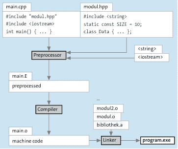

**图2.1** 从源代码到可执行程序的编译阶段。

我略去了优化，以及程序在运行时使用额外库（动态库）这一事实。

整个流程要么从*集成开发环境*（IDE）启动，要么在命令行上手动执行。*手动*在这里其实有些夸张，因为此过程中也经常使用一个工具，称为*构建工具*。*Makefile*很常见。这些文本文件包含属于程序的组件，以及如何从源代码生成这些组件的说明。

属于C++23的内容，因为语言支持仍不完整，但正在改进。如果你利用自C++11以来新增的功能，你将能比使用例如C++98及更早版本时更快地学会这门语言，并更好地使用它。

有了现代编译器，C++肯定更有乐趣。幸运的是，大多数编译器或多或少都已更新到较新版本。

### 2.3.1 GNU C++

来自GNU编译器集合（GCC）的C++编译器g++是大多数平台上可用的编译器。它也是尝试新事物的试验场，因此你几乎总能看到新特性最先在这里实现。如今已是2024年年中，C++20的实现非常好。遗憾的是，C++23仍缺少一些特性，尤其是范围（ranges）相关特性。在Linux上，GCC通常是首选。尽管GCC被广泛使用，但它以代码库非常复杂而闻名。与付费编译器相比，其编译出的程序在速度上略逊一筹。

### 2.3.2 来自LLVM的Clang++

就代码库而言，*LLVM*及其名为*Clang++*的C++编译器口碑更好。C++20特性的实现堪称典范；C++23只缺少数内容。一些新特性会最先在这里实现。Clang++是macOS开发的标准编译器。它在Linux上免费提供，但必须在现有标准库之外另行安装，因此最好事先安装g++。

### 2.3.3 Microsoft Visual C++

微软引以为傲的C++生态由（连同其他工具一起）*Microsoft Visual C++*（MSVC）、标准库*MSVC STL*以及集成它们的IDE组成。这些IDE包括专用于Windows的*Microsoft Visual Studio*，以及跨平台的*Visual Studio Code*。就C++20标准的实现而言，MSVC和MSVC STL与其他实现只有细微差别。最重要的特性大多已包含在内。在某些C++23特性上，这个编译器甚至领先于其他编译器。

### 2.3.4 容器中的编译器

借助合适的Docker容器，你可以用你的代码试用其他编译器，而无需将它们安装到系统上并可能把系统搞乱。


**图2.2** 用于 C++ 开发的 Microsoft 产品。

在 Mac 上，Apple 提供的 Xcode 是事实上的标准。这让你可以在一个优秀的 IDE 和一套命令行工具之间进行选择。你可以从 Apple 网站下载这些工具（https://developer.apple.com/xcode/）。目前你可以获得 Xcode 15，其编译器版本为 15。不带 IDE 的编译器也可以用于 Linux，最新版本 18 可用（https://releases.llvm.org/）。

GCC 可以作为 Unix、Windows 和 Mac 上的另一种选择。这个 C++ 编译器叫作 *g++*——目前版本为 14.1。你主要在命令行中使用它，但它也集成到 Eclipse CDT、NetBeans、KDevelop、Code::Blocks、Qt Creator 等 IDE 中。其中一些工具甚至支持多个平台。如果你想在 Windows 上使用 g++ 进行开发，请寻找 MinGW 集成，并确认是需要单独下载还是已经包含在内（*Minimalist GNU for Windows*）。

## Windows 下的 Linux 子系统

在 Windows 下，有一个可选的 *适用于 Linux 的 Windows 子系统*（WSL）。在那里你可以启动 bash shell，并获得与 Ubuntu 等系统下相同的命令——包括 `apt-get` 安装命令。然后你就可以在 Windows 下安装 GCC 以及其他许多东西。

一个完全商业化但有趣的解决方案是 JetBrains 的 *CLion*。这个 IDE 设计得非常周到，基于成功的 IntelliJ IDEA，这使它吸引了一些 Java 开发者。它自带的编译器在标准支持方面略有落后，但你可以配置已安装的 GCC 或 Clang 编译器。

## 2.5 Ubuntu 下的命令行

作为命令行开发的一个示例，我将为你提供 Ubuntu 当前长期支持版本的快速指南。Ubuntu 是一个广泛使用的 Linux 发行版。如果你使用的是其他 Linux 发行版，命令可能会有所不同。

你可以这样安装 g++ 和一些有用的工具：

```bash
sudo apt-get install g++ make
```

你在编辑器中输入程序代码，而真正的选择困难就从这里开始。如果你使用 IDE，编辑器已经包含在内。如果没有 IDE，你可以在任何普通文本编辑器中输入程序。文本编辑器比比皆是。

我只建议两个满足不同需求的编辑器：*gedit* 和 *kate*。在 gedit 和 kate 之间做出选择，应该取决于你的桌面环境是 Gnome 还是 KDE。只需试试下面两条命令中哪一条会自动安装更少的软件包，然后选择对应的编辑器即可：

```bash
sudo apt-get install gedit
sudo apt-get install kate
```

在纯文本编辑器和功能全面的 IDE 之间，还有微软的 *Visual Studio Code* 和 JetBrains 的 *Fleet* 这两个新产品，后者目前仍处于预览阶段。两者都能在所有平台上运行，而且非常受欢迎。

如果你加入一个有多名开发者的团队，请了解他们是否会使用 *Emacs* 或 *Vim*。这些是程序员中非常流行的文本编辑器，但学习曲线较为陡峭。如果你有同事能帮助你入门，可以随意选择这两个编辑器之一：

```bash
sudo apt-get install emacs
sudo apt-get install vim
```

### 2.5.1 创建一个程序

稍后当我们以 Windows 下的 Visual Studio Code 为例进行讨论时，就会讲到 IDE。现在，我们先走一遍流程。

打开命令行，有时也称为 *终端* 或 *控制台*。你肯定能在菜单中找到它的入口。在带有 Gnome 的 Ubuntu 中，你还可以按 `Ctrl`+`Alt`+`T`。一个新窗口应该会打开，其中有一个闪烁的光标，显示类似这样的命令行，也就是所谓的提示符：

```bash
towi@havaloc:~$
```

在本书的其余部分，我不会再提及 `towi@havaloc:`（它代表用户名和计算机名），也不会提及表示当前工作目录的波浪号 `~`。提示符 `$` 表示你应该在其后输入命令。练习创建一个新目录并进入该目录：

```bash
~$ mkdir quellcode
~$ cd quellcode
```

你的提示符现在应该包含你已进入的目录：

```bash
~/quellcode$
```

由于 Linux 发行版众多，即使你一切操作正确，显示结果也可能有所不同。你可以使用 `pwd` 来检查你当前所在的目录。

现在打开你选择的编辑器。你可以通过菜单打开，也可以在命令行中输入要编辑的文件名。在命令末尾添加一个和号 `&`，这样即使编辑器已打开，你也能继续输入（如果你忘记这样做，请在命令行中按 `Ctrl`+`Z`，然后输入命令 `bg`，再按 `Enter`）。我自己是 Emacs 用户，但你可以在这里使用你喜欢的编辑器：

```bash
$ emacs modern101.cpp &
```

在编辑器窗口中输入以下源代码。你应该能在某个地方看出你确实在编辑 `modern101.cpp`。

```cpp
// https://godbolt.org/z/911fxx3nq
// modern101.cpp: Fibonacci console
#include <iostream>

int fib(int n) {
    return n<=1 ? n : fib(n-2) + fib(n-1);
}

int main() {
    std::cout << "Which Fibonacci number?";
    int n = 0;
    std::cin >> n;
    std::cout << "fib(" << n << ")=" << fib(n) << "\n";
}
```

**清单2.1** 每个斐波那契数都是其前两个数之和。

将该源代码编译为可执行程序 `modern101.x`：

```bash
$ g++ modern101.cpp -o modern101.x
```

这里的 g++ 就是编译器。用 `modern101.cpp` 指定源文件。如果你有多个源文件要编译成一个程序，就在这里列出多个 `.cpp` 文件。用 `-o modern101.x` 告诉编译器所需的输出文件名。如果忘记这个选项也没关系；编译好的程序最终会以 `a.out` 命名。

自己试一试：

```bash
$ ./modern101.x
Which Fibonacci number? 33
fib(33)=3524578
```

这是你的第一个 C++ 程序。恭喜！

顺便说一句：在 Windows 下，可执行程序通常带有 `*.exe` 扩展名。在 Linux 下，可执行的 C++ 程序带扩展名则相当不寻常。为了说明这一点，我在这里创建 Linux 程序时使用了 `*.x` 扩展名——这也是我在“现实世界”中偶尔会采用的做法。你是否效仿我的示例，完全由你决定。

如果你对如何加速该程序感兴趣，可以跳到第 2.7 节。

### 2.5.2 使用 Makefile 实现自动化

然而，以这种方式反复调用编译器很繁琐，因此最好创建一个 Makefile，在其中列出必要的命令。为此，请创建以下 Makefile 文件：

```bash
$ emacs Makefile &
```

文件内容很简单：

```makefile
# -*- Makefile -*-
all: modern101.x
modern101.x: modern101.cpp
[Tab] g++ modern101.cpp -o modern101.x
# clean up:
clean:
[Tab] rm -f *.x *.o
```

带有 # 的注释行并不关键。请确保缩进的行不是以空格开头，而是以 *制表符* 开头，我用 [Tab] 来表示它。这里我不打算深入所有细节，但下面两行，

```makefile
modern101.x: modern101.cpp
[Tab] g++ modern101.cpp -o modern101.x
```

是在告诉 make：“如果你需要创建 modern101.x，那么你需要 modern101.cpp；要创建它，请运行命令 g++ modern101.cpp -o modern101.x”。

如果你现在运行

```bash
$ make
```

那么 `all:` 规则会查找你想要构建的内容。你可以在其中列出其他规则，make 将依次执行它们。现在你应该已经重新构建了你的程序。make 可能会注意到没有任何更改，这种情况下，`make clean`（执行清理规则）或 `make -B`（假装所有内容都已更改）会有所帮助。

你也可以使用 `make all`、`make modern101.x` 或 `make clean` 来执行其他规则。是不是很方便？

## 2.6 Windows 下的 Visual Studio Code IDE

要安装 Visual Studio Code（VS Code），只需在浏览器的搜索栏中输入“vscode download”，然后点击出现的下载链接。接着下载安装程序并运行它。


**图2.3** Visual Studio Code 可用于主流操作系统。


随后你会看到以下内容：

-   许可协议
-   必须选择的安装位置
-   要设置的开始菜单文件夹
-   诸如“添加到 PATH”（重启后可用）之类的选项

然后你可以在安装的最后一步启动 VS Code，或者直接在 Windows 搜索栏中输入 `code` 并按 `Enter`。

> **Linux 下的 Visual Studio Code**
>
> VS Code 在 Linux 下也运行得非常好。甚至可能略好一些，因为编译器通常已经安装在那里，并且已在 PATH 中可用。从网站下载 VS Code 并安装。还要安装 C/C++ 扩展。系统中可用的编译器将被识别。

显示语言（很可能）最初设置为英语。如果你希望 IDE 使用其他语言，可以稍后按 `Ctrl`+`Shift`+`P` 并选择 **配置显示语言** 来安装该语言。


**图 2.4** 你可以先更改显示语言。

如果你选择更改显示语言，VS Code 将以新语言的菜单重新启动。最好遵循安装程序的建议，并同时重启一次 Windows。

这里我们使用 MSVC 编译器。最好先关闭 VS Code。然后从 https://visualstudio.microsoft.com/downloads/ 下载 **Visual Studio 2022 生成工具** 并安装。在出现的选项中，在左侧选择 **使用 C++ 的桌面开发**，并在右侧至少选择 **MSVC** 和 **C++ CMake**。


**图 2.7** 编译器等工具是单独安装的。

当许多包安装完成后，在安装界面中点击 **开始**，你将进入 **VS 2022 的开发人员命令提示符**（即 Devconsole）。你可以关闭安装程序。你可以通过在开始栏中输入“Developer Command”并选择 **Devconsole**，反复打开 Devconsole。

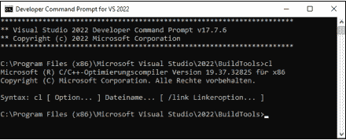

**图 2.8** cl 编译器可在 Devconsole 中使用。

要使用已安装的编译器启动 VS Code，请在 Devconsole 中输入“code”。


**图 2.9** 已完整安装并支持 C++ 的 IDE。

你会看到 C++ 插件用一个新按钮欢迎你。点击它。几秒钟后，你可以点击标有 **选择我的默认编译器** 的按钮。那里其实已经有一个蓝色的 **完成** 勾选标记，但你可以轻松检查该设置。


**图 2.10** 已找到编译器。


**图 2.11** 设置默认编译器。

然后选择 **cl.exe**。这就是你已经在 Devconsole 中试用过的编译器。如果你愿意，可以自己执行 **C++ 开发入门** 的后续步骤。不过，我也可以向你展示另一种或额外的方式来演示 C++ 程序。

在 VS Code 中使用 `Ctrl` + `` ` `` 打开终端。你应该会在主目录中获得一个命令提示符。在那里依次输入 `mkdir modern101` 和 `cd modern101`，以切换到新目录。


**图 2.12** 在新目录中启动项目。

然后选择 VS Code 中清晰可见的 **打开文件夹** 按钮，并选择你刚创建的 **modern101** 文件夹。将打开一个新的项目窗口，在其中你必须先同意这句话 **是，我信任此文件夹的作者**（也就是你）。


**图 2.13** 新的 VS Code 打开并载入新项目。

你现在会在左侧看到项目区域。在那里，你可以将鼠标指针悬停在 **MODERN101** 上，以显示用于创建新文件的按钮。你也可以在“开始”下的欢迎区域选择 **新建文件...** 条目，但会再出现一个对话框。文件名应为 `modern101.cpp`。右侧区域会打开一个文本编辑器，你可以在其中输入源代码。在这里编写你的第一个 C++ 程序！

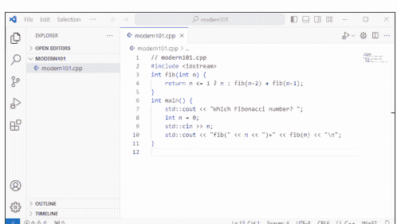

**图 2.14** 在编辑器中输入 C++ 源代码。

现在你只需点击右上角的三角形，并选择 C/C++: cl.exe build and debug active file。

VS Code 中应会打开一个终端，程序会在其中编译。最终你会看到问题：第几个斐波那契数？要测试它，请输入“45”。

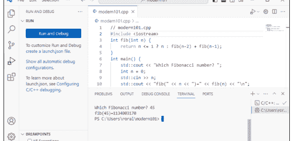

**图 2.15** 你第一个执行的 C++ 程序。

输入数字 45 时，需要一段时间，但随后你会在终端中看到结果。在我的计算机上，计算大约需要一分钟。你也可以从像 20 这样较小的数字开始。如果你选择大于 45 的数字，就会超出该程序的能力，并得到无意义输出。

请注意，这些数字范围指的是 64 位 Windows 上的 Win32 应用程序。在其他平台上，限制可能不同。

### 2.7 加速示例程序

如果程序运行时间对你来说太长，那么请将中间结果制表。这意味着你要将它们保存在类似表格的数据结构中。第零个条目接收 `fib(0)` 的结果，第一个条目接收 `fib(1)` 的结果，依此类推。如果你想用 `fib(n)` 计算表中的第 n 个条目，不要调用 `fib(n-1)` 和 `fib(n-2)`，而是改为查表。这样你得到结果的速度会快到超乎想象。创建一个新项目或修改程序：

```cpp
// https://godbolt.org/z/3WlqY7b9x
// modern102.cpp : Fibonacci console
#include <iostream>
#include <map>
int fib(int n) {
    static std::map<int, int> table{};
    table[n] = n <= 1 ? n : table[n-2] + table[n-1];
    return table[n];
}
int main() {
    std::cout << "How many Fibonacci numbers? ";
    int n = 0;
    std::cin >> n;
    for (int i = 1; i <= n; ++i)
        std::cout << "fib(" << i << ")=" << fib(i) << "\n";
}
```

**清单 2.2** 快速创建的斐波那契数表。

例如，如果你在这里输入“50”，那么你会看到从 46 开始结果有时为负数——这是溢出的迹象。这里同样适用：在 32/64 位 Windows 以外的平台上，限制可能不同。这意味着这些数字对该程序来说太大了，程序会返回无意义结果。程序中发生溢出通常不是好主意。因此，在第 4 章第 4.4 节中，你将了解需要注意什么以及如何避免这个问题。

## 第 3 章：C++ 入门

本章主要面向从 Java 或 C# 转过来的人，但来自其他高级语言（尤其是面向对象语言）的新手也会受益，那些隔了一段时间后重新温习 C++ 技能的人同样会受益。我概括介绍了 C++ 的特有之处，这些地方可能会让新手感到意外或造成困难。

所有其他读者可以跳过本章；后面就是概述和介绍。

以下元素是许多开发者都应该认识的：

- **语句**  
  程序逐条语句执行，一条接一条——至少在每个线程中、至少在模型层面如此。经验法则是，分号将语句彼此分隔开。语句可以组合成块。

- **表达式**  
  表达式递归地由表达式组成，直到不可分割的单元，例如字面量或变量。例如，算术表达式包含数学计算。在 C++ 中，每个表达式都可以被赋予确切的类型。

- **数据类型**  
  C++ 提供了一系列简单数据类型，例如 `int` 和 `double`。还有指针和引用，它们在 C++ 中是独立的类型。一个 `int` 和指向 `int*` 的指针是不同类型。你可以将多个类型聚合在一起以获得新类型。

- **函数与方法**  
  为了防止程序变成冗长的意大利面式代码，可复用的部分可以外包给函数。位于数据类型中的函数称为*方法*。

- **类**  
  你还会将行为与数据类型捆绑在一起——也就是向其中添加方法——这样的数据类型称为*类*。

- **函数调用**  
  函数调用接收参数并返回结果。函数内部发生的事情从外部部分不可见。

- **参数**  
  函数接收参数。在 C++ 中，由函数（而不是调用者）决定参数是作为值使用（*按值*），还是作为引用——或指针（*按引用*）使用。


- **返回值**

  函数也同理。结果可以赋给变量，或在表达式中使用。函数决定返回值是独立副本还是引用。

有些东西对经验丰富的程序员乍看之下可能很熟悉，但它们在细节上与其他语言有着重要的概念差异。例如，如果 Java 开发者在这里带入错误的先入之见，他们之后可能会感到困惑并遭遇糟糕的意外。因此，我想简要提几件可能成为绊脚石的事情：

- **栈和堆，而非垃圾回收**

  当我告诉你 C++ 中没有对象的自动清理时，你不会感到意外。不要把这视为缺点；要利用其优点。区分由编译器在退出代码块时自动管理的*栈*上的事物，以及你用 `new` 在*堆*上申请、并由你负责清理的事物。不要乱来：最好使用 *RAII*（见 [第17章]）。

- **虚拟机与真实机器**

  众所周知，Java 代码一旦翻译为 class 文件（借助 *Java 虚拟机* [JVM]），便可在所有平台上运行（“一次编写，到处运行”）。C++ 代码必须针对每个平台单独编译，因为编译器输出的是可直接执行的机器码（“一次编写，到处编译”）。尽管按标准这不是要求，但通常如此。

- **C++ 的 char 与 Java 的 char**

  C++ 的 char 通常为八位宽，在不同系统上有时表现为有符号，有时表现为无符号。如果没有相应的指定，你只能依赖 0 到 127 的值范围。只有写成 `signed char` 时，它才对应 Java 的 byte。Java 的 char 更对应于 C++ 的 short，并保证为 `int16_t`。后者不必存在，但事实上存在。

- **C++ 的 optional 与 Java 的 optional**

  在 Java 中，你经常将 `Optional` 作为 Java Stream API 的一部分使用。在 C++ 中，容器和新的 ranges 最接近 Java 的 stream API。然而，`optional` 在 C++ 中不是容器，因此你不会像在 Java 中那样使用 `optional`。不过，C++23 增加了 *单子变换*，这使 `optional` 朝这个方向迈进。

- **函数对象与 lambda**

  乍看之下，Java lambda 与 C++ lambda 相似。仔细观察，C++ 中的匿名函数对象更为完善。在 Java 中，调用时仍需在 JVM 中做一些工作来动态创建函数对象。在 C++ 中，编译器已完全将函数外包出去，只给它一个不可见的名称。绑定到局部变量类似，但在 C++ 中你可以选择按值绑定还是按引用绑定。

- **C++ 中的值与引用，对比 Java 等语言**

  在 Java 中，一切对象都是引用。在 C++ 中，一切都是值，并在传参和返回时被复制。只有通过 `&` 和 `*` 的特殊规定，函数才能显式要求引用和指针。

- **抛出值而非指针**

  在 C++ 中，不要写“throw new X(...)”，而只抛出 X(...)。如果不注意这一点，中期内就会遇到麻烦。例如，你将不得不自行删除异常对象。而且这并不总是可行，就像 catch(...)（捕获所有）那样。那重新抛出呢？你应当转而依赖 C++ 机制，它保证异常实例在需要期间一直存在。偏离这条规则的时机是：某个框架要求你显式清理，因为它以指针形式抛出异常实例。在这种情况下，你当然应遵守框架的规定。阅读其文档，了解是否应在 catch 块中清除异常。

- **const 与 final**

  由于 Java 中的所有对象都是引用，Java 中的 final 仅指用它标记的引用。你肯定知道，如果接口允许，即使有 final，你也可以随意更改其内容（幸运的是，像 Integer 这样的东西并非如此）。由于在 C++ 中一切最初都是值，const 也保护内容。结合引用和指针，你拥有更多控制权，如清单 3.6 及其说明所示。

- **模板与泛型**

  两者都使用尖括号，但它们完全不同。在 Java 中，每个泛型只创建一个函数或类；你只是免除了类型转换——例如，从方法返回值时。关于类型参数，你只知道它要么是一个对象，要么实现了某个特定接口。因此，泛型始终适用于特定的一组对象。而在 C++ 中，模板是一个模版，它只需是可被编译器解析的 C++ 代码，仅此而已。只有当你使用它时，才指定参数类型，然后 C++ 插入这些类型——并在这一刻（编译时）生成实际的函数。这样，每种类型都可以是不同的函数。

- **C++ 与 Java 的接口方案**

  在 C++ 中，存在不受限制的多重继承。而且，按照特里·普拉切特的说法，在“multiple”这个词之后从来不会跟着什么好事，所以 Java 的思想家们也不想把这个特定的魔鬼请进家门。但你又不能完全不用它，否则面向对象将无从谈起。这就是 Java 拥有无实现的接口声明的原因。这种明智的做法阻止了多重继承的滥用，并使设计过于复杂的接口层次结构更加困难。在 C++ 中则相反：旨在防止设计错误的限制必须来自开发者；它们不来自语言。作为一种明智的限制，你可以从采纳 Java 的想法开始：例如，如果使用多重继承，那么确保至多一个父类提供实现，其余只是所谓的签名类——即只包含*纯虚方法*的类。这就是 C++ 所称的抽象方法——即用零赋值代替实现的虚方法。

  1. 《卫兵！卫兵！》，特里·普拉切特，“在像 multiple 这样的形容词之后，名词无关紧要，multiple 之后从来不会跟着什么好事。”
  2. 暂且忽略 Java 8 的默认实现。

- 标准库与 JEE

  如果完整安装 Java，你会随之获得一个庞大的 API，其库几乎涵盖生活的所有领域。C++ 仅在有限程度上如此。尽管标准库为你提供了坚实的基础，但许多重要功能仍依赖第三方提供商。随着从 C++11 到 C++23 的最近几个语言版本的发展，这种情况变得越来越少见，因为越来越多的通用工具已成为标准的一部分。然而，C++ 标准库仍缺少网络通信和许多其他功能。就目前而言。

## 方法声明、方法定义、就地定义、分离定义与抽象

为了让你立即理解：在 C++ 中，你可以在类内的声明处直接定义方法，也可以在源代码的其他位置定义。第一种情况下，定义紧跟函数头：

```cpp
struct Demo {
    int x;
    virtual void func() { x = 12; }  // Definition on site
};
```

对于超过几行的方法，将声明和定义分开。函数体位于类定义之外，最好放在另一个文件中：

```cpp
struct Demo {
    int x;
    virtual void func(); // definition (probably) somewhere else
};
...
void Demo::func() { x = 12; }
```

然而，你不一定必须有方法定义。只有当你还使用该方法时，才真正需要它。链接整个程序时，链接器通常会报错。因此，只有方法声明而没有方法定义是完全没问题的。

但是，如果你在方法声明中写 = 0，那么这也是它的定义。也就是说，作为纯虚——即抽象——方法：


这已经非常“现代”了，但你还可以让它“更纯粹”。在下一个示例中，你可以看到整个过程中没有由 `make_shared` 创建的包装对象。

```cpp
// https://godbolt.org/z/E7e7qq1MY
Data* dataOwner = new Data(5);
Data* data = dataOwner;
Data* more = new Data(6);
data = more;
more->value = 7;
cout << data->value << '\n'; // now also 7
/* tidy up */
delete more;
delete dataOwner;
```

**清单 3.4** C++：没有现代 C++ 工具时，必须特别注意指针所有权。

但是天哪：这里你已经能看到，如果必须自己处理清理工作，会陷入怎样的麻烦。最终 `delete data` 会是错误的，因为 data 指向 more，而 more 已经被清除掉了。赋值 `data = more` 是隐藏 data 的罪魁祸首。释放已经不再可能。dataOwner 存在的唯一原因，就是之后可以释放原始指针。

因此，在 C++ 中采用*指针所有权*的概念很有用：原始指针总是属于某个负责清除它的人。要么是用 `new` 创建该对象的人，要么所有权被转移。你可以“在脑子里”这样做，使用诸如*指南支持库*（GSL；参见关于指南的[第30章](#)）之类的工具，自己编写包装类；或者直接使用现成的工具，如 `shared_ptr` 和 `unique_ptr`。在下一个示例中，我选择 `final`。在 Java 中，这意味着不能给该引用赋任何新值。

```cpp
final Data data = new Data(5);
data.value = 7;             // that's okay
data = new Data(6);          // ✘ this prevents final
```

**清单 3.5** 在 Java 中，final 只阻止引用。

在 C++ 中，const 的用法可以更加多样化。

```cpp
// https://godbolt.org/z/Moe5M7sK8
Data const* data = new Data(5);
data->value = 7;            // this const protects Data
data = new Data(6);          // reassigning pointer is okay
Data * const more = new Data(8);
more->value = 9;        // now okay
more = new Data(10);   // reference is protected
```

**清单 3.6** C++：const 可以保护值或引用。

在 C++ 中，引用或指针以及内容——也就是值——都可以被保护。你也可以用 `Data const * const` 将两者都保护起来。你可以通过 const **后面**的内容来识别它保护的是什么：

- `Data * const` more：指针或引用受保护。
- `Data const * data`：Data 的值受保护。
- `const Data * data`：这是 `Data const * data` 的另一种写法。
- `Data const * const more`：值和指针都受保护。

const 还有各种变体：const 方法不得改变其自身对象，而 constexpr 强制表达式在编译时由编译器计算。

## 第4章
## C++ 的基本构建块

- **本章提要**
  - **main**：每个程序的入口点。
  - **#include**：集成其他程序部分和库。
  - **变量**：用于保存值的内存区域的名称。
  - **初始化**：这是变量创建时将具有的值。对于内置类型，初始化在定义期间尤为重要，否则变量将处于未定义状态。
  - **赋值**：一种特殊的*表达式*，使用 `=` 改变变量的内容。
  - **return**：退出函数；在 `main` 中表示程序结束。
  - **注释**：对程序代码的说明，编译器不会对其求值。
  - **语句**：程序是按顺序处理各种语句。
  - **表达式**：针对赋值等操作数的一系列操作。
  - **块**：花括号之间的一组语句。
  - **类型或数据类型**：对编译器而言，每个表达式都有类型。
  - **标准库**：C++ 标准的一部分，随编译器提供。所有不是纯语法、语义或内置数据类型的内容都由标准库提供。
  - **自定义函数**：使用自定义函数，你可以将代码外包到另一个位置。这是清晰性和可重用性的基础。
  - **函数参数**：为传递给函数的“东西”在函数内赋予其自己的局部名称。
  - **副作用运算符**：改变变量值但不是赋值的运算符。
  - **int 和 bool**：两种基本（内置）且简单的类型。
  - **统一初始化**：用于变量首值或默认参数的独特写法。
  - **记号**：对编译器而言，程序文本的最小构建块。
  - **标识符**：程序元素的名称——即变量、类型、函数等。
  - **for 语句**：这是一种实现语句重复的方式。
  - **if 语句**：你用其实现分支。
  - **运算符**：通常是位于两个操作数之间（或一个操作数之前）的符号；作用类似于以操作数为参数的函数。
  - **操作数**：运算符的参数。
  - **算术运算符**：用于使用 +、-、*、/ 和 % 的经典算术，以及使用 |、&、^、<< 和 >> 的按位算术。
  - **关系运算符**：大于、小于、等于、它们的组合以及不等于：>、<、==、<=、>=、!=，甚至 <=>（C++20）。
  - **逻辑运算符**：组合布尔值：&&、|| 和 !。
  - **赋值运算符或复合赋值**：赋值运算符是等号 =。复合赋值将 = 与算术运算符组合。
  - **二进制系统**：计算机使用 0 和 1 的数字值数制。
  - **内置类型**：无需 #include 即可使用的类型。
  - **整数类型**：short、int、long 或 long long 内置类型之一，每种都有符号或无符号。
  - **浮点类型**：float、double 或 long double 内置类型之一；自 C++23 起，还有 std::floatN_t。
  - **字符类型**：最常见的是 char，也包括 `wchar_t`、`char16_t` 和 `char32_t` 国际字符；都是内置类型。
  - **字符串**：作为字面量 `const char[]`，在 C++ 字符串中常与 C 一起使用 `const char*`；每种情况下也可能使用其他字符类型之一。
  - **真值类型**：内置类型 bool 及其字面量 `true` 和 `false`。
  - **使用 auto 的类型推导**：定义变量时，让编译器根据初始化表达式的类型确定类型。
  - **溢出**：试图将某个类型的值改变到超出其值范围；正范围和负范围都可能发生溢出。
  - **字面量**：在源文本中直接指定的值。
  - **using 和 typedef**：定义类型缩写。

在本章中，我们将非常快速地“飞览”一个简单的 C++ 程序。这将让你熟悉最重要的元素，并更好地理解我将在后续章节中解释的内容。

让我们从一个简单的 C++ 程序开始。

```cpp
// https://godbolt.org/z/Mdj7bGvar
#include <iostream>                    // Include modules/libraries
int main()                              // main() is the start of the program
{
    int value = 100;                    // Variable with initial value
    std::cout << "Divisors of " << value << " are:\n"; // Output of text
    for(int divider=1; divider <= value; divider = divider+1) // loop from 1 to 100
    {
        if(value % divider == 0)        // test for conditional execution
            std::cout << divider << ", "; // only if the test is positive
    }                                   // end of the loop
    std::cout << "\n";                  // single output
    return 0;                           // means end of program in main()
}                                       // end of main()
```

**清单 4.1** 一个非常简单的 C++ 程序。


如果你编译并运行这个程序，你将在屏幕上看到以下输出：

```
Divisors of 100 are:
1, 2, 5, 10, 20, 25, 50, 100,
```

从这个简单的程序中，你已经可以看到许多关于C++的基础且重要的内容。

### 4.1 快速概览

我将在这里简要解释各个程序元素，以便你掌握必要的基础知识，然后我们可以更深入地探讨。

### 4.1.1 注释

如你所见，我在这里混合了程序文本和解释性文字。这些行总是以程序文本开头，有时后面跟着双斜杠//，然后是解释性文字——即注释。在C++中，你可以在//之后写任何文本；编译器会忽略它（或者更准确地说，将其视作空格），只有少数例外。这使你能够告诉其他程序员、你自己或后代，导致当前这行程序出现的意图。

### 4.1.2 “include”指令

示例的第一行是：

```
#include <iostream>
```

使用`#include`告知编译器，你想在此文件中使用某个模块的元素。尖括号之间的名称是头文件的名称，该头文件包含该模块的声明。

### 4.1.3 标准库

我包含了特殊的iostream模块，因为它包含std::cout。程序需要cout来生成屏幕输出。iostream模块是标准库的一部分，随编译器一同提供。

标准库中的所有名称都以std开头，后面跟着作用域解析运算符::。这是一个虽然精确但很丑陋的术语，没有人使用它；双冒号这个名字也不错。

稍后我将更详细地介绍使用std标识符的各种可能性。本书的很大一部分内容涉及标准库本身。

### 4.1.4 “main()”函数

现在让我们看看写着`main`的这一行：

```cpp
int main()
```

这定义了一个具有特殊名称的*函数*。`main`函数始终是C++程序的入口点：你不能没有它，而且永远不能有两个。当你的系统执行程序时，会调用`main()`。

此外，C++中的函数允许你从程序中的另一个位置跳转到该函数，并在稍后返回到调用位置。函数可以接受参数——这些是*函数参数*——并返回结果（参见[第7章](#)）。

你可以这样理解这个main函数的定义：

- `main`应返回一个数字——准确地说，是一个`int`类型的值。
- 函数的名字是`main`。
- `main()`中的一对空圆括号表示该函数不接收任何参数。
- 后面跟着函数实际执行的内容。这个*函数体*总是放在两个花括号（`{...}`）之间。

除main以外的函数可以返回任何其他类型。

`main`返回的值由计算机运行程序时遇到的第一个`return`决定。在这里，它总是`return 0`。因此返回值总是0。

返回值可以被操作系统评估。如果你的程序要能够在命令行接收参数，那么参数用的圆括号就不会是空的。稍后你会看到为此需要做什么。

### 4.1.5 类型

在C++中，几乎所有东西都有类型，例如变量和中间结果。类型决定了该构造具有哪些属性以及它可以接受哪些值。

在清单4.1中，只有`int`被明确提到为一种类型。编译器会自己处理其他所有事情。程序中引入了两个这种类型的*变量*：`int` value和`int` divisor。每当你在程序过程中引用这些变量时，你必须考虑它们的`int`类型。稍后我会详细介绍`int`的确切属性。目前，只需要知道`int`代表*整数*即可。

### 4.1.6 变量

*变量*是能够容纳值的内存区域的名称。是的，在C++中，变量必须始终具有类型。当你第一次使用变量时，你必须告诉编译器它的类型。该类型在变量生命周期内一直伴随它，并且不能再更改。

在程序中我使用了两个变量：`value`表示我输出其约数的那个数，`divisor`是用于检查除法是否可以无余数执行的数。首先我定义`value`。从那时起，我就可以使用`value`，并且立即用于输出：

```cpp
int value = 100;                                  // Variable with initial value
std::cout << "Divisors of " << value << " are:\n"; // Output of text
```

因为`value`是int类型，你只能将这个变量用于整数——也就是说，在计算中使用它或更改它。

另一个变量是`for`循环中的`divisor`：

```cpp
for (int divisor = 1; divisor <= value; divisor = divisor+1) // Loop from 1 to 100
```

它的情况与`value`相同。除了名称之外，还有两个其他区别：

- `divisor`在程序序列中实际上被更改了。如果`divisor = ...`，那么它被赋予一个新的数字。
- `divisor`仅在`for`内有效。

变量的*作用域*仅限于其块内，之后它就“销声匿迹”了。而且它彻底消失了，以至于你可以在`for`之外定义一个新的*变量*`divisor`。这个变量也可以具有完全不同的类型。你可以在*清单8.4*中找到一个示例，其中变量`result`被重新声明（尽管类型相同）。

### 4.1.7 初始化

在示例程序中，等号=承担了两个经常被混淆的用途。然而，由于这一区别非常重要，我想尽早让你意识到这一点。

你可以在下面的示例中看到等号：

```cpp
int value = 100;
int divisor = 1;
divisor = divisor+1;
```

前两行分别是对同时定义的变量的*初始化*。这个时刻——你也在此定义其类型——就是它的*声明*。你只能在声明期间进行初始化。

最后一行中的变量已经声明了。因此，你是在给一个已存在的变量赋*新*值；这就是我们称之为*赋值*的原因。通过赋值，你不能改变变量的类型。如果类型不同，编译器可以在一定限度内执行转换。

> **赋值与初始化**
> 
> 声明中的等号始终是*初始化*。
> 
> 只有当变量在其他地方声明时，才是*赋值*。

### 4.1.8 控制台输出

通过`#include <iostream>`，你导入了标准库中负责输入和输出的部分。到控制台的输出使用运算符`<<`完成：

```
std::cout << divisor << " ";
```

在左侧，你可以看到来自`<iostream>`的`std::cout`变量，它代表控制台输出。在每个`<<`的右侧，是你想要输出的内容。如你所见，你可以像普通的加号+一样连接`<<`，从而一个接一个地输出多个内容。

有些输出很难写在源代码中。C++为此提供了特殊机制。一种可能性是用*反斜杠*（\，即反向斜杠）来*转义*某些字符。例如，如果你想输出换行，可以在源代码中写`"\n"`。

### 4.1.9 语句

`main()`的花括号`{...}`将一组*语句*聚合在一起，并定义了一个*语句块*。它们构成了`main()`执行内容的边界：

```
int main()
{
    ...
}
```

中间是逐条执行的*语句*。语句是C++中重要的基本元素，并且有不同的类型。识别什么是语句以及它是什么类型，能让你快速上手C++。在接下来的小节中，你将了解所有这些。在这里，我将向你展示你可以使用哪些语句。在**清单4.1**中，你会看到以下内容：

- *声明*`int value = 100;`使变量value为人所知，并用初始值初始化它——有时统称为*初始化语句*。
- `cout << "Divisors of " << value << " are:\n";`是一个*表达式*，它向控制台输出内容。


- 紧随其后的是*for循环*。它用于重复执行其他语句。稍后我会更详细地介绍`for`语句，但请注意，要重复的部分在`for`之后再次用*花括号*`{...}`括起来。
- 这是因为属于`for`的两个花括号连同其内容构成了一个*复合语句*或*语句块*。它又包含了一系列由外层花括号括在一起的语句。这种语句分组在几个方面都有特殊含义。一方面，它们可以在`for`循环中一起重复；另一方面，这种分组为其所包含的变量构成了一个*作用域*。
- `if (value % divider == 0)...` 是一个if语句，一种*分支语句*。它测试一个条件，并且仅当该条件为真时才执行后面的语句`std::cout << divider << " ";`。与示例中的`for`循环一样，我们本可以在此后面跟一个`{...}`中的语句块（那样才是好风格）。为了演示目的，这里的if后面只跟了一个语句。这样我就可以省去语句块外围的`{...}`。
- *返回语句* `return 0;` 结束了这一列举。

语句由*表达式*构成。表达式在运行时可以产生一个值。在编译时，编译器知道每个表达式的类型。我们稍后会非常详细地讨论表达式。这里只给出程序中的几个例子：

- `value % divider` 计算模——也就是除法的余数。
- `... == 0` 检查两个值是否相等。
- `divisor + 1` 是加法的结果。
- `divisor = ...` 即赋值，也是一个表达式。

### 4.2 详细解析

在上一节中我们从头到尾看了一个示例程序，现在我将更深入地探讨一些细节。你将看到最初的正式定义，并学会识别重要的语言元素。

让我们对程序清单4.1稍作扩展，并仔细观察我们已经熟悉的元素。

```cpp
// https://godbolt.org/z/ceT6o5zxd
#include <iostream>        // for std::cin, std::cout, std::endl
#include <string>          // std::stoi

void calculate(int n) {                         // a separate function
    using namespace std;                         // for std::cout and std::endl
    /* output divisors */
    cout << "divisors of " << n << " are:\n";
    if(n == 0) { cout << "0\n"; return; }      // 0 is divisor of 0
    for(int divider=1; divider <= n; ++divider) { // for divider=divider+1
        if(n % divider == 0)
            cout << divider << ", ";
    }
    cout << endl;
}

int main(int argc, const char* argv[]) {             // Arguments for main
    /* Determine number */
    int value = 0;
    if(argc<2) {
        std::cout << "Enter a number: ";
        std::cin >> value;                           // read into variable value
        if(!std::cin) {                               // check whether reading worked
            return 1;                                 // error or user input
        }
    }
    else {
        value = std::stoi(argv[1]);
    }
    calculate(value);                                 // function call
    return 0;
}
```

**程序清单4.2** 该程序会向用户询问一个数字。

首先，你会看到一些新特性：我现在引入了一个独立的`calculate`函数。它接收一个int类型的*参数*，在函数内部我称之为n。另外，`main()`也有了参数——即`int argc`和`const char* argv[]`。这允许用户在命令行调用程序时带上要执行计算的数字。这里，`argc`包含参数的数量，你可以通过`argv[...]`来查询它们。由于`argv[0]`总是包含被调用程序的名称，因此第一个参数位于`argv[1]`，以此类推。

如果程序在调用时不带参数，就必须在`std::cin >> value`处输入内容。

`std::stoi(argv[1]);` 第一次进行了数据类型转换——本例中，将文本值（`const char*`）转换为数字（`int`）。然后我使用`calculate(value)`，用变量value调用自己的`calculate`函数。

### 4.2.1 空格、标识符和记号

除了对编译器来说（几乎）毫无意义的注释之外，还有空格字符、制表符和换行符，编译器在读取源代码时会极大地简化它们：所有这些*空白字符*都会被“折叠”，并且只被视为一个分隔符。因此，你写`return 0;`还是`return 0 ;`，插入换行，甚至插入空行都无关紧要。

关于*换行符*的一个小说明：这个通用术语涵盖了不同操作系统上存在的各种变体。如果你在编辑器中看到一个换行符，在Windows和Linux上，文本文件中最终会有不同的字节序列，而在老式Mac上又是另一种不同的序列。Linux存储值10（LF，即*换行*），Windows存储两个值13和10（额外加上CR，即*回车*）。如今大多数编辑器都能处理这两种情况。但正是这种差异，导致你在以编程方式打开文件时，必须指定要打开的是二进制文件还是文本文件。

归根结底，重要的是编译器能获得彼此干净分隔的最小程序单元——*记号*。如果这些是名称（变量、函数等的名字），那么边界就很清晰——即名称结束之处：第一个不适合作为名称的字符就是边界。名称（或更准确地说是*标识符*）包含字母、数字以及下划线`_`。但开头不能是数字。因此，`hello`、`Howdy`、`GoodDay`、`w3lc0me`和`moin_moin`都是可能的标识符。另一方面，`Lucky-Luke`、`3Investigators`、`Hardy Boys`和`Tintin&Snowy`不能作为单独的名称使用。如果你想使用像Bärenbrücke中的元音变音，请检查你的编译器是否能处理它们；标准在这里留有一些余地。如果你的程序必须由不同的编译器编译，最好不要在程序文本中使用元音变音或重音符号。

除了空白字符，单词也可以由特殊字符（如花括号或标点符号）来界定。这些字符大多各自是一个记号，你可以在这些记号之间插入任意数量的空格而不改变程序的含义。然而，有少数组合字符只有写在一起时才保留其含义——因此算一个记号。请特别注意`>>`和`<<`以及`++`和`--`，它们原本用于执行算术运算，但在C++中又被赋予了额外的含义。

涉及真值时，你会遇到`&&`和`||`以及`==`和`!=`。此外，`->`和`::`在嵌套数据结构中导航也很重要。所有其他（特殊）字符各自都是一个单独的记号。例如包括以下这些：`= + - * / % , ( ) [ ] { } < > ; :`。

你应该知道源代码中记号位置的主要原因是，你可以在不改变程序含义的情况下省略和插入空格。这是因为你可以在记号之间插入任意空格、制表符和换行符。

例外的是*字面量*：使用它们，你可以直接将固定值写入源代码。这可以是整数（如100）、浮点数（如99.95）或文本（如 "Donald E. Knuth"），所有这些在表示法上也有多种变体。我将在*第4.4节*讨论各自数据类型时更详细地介绍，在那里我会详细讨论字面量。字面量有时看起来像由多个记号组成，但只算作一个。

```cpp
// https://godbolt.org/z/33cc3xfo6
#       include <iostream>              // # must be at the beginning of the line
int             main(
    ){
    std::cout
<< "This is "
        "text with <brackets>\n"  // string literal interrupted by new line
        ;
        /*type:*/ int
        /*variable:*/ a_Value
        /*init:*/ = 100;                 // inner comments
    std::cout<<a_Value<<'\n';}           // no spaces
```

**程序清单4.3** 一段格式非常不寻常的源代码。

当一种构造由多个标识符组成时，事情就变得棘手了。例如，在`std::sin()`中有一个*作用域解析运算符* `::`。对于模板，你会遇到一对尖括号`<...>`——例如，在`numeric_limits<int>::max()`或`map<int,string>`中。所有元素都是各自独立的有效标识符，但只有组合在一起才形成一个整体。

### 4.2.2 注释

你已经见过用`//`书写的注释。如果到行尾没有足够的空间，你也可以用`/*`开头、`*/`结尾的方式让注释跨越多行。例如，就像你在下一个示例中看到的那样。

```cpp
int main() {
    /* My first program. It was
    written by Max Muster.*/
    return /* The zero of success */ 0;
}
```

**程序清单4.4** 用`/*`和`*/`书写的注释可以跨越多行，也可以中断一行程序代码。

由于这样的注释以`*/`为结束界标，程序代码可以随后在同一行继续，如`return 0;`那一行所示。

在注释内部，也可能出现`//`。如果你在程序中主要使用`//`注释，你可以通过用`/*`和`*/`包围某个代码范围来轻松地禁用整个代码块——并通过移除它们来重新启用。编译器也会接受诸如`/* */`或`// */`这样的组合，但最好避免所有这类嵌套；它们会让读者和你自己感到困惑。


在本书的示例中，当我想向程序代码本身添加文字——而不涉及本书内容时——我更倾向于使用 `/*...*/` 注释。例如，在代码清单 4.2 中，我按如下方式引入程序片段：

```cpp
/* Output divider */
...
```

以及

```cpp
/* Determine number */
...
```

## 4.2.3 函数与参数

不要因为函数被调用时变量名为 `value`，而在 `calculate` 函数内部却称为 `n` 而感到困惑。就像在数学中一样，函数的定义会为其*参数*提供名称，随后你在函数中使用这些名称——但调用它们时用什么名称则完全是另一回事。在数学中，你也可以有诸如 f(x) = x² + 2、sin(x) 或复利这样的函数。

CompoundInterest(Dollar, Years, Interest) = Dollar × (1 + Interest/100)^Years

这些函数都为公式中使用的名称赋予了自己的名字。你在使用它们时不必使用这些名称：

- **g(z) = z³ - 2 - f(z)：** 对于一条漂亮的曲线，在 f(x) 中 z 变成了 x。
- **sin(x)：** 这里的 x 是数 π。
- **CompoundInterest(1000, 12, 3)：** 在函数中 Dollar 取值为 1000，Years 取值为 12，Interest 取值为 3。

回到代码清单 4.2 中的 C++ 函数。提醒一下，它看起来如下例所示。

```cpp
// https://godbolt.org/z/E4W9KhhK
void calculate(int n) {                           // a separate function
    using namespace std;                          // for std::cout and std::endl
    /* output divisors */
    cout << " divisors of " << n << " are:\n";
    for(int divider=1; divider <= n; ++divider) { // instead of divider=divider+1
        if(n % divider == 0)
            cout << divider << ", ";
    }
    cout << endl;
}
```

**代码清单 4.5** 一个自定义的 C++ 函数。

在函数本身中，与代码清单 4.1 相比，从 `/* Output divisors */` 开始，所有内容几乎完全相同。实际上，你只会发现 `for` 循环的增量部分中，`divider = divider + 1` 被另一种写法 `++divider` 替代。到目前为止，你一直在使用*赋值*。这里，`++divider` 被用作*副作用运算符*来改变 `divider` 的值。

## 4.2.4 副作用运算符

在代码清单 4.5 中，我使用 `++divider` 将变量增加一。

这是*前缀运算符* `++`，它通常将变量增加一（“递增”）。这会形成一个表达式，其值是变量增加一后的值。在 `for` 循环的更新部分，表达式的结果并不重要，但你可以在更复杂的表达式中使用该值，如下例所示。

```cpp
// https://godbolt.org/z/4Mr6fnaEr
#include <iostream> // cout
int main() {
    int basis = 2;
    int index = 10;
    int number = 3 * (basis + ++index) - 1;  // index is incremented first
    std::cout << number << '\n';             // Output: 38
}
```

**代码清单 4.6** 前缀运算符在计算之前执行。

这里，index 先增加一，然后新值 11 用于后续计算。

如果你在表达式中改变变量的值，这就是一种*副作用*。绝不要在一个带副作用的语句中两次改变同一个变量！

```cpp
int value = 0;
std::cout << ++value << ++value << ++value;  // no more than one ++value
```

编译器会允许这样做，但程序在不同系统上可能会有不同结果。在 Mac 上，我曾在这里得到“123”，在 Linux 系统上得到“321”——而两者都是正确的。

正如你将在第 9 章中看到的，你不能总是依赖表达式的求值顺序。因此，你绝不能使用这样的构造。在 C++ 中，人们接受这种小不便，因为它让编译器具有灵活性，从而带来更好的性能。

在表 4.1 中，我列出了副作用运算符。

我建议，如果可以选择，优先使用前两种形式（前缀运算符）。这是因为后两种形式（后缀运算符）通常更复杂，因为计算机必须在临时变量中记住旧值。

| 运算符 | 描述 |
|---|---|
| `++var` | 如所示，var 增加一，并返回新值。 |
| `--var` | 将 var 减一，并返回新值。 |
| `var++` | 将 var 增加一，并返回旧值。 |
| `var--` | 将 var 减一，并返回旧值。 |

表 4.1 前缀和后缀副作用运算符。

还有一类*副作用赋值*。所有这些变体都提供所有算术运算；它们都是表达式，因此都有一个值，你可以将其用作更大表达式的一部分。不过，它们通常不作为表达式使用，而是像简单赋值一样作为指令使用：

```cpp
// https://godbolt.org/z/r5hjrqqk9
#include <iostream>
int main() {
    int var = 10;
    var += 2;
    var *= 3;
    var /= 4;
    var -= 5;
    std::cout << var << "\n"; // results in 4
}
```

除了 `-`、`+`、`*` 和 `/` 之外，还有一些其他运算符，我将在[4.3 节](#section-4.3)中更详细地介绍。

## 4.2.5 “main”函数

让我进一步简化这个较小的示例程序，使其几乎只剩下 `main` 和 `return`。

```cpp
int main() {
    if(2 < 1) return 1;    // one return
    return 0;              // other return
}                          // end of main
```

**代码清单 4.7** 一个仅由 main 和 return 组成的程序。

现在你可以看到，`main` 也只是一个函数——但它是*特殊函数*：每个可执行的 C++ 程序都必须恰好有一个 `main` 函数，因为你的程序应该执行的主要部分的执行正是从这里开始的。

没有 `main()`，编译器和计算机就不知道从哪里进入程序。只有当你编写模块或库时，才不会有 `main()` 函数。如果你随后将所有模块组合成一个完整的程序，那么其中一个模块——且恰好一个——将包含 `main()`。

简单来说，你的程序从 `main()` 函数的第一行开始执行，就在左花括号 `{` 之后。不过，在此之前已经为你完成了各种任务。全局变量的初始化就是其中之一。

如果你的程序无错误运行，它会一直运行到在 `main()` 中遇到某个 return 语句为止。return 后面的数字是该函数的*返回值*。因为 `main()` 是一个最终由周围操作系统调用的特殊函数，所以这个值具有特殊含义。在 Unix 系统上，0 表示程序成功运行，其他程序可以检查这一点。即使在 Windows 上，某些程序也可以通过 `main()` 的返回值向其他程序发出成功信号。按照惯例，0 表示成功，而所有非 0 值都表示失败。除此之外没有通用规则，只是最常用的失败值是 1。不同系统之间可能的值范围也存在重大差异，因此使用 0 到 127 之间的值是安全的。

`main()` 的一个特殊之处是，你可以省略 `return 0` 中的 0。你甚至可以省略整行，在这种情况下，程序会在到达 `main()` 的右花括号时结束。这两者在 `main()` 中都是可能的——但仅在这里，其他任何地方都不行。

说到 `main` 的特殊之处，还有一点。正如你在代码清单 4.2 和代码清单 4.7 中看到的，你可以用短形式和长形式声明 `main`：

- `int main()`
- `int main(int argc, const char* argv[])`

如果你对可执行程序的调用参数不感兴趣，就选择第一种。第二种形式允许你判断用户是否带参数调用了你的程序，并据此评估这些参数。

假设你的程序名为 `divisors.exe`。在这种情况下，（Windows）用户可以这样调用程序，例如：

```text
$ divisors.exe 1001
```

这里 `argc` 的值为 2，并且你可以通过 `argv[1]` 访问 1001。

只有这两种方式可以定义 `main`。`main()` 这种形式是一种快捷方式，适用于你对程序的调用参数不感兴趣的情况。


## 4.2.6 语句

让我们更仔细地看看这两个函数的 `{ ... }` 之间是什么：*语句*。你已经知道，这些语句是一个接一个地执行的。这正是它们与*表达式*的区别所在——编译器可以对表达式施展它的魔法。现代编译器和运行程序的计算机会在后台对程序做各种匪夷所思的优化，主要是为了让它运行得更快。这些转换的唯一限制是不得改变程序的含义。而这个含义就是：程序中的语句按顺序一条一条地执行。这正是与*表达式*的不同之处——表达式不是以这种确定顺序“执行”的。更恰当的理解是：表达式会取得一个值，或者说计算机*求值*（evaluates）它，而不是字面意义上的*执行*（execute）它。

按照经验法则，一条语句在其分号 `;` 处结束。这条规则最常见的例外是*语句块*：用花括号括起来的一系列语句。

在下一个例子中，你可以看到示例程序的一段节选作为提醒。

```cpp
for(int divider=1; divider <= n; ++divider)  // for 循环
{
        // 循环块开始
        if(n % divider == 0)
                std::cout << divider << ", ";
}       // 循环块结束
```

**清单 4.8** 这里你只设置了外层花括号。

再明确一次：for 循环是一条*单一*语句，从 `for` 一直到 `}`。if 分支也是如此。在下面的清单中，条件部分 `if(argc <= 1)` 和分支部分直到最后一个 `}` 是一个整体，共同构成一条*单一语句*。

```cpp
if(argc<=1)                         // if 语句开始
{
        std::cout << "Enter a number: ";
        std::cin >> number;
        if(!std::cin) {
                return 1;
        }
} else {
        value = std::stoi(argv[1]);
}                                      // if 语句结束
```

**清单 4.9** 如果设置所有花括号，看起来就是这样的。

为什么这很重要？因为这样就能清楚地知道循环可以在哪里使用，以及它延伸的范围有多远。形式上，for 循环总是具有以下格式：

*for( 循环变量定义 ) 语句*

而 if 分支的一种形式化写法是：

`if( 条件 ) 语句`

由于这两者本身都是语句，显然在 for 示例中我可以省略一些括号。这是因为语句可以依次包含语句。例如，for 语句块包含一条单一语句——即 if 语句。

```cpp
for(int divider=1; divider <= value; ++divider)
    if(value % divider == 0)
        std::cout << divider << ", ";
```

**清单 4.10** “if”是一条语句，实际上并不需要花括号。

这与下面的写法含义相同：

```cpp
for(int divider=1; divider <= value; ++divider) {
    if(value % divider == 0)
        std::cout << divider << ", ";
}
```

不过，良好的风格是不省略 if 和 for 的花括号。如果能同样地对 if 也使用语句块的 `{...}`，那将是真正的好风格，而且是等价的。

```cpp
for(int divider=1; divider <= value; ++divider) {
    if(value % divider == 0) {
        std::cout << divider << ", ";
    }
}
```

**清单 4.11** 最好将单独的语句放在花括号中。

再补充一点：关于*括号放在哪里*有不同的写法。有些人喜欢将它们放在 if 或 for 所在行的行尾；另一些人则把它们放在单独的一行。正如你在关于空格的讨论中已经读到的那样，插入额外的换行符并没有关系。无论你选择哪种方案都无所谓，但始终遵循一种风格无疑是有好处的。

虽然分号属于语句的结尾，但不应将其放在语句块的花括号后面。这里必须小心，因为多余的分号会创建一个*空语句*。在大多数情况下这是无害的；例如，`;;;` 中的分号之间有三个空语句，没有任何效果。但是 if 后面的分号意味着空语句属于 if 并结束了 if。在下面的例子中，`cout << "smaller";` 不再属于 if，现在总是会执行：

```cpp
if(value<10);;    // 一条关键的空语句
    std::cout << "smaller";
```

因此，最好不要输入任何额外的分号。同时也要确保不要在语句块 `{...}` 的花括号后面放置分号。即使它没有直接影响，也最好避免下面这种多余的分号：

```cpp
if(value<10) {
    std::cout << "smaller";
};        // 也要避免无害的空语句
std::cout << "next";
```

有点烦人的是，我将在第 12 章中告诉你，关于 `struct` 和 `class`，你*必须*用分号结束它们的定义。所以提前预告一下，你将编写 `struct type { ... };`，而在这里省略分号将是一个错误。原因在于这是一个*定义*，它总是以分号结束；它不是*语句*。

## 4.2.7 表达式

语句与*表达式*相互交织。表达式出现在 C++ 程序的很多地方——不仅是作为语句的一部分，还出现在许多其他不是语句的地方。

表达式是“运算符和操作数执行计算的一个序列”。这个说法如此干巴巴，只能来自 C++ 语言标准的文本。但它是什么意思呢？它的意思是，像 `3+4` 这样的东西就是一个表达式，其中 `3` 和 `4` 是操作数，`+` 是运算符。它也可以变得更复杂，例如在 `(3+4)*PI/sin(x)` 中，这里就有多个运算符和操作数。每个操作数本身必须是一个有效的表达式，而且只有当表达式完整时才有效。因此，`1+2+3+` 不是表达式，因为最后的 `+` 缺少一个操作数。类似地，`3+4)` 也不是表达式，因为它缺少一个右括号。

这个例子表明，表达式可以由更小的表达式组成。如果将 `(3+4)*PI/sin(x)` 拆开，它包含以下表达式：

- `(3+4) * PI / sin(x)`
- `(3+4) * PI` 和 `sin(x)`
- `(3+4)`、`PI` 一方面，`x` 以及甚至 `sin` 另一方面
- `3+4`
- `3` 和 `4`

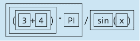

**图 4.1** 一个表达式中的所有子表达式。

在**清单 4.1** 和**清单 4.2** 中，你会找到各种各样的表达式，我这里只能列举其中几个：

- `100` 是一个*数字字面量*——直接写在源代码中的一个数字。
- `"Divisors of "` 是一个*文本字面量*——直接写在源代码中的一段文本。
- `std::cout << "Divisors of "` 是一个在屏幕上输出（或写入文件）的表达式。
- `value % divider` 计算除法 `value / divider` 的余数。
- `value % divider == 0` 检查这个余数是否为 0，因此 divider 是否是 value 的一个除数。
- `return 0;` 中的 `0` 是一个“计算”`main()` 返回值的表达式。

在少数地方，我们会有一些不是表达式的东西，我在这里简要讨论一下。`int value = 100` 不是一个表达式，而是一个*声明*（`int value`）加上一个*初始化*（`= 100`）。然而，`=` 右边的初始化必须是一个表达式。`return 0` 也不是表达式，而是一个*语句*。它由特殊词（*关键字*）`return` 以及本例中的表达式 `0` 组成。

表达式的主要特征之一是每个表达式都有一个明确定义的*类型*，每个子表达式也是如此。由于类型在 C++ 中非常重要，理解表达式的类型也是通向 C++ 成功的重要一步。

### 关于语句和表达式的更多内容

由于语句和表达式是如此基础的语言元素，我们将在后面的章节（**第 8 章**）中专门讨论它们。这里只是一个初步的介绍和概述。

## 4.2.8 赋值

C++ 中最重要的表达式之一是*赋值*。我在语句列表中没有提到赋值。这并非疏忽。


除了初始化之外，清单 4.2 中只有少数几个赋值——即下面的示例。

```cpp
value = std::stoi(argv[1]);
```

**清单 4.12** 将函数调用的结果赋值。

而在我于 `for` 循环中写下 `++divider` 之前，它写的是你在下面示例中看到的内容。

```cpp
divider = divider + 1;
```

**清单 4.13** 将计算结果赋值。

在清单 4.12 中，`value` 被赋值为函数调用的结果。清单 4.13 包含一个计算，其结果被赋给 `divider` 变量。决定性因素是，赋值的目标变量此前已经存在，现在接收一个新值。这是通过等号完成的：赋值目标在左侧，而变量新值的表达式在右侧。

但赋值属于*表达式*这一类别，因此你可以在允许使用表达式的任何地方使用它。赋值像语句一样使用，而没有被进一步嵌入更大的表达式中，这实际上是一种特殊情况——但在赋值中相当常见，如你在清单 4.12 和清单 4.13 中所见。

在下面的示例中，将赋值用作表达式这一点会更加清楚。

```cpp
// https://godbolt.org/z/bh1MsPhje
#include <iostream>
int main() {
    int a = 3;
    int b = 7 + (a = 12) + 6;   // contains an assignment
    std::cout << a << std::endl;
}
```

**清单 4.14** 赋值是一个表达式，其类型为被赋值变量的类型。

这里，`a = 12` 就是赋值。执行时，这个表达式的值为 12，而对编译器来说，其类型是 `a` 的类型——即 `int`。因此变量 `b` 用计算式 7 + 12 + 6 初始化。

你不应把这当作示例，在所有地方都把赋值用作表达式。如果除了主要效果——改变 `a`——之外，另一个变量也改变了它的值，那么赋值就成了一个带有*副作用*的表达式。稍后我们会向你展示 C++ 中这种用法常见的少数地方，因此在阅读和理解时不会感到意外。

如果你已经了解其他编程语言，那么你可能熟悉比 C++ 更宽松的类型概念。有些语言（如 Python、PHP 或 JavaScript）几乎完全忽略类型，并在各自领域中很好地工作。其他语言（如 Java 或 C）有类型，但对类型的使用看法略有不同。在 C++ 中，你更可能使用类型来让编译器帮助你编写正确的程序。

例如，如果程序在某处写了 `100+99`，那么对编译器来说，这是一个*运算符*，带有两个*操作数* 100 和 99，每个操作数的类型都是 `int`。根据编译器内置的规则，带有两个 `int` 操作数的 `+` 又会产生一个 `int` 类型的值，因此这个双操作数表达式也具有 `int` 类型。此时，编译器并不会用具体数字 100 和 99 来计算，也还不知道 `+` 的含义，而只是应用“关于”操作数和运算符的知识——即它们的类型。

如果你在学校物理课上有一位好老师，这听起来可能很熟悉。在处理长公式时，为了检查你的结果是否可能正确，你可以只用测量单位和量来计算，而不是用具体数字（“量纲分析”）。如果你得出的测量单位错误，那就说明你犯了错误（在计算中或检查时）。²

例如：

力，单位为 [kg × m/s²] = 质量，单位为 [kg] × 长度，单位为 [m] / 时间，单位为 [s²]

如果你现在想知道给定质量 8 kg、长度 12 m、时间 4 s 时作用了多少力，那么计算 8 · 12/4 = 24，同时计算 kg × m/s，然后意识到：“哎呀，秒这里有问题！”正确的计算本应是 8 · 12/4² = 6，并用 kg × m/s² 来检查；这就对上了。

编译器做类似的事情。你通过程序中的类、函数和模板来规定类型上的计算规则。这些规则由标准库和你使用的其他库以及内置规则来补充。正如量纲分析在物理考试中帮助过你一样，编译器也可以通过检查典型的计算规则来帮助你编写正确的程序，如下一个示例所示。

```cpp
// https://godbolt.org/z/9943MfExc
#include <vector>

class Image {
    std::vector<char> data_;
public:
    void load(const char* filename); // loads image data
};
class Screen {
public:
    void show(Image& image);        // image should be const
};
void paint(Screen &screen, const Image& image) {
    screen.show(image);
}
int main() {
    Image image {};
    image.load("petter.png");
    Screen screen {};
    paint(screen, image);
}
```

**清单 4.15** 编译器通过检查类型来帮助编写正确的程序。

C++ 中省略“2 次方”也许对应缺少一个 `const`：`Screen` 屏幕有一个方法 `show`，用它来绘制图像。你会认为绘制时图像 `image` 不会被改变。因此，`show` 参数的类型很可能应该是 `const Image&`，而不是 `Image&`。

请注意，仅仅忘记一个 `const` 还不算关键。但如果有人“意外地”把调用 `image.load("paul.png");` 放进 `show` 方法中，会发生什么？那会改变图像。对于 `const` 参数，这不可能发生：编译器会报告错误。

你应该尽可能使用类型安全。它代表了 C++ 相对于老式 C 的最强大优势之一。对类型可进行的转换过去（现在也）受到的限制多得多——而检查则简洁得多。

## 最初的简单类型

也许你还没有意识到，在我们讨论过的小示例中，你已经接触过各种类型。现在我们将介绍其中最重要的几种。

### “int” 类型

在本章中，`int` 是你在 C++ 中可以用来表示整数的所有类型的代表——即负整数、零和正整数。然而，计算机在数值范围方面有局限性。对于 `int`，可用位数因系统而异。如果你在当前系统上工作，它可能是 32 位，但也可能是 16 位、64 位或完全不同的数字。使用 32 位时，`int` 可以存储大约 -20 亿到 +20 亿的整数。你可以用清单 23.29 准确查明。如果你想覆盖其他数值范围，应仔细了解第 4.4 节中的相关类型 `char` 和 `short` 以及 `long` 和 `long long`。

### “bool” 类型

`int` 变量可以取多种状态，而 `bool` 变量则固定为两种状态之一：`true` 或 `false`。

比较是结果为 `bool` 类型的表达式，你可以把比较结果存入这种类型的变量，而不是直接使用它。

```cpp
// https://godbolt.org/z/zk9e9n48
#include <iostream>            // cout
int main(int argc, const char* argv[]) {
    bool withParameters = argc > 1;    // comparison result stored
    if (withParameters) {              // ... and used
        std::cout << "You have called the program with parameters.\n";
    }
    return 0;
}
```

**清单 4.16** `bool` 类型的变量可以存储比较的结果。

### “`const char*`”和“`std::string`”类型

这两种非常不同的类型有相同的目的：它们的变量表示字符串——即文本字符串，如文本、消息、注释、名称等。根据任务不同，有时适合使用“指针变体” `const char*`——它无法否认其源自 C；有时则适合使用 C++ 标准库中的 `std::string`“类”。

> **指针、地址和内存区域**
>
> 注意 `char*` 或 `const char*` 中的星号 `*`。这告诉你：“我只存储某个东西的地址。”这意味着变量指向的位置有一个 `char`。还有 `int*` 作为指向 `int` 的指针，等等。
>
> 然而，对于字符串，还缺少另一条信息，因为指针只包含第一个字符的地址；其他字符可能跟在后面。在 C 中，文本通常会延伸到下一个值为 `0`（也写作 `'\0'`）的 `char`，这便是一个 C 字符串。例如，C 函数 `printf(const char* fmt, ...)` 就是这样工作的。
>
> 其他函数更愿意接受指针和长度，例如 `memcpy(void* dest, const void* src, size_t n)`。这里从 `src` 开始，把接下来的 `n` 个字节复制到 `dest`。
>
> 第三种变体使用指针定义范围，在 C++ 中常用于容器和算法。例如，你可以使用 `std::find(const char* beg, const char* end, char c)` 在 `beg` 和 `end` 之间查找字符 `c`。


如果你只想输出一个固定的字符串，通常使用 `const char*`，因为许多程序部分以这种形式相互交换字符串。你已经看到了 `main` 的参数，我在[清单 4.16](#) 中为 `argv` 示例做过说明。系统可能会以 `const char*` 字符串的形式将多个程序参数传入程序。即使你直接在程序文本中写下 `"..."` 形式的字符串，编译器也会将此“字符串字面量”作为 `const char*` 存储在计算机内存中。（更准确地说，它是 `const char[]`，但这与前者非常相似，在此处足以说明问题。）只要你只想要输出这段文本，就像

```cpp
std::cout << "You have called the program with parameters.\n";
```

那么你无需担心这些细节。

对于除此之外的大多数情况，我建议你改用 `std::string`。如果你想要保存、复制或操作字符串，这是最佳选择。尤其是在内存管理方面——比如动态创建新字符串——使用 C++ 的 `std::string` 类会容易得多。

为了简便起见，初始化 `string` 时也会使用 `const char*` 字面量，但从 C++14 开始，你可以给 `"..."` 字面量附加一个 `s`，从而将其转变为真正的 `string` 字面量。要做到这一点，代码块中必须包含 `using namespace std::literals` 或其中一个替代形式，如下一个示例所示。

```cpp
// https://godbolt.org/z/chTTqPjrM
#include <string>
#include <iostream>
int main() {
    std::cout << "string-literals\n";
    // using std::literals::string_literals::operator""s;
    // using namespace std::string_literals;
    // using namespace std::literals::string_literals;
    using namespace std::literals;
    std::cout << "Real string\n"s;
}
```

**清单 4.17** 这就是如何在源代码中将 C++ 字符串写成字面量的方法。

这通常不会有太大影响，但有时可能很重要。

由于你会大量使用 `std::string`（至少在本书中），请允许我将其简写为 `string`。

## 参数化类型

有些类型的名称中包含尖括号 `<...>`。你在示例中已经见过 `std::vector<char>`。即使这看起来与 int、bool 或 string 不同，整个构造仍然是一个单一类型。括号中的部分是用来构成整体类型的一个参数。这里 `vector` 是外层或主要类型，而 `char` 是参数。两者合在一起，就是一个“char 的向量”。

你也可以构造一个 `vector<int>`，从而得到一个不同的类型。这一点很重要，例如在编译器需要决定哪些函数可供选择，或者某个操作的结果是什么类型时。正如我已经提到的，编译器在翻译阶段会针对类型进行计算；而程序只在运行时对值进行计算。

这里有一点特别重要：对于参数化类型，尖括号内的内容必须在编译时就已知。这是很合理的，因为编译器在编译时使用类型进行计算，而整个构造——由主要类型、括号和参数组成——构成了这个类型。如果你记住这一点，那么在实验时就不会感到惊讶了。例如，还有参数化类型 `std::array<...>`，它接收一个数字作为第二个模板参数。这个数字必须是常量，或者是编译器已经可以计算出的内容，比如 `3+4`。例如，你可以写 `std::array<int,5>`，但不能写 `int n=5; std::array<int,n>`，因为 `n` 是一个变量，不能成为类型的一部分。

> **注意**
> 
> 类型必须在编译时确定。

## 类模板参数推导

你并不总是需要指定参数化类型的参数。如果你调用构造函数，编译器可以自行推断出类型，如下一个示例所示。

```cpp
// https://godbolt.org/z/GbbcnYbqv
std::vector vec { 1, 2, 3 };       // 代替 vector<int>
std::tuple tpl { 5, 'x' };          // 代替 tuple<int,char>
std::shared_ptr<int> ptr { new int(5) };
std::shared_ptr ptr2 { ptr };       // 代替 shared_ptr<int>
```

**清单 4.18** 自 C++17 起，编译器会根据构造函数参数确定类模板的类型参数。

这让你在某些情况下可以保持代码简洁明了。然而，这并不总是可行的；你仍然需要经常自己写出类型参数。

类模板参数推导（CTAD）功能自 C++17 起可用。你可以在清单 23.3 中了解更多相关信息。如果你使用的是较旧的编译器，请将类型参数写完整。

## 4.2.10 变量：声明、定义和初始化

区分以下几种写法是有意义的：

- `int value;`，这是*声明*；
- `value = 0;`，这是*赋值*；或
- `int value = 0;`，这是*带初始化的定义*。

还有一些变量，一旦引入后就无法再更改。它们是常量——实际上就被称为*常量*。除此之外，对于编译器而言，常量也是变量——也就是说，从“集合论”角度看，它们是变量的一个子集。你永远无法对它们重新赋值，因此只能在声明时用某个值对它们进行初始化。关于 `const`，我稍后会详细说明，但你可能已经猜到这一附加特性的主要用途了。

```cpp
int main() {
    const int fest = 33;   // 初始化为常量
    fest = 80;             // ⚡ 赋值是不可能的
}
```

**清单 4.19** 有些变量不能赋任何值；你只能对它们进行初始化。

还有另一种方式可以区分赋值和初始化，或者让它们变得难以区分。C++11 引入了*统一初始化*。无论你在哪里初始化变量，现在都可以使用花括号代替 `=`。

```cpp
int index = 1;       // 旧风格，看起来像赋值
int zaehler { 1 };   // C++11 风格，明确是初始化
int counter = { 1 }; // 在 C++11 风格中，"=" 是可选的，会被忽略
```

**清单 4.20** 可以使用 `{...}` 初始化来代替 `=`。

以前不仅存在与赋值的混淆风险，还可能与其他一些 C++ 构造产生混淆。

> **容易混淆的风险()**
> 
> 这是对未来内容的一个预告，但我给你举个例子。你可以将一个临时的 `Thing` 传递给函数 `f`，这个 `Thing` 用值 12 初始化——也就是说，调用其构造函数：
> 
> ```cpp
> f(Thing(12));
> ```
> 
> 如果它并非有意作为临时对象，例如这样写也可以：
> 
> ```cpp
> Thing d = Thing(12);
> ```

对于无参数的构造函数，可以通过以下方式之一完成：

```cpp
f(Thing());
Thing d = Thing();
```

下面这种写法也没问题：

```cpp
Thing d(12);
```

现在你有了一个用 12 初始化过的 `d`。于是你可能会推断，可以这样初始化一个没有构造函数参数的 `d`：

```cpp
Thing d();    // ⚠ 错误：声明 d 为一个函数
```

但你会大错特错！你现在声明了一个函数 `d`，它不接受任何参数并返回 `Thing`。请注意：你只是声明了它，而不是定义它。这类似于在头文件中将 `int mydata();` 作为函数声明。一旦你想以任何方式使用 `d`，比如调用 `d.print()`，编译器就会报出最令人费解的错误信息，比如“d 尚未被定义”或“期望一个函数调用”。

如果你想亲自试试，并不需要一个 `Thing`。用 `int` 或 `short` 试试看：

```cpp
// https://godbolt.org/z/3G5Po9zEj
int main() {
    int d1(12);    // 定义一个 int 并用 12 初始化
    int b1 = d1+1;
    int d2();      // ⚠ 声明了一个无参数、返回 int 的函数 d2
    int b2 = d2+1;
    int d3{};      // 定义一个 int 并用 0 初始化
    int b3 = d3+1;
}
```

我今天看到的错误信息是：

```
arithmetic on a pointer to the function type 'int ()'
```

解决办法是始终如一地使用 `{...}`，因为 `Thing d{};` 会执行你期望的操作。

> **旧等号还是标准化初始化？**
> 
> 所有当前的编译器都支持使用 `{...}` 的新式初始化。所以你可以选择。“旧风格”无法被根除（而且它是否应该有这种改变也值得商榷），但只要是初始化并非 `int` 这类原生数据类型时，你都应该使用新风格。这会让你为那些棘手的场景做好准备。

## 4.2.11 使用 “auto” 进行初始化

关于初始化再说一句。它始终由


- 你正在初始化的变量类型，
- 变量名，以及
- 变量第一个值的表达式。

表达式的类型通常与变量的类型相同。有时你让编译器执行*隐式转换*。不过，你通常可以省去再次指定表达式类型的工作。你可以改用 `auto`。然后编译器会采用表达式的类型来确定变量类型。这称为*类型推导*：

```cpp
auto number = 10;
auto value = 3.1415 * sin(alpha);
for(auto it = container.begin(); ... ) ...
```

这里的变量 `number` 变为 `int`，而 `value` 变为 `double`，其类型就是 `begin()` 返回的类型，很可能是变量容器的迭代器。

不过，从 C++20 起，你可以用*概念*进一步限制类型。这允许你指定变量类型必须满足某些条件。标准库为此提供了许多概念，例如 `integral` 和 `floating_point`：

```cpp
integral auto number = get_number();
floating_point auto pointy_number = get_ampere();
```

如果这里只写 auto number，那么 number 也可能是 double——这在后续计算过程中可能会给 number 带来问题。另一方面，如果你用 int number 完全定义类型，就会失去将 get_number() 的返回值扩展为 long 的选项。此外，相关代码行也可能位于泛型代码中，其中 get_number() 的返回类型可以是 int 或 long，但你希望防止 get_number() 返回 double。

概念与 auto 结合使用的优点是提供文档说明，并防止意外。

除了标准库中的内置概念，你也可以定义自己的概念。

无论是否使用概念，auto 都会像你显式写出类型一样定义变量类型。绝不是说 auto 本身就是一种可变类型。一旦设定，变量就保持其类型。

编译器为 val 确定类型 int。之后赋予文本字面量是错误的：

```cpp
auto val = 12;
val = "Name";    // ✕ Error: Assignment of "const char*" to "int"
```

你可以在*第12章第12.12节*中确切了解 auto 的工作原理。

## 4.2.12 include 指令详解

include 始终以井号 # 开头。行首的这种字符表示给预处理器的一条指令。如果你还记得第2章图2.1，那么你已经熟悉翻译的这个阶段。

这里通过 #include 包含的文件会被预处理器几乎像复制粘贴一样插入到你的程序中。其效果是，该文件中的所有声明现在都成为你程序的一部分。

还有其他预处理器指令，但 #include 对你来说是最重要的。其他指令见第21章。

include 始终应放在源文件顶部。在代码清单4.2中，我使用了其中两个。

```cpp
#include <iostream>  // cin, cout
#include <string>    // stoi
```

`<iostream>` 和 `<string>` 都是 C++ 标准库的一部分。因此，它们包含不属于核心语言的内容。像 int 这样的东西在所有系统上始终存在，无需 include。标准库通常会存在——我们在本书中假定如此——但并非总是如此。

由于你用 #include 将许多标识符引入当前源代码，因此添加注释来指出你在此翻译单元中使用了其中哪些标识符会很有帮助。这使读者只需搜索文件就能找出未知标识符来自哪里。有些模块名不言自明。例如，`#include <vector>` 导入 vector；无需解释。

你可以通过名称没有 .h 之类的扩展名来识别标准库的 include。惯例是只使用没有扩展名的标准库头文件。如果你创建自己的头文件，则追加 .h、.hpp、.H、.hh 或 .hxx。实践中，.h 最常见，即使有些程序员不喜欢这样，因为该头文件从外部看与 C 头文件没有区别。.hpp 文件扩展名常被选作替代。无论使用哪种扩展名，都要在 #include 指令中写出它：

```cpp
#include <iostream>          // Module of the standard library
#include <asteroids.h>       // Module of a third-party provider
#include "myModule.hpp"      // Module of the current project
#include "algo/myModule.h"   // in a subdirectory
```

如果头文件已安装在你系统上，就把头文件名写在尖括号中；编译器应搜索它。如果头文件是你当前项目的一部分，并未安装在某个位置，则使用引号 "..."。有些编译器随后会先在当前项目中搜索该文件。

### include 的禁忌

命名文件时要注意大小写，因为某些系统会区分大小写，亲爱的 Windows 用户！如果头文件位于子目录中，始终使用 `/` 分隔：

```cpp
#include "MY_MODULE.H"             // ⚡ not good if the file is called "myModule.h"
#include "algo\\myModule.h"          // also use "/" under Windows
#include "c:/project/myModule.h"     // no absolute paths
#include "../algo/myModule.h"         // no relative paths with ".."
```

不要使用绝对路径或 `..`，而应把头文件存放在项目中的其他位置，和/或必须在编译器选项中调整头文件搜索路径。这样在必要时移动和重新组织项目会更容易。

关于尖括号与引号再说明一点：最初，`<...>` 与 `"..."` 的区别意味着头文件可能是编译器的一部分，而根本不是文件。然而，现在人们已经接受：如果只是一个预期已安装在系统上的头文件，也使用尖括号。因此，只对属于你当前项目、并且应优先于其他库的文件使用 `"..."`。这种优先级是否有效取决于所用编译器。

## 4.2.13 模块

*模块*是随 C++20 引入的。与其将文本形式的 `#include` 指令“复制”到翻译单元中，不如将代码划分为接口区和实现区。为此，使用新关键字 `module` 和 `import`。你可以在 C++ 参考以及 Dos Reis 的教程（如 https://youtu.be/tjSuKOz5HK4）中找到确切用法。然而，目前仍没有“最佳实践”，标准库也尚未划分为模块。C++23 引入了两个标准模块 `std` 和 `std.compat`，它们包含标准库中的*所有内容*。`std` 模块包含可通过 `std::` 访问的符号，例如 `std::vector`。`std.compat` 模块包含全局命名空间的标识符，例如 `::fclose`。

但在 2024 年的今天，这些内容在主要的 g++ 13、clang++ 18 和 msvc++ 19.37 编译器中并没有实现多少，而且有些实现与其他实现不兼容。只要还无法预见模块对你来说触手可及，如果你感兴趣，我建议你参考非常前沿的资料。

不过，我想简要转述 Nico Josuttis 的一些建议，说明如何最好地配合新兴惯例，并在移植到另一个平台时尽可能少出问题。⁴

- *接口文件*应使用 `.cppm` 扩展名（不要使用 `.ixx`；MSVC 使用 `/interface`）。⁵
- 将*模块实现文件*保留为 `.cpp`。
- *内部分区实现文件*应使用 `.cppp` 或 `.cppm` 扩展名。

但如果你使用它们，模块和 include 并不互斥。只要遵循某些模式，就可以并行使用两者——而且很可能在很长一段时间内都必须如此，因为即使模块是更好的替代方案，由于历史原因，include 仍会存在很久。

## 4.2.14 输入与输出

现在你已经了解了程序中所有重要的元素，除了——有人会说——最重要的那些元素。毕竟，没有*输入*和*输出*的程序还叫程序吗？

你已经看到 `<<` 被用作输出运算符。而 `#include <iostream>` 也是因为 `std::cout` 才包含的。下面是代码清单4.2中的一段摘录，主要涉及输出：

```cpp
std::cout << "Divisors of " << n << " are:\n";
for(int divider=1; divider <= n; ++divider) {
    if(n % divider == 0)
        std::cout << divider << ", ";
}
std::cout << std::endl;
```

你可以看到，可以直接把多个 `<<` 串接起来。更具体地说，`std::cout << "divisors of "` 是一个表达式，它作为副作用执行输出，然后再次返回 `std::cout`。这实际上会执行 `std::cout << n`，同样进行输出并得到结果 `std::cout`。最后同样重要的是，语句的第三个运算符开始发挥作用，执行 `std::cout << " are:\n"`。这个运算符的特殊之处在于它包含一个*换行符*。在 C++ 字符串中，这由 `\n` 表示。正是这个换行符在循环内的输出中被省略了；因此，这些数字显示在同一行。

使用 `std::cout << std::endl` 时，程序会在列表末尾输出换行。可是，哎呀，`\n` 在哪里？这一次，清单中出现的是 `std::cout` 的一个特殊元素，即*操纵器* `std::endl`。它确保换行，并且保证系统不会缓冲输出。它会强制把你到目前为止放入的内容真正显示到屏幕上。这是因为（屏幕）输出很耗时，而且

⁴ C++20：完整指南，Nico Josuttis，https://leanpub.com/cpp20，Leanpub，2022
⁵ Cppmodules，Nico Josuttis，https://github.com/josuttis/cppmodules，2023年11月30日


系统会尝试尽可能多地汇总步骤，并一次性完成它们。使用 std::endl，可以确保系统真正输出已经发生的所有内容。

### 4.2.15 “std”命名空间

在我们深入各个主题之前，还有一件事需要向你解释。在清单 4.2 中，你可以看到 using namespace std。借助这个工具，你可以省去原本需要在标识符前写的 std::。

```cpp
#include <iostream>                 // for std::cin, std::cout, std::endl
#include <string>                   // for std::stoi
void calculate(int n) {
    using namespace std;            // for std::cout and std::endl
    /* output divisors */
    cout << "divisors of " << n << " are:\n";  // cout instead of std::cout
    for(int divisor=1; divisor <= n; ++divisor) {
        if(n % divisor == 0)
            cout << divisor << ", ";    // cout instead of std::cout
    }
    cout << endl;
}
```

清单 4.21 你可以包含命名空间来让程序文本更简短。

通常，编译器会检查每个标识符的名称是否存在于局部或外层作用域中。例如，divisor 是局部变量，n 是函数内的参数。如果你在没有使用 using 的情况下使用 cout，编译器会检查是否存在同名的局部变量或参数，然后检查是否存在全局变量 cout，接着会报错告诉你并非如此——因此该标识符是未知的。

使用 using 时，对于每个找不到的标识符，系统会尝试在其前面加上 std:: 是否可行。这可以省去大量输入，否则你需要输入很多 std:: 前缀。

using namespace 指令在其定义的作用域范围内生效——在示例中，仅在 calculate 函数内生效。你也可以在全局范围写 using namespace，这种情况下作用域更大。

```cpp
#include <iostream>
#include <string>
using namespace std;            // has a global effect; works, but is critical
void calculate(int n) {
    /* output divisors */
    cout << "divisors of " << n << " are:\n";
    //...
}
// ... also in other functions ...
```

清单 4.22 你也可以在全局使用“using namespace”，但应很少这样做。

这听起来是不是很诱人，以至于你想一直使用 using namespace ...？不要这样做！使用 using namespace ... 后，你不再知道程序中的标识符来自哪里。例如，如果你还不熟悉标准库，遇到一个孤立的 cout，你怎么知道它实际上是 std::cout？

> **避免全局“using namespace”**
>
> 不要在文件的全局层面使用 using namespace ...。阅读每个标识符时，你会问自己它来自哪里，而且即使搜索当前文件也没有机会找出答案。
>
> 不过，在块内——例如在函数局部，如我在清单 4.21 中所示——使用 using namespace ... 并不会受到非议。需要猜测标识符来自哪个命名空间的范围足够有限。而且多个 using namespace 同时生效的可能性较低。

但有一个解决方案：不要获取命名空间的所有标识符，而只获取你需要的标识符，如下例所示。

```cpp
#include <iostream>              // cin, cout, endl
using std::endl;                 // applies globally in this file
void calculate(int n) {
    using std::cout;             // applies locally in this function
    /* output divisor */
    cout << "divisors of " << n << " are:\n";
    for(int divisor=1; divisor <= n; ++divisor) {
        if(n % divisor == 0)
            cout << divisor << ", ";
    }
    cout << endl;
}
```

清单 4.23 使用“using”获取单个标识符。

以这种方式包含标识符几乎不会引起问题。如果文件中某处出现一个孤立的 cout，你可以通过在文件内简单搜索找到原始命名空间。

## 本书约定

由于本书中的清单很少变得冗长且令人困惑，我在这里破例一次。在包含指令之后的开头写 `using ...` 可以节省空间并避免重复。因此，我主要会缩写 `std::cout`、`std::endl` 和 `std::string`，但其他标识符会带 `std::` 完整写出，以便你知道它们来自哪里。

### 4.3 运算符

单字符和双字符运算符在表达式中非常常用。3+4 是一个简单的例子，但也可能出现诸如 `!isBad && (x >= 0) && (x <= 1)` 这样的表达式。在 C++ 中，借助这样的运算符和操作数序列，你可以完成很多事情。既然你已经对变量、类型和表达式有了很多了解，现在应该认识一下可用的运算符。

作为示例，我将主要使用 int 和 bool 类型来解释运算符，以便你先了解这套运算符。然而，许多运算符也可以应用于其他类型。这些类型包括内置类型（如 float），也包括标准库中的类型（如 `std::string` 和 `std::ostream`）。

在 C++ 中，你可以定义自己的类型，这些类型也支持运算符。你需要确保这些运算符所做的事情也适用于内置类型。例如，我们期望 + 执行加法——就像对 int 那样。然而，string 类使用 + 进行拼接，这仍然“类似加法”。但如果你愿意，也可以写一个 Image 类，用 + 后跟一个字符串来将自身存储到文件中。（请不要这样做！）我们会在合适的地方讨论这一点。这里你先了解有哪些运算符。

### 内置类型的运算符不能被重写

因此，当我在本章描述运算符时，指的是内置类型的运算符。在 C++ 中你无法更改这些运算符。int 已经有 +，作为程序员，你不能改变它的含义。在某些地方，我会提到标准库中的类型，但在许多情况下，只能以参考为准。

### 4.3.1 运算符和操作数

运算符是一种行为类似函数但本身并不是函数的东西。不同之处在于，你会期望函数名在前面，参数放在其后的括号中，即 `func(arg1, arg2)`。稍微发挥一点创意，你可以把 `func` 写在中间并省略括号，就会得到 `arg1 func arg2`。如果函数名是 + 而不是 func，你就得到了一个运算符 +，它有两个操作数 arg1 和 arg2。

大多数运算符用符号书写，例如 + 或 <<。许多运算符有两个参数，因此被称为*二元运算符*。在 C++ 中，它总是像这样：

- *操作数 运算符符号 操作数*

如果它们是*一元运算符*，运算符放在操作数之前，如 -4；或者更少见地，放在操作数之后，如 idx++；

- *运算符符号 操作数*
- *操作数 运算符符号*

还有其他形式的运算符，将在下面解释。

### 4.3.2 运算符概览

运算符符号可以分为以下几组：

- **算术运算符**  
  这些是四个基本算术运算符 +、-、* 和 /，再加上用于除法余数（取模）的 %。你可以用一元运算符 + 和 - 影响符号。
- **按位运算**  
  你可以用 |、&、^、~、<< 和 >> 逐位组合数字。
- **复合赋值**  
  除了 = 之外，还有同时执行另一种运算的赋值。这些是*复合赋值*：+=、-=、*=、/=、%=、>>=、<<=、&=、^= 和 |=。
- **递增和递减**  
  两个单字符运算符 ++ 和 -- 各有前缀和后缀两种形式（前缀和后缀）。如果可能，优先使用前缀形式，因为它不需要临时变量。
- **关系运算符**  
  关系运算符执行比较并返回真值 bool：==、<、>、<=、>= 或 !=。如果你使用标准库，== 和 < 是最重要的，因为许多算法只在必要时用这两个来推导其他运算符。如果你想让自己的数据类型与标准库配合，这一点很重要。
- **逻辑运算符**  
  &&、|| 和 ! 将真值组合成更复杂的表达式。
- **指针运算符和解引用运算符**  
  你使用一元运算符 & 和 * 以及二元运算符 -> 和 . 来取地址和解引用。这意味着你获取地址、将地址转换为数据，或访问结构体。你稍后会详细了解它们的用法。


- **特殊运算符**  
  你可以将 `>>` 和 `;` 结合使用来编写二选一的表达式。逗号 `,` 可以在表达式中用作顺序运算符。在 C++20 中，新增了三路比较运算符 `<=>`，它有助于实现关系运算符。

- **类似函数的运算符**  
  严格来说，某些特殊类型也属于具有真实名称并像函数一样使用的运算符。这些是类型转换，例如 `(int)value`、`sizeof(a)` 以及其他一些。这些是运算符这一事实意味着，例如，你不能从 `sizeof` 中请求地址。你只能给函数传递值和变量作为参数，但对于 `sizeof`，你还可以使用类型，例如 `sizeof(int)`。严格来说，括号也是可选的；你可以写成 `sizeof a`，但这会很不常见。

## 4.3.3 算术运算符

在 C++ 中，你可以像平常一样使用数字进行计算。除了基本的算术运算 `+`、`-`、`*` 和 `/` 之外，还有用于求除法余数的 `%`。如果不使用括号，则遵循 *先乘除后加减* 的规则，如下一个示例所示：

```cpp
// https://godbolt.org/z/cEGGfoeT7
#include <iostream>
int main() {
    std::cout << "3+4*5+6=" << 3+4*5+6 << "\n";          // dot before dash; = 29
    std::cout << "(3+4)*(5+6)=" << (3+4)*(5+6) << "\n";  // Parentheses; = 77
    std::cout << "22/7=" << 22/7
              << " remainder " << 22%7 << "\n";          // 22/7 = 3 remainder 1
    for(int n=0; n < 10; ++n) {
        std::cout << -2*n*n + 13*n - 4 << " ";          // with unary minus
    }
    std::cout << "\n";
    // output: -4 7 14 17 16 11 2 -11 -28 -49
}
```

**列表 4.24** 实际应用中的算术运算符。

这里针对 `int` 展示的内容适用于所有整数类型。除了 `%` 之外，它也适用于所有浮点类型（float 等）。在标准库中，你会找到 `std::complex<>`，你也可以使用这些运算符。

许多类型使用加号运算符 `+` 来进行拼接。例如，你可以使用

```cpp
std::string before="Robert";
std::string after="Reynolds";
```

通过 `before+" "+after` 来创建一个新字符串 "Robert Reynolds"。

## 4.3.4 逐位运算

逐位运算乍一看可能有点奇怪：

```cpp
int a = 41;        // decimal 41
int b = a & 15;    // results in 9
```

解释是，数字在计算机中表示为 0 和 1 的序列——也就是位。十进制 41 的位表示是 101001——也就是说，是二进制的。

> **二进制系统**
> 
> 因为在十进制系统中基数是 10，所以我们将“四百一十二”写作 412，作为 4 · 10² + 1 · 10¹ + 2 · 10⁰ = 412 的简写。对于基数为 2 的计算机来说，这就是 1 · 2⁸ + 1 · 2⁷ + 0 · 2⁶ + 0 · 2⁵ + 1 · 2⁴ + 1 · 2³ + 1 · 2² + 0 · 2¹ + 0 · 2⁰，简写为 110011100。下标 10 或 2 表示数字所用的数制。

任何从十进制系统到其他数制的转换，只需反复除以基数并记下余数，直到值变为零。例如，要将 412 转换为二进制系统，可以反复除以 2：

```text
412 / 2 = 206, remainder 0
206 / 2 = 103, remainder 0
103 / 2 = 51, remainder 1
 51 / 2 = 25, remainder 1
 25 / 2 = 12, remainder 1
 12 / 2 = 6,  remainder 0
  6 / 2 = 3,  remainder 0
  3 / 2 = 1,  remainder 1
  1 / 2 = 0,  remainder 1
```

从下到上读取余数，并将它们写成一个二进制序列。

因此，最低的 1 表示最高位：110011100。

当然，这在 C++ 中也是可行的。列表 4.25 部分是对你将要了解内容的预览，但我认为它仍然具有启发性。

```cpp
// https://godbolt.org/z/nMescbxvv
#include <iostream>
void printBin(int x) {
    while(x>0) {  // done?
        int a = x/2;    // division by 2
        int b = x % 2;  // modulo, remainder of the division
        std::cout << x << " / 2 = " << a << ", remainder " << b << '\n'; // Output
        x = a;
    }
}

int main() {
    printBin(412);
}
```

**列表 4.25** 将整数转换为位序列的编程示例。

然而，只有少数人能心算这个。我自己在心算较小的数字时用另一种方式：从高位开始，逐次减去 2 的幂——32、16、8、4、2 和 1——直到减到 0。对于 25：减去 16，然后是 8，然后是 1，结果就是二进制 11001。

计算机对 int 通常使用 32 位进行计算。因此它会在前面补 0——也就是说，412 的表示是 00000000 00000000 00000001 10011100。

## 负整数与二进制补码

对于有符号整数（例如 int，它隐式地就是 signed int），最高有效位表示符号；0 表示正数，1 表示负数。

如果符号为正，其余位照常包含数值。但是，如果符号为负，值位的解释就会改变。计算机以 *二进制补码* 形式存储它。要将负二进制数的位表示转换为十进制数，步骤如下：

- 反转所有值位。
- 照常将其转换为十进制数。
- 加一。
- 加上负号。

₂1100 的值位是 ₂100，反转后为 ₂011。这对应于 ₁₀3，加一后得到值 ₁₀4。因此，总的来说，₂1100 在二进制补码中表示 ₁₀-4。

二进制补码最大限度地利用了数据类型的值范围，并且已被证明是计算机计算中最实用的方法。顺便说一下，这种表示的一个副作用是，可以表示的最小负数，其绝对值总是比可以表示的最大正数大 1。四位数值的 16 个可能值的范围是从 -8 到 7。八位时，范围是从 -128 到 127，依此类推。

现在，算术运算是将两个系统中的数字逐位组合。如果你把 1 视为“真”，把 0 视为“假”，那么你自己就可以执行 *AND*、*OR* 和 *XOR* 的按位运算。为了简单起见，在表 4.2 的示例中，我将只限于 4 位的无符号整数。

| 操作 | 二进制 | 十进制 |
|---|---:|---:|
| a | 1001 | 9 |
| b | 0011 | 3 |
| 与 a & b | 0001 | 1 |
| 或 a \| b | 1011 | 11 |
| 异或 a ^ b | 1010 | 10 |
| 非 ~b | 1100 | 12 |

**表 4.2** 使用（假想的）四位宽无符号整数进行按位运算。

<< 和 >> 运算符不应该再让你害怕了：只需将第一个操作数的位表示向左或向右移动第二个操作数所指定的位数。在计算机中，这就像你相应地进行乘以或除以 2 的操作：

- 345 << 3 就像 345*2*2*2，结果是 2760。
- 345 >> 3 就像 345/2/2/2，得到 43。

一旦你需要这样的数字魔法，你就必须再次处理计算机中的数字表示，例如在第 4.4.3 节中。在那之前，请记住 C++ 有这些操作。

因此，这在现实世界中的使用仅限于将数字视为一系列位；否则 *2 和 /2 更有意义。为了让你看到这种用途，下面的代码反转了一个 unsigned short 的位。

```cpp
// https://godbolt.org/z/qdY41d5a9
#include <iostream>
#include <bitset>

constexpr unsigned n_bits = sizeof(unsigned short)*8; // 8 bits per char
auto reverse_bits(unsigned val) -> unsigned short {
    unsigned short ret = 0;
    for (unsigned i = 0; i < n_bits; ++i) {
        ret = (ret << 1) | (val & 1);  // one to the side, set lowest bit
        val >>= 1;                      // one in the other direction
    }
    return ret;
}

void tell(unsigned short val) {
    std::bitset<n_bits> bits{val};
    std::cout << val << " <- " << bits << " -> ";
    auto lav = reverse_bits(val);
    std::bitset<n_bits> stib{lav};
}
```


```cpp
std::cout << val << "=" << stib << "\n";
}
int main() {
    tell(36u);  // Output: 36=0000000000100100 -> 9216=0010010010000000
    tell(199u); // Output: 199=0000000011000111 -> 58112=1100011100000000
    tell(255u); // Output: 255=0000000011111111 -> 65280=1111111100000000
    tell(256u); // Output: 256=0000000100000000 -> 128=1000000000000000
}
```

## 用于流的运算符

标准库流的输入和输出数据流使用 << 和 >> 运算符进行写入和读取，而这两个运算符原本是为按位运算设计的。在许多代码清单中，你已经看到它们用于 std::cout 和 std::cin。在当今的 C++ 中，<< 和 >> 用于流的频率远高于用于真正的按位运算。

## 4.3.5 复合赋值

如果使用算术运算符，就会创建一个新值。如果表达式需要中间结果，这些结果通常只会在计算机内存中短暂存在。在一个表达式内，新的临时值会不断生成又被丢弃。为了避免这种情况，所有算术运算符都有直接修改变量的变体。

除了写成 int a = 3; a = (a * 4 + 7 - 3)/4;，你也可以写成以下形式：

```cpp
int a = 3;
a *= 4;
a += 7;
a -= 3;
a /= 4;
```

在这两种情况下，a 最终都包含值 4。但是，你应避免这种冗长的计算，因为代码很快就会变得难以理解。保存临时值只有在极少数情况下才真正有益。

你也可以这样使用按位算术运算符：

```cpp
// https://godbolt.org/z/5hqanTeYh
#include <iostream>
#include <bitset>  // helps with the output of numbers as a bit sequence
int main() {
    int a = 0;
    for(int idx=0; idx<8; idx++) {
        a <<= 2;                         // shift two bits to the left: "...10"
        a |= 1;                          // set the lowest bit: "...1"
    }
    std::cout << std::bitset<16>(a) << "\n"; // 0101010101010101
    std::cout << a << "\n";                  // 21845
}
```

因此，可用的*复合赋值*包括：

- 标准算术 `+=`、`-=`、`*=`、`/=` 和 `%=`
- 二元算术 `|=`、`&=`、`^=`、`<<=` 和 `>>=`

## 4.3.6 后置与前置自增、后置与前置自减

关于一元运算符 ++ 和 --，我已经说过最重要的内容。让我再总结一次：

- 使用 ++number 时，number 先加一；使用 --number 时，number 先减一。你可以继续在周围表达式中使用这个计算结果。由于这里先执行运算，所以这是*前置*变体。
- 如果你把运算符放到操作数后面，就使用*后置*变体。此时表达式的值（例如 number++）是变量更改之前的值。实际执行要等到整个语句结束时才发生。在此之前，计算机必须在某处记住新值。这可能会消耗内存和时间。因此，通常最好养成使用前置变体的习惯。
- 更重要的是，绝不要在一个语句中对同一个变量使用两个这类运算符。编译器允许这样做，但结果未定义。

## 4.3.7 关系运算符

你还可以比较值。经常需要用 == 判断相等，用 != 判断不相等。当然，你也可以用 < 和 > 比较数字的大小，以及用与等号组合的 <= 和 >=。

这种比较的结果是真或假的结果——即 true 或 false——因此类型为 bool。它们在循环和 if 条件中特别常用。不过，你也可以将结果存储在 bool 变量中，或从函数中返回它：

```cpp
// as conditions:
if(x < 10) ...
for(int idx=0; idx < 12; ++idx) ...
while(it != end) ...
// store:
bool isLarge = value >= 100;
// return:
bool isPositive(int a) {
    return a > 0;
}
```

从 C++20 开始，新增了*三路比较* `<=>`。由于它在外观上类似飞船，通常被称为*太空船运算符*。这种比较返回一个新的（简单）对象，例如可以用 `<`、`>` 或 `==` 将其与 0 比较：

```cpp
if(a <=> b > 0) ...
```

这大致相当于 C 中 `strcmp` 对字符串所做的操作，或 Java 中的 `compareTo`。

它的存在是为了更容易为你自己的数据类型提供顺序。以前，如果要让新数据类型完整且可排序，你必须为它实现 `<`、`>`、`==`、`<=`、`>=` 和 `!=`。从 C++20 起，只需定义 `operator<=>`，编译器就会推导出常规比较运算符。如果实现正确，`(a<=>b)>0` 与 `a>b` 相同，依此类推。

## 4.3.8 逻辑运算符

如果你想知道 x 是否在 100 和 200 之间，必须检查两个关系表达式 `x>100` 和 `x<200`，并且两者都必须为真。你可以用两个连续的 if 来实现。但要将 bool 类型的表达式相互组合，可以使用逻辑运算符：它们各自有两个操作数，并再次返回 bool。如果操作数 u 和 v 都是 bool 表达式，那么

- 如果 u 和 v 都为真，则 `u && v` 为真。
- 如果 u 或 v 为真，则 `u || v` 为真，并且
- 如果 u 为假，则 `! u` 为真。

如果这对你来说完全陌生，*表 4.10* 中的详细信息会有所帮助。

然后你可以组合表达式：

```cpp
if( x > 100 && x < 200 ) ...
```

### 短路求值

前面的 if 语句实际上等价于以下嵌套 if 语句：

```cpp
if(x > 100)
    if(x < 200)
        ...
```

注意，只有在 x > 100 确实为真时，才会计算 x < 200 比较。例如，如果 x 为 2，则不会执行到 x < 200。

如果第二个比较只有在第一个比较为真时才有意义（或才允许执行），这一点就很重要。例如：

```cpp
if( y != 0 && x/y > 5 ) ...
```

稍后讨论指针和 C 数组时，你会看到，也可以使用指向该变量的*指针*来代替引用 &：

```cpp
void checkName(std::string* pname) { // Pointer to a string
    if( (*pname).length() ) ...
}
```

如果变量的类型是 string*，而不是 string& 或 string，那么它只是“间接”关联到值。要获取该值，请使用一元 * 运算符——这里是 *pname。方法调用则是 (*pname).length()。不过，由于这种写法有些繁琐，因此有二元 -> 运算符作为更简短的形式：

```cpp
void checkName(std::string* pname) {
    if( pname->length() ) ...
}
```

特别值得一提的是，两个解引用运算符（一元 * 和二元 ->）都可以由你在自己的类型上定义。因此，了解它们不仅对指针和 C 数组重要。

事实上，指针只是间接访问的一种非常特殊的形式。标准库中充满了*迭代器*，即指针概念的泛化。你会在容器和算法中遇到迭代器，并理所当然地在那里使用 * 和 ->，而不会涉及指针。（参见第四部分和*第 20 章*。）

## 4.3.10 特殊运算符

既然我们在这里讨论运算符，也必须提到两个特殊的存在。

有一个唯一的三元（三字符）运算符 ? :，它允许将 if-else 查询作为表达式使用。它的形式如下：

条件表达式 ? 真时表达式 : 假时表达式

根据条件求值为真还是假，真时表达式或假时表达式会成为整体结果。注意，因此这两部分必须具有相同类型，以便编译器能够确定整体表达式的类型：

```cpp
// https://godbolt.org/z/xrMYz93WP
int main() {
    for(int w1 = 1; w1 <= 6; ++w1) {      // 1..6
        for(int w2 = 0; w2 < 10; ++w2) {   // 0..9
            int max = w1 > w2 ? w1 : w2;  // ternary operator
        }
    }
}
```

这里，max 被赋值为 w1 和 w2 中较大的那个值。


逗号在表达式中可以用作序列运算符。如果你在括号 (...) 中写多个表达式，并用逗号分隔它们，那么编译器会从左到右计算这些表达式，但只保留最后一个表达式的结果作为整体结果。因此，只有当前面的表达式有副作用时，这种构造才有意义。

对于两个表达式，它看起来像这样：

(Expression-1, Expression-2)

编译器先计算 *Expression-1*，然后计算 *Expression-2*。第一个表达式的结果会被丢弃，因此整个表达式获得第二个表达式的值和类型。

```cpp
// https://godbolt.org/z/rq66cWr3d
int main() {
    int a = 0;
    int b = 0;
    for(int w1 = 1; w1 <= 6; ++w1) { // 1..6
        for(int w2 = 0; w2 < 10; ++w2) { // 0..9
            int max = w1 > w2 ? (a+=b, w1) : (b+=1, w2); // sequence operator
        }
    }
}
```

**代码清单 4.26** 你可以用括号中的逗号连接多个表达式。

如果 w1 > w2，则计算表达式 (a+=b, w1)。虽然 w1 作为 max 的结果返回，但会先执行表达式 a+=b。在 w1 <= w2 的情况下，先计算 b+=1，然后把 (b+=1, w2) 中的 w2 赋给变量 max。

我在这里特意为序列运算符选择了一个特别古怪的例子，因为第一，很难找到一个有意义的例子；第二，你应该像达斯·维达躲避岩浆一样避开这个特殊构造。序列运算符会引发副作用问题，但在一个表达式中，每个变量受到副作用影响的次数不得超过一次，因此使用它很危险。

但在某些例外情况下使用它是有意义的——即只允许一个表达式，而否则会更复杂的地方。

例如，在 for 循环的递增部分中就可能出现这种情况。

```cpp
// https://godbolt.org/z/vd85fr7Mj
#include <iostream>
int main() {
    int arr[] = { 8,3,7,3,11,999,5,6,7 };
    int len = 9;
    for(int i=0, *p=arr; i<len && *p!=999; ++i, ++p) { // first ++i, then ++p
        std::cout << i << ": " << *p << " ";
    }
    std::cout << "\n";
    // output: 0: 8 1: 3 2: 7 3: 3 4: 11
}
```

**代码清单 4.27** 序列逗号在 `for` 循环中可能很有用。

请注意，在声明 `int a, b, c;` 中，逗号不是序列运算符。这也适用于 `for` 循环的声明部分 `int i=0, *p=arr`，其中的逗号只用于分隔声明。

用于分隔 `func(x,y,z)` 中的函数参数或 `{1,2,3}` 中列表元素的逗号也不是序列运算符。

### 4.3.11 函数式运算符

尽管看起来不像，以下情况也属于运算符：

- *种类* ... `cast<target_type>(value)`
  这些都是类型转换。在 C++ 记法中，`value` 会被转换为 `target_type`。转换有多种不同种类：`static_cast`、`const_cast`、`dynamic_cast` 和 `reinterpret_cast`。它们在具体行为和可执行的转换方面略有不同，但表达式的类型始终是 `target_type`。如果无法进行类型转换，编译器会报告错误。否则，值会被调整以适配目标类型，这会带来危险。例如，从 `long` 转换为 `short` 时，信息可能会在你没有意识到的情况下丢失。强制类型转换并不可取，但有时确实会发生。在理想情况下，你可以不使用显式类型转换。
- **`(type)value`**
  这是沿用自 C 的类型转换记法。在 `(int)value` 中，无论 `value` 是什么类型，编译器都会尝试把 `value` 转换为 `int`。根据上下文，这种记法对应于 C++ 记法之一，最常见的是 `static_cast<>`。仅仅因为你在强调转换的类型，你也应该始终选择 C++ 记法。
- **`sizeof`**
  你可以使用 `sizeof(type)` 和 `sizeof(value)` 以 char 为单位查明类型或变量的大小。`sizeof(char)` 始终返回 1。
- **`new` 和 `delete`**
  `new class{}` 和 `delete var` 用于管理动态内存，如你将在[第 20 章](#)中看到的那样。
- **throw**
  使用 `throw ExceptionClass{};` 可以触发异常，第 10 章将对此进行说明。

### 4.3.12 运算符顺序

如果你在一个表达式中使用多个运算符——可能是不同的运算符——那么它们会按特定顺序求值。

就像你可以要求一台合适的袖珍计算器对 `3*4+5*6` 遵守*先乘除后加减计算*规则并得出正确结果 29 一样，C++ 也掌握这一点。此外，所有其他运算符也都有**优先级**：一个运算符在这个排序中越高，它相对于其他运算符就越早求值。

请记住这个简单的顺序，它从结合最紧密的运算符开始：

- **乘法**
  `*`、`/` 和 `%`
- **加法**
  `+` 和 `-`
- **流运算符**
  `<<` 和 `>>`
- **比较**
  `<`、`<=`、`>` 和 `>=`
- **相等性**
  `==` 和 `!=`
- **逻辑**
  按此顺序：先 `&&` 后 `||`
- **使用** `=` **的赋值**
  但也包括所有复合赋值，例如 `+=`

这样你就能编写许多复杂表达式，而无需用括号修正含义：

```
bool yesno = 3*4 > 2*6 && 10/2 < 13%8;
```

这样就省去了下面所示的括号：

```
bool yesno = (((3*4) > (2*6)) && ((10/2) < (13%8)));
```

请注意，流输出运算符 `<<` 的结合比使用 `+` 和 `*` 的普通算术更松散。但是，如果输出中包含比较，则需要在比较两侧加上括号：

```
std::cout << 2*7 << x+1 << n/3-m << "\n"; // no () required between <<
std::cout << (x0 > x1) << (a|b || !c); // () would bind more tightly
```

但如果多个相同优先级的运算符彼此相邻，会发生什么？在 10-5-2 这样的表达式中，左边的 - 先求值，因为 - 是*左结合*的——就好像表达式 ((10-5)-3) 放在括号中一样。因此结果是 2。所有二元算术、布尔和比较运算符都是左结合的，所以你可以直观地用它们进行计算。有时这也称为*从左到右结合*或*LR 结合*。

而赋值运算符组则始终是*右结合*的，这就是为什么编译器对 `x += y += z += 1` 会按预期执行 `(x += (y += (z += 1)))`，并先让 `z` 增加 1，然后依次处理其他变量。如果该表达式按 `(((x += y) += z) += 1)` 求值，那么 `x` 会多次得到新值，因为 `x += y` 也会返回 `x`，然后会执行 `+= z`；而 `y` 不会被改变。并且 `x` 会再次被返回，`+= 1` 会让它增加 1，而不是让 `z` 增加。

大多数情况下，优先级和结合性都直观且符合预期。如果有疑问，最好加上括号，因为后来的读者很可能会问和你一样的问题。

### 4.4 内置数据类型

到目前为止，你只是走马观花地了解了类型——以及围绕这些类型、理解它们所必需的最基本的 C++ 知识。

本节以这些基础知识为基础。你现在对这门语言已经了解得足够多，可以理解关于所有内置类型的全面讲解。

在本节中，你将了解：如果程序中不使用 `#include` 或不使用*标准库*，C++ 中哪些数据类型可供你使用。什么是*内置数据类型*，以及你可以用它们做什么？

请注意以下示例中变量和函数参数的类型。

```cpp
// https://godbolt.org/z/MPPsbdq9c
#include <iostream> // cin, cout for input and output

void input(unsigned &birthDay_,
           unsigned &birthMonth_,
           unsigned &birthYear_,
           unsigned long long &taxnumber_,
           double &bodyheight_)
{
    /* Inputs still without good error handling... */
    std::cout << "Date of birth: "; std::cin >> birthDay_;
    std::cout << "Month of birth: "; std::cin >> birthMonth_;


```cpp
std::cout << "Year of birth: "; std::cin >> birthYear_;
std::cout << "Tax number: "; std::cin >> taxnumber_;
std::cout << "Height: "; std::cin >> bodyheight_;
}

int main() {
    /* data */
    unsigned birthDay_ = 0;
    unsigned birthMonth_ = 0;
    unsigned birthYear_ = 0;
    unsigned long taxnumber_ = 0;
    double bodyheight_ = 0.0;
    /* input */
    input(birthDay_, birthMonth_, birthYear_, taxnumber_, bodyheight_);
    /* calculations */
    // ...
}
```

**清单 4.28** 这里使用了一些新的数据类型。

我使用了以下数据类型：

- `unsigned` 和 `unsigned long`，作为*整数数据类型*的代表
- `double`，用于保存（浮）点数
- 变量 `std::cin` 和 `std::cout`，其类型没有明确提及

这些数据类型之间的第一个重要区别在于它们是否为内置类型。

## 4.4.1 概述

如果不使用 `#include`，你可用的数据类型非常有限。例如，可以用 `class` 定义额外类型，或用 `typedef` 创建别名，但你的选择范围仍然非常有限：

- **整数——int、short、long 和 long long，各自都有 signed 或 unsigned 版本**
  整数存储不带小数点的数字——例如 3、-12 和 987654321。不同大小的变体存储有符号或无符号数字。请考虑每个应用需要哪种变体。拿不准时，`int` 是不错的选择。选定类型后，最重要的是必须确保遵守该类型的数值范围，以避免危险的*溢出*。

- **浮点数——double、float 和 long double**
  整数不适合某些场景。使用 `double` 存储小数，例如 3.14、-0.0001 或 6.281e+26。它们的空间仍然有限，即使很大，但最大的问题是精度；甚至无法准确存储 1/3 这样的值。始终谨慎使用浮点数。

- **真值——bool**
  bool 是用于存储真值的数据类型。bool 要么为 true，要么为 false。你经常在 if 语句等中使用这种类型。尽管实际上一个比特就足以存储 bool，但这种数据类型绝不比 char 更节省空间。

- **字符类型——char、char16_t、char32_t 和 char8_t**
  在 C++ 中，只有少数地方真正区分数字和字符，因此也可以把 char 字符类型当作数字使用。这是最小的单位；如果用 sizeof(x) 询问某个类型或变量的实际大小，返回给你的就是 char 单位的数量。char 成为字符类型，是因为你把字符串存储在 char 序列中——要么作为 char[] 中的数组，要么存储在标准库的 string 中。由于 char 并非为国际字符（Unicode）设计，所以还有 char16_t、char32_t，以及空间更大但有些过时的 wchar_t。示例包括 'a'、'Z' 等字符以及国际（Unicode）字符。在 C++20 中新增了 char8_t。

- **引用——&**
  使用 & 的间接引用指向另一个变量。这让你可以用不同名称访问同一个变量——例如，`int x = 7; int& ref = x;`。对引用的修改，例如 `ref = 12;`，实际上改变的是原始变量——在这里是 x。只要引用存在，它始终指向同一个变量。引用不能指向“无”。

- **指针和 C 数组——`*` 和 `[]`**
  使用 * 的间接寻址把变量作为内存地址来指向；对于 C 数组，则使用带长度信息的 []。诸如“你的名字”这样的字符串是 `char[ ]` 的示例，并作为 `char*` 传递给函数。我们将在第 20 章讨论指针时讨论这一点。与使用 & 的引用不同，指针可以改变，使其指向另一个变量。如果指向 `nullptr`，这表示指向“无”。

在源代码中，数据由变量（或类似物）或字面量表示。然而，当编译后的程序运行时，情况看起来相当不同。那时数据需要一种物理表示：在处理器中，数据被计算；在内存中，数据被加载、保存和修改。这里的“内存”可以指许多东西：从快速寄存器到缓存、主存和显卡内存，再到硬盘，以及更广义上的网络或云。

每种数据类型都有处理器能理解的物理表示。在本节中，我们将简要讨论这种表示，因为 C++ 也是一种接近这种表示并可直接操作它的语言。

6 此类字符串在内部以结束字符终止，因此数组长度是 9，而不是可见字符的 8。

## 4.4.2 初始化内置数据类型

这些数据类型与大多数其他——非内置——数据类型之间最重要的区别之一是：必须初始化这些类型的变量！例如，写 `int x = 7;` 或 `int x{7};`。如果省略用 7 进行初始化，那么 x 根本没有被初始化。它的初始值就是随机的，这可能会带来后果。

如果你不想靠运气，而想让编译器为初始化选择一个“好”值，那么在变量后面写一对空花括号 `{}`。经验法则是：这样它会被初始化为零或某种等价物：

```cpp
int x{};          // initializes x with 0 - built-in type
double y{};       // y becomes 0.0 - built-in type
std::string s{};  // empty string - class
struct tm tm{};   // all fields 0 - tm is aggregate from <time.h>
```

> **值初始化不留任何偶然**
>
> 你可以养成习惯：如果没有其他更合理的初始化，至少用 `{}` 初始化，因为即使非内置类型也能从中受益。因此，把这一点纳入你的技能库并没有错。这称为*值初始化*，意思是用*有意义的*、类型特定的值进行初始化。对于用 `{}` 不提供其他值的类型，你至少能得到一些东西，而不是计算机内存中的宇宙噪声。

在非内置类型中，有一些例外不能容忍用 `{}` 初始化。编译器会向你指出这些例外。它们通常是那些必须在花括号之间指定参数的类。

## 4.4.3 整数

我们在示例中多次使用了 unsigned 类型。这只是 unsigned int 的缩写。与普通的 signed int（缩写为 int）相比，它可以存储稍大的正数，但不能存储负数。

通常，对于整数应使用 int 类型。然而，数值范围是有限的。如果需要更长的范围，可以使用 long 和 long long。如果需要节省空间，可以用 short。所有这些变体也都有 unsigned 版本，例如 unsigned long。不必在打算使用的数字类型前写 signed，因为这是默认值。int（无论 signed 还是 unsigned）是系统处理得最自然、通常计算最快的类型。

你可以用整数类型进行算术计算——也就是乘法之类。然而，基本算术运算就已经触及数据类型的极限，因为从逻辑上讲，`unsigned int` 不能取负值。而且 `signed` 和 `unsigned` 两种变体对大数都有限制。

要理解用 `int` 类型及其相关类型计算时实际会发生什么，你只需要知道计算机以*二进制系统*工作。这不过是你熟悉的*十进制系统*，区别在于每一位不能是 0 到 9，而只能是 0 或 1——两个可能值之一（因此 *binary* 中有 *bi*）。在 4.3 节中，我在“二进制系统”框中讨论了这一点。

可以取 0 或 1 的各个位置称为比特。一个整数类型变量能容纳多少比特取决于你的系统。标准规定 `char` 是最小的类型，`long long` 是最大的类型，`short`、`int` 和 `long` 按此顺序位于中间。在当今的机器上，`char` 是 8 位，`long long` 是 64 位。表 4.3 给出了当今两种常见系统的示例。Windows 列适用于 32 位和 64 位 Windows，以及 32 位 Linux。

| 位数 | Linux，64 位 | Windows | 至少适用于…… |
| --- | --- | --- | --- |
| 8 | char | char | char |
| 16 | short | short | short, int |
| 32 | int | int, long | long |
| 64 | long, long long | long long | long long |

表 4.3 两种架构的位宽及作为示例的最小值。

如果一个 `unsigned int` 有 32 位，那么这个数据类型能表示的最大数是 1·2^31 + 1·2^30 + ... + 1·2^1 + 1·2^0 = 2^32 - 1，略高于 40 亿。如表 4.4 所示。你必须通过程序确保 `int` 类型的表达式永远不会取更大的值。

> **整数类型的最小宽度**
>
> 自 C++20 起，“位数”下列出的数字作为实现中“至少适用于……”列所指定数据类型的最小宽度。不过，你不必习惯这一点，因为在标准化之前，所有实现实际上都遵守了这些宽度。然而，你可能还会在很长一段时间内遇到一些人，他们认为 C++ 除了 `char` 之外没有规定最小宽度。现在你可以用新知识大放异彩了。

关于整数类型名称的说明：正式来说，这些类型称为 `int`、`unsigned int`、`long int` 和 `long long int`。我自己通常把 `unsigned int` 缩写为 `unsigned`，但你会经常看到它完整写出。对于 `long` 和 `long long`，后面带 `int` 的完整写法很少使用。


| 位数 | 无符号 | 有符号 |
|---|---|---|
| 8 | 0 ... 255 | −128 ... 127 |
| 16 | 0 ... 65 535 | −32 768 ... 32 767 |
| 32 | 0 ... 4 294 967 295 | −2 147 483 648 ... 2 147 483 647 |
| 64 | 0 ... 18 446 744 073 709 551 615 | −9 223 372 036 854 775 808 ... 9 223 372 036 854 775 807 |

**表4.4** 数值范围。

## 整数的物理表示

你是否注意到，整数的位宽可以被 8 整除？我这么说可能并没有告诉你什么新东西：在大多数计算机系统中，8 位组成一个*字节*（也有例外）。在 C++ 中，字节是最小的*可寻址*数据单元。内存中的一个字节有一个地址 *x*；与它相邻的字节地址为 *x+1*。

在典型系统上，unsigned int 有 32 位——也就是 4 个字节，如[表4.3](#)所示。在给定架构上特别有优势的单元称为*数据字*（或简称为*字*）。就本书而言，我们假设 4 个字节组成一个数据字。不过，并非所有架构都一定如此。

由此我们得到*半字*、*双字*和*四倍字*这些术语，它们分别包含 16 位、64 位（8 字节）和 128 位（16 字节）。如果你假设更小的字长，还有*八倍字*或*双四字*这一术语。人们常用*短字*或*长字*来代替*半字*或*双字*，从这里你可以看到 C 和 C++ 与机器表示的接近程度。不过需要特别小心，因为 Linux 和 Windows 的术语在这里存在分歧；尤其是*长字*有时可能和*字*表示相同的东西。

最后但同样重要的是*半字节*这个术语，它指半个字节：高半字节表示四个高位，低半字节表示四个低位。你可以用一个十六进制字符表示一个半字节（见[表4.7](#)）。

如前所述，不同架构上的术语可能会有所变化。然而，了解这些术语很重要，因为它们经常出现在文档中。显卡等专用硬件的接口描述会引用它们（而且通常对宽度有自己的解释）。与硬件相关的工具也会引用这些术语。例如，在 x86-64 Linux 上的汇编代码（AT&T 或 GAS 语法）中，*imul* 表示 *multiply long*（长乘法），用于对 C++ int 或 short 进行乘法运算。用于 *multiply quad*（四字乘法）的 *imulq* 会对 long 或 long long 执行乘法。同样的代码在 64 位 MIPS 上对 short 和 int 使用 *mul*，对 long 和 long long 使用 *dmult*。我的意思是，你必须始终注意你所使用的架构中的工具意味着什么。在[表4.5](#)中，我在两种不同的 64 位架构上汇编了相同的代码。注意这些命令中表示操作数宽度的后缀。

| C++ | x86-64-Linux | MIPS64 |
|---|---|---|
| long long sq(<br>  long long n)<br>{<br>  return n * n;<br>} | sq(long long):<br>  imulq %rdi, %rdi<br>  movq %rdi, %rax<br>  ret | sq(long long):<br>  dmul $4,$4<br>  j $31<br>  mflo $2 |
| long sq(long n) {<br>  return n * n;<br>} | sq(long):<br>  imulq %rdi, %rdi<br>  movq %rdi, %rax<br>  ret | sq(long):<br>  dmul $4,$4<br>  j $31<br>  mflo $2 |
| int sq(int n) {<br>  return n * n;<br>} | sq(int):<br>  imull %edi, %edi<br>  movl %edi, %eax<br>  ret | sq(int):<br>  j $31<br>  mul $2,$4,$4 |
| short sq(short n) {<br>  return n * n;<br>} | sq(short):<br>  imull %edi, %edi<br>  movl %edi, %eax<br>  ret | sq(short):<br>  andi $4,$4,0xffff<br>  mul $2,$4,$4<br>  j $31<br>  seh $2,$2 |
| char sq(char n) {<br>  return n * n;<br>} | sq(char):<br>  movl %edi, %eax<br>  imull %edi, %eax<br>  ret | sq(char):<br>  andi $4,$4,0xff<br>  mul $2,$4,$4<br>  j $31<br>  seb $2,$2 |

**表4.5** *即使在两种 64 位架构上，不同工具也可能为字宽选择不同术语。*

无论是字还是字节，它们在内存中都彼此相邻存储。假设一个 unsigned int 有 32 位，抽象整数 123456789 存储在四个字节中，其值为 7、91、205 和 21。你可以通过把各个值解释为 256 进制中的位置来重新计算原始值——即 7 · 256³ + 91 · 256² + 205 · 256¹ + 21 · 256⁰。

字节的值很少写成十进制数。非常常见的是把它们写成十六进制数——即 0x07、0x5b、0xcd 和 0x15。这意味着每个字节恰好有两个字符（加上 0x 前缀）。把它们连在一起，就得到一个八字符的十六进制数：0x075bcd15，或者去掉前导零的 0x75bcd15。

使用这种表示法，你现在可以漂亮地在内存中表示紧密排列的 int 值序列（见*图4.2*）。

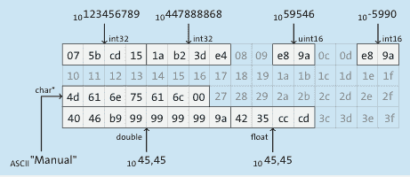

**图4.2** 内存中的数据（大端序）。

开头的两个十进制数 123456789 和 447888868 直接相邻存储。内存单元的内容以十六进制数显示。

图中还包含用于说明的更多数据。十六进制字节序列 0xe89a 作为 uint16_t（例如 unsigned short）解释为 59546。如果用 int16_t（例如 short）读取该字节序列，则对应 -5990。C 字符串 "Manual" 有一个终止 \0 字节。哪个字母表示哪个十六进制字节由 ASCII 标准定义。最后，我将十进制浮点数 45.45 存储为 double 和 float，你可以看到它们的十六进制表示。

### 内存对齐

图中数据元素总是这样存储：其首字节位于能被 4 整除的地址上，这并非完全偶然。这称为*内存对齐*。四个字节对应于 32 位对齐。大多数现代机器在这种情况下工作得更快。为了达到最佳速度，数据在必要时不会紧密打包，而是中间用“空”字节错开。在示例中，59546 和 -5990 就是这种情况：中间的地址 0c 和 0d 不包含任何有意义的数据。

如果某些数据类型的数据没有以正确的对齐方式存储，有些机器甚至无法处理。在这种情况下，读取时必须先通过耗时的过程复制数据。除了 32 位对齐之外，还有 16 位、64 位甚至 128 位对齐。无对齐意味着起始位置无关紧要；这对应于 8 位对齐，在实践中也会出现。

通常你不必担心内存对齐；编译器会替你完成。

## 字节序列

在本节余下部分，我想省略 0x 前缀。除非另有说明，像 123 这样的十进制数使用正文字体，像 a87f 这样的十六进制数使用代码清单字体。

数字 447888596 被分成字节——即 1a、b2、3c 和 d4。在地址 x 处存储 1a，在地址 x+1 处存储 b2，在 x+2 处存储 3c，最后在 x+3 处存储 d4——或者连起来写，在地址 x...x+3 处存储 1a b2 3c d4。在图4.3中，我说明了这一点。如果你从最低有效位开始给这八个十六进制数字编号，使最高有效位数字编号为 8、最低有效位数字编号为 1，那么编号就是 87 65 43 21。

这种格式对我们来说似乎很自然，因为就像我们的数制一样，它先写整个数的最高有效位，最后写最低有效位——正如我们在 123 中把最高权赋给数字 1，把最低权赋给数字 3。这种内存格式称为*大端序*。它先存储*最高有效字节*（MSB）。

存储数字 447888596 的另一种方式是*小端序*内存格式——最低有效元素在前。这样在内存中的地址 x...x+3 处就得到值 d4 3c b2 1a——也就是*最低有效字节*（LSB）在前。在我看来，这看起来很令人困惑，尤其是因为每个两位十六进制数仍然先写其较大组成部分，后写较小组成部分。如果你像之前一样再给这八个十六进制数字编号，结果就是 21 43 65 87。把这样的序列反过来写对我有帮助。

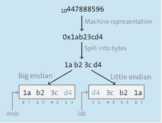

**图4.3** 数字可以最高字节在前或最低字节在前存储。

然而，LSB 也有优点。如果计算机从地址 x 开始读取并解释那里的字节，那么例如它读取的 d4 的权值始终保持不变，无论 d4 是 int、short 还是 long 的一部分。这是一个小优点，早期 CPU 很可能利用了它。

我为什么要问这些问题，而不是简单地把小端序当作一种玄奥的怪癖而摒弃呢？因为它并不是：Intel 处理器，包括你……中的 Pentium，

计算机——我敢说，这么判断不会冒太大出错风险——就是这类代表之一。当然，这也适用于兼容的 AMD Opteron 和加速处理单元（APU）。顺便说一句，这种内存格式的另一个名称是 *Intel 字节序约定*。但其他一些早期“熟人”也是以小端序诞生的：著名的 Zilog Z80 处理器，以及 Commodore 64、Apple II、Atari 或 NES 中值得注意的 MOS Technology 6502。

历史上有什么与它竞争？Motorola 68k 系列、PowerPC、MIPS 和 SPARC 使用大端序。是的，其中少数至今仍在。

## 跨平台表示

> 为了防止在机器之间交换数据时，发送方和接收方对字节序的不同解释导致数据混淆，特别是在网络领域，存在一项关于数据传输所采用字节序的约定。因此这被称为*网络字节序*。编写程序时，你的程序就是“主机”，因此你始终负责在保存或发送时把数据从主机字节序转换为网络字节序，并在读取或接收时反向转换。
>
> 大多数平台都有诸如 `htons`（主机到网络短整型）和 `ntohl`（网络到主机长整型）这样的函数。如果你想编写可移植程序，就应始终使用这些函数。不过，请仔细阅读你的协议规范，因为存在例外。
>
> 你现在是不是在问，网络字节序是小端还是大端？你真的想让我告诉你吗？如果你想编写可移植程序，就不需要知道；即使主机字节序和网络字节序相同，也应使用转换函数。但如果你真的想知道：网络字节序对应大端序。所以如果你所在系统就是这种字节序，这些函数将什么也不做。不过还是调用它们为好。

借助互联网，大端阵营获得了一个强有力的代表。而这也许也是当前征服者——手机、平板电脑和其他联网设备中的移动 CPU，其中通常由 ARM 计算单元执行其服务——是*双端序*的原因；也就是说，它们两者都能处理。

## 整数字面量

在源代码中，你可以直接写下十进制整数。可以使用后缀来指定它是有符号还是无符号，以及该字面量表示什么宽度。没有后缀时，它是 int。不过在实践中，这种指定只在特殊情况下才必要，因为编译器在初始化等过程中自己就能识别该字面量是什么整数类型。在表 4.6 中，你可以看到可能的后缀及示例。

| 类型 | 后缀 | 示例 |
|---|---|---|
| `int` |  | `42`, `-12` |
| `unsigned` | `u`, `U` | `3u`, `123U` |
| `long` | `l`, `L` | `-999l`, `88L` |
| `unsigned long` | `ul`, `UL` | `77'777ul`, `6'666UL` |
| `long long` | `ll`, `LL` | `43'214'321ll`, `-12'341'234LL` |
| `unsigned long long` | `ull`, `ULL` | `23'443'212ull`, `1ULL` |

**表 4.6** 整数后缀及对应类型。

从 C++23 起，你还可以对 `size_t` 字面量使用后缀 `z` 或 `Z`，并可选地与 `u` 或 `U` 组合——例如 `42z` 或 `42zu`。例如，当你将字面量与 `size()` 函数的返回值比较时，如 `(10z > size(v))`，这会很有用。

从 C++14 起，你可以在任何数字字面量的数字之间放置单引号 `'`。它们不影响数字。对于十进制数，按三位分组有助于实现通常的阅读分组。

C++ 还允许你以 8 进制（*八进制*）或 16 进制（*十六进制*）书写整数。它们的优点是三位或两位数字总能组成一个字节（八位），有时比十进制更易读。从 C++14 起，你甚至可以把 2 进制（*二进制*）的数写成字面量。要指定字面量的数制（进制），请使用前缀。在**表 4.7**中，你可以看到可能的前缀。前缀和十六进制字母都不区分大小写；例如，`0xFF` 与 `0Xff` 没有区别。

这里同样可以在数字之间插入单引号 `'` 来分组。十进制和八进制字面量常用三位一组。二进制和十六进制字面量常用两位、四位或八位一组。

如果再把数制前缀与数据类型后缀组合起来，就更进阶了——但正如我所说，后缀很少有必要。用 `0xffULL`，你可以把 255 定义为 unsigned long long。

| 进制 | 前缀 | 示例 | 十进制值（int） |
|---|---|---|---|
| 10 |  | `255`, `-4` | `255`, `-4` |
| 16 | `0x` | `0xff`, `0xCAFE` | `255`, `51966` |
| 8 | `0` | `0377`, `0777666` | `255`, `262070` |
| 2 | `0b` | `0b1111'1111`, `0b0101` | `255`, `5` |

**表 4.7** 不同数制的整数前缀。

## 整数运算

你可以对所有整数类型进行算术计算，正如你所预期：用 * 做乘法，用 + 和 - 做加法和减法，用 / 做不带余数的除法。后者意味着，如果你计算 20 / 7，结果是 2；小数位会被直接截掉。用 %，你得到余数（*取模运算*）。

```cpp
// https://godbolt.org/z/ebPcdxzv
#include <iostream>
int main() {
    std::cout << 3 + 4 * 5 + 6 << "\n";      // 29
    std::cout << 20/7 << " Rest " << 20%7 << "\n";  // 2 remainder 6
}
```

**清单 4.29** 整数算术。

对于更复杂的计算，你必须编写自己的函数，或使用诸如 `double` 这样的浮点数；标准库在 `<cmath>` 头文件中为浮点数提供了大量计算函数。

位运算已在第 4.3 节中描述。下面的清单是另一个简短示例。

```cpp
// https://godbolt.org/z/jeTs5Exqx
#include <iostream>
int main() {
    unsigned a = 0b1111'0000;        // 240
    unsigned b = 0b0011'1100;        // 60
    std::cout << ( a | b ) << "\n";  // Bit-Or: 252, in bits 11111100
    std::cout << ( a & b ) << "\n";  // Bit-And: 48, in bits 00110000
    std::cout << ( a ^ b ) << "\n";  // Exclusive-Or: 204, in bits 11001100
    unsigned int c = 170;            // in bits 0..(24x0)..0'10101010
    std::cout << ( ~c ) << "\n";     // Inv.: 4294967125, Bits: 1..(24x1)..1'01010101
}
```

**清单 4.30** 位运算。

此时，对我来说重要的是你理解 C++ 中整数的概念并学会如何使用它们。我会指出典型陷阱，并给出几个案例研究：

- 整数类型有 `char`、`short`、`int`、`long` 和 `long long`，每种都有有符号和无符号形式。
- 它们在不同系统上宽度不同；只有其大小的顺序是固定的。
- `char` 很特殊，因为它不仅用于算术，还用于存储字符（名称也由此而来）。
- 你的通用整数类型应是 `int` 和 `unsigned`。
- 在 C++ 中你可以对所有数字“正常”计算；简单算术和位运算直接受支持。
- 在具有两个不同类型操作数的表达式中，其中一个操作数可能会在执行计算前被转换。

## 整数溢出

如果你计算 `unsigned int x = 5 - 10;`，就会发生奇怪的事情：对计算机而言，这会变成一个巨大的数。另一端也会发生同样的事：在许多当前计算机上，unsigned int 有 32 位，如果这些位不足以存储一个数，计算机就会从零重新开始。两者都称为*溢出*。如果你处理的是*有符号*变体，要小心，因为它们没有规定发生溢出时会发生什么。一般来说，应避免溢出，除非你确切知道自己在用有符号类型做什么。⁷

## 算术类型转换

到目前为止，我们都把事情简化了：我们总是给一个运算符两个相同类型的操作数。如果你使用两个不同类型，编译器会对较小的整数类型执行*隐式类型转换*：它首先被复制到一个较大类型的临时变量中。表达式的结果随后是较大的类型。

例如，对于 `unsigned char c = 50; int n = 500;`，在表达式 `c+n` 中，`c` 会在计算前被转换为值为 50 的 `int`。这才使 550 的结果有可能被计算出来（`char` 对此来说太小了）。表达式的结果类型也是 `int`，因为它是所涉及两种类型中较大的那个。

当你混合有符号和无符号类型时，事情就变得棘手。以下是一些经验规则：

- 如果涉及的有符号操作数大于无符号操作数，那么它也会用于结果，你可以相当有把握地认为转换不会破坏任何东西。
- 如果两者大小相同，结果会被赋予无符号类型，任何负数都会丢失。

在实践中，这会产生以下效果：有符号和无符号大小相同——都是 `int`。如果你把一个有符号的 `ss = -4;` 和一个无符号的 `uu = 2` 相加，编译器会把结果类型指定为 unsigned。这会导致 -4 在相加前被转换为无符号——因而变成 4294967292（对于 32 位的 `int`）。结果于是有点令人意外地是 4294967294。而且这些规则不仅适用于算术运算，也适用于比较运算：`(ss < uu)` 也会令人意外地求值为 false——甚至更……

⁷ *C++ 中整数溢出有多灾难性？* http://stackoverflow.com/questions/9024826，[2014-02-02]


具体来说，在 C++ 中，表达式 `if(-4 < 2u)` 的值被编译器判定为 false，因为有符号字面量 -4 与无符号字面量 2u 进行比较。

> **避免混用**
>
> 如果你处理的是在此类转换中存在风险的数字范围——负数或大数——那么你就不应该依赖隐式转换。在这种情况下，请预先自行转换操作数。如果两个类型符号不同，不要写 `if(mySize > theLimit)...`，而要自己转换。这样你才会意识到这里正在发生某些需要留意的事情：
>
> `if(mySize > (long)theLimit) ...`
>
> 更好的做法是，从一开始就让两个数值具有相同的类型。
>
> 从 C++20 开始，可以使用更安全的辅助函数，如 `std::cmp_less()`、`std::cmp_equal()` 等，但这些函数比直接写 `<` 或 `==` 更复杂。要检查某个值能否安全地存入特定类型，请使用 `in_range<T>()`。在泛型模板代码中，这通常是唯一安全的方法。

## 数字类型别名

有些数字类型在不同的系统上有不同的定义。一个显著的例子是 `size_t`：有时该类型等同于 `unsigned int`，有时等同于 `unsigned long`，甚至等同于 `unsigned long long`。但如果你只是将这些类型的变量用于其设计目的，你就不会关心底层的具体类型。例如，如果你想了解数据结构的大小，请使用 `sizeof(data)`。返回的是一个 `size_t`——你应该将结果存储在其中。当然，它实际上是其他 int 类型之一，但你无需确切知道是哪一个。它是（未知）真实类型的别名。

使用别名有几个理由。其中最重要的有：

- 你可以省去输入工作。别名更短，尤其是在模板中。
- 它们能说明用途：也就是说，它们将别名用作语义标签。`ptrdiff_t` 和 `size_t` 可能完全相同，但它们的名称已经说明了它们的用途。
- 它们对以后的修改更加灵活，因为在不同的系统中，针对特定用途可能需要不同的类型。在这种情况下，你只需要在某个地方修改别名即可。

诸如 `size_t` 这样的别名是通过 `using` 创建的，如果你已经在使用相应的 `#include`，那么它们通常就是可用的。例如，`size_t` 可以这样定义：

```cpp
using size_t = unsigned long long;
```

> **“typedef”对比“using”**
>
> 如果你现在去看，也许根本不会在头文件里找到任何 `using`，因为 C++11 之前的做法如下：
>
> ```cpp
> typedef unsigned long long size_t;
> ```
>
> 我建议你使用新风格。这可能是品味（或习惯）问题，但我个人喜欢新名称位于等号 `=` 左侧的风格。不过我向你展示 `typedef` 风格，是因为我们可能很长一段时间内仍然会看到它。

正如你将在第四部分看到的，`vector` 可以容纳大量元素。你可以使用方括号 `[ ]` 通过索引来访问各个元素。该索引必须是一个数字——更准确地说，是一个 `size_t`。因此，如果你为 `vector` 索引定义一个计数变量，你完全可以将其设为 `size_t`。

```cpp
// https://godbolt.org/z/zGso3xGqj
#include <vector>
#include <cstddef> // size_t
int main()
{
        std::vector<int> data = { 100, -4, 6'699, 88, 0, };

        int sum = 0;

        for(size_t idx = 0; idx < data.size(); ++idx)
        { // A specific int
                sum += data[idx];
        }
}
```

**清单 4.31** 索引变量可以是“size_t”类型。

然而，不应向你隐瞒的是，前面例子中的求和当然可以用 `for(auto d: data) sum += d;` 实现得更好。或者你也可以直接使用 `<algorithm>` 中的算法：`auto sum = std::accumulate(data.begin(), data.end(), 0);`。在两种情况下，你都能看到，借助 C++11，你现在常常可以省去了解确切类型的麻烦。

其他经常使用的别名，以及针对某些整数类型的典型定义，见表 4.8。

- `b |= a, b &= a, b ^= a` 将运算结果保存回 `b`。
- `~b` 返回一个新的字节，其中所有位都取反。

一个典型用途是 `vector<byte>`，例如，你可以用它来读取文件的内容。

## 4.4.4 浮点数

除了整数类型之外，还有用于浮点数的 `float`、`double` 和 `long double` 类型。在进行 `5/2` 这样的除法时，余数不会被丢弃，而是可以存储在 `double` 中；例如，`double x = 5.0 / 2.0;` 会将 2.5 存储在 `x` 中。但请注意，浮点数也有其局限性：它们同样只有固定数量的位可用，但使用方式与整数类型不同。它们会使用一部分位来“缩放”数值。这意味着你可以用它们存储极大和极小的数，但精度是有上限的。你需要记住以下几点：

- **溢出**
  尽管数字范围比 `int` 大得多，`double` 也可能溢出。它无法存储大于 `10^300` 或小于 `-10^300` 的数字。
- **精度**
  精度更为关键。你越远离作为中心的零，`double` 能存储的值就变得越粗糙。两个“相邻” `double` 数之间的距离会增大。大约从 `10^15` 开始，这个距离就大于 1。如果将它们存储在 `double` 中，数字 `10^16+1` 和 `10^16+2` 对计算机来说是相同的；参见清单 4.33。
- **舍入**
  但 `double` 在处理接近零的数字时也有问题。例如，`int` 可以精确存储 7，而 `double` 却无法精确存储 `0.1`——更不用说 `1/3` 和 `0.3` 了，正如图 4.4 所示。

标准数据类型是 `double`。这些类型的位宽并非固定，但通常 `double` 为 64 位，`float` 为 32 位，`long double` 为 80 或 128 位。从 C++23 开始，还有固定宽度的类型（见表 4.10）。

```cpp
// https://godbolt.org/z/8ae83nPYs
#include <iostream>       // cout
#include <iomanip>        // setprecision, etc.
#include <cmath>          // fabs
using std::cout;          // cout as abbreviation for std::cout
int main() {
    cout << std::fixed << std::setprecision(25);    // for better readable output
    // 0.1 and 0.01 cannot store double exactly
    double x = 0.1 * 0.1;
    cout << "0.1*0.1: " << x << "\n";
    // Output: 0.01000000000000000019428903
    if(x == 0.01) {        // never compare double with ==
        cout << "Yes! x == 0.01" << "\n";
    } else {
        cout << "Uh-oh! x != 0.01" << "\n";        // you see this output
    }
    // Attention especially when comparing with 0.0
    double null = x - 0.01;
    cout << "null: " << null << "\n";
    // Output: null: 0.0000000000000017347235
    if(std::fabs(null) < 0.00000001) {                  // compare with an "epsilon"
        cout << "Yes! null is close to 0.0" << "\n";  // you see this output
    } else {
        cout << "Uh-oh! null not close to 0.0" << "\n";
    }
    // fractions of powers of 2 are less critical
    double y = 0.5 * 0.5;
    cout << "0.5*0.5: " << y << "\n";
    // Output: 0.5*0.5: 0.250000000000000000000000000
    if(y == 0.25) {       // here the dangerous comparison works exceptionally
        cout << "Yes! y == 0.25" << "\n";              // you see this output
    } else {
        cout << "Oh-oh! y != 0.25" << "\n";
    }
    //
    return 0;
}
```

**清单 4.32** “double”并非总能精确存储数字。用“==”进行计算和比较是错误的。

> **不要使用 == 比较浮点数**
>
> 由于 `float`、`double` 和 `long double` 这些浮点类型都无法精确存储所有数字，你绝不应该使用 `==` 来测试相等性。相反，应计算差值并检查结果是否接近零。例如，如果你想了解两个 `double` 值 `a` 和 `b` 是否“几乎相等”，可以用这种方式检查：
>
> ```cpp
> if( fabs(b-a)<0.0001 )...
> ```
>
> `fabs()` 函数用于计算绝对值（使其为正数），位于 `<cmath>` 头文件中。对于 `0.0001`，请使用适合你的应用的 epsilon 值。


## 浮点字面量

与整数类似，你可以在源代码中自然地书写浮点数。但是，必须使用点号 . 作为小数分隔符；欧洲大陆式逗号在这里不起作用。在字面量 124.258 中，编译器从点号 . 识别出它不是整数。

```cpp
// https://godbolt.org/z/qx8h7a4j9
#include <iostream>
#include <iomanip>                         // fixed, setprecision
using std::cout;                            // abbreviated cout
int main() {
    cout << std::setprecision(2) << std::fixed;       // two decimal places
    cout << "1/4: " << 0.25 << "\n";                 // comma notation for double
    // Output: 1/4: 0.25

    cout << "2/4: " << 0.5 << "\n";
    // Output: 2/4: 0.50
    cout << "3/4: " << 0.75 << "\n";
    // Output: 3/4: 0.75
    cout << "4/4: " << 1 << " or " << 1.0 << "\n"; // 1 recognizes 1 as int
    // Output 4/4: 1 or 1.00
    cout << "1e0: " << 1e0 << "\n";                // scientific notation
    // output: 1e0: 1.00
    cout << "0x10.1p0: " << 0x10.1p0 << "\n";     // hexadecimal notation
    // output: 0x10.1p0: 16.06
}
```

**清单 4.33** 标记“double”字面量的几种方式。

如果像 `<< 1 <<` 这样，浮点数恰好没有小数位，那么至少要写出点号，以区别于整数字面量——如果需要，还可以写出零：`1.`、`1.0`、`1.00`、`1.000` 等等。没有点号的 `1` 对编译器来说就是 `int`。这在许多情况下仍然可行，因为如果编译器知道你实际想要的是 `double`，它会将 `int 1` 无损转换为 `double 1`。然而，在可能的情况下，你应该（或必须）指明浮点数。`<< 1 <<` 的输出运算符不知道你指的是 `int`，因此它会按 `1` 原样输出。编译器将 `1.0` 识别为浮点数，输出就是正确的。

自 C++17 起，你还可以使用*浮点字面量的十六进制表示法*，如 `0x10.1p0` 处的示例所示。这接近内部表示，我们将在本节稍后讨论。简而言之，字面量的组成部分如下：

- `0x`，十六进制前缀
- `10.1`，十六进制表示法中的有效数字（此处为十进制 1.125）
- p，分隔符
- 0，十六进制表示法中的指数

有效数字或其部分是可选的，但 p 和指数总是出现。

此类浮点字面量的类型是 double。在当今大多数情况下，用浮点数进行计算时，将此数据类型作为首选是合理的。当今硬件就是为使用它进行计算而设计的。如果你需要节省空间、想使用第三方 API 或有其他原因，可以通过在浮点字面量后追加 f 或 F 使其成为 float。追加 l 或 L 表示 long double。自 C++23 起，还有扩展浮点类型，其后缀如 f128 等（见表 4.9）。

```cpp
// https://godbolt.org/z/6qf64oYnr
#include <iostream>
#include <iomanip> // fixed, setprecision
int main() {
    using std::cout;
    cout << std::setprecision(30) << std::fixed;    // always output 30 digits
    cout << 1.1112223334445556667778889999f << "\n"; // float literal
    // Output: 1.11122238660168457031250000000
    cout << 1.1112223334445556667778889999 << "\n"; // double is default
    // Output: 1.11122233344455566677023997349
    cout << 1.1112223334445556667778889999L << "\n"; // long double literal
    // Output: 1.111222333444555666740782227731
}
```

**清单 4.34** 浮点字面量在某个点会变得不精确。

输出浮点数或为输出做准备的方法有很多：

- **format("{}", number)**
  自 C++20 起，你可以将任意参数转换为字符串。数字可使用宽度、精度等格式属性。你也可以组合使用 `cout << format("{}", number)`。
- **to_chars(buffer, buffer + size, number)**
  此函数将数字写入缓冲区。它带有用于格式化和错误检查的可选参数。你可以从 C++17 起使用它。
- **to_string(number)**
  这仅适用于数字。你无法控制格式，也几乎无法检查错误。
- `cout << number`
  几乎任何类型到流的直接输出。对于数字，有诸如 `setprecision` 之类的操纵器会影响格式。
- `print(cout, "{}", number)`
  自 C++23 起，你可以像使用 `format` 一样将任意参数输出到流。截至 2023 年底，实现尚未完成。

## 浮点特性

与整数不同，浮点类型的限制和精度在几乎所有系统上都是相同的。如果这里存在任何差异，那你得有一台古老过时的系统才行。

处理浮点数时的陷阱实际上潜伏在别处——也就是如前所述，在精度和小数舍入的领域。数学的“黑暗区域”中还存在一些运算。例如，浮点变量不仅可以存储有效数字，还可以取几个非常特殊的值：

- 如果除以 `0.0`，这不会为浮点数触发异常。结果会是*无穷大*。使用头文件 `<cmath>` 中的函数 `std::isfinite(x)` 检查变量 `x`，看它是否仍表示有限值。
- 只有 `0.0/0.0` 的结果不是无穷大，而是“非数”（*NaN*），就像 `sqrt(-1.0)`，即 -1 的平方根一样。所有与 NaN 的进一步计算都会再次得到 NaN。你可以使用 `std::isnan(x)` 函数检查某个值是否为此。

你可以在接下来的几节中了解更技术性的细节。

## 浮点内部表示

如果你真的想理解浮点数在 C++ 中如何工作，就必须了解它们在 C++ 中的内部表示。这基于 IEEE 754 标准。即使你不单独操作浮点数的各个位，理解计算机做了什么、*能*做什么，尤其是*不能*做什么，也会有所帮助。

默认可用的浮点类型有 `float`、`double` 和 `long double`。对于这些类型的大小，只规定它们相等或递增；具体细节取决于所使用的编译器和目标平台。在实践中，x86 上 `float` 为 32 位，`double` 为 64 位，`long double` 为 80 位，或者更少见地，为 128 位。这对应于 IEEE 754 标准大小，你可以在表 4.9 中找到。

| 描述 | 单精度 | 双精度 | 四倍精度 | 八倍精度 |
|---|---|---|---|---|
| 符号 V | 1 位 | 1 位 | 1 位 | 1 位 |
| 指数 E | 8 位 | 11 位 | 15 位 | 19 位 |
| 有效数字 S | 23 位 | 52 位 | 112 位 | 236 位 |

表 4.9 浮点数机器表示的组成部分。

使用 `double` 的 64 位，你可以存储大到 10³⁰⁰ 的数字，也可以存储小到 1/10³⁰⁰ 的数值。这些位在内部划分为三组：*符号*、*指数*和*有效数字*（也称为*尾数*）。然后，数字按以下公式以二进制缩放存储：V × 1.S × 2ᴱ。

因为这非常抽象，图 4.4 给出了几个 double 的示例。

C++23 引入了对*扩展浮点数*的可选支持。具有*已定义布局*的新浮点类型可与 `<stdfloat>` 头文件一起使用。这意味着，如果可用，这些宽度在所有平台上都相同。

| V | 指数 (E) | 有效数字 (S) [52 位] | 值 |
|---:|---|---|---|
| 0 | 01111111111 | 0000000000000000000000000000000000000000000000000000 | 1.0 |
| 0 | 01111111101 | 0101010101010101010101010101010101010101010101010101 | 1/3 |
| 0 | 10000000111 | 1001000000000000100001100010001011110110100111100110 | 400.004 |
| 1 | 01111101000 | 0000111100101011010100100111100010010110101000010001 | −0.000003 |
| 0 | 10001001101 | 11111110000101010010111101000101111110101000010011 | 6.022×10²³ |

图 4.4 浮点数表示为“double”的一些示例。

我为你提供了一个不同的视角来比较表 4.10 中的众多类型。经典类型以 x86 平台、g++ 13.2 为例展示。“suf”列显示字面量的后缀。“d2/d10”包含二进制和十进制的不精确度。在“max e”中，你会找到最大二进制指数。“max()”包含可表示的最大数字，而“eps()”包含两个可表示数字之间的最小距离。

在“Time”列中，你可以看到在我的 64 位 Linux 上的一个示例计算。在其他架构上，尤其是嵌入式和 GPU 上，情况会完全不同。我只是想在这里说明，“更小”不一定更快，而精度可能会耗费大量时间。

值得注意的是，`bfloat16_t` 的行为类似于精度降低的 float 或 `float32_t`。然而，由于指数更大，它可以存储更大的数字。它常用于 AI。x86 Linux 上的 long double 以 80 位进行计算，这是 x87 协处理器的传统宽度。


## 陷阱：无流支持且非别名

你可以使用 `std::format("{}", val)` 来格式化这些新类型，但宽度超过 `long double` 的类型不支持流操作。

例如，即使在 64 位 Linux 上类型 `float64_t` 就是 `double`，但 `float64_t` 并不是 `double` 的别名，而是一个独立的类型。这意味着你可以为这两种类型提供重载：

```cpp
void f(double);
void f(float64_t); // 没问题：另一个重载
```

这与整数类型不同，在整数类型中，`int32_t` 是 `int` 的别名，编译器会报错来提示此类重载冲突。不过请注意，通常你应该为自己的代码选择两种变体之一，要么使用经典类型，要么使用具有明确布局的类型。

实现（即编译器和标准库）可以提供更多类型，但这些类型的位数必须能被 32 整除。某个类型是否可用，可以通过 `__STDCPP_<Typ>__` 宏来检查——例如，`__STDCPP_FLOAT128__`。

| 名称 | 后缀 | 位数 | d2/d10 | 最大指数 | max() | eps() | 时间 |
|---|---|---:|---:|---:|---:|---:|---:|
| `float16_t` | f16 | 16 | 11/3 | 16 | 6.55e+04 | 0.0009766 | 208ms |
| `bfloat16_t` | bf16 | 16 | 8/2 | 128 | 3.39e+38 | 0.007812 | 191ms |
| **float** | f | 32 | 24/6 | 128 | 3.403e+38 | 1.192e-07 | 40ms |
| `float32_t` | f32 | 32 | 24/6 | 128 | 3.403e+38 | 1.192e-07 | 40ms |
| **double** |  | 64 | 53/15 | 1024 | 1.798e+308 | 2.22e-16 | 40ms |
| `float64_t` | f64 | 64 | 53/15 | 1024 | 1.798e+308 | 2.22e-16 | 40ms |
| **long double** | l | 128 | 64/18 | 16384 | 1.19e+4932 | 1.084e-19 | 81ms |
| `float128_t` | f128 | 128 | 113/33 | 16384 | 1.19e+4932 | 1.926e-34 | 514ms |

**表 4.10** C++23 中新增的浮点类型与经典类型（加粗显示）在 64 位 Linux 系统上的比较。

让我们深入更细节的内容。我将用一个例子来解释浮点数到浮点数的机器表示形式的精确转换。当我使用术语 *浮点数* 时，我指的是数学上抽象的数字概念，但现在特指我们所熟悉的十进制系统。而用 `float` 时，我指的是 *IEEE 754* 标准化的二进制表示形式，即 *单精度* 浮点数。

作为示例，我取数字 45.45 并将其转换为 32 位浮点数表示形式，其中包含 1 个符号位、8 个指数位和 23 个尾数位。

符号位很快就能转换。正数的 + 保存为 0 位。负数则会得到 1 位。这里目前还没有太多内容，但在机器中它现在如图 4.5 所示。

| 符号 | 指数 [8 位] | 尾数 (s) [23 位] |
|---|---|---|
| 0 |  |  |

**图 4.5** 浮点数转换的开头部分。

下一步是将十进制表示法转换为二进制表示法。这里我们分别处理小数点前后的部分。

小数点前的部分（本例中为 45）可以当作整数来处理。你将这个数除以 2，并记下余数（0 或 1），直到没有剩余为止，如第 4.3 节所述（另请参见清单 4.25）。

对于 45₁₀，你得到二进制数 101101₂。

小数部分 .45 的处理方式略有不同。反复将数乘以 2，并记下小数点前的 0 或 1。下一步忽略小数点前的部分。继续直到某次乘法运算重复出现：

```text
.45 x 2 = 0.9
.9  x 2 = 1.8
.8  x 2 = 1.6        <---+
.6  x 2 = 1.2             |
.2  x 2 = 0.4             |
.4  x 2 = 0.8             |
.8  x 2 . . . 我们已经遇到过 -+
```

你可以无限继续下去，但更实际的做法是以某种方式标记这个循环节——例如，在重复部分上方画一条线：0.01\overline{1100}。如果重复部分是零，那么结果就是精确的，这个数在二进制表示法中就没有循环节。

小数点前后的部分现在在二进制表示法中合起来为：101101.011100₂。

现在你可以从这个表示形式中确定指数。为此，将小数点移到第一个 1 之后，并数一数你移动了多少位——本例中为 5 位。在十进制系统的 *科学记数法* 中，你现在可以在缩放后的数字后面写“e5”。在这种情况下，你首先将整数 5 转换为二进制数，得到 101₂。缩放后的数是 1.01101011100101₂。

你现在几乎得到了机器表示形式的指数。为了也能保存小于零的指数，你现在只需要将 127（对于 `float`）加到指数上——对于 5 来说就是 132，即二进制数 10000100₂。

这里有 8 位，正好和 float 指数的空间一样大。如果位数不够，你会在前面补零；如果位数更多，就会发生溢出，这个数只能存储为无穷大。如果指数的结果是负数，那将是 *下溢*——一个非常接近零的数，只能存储为零。

现在我将这个位序列作为指数写入机器表示形式中（见图 4.6）。

| 符号 | 指数 [8 位] | 尾数 (s) [23 位] |
|---|---|---|
| 0 | 10000100 |  |

**图 4.6** 这里加了 127 来保存指数。

在尾数中，计算机只存储小数点后的数字。这个过程保证了小数点前总是恰好有 1。只有在 *次正规数* 的情况下，如果待存储的指数恰好为零，才不会有这个 1。该图示特别讨论了这种情况。

> **次正规数**
> 
> 如果位表示形式中要存储的指数恰好为零，那么尾数的转换会略有不同——不是“正常”的。这个数就是 *非规格化的* 或 *次正规的*。在这种情况下，计算机假定二进制表示法中小数点前没有 1。如果必须以非规格化形式存储一个数，这表示你正处于下溢的边缘。这里我不再深入讨论。
> 
> 通常，对次正规数的计算会慢得多。你可以通过调用 `<cmath>` 中的 `std::fpclassify(x)` 来检查数字 `x` 是否次正规。如果结果是 `FP_SUBNORMAL`，那么变量 `x` 就接近下溢。

最后一步，我将 1.01101011100110₂ 的小数部分填入尾数。我把循环节展开，直到 23 位空间用完。如果没有循环节，我就用零填充。结果如图 4.7 所示。

| 符号 | 指数 [8 位] | 尾数 (s) [23 位] |
|---|---|---|
| 0 | 10000100 | 01101011100110011001100 |

**图 4.7** IEEE 754 单精度下的数字 45.45。

你不能以有限位序列的方式存储循环节。这就是为什么一些你能轻松用十进制写在纸上的数字，在计算机中却没有精确的表示形式。上面的表示形式重新计算时得到的是 45.449996。有些数字可以精确存储，比如 0.5，但即使是 0.1 在二进制表示法中也会产生循环节。

## 特殊值

某些位模式具有特殊含义，能帮助计算机（以及你）检测并处理边界情况。如果你有一个浮点数 `x`，可以使用 `<cmath>` 中的 `std::fpclassify(x)` 函数来判断你是否遇到这样的特殊数字：

- 如果指数以位序列形式存储为零，那么这是一个 *次正规数*，非常接近于零，因此正好在 *下溢* 之前。`fpclassify` 对这种数字返回 `FP_SUBNORMAL`。
- 对于过大的数字，例如 `1.0/0.0`，存在 *正无穷大*，即 +∞。`fpclassify` 返回 `FP_INFINITE`；`signbit(x)` 返回 0。
- 对于负数范围内的数字，例如 `-1.0/0.0`，存在 *负无穷大*，即 -∞。`fpclassify` 返回 `FP_INFINITE`；`signbit(x)` 返回 1。
- 无效数字，例如 `0.0/0.0` 和 `sqrt(-1.0)`，被称为 *NaN*。`fpclassify` 返回 `FP_NAN`。
- 如果某个计算在精度上过于接近零，计算机将 +0.0 和 -0.0 保存为不同的值。两者都满足 `x==0.0`，且 `fpclassify` 对两者都返回 `FP_ZERO`。如果需要区分它们，可以使用 `signbit(x)`，对于 -0.0 它返回 1。

```cpp
// https://godbolt.org/z/Tvx4qcrE6
#include <iostream>
#include <cmath>   // fpclassify
#include <limits>  // numeric_limits
#include <string>

std::string fpclass(double x) {
    switch(std::fpclassify(x)) {
        case FP_INFINITE:  return "infinite";
        case FP_NAN:       return "NaN";
        case FP_NORMAL:    return "normal";
        case FP_SUBNORMAL: return "subnormal";
        case FP_ZERO:      return "zero";
        default:           return "unknown";
    }
}
```


```cpp
int main() {
    const double dmin = std::numeric_limits<double>::min();
    std::cout
        << "1.0/0.0 is " << fpclassify(1/0.0) << '\n'  // Output: 1.0/0.0 is infinite
        << "0.0/0.0 is " << fpclassify(0.0/0.0) << '\n' // Output: 0.0/0.0 is NaN
        << "dmin/2 is " << fpclassify(dmin/2) << '\n'   // Output: dmin/2 is subnormal
        << "-0.0 is " << fpclassify(-0.0) << '\n'       // Output: -0.0 is zero
        << "1.0 is " << fpclassify(1.0) << '\n';       // Output: 1.0 is normal
}
```

**代码清单 4.35** 借助“fpclassify”，你可以发现特殊值等。

该头文件为这些特殊值定义了宏或常量。HUGE_VAL、HUGE_VALF 和 HUGE_VALL 包含非常大的值，INFINITY 表示正无穷大，NAN 表示非数。

除 fpclassify 外，`<cmath>` 中还提供其他函数来确定浮点数的属性。isfinite（不是 NAN 或 INFINITY）、isinf（INFINITY）、isnan（NAN）、isnormal（不是 INFINITY、NAN、零或次正规数）和 signbit（符号）的含义都很明显。isunordered 检查两个数中是否至少有一个是 NAN。

## 几乎精确计算的技巧

做加法时，最好将大数与大数相加、小数与小数相加，而不是将大数与小数相加。

乘法要稍微棘手一些。由于指数中的缩放，−1.0 到 +1.0 之间的计算比远离 0.0 的计算更精确。建议让计算尽可能接近这个范围。这意味着，如果你能够影响它，就按照以下规则安排乘法：“大配小，小配大。”

这意味着 (0.1*10.0) * (10.0*0.1) 比 (0.1*0.1) * (10.0*10.0) 更好，但这主要针对极端值。这意味着中间结果不会不必要地偏离 1 太远。

我认为一个详细的例子有助于你看到，如果计算元素排列得不理想，可能会发生什么。例如，海伦公式可根据三条边长（a、b、c）计算三角形的面积：

稍作改写后，海伦公式在 C++ 中如下所示：

```cpp
float heron(float a, float b, float c) {
    auto s = (a+b+c) / 2;
    return sqrt(s*(s-a)*(s-b)*(s-c));
}
```

作为对比，还有 *Kahan 方法*⁸，它首先按照 a ≥ b ≥ c 对三角形的边长排序，然后寻找更好的分组方式。⁹ 排序后，得到以下公式：

$$A = \frac{1}{4}\sqrt{(a+(b+c))(c-(a-b))(c+(a-b))(a+(b-c))}$$

然而，仅当 c ≤ a−b 时成立，因为否则这些边无法构成三角形。在 C++ 中，它看起来像这样：

```cpp
float kahan(float a, float b, float c) {
    auto x = max(a,max(b,c));
    auto y = max(min(a,b), min(max(a,b),c));
    auto z = min(a,min(b,c));
    return sqrt( (x+(y+z))*(z-(x-y))*(z+(x-y))*(x+(y-z)) )/4;
}
```

对于边长为 3、4、5 的直角三角形，可以利用勾股定理心算出面积为 6。下面的程序对两种方法都相同。我使用模板变量 T 代替 double 作为类型，以便能够用 double 和 float 执行相同的代码（参见*第 23 章*）：

```cpp
// https://godbolt.org/z/We3oWrcWW
#include <iostream>
#include <cmath>        // sqrt
#include <concepts>     // floating_point
using std::min; using std::max; using std::floating_point;

template<floating_point T> Heron(T a, T b, T c) {
    auto s = (a+b+c) / 2;
    return sqrt(s*(s-a)*(s-b)*(s-c));
}

template<floating_point T> kahan(T a, T b, T c) {
    auto x = max(a,max(b,c));
    auto y = max(min(a,b), min(max(a,b),c));
    auto z = min(a,min(b,c)); return
    sqrt( (x+(y+z))*(z-(x-y))*(z+(x-y))*(x+(y-z)) )/4;
}
```

⁸ *《错误计算针状三角形的面积和角度》*，第 2 段，W. Kahan，https://people.eecs.berkeley.edu/~wkahan/Triangle.pdf，[2014-09-04]

⁹ *《揭开浮点数的神秘面纱》*，John Farrier，CppCon 2015

```cpp
constexpr int framesTotal = runtimeInSecs * framesPerSec;
constexpr float frametime = 1.0f / framesPerSec;

int main() {
    float filmtime = 0.f;
    for(int n=1; n <= framesTotal; ++n) { // 1. framesTotal
        filmtime += frametime;              // accumulate
        // ... here code for this frame ...
    }
    std::cout << std::setprecision(10) << std::fixed
         << filmtime << '\n';                // output 3602.2695312500
}
```

**代码清单 4.36** 累计时间测量。

一小时的影片中累积了超过两秒的误差，你不应感到惊讶。

> **标记常量**
>
> 对于 `constexpr`，请参阅[第 13 章第 13.10.6 节](#)。将不可变的值（即常量）标记为常量，对编译器和你都很有好处。为此，你可以使用 `(static) const` 或 `constexpr`。后者确保编译器能够提前计算该常量。如果编译器无法这样做，它会相应地通知你。

我让循环从 1 运行到 <= framesTotal，以便更好地与下一个示例进行比较。

不过，你也可以换一种方式处理。只要 frametime 在整部影片期间保持不变，就可以一步计算出它。因此，你会像下面的代码清单那样进行缩放。

```cpp
// https://godbolt.org/z/dKPo7andE
#include <iostream>
#include <iomanip> // setprecision, fixed
constexpr int framesPerSec = 25;
constexpr int runtimeInSecs = 3600;
constexpr int framesTotal = runtimeInSecs * framesPerSec;
constexpr float frametime = 1.0f / framesPerSec;
int main() {
    float filmtime = 0.f;
    for(int n=1; n <= framesTotal; ++n) { // 1. framesTotal, because of formula
        filmtime = frametime * n;          // scale
        // ... here code for this frame ...
    }
}
```

这种数据类型在许多 C++ 语言元素中也很重要，因为条件总是写成 bool 表达式。这意味着，`if`、`for` 等语句中的条件表达式会被转换为 bool。例如，所有比较运算的结果都是 bool，如 <、<=、> 和 >= 以及 == 和 !=：

```cpp
if (a >= b) ...
for(int idx; idx < 100; ++idx) ...
while(!finished && linesRead < LIMIT) ...
```

你可以将两个 bool 表达式连接起来。把“a 和 b 是否都为 true？”写成 a && b。用 a || b 判断其中是否至少有一个为 true。用 !a 将 true 变为 false，反之亦然。由于 bool 只有两个可能的值，表 4.11 列出了所有可能的组合。其中也包含有点不寻常的异或运算符 ^。最后但同样重要的是，你当然可以用 (...) 将表达式括起来。你可以在第 4.3 节中进一步了解这些运算符和表达式。

| a | b | 运算符 | 表达式 | 结果 |
|---|---|---|---|---|
| false | false | `&&` | `a && b` | false |
| false | true | `&&` | `a && b` | false |
| true | false | `&&` | `a && b` | false |
| true | true | `&&` | `a && b` | true |
| false | false | &#124;&#124; | a &#124;&#124; b | false |
| false | true | &#124;&#124; | a &#124;&#124; b | true |
| true | false | &#124;&#124; | a &#124;&#124; b | true |
| true | true | &#124;&#124; | a &#124;&#124; b | true |
| false | false | `^` | `a ^ b` | false |
| false | true | `^` | `a ^ b` | true |
| true | false | `^` | `a ^ b` | true |
| true | true | `^` | `a ^ b` | false |
| false |  | `!` | `!a` | true |
| true |  | `!` | `!a` | false |

表 4.11 所有双值布尔表达式的真值表。

实际上，计算机用一个位来存储 bool 就足够了。然而，计算机实际上至少使用一个 `char`，更常见的是使用一个 `int` 来完成这件事。这是因为计算机在操作位时总是会锁定整个“内存字”，因此会拖慢相邻的位。所以，你多花了一点空间来换取独立性和速度。

如果你想保存大量单独的 bool，应该看看标准库中的 `std::bitset` 数据类型。

这种与 `int` 的关系，是你在 C++ 中也可以简单地在 `if` 等测试中使用 `int` 的原因之一：

```cpp
int idx = 100;
while(idx) {    // an int as a test
    readLine(line);
    --idx;
}
```

这个循环恰好读入 100 行。一旦 `idx` 变为零，循环就会终止。`idx` 的 `int` 值会被*隐式*转换为 bool。转换遵循以下规则，这些规则需要一些时间才能习惯：

- 值 0 会被转换为 false。
- 所有其他值都会变为 true。

由于许多 C++ 程序员最初来自 C，而 C 中没有纯粹的 bool 数据类型，所以你会经常遇到这种模式。

你也可以在测试中使用其他数据类型。为此，该数据类型只需要具有 operator bool() 方法。例如，`std::istream` 就是这种情况，因此 `std::cin` 也是如此。你可以在第 27 章代码清单 27.6 的 while 循环中看到一个应用示例。

### 4.4.6 字符类型

抽象地说，“字符”是什么？它是文本的一个构建单元，用于显示或处理。在 C++ 中，这里有许多东西被混在一起，有些东西并不直观。

字符的主要数据类型是 `char`。然而，与此同时，你也可以把 `char` 视为整数数据类型，因为你可以像对所有其他 `int` 家族类型一样对它进行计算。但这里又有所不同，因为在没有进一步说明的情况下，并没有规定 `char` 是有符号还是无符号。因此，如果你想用 `char` 进行计算，并且取值范围很重要，那么就应该始终写 `signed char` 或 `unsigned char`，而不是简单地写 `char`；把后者留给文本处理。


## “char”是最小的“int”

甚至明确规定，char 是最小的整数数据类型，并且类似内存使用的基本单位。如果你对任何类型或值应用 `sizeof(...)`，得到的大小以 char 为单位：

```
sizeof(char);   //1
char x;
sizeof(x);      //1
int value;
sizeof(value);  //4 or something else on other systems
```

在当前系统上，可以假定一个 char 有 8 位。由于不能依赖其符号，你应当只假定可用数值范围是 0 到 127；超出该范围进行计算可能导致溢出（在正端或负端）。

现在让我们从数字解释转向文本解释。如果你想将 char 元素组合成文本，通常按如下方式做：

- 如果想保存、传递或操作文本，则使用 `std::string`
- 如果要输出字面量或使用旧式 C API，则使用 `const char[]`

诸如 "Hello" 这样的文本字面量由一个个 char 元素组成。第一个是 'H'，第二个是 'a'，依此类推。注意各个字符周围的单引号 '...'：它们使该字符成为 char。不能在这样一个 char 字面量中组合多个字符；例如，'botch' 毫无意义。

如果用字面量初始化 char 变量，或给 char 变量赋一个字面量，那么你可以自由选择用引号 '...' 或数字来完成，取决于哪种在上下文中更合适：

```
char lower_a = 'a';                         // as a character
char letters_in_the_alphabet = 'z'-'a'+1;    // do the math
char small = 5;                              // as a number
signed char less = -10;                      // negative only with explicit signed
unsigned char large = 200;                   // large only with explicit unsigned
char flags = 0x7f;                            // hexadecimal for bit pattern 01111111
```

### 国际符号

除 char 外，还有其他字符类型。由于 char 只适合 256 个不同字符，例如它就不适合存储汉字。有些字符类型为此提供了更多空间：

- `char32_t`

  它用 32 位，足以表示最生僻的国际字符。每个可能的 Unicode 字符都可以用单个 char32_t 表示。使用前缀 U，你可以写出诸如 `char32_t zed = U'Z';` 的字面量，以及 `std::u32string` 中的字符串。

- **char16_t**

  这种字符类型始终为 16 位宽，可表示 65,536 个不同字符，足以满足大多数国际文本。在字符字面量前使用前缀 `u`——例如 `char16_t zed = u'Z';`。字符串类型 `std::u16string` 基于它。单个 `char16_t` 足以表示绝大多数 Unicode 字符。只有极少数情况下需要两个连续的 `char16_t`，这时会以 UTF-16 编码。

- **char8_t**

  此类型在 C++20 中加入。它接受 UTF-8 码元，因此至少为 8 位宽，就像 `char` 和 unsigned char 一样，但作为类型有所不同。只有 ASCII 字符能放入单个 `char8_t`。这意味着即使对于 Unicode 的 `ä`，也需要两个 `char8_t`——即在 UTF-8 编码中为 `0xC3` 后跟 `0xA4`。这种类型的字面量使用 `u8` 前缀写出——即字符写作 `u8'a'`，字符串写作 `u8"grüßen"`。

- **wchar_t**

  取决于系统，这种字符类型为 16 位（Windows）或 32 位（许多 Linux 变体）。如果在字符字面量前写一个 `L`，它就是这种类型——例如 `wchar_t zed = L'Z';`。由于宽度可能不同，在必须运行于多个系统的程序中不应使用此类型。字符串类型 `std::wstring` 基于此类型；要输出它，请使用 `std::wcout` 或 `std::wcerr`，或作为输入使用 `std::wcin`。

保存 Z 有很多方式。为让你更清楚这些差异，表 4.12 展示了计算机中的表示。

| 字符类型 | 字面量 | 位解释 |
|---|---|---|
| `char` | `'Z'` | `0101'1010` |
| `char8_t` | `u8'Z'` | `0101'1010` |
| `wchar_t` | `L'Z'` | `0000'0000'0101'1010` |
| 或 |  | `0000'0000'0000'0000'0000'0000'0101'1010` |
| `char16_t` | `u'Z'` | `0000'0000'0101'1010` |
| `char32_t` | `U'Z'` | `0000'0000'0000'0000'0000'0000'0101'1010` |

**表 4.12** 用不同字符类型书写 Z 的不同方式。

对于 Z 来说，这并不怎么有趣。但你不能在源代码中直接写 Θ（theta）。必须为此使用转义序列。Unicode 字符 theta 的编号是 U+0398，因此你可以在 `char16_t` 字符字面量中写 `u'\u0398'`，或在 `char32_t` 字符字面量中写 `U'\U00000398'`。`\u` 记法要求 `\u` 后恰好四位十六进制数字，或 `\U` 后恰好八位。通常四位数字就足够了。只有对于像哥特字母 *ahsa* 这样奇特的东西，才必须写 `"\U00010330"`。


**图 4.8** 十六进制 Unicode 编号为 10330 的哥特字母 ahsa 必须用 `"\U00010330"` 转义。

然后正确字符应出现在正确的介质上——例如，在能够接受这些类型字符或字符串的对话框或文件流中。

### C++ 中的 Unicode

国际化、Unicode 和编码是非常复杂的主题，本书无法进一步深入。最好先将自己限制在 `char` 上，然后如果需要，再查阅其他字符类型的使用。

随着 C++20 中 `char8_t` 和 `u8string` 的引入，我们向完整 Unicode 支持迈出了一大步。编码标准化仍需一些时间，但已列入计划。

## 4.4.7 复数

如果你知道什么是*复数*，你可能也想用它们进行计算。这是可行的，因为 `<complex>` 头文件中的复数模板数据类型属于标准库。

对于不知道这是什么意思的人，这里简要解释一下。

你可能知道，*整数*是 0、+1、−1、+2、−2、+3 等数字。在这个数域中你可以做任何事，直到你发现乘法以及随之而来的除法。然后你需要*有理数*；它们是以分数形式表示的任意两个整数——例如 −3/4。你对此数域很满意，直到你想到把越来越小的很长分数相加。如果你想给一条直线上的所有点命名，这很实用。这类序列的和产生*实数*，例如包括 π 和 √2。现在我们有了一切吗？是的——只要你不打算计算负数的平方根。因为每个实数的平方都是正数（或零）——例如 (−4)² = 16——所以不容易定义负数的平方根应该是什么。例如，√−1 是什么？这样的空缺让数学家睡不着觉，因此他们这样定义：令 √−1 = i 或 i² = −1。呼，这帮助了数学家：现在他们可以求解在实数空间中没有解的方程。例如，(x + 1)² = -9 对任何实数 x 都不成立。然而，如果我们采用前面的定义，就会看到 x 有两个解：-1 + 3i 和 -1 − 3i。看起来奇怪，但你会习惯的。像 −1 + 3i 这样的复数总是有两个分量：不带 i 的*实*部，这里是 −1；以及*虚*部，这里是 +3i。如果把这两部分看作平面上的 x 和 y 坐标，就可以把复数看作平面上的点——正如可以把实数看作直线上的点。

用复数计算时适用特殊规则。它们其实没什么特别；你只需记住每个 i² 都可以替换为 −1。除此之外，普通算术规则适用：

- *加法：* (3 + 5i) + (8 − 1i) = (3 + 8) + (5 − 1)i = (11 + 4i)
- *乘法：* (−2 + 3i) · (4 + 2i) = −2 · 4 + 3 · 4i − 2 · 2i + 2 · 3 · i · i = −8 + 12i − 4i + 6i² = −8 + 8i − 6 = −14 + 8i
- *幂运算：* ((−1 + 3i) + 1)² = (3i)² = (3²) · (i²) = 9 · (−1) = −9

这个数域刚被发现，物理学家和数学家就为它找到了各种“实际”应用。事实上，复数可用于解决以前无法解决的问题。

### C++ 中的复数

这在 C++ 中是什么样子？如果使用 `<complex>` 头文件，以下内容可供你使用：

- **模板数据类型 complex<>**

  可以通过将其指定为模板参数，选择虚部和实部是用 `float`、`double` 还是 `long double` 计算。

- **运算符重载**

  你可以对复数变量执行 +、* 等算术计算，以及 << 和 >> 流操作。

- **自由辅助函数**

  你可以获得用于操作和计算的辅助函数，例如 sin、pow 等，以及转换，例如用 polar 进行极坐标转换。

- **用户定义字面量**

  除其他内容外，`std::literals::complex_literals` 中定义了 `operator""i`，以便你可以在源代码中轻松编写复数字面量。

如果用 << 输出复数，该数字会以 (real, imag) 的形式出现。


```cpp
// https://godbolt.org/z/43rYYeKx9
#include <iostream>
#include <iomanip> // setprecision, fixed
#include <complex>
using std::cout; using std::complex;

int main() {
    using namespace std::complex_literals;   // for i-suffix
    cout << std::fixed << std::setprecision(1);
    complex<double> z1 = 1i * 1i;             // i times i
    cout << z1 << '\n';                        // Output: (-1.0,0.0)
    complex<double> z2 = std::pow(1i, 2);      // i-square
    cout << z2 << '\n';                        // Output: (-1.0,0.0)
    double PI = std::acos(-1);                 // Length of half unit circle
    complex<double> z3 = std::exp(1i * PI);    // Euler formula
    cout << z3 << '\n';                        // Output: (-1.0,0.0)
    complex<double> a(3, 4);                   // usually as a constructor
    complex<double> b = 1 - 2i;                // practically as a literal

    // Calculations:
    cout << "a + b = " << a + b << "\n";     // Output: a + b = (4.0,2.0)
    cout << "a * b = " << a * b << "\n";     // Output: a * b = (11.0,-2.0)
    cout << "a / b = " << a / b << "\n";     // Output: a / b = (-1.0,2.0)
    cout << "|a| = " << abs(a) << "\n";      // Output: |a| = 5.0
    cout << "conj(a) = " << conj(a) << "\n"; // Output: conj(a) = (3.0,-4.0)
    cout << "norm(a) = " << norm(a) << "\n"; // Output: norm(a) = 25.0
    cout << "abs(a) = " << abs(a) << "\n";  // Output: abs(a) = 5.0
    cout << "exp(a) = " << exp(a) << "\n";  // Output: exp(a) = (-13.1,-15.2)
}
```

**清单 4.38** 你可以用复数进行算术计算。

表 4.13 和表 4.14 列出了复数的自由函数。

| 函数 | 描述 |
|---|---|
| `real` | 复数的实部 |
| `imag` | 虚部 |
| `abs` | 绝对值 |
| `arg` | 角度、相位角 |
| `norm` | 范数、长度 |
| `conj` | 关于实轴的复共轭 |
| `polar` | 极坐标构造 |
| `proj` | 复投影 |

**表 4.13** 用于访问和转换复数的函数。

使用 GCC 时，必须使用 `-std=c++14`，而不是 `-std=gnu++14`。GCC 扩展在处理复数时会产生混淆；你必须切换到标准模式。

| 函数 | 描述 |
|---|---|
| `sin, cos, tan, sinh, cosh, tanh` | 三角函数 |
| `asin, acos, atan, asinh, acosh, atanh` | 反三角函数 |
| `sqrt, pow, exp, log, log10` | 平方根、指数、对数 |

**表 4.14** 复数的超越函数。

### 4.5 未定义行为

C++ 规定语句依次发生，但在一条语句内部，标准并未规定事情发生的顺序。例如：

```cpp
std::cout << add(3+4);
```

显然，3+4 在将结果传给 add 之前计算。类似地，使用 << 的输出只能在 add 返回之后发生。下面的清单中的输出函数则有所不同。

```cpp
// https://godbolt.org/z/eW1cfyCGs
#include <iostream>
void output(int a, int b) {
    std::cout << a << ' ' << b << '\n';
}
int number() {
    static int val = 0;
    return ++val;
}
int main() {
    output(number(), number()); // in which order?
}
```

**清单 4.39** 以未指定顺序输出。

这里，标准有意未规定两次 `number()` 调用的顺序。这意味着你可能会得到输出 `2 1`，但也完全可能看到 `1 2`。两者都可以。这种自由称为*未指定行为*。它与*未定义行为*不同，后者意味着类似“这里可能发生任何事情”。程序可能带着错误的值继续运行，也可能崩溃。标准中多次提到这两种严重情形。

在未指定行为的领域中游走通常不会出问题。然而，在不同的系统上、使用不同的编译器，甚至再次访问同一点时，行为都可能不同。函数调用参数的求值顺序就是这样一个例子。

它的一个子类别是*实现定义行为*。在这里，标准未规定编译器必须如何实现某个特性；编译器必须选择一种类型并将其记录在文档中。例如，`int` 在某些系统上可能占 16 位，在另一些系统上占 32 位，但制造商必须记录其选择。

然而，如果出现未定义行为，通常意味着你有 bug。即使你的墙壁突然变色的概率非常低，程序崩溃或执行错误计算的可能性仍然很大且不可取。如果你使用不再属于你的内存，或者编写诸如 `i+++ +i` 这样的表达式，那么结果就是未定义的。

与 Java 这样的语言相比，C++ 有意将一些事情留为未指定甚至未定义，以便为编译器和硬件制造商提供更多提高性能的选择。

## 第5章：好代码，初段：编写可读代码

现在你已经学到了很多关于 C++ 语法的知识，以及程序可以是什么样子。但它*应该*是什么样子？归根结底，你如何格式化代码并不重要，但遵循某些约定有助于更容易理解源代码。这当然很重要，因为源代码本身是相关程序员之间沟通的核心手段。现在说个令人惊讶的事实：最常阅读你自己程序的人很可能就是*你*。经验表明，理解自己的代码是“有帮助的”（这还是保守说法）。

为了更容易做到这一点，你首先应该采用你自己坚持的约定。一致的风格对于快速理解最为重要。这能实现类似速读的效果：你一眼就能立即把握反复出现的模式，并且通常不需要查看细节。你采用哪些约定几乎无关紧要，只要坚持下去即可。只需运用常识，并问自己：“五年后我还能理解这个吗？”

只有作为第二步，你才应该寻找“通用”约定，或者遵循对队友有帮助的做法。不，我并不是说你应该自私地使用自己的风格。但当程序文本中的某个具体点需要你在 A 或 B 之间选择时，先问自己更喜欢哪个——如果你没有好的答案，再问你的团队成员。因为在你向团队问了同一个问题三次之后，你就会知道答案。然后常识就足够了。

所以，适应你团队的风格，并把它变成你自己的风格。这样，你就会准备充分，同事们也会向你寻求风格指导。

在这些一般性建议之后，我现在会给你一些关于可以选择哪些代码约定的具体建议。

### 5.1 注释

多写注释，但不要打断阅读流程。注释要*补充*代码；不要只是重复已经存在的内容。不要写 `i = i+1; // increase i`，而应写成类似 `i = i+1; // Attention: overflow possible.` 的形式。我发现，在函数或代码段之前充分解释意图，而不深入具体代码元素本身，是很有益的。然后，在代码行之间，我尽量只写单行注释。

*C++ 核心准则*中有一些关于此的有用规则。我会简要总结它们，因为注释始终是一个有争议的话题。在[第30章](#)中，我会更详细地讨论这些规则（使用核心准则中的标识符）：

- NL.1：不要在注释中说明代码中可以清楚表达的内容。
- NL.2：在注释中说明意图。
- NL.3：保持注释简洁。

### 5.2 文档

考虑从注释自动生成文档。这样可以更容易地保持代码和文档同步。有许多专门的工具可用于此，例如 *Doxygen* (http://www.doxygen.org) 等。这样生成的注释具有特殊格式，并且只是补充你的其他注释；它们并不替代其他注释：

```cpp
/** Calculate Fibonacci number.
 * @param n -- input number, must be greater or equal to 0
 * @return the n-th fibonacci number */
// Mathematically: fib(n) = { 0: 0, 1: 1, else: fib(n-1)+fib(n-2) }
// Recursive and therefore slow implementation.
// To speed things up, the recursion can be replaced by a table with a loop.
// From an ‘n’ of about 50, ‘unsigned’ could overflow.
unsigned fib(unsigned n) {
    // Test for ==0 is redundant, because argument is unsigned.
    if(n==0)
        return 0;
    if(n==1)
        return 1;
    // Only works with n>= 2. Otherwise dangerous underflow possible.
    return fib(n-1) + fib(n-2);
}
```

注释 `/** Calculate... */` 旨在作为可以提供给客户（即函数的调用者）的 API 文档。在这里，与 Java 中的常见做法类似，我使用了特殊的 `@` 标签进行格式化，以便 Doxygen 能够理解。

其余的注释面向程序文本的读者，以备需要查找错误或添加扩展。首先，`// Mathematically...` 解释了整个函数的用途，而不涉及具体实现。接着是 `// Recursive...` 处关于实现的一般性说明，这有助于理解，或者说明需要注意的特殊之处。


许多程序员喜欢代码行不会从编辑器右侧超出屏幕，并希望在72个字符后手动换行。许多工具都适应这样的宽度。然而，在比纯C更高级的语言中，这个72字符的限制很快就会被触达，因此一些团队约定为80、90、100、120甚至160个字符。归根结底，大多数现代工具都可以水平滚动。但是，你不应总是耗尽这个限制；合理的换行是最好的。

在原则上仍必须支持纸张打印输出（例如用于认证等）的情况下，必须遵守约定的限制。最好在交给打印机之前手动创建一个良好的换行。

通常编程使用等宽字体——其中`iiii`和`WWWW`一样宽。我个人喜欢使用比例字体，并且用得不错，但我知道自己是非常罕见的物种。

### 5.4 函数和文件的行数

如果你不让程序陷入混乱，从长远来看它会更易于维护和服务。在开始编写或进行扩展时，考虑程序各部分之间有用的“接口”在哪里，不要以后让读者为此费心。

限制每个函数的行数。如果某个函数超出了这个限制，立即将其拆分，并把它变成对子函数的调用。常见的约定是设置20到100行之间的限制。我个人的经验法则是：一个函数应该仍然能适合一个屏幕。

程序文件（主要是*.cpp文件）也是如此。如果文件变得太大，就将其划分为合理的子部分。但是，不要随意拆分。如果你以面向对象的方式使用类，常见的约定是每个类恰好有一个头文件和一个实现文件。如果后者有几千行，请考虑是否应该以不同的方式划分对象层次结构。

### 5.5 括号和空格

你是否将花括号放在`if`和`for`所在的行上，还是放在下一行，并再次缩进括号，这是品味和团队内部约定问题。一种可行的做法如下：

- 左括号放在有关键字的那一行
- 缩进被括号包围的块
- 右括号缩进到与关键字相同的缩进深度
- 即使是单条语句也用括号括起来

对于圆括号（...）也有类似的不同：你是在`if`或`for`之后加一个空格，还是让括号紧随其后？括号是否总是被空格包围，即使在左括号之后和右括号之前？一种可能的约定如下：

- 左括号前后均无空格
- 右括号后有空格，但前面没有
- 列表中逗号后有空格，但逗号前没有

这大致就是你在这本书中会看到的风格。你是否采用它或选择另一种方案最终并不重要，只要坚持一种风格即可。作为比较，清单5.1展示了本书的风格，而清单5.2展示了另一种风格。

```cpp
// https://godbolt.org/z/eP7Tv498E
#include <iostream>
int func(int arg1, int arg2) {
    if(arg1 > arg2) {
        return arg1-arg2;
    } else {
        return arg2-arg1;
    }
}
int main(int argc, const char* argv[]) {
    for(int x=0; x<10; ++x) {
        for(int y=0; y<10; ++y) {
            std::cout << func(x,y) << " ";
        }
        std::cout << "\n";
    }
}
```

**清单5.1** 缩进四个空格，花括号与关键字同行，空格较少。

```cpp
// https://godbolt.org/z/4TMn37qhE
#include <iostream>
int func ( int arg1, int arg2 )
{
    if (arg1 > arg2)
        return arg1 - arg2;
    else
        return arg2 - arg1;
}

int main ( int argc, const char *argv[] )
{
  for ( int x = 0 ; x < 10 ; ++x )
  {
    for ( int y = 0 ; y < 10 ; ++y )
      std::cout << func ( x, y ) << " ";
    std::cout << "\n";
  }
}
```

**清单5.2** 缩进两个空格，花括号仅在必要时使用并独占一行，空格更多。

### 5.6 名称

每个标识符都可以用特定的风格书写，具有以下属性：

- 首字母大写或小写
- 全部大写
- 用下划线 `_` 或驼峰式（CamelCase）表示单词边界
- 以下划线 `_` 开头或结尾

通过这些视觉方面来区分不同的组，并始终维护这种区分是有意义的。这里同样适用：习惯一种风格并与同事讨论。

一种可能的方式如下：

- *变量*以小写字符开头，并继续采用*驼峰式*，例如 `myValue`、`btnCancelNow`。
- *类变量*也使用这种风格，但以下划线结尾，例如 `data_`、`fileWrite_...`。
- *函数和方法*的格式与变量类似，例如 `getData()`、`assertEqual()`——或者不用驼峰式，而使用下划线，例如 `get_data()`、`assert_equal()`（这有时被称为*蛇形命名法*）。
- *简单类型*使用小写字母和下划线，但带有后缀，例如 `money_type`。
- *类*以大写字符开头并使用驼峰式，例如 `Data`、`VideoImage`。
- *宏*全部使用大写字母和下划线书写。
- *常量*和枚举元素*不应*使用大写字母和下划线，以免与宏冲突。

## 做一只变色龙

也许从零编写程序并不是你的任务。如果你只是在一个更大的项目中对现有文件进行局部修改，那么请适应环境，退后一步。如果你不对所触碰的代码片段应用自己的风格，而是让你的新增代码看起来与周围的代码一模一样，那么源代码将保持最强的可读性。

查看缩进以确定使用的是制表符还是空格。`{}`放在哪里？行在哪里换行？变量是如何命名的？只有重大错误你才不应采纳（例如完全没有缩进，或者所有变量都命名为`i`）。

没有比各种风格的混杂更损害整体可读性的了。因此：不要把你的风格强加于你的修改。只有超过某个阈值时，才值得费心按照你自己的规则重新格式化整个文件。

## 第6章

## 更高级的数据类型

## 本章摘要

- **string**  
  C++中的基本字符串类型。
- **wstring、u16string、u32string、u8string**  
  用于国际字符串的字符串类型。
- **ostream和ofstream**  
  通用输出数据流，以及用于文件的输出数据流。
- **istream和ifstream**  
  通用输入数据流，以及用于文件的输入数据流。
- **cout、cin、cerr和clog**  
  预定义的标准输入输出数据流。
- **operator<<和operator>>**  
  用于输入输出到数据流或从数据流输入输出的运算符。
- **操纵器（Manipulator）**  
  用于改变流的输入输出格式的结构。
- **容器（Container）**  
  容器是一种抽象数据类型，作为数据的容器。存储的元素都具有相同的类型，你在创建容器时指定该类型。各种容器的接口非常相似。
- **顺序容器（Sequence container）**  
  最重要的是，`vector`是一个全能型容器，并允许通过整数索引进行访问。
- **算法（Algorithm）**  
  在C++中，这通常指对容器中的元素进行操作的函数。通常，算法是通用的，并支持许多容器类型。
- **指针（Pointer）**  
  一种对值的引用类型，可以处于“无引用”状态。
- **C数组（C-array）**  
  一种特殊形式的容器，与C配合良好，通常由指针表示，并希望带有数组的末尾或长度。

首先，有两组数据类型并不是语言本身内置的，而是标准库的一部分。因此，你需要在源代码中包含一个或多个`#include`。

我们从字符串和流开始：

- **字符串**  
  在`std::string`中，你可以存储字符序列，并对其进行操作、读入和输出。
- **流**  
  你已经熟悉标准输入输出流`std::cin`和`std::cout`。它们的类型是`std::istream`和`std::ostream`。你还可以使用相关类型进行文件的输入输出——以及更多其他操作。

### 6.1 字符串类型“string”

字符串最好（或至少通常）存储在`std::string`中并进行操作。该类型位于标准库的`<string>`头文件中。请确保在使用string之前添加此头文件。

> **“string”和“char”**
>
> 在C和许多C++程序中，字符串存储在`char*`或`char[]`及其`const`变体中。这通常没问题，但这里我将首先讨论更符合C++风格的变体`std::string`，在许多情况下你应优先选择它而不是`char*`和`char[]`。

让我们稍微修改第4章的清单4.28，在下面的清单中加入字符串处理。

```cpp
// https://godbolt.org/z/cv1qfcEd4
#include <iostream>       // cin, cout for input and output
#include <string>         // You need this header of the standard library

void input(
        std::string &name,  // as a parameter
        unsigned &birthYear)
{
    /* Input still without good error handling. */
    std::cout << "Name: ";
    std::getline(std::cin, name);   // getline reads a string
    if(name.length() == 0) {         // This is a method of string
        std::cout << "You have entered an empty name.\n";
        exit(1);
    }
}
```


```cpp
std::cout << "Birth year: ";
std::cin >> birthYear;
}

int main() {
    /* data */
    std::string name;              // defines and initializes a string variable
    unsigned birthYear = 0;
    /* input */
    input(name, birthYear);
    /* calculations */
    // ...
}
```

**清单 6.1** 字符串的一些可能用法。

你可以对 `string` 类型的变量做各种事情。你可以使用以字符串为参数的函数，例如 `std::getline`，用法如 `std::getline(std::cin, name)`。此外，每个字符串变量都有*方法*，你可以用点号 `.` 调用，例如 `if` 中的 `name.length()`。方法是特殊的函数，它们总是作用于调用它们时所使用的某个变量，调用时使用点号表示法。

### 6.1.1 初始化

你可以在 `main()` 的开头看到如何定义字符串。由于它不是内置类型，所以即使没有指定 `=` 或类似符号，它也会被初始化。在这种情况下，以下变体是等价的：

```cpp
std::string name;
std::string name{};
std::string name{""};
std::string name("");
std::string name = "";
```

不过，这里只有前两种变体是完全相同的。作为一种复杂数据类型，`string` 有一个*构造函数*——一种特殊函数，其特定用途就是初始化新变量。如果你不指定初始化，就会使用无参数的构造函数。从 C++11 起，你也可以用 `{}` 来构造，这样 `{}` 就显式地调用了无参数构造函数。你可以在[第 12 章](#)中了解更多相关内容。

对于 `string` 来说，无参数构造函数会用空字符串——即 `""`——初始化变量。因此，以空字符串为参数调用构造函数 `std::string name{""}` 实际上效果相同。

在初始化期间，等号 `=` 并不表示“赋值”；相反，它是用参数调用构造函数，因此 `std::string name = ""` 的效果与 `std::string name{}` 相同。

在 C++11 之前，花括号不能用于初始化字符串。旧标准中的写法是 `std::string name("")`。

> **使用无参数圆括号初始化时的注意事项**
>
> 你*不能*使用 `std::string name();` 进行无参数初始化。在这种情况下，*始终*使用空花括号——即 `std::string name{};`，或者在 C++11 之前，不带括号地写成 `std::string name;`。
>
> 不幸的是，空括号 `()` 在这里有双重含义，即作为函数声明的空类型列表。前面的函数声明声明了一个名为 `name`、没有参数、返回类型为 `std::string` 的函数。不幸的是，编译器起初会接受这一点，但在使用 name 时会报错。
>
> 如果你使用 C++11 或更高版本，就应该养成始终用花括号或等号 `=` 初始化变量的习惯。

还有另一种效果相同的写法：

```cpp
std::string name = "";
```

如果你想用*初始化列表*执行初始化，请使用这种写法；在这种情况下，这是一个只有一个元素的列表——即空字符串 `""`。由于初始化时 `=` 是可选的，这种写法几乎总是对应于 `std::string name{""}`。不过，为了保持清晰，我建议只将这种写法专门用于初始化列表。

### 6.1.2 函数和方法

你已经看到，可以用这种方式创建新的字符串变量——例如：

- `std::string name;` 或 `std::string name{};` 创建一个空字符串。
- `std::string name = "value";` 或 `std::string name{"value"};` 从字面量创建一个字符串。

除了“value”，你也可以使用另一个字符串——也就是将另一个字符序列复制到字符串中。在 string 的文档中，你会找到更多初始化选项，以及更多用于 string 的函数和方法。表 6.1 和表 6.2 一目了然地展示了最重要的部分。

| 函数 | 描述 |
| --- | --- |
| + | 将两个字符串连接成一个新字符串。 |
| << | 输出一个字符串。 |
| >> | 读取一个字符串，直到下一个空白字符。 |
| getline | 读取一个字符串，直到下一个换行符。 |

**表 6.1** “string”函数选摘。

| 方法 | 描述 |
| --- | --- |
| length | 内容的长度。 |
| at | （安全地）获取单个字符。 |
| [] | 获取单个字符而不做检查。 |
| find | 在字符串内搜索。 |
| find_first_of | 搜索集合中的第一个字符。 |
| substr | 从范围创建新字符串。 |
| compare | 与其他字符串比较。 |
| clear | 重置为空字符串。 |
| append | 追加字符串。 |
| += | append 的替代写法。 |
| insert | 插入到字符串中。 |
| erase | 删除字符串的一部分。 |
| replace | 用另一个字符串替换一部分。 |
| starts_with | 检查开头是否匹配（自 C++20 起）。 |

**表 6.2** “string”方法选摘。

### 6.1.3 其他字符串类型

刚才介绍的 `std::string` 是 `char` 类型单个字符的容器。一个 `char` （通常）占八位，因此只能区分 256 种状态。然而，如果你想要存储例如阿拉伯文或中文字符，或者甚至托尔金的矮人符文，那么你需要从以下选项中选择：

- 你重新定义从 0 到 255 的 char 值的含义，并在读取时将它们解释为外语字符。这称为编码。因此，你必须始终使用代码页（或编码）的附加信息——或者知道它。
- 你将某些字符视为特殊字符（转义字符），它们标记随后出现的一串外语字符。简单词语（如英语或德语）随后会逐字符地写为 char，但大多数外语字符由两个或更多 char 单元组成。例如，UTF-8 编码就是这种情况。在 UTF-8 中，单个字符（一个码点）最长可达六个 char。
- 你使用不同于 char 的元素类型，它可以具有更多可区分状态。`std::wstring` 就是这种情况。

`std::wstring` 类型由 `wchar_t` 类型的元素组成。它宽 16 位或 32 位，在绝大多数情况下应足以表示外语字符。（对于所有 Unicode 字符，即使 16 位也不够，因此字符串随后会用例如 UTF-16 编码。）

然而，由于处理在不同系统上大小不同的元素类型会使程序代码复杂化，因此还有由 `char16_t` 和 `char32_t` 类型元素组成的 `std::u16string` 和 `std::u32string`。C++20 基于 `char8_t` 增加了 `std::u8string`。

你可能只有在编写国际化程序时才需要处理这些类型。原则上，处理这些字符串类型与处理 `std::string` 没有区别，因为它们都只是模板类 `std::basic_string<>` 的同义词。如果在尖括号之间插入元素类型 char、wchar_t、char16_t、char32_t 或 char8_t，就会得到相应的字符串类型。

这意味着 `std::string` 拥有的所有方法，其他类型也都有。自由函数（例如 `std::getline()`）的编写方式也使其可以作用于所有字符串类型。

然而在实践中，处理 `std::string` 以外的类型通常并不那么简单。处理外部接口时，你始终需要确保应用了正确的解释：输出控制台期望特定编码吗？对话框期望什么类型的字符串？来自互联网的数据流通常基于 char，那么你如何以不同方式处理它们？

这是一个非常广阔的领域。请阅读你所需系统相关领域的资料，或请同事解释你需要的摘录。

### 6.1.4 仅供查看：“string_view”

字符串可能很长。非常长。而现代 C++ 提倡使用值而不是指针或引用来编程。这是一个关键问题，涉及可能非常巨大的

对象；严格地将值用于长字符串并不明智。那么你该怎么做？C++17 中新的 string_view 就是解决方案。

string_view（以及相应的 wstring_view 等）是一个指向字符串的只读对象。只要函数和方法是只读的，该类就提供相同的函数和方法。因此，你可以用 begin() 和 end() 进行迭代，用 find() 查找，用 compare() 或 == 进行比较，用 starts_with() 检查开头，以及更多操作——并在算法中使用它们。

但是，你可以进行某些修改。例如，你可以从开头和结尾裁掉一些内容。使用 remove_prefix() 和 remove_suffix()，你可以从前面或后面缩短 string_view 若干个字符。

string_view 需要的资源极少——确切地说，只需要一个指向现有字符串的指针及其长度。最重要的是，绝对不需要堆内存。因此，string_view 特别适合作为函数参数。这里有用的一点是，借助自动类型转换，可以轻松地从字符串生成 string_view。

```cpp
// https://godbolt.org/z/izof7Pcs
#include <iostream>
#include <string>
#include <string_view>
void show_middle(std::string_view msg) {      // string_view is a good parameter
    auto middle = msg.substr(2, msg.size()-4); // substr returns string_view
    std::cout << middle << "\n";
}
int main() {
    using namespace std::literals;
    const std::string aaa = "##Some text##"s;
    show_middle(aaa);                          // conversion to string_view
    auto bbb = "++More text++"sv;              // string_view as literal
    show_middle(bbb);
}
```

**清单 6.2** 可以轻松地从字符串创建 string_view。

使用 show_middle(aaa) 时，编译器会自动将名为 aaa 的字符串转换为 string_view。几乎不可能以更少的资源将字符串作为参数传递。正如你从 msg.substr 中看到的，string_view 也具有与 string 相同的方法。返回值 middle 是一个新的 string_view。

值得注意的是，你可以使用后缀 ""sv 直接将 string_view 生成为字面量。因此，bbb 指向源代码（或编译后程序的静态部分），并且几乎不占用自身的内存。

有时也可以将 `string_view` 用作返回值。然而，正如指针和引用一样，你必须确保 `string_view` 所基于的原始字符串仍然存在。

### 6.2 流

你已经在示例中多次看到流，但很少出现它们的类型，因为我们使用了标准库预定义的流：

- 类型为 `std::ostream` 的 `std::cout` 用于*标准输出*，通常输出到控制台——也就是屏幕。或者你可以将输出重定向到文件。
- 类型为 `std::istream` 的 `std::cin` 用于*标准输入*，通常来自键盘或重定向的文件。
- `std::cerr` 和 `std::clog` 也是类型为 `std::ostream` 的输出数据流，通常最终显示在屏幕上，但你可以将它们与 `std::cout` 分开重定向到文件。

对于正常程序流程的输入和输出，你通常使用 `std::cin` 和 `std::cout`。每次输出都要花费时间，而且调用有开销，因此 `std::cout` 是带缓冲的：输出有时不会立即出现，而是先被收集起来。

`std::cerr` 则不是这样，它的输出应当立即出现。请将此流用于错误输出。如果 `std::cout` 已被重定向到文件，此输出仍会显示在控制台上，如[清单 6.3](#listing-63)所示。

```cpp
// https://godbolt.org/z/P1fn5q8z8
// Call this program with "prog.exe > file.txt", for example.
#include <iostream>  // cout, cerr
int main() {
    std::cout << "Output to cout\n";       // is output after file.txt
    std::cerr << "Error message!\n";       // still appears on the console
    std::cout << "Normal output again\n";  // back into the file
}
```

**清单 6.3** 错误流与标准输出分离。

### 6.2.1 输入和输出运算符

如你经常看到的，你可以使用 `<<` 运算符将数据输出到 `cout`。所有内置数据类型都可以用这种方式输出。你不必担心格式——但也可以自行控制格式，稍后你会看到 *操纵符* 的用法。这一点值得提及，因为与 C 函数 `printf()` 中不同，编译器会为你选择正确的格式——即全局 `operator<<` 的正确重载。你也可以为自己的数据类型添加重载（见第 12 章第 12.11 节）。

你可以连续串联多个 `<<` 调用；只需先写出输出流。每个 `<<` 调用都会将流作为结果返回，以便它可以再次接收输出。

通过 `>>` 进行输入也是如此：内置数据类型总是读取到下一个空白字符（例如空格或换行）为止。

让我们用一些额外的输入和输出来扩展清单 6.1。

```cpp
// https://godbolt.org/z/xYvPxbjr5
#include <iostream>                 // cin, cout for input and output
#include <string>
#include <array>
using std::cin; using std::cout;     // abbreviations cin and cout
void input(
    std::string &name,
    unsigned &birthDay,
    unsigned &birthMonth,
    unsigned &birthYear,
    long long &socialSecurity,
    std::array<int,12> &monthIncomes)  // array is a container
{
    /* input still without good error handling... */
    cout << "Name: ";
    std::getline(cin, name);          // getline takes input stream and string
    if(name.length() == 0) {
        cout << "You have entered an empty name.\n";
        exit(1);
    }
    cout << "birth day: "; cin >> birthDay;
    cout << "birth month: "; cin >> birthMonth;
    cout << "birth year: "; cin >> birthYear;
    cout << "social security: "; cin >> socialSecurity;
    for(int m=0; m<12; ++m) {
        cout << "income month " << m+1 << ": "; // multiple outputs
        cin >> monthIncomes[m];                      // read in with operator
    }
    cout << std::endl;
}
int main() {
    std::string name{};
    unsigned day = 0;
    unsigned month = 0;
    unsigned year = 0;
    long long ssid = 0;
    std::array<int,12> incomes{};
    input(name, day, month, year, ssid, incomes);
    // ... calculations ...
}
```

**清单 6.4** 一个带输入和输出的函数。

在这里，你可以看到通过 `std::cout <<...` 进行的大量输出。无论它是像 “Birthday: ” 这样的字符串，还是像 `m+1` 这样的数字，你始终只需使用 `<<`。通过 `cout << "income month "...`，你还可以看到多个输出如何串联在一起。

从键盘输入同样简单：`>>` 运算符后面跟上你想读入的变量，就允许用户输入一个值。不过这里需要稍加注意：输入项应始终通过按 **Enter** 键来完成。对于内置数据类型，下一个空白字符——例如 **Space** 或 **Enter**——会结束该变量的输入。如果用户输入中出现空格，那么其后的所有内容都会被保留下来，供下一次通过 `>>` 的操作使用，于是所有内容都会乱套。

### 6.2.2 “getline”

这也是为什么在 `std::getline(cin, name);` 中，我不对 name 使用 `>>`，而是改用 `getline()`。此函数不仅读取到下一个空白字符，而且读取到下一个行尾——因此也允许名字中包含空格。

### 6.2.3 用于输入和输出的文件

当你调用程序时，可以使用 `>` file 将 cout“重定向”到文件。以下程序将参数转换为大写并输出它们：

```cpp
// https://godbolt.org/z/a6qqbWKMs
#include <cstdlib>
#include <iostream>

int main(int argc, char* argv[]) {
    for(int i=1; i<argc; ++i) {              // start at 1
        for(char* p=argv[i]; *p!='\0'; ++p) {
            char c = toupper(*p);
            std::cout << c;
        }
        std::cout << ' ';
    }
    std::cout << '\n';
}
```

带 `i` 的循环遍历你传给程序的所有参数，带 `p` 的循环遍历各个参数的所有字符。每个参数都以 `\0` 结束。这个

`toupper()` 函数将一个字符转换为大写字母。调用该程序的方法如下（不要输入 `$` 提示符）：

```sh
$ .\caps.exe Hello text
```

它在屏幕上显示如下：

```text
HELLO TEXT
```

你可以重定向这个输出：

```sh
$ .\caps.exe Hello text > output.txt
```

输出不再显示在屏幕上，而是写入 output.txt。这种操作在 Unix 下非常常见。对 Windows 用户来说，这需要一段时间来适应。但既然你现在是一名 C++ 程序员，并且知道如何使用文本编辑器，那么使用命令行应该不会有困难。

你可以在任何文本编辑器中查看 output.txt 文件——甚至可以在 C++ 开发环境中查看。当然，在 Unix 下，应写 ./program 而不是 ./program.exe。

如果要从文件读取，可以使用 `<file>`：

```sh
$ .\program.exe < input.txt
```

然而，如果你不想让调用者选择要读取或写入的文件，或者如果你需要多个输入和输出，可以在程序中创建新的数据流。

使用 `std::ofstream` 类型创建一个新文件，并提供所需的文件名。不要包含 `<iostream>`，而应包含定义文件流的 `<fstream>`：

```cpp
// https://godbolt.org/z/McqcfWb8j
#include <fstream>
int main(int argc, char* argv[]) {
    std::ofstream myOutput("output1.txt");
    myOutput << "line 1\n";
    myOutput << "line 2\n";
}
```

一旦变量 myOutput 不再有效——例如，当其所在块退出时——文件就会关闭。

读取现有文件也是如此，只不过要使用 `ifstream`：

```cpp
// https://godbolt.org/z/P9z8n8v16
#include <fstream>
int main(int argc, char* argv[]) {
    int value = 0;
    std::ifstream myInput{"input1.txt"};
    myInput >> value;
}
```

如果文件不存在，这样做就不会起作用。可以对流应用 `!` 运算符，以检查打开文件是否出错。

```cpp
// https://godbolt.org/z/ssW3eKEGq
#include <iostream>  // cerr
#include <fstream>
int main(int argc, char* argv[]) {
    int value;
    std::ifstream myInput{"input1.txt"};
    if(!myInput) {
        std::cerr << "Error opening file!\n";
    } else {
        myInput >> value;
    }
}
```

**清单 6.5** 使用 ! 运算符检查流的状态。

### 6.2.4 操纵器

如果你不喜欢标准数据类型的输出格式，可以通过多种方式影响它。在 `<iostream>` 头文件中，你会找到各种操纵器，只需将它们应用于流即可改变其行为。

对于浮点数来说，这尤其有用，可以影响输出中的小数位数。清单 6.6 给出了一个简短示例。

```cpp
//https://godbolt.org/z/EcnWz3rj
#include <iostream>
#include <iomanip>                         // fixed, setprecision
#include <format>                          // C++20
using std::cout; using std::format;         // abbreviation cout, format
int main() {
    cout << std::fixed;                    // dot notation, not scientific
    cout << std::setprecision(15);         // 15 decimal places
    cout << 0.5 << "\n";                  // output: 0.500000000000000*
    cout << std::setprecision(5);          // 5 decimal places
    cout << 0.25 << "\n";                 // output: 0.25000
    cout << format("{:.4f}", 0.75) << "\n"; // (C++20) output: 0.7500
    return 0;
}
```

**清单 6.6** 使用 `<iostream>` 中的流操纵器影响输出格式。

### 6.2.5 “endl” 操纵器

并非所有操纵器都会实际改变读取或写入格式。最重要的例外是 `std::endl`。它的作用类似于行尾字符 `\n`，但还有一个额外效果：通过执行挂起的写入任务来清空写入缓冲区。这会耗费时间；毕竟，缓冲的发明正是为了加快速度。因此，如果可能，最好使用 `\n` 来换行。

只有当你希望确保用户能在特定时间收到屏幕输出时，才应使用 `std::endl`。

如果你只想输出保留的缓冲区内容，而不额外换行，请使用 `flush` 操纵器——例如 `cout << flush`。

在文件关闭之前——也就是在程序结束或流变量失效之前——不需要额外使用 `flush` 或 `endl`。关闭文件会自动清空缓冲区。只有程序崩溃时，未写入的残留内容才可能留在缓冲区中。

### 6.3 容器与指针

容器是标准库的重要组成部分。由于它们扮演核心角色，并且在标准库中占据大量篇幅，我将在第 24 章详细讨论它们。这里先给你一个简要概述，让你知道哪些轮子不必重新发明。

### 6.3.1 容器

到目前为止，你遇到的类型都只能保存单个数据。例如，如果想存储两个 `int` 值，就需要两个变量（例如 `int x, y;`）。通过 `array<int>`，你已经初步接触过一种容器，现在我来解释其背景。

如果你想存储大量值，该怎么办？也许你想在循环中遍历所有值？或者你事先并不知道会有多少个值？为此，C++ 标准库提供了容器。

请记住，容器是 C++ 标准库中的一个基本思想，类似于 C++20 中“概念”成为语言元素之前的那种概念。所有容器的相应接口都是相同的，你可以把关于一个容器的知识应用到所有其他容器上——前提是遵循一些规则。也有例外，而且不少，但一旦理解了这一思想，你就能掌握所有容器。

标准库中有许多容器，根据应用程序的目的，选择其中某一种才是明智的。在本章中，我将重点介绍两种特定的容器，因为它们彼此有本质区别。

### 6.3.2 参数化类型

所有容器的共同点是它们都是*参数化类型*。它们由一个主类型——实际容器——以及放入容器中的一个或多个类型组成。

主类型后面是尖括号中的参数，例如 `vector<int>`、`map<string,Car>` 或 `array<double,10>`。极其重要的是，你要把整个容器视为一个*单一*类型。`vector<int>` 不同于 `vector<long>`，就像 `int` 不同于 `long` 一样。这对于函数重载和运算符解析至关重要。例如，你可以编写如下两个函数：

```cpp
long sum(vector<int> arg);
long sum(vector<long> arg);
```

这样可行，因为参数类型不同。你写的是一个普通重载（参见第 7 章第 7.8 节）。

这也适用于作为参数的（常量）值；例如，`array<int,10>` 与 `array<int,11>` 是不同类型。

由于*主类型\<参数\>*整体构成类型，因此这必须在编译时就已经确定。这在 array 上尤其明显。你可能会忍不住尝试以下做法之一：

```cpp
void calculateArray(int n) {
    array<int,n> data {};          // n must be constant
    // ...
}
```

或者

```cpp
long sumArray(array<int,n> data) {  // where does this n come from?
    int sum = 0;
    for(int e : data)
        sum += e;
    return sum;
}
```

这两种做法都不可行，因为 n 是一个只在运行时才确定的变量。最多只能使用诸如 3+4 这样的简单计算，或者使用 `constexpr`。

不过，关于 array 作为参数化类型这一语言特性载体的预览就到此为止。我现在最好具体展开。

### 省略元素类型

请注意，在 C++17 中，你通常可以省略尖括号之间的类型参数。编译器可以利用构造函数参数确定容器的元素类型：

```cpp
std::vector vec { 1, 2, 3 };
```


这仍然是一个 `vector<int>`，只不过你可以少敲一些字。然而，这并不总是合理（或可行）：

```cpp
std::vector<std::string> elves { "Elrond", "Galadriel" };
using namespace std::literals;
std::vector dwarves { "Oin"s, "Gloin"s };
```

借助后缀 `""s`，你强制使用字符串构造函数参数，并且对于 dwarves 也能得到 `vector<string>`。

### 6.4 简单序列容器

- `std::array`：在创建时指定该容器应容纳的元素数量。它既不增长也不收缩；你可以通过索引访问其元素，或对范围进行迭代。
- `std::vector`：这个全能容器连续存储其元素。你可以通过数值索引访问其元素，或对范围进行迭代。此外，当你添加元素时，它会自动增长。

我尽量不使用有歧义的术语 *数组*，而是始终写成 *数组* 来表示 `std::array`，或写成 *C 数组* 来表示 `typ[]`。在其他资料中，后者通常直接称为 *数组*——或者在某些文本中称为 *字段*。[^1]

[^1]: 其他文本用 *字段* 表示 vector。由于这些混乱，我在这本书中更愿意使用 C++ 语言的原始术语。

### 6.4.1 “数组”

当你预先知道需要多少个元素时，就使用数组。正如你在 `main()` 的第一行所看到的，你在声明中指定元素数量。之后无法更改。

```cpp
// https://godbolt.org/z/cdIdW7T1
#include <array>
#include <iostream>

using std::cout; using std::array; using std::string;

int main() {
    array<string,7> wday = { "Monday", "Tuesday",        // define
                             "Wednesday", "Thursday", "Friday", "Saturday", "Sunday" };
    cout << "The week starts with " << wday[0] << '\n';   // read values
    cout << "It ends with " << wday.at(6) << '\n';       // read safely
    /* northern? */
    wday[5] = "Sat";                                  // change values
}
```

**清单 6.7** 你在“数组”中存储固定数量的元素。

你通过数字索引使用方括号以 wday[0] 和 wday[5] 访问元素；既可以读取也可以写入值。替代方法 at(index) 更安全一些：使用 [] 时不会检查你使用的索引是否过大或过小，程序可能崩溃或更糟（它会带着错误的值继续运行），而 at() 包含检查，你可以借此捕获错误——或者至少在程序结束前收到错误消息（见第 10 章）。

wday 声明中的元素数量必须是常量。这里不能使用一个你之前已经确定其值的变量。作为数字字面量，7 当然是常量。不过，事先将这样的数字声明为常量是一种好风格。

```cpp
// https://godbolt.org/z/fze7dM4ex
#include <array>
#include <iostream>

constexpr size_t MONTHS = 12; /* months in year */

int main() {
    std::array<unsigned,MONTHS> mdays = {       // okay with a constant
        31,28,31,30,31,30,31,31,30,31,30,31};
    unsigned age = 0;
    std::cout << "How old are you? "; std::cin >> age;
    std::array<int,age> years_of_life;          // array size not by variable
}
```

**清单 6.8** 数组大小必须是常量。


图 6.1 “数组”既不能增长也不能收缩。其元素紧凑排列。

如果想把数组作为参数传递给函数，其类型必须与数组定义完全匹配。因为 array<int,4> 与 array<int,5> 和 array<short,4> 是不同的类型，所以它不会匹配这样的参数类型。为避免不断重复，你应该事先使用 using（或 typedef）语句为数组类型起一个自己的名字。

```cpp
// https://godbolt.org/z/4azxbd99z
#include <array>
#include <algorithm>             // accumulate
#include <numeric>               // iota
using January = std::array<int,31>; // alias for repeated use

void initJanuary(January& jan) {              // the exact array as parameter
    std::iota(begin(jan), end(jan), 1);      // fills with 1, 2, 3 ... 31
}
int sumJanuary(const January& jan) {         // the exact array as parameter
    return std::accumulate(begin(jan), end(jan), 0); // helper function for sum
}
int main() {
    January jan;                              // declares an array<int,31>
    initJanuary(jan);
    int sum = sumJanuary(jan);
}
```

**清单 6.9** 如果你需要多次使用同一个数组定义，请使用“using”。

如果你需要存储固定数量的同类型元素，数组是理想选择。它尤其适合作为成员变量，也适合你在源代码中直接写出的静态数据。

它的特别优势在于数据在内存中直接相邻存放，这在许多应用领域都很有用；例如，它可以作为一个块特别快速地写入硬盘。

另外，你可以看到来自 `<algorithm>` 和 `<numeric>` 头文件的有用函数 `accumulate` 和 `iota`，它们都是所谓的算法。这些辅助函数可以应用于许多（即使不是全部）容器。你将在本书的其他部分进一步了解它们。在第 25 章第 25.6 节中，它们都有详细列出。

### 6.4.2 “vector”

然而，容器中始终具有预先确定的元素数量并不实际。容器世界中的全能选手无疑是 `vector`。像数组一样，它只包含一种类型的元素。访问方式也相同——即通过数字索引（从 0 开始）或通过迭代器。

然而，vector 的大小是动态的；它可以根据需要增长。例如，你可以将其初始化为空，然后添加计算机内存允许的任意多元素：

```cpp
// https://godbolt.org/z/T9jsEoMj4
#include <vector>                    // You need this header
int main() {
    std::vector<int> squares{};       // initialize empty
    for(int idx = 0; idx<100; ++idx) {
        squares.push_back(idx*idx);   // append an element
    }
}
```

使用 push_back()，你可以向 vector 末尾追加一个元素。除了索引访问之外，这是 vector 最有用的函数之一——例如 squares[idx]。

在 vector 中，元素连续存储在计算机内存中。这对 CPU 友好，并且从前向后访问时极快。然而，vector 有以下缺点：如果你想在中间或前端插入元素，其右侧的所有元素都要向旁边移动一个位置——这通常是耗时的过程。

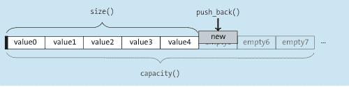

**图 6.2** “vector”的示意图。

### 尽量在“vector”的末尾插入元素

只要可以，你就应该只在 vector 的末尾插入元素。用于此目的的方法是 push_back() 和 emplace_back()。

对 vector 的所有元素进行操作有多种选择。你已经熟悉基于范围的 for 循环。

```cpp
// https://godbolt.org/z/hhhavG5he
#include <vector>
#include <iostream>                  // cout, endl
int main() {
    std::vector<int> squares{1,4,9,16,25}; // initialize filled
    for(int number : squares)          // number is one square at a time
        std::cout << number << " ";
    std::cout << std::endl;
}
```

**清单 6.10** 最简单的迭代使用基于范围的“for”循环。

这里，所有元素依次输出：1 4 9 16 25。或者，你也可以通过索引访问元素。不要忘记计数（在 C++ 中几乎总是如此）从零开始。你可以使用 `size()` 检查 vector 中有多少个元素。

请注意，我在这里写的是 `std::vector`，而不是 `std::vector<int>`，因为自 C++17 起，编译器会从构造函数参数推导出 `<int>`。

```cpp
// https://godbolt.org/z/xCKM7v1Eo
#include <vector>
#include <iostream>                         // cout, endl
int main() {
    std::vector qs{1,4,9,16,25};
    for(unsigned idx=0; idx<qs.size(); ++idx) // size returns the count
        std::cout << qs[idx] << " ";         // [idx] or at(idx) gets an element
    std::cout << std::endl;
}
```

**清单 6.11** 通过索引访问元素。

然而，在 C++ 中，你应该使用迭代器而不是索引。迭代器可以更广泛地使用，可能更容易被编译器处理，而且最重要的是，它们对所有容器都是一样的。

```cpp
// https://godbolt.org/z/1WG8zvhYe
#include <vector>
#include <iostream>                         // cout, endl
int main() {
    std::vector qs{1,4,9,16,25};
    for(auto it = qs.begin(); it!=qs.end(); ++it) // between begin() and end()
        std::cout << *it << " ";                  // with *it you get from the element
    std::cout << std::endl;
}
```

**清单 6.12** 在循环中使用迭代器。

就像容器一样，*迭代器* 是一个通用概念。它们与容器紧密协作，并且也在第 24 章详细解释。现在，我将以尽可能简短的方式为你总结它们：

- **qus.begin() 和 qus.end()**  
  返回容器开头和末尾的迭代器，类似于 `0` 和 `size()` 提供索引边界的方式。
- **auto it = qus.begin()**  
  定义一个迭代器，并将其初始化为容器的开头。
- **it != qus.end()**  
  检查是否到达末尾。始终用“不等于”检查，绝不用“小于”。
- **\*it**  
  从迭代器转到元素。你对迭代器进行“解引用”。

> **标准库包含许多容器**
> 
> 其他容器以及大量使用说明可以在[第24章](#)中找到。

### 6.5 算法

除了容器的能力之外，还有*算法*。其中大多数可以在 `<algorithm>` 头文件中找到。有一长串辅助函数，可帮助你用通用方法解决特定问题。

所有这些算法都一致地作用于迭代器，这就是为什么它们能作用于（几乎）所有容器。重要的是要知道，容器的能力并不限于其成员方法。

在以下示例中，用算法填充一个 vector，然后统计满足特定条件的元素数量。

```cpp
// https://godbolt.org/z/4G67rso8T
#include <vector>                         // count_if
#include <algorithm>                       // iota
#include <iostream>

bool even(int n) { return n%2==0; }       // test for even
int main() {
    std::vector<int> data(100);           // 100 x zero
    std::iota(data.begin(), data.end(), 0); // 0, 1, 2, ... 99
    // counts even numbers
    std::cout << std::count_if(data.begin(), data.end(), even);
}
```

**代码清单 6.13** 用算法计数。

### 6.6 指针与 C 数组

在讨论内置数据类型时，到目前为止我略过了两个非常重要的类型：指针和 C 数组。这两个类型密切相关，因此我把它们放在一起讲。之所以这么晚才讲，有两个原因：

- 它们有自己的原理，并且伴随着大量需要理解才能有效使用的内容。
- 对于它们所解决的任务，在现代 C++ 中它们只是次优选择。至少自 C++11 起，语言或标准库中通常有更好的替代方案。

因此，我只简要介绍指针和 C 数组。你将在**第20章**学到更多——也会在那里进一步了解替代方案。

### 6.6.1 指针类型

*指针*是引用的 C 语言变体，由于历史原因在 C++ 中仍被频繁使用。它是对实际值的间接访问。因此，每种类型也都可以作为指针存在——甚至指针本身也可以，这意味着指针可以指向指针。指针表示内存中的地址，计算机可以用它进行计算：可以求差值、自增，等等。因此，指针非常适合大型和动态的内存量。使用取地址运算符 `&`，你可以获取对象的地址并得到指针类型。你可以通过类型后的星号 `*` 识别它。例如，在 `int x=12;` 之后，你可以用 `int* p = &x;` 获取地址。这个 `int*` 指向一个 int 值，而 `char*` 指向一个 char 值。只有指针类型 `void*` 在指向内容上是灵活的——因此不安全，应避免使用。如果指针不指向任何地方，则它具有特殊值 `nullptr`。

### 6.6.2 C 数组

C 数组用方括号 `[ ]` 表示。在声明中，方括号放在变量名之后。例如，`int nums[10]` 直接相邻地存储 10 个 int 值。这里的 `nums` 类型是 `int[10]`——只要 `nums` 没有被传递给函数。不幸的是，编译器无法传递 C 数组大小本身，因此 C 数组随后会“退化”为指针。于是，无大小的写法 `int[]` 等价于 `int*`。除其他原因外，由于这一主要缺点，只要有可能，你就应始终改用替代方案：对于动态数据片段，使用 `string`、`vector` 等；对于固定大小的数据片段，使用 `array`、`pair` 或 `tuple`。

## 第7章：函数

**章节提要**

- **声明与定义**  
  *声明*只引入标识符并向编译器提供信息，例如类型。相比之下，*定义*还为该构造体预留空间。对于函数，区别在于函数头命名时*不带*函数体还是*带*函数体。
- **副作用**  
  当函数通过参数或返回值以外的方式改变程序状态时，就发生了副作用。
- **函数调用**  
  这是由函数体中断当前程序流并稍后继续执行。
- **函数头**  
  这是函数声明，由返回类型、函数名和参数组成。
- **函数体**  
  这些是属于函数定义的语句。
- **返回值与返回类型**  
  这些是函数通过 return 语句返回的内容。
- **参数**  
  一个参数由参数类型和可选参数名组成，是函数声明的一部分。参数名可用于在函数体内访问传入的参数。
- **按值调用**  
  这是一种在函数调用时作为值复制到函数中的参数。它是函数声明中参数类型的一部分。在函数内对参数的修改不会影响外部。
- **按引用调用**  
  这是一种以这样的方式声明的参数：函数通过引用直接访问传入的构造体——例如变量——因此可能改变其在函数外部的值。
- **自由函数**  
  自由函数是不属于类的函数。它在全局或命名空间中定义。
- **方法**  
  用类的特定实例调用的函数是方法。在 C++ 中，这些在类内部声明（详情见后续章节）。
- **默认参数**  
  这些是为可选实参调用函数而预定义的值。
- **函数重载**  
  这些是名称相同但参数类型和/或返回类型不同的多个函数。

你已经见过一些函数，也已经自己编写过其中一些——主要是 `main()` 函数，因为离不开 `main()`。在本章中，我想解释函数能为你提供哪些可能性，尤其是在你自己编写函数时。

函数是你可以从另一位置调用的东西。函数也可以有返回值。没有返回值的函数被称为返回 void。除了计算返回值之外，如果你允许，参数也可以被修改。函数还可以有副作用，意味着它还能改变程序中的其他对象。

### 7.1 函数的声明与定义

当你编写一个函数并立即指定其程序代码的样子——也就是花括号中的指令——这就是该函数的定义：

```cpp
int addTwo(int a, int b) {
    return a + b;
}
```

然而，你也可以先告诉编译器某个函数存在于某处；至于具体在哪里，它应稍后自行确定。然后你省略带有语句的花括号，只写出函数头——这样你就有了一个声明：

```cpp
int addTwo(int a, int b);
```

当你编写使用 addTwo 的程序时，最初只要已经对该函数作了声明就足够了。只有在链接程序时，相应的定义才必须存在于某个程序部件中。对于声明，甚至只写出参数类型就足够了；你可以省略它们的名称：

```cpp
int addTwo(int, int);
```

一般来说，我不推荐这样做，因为名称已经为读者提供了重要信息。

声明常见于模块的头文件（*.h 或类似文件）中。相应的定义及实现则可在 *.cpp 文件（或具有其他扩展名的文件）或预编译库中找到。

### 7.2 函数类型

就像 C++ 中几乎所有其他东西一样，函数也有类型。这个类型决定了你如何调用该函数，以及你可以用结果做什么。函数的类型由参数类型和返回类型组成。

因此，以下函数

```cpp
bool print(std::string arg1, int arg2);
```

和

```cpp
bool formatValueIntoString(std::string format, int value);
```

具有相同的类型。确切类型是某种复合类型——在本例中为：

```cpp
std::function<bool(std::string, int)>
```

你可以看到，在这种写法中，返回类型 bool 直接位于尖括号之后，而参数类型位于尖括号内的圆括号中。`function` 只是标准库中的一个工具，也是我更偏好的 C++ 写法，我理解它比 C 形式的实际类型更好——也就是：

```cpp
bool(*)(std::string, int)
```

这里指针 * 就派上用场了，因为函数类型实际上表示一个指针。你可以在第23章进一步了解这两种不同的写法。目前，你应理解函数类型是有表示的，并且该类型取决于参数类型和返回类型。

你稍后会看到这很重要，因为在 C++ 中，你可以像把 int 和 string 值存入变量一样存储函数、将函数作为参数传递，或从函数返回函数。


### 7.3 使用函数

在我们进一步深入探讨如何自己编写函数之前，先来看看函数的使用方法。

```cpp
// https://godbolt.org/z/TdrebYodx
#include <iostream>                 // cout
#include <cmath>                    // sin
#include <string>
#include <vector>
using std::sin;
int main() {
    std::cout << "sin(0.0): " << sin(0.0) << "\n";        // call sin() with literal
    double angle = 3.1415/2;
    std::cout << "sin(" << angle << "): " << sin(angle) << "\n"; // call with variable
    std::string name = "Han Solo";
    std::cout << name.length() << "\n"; // call a method
                                      // ... conceptually like length(name)
    std::vector<int> data{};
    data.push_back(5);                 // further method call with parameter
    data.push_back(10);
    std::cout << data.back() << " ";
    data.pop_back();
    std::cout << data.back() << "\n";
    data.pop_back();
}
```

**代码清单 7.1** 使用函数。

函数 *sin()* 被调用了一次，传入字面量 0.0——字面量也是常量值——另一次传入变量 angle。正如你对数学函数 *sin* 的预期，这里返回的是计算结果。

可以看到，我用来调用 *sin()* 的变量是 double 类型。这很合适，因为在标准库中，该函数声明为 double sin(double)：它接受一个 double，也返回一个 double。调用时参数类型必须彼此匹配：你不能调用 sin("Han Solo")，因为 sin() 并不用于字符串。存在会发生转换的例外情况；你将会了解它们，并自己编写其中一些。

注意，我这里还展示了*方法*调用，例如 name.length() 和 data.push_back(5)。主要区别在于，像 sin() 这样的函数是“自由”的（一个*自由函数*），而 length() 则与 std::string 类紧密关联。当你使用 *variable.functionname* 调用函数时，这就是*方法*的特殊形式。这个术语来自面向对象，将在类那一章详细讨论（见*第 12 章*）。

此处。如果你只是在此声明函数（而不是*定义*它），或者函数中根本不使用该参数，那么可以省略它。不过，我建议使用清晰、描述性的名称，使函数头变得有意义。

- **函数体**  
  函数体（连同其外围的花括号）由语句组成：没有语句、一条语句或多条语句，随你决定。如果函数有返回值，那么这里至少必须有一条 return 语句。

```cpp
int func();                         // returns an int
std::string func();                 // a string from the standard library
void func();                        // no return value
std::pair<int,std::string> func();  // composite type from the stdlib
vector<int> func();                 // returns a new container
vector<int>& func();                // reference to some container
const vector<int>& func();          // same, but you cannot change it
```

**代码清单 7.2** 函数的不同返回类型。

> **C++20：简写函数模板**
>
> 自 C++20 起，你可以使用 `auto` 作为参数类型。这样你就能定义函数模板，而无需使用 `template` 和尖括号这种繁琐的表示法。编译器会将
>
> ```cpp
> void func(auto a) { ... }
> ```
>
> 转换为
>
> ```cpp
> template<typename A> void func(A a) { ... }
> ```
>
> 你可以在 [第 23 章] 中阅读更多关于模板的内容。我在这里提到它，是因为一方面，这种写法并不显式暴露模板；另一方面，它为编写通用而紧凑的代码提供了很好的机会。

### 7.5 关于参数的更多内容

在 C++ 中，函数头中参数的声明决定了参数在调用时的行为方式。最重要的区别在于参数是按*值*传递还是按*引用*传递。

### 7.5.1 按值调用

如果不采取任何特殊措施，C++ 中函数的参数会按*值（按值调用）*传递。这意味着，如果变量 x 当前值为 5，而你把 x 传给一个函数，那么进入函数的是 5——而不是 x。

```cpp
// https://godbolt.org/z/8zcVMdM3b
#include <iostream>

void print_val8(int n) {          // parameter as value
    std::cout << n << " ";
    n = 8;                        // sets parameter to 8
    std::cout << n << "\n";
}

int main() {
    int x = 5;
    print_val8(x);                // x as value: prints 5, then 8
    std::cout << x << "\n";       // x remains unchanged at 5
    print_val8(42);               // 42 as value: prints 42, then 8
}
```

**代码清单 7.3** 参数最初按值传递。

当调用 `print_val8` 时，编译器会将实参的_值_复制到函数的 `n` 位置。因此，`n = 8` 处的修改不会影响最初用来调用 `print_val8(x)` 的变量 `x`。

> **带指针结构体的按值传递**
>
> 此时我必须提醒你，当（尤其是）与指针交互时，情况会变得稍微复杂一些。如果指针 `*` 是你按值传递的结构体或类的一部分，那么该结构体中只复制了指针，而不是它指向的内容。这意味着，如果你改变了指针所指向的内容，你也会改变原始对象。

### 7.5.2 按引用调用

如果你希望赋值影响外部变量，那么在 C++ 中需要以这样的方式声明函数：让它将参数接收为引用（按引用调用）。为此，请使用与号 `&`。

在向你展示有意义的用法之前，我会先修改前面的示例以作比较。

```cpp
// https://godbolt.org/z/63dTshz3Y
#include <iostream>
void print_ref8(int& n) {         // parameter as reference
    std::cout << n << " ";
    n = 8;                        // sets parameter to 8
    std::cout << n << "\n";
}

int main() {
    int x = 5;
    print_ref8(x);              // x as reference: prints 5, then 8
    std::cout << x << "\n";     // x is now 8
}
```

**代码清单 7.4** 添加与号使其成为引用参数。

函数 `print_ref8` 与前一个清单中的 `print_val8` 完全对应，不同之处在于本示例中 `print_ref8` 的参数用 & 声明为引用——即 `int& n`。因此，在 `main()` 中调用 `print_ref8(x)` 时，编译器不会将 `x` 的值复制到函数中，而是将 `x` 本身作为引用传递；在函数内部，随后用参数名 `n` 来指代它。这样，你可以从完全不同的程序位置调用 `print_ref8`，并传入完全不同的变量；在 `print_ref8` 内部，它们始终被称为 `n`。

还有另一个区别：你不能使用 `print_ref8(42)`。你能看出原因吗？在 `print_ref8` 内部，42 会被名称 `n` 指代——而且随后在 `print_ref8` 中会执行 `n = 8` 赋值。这意味着它会变成 42 = 8，而这显然是不可能的。然而，编译器不仅在赋值 `n = 8` 处阻止这一点，在调用 `print_ref8(42)` 处也会阻止：参数类型是 `int&`（读作“对 int 的引用”）而不是 `int`，编译器无法以这种方式引用 42；42 与 `int&` 不兼容，编译器会报错。

### 7.5.3 常量引用

要将 `x` 和 `42` 都传递给一个以引用为参数的函数，你必须向编译器“承诺”不会给该引用赋任何值。使用 `const int& n`，你告诉编译器 `n` 在函数内部是常量。

```cpp
// https://godbolt.org/z/dckXn3pO
#include <iostream>
void print_cref(const int& n) {  // parameter as constant reference
    std::cout << n << " ";
}

int main() {
    int x = 5;
    print_cref(x);              // call with a variable
    print_cref(42);             // call with a constant literal
}
```

**代码清单 7.5** 你可以将常量引用用作任何调用的参数。


当然，现在带有 `n = 8` 的那一行已经没有了，因为否则你就会违背自己的承诺。编译器现在会挑出这一行的错误，因为你不能向 `const int&` 赋值，而 `n` 现在就是这种类型。不过，在调用 `print_cref8(x)` 时可以使用变量，或者使用字面量 `print_cref8(42)`。这意味着就实参而言，下面两个函数声明可以同样广泛地使用：

```cpp
void print_val8(int n);        // Parameter as value
void print_cref8(const int& n); // Parameter as constant reference
```

### 7.5.4 按值、按引用还是按常量引用调用？

所有这些声明形参的变体都有其理由，而你必须根据具体情况决定使用哪一种：

- 当*按值*调用时，会创建一份副本。这在程序运行时可能是耗时且耗内存的过程。另一方面，你可以确保不会意外更改任何外部值。
- 当*按引用*调用时，不会创建副本，但编译器会把形参的地址传入函数。这很快，也节省空间。但你真的想更改外部定义的变量吗？有时想，但并非总是如此。
- 如果你决定使用引用，但不想让变量被更改，就使用 `const` 引用。
- 如果使用*非常量引用*，有些实参根本无法传递，例如字面量 `42` 不能传给 `int&`。还有常量值和对象，这些都会被仅有 & 的形参排除在外。

使用引用（以及指针）时，由于*别名*可能会产生一个缺点。有些情况下，函数中的引用（通过别名）指向一个已不存在的变量；它在外部已经失效。结果就是程序崩溃。由于按值调用时形参是专门为函数调用而复制的，所以这里不会发生这种情况。

避免这些程序崩溃的一种方法是放弃引用。因为一个典型应用是输出参数，所以我建议你改用返回值：

```cpp
// https://godbolt.org/z/oh91YvaqT
#include <iostream>
void twice(double &num) {      // output parameter as modifiable reference
    num *= 2.0;
}

int main() {
    double num = 7.25;
    twice(num);
    std::cout << num << "\n";  // now 14.5
}
```

在这个简单示例中，这看起来可能很傻，但如果你有更大的对象，你会总想这么做。改为这样写：

```cpp
// https://godbolt.org/z/q4ov41cny
#include <iostream>
double twice(double num) {      // value parameter and return value
    return num * 2.0;
}
int main() {
    double num = 7.25;
    num = twice(num);            // change expressed by return value
    std::cout << num << "\n";    // also 14.5
}
```

这里，调用 twice 时会复制参数 number，但这使程序更安全，也更清晰。好消息是，自 C++11 以来，复制已经有所改进，尤其是对于标准库中的数据类型：现在值常常是被移动而不是复制，这对性能总是有益的。

> **拿不准时，使用值**
>
> 如果拿不准，就选择值形参。调用时必须复制它；对于大型对象，你可以考虑常量引用是否更合适。

### 7.6 函数体

当然，函数真正令人兴奋的地方在于它做什么——因为程序的核心就在于此。我在这里并没有告诉你什么新东西。你已经熟悉了作为函数的 main()，其他函数也并没有太大不同。

看看清单 7.6 中的函数。我们后面会需要它们，所以现在来检查它们的函数体是如何组织的。

```cpp
std::vector<int> primes = {};      // global variable
bool isPrime(int n) {              // own function
    for(int factor : primes) {     // access to global variable
        if(factor*factor > n)      // access to parameter
            return true;
        if(n%factor==0)
            return false;
    }
    return true;
}

void calculatePrimesUpTo(int limit) { // another custom function
    for(int n=3; n<limit; n=n+2) {
        if(isPrime(n)) {                 // use custom function
            primes.push_back(n);
        }
    }
}
```

**清单 7.6** 函数的各种定义。

首先是 *isPrime* 函数的定义。该函数接收一个 `int` 类型的形参，在函数内部以名称 *n* 使用。不过，函数体中还使用了 *n* 形参之外的其他变量。

通过 `for(int factor=...)`，我为 for 循环引入了一个新的 `int` 变量——一个*局部变量*。你已经知道它只在 `for` 循环内可见。你无法从另一个函数访问 factor。

我还在 `for` 中使用了 *primes*——一个*全局变量*：它是在函数外部声明的，并且在函数内“可见”。你可以访问该模块中先前声明的所有全局变量。*primes* 就是这种情况。

其他函数也是如此：如果其他函数事先已经声明，你就可以使用它们。例如，在 `calculatePrimesUpTo` 的 `if` 中就发生了这种情况：我调用 `isPrime`，而编译器已经知道这个函数，因为我之前（在本模块更靠前的位置）定义过它——在这方面，定义甚至比声明更好。

如果由于某种原因，我把 `isPrime` 函数写在程序代码中更靠后的位置，编译器就还不会知道它，并会报错。不过，我可以通过至少事先声明所需的函数来补救。

```cpp
// ... extract ...
bool isPrime(int n);                 // Declaration of function defined later
void calculatePrimesUpTo(int limit) {
    for(int n=3; n<limit; n=n+2) {
        if(isPrime(n)) {              // Use of function defined later
            primes.push_back(n);
        }
    }
}
bool isPrime(int n) {                 // Definition after usage
    // ... as before ...
}
```

**清单 7.7** 一个没有函数体的前向声明。

这有时被称为*前向声明*。

当你由多个模块（`*.cpp` 文件）组合成一个程序时，你也可以使用另一个模块中的函数。原则上，你使用的正是刚才解释的前向声明机制：如果你在模块 A 中定义了一个函数 f()，并想在模块 B 中使用它，那么只需在模块 B 的开头以完全相同的方式声明 f，当整个程序链接时，各部分就会组合在一起。

不过，这只是通向正确做法的第一步。对于模块 A 的 `*.cpp` 文件，你还要维护一个对应的头文件 `*.h`，其中包含所有可能在其他地方使用的函数声明。然后，在模块 B 中，用 `#include` 包含这个头文件，实际上就能达到与手动前向声明相同的结果。

我将在[第12章](#)中演示这种更简洁的解决方案。

### 7.7 转换参数

当函数接收某个特定类型的形参时，调用该函数时这个形参有几种可能情况。假设你已声明 `func` 函数如下：

```cpp
void func(double param);
```

那么调用它时可能发生以下情况：

- `func(5.3)` — **类型匹配**  
  5.3 是 double 字面量，因此与形参类型 double 完全匹配。调用有效。
- `func("Text")` — **类型不匹配**  
  这里尝试用 `const char[]` 调用，而它与 double 不匹配。这是一个错误，编译器会告知你。
- `func(7)` — **类型可以转换**  
  尽管 7 是 int，但编译器可以把它转换成 double。调用有效，但编译器会先把 7 转换成 7.0。

对于内置类型，编译器对于可以执行哪些转换有一些规则。下面是一个非常简要的概述：

- `int` 到 `long`，或 `short` 到 `int`，在转换时没有问题。
- `long` 到 `int` 也由编译器完成，但这里可能发生危险的溢出。
- `short`、`int` 或 `long` 可以转换为 `float` 或 `double`，不过较大的 long 数字转换为 `float` 时可能丢失几位精度。
- `float` 或 `double` 可以转换为 `short`、`int` 或 `long`。然而，这里会丢失小数部分，而且如果数字太大，还可能再次发生溢出。


-   对于 `const char[]`——例如字面量 `"Text"`——可以转换为 `std::string`（不过，这并不是由编译器提供的，而是由标准库提供的）。

下一个代码清单展示了一些可行的转换以及你可能遇到的问题。不过要注意，类型宽度可能因系统而异，你可能会遇到不同的转换。此外，应当严格避免溢出，因为某些行为可能变得任意（技术术语：*未定义*）。示例输出是在使用 GCC 4.9 的 64 位 Intel Linux 系统上生成的。

```cpp
// https://godbolt.org/z/zbTT7Kr3G
#include <iostream>
#include <format>
void prints(short s, int i, float f, double d) {
    std::cout << std::format("short: {} int: {} float: {:.2f} double: {:.2f}\n",
        s, i, f, d);
}
int main() {
    int mill = 1000*1000;           // 1 Million
    prints(mill, mill, mill, mill); // short overflows
    // Output: short: 16960 int: 1000000 float: 1000000.00 double: 1000000.00
    long bill = 1000L*1000L*1000L*1000L; // 1 Trillion
    prints(bill, bill, bill, bill); // even int overflows, float becomes inaccurate
    // Output: short: 4096 int: -727379968
    // float: 999999995904.00 double: 1000000000000.00
    float three = 3.75f;
    prints(three, three, three, three); // decimal places are lost
    // Output: short: 3 int: 3 float: 3.75 double: 3.75
}
```

**代码清单 7.8** 这里会发生一些转换。在你的系统上，这些转换可能看起来有所不同。

在 `prints(mill,...)` 中，参数 `short s` 在值 1000000（100 万）的转换过程中发生溢出，其内容没有意义。转换为 `float` 或 `double` 没有问题。`format` 自 C++20 起可用；在此之前，你可以使用 `std::cout << s ...`

更大的值 1 万亿也会导致 `prints(bill, ...)` 中的 `int` 溢出。转换为 `float` 确实避免了溢出，但 `float` 没有足够的精度来存储精确值。

任何整数类型（例如 `short` 和 `int`）都无法保存像 3.75f 这样的小数。在 `prints(three, ...)` 中进行转换时，小数部分会被直接截断。不过，float 可以无损转换为 double。反过来则可能丢失信息。

> **展望：自定义类型的转换**
>
> 如果你以后定义自己的类型，就可以自行决定允许哪些与你的类型之间的转换。你可以通过定义构造函数 MyType(A)，将类型 A 转换为你的类型 MyType。而如果在 MyType 中定义方法 operator B()，就可以将 MyType 转换为类型 B。

### 7.8 函数重载

如果你定义了函数

```cpp
void print(int value) {
    std::cout << "int value: " << value;
}
```

但不希望 print(3.75) 输出无意义的 int 值：3，那么你也可以为 double 类型的参数定义 print 函数。如果同名函数被定义多次，就称为重载。

```cpp
// https://godbolt.org/z/9YcPraT15
#include <iostream>
void print(int value) { std::cout << "int value: " << value << ";" }
void print(double value) { std::cout << "double value: " << value << ";" }
void print(int v1, double v2) { std::cout << "Values: " << v1 << ", " << v2 << ";" }
int add(int n, int m) { return n + m; }
double add(double a, double b) { return a + b; }
int main() {
    print(add(3, 4));        // add(int, int) and print(int)
    print(add(3.25f, 1.5f)); // add(double, double) and print(double)
    print(7, 3.25);          // print(int, double)
}
```

**代码清单 7.9** “print”和“add”函数已针对多种类型进行重载。

你可以看到 print 有三个重载。如果用 int 调用它，就会调用 print(int value)；如果用 double 调用，当然会调用 print(double value)。你也可以定义参数个数不同的重载，正如你在第三个 print 变体中所看到的。对 print(7, 3.25) 的调用就符合这一点。

在选择正确的重载时，编译器遵循一些规则。如果参数与某个重载完全匹配，那就简单。但如果某个参数不能完全匹配，编译器就必须做出选择。例如，我写了：

`add(3.25f, 1.5f)`

现在，`3.25f` 和 `1.5f` 是 *float* 字面量；如果我写的是 `3.25` 和 `1.5`，它们就会是 *double* 字面量。不过，编译器选择 `add(double, double)` 变体而不是 `add(int, int)` 显然更好，因为从 float 转换为 double 不会丢失任何东西，而从 float 转换为 int 则不然。

如果你尝试 `print(1.25, 2.75)`，编译器显然既不能选择 `print(int)`，也不能选择 `print(double)`；参数个数根本不匹配。因此，它会调用 `print(int, double)`，并把 `1.25` 转换为 `int`。你会得到输出 `Values: 1, 2.75`。

如果编译器无法通过它能执行的转换找到合适的重载，就会向你报错。

不过，有时编译器会找到多个同样合适或同样不合适重载。在这种情况下，编译器也会给出错误消息，指出重载解析不明确。如果你调用

```cpp
add(4, 2.85);           // ✗ Overloading unclear
```

编译器就无法决定使用 `add(int, int)` 还是 `add(double, double)`。它随后会告诉你，这个调用无法明确解析。

为了避免让你感到意外，需要说明的是：虽然参数类型参与重载解析，但返回类型不参与。对于仅在返回类型上不同的重载，编译器会报错：

```cpp
// https://godbolt.org/z/58cTfVYhe
int two() { return 2; }       // ✗ once with int as return type...
double two() { return 2.0; }  // ✗ ...and once with double
int main() {
    int x = two();
    double y = two();
}
```

不过，如果参数类型可以区分，返回类型也可以不同：

```cpp
// https://godbolt.org/z/evGqC1oqa
int twice(int a) { return a * 2; }
double twice(double a) { return a * 2.0; }
int main() {
    int x = twice(7);
    double y = twice(7.0);
}
```

这在标准库中被广泛使用。例如，容器的 `begin()` 和 `end()` 方法有时返回 *迭代器*，有时返回 *const_iterator*，这取决于（隐式的）this 参数是否用 `const` 标记为不可变。除了参数类型上的 `*` 和 `&` 之外，像 `const` 这样的修饰符也参与重载解析。

还有一点：在为一个函数编写无数重载之前，考虑改用函数模板（见第 23 章）。从 C++20 起，使用形式为 `void func(auto a)` 的缩写函数模板会让这更加容易。

> **重载**
>
> 我在这里只是简要涉及了重载这一主题。我建议你做一些实验，体会一下。尤其是在结合类型转换和默认参数时，C++ 中的函数重载是一项强大且无处不在的特性。如果你掌握了它，你就已经理解了很多。

### 7.9 默认参数

在上一节中，我定义了一个将两个值相加的函数：

```cpp
int add(int n, int m) { return n + m; }
```

如果你想编写一个不仅相加两个值的函数，现在就可以重载它：

```cpp
int add(int n, int m, int o) { return n+m+o; }
int add(int n, int m, int o, int p) { return n+m+o+p; }
int add(int n, int m, int o, int p, int q) { return n+m+o+p+q; }
```

这里你有 `add` 的各种版本，它们允许你一次最多对五个数求和。它们都共享同一个名字 `add`。但是，只写一个函数不是更方便吗？如果你需要超过五种变体，这就更加实用了。

你可以借助 *默认实参* 来实现这一点。只需为参数写出默认值，当你用较少的实参调用它们时，就会使用这些默认值。

```cpp
// https://godbolt.org/z/fjc37rVEr
int add(int n=0, int m=0, int o=0, int p=0, int q=0) {
    return n+m+o+p+q;
}
int main() {
    std::cout << add(1,2,3,4,5) << " ";
    std::cout << add(1,2,3,4) << " "; // like add(1,2,3,4,0)
    std::cout << add(1,2,3) << " ";   // like add(1,2,3,0,0)
    std::cout << add(1,2) << " ";      // like add(1,2,0,0,0)
}
```


```cpp
std::cout << add(1) << " ";      // like add(1,0,0,0)
std::cout << add() << " ";        // like add(0,0,0,0)
}
```

**清单 7.10** 默认参数的作用类似于多个重载。

例如，如果你在使用 `add(1,2,3,4)` 时省略最后一个参数，编译器会在调用时自动补上它。后续调用也是如此：因为我已将所有参数都提供了 `=0` 作为默认值，你甚至可以不带任何参数调用 `add()`，编译器会把所有参数都填为 0。

默认参数有几条简单的规则：

- 调用函数时，只能从参数列表末尾向开头依次省略参数。例如，在前面的例子中，调用时不可能省略 `n` 却为 `m` 或任何其他参数提供值。
- 默认值必须是常量（constexpr）。因此，数字字面量没有问题，编译器也会接受 `3*4+5`。
- 你也可以有多个重载，它们都接受默认参数。组合使用时，必须确保没有歧义。

例如，你可以为 `int` 和 `double` 各有一个 `add` 重载，每个重载都带有一组默认参数：

```cpp
// up to three int parameters:
int add(int n=0, int m=0, int o=0) { return n+m+o; }
```

```cpp
// 0... 3 doubles:
double add(double a=0., double b=0., double c=0.) { return a+b+c; }
```

如果你调用 `add(1,2)`，将选择 int 版本；而对于 `add(1.25, 3.75)`，将选择 double 的重载。在每种情况下，最后一个参数都会由编译器用指定的默认值填充。

为避免冲突，这里应简要提一下：当用三个 int 参数定义时，不应再像这样添加另一个重载：

```cpp
int add(int x); // conflict with three-int overload
```

因为如果你随后调用 `add(4)`，编译器总会告诉你，它无法在三位参数重载和一参数重载之间做出决定。在这种情况下，冲突仍然容易识别。当你之后处理函数模板时，可能会变得更困难。

### 7.10 任意数量的参数

前面讨论的 add 函数最多可以接受五个参数，而把它扩展到 20 个甚至 100 个默认参数对你来说肯定也不难。我不想让这个例子停留在原样，而不让你看到：你可以处理 *任意* 数量的参数。如果你想要一个能接受任意数量 int 值的 add 函数，可以绕道使用 `std::initializer_list`：

```cpp
int add(std::initializer_list<int> ns) {
    return std::accumulate(begin(ns), end(ns), 0); // or a for loop
}
```

现在，调用时你只需在参数外加几个花括号，但参数数量可以是任意的。例如：

```cpp
add({1,2,3,4,5,6,7,8,9})
```

### 7.11 函数声明的另一种写法

还有一种用 auto 和 -> 编写函数头的方式，它至少是等价的，甚至可能更好：

```cpp
auto FunctionName(ParameterType ParameterName,...) -> ReturnType
```

对于清单 7.2，它看起来会是这样：

```cpp
auto func() -> int;
auto func() -> std::string;
auto func() -> void;
auto func() -> std::pair<int,std::string>;
auto func() -> vector<int>;
auto func() -> const vector<int>&;
```

**清单 7.11** 使用尾置返回类型的函数声明替代语法。

优点是，当返回类型变得更复杂时，你能更好地识别函数名。对于带有多个类型参数的模板，这种情况可能发生。对于习惯 C 的程序员来说，这种写法看起来很奇怪，但确实没有理由不使用它——只不过它可能要过很长时间才会流行起来，甚至可能根本不会流行。

从 C++14 起，你可以在函数定义中省略返回类型，让编译器来推导它。编译器随后会根据第一个 `return` 语句推导类型。

```cpp
// https://godbolt.org/z/6d5fxn9ed
auto maxOf2(int a, int b) {
    return a < b ? b : a;  // one return: the compiler determines int
}

auto minOf3(int a, int b, int c) {
    if (a<b) return a<c ? a : c;
    else return b<c ? b : c;
}

auto medianOf3(int a, int b, int c) {
    // more complex, but no problem for the compiler
    return minOf3(maxOf2(a,b), maxOf2(b,c), maxOf2(a,c));
}
```

**清单 7.12** 自 C++14 起，你可以让编译器推导返回类型。

### 7.12 特殊情形

关于函数定义还有一些特殊情形，我会在这里简要提及，以便你在遇到它们时能够识别出来。

例如，你可以使用 return 返回多个值。为此，请使用 tuple 数据类型。我会在第 28 章第 28.1 节中更详细地讨论。在那里你会看到如何使用 tuple 轻松地将多个值打包成一个返回值——这感觉就像返回多个值。

### 7.12.1 “noexcept”

如果你在函数声明之后看到 noexcept 关键字，那么该函数的作者承诺此函数不会抛出异常（参见第 10 章）。假设有一个假想的类 File，它有如下函数：

```cpp
File openFile(const char* filename) noexcept; // Function does not throw an exception
```

函数 openFile 返回一个新的 File 对象。如果出了任何问题，许多 C++ 库会抛出异常。这个函数用 noexcept 承诺不会这样做；File 可能还有其他机制来检测错误。

这条信息对用户可能有用，但它主要是给编译器看的。正常情况下，编译器必须生成少量代码，以防可能抛出异常¹。有了函数声明后的这个关键字，编译器就可以跳过这些代码。

¹ 额外开销如此之小，以至于有些人甚至称其为零成本。

### 7.12.2 内联函数

在运行时，一次函数调用会创建一个栈区域，函数在其中存储自己的数据。你还会发现返回地址也存储在那里，这样函数就知道自己是从哪里被调用的，并能返回到那里。此外，栈区域还用于存储局部数据、局部参数和返回类型。现代 CPU 可以轻松处理这一切。然而，真正有害的是，函数调用需要清空缓存和流水线——而这些正是让现代 CPU 真正快速的东西。对于一次简单的函数调用来说，这是相当大的开销。如果速度至关重要，并且这样的函数在循环中被频繁调用，那么就会浪费不必要的计算时间。

为此，你可以用 inline 关键字标记函数：

```cpp
inline int simple_func(double a, double b, double c);
```

在函数前加上 inline 关键字，你是在向编译器建议：它不应把函数代码作为可调用函数来集成，而应将其插入到函数调用的位置。

> **对编译器的建议**
> 
> 这里使用“should”一词，是因为它仅仅是对编译器的建议。编译器是否将函数就地集成，最终由编译器自己决定。

编译器还可以在其他场景中内联：

- 编译器可以决定内联同一源文件中的函数定义，即使没有 inline 关键字，尤其是当该函数被频繁使用时。
- 如果这个函数定义同时也是函数模板，编译器会更倾向于内联它。
- 并且在最高优化级别下，较新的编译器甚至可以跨源文件边界内联任意函数。

编译器实际内联什么取决于许多因素，并且很难预测。

### 7.12.3 “constexpr”

如果一个函数的返回值不仅用 const 标记，还用 constexpr 标记，那么它的函数体必须相当简单，以便编译器在翻译期间计算并插入结果。根据经验，如果你在函数体中只写一条 return 语句，那么允许使用 constexpr 的可能性就很大：

```cpp
constexpr int doubledUntil100(int value) {
    return value<=50 ? value*2 : 100;
}
```


这也很有可能带来非常快的程序代码。与 `const` 或 `inline` 不同，如果编译器无法再在翻译期计算结果，而该计算会耗费运行期时间，它会通知你。然而，编译器是否真的按所述方式预计算结果，仍由它决定。

借助 `constexpr`，你可以定义自己的字面量数据类型，如第23章第23.7节所示。

在运行程序时实现最终最小时间消耗的最高形式，是 C++20 引入的用于*立即函数*的 `consteval` 修饰符。这确保编译器可以在翻译期计算表达式，并将其插入调用处：一如既往，它不必这样做，但很可能会这样做。你可以在第13章第13.10.8节了解更多关于 `consteval` 的内容。

### 7.12.4 删除的函数

如果你想禁止对函数的某种特定使用，可以写 `= delete` 来代替函数体：

```cpp
double add(double a, double b) { return a + b; }
double add(int, int) = delete;   // prohibit add(3,4)
```

如果没有带 `= delete` 的第二行，编译器会自动把 3 和 4 转换为 double。通过让它知道 `add(int,int)` 的声明，它随后会选择这一个。然而，通过使用 `= delete`，你告诉编译器你明确不想要这种行为，它就会发出错误消息。

### 7.12.5 类方法中的特殊之处

对于属于类的函数，你还会遇到一些额外内容；至少应在这里看到它们，以便阅读时能够识别。从第12章开始，我会更详细地讨论这些内容：

```cpp
// https://godbolt.org/z/8Gdso36zf
class Widget : public Base {
    explicit Widget(int);        // no automatic conversion from int
    ~Widget();                   // Destructor with ~ before the name
    virtual void update();      // prefixed with virtual
    void calc() override;       // suffixed with override
    void calc2() final;         // suffixed with final
    void draw() const;          // suffixed with const
    virtual void paint() = 0;   // abstract method
};
```

- 使用 `explicit`，可以阻止 `int` 被自动转换为 `Widget`。它用于构造函数（初始化器）和转换运算符之前。
- 函数名前的符号 `~`（波浪号）使该函数成为*析构函数*。当对象被销毁时，它会自动被调用。析构函数的名称必须与类名匹配。
- `virtual` 关键字使该方法准备好由派生类中的另一个实现覆盖。这常用于逻辑相关的对象层次结构中的可扩展性。
- `override` 是一种编程辅助手段，可防止在使用 `virtual` 覆盖时出现粗心错误。它保证你确实在覆盖某个方法。
- `final` 也用于派生类中的 `virtual` 方法，并防止该方法将来再次被覆盖。
- 用 `const` 标记的方法承诺不改变对象的状态。
- 一个 `virtual` 方法如果被设为 `= 0` 而不是实现，就是*纯虚函数*。为了让该类能够被实例化，该方法必须在派生类中被覆盖。在 Java 和一些其他语言中，这被称为*抽象方法*。

## 第8章

## 语句详解

**本章提要**

- **空语句**  
  由分号 `;` 组成的语句不执行任何操作。
- **块语句**  
  用花括号 `{…}` 括起来的一系列语句。
- **声明语句**  
  声明新变量，可能带有初始化。
- **表达式语句**  
  任何表达式也可以用作语句。
- **if 语句**  
  有条件地执行后续语句。
- **while 循环**  
  重复执行语句，条件位于开头。
- **do-while 循环**  
  类似 while 循环，但条件位于末尾。
- **for 循环**  
  类似 while 循环，但带有额外的初始化和推进部分。
- **基于范围的 for 循环**  
  遍历容器中所有元素的循环。
- **switch 语句**  
  在单个语句中用 case 进行多重区分。
- **break 语句**  
  退出当前循环或 switch。
- **continue 语句**  
  以下一次迭代继续当前循环。
- **return 语句**  
  退出当前函数。
- **goto 语句**  
  跳转到用标签命名的另一条语句。
- **try 块**  
  处理异常的语句块（预览）。

在本章中，你将详细了解不同类型的语句。我将主要通过一个实际示例来演示它们的用法。

在开头，我会重温前几章的一些主题，并更详细地讨论它们。这样，你会遇到一些重复，但理解会更深入，而且不必不断翻回去查阅。

### 语句

语句是一段做某事的代码；例如，它执行赋值或循环。（线程的）语句按顺序执行。

这个程序计算一个可自由确定范围内的所有质数——就程序的简短程度而言，相当高效。

```cpp
// https://godbolt.org/z/Y33TzcfST
#include <iostream>                 // cout
#include <vector>                   // container vector
#include <string>                   // stoi
int inputUpTo(int argc, const char* argv[]) {
    /* Determine number */
    int upTo = 0;                   // introduce new variable
    if(argc<1) {                    // if statement with then and else block
        std::cout << "Up to what number do you want to calculate prime numbers? ";
        if(!(std::cin >> upTo)) {   // check return value
            return -1;              // error in user input
        }
    } else {                        // else part of the if statement
        upTo = std::stoi(argv[1]);
    }
    return upTo;                    // return input
}
std::vector<int> primes{2};         // new vector<int> with initialization
bool isPrime(int n) {
    /* primes must be sorted in ascending order */
    for(int factor : primes) {      // range-based for loop
        if(factor*factor > n)       // too large to be a divisor at all?
            return true;            // then terminate the inner loop early
        if(n%factor==0)              // is divisor?
            return false;           // ... then exit
    }
    return true;                    // no divisor found
}

void calculatePrimesUpTo(int upTo) {
    /* Primes calculation */
    /* vector must contain {2} at this point */
    for(int n=3; n<upTo; n=n+2) {      // standard for loop
        if(isPrime(n)) {
            primes.push_back(n);        // is prime – mark as divisor and result
        }
    }
}

void outputPrimes() {
    for(int prime : primes) {           // range based, over all elements
        std::cout << prime << " ";
    }
    std::cout << "\n";
}

int main(int argc, const char* argv[]) {
    int upTo = inputUpTo(argc, argv);   // declares variable
    if(upTo < 2) { return 1; }          // exit main with non-okay value.
    calculatePrimesUpTo(upTo);
    outputPrimes();
    return 0;
}
```

**清单 8.1** 计算用户定义范围内的所有质数。

首先看一下这个程序的粗略结构。之后，我会详细讲解不同的语句。

除了 main()，我还定义了四个辅助函数：inputUpTo()、isPrime()、calculatePrimesUpTo() 和 outputPrimes()。inputUpTo() 函数接收与 main() 相同的参数，以便要么解析命令行，要么在控制台请求输入一个数字，如你在第4章清单4.10所见。isPrime() 将可能的质数作为参数，并返回一个 bool 值，表示该参数是否为质数。

在函数之间，定义了全局变量 primes。由于它是全局的，不在函数内，甚至不在块内，所有函数都可以访问它。

该变量的类型是 `vector<int>`；这是一种特别适合按顺序添加新元素的容器。我使用 `primes.push_back(n)` 来实现这一点。在 C++17 中，写 `vector` 就足够了，因为编译器会在初始化时从 2 推断出 `<int>`。


## 8.1 语句块

在任何允许编写单条语句的地方，你也可以用花括号 `{...}` 将多条语句组合在一起。你可以看到图 8.1 中的示意流程图。这也称为复合语句。你不需要用分号结束这个块；这样做会创建一个空语句，而你应该避免这种情况（见第 9 章第 9.2 节）。

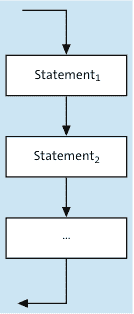

图 8.1 语句块的流程图。

在清单 8.1 中，我已将这些块附加到大多数 `if` 语句和 `for` 循环上。在这里一致地使用 `{...}` 可以为将来的扩展做准备，并提高可读性。在 `if(factor*factor > n)` 和 `if(n%factor==0)` 中，你会看到没有块花括号的 `if`。`for` 也是如此。

```cpp
for(int prime : primes)          // for followed by a single statement
    std::cout << prime << " ";
    std::cout << "\n";           // not part of for anymore
```

**清单 8.2** 这个“for”只引用一条语句。

这个 for 只与两个输出中的第一个相关联。第二行只输出一次。如果你想在循环内做更多事情，那么使用 `{...}`。这样，你就得到一个语句块，对于 `for` 来说它算作一条语句。

```cpp
for(int prime : primes) {        // Beginning of the block
    std::cout << prime;
    std::cout << " ";
}                               // End of the block
std::cout << " ";
```

**清单 8.3** 语句块由 { 和 } 包围。

现在，分开的 `cout` 输出都在循环内执行。

### 8.1.1 独立块与变量作用域

然而，你不必把块绑定到 `for` 或类似结构上；你可以在任何对你来说有意义的地方引入它们，以代替单条语句。下面的清单就是一个例子。

```cpp
if(number > 50) {                 // outer block
    {                              // 1st inner block
        int result = number*number;
        std::cout << "Square: " << result << std::endl;
    }
    {                              // 2nd inner block
        int result = number*number;
        std::cout << "Doubled: " << result << std::endl;
    }
}
```

**清单 8.4** 在允许语句的地方，你也可以创建块。

两个内部块都与 `if` 关联执行，因为它们都位于属于该 `if` 的外部块内。

你可以自由选择是否要以这种方式对语句进行分组。例如，如果你想在两个内部块中引入相同的变量名，这会很有用。在清单 8.4 中，`result` 在两个内部块中都作为新的 `int` 变量引入。变量只在其定义的块内有效。如果不划分成两个块，两个 `result` 定义会相互干扰。

```cpp
if(number > 50) {
    int result = number*number;          // Definition of result
    std::cout << "Square: " << result << std::endl;
    int result = number+number;          // ⚡ Error: result has already been defined
    std::cout << "Doubled: " << result << std::endl;
}
```

**清单 8.5** 不允许在一个块中两次将“result”用作新变量。

当然，你本可以在这里使用已经存在的 result 变量，而不必用 `int result = number+number` 重新声明它。然而，有时会有一些原因让你不想或不能这样做。

你也可以用 `int result2 = ...` 引入一个新变量。但也许你不希望周围有太多你实际上不再需要的变量。通过引入内部块，你清楚地表明了 `result` 从何处到何处需要，等等。后来的读者就不必再考虑这一点了。

```cpp
if(number > 50) {
    int result1 = number*number;        // a result
    std::cout << "Square: " << result1 << std::endl;
    int result2 = number+number;        // another result
    std::cout << "Doubled: " << result2 << std::endl;
    int result3 = number+number+number; // and another result
    // ... many lines of code in between ...
    // and here?
    // ... even more lines of code ...
}
```

**清单 8.6** 变量太多也不好。

在 `// and here?` 处想知道自己是否可以将任何 `resultN` 变量用于自己目的的人，只能困难地弄清楚——并且很可能出于绝望再引入另一个变量。

为每个单独的变量引入一个新块并每次都向左缩进，会使代码碎片化并毫无必要地加长它。这也不利于阅读时的理解。

在引入新的独立块时，请运用常识。

## 8.2 空语句

当你在期望出现语句的地方写一个分号时，那就是空语句。这条语句*什么都不做*。

```cpp
int main() { ;;;                 // 3 empty statements
    int number = 12 ; ;           // 1 empty statement
    if (int q = number*number ;   // 1 empty statement
    if(q>50) {
        q = q - 50;
    } ;                           // 1 empty statement
    std::cout << q << std::endl;
}
```

**清单 8.7** 到处都是空语句。

什么都不做通常完全没有问题。然而，在某些情况下，插入的空语句是危险的。你已从**第4章**中知道，*if* 后面跟着一条语句，该语句应在条件满足时执行。假设你在前面示例中的 `if(q>50)` 之后插入一个空语句：

```cpp
if(q>50) ; {              // empty statement with serious consequences
    q = q - 50;
}
```

那么，在 `q>50` 的情况下，被执行的就是空语句。减法 `q=q-50` 不再是 *if* 的一部分，而是现在*总是*执行。

> **避免空语句**
>
> 尽管空语句大多无害，但当它们确实引发问题时，追踪起来会非常麻烦。养成不要用分号结束语句块 `{...}` 的习惯。
>
> 对 `if`、`for` 和 `while` 结构要特别警惕，以免无意中插入空语句。

## 8.3 声明语句

我们已经多次看到引入了新变量。例如，在**清单 8.1**中，就是这一行：

```cpp
int upTo = 0;
```

这引入了一个新变量——它*声明*了这个变量。首先指定它的类型——这里是 `int`——然后指定变量将使用的名称——这里是 `upTo`。完成了。但是等号 `=` 以及它右边的内容呢？那是*初始化*，在这种声明形式中是可选的。我已经在**第4章第4.2节**中讨论了各种初始化形式。

所以，请注意以下内容。使用

```cpp
int upTo;
```

该变量被*声明*了。你不能按它现在的样子使用它（进行计算等），因为它还没有包含值。更准确地说，它的值是*未定义*的。这意味着，如果你使用该变量进行计算，它包含一个*任意*值——在大多数情况下，这会导致程序中出现不可预见的行为。关于这一点还有更多要说的，因为许多类型也会用这种声明形式*初始化*，但 `int` 不会。请在**第12章**中阅读更多相关内容。

同样重要的是，变量只在你声明它们的块内已知。一旦程序越过该块的右花括号，它们就不再可用。因此，这个声明不会与前一个声明重叠：

```cpp
int upTo = inputUpTo(argc, argv);
```

这声明了一个“不同的” `upTo`，它只在 `main()` 中可见。

你还可以在这里看到，初始化不仅可以用 0 或常量进行。这里，一个复杂的函数调用返回了用于初始化 `upTo` 的值。

你也可以组合用逗号分隔的声明。你可以像这样声明多个变量：

```cpp
int from, to, result;
```

这里，所有变量都将是 `int` 类型。如果你想同时初始化所有（或部分）变量，可以这样做：

```cpp
int from, to = 0, result;
```

这里你声明了三个变量，但只有 `to` 用 0 初始化。

### 8.3.1 结构化绑定

从 C++17 开始，也可以一次声明多个元素，并用单个等号 `=` 将它们全部初始化。为此，请在方括号 `[]` 前使用 `auto`，方括号中则包含要声明的变量。

有三种可能的变体：绑定 C 数组、绑定元组和绑定结构体。

```cpp
// https://godbolt.org/z/xWbqeeq3n
#include <iostream>
#include <tuple>
auto mkTpl() {
    return std::make_tuple(2, 'b', 3.14); // tuple<int,char,double>
}
struct Point {
    int x, y;
};
int main() {
    // Structured binding of a C-array
    int odd[5] = { 1,3,7,9,11 };
    auto [ one, two, three, four, five ] = odd;
    // Structured binding of a tuple
    auto [ zwei, be, pi ] = mkTpl();
```


## 控制结构

if、while、do、for 和 switch 语句是**控制结构**，允许你编写分支和循环。借助 break 和 continue，你可以影响控制结构的流程：return 在最广义上也属于这一类。我尽量不提及 goto（原因见 *第8.14节*）。

```cpp
// Structured binding of a struct
Point po{ 10, 15 };
auto [ the_x, the_y ] = po;
}
```

**清单 8.8** 使用 auto，你还可以一次初始化多个变量。

这里，数量必须完全匹配。因此，如果一个结构体包含六个元素，绑定就会失败。对于过大或过小的元组，或者不适合的结构，也同样如此。

你不需要把值复制出来；也可以让声明成为引用：

```cpp
// https://godbolt.org/z/3zo8GnbW3
int main() {
    int odd[5] = { 1,3,7,9,11 };
    auto &[ one, two, three, four, five ] = odd;
    auto &[ zwei, be, pi ] = mkTpl();        // ✗ no & binding to temp-values
    Point po{ 10, 15 };
    auto &[ the_x, the_y ] = po;
}
```

例如，这里 three 是对 odd 中 7 的引用。

当然，这只有在存在可引用对象时才有效。对于 `mkTpl()` 来说并非如此，因为该函数返回一个尚未存储到任何地方的*临时值*。

### 8.4 表达式语句

你也可以将任何*表达式*用作语句。尽管例如将 `3+4;` 用作语句没有太大意义，但赋值是表达式，并且经常被用作语句。

假设你之前已经声明了 `int upTo;`，下面的清单给出了将表达式用作语句的示例。

```cpp
upTo = 99;                         // an assignment is an expression
upTo = upTo * 2 + 1;                // combining an assignment with a calculation
calculatePrimesUpTo(upTo);          // a function call is an expression
std::cout << "Friedrich III";       // the output operator
```

**清单 8.9** 这些都是用作语句的表达式。

正如我之前提到的，每个表达式都有一个值和一个类型。如果表达式被用作语句，类型就会消失，并被编译器丢弃。

### 8.5 “if”语句

使用 if 语句，你可以编写语句的*条件执行*。最简单的形式仅在满足指定条件时才执行与之关联的语句：

`if(Condition) Statement`

你已经对语句部分有所了解：这里应使用带有 `{...}` 的块，以便将多条语句分组并将它们链接到 if。这称为 if 语句的 *then 分支*。

然而，*条件*仍然有些神秘。它必须是一个求值为真值的表达式——即 *真* 或 *假*。这适用于特定的一组表达式——即那些具有 bool 类型的表达式。

更准确地说，必须能够将表达式*转换*为 bool。这是一个微妙但重要的区别，我在*第4章第4.4节*中解释过。这仅意味着你也可以直接将像 0 或 42 这样的数字以及许多其他内容用作 if 中的条件。如果你知道如何处理，`if(x-30)` 和 `if(cin>>val)` 对你来说就会很容易。

下面是一些只能为 *真* 或 *假* 的条件：

- `number > 100`  
  一个简单的算术比较，检查 *number* 是否大于 100。你也可以测试小于 `<`、大于或等于 `>=`、小于或等于 `<=`、等于 `==` 以及不等于 `!=`。
- `number > 100 && number < 200`  
  使用布尔 AND `&&`，检查两个表达式是否都为真。
- `x < 0 || y < 0`  
  当至少应满足一个条件时，适合使用布尔 OR `||`。
- `x == y+1`  
  你可以在比较之前执行算术计算。
- `(x > 0 || y > 0) && (maxx < 100 || maxy < 100)`  
  如有必要，用括号将复杂表达式括起来。
- `!(x < y)`  
  使用表示 *非* 的运算符 `!`，你可以对布尔表达式取反；*真* 变为 *假*，反之亦然。

有了这套手段，你已经为 if 条件做好了充分准备。

if 语句还有另一种有用的形式，你也可以在图8.2中看到：

`if(Condition) Statement1 else Statement2`

它实现的是：“执行 Statement1 或 Statement2。” Statement2 称为 if 语句的 else 分支。因此，

```cpp
if(x > 1) {
    std::cout << "x is greater than 1" << std::endl;
}
if(!(x > 1)) {              // test alternative
    std::cout << "x is not greater than 1" << std::endl;
}
```

几乎等同于

```cpp
if(x > 1) {
    std::cout << "x is greater than 1" << std::endl;
} else {                    // with else you have a comparison
    std::cout << "x is not greater than 1" << std::endl;
}
```

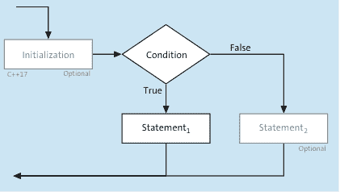

图8.2 带“else”分支和不带“else”分支的“if”语句流程图。

为什么说只是几乎？因为在这里你不必执行两次 x > 1——最重要的是，你不必写两遍。这里我们已经使用块 {...} 代替单条语句。你也可以写成下面这样：

```cpp
if(x > 1) {
    std::cout << "x is greater than 1" << std::endl;
} else {                    // a block or a single statement follows else
    std::cout << "x is not greater than 1" << std::endl;
}
```

但是，由于 else 分支会使代码更复杂，这里确实建议使用块。

现在你实际上已经掌握了关于 if 的所有可知内容。剩下的是把这些知识组合起来：if 是一条语句；if 条件、then 分支和可选的 else 分支合在一起也是一条语句。并且 then 和 else 各自关联一条语句。你可以将它们组合成复杂的嵌套。通常会在 else 分支中使用另一个 if，以依次查询不同的可能性：

```cpp
if(number < 0) {
    std::cout << "The number is negative.\n";
} else if(number == 0) {    // else and if follow directly one after another
    std::cout << "The number is zero.\n";
} else if(number > 1000) {  // also possible multiple times
    std::cout << "The number is too large.\n";
} else {  /* x > 0 but x <= 1000 */
    std::cout << "The number is positive.\n";
}
```

这里常见做法是省去将每条 if 语句都包在一个只有一条语句的块中。然而，如果你一旦弄清楚自己会在哪里放置所有块花括号，你就会对语句有所了解。如果在每条单条语句周围都完整地加上所有 {...}，这个示例会像这样：

```cpp
if(number < 0) {
    std::cout << "The number is negative.\n";
} else {
    if(number == 0) {
        std::cout << "The number is zero.\n";
    } else {
        if(number > 1000) {
            std::cout << "The number is too large.\n";
        } else {  /* x > 0 but x <= 1000 */
            std::cout << "The number is positive.\n";
        }
    }
}
```

这里可以清楚地看出哪个 else 究竟属于哪个 if。但越来越深的缩进是以可读性为代价的。对于标准的 if-else 级联，最好不要将 else 分支包在它自己的块中。

```cpp
// https://godbolt.org/z/Ycse4EWav
#include <iostream> // cout

template<typename T>
void memory(T x) {
    if constexpr (sizeof(T) > 4) {
        std::cout << "Requires a lot of memory: " << x << " ";
    }
}

constexpr auto DEBUG = true;
int main() {
    if constexpr (DEBUG) {
        std::cout << "Debug is on. ";
    }
    memory<long long>(44LL);
}
```

**清单 8.11** 编译器可以在编译期求值条件。

以前，这类事情只能通过宏或巧妙的模板编程来实现。

你当然可以添加一个 `else` 分支，并将其与初始化表达式一起使用。

从 C++23 开始，还有 `if consteval`，它用于判断调用上下文是否为 constexpr；参见[第13章第13.10.9节](#)。

### 8.6 “while”循环

`while` 循环在满足指定条件时执行一条语句。该过程如图8.3所示。你可以这样写：

*while( 条件 ) 语句*

对于 *条件* 和 *语句*，我提到的关于 `if` 的所有内容都适用。因此，下面的示例对你来说应该没有困难。

```cpp
// https://godbolt.org/z/h46f6Yq4W
#include <iostream>
int main() {
    /* Sum up from 1 to 100 */
    int sum = 0;
    int number = 1;
    while(number <= 100)      // condition
```


```cpp
{
        // block that is repeatedly executed
        sum += number;          // for the result
        number += 1;            // next number
}                              // end of the repeated block
std::cout << sum << std::endl;
}
```

**代码清单 8.12** 循环运行 100 次。

在循环块执行之前，首先检查条件。因此，这个循环会对 1 到 100（含）之间的每个数字运行——正好 100 次。并且每个单独的数字都会被加到 sum 中。最后，sum 包含从 1 到 100 所有数字相加的结果——据说数学家高斯在小学时几秒钟内就在脑中解决了这个任务，因为他意识到只需要计算 (100 · 101) / 2。好吧，在计算机的帮助下，你甚至比高斯还快。

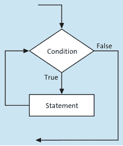

**图 8.3** “while” 循环的流程图。

当你设计这样的循环时，确保条件最终不再成立并且循环终止是非常重要的。这里，number 是一个简单的计数变量，并在块内递增。常见错误包括忘记递增或错误地设置条件。你能看出如果忘记 `number = number + 1` 会发生什么吗？

```cpp
while(number <= 100) {      // number is checked but never incremented
    sum += number;
};
```

这个循环将永远运行，因为 number 从不递增，所以条件 number <= 100 将始终为真。程序将永远无法到达用于输出的那一行，你将不得不从外部终止它。如果你还不知道如何做到这一点，现在是找出答案的时候了。在 IDE 中，你会找到用于此目的的按钮或菜单项。在控制台中，`Ctrl`+`C` 通常能救你。

也可能条件从一开始就不满足。在这种情况下，语句块根本不会执行。

> **循环设计**
> 
> 你是否注意到循环结束时 number 是 101，而不是 100？它必须如此，否则条件仍会满足，循环会再运行一次。因此，循环的*后置条件*是：在它完整运行一遍之后，number>100。
> 
> 循环是编程中一个具有挑战性的方面，也是常见的错误来源。错误并不总是像忘记递增那样容易发现。为了安全地工作，请让自己弄清楚相关变量在循环中扮演什么角色：这个变量是计数器吗？它是可变的吗？它与条件的关系是什么？

## 8.7 “do-while” 循环

while 循环的这种罕见得多的变体把条件放在末尾：
do Statement while (Condition)

这里，先执行 *Statement*，然后检查 *Condition*，如 **图 8.4** 中的流程图所示。检查在每次迭代之后进行。这意味着语句至少执行一次。

```cpp
// https://godbolt.org/z/6hh5KhExM
#include <iostream>              // cin
#include <string>

int main() {
    std::string line;
    do {                          // execute getline at least once
        std::getline(std::cin, line);
        if (!std::cin) break;     // error or end of file
    } while (line != "quit");    // end on specific input
}
```

**代码清单 8.13** “do-while” 循环的循环体至少执行一次。

你不应经常使用这种带 do 的 while 循环变体，因为它相当不常见。此外，循环中的条件如此重要，把它放在末尾可能会妨碍阅读时的理解。

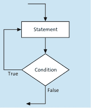

图 8.4 “do-while” 循环的流程图。

## 8.8 “for” 循环

你在 while 循环中已经看到，你经常为循环初始化一个计数器变量，然后在循环末尾递增它。因为这种情况如此常见，所以在 for 循环中把它们打包在一起，从而简化了：

`for( Initialization ; Condition ; Update ) Statement`

*Statement* 和 *Initialization* 是语句，而 *Condition* 和 *Update* 是表达式。

通常的做法是在初始化中定义循环变量，在更新中修改它，并在条件中检查它。

for 循环对应于这个组织良好的 while 循环：

`{ Initialization ; while( Condition ) { Statement ; Update ; } }`

在图 8.5 中，你可以示意性地看到这个过程。

我将在下面的代码清单中把代码清单 8.12 改写成 for 循环。

```cpp
// https://godbolt.org/z/7foCvMMAz
#include <iostream>
int main() {
    /* Sum up from 1 to 100 */
    int sum = 0;
    for(int number=1; number <= 100; number+=1) {  // compact form
        sum += number;                             // for the result
    }
    std::cout << sum << std::endl;
}
```

**代码清单 8.14** 用 “for” 循环求和。

这里的初始化是 `int number = 1`。在循环中的语句执行之前，会检查条件 `number <= 100`。然后执行循环，这里是 `sum += number;`。在块末尾，使用 `number += 1` 执行更新。

然后再次检查条件。如果满足，就进行下一次循环迭代；如果不满足，循环结束。

即使使用 `for`，number 最终也会变成 101。按照我这样写，我无法输出它，因为 number 变量只存在于循环内部。不过，你可以在 `for` 之前声明它，并将初始化部分留空。

```cpp
// https://godbolt.org/z/185ha3q3f
#include <iostream>
int main() {
    /* Sum up from 1 to 100 */
    int sum = 0;
    int number = 1;                         // Initialization before the loop
    for( ; number <= 100; number=number+1) { // empty initialization
        sum = sum + number;
    }
    std::cout << number << std::endl;       // number now also exists outside
}
```

**代码清单 8.15** 初始化部分为空的 “for” 循环。

在这里，你也可以在循环外部访问 number，从而看到 101 是如何被打印出来的。

也可以将更新部分留空。那么你就必须在循环块内负责更新。但这相当罕见，因为那样你几乎就得到了一个 while 循环。在极端——并且特别罕见——的情况下，你还可以省略条件。那么你必须能够以某种其他方式结束循环。如何在不使用 `Ctrl` + `C` 的情况下做到这一点，将在本章我解释 break 时学到。

执行某件事“永远”的一种常用方式是省略所有三个部分。

```cpp
int main() {
    for( ; ; ) {  // no init, no condition, no update -- so forever
        /* ... User input */
        /* ... if user chooses Quit, end program */
        /* ... otherwise, perform calculation and output */
    }
}
```

**代码清单 8.16** 没有条件的循环必须以某种其他方式终止。

当然，这里缺少很多程序代码。但把永远运行的循环作为最后手段使用，应该能让你清楚这个用例。

`primes` 收集总体结果，以便在 `outputPrimes` 中将其显示在屏幕上。另一方面，它在 `isPrime` 中用于仅对之前的质数执行必要的整除性测试。

你可以这样读 `for(int factor : primes)`：从 `primes` 容器中逐个选择一个元素，将其赋给 `factor`，执行循环语句，并对容器的所有元素重复这个过程。也就是：

```
for(Destination : Container) Statement
```

这已经允许你做相当多的事情。你甚至可以让你自己的数据类型像容器一样用于这些 `for` 循环。你只需要适当地定义 `begin` 和 `end` 方法。

使用 `int prime : primes` 输出时也是一样，但这里我们还有一个位于其前面的初始化部分 `int i=1;`。自 C++20 起这是可行的。在此之前，你必须在循环之前定义这样的计数器变量。

通常，你会将基于范围的 `for` 应用于容器，你将在第 24 章了解容器。如果你自己编写类似容器的类，你可以让它们适配基于范围的 `for`。

## 8.10 “switch” 语句

你已经看到，可以使用 if-else 级联来依次检查多个情况。switch 语句是这种情况的一种专门形式：你总是测试同一个表达式，并且该表达式具有类似 int 的类型——或者是枚举，如你将在第 16 章第 16.12.2 节看到的那样：

```
switch(Expression) { Cases }
```

自 C++17 起，它也可以类似 if 的方式工作：

```
switch(Initialization ; Expression) { Cases }
```

其中 `Cases` 由以下形式的一系列 case 组成：

```
case Constant: Statements
```

从 `Cases` 列表中，执行那些 `Constant` 与 `Expression` 的结果匹配的 `Statements`。还有一些事情需要考虑或值得了解：

- `Cases` 不得包含重复的 `Constants`，但它们也不需要遵循特定顺序。
- 除了 `case`，你还可以使用一次 `default` 来捕获所有其他情况。通常，它是最后一个或第一个 case，但并非必须如此。
- 如果你想合并多个 case，也可以连续直接写多个 case 指令，中间不写语句。


case 语句应始终以 `break` 结束。这条规则的例外情况非常罕见，如有例外，应使用注释明确标出。如果忘记了这个 break，无论下一个 case 的常量是什么，它的语句都将被执行。这被称为*穿透*。

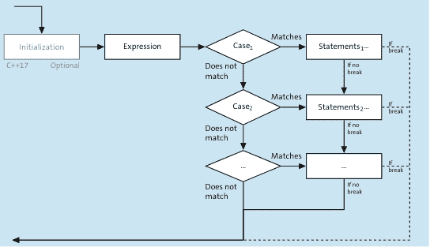

图 8.6 “switch”语句的流程图。

在图 8.6 中，你可以看到 switch 结构的流程图。尽管 break 语句并不严格属于 switch 流程图，但由于它们非常常见且重要，我在这里将它们作为可选项包含进来。

清单 8.18 中的这个非常简单的计算器将数字放入栈中。算术运算取出栈顶的元素，并将结果放回栈顶。

```cpp
// https://godbolt.org/z/Y4W1loW8b
#include <string>
#include <vector>
#include <iostream>        // cout

void calculator(std::ostream& out, std::string input) {
    std::vector<int> stack {};
    for(char c : input) {
        if(c>='0' && c<='9') {
            stack.push_back(c-'0'); // numeric value of the character
            continue;               // next loop iteration
        }
        int top = 0;
        int second = 0;
        switch(c) {             // condition on character
        case '+':
            top = stack.back(); stack.pop_back();
            second = stack.back(); stack.pop_back();
            stack.push_back(second + top);
            break;
        case '-':
            top = stack.back(); stack.pop_back();
            second = stack.back(); stack.pop_back();
            stack.push_back(second - top);
            break;
        case '*':
            top = stack.back(); stack.pop_back();
            second = stack.back(); stack.pop_back();
            stack.push_back(second * top);
            break;
        case '=':
            for(int elem : stack) { out << elem; }
            out << " ";
            break;
        case ' ':
            break;
        default:
            out << " " << c << " I don't understand. ";
        } /* switch */
    } /* for */
}
int main(int argc, const char* argv[]) {
    if(argc > 1) {
        calculator(std::cout, argv[1]);
    } else {
        // 3 + 4 * 5 + 6 with multiplication before addition results in 29
        calculator(std::cout, "345+*6+=");
    }
}
```

**清单 8.18** 每个“case”对应一种情形，任何地方都没有遗漏“break”。

然而，更重要的是 switch(c)。与 int 及其相关类型一样，你可以在这里使用 char 类型的 c。但是，你不能在这里写 double 或 string。它必须是“可枚举”的类型。

case 标签一个接一个地排列。根据 c 的值，这些跳转标签会被直接访问，并执行随后的语句。每个块都用 break 正确结束，以防止意外执行另一个计算。

关于 `c - '0'` 这个计算，有一点小说明：在这里，我从输入的 c 中减去字符值 '0'，以得到该字符的数值。注意，这里的 '0' 不是 int 类型的数字 0，而是 char 类型的字符 '0'。结果是介于 0 到 9 之间的 int 数值。这之所以可行，一部分是因为 char 的行为非常类似于整数类型，另一部分是因为字符 '0' 到 '9' 作为 int 具有连续的值。'0' 通常是数字 48，而 '4'（例如）是值 52。因此，'4'-'0' 等同于 52-48，也就是 int 类型的 4。然后我将这个数值放入栈中。

> **它可以更好；它也可以是动态的**
>
> 基于 char 的 switch 作为一个小例子相当不错，但它非常静态，当你想要扩展它时可能会变得笨重。然而，如果你想看一个更适合作为复杂计算器基础的版本，请直接翻到后面的第 28 章清单 28.43。在那里，它是一个动态映射，接受函数对象作为操作。

如果你想知道为什么 calculator 函数有一个 out 参数：在函数内部永远不要使用全局变量 cout、cerr 或 cin，这样做总是好的。这使此类函数更易于测试。你应该只在 main() 中访问这些全局变量。因此，cout 在这里最终作为 calculator() 的一个参数被使用。你可以在第 12 章的清单 12.8 中看到这样的测试。

> **不要忘记“break”**
>
> 永远不要忘记结束 case 块的 break。在 99.99% 的情况下，你需要它来防止穿透到下一个 case 块。忘记它是一个常见的疏忽。
>
> 如果你有意编写一个穿透（fall-through），请在该处写上一条明确无误的注释。否则，其他人乍一看会以为你犯了错误，忘记写 break 了。

case 块不以 break 结束的情况很少见。通常，一系列独立的 if 语句就足够了。清单 8.19 将帮助你理解穿透的原理。

```cpp
// https://godbolt.org/z/jaMTcshEf
#include <iostream>
#include <string>

using std::string; using std::cout;

void guessMonth(unsigned whatDayIsItToday) {
    switch(whatDayIsItToday) {
        /* missing break statements: fall-through intended */
        default:
            if(whatDayIsItToday>31) {
                cout << "You are cheating";
                break;
            }
        case 28:
        case 29:
            cout << "Feb ";
        case 30:
            cout << "Apr Jun Sep Nov ";
        case 31:
            cout << "Jan Mar May Jul Aug Oct Dec ";
    }

    cout << ". ";
}
int main() {
    guessMonth(31);   // if today were the 31st?
    // Output: Jan Mar May Jul Aug Oct Dec .
    guessMonth(30);   // what if it were the 30th?
    // Output: Apr Jun Sep Nov Jan Mar May Jul Aug Oct Dec .
    guessMonth(4);
    // Output: Feb Apr Jun Sep Nov Jan Mar May Jul Aug Oct Dec .
    guessMonth(77);
    // Output: You are cheating.
}
```

**清单 8.19** 很少有“case”块没有“break”——而有意义的情况更是少之又少。

对于 guessMonth(30)，switch 直接跳转到 case 30 标签，并跳过 default、28 和 29 这些 case。对于 30，会输出 "Apr Jun Sep Nov "。由于 case 30 块末尾没有 break，接下来块的语句会被执行，因此会输出 "Jan Mar May Jul Aug Oct Dec ."。

对于 guessMonth(4)，没有 case 匹配，因此执行 default: 块。对于 4，if 中的测试结果为 false。到达了块的末尾，但由于缺少 `break`，后面的 case 块会被执行。

只有在 guessMonth(77) 的情况下才会到达 break。虽然 default 块也会被执行，但这次 if 条件为真，因此会到达 then 分支中的 `break`。通过这个 break，整个 switch 被退出，并直接继续执行 `cout << ". ";`。

## 8.11 “break”语句

break 关键字允许你退出当前循环——从循环的角度来看，是最内层的那个循环。程序将继续执行循环之后的语句。你可以在所有 for 和 while 循环中使用它，包括基于范围的 for 循环和 do-while 循环。从这个意义上说，switch 也被视为一种循环。

```cpp
// https://godbolt.org/z/75h9Y9vf
#include <iostream>                 // cout

int main() {
    for(int x=1; x<20; x+=1) {       // outer for-loop
        for(int y=1; y<20; y+=1) {   // inner for-loop
            int prod = x*y;
            if(prod>=100) {
                break;              // exit inner y-loop
            }
            std::cout << prod << " ";
        } /* end for y*/
        // destination of break
    } /* end for x*/                  // first actual line after break
    std::cout << " ";
}
```

**清单 8.20** 使用 break，你可以提前终止循环。

假设任务只是输出 x 和 y（均在 1 到 20 之间）的乘积中两位数的结果。一旦 y 大到乘积大于或等于 100，那么更大的 y 也不会产生更小的乘积。在这种情况下，我们可以使用 break 提前终止 y 循环。

y 循环的其余部分被跳过；特别是，prod 的输出不会被执行。相反，执行将继续内部循环之后的第一条语句。嗯，这是一个特例：在这里，在 /* end for x */ 处，到达了 x 循环的末尾，那里不再有任何语句。因此，接下来要执行的是 x 循环的更新表达式，即 x+=1。

请注意，break 只会退出当前最内层的循环，也就是说，x 循环不会被退出。如果你在 /* end for y */ 之后放置一个 break，那么 x 循环将被退出，并在 `cout << " "` 处继续执行。

使用 break，你只能退出 for 和 while 之类的循环，以及 switch（它并不是循环）。在寻找当前“最内层”循环时，if 并不算作循环。


## 8.12 “continue”语句

continue 语句的作用与 break 类似。不过，当前循环不会被 *中止*：只会跳过当前循环迭代的剩余部分，然后循环继续进入下一次 *迭代*。在 for 和 while 循环中，接下来会执行循环头。也就是说，在 for 中会执行更新和条件判断，而在 while（以及 do-while）中会检查条件。如果条件仍然成立，就会再次执行循环体指令。

你在清单 8.18 中看到了一个示例。当程序执行遇到 continue 时，它会立即跳回 for，并从输入中获取下一个 char c。

在 switch 中，continue 并不像 break 那样具有含义。因此它影响的是外围循环。

## 8.13 “return”语句

你已经见过 return 作为从 main 退出程序的语句。除了 main 之外，你还可以用它退出你编写的任何函数。

```cpp
// https://godbolt.org/z/5ddxa9v1j
#include <iostream>                         // cout
int min3(int x, int y, int z) {              // function returns an int
    if(x<y) {
        if(x<z) return x;
        else return z;
    } else if(y<z) {
        return y;
    }
    else return z;
}
void printMin(int x, int y, int z) {         // function returns nothing
    if(x<0 || y<0 || z<0) {
        std::cout << "Please only numbers greater than 0\n";
        return;
    }
    std::cout << min3(x,y,z) << "\n";
}                                             // no return here
int main() {
    printMin(3, -4, 8);
    printMin(6, 77, 4);
    return;                                   // special return in main
}
```

**清单 8.21** 使用“return”会退出当前函数。如有必要，需为返回值提供一个值。

在这个示例中，你会看到两个自己编写的函数 `min3` 和 `printMin`（以及熟悉的 `main`）。`min3` 应当返回一个 int 作为结果，而 `printMin` 被指定为 void，表示不期望 *返回值*。

因为 `min3` 应当返回一个 int，所以其中的每个 `return` 后面都必须跟一个 int 类型的表达式（或可转换为 int 的表达式）。该函数中的所有 return 行都是如此，因为这些变量都是 int 类型。

然而，对于 `printMin`，不期望有返回值，因此 `return;` 不得带有表达式。请注意，执行可能会在没有遇到 `return` 的情况下“落出”函数；这在 void 函数中是允许的。

你已经知道 `return` 在 `main` 中有特殊作用：尽管 `main` 的返回类型是 int，但这里的 return——且仅在这里——不需要带有返回表达式，如 `main` 最后的 return 所示。此时它会被假定为 0。

### C++20：协程语句

借助 C++20，协程为 C++ 语言引入了一项新特性。它们使生成器和更简单的异步编程成为可能。这里我不深入细节，但想提一下，你可能会遇到两个新关键字，而以前这些位置只能使用 return：

- `co_return Expression;`
- `co_yield Expression;`

你需要它和 `co_await` 才能把函数变成 *协程*——一种在离开后可以在同一点恢复执行的函数。

## 8.14 “goto”语句

是否使用 goto 这个问题很复杂。让我这样总结：正确使用 goto 很困难，而且很容易产生糟糕的结果。

我给你在 C++ 编程时的建议是：避免使用 goto。当你考虑使用它时，始终先检查所有替代方案。只有当你熟悉了组织程序的所有其他方式，并且 goto 仍然是最佳选择时，它有时才能被有效地使用。

如果你尚未掌握那些替代方案，因而使用 goto，那么从长远来看，你会使代码变得不清晰且难以维护。

当 goto 可能更好时，你可以阅读例如 Donald Knuth¹ 的一篇关键著作（一篇优秀论文，我建议你至少阅读其引言）。在那之前，规则是避免使用 goto。

¹ *使用 go to 语句的结构化程序设计*，D. E. Knuth（1974）

为了让你知道要避免什么，goto 语句的语法如下：

`goto Label`

其中标签在其他地方定义：

`Label: Statement`

当程序执行遇到 goto 时，它会立即跳转到带有该标签的语句。

很难为 goto 找到一个稍微有意义的示例。很抱歉，下面的示例比通常更加刻意牵强。

```cpp
// https://godbolt.org/z/ohd5Pr8fb
#include <iostream>
int main() {
    int idx = 4;
    goto more;                    // jump to label more
print:                             // label for the next statement
    std::cout << idx << std::endl;
    idx = idx * 2;
more:
    idx = idx + 3;
    if(idx < 20)
        goto print;                // goto can also be used in an if statement
end:                               // this is a label, but it is not used
    return 0;
}
```

**清单 8.22** 避免使用 goto 语句。

危险在于，使用 goto 时，你会疯狂地来回跳转。或者，你能快速确定 **清单 8.22** 输出哪些数字吗？答案是 7 和 17，但弄明白这一点很乏味。

借助本章描述的替代方案，你手头有足够的工具可以在没有 goto 的情况下应付。

在 **清单 8.1** 中，我实际上引入 `isPrime()` 函数只是因为无法用 break 或 continue 跳到 push_back 之后；否则我就不得不引入并管理一个额外的 bool 变量。也许这种情况是 goto 的合理用法？但请只在永远不会扩展、且不存在 goto 远离标签风险的代码中使用它。

```cpp
// https://godbolt.org/z/fnsWhn5T3
//#includes, inputTo(), outputPrimes() and main() as before
std::vector<int> primes{2};
void calculatePrimesUpTo(int upTo) {
    /* Primes calculation */
    /* vector must contain {2} at this point */
    for(int n=3; n<upTo; n=n+2) {
        for(int factor: primes) {
            if(factor*factor > n)
                goto prime;        // using goto, because a break ...
            if(n%factor==0)
                goto notPrime;     // ... doesn’t work over two loops.
        }
    prime: ;                         // Target of the jump before push_back
        primes.push_back(n);         // n is prime! Remember as divisor and result
    notPrime: ;                      // Target of the jump after push_back
    }
}
```

**清单 8.23** 少了一个函数，但多了一个标签和两条“goto”语句。

## 8.15 “try-catch”块与“throw”

异常是一个重要但高级的主题。由于带有相应 catch 的 try 是唯一剩下的语句，我还是会给你一个预览。我将在第 10 章详细讨论。

使用 try 块，你可以把预期会出现某些想要处理的错误的程序代码包围起来。你在随后的 catch 中处理这些错误。

```cpp
// https://godbolt.org/z/jhPaEjh1r
#include <iostream>
int main() {
    try {                                  // beginning of the try block
        for(int n=1; ; n=n*2) {
            if (n > std::numeric_limits<int>::max()/2) { // check for coming overflow
                throw "There would be an overflow";
            }
        }
    }                                      // End of the try block
    catch(const char *error) {             // If this error occurs...
        std::cout << "Error: " << error << " "; // ... handle it this way
    }
}
```

**清单 8.24** 作为预览，这是你第一次使用“try”和“catch”进行异常处理。

`try` 后面跟着一个语句块 `{...}`。接着是处理该块内发生的错误。这种错误处理由 `catch` 开始，后面括号中是要捕获的错误类型。括号之后是一个块 `{...}`，其中包含针对发生该类型错误情况的指令。

如果在 `try {` 和对应的花括号 `}` 之间某处触发了 `const char*` 类型的错误，它将在 `catch(const char *error)` 中被“捕获”，并在相关语句中处理。之后，程序继续执行整个 `try` 块（包括所有关联的 `catch` 块）之后的下一语句。

在这个示例中，我用 `throw` 触发这样的错误，因为 `if` 检查下一个 `n*2` 是否会溢出。正常语句执行立即被中断，转而继续执行相应的 `catch`。这只是一个简化的解释；当你深入嵌套在函数调用中触发此类错误时，才会真正精彩。那时这些异常处理机制才会展现其优势。

你可以为一个 `try` 指定多个 `catch` 块。发生错误时，将执行第一个匹配的块。

关于这个程序中错误实际上是如何触发的，说一句：当 `int` 溢出并回绕时，我们能否只检查 `if(n<0)`？嗯，有一点“是”和一个大大的“否”：虽然在大多数机器上这确实可能发生并起作用，但 C++ 标准认为整数溢出是未定义行为，因此应当避免（见第 4 章第 4.4.3 节）。

## 8.16 小结

你现在已经学习了 C++ 提供的所有语句类型。我将按组再次总结：

- *简单语句*
  - 语句块 `{...}`、声明、表达式——以及空语句
- *分支*
  - 带或不带 `else` 的 `if`、带 `case` 的 `switch`
- *循环*
  - `for`、基于范围的 `for`、`while` 和 `do-while`
- *跳转语句*
  - `break`、`continue` 和 `return`——必要时也可用 `goto`
- *异常处理*
  - 带 `throw` 语句的 `try`-`catch` 块


## 第9章：表达式详解

### 本章概述

- **结果**  
  表达式的结果可以被复用。
- **副作用**  
  副作用是指表达式不仅提供结果，还会进一步改变计算机的状态。
- **重载**  
  多个同名函数，编译器根据参数类型的不同来区分它们。
- **字面量**  
  直接写在源代码中的具体值。
- **括号**  
  用于在表达式中对子表达式进行分组。
- **函数调用**  
  函数名后跟圆括号，括号内是参数列表。
- **索引访问**  
  访问索引时，使用方括号 `[...]` 来访问几个相似元素中的一个。
- **赋值**  
  一种表达式，左侧是目标，等号 `=`，右侧是源。
- **运算符**  
  一种类似函数的构造，其函数名通常是符号，有时位于两个参数之间。
- **类型转换（强制转换）**  
  将表达式的类型强制转换为另一种类型。

通过我们对语句的讨论，你已经加深了对一个非常重要的基本元素的认识。语句通常由表达式组成，而到目前为止我们只是简要讨论了表达式，现在我将对其进行详细研究。最后但同样重要的是类型，它构成了这三个主题中最复杂的部分。

语句、表达式和类型密切相关。不涉及其他两者就很难解释其中任何一个。因此，我选择了一种方法，让您逐一面对这三个主题，并且每次都更深入一些。通过本章，您将接触到表达式与类型的倒数第二层细节。最后一层是编程实践。

### 9.1 计算与副作用

根据 C++ 标准，**表达式**是“指定计算的一组运算符和操作数”。（确切定义当然也以正式计算机科学语法的形式给出，但这对于学习没什么用，更多是作为参考。）

这种**计算**才是编程的真正核心。在这方面，我需要区分两个更大的领域：

- **结果**  
  计算有一个直接结果，如 `sin(alpha)` 或 `count*4`。这个结果可以被赋值或进一步使用，例如在 `x = sin(alpha)` 和 `print(count*4)` 中。对于 C++，结果的类型也很重要，因为它决定了后续如何处理；参见清单 9.1。
- **副作用**  
  除了结果之外，或者代替结果，还会发生更多事情；计算机的进一步“状态”发生变化。例如，`std::cout << x` 会产生输出作为副作用。这个表达式并不直接进行计算。

我将更详细地探讨这些结果。

```cpp
// https://godbolt.org/z/M6en1gMrE
#include <iostream>              // cout
#include <string>
void print(int n)                 // function print for type int
{
    std::cout << "Number:" << n << "\n";
}
void print(std::string s)         // same name, different type
{
    std::cout << "String:" << s << "\n";
}
int main() {
    int number = 10;
    std::string name = "Bilbo";
    print(number);                // calls print(int), number is int
    print(name);                  // calls print(string), name is string
    print(11 + 22);               // expression is int
    print(name + " Baggins");     // expression is string
}
```

**清单 9.1** 表达式的类型很重要，因为它们决定了接下来发生什么。

例如，`11 + 22` 的结果类型是 `int`——正是这一属性决定了调用的是 `print(int)` 而不是 `print(string)`。`name + "Baggins"` 则不同，其结果类型是 `string`——因此调用的是 `print(string)`。

你一定注意到两个例子中都使用了 `+`：一次是数字相加，另一次是字符串拼接。`+` 运算符与我们的 `print` 一样被重载了。应用于 `int` 时，它返回 `int`；应用于 `string` 时，它返回 `string`。如何使用像 `+` 这样的运算符在[第4章，第4.3节](#)中已有详细讨论。

> **计算与副作用二选一**
> 
> 始终牢记表达式的这两个方面很重要。一个好的表达式应当要么进行计算，要么以副作用为主要目的——并且这点应当从代码或文档中清晰可见。

### 9.2 表达式的类型

为了更清晰，我在这里列出最重要的表达式类型——不是严格的定义，而是高度概括的列表作为概述。这对学习有好处，但并不适合用来编写 C++ 编译器。我在这里总结了许多形式上并不属于同一类的特殊情况。

- **字面量**  
  字面量是直接写入源代码的值——例如，像 `42` 这样的数字或像 `"Goofus"` 这样的文本。
- **标识符**  
  变量、函数、类型等都有标识符，可能通过 `::` 作为*作用域*来访问，例如 `std::cout`。
- **括号表达式**  
  例如，`(3 + 4 + 5)`。
- **函数调用**  
  函数调用通过其后的圆括号 `(…)` 识别——例如，`sin(x)`。
- **索引访问**  
  索引访问使用方括号 `[…]` 而不是函数调用的圆括号，如 `data[3]`。
- **运算符**  
  有二元运算符，如 `a+b/2` 中的 `+` 和 `/`，或 `it->second` 中的 `->` 解引用；也有一元运算符，如 `idx++` 中的后缀 `++`，以及 `-10` 中的前缀 `-`。
- **赋值**  
  赋值是将等号 `=` 作为运算符的表达式，例如 `x=4`。右操作数的值被赋给左操作数。
- **类型转换（强制转换）**  
  类型转换有各种形式。C 风格转换在要转换的值之前用圆括号括起目标类型——例如，`(int)30.1`。或者，你也可以使用函数表示法，如 `int(30.1)`。C++ 风格转换看起来也类似于函数调用，目标类型写在尖括号中——例如，在表达式 `static_cast<int>(30.1)` 中。

如果你能掌握并应用这些表达式类型，那么你已经具备了很好的基础。虽然上面列出的表达式出现在 C 程序中，但下面是 C++ 的典型特性，因此它们是强大的工具：

- **内存管理**  
  使用 `new` 分配和 `delete` 释放
- **Lambda 表达式**  
  一个匿名函数，（通常）在使用它的地方定义
- **模板使用**  
  被调用函数的名称也可以包含尖括号 `< >`，如 `numeric_limits<int>::is_signed`
- **抛出异常**  
  `throw` 后跟一个表达式，正如你在[第8章](#)中简要看到的那样

### 9.3 字面量

字面量是直接写在源代码中的固定且具体的值。在 C++ 中，这些可以是整数、浮点数、字符或字符串。基本形式很容易识别：数字 `123` 和 `3.141592`，单个字符 `'a'`，以及字符串 `"Gugel-hupf"`。

只是因为这些基本字面量有前缀和后缀修饰符，情况才变得稍复杂一些。正如你在[第4章，第4.4节](#)中已经看到的，整数、浮点数、布尔值和字符串有以下形式：

```cpp
999        0xffff    0777      0b10101   1L    0u   // integer forms
72.75      1e+10     3.141592                         // floating point
'a'        "Text"                                      // strings
true       false       // truth values, the two bool literals
nullptr                 // the only nullptr_t literal
```

### 9.4 标识符

许多东西都有*名称*：变量、常量、函数、类、宏等等。这些名称由字母、数字和下划线组成。所谓字母，指的是 A 到 Z 和 a 到 z；你不应该使用变音符号和其他国际字符，尽管有些编译器支持它们。

标识符不能以数字开头——例如，你不能使用 `9eye`。

关于下划线，你不应该以两个下划线 `__` 开头，也应该避免在开头使用下划线后跟大写字母，因为这些形式是保留给标准库内部使用的：例如，`__number` 和 `_Text` 可能会引起问题。

这里有一些有效的标识符——它们都各不相同，因为 C++ 是区分大小写的：

| 标识符 | 标识符 |
|---|---|
| `number` | `number_with_0` |
| `Number` | `NUMBER_WITH_0` |
| `NUMBER` | `NumberWith0` |
| `_number` | `OneHundredEleven` |
| `number_` | `onehundred11` |
| `_number_` | `one100eleven` |

> **复合标识符**
> 
> 当你使用函数和类似结构时，C++ 会从多个元素组合出完整的标识符。因此，完整的 C++ 标识符可以包含作用域运算符 `::`，例如 `std::cout`。你也看到了，`+` 作为 C++ 运算符实际上被称为 `operator+`，这就是它的标识符。函数模板和类模板的尖括号随后也总是写在一起，形成完整的标识符，如 `vector<int>` 或 `numeric_limits<int>`。
> 
> 这里你不需要记住确切的语言定义。重要的是通过实践去感受标识符的构成。

### 9.5 括号

使用括号，你可以影响表达式内的计算顺序，就像在数学中一样。这大致相当于把表达式拆分成多条语句的效果。因此，

```cpp
int interest = 3 * (4 + 7) * 8;
```

等同于：


```cpp
int intermediateResult = 4 + 7;
int interest = 3 * intermediateResult * 8;
```

其他求值（此处为 *）的顺序不受影响。

### 9.6 函数调用与索引访问

在 C++ 中，函数调用通过圆括号进行。在圆括号内列出调用的实参（或形参），用逗号分隔：

*函数 ( 参数 , 参数, ... )*

每个参数又是一个表达式，也存在不带参数的函数调用，此时列表为空，即 ( )。仔细观察的话，*函数* 也是一个表达式，通常就是由要调用的函数名组成：

```cpp
sin(3.141592);
print(6*6+number, "text", name);
justDo();
numeric_limits<int>::max();
[](auto x, auto y) { cout << x+y; } (3, 4);  // lambda expression instead of function
```

*索引访问* 看起来类似，但那里使用方括号。不能列出多个参数（不过这种情况很快就会改变）。然而，常见的是连续多次应用索引访问：

```cpp
data[10];                       // index access with number
image[x][y];                       // multiple times in a row
addresses["John Doe"];             // access to associative container
```

### 9.7 赋值

赋值也“只是”一个表达式，其中 = 是运算符：

*表达式 左侧 = 表达式 右侧*

然而在这里，对左操作数的更改可以称为副作用。左右两边又都是表达式，其中左侧必须有可以赋值的东西——例如一个变量：

```cpp
int number;
number = 26 * 12 + 3;
```

在赋值左侧使用字面量，例如 `26 = number * 3`，是毫无意义的。常量也不在考虑之内。然而，有些情况下那里放的是一个真正的表达式——一个实际计算了某些东西的表达式。

你已经看到函数也可以返回 *引用*。你在[第7章](#)中对此有更详细的了解。左侧表达式的结果必须是一个可写的 *引用*。如果函数的返回类型是带有 `&` 的东西，那么这个函数也可以出现在左侧。

例如，`vector<int>` 的 `front()` 就是这样一个函数。它返回对 vector 中第一个元素的引用。原则上它看起来像这样（尽管它位于 `vector` 模板类中，因此这里简化了）：

```cpp
int& front();
```

因此，你可以这样写：

```cpp
// https://godbolt.org/z/EY5K6Wsr3
std::vector<int> data(10);     // 10 times 0 in a vector
data.front() = 666;            // writes 666 to the front position
```

### 展望：指针、数组与迭代器

当你在[第20章](#)中学习指针、C 数组和迭代器时，你会写出类似这样的代码：

```cpp
int numbers[10] = {0};       // 10 contiguous int values initialized to 0
*(numbers+3) = 666;          // writes 666 to the fourth position in numbers
std::vector<int> data{10};   // also 10 values initialized to 0
*(data.begin()+3) = 777;     // writes 777 to the fourth position
```

前两行操作一个包含 10 个整数的 C 数组。使用 `*(numbers+3)` 时，`numbers` 被用作 *指针*：`+` 只是在数组中向前移动三个位置，而 `*(...)` 将该位置变成一个内存位置，然后用 `=` 写入该位置。除了最后两行涉及一个类（更准确地说，是一个模板类）之外，其工作方式相同。这里不称为指针，而是 `begin()` 返回一个 *迭代器*。你可以给它加三，并使用 `*(...)` 访问实际的变量。

而且因为赋值是一个表达式，你几乎可以在任何地方嵌入它。赋值的结果就是被赋的值。你经常会看到在 `if` 条件中同时进行赋值（在本例中，使用由 `;` 分隔的初始化，这在 C++17 以来是可行的）：

```cpp
// https://godbolt.org/z/K9c913had
if(int result; (result = read(buffer, 100)) != 0) {
    std::cerr << "Error number " << result << " occurred.\n";
}
```

这是一个相当棘手的表达式：

- `(result = read(buffer, 100)) != 0` 调用函数 `read()`。
- 其结果被赋给 `result`。
- 然后这个表达式的结果与 0 比较。通过 `!= 0`，它检查是否不等于 0。
- 而这是真或假，所以 `if` 可以决定走哪条路。

然而，要谨慎在其他表达式中使用这样的赋值。在任何情况下都不应该玩“魔法”并在计算过程中改变值：

```cpp
3 + ((number = 2) * 4) - 6 * (value = (6/2)) // ⚡ not good style at all
```

没有人能再理解它了。在表达式的其他地方使用赋值目标也是完全错误的：

```cpp
3 + (number = 2) * (number = 4) + 6          // ⚡ modified and used
```

这是那种让程序为所欲为——而不是做你希望它做的事——的错误代码（*未定义行为*）。

> **将赋值作为更大表达式的一部分是危险的！**
> 
> 不要在同一条语句中重复使用赋值的目标。结果是未定义的：编译器不一定要警告你。这适用于所有会修改变量的带副作用的操作。

### 9.8 类型转换

对于前面介绍的 int、bool、double 和 string 及其相关类型，类型转换很容易解释，因为这些类型目前还没有太多可转换的内容。然而，以后这会成为一个广泛的主题，我会多次回到这个主题。在表达式的上下文中，我将以 int 和 bool 之间的转换为例来说明这个概念。

你可以简单地把类型名当作函数来将 int 转换为 bool：

```cpp
int value = 10;
bool yesNo = bool(value);  // function notation for type conversion
```

源自 C 的还有另一种写法。它仍然非常流行，你会经常看到：

```cpp
bool yesNo = (bool)value;  // C notation for type conversion
```

## 第10章：错误处理

### 本章术语

- **错误**
  错误是异常或意外的事情。异常情况可能是，例如尝试打开一个不存在的文件，而程序会 *处理* 它；也就是说，它处理了一个异常情况。但如果发生了完全意外的事情，那可能是程序错误。
- **异常情况**
  在本章的范围内，异常情况是一种或多或少可以预料但不寻常的事件，程序会对其作出响应。这可以通过异常或通过错误码发生。
- **程序错误**
  程序进入未定义状态。
- **编程错误（软件缺陷）**
  程序中的错误，导致糟糕或错误的结果。
- **异常**
  使用 `throw` 触发异常。调用链向上直到遇到匹配的 `catch` 为止，当前块会退出；如果没有 `catch` 匹配，则程序终止。
- **错误码**
  通过返回值或输出参数（或在极端情况下，全局变量）来处理错误的替代方案，而不是使用异常。
- **抛出**
  触发（抛出）异常的动作
- **捕获**
  异常处理块的开始。

程序经常必须响应那些并非你希望发生的事件：找不到文件、为计算周期输入了零，等等。处理这类事件有很多方法：

- 你可以忽略它们，并指望用户忍受由此产生的错误。也许你自己就是这样的用户之一。
- 你可以主动检查条件和操作的中间结果，并在程序中对这类行为作出响应：输出消息、重试，或以有序方式终止程序。

后者通常可以随心所欲地做得多么精细。良好地处理意外状态和错误是一项非常困难的任务。

在 C++ 中，你有几种选择来掌握这一点，这里我将讨论其中两种：

- **错误码**
  使用返回值或输出参数作为关于某个过程的附带信息。定期检查这些信息，并当场处理事件。
- **异常**
  不在发生点通过旁路传递错误，而是在发生点抛出异常，并在其他地方 *处理* 错误，可能是在处理此类错误的中心位置。

首先，必须清楚有不同类型的“错误”，需要以不同方式处理：

- **不期望的状态**
  不期望的状态是一种你应该当场作出响应的错误，因为你怀疑可能出了问题。也许用户加载的文档已损坏。你应该尽可能为这类事情做好准备。严格来说，这些不是错误，因为一种定义是错误是 *意外的* 行为。错误码在这里起着重要作用。但你也可以为此使用异常。
- **意外状态**
  意外状态是一种你不想在所有地方都预先考虑的错误——例如，因为检查代价高昂，而且其发生的后果不足以证明增加错误处理工作是合理的。内存即将耗尽；刚刚读取的配置文件消失了。对于健壮的软件，你需要对更多这类意外状态作出响应。我不会说你 *预料* 到它们，而只是你做好了充分准备。这正是异常通常发挥作用的地方。
- **程序错误**
  你的程序在某些情况下很可能进入未定义状态。这通常会导致崩溃，但并非总是如此。你在编写程序时可以意识到这一点，并有意选择放弃错误处理。你可能会在文档中限制输入，但文档是程序的一部分。你可以在那里写“不要输入超过 100 个数字”，但没有什么能阻止用户这样做。并非每个程序错误都是编程错误，因为程序可能被错误地使用。
- **编程错误**
  编程错误是你无意中引入的错误，并且


产生错误行为。除以零？数组少一个元素？那么你的程序就有了一个*缺陷*。幸运的话，你可以通过错误码保护自己免受致命后果，但更多时候是通过异常。

- **质量错误**

  质量错误是指那些虽然不会阻止最终用户获得正确结果，但仍然会给用户或程序员带来妥协的问题。对用户而言，这可能意味着程序运行太慢或对话框难以使用。对程序员而言，这可能意味着软件难以维护，并可能导致未来的编程错误。这个广泛的类别还涉及代码可读性、测试、文档等主观因素。

  质量错误通常源于缺乏对编码标准和最佳实践的遵循，这可能导致代码库支离破碎且不一致。这种不一致会使协作开发更加困难，并在进行更改时增加引入新缺陷的可能性。因此，解决质量错误不仅对于确保流畅愉悦的用户体验至关重要，而且对于维持可持续且高效的开发过程也至关重要。

你可以看到，*错误*一词涵盖了许多完全不同的事情。在本章中，我们完全不涉及质量错误，很少涉及编程和程序错误，部分涉及意外状态，而主要涉及不期望的状态。当你处理错误时，在某种程度上你是在预料它们——而本章正是关于错误处理的。

### 10.1 使用错误码处理错误

使用错误码时，通过返回值和错误参数来传达错误状态的信息。如下面的代码清单所示。

```cpp
//https://godbolt.org/z/EWqqGjnn
#include <iostream> // cout,cerr
#include <fstream>
#include <vector>
#include <string>
using std::vector; using std::string; using std::cout; using std::cerr;

int countWords(const string& filename) { // return negative on error
  std::ifstream file(filename);
  if(!file) { // was there an error opening the file?
    cerr << "Error opening " << filename << "\n";
    return -1; // report an error to the caller using a special value
  }
  int count = 0;
  string word;
  while(!file.eof()) {             // not at the end yet?
      file >> word;
      ++count;
  }
  return count-1;                  // one more word was read at EOF
}

bool process(const vector<string>& args) { // return true if all okay
    if(args.size() == 0) {                // expecting parameters
        cerr << "Command line argument missing\n";
        return false;                     // report an error via return
    } else {
        bool result = true;               // for the final result
        for(const string filename : args) {
            cout << filename << " ";
            int count = countWords(filename);
            if(count < 0) {               // special return indicates error
                cout << "Error!\n";
                result = false;            // at least one error
            } else {
                cout << count << "\n";    // output normal result
            }
        }
        return result;                    // return overall result
    }
}

int main(int argc, const char* argv[]) {
    bool result = process(              // return value contains error indicator
        {argv+1, argv+argc} );           // const char*[] to vector<string>
    if(result) {                         // evaluate return value
        return 0;
    } else {
        cerr << "An error occurred.\n";
        return 1;                        // indicate error externally
    }
}
```

**清单 10.1** 使用不同类型的返回值应对多种状态。

你常常会看到用`if`检查那些不理想的状态：

- 通过`if(!file)`，我检查文件是否打开成功。
- 通过`if(args.size()==0)`，我检查用户是否至少提供了一个命令行参数。
- 通过`if(count < 0)`，我使用函数的特殊返回值来对错误做出反应。
- 通过`main()`中的`if(result)`，我检查转发的结果。

每种情况的处理方式不同：

- `countWords` 返回一个计数（始终为零或更大），所以在 `countWords` 中返回值 `-1`；通过特殊值 `-1` 向调用者指示错误。
- 在 `process` 中通过 `if(count < 0)` 检查返回值，可能会进行特殊处理，最后通过 `return result;` 向外传递。
- `process` 中 `if(args.size() == 0)` 的测试可以直接通过 `return false;` 返回失败。
- 而如果某处发生错误，它最终会到达 `bool result = process();`，甚至通过 `main()` 中的 `return 1;` 传递给程序的调用者。

如果你以这种方式处理错误，你就是在通过函数调用传递错误状态，使用的载体是 `bool` 或 `int` 代码，或者——在极端情况下——是单独的错误对象。

我想快速解释一下 `process` 的参数 `{argv+1, argv+argc}`：函数 `process` 接收一个 `const vector<string>&` 作为参数。然而，给定的参数是一个由 `const char*` 组成的初始化列表。编译器可以利用 `vector` 和 `string` 的相应构造函数毫无问题地完成转换。

为了向你展示如何使用这个程序，下面是在不同情况下它的反应：

```text
$ touch empty_file
$ echo "Two words" > two_words.txt
$ ./28-codes.x
Command line argument missing
An error occurred.
$ ./28-codes.x empty_file two_words.txt 28-codes.cpp
empty_file: 0
two_words.txt: 2
28-codes.cpp: 252
$ ./28-codes.x two_words.txt DOES_NOT_EXIST.txt empty_file
two_words.txt: 2
DOES_NOT_EXIST.txt: Error opening DOES_NOT_EXIST.txt
empty_file: 0
Error!
An error occurred.
```

首先，使用 `touch` 和 `echo` 准备两个文件，内容分别为零个和两个单词。当你运行不带参数的 `./28-codes.x` 时，你会得到一个错误。使用三个参数（`empty_file ...`）运行则正常工作，并统计每个文件中的单词数。当使用 `DOES_NOT_EXIST.txt` 运行时，不存在的文件名会导致错误。

无论你实现什么——错误码、异常，还是两者都不用——函数在出错时的行为都是接口的一部分。作为接口的一部分，你必须像记录返回值、参数和常规行为一样记录它。在标准库中，你会看到许多如何完成这种文档化的示例。

### 10.2 什么是异常？

你无法回避对错误状态的那些真正重要的检查：你必须教会计算机什么是错误，什么不是。但是传递代码既乏味又冗长。你可以用另一种方法集中处理在多个地方出现的错误。

你可以不生成并传递错误码，而是*触发异常*——换句话说，*抛出异常*。

```cpp
// https://godbolt.org/z/j8abxvvyo
#include <iostream>              // cout, cerr
#include <vector>
#include <string>
#include <fstream>               // ifstream
#include <stdexcept>             // invalid_argument
using std::vector; using std::string; using std::cout; using std::ifstream;
size_t count(const string& filename) { // 0 or?
    std::ifstream file{};        // create unopened
    // register for exceptions
    file.exceptions(ifstream::failbit | ifstream::badbit);
    file.open(filename);         // could throw an exception
    size_t count = 0;
    string word;
    file.exceptions(ifstream::badbit); // EOF no longer an exception
    while(!file.eof()) {         // not at the end yet?
        file >> word; ++count;
    }
    return count-1;               // one more word was read at EOF
}

void process(const vector<string>& args) {
    if(args.size() == 0) {       // process expects parameters
        throw std::invalid_argument("Command line argument missing"); // trigger
    } else {
        for(const string filename : args) {
            cout << filename << ": " << count(filename) << std::endl;
        }
    }
}
```


```cpp
int main(int argc, const char* argv[]) {
    try {                                      // block with error handling
        process(
            vector<string>(argv+1, argv+argc) ); // const char*[] to vector<string>
        return 0;
    } catch(std::exception& exc) {             // error handling
        std::cerr << "An error occurred: " << exc.what() << "\n";
        return 1;
    }
}
```

**代码清单 10.2** 异常通过“throw”触发，并通过“try-catch”处理。

在 `file.open(filename)` 处，我不再检查打开文件是否成功，因为现在会发生另一件事：如果出错，`file.open()` 会触发异常。这意味着程序会在当前函数——这里是 `ifstream::open`——立即中断并退出。然而，这并不是通过 `return` 以正常方式发生的，而是直接退出。此外，`countWords()` 和 `process()` 也会以这种方式被“展开”——直到到达 `main()` 中的 `try-catch` 块，其中包含对 `process()` 的调用。在那里说明了在这种情况下 `catch(std::exception)` 需要做什么。这里我输出一个错误，并且和前一个示例一样，`main()` 返回 1。

这就是异常处理的简要概述。为了让你真正理解它，我需要再稍微详细地讲一讲。

### 10.2.1 抛出和处理异常

关键字 `throw` 会触发异常。一个值与之关联，表示该异常。在 `process()` 的开头，你会看到一个例子：在 `throw` 之后，我创建了一个 `std::invalid_argument` 类的实例，它现在表示这个错误。

在 `file.open()` 的情况下，并不是我用 `throw` 触发异常；`open()` 自己会触发。因此，在出错时，`throw` 会引发一个 `ios_base::failure{...}` 异常，而 `open()` 就以这种方式退出。

我把上面这种退出称为“顺带退出”。这意味着没有使用 return，而且它与函数声明的返回类型无关。可以说，返回被异常的值*取代*了。

程序并不会不受控制地离开这些函数。相反：所有对象都会被仔细清理，就像正常离开一个块时通常发生的那样。因此，仍然可以确保每个创建的对象都被完全清理。这包括标准库的所有类型，也包括你自己创建的类型（见第 16 章）。

### 原始指针不会被正确展开

等一下——我需要澄清一点：你用 `new` 创建的指针，只有将它们包装在智能指针中（例如 `unique_ptr` 或 `shared_ptr`；见第 20 章）才是安全的。

### 10.2.2 展开调用栈

`countWords()` 和 `process()` 都不处理在其范围内抛出的异常。这件事由 `main()` 完成，那里包含一个 try-catch 块。当异常被抛出时，try 的花括号 `{...}` 内发生的所有事情都会被检查——而“在这里面”也意味着它可能发生在某个函数调用深处。

检查过程包括逐个检查与 try 关联的 catch 命令。编译器必须将异常的值转换为 catch 中指定的类型。在 `main()` 的 catch 中，写的是 `std::exception`，它似乎负责相当多的情况——至少同时负责 `std::invalid_argument` 和 `ios_base::failure`。

我自己的异常处理现在包括输出一条错误消息。我会附上附加到异常值上的文本。例如，我用 `exc.what()` 获取我通过 `std::invalid_argument{...}` 指定为错误消息的文本。

为了让你也能看到这个程序的实际运行情况，下面是屏幕输出：

```text
$ ./28-exc01.x

An error occurred: Command line argument missing
```

```text
$ ./28-exc01.x empty_file two_words.txt 28-exc01.cpp
empty_file: 0
two_words.txt: 2
28-exc01.cpp: 171
```

```text
$ ./28-exc01.x two_words.txt DOES_NOT_EXIST.txt empty_file
two_words.txt: 2

An error occurred: basic_ios::clear
```

这里同样，不带参数调用 `./28-exc01.x` 会导致错误。如果所有文件都能打开，那么程序会统计单词数。如果某个文件不存在，那么用 `DOES_NOT_EXIST.txt` 调用时又会得到错误。

### 10.3 局部错误处理

与第一个示例不同，现在处理会完全停止；对于 `empty_file`，你看不到任何结果。这是因为来自 `open()` 的异常只在 `main()` 中被捕获——因此 `process` 中的 for 循环也被提前终止了。

如果你想要相同的行为——也就是继续处理下一个文件——那么你不能顺带退出 for 循环。你需要在循环内部进行错误处理。

```cpp
void process(const vector<string>& args) {
    if(args.size() == 0) {                  // expect parameters
        throw std::invalid_argument("Command line argument missing");
    } else {
        for(const string filename : args) {
            cout << filename << ": ";
            try {
                cout << countWords(filename) << "\n";
            } catch(std::exception &exc) {
                cout << "Error: " << exc.what() << "\n";
            }
        }
    }
}
```

**代码清单 10.3** “catch”也可以位于循环内部。

现在错误被捕获并处理，for 循环可以正常地继续处理下一个文件。

程序的其余部分保持不变。`throw std::invalid_argument` 位于 try-catch 块之外，会原样到达 `main()` 并被处理。

### 10.4 再次抛出异常：“rethrow”

如果你想要同时具备两种选择——局部错误处理，以及在 `main()` 中进行错误处理——那么你可以在 catch 块内使用不带任何参数的 `throw`，将当前正在处理的异常原样重新抛出（因此名为 rethrow）。

```cpp
try {
    cout << countWords(filename) << "\n";
} catch(std::exception &exc) {
    cout << "Error: " << exc.what() << "\n";
    throw; // rethrow
}
```

**代码清单 10.4** 使用不带参数的“throw”会重新抛出当前正在处理的异常。

如果你有一些特定的局部清理工作要做，但仍然想使用主错误处理例程——也许是为了向用户呈现一个完善的错误对话框——那么你可能会需要这样做。

### 10.5 “catch”中的顺序

通过代码清单 10.2 中 `main()` 里的单个 catch，我捕获了程序中的所有可能异常。`std::invalid_argument` 和 `ios_base::failure` 都可以转换为指定的 `std::exception`。不过，你也可以使用两个单独的处理程序：

```cpp
int main() {
    try {
        //... Code as before ...
        return 0; // if everything is okay, return ok as well
    } catch(std::invalid_argument &exc) { // first handler
        cerr << "Invalid argument: " << exc.what() << "\n";
    } catch(std::ios_base::failure &exc) { // second handler
        cerr << "File error: " << exc.what() << "\n";
    } catch(std::exception &exc) { // third, very general handler
        cerr << "An error occurred: " << exc.what() << "\n";
    } catch(...) { // fourth and last handler for the rest
        cerr << "A strange error occurred\n";
    }
    return 1;          // you only get here after a catch: report error
}
```

如果在 try 和 catch 块之间发生 `invalid_argument` 异常，那么会按顺序尝试各个 catch 处理程序——第一个 `invalid_argument` 会匹配。该处理程序执行完毕后，整个处理程序块就会退出；因此下一行就是 `return 1`。与 `switch` 不同，这里不会继续落入下一个处理程序。

如果代码抛出 `ios_base::failure` 异常，那么 `invalid_argument` 不匹配，于是会尝试第二个处理程序。它匹配并被执行。即使在这个处理程序之后，程序也会继续执行最后一个 catch 之后的代码。

`std::exception` 的处理程序本来也会匹配另外两个异常，但在这两种情况下都不会到达它。这种转换如何工作将在第 15 章解释。只有当你扩展程序并抛出了其他匹配的异常时——或者你遗漏了某些东西时——你才会到达这一点。


确实，我们已经有了。你应当始终预料到的一个异常是 `std::bad_alloc`。当 new 请求的内存超过可用内存时（参见第 20 章），就会抛出它。这既可能发生在你的程序确实已经消耗完内存时，也常常发生在别处的错误导致请求大小为 -1 或类似值的内存时。通常，`bad_alloc` 表示严重问题。无论如何，`bad_alloc` 也可以被转换为异常，并且——理论上——可能由标准库的许多部分抛出。使用这里展示的 `std::exception` 处理程序，你至少能捕获这个错误。

带有 `catch(...)` 的最后一个子句会捕获仍然进入这里的所有内容。使用这个异常处理程序，我实际上已经处理了标准库能够触发以及借助标准库能够触发的所有内容，但理论上还可能有更多。

`catch(...)` 子句必须是 catch 列表中的最后一个。无论如何，后面的另一个子句都无法到达。因为你不能像在更具体的子句中那样给捕获的异常命名，所以在这里能获得的信息非常有限。不过，有时仍然有重要的清理任务需要完成。

### 10.5.1 没有“finally”

如果你来自另一种编程语言（例如 Java），那么你现在可能在等待 finally。你是否怀念一个在离开作用域时执行的块，无论是因为异常还是正常离开？这在 C++ 中不存在；相反，你使用对象的析构函数（参见第 16 章）。如果你真的想模拟 finally 块，那里也描述了资源包装器。

### 10.5.2 标准库异常

你不必应对 C++ 标准库中数量过多的异常。不过，有些异常几乎可以在任何地方发生。这里我只想提及最重要的几个；函数的文档总会描述可能出现的异常：

- `bad_alloc`、`bad_array_new_length`：当内存不足时，由 `new` 和 `new[]` 触发。
- `logic_error`：这些错误更可能存在于程序代码中，并且你也许能在启动程序之前发现它们。
- `invalid_argument`：你已经知道这些异常。它们属于 `logic_error`，在标准库中很少被触发。
- `out_of_range`：这个异常也是 `logic_error`，当 n 太大时由 `vector::at(n)` 触发。
- **runtime_error**：这些包括只能在运行时发生的错误。
- **overflow_error, underflow_error**：如果你的函数接收到不合适的整数实参，你可以自己触发这些异常。标准库很少触发这些异常。它们属于 `runtime_error`。
- **range_error**：如果你的函数接收到不合适的浮点实参，你可以触发这个异常。标准库很少抛出这个异常。它属于 `runtime_error`。

这个列表并不详尽。你总能在标准库函数的文档中看到它们抛出哪些异常。

在较大的项目中，创建自己的异常类相当常见。更多信息请参见第 15 章。为此，最好从 `std::exception` 或 `std::runtime_error` 派生自己的类。

### 10.6 异常的类型

除了 `std::exception` 以及所有可转换为它的内容之外，还能有什么？原则上，你可以用 `throw` 抛出任何类型的值。不过，建议尽可能使用标准库中的异常类型。

如果做不到这一点，那么就使用 int、double 和 string 来 throw。

```cpp
// https://godbolt.org/z/67cd5hbHE
#include <string>
#include <iostream> // cout
using std::string; using std::to_string; using std::cout;
void triggerError(int errorCase) {
    try {
        if(errorCase < 10) throw (int)errorCase;
        else if(errorCase < 20) throw 1.0/(errorCase-10.0);
        else throw string("Error " + to_string(errorCase));
    } catch(int eval) {
        cout << "int-error: " << eval << "\n";
    } catch(double eval) {
        cout << "double-error: " << eval << "\n";
    } catch(string eval) {
        cout << "string-error: " << eval << "\n";
    }
}

int main() {
    triggerError(3);  // Output: int-error: 3
    triggerError(14); // Output: double-error: 0.25
    triggerError(50); // Output: string-error: Error 50
}
```

**清单 10.5** 你也可以抛出其他类型的异常。

通常没有理由使用无法转换为 `std::exception` 的类型来 `throw`。为了理解异常如何工作，知道这一点是有用的：在异常处理方面，`std::exception` 并不真正特殊；它只是附带了一些辅助函数，比如 `what()`。

### 10.7 当异常从“main”中逃出时

如果你完全不处理抛出的异常，以至于它到达 `main()` 并且在那里也没有被捕获，那么程序将终止。大多数情况下，你仍然会看到一条消息。因此，在 `main()` 中只安装必要的处理程序是很常见的。那些无论如何都不会起作用的处理程序则根本不会实现。你创建的对象都会在程序终止前被正确清理。

然而，系统并不强制要求显示消息。所以，如果你至少想看到错误类型和文本，那么就用一个简单的错误输出把 main 中的整个代码包起来。

```cpp
// https://godbolt.org/z/TsP33njar
#include <iostream>
#include <stdexcept> // exception

int main() {
    try {
        // ... your other code ...
    } catch(std::exception& exc) {
        std::cerr << "main: " << exc.what() << '\n';
    }
}
```

**清单 10.6** 至少输出错误类型和文本，而不是让你的程序从“main”中跌出去。

## 第 11 章：好代码，二段：模块化

只要你编写的是一个能放进单个源文件的小程序，C++ 项目就是简单的。当你需要拆分程序以提高清晰度时，事情就会变得更困难。什么该放在哪里？

在本章中，我使用类来进行说明。如果你是按顺序阅读本书，请原谅我跳到前面。但这不应分散对模块化原则的注意。你之后可以轻松回到段位章节。

> **C++20：模块**
>
> 自 C++20 起，`modules` 能够清晰地分离声明与实现。它们还使编译器能够通过 `import` 导入程序部件，比用 `#include` 包含程序部件更快。请留意新的 `module` 和 `import` 关键字。
>
> 尽管在模块化方面已经发生了很多变化，但在实践中，许多东西仍将保持不变：基于 `#include` 的模块化会由于各种原因长期伴随着我们。你在本章学到的内容在使用模块时也会有用。

### 11.1 程序、库、目标文件

当编译器（或链接器）组装可执行程序时，它通常会取用你翻译后的源代码，并将其与系统中可用的其他库组合起来。

每个 `*.obj` 文件都代表一个由编译器翻译的、你编写的 `*.cpp` 文件。`*.dll` 文件是系统中存在的库，你的程序知道它们，但不需要完全集成它们（因此图 11.1 中为虚线）。图 11.1 中的 `*.lib` 文件也是库，但它们是你的程序完全集成的库——或者至少集成了其中一部分。例如，这里展示了 C 和 C++ 编译器的库以及一个游戏库。后者可能是你从第三方供应商处获得的，这样你就不必自己开发程序的关键部分。

作为 Unix 用户，你更熟悉扩展名 `*.o`、`*.so` 和 `*.a`，而不是 `*.obj`、`*.dll` 和 `*.lib`，但这适用于所有系统：最终程序是由多个库组装而成的。

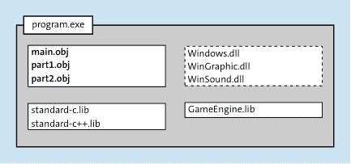

图 11.1 除了你的代码之外，程序还由若干库组成。

每个库通常由单独的模块组成。例如，从你作为用户的角度来看，C++ 标准库由若干头文件组成。有时你包含 `#include <vector>`，有时包含 `#include <iostream>`。这些头文件反映出该库很可能并不是作为单个巨大的 *.cpp 文件开发的。为了方便，头文件模块被合并到一个库中，因此你只需向编译器指定这一个 *.lib 文件。然后编译器会自己挑出实际使用到的内容。

### 11.2 模块

你现在的任务是为自己的项目合理地划分程序中属于你的那部分模块。为此，你需要回答例如“什么属于 main.obj、teil1.obj 和 teil2.obj？”以及随之而来的“什么属于 main.cpp、teil1.cpp 和 teil2.cpp 源代码文件？”

`main.cpp` 可能应该包含 `int main()`。除了把文件命名为 `main.cpp`，如果你的程序之后会被称为 `programm.exe`，那么 `program.cpp` 也是一个合理的名称。否则，你应该根据功能把项目拆分成多个部分。每个部分放入一组单独的 *.cpp 文件中。反过来，每个 *.cpp 文件都由一个名称相似的 *.hpp 文件来补充。例外是 `main.cpp`，通常你不需要为它创建头文件。

> **接口：每个 .cpp 文件也有一个 .hpp 文件**
>
> 为每个 *.cpp 编写一个名称相似的 *.hpp 头文件。在其中声明所有会被其他 *.cpp 文件直接使用的函数和其他内容：这些构成了*接口*。有意将某些元素只保留在 *.cpp 文件中——具体来说，就是那些仅用于实现接口的元素。


一个良好的标准做法是为每个 *.hpp 文件配备对应的 *.cpp 文件。但这条规则有更多例外。有时为了简单起见，你会合并头文件；有时接口同时也是实现，或者只包含常量。你可以考虑将这类头文件与普通头文件分开，用不同的方式命名，或将它们放在不同的目录中管理。

## 11.3 分离功能

说起来容易做起来难，因为功能的边界往往是流动的。

当把程序拆分成 *.cpp 和 *.hpp 文件时，结果就是各个 *.cpp 和 *.hpp 文件会通过 #include 包含其他 *.hpp 文件。

如果每个文件都需要其他所有文件，情况就会变糟。尽量让所需的 #include 指令数量保持较少。

循环依赖非常棘手——例如 A.hpp 包含 B.hpp，但在 B.hpp 中你又发现实际上需要先包含 A.hpp。解决办法是分离一个（或两个）头文件，使得只有 *.cpp 文件需要另一个头文件。

因此我建议遵循以下规则：

- 将程序分层。一层只能使用其下面各层中的内容。但应尽量跳过尽可能少的层：
  - 理想情况下，一个 *.hpp 文件只应包含直接下一层中的内容。程序中另一部分若想包含这个头文件，也将需要包含所有其他相关头文件，这很快就会变得很多。但这样的头文件越少越好。
  - *.cpp 文件可以更宽松。混乱被局限在编译这个源文件时，因此不会产生那么广泛的影响。
  - 也有例外。在图 11.2 中，const.hpp 的角色是整合核心声明。可能每个头文件都需要这些声明，那么把它们集中在一个地方、一个文件中，而不是分散在多个文件里，是很好的做法。
- 避免循环依赖：
  - 一个 *.cpp 文件无论如何都必须包含“它自己的” *.hpp 文件。
  - 一个 *.cpp 文件可以使用同一层中的任何其他 *.hpp 文件。如图 11.2 所示，teil2.cpp 可以包含 teil1.hpp。同样，图 11.2 中的 teil1.cpp 同时使用 teil2.hpp 也没有任何问题。
  - 这不适用于 *.hpp 文件。只有在特殊情况下才包含同一层的其他头文件。而且如果这样做，严格只能单向包含。在示意图中，teil1.hpp 因此可以使用 teil2.hpp，但反过来不行。

如果尽可能遵循这些规则，你肯定能避免循环依赖。分层模型还有助于让后续模块中所需的 include 数量保持较少。它不是万能药，但却是朝着正确方向迈出的一步。

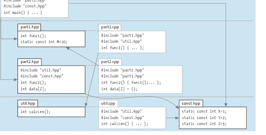

> **模块化与 OOP**
>
> 当你以清晰的方式使用类和传统面向对象方法工作时，为每个类创建一个“模块”是很自然的划分。第 12 章开始介绍 C++ 中面向对象编程（OOP）的描述，第 14 章你将看到一个将项目拆分为带类的模块的实际示例。

## 11.4 一个模块化示例项目

在 www.reinwerk-computing.com/5927，你会找到位于 15p-unit-test-200 目录中的项目。它包含下表中列出的文件和目录。为了方便实验，我把所有代码文件放到了一个 Compiler Explorer 链接中：https://godbolt.org/z/z9iTShN。

| 文件/目录 | 描述 |
| --- | --- |
| `README.md` | 项目说明 |
| `Makefile` | 主 Makefile——例如用于 make all |
| `all.mk` | 所有 Makefile 的定义 |
| `include/` | 随库一起交付的包含文件 |
| `include/qwort/` | 库的所有公共包含文件 |
| `include/qwort/qwort.hpp` | 库的主包含文件 |
| `src/` | 所有实现文件 |
| `src/lib/` | lib 的实现文件 |
| `src/lib/Makefile` | 库的 Makefile |
| `src/lib/qwort.cpp` | qwort 类的实现 |
| `src/lib/impl_multimap.hpp` | 辅助类的定义 |
| `src/lib/impl_multimap.cpp` | 辅助类的实现 |
| `src/prog/` | 可执行程序 |
| `src/prog/Makefile` | 程序的 Makefile |
| `src/prog/query.cpp` | 最简单的示例程序 |
| `src/prog/dictfile.cpp` | 示例程序 |
| `src/prog/pg40185.txt` | 用于建立索引的示例文本 |

表 11.1 示例项目的结构。

我还会在后面关于良好代码的第 14 章中使用这个示例项目来演示单元测试。

该项目由一个我假装要交付给客户的库组成。为了测试和演示，我想向客户提供两个小型示例程序，以展示如何使用该库。这些示例程序是以源代码形式交给客户，还是只提供完成的程序，都无关紧要。客户将收到头文件和编译好的库，但不会收到源代码。

这个示例库主要应由一个实现索引的类组成。它的功能类似于字典：依次添加多个条目，然后由这些条目构成索引。有了它，你就可以用搜索模式查询索引，以检查某个特定条目是否存在。精确搜索会很无聊，所以我们进行“近似”搜索。搜索应返回最佳匹配。

我不想再告诉客户更多内容。“最佳匹配”究竟是什么应属于实现细节。这里我想使用 q-gram 进行搜索，其中我选择 *q* 的长度为 3。这意味着搜索会找到这样一个条目：搜索模式的大多数三字符子串都与该索引条目匹配。

例如，如果索引包含 *Graum aus* 和 *Nagetierstamm*，那么用 *Anagram* 查询时你会找到后者，因为两者都包含 *NAG* 和 *AMM*，而前者与 *Anagram* 没有任何共同的三个字母组。作为示例，我不想在这里对该算法说更多，因为这在本章中确实只是次要问题。（在翻译本章时，我发现德语是进行 q-gram 的绝佳语言！）

如果在主目录中调用 make all，那么将依次构建 src/lib/ 中的 qwort.a 库和 src/prog/ 中的程序。

这里的库仅由最小文件集组成：一个要随库交付的头文件，以及实现文件。实现文件又由两个 *.cpp 文件 qwort.cpp 和 impl_multimap.cpp，以及一个内部 *.hpp 文件 impl_multimap.hpp 组成，后者不打算交付。因此，它也位于 src/lib/ 中。如果你将库交付给使用与你兼容的编译器的客户，对于静态链接，只需交付 qwort.a 库文件（在 Windows 上为 qwort.lib）以及 qwort.hpp 头文件即可。如果还想支持动态链接，则提供 qwort.so 或 qwort.dll 库文件。

> **头文件必须与库文件匹配**
>
> 关键的是，你（以及你的客户）在使用你的库时，必须使用与构建库文件时完全相同的头文件。如果使用不同版本，最好的情况是出现编译器或链接器错误；最坏的情况是行为不可预测。

主 qwort.hpp 头文件如清单 11.1 所示。

```cpp
// https://godbolt.org/z/e5GWbbq4Y
#ifndef QWORT_H // header guard
#define QWORT_H
#include <string>
#include <memory> // unique_ptr
namespace qw { // library namespace
    int version();
    namespace impl_multimap {
        class index_impl;
    }
    class index {
        using index_impl = impl_multimap::index_impl;
    public:
        index();
        ~index() noexcept; // needed for pimpl
        index(const index&) = default;
        index(index&&) noexcept = default;
        index& operator=(const index&) = default;
        index& operator=(index&&) = default;
    public:
        void add(const std::string &arg);
        size_t size() const;
        std::string getBestMatch(const std::string& query) const;
    public:                  // public for tests
        std::string normalize(std::string arg) const;
    private:
        const std::unique_ptr<index_impl> pimpl;
    };
} // namespace qw
#endif // header guard
```

**清单 11.1** qwort.hpp 库的主头文件。

index 类的 add 和 getBestMatch 方法是该库的实际接口：

- 首先，使用默认的 index() 构造函数创建一个空索引。
- 然后，使用 add(const string&) 逐个添加条目。
- 完成后，你可以用 getBestMatch(const string&) 任意多次查询之前添加的条目中最佳匹配的那一个。

### 11.4.1 命名空间

所有打算从库中导出的内容都定义在其自己的命名空间 qw 中。因此，头文件也以 namespace qw 开始，所有声明和定义都包含在其中。

接着是 impl_multimap::index_impl 类的前向声明。也为它打开了一个命名空间。所有应尽可能隐藏的内部库组件都包含在其中。然而，这里需要 index 类在后面使用的 index_impl 类名。

> **用命名空间切换实现**
>
> 顺便说一下，该命名空间之所以叫 impl_multimap，是因为它只包含若干可能实现中的一种。在另一个目录中，你会在下载源码中看到 15p-unittest-100 项目，它定义了一个 impl_simple_map 命名空间，其中包含一个 index_impl 类。这是索引实现的另一种更简单的版本。


> 原则上，你可以并行运行两个命名空间，并轻松切换主类中使用的实现。然而，这里这只是一个建议，因此我只以一种初步的方式展示它。如果完整开发，这种可切换性会涉及更多的编程工作，并且不是本章的重点。

现在介绍 `class index` 库的实际主类。其核心包含一个 `index_impl` 类的 `pimpl` 字段（作为指针）。通过这个“技巧”，`index` 接口类的实现细节可以被更好地分离。有时这被称为 *指向实现的指针*（或 *Pimpl*）模式。

为了避免用实现细节打扰类的用户（或为了对它们保密），该类所有方法都只被声明。它们稍后在 `qwort.cpp` 实现文件中定义。

通常，正如你将在第 17 章中看到的，你不会定义析构函数、拷贝构造函数、移动构造函数、赋值运算符或移动运算符（“五大件”）。编译器会为你最优地生成它们。不幸的是，这里做不到这一点：编译器为此需要 `index_impl` 类的 *定义*，否则它怎么知道如何处理 `unique_ptr<index_impl> pimpl`？但到目前为止，我们只将其 *声明* 为前向声明。因此，编译器只有在我们让它在 `qwort.cpp` 文件中生成代码时才能在这里帮助我们——特别是对于构造函数、析构函数和移动构造函数。你很快就会看到这是如何工作的。我们可以简单地让编译器在这里用 `= default` 生成另外三个。但是，我们必须在这里列出它们，因为根据 C++ 规则，由于我们至少定义了“五大件”家族中的另一个成员，否则它们将完全缺失。

### 11.4.2 实现

我将本章分为 index 接口类和 index_impl 实现类有两个原因。一方面，我想在实践中展示 Pimpl 模式；另一方面，这个示例不应过于简单。通过这种分离，我有了一个极好的理由来引入第二个类和第二个 *.cpp 文件。然后我还可以在第二个测试模块中处理两者。

接口类的头文件还包含带有实现的 *.cpp 文件，如清单 11.2 所示。

```cpp
// https://godbolt.org/z/TmExEo2
#include "qwort/qwort.hpp" // self
#include <map>
#include <algorithm>       // transform
#include <cctype>          // toupper
#include "impl_multimap.hpp"
using std::map; using std::string;

namespace qw {
    int version() {
        return 1;
    }
    // administration
    index::index()
        : pimpl(new index_impl())
    {
    }
    index::~index() noexcept = default;
    // interface
    void index::add(const string &arg) {
        pimpl->add(normalize(arg), arg);
    }
    size_t index::size() const {
        return pimpl->size();
    }
    string index::getBestMatch(const string& query) const {
        return pimpl->getBestMatch(normalize(query));
    }
    string index::normalize(string str) const {
        using namespace std; // begin, end
        transform(begin(str), end(str), begin(str), [](char c) {
            return ::isalpha(c) ? ::toupper(c) : '#';
        });
        return str;
    }
} // namespace qw
```

**清单 11.2** 接口类将所有调用转发给实现类。

首先处理所有 `include` 和 `using` 指令。一个合理的顺序是从属于当前 `*.cpp` 文件的 `*.hpp` 文件开始——在本例中是 "qwort/qwort.hpp"。请注意，文件名用 `"` 而不是 `<>` 括起来，因为该包含是我们自己库的一部分。此外，qwort.hpp 位于它自己的子目录 qwort/ 中，这在具有多个头文件的大型库中是个好主意。

index 类的实现现在需要 index_impl 类的完整定义；因此，它的头文件也必须通过 `#include "impl_multimap.hpp"` 包含。

因为属于这个库的所有内容都在它自己的命名空间中，所以这个文件中的所有内容也都被包含在命名空间 `qw` 中。

`version()` 自由函数很快实现。然后是 index 所有内容的实现。首先，这些是尚未在 `*.hpp` 中定义的构造函数和析构函数。此时，index_impl 类已完全已知，所以我们可以要求编译器用 `= default` 生成这些构造函数和析构函数。在默认构造函数中，这还不够：编译器会用 `nullptr` 初始化 `pimpl`，但我们需要一个新的 `index_impl`。

`add()`、`size()` 和 `getBestMatch()` 方法主要将它们的调用委托给 `pimpl`。只有 `normalize()` 每次都会事先被调用，因为 `index_impl` 不处理这一点，因为 `index_impl` 的实现包含在当前文件中，因此最后被包含。使用 `transform()`，`str` 的所有字符如果是字母则分别转换为大写；如果不是，则插入一个 `#`。这是在 `transform()` 的第四个参数中，对每个单独字符使用 `isalpha()` 和 `toupper()` C 函数完成的。这是一个 lambda——本质上是一个现场函数。

`normalize()` 函数确保例如 `E#G#` 与 `e.g.` 一起存储在索引中。如果你之后搜索 `e.g.`，那么另一个 `normalize()` 确保它也能在索引中找到。

`index_impl` 辅助类定义在相应的头文件中，该头文件包含在文件顶部。如前所述，这是必要的，以便 `index` 的实现可以进行。然而，它是库的实现细节，因此 `impl_multimap.hpp` 不在 `qwort.hpp` 的目录中，因为它不随其一起发布。它位于 `qwort.cpp` 和 `impl_multimap.hpp` 旁边。你可以在清单 11.3 中看到源代码本身。

```cpp
// https://godbolt.org/z/ob9voovMx
#include <string>
#include <string_view>
#include <vector>
#include <map> // multimap
namespace qw::impl_multimap {

using std::vector; using std::multimap;
using std::string; using std::string_view;

class index_impl {
    vector<string> entries;
    multimap<string, size_t> qindex;

public:
    void add(string_view normalized, string_view original);
    string getBestMatch(string_view normalized) const;
    size_t size() const {
        return entries.size();
    }

private:
    vector<string> qgramify(string_view normalized) const;
    static constexpr size_t Q = 3;
    static const std::string PREFIX;
    static const std::string SUFFIX;
public: // test interface
    vector<string> _qgramify(string_view n) const { return qgramify(n); }
    static size_t _q() { return Q; }
    static std::string _prefix() { return PREFIX; }
    static std::string _suffix() { return SUFFIX; }
};
} // namespace qw::impl_multimap
```

**清单 11.3** 实现类的头文件。

因为这里的重点并不真正在算法上，所以我将保持简短。在 entries 向量中，索引存储所有原始（未规范化）条目，以便搜索结果也可以显示。因此，每个条目在向量中都有一个编号。在 qindex 中，每个三字符键都有索引中的所有条目编号。例如，如果你之后搜索 HELLO，那么将依次检查 multimap 中的键 HEL、ELL 和 LLO。这些值是 entries 向量中的编号——即那里条目的索引。

add() 用于将新条目插入索引，而 getBestMatch() 查找最佳匹配条目。两个方法都期望一个已经规范化的参数。并且两个方法都使用 qgramify() 辅助函数将字符串拆分为其 q-gram。

出于测试目的，我在这里再次设置了一个公有部分。与我也专门为测试而设为公有的 normalize() 不同，我在这里将待测试的部分保留为私有。相反，所有稍后要测试的内容都通过公有访问方法进行丰富。按照惯例，这些方法以下划线 _ 开头。我将在第 14 章关于测试的内容中详细说明，但我需要在这里提到它，以免你对此公有部分感到惊讶。

我还想提到，我将整个类不仅放在 qw 命名空间中，还放在它自己的 impl_multimap 命名空间中。该类本身称为 index_impl。如果你想提供一种替代实现，只需将你的类放在它自己的命名空间中，并将其命名为 index_impl。

头文件中没有发生什么神奇的事情；你更可能在实现中看到它，如清单 11.4 所示。

```cpp
// https://godbolt.org/z/hW3a33Go9
#include "impl_multimap.hpp" // header for this file
#include <map>
#include <string>
#include <string_view>
```


```cpp
namespace qw::impl_multimap {

using std::vector; using std::multimap; using std::map; using std::string;
using std::string_view; using namespace std::literals::string_literals;

void index_impl::add(string_view normalized, string_view original) {
    /* TODO: Check for existence in 'entries' */
    const auto pos = entries.size(); // Index of the new entry
    entries.push_back(string(original));
    auto qgrams = qgramify(normalized);
    for(const auto& qgram : qgrams) {
        qindex.insert( make_pair(qgram, pos) );
    }
}

string index_impl::getBestMatch(string_view normalized) const {
    auto qgrams = qgramify(normalized);

    /* hits stores which words were hit how often */
    map<size_t, size_t> hits; /* 'entries-index' to 'hit-count' */
    size_t maxhits = 0; /* always: max(hits.second) */
    for(const auto& qgram : qgrams) {
        auto [beg, end] = qindex.equal_range(qgram);
        for(auto it=beg; it!=end; ++it) {
            hits[it->second] += 1; /* hit-count of the entry */
            if(hits[it->second] > maxhits) { /* simpler max-search */
                maxhits = hits[it->second];
            }
        }
    }

    /* Search first entry with maxhits. Improvement possible with PrioQueue */
    for(auto const & hit : hits) {
        if(hit.second == maxhits) {
            return entries[hit.first];
        }
    }

    /* only reached if entries is empty */
    return ""s;
}
const string index_impl::PREFIX = string(Q-1, '^');
const string index_impl::SUFFIX = string(Q-1, '$');

vector<string> index_impl::qgramify(string_view normalized) const {
    auto word = PREFIX+string(normalized)+SUFFIX; /* trick for better q-grams */
    vector<string> result {};
    auto left = word.cbegin();
    auto right = std::next(word.cbegin(), Q); /* okay: ["^"|"$"] = 3 */
    for(; right <= word.end(); ++left, ++right) {
        result.emplace_back(left, right);
    }
    return result;
}
} // namespace qw::impl_multimap
```

**清单 11.4** 实现类的核心。

正如我之前所说的，就本章而言，算法究竟如何实现并不那么重要。对于模块而言，更重要的是所有功能在外部符合预期。尽管如此，我还是想对这份实现文件的结构说几句。

一如既往，我尽可能靠前地包含这个文件所实现内容的头文件。紧接着，只包含标准库中必要的头文件。

这些定义的方法都属于 `qw::impl_multimap` 命名空间，该命名空间在开头打开，在结尾关闭。

`add()` 在通过 `qgramify()` 对条目进行分解后，将其存储在 `entries` 和 `qindex` 中。在一个方面，这个 `add()` 实现表现不佳：如果你将完全相同的条目存储两次，你将永远无法再找到其中的任何一个。因此，如果 `add()` 在存储之前检查条目是否已经存在，或者如果搜索不仅能找到最佳匹配，还能以某种方式找到几个良好匹配，那就好了。然而，我把解决这个问题的任务留给你的动手探索精神。

`getBestMatch()` 同样使用 `qgramify()` 将搜索模式分解为其组成部分。在此过程中，它统计每个原始单词被匹配到的次数。最后，选择并返回匹配次数最多的条目。

在 `qgramify()` 中，我使用了一个简单的技巧来略微增加生成的 q-gram 的数量：在分解之前，用 `^^` 和 `$$` 将条目或搜索模式框起来。结果，对于像 NYC 这样的长度为三的单词，q-gram 列表不仅包括 NYC，还包括 `^^N`、`NYC` 和 `C$$`，因此有更好的机会被匹配。

总而言之，为相似度索引创建 q-gram 既不是一项非常困难的任务，也不是一个完美的解决方案。有许多算法通过更复杂的方法可以获得更好的结果。但就简单性而言，q-gram 索引却出人意料地提供了良好的结果。

随后，这整个功能被打包到 `qwort.a` 库中。在其他系统上，它也可能被称为 `qwort.so`、`qwort.lib` 或 `qwort.dll`。连同 `qwort/qwort.hpp` 头文件和文档，这是提供给客户的最低交付包。

### 11.4.3 使用库

因为今天你们就是我的客户，在继续讨论测试之前，我将演示如何在程序中使用这个库。清单 11.5 差不多是演示该库的最简单示例程序。

在 `include` 和 `using` 指令之后，紧随其后的是 `main` 程序。首先，将两个示例条目存储到索引中。然后是对程序所有命令行参数的一次循环。对于每个参数，执行一次最佳匹配搜索，并将结果输出。

```cpp
// https://godbolt.org/z/jz9TshnY (includes all files)
#include <cstdlib>  // EXIT_SUCCESS
#include <iostream> // cout
#include <vector>
#include <string>
#include "qwort/qwort.hpp"

using std::cout; using std::vector; using std::string;

int main(int argc, const char* argv[]) {
    cout << "qwort version " << qw::version() << "\n";

    /* Build index */
    qw::index myindex{};

    /* Demo data */
    myindex.add("Germany");
    myindex.add("Greece");

    /* Generate queries */
    vector<string> args(argv+1, argv+argc); // iterator-based initialization
    for(auto &querystring : args) {
        cout << "Searching for '" << querystring << "'... ";
        const auto match = myindex.getBestMatch(querystring);
        cout << match << "\n";
    }
    return EXIT_SUCCESS;
}
```

**清单 11.5** 差不多是该库最简单的示例程序。

编译器将 `query.cpp` 源文件与 `qwort.hpp`（因为它被包含）以及 `qwort.a` 库一起打包到 `query.x` 程序中。Makefile 基本上说了以下内容（但是被变量弄得有些晦涩）：

```sh
g++ -o query.x query.cpp -lqwort -I../../include -L../lib
```

这大致意思是：“从 `query.cpp` 创建 `query.x`，使用 `qwort` 库，并在指定路径中查找头文件和库。”

如果你按如下方式运行此程序，将会得到以下输出：

```
$ ./query.x armada green
qwort version 1
Searching for 'armada'... Germany
Searching for 'green'... Greece
```

在 *www.rheinwerk-computing.com/5927* 的可下载内容中，你会在 `code/15p-lunittest-200/src/prog/dictfile.cpp` 中找到另一个简单示例。在那里，我从任意文本文件的行创建索引。通过额外的命令行参数，你就可以输出最匹配的行。

## 第二部分
## 面向对象编程及更多

是时候开始构建你自己的数据类型了。这正是 C++ 的真正强大之处。你可以简单地将多个数据片段捆绑在一起，从而将它们视为一个整体。更重要的是，你可以设计出数据和行为构成一个单一单元的类。这最终将引导你学习面向对象的继承。

在这一部分，你还会学习更多关于常量和静态值的内容，因为它们在类的上下文中变得特别有趣。

## 第 12 章：从结构体到类

### 本章提要

- **聚合体**：聚合体是将多个数据字段简单捆绑成一种新类型——具体来说，是一个只有数据字段和方法的 `struct`。C 数组也是一种聚合体。
- **struct**：结构体是数据字段的捆绑。它也可以拥有构造函数，以及私有和静态元素。它可以是一个简单的聚合体，也可以是一种更高级的结构。
- **class**：类与结构体非常相似，只不过类默认从私有可见性开始；在通常用法中，结构体更侧重于数据，而类更侧重于行为。
- **结构体**：结构体可以不仅仅是聚合体；例如，它可以有构造函数。当我说*结构体*时，我通常同时指 `struct` 和 `class`。
- **数据字段、成员变量或属性**：结构体内的变量。
- **方法、成员函数或实例函数**：绑定到其结构体上的函数。
- **成员**：类的数据字段和方法的统称。
- **构造函数**：用于初始化结构体的特殊方法。
- **内联**：给编译器一个提示，将代码直接插入，而不是使用函数调用。
- **头文件守卫**：避免重复包含。
- **public 和 private**：保护方法和数据字段不被外部访问。
- **封装**：接口与实现的清晰分离；可以有不同程度的封装。
- **类作为值**：将类的实例用作值参数（按值传递）或作为返回值。


- **复制省略**  
  避免不必要地复制返回值的一种编译器技术。
- **隐式类型转换**  
  在类型 A 的表达式中，编译器需要另一种类型 B，并使用其单参数构造函数 B(A) 生成所需的 B。
- **显式类型转换**  
  当你在表达式中显式调用单参数构造函数时。
- **转换方法**  
  形式为 `operator TargetType()` 的方法，它允许你将对象转换为 `TargetType`。
- **const 方法**  
  不改变实例状态的方法；它在末尾用 `const` 标记。
- **类型别名**  
  使用 `using newType = oldType` 或 `typedef oldType newType` 为类型引入另一种写法——也可以在类内部局部使用。
- **类型推导与 auto**  
  使用 `auto`，你可以让编译器在初始化期间推导变量的类型。

自定义数据类型例如可以保存关于 `Person` 的数据。这样你就不必总是收集各个元素并逐个传给函数；你可以将若干个元素捆绑成一个聚合体。为此使用 `struct`。

```cpp
// https://godbolt.org/z/8YqoTEx58
#include <string>
#include <iostream>                  // cout
#include <format>
using std::string; using std::cout; using std::format;
struct Person {                       // defines the new type Person
    string name_;
    int age_;
    string city_;
};                                    // closing semicolon
void print(Person p) {                 // entire Person as one parameter
    cout << format("{} ({}), from {}\n",
        p.name_, p.age_, p.city_);     // access via dot
}
int main() {
    Person john {"John", 45, "Boston"}; // initialization
    print(john);                       // call as a unit
}
```

代码清单 12.1 使用“struct”创建自己的数据类型。

通过 struct Person，定义了新的 Person 类型。它由列出的三个元素的联合构成。一如既往，先写类型，再写名称。在这个名称下，你可以用点 `.` 访问元素，如 `p.name_` 所示。

我在这里将所有元素的名称都以一下划线 `_` 结尾。这只是一个约定，用于将它们与全局变量和参数区分开。

正如你在 `void print(Person p)` 中看到的，print 函数的参数现在是整个 person。你不需要分别传递 `name_`、`age_` 和 `city_` 元素。顺便说一句，`format` 函数是 C++20 中新引入的。

> **用分号结束类型定义**
> 
> 用分号结束新类型的定义。与*复合语句*不同，这里要在右花括号后放置一个 `;`。忘记分号是常见的疏忽。

在结构中，当你列出结构的全部内容时，称为定义；当你只提及名称时，称为*声明*。当结构互相使用彼此时，这有时可能是必要的。

```cpp
// https://godbolt.org/z/zPbK16zWE
#include <memory>                 // shared_ptr
#include <vector>                 // vector
struct Employee;                  // class declaration
struct Boss;                      // class declaration
struct Employee {                 // class definition
    std::shared_ptr<Boss> boss_;  // pointer to Boss
    void print() const;           // method declaration
};
struct Boss {                     // definition
    std::vector<std::shared_ptr<Employee>> employees_; // Pointer to Employees
    void print() const;           // method declaration
};
void Employee::print() const {   // method definition
    //...
}
void Boss::print() const {       // method definition
    //...
}
```

**代码清单 12.2** 类的声明最初只提及它的名称，而定义包含其所有元素。

在这个例子中，有两个互相使用对方的类。只有当你在 Employee 中之前*声明*过 Boss，你才能在 Employee 中使用 Boss。

注意，方法声明可以出现在这样的类*定义*中。这使得*类定义*这个术语有些令人困惑。

### 12.1 初始化

现在可以像这样进行初始化：`Person john {"John", 45, "Boston"}`，在花括号中列出各子元素的初始化值。或者，你也可以使用空列表 `{}` 进行初始化；然后所有元素都会被*值初始化*——也就是说，数字用零初始化，字符串用空字符串 `""` 初始化（参见第4章第4.4.2节）。

如果你在初始化列表中指定的元素不够，其余元素也会被值初始化。然而，你应避免这样做，因为它看起来像是疏忽，总会引人侧目。如果你指定的元素太多，编译器会报错。

但是，你绝不能完全省略初始化。例如：

```cpp
Person john;
```

这确实会初始化字符串属性 `name_` 和 `city_`（它们是完整的类），但不会初始化 `age_`，因为它是内置数据类型 `int`；`age_` 可能获得一个随机值。

注意，在列出所有元素时也可以使用等号：

```cpp
Person john = {"John", 45, "Boston"};
```

不过，我建议坚持使用不带等号的形式，这种形式更常见。

从 C++20 开始，你还可以在初始化时命名要设置的字段；这就是*指定初始化器*。如果类中字段的顺序发生变化，编译器会通知你。

```cpp
// https://godbolt.org/z/K8WePajvM
Person john1 {"John", 45, "Boston" };  // correct
Person john2 {"Boston", 45, "John" };  // oops, swapped, and no one notices
Person jack { .name_ = "Jack", .age_ = 23, .city_ = "Dallas" }; // okay
Person jimmi { .name_ = "Jimmi", .age_ = 48 }; // okay, not all specified
Person carl { "Carl", .age_ = 53 }; // ⚠ all designated or none
Person paul { .age_ = 34, .name_ = "Paul", .city_ = "Reno" }; // ⚠ swapped
Person jim(.name_="Jim", .age_=34, .city_="NYC"); // ⚠ not with parenthesis
```

**代码清单 12.3** 使用指定初始化器时，你要指定要设置的元素。

对于 paul，指定初始化器必须按正确顺序指定。与 jimmi 一样，你也可以省略字段，这些字段随后会被值初始化。但是，你不能像 carl 那样混合使用带指定名称和不带指定名称的字段。

> **关于圆括号的警告**
> 
> 你也可以将初始化元素写在圆括号中，例如 `string name("x");`。但是，如果列表中没有任何元素，那么你绝不能使用圆括号：`string name()` 不幸地表示其他含义（函数声明）。因此，最好始终用花括号初始化：`string name{};` 才是正确的初始化。
> 
> 在少数情况下，用花括号和圆括号初始化含义不同；`std::vector` 就是这样的一个例外。

### 12.2 返回自定义类型

返回一个 Person 就像把它用作参数一样简单：

```cpp
// https://godbolt.org/z/rriPOrTlo
// Snippet
Person create(string name, int age, string city) { // return type
    Person result {name, age, city};
    return result;
}
int main() {
    Person john = create("John", 45, "Boston");   // store return value
    print(john);
}
```

这里实际上没有什么新内容，只是你可以看到，你可以像返回内置类型和标准库类型的变量一样，返回自己类型的变量。

或许仍然值得注意的是，正如你已经了解的类型一样，你并不总是需要一个变量来存储值。你可以将新类型用作表达式的一部分。这样就会像往常一样创建该类型的*临时变量*：

```cpp
// https://godbolt.org/z/ME76bf8bWa
Person create(string name, int age, string city) {
    return Person{name, age, city};        // returned directly
}
int main() {
    print(create("John", 45, "Boston")); // return value used directly
}
```

这对你来说应该并不陌生。你对内置类型也做同样的事——尽管不完全一样，因为当你返回 `int` 时，你不会写 `return int(12);`，即使你可以这样做。


因此，与其写成

```cpp
return Person{name, age, city};
```

不如直接写成

```cpp
return {name, age, city};
```

编译器从函数的返回类型得知你想创建一个 Person，因此会尝试把你提供的列表转换为 Person；这两种表达式几乎同义。你可以选择自己更喜欢的风格。

有些情况下需要显式指定 Person{...}——例如，使用自 C++14 起可用的函数声明语法 auto create() 时。下一个代码清单展示了一个示例。

```cpp
// https://godbolt.org/z/jer44aWs9
auto create(string name, int age, string city) {
    return Person{name, age, city};  // auto requires constructor name
}
auto create2(string name, int age, string city) {
    return {name, age, city};        // auto with initializer_list does not work
}
```

**代码清单 12.4** 在这里，必须在返回值中指定 Person。

这里，create2 返回的是一个 initializer_list。如果你在函数头中指定了返回类型，并且 initializer_list 可以自动转换为该类型，那也没问题。但这里写的是 auto，编译器无法据此推断类型。

## 12.3 用方法代替函数

代码清单 12.1 中的 print 函数需要一个 Person 才能工作；实际上，它就是专门为 Person 设计的，并不适用于其他类型。甚至可能只有在同时提供一组合适的、可与新类型配合使用的函数时，Person 类型才真正有意义。

这些函数连同 struct Person 中的数据，共同属于该类型的接口。遗憾的是，print 并没有被列在 Person 类型中——但你完全可以这样做。把某个类型的函数与其数据组合成一个实体，使二者彼此依存、缺一不可。这样的函数总是需要一个变量，而没有相关函数的变量几乎毫无用处。¹ 属于该类型的变量称为*实例变量*。属于该类型的函数称为*方法*。

¹ 不需要实例变量的静态方法将在后面介绍。

```cpp
// https://godbolt.org/z/5T1Er36P7
#include <string>
#include <iostream>
#include <format>
using std::string; using std::cout; using std::format;
struct Person {
    string name_;
    int age_;
    string city_;
    void print();              // function as a method of the type
};
void Person::print() {        // method name is extended by Person::
    cout << format("{} {} {}\n",
        name_, age_, city_);   // in a method you can directly access fields
}
int main() {
    Person john {"John", 45, "Boston"};
    john.print();              // calling the method for a variable of the type
}
```

**代码清单 12.5** 方法将数据和行为捆绑在一起。

现在，`print` 已成为 `Person` 类型的一部分，因此变成了一个*方法*。

当人们提到*方法*时，指的是某个类型内部的函数。与此相区别的是类外部的*函数*，也就是你到目前为止学过的那些函数。

有时函数也被称为*自由函数*，以区别于方法。有时也会使用*全局函数*这一术语，但它并不完全正确；函数也可以位于命名空间内，仍然是自由函数，但不是全局函数。反过来，*成员函数*这一术语则用于指代方法。

从技术上讲，方法也只是函数。区别之一在于，方法的完整标识符包含类名。如果你在类型外部定义方法，那么调用它时要写成——例如 `Person::print`。在方法内部，你可以不加额外限定地访问类的所有数据字段和方法：以前需要写 `p.name_`，现在只写 `name_` 就够了。

严格来说，编译器会在内部将其转换为 `this->name_`——由此引出与函数之间的第二个重要区别：Type 的方法总是有一个隐式的 `Type* this` 参数，² 而它不会出现在方法的参数列表中。这个参数表示你调用该方法时所针对的实例的内存地址。`this` 与你使用的数据字段一起，给出了你所指的确切位置。

² 更准确地说，是 `Type * const` 或 `Type const * const`，具体取决于情况。

为此，编译器必须使用解引用运算符 `->` 而不是点号，第 20 章对此有详细描述。

```cpp
struct Person {
    //... rest as before ...
    string greeting();
};
string Person::greeting() {
    return format("Hello {} from {}", this->name_, this->city_);
}
int main() {
    Person anna { "Anna", 33, "Eek" };
    Person nina { "Nina", 22, "Ojo" };
    anna.greeting();
    nina.greeting();
}
```

**代码清单 12.6** “greeting()”方法使用了字段；通过“this”，它始终引用属于被调用对象的字段。

在方法内部，编译器会自动尝试判断某个标识符是否属于 `*this`。因此，你可以更清晰地实现 `greeting()`：

```cpp
string Person::greeting() {
    return format("Hello {} from {}", name_, city_);
}
```

尽管在两种情况下执行 `greeting()` 时的程序代码相同，但隐式的 `this` 参数确保访问的是不同的 `name_` 和 `city_` 字段——即属于当前对象的那些字段。

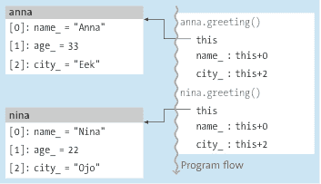

**图 12.1** 每次调用“greeting()”都会收到不同的“this”参数。

确实，只需做一些细小（但重要）的改动，你就可以重写一个方法，通过把隐式的 `this` 参数显式化，将其变成自由函数。

```cpp
string greeting(Person * const p) {  // implicit parameter made explicit
    return format("Hello {} from {}", p->name_, p->city_);
}
```

**代码清单 12.7** 如何将方法与数据彼此分离。

不能把参数命名为 `this`，因为 this 是 C++ 中的关键字；这里将其命名为 `p`。

有些情况下，在方法中访问属性时也需要使用 `this->`——即当两个或多个相同标识符发生冲突时。这时就需要显式指定：

```cpp
// https://godbolt.org/z/hEvqWqqc6
int value = 5;                         // global variable
struct Wrap {
    int value = 3;                     // data field
    void set(int value) {              // parameter
        this->value = value + ::value;
    }
};
```

这里，`this->value` 指的是 Wrap 的数据字段，`value` 指的是参数，而 `::value` 指的是全局变量。

将数据和函数捆绑在一起是个好主意。但是否应该始终如一地这样做，是一个设计问题。例如，C++ 允许通过自由函数的新重载来扩展现有功能，而不仅仅是通过向现有数据类型添加方法。`std::ostream` 的 operator<< 就是一个很好的例子。

## 12.4 更好的“print”

每次我拿 `print` 这种不实用的东西作为函数示例时，我都感到很痛苦。尽管 `print` 作为方法或相应的自由函数可能很简单，但有几件重要的事情需要注意。你现在对 C++ 的了解已经足够多，我可以向你解释更好的替代方案了。再来看一下这个方法：

```cpp
void Person::print() {
    cout << format("{} ({}) from {}", name_, age_, city_);
}
```

这里，输出被发送到 `cout`。如果你想将 Person 作为错误输出（发送到 `cerr`），该怎么办？你会为此单独写一个函数或方法吗？根本问题在于，你在方法中访问了 `cout` 全局变量。你无法从外部改变这一行为，例如，如果你想通过 `ofstream` 写入文件，或为了测试目的写入 `stringstream`，就做不到。

> **不要访问全局变量**
>
> 避免在函数和方法中直接访问全局变量。

也许你想为 `Person::print` 编写自动测试。如果那时你不得不用眼睛盯着 `cout` 来检查程序是否运行正确，那该多烦人！我想建议的是，如果你避免专门使用全局 `cout`，并且总体上避免使用全局变量，就可以让自动测试（见第 14 章）等事情变得更容易。

将输出目标作为参数传入。`cout` 和 `cerr` 的类型是 `std::ostream`。如果你想写入文件，`ostream` 也适用于这种情况。

```cpp
void Person::print(std::ostream& os) {
    os << format("{} ({}) from {}", name_, age_, city_);
}
```

注意你使用的是类型 `ostream&`，这是一个引用。你并不想创建流的副本，而是要改变它的状态。向流中输出内容就是一种状态改变。

太好了——把这一点作为今后的建议提给你，已经大大减轻了我的良心负担！现在，你可以随意使用下面代码清单中的 `print` 函数。

```cpp
// https://godbolt.org/z/bz6n3Pjrv
// Excerpt. Person as before
void Person::print(std::ostream& os) {
    os << format("{} ({}) from {}", name_, age_, city_);
}

int main() {
    Person carl{"Carl", 12, "Toledo"};
    carl.print(cout);        // on the screen
    cout << "\n";
    std::ofstream file {"persons.txt"};
    carl.print(file);        // to a file
    // automatic test:
    std::ostringstream oss{}; // writes to a string
    carl.print(oss);
    if(oss.str() == "Carl (12) from Toledo") {
        cout << "ok\n";
    } else {
```


```cpp
cout << "Error in Person::print!\n";
return 1;                 // propagate error outward
}
}
```

清单 12.8 “print” 将一个流作为参数。

特别是，使用 `ostringstream` 揭示了一个特殊的方面：如果你想自动测试一个打印函数是否工作正常，字符串很容易处理和检查所需的结果。如果你直接写到 `cout`，你该如何测试呢？提取输出将变得相当困难。传递输出流的真正优点之一是函数易于测试。

## 12.5 与其他输出一样的输出

下一步实际上只是外观上的。要将对象输出到 `ostream`，实践中有一个常用的方法：为 `ostream&` 和你的类型重载全局 `operator<<` 运算符。

```cpp
std::ostream& Person::print(std::ostream& os) {
    return os << format("{} {} from {}", name_, age_, city_);
}
std::ostream& operator<<(std::ostream& os, Person p) {
    return p.print(os);
}
```

清单 12.9 你可以重载标准运算符用于输出。

与其调用 `p.print()`，你也可以直接输出字段：

```cpp
std::ostream& operator<<(std::ostream& os, Person p) {
    return os << format("{} {} from {}", p.name_, p.age_, p.city_);
}
```

你是否注意到返回类型不是 `void`？通过返回作为参数传入的 `ostream`，你可以在表达式内重用这个返回值。你已经在 `operator<<` 上经常这样做。在下面的清单中看看你的新输出运算符的实际效果。

```cpp
// https://godbolt.org/z/a7q5xsWGj
// Excerpt ...
        std::ostream& print(std::ostream& os);
};
std::ostream& Person::print(std::ostream& os) {
    return os << format("{} ({}) from {}", name_, age_, city_);
}

std::ostream& operator<<(std::ostream& os, Person p) {
    return p.print(os);
}

int main() {
    Person paul {"Paul", 23, "Irvine"};
    cout << "You are " << paul << ", right?\n";
}
```

**清单 12.10** 通过重载自由函数实现了 `<<` 输出。

这样你就可以像其他数据类型一样在输出中使用 `Person` 对象。完整的输出如下所示：

You are Paul (23) from Irvine, right?

## 12.6 内联定义方法

你是否注意到，在声明并随后定义类的方法时，我使用了一个你已经知道的技术——方法的*前向声明*？首先，在结构体中只提到*方法头*，然后在外部进行实际定义。（严格来说，它仍然是一个聚合体，但很快就会成为一个类。一切都仍然是公共的，没有构造函数或虚方法。）

这也是你通常应该处理结构体和类的方式。然而，如果一个方法很短，例如，你可以像对待普通函数一样对待它。你也可以当场定义它——就在结构体内部。

```cpp
// https://godbolt.org/z/Y3eWIkh8v
#include <string>
#include <iostream>    // ostream
#include <format>

using std::string; using std::ostream; using std::format;

struct Person {
    string name_;
    int age_;
    string city_;
    ostream& print(ostream& os) {       // method defined inline
        return os << format("{} ({}) from {}", name_, age_, city_);
    }
};
```

**清单 12.11** 方法也可以内联定义。

但是，只有在方法非常短时才使用这个选项。

通过这种方式在类中编写方法，编译器会尝试将实现的代码直接插入到调用函数的位置：这被称为*内联*。虽然这可能使你的代码更快（函数调用会花费很多时间），但也会使代码变得更大。

如果你内联了太多函数，你的代码可能会变得太大，以至于速度优势被抵消。最好只内联那些简单或非常频繁调用的方法。

## 12.7 分离实现与定义

将定义和实现分开，对程序的清晰性是有益的。甚至到了这种程度：你应该将结构体定义放在头文件中，将实现放在一个实现的 *.cpp* 文件中（见图 12.2）。

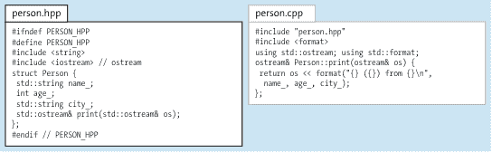

图 12.2 将类拆分为头文件和实现。

如果你在程序的多个部分需要 `Person`，请在那些地方使用 `#include "person.hpp"`，使编译器知道该数据类型。

为了防止你通过多种包含间接或直接地多次包含 `person.hpp`，有下面这些外围行：

```cpp
#ifndef PERSON_HPP
#define PERSON_HPP
// ... actual content
#endif // PERSON_HPP
```

这些*包含守卫*可以防止 `struct Person` 被定义两次，如果你直接或间接地写了两次 `#include "person.hpp"`。使用这些守卫不是*必须*的，但这是非常常见的做法。

### 不要在头文件中使用 “using”

正如我在本书开头提到的，为了简洁起见，我并没有像你在实践中应该做的那样完全不用 `using`。在图 12.2 中，你可以看到正确的做法：

- 不要在头文件中使用全局 `using`。
- 在 *.cpp* 文件中，可以使用 `using std::identifier`。
- 但是，你不应该全局使用 `using namespace std;`，即使在 *.cpp* 文件中也不应该。

## 12.8 通过构造函数进行初始化

你已经熟悉简单的 `struct Person`：

```cpp
struct Person { string name_; int age_; string city_; };
```

你也知道可以用三种元素以四种正确方式初始化聚合体 `Person`：

```cpp
Person p1 { name, age, city };
Person p2 { name, age };
Person p3 { name };
Person p4 { };
```

现在，如果我们加上 C++20 引入的*指定初始化器*，还有七种可能性：

```cpp
Person p1 { .name_=name, .age_=age, .city_=city };
Person p2 { .name_=name, .city_=city };            // and 2 more
Person p3 { .age_=age };                           // and 2 more
```

所有这些变体都是有效的，并且会初始化所有字段。未列出的字段会被值初始化，意思是用一个有意义的、通常类似空值的值或默认构造函数填充。但是，如果你想强制要求在初始化时总是指定 `city_`，该怎么办？或者如果你想提供省略 `name_` 而不是 `city_` 的可能性，而不必指定指定初始化器呢？

为此，有构造函数。*构造函数*是结构体的一种特殊方法，专门用于初始化对象。你写构造函数*几乎*就像写普通方法一样，区别如下：

- 构造函数的名字总是结构体的名字——这里是 `Person(...)`。
- 构造函数没有返回值或返回类型，甚至没有 `void`。
- 在构造函数体之前，你可以（也应该）用 `field{value}, ...` 初始化类的字段。

你必须像结构体中的方法一样声明构造函数：

```cpp
struct Person {
    string name_;
    int age_;
    string city_;
    Person();          // declare constructor
};
Person::Person()
    : name_{"no name"}    // initialization value for name_
    , age_{-1}             // initialization value for age_
    , city_{"no city"}    // initialization value for city_
{ }
```

**清单 12.12** 如何定义构造函数。

如果你现在初始化一个 `Person p{};`，值初始化将不再执行；取而代之的是这个构造函数。在进入（此处为空的）函数体之前，所有变量都用指定的值进行初始化。除了花括号 `{}`，你也可以使用圆括号 `(…)`。这里没有区别——只是花括号可能会让你在其他地方更喜欢这种形式。你也可以选择与前面所示不同的格式，例如：

```cpp
Person::Person()
    : name_("no name"), age_(-1), city_("no city")
{ }
```

你在这里没有指定的初始化将按照你未初始化相应类型变量的方式执行。这意味着内建数据类型保持未定义，而类会被值初始化。

### 自我初始化还是依靠规则？

> 我建议你初始化所有数据字段。如果你在别人的代码中偶然发现忘记初始化的情况，你应该可以毫无羞愧地补上缺失的初始化。如果省略了提及，何时以及如何初始化的规则太复杂了，即使是像 Scott Meyers 这样的专家也不想去记住这些规则。当然，主要原因不是缺乏脑力，而是因为数据字段的定义与其初始化相去甚远，这是事情的本质。每次初始化时都要查找声明来决定是否...

初始化是否应当被提及，这一点令人难以忍受。总之：始终自行初始化。

在每个构造函数中列出所有数据字段是大量工作，并且会造成次优的代码重复。幸运的是，有一些替代方案，例如默认成员初始化器和构造函数委托，可以让你更轻松。但我们将在下一节讨论这些内容。

因此，你可以选择使用 `Person{};` 用其他值填充该结构体。但是，你不能再指定一个、两个或三个参数。

## 构造函数使聚合体成为结构体

有了自定义构造函数后，此类型不再进行聚合初始化或值初始化。此时你必须使用其中一个构造函数进行初始化。初始化时不再可能使用与构造函数所定义参数数量不同的参数。

为加以区分，这种类型随后被称为结构体。*聚合体*这一术语也适用于其他语言元素，例如C数组。

你稍后将了解其他会使聚合体变为结构体或类的元素——即虚方法和非公有数据字段。

与普通函数一样，你可以用不同的参数组合重载构造函数，从而也允许使用多种参数组合进行初始化。

```cpp
// https://godbolt.org/z/zndbvh5nK
#include <string>
#include <string_view>
using std::string; using sv = std::string_view;

struct Person {
    string name_;
    int age_;
    string city_;
    Person();                         // constructor without arguments
    Person(sv n, int a, sv c);         // constructor with three arguments
    Person(sv n, int a);               // constructor with two arguments
    Person(sv n);                      // constructor with one argument
};

Person::Person()
    : name_{"no name"}, age_{-1}, city_{"no city"} { }

Person::Person(sv n, int a, sv c)
    : name_{n}, age_{a}, city_{c} { }

Person::Person(sv n, int a)
  : name_{n}, age_{a}, city_{"no city"} { }
Person::Person(sv n)
  : name_{n}, age_{-1}, city_{"no city"} { }
```

**代码清单 12.13** 多个构造函数也是可能的。

这为初始化提供了灵活性，但并不理想：它包含大量代码重复，因此会在后续代码维护中成为错误来源。你可以通过三种方式为 `Person` 改善这种情况：

- 在声明时使用成员默认值
- 使用构造函数委托
- 为构造函数参数使用默认值

你还可以看到，自C++17起，将只读的 `string` 参数声明为 `string_view` 是很好的做法。或者，你也可以使用 `string` 作为值参数，或使用 `const string&` 作为引用参数。

### 12.8.1 声明中的成员默认值

你可以在结构体中用 = 和一个值为成员变量提供默认值。如果随后在构造函数的初始化元素列表中省略该变量，则会改用这个值。因此，前面的示例等价于下面的代码清单。

```cpp
// https://godbolt.org/z/Wo8zaq9WW
#include <string>
#include <string_view>
using std::string; using std::string_view;
struct Person {
    string name_ = "no name";
    int age_ = -1;
    string city_ = "no city";
    Person() {}
    Person(string_view n, int a, string_view c)
      : name_{n}, age_{a}, city_{c} { }
    Person(string_view n, int a)
      : name_{n}, age_{a} { }
    Person(string_view n)
      : name_{n} { }
};
```

**代码清单 12.14** 成员变量可以带有默认值。

声明中提到的值仅在构造函数中的初始化实际被省略时才会使用。这尤其意味着不会发生双重初始化。

### 12.8.2 构造函数委托

你可以在初始化器列表中先调用此类的另一个构造函数，从而将值的初始化委托给它。为此，请实现一个具有最多参数数量的构造函数，然后将所有其他构造函数对成员变量的初始化委托给它（参见[代码清单 12.15](#)）。

使用这种变体，你无法消除 `Person` 的所有代码重复。如果构造函数体中还要写一些内容——这里为空——那么这种做法很有用，因为被委托构造函数的代码块也会执行。只有当它执行完毕后，委托构造函数中可能存在的代码才会执行。像这样使用委托可以减少每个构造函数中必须编写的代码。

```cpp
// https://godbolt.org/z/8h93f64Y
#include <string>
#include <string_view>
using std::string; using sv = std::string_view;
struct Person {
    string name_;
    int age_;
    string city_;

    Person(sv n, int a, sv c)             // delegated constructor
      : name_(n), age_(a), city_(c) {}    // implemented
    Person() : Person{"no name", -1, "no city"} {} // delegating
    Person(sv n, int a) : Person{n, a, "no city"} {} // delegating
    Person(sv n) : Person{n, -1, "no city"} {} // delegating
};
```

**代码清单 12.15** 一个构造函数可以将部分初始化传递给另一个构造函数。

> **让委托构造函数的函数体保持为空**
>
> 如果先前已委托到别处的构造函数体中抛出异常，要小心。对象在被委托构造函数运行后即被视为已创建。这意味着它最终会被清理，并调用析构函数。这可能会出乎意料，因为如果没有委托，当异常离开构造函数时，对象被视为*未*创建。你将在[第16章](#)中了解析构函数调用的影响。
>
> 为避免困难，你应让委托构造函数的函数体保持为空。这样就不会在那里抛出异常。

### 12.8.3 构造函数参数的默认值

你可以编写一个构造函数，通过默认参数灵活地接受多个参数。具体做法已在第7章第7.9节中描述。下面的代码清单给出了一个简短示例。

```cpp
// https://godbolt.org/z/Gfrd5cceG
#include <string>
#include <string_view>
using std::string; using std::string_view;

struct Person {
    string name_;
    int age_;
    string city_;

    Person(string_view n = "N.N.", int a = 18, string_view c = "Berlin")
        : name_(n), age_(a), city_(c) {}
};
```

**代码清单 12.16** 构造函数也可以通过默认参数重载。

这个单一的构造函数定义随后大致相当于你定义了以下四个重载：

```cpp
Person(string_view n, int a, string_view c)
    : name_(n), age_(a), city_(c) {}
Person(string_view n = "N.N.", int a = 18)
    : name_(n), age_(a), city_("Berlin") {}
Person(string_view n = "N.N.")
    : name_(n), age_(18), city_("Berlin") {}
Person()
    : name_("N.N."), age_(18), city_("Berlin") {}
```

请注意，为其所有参数提供默认值的构造函数也被用作*默认构造函数*。这意味着，每当需要创建不带参数的实例时，编译器都会调用它。例如，vector 就是这种情况。

```cpp
// https://godbolt.org/z/1fE15K39
#include <vector>
#include <string>
#include <string_view>
#include <iostream>
using std::string; using std::cout; using sview = std::string_view;

struct Person {
    string name_;
    int age_;
    string city_;
    // acts as the default constructor:
    Person(sview n = "N.N.", int a = 18, sview c = "Berlin")
        : name_(n), age_(a), city_(c) { }
};

int main() {
    std::vector<Person> people{};      // initially empty
    people.resize(5);                   // expand to five 'empty' people
    cout << people[3].city_ << "\n";   // Output: Berlin
}
```

**代码清单 12.17** 所有参数都预置的构造函数会成为默认构造函数。

这里，`resize(5)` 会使 vector 创建五个新的 `Person` 实例。在没有进一步指定的情况下，vector 使用默认构造函数；在本例中，就是我们提供的那个所有参数都预置了默认值的构造函数。

因此，当标准（或本书）提到*默认构造函数*时，它确实可以是一个接收多个参数的构造函数——只要这些参数全都已预置。

### 12.8.4 不要在构造函数中调用“init”方法

不要试图编写一个处理初始化的普通方法（也许是 `init()`），然后在构造函数体中调用它。到那时再初始化成员变量已经太晚了；你只能给它们赋值（而这将是多余的工作）。

对于像 `init()` 这样的初始化方法本身，并没有什么可反对的。然而，你在这里并不是在 C++ 语言意义上进行*初始化*，而是在为所有成员变量赋新值。**代码清单 12.18** 中更好的名称可能是 `assign()` 或 `set()`。

但把它用作构造函数初始化列表的替代品是错误的——因为它并不是初始化列表。即使你省略了冒号列表 `: ...`，成员变量也已经初始化了——如果可能的话，只是进行了值初始化。因此，`init()` 只能进行赋值，而工作已经做了两遍：首先完成了初始化，然后该值又被赋值覆盖。

如果你的数据类型有标记为 `virtual` 的方法，在任何情况下都不应这样做；参见**第15章**。*记住：不得从构造函数中调用虚方法。* 你的程序很可能会崩溃。


```cpp
// https://godbolt.org/z/dzjaf6nbb
#include <string>
#include <string_view>
using std::string; using sview = std::string_view;

struct Person {
    string name_;
    int age_;
    string city_;
    Person(sview n, int a, sview c)
    {                   // initialization list missing
        init(n, a, c); // questionable initialization call
    }
    void init(sview n, int a, sview c) {
        name_ = n; age_ = a; city_ = c;
    }
};
```

**代码清单 12.18** 不要在构造函数体内调用初始化方法。

因此，尽可放心使用这样的 init 方法，但仅当对象已经完全构造完成、构造函数代码已经退出时才这样做。有时你需要这种方法分两个阶段初始化对象：如果对象彼此需要，就先构造所有对象，然后调用必要的 `init()` 方法。

### 12.8.5 构造函数中的异常

异常在构造函数中具有特殊意义。它们会阻止对象被创建。你可以在第 16 章看到具体效果。

## 12.9 结构体还是类？

包含构造函数的类型不再是聚合体；它是一个*结构体*。这个术语来自你使用 `struct` 引入类型声明这一事实。

你有时会听到*类*这个术语——这也是正确的，因为除了 `struct`……你同样可以写 `class`……在 C++ 中，`struct` 和 `class` 的含义只有微小差别：

- **struct**：结构体最初具有公有访问权限。
- **class**：类以私有访问权限开始。

具有*公有访问权限*意味着你可以从外部访问类型的内部。你在 `operator<<` 的实现中看到了这一点：

```cpp
ostream& operator<<(ostream& os, Person p) {
    return p.print(os);
}
```

`Person` 类型的 `print` 方法可以被 `operator<<` 作为自由函数（从外部）访问，因为它是 `public` 的。数据字段也是公有的，因此你本可以改为编写下面的代码清单。

```cpp
ostream& operator<<(ostream& os, Person p) {
    return os << format("{}, {}, {}", p.name_, p.age_, p.city_);
}
```

**代码清单 12.19** 从外部访问类型的数据字段。

以这种方式访问类型的内部，完全违背了引入方法的初衷：应当由类型自身提供并维护功能。为此，你可以——也应该——限制对类型某些部分的公有访问。使用 `private:` 划分出特定范围。从声明位置开始，方法和数据便受到保护，无法从外部访问。使用 `public:` 可以实现相反效果——也就是说，该关键字之后的所有内容都是公有的。

采用代码清单 12.19 中的修改后，就不再能直接访问 `name_` 和其他数据。

```cpp
// https://godbolt.org/z/4MzxavKa
#include <string>
#include <string_view>
using std::string; using std::string_view;

struct Person {
private: // everything from here cannot be used externally
    string name_;
    int age_;
    string city_;

public:  // everything from here can be used externally
    Person(string_view n, int a, string_view c)
        : name_{n}, age_{a}, city_{c} { }
    void print();
};
```

**代码清单 12.20** 用“public”和“private”将类型划分为多个区段。

### 12.9.1 封装

保护某些内容免受外部访问的概念称为*封装*。这主要意味着把数据本身放入私有区段，只允许通过方法访问，从而控制它。

事实上，还有其他形式的封装；类的公有和私有区段只是其中一个方面。在 C++ 中，类的私有部分也必须列出。因此，能看到类定义的程序员也能看到私有数据的名称和类型。在封装之外进一步贯彻*信息隐藏*的概念可能很有用。更多信息请查看第 11 章关于模块化的内容，其中使用 Pimpl 模式来隐藏实现。

### 12.9.2 “public”与“private”，结构体与类

让我们回到 class 和 struct 的区别：对编译器而言，唯一区别是结构体隐式以 public: 开始，而类隐式以 private: 开始。

因此，你本可以像下面代码清单那样编写代码清单 12.20，而含义完全相同。

```cpp
// https://godbolt.org/z/MYZsqfdqo
#include <string>
#include <string_view>
using std::string; using std::string_view;

class Person {  // a class starts with private visibility
    string name_;
    int age_;
    string city_;
public:        // everything from here can be used externally
    Person(string_view n, int a, string_view c)
        : name_{n}, age_{a}, city_{c} { }
    void print();
};
```

**代码清单 12.21** “类”以私有可见性开始。

从语义上说，在 C++ 中类和结构体是相同的。然而，区别来自默认可见性：它取决于你用 struct 还是 class 开始声明类型。

### 12.9.3 数据用“struct”，行为用“class”

除了这一技术性区别外，我建议你在心中仍然对结构体和类作出某种区分，并通过使用 struct 和 class 来突出这种区分：

- 对于主要作为数据持有者、仅通过方法具有少量行为的类型，使用 `struct`。
- 当你把实际数据视为实现细节，而想暴露的是行为时，使用 `class`。

### 12.9.4 含私有数据的类型初始化

你已经了解到，如果为数据类型添加至少一个构造函数，就不能再进行值初始化。如果把数据放入类型的私有区域，也同样如此。

```cpp
// https://godbolt.org/z/Pr76Y5SP4
class Rect {
    int area_;  // private data
public:
    int x_, y_;
    void set(int x, int y) { x_=x; y_=y; area_=x_*y_; }
    int calc() { return area_; }
};
```

**代码清单 12.22** 部分数据是私有的。

因为你不再被允许从外部直接访问 `area_` 成员变量，所以也不能再用花括号简单地填充它。你不能写 Rect r{1,2}; 或 Rect s{6,2,3};。当 area_ 位于类的私有区段时，Rect 的值初始化就不可能了。

这里绝对需要一个构造函数。绝不要接受某个对象在定义后处于未初始化状态！幸运的是，编译器也这么认为，因此在这些情况下会生成一个构造函数——具体来说，是一个无参构造函数。这至少让你可以使用 Rect t{};（而且你应该这样做）。

那么这个生成的构造函数做什么？实际上，它用零初始化你的对象；对于更复杂类型的成员变量，则用相应的等价物初始化。这称为零初始化。（事实上，你的对象先被零初始化，然后调用生成的构造函数，而该构造函数什么也不做；这里效果相同。）

你必须先经历大量自动化。想想你程序的读者，并提供一个构造函数，即使只是无参构造函数。另一方面，如果构造函数只做编译器本来就会生成的事情，你可以用 `= default` 请求创建它。至少这样你把它显式化了，读者可以直接看到：“哦对，无参数初始化。”

```cpp
// https://godbolt.org/z/PaG9nTs7s
class Rect {
    int area_;             // private data
public:
    int x_, y_;
    void set(int x, int y) { x_=x; y_=y; area_=x_*y_; }
    int calc() { return area_; }
    Rect() = default;      // let the compiler generate a constructor
};

class Pow {
    int result_;           // private data; holds 'base' raised to 'exp'
public:
    int base_, exp_;
    void set(int b, int e) { /* ... */ }
    int calc() { return result_; }
    Pow() : result_{1},base_{1},exp_{1} {} // initialize sensibly
};
```

**代码清单 12.23** 使用“= default”，让编译器生成代码。

虽然 `Rect() = default;` 只是请求零初始化，而编译器本来也会这样做，但 `Pow()` 构造函数确实做了事情。对 `base_` 和 `exp_` 进行零初始化会意味着 0⁰，这在数学上是未定义的，因此构造函数改为将二者都设为 1。于是，`result_` 也必须设为 1，因为 1¹ = 1。

> **自动生成的默认构造函数**
> 
> 仅当你没有定义任何自定义构造函数时，编译器才会生成默认构造函数（即无参构造函数）。

因此，例如，如果你添加 `Rect(int x, int y)`，编译器就不会生成 `Rect()` 构造函数。`Rect a{};` 初始化将不再可行，但 `Rect b{4,3};` 可行。如果你仍然想要它，可以额外用 `Rect() = default` 声明它，并让编译器定义它。

## 12.10 阶段性回顾

本章到目前为止已经涵盖了很多内容。在深入探讨如何使用你自己的数据类型之前，让我们稍作休息，回顾一下目前学到的关键经验。


- 使用 `struct` 创建新类型。
- 全局函数可以操作新类型的参数，并将新类型作为结果返回。
- 方法将数据和函数保持在一起。
- 避免在函数和方法中直接使用全局变量。
- 可以定义 `operator<<(ostream&, ...)`，并用它输出你的类型。
- 将方法的声明和定义分离，拆分到头文件和实现文件中。
- 使用 `public` 和 `private` 将类型划分为私有和公有部分。
- 使用 `struct` 或 `class` 明确你对该类型的意图。

## 12.11 使用自定义数据类型

你现在已经知道如何创建自定义数据类型、如何初始化它们，以及如何为它们配备方法。下面我将展示一个如何使用这类自定义类型的详细示例。在这里，除其他内容外，你将看到以下内容：

- 如何将自定义数据类型作为参数传递和返回
- 该类型如何自动转换
- 如何输出它并将其用于计算
- 它如何通过提供类型安全来保护你免于错误

考虑日期计算。处理包含*年*、*月*、*日*的日期时，总是存在把月和日等弄混的风险。例如，ISO 日期 2024-02-05 在美国写作 2/5/24，而在德国写作 5.2.24。如果你有一个 `void printDate(int y, int m, int d);` 函数，并在某处用 `printDate(28, 2, 2024)` 调用它，那显然是错误的。

当你不再记得参数的确切含义时，就会发生这种情况。然后程序可能不会做你期望的事，因为你本应写 `printDate(2024, 2, 28)`。除了参数名称之外，没有任何东西能帮助你正确使用该函数。

下面的示例更安全。如果你为各种时间单位引入不同的类型，就能保护 Date 免遭错误使用。通过这个示例，你已经非常接近这个目标。但要注意：你还没有完全实现它，正如你将在讨论中看到的那样。先检查下面完整的代码清单。

```cpp
// https://godbolt.org/z/aGd56xzsT
#include <string>      // string, stoi
#include <iostream>    // cin, cout, ostream
#include <format>
using std::ostream; using std::format;

class Year { /* Helper types for safe date */
    int value_; // e.g., 2024
public:
    Year(int v) : value_{v} {}
    int value() { return value_; }
};
class Month {
    int value_; // 1..12
public:
    Month(int v) : value_{v} {}
    int value() { return value_; }
};
class Day {
    int value_; // 1..31
public:
    Day(int v) : value_{v} {}
    int value() { return value_; }
};
/* type-safe constructing date */
class Date {
    Year year_;
    Month month_ = 1;
    Day day_ = 1;
public:
    Date(int y) : year_{y}{}            // 1-argument constructor
                                      // sets 1st January of the specified year
    Date(Year y, Month m, Day d)       // 3-argument constructor
        : year_{y}, month_{m}, day_{d}{}
    ostream& print(ostream& os);       // e.g., 2024-04-20
};
ostream& Date::print(ostream& os) {  // e.g., 2024-04-20
    return os << format("{:04}-{:02}-{:02}",
        year_.value(), month_.value(), day_.value());
}
ostream& operator<<(ostream& os, Date d) {
    return d.print(os);
}
// http://codegolf.stackexchange.com/a/11146/1405, user Fors, 2014-02-25
Date easter(Year year) {
    const int y = year.value();
    int a = y/100*1483 - y/400*225 + 2613;
    int b = (y%19*3510 + a/25*319)/330*29;
    b = 148 - b - (y/5 + a - b)%7;
    return Date(Year(y), Month(b%31 + 1), Day(b%31 + 1)); // Create date
}
```

```cpp
int main(int argc, const char *argv[]) {
    /* Input */
    int number {};
    if(argc > 1) {
        number = std::stoi(argv[1]);
    } else {
        std::cout << "Year? "; std::cin >> number;
    }
    /* Calculation */
    Date date = easter(number);  // implicit conversion to Year
    /* Output */
    std::cout << "Easter: " << date << "\n";
}
```

代码清单 12.24 自定义数据类型可以防止错误。这是朝着该目标迈出的第一步。

程序运行时，会询问像 2024 这样的年份，然后输出该年的复活节星期日日期。你也可以从命令行带年份调用该程序：

```text
$ ./33-easter.x 2024
Easter: 2024-03-31
```

计算复活节的函数是卡尔·弗里德里希·高斯算法的一个变体。他是第一个设计出无需大型表格的简单计算规则的人。在他那个时代，这是有史以来最重要的计算之一。这里我不会深入讲解该计算的细节。⁴

⁴ 参见*复活节日期*，https://en.wikipedia.org/wiki/Date_of_Easter，[2024-05-19]

仔细检查后，有一行特别有趣：

```cpp
Date date = easter(number);
```

这里，int 类型的 number 会被自动转换为 Year，作为 easter 的参数。为什么会发生这种情况以及它如何工作，将在 12.11.3 节“隐式类型转换”下展示。在那里你还会看到这是否是一个好主意。

### 12.11.1 将类用作值

使用自定义数据类型时，你应该像对待标准库中的类型一样对待它们——实际上也应像对待内置类型一样。使用类和结构体时，首先要考虑是否有任何理由不把它们当作 int 或类似类型来使用。只有存在充分理由不这样做时，才应该对个别情况做不同处理。

这意味着你也应该把类变量当作简单的值，因此以下规则适用：

- 你可以给自己的类型变量赋一个全新的值，而不是改变其内部状态。
- 优先按值传递变量（*按值调用*）。只有当你确定时，才使用引用（或指针）。
- 不要犹豫，把你的类型作为结果返回。

### 值参数

在示例中，函数将自己的数据类型作为值参数接收：

```cpp
ostream& operator<<(ostream& os, Date d);
Date easter(Year year);
```

这两个函数都只读取参数，并不想修改它们。在这种情况下，传递参数有两种方式：按*值*传递和按*常量引用*传递。

按值传递是最安全的方式，可以保护你的程序随着规模增长而不会在大量引用中陷入混乱。如果传递引用，而原始对象在外部不再存在，那么一旦在函数中使用该引用，程序就可能崩溃。

缺点是要为此复制变量。这会在程序执行期间耗费时间和内存。不过，在较大的项目中，你仍应优先选择这种方式，以保护自己免于难以发现的错误。

按值传递的替代方案是*常量引用*。在这种情况下它看起来像这样：

```cpp
ostream& operator<<(ostream& os, const Date& d) {
    return d.print(os);  // d is const
}
```

但这现在会导致错误：d 不能被修改，因为这正是你用 `const Date&` 所表达的意思。然而，`d.print...` 可能会修改 `d`；至少，在编译器看来是这样。要解决这个问题，你需要告诉编译器 `print` 不会修改对象。为此，在方法声明后加上 `const`：

```cpp
ostream& print(ostream& os) const;
```

现在 `d.print(os)` 调用可以工作了——此外，你现在也做到了*const 正确*。我将在[第 13 章]中详细讨论 `const` 的所有这些方面。

### 返回值

如果你想返回新类型，直接返回即可。通常不要返回引用——如果你确实返回引用，那最多只能返回作为参数接收的引用，如下面的 os：

```cpp
ostream& Date::print(ostream& os) {
    return os << format("{:04}-{:02}-{:02}",
        year_.value(), month_.value(), day_.value());
}
```

绝不要——我的意思是绝不要！——返回对函数或方法内部（非静态）创建的对象的引用：

```cpp
Date& firstJanuaryOf(int y) {  // ⚠ returning a nonconst reference is a red flag
    Date result{Year(y), Month{1}, Day{1}};
    return result;              // ⚠ reference to local variable
}
```

这会立刻出错：result 在此函数中创建，并将在退出时被销毁。如果你把指向内部对象的引用传递到函数外部，那么该引用就指向已销毁的对象。这完全是错误的。因此，只需将新创建的对象按值向外传递：

```cpp
Date firstJanuaryOf(int y) {
    Date result{Year(y), Month{1}, Day{1}};
    return result;
}
```

### 返回时的性能

如果你担心这里可能会有额外复制，我可以让你放心：编译器在大多数情况下可以避免复制（复制省略）。如果函数中恰好只有一个 return，或者函数中只有一个地方创建返回值，那么在性能方面你是安全的。即使两者都不成立，编译器通常仍然可以避免完整复制。

```cpp
// https://godbolt.org/z/7faf4vxz
#include <vector>
std::vector<int> createData(unsigned size) {
    std::vector<int> result{};
    for(int idx=0; idx<size; ++idx) {
        result.push_back(idx);
    }
    return result;
}
```

代码清单 12.25 如果所有“return”语句都返回同一个变量，编译器总能避免复制。


尝试将不同时间单位的类型替换为 `int` 值，插入到 `Date` 的构造函数中：

```cpp
/* return Date{Year(y), Month{b%31}, Day{b%31 + 1}}; */
return Date{y, b/31, b%31 + 1};
```

哦，天哪，这样居然可行！`Date` 构造函数（在这个意义上类似于函数）能很好地处理三个 `int` 值——从逻辑上也是如此，因为三个日历类型都有以一个 `int` 作为参数的构造函数，现在允许编译器执行隐式转换：

```cpp
Year::Year(int v);
Month::Month(int v);
Day::Day(int v);
```

你已经看到，编译器进行的隐式转换有时可能有用。但在许多情况下，比如这里，它可能很危险。现在它剥夺了我们防止参数被交换的保护。因为甚至 `Date{b%31 + 1, b/31, y}` 也会被编译器接受，但这是错误的。

## 用“explicit”防止转换

解决方案是 `explicit` 关键字。如果将其添加到单参数构造函数的声明中，那么编译器将不再选择它进行隐式类型转换。在这种情况下，你*必须*通过编写 `Year{y}` 将 `int` 类型的 y 转换为 `Year`。

这些类型的其余代码行保持不变，但构造函数的声明现在如下面的清单所示。

```cpp
// only excerpts
class Year {
    explicit Year(int v) : value_{v} {}
};
class Month {
    explicit Month(int v) : value_{v} {}
};
class Day {
    explicit Day(int v) : value_{v} {}
};
class Date {
    explicit Date(int y) : year_{y} {}
};
```

清单 12.26 使用“explicit”，可以防止自动类型转换。

对于具有多个参数的构造函数，`explicit` 没有意义。毕竟，多个类型不能同时转换为另一种类型。

缺点是，现在在调用 `ostream` 时也必须放弃隐式转换，而改为显式转换。然而，这种额外的工作是值得的：

```cpp
Date date = easter(Year{number});
```

> **提示**
>
> 通常，你应该用 `explicit` 关键字标记恰好有一个参数的构造函数。

## 12.11.4 封装与解封装

Year、Month 和 Day 这三个类型本质上只是封装了一个值。通过封装实际的 int 值，你创建了一个隐藏内部值的独特类型。但当然，你需要以某种方式把真实值存入和取出。

我已经描述了存入的方式。它通过构造函数完成，之后 `value_` 不能再被更改。如果你想要一个新的 `value_`，那么你也需要创建一个新的外围封装——例如，`Year a{2023};`，然后 `a = Year{2024}`。

取出的方式在示例如下实现：

```cpp
int Year::value() { return value_; }
```

这可以看作一个缺点：每次你想获取 Year 的实际值时，都必须使用 `value()`。`print()` 方法大量使用了它：

```cpp
ostream& Date::print(ostream& os) {
    return os << format("{}-{:02}-{:02}",
        year_.value(), month_.value(), day_.value());
}
```

我想向你展示两种不同的实现方式——在某些情况下它们甚至更好。

### 解封装

如果你希望部分暴露内部值，可以随意使用类似 `int value()` 的访问函数。但是要注意，这要求类的用户对类原本隐藏的（因为它们是私有）细节有一定了解。使用如下方法，你在某种程度上放弃了封装：

```cpp
int Year::value() { return value_; }
```

你暴露了 int 类型，而它实际上是私有变量 `value_` 的类型。这并不总是必须成为设计上的排除标准；对于这些小类，你主要想为 `Date` 的构造函数实现类型安全。另一种直接使用三个 `int` 值的方案，如前所述，不是类型安全的。

因此，如果你接受类似 `int Year::value()` 的方法，你可能会烦恼于不能像操作 `int` 那样直接操作 `Year`。总是写 `year.value()` 比只写 `year` 更麻烦。由于借助单参数构造函数可以转换为自己的类型，因此可以推断，在 C++ 中也存在将你自己的类型转换为另一种类型的方法。

将你的类型转换为 `int` 的方式称为运算符 `int()`。这里可以看到完整的 `Year` 类：

```cpp
class Year {
    int value_;
public:
    explicit Year(int v) : value_{v} {}
    int value() { return value_; }
    operator int() { return value(); }
};
```

现在，你可以在原本允许使用 `int` 的地方使用 `Year` 变量：

```cpp
Year year{2024};
cout << year;             // output like an int
int number = year;      // assign like an int
Year future { year + 10 };  // year to int and back again
```

最后一行做的最多。在 `year + 10` 中，运算符 `+` 应用于 `Year` 和 `int` 类型的两个操作数。然而，没有可以直接组合 `Year` 和 `int` 的 `+`。但是，编译器发现通过 `Year::operator int()` 可以从 `Year` 转换为 `int`，因此存在将 `+` 应用于 `int` 和 `int` 的方法。因此，`year` 被转换为 `2024` 这个 `int`，并执行 `+10`。结果 `2034` 当然又是 `int`。然后，这成为 `Year future{2034}` 构造函数调用的参数。

### 谨慎使用转换方法

尽管用 `value()` 来节省输入工作可能很诱人，但通过添加新的转换运算符，你为编译器应用其自动机制打开了一条新路径；如果过度使用，很快就会变得令人困惑。有时你会奇怪编译器是如何找到这条转换路径的。如果你还有非 `explicit` 的构造函数，情况尤其如此。

你应该谨慎使用转换方法。如果确实要用，优先使用单参数构造函数。只有在这还不够时，才应允许转换，并且只应在一个小而紧密协作的类族内进行。你尤其应避免转换为 `int` 这类无处不在的类型。

### 完全封装

通常你应该走另一条路。如果你的数据类型不仅仅隐藏一个值，那么应尽可能少地暴露内部细节。因此，避免使用 `int Year::value()` 之类的方法。

不过，当然有些操作是你想要执行的。没有操作，类型就没有意义。到目前为止，你一直依赖 `int` 提供的操作来“作弊”：输入、输出、计算等等。

如果你现在不想暴露类的内部细节，就必须为你的数据类型提供必要的操作。这可能工作量很大，但它允许严格分离*接口*和*实现*。

以 Year 为例。到目前为止，当你想要用 Year 进行计算时，你一直使用 `int value()` 方法来使用实际封装的 `int` 值。因此，你把实际上为 `int` 设计的操作用在了 Year 上。在复活节示例中，Year 只涉及*输出*，通过 `operator<<` 实现。

对于其他目的，更改年份可能很有用。这个操作名为 advance，方法签名如下：

```cpp
Year& Year::advance(const Year& difference);
```

注意，这里要更改的是实例的当前值。这样就可以实现以下操作，例如：

```cpp
Year year{2024};
year.advance(Year{1});
cout << year; // Output: 2025
```

能够在 `if` 语句中检查两个年份是否相等也很有用。而如果你不能再通过 `value()` 依赖 `int` 值，那么就需要一个方法来完成这件事：

```cpp
bool Year::equals(const Year& other);
// allows:
Year year{2024};
if( year.equals( Year{2020}.advance(Year{4}) ) ) {
    //...
}
```

在这个例子中，你可以看到为什么需要为你自己的数据类型提供操作，而该数据类型的内部值已被你完全封装。对于提到的函数，Year 的写法将如下面的清单所示。

```cpp
// https://godbolt.org/z/EPZ4Kd6jP
class Year {
    int value_;


```cpp
public:
  explicit Year(int v) : value_(v) {}
  std::ostream& print(std::ostream& os) const;
  Year& advance(const Year& other);
  bool equals(const Year& other) const;
  bool less_than(const Year& other) const;
};
std::ostream& Year::print(std::ostream& os) const {
  return os << value_;
}
std::ostream& operator<<(std::ostream& os, const Year& year) {
  return year.print(os);
}
Year& Year::advance(const Year& other) {
  value_ += other.value_;
  return *this;
}
bool Year::equals(const Year& other) const {
  return value_ == other.value_;
}
bool Year::less_than(const Year& other) const {
  return value_ < other.value_;
}
```

**清单 12.27** “Year” 不再有 “value()”，并且需要其他方法。

同样的操作对 Month 和 Day 也同样适用。然而，你需要考虑*设计*问题：超出有效范围的计算会发生什么，例如 `Month{12}.advance(Month{1})`？那么 Date 呢？如果你从 2024-12-31 向前移动一天，会发生什么？

你需要澄清一些技术问题，这些问题有时没有对错之分，但你需要决定一种清晰的实现方式。具体选择哪种方式在很大程度上取决于需求。

一个相当合理的要求可能是 `Date::advance()` 始终返回一个有效日期。为了实现这一点，可以借助 `Date::normalize()` 工具函数：它会检查部分 Year、Month 和 Day 数据的合理性，并在必要时进行修正。这意味着部分数据本身不应被修正，因为它可能需要整个日期的上下文。

## 流式编程（Fluent Programming）

我建议 `advance()` 应该通过 `*this` 返回当前对象。此外，请考虑下面的清单。

```cpp
Year year{2024};
year.advance(Year{1}).advance(Year{3});
cout << year; // Output: 2028
```

**清单 12.28** 如果 “advance” 返回对象本身，那么之后你可以继续调用另一个方法。

这与 `operator<<(ostream& os, ...)` 的做法类似。在这种做法中，你以 `return os` 结束实现。这允许你在一个表达式中将多个 `<<` 链接在一起，正如你在本书中经常看到的那样。

这种设计编程接口的方式被称为**流式 API（Fluent API）**。通过从每个函数返回对象引用，你可以直接链式调用下一个方法。这使得源代码非常易读，尤其是对于拥有许多方法的大型复杂类。你甚至可以更深入地使用这一概念，让多个类以这种方式协作。

清单 12.29 展示了一个示例草图，让你了解这可能意味着什么。如你所见，这种表示与这里要生成的 HTML 页面的结构非常相似。让这种结构反映在程序代码中是有好处的。

```cpp
Page page = Html().body()
    .h1("Heading")
    .table().border(0)
        .tr()
            .td().css("head").text("Dog Breed").end()
            .td().text("Poodle").end()
        .end()
    .end()
    .toPage();
```

**清单 12.29** 流式编程接口有时能让代码变得清晰。

## 用 “const” 标记方法

你有没有注意到，我在 `print`、`equals` 和 `less_than` 的方法签名后面写了 `const`？这是必要的，用来表明该方法不会改变当前实例的值。这使你的程序具有 *const 正确性*，我将在第 13 章 13.10 节详细讨论。

### 12.11.5 为类型提供局部名称

让我们回到一个仍然存在 `value()` 方法的 Year 版本。这可能是一个合理的设计决策。

有时，类中使用的类型属于你的*接口*。这意味着用户需要知道该类型并正确使用它，才能恰当地使用这个类。

例如，用户需要用 `int` 初始化 Year 的构造函数。他们需要知道并使用这个类型，以避免编译器进行其他隐式类型转换来生成所需的 `int`。此外，`value()` 的返回值有意使用相同的类型。因此，使用返回值的表达式也必须具有匹配的类型——否则你必须接受另一次转换。

```cpp
// https://godbolt.org/z/hbsbMsGr1
class Year {
    int value_;                       // actually internally used type
public:
    explicit Year(int v) : value_{v} {} // type becomes part of the interface
    int value() { return value_; }      // also in the return
};
int main() {
    Year year{ 2024 };                 // type int
    int val = year.value();             // matching type
}
```

**清单 12.30** 内部类型 “int” 已成为类接口的一部分。

但是，如果你作为 Year 类的开发者，后来发现 `long` 是封装值的更好类型，那该怎么办？那么编写 `main()` 的开发者就不得不调整他们所有使用 Year 的代码——即使那个开发者就是你自己。

然而，你和用户可以共同采取预防措施。将相应的类型*显式地*作为类接口的一部分，而不是简单地将本质上是内部的类型暴露给外部。为此，可以在类中定义一个局部但公开的类型别名，并在所有相关位置使用它。

```cpp
// https://godbolt.org/z/EYjo8E8Gn
class Year {
public:
    using value_type = int;             // introduce type alias
    value_type value_;                  // actually internally used type
public:
    explicit Year(value_type v) : value_{v} {}
    value_type value() { return value_; }
};
int main() {
    Year year{ 2024 };                  // rely on compiler conversion here
    Year::value_type val = year.value(); // use it
}
```

**清单 12.31** 借助 “using”，你可以引入类型别名，从而更容易维护与类型本身相关的接口。

正如你在 `Year::value_type` 中看到的那样，你需要使用*作用域运算符* `::` 从 `Year` 中访问 `value_type`。

这样，你总能适当地声明接收 `value()` 返回值的变量。

然而，我想指出，这实际上只是实际使用类型的别名。这意味着，你仍然可以凭借对类的内部了解写出 `int val = year.value();`，而编译器不会报错。如果你拥有这样的专门知识，就应该避免使用它。尽可能多地使用公开暴露的类型别名。这会让你的代码更加灵活。它还表明，你选择该类型是出于特定原因——为了匹配所使用的类——而不仅仅是因为你特别喜欢 `int` 或因为它是 32 位的。

标准库中的类也为你提供了这种机制。如果你忘记了 vector 的元素类型，可以使用 `vector` 局部的 `value_type` 类型别名。也许更有用的是 `size_type`，它表示 `size()` 及类似方法的返回类型。

```cpp
// https://godbolt.org/z/zdMfoa7Y
#include <vector>
#include <set>
#include <iostream>
using std::vector; using std::set; using std::cout;
using vector_t = vector<unsigned long long>; // Your own type alias
int main() {
    vector_t huge{ 12ULL, 10'000'000'000ULL, 9ULL, 0ULL, };
    vector_t::size_type sz = huge.size();
    vector_t::value_type ululu = huge[1];
    for(vector_t::iterator it = huge.begin(); it != huge.end(); ++it)
        *it *= 2; // double
    // sort via set
    set<vector_t::value_type> sorted{huge.begin(), huge.end()};
    for(vector_t::value_type val : sorted)
        cout << val << " ";
    cout << "\n";
}
```

清单 12.32 标准库还包含许多有用的类型别名。

因此，使用标准库的内部类型时，你总是安全的。通过引入自定义的 `vector_t` 类型别名，我想说明我所说的“忘记”元素类型是什么意思。通过将 `vector_t` 作为 `vector<unsigned long long>` 的名称，`unsigned long long` 在某种程度上被隐藏了。现在，编写 `vector_t::value_type` 甚至比滚动回文件开头查看当时 `vector` 的确切元素类型更加容易。


例如，标准容器提供了一种迭代器类型别名，其实际类型作为用户的你无法轻易猜到。

使用 set<vector_t::value_type>，我想说明类型别名不仅可以用于声明新变量。例如，这里的 set 的元素类型应当与 vector 的元素类型相对应。如果这就是你的意思，为什么不直接说出来呢？set<unsigned long long> 并不会导致编译错误，但通过使用 vector_t::value_type，我已经准确表达了我的意思：也就是说，请使用相同的类型。

再补充一句关于这个示例的作用：我使用了标准 set 容器，因为它总是保持其元素有序。和 vector 一样，你也可以用两个迭代器作为参数来初始化它。然后 set 会把迭代器之间的整个范围复制到自身中，并高效地对它们排序。要观察排序后的顺序，你只需查看从 begin() 到 end() 的元素——而围绕 sorted 的基于范围的 for 循环会隐式地做到这一点。

## 12.12 使用“auto”进行类型推断

如果你不必精确查明 begin() 返回什么，那就更简单了。在这种情况下，确切类型对你来说并不重要。你定义一个类型为 it 的变量，并把它插入其他函数中。确切知道 begin() 返回什么类型的人实际上可以帮助你，省去你的麻烦——而这个人就是编译器。

假设编译器遇到类似下面的内容：

```
vector<int> data{};
? it = data.begin();
```

那么在 ? 的位置，实际上并没有太多选项可以填。查看 vector::begin() 的定义就会发现，它只能是以下两种选项之一：

- vector<int>::iterator
- vector<int>::const_iterator

在 size() 的情况下甚至更简单：

```
vector<int> data{};
? sz = data.size();
```

如果你不想要隐式类型转换，那么对于 ? 来说，只有下面这一种适用：

```
vector<int>::size_type
```

因此，让编译器来确定正确的类型。不过，为此你不使用 ?，而是使用 auto 关键字。

```cpp
// https://godbolt.org/z/Wh7ic7j
#include <vector>
#include <set>
#include <iostream> // cout
using std::vector; using std::set; using std::cout;
using vector_t = vector<unsigned long long>; // Your own type alias
int main() {
    vector_t huge{ 12ULL, 10000000000ULL, 9ULL, 0ULL,  };
    auto sz = huge.size();
    auto ululul = huge[1];
    for(auto it = huge.begin(); it != huge.end(); ++it)
        *it *= 2; // double
    /* sort via set */
    set sorted(huge.begin(), huge.end()); // set<vector_t::value_type>
    for(auto val : sorted)
        cout << val << " ";
    cout << "\n";
}
```

**清单 12.33** 初始化变量时，编译器可以确定类型。

如你所见，剩下的类型说明并不多了。你可以用表达式初始化变量的任何地方使用 `auto`。编译器知道初始化表达式的类型，并将其设为变量的类型。

> **“auto”会永久设定变量的类型**
>
> 重要的是要注意，`auto` 等同于手写类型。类型确实被设定，且不能被改变。并不是像人们可能预期的那样，创建一个具有可变类型的变量。该变量的所有使用都具有此类型。不能以新类型重新赋值：
>
> ```cpp
> auto value = 12;       // value is now an int
> value = string("Hello"); // ✘ Reassignment with a different type is not possible
> ```

然而，用 `auto` 声明变量可能允许过多自由，并且向代码读者传达的信息比显式类型少。因此，自 C++20 起，你可以用变量必须满足的概念来限制 `auto`。在这种情况下，前面的示例可能如下面的清单所示。

```cpp
// https://godbolt.org/z/qzWchWoeK
#include <vector>
#include <set>
#include <iostream> // cout
#include <concepts> // integral
#include <iterator> // output_iterator, input_iterator
using namespace std;
using vector_t = vector<unsigned long long>; // your own type alias
int main() {
    vector_t huge{ 12ULL, 1000000000ULL, 9ULL, 0ULL, };
    unsigned_integral auto sz = huge.size();
    unsigned_integral auto uiui = huge[1];
    signed_integral auto meh = huge[1];             // ✕ concept not fulfilled
    input_or_output_iterator auto itx = huge.begin(); // concept without parameter
    for(output_iterator<unsigned long long> auto it=huge.begin();
        it!=huge.end(); ++it)
        *it *= 2; // double it
    /* sort using set */
    set sorted(huge.begin(), huge.end());           // set<vector_t::value_type>
    for(const unsigned_integral auto& val : sorted)
        cout << val << " ";
    cout << "\n";
}
```

Listing 12.34 使用“auto”进行类型推导时，可以通过概念进一步加以限制。

这里最简单的情况是 unsigned_integral auto sz，你只需在 auto 前写上所需的概念。在 signed_integral auto meh 的情况下，概念不匹配，于是会发生错误。许多迭代器概念有多个参数，因此对于 output_iterator<unsigned long long> auto it，你需要将元素类型作为参数。于是，它现在被限制为一个迭代器，你可以用 *it 向它赋一个 unsigned long long。我觉得这样写只有中等程度的有用，因为在这种情况下你本来也可以放弃使用 vector_t::iterator 进行类型推导。对于 input_or_output_iterator auto itx，使用的是一种更弱的概念，它不要求元素类型。

你可以用 const 和 & 等修饰符来丰富 auto，以调整最终类型。在这里，引用有时可能尤其关键。这样你得到的就不是副本，而是一个可以修改的引用。

```cpp
// https://godbolt.org/z/ro6fdsvT9
#include <vector>
#include <iostream> // cout
using std::vector; using std::cout;
int main() {
    vector data{ 12, 100, -1, 0, };    // vector<int>
    for(auto& val : data)
        val *= 2;                      // double it
    for(const auto val : data)
        cout << val << " ";
    cout << "\n";
}
```

**清单 12.35** 当你用 & 丰富“auto”时，会得到一个可修改的引用。

第一个 auto 必须用 & 丰富，这样你才能得到对实际数据的引用，并想用 val *= 2 修改它。如果你只写了 for(auto val : data)——没有 &——那么 val 每次都会是一个副本，而 val *= 2; 对 data 的内容不会有任何影响。

对于第二个 auto，这完全没问题，因为输出时不需要修改 val。而且因为你想确保这不会意外发生，你可以通过用 const 丰富来保护自己免受意外修改。因此，每个元素都会被复制到 val，标记为常量，然后输出。

对于 int 来说，这种拷贝没问题。然而，如果元素非常大且拷贝代价高昂，你就应该把两种丰富方式结合起来。假设 Image 是一个拷贝代价高昂的类，那么建议将 const 和 & 与 auto 一起使用：

```cpp
vector<Image> data{ Image{"Monalisa.png"}, Image{"TheScream.png"} };
for(const auto& image : data)
    show(image);
```

回到最初的示例，还有几行无法使用 auto：

```cpp
vector_t huge{ 12ULL, 1000000000ULL, 9ULL, 0ULL, };
// ...
set sorted( huge.begin(), huge.end() );
```

对于 huge，你不能使用 auto，因为编译器需要知道你想声明一个 vector<unsigned long long>。编译器可能会从 12ULL 列表元素猜测元素类型，但你是否想要 vector、set 或完全不同的其他东西，编译器无法知道。

每当你用花括号初始化列表时，都必须显式指定所需类型。如果你在这里使用 auto，那么声明的变量将获得内部的 initializer_list<> 类型，这通常不是你想要的。

排序也是如此：你并没有一个可供编译器推导类型的单一表达式，而是有一个显式的构造函数调用（以两个迭代器作为参数）。在这种情况下，编译器必须已经知道你想从哪个类调用构造函数。这不是那种左侧和右侧都有的初始化，auto 需要能够完成其工作。

但编译器会尽可能帮助你。自 C++17 起，编译器会从构造函数参数自动确定 set 的类型参数——无需你


统称它们为*序列容器*。元素顺序由显式插入位置决定（见第20章）。

相反，有序关联容器始终按照元素自身定义的顺序排列。对于 `map` 和 `set` 及其相关容器 `multi_map` 和 `multi_set`，顺序取决于你插入元素的顺序。检查时，元素处于一致的位置。

`map` 和 `set` 通过始终让元素保持有序来实现这一点。排序由自由函数 `operator<` 决定。例如，由于 `int` 和 `string` 已经定义了 `operator<`，`set<int>` 和 `set<string>` 可以直接使用。

这不适用于清单 12.36 中的 `Number`。当尝试创建 `set<Number>` 并使用 `insert` 插入元素时，编译器会报错。你需要适当地重载 `operator<`。

```cpp
// https://godbolt.org/z/Yhzqo6dxT
#include <set>

struct Number {
    int value_ = 0;
    explicit Number(int v) : value_{v} {}
};
bool operator<(const Number& left, const Number& right) {
    return left.value_ < right.value_;
}
int main() {
    std::set<Number> numbers{};  // okay
    numbers.insert( Number{3} );  // operator< is needed here
}
```

**清单 12.37** 对于自定义数据类型的“set”，你需要重写“operator<”。

`map` 也是如此。排序基于键元素——也就是两种类型中的第一种。为此，你需要提供 `operator<`。对于值，复制和赋值就足够了，最好还支持移动操作。

```cpp
// https://godbolt.org/z/TdEnhKxGK
#include <map>

struct Number {
    int value_ = 0;
    explicit Number(int v) : value_{v} {}
};

bool operator<(const Number& left, const Number& right) {
    return left.value_ < right.value_;
}

int main() {
    std::map<Number,int> numbers;                  // okay
    numbers.insert( std::make_pair(Number{4},100) ); // needs operator<
    numbers[Number{5}] = 200;                     // here as well
}
```

在 map 中，元素以 `std::pair` 的形式存储。要像 `set` 那样使用 `insert` 插入元素，你需要创建一个 `std::pair<Number,int>` 对——最好使用 `std::make_pair`，如所示。

你也可以使用 `operator[]` 插入新的键值对。这样就不必使用 `make_pair`。在内部，这对编译器来说稍微复杂一些，但在大多数情况下你可以忽略这一点。

关于 `operator<` 的一点说明：尽管标准容器只要求你为自定义数据类型定义 `operator<`，但如果你定义了 `operator<`，至少应考虑定义其他运算符：`>`、`>=`、`!=`、`<=` 和 `==`。对于这样一组操作，始终提供完整集合是实用的，这样用户就不必费劲或查阅有哪些可用。至少当 `operator<` 不是唯一操作时，你应该支持整组运算符。

如果你有充分理由只实现 `operator<`，也请考虑实现 `operator==`，无序关联容器需要它。如果你有 `operator<`，可以像有序关联容器那样检查“非 `a < b` 且非 `b < a`”，但你的数据类型可能有更高效的实现。

### 12.13.1 三路比较：飞船运算符

在 C++20 中，你可以为自定义类型定义 `greater`、`smaller`、`equal`、`smaller_equal` 等，而无需重载一大堆运算符并可能犯错。只需定义 `operator<=>`，你的数据类型就将支持完整的运算符集合，尤其是 `<` 和 `==`，以便用于有序容器。

如果你为自定义数据类型插入以下定义，那么编译器会生成 `operator<=>`，使得元素按照它们在类中定义的顺序进行比较：

```cpp
auto operator<=>(const X& other) const = default;
```

> > **自定义定义的 operator<=> 也需要自定义定义的 operator==**
> >
> > 如果你自己定义 operator<=>，也应该自己定义 operator==。这是因为，如果你不让编译器用 `= default` 生成 operator<=>，那么 operator== 就不会自动生成。它将缺失，你也无法为你的类型使用 `==`。
> >
> > 原因是，== 检查的结果通常可以比 <=> 的结果计算得更快，而后者涵盖 <、== 和 > 三个运算符。因此，编译器假定：既然你比编译器更清楚什么对 operator<=> 有利，那么你对 operator== 也会有更好的实现。另请阅读第24章第24.8.1节中的方框。

有了 operator<=>（可能还有 operator==）之后，编译器就可以推导出常规比较运算符 ==、!=、<、<=、> 和 >=。这是通过 *重写候选* 这一新机制完成的。

operator<=> 不必是友元。它适用一种特殊情况，允许其实现无需 friend 即可访问私有元素，并表现得就像被定义为自由函数一样。

如果你想强调你的数据类型不支持 operator<=>，那么可以用 = deleted 声明该运算符：

```cpp
struct X {
    Data data_;
    /* Comparisons would be too expensive and are not supported */
    auto operator<=>(const X& other) const = delete;
};
```

即使没有 auto operator<=>... = delete 这一行，比较也不可能进行，但有了这一行，你就向读者明确表示你有意不支持比较。

## 第13章：命名空间与限定符

- **本章术语**
  - **namespace**  
    引入一个新的命名空间，可以是有名字的或匿名的。
  - **namespace std**  
    在 std 命名空间中，你可以找到标准库的所有标识符。
  - **static**  
    将变量、函数或方法标记为文件局部、共享或持久。
  - **单例**  
    一种流行的设计模式，其中某个类型最多只存在一个实例。
  - **const**  
    将某物标记为在运行时不可变。
  - **constexpr**  
    将常量或函数标记为可在编译时计算。
  - **consteval**  
    让编译器保证函数可在编译时计算。
  - **const 正确性**  
    通过在类型上使用 const，你可以借助编译器发现一些典型错误。
  - **类型安全**  
    类型安全由编译器强制执行，以确保类型（包括 const）的正确使用。
  - **volatile**  
    用于标记 volatile 变量，这类变量可能在编译器不知情的情况下发生变化。

在本章中，你将学习两个相当不同的主题：命名空间和 static。然而，由于 C++ 中许多关键字有多种含义，它们之间存在重叠。因此，我决定在一章内从命名空间讲到与 static 的重叠部分。

### 13.1 “std”命名空间

标准库中的所有东西都以 std:: 开头；你已经经常看到这一点。std::cout 和 std::vector 都在 std 命名空间中。在第4章第4.2节中，我解释了如何通过 using std::cout; 为单个标识符省去 std:: 前缀，以及通过 using namespace std; 为所有标识符省去该前缀。

但某个东西最初是如何进入命名空间的呢？只需将要放入命名空间的所有内容——比如 plant——包在 namespace plant { ... } 中。这会打开一个作用域，它在标识符方面的行为类似于类：在该范围内，访问其他元素时可以省略 plant；从外部访问时，则需要 plant:: 前缀，如清单 13.1 所示。

由于这里讨论的是命名空间和 using，此时我避免在全局使用 using std::string、using std::ostream 等。正如已经解释过的，我在本书中这样做只是为了节省篇幅。在真实项目中，你应非常谨慎地在全局层面使用每个 using（甚至完全不用）。

```cpp
// https://godbolt.org/z/qo6W3bh5d
#include <string>
#include <iostream>                 // ostream, cout
namespace plant {
    class Tree {
        std::string name_;
    public:
        explicit Tree(const std::string_view name) : name_{name} {}
        void print(std::ostream& os) const { os << name_; }
    };
    std::ostream& operator<<(std::ostream& os, const Tree& arg)
    { arg.print(os); return os; }
    using ConiferTree = Tree;        // for future extensions ...
    using BroadleafTree = Tree;      // ... provide for
    namespace exampleNames {         // embedded namespace
        std::string oakName = "Oak";
        std::string beechName = "Beech";
        std::string firName = "Fir";
    } // end namespace exampleNames
} // end namespace plant

int main() {  // main must not be in a namespace
    using namespace plant::exampleNames; // make all example names available
    plant::ConiferTree fir{ firName };
    plant::BroadleafTree oak{ oakName };
    fir.print(std::cout); std::cout << "\n";
}
```


```cpp
using plant::operator<<;           // without it 'cout << oak' won't work
std::cout << oak << "\n";
}
```

**清单 13.1** 你使用“namespace”定义一个命名空间。

为了演示，我往 `plant` 命名空间里塞进了各种各样的东西：

- `plant::Tree` 自定义数据类型
- 一个 `operator<<` 自由函数
- 两个类型别名：`ConiferousTree` 和 `BroadleafTree`
- 另一个命名空间

这两个类型别名意在暗示：你也许计划将来把 `ConiferousTree` 和 `BroadleafTree` 类从 `Tree` 中分离出来，并为它们编写自定义类；但就目前而言，它们仍然完全相同。

如果你觉得合理，几乎可以任意嵌套命名空间，并以这种方式组织项目。我在嵌套的 `exampleNames` 命名空间中又放入了一个元素：诸如 `oakName` 之类的变量。

你也可以把常量和模板放进命名空间。只有宏不受命名空间影响；参见第 21 章。

`main` 必须位于任何命名空间之外；否则编译器将找不到该函数作为入口点。在这个 main 中，我使用命名空间限定符引用 `plant::ConiferousTree` 和 `plant::BroadleafTree`。或者，下面这种写法本来也可以：

```cpp
using plant::ConiferousTree; using plant::BroadleafTree;
ConiferousTree pine{ pineName };
BroadleafTree oak{ oakName };
```

或者更简单：

```cpp
using namespace plant;
ConiferousTree pine{ pineName };
BroadleafTree oak{ oakName };
```

我也为 `using namespace plant::exampleNames` 选择了这种做法。提醒一下：你只应在局部——例如在函数内——用 `using namespace` 引入整个命名空间，而绝不要在 `*.cpp` 文件中全局引入，当然更不要在头文件中这样做。

因为 `fir` 是 `main` 中的局部变量，所以你可以把 `print` 作为方法调用：

```cpp
fir.print(std::cout); std::cout << "\n";
```

对于 `operator<<` 来说就稍微棘手一些。如果你只是写 `std::cout << oak`，就会导致错误，因为编译器会在所有可用的命名空间中寻找合适的自由函数（对于运算符，也会搜索 `std`）。因此它会查找以下内容：

- `operator<<(std::ostream&, const Tree&)`——全局作用域，也就是 `main` 所在的那一层
- `std::operator<<(std::ostream&, const Tree&)`——搜索 `std` 的位置
- `plant::exampleNames::operator<<(std::ostream&, const Tree&)`——因为之前已声明 `using namespace plant::exampleNames`

`Tree` 的重载位于命名空间 `plant` 中：

```cpp
plant::operator<<(std::ostream&, const Tree&);
```

要使用在某个命名空间中定义的运算符，必须先让它可用，以便将其纳入查找范围。这里有两种选择：

- using `plant::operator<<`——只获取该运算符
- using namespace `plant`——从该命名空间中获取所有内容

命名空间对于分离那些否则可能冲突的东西也很有用。运算符在这里就是很好的候选者。你可能会像下面的清单那样，有两个 `operator<<` 变体。

```cpp
namespace plant {
    // ... as before ...
    std::ostream& operator<<(std::ostream&, const Tree&) {...};
    namespace debug {
        std::ostream& operator<<(std::ostream&, const Tree&) {...};
    }
}
plant::Tree tree{"MyTree"};
void run() {
    using namespace plant;
    cout << tree << "\n";
}
void diagnostic() {
    using namespace plant::debug;
    cout << tree << "\n";
}
int main() {
    run();
    diagnostic();
}
```

**清单 13.2** 在不同的命名空间中，你可以定义相同的运算符。

根据需要，你可以使用 using 指令引入所需的 `operator<<`。与函数或类型不同，你不能用运算符指定作用域；`plant::Tree tree{"x"}` 可以工作，但 `cout << plant::Tree;` 不行。相反，你可以写 `plant::operator<<(cout, tree)`，但这会让运算符失去意义，因为你倒不如定义一个函数或方法。

所以，如果你总想把运算符定义在全局命名空间中，那么只要知道使用 `plant::operator<<` 也有帮助，你就不必那样做。

## 使用命名空间

如果你想清晰地组织项目，就使用命名空间。我建议每个自定义库使用一个主命名空间。是否要进一步细分这个命名空间，取决于需求。

顺便说一句，你之后可以毫无问题地扩展命名空间，并将其拆分到两个或更多文件中。只需把每个文件中你想要的内容放进 namespace plant { ... } 中，命名空间就会从一个文件到另一个文件不断填充。

### 13.2 匿名命名空间

你也可以定义一个没有自己标识符的命名空间。这时它具有特殊含义。为了下一个清单的讲解，假设这里有多个文件。

```cpp
// https://godbolt.org/z/e3d55zvT8
// module.hpp
#include <string>
#include <iostream>
namespace plant {
    class Tree {
        std::string name_;
    public:
        explicit Tree(const std::string_view name);
        void print(std::ostream& os) const;
    };
    std::ostream& operator<<(std::ostream& os, const Tree& arg);
}

// module.cpp
#include "module.hpp"
namespace { // anonymous namespace
    std::string PREFIX = "TREE:";
    void printInfo(std::ostream& os) {
        os << "Author: Torsten T. Will\n";
    }
}
bool debug = false;  // global, no namespace
namespace plant {
    Tree::Tree(const std::string_view name)
        : name_(name) {}
    void Tree::print(std::ostream& os) const {
        os << PREFIX << name_;
    }
    std::ostream& operator<<(std::ostream& os, const Tree& arg) {
        if(debug) printInfo(os);
        arg.print(os); return os;
    }
}

// main.cpp
#include "module.hpp"
int main() {
    plant::Tree x{"x"};
    x.print(std::cout); std::cout << "\n";
}
```

**清单 13.3** 匿名命名空间使定义局部于当前文件。

你在这里看到三个文件：

- `module.hpp`——类 Tree 的接口，包含方法声明
- `module.cpp`——Tree 类的实现，其中一些辅助内容位于匿名命名空间中，还有一个全局 debug 变量
- `main.cpp`——使用该接口

因此，你有两个模块和一个头文件。如果你列出所有模块中定义的所有标识符，就会发现没有重叠。也不允许有任何重叠。所有模块中定义的所有标识符必须彼此不同。

例如，你不能在 `main.cpp` 中定义全局变量 `int debug = 55;`。编译器会在链接期间检测到标识符 debug 存在多次，并产生错误。这是因为在 `module.cpp` 中已经定义了一个 debug；它不在任何命名空间中。

在大型项目中，标识符集合可能会变得非常混乱，尤其是当你还使用第三方库时。它们会带来大量标识符，而你的标识符也不能与这些标识符重叠。

对此的第一项预防措施是使用命名空间。命名空间的标识符是整个标识符名称的一部分。这样，`plant::Tree` 和 `algo::Tree` 就不会互相干扰。

第二项措施是，对于其他模块不需要的内容，使用*匿名命名空间*。`main.cpp` 并不关心 `PREFIX`。而 `printInfo` 函数只在 `module.cpp` 内使用。通过将这两个标识符封装在命名空间 `{...}` 中，它们仅在当前模块内可见。它们不再干扰另一个模块。

### 13.3 “static” 使定义局部化

正是为了这个目的，你也可以使用关键字 `static`。与其打开匿名命名空间，不如在变量和函数前写 `static`。你会达到同样的效果：变量或函数的名称仅在此模块内可见。其他模块可以使用相同名称，而编译器不会报错。

对于 `module.cpp`，它看起来会像这样：

```cpp
// https://godbolt.org/z/fZyZjgrW
// module.cpp
#include "module.hpp"
static std::string PREFIX = "TREE:";
static void printInfo(std::ostream& os) {
    os << "Author: Torsten T. Will\n";
}
bool debug = false;
// rest as before
```

debug 变量还不是 static。因此，其他模块不能定义全局函数或全局变量 debug，但在这里这是有意为之。因为尽管 debug 不在 `module.hpp` 头文件中，但拥有足够内部知识的人（作者）仍然可以操作这个变量。请把这看作一段题外话，因为以这种方式隐藏和修改变量不应成为通常编程实践的一部分。在项目的某个其他模块中，有人可以用

```cpp
extern bool debug;
```

声明它，然后用 `debug = true;` 来操作它。这既可能好也可能坏。对于调试开关来说，也许尚可允许。否则，应把不应导出的标识符放入匿名命名空间（或将它们声明为 `static`）。

匿名命名空间相比 `static` 的一大优势是，它还能保护自己的类型不溢出到其他模块。你无法用 `static` 保护 `struct`、`class` 或 using X = Y 不被导出。然而，在命名空间 `{...}` 内，这些东西是安全的。


## 13.4 “static” 喜欢分享

`static` 还被用于完全不同的目的，这一事实需要一些时间来适应。你可以用它来标记类的数据字段或方法，以便在类的所有实例之间共享。或者换一种说法：

- **static 用于数据字段**
  普通数据字段每个实例都有一份，而所有实例共享一个标记为 `static` 的公共数据字段。因此，每个类只有这一个数据字段的实例，而不是和实例数量一样多。
- **static 用于方法**
  静态方法没有 `this` 指针。在方法内部，与类的特定实例没有关联。因此，你不能通过实例使用 `.` 或 `->` 调用该方法，而是通过类名使用 `::` 调用。

两种变体的相似之处在于，即使你尚未创建任何实例，也可以访问它们。

典型应用如下：

- 静态数据字段可以统计类的活动实例数量。
- 静态方法可以作为 *工厂*，用于受控地创建实例（流行的设计模式）。

在下面的代码清单中，这两种应用可能性都在使用。

```cpp
// https://godbolt.org/z/n4e8xdEGj
#include <iostream> // cout
#include <string>
using std::string;
class Tree {
    static size_t countConstructed_;
    static size_t countDestructed_;
    string kind_;
    Tree(string kind) : kind_{kind}        // private constructor
        { ++countConstructed_; }
public:
    Tree(const Tree& o) : kind_{o.kind_}
        { ++countConstructed_; }
    string getKind() const { return kind_; }
    ~Tree() { ++countDestructed_; }
    static Tree create(string kind) { return Tree{kind}; }
    static void stats(std::ostream& os) {
        os << "Constructed:+" << countConstructed_
           << "  Destructed:-" << countDestructed_ << "\n";
    }
};

size_t Tree::countConstructed_ = 0;
size_t Tree::countDestructed_ = 0;

int main() {
    Tree birch = Tree::create("Birch");
    for(auto kind : {"Ash", "Yew", "Oak"}) {
        Tree temp = Tree::create(kind);
        std::cout << temp.getKind() << "\n";
    }
    Tree::stats(std::cout);
}
```

清单 13.4 所有实例共享它们的“static”数据字段和方法。

首先，我声明了两个计数器 countConstructed_ 和 countDestructed_。与普通数据字段不同，不幸的是，你不能在类内初始化静态数据字段。因此，你会看到在类外重复声明静态数据字段并给出初始化值——这里各为 0。

注意，如果类定义在一个可能被多个 *.cpp 文件包含的头文件中，你必须将初始化定义放在一个 *.cpp 文件中。否则，初始化会在整个程序中执行多次，或者链接器会抱怨重复定义。

静态 create 方法位于类的 public 部分。现在应该使用它来创建新的 Tree 实例。为了防止任何人从外部调用它，构造函数已被移到类的 private 部分。

在构造函数中，我递增 countConstructed_ 计数器。为了递增 countDestructed_ 计数器，我还需要析构函数。析构函数几乎总是应该位于类的 public 部分。

Tree 仍然需要拷贝构造函数，因为 create 将新创建的树作为副本返回。拷贝也会创建新对象，需要用 countConstructed_ 计数，所以 = default 拷贝构造函数不合适。就类当前的形态而言，你也可以不用拷贝构造函数，而是定义移动构造函数，但这只是一个细节。

在 main 中可以看到，你可以在尚未创建任何 Tree 实例的情况下调用 Tree::create()。当你在 create 方法内部时，没有任何实例的数据字段可以访问。你只能访问其他静态数据字段和静态方法——以及构造函数。

调用静态的 Tree::create() 方法与普通的 tree.getKind() 方法是有区别的：使用类名而不是实例变量，以及使用作用域运算符 :: 而不是点访问符 . 或箭头 ->（如果是指向实例的指针）。

类似地，我在末尾调用 `Tree::stats()`。同样，只访问静态数据字段。输出

```text
Constructed:+4 Destructed:-3
```

证明每个实例在其构造函数或析构函数中访问了相同的计数器变量。计数是正确的，因为循环中的所有 Tree 临时对象也都再次被销毁。在调用 `stats()` 时，只有局部变量 birch 仍然存在。

## 拷贝构造函数和移动构造函数

如何让一个类拷贝自身，详见第 16 章。此时，你应该知道类是可以拷贝的。有时编译器可以为此设定规则，有时你想或需要自己来做。为此，声明如下构造函数：

```cpp
Keyboard(const Keyboard&);
```

在定义中，你随后指定拷贝应如何完成。如果你明确希望禁止拷贝，可以这样写声明：

```cpp
Keyboard(const Keyboard&) = delete;
```

移动也是如此。用于声明并同时禁止移动的声明是：

```cpp
Keyboard(Keyboard&&) = delete;
```

然而，如果你已经指定了拷贝构造函数，这一点是隐式的。更多内容请参阅第 16 章。

## 13.5 外部初始化或“static inline”数据字段

假设你在 `tree.hpp` 头文件中定义了一个 `Tree` 类，并在程序中多次使用该头文件。那么你必须确保静态数据字段的初始化恰好在一个 *.cpp 文件中完成，而不是在 *.hpp 文件中，否则它们会被定义多次。

因此，从 C++17 开始，除了 `static` 之外，还要写上 `inline` 关键字并直接设置该字段——也就是说，声明和定义放在一起。编译器会确保唯一的初始化：

```cpp
class Tree {
    static inline size_t countConstructed_ = 0;
    static inline size_t countDestructed_ = 0;
    // ...
```

## 13.6 使用“constinit”保证在编译时初始化

从 C++20 开始，你可以用 `constinit` 标记全局或静态变量。这确保了编译器保证该变量可以在编译时初始化。这样，很可能不需要在运行时进行初始化工作。

即使这个关键字中出现了字母序列 `const`，该变量也不是常量。可以说，“constinit 是 `constexpr` 减去 `const`”：

```cpp
// https://godbolt.org/z/b9arcEMM1
constinit auto SZ = 10*100-1;                 // global variable
size_t autoincrement() {
    static constinit size_t i = 0;             // local static variable
    return i++;
}
class BraitenbergVehicle {
    inline static constinit size_t count_ = 0;  // class variable
public:
    size_t id;
    BraitenbergVehicle() : id{++count_} {}
    ~BraitenbergVehicle() { --count_; }
};
```

`SZ`、`i` 和 `count_` 变量在编译时初始化。`i` 和 `count_` 变量在程序执行过程中也会被修改。

在实践中，`constinit` 解决了这样的问题：有时静态变量的初始化顺序不明确，你可能会没有意识到自己正在访问一个尚未初始化的变量。有了 `constinit`，可以保证表达式在编译时就能被求值，从而不受此类问题的影响。

你可以将 `constinit` 与 `extern` 和 `thread_local` 一起使用。

## 13.7 “static” 使其持久

`static` 与局部变量（即在函数内部）的用法与之相似，但又不完全相同。当你将 `static` 添加到局部变量的声明中时，该变量会在程序流离开作用域时继续存在，并在再次进入作用域时被重新使用。

```cpp
// https://godbolt.org/z/h5qond6b
#include <iostream>                    // cout
class Keyboard {
    Keyboard(const Keyboard&) = delete; // no copy
    const size_t nr_;                   // current number
```


```cpp
public:
    static inline size_t count = 0;    // counts created instances
    explicit Keyboard() : nr_{count++} {
        std::cout << " Keyboard() nr:" << nr_ << "\n";
    }
};
Keyboard& getKeyboard() {
    std::cout << " getKeyboard()\n";
    static Keyboard keyboard{};         // static local variable
    return keyboard;
}
void func() {
    std::cout << " func...\n";
    Keyboard& kbF = getKeyboard();
}
int main() {
    std::cout << " kbA...\n";
    Keyboard& kbA = getKeyboard();
    func();
    std::cout << " kbB...\n";
    Keyboard& kbB = getKeyboard();
    std::cout << "count:" << Keyboard::count << "\n";
}
```

**清单 13.5** 局部静态变量只初始化一次，之后会被复用。

这里你看到的是所谓迈耶斯单例模式的实现。*单例*是一种每次使用都始终获得同一个类实例的方式。这些使用也可以来自程序的不同部分，如这里的 `func()` 和 `main()` 所示；因为二者都使用 `getKeyboard()` 自由函数，所以它们也收到同一个 Keyboard& 引用，因而得到同一个对象。

单例在多线程程序中尤其流行。例如，假设你的程序有多个*线程*（同时运行的程序执行流），并且每个线程都想从键盘读取——为此，它需要一个 Keyboard 类。Keyboard 类建立与计算机实际连接的那一个键盘的连接。如果始终是同一个键盘，那会很有帮助。示例中的 `getKeyboard()` 函数就应当提供这一点。

```cpp
Keyboard& getKeyboard() {
    cout << " getKeyboard()\n";
    static Keyboard keyboard{}; // static local variable
    return keyboard;
}
```

**清单 13.6** 迈耶斯单例。

在 `getKeyboard()` 中，你会看到静态局部变量 keyboard。与全局静态变量不同，它不会在程序启动时（或更早）预先初始化，而正好在第一次执行到其定义时初始化。

与非静态局部变量不同，静态变量在离开代码块时不会被清除。这里的代码块是 `getKeyboard()` 函数。再次进入时，keyboard 变量仍然存在，并且不会被重新初始化，而是被复用。

单例设计模式有许多变体，甚至有更多具有不同优缺点的实现。有些程序员甚至说单例本身就是不良实践（一种“反模式”）。这一讨论超出了本书的范围，但确实不应过度使用单例设计模式。

具体来说，关于使用静态局部变量实现单例：迈耶斯单例模式具有实现简单的优点，以及不能提供针对多个 Keyboard 实例的完全保护的缺点。你仍然可以使用公有构造函数创建自己的 Keyboard{}。如果你认为这是一个显著缺点，可以通过稍微修改接口来解决。

在多线程中使用静态局部变量也是安全的：可以保证只有一个线程初始化该变量。

## 13.8 “内联命名空间”

定义命名空间的最后一种方式是结合 `inline`。如下面的清单所示，你可以创建一个*内联命名空间*。

```cpp
// https://godbolt.org/z/7J5M1CsEE
#include <iostream>
namespace mylib {
    namespace v1 {
        int version() { return 1; }
    }

    inline namespace v2 { // current version
        int version() { return 2; }
    }
}

int main() {
    std::cout << "Version " << mylib::version() << "\n";    // Output: 2
    std::cout << "Version " << mylib::v1::version() << "\n"; // Output: 1
    std::cout << "Version " << mylib::v2::version() << "\n"; // Output: 2
}
```

**清单 13.7** 内联命名空间中的标识符也会进入其外围命名空间。

在 namespace 前加上 inline，你会打开一个普通命名空间。此外，所有标识符也会被包含到外围命名空间中。通过这种方式，你可以为自己的库进行版本管理，例如：把最新行为放入一个内联命名空间，使其成为默认行为。你可以在清单 13.7 中的 mylib::version() 看到这一点。

如果用户需要旧行为，可以显式访问内部命名空间，这里是 mylib::v1::version()。如果用户显式请求，新版本也可在内部命名空间 mylib::v2::version() 中获得。

标准库提供了内联命名空间的更多示例。你可以在第 28 章第 28.4.2 节找到列表。例如，std::literals 和 std::literals::string_literals 都是内联的。要从 string_literals 包含 operator""s，你可以（除其他方式外）使用以下 using 选项之一：

```cpp
{ // direct addressing:
  using namespace std::string_literals;
  auto str = "abc"s;
}
{ // use inline namespace string_literals:
  using namespace std::literals;
  auto str = "abc"s;
}
{ // use both inline namespaces:
  using std::operator""s;
  auto str = "abc"s;
}
```

## 13.9 阶段性回顾

由于 namespace、using 和 static 可能带来很多混淆，我将在这里回顾各种使用场景。为完整起见，我也会包含使用 using 的类型别名。

表 13.1 “namespace”、“static”和“using”的变体。

| 语言元素 | 描述 |
| --- | --- |
| `namespace xyz { ... }` | 新命名空间 xyz |
| `namespace { ... }` | 匿名命名空间；所有标识符仅在文件内可见 |
| `inline namespace xyz {…}` | 嵌入的命名空间 |
| `static` 全局变量 | 文件内可见变量 |
| `static` 自由函数 | 文件内可见函数 |
| `static` 数据字段 | 由类的所有实例共享 |
| `static` 方法 | 无需特定实例即可调用的方法 |
| `static` 局部变量 | 超出作用域仍存在的变量 |
| `using namespace xyz` | 从命名空间 xyz 导入所有标识符 |
| `using xyz::abc` | 从命名空间 xyz 导入标识符 abc |
| `using new = old;` | 为类型 old 引入类型别名 new |

## 13.10 “const”

在 C++ 中，不应低估 const 关键字。正确使用时，它会对程序员非常有用。借助它，编译器可以帮助避免粗心错误并发现设计问题。

在 C++ 中，你可以在多种位置使用 const：作为参数传递、作为局部变量，或作为类的数据字段。下面（并不详尽地）解释 const 将什么声明为“不可变”：

- `static const int MAX = 100;`  
  与 `static` 一起，定义一个常量。
- `const string& getName();`  
  返回值不得被更改。
- `void print(const string& msg);`  
  参数在函数内不会被更改。
- `void Widget::drawYourself() const;`  
  该方法不会更改其对象。

可以说，最后一项具有特殊地位。它承诺 Widget 类的 drawYourself 方法在其函数体内不会更改被调用实例的状态。从技术上说，这会将方法内的 this 指针定义为 this const * const，而没有尾随 const 的方法则可以更改状态：this * const。

是的，那里确实仍然有一个 const。对于类型，把 const 写在哪里至关重要。

下面的列表说明了与指针 * 和引用 & 一起使用时的细微但重要差异：

- `int const val`  
  int 值 val 是不可变的。
- `MyClass const &obj`  
  MyClass 中的所有数据字段和方法（obj 是该类的一个对象）都是不可变的。
- `int const * p_int`  
  指针所指向的 int 值是不可变的。
- `int * const p_int`  
  指针 p_int 是不可变的；int 值是可变的。
- `char const * const p_cstr`  
  内容和指针都是不可变的。

作为一种记忆方法，可以说 const 总是将它后面的实体标记为不可变。在更常见的写法中，const 放在前面，你必须在心里把开头的 const “移动”到右边一个位置。以下写法是等价的：

- `const int val` 和 `int const val`
- `const MyClass &obj` 和 `MyClass const &obj`
- `const int * p_int` 和 `int const * p_int`
- `const char * const cstr` 和 `char const * const cstr`

### 13.10.1 const 参数

你已经在*第 4 章第 4.2 节*中学到，可以用 const 标记参数，这通常与使用 & 按引用传递参数一起出现：

```cpp
void print(const vector<int>& primes) {
    for(auto prime : primes) {
        cout << prime << " ";
    }
}
```

现在不能修改参数 primes。任何修改，例如 primes[7] = 4 或 primes.push_back(12)，都会导致编译错误。对于类和自定义类型，通常选择 const MyClass& arg 作为传递方式，因为参数不需要被复制。

如果是 MyClass arg，它会被复制。你可以在函数内安全地修改 arg——因为它是副本，这些更改不会影响调用方外部的原始对象——但复制大型对象的代价很高。


如果避免复制是值得的，最好使用 `const&`。`&` 避免复制，`const` 则防止意外修改外部对象。

适用于类的规则对内置类型而言并无不同。然而，内置类型的复制成本可以忽略不计，这就是为什么你很少看到 `const int&` 或 `const double&`。与类相同的规则同样适用——编译器会阻止对值的修改：

```cpp
void nonsensicalParameter(const int& arga, const double& argb) {
    arga = 7;    // Assignment to constant
    argb = 3.14; // Assignment to constant
}
```

如前所述，内置类型也可以这样做，但这相当少见。内置类型几乎总是按值传递：

```cpp
void valueParameter(int arga, double argb);
```

然后你可以在函数内修改它们，这不会影响外部。如果修改应当影响外部，则可以通过引用传递它们：

```cpp
void input(int& arga, double& argb);
```

但这里更好的选择是使用返回值，例如：

```cpp
std::pair<int,double> input();
```

在第 28 章第 28.1 节关于 pair 和 tuple 的内容中，你将更详细地了解这与元组如何协同工作。

最后，你也可以选择值传递（如你所知，这有其优势）并使该值成为常量：

```cpp
void constantValues(const int arga, const double argb);
```

其效果是，调用时你会获得一个副本，同时确保你不会意外尝试 `arga = 5`。

### 13.10.2 常量方法

如果你试图修改一个 `int`，编译器能直接识别。然而，当你面对一个带方法的对象时，问题就变得复杂了：

```cpp
void print(const vector<int>& primes) {
    if(primes.size() > 100)    // that's fine
        return;
    for(auto prime : primes) {  // that's fine too
        cout << prime << " ";
    }
    primes.push_back(4);    // ✗ that's not fine
}
```

编译器怎么知道 `primes.size()` 可以在 `const&` 上调用，而 `primes.push_back(4)` 应当产生错误消息？这是因为 vector 的 `size()` 方法带有尾随 const——本质上：

```cpp
size_t vector<int>::size() const;
```

这告诉编译器，对 const 对象允许调用该方法。

对于自定义数据类型 Widget，可能如下所示：

```cpp
// https://godbolt.org/z/WTWxYa3rd
class Widget {
    unsigned x = 0, y = 0, w = 0, h = 0; // for example
public:
    unsigned getLeft() const;
    unsigned getTop() const;
    unsigned getRight() const;
    unsigned getBottom() const;
    void setWidth(unsigned w);
    void setHeight(unsigned h);
};
```

如果你现在将 Widget 作为 const 对象（引用）传入函数，就可以调用 get 方法：

```cpp
void show(const Widget& widget) {
    drawBox(
        widget.getLeft(), widget.getTop(),
        widget.getRight(), widget.getBottom()
    );
}
```

在 `show` 中调用 `widget.setWidth(100);` 会遭遇编译器错误，因为该方法未被标记为 const。

同时，尾随 const 还有另一个效果：你不能在这种方法的实现中修改数据字段。这同样包括调用非 const 方法：

```cpp
unsigned Widget::getLeft() const {
    x = 77;            // ✗ data fields cannot be changed
    setWidth(88);      // ✗ do not call non-const methods
}
```

综合起来，这三种效果对编译器检测粗心错误和设计问题是极其重要的工具。在将方法标记为 `const` 时，你需要谨慎。你会发现，这样一来，你也必须仔细地决定要么将参数设为 `const`，要么按值传递。那些为粗心错误打开大门的意外 `&` 便不再可能发生。

再练习一次：从技术上讲，隐式的 `this` 参数会因尾随 `const` 而从 `Widget* const this` 转换为 `Widget const* const this`。你已经能读出不同位置上的 `const` 了吗？这些 `const` 修饰的是其前面的 Widget。因此，在方法内部，`Widget` 中的一切都不允许被修改。

### 13.10.3 “const”变量

你也可以将 `const` 应用于变量。这既适用于函数中的局部变量，也适用于全局变量以及类中的数据字段。`const` 变量只能被初始化，你不能给它赋新值，也不能通过非 `const` 方法调用改变它的值：

```cpp
class Widget {
    const int id_;
public:
    explicit Widget(int id) : id_(id) {}
    Widget() : id_(0) {}
    void reset();
};
const Widget widget_a = Widget{12};
```

在这些代码行之后，你不能写 `widget_a = Widget{24};`。在 `reset()` 的实现中，编译器同样禁止：

```cpp
void Widget::reset() {
    id_ = 36;
}
```

因为 `id_` 是 `const`——就像你把它作为参数传递给函数一样。

在认为合理的情况下，请谨慎使用 `const` 变量。对于在很长的代码段中有效、且容易让人遗忘哪些变量存在的场景，`const` 可以有效防止意外修改。

```cpp
// https://godbolt.org/z/bXPa29aW5
#include <vector>
namespace {                  // anonymous namespace for constants
    const unsigned DATA_SIZE = 100;  /* number of elements in data */
    const double LIMIT = 999.999;    /* max value during initialization */
};

std::vector<int> createData() {
    std::vector<int> result(DATA_SIZE);
    double currVal = 1.0;
    for(auto &elem : result) {
        elem = currVal;
        currVal *= 2;          // next value is larger
        if(currVal > LIMIT) {
            currVal = LIMIT;   // no value should be larger
        }
    }
    return result;
}
```

**清单 13.8** 文件的局部常量很适合放在匿名命名空间中。

对于定义某些程序参数的全局变量尤其如此。最好将它们放入*匿名命名空间*。这样做的好处是，其他模块看不到该标识符；在大型项目中，这对防止全局变量和常量相互冲突非常重要。

这使你既能轻松调整程序的某些大小，也能很好地记录这些大小。

### 13.10.4 const 返回值

通常，函数返回值而非引用。这意味着返回的是函数中内容的副本。至少你可以从概念上这样理解。实际中，编译器通常可以避免复制（参见[第 12 章第 12.11 节](#)）。

```cpp
// https://godbolt.org/z/fM4nsx9GP
struct Widget {
    int num_ = 0;
    void setNumber(int x) {    // a non-const method
        num_ = x;
    }
};
Widget createWidget() {        // Return by value
    Widget result{};            // Create
    return result;
}
int main() {
    Widget w = createWidget();  // Return by value creates a copy
    w.setNumber(100);            // changing is naturally okay, w is non-const
}
```

因为 `result` 的副本存在于 `createWidget()` 之外的 `main()` 中，即 `Widget w = createWidget();`，函数不再关心其内容是否被修改。因此，在返回类型上标记 `const` 意义不大。

```cpp
// https://godbolt.org/z/98x3YsnKc
const Widget createWidget() {  // return as const value
    Widget result{};
    return result;
}
int main() {
    Widget w = createWidget();  // copied into new non-const w
    w.setNumber(100);           // w is non-const, changing is okay
}
```

**清单 13.9** 尽管返回类型被标记为“const”，但这里它没有任何效果，因为返回值总是被复制。

虽然返回类型是 `const Widget`，但 `const` 永远不可能产生影响，因为返回值总是按值复制——而调用者控制着复制到何处。这里它再次被复制到 `Widget w`（非 const）中，因此调用者可以随意使用自己的副本。

*引用*（和指针）则截然不同：引用意味着“不复制”。

> **注意被引用对象的生命周期**
>
> 我怎么强调都不为过：如果你返回一个引用，就必须确保引用所指向的对象在你外部使用它的期间一直存在。

```cpp
// https://godbolt.org/z/3EG1oycev
#include <string>
#include <string_view>
using std::string; using std::string_view;

class Widget {
    string name_ = "";
public:
    void setName(string_view newName) {
        name_ = newName;
    }
    const string& getName() const {   // const& return
        return name_;
    }
};
```


```cpp
int main() {
    Widget w{};
    w.setName("Title");
    string name1 = w.getName();        // new string, thus a copy
    name1.clear();                     // you are allowed to modify the copy again
    const string& name2 = w.getName(); // const reference to internal string name_
    /* name2.clear(); */               // name2 is const, so it doesn't work
    string& name3 = w.getName();       // Function returns const&, not &
    auto name4 = w.getName();          // identical to name1
    const auto& name5 = w.getName();   // identical to name2
}
```

清单 13.10 返回中的常量引用。

在上面的清单中，我调用了同一个返回 const string& 的函数五次。调用者应把结果存入不同类型的变量：

- **string name1 = w.getName();**
  这里 const string& 被转换为 string，这意味着编译器应复制返回值。正如之前关于按值返回所解释的，调用者可以控制这个副本。
- **const string& name2 = w.getName();**
  这正是函数返回的类型，因此无需转换。const& 恰好指向 w 中存在的同一个 name_。如果 w.name_ 因任何影响而改变，这种改变也会在 name2 中可见。只有 name2 本身不能从外部修改，因为它是常量引用。
- **string& name3 = w.getName();**
  你是否在想“但我想修改 w.name_”，因此想尝试把返回值存入 string&？编译器不允许这样做；不允许从 const& 转换到 &。这与 name1 不同，那里是通过复制把 const& 字符串转换为 string。
- **使用 auto 的 string name4 = w.getName();**
  编译器将 auto 设为类型 string。因此，该变量的类型是 string。
- **使用 const auto& 的 const string& name5 = w.getName();**
  同样，编译器用 string 替换 auto。整体类型于是为 const string&。

当类返回引用时，通常也会用 const 标记它。你通常不希望外部修改类内部的值。因此，首先选择按值返回；如果这不合适，再选择按引用返回。是否为 const 取决于预期用途。

对于引用返回，两者都可以设想。有时你希望值可以从外部修改，有时则不希望。

```cpp
// https://godbolt.org/z/9MTj3rP5d
#include <string>
#include <iostream>
using std::string; using std::cout;

class Widget {
    string name_;
public:
    const string& readName() const;      // const&-return, const-method
    string& getName();                   // &-return
};

const string& Widget::readName() const { return name_; }
string& Widget::getName() { return name_; }

int main() {
    Widget w{};
    const string& readonly = w.readName(); // const&, immutable
    cout << "Name: " << readonly << "\n";  // still "empty."
    string& readwrite = w.getName();       // &, mutable
    readwrite.append("(attached)");        // also changes name_ and readonly
    cout << "Name via readwrite: " << readwrite << "\n"; // "attached"
    cout << "Name via readonly: " << readonly << "\n"; // also "attached"
}
```

清单 13.11 引用可以以常量和非常量形式返回。

因为 readonly 和 readwrite 都是对 w.name_ 的引用，所以修改 readwrite 会影响 w.name_，也会影响 readonly。

注意，readName() 方法具有 const& 返回类型，也带有尾随 const 标记：因为可以确定返回值不会被任何人修改，调用该方法不会改变对象的状态——这正是尾随 const 所表示的含义。

而 getName() 不同，其返回类型是 &（非常量）：不能将该方法标记为尾随 const。因为内部状态的一部分（name_）通过引用返回暴露出来，内部状态不再受该方法控制。因此，这样的方法永远不能是 const。

在本示例中，我故意给这两个方法起了不同的名称。不过，你也可以给它们相同的名称——也就是重载它们。编译器随后会选择适当的变体：

- **匿名命名空间中的 const——MAX_A**
  首先不使用 `static`。常量 MAX_A 只在这个 *.cpp 文件中可见。你无法从另一个文件访问它。
- **全局命名空间中的 static——MAX_B**
  你可以使用 `static` 来定义常量，而不是使用匿名命名空间。这具有相同的效果，并且是更旧的语法。缺点是，你无法通过这种方式使类成为局部的。优先使用匿名命名空间。
- **作为数据字段的 static const——SIZE**
  `static` 确保所有 `Data` 类型的变量共享同一个 SIZE。`const` 还使它不可变。
- **作为局部变量的 static const——LIMIT**
  对于局部变量，`static` 意味着当函数退出时它会保留其值。该变量仅在第一次执行时初始化。与 `const` 一起，它成为一个只在需要时才初始化的常量。

### 13.10.6 使用“constexpr”实现更强的常量性

在某些情况下，编译器要求你使用*常量表达式*——即它可以在编译期求值的表达式。例如，当你想要创建某个大小的数组时就会发生这种情况，如下面的清单所示。

```cpp
// https://godbolt.org/z/E6MWxYf7
#include <array>
int main() {

    std::array<int, 5> arr5{};     // literal and thus a constant expression
    std::array<int, 2+3> arr23{};  // 2+3 can be evaluated by the compiler

    const size_t SIZE = 5;         // defines a constant
    std::array<int, SIZE> arrSC{}; // can often be used by the compiler

    size_t size = 7;
    std::array<int, size> arrVar{}; // you cannot use a variable
}
```

**清单 13.12** 某些表达式必须在编译期已知。

对于 SIZE，我用 const 定义了一个常量，然后可以将其用作常量表达式。像 size 这样的变量在此处不可行——在某些其他地方也不行。

到目前为止一切顺利。你能把任何常量用作数组大小吗？不幸的是，不能。有些情况下，仅用 const 标记某物是不够的。因为 const 的实际语义是：“这在运行时不得改变。”这与“编译器必须能够在编译期计算它”有很大区别，尽管二者常常一致。

下面的清单展示了一个常量出错的例子。

```cpp
// https://godbolt.org/z/xPzcWPdMa
#include <array>
struct Data {
    static const size_t LATE;          // declare constant
    static const size_t EARLY;         // declare constant
};

void func() {
    int x = Data::LATE;                // use constant
}

const size_t Data::EARLY = 10;         // define constant

std::array<int, Data::EARLY> arrEARLY {};  // use constant
std::array<int, Data::LATE>  arrLATE {};   // ⚠ use constant
const size_t Data::LATE = 10;           // define constant

int main() {
    func();
}
```

**清单 13.13** 编译器能否在常量表达式中使用某个常量，并不总是立即显而易见的。

这里，EARLY 和 LATE 常量定义在 Data 类中。这里的 static 意味着所有 Data 变量共享一个公共常量或变量。如你所知，我首先在类外为 EARLY 和 LATE 做了定义；在 Data 内，只定义了它们的“空间”。

然而，由于 arrLATE 的定义出现在其使用之后，这个——看似——常量表达式在这里还不能由编译器求值。而且，尽管 func() 中的 int x = LATE; 在程序代码中出现在定义之前，但这里没有问题：变量的简单初始化不需要编译器提前计算；只要能在运行时完成就足够了。

这种“反向顺序”并不总是像这个简单示例中那样明显。定义和声明确实可以位于不同的 *.cpp 文件中。你还可以在许多编译器无法提前计算的东西前面写 const。例如，你可以编写并使用

```cpp
const double sin0 = sin(0.0);
```


但编译器无法在翻译期计算正弦。

这一切是不是很令人困惑？我同意你的看法。因此，我建议这类常量不仅用 `const` 声明，还要用 `constexpr`——它是 `const` 的增强版。

对于用 `constexpr` 声明的值，编译器会检查能否在编译期计算它们。如果不能，你就会收到一条错误消息。

使用 `constexpr` 后，代码清单 13.13 如下所示。

```cpp
struct Data {
    static constexpr size_t LATE; // ✗ does not work without direct initialization
    static constexpr size_t EARLY = 10;
};

constexpr size_t Data::LATE = 10; // ✓ with constexpr, definition is different
```

**代码清单 13.14** 使用“constexpr”后，编译器能及早发现表达式何时不可计算。

不能只声明 `LATE` 而不定义它——也就是不同时初始化它。这样能确保一旦知道常量的名字，就可以使用它。

几乎在任何可以使用 `const` 的地方，都可以使用 `constexpr` 变量。请试着养成在这些场景中使用 `constexpr` 的习惯。

### 将“constexpr”用作返回类型

constexpr 的另一个令人兴奋的特性是，你也可以用它来标记函数。在返回类型处写 `constexpr` 而不是 `const`。事实上，这个 constexpr 会影响整个函数：

```cpp
// https://godbolt.org/z/Yy85s9T6y
constexpr size_t doubleIfTooSmall1(size_t value) {
    return value < 100 ? value*2 : value; // returns double if less than 100
}
std::array<int, doubleIfTooSmall1(50)> arr {};
```

这是巨大的进步！一个只是返回 const 值的自写函数不能用作常量表达式：

```cpp
const size_t doubleIfTooSmall2(size_t value) {
    return value < 100 ? value*2 : value;
}
std::array<int, doubleIfTooSmall2(50)> arr {}; // ✗ not constant enough
```

为什么这里又要做这种区分？原因在于，这样编译器就能确保它可以在编译期计算 `doubleIfTooSmall1(50)`。

下面两个例子展示了在 C++23 之前编译器不允许的做法：

```cpp
#include <cmath> // sin, cos, sqrt
constexpr unsigned mylog2(unsigned number) { // function has static variable
    static int count_calls = 0;               // not allowed in constexpr
    count_calls += 1;
    unsigned count = 0;
    while(number > 1) { number /= 2; ++count; }
    return count;
}
constexpr double one(double x) {              // uses non-constexpr
    return sqrt(sin(x)*sin(x) + cos(x)*cos(x));
}
```

从 C++14 起，尤其是从 C++20 和 C++23 起，constexpr 函数中可以包含哪些内容的规则已经宽松得多。例如，从 C++14 起，允许使用简单的 while 和 for 循环。从 C++20 起，你甚至可以在其中用 new 分配内存。从 C++23 起，允许使用静态局部变量。这反过来又使得许多方法和构造函数（如 vector 和 string）可以被定义为 constexpr，因此你现在可以在 constexpr 函数中使用它们——但前提是它们的内存在编译期也会被释放。`<algorithm>`、`<numeric>` 和 `<utility>` 中的许多算法现在也是 constexpr。方便的是，constexpr 对函数和成员变量意味着 inline，对成员函数意味着 const。

## 13.10.7 用“if constexpr”进行编译期决策

有时你想在编译期而不是运行期决定执行哪段代码。你一直通过重载来做这件事。“如果参数是指针，就解引用它；否则，返回值本身。”这个问题可以用重载解决，但也可以用 if constexpr 完成。

```cpp
// https://godbolt.org/z/zMbnYo7
template<typename T>
auto deref(T t) {
    if constexpr (std::is_pointer_v<T>) {
        return *t;
    } else {
        return t;
    }
}
int main() {
    int i = 42;
    std::cout << deref(i) << '\n';       // directly the value
    auto p = std::make_unique<int>(73);
    std::cout << deref(p.get()) << '\n'; // dereferenced pointer
}
```

**代码清单 13.15** 使用“if constexpr”，你可以在编译期决定将执行哪段代码。

这里会在编译期决定执行哪段代码。对于 `i`，执行的是 `return t`——因为 `is_pointer_v<int>` 为 false。对于 `p.get()`，执行的是 `return *t`。

重载或模板特化也可以用 if constexpr 替代。

```cpp
// https://godbolt.org/z/eo468MvMo
#include <iostream>
#include <string>
struct S {
    int n;
    std::string s;
    float d;
};
template <std::size_t N> auto& get(S& s) {
    if constexpr (N == 0) return s.n;
    else if constexpr (N == 1) return s.s;
    else if constexpr (N == 2) return s.d;
}
int main() {
    S obj { 0, "hello", 10.0f };
    std::cout << get<0>(obj) << ", " << get<1>(obj) << '\n'; // Output: 0, hello
}
```

**代码清单 13.16** “if constexpr”也可以与“else”配合使用。

在 `if constexpr` 之前，你需要编写三个模板特化，例如 `template<> auto& get<0>(S& s)`。新方法可以更简洁。

借助这个特性，你可以非常轻松地在编译期计算斐波那契数——这是本书最喜欢的示例：

```cpp
// https://godbolt.org/z/44KMkf1Wr
template<auto N>
constexpr auto fibonacci() {
    if constexpr (N>=2) {
        return fibonacci<N-1>() + fibonacci<N-2>();
    } else {
        return N;
    }
}

int main() {
    std::cout << fibonacci<10>() << '\n';  // Output: 55
    std::cout << fibonacci<20>() << '\n';  // Output: 6765
}
```

不过，由于这里写成了令人头疼的递归，视实现而定，它可能会导致编译器卡住。但也许你想测试一下编译器的性能？

## 13.10.8 C++20：“consteval”

从 C++20 起，出现了 constexpr 的最高级形式。如果用 consteval 声明函数，你就得到一个立即函数。编译器随后会在编译期执行该函数代码，并把结果插入到调用处。

```cpp
// https://godbolt.org/z/v3x7nGs3f
int get_input() {
    return 50;  // or read something from a file or so
}

constexpr auto calculate_1(int input) {
    return input * 2;
}

consteval auto calculate_2(int input) {
    return input * 2;
}

int main() {
    int input = get_input();
    auto a = calculate_1(77);      // at compile time ... maybe computable
    auto b = calculate_1(input);   // ... or at runtime, but valid
    auto c = calculate_2(77);      // ... computable
    auto d = calculate_2(input);   // ... not computable, invalid
}
```

**代码清单 13.17** 使用“consteval”，你可以在编译期执行函数。

constexpr 仅仅提供了在编译期计算的可能性，而 consteval 则明确用于这一目的。consteval 函数只能通过常量表达式调用。编译器很有可能在调用处直接使用结果，而该函数无需在运行期被调用。

因为 `calculate_2(input)` 依赖于一个其值在编译期未知的变量，所以编译器不允许这次函数调用。

因此，consteval 函数只能执行 constexpr 计算。这样的函数本身可以相当复杂（你可以打开下一个代码清单中的 Compiler Explorer 链接，查看机器码，并确认计算出的素数确实是编译后程序的一部分）。

```cpp
// https://godbolt.org/z/Wbr7n8M4q
#include <iostream>
#include <array>
constexpr bool isPrime(int n) { // computable at compile-time
    if(n < 2) return false; // 0,1 are not prime
    for (int i = 2; i*i <= n; i += (i == 2 ? 1 : 2)) { // 2,3,5,7,9,11,13,15...
        if (n % i == 0) return false;
    }
    return n > 1; // for 0 and 1
}

template<int Num>
consteval std::array<int, Num> primeNumbers() { // only at compile-time
    std::array<int, Num> primes{};
    int idx = 0;
    for (int val = 1; idx < Num; ++val) {
        if (isPrime(val)) primes[idx++] = val;
    }
    return primes;
}

int main() {
    // initialize with prime numbers
    auto primes = primeNumbers<100>(); // 1000000 doesn't work
    for (auto v : primes) {
        std::cout << v << ' ';
    }
    std::cout << '\n';
}
```

**代码清单 13.18** 使用“consteval”，甚至更复杂的函数也可以在编译期计算。

这里，包含前若干个素数的数组是在编译期计算出来的。把运行期计算开销很大的东西移到编译期可能很诱人，但这并不总是一个好主意。编译器通常对它在编译期能计算的表达式有限制（标准保证约一百万）。当我尝试用我的 g++ 13.2 环境计算前 1,000,000 个素数时，得到如下错误：

```text
'constexpr' evaluation operation count exceeds limit of 33554432
(use '-fconstexpr-ops-limit=' to increase the limit)
```

因此，你只应在有限程度上将此类初始化工作转移到翻译期。

### 13.10.9 “if consteval”

从 C++23 起，还有 *if consteval*。此特性的工作方式与普通 if 略有不同，因为它括号中不包含条件。相反，仅当调用上下文为 constexpr（通常意味着可在编译期求值）时，才会执行 *if consteval* 后面的块。

```cpp
// https://godbolt.org/z/7KWqTpoK
#include <iostream> // cout
constexpr int get_value() {
    if consteval {
        return 42;
    } else {
        return 668;
    }
}
int main() {
    auto a = get_value();
    std::cout << a << '\n';       // Output: 668
    constexpr auto b = get_value();
    std::cout << b << '\n';       // Output: 42
}
```

清单 13.19 编译器判断在给定上下文中该调用是否可在编译期求值。

尽管 a 不在 constexpr 上下文中求值，但 *if consteval* 会检测到调用方不是常量，并在编译时于此处插入 else 分支。然而对于 b，会使用 if 分支，因为 b 是 constexpr，可在编译期求值。

这只是以下写法的另一种形式：

```cpp
constexpr int get_value() {
    if(std::is_constant_evaluated()) {
        return 42;
    } else {
        return 668;
    }
}
```

由于这种写法常与 if constexpr 混淆，因此引入了新语法。

### 13.10.10 用“mutable”解除“const”限制

嘘！告诉你一个秘密，你绝不能告诉任何人。而且不要用它，好吗？你可以让类中的字段成为 mutable，即使你当前处于 const 方法中。

这样做，你就绕过了编译器为你提供的保证。但有时你必须破例。例如，如果你想为了分析目的统计某个方法的调用次数，而该方法实际上是 const 的。

```cpp
// https://godbolt.org/z/sPorknEbd
#include <iostream>
class Data {
    int value_;
    mutable size_t getCount_{0};
public:
    explicit Data(int v) : value_{v} { }
    ~Data() {
        std::cout << "get was used " << getCount_ << " times\n";
    }
    int get() const {
        ++getCount_;
        return value_;
    }
};
int main() {
    Data d{42};
    for (int i=0; i<10; ++i) { d.get(); }
} // Output: get was used 10 times
```

**清单 13.20** “mutable”使 const 方法中的数据字段可变。

如果省略 `mutable`，`get()` 中的 `++getCount_` 表达式将报错。在标记为 `const` 的方法中，不能修改实例数据字段。使用 `mutable`，你可以为单个字段破例。

你应当把 mutable 视为例外：仅将其用于分析。如果你因其他原因需要它，请重新考虑你的设计。

你也可以给 lambda 附加 mutable。我在第 23 章第 23.3.6 节的“可变 Lambda”部分对此作了更详细的描述。

### 13.10.11 const 正确性

从长远来看，一个相关且非常有帮助的方面是习惯于正确使用 const。如果你来自 C（或 Java），这很可能意味着要更多使用它。一旦进入 C++ 世界，只要在正确的位置使用 `const`，编译器就已经能发现代码中的许多*逻辑*错误——即某些本不打算被修改的内容被修改了。

第二个方面是文档说明。`const` 会告诉后续程序员（往往就是你自己）这个值的用途。该变量是用于计算，还是仅用于临时存储？它是输入参数还是输出参数？

### 用于常量的迭代器

此外，还有其他地方可以表明值的不可变性。我将在第 20 章更详细地讨论迭代器，但由于它们具有某种常量性，我应该在这里解释一下。

`Container::const_iterator` 是指向标准库容器内部的引用，它不会修改其中的元素。应将其视为类似于 `int const*`：值不能改变，但引用可以改变。因此，它不同于 `const Container::iterator`，后者相当于 `int *const`。迭代器本身保持固定。

```cpp
// https://godbolt.org/z/GE5v6Ea8x
#include <map>
#include <string>
using std::map; using std::string;
struct MyClass {
  bool isFound(const map<int,string>& dict,   // immutable input parameter.
              const int key,                  // likewise
              string &result                  // output parameter: not const
              ) const                      // instance of MyClass const
  {
    const map<int,string>::const_iterator where  // reference and value fixed
      = dict.find(key);
    if(where == end(dict)) {
      return false;
    } else {
      result = where->second;
      return true;
    }
  }
};
```

**清单 13.21** “const”与容器。

find 方法返回一个迭代器。然而，它可以隐式转换为 `const_iterator`。反过来则无法隐式转换。

### 13.10.12 总结

如果你从一开始就为程序配备尽可能多——或必要数量——的 const，那么编译器可以在开发过程中检测出许多拼写错误、逻辑错误，有时甚至设计错误。[^1]

类和函数的接口通过 const 得到初步描述，但并没有显式文档。在程序代码中，你未来的读者会感谢你，因为 `const` 帮助他们理解哪些内容本应被修改、哪些不应被修改。

从一开始就让项目*符合 const 正确性*，比之后为了调试而不得不这样做要省力得多。

正确使用 `const` 是一种强大且不可低估的工具。最好从“许多”const 开始，并在某些时候考虑是否可以省略它们，而不是考虑是否应该添加更多。

正确使用 const 是类型安全编程的一部分。C++ 拥有强大的类型系统来防止错误。利用 C++ 的能力在编译期操作类型并对其进行计算。

## 13.11 用“volatile”表示易变

const 和 volatile 关键字经常被一起提及。原因有两个：第一，它们在标准中构成常见的*cv 限定符*组；第二，volatile 在某种程度上与 const 相反。使用 volatile，你标记的是那些特别容易改变的东西。这里指的是对编译器的控制：使用 volatile，你标记那些从处理器和编译器的角度看，无需它们干预就能通过某些其他外部机制随时改变的变量和字段。

> **C++20：更少的“volatile”**
>
> 在 C++20 中，volatile 被大幅删减。正如 J. F. Bastien 在一次演讲中所说，“可疑且有缺陷的部分”被移除，而“有用的部分保留了下来”。[^2]
>
> 历史上，volatile 可以出现在 const 能出现的任何地方。这毫无意义，并且同样会令程序员和编译器构建者困惑。仅仅因为参数可以是 const，也允许其为 volatile，这相当无意义，或者至少令人困惑：
>
> ```
> int func(volatile int x);  // volatile is pointless here
> ```
>
> 自 C++20 起，volatile 已与 const 解耦，并被赋予更清晰的语义。总的来说，volatile 变量仍用于与外部世界交互，但棘手的情况已被移除。

例如，一个 volatile 变量可以是一个反映所连接设备状态的变量。本质上，并且极其简化地说，它可能如下面的清单所示。

```cpp
#include <iostream>
#include <chrono> // milliseconds
#include <thread> // this_thread::sleep

struct Pos {
    volatile int x;
    volatile int y;
};
Pos pos{};

// defined somewhere else:
int installMouseDriver(Pos *p);

constexpr auto DELAY = std::chrono::milliseconds(100);
constexpr auto LOOPS = 30; // 30*100ms = 3s
int main() {
    installMouseDriver(&pos); // MouseDriver updates x and y
    for(int i=0; i<LOOPS; ++i) {
        std::cout << "mouse at (" << pos.x << ", " << pos.y << ")\n";
        std::this_thread::sleep_for(DELAY);
    }
}
```

**清单 13.22** x 和 y 可以以某种方式从外部改变。

Pos 的 x 和 y 字段已用 volatile 限定。这告诉编译器，这些字段中的值可能随时改变。例如，编译器既不应应用优化，也不应将这些变量复制到寄存器中进行计算。所有计算都必须直接在这些易变变量的内存中进行。

正如我在这个例子中所暗示的，volatile 在底层编程中特别常见。例如，如果你想通过*通用输入/输出*（GPIO）接口读取树莓派上的温度传感器，一种方法是通过 volatile 变量访问 GPIO 引脚。[^3]

[^1]: “第 43 条：const 正确性”，Herb Sutter，*Exceptional C++*，Addison-Wesley 2000

[^2]: “弃用 volatile”，J. F. Bastien，*CppCon 2019*，https://www.youtube.com/watch?v=KJW_DLaVXIV

[^3]: https://www.raspberrypi.org/forums/viewtopic.php?t=130798&p=875156, [2024-02-25]


## 第14章 优秀代码，三段：测试

*专业精神*必须在软件开发的各个阶段中追求：在规划、沟通、编程（当然）、测试、质量保证、文档，以及最后但同样重要的维护中。

C++编程是本书的主要关注点。在本章中，我想向你介绍这个链条的另一部分，它也与C++测试有很大关系。

**测试的需求**

测试本身有几个要求。以下是一些重要的标准，大致按其重要性排序：

1. 测试必须有意义。
2. 好的测试能提供可重现的结果。
3. 它们应尽可能自动化。
4. 它们应能够定期进行。

### 14.1 测试的类型

为了确保产品的质量，你需要进行测试。这可以以不同的方式和在不同的阶段进行。它们都很重要，具体取决于项目，不同阶段会有或多或少的测试。

你会很快注意到，当你心中想要测试代码时，你的编程方式会不同。你会希望创建简化*自动测试*的接口。定期测试会提高代码的质量和可持续性。如果是定期进行，那么测试应该易于执行——理想情况下是自动化的。此外，可重现性在测试中非常重要。因为如果测试失败而你又无法分析原因，那有什么好处呢？

我想提到以下两种测试类型，作为所有其他测试类型的代表，因为它们代表了两个极端：

- **功能测试和系统测试**

  在测试频谱的一端，程序将作为一个整体进行测试。在设计阶段和编程阶段，确保这些测试易于执行、可重现且有意义。在实践中，这些测试会以不同的形式出现。以下是一些关键词，它们绝没有涵盖所有测试类型：

  - *冒烟测试*快速检查最小功能。
  - 在*数据驱动测试*中，检查预定义的输入数据集是否触发软件预期行为。
  - 通过*负载测试*，确定软件能够处理的最大负载。
  - 通过*性能测试*比较内存或时间消耗。
  - *集成测试*通常在尽可能接近软件实际部署环境的独立环境中进行。
  - 在*端到端测试*中，你的程序可能只是长链中的一个组件，主要检查各元素之间的通信路径。

### 单元测试

在频谱的另一端是对程序最小单元的测试。在C++中，这些最小单元通常是指函数和方法。开发人员亲自测试这些单元，并且较少关注组件之间的交互（这就是为什么单元测试是补充良好的功能测试，而不是替代它们！）。单元测试必须能够快速执行，因为它们通常每天执行多次。这种测试方式已在许多软件开发方法论中确立，并已成为许多程序员日常工作的一部分。

要以结构化的方式进行功能测试和系统测试，有许多工具和实用程序可用，但它们种类繁多，且与应用领域高度相关，我无法在这本书中给你提供有用的指南。此外，它们不是C++特有的，因此不属于本书范围。

单元测试则不同。在本章中，你会找到关于如何使用简单工具自动测试C++程序的提示。

### 14.1.1 重构

你要进一步开发的软件必须随着时间进行调整。在此过程中，你还必须敢于修改现有代码部分。如果不这样做，随着时间的推移，你会得到糟糕的代码：重复、错误、过时的技术等。定期修订是解决这个问题的方法。

当你修改代码而不改变其功能时，这被称为*重构*。例如，重组代码、重命名变量或添加参数。这通常是必要扩展的准备：也许你想通过附加参数使当前特定的函数更加通用，或者你想将多处实现的功能提取到一个函数中，并从那些地方调用它。

此类更改通常需要在大型代码区域中进行，并且很难预见更改的后果。这可能导致修改代码时的犹豫，从而使必要的扩展更加困难。因此，你必须从一开始就以便于重构的方式进行开发，而实现这一目标的最佳方式是通过可测试的代码——用于单元测试和功能测试。没有这种组合，你无法长期保持高代码质量。

> **测试驱动开发**
> 
> 在测试驱动开发（TDD）的编程方法中，你首先编写（单元）测试并运行它。当然，它会失败，因为你还没有为其编写任何程序。如果它*没有*失败，那你一定是做错了什么，因为要么你的程序已经具备该功能（不太可能），要么你的测试是没用的，没有测试任何东西。*只有在那之后*，你才用测试所检查的功能来扩展程序。不要*编写*比测试要求*更多*的代码，以避免编程未经测试的功能。开发人员必须首先从外部角度思考他们想写的函数的接口。在C++中，例如，使用空函数创建接口。然后是测试，测试失败，然后填充函数直到测试通过。
> 
> 这种编程方式需要大量练习和自律，但最终会变得得心应手。通过对所有内容都有测试，并不可避免地更多地思考接口，你提高了代码质量，因为你的测试是你的第一个用户。

### 14.1.2 单元测试

事实上，单元测试并没有*唯一*的定义；有多个定义。然而，它们都有以下共同点：

- **低层级**

  测试发生在源代码的非常低层级。在C++中，这些可以是类或单独的方法和函数。不过，这只是一个粗略分类，通常一个类由多个测试检查，或者一组函数一起测试。

- **作者编写单元测试**

  你自己编写这类测试。让其他人也进行测试是明智且必要的，但单元测试由编写被测代码的同一个人编写。作为*重构*的一部分，其他程序员可以扩展、补充或调整测试。

- **快速运行**

  单元测试必须每天运行多次。因此，你不能让程序员等待。通常，测试会伴随每次编译运行。

- **不属于生产代码**

  单元测试在程序*之外*。它们通常应补充生产代码，而不是成为其一部分（参见图14.1）。

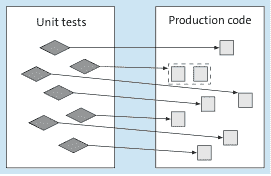

**图14.1** 单元测试与生产代码分离，测试其各个单元，偶尔测试多个单元。在孤立测试中，这些单元严格分离。

在实践中，你以某种方式编写生产代码以使其易于测试——但测试本身在其他地方。数据访问对象（DAO）通常应为私有和const，但为了可测试性，它可能变成friend或protected，并放弃其写保护。生产代码最好尽量少做这些妥协，但设计和编写*可测试*的代码更为重要。

### 14.1.3 社会测试或孤立测试

然而，有一个重要的点，实践各不相同。在测试期间隔离你的组件以进行*孤立测试*。但如果你还检查多个组件的协作，那么这些就是*社会测试*。你倾向于哪个方向取决于你、你的项目和你的团队。两者在实践中都会发生。

在孤立测试中，与其他组件的交互被故意保持较低，如有必要，可通过专门用于测试的*模拟对象*来替代，其行为如同存在真实组件一样（参见图14.2）。

```cpp
// https://godbolt.org/z/a83sf9h8E
#include <iostream>
// Production code:
struct DatabaseInterface {
    virtual int getData() const = 0;
};
struct Program {
    DatabaseInterface &db_;
```

1 单元测试，Martin Fowler，http://martinfowler.com/bliki/UnitTest.html，2014-05-05，[2017-11-25]


```cpp
void run() {
    std::cout << db_.getData() << "\n";
}
};
// Test helper:
struct MockDatabase : public DatabaseInterface {
    int getData() const override { return 5; }
};
// main as test:
int main() {
    MockDatabase mockDb;
    Program prog { mockDb };    // real DB is not tested
    prog.run();                 // Expected output: 5
}
```

**清单 14.1** 孤立测试只测试一个组件，并替换辅助类。

另一方面，社交测试恰恰针对组件之间的交互，并检查连接是否按预期工作。

```cpp
// https://godbolt.org/z/fsroE4seh
#include <iostream>

// Production code:
struct DatabaseInterface {
    virtual int getData() const = 0;
};
struct RealDatabase : public DatabaseInterface {
    int getData() const override { return 999; }
};
struct Program {
    DatabaseInterface &db_;
    void run() {
        std::cout << db_.getData() << "\n";
    }
};

// main as test:
int main() {
    RealDatabase db;
    Program prog { db };    // real DB is tested along
    prog.run();             // Expected output: 999
}
```

**清单 14.2** 社交测试测试组件之间的交互。

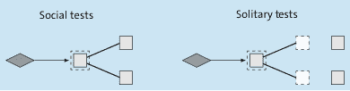

图 14.2 社交测试包含与依赖项的连接。孤立测试通过辅助类将连接解耦。

根据经验，在测试运行期间的孤立测试中，以下规则适用：

- 测试期间只使用一个具体实例化的类。<sup>2</sup>
- 不要跨越任何边界。

此意义上的边界是“数据库、队列、另一个系统，甚至只是你当前正在处理或负责的范围之外的另一个类。”<sup>3</sup>

## 14.1.4 替身

在测试一个单元时，你常常面临两个特别重大的挑战：

- **间接输入**  
  例如，如果组件使用全局变量，这会使测试更加困难。你至少需要了解它们，这需要良好的文档或仔细查看源代码。此外，全局变量可能在测试期间被其他地方修改，这不会让测试更容易。你需要以某种方式处理*共享状态*的问题。你甚至不必走到全局范围就会遇到问题；通常，被测对象中属于共享状态的一个字段就足够了。
- **间接输出**  
  如果测试元素改变了测试人员不可见的内容，这在测试期间可能不那么成问题。然而，对于软件的整体行为来说，还发生了什么——被测代码有什么*副作用*——确实会有影响。

控制这两者的一种方法是*测试替身*。它们用于隔离共享状态并捕获副作用。这些测试替身有不同类型，大致可分为以下几类：

- **哑元**  
  一个*哑元*从不会被调用，只用于填补一个否则会在测试期间引发问题的位置——例如，被测函数检查某个参数是否存在，但该参数在测试期间除此之外没有影响。

- **假对象**  
  一个*假对象*会被调用，但只做维持测试运行的最低限度工作——例如，在测试期间通过 `getName()` 查看输出。

- **桩对象**  
  *桩对象*比假对象多做一点，因为它提供测试对象在测试期间所需的间接输入。例如，如果测试函数从流中读取，桩对象就会提供这个流。

- **间谍对象**  
  使用*间谍对象*时，你会存储间接输出，以便在测试函数内检查它们是否正确。

- **模拟对象**  
  *模拟对象*走得更远，因为它会在测试中模拟更复杂的行为。因此，它主要提供间接输入，但也常常需要自己存储内容，以便为测试将它们排成正确顺序。

尤其是模拟对象和间谍对象，有时很难区分。例如，如果你已经编写了一个精细的模拟对象，它能对不同状态作出不同反应，那么你也可以在其中加入对测试结果的正确性检查。此外，不同作者对假对象和桩对象也给出了不同定义。例如，Fowler 将假对象定义为“一种带有若干捷径的可工作实现。”<sup>4</sup>

许多测试框架自带工具，可在测试期间创建这些替身并简化对它们的处理。它们如何做到这一点以及提供什么，取决于具体框架。

然而，在较大的项目中编写良好的测试并不容易。无论孤立测试还是社交测试，在实践中都可能很棘手。在社交测试中，这通常是由于其固有的依赖关系，而这些依赖的范围可能或大或小。如果编写孤立测试特别困难，这通常揭示出被测代码在设计上的缺陷——或者正如人们所说：“孤立单元测试会让糟糕的 OOP 发臭。”<sup>5</sup>

## 14.1.5 套件

关于单元测试的速度，也存在差异。有人觉得一个运行一分钟的测试套件让人安心。另一个人则说，等待超过 300 毫秒都嫌太久。

<sup>4</sup>《模拟对象不是桩对象》，Martin Fowler，https://martinfowler.com/articles/mocksArentStubs.html，2007，[2017-11-25]

<sup>5</sup>《单元测试原则》，Joseph D. Purcell，https://josephpurcell.github.io/principles-of-unit-testing/presentations/2017-03-17-MidwestPHP/index.html#/6/17，于 2017 年 3 月中西部 PHP 大会，[2024-05-19]

为了兼顾两者，通常会在项目中设置（至少）两套单元测试：

- **编译套件**  
  在每次编译操作时执行，因此应运行得非常快。根据经验，测试持续时间应与编译处于同一数量级。
- **提交套件**  
  执行一次*提交*是指通过将源代码发送回团队来完成一项任务。通常每天一次或两次；极端情况下，可能每周一次。为确保一切仍按预期工作，你应给这个套件稍多一点运行时间——例如几分钟。不过，它不应比这长太多，因为如果有错误要修复，你需要能够多次运行该套件。

## 14.2 框架

最好使用框架来编写和执行单元测试。不同语言有不同的实现，包括 C++。在本章末尾，我将向你介绍一个示例框架。

某些术语已在各框架中确立。这些内容作为标准流程，被归入 *xUnit* 这一术语之下。以下说明与[图 14.3](#)相关。

- **测试**  
  测试是由框架调用的特殊函数。单元测试中的一切都围绕测试展开，因为单个测试测试单个单元、单个功能。在测试内，你调用要测试的函数，然后编写一个或多个断言来验证功能是否正确。
- **断言**  
  一个断言执行一次检查，通常是检查被测函数的返回值。它始终包含一个布尔测试，有时在失败时还带有描述性消息。通常，还会用断言检查附带条件。有些框架支持两个级别的断言：警告和错误。在前者中，如果断言失败，只显示一条消息；而在后者中，测试会失败。这里又有两种变体：测试要么继续，要么中止。
- **测试用例**  
  多个测试被组合成一个测试用例。有时一个测试用例只包含一个测试（作为一个测试函数），但通常会有多个。这些测试因此有共同点；例如，它们需要相同的测试环境或相同的测试夹具。

- **测试夹具或夹具**

  测试必须能够彼此孤立地考虑。因此，对于每个测试，都假定它会再次找到一个干净、未改变的环境。为此，一个测试用例有*一个*特殊函数，在测试用例中的*每个*测试之前调用；还有另一个特殊函数，在每个测试*之后*调用。在这些*设置*和*清理*函数中，你建立测试环境，然后再撤销它。

- **测试套件**

  一个套件包含一组测试用例。你可以定义多个套件，并将不同的测试用例打包到每个套件中，以执行例如各种彻底的测试。

术语 *test* 在这里并非“官方”术语；在测试驱动开发和以 xUnit 之名汇总的框架家族中，只使用 *测试用例*。<sup>6</sup> 然而在实践中，我发现，在脑海中引入这种区分会更容易。一个测试用例无论如何都应测试一个功能，即使这种检验被分成多个测试（从技术上说，是测试函数）。

当你运行单元测试时，框架按如下方式处理：你选择一个或多个要执行的套件。对于其中包含的所有测试用例，所有测试都会被收集起来，并定义为要执行的测试集合。然后这些测试会全部执行。

每个单独的测试可以通过（测试为绿色）或失败（测试为红色）。可能存在非关键警告。如果所有测试都成功，这表示整体成功。单个测试失败就意味着失败。通常不接受一定数量的单个错误。

测试必须彼此独立运行。它们不得依赖于某些其他测试已经运行或尚未运行。框架也可以同时运行多个测试。

执行单个测试时，会发生以下情况：

1. 框架实例化包含该测试的测试用例。
2. 调用测试用例的任何现有设置函数或方法。
3. 框架使用其测试函数调用该测试。
4. 断言的失败或测试的意外退出会被记录下来，并在之后报告为失败。
5. 如果存在清理函数或方法，框架会调用它。
6. 测试用例被移除。

注意，对于*每个*测试都会发生这种情况：即使单个测试用例内有多个测试，该测试用例也会为其中每个测试重新设置和清理。


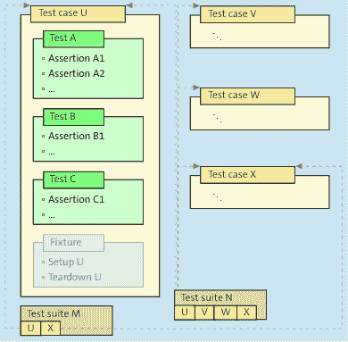

图 14.3 测试用例包含带断言的测试函数，并被组装成测试套件。

### 14.2.1 安排、执行、断言

你会很快注意到，在编写测试时某些模式总是会重复出现。我总是在测试函数内分三个部分添加注释：

```cpp
// https://godbolt.org/z/sTaoeqfx
void testDoubleIt() {
    // arrange
    auto param = 5;
    // act
    auto result = doubleIt(param);
    // assert
    assertTrue(result == 10);
}
```

有时“安排”部分为空，因为我本可以直接写 doubleIt(5)。然而，其他部分总是有内容；没有它们，测试就没有意义。这一原则称为*安排、执行、断言*。

- 7. http://c2.com/cgi/wiki?ArrangeActAssert, [2017-11-25]

之后，建议你也将要测试的代码清晰地划分为这三个部分。这会让编写和理解更容易。在前面的示例中，这似乎显得可笑地琐碎，但如果你必须先在执行前创建一整套 spy 和 mock 对象，那么清晰的分离会很有帮助：

- 在安排部分，你声明并初始化变量，并准备实际测试期间所需的内容。
- 然后，在执行部分，你调用要测试的程序代码。
- 在断言部分，进行所有预期结果与实际结果的检查。[^8]

通常，你的每个测试都应遵循这种模式。在例外情况下，你可以将三个部分合并为一行。只有这时，你才可以在一个测试例程中多次调用要测试的代码——这是我的建议。它看起来像这样：

```cpp
// https://godbolt.org/z/rn5oK3M6e
void testDoubleIt() {
    assertTrue( doubleIt(0) == 0 );
    assertTrue( doubleIt(-1) == -2 );
    assertTrue( doubleIt(1) == 2 );
    assertTrue( doubleIt(5) == 10 );
}
```

> **测试边界情况**
>
> 你的测试应特别覆盖*边界情况*，但不应只覆盖这些情况，例如使用参数 0 和负数的调用。典型调用的良好组合也很重要，这里例如使用 1 和 5。
>
> 对于整数，0 和 -1 通常是边界情况的良好取值；字符串可以为空（""），C 字符串和其他指针可以为 `nullptr`。请在正常情况和边界情况的各种组合上测试你的函数。

### 14.2.2 可供选择的框架

有许多测试框架的实现。有些只支持单元测试，而另一些则适合其他类型的测试。这里给出一个小范围的选择，重点在于单元测试和可移植性，但完整的选择要多得多。[^9]

- **Boost.Test**  
  这个测试框架是 Boost 库集合的一部分。该库既可以作为仅头文件版本使用，也可以作为需要链接的库使用。我在这里用它来解释示例。
- **C++ Unit Testing Easier (CUTE)**  
  一个简单而高级的单元测试框架，可通过插件集成到 Eclipse 中。
- **CppUnit**  
  这是一个相当流行的单元测试框架，深受 JUnit 启发。[^11]
- **doctest**  
  这是一个小型的仅头文件库。[^12]
- **Google Test**  
  Google 也使用 C++ 开发，并公开了其测试框架。[^13]

- 10. *C++ Unit Testing Easier*, http://cute-test.com/, [2017-11-25]
- 11. *CppUnit*, https://freedesktop.org/wiki/Software/cppunit/, [2024-05-19]
- 12. *doctest*, https://github.com/doctest/doctest/, [2024-05-19]
- 13. *Google Test*, https://github.com/google/googletest, [2024-05-19]

## 14.3 Boost.Test

让我们直接开始，看看一个我们想要测试的程序。这里使用的框架是 Boost.Test。

> **安装 Boost.Test**
>
> 你可以从 Boost 网站 http://www.boost.org/users/download 下载完整的 Boost 包。对于 Windows 和 MSVC，有预编译库可用。在 Ubuntu 上，`sudo apt-get install libboost-dev` 会安装完整的库。其他发行版有相应的软件包。仅安装测试框架的子库是不够的，因为它还使用了 Boost 的其他部分。

下面的清单展示了一个你刚刚编写的自由函数。

```cpp
// https://godbolt.org/z/Ex6Mv6xcz
unsigned fib(unsigned n) {
    if(n==0) { return 0; }
    if(n==1) { return 1; }
    unsigned a = 0;
    unsigned b = 1;
    unsigned sum = 1;
    while(n>1) {
        sum += a;
        a = b;
        b = sum;
        n -= 1;
    }
    return sum;
}
```

**清单 14.3** 在“fib.cpp”文件中，有一个你想要测试的自由函数。

这应该是 fib.cpp 的全部内容。你将测试写在一个单独的模块中，与生产代码分离——例如，放在像 test/ 这样的单独目录中，或者采用清晰的命名方案，如 test_fib.cpp。

要在另一个模块中测试 fib 函数，你需要调用它——这就要求测试代码知道它。要么你需要一个导出该函数的头文件，并在测试代码中包含它；要么你利用开发者对该函数的内部了解，在测试之前声明它而不使用 `#include`。是否允许将其作为例外并用于单元测试，取决于你的测试规则，因为在生产代码中这种不透明的函数使用方式不是好风格。有人可能会说单元测试在这里是个例外，因为文件名的命名方案表明了实际函数所在的位置。

因此，test_fib.cpp 测试文件以 unsigned fib(unsigned n); 声明开头。整个文件如下所示：

```cpp
// https://godbolt.org/z/erPdKo1qh (uses boost library)
#define BOOST_TEST_MAIN test_main       // generates main() in this module
#include <boost/test/included/unit_test.hpp>  // framework
#include <boost/test/test_tools.hpp>         // BOOST_CHECK etc
unsigned fib(unsigned n);                    // to test
namespace {
using namespace boost::unit_test;
BOOST_AUTO_TEST_CASE( test_fib_low)          // arbitrary name of the test case
{
    BOOST_CHECK( fib(0) == 0 );              // individual assertions
    BOOST_CHECK( fib(1) == 1 );
    BOOST_CHECK( fib(2) == 1 );
    BOOST_CHECK( fib(3) == 2 );
    BOOST_CHECK( fib(4) == 3 );
    BOOST_CHECK( fib(5) == 5 );
    BOOST_CHECK( fib(6) == 8 );
}
}
```

通过 BOOST_TEST_MAIN 宏，你告诉 Boost.Test 在此模块中自动生成一个 main() 函数，该函数包含所有管理开销：组装下面这一行

```cpp
#include <boost/test/unit_test.hpp>
```

然后通过以*静态*方式添加框架库来编译程序：

```sh
$ g++ -static fib.cpp test_fib.cpp -o test_fib.x -lboost_unit_test_framework
```

你必须使用 --static 这样做，因为 boost_unit_test_framework 库——如前所述——也包含 main()。在 Linux 上，不可能创建一个自身不包含 main() 却想动态加载它的可运行程序。（因此，动态变体不包含 main()，仅在需要使用外部测试运行器的高级情况下才需要。）

Boost.Test 框架会为你插入一个 main 函数，但它还能做更多事情。例如，你可以指定一系列命令行参数，Boost.Test 会自动解析它们。比如，选择要执行的测试用例，并更改输出格式和数量：

```sh
$ ./test_fib.x --run_test=test_fib_low --report_level=detailed \
    --log_level=all --catch_system_errors=no
Running 1 test case...
Entering test suite "Master Test Suite"
Entering test case "test_fib_low"
test_fib.cpp(28): info: check fib(0) == 0 passed
test_fib.cpp(29): info: check fib(1) == 1 passed
test_fib.cpp(30): info: check fib(2) == 1 passed
test_fib.cpp(31): info: check fib(3) == 2 passed
test_fib.cpp(32): info: check fib(4) == 3 passed
test_fib.cpp(33): info: check fib(5) == 5 passed
test_fib.cpp(34): info: check fib(6) == 8 passed

Leaving test case "test_fib_low"; testing time: 346ms
Leaving test suite "Master Test Suite"
Test suite "Master Test Suite" passed with:
  7 assertions out of 7 passed
  1 test case out of 1 passed
  Test case "test_fib_low" passed with:
    7 assertions out of 7 passed
```

通过 --report_level，你可以影响摘要输出的数量，如最后五行所示。--log_level 影响测试运行期间的输出，范围从无输出到错误，再到全部输出，中间还有许多级别。

--catch_system_errors=no 参数在你从 IDE 内启动测试时很有用。通常，Boost.Test 会不遗余力地捕获甚至最严重的错误，以便其余测试仍能运行。这在调试时可能成为障碍，因为内置的

## 14.4 用于断言的辅助宏

调试器不会注意到这个错误。使用此选项，例如 Microsoft Visual Studio 可以直接跳转到发生错误的位置。

使用 `--help` 或 `-?` 调用测试程序，以获取详细的参数列表。

在输出中，你会看到 Boost.Test 提供了*主测试套件*的摘要。这个框架的一个特点是，套件和用例可以像树一样按层次嵌套。根始终是主测试套件。大多数其他 xUnit 框架没有这种嵌套结构，而是局限于一组测试套件中的一组测试用例。

你已经遇到过 BOOST_CHECK(b)。这个基本宏检查其参数是否为真。如果不是，它会把测试标记为失败，但测试会继续运行。如果改用 BOOST_REQUIRE(b)，测试在结果为假时会中止，并且该测试剩余的断言将不会执行。另一方面，使用 BOOST_WARN(b) 时，结果为假会收到一条消息，但测试不会失败。这些是 Boost.Test 一贯支持的三个断言级别。所有断言辅助宏都有这三种变体。

我最常使用 BOOST_CHECK_EQUAL(res, exp)。这里我用 `res` 指定实际结果，用 `exp` 指定预期结果。使用 `==` 的比较由框架替我处理；在不相等时，它可以提供更好的信息：

```cpp
std::string toString(std::string val) { return val; }
BOOST_CHECK_EQUAL( theString("result"), "result" );
BOOST_WARN_EQUAL( theString("result"), "reslt" ); // Abort
```

第二个测试的输出是

```text
warning in "test_theString": condition theString("result") == "reslt"
  is not satisfied [result != reslt]
```

一方面，这里方便地把 theString 的返回值包含在消息中；另一方面，如果你为这两个参数定义了 operator==，它也会产生影响。

如果你不想使用 `==`，可以改用 BOOST_CHECK_BITWISE_EQUAL(exp, res)，其中参数直接在内存中比较。

除了使用 _EQUAL 进行相等比较，还可以分别使用 GE、GT、LE、LT 和 NE 表示 >=、>、<=、< 和 !=。

在需要比较浮点数时必须特别小心。使用 == 进行相等测试是绝对不行的。相反，应通过提供第三个参数来检查 exp 和 res 是否足够接近，该参数指定“足够接近”的含义：

```cpp
double sqSumDiff(double a, double b) {
    return a*a+b*b;
}
BOOST_CHECK_CLOSE( sqSumDiff(4.1, 3.9), 16.03, 0.01 );
```

这里的输出是

```text
info: difference{} between sqSumDiff(4.1, 3.9){16.029999999999998} and \
  16.03{16.030000000000001} doesn't exceed 0.01%
```

因为实际*不精确*的结果偏离了预期结果，但仍在指定的 0.01% 容差范围内。这里，你应该根据具体情况指定适当的容差。对于如此简单的计算，0.01% 的容差可能相当粗糙，但在复杂计算中，浮点计算的舍入误差可能会累积。

> **为什么使用宏？**
>
> 这里简单说明一下，尽管我一直告诉你避免使用宏，但这里却使用了这么多宏。好吧，没有哪条规则没有例外，像这样的测试就是例外之一。因为如果这里不使用宏，编译器就不可能向你在屏幕上提供诸如
>
> `info: check fib(0) == 0 passed`
>
> 这样的有用信息。这里，整个通过的表达式使用 `#` 转换为字符串（“字符串化”），以打印此信息，这在发生错误时特别有用。任何 constexpr 都无法做到这一点。

你可以在[表 14.1](#table-14.1)中查看辅助宏的完整列表。

| 宏 `BOOST_<level>...` | 描述 |
|---|---|
| `BOOST_<level>(b)` | b 为真吗？ |
| `....EQUAL(e,r)` | e == r 为真吗？ |
| `....BITWISE_EQUAL(e,r)` | e 与 r 按位相同吗？ |
| `....EQUAL_COLLECTIONS(...)` | 逐元素比较 begin/end(e)==begin/end(r)。 |
| `....GE(e,r)` | e >= r 吗？ |
| `....GT(e,r)` | e > r 吗？ |
| `....LE(e,r)` | e <= r 吗？ |
| `....LT(e,r)` | e < r 吗？ |
| `....NE(e,r)` | e != r 吗？ |
| `....PREDICATE(p,v1,v2,...)` | p(v1)、p(v2) 等是否都为真？ |
| `....CLOSE(e,r,t)` | e 是否以 % 为单位足够接近 r？ |
| `....CLOSE_FRACTION(e,r,t)` | e 是否足够接近 r？ |
| `....SMALL(r,t)` | r 是否接近零？ |
| `....NO_THROW(a)` | 表达式 a 不得抛出异常。 |
| `....THROW(a,ex)` | 表达式 a 必须抛出异常 ex。 |
| `....EXCEPTION(a,ex,p)` | 同上——ex 还必须满足条件 p(...)。 |
| `BOOST_<level>_MESSAGE(b,msg)` | 为假时输出消息 msg。 |
| `BOOST_ERROR(msg)` | 类似 ...MESSAGE(false,msg)。 |
| `BOOST_FAIL(msg)` | 中止当前测试。 |
| `BOOST_IS_DEFINED(sym)` | 如果宏 sym 已定义，则为真。 |

**表 14.1** Boost.Test 中所有断言宏的简要概览。

### 通用宏 BOOST_TEST

在当前 Boost 版本中，有一个全能宏 BOOST_TEST。这个宏将比较表达式作为第一个参数，并可选地接受测试操纵器作为附加参数。这使你能够影响精度或日志记录行为。

因此，以下测试

```cpp
BOOST_REQUIRE_EQUAL(qw::version(), 1);
BOOST_REQUIRE_GT(qw::version(), 5);
BOOST_REQUIRE_CLOSE(q+0.1, b-0.8, 0.01);
```

执行与以下代码相同的任务：

```cpp
BOOST_TEST(qw::version() == 1);
BOOST_TEST(qw::version() > 5);
BOOST_TEST(q+0.1 == b-0.8, boost::test_tools::tolerance(0.01));
```

使用这个宏，测试看起来更统一，可选的操纵器允许更多组合并影响测试行为。

自 1.59（Boost.Test v3）起，该宏就已可用。大约 2017 年左右的系统应该能够安装合适的 Boost 版本。

## 14.5 带单元测试的示例项目

为了向你展示如何将单元测试集成到实际项目中，我将在本节演示一个完整项目的结构。它由以下部分组成：

- 一个库，
- 一个使用该库的示例程序，
- 以及该库的一组单元测试。

整个项目嵌入在一个 Makefile 项目中，但可以毫不费力地迁移到你喜欢的 IDE 中的项目。

> **本节内容预览与重点**
>
> 我在这里扩展第 11 章第 11.4 节中的示例项目。关于基本结构，请先参考那一节。
>
> 我会简要涉及一些关于类及其设计的内容，本书后面会详细讨论。与后面章节一贯的做法一样，重点不在于这些内容，而在于向你展示一些当你以后回到本章时会有用的东西。我还会简要提到 *Pimpl 模式*，因为它已经确立，并且不限于新的 C++。

我使用带有单元测试的额外源文件来检查该库的功能，这些文件不会交付给客户。我在表 14.2 中列出项目中的额外文件。

| 目录/文件 | 描述 |
|---|---|
| test/ | 实际的单元测试 |
| - Makefile | 构建单元测试 |
| - testQwort.cpp | *qwort* 类的测试 |
| - testImplMultimap.cpp | 辅助类的测试 |

**表 14.2** 示例项目中用于单元测试的额外文件。

`make all` 命令首先构建与项目相关的所有文件。最后，也会构建目录 `test/` 中的单元测试。

由于我会直接引用它，这里重复该实现的头文件。

```cpp
// https://godbolt.org/z/j93cYaWd4
#ifndef QWORT_H    // Header guard
#define QWORT_H
#include <string>
#include <string_view>
#include <memory> // unique_ptr

namespace qw {     // Namespace of the library

    int version();

    namespace impl_multimap {
        class index_impl;
    }

    class index {
        using index_impl = impl_multimap::index_impl;
    public:
        index();
        ~index() noexcept; // needed for pimpl
        index(const index&) = delete;
        index(index&&) noexcept;
        index& operator=(const index&) = delete;
        index& operator=(index&&) = delete;
    public:
        void add(std::string_view arg);
        size_t size() const;
        std::string getBestMatch(std::string_view query) const;
    public:             // public for tests
        std::string normalize(std::string arg) const;
    private:
        std::unique_ptr<index_impl> pimpl;
    };
} // namespace qw
#endif // Header guard
```

**代码清单 14.4** qwort.hpp 库的主头文件。

### 14.5.1 私有测试与公共测试

在内部，add() 和 getBestMatch() 这两个方法会调用 normalize()。该方法的目的是简化索引——例如，只存储大写字母。那么，在存储模式和进行搜索查询时都必须对称地执行这一操作。将 normalize() 方法设为私有或受保护就足够了。

当你随后为 index 类编写单元测试时，可以把整个类视为要测试的单元。这样，你只测试公共接口，不需要测试私有区域。这适用于示例中的 pimpl：我们只是假设它已正确初始化；我们为这个类编写的测试作为单元测试来检验这一情况。


但如果核心功能是在私有方法中实现的，那么它本身就构成了一个值得单独测试的单元。这是一条“软性”规则，你应该在团队内部讨论。这里的 `normalize()` 就属于这种情况。因此，我将那些“实际上是私有的，但为了测试而公开的”方法放在了一个单独的部分，并用 `public` 和一段合适的注释来标记这个部分。这是让私有方法可以从外部测试的最简单方法，但还有好几种其他方式。每种方式都有各自的优缺点，所以我这里只展示这一种。

在清单 14.5 中，你会看到第 11 章清单 11.3 的一个摘录，其中部分接口仅为了可测试性而设为公开。

```cpp
class index_impl {
// ...
public: // test interface
    vector<string> _qgramify(string_view n) const { return qgramify(n); }
    static size_t _q() { return 0; }
    static std::string _prefix() { return PREFIX; }
    static std::string _suffix() { return SUFFIX; }
};
```

**清单 14.5** 仅用于测试的公共接口。

### 14.5.2 自动化测试模块

在单元测试模块的第一个示例中，我将向你展示如何让 Boost.Test 框架处理将各个测试组合成测试套件的过程。为此，它提供了一些实用的宏。

清单 14.6 中的测试模块 `testQwort.cpp` 对 `qwort.cpp` 库模块进行测试。建议在命名测试模块时遵循某种命名方案。我使用 `test...` 作为前缀，但你也可以追加 `_Test` 作为后缀，或者用其他方式自由发挥。

```cpp
// https://godbolt.org/z/TacMfah8E (uses boost library)
#include <qwort/qwort.hpp> //under test
#define BOOST_TEST_MODULE qwort
#include <boost/test/included/unit_test.hpp>
using namespace boost::unit_test;
BOOST_AUTO_TEST_CASE( version_is_1 ) {
    BOOST_TEST(qw::version() == 1);
    // the following comparison should fail, but only produce a warning:
    BOOST_WARN_EQUAL(qw::version(), 2);    // not equal, but continues
}
BOOST_AUTO_TEST_CASE( init_size_0 ) {
    qw::index inst{};                       // arrange
    auto sz = inst.size();                  // act
    BOOST_TEST(sz == 0u);                   // assert
}
BOOST_AUTO_TEST_CASE( add_size_1 ) {
    using namespace std::literals::string_literals;
    qw::index inst{};                         // arrange
    inst.add( ""s);                          // act
    BOOST_CHECK_EQUAL(inst.size(), 1u);       // assert
}
BOOST_AUTO_TEST_CASE( normalize ) {
    using namespace std::literals::string_literals;
    qw::index inst{}; // arrange
    // acts and asserts; could also be in separate functions
    BOOST_CHECK_EQUAL(inst.normalize("a"), "a"s);
    BOOST_CHECK_EQUAL(inst.normalize("Town"s), "TOWN"s);
    BOOST_CHECK_EQUAL(inst.normalize("White Space"s), "WHITESPACE"s);
    BOOST_CHECK_EQUAL(inst.normalize("!Sym-bol.s"), "$YM#BOL#s");
}
BOOST_AUTO_TEST_CASE( move ) {
    qw::index inst{};
    qw::index other = std::move( inst );
    BOOST_CHECK_EQUAL(other.size(), 0u); // pimpl successfully moved?
}
```

**清单 14.6** 该测试模块测试的是 qwort.cpp。

我以被测模块的头文件作为 include 的开头——在本例中是 qwort/qwort.hpp。这样，该文件中就能识别出待测试的各个组件。

接下来是测试框架的 include——这里只有一个，即 boost/test/included/unit_test.hpp。通过这个 include，你可以选择自动生成 main() 函数和主测试套件。如果你在 include 之前定义 BOOST_TEST_MODULE 宏，框架就会这样做。你还可以给测试模块起一个有意义的名称——这里是 qwort。请注意，在每个测试程序中，该宏在 include 之前最多只能定义一次。从逻辑上讲，它确保会生成一个 main() 函数，而每个程序只能有一个 main() 函数。

在 using 指令之后，便是各个测试用例。每个测试用例都由宏 BOOST_AUTO_TEST_CASE 引入，以描述性名称作为参数，除此之外它采用自由函数的形式。该宏确保这个自由函数以该描述性名称注册到主测试套件中，从而在测试程序运行时被执行。

在测试函数内部，我使用了通常的准备、执行、断言（AAA）模式。在断言部分，我使用了表 14.1 中的 Boost 宏。

这里的测试并不特别复杂，大多不言自明。不过，我想指出几个比较小的细节。

BOOST_CHECK_EQUAL 宏有两个参数，它们通过 Boost 内部的 equal_impl 函数进行比较。该函数要么使用合适的重载进行比较，要么回退到 ==，对于 int 也是如此。因此，对于 int 类型的结果，使用 `BOOST_CHECK_EQUAL(result, 42);` 测试时，最终执行的是 result==42。但如果是 const char *res，情况又是怎样的呢？在这里看起来如何？

`BOOST_CHECK_EQUAL(res, "TEXT");`

如果宏在这里简单地使用 ==，那么就会失败，因为只会比较两个指针，而不是 C 字符串的内容。幸运的是，该框架足够智能，会使用一个针对两个 const char* 参数进行了特化的函数模板。这样一来，检查宏的所有参数都能正常工作了。

然而，在我的比较中，我特意使用了 `"TOWN"s` 中的 `s` 后缀，以创建字符串字面量而不是 C 字符串字面量。例如，在 `BOOST_CHECK_EQUAL(inst.normalize("Town"s), "TOWN"s);` 中，下面这种写法是错误的：`BOOST_CHECK_EQUAL(inst.normalize("Town"s), "TOWN");`。

因为那样的话，在运行时，C 字符串字面量就必须先转换为 string。不过，我现在已经在编译期通过 `"TOWN"s` 完成了这一转换，并确保使用 Boost 内部用于比较两个 string 参数的特化版本，而不是 const char* 与 string 的组合。尽管那样做也能工作，但我认为，除非绝对必要，否则在测试期间不要求这些转换是合乎逻辑的。

不过，要使用字面量的 `s` 后缀，必须在某个地方声明：

```cpp
using namespace std::literals::string_literals;
```

另外，使用 `namespace std` 也可以，因为 `literals` 和 `string_literals` 都是内联命名空间。

为了演示目的，我在开头两次使用了 `BOOST_TEST` 来展示这个宏。

而且，一个运行起来毫无抱怨的测试程序会让人怀疑是否真的执行了什么，所以我故意加入了一个会失败的测试：

```cpp
BOOST_WARN_EQUAL(qw::version(), 2);
```

因为 qw::version() 返回的值是 1，所以你在运行这里的测试时应该会收到一条警告。当然，在发布（发送给你的团队）之前，你应该修正这个测试。

### 14.5.3 编译测试

通过这种方式，你列出了该模块的所有测试用例。你可以将这个源文件与 qwort 库一起编译，得到一个可执行程序：

```cpp
g++ -o testQwort.x testQwort.cpp -lqwort -I../include -L../src/lib
```

在这种形式下，你不需要 Boost 库，因为 ../included/... 这种变体是“仅头文件”的，不需要链接。

你可以这样运行测试程序，然后会看到如下输出：

```cpp
$ ./testQwort.x --report_level=short
Running 5 test cases...
Test suite "qwort" passed with:
  8 assertions out of 8 passed
  5 test cases out of 5 passed
```

所有测试都成功运行了。使用 `--report_level=detailed --log_level=all` 参数，你就能看到更多信息。你会看到每个单独的断言被执行，测试套件和测试用例的描述性名称也会显示出来。这里我只展示输出的开头部分：

```cpp
$ ./testQwort.x --report_level=detailed --log_level=all
Running 5 test cases...
Entering test module "qwort"
testQwort.cpp(16): Entering test case "version_is_1"
testQwort.cpp(17): info: check qw::version() == 1 has passed
testQwort.cpp(19): warning: in "version_is_1": condition qw::version() == 2 \
    is not satisfied [1 != 2]
testQwort.cpp(16): Leaving test case "version_is_1"; testing time: 100us
testQwort.cpp(22): Entering test case "init_size_0"
testQwort.cpp(25): info: check sz == 0u has passed
testQwort.cpp(22): Leaving test case "init_size_0"; testing time: 81us
...
```

### 14.5.4 自行组装测试套件

由于 index 的私有实现比公共接口要长一些，针对它的测试也相应要长一些。

此外，我在这里没有使用实用的 BOOST_AUTO_TEST_CASE 宏，该宏负责组装主测试套件。这次我想让所有测试都作为一个独立测试类的方法。但是，使用 Boost.Test 时，这意味着你必须手动将各个方法添加到套件中。我借此机会在这里向你展示这一点，因为这正是构建大型甚至嵌套测试套件的方法。


在清单 14.7 中，你可以看到 `testImplMultimap.cpp` 测试模块的源代码，该模块反过来测试 `impl_multimap.cpp` 库模块。

```cpp
// https://godbolt.org/z/r9sdhaazz (uses boost library)
/* private header from lib directory: */
#include "impl_multimap.hpp"                 // to test
// we define init_unit_test_suite() ourselves, so DO NOT set:
/* #define BOOST_TEST_MODULE grammar */
#include <boost/test/included/unit_test.hpp>
#include <memory>                             // shared ptr
#include <vector>
#include <string>
using namespace boost::unit_test;
using namespace std::literals::string_literals;
using std::string; using std::vector;
/* === A test class for the class under test === */
using UnderTest = qw::impl_multimap::index_impl;
class ImplMultimapTest {                         // class with test methods
public:
    void testConstants() {
        BOOST_REQUIRE_EQUAL(UnderTest::prefix().length(), UnderTest::q()-1);
        BOOST_REQUIRE_EQUAL(UnderTest::suffix().length(), UnderTest::q()-1);
        for(size_t i = 0; i < UnderTest::q()-1; ++i) {
            BOOST_CHECK_EQUAL(UnderTest::prefix()[i], '^');
            BOOST_CHECK_EQUAL(UnderTest::suffix()[i], '$');
        }

        BOOST_TEST(UnderTest::q() == 3u);
        BOOST_TEST(UnderTest::prefix() == "^^"s);
        BOOST_TEST(UnderTest::suffix() == "$$"s);
    }

    /** === qgramify === */
    void testQgramifyEmpty() {
        UnderTest inst{};
        auto result = inst._qgramify(""s);
        vector<string> expected{"^^"s, "^$"s};
        BOOST_CHECK_EQUAL_COLLECTIONS
            result.begin(), result.end(), expected.begin(), expected.end());
    }

    void testQgramify1() {
        UnderTest inst{};
        auto result = inst._qgramify("a"s);
        vector<string> expected{"^^"s, "^a$"s, "a$$"s};
        BOOST_CHECK_EQUAL_COLLECTIONS
            result.begin(), result.end(), expected.begin(), expected.end());
    }

    void testQgramify2() {
        UnderTest inst{};
        auto result = inst._qgramify("ab");
        vector<string> expected{"^^a", "^^ab", "ab$", "b$$"};
        BOOST_CHECK_EQUAL_COLLECTIONS(
            result.begin(), result.end(), expected.begin(), expected.end());
    }

    void testQgramify3() {
        UnderTest inst{};
        auto result = inst._qgramify("abc");
        vector<string> expected{"^^a", "^^ab", "abc", "ab$", "bc$", "c$$"};
        BOOST_CHECK_EQUAL_COLLECTIONS(
            result.begin(), result.end(), expected.begin(), expected.end());
    }

    void testAdd_nodups() {
        UnderTest inst{};                    /* arrange */
        BOOST_REQUIRE_EQUAL(inst.size(), 0u); /* assert */
        inst.add("", "");                    /* act */
        BOOST_CHECK_EQUAL(inst.size(), 1u);   /* assert */
        inst.add("ENTRY", "entry");          /* act */
        BOOST_CHECK_EQUAL(inst.size(), 2u);   /* assert */
        inst.add("OTHER", "other");          /* act */
        BOOST_CHECK_EQUAL(inst.size(), 3u);   /* assert */
    }

    void test_getBestMatch_empty() {
        UnderTest inst{};
        auto result = inst.getBestMatch("any");
        BOOST_CHECK_EQUAL(result, "");
    }

    void test_getBestMatch_one() {
        /* arrange */
        UnderTest inst{};
        inst.add("HOLDERTEUFEL", "holderteufel");
        /* act */
        auto result = inst.getBestMatch("ROBERT");
        BOOST_CHECK_EQUAL(result, "holderteufel");
    }

    void test_getBestMatch_exact() {
        /* arrange */
        UnderTest inst{};
        inst.add("BERLIN", "Berlin");
        inst.add("HAMBURG", "Hamburg");
        inst.add("DORTMUND", "Dortmund");
        inst.add("STUTTGART", "Stuttgart");
        inst.add("WYK", "Wyk");
        /* act and assert */
        BOOST_CHECK_EQUAL(inst.getBestMatch("BERLIN"), "Berlin");
        BOOST_CHECK_EQUAL(inst.getBestMatch("HAMBURG"), "Hamburg");
        BOOST_CHECK_EQUAL(inst.getBestMatch("DORTMUND"), "Dortmund");
        BOOST_CHECK_EQUAL(inst.getBestMatch("STUTTGART"), "Stuttgart");
        BOOST_CHECK_EQUAL(inst.getBestMatch("WYK"), "Wyk");
    }

    void test_getBestMatch_close() {
        /* arrange */
        UnderTest inst{};
        inst.add("BERLIN", "Berlin");
        inst.add("HAMBURG", "Hamburg");
        inst.add("DORTMUND", "Dortmund");
        inst.add("STUTTGART", "Stuttgart");
        inst.add("WYK", "Wyk");
        /* act and assert */
        BOOST_CHECK_EQUAL(inst.getBestMatch("BERLIN"), "Berlin");
        BOOST_CHECK_EQUAL(inst.getBestMatch("BURC"), "Hamburg");
        BOOST_CHECK_EQUAL(inst.getBestMatch("DORTDORT"), "Dortmund");
        BOOST_CHECK_EQUAL(inst.getBestMatch("STUTTGART"), "Stuttgart");
        BOOST_CHECK_EQUAL(inst.getBestMatch("WIK"), "Wyk");
    }
    /* For new test methods: Don't forget to add to init_unit_test_suite() */
};

/* === Suite === */
test_suite* init_unit_test_suite( int argc, char* argv[] ) {
    auto tester = std::make_shared<ImplMultimapTest>();
    auto &ts = framework::master_test_suite();
    ts.add( BOOST_TEST_CASE( [&](){ tester->testConstants(); } ) );
    ts.add( BOOST_TEST_CASE( [&](){ tester->testQgramifyEmpty(); } ) );
    ts.add( BOOST_TEST_CASE( [&](){ tester->testQgramify1(); } ) );
    ts.add( BOOST_TEST_CASE( [&](){ tester->testQgramify2(); } ) );
    ts.add( BOOST_TEST_CASE( [&](){ tester->testQgramify3(); } ) );
    ts.add( BOOST_TEST_CASE( [&](){ tester->testAdd_nodups(); } ) );
    ts.add( BOOST_TEST_CASE( [&](){ tester->test_getBestMatch_empty(); } ) );
    ts.add( BOOST_TEST_CASE( [&](){ tester->test_getBestMatch_one(); } ) );
    ts.add( BOOST_TEST_CASE( [&](){ tester->test_getBestMatch_exact(); } ) );
    ts.add( BOOST_TEST_CASE( [&](){ tester->test_getBestMatch_close(); } ) );
    return nullptr;
}
```

**清单 14.7** 测试套件在此手动组装。

你也可以从外部文件加载数据。Boost.Test 还可以为你自动生成动态数据集。如果你对此感兴趣，请阅读 Boost.Test 文档中的“数据驱动测试用例”部分。

> **别忘了将其添加到测试套件中！**
>
> 实际上，我更喜欢显式方法，而不是使用 `BOOST_AUTO_TEST_CASE` 宏的自动魔法式方法。
>
> 然而，后者有一个巨大的优势：当你在源代码的某个位置编写新测试时，你不会忘记在代码的另一个位置也添加它。你简直不会相信这种情况在我身上发生过多少次：我添加了一个新测试，它最初应该失败，运行测试套件，然后纳闷：“为什么它通过了？”很简单，因为我忘了将新的测试方法添加到测试套件中。
>
> 对于 C++26，有一个关于*反射*的提案（P2996）。如果实现，框架将有可能自动从测试类中收集所有方法作为测试用例。在那之前，请记住：在手帕上打个结！

## 第15章

## 继承

### 本章提要

- **“Has-a”（有）关系**  
  无论是*聚合*还是*组合*，一个对象是另一个对象的一部分或与之相关。汽车*有*挡风玻璃，并且*有*车位。
- **“Is-a”（是）关系**  
  *继承*；一个特殊化对象也是一个更一般的对象。厢式货车*是*汽车。
- **组合**  
  一种“有”关系，其中对象由其他对象组成。
- **聚合**  
  一种“有”关系，其中对象与另一个对象相关。
- **重写**  
  在派生类中以相同签名重新定义基类的方法。
- **虚方法**  
  一种在运行时决定调用哪个重写变体的方法。
- **切片**  
  当你将派生类型转换为基类型并在该过程中丢失信息时；通常是错误类型的意外副本导致的结果——例如，在按值调用中。
- **运行时多态**  
  声明一个基类；在运行时使用派生类，但保留其派生属性。

继承是*面向对象编程*（OOP）的基本组成部分。伴随而来的是某些技术和词汇，我将在本章中介绍两者。

借助*继承*，你可以实现两件事：

- 你提高了*可复用性*并减少了*代码重复*；这些是更技术性的方面。
- 你实现了一种*设计*，从而在大型项目中创造清晰性；这是一个概念性的方面。


## 15.1 关系

对象之间的关系在面向对象编程（OOP）中起着核心作用，因为它们显著影响软件的结构和功能，并支持对复杂系统进行建模和组织。在此语境下，has-a 关系和 is-a 关系尤为重要，因为它们定义了对象如何连接以及如何按层次相互关联。

### 15.1.1 Has-a 组合

当你在第 12 章学习使用 `struct` 和 `class` 时，我最初将数据字段捆绑进*聚合体*。

```cpp
class Car {
    Windscreen windscreen_;
    std::vector<Wheel> wheels_;
    // ...
};
```

这辆 Car *拥有（has-a）* windscreen_ 以及 wheels_——每个都对应其类型。在这种情况下，这是一种 has-a 关系，Car 甚至由这些对象组成或构成。这是一种*组合*。这意味着该对象通常*拥有*其组件——在 C++ 中，这意味着它负责这些组件的构造和析构。组件的生命周期受对象生命周期的限制。

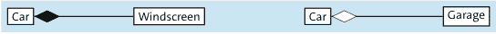

图 15.1 Has-a 关系：UML 表示法中的组合（左）和聚合（右）。

### 15.1.2 Has-a 聚合

当你把汽车说成拥有一个车棚（car port）或拥有一个持有者（holder）时，情况就不同了。这是一种*聚合*：

```cpp
class Car {
    CarPort& carPort_;
    Person& holder_;
    // ...
};
```

被包含的事物只与该对象处于一种*关系*中，但并不*属于*它。因此，该对象通常不负责它们的创建或销毁。这些元素的生命周期独立于该对象的生命周期。

汽车、挡风玻璃和车棚这个说明性示例似乎清楚地分别描述了组合和聚合。在设计具体软件时，事情往往没那么简单。如果你要为汽车制造商的装配线编程，那么你在数据库中把挡风玻璃实例与汽车关联的方式，会不同于你为汽车租赁公司的车队创建目录时的方式。

在图 15.2 中，你可以看到这些关系的一种可能表示方式。组合被归入一个框中。箭头连接其他关系，聚合用实线和实心箭头表示。箭头还可以明确指定关系的类型。在一个框内，列出了属性（正常字体）和行为/方法（*斜体字体*）。


图 15.2 表示两种 has-a 关系的另一种更非正式的表示方式。

表示对象之间关系的方式有几十种。这里我只非常简要地概述了其中两种。

### 15.1.3 Is-a 继承

通过继承，你现在映射的是一种 *is-a（是）* 关系。例如：一辆大众巴士（VW bus）*是一辆（is-a）* 汽车。这意味着以下规则适用：

- 一辆大众巴士具有汽车所具有的全部属性。
- 每个符合大众巴士描述（或规范）的对象，也符合汽车的描述。
- 大众巴士的描述（或规范）*更具体*，而汽车的描述（或规范）*更弱*。
- 如果你期望的是一辆汽车，那么交付给你一辆大众巴士也是正确的。

对于大众巴士和汽车，显然可以通过继承来映射它们的关系。但有时把它们放在一起时，事情并不那么清晰。此时这些规则可能有助于检查是否存在 *is-a（是）* 关系。

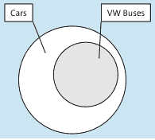

图 15.3 这个维恩图表明所有大众巴士都是汽车，但并非所有汽车都是大众巴士。

### 15.1.4 Instance-of 与 Is-a 关系

注意，对于 car herbie 的 is-a 关系；并不意味着“herbie is-a car”。这被称为“是一个实例（is an instance of）”，或者在 C++ 中称为“herbie is of type car”。几乎不可避免的是，这些术语并不总是被正确使用。例如，“7 is an integer”或“7 is an int”在此语境下并不精确。但总是说“7 is an element of integers”或“7 is of type int”听起来很怪。

当你谈论类层次结构时，应当注意这一区别。

> **不是：Is-an-Instance-of**
> 
> *记住：* 在继承中，*is-a（是）* 并不意味着某个类的实例，而是指具有超类全部属性的子类。

## 15.2 C++ 中的继承

在 C++ 中，你按如下方式表示继承：

```cpp
class Car {                 // Base or superclass
public:
    Windscreen windscreen_;
    std::vector<Wheel> wheels_;
    // ...
};
class VwBus : public Car {   // VwBulli is a subclass
public:
    Flowers flowers_;
    // ...
};
```

因此，你写出*基*类的名称，用冒号 `:` 分隔，并在当前类名之后写 `public`：

```cpp
class Subclass : public Baseclass { ...
```

现在你可以愉快地创建新的 `VwBus` 实例。而且每个实例都自动拥有 `windscreen_` 和 `wheels_`，即使你并未在 `VwBus` 类中显式提及它们：

```cpp
VwBus vw{};
cout << vw.windscreen_;
cout << vw.flowers_;
```

如果你创建一个纯 `Car` 汽车，那么 `car.windscreen_` 将是有效访问，但在 `Car` 类中，`car.flowers_` 并不存在。

因此，如果你有一个子类实例，你既可以访问它自己的数据字段和方法，也可以访问从超类继承而来的数据字段和方法。例如，如果你实现图 15.4 中的 *露营（camping）* 方法，那么你可以在其中同时使用 `Windscreen` 和 `Flowers`。

反过来则不成立（从逻辑上讲）：如果你当前正在实现 `Car` 中的 `drive`，你可以访问 windscreen 和四个车轮，但 Flowers 对你来说并不存在。


**图 15.4** 超类的所有数据字段和方法也都存在于子类中。

## 15.3 Has-a 与 Is-a

如前所述，你可以从逻辑和概念上设计继承层次结构。具体怎么做取决于特定应用。有时让 `VwBus` 继承自 `Car` 是合理的，而在另一个应用中，`VW bus` 是一个独立类，并将 `Car` 作为属性。

如果你不确定是否要构建继承层次结构，在有疑问时，优先选择 has-a 关系而不是 is-a 关系。在 C++ 中，继承只是实现设计的一种技术。原则上，你可以通过让 `Car` 成为 `VwBus` 的数据元素，并转发 `drive` 和 `refuel` 方法，来实现同样的效果。

诚然，在这一点上这是个相当强的论断。当你创建一些类和层次结构时，你可能会想起这个提示，并知道不必把所有东西都塞进继承层次结构中。有时一个封装良好的数据字段就足够了。<sup>1</sup>

## 15.4 寻找共性

话虽如此，我会回到要点：在你可能放弃看似合理的继承层次结构的情况下，另一方面，你也可以使用继承来整合不相关的数据并避免代码重复。正如我在开头所说，我把这称为继承层次结构的技术原因。

例如，查看第 12 章中的代码清单 12.24 和代码清单 12.27。如果你像 Year 那样完整地写出数据类型 Month 和 Day，那么你会得到大量在三个类中看起来完全相同的代码。代码重复是不好的——你可以构建一个小型继承层次结构来避免它。

首先，在代码清单 15.1 中，你定义三个辅助类的共同祖先 Value。

```cpp
// https://godbolt.org/z/hHoG46z5a
#include <iostream>    // ostream
#include <format>      // format, vformat, make_format_args
using std::ostream;
class Value {
protected: // not public, only for own and derived use
    int value_;
    const std::string fmt_;   // e.g. "{02}" or "{04}"
    Value(int v, unsigned w)  // constructor with two arguments
        : value_{v}, fmt_{std::format("{{:{}}}", w)} {}
public:
    ostream& print(ostream& os) const;
};
ostream& operator<<(ostream& os, const Value& right) {
    return right.print(os);
}
ostream& Value::print(ostream& os) const {
    return os << std::vformat(fmt_, std::make_format_args(value_));
}
```

**代码清单 15.1** 我们的 “Year”、“Month” 和 “Day” 辅助类的共同祖先。

<sup>1</sup> 你可能会失去动态类型多态，但使用模板的静态类型多态是可能的。


至此，你已经实现了三个值类的所有重要功能。我添加了 `fmt_` 数据字段，因为 `Year` 会以宽度 4 输出，而 `Month` 和 `Day` 会以宽度 2 输出。你把所需的输出宽度作为参数添加到构造函数中。`print` 中调用 `vformat` 所需的 `fmt_` 格式是在构造函数中准备好的。

或者，你也可以为 `Value` 或 `Date` 编写一个格式化器，但那样会付出更多努力。

现在，这三个辅助类的声明非常短，正如你在清单 15.2 中看到的那样。

```cpp
// https://godbolt.org/z/eYYjIs4Te
class Year : public Value {            // derive from class Value
public:
    explicit Year(int v) : Value(v, 4) {} // initialize base class
};
class Month : public Value {
public:
    explicit Month(int v) : Value(v, 2) {}
};
struct Day : public Value {            // class-public corresponds to struct
    explicit Day(int v) : Value(v, 2) {}
};
```

**清单 15.2** 辅助类的重复代码现在消失了。

只剩下各个数据类型的构造函数；其他所有内容都由继承的类 `Value` 处理。

请特别注意以下几点：

- 在类 `Year : public Value` 中，我通过 `: public Value` 表示这个新类派生自 `Value` 类。
- 在构造函数的初始化列表中，我用两个参数调用 `Value` 的构造函数；例如，在 `Year(int v) : Value(v, 4)` 中，基类也必须被初始化，并且*必须*调用它的某个构造函数。具体调用哪一个，你在子类的冒号 `:` 后指定。如果省略这个显式调用，编译器会尝试使用不带参数的基类构造函数。在这里那会是 `Value{}`，但它并不存在。
- `class Value` 以一个 `protected` 部分开始。这意味着只有该类本身和派生类可以访问其内容，外部（`public`）不可以。构造函数位于这个部分。这允许子类在初始化时作为构造函数的一部分调用该构造函数，但我不能在 `main` 中定义 `Value val{10,3};`；那将是对构造函数“从外部”的访问。
- 基类 `Value(int v, unsigned w)` 构造函数不需要是 `explicit`，因为有两个参数时，它不再是自动类型转换的候选。它不会成为错误，但没必要。
- 提醒一下：用 `class` 声明一个新类型并立即开始一个 `public:` 部分，其效果与用 `struct` 定义相同。我曾用 `struct Day` 示范性地这样做过一次。你选择哪种是品味问题，但有一条指导原则是明智的。

清单的其余部分基本保持不变。`Date` 像往常一样使用 `Year`、`Month` 和 `Day`。对于 `Date` 来说，这一变化仍然不可见——这是封装的一个优势。

```cpp
// https://godbolt.org/z/9rY7qhK89
class Date {
    Year year_;
    Month month_{1};
    Day day_{1};
public:
    explicit Date(int y) : year_{y} {} // year-01-01
    Date(Year y, Month m, Day d) : year_{y}, month_{m}, day_{d} {}
    ostream& print(ostream& os) const;
};

ostream& Date::print(ostream& os) const {
    return os << year_ << "-" << month_ << "-" << day_;
}

ostream& operator<<(ostream& os, const Date& right) {
    return right.print(os);
}

int main() {
    Date d1 { Year{2024}, Month{11}, Day{19} };
    std::cout << d1 << "\n"; // Output: 2024-11-19
}
```

**清单 15.3** 这就是 “Date” 使用新类的方式。

## 15.5 派生类型扩展

在第 12 章清单 12.24 中，Easter 是一个自由函数。如果 Easter 是 Year 的一个方法，难道不是更合理吗？那样我们就可以直接向实例 `Year year{2018}` 询问 `year.easter()`，即那一年的复活节是哪一天。

```cpp
struct Component {
    Color getColor() const { return white; }
};
struct Window : public Component { };
struct MainWindow : public Window { };
struct Dialog : public Window { };
struct TextInput : public Component { };
struct Button : public Component {
    Color getColor() const { return gray; }
};
```

**清单 15.5** 所有组件都有白色；只有按钮会是灰色。

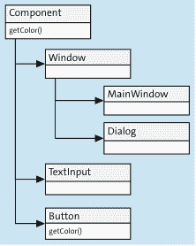

**图 15.5** 一个带有被重写方法的类层次结构。

如果你现在写 `Component c{}; c.getColor();`，你会得到白色，就像 `Dialog d{}; d.getColor();` 等一样。只有 `Button b{}; b.getColor();` 返回灰色。如果你无法从清单 15.5 推断出类层次结构，你可以在图 15.5 中找到可视化表示。

## 15.7 方法如何工作

在类层次结构中使用方法时，你需要注意几件事。看一下清单 15.6：注意 `print` 调用了哪些其他方法，并思考你会预期什么。我已将程序精简到本质部分，这就是它看起来有些理论化的原因。

2 在实践中，这样的组件层次结构不会以这种方式出现；我稍后会描述的 virtual 关键字仍然缺失。

```cpp
// https://godbolt.org/z/YTK8PfcMc
#include <iostream>
struct Base {
    int eight_ = 8;
    int value() const { return eight_; }
    void print(std::ostream& os) const { os << value() << "\n"; }
};
struct Print : public Base {
    int nine_ = 9;
    void print(std::ostream& os) const { os << value() << "\n"; }
};
struct Value : public Base {
    int ten_ = 10;
    int value() const { return ten_; }
};
struct Both : public Base {
    int eleven_ = 11;
    int value() const { return eleven_; }
    void print(std::ostream& os) const { os << value() << "\n"; }
};
int main() {
    Base ba{}; ba.print(std::cout);    // Base call
    Print pr{}; pr.print(std::cout);   // print overridden
    Value va{}; va.print(std::cout);   // print from Base
    Both bo{}; bo.print(std::cout);    // everything overridden
}
```

**清单 15.6** “print” 输出什么？“value” 方法出现得更频繁。

你认为 `main` 中不同的 print 行分别输出什么？

- **`Base ba{}; ba.print(cout);`—基类调用**
  在 `Base` 中，`print()` 和 `value()` 两个方法都是直接定义的。这里还没有涉及其他类。因此 `value()` 返回 `eight_`，输出 8。
- **`Print pr{}; pr.print(cout);`—print 被重写**
  在 `Print` 中，`print()` 方法被重写。对于 `pr`，会调用 `Print::print()` 方法。那里需要 `value()`。这个方法是从 `Base` 继承来的。而 `Base::value()` 返回 `eight_`——所以输出 8。
- **`Value va{}; va.print(cout);`—print 来自 Base**
  `va.print()` 必须回退到继承来的方法 `Base::print()`。现在那里需要 `value()` 方法。虽然存在 `Value::value()` 方法，但它在 `Base::print()` 中还不可知！在基类的方法中，只会使用基类的方法——这里是 `Base::value()`，它返回 `eight_` 并导致输出 8。
- **`Both bo{}; bo.print(cout);`—所有内容都被重写**
  这里又简单了：存在一个会被调用的 `Both::print()`。对 `value()` 的调用在其自己的方法中访问 `Both::value()`，并引用 `eleven_`。它输出 11。

你正确猜出第三种情况了吗？如果没有，不要难过。`Base::print()` 采用哪个 `value()` 方法是一个定义问题：两者都有可能。在 C++ 中，它的定义方式是：一个方法只能看到在通过继承、新定义或重写翻译该类时已经可用的方法。`Base::print()` 对可能的派生类还一无所知。

## 15.8 虚方法

在其他语言中，这有时不同：如果你在 Java 中编写前面的清单（针对该语言做明显修改），那么在 `Value va{}; va.print(cout);` 处你会看到 10，因为 Java 会在*运行时*检查实例可用的方法。

而且因为这也是一种合理的行为（否则它几乎不会被选为 Java 的默认行为），所以在 C++ 中也可以实现。关键在于*虚方法*。

如果你用 virtual 关键字标记一个方法，编译器会在*运行时*决定该方法的哪个版本有效。这样你就得到了 Java 的行为。

```cpp
// https://godbolt.org/z/wV5s3Kh6M
#include <iostream>

using std::ostream; using std::cout;
struct Base2 {
    int eight_ = 8;
    virtual int value() const        // virtual method
        { return eight_; }
    void print(ostream& os) const
        { os << value() << "\n"; }
};
struct Value2 : public Base2 {
    int ten_ = 10;
    virtual int value() const override // override
        { return ten_; }
};
int main() {
    Value2 v2{}; v2.print(cout);       // use
}
```

**清单 15.7** 用 “virtual” 标记的方法在运行时解析。


`Value2 v2{}; v2.print(cout);` 对应于上一清单中的 `Value v{}; v.print(cout);` 调用。现在你会看到，在 `v2.print()` 中，该调用必须引用 `Base2::print` 定义，因为 `Value2` 自身没有定义这个方法，但 `print` 中对 `value()` 的调用现在是虚方法调用：它在运行时决定。并且因为 v2 的类型是 Value2，所以使用 Value2::value，返回 10，因此输出 10。

> **虚与非虚**
> 
> 虚方法调用在运行时决定，普通方法调用在编译时决定。

在清单 15.7 中，在 value() 方法的定义里，你会看到除了 virtual 关键字之外还有 override 关键字。这种附加指定要求编译器确保该方法确实覆盖了另一个方法。这样，例如就可以避免因拼写错误而产生难以发现的错误。例如，设想你不小心在 `Value2` 中把方法命名为 `virtual int value() const`。程序会编译并运行，但它不会返回你期望的值。

或者考虑另一个相当实用的例子。在 `mydefs.hpp` 头文件中，定义了一些类型，例如 `using value_t = int;`。现在你有一个小的层次结构：

```cpp
struct Number {
    virtual void add(value_t value);
};
```

```cpp
struct SafeNumber : public Number {
    virtual void add(int value);    // override not specified, int instead of value_t
};
```

在 Number::add() 中参数类型是 value_t，而在 SafeNumber::add() 中却指定为 int 类型，这对编译器来说是一样的。`using`（以及相应的 typedef）只是类型别名，并不是一个全新的类型。因此，SafeNumber::add() 会如预期那样覆盖基类中的方法。

如果你现在把 `mydefs.hpp` 中的定义改为 `using value_t = long;`，那么 Number::add() 的签名就会改变。然而，SafeNumber::add() 的签名不会改变，因为你没有使用类型别名。你不再覆盖原来的方法，并且很可能在程序中出现不期望的行为——表现为难以发现的 bug。如果你用 `override` 标记了 `SafeNumber::add()`，那么编译器就会指出这个错误。

> **使用“override”**
> 
> 当你覆盖虚方法时，也要指定 override。这样可以避免难以发现的错误。

## 15.9 类层次结构中的构造函数

构造函数是特殊的类元素：它们*不是*方法，因此不会像方法那样被继承到派生类。

```cpp
// https://godbolt.org/z/59WKfxenE
class Base {
public:
    Base() {}                 // null-argument constructor
    explicit Base(int i) {}   // one argument
    Base(int i, int j) {}     // two arguments
    void func() {};           // method
};

class Derived : public Base { // no own constructor
};

int main() {
    Base b0{};                // okay, null-argument constructor
    Base b1{12};              // okay, one argument
    Base b2{6,18};            // okay, two arguments
    Derived d0{};             // okay, compiler generates default constructor
    d0.func();                // okay, method is inherited
    Derived d1{7};            // Error: no constructor for one argument
    Derived d2{3,13};         // Error: no constructor for two arguments
}
```

**清单 15.8** 派生类继承父类的方法，但不继承父类的构造函数。

使用 `Derived d1{7}` 创建新对象的尝试会失败，因为 `Derived` 没有为 `int` 定义自己的构造函数。`Base(int)` 构造函数不会被继承，就像普通方法的情况一样——例如，对于 `Derived` 实例，你仍然可以调用 `func()`。

原因在于构造函数与方法确实不同。构造函数必须初始化类实例。这是一项与类内部结构紧密相关的任务。调用父类构造函数而不是自己的构造函数，很可能无法正确初始化派生类。可能存在与类相关的管理信息，需要在相应的构造函数中初始化。需要哪些管理信息，标准并没有详细规定；这留给实现决定。为了允许这种自由，构造函数才具有这种特殊角色。

如果你仍然想继承父类的构造函数，就必须在派生类中显式指定这一点。为此，在类定义中包含 `using Base::Base;`，从而显式引用这些构造函数。是的，是构造函数（复数）——因为这种方法会同时提升所有继承的构造函数，而不是只提升一个。你只能按照“全有或全无”的原则使用这种机制。

```cpp
// https://godbolt.org/z/h15eGahJh
class Base {
public:
    Base() {}
    explicit Base(int i) {}
    Base(int i, int j) {}
    void func() {};             // method
};

class Derived : public Base {
public:
    using Base::Base;           // importing all parent class constructors
};

int main() {
    Derived d0{};               // okay, imported, no longer generated
    Derived d1{7};              // okay, was imported
    Derived d2{3,13};           // okay, was imported
}
```

**清单 15.9** 使用“using”导入所有父类构造函数。

通过这种方式，你把所有父类构造函数提升到自己的类中，而必要的额外管理任务由编译器处理。

## 15.10 类层次结构中的类型转换

我们继续使用前面的抽象示例，但让我用一些危险的代码稍微扩展一下。

### 15.10.1 沿继承层次向上转换

考虑下面的清单。

```cpp
// https://godbolt.org/z/Ec7vqdEY3
// ... Base2 and Value2 as before ...
void output(Base2 x) {          // pass by value
    x.print(cout);
}

int main() {
    Base2 ba2{}; output(ba2);    // outputs 8
    Value2 va2{}; output(va2);   // also outputs 8
}
```

**清单 15.10** 按值传递只复制类型的公共部分。

通过按值传递，va2 被复制到参数 x 中。由于参数类型是 Base2，因此只复制 va2 中属于 Base2 的那部分。又因为 x 现在是这种类型，所以 x.print() 只能做这种类型的任何其他变量在 Base2::print() 中会做的事情——也就是输出 8。

### 15.10.2 沿继承层次向下转换

如果你为参数选择派生类型而不是基类型——也就是 output(Value2 x)——那么 output(va2) 会输出 10。然而，ba2 与 Value2 参数类型不匹配，所以当沿这个层次方向转换时，编译器会报错。基类型的实例并不具备转换为派生类型所需的全部属性；编译器不能凭空编造属性来填补。

```cpp
// https://godbolt.org/z/17znah59eP
//... Base2 and Value2 as before ...
void output(Value2 x) {        // derived class as value
    x.print(cout);
}
int main() {
    Base2 ba2{}; output(ba2);   // ✘ ba2 cannot be converted to Value2
    Value2 va2{}; output(va2);  // outputs 10
}
```

**清单 15.11** 将派生类作为函数的参数类型时，不允许用基类变量作为值参数来调用。

### 15.10.3 引用也会保留类型信息

当你以引用传递实例时，不需要复制它。在这种情况下，对象保持原样——连同它的实际类型。

```cpp
// https://godbolt.org/z/sW7MexWrh
//... Base2 and Value2 as before ...
void output(Base2& x) {       // passing as a reference
    x.print(cout);
}

int main() {
    Base2 ba2{}; output(ba2);  // outputs 8
    Value2 va2{}; output(va2); // outputs 10, because the object is not copied
}
```

**清单 15.12** 按引用传递不会改变实例。

当 va2 变成 x 时，它只是被“重命名”了。x 本质上仍然是 Value2——因此 print 可以访问虚方法 Value2::value 并输出 10。

*运行时多态* 发挥作用的情形是：声明中使用更通用的类，但在运行时，声明的变量使用更具体的类，同时不丢失其属性。在示例中，虽然参数声明为 Base2，但运行时可以用 Value2 类的 va2 实例调用 output，而 va2 保留了输出 10 的属性——如果它被完全转换为 Base2 类型，就不会这样做了。在 C++ 中，只有使用引用（或指针）时，才能实现这种形式的多态。

如果你想知道的话，如果 Base2::value() 不是虚方法（就像 Base::value() 一样），那么你就会回到清单 15.6 中的行为，并得到 8。

## 15.11 何时使用虚方法？

是否用 virtual 标记一个方法取决于你选择的设计。在 C++ 中，默认将所有类的所有方法都设为虚方法并不是常见做法。对于每个单独的方法，都可能有支持或反对将其设为虚方法的理由，对每个单独的类也是如此。这与在方法和自由函数之间做选择的理由有些不同：用方法进行封装更好，因此你通常会选择方法。而在决定是否使用虚方法时，事情就不那么明确了。可以把下面的提示作为设计决策的辅助：

- 有些类主要只是为了把数据组织在一起。它们不属于某个层次结构。没有继承，就没有理由使用虚方法。
- 仅仅存在类层次结构，并不足以证明应该使用虚方法。也许你只是非常巧妙地去重。
- 在类层次结构中覆盖某个方法，是虚方法的一个很好的候选，但不一定。
- 如果你的设计依赖于被覆盖的方法——也就是在不同类之间改变行为——那么 virtual 就是合适的。
- 构造函数永远不是虚的。不得在构造函数中调用虚方法。


- 如果类中至少有一个虚方法，那么析构函数（参见第 16 章）必须是虚函数。
- 你重写的基类虚方法会自动也成为虚方法，即使你没有显式说明。一旦为虚，就始终为虚。

> **类要么完全不用“virtual”，要么完全使用“virtual”**
>
> 首先，我建议遵循以下两条规则：
>
> - 如果没有层次结构，就不要把任何方法设为虚方法。
> - 如果有层次结构，并且你重写了至少一个方法，就把*所有*方法都设为虚方法。
>
> 如果牢记这一点，你设计类（和层次结构）的方式很可能自然会引出某个方法是否应为虚方法的决定。

但为什么要问这个问题呢？虚方法有哪些优点和缺点？

最大的优点是你获得了更灵活的设计。即使行为最初是在基类中定义的，你也可以在派生类中修改它。

缺点涉及速度和内存：

- **该方法必须在运行时先在表中查找。**  
  调用虚方法时，该调用需要多一次间接寻址（可能还有一次加法）。但现代处理器可以轻松处理这一点，与普通方法调用相比，你不会注意到任何速度差异。
- **虚方法很少能被优化为内联函数。**  
  你可能更容易在程序速度上注意到这一点，尤其是在紧凑循环中调用虚函数时。内联是一项关键的编译器优化，其重要性会随着执行程序的处理器的复杂性和现代性而增加。
- **每个实例都需要一个隐藏的数据字段。**  
  对于至少有一个虚方法的类，其每个实例都有一个额外的隐藏变量。大多数 C++ 编译器都这样实现：它是指向静态表（*vtable*）的指针（*vptr*）。如果你有大量打包在一起的小实例——例如放在容器中——这会影响内存使用。

你也可以认为，你希望让自己的设计与其他当前编程语言保持一致。例如，Java 没有任何非虚方法。我主张在设计时至少将*持有数据的类*（*数据传输对象* [DTO]）与*面向行为的类*（具有非平凡方法）区分开。DTO 不需要虚特性，但业务逻辑类可能需要，具体取决于目的。决定“为了保险起见”把所有方法都设为虚方法的人，应该考虑这种做法是否适合他们的应用。虽然我能理解这一设计决策背后的理由，但确保其恰当性至关重要。

### 15.12 其他可扩展性设计

如果你决定不使用虚方法，C++ 中还有其他方式使数据类型可扩展。你可以通过重载自由函数来添加功能。使用*类型特征*连接类型是一个高级主题。为此，你需要进一步学习模板编程。你可以在[第 23 章](#)中找到简要介绍。

请放心大胆地使用虚方法。它们在可理解性和性能之间提供了良好的折中。如果你要处理特殊应用，随时可以学习其他方法。

关于继承的一般性说明：练习继承技术，并用它来减少代码重复。但不要过度使用这一概念。*has-a* 关系（组合或聚合）比 *is-a* 关系（继承）更常适合用来有意义地连接类和对象。无论如何都不要把一堆类强行塞进僵化的继承层次结构框架中。在实践中，如果设计能够更多通过数据字段而不是类层次结构来扩展和修改，结果往往会更加灵活。

虽然你可以在 C++ 中通过重载自由函数或类型特征来建模组合，但接口是 Java 等语言中已知的概念。C++ 中的等价物是只包含纯虚方法的抽象类；参见[第 16 章](#)。这种技术在 C++ 中也很常见，但不如在 Java 中那样广泛使用。

## 第 16 章

## 类的生命周期

### 本章术语

- **析构函数类型：`~Type()`**  
  与构造函数相反；在对象被移除时调用。
- **资源获取即初始化（RAII）**  
  一种编程技术；由在构造函数中请求资源、在析构函数中释放资源的类实现。
- **临时值（temp-value）**  
  没有变量名的值，通常出现在表达式中，或作为函数参数的类型转换的一部分；在语句结束时被移除。
- **临时值引用**  
  对临时值的引用；符号为 `&&`。从技术上讲是*右值引用*，因为它表示只能出现在赋值右侧的表达式。
- **`operator@`**  
  其中 `@` 代表任何有效的运算符符号。你需要定义的自由函数或方法，以便你的类型支持该运算符。
- **`Type::Type(const Type&)`**  
  拷贝构造函数；当要从现有实例创建新实例时，编译器会调用它，包括函数返回和按值传递参数。
- **`Type& Type::operator=(const Type&)`**  
  赋值运算符。当向已存在的实例赋予新值时，编译器会调用赋值运算符。
- **移动操作**  
  从临时值复制的一种特殊形式。程序员可以选择指定对象内容是转移而不是复制。标准库一致支持这种形式。
- **`Type::Type(Type&&)`**  
  移动构造函数；用于以临时值作为源创建新实例。
- **`Type& Type::operator=(Type&&)`**  
  移动赋值运算符；将临时值的内容赋给现有实例。
- **`= delete`**  
  显式删除函数、方法、构造函数等。

```cpp
void function(const MyValue &paramRef) {
    if(/*...*/) function(/*x1*/);              // call some function
    MyValue localValue{};                     // local class instance
}                                             // end of function

int main() {
    MyValue mvalue1{};
    function(/*x2*/);
    function( MyValue{} );                    // temporary value
    {
        MyValue mvalue2{};
        function(/*x3*/);
        MyValue mvalue3{};
    }                                         // end of inner block
    function(/*x4*/);
    MyValue mvalue4{};
    function(/*x5*/);
}                                             // end of main function
```

**代码清单 16.1** 对于“x1”到“x5”，你可以使用哪些变量？

有效性是较简单的话题。你能看出在 `function(/*...*/)` 的各种函数调用中可以使用哪些变量吗？表 16.1 给出了概览。

| 变量 | x1 | x2 | x3 | x4 | x5 |
|---|---|---|---|---|---|
| globalValue | 是 | 是 | 是 | 是 | 是 |
| paramRef | 是 |  |  |  |  |
| localValue |  |  |  |  |  |
| mvalue1 |  | 是 | 是 | 是 | 是 |
| mvalue2 |  |  | 是 |  |  |
| mvalue3 |  |  |  |  |  |
| mvalue4 |  |  |  |  | 是 |

**表 16.1** 在“function()”中何时可以使用哪些变量？

与有效性密切相关的问题是：某个对象何时被*创建*，以及何时被*销毁*。每个变量的生命从其*定义*开始——也就是它被*初始化*的时候。对于类，也可以说它们被*构造*，因为会调用*构造函数*。

变量的生命在其作用域退出时结束。具体到我们的示例中，这意味着以下情况：

- `globalValue` 变量在退出 `main` 时被销毁。
- `paramRef` 变量在退出 function 时被销毁。
- `localValue` 变量在退出 function 时被销毁。
- `mvalue1` 变量在退出 `main` 时被销毁。
- `mvalue2` 变量在退出内部块时被销毁。
- `mvalue3` 变量在退出内部块时被销毁。
- `mvalue4` 变量在退出 `main` 时被销毁。
- `MyValue{}` 变量在该行的 `;` 处被销毁。

### 16.2 临时值：短暂存在的值

包含临时值的那一行尤其值得注意。使用 `MyValue{}` 时，你创建了该类的一个实例，然后将其作为参数传递给 function。然而，该实例没有获得变量名。相反，你创建了一个*临时值*（也称为 *temp-value*）。因此，该值在语句结束时消失——按经验法则，是在下一个分号处。

创建临时值时，它不是*声明*，而是*表达式*。因此，你可以直接使用它——例如，作为函数的参数。

还有其他生成临时值的方式。例如，自动类型转换可能导致这种情况，如下面代码清单中调用 `length()` 时所示。

```cpp
// https://godbolt.org/z/eK1Ervjs5
#include <string>
#include <iostream>                         // cout
using std::string; using std::cout;

struct Value {
    int value_;
    Value(int value)                         // 1-arg constructor = type conversion
        : value_{value} {}
};

size_t length(string arg) {
    return arg.size();
}
Value twice(Value v) {
    return Value{v.value_ * 2};
}
```


```cpp
int main() {
    cout << length("Hipphopp") << "\n";  // const char* to string
    cout << twice(10).value_ << "\n";      // int to Value
    string name {"Gandalf"};
    cout << ( name + " the Grey") << "\n"; // string + const char*
}
```

**清单16.2** 当你调用一个函数，且该函数的参数导致编译器调用构造函数进行转换时，它会创建一个临时值。

length 函数接受一个 string 作为参数。然而，当我调用 length("Hipphopp") 时，我传递的是一个文本字面量，它是 `const char[]`。编译器会自动创建一个 string，仅仅是为了将其传递给 length()。在该语句之后，这个创建的 string 就会消失，因为它是一个临时值。

编译器使用的机制你已经知道了：自动类型转换。twice(10) 也会发生同样的情况。因为 Value 有一个带一个参数的构造函数，编译器可以利用它进行自动类型转换。瞧，10 是一个 int，而且匹配——于是创建了一个临时的 Value，在 twice 内部用作 v，最后被丢弃。

尤其是二元运算符喜欢创建临时值，比如加号 +。表达式 name + " the Grey" 是调用 operator+，参数类型为 string 和 const char*。该运算符将参数连接成一个新的 string，然后将其输出。连接后的结果就是临时值，在分号之后就不再需要了。

### 背景：左值、右值与合法窃取

在临时值的上下文中，你经常会在参考书和互联网上遇到诸如*lvalue*、*rvalue*和*rvalue 引用*等术语。这些并不是 C++ 带来的特性，而是用来描述 C++ 如何实现某些概念的技术术语。作为 rvalue 背后的概念，我觉得*temp-value*（临时值）这个术语更好。不过，在试图理解“如何”和“为什么”时，你经常会遇到这些技术术语。在下面的列表中，假设你已经声明了`int x, *p, a[10]`：

- **左值**  
  可以对其赋值的表达式，比如`x=1`、`*p=1`或`a[2]=1`。字母*l*来自 left（左），因为它们可以出现在赋值语句的左侧——即`lvalue = ...`。
- **右值**  
  不能对其赋值的表达式，比如`42=1`、`&x=1`或`x+1=1`。这些表达式只能出现在赋值语句的右侧——即`... = rvalue`。

> 这种区别很重要，因为右值只短暂存在（如果确实存在的话）——因此我用术语*temp-value*（临时值）来称呼它。临时值的内容可以被改变，而不会影响程序的其他任何部分。通常，人们会将资源从临时值转移到另一个对象，以节省一次复制。这对于理解移动操作非常重要，这将在16.9节中讨论。

## 16.3 析构函数与构造函数

如果你想检查对象何时被销毁，请在*析构函数*中完成。作为构造函数的对应物，它用于执行清理任务。这可能涉及清理类的数据字段或其他管理任务。

因为你目前只熟悉会自动去初始化的数据结构，所以这里将输出文本作为一项管理任务。给入门示例中的 MyValue 类注入一些实际内容。

```cpp
// https://godbolt.org/z/WPcTv37xKM
#include <string>
#include <iostream>
#include <iomanip>    // setw
using std::cout; using std::setw; using std::string;
struct MyValue {
    static int counter;          // static: exists only once for all instances
    int number_;                  // indentation level of this instance for output
    string name_;                 // name of this instance for output
    explicit MyValue(string name)
        : number_{++counter}     // increment indentation level per instance
        , name_{name}             // remember the object's name for output
    {
        cout << setw(number_) << " " << "Constructor " << name_ << "\n"; // output instance name
    }
    ~MyValue() {                  // destructor
        cout << setw(number_) << " " << "Destructor " << name_ << "\n";
    }
};
int MyValue::counter = 0;        // initialization of the static class variable
```

**清单16.3** 当一个对象被移除时，析构函数会被执行。

如此装备之后，你就可以像平常一样使用该对象了。为此，请在清单16.1中使用这种修改后的 MyValue 类型的具体变量。

```cpp
// https://godbolt.org/z/enneOWpzb
void function(const MyValue &valueParamRef) {
    MyValue localValue{"local"};
}

int main() {
    MyValue mvalue1{"mvalue1"};
    function( MyValue{"temp"} );
    function( mvalue1 );
    {
        MyValue mvalue2{"mvalue2"};
    }
}
```

**清单16.4** 这里创建和销毁了许多对象。

因此，你会得到下面清单所示的输出。

```text
Constructor mvalue1
  Constructor temp
    Constructor local
    Destructor local
  Destructor temp
    Constructor local
    Destructor local
    Constructor mvalue2
    Destructor mvalue2
Destructor mvalue1
```

**清单16.5** 该输出展示了对象何时被创建和销毁。

在 main 中，首先创建 mvalue1。你使用 setw 确保 MyValue 的第一个实例缩进深度为1，并通过++counter，所有后续实例缩进一个层级。计数器值同时被复制到 number_ 数据字段中。这样，你就可以在析构函数中使用与构造函数相同的缩进层级。你可以清楚地看到，mvalue1 也是最后一个被清理的对象：Destructor mvalue1 的输出发生在析构函数中。

你还会看到，为函数调用创建了 temp。在函数内部，local 被创建并再次移除——针对每次对 function 的调用都是如此。从函数返回后，temp 被移除——在语句结束时——而 mvalue1 仍然保留。

接下来，创建 mvalue2。然而，内部块的末尾立即到达，因此其析构函数紧接着被调用。直到这时，才到达 main 的末尾，从而也到达 mvalue1 有效期的末尾。

### 16.3.1 不需要析构函数

通常，没有必要在析构函数中做任何事，因为类的每个数据字段反正都会被清理。所以，如果你什么都不做，让析构函数为空，或者完全省略它，所有数据字段仍然会被移除。

只要使用我们目前已经覆盖的机制，你就不需要析构函数来清理。像`int`和`double`这样的基本数据类型，以及像`string`、`vector`和`fstream`这样的标准库类型，都会自动管理一切。

### 16.3.2 析构函数中的资源

但有些资源不会自动移除。原始指针和许多 C 数据类型必须在析构函数中处理。或者，你可以将整个内容包装在`shared_ptr`中，并使用*自定义删除器*。你将在第20章中了解更多相关信息。

假设你正在处理一个通过库提供给您的数据库，并提供相关的头文件作为编程接口。简化后，头文件可能看起来像下面这个清单。

```cpp
// https://godbolt.org/z/54dzsb31z
#ifndef DATABASE_HPP
#define DATABASE_HPP

typedef void* db_handle_t;

db_handle_t db_open(const char* filename);
void db_close(db_handle_t db);
int db_execute(db_handle_t db, const char* query);

#endif
```

**清单16.6** 一个资源 C 接口的简单示例。

因此，很明显，对于每个`db_open()`，你也必须调用一次`db_close()`。如果不这样做，可能发生各种情况：对数据库的写入可能被忽略，程序可能会泄漏数据库连接，最终无法再执行更多的`db_open()`，或者程序可能会崩溃。

为了确保每个`db_open()`都有一个`db_close()`被调用，请向编译器寻求帮助：构造函数调用和析构函数调用总是成对的。将资源包装在一个*资源包装器*中。

```cpp
// https://godbolt.org/z/6399qK9Ts
#include <iostream>                 // cout
#include "database.hpp"             // include the foreign API
```


```cpp
class Database {
    db_handle_t db_;           // wrapped resource
public:
    Database(const char* filename);
    ~Database();
    int execute(const char* query);
};
Database::Database(const char* filename)
    : db_{db_open(filename)}    // requesting the resource
{ }
Database::~Database() {
    db_close(db_);              // releasing the resource
}
int Database::execute(const char* query) {
    return db_execute(db_, query); // using the resource
}
int main() {
    Database db{"customers.dat"};  // creating the wrapper
    std::cout << "Count: " << db.execute("select * from cust") << "\n";
}                                  // automatically removing the wrapper
```

**清单 16.7** 如果你需要关闭资源，析构函数正适合此用途。

在构造函数中，你通过 `db_{db_open(filename)}` 请求资源——数据库连接——并将其存储在私有数据字段 `db_` 中。你通过 `db_close(db_)` 在析构函数中释放该资源。但请继续阅读本章，因为你仍然缺少复制构造函数和赋值运算符。

你在这里省略了必要的错误检查，而这些在实际程序中当然必须包含。对于这种类似 C 的接口，通常有一些返回值具有特殊含义。例如，可以检查 `db_open` 的返回值，以便在出错时做出特定反应。

```cpp
Database::Database(const char* filename)
    : db_{ db_open(filename) }
{
    if(nullptr == db_) { // Error opening
        throw IllegalArgumentException("Error opening the DB");
    }
}
```

**清单 16.8** 构造函数要么初始化，要么抛出异常。

这里重要的是，构造函数在出错时以异常退出，而不是正常返回。这意味着该对象被视为未创建。在没有创建对象的地方，就不需要移除任何东西。因此，不会调用析构函数。

### 构造函数中的异常意味着不会调用析构函数

如果异常在构造函数内被抛出且未被捕获，则该对象被视为未创建，随后不会调用析构函数。

这一点在这里很重要，因为如果初始化出错后 `db_` 为 `nullptr`，那么调用 `db_close(db_)` 可能会出现问题。然而，通过异常退出构造函数，析构函数不会被调用，因此不会出现问题。

你将在下一节学习如何处理异常。在这里，你已经学会了如何有效地使用析构函数来实现*资源获取即初始化*（RAII），也就是说，当你请求资源时，你是通过初始化来完成的——在本例中，即初始化 Database 包装类。

请务必将 RAII 纳入你的技能库，因为它能帮助你避免难以发现的错误。还记得我在前面几节（第 16.3.1 节）提到过，处理标准库类型时通常不需要析构函数吗？这是因为这些类型已经一致地实现了这一概念。你很少需要成对地进行获取和释放调用。这些都被仔细地封装在类的构造函数和析构函数中。

## 16.4 尤达条件

在清单 16.8 的 `if` 语句条件中，我隐藏了一个小彩蛋：

```cpp
if(nullptr == db_) ...
```

我用 `==` 比较 `nullptr` 和 `db_`。我也可以写成 `db_ == nullptr`，结果相同。然而，这里使用的顺序有一个很大的优势。[^1] 如果你不小心输入了 `=` 而不是 `==`——这完全是另一回事——编译器会指出错误：因为 `nullptr` 是一个字面量，你不能用 `=` 向它赋值。如果你不小心写了 `db_ = nullptr`，你就是无意中写了一个赋值语句。赋值也是一个表达式，其结果在这里将是 `nullptr`——而 `nullptr` 会被编译器自动转换为 `false`。

因此，如果你要与字面量或常量进行比较，为了自身安全，你可能会养成将常量写在比较左侧的习惯。这样你就有了稍强一些的防打错保护。

这种条件写法被称为*尤达条件*，因为你将操作数以与自然习惯相反的顺序书写。或者，尤达可能会这样说：自然去做，你会。因此得名。

下面的清单提供了其他一些尤达条件的示例，在这些示例中，你可以防止意外的 `=`。

```cpp
if("Yoda" == character) ...
if(42 == answer) ...
```

**清单 16.9** 使用 `=` 的尤达条件示例。

以这种方式调用方法也属于尤达条件的范畴。

```cpp
#include "my_string.hpp"
static const my_string ZEBRA { "zebra" };
int main() {
    my_string animal{ "horse" };
    if(ZEBRA.equals(animal)) return 0;
    else return 1;
}
```

**清单 16.10** 带方法调用的尤达条件。

在这里，你在常量上调用 `equals` 方法，而不是把变量放在前面写成 `animal.equals(ZEBRA)`。这种写法在 C++ 中比在 Java 中少见。在 Java 中，`animal` 可能是一个无效对象，类似于 `nullptr`，而使用 `animal.equals(ZEBRA)` 进行方法调用必定会出错。在调用 `ZEBRA.equals(animal)` 时，由于 `ZEBRA` 不可能是 `nullptr`，你有机会在 `equals` 方法内部安全地检查其参数（这里是 `animal`）是否为 `nullptr`，并相应地处理该情况。

`std::string` 类没有像 Java 中那样的 `equals` 方法。你使用 `==` 进行比较。使用 `==` 时，尤达写法对可读性没有显著影响。然而，许多人认为使用方法时可读性会下降，所以请考虑是否要采用这种写法。

## 16.5 构造、析构与异常

RAII 概念还包含这样的含义：如果初始化（构造函数运行）失败（导致异常），则该对象被视为未创建。其结果是，也不会调用析构函数。

```cpp
// https://godbolt.org/z/99PNn595E
#include <iostream>   // cout
#include <stdexcept>  // runtime_error
struct CanThrow {
    CanThrow( whatShouldHappen) {
        std::cout << "Constructor " << whatShouldHappen << "...\n";
```

我添加了 `(function)` 的输出只是为了定位；它与实例的生命周期无关。

在输出中可以看到一些奇怪的现象：

```
Constructor mvalue1
  Constructor temp
(function)
    Constructor local
    Destructor local
  Destructor temp
(function)
    Constructor local
    Destructor local
  Destructor mvalue1
    Constructor mvalue2
    Destructor mvalue2
Destructor mvalue1
```

从 `Destructor mvalue1` 可以看到，`mvalue1` 被清理了两次。这是我们代码中的疏忽造成的。我们已经提到过：按值传递参数时，对象会被复制。因此你会得到第二个对象，而作为第二个对象，它当然也必须再次被清理——包括相应的析构函数调用。

这个有问题的对象并不是通过调用我们的构造函数创建的；这一点你应该已经看到了。不，为了复制，有一个特殊的构造函数，即复制构造函数。你可以自己定义它——在这种情况下你应该这样做，因为只有这样我们的输出才是正确的。类的复制构造函数正是以当前类的常量引用作为参数的构造函数。

```cpp
// https://godbolt.org/z/sGan39a8z
struct MyValue {
    static int counter;
    int number_;
    string name_;
    explicit MyValue(string name) // as before
        : number_{++counter}, name_{name}
        { cout << setw(number_) << ' ' << "Constructor " << name_ << "\n"; }
    MyValue(const MyValue& orig) // new copy constructor
        : number_{++counter}, name_{orig.name_ + "-copy"}
        { cout << setw(number_) << " " << "Copy Constructor " << name_ << "\n"; }
    ~MyValue() { // as before
        cout << setw(number_) << " " << "Destructor " << name_ << "\n";
    }
};
int MyValue::counter = 0;
```

**清单 16.14** 复制构造函数以一个常量引用作为类参数。


现在如果再次运行 `main()`，一切恢复正常。你会看到构造函数和析构函数的数量一样多：

```text
    Constructor mvalue1
    Constructor temp
(function)
    Constructor local
    Destructor local
    Destructor temp
    Copy constructor mvalue1-copy
(function)
        Constructor local
        Destructor local
        Destructor mvalue1-copy
            Constructor mvalue2
            Destructor mvalue2
        Destructor mvalue1
```

在之前看到第一个 Destructor mvalue1 的地方，你会看到实际上之前不可见的副本正在被销毁；这一点由 Destructor mvalue1-copy 中改变后的名称揭示出来。

但即使没有复制构造函数，我们的程序也运行了。如果你不定义自己的复制构造函数，编译器会再次替你接管。它生成一个复制构造函数，将所有数据字段逐元素复制到新实例中。这对你目前遇到的所有数据类型都非常有效：内置类型、标准容器以及标准库中的大多数其他类型。

然而，如果你使用某些需要在析构函数中进行特殊处理的东西，这就不起作用了。原始指针和来自清单 16.7 的 `db_` 资源不会被正确复制（只会转移指针或句柄本身），并且资源不会被请求两次。而且我们的 `cout << "Destructor "` 输出也属于这一类，因为析构函数中做了一些特殊处理。作为经验法则，请参见下面的方框。

### 何时需要复制构造函数？

如果你自己编写（或需要编写）析构函数来确保类正常工作，那么你很可能也需要自己编写的复制构造函数——反过来也一样。你在析构函数中管理的资源很可能在复制和赋值时也需要特殊处理。

如果可能，你应尽量不自己编写复制构造函数。编译器不仅会替你处理复制操作；它还会做其他重要的小事情。这包括在待复制的数据字段允许时自动标记为 `noexcept`。在某些情况下，这可以生成更快的代码。

## 16.7 赋值运算符

你现在已经熟悉 MyValue 类，也知道可以使用 MyValue(string) 构造函数创建新实例，或通过 MyValue (const MyValue&) 进行复制。你还知道用 = 进行赋值，因此应该能够准确说出以下示例中发生了什么。

```cpp
void byVal(MyValue arg) {
}

int main() {
    MyValue value1{"ABCD"};    // new instance, constructed via string
    MyValue value2{value1};     // new instance, constructed via copy
    MyValue value3 = value1;    // new instance, also via copy, despite =
    byVal(value1);         // a new instance via copy
    value1 = value2;        // not a new instance, but an assignment
}
```

**清单 16.15** 复制与赋值。

虽然前两行没有什么意外，但有时人们可能会对 `MyValue value3 = value1;` 扬起眉毛。因此，提醒一下：变量声明中的等号 `=` 绝不是赋值，而只是编写初始化的另一种方式。为了避免阅读时产生混淆，你应避免这样做——至少在处理真正的类时如此。对于像 `int` 这样的简单类型，`int val{7}` 对某些人来说可能看起来奇怪，所以这里可以放心地使用 `=` 进行初始化。

现在回到赋值。在 `value1 = value2;` 中，你现在遇到了新东西。再次简化一下，你有以下代码：

```cpp
// https://godbolt.org/z/5M8xKabjK
int main() {
    MyValue value1{"ABCD"};
    MyValue value2{"WXYZ"};
    value1 = value2;        // assignment
}
```

你现在得到这个：

```text
Constructor ABCD
  Constructor WXYZ
  Destructor WXYZ
  Destructor WXYZ
```

哎呀，这里事情又搞混了。`Destructor WXYZ` 输出出现了两次，令人费解。这里发生了什么？

在 `value1 = value2;` 中，编译器调用 `MyValue` 类的**赋值运算符**。你自己没有定义赋值运算符（因为你正在学习它），所以编译器再次替你介入并生成一个赋值运算符——所有数据字段都逐元素地从 `value2` 赋值给 `value1`。`value1` 之前包含的内容随后被覆盖。

因此，很明显，如果没有 `Destructor ABCD` 赋值，这两行 `Destructor WXYZ` 输出中的一行本来会被输出。并且 `number_` 字段中的缩进深度被覆盖了。

你可能想要不同的行为；例如，你可能想保留原对象的缩进深度。为此，实现一个具有以下签名的特殊方法：

```cpp
MyValue& MyValue::operator=(const MyValue&);
```

注意，这是一个*方法*，而不是*构造函数*。被赋值的对象已经存在；它的内容将由这个赋值运算符覆盖。因为它不是构造函数，所以你不是在初始化列表中完成数据字段的转移，而是像方法一样在函数体中进行。

```cpp
// https://godbolt.org/z/s65GVY9xj
struct MyValue {
    // ... everything else as before
    MyValue& operator=(const MyValue& right) {
        if (this != &right) { // 1. check for self-assignment
            // 2. Release previous resources; none here
            // 3. element-wise transfer by assignment or similar
            name_ = right.name_ + "-Assignment (previously " + name_ + ")";
            /* number_ remains, and thus the original indentation */
        }
        return *this; // 4. return self
    }
};
```

**清单 16.16** 实现自定义赋值运算符的架构。

如果将其插入 `struct MyValue` 的定义中，你将得到以下输出：

```text
Constructor ABCD
  Constructor WXYZ
  Destructor WXYZ
Destructor WXYZ-Assignment (previously ABCD)
```

这样世界又恢复秩序：你可以从文本和缩进中看出哪个原对象被覆盖，以及它何时被清除。

如果你为自己的类定义 `operator=` 赋值运算符，务必遵循前面展示的实现模式：

- 1. 用 `if (this != &right)` 检查 this 是否与 `&right` 具有相同地址。如果不这样做，像 `value1 = value1` 这样的自赋值可能会出现问题。
- 2. 释放待覆盖对象的所有先前资源。这在清单 16.16 的第 2 点中指出，因为这里对 `MyValue` 没有什么要做。
- 3. 按第 3 点所述将所有元素从 right 转移到左侧……这通常通过赋值或某种其他形式的复制来完成。因为在这种情况下你故意省略了 `number_` 的转移，所以添加一条关于这种不寻常做法的注释。
- 4. 然后用 `return *this` 返回对当前对象的引用。这允许像 `value1 = value2 = value3 = value4;` 这样的赋值链。

赋值运算符与复制构造函数的相似之处非常广泛：

- 通常，你不需要自定义赋值运算符；对于内置数据类型、标准容器以及标准库的大多数类型，编译器生成的赋值运算符至少一样好。
- 如果你自己定义（或需要定义）复制构造函数或析构函数，通常也需要自己的赋值运算符——反过来也一样。

除了实现赋值运算符的方式不同之外，还有另一个关键区别：如果你的类中有 `const` 数据元素，那么赋值运算符会从可用操作列表中移除——或者说被“删除”。后果是你不能再通过赋值覆盖实例。为了说明，我将 `MyValue` 类简化为一个构造函数和一个常量数据字段。

```cpp
struct MyNumber {

    const int number_;        // constant data field

    explicit MyNumber(int v)
        : number_{v}          // initialization of the constant data field
    {}
};

int main() {
    MyNumber c1{4};
    MyNumber c2{7};
    c1 = c2;                  // ✗ Error: Assignment removed by compiler
}
```

**清单 16.17** “const” 数据元素最初没有赋值运算符。


这里的 `c1 = c2` 赋值不可行。编译器尝试生成一个赋值运算符；它尝试赋值 `number_ = other_number_`。这不可行，因为 `number_` 是用 `const` 声明的。因此，编译器没有生成赋值运算符，而是将其**删除**。这导致该类无法使用 `=` 运算符。

## 16.8 移除方法

这与你在下一个代码清单中定义 `MyNumber` 的效果相同。请注意，我再次将 `number_` 设为非 const，而编译器本来又会生成一个赋值运算符。

```cpp
// https://godbolt.org/z/398ChhaF
struct MyNumber {
    int number_;             // variable data field

    explicit MyNumber(int v)
        : number_{v} {}

    MyNumber& operator=(const MyNumber&) = delete; // remove assignment
    MyNumber(const MyNumber&) = delete;             // remove copy
};

int main() {
    MyNumber c1{4};
    MyNumber c2{7};
    c1 = c2;                 // ⚠ Error – assignment removed by programmer
    MyNumber c3{c1};         // ⚠ Error – copy removed by programmer
}
```

**代码清单 16.18** 使用“`= delete`”手动移除操作。

`= delete` 是程序员阻止编译器生成方法的一种方式。正如你可以从 `MyNumber(const MyNumber&) = delete;` 中的第二个 `= delete` 看到的那样，你也可以用它移除构造函数。因此，在 `MyNumber c3{c1};` 中复制 `MyNumber` 也不再可行。

在我们的 `MyValue` 示例中，我逐步处理复制构造函数和赋值运算符的必要实现，这并不算太成问题。编译器生成的复制构造函数或赋值运算符最坏也只是在屏幕上产生不正确的输出。

代码清单 16.7 没有处理复制和赋值，这导致了一个容易出错的类。如果你复制或赋值一个 `Database` 实例，会发生什么？你最终会重复一个数据库句柄，或覆盖一个现有句柄：

- 如果你*复制*它，那么析构函数会对同一个句柄调用两次 `db_close`。
- 如果你*覆盖*它，那么你会漏掉一次 `db_close`，并且一个句柄不会被释放。

如果你的代码清单不遵守以下规则，这两种情况都是会发生的严重错误：如果你自己定义了析构函数，你几乎总是也需要自己的复制构造函数和自己的赋值运算符。

使用 `delete`，你可以快速控制住 `Database` 的问题。

```cpp
// https://godbolt.org/z/vb5aEjCY
#include <iostream>                 // cout
#include "database.hpp"             // include the foreign API

class Database {
    const db_handle_t db_;                         // make constant
public:
    explicit Database(const char* filename);
    ~Database();
    int execute(const char* query);
    Database(const Database&) = delete;             // prohibit copying
    Database& operator=(const Database&) = delete; // prohibit assignment
};
// ... implementations as before ...
int main() {
    Database db("customers.dat");
    std::cout << "Count: " << db.execute("select * from cust") << "\n";
    Database db2( db );             // compiler prevents dangerous copy
    db = db2;                       // compiler prevents dangerous assignment
}
```

**代码清单 16.19** 借助被删除的函数，编译器可以防止对该类的错误使用。

我还用 const 标记了 db_ 数据字段。仅这一点就会阻止编译器生成 operator=，从而使程序在这方面是安全的。因为无论如何我都会用 = delete 手动移除复制构造函数，所以稳妥起见，以同样方式处理赋值运算符也无妨。

## 16.9 移动操作

你已经学习了复制类实例的两种方式。假设你的类名为 Image：

- `Image(const Image& other)`——复制构造函数  
  这只会在初始化新对象时发生。
- `Image& operator=(const Image& other)`——赋值运算符  
  这会覆盖已有对象，并且只对已经存在的对象发生。

在大多数情况下，源对象的所有数据字段都会被复制到目标对象中。当然，这可能代价很高。

```cpp
// https://godbolt.org/z/75Kh5Ws45
#include <vector>

class Image {
    std::vector<std::byte> data_;
public:
    explicit Image(const char *fn) { /*...*/ }
    // Compiler generates (among others):
    // Copy constructor, assignment, but also moves
};

std::vector<Image> loadCollection(bool empty) {
    if (empty) return std::vector<Image>{};
    std::vector<Image> result {};
                                      // for return; initially empty
    // three images in the collection ... copy?
    result.push_back( Image{"MonaLisa.png"} );
    result.push_back( Image{"TheScream.png"} );
    result.push_back( Image{"BoyWithPipe.png"} );
    return result;  // return collection by value
}

int main() {
    // store return in variable
    std::vector<Image> collection = loadCollection(false);
}
```

**代码清单 16.20** 该类可能包含大量复制成本很高的数据。但这里复制的是什么？

我编写了一个示例数据类型 Image，它很可能在 data_ 中保存大量数据。编译器生成的复制和赋值操作会将该数据字段从源对象完全复制到目标对象。因此复制后数据是重复的：我预期如此，所以这没问题。

那么，当我告诉你代码清单 16.20 中没有任何时刻会在 data_ 中重复图像数据时，你会感到惊讶吗？如果不惊讶，那么你要么已经读过一些关于移动操作的内容，要么对 C++ 期望过高。我想说明由于复制而可能在哪里存在重复数据，然后解释为什么这里并非如此：

- 使用 `Image{"MonaLisa.png"}`，我创建了一个新的 Image，包括它的数据。`vector` 的 `push_back` 接收这个 Image，并将它放到存储自身数据的位置。这是一个完全复制的很好候选。
- 使用 `return result;`，我按值返回该 vector。之前是局部变量的内容要被传递到外部。在这种情况下，它应存储在另一个变量中，即 `collection = ...`。这样的场景也是复制的另一个很好的候选——在这里将复制所有 `vector`-`Image` 元素。

一个 vector 有自己的区域来存储其数据。loadCollection() 中新的 Image 实例当然对此一无所知，并且肯定将数据存储在其他地方。vector 的 `push_back` 方法会将这些数据复制到 vector 希望存放它的位置。好消息是，在某些情况下可以省略这次复制——如本例所示。对于按 Image 设计的对象，`vector` 可以省去代价高昂的数据复制。为此，一如既往，只需使用内置类型、标准容器或标准库中的大多数类型，然后不要定义复制构造函数、析构函数或赋值运算符，就足够了。<sup>2</sup>

在 `return result;` 之后，再将 `result` 保留为局部变量就没有意义了。离开函数时，`result` 会被丢弃；析构函数被调用，所有内容都被销毁。为了返回而事先将内容复制到 collection 是好的。你是否应该先进行一次完整复制，然后再销毁原对象？在 C++ 中这也没有必要。在此处所示的情况下，`result` 的内容可以直接转移——移动——到 collection。返回期间的这种效果称为*复制消除*。

这两者都不是不言自明的，并且都受某些条件约束。C++ 绝不能放弃调用 result 的析构函数，因为那会违背 RAII 原则。而且当析构函数被调用时，你可以预期数据字段也会被移除。这个谜题的答案是应用了一种*特殊形式的复制*——不是你已知的那种，而是一种只对临时值有效的复制。

这里的 && 符号表示一种特殊形式的引用，即*临时值引用*（从技术上说，是*右值引用*）。目前，请把它看作普通引用 &，但请记住，在处理移动时需要 &&：

- `Image(Image&& other)`——*移动构造函数*  
  与复制构造函数类似，不同之处在于 `other` 不是 `const`。因此，它的数据可以被取走。仅当 other 不会存在太久时，编译器才会使用它，这就是为什么取走数据是可以接受的。
- `Image& operator=(Image&& other)`——*移动赋值运算符*  
  与赋值运算符类似，不同之处在于 `other` 不是 `const`。数据会从它那里被取走。当编译器确定 other 很快会被销毁时，它会自动使用此操作。

在代码清单 16.20 中，编译器使用这两者来避免复制：

- `vector` 必须先在 `push_back` 中用 `Image{}` 创建一个空对象。容器在需要时会使用这种不带参数的默认创建。然后，新创建的 Image 会使用移动赋值运算符被赋值。
- `vector<Image> collection = ...` 使用移动构造函数进行初始化。这意味着返回值，也就是 `result`，会接管数据，而不是复制整个对象。

<sup>2</sup> 至少对于可移动的类型，例如没有引用或指针成员的类型。此外，标准库中的某些类型具有特殊的复制或移动语义，例如 `unique_ptr` 或 `mutex`。


- **拷贝构造函数** `C(const C&)` 会在你没有声明任一移动操作时自动生成。
- **拷贝赋值运算符** `C& operator=(const C&)` 会在你没有声明任一移动操作时自动生成。
- **移动构造函数** `C(C&&)` 会在你没有声明任一拷贝操作并且所有元素都可以移动时自动生成。
- **移动赋值运算符** `C& operator=(C&&)` 会在你没有声明任一拷贝操作并且所有元素都可以移动时自动生成。

由此可以得出结论：拷贝操作彼此*独立*：如果声明了其中一个，编译器仍可能生成另一个。例如，如果你声明了拷贝构造函数但没有声明拷贝赋值运算符，然后编写需要 `C& operator=(const C&)` 的代码，编译器将生成它。

这不适用于移动操作；它们彼此*不独立*。如果声明了两者之一，编译器就不会生成另一个。

## 16.10 运算符

你现在已经了解了特殊的 `operator=` 方法，当你编写以下代码时，编译器会调用它：

```cpp
Data data{};
Data newData{};
data = newData;
```

赋值中的等号 `=` 也只是一个带有右操作数和左操作数的*二元运算符*。当运算符符号位于两个操作数之间时，这称为*中缀表示法*。编译器会将其转换为以下方法调用：

```cpp
data.operator=(newData);  // method notation
```

尽管 `operator=` 不是普通标识符，但允许在这种用法中出现——不过仅当你实际定义了这样的方法时才行。

不过，你还重新定义了另一个运算符：`operator<<` 输出运算符。为了将 `Year` 输出到 ostream，你重载了一个自由函数：

```cpp
std::ostream& operator<<(std::ostream& os, const Year&);
```

如果不想使用中缀表示法，可以类似方法表示法使用函数表示法：

```cpp
cout << year;              // infix notation
operator<<(cout, year);    // function notation
```

如果使用中缀表示法，编译器会根据你为类定义的内容自动选择方法或自由函数。如果使用函数表示法或方法表示法，则由你自己选择。这在有疑问时可能很有用，例如当你两者都有时。

```cpp
// https://godbolt.org/z/9D9563KoP
#include <iostream>
using std::cout; using std::ostream;
struct Widget {
    bool operator<(const Widget&) const {       // method notation
        return true;                             // always true
    }
};
bool operator<(const Widget&, const Widget&) {  // function notation
    return false;                               // always false
}
int main() {
    Widget x{};
    Widget y{};
    cout << (operator<(x, y))       // calls function notation
         ? "Method1\n" : "Function1\n";
    cout << (y.operator<(x)         // calls method notation
         ? "Method2\n" : "Function2\n");
    cout << (x < y)                 // infix notation, allows choice, here function
         ? "Method3\n" : "Function3\n";
}
```

**清单 16.22** 运算符的中缀、函数和方法表示法。

对于 Widget 的 operator<，实现了两个版本：自由函数和方法。为了观察调用上的差异，这两个实现返回不同的值。main 中的前两个调用者显式选择了各自的实现：operator<(x, y) 调用自由函数，并打印 Function1。y.operator<(x) 是方法调用，结果为 Method2。使用中缀表示法 x < y 时，编译器可以选择。在这里，GCC 优先选择函数，并打印 Function3，而 Clang++ 会产生错误。

如你在第 4 章第 4.3 节所见，还有更多运算符。并且就像 operator= 一样，你可以为自己的类定义其中大多数运算符。但如何定义？作为自由函数还是作为方法？大多数情况下，你可以选择将自己类的运算符定义为类的方法还是自由函数。然而在实践中，每个运算符都已确立了某一种惯用形式。以下经验法则将帮助你选择：

- 一元运算符应实现为方法。这包括 `operator++` 和 `operator--`，也包括 `!`、`~` 以及 `+`、`-` 和 `*` 的一元形式。
- 不修改任何参数的二元运算符应定义为自由函数。这些主要是位运算符和算术运算符，包括用于输入和输出的 `<<` 和 `>>`。比较运算符通过 `<=>` 实现，并可选择也通过 `==` 实现。
- 修改左参数的二元运算符最适合作为方法——例如 `operator+=`。
- 赋值运算符、下标运算符和调用运算符必须是方法——即 `operator=`、`operator[]` 和 `operator()`。

还有一些运算符我不会在这里提及，因为它们只在特殊情况下使用。这些只是一般性指导原则。

作为自由函数实现的一个缺点是，它无法访问该函数所要操作的类的私有数据字段和方法。然而，对于这些运算符，深入了解内部实现往往是有帮助或必要的。那么你有三个选择：

- 你可以借助一个提供类似功能的公有方法绕行——如第 12 章清单 12.27 中 `operator<<` 与 `Year::print` 所示。
- 你可以将该运算符写成类内的友元。
- 最糟糕的方式是将私有内部数据公开，因为这违背了封装。

选择第一种还是第二种方法取决于具体情况。

友元函数是一种自由函数的特殊写法，你要把它写在类*内部*。

```cpp
// https://godbolt.org/z/Wyr3Ak7G
#include <compare>                 // for <=>
class Value {
    int value_;
public:
    explicit Value(int value) : value_{value} {}

    // free functions, but declared as friend
    friend Value operator+(const Value& li, const Value& re);
    friend Value operator-(const Value& li, const Value& re) {
        return Value(li.value_ - re.value_);  // also defined inside
    }
    // operator<=> does not need to be friend.
    // for all comparisons: <, >, <=, >= as well as == and !=
    auto operator<=>(const Value& re) const = default;
};
// Definition of the previously declared friend function:
Value operator+(const Value& li, const Value& re) {
    return Value{li.value_ + re.value_}; // access private members allowed
}
int main() {
    Value seven{7}; Value three{3}; Value two{2};
    if ((three+two) <=> seven) { // operator+ then operator<=>
        return 0;                // okay
    } else {
        return 1;                // something went wrong
    }
}
```

**清单 16.23** “友元”函数不是方法，即使它位于类内部或在那里定义。

即使这些函数——这里是 operator+ 和 operator-——现在位于 Value 类内部，它们仍是自由函数，就像你把它们写在类外部一样。区别如下：

- 在函数体中，你可以访问从方法中可以访问的一切。
- 其他自由函数可以由任何人按其意愿添加到你的数据类型中。然而，对于友元函数，以下规则适用：由于这种特殊形式写在类定义内部，你作为类设计者决定存在哪些自由友元函数。

对于 operator+，我将类内的函数声明与类外的函数定义分开——这也是普通方法的常见做法。在定义时，不需要重复 friend 关键字。此时，你看不出它是友元，也看不出它为什么突然拥有私有访问权限。也许正因如此，友元函数也常在类内进行定义，就像 operator- 那样。当然，只应对短函数考虑这种做法。

operator<=> 是一个特殊情况，因为它不需要声明为友元函数。更多相关内容将在下一节介绍。

## 16.11 数据类型中的自定义运算符

许多运算符理论上可以通过多种方式实现。而且，你几乎完全可以自由选择参数类型和返回类型。对于 Value 类，你当然可以让 operator++ 返回 void，因为能够立即使用递增后的值是很实用的。


- **通过 `<=>` 进行比较，或分别作为自由函数进行比较**

  自 C++20 起，有了*三路比较运算符* `<=>`，它一次性实现所有比较。如果你定义它，编译器会由此推导出所有比较 `<`、`<=`、`>` 和 `>=`。如果你不能或不想使用它，就应该把这些运算符实现为带两个 `const` 引用的自由函数。

- **如果自己定义 `<=>`，那么也要定义 `==`**

  如果你定义 `operator<=>(...) = default`，编译器也会由此推导出 `==` 和 `!=`。如果你自己实现它，那么你也应自己定义 `operator==`。

- **有序类型实现 `<` 和 `==` 运算符**

  如果你的类只实现 `<` 和 `==`，就足以对 `map` 和 `set` 等标准容器进行排序处理。但你也可以更进一步，提供所有比较运算符。这时定义 `<=>` 是最省事的。

- **`==` 蕴含 `!=`**

  自 C++20 起，只要实现 `a == b` 就够了。如果编译器需要 `a != b`，它会尝试 `!(a == b)`。如果 `a` 和 `b` 类型不同，它还会尝试 `b != a` 和 `!(b == a)`。如果你不希望这样，那么就自己定义相应的重载函数。

- **使用 `constexpr`、`noexcept` 或 `const`**

  如果可以，请用 `constexpr` 和 `noexcept` 标记运算符。成员函数至少应标记为 `const`。

- **前置递增和前置递减**

  `operator++()` 和 `operator--()` 立即修改对象，然后以引用形式返回它。例如，这允许 `++a`。如果使用 `a++`（后置递增），则需要创建并返回旧值的副本；应避免这种做法，优先使用前置形式。如果仍想提供后置形式，需要定义 `operator++(int)` 和 `operator--(int)`。`int` 参数只是占位符，不会被使用；它只用于区分重载。实现如下所示：

  ```cpp
  ///The less efficient a++ and a--
  Num Num::operator++(int) { Num res(*this); val_++; return res; }
  Num Num::operator--(int) { Num res(*this); val_--; return res; }
  ```

- **解引用运算符**

  一元 `operator*` 通常用于访问类的“真实值”。很好的例子包括 `unique_ptr`、所有迭代器和原始指针。因此，如果你写 `Num a{7};`，现在就可以写 `*a` 来访问 `val_`。因为我还用 `int&` 返回引用，你甚至可以执行 `*a = 99;` 来修改该值。

  ```cpp
  // https://godbolt.org/z/YonbGKj8M
  #include <iostream>  // istream, ostream, cout
  class Num {
    int val_ = 0;
  public:
    int& operator*();  // Dereference: Direct access to the value
    const int& operator*() const;  // Dereference: Read access to the value
    Num() {}
    explicit Num(int value) : val_(value) {}
    // unary operators
    Num& operator++();  // Preincrement
    Num& operator--();  // Predecrement
    Num operator+();    // Positive
    Num operator-();    // Negate
    Num operator~();    // Bitwise invert
    // binary operators
    // - compound assignments, arithmetic
    Num& operator+=(const Num& re) { val_ += *re; return *this; }
    Num& operator-=(const Num& re) { val_ -= *re; return *this; }
    Num& operator*=(const Num& re) { val_ *= *re; return *this; }
    Num& operator/=(const Num& re) { val_ /= *re; return *this; }
    Num& operator%=(const Num& re) { val_ %= *re; return *this; }
    // - compound assignments, bitwise
    Num& operator|=(const Num& re) { val_ |= *re; return *this; }
    Num& operator&=(const Num& re) { val_ &= *re; return *this; }
    Num& operator^=(const Num& re) { val_ ^= *re; return *this; }
    Num& operator<<=(int n) { val_ <<= n; return *this; }
    Num& operator>>=(int n) { val_ >>= n; return *this; }
    // - Variation of compound assignments for easier handling
    Num& operator+=(int re) { val_ += re; return *this; }
    Num& operator-=(int re) { val_ -= re; return *this; }
    // binary operators, with call-by-value for the first parameter
    // and using compound assignment for assistance
    // - Arithmetic
    friend Num operator+(Num li, const Num& re) { return li += re; }
    friend Num operator-(Num li, const Num& re) { return li -= re; }
    friend Num operator*(Num li, const Num& re) { return li *= re; }
    friend Num operator/(Num li, const Num& re) { return li /= re; }
    friend Num operator%(Num li, const Num& re) { return li %= re; }
    // - bitwise
    friend Num operator|(Num li, const Num& re) { return li |= re; }
    friend Num operator&(Num li, const Num& re) { return li &= re; }
    friend Num operator^(Num li, const Num& re) { return li ^= re; }
    // - comparisons
    // - ... fundamental for standard containers and algorithms
    friend bool operator==(const Num& li, const Num& re) { return *li == *re; }
    auto operator<=>(const Num& re) const { return val_ <=> *re; } // C++20
    // - input and output
    friend std::ostream& operator<<(std::ostream& os, const Num& arg);
    friend std::istream& operator>>(std::istream& is, Num& arg);
  };

  // unary operators
  Num& Num::operator++() { ++val_; return *this; }
  Num& Num::operator--() { --val_; return *this; }
  Num Num::operator+() { return Num(val_); }
  Num Num::operator-() { return Num(-val_); }
  Num Num::operator~() { return Num(~val_); }
  int& Num::operator*() { return val_; }
  const int& Num::operator*() const { return val_; }

  // Input and Output
  std::ostream& operator<<(std::ostream& os, const Num& arg) { return os << *arg; }
  std::istream& operator>>(std::istream& is, Num& arg) { return is >> *arg; }
  ```

**清单 16.24** 一个几乎配备了所有运算符的数据类型。

注意，不必将 `operator<=>` 声明为友元。你也可以将其实现为带两个参数的独立自由函数。这会自动实现 `<`、`<=`、`>` 和 `>=`。我的实现与 `= default` 相同——这本来也能让我省去实现 `operator==`。`!=` 由 `==` 推导得到。

我在所有地方都省略了 `constexpr` 和 `noexcept`，以免影响可读性。现在你可以像平常一样使用 `Num`。

```cpp
// https://godbolt.org/z/YonbGKj8M
#include <iostream>                 // cout
int main() {
    using std::cout;
    Num a{1};
    *a = 7;                         // operator* also returns int&
    a += Num{3};                    // Increment with Num
    cout << ( ++a ) << "\n";        // Output:11
    a -= 2;                         // Variation with int
    cout << (--a) << "\n";          // Output:8
    Num b{99};
    cout << (a<b ? "yes\n" : "xxx\n"); // Output:yes
    cout << (a>b ? "xxx\n" : "no\n");  // Output:no
    b /= Num{3};                    // b:33
    b %= Num{10};                   // b:3
    b <<= 4;                        // b:48
    b >>= 2;                        // b:12
    Num c = b / Num{3} + a * Num{2}; // c:20
}
```

**清单 16.25** 你像平常一样使用配备了运算符的数据类型。

根据这些原则，你也可以在更合适的数据类型中实现布尔逻辑的运算符。

```cpp
// https://godbolt.org/z/vjrr6d5TW
#include <iostream>              // istream, ostream, cout
class Bool {
    bool val_ = false;
    bool& operator*()             // dereference; mutable
    { return val_; };
    const bool& operator*() const  // dereference; read-only
    { return val_; }
public:
    constexpr Bool() {}
    explicit constexpr Bool(bool value)
        : val_(value) {}
    // unary operators
    Bool operator!() const         // not operator
        { return Bool{!val_}; }
    // binary operators
    friend Bool operator&&(const Bool &re, const Bool &li)
        { return Bool{*re && *li}; }
    friend Bool operator||(const Bool &re, const Bool &li)
        { return Bool{*re || *li}; }
    // input and output
    friend std::ostream& operator<<(std::ostream& os, const Bool& arg);
    friend std::istream& operator>>(std::istream& is, Bool& arg);
};
std::ostream& operator<<(std::ostream& os, const Bool& arg)
    { return os << *arg; }
std::istream& operator>>(std::istream& is, Bool& arg)
    { return is >> *arg; }
// Constants
static constexpr Bool False{false};
static constexpr Bool True{true};
int main() {
    Bool yesno = True && (Bool{false} || !Bool{}); // uses &&, ||, and !
    std::cout << yesno << "\n"; // Output:1
}
```

**清单 16.26** 这个数据类型演示了布尔运算符。

一元非运算符 ! 也实现为方法，而二元逻辑运算符 && 和 || 则是自由函数。


我还定义了 True 和 False 常量，以便在表达式中像字面量一样更方便地使用它们。为了能在所有地方都这样做，建议使用 `constexpr` 进行一致的声明，并对 Bool 的构造函数也这样做。

构造函数上的 `constexpr` 使 Bool 成为*字面量数据类型*。这还允许你在其他 `constexpr` 表达式中使用 Bool。你可以在第 18 章第 18.6 节了解更多相关内容。

我应该更详细地介绍 operator<=>。这里再次给出定义：

```cpp
constexpr auto operator<=>(const Num& re, const Num& li) {
    return *re <=> *li;
}
```

与其让编译器用 `auto` 推导返回类型，你也可以指定显式返回类型。该类型必须是来自 `<compare>` 头文件的*比较类别类型*之一。如果你现在用显式返回类型编写 operator<=>，那么相应类别中的预定义常量就很合适：

- **strong_ordering 与 less、equal、greater**  
  当你的类型的每个值都能与你的类型的每个其他值（包括其自身）比较为小于、等于或大于时，就使用它。一个典型例子是 `int`；任意 `int` 值总是可以比较。
- **weak_ordering 与 less、equivalent、greater**  
  与 `strong_ordering` 类似，但某些值是*等价*而不是*相等*。忽略大小写时的字符串就是一个例子。
- **partial_ordering 与 less、equivalent、greater、unordered**  
  与 `weak_ordering` 类似，但该类型可能存在完全无法比较的值。带 NaN 的浮点数就是一个例子。

对于你的数据类型，这可能看起来像下面的代码清单。

```cpp
// https://godbolt.org/z/KxWb4q8q9
#include <compare> // partial_ordering etc
#include <set>
#include <iostream>
using namespace std;
struct Fraction {
    int z, n; // numerator / denominator
    partial_ordering operator<=>(const Fraction& rhs) const {
        if(n==0 || rhs.n==0) return partial_ordering::unordered;
        return (double)z / n <=> (double)rhs.z / rhs.n;
    }
};

int main() {
    set<Fraction> fractions({{1,2},{2,4},{1,3},{2,3},{1,4},{2,5},{3,8},{99,0}});
    for(auto f : fractions)
        cout << f.z << " / " << f.n << " ";
    cout << "\n"; // Output: 1/4 1/3 3/8 2/5 1/2 2/3
}
```

**清单 16.27** 比较类别包含用于返回值的常量。

如你所见，输出按大小排序。无法比较的元素最终排在末尾。你还会看到输出中缺少 2/4，因为它对应于 1/2。分数 99/0 由于不可比较而完全不出现。

最好依赖 `<=>` 的内置重载，如这里在 `return` 中所示。

你可以将 `operator<=>` 的返回值与零比较，以判断比较结果是相等、小于还是大于。例如，你可以实现带多个条件的比较链：

```cpp
auto operator<=>(const Address& re) const {
    auto cmp = street <=> re.street;
    if(cmp != 0) return cmp;  // not equal, result is clear

    cmp = zip <=> re.zip;
    if(cmp != 0) return cmp;  // not equal, result is now clear

    return city <=> re.city;
}
```

对于这种情况，还有一个实用的 `lexicographical_compare_three_way(a,b)` 算法。

```cpp
auto operator<=>(const Address& re) const {
    array a{street, zip, city};
    array b{re.street, re.zip, re.city};
    return lexicographical_compare_three_way(begin(a), end(a), begin(b), end(b));
}
```

**清单 16.28** 你可以使用这个辅助函数来实现简单的有序比较。

lexicographical_compare_three_way 算法接受两对迭代器，这就是为什么我在这里创建两个包含待比较元素的数组。

除了 a <= b，还有 compare_three_way(a,b) 函数对象，它在大多数情况下做同样的事情，但可能更好地处理指针。

## 16.12 特殊的类形式

在 C++ 中，有一些特殊的类形式可以帮助你组织代码。抽象类和方法允许你先定义接口而不实现它。而枚举类则把某个类的可能取值捆绑在一起。

### 16.12.1 抽象类和方法

你在第 15 章学习了虚方法。借助它们，你可以做一件非常特别的事——即没有实现的方法。

```cpp
// https://godbolt.org/z/Izq4jfdYb
#include <string>
#include <iostream>
using std::string; using std::ostream;

class Shape {
    string color_;
public:
    virtual double calcArea() const = 0; // pure virtual method
    string getColor() const { return color_; }
    void setColor(const string color) { color_ = color; }
    virtual ~Shape() {}
};

class Square : public Shape {
    double len_;
public:
    explicit Square(double len) : len_{len} {}
    double calcArea() const override { return len_*len_; }
};

class Circle : public Shape {
    double rad_;
public:
    explicit Circle(double rad) : rad_{rad} {}
    double calcArea() const override { return 3.1415*rad_*rad_; }
};

struct Calculator {
    Shape& shape_;
    Calculator(Shape& shape) : shape_{shape} { }

    void run(ostream& os) const {
        os << "The area of the shape is " << shape_.calcArea() << "\n";
    }
};

int main() {
    Square square {5.0};
    Calculator ti { square };
    ti.run(std::cout);  // Output: The area of the shape is 25
}
```

**清单 16.29** 用 `= 0` 标记的虚方法称为纯虚方法或抽象方法。

基类 `Shape` 知道 `calcArea` 应该计算形状的面积。然而，它不知道如何计算。因此，该方法被标记为 `= 0` 的纯虚方法。注意，如果你至少将一个方法标记为虚方法，就应该定义虚析构函数，即使你不在析构函数中编写任何源代码。编译器会在那里插入清理代码。如果你不自己写 `virtual`，编译器生成的析构函数将不是虚函数。

派生类 `Square` 和 `Circle` 知道如何计算 `calcArea`，因此实现了这个方法。

至少有一个纯虚方法的类称为*抽象类*。不能直接实例化抽象类。编译器会对这种尝试报错：

```cpp
Shape form {};  // abstract class
```

从抽象类继承的类，如果不想自己也成为抽象类，就必须重写所有纯虚方法。只有那时才能实例化它们。

在实践中，类的使用者会存储指向抽象基类的指针或引用，就像 `Calculator` 用 `Shape& shape_` 那样。这里需要引用或指针才能启用多态。否则，值会被转换，其中一部分会被复制——而这在抽象基类下甚至无法编译。

与一般的多态实例一样，你经常会看到用具体指针初始化基类指针：

```cpp
Shape* shape1 = new Circle{5.0};
delete shape1;  // don't forget, please
unique_ptr<Shape> shape2 = make_unique<Square>( 7.0 ); // safer
```

在第 20 章中，你还会看到，对于原始指针的 `new`，相应的 `delete` 极其重要。

### 16.12.2 枚举类

你已经了解到，像 `int` 这样的整数类型和字符串类型 `string` 都是非常有用的数据类型。例如，如果你想编写一个 `Stoplight` 类，可以用它来表示当前信号灯。使用 `int` 时，你得“记住”0 代表红灯、1 代表黄灯、2 代表绿灯。或者你可以使用字符串，并一致地使用字面量“red”“yellow”和“green”。你可以通过定义 `const string RED = "red";` 这样的常量来避免拼写错误。

然而，无处不在的 `int` 和 `string` 类型常被称为*类型黑洞*——大致意思是“类型的黑洞”。假设你写了一个接收交通灯颜色的方法：

```cpp
Stoplight createStoplight(string lightColor, string lightName);
```

这里有很多地方可能出错：

```cpp
createStoplight("AX-001", YELLOW);       // ⚠ Arguments swapped
createStoplight("yellowgreen", "AX-002"); // ⚠ Undefined color used
createStoplight("green", "AX-003");       // ⚠ Typo in color
```

这些都是编译器不会注意到的错误——也许你也没注意到，但只有客户注意到了。

解决方案是编写一个 `StoplightColor` *枚举类*，它精确定义了有效范围——不多也不少。

```cpp
// https://godbolt.org/z/xhd7s1YhE
#include <string>
using std::string;
enum class StoplightColor {
    RED, YELLOW, REDYELLOW, GREEN
};
struct Stoplight {
    StoplightColor color_;
    Stoplight(StoplightColor color, string name) : color_{color} {}
};

Stoplight createStoplight(StoplightColor color, string name) {
    return Stoplight{color, name};
}

int main() {
    Stoplight st_stoplight = createStoplight(StoplightColor::RED, "AX-001");
}
```

**清单 16.30** 使用“enum”，你可以定义一个具有自己值范围的类型。


现在，你可以根据交通灯颜色实现不同的行为。这常用于switch语句或if-else链中：

```cpp
string drivingSchool(Stoplight light) {
    switch(light.color_) {
        case StoplightColor::RED:
            return "stop";
        case StoplightColor::REDYELLOW:
            return "get ready";
        case StoplightColor::YELLOW:
            return "brake";
        case StoplightColor::GREEN:
            return "go";
    }
    abort(); // exhaustive switch should not happen
}
```

我们已经处理了switch中所有可能的情况，因此不应发生`abort()`。或者，我们也可以定义一个`default:`分支。

好在使用`enum class`后，RED和YELLOW不再进入外围命名空间，但总是必须写`StoplightColor::`前缀很麻烦，尤其是在这样的switch中。因此，从C++20起，可以用`using enum StoplightColor;`将枚举类引入当前命名空间。

```cpp
// https://godbolt.org/z/f8on7bs1Y
string drivingSchool(Stoplight light) {
    switch(light.color_) {
        using enum StoplightColor;  // "StoplightColor::" can now be omitted
        case RED:
            return "stop";
        case REDYELLOW:
            return "get ready";
        case YELLOW:
            return "slow down";
        case GREEN:
            return "go";
    }
    abort(); // exhaustive switch should not happen
}
```

也可以导入像`StoplightColor::RED`这样的单个值。这对于避免名称冲突可能很重要。

在其他应用中，可能的`enum`值由特定的数值支持。你可以通过类型转换访问这些数值。你可以在枚举类中指定数值。

```cpp
// https://godbolt.org/z/Yjbzrrnob
enum class Weekday {
    MO=1, TU, WE, TH, FR, SA, SU          // TU becomes 2, WE becomes 3, etc.
};
enum class Level {
    TRACE=1, DEBUG, INFO=10, ERROR, FATAL // gaps are also possible
};
void log(Level level) {
    int intLevel = (int)level;             // explicitly cast to an int
    if(intLevel > 10) { /*...*/ }
}
```

**清单 16.31** 在“enum”中，你也可以指定所需的数值。

C++编译器会在每个显式指定的值之后递增地赋值。因此，在`Level`中，`DEBUG`变为2，`ERROR`变为11，`FATAL`变为12。如果作为用户，你在使用某个元素时需要它的`int`值，可以通过像`(int)level`这样的显式类型转换来获取该值。

## 第17章

## 好代码，四段：安全性、质量与可持续性

在本章中，我想总结一些特别有助于你开发*优秀软件*的事项。在整本书中，你会找到更多建议，尤其是在[第29章]中有一长串集合，但每一条都只是简要提及。

本章这些建议的特殊之处在于，它们最好*从一开始*就应用。如果你把规则*背后*的思想融入日常编程习惯，你对C++的看法和用C++思考的方式就会改变，从而自动产生更好的代码。

### 17.1 零法则

一个类可以配备许多用于特殊目的的函数。你可以发起自动转换，可以指定类应如何被复制，等等。

请轻松阅读以下段落——因为最后我会告诉你，这些函数你一个都不应实现。

#### 17.1.1 五大函数

请特别注意以下特殊函数：

- **析构函数 ~Type()**  
  编译器会为你生成一个析构函数，它清理成员变量，但不会对裸指针调用`delete`，也不会对C数组调用`delete[]`（见[第20章]）。如果你的类有这样的字段，你需要编写析构函数。
- **拷贝构造函数 (const Type&)**  
  如果你不自己编写拷贝构造函数，编译器会生成一个。然而，它只复制所有字段。例如，这对裸指针很糟糕，因为这样两个对象会指向同一个内存对象；看起来两者都“拥有”该对象。而如果你（正确地）编写了自己的析构函数，那么两者都会对同一个内存对象调用`delete`。你需要自己编写一个拷贝构造函数，复制指针的*内容*。
- **赋值运算符 Type& operator=(const Type&)**  
  如果你不自己编写赋值运算符，但类中有裸指针，那么编译器生成的赋值操作只会直接覆盖当前指针，而不会先删除它们。此外，赋值之后，两个对象指向同一块内存区域：双重糟糕。因此，对于裸指针，你需要自己介入并再次复制内容。
- **移动构造函数 Type(Type&&)**  
  同样，裸指针在这里也是个问题。编译器在移动构造函数中为裸指针生成的代码只是复制指针本身。这将意味着两个指针指向同一份数据。如果你真的想移动，你必须自己实现。如果编译器不生成拷贝构造函数，它也不会生成移动构造函数。
- **移动运算符 Type& operator=(Type&&)**  
  就像移动构造函数一样，编译器生成的移动运算符无法令人满意地处理裸指针。你必须自己动手处理。此外，如果编译器不生成赋值运算符，它也不会生成移动运算符。

据说，如果你需要实现这五个函数中的哪怕一个，那么你也必须实现其他函数。这就是五法则。这是因为所有这些函数都需要处理不明确的所有权场景。如果你需要在其中一个函数中管理这种所有权，那么你也必须在其他函数中这样做。

你可能已经注意到，每次提到的都是*编译器能生成什么*。而每次，裸指针和动态分配的C数组都是需要特别关注的成员变量。[^1]

#### 17.1.2 通过禁止来辅助构造

与其处理实现所有这些函数这一并不简单的任务，你至少可以禁止它们。如果禁用所有复制和移动操作，那么所有权就不会混淆。

```cpp
// https://godbolt.org/z/K7i74eWr9
struct Type {
    char* data_;                 // raw pointer can cause unclear ownership
    explicit Type(int n) : data_(new char[n]) {}
    ~Type() { delete[] data_; }                 // you need the destructor

    Type(const Type&) = delete;                 // do not allow copying
    Type& operator=(const Type&) = delete;      // no assignment please
    Type(Type&&) = delete;               // no moving
    Type& operator=(Type&&) = delete;    // no move assignment operator
};
```

清单 17.1 用“= delete”禁止五大函数中的四个。

因此，如果你不幸有一个带有问题字段的类型（你无法或不想去掉它），那么为了安全，你的第一步应当是禁止意外的复制和移动，如清单17.1所示。

通过在关键操作后使用`= delete`，你阻止编译器生成不合适的函数。

#### 17.1.3 零法则及其应用

我是不是把你吓得不敢使用裸指针了？很好！因为这个谜题的答案、哲人石、圣杯就是：利用编译器为你生成函数的能力。你只需要允许它正确地这样做。

这是一个段位章节，直到第20章你才会学习如何处理裸指针。但既然我无论如何都想劝阻你使用裸指针，这个预告有其好处。首先，记住替代方案。不过，在接下来的段落中你仍会遇到这样或那样的裸指针。

最重要的是，不要使用拥有数据的裸指针——也就是说，用`new`申请了它们，从而隐式负责调用`delete`。相反，使用标准库提供给你的东西：

- 对于大量数据，有容器。你不再需要自己构建链表结构；你有广泛的选择。
- 每个`new`都应只直接放入智能指针。更好的做法是使用`make_shared`和`make_unique`。
- 使用智能指针后，你不再需要`delete`或`delete[]`。它们已经为你废除了。
- *不要*定义五大操作中的任何一个。让编译器来处理。这就是*零法则*。
- 有些对象不能被复制，例如流或互斥量。如果你的类持有这样的字段，编译器会做正确的事：它禁止复制。在某些情况下，移动能力可能会保留。这里坚持零法则。

*C++核心准则*也非常强调所有权的识别。其中定义的*准则支持库*提供了诸如`owner<T>`之类的工具，用于标记拥有所有权的裸指针。不带`owner<T>`的裸指针不拥有其目标，在复制时问题较少。在[第30章](#)中，我会讨论这些准则。

[^1]: 这些并非唯一需要关注的，但却是最常见和最重要的。


*第二点：* 在编写包含*虚方法*的类层次结构时，你必须编写基类的析构函数，并用 `virtual` 标记它（见第 15 章）。函数体可以为空——如果你遵循了零规则的其他准则，它确实会是空的。

```cpp
// https://godbolt.org/z/6vsqnWeWh
struct Base {
    virtual ~Base() {}; // 定义析构函数，并将其设为虚函数
    virtual void other();
};

struct Derived : public Base {
    void other() override;
};

int main() {
    Base *obj = new Derived{};
    /* ... 此处省略更多代码 ... */
    delete obj;             // 能正常工作，因为 Base::~Base 是虚函数
}
```

**清单 17.3** 在含有虚方法的类层次结构中，你必须定义基类析构函数并将其标记为虚函数。

如果你没有声明析构函数，编译器会生成一个。编译器会将其生成为非虚析构函数，这会带来麻烦：如果析构函数不是虚函数，删除指向派生类对象的指针时可能会调用错误的析构函数，如上例中 `main()` 里的 `delete` 对象那行所示。如果你省略 `virtual ~Base() {}`，程序就是不正确的。

但等等：上述程序并不符合零规则准则。我使用了一个裸的 `Base *obj` 指针作为所有者。这需要修正。例如，你可以使用 `shared_ptr` 来做到这一点。好消息是，如果你使用它，即使忘记虚析构函数，也不会出现错误清理的问题。`shared_ptr` 具有内置机制，其功能比编译器单独的机制更强大：在释放其托管的对象时，它总是会调用正确的析构函数，无论是否为虚函数。

```cpp
int main() {
    shared_ptr<Base> obj{ new Derived{} };
    /* ... 此处省略更多代码 ... */
} // obj 被正确清理
```

**清单 17.4** `shared_ptr` 总是调用正确的析构函数，无论是否为虚函数。

这是不要将裸指针用作所有者的又一个理由。

如果你需要多态指针，请使用 `shared_ptr` 而不是裸指针。

当指针是*多态的*时，你会知道：当你在一个类层次结构中创建指针，且这些类具有虚方法时——即指针变量的类型（此处为 `Base*`）与 new 出来的对象类型（此处为 `Derived*`）不同时。使用 `unique_ptr` 时，若不借助额外机制，这是行不通的。

你可以通过按值传递参数（作为编译器生成的副本）并结合 `swap()` 交换内容，来同时实现赋值和移动赋值：

```cpp
struct Data {

    // ... 其他特殊函数和实现 ...
    Data& operator=(Data copy) { // 按值传递，用于赋值和移动赋值
        copy.swap(*this);
        return *this;
    }

    void swap(Data& other) { // 成员函数
        using std::swap;
        // ... 逐元素交换 ...
    }

    friend void swap(Data& a, Data& b); // 友元：自由函数
};
```

`swap` 函数无论如何都很有用。为了更好地与容器配合，最好同时提供自由的 `swap` 函数。

## 17.1.5 零规则、三规则、五规则、四又二分之一规则

关于六大特殊函数中你应当实现哪些，有很多建议。我在这里总结各个方面：

- **零规则**  
  首先，检查是否可以不实现任何特殊函数。让编译器生成它们，或用 `=default` 声明它们（这表明你没有忘记相关方面）。如果你的类不需要自身管理资源，这适用于这种情况。
- **四又二分之一规则**  
  如果你的类管理资源，从析构函数开始，实现全部五个——但你可以合并赋值和移动赋值（这样就是四个）。使用自实现的 `swap()`（这就是那半个）。
- **五规则**  
  分别实现赋值和移动赋值，并可选地提供 swap。
- **三规则**  
  你的类管理资源，但移动带来的好处不那么重要：编写复制构造函数、赋值运算符和析构函数。如果编译器想要移动，它会转而使用复制。

## 17.2 资源获取即初始化

RAII 意味着在创建对象（即资源）时，其初始化也同时完成。在 C++ 中，这发生在构造函数中。重要的是，退出构造函数时始终留下一个有效对象。

这尤其意味着，即使发生错误，也不能留下无效对象。如果在构造函数的对象初始化过程中发生错误，你不能留下半创建的数据结构，也不能继续占用资源。这里的*资源*可以指很多东西，例如指向已分配内存的指针、打开的文件，或者用于多个进程互斥的*锁*。

如果发生错误，构造函数应通过*异常*退出，以便更上层也能释放其资源，例如已请求的内存。然而，异常也必须谨慎触发：先前请求的资源必须在之前释放（或在单独的*捕获*块中*重新抛出*），因为当前实例在*抛出*之后（通常）无法重新获得控制权。

*有效*的一个方面是，关联的析构函数必须能够*在任何情况下*自行完全移除对象，并释放所有仍然存在的资源。综合来看，这非常有效地实现了基于栈的资源管理。

### 17.2.1 一个使用 *C* 的示例

典型的 C API 通常将管理任务转移到使用该 API 的程序代码中。文件对象或数据库连接必须通过对称的调用进行打开和关闭。用于字体、画笔或音视频编解码器的*句柄*被获取后，还需要显式释放。如果释放调用没有执行——无论是由于不可预见的事件还是单纯忘记——相关资源就不会被释放。文件保持打开状态；数据库连接不会关闭；画笔和字体的句柄会耗尽。

相应地，在 *C* 世界中，通常使用特殊返回值来指示错误。作为客户端应避免使用该资源的标志，许多函数使用特定的错误码。例如，`mktime()` 在出错时返回 -1，而不是请求的转换结果。而且你必须检查 `malloc()` 的返回值是否为*空指针*。

通常，检查中的错误情况是*极少预期*的结果。人们甚至可能几乎省略检查，因为这个情况“反正永远不会发生”。然后只能希望这段代码永远不会被用于安全关键的环境中。²

而由于这是*极少预期*的，我们就要说到异常：在 C++ 世界中，此类错误可以使用异常。返回值不需要检查，因为构造函数必须使对象处于*有效状态*。如果构造函数通过异常退出，预分配的内存会由编译器释放。如果异常在*栈*（当前函数调用的列表）上穿过多个构造函数而不被匹配的 catch 捕获，那么之前所有的构造都会被撤销。*恰好*当构造函数完整执行完毕时，对象才被视为有效并完全创建。

一个小而精简的示例类，仅用于封装一个字符缓冲区，可以像下面这段代码这样：

```cpp
// https://godbolt.org/z/9eeG575Wz
struct Buffer {
    const char *data;
    explicit Buffer(unsigned sz): data(new char[sz]) {}
    ~Buffer() { delete[] data; }
    Buffer(const Buffer&) = delete;
    Buffer& operator=(const Buffer&) = delete;
};
```

**清单 17.5** 一个 RAII 字符缓冲区类。

需要提到的是——正如“条条大路通罗马”⁵ 的说法——同样的任务使用 `unique_ptr<char[]>` 可以完成得更好；这里只是一个简单的示例。

在 C 语言中，这通常涉及 malloc，而（细心或偏执³）程序员需要检查返回值以确认内存是否分配正确。如果没有，就必须以某种方式中止进程。在 C++ 中，new 要么返回有效指针，要么抛出 `bad_alloc` 异常。因此，构造函数可能有两种结果：⁴

- **正常运行**  
  数据的内存已分配，指针有效。缓冲区对象被视为正确创建，如果需要清理，析构函数会完成这一工作。

² 警告：此处有反讽！

³ 这两者往往是同一回事。

⁴ 许多编译器可以被设置为完全不使用异常。根据标准，这是正确行为。这在嵌入式和实时领域尤其常见。

⁵ 原文直译为“堆猫有十六种方法”，此处意译为“条条大路通罗马”，以贴合中文表达习惯。


- **异常** `bad_alloc`

  内存未被分配；异常会离开构造函数。因此，缓冲区被视为未创建，也不会遗留任何已分配的资源。由于对象未被创建，析构函数在任何情况下都不会被调用——即使数据未初始化，因而 `delete[]` 会极其危险。这种情况绝不会发生。

使用 `= delete` 移除的方法确保缓冲区不会被意外复制，进而导致整个内部数据结构被多次释放：这也是使用 `unique_ptr` 的另一个原因。

### 17.2.2 拥有原始指针

在复杂的对象层次结构中，不要忘记，你还必须为对象变量（*成员变量*）的初始化可能因异常而失败做好准备。即使你不使用 catch 处理并吞掉它们，而是实际上想让异常继续传递，你也可能需要在异常离开当前构造函数之前撤销之前的任何初始化。

与前面的 `Buffer` 类不同，`StereoImage` 的情况就没那么简单了。

```cpp
// https://godbolt.org/z/TK3vTv1EM
struct StereoImage {
    Image *left, *right;
    StereoImage()
      : left(new Image)
      , right(new Image) // Danger!
    { }
    ~StereoImage() {
        delete left;
        delete right;
    }
};
```

**代码清单 17.6** 如果“right”抛出异常，“left”会发生泄漏。

如果这里创建 `right` 时因异常失败，那么已经为 `left` 分配的内存将不会被释放。由于构造函数因异常退出，`StereoImage` 被视为未创建，其析构函数也不会被调用。编译器可以通过调用 `left` 的析构函数来撤销其成功的初始化，但这是一个没有析构函数的原始指针！需要另一种机制——带重新抛出的 catch，或者为 `StereoImage` 的字段使用原始指针以外的其他东西。

下面的代码清单给出了如何避免此漏洞的一个示例（众多示例之一）。

```cpp
// https://godbolt.org/z/cs4eEEGrf
#include <memory> // unique_ptr
struct Image {
    /* ... */
};
struct StereoImage {
    std::unique_ptr<Image> left, right;
    StereoImage()
        : left(new Image)
        , right(new Image)
    { }
};
```

**代码清单 17.7** 针对“StereoImage”的正确 RAII。

如果 `right` 的初始化因异常失败，那么 `StereoImage`——和之前一样——被视为未创建。`StereoImage` 的析构函数不会被调用。然而，`left` 现在有一个功能完整的析构函数，编译器可以在栈展开期间调用它。而这反过来会释放 `left` 的内存。

这里的原始指针占用资源内存。这同样适用于所有类型的资源：*文件句柄*、*套接字*、*互斥量*、*信号量*等。

### 17.2.3 从 C 到 C++

正如本章开头所指出的，C++ 开发者也会频繁使用 C API。通常，这涉及通过该 API *请求*和*释放*资源。例如，如果你使用 SQLite 无服务器数据库接口，那么一个简化的代码片段可能如下面的代码清单所示。

```cpp
// https://godbolt.org/z/hG3jPGYv (uses sqlite library)
#include <string>
#include <stdexcept>
#include <sqlite3.h> // library
using std::string; using std::runtime_error;

void dbExec(const string &dbname, const string &sql) {
    sqlite3 *db;
    int errCode = sqlite3_open(dbname.c_str(), &db); // acquire
    if(errCode) {
        throw runtime_error("Error opening the DB.");
    }
    errCode = sqlite3_exec(db, sql.c_str(), nullptr, nullptr, nullptr);
    if(errCode) {
        throw runtime_error("SQL Exec Error.");        // ✘ not good!
    }
    errCode = sqlite3_close(db);                 // release
}
```

**代码清单 17.8** C++ 代码中的 C API。

这里，`database` 资源通过 `sqlite3_open()` 获取，通过 `sqlite3_close()` 释放，并在其间通过 `sqlite3_exec()` 进行操作。当然，因异常退出函数并不是一个好主意：

- 第一个异常是正确的，因为如果 `sqlite3_open()` 未成功，就不需要调用 `sqlite3_close()`。
- 然而，第二个异常会阻止调用 `sqlite3_close()`，资源会被阻塞——或者至少不会被释放——这根据资源类型的不同会产生不同的影响。

当然，可以把整个 SQLite3 API 转换为 C++ API，但这肯定是一项巨大的工程。此外，对于像 SQLite3 这样流行的 API，肯定已经有人完成了这项工作。希望当 C API 发生变化时，他们也能维护它。

理所当然，人们不想引入另一个依赖。更小的解决方案可能也足够了。将此类代码转换为 RAII 代码的一种简单标准方法，是把资源包装在一个包装类中。

```cpp
// https://godbolt.org/z/n7Grhh1GM
#include <sqlite3.h>
class DbWrapper {
    sqlite3 *db_;
public:
    // acquire resource
    DbWrapper(const string& dbname)
        : db_{nullptr}
    {
        const int errCode = sqlite3_open(dbname.c_str(), &db_);
        if(errCode)
            throw runtime_error("Error opening"); // prevents sqlite3_close
    }

    // release resource
    ~DbWrapper() {
        sqlite3_close(db_);                     // release
    }

    // access Resource
    sqlite3* operator*() { return db_; }
    // No copy or assignment
    DbWrapper(const DbWrapper&) = delete;
    DbWrapper& operator=(const DbWrapper&) = delete;
};

void dbExec(const string &dbname, const string &sql) {
    DbWrapper db{ dbname };
    const int errCode = sqlite3_exec(*db, sql.c_str(), nullptr,
        nullptr, nullptr);
    if(errCode)
        throw runtime_error("Error SQL-Exec."); // now it works!
}
```

**代码清单 17.9** 使用简单 RAII 的 C API。

有了这个包装器，在 `sqlite3_exec` 之后抛出异常也不会有任何问题。当离开 `db` 的作用域时——无论是通过异常还是正常离开——析构函数都会被调用——因此也会调用 `sqlite3_close()`。

如果构造函数中发生异常，对象会被视为未创建，因此不会调用包含 `sqlite3_close()` 的析构函数。这是一个良好而简单的 RAII 解决方案。

通过两行带有 `= delete` 的代码，我们防止了意外的赋值和拷贝，否则会导致同一资源 `db_` 被多次释放。

5 更准确地说，文档指出应该这样做，但并非必须。我们将此示例视为资源管理中常见情况的代表，在这种情况下，只有在请求成功时才应进行清理。

### 17.2.4 并不一定非得是异常

尽管在本章讨论 RAII 时我主要处理异常，但 RAII 并不一定与异常的触发绑定。你只需要回想那些重要原则，而陷阱在处理异常时尤其存在。

完全可以在不使用 `throw` 的情况下实现 RAII，而改为让用户在构造之后检查初始化是否成功——例如，通过转换为 `bool`。

```cpp
// https://godbolt.org/z/c8xfM1nEa
#include <string>
#include <sqlite3.h>

class DbWrapper {
    sqlite3 *db_;
public:
    DbWrapper(const std::string& dbname)
        : db_(nullptr)
    {
        const int errCode = sqlite3_open(dbname.c_str(), &db_);
        if(errCode) db_ = nullptr;  // mark as not successful
    }

    sqlite3* operator()() { return db_; }

    explicit operator bool() const {
        return db_ != nullptr;      // evaluate the mark
    }
    ~DbWrapper() {
        if(db_) sqlite3_close(db_);
    }
    // ... Rest as before ...
};

bool dbExec(const std::string &dbname, const std::string &sql) {
    DbWrapper db { dbname };
    if(db) {                         // check for successful initialization
        const int errCode = sqlite3_exec(*db, sql.c_str(), nullptr, nullptr, nullptr);
        if(errCode)
            return false;           // still correct RAII
    }
    return (bool)db;
}
```

**代码清单 17.10** 使用简单 RAII、不使用 throw 的 C API。

关键在于，你能够在析构函数中撤销构造函数的所有活动——无论初始化是否成功。这里通过 `db_ = nullptr` 和析构函数中的检查来确保这一点。借助 `operator bool()`，也可以从外部检查初始化是否成功。在示例中，还用 `explicit` 标记了这一点。例如，在标准库中，流就是这样工作的——但后面会详细说明。

### 17.2.5 多个构造函数

同样重要的是，要确保创建对象的所有方式都必须留下一个有效的实例。在标准库中，`ostream` 就是一个例子：

- `ostream` os 创建一个指向尚未指定文件的数据流。
- `ostream` os {"file.txt"} 打开文件（如果可能）。


无论如何，析构函数都能再次清理流。如果打开文件出错，诸如通过 `<<` 进行的操作在第二种变体中会以无效告终。因此，在使用之前，请快速用 `if(!os)` 检查流是否真的准备好写入。这里的关键在于，`os` 可以被赋值、稍后打开，而且最重要的是，在任何情况下都能被正确清理。作为一种替代的设计决策，本来可以在 `ostream` 的 `("file.txt")` 变体中在出错时抛出异常。所以你必须使用 *C 模式*：先检查返回值。这常常会很快被遗忘，然后在下一个 `<<` 操作时带来意外。

## 17.2.6 多阶段初始化

有时候，建议更进一步偏离纯粹的 RAII 教条。通常，分多个阶段来初始化对象是更好的做法。典型的 GUI 窗口 API 的使用方式是：第一步——在构造函数中——创建不可见的元素；然后在 `init()` 方法中，进行实际的可视化。在这两个阶段之间，窗口和组件会被链接在一起，并嵌入到布局管理器中，而且经常会执行进一步的动态任务。

但无论只执行了构造函数而没有执行 init，还是构造函数和 `init` 都执行了，析构函数都必须始终能够彻底清理该对象。

## 17.2.7 在需要的地方定义

几乎直接从 RAII 可以得出，变量的定义应该尽可能晚，又尽可能早——也就是说，要靠近它们的实际使用位置。

这里的例外当然是紧凑循环，在紧凑循环中，人们可能希望通过使用临时对象来替换昂贵的构造函数调用。然而，在这一点上不应低估编译器和标准库；在紧凑循环中，短字符串可能*勉强*不受欢迎，但在更大的循环中，字符串可以很好地定义在需要的地方。诸如 `int` 之类的基本数据类型，无论如何都会被编译器优化掉。

## 17.2.8 不抛异常的“new”

不应忽视的是，在某些情况下，确实可以不必考虑 `bad_alloc` 异常，这既明智又合意。例如，有些环境和编译器完全必须在没有异常的情况下运行。这在嵌入式领域和实时领域很常见，尽管这种特殊处理近年来已有所减少。有时，人们相当肯定这里不会抛出异常——例如，因为自己编写了内存管理，或者确切知道内存请求不会失败。为此，可以使用 `new` 的特殊形式来强制实现 `nullptr` 行为。

```cpp
// https://godbolt.org/z/s8KoE4TS
#include <new> // nothrow
std::string *ps = new(std::nothrow) std::string{};
if(ps == nullptr) {
    std::cerr << "Memory allocation failed\n";
    return SOME_ERROR;
}
```

**清单 17.11** nothrow-new 不会抛出 “bad_alloc”，而是返回 “nullptr”。

以这种方式调用的 `new` 绝不会抛出异常（尽管被调用的构造函数可能会）。相反，在出错时它会返回 `nullptr`。

> **提示**
>
> 在设计对象时优先使用 RAII：编写利用 RAII 的代码。

```cpp
std::ostream& print(std::ostream& os) const { return os << value_; }
friend class Mechanic;
};
class Mechanic {
    const Thing &thing_;
public:
    explicit Mechanic(const Thing &thing) : thing_{thing} {}
    auto getThingValue() const {
        return thing_.value_;             // access to private member of Thing
    }
};
int main() {
    Thing thing{45};
    thing.print(std::cout) << '\n';               // output: 45
    Mechanic mechanic{thing};
    thing.increment();                            // change internal value
    std::cout << mechanic.getThingValue() << '\n'; // output: 46
}
```

**清单 18.1** 通过 “friend”，你可以允许另一个类访问私有成员。

通常情况下，`Mechanic` 类是不允许通过 `thing.value_` 访问的。然而，由于 `Thing` 类通过 `friend class Mechanic` 这行代码将 `Mechanic` 类视为“好友”，因此它被允许这样做。

基本上就是这样。但还有一些细节需要考虑：

- **friend 类必须是已知的**
  要编写 `friend class Mechanic`，必须先知道 `Mechanic` 这个名字。为此，通常需要用 `class Mechanic` 预先声明一次该类。如果 `Mechanic` 的完整定义已经提前提供，就没有必要了，但通常不是这样。

- **友谊仅直接适用**
  友谊不会被继承。从 `Mechanic` 派生的类*不会*获得对 `Thing` 的特殊访问权。

而且，因为友谊必须在 `Thing` 类*内部*声明，所以任何从外部无法直接访问 `Thing` 类的人都不能获得 friend 类的特殊权限。

这一事实，加上友谊的不可继承性，揭示了这种授予扩展权限的方法的最大弱点之一：在较大的继承层次结构中，需要声明多个 friend 类。这反过来又破坏了封装的实际原则。`friend class` 本身就已经破坏了封装。如果你倾向于使用 `friend class`，你应该仔细考虑你的设计是否正确。

## 18.1.1 “friend class”示例

一个典型的现实世界示例是树这种抽象数据结构，它将你的数据存储在节点上。树应该是面向用户的接口，而节点本质上只应作为数据的持有者。

`unique_ptr<Node...>` 是 `Node` 的容器，将在第 20 章详细解释。因为 `Tree` 应该持有任意类型的数据，我将 `Tree` 和 `Node` 写成类模板。因此，你将能够编写 `Tree<int>`，类似于 `vector<int>`。你将在第 23 章准确了解其工作原理。

```cpp
// https://godbolt.org/z/oxbcE18TM
#include <memory> // unique_ptr
#include <iostream>
#include <string>
using std::unique_ptr; using std::cout;
template <typename K, typename D> class Tree; // forward declaration
template <typename K, typename D>
class Node {
    friend class Tree<K,D>; // allow access to private members
    K key;
    D data;
    unique_ptr<Node> left, right;
public:
    Node(const K& k, const D& d) : key(k), data(d) { }
};
template <typename K, typename D>
class Tree {
public:
    void insert(const K& key, const D& data);
    D* find(const K& key) { return findRec(key, root); }
private:
    D* findRec(const K& key, unique_ptr<Node<K,D>>& node);
    unique_ptr<Node<K,D>> root;
};
template <typename K, typename D>
void Tree<K,D>::insert(const K& key, const D& data) {
    auto *current = &root;
    while(*current) { // as long as unique_ptr contains something
        auto &node = *(*current)->get();
        if (key < node.key) {
            current = &node.left;
        }
        else if (node.key < key) {
            current = &node.right;
        }
    }
    *current = std::make_unique<Node<K,D>>(key,data);
}
template <typename K, typename D>
D* Tree<K,D>::findRec(const K& key, unique_ptr<Node<K,D>>& where) {
    if(!where)
        return nullptr;
    auto &node = *(where.get());
    if(key < node.key)
        return findRec(key, node.left);
    if(node.key < key)
        return findRec(key, node.right);
    return &node.data; // key == node.key
}

int main() {
    Tree<int,std::string> bt {};
    bt.insert(3, "three");
    bt.insert(2, "two");
    bt.insert(4, "four");
    auto where = bt.find(7);
    if(where==nullptr) cout<<"no 7\n";      // output: no 7
    where = bt.find(3);
    if(where!=nullptr) cout<<*where<<"\n";  // output: three
}
```

**清单 18.2** Tree 类可以访问 Node 的私有成员。

这里有一个职责分离：`Tree` 负责逻辑，而 `Node` 持有数据。由于 `key` 和 `data` 都是私有的，用户无法访问 `Node` 中的数据。为了让 `Tree` 能够读取和操作节点，它通过 `friend` 获得了对私有成员的访问权。

然而，我必须承认，这里适用一条规则：使用 `friend class` 通常被视为设计缺陷的迹象。`Node` 完全不必是用户可见的类。如果 `Node` 完全位于 `Tree` 的私有部分，那就更好了。这样，就不再需要使用 `friend class`。

> **“friend class”与方法“friend”不同**
>
> 请注意，你用 `friend` 标记的方法与这里描述的 `friend class` 指定是完全不同的东西。
>
> 你用 `friend` 标记的方法实际上是自由函数，只是作为方法列在类中。它们不是类的成员，也没有 `this` 指针。但是，它们保留了方法的可见性权限；参见*第 16 章*。


## 二叉树

Tree 实现了一棵*二叉树*。每个节点最多可以有两个子节点。在搜索过程中始终向右或向左分支，在最优情况下，每次比较都能排除树中一半的元素。这意味着，在一棵有 1,000,000 个节点的树中，访问大约 20 个节点后，你就可以确定键是否存在。

然而，请注意，这仅适用于*最优*情况。在最坏情况下，如果你按有序顺序插入元素，你将不得不查看 1,000,000 个节点！这是因为这个简单算法不会*平衡*树。为此有像*红黑树*或*AVL 树*这样的复杂机制，但详细说明这些将超出本书范围。

如果你想在排序树结构中存储数据键，只需使用第四部分的 `map`。`map` 数据类型保证树是平衡的，并且还能处理移动和迭代器。

## 18.2 非公有继承

当一个类从前驱继承某些内容时，通常用 `public:` 引入基类：

```cpp
// https://godbolt.org/z/Pq5aWq8xr
#include <iostream>
using std::cout; using std::ostream;
// ... as before ...
struct NormalCase : public DerivedPublic {
    void print() {
        cout << xPublic;
        cout << xProtected;
    }
};

struct SpecialCase : public DerivedPrivate {
    void print() {
        cout << xPublic;             // ✗ no access
        cout << xProtected;          // ✗ no access
    }
};
int main() {
    NormalCase n {};
    n.print();                       // Output: 12
    SpecialCase s {};
    s.print();
}
```

**清单 18.5** 进一步派生时的继承可见性。

SpecialCase 类从其祖先 DerivedPrivate 公有继承，但它通过 DerivedPrivate : private Base 包含了 Base 类。因此，Base 的所有字段都变为私有，像 SpecialCase 这样的进一步派生类不再具有直接访问权限。

当选择这种方法时，中间的类自然会使用基类的属性，因此最终的类也会间接使用这些属性。

```cpp
// https://godbolt.org/z/WYqYe7PoY
#include <iostream>
using std::cout; using std::ostream;
class Base {
    public: int data = 5;
};
class Middle : private Base {
protected: void print() {
        cout << data;  // data is inherited privately here
    }
};
class Ultimately : public Middle {
public: void go() {
    print();             // 'data' is not visible; 'print' is protected visible
}
};
int main() {
    Ultimately u {};
    u.go();              // output: 5
}
```

**清单 18.6** 在实践中，子类间接使用私有继承的成员。

在 main 中，我实例化 Ultimately 并调用其唯一的公有方法 go。在它里面，我可以访问从 Middle 继承的 print() 方法。data 字段不可见，但继承的 print 方法会自然地间接使用该字段。

### 18.2.2 实践中的非公有继承

在实际开发中，公有继承是迄今为止最常见的。你也应遵循这一做法，把受保护和私有继承留给极端特殊情况。

在像 Java 这样的语言中，所有继承都是公有继承。

有时你会看到私有继承用于不是 is-a 关系而是 has-a 关系的情况。因为被继承类 B 的接口不会成为继承类 D 的接口的一部分，所以类 D 在外部不会表现为一个 B，因此实际上并不是一个 B。

在我解释私有继承之前，你知道如何在 C++ 中表示这种 has-a 关系吗？是的，你会知道：不要让 B 成为 D 的祖先，而应把它作为数据成员。一般来说，你应优先使用数据成员。但有时使用继承是值得的。因此，私有继承有时也被称为*由...实现*关系。

对于受保护继承，从外部角度看，与私有继承相同。在更大的类层次结构中，可见性方面存在细微差异，但它仍然是一种由...实现关系。这种继承在实践中甚至更少有用。下面的清单是一个如何实现 has-a 关系的具体示例。

```cpp
// https://godbolt.org/z/ETr73T5a9
class Engine {
public:
    Engine(int numCylinders);
    void start();             // start engine
};

class Car : private Engine {    // Car has an engine
public:
  Car() : Engine{8} { }        // initializes a car with 8 cylinders
    using Engine::start;       // starts car by starting the engine
};
```

清单 18.7 通过私有继承实现的 has-a 关系。

这里你会看到 using 的另一种用法。有几种情况会使基类中的方法不再可见——这就是其中之一。Engine 的 start 方法在 Car 中通常只是私有的，因为 Engine 是通过私有继承——一种 has-a 继承——包含的。为了让公有方法在 Car 中可见，你可以在适当的部分用 using Engine::start 声明来自 Engine 的 start 标识符。如果 start 有多个重载，它们都会自动包含。或者，你可以通过将方法重写为 `void start() { Engine::start(); }` 来使其更明确。

### 遮蔽

简短题外话：可以在派生类中重写一个方法，同时给它不同的签名。被重写的版本随后就被遮蔽——它被隐藏起来，不再可见：

```cpp
// https://godbolt.org/z/Gb3zx1j7
#include <string>
struct Base {
    void func(int x) {};
};
struct Derived : public Base {
    void func(std::string y) {};   // shadows func(int)
};
int main() {
    Derived d;
    d.func("Text");
    d.func(3);                     // ❌ Error: func(int) is no longer visible
}
```

d.func(3) 调用再也看不到 func(int) 重载。你需要删除 Derived 类中 func(string) 的定义才能让它再次工作（并在 main() 中删除 d.func("Text")）。

以这种方式遮蔽方法通常不可取。你应该分配新名称。如果你想重写并使用虚方法，那么使用 `override` 来确保你确实在重写。

使用成员的常规实现如下面的清单所示。（基类）`Engine` 类保持不变。

```cpp
// https://godbolt.org/z/67EjhMf54
class Car {
public:
    Car() : engine_{8} { }        // initializes a car with 8 cylinders
    void start() { engine_.start(); } // starts the car by starting the engine
private:
    Engine engine_;               // Car has-a engine
};
```

**清单 18.8** 使用成员实现的 has-a 关系。

两种实现的共同点如下：

- 在两种情况下，每个 `Car` 实例中恰好有一个 `Engine`。
- 在两种情况下，`Car*` 类的使用者都不能将其转换为 `Engine*`，而公有继承时则可能这样转换。
- 在两个示例中，`Car` 都有一个 `start()` 方法，该方法会调用所包含发动机的 `start()` 方法。

然而，也存在差异。对于继承变体，以下情况适用：

- 如果 `Car` 应包含多个 `Engine` 实例，则不能选择这种方式。
- `Car` 的成员可以将 `Car*` 转换为 `Engine*`。
- `Car` 的方法可以访问 `Engine` 的*受保护*字段。
- `Car` 可以重写 `Engine` 的虚方法。

> **何时应使用私有继承来表示 has-a 关系？**
>
> 答案很简单：只要可以就用成员，必须用时才用私有继承；而必须用的情况仅涉及*受保护*成员或虚方法。

## 18.3 作为接口的签名类

签名类在 C++ 中并不是额外的东西；它们没有额外的语法要求或关键字。它们只是你已经知道的一种特殊形式的名称：一个只有纯虚方法的类就是*签名类*。提醒一下，纯虚方法是没有实现的虚方法，在源代码中用 `= 0` 表示。其他一些语言，例如 Java，称这样的方法为*抽象*方法。


下一个代码清单展示了一个签名类。

```cpp
// https://godbolt.org/z/rW4oTPh
struct Driver {
    virtual void init() = 0;
    virtual void done() = 0;
    virtual bool send(const char* data, unsigned len) = 0;
};
```

**代码清单 18.9** 签名类只有纯虚方法。

对于下一个代码清单中的两个类来说，这是一个极好的基类。

```cpp
// https://godbolt.org/z/cevM7nq53
#include <iostream>
using std::cout;
struct KeyboardDriver : public Driver {
    void init() override { cout << "Init Keyboard\n"; }
    void done() override { cout << "Done Keyboard\n"; }
    bool send(const char* data, unsigned int len) override {
        cout << "sending " << len << " bytes\n";
        return true;
    }
};
struct Computer {
    Driver &driver_;
    explicit Computer(Driver &driver) : driver_{driver} {
        driver_.init();
    }
    void run() {
        driver_.send("Hello", 5);
    }
    ~Computer() {
        driver_.done();
    }
    Computer(const Computer&) = delete;
};
int main() {
    KeyboardDriver keyboard {};
    Computer computer(keyboard); // Output: Init Keyboard
    computer.run();              // Output: sending 5 bytes
}                                // Output: Done Keyboard
```

**代码清单 18.10** 签名类很适合作为基类。

对于 Computer 类，通过 Driver 可以清楚看出哪些方法是重要的。它列出了重要的接口。令人分心的实现细节没有被包含。因此，这种形式的类在 Java 等语言中是一种独特的语言构造，称为接口。

这些签名类在 C++ 程序中有两个主要应用：

- 当你使用*多重继承*时，这些是你唯一应该继承的“其他”类。我将在[第18.4节](#)中更详细地讨论这一点。
- 在某些系统中，你可以使用动态库实现驱动程序的运行时加载。

让我把这个示例变得稍微更贴近实际。在下面的代码清单中，根据配置不同，你可以实例化一个用于调试的驱动程序或一个用于生产的驱动程序。两者都以签名类作为基类。

```cpp
// https://godbolt.org/z/xW7axonx
#include <iostream>              // cout
#include <memory>                // unique_ptr
using std::cout;
class Driver                       // abstract base class
{
public:
    virtual void init() = 0;
    virtual void done() = 0;
    virtual void send(const std::string &data) = 0;
};
class ProductionDriver : public Driver {
public:
    void init() override {}
    void done() override {}
    void send(const std::string &data) override { cout << data << "\n"; }
};
class DebuggingDriver : public Driver {
    size_t countSend_ = 0;
public:
    void init() override {
        countSend_ = 0; cout << "Ok, I'm initialized.\n";
    }
    void done() override {
        cout << "send used: " << countSend_ << " times\n";
    }
    void send(const std::string &data) override {
        cout << "send(" << countSend_ << "): " << data << "\n";
        ++countSend_;
    }
};
```

```cpp
struct DriverWrapper {             // RAII wrapper for init() and done()
    Driver &driver_;
    explicit DriverWrapper(Driver& driver) : driver_(driver) {
        driver_.init();
    }
    ~DriverWrapper() { driver_.done(); }
    DriverWrapper(const DriverWrapper&) = delete; // no copying
};

void doWork(Driver &driver) { // someone who flexibly uses any driver
    DriverWrapper wrapper(driver);     // call init() and done()
    driver.send("An Unexpected Journey");
    driver.send("The Desolation Of Smaug");
}

int main() {
    // same doWork, once with production and once with debugging driver
    ProductionDriver production{};
    doWork( production );
    DebuggingDriver debugging{};
    doWork( debugging );

    // more common variant of dynamically created driver
    std::unique_ptr<Driver> driver{ new ProductionDriver{} };
    doWork( *driver );
}
```

**代码清单 18.11** 带有“= 0”的虚方法是抽象方法。

在 Driver 类中，我把所有方法都设为虚方法。此外，没有实现，而是用 = 0。这种没有实现的方法称为*纯虚*或*抽象*。

至少有一个抽象方法的类也称为*抽象类*。你不能创建抽象类的实例。编译器会对下面的代码报错：

```cpp
Driver driver{}; // # abstract class
```

你也可以创建包含许多普通方法和虚方法、但只有一两个抽象方法的大型类，不过这类抽象类的一个具体应用——正如 Driver 这个名字已经暗示的那样——是在运行时决定要使用这个还是那个驱动。设想一个应当适用于多种显卡的程序：你创建一个基驱动类，其中所有方法都是抽象的。程序的所有部分都使用指向该类的引用（或指针）并调用虚方法。当程序启动时，你判断系统中是 ATI 还是 Nvidia 显卡，并将其中某一个实现类加载到内存中。具体怎么做极度依赖系统，在这里解释会超出本书范围。不过，这几乎在所有地方都可行。

无论如何，这种实现灵活性的基础在于基类只有抽象方法。不应实现任何一个方法。如果你对抽象类还有别的用例，那么你完全可以在抽象基类中提供任意多的方法实现。

### 18.4 多重继承

如果你想试验多重继承，那没问题。但请帮自己和阅读你代码的人一个忙：不要把多重继承引入长期项目——只有一个例外，那就是你可以使用签名类来模拟 Java 中存在的接口。

别误会。多重继承作为一种概念是没问题的，它在面向对象教学中占有一席之地。为了对某些事物进行良好建模，它甚至是必要的。毕竟，现实世界中的一切并非都能被强行纳入树状层级结构。然而，在 C++ 中，如果不加思考地使用多重继承，项目会变得难以管理。即使它在教科书里看起来不错，把现实世界当作模型也并不实际。相反，人们必须自愿限制自己，从 C++ 工具箱中采用技术替代方案，以便以可管理的方式映射必要的世界。¹

> **要么完全不要使用多重继承，要么极其谨慎地使用它**
>
> 坚持这条经验法则：不要让一个类从两个基类继承实现。
>
> *例外一：* 如果你要这样做，那么只在类层级结构的最底部这样做。这在某些编程模式中很有用，例如观察者模式。
>
> *例外二：* 可以随意添加任意多个没有实现的类（签名类），如果你愿意，就可以借此模拟 Java 接口。

不过，在这个警告之后，接下来要说明的是：如果不使用多重继承，你会错过什么。这些较小的学术示例当然足够无害，也应该足够清楚。

1 “接口被认为有害”，Robert C. Martin，http://blog.cleancoder.com/uncle-bob/2015/01/08/InterfaceConsideredHarmful.html，2015年1月8日，[2017-02-17]

```cpp
// https://godbolt.org/z/xnGTM351G
#include <iostream>
using std::cout;
class Mammal {
public:
    void giveBirth() { cout << "Birth!\n"; }
};
class Flying {
public:
    void fly() { cout << "Flight!\n"; }
};
class Bat: public Mammal, public Flying {
public:
    void call() { cout << "Ultrasound!\n"; }
};
int main() {
    Bat bruce{};
    bruce.giveBirth();     // Output: Birth!
    bruce.fly();           // Output: Flight!
    bruce.call();          // Output: Ultrasound!
}
```

**代码清单 18.12** 多重继承意味着有多个基类。

蝙蝠继承了其所有基类的所有属性。对于像 bruce 这样的实例，你既可以调用来自 Mammal 的 giveBirth()，也可以调用来自 Flying 的 fly()。此外，该类还可以添加任何自己的成员，比如 call()。

图 18.1 提醒我们一个普通的类层级结构，其中每个类只有一个祖先。相比之下，图 18.2 中的 Bat 类有多个祖先。

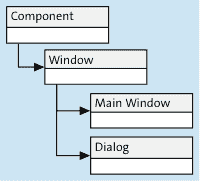

**图 18.1** 经典继承。


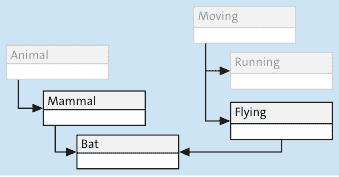

**图 18.2** 多重继承。

## 18.4.1 实践中的多重继承

尽管我主张下面的示例最好实现为 has-a 关系，但它仍然可以作为多重继承的 is-a 关系示例。

这里的基类是一个时钟和一个日历，它们组合成一个带日历的时钟。² 在[清单 18.13](#)中，你首先看到一个简单的时钟，你可以初始化、显示它，并让它每秒前进一次。

我在这里给出了[清单 18.13](#)中的简短示例。在第[15章](#)的[清单 15.3](#)中，你可以看到通过多写一点代码使示例更加类型安全的改进，特别是为了防止交换构造函数参数时出错。

```cpp
// https://godbolt.org/z/xoef1nTs
// Parameters must be valid values of the respective unit.
#include <iostream>  // ostream
#include <iomanip>   // setw, setfill
#include <format>
using std::ostream; using std::format;
class Clock {
protected:
    int h_, m_, s_;
public:
    Clock(int hours, int minutes, int seconds)
      : h_{hours}, m_{minutes}, s_{seconds} {}
    void setClock(int hours, int minutes, int seconds) {
        h_ = hours; m_ = minutes; s_ = seconds;
    }
    friend ostream& operator<<(ostream& os, const Clock& c) {
        return os << format("{:02}:{:02}:{:02}", c.h_, c.m_, c.s_);
    }
    void tick() { // +1 second
        if(s_ >= 59) {
            s_ = 0;
            if(m_ >= 59) {
                m_ = 0;
                if(h_ >= 23) h_ = 0;
                else { h_ += 1; }
            } else { m_ += 1; }
        } else { s_ += 1; }
    }
};
```

> ² “多重继承”，Bernd Klein，http://www.python-course.eu/python3_multiple_inheritance.php

**清单 18.13** 时钟和日历的组合产生了一个带日历的时钟。

使用这个时钟非常简单：

```cpp
int main() {
    Clock clock{ 23, 59, 59 };
    std::cout << clock << '\n'; // Output: 23:59:59
    clock.tick();
    std::cout << clock << '\n'; // Output: 00:00:00
}
```

日历也同样简单：

```cpp
// https://godbolt.org/z/56Ec35T7f
// ... includes and usings ...
struct Calendar {
    int y_, m_, d_;
    static const std::vector<int> mlens_;
    bool leapyear() const {
        if(y_ % 4 != 0) return false;
        if(y_ % 100 != 0) return true;
        if(y_ % 400 != 0) return false;
        return true;
    }
public:
    Calendar(int year, int month, int day)
      : y_{year}, m_{month}, d_{day} {}
    void setCalendar(int year, int month, int day) {
        y_ = year; m_ = month; d_ = day;
    }
    friend ostream& operator<<(ostream& os, const Calendar& c) {
        return os << format("{:04}-{:02}-{:02}", c.y_, c.m_, c.d_);
    }
    void advance() { // +1 day
        auto maxd = mlens_[m_-1];   // 0-based vector
        if(m_ == 2 && leapyear())
            maxd += 1;              // February in a leap year
        if(d_ >= maxd) {
            d_ = 1;
            if(m_ >= 12) { m_ = 1; y_ += 1; }
            else { m_ += 1; }
        } else { d_ += 1; }
    }
};
const std::vector<int> Calendar::mlens_ = {31,28,31,30,31,30,31,31,30,31,30,31};
```

**清单 18.14** 一个简单的日历类。

借助 `advance`，你可以前进到下一个有效日期。请注意，这里我让日和日期都从 1 开始（这样便于输出），而不是像其他一些 API 那样从 0 开始。让我们简单测试一下日历：

```cpp
int main() {
    Calendar cal(2024, 2, 28);
    std::cout << cal << '\n'; // Output: 2024-02-28
    cal.advance();
    std::cout << cal << '\n'; // Output: 2024-02-29
    cal.advance();
    std::cout << cal << '\n'; // Output: 2024-03-01
}
```

现在我们有了两个实用但独立的类。日历时钟现在同时包含两者。

```cpp
// https://godbolt.org/z/zh5cPG7TK
class CalendarClock : public Clock, public Calendar {
public:
    CalendarClock(int y, int m, int d, int hh, int mm, int ss)
    : Calendar{y,m,d}, Clock{hh,mm,ss} {}
    void tick() {     // +1 second
        auto prev_h = h_;
        Clock::tick();    // Call base class method
        if(h_ < prev_h) { // if new day
            advance();    // ... advance calendar
        }
    }
    friend ostream& operator<<(ostream& os, const CalendarClock& cc) {
        operator<<(os, (Calendar&)cc) << " ";   // Call free function
        operator<<(os, (Clock&)cc);             // Call free function
        return os;
    }
};
```

**清单 18.15** 日历时钟既是日历也是时钟。

在这里，我也允许自己快速测试一下：

```cpp
int main() {
    CalendarClock cc{ 2024,2,29, 23,59,59 };
    std::cout << cc << '\n';  // Output: 2024-02-29 23:59:59
    cc.tick();
    std::cout << cc << '\n';  // Output: 2024-03-01 00:00:00
}
```

`cc.tick()` 调用指的是在 `CalendarClock` 中新定义的方法。不过，也可以使用 `cc.advance()` 调用从 `Calendar` 公有继承来的方法。

你有没有注意到，`CalendarClock` 中的 `tick()` 已经覆盖了 `Clock` 中的 `tick()` 方法？现在要访问原先被覆盖的 `tick()` 已经没那么容易了。要做到这一点，你必须通过 `Clock::tick()` 显式指定你想要哪个 tick。

自由函数也是如此。`operator<<` 现在对我们这个小层次结构中的所有三个类都进行了重载。在为 `CalendarClock` 实现这个函数时，我想访问已经存在的 `Calendar` 和 `Clock` 的实现。这里的函数之间并没有因为来自不同的类而有所不同：它们是自由函数。

区别在于重载——更具体地说，在于第二个参数的类型。总的来说，为我们的类声明了以下重载：

```cpp
ostream& operator<<(ostream& os, const Calendar& cc);
ostream& operator<<(ostream& os, const Clock& cc);
ostream& operator<<(ostream& os, const CalendarClock& cc);
```

在清单 18.15 中，有一个 `CalendarClock&`。我通过对参数进行强制转换（即转换类型）让编译器选择其他重载。与简单继承层次结构一样，这在多基类的情况下也适用。于是，下面的代码依次调用了两个基类的重载：

```cpp
operator<<(os, (Calendar&)cc) << " ";
operator<<(os, (Clock&)cc);
```

> **从基类调用代码**
>
> 如果你确实需要引用基类的某个成员，可以通过不同的方式来实现：
>
> - 将基类作为标识符的前缀，如 `Clock::tick()`。
> - 或者将引用强制转换为基类的引用，如 `operator<<(os, (Clock&)cc)`。这也适用于指针。
>
> 这种通用方法在多重继承中尤其有用。

## 18.4.2 指针类型转换的注意事项

在技术层面上，处理多重继承时有一个你需要有所准备的意外：对象的指针值在转换时可能会改变。

```cpp
// https://godbolt.org/z/oc7jsbrEK
#include <iostream>
using std::cout;
struct Base1 {
    virtual void f1() {}
};
struct Base2 {
    virtual void f2() {}
};
struct Derived : public Base1, public Base2 {
    virtual void g() {};
};
void compare(void* a, void* b) {
    cout << (a==b ? "identical\n" : "different\n");
}
int main() {
    Derived d{};
    auto *pd = &d;
    cout << pd << '\n';             // for example 0x1000
    auto pb1 = static_cast<Base1*>(pd);
    cout << pb1 << '\n';            // still 0x1000
    auto pb2 = static_cast<Base2*>(pd);
    cout << pb2 << '\n';            // now 0x1008!
    cout << ((pd == pb1) ? "same\n" : "different\n"); // Output: same
    cout << ((pd == pb2) ? "same\n" : "different\n"); // Output: same
    compare(pb1, pd);               // Output: identical
    compare(pb2, pd);               // Output: different
}
```

**清单 18.16** 在多重继承中，指针的值可能会改变。

这里发生了奇怪的事情。当你用 `d` 打印 `pd` 的地址时，你得到例如 `0x1000`；在你的机器上实际值当然会完全不同。所以，这就是计算机存储实例 `d` 的内存单元。

如果你在*动态类型多态*的过程中将这个指针转换到它的第一个基类，地址保持不变：你又得到 `0x1000`。这种转换不必像 `static_cast` 那样显式。其他可能性包括例如 `dynamic_cast`（无论如何你都应该准备好遇到更多意外），或者在调用接受 `Base1*` 类型参数的函数时进行隐式转换。

但如果你现在对第二个基类的指针做同样的类型转换，你会突然得到一个不同的对象地址值——例如 `0x1008`！咦，这个对象现在被存储到别处了吗？嗯，有点儿……

你通常不会注意到这一点，因为你什么时候会打印出指针的值呢？正如你在 `pd == pb2` 比较中看到的，C++ 确实认为这两个值相等——即使它们产生的输出不同。这当然是因为在比较 `Base2*` 和 `Derived*` 时，又会发生一次转换。通过这种用于比较的转换，两个值被对齐了。

但是，如果你剥夺了 C++ 转换的机会，会发生什么？你在使用 `compare` 函数时会看到这一点。两个参数都是 `void*` 类型，这是你能对 C++ 类型系统做的最糟糕的事情。这样做，你是在告诉 C++：“指针，我不在乎，我知道我在做什么。”类型信息在 `compare` 内部丢失了；现在直接比较两个指针值会发现它们是不同的。

这是怎么回事？在 C++ 中，类（或聚合体）的成员从某个特定地址开始存储。当你在简单层次结构中进行派生时，你只是在末尾添加更多成员；起始位置不会改变。这意味着，在简单层次结构中，指向各个类起始位置的所有指针都指向内存中的同一位置。

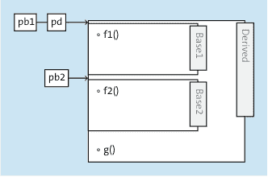

**图 18.3** 第二个基类的起始地址不同。


多继承的情况则不同。后提到的基类在内存中存储于先提到的基类*之后*，如图 18.3 所示。因此，`Base2` 子对象的地址不同于 `Base1` 子对象或整个 `Derived` 对象的地址。

当编译器拥有类型信息时，它会相应地转换指针并加上偏移量，因此你不必担心这一点。然而，如果你通过 `void*` 或 `reinterpret_cast` 进行干预，阻止编译器应用其知识，那么你就抑制了指针值的修正偏移。

在我所知道的所有实现中，这种地址修正只会在多继承中发生。从理论上讲，编译器也可能认为在其他情况下有必要进行这种修正。在这种情况下，它必须保证暗中为你完成修正，并保证在强制转换和比较时一切都能正确解析。这里真正的罪魁祸首将是 `void*` 和 `reinterpret_cast`，而你本来就应该避免使用它们，对吧？

### 18.4.3 观察者模式作为实际示例

使用简单继承时，你可以通过“横向”添加观察者接口，然后实现所有必要的方法，来实现观察者模式。

使用多继承时，你可以直接继承实现。

```cpp
// https://godbolt.org/z/EnE7Y886M
#include <iostream>
#include <vector>
using std::cout;
// == Observer Design Pattern ==
struct Observer {
    virtual void update() = 0;
};
class Subject {
    std::vector<Observer*> observers_; // not owning pointers
protected:
    void notify() {
        for (auto o : observers_) o->update();
    }
public:
    void addObserver(Observer* o) { observers_.push_back(o); }
};
// == Concrete Class ==
struct MyThing {
    int calc() { return 1+1; }
};
// == bring together ==
struct MyObservableThing : public MyThing, public Subject {
    int calc() {
        notify();
        return MyThing::calc();
    }
};
// == observe something ==
struct MyObserver : public Observer {
    void update() override { cout << "observed\n"; }
};
int main() {
    MyObserver myObserver{};
    MyObservableThing myObservableThing{};
    myObservableThing.addObserver(&myObserver);
    auto result = myObservableThing.calc(); // Output: observed
}
```

**代码清单 18.17** 使用多继承实现观察者模式。

Observer 和 Subject 类构成了*观察者模式*的框架。借助 MyThing，你的用户类开始发挥作用，而这个类本身已经完成了它应该做的事情。在这个例子中，它只计算 1+1，但你可以想象这里有一个极其复杂且已完整实现的类。

通过 MyObservableThing，你现在把两者结合起来：你既获得了 Subject 的整套管理机制，也获得了 MyThing 中程序的实际任务。你只需在正确的位置说明你实际想要观察什么。我在这里通过重写 `calc` 并用 `MyThing::calc()` 调用继承来的方法来完成这件事。通过 `notify()`，我表示：“这就是观察者应该注意到的内容。”

在 main 中，你不再看得出 MyObservableThing 是多继承类还是简单继承类。无论如何，调用 `addObserver` 都能确保 MyObservableThing 被告知所需操作。因此，`myObservableThing.calc()` 也会输出 `observed`。

## 18.5 菱形多继承：为类层次结构使用“virtual”

**图 18.3** 表明，所有基类的成员都会成为派生类的一部分。如果两个基类各自都有一个前驱类，那么这个前驱类也会成为最终类的一部分，如**图 18.4**所示。

但如果两个前驱类的基类相同呢？例如，如果 Derived1 有 Base 类，Derived2 也有 Base 类呢？那么从逻辑上讲，Base 是 Derived1 和 Derived2 两者的一部分。而如果你现在把 Derived1 和 Derived2 合并到 DerivedDerived 中，就会有两个 Base 汇合在一起。因此，DerivedDerived 包含两次 Base。你可以看到图 18.5 中展示了这种情况。

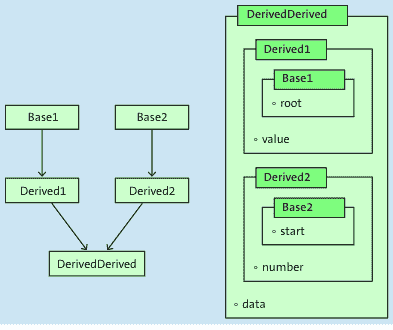

图 18.4 前驱类的成员也会成为进一步派生类的一部分。

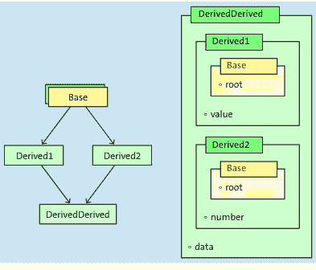

图 18.5 当一个基类被继承两次时，就会出现菱形问题。

这就有问题了。当 `DerivedDerived` 中的方法想要访问数据字段 `root` 时，它指的是哪一个？这被称为*菱形问题*或“可怕的菱形”，只要你拥有菱形继承层次结构，它就会出现。这种继承层次结构既不像简单继承层次结构那样呈链状，也不像没有重复的多继承层次结构那样呈树状，而是其中的某个基类被两个派生类同时作为祖先类提及。

你可以用 `Derived1::root` 或 `Derived2::root` 明确说明你想要哪一个。假设这里涉及的是所显示对象的颜色，你可能知道自己更喜欢某一种继承来的颜色，而不是另一种——或者也许你想把两者混合起来。到目前为止，一切还好。

然而，在许多情况下，这*不是*你想要的。例如，如果你从两边继承 `name` 作为数据字段，以及 `getName()` 和 `setName()` 方法，那么你期望该对象只有一个名字，而不是两个不同的名字。

为此，就有了*虚继承*。那个原本会出现多次的类，在指定祖先类时会额外标记 `virtual`。这确保在必要时，成员并不完全位于派生类内部，而是存储在外部——通过虚连接关联起来。当多个基类汇合在一起时，只有虚连接会被复制，而成员不会被复制。如图 18.6 所示。

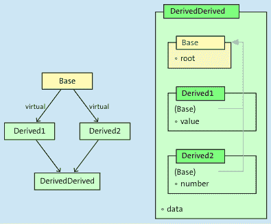

图 18.6. 虚继承解决了菱形问题。

利用虚多继承，你可以做非常精巧的事情。你可以将方法调用委托给不属于直接继承线的类——可以说是姊妹类。在代码清单 18.19 中，我为你写出了这样一个案例。

```cpp
// https://godbolt.org/z/s9xnn7c5j
#include <iostream>
using std::cout;

struct Base {                         // abstract class
    virtual void provider() = 0;
    virtual void user() = 0;
};
struct Derived1 : public virtual Base { // still abstract
    virtual void user() override { provider(); }
};
struct Derived2 : public virtual Base { // still abstract
    virtual void provider() override { cout << "Derived2::provider!\n"; }
};
struct DerivedDerived : public Derived1, public Derived2 { // concrete
};

int main() {
    DerivedDerived dd{};
    DerivedDerived *pdd = &dd;
    Derived1* pd1 = pdd; // Cast within the hierarchy
    Derived2* pd2 = pdd; // Cast within the hierarchy
    pdd->user();         // Output: Derived2::provider()!
    pd1->user();         // Output: Derived2::provider()!
    pd2->user();         // Output: Derived2::provider()!
}
```

**代码清单 18.19** 实际上，user() 在这里调用了一个姊妹方法。

Base 基类在这里定义了一个接口。它是抽象的，因为它定义了*抽象方法*——也就是定义为纯虚函数、使用 = 0 而不是函数体。Derived1 和 Derived2 这两个类各自实现了该接口的一部分，但两者仍然是抽象的。只有当它们在 DerivedDerived 中组合起来时，该类才变成具体类，不再是抽象类，因为现在所有方法都已定义。

有趣的是，在 Derived1 中，在 user() 里对 provider() 的调用会调用一个实际上只有在组合之后才被定义的方法——而且是由一个在继承层次结构中并不直接相连的类来定义。这被称为委托给姊妹类。如果你想追溯性地调整多态类的行为，这种技术可以成为一个强大的工具。


### 18.6 字面量数据类型：构造函数的“constexpr”

你已经了解了 `constexpr`，它可以让你告诉编译器在编译时评估表达式。预计算的值随后被赋给变量：

```cpp
constexpr int val = 2*12+3*6;
```

在程序中，当你使用 `val` 时，编译器会直接插入 42。对于方法和函数，`constexpr` 意味着，如果可能，函数调用会被移到编译时：

```cpp
constexpr int add1(int v) { return v+1; }
```

这意味着，如果你在源代码中编写 `add1(5)` 或类似内容，编译器可以直接将 6 写入编译后的程序，而无需在运行时做任何事情。

当你为*构造函数*提供 `constexpr` 时，情况就变得特殊了。只有这样，你才能将该数据类型用于 `constexpr` 表达式和返回值。这种数据类型随后被称为*字面量类型*。你在第 16 章的清单 16.26 中已经见过一个简短的例子。下面的清单是另一个例子。

```cpp
// https://godbolt.org/z/Kvfx9Yeox
#include <array>

class Value {
    int val_;
public:
    constexpr Value(int val) : val_{val} {}
    constexpr int get() const { return val_; }
};

constexpr Value five{5}; // works, Value is a literal data type

std::array<int,five.get()> data; // works, get is constexpr
```

**清单 18.20** 使用 `constexpr` 构造函数创建字面量数据类型。

正是因为 `Value` 的构造函数被标记为 `constexpr`，你才被允许编写 `constexpr Value five...`。这反过来又是用作模板参数的条件。如果 `five` 不是 `constexpr`，你就不能编写 `array<...five...>`。但是，`get` 也必须是 `constexpr`；否则，编译器将无法在编译时获取模板参数的值。

字面量数据类型在你还为它们定义*用户自定义字面量*时尤其有用。

```cpp
// https://godbolt.org/z/r1vYc7r5j
#include <array>
#include <iostream>
#include <type_traits> // is_literal_type
class Value {
    int val_;
public:
    constexpr Value(int val) : val_{val} {}
    constexpr operator int() const { return val_; }
};
namespace lit {
    constexpr Value operator"" _val(const char*, size_t sz) {
        return Value(sz);
    }
    struct Nope {
        constexpr Nope() {};
        virtual ~Nope() {};             // non-constexpr destructor
    };
}

int main() {
    using namespace lit;
    constexpr Value five{5};
    std::array<int, "11111"_val> data;  // use user-defined literal
    std::cout << data.size() << '\n';                    // Output: 5
    std::cout << std::boolalpha;
    std::cout << std::is_literal_type<Value>::value << '\n'; // Output: true
    std::cout << std::is_literal_type<Nope>::value << '\n';  // Output: false
}
```

**清单 18.21** 用户自定义字面量与字面量数据类型结合使用尤其有用。

你可以将 `"11111"_val` 用作模板参数，这难道不有趣吗？这是因为在返回值之前存在一条连续的 `constexpr` 表达式链。

请注意，你只能将特别简单的类（带有 `constexpr` 构造函数）变成字面量数据类型。例如，所有数据字段也必须是字面量类型。（非 `constexpr`）析构函数会阻止这种用法。

顺便说一下，你可以使用类型特征 `is_literal_type` 来检查某个类型是否适合作为字面量数据类型。在示例中，你可以通过 `Nope` 看到这一点。

## 第 19 章：优秀代码，五段：经典面向对象设计

### 本章提要

- **面向对象编程（OOP）**：面向对象编程。
- **SOLID**：五个重要 OOP 原则的首字母缩写，有助于大型项目的设计。
- **单一职责原则（SRP）**：一个类应该只有一个改变的理由。
- **开闭原则（OCP）**：类、函数和模块应该对扩展*开放*，但对修改*关闭*。
- **里氏替换原则（LSP）**：派生类型的实例应该能够替换基类型的实例。
- **接口隔离原则（ISP）**：不应强迫任何客户端依赖于它不使用的方法。
- **依赖倒置原则**：模块应该依赖于抽象，而不是其他模块。
- **协变**：返回类型可以比超类型的返回类型更具体。
- **逆变**：参数可以比超类型的参数更一般。
- **模型-视图-控制器（MVC）**：MVC 是一种流行的架构模式。

在*第 15 章*中，你已经了解了如何使用*继承*在 C++ 中从类派生类。我还非常简要地解释了*面向对象编程*的一些核心概念，特别是*has-a* 关系和*is-a* 关系之间的区别。

然而，OOP 还有更多内容：

- **抽象**：你找到对象之间的共性，尽可能通用地定义它们的方法和函数。
- **类**：类定义了一类对象的共性。这个概念在 C++ 中通过类来体现。
- **封装**：当你将元素组合成一个新实体时，你就形成了一个胶囊。因此，当你定义类的数据和方法时，你就是在*封装*。对象了解自身，在 C++ 中为 *this*，并且只直接操作自己的数据。
- **信息隐藏**：你选择类的哪一部分和方法应该对外可见，从而形成接口。你只暴露其他类所需的部分，不会更多。
- **继承**：一个类继承其基类的实现。这代表了 is-a 关系。
- **接口**：程序与外部的通信接口。
- **消息**：对象通过向各自的接口发送消息来相互通信。在 C++ 中，它们通过调用其他对象的方法来实现这一点。
- **对象**：数据和行为的封闭单元——在 C++ 中，是类的实例。在 OOP 中，对象的数据通常被称为*字段*或*属性*。行为在 C++ 中通过类的方法或自由函数来定义——OOP 将这两者都称为*过程*。
- **多态**：程序对不同对象表现出不同行为的能力。
- **模块化**：通过抽象和划分成类，使程序成为更易于管理的单元。

OOP 的动机是更好的程序或模块*可重用性*。抽象应该有助于用相同的程序代码解决已经解决的问题。为了实现这一点，干净的封装和信息隐藏是必要的，以最小化程序各部分之间的依赖关系。

与其在编程时修改大型全局状态的各个位和字节，不如退一步，通过发送消息来观察更大的图景。接收消息的对象负责内部细节。其他对象主要需要关注关系。

通过将代码更干净地划分并减少依赖关系，*可维护性*也随之提高。

### 19.1 C++ 中的对象

在 C++ 中，OOP 通过类来表示。类是对象的蓝图。行为首先通过方法进行编程，数据作为字段包含在类定义中，作为占位符。

当你实例化一个类时，字段会被填充具体的数据，你就得到了一个具体的对象——即类的一个实例。

实例化时，无论是作为自动变量还是动态管理，都没有关系：

```cpp
VWBus bus{ 120_kmh};                 // automatic variable
Car *modelT = new ModelT{ black, 80_kmh }; // dynamically managed
```

两者都支持多态。但是，你必须确保不会意外地按照错误的规则复制对象。如果你将 `Car` 定义为函数的值参数，那么你得到的总是 `Car`，绝不会是 `VWBus` 或 `ModelT`。

```cpp
// https://godbolt.org/z/71fE4zKhj
class Car { };
class VWBus : public Car { };
class ModelT : public Car { };
void letDrive(Car vehicle) {       // Value parameter copies only base class
void letDrive(Car &vehicle) {      // Reference parameter
void letHonk(Car *vehicle) {       // Passed as pointer
int main() {
    VWBus bus{ };                  // automatic variable
    Car *modelT = new ModelT{ };   // dynamically managed
    letDrive(bus);                 // gets copied to Car
    letDrive(*modelT);             // gets copied to Car
    letDrive(bus);                 // remains VWBus
    letHonk(*modelT);              // remains ModelT
    letHonk(&bus);                 // remains VWBus
    letHonk(modelT);               // remains ModelT
}
```

**清单 19.1** 引用调用是多态的基础。

因为参数在 `letDrive()` 中被定义为值参数，C++ 使用复制构造函数进行复制。而*如何*复制的责任在于 `letDrive()` 内部所需的对象——即 `Car`。因此，这里使用的是 `Car` 类的复制构造函数。但它只知道如何复制 `Car`，不知道如何复制 `VWBus` 或 `ModelT`。

然而，如果你将引用传递给像 `letBrake()` 这样的函数，则无需复制任何内容，因此车辆始终保持其外部的确切类型。


将参数指定为指针与引用有些类似。这里，只有指针本身是值参数，在进入`letHonk`函数时被复制。对象本身，`bus`或`modelT`，保持不变。

> **“动态多态”不同于“动态对象”**
>
> 在C++中，你并不一定需要*动态对象*（使用`new`创建）来实现*动态多态*。关键在于你不要按值传递对象——即作为参数传递或返回它们。

## 19.2 面向对象设计

以面向对象的方式设计软件项目是困难的——甚至非常困难。在本书中，我只能给你一点帮助。你会在本书的其他部分找到技术手段。而方法论则另需其他书籍，足足能装满几书架。不过，我想给你一些对我自己的设计有帮助的技巧。

当你在抽象、设计类、形成封装时，你应该经常问自己关于你的设计：“我在这里做的是面向对象的吗？”你很难100%回答“是”。然而，你只应该抽象到足以干净地解决当前问题的程度。

你可以找到线索来判断自己是否仍在正轨上。基于*单一职责、开闭、里氏替换、接口隔离、依赖倒置*（SOLID）原则反复质疑我的设计对我有帮助，或者使用缩写SRP、OCP、LSP、ISP、DIP。

### 19.2.1 SOLID

在详细讨论每个原则之前，我先概述这五个原则：

- **单一职责原则**  
  一个类应该只有一个职责，因此也只有一个需要修改的原因。这条著名规则由罗伯特·C·马丁（“鲍勃大叔”）首次提出。它规定了何时应该修改类的*源代码*。他将源代码变更的一个原因定义为属于类的*职责*的变化——而一个类应该只有*一个*职责。他的例子是一份报告，其*内容*和*呈现*都会变化。这是两个职责，因此应该由两个类来处理。这一规则的具体实现可以在*模型-视图-控制器*（MVC）概念或更新的*模型-视图-视图模型*（MVVM）方法中找到。

- **开闭原则**  
  类、函数和模块应该对扩展*开放*，但对修改*关闭*。例如，一个类可能允许扩展其功能而无需修改其自身源代码。抽象接口的应用源于这一原则：它们定义了一个纯接口（实际上是一组函数声明），并在不同的类中多次实现它。这可以通过继承、动态多态和虚函数有效地实现。在C++中，你还可以使用一些更少动态的手段，比如函数重载、模板特化和类型萃取，或动态库。从Java转过来的人可能会觉得这种不那么动态的方式不太熟悉，但它至少同样强大。

- **里氏替换原则**  
  如果VwBus是Car的子类型，那么你可以用VwBus的实例替换Car类型的对象，而不会改变Car的属性。因为Car需要做什么呢？什么也不需要。派生对象还可以露营，但Car并不要求这一点。所以实际上在需要Car的任何地方，你都可以使用VwBus。对于C++，这可以更实际地表述为：使用指向基类的指针或引用的函数，必须在不知情的情况下也能处理派生类。

- **接口隔离原则**  
  接口的干净分离确保用户不依赖于他们不需要的方法。你应避免包含许多方法的接口，而是将它们拆分为更小、更具体的接口，这样用户只需要了解他们真正感兴趣的方法。如果确有必要——例如在重构过程中——你之后可以以不同的方式切分、拆分和重排大型类，而只有少数调用者会注意到。设计良好的接口有助于测试，因为你的系统耦合度更低。

- **依赖倒置原则**  
  目标是让高层模块独立于低层模块。你可以通过让双方都使用一个抽象层来实现这一点，该抽象层将两个模块层彼此解耦。这里再次以MVC为例：与其构建一个与数据紧密耦合的GUI，不如将两者分离为（数据）模型和视图，然后在两者之间构建一个包含许多抽象类的控制器来连接两者。

> **模型-视图-控制器**
>
> 这种广泛使用的架构模式将程序分解为三个组件，它们以比“万物互联”更受控的方式进行通信。*控制器*控制*视图*（呈现）和*模型*（数据模型）。呈现应独立于数据的存储方式，而存储数据也与所使用的视图无关。
>
> 例如，想象你在Oracle数据库中实现数据存储，并用HTML实现网站的呈现。控制器将两者结合在一起，一切就都能正常工作。

当MVC达到最优工作时，你可以替换模型层，使数据现在可能由亚马逊或谷歌存储在云端。或者你可以将呈现替换为手机移动应用。

理论上，这一切听起来清晰而简单。在实践中，你会反复遇到试图打破这种架构的障碍。对于某些问题，你必须用观察者来补充这种干净的分离，或者通过以不同方式切分组件来采取完全不同的方法——正如MVVM所做的那样。

### 单一职责原则

为什么一个类应该只有单一职责？有多个原因。第一个原因已经体现在该规则的小标题中，即它应该只有一个修改源代码的理由。

软件开发是什么样的？在较大的项目中，不同的团队负责软件的不同部分。不同的人处理不同行为的可能性很高。如果不同的行为被放在不同的类中，程序员就不太可能相互妨碍。

在另一个层面上，程序各部分不需要一起安装到实时系统中。通过干净分离的模块，一次只需要将一个模块投入使用。同样的论证也简化了测试。

遗憾的是，找出类或模块的*那一个*责任要比勾选清单复杂得多。找出变更原因的一种方法是识别类的“客户”。那些在你程序或系统的特定领域请求变更的人，就是这些客户的理想候选者。那些从类中受益的人会请求变更。以下是一些模块和典型的可能客户：

- **持久化**  
  客户包括数据库管理员和软件架构师。

- **报告**  
  客户包括会计和企业管理人员。

- **薪资计算**  
  会计师、经理和律师是潜在客户。

- **图书馆目录中的搜索模块**  
  图书管理员或图书馆访客是客户。

在软件中将具体角色分配给实在的个人是困难的，但很有帮助。实际的个人通常可以（同时）承担多个角色。相反，在较大的系统中，一个角色也可以由不同的实在的个人来填充。

反过来，在系统中发现和定义角色也很困难。作为一个中间步骤，引入了*参与者*。一个实在的人由一个抽象的参与者表示，而这个参与者反过来又是

```cpp
    auto find(Book& book) { /* Shelf number/Book number */
        catalog.findBookBy(book.getTitle(), book.getAuthor());
    }
};
```

**清单19.3** 参与者的变更通常只发生在一个类中。

BookFinder类现在是图书管理员感兴趣的类。Book类则是读者感兴趣的类。当然，*find*方法可以通过多种方式实现——这里为简单起见，只使用标题和作者。但重要的是，如果图书馆管理的需求发生变化，这主要涉及BookFinder类；Book类不应受到影响。另一方面，如果为读者添加了一个内容摘要的方法，那么这个变更可能不会影响BookFinder。

### 开闭原则

这一原则的信条是，功能的扩展不应要求对现有源代码进行*修改*，而应该只编写使用现有代码的附加代码。

在Java、C#和C++等现代语言中，这至少可以在两个层面上发生：

- 由编译器组合成完整可执行程序的源代码
- 在运行时动态加载的模块——在Java中是可互换的`*.jar`文件，在C++中是动态链接库（DLL）或`*.so`文件形式的动态库

后者特别有用，因为它使我们能够处理程序，甚至可能无需重启或从头重新部署（*重新部署*）。在运行时添加新的DLL也是可以想象的，这意味着你可以在不必完全替换任何现有部分的情况下这样做。

从理论上讲，OCP非常简单。两个User和Logic类之间的简单关系，即“User使用Logic”的直接关系，违反了OCP。如果我们需要第二个Logic类，而User应该能够使用其中一个或另一个，那么不可避免的是User和Logic都必须调整，因为这里的连接是直接的。

这个问题可以通过明确定义并单独实现的接口来解决：定义一个LogicInterface接口，然后User类使用并与它交互。该接口现在由两个Logic类具体实现，每个User实例可以通过指针或引用选择两个具体实现之一。

下面的示例乍一看并不差，实际上在实践中也经常这样处理。然而，在开闭原则方面，可以很容易地通过继承和接口加以改进。


```cpp
// https://godbolt.org/z/xVtsveGjT
#include <vector>
#include <memory>        // unique_ptr
#include <iostream>      // cout
enum class ShapeTag { CIRC, RECT };
struct Shape {             // Data
    ShapeTag tag_;
    double v1_, v2_;
    Shape(double w, double h) : tag_{ShapeTag::RECT}, v1_{w}, v2_{h} {}
    Shape(double r) : tag_{ShapeTag::CIRC}, v1_{r}, v2_{0} {}
};
class AreaCalculator {     // Logic
public:
    double area(const std::vector<std::unique_ptr<Shape>>& shapes) const {
        double result = 0;
        for(auto &shape : shapes) {
            switch(shape->tag_) {
                case ShapeTag::CIRC:
                    result += 3.1415 * shape->v1_ * shape->v1_;
                    break;
                case ShapeTag::RECT:
                    result += shape->v1_*shape->v2_;
                    break;
            }
        }
        return result;
    }
};
int main() {
    std::vector<std::unique_ptr<Shape>> data{};
    data.push_back(std::make_unique<Shape>(10.));        // a circle
    data.push_back(std::make_unique<Shape>(4., 6.));    // a rectangle
    // calculate
    AreaCalculator calc{};
    std::cout << calc.area( data ) << "\n";
}
```

**清单 19.4** 未遵循开闭原则。

这里的 Shape “类”是一个纯数据类。这里的数据意味着存储的是矩形或圆。具体是哪一种由 tag_ 指示。根据圆只需要一个表示半径的数据元素，而矩形需要两个表示高度和宽度的数据元素，因此对于尺寸规格，要么只有 v1_ 相关，要么 v1_ 和 v2_ 都相关。

程序或业务逻辑与数据清晰地分离。`AreaCalculator` 中的 area 方法计算一个向量中所有面积的总和。为此，它必须检查每个 `Shape` 的 `tag_`，然后决定使用圆的面积公式还是矩形的面积公式。

## 为什么用 “unique_ptr”？

这个示例使用 `vector<Shape>` 代替 `vector<unique_ptr<Shape>>` 也能工作。但由于下一个示例需要指针（或引用），我在这里引入它们。

如果出现这样的需求：添加另一个派生自 `Shape` 的类型——比如 `Triangle`——那么你必须做以下事情：

- 向 `ShapeTag` 枚举中添加一个新条目。
- 让类 `Shape` 适合三角形的尺寸规格。
- 用新的面积公式扩展 `AreaCalculator::area` 中的区分逻辑。

开闭解决方案做得更好：

- 对象隐藏其数据并知道自己的行为。
- 抽象基类定义了一个接口，逻辑针对该接口开发。

```cpp
// https://godbolt.org/z/M6hsYa7or
#include <vector>
#include <memory>    // unique_ptr
#include <iostream>  // cout
struct Shape {
    virtual ~Shape() {}
    virtual double area() const = 0; // abstract
};
class Rectangle : public Shape {
    double w_, h_;
public:
    Rectangle(double w, double h) : w_{w}, h_{h} {}
    double area() const override { return w_ * h_; }
};
class Circle : public Shape {
    double r_;
public:
    Circle(double r) : r_{r} {}
    double area() const override { return 3.1415*r_ * r_; }
};
class AreaCalculator { // Logic
public:
    double area(const std::vector<std::unique_ptr<Shape>>& shapes) const {
        double result = 0;
        for(auto &shape : shapes) {
            result += shape->area();
        }
        return result;
    }
};
int main() {
    std::vector<std::unique_ptr<Shape>> data{};
    data.push_back(std::make_unique<Circle>(10.));        // a circle
    data.push_back(std::make_unique<Rectangle>(4., 6.));  // a rectangle
    // calculate
    AreaCalculator calc{};
    std::cout << calc.area( data ) << "\n";
}
```

**清单 19.5** 遵循 OCP。

这里的 Shape 类是*接口*，然后由数据类实现。你看到 AreaCalculator 正是针对这个接口实现的吗？area 方法并不接收一堆 Rectangle 或 Circle，而是接收 Shape。

接口的特征在于它不提供实现，只描述函数声明。Shape 通过将所有方法声明为纯虚函数（即 virtual 和 = 0）来做到这一点。在其他语言中，这称为抽象方法。至少有一个抽象方法的类称为抽象类。仅包含抽象方法的抽象类称为签名类。这个术语在其他语言中不太为人所知。在 Java 中，这样的类称为接口。（Java 接口也可以包含带有默认方法的实现，这里我将忽略这一点。）

### 动态多态

> area() 方法不能将 Shape 作为值参数，因为那样参数会按照 Shape 的规则被复制——也就是说，被切片，如清单 19.1 所示。出于同样的原因，vector<Shape> 也是不允许的，因为最终只会把切片后的副本放入其中。而且因为 Shape 是抽象类（一个带有 = 0 的虚方法的类），编译器也会报错。
>
> 因此，vector 存储指向 Shape 实例的指针。为了自动完成清理，我直接使用 unique_ptr，但这是附带的事情。unique_ptr 现在允许*动态多态*：每个指针都知道它指向的是 Rectangle 还是 Circle。当我调用 area() 时，会*动态地*调用正确的方法——但仅仅是因为该方法用 virtual 标记了。你可以在第 15 章阅读其工作原理。

在示例中，`Rectangle` 和 `Circle` 各自派生自 `Shape`。如果其中一些类有其他接口怎么办？你可以通过多重继承简单地添加这些接口，参见第 18 章。我建议在 C++ 中以 Java 为范例，并且只对签名类使用多重继承；最多只能有一个祖先是非签名类。我在这里重复这一点，因为我觉得它非常重要。

> **OCP 和 SRP 密切相关**
>
> 非常常见的是，违反 SRP 的同时也伴随着违反 OCP，反之亦然。只需要局部更改的代码很可能只会导致模块的替换。通过接口清晰划分的系统也更可能按职责清晰划分。

## 里氏替换原则

像 `VanBus` 和 `Car` 这样的车辆听起来清晰且合乎逻辑，但在实践中常常是绊脚石。这不仅仅是关于类型关系，还关于它们的行为。重写方法允许抛出不同的异常吗？参数和返回值可以有哪些限制（例如，允许 null 吗）？一个 `final` 方法如果调用了任何其他非 `final` 方法，是否就已经违反了 LSP？在复杂的层次结构中，人们常常必须问是否违反了 LSP。通常，事情并不那么简单，只有常识能帮忙。

一个例子，甚至是*那个*经典的 LSP 违反例子，围绕矩形和正方形的几何形状展开。直观上，人们可能会构建一个类层次结构，其中 `Rectangle` 是基类，`Square` 是派生类，因为正方形*是一个*矩形，对吧？

```cpp
// https://godbolt.org/z/rc67xWWFT
#include <iostream>
struct Point { int x, y; };
class Rectangle {
protected:
    Point origin_; int width_; int height_;
public:
    Rectangle(Point o, int w, int h) : origin_(o), width_(w), height_(h) {}
    virtual void setHeight(int height) { height_ = height; }
    virtual int getHeight() const { return height_; }
    virtual void setWidth(int width) { width_ = width; }
    virtual int getWidth() const { return width_; }
    virtual int getArea() const { return width_ * height_; }
};
class Square : public Rectangle {
public:
    Square(Point o, int wh) : Rectangle(o, wh, wh) {}
```

```cpp
struct Base3 {
    virtual vector<B>& func();
};
struct Derived3 : public Base3 {
    virtual vector<D>& func() override; // vector<D>& is not covariant
};
struct Base4 {
    virtual vector<B>*& func();
};
struct Derived4 : public Base4 {
    virtual vector<D>*& func() override; // different type, not covariant
};
```

**清单 19.6** 返回类型的协变。

在 Derived1 中，C++ 允许重写的 func() 方法使用 D& 返回类型。这与 B& 是协变的，就像 Derived1 与 Base1 是协变的一样。如果返回的是值类型而不是像 Derived2 中的 D 那样的引用，那么这*不是协变的*，因为返回值会被*切片*。这也可以应用于 vector<D>& 返回类型：容器中的每个单独值都会被切片，即使返回本身是引用。

在 Derived4 和 Base4 层次结构中，vector<D>*& 与 vector<B>*& 也*不是协变的*。在 C++ 中，这些是完全不同的类型，彼此不相关。如果你遇到这种情况，可以选择 vector<B>*& 作为重写方法的返回类型，这是可以接受的。但是，请注意 LSP 不仅适用于类型系统，也适用于整体行为。

## 接口隔离原则

SRP 关注的是参与者和高层架构。OCP 处理类设计和可扩展性，LSP 处理子类型和继承。ISP 对组件和业务逻辑的通信做出规定。

在所有模块化程序中，必须有某种用户可以依赖的接口。这些可以是真实对象，它们通过签名类以类型安全的方式呈现其接口。为此有经典的设计模式，例如外观模式。它们旨在规范用户与模块的通信。

ISP 关注的是模块应如何向外部呈现其接口。

考虑从模块中具有应被他人使用的功能开始。例如，我可以用*图 19.1*中的方法来标识接口。

如果我这样开始，很可能导致模块以以下两种方式之一实现：


- 我可以编写一个庞大的类，实现 Vehicle 接口的所有方法。单是这个类的巨大体量就应该告诉你，不应走这条路。
- 相反，我可以编写许多小类，比如 LightControl、SpeedControl 和 Entertainment，每个类都实现整个接口，但实际上只覆盖对自己有用的部分——例如，在所有不支持的方法中返回 *未实现*。

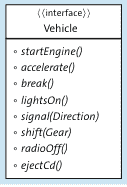

图 19.1 这些可能是一个“Car”类的方法。

显然，这两种选择都不适合用于实现该模块。

换个方式试试：我把这个大接口拆分成几个更小的专用接口，例如分别处理速度控制或娱乐电子设备的接口，如图 19.2 所示。

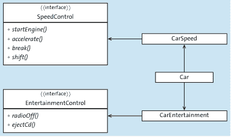

图 19.2 更小的接口可以分别实现。

然后，实现这些接口的类可以用于多种类型的车辆，例如图 19.2 中的 Car。在这里，Car 使用 CarSpeed 和 CarEntertainment 实现，并通过这些实现依赖于 `SpeedControl` 和 `EntertainmentControl` 接口。

实际上，认为 `Car` 依赖 `CarSpeed` 和 `CarEntertainment` 实现来最终提供 `SpeedControl` 和 `EntertainmentControl` 接口，这是一种奇怪的视角。图 19.3 更好地说明了这一设计。

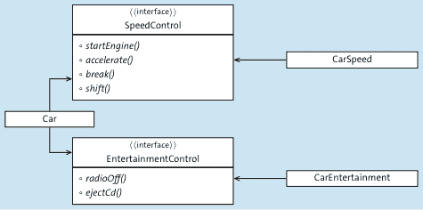

**图 19.3** 接口属于使用者，而不是实现。

这从根本上改变了对架构的视角！`Car` 变成了*使用者*，而不是*实现*。

而且，尽管有了这些专用接口，我仍想为用户提供利用整个模块功能的手段——通过 `Vehicle` 类型的对象。因此我继续提供 `Vehicle` 接口，它联合了各个子接口。这是向 `BusStop`、`TollRoad` 和 `Driver` 等其他程序部分提供全部功能的最简单方案。

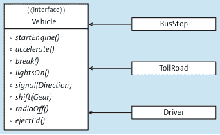

**图 19.4** 大接口没有被清晰地划分。

这会让事情更难。在这种情况下，至少提供若干小接口而不是少数大接口是好的，这样用户就可以挑选最符合自身需求的接口，如 [图 19.5] 所示。

这会导致一定程度的重复。然而，接口只是方法的*定义*。模块内部的实现并不会重复。实际重复的数量很少且可控。

在一定程度上，C++ 通过多重继承为你提供了一种解决方案。你可以通过更仔细地划分接口，并期望用户在一定程度上同时使用多个接口，从而将各个接口中重复的方法降到最低。然而，由于多种原因，这在实践中很困难。提醒一下，这里的多重继承是指一个类从多个基类继承*实现*。它并不意味着一个类只从多个基类继承*接口*。一方面，多重继承在技术和思维上都是挑战。另一方面，模块内部的实现类有时需要同时使用多个接口才能被有意义地实现。在这种情况下，通常更好的做法是提供一个组合了这些功能的接口。这样实现和使用者都可以直接使用它。

对于 ISP，关键在于始终考虑使用者的需求。把他们的需求当作我们自己的需求，最终会改进我们自己的代码，并从长远来看让编程生活更轻松。

## 依赖倒置原则

Robert C. Martin 对该原则的定义如下：

- 高层模块不应依赖低层模块。二者都应依赖抽象。
- 抽象不应依赖细节；细节应依赖抽象。

在许多应用中，一切最终都依赖其他一切。业务逻辑查询数据库；它自己构造数据对象；GUI 使用业务逻辑，而业务逻辑又试图间接控制 GUI；如此等等。这是因为这是事物的自然形态。当我打开一个 GUI 对话框时，我使用数据；当业务逻辑说某个操作被禁止时，它会使用 GUI，例如将按钮置灰。

必须付出额外努力来减少这些依赖——其中大部分存在于思维之中。必须把视角颠倒过来。然而，这样做极其重要。实现了 DIP 的项目可以在更长的时间内以合理的投入继续开发，因为组件之间的连接变得更松散，不会纠缠在一起。

关键点在于依赖所指的方向，如你在 [图 19.6] 中所见：

- GUI 或对外提供的服务只依赖业务逻辑。业务逻辑配备抽象接口，而 GUI 可以是具体的。因此，GUI 只是项目中的一个小细节，而不是其他事物严重依赖的对象。这尤其有用，因为 GUI 往往相当易变。
- 对象的存储也依赖业务逻辑，而不是反过来。底层是哪个数据库，甚至是否使用文本或 XML 文件，都无关紧要。对象存储方式的改变不会影响业务逻辑。
- 实例的创建方式尤其有用。这也不在业务逻辑内部发生。让创建过程独立的好处是，它也可以单独改变。这样就能创建简单的工厂来帮助生成实例。一旦这些实例被创建，它们就在业务逻辑中完成自己的工作。

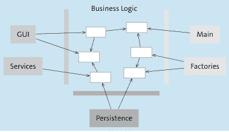

图 19.6 各层互不依赖。

严格遵循 DIP 会带来以下结果：

- 你几乎会被迫同时遵守 OCP。
- 你分离职责，因而遵守 SRP。
- 它引导你正确使用继承，因而应用 LSP。
- 你会更容易将接口与实现分离。反过来，这也让实现 ISP 原则变得更容易。

于是，循环闭合了。这五项原则相互补充、相互依存。DIP 通过防止程序代码纠缠在一起，把这些原则维系在一起。

### 19.2.2 不要 STUPID

有时提一下坏例子也有帮助。我特意在简要解释 SOLID 之后才提到这些，因为我觉得始终先描述正确的方法更好。这里我也会保持简短，因为我列举的主要目的是帮助你识别陷阱，并知道什么时候可能走错了路。

这里还有另一个首字母缩略词。STUPID 描述的是那些你应该停下来、也许重新思考设计的情形。[^1]

- **单例（Singleton）**  
  一个只有一个实例的类，常被称为*伪装的全局变量*。单例存在争议，其使用常被称为*反模式*。
- **紧耦合（Tight coupling）**  
  组件之间的紧耦合绝对不好，并且会破坏若干 SOLID 原则。
- **不可测试性（Untestability）**  
  你无法测试的东西，就无法修改，也无法确定是否已经完成。只有能够测试，你才能重构。测试越自动化，修改代码就越容易。
- **过早优化（Premature optimization）**  
  不要陷入不必要的细节。只有在有回报时才处理改进。或者更极端地说，如果你在犹豫是否要优化，请遵循这些规则：第一，不要做。第二（仅限专家），现在还不要做。对于性能优化尤其如此。在架构问题上，你会发现，只要编写适当的测试，就会带来更好的架构，而关于这个架构决策是否正确的问题也不再出现。
- **无描述性命名（Indescriptive naming）**  
  `field1` 到 `field99` 是什么？好的命名比注释更重要。
- **重复（Duplication）**  
  重复的代码需要维护两次，最终会自相矛盾。如果你喜欢首字母缩略词，那就保持 DRY——也就是*不要重复自己*。当重复即将出现时，进行重构。

一如既往，有时存在例外理由。并非每个全局变量、每个单例都是坏的。GUI 天生难以测试，而且有些重复会简化设计。但例外不应成为借口，也不应变成规则。

[^1]: “From STUPID to SOLID Code!”，William Durand，2013-08-30，https://williamdurand.fr/2013/07/30/from-stupid-to-solid-code/，[2024-08-12]


## 第三部分：高级主题

第二部分主要讨论了面向对象编程中那些显而易见的方面，正如你可能从 Java 或其他语言中了解到的那样。然而，虚函数、继承，甚至类和方法，并不是实现可扩展性、封装性和多态性的唯一方式。可以说，如果你愿意付出努力，也可以用 C 语言以面向对象的方式编程。

本部分不讨论其他方式是否也能通向面向对象，而是向你展示在目前已讨论内容之外的可能性，以便设计程序并使用 C++ 语言的其他工具。你可以省略经典面向对象编程中的一些元素，并用其他手段取而代之，从而在获得某些优势的同时实现类似的结果。

我将从通往 C++ 祖先的桥梁开始，也就是 C 的指针和宏。通过对 C++ 模板的讲解，我们最终会接触到函数式编程的一些元素；C++ 从函数式编程中借鉴了一些东西，从而能够编写富有表现力且灵活的程序。

## 第 20 章：指针

### 本章术语

- **指针**：保存堆或栈中数据地址的变量。
- **原始指针**：类型为 `Type *`、`Type const *`（常量值）、`Type * const`（常量指针）或 `Type const * const`（两者皆为常量）的变量。
- **堆内存或简称堆**：通过 `new` 动态请求的数据所存放的位置。
- **栈内存或简称栈**：未使用 `new` 创建的对象的存储位置。
- **自动对象**：在栈上创建的对象。
- **动态对象**：在堆上创建的对象。
- **别名**：多个变量引用同一个对象。
- **对象所有权**：通过指针负责删除动态对象的变量拥有该对象。
- **new 和 new[]**：创建动态对象。
- **delete 和 delete[]**：释放动态分配的对象。
- **智能指针 unique_ptr 和 shared_ptr**：遵循 RAII 概念的标准库指针类型，可让你免于显式释放。
- **move**：将具名值转换为临时值，使其可被移动。
- **C 数组**：包含多个同类型元素，并用方括号声明的 C 数组。
- **指针算术**：在 C 数组中对原始指针进行加法、自增及类似操作。
- **C 数组退化**：C 数组在传递给函数时丢失其大小信息。
- **迭代器**：指针的抽象概念，应用于标准容器。

通过字符串，你已经与指针打过一些交道了。你一直以 `const char*` 的形式传递字符串字面量。而当你用参数调用 `main` 时，这些参数被打包成这种类型的 C 数组——也就是 `const char*[]`。在本章中，你将进一步了解这些构造。它们并不容易理解，却能实现各种有用的功能。不过，你必须正确使用它们，以免它们带来的麻烦超过益处。

当你使用指针时，距离使用动态内存也就不远了：这里的关键字是 `new`。不过，我必须立即防止一种潜在的误解：如果你使用像 `vector` 及其同类这样的标准容器，那么你已经在不知不觉中使用了动态内存。你获得了所有好处，却不必担心那些棘手的细节。因此，我想先作如下说明：在 C++ 中，中期内你无法避免指针，但你应该始终先检查替代方案。如果你甚至想自己管理动态内存，那么不要用原始指针来承担其所有权，而应使用 `unique_ptr` 和 `shared_ptr` 智能指针。

### 20.1 地址

在运行时，每一个“东西”都必须存储在某个地方。这里最重要的东西是变量。从这个意义上说，参数也是变量。其他可能不那么明显、但也需要存储在某个地方的东西是函数和方法。在 C++ 中，函数也只是某种（复杂）类型的变量。作为对比：只有编译器需要、在运行时不再存在的东西没有地址，例如类型本身以及被翻译成程序的 `*.cpp` 文件。你无法查询 `int` 或 `MyType` 的地址，也无法查询 `program.cpp` 的地址。

程序运行时，每个对象都必须存储在某个地方。为此，就有了*内存*。从技术上讲，驻留在内存中的一切都是*对象*，而如果这个对象有名字，它就是*变量*。你可以把内存想象成一条有房子的街道，每栋房子都可以存储一个对象。你的计算机只知道这一条街道，所以它只记住对象的门牌号。这些地址通常以十六进制形式给出。确切形式在这里并不重要；它在不同系统上也会有所不同。对于本章的示例，`0xab08` 及类似内容将表示地址：以 `0x` 开头，后面跟着四个或八个来自 `0123456789abcdef` 的字符（共 16 个不同字符——因此称为十六进制）。

然而，对于每种类型，都有一个对应的附加类型，它表示的不是值本身，而是该类型值的地址。例如，如果你定义变量 `int value = 42;`，那么 `value` 的类型是 `int`。`value` 的地址类型是 `int*`。现在你可以定义一个新的、属于这种附加类型的变量，用来保存 `value` 的地址：

```cpp
int value = 42;
int* pValue = &value;
```

在图 20.1 中，你可以看到这在内存中的样子。

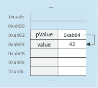

**图 20.1** 你可以把内存位置想象成街道上的房子。

第二行中 `pValue` 的定义需要解释一下。因为 `pValue` 不是 `int`，所以 `int* pValue = value;` 是不正确的；你需要的不是 `value` 的*值*，而是它的*地址*。这正是变量名前的*一元取地址运算符* `&` 所做的事。`&value` 会给出 `value` 的地址。因为 `value` 的类型是 `int`，所以 `&value` 的类型是 `int*`。因此，将 `&value` 赋给 `int* pValue` 是正确的。

### 20.2 指针

现在令人兴奋的是，通过 `*pValue`，你有了另一种访问 `value` 中值的方式。当你对 `pValue` 应用*一元解引用运算符* `*` 时，它会指向存储 42 的内存。如果你在那里写入内容，也会改变 `value` 的值。通过 `*pValue`，你拥有了 `value` 的一个*别名*：

```cpp
*pValue = 18;
cout << value << "\n"; // Output: 18
```

如果允许我继续沿用街道和房子的比喻，那么会发生以下情况：通过 `pValue`，你走到它所在的房子（`0xab02`），往里看，找到了地址 `0xab04`。使用解引用运算符 `*`，你沿着箭头前进，到达 `value` 所在的房子。赋值 `= 18` 将新值写入内存位置——也就是写入 `value`。

这与使用引用所能做的事情没有太大区别：

```cpp
// https://godbolt.org/z/4536hxvEK
int value = 42;
int& valueRef = value;   // Reference; no address operator & needed
valueRef = 18;            // no dereference operator * needed
cout << value << "\n";  // Output: 18
```

这里省略了取地址运算符 `&` 和解引用运算符 `*`，因为 `valueRef` 这个名字本身就是原变量 `value` 的别名。

但有一件事是指针能做而引用不能做的：你可以给指针赋一个新的地址。

```cpp
// https://godbolt.org/z/7GEWYeoC9
#include <vector>
#include <iostream>
using std::vector; using std::cout; using std::ostream;
ostream& printVector(ostream& os, const vector<int>& arg) { // Helper function
    for(int w : arg) os << w << " "; return os;
}

int main() {
    vector<int> values{};
    values.reserve(50);                 // Guarantee space for 50 values
    int *largest = nullptr;             // First, assume it is a special value
    for(int w : { 20, 2, 30, 15, 81, 104, 70, 2, }) {
        values.push_back(w);
        if(!largest || *largest < w) {  // Dereference to value
            largest = &(values.back()); // Remember new address; hence not nullptr
        }
    }
    printVector(cout, values) << "\n"; // Output: 20 2 30 15 81 104 70 2
    // largest now contains the address of 104:
    *largest = 999;                     // Dereference; also overwrite value
    printVector(cout, values) << "\n"; // Output: 20 2 30 15 81 999 70 2
}
```

**清单 20.1** 指针可以在其生命周期内被赋予新地址。

首先，我在这里初始化了一个没有元素的向量 `values`。指针变量 `int* largest` 应始终指向向量中最大的元素。由于向量仍为空，我用特殊的 `nullptr` 值初始化该变量，它表示“不指向任何地方”。

然后，我逐个向向量中添加一些任意数字。完成之后，我总是用 `if(...)` 检查新值是否大于 `*largest` 当前保存的值。现在危险来了，因为 `largest` 可能包含这个特殊值


nullptr 表示“不指向任何地方”。不允许解引用 \*nullptr（也就是说，对其应用 \* 或 ->）。因此，我首先检查 largest 是否仍然包含 nullptr。如果是，那么当前值肯定应该被记为 largest。我可以用 if(largest == nullptr) 做到这一点。不过，这可以简写为 if(!largest)。再结合大小比较，就变成 if(!largest || \*largest < w)。这意味着，只要 largest 仍然包含 nullptr，或者它指向的值小于 w，就会给 largest 指针赋一个新值。

如果 largest 仍然包含 nullptr，那么 || 右侧的表达式将不会被执行——这要归功于短路求值，第4章第4.3.8节在“短路求值”这一同名标题下对此进行了解释。

> **nullptr**
>
> 绝不应解引用可能包含 nullptr 的指针。应先检查它是否包含有效地址。

如果新值更大，我就用 &(values.back()) 获取当前最后一个元素的地址，并将其作为新的地址值存入 largest。在程序运行过程中，这种情况会发生在 20、30、81 以及 104 处。

如果随后我在两次输出之间用 \*largest = -999; 向 \*largest 写入一个新值，我实际上就覆盖了 vector 中的 104。你可以在输出中看到结果。

## 20.3 别名的危险

你注意到我悄悄将以下内容插入清单 20.1 了吗？

```cpp
values.reserve(50); // Ensure space for 50 values
```

这样做的原因是，我需要避免一种危险：同一个值——也就是它的内存范围——能够以不同方式被访问。这被称为别名。

vector 也会在内存中的某个位置管理其数据。它的一个特性是承诺将这些数据连续存储。然而，这意味着当你用 push_back() 添加元素时，vector 的“后部”可能没有剩余空间。但 vector 会处理这种情况：它请求一个两倍大的新内存范围，并将所有现有值复制（或移动）到新区域。最后，vector 会移除旧区域。

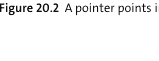

图 20.2 一个指针指向 vector 的数据内部。

```cpp
int calculate(int param) {
    vector<int> data(/*...*/);
    // ...
    return result;
}
```

在 `calculate()` 结束时，*data* 会被自动移除，无论你在函数中对它做了什么。其机制相当简单：计算机实际上管理着一个*栈*，它总是把你定义的变量放在这个栈上。编译器会跟踪栈中进入某个范围的位置——例如，用开代码块花括号 `{` 进入范围。当用闭代码块花括号 `}` 离开该范围时，栈会回退到最后一个标记的位置——见图 20.4。

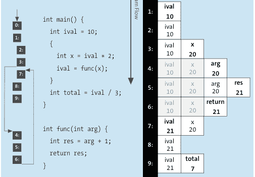

**图 20.4** 自动变量由栈管理。

因此，这个栈管理着*自动变量*。每当变量离开其作用域时，系统就会将其连同相关资源一起移除。

在图 20.4 中，你可以看到变量如何随着一条条语句在栈上被管理。图的中央是你所执行的程序；在代码行之间（左侧）显示有数字，它们用作栈快照的时间戳。各个时间戳对应的栈显示在图右侧。

变量在定义时被放到栈上，并在离开其作用域时被移除。函数参数最终也会进入栈。例如，计算机会将 `func(x)` 中的 `x` 复制到栈上。这个副本随后在 `func` 中被称为 `arg`——如栈的第 4 行所示。反过来，函数的返回值在返回时会作为栈上唯一的值保留下来（第 6 行），然后通过赋值最终进入 `ival`。

栈中灰色阴影部分还表明，`func` 只能访问栈中属于自己的那部分：`ival` 和 `x` 在函数内不可见。这里针对 `int` 内置类型展示的内容，也适用于更复杂的数据类型，例如标准容器和自定义类。

> **多功能栈**
>
> 然而，栈不仅包含变量、参数和返回值。例如，系统还会存储当它跳转到某个函数时需要返回的位置。
>
> 由于某些编程错误，可能会发生越界写入变量边界的情况——这意味着你覆盖了它的相邻数据。破坏相邻变量的值至少令人烦恼，而覆盖返回地址则是致命的。如果发生这种情况，程序很可能会在下一次机会时崩溃。
>
> 或者——更糟的是——你的程序成为黑客攻击的目标，跳转到计算机病毒的函数，而不是它自己的函数。利用编程错误以这种方式向计算机注入恶意代码，是一种常见的攻击方法。因此，始终特别小心地保护栈免受自身和他人的破坏非常重要。

### 20.4.2 堆

有些情况下，对象需要比它被定义的作用域存活得更久。这也是可能的：这时你可以*动态*创建对象。这通过 `new` 关键字完成。

`new` 本身返回一个*原始指针*，但本书已经多次警告过你这种指针。因此，对于 `new` 的结果，你首先应该做的是将其包装到*智能指针*中，例如 `unique_ptr` 或 `shared_ptr`。我将在本章后面介绍这些智能指针；在本节中，我们将讨论什么是动态内存。

用 `new` 创建的对象不会进入栈，而是进入*堆*。它会一直留在那里，直到你用 `delete` 显式移除它（智能指针会自动执行此操作）。为此，你需要它的地址，而你已经将该地址存储在指针中。

不过，你不能两次清理同一个堆对象。如果你复制指向该对象的指针并将其存储在多个位置，那么非常重要的一点是：你要恰好将其中一个指针指定为该对象的*所有者*，并将所有其他指针视为*使用者*。所有者负责在适当的时候用 `delete` 移除它。对于原始指针，不幸的是，这个所有者只存在于程序员的头脑中，并且但愿也存在于文档中。智能指针有几种变体，通过所选择的类型可以明确所有权关系。

堆分配对象的一个典型用例是：新对象需要比创建它的函数存活得更久。例如，在游戏框架中，可能有一个在按下某个按钮时需要你重写的函数，也许是 `createPlanet(const Event &evt)`。此时返回值必须是在函数内创建的 `Planet`。如果作为栈对象，它会在退出函数时被移除。一种解决方案是使用 return 按值返回它，也就是作为副本返回。

```cpp
Planet createPlanet(const Event &evt) {  // return by value
    Planet result{"Earth"};             // stack object
    result.setLocation(evt.getPosition());
    return result;                       // return creates (potential) copy
}
```

**清单 20.2** 按值返回可能创建副本。

如果这种变体在你的项目中可行，那它没有任何问题。你和编译器可以把它做成非常高性能的无副本代码。然而，有时按值返回不可行或不符合期望。在这种情况下，请使用 `new` 在堆上创建对象。

```cpp
// return as (smart) pointer:
unique_ptr<Planet> createPlanet(const Event &evt) {
    unique_ptr<Planet> result{(new Planet{"Venus"})};  // heap object
    result->setLocation(evt.getPosition());
    return result;  // passes the address
}
```

**清单 20.3** 以指针返回只会复制指针，而不会复制对象。

你将新对象的地址包装在 `unique_ptr` 中返回，这样你就不会忘记调用 `delete`。

请原谅我使用了 `unique_ptr`：我想先展示好的示例，这样你会比使用原始指针的示例记得更牢。因为从现在起，对你来说，每次用 `new` 动态创建对象都应该始终与智能指针关联。既然你已经知道如何正确操作，我将把示例精简到最本质的部分，并去掉 `unique_ptr`。但是，没有相应的 delete 就不可能有 new，因此你需要一些围绕它的代码：

```cpp
Planet* createPlanet(const Event &evt) {    // return as raw pointer
    Planet* result = new Planet{"Mercury"}; // heap object
    result->setLocation(evt.getPosition());
    return result;                           // passes address further
}
void userInteraction(Event &evt) {
    Planet* planet = createPlanet(evt);
    // ... do something with the planet ...
    delete planet;                           // raw pointers must be managed manually
}
```

## 20.5 智能指针

标准库包含一小类比原始指针更智能的指针类型。它们是完整的类，并且除其他特性外，还具有接收原始指针的构造函数。最重要的是，它们有一个析构函数，可以让你摆脱处理指针时最关键的任务：调用 `delete`。

这一族指针类型集中在 `<memory>` 头文件中，包括以下成员：

- **`unique_ptr`**  
  拥有原始指针。不可复制，因为那样会有多个实例拥有它；但可移动——例如，作为返回值。
- **`shared_ptr`**  
  拥有原始指针，但不一定单独拥有。复制时，你会得到两个管理同一原始指针的 shared_ptr 实例；只有当最后一个副本被移除时，原始指针才会被删除。
- **`weak_ptr`**  
  shared_ptr 的小兄弟，当 shared_ptr 实例相互包含时，某些情况下需要它。
- **`auto_ptr`**  
  自 C++11 起已弃用；请改用 unique_ptr。auto_ptr 不能移动；如果复制它，就会修改源对象。这并不危险，但对程序员来说出乎意料。

当我谈论智能指针时，我主要指两个最重要的代表：unique_ptr 和 shared_ptr。另外两个家伙的工作方式略有不同。

除了接收原始指针的构造函数和负责清理的析构函数之外，这两个（真正的）智能指针还有一些相似之处。也许你的类类似于 Image。

```cpp
// https://godbolt.org/z/ehhGPjabz
#include <string>
#include <vector>
class Image {
    std::vector<char> imageData_;
public:
    explicit Image(const std::string& filename) {/* Load image */}
    void draw() const {/* Paint image */};
};
```

**清单 20.4** 在以下示例中，我使用 Image 作为想要为其获取指针的类。

使用这两个智能指针时，指针类型如下所示；你还可以看到此处如何定义它：

- `unique_ptr<Image> image{ new Image("Monalisa.jpg") };`
- `shared_ptr<Image> image{ new Image("TheScream.jpg") };`

然而，必须写两次 Image 很麻烦。C++17 添加的允许从构造函数参数推导出 `<Image>` 的特性在这里没有帮助，因为它是 `Image*`。因此，有用于创建的辅助函数：

- `auto image = make_unique<Image>("MonaLisa.jpg");`
- `auto image = make_shared<Image>("TheScream.jpg");`

make_unique() 直到 C++14 才被加入，但如果你的编译器支持 C++11 的 make_shared()，它很可能也附带 make_unique()。

当你通过 image 持有智能指针实例时，可以使用以下方法：

- `get()` 方法将所包装的原始指针返回给你。当你需要将指针传递给接收原始指针作为参数的函数时，这很有用。在这种情况下，该函数只是使用者，而不是所有者。
- 一元 `operator*` 的作用类似于先调用 `get()`，再进行 `*` 解引用。因此，你可以写成 `*(image.get())`，也可以直接写成 `*image`。这两种情况下，你得到的都是 `Image&`。
- 使用 `operator->`，你可以直接访问所包装对象的成员，例如 `image->draw()`。
- 使用 `reset()`，你可以提前删除原始指针，并触发使用 `delete` 正确释放所管理对象。在 `image.reset()` 之后，`image.get()` 返回 `nullptr`。你也可以选择传入另一个原始指针作为参数，智能指针随后会取得其所有权。
- 使用 `swap(a,b)`，你可以交换内容。当复制被禁止或代价高昂时，这很重要。

### 使用“make_unique”和“make_shared”

你应该养成优先使用辅助函数构造智能指针的习惯。如果你使用构造函数并将结果传递给函数，可能会发生内存泄漏：

```cpp
// takes two arguments, at least one smart pointer:
func(shared_ptr<Image> a, shared_ptr<Image> b);
int main() {
    func(new Image("a.jpg"), new Image("b.jpg")); // dangerous code
    func(make_shared<Image>("a.jpg"), make_shared<Image>("b.jpg")); // clean
}
```

### 20.5.1 “unique_ptr”

当任意给定时刻指针都应只有一个所有者时——也就是说，由某个人在最后清理所包装的原始指针——`unique_ptr` 是首选。主要有两种用例：

- `unique_ptr` 从不离开其定义所在的作用域，因此当 `unique_ptr` 结束生命周期时，与之关联的原始指针会被清理。这适用于所有 `unique_ptr`——例如，作为局部变量或类的数据成员。
- 或者存在从源到接收端的唯一路径。例如，`unique_ptr` 可以是函数的返回值。编译器将内容——原始指针——从内部 `unique_ptr` 转移到外部 `unique_ptr`。

```cpp
// https://godbolt.org/z/aTTejrnWE
#include <memory>                         // unique_ptr
#include <string>
#include <iostream>
using std::unique_ptr; using std::string;
class Component {};                       // Dummy window hierarchy
class Label : public Component {};
class Textfield : public Component {};
class Button : public Component {
public:
    int id;                                // ID to distinguish the buttons
    explicit Button(int id) : id {id} {}
};
class Window {};
class MyDialog : public Window {
    string title_;
    unique_ptr<Label> lblFirstName_{new Label{}};       // lots of data fields
    unique_ptr<Textfield> txtFirstName_{new Textfield{}}; // ... tied to the lifetime
    unique_ptr<Label> lblLastName_{new Label()};              // ...of the class
    unique_ptr<Textfield> txtLastName_{new Textfield()};
    unique_ptr<Button> btnOK_{new Button{1}};
    unique_ptr<Button> btnCancel_{new Button{2}};

public:
    explicit MyDialog(const string& title) : title_{title} {}
    unique_ptr<Button> showModal()
    {
        { return std::move(btnOK_); }     // Placeholder code; OK pressed
    }
    unique_ptr<MyDialog> createDialog() {
        return unique_ptr<MyDialog>{       // temporary value
            new MyDialog{"Please enter name"}};
    }
    int showDialog() {
        unique_ptr<MyDialog> dialog = createDialog();     // local variable
        unique_ptr<Button> pressed = dialog->showModal();  // return value
        return pressed->id;
    }
};

int main() {
    int pressed_id = showDialog();
    if(pressed_id == 1) {
        std::cout << "Thank you for pressing OK\n";
    }
}
```

**清单 20.5** `unique_ptr` 作为数据字段、返回值和局部变量。

在**清单 20.5**中，我极度简化了一个显示对话框的窗口应用程序。用户应当按下两个按钮之一，程序以数字形式返回被按下的按钮——但这里我们只是示意性地考虑窗口，而且为了程序简短，不会弹出实际窗口。不过，在大多数窗口编程接口中，你都会发现类似的类层次结构。

因为所有 `unique_ptr` 数据字段都属于 `MyDialog` 类（该类*拥有*它们），所以当 `showDialog()` 中的 `dialog` 被销毁时，它们会连同所有 `unique_ptr` 一起被正确移除。而这些 `unique_ptr` 又拥有各自对应的原始指针，并在其析构函数中使用 `delete` 清理它们所负责的对象。

在 `createDialog()` 中会发生一些有趣的事情。返回表达式会创建一个新值——甚至是一个临时值，本质上是一个没有名称的变量。这是否意味着在 `return` 语句结束时，`unique_ptr<MyDialog>{new MyDialog{...}}` 会立即再次被清理？是的，确实如此，但它首先会被“复制”，以便 `return` 最终进入 `showDialog()` 中的变量 `dialog`。我说了复制吗？哦，不，那不可能！你不能复制 `unique_ptr`。如果可以复制它，就会有两个 `unique_ptr` 实例，它们都想管理同一个原始指针。那就不是“唯一”了。


因此，unique_ptr 不是被复制，而是被移动。准确地说，被移动的是它的内容。这意味着 unique_ptr 将新创建的临时值（内部）所管理的裸指针转移到（外部的）unique_ptr<MyDialog> dialog 中。

在 showModal() 中，事情变得更加有趣。原则上，这里发生的事情与 createDialog() 中相同。但这个方法通过移动来返回一个已存在的值。那么为什么不直接写成 return btnOk_ 呢？这是因为 btnOk_ 不是临时值。正如你在第 16 章所见，我们只能安全地从那些你知道很快就会消失的对象中“窃取”。临时值就属于这种情况。然而，btnOk_ 不是临时值，而是一个数据成员——一个具有名称的对象。如果编译器悄悄取走它的裸指针，那会让人感到意外。¹

好吧，在这里你确定想要从现有变量中提取内容——把它当作临时值来移动。通过 std::move，你告诉编译器：“是的，亲爱的编译器，请把 btnOk_ 视为临时值”，于是它就像在 createDialog() 中那样行事。也就是说，unique_ptr 从返回值中取得裸指针，并将其转移到 showDialog()。

到目前为止一切顺利：程序做了它该做的事，你看到文本输出“Thank you for pressing OK”。然而，你绝对不能做的是调用 dialog->showModal() 两次：

```cpp
int showDialogAgain() {
    unique_ptr<MyDialog> dialog = createDialog();
    unique_ptr<Button> pressedOne = dialog->showModal();
    unique_ptr<Button> pressedTwo = dialog->showModal(); // ✖ not twice
    return pressedTwo->id_; // ✖ Error; likely crash
}
```

你肯定已经认识到，通过对 pressedOne 调用 showModal()，dialog 中的 btnOk_ 数据成员被转移到了 pressedOne 变量。两者都是 unique_ptr，但只有一个能成为裸指针的所有者：那个用 new 创建一次的 Button*。而在第一次调用 showModal() 后，pressedOne 现在包含这个 Button 指针，dialog.btnOk_ 则包含 nullptr，即“空”值。在这个示例中，第二次 showModal() 仍然能工作；然后你会把这个 nullptr 转移到 pressedTwo。如果你随后对这个 nullptr 尝试 ->id_，程序（往好里说）会崩溃。

请原谅这段关于 unique_ptr 作为返回值能做什么的小教程。它说明了 unique_ptr 凭借其独占所有权会产生副作用。这些正是你想要的副作用：编译器自己不会想到从具有名称的变量或数据成员中窃取内容。我用 std::move() 帮了忙。

¹ 请注意，这正是 auto_ptr 会做的事情。因此，从 C++11 起请不要使用它。

### “std::move” 自身并不移动

因为你在这里第一次看到 `std::move()`，我想给出一点提示；没有这个提示，你可能会陷入误解。`std::move()` 函数本身并不移动，它只是允许某个东西被移动——在这里，是函数的返回值。

实际上，这只是一个到临时值引用的类型转换，有些人可能更希望把它叫作 `move_cast`。

这些数据成员都是 `unique_ptr` 指针。没有指针的简单数据成员在这里就足够了。但也许你以后想以多态方式扩展 *MyDialog*：为此，你需要指针。这里的*多态*意味着，例如，你从类 `TextField` 派生出一个 `ColorfulTextField` 类，然后把该类的一个实例放入 `unique_ptr<TextField> txtFirstName_`。如果 `txtFirstName_` 不是指针（或引用），`ColorfulTextField` 的特性就会丢失。你可以在[第 15 章](#)中找到一个这样的例子。

你可以应用使用 `unique_ptr` 的经验法则。例外证明规则：

- 你很可能可以将 `unique_ptr` 用作引用参数。此时该参数的行为与任何其他引用一样。此外，你还可以传入 `nullptr` 表示“未定义状态”，这有时很有用。
- 作为 `unique_ptr` 的值参数会在调用时“消耗”该参数。传给函数的变量随后会变为空。当对象应当只走一条路径时，这很有用。这将是 *汇点*（或*排空*）设计模式的应用。
- 函数可以按值返回 `unique_ptr`。当你在函数内用 `new` 创建被包装的对象时，这尤其合适——本质上相当于一个*生产者函数*或*工厂*。
- 只有当指针事先已经存在时，你才返回对 `unique_ptr` 的引用。因此，从自由函数中，你返回一个参数；或者从方法中，返回类的数据成员。
- 作为类的数据成员，`unique_ptr` 很合适，因为你不必担心删除问题。与值不同，`unique_ptr` 可以有一个未定义阶段并存储 `nullptr`。它当然比裸指针更好。
- 你可以将 `unique_ptr` 放入标准容器。此时容器拥有它所包含的所有对象。如果你需要从另一个位置引用各个容器元素，可以通过对 `unique_ptr` 的引用，或作为指向被包装对象的裸指针来实现。如果你不想在另一个包含这些对象的容器中引用原容器的多个元素，后者很有用。

### 20.5.2 “shared_ptr”

shared_ptr 也用于受管的所有权，但它并不那么占有欲强。shared_ptr 愿意与许多其他对象共享它拥有的对象——只要它们也是 shared_ptr 或 weak_ptr。被包装的对象只存在一次。当最后一个引用该对象的 shared_ptr 消失时，该对象也会消失。

当不清楚谁拥有这些对象以及它们究竟应在何时被清理时——甚至当你确信有时会有多个实体拥有这些对象时——你可以使用这种机制。总而言之，shared_ptr 可能还有许多不同的用例，正是因为它允许在所有权方面有很大的自由。

```cpp
// https://godbolt.org/z/4KP9lZbq
#include <vector>
#include <iostream>
#include <memory>                    // shared_ptr
#include <random>                    // uniform_int_distribution, random_device
namespace {                          // Beginning of the anonymous namespace
using std::shared_ptr; using std::make_shared;
using std::vector; using std::cout;
struct Asteroid {
    int points_ = 100;
    int structure_ = 10;
};
struct Ship {
    shared_ptr<Asteroid> firedLastOn_{};
    int score_ = 0;
    int firepower_ = 1;
    bool fireUpon(shared_ptr<Asteroid> a);
};
struct GameBoard {
    vector<shared_ptr<Asteroid>> asteroids_;
    explicit GameBoard(int nAsteroids);
    bool shipFires(Ship& ship);
};
// Implementation of Ship
bool Ship::fireUpon(shared_ptr<Asteroid> a) {
    if(!a) return false;             // invalid asteroid
    a->structure_ -= firepower_;
    if(a.get() == firedLastOn_.get())
        firepower_ *= 2;              // increase damage
    else
        firepower_ = 1;               // reset
    firedLastOn_ = a;
    return a->structure_ <= 0;        // destroyed?
}
// Implementation of GameBoard
GameBoard::GameBoard(int nAsteroids) : asteroids_{}
{   // some standard asteroids
    for(int idx=0; idx<nAsteroids; ++idx)
        asteroids_.push_back( make_shared<Asteroid>() );
}
int rollDice(int min, int max) {
    /* static std::default_random_engine e;*/  // Pseudo-random generator
    static std::random_device e;            // random generator
    return std::uniform_int_distribution<int>{min, max}(e); // roll dice
}
bool GameBoard::shipFires(Ship &ship) {
    int idx = rollDice(0, asteroids_.size()-1);
    bool broken = ship.fireUpon(asteroids_[idx]);
    if(broken) {
        ship.score_ += asteroids_[idx]->points_;
        asteroids_.erase(asteroids_.begin()+idx);  // remove
    }
    return asteroids_.size() == 0;                // everything is destroyed
}
} // End of the anonymous namespace
int main() {
    GameBoard game{10};                           // 10 asteroids
    Ship ship{};
    for(int idx = 0; idx < 85; ++idx) {           // 85 shots
        if(game.shipFires(ship)) {
            cout << "The space is empty after " << idx+1 << " shots. ";
            break;
        }
    }
    cout << "You have scored " << ship.score_ << " points.\n";
}
```

**清单 20.6** 一个包含各种对象的游戏板。

如果你运行这个程序，运气好的话也许能清空“太空”。以下是几次运行的结果：

```text
You have reached 700 points.
You have reached 800 points.
You have reached 800 points.
You have reached 600 points.
Space is empty after 84 shots. You have reached 1000 points.
```

```
You have reached 700 points.
You have reached 800 points.
Space is empty after 82 shots. You have reached 1000 points.
You have reached 800 points.
You have reached 900 points.
```

由于程序是在 `main()` 中设置的，游戏面板上会生成 10 个小行星作为目标。每个小行星初始有 10 点“结构”值；当该值归零时，小行星被摧毁。`Ship::fireUpon()` 的最后一行会检查这一点。该方法由 `GameBoard::shipFires()` 小游戏的主方法调用。由于游戏面板将小行星作为数据字段管理，因此它负责从“宇宙”中移除被摧毁的小行星。这发生在包含 `ship.fireUpon()` 的那一行之后：该方法本身通过返回值报告小行星是否被摧毁。如果是这样，飞船得分，被击中的岩石通过 `asteroids_.erase()` 从 vector 中移除。

飞船攻击哪个可用小行星由掷骰决定。为此有一个 `rollDice()` 辅助函数。通过 `min` 和 `max` 两个参数，可以指定骰子应有多少面以及最小掷出数字是多少。掷骰本身使用 `std::uniform_int_distribution<int> {min, max}` 完成。如果将 1 和 6 作为 `min` 和 `max` 传入，就会得到一个六面骰。因为 `max` 总是调整为可用小行星的数量，所以这个“骰子”的面数总是不同。请注意，使用 `random_device` 可以得到真正的随机数。然而，由于使用真正的随机数调试很困难，也可以改用 `default_random_engine`。这样你总是得到相同的数字序列，只是看起来随机。这对调试很有用。

最重要的是，在这个例子中可以看到，`GameBoard` 将所有小行星存储在一个 `vector<shared_ptr>` 中。我在这里选择 `shared_ptr`，是因为 `Ship` 也应该指向这个 vector 中的一个 `Asteroid`。因此，两者都“拥有”一个小行星。如果 `GameBoard` 用 `erase` 从其 vector 中移除一个小行星，`Ship` 仍然能看到“它”最后瞄准的小行星，并可以查询有关它的信息；这在更复杂的游戏中可能很有用。然而，如果 `Ship ship{}` 在下一轮掷骰中瞄准下一个小行星，飞船的 `shared_ptr` 就会放弃对前一个小行星的所有权。如果 `GameBoard` 的 vector 不再拥有它，它现在就会被移除；如果它仍然存在，它就会保留下来。总而言之，这非常方便：你几乎不需要操心，也不必担心。

由于这些自动化机制，有时人们会说 `shared_ptr` 的工作方式像 Java 垃圾回收，但事实并非如此。Java 通过垃圾回收绕过了唯一所有权的问题。然而，在 C++ 中，`shared_ptr` 确保的是定义明确的共同所有权。因此，处理 `shared_ptr` 有时会像 Java 中无忧的对象管理一样舒适。然而，两者存在根本差异。特别是因为你可以精确决定资源释放的时机，C++ 中的 `shared_ptr` 相比垃圾回收具有优势。

### 20.6 原始指针

每当我向你展示使用原始指针的示例时，我都会尽量劝阻你使用它们。这种说法是故意说得有点过于严格。当指针不拥有对象，也就是不负责通过 delete 删除对象时，你可以（甚至应该）使用这样的指针：

```cpp
int getSize(const Rect *r) { return r->size(); } // raw pointer as argument
int main() {
    Rect rect{8,12};
    cout << getSize( &rect );       // get address of stack object
    unique_ptr<Rect> urect{new Rect{10,20}};
    cout << getSize( urect.get() ); // get raw pointer from smart pointer
}
```

不用说，你在这里也完全可以使用引用作为参数：

```cpp
int getSize(const Rect &r) { return r.size(); } // Reference as argument
```

在这种情况下，你只需要稍微调整调用即可。

你绝对不应该做的是，把 *new* 的结果放入原始指针。在传统 C++ 代码中你仍会经常看到这种做法，但我要更进一步，在这里把它标记为错误——请注意，这是就本书而言，并且考虑到你想学习*现代 C++*。

```cpp
// https://godbolt.org/z/V4sMdzd8
struct StereoImage {
    Image* right_;          // ✓ raw pointer
    Image* left_;           // ✓ raw pointer
    StereoImage(const string& nameBase)        // construct
      : right_{new Image{nameBase+"right.jpg"}} // okay
      , left_{new Image{nameBase+"left.jpg"}}   // dangerous
    { }
    ~StereoImage() {        // remove
        delete right_; delete left_;
    }
    StereoImage(const StereoImage&) = delete;   // no copy
    StereoImage& operator=(const StereoImage&) = delete; // no assignment
};
```

```cpp
int main() {
    Image* image = new Image{"image.jpg"};       // ✓ a raw pointer?
}
```

容器。但在示例中那样做行不通。因为引用虽然实用且安全，却无法做到指针能做的两件事：

- **不能重新绑定引用**

  当你写 `int value = 42; int &ref = value;` 时，`ref` 从此将始终引用 `value`。因此，用 `ref = 99;` 时，你始终是在给 `value` 赋新值。然而，如果你有一个 `int *ptr = &value;` 指针，你可以用 `*ptr = 66;` 实现与引用相同的效果，但你也可以让它指向一个全新的变量。

  以下代码对引用可行：

  ```cpp
  int value = 42;
  int &ref = value;
  ref = 99;        // value is now 99
  int *ptr = &value;
  *ptr = 66;       // value is now 66
  int new_value = 73;
  ptr = &new_value; // ptr no longer points to value
  *ptr = -1;       // value remains 66, new_value is now -1
  ```

- **不能将引用存储在容器中**

  不能有 `vector<int&>` 或类似的东西。引用是一种抽象事物，只对编译器存在。在编译后的程序和运行时，你再也看不到它的任何痕迹。然而，每个容器都需要为其元素提供实际存在的内存。所以这里需要某种形式的指针——可以是智能指针、原始指针，甚至迭代器，你后面会看到。

  在这里，原始指针当然有其应用场景。如果容器中的对象并不由指针拥有，那么无论如何都不应考虑 unique_ptr。shared_ptr 也许是可行的，但既然不存在共享所有权，为什么要管理共享所有权呢？原始指针恰好适合这种情况。

  ```cpp
  // https://godbolt.org/z/W4W6lh14kV
  #include <vector>
  #include <numeric>      // iota
  #include <iostream>
  using std::vector; using std::cout;
  struct Number {          // representative of a large, expensive object
      unsigned long val_;
      Number(unsigned long val) : val_{val} {}
      Number() : val_{0} {}
  };

  /* determines whether z is a prime number based on previous prime numbers */
  bool isPrime(const Number& z, const vector<Number*> primes) {
      for(Number* p : primes) {
          if ((p->val_ * p->val_) > z.val_) return true;    // too large
          if (z.val_ % p->val_ == 0) return false;        // is a divisor
      }
      return true;
  }
  int main() {
      vector<Number> allNumbers(98);  // 98 zero-initialized elements
      std::iota(begin(allNumbers), end(allNumbers), 3);  // 3..100
      /* allNumbers now contains {3..100} */
      vector<Number*> primes{};        // stores determined prime numbers
      Number two{2};
      primes.push_back(&two);          // the 2 is needed
      for(Number &z : allNumbers) {    // iterate over all numbers
          if(isPrime(z, primes)) {
              primes.push_back(&z);    // store address
          }
      }
      /* Output the rest */
      for(Number* p : primes)
          cout << p->val_ << " ";
      cout << "\n";
  }
  ```

代码清单 20.8 “primes”包含指向另一个容器的指针。

我已经在第 8 章代码清单 8.1 中向你展示了如何快速计算质数列表。原则上，这里的做法相同。在 `isPrime()` 中，我使用 primes 中先前计算出的质数来检查它们是否能整除 z。如果该质数的平方大于 z，就可以放弃所有潜在除数，并已找到一个新质数。

不过，这一次我决定不在结果 vector（即 primes）中存储副本。假设 struct Number 是复制成本非常高的类型。因此，primes 保存 Number 元素的地址——也就是原始指针。

对于每个确定出的质数，使用 &z 获取 Number 对象的地址，并将其追加到 primes：

```cpp
primes.push_back(&z);
```

就类型而言，这意味着：

- `z` 是 `Number`；
- 因此 `&z` 是 `Number*`；
- `primes` 是 `vector<Number*>`，因此；
- `primes` 的元素类型是 `Number*`。


### 数组

你被一家向各类捐赠者募集捐款的非营利组织聘用。这家非营利组织多年来一直运营缓慢。因此，该组织未能跟上技术发展，所有数据都存储在纸质文件中。最近的疫情清楚地表明这是一个大问题：没有人能去办公室访问这些文件。

你的经理要求你把所有纸质文件扫描到电脑中。文件扫描完成后，你需要设计一个系统来存储数字文件并加以整理，以便轻松搜索。在开始之前，你的经理给了你以下指示。

审查给定的数据集。看来捐赠者信息存在于多个地方。根据你的审查，识别所有潜在的数据源，并确定数据是否需要清理和/或转换。此外，考虑如何将来自不同数据源的所有数据存储在一个地方（例如数据仓库）。最后，列出几个这个统一数据可以回答的问题。

```cpp
int value = 42;
int* pointer = &value;  // points to a single int
int carray[10] = { 1,2,3,4,5,6,7,8,9,10 };  // C-array of 10 int values
```

现在 carray 的类型是 int[10]，你可以使用基于范围的 for 循环遍历所有元素：

```cpp
for(int val : carray)
    cout << val;
```

你还可以读取第五个元素或写入第八个元素。需要注意的是，与 vector 和 array 一样，元素的索引从零开始：

```cpp
int x = carray[4];  // get the 5th element
carray[7] = 12;      // write to the 8th element
```

C 数组与原始指针的配合有点棘手。例如，你可以将任何 C 数组隐式转换为相同类型的简单指针。这会得到一个 int*：

```cpp
int* ptr = carray;
```

该 ptr 现在指向 carray[0]。因此，通过 *ptr = 99;，你设置了 carray[0] = 99;。

### 20.7.1 指针运算

当原始指针指向 C 数组时，你可以对该指针进行算术运算。例如，像使用整数一样使用 + 和 - 运算，以及 ++ 和 --。

```cpp
// https://godbolt.org/z/a5b6qMq9h
#include <iostream>
int main() {
    int carray[10] = { 1,1 };                 // initialized to {1,1,0,0,0,0,0,0,0,0}
    int* end = carray+10;                     // pointer past the last element
    for(int* p = carray+2; p != end; ++p) {
        *p = *(p-1) + *(p-2);                 // adds the previous two numbers
    }
    for(int const * p=carray; p != end; ++p)
        std::cout << *p << " ";
    std::cout << "\n";
}
```

**清单 20.10** 使用指向 C 数组的原始指针，你可以执行算术运算。

该程序输出 1 1 2 3 5 8 13 21 34 55。这是如何工作的？首先，程序用两个 1 初始化 carray，后面跟所需数量的零。**警告：** 如果你不指定初始化，C 数组将包含随机值——例如：

```cpp
int carray[10]; // ⚡ C-array remains uninitialized
```

通过 carray+10，你初始化 `end`，使其成为指向 C 数组最后一个元素**之后**的指针。在 C 和 C++ 中，用这种方式记住范围的末尾是一种常见约定，而不是指向最后一个元素本身。副作用是两个数组端点指针之间的差正好是中间的元素数量：`((end-carray)==10)` 为真。

然后用 `carray+2` 初始化循环的 `int*` 指针 `p`，使其指向 carray 中两个 1 之后的第一个元素。这应该是你想要写入的第一个位置。对于循环的每次迭代，将 `p` 在 C 数组中向前移动一个位置。使用 `++p` 很容易做到。但是，你需要在每次递增后检查循环是否结束：`p != end` 检查 `p` 是否尚未指向 C 数组之后的元素，如果尚未指向，则意味着循环未结束。因此，在循环期间，`p` 指向 `carray+2`、`carray+3`、`carray+4`、... 直到 `carray+9`，以执行循环体。最后的递增将 `p` 推进到 `carray+10`，这表示循环终止条件。

在循环体中，你写入 `*p`，即依次写入 `carray+2` 到 `carray+9` 所引用的内容。你写入什么？嗯，`*(p-1) + *(p-2)` 表示前两个元素之和——对于第一次迭代，实际上是：

```cpp
    *p = *(p-1) + *(p-2); // in the first loop iteration, p = carray+2, so:
    *(carray+2) = *(carray+2-1) + *(carray+2-2); // which is:
    *(carray+2) = *(carray+1) + *(carray+0);       // which is:
    carray[2] = carray[1] + carray[0];             // so:
    carray[2] = 1 + 1;
```

在这里你已经了解了不同的表示法。`*(carray+x)` 等价于 `carray[x]`。

在第二次循环迭代中，当 `p = carray+3` 时，最终得到

```cpp
    carray[3] = carray[2] + carray[1]; // that is:
    carray[3] = 2 + 1;
```

依此类推，直到整个 carray 被覆盖为 `{1, 1, 2, 3, 5, 8, 13, 21, 34, 55}`。

### 20.7.2 C 数组的退化

你已经看到可以使用基于范围的 `for` 循环遍历 C 数组。这是因为与原始指针 `int*` 不同，C 数组 `int[10]` 携带其大小。不幸的是，这个信息非常不稳定，一旦你将 C 数组传递给函数，它就会丢失。此时 C 数组**退化**为简单的原始指针，无法记住数组大小。具体来说，`int[10]`（以及任何其他大小）变成 `int*`。

```cpp
// https://godbolt.org/z/1qX16Gr61
#include <iostream>
void fibonacci(int data[], int* end) {
    for(int* p = data+2; p != end; ++p) {
        *p = *(p-1) + *(p-2);
    }
}
std::ostream& print(std::ostream &os, int data[], int* end) {
    for(int const * p=data; p != end; ++p)
        os << *p << " ";
    return os;
}
int main() {
    int array[10] = {1,1}; // initialized to {1,1,0,0,0,0,0,0,0,0}
    fibonacci(array, array+10);
    print(std::cout, array, array+10) << "\n";
}
```

**清单 20.11** C 数组作为参数时退化为原始指针。

因此，你不能将函数参数声明为 `int[10]`，只能声明为 `int*`。不过，你可以给函数的使用者一些提示。对于 `int* p`，你可以使用替代表示法 `int[]`。这表示该参数来源于一个 int 元素的 C 数组。然而，你只能在注释中传达数组的大小。或者——这也是这类情况下的通常做法——你为函数添加一个 end 参数，它（如前面的例子所示）指向 C 数组的末尾。

作为 `end` 的替代方案，你当然也可以在调用时传递元素数量——这里是 10：

```cpp
std::ostream& print(std::ostream &os, int data[], size_t count) {
    for(int const * p=data; p != (data+count); ++p)
        os << *p << " ";
}
```

在 C 环境中，这种变体使用得更频繁，而使用 end 指针的版本在处理 C++ 标准库时更实用。你将会看到，这些关于指针的见解可以直接转移到*迭代器*的概念上。

如果你不打算更改循环变量所指向的值，最好使用 `int const * p`。如果你想更改这些值，则应使用 `int* p`。

### 20.7.3 动态 C 数组

当你将 C 数组声明为自动栈变量时，数组的大小必须是常量——准确地说，是 constexpr：

```cpp
void calc(size_t sz) {
    int  array[10];  // okay
    int  darr[sz];   // Error: sz is not a constant
}
```

如果你想编写后者，你需要一个支持栈上*动态自动 C 数组*的编译器（自 C++14 起成为标准）。在此之前，你需要使用 new[] 创建这样的*动态 C 数组*：

```cpp
void calc(size_t sz) {
    int* darr = new int[sz];
    // ...
    delete[] darr;
}
```

你可以看到，正如 new 需要 delete 一样，new[] 需要 delete[]。*警告：* 你绝不能用 delete（不带方括号）意外删除用 new[] 创建的 C 数组。

一旦创建了这样的动态 C 数组，你就可以像前面讨论的自动 C 数组一样与之交互。唯一的区别是，你需要负责使用 delete[] 进行销毁。

你是否觉得 delete[] 太繁琐？我同意你的看法。就像自管理的原始指针一样，如果你不非常小心，资源可能会在这里丢失。你应该考虑是否可以使用 vector 来代替。如果不行，那么在创建后立即将 C 数组包装在 unique_ptr 中。它能为你调用 delete[]。

```cpp
// https://godbolt.org/z/hq839x8r
#include <memory>       // unique_ptr
#include <iostream>     // cout

std::unique_ptr<int[]> createData(size_t sz) {
    return std::unique_ptr<int[]>(new int[sz]);
}

void fibonacci(int data[], int* end) {
    for(int* p = data+2; p != end; ++p) {
        *p = *(p-1) + *(p-2);
    }
}
```


```cpp
std::ostream& print(std::ostream& os, int data[], int* end) {
    for(int const* p = data; p != end; ++p)
        std::cout << *p << " ";
    return os;
}

int main() {
    std::unique_ptr<int[]> data { createData(10) };
    data[0] = 1; // set values in the array through the unique_ptr
    data[1] = 1;
    fibonacci(data.get(), data.get()+10); // get the C-array pointer with get()
    print(std::cout, data.get(), data.get()+10) << "\n";
}
```

**清单 20.12** `unique_ptr` 可与动态 C 数组配合使用。

如你所见，你可以在这里使用你已经了解的关于 `unique_ptr` 的一切。你可以将它用作返回值，而不必担心释放问题。通过 `data.get()`，你可以访问指向该 C 数组的底层指针；通过 `data[n]`，你甚至可以直接通过 `unique_ptr` 访问各个元素。

### 20.7.4 字符串字面量

一种特定的 C 数组形式尤为重要，因为它特别常见：`const char[]` C 数组。

如果你将文本作为字面量直接写入源代码，那么编译器会将其解释为一个 char 类型的 C 数组，其大小与文本长度相对应。然而，末尾有一个字符是不可见的：每个字符串字面量都以字符 '\0'（数值为零的 char）结尾，以标记其结束。

因此，你完全可以正确地写出以下内容：

```cpp
const char hello[3] = "hi";
```

这个 hi C 数组长度为三个字符。它包含 char 元素 { 'h', 'i', '\0' }。因此，你也可以用更繁琐的方式写它：

```cpp
const char hello[3] = { 'h', 'i', '\0' };
```

这完全等价，但出于显而易见的原因很少这样做。

你还可以简化另一件事。当你在变量定义中以这种方式指定字面量时，编译器可以确定 C 数组的大小。你不必自己数。只需写出以下内容：

```cpp
const char hello[] = "hi";
```

这也会将变量 `hello` 定义为 `const char[3]`。

无论你使用数组方括号 `[]` 还是指针星号 `*` 来声明文本常量，在实践中都很少有关系。选择更适合你的方式。也许有点不寻常的是，数组方括号放在*变量*之后（尽管它们实际上属于变量的类型），而指针星号放在类型之后——对我来说，后者是更直观的写法：

```cpp
// https://godbolt.org/z/6sss481E
const char wines[13] = "Samuel Vimes"; // const char[13]
const char colon[] = "Fred Colon";     // const char[11]
const char* nobby = "Nobby Nobbs";      // const char[12]
```

当你将这样的文本字面量与 `string` 一起使用时，你甚至不会注意到它是 `const char[]`。有一个构造函数可以将 `const char*` 转换为 `string`。

```cpp
// https://godbolt.org/z/oKsz7d5ST
#include <string>
#include <iostream>                    // cout
using std::string; using std::cout;

string greet(string name) {
    return name + "!";                 // string operator+(string const char*)
}

int main() {
    string name("Havelock Vetinari");  // explicit: string(const char*)
    cout << "Angua";                   // ostream& operator<<(ostream&, const char*)
    cout <<                           // ostream& operator<<(ostream, string)
        greet("Carrot Ironfoundersson"); // implicitly: string(const char*)
}
```

**清单 20.13** 使用“string”时，你常常甚至不会注意到文本字面量是“const char[]”。

虽然 `cout << "Angua"` 直接输出 C 数组，但 `cout << greet(...)` 输出的是返回的 string。`greet` 的参数会从 C 数组隐式转换为 string。对于 `greet()` 的返回值，现有 string 会通过 `operator+` 与 `const char[]` 拼接——从而产生一个新的 string。

## 20.8 迭代器

> > **容器**
> >
> > 指针可以被视为迭代器的一种特殊情况，而迭代器又是容器的一部分。迭代器在[第 24 章第 24.2 节](#)中有详细解释。尽管如此，我想向你展示指针如何与容器交互，因为像 vector、array 和 string 这样的容器已经提到过了。

如果你已经了解关于原始指针和 C 数组的一切，那么现在也该考虑一下*迭代器*的原理了。归根结底，这相当简单：原始指针对应于 C 数组，迭代器对应于标准容器——不同之处在于，用迭代器和标准容器能做的事比用指针和 C 数组更多。这是因为迭代器被实现为类，你可以使用常规 C++ 手段为它们赋予额外的智能。而且原始指针也与迭代器*兼容*，意思是在需要迭代器的地方可以使用原始指针。也可以说，原始指针只是迭代器的一种特定形式。因此，迭代器是一个原始指针可以归入的概念。

如果你想将原始指针与迭代器进行比较，首先需要知道用于获取 `int carr[10]` C 数组起始位置的对应物。对于原始指针来说很简单：`carr` 会隐式转换为 `int*`，并且就是起始位置。对于标准容器，你可以通过 `begin()` 方法或 `begin(container)` 自由函数获取起始位置。而有了起始位置，在这种情况下也就有结束位置：你可以通过 `end()` 方法或 `end(container)` 获取它。这适用于所有标准容器，从 `list` 到 `vector`，从 `set` 到 `array` 和 `unordered_map`，等等。

```cpp
// https://godbolt.org/z/4nqz4ed4W
#include <vector>
#include <iostream> // cout

using std::vector;
int main() {
    vector data{5,4,3,2,1};
    vector<int>::const_iterator end = data.end(); // or end(data)
    for(vector<int>::const_iterator it = data.begin(); it!=end; ++it) {
        std::cout << *it << " ";
    }
    std::cout << "\n";
}
```

**清单 20.14** 使用“begin”和“end”获取迭代器。

你还可以用 ++ 递增迭代器。循环结束检查也通过比较完成，这里是 it != end。你还可以用 * 解引用运算符访问实际值，这里是 *it。指针能做到的事，迭代器也必须能做到。因此，你也可以用 end(data)-begin(data) 或 distance(begin(data), end(data)) 来确定元素数量。

刚说完，我就需要补充一个注意事项：只有大多数迭代器能够形成差值。还有一个来自 <iterator> 的名为 difference() 的附加函数，它更适合此目的。

但在过去写作 int const * 的地方，现在写作 vector<int>::const_iterator。因为迭代器的确切类型既取决于容器的类型，也取决于元素的类型，所以你需要“深入”容器才能得到迭代器的确切类型。int* 的对应类型是 vector<int>::iterator。你也可以为此使用 auto。

## 20.9 指针作为迭代器

一旦你习惯了迭代器，在处理 C 数组时就不需要重新适应了。对于标准库中所有以迭代器为参数的算法，你也可以使用原始指针。为什么？因为原始指针只是迭代器的一种特定形式。因此它们是兼容的。

C 数组的起始位置是一个原始指针，可以像迭代器一样使用。下面以 int[6] 演示这一点，它的行为几乎就像是一个 vector<int>。

```cpp
// https://godbolt.org/z/szqkZ76cj
#include <iostream>   // cout
#include <iterator>   // ostream_iterator
#include <algorithm>  // copy, ranges::copy

int main() {
    int data[6] = { 1, 2, 3, 7, 9, 10 };
    std::ostream_iterator<int> out_it (std::cout, " ");
    std::copy(data, data+6, out_it);                 // Pointers as iterators
    std::cout << "\n";                               // Output: 1, 2, 3, 7, 9, 10
    std::ranges::copy(data, out_it);                 // C-array as range
    std::cout << "\n";                               // Output: 1, 2, 3, 7, 9, 10
}
```

**清单 20.15** 你可以像使用迭代器一样使用原始指针。

这里的 copy 现在接受原始指针作为起始和结束位置，而不是迭代器。顺便说一句：前面提到的来自 <iterator> 的 distance 对指针也适用，就像所有其他此类函数一样。正如你在调用 ranges::copy 时所见，指针也可用于 C++20 的 ranges。


### 20.10 容器中的指针

你也可以将所有形式的指针放入标准容器。然而，与容器外的所有指针一样，同样的规则也适用；也就是说，所有权语义由你所选择的指针类型决定，而不是由容器类型决定：

- `vector<Planet*>` 形式的 planets 只保存指针本身，并且在没有你干预的情况下，不会对堆对象负责。如果 planets 作为栈对象被自动移除，不会自动对元素调用 delete。如果 planets 要成为这些对象的所有者，你必须事先自行完成清理；或者将地址保存在另一个变量中，由该变量成为所有者。
- `vector<unique_ptr<Planet>>` 始终自动成为元素的所有者，就像 `vector<Planet>` 会做的那样。
- `vector<shared_ptr<Planet>>` 部分地成为元素的所有者，类似于普通的 `shared_ptr`。

对于那些不得不在没有 C++11 及其智能指针的情况下进行管理的人，规则是：不能有 `vector<auto_ptr>`。你不得也不能将 `auto_ptr` 放入标准容器。这是因为 `auto_ptr` 的所有权语义具有误导性且不符合规范——而这也是该类型被弃用的主要原因。

### 20.11 例外：不需要清理时

确实存在你不想清理自己所创建对象的情况。如果你知道程序反正即将结束，清理数据会不必要地消耗时间，而唯一被占用的资源是内存，因此你可以使用堆对象来节省时间。

每个栈对象和每个全局对象通常都会在退出 main 时被移除。但也许你创建了一个庞大的神经网络或一棵超大的搜索树。例如，如果它由一百万个小型节点组成，那么清理它可能需要几秒钟。在程序结束时，操作系统反正会一次性释放所有内存。因此，你可以省去在程序结束前释放它的麻烦。

而这就是允许你使用 new 而不使用 delete 的情况。如果程序反正很快就要终止，你可以省去清理仅占用内存的资源的麻烦。

```cpp
// https://godbolt.org/z/xETTWxlve
#include <map>
#include <memory> // unique_ptr
#include <string>
#include <iostream>
#include <chrono> // time measurement
using std::map; using std::cout; using std::endl; using namespace std::chrono;
struct Node {
    std::unique_ptr<int> d_;
    Node() : Node(0) { }
    explicit Node(int d) : d_{ new int } { *d_ = d; }   // also some memory
    friend bool operator<(const Node& a, const Node& b) { return *a.d_ < *b.d_; }
    friend bool operator==(const Node& a, const Node& b) { return *a.d_ == *b.d_; }
};
long long millisSince(steady_clock::time_point start) { // Helper for measurement
    return duration_cast<milliseconds>(steady_clock::now() - start).count();
}

int main() {
    std::unique_ptr<map<int,Node>> huge{ new map<int,Node>{} };
    cout << "Building..." << endl;
    steady_clock::time_point start = steady_clock::now();
    for(int idx=0; idx < 100*1000*1000; ++idx) { // massive amount in the map
        (*huge)[idx] = Node{idx};
    }
    cout << "Done: " << millisSince(start) << " ms" << endl; // timing here
    start = steady_clock::now();
    huge.reset();                                           // cleanup here
    cout << "End: " << millisSince(start) << " ms" << endl; // timing here
}
```

**清单 20.16** 节省内存释放是否值得？

要测量退出 main() 后某件事花费多长时间，你需要在程序外部进行计时。这里，我通过调用 huge.reset() 来模拟 map 的清理，告诉 unique_ptr 清理它所负责的对象。如果没有智能指针，你原本会用以下方式做同样的事：

```cpp
map<int,Node>* huge = new map<int,Node>{};
// ...
delete huge;
```

但这里你想避免裸指针。在两种情况下，规则都是：如果你省略 delete huge;，或者用 huge.release(); 代替 reset()，你就节省了清理许多 Node 对象所需的时间。你可以在 "End:" 处看到节省了多少时间。

在 "Done:" 处，millisSince 确定构建该数据结构所需的毫秒时间。我选择了数字 100*1000*1000（即 1 亿），以便我的计算机刚好能处理它：

- 在我的计算机上，使用九吉字节内存构建它大约需要 52,000 毫秒。<sup>3</sup>
- 销毁它需要 6,700 毫秒。

这其实不算多——但在其他计算机上和不同条件下，它可能花费更多时间。退出时是否需要这种节省时间的功能，由你决定。然而，不要因此让程序设计受到影响。

在 `millisSince()` 辅助函数中，我使用来自 `<chrono>` 的 `steady_clock` 进行精确计时。

## 第 21 章：宏

### 本章术语

- **预处理器**  
  在实际 C++ 编译阶段之前运行的程序；如今，它通常不是作为单独程序实现，而是作为编译器的一个阶段。
- **宏**  
  源代码中的一个标识符，在预处理阶段被以文本方式替换为其他内容；通常因带有额外参数而与定义（define）相区分。
- **定义（Define）**  
  一种不带参数的宏，它只是被标记为 *现已存在*，或被替换为简单文本。
- **包含保护符**  
  一种定义，用于防止同一个 `.cpp` 文件意外多次包含同一头文件。

在 C++ 中，有许多机制可供编译器用来辅助编程。最重要的是，类型系统在你正确使用时支持你编写更健壮的程序。还有一种机制会绕过类型系统，因为它在编译器的所有其他任务 *之前* 执行：*预处理器*——来自 *pre-*，意为 *之前*。

你可以将预处理器主要用于以下三种不同任务。然而，在现代 C++ 中，只有 `#include` 仍然完全合理。这是因为，尤其是自 C++11 以来，核心 C++ 语言内已有更好的日常编程替代方案：

- **使用 `#include` 包含其他文件**  
  通过 `#include <header.hpp>`，你包含另一个模块的接口，以便使用其函数。
- **条件编译**  
  通过 `#if` 和 `#ifdef`，你可以完全排除某些区域，使 C++ 编译器不再看到它们。你有时需要这样做来让代码在多个平台上运行。但福兮祸所伏：编译器不再看到的代码，你很可能也会忘记，并不再维护。如果可能，你

```cpp
// https://godbolt.org/z/feGrM4f6j
// Filename: macros.cpp
#define OUTPUT_TO_STANDARD // Switch between cerr and cout
#include "my-macros.hpp"
#include "my-macros.hpp" // Oops, accidentally included twice.
int main() {
    MESSAGE("Program start");
    container_type data(SIZE);
    MESSAGE("The container has " << data.size() << " elements.");
    MESSAGE("Program end");
    OUT << "That was a close call.\n";
}
```

**清单 21.2** 你的包含 “main” 的主文件通过 “#include” 包含头文件。

所有预处理操作都完全在文本层面进行，发生在编译器实际介入之前。在 Linux 下，你这样为 macros.cpp 调用编译器（其他系统请相应调整）：

```bash
g++ -o macros.x macros.cpp
```

你从 macros.cpp 文件读取源代码，并将完全转换后的程序输出到 macros.x。

预处理器逐行读取 macros.cpp 文件。第一行是 #define OUTPUT_TO_STANDARD。这向预处理器引入了 OUTPUT_TO_STANDARD 标识符。你只是引入一个名称，之后可以用 #ifdef 或 #ifndef 检查其是否存在。

### 命令行上的定义

除了在源代码中写 #define OUTPUT_TO_STANDARD，你也可以在转换期间告知编译器应设置某个特定的定义。如何做到这一点取决于编译器。对于 g++，这是通过命令行上的 -D 开关完成的。因此，你本可以像这样开始转换：

```bash
g++ -DOUTPUT_TO_STANDARD -o macros.x macros.cpp
```

接下来是 #include "my-macros.hpp"。预处理器完整读取该文件，并立即替换 #include 指令。然后它逐行继续处理结果——从刚刚从 my-macros.hpp 读取的内容开始。

其中的第一项是：

```cpp
#ifndef MY_MACROS_HPP
#define MY_MACROS_HPP
```


使用 `#ifndef`，你指示预处理器：如果预处理器变量 `MY_MACROS_HPP` 不存在，就包含下面的代码块；如果存在，则忽略它。`#ifndef` 代表 *如果未定义*。预处理器的世界与 C++ 的世界大不相同。它并不真正关心 C++ 标识符。如果你在那里使用了像 `vector` 或 `std` 这样的名称（这是个坏主意），预处理器此时还不会认识它们。只有此前已经让预处理器知道的内容，例如通过 `#define` 定义的内容，才在这里有意义。

`MY_MACROS_HPP` 并没有被定义：`#ifndef MY_MACROS_HPP` 为真。这会使预处理器处理直到相应 `#endif` 或 `#else` 为止的所有文本。

接下来又是一条标准库的 `#include`，然后检查预处理器是否识别 `OUTPUT_TO_STANDARD`。在 `#ifdef`、`#else` 和 `#endif` 之间有两个备选分支，预处理器会选择其中一个，而完全忽略另一个——就好像那些行是空的一样。因为我特意用 `#define` 定义了 `OUTPUT_TO_STANDARD`，所以 `#ifdef` 为真，第一个备选分支 `#define OUT std::cout` 被保留下来。

请注意，我实际上是在与 `#ifdef OUTPUT_TO_STANDARD` 检查不同的文件中设置 `#define OUTPUT_TO_STANDARD` 的。然而，合并各个文件正是预处理器的目的。因此，这两处出现来自不同文件并无影响。预处理器会把所有内容合并成一个连续的流。

`#define OUT std::cout` 向预处理器引入了新名称 `OUT`。这一次，它不只是单纯引入一个名称，而是用 `std::cout` 作为替换文本，这正是我们想要的。从现在起，预处理器会把每次出现的标记 `OUT` 替换为 `std::cout`。预处理器具有与 C++ 类似的分词规则，因此 `SHOUT` 自然不会变成 `SHstd::cout`——但 `std::OUT` 却会变成 `std::std::cout`。预处理器不识别作用域解析运算符 `::`。

接下来是两条简单的 C++ 定义，它们会被包含进输出流中。`container_type` 现在可作为类型别名使用，而 `SIZE` 是一个数值常量。

从被包含的头文件中，还保留下一行相关代码：

```cpp
#define MESSAGE(text) { (OUT) << text << "\n"; }
```

这同样引入了一个预处理器标识符。从现在起，每次出现的 `MESSAGE` 都会被替换为 `{ (OUT) << text << "\n"; }`。不过，预处理器期望调用 `MESSAGE` 时带一个参数，它把这个参数称为 `text`。作为参数提供的文本会完全不变地插入到 `{ (OUT) << text << "\n"; }` 中，与你在调用中指定的完全一致。

回到 macros.cpp 中，这意味着下面这一行

```cpp
MESSAGE("the container has " << data.size() << " elements.");
```

将变成下面这样：

```cpp
{ (std::cout) << "the container has " << data.size() << " elements." << "\n"; }
```

当预处理器完成工作后，会得到一个单一的数据流。随后，这个数据流用于实际的 C++ 编译。除标准库的包含内容外，预处理器之后、C++ 编译器之前的结果如清单 21.3 所示。

```cpp
// https://godbolt.org/z/W4SG5TjTjz
// ...here content of <vector>...
// ...here content of <iostream>...
using container_type = std::vector<int>;
static constexpr unsigned SIZE = 10;
int main() {
    { std::cout << "Program start" << "\n"; }
    container_type data(SIZE);
    { std::cout << "The container has " << data.size() << " elements. " << "\n"; }
    { std::cout << "End of program" << "\n"; }
    { std::cout << "That was a close call.\n"; }
}
```

**清单 21.3** 预处理器运行的结果。

在这个阶段之后，预处理器指令已不复存在。预处理器变量也完全被其等价内容替换。有几个有趣的点值得注意：

- 预处理器的文本替换是精确发生的。它会保留每个分号、圆括号和括号不变，并且不会引入任何新的分号、圆括号或括号。这一点在 `MESSAGE` 中尤其明显：结果中存在块花括号 `{...}` 和分号。`text` 也可以包含由 `<<` 分隔的多个输出元素，C++ 编译器之后可以正确地解释它们。
- `container_type` 和 `SIZE` 不是预处理器标识符。

## 使用“constexpr if”处理编译时代码依赖

在 C++17 中，新增的一项功能使编译器能够从程序中丢弃某个 if 分支。这样一来，在代码变体之间切换时所需的预处理器语法更少，并且可以在 C++ 内部完成。

```cpp
// https://godbolt.org/z/8j9j9KoWx
#include <iostream> // cout, cerr
constexpr int OUTPUT_VARIANT = 0; // Switch between cerr and cout

void message(const char* text) {
    if constexpr(OUTPUT_VARIANT == 1)
        std::cerr << text << "\n";
    else
        std::cout << text << "\n";
}
int main() {
    message("Message");
}
```

**清单 21.4** 使用“constexpr if”，无需预处理器即可在变体之间切换。

在这里，编译器在翻译时决定将两个 if 分支中的哪一个包含到代码中。

## 21.2 当心缺失的括号

特别重要的是，预处理器不会引入或删除括号，而只执行文本替换，尤其是在替换表达式中使用宏参数时。

```cpp
#define SQUARE(x) x*x
int result = SQUARE(3+4)
```

会求值为 19，正如你在这里看到的。然而，SQUARE(3+4) 很可能应该是 7*7，即 49。这非常危险：

```cpp
int result = 3+4*3+4
```

通常，你应当*始终*在替换文本中用括号把每一次参数使用括起来。而且，整个替换文本也常常需要用括号括起来。

```cpp
#define SQUARE(x) ((x)*(x))
int result = SQUARE(3+4)
```

就会变成你想要的结果，因为下面的计算得到 49：

```cpp
int result = ((3+4)*(3+4))
```

像清单 21.1 中的文本这样的例外情况只会印证这条规则。在那里，宏定义中省略括号使得你可以在调用宏时在参数中串联多个流操作 `<<`。

## 21.3 特性宏

在本书中，我偶尔会提到某个特性仅从 C++17、C++20 或 C++23 起才可用。有时，我也会提到某些编译器尚不支持某个特性。从 C++20 起，有一种官方方式可以检查编译器或标准库是否支持某个特性。然后，你可以用 `#if` 或 `#ifdef` 对此类条件作出响应。这些特性宏随后会被定义，并具有类似 201707L 的数值：

```cpp
#if __cpp_generic_lambdas >= 201707L
    // Here you can use generic lambdas with template parameters.
#else
    // Here you have to do without them.
#endif

#ifdef __cpp_lib_as_const
    // Here there is std::as_const(coll).
#else
    // Here not.
#endif
```

目前，编译器对应的列表包含 67 个宏，而标准库的列表包含 214 个宏。

## 21.4 关于源代码的信息

有时，为了分析目的，了解当前执行发生在哪个文件和哪一行会很有用。为此，可以使用 `__FILE__`、`__LINE__` 和 `__func__` 宏。

在 C++20 中，这现在是标准库的一部分。使用 `<source_location>` 头文件，你可以通过 `source_location::current()` 获取所需信息。

```cpp
#include <source_location>
#include <iostream>
int main() {
    const auto loc = std::source_location::current();
    std::cout << "In " << loc.file_name() << " in line " << loc.line()
              << " in function " << loc.function_name() << "\n";
}
```

目前，它为我输出以下内容：

```text
In 11pModularisierung.md in line 687 in function int main()
```


通常情况下，你在这里看到的应该是一个 `.cpp` 文件。但因为我从 Markdown 文档中提取 C++ 代码，并在本书项目的顶部插入了相应的提示行，所以我实际的源文档中得到了适当的输出。在这里你可以看到我在上一个列表中如何使用 `#line` 来引用我的实际文档，而不是临时的 `.cpp` 文件（节选）：

```cpp
#line 682 "11Modularisierung.md"
    #include <source_location>
#line 685 "11Modularisierung.md"
    #include <iostream>
#line 686 "11Modularisierung.md"
    int main() {
#line 687 "11Modularisierung.md"
        const auto loc = std::source_location::current();
#line 688 "11Modularisierung.md"
        std::cout << "In " << loc.file_name() << " in line " << loc.line()
            << " in function " << loc.function_name() << "\n";
```

因此，在生成代码时，你可以使用 `#line` 指令告诉编译器实际的源文件，从而让错误信息和 `source_location` 指向正确的位置。

### 21.5 关于多次执行的警告

而在另一个地方，你可能乍一看得不到你想要的结果。比较下面两种实现的效果。

```cpp
// https://godbolt.org/z/jzKfabPh3
#include <cmath> // sin, cos
constexpr double max2(double a, double b) { return a > b ? a : b; }
#define MAX2(a,b) ((a) > (b) ? (a) : (b))
int main() {
    double f = max2(sin(3.141592/2), cos(3.141592/2));
    double e = MAX2(sin(3.141592/2), cos(3.141592/2));
}
```

**列表 21.5** 纯粹的文本替换会导致宏中的参数被多次执行。

对于 `max2` 函数，参数在进入函数*之前*就被求值。因此，开销较大的 `sin()` 和 `cos()` 计算发生在调用之前。而在 `max2` 内部，只需要比较简单的数值。

然而，`MAX2` 宏会展开为以下形式：

```cpp
double e = ((sin(3.141592/2) > (cos(3.141592/2)) \
    ? (sin(3.141592/2)) : (cos(3.141592/2)));
```

现在，`sin()` 和 `cos()` 是编译器无法预先计算的复杂函数。编译器几乎不可能聪明到避免重复执行 `sin()` 或 `cos()`。在这里，函数绝对是更好的选择。

比浪费时间更糟糕的是，展开参数时可能导致的多次执行：

```cpp
// https://godbolt.org/z/YzY3xZ1x
#include <iostream>
#define MAX2(a,b) ((a) > (b) ? (a) : (b))
int main() {
    int x = 0;
    int y = 0;
    int z = MAX2( ++x, ++y ); // expands arguments multiple times
    std::cout << "x:"<< x << " y:"<< y << " z:"<< z << '\n';
}
```

这里的输出是什么？注意，这是一个陷阱题！对我来说，输出是这样的：

```
x:1 y:2 z:2
```

宏将表达式展开为 `((++x) > (++y) ? (++x) : (++y))`。因此 `++y` 在比较中执行了一次，在结果中又执行了一次。你想要这样吗？绝对不想，因为在同一个表达式中对同一个变量执行两次副作用操作属于*未定义行为*。所以如果你看到不同的输出，或者程序崩溃了，那也是“允许的”。

### 21.6 宏的类型可变性

然而，`MAX2` 宏实现相比 `max2` 函数有一个优势。你也可以将宏用于 `double` 之外的其他类型。因为宏在调用点使用，变量的类型在使用时才确定。因此，`MAX2` 也适用于 `int`，甚至适用于 `string`：

```cpp
// https://godbolt.org/z/SzrfvoVa
#include <string>
#include <cmath> // sin, cos
#define MAX2(a,b) ((a) > (b) ? (a) : (b))
int main() {
    double e = MAX2(sin(3.141592/2), cos(3.141592/2));
    int i = MAX2(10+12+45, 100/5+20);
    std::string s = MAX2(std::string("Ernie"), std::string("Bert"));
}
```

然而，在 C++ 中，通过重载可以更好地实现类型可变性。你可以为使用的每种类型定义 `max2`：

```cpp
// https://godbolt.org/z/6zxTx83zE
#include <string>
#include <cmath> // sin, cos
constexpr double max2(double a, double b) { return a > b ? a : b; }
constexpr int max2(int a, int b) { return a > b ? a : b; }
std::string max2(const std::string& a, const std::string& b)
    { return a > b ? a : b; }

int main() {
    double e = max2(sin(3.141592/2), cos(3.141592/2));
    double i = max2(10+12+45, 100/5+20);
    std::string s = max2("Ernie", "Bert");
}
```

如你所见，在 `max2("Ernie", "Bert")` 的情况下，它甚至有更多优势。首先，函数不会重新求值参数；其次，你省去了显式类型转换，即将 `const char[]` 类型的 `"Ernie"` 通过 `std::string("Ernie")` 转换为 `std::string`。`max2()` 函数接受 `string` 作为参数，编译器会识别出它可以将 `const char[]` 转换为 `string`。

也许你想为 `string` 实现 `max2`，但希望它比 `int` 和 `double` 版本更智能——比如不区分大小写。作为宏，只能有一个 `MAX2`；而使用重载函数，你可以在必要时让每个实现看起来不同。

然而，如果所有 `max2` 函数的主体完全相同，那么必要的重复代码会很繁琐，也不符合良好代码的规范。因此，我想为你提供一个方法，告诉你在这种情况下如何避免使用宏——因为使用宏甚至更不符合良好代码的规范（根据本书的规则）。

当需要为所有可能的（或至少几种）类型实现相同的函数时，可以将其写成简单的函数模板。这是一个预告，但别担心，它非常简单：

-   首先，用一种具体类型（如 `string`）编写其中一个实现。
-   取出所有实现中变化的那个类型，用 `TYPE` 替换它。
-   在函数前面一行写上 `template <typename TYPE>`。

完成。对于 `max2`，看起来就像下面的列表这样。

```cpp
// https://godbolt.org/z/acMjvxcM5
#include <string>
#include <cmath> // sin, cos

template<typename TYPE>
constexpr TYPE max2(const TYPE &a, const TYPE &b)
{
    return a > b ? a : b;
}
int main() {
    double e = max2(sin(3.141592/2), cos(3.141592/2));
    double i = max2(10+12+45, 100/5+20);
    std::string s = max2(std::string("Ernie"), std::string("Bert"));
}
```

**列表 21.6** 一个简单的函数模板远比宏更好。

恭喜！你已经编写了你的第一个函数模板。这个实现像宏一样灵活，像重载函数一样快速，而且最重要的是类型安全。而且从 C++20 开始，甚至可以使用*简写函数模板*：

```cpp
constexpr auto max2(const auto &a, const auto &b) { return a > b ? a : b; }
```

如果你愿意，你甚至可以为个别类型添加重载。如果你想摆脱为参数 `"Ernie"` 和 `"Bert"` 进行烦人的显式转换为 `std::string`，这正是你应该做的。如果这里省略它们，编译器会尝试为 `max2(const char[6], const char[5])` 找到一个重载。它不会成功，因为它们是两种不同的类型——但在模板中，我只使用了一个 `TYPE`，它必须在两个位置都完全匹配。因此，该模板不匹配这个调用。所以，只需再添加一个重载：

```cpp
const char* max2(const char* a, const char* b) {
    return std::string(a) > std::string(b) ? a : b;
}
```

这也立刻解决了另一个问题：比较两个 `const char*` 绝不是比较文本内容，而只是比较指针的*地址*。专门为了用 `>` 进行比较而转换为 `string` 解决了问题——尽管不够优雅。不幸的是，`string` 的 `>` 与 `int` 不同，不是 `constexpr`，因此编译器不允许在标记为 `constexpr` 的函数中对 `string` 使用 `>`。但至少你现在有了一个适用于几乎所有情况的模板——外加一个针对有用特殊情况的额外重载。

### C++20：“consteval”和“constinit”带来更多宏替换

从 C++20 开始，通过 `constexpr`，你可以标记那些编译器能保证在编译时计算的函数。通常，它会在使用点使用计算结果。从 C++20 开始，通过 `constinit`，你可以声明那些编译器能保证在编译时计算的变量。


顺便说一下，你可以省去对 `const char []` 字面量的转换，因为编译器会自动将带有 `""s` 后缀的字符串字面量解释为 `std::string`。因此你可以写成下面这样：

```cpp
std::string s = max2("Ernie", "Bert");
```

但是，你必须事先包含 `operator""s`——例如，使用 `using namespace std::literals`。

## 21.7 总结

为清晰起见，表 21.1 再次列出了最重要的预处理器指令。我又添加了几条并附上简要说明。

| 指令 | 说明 |
|---|---|
| `#include` | 包含另一个文件 |
| `#define` | 定义标识符或宏 |
| `#undef` | 移除标识符定义 |
| `#ifdef` | 检查预处理器标识符是否已定义 |
| `#ifndef` | 检查预处理器标识符是否未定义 |
| `#elifdef` | 另一种检查标识符是否已定义的方式（C++23） |
| `#elifndef` | 另一种检查标识符是否未定义的方式（C++23） |
| `#if` | 检查预处理器表达式 |
| `#else` | 用于某个预处理器 if 的替代源代码 |
| `#elif` | 替代源代码并进行另一次检查 |
| `#endif` | 替代源代码的结束 |
| `#line` | 为编译器错误消息设置当前行号和文件名 |
| `#error` | 以错误消息中止 |
| `#pragma` | 给编译器的特殊指令；非常依赖具体编译器 |

**表 21.1** 可能的预处理器指令概览。

## 第 22 章

## 与 C 的接口

### 本章要点

- **具有 C 接口的 C 库**
  通常由第三方提供的扩展。
- **extern "C"**
  标记一个函数，使其可供 C++ 程序使用。
- **void\* 或 void 指针**
  非类型安全的原始指针类型，所有原始指针类型都可以与它相互转换；通常是 C 接口的一部分。
- **自定义删除函数或自定义删除器**
  `shared_ptr` 的特性，可用于释放 C 资源。

如果你正在编写使用第三方库的程序，那么这些库很有可能带有 C 接口。幸运的是，C++ 的设计方式使你完全可以包含用于 C 的库。因此，你的选择并不受限。

受限的是你对语言特性的选择。如果你想使用 C 库，就只能使用 C 语言元素。下面是一份绝非详尽无遗的、你必须接受的限制清单：

- 你没有类。结构体只能包含某些元素；例如，构造函数会被省略，并且所有内容都必须是 public。为简单起见，你应当只包含数据元素。
- 没有引用。你传递值或原始指针。
- C++ 标准库中的许多东西都是禁忌。你不能使用标准容器、字符串或流，但 C++ 语言设计者已经考虑过交互的可能性。
- C 函数不抛出异常。你通常处理作为返回值或参数的错误码。
- C 中没有重载函数；每个名称都有一组固定的参数类型（这在 C11 中已部分改变）。运算符函数也不存在。
- 你很少会在参数中遇到 `const`。当出现 `const` 时，它更多是为了文档说明目的。你无法确定 C 函数不会修改你通过指针传递的参数。

在列出这些理论内容之后，我们进入实践。作为示例，我选择了 *zlib*¹ C 库，我想把它集成进来。

zlib 库包含用于*压缩*数据的函数。这意味着会移除冗余信息，留下一个更小的数据包，你可以例如通过互联网传输它或将其存储在硬盘上。该库中的一组函数用于读写 `*.gz` 文件——一种广泛使用的数据格式。如果你的计算机上有用于打包或解包文件的程序（例如 7zip 或 WinZip），你很可能也能解包 `*.gz` 文件。与其他打包格式相比，`*.gz` 的一个不同之处在于，每个打包文件可能只包含恰好一个原始文件。文件压缩后，通常只需在原始文件名后追加 `.gz`。

## 22.1 使用库

你包含的 C 库由以下组件组成：

- **库文件**
  你将程序与库文件链接，以使用第三方函数。这些是一个或多个 `*.a`、`*.dll`（Windows）或 `*.so` 文件（Linux）。在少数情况下，你还会收到源代码，并将 `*.o`/`*.obj` 目标文件链接到你的程序。
- **头文件**
  通常会提供若干 `*.h` 文件。你需要使用 `#include` 将它们包含到源代码中。
- **文档**
  有时你会得到一份单独的文档；有时你只有头文件。

在编译期间如何让库和头文件被识别，很大程度上取决于编译器。请参阅文档，了解如何调整*库*和*包含路径*，以及如何链接特定库。

使用 g++ 时，此示例的编译方式如下：

```cpp
g++ gzpack.cpp -o gzpack.x -lz -Lzlib -Izlib/include
```

你应该已经熟悉 g++ 的 `gzpack.cpp -o gzpack.x` 部分。其余参数如下：

- `-lz`
  `-l` 表示应链接一个库。这里是 z，代表 libz。
- `-Lzlib`
  `-L` 指定库的搜索路径；这里 libz.a 位于 zlib 目录中。
- `-I zlib/include`
  `-I` 指定头文件的搜索路径；这里 `zlib.h` 位于 `zlib/include` 目录中。

¹ “一个极其出色却又精巧不显眼的压缩库”，*http://zlib.net*，[2014-05-21]

## 22.2 C 头文件

演示程序从任意输入文件创建压缩输出文件。为此只需要 zlib 中的三个函数。文档中包含大量关于这些函数的信息，我建议你阅读。我在这里重点关注头文件中的信息或文档中的函数签名（部分内容已简化）。为了你自己的实验并复现这些示例，你当然应该使用原始库：

```cpp
typedef struct gzFile_s *gzFile;
extern "C" gzFile gzopen (const char *path, const char *mode);
extern "C" int gzwrite (gzFile file, voidpc buf, unsigned len);
extern "C" int gzclose (gzFile file);
```

当你在源代码中包含以下内容时，这些以及许多其他类型和函数都可供你使用：

```cpp
#include <zlib.h>
```

首先，该 typedef 引入了新的 `gzFile` 类型。这是一个指向 `struct gzFile_s` 的指针。其内部细节被有意省略，因为它们无关紧要。只需将 `gzFile` 视为一个允许你访问 `*.gz` 文件的句柄。

这三个函数是自由函数，所有参数和返回值要么是内置类型，要么是原始指针——这在 C 中非常常见。

每个函数都用 `extern "C"` 引入，这样作为 C++ 作者，当你包含该头文件时，就能区分 C++ 函数和 C 函数。这是必要的，因为 C++ 在搜索合适的函数时使用不同的机制；这对重载等很重要。因此，从 C++ 出发，你想使用的每个函数签名都必须用 `extern "C"` 标记。如果头文件中缺少这一点，你可以改用稍微繁琐一些的方式将其包含在源代码中：

```cpp
extern "C" {
    #include <zlib.h>
}
```

因此，你把整个 `#include` 包裹在一个大的 `extern "C"` 中。

有了头文件之后，你继续处理程序的其余部分。除了 `<zlib.h>`，你还需要标准库中一些常用的 C++ 头文件。对于 zlib 的错误处理，`<cerrno>` 和 `<cstring>` 这两个 C 头文件是必需的。前者允许查询全局错误码变量 `errno`，zlib 会使用它；文档中已说明这一点。后者提供 `strerror`，用于将错误码转换为可读的文本消息。这两个头文件都是 C 标准库的一部分。因此，每个头文件都有两种变体：在 C++ 中，当 C 文档指定 `<errno.h>` 时，你使用 `<cerrno>`。类似地，对于 C++ 程序，C 的包含文件 `<string.h>` 会变成 `<cstring>`。“加 c 前缀、去掉 .h”的规则适用于 C 标准库的大多数头文件——但仅适用于这些头文件，不适用于第三方库。C++ 变体是 C++ 标准库的一部分，并且例如保证每个函数也会获得其 `extern "C"`。此外，以这种方式导入的所有 C 函数都提供在 `std::` 命名空间中。因此，你也可以通过 `std::strerror()` 调用该函数。

```cpp
// https://godbolt.org/z/9Trh8h8Mb
#include <string>
#include <vector>
#include <span>       // C++20
#include <fstream>    // ifstream
#include <stdexcept>  // runtime_error
#include <iostream>   // cerr
// C-Header:
#include <zlib.h>     // gzXyz; sudo aptitude install libz-dev
#include <cerrno>     // errno
#include <cstring>    // strerror
namespace {
using std::string; using std::span; using std::byte;
```

**清单 22.1** “gzpack.cpp”程序使用了一个 C 库。这里你看到的是包含部分。

在倒数第二行，我以 `namespace {` 开始——一个匿名命名空间。这会隐藏此 `*.cpp` 文件中的所有变量、类型和函数，避免与其他内容发生潜在冲突。对于自由函数，你也可以改为写 `static`，但对于数据类型，这只能通过匿名命名空间实现，而这通常是个好主意。

通过这两个 using 声明，我在源代码的其余部分节省了打字工作。匿名命名空间的另一个优点是，这两个 using 声明也只在该命名空间内生效，不会影响外部。

接下来，我定义了一个类，用于捆绑该 C 库的主要功能。在这个示例中，三个相关的 C 函数都已经包含在内。根据名称，你大概已经能猜出它们的含义和一些操作规则：

- `gzopen()` 打开一个文件。如果失败，该函数会按照 C 语言惯例返回一个特殊值。
- `gzclose()` 关闭一个已正确打开的文件。如果 `gzopen()` 失败，则无需调用该函数。
- `gzwrite()` 将数据写入输出。返回值大于零表示成功。

```cpp
// https://godbolt.org/z/Yh7j1WEGc
class GzWriteStream {                         // RAII wrapper
public:
    gzFile gz_;                                // C struct from zlib.h
    explicit GzWriteStream(const string& filename)
        : gz_{gzopen(filename.c_str(), "wb9")} // 'w': write, 'b':binary, '9':level
    {
        if(gz_==NULL) throw std::runtime_error(std::strerror(errno));
    }
    ~GzWriteStream() {
        gzclose(gz_);
    }
    GzWriteStream& operator<<(const span<char>& data) {
        write(data);
        return *this;
    }
private:
    void write(span<char> data) {
        auto bytes = std::as_bytes(data);             // C++20
        auto res = gzwrite(gz_, bytes.data(), size(bytes));
        if(res==0) throw std::runtime_error("Error writing");
    }
    GzWriteStream(const GzWriteStream&) = delete;    // no copy
    GzWriteStream& operator=(const GzWriteStream&) = delete; // no assignment
};
```

**清单 22.2** “gzpack.cpp”的这一部分包含所有用到的 C 函数。

作为数据字段，GzWriteStream 包含 `gz_` 句柄，作为与 zlib 以及由此与已打开文件的连接。在构造函数的初始化列表中，`gzopen()` 打开文件并将结果赋给该句柄。文档指出，返回值为 `NULL` 表示错误。随后，全局变量 `errno` 会显示具体的错误。你可以用 `strerror` 解码该错误码。更重要的是，你还应抛出异常并以这种方式退出代码，而不是用返回语句跳出或一直运行到结尾。

如果 `gzopen()` 失败，那么就不需要调用 `gzclose()`。因此，这是使用析构函数的最佳用例。如果异常从构造函数中抛出，而不是正常执行完毕，那么 GzWriteStream 对象会被视为未创建。因此，不会调用析构函数——也不会调用 `gzclose()`。

`gzopen()` 接收的第一个参数是作为 C 字符串的文件名。从类型为 string 的文件名参数中，你可以使用 `c_str()` 方法获取作为 C 字符串的文件名。第二个参数 "wb9" 表示文件以写入方式打开（'w' 表示写入）。'b' 代表二进制格式。另一种用于文本格式的 't' 可能会转换单个字符。最后的 '9' 代表最大数据压缩。

## 22.3 C 资源

将 `gzopen()` 和 `gzclose()` 这对函数一起封装到类的构造函数和析构函数中，在这里特别合适，因为这两个函数总是需要成对调用。没有 `gzclose()` 就没有（成功的）`gzopen()`，没有 `gzopen()` 也就没有 `gzclose()`。

在许多 C 接口中，你都会遇到这样的成对操作。无论是初始化整个库，还是为窗口框架获取和释放画笔——这样的函数对很常见，这时封装类就派上用场了。

在 `GzWriteStream` 中，我还加入了更多功能。然而，有时你只需要两个函数的配对。这时，为每一对函数编写单独的封装类可能会很繁琐。如果这对你来说工作量太大，你可以求助于你的老相识 `shared_ptr`：可以使用它接受两个而不是一个构造函数参数的变体。

这里的第二个参数是一个*函数对象*，它会在 `shared_ptr` 的析构函数中被调用。`shared_ptr` 将其称为*自定义删除器*。

这里我稍微岔开一下，因为你会看到一个*lambda* 作为函数对象——一个没有名字的函数——并在其中调用 `gzclose()`：

```cpp
std::shared_ptr<gzFile_s> gz(
    gzopen(fnameOut.c_str(), "wb9"),
    [](gzFile_s* f) { gzclose(f); }
);
if(gz.get() == NULL) throw std::runtime_error("Error");
```

你将在*第 23 章第 23.3 节*中了解更多相关内容。

对于简单的 C 函数配对，你几乎总是可以使用这种带两个参数的 shared_ptr 构造函数模式。

## 22.4 “void” 指针

第三个函数 `gzwrite()` 接收两个参数：指向数据的 `void*` 和数据长度。返回值是已写入的数据量；值为零表示错误。

但 `void*` 到底是什么？你有没有注意到，我们的 `write()` 函数使用 `as_bytes` 函数创建了一个 `span<byte>`，其 `data()` 方法返回 `const byte*`，然后我把它传给了 `gzwrite()` 的 `void*`？通常，C++ 在你拿一种类型的变量并试图把它当作另一种类型使用时总会报错。想象一下，如果 `gzwrite()` 接收的是 `int`：那么来自 `write` 的 `const byte*` 就不匹配，我就必须以不同方式定义参数——或者使用某种技巧。如果要写入的数据是 `int*` 数据或 `double*` 呢？那你是不是需要为每种指针类型都提供一个 `gzwrite()` 函数？是也不是：`gzwrite()` 并不真正关心指针指向的是 byte、unsigned char、int 还是 double 数据，只要你同时提供正确的数据长度即可。而这正是 `void*` 发挥作用的地方：所有原始指针类型都可以转换为 `void*`，而编译器不会报错。随后相应函数如何处理这些绝对原始数据完全是它自己的事。在这里，它接收原始数据，知道其长度，压缩它，然后将其写入输出文件。

在 C 函数中，更常见的是将未指定类型的原始数据作为参数传递。通常，你还会传递原始数据的长度，有时会传递一个更详细描述数据的特定标记。较少见的情况是，你不需要提供任何附加信息。在这种情况下，地址只是被存储起来以备后用，或者确切含义从上下文中推断出来。

当你使用 `void*` 时，不幸的是你会失去所有类型安全性。在转换为 `void*` 以及从 `void*` 转换时，编译器会接受所有原始指针，甚至不会警告你。它为什么要警告呢？它假定你在使用 `void*` 时知道自己在做什么。我希望你也能一直如此：只在处理 C 编程接口时使用 `void*`。在 C++ 世界中，你有类型安全的手段来处理多种类型的数据，例如函数重载或模板。

## 22.5 读取数据

下面的清单给出了两个简单的辅助函数，分别处理读取和写入。

```cpp
// https://godbolt.org/z/84TcTbWjj
std::vector<char> readFile(const string& fName) {
    std::ifstream file(fName, std::ifstream::binary);
    if(!file) throw std::runtime_error("Error opening input");
    file.seekg(0, file.end);        // jump to the end of the file
    const auto length = file.tellg();    // current position is file size
    if(length > 1024*1024*1024)
        throw std::runtime_error("No more than 1 GB please");
    file.seekg(0, file.beg);        // back to the beginning
    std::vector<char> data(length);     // allocate space
    file.read(data.data(), length);     // read in one go
    return data;                         // not copied (keyword: RVO)
}
void pack(const string& fNameIn, const string& fNameOut) {
    auto data = readFile(fNameIn);      // read input
    GzWriteStream gz(fNameOut);         // initialize output
    gz << data;
}
```

**清单 22.3** “gzpack.cpp”的这一部分处理文件的读取和写入。

一次性将数据读入 vector<char> 有点棘手。首先，tellg() 确定文件末尾的位置，而此前已用 seekg() 跳转到该位置。另一个 seekg() 将读取位置带回开头，以便 file.read() 从文件起始处读取。本来也可以有其他方法来确定文件大小，但它们未必比这种方法更简单。

vector<char>::data() 函数返回一个 char*，ifstream::read() 将数据直接读入该指针指向的 vector 中。但是，vector 必须事先分配足够的空间；这就是为什么你要用长度构造函数参数以适当大小创建它。

除了 vector 之外，只有 array 具有这样的 data() 方法。没有其他标准容器保证其数据是连续的，从而允许用 read() 和类似函数一次性读取。

关于 return data; 说一句，其返回类型是 vector<char>——一个值，而不是引用或指针。返回这样的值类型可能需要大量复制操作。然而，编译器和标准库在这里协同工作以“避免复制”（复制省略）。在这种情况下这是有保证的，因为函数内的所有 return 语句都返回同一个局部变量；这里很简单，因为只有一个 return。在这种情况下，编译器永远不需要为返回值创建副本，即使它是按值返回的。在标准强制要求这种情况下的复制省略之前，这种场景通常被称为返回值优化（RVO）。

pack() 函数以两行简单的代码开始。第一行 readFile() 读取输入，第二行 GzWriteStream gz 准备输出。这是通过重载的 operator<< 完成的。为简单起见，我将其实现为一个方法。使用自由的友元函数也可以，但这里不一定需要，因为流类在我的控制之下——不像 ostream，在那里你只能使用 operator<< 的自由函数重载。


### 22.6 主程序

结论随后在清单 22.4 的 `main()` 中形成。你不会遇到任何意外。你需要关闭第一个清单中打开的匿名命名空间，然后 `main` 开始。

一个全面的 `try-catch` 处理你可能会在程序其他地方抛出的任何异常。`ex.what()` 输出相应的错误消息。

`fName` 向量存储所有命令行参数，然后 `for` 循环遍历它们。在其中，`pack()` 调用压缩函数。

```cpp
// https://godbolt.org/z/5bVwX6zPdP
// } namespace
int main(int argc, const char* argv[]) {
    try {
        const std::vector<std::string> fNames {argv+1, argv+argc};
        for(auto fName : fNames) {
            std::cout << "packing " << fName << "...";
            pack(fName, fName + ".gz");
            std::cout << fName << ".gz" << "\n";
        }
    }
    catch(std::runtime_error& exc) {
        std::cerr << "Error: " << exc.what() << "\n";
    }
}
```

**清单 22.4.** 将“main”放在“gzpack.cpp”中，示例就完整了。

### 22.7 总结

让我们以简要回顾作为结束：

- 几乎每个第三方扩展都由一个库和若干头文件组成。
- 使用 `#include` 包含头文件。
- 查看函数的参数和返回类型，并选择合适的 C++ 类型。
- 以 `const char*` 或 `char*` 表示的文本通常可以用 `string` 来提供。
- 带有原始指针的大型动态数据集与 `vector`、`unique_ptr` 或 `shared_ptr` 配合良好。
- 特别要注意用于资源管理的函数对，并考虑使用包装类或通过 `shared_ptr` 的自定义删除器函数，借助 C++ 语言特性来管理它们。

## 第 23 章 模板

**本章要点**

- **模板**：类模板或函数模板。
- **函数模板**：一种模板，它接受一个类型作为模板参数，从而成为一个函数。
- **模板函数**：由函数模板实例化得到的完整函数。
- **类模板**：参数化类型的同义词。
- **模板参数**：在编译时为模板固定的类型；模板参数也可以是一个常量数字，而不是类型。
- **参数化类型**：接受另一个类型（或一个常量数字）作为模板参数的类。
- **实例化模板**：使用具有特定类型（或常量）的模板的时刻；编译器在此刻生成程序代码。
- **概念**：概念语言元素允许对模板进行约束。这可以使模板更一致，并且通常会产生更易理解的编译器错误消息。
- **函数参数、回调或回调函数**：作为参数传递给“工作函数”，然后在工作函数内部被调用的函数。
- **C 函数指针**：通过地址将函数参数传递给先前定义的函数。
- **`function<>`**：函数参数的 C++ 类型。
- **函数对象或函子**：定义了 `operator()` 的类，或它的实例。
- **匿名函数或 lambda 表达式**：局部定义的、没有名称的函数。
- **捕获子句**：可以从 lambda 表达式内部访问的外部变量列表。
- **形式数据类型**：模板声明中的类型参数。
- **用户定义字面量**：当你重载 `operator""` 时，你为自定义字符或数字字面量定义后缀。
- **折叠表达式**：在具有可变数量参数的模板中，将 `+` 或 `|` 等运算符与 `...` 一起使用，编译器会自动连接它们。

我不会隐瞒：模板很难。但我想让你轻松掌握它，因为如果你完全避开模板，你就会错过 C++ 中大部分好东西。

好消息：你不需要完全理解模板就能使用它们。我甚至认为，很少有人完全理解模板。然而，你仍然可以在不需要太多脑力体操的情况下使用它们，从而从中获得最大的好处。事实上，*你其实已经*使用过模板——即 `string`。我非常希望你现在已经认识并喜欢上了 `string`。本书大部分页面中的第二个忠实伙伴是 `vector`——以它的 `vector<int>`、`vector<double>` 甚至 `vector<Car>` 形式——借助它，你也已经使用过模板。

所以你已经处理过模板的第一个方面：你将它们用作*参数化类型*。而这正是*模板*的含义：一个接受另一个类型作为参数的类就是*类模板*。`vector` 就是其中之一，`basic_string` 也是。给 `basic_string` 一个 `char` 作为参数，你就得到这个：

```cpp
using string = basic_string<char>;
```

瞧！这是简化版，因为 `basic_string` 能做的还有更多。一旦你学习了函数模板，我就会解释如何创建模板——类模板。

### 23.1 函数模板

模板的第二个方面是函数模板。这里，接受类型作为参数的不是一个新类，而是一个函数。你将像学习使用 `string` 和 `vector` 一样快地学会这部分，因为你在这里要做的事情也不新鲜：你是在重载函数。我将从这个主题开始解释。

#### 23.1.1 重载

严格来说，函数参数由两部分组成：*值*及其*类型*。在运行时，你可以用不同的*值*调用函数：有时是 5，有时是 42，有时是 -10。然而，*类型*始终保持不变。

类型本身或变量可变的函数称为*函数模板*。在这里，调用时除了参数的值之外，还必须指定参数的类型。

但首先，让我们考虑一个像这样的普通函数：

```cpp
void print(int value) {
    cout << value;
}
```

你在运行时用以下方式调用它：

```cpp
print(5);
print(42);
print(-10.25);
```

这里，参数的*值*改变了。即使你像 `print(-10.25)` 中那样传递一个 *double* 值，仍然会调用 void `print(int)`，并且为了这次调用，参数 -10.25 会被转换为 *int* 值 -10。因此，对于最后一行，将输出 -10 而不是 -10.25。

这对你来说不是问题，因为你可以为 *double* 类型编写一个函数重载：

```cpp
void print(double value) {
    cout << value;
}
```

有了这个 `print(double)` 的额外定义，你也会得到输出 -10.25。对于下面这一行，你会得到什么？

```cpp
print("Flamingo");
```

你会收到一条错误消息，指出没有适合 `const char[]` 的重载。说做就做：

```cpp
void print(const char* value) {
    cout << value;
}
```

现在 `print("Flamingo")` 也能正常工作了。但我开始注意到函数体总是相同的。它总是 `{ cout << value; }`。如果程序中出现更多你想用 `print()` 输出到 cout 的类型，这就变得乏味了。你还会得到大量代码重复，而你应该避免这种情况。

#### 23.1.2 类型作为参数

如果你以类型也可变的方式编写它，它看起来像这样：

```cpp
template<typename TYPE>
void print(TYPE value) {
    cout << value;
}
```

可以说该函数现在有两个参数：TYPE 表示参数的类型，value 表示其值。

具体调用它时，你现在需要指定这两样东西。因此，你把类型参数写在函数名后面的尖括号中：

```cpp
print<int>(5);
print<double>(-10.25);
print<const char*>("Flamingo");
```

但编译器已经知道 5 是 int，-10.25 是 double，而 "Flamingo" 是 const char*。当编译器可以替你做出选择时，你在调用此函数时也可以省略尖括号和显式类型：

```cpp
print(5);
print(-10.25);
print("Flamingo");
```

这些行与前面的示例等效。然而，重要的是要注意，你现在实际上有三个函数：一个以 int 为参数，一个以 double 为参数，一个以 const char* 为参数。

注意，你写 `template<typename TYPE>` 还是 `template<class TYPE>` 无关紧要。两种写法是等效的，使用其中一种只是品味或约定问题。标准库在这里更倾向于 class，而我个人更喜欢 typename。

#### 23.1.3 函数模板的函数体

print 的函数体利用了输出运算符 operator<< 已为 int、double 和 const char* 定义这一事实。当然，并非所有类型都如此。

```cpp
// https://godbolt.org/z/aMP3jK7EE
#include <iostream>
struct Number {
    int value;
};
template<typename TYPE>
void print(TYPE value) {
    std::cout << value << "\n";
}
```


```cpp
}
int main() {
    print(5);
    print(-10.25);
    print("Flamingo");
    Number seven { 7 };
    print(seven);    // ✗ cout << seven does not exist
}
```

**清单 23.1** 只要函数体在给定模板参数下有效，对函数模板的调用就能工作。

编译器在这里还会生成一个新函数——本质上：

```cpp
void print(Number value) {
    std::cout << value;
}
```

但对于 Number，没有 `operator<<`。因此，`print(seven);` 语句的编译会失败。

有一个重要术语你应该记住：当你实际用具体类型调用函数模板时，你才实例化该函数模板。这一点很重要，因为只有到那一刻，编译器才会检查模板的源代码是否能够被翻译（编译）。

例如，你可以事后通过添加以下内容使该清单可编译：

```cpp
std::ostream& operator<<(std::ostream& os, Number z) {
    return os << z.value_;
}
```

大致可以把它理解为：编译器只在你具体使用函数时才会查看函数内容。这种“查看”包括在所有位置应用具体类型参数，并真正生成函数——就好像你已经把它写进源代码一样。这也许不是完全准确的观点，但对入门来说有用且足够。

如果你要精确使用术语，那么请使用以下术语：

- 一个*函数模板*是蓝图。
- 你通过指定模板参数来实例化函数模板。
- 然后它变成一个*函数*——更准确地说，是一个*模板函数*。

最后这个区分只在重载语境中重要。当编译器试图为一次调用确定正确的函数时，它会先检查*真实函数*，然后再考虑*模板函数*。在重载解析层级中，实例化的函数模板排在无类型参数的普通函数之后。

```cpp
// https://godbolt.org/z/816Ys17aT
#include <iostream>
using std::cout;
template<typename TYPE>
void func(TYPE a) { cout << a << " TYPE\n"; }
void func(int a) { cout << a << " int\n"; }
int main() {
    func<int>(8); // Output: 8 TYPE
    func(8);      // Output: 8 int
}
```

**清单 23.2** 调用时显式指定类型与不显式指定类型。

该程序首先输出 8 TYPE，因为用尖括号显式请求了*模板函数*。

然而，两个定义都适用于第二次调用。如果同时存在匹配的*函数*和匹配的*模板函数*，重载解析时会优先选择*函数*。

### C++20：缩写函数模板

对于为任意参数类型定义函数的简单方式，C++20 允许你编写*缩写函数模板*。这样你可以省略 `template<...>`，改用 `auto` 作为参数类型：

```cpp
#include <iostream>
void show(auto a) { std::cout << a; } // no template<...>
int main() {
    show(8);
    show(6.66);
}
```

在这里，编译器从作为参数类型的 `auto` 识别出你实际想表达的意思，并将其解释为以下代码：

```cpp
template<typename T> void show(T a) { std::cout << a; }
```

因此，使用 auto 作为参数类型也会引入一个函数模板。

### 23.1.4 值作为模板参数

在大多数情况下，函数的模板参数是类型。然而，确实存在参数是值的情况。你可以使用像 10 这样的数字、像 'a' 这样的字符，并且从 C++20 起，还可以使用像 12.89 这样的浮点数、像 "abc" 这样的字符串，以及像 array 或 pair 这样的结构类型（字面量且公开）的实例作为模板参数。

你在类中已经了解这一点。`array` 将常量数字作为第二个参数。`array<int,10>` 为恰好 10 个 `int` 类型的值创建空间。如果你想编写一个函数，有时创建大小为 10 的数组，有时创建大小为 100 的数组，会发生什么？你已经知道这行不通，因为 `n` 是变量而不是常量——更准确地说，不是 `constexpr`：

```cpp
array<int,n> createArray(size_t n);
```

但它几乎可以这样工作。把 `createArray` 变成函数模板，把 `n` 变成模板参数而不是普通函数参数，如下一个清单所示。

```cpp
// https://godbolt.org/z/c9xMZ7EhP
#include <array>
#include <iostream> // cout
using std::array; using std::cout;
template<size_t SIZE>
array<int,SIZE> createArray() {
    array<int,SIZE> result{};
    return result;
}
int main() {
    auto data = createArray<5>();
    data[3] = 33;
    for(auto e : data) cout << e << " ";
    cout << "\n";
}
```

**清单 23.3** 模板参数也可以是常量数字。

输出不出所料会是 0 0 0 33 0。其机制与类型作为参数时完全相同：在你使用函数的那一刻，你就实例化了它。编译器会把模板参数的所有出现替换为你在调用时指定的内容，于是你得到一个全新的函数。本质上，`createArray<5>()` 的实例化函数看起来像这样：

```cpp
array<int,5> createArray() {
    array<int,5> result{};
    return result;
}
```

并且由于 `array<int,5>`（相对于 `size_t n = 5; array<int,n>`）是有效的，这个示例才能工作。

此外，auto 也可用于值作为模板参数。这样值可以采用任何有效类型。然而，这个特性很少使用。

```cpp
template <auto value> void f() {
    f<10>();              // value gets type int
    f<'a'>();             // value gets type char
}
```

**清单 23.4** 使用 auto 作为模板参数，你可以指定任何简单值。

结合可变数量的模板参数 ...，你可以将任意数量的不同类型和值指定为模板参数。此外，auto 与 ... 结合使用也很少需要。

```cpp
template<auto ... vs> struct MixedList {};
using Three = MixedList<'a', 100, 'b'>;
Three three{};
```

**清单 23.5** 使用“auto”和 ...，你可以指定任意值作为模板参数。

### 23.1.5 多个函数

实例化函数模板实际上意味着编译器生成整个函数：函数头和函数体。如果你在一个 *.cpp 文件中用 20 个不同的模板参数调用——抱歉，是实例化——一个函数模板，那么你实际上会得到 20 份函数体，即使函数体看起来总是一样。然而，生成的机器码往往看起来非常不同——例如，对于 `print(5)` 和 `print("flamingo")`。`int` 的输出实现肯定与字符串的输出实现非常不同。因此，编译器需要所有这些函数变体（或者如前所述，模板函数）。

但别担心：如果编译器注意到这些变体中有 18 个产生相同的机器码，而只有两个变体真正不同，那么它会在组装整个程序之前压缩重复的函数。这不是必须的，但任何相当现代的编译器都能做到。

然而，在实例化函数时这种对函数体的“展开”有一个巨大优势：函数体是针对调用位置定制的。编译器可以利用这一点，实际省去函数调用。它可以把函数模板的函数体直接插入到你实际调用函数的位置。

这种内联具有相当大的速度优势。执行一次函数调用在任何程序运行时都总是巨大的减速。不仅必须准备参数，还必须执行跳入函数和跳出函数。对于当前的 CPU，函数调用就像高速公路上的施工现场：内部存储区域只能缓慢重新填充，计划好的超车动作不得不中止，等等。

总而言之，如果编译器能省去函数调用，往往非常值得。而函数模板是告诉编译器“请内联”的终极标志。在这里，编译器会付出很多努力。

### 23.1.6 带额外限定的参数

有些函数使用模板的“纯”形式类型，而另一些则对它加以限定：

```cpp
template<typename TYPE>
TYPE add(TYPE a, TYPE b)     // use the pure type
{
    return a + b;
}
```

```cpp
template<typename TYPE>
void print(const TYPE& value)  // type enriched with const and &
{
    cout << value;
}
```

这取决于你想在函数中对参数做什么。因为 `add()` 函数可能只对数字有意义，所以它很可能只应用于内置类型。因此，按值传递参数非常合理：直接使用 `TYPE`。

另一方面，`print()` 函数看起来可用于各种类型——而且你当然希望尽可能避免复制。通过用 `const &` 限定 `TYPE`，你确保编译器生成的函数也将参数声明为 `const &`——并且你提供了按引用传递参数的方式。

为何时使用哪种方式建立通用规则很困难。毕竟，你可能为自定义数据类型重载 `operator+`。如果你随后调用新的 `add()` 模板——比如对 `Matrix`——那么按值参数可能代价很高。

因此，我想给你以下指导原则：

- 如果你相当确定函数模板只会用非常特定的类型调用，那么就这些额外限定而言，像没有模板时那样编写函数。
- 如果你无法控制类型实参，优先像 `add` 那样，按值使用新生成的返回值进行计算。
- 如果你想修改参数，请选择引用（不是 `const`）。这在模板中相当少见，因为你并不确切知道会得到什么类型。
- 你经常会使用 `const` 引用，因为如果你只需要读取，那是最灵活的选择。


然而，我不想隐瞒你，处理限定符有时并不那么简单。想象一下，TYP 模板参数被完全替换为实例化时存在的类型。因此，如果你已经有一个常量引用（即 const&），那么在实例化时 TYP 也是一个常量引用。

```cpp
// https://godbolt.org/z/fev879zaK
#include <iostream>
const int& a_or_b(int choice) {
    static const int a = 42;
    static const int b = 73;
    if (choice == 1)
        return a; // return const& to inner variable a
    else
        return b; // return const& to inner variable b
}
template<typename TYPE>
TYPE add(TYPE a, TYPE b) {
    return a + b;
}
int main() {
    auto res = add(
        a_or_b(0),   // const int&
        a_or_b(1) ); // const int&
    std::cout << res << "\n"; // Output: 115
}
```

**清单 23.6** 对于“TYPE”，编译器确定“const&”。

因为 a_or_b 的返回值始终是 const int&，所以在 main 中调用 add 时，编译器所看到的 TYPE 恰好就是这个 const int&。而且因为 TYPE 也是 add 的返回值，所以它就是这个 const int&。引用作为返回值非常危险。这个引用指向哪里？好吧，在这个例子中，幸运的是，这不是问题，因为常量引用总是不像可变引用那样容易出问题。在这种情况下，+ 创建了一个新值，而由于我们仅以 const& 方式访问它，编译器足够聪明，会在输出到 cout 时保留这个不可变的值。

实际上，这很简单：编译器会用你用来实例化模板的类型精确地替换 TYPE。该类型已有的所有修饰都会被保留并传递。在某些情况下，这可能导致意想不到的结果。通常，你需要解读的是编译器的错误消息，尤其是在使用标准库的时候。因此，我想在这一点上明确编译器是如何处理的，以便你能正确地解读错误消息。

你现在可能会想，如果实例化时类型已经是 const&，但——就像 print 中那样——你又用 const& 来修饰它，会发生什么。规则很简单：

- 当两个 const 相遇时，结果为 const。
- 当两个 && 相遇时，结果为 &。

因此，如果你碰巧把 a_or_b 的返回值传给 print，编译器会实例化 `void print(const int&)`——而不是 `void print(const const int&)`，那毫无意义。

还有另一种情况需要提及。当你把一个临时值作为参数传递时，它是一个 &&。在模板参数方面，临时值通常被视为普通引用 &。例如，这里编译器将 TYPE 实例化为 Image&，即使这个临时值实际上是 Image&&。

```cpp
print( Image{"my-image.png"} );
```

只有当你自己编写模板，并且类型参数本身用 && 限定时，才需要考虑特殊情况——所以很可能暂时不需要。如果你认为自己需要编写这样的模板来管理项目，请参阅有关万能引用、完美转发以及引用折叠的文献。

在此之前，请记住：不要编写以 && 作为类型参数的模板，因为你可能得不到预期的结果。如果一个实参是引用 &，并与 && 模板参数匹配，那么它会变成普通引用 &。只有当实参是右值引用 && 且模板参数也是 && 时，实例化函数中的参数才会是右值引用 &&。

### 23.1.7 方法模板只是函数模板

你可以像编写函数模板一样编写方法模板。这就够了吗？差不多，对吧？

与函数相比，方法确实没有什么特别之处，除了带有不可见的 `this*` 的第一个参数已经设置好了，也就是它的值和类型。我想你只需要一个例子。

```cpp
// https://godbolt.org/z/bofn76Ke
#include <iostream>

class Printer {
    std::ostream& trg_;
public:
    explicit Printer(std::ostream& target)
        : trg_{target}
    {}

    template<typename TYPE>
    Printer& print(const TYPE& arg) {
        trg_ << arg;
        return *this;
    }
};

int main() {
    Printer normal(std::cout);
    normal.print(" ").print(3.1415).print("\n");
    Printer error(std::cerr);
    error.print(8).print(" ").print(2.7183).print("\n");
}
```

**清单 23.7** 方法也可以是一个模板。

我特意选择了一个类似的例子，再次使用 print()。这次，唯一的区别是你需要创建一个对象——Printer 的一个实例。你通过构造函数的参数来决定输出到哪里。如果传入 std::cout，则 print() 输出到标准输出；如果传入 std::cerr，则 print() 输出到错误流。

在 Printer::print() 方法中，与普通函数相比没有任何区别，只是你可以访问 trg_ 数据字段。

编译器会为你调用 print() 时使用的每一种实参类型生成一个独立的方法。在这个例子中，对于 7 和 8 是 print(int)，对于 3.1415 和 2.7183 是 print(double)，对于 "\n" 是 print(const char*)。其功能与函数相同。

## 23.2 标准库中的函数模板

在标准库中，到处都可以找到函数模板。你已经看到过一些例子，尤其是来自 <algorithm> 和 <numeric> 头文件的例子。

这些头文件中的函数特别有趣，因为它们适用于标准容器。如果你将整个容器作为参数传递，从 C++20 开始，它就是一个范围（参见第 24 章 24.1.7 节）。或者——在 C++20 之前——你需要传递一对迭代器，如下一个清单所示。

```cpp
// https://godbolt.org/z/o1nK4sGG
#include <vector>
#include <iostream>   // cout, ostream
#include <algorithm>  // sort, copy
#include <iterator>   // ostream_iterator
int main() {
    std::ostream_iterator<int> oit(std::cout, " ");
    std::vector data { 100, 50, 1, 75, 25, 0 };      // vector<int>
    std::sort(std::begin(data), std::end(data));     // Iterator pair
    std::copy(std::begin(data), std::end(data), oit); // Iterator pair
    std::cout << '\n';                               // Output: 0 1 25 50 75 100

    std::ranges::reverse(data);                 // Range
    std::ranges::copy(data, oit);               // Range
    std::cout << '\n';                          // Output: 100 75 50 25 1 0
}
```

**清单 23.8** 你还会在标准库中找到各种函数模板。

在 `sort()` 之后，我将 `ostream_iterator` 与 `copy()` 一起使用，将 `data` 的内容输出到 `cout`。`ostream_iterator` 是一个适配器，它将每个元素赋值转换为 `<<`。因此 `copy()` 实际上导致了流输出。

这里我使用了 `vector<int>`，并通过 `begin()` 和 `end()` 从中获取迭代器，`sort()` 和 `copy()` 需要这些迭代器作为参数。这些就是模板实参。正因为它们是模板实参，所以这套机制（几乎总是）适用于所有标准容器和所有迭代器。除了 `vector<int>` 之外，你也可以使用 `list<string>` 或 `array<double>`，程序的其余部分无需修改。如果你为 `Image` 重载了 `operator<` 和 `operator<<`，它也适用于 `vector<Image>`。

对于 `reverse()` 和相应的 `copy()`，我使用了范围变体。这里传入的是整个容器，而不是成对的迭代器。

### 23.2.1 用范围代替容器作为模板参数

如果你想编写一个操作容器的函数，建议采用与标准库相同的方式：不要把容器作为参数传递，而是作为*范围*传递，范围自 C++20 起已纳入标准。这样做的效果是，你的函数不关心范围是属于 vector 还是 map。

```cpp
// https://godbolt.org/z/h3baE65od
#include <iostream>
#include <vector>
#include <set>
#include <bitset>
#include <ranges>
namespace rng = std::ranges;
std::ostream& printBinary(std::ostream& os, rng::input_range auto&& range) {
    for(auto&& elem : range) {
        std::bitset<4> x(elem); // Copy number into bitset
        os << x << " ";
    }
    return os;
}
```

```cpp
int main()
{
    std::vector vdata { 2, 0, 15, 12 };
    printBinary(std::cout, vdata) << "\n";
    // Output: 0010 0000 1111 1100
    std::set sdata { 2, 0, 12, 15 };
    printBinary(std::cout, sdata) << "\n";
    // Output: 0000 0010 1100 1111
    int adata[] = { 0,1,2,13,14,15 };
    printBinary(std::cout, adata) << "\n";
    // Output: 0000 0001 0010 1101 1110 1111
}
```

**清单 23.9** 将你自己的算法范围作为参数传递，而不是容器。

将 `auto` 作为第二个参数，你就定义了一个模板。在 C++17 之前，你必须在函数前放置 `template<typename T>`，并为参数使用 `T&&`——如上一节所述。`&&` 确保你既能直接传递来自变量的值，也能传递来自表达式的临时值。`auto` 前面是 `std::ranges::input_range` 概念。没有它也能工作，但当你写下来时，你向编译器和函数用户传达了很多信息。特别是，编译器的错误消息会更好。你可以在第 25 章第 25.6 节“范围作为参数（以及更多）”小节中找到更多关于范围作为参数的内容。

`printBinary()` 函数将范围内的所有元素转换为 `bitset<4>`，然后打印。转换为 `bitset` 自然只在迭代器所源自的容器包含整数类型时才有效，这里 `int` 就是这种情况。如果你尝试对包含 `string` 或 `double` 的容器使用 `printBinary()`，编译器会恰好在尝试用 `std::bitset<4> x(elem);` 进行转换的地方报告错误。

至于容器类型，使用范围是灵活的。用像 `vdata` 这样的 vector 试一试，你会得到以二进制数输出的内容。对于像 `sdata` 这样的 set，元素也会被排序——这是 set 类的一个特性。而且因为原始指针只是迭代器的某种形式，你甚至可以用像 `adata` 这样的 C 数组调用 `printBinary()` 函数。范围既适用于标准容器，也适用于 C 数组。

请注意，我在这里省略了 vector 数据和 set 数据的模板参数，并让编译器推导它们，这在 C++17 之后就已经可行。

如果你为尚不支持范围的编译器编程，你需要“解包”范围——也就是说，获取两个迭代器，并用这些迭代器调用函数。

```cpp
// https://godbolt.org/z/13eMxKTfj
#include <iostream>
#include <vector>
#include <set>
#include <bitset>

template<typename IT>
std::ostream& printBinary(std::ostream& os, IT begin, IT end)
{
    for(IT it=begin; it != end; ++it) {
        std::bitset<4> x(*it); // Copy number into bitset
        os << x << " ";
    }
    return os;
}
int main()
{
    std::vector<int> vdata { 2, 0, 15, 12 };
    printBinary(std::cout, vdata.cbegin(), vdata.cend()) << "\n";
    // Output: 0010 0000 1111 1100
    std::set<int> sdata { 2, 0, 12, 15 };
    printBinary(std::cout, sdata.begin(), sdata.end()) << "\n";
    // Output: 0000 0010 1100 1111
    int adata[] = { 0,1,2,13,14,15 };
    printBinary(std::cout, std::begin(adata), std::end(adata)) << "\n";
    // Output: 0000 0001 0010 1101 1110 1111
}
```

**清单 23.10** 将你自己的算法迭代器作为参数传递，而不是容器。

具体来说，在这个例子中，TYPE 由 `printBinary()` 用三种不同的类型实例化：

- 对于 `vdata.cbegin()`，TYPE 是 `vector<int>::const_iterator`，因为这是函数 `cbegin()` 返回的类型。
- 对于 `std::begin(sdata)`，它是 `set<int>::iterator`，因为那是 `set<int>` 的返回类型。如果你将 `sdata` 声明为 const，你本会得到一个 `const_iterator`。
- 对于 `std::begin(adata)`，TYPE 将是一个原始指针 `int*`。`printBinary()` 函数中的循环看起来专门处理迭代器，但也能作用于原始指针——正是因为它们只是迭代器的一种形式。

我这里也没有为参数使用 `auto`，没有指定概念，也没有使用模板参数推导。现在这兼容 C++14。

以这种方式在容器上编写自己的函数，从长远来看会增加程序的灵活性。当然，这并非处处适用。只要你只读取范围内的元素，一切肯定都能工作。这里，我们只让循环向前运行。也许你想编写一个向后甚至随机访问范围元素的算法。那么可能有些容器不会配合你的函数，或者表现不理想。`list` 不允许随机访问其元素。通过选择正确的范围概念，你可以记录这一点。

只要你记住这一点，对于只读取的函数，你肯定是安全的。如果你还需要写访问，就需要更谨慎一些。当你用新值描述一个元素时，必须考虑到，例如，`set` 希望保持其元素有序——而且它会这样做，导致元素顺序改变，范围也随之改变。

### 23.2.2 示例：关于数字的信息

在下面的示例中，你不仅会看到函数模板的使用，还会看到有一个非常有趣的辅助模板 `numeric_limits<>`。借助它，你可以查明各种有用的内部信息，并在程序中使用它们。如果你想初始化一个足够大的 vector 来容纳 `unsigned short` 的所有可能值，可以这样做：

```cpp
const auto sz = std::numeric_limits<unsigned short>::max();
std::vector<string> dictionary(sz);
```

如果你系统上的 `unsigned short` 类型宽度为 16 位，那么 `unsigned short` 变量可以保存从 0 到 65535 的值。`sz` 变量取这个值，vector `dictionary` 就用这个大小初始化。

清单 23.11 展示了使用 `numeric_limits` 还能查明哪些信息的几个示例。

```cpp
// https://godbolt.org/z/t83Yeon7r
#include <iostream>              // cout
#include <limits>                // numeric_limits
template<typename INT_TYP>       // Template with type argument
void infos(const char* name) {
    using L = typename std::numeric_limits<INT_TYP>; // rename for brevity
    std::cout
        << name
        << " number of bits:" << L::digits      // Bits without sign bit
        << " sign:" << L::is_signed             // stores sign?
        << " min:"<< (long long)L::min()        // smallest possible value
        << " max:"<< (long long)L::max()        // largest possible value
        << "\n";
}
int main() {
    infos<signed char>("char");              // smallest int type
    infos<short>("short");
    infos<int>("int");
    infos<long>("long");
    infos<long long>("long long");            // largest int type
}
```

**清单 23.11** 如何查找整数类型的范围。

尽管这个示例只针对整数类型设计，但 float 和 double 浮点类型也有许多信息函数。

### 什么是“typename”？

> 到目前为止，你只见过用于模板参数的 typename——例如，在 `template<typename T>` 中的函数之前。在这种情况下，你也可以改用 class：`template<class T>` 的含义完全相同。
> 
> 从 C++20 开始，你也可以使用概念的名称代替 typename 来限制模板参数的类型。如果 infos 只应适用于整数类型，请使用 `<concepts>` 头文件中的 `std::integral` 概念代替 typename。
> 
> 在尖括号之外，当你编写模板，并且你使用的一个类型本身是一个模板类型，而你在其中使用了你的一个模板参数时，就会出现 typename。你可以在清单 23.11 中的 `typename std::numeric_limits<INT_TYP>` 看到这一点。然后，你需要在你使用的模板类型名称前加上额外的词 typename。否则，在你为 `INT_TYP` 分配值/类型之前，编译器无法知道 `numeric_limits<...>` 是变量、类型还是其他东西。然后你必须告诉它：“嘿，顺便说一下，这是一个类型。”

## 23.3 类作为函数

到目前为止，你可以对函数做两件事：定义它和调用它。只有当你不仅把函数看作一段外包的程序代码，而是像所有其他 C++ 对象一样把它看作对象时，事情才会变得令人兴奋且真正灵活。当你将函数作为参数传递、作为返回值接收，或者只是将其存储在变量中供以后使用时，你就是在把函数当作对象使用。

我将从一个非常简单的示例开始。假设你想编写某个东西，它根据参数执行加法或乘法运算。在本章的上下文中，我想把有时执行一种操作、有时执行另一种操作的东西称为过程，以便在概念上将其与可变的函数（加法或乘法）区分开来。


我甚至不想在这里把最粗糙的解决方案作为清单明确写下来。你可以传递一个 `char` 作为参数，对 `'+'` 符号执行加法，对 `'*'` 符号执行乘法。然后，你可能会在过程内的 switch 中实现这些函数本身。你已经在[第 8 章，清单 8.18](#)中巧妙地做过这一点。到现在，你只会更谨慎一些，并为函数类型使用带有枚举元素的 enum class。

我宁愿直接把你扔进深水区。函数本身作为参数传递。因此，它在过程中获得参数名，然后你像平常一样用圆括号和参数调用它。

```cpp
#include <functional> // function
int calculate(int a, int b, std::function<int(int,int)> binop) {
    return binop(a,b);
}
```

**清单 23.12** 将函数作为参数。

`binop` 参数的类型有些特殊：`std::function<int(int,int)>`。这指的是任何接受两个 `int` 值作为参数并返回一个值的函数。`std::function<...>` 是一个模板——这一点很清楚。但函数必须具有正确的签名。如果你取一个普通的函数声明，比如

```cpp
int plus(int arg1, int arg2);
```

并去掉所有名称，`plus`、`arg1` 和 `arg2`，剩下的就是 `int(int,int)`。这正好就是 `std::function<...>` 的模板实参。你已经确定了一个函数的类型。

这里你需要先深吸一口气，因为这是一大块内容。然后让函数参数的实际调用方式慢慢消化：

```cpp
binop(a, b);
```

参数 `binop` 的行为就像函数。如果你把 `binop` 定义为全局函数，这里的调用看起来也会一样。

### 23.3.1 “函数”参数的取值

这个过程就完整了。但你用什么作为 `calculate` 的第三个参数？试试一个函数——当然，要具有合适的签名。

```cpp
// https://godbolt.org/z/q7l9j41er
#include <functional> // function
#include <iostream>   // cout

int calculate(int a, int b, std::function<int(int,int)> binop) {
    return binop(a,b);
}
int plus(int a, int b) { return a+b; }
int times(int a, int b) { return a*b; }
int main() {
    std::cout << calculate(3, 4, plus) << "\n";  // Output: 7
    std::cout << calculate(3, 4, times) << "\n";  // Output: 12
}
```

**清单 23.13** 使用合适函数的名称作为函数参数。

就是这样。plus 和 times 函数是 `std::function<int(int, int)>` 类型的实例，它们作为参数传递给函数 `calculate()`。

重要的是函数的签名要匹配。例如，你不能使用 negate 函数。编译器会报错：

```cpp
int negate(int a) { return -a; }
// ...
std::cout << calculate(3, 4, negate) << "\n"; // ⚡ wrong signature
```

### 23.3.2 C 函数指针

在本节中，我会告诉你一些 C++ 的历史。如果你已经头昏脑涨，第一遍阅读时可以跳过。

在我的编译器上，错误消息如下：

```
could not convert 'negate' from 'int(*)(int)' to
    'std::function<int(int,int)>'
```

所以 negate 不是以 std::function<int(int)> 的形式出现，而是以 int (*)(int) 的形式出现。这是当你把函数作为参数传递时它的实际类型。std::function<int(int)> 构造只是一个 C++ 实用工具。int (*)(int) 表示法来自 C 时代，被称为函数指针或指针。编译器会隐式地把 C 类型函数 int (*)(int) 转换为对应的 C++ 类型 std::function<int(int)>。因为 C 表示法看起来非常奇怪（至少在我看来很主观），所以我尽可能更喜欢 C++ 表示法。

为了能够读懂编译器告诉你的内容，我们需要解密 C 类型。函数的完整类型是 int (*)(int)：

- 中间的 (*) 表示它是某种函数指针。
- 开头的 int 是函数签名的返回类型。
- 括号中的 (int) 描述函数签名的参数类型。

如果你真的想，也可以按这种 C 函数指针表示法来写 `calculate()` 的对应参数：

```cpp
int calculate_c(int a, int b, int(*binop)(int,int)) {
    return binop(a,b);
}
```

天哪，而且 `binop` 参数的名字不再位于类型后面，而是正好在中间，紧挨着 `*`，并放在函数指针的括号 `(*binop)` 中。

我建议你坚持使用 C++ 的 `function<>` 表示法，因为我认为它易读得多。而且它还有另一个优点：C++ 类型带有各种实用特性，而 C 函数指针没有。转换和其他操作会更容易一些。

关于 *函数指针* 这个术语，最后再说一句：在 C++ 世界里，你把函数想象成某种对象，可以像 `plus` 或 `times` 这样的值一样直接传递。这很好，但在 C 世界里没有复杂对象。函数始终是内存中某个位置的具体实体。因此，如果你想将函数作为参数传递，需要使用取地址运算符 `&` 从内存中取得它的地址。不过，在这里你不需要这样做，因为编译器会隐式且自动地执行必要的转换。

```cpp
// https://godbolt.org/z/c9Eh346q
#include <functional> // function
#include <iostream>   // cout
int calculate(int a, int b, std::function<int(int,int)> binop) {
    return binop(a,b);
}
int plus(int a, int b) { return a+b; }
int times(int a, int b) { return a*b; }
int main() {
    std::cout << calculate(3, 4, plus) << "\n";  // Value notation
    std::cout << calculate(3, 4, times) << "\n"; // Value notation
    std::cout << calculate(3, 4, &plus) << "\n"; // Pointer notation
    std::cout << calculate(3, 4, &times) << "\n"; // Pointer notation
}
```

**清单 23.14** 调用时是否使用取地址运算符并不重要。

> **预览：方法指针**
> 你现在已经看到了如何从自由函数生成函数指针：写出函数名，但不带调用括号。可选地，你还可以加上 & 表示“取地址”：

```cpp
double func(int i);
auto funcPointer1 = &func;
auto funcPointer2 = func;
```

类会带来一个特殊特性；参见第 12 章。类有方法，而方法在类内部。除此之外，工作方式相同，你只需在类名前加前缀，但 & 不再是可选的：

```cpp
struct Class {
    double meth(int i);
};
auto methPointer = &Class::meth;
```

因为所有方法都会接收一个类实例作为隐式的第一个参数，所以 methPointer 现在的行为就像一个接受两个参数的函数指针：第一个参数类型为 Class*，第二个参数类型为 int。

在 C++ 世界里，你可以在函数调用中同时处理值和地址，因此在这种情况下不需要调整思路。如果值这个概念更适合你，就把函数当作值；或者把它当作指针。就我个人而言，我更喜欢值概念，因为它符合我对 *仿函数*——真正的函数对象——的理解，接下来我们就讨论它。

### 23.3.3 有些不同的函数

如今，能够调用函数对你来说已经成了第二天性——例如在 `return binop(a, b);` 中。

你认为 `binop` 是函数？也许。也许不是。它可以是任何 *可调用* 的东西。你自然的反问应该是：“那么，除了函数之外，还有什么可调用？”答案：在 C++ 中，你通过在可调用实体后面写一对带参数的圆括号来调用某个东西，并得到一个结果返回；参数列表和结果都可以为空。以下内容是可调用的：

- **函数和方法**
  你已经知道它们：定义包含返回类型、函数名、调用参数和函数体的函数头。
- **仿函数或函数对象**
  *仿函数* 是定义了 `operator()` 的类。该类的实例随后会像函数一样行为。
- **匿名函数或 lambda**
  如果你想将某个操作传递给算法——例如，“排序时如何比较？”——可以直接把函数体（“如何做”）作为参数传递，而无需事先定义函数。这就是它被称为 *匿名函数*，或用计算机科学术语来说，*lambda 表达式* 的原因。


具有`operator()`方法的类的实例行为类似于函数。你可以像下面的代码清单那样调用它们。

```cpp
// https://godbolt.org/z/xvfVG8hrd
#include <iostream>                          // cout
using std::cout;
class Increment {
  int amount_;
public:
  explicit Increment(int amount) : amount_{amount} {}
  int operator()(int value) const {      // 使实例可调用
    return value + amount_;
  }
  void clear() {
    amount_ = 0;
  }
};
int main() {
  Increment plusFour{4};                 // 创建实例
  Increment plusEleven{11};              // 另一个实例
  cout << plusFour(8) << "\n";           // 输出：12
  int result = 2 * plusEleven(5) - 7;    // 结果是 25
  cout << plusEleven(result/5) << "\n";  // 输出：16
  cout << 3 * Increment{3}(7) << "\n";   // 输出：24
  Increment plusZero = plusEleven;
  plusZero.clear();                      // 更改状态
  cout << plusZero(1) << "\n";           // 输出：1
}
```

**代码清单 23.15** 带有`operator()`的类创建了函数对象。

如果你只看`plusFour(8)`这一行，似乎`plusFour`隐藏了函数：

```cpp
int plusFour(int value) {
  return value + 4;
}
```

而如果你只看`plusEleven(result/5)`这一行，你可能会认为存在一个函数：

```cpp
int plusEleven(int value) {
  return value + 11;
}
```

顺便说一下：从C++20开始，你可以直接用`auto operator<=>(...) = default`代替`operator<`。

这样，你就可以得到按名字排序的输出：

Balin Dwalin Fili Gloin Kili Oin Thorin

假设这满足了程序95%的需求，但在5%的情况下你想按年龄输出。你该怎么办？你只能定义一个`operator<`（除非使用多个命名空间）。

为此，`set`提供了第二个模板参数。给`set`提供一个带有适当比较操作的仿函数。这样，`set`排序将使用该仿函数而不是`operator<`。将以下仿函数插入到代码清单23.17中。

```cpp
struct ByYear { // 实现按 Dwarf::year_ 的小于比较
    bool operator()(const Dwarf& a, const Dwarf& b) const {
        return a.year_ < b.year_;
    }
};
```

**代码清单 23.18** 一个简洁但非常有用的仿函数。

然后，你可以在`main`中添加以下代码，实现按矮人生日年份排序：

```cpp
// https://godbolt.org/z/PebC9bn9K
set<Dwarf, ByYear> dwarves2{begin(dwarves), end(dwarves)};
for(const auto& z : dwarves2) // 不同排序的输出
    cout << z.year_ << " ";
```

`dwarves2`存储了`dwarves`中所有元素的副本，因为接受两个迭代器的构造函数会复制所有元素。不过，这次元素是使用`ByYear`仿函数排序的。每次比较不再调用`operator<`，而是使用以下函数：

```cpp
bool ByYear::operator()(const Dwarf&, const Dwarf&) const;
```

因此，你得到如下输出：

2746 2763 2772 2774 2783 2859 2864

如你所见，不能使用C++17中省略`Dwarf`模板参数的特性，因为你必须用`ByYear`提供第二个参数；编译器无法从构造函数参数中推导出它。但`set`有一个构造函数可以做到这一点。这里，我将`ByYear{}`作为构造函数参数传递，因此编译器可以推导出模板参数：

```cpp
set dwarves2{begin(dwarves), end(dwarves), ByYear{} }; // ✔ 可推导
```

## 23.3.5 使用仿函数的算法

仿函数不仅对标准容器的类有意义。标准库中的许多辅助函数可以通过可调用对象修改其行为。

例如，如果你使用`<algorithm>`头文件中的`sort()`函数，你可以通过`operator<`使用相同的机制对`vector`进行排序。

```cpp
// https://godbolt.org/z/YKzsW49G8
#include <vector>
#include <algorithm>    // sort
// 定义和进一步的包含与之前相同
int main() {
    vector dwarves{    // 按之前的初始化
      /* 排序 */
      std::sort(begin(dwarves), end(dwarves));
      // 输出与之前相同 ...
}
```

**代码清单 23.19** 标准库中的许多算法也使用`operator<`。

`sort()`默认对`Dwarf`使用`operator<`，你会得到从“Balin”到“Thorin”按名字排序的列表。

不过，你也可以用额外的参数调用`std::sort()`：一个仿函数对象。这里，你不需要模板参数，但可以为此实例化`ByYear`：

```cpp
ByYear byYear{};
std::sort(begin(dwarves), end(dwarves), byYear);
```

或者更简短——直接在调用处创建一个没有名字的临时值实例：

```cpp
std::sort(begin(dwarves), end(dwarves), ByYear{});
```

然后你会得到一个从2746到2864排序的`vector`。

从C++20开始，你可以写`std::ranges::sort(dwarves, ...)`，不再需要担心迭代器。

## 23.3.6 匿名函数：即 Lambda 表达式

你现在可能会说，定义一个带有特定方法的类，然后创建一个实例，最后将它传递给`sort()`——只是为了传达“如何比较”的`a.year_ < b.year_`操作——这实在太费劲了。

不止你一个人这么想。因此，有一种方法可以在需要的地方直接定义仿函数，即作为`sort()`的第三个参数。你直接将`operator()`的函数体写在合适的位置：

```cpp
std::ranges::sort(dwarves,
    [](const Dwarf& a, const Dwarf& b) { return a.year_<b.year_; }
);
```

如你所见，你还需要用`(const Dwarf& a, const Dwarf& b)`告诉编译器`operator()`的参数是什么。该构造以`[]`开头。在过去，即C++20 ranges之前，你会写`std::sort(begin(dwarves), end(dwarves), ...)`。

你刚刚创建了一个*匿名函数*。除了名称之外，你拥有了函数定义的所有元素。

仍然缺少的——你肯定已经注意到——是返回类型。在大多数情况下，编译器可以推断出它。如果你想（或需要）为匿名函数显式指定返回类型，那么使用尾随`->`语法：

```cpp
std::ranges::sort(dwarves,
    [](const Dwarf& a, const Dwarf& b) -> bool { return a.year_<b.year_; }
);
```

你可以将任何 lambda 表达式直接转换为一个带有名称的仿函数类。匿名函数

```cpp
std::ranges::sort(dwarves,
    [](const Dwarf& a, const Dwarf& b) -> bool { return a.year_<b.year_; }
);
```

变成如下形式：

```cpp
struct F {
    bool operator()(const Dwarf& a, const Dwarf& b) const
    {
        return a.year_<b.year_;
    }
};
std::sort(begin(dwarves), end(dwarves), F{});
```

也许这种转换会帮助你理解。

### 可访问外部变量的 Lambda

在匿名函数的语句块内，你无法访问周围的变量。为什么你会需要这样做呢？一个典型的用例是，与 lambda 的参数`const Dwarf& a`和`const Dwarf& b`不同，某个变量不会在每次调用时变化。你可能只想改变比较的一般行为。

让我们加入一个布尔开关，指示我们是希望升序还是降序排序。你可以通过使用大于`>`而不是小于`<`进行比较来实现顺序的反转。

```cpp
// https://godbolt.org/z/eh6jnjK9z
#include <vector>
#include <string>
#include <algorithm> // sort
#include <iostream>  // cout
using std::string; using std::vector; using std::cout;
// 与之前相同
int main() {
    vector dwarves{        // 与之前相同
    /* 排序 */
    bool backwards = true; // 或 false。位于 lambda 之外的变量
    std::ranges::sort(dwarves,
        [backwards](const Dwarf& a, const Dwarf& b) {
            if(backwards)
                return a.name_ > b.name_;
            else
                return a.name_ < b.name_;
        }
    );
    /* 输出 */
    for(const auto& z : dwarves) // 降序：“Thorin”到“Balin”
        cout << z.name_ << " ";
    cout << "\n";
}
```

**代码清单 23.20** 通过捕获子句，你可以在 lambda 中访问外部变量。

在匿名函数的方括号内，你现在看到的是一个*捕获子句*。如果没有这个声明表明你想在 lambda 中访问`backwards`，编译器会对`if(backwards)...`的使用报错。

你必须考虑以下几点：

- 捕获子句中的声明是按值复制的。这只会发生一次——即在 lambda 初始化时。
- 在函数体内，这个副本是 `const` 的。因此，在 lambda 内部执行类似`backwards = false`的赋值是行不通的。

如果你不希望复制，你也可以选择通过引用访问外部变量。那么在捕获子句中，在名称前加上引用符号`&`。这也会带来一个效果：你可以修改该变量。然后你将像通常处理引用那样修改原始变量。


例如，以下程序统计排序过程中所需的交换次数。

```cpp
// https://godbolt.org/z/j7qoMdG3n
#include <vector>
#include <string>
#include <algorithm> // sort
#include <iostream>  // cout
using std::string; using std::vector; using std::cout;
// as before
int main() {
    vector dwarfs{          // as before
        /* sort */
        bool backwards = true;    // or false. Variable outside the lambda
        unsigned rightway = 0;   // counts <
        unsigned wrongway = 0;   // counts >
        std::ranges::sort(dwarfs,
            [backwards,&rightway,&wrongway](const Dwarf& a, const Dwarf& b) {
                bool result = backwards
                    ? a.name_ > b.name_
                    : a.name_ < b.name_;
                if(result==false) ++wrongway; else ++rightway;
                return result;
            }
        );
        /* output */
        cout << "Wrongway: " << wrongway << " Rightway: " << rightway << "\n";
        for(const auto& z : dwarfs) // backwards: "Thorin" to "Balin"
            cout << z.name_ << " ";
        cout << "\n";
    }
}
```

**清单 23.21** 捕获子句也可以包含引用。

这表明对七个矮人排序需要 17 次比较。其中，六次比较处于“错误顺序”，十一次处于“正确顺序”。

```text
Wrongway: 6 Rightway: 11
Thorin Oin Kili Gloin Fili Dwalin Balin
```

只有在绝对必要时，才应该在捕获子句中使用引用。一如既往，引用会带来一定的风险。对于匿名函数，通常会将它们传递出去——也就是说，将它们作为参数传给其他函数、作为结果返回等等。这时可能发生 lambda 比被引用的变量“活得更久”的情况。然而，如果你访问的是副本，就没有这种危险。

## 可变 Lambda

在第 13 章 13.10.10 节中，我承诺过会解释 lambda 中的 `mutable`，现在就在这里说明。

使用 `mutable`，你可以修改那些被拷贝到 lambda 中的捕获变量。为此，需要将 `mutable` 放在 lambda 之后。

```cpp
//https://godbolt.org/z/zMWo69974
#include <iostream>
int main() {
    int count = 0;
    auto plus1 = [count](int x) mutable {  // count as a copy
        std::cout << ++count; return x+1;
    };
    for(int i=0; i<5; ++i) {
        plus1(i);
    }
    std::cout << "\n";
    // Output: 12345
}
```

**清单 23.22 “mutable” 使 lambda 中的值捕获变得可变。**

即使是 `mutable` 也应谨慎使用。也许你希望对 `count` 使用引用捕获。如果是这样，你也可以在不使用 `mutable` 的情况下进行修改。

```cpp
// https://godbolt.org/z/8GxPMEcSo
#include <iostream>
int main() {
    int count = 0;
    auto plus1 = [&count](int x) { // count as reference
        ++count; return x+1;
    };
    for(int i=0; i<5; ++i) { plus1(i); }
    std::cout << "plus1 was called " << count << " times\n";
    // Output: plus1 was called 5 times
}
```

**清单 23.23 如果可能，最好不用 mutable。**

然而，如果 lambda 作为返回值或参数传递，引用就可能是危险的，因为被引用的变量可能已不存在。在特殊情况下，`mutable` 可以在这里有所帮助。

## 为了方便起见

现在唯一要告诉你的是，如果你的捕获子句内容很满，你还可以使用简写形式：

-   使用 `[a=b]`，可以用外部表达式 `b` 初始化 lambda 变量 `a`。
-   `[&r=s]` 用外部表达式 `s` 初始化 lambda 的引用 `r`。
-   使用 `[=]`，你可以按值（拷贝）访问所有可见变量。尤其要避免在成员函数中使用，因为目前 `*this` 也会被拷贝（即整个对象）。从 C++20 起，拷贝 `*this` 已被弃用。
-   `[&]` 允许你按引用访问所有变量。
-   `[this]` 和 `[*this]` 分别允许成员函数中的 lambda 以引用或拷贝的方式访问整个实例（后者从 C++17 起）。由于 `[*this]` 很快将不再拷贝 `*this`，显式写出 `[*this]` 将是必要的。
-   `[...]` 在具有可变参数的模板中展开——并且可以与 `[&...]` 结合使用（从 C++20 起）。
-   所有这些元素都可以组合使用，用逗号分隔。
-   你可以指定 `[&,backwards]`，表示除 `backwards` 外所有变量都按引用访问，而 `backwards` 以拷贝形式提供。
-   相反，`[=,&wrong,&right]` 将所有变量以拷贝形式提供，只有 `wrong` 和 `right` 作为引用。

如果捕获变量的名字在函数体内使用起来不合适，你也可以在捕获变量列表中声明一个新变量，并通过*捕获变量初始化子句*来定义它：

```cpp
bool backwards = true;    // or false; variable outside the lambda
unsigned correct = 0;      // counts with &
unsigned incorrect = 0;    // counts with
std::sort(begin(dwarfs), end(dwarfs),
    [dir=backwards,&cf=incorrect,&cr=correct](const Dwarf& a, const Dwarf& b) {
        bool result = dir ? a.name_ > b.name_ : a.name_ < b.name_;
        if(result==false) ++cf; else ++cr;
        return result;
    }
);
```

你可能很少需要这种用法。

更多的时候，你可能会用到让编译器自动确定匿名函数参数类型的能力。这时，只需使用 `auto` 来代替具体类型——在我们的例子中是 `Dwarf`。编译器通常能为上下文确定必要的类型：

```cpp
std::ranges::sort(dwarves,
  [](const auto &a, const auto &b) { return a.year_ > b.year_; }
);
```

除此之外，`auto` 与 `const` 和 `&` 结合使用的常规类型推断规则同样适用。如果你希望按值（拷贝）接收参数，直接写 `auto`。如果你希望参数是常量引用，请使用 `const auto&`。

### 23.3.7 不用“template”，而用“auto”的模板函数

现在你一定能把两点结合起来：lambda 是一种函数，`auto` 确定参数类型，而且我可以将 lambda 赋值给变量，其中 `auto` 也处理了烦人的返回类型。那么为什么我不能把这一切结合起来，得到一个紧凑、可读（因为没有尖括号）的函数模板定义呢？

```cpp
// https://godbolt.org/z/xnbvExSKc
#include <iostream>
#include <string>
using std::cout; using std::string; using namespace std::literals;
auto min2 = [](const auto &a, const auto &b) {
  return a<b ? a : b;
};
auto min3 = [](const auto &a, const auto &b, const auto &c) {
  return min2(a, min2(b,c));
};
int main() {
  cout << min3( 3, 7, 2 ) << '\n';             // Output: 2
  cout << min3( 8.11, 113.2, -3.1 ) << '\n';   // Output: -3.1
  cout << min3( "Zoo"s, "Ape"s, "Mule"s ) << '\n'; // Output: Ape
}
```

你在 23.1.3 节的“C++20：缩写函数模板”框中看到，自 C++20 起，`auto` 的这种用法也适用于函数。同样在 C++20 中引入的，还有编写真正的模板 lambda 的能力：

```cpp
// https://godbolt.org/z/ncnW8aM8f
auto min2 = []<typename T>(const T &a, const T &b) {
  return a<b ? a : b;
};
auto min3 = []<typename T>(const T &a, const T &b, const T &c) {
  return min2(a, min2(b,c));
};
```

使用这一特性，你可以强制要求参数必须具有相同类型。

## 23.4 C++ 概念（Concepts）

自 C++20 起，可以限制用作模板参数的类型。为此，引入了概念（concepts）。这些概念在 C++ 中定义了一种语言，允许你对模板参数进行断言。当你实例化（即使用）模板时，这些断言会被检查，并给出比没有概念时更清晰的错误消息。

标准库带有大量概念，其中许多在 `<concepts>` 头文件中，也在 `<iterators>`、`<ranges>` 等头文件中。

### 23.4.1 如何阅读概念

当你查看带有概念的函数头时，会看到类似下面清单的内容。

```cpp
// https://godbolt.org/z/jP75nY4EW
#include <concepts>  // integral
#include <iostream>
using namespace std;
// Concept explicitly with requires
template<typename T> requires integral<T>
auto add_1(T val) { return val+1; }
// abbreviated concept
template<integral T>
auto add_2(T val) { return val+2; }
// abbreviated function template with concept
auto add_3(integral auto val) { return val+3; }
// Ad-hoc requirements for function template
auto add_4(auto val) requires integral<decltype(val)>
{ return val+4; }
int main() {
    cout << add_1(1) << '\n';              // Output: 2
    cout << add_2(1) << '\n';              // Output: 3
    cout << add_3(1) << '\n';              // Output: 4
    cout << add_4(1) << '\n';              // Output: 5
    cout << add_3("text") << '\n';          // Error
    integral auto val = add_1(99);           // also for auto variables
    cout << val << '\n';                     // Output: 100
}
```

**清单 23.24** 概念可以有多种写法。

函数 add_1、add_2、add_3 和 add_4 实质上是相同的，只是使用了不同的记法：


- `add_1` 使用冗长语法，在模板头之后使用 `requires`。这里，类型 `T` 有一个名字，你可以在 `requires` 部分引用它。
- `add_2` 在模板头中使用特别紧凑的简写形式，利用了先前定义的概念。
- `add_3` 使用带 `auto` 参数的缩写函数模板，而不是模板头。你几乎注意不到自己正在定义模板。
- `add_4` 弥补了 `add_3` 的缺点，即没有模板头时，模板参数没有名字。不过，你可以用 `decltype` 确定参数的类型，然后甚至在函数头之后用 `requires` 加以约束。

当你尝试用非整型调用该函数时，附加价值就显而易见了。编译器在 `add_3("text")` 处向我报告（摘录）：

```
error: no matching function for call to 'add_3(const char [5])'
template argument deduction/substitution failed:
required for the satisfaction of 'integral<const char *>'
```

这条错误消息直接而准确地指出 `const char*` 不是整型，因此不能使用。

在标准库的头文件和文档中，许多参数和返回类型现在都用概念来描述。这样，你就知道模板函数和类期望什么参数。

对于 `integral`，情况很简单：对于类型 `T`，特征 `is_integral<T>::value` 必须定义为 true。根据标准，`bool`、`char`、`char8_t`、`wchar_t`、`short`、`int`、`long`、`long long` 及其无符号版本都是如此（编译器实现可能提供更多）。

但改进的不仅是错误消息。概念还可以区分函数的多个重载，否则这些重载无法区分。例如，一个 API 可以提供同一个函数，分别为整型和浮点型各重载一次。

```cpp
// https://godbolt.org/z/Kxxz5ETh6
#include <concepts> // integral, floating_point
#include <iostream>
using namespace std;

int64_t trunc_to_10(integral auto val) { return (val/10)*10; }
int64_t trunc_to_10(floating_point auto val) { return int64_t(val/10)*10; }
int main() {
    cout << trunc_to_10(144) << '\n';    // Output: 140
    cout << trunc_to_10(122.2) << '\n';  // Output: 120
}
```

**清单 23.25** 使用概念，可以约束各个重载。

整型实现覆盖从 char 到 long long 的所有数据类型，而浮点型实现覆盖从 float16 到 long double 的所有类型。

由于整型和浮点型的实现略有不同，概念提供了一种简便方法来分离这两种实现。没有概念，你要么必须提供从 char 到 long double 的许多重载，要么使用类型特征，而后者不那么易读。

到目前为止展示的 requires 总是引入一个 requires 子句。我一直引用的是现有概念。不过，你也可以遇到 requires 表达式来临时构造条件：

```cpp
template<typename T>
  requires requires(T p) { *p; }
auto max_deref_value(T a, T b) { return *a > *b ? *a : *b; }
```

第一个 requires 引入 requires 子句；第二个引入针对 T p 的 requires 表达式，用于无法引用具名概念时。

你可以在表 23.1 中找到标准库更多有用的概念。还有更多概念，尤其是在 `<iterator>` 和 `<ranges>` 头文件中。

标准库的许多概念相互构建，形成一种层次结构。例如，regular 包含 equality_comparable 和 semiregular 概念——而 semiregular 又要求 copyable，后者又要求 movable。

| 概念 | 描述 |
|---|---|
| `same_as` | T 和 U 是同一类型 |
| `derived_from` | T 派生自 U |
| `convertible_to` | T 可隐式转换为 U |
| `integral` | 整型 |
| `signed_integral` | 有符号整型 |
| `unsigned_integral` | 无符号整型 |
| `floating_point` | 浮点型 |
| `assignable_from` | T 可从 U 赋值 |
| `swappable` | `swap()` 适用于 T |
| `destructible` | 可移除且不抛出异常 |
| `constructible_from` | 可用 Args... 调用构造函数 |
| `default_initializable` | 具有默认构造函数 |
| `move_constructible` | 具有移动构造函数 |
| `copy_constructible` | 具有拷贝构造函数 |
| `copyable` | 可拷贝 |
| `movable` | 可移动 |
| `equality_comparable` | 可用 == 比较 |
| `totally_ordered` | 可用 < 比较 |
| `three_way_comparable` | 可用 `<=>` 比较（来自 `<compare>`） |
| `semiregular` | 拷贝、移动和默认构造函数 |
| `regular` | Semiregular 且支持 == |
| `invocable` | F 可用 Args... 调用 |
| `predicate` | F 可用 Args... 调用并返回 bool |
| `relation` | F 可用 T 调用并返回 bool |

**表 23.1** 标准库中的一些有用概念。

### 23.4.2 如何使用概念

上一节中，你看到了一些自行编写的函数示例，它们与现有概念一起工作。当你自己使用概念编写函数和类时，还有几种工具可供使用。

最简单的方法是在模板头的尖括号 `<>` 中或缩写函数模板的 auto 之前，用概念名代替 typename：

```cpp
// https://godbolt.org/z/eaGrE4bqr
auto min2(const std::integral auto &a, const std::integral auto &b) {
    return a<b ? a : b;
};
```

```cpp
auto min3 = []<std::integral T>(const T &a, const T &b, const T &c) {
    return min2(a, min2(b,c));
};
```

对于这个 T，我们随后指定一些 requires，并用 && 组合它们。第一个 requires 引入整个 requires 子句。后续的 requires 各自在该子句内引入 requires 表达式。用 || 进行 OR 组合也是可能的，但少见得多。

AND 组合由必须满足的各个要求组成。有三种类型：

- **类型要求**  
  在示例中，它是 copyable<T>。类型 T 用于另一个必须为真的概念。
- **简单要求**  
  示例指出，对于类型 T 的 t，表达式 mk_string(t) + mk_string(t) 必须有效。该表达式*不会被执行*；只检查该表达式基于类型是否能编译。
- **复合要求**  
  除简单要求之外，箭头 -> 表示对该表达式的类型要求。

简单要求和复合要求都应分别以分号 ; 结尾。

### 23.4.3 如何编写概念

现在，每次编写函数时重复整个要求列表会很繁琐。因此，可以用 concept 关键字定义反复出现的概念。

```cpp
// https://godbolt.org/z/Tcxnr6jTM
template<typename T>
concept dbl_quotable = copyable<T> &&
requires(T t) { mk_string(t) + mk_string(t); } &&
requires(T t) {
  {mk_string(t)} -> same_as<string>;
};
string dbl_quote(const dbl_quotable auto& val) {
  auto val2(val); // Create a copy (for demonstration purposes only)
  return "" + mk_string(val) + mk_string(val2) + "";
}
```

**清单 23.27** 用 concept 定义反复出现的要求。

你之前直接写在函数前面、用 requires 的 && 链表达的内容，现在用 concept 定义并给它命名。然后可以在后续模板中使用这个名称。在示例中，我通过缩写函数模板的 auto 实现了这一点。

最后，我想提到，概念也可以与 using 一起使用。这样，你还可以用概念约束类型别名：

```cpp
// https://godbolt.org/z/9qsGW6M8Y
template<std::ranges::range T>        // a range over type T
using ValueTypeOfRange = std::ranges::range_value_t<T>;
// or
template<typename T>
requires std::ranges::range<T>         // a range over type T
using ValueTypeOfRange = std::ranges::range_value_t<T>;
// results in:
ValueTypeOfRange<std::vector<int>> x;  // x is int
ValueTypeOfRange<std::string> y;       // y is char
ValueTypeOfRange<std::list<double>> z; // z is double
ValueTypeOfRange<int> w;               // ✗ int is not a range
```

即使在 `if constexpr` 中也可以使用概念。下面的清单展示了一个最小示例。

```cpp
if constexpr (std::integral<T>) {
  // T is an integral type
} else if constexpr (std::floating_point<T>) {
  // T is a floating-point type
} else {
  // T is neither
}
```

**清单 23.28** 这就是在 constexpr if 中使用概念的方法。

这里，`if constexpr (std::integral<T>)` 检查 T 是否为整型，然后 `if constexpr (std::floating_point<T>)` 检查 T 是否为浮点型。另一个示例见*第25章*的*清单25.6*，其中也有两个 `if constexpr` 检查概念要求。

### 23.4.4 语义约束

到目前为止，我主要向你展示了如何使用基于*语法错误*工作的概念来约束模板。这意味着，如果某些内容无法编译（或会导致无意义的结果，如指针比较的情况），你就用概念约束它。

然而，标准库也使用概念来检查模板的语义。这意味着，即使某些内容在技术上可以工作，你也可以使用特征或其他约定来改变语义，使概念注意到这一点并强制执行约束。


一个例子是 `ranges::sized_range` 概念。它要求必须能够在 O(1) 时间内计算范围的大小。提供 `size()` 的容器通常满足这一点——至少可以这样假定。然而，如果你自己编写一个 File 容器，它有一个并非在 O(1) 时间内工作的 `size()` 方法，那么这个容器就不应满足 `sized_range` 概念。这是一种语义约束。

因此，`ranges::sized_range` 概念还会检查 `disable_sized_range<...>` 表达式是否已定义——或者更准确地说：

```
constexpr bool std::ranges::disable_sized_range<...> = true;
```

因此，你可以使用自己的定义来传达容器的语义，而 `sized_range` 这一语义概念会注意到它。

## 23.4.5 阶段性小结

概念是为类型和表达式定义要求的一种方式。以下是一些补充建议：

- 为你的概念编写文档。
- 优先使用具名概念。仅名称本身就是一份文档，而且有助于复用。经验法则：你是否正要写 `<typename ...>` 或 `<class ...>`？很可能最好写成 `<SomeConcept ...>`。
- 使用标准库概念。
- 利用概念改进错误消息。
- 将概念应用于你用 `auto` 声明的局部变量。
- 不要让你的概念过于复杂。
- 始终一致地格式化概念。遵循你工作环境的约定。

## 23.5 模板类

模板技术正如你刚刚通过函数模板学到的那样，并不限于函数，也可以用于类。准确地说，如果没有类模板，C++ 就不会像今天这样流行和受人喜爱。标准库定义了许多类模板，其中你已经使用过 `std::vector` 或 `std::string`。使用 `std::vector` 时，你在尖括号中指定了类型。另一方面，`std::string` 是 char 类型的实例化，其内部定义如下：

```
using string = basic_string<char>;
```

除了像 `std::vector`、`std::list` 等标准容器类之外，用于输入/输出的流类（见第 26 章）也大多实现为 `char` 的实例化。

### 23.5.1 实现类模板

首先，我想向你展示如何创建一个非常原始的容器（容器类），它可以容纳（几乎）任何类型。这里引入类模板同样使用以下语句：

```cpp
template <typename T>
```

同样，`T` 表示形式数据类型，编译器在实例化期间——即生成机器代码时——会用所需的类型替换它。名称 `T` 同样可以是任何有效标识符；`T` 在这里是非常常见的用法。你也可以使用 `<class T>` 代替 `<typename T>`。与函数模板一样，此时使用哪一种都没有区别。

从 C++20 起，你可以在这里使用概念代替 `typename`。这将是更简短且更受青睐的写法。另外，在这一行之后，也可以用 `requires` 指定对类型 `T` 的要求。

以下清单展示了一个完整类模板的定义。

```cpp
// https://godbolt.org/z/jqzTMxYk
template <std::copyable T>      // C++20 concept
class MyContainer {
    T data_;
public:
    void setData(const T& d) { data_ = d; }
    T getData() const { return data_; }
};
```

**清单 23.29** 类模板将类型作为形式参数。

一开始，我定义了一个 `MyContainer` 类模板，现在几乎可以像 `std::vector<T>` 那样定义它；当然，还缺少许多功能，但这已经可以用作理论上的比较。我用 copyable 这一 C++20 概念对 `T` 进行了合理的限制。不过，你也可以直接写 `typename` 或 `class`。如果你现在创建一个像 `MyContainer<int>` 这样的对象，编译器会把所有形式数据类型（这里是 `T`）替换为 `int`，并相应地生成机器代码。你很快就会进一步了解如何将对象实例化为类模板。

### 23.5.2 实现类模板的方法

在最近创建的 `MyContainer<T>` 类模板示例中，你可以看到，完全可以在方法的参数（如 `setData`）或返回值（如 `getData`）中设置形式数据类型。

> **优先以引用或指针传递模板类型的参数**
>
> 这里还缺少一条建议：像 `setData(const T&)` 示例中的值那样，应通过引用（或指针）传递，而不是按副本传递。因为如果类模板与对象一起使用，可能会累积大量数据，而这些数据随后会被不必要地放到栈上再移除。不过，对于模板函数和模板类，你必须比平时更仔细地考虑是要按值传递参数还是按引用传递参数。

在实践中，只有当函数体确实非常短时，你才会在类模板定义内联编写方法定义。你已经知道如何在类外定义方法，但对于类模板的方法，情况要更特殊一些，因此需要在这里单独讨论。带有形式数据类型的类模板方法的语法如下：

```cpp
template <typename T>
void ClassName<T>::method( parameter ) { ... }
```

参照我们的 MyContainer 类模板，在类模板定义之外定义该方法将如下一清单所示。

```cpp
// https://godbolt.org/z/4K5WdoG8
template <std::copyable T>
class MyContainer {
    T data_;
public:
    void setData(const T& d);
    T getData() const;
};
template <std::copyable T>
void MyContainer<T>::setData(const T& d) {
    data_ = d;
}
template <std::copyable T>
T MyContainer<T>::getData() const {
    return data_;
}
```

**清单 23.30** 类模板体之外的方法定义在语法上稍微复杂一些。

重要的是，对于类模板的方法，你还要在类名之后的尖括号中（这里是 `<T>`）指定形式数据类型，如 `MyContainer<T>::...` 所示。像 `MyContainer<T>` 这样的指定对应于指定一个完整类型。“空的” `MyContainer` 仅仅是一个模板名称。

### 初步定义

与函数模板一样，方法的定义只是初步定义；该类型仍然不完整，因为它只包含一个形式数据类型。实际的方法只有在你实例化类模板的对象时才会生成——也就是说，在你首次使用它时，即用具体类型指定它时。

### 重写（特化）方法

与函数模板一样，你可以根据需要，使用 `template<>` 和所需的数据类型来重写（*特化*）类模板的方法。此时，你必须为形式数据类型 `T` 指定实际数据类型，而不是 `MyContainer<T>`。你可以为 `setData()` 和 `getData()` 方法实现针对 `std::string` 的这种特化，如下一清单所示。

```cpp
// https://godbolt.org/z/M6earoWMn
#include <iostream>
#include <string>
#include <concepts>    // copyable, C++20
template <std::copyable T>
class MyContainer {
    T data_;
public:
    void setData(const T& d) { data_ = d; } // general case
    T getData() const { return data_; }     // general case
};
template<>
void MyContainer<std::string>::setData(const std::string& d) {
    data_ = "[" + d + "]";
}
int main() {
    MyContainer<std::string> mcString;
    mcString.setData("History");
    std::cout << mcString.getData() << '\n';  // Output: [History]
    MyContainer<int> mcInt;
    mcInt.setData(5);
    std::cout << mcInt.getData() << '\n';     // Output: 5
}
```

**清单 23.31** 像函数模板一样特化类模板方法。


在这里，你看到的是 `setData()` 针对 `MyContainer<std::string>` 的一个特化；当你实例化 `MyContainer<std::string>` 对象时，就会使用并生成这个特化，`main()` 中简要展示了这一点。一般情形仍然保留，并适用于所有尚未获得特化的形式类型参数。因此，对于 `string`，输出带有方括号——如特化中所编程的那样——而对于 `int`，输出不带方括号——如一般情形中所编程的那样。

`std::copyable` 是 C++20 概念。没有概念时，你写 `typename`。

## 23.5.3 从类模板创建对象

现在我将更详细地说明如何从类模板创建实例。与函数模板调用一样，类模板只有在首次使用时才会用相应类型进行实例化。在本书中，你已经多次使用过实例化类模板，例如 `vector<int>`。除了类名之外，你还必须在尖括号内为形式数据类型指定类型，编译器应据此生成一个类。

下面的清单展示了最小示例类 `MyContainer<T>` 的几个经典应用示例。

```cpp
// https://godbolt.org/z/9vP3o68bW
#include <iostream>
#include <string>
#include <concepts>    // copyable, C++20

template <std::copyable T>
class MyContainer {
    T data_;
public:
    void setData(const T& d) { data_ = d; }
    T getData() const { return data_; }
};

class IntValue {
    int val_;
public:
    explicit IntValue(int val=0) : val_(val) {}
    int getInt() const { return val_; }
};

int main() {
    // C-array with three MyContainer<double> instances
    MyContainer<double> dcont[3];
    dcont[0].setData(123.123);
    dcont[1].setData(234.234);
    std::cout << dcont[0].getData() << std::endl;
    std::cout << dcont[1].getData() << std::endl;
    // custom data type as formal parameter
    IntValue ival{100'000};
    MyContainer<IntValue> scont;
    scont.setData(ival);
    std::cout << scont.getData().getInt() << std::endl;
    // string as formal parameter
    std::string str{"Text"};
    MyContainer<std::string> strCont;
    strCont.setData(str);
    std::cout << strCont.getData() << std::endl;
}
```

**清单 23.32** 这就是从模板类创建实例的方式。

当声明 `MyContainer<double> dcont[3]` 时，编译器会为 `MyContainer<double>` 生成一个类，然后为 C 数组创建该类的三个实例。编译器将类模板的形式数据类型 `T` 替换为具体的 `double` 类型。通过 `dcont[...].setData(...)`，我为其中一些容器实例设置值并将它们输出。

这同样适用于自定义类，正如我用 `MyContainer<IntValue>` scont 实例化所演示的那样。在这里，编译器将为 `MyContainer<IntValue>` 生成一个类。编译器将形式数据类型 `T` 替换为 `IntValue` 类。

在最后一个实例化 `MyContainer<std::string> strCont` 中，编译器生成了该类的另一种形式。在这里，它用 `std::string` 替换了形式数据类型。

> **双重错误检查**
> 
> 一般来说，实例化模板的另一个优点是编译器必须两次检查错误：一次是在解析模板定义时，另一次是在用具体类型实例化模板时。

### 类模板实参推导（CTAD）

自 C++17 起，编译器可以根据构造函数实参本身的类型推导模板类的参数类型（通过类模板实参推导 [CTAD]，又称模板参数推导）。直到并包括 C++14，你始终必须显式列出类型参数。你已经见过函数模板的这种做法，具体见[第 23.1.2 节](#)。在下面的清单中，现在作为模板的是类。

```cpp
// https://godbolt.org/z/YaEW5aTra
#include <string>
#include <vector>
#include <set>
#include <tuple>
#include <memory> // shared_ptr
template <typename T>
class MyStuff {
    T data_;
public:
    MyStuff() : data_{} {}                 // default constructor
    MyStuff(const T& d) : data_{d} {}      // copy constructor
    T getStuff() const { return data_; }
};
class IntValue {
    int val_;
public:
    explicit IntValue(int val=0) : val_{val} {}
    int getInt() const { return val_; }
};
int main() {
    MyStuff intStuff(12);                  // becomes MyStuff<int>
    std::vector vs{1,2,3,4};              // becomes vector<int>
    MyStuff valStuff{ IntValue{33} };      // becomes MyStuff<IntValue>
    std::tuple tpl{ 23, 'a' };             // becomes tuple<int,char>
    std::set twoThree (vs.begin()+1, vs.end()-1); // becomes set<int>
    //The compiler cannot deduce:
    MyStuff<double> dblStuff;              // no constructor argument
    std::vector<char> vcs(10);             // size 10, but of what type?
    std::shared_ptr<int> ptr(new int{88}); // no rule for int*
}
```

**清单 23.33** 从构造函数实参推导模板参数。

如你所见，有些情况下编译器无法推导模板类的类型——例如，当你使用默认构造函数（没有实参）时，就像 dblStuff 那样；或者对于编译器无法推导类型的构造函数，就像 vcs 那样。

对于某些模板类，编译器无法或不愿猜测：对于 ptr，它本可以从构造函数的实参类型 int* 推导出 shared_ptr<int> 的 int，但它不会自动这样做。

> **推导指引**
> 
> 编译器足够智能，可以从 `int` 类型的构造函数实参推断出模板参数也应为 `int`。然而，如果你查看示例中的 `twoThree`，你会看到传入的是*迭代器*，而不是 `int` 值。编译器如何知道不要构造 `<set<iterator>>` 呢？

```cpp
template<class IT>
  set(IT, IT)
  -> set<typename std::iterator_traits<IT>::value_type>;
```

这意味着：“如果两个构造函数实参类型相同，就检查两者是否存在 `iterator_traits<IT>::value_type`；如果存在，那么它就是 set 的类型。”

即使在编译器能够推断的情况下，在模板类中省略实参也并不总是好事。有时最好显式命名。因此，只有在能让代码*更好*而不只是*更短*时，才使用这个新特性。

此外，只有非常现代的编译器才支持此特性。直到并包括 C++14，编译器都无法使用构造函数实参来推导模板类型，因此这仅限于函数模板。因此，标准库中的许多类型都定义了 make_helper 函数来解决这个问题。结合 auto，你还能获得简洁的代码。

```cpp
auto tpl = std::make_tuple( 5, 'x' );
auto ptr = std::make_shared( 5 );
```

**清单 23.34** 长期以来，你一直可以使用 make_helper 函数和 auto。

### 本书中的模板实参推导

在本书中，我将更倾向于新形式，因为我相信有了这项创新，C++ 会更好、更易理解、更易使用。如果你的编译器尚不支持模板实参推导，请改用 auto 和函数，或显式指定。

## 23.5.4 具有多个形式数据类型的类模板

与函数模板一样，类模板本质上可以使用任意数量的附加形式数据类型。你只需在类模板定义的尖括号内列出这些形式数据类型，用逗号分隔，并使用 typename（或 class）关键字。在下面的示例中，你会看到 `std::pair` 的一个原始版本，它本身就是一个具有多个形式数据类型的类模板：

```cpp
// https://godbolt.org/z/dMTnbT1v4
#include <iostream>
#include <concepts>    // copyable, C++20

template<std::copyable T, std::copyable U>
class MyPair {
    T data01_;
    U data02_;
public:
    MyPair(const T& t, const U& u) : data01_{t}, data02_{u} {}
    void print(std::ostream& os) const {
        os << data01_ << " " << data02_ << std::endl;
    }
};

int main() {
    std::string month{"January"};
    int temp = -5;
    MyPair<std::string, int> temperature(month, temp);
    temperature.print(std::cout);
}
```

使用 MyPair<T, U> 类模板，你可以创建一个能够管理两个（几乎）任意类型的类。在示例中，我使用 MyPair<std::string, int> temperature 创建了一个具有具体 std::string 和 int 类型的实例。对于 MyPair<std::string, int>，编译器实例化模板并生成类。然后编译器从这个类创建 temperature 实例。除了 C++20 的 copyable 概念，你也可以使用 typename。

这里还有另一个提示，适用于你不想实例化包含多个形式数据类型的类模板的情况。一个例子是 MyPair<double, double>，其中编译器将 T 替换为 double，将 U 替换为 double。这个提示是：如果你想用 MyPair<double> 生成该类的实例，只需如下调整模板头：

```cpp
// https://godbolt.org/z/jbafeEdoW
#include <iostream>
#include <concepts>    // copyable, C++20

template<std::copyable T, std::copyable U=T>
class MyPair {
    T data01_;
    U data02_;
public:
    MyPair(const T& t, const U& u) : data01_{t}, data02_{u} {}
    void print(std::ostream& os) const {
        os << data01_ << " " << data02_ << std::endl;
    }
```


```cpp
};
int main() {
    MyPair<double> numbers{11.11, 22.22};
    numbers.print(std::cout);
}
```

使用 typename U=T 时，如果尖括号中只写了一种数据类型而缺少第二个实参，就像 MyPair<double> 那样，你就把 U 设为默认值 T。通过这种实例化，编译器会把形式数据类型 T 替换为 double；由于没有为第二个形式数据类型 U 指定第二种类型，又因为 U=T，所以 U 也被替换为 double。

## 23.5.5 带非类型参数的类模板

模板参数不一定非得是形式数据类型。也可以使用具体的数据类型（指针和引用也允许）。这类参数也称为*非类型参数*。下面是一个这种非类型参数的示例：

```cpp
template<typename T, int val>
// ...
```

这里你看到用 int val 表示这样一个非类型参数，它可以像常量一样使用。不过，这个非类型参数必须是整数类型。在实践中，这种非类型参数常常会给定一个默认值；如果在实例化时没有为该参数指定值，就会使用这个默认值：

```cpp
template<typename T, int val=10> // with default value
// ...
```

我想创建一个简化版的固定数组 std::array，用来演示非类型参数。代码如下，后面会给出解释：

```cpp
// https://godbolt.org/z/E89bav3rE
#include <iostream>
template <typename T, size_t n=1>    // Nontype parameter with default value
class FixedArray {
    T data_[n] {0};                  // Using nontype parameter
public:
    T& operator[](size_t index) { return data_[index]; }
    static constexpr size_t size() { return n; }
    void print(std::ostream& os) const {
        for(auto it : data_)
            os << it << ' ';
        os << '\n';
```

```cpp
template <typename T=int, size_t n=10>
class FixedArray {
    // ...
};
```

这里我为形式数据类型 T 使用默认的 int 类型，并为非类型参数 n 使用默认值 10。当类模板的使用者在实例化期间没有提供任何指定时，就总会使用这些默认值。这里适用的规则与函数的默认值规则相同。因此，如果一个参数获得了默认值，那么它右侧的所有其他参数也必须获得默认值。具体来说，这意味着如果形式参数 T 已获得默认值 int，那么紧挨着它的非类型参数也必须获得默认值。

对于以这种方式定义并带有两个默认值的 FixedArray 类模板，现在可以通过多种方式实例化出一个类：

```cpp
FixedArray<> vals;                 // FixedArray<int,10>
FixedArray<double> dvals;          // FixedArray<double,10>
FixedArray<char,8> bytes;           // FixedArray<char,8>
FixedArray<100> whatever;            // ⚠ Error!
```

对于 FixedArray<>，编译器将使用默认值生成一个类，该类可以持有一个包含 10 个值的 int 数组作为属性。然而，对于 FixedArray<double>，类模板中的形式数据类型 T 会被替换为 double，编译器会生成一个以包含 10 个（默认值）元素的 double 数组作为属性的类。对于 FixedArray<char,8>，我既为形式数据类型提供了类型，也为非类型参数提供了值，因此编译器会生成一个可以存储包含八个元素的 char 数组作为属性的类。

## 别名模板

像 FixedArray<100> 这样的实例化是不可能的，因为如果在实例化时省略了一个实参，那么后面所有实参也都必须省略。不过，仍然有一种方法可以在尖括号中使用 using 来使用这样的值：

```cpp
template <size_t MAX>
using FixedIntArray = FixedArray<int, MAX>;
...
FixedIntArray<100> bigArray01;
```

这里，FixedIntArray 是一个所谓的别名模板。它允许你为 int 数组生成一个类，并且可以在尖括号中指定数量，比如这里的 100。现在就可以使用 FixedIntArray 这个别名来使用这个类模板。需要注意，实际使用的仍然是 FixedArray<T, n> 类模板。调用只是通过别名进行，以方便使用。

### 标准库

标准库也通过这类别名让生活更轻松。多亏了这种 using（或 typedef），你不必把 `std::string` 当作 `std::basic_string<char>` 来使用，因为使用了下面这种 using（以简化和类似的方式）：

```cpp
using string = basic_string<char>;
```

## 23.5.7 特化类模板

就像函数模板一样，如果某个数据类型与类模板配合得不太好，或者不能返回合理的结果，就可以特化类模板。与函数模板不同的是，你甚至可以对类模板进行部分特化（*部分特化*），这意味着你可以只指定部分形式参数，而不是全部形式参数。

### 部分特化类模板

为了避免主题变得过于宽泛，这里再次以 MyPair 类模板为例。具体来说，如果调用时两个形式数据类型中有一个包含 `std::string`，我就对这个类模板进行部分特化。

我对以下调用进行部分特化：

```cpp
MyPair<int, std::string> data01{4, "Mars"};
MyPair<std::string, int> data02{"Toy Story", 1995};
```

部分特化可能如下所示：

```cpp
// https://godbolt.org/z/9zrhs5366
#include <string>
#include <tuple>
#include <concepts>              // copyable, C++20
template <std::copyable T, std::copyable U=T> // general case
class MyPair {
    T data01_;
    U data02_;
public:
    MyPair(const T& t, const U& u) : data01_{t}, data02_{u} {}
};
template <std::copyable T>                 // partial specialization, T remains formal
class MyPair<T, std::string> {              // U is specialized to string
    std::tuple<T,std::string> data_;
public:
    MyPair(const T& t, const std::string& str) : data_{t, str} {}
};
template <std::copyable U>       // partial specialization, U remains formal
class MyPair<std::string, U> {    // T is specialized to string
    std::tuple<std::string, U> data_;
public:
    MyPair(const std::string& str, const U& u) : data_{str, u} { }
};
int main() {
    // uses partial specialization
    MyPair<int,std::string> intString{1, "a"};
    MyPair<std::string,int> stringInt{"b", 2};

    MyPair<int,int> intInt{3,4};                 // uses general case
    MyPair<int,int> intInt2{3,4};                // also MyPair<int,int>
    MyPair<std::string,std::string> strStr{"c","d"}; // ambiguous
}
```

首先看到的是带有两个形式数据类型的原始类模板。然后你会看到当类模板以 `MyPair<...,string>` 使用并由它实例化出一个类时，编译器所使用的部分特化。接着是 `MyPair<string,...>` 特化。这表明部分特化中的顺序也可以颠倒。请注意，我保留 U 只是为了清晰，它与一般情况中的 U 没有任何关系。我也可以把形式类型参数命名为 X 或完全不同的其他名字。一般模板和特化模板彼此独立，就像例如存在两个函数定义一样。

为了在两种情况下都保持简单，我借助 `std::tuple` 作为数据存储，以演示特化的类模板可以具有与一般模板完全不同的结构。

然而，如果你想将类模板与 `MyPair<string, string>` 一起使用，这个示例就有一个缺陷。此时编译器无法实例化，因为它不知道应该使用 `MyPair<T, string>` 还是 `MyPair<string, T>`。如果两个部分特化中只有一个存在，问题就解决了，并且会使用那一个部分特化。如果你调用的是另一个部分特化，编译器就会从 `MyPair<T, U>` 生成一个实例。

为了避免在这种情况下不得不移除任何一个部分特化，也可以选择对 `MyPair<string, string>` 进行完全特化。

> **什么不能被部分特化？**
>
> 与类模板不同，函数模板不能进行部分特化。类模板的方法也不能进行部分特化；它必须进行完全特化。


## 完全特化类模板

如果类模板的模板参数似乎都不适合，你也可以创建类模板的完全特化。在前面的例子中，我提到了 `MyPair<std::string, std::string>` 的完全特化。你可以按如下方式实现完全特化：

```cpp
// https://godbolt.org/z/baPeoTbM8
template<>    // full specialization
class MyPair<std::string, std::string> {
    std::vector<std::string> data_;
public:
    MyPair(const std::string& t, const std::string& u) : data_{t, u} {}
};
int main() {
    // uses the full specialization:
    MyPair<std::string, std::string> strStr{"c", "d"};
}
```

要完全特化一个类模板，`template<>` 中的尖括号保持为空，与函数模板一样。现在要为类模板特化的数据类型必须写在类名后面的尖括号中，就像这里的 `class MyPair<std::string, std::string>`。通过 `MyPair<std::string, std::string>` 对类模板 `MyPair` 的完全特化，编译器在 `MyPair<std::string, std::string> strStr` 调用之后生成时会使用该特化。

## 23.6 可变参数数量的模板

你可以为函数和类创建带有任意数量参数的模板。这些模板被称为*可变参数模板*。语法看起来有点不寻常，因为类型列表使用了三个点 . . .（省略号）。它们在这里充当一种运算符。

> **应用领域**
>
> 实际上，对于参与创建库的人来说，实现这样的可变参数模板特别有意义。然而，如果你想创建一个可以接受可变数量类型的模板，我首先推荐顺序的 `std::tuple` 数据类型（参见第 28 章，第 28.1 节）。与其自己编写可变参数模板，我建议使用元组作为参数化类型。

在这种情况下，使用 . . . 可以将参数打包到参数包中，也可以再次解包。这取决于运算符 . . . 在哪一侧。仅仅阅读理论在这里不会有太大帮助，但一个示例将向你说明这个问题。

```cpp
// https://godbolt.org/z/eenKeJ9s
#include <typeinfo>                 // operator typeid
#include <typeindex>                // type_index
#include <map>
#include <string>
#include <iostream>
template <typename T>
void output(std::ostream& os, T val) {  // output a type name
    // static action: the first time
    static const std::map<std::type_index,std::string> type_names {
        { std::type_index(typeid(const char*)), "const char*"},
        { std::type_index(typeid(char)), "char"},
        { std::type_index(typeid(int)), "int"},
        { std::type_index(typeid(double)), "double"},
        { std::type_index(typeid(bool)), "bool"},
    };
    const std::string name = type_names.at(std::type_index(typeid(T)));
    os << name << " " << val << '\n';
}
// recursive variadic function template:
template<typename First, typename... Rest>
void output(std::ostream& os, First first, Rest... rest) {
    output(os, first);             // single call with the foremost element
    output(os, rest...);           // recursion with the rest of the elements
}

int main() {
    output(std::cout, 3.1415);                    // normal template
    output(std::cout, "end", 2, 3.14, 'A', false); // recursive variadic function
}
```

**清单 23.35** 一个带有可变数量参数的模板。

你应该忽略这里 type_names 与 type_index 和 typeid 的使用，它只是为了信息输出以指明所涉及的类型。你可以在第 28 章第 28.6 节中关于清单 28.41 的说明中找到更多关于此的信息。

在 main() 中，我重载了 output() 函数，因为它存在两个版本。但稍后会有更多内容。首先，考虑对 output() 的函数调用。第一个函数调用调用非可变参数模板，因为我除了 std::cout 之外只传递了一个“任意”参数。第二个调用使用了更多的“任意”参数，因此最终使用可变参数模板。

在非可变参数的情况下，没有什么新东西——即没有三个点 . . ..。

`output` 的可变参数定义包含 . . . 三次，每次含义不同。

首先，运算符出现在模板形参列表中：

```cpp
template<typename First, typename ... Rest>
```

这里，它意味着除了 `First` 类型参数之外，还可以有零到任意数量的额外形式类型参数。它们统称为 `Rest`，并且可以在模板定义中作为 `Rest` 来引用。

然后在函数头中出现的是 . . .：

```cpp
void output(std::ostream &os, First first, Rest ... rest) {
```

这里的 . . . 位于形式类型名和参数名 `rest` 之间。它代表一整个参数列表——即 `first` 之后的所有参数。这被称为*参数包*。

在函数体内，你可以通过使用 `rest` 变量后跟 . . . 来“解包”这个参数包：

```cpp
output(os, rest ...);
```

编译器随后在具体使用时将它转换为实际的参数序列。

这里重要的是 `first` 不再出现。如你所见，这是对 `output` 的递归调用。没有 `first`，参数列表就短一个。列表被递归缩短，直到只有一个任意参数，因为此时非可变参数模板正好匹配。它的调用结束了递归。

具体来说，这意味着可变参数调用会导致以下调用的链式结构：

```cpp
// Call:
output(std::cout, "end", 2, 3.14, 'A', false);
// 1st Pass:
output(std::cout, "end");
output(std::cout, 2, 3.14, 'A', false);
// 2nd Pass
output(std::cout, 2);
output(std::cout, 3.14, 'A', false);
// 3rd Pass
output(std::cout, 3.14);
output(std::cout, 'A', false);
// 4th Pass
output(std::cout, 'A');
output(std::cout, false);
```

> **循环是不可能的**
>
> 你肯定想知道为什么我在这里没有使用 `for` 或 `while` 这样的循环。这是不可能的，因为参数包必须在编译时处理。
>
> 然而，从 C++17 开始，有几种方法可以避免这些有时难以理解的递归。例如，清单 23.41 中的折叠表达式 `... + CS` 生成更紧凑的代码。在许多情况下，新的 `if constexpr` 也能帮助你。

看一下程序执行时的输出：

```
double: 3.1415
const char*: end
int: 2
double: 3.14
char: A
bool: 0
```

> **“operator<<” 可用吗？**
>
> 我们的示例在这里能如此顺利运行的原因是我用到的所有类型都定义了 `operator<<`。如果不是这样，你需要为你的类型定义 `operator<<`。否则，编译器会报错。

### 23.6.1 “sizeof ...” 运算符

确实有一个用于参数包的 `sizeof...()` 运算符。使用它，你可以在编译时找出参数包中元素的数量。下面是该运算符的实际使用：

```cpp
#include <iostream>
template <typename ... Args>
auto countArgs(Args ... args) {
    return (sizeof ... (args));
}
int main() {
    std::cout << countArgs("one", 2, 3.14) << '\n'; // Output: 3
}
```

### 23.6.2 将参数包转换为元组

正如我已经提到的，`std::tuple` 比参数包更容易处理。因此，你可以使用 `make_tuple` 轻松地将参数包转换为元组，这非常有用。

```cpp
// https://godbolt.org/z/8oYaWYnxb
#include <tuple>
#include <iostream>
template<typename ... Args>
auto conv2tuple(Args ... args) {
    return std::make_tuple(args...);
}
int main() {
    auto mytuple = conv2tuple("end", 2, 3.14, 'A', false);
    std::cout << std::get<2>(mytuple) << '\n'; // Output: 3.14
}
```

简单地将要展开的参数包——这里是 args...——传递给 make_tuple，你就会得到一个相应的元组。

## 23.7 自定义字面量

*用户定义字面量*是一种可以附加到字符串或数字序列的自定义后缀。该后缀是一个常规的*标识符*。用户可以通过重写新的 `operator""` 家族中的一个成员来定义字面量的解释方式。家族成员在各自的 `operator""` 函数的参数类型上有所不同。

```cpp
// https://godbolt.org/z/cjx49f19
namespace my {
  Complex operator"" _i(const char*); // 0+ni
  Complex operator"" _j(long double); // n+0i
  Puzzle operator"" _puzzle(const char*, size_t);
}
using namespace my;
Complex imag4 = 4_i;           // operator"" _i(const char*)
Complex real3 = 3.331_j;       // operator"" _j(long double)

Puzzle p1 = "oXo"              // operator"" _puzzle(const char*, size_t)
            "oXo"_puzzle;
```

**清单 23.36** 自定义字面量运算符。

该示例假设你自己定义了 `Complex` 和 `Puzzle` 这两种数据类型。如何定义不是示例的一部分，这里也不相关。示例展示的是，你可以使用 `4`、`3.331` 和 `"oXoXo"` 等字面量将这些数据类型的实例写入源代码，然后得到 `Complex` 和 `Puzzle` 实例，而不是 `int`、`double` 和 `char[]`。


你必须给通常的字面量追加一个后缀。对于 `Complex`，后缀是 `_i`；对于 `Puzzle`，后缀是 `_puzzle`。那么，4 如何变成 `Complex`，或者 `"oXoXoX"` 如何变成 `Puzzle` 呢？为此，将 `operator""s` 定义为自由函数，这些函数接收 `4` 或 `"oXoXoX"` 作为参数，并返回 `Complex` 或 `Puzzle`。

刚才只是快速浏览——现在进入慢动作版本。

### 23.7.1 什么是字面量？

在你可以自行定义它们的语境下，字面量包括

- 数字序列，其中混有少量用于逗号或指数的特殊字符，例如 `7`、`3.14`、`0xff` 或 `2.1e+4.8`；或
- 用引号括起来的字符串，例如 `"hello"` 和 `"octal\0123"`，可选地带有
  - 后缀，例如 `L` 或 `d`，用于指定确切的数据类型，和/或
  - 对于字符串，前缀 `L` 或用于 Unicode 或原始字符串字面量的字符串前缀之一——`u`、`U` 或 `R"(`。

还有一些预定义字面量是你不能更改或自行定义的。这些是 *布尔* 字面量 `true` 和 `false`，以及 *指针字面量* `nullptr`。

如果你能写 `™` 而不是用代码序列 `\u2122` 来表示商标符号，那岂不是很好？

```cpp
"Coca Cola[TRADE MARK SIGN]"_unicode
```

在 Unicode 标准中，每个字符也有一个唯一的名称。^2 在 Unicode 国际组件（ICU）库中，这是可行的，但人们不想用为此所需的大型表来使编译器膨胀。^3 然而，如果用户已经在使用 ICU，他们可能希望利用它来处理字符串字面量。

^2 Unicode 6.0 字符代码表，http://unicode.org/charts

^3 Unicode 国际组件，https://icu.unicode.org/

原则上，程序员现在可以自行定义字面量的后缀。而通过后缀，用户指定使用哪个 *自由函数* 来解释源代码中的字面量。

### 23.7.2 命名规则

标准在标识符的选择上对用户加以限制，因此对于可移植代码，你应当遵守以下标识符规则：

- 标识符必须以一个下划线 `_` 开头；所有其他字面量后缀都保留给未来的语言扩展。
- 特别地，它*不应*以两个下划线开头；标准将这种形式保留给编译器和标准库。尤其要注意，编译器或库定义的宏可能与此冲突。因此，最好避免这种潜在冲突。
- 出于同样的原因，标识符不应以下划线后跟大写字母开头——例如，不要以 `_A` 开头。
- 因此，第二个字符应当是小写字母或数字。
- 一个好的做法是在它们自己的命名空间中定义新的字面量运算符。这样，你可以通过 `using namespace` 指令精确控制哪些运算符可见。当你定义 `_x` 后缀时，`_x` 标识符并未被保留：只有与 `operator""` 一起使用时，它才成为标识符。因此，后缀 `_x` 和变量 `_x` 不会相互冲突。

> **提示**
>
> 用户定义字面量的运算符应定义在它们自己的命名空间中。它们的名称必须以一个下划线开头，后续字符应为小写字母。

### 23.7.3 字面量处理阶段

要理解为什么 `operator""` 会有不同的重载，你需要知道编译器会在不同阶段处理字面量。大致如下：

- 在 *词法单元* 拆分阶段，源代码的语言元素被归类为 *关键字*、*数字*、*符号*、*字符串* 等。此阶段得到的字面量可以作为 *原始字面量* 传递给 `operator""`。对于数字，这些字面量随后是 `const char*`（不带表示长度的 `size_t`）或模板变体；对于字符串字面量，它们是字符串变体（带表示长度的 `size_t`）。
- 数字字面量会被转换为其数值。此阶段之后，它们可以传递给带数值参数的 `operator""` 变体，然后被视为“已处理”（cooked，经过预处理——不再是“原始”的）。

### 23.7.4 重载变体

使用自定义后缀的所有可能性都有一个共同点：它们由 `operator""` 定义。接下来的差异如下：

- **类型**
  
  *返回类型* 始终是该字面量最终应具有的类型。内置类型和用户定义类型都可以。

- **类型 operator "" _x(const char*)**
  
  不带长度参数的 const char* 形式处理原始字符串。像 1234_x 这样的数字序列会作为四个字符的序列加上终止字符 '\0' 传递给 operator "" _x(const char*)。注意，这并不指字符串字面量，即使参数是 const char*：这里的“原始”意味着数字序列不会经过预处理就传递给运算符。由于源代码中字面量周围没有引号，你只能用这种方式解析数字字面量。虽然你可以在源代码中写 234_x 或 9.87_x，但编译器会对不带引号的 hello_x 报错，因为此时它已将其归类为标识符词法单元，而不是字面量。

- **类型 operator "" _x(unsigned long long)** / **类型 operator "" _x(long double)**
  
  经过预处理（cooked）的数字字面量会使用参数 unsigned long long 和 long double 进行处理。因此，4847_x 会导致一次对 operator "" _x(unsigned long long) 的调用，参数为十进制数 4847。0x12ef_x 也会进行同样的调用；编译器会去掉 0x 前缀并转换数字。此外，10000.0_x 和 1e+4_x 会导致对 operator "" _x(long double) 的同一调用。

- **类型 operator "" _x(const char*, size_t)**
  
  其中 CHAR 可以代表 char、wchar_t、char16_t 或 char32_t。这些是由编译器预处理后的字符串，也是解析带引号字面量的唯一方式。这些运算符接收两个参数，第二个参数使用 size_t 指定长度。字符串不需要以 '\0' 字符终止。这里的“预处理”意味着编译器已经解释了字符串字面量之前的前缀，例如 u8、R"( 或 L，并且已经拼接了相邻字面量："mein" "text"_x 只会导致一次 operator "" _x(const char*,size_t) 调用。

- **template<char...> 类型 operator "" _x()**
  
  模板变体处理原始字面量，即不带引号的数字序列。与 const char* 形式不同，你也可以将其用于浮点数。字面量 2.17_x 会导致调用 operator "" _x<'2', '.', '1', '7'>()——不带终止字符 '\0'。通常，你会递归地定义这个运算符。

在实践中，当编译器决定使用这些重载中的哪一个时，情况如下面的清单所示。

```cpp
// https://godbolt.org/z/Mevoshb3o

namespace lits {
  long double operator"" _w(long double);
  string      operator"" _w(const char16_t*, size_t);
  unsigned    operator"" _w(const char*);
}

int main() {
    using namespace lits;
    1.2_w;       // operator"" _w(long double), with (1.2L)
    u"one"_w;   // operator"" _w(const char16_t*, size_t), with (u"one", 3)
    12_w;       // operator"" _w(const char*), with "12"
    "two"_w;    // ✗ operator"" _w(const char*, size_t) not defined
}
```

**清单 23.37** 哪个字面量导致哪个运算符调用？

对于字面量 "two"_w，编译器会查找 operator"" _w(const char*, size_t)。由于我们没有定义该运算符，编译器会在那里输出错误消息。

### 23.7.5 使用模板的用户定义字面量

如果你只需要处理一组定义明确的字面量，模板变体也很容易实现。

```cpp
// https://godbolt.org/z/5rdzn8YP4
namespace lits {
    // general template
    template<char...> int operator"" _bin2();
    // specializations
    template<> int operator"" _bin2<'0','0'>() { return 0; }
    template<> int operator"" _bin2<'0','1'>() { return 1; }
    template<> int operator"" _bin2<'1','0'>() { return 2; }
    template<> int operator"" _bin2<'1','1'>() { return 3; }
}
int main() {
    using namespace lits;
    int one = 01_bin2;
    int three = 11_bin2;
}
```

**清单 23.38** 用于长度恰好为二的字面量的模板。

首先声明通用模板，但不实现（“定义”）它。这里我们确实需要一个用于 operator"" 的、模板参数为 `char...` 的可变参数模板。然后，针对你希望使用的那些确切字面量，在模板特化列表中给出定义。

这里，`0_bin2` 和 `1111_bin2` 自然会导致错误，因为我们没有为它们定义任何特化。此外，这种枚举方式繁琐且容易出错——总而言之，不推荐。但它引出了 *递归地* 定义模板的概念。


```cpp
// https://godbolt.org/z/sbxojqjs
namespace lits {
  // Template helper function for one argument
  template<char C> int bin();  // general case
  template<>      int bin<'1'>() { return 1; } // Specialization
  template<>      int bin<'0'>() { return 0; } // Specialization
  // Template helper function for two or more arguments
  template<char C, char D, char... ES>
  int bin() {
    return bin<C>() << (sizeof...(ES)+1) | bin<D,ES...>(); // Bit-Shift, Bit-Or
  }
  // actual operator""
  template<char... CS> int operator""_bin()
  { return bin<CS...>(); }
}
int main() {
  using namespace lits;
  int one = 1_bin;
  int eight = 1000_bin;
  int nine = 1001_bin;
  int ten = 1010_bin;
  int eleven = 1011_bin;
  int one_hundred_twenty_eight = 10000000_bin;
}
```

**清单 23.39** 任意字面量长度的递归定义。

`operator""_bin` 的实际工作已交由普通的（递归模板）`bin` 辅助函数来处理。只需用 `bin<C...>()` 调用，结果会直接传递。

实际的转换在那里完成。这里，`<'0'>` 和 `<'1'>` 的两个特化作为锚点，终止递归。在通用辅助函数中，一个字符总是通过 `bin<C>` 进行转换，并使用 `<<` 向左移动与剩余模板参数个数相等的位数。这由 `sizeof...(ES)` 确定。递归调用 `bin<D,ES...>` 然后转换去掉前导字符 `C` 后的其余 1/0 字符串。两部分通过按位或 `|` 组合。

这种递归已经由编译器在编译时执行。这最大程度保证了在转换后的程序中，每个 `_bin` 字面量只留下计算出的常量，而无需在运行时执行任何计算。

### 使用“constexpr-if”避免递归

借助 C++17，你可以将多个特化函数模板的代码简化为一个通用函数模板。做法是使用 `if constexpr(...)`：括号中指定的条件必须在编译时即可求值。然后你可以将前面示例中的前三个辅助函数定义组合起来，如下面的清单所示。

```cpp
// https://godbolt.org/z/KvsGh4f1v
namespace lits {
    // Template helper function for one argument
    template<char C> int bin() {  // general case
        if constexpr (C=='0') return 0;
        else if constexpr (C=='1') return 1;
    }
    // Template helper function for two or more arguments
    // ...
}
```

**清单 23.40** 新的 if constexpr 省去了函数特化。

`C=='0'` 和 `C=='1'` 表达式在编译时即可求值。因此，`bin<'0'>` 和 `bin<'1'>` 可以由编译器计算。

这个 constexpr-if 的特殊之处在于，它的行为就像你编写了不同的模板特化一样：在整个程序中从未使用过的分支代码，编译器不会实例化它们。这些代码不会出现在转换后的程序中，也不会影响其大小或运行时性能。

### 使用折叠表达式实现单行代码

诚然，清单 23.39 中的递归模板定义并不容易理解。自从 C++17 以来，这种带有辅助模板和部分特化的构造已经成为过去式。我只想简单介绍一下折叠表达式，它将大大简化可变参数模板的实现。

清单 23.41 中的实现只是将字面量转换为一个与该字面量完全相同的字符串。

```cpp
// https://godbolt.org/z/cPoEjgZM7
#include <iostream>
#include <string>
namespace lits {
    // operator""_sx
    template<char... CS> std::string operator""_sx() {
        return (std::string{} + ... + CS); // a fold expression
    }
}
int main() {
    using namespace lits;
    std::cout << 10000000_sx << '\n';    // Output: 10000000
    std::cout << 10'000'000_sx << '\n';  // Output: 10'000'000
    std::cout << 0x00af_sx << '\n';      // Output: 0x0af
    std::cout << 0xC'0'a'f_sx << '\n';   // Output: 0xC'0'a'f
    std::cout << 007_sx << '\n';          // Output: 007
    std::cout << 0b01_sx << '\n';         // Output: 0b01
}
```

**清单 23.41** 折叠表达式让可变参数模板更简单。

在该清单中，`(init + ... + pack)` 就是折叠表达式。这里发生的是，`template<'1','0','0','0','0'>` 在编译时被折叠成表达式 `string{+'1'+'0'+'0'+'0'+'0'}`。这是一个强大的特性，能让某些模板更短。

折叠表达式中的 `init` 部分可以是任何你指定的表达式。另外两个部分，即省略号 `...` 和 `pack`，是在调用或模板实例化时从模板参数推导出来的。`init` 部分是可选的。它可以放在开头或结尾。除了 `+` 之外，所有二元运算符都是允许的。

### 23.7.6 原始还是已处理

原始字面量与已预处理字面量之间的区别在于，前者总是以 `const char*` 变体作为参数（不带长度），而后者已经被解释为 `unsigned long long` 或 `long double`。两者都能处理像 1234 和 23.45 这样的字面量。还接收长度作为参数的 `const char*` 运算符，则用于处理像 `"abcd"` 这样的字符串字面量。

因此，对于数字字面量来说，是采用原始形式还是预处理形式会产生影响。[^4]

```cpp
// https://godbolt.org/z/Yd4sser5j
#include <complex>

// raw form
int operator"" _dual(const char*);
int answer = 101010_dual;    // decimal 42
// preprocessed form
std::complex<long double> operator"" _i(long double d) {
    return std::complex<long double>(0, d);
}
auto val = 3.14_i; // val == std::complex<long double>(0,3.14)
```

**清单 23.42** 使用预处理形式还是原始形式更好，取决于具体应用。

你可以自行决定希望以预处理值还是字符序列的形式接收数字字面量。对于转换 0/1 序列而言，字符序列可能更实用。如果采用预处理形式，编译器会把十进制数“一百一十一”传给 `operator""_dual`，而我们就需要费力地将其解释为二进制。我们已经看到了使用 `operator""_bin` 的模板替代方案。

反过来，对于 `operator""_i` 来说，直接使用接受 double 参数的 complex 构造函数非常方便。如果我们以原始形式接收 `const char*` 字面量，就得自己把它转换成数字。

### 23.7.7 自动合并

合并相邻字面量总是存在一些风险：你只是忘记分隔符了，还是用户有意保持源代码格式美观？原则上，这里并没有任何变化，因为编译器一直以来都在为我们做这件事。

只是由于大量的后缀和前缀，这项任务变得复杂得多。对于带有用户自定义后缀的字符串，其规则与前缀类似：

- 如果所有字符串具有相同的后缀，则结果没有歧义。
- 如果相邻字符串具有不同的后缀，则是错误。
- 如果被拼接的字符串中只有一个带有后缀，则整个字符串被解释为带有该后缀。至于是哪个字符串带有后缀则无关紧要。

标准提供了一些示例来说明这一点：

- `"A" "B" "C"_x`；拼接后变成 `"ABC"_x`。
- `"P"_x "Q"_y`；会导致错误，因为使用了两个不同的后缀。

### 23.7.8 Unicode 字面量

带有字符串长度的变体会被调用来处理带有不同*编码前缀*的字面量。也就是说，根据 `CHAR`，你可以编写这样的变体：

```cpp
Type operator""_x(const CHAR*, size_t)
```

你必须使用哪个 `CHAR` 取决于字符串的*编码前缀*，如表 23.2 所列。

普通编码和 UTF-8 编码的字面量都会调用

```cpp
operator"" (const char*, size_t)
```

来进行解释。

[^4]: 用户自定义字面量为 C++ 增加了哪些新功能？，用户 Motti 和 hichris123，http://stackoverflow.com/questions/2737804/, Stack Overflow，2008 和 2013，[2024-08-12]


| 前缀 | 示例字面量 | 字符类型 |
|---|---|---|
|  | `"Nodding dog"` | char |
| u8 | `u8"B\xc3\xbcgeleisen"` | char |
| L | `L"As usual"` | wchar_t |
| u | `u"B\u00fcgeleisen"` | char16_t |
| U | `U"B\U000000fcgeleisen"` | char32_t |

**表 23.2** 编码前缀及对应的重载。

> **陷阱**
>
> 定义自定义 `operator"" _suffix()` 时，务必确保 `""` 后面有一个空格。如果缺少这个空格，解析器会将其识别为单个记号，并以语法错误停止。另外，`operator` 与 `""` 之间不允许有任何字符——连空格也不行。

`operator` 与 `""` 之间允许有空格，但不是必需的。这里的助记法是：`operator""` 会成为一个单一标识符——与所有其他运算符一样——因此其内部不允许有空格。

## 第四部分

## 标准库

标准库是 C++ 语言不可分割的一部分。它包含不可或缺且有用的特性。应始终使用标准库，而不是自行开发或求助于第三方库。

在本部分中，你将更详细地了解标准库的各个部分。我用相当多的篇幅介绍容器、迭代器和算法。接下来是关于流的章节，流也与迭代器协同工作。然后你将学习如何在 C++ 中编写线程。最后，我们将讨论各种较小的库元素。

通过这些章节，你将深入理解标准库，因此需要查阅参考文档的次数会更少。

## 第24章：容器

### 章节概览

- **容器**
  标准库中的一个概念，多种类型据此进行操作。它们持有相同类型的元素。
- **序列容器** `array`、`vector`、`deque`、`list` 和 `forward_list`
  元素顺序由用户决定。
- **关联容器** `map` 和 `set`，每种还都有 `multi` 和 `unordered` 变体
  用于根据键存储值。
- **适配器**
  一组围绕容器的包装类，提供自己的接口。
- **跨度视图** `span` 和 `string_view`（自 C++20 起），以及 `mdspan`（自 C++23 起）
  对容器的可配置视图。
- **`<algorithm>`**
  标准库头文件，提供对容器的扩展操作。
- **迭代器**
  用于引用容器中元素的概念。
- **分配器**
  干预容器元素内存管理的能力。
- **搜索树**
  一种关联的、排序的数据结构，保证对元素的快速访问。
- **哈希表**
  一种关联的、非排序的数据结构，用于非常快速地访问元素。性能没有保证，并且取决于许多因素。
- **`bitset`**
  用于存储位的数据结构；并不是真正的容器。
- **`valarray`**
  用于矩阵计算的专用数据结构；并不是真正的容器。

容器构成了标准库的核心。处理容器、迭代器和算法的那部分最初被称为标准模板库（Standard Template Library），简称 STL。惠普（HP）的研究部门在 1993 年左右将 STL 引入标准，从而提供了第一个真正像 C++ 的标准库主要构建模块。由于 STL 的很大一部分由容器及其周边组件组成，因此长期以来 STL 和标准库这两个术语被同义使用。直到 C++11，标准库中非 STL 部分才发展到人们慢慢认识到，最初所谓的 STL 现在只是标准库的一部分。而且即使在这一部分中，自其起源以来也发生了很多变化。

### 24.1 基础

然而，*容器* 仍然存在，标准库的很多内容都围绕它们展开。容器是一组反复出现的数据结构，它们提供独立于自身数据类型的标准化操作和函数。独立于数据类型的特性称为 *抽象*。它们反复出现这一事实使它们极其有用——这里要强调 *极其*。

#### 24.1.1 反复出现

在 20 世纪 70 年代，据估计世界上 80% 的计算机时间用于排序数据。这听起来可能很多，但取决于统计方式，甚至可能还是低估——今天仍然如此，尤其在现代。广义上，*搜索* 也可以视为 *排序* 的子问题。当考虑到仅 Google 就必须在其搜索引擎上投入大量精力，以便我们能找到网页并提供“相关广告”时，这个估计可能确实偏低。

如果这么多精力都投入到搜索和排序中，那么你在职业生涯中很可能迟早会遇到这个问题。因此，我的请求是：除非绝对必要，否则不要重新发明轮子。很可能已经有人为你完成了这项工作，而且标准库中很可能已有现成解决方案。

并非一切都围绕排序，也并非一切都围绕搜索，但令人惊讶的是，很多确实如此。你需要为 1000 个元素管理内存吗？你想为数据库实现一个缓冲区吗？你想消除所有重复项吗？是的，你需要搜索和排序。但这与标准库的容器有什么关系？很简单，在你之前有人面临过同样的任务并找到了解决方案。然后又一个，又一个，接着下面这些结论被证明是正确的：

- 许多元素最好按顺序放在松散耦合的列表中，或紧密地排列在一行中，即放在 *数组* 中。数学家将其视为 *向量*。
- 缓冲区应按先进先出的方式交付内容，行为类似 *队列*。
- 最好在元素保持排序时查找重复项，可以是在插入期间，也可以是在最后一次性排序。
- 你总是把某些东西放入一个 `container` 中，但根据任务不同，你会使用不同类型的容器。但容器究竟是什么？它里面装着东西。还有更多吗？你总能往容器里放入东西吗？总能取出东西吗？能放在哪里？前面还是后面？甚至中间？如果我能取出东西——取到哪里？一般来说，查找是如何工作的？

首先，你可以根据不同的属性识别出不同的容器组：

- 紧密打包还是松散打包？
- 始终排序还是不排序？以及如何搜索它们？
- 添加和删除发生在哪些位置？

然后你会意识到，整件事可以用少数几种不同的容器来完成——只要它们设计得足够灵活。

#### 24.1.2 抽象

这主要意味着，对你而言，往容器中放入 *什么* 并不重要。一个篮子必须始终完成它的任务，无论里面装的是西红柿还是酸奶杯。或者用 C++ 的话说：向量中填充的是 `int` 还是 `class Student` 并不重要。容器作为抽象数据类型所操作的类或内置类型，在 C++ 中通过尖括号中的模板参数指定：

```
std::vector<int> many_int_values {};
std::vector<Student> many_student_values {};
```

提醒一下，容器的类型包括所有模板实参。数据类型 `vector<int>` 与 `vector<Student>` 不同，`array<int,4>` 表示的数据类型与 `array<int,7>` 不同。这意味着，例如，你可以编写四个不同的函数重载，分别接受这些类型作为参数：

```
void show(vector<int> arg);
void show(vector<Student> arg);
void show(array<int,4> arg);
void show(array<int,7> arg);
```

你会看到，标准库并不以这类重载方式工作。相反，你使用 `span`、`input_range` 或 `view` 来传递要输出的元素：

```
void show(span<const int> arg);             // for vector<int> and array<int,...>
void show(span<const Student> arg);          // for vector/array<Student>
void show(ranges::input_range auto&& arg);    // for all Views and Containers
```


你也可以传入一对迭代器，表示要输出的元素的开始和结束。然而，随着 `span` 和各类范围的出现，这种做法已经变得不常见。

使用迭代器时，如下所示，使用 `auto` 和 `input_iterator` 概念的缩写函数模板——两者均从 C++20 起可用：

```cpp
void show(input_iterator auto begin, input_iterator auto end);
```

如果不使用 C++20 特性，则显式编写模板，并且不使用概念：

```cpp
template<typename IT>
void show(IT begin, IT end);
```

除了万能引用 `&&`，你也可以采用值参数。然而，调用时它会被复制，对于可能包含许多元素的真实容器，你大概不希望这样。那么你应该将该重载限制到视图概念：

```cpp
void show(ranges::view auto arg);
```

这会阻止调用 `show(vector{1,2,3})`。如果你想强制实现这一点，可以使用 `all` 将容器显式转换为视图 `(views::all(vector{1,2,3}))`。

将范围作为参数是一个复杂的话题。你可以在第 25 章第 25.6 节“范围作为参数（以及更多内容）”小节下找到更多细节。

### 24.1.3 操作

每个容器都与其必须能够执行的操作相关联。随着时间的推移，为此出现了或多或少已经确立的名称。让我们以最简单的抽象数据类型之一——*栈*——为例。

栈（理论上）可以容纳无限数量的元素。这些元素通过 `push()` 添加。在你添加元素的那一端，可以使用 `pop()` 移除最近添加的元素。可以一直这样做，直到栈再次为空，而栈是否为空通过 `empty()` 检查。

作为最小操作集，这对栈来说已经足够。你可以要求额外的“奢侈操作”，但最小集合已经由此提供。

你想知道给定栈包含多少个元素——也就是说，你想知道 `size()` 吗？那么用 `pop()` 和 `push()` 将所有元素复制到另一个栈，直到原栈为 `empty()`，数一数它们，完成后再把所有元素放回去。这当然不是一种快速的方法，但原则上可行。你是否想把 `size()` 作为栈中的强制操作，以及 `size()` 是否需要快速，由你决定，并取决于任务。

标准库规定了存在哪些容器以及它们具有什么接口。它定义了一系列抽象数据类型，并规定了可以对它们执行哪些（最小）操作以及适用哪些约束。例如，对于栈，标准库规定存在一个 `size()` 方法，并且该方法在内部不得遍历所有元素，而必须立即返回。

所有容器都力求以相同的名称提供所有操作。如果某个容器不存在某个方法，这意味着该方法在概念上会为该容器消耗大量资源——例如 `forward_list` 中的 `size()`。但即使该方法存在，也值得查阅文档，了解该方法是否可能开销很大，例如 `vector` 中的 `insert()`。

你会在本书中找到所有容器的方法和操作。我重视清晰性和实用建议。我无法也不愿提供的是：针对每个单独容器，列出所有方法、自由函数及其全部重载的枯燥清单。一方面，这份清单会难以阅读——你可以在标准化文档中找到它——另一方面，它也会太长且令人困惑。仅 vector 的构造函数重载列表，若采用本书的表格布局，就会占满一页。因此，我决定改为向你提供另外两种呈现方式：为每个容器提供充满示例的散文式描述，此外，再用一张简洁的表格提供几乎所有方法名称的紧凑概览，也用于相互比较容器。

### 24.1.4 复杂度

*昂贵*是什么意思？容器的规范决定了其操作允许消耗多少资源，例如内存和时间。这种资源消耗总是相对于容器中的元素数量 *n* 给出。不是具体以位、字节或秒和天为单位，而是以一个根据这个 *n* 以不同速率增长的函数来表示。该函数是*复杂度*的度量，并用 O(...) 表示。

这种 *O 记法* 表示算法通常消耗多少资源。其中给出的数学函数描述了一条曲线：增长得越快，随着输入增加，资源消耗就越大。按其严重程度排列的典型复杂度表示如下：

- **O(1)**  
  常量资源消耗。无论 *n* 多大，该操作总是花费相同的时间。例如，访问 `vector` 是常量时间。
- **O(log n)**  
  对数资源消耗。*n* 必须变得非常大才会消耗大量资源。在 `set` 中搜索是对数复杂度。
- **O(n)**  
  线性资源消耗通常是无害的，除非你反复运行代码。在未排序的 `vector` 中搜索是线性的。
- **O(n log n)**  
  许多排序算法属于这一复杂度类别，对于正常规模的数据集仍被认为是无害的。
- **O(n²)**  
  二次方资源消耗已经是个问题。两个普通的嵌套循环很快就会落入这一类别。
- **O(2ⁿ)**  
  你应该像躲避瘟疫一样避免指数级资源消耗。寻找经过 *n* 个城市的最短路径就是这样一个问题。

因此，你应始终努力以尽可能小的复杂度执行操作。这可能决定程序能否成功。

然而，*摊销成本*会让事情变得稍微复杂一些。例如，`map::erase()` 声明摊销成本为 O(1)。这意味着如果你频繁执行该操作，平均下来是 O(1)，但单次操作可能耗时更长。因此，如果你有一个包含 *n* 个元素的 map，并使用 `erase()` 逐个删除所有 *n* 个元素，总共会花费 O(n) 时间——这是摊销后的结果。

另一个值得注意且摊销成本较低的重要操作是 `vector::push_back()`。如果你使用 `push_back()` 依次向 vector 插入 O(n) 个元素，总共需要 O(n) 时间。每次单独的 `push_back()` 需要 O(1) 到 O(n) 时间，后者是因为 vector 在增长时偶尔会复制所有现有元素。然而，这以一种巧妙的方式发生，以至于平均——摊销后——每次 `push_back()` 为 O(1)。不过，如果你事先知道将使用 `push_back()` 插入多少个元素，仍可以通过调用 `reserve()` 节省时间和空间。

| 输入规模 | 快速排序步数 | 快速排序约耗时 | 冒泡排序步数 | 冒泡排序约耗时 |
|---|---|---|---|---|
| *n* | O(n log n) |  | O(n²) |  |
| 10 | 33 | 0 秒 | 100 | 0 秒 |
| 100 | 664 | 0 秒 | 10000 | 0 秒 |
| 1000 | 9965 | 0 秒 | 1000000 | 1 秒 |
| 10000 | 132877 | 0 秒 | 100000000 | 100 秒 |
| 100000 | 1660964 | 1 秒 | 10000000000 | 3 小时 |
| 1000000 | 19931568 | 19 秒 | 1000000000000 | 12 天 |

**表 24.1** 假设计算机每秒执行约 1,000,000 次操作，快速排序和冒泡排序在不同输入规模下的运行时间。

对于这样一对迭代器，自 C++20 起，可以使用来自 `<ranges>` 头文件的更好的范围，或来自 `<span>` 头文件的扩展 span。每当你使用一对迭代器时，都应该使用 span 或范围——在后一种情况下，通常结合 `auto` 和来自 `<ranges>` 的概念——例如 `input_range`。最常见的是，你可以用一对迭代器或一个范围调用构造函数和其他方法。对于某些插入方法，自 C++23 起还提供了范围变体。你将在下一小节中了解更多关于范围的内容。

```cpp
// https://godbolt.org/z/qGrYPrqYn
#include <vector>
#include <iostream>
using namespace std;
int main() {
    vector nums{ 1,2,3 };
    vector four{ 4,5,6 };
    vector seven{ 7,8,9 };
    nums.insert(nums.begin(), four.begin(), four.end()); // pair of iterators
    cout << nums.size() << "\n"; // Output: 9
    nums.insert_range(nums.begin(), seven);              // C++23: range
}
```

**代码清单 24.1** 对于容器的部分内容，使用一对迭代器；如果使用 C++23，则使用范围。

像 `equal_range()` 这样的容器方法的返回值仍然是迭代器对，因为在 `<ranges>` 和 `<algorithms>` 头文件中，有作为自由函数的范围变体。

vector 类的 `erase()` 方法接受一对迭代器作为参数，并删除由它们定义的范围。因此，如果你对 `begin()` 和 `end()` 应用 `erase()`，之后容器为空也就不足为奇了。

```cpp
// https://godbolt.org/z/M1d9jEP74
#include <vector>
#include <iostream>
using namespace std;
int main() {
    vector numbers{ 1,2,3,4,5 };
    numbers.erase(numbers.begin(), numbers.end());
    cout << numbers.size() << "\n"; // Output: 0
}
```

**代码清单 24.2** 一对迭代器定义了一个元素范围。


```cpp
auto yes = numbers.find(20);
if (yes != numbers.end()) { std::cout << *yes << '\n'; }
}
```

## 24.1.6 范围简化迭代器

要理解容器，就绕不开迭代器。它们并不难；它们从基本概念上抽象了指针。然而，迭代器可以关联额外的功能和属性：它们如何递增、是否允许随机访问，等等。这为算法提供了清晰的接口，我们稍后会讨论。但它们也有弱点。近30年来，我们一直与它们共存，改进工作也进行了很长时间。自C++20起，其中一项改进已经到来：*范围*。

范围是定义元素区间的一种新方式。它们不限于容器。然而，当涉及容器时，它们把总是需要的两个迭代器捆绑在一起。这可能有问题；例如，如果你不小心混合了两个不同容器的`begin()`和`end()`，编译器不会注意到。范围作为单个参数传递。这不仅是简化，也是统一，因为范围将以下类型的区间合并为一个概念：

- **首元素与（不含）末元素**  
  两个迭代器之间的区间，正如容器通过`begin()`和`end()`提供的那样。
- **首元素与大小**  
  从某个迭代器开始、具有特定长度的区间，典型用于C数组。
- **首元素与谓词**  
  类似`<iostream>`中的情况，例如`istream_iterator`，它从流中读取元素，直到满足某个谓词。
- **首元素与……**  
  来自`<numeric>`的`iota()`之类的生成器，它产生无限的元素序列。

范围可以表示所有这些。在某些情况下，我们不需要知道给定范围底层是这些变体中的哪一种。当你浏览文档时，会遇到*哨兵*（sentinel）这个术语。它是对`end()`迭代器的泛化，是范围定义的一部分。容器的`end()`与哨兵或范围的技术区别在于，哨兵不必与范围的`begin()`具有相同类型。

一个典型例子是C字符串末尾的'\0'或文件中的EOF。如果你想为这些情况经典地围绕`end()`映射一个迭代器，首先必须跑到容器末尾。这不仅效率低，而且对文件中的EOF也不实用。在哨兵的概念中，这现在抽象地读作“直到'\0'”或“直到EOF”。

> **跨度不同于范围**
>
> 对于像string和vector这样的连续容器，可以有更简单的容器视图变体：string_view、自C++20起就存在的span，以及随C++23添加的mdspan。这些不应与范围及其视图混淆。然而，span也是一个borrowed_range，因此在许多地方兼容。

### 将视图和管道与范围结合

但这还不是全部。随着范围，视图被引入；随着视图，管道被引入。你来自Java吗？你喜欢流吗？函数式编程？组合？那么你会喜欢视图。视图是不自己存储元素、而是访问其他范围的范围。因此，它们是其他范围的一种“视角”。而管道是组合视图的一种方式。所以它们就像是视图的连接线缆。

使用管道运算符`|`，你可以创建并组合视图。我们稍后会具体讨论算法，但我想简要向你展示视图管道在代码中是什么样子。下一个清单展示了以前使用算法时是什么样子。

```cpp
// https://godbolt.org/z/ar7ee3TP
using namespace std;
vector<int> in { 0, 1, 2, 3, 4, 5, 6, 7, 8, 9, 10 };
vector<int> tmp;
vector<int> out;
copy_if(in.begin(), in.end(), back_inserter(tmp), [](int i) { return i%3 == 0; });
transform(tmp.begin(), tmp.end(), back_inserter(out), [](int i) { return i*1; });
```

**清单 24.4** 使用迭代器一个算法接一个算法。

而在下一个清单中，你可以看到使用视图管道明显更优雅。

```cpp
// https://godbolt.org/z/TGIqd31Mq
using namespace std;
namespace views = std::ranges::views;
vector<int> in { 0, 1, 2, 3, 4, 5, 6, 7, 8, 9, 10 };
auto out = in
    | views::filter([](int i) { return i%3 == 0; })
    | views::transform([](int i) { return i*1; });
```

**清单 24.5** 用视图管道代替算法。

用第一个`|`，我创建了一个指向容器`in`的视图。适配器`filter`创建另一个视图，只允许满足谓词的元素。这些视图都不存储元素。它们只是容器元素的视图。第二个`|`将这个视图与`transform`范围适配器组合起来——对单个元素进行计算。

甚至`out`变量最初也是一个视图，你应该输出或进一步处理它，因为它不包含真实元素。这很重要，因为到目前为止，前面的代码片段*什么也没有*计算。视图以惰性方式行为：只有当你查询`out`的元素时，计算才会执行。

### C++23与范围版本3

借助C++23，标准库获得了范围的大规模扩展。你会得到更多可组合的范围和视图。最终，从C++23开始，使用范围变得真正令人愉快。我会在书中指出C++23中的元素。

没有C++23，你要么使用循环，要么使用迭代器来物化视图的元素——例如，将它们存储到容器中：

```cpp
vector<int> result(out.begin(), out.end());
```

如你所见，在C++20中，你甚至不得不求助于视图的迭代器来填充容器。从C++23开始，你也可以在管道内使用`ranges::to`来完成这件事。

```cpp
// https://godbolt.org/z/FdYfzzdEM
// ... as before ...
auto out = in
    | views::filter([](const int i) { return i%3 == 0; })
    | views::transform([](const int i) { return i*i; })
    | std::ranges::to<vector>;
```

**清单 24.6** 在C++23中，你可以使用`ranges::to`。

然而，截至2023年11月，g++、Clang和MSVC都无法可靠地编译它。你可以使用`__cpp_lib_ranges_to_container`宏来检查编译器是否支持`ranges::to`。

使用*from_range*标记作为构造函数参数，在C++23中它也可以直接与范围配合工作。

```cpp
// https://godbolt.org/z/veovKc8Kj
// ... as before ...
auto out = in
    | views::filter([](const int i) { return i%3 == 0; })
    | views::transform([](const int i) { return i*i; });
vector<int> result(from_range, out);
```

**清单 24.7** *from_range*标记也仅自C++23起存在。

## 24.1.7 范围、视图、概念、适配器、生成器和算法

范围库位于`<ranges>`头文件中，包含`std::ranges`命名空间，并分为几个领域：

- **范围**  
  *范围*本质上是任何可迭代的东西，有一个起点，并可能有一个终点，称为*哨兵*。典型的范围基于一个数据区域——例如容器——并且你还可以通过范围修改元素。
- **视图**  
  *视图*是一个范围，由它想要对元素执行的操作定义，例如过滤或变换元素。视图是*惰性的*，仅在必要时执行操作。
- **概念**  
  范围库定义了例如`input_range`概念，你可以在函数参数中使用它。
- **转换器**  
  如果你使用`ranges::to`（C++23），视图会被转换为容器。
- **工厂**  
  工厂是不依赖底层数据而是生成值的视图——例如`iota_view`、`empty_view`或`cartesian_product_view`（C++23）。
- **适配器**  
  适配器接受一个范围，并从中产生特定类型的视图。例如，`reverse`适配器产生一个反向视图。通常，你将适配器与管道运算符`|`一起使用。
- **生成器**  
  使用`ranges::generator`，你可以使用协程。
- **算法**  
  以前用于容器的大多数算法现在也为范围定义。它们总是*急切地*工作（即非惰性）。你可以在`<algorithm>`头文件的`std::ranges`命名空间中找到它们。在那里它们被称为*约束算法*。

这里你只对范围库有了一个小小了解。我特意将它放在对算法库的简要介绍*之前*，这样你在那里就已经知道如何组合容器和范围。

我在[第25章](#)中详细讨论范围库。


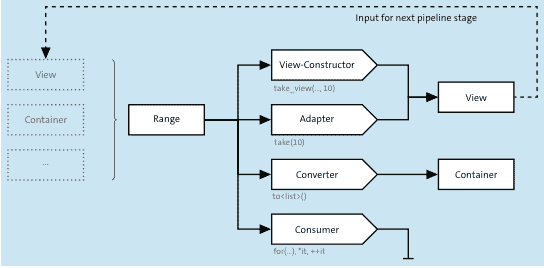

**图 24.1** 容器和视图都是范围，适配器从它们生成视图，并可进一步处理。

## 24.1.8 算法

最初的 STL 还包含作用于容器的算法。这些是一组自由函数，用于支持容器的方法。然而，作为参数，它们接收的不是容器，而是*迭代器对*。自 C++20 起，许多算法也定义在 `std::ranges` 中，并作用于范围。这实现了两个效果：

- 算法总是作用于容器的*子范围*。
- 算法几乎独立于容器类型，适用于所有容器的迭代器。

后者原则上成立，但常常有限制条件。例如，你可以对 vector 的迭代器对应用 `sort(begin, end)`，但 `sort()` 不能用于 list 的迭代器，因为它们不支持随机访问。为了区分，容器和迭代器被分为几类。如果你想对迭代器使用自由函数，请查看下一节，使用**表 24.2** 确认迭代器的类别是否匹配。

## 24.2 迭代器基础

根据所支持的操作，迭代器分为不同类别。这是一个简单的线性层次结构：类别在层次结构中越高，该类别迭代器支持的操作就越多。

例外是*输出迭代器*，它们需要额外的属性，但不一定具备其他任何类别的特性。

| 迭代器类别 | 提供者 |
|---|---|
| 连续 | vector、string、array |
| 随机访问 | deque |
| 双向 | list、[multi]set、[multi]map |
| 前向 | forward_list、unordered_[multi]{map\|set} |
| 输出 | ostream、inserter |
| 输入 | istream |

**表 24.2** 哪些容器和流提供哪些类别的迭代器？

不同类别的迭代器之间存在一些区别，如下所示：

- **所有迭代器**  
  所有迭代器都可以被复制和赋值，也就是说，你可以执行 `it(other)` 和 `it = other`。每个迭代器也都可以通过 `++` 递增。
- **输出迭代器**  
  这类迭代器允许你通过 `*it = ...` 对解引用的元素赋值。
- **输入迭代器**  
  这类迭代器支持 `i == j` 和 `i != j` 比较，并可以通过 `*it` 和 `it->...` 返回解引用元素的值。
- **前向迭代器**  
  这类迭代器是输入迭代器，此外还保证：如果底层容器不变，你可以多次遍历一个序列。这就是*多遍保证*。当考虑那些是输入迭代器但不是前向迭代器的迭代器会发生什么时，这一点就变得清晰了。例如，当迭代器从 `cin` 读取时就是这种情况——输入操作会改变 `cin` 的状态，因此肯定不具备多遍能力。
- **双向迭代器**  
  这类迭代器是前向迭代器，但还可以通过 `--it` 和 `it--` 递减。
- **随机访问迭代器**  
  *随机访问迭代器*是双向迭代器，支持与整数进行加法 `+=` 和减法 `-=`，以及 `>`、`<`、`>=`、`<=` 比较。加法和解引用的结合也意味着支持带偏移的解引用 `it[...]`。
- **连续迭代器**  
  *连续迭代器*是随机访问迭代器，并保证元素在内存中连续排列。例如，你可以通过内存地址将一块元素传递给 C 函数。

在表 24.2 中，你可以看到哪些容器或流提供哪些迭代器类别。

在 ranges 库中，每个迭代器类别都有对应的概念。前向迭代器对应于 `ranges::forward_range` 概念，依此类推。

### 24.2.1 来自容器的迭代器

每个容器都有两种不同的迭代器类型，你可以通过各种方法获取：

- **iterator**  
  这种迭代器允许你在解引用时修改容器中的值，例如 `*it = 12;`
- **const_iterator**  
  这种迭代器允许对元素进行只读访问，例如用于 `cout << *it`。

根据你打算用迭代器做什么，你应该使用其中一种类型。`begin()` 和 `end()` 方法有两种变体。对于容器 `Container`，它们看起来像这样：

```cpp
struct Container {
    iterator        begin();
    iterator        end();
    const_iterator begin() const;
    const_iterator end() const;
    const_iterator cbegin() const;
    const_iterator cend() const;
};
```

例如，如果你的容器是函数的 const 参数，你只能得到 `const_iterator`。如果容器是可变的，你应该决定需要哪种迭代器类型。

难道你总想在编写循环时输入“std::vector<std::string>::const_iterator”吗？你不必如此。`auto` 在这里可以帮你；编译器会用它计算出正确的类型：

```cpp
// https://godbolt.org/z/dxb98rWzo
#include <iostream>                  // cout
#include <vector>
using std::vector;

vector<int> createData(size_t sz) {
    return vector<int>(sz);             // sz 个 0
}

void fibonacci(vector<int> &data) {
    for(auto it = begin(data) + 2; it != end(data); ++it) { // 迭代器 it
        *it = *(it-1) + *(it-2);
    }
}

std::ostream& show(std::ostream &os, const vector<int> &data) {
    for(auto it=begin(data); it != end(data); ++it)    // const_iterator
        os << *it << " ";
    return os;
}

int main() {
    vector<int> data = createData(10);
    data[0] = 1;
    data[1] = 1;
    fibonacci(data);
    show(std::cout, data) << "\n";
}
```

**清单 24.8** 对于“const”对象，`begin()` 和 `end()` 返回 `const_iterator`。

在 `fibonacci()` 中，参数 `data` 不是常量。因此 `begin()` 和 `end()` 返回类型为 `vector<int>::iterator` 的迭代器。多亏了 `auto`，你无需自己输入这个类型；编译器会为你完成。

在 `show()` 中，参数 `data` 是常量，在这种情况下，你会从 `begin()` 和 `end()` 得到 `vector<int>::const_iterator`——非常适合只读输出。

### 24.2.2 迭代器的更多功能

标准容器的许多方法在引用元素时并不接受索引或指针作为参数。毕竟，只有 vector 和 array 知道整数索引的概念。因此，在整个标准库中，你需要为位置指定迭代器。例如，你想从 vector 中删除一个元素？试试这个：

```cpp
vector<int> data { 2,5,99,8,3, };
data.erase( data.begin()+2 ); // 删除 99
```

对于范围来说，这更常见。你可以删除从 5 到 8 的所有元素：

```cpp
vector<int> data { 2,5,99,8,3, };
data.erase( data.begin()+1, data.begin()+4 ); // 删除 5,99,8
```

应当注意，范围的末尾总是指向范围最后一个元素**之后**的元素。`data.begin()+4` 指向 `data` 中的 `3`；因此删除发生在从 `5` 到 `3` **之前**。这适用于所有标准容器的所有方法和带迭代器的自由函数，但 `forward_list` 的一些方法除外。

这也是所有容器的 `end()` 都指向最后一个元素**之后**的原因。因此，它们可以很容易地在算法中用于指定范围。

算法有很多。在 `<algorithm>` 和 `<numeric>` 头文件中，你会找到非常非常多的算法。例如，你可以通过（本质上）调用以下代码对几乎所有标准容器进行排序：

```cpp
#include <algorithm>
int main() {
    //...
    std::sort(begin(container), end(container));
    // 或使用 ranges：
    std::ranges::sort(begin(container), end(container));
}
```

对于 `map` 或 `set`，你不需要尝试这样做，因为它们已经有序。但 `list`、`vector` 和 `array` 可以用这种方式排序。

最后，你可以扩展迭代器并为它们配备新功能。例如，在下一个清单中，看看如何使用 `ostream_iterator` 输出迭代器将任意容器的内容输出到 `cout`。

```cpp
// https://godbolt.org/z/7Xycqqh68
#include <vector>
#include <iostream>   // cout
#include <iterator>   // ostream_iterator
#include <algorithm>  // copy

int main() {
    std::vector data { 1, 2, 3, 7, 9, 10 };
    std::ostream_iterator<int> out_it (std::cout, ", "); // 赋值给 cout 时输出
    std::copy(data.begin(), data.end(), out_it); // 将所有元素复制到迭代器
    std::cout << "\n";                         // 输出：1, 2, 3, 7, 9, 10,
    // 或从 C++20 开始使用 Ranges：
    std::ranges::copy(data, out_it);
    std::cout << "\n";                         // 输出：1, 2, 3, 7, 9, 10,
}
```

**清单 24.9** 迭代器适配器改变操作的行为。


```cpp
char* result = buf_.data()+current_;
current_ += add;
return reinterpret_cast<T*>(result);
}
void deallocate(T* p, size_t count) {
    size_t del = sizeof(T)*count;
    std::cout << "deallocate("<<del<<")\n";
    if(del==current_ && p==reinterpret_cast<T*>(buf_.data())) {
        std::cout << "...all free.\n";
        current_ = 0;                 // release everything again
    }
}
}

GobAllocator() : GobAllocator(1024) {}

explicit GobAllocator(size_t mx)
    : buf_(mx, 0), current_(0) {}

private:
    std::vector<char> buf_;
    size_t current_;
};

int main() {
    constexpr size_t CNT = 1*1000*1000;
    using Gob = GobAllocator<int>;
    try {
        Gob gob(CNT*sizeof(int));        // prepare allocator
        std::vector<int,Gob> data(&gob);
        data.reserve(CNT);               // get memory in one go
        for(int val=0; val < (int)CNT; ++val)
            data.push_back(val);
    } catch(std::bad_alloc &ex) {
        std::cout << "Memory exhausted.\n";
    }
}
```

代码清单 24.10 一个（过于）简单的分配器及其用法。

GobAllocator 在创建时获取一个 vector<char> 作为内存储备。当使用它的容器通过 allocate() 请求内存时，它可以分配内存，但它很少释放内存。容器通过 deallocate() 请求释放。只有当 deallocate() 想要释放所有已请求的内存时，GobAllocator 才会真正执行操作，并释放其所有内存以供新的请求使用。

解决方案是使用*多态分配器*的容器。使用这种分配器的两个容器即使使用不同的分配器，也属于同一类型。因此，自 C++17 起，**所有容器**也都在 `std::pmr` 命名空间中可用——例如 `std::pmr::vector`（*多态内存资源*）。在这里，你不是通过类型来指定分配器，而是将其作为额外的构造函数参数传入。

后文我将省略提及所有容器作为模板参数和构造函数参数的分配器，也会省略提及 pmr 变体。

## 24.4 容器共性

在第 6 章的代码清单 6.12 中，我使用迭代器遍历 vector 的内容。这引出了所有容器的共性。如果你只是把 `std::vector` 替换为 `std::list`、`std::set`，或者使用 `std::array<int,5>`，那么程序的其余部分保持不变。例如，如果你通过索引 `[idx]` 访问 `set`，这本来就不可能实现。

基于范围的 for 循环在内部也基于迭代器工作，因此也可用于所有容器。然而，它只能作用于整个容器，而通过 `begin()` 获得的迭代器几乎可以任意操作。你将在本章中看到许多这样的例子。提醒一下：对于 C++23 中可能对某些编译器来说太新的特性，我使用*斜体代码*表示（参见第 1 章的代码清单 1.1）。

在设计标准库的这一部分时，人们非常谨慎地为容器提供在合理且可行情况下的通用接口。我在这里不列出特殊情况——它们会结合具体容器进行说明——而只给出粗略概览：

- **`begin()` `end()`**
  所有容器都提供这两个函数来获取迭代器。除其他用途外，这使你可以在基于范围的 `for` 循环中使用它们，因为它们也作为自由函数存在。
- **`size()` `empty()` `std::size()`**
  获取任意容器中的元素数量。自 C++17 起，它们也作为自由函数存在；从 C++20 起，还有自由函数 `ssize()`，它以有符号类型返回 `size()`。这避免了在诸如 `for (int i=0; i<cont.size(); ++i)` 这样的语句中比较有符号和无符号数时产生的警告。只需写成 `i<ssize(cont)`。
- **`resize()` `reserve()` `clear()`**
  你可以通过一次调用调整基于序列的容器（array 除外）的大小或缩小它们。`vector` 和无序容器可以用 `reserve` 预先告知你打算大致存储多少个元素。这样可以在之后实际插入时节省管理开销。
- **`operator[]` `at()` `data()`**
  使用 `cont[where]` 或 `cont.at(where)` 在容器的任意位置读写。并非所有容器都支持这一点。基于序列的容器要求 `where` 是一个数字，而关联容器则需要你选择作为键的数据类型。借助 `data()`，你可以访问某些容器中元素的连续内存。除其他用途外，这对 C 函数很有用。`data()` 也可作为自由函数使用。
- **`insert()` `insert_range()` `emplace()`**
  使用这些函数在任意位置插入或删除元素。请注意，vector 可以做到这一点，但速度很慢。使用 `insert()` 时，元素已经存在并被复制（对于临时值则是移动）；而使用 `emplace()` 时，元素在容器内部就地创建。范围版本从 C++23 起可用。
- **`push_front()` `push_back()` `emplace_front()` `emplace_back()`**
  使用这些函数向基于序列的容器添加单个元素。在这里，vector 也很快。
- **`assign()` `assign_range()` `swap()` `merge()`**
  `assign()` 允许你重新初始化容器。使用 `swap()`，你可以非常高效地交换两个相似容器的全部内容。`merge()` 合并两个相似且预先排序的容器。`assign_range()` 从 C++23 起可用。
- **`prepend_range()` `append_range()`**
  自 C++23 起，你还可以将整个范围插入基于序列的容器中。
- **`erase()` `extract()`**
  使用 `erase()` 删除单个元素或范围。使用 `extract()`，你移除一个元素，目的是将其插入到其他地方。
- **`find()` `count()` `contains()`**
  在关联容器中查找特定元素，或统计它出现的频率。自 C++20 起，还有 `contains`。

像 `c.size()` 这样的方法（它们也以 `size(c)` 这样的自由函数形式提供）允许编写更通用的代码。你不必修改现有容器类型（也许是第三方容器），而是可以重载自由函数并在那里实现该功能。

## 24.5 标准容器类概览

首先，容器大致可以分为四组：

- **基于序列的容器**
  在这些容器中，访问和插入要么按顺序进行，要么使用数字索引逐个元素进行。vector 和 array 就是例子。通常，你在一端或两端删除和添加元素。有些容器支持通过 `[int]` 或 `at(int)` 进行高效的直接元素访问。
- **关联有序容器**
  这些容器不使用数字，而是使用任意数据类型进行访问。例如，通过编写 `cities["Berlin"] = 1000`，将城市名称与其历史上的德国邮政编码关联起来。在这类容器中，你可以在任意位置插入元素。关联容器按其键始终保持有序。与基于序列的容器一样，你可以按顺序读取所有元素——而且由于键始终保持有序，迭代时你会按排序顺序获得它们。无论你向容器中输入什么数据，关联容器上的所有操作都有保证的资源消耗上限。
- **关联无序容器**
  从外部看，关联无序容器看起来像普通的关联容器，并且具有几乎相同的接口。然而，区别在于它们最重要的操作通常更快，但没有保证。它们基于*哈希*而不是排序。这种哈希可能会*退化*并显著降低性能。我建议在正常情况下使用有序关联容器，只在特殊情况下有意识地切换到无序变体。
- **容器适配器**
  现有的基于序列和关联的容器如此强大，并配备了如此丰富的接口和良好的性能保证，以至于你也可以将它们用于更简单的容器。例如，`vector` 拥有栈所需的所有方法。为栈提供一个不支持迭代的单独容器是没有必要的。为此，有一小组*适配器*，它们在内部持有另一个容器，但对外提供缩减或稍作重新设计的接口。

### 24.5.1 容器的类型别名

后文有时重要的是知道我们讨论的是哪种类型。一个容器涉及多种类型。当然有容器类型本身。它由一个模板组成，当你写出其模板参数时，该模板就会变成*实例化*类型。至少有一个模板参数时，你指定存储在容器中的元素类型。因此，例如，元素类型为 `int` 的 vector 容器合在一起成为 `vector<int>`，从而成为容器类型。

除了数据和方法之外，所有容器还包含一些类型别名。我已将最重要的类型别名汇总在[表 24.3](#)中。一方面，在向你介绍容器时，我将使用这些术语；另一方面，你可以使用这些类型别名，以不同容器类型编写一致的代码——并且以后或许在你自己的模板中使用它们。在某些情况下，该类型实际上只是另一个或多或少简单类型的别名；例如，`vector<int>` 的 `value_type` 就是 `int` 的别名。在其他

像迭代器这样的情形，其底层类型并未由标准规定，而只是通过其属性来描述。这时你必须使用别名，因为你无法（以可移植的方式）写出具体类型。

在这里清晰地应用这些术语并不总是容易的。对于 map，术语“值”（value）是有歧义的，因为它常被这样使用：“它把一个键映射到一个值”。但 map 的 `value_type` 实际上是共同定义为 `pair<key_type,mapped_type>`。因此，在这种情况下，我更愿意使用“目标”（target）这个术语。在本书中，我力求使用以下清晰的术语：

- *值*，或 `value_type` 的元素
- `key_type` 的 *键*
- 对于 `mapped_type`，指 *目标类型* 或 *映射类型* 的 *目标*

| 类型别名 | 含义 | `vector<int>` | `set<int>` | `map<int, string>` |
|---|---|---|---|---|
| `value_type` | 容器中的元素 | `int` | `int` | `pair<const int, string>` |
| `key_type` | 元素的键部分 | – | `int` | `int` |
| `mapped_type` | 元素的映射部分 | – | – | `string` |
| `size_type` | 大小或索引 | `size_t` | `size_t` | `size_t` |
| `reference` | 对元素的引用 | `int&` | `int&` | `pair<const int, string>&` |
| `iterator` | *可修改*容器中的迭代器 | 是 | 是 | 是 |
| `const_iterator` | *不可修改*容器中的迭代器 | 是 | 是 | 是 |
| `reverse_iterator` | 反向迭代器 | 是 | 是 | 是 |

**表 24.3** 容器最重要的类型别名概览。

即使你放弃使用 `auto`，也可以使用这些别名编写对每种容器类型看起来都相同的代码，或创建自己的模板。

```cpp
// https://godbolt.org/z/c97rq3M7
#include <vector>
#include <map>
#include <iostream>
using std::cout; using std::ostream;

template<typename K, typename T>
ostream& operator<<(ostream& os, std::pair<const K,T> value) {
    return os << '[' << value.first << ':' << value.second << ']';
}
int main() {
    {
        using Cont = std::vector<int>;
        Cont const cont{ 1, 2, 3, 4, 5, 6 };
        Cont::size_type sz = cont.size();
        cout << "size=" << sz << " content= ";
        for(Cont::const_iterator it = cont.begin(); it != cont.end(); ++it)
            cout << *it << ' ';
        cout << '\n';
    }
    {
        using Cont = std::map<int,char>;
        Cont const cont{ {1,'a'}, {2,'b'}, {3,'c'}, {4,'d'}, {5,'e'}, {6,'f'} };
        Cont::size_type sz = cont.size();
        cout << "size=" << sz << " content= ";
        for(Cont::const_iterator it = cont.begin(); it != cont.end(); ++it)
            cout << *it << ' ';
        cout << '\n';
    }
}
```

**代码清单 24.11** 类型别名有时比具体类型更清晰。

这里我使用了容器提供的别名 `size_type` 和 `const_iterator`。在这个简单情形中，`auto` 本来也能工作，但这里是为了演示这些别名。

### 插曲：“pair”与“tuple”

如表 24.3 所示，有些容器在内部使用 `pair`。随着本章的深入，你会遇到若干也返回 `pair` 作为返回类型的方法。这只不过是把两个数据类型及其值捆绑在一起——本质上就是：

```cpp
// https://godbolt.org/z/xcrbVMljz
struct PairInDouble {
    int first;
    double second;
};
int main() {
    PairInDouble p{ 2, 7.123 };
}
```

我在这里专门针对 `int` 和 `double` 所做的，可以用 `std::pair` 作为适用于任意类型的模板类来实现。你可以用 `first` 访问第一个元素，用 `second` 访问第二个元素。

pair 对任意数量元素的推广就是 tuple。例如，你可以使用 `get<3>(t)` 访问 `t` 的第四个元素。

对于本章关于 pair 和 tuple 的讨论，这应该足够了。关于这两种数据类型的完整讨论可以在第 28 章第 28.1 节找到。

## 24.6 顺序容器类

让我们逐一介绍顺序容器类（见表 24.4）：

- **`array<ElementType,Size>`**
  这里存储固定数量的元素。添加和删除只能通过覆盖来完成。元素在内存中直接相邻存储。因此，array 既适合少量巨大的元素类型，也适合大量微小的元素类型，因为它几乎没有内存开销。

  

  **图 24.2** “array”既不能增长也不能收缩，但它很紧凑。

- **`vector<ElementType>`**
  这个多面手会自动增长。你可以在任意位置插入，但只有在尾部插入才高效。

  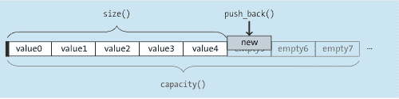

  **图 24.3** “vector”的示意图。

  元素的读取可以向前、向后顺序进行，也可以通过索引随机进行。此外，vector 将其元素在内存中直接相邻存储，这使它既适用于少量大元素，也适用于大量小元素。使用最优时，它几乎没有内存开销；在非最优情况下，它仍然可以接受，因为它不会使内存碎片化。

- **`deque<ElementType>`**
  你可以轻松地向 vector 的末尾添加元素，但向开头添加就不那么容易，因为所有现有元素都必须向右移动一位。*双端队列* deque 适合在两端快速添加元素。缺点是，它不会将其元素直接相邻存储，但通常仍比 list 更紧凑。如果可能，优先使用 vector。

  

  **图 24.4** “deque”可以在两端扩展，但元素在内存中不连续。

- **`list<ElementType>`**
  list 比 vector 更简单，非常适合在中间频繁插入。然而，元素在内存中并不连续，而是在内部链接起来。你无法使用索引访问。如果你想遍历范围，它很快。

  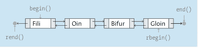

  **图 24.5** “list”可以向前和向后遍历。插入很容易。

- **`forward_list<ElementType>`**
  这种奇特的类型模仿 C 语言中链表的基本结构，因此需要极少的额外资源。然而，它的接口与所有其他容器略有不同。甚至插入的工作方式也有所不同。你只能向前迭代。list 和 forward_list 都是*拼接*的专家——也就是说，将某个列表中的一些连续元素或全部元素转移到另一个列表。

  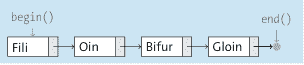

  **图 24.6** “forward_list”的元素只知道它们的后继。

当你在编译时知道容器应容纳多少个元素时，就使用 `array`；另一方面，`vector` 具有动态大小；你可以向其中添加或删除元素。

表 24.5 列出了区分各基于序列的容器的主要属性。以下说明适用于用星号 * 标记的条目：

- **键类型**
  对于运算符 `[]` 和 `at`，你只能使用 `size_t`。`Key` 在这里并不是完全合适的术语，因为移动元素会改变键与容器元素的关联。不过，我在这里纳入这个属性，是为了与关联容器进行比较。

- **vector 每个元素的开销**
  在最优情况下，vector 除了其管理的元素本身之外，几乎没有任何额外的内存消耗。如果你事先知道将存储 1,000 个元素，可以用 `reserve(1000)` 将 vector 准备到这个确切大小，然后再添加元素。你将在时间和内存消耗方面获得最优性能。如果你不预先保留大小，vector 会略大于所需大小，并且在添加元素时不得不时不时分配新空间。不过，内部算法保证，平均而言，你花费的时间或内存至多是不预先保留时的两倍。

- **高效插入 `forward_list`**
  与所有其他容器不同，当你向 `forward_list` 插入时，并不是插入到你指示的位置，而是插入到其后一个元素的位置。为什么会这样，将在后面的示例中展示。因此，这个容器不同于任何其他容器（array 除外），它没有 `insert`，而是有 `insert_after`。这种不便源于希望每个元素占用尽可能少的内存。

- **list 和 `forward_list` 的拼接**
  与所有其他容器相比，这两个容器具有独特性质：你可以极快地合并两个相同类型的容器。将两个容器合为一个不会对这两个容器中包含的元素进行任何一次复制操作，而且需要更改的管理信息与列表中的元素数量无关。

- **内存布局**
  在许多场合，容器的元素需要紧密地打包在一起，才能以最优方式使用它们。例如，写入硬盘时，将所有要写入的数据作为一个大块传递给操作系统是有利的。其他 C 函数也难以处理复杂的 C++ 数据结构。它们需要一个内存起点和一个长度（你好，`span`！）。在所有容器中，只有 array 和 vector 以这种方式存储元素，从而使这类数据交换可以工作；其中 array 是唯一一个只能使用栈、不需要用 `new` 请求堆空间的容器。


- **算法**  
  提供随机访问迭代器的容器可与所有以一对迭代器作为参数表示区间的自由函数配合使用。然而，链表不提供随机访问，因而无法与算法配合使用。作为替代，它们提供的特殊方法解决了这个问题。

- **跨度**  
  自 C++20 起，可以使用 `span` 访问连续序列容器（包括 C 数组）。该类包含指向第一个元素的迭代器和容器中的元素数量。二者均不可变，并在创建时设置。容器到 span 的转换会隐式发生，例如将其传递给期望 span 的函数时。对于 string，为此有 `string_view`。在 C++23 中引入了 `mdspan`，用于从一维 vector（或类似物）创建多维视图，如矩阵或立方体。

## 24.6.2 序列容器的方法

本节中，`Cont` 或 `C` 表示某种容器类型，例如 `vector<int>` 或 `array<Hobbit,4>`。这里，`cont` 表示容器实例，如 `list<double> cont`。对于*元素类型*，我使用 `Elem` 或 `E`；对于*迭代器类型*，我简写为 `It`。`rg` 表示范围。

为了节省篇幅并提高清晰度，我在这里并不总是非常精确或详细地给出函数签名。如果我在方法中未包含括号，通常会有多个重载：

- **构造函数：** `C()`、`C(size_t)`、`C(size_t, E e)`、`C({...})`、`C(It, It)`、`C(from_range, rg)`

  默认构造函数 `Cont()` 创建空容器。使用 `Cont(size_t)` 可以创建具有预定大小的容器，其中填充默认初始化的元素，例如 `vector<int>(5)` 会创建一个包含五个值为 0 的元素的 vector。如果不喜欢默认值，可以指定自己的值：例如 `vector<double>(5,42.0)` 将包含五个值 42.0。使用来自任何其他容器的一对迭代器，可以复制其内容。自 C++23 起，还可以使用 `from_range` 标记从范围初始化。可以指定容器在开头应包含的初始化列表。*例外：* 你始终使用初始化列表创建 array。

- **复制与移动：** `C(const C&)`、`C& operator=(const C&)`、`assign`、`assign_range`、`C(C&&)`、`C& operator=(C&&)`、`swap`

  可以将不同的 `Cont` 作为参数传递给复制/移动构造函数和运算符。有几种变体的 `assign` 方法，可以类似于某个构造函数选项重新初始化容器，其中 `assign_range()` 自 C++23 起存在。所有容器都高效地实现 `swap(Cont& other)`（常数时间，与元素数量无关），熟练使用时可以实现极佳的性能技巧；参见 *清单 24.51*。*例外：* array 没有 assign 方法，且对 array 来说 swap 需要线性时间。

- **析构函数：~Cont()**

  所有容器都有析构函数，用于移除所含元素。请注意，如果将原始指针装入容器，则不适用。为此应使用智能指针，或在其他地方管理动态对象。析构函数不会隐式抛出异常。¹

  ¹ 前提是元素的析构函数不会这样做，而它们本不应该这样做。

- **向前迭代：begin(), end()；向后迭代：rbegin(), rend()**

  使用 `begin()` 获得指向第一个元素的迭代器，使用 `end()` 获得指向最后一个元素之后的迭代器；可以在 for 循环中使用这些迭代器向前迭代。对于向后循环，使用 `rbegin()`（指向最后一个元素）和 `rend()`（指向第一个元素之前）。在序列容器中，始终按插入元素的顺序或插入位置迭代元素。所有这些方法返回 `Cont::iterator` 或 `Cont::const_iterator`，它们还有带 `c` 前缀的变体，例如 `cbegin()`，它始终返回 `Cont::const_iterator`。*例外：* forward_list 既没有 `rbegin()` 也没有 `rend()`。

- **元素访问：E& operator[], E& at(size_t), E& front(), E& back()**

  使用 `cont[i]` 可以不受检查地访问第 i 个元素。at 方法首先检查容器是否包含该元素，如果不包含则抛出 out_of_range 异常。`c.front()` 等价于 `*(c.begin())`，`c.back()` 等价于 `*(prev(c.end()))`。*例外：* list 和 forward_list 既没有 at 也没有 `[]`，且 forward_list 没有 `back()`。

- **大小：size(), empty(), resize(size_t), max_size()**

  使用 `size()` 可获得容器中当前元素数量；如果该数量为零，`empty()` 为真。调用 `resize` 时，容器会收缩或增长，并可能相应地移除或创建元素。使用 `max_size()` 可获得容器的理论最大大小。请注意，这并不考虑程序或机器的当前状态，而是依赖于库的常量。*例外：* forward_list 没有 `size()`，array 没有 resize。

- **容量：capacity(), reserve(size_t), shrink_to_fit()**

  只有 vector 具有可受影响的、不同于其大小的容量。`capacity()` 返回 vector 在无需请求新动态内存的情况下可容纳的元素数量。如果装入的元素超过容量，该容量会自动增加。在内部，这会导致所有元素被复制或移动。这听起来比实际更糟，但如果你预先知道将向 vector 中装入多少元素，就值得用 `reserve()` 一次性请求该容量。如果事先不知道，但在添加完元素时可以估计，就可以通过调用 `shrink_to_fit()` 消除多余容量。然而，这种方法也可能触发内部复制或移动，而且 vector 不必遵从该请求。*例外：* 由于 deque 通常基于 vector，它也有 `shrink_to_fit()`。

- **在一端添加和移除：`push_back()`、`push_front()`、`pop_back()`、`pop_front()`、`prepend_range()`、`append_range()`**

  `push_back` 在尾部添加元素，`push_front` 在头部添加元素。`pop_...` 方法移除一个元素。对于 vector 和 deque，必须预料到这些操作后指向容器的引用和迭代器会失效。`range` 方法自 C++23 起可用。*例外：* array 没有这些方法中的任何一个，vector 缺少 front/prepend 方法，forward_list 缺少 back/append 方法。

- **使用原位构造添加和移除：`emplace_front(...)`、`emplace_back(...)`**

  `push_...` 方法接收一个现成元素作为参数，然后将其复制到容器中；而 `emplace_...` 可以省去这次复制。只需向这些方法提供 `Elem(...)` 的所需构造函数参数，新对象就会直接在原地创建。*例外：* array 缺少这些方法，vector 缺少 `emplace_front`。容器 `forward_list` 缺少 `emplace_back`。

- **其他修改：`clear()`、`erase`、insert 和 emplace**

  `clear()` 简单地从容器中移除所有元素，使其大小为零。使用 `erase`，可以通过迭代器移除单个元素，或通过一对迭代器移除整个区域。类似地，可以使用 `insert` 和一个迭代器作为位置，在特定位置插入内容——单个元素（或其多个副本）、初始化列表中的元素，或使用一对迭代器从另一个容器插入一个区域。使用 `emplace`，可以在容器中的指定位置创建一个或多个元素而无需复制。*例外：* array 没有这些方法，而 `forward_list` 改用 `...after()` 方法（但确实有 `clear()`）。

- **链表操作：splice、splice_after、merge 和算法方法**

  只有 `list` 和 `forward_list` 能通过 `splice` 或 `splice_after` 轻松合并不同容器的范围——从一个容器移除并添加到另一个容器。在这些序列容器中，只有这两个容器能使用 `merge` 按排序顺序合并两个预先排序的链表。由于这两个链表容器不提供随机访问迭代器，`<algorithm>` 中的自由函数不适用于它们。作为替代，它们提供模仿算法的方法：merge、remove、remove_if、reverse、unique 和 sort。请注意，与 `<algorithm>` 中的对应方法不同，链表的 remove 方法实际移除找到的元素，而不仅仅是改变其位置。

## 24.6.3 “vector”

当需要一个必须能够增长和收缩的容器时，`vector` 应该是你首先想到的。可以向其中添加元素——最好在尾部，但如有必要也可以在其他位置。元素按你在容器中指定的顺序排列，因此不会自动排序。


由于它保证将元素存储在连续的内存块中，因此适合用于 C 函数及类似的以这种方式接收输入或输出数据的函数。在这里，`vector` 与 C++20 引入的 `span` 配合得很好，因为 span 将指向开头的指针和长度捆绑在一起，这通常是 C API 所期望的。你可以确定并传递元素的地址。与容器的迭代器一样，只要不改变容器的大小或容量，指向其元素的地址就一直有效。

vector 的元素空间会根据需要自动调整、增加或减少。会为即将到来的元素预留空间，这样就不需要为每次插入而调整大小。这种处理方式非常巧妙，即使在最坏情况下，每次插入平均也能以 O(1) 的时间复杂度进行。你可以通过 `capacity()` 确定 vector 当前占用多少空间。如果事先知道 vector 中最终会有多少个元素，请使用 `reserve(size_t)` 请求内存，以避免将来扩容。

你可以在 O(1) 时间内随机访问 vector 的元素——也就是说，以最优的速度。

> **提示：局部性**
>
> 对于 CPU 来说，访问寄存器比访问缓存更好。缓存比主内存好，主内存比硬盘快。计算所需的内存区域越紧凑，计算机就越有可能为其使用快速内存。如果内存主要朝一个方向使用而不是来回使用，那么对局部性甚至更好。通常，使用具有更好局部性的策略进行相同的计算会快很多倍：可能达到 10 倍或 100 倍！
>
> 如果没有采取针对特定分配器的特殊预防措施，vector 的局部性比例如 set 更好。如果你还能按升序使用 vector，那对局部性更好。为此，让迭代器只向前移动，或者只递增索引进行访问。
>
> 如果你希望数据始终保持排序，通常会使用 set。然而，这对内存不利。如果这对你很重要，请查看针对 vector 的 `flat_set` 适配器，它自 C++23 起可用。

你可以将 C++ 类型中几乎任何东西放入 vector。这取决于你将使用的操作以及该类型是否被允许。元素类型必须是可复制或可移动的；标准库将选择合适的操作。但是，必须有 `Elem` 的析构函数，可以是编译器生成的，也可以是你自己编写的——因此你不能将析构函数标记为 `= delete`。

在实践中，建议元素类型是可移动的，并保证在移动时不会抛出异常——也就是说，要么用 `noexcept` 标记移动操作，要么由编译器生成。如果可能，请坚持元素类型的零规则；请参阅第 17 章第 17.1 节作为提醒。

假设本节中以下所有关于 `vector` 的示例都嵌入在清单 24.12 的代码中。

```cpp
// https://godbolt.org/z/WK86eaz1x
#include <vector>
#include <iostream>
using std::vector; using std::cout;

template<typename T>
std::ostream& operator<<(std::ostream& os, const vector<T>& data) {
    for(const auto &e : data) {
        os << e << ' ';
    }
    return os;
}

int main() {
    // Example code here
}
```

**清单 24.12** 这是本节中 vector 示例清单的模板。

> **运算符 “<<”**
>
> 在本章的一些示例中，我使用自定义的 `operator<<` 而不是 `cout << ... << '\n'`。我这样做只是为了演示时简洁。
>
> 不要在一个表达式中混用这两种运算符：`<<` 的运算符优先级低于 `+`，会最后执行。至多在表达式末尾使用它，也许在测试中。

## 初始化

我将举例向你介绍初始化 vector 的各种方法。这些方法大多也适用于其他容器，尤其是顺序容器。在其他地方，我会简要介绍常见的初始化方式，然后重点介绍差异。

你可以使用默认构造函数初始化 vector。

```cpp
// https://godbolt.org/z/7zMp5fo7c
vector<int> dataA;
vector<int> dataB{};
vector<int> dataC = {};    // no assignment
cout << format("{} {} {}\n", dataA.size(), dataB.size(), dataC.size()); // 0 0 0
```

**清单 24.13** 默认构造函数初始化一个空的 vector。

我在这里使用了 C++20 的 `format()`。你也可以复制 vector。在这里你还可以看到，自 C++17 起，编译器会从构造函数参数推导模板参数 `int`。

```cpp
// https://godbolt.org/z/cE6G1aErs
auto count(vector<int> arg) { return arg.size(); }
// …
vector input{1,2,3};              // vector<int>
vector outputA(input);            // copy
vector outputB = input;           // also copy, no assignment
cout << count(input) << '\n';     // call by copy-by-value
```

**清单 24.14** 使用构造函数或隐式复制 vector。

无论是编译器自动执行，还是有意使用 `std::move`，vector 也可以窃取另一个 vector 的数据。借助 `make_move_iterator`，你可以修改任何迭代器，使其对每个单独的元素应用 `std::move`。因此，你不仅可以移动另一个容器的所有元素，还可以移动一个 range 中的元素。

```cpp
// https://godbolt.org/z/f5v5WEe97M
#include <list>
#include <string>
#include <iterator>                         // make_move_iterator
using std::make_move_iterator; using std::string;
vector<int> create() { return vector<int>{8, 9, 10}; }
size_t count(vector<int> d) { return d.size(); }
// …
vector input{1,2,3};
vector outputA(std::move(input));           // move
vector outputB = std::move(input);           // also move, not assignment
vector data = create();                      // Return-Value-Optimization
cout << count(input) << '\n';                // call by Copy-by-Value
// move elements from another container
std::list<string> source{ "a", "a", "a", "BB", "CC", "DD", "b", "b" };
auto from = source.begin();
std::advance(from, 3);  // 3/3 forward, but slow in list
auto to = from;
std::advance(to, 3);    // another 3 forward
vector target(make_move_iterator(from), make_move_iterator(to));
// source is now {"a", "a", "a", "", "", "", "b", "b"}, target is now {"BB", "CC", "DD"}
```

**清单 24.15** 对于返回值，编译器通常也可以进行移动。

由 `make_move_iterator` 创建的 `move_iterator` 确保在 `target` 的逐元素初始化过程中，每个 `a = b` 都变成 `a = std::move(b)`。对于 `string`，这意味着之后 `b` 将包含空字符串。从 source 到 target 移动三个元素不会移动整个元素，而是逐元素地应用移动操作——也就是说，移动的是元素的内容，而不是元素本身。

所有容器都支持使用初始化列表进行初始化，并且自 C++17 起，通常可以为你推断模板参数。但是，请避免将 C 字符串字面量放入初始化列表的陷阱。在这种情况下，请显式编写 `vector<string>` 来强制转换，或者为 string 使用 `"s"` 后缀（甚至为 `string_view` 使用 `"sv"`）。

```cpp
// https://godbolt.org/z/6rG393Wa5
vector<int> primes{ 2,3,5,7,11 };
vector<unsigned> evens{ 2,4,6,8,10 };
vector<int> notLikeThis{ 'a', 4.3, 8L };  // "Narrowing" double not okay
vector<string> names{ "are", "only" };    // converts arguments
vector sound{ "smoke", "fume" };         // dangerous: vector<const char*>
vector wtf{ "rain"s, "water"s };           // vector<string>
vector cold{ "ice"sv, "pole"sv };         // vector<string_view>
```

**清单 24.16** 使用初始化列表预填充 vector。请注意列表中的正确类型。

> ### 窄化转换与初始化列表
>
> *窄化转换*是将数值数据类型 A 隐式转换为另一种类型 B，而 B 无法容纳 A 的整个值范围，例如 int 到 char 或 double 到 int。
>
> 在 *初始化列表* 中，编译器不允许此类转换，以保护你免受典型且难以发现的错误的影响。
>
> 在清单 24.16 中，编译器会抱怨你试图将 double 值 4.3 转换为 int。对于 long 值 8L，它不会抱怨，因为它足够聪明，意识到 int 对此足够。800000000L 对于 32 位 int 是允许的，但除此之外不允许。

所有标准容器在接收到迭代器时，都可以从其他容器复制数据。

```cpp
// https://godbolt.org/z/h8Pze74ME
#include <deque>
#include <ranges>                 // C++20
// ...
std::deque in{1,2,33,34,35,99};
vector thirty(in.begin()+2, in.begin()+5);
for(auto &e : thirty) {
    cout << e << ' ';
}
```


```cpp
cout << '\n';
namespace vs = std::ranges::views;       // C++20
auto v = in | vs::drop(2) | vs::take(3);
vector<uint> v2(v.begin(), v.end());
vector<int> v3(std::from_range, in);         // C++23
```

**清单 24.17** 在初始化期间从任何其他容器或 C 数组复制值。

自 C++20 起，也可以使用范围和视图的迭代器来实现；从 C++23 起，如果额外向构造函数传递 _from_range_ 标记，甚至可以不用迭代器。

具体到 vector，有一些构造函数可以用指定数量的元素来初始化 vector。

```cpp
// https://godbolt.org/z/addobjfSK
vector<int> zeros(10);             // 10 个零
vector<int> sixes(10, 6);          // 10 个 6
vector<int> ten{10};               // 注意！只有一个 10
vector<int> tenSix{10, 6};         // 注意！两个元素 10 和 6
```

**清单 24.18** 使用固定数量的值进行预初始化（几乎）仅适用于 `vector`。

在这些情况下，初始化时必须使用圆括号 ()；否则元素将被解释为初始化器列表。

## 赋值

与所有容器（array 除外）一样，vector 重载了用于复制和移动的赋值运算符 operator=。借助 assign，你通常可以在构造之后将那些可在“首次”初始化时使用的所有初始化方式应用于容器。从 C++23 开始，你还可以使用 assign_range。

```cpp
// https://godbolt.org/z/rb4jEdakj
vector<int> from{ 2,3,4 };
vector<int> to{};
to = from;                         // 使用 operator= 赋值，现在两者相同

vector<int> drain{};
drain = std::move(from);            // 移动，现在 'from' 为空
vector<int> v;
v.assign(4, 100);                   // v 现在为 {100, 100, 100, 100}
v.assign(to.begin(), to.end());    // v 现在为 {2,3,4}
int z[] = { 10, 20, 30, 40 };
v.assign(z+1, z+4);              // v 现在为 {20,30,40}
```

**清单 24.19** 你可以向“vector”赋值，或稍后用“assign”重新初始化它。

## 访问“vector”

你总归需要获取 vector 中的数据。主要有以下几种方式：

- **迭代器**  
  你使用间接访问，主要是*迭代器*。由于元素是连续的，指针也可以工作。
- **索引**  
  你使用*索引*直接寻址某个元素。为此，可以使用 `at` 和 `operator[]`。
- **首尾元素**  
  `front` 和 `back` 返回对第一个和最后一个元素的引用。由于对空容器使用这些函数的结果是未定义的，如有必要，你必须将其与例如 `!empty()` 结合使用。
- **Span**  
  span 比两个独立的迭代器或一个迭代器加一个计数更容易处理。因此，span 将这些东西打包成一个单独的实体。这个类自 C++20 起可用；自 C++23 起，还有多维变体 *mdspan*。更多内容请参见后面的“通过 Span 访问”一节。

vector 容器有多个返回迭代器的成员函数，主要是 `begin()` 和 `end()`，与所有容器一样。并且与所有其他容器一样，你需要*解引用*迭代器来获得对实际元素的引用，如[清单 24.20](#listing-2420)所示。

```cpp
// https://godbolt.org/z/freK1Pea
vector vowels { 'A', 'e', 'i', 'o', 'u' };
const vector even { '0', '2', '4', '6', '8' };
auto it1 = vowels.begin();          // vector<char>::iterator
*it1 = 'a';                          // *it1 返回 'char&'
auto it2 = even.begin();             // vector<char>::const_iterator
auto it3 = vowels.cbegin();          // 强制使用 const_iterator
*it2 = '9'; *it3 = 'x';              // 'const char&' 不可修改
for(auto it=vowels.cbegin()+1; it!=vowels.cend(); ++it)
    { cout << *it; } cout << '\n';  // 输出：eiou
for(auto it=vowels.crbegin()+1; it!=vowels.crend(); ++it) // 即使是反向迭代器也使用 ++！
    { cout << *it; } cout << '\n';  // 输出：oiea
```

**清单 24.20** 使用“begin”、“end”及其相关变体，你可以获得迭代器。

使用变体 `cbegin` 和 `cend` 时，你总是得到一个 `const_iterator`，它在解引用时不允许修改元素。另一方面，`begin` 和 `end` 根据容器的修饰符返回 `const_iterator` 或 `iterator`。

这些函数的 `r...` 变体允许反向遍历 vector。注意，你需要使用 `++` 来递增 `reverse_iterator` 或 `const_reverse_iterator`，才能实际向后遍历。

## “begin()”、“cbegin()”、“rbegin()”和“crbegin()”的记号

为简洁起见，我写作

- [c]`begin()` 表示 `begin()` 和 `cbegin()`；
- [r]`begin()` 表示 `begin()` 和 `rbegin()`；以及
- [cr]`begin()` 表示 `begin()`、`cbegin()`、`rbegin()` 和 `crbegin()`。

对于 `end()` 的变体也同样适用。

通过迭代器访问对所有容器都是通用的。`vector` 具有随机访问迭代器——即通过 `random_access_iterator_tag`。在实践中，这意味着你可以向 vector 迭代器添加正或负的偏移量，如清单 24.21 所示。

```cpp
// https://godbolt.org/z/szrcz737G
#include <vector>
#include <iostream>
#include <algorithm>                 // ranges::sort
using std::vector; using std::cout;
double median(vector<int> data) {    // 按值传递（拷贝）
    std::ranges::sort(data);         // C++20，否则使用 std::sort()
    auto it = data.begin();
    auto sz = data.size();
    if(sz==0) return 0;              // 特殊情况
    // 确定中位数
    auto m = (it+sz/2);               // 大约在中间位置
    if(sz%2 != 0) {                   // 奇数个元素
        return *m;
    } else {                          // 偶数个元素
        return double(*m + *(m-1)) / 2;
    }
}
int main() {
    vector data1 { 12, 22, 34, 10, 1, 99, 33 };
    cout << median(data1) << '\n';   // 22
    vector data2 { 30, 2, 80, 99, 31, 3 };
    cout << median(data2) << '\n'; // 30.5
}
```

**清单 24.21** 使用“vector”迭代器，你可以进行随机访问。

it 指向 vector 的开头。通过 `m = it+sz/2`，你向前移动 vector 长度的一半，`m` 指向大约中间的位置。对于奇数个元素（如 7），`sz/2` 自然得到 3，`it+3` 对应 `data[3]`，即 7 个元素的中间。如果元素个数为偶数（如 6），则中间位于 `data[2]` 和 `data[3]` 之间。`m` 指向 `data[3]`，因此 `(*m + *(m-1)) / 2` 计算两侧值的平均值。为确保除法也按浮点数进行，我事先用 `double(...)` 转换中间结果。

虽然每个容器都可以使用迭代器，但只有 `vector`、`array` 和 `deque` 允许使用 `at` 和 `operator[]` 按整数位置访问容器中的元素。（当然，这不包括你也可以使用以整数为键的关联容器的情况。）

最前面的元素索引始终为 0，容器中最后一个元素的索引为 `size()-1`。

- **无检查访问**  
  当你使用 `Elem& operator[](size_t idx)` 访问 vector 时，你会在 O(1) 时间内立即获得存储位置处的元素。不允许访问超出 vector 的 `size()-1` 的元素。那将是编程错误并导致未定义行为。你必须在程序中确保不会发生这种情况。
- **带检查访问**  
  `Elem& at(size_t idx)` 非常快，也是 O(1)，但库会在运行时检查你使用的索引是否在容器允许的范围内。如果不在范围内，则这不是编程错误，而是抛出 `std::out_of_range` 类型的异常。

你可以将 `[]` 和 `at` 用于读取，也可以放在赋值左侧用于写入元素。

在循环中，明智的做法是避免使用 `at` 而使用 `[]`，因为循环条件通常已经包含了检查。

```cpp
// https://godbolt.org/z/jjWx3d375
vector d{ 1, 2, 4, -1, 1, 2, -2 };
for(size_t idx=0; idx < d.size(); ) {  // 检查 vector 边界
    cout << d[idx] << ' ';             // 这里不需要再用 at 进行额外检查
    idx += d[idx];                     // 这里同样如此
}
cout << '\n';
// 输出：1 2 -1 4 -2 1 2
```

**清单 24.22** 通常你使用 `[]` 访问，因为你已经检查了边界。


这里，循环的终止条件 `idx < d.size()` 已经检查了循环体中的访问是否被允许。使用 `d.at(idx)` 将是多此一举。

对于 `const` vector，`at` 和 `[]` 自然都会返回 `const Elem&`。

```cpp
// https://godbolt.org/z/GJx51caT
#include <vector>
#include <iostream>
void printAndMore(const std::vector<int>& data) { // by-const-ref
    std::cout << data[0] << std::endl;
    data[0] = 666;        // ✗ doesn't work because 'const int&'
}
int main() {
    std::vector numbers {1,2,3};
    printAndMore(numbers);
}
```

**清单 24.23** 常量容器返回常量引用。

与关联容器不同，当你删除或插入元素时，元素的位置会发生变化。

```cpp
// https://godbolt.org/z/s9PIY6jhv
vector<string> cars{"Diesel", "Petrol", "Super", "Gas"};
cout << cars[1] << '\n';          // Output: Petrol
cars.insert(cars.begin(), "Electricity"); // shifts everything back by one
cout << cars[1] << '\n';           // Output: Diesel
```

**清单 24.24** 这里的“insert”会将所有元素向后移动一位。

通过在 vector 的开头使用 insert，所有数据都会向后移动一个位置，并且 `cars[1]` 的内容会发生变化。在 vector 的任意位置进行 insert 都相对耗时，复杂度为 O(n)，因此应尽量少用。优先使用 `push_back` 和 `emplace_back`。

`vector` 和 `array` 是仅有的具有 `data()` 方法的容器，该方法返回指向第一个元素的*原始指针*。并且由于这两者保证所含元素是*连续存储*的，你可以使用该指针访问所有元素，就像它是一个 C 数组一样。因此，`data()` 非常适合将数据传递给 C 函数，正如你在 **清单 24.25** 中 fread 和 fwrite 的示例所见。在 C++20 中，最好使用 `span` 将指针和长度放在一起，如 **清单 24.26** 所示。

```cpp
// https://godbolt.org/z/Kx1KcP65T
#include <vector>
#include <iostream>
#include <cstdio> // fopen, fclose, fwrite, fread, remove
using namespace std;
ostream& operator<<(ostream& os, const vector<int>&data) {
    for(auto &e : data) os << e << ' '; return os;
}
static const char* FILENAME = "nums.dat";
int main() {
    const vector nums{10,11,22,34};
    {// write
        auto out = fopen(FILENAME, "wb"); // Open file with C for writing
        if(out==nullptr) {
            cerr << "Error opening file\n"; return -1;
        }
        auto ok = fwrite(nums.data(), sizeof(int), nums.size(), out);
        if(ok!=nums.size()) {
            cerr << "Error writing to file\n"; return -1;
        }
        fclose(out); // In C, you must explicitly close. Honestly.
    }
    vector<int> read{};
    {// read
        auto in = fopen(FILENAME, "rb"); // Open file with C for reading
        if(in==nullptr) {
            cerr << "Error opening file\n"; return -1;
        }
        const size_t sz = 4; // assumed, we know we are reading 4 elements ...
        read.resize(sz); // make space for data to be read
        auto ok = fread(read.data(), sizeof(int), sz, in);
        if(ok!=sz) {
            cerr << "Error reading\n"; return -1;
        }
        fclose(in);
    }
    {// Compare
        cout << nums << '\n';    // 10 11 22 34
        cout << read << '\n';    // 10 11 22 34
    }
    if(remove(FILENAME) == -1) {
        cerr << "Warning: Error deleting\n";
    }
}
```

**清单 24.25** 将 `data()` 用作与 C 的接口。

```cpp
#include <iostream>
using namespace std;
int sum(span<const int> area) { // C++20: span
    int sum = 0;
    for(auto e : area) {        // algorithm would be better ...
        sum += e;
    }
    return sum;
}
int main() {
    vector data {1,2,3,4,5};
    cout << sum(data) << "\n";   // implicit container to span
    auto [b, e, sz] = make_tuple(begin(data), end(data), size(data));
    cout << sum(span{b, sz-1}) << "\n"; // 1..4 (Iter, size)
    cout << sum(span{b+1, sz-1}) << "\n"; // 2..5 (Iter, size)
    cout << sum(span{b, e-2}) << "\n"; // 1..3 (Iter, Iter)
    cout << sum(span{b+1, e-1}) << "\n"; // 2..4 (Iter, Iter)
    cout << sum(span{b+2, e}) << "\n"; // 3..5 (Iter, Iter)
    return 0;
}
```

**清单 24.26** 如何使用 `span`。

这里你会看到创建 `span` 的几种方式：

- 从容器隐式创建，例如将其作为参数传递时
- 从迭代器和大小显式创建
- 从两个迭代器显式创建

注意，`std::span<int>` 类型的 area 参数不是按引用传递，而是按值传递，因为它只是一个小对象。

创建 `span` 的其他方式包括从 C 数组、从范围以及当然从另一个 `span` 创建。但反过来也很有用：假设你有一个 C++ 对象，想把它传递给 C API。在前面使用 fwrite 的 **清单 24.25** 中，它本可以像这样：

```cpp
auto write(span<const int> what, FILE* where) { // C++20: span
    return fwrite(what.data(), sizeof(int), what.size(), where);
}
```

`span` 有一个可选的模板参数 `Extent`，用于指定 `span` 在编译时的大小。如果省略它，`span` 就是动态的，如 **清单 24.26** 所示。你不能直接更改 extent 的大小，只能相对于底层容器来更改：

```cpp
span sp{vec.data(), 3};             // the first three elements
sp = span{vec.end()-5, vec.end()};   // Assignment, now the last five elements
```

你可以创建固定大小的 extent，例如，如下一个清单所示。

```cpp
// https://godbolt.org/z/a3qqr1YPM
int car[5]  {1,2,3,4,5};
span span_1 = car;             // directly from a C-array
array arr  {1,2,3,4,5};
span span_2(arr);              // directly from a std::array
vector vec {1,2,3,4,5};
span<int,3> span_3 {vec.data(), 3}; // with 'Extent' from a std::vector
```

**清单 24.27** 这些是固定大小的 span。

当你希望利用编译器在编译时为你执行某些大小检查时，可以使用固定大小的 span：

```cpp
std::array arr{1, 2, 3, 4, 5, 6};  // size 6
std::span<int, 3> sp3{arr.data(), 3}; // Size 3
sp3 = arr;                           // ❌ does not compile
```

`as_bytes(span)` 和 `as_writable_bytes(span)` 这两个自由函数也非常令人兴奋。借助它们，你可以将 `span` 转换为 `span<const byte>` 或 `span<byte>`。你也可以在这里将它们用于 `fwrite()`，甚至更改底层内存位置。

下一个清单展示了如何通过 `span` 写回底层容器的示例。

```cpp
// https://godbolt.org/z/6Ze5GdozG
#include <vector>
#include <span>
#include <iostream>
using namespace std;
void inc(span<int> span) {
    for(auto& e : span) {  // Reference
        e += 1;             // write
    }
}
int main() {
    vector data {1,2,3,4,5};
    span whole{data};                 // 1,2,3,4,5
    inc(whole.first(3));              // -> 2,3,4,4,5
    inc(whole.last(3));               // -> 2,3,5,5,6
    inc(whole.last(4).first(3));      // -> 2,4,6,6,6
    inc(whole.subspan(1,3));           // -> 2,5,7,7,6
    for(auto i: whole) cout << i << ' '; cout << '\n'; // Output: 25776
    return 0;
}
```

**清单 24.28** 你也可以通过“span”进行写入。

这里，`inc()` 通过 `span` 写入容器。此外，你还会看到使用 `first`、`last` 和 `subspan` 创建 `span` 的其他方式。

`span` 还提供 `begin()` 和 `end()` 容器方法，以及 `front()` 和 `back()`，还有 `operator[]`。

### “span”的危险用法

与所有引用一样，你必须小心，确保在使用 `span` 时底层数据不会被销毁。处理临时值时要特别小心：

```cpp
vector<int> create_data() { return {1,2,3,4,5}; }
span<int,5> sp{create_data()};      // ❌ sp references a temporary object
sp = create_data();                  // ❌ this also references a temp-value
for (auto e: span{create_data()}.last(3)); // ❌ references a temp-value
auto data = create_data();           // okay, data is not a temp-value
span ref_data{data};
data.push_back(6);                   // may trigger a reallocation
cout << ref_data[0] << '\n';         // ❌ possibly invalid access
```

C++23 中新增的 `mdspan`（多维 span）工作方式不同。你可以将其叠加到一维数据范围上，`mdspan` 会为你计算索引，以便你可以像使用多维数组一样使用它们。结合 C++23 中新增的另一项特性——`operator[]` 现在可以接收多维索引——它看起来如下一个清单所示。

```cpp
// https://godbolt.org/z/n8jn7v5vb
#include <mdspan>
#include <iostream>
#include <vector>
using namespace std;
int main() {
    //ID: 12 elements
    vector v{1,2,3,4,5,6,7,8,9,10,11,12};
    //2D: as 2 rows with 6 ints each
    auto ms2 = mdspan(v.data(), 2, 6);
    //3D: as a cuboid with 2 layers, 3 rows, 2 columns
    auto ms3 = mdspan(v.data(), 2, 3, 2);
```


```cpp
// write via 2D view
for (auto i = 0; i != ms2.extent(0); ++i)
    for (auto j = 0; j != ms2.extent(1); ++j)
        ms2[i, j] = i * 100 + j;  // write via multidimensional index
// read via 3D view
for (auto i = 0; i != ms3.extent(0); ++i) {
    cout << "Level " << i << ":\n";
    for (auto j = 0; j != ms3.extent(1); ++j) {
        for (auto k = 0; k != ms3.extent(2); ++k)
            cout << " " << ms3[i, j, k];  // read via multidimensional index
        cout << "\n";
    }
}
// Output: Level 0: 0 1 2 3 4 5; Level 1: 100 101 102 103 104 105
}
```

**清单 24.29** 这就是 C++23 新增的“mdspan”的工作方式。

你为 *mdspan* 提供原始数据，这里通过 `v.data()` 传入。在创建时，你还要设置维度。通过 `extent()`，你可以获得某个维度上的大小。你可以使用 `ms3[i, j, k]` 访问 3D mdspan 的元素。

以前，你大多使用 C 数组的 C 数组，然后写 `mx[y][x]`。这样做的问题在于数据的布局令人困惑。理想情况下，你应该在最内层循环中遍历最后一个维度，以避免缓存未命中。此外，边界检查也很困难。总体而言，*mdspan* 极大地简化了多维数据的处理。也许 valarray 很快就会过时？

> **从 C++20 起，“operator[]”中的逗号运算符已被弃用**
>
> 你注意到这里发生了什么吗？你总是可以写 `mx[1,2,3]`，但它并不是你想要的效果。1 和 2 会被直接忽略，因为逗号运算符 `,` 只允许按顺序排列多个表达式，但只返回最后一个表达式作为整体结果。所以它等价于 `mx[3]`。
>
> 从 C++20 开始，如果你接受警告，你只能在 `operator[]` 中使用逗号运算符，因为从 C++23 开始，其含义将发生变化！从那时起，多维索引将成为可能。

### 向“vector”中插入元素

仅在构造期间将内容放入容器中并没有什么意义；你还希望在运行时添加内容。以下成员函数用于此目的：

- **在末尾高效追加**
  `push_back` 和 `emplace_back` 将单个元素添加到 vector 的末尾。使用 `push_back` 时，传入的值会被复制到 vector 中，而 `emplace_back` 则以新元素的构造函数参数作为参数，并直接在原地创建它。平均而言，在末尾追加的速度非常快，为 O(1)。从 C++23 开始，你还可以使用 *append_range* 追加一个范围。
- **在任意位置插入**
  你可以在 vector 中的任意位置插入元素。使用 `insert` 时，你将其复制进来；使用 `emplace` 时，你使用其构造函数参数在原地创建它。*insert_range* 方法从 C++23 开始可用。仅在特殊情况下使用这些方法，因为 `vector` 在末尾以外的位置插入时速度很慢。

每次插入操作时，都可能需要为新元素腾出空间，这通常意味着所有先前的元素都必须移动（或复制）到一个新的（两倍大的）位置。因此，在任何插入操作之后，容器中的所有迭代器、span、范围（以及指针；参见 *data*）都应被视为无效——除非你之前已经通过 *reserve* 或 *capacity* 确保了不会发生这种重新分配。就时间消耗而言，你无需担心：即使单个插入操作有时可能需要 O(n) 时间，该算法也足够巧妙，可以保证平均为 O(1)。

Insert 的一个示例如清单 24.24 所示。因为你通常使用 `push_back`，请参见清单 24.30 中关于它的简单示例。

```cpp
// https://godbolt.org/z/n6En49dsh
#include <vector>
#include <string>
struct President {
    std::string name_; int year_;
    President(std::string name, int year)  // name is by Value
        : name_{std::move(name)}, year_{year}  // move saves an additional copy here
    { }
};
int main() {
    using namespace std;  // enable string literals
    vector<President> presidents{};
    presidents.emplace_back("Washington", 1789);
    presidents.emplace_back("Lincoln", 1861);
    presidents.emplace_back("Kennedy", 1961);
    // ...
    vector<int> v{};
    v.reserve(100);
    for(int idx = 0; idx < 100; ++idx)
        v.push_back(idx);
    // ...
}
```

**清单 24.30** 通常，你在 vector 末尾追加元素。

`emplace_back` 接受与你要追加的元素的构造函数相同的参数。容器会确保新对象在原地创建，并且不需要再次复制。例如，这里是字符串字面量 `"Lincoln"` 从使用 `emplace_back` 中受益（如果写成下面这样，它可能可以减少一次复制）：

```cpp
presidents.push_back(President{"Heuss", 1949});
```

### 从“vector”中删除元素

除了 array 之外，*所有*容器都有 `erase` 方法，在 `forward_list` 中则是 `erase_after`。在 vector 中，你可以传入一个迭代器来删除单个元素，也可以传入一对迭代器来删除整个范围：

- **所有元素**
  `clear()` 会从 vector 中移除所有元素。其大小随后变为零。
- **最后一个元素**
  `pop_back()` 是从 vector 中删除单个元素的最佳方法。它是 `push_back` 的对应操作。时间复杂度为 O(1)。
- **单个任意元素**
  `iterator erase(const_iterator where)` 删除单个元素。所有位置在被删除元素之后的元素都会向左移动（或复制）一个位置以填补空缺。对于 vector，这需要 O(n) 时间，因此不应重复执行。
- **范围**
  `iterator erase(const_iterator from, const_iterator to)` 删除 from 到 to 之间的所有元素，不包括 to——数学上记为半开区间 `[from..to)`。为明确起见，`erase(begin(), end())` 等价于 `clear()`。这里元素也会向左移动以填补空缺。对于 vector，这需要 O(n) 时间。

删除操作之后，vector 会减少一个元素，或者减少两个迭代器之间的距离。

返回值是一个指向第一个移动的元素的迭代器。

> **只有容器方法才能真正删除**
>
> 经验法则：只有像 `erase` 这样的方法才会真正从容器中删除元素，从而改变其大小。来自 `<algorithm>` 的 `remove` 等自由函数并不会删除，而是

### 特殊主题：大小与容量

在清单 24.32 中，你可以看到一些针对 vector 大小和容量的操作。理解这两个指标对于高效使用 vector 至关重要。

```cpp
// https://godbolt.org/z/YzGKIWazE
#include <vector>
#include <iostream>
#include <format> // C++20
using namespace std;
ostream& operator<<(ostream& os, const vector<int>& vec) {
    for(auto &elem : vec) { os << elem << ' '; } return os;
}
int main() {
    vector<int> data {};            // creates an empty vector
    data.reserve(3);                // Space for 3 elements
    cout << format("{}/{}\n", data.size(), data.capacity()); // 0/3
    data.push_back(111);            // add an element
    data.resize(3);                 // Resize; here it appends new elements
    data.push_back(999);            // add another element
    cout << format("{}/{}\n", data.size(), data.capacity()); // 4/6
    cout << data << '\n';           // 111, 0, 0, 999
    data.push_back(333);            // add another element
    cout << data << '\n';           // 111, 0, 0, 999, 333
    data.reserve(1);                // nothing happens, because capacity() > 1
    data.resize(3);                 // shrink; elements are removed
    cout << data << '\n';           // 111, 0, 0
    cout << format("{}/{}\n", data.size(), data.capacity()); // 3/6
    data.resize(6, 44);             // resize again; fill with 44s
    cout << data << '\n';           // 111, 0, 0, 44, 44, 44
}
```

**清单 24.32** 针对“vector”的大小和容量的操作。

### 24.6.4 “array”

array 是容器中的一个特例，因为它是唯一一个无法改变大小的容器。你在编译时确定它包含多少个元素，并且在其整个生命周期中，它都保持该大小。你不能添加元素，也不能删除元素——只能替换现有元素。

因此，你还需要将此容器的大小作为模板参数写在尖括号中——例如，`array<int,5>` 表示包含五个元素的数组。`array<int,5>` 类型与 `array<int,4>` 类型不同，因为这就是模板的本质。因此，你无法编写一个能够处理不同数组大小作为参数的函数。它们是两个重载：


```cpp
// https://godbolt.org/z/Y1W8WfXn
#include <array>
void calculate(const std::array<int,4>& data) { /*...*/ }
void calculate(const std::array<int,5>& data) { /*...*/ }
```

如果你不想编写多个重载，就需要一个至少将数组大小作为模板参数的函数模板。

```cpp
// https://godbolt.org/z/nqBKT9GeA
#include <array>
#include <numeric> // accumulate
#include <iostream>
template<size_t SZ>
int sum2(const std::array<int,SZ>& data) {
    int result = 0;
    for(auto i=0uz; i<SZ; ++i)       // uz is the suffix for size_t since C++23
        result += data[i];
    return result;
}
template<typename Elem, size_t SZ>
Elem sumElem(const std::array<Elem,SZ>& data) {
    Elem result {};
    for(auto i=0uz; i<SZ; ++i)
        result += data[i];
    return result;
}
// C++20 concept input_iterator, otherwise typename
template<std::input_iterator It>
int sumIt(It begin, It end) {
    return std::accumulate(begin, end, 0);
}
// abbreviated function template with auto
int sumAuto(std::input_iterator auto begin, std::input_iterator auto end) {
    return std::accumulate(begin, end, 0);
}
int main() {
    using namespace std;
    array<int,4> a4 { 1, 2, 5, 8 };
    cout << sum2<4>(a4) << '\n';           // Output: 16
    array<int,5> a5 { 1, -5, 3, 7, 2 };
    cout << sumElem(a5) << '\n';            // Output: 8
    array<int,6> a6 { 1,2,3,4,5,6 };
    cout << sumIt(a6.begin(), a6.end()) << '\n';  // Output: 21
    array a7 { 1,2,3, 4,5,6, 7 };                 // array<int,7>
    cout << sumIt(a7.begin(), a7.end()) << '\n';    // Output: 28
    cout << sumAuto(a7.begin(), a7.end()) << '\n';   // Output: 28
}
```

**清单 24.33** 不同的“数组”作为参数需要模板编程。

为了演示，我在这里用显式模板参数 `<4>` 调用 `sum2<4>(a4)`。正如你从 `sumElem(a5)` 中看到的，不使用它也可以工作。而且，我不想向你隐瞒容器元素求和这一任务已在标准库中解决，所以 `sumIt` 使用了 `<numeric>` 中对应的函数 `accumulate`。如这里所示，当你使用迭代器作为模板参数时，就总能获得针对容器的完全灵活性。对于数组 a7，你还可以看到编译器能从构造函数实参推导出两个模板参数。在 `sumIt` 中，我使用了 `template<std::input_iterator It>`，这是一个 C++20 概念；如果你尚未使用 C++20，可以将其替换为 typename。在 `sumAuto` 中，将 auto 作为参数类型进一步缩短了函数头，从而简写模板语法。

因此，array 最类似于固定大小的 C 数组。`array<int,100>` 大致对应于 `int[100]`——关键区别在于，array 不会退化为指针，因此即使在作为函数参数传递之后，也仍保留其大小信息。

这里我将介绍 array 的所有方法，以及最有用的自由函数和其他工具。很多内容与 vector 类似，所以我会从简。你可以在第 24.6.3 节找到关于 vector 相应特性的可直接迁移的详细讨论。

本节中所有关于 array 的示例都应视为嵌入在以下代码中。

```cpp
// https://godbolt.org/z/Prv4fGCwVo
#include <array>
#include <iostream>
using std::array; using std::cout;

template<typename Elem, size_t SZ>
std::ostream& operator<<(std::ostream& os, const array<Elem,SZ>& data) {
    for(auto &e : data) {
        os << e << ' ';
    }
    return os;
}

int main() {
    // Example code here
}
```

**清单 24.34** 本节关于“array”的示例清单所用模板。

### 初始化

array 的初始化操作有：

- **默认构造函数**  
  当你定义 `array<int,4> x{}` 时，所有元素都会被零初始化。你也可以按照聚合初始化规则，用 `array<int,4>{1,2,3,4}` 或 `array<int,4>{1,2}` 初始化全部或部分元素。
- **拷贝构造函数、移动构造函数**  
  你可以拷贝相同大小的 array，从而按值传递和返回它们。如果元素类型允许，也可以移动。

### 赋值

你可以使用以下操作一次性修改 array 的全部内容：

- **赋值运算符**  
  你可以通过将一个元素类型兼容且大小相同的 array 赋给另一个 array，来为 array 赋予新值。因此，`operator=` 按预期定义。
- **assign**  
  没有 assign，因为 array 也没有完整的构造函数集合。
- **fill**  
  不过，有 `fill`，它允许你一次性设置 array 的所有值，如[清单 24.35]所示。

### 插入和删除

array 无法插入和删除元素。

### 读写

你可以通过以下方式读写 array 的部分内容：

- **索引访问**  
  不过，你可以用 `[]` 和 `at` 以无保护或有保护的方式访问元素。你会得到一个可以读取和覆盖的引用。
- **迭代器**  
  `array` 的迭代器是连续的和随机访问的，意味着它们可以向前、向后移动，并可以任意定位，类似于 `vector`。
- **首尾访问**  
  你还可以使用 `front` 和 `back`，它们分别给出指向 array 第一个和最后一个元素的引用。
- **元组接口**  
  你可以使用 `std::get<>` 像元组一样读写 array，如[清单 24.36]所示。
- **span**  
  自 C++20 起，array 可以像 `vector` 一样与 `span` 配合得非常好。从 C++23 起，你还可以叠加一个 `mdspan`。
- **C 接口**  
  因为 array 的元素像 `vector` 的元素一样连续，你可以使用 `data()` 获得指向第一个元素的指针，然后像 C 数组或 C 指针一样处理它。稍作修改后，清单 24.25 也适用于 array。
- **fill**  
  专门针对 array，有 fill，它可以同时写入所有元素。

```cpp
// https://godbolt.org/z/n7xY7eqjSy
array data{1, 4, 69, 3};  // array<int,4>
data.fill(8);             // now {8, 8, 8, 8}
```

**清单 24.35** “fill”一次性写入“array”中的所有值。

### 特殊功能：元组接口

对于 array，你不仅可以用通常的容器方法访问元素，还可以像元组一样使用 array。关于元组的详细描述见第 28 章第 28.1 节。为此，自由函数 `std::get<size_t>(std::array<...>)` 有一个重载。

```cpp
// https://godbolt.org/z/KrbTrx1aC
array<int,5> data{ 10, 11, 12, 13, 14};
cout << std::get<2>(data) << '\n'; // 12
```

**清单 24.36** “array”支持从“tuple”中“get”。

与元组一样，索引必须是 `constexpr`，因为它是 `get` 的模板实参。

它与元组还有更多相似之处，因为 `tuple_element` 和 `tuple_size` 类模板也为 array 声明了，以备你在元编程中需要它们。

最实用的功能之一无疑是可以像元组一样，将 array 的元素结构化绑定到多个声明变量。

```cpp
// https://godbolt.org/z/h6nrPYWf6M
#include <array>
#include <iostream>
int main() {
    std::array ports { 80, 443 };          // array<int,2>
    auto [ http, https ] = ports;          // declares variables and binds them
    std::cout << http << " " << https << '\n';
    auto const& [ rhttp, rhttps ] = ports;  // Reference and const are possible
    std::cout << rhttp << " " << rhttps << '\n';
}
```

**清单 24.37** array 支持结构化绑定。

这里定义了 `int http` 和 `int https`，并用值 80 和 443 初始化。对于 `rhttp` 和 `rhttps`，你可以看到对 array 的引用也可以工作——这里是 `const int&`。

### 特殊功能：比较

你可以用所有比较运算符比较两个相同类型的 array：`<`、`<=`、`>` 等等。你会得到*字典序*结果。对于 array，定义了 `operator<=>`，所有其他比较都由它派生。该运算符的行为就像调用了 `<algorithm>` 头文件中的自由函数 `lexicographical_compare_three_way()`。在那里，会根据元素类型是否可用而使用 `<=` 或 `<`。在 C++20 之前，容器的所有比较运算符都进行了重载，而不是使用 `operator<=>`。在这两种情况下，这意味着先比较两个 array 的第一个元素，如果它们不相等，就确定了结果。如果它们相等，则以相同方式比较第二个元素，依此类推。如果所有元素都相等，那么两个 array 也相等。

```cpp
// https://godbolt.org/z/j6EarszMT
// intentionally array& as arguments
void all(const array<int,4>& a, const array<int,4>& b) {
    cout << "{" << a << "} compared with " << "{" << b << "} is "
         << (a < b ? "<" : "")
         << (a <= b ? "<=" : "")
         << (a > b ? ">" : "")
         << (a >= b ? ">=" : "")
         << (a == b ? "==" : "")
         << (a != b ? "!=" : "")
         << '\n';
}

int main() {
    array a{10,10,10,10};
    array b{20, 5, 5, 5};
    array c{10,10,5,21};
    array d{10,10,10,10};
    cout << (a < b ? "smaller\n" : "not smaller\n"); // "smaller", because 10 < 20
    cout << (a < c ? "smaller\n" : "not smaller\n"); // "not smaller", because
                                                        // not 10 < 5
    cout << (a == d ? "equal\n" : "not equal\n");    // "equal", because all are 10
    for(auto &x : {a,b,c}) {
        for(auto &y : {a,b,c}) {
            all(x,y);
        }
    }
}
```

**清单 24.38** array 可以按字典序比较。


最后的两个 `for` 循环通过为每两个数组调用 `compare` 来成对比较数组 a、b 和 c。然后 `compare` 将所有比较运算符的结果以文本形式写出，因此你会得到如下输出（此处节选）：

```
{10 10 10 10 } compared with {10 10 10 10 } is <=, >=, ==,
{10 10 10 10 } compared with {20 5 5 5 } is <=, >=, !=,
{10 10 10 10 } compared with {10 10 5 21 } is >, >=, !=,
{20 5 5 5 } compared with {10 10 10 10 } is >, >, !=,
{20 5 5 5 } compared with {20 5 5 5 } is <=, >=, ==,
{20 5 5 5 } compared with {10 10 5 21 } is >, >=, !=,
{10 10 5 21 } compared with {10 10 10 10 } is <, <=, !=,
{10 10 5 21 } compared with {20 5 5 5 } is <, <=, !=,
{10 10 5 21 } compared with {10 10 5 21 } is <=, >=, ==
```

## 24.6.5 “deque”

*双端队列*与向量非常相似。它放弃了连续存放元素的保证，因此不提供 data、capacity，也没有 reserve。然而，除了向量已有的功能之外，它还能在前端以 O(1) 时间高效地添加和移除元素，使用 `push_front`、`emplace_front`、`pop_front`，从 C++23 开始还有 `append_range` 和 `prepend_range`。

对 deque 能做的最明显的事情之一——也是它名字的由来——是在一端添加元素，同时在另一端移除元素。这就是*先进先出*（FIFO）原则。

```cpp
// https://godbolt.org/z/Ee5AnM9as
#include <deque>
#include <iostream>
#include <string>
#include <cctype>    // toupper
#include <iomanip>   // boolalpha
using namespace std;

bool isPalindrome(string_view word) {
    // check from both ends simultaneously
    deque<char> deq{};
    for(char ch : word) {
        deq.push_back(toupper(ch));    // uppercase
    }
    auto ok = true;
    while(deq.size()>1 && ok) {
        if(deq.front() != deq.back()) {
            ok = false;
        }
        deq.pop_front();                         // Hello deque!
        deq.pop_back();
    }
    return ok;
}

int main() {
    cout << boolalpha; // Print 'true' and 'false' instead of '1' and '0'
    cout << isPalindrome("Abrakadabra") << '\n';    // false
    cout << isPalindrome("Kajak") << '\n';          // true
    cout << isPalindrome("EvilOlive") << '\n';      // true
    cout << isPalindrome("Aibohphobia") << '\n';    // true
    cout << isPalindrome("Madam") << '\n';          // true
    cout << isPalindrome("") << '\n';               // true
}
```

**清单 24.39** 我们从前后成对移除元素并进行比较。

*回文*是正读反读都相同的单词。该程序检查单词是否具有此属性。在循环中，`isPalindrome` 检查首字母和末字母是否相同，持续进行直到发现差异。然后它从两端各移除一个字母，这正是 `pop_front` 发挥作用的地方，而它只在 deque 中可用。

是的，使用索引循环我们本可以在 `word` 中直接读取和比较，但这样我可以简洁地演示 deque。而使用 C++20 的范围，它甚至更优雅：

```cpp
namespace rs = std::ranges; namespace vs = std::ranges::views;
bool isPalindrome(const string_view word) {
    return rs::equal(word, word | vs::reverse, rs::equal_to{}, ::toupper,
        ::toupper);
}
```

`equal` 是一个范围算法，`reverse` 是一个视图。`equal_to` 本来就是默认参数，但两个 `toupper` 投影在比较之前应用于范围中的元素。

deque 的典型应用包括：

- 一个调度器，将新任务添加到队列后端，并从队列前端移除已完成的任务。
- 一个有限长度的撤销历史，已执行的操作插入到前端，当需要撤销时从那里移除，同时在后端丢弃元素以限制历史的深度。
- 使用正则表达式进行模式匹配的文本搜索，或通过模拟非确定性有限自动机来实现。非确定性转移被放入双端队列中进行处理。

我将介绍 deque 的所有方法以及最有用的自由函数和其他工具。其中许多与 `vector` 类似，在这些情况下我会简要说明。你可以在第 24.6.3 节中找到关于 `vector` 相应特性的直接可迁移的详细讨论。

`deque` 不像 `vector` 那样为其容量提供接口。因此，`reserve` 和 `capacity` 方法不像在 `vector` 中那样可用。

因为 deque 在其他方面与 vector 非常相似，请参考那里的示例。为了省去你翻阅页面的麻烦，我在清单 24.40 中包含了 deque 的一些关键操作。

```cpp
// https://godbolt.org/z/d3ExcWP4a
#include <deque>
#include <iostream>
#include <iterator> // ostream_iterator
#include <algorithm> // copy
using namespace std;
ostream& operator<<(ostream& os, int val) { return os << val << '\n'; }
int main() {
    deque<int> d{4, 6};              // Create deque<int> with elements
    // Insertion
    d.push_front(3);                 // at the front: efficient
    d.insert(d.begin()+2, 5);        // in the middle: slow
    d.push_back(7);                  // at the end: efficient
    // Access
    cout << d.front();               // from the front: efficient
    cout << d[3];                    // in the middle: efficient
    cout << d.back();                // from the end: efficient
    // Size
    cout << d.size();                // read size
    d.resize(4);                     // resize (or extend)
    // Iterators
    copy(d.begin(), d.end(), ostream_iterator<int>(cout, " "));
    cout << '\n';                   // Output: 3 4 5 6
    // Remove
    d.pop_front();                  // at the front: efficient
    d.erase(d.begin()+1);            // in the middle: slow
    d.pop_back();                   // at the end: efficient
    d.clear();                      // clear
}
```

**清单 24.40** “deque”能做什么！

请注意我在清单 24.12 之后的方框中对 `<<` 的评论。

### 初始化

初始化 deque 的方式与 vector 完全相同：使用无参默认构造函数、初始化器列表、指定初始大小、一对迭代器，或另一个容器进行复制/移动。从 C++23 开始，还支持使用 `from_range` 进行初始化。

### 赋值

`assign` 方法与 vector 中一样，具有与构造函数相同的选项。使用 `operator=` 可以通过复制和移动重新赋值。使用 `swap`，你可以在 O(1) 时间内交换两个 deque 的内容。从 C++23 开始，`assign_range` 也可用。

### 插入

与 vector 相比，deque 可以高效地在前后两端插入元素：

- **在两端高效追加**
  与 vector 一样，deque 也有用于在尾部追加的 `push_back` 和 `emplace_back`。对于前端，有 `push_front` 和 `emplace_front`，它们同样以 O(1) 最优速度运行。从 C++23 开始，你还可以使用 `append_range` 和 `prepend_range` 高效地追加范围。
- **在任意位置插入**
  这里与 vector 没有区别。使用 `emplace` 或 `insert` 在某个位置插入需要复制或移动许多元素，因此耗时 O(n)。`insert_range` 方法从 C++23 开始可用。

### 删除

与 vector 不同，你可以使用 deque 高效地从前端移除元素：

- **所有元素**
  `clear()` 从 deque 中移除所有元素。
- **最后一个或第一个元素**
  `pop_back()` 对 deque 的作用与 vector 相同；使用 `pop_front()` 以 O(1) 从前端移除。
- **单个任意元素**
  `iterator erase(const_iterator where)` 像在 vector 中一样以 O(n) 删除单个元素。
- **范围**
  `iterator erase(const_iterator from, const_iterator to)` 像在 vector 中一样以 O(n) 删除 `from` 和 `to` 之间的所有元素。

## 24.6.6 “list”

有了 `list`，情况变得更有趣了。虽然许多熟悉的方法再次出现，这些方法我已经通过 `vector` 介绍过，但也有一些有趣的差异。对于某些例子——尤其是与迭代器相关的——你仍然可以参考第 24.6.3 节，但在这里你会看到 `list` 的特殊之处。

`list` 将元素存储在一个双向链表中。这意味着每个元素都独立于其他元素存储在内存中的某个位置。元素不是一次性全部分配，而是逐个分配。例如，如果元素很大，这是一个优势，因为不会同时为许多元素预留空间。然而，对于许多小元素，这可能是一个缺点，因为一次内存请求会消耗系统的内存和时间。

每个元素都带有两个指针，一个指向前驱，另一个指向后继。这是额外的内存，例如 `vector` 并不需要，但它允许你通过简单地将元素“挂在两个元素之间”来在 `list` 中的任何位置插入元素；不需要像 `vector` 那样进行移动操作。即使在结尾或开头追加时，整个容器的内容也不必偶尔移动到一个新的、更大的空间。

链接指针是遍历 `list` 的唯一方式。通过索引直接寻址是不可能的。你可以通过 `begin()` 和 `end()` 获得双向迭代器，然后使用 `++` 和 `--` 遍历元素。因此，从 `list` 生成的范围也只能是双向的，而不能随机访问。

### 初始化

`list` 定义了与 `vector` 和 `deque` 完全相同的构造函数。这意味着你可以使用无参默认构造函数创建空列表，可以进行完整的复制或移动，还可以使用用若干相同值的副本进行初始化、初始化器列表、来自另一个容器的迭代器对，以及从 C++23 开始的 *from_range* 构造函数。`swap` 高效地交换整个列表。

### 赋值

`operator=` 既可以复制也可以移动另一个 `list` 的内容。用于重新初始化的 `assign` 对若干相同元素副本、初始化器列表以及来自另一个容器的迭代器对进行了重载。`assign_range` 从 C++23 开始可用。

### 访问

没有基于索引的访问。最好使用迭代器。直接元素访问仅对 `list` 的两端有效：


- **直接访问元素**
  `front()` 和 `back()` 分别提供对列表第一个和最后一个元素的引用。请确保列表不为空；否则，这种访问是无效的。

- **迭代器访问**
  `begin()` 和 `cbegin()` 返回指向第一个元素的双向迭代器 `it`，`end()` 和 `cend()` 指向列表的末尾——即最后一个元素*之后*的位置。像往常一样，使用 `++it` 和 `--it` 进行递增和递减。你也可以使用 `<iterator>` 头文件中的 `next(it)` 和 `prev(it)`。

- **向后遍历**
  同样，迭代器方法的 `r...` 变体也并不少见。例如，使用 `rbegin()` 你会得到一个指向最后一个元素的迭代器 `it`。如果你用 `++` 递增它一次（是的，递增，而不是递减），它就会指向倒数第二个元素，依此类推。

请注意，对于 list，将迭代器移动多个位置 *n* 的操作代价较高，即它们需要 O(n) 时间。这些操作包括 `prev(it, n)`、`next(it, n)` 和 `advance(it, n)`，以及当迭代器之间距离为 n 时的 `distance(it1, it2)`。

与此不同的是——与 vector 和其他连续存储的容器不同——当你从容器中删除或插入元素时，迭代器仍然有效。

## 插入

list 的所有插入操作都具有最优效率，每个新元素为 O(1)。与 vector 相比，在前部和中间插入时尤其如此：

- **在末尾插入**
  你可以使用 `push_back`、`emplace_back` 和 `append_range` 高效地在列表尾部添加元素。

- **在开头插入**
  这同样适用于前端，使用 `push_front`、`emplace_front` 和 `prepend_range`。

- **在任意位置插入**
  `insert` 可以在任何位置插入单个元素或整个区域，前提是你除了插入位置外还提供一对源迭代器。从 C++23 开始，还有 `insert_range`。`emplace` 通过将调用参数转发给元素构造函数，在指定位置插入单个元素而无需复制。

插入操作不会使指向该 list 的其他迭代器失效。

## 删除

你可以使用 `clear()` 删除所有元素，使用 `erase` 删除一个或部分元素，就像 vector 一样。

list 中的删除操作具有最优速度，每个被删除的元素为 O(1)。这也适用于在前部或任意位置的删除。

当元素被删除时，指向容器中其他位置的迭代器仍然有效。

## 特辑：列表操作

你不需要使用 `<algorithm>` 中的 `std::sort` 对 list 进行排序，因为它需要随机访问迭代器。这里你应该使用 list 自身的 sort 方法。

其他一些算法也是如此，它们无法以自由函数的形式用于 list，因为当它们想要移除元素时，它们需要将元素移动到末尾并随机交换。这些是 `remove_if` 和 `unique`。`reverse` 和 `merge` 也作为 list 的方法存在，同样是出于随机访问的考虑。这些以方法形式提供的特殊实现与 `<algorithm>` 中的对应版本效率相当。然而，缺点是这些方法总是操作整个 list，因为它们不会以迭代器形式接收范围标记参数。

不过，有一个特别的功能：splice 方法。list 相较于所有其他容器（`forward_list` 除外）的特性，使得两个任意长度的列表能够瞬间合并为一个！无论列表 a 和 b 中有多少个元素，在 `a.splice(a.end(), b)` 之后，b 中的所有元素都在 a 中，并且这只需要 O(1) 的时间。

```cpp
// https://godbolt.org/z/so5Geb4M
#include <list>
#include <iostream>
using std::list; using std::cout; using std::ostream;

ostream& operator<<(ostream& os, const list<int> &data)
    { for(auto &e:data) os<<e<<' '; return os<<'\n'; }

int main(){
    list<int> numa { 1, 3, 5, 7, 9 };
    list<int> numb { 2, 4, 6, 8 };
    auto wh = numa.end();
    numa.splice(wh, numb); // transfer in O(1)
    cout << numa; // Output: 1 3 5 7 9 2 4 6 8
    cout << numb; // Output: (none)
    numa.sort();    // sort as a method, not from <algorithm>
    cout << numa; // Output: 1 2 3 4 5 6 7 8 9
}
```

**代码清单 24.41** “splice”是“list”的特长，能高效地连接两个列表。

请注意我在清单 24.12 之后的方框中对 `<<` 的评论。

使用 splice 的其它重载，你可以转移单个元素或 *n* 个元素的范围。此时效率级别为 O(n)。一个经常被忽视的方法是 `merge`。使用它，你可以将两个已排序的列表合并为一个已排序的大列表。这比先用 `splice` 合并两个列表再 `sort` 更好。

## 24.6.7 “forward_list”

`forward_list` 与所有其他容器不同。它以单向链表的方式存储元素。因此，对于列表来说，它具有尽可能小的内存开销——即每个存储的元素只需要一个指针。

然而，这意味着你只能从某个元素向前导航，而不能向后。例如，如果你想在给定位置 `it` 插入一个元素，你无法到达它之前的元素来调整其链接指针。

作为解决方案，标准库的设计者决定不提供像 `insert`、`emplace`、`erase` 和 `insert_range` 这些必要的方法，因为它们无法高效实现。取而代之的是 `insert_after`、`emplace_after`、`erase_after` 和 `insert_range_after`，它们作用于比通常其他容器“更靠后”一个元素的位置。对于日常使用来说，这意味着 `forward_list` 的操作方式与所有其他容器完全不同。

因此，我建议仅在*确实*需要且所有其他容器都被排除在外时，才使用 `forward_list`。

许多方法仍然与 `vector` 或 `list` 的完全相同，尤其是那些涉及整个容器的方法。因此，我在这里简要介绍，只详细说明 `forward_list` 的特殊之处。更多示例请参阅第 24.6.3 节。

### 初始化

`forward_list` 提供了 `list` 和 `vector` 也提供的所有常用容器构造函数：默认构造、指定初始大小、指定数量相同元素的副本、完全拷贝或移动、初始化器列表，或来自另一个容器的一对迭代器。从 C++23 开始，还有带有 `from_range` 标记的构造函数。

### 赋值

`operator=` 可以像 `list` 和 `vector` 那样进行拷贝和移动。`assign` 可以赋值一个初始化器列表、来自另一个容器的一对迭代器，或一个值的多个副本。从 C++23 开始，还有 `assign_range`。`swap` 交换两个列表的全部内容。

### 访问

与 `list` 一样，没有基于索引的访问。你也不能向后遍历 `forward_list`。

- **直接访问元素**
  `front()` 提供对列表第一个元素的引用。列表不能为空。

- **迭代器访问**
  `cbegin()` 返回指向第一个元素的前向迭代器 `it`，`cend()` 指向最后一个元素之后的位置。像往常一样，使用 `++it` 进行递增。由 `forward_list` 生成的范围是*前向范围*，因此适用于许多算法，但绝不是全部。对于 `forward_list`，有 `before_begin()` 和 `cbefore_begin()` 方法，它们提供位于 `begin()` *之前*一个元素的“虚拟”迭代器。返回的迭代器具有特殊作用，可以与 `...after` 方法结合使用。你可以在清单 24.42 中看到一个示例。

由 `before_begin()` 和 `cbefore_begin()` 返回的迭代器不能被解引用。然而，你可能需要使用 `insert_after` 在列表的最开始处插入元素。如果你用 `++it` 递增它，它就等同于 `begin()` 或 `cbegin()`。

当你在 `forward_list` 中删除或插入元素时，迭代器仍然有效。

> **有用的迭代器特性**
> 在 `<iterator>` 头文件中，你会找到与迭代器相关的有用工具。例如，你可以使用 `next(it)` 获得向前移动一位的迭代器副本。我发现这对 `forward_list` 特别有用，因为你不能使用 `--it` 或 `it+1` 后退。因此，你可以用 `next(it)` 有效地写出 `it+1`，而无需迭代器支持 `+` 操作。

### 插入

不幸的是，在 `forward_list` 中插入相当复杂。你不能在迭代器指向的位置插入，而只能在其后一个元素的位置插入。图 24.7 和图 24.8 表明，从 `it` 无法到达 `Fili` 节点。然而，要断开它与 `O` 的链接并转而链接到新的 `Bilbo` 节点，这是必要的。我们只能通过从 `begin()` 开始的循环来访问 `Fili` 节点——而这需要 O(n) 步，


因此，这是不可能的。剩下的选择仍然是硬着头皮接受一个与其他容器相比略有修改的接口。

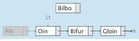

**图 24.7** 从“it”出发，无法访问之前的节点。

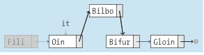

**图 24.8** 要插入，只能改变“it”节点的链接。

因此，你基本上可以在任意位置插入，但必须注意正确使用 `...after` 方法。任意位置？不！还有一个位置仍然存在，并且会顽强抵抗。使用 `...after` 方法时，你实际上无法**在最开头**插入。为此，你有两个选择：要么使用继承自 `list` 的 `push_front` 方法，要么获取特殊的 `before_begin()` 迭代器。它指向 `begin()` 之前一个不存在的元素，其特定用途就是作为 `insert_after` 等方法的参数。

```cpp
// https://godbolt.org/z/9b9Yf4Mwe
#include <iostream>
#include <forward_list>
int main() {
    std::forward_list mylist = {20, 30, 40, 50};
    mylist.insert_after(mylist.before_begin(), 11);
    for (int& x : mylist) std::cout << ' ' << x; // Output: 11 20 30 40 50
    std::cout << '\n';
}
```

**清单 24.42** 可以将“before_begin”用作“insert_after”的参数。

我是否已经提到过，只有真正需要时才应使用 `forward_list`？

以下是向 `forward_list` 中插入元素的选项：

- **在开头插入**  
  使用 `push_front` 和 `emplace_front`，你可以在开头插入一个新元素。或者，你可以使用 `con.insert_after(con.before_begin(), ...)`。从 C++23 起，还有 `prepend_range`。
- **在任意位置插入**  
  `insert_after` 和 `emplace_after` 使用位置迭代器在某处插入元素。`insert_after` 可以处理单个元素，也可以处理来自初始化列表或一对迭代器的多个元素。如果你想在最开头插入，就需要来自 `before_begin` 的特殊迭代器，如[清单 24.42](#)所示。`insert_range_after` 从 C++23 起可用。

与 list 一样，`forward_list` 的所有插入操作都以每个新元素 O(1) 的最优效率进行，尽管有些繁琐。

插入操作不会使指向该列表的其他迭代器失效。

### 删除

与任何其他容器一样，你可以使用 `clear()` 删除所有元素。

如果你想在特定位置删除，就必须考虑与插入时相同的问题：你要么使用 `pop_front()`，要么使用某个 `…after` 方法，并面对同样的复杂情况，可能还需要特殊的 `before_begin()` 方法帮忙。

- **在开头删除**  
  使用 `pop_front`，你可以删除第一个元素。或者，你也可以使用 `con.erase_after(con.before_begin())`。
- **在某处删除**  
  `erase_after` 会删除给定位置之后的单个元素；如果传入一对迭代器，则会删除多个元素。

```cpp
// https://godbolt.org/z/andfoh18z
#include <forward_list>
#include <iostream>
#include <iterator> // next
using std::cout; using std::forward_list; using std::ostream;
ostream& operator<<(ostream& os, const forward_list<int>& data)
{
    for(auto &e:data) os<<e<<' '; return os<<'\n';
}

int main()
{
    forward_list nums {40, 50, 60, 70};
    cout << nums;                         // Output: 40 50 60 70
    nums.insert_after(nums.before_begin(), {10, 20, 30});
    cout << nums;                         // Output: 10 20 30 40 50 60 70
    auto wh = std::next(nums.begin(), 2); // two elements forward
    auto to = std::next(wh, 3);           // three elements after where
    nums.erase_after(wh, to);
    cout << nums;                         // Output: 10 20 30 60 70
}
```

**清单 24.43** “erase_after” 可以删除一个元素范围。

与 list 一样，forward_list 以 O(1) 的最优速度删除每个单独元素。请注意我在清单 24.12 之后的框中关于 <<- 的评论。删除时，指向其他位置的迭代器仍然有效。

### 特性：列表操作

与 list 一样，forward_list 也有一组方法，用于替代 `<algorithm>` 中的一些自由函数，但它们始终作用于整个列表，而不只是两个迭代器之间的范围。幸运的是，merge 也可用于合并两个预先排序的列表。

高效合并整个列表或列表范围的 list 特性，在 forward_list 中相对于 list 又有一个特殊情况——即 splice_after，如清单 24.44 所示。

```cpp
// https://godbolt.org/z/Ka47W5Wjh
#include <forward_list>
#include <iostream>
using std::cout; using std::forward_list; using std::ostream;

ostream& operator<<(ostream& os, const forward_list<int>& data)
{ for(auto &e:data) os<<e<<' '; return os<<'\n'; }

int main() {
  {
    forward_list fw1 {10, 20, 30, 40};
    forward_list fw2 {5, 6, 7, 8};
    fw1.splice_after(fw1.begin(), fw2);       // transfers everything
    cout << fw1;                              // Output: 10 5 6 7 8 20 30 40
    cout << fw2;                              // Output:
  }
  {
    forward_list fw1 {10, 20, 30, 40};
    forward_list fw2 {5, 6, 7, 8};
    // one element left:
    fw1.splice_after(fw1.begin(), fw2, fw2.begin(), fw2.end());
    cout << fw1;                              // Output: 10 6 7 8 20 30 40
    cout << fw2;                              // Output: 5
  }
}
```

**清单 24.44** “splice_after” 可以非常高效地合并列表。

`splice_after` 有几种变体，可合并整个 forward_list 容器或仅合并其中的范围。请注意，forward_list 接口的特殊性质又一次有点棘手。正如你在**清单 24.44**中所看到的，两个非常相似的 `splice_after` 调用会产生不同结果：第一个变体只接受源列表作为参数，并转移源列表的全部内容。然而，如果你传入两个迭代器作为源区域，`forward_list` 不会在第一个迭代器处拼接，而是在它**后面**拼接；也就是说，“after”规则再次适用。由于我在这里传入 `begin()`，拼接发生在 begin 之后的一个元素处。结果，源中仍保留一个元素。

## 24.7 关联式与有序容器

在本节中，`Cont` 或 `C` 表示某种容器类型，例如 `set<int>` 或 `map<int,string>`，而 `cont` 表示容器实例，例如 `set<int> cont`；对于**键类型**，我使用 Key 或 K；对于**目标类型**，使用 Target 或 T；**值类型** `pair<K,T>` 使用 Value 或 V。迭代器类型缩写为 It。

- `set<Key>`  
  这种“set”包含存储值同时也是键的元素，这一点与 map 不同。例如，只需将所有 Person 元素放入一个 `set<Person>` 中。由于键始终良好有序，元素现在也始终有序，从而可以在有保证的时间内快速检索。
- `map<Key,T>`  
  使用 map 将一种类型的值转换为另一种类型的值。map 根据键找到对应的目标值。例如，map 将 `string` 转换为自己的类型 Person。在此容器中，Key 元素始终良好有序，并且搜索保证很快。
- `multimap<Key,T>` 和 `multiset<Key>`  
  对于每个 Key，非 multi... 变体只能存储一个元素。使用这些变体，一个键后面也可以隐藏多个元素。因此，可以重复插入。

| 容器 | 描述 |
|---|---|
| set | 有序且无重复的元素集合 |
| map | 唯一键指向一个目标值 |
| multiset | 可多次出现的有序元素集合 |
| multimap | 有序键可各自多次出现 |

**表 24.6** 概览：关联式有序容器。

从 C++23 开始，还有 *扁平关联有序容器适配器* 这一家族。多么繁琐的名字：我更喜欢称它们为 *扁平容器*。特别是如果你预期会有许多小型容器，请看看 *flat_set* 和 *flat_map*；参见**第 24.9 节**。


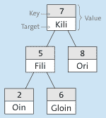

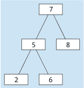

图24.9 “map”按键的顺序存储值。

图24.10 “set”只保存有序的键。

## 24.7.1 共性与差异

在表24.7中，你可以看到区分各个有序关联容器的主要属性。所谓*保证*，我指的是这些操作保证很快——具体来说为 O(log n)。以下说明适用于带 * 的条目：

- **键类型**  
  有序关联容器几乎可以使用任何类型作为键，只要其值可以用小于 < 进行排序。你必须能够创建、删除和复制它们。
- **插入、删除**  
  将元素存储在有序树中，保证你始终能在 O(log n) 次比较操作中找到键。无论你按什么顺序插入键，或者它们是否全都相同，都没有关系。

**表24.7** 有序关联容器的属性。星号的含义在前文解释。

| 属性 | set | map | multiset | multimap |
|---|---|---|---|---|
| 唯一键 | 是 | — | 是 | — |
| 键到目标值 | — | 是 | — | 是 |
| 键类型* | < | < | < | < |
| 动态大小 | 是 | 是 | 是 | 是 |
| 每元素开销 | 是 | 是 | 是 | 是 |
| 内存布局 | 树 | 树 | 树 | 树 |
| 插入、删除* | 保证 | 保证 | 保证 | 保证 |
| 查找 | 保证 | 保证 | 保证 | 保证 |
| 有序 | 始终 | 始终 | 始终 | 始终 |
| 迭代器/范围 | 随机 | 随机 | 随机 | 随机 |
| 算法 | 全部 | 全部 | 全部 | 全部 |

## 24.7.2 有序关联容器的方法

为节省篇幅并提高清晰度，这里我并非总是非常精确或详细地给出函数签名。如果我在方法后没有包含括号，通常意味着存在多个重载：

- **构造函数：** `C()`, `C(Compare)`, `C(...)`, `C(It, It)`, `C(from_range, rg)`  
  默认构造函数 `Cont()` 创建一个空容器。使用来自另一个兼容容器的一对迭代器，可以复制其内容。你可以指定一个初始化列表来填充容器。对于 `map`，这意味着要指定嵌套的 `{...}`，因为每个元素都必须初始化一个 `pair`——例如，`map<int,string>{ {2, "two"s}, {3, "three"s} }`。从 C++23 起，有 `from_range` 构造函数。
- **复制和移动：** `C(const C&)`, `C(C&&)`, `C& operator=(const C&)`, `C& operator=(C&&)`, `swap`  
  你可以将不同的 `Cont` 作为参数传给复制和移动构造函数及运算符。所有关联容器都实现了高效的 `swap(Cont& other)`。注意：与序列容器相比，关联容器既没有 `assign`，也没有 `assign_range`。
- **析构函数：** `~Cont()`  
  所有容器都有移除所含元素的析构函数。注意，如果你将原始指针装入容器，则这一点不适用。
- **向前迭代：** `begin()`, `end()`；向后迭代：`rbegin()`, `rend()`  
  你可以像使用序列容器一样在这里迭代。有序容器保证迭代时元素是有序的。`map` 变体的迭代器引用一个 `pair<const K, T>`。
- **元素访问：** `T& operator[](key)`, `T& at(key)`  
  只有 `map` 具有这些方法。如果键在 `at` 中不存在，则抛出 `out_of_range` 异常。使用 `operator[](key)`，你可以在 `map` 中读写。如果未找到键，它不会失败。例如，如果你写 `auto v = mymap[key]`，则如有必要，会在 `mymap[key]` 中创建一个新的（默认构造的）更大值。只有在这之后，它才会返回给 `v`。很方便——也很重要，需要知道。
- **大小：** `size()`, `empty()`, `max_size()`  
  使用 `size()` 可以获得容器中当前元素的数量；如果该数量为零，则 `empty()` 为真。使用 `max_size()` 可以获得该容器在库实现中的最大大小。
- **修改：** `clear()`, `erase`, `insert`, `insert_or_assign`, `emplace` 和 `insert_range`  
  这些方法的工作方式与序列容器中的方法类似。在 map 中，元素由一个 `pair<K,T>` 组成，你可以用 `insert` 和 `emplace` 插入它。只有 map 还有 `insert_or_assign`。`insert_range` 从 C++23 起可用。
- **查找：** `count`, `find`, `lower_bound`, `upper_bound`, `equal_range`, `contains`  
  使用这些方法，你可以获取容器中键的信息。`count` 返回某个键出现的次数；`find` 返回指向找到的键（可能是多个中的一个）的迭代器，如果未找到则返回 `end()`。`lower_bound` 和 `upper_bound` 做类似的事情，但它们分别搜索第一个和最后一个找到的键。如果什么都没找到，它们返回指向搜索键将被插入位置的迭代器，这一点与 `find` 不同。`equal_range` 同时执行这两个操作，并返回一对迭代器，涵盖所有与搜索键匹配的键（这与 ranges 库无关）。在非 `multi...` 变体中，逻辑上其中至多有一个元素，而在 `multi...` 变体中，其中可以有多个。`contains` 从 C++20 起可用。
- **转移：** `merge`  
  使用 `merge`，你可以将元素从一个容器转移到另一个容器。在 `multi...` 变体中，所有元素都会被转移，而在非 `multi...` 变体中，只有目标中不存在的元素才会被转移，重复项会留在源容器中。

所有有序关联容器都将其元素存储在树结构中（见*图24.9*和*图24.10*）。为确保容器的效率，它会始终保持平衡。这意味着，每次插入或删除操作时，节点都会被巧妙地重新排列，使树的所有叶子都被拉到（几乎）相同的高度。这种额外的管理开销是值得的，因为它保证任何查找都能在至多 log n 步内找到元素或确认其不存在。无论你放入什么数据，即使不断插入或删除，这一点始终成立。

## 24.7.3 “set”

对于 set，存在以下主要用例：

- **去重**  
  你想存储一个对象集合，并且应忽略重复项。因为 set 只存储每个键一次，所以在读取时所有重复项都已被移除。
- **排序**  
  当你交替进行存储、查找、存储、查找等操作时，应保持对象集合有序。如果你先存储一个对象集合，然后在之后一个独立的阶段中快速查找，那么 vector 通常更合适。如果没有两个明显分离的阶段，则推荐使用 set。如果你不需要这种恒定顺序的保证，例如，因为你在两个分离的阶段——填充阶段和读取阶段——访问 set，那么改用 vector 可能值得。有关示例，请参见[第26章第26.2.1节](#)。从 C++23 起，还有针对 vector 的 *flat_set* 适配器。

本节中针对 `set` 的示例应视为嵌入清单24.45代码中的示例。

```cpp
// https://godbolt.org/z/7b8GaE9xT
#include <set>
#include <iostream>
using std::set; using std::cout;
template<typename Elem, typename Comp>
std::ostream& operator<<(std::ostream& os, const set<Elem,Comp>&data) {
    for(auto &e : data) {
        os << e << ' ';
    }
    return os << '\n'; //<<'=' instead of '<<' for line break
}
int main() {
    // Example code here
}
```

**清单24.45** 这是本节“set”示例清单的模板。

请注意，我为运算符输出重载了 `<<` 并加入换行，只是为了保持示例紧凑，详见[Listing 24.12](#)下方框中的说明。

### 元素及其属性

装入 `set` 的元素也可以称为*键*，因为内部树结构是基于它们构建的，以便能够再次快速找到它们。

因此，元素必须是*可排序的*。具体是什么意思？两个元素 `e` 和 `f` 必须支持 `e < f`。这就足够了。

几乎如此。因为这个小于关系必须遵循通常的数学规则；否则，`set` 将无法工作。这意味着：

- 如果 `e < f` 成立，那么 `e >= f` 必须为假（注意，无需实现 `>=`）。
- 因此可以推出，如果 `e < f` 为假且 `f < e` 也为假，那么 `e == f` 必须为真。

例如，如果元素类型是 `int`，`e` 和 `f` 分别为 5 和 11，那么 `5 < 11`。由此可得 `!(5 >= 11)`，这是真的。如果 `e` 和 `f` 都是 7，那么 `e < f` 和 `f < e`，所以 `7 < 7` 为假，因此 `e == f`，这同样为真。


然而，如果你做出任何非数学上的愚蠢行为，set 可能就无法按预期工作了。例如，如果你定义 < 时不小心在元素类型上定义了 <=，那么 set 就无法再判断相等性。如果值为 7 的 e 已经包含在集合中，而你用同样值为 7 的 f 去查找，它就不再起作用了。

在清单 24.46 中，我定义了一个 lambda 作为比较函数，这样我的示例也能用于普通的 int，因为 int 已经有了 <。如果你想将自己的数据类型 Elem 放入 set，只需重载

```cpp
bool operator<(const Elem &e, const Elem &f);
```

不过，至少从 C++20 开始，重载 operator<=> 应该更容易。因为如果你这样做，C++ 会自动从中推导出所有比较运算符。

清单 24.46 错误地定义了 set 的比较操作，当 e 和 f 相等时返回 true 而不是 false。然后，当用 find(7) 搜索实际包含在集合中的元素时，它将不再被找到。

```cpp
// https://godbolt.org/z/jdfh3ddss
using std::cout; using std::ostream; using std::set;
auto comp = [](auto e, auto f) { return e <= f; }; // ✖ defined wrong!
std::set<int,decltype(comp)> data(comp);
data.insert({ 9,5,7,2,3,6,8 });
cout << data;                    // Output with luck: 2 3 5 6 7 8
auto it = data.find(7);
if (it != data.end()) {
    cout << "got it: " << *it << '\n';
} else {
    cout << "it's gone!" << '\n'; // you will probably end up here
}
```

**清单 24.46** 如果你错误地定义了比较操作，那么“set”将不再起作用。

然而，你可以将多个元素归入一个类别。例如，如果你只要求十位匹配即可认为相等，那么你的比较操作可以做到这一点。

```cpp
// https://godbolt.org/z/xdPc51q5s
auto comp = [](auto e, auto f) { return e/10<f/10; }; // grouping is okay
std::set<int,decltype(comp)> data(comp);
data.insert({ 14,23,56,71 });
cout << data;                    // Output: 14 23 56 71
auto it = data.find(29);         // 29 now always finds 23
```

这里，输出随后将按字母顺序排序。

如你所见，你可以将 `operator<=>` 写成一个普通的成员函数。你不需要将它定义为 `friend`，甚至不需要在类外部定义。

## 初始化

除了元素或键类型 `Key`，`set` 还有一个*比较器*（comparator）类型名 `Compare` 作为模板参数（以及必须的*分配器*（allocator）；参见 24.3 节）。如果你不指定，默认是 `std::less<Key>`。这最终意味着两个键 `e` 和 `f` 使用小于号 `<` 进行比较，以保持集合有序。对于像 `int` 这样的内置类型，这也就是内置的 `<`。对于你自己的类型，你可以重载自由函数 `operator<`。如果你选择这些选项之一，就不需要指定自己的比较器。

只有当 `<` 不能满足你的需求时，才应定义自己的比较器。你需要定义一种“小于”`<`，但绝不能是“小于或等于”`<=`；参见清单 24.46。比较器是一个可调用对象，带有两个 `Key` 参数并以 `bool` 作为返回类型，或者可隐式转换为这些的类型。和通常一样，可以是函数指针、lambda 或仿函数。

仿函数在这里很实用，因为只需将其类型指定为模板参数即可。另外，从 C++17 开始，你可以使用 lambda 或函数指针作为构造函数参数，从而可以省略其他显式模板参数。

```cpp
// https://godbolt.org/z/c8a9qPoPP
#include <set>
#include <functional> // function
using std::set; using std::function; using std::initializer_list;
bool fcompTens(int a, int b) { return a % 10 < b %10; }
struct Fives {
    bool operator()(int a, int b) const { return a%5 < b % 5; }
};

int main() {
    //Functor
    set<int, Fives> ff1;
    ff1.insert(5);
    set f2({5}, Fives{});
    set f3{initializer_list<int>{{}}, Fives{}};
    //Lambda
    set<int, function<bool(int,int)>> l1{[](auto a,auto b){return a%3<b%3;}};
    l1.insert(3);
    auto lcomp = [](int a, int b) { return a%3 < b%3; };
    set<int, decltype(lcomp)> l2(lcomp);
    l2.insert(3);
    set l3{{3}, lcomp};
    // Function pointer
    set<int, bool(*)(int,int)> zz1(&fcompTens);        // C-style
    zz1.insert(10);
    set<int, function<bool(int,int)>> zz2(&fcompTens); // C++ style
    zz2.insert(10);
    set<int, decltype(&fcompTens)> zz3(&fcompTens);     // C++ style
    zz3.insert(10);
}
```

**清单 24.49** 有多种指定比较器的方式。

比较器通常可以与用于初始化 set 的元素一起指定。类似于 vector（24.6.3 节），有以下几种方式可以将初始元素传递给构造函数：

- 不带参数（例如，默认构造函数）
- 使用一对迭代器，从另一个容器中获取一个范围
- 作为另一个 set 进行复制
- 作为初始化列表
- 从 C++23 开始，作为带有 *from_range* 标签的范围

```cpp
// https://godbolt.org/z/oc9xxe95
// without arguments
set<int> empty{};
cout << empty;          // Output:
// initializer list
set list{1,2,2,3,3,4,4,5,5};  // set does not take duplicates
cout << list;           // Output: 1 2 3 4 5
// copy
set copy(list);
cout << copy;           // Output: 1 2 3 4 5
// pair of iterators
set from_to( std::next(list.begin()), std::prev(list.end()));
cout << from_to;        // Output: 2 3 4
// Range
set even(from_range, list | vs::filter([](int i){ return i%2; }));
cout << even;           // Output: 2 4
```

**清单 24.50** 构造时又有几种指定元素的方式。

移动是可能的，因为移动构造函数也被定义了。为此，像通常一样，Elem 必须是可移动的：

```cpp
// https://godbolt.org/z/1dTPed3nP
set source{1,2,3,4,5};
cout << source;          // Output: 1 2 3 4 5
set target( std::move(source) ); // move instead of copy
cout << source;          // Output:
cout << target;          // Output: 1 2 3 4 5
```

## 赋值

set 也提供了 operator=(const set<Elem>&)，因此你可以在之后将另一个 set 的内容复制到一个已创建的 set 中。并且由于存在 operator=(set<Elem>&&) 的重载，这也适用于移动：

```cpp
// https://godbolt.org/z/8eGWY45o
set source{1,2,3,4,5};
set<int> target{};
set<int> target2{};
cout << source;          // Output: 1 2 3 4 5
cout << target;          // Output:
cout << target2;         // Output:
target = source;         // copy afterward
cout << source;          // Output: 1 2 3 4 5
cout << target;          // Output: 1 2 3 4 5
target2 = std::move(source); // move
cout << source;          // Output:
cout << target2;         // Output: 1 2 3 4 5
```

assign 和 assign_range 方法不适用于关联容器，因此也不适用于 set。对于序列容器，此方法用于重新初始化一个已存在的容器，提供与构造函数调用类似的参数指定选项。

如果你想对关联容器进行这种类似构造函数的重新初始化，你需要采取不同的方式。这可以在不损失性能的情况下完成。清单 24.51 展示了两种可能性。

```cpp
// https://godbolt.org/z/oZMY86ns8
#include <vector>
//...
set data{1,2,3,4,5};
std::vector source{10, 20, 30, 40, 50};

// There is no set::assign:
data.assign(source.begin(), source.end()); // no set::assign
// So simulate it using a temporary set:
set temp(source.begin(), source.end()); // copy from source...
data.swap(temp); // ... efficiently swap contents
cout << data; // Output: 10 20 30 40 50

// ... or by clearing first and then inserting:
data.clear();                                      // clear ...
data.insert(source.begin(), source.end());   // ... and insert
cout << data;                                  // output: 10 20 30 40 50
```

**清单 24.51** 你可以使用“拷贝并交换”惯用法来代替“assign”。

在第一种变体中，我使用了临时 set 并应用了“拷贝并交换”惯用法。第二种选项利用了 insert 支持的参数组合与构造函数一样多这一事实。

## 插入

在 set 中，你总是使用 insert 或 emplace 进行插入。insert 支持所有可能的参数组合，类似于 set 构造函数的那些参数组合，从 C++23 开始还支持 *insert_range*。可能更快的 *emplace_hint* 与 emplace 一起可用。

在插入操作之后，所有指向 set 的迭代器都保持有效。

### *插入单个元素并自动定位*

insert 可以通过拷贝插入单个值。元素会自动插入到有序顺序中的正确位置。为了保证这一点，首先需要在 log n 步内找到正确位置，其次，内部树结构可能需要重新调整。emplace 也是如此，不同之处在于你直接指定元素的构造函数参数，而不是元素本身。如果你要插入的内容已经存在于 set 中，它不会被覆盖！在这种情况下，insert 的返回值是 pair<iterator,bool>：如果 bool 为 true，则确实插入了新元素。迭代器指向插入位置。

我让编译器用 = default 为 Point 定义方法 operator<=>，然后它会按字典序比较字段 x_ 和 y_。编译器会从中生成 operator<。如果你没有 C++20，可以定义一个 friend 函数 operator<，返回 tie(a.x_, a.y_) < tie(b.x_, b.y_);。

```cpp
// https://godbolt.org/z/8nj7vfeba
// ...
template<typename IT> ostream& operator<<(ostream& os, const pair<IT,bool> wh)
{ return os << (wh.second ? "yes" : "no"); }
struct Point {
    double x_, y_;
    Point(double x, double y) : x_{x}, y_{y} {}
    auto operator<=>(const Point&) const = default;
    friend ostream& operator<<(ostream& os, const Point& p) {
        return os << "(" << p.x_ << "," << p.y_ << ")";
    }
};
```


```cpp
int main() {
  set<int> data{ 10, 20, 30, 40, 50, 60, 70 };
  auto wh = data.insert(35);        // inserts between 30 and 40
  cout << "new? " << wh << '\n';   // Output: new? yes
  wh = data.insert(40);             // already exists, so does not insert
  cout << "new? " << wh << '\n';   // Output: new? no
  set<Point> points;
  points.insert( Point(3.50,7.25) ); // temporary value
  points.emplace(1.25, 2.00);        // constructor arguments
  cout << points;                   // Output: (1.25,2) (3.5,7.25)
}
```

代码清单 24.52 要插入单个元素，请使用“insert”或“emplace”。

insert 的一种变体与 extract 配合使用。extract 的返回类型（仅在内部可知）是 insert 的参数。这使你能在相似容器之间高效转移元素。

### 使用位置提示插入单个元素

你可以通过提供一个指向插入位置的迭代器作为 insert 的附加参数，获得轻微的速度提升。对于 emplace，请使用 emplace_hint，以免迭代器与转发来的构造函数参数混淆。作为返回值，你会得到一个指向插入位置的迭代器。如果位置提示正确，插入平均需要常数时间——即 O(1)。如果提示不正确，插入仍会按排序发生在正确位置，但耗时退回到普通插入的水平。

```cpp
// https://godbolt.org/z/qza7j9bor
set data{ 10, 20, 30, 40, 50, 60, 70 };
set<int> target;
auto hint = target.begin();
for(auto &e : data) {
  hint =                      // Use insertion position in the next round
    target.insert(hint, e);   // Hint helps because data is sorted
}
```

代码清单 24.53 在插入已排序范围时，可以复用返回值。

带位置提示的 insert 方法的返回值，对关联容器和序列容器都会返回一个迭代器。这使你可以编写同时适用于这两种容器类型的函数。

```cpp
// https://godbolt.org/z/h1G8v86jv
#include <set>
#include <vector>
#include <iostream>
using std::cout; using std::ostream; using std::set; using std::vector;

template<typename Container>
void insFive(Container& cont, int a, int b, int c, int d, int e) {
    auto it = cont.end();
    for(int x : { a, b, c, d, e }) {
        it = cont.insert(it, x); // works with vector, set etc.
    }
}
int main() {
    vector<int> dataVec { };
    insFive(dataVec, 9, 2, 2, 0, 4);
    for(auto e : dataVec) cout << e << ' ';
    cout << '\n';              // Output: 0 4 0 2 2 9
    set<int> dataSet { };
    insFive(dataSet, 9, 4, 2, 2, 0);
    for(auto e : dataSet) cout << e << ' ';
    cout << '\n';              // Output: 0 2 4 9
}
```

**代码清单 24.54** 对顺序容器和关联容器使用相同的 insert。

### 插入多个元素

insert 还接受一对迭代器或一个初始化列表作为参数，以一次插入多个元素。从 C++23 起，还有 *insert_range*。在这种情况下不能提供位置提示。你不会得到有关是否实际添加了元素、添加了哪些元素或哪些元素已存在的信息。返回类型为 void。

```cpp
// https://godbolt.org/z/fTvo7hr5M
#include <vector>
set data { 10, 20, 30, };
data.insert({ 40, 50, 60, 70 }); // initializer list
std::vector<int> new_vec { 5, 25, 35, 15, 25, 75, 95 };
data.insert(new_vec.cbegin()+1, new_vec.cend()-1); // area
cout << data; // Output: 10 15 20 25 30 35 40 50 60 70 75
```

**代码清单 24.55** 也可以插入多个元素。

你可以在这里看到，来自 *new_vec* 的 25 没有被插入两次。

## 访问

### 通过迭代器访问

*set* 的迭代器是双向的；参见表 24.2。因为*有序关联容器*始终有序（名称由此而来），所以你总是按给定顺序遍历元素。使用 `begin()/end()` 时，该顺序为升序；使用 `rbegin()/rend()` 时，为降序。

### 通过搜索访问

最重要的搜索函数是 find。它接受一个搜索元素作为参数，并返回一个迭代器。如果找到该元素，它指向找到的元素；如果没找到，它指向 end()。lower_bound 的行为略有不同：它查找第一个不小于搜索元素的元素。这意味着如果该元素存在，它就指向该元素；如果不存在，就指向下一个更大的元素。使用 upper_bound，你会得到第一个大于搜索元素的元素。两者结合形成 equal_range：你会得到一对迭代器，它们标记出包围搜索元素的区域（因此不是 C++20 范围）。使用 count，你可以得到匹配键的数量，例如 auto r = equal_range(key); auto count = distance(r.first, r.second)。自然，在 set 中，这个数量要么是 0，要么是 1。从 C++20 起，还有 contains，它返回 bool。所有搜索都保证最多需要 log n 步。

注意 upper_bound 有些不对称的行为：当你使用 it = s.upper_bound(2) 在元素为 {1,2,3} 的集合 s 中搜索时，它指向 3，因为 3 是第一个大于 2 的元素。相反，it = s.lower_bound(2) 返回指向 2 的迭代器，因为 2 是第一个不小于 2 的元素。合在一起，它们正好就是 equal_range 成对返回的内容。这在代码清单 24.56 中说明。

```cpp
// https://godbolt.org/z/MW74f97f7
#include <set>
#include <iostream>
using std::cout; using std::ostream; using std::set;
void search(const std::set<int>& data, int what, ostream& os) {
    os << what << " ";
    // contains
    auto inside = data.contains(what);  // C++20
    os << "inside: " << (inside ? "yes " : "no "); // check contains
    auto where = data.find(what);
    if(where != data.end()) {
        os << " found: " << *where;
    } else {
        os << " not found: ";
    }
    auto lo = data.lower_bound(what);
    if(lo != data.end()) {
        os << "lo:" << *lo;
    } else {
        os << "lo:-";
    }
    auto up = data.upper_bound(what);
    if(up != data.end()) {
        os << "up: " << *up;
    } else {
        os << "up:-";
    }
    // [lo,up] is now the same as what equal_range would have returned
    os << " Range{";
    for (; lo != up; ++lo) {
        os << *lo << ' ';
    }
    os << "}";
    // count
    os << " C:" << data.count(what) // count hits
       << "\n";
}
int main() {
    set data{ 10, 20, 30, 40, 50, 60 };
    search(data, 20, cout);  // 20? in:yes. found:20 lo:20 up:30 range:{20} C:1
    search(data, 25, cout);  // 25? in:no. lo:30 up:30 range:{} C:0
    search(data, 10, cout);  // 10? in:yes. found:10 lo:10 up:20 range:{10} C:1
    search(data, 60, cout);  // 60? in:yes. found:60 lo:60 up:range:{60} C:1
    search(data, 5, cout);   // 5? in: no. lo:10 up:10 range:{} C:0
    search(data, 99, cout);  // 99? in: no. lo:-- up:-- range:{} C:0
}
```

**代码清单 24.56** 这些是“set”的搜索函数。

如果返回值的组合让你觉得奇怪，可以通过它们的典型用例来记住它们：

- `lower_bound` 查找搜索元素，或者——如果不存在——查找其最佳插入位置。
- `equal_range` 返回所有找到元素的范围，这对容器的 multi... 变体特别有用。如果没有元素符合，范围为空。
- `upper_bound` 返回第一个不再符合的元素。

对我有帮助的想象方式是：找到的边界位于元素之间，而不是在元素本身上。在图 24.11 中，我把返回的迭代器画在元素的开头。如果你这样想象，`upper_bound` 和 `lower_bound` 这两个术语就突然完全说得通了。

我自己主要使用 `find` 或 `lower_bound`，有时会在 `multiset` 中使用 `equal_range`。`upper_bound` 使用得较少，但你可以在代码清单 24.58 中找到一个示例。

搜索函数也在 `<algorithm>` 头文件中提供，适用于所有兼容容器，尤其是序列容器。不过，它们必须事先排序。你可以在第 25 章找到更多相关内容。


**图 24.11** 搜索函数定义了范围。

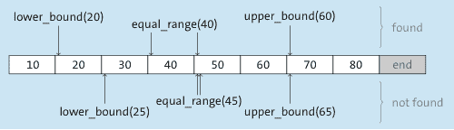

## 不使用特定键进行搜索

`find` 相关函数的参数自然需要一个键作为搜索参数。但如果生成键的成本非常高甚至不可能呢？或者搜索键的形式与存储的键略有不同？在这种情况下，你可以使用另一种类型作为搜索键的参数。重要的是这些键是等价的（就搜索而言）。

```cpp
// https://godbolt.org/z/zEsxd8e7G
#include <string>
#include <set>
#include <iostream>
#include <tuple> // tuple, tie
using std::string; using std::set; using std::cout; using std::tie;
struct Hobbit {
    string firstName;
    string lastName;
    Hobbit(const string v, const string n) : firstName{v}, lastName{n} {}
};
struct CompLastName {
    bool operator()(const Hobbit& x, const Hobbit& y) const { // normal
        return tie(x.lastName, x.firstName) < tie(y.lastName, y.firstName);
    }
    using is_transparent = std::true_type; // allowed for find
    bool operator()(const Hobbit& x, const string& y) const { // for find etc.
        return x.lastName < y;
    }
    bool operator()(const string& x, const Hobbit& y) const { // for find etc.
        return x < y.lastName;
    }
};
int main() {
    using namespace std::literals; // allow "...s"
    set<Hobbit,CompLastName> hobbits;
    hobbits.emplace("Frodo", "Baggins");
    hobbits.emplace("Sam", "Gamgee");
    auto f1 = hobbits.find(Hobbit{"Frodo", "Baggins"}); // whole key
    if(f1 != hobbits.end()) {
        cout << "found: " << f1->firstName << '\n';      // Frodo
    }
    auto f2 = hobbits.find("Gamgee");                    // equivalent key
    if(f2 != hobbits.end()) {
        cout << "found: " << f2->firstName << '\n';      // Sam
    }
}
```

**清单 24.57** 如果键等价，你可以使用不完全相同的键进行搜索。

在清单 24.57 中，要搜索“Gamgee”，你无需创建完整的 Hobbit 类型搜索元素。为此，配置的比较仿函数 `CompLastName` 必须具备某些属性。对于 set 内部使用的正常比较，以及 `find(Hobbit{"Frodo", "Baggins"})` 的搜索，定义了第一个 operator()，它接受两个 Hobbit 参数。对于“Gamgee”的搜索，则有另外两个重载，它们接受一个 Hobbit 和一个 string。然而，通过这一行

```cpp
using is_transparent = std::true_type;
```

也应当表明这些重载可以用于搜索函数。因此，可以直接使用 string 进行搜索，而无需创建整个 Hobbit 对象。

请注意，只有在替代比较函数不会产生与主比较运算符不同的顺序时，你才能以这种方式搜索。你不能期望 set 保持按一种顺序排序，却又使用一个会导致不同排序的比较运算符进行搜索。这就是等价比较函数的含义。

### 删除

对于删除操作，你可以使用 `erase` 和 `clear`。使用 `extract`，你可以移除一个元素，通常你会通过 `insert` 将其转移到另一个 set 中：

- **删除所有元素**  
  你可以使用 `clear()` 方法删除所有元素。
- **删除单个元素**  
  如果向 erase 方法传递一个迭代器，该位置的元素将被删除。或者，你也可以指定一个元素作为参数，如果它存在，则会被删除。两者都花费对数 n 的时间。返回值是被删除元素的数量。
- **转移元素**  
  使用 `extract`，你可以从 set 中移除单个元素。返回值是被移除节点的“句柄”，你可以将其用于其他目的，例如通过 `insert` 将它转移到另一个类似的 set 中。
- **删除多个元素**  
  以一对迭代器作为参数，`erase` 可以删除它们之间的元素。

所有未被删除元素的迭代器都保持有效。

```cpp
// https://godbolt.org/z/dh8Yqxc64
set<int> data{ 10, 20, 30, 40, 50, 60, 70 };
auto lo = data.lower_bound(35);
auto up = data.upper_bound(55);
data.erase(lo, up);        // deletes all numbers between 35 and 55
cout << data;              // Output: 10 20 30 60 70
lo = data.lower_bound(20);
up = data.upper_bound(60);
data.erase(lo, up);        // deletes including 60, because up points to 70
cout << data;              // Output: 10 70
auto n = data.erase(69);   // deletes nothing
cout << "Number of removed elements: " << n << '\n'; // Output: Number ... 0
n = data.erase(70);        // deletes the element of 70
cout << "Number of removed elements: " << n << '\n'; // Output: Number ... 1
cout << data;              // Output: 10
```

**清单 24.58** “erase” 删除一个或多个元素。

## 24.7.4 “map”

map 用于通过键快速查找值。在 map 中，每个键（Key）恰好关联一个目标（Target）。map 与 set 的关系在于，适用于 set 元素的规则同样适用于 map 的键：

- map 中的键始终保持有序。
- 在 map 中，任何键都不会出现多次。
- 查找键的操作保证最多花费对数 n 步。

适用于 set 的大部分内容同样适用于 map，因此**第 24.7.3 节**可提供额外信息。

然而，与 set 有一个重大区别：map 中的单个元素是一个对，具体来说是 `pair<const Key, Target>`。当我提到这个对时，在 map 的语境下我使用术语 Element 或 elem。

### “map” 中“值”的含义有歧义

有时键和目标的组合也被称为值。在其他场合，值指的是我命名为 target 的内容。为避免误解，我尽量在 map 的语境中避免使用“值”这个术语。

如果你来自 Python 或 Perl 等其他语言，我想立刻提醒你一个可能会踩到的陷阱，因为 C++ 的 map 行为与 Python 字典或 Perl 哈希不同。如果你使用 operator[] 访问 map，而所访问的键元素尚不存在，那么你会在 map 中创建一个条目。即使你是在赋值右侧使用 []，并认为你只是在读取，同样如此。

```cpp
// https://godbolt.org/z/zWa58dYYq
#include <map>
#include <iostream>
using std::map; using std::cout;
int main() {
    map<int,char> alpha;
    cout << alpha.size() << '\n';       // 0 naturally
    if( alpha[5] == ' ' ) { /* ... */ }
    cout << alpha.size() << '\n';       // now 1
    char x = alpha[9];                  // works
    cout << alpha.size() << '\n';       // and now 2
}
```

**清单 24.59** 使用 [] 可能会产生副作用，即创建一个条目。

这是一个神奇的增长！但如果你熟悉这一点，就能处理好它：如果传给 operator[] 的键在 map 中不存在，则会插入一个新条目，并使用默认构造函数创建一个新目标——在前面的例子中是 char '\0'。

当你希望在较长的表达式中使用 [] 时，这很有用，因为它永远不会失败。如果这种行为困扰你，可以改用 `at`。如果键不存在，则会抛出异常。使用 `find` 或 `contains`，你可以在不抛出异常的情况下确定键是否存在于 map 中。

如果你不喜欢 operator[] 的这种隐式行为，可以在插入到 map 或 unordered_map 时改用 `insert_or_assign`。

本节中关于 map 的示例应被视为嵌入在清单 24.60 的代码中。请注意我在清单 24.12 之后的方框中对 `<<` 的评论。

```cpp
// https://godbolt.org/z/K834js588
#include <map>        // the main thing
#include <iostream>   // for output
#include <string>     // often used for key or target
using std::map; using std::cout; using std::string;

template<typename Key, typename Trg, typename Comp>
std::ostream& operator<<(std::ostream& os, const map<Key,Trg,Comp>&data) {
    for(auto &e : data) os << e.first << ':' << e.second << ' ';
    return os << '\n'; // << instead of < for line break
}
int main() {
    // Example code here
}
```

**清单 24.60** 这是本节关于“map”的示例列表的模板。

### 元素及其属性

map 的元素是 `pair<const Key,Target>`——也就是由键和目标组成的对。对于键而言，适用与 set 中元素相同的规则，以及与比较和排序相关的规则。默认情况下，编译器使用小于号 < 在内部将键排列在树中，并使其持续保持有序。

如果你不喜欢 `<`，你可以指定自己的比较函数作为额外的模板参数。

这也适用于自定义数据类型，但你也可以简单地重载 `operator<=>` 或 `operator<`。

```cpp
// https://godbolt.org/z/W6Mfnxj1W
#include <cctype>     // toupper, tolower
// ...
auto comp = [](char a, char b) { return toupper(a) < toupper(b); };
map<char,int,decltype(comp)> lets(comp); // as template parameter and argument
lets['a'] = 1;
lets['B'] = 2;
lets['c'] = 3;
lets['A'] = 4; // overwrites position 'a'
cout << lets; // Output: a:4 B:2 c:3
struct Comp { // Functor
    bool operator()(char a, char b) const { return toupper(a) < toupper(b); }
};
map<char,int,Comp> lets2; // here the template parameter is sufficient
```

**清单 24.61** 你也可以为“map”提供自定义比较函数。


当你定义一个函数对象——也就是，一个带有 `operator()` 的类——只需将该类指定为模板参数即可。创建 `map` 时，会使用其默认构造函数创建该函数对象的一个实例。使用 lambda 时，你已经有可调用的实例。

## 初始化

作为 `map` 的模板参数，你指定 `Key` 和 `Target` 的类型——例如：

```cpp
map<int,string>          // int as Key, string as Target
map<Person,size_t>       // Person to their age?
map<unsigned,unsigned>   // Key and target types can also be the same
map<int,shared_ptr<Image>> // a pointer as the target type is quite common
```

可选地，你可以指定 `Key` 的比较器类型（见上一节）以及一个 `allocator`。如果指定了分配器，还可以选择提供通常的构造函数参数。

以下变体常用作初始化的构造函数参数：

- 默认构造函数创建一个空容器
- 迭代器对从另一个容器或流复制一个范围
- `map` 复制整个另一个 `map`
- 初始化列表用显式值进行初始化
- 带 `from_range` 标签的构造函数以及来自 C++23 的范围

通过初始化列表填充时，必须考虑到每个元素都由一个 `pair` 组成。因此，这里也必须指定 `pair` 元素。幸运的是，pair 也可以通过双元素初始化列表创建，所以这种构造看起来仍然紧凑，如清单 24.62 所示。

```cpp
// https://godbolt.org/z/W4XsMPq7
using std::pair; using std::make_pair;
namespace literal_p { // better to put user-defined literals in a namespace
  constexpr pair<char,char> operator "" _p(const char* s, size_t len) {
      return len>=2 ? make_pair(s[0], s[1]) : make_pair('-', '-');
  }
}
struct Q {
  char a; int n;
  Q(char a, int n) : a{a}, n{n} {}
  operator pair<const char,int>() { return make_pair(a, n); }
};
// ...
// explicit pairs:
map<int,int> nums { pair<int,int>(3,4), make_pair(7,8), make_pair(11,23) };
map nums2 { pair<int,int>(6,1), make_pair(5,2) };
// implicit pairs from initializer lists:
map<int,char> numch({{1,'a'},{2,'b'},{3,'c'}});
map<int,int> nums3 { {7,2}, {9,4} };
using namespace literal_p;
map<char,char> pmap { "ab"_p, "cd"_p, "ef"_p }; // detour via custom literal
cout << pmap;                                  // Output: a:b c:d e:f
map<char,int> qmap{Q('a',1),Q('b',2),Q('c',3)}; // implicit conversions
cout << qmap;                                  // Output: a:1 b:2 c:3
```

**清单 24.62** 初始化列表必须包含“pair”元素。

正如在 qmap 的示例中所见，初始化列表的元素确实可以隐式转换为 `pair<const Key, Target>`。这对于紧凑表示法非常有用。

## 赋值

与 set 类似，你可以使用 operator= 重新初始化 map。存在用于复制和移动的重载。

map 中也没有 `assign` 或 `assign_range` 方法，但与其他所有容器一样，有 `swap`。

## 插入

与 set 一样，你可以使用 `insert`、`emplace`、`emplace_hint` 添加新元素，从 C++23 起还可以使用 `insert_range`。还有 `operator[]` 和 `insert_or_assign`，它们在某些情况下也可能插入新元素。

无论以何种方式插入，指向 map 的迭代器都保持有效。

### 自动定位插入单个元素

在 map 中，单个元素由键和目标的 pair 组成。然后将其指定为参数。与 set 一样，在这种情况下 `insert` 和 `emplace` 不会覆盖。

```cpp
// https://godbolt.org/z/Ylebrx8T
map<int,string> zip2plc;
zip2plc.insert(std::make_pair(94103, "San Francisco"));
zip2plc.emplace(10001, "New York");
cout << zip2plc;    // Output: 10001:New York 94103:San Francisco
map<string,int> plc2zip;
plc2zip.emplace("New York", 10001);
plc2zip.emplace("New York", 10002);  // does not overwrite
cout << plc2zip;                    // Output: New York:10001
```

**清单 24.63** 你将单个新元素指定为 pair。

### 自动插入与覆盖

使用 `operator[]`，你可以查找一个键。返回值是对目标的引用。如果该键还没有条目，则会新建一个条目。为此，会使用其默认构造函数 `Target{}` 创建一个新目标。如果 `[]` 出现在赋值左侧，你可以立即用新目标覆盖刚创建的目标。

```cpp
// https://godbolt.org/z/7h3vsWvYG
map<string,int> dwarves;
dwarves.emplace("Fili", 2859);
cout << dwarves["Fili"] << '\n'; // Output: 2859
cout << dwarves["Dori"] << '\n'; // newly created. Output: 0
dwarves["Kili"] = 2846;           // newly created and immediately overwritten
cout << dwarves["Kili"] << '\n'; // Output: 2846
cout << dwarves;                  // Output: Dori:0 Fili:2859 Kili:2846
```

**清单 24.64** 使用“operator[]”自动创建并立即覆盖。

有时使用 `insert_or_assign(key, value)` 更高效。如果 `key` 已存在于 map 中，则发生与 `operator[]` 相同的情况。但如果条目是新的，不会先在键的位置创建一个空元素；而是直接插入 `value`。此外，返回值是一个 pair，包含是否插入以及插入位置的信息。

### 带位置提示插入单个元素

`insert` 可选地将迭代器作为第一个参数，它表示新元素可能的插入位置。如果该位置正确，插入平均在常数时间内完成。这也适用于 `emplace_hint`，其中位置提示是一个额外参数。

### 插入多个元素

使用一对迭代器，你可以向 `map` 插入多个元素；从 C++23 起，还可以使用 `insert_range`。

## 访问

由于 map 的元素由 `pair<const Key, Target>` 组成，函数和方法返回的所有迭代器都指向这样的 pair。这适用于作为参数和返回值的迭代器。

你可以使用 `*it` 访问迭代器 `it` 的 pair，或直接用 `it->` 解引用。因此，通过 `it->first` 可以获得对键的常量引用，通过 `it->second` 可以获得对目标的可变引用。

pair 的第二个元素不是 const，这意味着你可以为目标赋予新值。随后迭代器指向新的目标。

```cpp
// https://godbolt.org/z/8948besY8
map<string,string> data { {"John","Wayne"}, {"Cary","Grant"} };
cout << data;                         // Cary:Grant John:Wayne
data.rbegin()->second = "Travolta";   // Overwrite target
cout << data;                          // Cary:Grant John:Travolta
```

**清单 24.65** 你可以更改目标的值。

如果使用基于范围的 for，你会直接得到作为 `e` 的 pair，并可通过 `e.first` 和 `e.second` 访问键和目标。

### 通过迭代器访问

与所有有序关联容器一样，`[c][r]begin()` 和 `[c][r]end()` 返回双向迭代器。

```cpp
// https://godbolt.org/z/16T5d0b75
map<char,int> data { {'a',1}, {'b',2}, {'c',3} };
for(auto it=data.rbegin(); it!=data.rend(); ++it) { // backwards
  cout << it->first << ':' << it->second << ' ';   // dereference with ->
}
cout << '\n'; // Output: c:3 b:2 a:1
for(auto &e: data)                         // forwards, uses begin() and end()
  cout << e.first << ':' << e.second << ' '; // pair, element access with .

cout << '\n'; // Output: a:1 b:2 c:3
```

**清单 24.66** “map”的迭代器类型为“pair”。

### 通过搜索访问

你可以使用 `find`、`upper_bound`、`lower_bound` 和 `equal_range` 在 map 中搜索键。会得到指向找到元素的迭代器，或 `end()`，如 set 中所述。使用 `count`，可以查明某个键出现零次还是一次；从 C++20 起，使用 `contains` 可以以 bool 值获得该信息。

### 类索引访问

作为有序或无序关联容器中的一项特殊功能，`map` 具有 `[]` 运算符和 `at` 方法，这些你从 vector 和 array 中已经熟悉。这允许你像使用带索引的容器一样使用 map。与其对应物不同，索引的类型不是 `size_t`，而是 `Key`。因此，`operator[]` 和 `at` 的参数是此类型的值。如清单 24.59 和清单 24.64 所示，如果未找到键，`operator[]` 会自动插入缺失的元素。相反，`at` 在此类情况下会抛出 `out_of_range` 异常。如果你有一个 const map，则不能使用 `operator[]`，因为由于自动插入，它未被标记为 const。清单 24.67 演示了这一点。


```cpp
// https://godbolt.org/z/Eqsjex4Ta
string search2(const map<int,string> &data) {
    return data[7];                 // non-const method on const parameter
}
string search5(const map<int,string> &data) {
    auto it = data.find(5);         // not automatically inserting
    return it == data.end() ? string{} : it->second;
}
// ...
map<int,string> dwarfs{ {1,"one"}, {3,"three"}, {5,"five"}, {7,"seven"} };
cout << search2(dwarfs) << '\n';
cout << search5(dwarfs) << '\n';   // Output: five
```

**清单 24.67** 你不能在“const map”上使用“operator[]”。

### 删除

在 map 中删除与在 set 中删除几乎没有什么不同：

- **删除所有元素**  
  `clear()` 会完全清空 map。
- **删除单个元素**  
  `erase` 通过迭代器或键删除单个元素。
- **转移单个元素**  
  `extract` 移除一个你想用 `insert` 放到别处的元素。
- **删除多个元素**  
  使用一对迭代器调用 `erase`，可以删除多个元素。

删除后，如果容器中的迭代器所指向的元素未受删除影响，则这些迭代器仍然有效。

### 特殊之处：“operator[]”

在关联容器中，只有 map 提供下标运算符 operator[]。这大大简化了 map 的使用，使包含 map 的源代码看起来紧凑且可读。

然而，它有一个你确实需要记住的特殊行为。如果还没有该键对应的条目，它会自动向容器中插入一个新元素。我已经通过几个示例演示了这一点，例如在[清单 24.59](#)、[清单 24.64](#)和[清单 24.67](#)中，但这一点再怎么强调也不为过。

## 24.7.5 “multiset”

`multiset` 和 set（第 24.7.3 节）一样，包含的元素同时也是键，可以快速搜索。不同之处在于元素也可以多次出现。例如，如果你向 `multiset<int>` 中插入值 7 三次，那么遍历它时会得到三个 7。`insert` 和 `emplace` 总是会添加一个或多个元素。各种搜索函数的行为也相应调整：`lower_bound`、`upper_bound` 和 `equal_range` 的返回值现在指向具有匹配元素的范围的边界。`find` 返回任意一个匹配元素。`erase` 在用一个（键）元素调用时，会删除所有匹配元素，而不只是一个。

`merge` 会移除源中的所有元素，而不是留下重复项。

如果你想使用 `multiset`，需要 `#include <set>`。

`multiset` 的示例应视为嵌入在[清单 24.68](#)中。

```cpp
// https://godbolt.org/z/aMj87neG6
#include <set>       // multiset
#include <iostream>
using std::multiset; using std::cout;
template<typename Elem, typename Comp>
std::ostream& operator<<(std::ostream& os, const multiset<Elem,Comp>& data) {
    for(auto &e : data) {
        os << e << ' ';
    }
    return os << '\n'; // <<' instead of '<<' for line break
}
int main() {
    // Example code here
}
```

**清单 24.68** 这是本节关于“multiset”的示例清单所用的模板。

注意我在[清单 24.12](#)之后的框中关于 `<<` 的评论。

### 元素及其属性

与 `set` 一样，`multiset` 中的元素就是容器用来保持排序的键。这里同样，你可以为元素类型重载 `operator<=>` 或 `operator<`，或者提供自己的比较器作为可选的模板参数。

为了说明清楚，避免产生误解，尤其是与 `unordered_multiset` 比较时：`multiset` 中的所有元素都存储在排序树中，包括重复项。你可以在[图 24.12](#)中看到示例。并不是说重复项存储在链表或类似结构中。这意味着即使有许多重复条目或只有重复条目，`multiset` 的性能也不会下降。`multiset` 处理 *n 个相同* 元素与处理 *n 个不同* 元素一样快。`multiset` 的关键特性是它的效率有保证且不容易下降——不像 `unordered_...` 变体在哈希函数较差时那样。在[清单 24.75](#)中，你可以看到 `set`、`multiset` 和 `unordered_multiset` 在不同场景下的表现。一个结论是，许多相同元素不会降低 `unordered_multiset` 的性能，但在哈希函数较差时，许多不同元素会降低其性能。

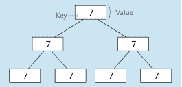

**图 24.12** 即使重复元素也会按排序树存储在“multiset”中。

另一种选择是 C++23 的 *flat_multiset* 适配器，它将元素排序后存储在 vector 中。尤其当元素很多或元素非常小时，请留意这一点。

### 初始化

multiset 的构造选项与 set 完全相同：

- 无参数，通过默认构造函数
- 使用一对迭代器从另一容器取一个范围
- 另一个 multiset 用于复制
- 初始化列表
- 从 C++23 起，使用带 *from_range* 标签的构造函数

在许多情况下，如果你使用 C++17，编译器可以从构造函数参数推导模板参数。

如果你选择初始化列表或从另一容器取一个范围，你会得到一个包含已排序元素并保留重复条目的容器。

```cpp
// https://godbolt.org/z/aqGTKdbMP
#include <vector>
//
multiset msinit{1,2,2,3,1};             // sorted at initialization
cout << msinit;                          // Output: 11223
std::vector in{7,7,7,7,7,7,7};
std::set srange (in.begin(), in.end());  // set removes duplicates
cout << srange.size() << " " << *srange.begin() << '\n'; // Output: 1 7
multiset msrange( in.begin(), in.end() ); // multiset retains duplicates
cout << msrange;                          // Output: 7777777
```

**清单 24.69** 条目已排序，并且重复项被保留。

### 赋值

使用 `operator=`，你可以像 set 一样重新赋值 `multiset` 的内容，既可以通过拷贝，也可以通过移动。这里也使用 swap 方法来实现常见惯用法。

### 插入

向 `multiset` 中插入时，使用与 `set` 相同的重载，但有一个例外：`set` 返回 `pair<iterator,bool>` 以通过 second 指示是否实际发生了插入，而 `multiset` 只返回迭代器。最后，`multiset` 总是插入，无论元素是否已经存在：

- **自动定位插入单个元素**  
  使用 `insert` 按拷贝插入单个值，或使用 emplace 直接在原位创建元素。返回值是指向被插入元素的单个迭代器——不同于 `set` 中会得到一个第二元素为 `bool` 的 pair，`multiset` 无论元素是否已经存在，都以 O(log n) 时间插入。
- **带位置提示插入单个元素**  
  如果同时提供迭代器和要插入的值，`multiset` 也会尝试将该迭代器解释为插入提示。如果不想传入值而是想就地创建，请使用 `emplace_hint`。你也从 `set` 中了解这两种方式；这里同样，如果提示正确，摊还时间复杂度为 O(1)，否则为 O(log n)。
- **插入多个元素**  
  与 `set` 一样，如果提供初始化列表或通过一对迭代器提供多个元素，`multiset` 也支持一次插入多个元素。从 C++23 起，还提供 `insert_range`。正如对 `multiset` 的预期，所有元素都会被转移，包括重复项。

与 `set` 一样，在 `multiset` 中插入后，容器的所有迭代器仍然有效。

### 访问

`multiset` 用于访问的接口与 `set` 相同。只需在返回值中考虑容器中的重复元素。它们要么返回任意一个匹配元素，要么涵盖所有匹配元素的整个范围：

- **通过迭代器访问**  
  使用你从 `set` 中了解的 `begin()` 和 `end()` 变体来获得双向迭代器。
- **通过搜索访问**  
  如果 `find` 在容器中找到搜索元素，那么它就是任意一个匹配元素。`lower_bound`、`upper_bound` 和 `equal_range` 则不同，因为按照已经在 `set` 中介绍的规范，你会得到容器中所有匹配元素的区域边界。这里 `count` 很有趣，因为在这种情况下，找到的元素数量具有更多信息价值。


- **不指定特定键进行搜索**  
  如果在搜索过程中为合适的比较函子配备 `is_transparent`，就可以省去创建具体搜索键，如清单 24.70 中对 set 所示。

下面的清单给出了一些访问 multiset 的示例。

```cpp
// https://godbolt.org/z/fWGrbbYa7
#include <string>
#include <iterator> // distance
#include <ranges>   // subrange
struct Person {
    std::string name;
    friend bool operator<(const Person &a, const Person &b) {
        // only first letter
        return a.name.size()==0 ? true
             : (b.name.size()==0 ? false : a.name[0] < b.name[0]);
    }
};
// ...
multiset<int> data{ 1, 4,4, 2,2,2, 7, 9 };
auto [from1, to1] = data.equal_range(2);
cout << "Number of 2s: "
     << std::distance(from1, to1) << '\n';    // Output: Number of 2s: 3
auto [from2, to2] = data.equal_range(5);
cout << "Number of 5s: "
     << std::distance(from2, to2) << '\n';    // Output: Number of 5s: 0
multiset<Person> room{
    {"Karl"}, {"Kurt"}, {"Peter"}, {"Karl"}, {"Ken"}};
auto [p, q] = room.equal_range(Person{"K"});
for(auto& p : std::ranges::subrange(p,q)) { // C++20 range or simple loop
    cout << p.name << ' ';
}
cout << '\n'; // Output: Karl Kurt Karl Ken
```

**清单 24.70** “multiset” 的搜索函数会查找匹配元素的范围。

在 `room` 示例中，借助合适的 `operator<`，你确实可以把 `multiset` 中实际不同的元素视为相等。例如这里只比较名字的首字母。当你用 `room.equal_range(Person{"K"})` 搜索时，所有以 `K` 开头的名字都会落在返回的范围内。请注意，定义的 `operator<` 也用于内部排序，因此排序时只使用名字的首字母。这就是为什么未按顺序排列的“K...”名字会出现在搜索结果中。

`equal_range` 的返回值是一个 `pair`，从 C++17 起，可以使用结构化绑定将其赋给两个新变量。在 C++17 之前，你会使用 `auto x`，然后使用 `x.first` 或 `x.second`。

### 删除

与 set 一样，使用 erase 或 clear 进行删除：

- **删除所有元素**  
  使用 `clear()` 可删除所有内容。
- **删除或转移单个元素**  
  如果提供迭代器，`erase` 会删除单个元素；否则会删除与给定搜索键匹配的所有元素。  
  如果你之后想在其他位置 `insert` 它，`extract` 也能做到这一点。
- **删除多个元素**  
  以两个迭代器作为参数时，你会像使用 `set` 一样删除多个元素。

所有未被删除元素的迭代器都保持有效。

## 24.7.6 “multimap”

multimap 有两个相关容器：与 map 的共同点是，每个条目都由一个键和一个目标组成。来自 multiset 的特性是键可以出现多次。因此，`multimap<int,string>` 可以在键 7 下同时存储目标 "sieben" 和目标 "seven"，如图 24.13 所示。

因此我将简要介绍，并请你参阅第 24.7.4 节和第 24.7.5 节以获取更多信息。

multimap 的接口与 map 相比有一个关键区别：multimap 既不提供 `operator[]`，也不提供 `at`。

本节中 multimap 的示例应视为嵌入在清单 24.71 中。

```cpp
// https://godbolt.org/z/bxW63jPor
#include <map>       // the main thing
#include <iostream>  // for output
#include <string>    // often used for key or target
using std::multimap; using std::cout; using std::string;
template<typename Key, typename Tp, typename Cmp>
std::ostream& operator<<(std::ostream& os, const multimap<Key,Tp,Cmp>&data){
    for(auto &e : data) {
        os << e.first << ": " << e.second << ' ';
    }
    return os << '\n'; //'<<'=instead of '<<' for line break
}
int main() {
    //Example code here
}
```

清单 24.71 这是本节中关于“multimap”的各清单所用的模板。

请注意我在清单 24.12 之后的框中关于 << 的注释。

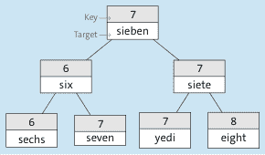

**图 24.13** 可能存在重复键。

### 元素及其属性

与 map 一样，存储在 `multimap<Key,Target>` 中的元素（键和目标）的类型为 `pair<const Key,Target>`。

键同样使用 `operator<` 保持有序。不过，你也可以提供自己的比较器。

### 初始化

初始化 `multimap` 的方式与 map 一样，不同之处在于重复键会被接受，而不会被忽略。

你可以从以下方式中选择：

- 不带参数的默认构造函数
- 一对用于复制另一个范围的迭代器
- 一个初始化列表，在这种情况下由多个 pair 组成
- 另一个用于复制的 `multimap`
- 从 C++23 起，带有 `from_range` 标签的构造函数

下面的清单展示了初始化 multimap 的示例。

```
// https://godbolt.org/z/6no9dW64d
multimap<int,int>{ std::make_pair(3,4) };  // multimap<int,int>
using namespace std::literals; // for "s"
multimap<int,string> numlang{
    {7,"seven"s}, {6,"six"s},
    {7,"siete"s}, {6,"sechs"s},
    {7,"seven"s}, {7,"yedi"s},
    {8,"eight"s} };
cout << numlang; // Output: 6:six 6:sechs 7:seven 7:siete 7:seven 7:yedi 8:eight
```

**清单 24.72** 所有条目最终都会进入“multimap”中。

如你所见，重复键会被保留。重复的目标在 `map` 中本来自然也是可能的。键始终保持在有序状态，这从输出中可以看出。

### 赋值

与 `map` 一样，`multimap` 有一个 `operator=`，用于之后从另一个 `multimap` 复制或移动。使用 `swap`，你可以快速交换两个 `multimap` 的内容。

`merge` 会在两个 `multimap` 之间转移所有元素，并且不会像 `map` 那样在源容器中留下重复元素。

### 插入

你可以使用 `insert`、`emplace`、`emplace_hint`，以及从 C++23 起也可使用 `insert_range`，将新元素插入 `multimap`。与 `map` 不同，即使新键已经存在，元素也总会被插入。与 `map` 相比，不存在用于自动插入的 `operator[]`：

- **插入单个元素并自动定位**  
  与 `map` 一样，你可以使用 `insert` 向 `multimap` 添加新的 `pair<Key,Target>`。使用 `emplace` 方法时，你直接以参数形式提供 Key 和 Target。与 `map` 不同，这两个方法不会返回表示插入是否成功的 bool，而只返回一个指向插入元素位置的迭代器。这在[清单 24.73](#) 中演示。
- **带位置提示插入单个元素**  
  与 `map` 一样，你可以为 `insert` 提供一个额外的迭代器作为位置提示，或以相同方式使用 `emplace_hint`。如果提示正确，那么插入平均以 O(1) 时间完成。
- **插入多个元素**  
  与 `map` 一样，`multimap` 的 insert 也可以接收一对迭代器。从 C++23 起，你还可以使用 `insert_range`。

下面的清单展示了如何向 `multimap` 插入元素。

```
/// https://godbolt.org/z/dj68ej9r
using namespace std::literals; // for "s"

multimap<int,string> numlang{};
numlang.insert( std::make_pair(7, "seven"s) );
numlang.insert( std::pair<int,string>(7, "sieben"s) );
numlang.emplace( 7, "yedi"s );
cout << numlang; // Output: 7:seven 7:sieben 7:yedi
```

**清单 24.73** “multimap”中的“insert”和“emplace”。

如你所见，相同的键总是被插入到相同键中的最后。

与有序关联容器通常情况一样，`multimap` 的迭代器不受插入操作影响，并保持有效。

### 访问

与 `map` 一样，`multimap` 的迭代器引用 `pair<const Key, Target>`。你可以覆写 `Target`——当然，除非你获得的是 `const_iterator`。

与 `map` 不同，不能通过 `operator[]` 或 `at` 进行类似索引的访问：

- **通过迭代器访问**  
  与 `map` 一样，使用 `begin()` 和 `end()` 方法及其 const 和反向对应版本，可以获得 `multimap` 的双向迭代器。
- **通过搜索访问**  
  与在 `map` 中一样，你可以使用 `find`、`upper_bound`、`lower_bound` 和 `equal_range` 在 `multimap` 中查找键。接口完全相同，不同之处在于 `find` 会找到任意一个匹配的键，而其余方法实际上可以返回包含多个相同键的整个范围。`count` 给出找到的键的数量，从 C++20 起的 `contains` 则给出是否包含该键。

### 删除

与 `map` 相比，删除时几乎没有什么区别，除了按键搜索进行 `erase` 之外：

- **删除所有元素**  
  使用 `clear()` 可删除 `multimap` 的所有元素。
- **删除或转移单个元素**  
  与 `map` 中通常情况一样，`erase` 通过迭代器删除单个元素。

使用 `extract`，你可以删除元素，以便之后用 `insert` 将其插入其他位置：

- **删除单个键**  
  如果指定一个键，那么在 `multimap` 中该键的所有条目都会被移除。对于 `map` 通常也是一样，因为 `map` 中最多只有一个键，但我要特别为 `multimap` 强调这一点。
- **删除多个元素**  
  带有一对迭代器的 `erase` 指的是要删除的多个元素。

下面的清单演示了删除——容器中未被删除元素的迭代器保持有效。

```cpp
// https://godbolt.org/z/TbvKTn4Px
multimap<char,int> vals{ {'c',1}, {'c',8}, {'g',1},
    {'c',1}, {'a',7}, {'a',1}, {'c',2} };
cout << vals;              // Output: a:7 a:1 c:8 c:1 c:2 g:1
```


```cpp
vals.erase('c');        // deletes all c's
cout << vals;            // Output: a7a1:g1
vals.erase(vals.begin()); // deletes only one of the a's
cout << vals;             // Output: a1:g1
```

**清单 24.74** 使用键的“erase”可以删除多个元素。

## 24.8 仅关联且不保证

本节中，Cont 或 C 表示容器类型之一，cont 表示它的一个实例。作为*键类型*，我使用 Key 或 K；作为*目标类型*，我使用 Target 或 T；而*值类型* `pair<K,T>` 表示为 Value 或 V。*迭代器类型*缩写为 It。

| 容器 | 描述 |
|---|---|
| unordered_set | 包含一组唯一元素 |
| unordered_map | 唯一键指向一个目标值 |
| unordered_multiset | 是一组可以多次出现的元素 |
| unordered_multimap | 键可以多次出现 |

**表 24.8** 概览：关联无序容器。

这些容器存储键时并不排序，而是对它们进行*哈希*。这有两个影响：第一，迭代时元素没有特定顺序；第二，哈希通常比排序更快。

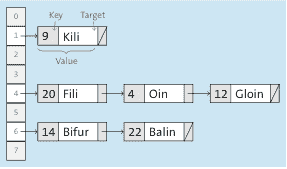

**图 24.14** 在内部，“unordered_map”按哈希码对键分组。在“unordered_set”中，值本身就是键。

### 24.8.1 哈希表

虽然 map、set 及其 multi... 变体将元素存储在始终排序的树中，但无序变体使用称为*哈希表*的查找表。

通过使用树，map 和 set 保证了搜索期间所消耗时间的上界。哈希通常更快，但它无法提供这种保证。重要的是要知道，在极端情况下，它可能慢得多。哈希是否运行良好取决于许多因素；例如，你可能有一个低效的哈希函数（却没有意识到），或者接收到不友好的数据（这超出了你的控制）。

### 哈希、表、桶和冲突

当要插入或搜索一个元素时，容器首先为该元素计算一个*哈希值*。这是一个来自非常大范围的数值——例如，在零和 `UINT_MAX` 之间。这个哈希值决定元素在*哈希表*中的位置。然而，因为这个表不可能有 `UINT_MAX` 个条目，所以它要小得多；假设它有 1,024 个条目。哈希表中的位置由哈希值对 1024 取模确定，也就是除法的余数。哈希值为例如 7、1031 或 2055 的元素存储在同一个表条目下。通常，这些元素以列表形式存储。

表条目也称为*桶*。当检查给定元素是否在容器中时，哈希值会快速导向它的桶。这个桶中的元素都具有相同的哈希值（对表大小取模），但它们在相等性 `==` 方面可能不同，这称为*冲突*。因此，需要在桶内进一步搜索，如果桶中有许多元素，这可能花费很长时间。这就是容器尽很大努力保持冲突数量低的原因。例如，随着容器中元素数量增长，表大小会被反复调整。如果一切正常运行，大多数桶应该只包含一个元素。保持冲突数量低的另一个重要因素是哈希函数的质量。

只有在以下情况下才使用无序变体：第一，你确实需要那一点额外速度；第二，你能控制容器的键——确保它们在频率和哈希方面不会变得“不友好”。有序关联容器在这方面更稳健。

选择哈希函数时必须非常小心。尽管不利的输入数据也可能造成灾难性后果，但选择不当的哈希函数会更快地导致性能灾难。在清单 24.75 中，你可以看到几个使用不同数据的容器，并且在 `unordered_multiset` 的情况下，使用了不同的哈希函数。

### 提供你自己的哈希函数

每当标准库需要用于 `T` 数据类型的哈希函数时，它都会使用 `std::hash<T>` 函子。对于所有内置类型，这都是预定义的。对于自定义数据类型，你必须提供特化。这将在后面结合清单 24.78 进一步讨论。

无序关联容器也使用这些函子。或者，你也可以将自己的函子作为构造函数参数提供给它们。这比将函子注入 `std` 命名空间要容易得多。

```cpp
// https://godbolt.org/z/1MYhxb7rq
#include <set>                  // set, multiset
#include <unordered_set>         // unordered_set, unordered_multiset
#include <iostream>
#include <string>
#include <chrono>                // Time measurement
using std::cout;
using namespace std::chrono;

long long millisSince(steady_clock::time_point start) {
    return duration_cast<milliseconds>(steady_clock::now() - start).count();
}
constexpr size_t ITERATIONS = 100'000;
template<typename Cont, typename Gen>
    requires std::invocable<Gen, size_t> &&       // C++20 concept
             requires(Gen gen, size_t n) { { gen(n) } -> std::same_as<int>; } &&
             std::same_as<typename Cont::value_type, int>
void timeStuff(std::string name, Cont data, Gen genNum) {
    cout << name << " ...";
    auto start = steady_clock::now();
    for(size_t idx=0; idx<ITERATIONS; ++idx) {
        data.insert(genNum(idx));
    }
    cout << "  " << millisSince(start) << " ms" << std::endl;
}

int same(size_t) { return 7; }             // always generates the same number
int scatter(size_t n) { return int(n); }   // generates different numbers
struct BadHash {             // the worst possible hash function as a functor
    size_t operator()(int) const { return 1uz; }
};

int main() {
    std::multiset<int> m{};
    timeStuff("multiset                 same                 ", m, &same);
    timeStuff("multiset                 scatter              ", m, &scatter);
    std::set<int> s{};
    timeStuff("set                      same                 ", s, &same);
    timeStuff("set                      scatter              ", s, &scatter);
    std::unordered_multiset<int> um{};
    timeStuff("unordered_multiset same         ", um, &same);
    timeStuff("unordered_multiset scatter       ", um, &scatter);
    std::unordered_multiset<int,BadHash> umb{};
    timeStuff("unordered_multiset same badHash", umb, &same);
    timeStuff("unordered_multiset scatter badHash", umb, &scatter);
}
```

**清单 24.75** 绝不要使用糟糕的哈希函数操作无序关联容器。

在我的计算机上，前面清单的输出例如如下：

```
multiset                 same          ... 72 ms
multiset                 scatter       ... 66 ms
set                      same          ... 8 ms
set                      scatter       ... 74 ms
unordered_multiset       same          ... 27 ms
unordered_multiset       scatter       ... 29 ms
unordered_multiset       same badHash  ... 24 ms
unordered_multiset       scatter badHash... 255419 ms
```

我以示例方式用 C++20 概念提供了 timeStuff。对于 Gen，要求 gen 必须是一个可以用 size_t 调用的函数，并且其返回值必须是 int。对于 Cont，value_type 必须是 int。

你可以观察到以下情况：

- multiset 几乎不关心元素是相同的还是分散的。
- 对于 `same`，`set` 自然极快，因为它忽略重复项，因此始终只保存一个元素。
- 使用合理的哈希函数时，对 `unordered_multiset` 来说，值是相同还是分散并不重要。
- 只有使用像 `badHash` 这样糟糕的哈希函数时，当不同元素被分到同一个桶中，性能才会灾难性地下降。

性能还在很大程度上取决于编译器的实现和关联的标准库。下面是同一台机器上的同一个程序，但用不同的编译器（Clang++ 9.0.0）编译：

```
multiset                 same          ... 57 ms
multiset                 scatter       ... 49 ms
set                      same          ... 6 ms
set                      scatter       ... 71 ms
unordered_multiset       same          ... 112802 ms
```


```
unordered_multiset scatter       ... 28 ms
unordered_multiset same   badHash... 119559 ms
unordered_multiset scatter badHash... 117607 ms
```

请注意，如果你的哈希函数不算太差，但数据不利，无序关联容器的性能也可能下降。只有有序版本提供保证，尽管无序版本在最优情况下更快。

你可以在接下来的修改示例中看到，糟糕的哈希函数会带来多么糟糕的体验。这里我改变插入元素的数量。这可以让你感受到运行时间会随元素数量增加而增长得多快。

```
// https://godbolt.org/z/cc3KohPrY
#include <unordered_set>    // unordered_set, unordered_multiset
#include <iostream>
#include <string>
#include <chrono>            // Time measurement
using std::cout;
using namespace std::chrono;
long long millisSince(steady_clock::time_point start) {
    return duration_cast<milliseconds>(steady_clock::now()-start)
        .count();
}
struct BadHash {  // the worst possible hash function as a functor
    size_t operator()(int) const { return 1uz; }
};
void timeStuff(size_t iters) {
    std::unordered_multiset<int,BadHash> data{};
    cout << iters << "...";
    auto start = steady_clock::now();
    for(size_t idx=0; idx<iters; ++idx) {
        data.insert((int)idx);
    }
    cout << " " << millisSince(start) << " ms" << std::endl;
}
constexpr size_t LIMIT = 20'000;
int main() {
    size_t iters = 100;
    while(iters < LIMIT) {
        timeStuff(iters);
        iters *= 2; // double
    }
}
```

**清单 24.76** 使用糟糕的哈希函数时，元素数量翻倍意味着运行时间变为四倍。

输出结果很能说明问题。如果输入量翻倍，那么运行时间会变为四倍：

- `100... 0 ms`
- `200... 1 ms`
- `400... 5 ms`
- `800... 17 ms`
- `1600... 69 ms`
- `3200... 274 ms`
- `6400... 1104 ms`
- `12800... 4260 ms`

这是因为所有元素，即使它们并不相同，最终都会落入同一个桶中。而这会变成一个很长的列表，必须完整遍历才能确定元素应属于哪里。[^4]

[^4]: 大多数实现使用列表，但也可能是其他结构。
[^5]: 你必须能够创建、删除和复制它们。

## 24.8.2 共性与差异

在表 24.9 中，你可以看到区分各无序关联容器的主要特征。以下说明适用于带 * 的条目：

- **键类型**  
  有序关联容器几乎可以使用任何类型作为键，只要其值可以用相等 `==` 进行比较，并且配备了哈希函数。[^5] 为此，需要谨慎地重载 `hash(Key)`。
- **内存布局**  
  在内部，会存储一个由键的哈希值组成的表。在此过程中，多个不同的键可能被一起放进同一个桶中。要搜索特定键，会先确定正确的桶，然后可能需要检查该桶中的所有元素（参见本节开头的“哈希、表、桶与冲突”框）。
- **查找**  
  通常，可以在常数时间 O(1) 内找到元素。然而，如果键的哈希值聚集在一起（最坏情况下全部相同），性能会灾难性地下降到每次查找 O(n)。

> **三路比较运算符 <=> 与相等运算符 ==**
> 
> 关于何时 operator<=> 就足够、何时需要实现 operator== 的规则有些复杂。根据经验，如果你可以用 = default 实现 operator<=>，就应该这样做，并且不要定义任何额外的运算符，尤其不要定义 ==。

即使你拥有完美的哈希函数，也需要确保在运行时不会收到“退化”的数据。不幸的是，你很少能完全控制确切的数据。

由于这两个原因，我只能建议你始终优先选择具有有保证运行时行为的有序关联容器作为数据结构。只有当你需要最后一点性能，并且能够应对不可预见的数据时，才应选择无序版本。

### 填充程度与重排序

使用这些容器时，插入过程中可能需要调整桶的数量。这称为*负载因子*，它使用 `size()/bucket_count()` 比值。你可以用 `load_factor()` 查询负载因子。当它达到 `max_load_factor()` 时，会发生自动增加。如果发生自动增加，就会对元素进行完全重排序——即重新哈希。指向该容器的所有迭代器都会失效。经过这样的步骤后，元素之间的相对顺序几乎肯定与之前不同。

与 vector 类似，你永远不能确定插入后迭代器是否仍然有效。此外，（同样与 vector 类似）你可以调用 `reserve` 来确保在达到给定上限之前不会发生这种情况。并且，在创建这些容器时，你可以向它们的构造函数传递一个数字。

你也可以更改 `max_load_factor`，但通常不应这样做。最初，它被设置为 1.0。你还记得可以向构造函数传递初始桶数量吗？`max_load_factor` 为 1.0 意味着当元素数量超过该值时会发生重新哈希。若 `max_load_factor` 为 0.5，则会在该数量的一半时发生。

## 24.8.3 无序关联容器的方法

为了节省篇幅并保持清晰，我在这里对函数签名的描述并不总是非常精确或详细。如果我没有在方法后写出括号，通常表示存在多个重载：

- **构造函数——**`Cont()`、`Cont(Compare)`、`Cont({...})`、`Cont(It, It)`、`Cont(from_range, ...)`  
  默认构造函数 `Cont()` 创建一个空容器。使用来自另一个兼容容器的一对迭代器，可以复制其内容。你可以指定一个初始化列表，使容器一开始就包含这些内容。对于 `unordered_map`，这意味着需要指定嵌套的 `{...}`，因为每个元素都必须用两个参数初始化一个 pair——例如 `unordered_map<int,string>{{2,"two"},{3,"three"}}`。从 C++23 开始，还有 *from_range* 构造函数。
- **复制与移动**——`C(const C&)`、`C(C&&)`、`C& op=(const C&)`、`C& op=(C&&)`、swap  
  你可以将另一个 `Cont` 作为参数传给复制和移动构造函数及运算符。所有关联容器都实现了高效的 `swap(Cont& other)`。
- **析构函数**——`~Cont()`  
  所有容器都有析构函数，用于移除所含元素。请注意，如果你把原始指针装入容器，这一点并不适用。
- **向前迭代**——`begin()`、`end()`；以及**向后迭代**——`rbegin()`、`rend()`  
  这里可以像使用顺序容器一样进行迭代。然而，获得元素的顺序是随机的（或者更准确地说，是*任意的*），不一定对应于插入顺序或任何排序。`unordered_map` 各变体的迭代器引用一个 `pair<K,T>`。
- **元素访问**——`T& operator[](Key)`、`T& at(Key)`  
  只有 `unordered_map` 具有这些方法，其行为类似 `map`。
- **大小**——`size()`、`empty()`、`max_size()`、`reserve`  
  使用 `size()` 可获得容器中当前元素的数量；如果该数量为零，则 `empty()` 为 true。使用 `max_size()` 可获得该容器在库实现中的最大大小。由于这一族容器像 vector 一样分阶段增长，它们也有 `reserve` 方法用于控制时机。
- **修改**——`clear()`、`erase`、`insert`、`insert_or_assign`、`insert_range`、`emplace` 以及 merge  
  这些方法的工作方式与顺序容器中的方法类似。在映射中，一个元素由一个 `pair<K,T>` 组成，你可以使用 `insert` 和 `emplace` 插入它。`merge` 不会产生排序结果（当然），这一点与 list 和有序容器不同。`insert_range` 从 C++23 起可用。只有 `unordered_map` 具有 `insert_or_assign`。
- **查找**——`count`、`find`、`contains`、`equal_range`  
  这些方法对应于有序容器的方法。`count` 统计某个键出现的频率，`find` 返回指向已找到键的迭代器。`contains` 从 C++20 起用于检查是否存在。`equal_range` 返回一对迭代器，已找到的键位于这两个迭代器之间。

## 24.8.4 “unordered_set”

`unordered_set` 的接口与 `set` 类似；参见第 24.7.3 节。

迭代时，你只能使用前向迭代器。这里的*前向*并不是指你接收元素的顺序，而是指你只能对迭代器应用 `++` 而不能应用 `--`。

你应当把本节中针对 `unordered_set` 的示例想象为嵌入在清单 24.77 的代码中。


对于无序容器，输出的顺序可能因标准库的实现不同而有所变化。

请注意我在清单 24.12 之后的代码框中对 `<<` 的注释。

```cpp
// https://godbolt.org/z/38TbJgnh6
#include <unordered_set>
#include <iostream>
using std::unordered_set; using std::cout; using std::ostream;
template<typename Elem, typename Cmp>
ostream& operator<<(ostream& os, const unordered_set<Elem,Cmp>&data){
    for(auto &e : data) {
        os << e << ' ';
    }
    return os << '\n'; // '\n' instead of std::endl for line break
}
int main() {
    // Example code here
}
```

**清单 24.77** 这是关于 “unordered_set” 的示例清单的模板。

## 元素属性

与 `set` 不同，unordered_set 的元素必须支持 operator==。就容器而言，你认为“相等”的事物必须让 operator==(const Elem& a, const Elem& b) 返回 true。另外，你也可以在定义时指定一个 KeyEqual 函数对象作为模板参数，它将用于替代键比较。

此外，你现在需要一个从 Key 计算哈希值的函数对象。为此，请编写一个特化的类模板 std::hash<Key>，其中包含 size_t operator()(const Key &k) const 方法。确保对于所有可能的 k，尽量利用 size_t 的范围。只有这样，容器才能有良好的性能。如果你不能或不想重载该函数，请在定义容器时指定 Hash 的模板参数。

```cpp
// https://godbolt.org/z/TY5x54efE
#include <unordered_set>
#include <iostream>
#include <vector>
#include <string>
using std::string; using std::unordered_set; using std::cout;
struct Word {
    string word_;
    size_t row_;
    Word(const string &word, size_t row)
        : word_(word), row_(row) {}
    friend bool operator==(const Word& a, const Word &b)
        { return a.word_ == b.word_; } // ignores row
};
namespace std {
template<> struct hash<Word> { // ignores row
    std::hash<string> stringHash;
    std::hash<size_t> iHash;
    bool operator()(const Word &w) const {
        return stringHash(w.word_);
    }
}; }
struct ExactWordHash { // includes row
    std::hash<string> sHash;
    std::hash<size_t> iHash;
    bool operator()(const Word &a) const {
        return sHash(a.word_) ^ iHash(a.row_);
    }
};
struct ExactWordEqual { // includes row
    bool operator()(const Word &a, const Word &b) const {
        return std::tie(a.word_, a.row_) == std::tie(b.word_, b.row_);
    }
};
int main() {
    std::vector input {
        Word{"a",0}, Word{"rose",0},
        Word{"is",1}, Word{"a",1}, Word{"rose",1},
        Word{"is",2}, Word{"a",2}, Word{"rose",2}, };
    // Use overloads
    unordered_set<Word> words(input.begin(), input.end());
    cout << words.size() << '\n'; // Output: 3
    // Use custom functors
    unordered_set<Word, ExactWordHash, ExactWordEqual> poem(
        input.begin(), input.end());
    cout << poem.size() << '\n'; // Output: 8
    // Hash as Lambda
    auto h = [](const auto &a) { return std::hash<string>{}(a.word_); };
    unordered_set<decltype(poem), decltype(h)> rose(input.begin(), input.end(), 10, h);
    cout << rose.size() << '\n'; // Output: 3
}
```

清单 24.78 一个带有自定义比较和哈希函数的 “unordered_set”。

对于第一个使用单词的示例，我采用了在常规搜索期望的位置定义这些操作的方法。模板参数的默认值是 `std::hash<Key>` 和 `std::equal_to<Key>`。后者在其实现中使用 operator==(Key, Key) 自由函数。这里定义了两者：operator== 通过 friend 方法作为自由函数可见，hash<Word> 是 std 命名空间中 template<typename Key> struct hash 的模板特化。需要注意的是，你不应该在 std 命名空间中随意定义内容：在 std 中做这样的特化是可以接受的，但你不能在 std 中随意定义新内容；否则你会得到不可移植的代码。

第二个 poem 示例则更为直接，因为它没有使用那些不易察觉的内置机制。这里我指定了要作为模板参数的函数对象。这会更清晰一些，尤其是对于哈希函数，你无法在自己的数据类型内部简单地定义一个 friend 函数。

像往常一样，你不一定必须使用函数对象；可调用对象就足够了。最后，你可以在 rose 示例中看到，我将 lambda `h` 作为哈希函数传递给了构造函数。然而，我还必须使用 `decltype(h)` 将其类型作为模板参数传递。此外，构造函数参数的顺序要求我必须在哈希函数之前传递容器的桶数量——因此这里有一个 10。

## 初始化

和往常一样，在定义和初始化时，你需要定义两件事：模板参数和构造函数参数。自 C++17 起，编译器通常可以从构造函数参数推导出模板参数，从而允许你省略尖括号 `<Key>` 部分。

作为 unordered_set 的模板参数，至少需要键——即元素类型 Key——例如 `unordered_set<int>`：

- Key，用于搜索的键类型
- 可选的 Hash，用于 Key 的哈希函数对象；默认是 `std::hash<Key>`
- 可选的 KeyEqual，用于 Key 的比较运算符；默认是 `std::equal_to<Key>`，因此就是 `operator==`
- 可选的 Allocator，用于元素的内存分配器

可选地，指定哈希函数对象、键的比较函数对象和分配器。如清单 24.78 所示，如果你没有提供比较函数对象，标准库将使用 `operator==` 自由函数。这意味着，对于自定义数据类型，`friend bool operator==` 或带有 `= default` 的 `operator<=>` 就足够了。因此，在大多数情况下，不需要指定比较函数对象。实际上，剩下的就是哈希函数，你有时需要定义它。你也会在清单 24.78 中看到这样的例子。最简单的方法是使用 lambda 和 decltype：

```cpp
auto h = [](const auto &a) { return ...; };
unordered_set<Key,decltype(h)> data( ... h );
```

你可以提供与 `set` 和其他容器类似的构造函数参数，如下所示：

- 无参数
- 使用一对迭代器从另一个容器指定一个范围
- 初始化列表
- 如果你使用 C++23，可以使用标签 `from_range` 和一个范围
- 另一个用于拷贝的 `unordered_set`

除最后两种变体外，所有形式都可以选择传入一个 `size_t`，用来设置哈希表的初始大小。

下面通过一个简单的示例来说明，如清单 24.79 所示。

```cpp
// https://godbolt.org/z/j16P6MjoWr
#include <set>
template<typename Key>
std::set<Key> sorted(const unordered_set<Key>& data)
{ return std::set<Key>(data.begin(), data.end()); }
// ...
// without arguments
unordered_set<int> empty{};
cout << empty;    // Output:
// initializer list
unordered_set data{1,1,2,2,3,3,4,4,5,5}; // duplicates are not included
cout << data;     // Output approximately: 5 4 3 2 1
// copy
unordered_set copy(data);
cout << copy;      // Output approximately: 5 4 3 2 1
// Range
auto so1 = sorted(data);
unordered_set range(std::next(so1.begin()), std::prev(so1.end()));
cout << range;    // Output approximately: 2 3 4
```

**清单 24.79** 这是初始化 “unordered_set” 的几种方式。

请注意，在你的环境中，元素的顺序可能有所不同。为了确保在拷贝最后一个示例时跳过 1 和 5，我使用 `sorted()` 将 unordered_set 数据拷贝到了有序容器 so1 中。为此，我定义了那个辅助函数。

所有插入操作都可能导致容器中的迭代器失效。但是，如果你确定没有发生元素重排，那么迭代器仍然是有效的——例如，因为你之前恰当地调用了 `reserve` 方法。

## 访问

与 `set` 不同，*无序关联容器*只提供*前向*迭代器，正如我在表 24.2 中已经展示的那样。因此它们完全不适合排序：

- **通过迭代器访问**  
  你可以使用 `begin()` 和 `cbegin()` 获得指向开头的迭代器，使用 `end()` 和 `cend()` 获得指向容器末尾之后位置的迭代器。当你随后使用 `++it`、`next(it)` 或 `advance` 遍历元素时，它们的顺序是任意的，但只要你在此期间没有修改容器，多次遍历的顺序是稳定的。

- **通过搜索访问**  
  对于无序关联容器，某些搜索函数（如有序容器中可用的那些）没有意义；对两个不同键的搜索并不能真正构成一个范围。所以你只有 `find`、`count`、`contains` 和 `equal_range`。在 `unordered_set` 中，`count` 返回 0 或 1。`equal_range` 要么包含一个恰好有一个元素的范围，要么两次返回 `end()`。

对于无序关联容器，没有具体键的搜索是不可能的，因为搜索需要哈希值，而哈希值需要一个特定的键。

## 删除

删除方法与 `set` 相同，但接口略有受限：

- **删除所有元素**  
  使用 `clear()` 清空 `unordered_set`。

- **删除或转移单个元素**  
  你可以使用迭代器或键作为参数来查找每个元素。返回值是指向被删除元素之后那个元素的迭代器。使用 `extract`，你可以移除一个元素，并可随后用 `insert` 将其插入其他地方。

- **删除多个元素**  
  你可以用两个迭代器为 `erase` 指定多个元素，但 `unordered_set` 内部的无序性使得这种操作只有部分意义，除非你使用 `begin()` 和 `end()` 作为参数，而这种情况下用 `clear()` 更好。

未被删除元素的迭代器保持有效。

此外，删除操作不会影响剩余元素之间的相对顺序。这意味着你可以在循环中删除多个元素，而不必担心某次删除操作会不会改变剩余元素的顺序，导致你再也看不到某些元素。


### 特性：按桶查看

你可以更仔细地查看各个桶的内容：

- 使用 `bucket_count()`，你可以获得容器中当前桶的数量。该数量不能超过 `max_bucket_count()`。
- `begin(int)` 和 `end(int)` 为你提供指向单个桶中元素的迭代器。
- 在此之前，你可以使用 `bucket_size(int)` 检查单个桶中的元素数量。
- 使用 `int bucket(Key)`，你可以查明某个元素最终会落在哪个桶中。

我很难想象这种深层接口有什么有意义的应用。不过，我可以想象，当你不得不应对无序容器的缺点（它们不提供任何时间保证）时，这类洞察可能会很有用。我只能为你提供一个示例，以好奇的眼光列出 *unordered_set* 各个桶的内容。

```cpp
// https://godbolt.org/z/39v4aqgd1
// Fill with 100 values
unordered_set<int> d{};
d.rehash(10);               // try to have 10 buckets
d.max_load_factor(100.0);   // 100 elements per bucket are okay
cout << "Bucket count: " << d.bucket_count() << '\n';
for(int x : std::ranges::iota_view{0,100}) { // C++20 iota(): 0,1,2,...99
    d.insert(x);
}
// output
for(int b = d.bucket_count()-1; b>=0; --b) {
    cout << "Bucket "<<b<<": ";
    for(auto it=d.begin(b); it!=d.end(b); ++it)
        cout << *it << ' ';
    cout << '\n';
}
```

**清单 24.82** 你可以按桶访问“unordered_set”。

对我来说，使用 `rehash(10)` 的尝试最终得到了 11 个桶。通常，使用质数是个好主意。否则，我计算机上的输出如下所示：

```text
Bucket 10: 98 87 76 65 54 43 32 21 10
Bucket 9: 97 86 75 64 53 42 31 20 9
Bucket 8: 96 85 74 63 52 41 30 19 8
Bucket 7: 95 84 73 62 51 40 29 18 7
Bucket 6: 94 83 72 61 50 39 28 17 6
Bucket 5: 93 82 71 60 49 38 27 16 5
Bucket 4: 92 81 70 59 48 37 26 15 4
Bucket 3: 91 80 69 58 47 36 25 14 3
Bucket 2: 90 79 68 57 46 35 24 13 2
Bucket 1: 89 78 67 56 45 34 23 12 1
Bucket 0: 99 88 77 66 55 44 33 22 11 0
```

在这里，你可以看到每个单独的桶包含哪些元素。

### 特性：预留空间

每次插入都可能潜在地导致 unordered_set 的所有元素被重新排列。此时迭代器会失效。与 vector 类似，你可以影响这种情况何时发生，从而控制时机。确切机制在表 24.9 中说明。以下是涉及到的函数：

- `float load_factor()` 是每个桶的平均元素数量。
- 当 `load_factor` 超过 `float max_load_factor()` 时，元素会发生重新组织。你可以使用 `max_load_factor(float)` 自行更改该值。在大多数实现中，该值最初为 `1.0`。
- `rehash(size_t b)` 将桶的数量设置为至少 `b`，但绝不会小于 `size()/max_load_factor()`。
- `reserve(size_t c)` 是确保在当前 `load_factor` 下，容器能够良好容纳 `c` 个元素的最佳方式。

在[清单 24.82](...)中，我演示了 rehash 和 reserve。`reserve(size_t c)` 会考虑之前设置的 `max_load_factor(float)`。它对应于调用 `rehash(ceil(c/max_load_factor()))`。

## 24.8.5 “unordered_map”

unordered_map 与 map（第 24.7.4 节）共享大部分接口，并且常常表现出与 unordered_set（第 24.8.4 节）类似的行为。

这意味着可以将目标值与键关联起来，并快速检索它们。特别值得注意的是，这通常可以在 O(1) 时间内完成，这是最优的。遗憾的是，这并不总是有保证，极端情况下该过程可能需要 O(n) 时间。

与 map 一样，你可以使用 operator[]、at 和 insert_or_assign。否则，你使用前向迭代器进行搜索。

本节中关于 unordered_map 的示例应视为嵌入在清单 24.83 的代码中。不过，请注意我在清单 24.12 之后的方框中关于 `<=>` 的评论。

```cpp
// https://godbolt.org/z/15KKWwX4z4
#include <unordered_map>
#include <iostream>
using std::unordered_map; using std::cout;
template<typename K, typename T>
std::ostream& operator<<(std::ostream& os, const unordered_map<K, T>&data) {
    for(auto &e : data) {
        os << e.first << ": " << e.second << ', ';
    }
    return os << '\n'; // with operator<< followed by a newline
}
int main() {
    // Example code here
}
```

**清单 24.83** 这是“unordered_map”示例清单的模板。

### 元素及其属性

`unordered_map` 的元素是 `pair<const Key, Target>`。对于 Key，你需要两样东西：

- 你需要一个哈希函数，它要么是 `std::hash<Key>`，要么由你作为模板参数指定。
- Key 必须能够使用 `==` 进行比较，这意味着必须定义该运算符，或者你必须为此提供一个仿函数。

对于自定义数据类型，最简单的方法是将 `operator==` 定义为友元，或者定义带 `= default` 的 `operator<=>`，同时提供自定义哈希仿函数。清单 24.84 展示了一个简短示例。

```cpp
// https://godbolt.org/z/cdeGW6a3P
#include <unordered_map>
#include <iostream>
#include <string>
using std::string; using std::unordered_map; using std::cout;
struct City {
    string name_;
    explicit City(const string &name) : name_{name} {}
    auto operator<=>(const City &b) const = default;
};
struct CityHash {
    std::hash<string> shash;
    size_t operator()(const City& a) const {
        return shash(a.name_);
    }
};
int main() {
    unordered_map<City, string, CityHash> cty{
        {City{"San Francisco"}, "CA"},
        {City{"Austin"}, "TX"},
        {City{"Miami"}, "FL"},
    };
    cout << cty[City{"San Francisco"}] << '\n'; // Output: CA
}
```

**清单 24.84** 将自定义数据类型用作“unordered_map”中的键。

带 `= default` 的三路比较运算符 `<=>` 确保编译器可以将其用于 `==`，从而可供 `unordered_map` 使用。

CityHash 仿函数需要一个 `size_t operator()(const City&) const` 方法。在其中，我使用了标准库为 `string` 提供的哈希仿函数。

### 初始化

定义 `unordered_map` 时，你至少需要 Key 和 Target 的模板参数。

只有在使用 pair 进行初始化时，你才能省略它们；不幸的是，编译器无法帮助处理嵌套初始化列表。

其余部分是可选的：

- Key——用于搜索的键类型
- Target——键所指向的类型
- 可选 Hash——用于 Key 的哈希仿函数，默认为 `std::hash<Key>`
- 可选 KeyEqual——用于 Key 的比较运算符；默认是 `std::equal_to<Key>`，因此是 `operator==`
- 可选 Allocator——用于元素的内存分配器

除了这些类型之外，你还可以使用各种构造函数重载。以下大多数选项也都可以提供哈希函数、比较运算符或分配器：

- 不带参数、用于创建空容器的默认构造函数
- 用于从另一个容器或流复制的迭代器对
- 带初始值的初始化列表
- 从 C++23 起，使用带范围的 *from_range*
- 另一个 `unordered_map`，用于完整复制或移动

所有无序关联容器的一个特殊之处是，在前三种变体中，仍然可以传入一个可选的 `size_t count`，它设置初始哈希表的最小大小。

### 赋值

与所有无序容器一样，你可以使用 `operator=` 进行复制和移动，以重新初始化容器。使用 swap，你拥有一个可以非常快速地与另一个 `unordered_map` 交换所有数据的工具。

### 插入

插入时，接口与 map 相比没有区别。只有运行时保证不同，因为它们始终介于每个插入元素的常数时间和线性时间之间：

- **自动定位插入单个元素**  
  使用 `insert(pair<Key,Target>)` 或 `emplace(Key,Target)` 插入新元素。这里也要小心：如果键已经存在，容器不会覆盖。
- **自动插入并覆盖**  
  或者，你也可以使用 `operator[]` 进行插入，但这会先创建一个空的 `Target`。如果你在赋值左侧使用它，你会得到对这个 `Target` 的引用，然后可以重新赋值。`insert_or_assign` 省去了创建空值的过程。


- **使用位置提示插入单个元素**  
  在 `unordered_map` 中还有带额外迭代器参数的 `insert` 和 `emplace_hint`。
- **插入多个元素**  
  你可以使用 `insert` 通过迭代器对或初始化列表复制多个元素，或者从 C++23 起使用 `insert_range`。

使用 `merge`，你可以从另一个 `unordered_map` 中提取此处尚不存在的元素。

只要不需要调整桶的数量，`unordered_map` 中的迭代器就会像在 `unordered_set` 中一样保持有效。如果你希望对此加以控制，例如可以事先使用 `reserve()`。

## 访问

使用 `unordered_map` 的 `it` 前向迭代器访问元素时，它们指向 `pair<const Key, Target>`。这意味着你不能修改 `it->first` 键，但可以修改目标值 `it->second`。

除此之外，接口大致等同于普通 `map` 的接口。只有在搜索函数方面，你需要局限于所有无序关联容器都提供的功能：

- **通过迭代器访问**  
  使用 `begin()` 和 `end()` 以及 `cbegin()` 和 `cend()`，你可以获得前向迭代器，例如可在基于范围的 for 循环中使用它们。
- **通过搜索访问**  
  可用于搜索的有 `find`、`count`、`contains` 和 `equal_range`。由于 `unordered_map` 只知道唯一键，`find()` 在这里可能最合理。与 `unordered_set` 一样，遗憾的是，你不能像使用 `map` 那样在不创建完整键的情况下进行搜索。
- **类似索引的访问**  
  `unordered_map` 的特殊功能与 `map` 一样，是 `operator[]` 和 `at` 方法。使用这两者，你都会获得对现有条目目标值的引用。两者的区别在于：如果不存在相应元素，`operator[]` 会插入一个新的空元素；而如果键不存在，`at` 会抛出类型为 `std::out_of_range` 的异常。

## 删除

- **删除所有元素**  
  使用 `clear()` 清空 `unordered_map`。
- **删除或转移单个元素**  
  与 `map` 一样，`unordered_map` 的 `erase` 可以按键或按迭代器删除。使用 `erase`，你可以删除一个元素，以便立即用 `insert` 将其重新插入到别处。
- **删除多个元素**  
  使用一对迭代器，`erase` 可以删除多个元素。

指向未删除元素的迭代器在删除操作后仍然有效。此外，容器中剩余元素的相对顺序不会改变，这使你可以在循环内删除元素而不会破坏循环。

## 特性：“operator[]”

与 `map` 一样，`unordered_map` 提供 `operator[]` 以便于读写。其他无序关联容器都没有这种访问能力。

## 特性：逐桶操作

`unordered_map` 还有一个接口，可让你精确了解其内部工作机制。你可以使用 `bucket_count()` 获取桶的数量，并使用 `[c]begin/end(int)` 迭代器访问各个桶的内容。此外，还可以使用 `bucket_size(int)` 和 `int bucket(Key)`。

## 特性：预留空间

为了控制插入期间元素重新排序发生的时机，你可以使用几种方法来影响该机制，类似 `unordered_set`。`load_factor` 和 `max_load_factor` 是负载因子的接口，而通过 `rehash` 和 `reserve`，你可以直接影响哈希表的大小。

## 24.8.6 “unordered_multiset”

`unordered_multiset` 从 `unordered_set`（第 24.7.3 节）和 `multiset`（第 24.7.5 节）继承其属性。

它通常能以 O(1) 的最优速度查找键，但遗憾的是无法保证这一点，最坏情况下需要 O(n) 时间，因此如果你想避免糟糕的意外，有序多重集合可能是更好的选择。

与 `multiset` 一样，每个键可以存储多次。一个典型用例是，存储的对象中只有一部分实际充当键。清单 24.85 中有一个示例。

## 元素属性

`unordered_multiset` 的元素同时就是其键，如同 `set`。并且与 `unordered_set` 一样，你需要为键提供相等性 `==` 和哈希函数。对于自定义

```cpp
size_t operator()(const Entry& a) const {
    return sHash(a.city_) ^ iHash(a.zip_); // too many elements
};
```

现在你可能再也找不到任何一个条目了。不同的 New York 条目虽然按 == 实际相等，却落入了不同的哈希桶，因而分散在整个容器中。你仍有机会找到像 Entry{"New York",10001} 这样的单个条目。然而，因为两个 New York 条目也可能随机落入同一个桶，所以连这一点也无法保证。结果就是数据垃圾。

## 初始化

关于模板参数，声明一个 unordered_multiset 的方式与声明一个 unordered_set 一样，即你需要指定条目或键类型，然后还可以指定哈希函数对象、键比较函数对象和分配器。

不过，从 C++17 起，编译器可以通过经常从构造函数实参推导模板参数来帮助你。

通过构造函数初始化的各种可能性与 unordered_set 类似，不同之处在于重复项会被保留。这里同样，除拷贝构造函数外，所有选项都可以接受一个额外参数来指定哈希表的初始大小：

- 无参默认构造函数将容器初始化为空。
- 来自另一个容器或流的一对迭代器会复制它们所定义的范围。
- 在初始化列表中，你可以显式指定初始元素。
- 你可以完整复制另一个 `unordered_multiset`。
- 从 C++23 起，还有一个带有 `from_range` 标签的构造函数。

请注意下面示例中重复项会被保留。

```cpp
// https://godbolt.org/z/bvehE8hse
#include <unordered_set> // unordered_multiset
#include <vector>
#include <iostream>
using std::unordered_multiset; using std::cout; using std::ostream;
template<typename Elem>
ostream& operator<<(ostream& os, const unordered_multiset<Elem>& data) {
    for(auto &e : data) { os << e << ' '; } return os << '\n';
}
int main() {
    // without arguments
    unordered_multiset<int> empty(1000); // initial size of the hash table
    cout << empty; // Output:

// Initialization list; duplicates are included:
unordered_multiset data{1,1,2,2,3,3,4,4,5,5};
cout << data;    // Output approximately: 5 5 4 4 3 3 2 2 1 1
// Copy
unordered_multiset copi(data);
cout << copi;    // Output approximately: 5 5 4 4 3 3 2 2 1 1
// Range
std::vector<int>{1,2,3,10,20,30,10,20,30,10,1,2,3};
unordered_multiset rang(in.begin()+3, in.end()-3);
cout << rang;    // Output approximately: 30 30 20 20 10 10
}
```

**清单 24.86** 这些是初始化“unordered_multiset”的方式。

当然，输出中元素的顺序可能因系统而异。

## 赋值

与所有其他容器一样，你可以使用 operator= 从另一个 unordered_multiset 复制或移动数据。此外，还定义了 swap 用于快速交换数据。

## 插入

在 unordered_multiset 中，插入操作与在 multiset 中一样。与 unordered_set 不同，每次插入都会成功，因为重复项也会被存储：

- **使用自动定位插入单个元素**  
  使用 insert 时，你将一个新元素复制到容器中；而使用 emplace 时，你在原地创建它。
- **使用位置提示插入单个元素**  
  如果你为 insert 提供一个迭代器，它可能省去哈希值的计算以及在桶内遍历元素的开销。此时位置提示应指向一个与新元素相等的元素。如果你没有提供正确的元素，这一优势就会丧失，但元素仍会到达正确的位置。用于原地创建的变体是 emplace_hint。
- **插入多个元素**  
  insert 也接受一对迭代器或初始化列表来插入多个元素。从 C++23 起，还有 insert_range。使用 merge，你可以从另一个容器中取出所有元素，包括重复项。

如果你没有通过 reserve 预先做好准备，就必须假定在插入操作之后，指向该容器的所有迭代器都已失效。


### 访问

如 [表 24.2](#) 所示，你拥有正向迭代器。

- **通过迭代器访问**  
  通过 `begin()` 和 `end()` 以及 `cbegin()` 和 `cend()`，你可以获得指向容器开头和结尾的迭代器。
- **通过搜索访问**  
  `find` 返回任何匹配的元素，如果没有则返回 `end()`。对于 `multi...` 变体，`count` 和 `equal_range` 方法很有意义：使用 `count` 你可以计算匹配元素的数量，使用 `contains` 你可以检查是否存在。`equal_range` 方法通过一对迭代器返回所有匹配元素的范围。

以下是一个访问 `unordered_multiset` 的示例：

```cpp
// https://godbolt.org/z/a8cGxr9s9
#include <unordered_set> // unordered_multiset
#include <iostream>
#include <string>
using std::unordered_multiset; using std::cout; using std::string;
int main() {
    const string s = "She sells sea shells by the seashore.";
    unordered_multiset<int> cs(s.begin(), s.end()); // string as container
    cout << cs.count('s') << " times s\n"; // Output: 7 times s
}
```

**清单 24.87** 对于“multi”变体，“count”非常有意义。

如果创建键的成本很高，并且你需要在搜索时频繁这样做，请考虑有序多重集合。这允许你在不创建完整键的情况下进行搜索。

### 删除

删除时，未被删除元素的相对顺序彼此之间仍然有效，引用这些元素的迭代器也同样有效：

- **删除所有元素**  
  `clear()` 删除所有元素。
- **删除或转移单个元素**  
  使用值的 `erase` 会删除该元素的*所有*出现项。返回值是被删除的元素数量。如果指定迭代器，则删除该位置的元素。返回值是下一个元素的位置。使用 `extract`，你可以删除一个通常会插入到其他位置的元素。
- **删除多个元素**  
  使用一对迭代器，你可以删除多个元素。实际上，对于无序容器，这仅在以下情况下有意义：该范围包含所有元素（等同于 `clear()`），或者该范围包含 `equal_range` 的全部或部分元素。这两种情况都是可能的，但在实践中可能相当少见。删除也适用于包含多个不同元素的范围，但对于无序容器，中间的哪些元素被删除很难预测。

### 特殊性：按桶操作

你可以使用 `bucket_count()`、`bucket_size` 和 `bucket` 以及 `begin(int)` 和 `end(int)` 的 `int` 变体，深入了解 `unordered_multiset` 的内部工作原理。

### 特殊性：预留空间

为了在插入时避免哈希表重新分配带来的不必要干扰，你可以使用 `load_factor`、`max_load_factor`、`rehash` 和 `reserve` 方法来操纵哈希机制。

## 24.8.7 “unordered_multimap”

`unordered_multimap` 可以完成 `multimap` 可以完成的任何事情（第 24.7.6 节），但作为无序关联容器，它也具有与 `unordered_multiset`（第 24.8.6 节）密切相关的接口。

键被映射到目标值，通常需要 O(1) 时间，但在特殊情况下也可能需要 O(n)。与使用 `<` 进行比较不同，键使用 `==` 和哈希函数进行比较。

一个键可以被插入多次，每次都指向不同的目标值。

### 元素属性

与所有类似映射的容器一样，`unordered_multimap` 的元素类型为 `pair<const Key, Target>`。这意味着，如果你有对元素或 Target 的引用，你可以为 Target 分配一个新值。Key 是 const 的，在任何情况下都不得更改；否则，容器将变得混乱。

对于键，必须可检查相等性 `==` 并且必须可计算哈希。这可以通过自由函数 `operator==` 和仿函数 `std::hash<Key>` 来完成，或者你可以指定自己的仿函数作为模板参数。回想一下，如果编译器的实现支持，你可以用 `= default` 简单地定义 `operator<=>` 来代替 `operator==`。

6 在任何情况下，你都不应以影响 `==` 或哈希函数的方式更改键。

### 初始化

定义 `unordered_multimap` 的模板参数至少是 Key 和 Target。当你使用嵌套初始化列表进行创建时，编译器无法为你省略模板参数；只有使用 `pair` 时才能这样做。

可选地，你还可以指定 `Hash`、`KeyEqual` 和 `Allocator`。

常用的构造函数重载如下：

- 用于空容器的默认构造函数
- 使用迭代器对从另一个容器或流中获取的范围
- 使用容器所需值的初始化列表
- 从 C++23 开始，使用 `from_range` 和范围
- 用于接管另一个 `unordered_multimap` 内容的复制和移动构造函数

前三个重载都接受哈希表的初始大小作为可选参数。

### 赋值

你还可以在之后分配另一个已初始化的 `unordered_multimap` 的内容。这会复制或移动内容。`swap` 也可用。

### 插入

你的插入方式与 `multimap` 类似。这也意味着 `[]` 或 `at` 不可用：

- **自动定位插入单个元素**  
  insert 方法接受一个 pair；emplace 接受 pair 的两个元素。由于重复键也会被存储，两者总是插入一个新元素。
- **使用位置提示插入单个元素**  
  `insert` 也接受一个额外的迭代器作为参数；`emplace_hint` 也是如此。迭代器应指向一个键 == 新键的元素，因为容器可能可以节省哈希和搜索的工作。如果提示不匹配，优势将丧失，但插入仍然是正确的。
- **插入多个元素**  
  使用范围作为参数——即两个迭代器——或初始化列表，你也可以使用 `insert` 一次插入多个元素。从 C++23 开始，还有 `insert_range`。使用 `merge`，你可以从另一个合适的容器中检索所有元素，即使它们在此处包含多次。

每次插入操作后，迭代器都会失效，除非你之前使用 `reserve` 确保了哈希表中有足够的空间。

### 访问

使用正向迭代器，你可用的操作不多。当你解引用它们时，`first` 包含键，`second` 包含元素的目标值：

- **通过迭代器访问**  
  `begin()` 和 `end()` 以及 `cbegin()` 和 `cend()` 为你提供指向容器开头和结尾的正向迭代器。
- **通过搜索访问**  
  `find` 接受一个键作为参数，并返回指向其中一个匹配元素的迭代器。`count` 计算匹配键的数量，`contains` 检查键是否存在。`equal_range` 返回一个包含所有与搜索键匹配的键的范围。对于所有这些方法，你需要一个完全构造的键。与 `multimap` 不同，没有使用特殊搜索函数的快捷方式。

### 删除

你可以通过以下方式删除元素：

- **删除所有元素**  
  使用 `clear()`，你可以移除所有元素。
- **删除或转移单个元素**  
  使用键作为参数，`erase` 删除该键的所有出现项；使用迭代器作为参数，它只删除相应的元素。你会得到被删除的元素数量或被删除元素之后的元素。`extract` 用于使用 `insert` 将元素转移到另一个容器。
- **删除多个元素**  
  你可以使用两个迭代器删除多个元素。这在无序关联容器中可能用途有限，因为在这种容器中，两个迭代器之间可能有任意元素。你不会知道实际上删除了哪些元素。因此，只有当两个迭代器之间恰好没有、一个或所有元素时，你才会知道删除操作后剩下哪些元素。

如果迭代器的元素未被删除，则迭代器保持有效。你可以依赖剩余元素不被重新排列。这使得在循环中使用成为可能。

### 特殊性：按桶操作

你可以使用 `bucket_count`、`bucket_size` 和 `bucket` 深入了解哈希表。使用 `begin(int)` 和 `end(int)`，你可以获得指向特定桶元素的迭代器。

### 特殊性：预留空间

使用 `reserve` 或 `rehash`，你可以影响哈希表应变为多大，以便在即将进行的插入操作期间表不会立即重新排列，并且


迭代器仍然有效。`load_factor` 和 `max_load_factor` 是用于访问表负载因子的接口。

## 24.9 容器适配器

容器适配器不是独立的容器，而是包含一个实际容器来保存其数据。从外部看，它们提供执行专门任务的方法。

例如，你可以为 `stack` 选择底层容器应该是什么。

```cpp
// https://godbolt.org/z/6KMKj3Pxv
#include <stack>
void run(auto data) { /* ... */ }  // C++20, abbreviated function template
run(stack<int>{});                  // Default: uses vector<int>
run(stack<vector<int>>{});          // like the default
run(stack<int,list<int>>{});        // uses list<int>
```

**清单 24.88** 适配器可与可互换的实现一起工作。

| 容器 | 描述 |
|---|---|
| `stack` | 后进先出 |
| `queue` | 先进先出 |
| `priority_queue` | 非常快速地移除最大元素 |
| `flat_[multi]set[map]` | 具有连续布局的关联容器 |

**表 24.10** 概览：容器适配器。

在本节中，`Cont` 或 `C` 表示一种容器适配器类型，例如 `stack<int>`，而 `cont` 表示它的一个实例——例如 `queue<double> cont;`。对于元素类型，我使用 `Elem` 或 `E`；对于迭代器类型，我缩写为 `It`：

- **`stack<Elem>`**  
  你可以向 *栈* 的顶部添加单个元素，并从同一端移除它们——因此称为*后进先出*（LIFO）：你最后添加的元素会最先被取回。
- **`queue<Elem>`**  
  *队列*允许你在*一端*添加单个元素，并在*另一端*移除它们。这形成*先进先出*（FIFO）方式：在多个元素中最先插入的元素也是你最先取回的元素。
- **`priority_queue<Elem>`**  
  向优先队列中添加元素时不考虑它们的位置。然而，当移除元素时，会提取排名最靠前的元素。默认情况下，插入期间使用 `std::less<Elem>` 比较元素，但用户可以指定替代的比较运算符。一个典型用例是，比较会计算算法中的某种代价，从而保证处理最具成本效益的元素。
- `flat_set<>`、`flat_map<>`、`flat_multiset<>`、`flat_multimap<>`
  
  自 C++23 起，flat 容器几乎可以直接替换 `set`、`map`、`multi-set` 和 `multimap`。它们在内部使用 `vector` 而不是树结构，这尤其加快了遍历元素的速度并最大限度地减少了内存碎片。但元素始终保持有序，这降低了插入和移除的速度。特别是对于（许多）小型容器，这些适配器可能是一个不错的选择。键和值存储在独立的容器中；除了 `vector`，你可以选择任何连续容器。

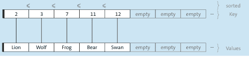

**图 24.15** flat 容器的键和值位于独立的连续容器中。

> > **flat 容器（C++23）的特殊功能**
> > 
> > 在接口方面，`flat_set` 与 `set` 非常相似；其他 flat 容器也是如此。键始终保持有序。优点是元素在内存中直接相邻存储。其积极影响是遍历更快，内存碎片更少（适合小元素）。
> > 
> > 另一方面，插入和移除会变慢，在元素很多时尤其明显。多少算多？很难说。我找到的文献中，有的说 100 个元素就算多，也有的认为 100,000 个元素算少。为了在这里提供一些补救措施，flat 容器中用于添加整个范围的构造函数和方法有一个可选的 `sorted_unique` 或 `sorted_equivalent` 标记参数；如果元素已经有序，这些操作就可以更高效地工作。
> > 
> > 要有意识地使用这些适配器，而不是一直使用！
> > 
> > flat 容器的一个特殊功能是，你可以使用 `extract` 方法访问用于键和值的内部容器。用于键的容器甚至是有序的。

## 24.10 特殊情况：“string”、“basic_string”和“vector<char>”

| 容器 | 描述 |
| --- | --- |
| basic_string | 用于文本的专用容器，类似于 vector |
| string | 模板特化：basic_string<char> |

**表 24.11** 概览：“string”。

几乎可以用 `vector` 做的所有事情，也可以用 `basic_string` 做。这种关系甚至发展到 `basic_string` 有一个用于追加单个字符的 `push_back` 方法。而 `string` 反过来只是 `basic_string<char>` 的一个模板特化。

尽管 `vector<char>` 与 `string` 非常相似，但你应该在语义上更合适时使用各自。`string` 更适合文本和文本操作，而当字符需要单独考虑且不一定共同构成文本时，`vector<char>` 更合适。例如，一些实现针对短字符串有特殊优化，而 `vector` 不需要这种优化。^7

然而，`string` 相对于 `vector<char>` 至少有一个优势：你可以直接从字符串字面量——即 `const char[]`——初始化 `string`，而 `vector<char>` 无法做到这一点。此外，`vector<char>` 没有用于输出的重载 `operator<<`，如你在清单 24.89 中所见。

自 C++20 起，`string` 类经历了许多现代化改造，使其感觉更像其他语言中的字符串。还添加了一些特殊功能，使其与其他容器区别开来。

现在有了期待已久的 `starts_with` 和 `ends_with` 方法。自 C++23 起，还有 `contains`、`insert_range`、`append_range` 和 `replace_with_range`。为了与 API 配合使用，添加了 `resize` 和 `overwrite`，允许你用回调覆盖预定义大小的字符串。

`strings` 与范围配合得非常好，就像其他容器一样，并且对视图的行为就像其底层字符类型的容器。从 C++23 开始，它们还有一个带有 `from_range` 标记的构造函数。

自 C++17 起，我们还有 `string_view`，并且从 C++20 开始，可以使用 `span` 扩展：

- **span**
  
  一个 `span` 大致替代 `begin()` 和 `end()`。你得到一个可以读写的扩展。你通常将 `span` 与 `vector` 和 `array` 一起使用，但它也可用于 `string`。你经常看到它被用作函数的参数。

7 参见 “C++ Weekly—Ep 430—How Short String Optimizations Work”，https://www.youtube.com/watch?v=CIB_khNPSU，Jason Turner，2024 年 7 月 2 日，[2024-05-30]

- **string_view**  
  这提供了一个指向字符串或 const char* 的只读 span。通常，你将其用作函数的参数，而以前你会传递 `string&`。你可以在 [清单 24.39](#) 中看到 `string_view` 作为参数的示例。
- **“sv”作为后缀**  
  标准库还提供了用户定义字面量 `"sv`，用于创建 string_view。与用于 string 的 `"s` 相比，其优势在于它不会创建新字符串，而只是 const char* 上的一个视图——因此几乎不需要复制或创建任何内容。

```cpp
// https://godbolt.org/z/P7zbrh71d
#include <vector>
#include <string>
#include <iostream>
#include <string_view>
using std::string; using std::string_view; using std::vector; using std::cout;

int get_len(string_view str) { return str.size(); } // string_view as parameter

int main() {
    string s1 = "Hello";                 // simply with string literal
    string s2{'H','e','l','l','o'};       // or with list of char
    using namespace std::literals;        // for "s"-suffix and "sv"-suffix
    auto s3 = "Hello"sv;                  // even simpler with string literal
    vector<char> v1{"Hello"};            // no vector with string literal
    vector<char> v2{'H','e','l','l','o'}; // vector of char is okay
    cout << s1 << s2 << s3 << '\n';       // Output of string works
    cout << v1 << v2 << '\n';             // vector has no output

    const auto str = "String"s;           // Stringliteral
    const auto strv = "String"sv;         // String-view literal
    cout << "Length of 'str' is " << get_len(str) << '\n';  // Output: ... 6
    cout << "Length of 'strv' is " << get_len(strv) << '\n'; // Output: ... 11
}
```

**清单 24.89** “string”比“vector<char>”更适合文本。

## 24.11 特殊情况：“vector<bool>”、“array<bool,n>”和“bitset<n>”

对于真值数组，标准库提供了几种专门解决方案，你可以根据应用选择合适的一种。


| 容器 | 描述 |
|---|---|
| `vector<bool>` | 专用容器；紧凑地存储 bool |
| `array<bool,n>` | 常规容器；分别存储 bool 值 |
| `bitset<n>` | 紧凑，但不是标准容器；更像一个带位运算的大无符号数 |

表 24.12 概要：bool 容器。

## 24.11.1 动态且紧凑：“vector<bool>”

人们可能会认为 vector<bool> 浪费了大量空间：出于性能原因，一个 bool 通常和一个 int 一样大，尽管存储 true 或 false 只需要一个位就足够了。

对于 vector<bool>，标准库有一个将位压缩的特化。多个 true/false 值共享一块内存空间。这意味着容器 vector<bool>(100) 占用的内存远少于 bool[100]。

从外部看，vector<bool> 的行为就像一个普通的 bool 序列容器——只有一个例外：访问方法无法提供用于原地修改的 `bool&`。对 vector 的引用总是会一次命中多个位。你得到的不是 `bool&`，而是一个代理对象，它“假装”是 `bool&`，并在需要时承担实际写入 vector<bool> 的任务。

在并行操作中，如果没有针对并发写入的保护，就不要使用 vector<bool>：代理对象无法处理这种情况。

## 24.11.2 静态：“array<bool,n>”和“bitset<n>”

如果你认为 array<bool,n> 也为紧凑性做了特化，那你就错了。与 vector<bool> 不同，array<bool> 没有为紧凑性优化；标准库中没有针对它的特化。这意味着 array<bool,100> 占用的内存与 bool[100] 一样多。

如果你需要一个固定大小的 bool 数组，最好使用 bitset<>。虽然它不是真正的容器，但它很紧凑，并且还有一个额外优点：你可以直接执行位运算，例如按位与（&）——几乎就像它们是无符号数或类似类型中的位一样。如果你需要的是容器接口，例如迭代器，那么请使用 vector<bool>。清单 24.90 展示了一个包含部分（但不是全部）操作的示例。

```cpp
// https://godbolt.org/z/5e3c88K8j
#include <bitset>
#include <iostream>
using std::cout;
int main() {
    std::bitset<8> bits;        // 8 bits densely packed
    bits.set(4);                // 5th bit to 1
    cout << bits << '\n';       // 00010000
    bits.flip();                // invert all bits
    cout << bits << '\n';       // 11101111
    bits.set();                 // set all bits to 1
    bits.flip(1);               // invert 2nd bit
    std::cout << bits << '\n';  // 11111101
    bits.reset();               // set all bits to 0
    bits.set(4);                // 5th bit to 1
    cout << bits << '\n';       // 00010000
    bits.flip();                // invert all bits
    cout << bits << '\n';       // 11101111
    bits.set();                 // set all bits to 1
    bits.flip(1);               // invert 2nd bit
    bits.flip(6);               // invert 7th bit
    cout << bits << '\n';       // 10111101
    // Bitwise operations
    std::bitset<8> zack("....####", 8, '.', '#');
    cout << zack << '\n';       // 00001111
    cout << (bits & zack) << '\n'; // 00001101
    cout << (bits | zack) << '\n'; // 10111111
    cout << (bits ^ zack) << '\n'; // 10110010
    // other integer types
    std::bitset<64> b(0x123456789abcdef0LL);
    cout << b << '\n';
    // 0001001000110100010101100111100010011010101111001101111011110000
    cout << std::hex << b.to_ullong() << '\n'; // convert
    // 123456789abcdef0
}
```

**清单 24.90** 一个“bitset”示例。

你可以组合相同大小的 bitset，方式类似于组合整数类型——至少就按位运算 &、|、^、<< 和 >> 而言是这样。此外，你还有测试和操作方法，它们比位操作更容易处理一些。在表 24.13 中，你可以看到 bitset 能做什么。

| 运算符 | 示例 | 描述 |
|---|---|---|
| 构造函数 | `bitset<8>{}` | 创建一个包含八个 0 的 bitset |
|  | `bitset<8>(255)` | 将整数转换为位 |
|  | `bitset<8>("1100")` | 从字符串生成 bitset 00001100 |
|  | `("#", "?", "?", "#")` | 两个字符；false 表示 # 为 true |
| `==` | `as == bs` | 检查是否相等 |
| `!=` | `as != bs` | 检查是否不相等 |
| `[]` | `bs[3]` | 访问单个位 |
| `test` | `bs.test(2)` | 测试单个位的状态 |
| `all` | `bs.all()` | 检查是否所有位都已设置 |
| `any` | `bs.any()` | 检查是否至少有一个位已设置 |
| `none` | `bs.none()` | 检查是否没有任何位已设置 |
| `count` | `bs.count()` | 统计已设置位的数量 |
| `size` | `bs.size()` | bitset 的宽度 |
| `&, \|, ^` | `as & bs` | 按位与运算 |
| `<<, >>` | `bs << 1` | 位移运算符 |
| `&=, \|=, ^=` | `bs &= bs` | “立即”按位运算 |
| `<<=, >>=` | `bs <<= 1` | “立即”位移 |
| `set` | `bs.set(4)` | 设置所有位或一个位 |
| `reset` | `bs.reset(4)` | 重置所有位或一个位 |
| `flip` | `bs.flip(4)` | 翻转所有位或一个位 |
| `to_string` | `bs.to_string()` | 转换为字符串 |
| `to_ulong` | `bs.to_ulong()` | 转换为 unsigned long |
| `to_ullong` | `bs.to_ullong()` | 转换为 unsigned long long |
| `hash` | `hash<bitset<4>>(bs)` | 支持 unordered_map 等 |

表 24.13 “bitset”方法和操作。

### 性能说明

`vector<bool>` 将多个值打包到单个内存单元中，从而节省空间。然而，这种方法有一个缺点：修改单个值还需要读取并写回相邻值，这会耗费时间。

`bitset` 将每个值存储在各自的内存单元中。如果要修改单个值，可以直接写入。然而，这种数据结构需要（至少）八倍的空间。

在 C++ 中，*良好性能*一方面可能意味着低内存占用，另一方面可能意味着低时间消耗——或者两者兼有。关于内存，有一个明确的说法：`vector<bool>` 节省空间。那速度呢？这更难回答，并且取决于系统。是不必考虑相邻值会更快，还是内存加缓存太慢，以至于使用八倍内存也更慢？

如果这对你的问题很重要，就测量并比较！我可以给你一个参考点。在 Intel i7-4xxx 上，一次实验表明，最快的 bitset 大约比节省空间的 `vector<bool>` 快两倍——并且比使用 `bool[]` 的朴素实现快最多五倍。

## 24.12 特殊情况：使用“valarray<>”的值数组

valarray 不像其他容器那样。它的重点不太在于与迭代器、算法和其他容器的兼容性，而更在于能够并行化数值数据处理。

通常只对数值类型使用 valarray，因为它为这些类型提供了专用函数。它还配备了所有能想到的算术运算符重载，使你能够像处理数字一样为 valarray 编写完整的算术表达式，类似于数学家对（数学中的）向量和矩阵所做的那样。

所以，如果你一直希望可以直接用 + 将两个 `vector<double>` 逐分量相加，或用 * 相乘，那么 valarray 正适合你：

```cpp
// https://godbolt.org/z/KPP16bdK9
#include <iostream>
#include <valarray>
using std::ostream; using std::valarray;
ostream& operator<<(ostream& os, const valarray<double>& vs) {
    os << "[";
    for(auto& v: vs) os << v << " ";
    return os << "]";
}
int main() {
    valarray a{ 1.0, 2.0, 3.0, 4.0 }; // valarray<double>
    valarray b{ 2.0, 4.0, 6.0, 8.0 };
    valarray<double> c{ 2.5, 1.75, 0.5, 0.125 };
    valarray<double> x = (a + b) * c;
    std::cout << "x: " << x << "\n";  // Output: [7.5 10.5 4.5 1.5]
    auto y = (a + b) / 2;                 // y is not necessarily a valarray
    std::cout << "y: " << y << "\n";  // Output: [1.5 3 4.5 6]
}
```

valarray 将其数据存储在一维数组中，但它也为多维情况而设计。稍后你会看到这方面的示例。

一个特别重要的特性是，valarray 有意避免某些形式的别名，使编译器和 CPU 能够很好地优化它。这些特定形式允许迭代器进入 valarray，从而支持基于范围的 for 循环和类似结构，但不允许永久持有指向其数据的迭代器或指针。

由于它的独特性，这个类在标准中有些被忽视。曾经有一种观点认为，valarray 的接口质量很差，因为没有人觉得自己对它负责。自那以后，近二十年过去了；除了移动支持之外，这个类还得到了一些小幅更新，以便与其他新语言特性良好协作。⁸ 此外，Intel 自己也提供了一些明确旨在加速 valarray 的库。⁹

> **标准中的暗角？**
>
> 你应该使用 valarray 还是不要碰它？我的建议是，只有当你希望利用数值计算并可能在 SIMD 架构上并行化时，才使用 valarray。如果你的代码要在多个平台（不同的 CPU 或编译器）上运行，请三思。
>
> 如果你拥有最优的数值应用，并且使用某种 CPU 和给定编译器，那么 valarray 可能是正确选择。
>
> 检查 C++23 中添加的 mdspan 对你是否有用。然后你可以写 `cube[3,5,7]`，因为自 C++23 起，`operator[]` 也支持多维索引！
>
> 使用 C++26，基本线性代数子程序（BLAS）很有可能成为标准的一部分。它们将位于 `<linalg>` 头文件中，并允许你做远超矩阵乘法的事情。它们甚至带有并行执行策略。

### 24.12.1 元素属性

对于 valarray<T>，T 应为数值数据类型。我推荐使用内置的整数或浮点类型。另外，complex<> 在某些情况下也可能适用。The

⁸ 《C++ 标准库：教程与参考》，Nicolai M. Josuttis，Addison-Wesley Professional 1999

⁹ Intel 的 valarray 实现，https://www.intel.com/content/www/us/en/docs/cpp-compiler/developer-guide-reference/2024-1/intel-s-valarray-implementation.html，[2024-08-13]


如果T支持算术、按位和/或布尔运算（通常如此），那么valarray最有用——支持得越多越好。如果T支持三角函数等运算（如double那样），那就更完美了。

| 容器 | 描述 |
|---|---|
| `valarray<T>` | 与其他容器不兼容；用于在一个或多个维度上快速处理数值数据 |
| `slice` | valarray的选定范围 |
| `gslice` | valarray的选定范围 |
| `slice_array` | 用于选择valarray范围的辅助类 |
| `gslice_array` | 用于选择valarray范围的辅助类 |
| `mask_array` | 用于掩码valarray部分的辅助类 |
| `indirect_array` | 用于valarray重排视图的辅助类 |

**表24.14** 简介：非标准“valarray”容器。

使用自定义数据类型并没有什么问题，只是优化可能不适用。你完全有可能在特定硬件上与第三方库一起使用或必须使用特殊数据类型。例如，较旧的GPU在其CUDA库中仅支持float而不支持double，但此后它们已经进步了。CUDA现在是广泛使用的显卡接口——比valarray的使用更为普遍。当速度比精度更重要时，半精度浮点数（16位浮点数）可能很有用。自C++23起，有一个可选的內置数据类型float16_t（参见第4章，第4.4.4节）。或者你可以使用其他库。你会找到类似float16、half、HalfFloat或__fp16等名称。CUDA现在支持它，并用于例如表面纹理。CUDA和valarray有点矛盾；你的应用程序中可能会有重叠。

> **不要将指针放入“valarray”**
> 
> `valarray`代表*值数组*，因此它用于值，而不用于任何形式的间接引用。即使实现并不阻止这种使用，你也应该避免这样做。对于这种目的，请使用vector。

将本节中的示例嵌入以下模板中（并注意我在清单24.12后面的框中对<<=的评论）：

```cpp
// https://godbolt.org/z/r11584wEf
#include <valarray>
#include <iostream>
using namespace std;

template<typename T>
ostream& operator<<(ostream &os, const valarray<T>& a) { // <<'s with newline
    for(const auto &v : a) os << v << ' ';
    return os << '\n';
}
int main() {
    // ... example code here ...
}
```

### 24.12.2 初始化

尽管valarray并不像vector那样真正可调整大小，你仍然可以通过完全复制来调整valarray的大小。因此，你可以不带参数或使用预定义大小来初始化valarray：

```cpp
// https://godbolt.org/z/chnj64dva
valarray<int> data;                 // initially size 0
cout << data.size() << "\n";        // Output: 0
data.resize(100);                    // enlarged
cout << data.size() << "\n";        // Output: 100
valarray<int> data2(200);            // space for 200 values
cout << data2.size() << "\n";       // Output: 200
valarray<int> dataC(5, 20);          // twenty 5s, different from vector
cout << dataC.size() << ", dataC[6]=" << dataC[6] << "\n"; // Output: 20, dataC[6]=5
valarray<int> dataD{ 2, 3, 5, 7, 11 }; // syntactically initialization list
cout << dataD.size() << ", dataD[3]=" << dataD[3] << "\n"; // Output: 5, dataD[3]=7
```

如你所见，你还可以用初始值预定义一系列值。但请注意：valarray(value, size) 的两个参数与vector的顺序相反！最好习惯只用大小数值或初始化列表来定义valarray。

也允许复制和移动。

slice_array、gslice_array、mask_array和indirect_array辅助类中的每一个也可以指定为初始化的来源。请注意，这些构造函数未标记为explicit，允许参数和返回值的隐式转换。

### 24.12.3 赋值

赋值运算符operator=支持与构造函数相同的参数。

没有像许多其他（真正的）容器那样的assign，但至少有一个swap。

### 24.12.4 插入和删除

你不能像使用insert那样真正地插入。不过，你可以通过`operator[]`对元素进行读写访问。访问不进行边界检查；你必须自己注意范围边界。没有用于此目的的`at()`方法。

但是，你仍然可以在之后更改valarray的大小。为此，有`resize`方法：

- `resize(size_t size)`—扩大或缩小，截断或使用`{}`初始化
- `resize(size_t size, T value)`—扩大或缩小，截断或使用value初始化

此操作期间可能会复制所有数据。因此，指向valarray的指针和迭代器将失效。

### 24.12.5 访问

`operator[]`在valarray中几乎可以说是神奇的。它不仅可以处理整数索引来寻址单个元素，还可以使用切片、掩码和间接引用作为索引。

事实上，前述辅助类被用作索引，但在实践中，这里会发生许多类型转换，因此你使用以下类型作为索引：

- **切片**  
  你可以使用`slice`或`gslice`。
- **掩码**  
  使用与数据`valarray<T>`大小相同的`valarray<bool>`。
- **间接引用**  
  使用与数据`valarray<T>`大小相同的`valarray<size_t>`。

考虑以下示例：

```cpp
// https://godbolt.org/z/PeG4K7Edc
valarray v { 1, 2, 3, 4, 5, 6, 7, 8, 9, 10, 11, 12 };
valarray<int> r1(v[slice(0, 4, 3)]); // Start at 0, 4 elements, step size 3
cout << r1;                          // Output: 1 4 7 10
valarray<int> r2(v[v > 6]);          // addressed by valarray<bool>
cout << r2;                          // Output: 7 8 9 10 11 12
const valarray<size_t> indirect{ 2, 2, 3, 6 }; // duplicates allowed
valarray<int> r5(v[indirect]);       // addressed by valarray<size_t>
cout << r5;                          // Output: 3 3 4 7
```

### 24.12.6 特色：操作所有数据

有少数几个有用的方法用于获取valarray中所有数据的信息或对它们进行操作：

- **sum、min 和 max**  
  计算所有值的总和、最小值和最大值。对于普通容器，你可能会使用`<algorithm>`中的`accumulate`或`max_element`等。
- **shift 和 cshift**  
  在整个`valarray`上移动和旋转值。`shift`进行旋转；`cshift`用零填充。
- **apply**  
  对`valarray`中的每个元素调用一个函数。该函数必须接受一个`T`作为参数并返回`T`。你不能修改元素。总体而言，你会从`apply`得到一个新的`valarray`。对于普通容器，你可能会使用`for_each`。
- **整数、浮点、布尔和按位运算**  
  你可以使用所有内建运算符同时修改`valarray`的所有值：`+`、`*`、`+=`、`!`、`&&`、`<<`等。你可以指定一个单一值（标量）或者，如果合适，另一个`valarray`作为另一个操作数。写出`va * vb`等同于`va[0]*vb[0]; va[1]*vb[1]; ...`这适用于所有二元运算符。
- **数学函数**  
  对于`valarray`，重载了大量数学函数，它们会逐元素地应用于所有包含的值。示例包括`abs`、`exp`、`sqrt`、`log10`、`sin`、`cos`、`asin`和`cosh`。每次你都会收到一个新的`valarray`，就像调用了`apply(func)`一样。
- **比较运算**  
  你可以使用`operator>`等将`valarray`的所有元素与单个值或另一个`valarray`进行比较。你会得到一个`valarray<bool>`。

### 24.12.7 特色：切片和掩码

与普通容器相比，其特殊之处在于你可以使用辅助类对`valarray`进行切片，只选择其中的一部分。这些切片可能很复杂，例如包含步长，从而模拟多维性。通过掩码，你可以将`valarray`的某些部分排除在操作之外。

切片辅助对象表示对`valarray`的复杂索引，类似于普通数组中a[12]中的12。你可以使用以下构造函数之一创建切片辅助对象：

- `slice()`—空切片
- `slice(size_t start, size_t size, size_t stride)`—用于指定起始位置、大小和步长的参数
- `slice(const slice& other)`—用于副本


然后，你可以将这个辅助对象用作 `[]` 中的索引。你会得到一个 `valarray`，或者一个可转换为 `valarray` 的代理对象。例如，如果你有一个包含 1 到 12 的值的 `valarray`，那么 `slice(0,4,3)` 会寻址值 1、4、7 和 10，而这些值恰好就是这些数字在 3 × 4 矩阵第一列中所占据的值。

`slice` 从二维矩阵中提取一维切片，而 `gslice` 辅助类则用于多维切片。例如，如果你将值 1 到 12 视为一个大小为 2 × 3 × 2 的三维矩阵/长方体，那么 `v[gslice(0, {2,3}, {6,2})]` 会寻址前部 2 × 3 面的二维切片，其值为 1、3、5 以及 7、9、11：

```cpp
// https://godbolt.org/z/ehP47Wv9o
valarray<int> v {
  1,  2,  3,
  4,  5,  6,
  7,  8,  9,
  10, 11, 12 };
v[slice(0, 4, 3)] *= valarray<int>(v[slice(0, 4, 3)]); // square the first column
cout << v; // Output: 1 2 3 16 5 6 49 8 9 100 11 12
v[slice(0, 4, 3)] = valarray<int>{1, 4, 7, 10}; // restore
valarray<int> r3(v[gslice(0, {2, 3}, {6, 2})]); // 2-D slice from the 3-D cube
cout << r3; // Output: 1 3 5 7 9 11
valarray<char> text("now it really starts", 20);
valarray<char> caps("NIRS", 4);
valarray<size_t> idx{ 0, 4, 7, 14 };             // Indices in text
text[idx] = caps;                                // assign indirectly
cout << text;                                    // Output: Now It Really Starts
```

首先，程序将 `valarray` `v` 解释为一个大小为 2 × 3 的二维矩阵。通过一个简单的切片，我定位到第一列，并使用 `*=` 将其与自身相乘。结果，你会看到只有 1、4、7 和 10 被覆盖。

为了清晰起见，我随后恢复原始状态，因为下一步会将这 12 个值解释为一个三维对象——也就是一个边长为 2 × 3 × 2 的长方体。在这里，`gslice` 切出一个二维块。

最后，我使用一个 `valarray<size_t>` 作为 `operator[]` 的参数，以对另一个数据 `valarray` 执行间接赋值。`text[idx] = caps` 会为 `idx` 所定位的四个字母赋予新值。

在矩阵乘法中，你可能知道，一个大小为 2 × 4 的矩阵可以与另一个大小为 4 × 2 的矩阵相乘；在该乘积中，一个矩阵的行会与另一个矩阵的列相乘。为此，你也可以通过巧妙的切片来使用 `valarray`：

```cpp
// https://godbolt.org/z/hf8rqz5x5
#include <iostream>
#include <iomanip> // setw
#include <valarray>
using namespace std;

/* Print matrix */
template<class T>
void printMatrix(ostream& os, const valarray<T>& a, size_t n) {
    for(size_t i = 0; i < (n*n); ++i) {
        os << setw(3) << a[i];        // Print value
        os << ((i+1)%n ? ' ' : '\n'); // next line?
    }
}

/* Matrix cross product */
template<class T>
valarray<T> matmult(
        const valarray<T>& a, size_t arows, size_t acols,
        const valarray<T>& b, size_t brows, size_t bcols)
{
    /* Condition: acols==brows */
    valarray<T> result(arows * bcols);
    for(size_t i = 0; i < arows; ++i) {
        for(size_t j = 0; j < bcols; ++j) {
            auto row = a[slice(acols*i, acols, 1)]; // Row
            auto col = b[slice(j, brows, bcols)];   // Column
            result[i*bcols+j] = (row*col).sum();    // Cross product of row a[i] and
                                                   // column b[j]
        }
    }
    return result;
}

int main() {
    constexpr int n = 3;
    valarray ma{1,0,-1, 2,2,-3, 3,4,0};       // 3 x 3 matrix
    valarray mb{3,4,-1, 1,-3,0, -1,1,2};       // 3 x 3 matrix
    printMatrix(cout, ma, n);
    cout << " -times-\n";
    printMatrix(cout, mb, n);
    cout << " -results in-\n";
    valarray<int> mc = matmult(ma, n,n, mb, n,n);
    printMatrix(cout, mc, n);
}
```

输出是 `{{4, 3, -3}, {11, -1, -8}, {13, 0, -3}}` 矩阵，它表示矩阵乘法的乘积。请注意，矩阵乘法只应接收与此操作兼容的矩阵和尺寸规格。

借助 `a[slice(...)]` 和 `b[slice(...)]`，这里巧妙地切出一行或一列。并且，正如矩阵乘法规则所述，随后会将这些逐元素相乘并求和：在 `valarray` 中，这是通过看似无害的表达式 `(row * col).sum()` 完成的。

我特意对 row 和 col 使用了编译器的 `auto` 类型推断，而不是为行和列编写 `valarray<int>`。编译器在这里有可能使用一个特殊对象进行优化。

该程序的输出如下：

```text
1   0  -1
2   2  -3
3   4   0
-times-
 3   4  -1
 1  -3   0
-1   1   2
-results in-
 4   3  -3
11  -1  -8
13   0  -3
```

valarray 并不很常见。不过，你可以在 *C++编程思想* 中找到更多示例。

## 第25章：容器支持

### 章节术语

- **迭代器**  
  用于引用容器中元素的模型。
- **算法**  
  对容器内容执行的高级操作。
- **范围**  
  一种与迭代器相关的高级模型。范围表示一个可以独立存在的序列，但通常指代一个容器。
- **视图**  
  一种轻量级范围，通常指代一个范围或它的一部分。虽然范围作为一种概念存在，但视图是具体实例，表示范围与操作或过滤器的组合。视图是惰性的，并且可以通过 `operator|` 组合成管道。
- **范围适配器**  
  一个创建视图的函数对象；也就是说，它定义对范围的操作或过滤器。
- **范围工厂**  
  一个不基于范围、而是自身作为范围生成值的函数对象。

标准库中的算法是作用于迭代器的实用函数，通常采用这样的方式：迭代器定义容器中应用算法的区域。因此，你会经常看到参数以迭代器对的形式出现——也就是 `begin` 和 `end`。

范围是这些迭代器对的后继者，并且与视图一起扩展了算法。`std` 中所有接受迭代器对的算法，现在也能在 `std::ranges` 中找到以范围作为参数的版本——标准随后称它们为 *受约束算法*。我觉得这个名称有误导性，因为 `std::ranges` 中的算法完全没有限制性，反而是扩展的：

- 它们接受范围作为参数，但也支持迭代器对。
- 它们通常返回范围，因此可以直接与视图组合。
- 它们一致支持一个可选的投影参数，该参数允许使用函数对象访问范围元素——例如，通过指定成员函数。

因此，你可以预期范围算法会比经典算法更早得到扩展。情况已经如此。例如，`ranges::starts_with()` 在 `std` 中不再有对应物。我在上一章关于容器的内容中提到过算法、范围和视图是什么，因为它们相辅相成。来自 `<algorithm>`、`<numeric>` 和 `<ranges>` 头文件的算法、范围和视图大多与容器一起工作。你也可以编写自己的算法和视图。

在本章中，我将尝试让你熟悉算法、范围和视图。当我谈到 *算法* 时，我通常指 `std` 命名空间中 `<algorithm>` 里的函数——也就是那些接受迭代器作为参数来描述容器内区域的经典函数。视图和范围是 C++20 中的新特性，来自 `<ranges>` 头文件，并位于 `std::ranges` 和 `std::ranges::views` 命名空间中。特别地，视图通常也实现算法，但按照标准库的意义，它们不被视为算法。不过，它们也支持与容器一起工作。

> **算法、范围和视图的命名空间**
> 
> 对于范围，引入了 `std::ranges` 命名空间。通常用 `using rng = std::ranges`（或 `rg`）来缩写它。命名空间 `std::ranges::views` 包含视图。它有一个别名 `std::views`，并且通常用 `using vws = std::ranges::views`（或 `vs`）来缩写。
> 
> 有些东西同时定义在 `std` 和 `std::ranges` 中。例如，`size()`、`begin()` 和 `sort()` 就是这种情况。此时你应该优先使用新命名空间，因为新变体通常包含额外功能，并且也修复了一些缺陷。
> 
> 不要使用 `using namespace std::ranges` 和 `using namespace std::ranges::views`！事情可能会变得混乱，并成为棘手 bug 的来源。在本书中，我通常使用 ranges、rng 和 rs 别名，以及 views 和 vs。

### 25.1 算法

在标准库的语境中，*算法* 是什么？经典算法每一个都是 *函数模板*。从更广泛的意义上说，新视图也是算法。这个函数或类会做一些有用的事情，而且它做事的方式非常 *通用——泛型*。算法函数和视图实际上是模板，这一点恰恰是因为它们旨在以泛型方式工作：它们应尽可能适用于更多序列和更多元素类型。

每个算法的行为都必须有良好的文档说明。你需要能够阅读文档，并确切了解算法在与……一起工作时的行为。


你的数据。如果它做了有害的事情，比如消耗太多内存或运行时间过长，这种情况也必须记录在文档中。

如果你需要解决的问题已经得到解决，或者可以用 `<algorithm>`、`<numeric>` 或 `<ranges>` 轻松解决，那么你应该使用它们：

- 这些函数和类经过许多程序员测试，并持续维护。
- 算法和范围适配器是构建模块，你可以将它们组装成复杂的任务。
- 因此，使用构建模块编写代码更容易。
- 由构建模块组成的代码更容易调试。
- 由模块组成的代码尤其易于后期验证，也更便于修订。

我想用一个例子来说明最后三点。

```cpp
// https://godbolt.org/z/jCWvTh3a
std::vector v{0,1,3,5,7,9,2,4,6,8};
bool flag = true;
for(size_t i=1; (i < v.size()) && flag; ++i) {
    flag = false;
    for(size_t j=0; (j < v.size()-i); ++j) {
        if(v[j+1] < v[j]) {
            std::swap(v[j+1], v[j]);
            flag = true;
        }
    }
}
for(int i: v) std::cout << i << ' ';
```

清单25.1 对输入向量做了一些操作——但做了什么呢？

```cpp
// https://godbolt.org/z/EJT7nPPv7
std::vector v{0,1,3,5,7,9,2,4,6,8};
std::sort(v.begin(), v.end());
for(int i: v) std::cout << i << ' ';
std::cout << '\n';
// or with a range:
std::ranges::sort(v);
for(int i: v) std::cout << i << ' ';
std::cout << '\n';
```

清单25.2 该输入向量将被排序！

如果你看清单25.1，你可能会说：“这大概实现的是冒泡排序。”但对于清单25.2，你马上就能说：“这是排序。”这还不是全部：你需要多长时间才能确定这两个清单都是正确的？为什么清单25.1有时用循环 `i=1; (i < v.size())`，有时用 `j=0; (j < v.size()-i)`？对于空向量或只有一个元素的向量会发生什么？让我告诉你：该清单是正确的，而且——是的——它实际上实现的是冒泡排序。但你肯定明白我的意思。要获得对清单25.1的这种确定性，要么需要更多时间（或/和更多经验），要么需要我的保证：它是一个正确的冒泡排序。

### 25.2 迭代器与范围

关于迭代器的详细介绍见第24章，第24.2节。范围和视图的详细工作方式见第24章，第24.1.7节。这里我将总结对使用算法而言重要的要点。

每个算法和每个范围适配器都对其接收的迭代器或范围参数施加了特定要求。在C++20之前，迭代器类别很重要；现在它们已被实际概念所取代。类别和迭代器概念相互构建。经验法则是：类别越高，对迭代器的要求越多；它必须支持更多的操作。

每种容器类型的迭代器都对应于一个相应的类别。这让你能够看出哪些容器与某个算法兼容。别忘了，流也提供迭代器，因此可以与许多算法一起使用。

我将展示迭代器类别的层次结构。在C++20中，这些类别名称被加上了 *Legacy（遗留）* 前缀，我在此省略。例如，如果一个算法要求迭代器 begin 和 end 满足 *ForwardIterator（前向迭代器）* 类别，那就意味着可以多次赋值 `it = begin`、用 `++it` 递增，以及用 `*it` 读取：

- *Iterator（迭代器）*：仅要求递增；只能遍历一次
- *OutputIterator（输出迭代器）*：类似*Iterator（迭代器）*，且必须支持写入
- *InputIterator（输入迭代器）*：类似*Iterator（迭代器）*，且必须支持读取
- *ForwardIterator（前向迭代器）*：类似*InputIterator（输入迭代器）*，且必须可以多次遍历
- *BidirectionalIterator（双向迭代器）*：类似*ForwardIterator（前向迭代器）*，且必须可以向后遍历
- *RandomAccessIterator（随机访问迭代器）*：类似*BidirectionalIterator（双向迭代器）*，且支持随机访问
- *ContiguousIterator（连续迭代器）*：类似*RandomAccessIterator（随机访问迭代器）*，且元素在内存中必须连续

自C++20起，这些类别已被实际概念所取代。这些概念也相互构建，但概念的数量大约是迭代器类别的两倍。其中最重要的概念与这些类别对应。例如，有一个 `input_iterator` 概念，它对应 *InputIterator（输入迭代器）* 类别。我就不逐一列出了。

更重要的是范围概念。这些概念也对应迭代器类别。所以存在——你猜到了——`ranges::input_range`，它表明该范围是用 `input_iterator` 构建的。就这么简单。几乎如此。因为还有一些其他范围概念超出了迭代器类别的范畴：

- **view（视图）**：该范围是一个视图，因此与容器不同，它可以被高效地复制。
- **borrowed_range（借用范围）**：该范围提供的迭代器即使在范围失效后仍然有效。请注意，这些迭代器所引用的容器必须仍然有效。
- **sized_range（有大小范围）**：可以指定元素数量。
- **common_range（公共范围）**：哨兵是一个迭代器，因此 `begin()` 和 `end()` 具有相同类型。这对所有容器和许多视图都成立，但不适用于例如 `take_view`、`drop_view` 或 `iota_view` 视图。
- **viewable_range（可视图化范围）**：可以通过 `views::all` 转换为视图。
- **constant_range（常量范围）**：元素不会被修改，类似于 `const_iterator`。

在稍后列出算法时，我将使用表25.1中的术语。你可以看到哪种迭代器要求需要哪些操作。该表还提供了满足这些要求的容器示例。例如，你可以看到双向迭代器的要求由 vec、list 和 set 满足，但 unordered_set 不满足。我将 vector 缩写为 vec，将 unordered_set 缩写为 u-set，仅作为示例提及。

| 需求 | 缩写 | 可能的参数 | vec | list | set | u-set |
| --- | --- | --- | --- | --- | --- | --- |
| 输入 | in | in, fw, bi, ra, ct | 是 | 是 | 是 | 是 |
| 输出 | out | out, fw, bi, ra, ct | 是 | 是 | 是 | 是 |
| 前向 | fw | fw, bi, ra, ct | 是 | 是 | 是 | 是 |
| 双向 | bi | bi, ra, ct | 是 | 是 | 是 | – |
| 随机访问 | ra | ra, ct | 是 | – | – | – |
| 连续 | ct | ct | 是 | – | – | – |

表25.1 迭代器需求及其与示例容器的兼容性。

### 25.3 迭代器适配器

迭代器是标准库的核心部分，主要是一种概念。通过进一步的抽象，使用*迭代器适配器*可以惊人地频繁修改算法的行为，而不干扰其思想。许多这类适配器可以在 `<iterator>` 中找到。在关于算法的解释列表中，我无法涵盖所有可能的组合，但为了激发你的想象力，这里有一些示例：

- 使用 `move_iterator`，你可以将算法的所有复制操作转换为移动操作。
- 使用 `back_inserter`，你不需要预先存在的目标范围；相反，每次复制都会被转换为 `push_back`。
- `front_inserter` 也做同样的事情，但它调用的是 `push_front`。
- 更加灵活的是 `inserter`，它会在特定位置连续调用 `insert`。
- `ostream_iterator` 将副本输出到流中。
- `istream_iterator` 也做同样的事情，但它将流中的值复制到容器中。
- `reverse_iterator` 将每个 `++` 操作转换为 `--`。

### 25.4 标准库算法

在本章的上下文中，所有算法、范围和视图都是来自 `<algorithm>` 和 `<ranges>` 头文件的函数模板或类。有些来自 `<numeric>`，我会单独提及。通常，算法与*容器*协同工作，并使用*迭代器*或*范围*作为手段。这反过来又使得算法也能与*流*一起工作，因为流也提供迭代器。

所有算法都以模板形式实现，这意味着算法的代码可以在现场被编译器自动作为 `inline` 使用。与可能因虚方法而阻碍内联的对象层次结构不同，这提供了尽可能高的性能。对于标准库的算法，在其通用实现范围内实现最大速度是首要设计原则之一。


**图25.1** 容器不直接与算法交互，而是通过迭代器与它们“通信”。


## 算法不删除也不插入

算法和范围适配器始终只作用于已存在的范围。如果它们产生输出，目标范围必须已经存在。算法*从不自行插入*。不过，你可以通过迭代器适配器实现这一点。

另外，*删除型算法和范围适配器实际上从不自行删除*。它们通过重排元素来模拟这一点，并告知你未使用元素所在的位置。作为用户，你负责实际删除。算法不能假定知道元素是否以及如何被真正移除或销毁。这一组最明显的代表是 `remove`（以及 `ranges::remove`），但 `unique`（以及 `ranges::unique`）也只是将“被移除”的元素移动到指定范围的末尾。这些函数的返回值是指向该位置的迭代器。你实际删除元素时，例如可以使用 `cont.erase(it, cont.end())`。

这些函数始终非常通用且非常抽象。有时你必须稍微跳出框框思考，才能弄清楚如何为复杂任务组合算法。一个例子：你知道 `cat data.txt | sort | uniq` 命令序列吗？它会从文件 `data.txt` 中删除所有重复行。如果以正确方式组合，C++ 算法也可以做到同样的事。

```cpp
// https://godbolt.org/z/9xrP8fHvd
#include <algorithm>
#include <vector>
#include <iostream>

void sort_uniq(std::vector<int> &data) {
    std::ranges::sort(data);                    // sorting
    auto to_delete = std::ranges::unique(data); // move to the back
    data.erase(to_delete.begin(), to_delete.end()); // actually delete
}

int main() {
    std::vector ns{1,5,2,3,9,2,2,2,2,1,5,2,2,3,1,1,2,2,1};
    sort_uniq(ns);
    std::ranges::for_each(ns, [](auto x) {
        std::cout << x << ' ';
    });
    std::cout << '\n'; // Output: 1 2 3 5 9
}
```

**清单 25.3** 组合函数。

这里我将 `sort` 和 `unique` 函数与 vector 的 erase 方法结合，以复刻 Unix 的 `sort | uniq`。排序后的结果中每个元素只出现一次。

```cpp
    timeit("reduce, seq        ", [&v] {
        return reduce(seq, v.begin(), v.end(), 0.0);
    });
    timeit("reduce, par        ", [&v] {
        return reduce(par, v.begin(), v.end(), 0.0);
    });

    timeit("reduce, par_unseq", [&v] {
        return reduce(par_unseq, v.begin(), v.end(), 0.0);
    });
    timeit("find, seq          ", [&v] {
        return find(seq, v.begin(), v.end(), 1.1) == v.end() ? 0.0 : 1.0;
    });
    timeit("find, par          ", [&v] {
        return find(par, v.begin(), v.end(), 1.1) == v.end() ? 0.0 : 1.0;
    });
    return 0;
}
```

**清单 25.4** 并行运行的算法。

`accumulate` 和 `reduce` 算法计算容器的和。后者是为并行而设计的；`accumulate` 有固定分组，而 `reduce` 没有。例如，如果运算是 `plus +`，数据是 1,2,3,4,5,6，那么 `accumulate` 保证 (((((1+2)+3)+4)+5)+6)。然而使用 `reduce`，结果可以是 ((((1+2)+3)+4)+5+6)、(1+(2+3+(4+5+6)))、((1+2)+(3+4)+(5+6)) 或任何其他分组。这更适合并行化，但并非所有运算都能如此。对于 `minus -`，你无法在不改变结果的情况下进行这种重排。

因此，`reduce` 是专门为可并行化提供的变体，类似 `accumulate`。同样，`inclusive_scan` 和 `exclusive_scan` 之于 `partial_sum`，以及 `transform_reduce` 之于 `inner_product` 也是如此。

注意有些算法对迭代器的要求很少——例如，`copy` 或 `reduce` 只要求 `input_iterator`。指定执行策略时，通常变为稍严格的 `forward_iterator`。后面的列表中我不会提及这一点。

程序在我八核处理器上的输出如下：

```
warm-up            : 431 ms
accumulate         : 899 ms
reduce, seq        : 450 ms
reduce, par        : 111 ms
reduce, par_unseq: 111 ms
find, seq          : 283 ms
find, par          : 110 ms
```

如你所见，这里的并行算法使用 `par` 运行得快得多。Intel oneAPI Threading Building Blocks 允许通过 `par_unseq` 在特殊 CPU 寄存器中进行向量化，并有可能进一步加速，但在本例中并非如此。

编译器实现或库可以提供额外策略——例如，在显卡等特定设备上执行。

在所有模式下，执行的函数必须不依赖其他步骤。算法本身没有同步。如果 `par` 中的步骤使用共享资源，你必须自行处理同步。在 `unseq` 和 `par_unseq` 中不允许同步，因为这与向量化不搭配。

### 25.6 算法函数和范围适配器列表

本节将概览标准库中的所有算法。有些你肯定会更频繁地使用，而另一些只用于非常特定的情况。另一方面，为了知道你可以使用某个算法，你应该先获得一个概览。

在列表中，我添加了频率列。这完全主观地表示你使用相应函数的可能性：

- **必备**：你一定要记住这些函数，因为在使用流或容器时它们几乎总是有用。
- **频繁**：一旦你对算法有了感觉，你肯定很快会开始使用这些函数。
- **偶尔**：这些函数需要特定任务才会用到。
- **罕见**：标记为这类别的函数只会用于非常特定的问题。然而，它们以如此巧妙的方式解决复杂任务，因此在适合时值得使用。
- **特殊**：标记为这类别的少数函数的使用需要最深厚的专家知识，并且有极端的使用条件。我用这个类别标记了用于未初始化内存的函数。

然而，完全错误的是忽略那些名字不能让你立刻明白含义或看起来太复杂的函数。几乎所有算法在日常编程中都可能有用。因此，我建议仔细查看实际列表；分优先级没问题。但要始终回到列表，看看邻近项，偶尔跳出框框思考——尤其是抽象地思考。你会惊讶于像 `remove_copy_if` 这样古怪名称的算法竟能如此有用。

此外，我为每个函数注明了该算法需要哪一类迭代器或范围概念。有些算法接受两组（或更多组）迭代器或范围，例如输入和输出使用不同的组。要求连续范围的算法尚不存在。我在此为它们引入一些缩写，以便在算法列表中引用：

- `in`（`input_range`）用于输入、前向、双向或随机访问范围或迭代器
- `out`（`output_range`）用于输出、前向、双向或随机访问范围或迭代器
- `fw`（`forward_range`）用于前向、双向或随机访问范围或迭代器
- `bi`（`bidirectional_range`）用于双向或随机访问范围或迭代器
- `ra`（`random_access_range`）用于随机访问范围或迭代器

在上一节的表 25.1 中，你会找到与每种类型兼容的容器示例。

列表中一个示例条目如下：

- **copy**
  - 用法：必备；迭代器：in/out
  - 将一个范围逐元素复制到目标范围。
- **`ranges::starts_with`**
  - 用法：频繁（C++23）；迭代器：fw
  - 检查一个范围是否以另一个范围开头。

该算法的函数名为 `copy`。其完整名称经典形式为 `std::copy`，新形式为 `std::ranges::copy`。有时不再有经典变体，例如 `starts_with` 就是如此；这时我会显式加上 `ranges::...` 前缀。接下来是该函数的使用频率。作为必备类别中的函数，你绝对应该将 `copy` 纳入你的工具箱。如果它是非常新的函数，我会用“C++23”注明。最右侧，我注明对迭代器或范围的要求。`copy` 函数对某些参数要求输入迭代器，对其他参数要求输出迭代器。这在列表中以“迭代器：in/out”表示。函数 `starts_with` 只需前向迭代器即可，这在列表中以“fw”表示。根据表 25.1 或各个容器的描述，你知道几乎所有容器都能配合 `copy` 使用。在该行下方，你会看到该算法的简要说明。

### 25.6.1 范围适配器与视图

现在我们来谈例外情况。范围适配器定义在头文件 `<ranges>` 中。它们支持算法函数，或通过巧妙的组合替代它们。它们也不是函数，而是类。我从范围适配器开始，因为它们可能代表未来。它们在 C++20 中引入，并获得了


从迭代器和哨兵创建一个视图。一些适配器、工厂和算法也使用此类型。有用之处：当算法返回子范围时，可以用 `auto [beg, end] = ...` 提取该范围的迭代器。

- `views::empty`  
  用法：偶尔；迭代器：–  
  创建一个不含任何元素的空视图。

- `views::single`  
  用法：偶尔；迭代器：–  
  生成一个包含单个元素的视图。

- `views::iota`  
  用法：偶尔；迭代器：–  
  用于生成递增的值序列。对应于 iota 算法。

- `views::istream`  
  用法：很少；迭代器：输入  
  由多个 `operator>>` 创建的视图。

- `views::repeat`  
  用法：偶尔（C++23）；迭代器：输入  
  重复相同的值。

- `views::filter`  
  用法：频繁；迭代器：输入  
  从范围中筛选出满足谓词的元素。注意，只有当修改后的值也满足谓词时，才可以修改结果值！

- `views::transform`  
  用法：频繁；迭代器：输入  
  对每个元素应用一个函数。

- `views::counted`  
  用法：很少；迭代器：输入  
  从迭代器和计数 *n* 创建一个范围。

- `views::take`  
  用法：频繁；迭代器：输入  
  仅传递范围的前 *n* 个元素。

- `views::take_while`  
  用法：频繁；迭代器：输入  
  只要谓词为真就传递元素。

- `views::drop`  
  用法：频繁；迭代器：输入  
  跳过范围的前 *n* 个元素。

- `views::drop_while`  
  用法：频繁；迭代器：输入  
  只要谓词为真就跳过元素。

- **views::join**  
  用法：频繁；迭代器：输入  
  将一个由范围组成的范围转换为扁平化范围。

- **views::join_with**  
  用法：频繁（C++23）；迭代器：输入  
  类似 `ranges::join_view`，但在被连接的范围之间带有分隔元素。

- **views::split**  
  用法：频繁；迭代器：前向  
  在分隔符处将 `forward_range` 拆分为多个范围。

- **views::lazy_split**  
  用法：很少；迭代器：输入  
  也会拆分，但只要求 `input_range`。

- **views::reverse**  
  用法：频繁；迭代器：输入  
  反转范围。

- **views::enumerate**  
  用法：频繁（C++23）；迭代器：输入  
  将元素范围转换为新的元组范围，每个元组包含一个索引和该元素。

- **views::elements**  
  用法：偶尔；迭代器：输入  
  将元组范围转换为第 *n* 个元素的范围。

- **views::keys**  
  用法：偶尔；迭代器：输入  
  类似 elements，用于第一个元组元素。

- **views::values**  
  用法：偶尔；迭代器：输入  
  类似 elements，用于第二个元组元素。

- **views::zip**  
  用法：频繁（C++23）；迭代器：输入  
  接收 *n* 个范围，并创建一个元组范围，每个元组包含 *n* 个元素。

- **views::zip_transform**  
  用法：频繁（C++23）；迭代器：输入  
  类似 zip，但随后用 *n* 个参数调用一个函数。

- **views::chunk**  
  用法：频繁（C++23）；迭代器：输入  
  将范围拆分为多个长度为 *n* 的范围，不重叠。

- **views::chunk_by**  
  用法：频繁（C++23）；迭代器：输入  
  根据某个准则对连续元素进行分组。让人联想到 SQL 的 group by。

- `views::slide`  
  用法：很少（C++23）；迭代器：前向  
  将范围拆分为多个长度为 n 的范围，允许重叠。

- `views::stride`  
  用法：偶尔（C++23）；迭代器：输入  
  取范围中的每第 n 个元素。

- `views::adjacent<N>`  
  用法：很少（C++23）；迭代器：前向  
  创建一个元组范围，每个元组包含输入范围中 N 个相邻元素。  
  与 slide 不同，N 是模板参数。

- `views::pairwise`  
  用法：很少（C++23）；迭代器：前向  
  是 `adjacent<2>` 的特化。

- `views::adjacent_transform<N>`  
  用法：很少（C++23）；迭代器：前向  
  像 `adjacent<N>`（或 slide）那样分组，但随后用 N 个参数调用一个函数。

- `views::pairwise_transform`  
  用法：很少（C++23）；迭代器：前向  
  是 `adjacent_transform<2>` 的特化。

- `views::cartesian_product`  
  用法：偶尔（C++23）；迭代器：输入/前向  
  生成来自多个范围的元素的所有组合。

还有其他几个类，尤其在您设计自己的适配器时会有所帮助：

- `ranges::view_interface`  
  自定义视图的基类。

- `ranges::range_adaptor_closure`（C++23）  
  用于 operator| 的自定义视图适配器的基类。

- `ranges::ref_view`  
  将范围的所有元素作为引用。

- `ranges::owning_view`  
  用于通过移动获取临时值视图的值。可以使用 all 适配器生成它。这是（到目前为止）唯一包含自身的视图。它仍然很划算，因为它只允许可移动的临时值作为参数。

- `views::common`  
  将带哨兵的视图转换为带 end() 迭代器的视图，使其行为更像容器。

- `views::as_const`（C++23）  
  通过将视图转换为 constant_range 来保护视图元素，使元素不可变。这与 `std::as_const` 的工作方式不同，也与在视图变量前加 `const` 对其产生的影响不同；后一种方式遗憾的是会让元素保持可变。

- *views::as_rvalue（C++23）*  
  一个序列视图，将每个元素转换为右值。

您需要了解，视图的性能特征会因使用它们的范围类型（或底层容器）不同而不同。例如，考虑 `drop(10)` 在 vector 上几乎瞬间完成，复杂度为 O(1)，但在 list 上是线性的，复杂度为 O(n)，因此慢得多。前面的视图也会产生影响。标准库会尝试选择性能良好的实现，有时会缓存中间结果。例如，在 `filter` 之后的 `begin()` 总是很慢，因为必须遍历开头要被过滤的元素。然而，对于像 `begin()` 这样重要的操作来说，这会非常不利。因此，`filter` 会缓存 `begin()` 的结果，并在后续每次调用时返回它。

表 25.2 简要概述了一些视图在不同范围上的性能，因此您可以了解需要注意什么。例如，您可以看到在 `filter` 之后不再能使用 `size(...)`。

| 序列 | 第 1 次 begin() | 第 2 次 begin() | size() | 第 1 次 empty() | 第 2 次 empty() |
|---|---|---|---|---|---|
| vector vec | O(1) | O(1) | O(1) | O(1) | O(1) |
| list lst | O(1) | O(1) | O(1) | O(1) | O(1) |
| vec \| drop | O(1) | O(1) | O(1) | O(1) | O(1) |
| lst \| drop | O(n) | O(1) | O(1) | O(1) | O(1) |
| vec \| filter | O(n) | O(1) | – | O(n) | O(1) |
| lst \| filter | O(n) | O(1) | – | O(n) | O(1) |
| vec \| filter \| drop | O(n) | O(1) | – | O(n) | O(1) |
| lst \| filter \| drop | O(n) | O(1) | – | O(n) | O(1) |

**表 25.2** 各种容器和视图组合的性能。

C++23 带来的创新尤其有趣。清单 25.6 受 Conor Hoekstra 的示例启发，展示了这些视图的作用。¹

1  *C++23 中的新算法*，Conor Hoekstra，https://youtu.be/VZPKHqeUQqQ?si=ucMAm2clAl2lAg2UT&ab_channel=ConorHoekstra，2023-10-10，[2023-10-22]

```cpp
// https://godbolt.org/z/hYTv6f9eo
#include <ranges>
#include <array>
#include <string>
#include <iostream>
#include <string_view>
using namespace std::literals; using namespace std;

// Function for outputting all sorts of things
template <typename OBJ>
void print(OBJ&& obj, int level = 0) {
    if constexpr (std::ranges::input_range<OBJ>) {                 // range
        cout << '[';
        for (const auto& elem : obj) print(elem, level+1);
        cout << ']';
    } else if constexpr(requires (OBJ tpl){ std::get<0>(tpl);}) {  // tuple/pair
        cout << '(';
        print(get<0>(obj), level+1); print(get<1>(obj), level+1);
        cout << ')';
    } else cout << obj;                                           // element
    if (level == 0) cout << '\n';
}

int main() {
    using namespace std::views; // exceptionally for brevity
    auto const nums = array{0, 0, 1, 1, 2, 2};
    auto const animals = array{"cat's", "dog's"};
    print(iota(0, 5) | chunk(2));                    // Output: [[0][1][2][3][4]]
    print(nums | chunk_by(equal_to{}));             // Output: [[0][1][2][2]]
    print(iota(0, 5) | slide(3));                    // Output: [[0][12][123][234]]
    print(iota(0, 10) | stride(3));                 // Output: [0369]
    print(repeat(8) | take(5));                     // Output: [88888]
    print(zip_transform(plus{}, nums, nums));       // Output: [002244]
    print(zip(iota(0, 3), nums, 1, 4));             // Output: [(0)(1)(2)(3)]
    print(iota(0, 4) | adjacent<2>);                // Output: [(01)(12)(23)]
    print(iota(0, 4) | adjacent_transform<2>);      // Output: [135]
    print(iota(0, 4) | pairwise_transform(plus{})); // Output: [135]
    print(animals | join_with(" + "));              // Output: [cat+dog]
    print(cartesian_product(iota(0, 2), "AZ"s));  // Output: [(0)(A)(0)(1A)(1Z)]
    print(enumerate("APL"s));                       // Output: [(0)(1P)(2L)]
    return 0;
}
```

清单 25.6 C++23 的视图尤其可以很好地组合。

print 函数既接受单个值，也接受范围和元组。使用 fmt 库会更容易，但我目前还没有它。注意 if 的使用

constexpr 用于编译时检查。requires 检查 get<> 是否可用。tuple 和 pair 就是这种情况，某些范围也是如此，因此必须先进行范围检查。

### 25.6.2 范围作为参数（以及更多）

不过，我想指出一点。当你把代码外包到一个以范围作为参数的函数中时，通常会写成这样紧凑的形式：

```cpp
void print(auto&& range) {
    for (const auto& elem : range) cout << elem; cout << '\n';
}
```

或者，如果你想将类型约束为合适的范围概念，就像这样：

```cpp
void print(ranges::input_range auto&& arg) {
    for (const auto& elem : arg) cout << elem; cout << '\n';
}
```

类型用 auto&& 指定。auto 代表缩写函数模板。这绝对是一个胜利，因为否则我们不得不为每个以范围作为参数的函数编写复杂的模板头。这种方式好得多，我们甚至不会注意到自己正在定义模板。

但为什么我不写 const auto？为什么我省略 const，又为什么使用（有些晦涩的）通用引用 &&？

我在表 25.2 的解释中写过一些关于缓存视图的内容，尤其是对 begin() 的缓存。然而，缓存意味着使用 begin() 会修改视图！不幸的是，为了保持调用 begin() 的成本较低，这是必要的。标准库承诺 begin() 的均摊成本是 O(1)——也就是多次调用的成本。即使第一次调用成本是 O(n)，缓存也能确保平均成本保持 O(1)。因此，我们不幸地不得不放弃 const。

那为什么是 auto&&？auto& 不够吗？那只有在有一个具体变量可传递（左值）时才可行。但如果我们在调用中使用 operator| 链式组合——正如示例中的几个地方那样——那么我们就创建了一个临时值。所以，为了既能传递变量又能传递临时值，我们需要通用引用——auto&&。

因为视图并不能一致地工作，你可能会掉进下面的陷阱。看看以下代码的编译器错误消息。

```cpp
// https://godbolt.org/z/3EbPsCzh
void print(const auto& range) { // critical: constant reference
    for (auto const& e : range) { cout << e; } cout << '\n';
}

vector vec{1, 2, 3, 4, 5, 6, 7, 8, 9, 10};
list  lst{1, 2, 3, 4, 5, 6, 7, 8, 9, 10};
print(vec);                    // works on direct containers
print(lst);                     // works on direct containers
print(vec | vs::take(3));      // take with vector works
print(lst | vs::take(3));      // take with list works
print(vec | vs::drop(5));      // drop with vector works
print(lst | vs::drop(5));      // drop with list does not work!
```

**清单 25.7** 函数必须以通用引用的形式接收范围参数。

g++ 13.2 上的错误如下：

```text
as 'this' argument discards qualifiers
```

这意味着我们犯了一个 const 错误。drop 想要缓存对 begin() 的调用，因此会修改视图。这就是为什么我们需要 auto&& 作为参数。

或者，范围参数也可以是不带引用的 auto——也就是值参数。但这样一来，如果你对真实容器调用该函数，函数会突然变得非常昂贵。为了防止这种情况，用 view 概念限制参数。

```cpp
// https://godbolt.org/z/s1GfJwXv6
void print(ranges::view auto range) { // Value parameter, restricted to Views
  for (auto const& e : range) { cout << e << '\n'; }
}
vector vec{1, 2, 3, 4, 5, 6, 7, 8, 9, 10};
list  lst{1, 2, 3, 4, 5, 6, 7, 8, 9, 10};
print(vec);                     // Forbidden for containers, very good!
print(vs::all(vec));            // Convert container to view
print(vs::all(lst));            // Convert container to view
print(vec | vs::take(3));      // take with vector works
print(lst | vs::take(3));      // take with list works
print(vec | vs::drop(5));      // drop with vector works
print(lst | vs::drop(5));      // as a value parameter, drop with list works
```

**清单 25.8** 一个只适用于视图而不适用于容器的函数。

所以，如果你将视图作为值参数传递，并且出于安全原因禁止真实容器作为参数，这里就不会有意外。

我已经向你展示了如何处理缓存视图所产生的 const 陷阱。视图在其他地方也可能有点棘手。如果你不信任标准视图，或者对它们有过糟糕的经历，可以试试 Nico Josuttis 的 Belleviews（*https://github.com/josuttis/belleviews*），它们与标准视图非常相似，但不会为 begin() 进行缓存，因此没有这些问题。

### 25.6.3 非修改算法列表

在本节中，你会找到主要从范围中查询某些内容的函数。例如，使用 find_if，你可以搜索范围中第一个具有特定属性的元素。你用谓词来测试这一点，谓词是一个返回 bool 的函数。对于 find_if，这是一个一元谓词，意思是它只有一个参数的函数。

```cpp
// https://godbolt.org/z/W9n7sTovz
#include <algorithm>
#include <iostream>
#include <vector>
#include <string>
#include <string_view>
#include <ranges>
using std::vector; using std::string; using std::string_view;
using namespace std::literals; using std::find_if;
vector<string> demo_split(string_view s) {
    vector<string> result{};
    auto it = s.begin();
    while(it != s.end()) {
        // until normal character:
        it = find_if(it, s.end(), [](char c) { return c!=' '; });
        // until whitespace:
        auto jt = find_if(it, s.end(), [](char c) { return c==' '; });
        if(it!=s.end())
            result.push_back(string(it, jt)); // Copy to result
        it = jt;
    }
    return result;
}
int main() {
    auto text = "The text is short"sv;
    auto res = demo_split(text);
    std::ranges::for_each(res, [](const string &e) {
        std::cout << "[" << e << "] ";
    });
    std::cout << '\n'; // Output: [The] [text] [is] [short]
    // or directly with views::split:
    for(auto word : text | std::views::split(" "sv)) {
        std::cout << "[";
        for(auto c : word) std::cout << c;
        std::cout << "] ";
    } // Output: [The] [text] [is] [short]
}
```

**清单 25.9** 使用谓词进行搜索。

这里我首先使用 find_if 跳过字符串中单词前的空格。像所有算法一样，find_if 接收一个要在其中搜索的范围。该范围由两个迭代器定义：起始和结束。结束迭代器总是指向范围中最后一个元素**之后**的元素，因此空范围总可以用两个相同的迭代器来指定。同样有用的是：范围中的元素数量就是两个迭代器之间的距离。

find_if 的最后一个参数是 if，即谓词。这里，我定义了一个 lambda，它检查字符串中的字符是否为非空白，也就是找到了下一个单词的开头。第二次调用 find_if 使用与空白字符的比较作为谓词，找到的是单词末尾之后的位置。然后，我使用 push_back 将由这两个位置围成的范围作为新字符串复制到结果中。

不过，随着 C++20 引入 ranges，新增了一个 split 函数，使这个过程稍微简单一些。split 的返回类型不是 string 的 vector，而是 word，它是 text 的一个 ranges::subrange。然后我使用 c 逐字符输出它。

在另一个示例中，我想演示迭代器与算法之间的良好交互。巧妙组合后，你会得到强大的工具。函数 isPalindrome 检查一个字符串正读和反读是否相同。你可以用一行代码实现它。

```cpp
// https://godbolt.org/z/MKxnGdrb
#include <algorithm>
#include <iostream>
#include <vector>
#include <string>
#include <string_view>
using std::string_view; using namespace std::literals; using std::cout;
auto isPalindrome(string_view sv) {
    return std::ranges::equal(sv.begin(), sv.end(), sv.rbegin(), sv.rend());
}
int main() {
    for(auto s : { "madam"sv, "aibohphobia"sv, "abrakadabra"sv }) {
        cout << s << " is " << (isPalindrome(s) ? "a" : "not a") << " palindrome\n";
    }
}
```

**清单 25.10** 用一行代码识别回文。

equal 算法将范围作为前两个参数，并向前遍历该范围。第三个参数是第二个范围的起始位置，然后使用 == 将第一个范围与它逐元素比较。如果所有元素都相等，equal 返回 true；在第一次出现差异时，它返回 false。这里巧妙的地方在于，

第二个范围的起始位置通过 `s.rbegin()` 传入。`rbegin()` 返回一个迭代器，使用 ++ 递增时，它会向后移动一个元素。因此，这里是以反向方式遍历同一序列。最后，第一个字母与最后一个字母比较，然后第二个与倒数第二个比较，依此类推。

我们不一定必须把 `isPalindrome` 限制为 `string_view`。我们也可以允许 `input_range auto&&` 作为参数，这样该函数就能适用于任何支持 `rbegin()` 的范围和容器。如果我更谨慎一些，就不会从头到尾遍历整个序列，而只遍历到中点，因为 `==` 应该是对称的。我可以通过写成下面这样而不是 `s.end()` 来实现：
`s.begin()+(s.end()-s.begin())/2`。

在 `for_each` 的情况下，信息不是目标；相反，会对每个元素调用一个没有返回值的一元函数。实际上，这些函数本意是只读的。然而，如果你提供一个（不）合适的函数对象或谓词，你确实可以修改范围中的元素。这样做并不被禁止，但很可能令人困惑。关于 `for_each`，你可以在清单 25.11 中看到一个示例。相反，这里你应该使用 `transform`。

```cpp
// https://godbolt.org/z/jz1GqQ7d9
#include <iostream>
#include <vector>
#include <algorithm>
int main() {
    std::vector<int> c{ 1,2,3,4 };
    std::ranges::for_each(c, [](auto &n) { n *= n; }); // modifying
    std::cout << c[3] << '\n'; // Output: 16
}
```

**清单 25.11** 即使是像 `for_each` 这样的“只读”算法也可以修改元素。

这就是为什么我想强调一点：不要用 `for_each` 解决所有问题。通常还有其他算法更擅长解决某些问题。而且，如果你不时查看算法列表，随着时间推移你会越来越熟悉它们，你的代码会变得更紧凑，并且——我敢说——更好。举几个例子：

- 如果你想确定某个元素在序列中出现的频率，请使用 `count`，而不是 `for_each`。
- 如果你想对所有元素检查某个谓词，请使用 `all_of`。
- 如果你想知道是否至少有一个元素满足某个谓词，请使用 `any_of`。
- 如果一个序列包含与另一个序列相同的元素，只是顺序不同，绝不要使用 `for_each`；而应使用 `is_permutation`。

以下是可用的非修改算法：

- **all_of**  
  使用频率：频繁；迭代器：输入  
  检查某个谓词是否对所有元素都为真。

- **any_of**  
  使用频率：频繁；迭代器：输入  
  检查是否至少有一个元素满足该谓词。

- **none_of**  
  使用频率：频繁；迭代器：输入  
  检查是否没有任何元素满足某个谓词。

- **for_each**  
  使用频率：恒定；迭代器：输入  
  对每个元素应用一个一元函数，见清单 25.11。

- **for_each_n**  
  使用频率：罕见；迭代器：输入  
  对范围中的前 *n* 个元素应用一个一元函数。

- **find**  
  使用频率：恒定；迭代器：输入  
  按样本值查找。

- **find_if**  
  使用频率：恒定；迭代器：输入  
  按谓词查找，见清单 25.9。

- **find_if_not**  
  使用频率：频繁；迭代器：输入  
  按谓词的反义查找。

- **find_end**  
  使用频率：罕见；迭代器：前向  
  查找匹配子序列的末尾。

- **find_first_of**  
  使用频率：频繁；迭代器：输入/前向  
  查找多个样本值中的一个。

- **`ranges::find_last`, `ranges::find_last_if`, `ranges::find_last_if_not`**  
  使用频率：偶尔（C++23）；迭代器：输入/前向  
  查找最后一个元素或匹配谓词的元素。

- **adjacent_find**  
  使用频率：偶尔；迭代器：前向  
  查找两个相邻元素都满足某个谓词的第一个位置。

- **count**  
  使用频率：恒定；迭代器：输入  
  统计某个样本值的出现次数。

- **count_if**  
  使用频率：恒定；迭代器：输入  
  统计某个谓词匹配的频率。

- **mismatch**  
  使用频率：频繁；迭代器：输入  
  查找两个序列之间的第一处差异。

- **equal**  
  使用频率：恒定；迭代器：输入  
  检查是否所有元素都成对相等，见清单 25.10。

- **is_permutation**  
  使用频率：偶尔；迭代器：输入  
  一个序列是否只是另一个序列的排列？

- **search**  
  使用频率：频繁；迭代器：前向  
  查找子序列隐藏在较大序列中的位置。

- **search_n**  
  使用频率：偶尔；迭代器：前向  
  查找连续 *n* 个值都等于目标值的位置。

- **`ranges::contains`, `ranges::contains_subrange`**  
  使用频率：频繁（C++23）；迭代器：前向  
  检查单个元素或整个范围是否包含在另一个范围中。`contains` 类似于 `find(...) != end()`，`contains_subrange` 类似于 `search(...)`，但更具表达力。

- **`ranges::starts_with`**  
  使用频率：频繁（C++23）；迭代器：前向  
  检查一个范围是否以另一个范围开头。

- **`ranges::ends_with`**  
  使用频率：频繁（C++23）；迭代器：前向  
  检查一个范围是否以另一个范围结尾。

`std::search` 还可以可选地接受一个额外的 Searcher 参数，该参数指定用于在容器（例如 string）中搜索子序列的算法：

```cpp
template<forward_iterator It, class Searcher>
ForwardIterator std::search(It first, It last, const Searcher& searcher);
```

至少可以使用著名的 Boyer-Moore 算法（如 `boyer_moore_searcher`）和 Boyer-Moore-Horspool 算法（如 `boyer_moore_horspool_searcher`）。当搜索文本很长且包含许多不同字符时，这些算法可以显著加快搜索速度。搜索 "aaaaaa" 或 "ababab" 时不要期待显著的加速。你也可以使用 `default_searcher` 让实现自行决定。`std::ranges::search` 变体不支持 Searcher 参数。

## 25.6.4 本身会修改的算法

本节中的函数会将结果写入输出范围。对于某些算法，允许输出范围和输入范围重叠。但并非总是如此，所以要小心，并查看文档以确认是否允许重叠。有些算法（如 `unique`）会就地修改序列。

让我强调一小类函数，它们彼此相关，但由于按字母排序而没有直接相邻出现——甚至出现在不同的列表中。以下函数都以某种形式作用于输入和/或输出序列，并对元素应用你定义的函数 `f`：

- `for_each` 对输入序列的每个元素应用 `f`；`f` 返回 void，且为一元函数。
- `generate` 对输出序列的每个元素应用 `f`；`f` 返回一个元素，且为无参函数。
- `transform` 对输入序列的每个元素应用 `f`，并将结果写入输出序列；`f` 返回一个元素，且为一元函数。
- `transform` 也可以对两个输入序列应用 `f`，并将结果写入输出序列；在这种情况下，`f` 返回一个元素，且为二元函数。

从本质上讲，`for_each` 通常会触发副作用，例如输出或更改内部状态。类似地，`generate` 很可能作为副作用更改内部状态；否则生成出来的序列会相当无聊。

特别是 `transform` 极其强大。`f` 确实可以接受与其返回类型完全不同的参数。迭代器底层容器中的元素只需要匹配即可。在清单 25.12 中，我将一个 char 和 int 的序列转换为一个 string 序列。

```cpp
// https://godbolt.org/z/7r4b8jdGr
#include <algorithm>
#include <iostream>
#include <vector>
#include <string>

using std::to_string; using std::string; using std::vector;
struct Squares {
    mutable int n = 1;
    int operator()() const { return n*n++; }
};
```


```cpp
int main() {
    vector<int> sq(10);
    std::ranges::generate(sq, Squares{});
    std::ranges::for_each(sq, [](auto n) {
        std::cout << n << " ";
    });
    std::cout << '\n';        // Output: 1 4 9 16 25 36 49 64 81 100
    string a = "NCC-";
    vector<int> b {1,7,0,1};
    vector<string> c(4);
    auto f = [](char c, int i) -> string { return c+to_string(i); };
    std::ranges::transform(
        a,              // Input 1
        b,              // Input 2
        c.begin(),      // Output
        f);             // string f(char,int)
    std::ranges::for_each(c, [](auto s) {
        std::cout << s << " ";
    });
    std::cout << '\n';        // Output: N1 C7 C0 C1
}
```

**清单 25.12** “transform” 可以处理不同类型。

围绕 `generate` 的示例演示了仿函数 `Squares` 如何连续生成平方数。`sq` 包含 10 个元素，因此该仿函数被调用 10 次。因为它用 `n` 维护内部状态，但 `operator()` 必须是 const，所以将 `n` 标记为 mutable 以便可更改。

在 `transform` 算法中，`a` 保存 `char` 类型的元素，`b` 保存 `int` 类型的元素，输出进入元素类型为 `string` 的 `c`。因此，对于 `transform`，函数 `f` 必须具有 `function<string(char,int)>` 类型，lambda `f` 正是如此。

对于 `transform` 示例，你也可以使用范围适配器。

```cpp
// https://godbolt.org/z/j90zax8qE
#include <ranges> // zip_transform
// ...
auto res = std::views::zip_transform(f, a, b); // Range adapter
for(auto s : res) { std::cout << s << " "; }
std::cout << '\n';        // Output: N1 C7 C0 C1
```

**清单 25.13** 使用范围适配器进行转换。

与 `std::transform` 和 `std::ranges::transform` 算法不同，范围适配器 `std::views::zip_transform` 惰性工作。它还可以处理多于两个序列，这就是为什么操作 `f` 被最先指定。`zip_transform` 是在 C++23 中引入的：

- **copy**  
  使用频率：恒定；迭代器：in/out  
  将范围逐元素复制到目标范围。

- **copy_n**  
  使用频率：频繁；迭代器：in/out  
  从某个位置复制 n 个元素。

- **copy_if**  
  使用频率：频繁；迭代器：in/out  
  仅当元素满足谓词时才复制它们。

- **copy_backward**  
  使用频率：偶尔；迭代器：bi  
  实际上类似 copy，但从末尾开始；对于重叠复制很重要。

- **move**  
  使用频率：频繁；迭代器：in/out  
  类似 copy，但移动元素。

- **move_backward**  
  使用频率：偶尔；迭代器：bi  
  类似 copy_backward，但移动元素。

- **swap**  
  使用频率：恒定；迭代器：−  
  交换两个值（不是范围）。

- **swap_ranges**  
  使用频率：频繁；迭代器：fw  
  逐元素交换两个范围的值。

- **iter_swap**  
  使用频率：偶尔；迭代器：fw  
  交换两个迭代器所指向的值（不是范围）。

- **transform**  
  使用频率：频繁；迭代器：in/out  
  类似 copy，但对每个元素应用一元函数。transform 也可以接受两个输入序列和一个二元函数。输出范围可以与其中一个输入范围相同，如清单 25.12 所示。

- **replace**  
  使用频率：频繁；迭代器：fw  
  将新值写入序列中所有与给定值匹配的位置。

- **replace_if**  
  使用频率：频繁；迭代器：fw  
  将值写入序列中所有满足谓词的位置。

- **replace_copy**  
  使用频率：偶尔；迭代器：in/out  
  类似在目标处混合使用 copy 和 replace。

- **replace_copy_if**  
  使用频率：偶尔；迭代器：in/out  
  类似在目标处混合使用 copy 和 replace_if。

- **fill**  
  使用频率：恒定；迭代器：fw  
  用一个值填充范围。

- **fill_n**  
  使用频率：恒定；迭代器：out  
  从某点开始填充 *n* 个值。

- **generate**  
  使用频率：恒定；迭代器：fw  
  在目标范围中逐元素执行一个零参数仿函数。

- **generate_n**  
  使用频率：恒定；迭代器：out  
  从某个位置开始逐元素执行一个零参数仿函数 *n* 次。

- **remove**  
  使用频率：恒定；迭代器：fw  
  将某个值的所有出现移动到序列末尾。

- **remove_if**  
  使用频率：恒定；迭代器：fw  
  将所有谓词为真的元素移动到序列末尾。

- **remove_copy**  
  使用频率：偶尔；迭代器：in/out  
  将元素复制到目标位置，除非它们等于指定值。

- **remove_copy_if**  
  使用频率：频繁；迭代器：in/out  
  将元素复制到目标位置，除非它们满足指定谓词。我觉得“remove”这个名称在这里特别容易误导，因为它更像是“过滤复制”，而我觉得这非常有用。

- **unique**  
  使用频率：恒定；迭代器：fw  
  相邻的相等元素被推到末尾；见清单 25.3。

- **unique_copy**  
  使用频率：恒定；迭代器：in/out  
  总是只复制若干相邻相等元素中的第一个。

`in` 变量表示总体，样本输出到变量 `out`。样本数量设为 5，表示总是输出五个字母。从 0 到 3 的循环多次执行此实验。输出（在我的系统上，碰巧）如下：

```text
abcfg
abcde
bdfgh
abefg
```

如你所见，`sample` 确保样本中的元素保持其顺序。

### 25.6.5 划分算法

一个 *划分* 是根据谓词将一个范围分成两个子范围。左子范围中的所有元素都满足谓词；右范围中的所有元素都不满足谓词。两者之间的点就是 *划分点*。

标准库提供了一组数量适中的划分相关算法。这些算法在各种场景中都有用，并且可以以通用方式实现非常高效的排序算法。这些算法要求迭代器来自具有双向迭代器的容器，不一定是随机访问迭代器。事实上，可以用这种划分实现一种简单形式的 *快速排序*：

- **is_partitioned**  
  使用频率：偶尔；迭代器：in  
  检查一个范围是否已根据谓词基本完成划分。

- **partition**  
  使用频率：频繁；迭代器：bi  
  根据谓词将一个范围划分成两个子范围。

- **stable_partition**  
  使用频率：偶尔；迭代器：bi  
  类似 `partition`，但保持每个子范围内元素的相对顺序。

- **partition_copy**  
  使用频率：频繁；迭代器：in/out  
  将满足谓词的元素复制到一个目标，将其他元素复制到另一个目标。

- **partition_point**  
  使用频率：罕见；迭代器：fw  
  查找范围中第一个不满足谓词的元素，但仅当它是有效划分时。

### 25.6.6 排序与有序范围中的快速查找算法

搜索和排序极其重要。巧妙地做到这一点是实现快速程序的好方法。有时，最好直接使用自动排序的容器，如 `multimap` 或 `set`，或 C++23 中引入的 `flat_set` 适配器。然而，很多时候这并不是最佳方法。首先，按元素到来的顺序将它们全部放入任意序列容器，然后一次性对它们全部排序。`map` 对内存不太友好，元素分散在各处。在这方面，vector 的表现要好得多，并且与排序和 `binary_search` 算法配合得非常好。围绕 vector 的 `flat_` 适配器是一种折中方案，但最佳方法是先收集数据，再排序：

- **sort**  
  使用频率：恒定；迭代器：ra  
  对范围中的元素排序；例如见清单 25.2。

- **stable_sort**  
  使用频率：频繁；迭代器：ra  
  类似 `sort`，但确保相等元素保持其相对顺序。

- **partial_sort**  
  使用频率：偶尔；迭代器：ra  
  类似 `partition`，使用与中间元素的比较作为谓词。

- **partial_sort_copy**  
  使用频率：偶尔；迭代器：in/ra  
  类似 `partial_sort`，但将结果复制到目标范围。

- **is_sorted**  
  使用频率：频繁；迭代器：fw  
  检查一个范围是否已排序。

- **is_sorted_until**  
  使用频率：偶尔；迭代器：fw  
  查找范围中第一个破坏排序的元素。

- **nth_element**  
  使用频率：偶尔；迭代器：ra  
  对范围中的元素排序，但只排到第 *n* 个元素确定为止。

- **lower_bound**  
  使用频率：恒定；迭代器：fw  
  标识有序范围中的第一个元素。

- **upper_bound**  
  使用频率：频繁；迭代器：fw  
  在有序范围中查找最后一个目标元素。

- **equal_range**  
  使用频率：频繁；迭代器：fw  
  同时对应于 `lower_bound` 和 `upper_bound`。


- **binary_search**
  用法：偶尔；迭代器：fw
  类似 `lower_bound`，但如果找到该元素则返回 `true`。

### 25.6.7 由有序区间表示的集合算法

使用*归并*算法，你还可以解决一些棘手任务。使用*归并排序*的巧妙排序就是一个例子，它尤其适合极大规模数据集，原因之一是这些算法使用输入和输出迭代器，也就是要求最低的迭代器类别。

归并算法家族能做的远不止这些。例如，你可以用有序区间模拟*数学集合*的功能——而且无需使用 C++ 的 set，因为 *vector* 甚至 *list* 就足够了。但要注意：如果有序区间包含重复元素，它还不等同于数学集合，因此我把这种区间称为*归并集合*。不过，如果事先去除重复元素，然后使用 *set_...* 函数，就可以模拟真正的集合。

```cpp
    // https://godbolt.org/z/lesod6hrT
    #include <algorithm>
    #include <iostream>
    #include <list>
    #include <string>
    #include <iterator> // ostream_iterator
    #include <cctype>   // toupper
    using std::toupper;
    int main() {
        std::list a { 1,2,3,4,4,4,7,7,9 };
        std::list b { 2,2,3,4,4,8 };
        using Os = std::ostream_iterator<int>;  // Type of output iterator
        Os os{std::cout, " "};                  // Stream output iterator for int
        auto run = [&a,&b,os](auto algo) {      // use a, b, and os
            algo(a.begin(), a.end(), b.begin(), b.end(), os); // Call algorithm
            std::cout << '\n';
        };

        // Results of the algorithms
        using It = decltype(a.begin());         // Type of input iterators

        run(std::merge<It,It,Os>);              // Output: 1 2 2 3 4 4 4 4 4 7 7 8 9
        run(std::set_union<It,It,Os>);          // Output: 1 2 2 3 4 4 4 4 7 7 8 9
        run(std::set_intersection<It,It,Os>);   // Output: 2 4 4
        run(std::set_difference<It,It,Os>);     // Output: 1 7 7 9
        run(std::set_symmetric_difference<It,It,Os>); // Output: 1 2 3 4 7 8 9
    }
```

```cpp
// With letters it becomes even clearer
std::string x = "abddggi";
std::string y = "BBCDDH";
using Us = std::ostream_iterator<char>;    // Type of output iterator
Us us{std::cout, ""};                      // Stream output for char
auto compare = [](auto c, auto d) { return toupper(c) < toupper(d); };
auto run2 = [&x,&y,&us,&compare](auto algo) {    // use x,y, and us
    algo(x.begin(), x.end(), y.begin(), y.end(), us, compare);
    std::cout << '\n';
};
// Results of the algorithms
using It = decltype(x.begin());             // Type of input iterators
using Cm = decltype(compare);               // Type of comparison function

run2(std::merge<It,It,Us,Cm>);              // Output: abBBCdddDDggHi
run2(std::set_union<It,It,Us,Cm>);          // Output: abBCddggHi
run2(std::set_intersection<It,It,Us,Cm>);   // Output: bdd
run2(std::set_difference<It,It,Us,Cm>);     // Output: adggi
run2(std::set_symmetric_difference<It,It,Us,Cm>); // Output: aBCddgHi
}
```

代码清单 25.14 集合算法的功能。

我依次应用这些集合算法，它们有两个输入集合和一个输出集合。这发生在 run 和 run2 这两个 lambda 中。如果没有指定比较函数——如 run 中所示——那么它会基于 `<` 进行比较。对于第二个示例，我定义了一个忽略大小写敏感性的比较运算符。这样，你就能从结果中看出每个输出字符来自哪个原始集合：

- **merge**
  用法：频繁；迭代器：in/out
  将两个有序区间合并为一个新的有序区间。

- **inplace_merge**
  用法：偶尔；迭代器：bi
  类似 merge，但假定这些区间相邻。

- **includes**
  用法：偶尔；迭代器：in
  检查集合 B 是否为集合 A 的子集。

- **set_union**
  用法：偶尔；迭代器：in/out
  合并两个容器 A 和 B；保留 B 中的重复元素；跳过 B 中存在于 A 的元素。

- `set_intersection`
  用法：偶尔；迭代器：in/out
  复制 A 中也存在于 B 的元素。

- `set_difference`
  用法：偶尔；迭代器：in/out
  复制 A 中未出现在 B 中的元素。

- `set_symmetric_difference`
  用法：偶尔；迭代器：in/out
  复制 A 和 B 中未出现在另一集合中的元素。

### 25.6.8 堆算法

计算机科学中的堆是一种特殊数据结构，它本身不是有序的，但与有序区间共享某些性质。在堆中，你可以高效地移除最大元素，或随时插入任意元素。这听起来几乎像排序吗？确实如此。堆排序是最优秀的排序算法之一，而它正是使用这种数据结构。构成堆的区间中的元素乍看之下并不能透露太多信息。不过，使用 `sort_heap` 可以快速将堆转换为有序区间。

所有堆算法都需要随机访问迭代器。这限制了容器的选择。vector 是理想选择：

- `make_heap`
  用法：罕见；迭代器：ra
  将元素重新排列为有效的堆。

- `push_heap`
  用法：罕见；迭代器：ra
  向堆中添加任意元素。

- `pop_heap`
  用法：罕见；迭代器：ra
  从堆中移除最大元素。

- `sort_heap`
  用法：罕见；迭代器：ra
  将堆转换为有序区间。

- `is_heap`
  用法：罕见；迭代器：ra
  检查区间是否为有效的堆。

- `is_heap_until`
  用法：罕见；迭代器：ra
  查找第一个破坏堆性质的元素。

### 25.6.9 最小值和最大值

经常需要计算最小值和最大值，有时是从固定的一组元素中计算，有时是从容器中计算：

- **min**
  用法：恒定；迭代器：−
  返回两个元素中或初始化列表中的最小元素。

- **max**
  用法：恒定；迭代器：−
  返回两个元素中或初始化列表中的最大元素。

- **minmax**
  用法：恒定；迭代器：−
  以 pair 形式返回最小值和最大值。

- **clamp**
  用法：频繁；迭代器：−
  返回一个保证位于两个边界之间的值。

- **min_element**
  用法：恒定；迭代器：fw
  返回指向区间中最小元素的迭代器（!）。

- **max_element**
  用法：恒定；迭代器：fw
  返回指向区间中最大元素的迭代器（!）。

- **minmax_element**
  用法：频繁；迭代器：fw
  返回 min_element 和 max_element 的一对迭代器。

### 25.6.10 各种算法

使用 `lexicographical_compare`，你可以像比较电话簿条目一样比较区间。`{1,2}` 小于 `{1,2,1}`。

对于组合数学——或解决解谜任务——能够尝试输入的所有排列非常有用。如果区间元素支持小于 `<`，你可以通过调用 `next_permutation` 将一个含 n 个元素的区间转换为它的下一个排列。该算法内部使用 `lexicographical_compare`。经过 n! 次排列后，你将回到原始排列：

```cpp
// https://godbolt.org/z/j6GPKc36P
#include <iostream>
#include <algorithm>
#include <string>
void one(std::string &seq) {
    std::ranges::next_permutation(seq);
    std::cout << seq << '\n';
}
int main() {
    std::string seq = "JQK";
    std::cout << seq << '\n'; // Output: JQK
    auto limit = 3*2*1;       // n!
    for(int i=0; i<limit; ++i)
        one(seq);
    // Here the sequence is back to its original state.
}
```

该程序的输出如下：

```
JQK
KJQ
KQJ
QJK
QKJ
JKQ
JQK
```

因此正好是 "JQK" 的六种不同排列，而第七个又回到原始序列。

这些就是你可以使用的各种算法：

- **lexicographical_compare**
  用法：频繁；迭代器：in
  使用 less 按元素逐个比较两个区间。

- **next_permutation**
  用法：偶尔；迭代器：bi
  区间 n! 个排列中的下一个排列。

- **prev_permutation**
  用法：偶尔；迭代器：bi
  区间 n! 个排列中的上一个排列。

## 25.7 来自 "<numeric>" 和 "<ranges>" 的元素链接算法

`<numeric>` 头文件包含一些在数值计算场景中有用的函数。这些函数与迭代器对或区间配合使用。它们作用于包含数值的容器（或流），也就是支持算术运算符的容器（或流）。


一些算法在 C++23 以及 `<ranges>` 头文件中 `std::ranges::` 命名空间里的 ranges 支持下，已经有了这些函数更通用的变体，并被归纳为*折叠操作*。它们的名称都以 `fold_` 开头。在下面的列表中，你会在相应*折叠*函数的描述中看到对更具体函数的引用。例如，`fold_left` 是 `accumulate` 的更通用版本。其余经典算法可以通过范围适配器进行映射，因此位于 `std::views::` 命名空间中。

在概览中，当函数是来自头文件 `<numeric>` 的经典算法时，我会在函数名前写 `std::`；对于来自 `<ranges>` 的新函数，则写 `rs::`。在正文中，为了清晰起见，我给范围适配器加上 `vs::` 前缀。

- **`std::accumulate`**  
  使用频率：持续；迭代器：输入  
  该函数适用于计算 `r = init # a # b # c # ...`。这里，`#` 是任意二元函数；如果未指定，则为 `operator+`。`init` 表示相对于该运算的“中性”元素（例如，加法用 0，乘法用 1）。子表达式始终从左到右求值，因此若要并行执行，必须使用 `reduce`。你可以在清单 25.15 中看到一个示例。

- **`std::reduce`**  
  使用频率：持续；迭代器：输入  
  类似 `accumulate`，只是分组未指定。因此，只能使用像加法和乘法这样的结合运算符。例如，减法不满足结合律。由于这一特性，`reduce` 特别适合 `execution::par`；见清单 25.4。  
  不要低估这个函数。你可能在其他语境中听说过它，也许来自“MapReduce”，或者来自函数式语言中的 *折叠*、*聚合* 或 *压缩*。

- **`rs::fold_left`, `rs::fold_left_first`**  
  使用频率：频繁（C++23）；迭代器：输入  
  类似 `accumulate`，但始终要指定二元运算。带 `_first` 的变体将范围中的第一个值作为初始值。对于不带 `_first` 的变体，你还要提供初始值。你会得到计算结果。

- **`rs::fold_left_with_iter`, `rs::fold_left_first_with_iter`**  
  使用频率：偶尔（C++23）；迭代器：输入  
  类似 `fold_left` 和 `fold_left_first`，但返回一个迭代器。

- **`std::adjacent_difference`**  
  使用频率：偶尔；迭代器：输入  
  该函数将运算 `a#b`、`b#c`、`c#...` 等的结果输出到一个输出容器中。如果未提供二元运算符，则使用 `operator-`。你会得到容器中值的一种“离散导数”。输出容器必须能容纳 `n-1` 个元素；见清单 25.16。对于范围，从 C++23 起，使用 `vs::adjacent_transform`。

- **`std::inner_product`**  
  使用频率：偶尔；迭代器：输入  
  两个范围 `{a,b,c,...}` 和 `{x,y,z,...}` 的*内积*是 `r = a*x + b*y + c*z + ...`。一如既往，你也可以自行选择默认运算符 `+` 和 `*`。结果是一个单一的“累积”值。运算顺序从左到右；若要并行执行，请使用 `transform_reduce`。

- **`std::transform_reduce`**  
  使用频率：罕见；迭代器：输入  
  在执行 reduce 之前，先对每个元素应用一个函数对象。有些重载接受两个输入范围，允许你连接多个容器，从而得到 `inner_product` 的并行变体，因为顺序未指定。虽不完全等价，但 C++23 的 `vs::adjacent_transform` 范围适配器及其 `vs::pairwise_transform` 特化的工作方式类似。

- **`std::partial_sum`**  
  使用频率：频繁；迭代器：输入/输出  
  类似 `accumulate`，元素按顺序求和（或与你指定的运算符组合），但这里中间结果也会写入输出迭代器。输出的第一个元素是 `a`，第二个是 `a+b`，第三个是 `a+b+c`，依此类推。求值顺序始终从左到右；并行变体是 `...scan` 函数。

- **`std::exclusive_scan`**  
  使用频率：罕见；迭代器：输入/输出  
  类似 `partial_sum`，其中第 *i* 个中间结果不包含第 *i* 个元素。运算顺序不固定，但可并行化。

- **`std::inclusive_scan`**  
  使用频率：罕见；迭代器：输入/输出  
  类似 `partial_sum`，其中第 *i* 个中间结果包含第 *i* 个元素。与 `exclusive_scan` 的区别见清单 25.18。

- **`std::transform_exclusive_scan`**  
  使用频率：罕见；迭代器：输入/输出  
  类似 `exclusive_scan`，但会事先对每个元素应用一个函数。

- **`std::transform_inclusive_scan`**  
  使用频率：罕见；迭代器：输入/输出  
  类似 `inclusive_scan`，但会事先对每个元素应用一个函数。

- **`std::iota`, `vs::iota`**  
  使用频率：持续；迭代器：前向  
  这允许你在输出范围中生成一个值序列。你从 `init` 开始，连续对其应用 `++`，直到到达范围末尾；见清单 25.17。

## 例外：作用于数字的算法

`<numeric>` 中有三个函数不符合这一模式，因为它们恰好作用于两个值，而不是迭代器：

- `gcd(n, m)`  
  返回两个数的*最大公约数 (gcd)*。

- `lcm(n, m)`  
  返回两个数的*最小公倍数 (lcm)*。

- `midpoint(n, m)`  
  从 C++20 起，确定 `n` 和 `m` 之间的中点（向 `n` 舍入）。不会发生溢出，而例如 `(n+m)/2` 可能会溢出。也适用于指针。对于浮点数的线性插值，请使用 `<cmath>` 中的 `lerp`。

所有这些函数都是 `constexpr`，因此对数字字面量来说速度很快。因此，它们非常适合用于初始化常量。

考虑以下示例。

```cpp
// https://godbolt.org/z/Y7GPcqWW8
#include <numeric>    // accumulate
#include <functional> // multiplies
#include <algorithm>  // transform, fold_left
#include <iostream>
#include <vector>
using std::accumulate; using std::cout; using std::vector;
using std::multiplies;
namespace rs = std::ranges;
int main() {
    vector data{ 2, 3, 5, 10, 20 };
    cout << accumulate(data.begin(), data.end(), 0) << '\n';    // Output: 40
    cout << rs::fold_left(data, 1, multiplies<int>{}) << '\n'; // 6000
    vector<bool> even(data.size());
    std::transform(data.begin(), data.end(), even.begin(),
        [](auto n) { return n%2==0; });
    for(auto b : even) {
        cout << (b ? "even " : "odd");
    }
    cout << '\n';        // Output: even odd odd even even
    auto areAllEven = accumulate(even.begin(), even.end(), true,
        [](auto b, auto c) { return b&&c; });
    if(areAllEven) {
        cout << "all even numbers\n";
    } else {
        cout << "odd numbers included\n"; // this is the output
    }
}
```

**清单 25.15** “accumulate” 示例。

`fold_left` 从 C++23 起可用。除了 multiplies，你也可以写 `[](auto a, auto b){ return a*b; }`；对于 `allAreEven` 的 lambda，你也可以使用 `<functional>` 中的 `logical_and<bool>{}`。

```cpp
// https://godbolt.org/z/5Whs9374
#include <numeric>    // adjacent_difference
#include <functional> // plus
#include <algorithm>  // copy
#include <iostream>
#include <iterator>   // ostream_iterator
#include <vector>
#include <ranges>     // pairwise_transform
using std::cout; using std::vector; namespace vs = std::views;
int main() {
    // Stream output iterator for int;
    std::ostream_iterator<int> os{std::cout, " "};
    vector data{ 1, -1, 2, -2, 4, -4, 6, 6 };
    std::copy(data.begin(), data.end(), os);
    cout << '\n'; // Output: 1 -1 2 -2 4 -4 6 6
    vector<int> res(data.size()-1); // Space for result
    // Write results to res:
    adjacent_difference(data.begin(), data.end(), res.begin());
    std::copy(res.begin(), res.end(), os);
    cout << '\n'; // Output: 1 -2 3 -6 8 -10 0
    // Write directly to os:
    adjacent_difference(data.begin(), data.end(), os, std::plus<int>{});
    cout << '\n'; // Output: 1 0 1 2 0 2 12
    // or via range adapter:
    for(auto e : vs::pairwise_transform(data, std::plus<int>{}))
        cout << e << ' ';
    cout << '\n'; // Output: 0 1 0 2 0 2 12
}
```

**清单 25.16** “adjacent_difference” 和 “pairwise_transform”。

这里，我没有像通常那样使用 for 循环来输出容器，而是使用了一个 `ostream_iterator` *流输出迭代器*：你现在用 `begin()` 作为间接层来创建一个迭代器


输入到容器中，而是输入到一个输出流——这里是`cout`，元素之间以分隔字符串`" "`分隔。我用它来向控制台输出数据。

然后我准备第一个`adjacent_difference`，为结果创建空间。我首先用适当的大小初始化向量`res`。然后执行`adjacent_difference`——来自`data`的元素之间的两两差值最终存入`res`。

但尤其是对于将输出写入迭代器的函数，准备输出容器实际上很麻烦。而当我实际上只想输出结果时，也可以使用流输出迭代器，就像我在第二个示例中所做的那样。

```cpp
// https://godbolt.org/z/WPrP79sv6
#include <numeric>   // accumulate, iota
#include <algorithm> // copy
#include <iostream>
#include <iterator>  // ostream_iterator
#include <vector>
#include <ranges>    // iota, take, stride
using std::accumulate; using std::cout; using std::vector;
namespace vs = std::views;
struct Generator {
    int state_;
    void operator++() { state_ += state_; }
    operator int() { return state_; }
};
int main() {
    std::ostream_iterator<int> os{std::cout, " "}; // Stream output iterator for int
    vector<int> data(7);
    std::iota(data.begin(), data.end(), 10);
    std::copy(data.begin(), data.end(), os);
    cout << '\n';            // Output: 10 11 12 13 14 15 16
    vector<int> seq(7);
    std::iota(seq.begin(), seq.end(), Generator{2});
    std::copy(seq.begin(), seq.end(), os);
    cout << '\n';            // Output: 2 4 8 16 32 64 128
    for(auto i: vs::iota(0) | vs::stride(3) | vs::take(6))
        cout << i << ' ';
    cout << '\n';            // Output: 0 3 6 9 12 15
}
```

**清单25.17**  “iota”、“stride”和“take”。

尽管看起来这里只能生成递增的数字序列（这已经很有用了），但借助合适的`operator++`，你可以生成相当有趣的序列。辅助类型`Generator`存储一个状态，该状态在隐式转换为`int`时被获取——具体来说，当`iota`想要将该值写入输出迭代器时。辅助类型上的`operator++`基本上可以执行任何函数；这里我只是将内部状态的值加倍。结果是一个几乎任意的输出序列，可以基于变化的状态生成。

而且，你会看到`vs::iota`范围生成器。这里我从0开始，生成无限多个值。使用`stride`，我只取每第三个值。由于该过程是惰性的，因此可以在第六个值之后直接用`take`停止。最后两个范围适配器是C++23中的新特性。

在下一个清单中，我对一个数据集执行`inclusive_scan`和`exclusive_scan`。

```cpp
// https://godbolt.org/z/enj3znTs
#include <numeric> // scan
#include <iostream>
#include <vector>
using std::inclusive_scan; using std::exclusive_scan;
std::ostream& operator<<(std::ostream& os, const std::vector<int>&data) {
    for(auto &e : data) os << e << ' '; return os << '\n';
}

int main() {
    std::vector data{ 1, 3, 10, 18, 30, 50 };
    std::vector<int> result(6); // 6 elements
    auto plus = [](auto a, auto b) { return a+b; };
    inclusive_scan(data.begin(),data.end(), result.begin(), plus, 100);
    std::cout << result;
    // Output: 101 104 114 132 162 212
    exclusive_scan(data.begin(), data.end(), result.begin(), 100);
    std::cout << result;
    // Output: 100 101 104 114 132 162
}
```

**清单25.18**  “inclusive_scan”和“exclusive_scan”。

在`inclusive_scan`中，输出的第一个元素已经包含100+1，因此第*i*个结果已经将第*i*个输入包含在总和之中。

`exclusive_scan`的结果以100开头，因此第*i*个结果不包含第*i*个输入，因此它**排除了**第*i*个元素。这里的第一个结果总是需要一个初始值。我为`inclusive_scan`定义`plus`只是为了能够使用一个可比较的重载：如果你想为`inclusive_scan`指定初始值，你也需要一个运算符作为参数。

## 25.8 复制而非赋值：未初始化内存区域中的值

`<algorithm>`中的所有函数在移动元素时都使用赋值`E& operator=(const E&)`。使用`move_iterator`，你可以让算法改用移动赋值`E& operator=(E&&)`。但在这两种情况下，目标位置必须已经存在一个对象。这意味着你需要先用有效的对象初始化整个目标范围。这可能很繁琐且没有必要，因为你知道复制无论如何都会覆盖整个范围。

在`<memory>`头文件中，有一些额外的算法*不*需要在目标位置有有效的对象。这些对象是使用复制构造函数`E(const E&)`在*未初始化内存*中创建的，而不是被覆盖。这块内存的大小仍然必须足够。从C++20开始，也提供了范围版本。

要获得未初始化的内存，你可以使用`get_temporary_buffer`或C函数`malloc`或`alloca`。要在特定位置创建对象，所有这些算法都使用*placement new*，这是`new`的一种特殊形式，其中由程序员而不是编译器决定对象应该在哪里创建。

假设`int`元素类型是一种创建成本非常高的数据类型，那么省去不必要的初始化将是值得的。那么你可以像下面这样使用`uninitialized_copy`：

```cpp
// https://godbolt.org/z/dKPbij1f8
#include <iostream>
#include <memory>    // uninitialized_copy
#include <alloca.h>  // alloca (Linux)
#include <list>
int main() {
    const std::list input{1,9,2,6,6,6,8};
    const auto SZ = input.size();
    // uninitialized memory area:
    int* target = (int*)alloca(sizeof(int) * SZ); // space for 7 ints
    std::uninitialized_copy(input.begin(), input.end(), target);
    // test output
    for(int idx=0; idx<SZ; ++idx) {
        std::cout << target[idx] << ' ';
    }
    std::cout << '\n'; // output: 1 9 2 6 6 6 8
}
```

调用`alloca`在栈上为七个`int`分配空间（当函数退出时自动释放）。内存区域是未初始化的——对于内置类型`int`来说这本来就是默认情况，但与通常情况不同的是，真正的C++对象也会是未初始化的。然后，`input`中的元素被复制到`target`——这次是使用复制构造函数而不是赋值运算符。因此，目标位置没有有效对象也没关系。对于真正的类来说，这可能会产生差异。

顺便说一句，`alloca`应极其谨慎地使用，只应在不会出任何问题的函数中使用。

- **`uninitialized_copy`**  
  用法：特殊；迭代器：输入/前向  
  使用复制构造函数复制范围中的元素。
- **`uninitialized_copy_n`**  
  用法：特殊；迭代器：输入/前向  
  使用复制构造函数将n个元素从起点复制到目标点。
- **`uninitialized_fill`**  
  用法：特殊；迭代器：前向  
  使用复制构造函数用特定值填充范围。
- **`uninitialized_fill_n`**  
  用法：特殊；迭代器：前向  
  使用复制构造函数从起点创建某个值的n个副本。
- **`uninitialized_move`**  
  用法：特殊；迭代器：前向  
  将元素移动到未初始化的范围中。
- **`uninitialized_move_n`**  
  用法：特殊；迭代器：前向  
  将n个元素移动到未初始化的范围中。
- **`uninitialized_default_construct`**  
  用法：特殊；迭代器：前向  
  使用默认构造函数的值填充范围。
- **`uninitialized_default_construct_n`**  
  用法：特殊；迭代器：前向  
  使用默认构造函数创建n个对象。
- **`uninitialized_value_construct`**  
  用法：特殊；迭代器：前向  
  用值构造的对象填充范围。
- **`uninitialized_value_construct_n`**  
  用法：特殊；迭代器：前向  
  使用值构造函数创建n个对象。
- **`destroy_at`**  
  用法：特殊；迭代器：前向  
  在特定地址调用对象的析构函数。


- **Destroy**  
  用法：特殊；迭代器：fw  
  销毁一个对象范围。
- **destroy_n**  
  用法：特殊；迭代器：fw  
  销毁 *n* 个对象。

## 25.9 自定义算法

如果你想自己编写这样有用的函数，把它们存放在一个头文件中，供你未来的编程生涯使用，然后在所有项目中复用，其实做起来相当简单。嗯，你会需要一两个尖括号 <>，但就函数而言，这还不算太糟。模板参数主要是迭代器，有时是一个函数或函数对象。

假设你想编写一个算法，对某个容器范围中所有相邻元素对调用一个函数。也就是说，它做的事情类似于 `std::for_each`，但针对的是容器中两个相邻元素。那么以下条件成立：

- 容器范围照常由一对迭代器表示。
- 这两个迭代器具有相同类型，并且是一个模板参数。
- 该函数接受两个相同类型的参数。
- 该函数是一个模板参数。

我们把该算法称为 `adjacent_pair`。根据这些考虑，可以推导出它的签名如下：

```cpp
template<typename It, typename Func>
void adjacent_pair(It begin, It end, Func func);
```

因此，该函数在迭代器类型以及函数类型方面都很灵活。这里的实现也不难。

```cpp
// https://godbolt.org/z/n8ErWj7j6
template<typename It, typename Func>
void adjacent_pair(It begin, It end, Func func) {
    if(begin != end) {
        It prev = begin;    // first argument
        ++begin;            // second argument
        for(; begin != end; ++begin, ++prev) {
            func(*prev, *begin);
        }
    }
}
```

### 清单 25.19 一个自定义算法。

这里我把 `begin` 参数用作循环变量，因此不需要再引入另一个变量。然而，我确实需要一个变量来记住循环中的前一个元素，这样我就能如承诺的那样，用两个相邻元素来调用 `func`。

开头的检查确保该调用在空范围上也能工作。对于只有一个元素的范围，它也能工作——不会调用 `func`——因为它会捕获循环的终止条件。

```cpp
// https://godbolt.org/z/9ljj8Togs
#include <vector>
#include <iostream>
// ... adjacent_pair from above here ...
int main() {
    std::vector v{1,2,3,4};
    auto f = [](auto a, auto b) { std::cout << (a+b) << ' '; };
    adjacent_pair(v.begin(), v.end(), f); // 3 5 7
    std::cout << '\n';

    std::vector x{4,8};
    adjacent_pair(x.begin(), x.end(), f); // 12
    std::cout << '\n';

    std::vector w{4};
    adjacent_pair(w.begin(), w.end(), f); // nothing
    std::cout << '\n';

    std::vector<int> y{};
    adjacent_pair(y.begin(), y.end(), f); // nothing
    std::cout << '\n';
}
```

### 清单 25.20 adjacent_pair 的使用。

实现算法时应遵循一些基本规则：

- 只要求*前向迭代器*的属性。这意味着你应优先使用 `++` 递增。这样，你就可以最广泛地使用新算法。
- 比较迭代器时只使用相等 `==` 和不相等 `!=`。
- 使用迭代器定义范围时，遵循范围的*末尾*是*排他*的规则；因此 *end* 指向最后一个元素*之后*的位置。
- 考虑边界情况，尤其是将空范围作为参数。
- 优先使用不产生临时值的操作——因此用 `++it` 而不是 `it++`。

根据你为算法编写的迭代器类型，你决定了该算法之后可以作用于哪些容器。如果坚持使用前向迭代器，该函数可用于所有容器；使用双向迭代器时，它仍可用于 `list`，但一旦要求随机访问，你就只能限于 `vector`、`array` 和 `deque`。

*如果前向迭代器*不适合你的算法——例如，你希望迭代器能向前和向后移动——那么你应优先使用递减 `--`，而不是加法 `+` 和减法 `-`，或 `advance()` 和 `distance()`。因此你仍然在使用双向迭代器，但还不是随机访问迭代器。

例如，如果你在迭代器比较中使用 `<` 而不是 `!=` 和 `==`，那么你也会需要随机访问迭代器。

在第 26 章第 26.3 节中，你会看到还可以更通用：*输入迭代器*不能像 `Iter prev = begin` 那样被存储并在之后重用。如果你想为这些迭代器编写算法，那当然也是可能的。最迟在这种情况下，你应考虑通过*特征*进行特化，以免因实现过于通用而损失性能。

## 25.10 编写自定义视图和范围适配器

如果你想编写自己的范围适配器以用于 `operator |` 链中，你需要两样东西：一个实现你的操作的适配器类，以及它的一个实例，这个实例随后就是适配器本身。它用于创建*闭包*对象。这些对象随后就是你的适配器“绑定”到特定范围后的实例。

因此，你编写一个带有 `operator ()` 的类 `MyAdp`，然后创建它的一个实例 `myAdp`。如果你现在有一个范围 `rng`，那么 `myAdp(rng)` 就是一个范围适配器闭包对象（简称闭包）。创建这种闭包的另一种方式是写 `rng | myAdp`。然后你可以将这个闭包与其他 `operator |` 和范围链接起来。

```cpp
// https://godbolt.org/z/e54xzT9dW
#include <ranges>
#include <iostream>
#include <string_view>
#include <vector>

using namespace std::literals;
using namespace std;
namespace vs = std::views; namespace rs = std::ranges;

// Example 1
class Add_1: public rs::range_adaptor_closure<Add_1> { // derive from helper class
public:
    template<rs::input_range R>
    constexpr auto operator()(R&& r) const {          // universal reference
        return forward<R>(r)                          // preserve universal reference
             | vs::transform([](auto i) {return i+1;}); // Your implementation
    }
};
Add_1 add_1{};                                       // Create range adapter

// Example 2
class Dna_to_rna: public rs::range_adaptor_closure<Dna_to_rna> { // derive
public:
    template<rs::input_range R>
    constexpr auto operator()(R&& r) const {          // universal reference
        return forward<R>(r)                           // preserve universal reference
             | vs::transform([](char c)                // Your implementation
        {
            switch(c) {
                case 'T': return 'U';
                case 't': return 'u';
                default: return c;
            }
        });
    }
};
Dna_to_rna dna_to_rna{};                              // Create Range-Adapter
// Use examples
int main() {
    vector vec{1, 2, 3, 4, 5};
    for(auto i: vec | add_1)                         // use
        cout << i << ' ';
    cout << '\n';                                    // Output: 2 3 4 5 6
    auto telo_rep = "TTAGGGTTAGGGTTAGGGTTAGGG"sv;
    for(auto c : telo_rep | dna_to_rna)              // use
        cout << c;
    cout << '\n';                                    // Output: UUAGGGUUAGGGUUAGGGUUAGGG
}
```

### 清单 25.21 用于视图的自定义范围适配器。

对于你自己的适配器类，请注意以下事项：

- 你的操作必须包装在一个适配器类中，并且它必须有一个以范围为参数的 `operator()` 方法。
- 范围参数应是通用引用 `&&`，这样你就能处理临时值和变量。
- 你很可能会把范围参数继续传递下去。为了保留通用引用，你应为此使用 `forward<R>`。
- `forward` 需要具体类型 `R`，这就是为什么你不能使用带 `auto` 的缩写函数模板，而必须写出模板。为此，请使用适当的范围概念，例如 `input_range`。
- 你应从 `range_adaptor_closure` 基类派生，该基类是在 C++23 中添加的。你可能已经注意到，需要将你的闭包类作为模板参数传给它。这就是*好奇递归模板模式*（CRTP），它帮助基类为你的适配器类生成代码。
- 尽可能多地使用 `constexpr`。

然后创建你的适配器类的一个实例，以便在管道中使用。在示例中，`dna_to_rna` 是 `Dna_to_rna` 的一个实例。


## 第26章：优秀代码，六段：为每项任务选择合适的容器

在这里，我提供一个决策辅助，说明哪种容器适合哪项任务。最后，我会再次具体地把容器和算法的应用结合起来，因为算法是用容器解决问题的组成部分。

### 26.1 按方面排列的所有容器

可以在许多地方找到对任意给定容器行为的全面描述。这样一来，你只需阅读所有文档，就能“简单地”为特定场景选择最合适的容器。

或者你可以阅读本节，我反过来做：给定一个场景或重要方面，我告诉你各个容器在该场景或方面的优缺点。然后你就可以选择适合给定情况的容器。

#### 26.1.1 何时“vector”不是最佳选择？

第一条经验法则是：使用 *vector*。只有当它不合适时，才应该使用其他东西。

*vector* 有如此多优良特性，因此必须有充分理由才能决定不使用它：

- **vector 与 array**
  如果你不希望元素最终位于堆上，而是像自动变量那样在栈上管理，可以考虑 *array*。*array* 并不保证内存始终在同一位置管理，但在实践中很可能位于栈上。或者，你也可以使用带有特殊分配器的 *vector*。

- **vector 与 deque**
  如果插入时 *push_back* 和 *pop_back* 不够用，因为还需要 *push_front* 和 *pop_front*，那么使用 deque。

- **vector 与 list**
  如果 vector 动态增长、复制元素代价高昂或不可能，并且事先不知道会有多少元素，那么可以改用 *list*。它保证元素一旦插入就留在原位。第二个原因可能是你经常需要在中间插入。在这两种情况下，你都应该注意 list 的管理开销。

- **vector 与 set**
  如果所有元素始终需要保持有序，那么使用 set。不过，请阅读下一节：值得考虑是否可以把工作分成写入阶段和读取阶段，因为这样在两个阶段之间使用 vector 和 sort 就是最佳方案。

- **vector 与 map**
  如果你需要从键到目标的关联，map 通常是最佳选择。

使用 vector 时，有几条关键提示需要记住。

应尽可能频繁地向尾部添加新元素。你可以用 `push_back` 或 `emplace_back` 做到这一点。还应从尾部移除元素。用于此的方法称为 `pop_back`。

如果你已经知道或能够估计将插入多少元素，就应该用 `reserve` 请求这个数量。vector 的自动增长效率出奇地高，但如果你能避免它，为什么不呢？

#### 26.1.2 始终保持有序：“set”、“map”、“multiset”和“multimap”

在使用 vector（或 list）来保持元素始终有序之前，你应该优先选择有序关联容器类型之一。在 vector 中间插入的代价确实很高。因为 vector 中的元素是连续存储的，在插入不是发生在尾部的情况下，所有元素都必须向右移动一个位置。这也适用于 array 和 deque，而且尽管后者不保证元素完全连续存储，在中间插入也同样不是最优的。

如果你决定使用始终保持有序的 vector，那么从 C++23 开始，可以使用 _flat_set_。它用起来和 set 一样简单，但把元素存储在 vector 中。这并不能消除在中间插入的代价；如果元素不太多，而且元素本身也很小，你可以使用 _flat_set_。

反对用 list 甚至 _forward_list_ 来保持有序的理由是，查找插入位置需要一些时间。即使 list 已经有序，搜索时通常也必须从头遍历到目标元素。在有序的 vector 或 array 中，这更快。而有序关联容器正是为此任务而设计的。

#### 26.1.3 内存中连续存储：“vector”、“array”

对大多数应用来说，如果元素在内存中紧密排列——并且还很好地连续排列——那是一个巨大的优势。这正是 vector 和 array 所保证的。

这样做主要有两个原因：

- **局部性**
  当你遍历 `vector` 的元素时，通常从开头开始，以小步或大步向末尾移动。单位时间内内存访问越接近，对计算机越好：内存以中等大小的块被访问。例如，如果你只想读取一个字节，CPU 仍会加载一个四 KB 的页面。下次你读取第一个字节附近、位于同一页面上的内存时，就不需要再次加载。这能节省大量时间。实现在这个方面采用的策略称为局部性行为。

- **共享访问**
  如果你只需要知道一个内存地址就能处理一百万个元素，那岂不很有用？用 `vector` 和 `array` 可以做到。如果你知道容器持有一百万个元素，只需调用一次 `data()` 就够了，你就拥有了所需的所有信息。从那时起，元素就整齐地彼此相邻。例如，你可以利用这一点把所有元素一起传给 C 函数。许多 C 函数接受原始指针加计数来接收多个元素。这不仅对与 C 交互有用：把单个大数据块从内存写入磁盘比多次写入小块快得多，一些 C++ 函数也利用这一点。

> **“deque”不保证连续存储**
>
> 就元素的局部性而言，deque 与 vector 一样好。元素很可能直接相邻存储，因此只需要很少的额外管理开销。当你遍历它们时，在一个方向上是内存友好的。
>
> 但并非所有元素都保证彼此相邻存储。可能会有几个大块。这意味着无法像 array 和 vector 那样用 `data()` 访问元素的单一内存区域。因此，不幸的是，这种应用对 deque 来说被排除了。

#### 26.1.4 廉价插入：“list”

在 list（以及 forward_list）中间的某个位置插入单个元素，总是花费常数时间——称为 O(1)（见第 24 章第 24.1.4 节）。没有其他容器能表现出这种性质：

- `vector`（和 `deque`）可以在尾部（和头部）以 O(1) 插入，但在中间需要线性时间——称为 O(n)。
- `map` 和 `set`（以及 `multi...` 变体）保证 O(log n)，位置由排序决定。
- `unordered_map` 和 `unordered_set` 通常以 O(1) 插入，但在难以预测的最坏情况下为 O(n)。插入位置也无法确定，并可能随着进一步插入而改变。

#### 26.1.5 低内存开销：“vector”、“array”

如果你想存储一百万个像 `int` 这样的小元素，没有比 `vector` 或 `array` 更紧凑的方式。每个元素恰好需要零字节额外内存。这已经很少，其他容器无法超越——也许 `deque` 除外，它为块管理需要一点额外内存，但非常少。

所有其他容器每个元素都需要更多额外内存。很少能通过技巧减少：

- `list` 每个元素存储两个额外指针。在当前的 Linux 系统上，一个 `int` 需要四字节，一个指针需要八字节内存。对于一百万个 `int` 元素，用 `vector` 需要 4 MB 内存。而在 `list` 中，你将占用 20 MB。
- `forward_list` 专为低内存开销而设计。如果 `vector`（没有任何开销）不可行，但每个元素尽可能小的额外占用至关重要，那么优先选择 `forward_list`。不过请记住，你将不得不处理其专门的接口，除非必要，否则我建议不要这样做。
- 有序关联容器把元素存储在树中。通常这意味着每个元素需要三个额外指针（尽管存在优化）。
- 无序关联容器维护一个哈希表以及一组包含实际插入元素的桶。哈希表保存指针，并且当填充良好时，其指针空间大约与容器中的元素数量相当。桶通常实现为 `forward_list`。总而言之，你的容器中每个元素估计需要两个额外指针的空间。

除了每个元素所需的额外内存之外，还有另一个因素需要考虑：请求 1,000 次 1,000 字节，比一次性请求 1,000,000 字节要糟糕得多。这是因为系统还会为每个请求的内存块占用一些内存。如果你还在中间释放块，情况会更糟。那么这就取决于你的系统能多好地重用内存——而这是一个任意困难的问题。

可能发生的情况是内存发生*碎片化*。糟糕的是，它在你不注意、对你隐藏的情况下发生。你的程序无法检测碎片化。


只有当你请求理论上可用、但已无法再提供给你的内存时，你才会注意到这一点。是的，对此有解决方案，但它们取决于具体情况。一种可能的解决方案是：使用 vector。

> **值得注意的特殊情况：“vector<bool>”**
> 
> `vector<bool>` 针对低内存占用进行了优化。它将元素紧密打包——也就是每字节八个 bool。第 24 章的表 24.12 展示了存储许多 bool 值的不同替代方案。

### 26.1.6 大小动态性：除“array”之外的所有容器

`array<int,5>` 意味着五个元素的空间。不是四个，不是六个，而是五个。你既不能从数组中删除元素，也不能添加任何元素。所有其他容器都随其任务增长：它们初始为空，可能带有预分配内存，并随着你添加更多元素而动态增长。大多数情况下，你不必担心增长时的额外开销。

但存在例外。以下是 C++ 标准库中容器增长相关的事实：

- `array` 不能增长。
- `list` 和 `forward_list` 管理单向链接的元素。它们在增长时表现最佳：元素被单独且独立地插入数据结构中。然而，许多小的内存分配可能导致大量内存碎片。
- `vector` 可以良好增长，但并非最优。偶尔，`vector` 必须将其大小翻倍，并临时占用元素实际所需内存的三倍，但会立即释放其中三分之一。然而，即使存储许多小元素，内存也不会碎片化。
- 有序关联容器以树状结构单独链接元素。这也有利于增长。然而，插入时需要重新排列树的部分，这会带来一些开销。
- 无序关联容器也存储单独链接的元素，这有利于逐个添加元素。然而，哈希表偶尔需要调整大小。要估计调整大小的开销，可以假设哈希表是一个 vector，其指针数量大约与容器中的元素数量相同。
- `deque` 在实现方面拥有最大的自由度。它增长良好，最坏情况下像 vector。然而，更可能以较大的块请求内存，并且不需要那么多临时存储。

关于增长，要说的就这些。但收缩又如何呢？

- 你不能从 `array` 中删除任何内容。
- `list` 和 `forward_list` 以及所有关联容器都单独管理其元素，删除元素也会释放其内存。只有在无序关联容器的情况下，哈希表可能不受收缩影响。
- `vector` 在删除元素时不会收缩。`vector` 曾经需要的最大空间将继续被需要，即使你删除元素。你可以显式调用 `shrink_to_fit`，它会释放多余内存的（部分）。实现可能会这样做，但并非必须。然而，我所知道的所有实现都支持 `shrink_to_fit` 到下一个更大的 2 的幂。注意，不应在每次删除后都调用 `shrink_to_fit`。
- `deque` 可以像 vector 一样实现，因此具有 `shrink_to_fit`，但它也可以用块来实现，从而在删除方面自动表现更好。

## 26.2 容器配方

在给出容器选择的一般指南之后，我将向你展示一些处理容器的具体配方。我选择了实践中经常出现的问题：

- `set` 真的是用于有序集合的正确容器吗？
- 如何输出容器的内容？
- 我真的不能向 `array` 添加元素吗？

在接下来的几节中回答这些问题，也有助于理解 C++ 和标准库的一些基本方面：vector 的线性内存布局、流与容器之间的交互，以及值的移动。

### 26.2.1 两个阶段：将“vector”作为良好的“set”替代品

注意，每当你对 `set` 的使用分成填充和读取两个不同阶段时，就应优先使用 vector。`set` 始终保持其元素有序，并且每次插入都会产生一些开销。通常更好的做法是先用 `push_back()` 将所有元素倒入 vector，然后用头文件 `<algorithm>` 中的 `sort()` 一次性排序。

```cpp
// https://godbolt.org/z/T4d4jdqox
#include <vector>
#include <iostream>
#include <algorithm>
using std::vector; using std::ostream; using std::cout;
int main() {
vector<int> data{};
data.reserve(400);                    // Space for 400 elements
// Phase 1: fill
for(int idx = 1; idx < 20; ++idx) {
    for(int val = 0; val < 20; ++val) {
        data.push_back(val % idx);    // something between 0 and 19
    }
}
cout << data.size() << '\n';          // 400 elements between 0 and 19
// Post-processing Phase 1: create set-equivalent
std::sort(data.begin(), data.end());  // preparation for unique
auto wo = std::unique(data.begin(), data.end()); // duplicates to the end
data.erase(wo, data.end());            // remove duplicates
data.shrink_to_fit();
cout << data.size() << '\n';          // only 20 elements left
// Phase 2: use
for (auto &e : data)
    cout << e << ' ';                 // Output: 0 1 2 ... 18 19
cout << '\n';
auto it = std::find(data.begin(), data.end(), 16); // search value
if (it != data.end() && *it == 16)
    cout << "found!\n";
if (std::binary_search(data.begin(), data.end(), 7))  // yes or no
    cout << "also found!\n";
}
```

**清单 26.1** 用“vector”可以模拟“set”。

然后，如果你遍历 vector 的元素，得到的结果与使用 `multiset` 相同。要模拟 `set`，请在调用 `sort()` 之后调用头文件 `<algorithm>` 中的 `unique()`，然后通过调用 `erase()` 删除重复项。

然后，你几乎可以像使用 `set` 一样使用 vector。元素已排序，这意味着你可以按相同顺序读取它们。现在不再使用 `find()` 搜索元素，而是使用例如 `<algorithm>` 中的 `lower_bound()` 或 `binary_search()` 函数。这是通过二分查找完成的，因此与 `set` 一样快——甚至可能更快，因为 `vector` 具有更好的局部性行为，也就是说数据在内存中以对 CPU 更友好的方式存储。

### 二分查找

这是一种标准过程，确保能在有序元素序列中用少数步骤找到所需元素。在此过程中，依次选择序列的中间元素，然后根据中间元素大于还是小于所需元素，向右或向左搜索。这保证最多经过 log n 步就能找到所需元素，或者已知它不在列表中。

这种做法的缺点是，在插入阶段，你在 vector 中保留的元素比在 `set` 中更多。这意味着，如果你预期会有许多重复项，vector 就会失去相对于 `set` 的速度优势。具体何时发生取决于许多因素。根据经验，我建议如果你预期元素超过约 1,000,000 个，并且其中超过一半保持唯一，那么用 `vector` 替代 `set` 是值得的。对于更少的元素，实现上的额外工作几乎不值得；对于更少的唯一元素（即更多重复情况），`set` 可以节省内存。

### 26.2.2 将容器内容输出到流

这个配方会被反复需要：例如用于调试或单元测试期间。当然，有上千种方法将容器元素输出到流：从简单循环到范围 for 循环，再到 `operator<<` 的专用重载。

然而，最优雅的方法是将容器内容复制到流——为此使用 `<algorithm>` 中的 `std::ranges::copy()`，或在 C++20 之前使用 `std::copy`。然后，只需要来自 `<iterator>` 的 `ostream_iterator` 作为适配器，输出就是一行代码：

```cpp
// https://godbolt.org/z/fGKsfs1Y4
#include <iostream>   // cout
#include <algorithm>  // copy
#include <iterator>   // ostream_iterator
#include <vector>

int main() {
  std::vector<char> path{};
  for (char ch = 'a'; ch <= 'z'; ++ch) {
    path.push_back(ch);
  }
  std::ranges::copy(path, // here everything, but it also works with other ranges
    std::ostream_iterator<char>(std::cout, " ") // copy to cout, separator " "
  );
}
```

### 26.2.3 所以“array”并没有那么静态

读完关于容器的这一章后，你可能会认为 `array` 总是具有固定大小。虽然这是真的，但如果你需要再多一个


或者少一个元素。通常，向数组添加一个元素、将两个数组合并或缩小它都是非常简单的。

差不多是这样。你不能在不复制整数的情况下将 `array<int,1000>` 变成 `array<int,1001>`。但对于像 `Picture` 这样的（大型）可移动元素，你确实可以在不复制大量数据的情况下将 `array<Picture,50>` 变成 `array<Picture,51>`。

将任意 `array<T,n>` 扩大一个元素是非常容易的。

```cpp
// https://godbolt.org/z/Yde6azqoc
#include <iostream>
#include <array>
#include <vector>
#include <string>
using std::array; using std::move; using std::forward;

//== enlarging array ==
template<typename T, size_t S, std::size_t... Idx>
constexpr array<T, S+1>
help_append(array<T, S>&& data, T&& elem, std::index_sequence<Idx...>) {
    return { std::get<Idx>(forward<array<T, S>>(data))..., forward<T>(elem) };
}
template<typename T, size_t S>
constexpr auto
append(array<T, S> data, T elem) {
    return help_append(move(data), move(elem),
                std::make_index_sequence<S>{});
}

//== Example ==
class Picture {       // rule of zero; movable
    std::vector<char> data_; // lots of data
    std::string name_;
public:
    explicit Picture(const std::string& name) : data_(1000,0), name_(name)
    { /* ... load picture here ... */ }
    auto name() const { return name_; }
};
int main() {
    // before
    array pics(Picture("Mona"), Picture("Scream"), Picture("Vincent"));
    std::cout << pics[0].name() << '\n'; // Output: Mona
    // enlarge
    Picture new_pic { "Clocks" };
    auto more = append(move(pics), move(new_pic));
    // after
    std::cout << pics[0].name() << '\n'; // Output:
    std::cout << more[0].name() << '\n'; // Output: Mona
    std::cout << more[3].name() << '\n'; // Output: Clocks
}
```

**清单 26.2** 你得到了一个扩大了一个元素的数组。

首先，让我解释一下 `main()` 中发生了什么。在中间，你会看到对 `append` 的调用。这里重要的是，你必须用 `move` 传递两个参数；否则，append 函数就无法将数据移出它的参数。提醒一下：使用 `std::move`，你能将左值引用转换为右值引用——一个临时值——从而告诉编译器它允许从参数中“窃取”数据。如果省略这一步，你仍然会得到一个更大的数组，但原始的 `pics` 和 `new_pic` 参数将保持不变。但是，数据已经从中移出，你可以通过 `pics[0].name()` 为空这一事实看到这一点。此外，`pics[0].data_` 现在也为空。

在 `pics` 中你仍然有三个 `Picture` 元素，但它们都是空的，并且现在位于名为 `more` 的 `array<Picture,4>` 的前三个槽位中。

这是怎么发生的？关键在于辅助函数 `help_append` 和 `index_sequence`。首先，append 调用辅助函数：

```cpp
return help_append(move(data), move(elem), std::make_index_sequence<S>{});
```

我用伪代码来写这个，这样 `make_index_sequence` 的功能会更清楚一些。该调用实际上会产生以下结果。

```cpp
return help_append(move(pics), move(new), tag<0,1,2>);
```

通过模板函数 `make_index_sequence<S>`，你在编译时生成一个标记类型，它某种程度上包含一个数字序列——具体来说，就是直接从 `pics` 中访问各个元素所需的数字。

辅助函数现在构造一个新数组：

```cpp
return { std::get<Idx>(forward<array<T, S>>(data))..., forward<T>(elem) };
```

大括号 `{` 和 `}` 形成一个初始化列表。由于返回类型被指定为 `array<T,S+1>`，它具体初始化一个 `array<Picture,3+1>`。

这里的核心是 `get`。省略号 `...` 表示传入的 `index_sequence`，即 `<0,1,2>`（伪代码）。编译器将其展开为 `get<0>(d)`、`get<1>(d)`、`get<2>(d)`。最后，`elem` 被添加到初始化列表中——在本例中是 `new_pic`。

但并不完全如此：为了真正移动，每个 `d` 实际上是 `forward(data)`，而 `new_pic` 实际上是 `forward(new_pic)`（两次？）。编译器创建模板参数。在参数列表中使用 `forward` 和万能引用 `&&`，该函数既能处理要复制的值，也能处理要移动的临时值。

因此，如果数组中包含可移动的值，你仍然可以经济高效地操作数组。

考虑下面这个使用 `operator[]` 的实现以供比较。

```cpp
// https://godbolt.org/z/MMPl6Mj3W
#include <iostream>
#include <array>
#include <string>
using std::array;
template<typename T, size_t S>
auto append(const array<T, S>& data, T elem) {
    array<T, S+1> result {};
    for(auto i=0U; i < data.size(); ++i)
        result[i] = data[i];
    result[S] = elem;
    return result;
}

int main() {
    // before
    array pics { 3, 4, 5 };
    std::cout << pics[0] << '\n'; // Output: 3
    // enlarge
    auto more = append(pics, 77);
    // after
    std::cout << more[3] << '\n'; // Output: 77
}
```

**清单 26.3** 运行时的 “append”。

这里是一个使用 `operator[]` 而不是 `get` 的 append 实现。为了更清晰，我移除了所有与移动相关的内容，但这对我想要解释的内容没有影响。

`get<>` 和 `operator[]` 之间的主要区别当然是，使用 `get<>` 访问的索引在编译时决定，而使用 `operator[]` 则在运行时决定。正因为如此，你可以将 `get<>` 与省略号 … 一起使用，编译器会在编译时将其展开为索引访问。在运行时，你没有这个特性，所以必须求助于 for 循环。

使用 `get<>` 而不是 `operator[]` 只会带来微小的速度优势。编译器更有可能更好地优化某些东西。因为使用 for 循环，append 对于 `constexpr` 来说现在太复杂了。如果说有什么是编译器在其优化尝试中喜欢的，那就是 `constexpr`。

## 第 27 章

## 流、文件和格式化

### 本章摘要

- **本章摘要**
  - **流**  
    用于输入和输出的类模型。
  - **istream、ostream 和 iostream**  
    输入流和输出流的基类。
  - **operator<< 和 operator>>**  
    用于输出和输入的重要运算符。
  - **cin、cout、cerr 和 clog**  
    用于普通输入、输出和错误输出的标准流。
  - **<filesystem>**  
    包含处理文件系统中文件的实用工具的头文件。
  - **<format> 中的 format**  
    来自 C++20 的灵活格式化函数。
  - **<print> 中的 print 和 println**  
    使用 C++23 的 `format` 进行输出。

在 C++ 中处理文件和输入/输出是通过一种特殊且可扩展的流模型来实现的。本章将更详细地解释 C++ 的这一基本流模型。

流有时（但并非总是）指文件。处理硬盘上文件的名称和其他属性将在本章末尾描述。

有时，使用流会感觉有点繁琐，尤其是在更改格式时。从 C++20 开始，`<format>` 头文件中有了一个新的格式化库，它允许方便的格式属性并且是可扩展的。它完全独立于流。从 C++23 开始，可以使用 `<print>` 头文件中的 `print` 和 `println` 进行直接的格式化输出。我们将在本章末尾讨论这两者。

### 27.1 使用流进行输入和输出的概念

在接下来的页面中，你会经常看到术语*流*或*流对象*。`cout` 或 `cin` 就是这样的（全局预定义的）流对象的例子。流是沿特定方向移动的数据流。每个流对象都有自己属性，这些属性由相应的流类定义。

整个原理基于一个类模板层次结构，`ios_base` 类位于类层次结构的顶部，所有其他流类都从它派生。图 27.1 展示了输入/输出类层次结构的简化表示。


**图 27.1** 流层次结构的简化表示。

I/O 流库及其所有方面极其庞大，因此无法在此涵盖库的所有细节。

### 特化

在图 27.1 的表示中，已经展示了基类型的特化。除了 `ios_base`，每个类模板名称前都会出现 `basic_` 前缀。因此，特化如下所示：

```cpp
using ostream = basic_ostream<char>;
```

这是 `basic_ostream` 类模板针对 `char` 数据类型的特化。此类特化也可以用于其他字符类型，如 `wchar_t`、`char16_t` 等。

### 27.2 全局、预定义的标准流

I/O 流库提供了预定义且全局的流对象，你几乎从第一个 C++ 程序起就一直在使用它们，但不知道它们是什么。当然，我们说的是来自 `std` 的标准流对象 `cin`、`cout`、`cerr` 和 `clog`。

对于输出，`<ostream>` 头文件包含 `cout`（标准输出）、`cerr`（标准错误输出，无缓冲）和 `clog`（标准错误输出，有缓冲）流


对象。对于输入，`<istream>` 头文件包含 `cin` 流对象，它可用于典型的用户输入（例如来自键盘）。

### 27.2.1 流运算符 << 和 >>

基本上，数据流最初只不过是不可读的字节序列，通过特化 `operator<<` 将其格式化为输出，通过特化 `operator>>` 将其格式化为输入。

在 `<iostream>` 头文件中，你会发现 `operator<<` 针对所有内置类型进行了多次重载：

```cpp
ostream& operator<<(bool val);
ostream& operator<<(short val);
ostream& operator<<(unsigned short val);
ostream& operator<<(int val);
// ...
```

对于 `<istream>` 头文件中的 `operator>>` 也是如此：

```cpp
istream& operator>>(bool val);
istream& operator>>(short val);
istream& operator>>(unsigned short val);
istream& operator>>(int val);
// ...
```

通过让 `operator<<` 和 `operator>>` 运算符返回流的引用，就可以连续多次使用这些运算符，如下面的清单所示。

```cpp
// https://godbolt.org/z/WaEGdNWvq
#include <iostream> // cin, cout
int main() {
    int val1, val2;
    std::cout << "Please enter 2 int values: ";
    std::cin >> val1 >> val2;
    std::cout << val1 << " : " << val2 << std::endl;
}
```

**清单 27.1** 通过引用返回流允许链式调用。

> **使用自定义类型**
>
> 许多标准类（如 `string`）也实现了 `operator<<` 和 `operator>>` 运算符。对于自定义类，如果希望 `<<` 和/或 `>>` 能与流配合使用，你需要自行实现这些运算符。

标准输入/输出运算符支持 C++ 中几乎所有基本类型。例外是 `void` 和 `nullptr_t`。当然，输入和输出并非任意发生。还有几件事需要考虑：

- **数值类型**
  
  读取数值时，输入必须至少以一个数字开头。如果使用 `+` 或 `-` 指定符号，该符号只能出现在第一个数字之前。但是，符号与数字之间不能有空格。前导空白字符会被忽略。如果输入错误，数值会被设为 0，并设置 `std::failbit`。

- **`char*`**
  
  在 C 中，使用 `char*` 进行输入就已经非常危险。输入会一直读取到第一个空白字符或直到 *文件结束*（EOF；后文会详细说明）。前导空白会被跳过，这可以通过 `skipws` 操纵符更改。读取 `char*` 的问题在于它可能读到缓冲区之外（缓冲区溢出）——例如 `char cval[20]; std::cin >> cval`。如果你在这里读入超过 20 个字符，`cin` 会忠实地照做并写入未定义的内存区域。因此，对于旧的 C 字符串（如果你绝对必须使用它们），你必须始终确保不超过最大长度。为此，适合使用 `<iomanip>` 头文件中的 `setw` 操纵符——例如 `cin >> setw(20) >> cval`。

- **bool**
  
  `bool` 的输出会转换为：`false` 为 0，`true` 为 1。对于输入，最初适用与数值相同的规则。当输入除 0 以外的有效数值时，会转换为 1（`=true`）。当输入 0 时，则使用 0（表示 `false`）。如果输入错误，该值也会被设为 0，并设置 `std::failbit`。

## 27.3 流输入和输出的方法

除了流常用的 `operator<<` 和 `operator>>` 之外，你还可以使用 I/O 流库提供的方法。然而，与 << 和 >> 运算符不同，这些方法处理原始字节，因此是未格式化的。标准输入/输出方法使用 `<ios>` 中的 `streamsize` 类型，该类型通常是 `size_t`。这意味着，例如，在输入期间不会忽略前导空白。

### 27.3.1 未格式化输出的方法

对于原始和未格式化的输出，I/O 流库提供了来自 `<ostream>` 头文件的 `put()` 和 `write()` 方法。`put()` 方法输出单个字符，`write()` 输出指定数量的字符。以下代码片段简要演示了这些方法：

### 27.3.2 未格式化输入的方法

使用方法读取原始数据时，与使用 >> 进行格式化读取不同，前导空白字符不会被简单地跳过和忽略。对于未格式化输入，头文件 `<istream>` 提供了若干方法，其中一些被多次重载。

以下是 `<istream>` 中未格式化输入方法的概述：

- `istream& get(char& c);`
  
  从流中提取单个字符到 c。
- `istream& get(char* s, streamsize n);`
  
  这从流中读取 n-1 个字符，并将它们作为 C 字符串存储在 s 中。如果使用的字符少于 n-1 个，则继续读取直到第一个换行字符 '\n'。换行字符不会存储在 s 中。末尾会自动添加空终止符 '\0'。
- `istream& get(char* s, streamsize n, char delim);`
  
  这从流中读取 n-1 个字符，并将它们作为 C 字符串存储在 s 中。如果使用的字符少于 n-1 个，则读取到 delim 中包含的第一个分隔字符为止。分隔字符不会存储在 s 中。末尾会自动追加终止字符 '\0'。
- `istream& getline(char* s, streamsize n[, char delim]);`
  
  与相应的 get() 版本的主要区别在于，如果读取的字符超过 n-1 个，则会设置 failbit 错误标志。
- `istream& read(char* s, streamsize n);`
  
  这从流中提取 n（不是 n-1）个字符，并将它们存储在 C 字符串 s 中。与 get 和 getline 版本不同，读取的序列不会以空字符 '\0' 终止——这是用于复制整个数据块的经典函数。

对于所有从流中提取 n–1 个字符到 char* s 地址的版本，你必须确保 s 中有足够的内存空间可用。所有方法都返回 istream 流。输入是否成功可以/应该使用 `<ios>` 头文件中可用的机制来检查（第 27.4 节）。在所有输入方法中，当读到 EOF 时，从流中提取字符的过程都会终止。

> **文件结束**
>
> EOF 通常定义为值 –1，用于表示数据流或文件的结束。在交互式 shell 中，你也可以通过组合键生成 EOF。在经典 Unix shell 中，可以使用 [Ctrl]+[D] 来产生 EOF。在 Windows 命令提示符中，使用 [Ctrl]+[Z] 生成 EOF。

以下简单清单演示了一些未格式化输入的方法。

```cpp
// https://godbolt.org/z/MeAzcccTG
#include <iostream>
using std::cout; using std::cin; using std::endl;
int main() {
    const unsigned int MAX = 10;
    char buffer[MAX] = {0};
    cout << "Input getline : ";
    cin.getline(buffer, MAX);
    cout << std::cin.gcount()
         << " characters were read\n";
    for(auto c : buffer) {
        if(c && c!='\0') cout.put(c);
    }
    cin.ignore(MAX, '\n');
    cout << "\nMake input ( end with ): ";
    char ch=0;
    while(cin.get(ch)) {
        if(ch == '#') break;
        cout.put(ch);
    }
    cout << "Input ended" << endl;
}
```

**清单 27.2** 从流进行未格式化输入。

首先，我从 cin 流中提取最多 MAX 个字符，并将它们存储在 buffer 中。实际从流中提取的字符数通过 gcount() 方法确定。gcount() 方法也可以用于所有其他未格式化输入方法。

然后我使用 put() 将单个字符输出到屏幕。

在这个例子中，我使用 ignore() 方法从输入流中跳过最多 MAX 个字符，直到 '\n' 字符，并从缓冲区中移除 '\n'。这里也可以使用另一个字符代替 '\n'。在示例中，我使用这一行将换行字符从缓冲区中取出，以便它不会在下次读取操作中被使用，从而可以被简单地跳过。

这个“技巧”并非在所有地方都有效。在其他系统（例如 Mac）上，你可以插入以下行：

```cpp
cin.clear();
cin.ignore(cin.rdbuf()->in_avail());
cin.get();
```


while 循环源自经典的 Unix 框架，它简单地从 `cin` 流中无格式地读取所有字符，并将它们输出到 `cout` 流。读取会一直持续到输入句点或到达 EOF 为止。

程序执行时看起来像这样：

```text
Input getline: Hello getline
9 characters were read
Hello get
Make an input (end with .): Hello get
Hello get
Another line
Another line
We end with a period.
We end with a period
Input ended
```

> **`std::string` 和 `getline()`**
>
> 在 `<string>` 头文件中，你还会找到一个 `getline()` 方法，它从流中读取一行到 `std::string` 中。

## 27.4 错误处理和流状态

对于流来说，仅仅检查某些操作是否正常（`true`）或不正常（`false`）通常是不够的。由于可能发生各种类型的错误，I/O 流库提供了检查流状态的机制。为此，你会找到一些带有 `iostate` 的常量，它们来自 `ios_base`（参见表 27.1）。

这些常量在 `ios_base` 中定义为公共成员，既可以通过 `ios_base` 直接访问（例如 `ios_base::goodbit`），也可以通过从 `ios_base` 派生的类或创建的对象访问（例如 `ios::goodbit` 或 `cout.goodbit`）。

| 常量 | 含义 |
| --- | --- |
| `goodbit` | 流没有问题。所有其他位均未设置。 |
| `eofbit` | 已设置 EOF。已到达数据流的末尾。 |
| `failbit` | 输入/输出函数出错。输入/输出操作未能成功执行。 |
| `badbit` | 严重错误。流处于未定义状态。 |

**表 27.1** `iostate` 中的常量。

### 27.4.1 处理流错误的方法

为了查询各个状态，C++ 为你提供了多种方法：

- `bool good()`  
  如果一切正常（设置了 `goodbit`），则返回 true。
- `bool eof()`  
  如果文件流已结束（设置了 `eofbit`），则返回 true。
- `bool fail()`  
  如果发生了错误（设置了 `failbit` 或 `badbit`），则返回 true。
- `bool bad()`  
  如果发生了严重错误（设置了 `badbit`），则返回 true。
- `void clear()`  
  重置 `iostate` 的状态。状态设置为 `goodbit`。
- `void clear(iostate f)`  
  重置 `iostate` 的状态，并将状态设置为 `f`。
- `void setstate(iostate f)`  
  将当前状态与 `f` 按位或合并。
- `iostate rdstate()`  
  返回当前设置的状态。

> **`eofbit` 和 `failbit` 同时设置**
>
> 通常，当设置 `eofbit` 时，也会设置 `failbit`。原因在于，`eofbit` 状态只有在尝试越过 EOF 执行另一个操作后才会被设置。这也意味着下一个操作失败，因此也会设置 `failbit`。

```cpp
// https://godbolt.org/z/exKMv8646
#include <fstream>
#include <iostream>
using std::cout; using std::cin; using std::ofstream;
void checkIOState(std::ios& stream) {
    if( stream.good() ) {
        cout << "All good\n";
    } else if( stream.bad() ) {
        cout << "Fatal error\n";
    } else if( stream.fail() ) {
        cout << "I/O error\n";
        if( stream.eof() ) {
            cout << "End of stream reached\n";
        }
    }
    stream.clear();
}
int main() {
    int val=0;
    cout << "Enter value: ";
    cin >> val;
    checkIOState( cin );
    std::ifstream file;
    file.open("nonexistent.text");
    checkIOState(file);
    std::fstream fstr;
    fstr.open("newFile.txt",
        ofstream::out | ofstream::binary | ofstream::trunc);
    fstr << "Text in the file\n";
    fstr.seekp(std::ios_base::beg);
    char ch;
    while( fstr.good()) {
        fstr.get(ch);
        if(fstr.good()) cout.put(ch);
    }
    checkIOState(fstr);
}
```

**清单 27.3** 流的状态检查。

将任何流传递给 `checkIOState()` 函数以检查其状态。我检查各个方法以明确状态。最后，我使用 `clear()` 将状态重置回 `goodbit`。

从 `val=0` 开始的部分，系统会提示你输入一个值。正确情况下，你必须在此输入一个整数。通过 `checkIOState`，我随后检查 `cin` 流。如果输入正确，则设置 `goodbit`，且 `good()` 为 true。对于类似 `blablubb` 的错误输入，`fail()` 为 true。

对于 `ifstream` 文件，我检查一个文件流 `std::ifstream`，因为使用它可以打开文件进行读取。在示例中，假设该文件不存在，因此 `fail()` 在这里同样为 true。

最后，从 `fstream` 的 `fstr` 开始，我演示了 EOF。在 `open` 和 `seekp` 之间，我创建一个文件，向其中写入一些内容，并将数据流重置到开头。在 while 循环中，只要 `fstr` 的状态等于 `good()`（设置了 `goodbit`），我就从 `fstr` 流中读取字符。如果状态不再是 `good()`，要么数据流已到达末尾（设置了 `eofbit`），要么发生了错误（设置了 `failbit`）。如前所述，当设置 `eofbit` 时，通常也会设置 `failbit`。

> **异常 `ios_base::failure`**
>
> 在 I/O 流库出错的情况下，也可以抛出 `ios_base::failure` 异常（如果设置了 `badbit`）。但这取决于编译器厂商的实现。不过，你也可以使用 `throw` 自行抛出并捕获此异常。

### 使用“bool”检查流

流的状态也可以使用 `bool` 和 `!` 运算符来测试。两者都已在 `ios_base` 中实现为方法（`operator bool()` 和 `operator!()`）。这两个方法都返回是否发生了错误（设置了 `failbit` 或 `badbit`）。

例如，`operator bool()` 的使用方式如下一个清单所示。

```cpp
// https://godbolt.org/z/Mr6E3Ez48
#include <iostream>
int main() {
    unsigned int val;
    std::cout << "Enter value: ";
    std::cin >> val;
    if( std::cin ) { //operator bool()
        /*...*/                      // Input correct
    } else {
        std::cout << "Error with std::cin\n";  // Error with input
    }
}
```

**清单 27.4** 流的“bool”运算符。

在 `if( std::cin )...` 中，由于流在 `if` 中使用，它会自动转换为 `bool`。`operator bool()` 在类中专门为这种目的而定义。你也可以同样轻松地将 `!` 运算符应用于流。

## 27.5 操纵和格式化流

字符在流中的输入或输出方式由所谓的标志控制，这些标志定义在 `ios_base` 类中。你可以将标志视为一个位数组，其中值可以是 1 或 0。单个位当然不能构成一个值，因此这些位存储在一个变量中。根据设置的位，变量的值会改变，并且每个值都有特殊的含义。所有标志都有默认设置，例如，在没有进一步指定时，所有整数值都以十进制（`dec`）表示法输出。

你可以使用 `ios_base` 类中的 `setf()`、`unsetf()` 或 `flags()` 等方法直接修改格式标志。然而，长期以来，使用操纵符是一种更好的替代方案。通过操纵符，你可以将所有标志作为函数直接插入到输入或输出流中并调用。在实践中，使用操纵符通常比直接使用方法访问格式标志更可取。因此，将首先讨论操纵符。在 27.5.4 节中，将简要介绍可以直接修改格式标志的方法。

### 27.5.1 操纵符

流的操纵符是你可以使用标准输入/输出运算符 `<<` 和 `>>` 插入的对象。你已经熟悉了操纵符 `endl`。它向缓冲区添加一个换行符以输出新行。基本操纵符列在 `<istream>` 和 `<ostream>` 中，见表 27.2。

| 操纵符 | 含义 |
|---|---|
| `endl` | 输出一个新行并刷新输出缓冲区。 |
| `ends` | 向缓冲区添加空终止符（`'\0'`）。 |
| `flush` | 刷新流的输出缓冲区。 |
| `ws` | 在读取输入时忽略前导空白。 |

**表 27.2** `<istream>` 和 `<ostream>` 中的基本操纵符。

### `<ios>` 中的独立操纵符

你可以在头文件 `<ios>` 中找到大量额外的操纵符。这些操纵符用于启用或禁用某些状态，或在输出期间格式化数据。我在第 6 章的表 6.3 中总结了这些操纵符。

自 C++20 起，你通常可以使用 `format()` 代替操纵符。这允许你将内置类型和自定义类型转换为字符串。你可以在 27.10 节找到相关描述。

启用或禁用状态很容易。一旦在特定流中（取消）激活，该状态将一直保持到你再次调用相反的操纵符为止。考虑以下简单示例。

```cpp
// https://godbolt.org/z/s1csa51z9
#include <iostream>
#include <iomanip>
using std::cin; using std::cout; using std::endl;
void f(bool b) {
    cout << b << endl;                         // Output: true
}
```


```cpp
int main () {
    bool b=true;
    cout << std::boolalpha << b << endl;    // Output: true
    b=false;
    cout << b << endl;                       // Output: false
    f(true);
    cout << std::noboolalpha << b << endl;  // Output: 0
    b=true;
    cout << b << endl;                       // Output: 1
}
```

**清单 27.5** 将布尔值输出为文本或数字。

首先，我将 `std::boolalpha` 推入 `cout` 流，以从布尔变量逐字输出 true 或 false，同时 `cout` 行中的输出也会立即受到影响。随后的 `cout << b` 也会逐字输出布尔变量的值。由此可见，该设置一旦激活，就会保持生效。

函数 `f()` 中的输出表明该设置是全局适用的。函数调用后，我通过向流中发送 `std::noboolalpha` 再次停用该设置。现在从 `bool` 输出的是数值 0 和 1，而不是 false 和 true，这证实了这一过程。

即使示例没有展示这一点，你同样可以将操纵符应用于输入流，如 `std::cin`——例如：

```cpp
bool b;
std::cin >> std::boolalpha >> b;
```

在这里，你现在实际上可以输入 true 或 false，它会被识别为布尔值。

### 用于整数的操纵符

还有其他操纵符可用于在十进制、十六进制和八进制之间设置数字基数格式。在表 27.3 中，你会找到来自 `<ios>` 头文件的概述。

| 操纵符 | 读写整数值的方式... |
|---|---|
| dec | ...十进制数字格式（默认设置）。 |
| hex | ...十六进制数字格式。 |
| oct | ...八进制数字格式。 |

**表 27.3** 用于整数类型格式的操纵符。

以下清单展示了用于更改整数格式的三个操纵符。

```cpp
// https://godbolt.org/z/bEKaYdsE
#include <iostream>
#include <ios>
using std::cout; using std::endl;
void f() {
    int val = 100;
    cout << val << endl;        // Output: 0x64
}
int main() {
    int val = 255;
    cout << std::showbase;
    cout << std::dec << val << endl;   // Output: 255
    cout << std::hex << val << endl;   // Output: 0xff
    f();
    cout << std::oct << val << endl;   // Output: 0377
    cout << val << std::endl;          // Output: 0377
}
```

**清单 27.6** 输出中的数字格式。

首先，我使用 std::showbase 操纵符，以便显示十六进制值的 0x 前缀或八进制值的 0 前缀。此时我本可以省略 dec 操纵符，因为它是默认设置，因此数值无论如何都会以十进制形式输出。

接下来是 hex 操纵符，它使数值以十六进制表示法输出。该设置随后在流中保持全局有效，正如 f() 函数的输出所证实的那样。然后，在应用 oct 操纵符后，数值以八进制表示法输出。最后一行输出再次表明该设置对流保持有效。如果你想再次使用十进制表示，必须使用 dec 操纵符重置格式。

### 浮点数的操纵符

还有一些用于浮点数的操纵符（floatfield 标志），它们也包含在 `<ios>` 中，并在表 27.4 中列出。

| 操纵符 | 含义 |
|---|---|
| fixed | 以浮点表示法输出：3.14159。 |
| scientific | 以指数表示法输出：3.14159e+000。 |
| hexfloat | 以十六进制格式写入：0x1.921f01b866ep+1。 |
| defaultfloat | 以默认表示法写入该值。 |

**表 27.4** 用于浮点数的操纵符。

### 对齐的操纵符

最后，有多种操纵符可以对流输出进行对齐。这些 `adjustfield` 标志也定义在 `<ios>` 中，其概述可在表 27.5 中找到。

| 操纵符 | 含义 |
|---|---|
| `internal` | 填充符号和数值之间的空白。 |
| `left` | 将输出左对齐。 |
| `right` | 将输出右对齐。 |

**表 27.5** 用于对齐输出的操纵符。

使用这些操纵符对齐输出，当然只有在使用 `<iomanip>` 头文件中的 `setw()` 将输出设置为特定宽度时才有用。为了更好地理解，这里有一个示例及其在屏幕上的相应输出：

```cpp
// https://godbolt.org/z/TVmdzjvhd
#include <iostream>
#include <ios>       // left, right, internal
#include <iomanip>   // setw
using std::cout; using std::endl;

int main() {
    int val = -1000;
    cout << std::setw(10) << std::internal
         << val << endl;

    cout << std::setw(10) << std::left << val << endl;

    cout << std::setw(10) << std::right
         << val << endl;
}
```

**清单 27.7** 填充输出的不同方式。

程序执行时一目了然：

```text
-       1000
-1000
      -1000
```

### 带参数的操纵符

在 `<iomanip>` 头文件中有一些带参数的操纵符。你可以在表 27.6 中找到它们的概述。

| 操纵符 | 含义 |
|---|---|
| `setiosflags(ios::fmtflags m)` | 允许你使用按位 `\|` 组合多个标志并设置为 `m`。 |
| `resetiosflags(ios::fmtflags m)` | 清除 `m` 指定的所有标志。 |
| `setbase(int base)` | 将读写整数值的基数设置为 8、10 或 16。 |
| `setfill(char ch)` | 如果使用填充宽度，则用字符 `ch` 填充空白。 |
| `setprecision(int n)` | 允许你设置浮点数的小数位数。 |
| `setw(int w)` | 允许你设置流中两个值之间的填充宽度。 |

**表 27.6** 来自 `<iomanip>` 头文件的带参数操纵符。

```cpp
// https://godbolt.org/z/sYK8oT33x
#include <iostream>
#include <ios>       // left, right, internal
#include <iomanip>   // setw

using std::cout; using std::endl;
int main() {
    double dval = 3.14159;
    std::ios_base::fmtflags f(std::ios::scientific|std::ios::uppercase);
    cout << std::setiosflags(f);
    cout << dval << endl;                         // Output: 3.141590E+00
    cout << std::resetiosflags(f) << dval << endl; // Output: 3.14159
    cout << std::setprecision(3) << dval << endl;  // Output: 3.14
    cout << std::setw(10) << dval << endl;
    cout << std::setfill('*') << 1246 << endl;     // Output: ******1246
}
```

**清单 27.8** 输出中的数字格式。

首先，我将一些格式标志存储在类型为 `fmtflags` 的位掩码中。你可以使用 `|` 运算符组合多个标志。然后我设置这些标志，使浮点数以指数格式显示，并且 `e` 为大写。你不一定需要创建 `ios_base::fmtflags`；你也可以直接将标志写入 `setiosflags`。然后，我用 `resetiosflags` 重置这些设置。`setprecision()` 确保浮点数在输出中被截断为三位数字。该值在这个过程中不会改变。`setfill()` 与 `setw()` 一起用于填充宽度，展示了它如何扩展到 10 个字符，空白现在由 `*` 字符填充。

> **setw() 是不同的**
> 
> 注意，`setw()` 操纵符不会使宽度设置永久生效，这与所有其他操纵符不同。宽度在每次使用后都会重置，因此必须在每次使用前重新设置。

使用 `get_money()`、`put_money()`、`get_time()` 和 `put_time()`，你还有四个操纵符。你可以将它们用于与区域设置相关的任务，例如货币或日期时间的输入/输出。

### 27.5.2 创建不带参数的自定义操纵符

你也可以创建自己的操纵符。实际上，你只需要将流作为参数接收并返回对该流的引用。在中间，你可以对流进行操作（因此得名 *操纵符*）。不带参数的自定义操纵符可以用几行代码实现，如下一个清单所示。

```cpp
// https://godbolt.org/z/z8zc3ocd5
#include <iostream>
#include <ios>       // left, right, internal
#include <iomanip>   // setw
using std::cout; using std::cin; using std::endl;
std::ostream& tabl(std::ostream& os) {
    os << '\t';
    return os;
}
std::istream& firstNum(std::istream& is) {
    char ch;
    is.get(ch);
    if ((ch >= '0') && (ch <= '9')) {
        std::cin.putback(ch);
    }
    return is;
}
int main() {
    int val=0;

    cout << "Text1" << tabl << "Text2" << endl; // Output: Text1(tab) Text2
    cout << "Make an input: ";
}
```


在这里，我定义了一个 lambda 作为操纵器，而不是函数。请注意，你必须用 `-> std::ostream&` 指定 lambda 的返回类型，以确保它返回的是引用而不是值。

输入流也是如此。

### 27.5.3 创建带参数的自定义操纵器

你也可以使用函数对象轻松地创建带参数的操纵器。

下面的清单是一个简单的示例，演示如何编写带参数的操纵器。

```cpp
// https://godbolt.org/z/KKE6nWT49
#include <iostream>
using std::cout; using std::endl;
class dendl { // Dots followed by newline
    int dendl_;
public:
    dendl(int n=1)
      : dendl_{n} {}
    std::ostream& operator()(std::ostream& os) const { // Functor
        for (int i=0; i<dendl_; ++i) os << '.';
        return os << '\n';
    }
};
std::ostream& operator<<(std::ostream& os, const dendl& elem) {
    return elem(os);
}
int main() {
    cout << "Text1" << dendl(4); // Output: Text1....
    cout << "Text2" << dendl(2); // Output: Text2..
    cout << "Text3" << dendl(); // Output: Text3.
}
```

**清单 27.11** 带参数的操纵器。

通过 dendl，你可以看到在 main 中定义所需函数对象的典型类定义。这个函数对象本身所做的只是输出 n 个点，然后换行。

正如你在 main 应用程序中所见，你会注意到单独使用函数对象还不行。与 `cout << dendl(4)` 等价的函数调用如下：

`operator<<(std::cout, dendl(4));`

然而，operator<< 还没有针对类型为 `dendl` 的第二个参数的重载。这个重载仍然需要提供——正如示例中那样。在重载中，只需要调用传入的函数对象。

针对输入流的带参数的操纵器的实现方式类似。

> **引用作为返回值**
> 
> 在这里，也同样建议返回引用，因为这可以确保后续操作可以与运算符进行链式调用。

### 27.5.4 直接更改格式标志

除了使用操纵器格式化流之外，你还可以使用方法来直接更改标志。虽然操纵器的使用通常更常见、也方便得多，但我们这里将简要讨论可用的方法。它们的区别也很容易解释。请看下面的清单，其中我们使用操纵器来格式化输出。

```cpp
// https://godbolt.org/z/csbPMYM19
#include <iostream>
#include <ios> // hex, dec
using std::cout; using std::endl;
int main() {
    int val = 255;
    cout << std::showbase << std::hex << val << endl;  // Output: 0xff
    cout << std::noshowbase << std::dec << val << endl; // Output: 255
}
```

**清单 27.12** 直接影响格式。

首先，我使用两个操纵器输出十六进制值（ff）以及进制前缀（0x）。然后我停用进制前缀的输出，并将进制切换回十进制。

这里使用的操纵器等价于以下指令，这些指令使用方法直接更改了标志。

```cpp
// https://godbolt.org/z/1xzzMdjdM
#include <iostream>
using std::cout; using std::endl;
int main() {
    int val = 255;
    cout.setf(std::ios_base::hex, std::ios_base::basefield);
    cout.setf(std::ios_base::showbase);
    cout << val << std::endl; // Output: 0xff
    cout.unsetf(std::ios_base::showbase);
    cout.setf(std::ios_base::dec, std::ios_base::basefield);
    cout << val << std::endl; // Output: 255
}
```

清单 27.13 使用 "setf" 和 "unsetf" 影响格式。

这里发生的事情与清单 27.12 相同，但首先是使用 hex 在 basefield 组中设置十六进制数字表示的位。为了确保进制前缀（0x）也被输出，我为 cout 流设置了这个标志。在下面我以相反的顺序做了同样的事情，在那里我再次清除 showbase 位。最后，我将 basefield 组中的标志重置回十进制整数输出（dec）。

我认为这个示例展示了操纵器比这里使用的 setf() 和 unsetf() 方法更清晰、更方便。使用操纵器，你不必处理诸如标志、位和位掩码之类的繁琐事物。而且最终，像 std::showbase 这样的操纵器在内部还是会调用 cout.setf(std::ios::showbase) 方法。

某些格式标志也可以分组使用，正如 dec 与 basefield 的示例所示。具体来说，有三个分组：adjustfield（包含标志 left、right、internal）、basefield（包含标志 dec、oct、hex）和 floatfield（包含标志 scientific 和 fixed）。

独立标志（如 showbase）可以单独使用（尽管需要使用 ios_base:: 或 ios:: 前缀）。表 27.7 概述了 ios_base 类中允许你直接更改格式标志的方法。

| 方法 | 含义 |
| :--- | :--- |
| setf(flags) | 将格式标志设置为 flags。 |
| setf(flags, group) | 将 group 组的格式标志设置为 flags。 |
| unsetf(flags) | 清除所有标志。 |
| flags() | 返回当前设置的格式标志。 |
| flags(flags) | 将格式标志设置为 flags。 |

表 27.7 访问格式标志的方法。

下一个清单与上一个示例相同，但现在所有内容都应仅使用 flags() 方法来实现。

## 27.6 用于文件输入和输出的流

你已经使用计算机一段时间了，并且一直在处理系统内存中的变量。你可能已经注意到，当你关闭程序时，所有这些变量都会消失。不过，别担心，因为在本节中，我将向你展示如何将这些变量永久保存到外部存储设备上，以便你随时需要时都可以访问它们。

在我们开始之前，我想快速介绍一下如何访问文件。要访问文件，你需要一些函数。这些函数由 C++ 标准库提供。在读写文件时，你不会逐字节访问它们。相反，你会以更大的块来访问它们以提高效率。对于这种数据传输，我们使用缓冲区作为 RAM 中的临时存储空间。你可以将文件或文件内容视为具有特定长度的字节数组。

就像你将数据写入文件一样，你也可以再次将其读出来。因此，你需要自己处理格式和结构。为了确保读写文件顺利进行，文件中有一个特殊的位置（从 0 开始）可供你使用。这被称为*文件位置*，它确保文件按正确的顺序进行处理。如果你从文件中读取 10 个字节，读取位置将位于第 10 个字节。写入也是如此。

### 27.6.1 “ifstream”、“ofstream”和“fstream”流

用于文件输入和输出的流已无缝集成到标准库的流概念中。如果你查看本章开头以及图 27.1 中的简化类层次结构，你会发现 ifstream、ofstream 和 fstream 文件流都以众所周知的类作为基类。这意味着你也可以将所有众所周知的输入/输出操作（例如 << 和 >> 运算符）用于文件。基本上，只有流对象发生了变化。现在使用的是与文件关联的其他流对象，而不是 cout 或 cin。以下是三个可用的文件流类的简要概述：

- `ifstream` 派生自 `istream`，用于读取文件。
- `ofstream` 派生自 `ostream`，用于写入文件。
- `fstream` 派生自 `iostream`，可用于读取和写入文件。

对于所有文件流，你必须在程序中包含 `<fstream>` 头文件。

### 27.6.2 连接到文件

要对文件进行任何操作，你必须首先实例化一个类型为 ifstream、ofstream 或 fstream 的适当流对象。此外，你必须打开文件。你既可以在实例化时直接使用适当的构造函数打开文件，也可以使用

你可以通过指定文件名（可选地带路径）来使用 `open()` 方法。你可以将文件名指定为 C 字符串或 `std::string`。指定你希望打开文件时使用的模式也是可选的。

> **未指定路径**
>
> 如果你不指定路径，系统会假定该文件位于你运行程序所在的同一目录中。

下一个清单展示了一些示例，其中创建了几个文件流并打开了文件。

```cpp
// https://godbolt.org/z/o7YP7or8s
#include <fstream>
#include <iostream>
#include <string>

int main() {
    std::string name = "textfile.txt";
    std::ifstream file01;
    file01.open(name);
    if( file01.fail() ) {
        std::cout << "Could not open " << name << "\n";
    }
    std::ofstream file02("data.dat");
    if( file02.good() ) {
        std::cout << "data.dat opened or created\n";
    }
    std::fstream file03;
    file03.open("database.db");
    if( !file03 ) {
        std::cout << "Could not open database.db\n";
    }
}
```

**清单 27.15** 打开和创建文件。

使用 `ifstream file01`，我使用默认构造函数创建一个用于读取的 ifstream 对象。以这种方式创建的 `file01` 流对象尚未与任何文件关联。我通过 `open()` 方法和文件名来完成关联。我使用 `fail()` 方法检查文件是否能够被打开。

接下来，我创建一个用于写入的新流对象。我直接在构造函数中提供文件名。如果该文件不存在，它将被创建。如果该文件确实存在，默认情况下它将被截断为长度 0，旧内容将被覆盖。使用 `good()`，我检查文件是否成功打开或创建。

在最后一个示例中，我使用 `fstream` 打开文件 `database.db` 进行读写。如果该文件不存在，`!file` 检查将返回 `true`，并显示相应的错误消息。

### 错误检查

对于打开文件时的错误检查，你可以同时使用 `if(!file)` 和 `if(file.fail())`。在这两种情况下，如果打开文件失败并因此设置了 `failbit` 标志，将返回 `true`（另请参见第 27.4 节）。如果文件成功打开，所有错误标志都会被清除，并设置 `goodbit` 标志。因此，你可以使用 `good()` 方法测试文件是否成功打开（`true`）或未成功打开（`false`）。

### 打开文件的标志

打开文件流时，你可以沿用 `fstream`、`ofstream` 或 `ifstream` 类的默认值，也可以设置可选标志来决定文件的打开方式。在 `<ios>` 头文件中，你会找到类型（具体来说是位掩码）`ios::openmode` 的定义。各个标志（参见表 27.9）可以在适当情况下使用按位 OR 运算符 `|` 相互组合。

| 标志 | 简称 | 描述 |
|---|---|---|
| `ios::in` | 输入 | 打开用于读取（`ifstream` 的默认值）。 |
| `ios::out` | 输出 | 打开用于写入（`ofstream` 的默认值）。 |
| `ios::app` | 追加 | 写入时始终在末尾添加内容。 |
| `ios::trunc` | 截断 | 文件长度设置为 0，现有内容被删除。 |
| `ios::ate` | 末尾 | 打开后立即将读取或写入位置定位到文件末尾。没有此标志时，打开后读取和/或写入位置通常位于文件开头。 |
| `ios::binary` | 二进制 | 以原始二进制模式打开文件。例如，不执行行尾转换，并传输原始字节。没有此模式时，文件以格式化文本模式打开。 |

表 27.9 打开文件的各种标志。

> **“ifstream”、“ofstream”和“fstream”的默认值**
>
> `ifstream` 的默认值本质上是 `ios::in`，`ofstream` 的默认值是 `ios::out | ios::trunc`，`fstream` 的默认值是 `ios::in | ios::out`。

你可以将标志直接写在构造函数中文件名之后，或写在方法中文件名之后。下面的清单展示了两个简单示例。

```cpp
// https://godbolt.org/z/GoPddTWq6
#include <fstream>
#include <iostream>
using std::cout;
int main() {
    std::ofstream file01("testfile.txt", std::ios::out|std::ios::app);
    if(file01.fail()) {
        cout << "Could not open testfile.txt\n";
    } else {
        cout << "ok.\n";
    }
    std::fstream file02;
    file02.open("database.db", std::ios::out|std::ios::trunc);
    if (!file02) {
        cout << "Could not open database.db\n";
    } else {
        cout << "ok.\n";
    }
}
```

清单 27.16 打开文件时的附加标志。

| 来自 ios 的标志 | 含义 |
|---|---|
| `in` | 读取；文件必须存在。 |
| `out` | 截断并写入；如有必要将创建文件 |
| `out \| trunc` | 截断并写入；如有必要将创建文件 |
| `out \| app` | 追加数据；如有必要将创建文件 |
| `app` | 追加数据；如有必要将创建文件 |
| `in \| out` | 读取和写入；文件必须存在；文件位置在开头 |
| `in \| out \| trunc` | 截断、读取和写入；如有必要将创建文件 |
| `in \| out \| app` | 读取和写入；追加数据；如有必要将创建文件 |

表 27.10 打开文件的不同组合的含义。

首先，我以 "testfile.txt" 打开一个文件用于写入（`ios::out`），并将新内容追加到文件末尾（`ios::app`）。我还打开文件 "database.db" 用于写入（`ios::out`），其中文件内容会被删除（`ios::trunc`）。如果该文件尚不存在，它将被创建。

关于何时以及如何组合哪些标志，常常会产生困惑。可以肯定地说，你应始终至少使用 `ios::in` 或 `ios::out` 标志，这也是这些类的默认设置。对于 `ios::in`，文件必须已经存在。如果不使用 `ios::in`，则文件不存在时会被新建。**表 27.10** 概述了标志的各种组合及其作用。

### 关闭文件

完成文件操作后，你应将资源归还给系统并关闭文件。首先，你可用的文件流数量不是无限的；其次，你要确保仍在缓冲区中的数据最终得到处理。要关闭文件，使用 `close()` 方法。下面的清单简要演示了 `close()`。

```cpp
// https://godbolt.org/z/TMZdWhE51
#include <fstream>
#include <iostream>
int main() {
    std::fstream file01("data.db");
    if(file01.fail()) {
        std::cout << "Could not open data.db\n";
    } else {
        std::cout << "ok.\n";
    }
    file01 << "Text for the file\n";
    if( file01.is_open()) {
        file01.close();
    }
    file01.open("data001.db");
    // Automatically:
    {
        std::ofstream file02("data002.db");
    } // here file02 is closed
} // here file01 is also closed
```

**清单 27.17.** 显式关闭文件流。

使用 `close()`，你会切断与文件的连接。为了避免意外关闭一个未打开（或不再打开）的文件，我在这里使用 `is_open()` 方法，它检查流对象 `file01` 是否实际连接到一个文件。否则，尝试关闭时可能会触发异常。

当运行中的程序终止或退出流变量作用域时，文件也会被关闭，正如你在 `file01` 和 `file02` 中看到的那样。

你将在 **表 27.11** 中找到打开和关闭文件的基本方法概述。

| 方法 | 描述 |
|---|---|
| `open(filename)` | 以默认模式为流对象打开文件。默认模式取决于所使用的类（`ifstream`、`ofstream` 或 `fstream`）。 |
| `open(filename, flags)` | 为流对象打开文件，并使用 `flags` 作为模式。 |
| `close()` | 关闭文件。 |
| `is_open()` | 如果流对象已打开则返回 `true`，否则返回 `false`。 |

表 27.11 打开和关闭文件的方法。

> **不能按值复制流**
>
> 你不能复制流对象，只能移动它们。这意味着，例如，你将引用用作参数。如果你返回该参数，也可以通过引用返回。
>
> 当你在函数中创建流时，一种可能的方法是按值返回它（而不是按引用）。在这种情况下，你必须要么使用 `return` 直接返回临时值，要么使用 `std::move` 将局部变量传递到外部。

### 27.6.3 读取和写入

打开文件后，你可以使用该流对象进行读取和写入，就像你已经习惯使用 `cin` 或 `cout` 等标准流对象那样。

向文件写入内容或从文件读取内容的最简单方法，可能是使用 `<<` 运算符进行写入，使用 `>>` 运算符进行读取。这样，你还可以使用所有已知的操纵符和方法进行格式化。下面的示例旨在演示这一点。

```cpp
// https://godbolt.org/z/3756v8rZK
#include <fstream>
#include <iomanip> // setw
#include <iostream>
int main() {
    std::ofstream file("data.dat");
    if (!file) {
        std::cout << "Could not open data.dat\n";
        return 1;
    }
    file << std::setw(10) << std::setfill('*')
         << 1234 << std::endl;
}
```

清单 27.18 使用文件进行读取和写入。


使用 `file("data.dat")`，我打开一个用于写入的文件。如果文件已存在，旧内容将被删除。如果文件不存在，则会创建它。然后，我将值 1234 以十个字符的字段宽度推入流对象 `file`，并用星号填充剩余字符，所有内容都会写入文件。之后，文件 `data.dat` 的内容如下所示：

```
*******1234
```

然而在实践中，使用运算符 `<<` 和 `>>` 进行格式化写入和读取的情况很少见。以整块和二进制模式读写文件要高效得多。我将在接下来的几节中更详细地介绍各种可能的方式（按字符、按行和按块）。

### 按字节读写

如果你想/需要逐字节地读取或写入文件，也可以在这里使用 `get()` 和 `put()` 方法。用法与流对象 `cin` 和 `cout` 相同，只不过你要使用打开文件时对应的流对象。

下面的清单逐字节读取一个文件，并将每个字节输出到屏幕上。

```cpp
// https://godbolt.org/z/sjaGaq48v
#include <fstream>
#include <iomanip> // setw
#include <iostream>
int main() {
    std::ifstream file("data.dat");
    if( !file ) {
        std::cout << "Error opening file\n";
        return 1;
    }
    char ch;
    while(file.get(ch) ) {
        std::cout.put(ch);
    }
    if( file.eof() ) {
        file.clear();
    }
    file.close();
}
```

**清单 27.19 按字节读写。**

首先，我尝试打开 `data.dat` 文件。在 `while` 循环中，我开始从文件 `file` 流中逐字节读取。用 `get()` 读取的每个字符都会立即用 `put()` 输出到屏幕。`while` 循环会一直继续，直到到达 EOF。

```
std::ofstream filecopy("backup.cpp");
if( !filecopy ) { /* Error */ cout << "ERR\n"; return 1; }
std::string buffer;
while( getline(file, buffer) ) {
    filecopy << buffer << std::endl;
    cout << buffer << std::endl;
}
if( file.eof() ) {
    file.clear();
}
}
```

**清单 27.21** 按行读写。

这个清单很大程度上对应前面的示例，其中数据是逐字节读取的。现在你会看到用 `std::string` 而不是 `char` 作为缓冲区，我在 `while` 循环中使用 `getline()` 从文件 `file` 流中读取一行到该缓冲区。`filecopy << buffer` 将这读取到的一行复制到 `filecopy` 文件流中。换行符会被 `getline()` 自动移除，因此你需要在这里向流中添加一个换行符。我还将该行输出到 `std::cout`（通常是屏幕）。`while` 循环逐行读取，直到到达 EOF。

### 按块读写

对于读写整个原始数据块，`read()` 和 `write()` 方法最为合适。

下面的清单允许你一次性复制一个文件。这里还使用了随机访问，这将在下一节中解释。

```cpp
// https://godbolt.org/z/P6MPabsKc
#include <fstream>
#include <iostream>
#include <vector>
using std::cout;
int main() {
    std::ifstream file("testfile.txt", std::ios::binary);
    if( !file ) { /* Error */ cout << "ERR1\n"; return 1; }
    std::ofstream filecopy("backup.dat", std::ios::binary);
    if( !filecopy ) { /* Error */ return 1; }
    file.seekg(0, std::ios::end);
    auto size = file.tellg();
    cout << "File size: " << size << " bytes\n";
    file.seekg(0, std::ios::beg); // Important!
    std::vector<char> buffer(size);
    file.read(buffer.data(), size);
    if( !file ) { cout << "Error during read...\n"; return 1;}
    cout << "Read: " << file.gcount() << " bytes\n";
    filecopy.write(buffer.data(), size);
    if( !filecopy ) { cout << "Error during write...\n"; return 1;}
}
```

**清单 27.22** 使用“read”和“write”进行按块读写。

使用 `file` 和 `filecopy`，我首先打开一个用于读取的文件和另一个用于写入副本的文件（两者都使用 `ios::binary` 以二进制模式打开）。然后我使用 `seekg()` 方法将要复制的文件位置设置到末尾（`ios::end`）。利用文件末尾的位置，我使用 `tellg()` 方法获取从文件开头算起的字节偏移量，随后将文件大小存储到用于复制的 `size` 变量中。

现在同样非常重要的是，我用 `seekg` 将读取位置重置到开头。然后我获得一个足够大的缓冲区来读取整个文件。为此，我初始化一个大小为 `size`、元素类型为 `char` 的 `vector`。`vector` 保证所有元素连续存储在一个块中。这对于作为后续调用 `read` 和 `write` 的参数来说是有用且必要的。正是为了这个目的，`vector` 提供了 `data()` 方法。

通常在这个时候，会取用一个动态 C 数组——例如使用 `new char[size]`。这也可以，但那时你不应忘记 `delete[]`。`unique_ptr` 可以在这里提供支持，但 `vector` 已经在一个包中拥有所需的一切，所以我喜欢将它用于此目的。稍后在清单 27.29 中，我将向你展示 `char[]` 替代方案。

> **存储向量、结构体或类**
>
> 尽管该清单只演示了如何按块复制一个简单文件，但在实践中，使用 `read()` 和 `write()` 的能力也非常适合存储更复杂的数据结构，例如向量、结构体或类的属性。始终需要确保该类型必须与 `char*` 相互转换。

迟早你会想要存储类的属性。由于这看起来有些复杂，这里将展示一个简单的实践方法。作为基本框架，我使用下面清单中的类。

```cpp
// https://godbolt.org/z/b3W48s86z
#include <fstream>
#include <iostream>
#include <string>
#include <vector>
using std::cout; using std::string;
class DataClass {
    std::string text_;
    int data_;
public:
    DataClass(string t="", int i=0)
        : text_{t}, data_{i} {}
    std::ostream& write(std::ostream& os) const {
        os << text_ << std::ends;
        os.write(reinterpret_cast<const char*>(&data_), sizeof(data_));
        return os;
    }
    std::istream& read(std::istream& is) {
        std::getline(is, text_, '\0');
        is.read(reinterpret_cast<char*>(&data_), sizeof(data_));
        return is;
    }
    std::ostream& print(std::ostream& os) {
        return os << text_ << " : " << data_ << std::endl;
    }
};
int main() {
    std::ofstream file_w("data.dat", std::ios::binary);
    if( !file_w ) { cout << "Error opening file\n"; return 1; }
    std::vector<DataClass> vec_dat;
    vec_dat.push_back(DataClass("A text", 123));
    vec_dat.push_back(DataClass("More text", 321));
    vec_dat.emplace_back("Much more text", 333);
    for(const auto &elem : vec_dat){
        elem.write(file_w);
    }
    file_w.close();
    std::ifstream file_r("data.dat", std::ios::binary);
    if( !file_r ) { cout << "Error opening file\n"; return 1; }
    DataClass dat_r;
    while( file_r ) {
        dat_r.read(file_r);
        if( file_r.eof() ) break;
        dat_r.print(cout);
    }
}
```

**清单 27.23** 使用辅助类进行按块读写。

`DataClass` 类包含两个应以二进制形式写入和读取的数据字段。这里的主要关注点是两个 `write()` 和 `read()` 方法的实现。

在 `write` 的方法头处，你可以看到你将 `DataClass` 的属性写入 `os` 流并返回它。`text_` 只是用 `<<` 写入，但追加了 `std::ends`（`'\0'`）操纵符作为结束标记，我们在读取数据时又需要它。^1 请记住，`text_` 是 `DataClass` 的子对象，其长度可能总是变化。

`data_` 像在 `string` 中一样指代 `char` 元素。来自 `int` 的数据必须首先转换为 `const char*` 的原始数据块，因为 `write()` 期望它作为第一个参数。这是通过 `reinterpret_cast<const char*>` 完成的。使用 `const` 是因为该方法为 `const`。这意味着 `data_` 不得被更改。转换为 `char*` 不可行，但转换为 `const char*` 可行——从而确保没有人更改数据。^2

类似地，这也适用于对应的 `read()`，只是方向相反。该方法接收一个输入流作为参数并返回它。为了读取第一个 `text_` 属性，我使用 `getline()`。这里我读取直到 `'\0'` 字符。我之前专门为 `write()` 追加了它。读取时，你还需要为 `read()` 将第一个参数转换为原始数据，因为 `read()` 期望如此。这是通过 `reinterpret_cast<char*>` 完成的，因为现在数据正在变化。

在 `main` 中，我随后写入三个 `DataClass` 元素，这些元素取自先前填充的 `vector`。为了演示目的，我立即将它们读回并输出到控制台——让你我都放心。

### 27.6.4 随机访问

在上一节的按块读取中（清单 27.22），你已经熟悉了对文件流的随机访问。这使得确定当前写入或读取位置或更改位置成为可能。在表 27.12 中，你会找到可用方法的概述。

| 方法 | 描述 |
| --- | --- |
| `istream& seekg(streampos), istream& seekg(streampos, ios::seekdir)` | 将读取位置设置为从文件开头算起的特定位置，或相对于可选指定的第二个参数的位置 |
| `streampos tellg()` | 返回当前读取位置 |
| `ostream& seekp(streampos), ostream& seekp(streampos, ios::seekdir)` | 将写入位置设置为从文件开头算起的特定位置，或相对于可选指定的第二个参数的位置 |
| `streampos tellp()` | 返回当前写入位置 |

表 27.12 随机访问的方法。

- 1. 在实践中，`string` 可以包含空字符。如果存在这种可能，你必须采用不同的做法，例如写下长度。
- 2. 如果此人没有恶意作弊。


## 27.6.5 线程的同步流

`seekg()` 和 `seekp()` 的第二个参数（`g` 代表 get，`p` 代表 put）用于指定类型为 `ios::seekdir` 的参考位置，其可能的值如下：

- `ios::beg`：相对于文件开头的位置
- `ios::cur`：相对于文件中当前位置的位置
- `ios::end`：相对于文件末尾的位置

下面是一些示例：

```cpp
// Position 10 characters forward from the current position
file.seekg(10, std::ios::cur);
// ...
// Position at the beginning of the file
file.seekg(0, std::ios::beg);
// ...
// Position 5 characters before the end
file.seekg(-5, std::ios::end);
```

你必须确保将文件位置设置在有效范围内。如果你选择的位置在文件开头之前或结尾之后，那么行为是未定义的。

当使用多个线程时，线程的输出可能会相互重叠。为了防止一个线程中断流的输出，你需要一种同步机制。你可以在所有输出点使用互斥量与 unique_lock。自 C++20 起，有一个更简单的解决方案：在 <syncstream> 头文件中，有 osyncstream 类，其工作方式类似于 unique_lock——遵循 RAII 模式。但不是引入额外的互斥量，而是将你要同步输出的相应流作为参数。

```cpp
// https://godbolt.org/z/GeKFPsSj4
#include <iostream>
#include <thread>
#include <syncstream>
long fib(long n) { return n<=1 ? n : fib(n-1)+fib(n-2); }
void runFib(long from, long step, long to) {
    for (auto n=from; n<=to; n+=step) {
        std::osyncstream osync{ std::cout }; // Sync on cout as long as osync exists
        osync << "fib(" << n << ") = " << fib(n) << '\n';
    }
}
int main() {
    std::jthread f0{ runFib, 1, 3, 40 };
    std::jthread f1{ runFib, 2, 3, 41 };
    std::jthread f42{ runFib, 3, 3, 42 };
}
```

**清单 27.24** 使用“osyncstream”同步线程间的输出。

这里，斐波那契数列在三个线程中从 1 到 42 以 3 为步长计算。变量 `osync` 在其存在期间会将输出锁定到 `std::cout`，供其他线程使用——但仅当其他线程也使用 osyncstream 时。除了顺序之外，输出是一行一行地干净整洁：

```text
fib(2)=1
fib(5)=5
fib(8)=21
fib(11)=89
fib(14)=377
...
```

如果你不同步输出，那么输出几乎肯定会被中断，尤其是在 `<< fib(n)` 之前，因为计算需要时间。这就是没有 osyncstream 时的情况：

```text
fib(fib(3)=2)=21
fib(5)=5
fib(8)=21
fib(11)=89
...
```

osyncstream 类一方面是一个流的包装器，但另一方面它本身也是一个流。你可以像使用流一样使用它，所以你可以像示例中那样用 `<<` 输出它。但它也适合作为期望 ostream& 参数的函数的参数。但是，在调用时必须将其作为 `std::ref(osync)` 传递。如果你想在 `osync` 的析构函数之前强制输出，可以输出 `<< std::flush_emit`。

你不仅可以同步 cout 或其他标准流，还可以同步你用 `ofstream` 打开的文件流。

## 27.7 字符串流

如果你查看图 27.1 中流类的简化类层次结构，从 `ios` 开始，你会找到三个用于字符串的流：`istringstream`、`ostringstream` 和 `stringstream`。用于字符串意味着你在读写一个字符串，而不是从控制台或文件输入输出。

对于这三个类，你需要包含 `<sstream>` 头文件。这些流非常适合在不同数据类型和字符串之间进行转换——同样，具备所有

```cpp
// https://godbolt.org/z/TTI3E3zs5
#include <sstream> // ostringstream
#include <iostream>
int main() {
    std::ostringstream ostr;
    double dval = 3.1415;
    int ival = 4321;
    ostr << dval << " : " << ival;
    const std::string sval = ostr.str();
    std::cout << sval << std::endl;    // Output: 3.1415 : 4321
}
```

**清单 27.25** 将数据写入“stringstream”。

首先，我创建用于写入的字符串流，这是转换所需的。然后，我简单地用 `<<` 将 double 值和 int 值以冒号分隔写入字符串流。使用 `str()` 方法，我将字符串流缓冲区的全部内容复制到字符串中，然后输出它。

反过来也一样。下面的清单展示了如何从字符串中提取各种类型。

```cpp
// https://godbolt.org/z/1EM0x3hW5
#include <sstream> // istringstream
#include <iostream>
int main() {
    std::istringstream istr;
    std::string sval("3.1415 : 4321");
    std::string none;
    double dval=0.0;
    int ival=0;
    istr.str(sval);                 // initialize
    istr >> dval >> none >> ival;   // read
    if( ! istr.eof() ) {
        std::cout << "Error converting\n"; return 1;
    }
    std::cout << dval << " == " << none << " == " << ival << "\n";
    // Output: 3.1415 == : == 4321
}
```

**清单 27.26** 从“stringstream”读取。

首先，我初始化一个空的 istringstream istr，稍后将从其中提取值。然后我用 `str(...)` 设置内容。你也可以直接将内容传递给构造函数。

提取操作与任何其他 istream 一样使用 `>>` 完成。这意味着对于 double，只要字符可能是浮点数的一部分，就会被消耗。提取在空白处停止。冒号 `:` 最终被读入 none，因为当读入字符串时，`>>` 也会在下一个空白处停止。最后，只要字符串流中有 0 到 9 或 + 和 -，它就会读入 int。

使用 `eof`，我检查转换过程中是否发生任何错误。如果字符串流不在末尾，那就是这种情况。

使用字符串流在二进制和 ASCII 之间转换相当容易。然而，由于转换工作几乎总是非常相似，建议为此创建一个函数模板。下面的函数模板作为一个简单的范例，你可以用它来将 C++ 基本数据类型转换为字符串，或将字符串转换为基本数据类型。

```cpp
// https://godbolt.org/z/yCocFY?Cx
#include <sstream> // stringstream
#include <iostream>
#include <stdexcept> // invalid_argument

template <class T1, class T2>
void myConvert(const T1& in, T2& out) {
    std::stringstream ss;
    ss << in;
    ss >> out;
    if (! ss.eof()) {
        throw std::invalid_argument("Error during conversion");
    }
}

int main() {
    std::string sval;
    float fval=3.1415f;
    std::string sdval("5.321");
    double dsval=0;
    std::string doesnotwork("does not work");
    try {
        myConvert(fval, sval);
        std::cout << sval << std::endl;  // Output: 3.1415
        myConvert(sdval, dsval);
        std::cout << dsval << std::endl; // Output: 5.321
        myConvert(doesnotwork, dsval);   // triggers "Error during conversion"
    }
    catch(const std::invalid_argument& e) {
        std::cout << e.what() << std::endl;
    }
}
```

**清单 27.27** 使用“stringstream”进行类型转换。

```cpp
show(123456789); // Output: os:1.23457e+08 to_string: 123456789.000000
}
```

**清单 27.28** “to_string”函数。

这里用 ... 省略了 to_string 对 1e+40 的输出。

### 27.7.2 “to_chars”和“format”比“to_string”更灵活

因为无法用 to_string 影响详细的输出格式，所以它用处不大，特别是对于浮点数。

自 C++17 起，有了 to_chars 函数（*to-char-sequence*），它允许你将数字写入预初始化的字符串。该函数还有额外重载，以提供更多格式化选项。

最通用的转换为字符串的方式是通过 format 函数，该函数自 C++20 起可用。

### 27.7.3 从字符串读取

如果你想将字符串转换为数字，你可以再次使用 istringstream 并用 `>>` 从中读取。对于所有内建数值类型，都有 operator>>(istream& is, ...) 的重载。

另外，有一整个函数族用于直接将字符串转换为数字。你可以在表 27.15 中看到列表。

| 函数 | 数值类型 |
|---|---|
| `stoul` | `unsigned long` |
| `stoull` | `unsigned long long` |
| `stoi` | `int` |
| `stol` | `long` |
| `stoll` | `long long` |
| `stof` | `float` |
| `stod` | `double` |
| `stold` | `long double` |

**表 27.15** 字符串转换为数字的转换函数。


## 27.8 流缓冲区

尽管你很少需要直接访问它们，但这里还是应该简要描述流缓冲区类，以结束对流类的介绍。如果你查看图 27.1 中的类层次结构，会发现它们在一定程度上被推到了边缘，包括 `streambuf`、`filebuf` 和 `stringbuf`。然而实际上，这些流缓冲区类更像是 I/O 流库的核心。如果你一直想知道流类的各个字节在哪里处理，那么你会在流缓冲区类中找到答案。

流缓冲区类提供了用于缓冲流的基本方法，但不提供大量格式化选项。每个流（字符串流、文件流和标准 I/O 流）都与流缓冲区一起工作。抽象的 `streambuf` 基类被 I/O 流类的所有其他部分使用。为了缓冲文件的输入和输出，使用 `filebuf`；为了缓冲内存中的字符串，使用 `stringbuf`。两者都派生自 `streambuf`。

通过缓冲，单个字符不会逐个发送到流；相反，数据以块为单位传输。只有当缓冲区的块单元已满时，才会发生输出。然而，你也可以手动干预，使用 `flush()` 方法显式清空缓冲区，例如：

```cpp
#include <fstream>
int main() {
    std::ofstream file("logfile.log");
    file << "Text for the log";
    file.flush();
}
```

如果由于缓冲区的块单元尚未准备好，数据尚未传输到文件流 file，那么只需调用 `flush()` 方法即可处理。

然而，当流关闭时，`flush()` 无论如何都会被隐式调用。而这又会在析构函数中自动发生——也就是说，当流被移除时，这里是在退出 `main` 时。

> **应用领域**
>
> 对于普通的日常使用，你很少会直接访问流缓冲区类。当你想为输入和输出创建新的流类（例如套接字或 GUI）时，它们会发挥更重要的作用。或者，如果你想重定向流，直接访问流缓冲区会非常有用。同样，也可以使用流缓冲区类组合流（例如，在输出写入另一个流之前对其进行加密）。

### 27.8.1 访问“iostream”对象的流缓冲区

你需要知道的最重要一点是，对于每个 `iostream` 对象，都有一个指向 `streambuf` 对象的指针。使用这个指针，始终可以直接访问流缓冲区中的原始字节。有若干方法可以通过 `streambuf` 对象调用。

要访问流缓冲区，每个 I/O 流对象都提供一个名为 `rdbuf()` 的方法，它返回指向 `streambuf` 对象的指针。有了它，你现在就可以访问 `streambuf` 方法。例如，你可以使用 `operator<<` 将 `streambuf` 指针连接到另一个流：

```cpp
std::ifstream file("logfile.log");
std::cout << file.rdbuf();
```

使用 `cout << file.rdbuf()`，文件的全部内容会被推送到 `cout` 并一次性显示出来。这种一次性将全部内容传递给另一个流的方法，甚至比使用 `read()` 和 `write()` 输出全部内容（如你在 Listing 27.23 中所做的那样）显著更高效。

在下面的代码清单中，我将向你展示如何将文件内容从缓冲区放入原始 char 数组，并可能在那里进一步处理它。在示例中，我们只是使用 `write()` 将内容输出到屏幕。

```cpp
// https://godbolt.org/z/8hK9Y4vhd
#include <fstream>
#include <iostream>
#include <memory> // unique_ptr

int main() {
    std::fstream file("27Streams.tex");        // Open file for reading
    auto bufptr = file.rdbuf();                // std::streambuf*
    auto size = bufptr->pubseekoff(0, std::ios::end); // std::streamsize
    bufptr->pubseekoff(0, std::ios::beg);           // back to the beginning
    auto buffer = std::unique_ptr<char[]>(new char[size]); // allocate memory
    auto n = bufptr->sgetn(buffer.get(), size); // transfer number of chars
    std::cout << "Characters read: " << n << "\n";
    std::cout.write(buffer.get(), size);       // Output char[]
}
```

**Listing 27.29** 从“rdbuf”传输数据。

多亏了 `bufptr = file.rdbuf()`，你现在可以通过 `streambuf` 指针完全控制 `streambuf` 缓冲区。首先，我使用 `pubseekoff` 和 `std::ios::end` 将流缓冲区指针设置到缓冲区末尾，以获取缓冲区大小。因为之后我还想从缓冲区读取，所以我随后使用 `std::ios::beg` 将流缓冲区指针的位置设置回缓冲区开头。现在，我在一个 unique_ptr<char[]> 中从堆上保留内存，用来存储缓冲区的全部内容。使用 sgetn() 方法，我现在从流缓冲区复制 size 个字节到 char 数组。就是这样。通过这种方式，我就把整个流缓冲区传输到了一个原始 char 数组中。为了演示，我使用 `cout.write(buffer.get(), size)` 将 char[] 的内容输出到控制台。

这次我使用 char[] 作为数据缓冲区，并结合 unique_ptr。如果没有 unique_ptr，在较大的程序中你就必须负责 delete[]。这里的解决方案是使用 vector 作为缓冲区的替代方案，正如你在 Listing 27.22 中所见。

你现在知道如何使用 rdbuf() 方法获取（任何类型的）流缓冲区。使用返回的指针，你现在可以使用流中的各种方法来更改位置、读取字符或整个块，以及写入或重置流缓冲区中的字符。

### 27.8.2 “filebuf”

派生自 streambuf 的 filebuf 类还包含直接打开文件并创建流缓冲区的方法。下面的代码片段旨在简要演示这一点：

```cpp
std::ofstream file;
std::filebuf* buftr = file.rdbuf();
buftr->open("file.txt", std::ios::out|std::ios::app);
const char text[]="This goes into the file";
buftr->sputn(text, sizeof(text)-1);
buftr->close();
```

在这个示例中，我打开或创建一个名为 file.txt 的文件，并直接将文件内容与文件缓冲区关联起来，以便对其执行直接操作。在示例中，我使用 streambuf 方法 sputn() 将 text 文本写入缓冲区，并同时写入文件。

### 27.8.3 “stringbuf”

stringbuf 包含 streambuf 基类的所有方法。它还包含 str() 方法，其含义与 stringstream 类中的相同，但这里是与字符串流缓冲区关联。

## 27.9 “filesystem”

`<filesystem>` 头文件较少处理文件的内容，而更多处理文件整体及其相互关系。自 C++17 起，它已成为标准的一部分；此前，它已在 Boost.Filesystem 中经过广泛测试。

该头文件的所有组件都位于 `std::filesystem` 命名空间中。最重要的组件如下：

- **类 `path`**  
  表示文件或目录的名称。路径可以轻松转换为字符串，或者从 C++20 开始转换为 `u8string`。使用 `append` 添加路径组件；使用 `concat` 修改最后一个路径组件。
- **类 `directory_entry`**  
  包含文件或目录的元数据。
- **类 `directory_iterator` 和 `recursive_directory_iterator`**  
  允许遍历目录的所有元素。
- **辅助函数**  
  许多自由函数，用于方便处理权限、创建目录、复制或删除整个文件等。

在 Listing 27.30 中，你可以看到一个如何拼接路径并获取文件一些基本信息的示例。

```cpp
// https://godbolt.org/z/jddXkj7fW
#include <filesystem> // std::filesystem
#include <iostream>
namespace fs = std::filesystem; using std::cout; using std::endl;
int main() {
    // Path components
    fs::path root {"/"};
    fs::path dir {"var/www/"};
    fs::path index {"index.html"};
    // concatenate
    fs::path p = root / dir / index;    // operator/
    // output
    cout << "Name: " << p << endl;      // "/var/www/index.html"
    // decompose
    cout << "Parent: " << p.parent_path() << endl;  // "/var/www"
    cout << "Name: " << p.filename() << endl;       // "index.html"
    cout << "Extension: " << p.extension() << endl; // ".html"
    // Information
    cout << std::boolalpha;
    cout << "Exists: " << fs::exists(p) << endl;
    cout << "Regular file? " << fs::is_regular_file(p) << endl;
}
```

**Listing 27.30** 如何拼接路径。


使用 `operator/` 来拼接路径很巧妙，看起来也不错。通过 `p /=...`，你可以直接将元素追加到 `p`。两者都对应追加操作。

当你使用 `concat`、`+` 或 `+=` 时，你扩展的是最后一个路径分量，添加时不带 `/`。

> ### Windows、Unix 和嵌入式
>
> 在一些极其轻量的平台上，`<filesystem>` 将不可用。然而，标准库这一部分的作者们已经设法统一了 Windows 和 Unix 两个世界。
>
> 标准库的这一部分也相对更重，并且很可能不是以“仅头文件”方式实现的。我读到一条说明：使用 GCC 链接时必须指定 `-lstdc++fs` 选项，使用 Clang 时必须指定 `-lc++fs`。不过，对我来说情况已不再如此。

为了让你了解 filesystem 的能力，我将从长长的功能列表中摘录一部分：

- **copy_file, rename, remove, remove_all**  
  简单复制或重命名文件，以及删除单个文件或递归删除目录中的所有文件。
- **current_path**  
  返回当前目录。
- **exists, equivalent**  
  `exists` 检查文件是否存在；`equivalent` 检查两个不同的路径实例是否指向同一个文件。
- **file_size, is_empty, is_regular_file**  
  提供关于文件的各种信息。

## 27.10 格式化

自 C++20 起，有了一种格式化数据的新方式。在 `<format>` 头文件中，以下元素最为重要：

- **format**  
  根据提供的格式，将任意数量的参数格式化为字符串。
- **format_to**  
  格式化到缓冲区或迭代器。
- **format_to_n**  
  格式化到缓冲区，最多写入指定长度。
- **formatted_size**  
  确定格式化输出的长度，以便为缓冲区分配足够空间。
- **vformat、vformat_to 和 make_format_args**  
  类似 `format` 和 `format_to`，但格式字符串不需要在编译期已知。待格式化的元素必须用 `make_format_args` 包装。
- **format_error**  
  格式化过程中可能抛出的异常。
- *可格式化（formattable）*  
  一个用于可格式化类型的概念。
- **formatter**  
  这些模板类执行实际格式化，是格式化自定义类型的入口点。

### 27.10.1 简单格式化

`format` 函数的返回值是一个字符串。第一个参数始终是 `format_string` 类型的格式。它必须在编译期已知。

> ### 我会保持简短
>
> 返回值也可以是 wstring，格式也可以是 `wformat_string`。另外，你还可以在格式之前指定一个区域设置。本节不再进一步展开。
>
> 本节所述的大部分内容也适用于 `format_to`、`format_to_n`、`vformat` 和 `vformat_to`。

格式字符串包含花括号对 `{}` 作为占位符，参数应插入其中。格式字符串的其余部分保持不变。括号内可以放置一个索引。该索引指向 `format` 的附加参数，并指示应在此位置插入哪个参数。可选地，影响参数表示的格式属性可以跟在索引之后，用冒号 `:` 分隔。

属性具体如何求值取决于 `formatter` 类。标准格式化器基于 Python 的格式规范，也可以转换为经典的 printf 语法：

```cpp
// https://godbolt.org/z/hTj94enjk
#include <format>
#include <chrono>
#include <string>
#include <string_view>
#include <iostream>
using namespace std; using namespace std::literals;

void pr(string_view s) { cout << s << endl; }
double pi = 3.14159265359;

int main() {
    pr(format("Hello, {}!", "Reader"));             // simple C-string
    pr(format("Hello, {}!", "Author"));             // simple string
    pr(format("You are {} years old", 30));           // integers
    pr(format("That makes {:.2f} euros.", 19.993));  // 2 decimal places
    pr(format("Scientific: {:.4e}", -44.876));       // results in "-4.487600e+01"
    pr(format("Binary of {} is {:b}.", 42, 42));      // binary without base
    pr(format("Hex of {} is {:x}.", 73, 73));        // hexadecimal with base
    pr(format("Zero-padded: {:03}", 7));              // results in "007"
    pr(format("{10:<10}{1:^10}{2:>10}", "le", "mi", "ri"));
    // Alignment and index
    pr(format("{:>9}", "Boa", "Constructor"));      // without index, truncate string
    using namespace std::chrono;                       // neat time specifications:
    pr(format("{}, {}", 2023y/11/5, minutes{20}));   // Output: 2023-11-05, 20min
}
```

在最后一个示例中，你可以看到也可以格式化自己的类型。这里 `<chrono>` 头文件引入了它自己的格式化器。

顺便问一下，你注意到 2023y/11/5 中 C++20 新的日期字面量写法了吗？

一般来说，标准格式属性的结构如下；这些是以紧凑形式表示的可能元素：

*填充 对齐 符号 # 0 宽度 .precision L 类型*

所有元素都是可选的，但必须保持顺序。这些元素部分相互依赖，并且只在特定组合和特定类型下才有意义。有些组合很常见，例如用于保留两位小数的浮点数的 .2f。

各个元素的含义如下：

- *填充*  
  指定用于填充的字符。默认是空格字符。需要与*对齐*配合使用。
- *对齐*  
  可以是 `<`（左对齐）、`>`（右对齐）或 `^`（居中）。默认是左对齐。
- *符号*
  - `-` 仅对负数包含符号（默认），`+` 始终包含符号，而空格表示负数使用负号、正数使用空格。
- `#`  
  启用替代格式，例如整数的前缀或浮点数的小数点。
- `0`  
  用零填充数字。
- `width`  
  指定结果应具有的最小宽度。默认值为零。
- `.precision`  
  浮点数的小数位数，或应使用字符串参数的多少个字符。
- `L`  
  为数字和布尔值启用依赖区域设置的格式化。
- `type`  
  将输出切换为特定类型：`d` 表示整数，`f` 表示浮点数，等等。

### 27.10.2 格式化自定义类型

要将你自己类的实例用作 `format` 的参数，你需要为你的类特化类模板 `std::formatter<>`。然后，这个类必须提供两个具有正确签名的方法：

- **parse**  
  求值格式属性，并返回指向已解析格式属性之后第一个字符的迭代器。
- **format**  
  将参数的格式化输出写入输出，并返回指向输出末尾的迭代器。

该类还必须具有默认构造函数，并且必须可复制、可赋值。

```cpp
// https://godbolt.org/z/sdWsnTonG
#include <format>
#include <string>
#include <vector>
#include <iostream>
struct Elf {
    std::string name;
    int birth_year;
    std::string era;
    std::string folk;
};

template<> struct std::formatter<Elf> {
  std::formatter<std::string> sub_fmt;
  constexpr auto parse(std::format_parse_context& pctx) {
    return sub_fmt.parse(pctx); // return iterator to '}'
  }
  auto format(const Elf& elf, std::format_context& fctx) const {
    std::string s = std::format("{} {}, {} ({})",
      elf.name, elf.folk, elf.birth_year, elf.era);
    return sub_fmt.format(s, fctx); // delegate formatting
  }
};
int main() {
  std::vector<Elf> elves{
    {"Feanor", 1169, "First Age", "Noldor"},
    {"Galadriel", 1362, "EZ", "Noldor"},
    {"Legolas", 87, "DZ", "Sindar"},
    {"Elrond", 532, "EZ", "Half-elf"},
    {"Elwe", 1050, "EZ", "Sindar"}
  };
  for (const auto& e : elves) {
    std::cout << std::format("{:>20}", e) << std::endl;
  }
}
```

**清单 27.31** 格式化器可以委托解析和格式化。

在这里，我将格式属性的解析和输出的格式化都委托给了 `sub_fmt` 中针对 `std::string` 的标准格式化。因此，我需要以某种方式在 `string` s 中生成一个包含输出的字符串。这里我让自己轻松一些：用 `std::format` 构建一个字符串，然后将其传递给 `sub_fmt`。

对于 Feanor，输出如下所示：

`Elf: Feanor/Noldor (1169 EZ)`

如果你需要更复杂的格式化，就必须自己解析格式属性。解析时，假设你有一个位于 `pctx.begin()` 的迭代器，它指向花括号 `{` 之后或冒号 `:` 之后的第一个字符，而冒号标记格式属性的开始。然后你需要解析这些属性，并将迭代器返回到花括号 `}`。

在 `format` 中，输出发生在 `fctx.out()` 之后，并且你返回一个指向输出末尾的迭代器。


## 第 28 章 标准库：补充内容

### 本章主题

- **pair 与 tuple**：可以随时轻松创建的匿名结构体——例如用于返回多个值。
- **正则表达式**：用于文本搜索模式的形式化描述。
- **随机数生成器**：生成随机值的机制。
- **随机分布**：定义随机数生成器产生值的概率。
- **time_point 和 duration**：用于时间点和持续时间的类型安全数据类型。
- **ratio**：类型安全的分数——即由整数分子和同样为整数的分母表示的数值。
- **system_error**：使用错误码和异常进行可移植错误处理的工具。
- **`<typeinfo>`**：运行时类型信息。
- **`<functional>`**：该头文件中有 `function` 类型，以及许多预定义的函数对象类，如 `hash`、`bind`、`plus` 和 `logical_and`。

在本章中，你可以找到标准库中更多的类和函数。

### 28.1 “pair” 与 “tuple”

tuple 类似于匿名结构体。结构体本身及其元素都没有名字，你通过位置来访问元素。`pair` 比 `tuple` 更早出现，只封装两个元素，分别命名为 `first` 和 `second`。在标准库中你经常会看到这两者，因为它们非常有用。你可以在几乎没有语法开销的情况下，把多个不同类型的元素捆绑在一起。

#### 28.1.1 返回多个值

使用结构体或类，你也可以把多份数据打包在一起，从而从函数返回多个值。不过在 C++ 中，还有像 `tuple` 和 `pair` 这样的专门工具，可以直接通过 return 语句从函数返回多个不同类型的值。

`pair` 的使用极其简单。你主要通过 `make_pair` 来创建它。

```cpp
// https://godbolt.org/z/4YM9d99xG
#include <iostream>
#include <string>
#include <vector>
#include <utility> // pair
using std::pair; using std::cout; using std::cin; using std::string;
std::vector<string> months { "Jan", "Feb", "Mar" };
std::vector temps { 8, 12, 11 };
std::pair<string, int> monthWithTemp(size_t m) {
    auto month = months.at(m);
    auto temperature = temps.at(m);
    return std::make_pair(month, temperature);
}
int main() {
    std::pair data = monthWithTemp(1);
    cout << "Month : " << data.first << std::endl; // Output: Month : Feb
    cout << "Temperature : " << data.second << std::endl;
    // Output: Temperature: 12
}
```

清单 28.1 使用 “pair” 同时返回两个值的方法。

在声明 `monthWithTemp` 函数时，从返回值就能看出这个函数返回一个 `string` 和一个 `int`。基本上你要做的就这些：在尖括号之间输入需要返回的两个类型（用逗号分隔）。在 `monthWithTemp(1)` 中，我调用了该函数，并把返回值赋给一个 `pair<string,int>`。返回值通过 `make_pair()` 函数由这两个指定的数据构造而成，成为一个 `pair<string,int>`。

现在你可以通过 `first`（第一个值）和 `second`（第二个值）访问 `pair` 的各个值，如示例所示。

`pair` 限制为恰好两个元素。它比 `tuple` 更早出现，而 `tuple` 是对任意数量元素的泛化。你可以类似地使用它。

```cpp
// https://godbolt.org/z/5z4s6WMxG
#include <iostream>
#include <string>
#include <algorithm> // min, max
#include <tuple>
using std::tuple; using std::make_tuple; using std::get; using std::cout;
using std::string;
tuple<int,int,int> arrange(int a, int b, int c) {
    using std::min; using std::max;
    auto x = min(a,min(b,c));
    auto y = max(min(a,b), min(max(a,b),c));
    auto z = max(a,max(b,c));
    return make_tuple(x, y, z);
}
auto president(int year) {
    using namespace std::literals;
    if(year >= 2021)
        return std::make_tuple("Joseph", "Biden", "Democratic", 1942);
    if(year >= 2017)
        return std::make_tuple("Donald", "Trump", "Republican", 1946);
    if(year >= 2009)
        return std::make_tuple("Barack", "Obama", "Democratic", 1961);
    // Add more presidents as needed...
    return std::make_tuple("", "", "", 0); // Default case
}
int main() {
    tuple<int,int,int> zs = arrange(23, 42, 7);
    cout << get<0>(zs) << ' ' << get<1>(zs) << ' ' << get<2>(zs) << '\n';
    // Output: 7 23 42
    auto ps = president(2015);
    cout << get<1>(ps) << '\n'; // Output: Obama
}
```

**清单 28.2** 使用 “tuple” 可以返回任意数量的元素。

你可以使用 `make_tuple` 将多个不同类型的值组合成一个 tuple。你可以像 `arrange` 和 `zs` 那样把 tuple 类型完整写出来。不过，我建议像 `president` 和 `ps` 那样使用 `auto`。这里的实际类型是 `tuple<string, string, string, int>`，但使用 `auto` 可以省去这些输入。

与使用 `first` 和 `second` 访问元素不同，现在你需要用 `get<0>` 和 `get<1>`。对于更多元素，自然使用更大的数字。注意，这里只能使用固定值（`constexpr`）作为索引，不能使用变量。

你甚至可以传入一个类型而不是数字，也就是你想要的类型。

```cpp
// https://godbolt.org/z/TETIECYPv
// ... as before ...
int main() {
    tuple ps = president(2015);
    cout << get<int>(ps) << '\n';   // Output: 1961
    cout << get<string>(ps) << '\n'; // not unique
}
```

清单 28.3 “get” 可以使用类型作为索引。

由于 `int` 在 `tuple<string, string, string, int>` 中只出现一次，你可以用 `get<int>` 访问对应元素。`get<string>` 则不行，因为不唯一。

> **“array” 作为 “tuple”**
>
> 用于存放固定数量同类型元素的真正的数组容器（参见第 24 章第 24.6.4 节）也提供了通过 `get<>` 访问其元素的能力。
> 你几乎可以把 `array<int,3>` 当作 `tuple<int,int,int>` 来使用。

如果觉得这样访问元素太麻烦，那么可以用 `tie` 把函数返回值绑定到变量上。

```cpp
// https://godbolt.org/z/GZgZYGfK
// ... as before ...
int main() {
    using std::tie; using std::ignore;
    string lastName {};
    int birthYear {};
    tie(ignore, lastName, ignore, birthYear) = president(2015);
    cout << lastName << ' ' << birthYear << '\n'; // Output: Obama 1961
}
```

清单 28.4 使用 “tie” 和 “ignore” 解构 tuple。

如这里所示，在赋值左侧使用 `tie` 时，你可以直接把 `tuple` 和 `pair` 返回值的各个部分赋给之前声明的变量。如果你只对返回值的某些部分感兴趣，可以在不感兴趣的位置使用 `ignore`。

#### 使用 “auto” 的结构化绑定

从 C++17 开始，直接将 `tuple` 或 `array` 的返回值赋给变量变得更加容易。这个特性被称为*结构化绑定*。它可以让你同时声明多个变量。

```cpp
auto [a, lastname, c, birthyear] = president(2015);
```

这里会自动声明四个变量，它们的类型正确，并使用返回的 tuple 中相应的部分进行初始化。为此，右侧的表达式需要具有“类 tuple 接口”；也就是说，它必须支持 `get<>` 和 `tuple_size<>`，而 `array`、`tuple` 和 `pair` 都满足这一点。

C 数组或结构体也可以放在右侧。

`tuple` 重载了比较运算符，特别是 `<` 和 `==`，这些运算符对于 `sort` 等算法和标准容器是必需的。如果 tuple 的第一个元素相等，就比较第二个元素，依此类推。这称为*字典序*，因为它就像按字典顺序给单词排序一样。

```cpp
// https://godbolt.org/z/sG4E66YhW
#include <iostream>
#include <string>
#include <tuple>
#include <vector>
#include <algorithm> // ranges::sort

using std::tuple; using std::get; using std::cout; using std::string;

int main() {
    std::vector<tuple<string,string,int>> armstrongs =
        { {"Armstrong", "Louis", 1901} // Initialize using initializer list
        , {"Armstrong", "Lance", 1971}
        , {"Armstrong", "Neil", 1930} };
    std::ranges::sort(armstrongs);    // Lance < Louis < Neil
    for(const auto& a : armstrongs) {
        cout << get<0>(a) << ", " << get<1>(a) << ", " << get<2>(a) << '\n';
    }
}
```

**清单 28.5** tuple 实现了字典序。

首先，你可以看到，在给定类型的情况下，初始化 tuple 很容易。这里就是 `vector<tuple<string,string,int>>` 的情形。因此，只需使用由两个 `const char[]` 和一个 `int` 组成的初始化列表来初始化每个元素即可。

执行 `sort` 时，各个 tuple 会相互比较。第一个 `"Armstrong"` 元素总是相同，因此比较还不能得出结论；于是会继续比较第二个元素，例如 `"Lance"` 和 `"Louis"`。


正如可以对 `vector<tuple<...>>` 排序一样，你也可以将 `tuple` 用作有序关联容器（如 `map<tuple<...>,...>`）的键。

比较元组唯一需要的是各个元素可比较。这意味着，只有当你为 `Ball` 实现了比较时，才能比较（从而排序）`tuple<string,int,Ball>`。

```cpp
// https://godbolt.org/z/9qhMo6zbb
#include <iostream>
#include <string>
#include <tuple>
#include <map>
#include <unordered_set>
using std::tuple; using std::get; using std::cout; using std::string;

int main() {
    std::map<tuple<int,string>,double> m { {{12,"x"},3.14} };
    cout << m[{12,"x"}] << "\n"; // Output: 3.14
    std::unordered_set<tuple<int,string>> s { {12,"x"} }; // no std::hash
}
```

**清单 28.6** 元组作为键。

在像 `unordered_set` 这样的无序关联容器中，如果不采取进一步预防措施，就不能使用 `tuple`，因为 `std::hash<tuple<...>>` 并不存在。不过，如有必要，可以后续补上。

`tuple` 支持比较这一事实也可以用来简化你自己的代码。如果你有自己的多元素数据结构，并且想为它实现字典序，可以依靠 `tuple`。`tie` 函数在这里能帮到你。它把任意 `tuple` 拆解成各个部分，然后你可以将这些部分与你自己的变量关联起来。结果就是非常紧凑的字典序比较代码。

```cpp
// https://godbolt.org/z/vdT7TjjWK
#include <iostream>
#include <string>
#include <tuple>
#include <map>
#include <unordered_set>
using std::tuple; using std::tie; using std::cout; using std::string;
struct Point {
    int x,y,z;
    bool operator<(const Point &b) {
        return tie(x,y,z) < tie(b.x, b.y, b.z);
    }
};

int main() {
    Point a{ 11, 22, 33 };
    Point b{ 11, 33, 0 };
    cout << std::boolalpha << (a < b) << "\n"; // Output: true
}
```

**清单 28.7** 使用 tie 就地构成元组。

自己实现字典序并不难。然而，这是一项繁琐的任务，错误常常悄然混入。当你将元组与 tie 一起使用时，代码紧凑、清晰且正确。

请记住，这里不应使用 make_tuple，因为它会创建数据的副本。tie 使用引用，因此比较数据元素时不会产生额外副本。

tie 的最高级形式是 forward_as_tuple，当你编写一个函数模板，需要从多个参数组装一个元组并保留右值引用时，就会用到它。这是一个非常高级的主题，第一次使用时你未必会注意到。至少使用过一次 std::forward 之后，才应该使用 forward_as_tuple。

创建元组的最后一种方式是使用 tuple_cat。你给 tuple_cat 一个元组列表，返回一个包含所有元素拼接而成的大元组。

```cpp
// https://godbolt.org/z/eq1dqWbe9
#include <iostream>
#include <string>
#include <tuple>
using std::tuple; using std::cout; using std::string;

int main() {
    tuple<int,string> a { 12, "gnorf" };
    tuple b { 666 };
    tuple<double,double,string> c { 77.77, 33.33, "frong" };
    tuple<int,string,int,double,double,string> r = std::tuple_cat( a, b, c);
    cout << std::get<2>(r) << "\n"; // Output: 666
}
```

**清单 28.8** 将多个小元组组合成一个大元组。

同样——也许更好——你可以写成 auto r = ...，让编译器确定正确的类型。除了元组，你也可以把 pair 作为参数传给 tuple_cat。和大多数情况一样，类型是兼容的。

## 当心带引用的“tuple”

不允许用引用填充标准容器。这样做有充分理由：`vector<T&>` 在内部会对引用进行赋值，而这不会达到你想要的效果。

然而，原则上允许 `tuple<T&>`，因为标准库需要它来实现 `tie`。我建议你自己不要使用 `tuple<T&>`——尤其不要用它存储对数据的引用，那是在如履薄冰。

编译器不会阻止你使用 `vector<tuple<T&>>`，但这里的冰已经融化了。

元组还有少数有用的工具。例如，可以用 `tuple_size<tuple<...>>::value` 确定元组的大小。如果你“忘记”了元素的类型，总可以用 `tuple_element<I,tuple<...>>::type` 找回各个类型。

对于具体的元组，这不太有趣，但如果你允许元组作为模板参数，那么这些*类型特征*就是有用的辅助工具。模板已在第 23 章详细讨论。

```cpp
// https://godbolt.org/z/Psdz9s9Gc
#include <iostream>
#include <string>
#include <tuple>
using namespace std;
template<typename Tuple>
auto back(Tuple &&tuple) {
    using Noref = typename remove_reference<Tuple>::type; // in case of Tuple&
    constexpr auto sz = tuple_size<Noref>::value;
    return get<sz-1>(forward<Tuple>(tuple));
}
int main() {
    tuple<string,int,string> enterprise = make_tuple("NCC", 1701, "D");
    cout << back(enterprise) << "\n"; // Output: D
}
```

**清单 28.9** 有用的 tuple 类型特征。

使用 back，你总能得到任意元组的最后一个元素。还需要一些其他东西，但 `tuple_size` 是核心：

- 和往常一样，使用 `get` 访问元组元素。`sz-1` 始终是最后一个元素。
- `auto` 自动推导函数的返回类型。没有 `auto`，这会很困难但并非不可能。
- 需要 `remove_reference`，因为 `tuple_size` 无法处理对元组的引用。
- 参数中的 `&&` 和 `forward` 确保此模板适用于值、引用和临时值。

## 28.2 正则表达式

C++ 现在原生支持*正则表达式*。借助它们，你可以在字符串中搜索模式并提取其中的部分内容。

```cpp
// https://godbolt.org/z/TTYMoM5as
#include <string>
#include <iostream>
#include <regex>
using std::regex; using std::sregex_iterator; using std::string;
const regex rgxMobile(R"(01[567]\d{6,10})");      // Mobile phone 0151-0179
bool isMobilePhone(const string& text) {
    return std::regex_match(text, rgxMobile);      // Does the text match completely?
}
bool containsMobilePhone(const string& text) {
    return std::regex_search(text, rgxMobile);     // somewhere in the text?
}
void listMobilePhones(const string& text) {
    sregex_iterator begin{ text.cbegin(), text.cend(), rgxMobile };
    sregex_iterator end;
    for(auto it = begin; it != end; ++it)
        std::cout << it->str() << " ";              // Matched text
} // "xyz01709999 abc 0161887766 uvw" -> "0161887766"
```

**清单 28.10** 使用正则表达式进行匹配、搜索和枚举。

`regex_match` 检查文本是否完全匹配某个模式，而 `regex_search` 测试某个模式是否出现在较大文本中的任意位置。

使用 `sregex_iterator` 等各类迭代器类，可以遍历字符串中某个模式的所有匹配项。

德国手机号码总是以 01 开头，后面跟数字 5、6 或 7 之一。总长度为 9 到 13 位。正则表达式 `R"(01[567]\d{6,10})"` 可以捕获它们。稍后表 28.1 将更详细地讨论用于 `rgxMobile` 搜索的模式。

### 28.2.1 匹配与搜索

regex_match 总是检查整个文本是否匹配模式，而 regex_search 还会查找文本中任意位置包含的匹配项。

```cpp
// https://godbolt.org/z/E9hcWGMVW4
#include <regex>
#include <string>
#include <iostream>
using std::regex; using std::regex_match; using std::regex_search;
int main() {
    std::cout << std::boolalpha;
    regex pattern {"hello"};
    std::string text = "hello world";
    auto b1 = regex_match (text.cbegin(), text.cend(), pattern); // doesn’t match
    std::cout << b1 << "\n"; // Output: false
    auto b2 = regex_search(text.cbegin(), text.cend(), pattern); // found
    std::cout << b2 << "\n"; // Output: true
}
```

**清单 28.11** 搜索与匹配。

### 28.2.2 结果及其组成部分

你可以选择向搜索函数传递一个参数，用于存储结果的精确细节。如果你关心匹配的起始和结束位置，甚至涉及的子表达式，这会很有用。

```cpp
// https://godbolt.org/z/Yzefv59en
#include <regex>
#include <string>
#include <iostream>
using std::regex; using std::regex_search; using std::cmatch;
int main() {
    cmatch res;                                      // for detailed results
    std::string text = "<h2>Result and parts of It</h2>";
    regex pattern{"(h.)([^ ]+)"};                  // Search pattern with groups
    regex_search(text.c_str(), res, pattern);       // Details to res
    std::cout << res[1] << " "                      // 0-Group 1: H-Level
              << res[2] << std::endl;               // 0-Group 2: H-Text
}
```

**清单 28.12** 访问匹配细节。


这将打印以下输出：

```text
2. Result and parts of it
```

其中 `2` 是来自 `<h2>` 的标题级别，其余部分是尖括号之间的文本。

### 28.2.3 查找替换

要得到一个将找到的模式替换为新文本的新字符串，也同样容易。

```cpp
// https://godbolt.org/z/rErP43G89
#include <regex>
#include <string>
#include <iostream>
using std::string;

int main() {
    string text = "Title;Album;Artist";
    std::regex pattern{";"};
    string new_str = std::regex_replace(text, pattern, string{","});
    std::cout << new_str << "\n"; // Output: Title,Album,Artist
}
```

**清单 28.13** 用新文本替换匹配项。

在新的 `new_str` 字符串中，`;` 模式的所有出现都被替换为 `,`。如果只想替换第一个匹配项，请将 `regex_constants::format_first_only` 作为额外参数传给 `regex_replace`。

### 28.2.4 变体丰富

我们已经看到，要搜索的文本可以通过不同方式传入。由于有大量重载，这些函数对于各种需求确实非常灵活。

例如，`regex_search` 有若干变体，可以非正式地总结如下：

- 要搜索的文本，例如 `string`、`const char*` 或一对迭代器
- 可选的 `match_results`，如 `match`
- 作为正则表达式来搜索的模式
- 可选标志；如果省略，则默认为 `regex_constants::match_default`

这同样适用于 `regex_match` 和 `regex_replace`。

标准库的正则表达式并不局限于 `char` 字符串。特别是支持 `wchar_t` 及其字符串变体 `wstring`。在幕后，通用模板在发挥作用，其中的核心是 `regex_traits`。用于解释正则表达式和文本的函数就在这里集中在一起。通常你不需要在这里做任何事情，但为正则表达式解释 `string` 之外的内容也没有问题。例如，标准定义并未扩展到新的 Unicode 字符串变体 `u16string` 和 `u32string`。然而，从概念上讲，没有什么能阻止你处理这些字符串；只是在扩展模板时可能需要一些手动工作。

我已将清单 28.12 中搜索结果的详细信息存储到 `match` 的一个实例中。但这实际上只是用于在字符串中搜索的 `match_results` 模板的一个 typedef。对于其他搜索类型，还有其他预定义的 typedef：

- `smatch` 用于在 `string` 中搜索
- `cmatch` 用于在 `const char*` 中搜索
- `wsmatch` 用于在 `wstring` 中搜索
- `wcmatch` 用于在 `const wchar_t*` 中搜索

### 28.2.5 迭代器

你在清单 28.10 中看到，除了搜索、匹配和替换之外，还可以依次遍历所有匹配项。这是通过 `regex_iterator` 模板类完成的。我们已经看到了它通过 `sregex_iterator` 特化在 `string` 上的工作方式。对于 `char*`、`wstring` 和 `wchar_t*`，存在用 `c`、`ws` 和 `wc` 代替前缀 `s` 的 typedef。

在内部，`regex_iterator` 使用 `regex_search` 函数进行搜索，因此它只是它所提供的迭代器的适配器类。因此，它们只指向相应的 `match_results` 实例。

如果要枚举字符串中的所有匹配项，建议使用迭代器变体，而不是用 `regex_match` 循环。否则，在某些情况下可能会产生无限循环；`regex_iterator` 可以防止这种情况。因此，尤其是对于可能匹配“空字符串”的正则表达式（例如 `(^abc)*`），最好使用迭代器变体。

### 28.2.6 匹配结果

匹配结果不仅能像清单 28.10 所示那样用 `str()` 输出找到的字符串，还能做更多事情。

你可以使用 `length()` 和 `position()` 准确找出匹配在文本中发生的位置。匹配项之前和之后的文本由调用 `prefix().str()` 和 `suffix().str()` 提供。如你已在清单 28.12 中看到的，子表达式可以使用 `operator[]` 获取。

### 28.2.7 选项

在编程世界中，正则表达式有许多不同的变体。如果你不另行指定，C++ 支持 ECMAScript 语法——这种语法也因 JavaScript 而为人熟知，并且与 Perl 正则表达式语法有根本关联。任何熟悉其中一种语法的人，也应该能很快在 C++ 中上手。其他变体可以由实现选择性地支持，然后通过构造函数调用选择：

```cpp
regex rx(R"...", regex_constants::Syntax);
```

这里，`Syntax` 是一个位掩码，用于选择若干不同的语法变体。标准至少规定了 ECMAScript、basic、extended、awk、grep 和 egrep 作为选项。实现可以自由提供更多选项。

该位掩码可以通过一些修饰符稍微修改语法：

- **icase** —— 忽略大小写敏感性。
- **nosubs** —— 不在匹配结果中存储子表达式。
- **optimize** —— 优先考虑匹配速度。
- **collate** —— 对于像 `[a-z]` 这样的表达式，考虑区域设置。

### 28.2.8 速度

使用 optimize 选项时，请注意该算法会预处理正则表达式。在某些情况下，这可能耗时更长并消耗大量内存。然而，执行搜索时结果会更快。原则上，正则表达式应被应用多少次是一个权衡：

- 如果该表达式只被传给 `regex_search` 或 `regex_match` 之类的函数一两次，那么 `optimize` 的付出并不值得。
- 如果你用某个正则表达式执行搜索和替换函数十几次或更多，那么总体上确实可以节省时间。

一般来说，你不需要担心这一点。对于普通表达式，差异极小。这种情况可能出现在冗长、复杂、具有许多歧义且与自身重叠的表达式上。例如，`(abc|abd)` 就是一种歧义，因为 `ab` 会被多个子表达式匹配。`ababa` 中会出现简单的自重叠：对于 `abab`，一个新的、以 `ab` 开头的可能匹配也会同时开始。尽管如此，这类情况通常完全不成问题，无论是否优化，算法都能很好地处理它们。对于极其庞大、难以处理且不具体的表达式，优化可能耗时更长，并需要大量内存——但由于之后执行得更快，在多次应用时，这种付出仍然值得。¹

### 28.2.9 标准语法，略有简化

由于默认是 ECMAScript 正则表达式语法，我在表 28.1 中简要概述了该语法的许多最重要元素。

使用 `[class]`，你可以描述来自某个组的字符。你可以像 `[abcd]` 那样枚举字符，定义范围 `[A-Z,a-z]`，反转 `[^]`（除 `^` 之外的所有内容），还可以使用像 `[[:alpha:]]` 这样的类名。具体支持哪些类名由所使用的 `regex_traits` 决定。但至少存在 `alnum`、`alpha`、`blank`、`cntrl`、`digit`、`graph`、`lower`、`print`、`punct`、`space`、`upper`、`xdigit`、`d`、`s` 和 `w`。它们对应于 C 函数名，例如 `isalnum()`。

| 模式 | 含义 | 模式 | 含义 |
|---|---|---|---|
| `ab` | a 后跟 b | `a{n,m}` | a 出现 n 到 m 次 |
| `a\|b` | 择一 | `( )` | 分组 |
| `.` | 任意字符 | `^$` | 字符串的开头和结尾 |
| `a?` | a 出现 0 次或 1 次 | `[class]` | 来自字符类的字符 |
| `a*` | 0 次或更多次 | `\d \w \s` | 字符类快捷方式 |
| `a+` | 1 次或更多次 | `\b` | 单词边界 |

**表 28.1** ECMAScript 正则表达式语法的极简概述。

你还可以组合和取反枚举与类名——例如：

- `[[:alpha:]]` 匹配任意字母。
- `[abc[:digit:]]` 匹配字母 a、b、c 和任意数字。
- `[^[:space:]]` 匹配任何不是空白的字符。

有些类名有缩写。例如，你可以写 `\d` 代替 `[[:digit:]]`。你可以在表 28.2 中查看缩写的详细信息。`\w` 代表 *单词*，意思是可出现在单词中的字母。

¹ 该算法在优化期间将表达式转换为确定性有限自动机（DFA）。在最坏情况下，这可能要求指数级更多的时间和内存。


| 缩写 | 代表 | 缩写 | 代表 |
|---|---|---|---|
| `\d` | `[[:digit:]]` | `\D` | `[^[:digit:]]` |
| `\s` | `[[:space:]]` | `\S` | `[^[:space:]]` |
| `\w` | `[_[:alnum:]]` | `\W` | `[^_[:alnum:]]` |

**表 28.2** 字符类的缩写。

为了支持国际化文本，有一些特别指定的组名。存在像 `[.span-.ll.]` 这样的*排序组（collating）*。这允许在西班牙语中把 `ll` 作为单个字符来匹配。使用像 `[[=e=]]` 这样的*等价组*，可以在法语中匹配字母 e 及其所有带重音的变体 è、é、ê 和 ë。

## 28.2.10 C++ 中正则表达式的注意事项

### 算法差异

对大多数应用来说，正则表达式搜索的微妙之处可能无关紧要。会先找到较短的字符串，还是更靠后的那个？更习惯 Perl 或 POSIX 表达式的人可能会感到困惑，因此我们想在这里指出这个细微差别。

按照 POSIX 标准和 ECMAScript 标准进行搜索，得到的结果如表 28.3 所示。

| 搜索模式 | 文本 | POSIX | ECMAScript |
|---|---|---|---|
| `a\|ab` | `"xab"` | `"ab"` | `"a"` |
| `.*(a\|xavy)` | `"zxavyzz"` | `"zxavy"` | `"zxa"` |
| `([[:alnum:]]+)` | `" abc def xyz "` | `m[1] == "abc"` | `m[1] == "z"` |

**表 28.3** POSIX 与 ECMAScript 在正则表达式中的差异。

因此结果可能会略有不同：

- **ECMAScript**  
  如果较短的匹配最先返回匹配，则优先选择它。
- **POSIX**  
  如果有疑问，则返回从更靠左位置开始的更长匹配。

借助 Perl 中可用的高级搜索选项，这两种变体都无法与之竞争。与 POSIX 相比，ECMAScript 变体的优势在于它通常允许编写更直观的搜索模式。谁没有试过用匹配结束元素的 regex 在 HTML 文本中查找开始元素，比如 `<font>...</font>`？

用 `<font[^>]*>.*</font>` 模式实现这一点的尝试在两种情况下都会失败，因为 `.*` 会尽可能多地消耗文本。这样不仅会找到匹配的元素，还会一直找到文本中最后一个 `</font>` 元素——包括额外的 `<font>` 和 `</font>`。

在 ECMAScript 语法中，与 POSIX（例如）相比，你可以通过追加一个 `?` 把表达式中原本“贪婪”的部分变成非贪婪。因此，`<font[^>]*>.*?</font>` 模式就能完成任务。在有疑问时，`.*` 现在会消耗尽可能短的文本。

### 可读的正则表达式

我在日常生活中使用大量正则表达式，你可能会惊讶于我用得有多频繁以及用于什么。它们是强大的工具，但也有陷阱。根据我的经验，你应该始终把搜索、匹配或替换算法抽取到一个易于测试的函数中，然后在单元测试中为它提供一组有意义的测试用例。使用正则表达式时，你会比平常更容易忽略这样那样的问题。

好吧，你写好了函数，里面包含一个很棒的正则表达式。而且你有测试——哇！但三周后，最棘手的陷阱就会找上你：你再也看不懂这个表达式了。你想扩展或修正它，但无论改什么，算法就是会坏掉。

是的，一旦掌握了正则表达式，写起来很容易。但再次阅读和理解它们往往变得困难。它们并不是符合“代码应自解释且几乎不需要注释”这一准则的典型示例。

但有解决办法——事实上，有几种。我建议你从一开始就把正则表达式写得可读。

假设你有很多类似这样的消息：

```
score 400 for 2 nights at Minas Tirith Airport
```

这里文本和数字都可能变化。你需要提取数字 400 和 2，以及 at 之后的酒店名 Minas Tirith Airport。正则表达式可能如下所示：

```
const string pattern = R"(^score\s+(\d+)\s+for\s+(\d+)\s+nights?\s+at\s+(.+))";
```

在程序中，它如下面的代码清单所示。

```cpp
// https://godbolt.org/z/dG5Ve5heM
#include <regex>
#include <string>
#include <iostream>
using std::regex; using std::regex_search; using std::cmatch;

const regex pattern(R"(^score\s+(\d+)\s+for\s+(\d+)\s+nights?\s+at\s+(.*))");
void extract(const std::string& text) {
    std::smatch res;
    regex_search(text.c_str(), res, pattern);
    std::cout << res[1] << " " << res[2] << " " << res[3] << "\n";
}

int main() {
    extract("score 400 for 2 nights at Minas Tirith Airport");
    extract("score 84 for 1 night at Prancing Pony");
}
```

**清单 28.14** 难以维护的正则表达式。

这仍然几乎不可读。为了提高可读性，一如既往，至少有三种选择：

- 重构
- 使用描述性名称
- 添加注释

结合前两种方法，你也许可以把大的正则表达式拆分成几个较小的表达式，为各部分命名，然后再组合它们。

```cpp
// https://godbolt.org/z/TK6n4dG37
const string scoreKeyword = R"(^score\s+)";
const string numberOfPoints = R"((\d+))";
const string forKeyword = R"(\s+for\s+)";
const string numberOfNights = R"((\d+))";
const string nightsAtKeyword = R"(\s+nights?\s+at\s+)";
const string hotelName = R"((.*))";
const regex pattern(scoreKeyword + numberOfPoints +
    forKeyword + numberOfNights + nightsAtKeyword + hotelName);
```

**清单 28.15** 为各部分命名然后组合它们。

也许这样更易维护。至少，如果表达式的一部分可能会在程序的其他地方使用，推荐采用这种方法。

第三种添加注释的方法也可行，只不过表达式内部——也就是字符串内部——的 C++ 注释不起作用。

这里你可以利用 C++ 的一个特性：在去掉注释后如果只剩下空白字符，它会直接拼接相邻的字符串字面量。这样，你就可以以几乎“内嵌”的方式为表达式的各部分添加注释。

需要提到的是，`<random>` 并不满足那 1% 涉及密码学的应用。对于这些应用，你将需要第三方库，并且可以把 `<random>` 作为灵感来源。

如果你只是想模拟一个有很多面的骰子，其实并不复杂。但如果你是一位物理学家或数学家，并且知道在特定性能要求下需要服从 *Student 分布* 的随机数，那么你需要更深入地研究，不过你仍然可以在 `<random>` 中找到所需内容。

库的这一部分为每个用户级别都提供了相应内容：

- **偶尔使用的用户**  
  一个预配置的生成器和两个均匀分布
- **中级和高级用户**  
  另外九个生成器、另外 18 个分布、一个真随机数生成器，以及一个用于种子值的辅助类
- **专家**  
  六个可配置的适配器用于组合生成器，以及一个用于编写自定义分布的函数模板

## 28.3.1 掷骰子

对于想要获得均匀分布随机数的普通用户，下一个示例看起来很简单。

```cpp
// https://godbolt.org/z/ocP83a7ac
#include <random>
#include <vector>
#include <iostream>
void rollDice() {
    std::default_random_engine engine{};       // Normal quality randomness
    std::vector<size_t> counts{0,0,0,0,0,0};
    std::uniform_int_distribution<int> d6{0, 5}; // uniformly distributed integers
    for(auto i=1200*1000; i>0; --i)
        ++counts[d6(engine)];
    for(auto c : counts) std::cout << " " << c;
    std::cout << '\n';
}
int main() {
    rollDice();
}
```

**清单 28.17** 这就是在两个边界之间获得均匀分布随机数的方法。

输出是每个数字被掷出的次数。如果所有数字被掷出的次数完全相等，你会看到六个 200000。但因为它只是随机掷出的，所以反而会是这样：

```
199664  200248  199727  200143  200373  199845
```

如你所见，现在生成随机数由两部分组成：

- **引擎**  
  “引擎”负责生成（可能是伪）随机比特。不同的生成器产生的随机数质量不同，速度也不同。
- **分布**  
  分布负责把比特表示映射为实际要生成的数字。这些数字可以是均匀分布的、在某个范围内的、聚集在特定点上的，等等。

如果把这两部分组合起来，就得到了所需的随机数生成器。像 d6 这样的分布定义了 operator() 调用运算符。如果向它传入一个引擎作为参数，就会按照前面的示例，得到一个具有所需分布和所需质量的随机数：

```
auto number = d6(engine);
```

而 number 现在是以相等概率介于 0 到 5（含）之间的某个值。如果你不喜欢总是携带并指定引擎，只需把两者组合成一个函数对象——例如用 lambda：

```
auto d = [&]() { return d6(engine); };  
std::cout << d() << '\n';
```

而当我再次运行清单 28.17 时，我得到相同的输出。而且一次又一次——但这会是非常不可能的巧合，对吧？确实会如此，但所有引擎（除了一个我们很快会讲到的例外）都是伪随机数生成器：用相同的种子初始化后，它们总是产生相同的比特序列——这个序列在某些考量下看起来是随机的，并且对许多（大多数？）应用来说已经足够。我这里总是得到完全相同的伪随机数序列的原因是，我总是为引擎选择相同的种子——也就是默认值。你可以把不同的种子作为构造函数参数传入：

```
std::default_random_engine engine{4};
std::default_random_engine engine{886699};
std::default_random_engine engine{time(0)}; // from <ctime>
```

每个种子值都会提供不同的伪随机序列。如果从一个可变的值开始——比如这里的 time(0)，即当前时间——你就总会得到不同的序列。这对标准情况已经足够。如果需要更多，还有 std::seed_seq 辅助类。


然而，你的机器上得到的伪随机数序列可能与我得到的不同。尽管这些生成器都由标准明确定义，但`default_random_engine`会由你的特定实现映射到其中一个生成器；具体映射到哪一个由制造商决定。如果你需要真正的可重现性，请同时设置生成器和种子值。^4

^4 然而，这仅适用于生成器层面——也就是说，对于生成的比特位。分布究竟如何执行其过程，同样留给制造商决定。

## 28.3.2 真随机性

真随机数由`random_device`生成器提供。它不是从种子和数学公式中推导随机性，而是来自计算机中各种产生真随机性的组件，例如鼠标移动或硬盘磁头移动。然而，这个生成器有几个显著的缺点：

- 它很慢。特别是在服务器系统上（没有鼠标之类的东西），有时会非常慢。
- 结果不可重现，例如用于调试时；因此，优点可能变成缺点。
- C++实现不必提供这个引擎；它是可选的。

你可以用`random_device`的`entropy()`函数检查`random_device`是否真的能生成随机数。如果看到0.0，那么就使用了其他某种——确定性的——引擎。

## 28.3.3 其他生成器

引擎实现了`operator()`，它返回一个随机比特序列。对于真实实验，你无法用它做太多事情。然而，只有当它与一个*分布*结合时，它才成为正确范围内的随机数。

分布——例如`uniform_int_distribution<int> d6{0,5}`——也重载了`operator()`。如果你将引擎作为参数传递给它，那么比特序列就会变成合适的随机数——对于d6，在0到5（含）之间——并且对每个引擎都是如此。

不同引擎返回的比特序列质量不同。这种质量在数学上可以计算，并且在某些场景中极其重要。我们的确定性计算机难以处理真随机性。因此，这些算法只生成*表面上的随机性*，即所谓的伪随机数。

根据经验法则，生成比特越耗时，随机数序列就越好。我在这里编写了一个程序，它首先允许你测量各个引擎的速度，其次展示当前系统上可能存在的所有引擎。

```cpp
// https://godbolt.org/z/e673S6bMq
#include <random>
#include <chrono>   // system_clock
#include <format>
#include <iostream>

using namespace std;
using namespace chrono;
const size_t LOOPS = 10*1000*1000;

template<typename ENGINE>
void measure(const string &title, ENGINE &engine) {
    const auto start = steady_clock::now();
    /* work hard */
    unsigned long long checksum = 0;
    size_t loops = LOOPS;
    while(loops-- > 0)
        checksum += engine();
    const auto now = steady_clock::now();
    nanoseconds dur_ns = now - start;
    cout << std::format("  {:>5} ns/loop  {:12} ns\n",
                        title, dur_ns.count() / LOOPS, dur_ns.count());
}

int main() {
    { default_random_engine e{}; measure("        default", e); }
    { random_device e{}; measure("        device", e); }
    { minstd_rand0 e{}; measure("   minstd_rand0", e); }
    { minstd_rand e{}; measure("    minstd_rand", e); }
    { mt19937 e{}; measure("       mt19937", e); }
    { mt19937_64 e{}; measure("    mt19937_64", e); }
    { ranlux24_base e{}; measure("  ranlux24_base", e); }
    { ranlux48_base e{}; measure("  ranlux48_base", e); }
    { ranlux24 e{}; measure("      ranlux24", e); }
    { ranlux48 e{}; measure("      ranlux48", e); }
    { knuth_b e{}; measure("       knuth_b", e); }
    {
        using wide_t = unsigned long long;
        independent_bits_engine<ranlux48, sizeof(wide_t)*8, wide_t> e{};
        measure("indep<ranlux> ", e);
    }
    {
        using wide_t = unsigned long long;
        independent_bits_engine<
            default_random_engine,
            sizeof(wide_t)*8, wide_t>
        e{};
        measure("indep<default>", e);
    }
}
```

清单 28.18 随机数生成器的速度。

当然，结果在不同系统上总是会变化。考虑以下摘录：

```
default:           12 ns/loop      126342116 ns
device:            41 ns/loop      417456044 ns
minstd_rand0:      12 ns/loop      122354003 ns
indep<ranlux>:   1086 ns/loop      10865420582 ns
```

如你所见，这里的设备（！）并没有那么慢，而且如果你使用 indep<ranlux>，你应该有理由这样做。

## 28.3.4 分布

可以生成具有各种特性或分布的随机数——从简单的六面骰子到浮点值。

对于六面骰子，数字1到6中的每一个应该大致等概率出现。但其他随机实验的表现不同。如果你（一起）掷10枚硬币并计算正面出现的次数，那么可能的结果0到10服从二项分布。如果你连续重复这个实验多次，你会看到0次正面的情况比5次正面更少见。对于这类实验，你不需要让计算机为正面或反面生成10次0或1，而是可以使用 binomial_distribution 直接生成一个0到10之间、具有相应概率的数字。

你已经在清单28.17中看到了单个骰子的均匀分布是什么样子。让我们在清单28.19中选择二项分布来模拟掷10枚硬币。

```cpp
// https://godbolt.org/z/r5vW5PYa
#include <random>
#include <vector>
#include <iostream>
using namespace std;
int main() {
    static const size_t size = 10;
    default_random_engine e{};                    // Random number generator
    vector<size_t> counts(size+1);
    binomial_distribution<int> coins(size); // tosses 10 coins, 0 to 10 heads
    for(auto i=120*1000; i>0; --i)
        ++counts[coins(e)];                   // Tossing coins
    for(auto c : counts) cout << " " << c;
    cout << '\n';
    // Example output:
    // 109 1159 5344 14043 24806 29505 24544 13973 5252 1150 115
}
```

清单 28.19 二项分布。

如你所见，得到0次正面的次数109远少于得到6次正面的次数29505——这就是二项分布。

假设你想要均匀分布，但这次不是 int 值，而是 double 值。你需要一个不同的分布函数——即 uniform_real_distribution<double>。

```cpp
// https://godbolt.org/z/94MCsP7PG
#include <random>
#include <iostream>

int main() {
    std::default_random_engine e{};
    std::uniform_real_distribution<double> unif{3,7}; // in the half-open interval [3,7)
    double u = unif(e);                                // Generate random number
    std::cout << u << '\n';                             // Example output: 3.52615
}
```

清单 28.20 一个“double”随机数。

### 每次掷出不同结果

如果你已经将随机数应生成的范围提供给 uniform_int_distribution<int> 的构造函数，那么如果边界每次都会变化，你是否总是需要创建一个新的分布？

不，幸运的是不需要。每个分布都有一个 param_type，其构造函数参数与分布相同。你可以将这样的 param_type 实例传递给 operator() 的生成调用，从而在每次调用之间改变生成条件。

```cpp
// https://godbolt.org/z/xz64qK3e5
#include <random>
#include <iostream>

int main() {
    std::default_random_engine e{};
    using Dstr = std::uniform_int_distribution<int>;
    Dstr card{};                              // generate distribution
    for(int n=32; n>=1; --n)
        std::cout << " " << card(e, Dstr::param_type{1,n}); // parameters only here
    std::cout << '\n';
    // output for example:
    // 1 5 23 14 15 6 2 17 22 9 11 7 1 10 11 6 1 6 8 6 9 7 4 14 2 3 2 1
}
```

清单 28.21 为每个随机数单独更改生成参数。

在这里，我模拟一副牌每次抽牌后少一张。打印出不断减少的牌堆中的牌号。

### 分布之上的分布

当然，所有分布的精确公式以及它们的参数化意味着什么，都在标准中有所提及。对于有数学倾向的人来说，这些名称可能意味着更多。对于那些人来说，分布函数的参数化可能更令人感兴趣。在表28.4中，real 代表实数类型，例如 float 或 double。int 代表整数类型，例如 int，当然其他类型如 long long 也是可能的。

| 分布 | 分布参数 |
|---|---|
| **均匀分布** | |
| `uniform_int_distribution` | Int a = 0, Int b = max() |
| `uniform_real_distribution` | Real a = 0.0, Real b = 1.0 |
| **伯努利族** | |
| `bernoulli_distribution` | double p = 0.5 |
| `binomial_distribution` | Int t = 1, double p = 0.5 |
| `geometric_distribution` | double p = 0.5 |
| `negative_binomial_distribution` | Int k = 1, double p = 0.5 |
| **泊松族** | |
| `poisson_distribution` | double mean = 1.0 |
| `exponential_distribution` | Real lambda = 1.0 |
| `gamma_distribution` | Real alpha = 1.0, Real beta = 1.0 |

表 28.4 分布函数的参数。


| 分布 | 分布参数 |
|---|---|
| `weibull_distribution` | Real a = 1.0, Real b = 1.0 |
| `extreme_value_distribution` | Real a = 0.0, Real b = 1.0 |
| **正态分布** | |
| `normal_distribution` | Real mean = 0.0, Real stddev = 1.0 |
| `lognormal_distribution` | Real m = 0.0, Real s = 1.0 |
| `chi_squared_distribution` | Real n = 1 |
| `cauchy_distribution` | Real a = 0.0, Real b = 1.0 |
| `fisher_f_distribution` | Real m = 1, Real n = 1 |
| `student_t_distribution` | Real n = 1 |
| **样本族** | |
| `discrete_distribution` | initializer_list<double> w1 |
| `piecewise_constant_distribution` | initializer_list<R> b1, Op1 fw |
| `piecewise_linear_distribution` | initializer_list<R> b1, Op1 fw |

**表 28.4** 分布函数的参数。（续）

这是标准中规定的分布列表。库厂商可以贡献更多。例如，g++ 6.2 添加了以下内容：

- `arcsine_distribution`
- `beta_distribution`
- `exponential_distribution`
- `hoyt_distribution`
- `hypergeometric_distribution`
- `k_distribution`
- `logistic_distribution`
- `nakagami_distribution`
- `normal_mv_distribution`
- `pareto_distribution`
- `rice_distribution`
- `triangular_distribution`
- `uniform_on_sphere_distribution`
- `von_mises_distribution`

## 28.4 数学

### 28.4.1 分数与时间：“`ratio`”和“`chrono`”

要处理时间，你需要 `<chrono>` 头文件。其中的所有内容都位于自己的命名空间 `std::chrono` 中。

`std::chrono` 引入了秒和毫秒的核心时间单位，也包括小时和天。所有这些都大量基于来自 `<ratio>` 头文件的编译期分数。为什么？因为例如一秒等于 1/86,400 天——而编译器会为你自动转换来自 `<ratio>` 和 `<chrono>` 的内容。`<chrono>` 以 `<ratio>` 为基础，可以说它代表了一个示例用法。

`<chrono>` 包含以下方面的类型和函数：

- *时间跨度*，即时间点之间的差值
- *时间点*，用于相对比较以获得时间跨度
- *时钟*，具有不同的参考时间，例如计算机的系统时间或 GPS
- *日历*，用于日期计算和表示
- *时区*，用于在世界不同地点之间转换时钟和日历

### 动机

想象你在代码中看到下面这一行：

```cpp
sleep(10);    // ⚡ what unit is meant?
```

它告诉你什么？它会等待。等多久？十毫秒？十秒？经验表明，两者之一可能性较大：10 纳秒或 10 分钟的可能性较小。但根据源代码应当自解释且理想情况下无需注释的规则，使用 `<chrono>` 可以编写如下内容：

```cpp
sleep(10s);
```

这清晰且无歧义。`s` 是由 `operator""s` 为字面量 10 定义的后缀，你也可以自己定义它（参见第 23 章第 23.7 节），只不过你的后缀必须以下划线开头——。标准库没有这个限制，因此 `sleep` 中的 `10s` 会生成以下代码：

```cpp
sleep(std::chrono::seconds(10));
```

这又代表以下内容：

```cpp
sleep(std::chrono::duration<unsigned long,std::ratio<1>>(10));
```

`std::ratio<1>` 代表*秒*单位。如果你想指定 10 分钟，无需自己计算，只需进行以下调用之一：

```cpp
// https://godbolt.org/z/173nr4xxd

sleep(10min);
sleep(std::chrono::minutes{10});
sleep(std::chrono::duration<unsigned long,std::ratio<60>>(10));
```

这个强类型系统还有另一个很好的副作用。当你定义 sleep 函数时，你自然会指定参数应为持续时间——例如：

```cpp
// https://godbolt.org/z/5nn1hq9b
#include <chrono>

void sleep(std::chrono::seconds s) { // takes seconds as duration
    /* ... */
}

/* ... */
int main() {
    using namespace std::chrono;  // make literals available
    sleep(10min);  // wait for 10 minutes, i.e., 600 seconds
    sleep(10ms);   // 10 milliseconds? Cannot be represented with seconds.
}
```

当你将 `sleep` 定义为期望秒作为参数时，用户仍然可以提供 `10min` 作为参数，`<chrono>` 会自动执行转换。

而且 `<chrono>` 还会阻止有人试图将 `10ms` 指定为时间跨度。如果你将 `sleep` 定义为接受秒作为参数，那一定有原因。`sleep` 将无法在毫秒范围内工作。因此，通过为 `sleep` 选择参数类型，你也说明了你的 sleep 所操作的粒度——而且无需额外注释或文档。

如果你发现需要将粒度细化到纳秒呢？那么你不需要遍历源代码并修改所有 sleep 调用，也不需要引入 `sleepNanoseconds` 函数。你只需更改 sleep 函数：

```cpp
void sleep(std::chrono::nanoseconds ns) { // takes nanoseconds as duration
    /* ... */
}
```

而 `<chrono>` 会在编译时自动处理所有调用点的转换。

### “chrono::seconds”

`chrono::duration` 代表*持续时间*，代表一个*时间跨度*。这可以是三秒、三分钟、三小时等等。

`<chrono>` 的基础是 `std::chrono::seconds` 形式的秒。在运行时，此类型的实例与 `int64_t` 或 `long long` 没有区别；两者都占用八个字节。因此你可以（轻松地）移动、复制和构造它，而且几乎不耗费计算机时间。

从核心来看，`seconds` 是一个非常简单类型，你可以大致这样理解它：

```cpp
// https://godbolt.org/z/h8vsjxsME
#include <cinttypes> // int64_t
namespace std { namespace chrono {
class seconds {
    int64_t sec_;
public:
    seconds() = default;
    // ... etc ...
};
} }
```

这意味着你可以像这样初始化 `seconds`，例如：

```cpp
std::chrono::seconds s1;   // uninitialized value
std::chrono::seconds s2{}; // zero initialized
```

你不能做的是：

```cpp
std::chrono::seconds s = 3; // Error: not implicitly from int
```

这非常重要，因为你能用 `<chrono>` 做什么，与不能用它做什么同样重要。例如，如果允许这种初始化，你就能再次编写 `sleep(3)`，并且会拥有从 `int` 到 `seconds`（或纳秒？）的自动转换。

相反，你需要这样写：

```cpp
std::chrono::seconds s{3};
```

这样，你就能保护自己免受错误影响。

你可以将这些时间跨度输出到流。例如，`cout << s` 会输出 `3s`。从 C++20 起可以这样做。在此之前，你会使用 `count()` 获取内部值：

```cpp
std::cout << s.count() << "s\n";
```

在实践中，将 `chrono::duration` 用作参数或变量看起来如下面的清单所示。

```cpp
// https://godbolt.org/z/47J8h9e7v
#include <chrono>
#include <iostream>
void sleep(std::chrono::seconds dur) {
    std::cout << dur.count() << "s\n";
    // ...
}
int main() {
    using namespace std::chrono;
    sleep(3);           // Error: no implicit conversion from int
    sleep(seconds{4});  // okay
    sleep(5s);          // okay
    seconds x{6};
    sleep(x);           // okay
    auto y = 10s;
    y += 20s;           // Incrementing with seconds
    sleep(y);           // now 30s
    y = y - 6s;         // Subtraction of seconds
    sleep(y);           // and now only 24s
    y /= 2;             // Division by a scalar
    sleep(y);           // 12s
    sleep(y + 7);       // Error: seconds+int is not allowed
}
```

清单 28.22 使用“seconds”，你可以执行计算。

如你所见，你可以用 `seconds` 执行合理的计算。各种算术运算符都被重载了。你能执行秒的加法吗？可以。除以标量？可以。加上标量？不可以。这是因为对于 `y+7`，你同样不知道指的是七秒还是七年，而 `<chrono>` 会保护你免受这种歧义影响。

除了算术运算，你还可以执行比较。

```cpp
// https://godbolt.org/z/8c1r5xr5
#include <chrono>
#include <iostream>
using std::chrono::operator""s; // only make literal suffix available
constexpr auto limit = 10s;
void action(std::chrono::seconds dur) {
    if (dur <= limit) {         // compare
        std::cout << dur.count() << "s\n";
    } else {
        std::cout << "too long!\n";
    }
}
```


| 类型 | 秒数 | 后缀 |
|---|---|---|
| 小时 | `ratio<3600,1>` | h |
| 分钟 | `ratio<60,1>` | min |
| 秒 | `ratio<1,1>` | s |
| 毫秒 | `ratio<1,1000>` | ms |
| 微秒 | `ratio<1,1000000>` | us |
| 纳秒 | `ratio<1,1000000000>` | ns |

**表 28.6** 标准库中各种“时长”类型。（续）

通过使用 `ratio` 作为这些时间单位的基础，`<chrono>` 允许所有这些时间单位相互自动转换。

```cpp
// https://godbolt.org/z/qrs63vdzl
#include <chrono>
#include <iostream>
int main() {
    using namespace std::chrono;              // Allow suffixes
    seconds mySecs = 121s;                    // seconds{121}
    std::cout << mySecs.count() << " s\n";    // Output: 121 s
    milliseconds myMillis = mySecs;           // automatically converted
    std::cout << myMillis.count() << " ms\n"; // Output: 121000 ms
    nanoseconds myNanos = mySecs;
    std::cout << myNanos.count() << " ns\n";  // Output: 121000000000 ns
    minutes myMinutesErr = mySecs;             // Error: Conversion with loss
    minutes myMinutes = duration_cast<minutes>(mySecs); // explicit works
    std::cout << myMinutes.count() << "min\n";     // Output: 2min
}
```

**清单 28.24** 时间单位之间的自动转换。

如你所见，随后可通过 `count()` 获得转换后的数值。只要转换可以无损失地进行，这种变换就会自动生效。对于参数和返回值，它也会隐式生效，正如你在前面使用 `sleep(_)` 的入门示例中已经看到的那样。

当转换过程中会丢失信息时，情况就不同了。例如，如果将 `mySecs` 转换为分钟，就会如此。此时，121 秒会变成 2 分钟，剩余的 1 秒会丢失。在这种情况下，如果你想隐式执行转换，编译器会报错。

如果你清楚自己在做什么，可以使用 `duration_cast<...>` 强制进行这种转换。结果是向零舍入（小数位被直接截断）。使用 `floor`、`round` 和 `ceil` 函数可以获得其他舍入方式。

需要明确的是，`duration_cast<>` 并不像 `static_cast<>` 及其同类那样是内置的，而是一个函数模板，其完整名称为 `std::chrono::duration_cast<>`，并且是 `<chrono>` 的一部分。

所有这些之所以可行，是因为 `<chrono>` 知道不同时间单位之间的关系，并知道是否以及如何将它们相互转换。

## 不要自行转换

开始使用 `<chrono>` 时，让库来处理转换。不要像下面的清单那样自行转换。

```cpp
// https://godbolt.org/z/Y3dnsMYcs
#include <chrono>
#include <iostream>
int main() {
    using namespace std::chrono;
    milliseconds myMs = 4'000ms;
    std::cout << myMs.count()/1000 << "s\n"; // here loses precision
    std::cout << myMs.count()*1000 << "us\n"; // here loses type safety
    std::cout << duration_cast<seconds>(myMs).count() << "s\n"; // explicit
    std::cout << microseconds(myMs).count() << "us\n"; // like implicit
}
```

**清单 28.25** 不要使用 `count()` 自行计算。

让 `<chrono>` 在一处完成工作要不容易出错得多。其性能也不比你手工编写更差。

如果编译器在某处告诉你无法转换某个内容，请相信它。不要通过使用 `count()` 和你自己的计算来绕过它的警告。你在某处犯了逻辑错误的可能性很高。

你还可以混合使用转换和算术运算。一个表达式可以包含不同的单位。只要转换过程中不丢失信息，它就能无缝工作。

```cpp
// https://godbolt.org/z/VTx4cdzq
#include <chrono>
#include <iostream>
void showDuration(std::chrono::milliseconds dur) {
    std::cout << dur.count() << "ms\n";
}
int main() {
    using namespace std::chrono;
```

对于基于整数的秒类型，这样做行不通，因为编译器会防止精度损失。如果使用浮点类型，编译器允许该转换。此时就不需要使用 `duration_cast<>` 进行显式转换。

## 日历、时钟和时区

对于 C++20，`<chrono>` 头文件已被大幅扩展。C++11 版本只包含时长、时间点和少量时钟，而现在它还包含日历、闰秒、时区以及更多时钟，还有格式化和解析。

为了以类型安全的方式处理日历，你现在可以使用表 28.7 中所示的日历类型。

| 类型 | 含义 |
|---|---|
| `day` | 月中的日 |
| `month` | 年中的月 |
| `year` | 公历年 |
| `weekday` | 公历星期几 |
| `weekday_indexed` | 某月第 *n* 个星期几 |
| `weekday_last` | 某月最后一个星期几 |
| `month_day` | 特定月份中的特定日期 |
| `month_day_last` | 某月最后一天 |
| `month_weekday` | 某月第 *n* 个星期几 |
| `month_weekday_last` | 某月最后一个星期几 |
| `year_month` | 某年中的特定月份 |
| `year_month_day` | 特定的日、月和年 |
| `year_month_day_last` | 特定年份和月份中的最后一天 |
| `year_month_weekday` | 某年某月中的第 *n* 个星期几 |
| `year_month_weekday_last` | 某年某月中的最后一个星期几 |

**表 28.7** C++20 中 `chrono::` 的日历类型完整列表。

> **但什么是日历？**
>
> *日历* 是日期的集合，其中每个日期都有一个特定的名称。在 `<chrono>` 的意义上，`sys_date` 是规范日历。一个可以与 `sys_date` 相互转换的日历，可以转换为任何其他日历。

## 1. 简介

程序员是从事程序开发、程序维护的专业人员。他们通常需要具备扎实的编程基础、逻辑思维能力以及解决问题的能力。程序员的工作领域非常广泛，包括软件开发、系统维护、人工智能应用等。总之，程序员在现代社会中扮演着至关重要的角色，推动着技术进步与创新。

随着信息技术的飞速发展，程序员的工作内容不断丰富和拓展，涉及的领域也更加多样。为了更好地理解程序员的职业发展方向，下面将介绍一些主要的研究领域。

| 研究领域 | 主要研究内容 |
| --- | --- |
| 计算机科学与技术 | 研究计算机系统结构、操作系统、编译系统、程序设计语言及计算机应用等核心理论和技术。 |
| 软件工程 | 研究软件开发、维护和管理的方法学，包括需求分析、设计、测试和维护等。 |
| 人工智能 | 研究模拟、延伸和扩展人的智能的理论、方法、技术及应用系统，涵盖机器学习、深度学习、自然语言处理、计算机视觉等。 |
| 数据科学与大数据技术 | 研究数据的采集、存储、处理、分析和可视化等技术。 |

```cpp
year_month_day ymd{this_year, October, day{28}};
std::cout << ymd << "\n";
month_weekday mwd{November, Thursday[4]};    // in an unspecified year
std::cout << mwd << "\n";                    // Output: Nov/Thu[4]
month_day_last mlast{February};               // last day of an unspecified February
year_month_day_last leap{last_year, mlast};   // Add year
year_month_day_last noleap{this_year, mlast}; // Add year
std::cout << leap << "\t" << leap.day() << "\n";    // Output: 2020-02-29 29
std::cout << noleap << "\t" << noleap.day() << "\n"; // Output: 2021-02-28 28
}
```

可以使用 `year_month_day` 构造函数创建日期。为了防止危险的混淆错误，不要简单地向构造函数传递三个整数。例如，`year_month_day{10, 11, 12}` 不应工作：哪一个是日、哪一个是月、哪一个是年？相反，你应创建 year、month 和 day 类型的实例，然后将它们传递给构造函数：

```cpp
year_month_day ymd{year{2024}, month{11}, day{14}};
```

使用像 `y` 这样的预定义后缀、像 November 这样的常量，以及将各个元素组合成日期的 `/` 运算符，看起来更漂亮：

```cpp
// https://godbolt.org/z/4s69W7qd3
auto a_date = 2024y/11/14d;
auto b_date = 2024y/11/14;
auto c_date = 14d/11/2024;
auto d_date = November/14/2024;
```

以下顺序是可能的：月/日/年、日/月/年和年/月/日。前两个元素之一必须是日历类型——因此，例如，不能是 14/10/2024，因为 14/10 会被识别为整数除法。`/` 运算符会巧妙地创建“不完整”类型作为中间值，直到得到完整日期。

你还可以生成某个月的最后一天：

```cpp
auto ymd = last/February/2024; // last day in February 2024: 2024-02-29
```

这难道不有用吗？这也让表 28.7 中看起来有些奇怪的“last”和“unspecified”类型变得有意义。当你使用 `/` 运算符创建日期时，这些类型会作为中间结果生成。不过，正如你将看到的，它们在进一步的操作中也很有用，因为你甚至可以使用这些中间结果进行计算。

```cpp
// https://godbolt.org/z/Md38b9zvf
#include <chrono>
#include <iostream>
#include <format>
```


```cpp
using namespace std::chrono;
int main() {
    auto ymd = last/February/2024;    // last day in February 2024: 2024-02-29
    std::cout << ymd << "\n";         // the output with << is simple
    std::cout << std::format("{:%Y-%m-%d}\n", ymd);  // format is more flexible
    std::cout << std::format("{:%e. %B %Y}\n", ymd); // much more flexible!
}
```

**清单 28.28** 使用格式输出日期和时间。

流会输出 2024/Feb/last——这是正确的，但帮助不大。使用 format，你可以输出 2024-02-29 和 29. February 24 等结果。

要将字符串解析为 `<chrono>` 中的数据类型，自 C++20 起有 chrono::from_stream 和 chrono::parse。

> **无效日期与错误处理**
>
> `<chrono>` 中的日历把如何处理无效日期的决定权留给你。例如，你可以创建 11 月 31 日，这是一个无效日期。它既不会自动钳制到 11 月 30 日，也不会滚动到 12 月，也不会抛出异常。如何处理这个无效的中间结果由你决定：
>
> ```cpp
> auto ymd = 31d/October/2024;
> ymd += months{1};
> ```
>
> `ymd` 现在是 2024/November/31d。如果你希望它自动限制为 11 月 30 日，那么使用 `last`：
>
> ```cpp
> if (!ymd.ok())
>     ymd = ymd.year()/ymd.month()/last;
> ```
>
> 如果你希望舍入到 12 月，转换为 `sys_days`。该数据类型确保在月份边界处回绕：
>
> ```cpp
> if (!ymd.ok())
>     ymd = sys_days{ymd};
> ```
>
> 这里你可以看到如何使用 `last` 和这些类来处理无效日期。

因此，你可以生成某个月中的特定日期或某个月的最后一天。但是，例如某个月的第二个星期二——你总是期待 Windows 更新在这一天发生——又该怎么办？为此使用 `[]` 表示法。⁶

```cpp
// https://godbolt.org/z/19vf9fjfTM
#include <chrono>
#include <iostream>
```

⁶ C++20 的 chrono 日历和时区（在 MSVC 中），Miya Natsuhara，https://www.youtube.com/watch?v=Dq7Rqiatx8z，2022-03-08，[2023-09-19]

```cpp
using namespace std::chrono;
int main() {
    for (int mo = 1; mo <= 12; ++mo) {
        year_month_weekday patch_tues{sys_days{Tuesday[2]/2024y}};
        year_month_day ymd{sys_days{patch_tues}};
        std::cout << ymd.month() << " " << ymd.day() << '\n';
    }
}
```

**清单 28.29** 始终是某个月的第二个星期二。

注意 `Tuesday[2]` 如何指代某个月的第二个星期二。首先，我们创建一个 `year_month_weekday` 对象，然后将其转换为通用的 `sys_days` 日历，最后转换为 `year_month_day` 日历以便输出。

## 时区

自 C++20 起，标准库也可以处理时区。这是一个非常复杂的话题，我们在这里只能简要涉及。涉及的最重要类型如下：

- `time_zone`
- `zoned_time`
- `tzdb`
- `tzdb_list`
- `time_zone_link`
- `ambiguous_local_time`
- `nonexistent_local_time`

对于时区及其中的时间，有 `time_zone` 和 `zoned_time` 数据类型：

- **time_zone**  
  表示特定地理区域的时区。它由名称、UTC偏移、任何夏令时规则等组成——例如，Europe/Berlin 或 America/New York。
- **zoned_time**  
  将 `time_zone` 和 `time_point` 结合起来，表示特定时区中的一个时间点。提供 `local_time` 或无时区的 `sys_time`。

要进行转换，请使用 `zoned_time` 的构造函数并传入一个 `local_time`：

```cpp
auto autumn = local_days{2d/June/2024} + 16h + 33min;
std::cout << zoned_time{"Europe/Berlin", autumn} << '\n';
```

与 `sys_time` 和 `local_time` 之间的相互转换通常很直接。然而，有一些棘手的边界情况总是带来麻烦。罪魁祸首是什么？夏令时。

有些本地时间根本不存在，而有些则存在两次。例如，在 Europe/Berlin，2024 年 3 月 31 日的 02:01:00 这个时间不存在。相反，在 2024 年 10 月 27 日，你有机会将 02:01 解释为夏令时，因而为 00:01 UTC，或解释为标准时间，因而为 01:01 UTC。

C++ 标准允许你处理这些情况。当你将 local_time 转换为 sys_time 时，可能抛出两种类型的异常：

- `nonexistent_local_time`
  本地时间不存在。
- `ambiguous_local_time`
  本地时间存在两次。你可以用 `choose::earliest` 或 `choose::latest` 指定你指的是哪一个。

```cpp
// https://godbolt.org/z/ezn568nf
#include <chrono>
#include <iostream>
using namespace std::chrono;
int main() {
  auto spring = local_days{31d/March/2024} + 2h + 1min;
  try {
    auto zt = zoned_time{"Europe/Berlin", spring};
  } catch (const nonexistent_local_time& e) {
    std::cout << e.what() << '\n'; //Exception thrown: does not exist
  }
  auto autumn = local_days{27d/October/2024} + 2h + 1min;
  try {
    auto zt = zoned_time{"Europe/Berlin", autumn};
  } catch (const ambiguous_local_time& e) {
    std::cout << e.what() << '\n'; //Exception thrown: already exists
  }
  std::cout << zoned_time{"Europe/Berlin", autumn, choose::earliest} << '\n';
  //Output: 2024-10-27 02:01:00 CEST
  std::cout << zoned_time{"Europe/Berlin", autumn, choose::latest} << '\n';
  //Output: 2024-10-27 02:01:00 CET
}
```

**清单 28.30** 转换为带时区的时间及异常。

最后两次转换顺利进行，而前两次抛出了异常。它们的输出相当详尽地描述了错误：

```
2024-03-31 02:01:00 is in a gap between
2024-03-31 02:00:00 CET and
2024-03-31 03:00:00 CEST which are both equivalent to
2024-03-31 01:00:00 UTC
```

```
2024-10-27 02:01:00 is ambiguous. It could be
2024-10-27 02:01:00 CEST == 2024-10-27 00:01:00 UTC or
2024-10-27 02:01:00 CET == 2024-10-27 01:01:00 UTC
```

如果你要处理多个时区，*时区数据库* 就派上用场了：

- **tzdb**  
  此类型存储时区数据库的数据。通过 `get_tzdb()` 函数获取。有 zones、version 和 links 向量以及 version 字段。通过 `current_zone()` 和 `locate_zone(string_view tz_name)` 方法，你能得到一个 `const time_zone*`。
- **tzdb_list**  
  可以用 `get_tzdb_list()` 方法获取所有时区的列表，并且可能存储多个版本。
- **time_zone_link**  
  表示时区的另一个名称。

```cpp
// https://godbolt.org/z/YTKK3vT7s
#include <chrono>
#include <iostream>
#include <ranges> // views::transform, views::filter
#include <algorithm> // ranges::for_each
using namespace std; namespace c = std::chrono;
namespace v = std::views; namespace r = std::ranges;
int main() {
    auto show_name = [](const string_view name) { cout << name << ' '; };
    const auto& db = c::get_tzdb();
    auto names = db.zones
        | v::transform([](const c::time_zone& z) { return z.name(); })
        | v::filter([](const string_view name) {
            return name.starts_with("Europe/B");});
    r::for_each(names, show_name);
    cout << "<- Europe/Berlin\n"; // Output: Europe/Belgrade Europe/Berlin
    r::for_each(
        db.links
        | v::filter([](const c::time_zone_link& l) {
            return l.target() == "Europe/Berlin";})
        | v::transform([](const c::time_zone_link& l)->string_view {
            return l.name();})
        , show_name);
    cout << "<- Links to Europe/Berlin\n"; // Output: Arctic/Longyearbyen ...
}
```

**清单 28.31** 时区数据库。

> **标准与实现**
>
> 标准库规定应将 IANA 时区数据库用作实现的基础。然而，这并不总是容易，因为该数据库并非每个系统上都可用，而且要保持其最新也很困难。Linux 系统通常安装了该数据库（可在 `/usr/share/zoneinfo` 中检查），但 Windows 系统没有。不过，Microsoft C++ 编译器附带 ICU 库，其中包含类似的数据库。差异很小，但确实存在。

## 编译期分数：“ratio”

在表 28.6 中，你看到 `duration` 的第二个模板参数是 `ratio` 类型。确实，这个 `ratio` 处理了在 `<chrono>` 中非常有用的所有转换。而对时间单位有用的东西，在其他地方也可能有帮助。

`std::ratio` 是一个在编译期求值的分数。`ratio<1,1000>` 是 1/1000 的编译期等价物。你可以用不同的 `ratio` 实例进行计算。编译器甚至会执行化简。这意味着，如果你将 `ratio<1000,1>` 乘以 `ratio<1,1000>`，结果不是 `ratio<1000,1000>`，而是 `ratio<1,1>`。这很重要，这样编译器就能准确知道类型何时相同以及何时需要转换。如果它是“单位分数”，那么你可以省略第二个模板参数，因为其默认值为 1。因此，`ratio<88>` 与 `ratio<88,1>` 相同。

> **“ratio”不是值，而是类型！**
>
> 再次强调：`ratio<1,2> a{}` 和 `ratio<1,3> b{}` 变量具有不同的类型。例如，如果你编写一个返回 void 的 `f(ratio<1,2> v)` 函数，就不能用 `f(ratio<1,3>{})` 调用它。创建 `ratio` 变量几乎没有意义，因为 `a+b` 也不支持 `ratio`。然而，例如 `ratio` 是 `duration<ratio<>,>` 类型的一部分。在那里，它用于确保当你将一秒加到一分钟 b 上时，会得到自动转换。

为了让你不必总是编写 `ratio<1,1000>` 之类的内容，标准库预定义了表 28.8 中所示的常见分数。带问号 ? 的分数在 `intmax_t` 能表示它们时可用。*quecto*、*ronto*、*ronna* 和 *quetta* 从 C++26 起才成为标准的一部分。

你可以使用 `ratio<>::num` 和 `ratio<>::den` 分别确定任意分数的分子和分母。

你也可以轻松添加自己的分数。从那时起，你不再需要担心转换问题。就像 `<chrono>` 所展示的那样，你可以免费获得运算符和转换：

```cpp
// https://godbolt.org/z/ThM8q1zEP
#include <iostream>
#include <ratio>
using std::cout; using std::endl;
int main() {
    using oneThird = std::ratio<1,3>;
    using twoFourths = std::ratio<2,4>;
    cout << oneThird::num << "/" << oneThird::den << endl;      // Output: 1/3
    cout << twoFourths::num << "/" << twoFourths::den << endl;  // Output: 1/2
    using sum = std::ratio_add<oneThird,twoFourths>;             // add
    cout << sum::num << "/" << sum::den;                        // Output: 5/6
}
```

| 类型别名 | 比率 | 值 | 类型别名 | 比率 | 值 |
|---|---|---:|---|---|---:|
| *quecto（昆托）* | `ratio<1,10...−30...>` | `10⁻³⁰` ? | *deca（十）* | `ratio<10,1>` | `10¹` |
| *ronto（柔托）* | `ratio<1,10...−27...>` | `10⁻²⁷` ? | *hecto（百）* | `ratio<100,1>` | `10²` |
| *yocto（幺托）* | `ratio<1,10...−24...>` | `10⁻²⁴` ? | *kilo（千）* | `ratio<1000,1>` | `10³` |
| *zepto（仄托）* | `ratio<1,10...−21...>` | `10⁻²¹` ? | *mega（兆）* | `ratio<1000000,1>` | `10⁶` |
| *atto（阿托）* | `ratio<1,10...−18...>` | `10⁻¹⁸` | *giga（吉）* | `ratio<1000000000,1>` | `10⁹` |
| *femto（飞托）* | `ratio<1,10...−15...>` | `10⁻¹⁵` | *tera（太）* | `ratio<10...12...,1>` | `10¹²` |
| *pico（皮托）* | `ratio<1,10...−12...>` | `10⁻¹²` | *peta（拍）* | `ratio<10...15...,1>` | `10¹⁵` |
| *nano（纳诺）* | `ratio<1,1000000000>` | `10⁻⁹` | *exa（艾）* | `ratio<10...18...00...1>` | `10¹⁸` |
| *micro（微）* | `ratio<1,1000000>` | `10⁻⁶` | *zetta（泽）* | `ratio<10...21...00...1>` | `10²¹` ? |
| *milli（毫）* | `ratio<1,1000>` | `10⁻³` | *yotta（尧）* | `ratio<10...24...00...1>` | `10²⁴` ? |
| *centi（厘）* | `ratio<1,100>` | `10⁻²` | *ronna（容纳）* | `ratio<10...27...00...1>` | `10²⁷` ? |
| *deci（分）* | `ratio<1,10>` | `10⁻¹` | *quetta（昆塔）* | `ratio<10...30...00...1>` | `10³⁰` ? |

**表 28.8** 所有预定义的“ratio”类型别名。“...”之间的下标数字表示省略部分中零的总数。

编译器甚至在定义阶段就将 `ratio<2,4>` 简化为 `ratio<1,2>`。相加 `1/3` 和 `1/2` 时，必须先将这些分数扩展为以六为分母的分数，才能得到 `5/6`——也就是 `ratio<5,6>`。

除了 `ratio_add` 之外，编译期还有更多算术运算和比较选项，我已列在**表 28.9**中。

| 运算符 | 描述 |
|---|---|
| `ratio_add` | 加 |
| `ratio_subtract` | 减 |
| `ratio_multiply` | 乘 |
| `ratio_divide` | 除 |
| `ratio_equal` | 相等比较 |
| `ratio_not_equal` | 不等比较 |
| `ratio_less` | 小于比较 |
| `ratio_less_equal` | 小于等于比较 |
| `ratio_greater` | 大于比较 |
| `ratio_greater_equal` | 大于等于比较 |

**表 28.9** 编译期“ratio”的算术运算和比较。

此外，`<chrono>` 包含了 `ratio` 有意义用法的最佳示例。

例如，在代码清单 28.27 中，本来可以不写
`using ten_days = std::chrono::duration<int,std::ratio<86400*10>>`
，而是写成下面这样：

```cpp
using ten_days = std::chrono::duration<int,
        std::ratio_multiply<std::ratio<10>,             // 10 * ...
             std::ratio_multiply<std::ratio<24>,hours::period> // ... 24 hours
        >
    >;
```

这里，10*24*hours 得到十天的时间跨度。每个 duration 类型都用 using 定义了 `period`。它被定义为你通过模板请求的比率。例如，对于 hours，定义 `hours::period` 将是 `ratio<3600>`。这听起来比代码中看起来更复杂（略有简化）：

```cpp
template<typename Rep, typename Period>
class duration {
    using rep = Rep;
    using period = Period;
    // ...
};
using hours = duration<int,ratio<3600>>;
```

## 时间点：“time_point”

duration 表示某种相对时长，而 `time_point` 是绝对的。对于 `<chrono>` 来说，`time_point` 是一个由时长和参考点紧密关联而成的对。

例如，参考点可以是 2000 年 1 月 1 日，时长为 6,518 天；那么这两个值组成的对就会把该时间点命名为 2017 年 11 月 5 日。

具体到 C++ 中，例如，10000s 是 10,000 秒，而

```cpp
time_point<system_clock, seconds> tp{10000s};
```

表示 1970 年 1 月 1 日之后的 10,000 秒，即 1970-01-01 02:46:40 UTC（1970 年 1 月 1 日并不一定是 `system_clock` 的起点，所以这里要小心）。

自 C++20 起，`time_point<system_clock, seconds>` 有了别名，例如 `sys_time<seconds>` 和 `sys_seconds`。还添加了 `sys_days` 别名。

不过，`time_point` 和 `duration` 可以很好地配合使用。你可以取两个时间点之间的差，得到一个 duration——如下面的 C++ 代码所示：

```cpp
// https://godbolt.org/z/q1znGWb85
#include <iostream>
#include <chrono>
int main() {
    using namespace std::chrono;
    time_point<system_clock, seconds> t1{10000s};
    time_point<system_clock, seconds> t2{50000s};
    auto dur = t2 - t1;
    std::cout << duration_cast<hours>(dur).count() << " h"; // Output: 11h
}
```

编译器不允许将两个时间点相加，因为那没有意义。不过，你可以把 duration 加到一个 time_point 上，等等。

每个 time_point 都绑定到一个时间单位——本例中是秒。与 duration 一样，编译器允许隐式转换为更精确的 time_point 类型，但阻止转换为精度较低的类型。使用 time_point_cast，你始终可以强制转换。

要将 time_point 转换为 duration，请使用 time_since_epoch() 方法。

## 时钟

一个时钟是由以下三者组成的三元组：

- 一个以 duration 类型表示的时长，
- 一个以 time_point 类型表示的时间点，以及
- 一个获取当前时间的函数。

下面是对任意时钟的某种简化表示：

```cpp
struct some_clock {
    using duration = microseconds;              // Granularity of the clock
    using time_point = time_point<some_clock>;  // Return type of now()
    static time_point now() noexcept;           // get current time
};
```

为了更清晰，我省略了 rep、period 和 is_steady 成员。microseconds 只是作为示例提到；每个时钟都在这里定义自己的粒度。核心函数是 now()，我马上会更详细地向你解释它。

你需要自己定义新时钟的可能性非常低。标准库自带几个时钟（到 C++20 为止，只有 system_clock、steady_clock 和 high_resolution_clock），你将根据应用场景使用它们：

- **std::chrono::system_clock**  
  如果你需要引用日历，就使用这个时钟。使用这个时钟，你可以获取当前时间或日期。它提供 sys_time，并像我们日常生活中那样处理闰秒。格式化秒时，你会期望通常的“00”到“59”。这个时钟可以存储从 1970 年 1 月 1 日午夜（UTC）开始的值。不过，这一点只从 C++20 起才有保证；在此之前，起点并未定义。

- **std::chrono::steady_clock**  
  这更像一个秒表。你可以用它测量程序内部的时间。它与一天中的时间或日历无关。

- **std::chrono::high_resolution_clock**  
  这通常只是另外两个时钟之一的别名，具体取决于哪个系统时钟在时间测量上具有更细的粒度。实现可以在这里提供特别精确的时钟。

- **std::chrono::file_clock**  
  这个时钟与 std::filesystem::file_time_type::clock 相同，并由 std::filesystem::last_write_time() 之类的函数返回。该时钟的起点未指定。不过，你可以使用 clock_cast 转换为 sys_time，后者有指定的起点。

- **std::chrono::utc_clock**  
  提供 utc_time，它类似于 sys_time，但会考虑闰秒。当你计算跨越闰秒边界的差值时，utc_time 会将这些闰秒计入。格式化 utc_time 时，要考虑到秒“60”，而不仅仅是“00”到“59”。

- **std::chrono::gps_clock**  
  gps_clock 提供 gps_time，起点为 1980 年 6 月 1 日。它不考虑闰秒。它可以非常精确，但并非必须如此。它目前比 sys_time 和 utc_time 快 18 秒。


- `std::chrono::tai_clock`

    国际原子时（根据其法语名称缩写为 TAI）是一种非常精确的时间，不计算闰秒。它始于 1958 年 1 月 1 日。格式化 `tai_time` 时，它总是比 `gps_time` 快 19 秒。

## 本地伪时钟

`local_t` 时钟是一种用于中间计算的时钟，当你有一个时间点，并希望稍后为其添加时区时使用。该时钟没有 `now()` 方法。

如果你想获取某个时钟的当前时间，例如 `steady_clock`，可以按如下方式获取：

```cpp
steady_clock::time_point tp = steady_clock::now();
```

或者直接用 auto：

```cpp
auto tp = steady_clock::now();
```

一般来说，使用 `<chrono>` 时，你经常可以使用 auto，因此不必记住所有返回类型。

例如，你可以用它来测量函数调用的时间。

```cpp
// https://godbolt.org/z/3MGbYh4d5
#include <iostream>
#include <chrono>
long fib(long n) { return n<2L ? 1L : fib(n-1L)+fib(n-2L); }
int main() {
    using namespace std::chrono;
    auto t0 = steady_clock::now();    // On your marks, get set ...
    auto res = fib(17);                // go!
    auto t1 = steady_clock::now();    // Stop!
    std::cout << "Result: " << res << "\n"; // Output: Result: 2584
    std::cout << "Time: " << nanoseconds(t1-t0).count() << " ns\n";
    // Output: Time: 50727ns (e.g.)
}
```

**清单 28.32** 函数调用的简单计时。

只需在调用前后用 `now()` 测量时间，每次得到一个 `time_point`。在这两个时间点之间，用 `t1-t0` 计算差值，得到一个 `duration`。对于输出，然后将该 duration 转换为适合该测量的时间单位——这里是 `nanoseconds{...}`。完成。

## 转换时间与闰秒

自 C++20 起，你可以使用 `clock_cast<>` 在不同 `time_point<>` 类型之间转换值。转换时会考虑各时钟的起点和闰秒。

为此，有 `clock_time_conversion<>` 特征。支持 `to_utc`、`from_utc`、`sys` 和 `from_sys` 的时钟随后可以使用 `clock_cast<>` 进行转换。

```cpp
// https://godbolt.org/z/bsqP75Kr8
#include <iostream>
#include <chrono>
using namespace std::chrono;
int main() {
    auto tai_now = tai_clock::now();
    std::cout << tai_now << "\n";  // Output: 2023-10-19 01:13:06.2810034
    utc_time utc_now = clock_cast<utc_clock>(tai_now);
    std::cout << utc_now << "\n";  // Output: 2023-10-19 01:12:29.2810034
}
```

**清单 28.33** 使用“clock_cast”转换时间点。

在这些时钟诞生之初，它们已经相差 10 秒。此后新增的 27 个闰秒导致差异达到 37 秒，而且这一差异还会继续变化。`clock_cast` 函数会考虑到这一点。

*闰秒*由国际委员会确定，用于使地球自转与原子时同步。它们通常在 6 月 30 日或 12 月 31 日增加或删除。自 1972 年设立以来，总共插入了 27 个闰秒，最后一次是在 2016 年 12 月 31 日。到目前为止还没有出现过被跳过的秒，但这种情况可能发生。

如果你想要一个更粗的时间单位，并且由于精度损失而无法隐式转换，那么有两种前面已经解释过的选择：

```cpp
// https://godbolt.org/z/rz38hc1cx
auto res = fib(45);
// ...
std::cout << "Time: " << duration_cast<seconds>(t1-t0).count() << " s\n";
// Output: Time: 7s (e.g.)
std::cout << "Time: " << duration<double>{t1-t0}.count() << " s\n";
// Output: Time: 7.35303s (e.g.)
}
```

使用 `duration_cast<>` 时，你可以接受输出中的精度损失。如果转换为浮点 duration，编译器允许精度损失——而对于浮点数来说，这实际上并不是损失。

如果你需要的不是秒表而是挂钟，那么使用 `system_clock`。它描述的时间点来自自纪元以来经过的时长。**纪元**是该时钟的隐式起点。你可以用 `time_since_epoch()` 获取自纪元以来的时长：

```cpp
// https://godbolt.org/z/1xbhhTdEv
#include <iostream>
#include <chrono>
int main() {
    using namespace std::chrono;
    auto tp = time_point_cast<seconds>(system_clock::now());
    auto d = tp.time_since_epoch();
    std::cout << d.count() << " s\n";
    std::cout << duration<double,std::ratio<86400>>(d).count() << " days\n";
}
```

在我所知的所有系统上，纪元对应于 1970-01-01 00:00:00。⁷ `time_since_epoch()` 在这里返回一个 duration，通常基于秒，你可以像往常一样操作它。

目前我这里的输出如下：

```text
1488837296s
17231.9days
```

⁷ Microsoft 计划将该时间点设为 1.11.1601，这与其他 Windows API 更一致。因此要小心这一假设。

### 28.4.2 用户定义字面量的预定义后缀

标准库中定义了三种用户定义字面量——这里的**用户定义**是指使用 operator"" 定义。这意味着你可以在源代码中使用已定义的后缀直接写出相应类型的字面量。

> **自定义用户定义字面量**
> 
> 请记住，你只允许编写以下划线开头的自定义用户定义字面量。所有其他字面量都保留给标准库的当前和未来使用。

在讨论各自类型时，我已经提到过这些字面量。不过，我想在这里把它们全部列出来，并说明它们的共同点。

预定义的用户定义字面量后缀见 **表 28.10**。每个头文件都在自己的内联命名空间中定义其字面量。此外，`std::literals` 也是一个内联命名空间：

- `<string>` 定义内联命名空间 `std::literals::string_literals`
- `<complex>` 定义内联命名空间 `std::literals::complex_literals`
- `<chrono>` 定义内联命名空间 `std::literals::chrono_literals`

由于这些字面量位于各自的命名空间中，你可以分别获取它们。但由于它们是内联命名空间，你可以用一条 using 声明一次性获取全部：

- `using namespace std` 会在你包含相应头文件后，使 `string` 和 `complex` 的后缀以及标准库的其他标识符可用。`chrono` 位于自己的命名空间中。
- `using namespace std::chrono` 会在你包含 `<chrono>` 后，使来自 `<chrono>` 的后缀以及其他标识符可用。
- `using namespace std::literals` 也会使所有后缀可用，但其他标识符仍必须用 `std::` 来访问。
- `using namespace std::literals::chrono_literals` 只使 `<chrono>` 中定义的字面量可用。
- `using std::literals::string_literals::operator""s` 只使 `string` 的 `"s"` 后缀可用，而不使其他后缀可用，尤其不会使来自 `<chrono>` 的表示秒的 `"s"` 可用。这也适用于所有其他 `operator""s`。

| 后缀 | 类型 | 头文件 |
| --- | --- | --- |
| `""s` | `std::string` | `<string>` |
| `""sv` | `std::string_view` | `<string_view>` |
| `""i` | `std::complex<double>` | `<complex>` |
| `""if` | `std::complex<float>` |  |
| `""il` | `std::complex<long double>` |  |
| `""h` | `std::chrono::hours` | `<chrono>` |
| `""min` | `std::chrono::minutes` |  |
| `""s` | `std::chrono::seconds` |  |
| `""ms` | `std::chrono::milliseconds` |  |
| `""us` | `std::chrono::microseconds` |  |
| `""ns` | `std::chrono::nanoseconds` |  |
| `""d` | `std::chrono::day (since C++20)` |  |
| `""y` | `std::chrono::year (since C++20)` |  |

**表 28.10** 标准库中为 `operator""` 后缀预定义的字面量。

你依赖哪些后缀取决于具体情况。特别是，来自 `<string>` 的表示字符串的 `""s` 和来自 `<chrono>` 的表示秒的 `""s`，如果需要，可以通过这种方式清晰分离。

你可以找到大量示例，例如第 4 章中针对 `<string>` 的清单 4.17、针对 `<complex>` 的清单 4.39，以及针对 `<chrono>` 的清单 28.24。下面是用几个不同字面量做的总结：

```cpp
// https://godbolt.org/z/o359TTHMj
#include <iostream>
#include <string>
#include <chrono>
#include <complex>

using std::cout;

int main() {
  {
    using namespace std;
    cout << "string"s << "\n";      // string
    cout << (1.7+3.4i) << "\n";    // complex
  }
  {
    using namespace std::chrono;
    cout << (35ms).count() << "ms\n";  // chrono
  }
  {
    using namespace std::literals;
    cout << (41s).count() << "s\n";   // chrono seconds
    cout << "text"s << "\n";           // string
  }
  {
    using namespace std::chrono;
    cout << (4h).count() << "h\n";     // chrono hours
  }
  {
    using namespace std::literals::chrono_literals;
    cout << (10min).count() << "min\n"; // chrono minutes
  }
  {
    using std::literals::string_literals::operator""s;
    cout << "letters"s << "\n";        // string
  }
}
```

请注意，尽管 `""s` 同时用于字符串和秒，但你可以同时使用两者，因为 `operator""` 的重载不会冲突。像 `"text"s` 这样的文本字面量会变成 string，而像 `41s` 这样的数字字面量会变成秒。


> GCC 与“complex”后缀
> 对于 GCC，复数文本的 `i`、`if` 和 `il` 后缀目前只有在编译期间指定 `-fno-ext-numeric-literals` 时才会按预期工作。否则，来自 C 头文件 `<complex.h>` 的定义以及长期存在的 GCC 扩展会使编译器混淆。

## 28.5 使用“system_error”的系统错误处理

由操作系统或类似低层级原因导致并到达程序的错误，通常会以*数值*形式返回给调用者。例如，在 POSIX 系统上，“Permission denied”错误会通过错误码 1（常量 `EPERM`）报告。

要编写可移植代码，你需要将这些错误码转换为通用的——可移植的——表示形式。在此过程中，你必须处理许多可能的系统。而为了做到这一点，你还需要能够再次访问系统特定的错误码。一方面，你想要可移植的转换；另一方面，你想要系统特定的低层访问。

`<system_error>` 头文件试图弥合这一差距。它包含轻量级的 `error_code` 对象，这些对象一方面包含系统特定的 `int` 错误码，另一方面引用更抽象、更可移植的 `error_condition` 对象。

这些错误对象也可以在不使用异常类的情况下使用，在不使用异常的环境中工作的开发者会对此表示赞赏。如果你使用异常，可以触发一个 `error_code`，并附带一条文本消息作为 `system_error`。

可扩展性通过以下事实得到处理：这两个字段各自都与一个 `error_category` 关联。在这里，用户可以添加自己的错误组，或识别由系统定义的错误组。

### 28.5.1 概述

`<system_error>` 头文件主要定义以下组件：

- **类 error_code**  
  表示可由操作（例如系统函数调用）返回的*系统特定*错误值。
- **类 error_condition**  
  一种*通用*错误条件，人们在*可移植*代码中针对它进行检查。
- `class error_category`  
  将错误分类为*组/族*，也是用于转换为可读文本的抽象基类。
- `class system_error`  
  是一个异常类，当错误通过异常传播时，它包含一个 `error_code`。
- `enum class errc`  
  是由 POSIX 标准派生的通用值枚举，其类型为 `error_condition`。
- **is_error_code_enum<>**、`is_error_condition_enum<>`、`make_error_code`、`make_error_condition`  
  实现将 `enum class` 值转换为 `error_code` 或 `error_condition` 值的机制。
- `generic_category()`  
  返回一个 `error_category` 实例，该实例可以解释基于 `errc` 的代码和*条件*。
- `system_category()`  
  返回一个实例，用于解释来自操作系统的错误。

### 28.5.2 原理

尽管 `system_error` 定义了自己的异常类，但抛出异常并不总是处理错误的正确方式。有时，函数的附加返回值只是提供你希望纳入程序控制流的信息。与网络服务器的连接中断可能会作为异常传播，但如果你在连接设置期间尝试多个服务器，就不一定应该用异常循环来实现这一点。而且不要忘记，在某些领域，异常是完全不可取的：在*实时系统*中，对确定性时序行为的要求如此之高，以至于实现者有时完全避免异常。而在*嵌入式系统*中，某些异常实现带来的额外内存消耗不可忽视。因此，C++ 务实性地支持两种错误处理方式——带错误码的返回值和异常——并弥合这两个世界。

发生错误时，`errno` 变量通常会存储有关错误性质的更详细信息。来自 `<stdio>` 和 `<math>` 的许多函数在失败时会把错误码存储在这里。在符合 POSIX 的平台上，许多系统函数在函数调用失败时会在 `errno` 中提供详细信息。在 Windows 上，通常还会额外使用或改用 `GetLastError`。你使用的库越多，可确定错误码的来源就越多。C++ 考虑到可能需要评估来自不同来源的错误码，并支持库对这些错误码进行扩展。发生这种情况时，现有函数的接口不得改变。

当用户和第三方提供者获得扩展错误码系统的手段时，低层错误码（可能因系统而异）需要在某处进行映射，同时需要向用户提供可移植的解释。例如，实现 HTTP 服务器的人希望以每个人都能理解的方式传递 RFC 标准中定义的错误码，但为此必须依赖操作系统特定的错误码。我们将在下一节用一个示例来演示这一点。最初，库（标准库以及第三方提供者的库）原本只打算向用户提供已经解释过的错误码。然而，原始信息对于问题分析也很重要，因此它必须以某种方式出现在*错误报告*或*日志记录*中。因此，错误码处理必须同时提供两者：低层错误码和解释后的/可移植的值。

### 28.5.3 “error_code”与“error_condition”

`error_code` 和 `error_condition` 类看起来几乎相同，但它们有不同的作用。`error_code` 传输依赖于系统的错误，而 `error_condition` 用于更可移植的分类。

因此，这取决于你想要实现什么。考虑以下示例。

```cpp
// https://godbolt.org/z/1XnY8vd8Y
#include <system_error> // error_code
#include <string>

void create_dir(const std::string& pathname, std::error_code& ec);

void run() {
    std::error_code ec;
    create_dir("/some/path", ec);
    if(!ec) {  // Success ...
    } else {   // Failure ...
    }
}
```

**清单 28.34** 一个非常简单的示例，说明如何检查操作是否成功。

这里我们只关心成功或失败，这就是为什么可以使用 `if(!ec)` 轻松地将 `error_code` 转换为 `bool`。这种行为源自检查函数返回值以查看是否发生错误——不幸的是，这因函数而异，例如 `FILE *f=fopen("f.txt", "r"); if(f==NULL)...`。

发生错误时，你也可以使用 `error_code` 获取更多信息：是缺少权限，文件名已经存在，路径名太长，还是父目录不存在？诸如此类。无论如何，`ec` 都包含一个系统特定的值——类似于传统代码中的 `errno` 变量（但仅在发生错误时）。

假设你更关心具有该名称的文件或目录是否已经存在。那么你可以用 `if(ec.value() == EEXIST)` 来判断——但这是错误的方式！它在 POSIX 平台上可行，但在 Windows 上，你必须比较 `if(ec.value() == ERROR_ALREADY_EXISTS)`。

根据经验法则：*如果你调用 value()，你很可能做错了。*

但是，你该如何改为针对“已经存在”事件测试系统特定的错误码（EEXIST 或 ERROR_ALREADY_EXISTS）呢？这是通过 error_condition 完成的。

你可以使用 == 或 != 将返回的 error_code ec 直接与 error_condition 实例进行比较。在这种情况下，比较不是为了精确相同，而是为了等价——意思是它“表示相同含义”。

因此，要进行比较，你必须将 error_code ec 与表示“已经存在”的 error_condition 对象进行比较——即 errc::file_exists。目前，请将 errc::file_exists 以及 enum class errc 的其他元素视为类型为 error_condition 的常量的占位符。随着我们继续，确切的机制会变得清晰。

```cpp
// https://godbolt.org/z/TPWc5nexq
#include <system_error> // error_code, errc
#include <string>
void create_dir(const std::string& pathname, std::error_code& ec);

void run() {
    std::error_code ec;
    create_dir("/some/path", ec);
    if(ec == std::errc::file_exists) {    // specifically ...
    } else if(!ec) {                      // Success ...
    } else {                              // Failure ...
    }
}
```

**清单 28.35** `error_code` 与 `error_condition` 的比较。

为了启用比较，重载了 `operator==` 自由函数。

```cpp
bool operator==
    (const error_code&       lhs, const error_code&       rhs) noexcept;
    (const error_code&       lhs, const error_condition&  rhs) noexcept;
    (const error_condition& lhs, const error_code&       rhs) noexcept;
    (const error_condition& lhs, const error_condition&  rhs) noexcept;
```

**清单 28.36** “operator==()”的重载（简写）。

这些重载间接确保 `error_code` EEXIST 和 ERROR_ALREADY_EXISTS 都可以作为等价于 error_condition::file_exists 的值进行比较。

实现负责将系统特定的 error_codes 映射到通用的 error_condition 错误类别。


## 作为类常量的枚举量

*enum class errc* 的定义如下列代码清单所示。

```cpp
enum class errc {
    address_family_not_supported,
    address_in_use,
    // ...
    value_too_large,
    wrong_protocol_type,
};
```

**代码清单 28.37** “enum class errc”的定义。

当我们随后应用比较 ec == errc::file_exists 时，似乎会发生 errc 元素到 *error_condition* 实例的*隐式转换*。差不多如此，但并非完全如此：为了使整个系统可扩展，必须以某种方式考虑 ec 的 *error_category*。由于错误值存在重叠，ec 在文件操作中可能表示一种含义，而在内存操作中可能表示完全不同的含义。这通过 *error_category* 机制解决。此外，这里的 errc 表示一组用于 *error_condition* 的常量。但库也支持相反的方式——也就是说，将表示 *error_code* 的枚举元素与 *error_condition* 实例进行比较。

因此，等价性检查需要两个步骤：

- 1. 判断 errc 表示的是用于特定错误码的枚举，还是用于通用错误条件的枚举。
- 2. 将该值与一个 error_category 关联。

对于第 1 步，使用 is_error_code_enum 和 is_error_condition_enum 这两个*类型特征*。默认情况下，is_error_code_enum<E>::value 和 is_error_condition_enum<E>::value 的值为 false。标准库现在特化了 is_error_condition_enum，因此定义了 is_error_condition_enum<errc>::value == true。

```cpp
template <>
struct is_error_condition_enum<errc> : true_type {};
```

**代码清单 28.38** 为“errc”特化“is_error_condition_enum”。

随后，隐式转换可以通过 error_condition 构造函数模板化来进行——也就是说，通过 template <class E> error_condition(E e).⁸ 来进行。当我们随后编写 ec == errc::file_exists 时，编译器会选择 bool operator==(const error_code& a, const error_condition& b) 重载，因为该构造函数

⁸ E 表示该 enum class，并且只有当 is_error_condition_enum<errc>::value 为 true 时才能找到该重载。具体实现由库负责，但使用标准模板元编程方法是可以实现的。

```cpp
}
}
int main() {
    std::error_code ec = mylib::run(667);
    if(!ec) {
        std::cout << "Great, it works!\n";
    } else if (ec == mylib::error_category(mylib::errc::OTHER_ERR)) {
        std::cout << "Another error\n";
    } else {
        std::cout << "Nothing happening here\n" << ec;
    }
}
```

同样，继续支持可移植的 `error_category`。

## 28.5.6 “system_error”异常

倾向于以异常形式传播错误的库函数使用同名头文件中的大型聚合异常类 `system_error`。这个类同样携带

- 一个 `error_code`，由一个 int 细节和一个 `error_category` 组成；以及
- 一条错误消息。

随后可以捕获这个单一异常并进行更详细的检查。这是对或多或少任意层级中的许多异常类的一种替代方案——这些异常类在不同系统和实现上也可能有所不同。

例如，库代码可能如下所示，尝试 join 一个线程：

```cpp
int osSpecificCode = pthread_detach(thread, 0);
if (osSpecificCode != 0)
    throw system_error(
        error_code(osSpecificCode, system_category()),
        "thread::detach failed");
```

你会在用户代码中像这样处理它：

```cpp
// https://godbolt.org/z/a8zP84j1x
#include <thread>
#include <iostream>
#include <system_error>
int main() {
    try {
        std::thread().detach(); // this will fail
    } catch(std::system_error& e) {
        std::cout
            << "system_error with code: " << e.code()
            << " message: " << e.what()
            << '\n';
    }
}
```

对我而言，这会输出以下内容：

`system_error with code:generic:22 message:Invalid argument`

这里的 code 包含 osSpecificCode。

在标准库中，已经有许多地方可能抛出 `system_error`。你可以像这样处理它们：

```cpp
// https://godbolt.org/z/cjh93oPcr
#include <iostream>
#include <system_error> // std::make_error_condition, std::io_errc
int main () {
    // switch to exceptions:
    std::cin.exceptions (std::ios::failbit|std::ios::badbit);
    try {
        std::cin.rdbuf(nullptr);        // triggers an exception
    } catch (std::ios::failure& e) {   // derived from system_error
        std::cerr << "Error: ";
        if (e.code() == std::make_error_condition(std::io_errc::stream)) {
            std::cerr << "stream\n";
        } else {
            std::cerr << "other\n";
        }
    }
}
```

因此，你在 catch 块中捕获该异常。通过将其与 `error_condition` 比较，你就可以更精确地检查可移植的错误条件。

## 28.6 运行时类型信息：“<typeinfo>”和“<typeindex>”

`<typeinfo>` 头文件实际上只包含少数几样东西：

- **运算符 typeid()**  
  用于确定唯一标识的类函数运算符
- **类 type_info**  
  `typeid()` 的返回类型
- **异常 bad_cast 和 bad_typeid**  
  在动态类型上下文中发生的异常

这有点不准确：`typeid()` 与 `sizeof()` 类似，它不是函数而是运算符，而且 `typeid` 甚至是一个关键字。然而，在使用 `typeid()` 之前，你**必须**包含 `<typeinfo>` 头文件；否则就会出错。因此，你可以把 `typeid()` 看作定义在该头文件中的函数。

借助这个“函数”，你可以获取有关作为参数指定的类型的信息，这些信息可用于比较目的，或在有限程度上用于调试。

类型既可以直接是类型名，也可以是一个表达式。在后一种情况下，`typeid()` 返回有关该表达式类型的信息。然而，该表达式不能包含像 `a+b*c` 这样的计算，甚至不能包含方法或函数调用。

但 typeid 返回什么信息呢？嗯，主要是一个指向 type_info 实例的 const&；我们把它称为 ti。可以对 ti 执行以下操作：

- **size_t ti.hash_code()**  
  返回一个哈希值，例如用于快速测试不相等性。
- **const char* ti.name()**  
  返回该类型的文本表示。然而，这种表示没有标准化格式，程序中的所有类型也未必彼此不同，而且不能保证给定类型的这段文本始终相同。因此，它虽然信息丰富，但并不可靠，所以主要用于诊断。
- **type_index(ti)**  
  这个来自 `<typeindex>` 头文件的重要函数，是根据两个类型的 `type_info` 引用来检查它们是否相等的方式。

比哪些功能可用更重要的，也许是哪些功能**并不**起作用：你不能创建或复制 `type_info`，也不应使用 `==` 比较它们。不能保证对 `typeid(A)` 的两次调用 `ti1` 和 `ti2` 会返回相同的 `type_info`——事实上，即使 `ti1 == ti2` 也不保证为真，尽管 `operator==` 已为 `type_info` 重载。

如果你想查明 ti1 和 ti2 是否表示同一类型，请这样做：

`type_index(ti1) == type_index(ti2)`。

`type_index` 还可以用作 map 及类似容器的键，而 `type_info` 无法做到这一点。例如，这使你可以构建一种具有可靠类型名称的机制。

```cpp
// https://godbolt.org/z/dlG9ez4KW
#include <iostream>
#include <typeinfo>
#include <typeindex>
#include <map>
#include <string>

struct Base {
    virtual ~Base() {}
};
struct Derived_One : public Base {};
struct Derived_Two : public Base {};
int main() {
    using std::string; using std::cout; using std::type_index;
    std::map<std::type_index, string> names {
        { type_index(typeid(int)), "int" },
        { type_index(typeid(double)), "double" },
        { type_index(typeid(Base)), "Base" },
        { type_index(typeid(Derived_One)), "Derived_One" },
        { type_index(typeid(Derived_Two)), "Derived_Two" },
        { type_index(typeid(string)), "string" },
        { type_index(typeid(string::const_iterator)), "string" },
    };
    names[type_index(typeid(names))] = "names-map";
    int integer;
    double floating;
    Base base{};
    Base *one = new Derived_One{};
    Base *two = new Derived_Two{};
    // typeid.name() is implementation- and runtime-dependent:
    cout << typeid(integer).name() << '\n';   // On my system: i
    cout << typeid(floating).name() << '\n';  // On my system: d
    cout << typeid(base).name() << '\n';      // On my system: 4Base
    cout << typeid(*one).name() << '\n';      // On my system: 11Derived_One
    cout << typeid(*two).name() << '\n';      // On my system: 11Derived_Two
    cout << typeid(string).name() << '\n';    // For me: Ss
    cout << typeid(string("World").begin()).name() << '\n';
        // For me: N9__gnu_cxx17__normal_iteratorIPcSsEE
    cout << typeid(names).name() << '\n';
        // For me: St3mapISt10type_indexSsSt4lessIS0_ESaISt4pairIKS0_SsEEE
    cout << typeid(6/0).name() << '\n'; // Expression not executed! For me: i
    // type_index makes type_infos comparable:
    cout << names[type_index(typeid(integer))] << '\n';  // Output: int
    cout << names[type_index(typeid(floating))] << '\n'; // Output: double
    cout << names[type_index(typeid(base))] << '\n';     // Output: Base
    cout << names[type_index(typeid(*one))] << '\n';     // Output: Derived_One
    cout << names[type_index(typeid(*two))] << '\n';     // Output: Derived_Two
    cout << names[type_index(typeid(string))] << '\n';   // Output: string
    cout << names[type_index(typeid(names))] << '\n';    // Output: names-map
}
```

**代码清单 28.41** 使用“typeindex”获取可靠的类型信息。


直接调用 `typeid(...).name()` 会提供一个名称，但并不可靠。对我来说，它把 `int` 直接返回为“i”。而对于迭代器或像 `map` 这样的模板，输出信息非常有限。

你可以通过对 `typeid` 的结果——也就是对 `const type_info&`——应用 `type_index(...)` 来应对这个问题。正如在 names 示例中所见，你也可以用这种方式向 map 填充更可读的名称。

注意，你既可以将像 `int` 或 `string::const_iterator` 这样的普通类型作为 `typeid` 的参数，也可以使用像 `integer`、`*one` 或 `string("World").begin()` 这样的表达式。表达式不会被执行；只考虑其类型。否则 `typeid(666/0)` 会导致程序崩溃。

最后，比较 `typeid(*one)` 和 `typeid(*two)` 的结果。这些是多态对象，因为两者在静态类型上都是 `Base`。在动态上——运行时——这些对象实际上具有 `Derived_one` 和 `Derived_two` 类型。使用 `typeid`，你可以获得动态类型信息。请注意，这是 typeid 运算符的一种略有不同的用法，此时编译器又必须执行该表达式。因为 `Base` 包含一个虚方法，编译器会识别出你需要动态类型信息，因此必须执行该表达式。

我这种预先将所有所需类型写入像 names 这样的 map 的做法，在实践中并不总是可行。你可能事先并不知道会遇到哪些类型。那么你只有两个选择：

- 你不得不凑合使用 `type_info::name()`，即使它不可移植。
- 你使用 Boost 中的 `demangled_name`。

Boost 库提供了 `boost::core::demangled_name(...)`，它返回可读性良好的类型信息。获取该函数的参数时，不要使用 `typeid`，而应使用 `BOOST_CORE_TYPEID` 宏。尽管 Boost 无法 100% 保证这个名称可读或稳定，但该库维护得非常好，实际上确实如此。

模板的输出永远不会漂亮，但至少它们可读。

```cpp
// https://godbolt.org/z/h54566ccqT
#include <iostream>
#include <typeinfo>
#include <string>
#include <map>
#include <boost/core/typeinfo.hpp>
int main() {
    using std::string; using std::cout;
    std::map<int, string> names;
    int i;
    double f;
    // demangled_name
    using boost::core::demangled_name;
    cout<<demangled_name(BOOST_CORE_TYPEID(i))<<'\n';        // Output: int
    cout<<demangled_name(BOOST_CORE_TYPEID(f))<<'\n';        // Output: double
    cout<<demangled_name(BOOST_CORE_TYPEID(string))<<'\n';   // Output: std::string
    cout<<demangled_name(BOOST_CORE_TYPEID(string{}.begin()))<<'\n';
    // Output: __gnu_cxx::__normal_iterator<char*, std::string>
    cout<<demangled_name(BOOST_CORE_TYPEID(names))<<'\n';
    // Output: std::map<int, std::string, std::less<int>,
    //          std::allocator<std::pair<int const, std::string> > >
    cout<<demangled_name(BOOST_CORE_TYPEID(666))<<'\n';      // Output: int
}
```

**清单 28.42** Boost 的“demangled_name”对于输出类型名称极其有用。

## 28.7 围绕函数对象的辅助类：“`<functional>`”

与 `<numeric>` 相比，`<functional>` 中的函数更是为了补充标准库的其他部分。你很少会单独包含 `<functional>`。如果你想用 `<algorithm>` 或某个容器解决一个“简单”任务，值得看看 `<functional>`，那里可能已经有现成的解决方案。

例如，如果你想对容器的所有元素求和，可以使用 `<numeric>` 中的 `accumulate`。但如果你想用 `*` 代替 `+`，你可以

- 要么写 `[](auto a, auto b) { return a*b; }`；
- 要么使用 `<functional>` 中的 `multiplies`，它正是做这件事的。

`<functional>` 中的许多东西也是如此。

我把 `<functional>` 中提供的东西（或多或少有些随意地）归为以下几个领域：

- **函数工厂**
  `function` 是 C++ 中一切可调用对象的中心点。`bind` 从一个函数对象和一个参数创建一个少一个参数的新函数对象。`mem_fn` 从方法创建一个函数对象。这方面还有若干辅助构造。

- **具体的函数对象**
  用于算术（如 `multiplies`）、比较（如 `equal_to`、`logical_and` 等）和位运算（`bit_and` 等）操作，你可以用它们代替简单的 lambda。

- **专用的哈希函数**
  *无序*容器所需的哈希函数对象在这里为内置类型定义。因此，例如你会找到模板特化 `hash<int>` 及其所有相关项。这应该不言自明，所以我不在这里进一步详述。

### 28.7.1 函数对象

在第 25 章清单 25.15 中，有一个将 `multiplies` 与 `<numeric>` 中的 `accumulate` 一起使用的示例。其他已定义的函数对象可在表 28.11 至表 28.14 中找到。

| 函数对象 | 行为 | 函数对象 | 行为 |
|---|---|---|---|
| `plus` | `a + b` | `divides` | `a / b` |
| `minus` | `a - b` | `modulus` | `a % b` |
| `multiplies` | `a * b` | `negate` | `-a` |

**表 28.11** 算术运算符的函数对象。

| 函数对象 | 行为 | 函数对象 | 行为 |
|---|---|---|---|
| `equal_to` | `a == b` | `less` | `a < b` |
| `not_equal_to` | `a != b` | `greater_equal` | `a >= b` |
| `greater` | `a > b` | `less_equal` | `a <= b` |

**表 28.12** 比较运算符的函数对象。

| 函数对象 | 行为 | 函数对象 | 行为 |
|---|---|---|---|
| `logical_and` | `a && b` | `logical_not` | `!a` |
| `logical_or` | a \|\| b |  |  |

**表 28.13** 逻辑运算符的函数对象。

| 函数对象 | 行为 | 函数对象 | 行为 |
|---|---|---|---|
| `bit_and` | `a & b` | `bit_xor` | `a ^ b` |
| `bit_or` | a \| b | `bit_not` | `~a` |

**表 28.14** 位运算符的函数对象。

你可以使用这些函数对象，为容器和算法配备你自己的功能。

例如，在 `std::set` 的定义中，你会看到这里使用了 `<functional>` 中的 `less` 作为比较操作：

```cpp
namespace std {
    template<class Key, class Compare=less<Key>, class Allocator=allocator<Key>>
      class set;
      // ...
}
```

因此，与其为自己的数据类型重载 `operator<`，你也可以为自己的数据类型特化 `less` 模板，类似于在 `unordered_set` 上下文中为 `hash` 所做的操作：

```cpp
// https://godbolt.org/z/Y3GsPd97d
#include <set>
#include <string>
struct Dragon {
    std::string name_;
};
namespace std {
    template<> struct less<Dragon> { // Template specialization
        bool operator()(const Dragon &lhs, const Dragon &rhs) const {
            return lhs.name_ < rhs.name_;
        }
    }; }
int main() {
    std::set<Dragon> dragons {
        Dragon{"Smaug"},    Dragon{"Glaurung"},
        Dragon{"Ancalagon"},Dragon{"Scatha"}};
}
```

因此，如果由于任何原因无法或不想为 Dragon 重载 `operator<`，并且你也不想指定模板参数 Compare，那么你可以通过特化 `less` 来实现同样的效果。

在清单 28.43 中，你会看到一个来自第 8 章清单 8.18 的计算器版本，它从头到尾都使用 `<functional>`。这次没有使用大型 switch 语句，而是将所有可能的字符作为键存储在 map 中。根据应如何操作栈，这些操作最终会归入四个 map 之一：

- **binOps**
  从栈中移除两个元素，对它们应用该函数，并将结果存回栈中。加法就是这样的例子。

- **unOps**
  从栈中移除一个元素，对它应用该函数，并将结果存回栈中。这个计算器没有这样的操作。

- **zeroOps**
  执行一个零参数函数，并将结果存入栈中。数字正是这样做的。

- **stackOps**
  计算器不在操作前后操纵栈，而是把整个栈交给这些函数——例如清空或打印栈。

当然，并非所有东西都能用预定义的函数对象表示，这就是为什么在必要之处你会看到使用 lambda——而借助 `val`，甚至可以看到返回 lambda 的 lambda。人们常说，这使得“lambda 成为一等公民”，意思是它们在大多数方面就像内置类型或类的变量一样的值，因此可以被创建、作为参数传递，甚至放入容器中。

这种计算器通常并不比使用 switch 语句“更好”。然而，就可扩展性而言，这种选择是更巧妙的做法。

在“现实世界”中，有几件事我肯定会改进：

- 不应将 `std::cout` 用作全局变量，运算符应参数化为 `ostream&`。
- 各种 find 调用应仅在必要时执行。
- 处理单个数字具有说明性但不切实际。数字序列应是完整的数，并以空格作为分隔符。

```cpp
// https://godbolt.org/z/jxvhded75
#include <string>
#include <vector>
#include <iostream>
#include <map>
#include <functional>
std::map<char,std::function<int(int,int)>> binOps { // binary operators
    {'+', std::plus<int>{} },
    {'-', std::minus<int>{} },
    {'*', std::multiplies<int>{} },
    {'/', std::divides<int>{} },
    {'%', std::modulus<int>{} },
};
std::map<char,std::function<int(int)>> unOps { };    // unary operators
auto val = [](auto n) { return [n]() { return n; }; }; // returns a lambda
std::map<char,std::function<int()>> zeroOps { // nullary operators
    {'0', val(0)}, {'1', val(1)}, {'2', val(2)}, {'3', val(3)}, {'4', val(4)},
    {'5', val(5)}, {'6', val(6)}, {'7', val(7)}, {'8', val(8)}, {'9', val(9)},
};
std::map<char,std::function<void(std::vector<int>&)>> stackOps {
    {' ', [](auto &stack) { }},                    // no operation
    {'c', [](auto &stack) { stack.clear(); }},     // Clear the entire stack
    {'.', [](auto &stack) {
        auto top = stack.back(); stack.pop_back();
        auto second = stack.back(); stack.pop_back();


```cpp
stack.push_back(top);
stack.push_back(second);
} },
{ '=', [](auto &stack) {              // print the entire stack
    for(int item : stack) { std::cout << item; }
    std::cout << "\n";
} },
);
void calculator(std::string input) {
    std::vector<int> stack {};
    for(char c : input) {
        int top, second;
        if(auto it = unOps.find(c); it != unOps.end()) {
            // if unary operator ...
            auto func = it->second;
            top = stack.back(); stack.pop_back(); // get top element
            stack.push_back(func(top));           // apply func, push result onto stack
        } else if(auto it = binOps.find(c); it != binOps.end()) {
            // if binary operator ...
            auto func = it->second;
            top = stack.back(); stack.pop_back(); // get the top 2 elements
            second = stack.back(); stack.pop_back();
            stack.push_back(func(second, top));   // apply func, push result onto stack
        } else if(auto it = zeroOps.find(c); it != zeroOps.end()) {
            // if nullary operator ...
            auto func = it->second;
            stack.push_back(func());              // result of func on stack
        } else if(auto it = stackOps.find(c); it != stackOps.end()) {
            // if stack operator
            auto func = it->second;
            func(stack);                          // apply func to stack
        } else {
            std::cout << "\n" << c << " I don't understand.\n";
        }
    } /* for c */
}
int main(int argc, const char* argv[]) {
    if(argc > 1) {
        calculator(argv[1]);
    } else {
        // 3+4*5+6 with multiplication before addition results in 29
        calculator("345*6+");
    }
}
```

```cpp
calculator("93-");                 //9 - 3 = Output: 6
calculator("82/");                 //8 / 2 = Output: 4
calculator("92%");                 //9 % 2 = Output: 1
}
```

**代码清单 28.43** 这个计算器将按键映射到仿函数。

## 28.7.2 函数生成器

在代码清单 28.43 中，你已经看到 `std::function` 被大量使用。它几乎就是 C++ 中所有可调用对象的类型。事实上，`std::function` 只是一种可以隐式转换为 C 函数指针、并具有多种初始化选项的东西。因此，它充当所有可调用对象与 C 函数指针之间的桥梁。你已经在第 7 章中读了不少相关内容。

除此之外，`std::function` 附近还有少量辅助函数，例如绑定参数。

### 用“bind”预定义参数

如果你有一个带两个参数的函数，并且第一个参数已经固定，你可以使用 bind 将其变成一个带一个参数的函数：

```cpp
// https://godbolt.org/z/e6xT638ch
#include <functional> // subtract, minus, bind
#include <iostream>
using std::cout;
int subtract(int a, int b) { return a - b; }
int main() {
    using namespace std::placeholders;
    cout << subtract(9, 3) << '\n';    // Output: 6
    auto minus3 = std::bind(subtract, _1, 3);
    cout << minus3(9) << '\n';         // Output: 6
    auto from9 = std::bind(subtract, 9, _1);
    cout << from9(3) << '\n';           // Output: 6
    auto againMinus3 = std::bind(std::minus<int>{}, _1, 3);
    cout << againMinus3(9) << '\n';    // Output: 6
}
```

在这里，奇怪的 `_1`、`_2` 等占位符很重要。它们定义在命名空间 std::placeholders 中，旨在收集函数的参数。你在现在还不知道参数值的地方插入这样的占位符，因为该值只会在稍后调用时确定。如果你创建一个像 minus3 这样带一个参数的函数，就需要指定 `_1`。带两个参数的函数需要 `_1` 和 `_2`。如果你创建一个不需要任何参数的函数，那么不需要占位符。一个典型例子是随机生成器，如代码清单 28.44 中的 `bind` 变体。

```cpp
// https://godbolt.org/z/j7sa9rex
#include <random>
#include <vector>
#include <iostream>
#include <functional>
void rollDice() {
    std::default_random_engine engine{};
    std::vector<size_t> counts{0,0,0,0,0,0};
    std::uniform_int_distribution<int> d6(0, 5); // uniformly distributed integers
    auto d = std::bind(d6, engine);              // d() = d6(engine)
    for(auto i=1200*1000; i>0; --i) ++counts[d()];
    for(auto c : counts) std::cout << c;
    std::cout << '\n';
}
int main() {
    rollDice();
}
```

**代码清单 28.44** 使用“bind”，你还可以设置函数的全部参数。

### Lambda、“bind”、“bind_front”和“bind_back”

从 C++20 开始有 `bind_front` 函数，从 C++23 开始还有 `bind_back`。这些函数让编写某些泛型函数变得更加容易。

`bind` 和 `bind_back` 的语法对某些人来说有点令人困惑。lambda 通常更易读。

```cpp
int add(int a, int b) { return a + b; }              // given this function
auto add_to_9_lambda = [](auto x) { return add(9, x); };  // as a lambda
auto add_to_9_bind = bind(add, 9, _1);                  // with bind
cout << add_to_9_lambda(3) << '\n';                     // Output: 12
cout << add_to_9_bind(3) << '\n';                      // Output: 12

auto add_to_3_bind_back = bind_back(add, _1, 3);       // with bind_back
auto add_to_3_lambda = [](auto x) { return add(x, 3); }; // as a lambda
cout << add_to_3_lambda(9) << '\n';                     // Output: 12
cout << add_to_3_bind_back(9) << '\n';                 // Output: 12
```

`add_to_9_lambda` 函数与 `add_to_9_bind` 做的事情相同。它们将一个固定值绑定到 add 函数的第一个参数上。剩下的就是一个带一个参数的函数，你可以在程序后面调用它，就像这里用 3 所做的那样。

`add_to_3_bind_back` 函数与 `add_to_3_lambda` 做的事情相同。但它们绑定到 add 函数的第二个参数。

在泛型编程中，问题会因 `noexcept` 和 `forward` 而变得困难。对于这些情况，你可以求助于 `bind`、`bind_front` 和 `bind_back`。

### 用“mem_fn”进行成员访问

使用 `mem_fn`，你可以将方法或数据成员变成一个函数。这样你就不再使用以下语法：

```cpp
instance.method(arg);
instance.data;
```

而是这样写：

```cpp
method(instance, arg);
data(instance);
```

下面的清单展示了一个更详细的示例，其中 `numbers` 类实例被作为所生成函数对象的参数。

```cpp
// https://godbolt.org/z/GMicjiyrA
#include <functional>
#include <iostream>
struct Numbers {
    int theNumber() {
        return 42;
    }
    int more(int n) {
        return n + data;
    }
    int data = 7;
};
int main() {
    auto func = std::mem_fn(&Numbers::theNumber);
    auto func2 = std::mem_fn(&Numbers::more);
    auto access = std::mem_fn(&Numbers::data);
    Numbers numbers;
    std::cout << func(numbers) << '\n';        // Output: 42
    std::cout << func2(numbers, 66) << '\n';   // Output: 73
    std::cout << access(numbers) << '\n';      // Output: 7
}
```

**代码清单 28.45** 这就是将类成员变成自由函数的方法。

大多数情况下，你可以用 `mem_fn` 代替 `bind`，但将数据成员变成函数这种魔法无法直接由 `bind` 完成。这里同样适用：lambda 可能更具表现力，也更易读。

## 28.8 用于单个值或无值的“optional”

在 C++ 中，`optional<T>` 的含义与 Java 中略有不同。在 Java 中，“泛型” `Optional<T>` 是流式 API 的一部分，因此表示“大小为 1 或 0 的容器”。在那里，建议不要将其用作可选值的参数。

在 C++ 中则不同：首先，它*不是*一个可与算法配合使用的容器。其次，`optional<T>` 专门用于在参数和返回值中或容器中表示某个值可能存在、也可能不存在。

文档说明了其预期用途：“建议在以下情况使用 `optional<T>`：恰好有一个明确理由不拥有类型 `T` 的值，并且该值的缺失看起来就像假定一个常规值一样自然。”更通俗、更简短，但也更不精确地说：当你很想用 `nullptr` 表示值缺失时，就应该使用 `optional<T>`。

`optional<T>` 对象的用法如下：

- 通过构造函数创建它，可以创建为空，也可以带一个常规值、特殊值 `nullopt`，或者使用 `make_optional`。
- 使用到 `bool` 的隐式转换检查是否存在值，例如 `if(opt)`，或者使用 `has_value()`。
- 通过 `value()`、`value_or(fallback)`、`*opt` 或 `opt->` 访问值。
- 通过赋值、交换来替换旧值，或用 `reset()` 删除它。
- 用 `==`、`<=` 等进行比较。可以与空值进行比较。
- 从 C++23 开始，用 `transform`、`and_then` 和 `or_else` 进行链式操作。

`optional` 不太适合存储布尔值和指针。对于三值布尔类型，最好使用 `boost::tribool`，而指针已经有 `nullptr` 表示无值。

## 28.9 用于多种类型之一的“variant”

使用这个模板，你可以建模类似 union 的东西，但形式更安全。

在安全编程中，union 存在一个问题：所包含对象的构造函数或析构函数不会被可靠地调用。


一个 variant 可以取若干类型之一的值。设置某一种类型的值会改变 variant 的状态，因此随后尝试从中读取另一种类型就会失败。因此，它的使用是安全的。

```cpp
// https://godbolt.org/z/baY7Tz91f
#include <variant>
using std::get;
int main() {
    std::variant<int, float> v{};
    v = 12;                  // State changes to int
    auto i = get<int>(v);    // retrieves the int
    std::cout << i << '\n';  // Output: 12
    v = 3.456f;              // State changes to float
    std::cout << get<float>(v) << '\n';  // Output: 3.456
    get<double>(v);          // Error
    get<3>(v);               // Error
    std::variant<int, float> w{};
    w = get<float>(v);       // Access by type
    w = get<1>(v);           // Access is also possible via index
    w = v;                   // entire assignment is also possible
    try {
        get<int>(w);         // triggers exception
    } catch (std::bad_variant_access&) { /* ... */ }
}
```

**列表 28.46** “variant” 的基本功能

这里我把 `v` 声明为一个 variant，它可以包含 `int` 类型的值或 `float` 类型的值。然后我赋给 `v` 一个 `int` 值 `12`，随后用 `get<int>` 读取并输出它。接着我又赋了一个值，但这次是 `float` 类型。我也读取并输出了这个值。这样，`v` 先后依次包含了一个 `int` 和一个 `float`。

你不能用 `get` 请求 variant 不知道的类型。`get<double>` 无法编译。

在运行时，如果你查询 variant 当前未包含的有效类型，就会出错。你会收到 `bad_variant_access` 异常。

在未抛异常的情况下，你可以用 `holds_alternative<int>(w)` 检查状态。这里你会得到一个布尔值，表示 `w` 当前是否持有 `int`。

如果你想对 variant 的内容作出响应，可以用 `index` 查询当前是哪个类型。不过，使用 `visit` 更优雅，你向它传入一个能够处理不同类型的访问器。

```cpp
// https://godbolt.org/z/G4z8Y5E6P
#include <variant>
#include <iostream>
using std::cout;
struct TypeGreeting {
    void operator()(int) const { cout << "Hello int"; }
    void operator()(float) const { cout << "Hello float"; }
};
int main() {
    std::variant<int, float> var{};
    var = 12;                           // State int
    std::visit([](auto a) { cout << a; }, var); // generic lambda
    cout << std::endl;
    var = 3.456f;                       // State float
    std::visit(TypeGreeting(), var);    // Functor with overloads
    cout << std::endl;
}
```

**列表 28.47** 使用访问器检查 “variant”。

在第一次 `visit` 中，lambda 是泛型的，接受任何可以输出到流的参数。

第二次使用 `visit` 时，以一个函数对象作为参数，该函数对象对两种可能的类型都有具体的重载。针对 `int` 和 `float` 的 `operator()` 方法可以包含完全不同的实现。

### 28.10 “any” 可以持有任意类型

如果你不喜欢在声明 variant 时必须指定可能的类型，那么 any 可能适合你。你可以在其中存储任意类型的值。而且你只能取回该类型。如果你尝试用不同的类型，就会得到异常。不过，你可以给 any 赋予一个新值，也可以赋予一个新类型：

```cpp
// https://godbolt.org/z/eco9Wcr3
#include <any>
#include <iostream>
#include <vector>
#include <string>
int main() {
    std::any a = 5;
    std::cout << std::any_cast<int>(a) << '\n';
    a = 3.456;
    std::cout << std::any_cast<double>(a) << '\n';
    using namespace std::literals;
    std::vector<std::any> data { 4, 8.976, "Geronimo"s };
    std::cout << std::any_cast<double>( data[1] ) << '\n';
    std::cout << data[1].type().name() << '\n';
}
```

你可以看到我先赋了一个 `int`，然后又赋了一个 `double`。这里不是使用 `get`，而是使用 `any_cast` 来取回值，这是一种略有不同的机制。然而，如果你请求了错误的类型，就会得到异常。

你也可以将 any 装入容器中。`data` 中的三个 any 元素在初始化后具有不同的类型。此外，你还可以用 `type()` 访问当前存储的类型。不过，这更多是用于调试，并不是可移植的信息。

请注意以下几点：

- any 不是模板类。
- 你可以通过带值或不带值的构造函数或 `make_any` 创建 any。
- 你可以使用 `has_value()` 检查 any 是否为空。
- 你可以通过赋值、`emplace`、`reset` 或 `swap` 更改值。
- 你可以使用 `any_cast<T>` 以类型安全的方式取回值。
- 没有无异常方式检查 any 当前是否包含特定类型。如果你需要这种能力，请考虑使用 variant。

### 28.11 特殊数学函数

你们中的数学家和物理学家会很高兴地发现，标准库已经包含一些（确实）非常特殊的数学函数，因此无需使用第三方库。大多数函数支持 `float`、`double` 和 `long double`。有时存在多个名称变体；我只提其中一个。这些函数位于 `<cmath>` 头文件中。

- **laguerre、assoc_laguerre、legendre、assoc_legendre、hermite**  
  计算（关联）拉盖尔多项式、（关联）勒让德多项式（球函数）和埃尔米特多项式。
- **beta、expint**  
  计算欧拉 beta 函数和指数积分函数。
- **comp_ellint_1、comp_ellint_2、comp_ellint_3、ellint_1、ellint_2、ellint_3**  
  计算第一类、第二类和第三类的完全或不完全椭圆积分。
- **cyl_bessel_i、cyl_bessel_j、cyl_bessel_k、sph_bessel、sph_legendre、sph_neumann**  
  常规、非常规和不规则修正的圆柱贝塞尔函数，以及球贝塞尔函数、勒让德函数和诺伊曼函数。
- **cyl_neumann**  
  圆柱诺伊曼函数，也称为第二类贝塞尔函数。
- **riemann_zeta**  
  计算黎曼-ζ 函数，你可能会在质数相关的问题中用到它。

> **C++20：数学常量**
>
> 从 C++20 开始，你可以使用最有趣的数学常量。
> 在 `<numbers>` 头文件中，`std::numbers` 命名空间内定义了以下内联 `constexpr double` 常量：`e`、`log2e`、`log10e`、`pi`、`inv_pi`、`inv_sqrtpi`、`ln2`、`ln10`、`sqrt2`、`sqrt3`、`inv_sqrt3`、`egamma` 和 `phi`。
>
> 如果你想要其中某个常量的 `float` 或 `long double` 值，请在名称后面加上 `_v` 后缀以获得模板——例如：
>
> `pi_v<long double>`

### 28.12 使用 «charconv» 快速转换

将字符串（或 char*）转换为数字的方法有很多。使用 C++17，还有另一个选项：来自 `<charconv>` 头文件的 `from_chars`。`from_chars` 的主要关注点是性能，随着 XML 和 JSON 应用越来越多，这一点变得越来越重要。

`from_chars` 与转换函数 `to_chars` 一起提供，用于将数字转换为字符串。

`from_chars` 在以下情况下能展现优势：你有一个 char*，已经知道需要解析一个数字，并且不涉及区域设置（不同的小数点符号和千位分隔符）和编码（UTF-16 等）。

现有的将字符串转换为 `int` 或类似类型的方法包括：

- **sscanf**  
  来自 C；灵活，与 `printf` 相关。
- **atol、atoi、atoll、atof**  
  来自 C；无法确定解析的结束位置或是否成功。
- **strtol、strtof、strtod、strtold、strtoll、strtoull**  
  不错的候选；错误检查尚可，但缺少溢出和下溢检查。
- **stringstream**  
  C++；灵活但慢，也缺少溢出和下溢检查。
- **stol、stoi、stoll、stoull、stof、stod、stold**  
  C++11；缺少灵活的起始位置，通过异常进行错误处理。

而自 C++17 起，这一系列方法中还有：

```cpp
from_chars_result
    from_chars(const char* first, const char* last, T& value, int base = 10);
```

类型 `T` 可以是任意整数或浮点类型。结果会被读入输出参数 `value` 中。因此，变量必须事先声明。

返回值是一个包含 `const char* ptr` 和 `errc` 成员的结构体。`ptr` 指示读取了多少内容，`errc` 显示任何潜在错误。好在 C++17 还允许结构化绑定：

```cpp
auto [p, ec] = std::from_chars(pbegin, pend, value);
```

然而，`from_chars` 不会处理前导空白字符。这些空白必须事先跳过：

```cpp
// https://godbolt.org/z/115nE7xsc
#include <charconv>
#include <vector>
#include <iostream>
#include <string>

std::vector<size_t> nums_to_vec(const std::string& nums) {
    std::vector<size_t> result {};
    // without trailing spaces
    const auto end = nums.data() + nums.find_last_not_of(' ') + 1;
    const char* st = nullptr;  // loop pointer
    auto last = nums.data();   // last untranslated character
    size_t n;                  // converted number
    do {
        for(st = last; (st<end)&&( *st==' ' ); ++st); // skip ' '
        if (last = std::from_chars(st, end, n).ptr; last != st)
            result.push_back(n);                      // store number
    } while (last != st);
    return result;
}

void errorDemo(const char* buf, size_t sz) {
    int n;
    auto [p, ec] = std::from_chars(buf, buf+sz, n);
    if (ec != std::errc{}) {
        const auto error = std::make_error_code(ec);
        std::cout << error.message() << '\n';
    }
}
```


```cpp
int main() {
    auto result = num_to_vec("12 33 43");
    for(auto r : result) std::cout << r << " ";
    std::cout << '\n';
    // Output: 12 33 43
    errorDemo("XYZ", 4);
    // Output: Invalid argument
    errorDemo("123123123123123", 16);
    // Output: Numerical result out of range
}
```

首先，我们找到字符串的末尾，并忽略那里的任何空白。在循环中，我们也忽略所有空白，因为 from_chars 不会这样做。结果最终存入 p。在 errorDemo 中，还会处理转换错误。在 p 中，我们得到转换停止的位置。

实验表明，from_chars 可以非常快。根据需求和测试的不同，这自然会有差异，但有一个来源指出：如果 from_chars 花费一个单位时间，那么 strtol 和 atoi 大约花费两个单位时间，stoul 大约四个单位时间，stringstream 大约六个单位时间。在只需要从字符串中提取第一个数字的情况下，from_chars 尤其快。⁹ 其他实验甚至更支持 from_chars。¹⁰

to_chars 函数的工作方式非常相似。它也在一个结构体中返回指针和错误码，并将结果写入一个输出参数：

```cpp
to_chars_result to_chars(char* first, char* last, T value, int base = 10);
```

这里，结构化绑定再次派上用场：

```cpp
// https://godbolt.org/z/dcqenEd31
#include <iostream>
#include <charconv>
#include <string_view>
#include <array>
int main() {
    std::array<char, 10> str {};
    if(auto [p, ec] = std::to_chars(str.data(), str.data() + str.size(), 42);
        ec == std::errc{}) {
        std::cout << std::string_view(str.data(), p - str.data()) << "\n";
    }
}
```

结果最终存入 str。为此，to_chars 需要它可以写入的范围的起始和结束位置。

- 9. *浮点 charconv：使用 C++17 的最终 Boss 让你的代码快 10 倍*，https://www.youtube.com/watch?v=4P_bE0EBzM，Stephan T. Lavavej，2019
- 10. *如何使用最新的 C++ 字符串转换例程 - std::from_chars*，https://www.cppstories.com/2018/12/fromchars/，Bartłomiej Filipek，2021-06-16，[2024-08-15]

## 第 29 章

## 线程：并发编程

- **本章速览**
  - **线程**：程序执行的一条“线索”，可以与其他线程并发运行。
  - **信号量**：用于限制对共享资源并发访问的机制。每个共享资源或一组资源都有一个信号量。
  - **互斥量**：只允许恰好一个线程访问的信号量。
  - **锁**：一组类，用于定义应使用互斥量保护访问的范围。每个线程和每个资源都有一个锁。
  - **临界区**：使用锁和互斥量保护、避免并发执行的程序片段。
  - **数据竞争**：多个线程以不可预测的方式修改数据的状况。
  - **死锁**：两个线程各自持有互斥量上的锁并相互阻塞，导致双方都无法继续的状况。
  - **Promise 与 future**：线程间通信通道的模型。promise 是承诺在请求时通过 future 交付结果的机制。
  - **内存顺序**：指定不同线程对同一对象的读、写操作必须发生的时间关系。

本章向你介绍标准库中处理 *多线程* 的部分。在此过程中，我还会解释这类并发编程的一些原则，以便你知道如何正确使用这些类和函数。

到目前为止，我们一直把程序视为按顺序执行的一系列指令。借助分支和函数，计算机可以来回跳转，但它始终是一条接一条地执行指令。一段时间以来，计算机已经拥有多个处理单元，因此能够同时处理程序的不同部分。你的程序可以以 *并行* 方式工作。这些并行执行的线程称为 *线程*。

所有正在运行的线程共享程序的内存。所有线程都能看到所有其他线程的全部内存——也就是所有变量和值。不幸的是，它们不仅能看到，而且如果愿意，还可以写入这些内存。诀窍在于以有序的方式做到这一点，从而让数据保持一致。

> **其他形式的并行性**
>
> 还有其他形式的并行性——所有你能想象到的形式。例如，可以有一个线程同时处理多个数据——实际上是用相同的指令处理同一块内存（来自显卡的 SIMD）。当单条 CPU 指令同时乘以八对数字时（MMX、SSE 和 AVX），这也是并行。你还可以通过在一台或多台计算机上分布式运行程序，并让它们相互通信（进程、套接字、MPI 等）来实现并行。
>
> 所有这些形式尚未被 C++ 标准涵盖，因此不属于本书范围。我将范围限制在一个程序使用 *一个* 内存、以 *多个* 线程执行的情况。
>
> C++17 增加了许多算法使用 SIMD 的可能性。它列在 `parallel_unsequenced_policy` 下。然后你指定额外的 `par_unseq` 参数。如果你感兴趣，可以看看你的编译器已经支持什么，以及它能用它做什么。

### 29.1 C++ 线程基础

你已经开始过线程，即使你没有意识到，因为在每个 C++ 程序中，至少存在主线程。对你来说，这意味着进入 `main` 时，你就在系统为你启动的第一个线程中。当你离开 `main` 时，主线程会在执行一些必要的清理后终止。

当你启动额外的线程时，就实现了多线程。每个线程都有一个入口点和出口点，就像主线程的 `main` 一样。任何可调用对象都可以定义这个入口和出口，例如函数、仿函数、lambda、绑定方法、function<> 实例——简而言之，任何能隐式转换为函数指针的东西。

在 C++ 中，线程是来自 `<thread>` 头文件的 `std::thread` 类型的实例。借助这个实例，你可以进行一些交互，例如等待其终止，这称为 `joining`。如果你不进行 join，而线程仍在运行，就会调用 `terminate()`，从而结束你的程序。或者，你也可以通过调用 `detach()` 来“分离”线程。那么你的线程会继续运行，但程序会被终止。这通常不是你想要的结果。因此，在结束程序之前，你应始终等待线程终止。

因此，从 C++20 开始，有了使用 `jthread` 类的 *可汇合线程*。这些线程会尝试在析构函数中自行终止，然后等待。通常，你会使用 `jthreads`。本章所说的内容本质上同时适用于 `thread` 和 `jthread`。如果你需要使用 `thread` 而不是 `jthread`——例如，因为 C++20 不可用，并且 `jthread` 不属于你的标准库版本——那么你一定不要忘记 `join()` 该线程。我会指出 `jthread` 与 `thread` 之间的进一步差异。如果你仍然不想放弃 `jthread`，可以使用 `jthread` 类的原作者 Nico Josuttis 提供的库：https://github.com/josuttis/jthread。它与 C++17 兼容。

但当然，在等待线程终止之前，你必须先启动一个新的 thread 或 `jthread`。

### 29.1.1 启动纯线程

为此，你需要一个 *函数对象*（从现在起，我将用这个术语表示任何可以由线程启动的东西），以及一个启动新线程的现有线程。后者很简单——你有 `main`。

```cpp
// https://godbolt.org/z/qnadyPWh1
#include <iostream>
#include <thread>

using std::cout; using std::endl;

long fib(long n) { return n<=1 ? n : fib(n-1)+fib(n-2); }
void task1() { auto r = fib(40); cout << "fib(40): " << r << endl; }
void task2() { auto r = fib(41); cout << "fib(41): " << r << endl; }
void task3() { auto r = fib(42); cout << "fib(42): " << r << endl; }

struct BackgroundTask {
    void operator()() const {
        task1();
        task2();
        task3();
    }
};

int main() {
    BackgroundTask backgroundTask{}; // Initialization, does not compute anything yet
    std::jthread myThread { backgroundTask }; // Computation starts
}
```

**代码清单 29.1** 如何启动一个线程。


通过创建一个 `std::jthread` 对象来启动线程。然后，作为构造函数参数，传入某个可调用对象，例如 `BackgroundTask` 函数对象的实例。

请注意，可调用对象始终会为新线程**复制**一份。因此，该可调用对象必须能够合理复制。如果你将 `BackgroundTask` 用于多个 `jthread` 实例，它们不会共享同一个实例。[^1]

在 `jthread` 的构造函数调用中直接创建可调用对象是很常见的：

```cpp
std::jthread myThread{ BackgroundTask{} }; // temp-value as constructor argument
```

注意不要在这里写成 `BackgroundTask()`，因为这不会创建临时值，而是声明一个函数。在初始化 `jthread` 时，将简单任务写成 lambda 表达式，就可以完全避免这个问题：

```cpp
// https://godbolt.org/z/nPGY47r4K
std::jthread myThread{ [] {
    task1();
    task2();
    task3();
} };
```

这意味着 `myThread` 会启动一个新线程并行运行。随后，在该线程中，`task1`、`task2` 和 `task3` 函数会依次执行。

## 29.1.2 提前终止线程

通常，你可能不希望线程一直运行到自行结束。例如，线程正在从磁盘读取一个巨大的文件时，用户可能点击了**取消**按钮。即使数据已不再需要，线程却继续把文件读到末尾，这就不合适了。

解决方案是 `stop_token`，它已经内置于 `jthread` 中。在 `thread` 中尚不存在该机制，因此你必须自己实现。

`stop_token` 是一个从 `jthread` 获取的对象，然后可作为进入该线程的通信通道。在线程内部，应不时检查外部线程是否请求提前终止。

```cpp
// https://godbolt.org/z/6cqd7Tsaae
struct BackgroundTask {
    void operator()(std::stop_token st) const { // Token for communication
        task1();
        if(st.stop_requested()) return;
        task2();
        if(st.stop_requested()) return;
        task3();
    }
};

int main() {
    BackgroundTask backgroundTask{};
    std::jthread myThread{ backgroundTask };
    std::this_thread::sleep_for(std::chrono::milliseconds(100)); // wait 100ms
    myThread.request_stop();  // request the thread to stop
}
```

**清单 29.2** 通过“stop_token”，外部世界可以与线程内部通信。

这里不会输出全部三个任务的结果，而只会输出第一个任务的结果。

创建 `jthread` 时，该类始终还会创建一个 `stop_source`。如果被调用的方法具有这种类型的参数，就会从这个 `stop_source` 中把一个 `stop_token` 作为参数传入该函数。如果没有，则不会传入。可以说，它是实际线程函数的一个可选参数。

在这个例子中，线程函数将其接收为 `st`。在任务之间，我们会周期性地用 `st.stop_requested()` 检查是否有人希望该线程自行终止。如果是这样，我们就停止工作并妥善清理。这一点很重要！在 C++ 中，你不能使用标准手段从外部直接终止线程。那会破坏 RAII 概念，因为例如析构函数将不再被调用。

从外部，你可以通过 `get_stop_source()` 获取 `stop_source` 对象，然后调用 `request_stop()`。或者像本例中那样，使用快捷方式直接在 `jthread` 上调用 `request_stop()`。

`jthread` 真正方便之处在于，它既能灵活处理带有 `stop_token` 参数的线程函数，也能处理不带该参数的线程函数。但应注意，如果没有这样的参数，你就无法检查线程是否应当终止。

为简单起见，我在本章中大多省略了 `stop_token`。但在编写运行时间超过几毫秒的线程时，你始终应包含它。

## 29.1.3 等待线程

通常，你不会希望提前终止线程，而是希望等到它结束。启动线程后，你需要执行以下操作之一：

- **等待线程结束**  
  通过加入（join）线程来实现。对于 `jthread`，这会在析构函数中自动发生。
- **让线程独立运行**  
  你需要与新启动的线程分离（detach）。

如果你在启动的线程结束之前尚未做出决定，并且使用的是 `thread`，那么整个程序将终止。具体来说，这意味着如果新线程仍在运行，但 `thread` 的析构函数被调用，它就会调用 `std::terminate()`——从而突然结束你的程序：

- **等待**  
  `myThread.join()`
- **分离**  
  `myThread.detach()`

因此，让我们使用 `thread` 而不是 `jthread`，并显式等待：

```cpp
// https://godbolt.org/z/Tzs93MzfK
std::thread myThread { [] { // pure thread
    task1();
    task2();
    task3();
} };
myThread.join();   // waits for the thread to finish
```

再次强调：如果退出了线程变量的作用域，而线程仍在运行，并且你尚未用 `detach()` 将其分离，那么程序基本上会崩溃。调用 `join()` 会等待线程结束。

在这个简单场景中，`join()` 是唯一正确的解决方案。因为如果主程序以其他方式终止，分离的线程也会被终止。因此，如果你在这里使用 `detach()`，将看不到任何输出，因为 `main` 会在计算完成之前不久退出。不过，在另一个函数中，你当然可以使用 `detach()`，因为那里可能还有更多计算要进行。

## 29.1.4 考虑启动线程中的异常

注意，你还需要考虑异常：如果调用线程中的某处抛出异常，导致线程变量离开作用域，`myThread` 也会被移除。如果已启动的线程尚未结束，整个程序将被终止。因此，一个在过外层处理的异常可能会产生严重后果：

```cpp
// https://godbolt.org/z/E49on6zn3
#include <iostream>
#include <thread>
#include <vector>
#include <exception>
using std::cout; using std::endl;

long fib(long n) { return n<=1 ? n : fib(n-1)+fib(n-2); }

void task1() { auto r = fib(40); cout << "fib(40)=" << r << endl; }

void main_program() {
    try {
        std::thread th{ &task1 };
        std::vector data{ 0,1,2 };
        data.at(666);                    // ⚡ triggers out_of_range
        th.join();                       // would wait
    } catch(std::runtime_error &ex) {    // ⚡ does not match out_of_range
        //...
    }
}

int main() {
    try {
        main_program();
    } catch( ... ) {                     // so far, so good, looks safe
        std::cout << "An error has occurred\n"; // you won't see this
    }
}
```

在没有线程的情况下，这本来是可正常工作的代码。`data.at(666)` 确实会抛出异常，但这并不被禁止。抛出的 `out_of_range` 异常与 `catch` 中指定的 `runtime_error` 不匹配。因此，该异常会离开 `main_program`，并在 `catch(...)` 中被捕获。在那里——如果没有线程——本应出现输出“An error ...”。但对于仍在运行的线程，情况并非如此：在异常发生时，`th` 仍处于活动状态。进行异常处理时，其代码块被退出，`thread` 的析构函数被调用。这随后会导致 `terminate()`，即程序立即终止。

如果你在主程序中已经用 `catch(...)` 而不是 `catch(std::runtime_error ex)` 捕获所有可能的异常，那会怎样？不幸的是，这没有区别：在 `catch` 中处理异常时，`th` 的作用域仍然会被退出。你需要确保 `th` 在 `catch` 内仍然存在——例如像这样。

```cpp
// https://godbolt.org/z/T4cGjnY4
#include <iostream>
#include <thread>
#include <vector>
#include <exception>
using std::cout; using std::endl;

long fib(long n) { return n<=1 ? n : fib(n-1)+fib(n-2); }
void task1() { auto r = fib(40); cout << "fib(40)=" << r << endl; }
```

[^1]: 除非你采取进一步措施。


```cpp
void main_program() {
    std::thread th{ &task1 };
    try {
        std::vector data{ 0,1,2 };
        data.at(666);              // triggers out_of_range
    } catch(std::runtime_error& ex) { // does not match out_of_range
        /*...*/                    // handle specific error here
    } catch(...) {
        th.join();
        throw;                     // continue error handling outside
    }
    th.join();                     // waits after Okay or specific error
}

int main() {
    try {
        main_program();
    } catch(...) {
        std::cout << "An error has occurred\n";
    }
}
```

现在，`th` 实例的生命周期与可能出错的运算分离开来。在示例中，我区分两类异常：一类是“我需要在本地处理特定情况”的 `std::runtime_error`；另一类是其他所有异常……这类异常我并不预期在本地发生，但知道或假定会在更外层被处理——这就是为什么在重要的 `th.join()` 之后用 `throw;` 重新抛出，交给外层处理。我尽可能晚地调用 `join()`，因为该调用会一直等待线程中的运算结束（该调用阻塞）。如果我提前调用，比如在启动后立即调用，那就无法并行执行了。

使用 `jthread` 就简单多了！因为等待发生在析构函数中，即使在异常情况下也是如此：

```cpp
// https://godbolt.org/z/87dZEGf3d
void mainProgram() {
    std::jthread th{ &task1 };
    std::vector data{ 0,1,2 };
    data.at(666);              // triggers out_of_range
}
```

`main()` 函数保持不变。尽管 `data.at(666)` 抛出异常，`jthread` 仍会执行到底，因为 `th` 的析构函数包含 `join()`。因此，你会在控制台上先看到 `fib(40)=102334155`，然后看到 `An error has occurred`。

## “jthread”的析构函数

`jthread` 的析构函数做两件事：

-   在线程函数的 `stop_token` 上调用 `request_stop()`。
-   使用 `join()` 等待线程函数结束。

这意味着，当你的 `jthread` 变量（比如 `t`）离开作用域时，其析构函数会被调用。如果你的线程函数没有 `stop_token` 作为参数，线程将继续运行直到结束，尽管它很可能应该被停止。

因此，你应该始终给线程函数一个 `stop_token` 作为参数，并时不时用 `stop_requested()` 检查是否应停止。即使你从未在外部调用 `request_stop()`，析构函数也会调用它。

## 29.1.5 向线程函数传递参数

如果必须为每次不同的 `fib` 调用都编写一个单独的函数来设置参数 `n` 再调用 `fib`，那将非常不实用。你也可以在启动线程时直接传递参数。为此，只需在 `thread` 的初始化器中添加所需的参数即可。

```cpp
// https://godbolt.org/z/bMdrWrd4c
#include <iostream>
#include <thread>
using std::cout; using std::endl;

long fib(long n) { return n<=1 ? n : fib(n-1)+fib(n-2); }
void runFib(long n) {
    auto r = fib(n);
    cout << "fib("<<n<<")=" << r << endl;
}
long ack(long m, long n) { // Ackermann function
    if(n==0) return n+1;
    if(m==0) return ack(m-1, 1);
    return ack(m - 1, ack(m, n-1));
}
void runAck(long m, long n) {
    auto r = ack(m, n);
    cout << "ack("<<m<<','<<n<<")=" << r << endl;
}

int main(){
    std::jthread f40{ runFib, 40 };
    std::jthread f41{ runFib, 41 };
    std::jthread f42{ runFib, 42 };

    f40.join(); f41.join(); f42.join();

    std::jthread a1{ runAck, 4, 0 };
    std::jthread a2{ runAck, 4, 1 };
    std::jthread a3{ runAck, 2, 700 };
    std::jthread a4{ runAck, 3, 10 };
}
```

**清单 29.3** 在构造函数中向线程函数添加参数。

你可以简单地额外传递一个或多个参数给 `jthread` 的构造函数。

> **阿克曼函数与斐波那契**
>
> 在本书中，我经常以不同变体使用 `fib(n)` 函数（计算第 *n* 个斐波那契数）作为计算的示例。第 *n* 个斐波那契数是第 *n* - 1 个和第 *n* - 2 个斐波那契数之和。前几个数是 1, 1, 2, 3, 5, 8, 13, 21——数列以此延续。
>
> 我喜欢使用它，原因有二：第一，这个函数可以用一行代码写出；第二，它能让计算机忙上一阵子。对于 `fib(40)`，计算机已经需要几秒钟来计算；`fib(45)` 则成了耐心的考验。不过，只有当你像我这里一样天真地*递归*编写时才会如此。多花点功夫，你也可以写出高效的函数，如清单 29.3 所示。但对于线程示例，我并不想这样做。
>
> 更极端的是*阿克曼*函数。它有两个参数，增长极其迅速，尤其是当第一个参数 *m* 增大时。该函数最初是为了展示自动计算的极限而设计的，因此非常适合我的线程示例。它的数值不如斐波那契数那么直观，除了规模迅速增长之外，也不太有意思。
>
> 为节省篇幅，接下来我将假定 `ack` 和 `runAck` 函数已定义。

### 参数总是被复制

参数在线程启动之前会被复制到线程中。因此，不会存储引用。于是，每个线程都会创建新的字符串。

```cpp
// https://godbolt.org/z/fbnbKzrs1
#include <iostream>
#include <thread>
#include <chrono>
using namespace std::chrono; // seconds, suffix s

void delayPrint(seconds s, const std::string& msg) {
    std::this_thread::sleep_for(s);
    std::cout << msg << std::endl;
}
int main() {
    std::jthread m1{ delayPrint, 1s, "On your marks" };
    std::jthread m2{ delayPrint, 2s, std::string{"set"} };
    std::string go = "go";
    std::jthread m3{ delayPrint, 3s, go };
}
```

**清单 29.4** 参数被复制到线程中。

尽管 `go` 可以作为局部变量被引用，并且 `delayPrint` 的参数 `msg` 是 `const string&`，但 `go` 仍然会先被复制，再传递给线程函数 `delayPrint`。这确保了即使你在 `m3` 上调用 `detach()` 并离开其作用域，线程函数那个可能很重要的引用参数依然存在。

和往常一样，在使用原始指针时需要格外小心。因为这里在传递给线程函数之前只复制了指针，当然不会复制它所指向的内容。这样做的结局会很糟糕。

```cpp
// https://godbolt.org/z/hvq5dbzde
#include <iostream>
#include <thread>
#include <chrono>
using namespace std::chrono; // seconds, suffix s

void delayPrint(seconds s, const char* msg) {  // ⚠ raw pointer
    std::this_thread::sleep_for(s);
    std::cout << msg << std::endl;             // ⚠ this won't work
}

void run() {
    const char risk[] = "This won't end well...";
    std::jthread t{ delayPrint, 1s, risk };    // ⚠ raw pointer
    t.detach();
    // here the scope of 'risk' is left
}
int main() {
    run();
    std::this_thread::sleep_for(2s);           // wait another 2 seconds
}
```

**清单 29.5** 使用原始指针作为参数时要小心。

这里，一旦退出 `run()`，`risk` 就被销毁了。`msg` 指针仍然指向它原来的位置，也就是一个无效区域；结果是未定义行为。

### 强制引用参数

然而，在某些情况下，你需要的是引用，而复制参数可能不切实际或根本不可能。这时可以用 `std::ref` 来强制引用。

```cpp
// https://godbolt.org/z/GnsWYyecv
#include <iostream>
#include <thread>
#include <chrono>
using namespace std::chrono; // seconds, suffix s

struct State {
    int counter;
};

void showState(const State& state) {
    for(auto i : {5,4,3,2,1}) {
        std::cout << "counter: " << state.counter << std::endl;
        std::this_thread::sleep_for(1s);
    }
}

int main() {
    State state { 4 };
    std::jthread th{showState, std::ref(state)}; // remains reference to state
    std::this_thread::sleep_for(1s);
    state.counter = 501;
    std::this_thread::sleep_for(1s);
    state.counter = 87;
    std::this_thread::sleep_for(1s);
    state.counter = 2;
}
```

**清单 29.6** 使用 `ref` 强制引用。

这里的局部变量 `state` 作为引用被传递给新线程，并且始终保持引用。不会创建副本，正如你所见，`main` 中对 `state.counter` 的更改也会影响 `showState`。否则，输出应该一直是 `counter: 4`，而不是下面这样：

```text
counter: 4
counter: 501
counter: 87
counter: 2
counter: 2
```


## 通过 Move 传递参数

与复制或引用不同，假设你有一个资源，你不能或不想复制它，但可以移动它——例如，`unique_ptr`（禁止复制）或你绘制好的 `Image`（复制成本高）。在这种情况下，你可以使用 `std::move`，启动线程后源对象变为空。

```cpp
// https://godbolt.org/z/Pjzqsv9nz
// ... includes ...
#include <thread>
using namespace std::chrono; // seconds, suffix s
struct Image {
    std::vector<char> data_; // Copying expensive
    explicit Image() : data_(1'000'000) {}
};
void showImage(Image img) {
    std::cout << img.data_.size() << '\n';
}
void showPtr(std::unique_ptr<int> iptr) {
    std::cout << *iptr << '\n';
}
int main() {
    // expensive to copy, but good to move:
    Image image{};
    std::cout << image.data_.size() << std::endl;     // Output: 1000000
    std::jthread th1{ showImage, std::move(image) };  // Output: 1000000
    std::this_thread::sleep_for(1s);
    std::cout << image.data_.size() << std::endl;     // Output: 0
    th1.join(); // explicitly wait until the thread is done
    // impossible to copy, but good to move:
    auto iptr = std::make_unique<int>( 657 );
    std::cout << (bool)iptr << std::endl;             // Output: 1 for true
    std::jthread th2{ showPtr, std::move(iptr) };     // Output: 657
    std::this_thread::sleep_for(1s);
    std::cout << (bool)iptr.get() << std::endl;       // Output: 0 for false
}
```

**清单 29.7** 使用“move”将输入传递给线程。

Image 类包含的数据代表一幅真正的大图像。我选择 vector 作为数据的容器，因为它是可移动的。而且由于我遵循零规则，Image 类也是可移动的。

在我启动 th1 之前，`image.data_` 包含大量数据。由于 th1 构造函数中的 `std::move`，图像或其内容被移动到了线程中。之后，main 中的局部变量 `image` 为空，正如 size 为 0 所示。

*iptr* 的情况类似，只不过即使你想复制 *unique_ptr* 也无法复制。在创建 th2 之前，*iptr* 持有的指针是有效的：`(bool)iptr` 输出 1，代表 *true*。在 th2 启动时移动之后，同样的表达式输出 0，代表 *false*，这意味着 *iptr* 不再包含 int。它已经被移动到了线程函数 `showPtr` 中。

### 29.1.6 移动线程

你不需要将 `jthread` 保留为局部变量。你可以让函数或方法创建 `jthread` 实例——即以值的方式返回它们。

```cpp
// https://godbolt.org/z/Kv84eb96E
#include <iostream>
#include <thread>
#include <chrono>
using namespace std::chrono; // seconds, suffix s
auto makeThread(std::string who) {
    return std::jthread([who] {
        std::this_thread::sleep_for(1s);
        std::cout << "Good luck, " << who << std::endl;
    });
}
int main() {
    auto th = makeThread("Jim"); // Output: Good luck, Jim
    th.join();
}
```

**清单 29.8** 返回线程。

你不能复制 `jthread`。如果你想将线程作为参数传递，就必须移动它。

```cpp
// https://godbolt.org/z/8cMTrEWz6
#include <thread>
#include <chrono>
using namespace std::chrono; // seconds, suffix s
void yourMission(std::jthread job) {
    job.join();
}
int main() {
    std::jthread th( [] {
        std::this_thread::sleep_for(1s);
        std::cout << "should you choose to accept it" << std::endl;
    });
    yourMission( std::move(th) ); // Transfer responsibility
}
```

**清单 29.9** 移动线程。

main 中的 th 实例被移动到了线程函数中。退出 main 并让 th 被销毁也是可以的。责任已经转移到了线程函数。在这个具体的例子中，它只是在等待线程结束，但就 main 中 th 的生命周期而言，detach 也是可以的。

`jthread` 最实用的一个方面是容器可以持有它们。这样，你可以不费吹灰之力管理数量完全动态变化的线程。

```cpp
// https://godbolt.org/z/YrEPnYMaP
#include <iostream>
#include <thread>
#include <vector>
using std::cout; using std::endl;
long fib(long n) { return n<=1 ? n : fib(n-1)+fib(n-2); }
void runFib(long n) { auto r = fib(n); cout << "fib("<<n<<")=" << r << endl; }
int main() {
    std::vector<std::jthread> threads;
    // starten
    for( auto n : { 38, 39, 40, 41, 42, 43, }) {
        threads.emplace_back(runFib, n );
    }
}
```

**清单 29.10** 容器中的线程。

甚至不需要对容器中的元素调用 join() 来等待，因为 `jthread` 的析构函数会处理好这件事。

如你所知，`emplace_back` 会在 vector 中直接就地创建线程，但你也可以使用以下两种变体之一：

```cpp
std::jthread th1(runFib, n);
threads.push_back( std::move(th1) );             // Moving a thread variable
threads.push_back( std::jthread(runFib, n) );    // temp-value automatically moved
```

如果使用 thread 而不是 jthread，别忘了最后用 join() 来 join 容器中的所有线程。

在硬件层面：更昂贵的 Intel CPU 支持*超线程*。也就是说，例如，它们有四个**核心**（准 CPU），每个核心可以运行两个超线程。超线程意味着一个线程理论上可以 100% 利用一个核心，两个线程也可以，但从三个线程开始，CPU 就不得不在线程之间切换。因此，对于具有双超线程的四核 CPU，最优线程数在四到八之间。`hardware_concurrency()` 返回 0、4、8 还是完全不同的值，标准并未规定。

```cpp
// https://godbolt.org/z/zojG68dWq
#include <thread>
#include <iostream>
#include <vector>
#include <chrono> //steady_clock
using std::cout; using std::endl; using namespace std::chrono;
long fib(long n) { return n<=1 ? n : fib(n-1)+fib(n-2); }

int main() {
    cout << std::thread::hardware_concurrency() << '\n';
    for(int nthreads : { 1,2,3,4,5,6 }) {
        cout << "Threads: ";
        const auto start = steady_clock::now();

        std::vector<std::thread> threads;
        for(int ti = 1; ti <= nthreads; ++ti) {
            threads.emplace_back(std::thread(fib, 40));
            cout << ti << " ... "; cout.flush();
        }

        for(auto &th : threads) th.join(); // explicitly join before timing

        const auto now = steady_clock::now();
        cout << " Time: " << duration_cast<milliseconds>(
            now-start).count()<<"ms\n";
    }
}
```

**清单 29.11** 查询硬件并发数。

在这里，我分别并行计算 `fib(40)` 一至六次，并测量计算所需的时间。通过 `steady_clock::now()`，我在每一组计算前后获取当前时间。两者的差值就是所花费的时间。`duration_cast` 确保我以已知的时间单位得到输出。

在 vector `threads` 中，我收集线程实例。启动线程后，我需要调用容器中所有元素的 `join()`，等待它们全部完成，以便测量时间。

例如，我有一块 Intel CPU i7-3520M，它有两个核心，每个核心有两个超线程。

上面的程序在我这里输出 4。

并行计算 `fib(40)` 所需的时间如下：

```text
Threads: 1...    Time: 727ms
Threads: 1... 2...    Time: 758ms
Threads: 1... 2... 3...    Time: 1113ms
Threads: 1... 2... 3... 4...    Time: 1274ms
Threads: 1... 2... 3... 4... 5...    Time: 1703ms
Threads: 1... 2... 3... 4... 5... 6...    Time: 1955ms
```

尽管硬件并行度返回 4，但实际上只有两个计算是完全并行的。虽然硬件可能能够在不产生显著上下文切换开销的情况下执行多达四个线程，但它们仍然会互相抢占计算时间。不过请注意，并行执行四个 `fib(40)` 用时 `1274ms`，仍然比连续两轮并行计算两个 `fib(40)` 更快，后者需要 2 × 758ms = 1516ms。

### 29.1.8 我是哪个线程？

`std::this_thread` 变量始终表示当前线程。它的 `get_id()` 方法返回一个 `std::thread::id` 类型的变量。你可以使用 `==` 比较这个变量，也可以对它应用哈希。这意味着你可以将它放入 `map` 和 `unordered_set` 这样的关联容器中。然后，线程可以识别自己，例如从容器中检索与自身关联的数据。

你还可以输出 `id`，但输出的具体形式取决于实现。

```cpp
// https://godbolt.org/z/TM6c7cdss
#include <thread>
#include <iostream>

int main() {
    std::cout << "Main: " << std::this_thread::get_id() << '\n';
    std::jthread th { [] {
        std::cout << "Thread: " << std::this_thread::get_id() << '\n';
    }};
}
```

**清单 29.12** 每个线程都有一个标识符。

每次程序运行，输出可能不同，但并非必须不同：

```text
Main: 139822070269824
Thread: 139822053463808
```


## 29.2 共享数据

每个线程都有自己的栈。这意味着局部变量和函数参数仅属于它，且只属于它。另一个线程看不到它们，最重要的是，不能修改它们。

全局变量和堆内存由所有线程共享。如果一个线程修改了全局变量，另一个线程会察觉到——但何时察觉很难说。

在一个线程内，可以保证一条语句发生在下一条语句*之后*。这听起来可能微不足道，但并非如此。我想提醒你第 4 章的内容，因为适用于语句的规则并不适用于表达式：在 `func(a(), b())` 中，并未规定 `a()` 在 `b()` 之前执行（反之亦然）。只有在语句与语句之间，才能保证它们之间的操作看起来已经完成。我强调后者，因为系统承诺让你看起来这些操作已经完成。如果这些操作互不影响，编译器或硬件可以自由地对它们进行策略性重排。不仅如此：即使语句彼此相关，只要保证结果相同，它们也可能被重排。相信我，当前的硬件和软件广泛利用了这些可能性！

然而，这种保证仅适用于单个线程内！当多个线程参与进来时，一个线程中出于好意的指令重排，可能导致另一个依赖源代码中指令顺序的线程遇到完全不同的状态。如果它使用基于自身假设的值，就可能出错，计算会得到错误结果。

第二点是，在真正的并行情况下，指令确实会同时执行。即使像 `i += 1` 这样最简单的指令也会变得有问题。想象一下，`i += 1` 在两个核心上完全并行地执行。那么 `i` 不会被增加 2，因为要做到这一点，每个核心都需要始终知道其他每个核心在做什么。

因此，在访问共享数据时，重要的是要对其进行*同步*：

- 第一，同步确保一个线程中的计算对另一个线程可见。在 C++ 中，你可以使用原子操作——也就是原子类型。
- 第二，你要同步写访问，使其他线程在那个时刻无法写入或读取不完整的内容。为此，你使用互斥量和锁——例如 mutex 和 lock_guard。

### 29.2.1 数据竞争

当多个线程同时使用（读取或写入）一个变量，并且其中至少一个线程写入时，就会发生*数据竞争*。此时操作结果就是未定义的。

如果所有相关线程都只读取，则不存在数据竞争。

```cpp
// https://godbolt.org/z/7GEs9a4n6
#include <thread>
#include <iostream>

int count = 0; // is simultaneously modified

void run() {
    for(int i=0; i<1'000'000; ++i) {
        count += 1;    // unprotected
    }
}

int main() {
    std::cout << "Start: " << count << '\n'; // Output: Start: 0
    std::thread th1 {run};
    std::thread th2 {run};
    std::thread th3 {run};
    th1.join(); th2.join(); th3.join();
    std::cout << "End: " << count << '\n';   // Output certainly not: 3000000
}
```

**代码清单 29.13** 一个经典的数据竞争。

一个线程中的写操作 `count += 1` 在另一个线程也执行它时可能尚未完成。因此经常发生两个线程都递增了该数字，但只有一个结果被写回 `count`，然后被其他线程看到。在我的情况下，结果不是 3000000，而是 1296367，这相当错误！哦，而且它完全可能是另一种结果——甚至导致程序崩溃，因为该行为是未定义的。

在 C++ 的语境中，数据竞争通常指这种“恶性”情况。理论上，“良性”数据竞争是可能的，但在 C++ 中它们并不存在。代码清单 29.14 的行为是未定义的。它看起来可能像安全的代码，甚至在某个给定系统上可能是安全的，但一般来说并非如此。

```cpp
// https://godbolt.org/z/v3b6sxEab
#include <thread>
/* exact count not so important */
int count = 0; // is concurrently modified
void run() {
    for(int i=0; i<1'000; ++i) {
        count += 1; // unprotected
        if(count > 1000) return;  // Termination condition
        for(int j=0; j<1'000; ++j)
            ;
    }
}

int main() {
    std::thread th1{ run };
    std::thread th2{ run };
    std::thread th3{ run };
    th1.join(); th2.join(); th3.join();
}
```

**代码清单 29.14** 良性数据竞争也是未定义的。

这里的意图可能是在线程中引入一个粗略的终止条件。当值 count 大约达到 1000 时，线程应该结束。即使这在某个给定系统上有效，它在另一个系统或另一个时间也可能做出不可预测的事情。

在这种情况下，请使用一种同步机制，例如互斥量或 `atomic<int>`；参见第 29.9 节。

标准库提供的同步机制如下：

- **闩锁**  
  一次性使用的闩锁，带有一个值，只有当该值为 0 时才允许线程通过。自 C++20 起。
- **屏障**  
  可重复使用的屏障，只有当一定数量的线程到达后才允许线程通过。随后该屏障还会触发一个信号函数。同样自 C++20 起。
- **future**  
  这些会等待直到结果可用。
- **互斥量**  
  它们锁定资源，以便只有一个线程可以使用它。
- **信号量**  
  互斥量的一般情况，允许多个线程同时通过。
- **原子类型**  
  这些是特殊类型，可以在不使用互斥量的情况下使用。然而，它们可能不必要地慢。

我按照正确使用的复杂程度对这些工具进行了排序。因此，如果可能，应使用 latch 或 barrier，只有在别无他法时才使用信号量和原子类型。

### 29.2.2 闩锁

用一个值初始化 latch 类。然后线程可以递减该值。当值达到 0 时，所有等待该值的线程都会重新启动。这是随 C++20 添加的。

```cpp
// https://godbolt.org/z/rrfh4d5WP
#include <thread>
#include <latch>
#include <iostream>
long fib(long n) { return n<=1 ? n : fib(n-1)+fib(n-2); }

int main() {
  std::latch la{ 3 };                        // we expect 3 threads
  std::jthread th1{ [&la] { fib(39); la.count_down(); } };
  std::jthread th2{ [&la] { fib(38); la.count_down(); } };
  std::jthread th3{ [&la] { fib(40); la.count_down(); } };
  fib(37); // main thread
  std::cout << "Main thread: done\n";
  la.wait();                                // waits until la == 0
  std::cout << "Rest done\n";
}
```

代码清单 29.15 闩锁可以倒计数并等待。

另一种方法是 arrive_and_wait()；如果你在线程函数中首先调用它，就可以同步多个线程的启动。例如，这对于测试很有用，因为测试数据量小，第一个线程可能在第二个线程开始之前就已经完成。

### 29.2.3 屏障

barrier 类是一种可重复使用的屏障。用应通过它的线程数量来初始化它。当达到这个数量时，会触发一个你可以指定的信号函数。然后线程可以继续运行。之后，计数器重置为原始值。barrier 是随 C++20 添加的。

典型用例是同步并行步骤。信号函数例如可以将一个步骤的中间结果传递给下一个步骤、写入文件，等等。该函数在其中一个相关线程内运行。

```cpp
// https://godbolt.org/z/5t5dMo9Kx
#include <thread>
#include <barrier>
#include <iostream>
#include <vector>

long fib(long n) { return n<=1 ? n : fib(n-1)+fib(n-2); }

constexpr int anz = 8;              // 8 workers
constexpr int max_n = 32;            // calculate up to 32
std::vector<int> results(anz);       // Buffer: space for 8 results

void output() {                      // Signaling function prints buffer
    for (auto n : results) std::cout << n << ' ';
    std::cout << '\n';
}

std::barrier ba{anz, output};        // always output after 8

void worker(std::stop_token st, int idx) {
    // n = 0, 9, 17, 25, ...; 1, 10, 18, 26, ...
    for (int n = idx; n <= max_n; n += anz) {
        if (st.stop_requested()) return;
        results[idx] = fib(n);       // write result to buffer
        ba.arrive_and_wait();        // wait until 8 threads are here
    }
}

int main() {
    std::vector<std::jthread> threads;     // 8 Threads
    for (int idx = 0; idx < anz; ++idx) {
        threads.emplace_back(worker, idx); // create thread with index
    }
    for (auto& t : threads) t.join();      // wait until all are done
}
```

**代码清单 29.16** 屏障等待特定数量的线程。

每个 worker 函数以 8 为步长计算斐波那契数，并将结果写入自己的位置——因此线程之间不会相互干扰。函数 output 输出所有结果。而这恰好发生在 worker 中的八个线程到达 `arrive_and_wait()` 调用时。

输出如下：

```
0 1 1 2 3 5 8 13
21 34 55 89 144 233 377 610
987 1597 2584 4181 6765 10946 17711 28657
46368 75025 121393 196418 317811 514229 832040 1346269
```

因此计算了 32 个斐波那契数，始终有八个并行计算。输出总是在八个线程完成时发生。


其他可能有用的方法如下：

- **arrive()** 为另一个线程提供一个令牌 t，然后该线程可以调用 `wait(t)`。
- **wait()** 等待由 `arrive()` 生成的令牌。
- **arrive_and_wait()** 等价于 `ba.wait(ba.arrive())`。
- **arrive_and_drop()** 永久递减计数器，但不等待。

> **期望（Futures）**
> 
> 虽然你应该先考虑使用期望，然后再考虑互斥量，但我先描述后者，因为期望与 async 配合使用，而不是 thread 或 jthread。

## 29.2.4 互斥量

互斥量代表相互排斥。你对一个想要防止并发访问的资源使用互斥量：因此，一个资源有一个互斥量，无论你使用多少线程。如果你有两个资源实例，你就需要两个互斥量。

2 这是一个简化的观点。当然，在有些情况下，你可能想用多个互斥量来保护资源免受不同事物的影响。

在每个线程中，你在使用资源之前锁定与该资源关联的互斥量。如果另一个线程随后想使用同一个资源，它也会尝试锁定这个互斥量。如果失败，第二个线程可以选择等待，或者放弃使用该资源。

一旦第一个线程完成其事务，它就会解锁互斥量。如果另一个线程一直在等待锁定同一个互斥量，它将在下一个机会获得锁，然后执行其操作。

这样，线程通过互斥量协调工作，相互排斥对方进入临界资源。

> **互斥量是信号量的一种特殊情况**
> 
> *信号量*允许固定数量的线程同时使用资源。互斥量是上限为 1 的信号量：最多只有一个线程可以同时使用该资源。
> 
> 在 C++20 中，新增了 `counting_semaphore` 和 `binary_semaphore` 类。它们在某种程度上是比互斥量更轻量的替代方案。你不会将它们与锁一起使用（即不使用 RAII），而是手动调用 `acquire` 和 `release`。另一个区别是，哪个线程释放信号量并不重要，而对于互斥量，必须始终由原始线程释放。

这在 C++ 实践中是什么样子呢？你使用属于该资源的互斥量类的一个实例，并在一个线程中对互斥量使用 lock_guard 来锁定和解锁它。

使用 lock_guard 类，你不会忘记再次解锁互斥量，因为析构函数会负责这件事，遵循 RAII 原则。因此，从初始化 lock_guard 实例到其作用域结束之间的范围受到保护。

对于特殊任务，除了互斥量和 lock_guard，还有合适的替代方案，我将在后面讨论。

下面的清单首先展示了这两个基本工具的一个典型（尽管简单）的用法。

```cpp
// https://godbolt.org/z/3fZs4xVv
#include <mutex> // mutex, lock_guard
#include <list>
#include <algorithm> // find
using std::lock_guard; using std::mutex; using std::find;
class MxIntList {
    std::list<int> data_;
    mutable mutex mx_;
public:
    void add(int value) {
        lock_guard guard{mx_}; // protects until the end of the method
        data_.push_back(value);
    }
    bool contains(int searchVal) const {
        lock_guard guard{mx_}; // protects until the end of the method
        return find(data_.begin(), data_.end(), searchVal) != data_.end();
    }
};
```

**清单 29.17** 一个互斥量与一个简单的锁。

由于资源 data_ 和它的互斥量 mx_ 密切相关，我在这里将它们一起封装到一个类中。这特别有用，因为你需要保护对 data_ 的每次访问。这样，你可以防止用户意外地在没有互斥量的情况下使用列表。你不必将 data_ 和 mx_ 放在同一个类中，但我强烈建议这样做。

> **临界区**
> 
> 由已锁定互斥量保护的代码块称为*临界区*。

在 `add` 和 `contains` 中使用 `lock_guard` 意味着这些方法内的访问是互斥的：`contains()` 永远不会看到在 `add()` 内被修改的列表。

为什么这很重要？list 类为每个元素管理两个引用：一个指向前一个元素，一个指向下一个元素。要添加一个元素，必须发生以下情况：

- 新值必须被包装到一个元素中。
- 当前最后一个元素必须向前指向新元素。
- 新元素必须向前指向 `end()`。
- 新元素必须向后指向当前最后一个元素。

可能存在这样的时刻：如果插入线程在这些步骤之间被中断，而另一个线程想要插入，那将是不方便的，甚至是灾难性的。中断是一回事，但正如开头所解释的，在多线程中，还可能存在同时发生的事件，其结果并非对所有线程可见。即使只是写入当前最后一个元素的前向引用，如果由两个线程同时执行，也可能产生意想不到的结果。

> **可变互斥量？**
> 
> 像 `contains()` 这样的方法应该是 `const` 的；毕竟，`data_` 只被读取。然而，由于 `mx_` 也是类的一个数据字段，它也不应该被修改。但是，锁定互斥量会改变它。与 `mutable` 结合，仍然可以保持 `const` 方法。
> 
> 在这里，我向你展示 mutable 数据字段少有的有意义的用途之一。你不应该仅仅因为你选择了一种特定的实现形式而软化你的接口。在外部，用户不应该看到你正在使用内部数据字段来同步线程。

不太严重但仍然不安全的情况是，当另一个线程正要读取列表末尾时，恰好有一个元素正在被添加。

像这样受到保护，你可以毫无问题地在多个线程中使用 `MxIntList`。

## 29.2.5 多线程的接口设计

我这里有一个简单的栈类，意思是我想从栈顶添加和移除元素，并知道栈中是否仍包含元素。在清单 29.18 中，我展示的是公共部分和方法声明，而不是它们的定义。你应该注意到，这个类在并行使用时会有困难，并且并非天生安全。这里的问题在于，你不能在并行操作中依赖 `isEmpty()` 的结果。虽然该函数在调用时刻安全地返回了正确的结果，但一旦它退出，其他线程就可以自由地调用 push() 或 pop()。

```cpp
// https://godbolt.org/z/4j7njd763
#include <vector>

template<class T>
class MxStack {
public:
    bool isEmpty() const;
    void push(const T& t);
    void pop();
    const T& top() const;
};
```

**清单 29.18** 多线程栈的接口。

如果计算 isEmpty() 的线程根据其结果采取行动，结果可能已不再正确。top() 和 pop() 也是如此：在并行操作中，top() 返回的元素不一定是 pop() 移除的那个元素。

考虑下面的清单。

```cpp
// https://godbolt.org/z/1boeTMMvf
MxStack<int> mxs{};
// ...
// more code
// ...
if( ! mxs.isEmpty() ) {             // ⚡ not safe
    const auto value = mxs.top();   // ⚡ not safe
    mxs.pop();                      // ⚡ not safe
    // ...
    // more code
    // ...
}
```

**清单 29.19** “MxStack”的问题代码。

这里存在着两个可能的数据竞争，第一个发生在调用 isEmpty() 和 mxs.top() 之间。假设栈 mxs 持有一个元素 {3}，一个线程到达 !isEmpty()。由于 !isEmpty() 为真，于是进入 then 分支。但就在此时，另一个线程正在执行前面的代码并执行 mxs.pop()——最后一个元素被移除了！继续执行第一个线程，它现在在 if 中对空栈执行 top()。这突然就不起作用了，尽管 !isEmpty() 刚刚保证了容器非空。这是一个棘手的陷阱。


第二个数据竞争检测起来更棘手一些；它发生在 `top()` 和 `pop()` 之间。³ 我将让上一段代码中两个线程的执行过程更清晰一些。时间线自上而下延伸，线程并排显示。

³ 严格来说，这不是一种具有未定义行为的数据竞争，而是一种竞态条件，会导致难以发现的错误行为。

```cpp
/* Thread 1*/                         /* Thread 2*/
if( ! mxs.isEmpty()) {                 if( ! mxs.isEmpty()) {

    const auto value = mxs.top();          const auto value = mxs.top();

    mxs.pop();                              mxs.pop();
    // ... more code ...                    // ... more code ...
}
```

**清单 29.20** 两个线程执行上一段代码的一种可能方式。

假设我们一开始有一个栈 `mxs = {1,2,3}`。那么在前两行中，两个线程都正确地判断出栈非空。然而，二者都使用 `top()` 从栈中取出栈顶元素 3。直到这时，两个栈才执行 `pop()`，不仅移除了 3，还移除了 2。结果就是 3 被处理了两次，而 2 完全没有被考虑。

即使我在内部用互斥量很好地保护了 `MxStack`，防止出现不一致的操作，但整体上 MxStack 接口的使用方式对于并行操作来说仍然不够充分。

解决方案在于修改接口：它必须确保典型操作是一致的。这意味着什么在很大程度上取决于具体应用。如有疑问，应当提供一个精简的接口，不要用不必要的方法使其过载。这样用户更容易从接口规范中识别出正确的操作。

一个能解决我们问题的示例由接口中的以下修改组成：

- `top()` 和 `pop()` 必须合并为一次调用。
- 单独的 `isEmpty()` 是不安全的，必须由 `pop()` 可能抛出的异常来补充。

一个带有实现的简单接口可能如下面的清单所示。

```cpp
// https://godbolt.org/z/vcb9qP8jK
#include <vector>
#include <thread>
#include <mutex>
#include <iostream>
#include <numeric>    // iota
#include <concepts>   // copyable

/* T: noexcept copyable and assignable */
template<std::copyable T>
class MxStack {
    std::vector<T> data_;
    std::mutex mx_;

public:
    MxStack() : data_{} {}

    bool isEmpty() const { return data_.empty(); }

    void push(const T& val) {
        std::lock_guard<std::mutex> g{mx_};
        data_.push_back(val);
    }

    T pop() {
        std::lock_guard g{mx_};
        if(data_.empty())
            throw std::length_error("empty stack");
        T tmp{std::move(data_.back())};
        data_.pop_back();
        return tmp;
    }
};

int main() {
    // Prepare stack
    MxStack<int> mxs{};
    for(int i=1; i<=1'000'000; ++i) mxs.push(i);
    // Define computation
    auto sumIt = [&mxs](long &sum) {
        int val{};
        try {
            while(! mxs.isEmpty()) {
                sum += mxs.pop(); // might still throw
            }
        } catch(std::length_error &ex) {}
    };
    // Compute
    long sum1 = 0;              // for partial result
    std::jthread th1(sumIt, std::ref(sum1));
    long sum2 = 0;                 // for partial result
    std::jthread th2(sumIt, std::ref(sum2));
    th1.join(); th2.join();
    long sum = sum1 + sum2;         // Total result
    // Result
    std::cout << "Expected result: "
              << (1'000'000L*1'000'001)/2 << '\n'; // Output: 500000500000
    std::cout << "Actual: "
              << sum << '\n';                    // Output: 500000500000
}
```

**清单 29.21** 一个非常简单的线程安全栈。

关于并发，可以这样说：

- `push` 和 `pop` 都分别在同一互斥量上由 `lock_guard` 保护，因此它们不会相互干扰。
- `isEmpty` 不需要保护。
- 如果容器为空，`pop` 可以抛出异常。
- `pop` 尝试将元素从内部 vector 中移出。为此，`T` 应当支持移动。如果不支持，则会进行复制。
- 重要的是，复制或移动 `T` 不会抛出异常。如果你在 `pop()` 期间这样做，值尚未成功写入，却已经从栈中移除了。这被称为*非异常安全*。
- 要使 `pop` 方法具备异常安全性，可以采取其他措施，但这超出了本章的范围。

在 MxStack 的影响之外，我还必须为并行性考虑另一件事。我让 `th1` 和 `th2` 分别在单独的变量 `sum1` 和 `sum2` 中累加它们的和。如果我在单个 `sum` 变量中这样做，就必须再次用单独的互斥量保护写访问 `sum += val`。

如你所知，即使 `sumIt` 的参数是引用参数，`sum1` 和 `sum2` 也会被复制到线程中。因此，在将它们传递给线程时，我用 `std::ref` 包装这些变量，以保持引用属性。

> **针对每个互斥量考虑你是否真的需要它**
>
> 互斥量或对其加锁会显著降低计算机的速度。如果你找到一种无需互斥量即可执行操作的方法，那就值得这样做。
>
> 有时，事先将部分输入复制到每个线程中也是有利的——或者——像示例中那样——在最后合并部分结果。

首先，通过避免加锁，你很可能会加快程序速度；其次，你少了一个潜在的错误来源——即共享数据访问。

一般性说明是，`MxStack` 的复制和赋值会被自动禁止，因为数据字段互斥量既不可复制也不可赋值。`MxStack` 的接口可以通过用 `= delete` 再次列出这两个操作来明确这一点。或者，你也可以实现这些操作。不过，我只会在确实必要时才这样做，因为手工实现完美的复制和赋值操作并不容易。如有必要，我更推荐移动操作。一方面，这有助于你可以移动互斥量；另一方面，例如，你可以随后从函数返回 `MxStack`。

## 29.2.6 锁可能导致死锁

对互斥量多次加锁有可能导致死锁。例如，如果 `MxStack` 的一个方法调用另一个方法，而两者都试图锁定该互斥量，那么第二次调用将永远等待。用伪代码表示，大致如下：

```cpp
class MxStack {
    bool isEmpty() const {
        std::lock_guard<std::mutex> g{mx_};
        return data_.empty();
    }
    T pop() {
        std::lock_guard<std::mutex> g{mx_};
        if(data_.isEmpty()) ... // ⚠ lock inside a lock
    }
};
```

当两个不同线程中的两个操作 `a` 和 `b` 需要锁定两个互斥量 `mx` 和 `my` 时，也可能出现类似情况。再次用伪代码表示：

```cpp
Thread 1:                         Thread 2:
operation a():                     operation b():
    mx.lock()                         my.lock()

    my.lock()                         mx.lock()
    /* Work a... */                   /* Work b... */
```

在这里呈现的情形下，线程 1 等待 `my` 被释放，线程 2 等待 `mx` 被释放。但这两件事都永远不会发生，因为每个线程都在等待——这就是死锁。

## 始终按相同顺序锁定多个互斥量

如果多个操作各自需要锁定多个互斥量，就应当始终*按相同的顺序*进行。至少对于简单场景，这样就可以排除死锁。在更复杂的系统中，这种保证在实践中迟早并不总是能够做到。

标准库提供了一种同时锁定多个互斥量的方法，从而消除这些场景中的死锁风险。一个典型例子是大型数据结构的 `swap` 方法，其中每个实例都由自己的互斥量保护，例如来自[清单 29.21]的 `MxStack`。在下一个清单中，你会看到一个 swap 实现的示例定义。

```cpp
// https://godbolt.org/z/9PMcz1qP
friend void swap(MxStack& re, MxStack& li) {
    if(&re==&li) return;  // Same address? Swapping with itself is unnecessary
    std::lock(re.mx_, li.mx_);  // multiple locks simultaneously
    std::lock_guard lkre(re.mx_, std::adopt_lock);  // already locked
    std::lock_guard lkli(li.mx_, std::adopt_lock);  // already locked
    std::swap(li.data_, re.data_);  // perform swap
}
```

**清单 29.22** 用于“MxStack”的“swap”。

在 swap 中，你需要锁定两个参数的互斥量，以确保在交换期间没有其他线程将任一参数改为不一致状态。锁定两个互斥量意味着存在死锁风险。解决方案如下：

- 首先，通过函数调用 `lock(...)` 同时锁定两个互斥量。
- 为确保锁被自动释放，再次使用 `lock_guard`，但必须通过附加参数 `adopt_lock` 指明互斥量已经锁定，不需要在 `lock_guard` 构造函数中再次锁定。

像往常一样，`lkre` 和 `lkli` 在离开临界区时会再次释放它们的锁。

以下是对该清单的一般性说明：我按照常见惯用法实现了 `swap`——即作为友元函数——这样它可以像 `swap(a,b)` 一样作为自由函数使用，而不是像 `a.swap(b)` 那样作为方法使用。这是该函数与标准库最好地协作的方式。在 swap 内部，你应当像赋值操作那样首先检查 `swap(a,a)` 是否被直接或间接调用，从而使交换变得不必要，甚至可能危险。

## 避免死锁的提示

完全避免潜在死锁是很困难的。尽管如此，实现这一点至关重要。因此，仔细的考虑和测试很重要——甚至

更何况，查找与线程相关的错误，尤其是死锁，是一项非常困难的任务。

因此，下面给出几条通用建议：

- **避免嵌套锁。** 如果你已经持有一个锁，就不应再获取另一个锁。这样，你就可以完全避免基于锁的死锁。在实践中，应尽可能少这样做。
- **持有锁时不要调用用户代码。** 这是上一条准则的推论，因为你不知道用户提供的代码会做什么。在实践中，这也并不总是可行的。
- **以固定顺序建立锁。** 当你对互斥量建立多个锁时，应力求始终以相同的顺序进行。
- **定义锁的层级。** 如果难以维护清晰、固定的锁顺序，就定义一个你或互斥量的未来用户都应遵循的层级。高层函数应始终只锁定高层互斥量，并调用低层函数。低层函数应只锁定低层互斥量。
- **即使在不直接涉及尝试锁定互斥量的地方，也要考虑死锁。** 只要涉及等待，就可能遇到死锁：`join()`、互斥量锁、从正在别处写入的文件中读取数据，以及许多其他事情，都可能相互干扰。

### 29.2.7 使用“unique_lock”进行更灵活的加锁

虽然 `lock_guard` 提供了最简单的使用接口，但你也可以改用更灵活的 `unique_lock`：

- `unique_lock l{…, adopt_lock}`：互斥量已经锁定；只需负责解锁。
- `unique_lock l{…, defer_lock}`：不要立即锁定互斥量。稍后使用 `l.lock()`（不是对互斥量调用！）或通过 `std::lock(lk)` 函数调用来处理它。
- `unique_lock l{…, try_to_lock}`：尝试锁定它，如果不行，就继续执行。

使用 `unique_lock` 代替 `lock_guard` 时，功能会完全相同。然而，`unique_lock` 的一大区别在于，它可以暂时不拥有与其关联的互斥量。类似于 `unique_ptr` 可以将其内容作为返回值或参数转移给另一个 `unique_ptr`，`unique_lock` 也可以对与其关联的互斥量做同样的事。因此，你可以将互斥量的锁从方法或函数中转移出去，或转移进方法或函数。

```cpp
// https://godbolt.org/z/e7rraPGx4
#include <thread>
#include <mutex>
#include <vector>
#include <numeric> // accumulate, iota
using std::mutex; using std::unique_lock;

std::vector<int> myData;              // shared data
mutex myMutex;                        // Mutex for the data
unique_lock<mutex> prepareData() {
    unique_lock lk1(myMutex);         // lock
    myData.resize(1000);
    std::iota(myData.begin(), myData.end(), 1); // 1..1000
    return lk1;                       // Transfer lock
}
int processData() {
    unique_lock lk2 = prepareData();  // Lock transferred
    return std::accumulate(myData.begin(), myData.end(), 0);
}
```

**代码清单 29.23** 互斥量可以被转移。

这里，对 `myData` 数据的操作分布在两个函数中。首先，`myMutex` 由 `lk1` 锁定。因此，任何也想锁定 `myMutex` 的线程都无法越过这一点；这并没有什么新意。在锁的保护下，`prepareData` 函数现在操作 `myData`，没有人能干扰。如果 `lk1` 只是一个 `lock_guard`，那么退出 `prepareData()` 时锁就会被释放，其他人随后就可以修改 `myData`。但我对 `myData` 的操作还没有完成：我还想在调用方 `processData()` 中执行 `accumulate`。中途对 `myData` 的修改将是灾难性的。

因此，我使用 `unique_lock` 而不是 `lock_guard`，并从 `prepareData()` 返回它。在调用方 `processData()` 中，锁被移动到 `lk2`：它保持活动状态，`myData` 继续受到保护。

只有当退出 `lk2` 的作用域时，它才会释放锁。如果 `unique_lock` 能比 `lock_guard` 做更多事情，那你不应该总是使用 `unique_lock` 吗？不，因为 `unique_lock` 需要多一点管理，因此稍慢一些。

最好是在可以时使用 `lock_guard`，在必须时使用 `unique_lock`。这还有一个好处：可以隐式传达你对锁的意图。

## 29.3 其他同步选项

有些特殊任务不适合使用带锁的互斥量。在本节中，我将向你展示几个可以使用标准库工具解决的案例。

### 29.3.1 使用“once_flag”和“call_once”仅调用一次

经常出现这样的情况：你不想仅仅因为某个大对象以后可能会被使用，就提前创建它。你希望只在首次使用时才创建该对象——这就是所谓的*惰性初始化*，有时也称为*延迟初始化*。在只有一个线程的情况下，你可以持有一个指向该对象的全局 `unique_ptr`，并且只在首次使用时初始化它。

```cpp
// https://godbolt.org/z/T7vehq58b
std::shared_ptr<BigData> bigData{};
BigData& getBigData() {
    if(!bigData) bigData.reset(new BigData{});
    return *bigData;
}

int useBigData() {
    auto bigData = getBigData();
    // bigData->...
}
```

**代码清单 29.24** 单线程下的延迟初始化。

在多线程情况下，这会有问题。如果两个线程同时调用 `getBigData()`，`BigData` 将被初始化两次。你可以用互斥量保护整个函数，但还有一种更有效的方法，如下面的代码清单所示。

```cpp
// https://godbolt.org/z/3vcnzfqfM
#include <mutex> // once_flag, call_once
std::shared_ptr<BigData> bigData{};
std::once_flag bigDataInitFlag;
void initBigData() {
    bigData = std::make_shared<BigData>();
}
int useBigData() {
    std::call_once(bigDataInitFlag, initBigData);
    // bigData->...
}
```

**代码清单 29.25** 多线程下的延迟初始化。

这样一来，`useBigData` 就可以在线程内调用，而标准库保证 `initBigData` 恰好被调用一次。可以看到，这里将该函数作为参数传给 `call_once`，所以它类似于 `thread{...}`。如果你猜想这里也可以使用 lambda 和函数对象，那你是对的。

### 这只是延迟初始化的一种方式

第 13 章的代码清单 13.7 演示了使用迈耶斯单例模式进行延迟初始化的另一种方式。这里展示的 `shared_ptr` 和 `once_flag` 示例只是适用范围更广。

你也可以在类中将 `once_flag` 与资源一起作为数据字段使用。这样，两者就以面向对象的方式一起封装起来。

`once_flag` 的作用范围也超出了互斥量的范围。你还可以用这种方式在单个线程内惰性初始化任意资源。

```cpp
// https://godbolt.org/z/TcsrefEPh
#include <mutex> // once_flag, call_once
#include <memory>
struct Connection {
    void csend(const char* data) { } // dummy
    const char* crecv() { } // dummy
};
class Sender {
    std::shared_ptr<Connection> conn_;
    std::once_flag connInitFlag_;
    void open() {
        conn_.reset( new Connection{} );
    }
public:
    void send(const char* data) {
        std::call_once(connInitFlag_, &Sender::open, this); // method pointer
        conn_->csend(data);
    }
    const char* recv() {
        std::call_once(connInitFlag_, [this]{this->open();} ); // lambda
        return conn_->crecv();
    }
};
```

**代码清单 29.26** 延迟初始化在线程内也可能有用。

此时，无论你先调用 `send` 还是 `recv` 都无关紧要，`conn_` 的初始化都会通过 `open` 恰好发生一次——如果你两个都不调用，它就根本不会发生。

这里，要调用的函数是一个方法，这就是为什么必须为*方法指针*传入繁琐的语法 `&Sender::open`，正如我在 `send` 中所示。而且由于方法总是将 `this` 指针作为隐式的第一个参数，你要将它作为附加参数传入——就像使用 `jthread{func, arg}` 时为 `func` 传入 `arg` 这样的附加参数一样。

如果这种方法语法看起来令人生畏，你可以使用 lambda。我在 `recv` 中演示了这一点。你需要让 `this` 在 lambda 中作为捕获变量可用。仅仅 `[ ]{open();}` 是不够的，因为默认情况下 `this` 在 lambda 中不可见。

这两种调用方式是等价的。在实际应用中，你不应在相关联的 `call_once` 中使用不同的调用方式，因为这样只会让读者困惑，也容易出错。

现在，你可以在多个线程中使用同一个 `Sender` 实例而不会有任何问题（前提是多个线程同时从 `Connection` 发送和接收数据是可以接受的）。即使存在多个线程，`conn_` 也只初始化一次。因此，`call_once` 将互斥量的功能与布尔标志的功能结合在了一起。

### 29.3.2 使用“recursive_mutex”加锁

如果一个线程试图锁定一个它已经锁定的 `mutex`，将因未定义行为而失败。在极少数需要多次锁定同一个 `mutex` 的情况下，请使用 `recursive_mutex`。

你可以在一个线程内多次调用 `recursive_mutex` 的 `lock()` 方法。另一个线程必须等到它的 `lock()` 成功，这意味着你必须调用 `unlock()` 的次数与你使用 `lock()` 的次数一样多。

你可以手动对 `mutex` 调用 `lock()` 和 `unlock()`，但也可以借助 `lock_guard` 或其他锁对象来帮忙。

```cpp
// https://godbolt.org/z/KPaPoh4Gn
#include <mutex> // recursive_mutex
#include <iostream>
struct MulDiv {
    std::recursive_mutex mx_;
    int value_;
    explicit MulDiv(int value) : value_{value} {}
    void mul(int x) {
        std::lock_guard lkl(mx_); // inner
        value_ *= x;
    }
};
```


```cpp
void div(int x) {
    std::lock_guard lk2(mx_); // inner
    value_ /= x;
}
void mulDiv(int x, int y) {
    std::lock_guard lk3(mx_); // outer
    mul(x);
    div(y);
}
};
int main() {
    MulDiv m{42}; // 3*7*2*5
    m.mulDiv(5, 15);
    std::cout << m.value_ << '\n'; // Output: 14
}
```

**清单 29.27** 当互斥量需要被多次锁定时，必须采取预防措施。

这里，调用 `mulDiv` 会通过 `lk3` 使用简单的 `lock_guard` 锁定 `mx_`。从现在起，没有其他线程能对这个实例 `m` 执行计算。其他线程必须等待，因为每个方法都会立即获取锁。主线程随后进入 `mul`。在那里，`lk1` 通过 `lock_guard` 在同一线程中再次锁定同一个互斥量；对于简单的 `mutex` 来说，这将是错误，但对于 `recursive_mutex` 则是允许的。一旦退出 `mul`，这个内部锁会再次释放。然而，这对于可能已经在等待继续执行的其他线程来说还不够。只有当外部的 `lk3` 释放其锁时，其他线程才能继续。

如果你正在编写一个程序，并且认为 `recursive_mutex` 是解决方案，这通常表明你应该重新考虑你的设计。在类中，互斥量通常保护封装的数据。如果公共方法调用另一个公共方法，你就需要递归互斥量。然而，锁之所以存在，通常是因为在临界区中类的“不变量”被破坏了。在实例处于不正确状态时调用公共方法，这听起来是个好主意吗？不。通常更好的做法是定义一个私有方法，然后由两个公共方法调用它。你通常在公共层面建立锁，而私有方法可以假设锁已经存在。

## 29.4 在自身存储中使用“thread_local”

并非所有内存对所有线程都是可见的。如果在运行中的线程中使用 `thread_local` 定义一个变量，只有创建它的线程才能看到它。当线程终止时，该变量也会被移除。

```cpp
// https://godbolt.org/z/j8W7GjTf
#include <iostream>
#include <string>
#include <thread>
#include <mutex>

thread_local unsigned int usage = 0;
static std::mutex cout_mutex;

void use(const std::string thread_name) {
    ++usage;
    std::lock_guard lock(cout_mutex); // Protect output
    std::cout << thread_name << ": " << usage << '\n';
}

int main() {
    std::jthread a(use, "a"), b(use, "b");
    use("main");
}
```

**清单 29.28** 仅用于当前线程的内存。

你将得到以下输出（可能按其他顺序）：

```
main: 1
b: 1
a: 1
```

这里的 1 表示线程 a、b 和 main 各自拥有自己的 usage 变量，并且不必与其他线程共享。否则，最后会显示 3。

你可以像使用 `static` 或 `extern` 一样使用 `thread_local`，但不能与它们结合使用。在函数内，该变量每个线程只初始化一次，就像 `static` 在只有一个线程时那样：

```cpp
void func() {
    thread_local vector<int> data{};
    // ...
}
```

## 29.5 使用“condition_variable”等待事件

使用互斥量和锁，你可以做很多事，它们构成了线程工作所需的基础。然而，有时处理互斥量和锁很繁琐。通过 `call_once`，你已经看到了另一种方式，标准库将基本构建块组合成新的东西供你使用。这里我还会介绍一些其他高级工具。

多线程的一个典型场景是：一个线程产生数据，另一个线程等待数据准备好再处理。这两者可以通过条件变量 `condition_variable` 进行通信。

```cpp
int main() {
    // a producer:
    std::jthread thProd{produce, 1'000};
    // three consumers
    std::jthread thCon1{consume, '[', ']'};
    std::jthread thCon2{consume, '<', '>'};
    std::jthread thCon3{consume, '{', '}'};
    // wait and finish
    thProd.join();
    thCon1.join(); thCon2.join(); thCon3.join();
    std::cout << '\n';
}
```

**清单 29.29** 两个线程通过条件变量进行通信。

这里，在函数 `produce` 中有一个生产者线程 `thProd`，在函数 `consume` 中有三个消费者线程 `thCon1` 到 `thCon3`。后者应输出数据。为了区分哪个线程处理输出，我使用了不同的括号对，并将它们作为参数传递给 `consume` 函数。

产生的数据以生产者能够交付的速度被放入全局队列 `g_data`。因此，可能会出现 `g_data` 的填充速度快于结果被消费的速度，但也可能出现消费者清空 `g_data` 后确实需要等待新结果的情况。以质数计算为例，它一开始运行很快，然后逐渐变慢。然而，1'000 甚至 1'000'000 在现代计算机上太小，无法察觉。为了输出更少的数字，你可以添加另一个测试来检查是否存在质数六元组。

> 参见 https://en.wikipedia.org/wiki/Prime_tuple.

### 条件变量的优点

`condition_variable` 的设计目的是尽可能短暂地持有必要的锁。因此，在一次 `wait()` 调用期间，lambda 的条件可能会被多次检查。为此，互斥量会被锁定，但总是立即再次解锁，以允许其他线程处理共享数据结构。

手工重建这一过程是费力的、容易出错的，或者很可能导致次优代码。你应该使用 `condition_variable`。

### 29.5.2 同步输出

如果你选择 1'000 作为限制，程序输出大致如下：

```
[3] <5> [11] {7} {13} [19] {23} [29] <17> {31} <41> [47] {43}
{53} <59> [61] {71} {73} [79] <83> {89} [97] <101> {103} [107]
<109> ... <881> [887] [919] <907> [911] [929] [941] [947] <937> [953]
[967] <971> [977] [997] {983} <991>
```

你可以从不同的括号看出，这些数字确实由不同的线程输出。你还可以看到，数字并不总是按正确顺序出现。这是一个有意为之的设计决定。通常，你希望数据尽快被消费。由谁消费、彼此之间的顺序如何，通常无关紧要。也许它们是来自互联网的独立工作任务。然而，如果输出顺序很重要，请使用不同的机制。

对于输出，你会看到输出并非直接通过 `cout` 进行，而是使用类型为 `osyncstream` 的实例 `osync`：

```cpp
std::osyncstream osync(std::cout);  // Synchronize output
osync << l << prim << r << ' ';
```

如果省略这一点，流在输出时可能会互相打断，输出将变得一团糟（准确地说，是`undefined`）。`osyncstream` 类的工作方式类似于 unique_lock，只是你不需要额外的互斥量。

还没有可用的 `osyncstream`？那就全局定义一个互斥量并使用 `unique_lock`。或者，你也可以先将需要保持在一起的输出收集到 `stringstream` 中，以便尽可能缩短持锁时间：

```cpp
std::mutex g_coutMx;
// ...
std::stringstream ss;
ss << l << prim << r << ' ';
std::lock_guard<std::mutex> l2{g_coutMx};
std::cout << ss.str();
```


## 29.6 使用“future”等待一次

到目前为止，从线程取回结果并不那么容易。但幸运的是，标准库中还有更多内容。

例如，常常会出现这样的情况：你希望一个线程在后台执行计算，但在主线程中，你希望在取回后台计算结果之前并行执行其他任务。在这种情况下，你使用 `async` 来启动线程。这个函数返回一个 `future`，你之后可以查询它，看看结果是否已经就绪，或者直接等待直到结果准备好。

与 `condition_variable` 不同，`future` 适用于你只想接收一次结果的情况。`future` 的实用之处在于，它把线程的返回值直接打包进 `future` 中，因此你不必在单独的数据结构中管理它。这里的 `future` 是一个模板：`future<int>` 交付一个 `int` 结果，类似于 `unique_ptr` 打包一个 `int` 值。还有 `shared_future`，它允许多个线程等待结果。

像 `jthread` 一样，`async` 具有易于使用的异常处理——而且与 `thread` 不同，我稍后会详细讨论这一点，但现在只需知道：线程函数抛出的异常会被临时存储，并作为替代结果呈现给取回结果的线程。这极大地简化了集中式异常处理。

理论够了，我们来试一试。

```cpp
// https://godbolt.org/z/Gh9Y5rd7
#include <iostream>
#include <future>  // async
using std::cout; using std::future; using std::endl;
long fib(long n) { return n<=1 ? n : fib(n-1)+fib(n-2); }

int main() {
    auto f40 = std::async(fib, 40);
    auto f41 = std::async(fib, 41);
    auto f42 = std::async(fib, 42);
    auto f43 = std::async(fib, 43);
    /* ...at this point, further calculations can be made ... */
    cout << "fib(40): " << f40.get() << endl;  // Output: fib(40): 102334155
    cout << "fib(41): " << f41.get() << endl;  // Output: fib(41): 165580141
    cout << "fib(42): " << f42.get() << endl;  // Output: fib(42): 267914296
    cout << "fib(43): " << f43.get() << endl;  // Output: fib(43): 433494437
}
```

**清单 29.30** `async` 可以轻松发起异步计算。

如你所见，你使用 `async` 启动线程的方式与使用 `jthread` 相同：第一个参数是可调用对象（函数指针、lambda、函数对象等），其余参数是在启动时作为副本传递给线程函数的参数。

不同之处在于，这里你得到的返回值不是 `jthread` 或普通的 `thread`，而是一个 `future<>`，具体来说是 `future<long>`。因为很少有理由在左侧写出这个类型，所以你大多会在那里看到 `auto`，如下所示。

一旦你启动了所有想要的线程，启动线程就可以忙于其他任务。之后，当调用线程准备好时，`get()` 是获取结果的最简单方式。`get()` 的返回类型就是线程函数的返回类型——在这个例子中是 `long`。

你不需要显式的 `join()`。为什么需要呢？你并没有 `thread` 或 `jthread` 对象。这个角色由 `get` 承担。与使用 `thread` 不同，如果在取回结果之前退出了 `future` 的作用域，也不会造成危害。在这里，是析构函数等待计算最终完成，类似于 `jthread`。

```cpp
// https://godbolt.org/z/7Mea1Y3Mn
#include <iostream>
#include <future>   // async
using std::cout; using std::endl;
long fib(long n) { return n<=1 ? n : fib(n-1)+fib(n-2); }

int main() {
    auto f40 = std::async(fib, 40);
    auto f41 = std::async(fib, 41);
    auto f42 = std::async(fib, 42);
    auto f43 = std::async(fib, 43);
    cout << "fib(40): " << f40.get() << endl; // Output: fib(40): 102334155
} // also waits for f41, f42, and f43.
```

**清单 29.31** 不取回结果也是可以的。

### 29.6.1 启动策略

通过使用 `get`，你应该会感觉这个值一直为你存在，并且永远准备好被取用，非常类似于 `unique_ptr`。如果是这样，那么计算是在后台发生而你只需用 `get` 取回，还是尚未发生而计算只在 `get` 时开始，其实并不重要。从外部你不会注意到区别（也许除了经过的时间）。

确实，`async` 会自动为你选择两种选项之一。如果你想确保计算以某种方式执行，可以在额外参数中将其指定为规则。标准库称之为*启动策略*。

类型为 `std::launch` 的启动策略恰好有两种：

- `launch::async`  
  为后台计算启动一个单独的线程。
- `launch::deferred`  
  将计算推迟到使用 `get` 取回结果时再进行。这不一定必须在单独的线程中发生。

`launch` 是一个枚举，如果你想将选择留给标准库，可以用 `|` 运算符（或）组合其值。`launch::deferred | launch::async` 是默认行为。

延迟执行的一个示例如下面的清单所示。

```cpp
// https://godbolt.org/z/P9MjGe6Mn
#include <iostream>
#include <future>   // async
#include <vector>
using std::cout; using std::endl;
long fib(long n) { return n<=1 ? n : fib(n-1)+fib(n-2); }
int main() {
    // Prepare tasks
    std::vector<std::future<long>> fibs;
    for(int n=0; n<50; ++n) {
        auto fut = std::async(std::launch::deferred, fib, n);
        fibs.push_back( std::move(fut) );
    }
    // only retrieve the required result
    cout << "fib(42): " << fibs[42].get() << endl; // Output: fib(42): 267914296
}
```

**清单 29.32** 如何强制延迟执行。

顺便说一句，你不必用 `get` 等待结果并同时取回它。你也可以先用 `wait()` 等待。随后的 `get()` 会立即交付结果。

### 29.6.2 等待到某个时间

除了使用 `wait`，你还可以用 `wait_for` 或 `wait_until` 等待一段时间：

- `wait()`  
  等待直到结果准备好。
- `wait_for(std::chrono::duration)`  
  等待直到结果准备好或经过一段时间。
- `wait_until(std::chrono::time_point)`  
  等待直到结果准备好或到达某个时间点。

最后两个不返回 void，而是返回一个 `future_status`，你可以用它来检查结果是否已经就绪，或者是否发生了超时。

```cpp
// https://godbolt.org/z/o9oYrvMcj
#include <iostream>
#include <future>  // async
#include <chrono>
using std::cout; using std::endl; using namespace std::chrono;
long fib(long n) { return n<=1 ? n : fib(n-1)+fib(n-2); }
int main() {
    auto f43 = std::async(fib, 43);
    while(true) {
        auto ready = f43.wait_for(500ms);
        if(ready==std::future_status::timeout) {
            std::cout << "not yet..." << std::endl;
        } else {
            break;
        }
    }
    // pick up, is immediately there
    cout << "fib(43): " << f43.get() << endl; // Output: fib(43): 433494437
}
```

**清单 29.33** 使用“async”等待一段时间。

我得到的输出是这样的：

```text
not yet...
not yet...
not yet...
not yet...
not yet...
not yet...
fib(43): 433494437
```

所以它被检查了六次，结果尚未就绪。第七次时，结果已经存在。随后的 `get()` 会立即交付结果。

### 永远等待或等待一段时间

如果你在标准库的线程区域中使用像 `wait()` 这样的函数阻塞，并且可能永远等待该函数返回，那么总有一些函数允许你限制等待时间。对于 `future::wait()`，这些函数是 `wait_for` 和 `wait_until`。在互斥量中，有类 `timed_mutex`，带有方法 `try_lock_for` 和 `try_lock_until`。对于 `unique_lock`，你传入一个持续时间或一个 `time_point` 作为额外的构造函数参数。

在清单 29.34 中可以看到一个将持续时间与互斥量和锁一起使用的示例。在那里，是来自 `timed_mutex` 的 `try_lock_for` 接受一个持续时间作为参数。

```cpp
// https://godbolt.org/z/xZy8hj9oP
#include <chrono>
#include <future>
#include <mutex>
#include <vector>
#include <iostream>
std::timed_mutex mtx;
long fibX(long n) { return n < 2L ? 1L : fibX(n-1L) + fibX(n-2L); }
long fibCall(long n) {
    using namespace std::chrono; // Suffixes
    if(mtx.try_lock_for(1000ms)) {
        auto res = fibX(n);
        mtx.unlock();
        return res;
    } else {
        return 0L;
    }
}

int main() {
    std::vector<std::future<long> > fs;
    for(long n = 2; n <= 42; ++n) {
        fs.emplace_back(std::async(std::launch::async, fibCall, n));
    }
    for(auto &f : fs) {
        std::cout << f.get() << " ";
    }
    std::cout << std::endl;
}
```

**清单 29.34** 使用“timed_mutex”等待锁。

fibX 函数被设定为只是“花费很长时间”，并且参数 n 越大，花费的时间就越长。假设 fibX 不支持多线程：不允许两个线程同时进入它。fibCall 安全地调用 fibX，并且也可以并行调用。使用 try_lock_for(1000ms) 时，fibX 调用受到保护，不会被

同时被两个线程进入。然而，它最多等待一秒。如果耗时更长，`fib::call` 会返回零而不是结果。

输出大致如下：

```text
1 2 3 5 8 13 21 34 55 89 144 233 377 610 987 1597 2584 4181 6765
10946 17711 28657 46368 0 0 0 317811 0 0 0 0 0 9227465 0 0 0 0 102334155 0 0 0
```

每当某个调用不得不等待超过一秒时，就会出现一个零。起初，一切都足够快，但后来，一个调用必须足够幸运才能被允许进入 `fib`。

`main` 中的代码是一种让多个函数并行执行的方式。`async` 会立即返回 future 结果，这些结果会在后台继续计算。只有当对某个 future 调用 `get()` 方法时，程序才会等待计算完成。

### 29.6.3 使用“future”进行异常处理

如果由 async 启动的线程函数抛出异常，你必须在调用 get 获取结果的地方处理它。最后，使用 launch::deferred 策略时，计算可能尚未开始，实际上只会在 get 时发生。

与 thread 不同，你不必在线程函数内处理异常；你可以在调用线程中处理。这增加了将异常处理集中化并避免重复 catch 块的机会。

但你可能会问，如果异常是在由 async 以 launch::async 策略启动的线程中抛出的，会发生什么？答案是：它会被框架捕获并存储。当你用 get() 查询结果时，它会在调用线程中被重新抛出。

```cpp
// https://godbolt.org/z/rYM9xqsGa
#include <future> // async
#include <vector>
#include <algorithm> // max
#include <iostream>

int calculateHeight(int count, int maxCount, int scale) {
    if(maxCount == 0)
        throw std::logic_error("All heights 0");
    return (count * scale) / maxCount;
}

void bar(const std::vector<int> &counts) {
    // Start calculation
    auto maxCount = *std::max_element(counts.begin(), counts.end());
    std::vector<std::future<int>> futs;
    for(int count : counts) {
        futs.push_back(
            std::async(std::launch::async,
                       calculateHeight, count, maxCount, 200));
    }

    // Collect results
    for(auto &fut : futs) {
        std::cout << fut.get() << ' ';              // triggers exception
    }
    std::cout << '\n';
}

int main() {
    try {
        bar(std::vector {10, 23, 13, 0, 33, 4});       // Output: 60 139 78 0 200 24
        bar(std::vector { 0, 0, 0, 0 });         // triggers exception
    } catch(std::exception &ex) {
        std::cout << "Error: " << ex.what() << '\n'; // Output: Error: All heights 0
    }
}
```

**清单 29.35** 异常仅在外层线程的“get”处到达。

异常在 `calculateHeight` 中触发——也就是说，在实际由 async 和 `launch::async` 策略在后台启动的线程函数中触发。

如果使用 thread，这个程序逻辑不会这么简单：首先，向调用线程发送结果需要同步和某个共享变量。然后，在计算出错时还要把消息发送到计算深处的某个地方？可行，但需要更多代码。

在下面的代码清单中，我在 `main` 中集中处理所有错误。只对 `get()` 用 try 保护也足够了。

```cpp
// https://godbolt.org/z/1WCa5WvVT
#include <future> // async
#include <iostream>
using namespace std;
int calcHeight(int count, int maxCount, int scale) {
    if(maxCount == 0)
        throw logic_error("maxCount is 0");
    return (count * scale) / maxCount;
}

int main() {
```

```cpp
// https://godbolt.org/z/7E1E6aezE
#include <future>
#include <thread>
#include <iostream>
#include <exception>
int ack(int m, int n); // Ackermann function
void longComputation(std::promise<int> intPromise) {
    try {
        int result = ack(3,12);
        intPromise.set_value(result);                  // report result
    } catch (std::exception &e) {
        intPromise.set_exception(std::make_exception_ptr(e)); // report exception
    } catch (...) {
        intPromise.set_exception(std::current_exception()); // Exc. w/o name
    }
}
int main () {
    std::promise<int> intPromise;                     // Create promise
    std::future<int> intFuture = intPromise.get_future(); // Request future
    std::jthread th{ longComputation,                 // start
                     std::move(intPromise) };          // pass promise
    th.detach();                                       // let it run
    // might throw an exception:
    int result = intFuture.get();                     // Request result
    std::cout << result << std::endl;
}
```

**清单 29.37** “future”与“promise”协同工作。

在 main() 中，前面描述的过程发生了。首先，为 int 结果创建一个新的 promise。然后，你使用 get_future 从中请求一个关联的 future，它保留在主线程中。

在这个例子中，我创建一个线程来实际执行。但你也可以想出更精细的方法来分发新任务，例如一个异步队列，只要还有任务就处理它们。intPromise 作为参数传递给要在线程中执行的函数；复制是不可能的，所以我用 move() 移动 intPromise。随后的 th.detach() 将新启动的线程从变量 th 分离。我也可以在退出 main() 之前用 th.join() 确保 th 只在线程完成时才失效，但这与这个例子无关。

由 th 启动的函数 longComputation 接收 intPromise 作为与调用方通信的参数。如果计算得到常规结果，你通过 intPromise.set_value() 传达它。

因为 th 内未处理的异常会导致 terminate()，从而结束程序，所以在这里你自己的异常处理很重要。如果你想传达异常，请使用 intPromise.set_exception()。这通常在 catch 块中完成。如果你将异常保存在变量 e 中，你可以用 make_exception_ptr(e) 获得一个引用，promise 可以存储它，直到用 get() 取回。如果你没有将异常保存在变量中，你可以用 current_exception() 获得这个引用。

在主线程中，然后使用 get() 请求结果。这个调用会等待直到结果就绪。这可以是常规值，随后被赋给 result，或者是一个存储的异常，在这里的主线程中被抛出。

线程、promise 和自行创建的 future 的组合，例如可以实现*异步输入和输出*。

### 将任务捆绑在一起

当你使用 async 时，通信中的 promise 部分很方便地不出现，因为它通常看起来总是非常相似。然而，执行要么*立即*开始，要么在调用 get() 时开始。

如果你想更控制计算何时执行，可以使用 packaged_task。这里同样，用户只处理通信中的 future 部分。准备计算函数和触发计算彼此分离。

```cpp
// https://godbolt.org/z/9s94nbrx3
#include <future>
#include <thread>
#include <iostream>
int ack(int m, int n); // Ackermann function
int main () {
    std::packaged_task<int(void)> task1 { // Signature of the remaining function
        []{ return ack(3,11); } };        // prepare ack(3,11)
    auto f1 = task1.get_future();        // Communication channel
    std::jthread th1 { std::move(task1) }; // in new thread
    std::cout << " ack(3,11):" << f1.get() // Retrieve result
        << '\n';                         // Output: ack(3,11):16381
}
```

**清单 29.38** 为稍后执行准备 packaged task。

你已经熟悉 `get_future` 和 `get`。新的地方在于，使用 `task1` 你已经可以准备稍后的函数调用。`packaged_task` 的模板参数反映稍后要调用的函数的签名：`int(void)` 是一个没有参数并返回 `int` 的函数。这里，它具体是一个稍后将执行耗时计算的 lambda。

现在你可以随时用 `task1();` 触发函数的执行。然而，在示例中，这应该发生在一个新线程中。为此，你创建一个以该任务为参数的 `jthread` 对象。任务不能复制，只能移动，这就是为什么需要 move。

该任务确保计算结果通过 promise 在内部传达，并可通过 future `f1` 查询。`jthread` 确保当 `th1` 离开作用域时线程被干净地终止。

对于另一种场景：你不想在创建 `packaged_task` 时设置所有参数，而只想在启动线程时设置，这里有一些小差异，如下一个代码清单所示。

```cpp
// https://godbolt.org/z/bqhn5rjo
#include <future>
#include <thread>
#include <iostream>

int ack(int m, int n); // Ackermann function
int main() {
    std::packaged_task<int(int,int)> task2 { &ack }; // different signature
    auto f2 = task2.get_future();
    std::jthread th { std::move(task2), 3, 12 };          // Parameters here
    std::cout << "ack(3,12):" << f2.get() << '\n'; // Output: ack(3,12):32765
    th.join();
}
```

**清单 29.39** 稍后为 packaged task 提供参数。

构造 `packaged_task` 时必须指定的签名，始终是留给实际调用的签名——这里是通过 `jthread` 调用。因为我将 `ack` 打包到 `task2` 中，且没有预先绑定参数，所以这是一个接受两个 `int` 并返回一个 `int` 的函数——即 `int(int,int)`。这个签名决定了例如我是否可以在任何时候调用 `task2(3,12);`。然而，由于这个任务现在要由 `jthread` 接管，这两个参数现在也在创建线程时指定。

## 29.7 原子操作

我想在这里以轻度警告的形式，就 C++ 的某个领域给出一些建议。以下是处理原子操作的最重要准则：


- 除非万不得已，否则不要使用 `atomic`。
- 在优化前后通过性能分析检查是否成功。很多时候，一个绝妙的“优化”结果适得其反。
- `atomic` 的操作模式应坚持默认的 `memory_order_seq_cst`。其他变体只有在最极端的情况下，运行时收益才会超过实现成本。

我建议你从用互斥量保护的变量开始，积累经验，然后——也许——再尝试 atomic。

考虑到这一点，让我解释一下你需要 atomic 做什么。

你已经看到，可以通过加锁在线程之间同步共享数据。嗯，锁有一个副作用：它们会锁定。这意味着可能发生另一个线程不得不在锁处等待的情况，因为这正是锁的用途。这可以被认为是次优的。哪里存在等待，哪里就会损失时间。是的，也许只是一点点，但不要忘记，等待也会释放另一个线程可以使用的资源。实际损失很小，但它确实存在。此外，有些应用领域里任何等待都可能成为问题。对于这些情况，你需要一种替代方案。

可以实现“保证完成”过程的以下阶段之一，这些阶段被称为*无锁保证*：

- **无阻塞，最弱的保证**：如果单个线程隔离运行（没有任何其他线程干扰），它将在有限步数内完成其操作。如果存在来自其他线程的争用，则不作任何保证。
- **无锁**：这确保即使多个线程竞争，至少有一个线程会在有限步数内取得进展。这意味着至少实现了整体进展。
- **无等待，最强的保证**：保证每个线程都会在有限步数内完成其操作，无论其他线程的动作如何，因此每个线程在任何时候都能取得进展。

使用互斥量可以实现无阻塞，这已经算是成功。如果你愿意付出大量努力，无锁仍然是一个可实现的目标。这正是 `atomic` 发挥作用的地方。但要注意：使用 `atomic` 并不是无锁程序的保证，无锁程序也不一定需要 `atomic`。有时，你可以用出奇简单的技巧实现很多目标（也许是一份数据副本？）。实现最高保证当然很棒，但它极其困难，只有精确理解系统以及可能涉及的数据直到最小细节才有可能。在这里，`atomic` 也会发挥作用，而且你甚至可能不得不借助内存顺序可能性的技巧。

**原子（atomic）** 这个名字指的是操作的*时间不可分割性*。一个线程中的原子操作不能在另一个线程中变得*部分可见*。该操作要么尚未开始，要么已经完成。

`atomic` 是一个模板类。这意味着你向它提供一个类型作为参数，即 `atomic<T>`。原则上，这个类型可以是任何东西，甚至是你定义的类型。在实践中，`T` 属于以下类别之一，这些类别会影响 `atomic<T>` 的行为：

- **`atomic<B>`，其中 B 是内置类型**：支持所有原子操作；然而，标准**并不**保证这些操作是无锁的。
- **`atomic<U>`，其中 U 是用户定义类型**：`U` 必须能用 `memcpy` 复制（平凡可复制）；最好还能用 `memcmp` 比较。数据结构越大，越不可能保证无锁。
- **用于布尔操作的 `atomic_flag`**：唯一保证无锁的数据类型——但仅限它支持的极少数操作。

## 29.7.1 操作概览

`atomic<T>` 在经典意义上不可复制或赋值。赋值时，不要用另一个 `atomic<T>` 来赋值，而要用一个 `T`——即所包含的值。

以下是 `atomic<T>` 支持的不可分割操作的大致概览：

- **`load` 或 `operator T`**：读取存储的值；后者是到所包含类型的隐式转换。对于 `atomic<bool> a`，`if(!a.load())...` 等价于 `if (!a)...`。
- **`store` 或 `operator=`**：存储一个值。对于 `atomic<bool> a`，`a.store(true)` 等价于 `a = true`。
- **`exchange`**：设置新值并返回旧值。
- **`compare_exchange_weak` 和 `compare_exchange_strong`**：如果 `o` 当前是 `atomic<T> a` 中存储的值，那么 `a.compare_exchange_strong(e, n)` 大致执行：`if(o==e) { a=n; return true; } else return false;`。通过这种方式，你可以实现类似“仅当没有其他人在此期间更改过它时，才存储新值”的逻辑。这样可以防止意外覆盖某些内容。注意，比较使用 `memcmp` 完成，赋值使用 `memcpy` 完成，而不是使用可能重载的运算符。
- **使用 `+=`、`-=`、`--` 和 `++` 以及 `fetch_add` 和 `fetch_sub` 的算术运算**：这些运算符执行通常的计算。`fetch_...` 方法执行加或减，并同时返回旧值。
- **使用 `|=`、`&=` 和 `^=` 以及 `fetch_or`、`fetch_and` 和 `fetch_xor` 的按位运算**：执行通常的按位算术运算。`fetch_` 方法返回旧值。
- **标志操作 `test_and_set`、`clear()`、`test()`**：`atomic_flag` 只能执行这些方法，不能执行其他方法。因此，它们也保证是无锁的。`clear` 将存储的值设为 false。`test_and_set` 将存储的值设为 true，并返回先前存储的值。`test()` 方法只读取当前值而不同时更改它，从 C++20 起可用。

各个操作是否无锁取决于 T。只有 `atomic_flag` 及其少数范围很窄的方法才始终提供保证。

你可以通过调用 `is_lock_free()` 来判断 `atomic<T>` 的操作是否以无锁方式实现。示例见清单 29.40。

```
// https://godbolt.org/z/dG3l8o9ez
#include <iostream>
#include <atomic>

struct CArray { int a[100]; };
struct Simple { int x, y; };

int main() {
    std::atomic<CArray> carray{};
    std::cout << (carray.is_lock_free() ? "lock-free" : "locks")
              << '\n';                         // Output: locks
    std::atomic<Simple> simple{};
    std::cout << (simple.is_lock_free() ? "lock-free" : "locks")
              << '\n';                         // Output: lock-free
}
```

**清单 29.40** 如何判断操作是否无锁。

例如，在 x86-64 上的 MSVC 19 和 GCC 14 或 Clang 18 中，`atomic<Simple>` 是无锁的，但较大的 `atomic<CArray>` 不是。

## 29.7.2 内存顺序

开始使用 atomic 时，你应该从 `memory_order_seq_cst` 开始。这也是所有操作的默认值。另一方面，如果你已经决定使用 atomic，你追求的是最大性能。那么你也应该关注可以为 atomic 操作的约束选择的其他选项：

- **`memory_order_seq_cst`**：如果你没有在 `atomic<>` 的方法中为内存顺序指定任何附加参数，这就是默认值。然而，它是最严格的规则。它规定对该 atomic 的其他操作必须在此之前或之后完成。`seq_cst` 代表*顺序一致*。因此，对于多线程中对某个 atomic 操作的给定执行，你仍然可以把每个操作与其他操作关联起来，使得你可以说它发生在之前或之后。这被称为*单一全序*。
- **`memory_order_acquire` 和 `memory_order_release`**：通常，你用 `release` 标记写操作，用 `acquire` 标记读操作。这样它们就被置于前后关系中，但不会限制其他操作。
- **`memory_order_relaxed`**：对于以这种方式标记的操作，你不设置任何前后规则。这可能允许最快的代码，但需要其他同步机制，因此绝对只面向专家。
- **`memory_order_acq_rel`**：一些读取、修改该值然后写回的操作可以这样标记。在标准库实现之外，这大概很少见。
- **`memory_order_consume`**：此操作旨在优化链式数据结构，以及当你主要从数据结构读取而很少写入时。一个典型情况是：如果你想解引用指针 `p`，就用 `memory_order_consume` 来做。你用 `memory_order_release` 标记更改指针。这样，读者之间不会相互干扰，写者也不会破坏任何东西。因为这是一个定义狭窄的特殊情况，所以只面向专家。

在 x86 架构上，你指定的内存顺序实际上只影响存储操作。这意味着，一方面，详细优化很少值得；另一方面，如果你使用除 `memory_order_seq_cst` 之外的任何东西，就需要检查其在 ARM 等架构上对错误和性能的影响。

为了让你大致了解，如果你能通过最优的内存顺序规范摆脱自己引入的锁，理论上可以获得什么，我推荐你观看 Paul E. McKenney 的演讲《内存顺序 consume 的悲伤故事》（https://youtu.be/ZrNQKpOypqU?t=4m）。CPU 寄存器中的一些操作耗时不到一个时钟周期。从内存读取可能慢 30 倍。一个简单的额外同步锁会花费两到十倍的时间。如果你能让分布在两个线程中的读/写操作像内存访问一样快，你就已经取得了很大成就。更快则是绝对的例外。


### 29.7.3 示例

通过一个简短的示例，我想演示原子操作的一般用法以及内存序选项。

`SpinlockMutex` 类实现了一个互斥量，你可以将其与某个锁类一起使用。与普通互斥量相比，其优势在于：线程在尝试锁定 `SpinlockMutex` 时不会被置于睡眠状态。相反，它会在一个紧凑的循环中等待锁被释放。如果你预计等待锁释放的时间非常短，这种方法就是个好主意。让线程睡眠再将其唤醒需要时间。如果互斥量仅在一两次循环迭代后就被解锁，那么这样做更好。

```cpp
// https://godbolt.org/z/EnjPr5r76
#include <atomic>
class SpinlockMutex {
  std::atomic_flag flag_;
public:
  SpinlockMutex()
    : flag_{ATOMIC_FLAG_INIT}
  {}
  void lock() {                         // e.g., called by lock_guard
    while(flag_.test_and_set(std::memory_order_acquire)) // mostly read
      { /* nothing */ }
  }
  void unlock() {
    flag_.clear(std::memory_order_release);             // write operation
  }
};
```

**清单 29.41** “SpinlockMutex”类在等待时防止睡眠。

如果你使用这样一个 `SpinlockMutex` m，例如与 `lock_guard<SpinlockMutex> g{m}` 一起使用，那么它会调用 lock。随后 while 循环会尝试设置标志，直到成功为止。由于这发生在一个非常紧凑的循环中，CPU 确实会承受压力。借助 `memory_order_acquire`，你可以确保此操作被归类为读操作，并且发生在另一个线程的 `memory_order_release` 之后。

这正是 `unlock` 中发生的情况。标志只是被清除。这个写操作被标记为 `memory_order_release`，因而先于来自其他线程的读操作发生。

在这里，使用内存序选项而非默认的 `memory_order_seq_cst` 的优势在于：允许其他读写操作同时发生。

## 29.8 协程

协程是一种在一个线程内准并行地运行多个函数的方式。调用者通过启动一个协程来中断其当前工作。随后，协程会运行，直到它以协作方式中断自身。协程可以产生一个中间结果并将其传递给调用者。之后，调用者可以决定该协程应继续其工作。这样便可以来回往复。


图 29.1 函数只会返回；协程会暂停和恢复。

协程有各种应用模式。例如，你可以实现一个生成器。协程持续生成值，而调用者获取这些值。不过，程序不同部分之间的通信也是可能的。这些有时被称为通道。同一个协程也可以由多个线程控制。

C++20 只提供了处理协程的框架。要实际使用它们，目前你必须自行实现基础设施，只有一个例外：C++ 标准库提供了生成器类作为协程的应用案例。计划在未来的 C++ 版本中加入更多协程工具。

### 29.8.1 编译器中的协程

一个*协程*是一个包含关键字 `co_return` 而非 `return` 的函数，并且还可以选择性地包含 `co_yield` 和 `co_await`：

- `co_return`  
  它定义协程的最终返回值，而不是 `return`。随后调用者可以继续其执行路径。
- `co_await`  
  它允许协程暂停其工作，并承诺它可以恢复工作，例如当它所需的中间结果可用时。
- **co_yield**  
  它从协程中产生一个中间结果，并同时挂起协程。原则上，它是 `co_await` 和 `co_return` 的组合。

协程通过普通调用启动。协程的返回值是一个必须具有某些属性的类。与 Java 等语言不同，它不是一个必须从中派生的基类。它只需具有正确的属性（traits）：

- **promise_type**  
  它控制协程的行为，因为它包含许多配置点（*定制点*）。通常，`promise_type` 是返回类中的结构体或类型别名。根据用例，你会相应地实现这些内容。
- **coroutine_handle**  
  创建协程时，会使用 `promise_type` 生成此类型的句柄。通常，它是返回类的一个字段。借助该句柄，你可以控制协程——即恢复和终止它。
- **自定义接口**  
  返回类可以包含调用者与协程之间双向通信所需的额外数据和方法。例如，这可以是 `resume(...)` 或 `operator()(...)`。

根据你实现的内容不同，协程的行为也会不同。例如，它可以提供值或不提供值，接收值或不接收值；它可以立即启动，或等待被显式启动；它可以启动多次或仅启动一次。你还可以影响发生异常时的行为。

你可以编写自己的类，并为其配备相应的 `promise_type`。这样做时，你可以使用通过协程提供其功能的 API。然后，你只需从外部操作它们，或自行实现协程。

### 29.8.2 生成器

最简单的情况是 `std::generator<>`，它从 C++23 开始被纳入标准。只需编写一个返回此模板类的协程，剩下的交给编译器。`generator` 类很方便地是一个范围适配器（视图），因此你可以例如将其用于 for 循环，或与 `operator|` 组合。

```cpp
// https://godbolt.org/z/Gfazq6GE7
#include <generator>
#include <iostream>
#include <vector>

std::generator<int> fib(int n) { // generates int values
    int a = 0, b = 1;
    while (--n) {
```

- **unhandled_exception()**  
  在协程中发生异常时调用。它可以处理此异常或重新抛出它。

一种最简单的可能实现如下面的清单所示：

```cpp
// https://godbolt.org/z/8enx43Ksb
#include <coroutine>
#include <iostream>
struct Routine { // Coroutine return type
    struct promise_type;                 // defined further ahead
    Routine(auto h) : hdl_(h) {}         // Constructor
    ~Routine() { if(hdl_) hdl_.destroy(); } // Destructor
    Routine(const Routine&) = delete;    // no copies
    Routine(Routine&&) = delete;         // no moves
    // Interface for the caller:
    bool more() {                        // continue coroutine
        if(!hdl_ || hdl_.done()) return false; // - nothing more to do
        hdl_.resume();                    // - blocking call
        return !hdl_.done();              // - signals done or not
    }
private:
    using handle_type_ = std::coroutine_handle<promise_type>;
    handle_type_ hdl_;                    // to control the coroutine
};
struct Routine::promise_type {            // necessary promise_type
    auto get_return_object() {            // initializes the handle
        return Routine{ handle_type_::from_promise(*this) };
    }
    auto initial_suspend() { return std::suspend_never{}; } // start immediately
    auto final_suspend() noexcept { return std::suspend_always{}; } // normal case
    void unhandled_exception() {}         // no exception handling
    void return_void() {}                 // Coroutine has no return
};
Routine counter() {                       // Return type is our wrapper class with the promise_type
    for (unsigned i = 0;; ++i) {
        co_await std::suspend_always{};   // Pause coroutine
        std::cout << "counter: " << i << std::endl;
    }
}

int main() {
    Routine routine = counter();         // Create and start coroutine
    for (int i = 0; i < 3; ++i) {
        std::cout << "Hello main\n";
```

```cpp
routine.more();                    // continue coroutine
}
}
```

**清单 29.43** 一个带有“promise_type”的协程返回类型的简单示例。

`Routine` 类是 `coroutine_handle` 的包装器。它还包含 `promise_type`，用于描述协程的行为。在 `get_return_object()` 中，句柄被初始化并返回给调用者。其余方法都很简单。

调用者在启动时从 `get_return_object()` 接收返回值。这本质上是返回类型的工厂方法。`Routine` 的构造函数接收句柄并将其存储起来，以便之后与协程通信。析构函数在句柄仍然存在时对其调用 `destroy()`。在这里，情况总是如此，但在使用移动语义时，这一点可能变得重要，因为那时句柄也可能为空。

通过调用句柄上的 `resume()`，协程会因对 `more()` 的调用而恢复。顺便说一句，`hdl_()` 也能达到同样的效果。在此之前，我们用 `!hdl_` 检查是否真的存在句柄。并且我们用 `hdl_.done()` 检查协程是否已经结束。在我们这个特定的协程中，这种情况永远不会发生，但一般而言，它可能发生。返回值只是从 `hdl_.done()` 透传出来，并向调用者表明协程是否能够继续运行。

通过 `initial_suspend()` 的返回值，你可以决定协程在创建时是否应立即开始运行。使用 `suspend_never` 时，它尚不启动（惰性）；使用 `suspend_always` 时，它会立即启动（急切）。

`final_suspend()` 返回什么，决定了协程生命周期结束时会发生什么。在这里，`suspend_always` 是正常情况。

真正有趣的定义是协程 `counter()`。它的返回类型是 `Routine`，也就是包装器。它通过调用 `co_await suspend_always{}` 暂停三次。这样，程序控制权返回给调用者。然后调用者继续循环并调用 `more()`。这会使协程恢复，直到下一次 `co_await`。

## 等待器与可等待对象

`suspend_always` 和 `suspend_never` 类型是所谓的可等待对象（awaitables）。它们是最简单的可等待对象，由库提供。在这些类中，编译器期望你实现 `await_ready()`、`await_suspend()` 和 `await_resume()` 方法。通常，你不必这样做。借助等待器（awaiter），你还能将值传回协程。

因为我们不通过 `co_yield` 或 `co_return` 返回任何值，所以在 `promise_type` 中定义 `return_void()` 方法。如果要处理值，这里会是另一个方法。例如，如果我们使用 `co_yield 54`，那就会是 `auto yield_value(int)`；而对于 `co_return 73L`，则会是 `auto return_value(long)`。

`promise_type` 的接口被有意保持通用，以适应许多需求。这不会让协程的入门变得容易，但肯定很快就会有一些构建在 `promise_type` 之上的库，能为各种需求提供简单的接口。

## 29.9 总结

这里我简要概述标准库中用于多线程的元素：

- 尽可能避免自己管理线程。
- 线程使用 `jthread`（自 C++20 起；否则使用 `thread`）。
- 使用 `stop_token` 作为取消机制（自 C++20 起）。
- 使用 `latch` 和 `barrier`（自 C++20 起），以及可能的 `future` 进行同步。
- 其余情况使用 mutex。
- 仅在极少数情况下使用 atomic。

### 29.9.1 “<thread>” 头文件

- **thread、jthread——join()、detach()、joinable()、get_id()、native_handle()**  
  用于启动线程的类。`jthread` 会等待线程结束。`detach()` 允许线程即使在线程对象被销毁后仍继续运行。`get_id()` 返回唯一的线程标识符。`native_handle()` 允许与线程进行平台相关的交互。
- **this_thread::get_id()、yield()、sleep_for、sleep_until**  
  命名空间，提供用于获取当前线程信息和操作当前线程的类似辅助函数。`get_id` 用于标识当前线程。`yield` 让其他线程获得执行机会。`sleep_for` 和 `sleep_until` 将线程暂停指定时间。
- **thread::id——operator<<、operator< 等、hash<thread::id>**  
  用于唯一标识线程的类型。由于重载了运算符，可用于关联容器并输出到流。

### 29.9.2 “<latch>” 和 “<barrier>” 头文件

- **latch——count_down()、wait()、try_wait()**  
  用于线程的一次性闩锁。`count_down()` 递减计数器。`wait()` 阻塞直到计数器为 0（自 C++20 起）。
- **barrier——arrive_and_wait()、arrive_and_drop() 等**  
  用于线程同步的可复用屏障。`arrive_and_wait()` 阻塞直到所有线程都到达屏障（自 C++20 起）。

### 29.9.3 “<mutex>” 和 “<shared_mutex>” 头文件

- **mutex——lock、unlock 和 try_lock**  
  用于实现临界区的基础类。`lock()` 在临界区之前阻塞，直到该线程获得执行机会。`unlock()` 允许其他线程访问临界区。`try_lock()` 不阻塞，但一旦获得访问权就返回 true。
- **timed_mutex——还有 try_lock_for 和 try_lock_until**  
  带时间限制的阻塞保护。这些方法只阻塞一定时间。
- **recursive_mutex**  
  允许同一线程连续多次调用 `lock()`。只有调用 `unlock()` 相同次数后，保护才会释放。
- **recursive_timed_mutex**  
  结合了 `timed_mutex` 和 `recursive_mutex` 的特性。
- **shared_timed_mutex——位于 <shared_mutex> 中，还有 lock_shared() 等**  
  例如，允许一个写者独占锁定，而多个读者可以共享锁定。
- **lock_guard**  
  以 RAII 风格允许对互斥量进行锁定和解锁。
- **scoped_lock**  
  以 RAII 风格同时锁定多个互斥量，从而防止死锁。
- **unique_lock**  
  一种可以像 `unique_ptr` 一样移动的互斥量。
- **shared_lock**  
  允许对 `shared_timed_mutex` 进行独占和非独占锁定。
- **lock 和 unlock——自由函数**  
  以非 RAII 方式锁定和解锁一个或多个互斥量。
- **once_flag 和 call_once**  
  允许函数最多执行一次。

### 29.9.4 “<condition_variable>” 头文件

- **condition_variable——notify_one、notify_all、wait、wait_for 和 wait_until**  
  用于多个线程之间使用 `unique_lock` 进行通信，采用 RAII 风格。通过 `notify`，等待中的线程会被告知 `condition_variable` 可能发生了变化。等待方法会等待这样的变化。
- **condition_variable_any**  
  使用任意类型的锁在线程之间通信。
- **notify_all_at_thread_exit**  
  辅助函数，用于通过 `condition_variable` 告知其他线程某个线程已结束。

### 29.9.5 “<future>” 头文件

- **async——自由函数**  
  启动新线程或推迟某个计算执行；返回一个 future。
- **future 和 shared_future——get()、valid()、wait... 和 share()**  
  封装计算结果，仅在调用 `get()` 时获取该结果。`valid()` 检查结果是否已经可用。`wait`、`wait_for` 和 `wait_until` 等待结果可用或等待指定时长。`shared()` 将 future 转换为 shared_future。
- **promise——get_future、set_value、set_exception、...at_thread_exit**  
  当不使用 async 时，手动创建 future。
- **packaged_task——operator()、get_future()、valid()、reset**  
  准备一个函数供以后执行，并通过 future 提供结果。

### 29.9.6 “<atomic>” 头文件

- **atomic<T>、atomic_ref<>、atomic<shared_ptr>、atomic_flag、atomic_int 等——load、store、exchange 等**  
  其方法不会被其他线程中断的数据类型。对于所有内置数据类型及其许多别名，都有预定义的原子等价类型。`atomic_ref` 以及针对 `shared_ptr` 和浮点类型的特化从 C++20 起可用。
- **memory_order——从 seq_cst 到 relaxed**  
  根据用例，作为原子数据类型方法的可选参数。
- **atomic_thread_fence、atomic_signal_fence**  
  在机器码中创建屏障，可用于像原子类型一样同步非原子数据结构，或与原子类型同步。
- **atomic_load、atomic_store、atomic_exchange 等——自由函数**  
  非原子数据类型与原子类型之间的交互。

### 29.9.7 “<coroutine>” 头文件

用于编写自己的协程，并与 `co_yield`、`co_await` 和 `co_return` 协作（自 C++20 起）：

- **coroutine_handle**  
  指向被 `co_await` 或 `co_yield` 中断的协程的指针。
- **coroutine_traits**  
  从返回类型获取相应 `promise_type` 的方式。
- **suspend_never、suspend_always**  
  用于与 `co_await` 和 `co_yield` 协作的辅助类。


## 第30章 优秀代码，七段：指南

- **本章快报**
  - **C++ 核心指南**  
    用于编写优秀 C++ 代码的指南集合；由 C++ 用户维护，由 Bjarne Stroustrup 和 Herb Sutter 发起并管理。
  - **指南支持库（GSL）**  
    C++ 核心指南的一部分。定义了一些类型，使用这些类型主要能让自动化工具检测典型错误。至少有一个 GSL 实现，并且至少有一个工具已经使用了它。

C++ 是一门全面的语言。它有意给程序员很大的自由，以便他们在必要时能充分利用这门语言。与其他语言相比，它允许你追求自己的方法并探索新路径。

这种自由的缺点是，并非所有事情都总是自动发生。对于许多特性，都有一种最有可能通向成功的推荐做法。基于已经积累的许多编程经验，针对这样或那样的问题，最佳方法已经逐渐明确。值得了解专家的建议，以便从中受益。

在本书中，我尝试让你了解我所说的*现代 C++*。我谈到了 RAII 和 const 的优点，以及如何使用标准库。不过，内容不止这些。你可以在文献中找到许多其他技巧。我想在本章中提到一项新的发展。C++ 的创造者 Bjarne Stroustrup 和微软顶级 C++ 专家 Herb Sutter 发起了一项制定 *C++ 核心指南* 的倡议。我认为这是一个很棒的想法，并一直在密切关注它。

还有其他技巧集合、其他指南，其中许多可能是正确的、更深入的、更好的或更差的。C++ 核心指南的特殊之处在于，它们有潜力成为准标准，并可作为进一步指南的基础。

在本章中，我提供这些指南的概览。除此之外，我建议阅读完整的 C++ 核心指南，或者至少阅读其中的一部分。在那里你还会找到解释、示例和讨论。遗憾的是，所有解释无法都放进本书；它们会占据自己的 500 页。最后，我会就一些主题给出具体建议，并列出最相关的规则。

### 30.1 指南支持库

C++ 核心指南中的“GSL：指南支持库”一节介绍了一些有助于遵守规则的新语言元素。这些元素是：

- 特别常见的错误来源，并且
- 用自动化工具特别难以检测。

微软已经提供了这个 GSL 的一个实现。¹ 它是一组头文件，你可以直接用 `#include <gsl/gsl>` 将其包含到程序中。如果你这样做，Visual Studio 还提供一个插件，可以帮助你发现一些典型错误。

这里你将看到 GSL 构造的一个摘录。这些构造经过一致设计，不会对运行时性能产生负面影响。在某些情况下，例如使用 `owner` 时，它们仅仅是一种语义标注，实际上“什么也不做”：

- **`owner<T>`**  
  在适当位置使用这种拥有所有权的裸指针，而不是 `T*`。
- **not_null**  
  用于标记永远不可能为 `nullptr` 的裸指针。
- **Expects() 和 Ensures()**  
  用于在函数中正式定义前置条件和后置条件。
- **finally(...)**  
  这个辅助函数会创建一个在当前代码块结束时执行的对象；如果你不想编写自己的 RAII 包装器，它比额外的 `try-catch` 块更合适。

GSL 仍在变化中，并基于 C++ 核心指南。你可以找到 Herb Sutter 给出的动机和介绍。²

简而言之，使用裸 C++ 语言时，不可能证明给定程序在类型安全和资源正确性方面的正确性，也不可能让自动化工具计算出来。GSL 旨在使这成为可能。借助 GSL 中的构造，你可以让工具自动完成这件事。GSL 本身与平台无关。微软已将其集成到 Visual Studio 中，并且有一个插件可帮助结合 GSL 检查 C++ 核心指南。

### 30.2 C++ 核心指南

要应用这些指南，重要的是理解指南作者的意图。在本节中，我将描述这些指南的“如何与为何”。之后，我将以问题为导向审视日常编程的某些方面，并对它们应用具体指南。³

每条指南都有一个标识。它由一个（或多个）字母和一个数字组成——例如，*F.22*。字母决定该指南所属的章节。例如，*F* 节指*函数*。

这些章节又进一步划分为小节。例如，指南 F.1 到 F.9 共同组成 F.def 小节。

接下来，我将使用指南和小节的标识，以便你能轻松再次找到它们。我会引用一些选定的指南。我无法在这里列出任何指南的完整解释，但在某些地方用[方括号]添加了一些解释性文字。

### 30.2.1 动机

我几乎无法比指南的编辑者说得更好，因此这里提供摘要的一个摘录。

> **摘要⁴**
>
> 本文档是一组关于如何用好 C++ 的指南。本文档的目的是帮助人们有效使用现代 C++。我们所说的“现代 C++”是指有效使用 ISO C++ 标准（目前是 C++20，但我们的几乎所有建议也适用于 C++17、C++14 和 C++11）。换言之，既然你现在就可以开始，你希望自己的代码在 5 年后是什么样子？10 年后又是什么样子？
>
> 这些指南关注相对高层的问题，例如接口、资源管理、内存管理和并发。这类规则会影响应用架构和库设计。遵循这些规则将产生静态类型安全、没有资源泄漏，并且比当今常见代码能捕获更多编程逻辑错误的代码。而且它运行得快——你完全负担得起把事情做对。
>
> 我们不太关注底层问题，例如命名约定和缩进风格。然而，任何能帮助程序员的话题都不在禁区之外。
>
> 许多规则的设计目标是得到分析工具的支持。违反规则会被标记，并引用相关规则。我们不指望你在尝试编写代码之前记住所有规则。看待这些指南的一种方式是，把它们视为面向工具的规范，只不过恰好人类也能读懂。

这些指南的总体目标是随着时间推移创建一个由世界各地众多开发者共享的代码库。应当出现一种风格，它在各处看起来相似，并追求相似的目标。这样，随着时间推移，每个人都能更容易熟悉新项目，他们的代码对其他人来说也读得更快，从而具备自文档化能力。遵守这些指南部分上是自我实现的，因为其中一条指南就是代码应尽可能自我文档化。

然而，这些指南不应强迫任何人只使用语言的一部分，不遵循指南的代码也不一定就不好。首要指南仍然是：C++ 具有表达力和高性能，作者必须能够在正确且重要的时候利用这一点。

但如果你遵循这些指南，可以预期你的代码会变得更正确、更安全、更易维护，而不会变慢。

### 30.2.2 类型安全

许多指南旨在通过更多地依赖 C++ 的静态类型系统，让你的整体工作更轻松。

### 不要削弱 C++ 的类型安全

使用 `void*` 或 `reinterpret_cast`、受其他形式显式类型转换限制，以及使用（未标记的）`union`，都会削弱类型安全。

如果你因为第三方要求而需要使用上述操作之一，那就把它隐藏在你维护的一层之后。不要让 `void*` 在你的代码中扩散。

### 避免“类型垃圾场”

不要把所有东西都用 `string` 和 `int` 表示。要更具体，例如引入 `Month`。

陷阱问题：下面的函数做什么？

```cpp
Color createColor(int a, int b, int c);
Color createColor(int a, int b, int c, int d);
```

这里没有正确答案。你应该让接口更清晰，有很多可能的做法：

```cpp
Color createColor(Red r, Green g, Blue b);
Color createColor(Cyan c, Magenta m, Yellow y, Black k);
```

这甚至比仅仅把参数命名为 r、g 和 b 更好。这样，你就可以在数据类型中隐藏红色分量是指定在 0 到 100、0 到 255，还是甚至用 0.0 到 1.0 之间的 double 表示。

这样就能避免意外交换分量。如果你实际上想调用 `createColor(a, b, c, d)`，却忘了一个分量，转而调用了 `createColor(a, c, d)`，那会怎样？那你调用的是完全错误的函数。

- ¹ https://github.com/Microsoft/GSL, [2023-12-03]
- ² 默认编写优秀的 C++14……，Herb Sutter，https://www.youtube.com/watch?v=hEx5DNLWGgA，2015，[2017-05-14]
- ³ https://isocpp.github.io/CppCoreGuidelines/CppCoreGuidelines, [2023-12-03]
- ⁴ https://isocpp.github.io/CppCoreGuidelines/CppCoreGuidelines, [2024-06-02]


### 相关准则

这里相关的准则包括以下内容：

- P.1：在代码中直接表达想法。
- P.4：理想情况下，程序应当是静态类型安全的。
- I.1：让接口明确。
- I.24：避免相邻参数具有相同类型（...）。
- Type.1：避免类型转换。（尤其不要使用 `reinterpret_cast`。）
- Type.2：不要使用 `static_cast` 进行向下转换。应改用 `dynamic_cast`。
- Type.3：不要使用 `const_cast` 去除 const（也就是说，完全不要这样做）。
- Type.4：不要使用 C 风格 `(T)expression` 或函数式 `T(expression)` 转换：优先使用构造、具名转换或 `T{expression}`。

使用 `std::chrono` 和 `std::time_point` 表示时间单位。你也可以使用类型安全的 `boost::units` 进行带数值单位的计算。

## 30.2.3 使用 RAII

以这样的方式编写构造函数：

- 当你创建对象时，你始终可以在析构函数中清理它；并且
- 如果你抛出异常，不会留下任何已分配的资源。

因此，必须始终能够创建完整对象，或者完全不创建对象。完整对象可以是持有错误状态的对象。关键在于它能在析构函数中被正确清理。

我在本书中已多次提倡这一点。对象的构造与析构在第16章中有详细解释。裸指针的问题及其替代方案在第20章中讨论。

### 全有或全无：默认操作

提醒一下，C++ 定义了以下默认操作：

- 默认构造函数：`X()`
- 拷贝构造函数：`X(const X&)`
- 拷贝赋值：`operator=(const X&)`
- 移动构造函数：`X(X&&)`
- 移动赋值：`operator=(X&&)`
- 析构函数：`~X()`

遵循*零规则*会让你最省事，也就是说，既不定义也不使用 `=delete` 删除默认操作。让编译器完成它的工作，自行生成默认操作。

当然，这只有在编译器生成的默认操作按预期工作时才有效。这意味着你应当正确地进行初始化、拷贝和移动，并且不遗留任何资源。

反过来，如果你只使用自身遵循这些规则的数据字段，那么这也是最容易的。内置类型、聚合类型、标准容器、智能指针以及标准库中大多数其他数据结构都遵守这一点。拥有其对象的裸指针 `T*` 和引用 `T&` 则不遵守。

当然，有些类——即连接到外部资源的类——需要特别注意，首先要从析构函数开始。如果是这种情况，那么规则是：定义或删除*所有*默认操作（如果可能或合理，也包括默认构造函数）。在实践中，只有当你必须自行管理资源时，才需要自定义编写析构函数。而如果是这种情况，在拷贝、移动和赋值时也必须考虑该资源。

### 你了解构造、赋值和移动的准则吗？

然而，如果你需要自行定义默认操作，请记住，正确实现它们是可能的，但并非易事。只要有可能，就应当依赖编译器。

如果你仍然需要定义这些操作，不要忘记 `noexcept`，不要让任何异常离开析构函数，并使用 `gsl::owner` 标记拥有所有权的裸指针。

### 陷阱：未创建的对象占用资源

如果构造函数以异常退出，则对象被视为未创建。此时不会调用析构函数。请确保尽管发生异常，之前分配的所有资源仍会被再次释放。

### 陷阱：尽管发生异常，对象仍已创建

你通过使用委托构造函数来避免代码重复。但请记住，一旦“最内层”构造函数运行完毕，对象就被视为已创建。如果*委托*构造函数之后抛出异常，析构函数仍然会被调用！

```cpp
// https://godbolt.org/z/veEq4dcET
struct Day {
    Day(int a, int b) : Day() {    // delegates
        if(a==0 || b == 0)
            throw 666;             // throws exception
    }
    Day() {}
};

int main() {
    try {
        Day day{1,2};
    } catch(int) { }
}
```

这里，第一个构造函数将部分初始化任务委托给构造函数 `Day()`。这没问题，因为无论需要完成什么初始化，都可以通过这种方式集中维护。你只需要意识到，在抛出 throw 666 异常时，`Day()` 构造函数已经完全运行完毕，因此对象被视为已构造。这意味着析构函数将被调用。在这个简单示例中这不是问题，但在更复杂的情况下可能成为问题。

请记住，在存在委托构造函数的情况下，并非每个异常都意味着不会调用析构函数。

### 相关准则

这些准则贯穿所有准则和章节。以下是一些最明显且相关的准则（方括号中是我的注释）：

- P.8：不要泄漏任何资源。
- F.22：使用 `T*` 或 `owner<T*>` 指定单个对象。[这意味着 `T*` 不应用于指针算术。这对自动化工具也有好处。]
- 第 C.def、C.dtor、C.ctor 和 C.copy 节。[在这里你会找到大量关于（是否以及）如何实现默认操作的提示。]
- R.1：使用资源句柄和 RAII 自动管理资源。
- R.3：裸指针 `T*` 不拥有对象。[`T*` 不拥有对象，因此应避免 delete `p`；相反，使用 `owner<T*> p` 并配合 `delete p` 是可以的，等等。]
- R.4：裸引用 `T&` 不拥有对象。[不要写出 `int& r = *new int{7}` 然后 `delete &r`。]
- R.5：优先使用作用域对象；不要不必要地进行堆分配。[不要用 new 或 malloc 或其他方式。]
- R.20：使用 `unique_ptr` 或 `shared_ptr` 表示所有权。
- R.21：除非需要共享所有权，否则优先使用 `unique_ptr` 而不是 `shared_ptr`。
- E.6：使用 RAII 防止泄漏。
- E.13：当你是一个对象的直接所有者时，绝不要抛出异常 [从而绕过预期的 `delete`（或其他清理操作）]。
- E.16：析构函数、释放操作和 swap（...）绝不能失败。[因此，既不能抛出异常，也不能失败。]
- 第 C.other 节主要处理值类。[它解释了对于 swap 和 `==` 你应当考虑什么。]

## 30.2.4 类层次结构

将 UML 图转换为实现并不是一对一转换，即使它是类图也是如此。有一些实现细节需要考虑。反过来，你可以用 UML 图表示给定的 C++ 类层次结构。并非每个方法都需要实现为成员。如果你不需要访问类的内部，那么（重载的？）自由函数更适合用于扩展。

不，设计良好的类层次结构并非易事。而且由于软件开发是一个不断变化的目标，你必须在设计阶段确保你的层次结构是可测试的，以便你可以通过新的扩展和对现有组件的重构来响应需求变化。对此也有有用的准则。

你会在本书中找到很多关于此的内容——在[第19章](#)中有简要介绍，但也会在更技术性的章节如[第15章](#)中找到。

### 多重继承困难但强大

使用多重继承，你可以以可识别的方式映射设计模式，并节省大量代码重复和工作。你可以使组件更加松散耦合、模块化和可扩展。

多重继承在几个方面也是一种诅咒：如果误用，你的代码会变得不透明且僵化。避免让来自所有可能方向的代码汇聚到一个类中。在实践中，通常会区分对实现有贡献的类和提供接口的类。

你应当有一个专注于实现的主层次结构。这样，你可以避免代码重复，并使用继承这一技术工具来改进代码。

否则，你应当使用*接口类*来声明接口。然后你可以提供这些接口的方法——例如通过*委托*。这意味着你编写一个实现该接口的类，然后将其一个实例作为成员嵌入实际类中，并将所有调用转发给它。有时这些被委托的类非常专用，并且只需要一次。尽管如此，你仍然分离了任务和职责。你的代码会变得更加面向对象。

### 虚函数与否？

从技术上讲，调用虚方法只比调用非虚方法稍微昂贵一些。然而，还有其他缺点，这些缺点应当阻止你默认将所有方法都设为虚方法：

- 乍一看，调用虚方法只涉及通过实例的*虚方法表*进行一次额外的间接寻址。
- 编译器极少（如果有的话）能将虚方法内联为内联方法。


- 除了方法的非内联代码之外，函数调用还会阻碍编译器进行任何跨函数优化，并在多线程中充当耗时的同步屏障。
- 在小型（且数量众多）的数据结构中，指向虚方法表的指针不可忽视。
- 绝不应在构造函数中调用虚方法（也不应在析构函数中调用）。

还有一个不太技术性的问题需要考虑。如果你从不重写某个虚方法呢？那么，你一开始就不应该把它设为虚方法，对吧？哦，你想在库中提供一个配置点？这很好，它允许扩展。但现在有人使用你的库并实际扩展了它。这个虚方法还能完成它的任务吗？不知道，对吧？被调用的不再是你的虚方法，而是扩展者的方法。这从根本上说是好事，但这是一项不应被低估的责任。谁的责任？重写者的？不——是你的！你应该并且只能在使用 virtual 允许方法被重写时，确保扩展者难以误用该类——尽管扩展者的代码具有“侵入性”。

使用 final 就更糟了。当你在一个方法上写 final 时，你是在隐式地表示对象的行为将不再改变。但你是否也遵守这一点？你是否在 final 方法中调用另一个虚方法？那你怎么能说该方法仍然做它应该做的事？你为这个 final 方法指定了前置条件、后置条件或不变量吗？如果你从 final 方法中调用其他虚方法，你将发现很难保证这些。

不要误解我的意思：有时 final 只是一种文档形式，但从技术上讲，如果你调用另一个虚方法，那么“这个方法完全按我说的做”这一承诺就让你如履薄冰。因此，使用 final 是可以的，但要有限度。

### 相关准则

以下是与虚方法最相关的一组准则：

- C.2：当类具有不变量时使用 class；当数据成员可以独立变化时使用 struct。
- C.3：通过使用 class 来表示接口与实现之间的区别。[例如，与只使用自由函数相比，使用 class 更容易封装数据并将方法突出为接口。]
- C.8：如果任何成员不是 public，则使用 class 而不是 struct。
- C.9：尽量减少成员的暴露。
- C.35：基类析构函数应当是 public 且 virtual，或者 protected 且非 virtual。
- C.120：使用类层次结构来表示具有固有层次结构的概念（仅限此类情况）。
- C.121：如果基类用作接口，则将其设为纯抽象类[即，仅具有纯虚（抽象）方法的签名类；所有方法均为 virtual 且 = 0]。
- C.122：当需要接口与实现的完全分离时，使用抽象类作为接口。
- C.128：虚函数应恰好指定一个 `virtual`、`override` 或 `final`。[override 和 final 隐含 virtual，因此双重提及是不必要的。另一方面，重写方法上缺少 virtual 或 override 会令人困惑（一旦为虚，永远为虚）。]
- C.130：对于多态类的深拷贝，优先使用虚 clone 函数，而不是 public 拷贝构造/赋值。[复制基类（至少有一个虚函数）通常会发生切片，因此并不是你想要的结果。]
- C.132：不要无缘无故地将函数设为 virtual。
- C.133：避免 protected 数据。[也就是说，选择 public 或 private。]
- C.135：使用多继承来表示多个不同的接口。
- C.136：使用多继承来表示实现属性的并集。
- C.137：使用虚基类来避免过于通用的基类。
- C.139：谨慎地在类上使用 final。
- C.145：通过指针和引用访问多态对象。[这降低了意外切片的风险。]
- C.165：使用 using 作为定制点。[如果你在实现中使用 using xyz 或 using namespace abc，你就允许用户在那里放置自己的函数。]

## 30.2.5 泛型编程

当你使用标准库时，你会使用模板，因为它们是强大的工具。如果你也编写模板，你就有可能改进你的代码。

最简单的方法是编写一个泛型 lambda，它甚至不涉及模板语法：

```
vector</*…something…*/> data;
// …
_ = std::ranges::find_if(data, [](auto e) { return e<10; });
```

这里的 auto 实际上是一个模板参数，你会像这样把它写成一个函数模板：

```
template<typename T>
auto func(T e) { return e<10; }
```

在这两种写法中，你都不必担心容器中元素的类型，也不必在类型变化时进行调整。

下一步，如果合适的话，实际编写你自己的模板函数，也就离得不远了。

创建自己的模板类的原因与创建函数的原因有些不同，但在这里你同样可以使代码更通用并避免代码重复。模板也非常快；编译器经常选择将它们内联。

并且不要忘记，只有当模板函数或模板类的元素在程序中的某个地方实际被使用时，机器码才真正出现在编译输出中。这与非模板函数不同，非模板函数即使未被使用，也确实可以出现在编译后的程序中（但不一定）。

### 为容器使用模板

如果你编写一个以特定方式对特定 vector 排序的函数，你不应将 vector 作为具体类型传递。要么自己将其设为模板参数，要么使用迭代器，而最好通过模板参数来实现。

不要这样做：

```
void sortDataCont(vector<int> &data) {    // entire container
    // ... exemplary ...
    sort(data.begin(), data.end());
}
void sortDataIt(vector<int>::iterator b,
    vector<int>::iterator e) {             // unnecessarily specific
    // ... exemplary ...
    sort(b, e);
}
```

相反，将这些函数定义为模板：

```
void sortDataCont(auto &data) {
    // ... exemplary ...
    sort(data.begin(), data.end());
}
template<typename It>
void sortDataIt(It b, It e) {
    // ... exemplary ...
    sort(b, e);
}
```

这里我使用 data 在借助 auto 的缩写函数模板中将整个容器作为参数传递。这里的函数执行一种可作用于各种容器的排序。

不要忘记，你（仍然）需要仔细考虑函数的模板化参数是否需要为引用 &、指针 * 或 const。迭代器通常按值传递。

不过，如果你为范围定义函数，还可以更加灵活：

```cpp
// https://godbolt.org/z/Y8K3KnEC3
void sortData(std::ranges::random_access_range auto &&data) {
    std::ranges::sort(data);
}
```

这里你通过 auto 使用缩写函数模板，并结合概念 `random_access_range`。注意，当使用范围作为参数时，通常应使用通用引用 &&。

### 通用引用

当你自己编写移动操作时，它们将接收参数作为右值引用 &&。当你将这种 && 语法与模板混用时，需要注意一件事：&& 参数不一定是右值引用，正如我在第 23 章所解释的。

通常，你只希望通过 `std::forward` 将模板中的 && 参数转发给另一个函数（仅此而已）。或者，如果你想要完全不同的东西，那么模板参数的 && 很可能是错误的，并且不会做你预期的事情。

### 相关准则

- T.1：使用模板提高代码的抽象层次。
- T.2：使用模板表达适用于多种参数类型的算法。
- T.3：使用模板表达容器和范围。
- T.40：使用函数对象将操作传递给算法。[函数对象可以携带比简单函数指针更多的信息，并且通常更快。]
- T.43：定义别名时，优先使用 using 而不是 typedef。
- T.68：在模板中使用 `{}` 而不是 `()` 以避免歧义。[T{v} 总是定义变量 v。然而，T(v) 可能是函数定义。T{v} 是构造函数调用，而 T(v) 也可能是强制转换。]
- T.69：在模板内部，不要进行非限定的非成员函数调用，除非你打算将其作为定制点。
- T.83：不要将成员函数模板声明为 virtual。
- T.144：不要特化函数模板。[大多数情况下，重载更好。]
- F.19：对于“转发”参数，按 `TP&&` 传递，并且只对该参数执行 `std::forward`。


### 30.2.6 不要被过时的观念所迷惑

有一些“非准则”或传言已经存在了很长时间，它们要么从未成立，要么早已不再成立。核心准则为它们专门设有一个附录。我在这里讨论并解释它们，以便你不会落入陷阱，也不会相信你从某处听来的传言。我需要稍微改写它们的标题，以强调你不应该这样做：

- **NR.1. 不要：所有声明都应放在函数开头。**

    在早期的 C 和 Pascal 中，要求变量列在函数开头。令人惊讶的是，这种不切实际的做法仍然出现在一些 Java 或 JavaScript 代码中。不，变量应该在使用之前才声明并初始化。在罕见的例外情况下，你也许会把变量从紧凑的循环中提出来。

- **NR.2. 不要：一个函数只应有一个“return”语句。**

    是的，过去某些编译器在函数中只有一个 return 时性能更好。现在已经不是这样了。遵循这条规则通常会使函数更复杂，代码更难阅读。函数内部的错误检查会不必要地膨胀函数体。

- **NR.3. 不要：不要使用异常。**

    在 C++ 的早期，异常处理在许多重要实现中都有缺陷（例如，在低于 2.95 的 GCC 版本中）。当时程序员的不良经验仍然有影响。此外，许多人认为用异常进行错误处理很慢。确实，异常的存在是唯一违反*零开销原则*的 C++ 特性——也就是说，*你不使用的东西不会带来开销*。如果你普遍启用异常处理（所有编译器的默认设置）但不抛出任何异常，你的代码会稍微变慢或变大（大约在 0.5% 到 2% 的范围内）。但这样一来，你就错过了恰当的 RAII 以及现代 C++ 的很大一部分好处。你手动绕过它，代码会变得……更大、更慢。然而，确实有理由避免异常：在必须保证响应时间的实时系统中，某些点上不能发生异常。*抛出*异常可能意味着大量开销，而在一般情况下无法预测开销有多大。至少在这条程序路径上，必须避免异常。

- **NR.4. 不要：每个类都必须放在自己的文件中。**

    虽然这是一个好的起点，但你不应让它妨碍你让代码更有意义。此外，将几个小类合并到一个文件中，比拥有数百个小文件更好。例如，你可以将这些类分组到它们自己的命名空间中，从而有更好的理由单独放在一个文件里。在 C++ 中，并非一切都在类中；我们还有自由函数，它们也应该放在有意义的位置。

- **NR.5. 不要：构造函数应尽可能少做事。**

    有理由将构造函数中的初始化与另一个初始化例程分开。例如，这两个阶段可能具有不同的语义，就像 GUI 编程中的情况：数据初始化和视图初始化。然而，原因不应该是代码太多或耗时太长。最重要的是，当发生错误时抛出异常，以便该对象被视为未构造。构造函数无论小还是大，都适合这样做。也不存在对象创建由中央线程完成而其他线程被阻塞的情况。

- **NR.6. 不要：** 将所有清理动作放在函数末尾并使用 goto exit。

    这种技术适用于 C，但在存在 RAII 的情况下不再适用于 C++。如果你不使用 RAII，请使用 `gsl::finally`。

- **NR.7. 不要：** 将所有数据字段设为 protected。

    字段要么是 public，要么是 private。如果你把某个东西设为 protected，那么你就无法控制谁在绕过所有访问机制来操作这个数据字段，因为有人可以从你的类派生。因此，这个所谓受保护的字段实际上和 public 一样。数据字段必须为 private 且只能通过 getter 和 setter 访问这条非准则在这里也适用。不要在 C++ 中那样做。不要仅仅为了让 public 字段变成 private 就编写平凡的 getter 和 setter。相反，直接把字段设为 public。

## 附录 A

### 速查表

以下页面包含一张速查表，你可以用它来查找容器及其操作。

| 操作 | array | vector | deque | forward_list | list | set |
|---|---|---|---|---|---|---|
| begin/end | contig. | contig. | rand.access | → | ⇄ | ⇄ |
| crbegin/crend | contig. | contig. | rand.access |  | ⇄ | ⇄ |
| assign |  | assign | assign | assign | assign |  |
| at | at | at | at |  |  |  |
| operator[] | operator[] | operator[] | operator[] |  |  |  |
| front | front | front | front | front | front |  |
| back | back | back | back |  | back |  |
| empty | empty | empty | empty | empty | empty | empty |
| size | size | size | size |  | size | size |
| max_size | max_size | max_size | max_size | max_size | max_size | max_size |
| resize |  | resize | resize |  | resize |  |
| capacity |  | capacity |  |  |  |  |
| reserve |  | reserve |  |  |  |  |
| shrink_to_fit |  | shrink_to_fit | shrink_to_fit |  | shrink_to_fit |  |
| clear |  |  |  | clear | clear | clear |
| insert |  | insert | insert | insert_after | insert | insert |
| emplace |  | emplace | emplace | emplace_after | emplace | emplace |
| emplace_hint |  |  |  |  |  | emplace_hint |
| erase |  | erase | erase | erase_after | erase | erase |
| push_front |  |  | push_front | push_front | push_front |  |
| emplace_front |  |  | emplace_front | emplace_front | emplace_front |  |
| pop_front |  |  | pop_front | pop_front | pop_front |  |
| push_back |  | push_back | push_back |  | push_back |  |
| emplace_back |  | emplace_back | emplace_back |  | emplace_back |  |
| pop_back |  | pop_back | pop_back |  | pop_back |  |
| swap | swap | swap | swap | swap | swap | swap |
| merge | &lt;algo&gt; | &lt;algo&gt; | &lt;algo&gt; | merge | merge | &lt;algo&gt;³ |
| splice |  |  |  | splice_after¹ | splice |  |
| remove | &lt;algo&gt; | &lt;algo&gt; | &lt;algo&gt; | remove | remove |  |
| remove_if | &lt;algo&gt; | &lt;algo&gt; | &lt;algo&gt; | remove_if | remove_if |  |
| reverse | &lt;algo&gt; | &lt;algo&gt; | &lt;algo&gt; | reverse | reverse |  |
| unique | &lt;algo&gt;² | &lt;algo&gt;² | &lt;algo&gt;² | unique | unique |  |
| sort | &lt;algo&gt;² | &lt;algo&gt;² | &lt;algo&gt;² | sort | sort | （已排序） |
| count | &lt;algo&gt; | &lt;algo&gt; | &lt;algo&gt; | &lt;algo&gt; | &lt;algo&gt; | count |
| find | &lt;algo&gt; | &lt;algo&gt; | &lt;algo&gt; | &lt;algo&gt; | &lt;algo&gt; | find |
| lower_bound | &lt;algo&gt;² | &lt;algo&gt;² | &lt;algo&gt;² | &lt;algo&gt;² | &lt;algo&gt;² | lower_bound |
| upper_bound | &lt;algo&gt;² | &lt;algo&gt;² | &lt;algo&gt;² | &lt;algo&gt;² | &lt;algo&gt;² | upper_bound |
| equal_range | &lt;algo&gt;² | &lt;algo&gt;² | &lt;algo&gt;² | &lt;algo&gt;² | &lt;algo&gt;² | equal_range |

¹ 复杂度可变，² 必须已排序，³ 作为源

O(1)    O(log n)

|  | `multiset` | `map` | `multimap` | `unordered_set` | `unordered_multiset` | `unordered_map` | `unordered_multimap` |
|---|---|---|---|---|---|---|---|
|  | ↔ | ↔ | ↔ | → | → | → | → |
|  |  | `at`<br>`operator[]` |  |  |  | `at`<br>`operator[]` |  |
|  | `empty`<br>`size`<br>`max_size` | `empty`<br>`size`<br>`max_size` | `empty`<br>`size`<br>`max_size` | `empty`<br>`size`<br>`max_size` | `empty`<br>`size`<br>`max_size` | `empty`<br>`size`<br>`max_size` | `empty`<br>`size`<br>`max_size` |
|  |  |  |  | `reserve` | `reserve` | `reserve` | `reserve` |
|  | `clear`<br>`insert`<br>`emplace`<br>`emplace_hint`<br>`erase` | `clear`<br>`insert`<br>`emplace`<br>`emplace_hint`<br>`erase` | `clear`<br>`insert`<br>`emplace`<br>`emplace_hint`<br>`erase` | `clear`<br>`insert`<br>`emplace`<br>`emplace_hint`<br>`erase` | `clear`<br>`insert`<br>`emplace`<br>`emplace_hint`<br>`erase` | `clear`<br>`insert`<br>`emplace`<br>`emplace_hint`<br>`erase` | `clear`<br>`insert`<br>`emplace`<br>`emplace_hint`<br>`erase` |
|  | `swap`<br>`<algo>³` | `swap`<br>`<algo>³` | `swap`<br>`<algo>³` | `swap` | `swap` | `swap` | `swap` |
|  | `(sorted)` | `(sorted)` | `(sorted)` |  |  |  |  |
|  | `count`<br>`find`<br>`lower_bound`<br>`upper_bound`<br>`equal_range` | `count`<br>`find`<br>`lower_bound`<br>`upper_bound`<br>`equal_range` | `count`<br>`find`<br>`lower_bound`<br>`upper_bound`<br>`equal_range` | `count`<br>`find`<br>`equal_range` | `count`<br>`find`<br>`equal_range` | `count`<br>`find`<br>`equal_range` | `count`<br>`find`<br>`equal_range` |
|  | `O(n)` | `O(n log n)` | `O(1) or O(n)` | `O(1) or O(log n)` |  |  |  |


## 附录 B
### 作者


Torsten T. Will 是一位 C++ 专家，自获得计算机科学学位以来一直对这门语言着迷。除了 C++，他在职业生涯中还使用过许多其他语言，包括 Python、Java 和 Haskell。自 2004 年以来，他一直为德国计算机技术杂志 c’t 贡献专业知识，在那里撰写关于 C++ 和 Python 的文章。闲暇时，他喜欢摄影。

## 索引

### A

- `^-operator (bitwise xor)` ........................................ 101
- `_1 (placeholders)` ................................................ 977
- `,-operator (sequence)` ............................................. 107
- `::-operator (element)` ............................................. 75
- `::-operator (scope)` ........................................ 66, 235, 314
- `!-operator (negation)` ............................................. 99
- `[]-operator (index access)` ................................... 693, 920
- `*-operator (dereference)` ................................. 98, 107, 439
- `*-operator (multiplication)` ....................................... 99
- `/=-operator (filesystem)` ......................................... 902
- `/-operator (calendar)` ............................................. 945
- `/-operator (division)` ............................................. 122
- `/-operator (filesystem)` ............................................ 902
- `%-operator (modulo)` ................................................ 122
- `++-operator (increment)` ....................................... 75, 104
- `+-operator (addition, positive)` ................................... 99
- `-operator (subtraction, negative)` .................................. 99
- `<<-operator (bitshift left)` ........................................ 101
- `<<-operator (stream output)` ........................................ 166
- `<=>-operator (spaceship)` ............................................ 321
- `<algorithm> (header)` ...................................... 175, 264, 588
- `<array> (header)` .................................. 167, 347, 495, 583, 698
- `<atomic> (header)` .................................................. 1043
- `<bitset> (header)` ........................................ 103, 589, 783
- `<chrono> (header)` ................................. 358, 552, 751, 930, 996
- `<cmath> (header)` ............................................. 127, 184
- `<complex> (header)` ...................................... 147, 609, 641
- `<condition_variable> (header)` .................................... 1025
- `<deque> (header)` ............................................. 704, 1025
- `<execution> (header)` ................................................ 802
- `<filesystem> (header)` ................................................ 900
- `<format> (header)` ............................................. 396, 902
- `<forward_list> (header)` ............................................. 711
- `<fstream> (header)` ............................... 245, 284, 570, 865, 888
- `<functional> (header)` .............................. 594, 723, 834, 975
- `<future> (header)` .................................................. 1030
- `<iomanip> (header)` ............................... 127, 300, 416, 704, 868
- `<iterator> (header)` .............................. 551, 588, 664, 827, 852
- `<limits> (header)` ............................................. 136, 592
- `<list> (header)` .................................................... 787
- `<list> (header)` ...................................... 708, 827, 856, 1011
- `<map> (header)` .............................................. 53, 733, 914
- `<memory> (header)` ............................... 59, 454, 469, 532, 1022
- `<mutex> (header)` .................................................. 1011
- `<numbers> (header)` .................................................. 984
- `<numeric> (header)` ............................... 175, 541, 699, 834, 1014
- `<-operator (less than)` ...................................... 104, 703
- `<random> (header)` ........................................... 536, 927
- `<ranges> (header)` ........................................... 654, 834
- `<ratio> (header)` .................................................. 935
- `<set> (header)` ........................................... 589, 719, 974
- `<span> (header)` ................................................... 654
- `<sstream> (header)` ......................................... 893, 1025
- `<stdexcept> (header)` ...................................... 248, 421, 895
- `<stdfloat> (header)` ................................................ 132
- `<syncstream> (header)` .............................................. 891
- `<system_error> (header)` ............................................ 960
- `<thread> (header)` .................................................. 989
- `<tuple> (header)` ............................................. 628, 912
- `<type_traits> (header)` ...................................... 495, 964
- `<typeindex> (header)` ................................................ 969
- `<typeinfo> (header)` ................................................. 969
- `<unordered_map> (header)` ............................................ 766
- `<unordered_set> (header)` .................................... 751, 914
- `<utility> (header)` ................................................ 910
- `<valarray> (header)` ................................................ 786
- `>>-operator (bitshift right)` ........................................ 101
- `>>-operator (stream input)` .......................................... 166
- `>-operator (greater than)` ................................... 104, 703
- `->-operator (member access)` ......................................... 107
- `||-operator (logical or)` ............................................ 105
- `|-operator (bitwise or)` ............................................. 101

### A

- 缩略函数模板 ........................ 186, 565, 582, 813
- abs ................................................................. 147
- 抽象类 ...................................... 447, 469, 480, 507, 648
- 抽象方法 ......................................... 58, 202, 477, 507
- 访问变量 ..................................................... 607
- Accumulate .............................................. 699, 834, 1020
- accumulate .......................................................... 804
- 精度 ............................................................ 113
- 阿克曼函数 ................................................... 996
- acos ............................................................... 149
- acosh .............................................................. 149
- Actor（OOP） ......................................................... 502
- 适配器 ....................................................... 670, 779
  - 范围 ............................................................ 807
- 加法 ............................................................ 122
- 地址 ............................................................. 116
- 地址运算符 .................................................... 523
- advance（迭代器） .................................................. 709
- 聚合体 ..................................................... 276, 832
- 算法 ........................................................ 179, 796
  - *堆* .............................................................. 829
  - *固有修改* .............................................. 820
  - *合并* ............................................................. 827
  - *非修改* ....................................................... 815
- 别名 .................................................. 124, 189, 523, 525
- 对齐 ............................................................... 904
- 对齐 ........................................................... 118
- alloca .............................................................. 838
- 分配器 ........................................................... 665
  - *多态* ..................................................... 667
- 替代记号名 .............................................. 106
- ambiguous_local_time ................................................. 948
- 摊还成本 ...................................................... 652
- 匿名函数 ................................................... 602
- any ................................................................ 982
- any_cast ............................................................ 982
- append_range ......................................................... 654
- arg ................................................................ 174
- 算术类型转换 .......................................... 123
- 数组 ................................................................ 174
  - *C* ................................................................ 543
- array（容器） .......................... 167, 347, 495, 583, 673, 698, 853
- as_bytes ....................................................... 573, 692
- as_writable_bytes .................................................... 692
- ASCII 标准 ....................................................... 118
- asin ................................................................. 149
- asinh ................................................................ 149
- 断言 ............................................................ 368
- 赋值 .............................. 68, 81, 211, 238, 319, 426, 684
  - *复合* ................................................... 98, 104
  - *拷贝* ............................................................ 1059
  - *运算符* .............................................. 427, 430, 452
  - *副作用* ....................................................... 76
- 关联容器 ................................................. 319
- async ............................................................... 1030
  - *at* ................................................................ 701
- atan .................................................................. 149
- atanh ................................................................. 149
- atomic .............................................................. 1043
- atomic_flag .......................................................... 1045
- atomic_ref ........................................................... 1053
- 原子操作 ....................................................... 1005, 1040
- auto_ptr ............................................................. 530
- auto（缩略函数模板） ............................ 186, 649
- auto（概念） ................................................. 91, 315, 609
- auto（结构化绑定） ................................. 210, 702, 913
- auto（模板参数） ............................................ 584
- auto（类型推导） ......................................... 315, 910
- 自动测试 ..................................................... 361
- 自动变量 .................................................. 526
- AVL 树 ............................................................. 471
- await_ready ........................................................ 1050
- await_resume ....................................................... 1050
- await_suspend ...................................................... 1050
- 可等待对象 .......................................................... 1050

### B

- back_inserter ........................................................ 800
- 后端（编译器） ..................................................... 39
- 反斜杠 ............................................................. 69
- bad_alloc ............................................................ 253
- bad_array ............................................................ 253
- badbit .............................................................. 968
- 平衡树 .................................................. 471, 719
- barrier（类） ............................................... 1008, 1051
- 基类 ........................................................... 395
  - *虚* .......................................................... 490
- basic_string ........................................................ 578
- before_begin ........................................................ 712
- begin .................................................. 178, 653, 655, 686
- 面向行为类 ............................................. 408
- Belleviews .......................................................... 814
- bfloat16_t .......................................................... 132
- 双向迭代器 ......................................... 661, 798
- 二元运算符 ...................................................... 415
- binary_semaphore ................................................... 1010
- 二分查找 .................................................. 826, 851
- 二进制系统 ....................................................... 100
- 二叉树 ........................................................ 471
- bind ................................................................ 977
- bind_back ............................................................ 978
- bind_front ........................................................... 978
- binomial_distribution ................................................ 931
- 位 .................................................................. 85
- bitset ....................................................... 103, 589, 783
- 按位运算 .................................................... 98
- 块（语句） ............................................... 69, 206
- 布尔 ............................................................ 86, 141
  - *使用 explicit 的转换* ........................................ 462
- boolalpha ....................................................... 704, 914
- boolalpha（流操纵器） ....................................... 868
- 布尔表达式 ................................................... 212
- Boost ............................................................... 971
- Boost.Filesystem ..................................................... 900
- Boost.Test .......................................................... 372
- boyer_moore_horspool_searcher ....................................... 819
- boyer_moore_searcher ................................................ 819
- 分支 ............................................................ 70
- break（语句） ................................................... 227


## 索引

- 冒泡排序 — 653
- bucket_count — 756
- 桶（哈希表） — 750
- 构建工具 — 38
- 内置数据类型 — 109, 111
  - *初始化* — 114
- 字节 — 116, 126
  - *顺序* — 119

### C

- C — 55
- C++核心指南 — 1055
- call_once — 1021
- 可调用对象 — 597
- 引用调用 — 55, 187
- 值调用 — 55, 186, 303
- 驼峰命名法 — 156
- 容量 — 698
- capacity（容器） — 678
- 捕获子句 — 604
- C数组 — 113, 180, 239, 543
  - *动态* — 547
- 回车（CR） — 72
- catch（块） — 231
- 捕获所有 — 57
- cbegin — 686
- cend — 686
- char（内置数据类型） — 143, 592
- char16_t（内置数据类型） — 144, 642
- char32_t（内置数据类型） — 144, 642
- char8_t（内置数据类型） — 144
- 字符串 — 160, 548
- 字符类型 — 113, 143
- chrono — 904, 930, 935, 996
- chrono_literals — 957
- 公历 — 944
- Clang++ — 40
- 类 — 55, 295, 298, 408, 499
  - *抽象* — 447, 469, 480, 507, 648
  - *枚举* — 448
  - *层次结构* — 404, 1062
  - *签名* — 507
  - *模板* — 578
- 类模板实参推导（CTAD） — 88, 173, 621
- clear（atomic_flag） — 1045
- clear（容器） — 696
- CLion — 43
- 时钟 — 935, 953
- clock_cast — 956
- clock_time_conversions — 956
- 闭包 — 842
- cmatch — 918
- cmp_equal — 124
- cmp_less — 124
- co_await — 1046
- co_return — 229, 1046
- co_yield — 229, 1046
- 代码重复 — 391
- 代码生成 — 39
- 代码页 — 164
- 折叠 — 587
- 排序规则 — 923
- 冲突 — 750
- 逗号
  - *序列运算符* — 107, 694
  - *变量声明* — 210
- 命令行 — 41
- 注释 — 66, 151
- 比较器 — 723
- compare_three_way — 445
- compareTo（Java） — 105
- 比较类别类型 — 444
- 编译器 — 39
- complex_literals — 957
- 复杂度 — 651
- 组合 — 392
- 复合赋值 — 98, 104
- 复合语句 — 70, 206, 277
- 压缩 — 832
- 概念 — 91, 590, 614, 751
- 条件 — 212
- condition_variable — 1025, 1029
- conj — 147
- const — 140
- const_iterator — 356, 551
- const（关键字） — 337
- 常量 — 89
- constant_expression — 649
- constant_range — 649
- const char[] — 548
- const char* — 86
- const正确性 — 303, 355
- consteval — 201, 352
- consteval if — 354
- constexpr — 140, 439, 495, 736
- constexpr（返回类型） — 349
- constexpr if — 215, 615, 856
- constinit — 333
- 约束算法 — 659, 795
- 构造函数 — 161, 201, 288, 305, 413, 495, 701
  - 类层次结构 — 404
  - 拷贝 — 424, 430, 451, 499, 701
  - 默认 — 293, 1059
  - 委托 — 292, 1060
  - 生成 — 298
  - 移动 — 432, 452, 701, 1059
  - 参数 — 293
- 容器 — 172, 205, 648, 800, 845
  - 适配器 — 779
  - 关联 — 319
  - 类 — 669
  - 扁平 — 716, 779
  - 有序关联 — 320
  - 指针 — 552
  - 序列 — 320
  - 简单序列 — 174
  - 无序 — 972
  - contains — 669
- 连续迭代器 — 662, 798
- continue（语句） — 228
- 拷贝 — 588, 990
- copy（函数） — 588
- 拷贝并交换惯用法 — 726
- 拷贝赋值 — 1059
- 拷贝构造函数 — 264, 319, 424, 430, 451, 499, 701
- 拷贝省略 — 304, 432, 574
- 拷贝运算符 — 264
- 核心语言 — 92
- 协程 — 229, 1046
- cos — 149
- cosh — 149
- 计数 — 552
- count — 729, 935
- count_if — 179
- counting_semaphore — 1010
- cout — 94
- crbegin — 686
- crend — 686
- 临界区 — 1011
- CUDA — 788
- 奇异递归模板模式（CRTP） — 842
- 花括号 — 154
- current_exception — 1038
- 自定义数据类型 — 300
- 自定义删除器 — 418, 454, 572
- cv限定符 — 357

### D

- data（方法） — 688
- data（vector） — 888
- 数据持有类 — 408
- 数据竞争 — 1005
- 数据传输对象 — 408
- 数据类型 — 55
- 数据字 — 116
- 死锁 — 1017
- 解除分配 — 665
- dec（流操纵符） — 870
- 解封装 — 308
- 退化 — 545, 700
- 十进制 — 115
- 声明 — 209, 286
  - 类 — 277
  - 前置 — 192, 286
  - 函数 — 182
  - 成员默认值 — 291
  - 变量 — 68
- decltype — 735
- 自减运算符 — 98
- 推导指引 — 622
- default_random_engine — 538, 927
- default_searcher — 819
- 默认构造函数 — 293, 1059
- defaultfloat（流操纵符） — 870
- 默认操作 — 1059
- 定义 — 80, 207, 286, 412
  - 函数 — 182
  - 变量 — 89
- 性能退化 — 670
- 委托（OOP） — 1062
- 委托构造函数 — 1060
- 委托给兄弟类 — 494
- 委托 — 292
- delete — 292
  - 删除函数 — 201, 429, 452
  - 释放内存 — 109
- 依赖倒置原则 — 515
- 弃用 — 530, 607
- 双端队列 — 704, 1025
- 解引用 — 685
- 解引用运算符（*） — 98, 439, 523
- 指定初始化器 — 278
- 析构函数 — 202, 264, 412, 451, 1059
  - 虚 — 447
- detach — 992, 1037
- 菱形多重继承 — 490
- 骰子 — 538
- 数字 — 592


- directory_entry（文件系统） ........................................ 900
- distance（迭代器） ........................................ 551, 709
- Distribution ....................................................... 929
- divides ........................................................... 975
- Division .......................................................... 122
- do（语句） ................................................... 218
- Docker ......................................................... 40, 803
- Documentation ........................................ 152, 568, 1077
- 点号先于短横线计算 ...................................... 99
- 双精度浮点数 ....................................................... 127, 592
- 双冒号 ...................................................... 66
- 双字 ...................................................... 116
- Doxygen .......................................................... 152
- 排空（软件设计模式） ................................ 535
- 哑元（单元测试） .............................................. 366
- duration_cast ........................................ 552, 751, 940
- 动态库 ................................................... 39
- 动态内存 ................................................... 109
- 动态多态 ...................................... 488, 500

- 错误 ........................................................... 243
- ERROR_ALREADY_EXISTS ............................................. 963
- error_category ................................................... 960
- error_code ....................................................... 960
- 错误处理 ................................................... 243
- 转义字符 ................................................ 164
- 转义 .......................................................... 69
- 异常 ........................................ 199, 203, 244, 248, 253, 457
- *处理* ................................................ 244, 249
- *安全* .......................................................... 1016
- *抛出* .......................................................... 248
- 交换 ........................................................ 434
- exclusive_scan ................................................... 804
- 异或 ..................................................... 101
- 可执行程序 ............................................... 39
- execution（命名空间） ............................................ 802
- 执行策略 ................................................ 802
- exp ............................................................. 149
- explicit（关键字） .............................................. 307
- 显式类型转换 ......................................... 306
- 指数 ........................................................ 131
- 导出 .......................................................... 257
- 表达式 ........................................ 55, 63, 80, 233
- *常量* ....................................................... 347
- *类型* ........................................................... 235
- 表达式语句 ............................................. 211
- extern ...................................................... 329, 333
- extract ........................................................ 727

## E

- e（常量） .................................................... 984
- 急切 ...................................................... 659, 1050
- 复活节算法 .................................................. 302
- ECMAScript ....................................................... 921
- EEXIST ........................................................... 963
- egamma（常量） ................................................ 984
- 元素（容器） .............................................. 671
- elifdef（预处理指令） ................................ 566
- else 分支 ....................................................... 213
- 嵌入式系统 ............................................ 961, 1002
- emplace .......................................................... 694
- emplace_back ..................................................... 694
- 空 ............................................................ 668
- 空语句 .................................................. 729, 208
- 封装 ............................................ 297, 308, 437
- 编码 .................................................... 164, 642
- end ................................................ 178, 653, 655, 686
- endl（操纵符） .............................................. 94, 172
- 文件结束（EOF） ................................................ 862
- ends_with ......................................................... 781
- 熵 .......................................................... 929
- enum class .................................................. 448, 964
- 纪元 ............................................................ 957
- epsilon .......................................................... 132
- equal_range ....................................................... 718
- 等价（错误条件） ................................... 963
- 等价组 ................................................ 923
- 擦除 ............................................................ 654
- errc .............................................................. 960
- errno ............................................................ 961

## F

- fabs ............................................................ 127
- 工厂（软件设计模式） ........................ 330, 535
- failbit .......................................................... 968
- 失败 .......................................................... 968
- 伪造（单元测试） ................................................ 367
- 假 ....................................................... 86, 141
- fclose .......................................................... 688
- 斐波那契数 ................................................ 996
- file_exists ...................................................... 963
- fill ............................................................ 904
- fill（array） ..................................................... 701
- fill（ios_base） .................................................. 878
- 过滤器 .......................................................... 949
- final_suspend ................................................... 1048
- finally（Java） .................................................. 253
- find ............................................................ 729
- first ...................................................... 692, 910
- 先进先出（FIFO） ...................................... 704
- fixed（iomanip） ................................................ 127
- fixed（ios） ...................................................... 870
- 测试夹具（单元测试） .............................................. 368
- 标志（流操纵符） ................... 877
- flat_map ........................................ 779
- flat_multimap ................................... 779
- flat_multiset ................................... 779
- flat_set ........................................ 779, 846
- 扁平容器 ................................. 716, 779
- flip ............................................ 783
- 浮点数 ........................................... 127, 592
- float128_t ...................................... 132
- float16_t ....................................... 132, 788
- float32_t ....................................... 132
- float64_t ....................................... 132
- 浮点字面量 .......................... 129
- 浮点数 .......................... 112, 127
  - 扩展 ....................................... 132
  - 输出 ......................................... 130
- 流畅 API ..................................... 311
- flush_emit ..................................... 892
- 折叠 ............................................ 832
- fold_left ...................................... 834
- 折叠表达式 ................................ 633, 640
- 折叠操作 ................................. 832
- fopen .......................................... 688
- for_each ....................................... 949
- for（语句） ................................ 219
- for 循环 ....................................... 69, 78, 203, 655
- 形式数据类型 ............................... 617
- format ......................................... 130, 170, 396, 483, 902, 945
- format_error ................................... 902
- format_first_only .............................. 919
- format_to ...................................... 902
- format_to_n .................................... 902
- forward ........................................ 915
- forward_as_tuple ............................... 915
- forward_iterator ............................... 804
- forward_list ................................... 673
- 前向声明 ............................ 192, 286
- 转发 ..................................... 587
- 前向迭代器 ............................... 763, 798, 841
- 前向范围 .................................. 712
- FP_SUBNORMAL ................................... 135
- fpos ........................................... 135
- 碎片化内存 ............................. 849
- fread ........................................... 688
- 自由函数 .................................. 281, 372, 635
- 友元 ......................................... 437
- friend（类） ................................ 467
- from_chars .................................... 984
- from_range ..................................... 781, 807
- from_stream（chrono） .......................... 946
- from_sys ....................................... 956
- from_utc ....................................... 956

- 前端（编译器） ............................ 39
- 函数 ....................................... 55, 67, 281, 581, 594, 723, 975
  - 匿名 .................................... 602
  - 函数体 ......................................... 67, 186
  - 调用 ........................................ 55
  - 声明 .................................. 182
  - 定义 ................................... 182
  - 删除 ..................................... 201
  - 自由 ......................................... 281, 372, 635
  - 全局 ....................................... 281
  - 立即 .................................... 352
  - 内联 ....................................... 200
  - 成员 ....................................... 281
  - 名称 ......................................... 185
  - 对象 ....................................... 56, 572, 595, 989
  - 重载 .................................. 194
  - 参数 ................................... 67
  - 指针 ...................................... 595
  - 字符串 ....................................... 162
  - 模板 ..................................... 186, 564
  - 类型 ......................................... 183
- 函数对象 ................................ 599
- 函数模板 .............................. 578
- 仿函数 ........................................ 600, 840, 990
  - 辅助类 ....................................... 972
  - 仿函数 ...................................... 597
- future ......................................... 1033
- future_status .................................. 1033
- fwrite ......................................... 688

## G

- g++ ............................................ 40
- 垃圾回收 ............................. 56, 538
- 高斯，卡尔·弗里德里希 .......................... 302
- 生成的构造函数 .......................... 298
- 生成器 ...................................... 1047
- generic_category ............................... 960
- 泛型 lambda ................................. 1064
- 泛型（Java） ................................ 57
- get_future（packaged_task） .................... 1040
- get_future（promise） ........................... 1038
- get_return_object .............................. 1048
- get_temporary_buffer .......................... 838
- get（array） .................................... 701
- get（future） ................................... 1035
- get（stream） ................................... 885
- get（tuple） .................................... 633, 910
- GetLastError ................................... 961
- getline（流） ............................... 886
- 全局函数 ................................ 281
- 全局变量 ................................ 205, 284


## H

- GNU 编译器集合（GCC）40
- 全局定位器 665
- goto（语句）229
- 最大公约数（gcd）834
- 公历 944
- 指南支持库（GSL）60, 1056
- h（小时，字面量后缀）940, 959
- 半字 116
- 句柄 457, 569
- has_value 980
- Has-a 关系 391, 475
- 哈希 670, 751
  - *表* 749
- 头文件 39, 92
- 堆 56, 109, 528, 676
  - *数据结构* 829
- 堆排序 829
- hex（流操纵器）870
- 十六进制 121, 522
- hexfloat（流操纵器）870
- holds_alternative 981
- 小时 940
- HUGE_VAL 137
- 超线程 1003

## I

- i（复数，字面量后缀）959
- IANA 时区数据库 950
- ICU 库 950
- 标识符 64, 72, 235, 237, 634
  - *复合* 237
- if（复数，字面量后缀）959
- if（语句）69, 78, 212
- if constexpr 354
- ifdef（预处理器指令）566
- ifstream 169, 245, 570, 888
- ignore 912
- il（复数，字面量后缀）959
- imag 147
- 立即函数 201, 352
- 实现关系 475
- 隐式类型转换 91, 306, 964
- 导入 93, 257
- in_range 814
- 包含 39, 66, 92
  - *守卫* 287
  - *路径* 568
- inclusive_scan 804
- 自增运算符 98
- 缩进深度 153
- 索引访问 238, 685, 701
  - *变体* 981
- INFINITY 137
  - *负* 136
  - *正* 136
- 中缀表示法 435
- 信息隐藏 297
- 继承 391, 497
  - *菱形* 490
  - *多重* 57, 479
  - *虚* 492
- 初始大小 1048
- 初始化 64, 68, 209, 426, 457, 701
  - *构造函数* 288
  - *惰性* 1021
  - *列表* 162, 677
  - *私有数据* 298
  - *语句* 69
  - *字符串类型* 161
  - *值* 114
  - *零* 298
- inline 333, 439, 584
- 内联命名空间 335, 383
- 内联 287
- 内积 804, 833
- 输入 94
- input_iterator 699
- input_or_output_iterator 316
- input_range 589, 649, 813
- 输入迭代器 661, 798, 842
- insert 694
- insert_after 712
- insert_or_assign 734
- insert_range 781
- iterator_interface 712
- 插入器 800
- 实例变量 280
- 实例化 670
- 实例化（模板）581
- int_fast16_t 126
- int_least64_t 126
- int（内置数据类型）85, 592
- int64_t 126
- int8_t 126
- 整数 85
  - *内置数据类型* 114
  - *数据类型* 112
  - *字面量* 120
  - *溢出* 123


- long double（内置数据类型）— 127, 636
- long int（内置数据类型）— 116
- long long（内置数据类型）— 592
- 长字 — 116
- lower_bound — 718
- 左值 — 415

### M
- 宏 — 39, 555, 561
  - 类型可变性 — 563
- main（函数）— 76
- 可维护性 — 498
- make_any — 982
- make_error_code — 963
- make_error_condition — 965
- make_exception — 1038
- make_format_args — 396, 902
- make_optional — 980
- make_pair — 736, 910
- make_shared — 59, 454, 536
- make_tuple — 633, 910, 912
- make_unique — 469
- Makefile — 38, 45
- malloc — 838
- 操纵符 — 94, 166, 170, 868, 873, 875
  - endl — 172
- 尾数 — 131
- map（容器）— 53, 319, 716, 733, 914
- 映射类型（关联容器）— 671
- match_results — 919
- 矩阵乘法 — 792
- max — 132
- max_load_factor — 756
- max（duration）— 939
- max（numeric_limits）— 592
- max（tuple）— 910
- mdspan — 657, 690
- 成员函数 — 281
- 内存 — 522
  - 对齐 — 118
  - 动态 — 109
  - 碎片化 — 849
  - 未初始化 — 838
- memory_order_acquire — 1045
- memory_order_release — 1045
- 归并 — 711, 827
- 合并集合 — 827
- 归并排序 — 827
- 方法 — 55, 161, 184, 280, 281
  - 抽象 — 58, 202, 477, 507
  - 调用 — 184
  - *方法（续）*
  - 类模板 — 618
  - const — 339
  - 常量 — 303
  - 内联 — 286
  - 指针 — 596, 1023
  - 字符串 — 162
  - 虚 — 294, 402, 446, 455, 1062
- Meyers 单例 — 334, 1022
- 微秒，字面量后缀 — 940
- Microsoft Visual Studio — 40
- Microsoft Visual Studio Code — 46
- midpoint — 834
- 毫秒（chrono）— 358, 552, 751
- min（chrono）— 940
- min（duration）— 939
- min（分钟，字面量后缀）— 959
- min（numeric_limits）— 136, 592
- min（tuple）— 910
- minstd_rand — 930
- minstd_rand0 — 930
- minus（functional）— 975
- minus（减法）— 977
- 分钟 — 940
- 混合字节序 — 119
- Mock（单元测试）— 367
- 模型-视图-控制器（MVC）— 500
- 模型-视图-视图模型（MVVM）— 500
- 模块 — 93, 257, 258
  - 实现文件 — 94
- modulus — 122, 975
- 单子变换 — 56
- 最高有效字节（MSB）— 119
- move 转换 — 534
- move_iterator — 800
- move（函数）— 534, 682, 1037
- 移动构造函数 — 264, 432, 452, 701, 1059
- 移动运算符 — 264, 432, 452
- ms（毫秒，字面量后缀）— 940, 959
- mt19937 — 930
- mt19937_64 — 930
- 多维 span — 693
- multimap（容器）— 716, 745
- 多重继承 — 57, 479
- 乘法 — 122
- multiplies — 834, 975
- multiset（容器）— 716, 740
- 多线程 — 987
- 可变 — 355, 606, 1012
- mutex — 460, 1010, 1011

## 索引
### N
- 名称 — 156, 237, 312, 969
- 命名空间 — 263, 324
  - *匿名* — 327, 342, 570
  - *内联* — 335, 383
- namespace（关键字）— 336, 634, 736
- 纳秒（<chrono>）— 940
- 窄化 — 683
- 负无穷 — 136
- 网络字节序 — 120
- new（关键字）— 109, 528
- new（定位）— 838
- next（迭代器）— 709
- 半字节 — 116
- noboolalpha（流操纵符）— 868
- nonexistent_local_time — 948
- 范数 — 147
- not_supported — 965
- 非数（NaN）— 136
- nothrow-new — 465
- notify_all — 1025
- notify_one — 1025
- not 运算符（逻辑非）— 106
- now — 751, 935
- ns（纳秒，字面量后缀）— 940, 959
- 空指针 — 457
- nullptr — 525
- 数字字面量 — 81
- numeric_limits — 136, 592

### O
- 对象 — 499
- 面向对象编程
  - （OOP）— 391, 497
  - *设计* — 500
  - SOLID — 500
- 观察者（软件设计模式）— 489
- oct（流操纵符）— 870
- 八进制 — 121
- ofstream — 284, 865, 888
- once_flag — 1021
- 大 O 记号 — 651
- 开闭原则 — 504
- 操作数 — 80
- 运算符 — 80, 97, 435
  - *地址* — 523
  - *算术* — 99
  - *赋值* — 427, 430, 452
  - *二元* — 98, 415
  - *运算符（续）*
  - 递减 — 98
  - 解引用 — 98, 523
  - 函数式 — 99
  - 递增 — 98
  - 逻辑 — 98, 105
  - 移动 — 432, 452
  - 指针 — 98
  - 后缀 — 75
  - 前缀 — 75
  - 关系 — 98, 104
  - 作用域 — 314
  - 序列 — 107, 110
  - 副作用 — 75
  - 飞船运算符 — 321, 601, 703, 75
  - 特殊 — 99
  - 三元 — 98
  - 一元 — 97
- optimize（regex）— 921
- 优化器（编译器）— 39
- optional — 980
- ostream — 463
- ostream_iterator — 551, 588, 664, 800, 836, 852
- ostringstream — 893
- osyncstream — 891, 1029
- out_of_range — 253
- 输出 — 94
- output_iterator — 316, 661, 798
- 溢出 — 112, 123, 127, 192, 232
- overflow_error — 253
- 重载 — 235, 345, 564, 579
- 重写 — 399
- override（关键字）— 403
- 所有者 — 392, 453, 503, 529

### P
- packaged_task — 1039
- pair — 672, 910
- pairwise_transform — 835
- par_unseq — 802
- 并行性 — 988
- param_type（随机数）— 932
- 参数 — 55, 71, 185, 585
  - *转换* — 192
  - *默认* — 196
  - *非类型* — 625
- 参数化类型 — 87, 173, 578
- 参数包 — 632
- 括号 — 237, 279
  - *缺失* — 560


## 索引

### P

- parse（chrono）：946
- 解析器（编译器）：39
- partial_sum：804
- 划分：825
- path（文件系统）：900
- 完美转发：587
- 周期（浮点）：134
- phi（常量）：984
- pi（常量）：984
- Pimpl 模式：264
- 占位符：977
  - tie：977
- plus：835, 975
- pmr：667
- 指针：107, 180, 185, 239, 458, 595
  - 算术：544
  - 在容器中：552
  - 字面量：635
  - 成员函数：596, 1023
  - 空：457
  - 原始：528, 539, 688
  - 智能：528, 530, 678
  - void：572
- 指针运算符：98
- polar：147
- 多态分配器：667
- 多态：499
  - 动态：488, 500
  - 运行时：407
- pop_back：696
- 正无穷大：136
- POSIX：966
- 后置条件：218, 1056
- pow：149
- 优先级：110
- 精度：127, 904
- precision（ios_base）：878
- 前置条件：1056
- 谓词：815
- prepend_range：712
- 预处理器：39, 92, 555
  - 指令：555
- prev（迭代器）：709
- print：130
- printf：903
- priority_queue：779
- 程序错误：244
- proj：147
- promise：1037, 1038
- promise_type：1047
- 代理对象：783
- 伪随机数生成器：928, 929
- ptrdiff_t：126
- public（关键字）：296
- 纯虚函数：202, 477, 507
- push_back：694
- put（流）：885

### Q

- q-grams：262
- 四字：116
- 质量错误：245
- 队列：648, 779
  - 双端：674, 704
- 快速排序：653, 825

### R

- random_device：536
- 随机访问迭代器：661, 798
- 随机性：926
- 范围：589, 654, 656, 800
  - 前向：712
- range_adaptor_closure：842
- range_error：253
- 范围适配器：807
- 基于范围的 for：203
- Ranges（命名空间）：796
- ranlux24：930
- ranlux48：950
- 原始指针：528, 539, 688
- rbegin：686
- read（流）：887
- real：147
- 实时系统：961
- 接收：1037
- 递归：996
- recursive_mutex：1023
- 红黑树：471
- reduce：804
- ref（std）：892
- 重构：362
- 引用：59, 185, 239, 343, 524, 738
  - 折叠：587
  - 常量：188
  - 参数：291
- 反射：390
- 正则表达式：917
  - 语法：921
- regex_constants：919
- regex_iterator：920
- regex_replace：917
- regex_search：917


## 索引

- regex_traits ................................................ 919
- 正则表达式 ........................................... 917
- 重哈希（哈希表） .......................................... 756
- reinterpret_cast ........................................ 488, 1059
- 关系运算符 .......................................... 104
- 关系 ........................................... 392, 393
- remove_prefix ................................................ 164
- remove_suffix ................................................ 164
- rend .......................................................... 686
- replace_with_range ........................................... 781
- requires ...................................................... 751
- Reserve ................................................ 524, 756
- reset ........................................................ 783
- resize_and_overwrite ......................................... 781
- 资源获取 ......................................... 503
  - 初始化（RAII） ........................ 56, 253, 420, 457
- 资源包装器 ....................................... 253, 418
- 责任 ................................................ 503
- 重新抛出 ................................................ 251, 457
- return_value ................................................. 1050
- return_void .................................................. 1050
- return（语句） ................................ 67, 228, 910
- 返回类型 ................................................... 185
- 返回值 ................................................... 77
- 返回值优化（RVO） ........................ 574, 682
- 可重用性 ............................................. 391, 498
- reverse_iterator ............................................. 800
- reverse() ..................................................... 588
- 重写候选 .......................................... 322
- right（流操纵器） .................................. 871
- 右结合 ............................................ 111
- 舍入 ................................................. 127, 377
- 圆括号 ............................................. 155
- 五法则 .................................................. 452
- 零法则 ..................................... 451, 456, 999, 1060
- 运行时 .................................................. 83, 402
  - 多态 ................................................ 407
- runtime_error ............................................ 253, 421
- 运行时类型信息（RTTI） ............................... 83
- 右值 ................................................ 415, 1066
  - 引用 .................................................. 411

### S

- s（秒，字面量后缀） ................................ 959
- s（字符串，字面量后缀） ................................. 959
- same_as ....................................................... 751
- sample（函数） ............................................. 824
- scanf .......................................................... 897
- scientific（流操纵器） .............................. 870
- 科学计数法（浮点数） ........................ 134
- 作用域 ............................................. 68, 314, 324, 412
- 作用域解析运算符 .................................... 66
- second（pair） ................................................ 910
- seconds（<chrono>） ............................................ 940
- 种子（随机） ................................................. 928
- seekg（流） ................................................ 887
- seekp（流） ................................................ 890
- 信号量 .................................................... 1010
- 发送 ........................................................ 1037
- 哨兵 ...................................................... 656
- seq ........................................................... 802
- 序列容器 ............................................ 320
- 序列运算符 ............................................. 107
- set ........................................................... 783
- set_exception ................................................ 1038
- set_value .................................................... 1038
- set（容器） .................................... 319, 716, 719, 827
- set（流操纵器） ..................................... 877
- setfill ........................................................ 300
- setprecision .................................................. 127
- 设置（单元测试） ............................................. 369
- setw ..................................................... 300, 416
- 遮蔽 ..................................................... 476
- shared_ptr ...................................... 59, 454, 530, 536, 1022
- 共享状态 ................................................. 366
- short .......................................................... 592
- 短路求值 ................................ 105, 525
- short unsigned ................................................ 116
- 副作用 ........................................ 182, 234, 366
- 符号 .......................................................... 131
- 签名 ..................................................... 399
  - 类 .............................................. 58, 477, 507
- signbit ......................................................... 137
- signed ........................................................ 114
- signed_integral ................................................ 316
- signed char（内置数据类型） ........................ 143, 592
- 有效数 .................................................... 131
- sin（复数） .................................................. 149
- sin（双精度） ................................................... 184
- 单一职责原则 ............................... 502
- 单例（软件设计模式） ...................... 334, 965
- sinh ........................................................... 149
- 汇点（软件设计模式） ............................... 535
- size ........................................................... 668
- size_t .................................................... 124, 699
- sizeof 运算符 ............................................... 109
- sleep .......................................................... 358
- sleep_for ................................................. 358, 996
- 切片 .......................................................... 791
- 切片（对象切割） ......................................................... 507
- 智能指针 ...................................... 250, 528, 530, 678
- smatch ........................................................ 920
- snake_case ..................................................... 156

- 模板 ........................................ 57, 578, 1065
  - *别名* ........................................ 627
  - *类* ........................................ 580, 616
  - *函数* ........................................ 578, 581
  - *参数* ........................................ 87
  - *特化* ........................................ 638
  - *typename* ........................................ 580
  - *可变参数* ........................................ 630
- 临时值 ........................................ 103, 279, 414, 1066
  - *引用* ........................................ 411, 587
- 三元运算符 ........................................ 98
- test_and_set ........................................ 1045
- 测试替身（单元测试） ........................................ 366
- 测试驱动开发（TDD） ........................................ 363
- 测试 ........................................ 285, 361
- 文本字面量 ........................................ 81, 144
- 文本字符串 ........................................ 86
- then 分支 ........................................ 212
- 线程 ........................................ 334, 988, 989
  - *汇合* ........................................ 989
  - *池* ........................................ 1002
  - thread_local ........................................ 1024
- 三路比较 ........................................ 105, 321, 601
- throw（语句） ........................................ 109, 231
- tie ........................................ 912
- time_t ........................................ 126
- time_zone ........................................ 947
- 时间测量 ........................................ 552, 751, 930, 935
- 超时 ........................................ 1033
- 时间跨度 ........................................ 935
- 时区数据库 ........................................ 949
- tmpfile ........................................ 688
- to_chars ........................................ 130, 897, 984
- to_string ........................................ 130, 820, 896
- to_sys ........................................ 956
- to_utc ........................................ 956
- to（ranges） ........................................ 658, 807
- 记号 ........................................ 39, 72
  - *替代* ........................................ 106
- 变换 ........................................ 264, 834, 949
- transform_reduce ........................................ 804
- 可平凡复制 ........................................ 1042
- 真 ........................................ 86, 141
- 真值 ........................................ 113, 141
- try_lock_for ........................................ 1034
- try（块） ........................................ 231
- tuple_size（array） ........................................ 702
- 元组 ........................................ 628, 672, 910
- tuple_element（array） ........................................ 702
- tuple_element（tuple） ........................................ 916
- tuple_size（tuple） ........................................ 916
- 二进制补码 ........................................ 101
- 类型 ........................................ 83, 183, 209, 234, 579, 904
  - *别名* ........................................ 124
  - 强制转换 ........................................ 240
  - 转换 ........................................ 306, 405, 462, 487, 964
  - 转换（算术） ........................................ 123
  - 转换（隐式） ........................................ 91
  - 转换 ........................................ 109
  - 自定义 ........................................ 279, 300
  - 推导 ........................................ 315
  - 异常 ........................................ 254
  - 推断 ........................................ 91, 315
  - 参数化 ........................................ 87, 173, 578
  - 安全 ........................................ 1058
  - 汇 ........................................ 448
  - 特性 ........................................ 409
  - type_traits ........................................ 495
  - typedef（关键字） ........................................ 124, 313
  - typeid ........................................ 969
  - typename ........................................ 593
  - 类型特性 ........................................ 916

### U

- u16string ........................................ 164
- u32string ........................................ 164
- u8string ........................................ 164
- Ubuntu ........................................ 43
- 一元取地址运算符 ........................................ 523
- 一元解引用运算符 ........................................ 523
- 一元运算符 ........................................ 98
- 未定义行为 ........................................ 150, 193, 209, 240, 563
- underflow_error ........................................ 253
- 下溢（浮点数） ........................................ 135
- 不良状态 ........................................ 244
- 意外状态 ........................................ 244
- unhandled_exception ........................................ 1048
- Unicode ........................................ 146, 635
- 统一初始化 ........................................ 49
- uniform_int_distribution ........................................ 536, 927
- uniform_real_distribution ........................................ 932
- 未初始化内存 ........................................ 838
- 联合体 ........................................ 980
- unique_lock ........................................ 1020
- unique_ptr ........................................ 454, 469, 530, 532
- 单元测试 ........................................ 363
- 万能引用 ........................................ 587, 813, 854
- unordered_map（容器） ........................................ 716
- unordered_multiset（容器） ........................................ 751
- unordered_set（容器） ........................................ 716, 914
- 无序容器 ........................................ 972
- unseq ........................................ 802
- unseq（流操纵器） ........................................ 877


- unsigned_integral ........................................ 316
- unsigned（内建数据类型） .............. 114, 592
- unsigned char（内建数据类型） ................. 143
- unsigned int（内建数据类型） .................. 116
- unsigned long（内建数据类型） ................. 636
- 未指定行为 ................................ 150
- upper_bound ......................................... 718
- us（微秒，字面量后缀） .................. 959
- 用户自定义字面量 ........ 147, 495, 634, 736, 957
- using（关键字） ......................... 336, 476, 815
- using（命名空间） ............................ 95, 634
- using（类型别名） ................................ 313
- UTF-8 .............................................. 642
- uz（字面量后缀） ................................ 699
- 虚拟机 ................................... 56
- 虚方法 .................... 294, 402, 446, 455, 1062
  - *表* .......................................... 1062
- Visual Studio ................................ 41, 46
- void ............................................. 488
- volatile ......................................... 357

### V

- 值 ......................... 185, 303, 342, 579, 671
- 值初始化 ............................ 114
- 被值初始化 ................................ 278
- 值参数 .................................. 291
- 变量 .......................................... 67
  - *访问* ....................................... 607
  - *自动* .................................... 526
  - *条件* ................................... 1029
  - *const* ........................................ 341
  - *声明* ....................................... 68
  - *定义* .................................... 89
  - *全局* ........................... 191, 205, 284
  - *实例* ..................................... 280
  - *局部* ......................................... 191
  - *临时* ..................................... 279
- 可变参数模板 ................................ 630
- vector（容器） ................. 176, 319, 673, 679, 845
- vector<char> ..................................... 781
- 向量化 ......................................... 802
- vformat ............................... 396, 902
- vformat_to ....................................... 902
- 视图 ..................................... 656, 807
- views（命名空间） ................................ 796
- 虚基类 ............................... 490
- 虚继承 .............................. 492

### W

- wait_for ........................................ 1033
- wchar_t（内建数据类型） ..................... 144
- wmatch ............................................ 920
- weak_ptr .......................................... 530
- wformat ............................................ 903
- while（语句） ................................ 216
- 宽度 ............................................ 904
- 宽度（基数） ..................................... 878
- Windows ........................................... 46
- 适用于 Linux 的 Windows 子系统（WSL） ................. 43
- 字 ............................................ 116
- write（流） .................................. 887
- wsmatch .......................................... 920
- wstring .................................. 164, 903

### X

- xUnit（单元测试） ............................... 368

### Y

- yield_value .................................... 1050
- Yoda条件 ...................................... 420

### Z

- zero（时长） ................................ 939
- 零初始化 ............................ 298
- 零开销原则 ............................. 1067
- zip_transform ................................... 821
- zlib ............................................. 568
- zoned_time ...................................... 947

## 服务页面

以下部分包含有关如何联系我们的一些说明。

### 赞扬与批评

我们希望您喜欢阅读本书。如果本书符合您的期望，请向他人推荐。如果您认为还有改进空间，请与本书编辑联系：megan@rheinwerk-publishing.com。我们欢迎每一个改进建议，当然也欢迎任何赞扬！

您也可以通过 Twitter、Facebook 或电子邮件分享您的阅读体验。

### 补充材料

如果有可用补充材料（示例代码、练习材料、列表等），它们将提供在您的在线图书馆以及本书的网页目录页面中。您可以通过以下链接直接导航到该页面：http://www.rheinwerk-computing.com/5927。如果我们发现影响含义的错别字或内容错误，我们也会在那里提供勘误列表。

### 技术问题

如果您在使用 Rheinwerk Computing 的电子书或电子书账户时遇到技术问题，请随时联系我们的读者服务部门：support@rheinwerk-publishing.com。

### 关于我们及我们的计划

网站 http://www.rheinwerk-computing.com 提供关于我们当前出版计划的详细第一手信息。您也可以在此轻松订购我们所有的图书和电子书。有关 Rheinwerk Publishing Inc. 的信息以及其他联系方式也可以在 http://www.rheinwerk-computing.com 找到。

## 法律声明

本节包含本电子书的详细且具有法律约束力的使用条款。

### 版权声明

本出版物整体受版权保护。所有使用和开发权利均由作者和 Rheinwerk Publishing 保留，特别是复制权和发行权，无论是印刷形式还是电子形式。

© 2025 Rheinwerk Publishing, Inc.，波士顿（马萨诸塞州）

### 您作为用户的权利

您仅有权将本电子书用于个人目的。特别是，您可以出于个人使用打印电子书或复制电子书，前提是您将该副本存储在仅供您个人使用的设备上。您不享有任何其他使用或开发权利。

特别是，不允许将电子或印刷副本转发给第三方。此外，不允许在互联网、内联网或以任何其他方式分发电子书或将其提供给第三方。任何超出个人使用范围的公开展示、其他出版或任何复制本电子书的行为均被明确禁止。上述规定不仅适用于完整电子书，也适用于其部分内容（例如图表、图片、表格、文本段落）。

不得从电子书中删除版权声明、商标和其他法律保留事项以及数字水印。

### 数字水印

本电子书副本包含一个**数字水印**，这是一个标识允许使用本副本人员的签名。亲爱的读者，如果您不是这个人，那么您正在侵犯版权。因此，请勿使用本电子书，并通知我们这一侵权行为。发送一封简短电子邮件至 [info@rheinwerk-publishing.com](mailto:info@rheinwerk-publishing.com) 即可。谢谢！

### 商标

本出版物中使用的通用名称、商品名称、商品描述等可能未经特别标识，并受此类法律规定的约束。

本书中提到的所有产品均为其各自公司的注册商标或非注册商标。

