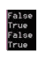
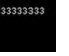
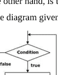
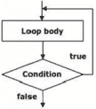
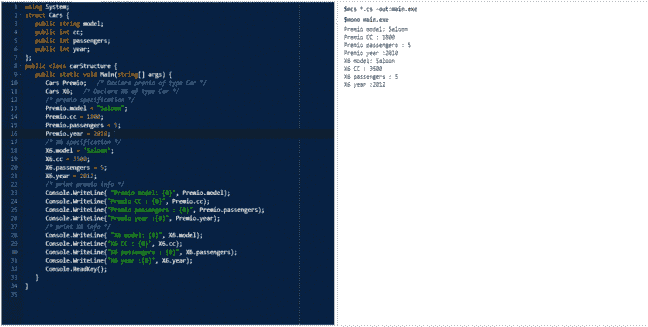

# C#：循序渐进学习 C# 编程的终极初学者指南


## 简介

C# 越来越受欢迎，正被越来越多地使用。许多知名网站和企业级应用都由 C# 驱动。你可以在超级计算机上运行的科学计算中找到 C#。系统管理任务，如包管理和配置，也使用 C#。无论你的编程兴趣是什么，学习、探索和成长的可能性都是无限的。

当涉及编程语言时，你可能想了解的第一件事是为什么 C# 如此特别，以及为什么你要学习如何使用这种特定的编程语言。

有很多不同的编程语言可供选择，它们的工作方式各不相同。有些人选择某种编程语言是因为它比其他语言更容易使用，而有些人会根据自己能用它进行的编程类型来选择编程语言。

C# 被广泛用于创建从桌面应用程序到动态网站的各种软件。C# 融合了不同编程语言的多种优点。由于 C# 和 .NET Framework 强大的编程结构与 Visual Studio 环境中的可视化编程相结合，你可以轻松创建外观优雅且功能强大的应用程序。

历史上，18 年前，微软公司 Anders Hejlsberg 领导的团队吸收了 C、C++ 和 Java 的优点，设计并开发了 C#。此后，C# 不断得到开发和支持。顺便说一句，你可能想知道 C# 字面上是什么意思。在这个命名中，# 取自音乐记谱法，表示高半音。因此，与标准 C 编程语言相比，C# 是一种“高半音语言”。

使用 C# 语言是一种很棒的体验，你很快就能编写出大量优秀的代码。花点时间通读这本指南，帮助你在今天就开始使用这门语言进行编程！

## 引言

尽管学习任何一种新语言都不容易，但本书的目标是让你尽可能快速、轻松地掌握和理解。其目的是为你提供完整、全面的技能，帮助你记住重要知识，并指导你在 C# 中的编程和编码经验。为了让你以最有效的方式学习，我希望你也能进行练习，以巩固我们在本书中探讨的课程。

本书将介绍 C# 是什么的基本描述，最后为你提供一些有用的提示和资源，以巩固你可能需要更多帮助的任何主题或技能。

这种语言将镜像其他计算机编程语言的某些组件——如果你熟悉其他语言本身，这将是一次宝贵的经验。虽然这本书不只是一本介绍编程艺术的初学者手册，但它会重述和承认许多这些技能，以帮助你在尽可能短的时间内获得最大的编程成果。请记住，这种语言为程序员提供了许多能力，本书可能会以游戏编程的角度来提及一些内容；我希望你对此也有所熟悉。

虽然我为你提供了信息和一些练习的基本技能，但将这些技能付诸实践取决于你。我强烈建议你找到一个严格的日常安排来遵守，包括研究、学习材料，以及在你自己的虚拟环境中进行练习，以熟悉这些技能。众所周知，你可以把马牵到水边，但不能强迫它喝水！

我可以给你知识和资源，但接受挑战、综合并利用它们来创造你自己的程序和代码，将取决于你。

对于像 C# 这样面向对象且结构化的语言，我认为你会发现它易于学习且对用户友好。这种高级语言建立在 C、C++ 甚至 Java 语言的基础上，并在某些方面对其进行补充。然而，即使你是这些语言的大师，这项新任务的学习曲线也将与其他任何编程语言一样陡峭！在整个过程中，我鼓励你运用自己的知识和直觉来应用本书中的概念和策略。记住，每个人在成为大师之前都是初学者！

## 第 1 章：C# 是什么

你遇到并购买了这本书，是为了学习如何成为一名 C# 程序员。

在本书中，你将学习如何在你的编程项目中应用 C# 的基本规则。C#（发音为“see sharp”）是一种面向对象的计算机编程语言，由微软设计和开发。

这是一种相当新的语言，被认为功能强大且本质上是面向对象的。虽然 C# 肯定与 C 或 C++ 不是同一种语言，但这些语言之间肯定有一些相似之处，甚至可以说，对其中一种或两种语言有所了解或具备知识和经验是有帮助的。

与所有编程语言一样，了解它们在基本和功能层面上的工作方式是有帮助的。所有语言都有一个共同点：它们都在努力告诉计算机要设置什么系统、数据库，以及如何设置，或者如何以及何时运行和执行程序。

这种特定语言源于一位程序员 Anders Hejlsberg，他是微软 .NET Framework 开发团队的成员[1]。尽管有些人倾向于批评 C# 在某种程度上是 Java 的“山寨版”，但在本学习手册的课程中，你会看到（如果你了解 Java）该语言的内容和结构存在明显差异，使其与众不同。

其设计面向能够使用高级语言并包含可执行代码的环境（也称为公共语言基础设施或 CLI），这吸引了众多对这门易学语言感兴趣的人。

它以高效为目标之一，因此使用它有很多优点。在本书中，我将向你介绍如何轻松掌握这门面向对象和组件化的语言，作为你使用的新语言。

除了是一种结构化语言外，你可以期待在 C# 语言中的编程和编码获得高效结果。我将协助你优化性能，以便从你投入这门语言编程和编码的工作中获得期望的输出。


尽管C#是借助Microsoft平台开发出来的，但该语言本身并不只局限于该平台。C#的另一个重要理念是，这种多功能性使你能够将这种面向对象语言带到不同平台，从而创建多维且可用的程序和软件。

相信你熟悉其他语言，语言的某些方面有助于实现某些期望结果。本学习C#指南将介绍许多优点，它们可帮助用户实现可移植性、类型化、元编程、属性、内存访问以及方法和函数——此外还有一系列其他优点，我们将在后续章节中讨论并举例说明。

该语言正式版本自2002年才出现，因此可被视为较新的编程语言。然而，不要因此认为它不能、也不会与Java等出现时间稍长的其他语言竞争。

该语言的开发者确实致力于改进并添加不同功能，这些功能最初是专为 .Net Framework 设计的，但如今已得到扩展；他们凭借许多功能取得了成功——其中许多人往往喜欢的是所使用的语法。

这种语言有可能被用于专注于游戏玩法。对玩家而言重要的是，游戏不仅要有趣并吸引注意力，他们还希望体验本身令人愉快。

由于你自己可能也算得上程序员（或者至少欣赏计算机的能力），在读完本书后，我期望你能深刻理解游戏程序员为了最终创造出你所拥有的体验付出了多么艰辛的努力。

尽管我不认为只读本书就能让你制作出一款大师级游戏（你也需要大量练习！）——但我确实相信，你会更深入地理解那些在处理图形编程与设计的众多组成部分时至关重要的概念。在整本书中请记住，你正在通过自己使用该语言的编码和编程技能，创造并微调一个潜在无尽的世界。面向对象的组成部分确实有助于强化这一理念。

在接下来的章节中，你将了解C#如何以及为何对你非常有用，以及如何轻松入门并在不到一个月内熟练掌握所有基础知识。

凭借可与其他任何语言相媲美的标准库，到本书结束时，你将知道如何找到可能需要的源代码并执行它，以产生相当一致且精美的结果。该语言的另一个优点是其布尔条件，它受到许多人青睐；此外还有Windows集成，使你能够轻松访问最流行的操作系统之一。

作为本章对C#是什么这一非常浅显解释的最后说明，我只想指出几个在整个过程中最好牢记的编程与编码一般概念。

首先，请记住计算机没有直觉。这意味着它们会完全按照你告诉它们的方式执行任务。计算机不会像人那样从你的代码中推断出信息。当你遇到任何困难时，请始终牢记这一点。

还要记住，一个简单的间距错误或一个错误字母都可能带来许多麻烦。如果你陷入看似无法逾越的僵局——也许你需要短暂休息一下，再回来重新查看你的代码。

有时，当我们长时间盯着屏幕时，会看不到自己的错误。

最后，请记住，你不是第一个在学习这种语言时遇到困难的人，也肯定不会是最后一个。本书最后一章将提供进一步的有用资源和提示指南，以解决我预计你在开始学习这种语言时未来可能遇到的任何困难。

本书为你学习C#设定了合理的期望。我鼓励你尽量按照这种方式学习。重要的是，不要在短时间内用过多内容压垮自己。

反过来，也不要让太多时间流逝后才重新投入学习。你可能会忘记一些细微差别，而这些差别可能会让你抓狂。请允许自己抱有合理的期望，本书正是为此设计的。

最后，享受学习过程！为自己正在学习的新技能感到自豪，并准备好参加一门快速掌握C#基础知识的速成课程！

## 第 2 章：详细概述

既然你是初学者，我们希望专注于打下坚实基础，让你全面了解C#基础知识。

从本质上讲，到第一周结束时，你将牢固掌握C#环境、程序结构、基本语法和数据类型、类型转换、变量、常量和运算符。如果你对所用术语或方法不熟悉，我会尽量对这些术语做一个快速的基础回顾。如果这仍不足以唤起你的记忆，你可能需要从Google或其他资源中找一份快速复习资料。我还想推荐一个免费的交互式 shell 程序，你可以在上面试用代码——https://www.tutorialspoint.com/compile_csharp_online.php，这应能帮助你完成本书中包含的任何训练练习。

### 环境

如前所述，C#由开发者设计为与Microsoft和.Net Framework集成。可以想见，这对你在C#中所见的环境有很大影响。理解C#的重要部分来自你对其两者如何相互作用的理解。首先，这里简要概述 .Net Framework，以帮助你更好地理解两者如何交互。

正如名称中 framework（框架）的后半部分所暗示的那样，.Net Framework 是一个可以运行应用程序的平台。.Net Framework 是 Microsoft 开发的软件开发平台。该框架旨在开发可在Windows平台上运行的应用程序。第一个版本于2002年发布，命名为 .Net Framework 1.0。此后，该框架至今已进行了大量更新。

我们可以使用 .Net Framework 创建基于Web和基于窗体的应用程序。我们还可以用它开发Web服务。除C#之外，.Net Framework 还支持Visual Basic编程语言。这意味着程序员可以选择用于开发应用程序的语言。

该框架可帮助你编写三种不同类型的应用程序——Web服务、Web应用程序和Windows应用程序。当人们使用该框架应用程序时，它实际上可被多种编程语言使用，因为它是一个多平台应用程序。从Visual Basic、JScript、C++到COBOL等多种语言，也能够在框架内相互通信。该框架的另一个重要特点是可供语言使用的广泛代码库；就我们的目的而言，我们将讨论C#。

任何语言或框架的一大优点都是你可以利用代码库的潜力。对于 .Net Framework 和C#，有一个庞大的库可供你访问并用于编码项目。我经常给人们的一条建议是：尽管这些库是极好的资源，但一定要理解编码本身的方式和原因，以确保在问题出现时你能够修复它。

Microsoft 本身也为用户提供了一个出色的工具，以协助他们进行C#编程项目的开发。

该公司甚至免费提供两个出色的工具，它们是编写从简单到复杂任何类型应用程序的绝佳资源。我推荐的两个工具（因为免费！）是 Visual C# 2010 Express 和 Visual Web Developer。

如果这些选项让你觉得不习惯或不喜欢使用，你始终可以使用文本编辑器来编写可能需要的源代码。我推荐其他选项，是因为我觉得它们比简单的代码编辑器更有帮助。不过，很多人更喜欢那种方法——这真的取决于你以及你对某个程序的适应程度。把它们都试一试，看看哪种方法更适合你。

你可以从名为 Microsoft Visual Studio 的网站下载我提到的两个Microsoft程序。

最后，你还可以在Linux或Mac OS上运行C#，这是一种跨不同平台编码的强大能力。不过，要在不同操作系统上做到这一点，你显然需要一个非Microsoft框架。我推荐“mono”——这是一个可在Linux和Mac上使用的开源选项。

了解了环境基础知识后，就去下载或打开你希望熟悉的程序，开始编码过程吧。试用一下软件——或者你也可以先消化新知识，然后再继续项目的下一阶段！

### IDE（集成开发环境）

IDE 是一种用于编写程序的程序。大多数 .Net 开发者更喜欢使用 Visual Studio Community 作为 IDE。它允许你创建、调试和运行应用程序。此IDE可用于开发基于Web和基于窗体的应用程序。要使用此IDE，你必须将其下载并安装到计算机上。你可以在下面给出的URL中找到它：

https://www.visualstudio.com/downloads/

你可以选择免费的 Visual Studio Community，或选择 Visual Studio Professional Edition；后者有30天试用期，试用期到期后必须付费。

下载完成后，双击安装文件开始安装Visual Studio。按照屏幕上的说明操作，直到Visual Studio安装完成。

之后，你就可以开始创建自己的C#应用程序了。


### 程序结构与基本语法

既然我们已经初步了解了 C# 环境是如何创建的，接下来让我们看看实际的结构，以及你将如何通过 C# 的语法与程序进行交互。

当我们审视 C# 的结构时，我们关注的是构成程序的 7 个基本组成部分。它们是类方法和特性、命名空间声明、类、Main 方法、注释，以及语句和表达式。那么，在你的编程和编码过程中，这些部分看起来是什么样的呢？我们为什么不拿这个“Hello World”示例，把它拆解成若干部分，来看看实际效果呢。

```
using System;

namespace HelloWorldApplication
{
    class HelloWorld
    {
        static void Main(string[] args)
        {
            /* my first program working with the wonderful C# */
            Console.WriteLine("Hello World");
            Console.ReadKey();
        }
    }
}
```

语言。

要运行代码，只需单击“运行/执行”按钮或按 F5 键，项目就会执行。代码应返回：

```
Hello World!
```

代码以 *using* 语句开头。该语句的作用是将 *System* 命名空间添加到程序中。C# 程序通常有多个 *using* 语句。

下一行是 *namespace* 声明。命名空间简单来说就是许多类的集合。在上面的代码中，我们有 *HelloWorld* 命名空间，其中包含 *Hello* 类。

再下一行是类声明。*Hello* 类包含程序将使用的方法和数据定义。一个类通常有许多方法。方法的作用是描述类的行为。然而，上面的 *Hello* 类只有一个方法，即 *Main* 方法。

在下一行代码中，我们定义了 *Main* 方法，它标志着所有 C# 程序的入口点。正是 Main 方法规定了类执行后会发生什么。

接下来是 /* ... */ 这一行。这是一条注释，C# 编译器会忽略该行。该行只是为了提高代码对人类读者的可读性。

接下来是 *Console.WriteLine(...)* 这一行。WriteLine 是 Console 类的方法，而 Console 类定义在 System 命名空间中。这一行将在屏幕上打印 *Hello World!* 消息。

最后是 *Console.ReadKey();* 语句。这一行适用于 *VS.NET* 用户。该行会使程序等待按键，并防止从 Visual Studio .NET 启动程序后屏幕快速运行并关闭。

除了从 Visual Studio 运行程序外，你还可以从操作系统的命令提示符运行 C# 程序。为此，请按以下步骤操作：

- 打开文本编辑器，然后将上面给出的代码添加到其中。文本编辑器的一个例子是记事本。
- 将文件保存为 *helloworld.cs*
- 启动操作系统的命令提示符，然后导航到你保存文件的目录。
- 在提示符中输入命令 `csc helloworld.cs`，然后按 Enter 键编译代码。
- 如果代码没有错误，命令提示符将带你到下一行，然后生成文件 `helloworld.exe`。该文件包含可执行代码。
- 在提示符中输入 `hello world` 以执行程序。
- 输出 `Hello World!` 将打印在屏幕上。

你要确保注意到一个细微差别（如果你熟悉 Java）：类名和程序文件名可以不同。另外，C# 区分大小写，而且语句不是以句号或其他符号结尾，而是以分号结尾。还有，始终要记住，Main 方法是程序执行开始的点。

最好注意这四个组成部分，以便在编码出现错误时避免烦人且繁琐的问题排查。

在虚拟环境中试用上面的示例。现在我们将稍微讨论一下 C# 的语法，以及我们谈到的结构中的一些概念是如何真正发展并体现语法的。首先，允许你为程序添加注释的 `/*...*/` 是一个需要记住的重要特性。

除此之外，最好记住：为类命名时，名称的第一个字符只能是字母，不能是数字。虽然首字母之后可以用字母和数字组成类名，但要始终记住这一点，并且类名中始终不允许使用符号。最后，名称不能包含 C# 关键字。关键字分为两类：上下文关键字和保留关键字；下面我将按各自类别列出所有关键字。

**上下文关键字**——get、partial、from、orderby、let、dynamic、set、join、descending、ascending、into、select、alias、group、remove、global 和 add。

**保留关键字**——case、decimal、event、for、int、new、continue、enum、in、float、byte、namespace、in、long、else、fixed、const、break、finally、lock、implicit、double、class、is、if、bool、do、false、checked、base、goto、internal、extern、delegate、as、char、foreach、explicit、interface、default、abstract、catch、try、internal、is、interface、sealed、null、switch、object、short、protected、this、operator、sizeof、is、public、throw、out、readonly、lock、true、long、ref、out、static、override、namespace、string、return、typeof、params、new、struct、uint、sbyte、volatile、unchecked、throw、stackalloc、ref、private、while、void、virtual 和 sealed。

重要提示：确保所有程序都有格式良好的代码。这样，你就能保证代码的可读性。

### C# 中不同关键字的细分

关键字是特殊的预定义保留字，每个关键字都被赋予独特的含义。可以将这些关键字组织成类别，以便更好地理解。下面是将关键字分类为不同类型的列表。

#### 1) 用于类、方法、字段和属性的关键字

- abstract
- extern
- internal
- new
- const
- override
- protected
- private
- public
- sealed
- readonly
- static
- virtual
- void

#### 2) 用于类型转换的关键字

- explicit
- implicit
- as
- is
- operator
- sizeof
- typeof

#### 3) 用于程序流程控制的关键字

- if
- else
- for
- foreach
- in
- case
- break
- continue
- return
- while
- goto
- default
- do
- switch

#### 4) 用于内置类型和枚举的关键字

- bool
- char
- class
- byte
- decimal
- enum
- double
- float
- interface
- long

- event
- new
- stackalloc
- unsafe

### 如何正确格式化代码

格式化代码时应遵循的一些规则包括：

- 你可以在类定义中缩进方法。在格式化源代码时，C# 允许你使用任意数量的制表符（即按下键盘上的 Tab 键后得到的字符）。
- 你应该在方法自身的定义中缩进方法的内容。
- 将左大括号（即 { ）放在它所属的类或方法的正下方。另外，最好让它成为该行唯一的字符。
- 确保右大括号（即 } ）与左大括号垂直对齐。
- 类名应以大写字母开头。
- 变量名应以小写字母开头。
- 方法名应以大写字母开头。
- 对写在另一段代码内部的代码进行缩进。

### 类名

在 C# 中，每个程序都有一个或多个类定义。程序员通常将每个类定义存储在与其类名对应的单独文件中。此外，这些文件的扩展名应为“.cs”。你可以将不同的类编译到单个文件中，而不会遇到任何技术问题。但是，你将在浏览代码时遇到困难。

### 关于 C# 的更多信息

C# 编程语言先进、现代、多用途且面向对象。它与其他语言（如 C、C++ 和 Java）有一些相似之处。主要区别在于 C# 提供了更简单的编程和简化的语法。

一个 C# 程序有一个或多个 .cs 文件，这些文件包含数据类型和类定义。你需要编译这些 .cs 文件才能获得可执行代码（即以 .dll 或 .exe 结尾的文件）。例如，如果你编译 HelloCSharp 程序，你将得到一个

名为“HelloCSharp.exe”的可执行文件。

#### 创建 C# 程序所需的东西

在使用 C# 编写程序之前，你需要两样重要的东西——文本编辑器（例如记事本）和 .NET 框架。文本编辑器将帮助你编写和编辑代码。另一方面，.NET 框架将帮助你编译和执行程序。

#### 什么是 .NET？

基本上，.NET 是一个为开发和执行计算机程序而设计的框架。大多数现代 Windows 系统都将 .NET 作为内置框架。因此，如果你使用的是 Microsoft 的现代操作系统，就无需在计算机上安装任何软件。

如果你使用的是旧版 Windows 操作系统，则需要先下载 .NET 框架。你可以访问这个站点[5]获取最新版本的 .NET。

重要提示：在阅读本书其余内容之前，请确保你的计算机已安装 .NET。否则，你在编译和执行稍后将看到的示例程序时会遇到问题。

#### 文本编辑器

你应使用文本编辑器来编写、编辑和保存源代码。你可以使用计算机上安装的任何文本编辑器。如果你不想下载其他程序，可以直接使用“记事本”（即 Windows 计算机预装的文本编辑器）。

#### 编译和执行程序

你需要采取的操作包括：

- 1. 生成一个“.cs”文件，并将其命名为“HelloCSharp”。
- 2. 在该 .cs 文件中编写源代码。
- 3. 编译代码以获取 .exe 文件。
- 4. 运行生成的程序。

打开你的计算机，让我们开始编写一些代码吧。

重要提示：本电子书假设你使用的是 Windows 计算机。

## 第 3 章：揭开数据类型的面纱

现在我们来谈谈数据以及你在 C# 中会看到的不同类型，我们将其分为三个基本类别。这些类别是值类型、指针类型和引用类型。如果你熟悉编程，那你一定熟悉可与数据类型关联的各种值。

### 属性

数据类型具有以下属性：

- 名称（例如 int、char、bool 等）
- 大小（例如 1 字节）
- 默认值（例如 1、2、3 等）

### C# 中的不同数据类型

C# 支持以下数据类型<sup>[6]</sup>：

- 布尔型
- 字符型
- 对象
- 浮点型
- 十进制型
- 整数型
- 字符串型

由于这些数据类型已预装在 C# 语言中，程序员将它们称为“基元类型”。

值类型数据，顾名思义，就是由值本身组成的数据类型。这些术语包括布尔数据、byte 或 int。在你的虚拟环境中进行的一个好测试是使用 sizeof(type) 获取给定数据类型的大小，只需将 type 替换为你想知道大小的数据类型。值数据类型的完整列表包括 decimal、double、bool、float、char、byte、long、sbyte、short、uint、int、ushort 和 ulong。

在引用类型数据中，我们关注的是（你大概猜到了！）对某种数据类型的引用。这些数据类型能够告诉你内存所在的位置。甚至可以有多个引用指向多个变量。这种数据类型中，我们将 string、dynamic 和 object 作为描述引用数据类型的关键词。

最后一种数据类型是指针，它指向另一个变量，以便将你引导到适当的位置。为了强化你确实知道什么是指针，下面是一个指针变量声明应是什么样子的通用示例——

```
type *var-name;
```

继续在你自己的字典中摆弄这些变量，看看你能得到什么样的输出。我认为在编程和编码中还有另一个重要短语你应该知道。那就是当你使用 /unsafe 命令时——

```
csc /unsafe darkprog.cs
```

在上面的示例中，我们将指定为不安全的程序是“darkprog.cs”。

C# 是一种强类型语言；因此，它要求你在每次声明变量时都说明数据类型。让我们探索一些常见数据类型及其工作方式：

- 1. bool — 这是一种简单的数据类型。它只取 2 个值，**真或假**。你需要使用“bool”（即 C# 关键字）来声明这种数据类型。布尔值只会产生“true”或“false”。在 C# 编程语言中，布尔值会自动设置为“false”。程序员使用这种数据类型来存储逻辑语句的结果。在使用像 *if 语句* 这样的逻辑运算符时，它非常适用。
- 2. int — 它代表 *整数*。它是一种用于存储不带小数值的数字的数据类型。它标志着数字最常用的数据类型。在 C# 中，整数也有多种数据类型，具体取决于要存储的数字大小。
- 3. string — 它用于存储文本，文本是字符序列。C# 字符串是 *不可变的*，这意味着字符串一旦创建就不能更改。如果你使用会更改字符串的方法，该字符串不会改变，而是会返回一个新字符串。
- 4. char — 它用于存储单个字符。你需要使用“char”（即另一个 C# 关键字）来声明这种类型。将你的“char”值写在一对单引号中（例如 ‘I’）。
- 5. float — 这是一种用于存储带小数值的数字的数据类型。

#### 对象

程序员将对象视为 C# 语言中最特殊的数据类型。基本上，对象充当 .NET 中其他数据类型的父级。这种数据类型在声明时需要“object”关键字，可以接受来自其他数据类型的任何值。你可以将对象视为指向计算机内存中某些部分的地址。

#### 实数类型 – 浮点数

在 C# 语言中，“实数类型”指的是你在数学中学到的实际数字。浮点实数数据类型可以是“float”或“double”。

- 1. Float – 程序员称此子类型为“单精度实数”。float 数字的默认值是 0.0F（末尾的“f”不区分大小写）。字母“f”表示该值是“float”。
- 2. Double – 程序员在指代此子类型时使用术语“双精度实数”。其默认值是 0.0D（即末尾的字母“d”不区分大小写）。C# 会自动将实数标记为“double”，因此你实际上不需要在值的末尾添加“d”。

#### 实数类型 – 十进制

这种编程语言支持“十进制算术”，这是一种使用十进制值表示数字的数学方法。无论处理什么值，这种方法都能保持其精度。

C# 使用“decimal”数据类型来表示这种实数。这种数据类型长 128 位，精确到小数点后第 29ᵗʰ 位。由于其出色的精度，程序员将其用于财务计算（例如付款、税款、利息等）。

#### 整数

这种数据类型由 8 个子类型组成，分别是：

- SBYTE – sbyte 是一种有符号整数，长度为 8 位。这意味着它最多可包含 256 个值（即 2⁸）。此外，sbyte 可以为负数或正数。
- BYTE – 此子类型包含长度为 8 位的无符号整数。它与 sbyte 几乎相同。唯一的区别是 byte 永远不能为负数。
- SHORT – 这些整数是有符号的，长度为 16 位。
- USHORT – 这些是有符号整数，长度为 16 位。
- INT – 这可能是 C# 中最流行的数据类型。程序员使用这种数据类型，因为它与 32 位处理器完全兼容，并且对于典型计算来说足够大。它是一种有符号整数，长度为 32 位。
- UINT – 这个 32 位整数是无符号的。因此，它只能为正数。
- LONG – 这个整数长度为 64 位。它可以是正数或负数。
- ULONG – 这与“long”整数类似。唯一的区别是“ulong”只能取正值。

#### 字符串

字符串是一组或一系列字符。C# 要求你在声明属于这种数据类型的值时使用“string”（即关键字）。你必须将每个字符串写在一对引号之间。这种语言允许你对字符串执行各种操作（例如串联、字符替换、字符搜索等）。

sizeof() 方法让我们可以知道变量或数据类型的大小。大小以字节形式返回。考虑以下示例[7]：

```
using System;

namespace TypeApp {
    class IntType {
        static void Main(string[] args) {
            Console.WriteLine("Size of int: {0}", sizeof(int));
            Console.ReadLine();
        }
    }
}
```

代码应返回：

```
Size of int: 4
```

这意味着一个整数占用的存储大小为 4 字节。


## 第 4 章：使用变量

你可以使用变量来存储、检索和修改可变数据。作为程序员，你需要使用变量[8]来存储和处理信息。

### 变量的特征

变量具有以下特征：

- 名称（也称为“标识符”）
- 数据类型
- 值（即你要存储的信息）。

变量是计算机内存中具有名称的区域。它们存储值，并允许计算机程序访问其内容。你可以将变量放在堆栈（即计算机程序的工作内存）中，或放在程序的动态内存中。

字符、布尔值和整数被称为值类型，因为它们将数据保存在程序堆栈中。另一方面，字符串、数组和对象被称为“引用类型”，因为它们本身不保存值，而是作为标记，指向计算机内存中存储数据的部分。

### 如何命名变量

使用变量之前需要为其命名。变量名充当标识符：它帮助程序定位和指定变量。C# 允许你自由选择变量名。然而，与任何其他语言一样，C# 对变量名有一些规则。这些规则如下：

- 可以使用下划线（即“_”）、字母和数字来创建变量名。
- 不能使用数字作为名称的开头。因此，FirstSample 有效，而 1stSample 无效。局部变量使用 camelCase，例如 cost、orderDetail、dateOfBirth 和 firstName
- 不能在变量命名中使用 C# 关键字。这条简单规则可防止程序出现编译和运行时错误。如果你确实想将关键字用于变量，可以使用“@”符号开头命名（例如 @bool、@int、@char 等）。
- 一个有意义的或描述性的名称，既不太长也不太短，以便仅通过查看变量就能识别其中存储的信息
- 可以包含字母 a–z 和 A–Z、数字 0–9 以及下划线（_）字符——不允许使用其他符号
- 不能包含空格，且不能以数字开头

#### 有效名称

- cost、name、order、order1、_order1、income
- order_Detail、orderDetail、dateOfBirth、hourlyRate、firstName、first_Name、isValid

#### 无效名称

- 1（*数字*）
- class、while、if、protected（*关键字*）
- *1order, 1name*（以数字开头）

### 如何声明变量

使用变量之前应先声明它。声明变量时：

1. 指定变量的数据类型（例如 char）
2. 指定变量的名称（例如 sample）
3. 设置变量的初始值。此步骤完全是可选的。

变量声明的格式为：

`data_type name = initial_value;`

以下是一些有效变量声明的示例：

```csharp
int year = 2000;
string = yourname;
char = test;
```

重要提示：你需要使用分号结束每条 C# 语句。如果忘记添加哪怕一个分号字符，程序也会产生不良和/或意外的结果。

### 如何赋值

与其他计算机语言一样，C# 允许你为变量赋值。

这个过程称为“赋值”，需要使用等号。程序员称这个符号为“赋值运算符”。将变量名写在运算符左侧，然后在另一侧指定要赋的值。请查看以下示例：

```csharp
test = x;
yourname = "John Doe";
```

### 如何初始化变量

在编程中，“初始化”是为新变量赋值的过程。因此，你会在声明变量时设置这个“初始值”。

### 变量的默认值

如果你不为变量分配任何值，C# 将执行自动初始化（即为空变量分配默认值）。以下表格将显示每种数据类型的默认值：

| 数据类型 | 默认值 |
|---|---|
| sbyte | 0 |
| byte | 0 |
| short | 0 |
| ushort | 0 |
| int | 0 |
| uint | 0u |
| long | 0L |
| ulong | 0u |

| 数据类型 | 默认值 |
|---|---|
| float | 0.0f |
| double | 0.0d |
| decimal | 0.0m |
| bool | false |
| char | '\u0000' |
| string | null |
| object | null |

下面给出的代码将展示如何声明变量并赋值。

```csharp
// This is an example

byte years = 10;
short days = 31;
decimal pi = 3.14;
bool isittasty = true;
char sample = 'x';
string animal = "dog";
```

重要提示：以两个正斜杠（即 //）开头的行是“注释”。在编程中，注释是添加到代码中的描述性文本，用于提高可读性。语言编译器会忽略这些行。因此，注释不会影响计算机程序的功能。

### 创建标识符

如果查看 Microsoft 附带的一些建议，你会发现它们建议在处理变量时使用驼峰式命名法，并建议在处理方法时使用帕斯卡命名法。使用驼峰式命名法意味着将名称的首字母保持小写。如果要创建包含复合词的标识符，则要确保第二个词的首字母以大写开头：

- payment、completePayment
- mathematics、firstClass

帕斯卡命名法的处理方式略有不同。这种命名风格要求第一个词以大写字母开头。序列中所有其他词的首字母也应大写。使用帕斯卡命名法的一些示例包括：

- WriteLine()、ReadLine()
- Start()、Main()

在命名这些标识符时，也可以使用数字和下划线。但是，如果由于某种原因你不能以数字开头命名这些标识符，可以写成类似 seven books 的形式，但不能写成“7books.”。

现在，这些命名法并非强制要求，你可以随意更改。但在使用 C# 时，这被视为良好的编码实践，因此最好遵循这些规则，以便代码完全按你期望的方式运行。

如你所见，C# 是一门相当容易学习的语言。你不需要像其他编程语言那样担心许多过于复杂而难以记住的规则，同时仍然拥有强大的能力和灵活性，以充分发挥编码的潜力。

### 明确赋值

C# 强制执行明确赋值策略。这意味着你需要在使用局部变量之前用值初始化它。假设编写了以下内容：

```csharp
Console.WriteLine(name);
```

**错误：**使用了未赋值的局部变量 'name'

输出：

```output
786
786
786
```

### 使用类型推断

C# 3.0 引入了使用 **var** 关键字的隐式类型变量。现在你可以声明局部变量而无需给出显式或实际类型。变量在编译时仍会获得类型，但该类型由编译器提供。

实际上，**var** 关键字指示编译器从初始化语句右侧的表达式推断变量类型。编译器负责确定并分配合适的类型。

```csharp
var variableName = variableValue; // Syntax
```

**var** 是可选的，只是为了方便。

让我们使用与上面相同的变量。

```csharp
var name = "Pirzada"; var age = 35; var weight = 70; var isMarried = true;
```

现在这些变量是**隐式类型的局部**变量，意味着你不必显式指定类型。编译器负责确定并分配合适的类型。**string** 变量由双引号表示，**char** 变量由单引号表示，**bool** 类型由 true 和 false 值表示。

**建议：**使用 **var** 很方便，但仅当从赋值右侧可以明显看出类型时才使用它。

**Double** 用于表示带小数点的字面量数字，除非添加 **M/m** 后缀表示 **decimal** 变量，或添加 **F/f** 后缀表示 **float** 变量。

```csharp
var value = 24899.45m; var number = 20.8f;
```

要初始化 **number**，需要在 20.8 后添加 f 作为后缀，以明确告诉编译器将 20.8 转换为 float。同样，要初始化 **value**，需要添加 m 作为后缀，将 24899.45 转换为 **decimal** 类型。

需要遵循的几条规则：

- **var** 只能在单条语句中声明并初始化。否则，编译器没有任何可供推断类型的信息。
- **var** 不应在类作用域的字段上使用。


-   初始化表达式不能为 null，并且必须是表达式。
-   不能在同一个语句中初始化多个隐式类型变量。
-   除非在初始化表达式中创建了新对象，否则无法初始化对象。

### 默认值表达式

默认值表达式在与泛型类型结合使用时尤其有用，因为在这种情况下，你事先不知道给定类型的默认值是什么。

#### default(T) 表达式：旧方式

默认值表达式 **default(T)** 返回类型 T 的默认值，其中 T 可以是引用类型或值类型。

```csharp
T variableName = default(T); // 语法
```

#### 示例

```csharp
var name = default(string); var age = default(int); var weight = default(int); var isMarried = default(bool);
```

#### default 字面量：新方式

**default 字面量**是 C# 7.1 中的新功能，用于在执行语句时获取指定数据类型的默认值。此功能适用于值类型和引用类型。

**注意：** default 字面量等同于 `default(T)`，其中 `T` 是推断出的类型。

```csharp
string name = default; int age = default; int weight = default; bool isMarried = default;
Console.WriteLine(name); Console.WriteLine(age);
Console.WriteLine(weight); Console.WriteLine(isMarried);
```

在下面的输出中，null 值会打印为空白行。

**default 字面量 & default(T) 的输出：**

```text

0
0
False
```

#### new 运算符

使用 **new** 运算符会调用值类型的默认构造函数。这允许你使用 **new** 关键字创建变量，该关键字会自动将变量设置为其默认值。

**注意：** C# 中的所有值都是特定类型的实例。

```csharp
var age = new int();
var isMarried = new bool();
Console.WriteLine(age);
Console.WriteLine(isMarried);
```

**输出：**

```text
0
False
```

如果存在信息丢失的可能性，请使用此转换。例如，在将浮点值转换为整数值时，你会遇到信息丢失（即小数部分会消失）。在将宽范围类型转换为窄范围类型时（例如 long 到 int、double 到 float 等），你也可能会丢失一些数据。要完成此过程，你需要使用“类型”运算符。请查看以下示例：

```csharp
class Example
{
    static void Main()
    {
        double yourDouble = 2.1d;
        System.Console.WriteLine(yourDouble);

        long yourLong = (long)yourDouble;
        System.Console.WriteLine(yourLong);

        yourDouble = 2e9d;
        System.Console.WriteLine(yourDouble);

        int yourInt = (int)yourDouble;
        System.Console.WriteLine(yourInt);
    }
}
```

如果编译并正确执行，该程序将给出以下结果：

```text
2.1
2
2000000000
2000000000
```

### 隐式转换

只有在不可能丢失数据的情况下，你才能执行此转换。这种转换被称为隐式转换，因为它不需要任何运算符。当你将窄范围的值赋值给宽范围的变量时，C# 编译器将自动执行隐式转换。

### 字符串转换

C# 允许你将任何数据类型转换为“字符串”。如果你使用“+”并且至少有一个非字符串参数，编译器将自动执行此转换过程。在这里，非字符串参数将变为字符串，“+”运算符将生成一个新值。

隐式类型转换用于执行诸如从基类到派生类的转换等操作。这些转换以所谓的“类型安全”方式执行。另一种类型的转换，显式转换，需要强制转换运算符才能完成其功能。C# 中有 16 个不同的函数可以用作内置类型转换方法。以下是一些你应该在 C# 环境中练习熟悉的示例。

- `ToChar` – 允许你将一种类型转换为单个 Unicode 字符
- `ToByte` – 允许你从一种类型转换获得一个字节
- `ToDateTime` – 允许你通过转换类型（字符串或整数）获取日期时间结构
- `ToBoolean` – 允许你从转换类型中获取布尔值
- `ToDouble` – 允许你从转换类型中获取双精度类型
- `ToDecimal` – 允许你从浮点数转换获取整数或十进制类型
- `ToInt64` – 允许从类型转换出 64 位整数
- `ToInt32` – 允许从类型转换出 32 位整数
- `ToInt16` – 允许从类型转换出 16 位整数
- `ToSByte` – 允许从类型转换出有符号字节类型
- `ToString` – 允许从类型转换出字符串
- `ToSingle` – 允许从类型转换出单精度浮点数
- `ToUInt64` – 允许从类型转换出无符号 64 位整数
- `ToUInt32` – 允许从类型转换出无符号 32 位整数
- `ToUInt16` – 允许从类型转换出无符号 16 位整数
- `ToType` – 允许从类型转换出指定类型

今天练习时，我鼓励你去找出能够执行这些函数/转换中每一个的编程示例，以便更熟悉它们涉及的内容以及它们如何帮助你进行自己的编程。

请记住，虽然你的代码可能很长，但你的输出会很短——但应该始终产生你通过所编写的代码试图达到的答案。

此变量或所涉及的值。

- `+=` – 这是加法赋值运算符。其功能是将两个操作数的值相加，然后将总和赋值给左侧操作数。
- `-=` – 程序员通常称其为“减法”赋值运算符。其功能是从左侧操作数中减去右侧操作数的值，然后将差值赋值给左侧操作数。
- `*=` – 此运算符的功能是将每个操作数的值相乘，然后将乘积赋值给左侧操作数。
- `/=` – 此运算符的功能是将两个变量相除，然后将结果赋值给左侧的变量。

在使用赋值运算符时，请确保两个操作数属于相同的数据类型。如果你发现所使用的各个操作数不兼容，则可能会出现一些问题，导致程序在执行时出错，并且需要额外的时间和精力来修复。

在 C# 中，你需要使用等号（即 =）来赋值。以下是赋值时需要使用语法：

`操作数名称 = 表达式、字面量或第二个操作数`

以下是一些示例：

`int y = 99;`

`string hello = “Good morning.”;`

`char sample = ‘z’;`

**重要提示：** C# 允许你级联（即在同一表达式中多次使用）赋值运算符。这意味着如果你创建相同数据类型的变量，则不必输入多个等号。下面给出的示例将说明此规则：

```csharp
}
```

编译并运行此代码后，你将看到以下结果：



### 算术运算符

这些运算符帮助你执行数学运算。此类别包含以下运算符：

- `+` – 使用此运算符将两个操作数或值相加（例如 `int x = 1 + 1`）
- `-` – 此运算符允许你在代码中执行减法。它用左操作数的值减去右操作数的值（例如 `int x = 2 - 1`）
- `*` – 使用此运算符可以将两个操作数的值相乘（例如 `int r = 6 * 6`）
- `/` – 使用此运算符在 C# 代码中执行除法。基本上，`/` 用左操作数的值除以右操作数的值。
- `++` – 这被称为“自增运算符”。它将操作数的值增加 1。与上面讨论的运算符不同，此运算符作用于单个操作数。此外，你可以将其写在操作数之前或之后（例如 `99++`、`1++`、`++5` 等）。
- `--` – 此运算符与自增运算符完全相反。你可以使用它将操作数的值减少 1。你可以将其写在要修改的操作数之前或之后。
- `%` – 这通常称为余数运算符，或通常称为“模”运算符。其功能是将左操作数除以右操作数，然后返回余数。

下面给出的代码将展示这些运算符如何工作：

```csharp
class Test
{
```


```csharp
static void Main()
{
    double d = 100, e = 3;

    System.Console.WriteLine(d + e);
    System.Console.WriteLine(d - e);
    System.Console.WriteLine(d / e);
    System.Console.WriteLine(d * e);
    System.Console.WriteLine(++d);
    System.Console.WriteLine(--e);

// This is an example.

    }
}
```

编译并执行该代码后，你会在命令提示符中看到以下内容：



#### 二进制运算符

这些运算符作用于二进制数。在 IT 领域，所有信息都表示为 0 和 1 的序列。这意味着，如果你想成为一名成功的程序员，就需要掌握二进制运算符。

二进制运算符的工作方式与逻辑运算符完全相同。实际上，你可能会认为二进制运算符和逻辑运算符使用不同的输入，但执行相同的过程。逻辑运算符使用布尔值来产生结果。另一方面，二进制运算符处理以二进制数字表示的数。以下是你使用 C# 时会遇到的二进制运算符：

否则，它会告诉你该语句为假。例如，表达式 e >= d 的求值结果为真。

- “<=” – 如果左操作数的值小于或等于右操作数的值，该运算符会返回 true。
- “!=” – 该运算符的功能是让你测试两个值/操作数是否不相等。如果这些值最终不相等，它会告诉你结果为 true。例如，e != d 会使该运算符返回 true。

使用这些关系运算符时，请始终记住，每次都会得到一个布尔结果。这意味着你得到的答案要么是 true，要么是 false。在使用相等运算符时，你还必须检查是否使用了两个等号。如果你最终把这些运算符与赋值运算符混淆，很可能会收到错误消息，程序也不会按你期望的方式运行。

### 条件运算符

C# 用户将“?”称为条件运算符。基本上，该运算符使用布尔表达式的结果来决定应处理哪个语句。它被称为“三元运算符”，因为它作用于三个操作数。在这里，第一个值应为布尔值，而其余值需要属于同一数据类型（例如字符、字符串、数字等）。

该运算符的语法为：

```csharp
first_operand ? second_operand : third_operand;
```

其工作方式如下：如果“first_operand”为 true，程序将处理“second_operand”。但是，如果“first_operand”为 false，程序将处理“third_operand”。

```csharp
Console.ReadLine();
}
}
}
```

该代码返回以下输出：

```text
x is less than 10
The value of x is : 5
```

条件被判定为真，也就是说，变量 x 的值小于 10，因此紧跟在条件下方的语句被执行了。如果条件为假呢？

```csharp
using System;

namespace DecisionMaking {
    class IfStatement {
        static void Main(string[] args) {

            /* defining a local variable */
            int x = 15;

            /* check a boolean condition via if statement */
            if (x < 10) {

                /* to be printed of the condition is true */
                Console.WriteLine("x is less than 10");
            }
            Console.WriteLine("The value of x is : {0}", x);
            Console.ReadLine();
        }
    }
}
```

该代码返回以下内容：

```text
The value of x is : 15
```

条件被判定为假，因此执行了其代码块之外的语句。

### if-else 语句

这实际上就是 *if* 语句与 *else* 部分的组合。如果条件为真，则执行 *if* 部分；如果条件为假，则执行 *else* 部分。这两个部分不能同时执行。以下是该语句的语法：

```csharp
if(boolean_expression)
{
    // code executes if the condition is true.
}
else
{
    // code executed if the condition is false
}
```

考虑下面给出的示例：

```csharp
using System;

namespace DecisionMaking {
    class IfElseStatement {
        static void Main(string[] args) {
            /* defining a local variable */
            int x = 5;

            /* a check of the boolean condition */
            if (x < 10) {
                /* if the condition is true, the following will be printed */
                Console.WriteLine("x is less than 10");
            } else {
                /* if the condition is false, the following will be printed */
                Console.WriteLine("x greater than 10");
            }
            Console.WriteLine("The value of x is : {0}", x);
            Console.ReadLine();
        }
    }
}
```

该代码返回以下内容：

```text
x is less than 10
The value of x is : 5
```

*if* 条件的求值结果为真，因此执行了其代码块内的语句。如果条件为假呢？

```csharp
using System;
namespace DecisionMaking {
    class IfElseStatement {
        static void Main(string[] args) {
            /* defining a local variable */
            int x = 15;
            /* a check of the boolean condition */
            if (x < 10) {
                /* if the condition is true, the following will be printed */
                Console.WriteLine("x is less than 10");
            } else {
                /* if the condition is false, the following will be printed */
                Console.WriteLine("x greater than 10");
            }
            Console.WriteLine("The value of x is : {0}", x);
            Console.ReadLine();
        }
    }
}
```

该代码给出以下输出：

```text
x greater than 10
The value of x is : 15
```

*if* 条件的求值结果为假，因此执行了 *else* 块内的语句。你一定注意到了，在两种情况下，两个代码块之外的部分都执行了。情况就是如此。

### else...if 语句

在某些情况下，我们可能需要检查多个条件。在这种情况下，我们可以使用 *else if* 语句。它采用下面给出的语法：

```csharp
if(boolean_expression a) {
    /* Runs if the boolean expression a is true */
}
else if( boolean_expression b) {
    /* Runs if the boolean expression b is true */
}
else if( boolean_expression c) {
    /* Runs if the boolean expression c is true */
} else {
    /* to run if none of above conditions is true */
}
```

以下是一个示例：

```csharp
using System;

namespace DecisionMaking {
    class ElseIfStatement {
        static void Main(string[] args) {
            /* defining a local variable */
            int x = 5;

            /* checking the boolean condition */
            if (x == 1) {
                /* print this statement if the condition is true */
                Console.WriteLine("Value of x is 1");
            }
            else if (x == 2) {
                /* print this statement if the if else if condition is true*/
                Console.WriteLine("Value of x is 2");
            }
            else if (x == 3) {
                /* print this statement if the if else if condition is true */
                Console.WriteLine("Value of x is 3");
            } else {
                /* print this statement if none of the above conditions is true */
                Console.WriteLine("All conditions are false");
            }
            Console.WriteLine("Exact value of x is: {0}", x);
            Console.ReadLine();
        }
    }
}
```

该代码打印以下结果：

```text
All conditions are false
Exact value of x is: 5
```

所有条件都被判定为假；因此执行了条件之外的代码块。让我们将变量 x 的值设为 2，看看代码会发生什么：

```csharp
using System;
namespace DecisionMaking {
    class ElseIfStatement {
        static void Main(string[] args) {
            /* defining a local variable */
            int x = 2;
            /* checking the boolean condition */
            if (x == 1) {
                /* print this statement if the condition is true */
                Console.WriteLine("Value of x is 1");
            }
            else if (x == 2) {
                /* print this statement if the if else if condition is true*/
                Console.WriteLine("Value of x is 2");
            }
            else if (x == 3) {
                /* print this statement if the if else if condition is true */
                Console.WriteLine("Value of x is 3");
            } else {
                /* print this statement if none of the above conditions is true */
                Console.WriteLine("All conditions are false");
            }
            Console.WriteLine("Exact value of x is: {0}", x);
            Console.ReadLine();
        }
    }
}
```


```csharp
}
```

输出如下所示：

```text
Value of x is 2
Exact value of x is: 2
```

一个 *else if* 条件求值为真，因此其块内的语句被执行了。所有条件之外的代码块也执行了。你可以通过将 x 的值修改为各种值来试验这段代码，看看会发生什么。

#### 嵌套 if 语句

C# 允许我们嵌套条件语句。我们可以嵌套 *if* 和 *else if* 语句，这意味着我们在另一个 *if* 或 *else if* 语句内部使用 *if* 语句。下面的语法演示了如何在 C# 中嵌套 *if* 语句：

```csharp
if( boolean_expression a) {

    /* 如果布尔表达式 a 为真，则执行 */

    if(boolean_expression b) {

        /* 如果布尔表达式 b 为真，则执行 */

    }

}
```

*else if* 语句可以使用上面给出的语法进行嵌套。

考虑下面给出的示例：

```csharp
using System;

namespace DecisionMaking {

    class NestedIf {

        static void Main(string[] args) {

            /* 定义局部变量 */

            int x = 1;
            int y = 2;


            /* 检查布尔条件 */

            if (x == 1) {
                /* 如果条件为真，则检查下面的 if 条件 */
                if (y == 2) {
                    /* 如果条件为真，则打印以下内容 */
                    Console.WriteLine("Value of x is 1 and y is 2");
                }
            }
            Console.WriteLine("Exact value of x is : {0}", x);
            Console.WriteLine("Exact value of y is : {0}", y);
            Console.ReadLine();
        }
    }
}
```

代码返回：

```text
Value of x is 1 and y is 2
Exact value of x is : 1
Exact value of y is : 2
```

两个 *if* 条件都求值为真，因此嵌套 *if* 中的语句被执行了。如果其中一个或两个条件求值为假，那么这条语句就不会被执行。下面是一个示例：

```csharp
using System;

namespace DecisionMaking {
    class NestedIf {
        static void Main(string[] args) {
            /* 定义局部变量 */
            int x = 1;
            int y = 2;
            /* 检查布尔条件 */
            if (x == 1) {
                /* 如果条件为真，则检查下面的 if 条件 */
                if (y == 3) {
                    /* 如果条件为真，则打印以下内容 */
                    Console.WriteLine("Value of x is 1 and y is 2");
                }
            }
            Console.WriteLine("Exact value of x is : {0}", x);
            Console.WriteLine("Exact value of y is : {0}", y);
            Console.ReadLine();
        }
    }
}
```

在上面的代码中，嵌套的 *if* 条件检查变量 y 的值是否为 3，而这是假的。这个块中的语句将不会被执行。*C#* 编译器会跳过这一部分，继续执行条件之外的代码。它返回以下内容：

```text
Exact value of x is : 1
Exact value of y is : 2
```

### switch 语句

这条语句与使用多个 *if* 语句是一样的。它由一个可能性列表、针对每种可能性的操作以及一个默认部分组成，默认部分用于在没有任何一个选项求值为真时执行。下面是此语句的语法：

```csharp
switch(expression)

{
    case <value_1>:

        // 代码

        break;

    case <value_2>:

        // 代码

        break;

    case <value_N>:
        // 代码
        break;

    default:
        // 代码
        break;
}
```

下面是一个示例：

```csharp
using System;

public class SwitchStatement
{
    public static void Main()
    {
        int a = 3;
        switch (a)
        {
            case 1:
                Console.WriteLine("The value of x is 1");
                break;

            case 2:
                Console.WriteLine("The value of x is 2");
                break;

            case 3:
                Console.WriteLine("The value of x is 3");
                break;

            default:
                Console.WriteLine("Unknown value of x");
                break;
        }
    }
}
```

代码返回以下内容：

```text
The value of x is 3
```

变量的值被初始化为 3。执行代码后，会匹配到 3 对应的 *case* 代码，因此其块中的语句将被执行。如果所有 *case* 条件都不为真，则将执行 *default* 部分。下面演示了这种情况：

```csharp
using System;

public class SwitchStatement
{
    public static void Main()
    {
        int a = 5;

        switch (a)
        {
            case 1:
                Console.WriteLine("The value of x is 1");
                break;
            case 2:
                Console.WriteLine("The value of x is 2");
                break;
            case 3:
                Console.WriteLine("The value of x is 3");
                break;
            default:
                Console.WriteLine("Unknown value of x");
                break;
        }
    }
}
```

代码返回如下输出：

```text
Unknown value of x
```

switch 语句中的 case 标签必须是唯一的。switch 语句可用于任何类型的表达式，包括字符串、整数、bool、char、枚举等。下面是如何将其用于字符串：

```csharp
using System;

public class SwitchStatement
{
    public static void Main()
    {
        string firstName = "Nicholas";
        switch (firstName)
        {
            case "Samuel":
                Console.WriteLine("Your first name is Samuel");
                break;
            case "Nicholas":
                Console.WriteLine("Your first name is Nicholas");
                break;
            case "Bismack":
                Console.WriteLine("Your first name is Bismack");
                break;
        }
    }
}
```

代码返回以下输出：

```text
Your first name is Nicholas
```

#### switch 中的 Goto

在某些情况下，使用 *switch* 语句时，我们可能需要跳到某个 case。这可以使用 *jump* 或 *goto* 语句来完成。考虑下面给出的示例：

```csharp
using System;

public class SwitchStatement
{
    public static void Main()
    {
        string firstName = "Nicholas";
        switch (firstName)
        {
            case "text":
                Console.WriteLine("is your first name");
                break;
            case "Samuel":
                Console.WriteLine("Samuel");
                break;
            case "Nicholas":
                Console.WriteLine("Nicholas");
                goto case "text";
                break;
            case "Bismack":
                Console.WriteLine("Bismack");
                break;
        }
    }
}
```

代码返回以下输出：

```text
Nicholas
is your first name
```

#### 嵌套 Switch

可以在另一个 switch 语句内创建 switch 语句，这就构成了嵌套 switch。下面是一个示例：

```csharp
using System;

public class NestedSwitch
{
    public static void Main()
    {
        int x = 10;

        switch (x)
        {
            case 10:
                Console.WriteLine(10);

                switch (x - 1)
                {
                    case 9:
                        Console.WriteLine(9);

                        switch (x - 2)
                        {
                            case 8:
                                Console.WriteLine(8);
                                break;
                        }
                        break;
                }
                break;
            case 20:
                Console.WriteLine(20);
                break;
            case 125:
                Console.WriteLine(25);
                break;
            default:
                Console.WriteLine(30);
                break;
        }
    }
}
```

输出如下：

## 第 8 章：循环

作为一名程序员，你会使用循环语句来重复运行某些代码块。循环在 C# 编程中起着重要作用。因此，如果你想在短时间内掌握这门语言，也应该认真学习这部分内容。

### 循环基础

在创建程序时，你经常需要多次执行代码序列。多次输入相同的代码块会非常乏味。因此，你需要一种快速简单的方法来重复代码。幸运的是，C# 语言支持循环语句。

循环是一种重复运行代码片段的工具。你可以使用它按特定次数运行代码，或者只要给定条件满足就持续运行。C# 提供了不同类型的循环语句。让我们逐一详细分析每种类型：

### while 循环

这是 C# 中最简单的循环语句。其语法为：

```csharp
while (the_assigned_condition)
{
    the_loop’s_body;
}
```

在此语法中，“the_assigned_condition”是一个产生布尔值的表达式。该条件决定了“body”将运行多少次。另一方面，“body”是你想要执行的语句（或语句组）。

下面给出的图将说明 while 循环是如何工作的：



在处理 “while” 循环时，C# 程序会检查布尔值


表达式。如果该值为“真”，程序将运行循环体内的所有语句。然后，程序会检查布尔表达式的值。如果该值仍为真，程序将重新运行循环体，并回到第一步（即检查表达式的值）。这一过程将持续进行，直到布尔表达式的值为假。一旦发生这种情况，程序将继续执行循环之后的代码块。

重要提示：如果布尔表达式为假，你的 C# 程序不会运行 while 循环体。因此，如果启动程序时布尔值为假，循环内的语句将永远不会被执行。

下面的例子将说明 while 循环是如何工作的：

```csharp
int timer = 10;

while (timer >= 0)
{
    System.Console.WriteLine("Time remaining: " + timer);

    timer--;
}
```

如果你编译并执行这段代码，你的命令提示符将打印以下数据：

```text
Time remaining: 10
Time remaining: 9
Time remaining: 8
Time remaining: 7
Time remaining: 6
Time remaining: 5
Time remaining: 4
Time remaining: 3
Time remaining: 2
Time remaining: 1
Time remaining: 0
```

### Break 运算符

你可以使用“break”（一个 C# 运算符）来提前退出循环。程序员在不想等待循环自然结束时使用此运算符。基本上，循环一旦遇到 break 运算符就会结束。这种情况会迫使程序跳到紧接在循环之后的代码片段。

在 C# 中，你只能在循环体内使用此运算符。这意味着“break”只在循环运行时起作用。

### Do-While 循环

do-while 循环与 while 循环几乎完全相同。这两种循环之间唯一的区别在于，前者在运行循环体之后才检查布尔值。因此，你可以放心，即使布尔表达式为假，你的代码也至少会运行一次。以下是 do-while 循环的语法：

```csharp
do
{
    statements;
} while (Boolean expression);
```

do-while 循环按照以下模式工作：



程序将执行循环体内的所有语句。然后，它会检查条件（即布尔表达式）。如果条件为真，程序将再次执行循环体并进行“值检查”。这一过程将持续进行，直到条件变为假。因此，如果你设定的条件始终为真，你的代码可能会永远运行下去。

### For 循环

一般来说，“for”循环比 do-while 和 while 循环更复杂。然而，for 循环可以帮助你用更少的 C# 代码完成困难的任务。“for”循环的语法如下：

```csharp
for (initializer; Boolean_expression; update)
{
    the_loop's_body;
}
```

一个“for”循环包含一个初始化器（即计数器的初始值）、一个布尔表达式、一条更新计数器的 C# 语句以及循环体。

“计数器”（即分配给循环的初始值）是“for”循环最显著的特征。在大多数情况下，计数器的值会不断增大，直到达到最终值（例如 1 到 10）。此外，程序员通常知道“for”循环将迭代多少次。

你可以在“for”循环中包含一个或多个变量。这些变量可以按降序或升序变化。在编写程序时，你可以在一个“for”循环中同时组合升序和降序变量。此外，升序变量可以从 1 增长到 1024，因为“for”循环支持算术运算（例如加法、乘法等）。

重要提示：“for”循环的所有部分都是可选的。你可以通过在语法中留空来创建一个无限“for”循环。示例如下：

```csharp
for ( ; ; )
{
    // Loop body
}
```

至此，你已经准备好进一步了解“for”循环的各个部分。

#### 初始化

“for”循环可以包含一个初始化片段：

```csharp
for (double sample = 1; …; …)
{
    // You can use the “sample” variable here.
}

// You can’t use the variable here.
```

C# 程序会在运行“for”循环之前执行一次这个片段。程序员通常使用初始化片段来创建计数器（也称为“循环变量”）并为其赋予初始值。该计数器在循环体内可用且可操作。C# 允许你使用一个初始化片段声明多个变量。

#### 条件

显然，“for”循环需要一个条件表达式。这里有一个示例：

```csharp
for (double sample = 1; sample < 5; …)
{
    // This is the loop’s body.
}
```

计算机程序会在运行循环体之前计算条件表达式。如果结果为“真”，循环体将运行；否则，相关程序将跳转到当前循环之后编写的语句。

#### 更新语句

这是“for”循环的最后一部分。基本上，更新语句用于更新循环计数器。让我们使用上面给出的代码片段：

```csharp
for (double sample = 10; sample > 1; sample--)
{
    // This is the loop’s body.
}
```

程序在运行循环体后执行此部分。请记住，该语句会更新计数器的值。

#### 循环体

这一部分由 C# 语句组成。它可以使用你在循环初始化片段中声明的变量。请查看下面的示例：

```csharp
for (double sample = 10; sample > 1; sample--)
{
    System.Console.WriteLine(sample);
}
```

### Continue 运算符

在某些情况下，你需要停止当前迭代，但又不结束整个循环。你可以使用 C# 中名为“continue”的运算符来完成此任务。下面给出的示例将说明该运算符的工作原理：

```csharp
int n = int.Parse(Console.ReadLine());
int sum = 0;
for (int i = 1; i <= n; i += 2)
{
    if (i % 7 == 0)
    {
        continue;
    }
    sum += i;
}
Console.WriteLine("sum = " + sum);
```

这段代码计算从 1 到 n 范围内所有除以 7 有余数的奇数之和。

### “Foreach” 循环

就在不久前，C# 引入了“foreach”循环（即扩展的“for”循环）的概念。这种循环概念在其他编程语言（如 C、VB、C++、PHP 等）中也可用。借助这一编程工具，你可以遍历列表、数组或其他值组中的所有元素。“foreach”循环可以处理非索引数据组中的所有现有元素。

在编写这种循环时，请使用以下语法：

```csharp
foreach (type name_of_variable in name_of_group)
{
    the_statements;
}
```

可以看到，这种循环比典型的“for”循环简单得多。“foreach”循环可以帮助你快速扫描集合中的所有对象。无数程序员在编写代码时使用这种循环也就不足为奇了。

### 嵌套 For 循环

C# 允许你在另一个“for”循环内放置一个“for”循环。位于代码最内层的循环运行次数最多，而最外层的循环重复次数最少。在“嵌套”for 循环时，应使用以下语法：

```csharp
for (initializing_fragment; condition; update_statement)
{
    for (initializing_fragment; condition; update_statement)
    {
        statements;
    }
}
```

这里，程序运行最初的“for”循环，执行其循环体，并触发嵌套循环。程序将检查第二个循环的条件，并执行其中的代码，直到计算结果为假。然后，程序将对循环计数器进行必要的调整。程序将重复整个过程，直到所有条件都为假。

## 第 9 章：C# 方法

本章将重点介绍 C# 方法。在这里，你将学习如何在自己的程序中声明和使用方法。要想成为一名高效的 C# 程序员，你需要牢记本章所包含的内容。

### 方法——基础

对于大多数程序员来说，方法是任何程序的核心部分。方法可以解决问题、接受用户输入（称为参数）并产生结果。

方法只是一组为执行共同任务而组合在一起的语句。每个 C# 类都至少有一个方法，即 Main 方法。要使用一个方法，你必须先定义它，然后调用它来执行其预期的操作。方法通过表示程序所完成的数据转换来完成任务。此外，方法也是实际处理过程完成的地方。这就是 C# 程序员将方法视为任何计算机程序基本单元的主要原因。

### 方法带来的好处

在本节中，你将了解 C# 方法带来的主要好处。阅读完这些内容后，你就会明白为什么在编写程序时应使用这些工具。

#### 更好的结构与代码可读性

编程专家声称，在编写计算机程序时应使用方法。即使是最简单的方法，也能改善 C# 代码的结构和可读性。

这里有一个你需要了解的重要事实：程序员会花 20% 的时间来编写和检查他们的计算机程序，其余 80% 的时间则用于维护和改进软件。显然，如果你的代码可读性好且结构清晰，那么你在程序上开展工作就会轻松得多。

#### 避免冗余代码

方法可以帮助你避免程序中出现冗余代码。冗余或重复的代码往往会在计算机应用程序中产生不良结果。


#### 更好地重复使用代码

如果你的程序需要多次使用某个代码片段，那么将该片段转换为 C# 方法是个极好的主意。你可以多次调用方法，这意味着你可以重复使用重要代码而无需重新输入它们。

### 声明、实现和调用 C# 方法

*方法定义* - 方法定义只是对构成方法结构的元素的声明。以下是 C# 中方法定义的语法：

```csharp
<Access_Specifier><The_Return_Type><Your_Method_Name>
(Parameter_List) {

        Method Body

}
```

此时，你需要了解可以对现有方法[22]执行的过程。这些过程是：

- 声明——在这个过程中，你将方法链接到程序。此过程允许你在程序的任何部分调用该方法。
- 实现——此过程涉及输入代码以完成特定任务。这里涉及的代码存在于你正在使用的方法内部。
- 调用——这是调用已声明方法的过程。在这里，你将使用方法解决问题或执行操作。

#### 方法声明

在 C# 中，你需要在类内部声明方法。此外，不允许“嵌套”方法（即在另一个方法的方法体内编写方法）。最好的例子是 Main()，你已经多次使用过该方法。下面给出的代码将说明这一点：

```csharp
class DeclaringMethods
{
    static void Main()
    {
        System.Console.WriteLine("Hi C#!");
    }
}
```

##### 语法

声明方法时使用以下语法：

```csharp
static data_type_of_the_result name_of_method (list_of_parameters)
```

我们用 Main() 方法（即 static void Main()）来分析这个语法。Main() 使用“void”作为返回类型，因为它不生成任何结果。“Main”一词充当其名称。另一方面，括号用于容纳程序员提供的参数。

重要提示：编写 C# 程序时必须遵循此语法。不要改变方法各部分的位置。

C# 不要求你在声明中包含参数。这意味着你可以让括号为空（例如 Main()）。

##### 方法名称

在声明、调用或实现方法时，你需要指明方法的名称。命名方法时需要记住以下规则：

- 确保首字母大写。
- 每个单词都以大写字母开头（例如 SampleMethod、NewMethod、MainLine 等）。
- 使用动词和名词作为方法名称。

重要提示：上述规则完全是可选的。如果你希望 C# 代码具有出色的结构和可读性，请遵循这些规则。

#### 方法实现

仅声明方法还不够。如果你希望方法在程序中运行，还需要实现方法。程序员在指代方法的实现时使用术语“body”（方法体）。

##### 方法体

方法体位于一对花括号内。该方法体由你想执行的命令、表达式和语句组成。因此，方法体是任何方法的重要组成部分。

重要提示：请记住，在 C# 中不能嵌套方法。不要在其他方法内部编写方法。

#### 方法调用

基本上，这是运行方法体内语句的过程。调用方法很简单：你只需指明其名称，添加一对括号，并用分号结束该行。以下是应使用的语法：

```csharp
name_of_method();
```

下面给出的示例代码将向你展示如何调用方法：

```csharp
class Animals
{
    static void Main()
    {
        Console.WriteLine("I love dogs.");
    }
}
```

如果你编译并执行该代码，命令提示符将打印以下消息：

*我爱狗。*

##### 可以调用方法的位置

C# 允许你在以下区域调用方法：

- 在程序的主方法（即 Main()）内部。
- 在另一个方法内部。
- 在该方法自身的方法体内部。这种技术称为“递归”。

##### 递归方法调用

方法可以调用自身。这个过程称为*递归*[24]。请看下面给出的阶乘示例：

```csharp
using System;
namespace MethodApplication {
  class NumberChecker {
    public int factorial(int x) {
      /* declaring a local variable */
      int answer;
      if (x == 1) {
        return 1;
      } else {
        answer = factorial(x - 1) * x;
        return answer;
      }
    }
    static void Main(string[] args) {
      NumberChecker n = new NumberChecker();
      //let's now call the factorial method
      Console.WriteLine("The factorial of 8 is : {0}", n.factorial(8));
      Console.WriteLine("The factorial of 9 is : {0}", n.factorial(9));
      Console.ReadLine();
    }
  }
}
```

我们创建了阶乘函数以及名为 n 的类的实例。该代码将返回以下结果：

```
The factorial of 8 is : 40320
The factorial of 9 is : 362880
```

该代码能够给出 8 和 9 的阶乘。注意，一个数的阶乘是小于或等于该数的所有数字（0 除外）的乘积。例如，8 的阶乘是 1 * 2 * 3 * 4 * 5 * 6 * 7 * 8，结果为 40320，如上述结果所示。

### 向方法传递参数

如果方法在定义时带有参数，那么在调用时应向它传递参数。可以使用三种方式向方法传递参数。下面我们来讨论这些方式。

#### 按值传递

这种方式涉及将实参的实际值复制到形参。这是向方法传递参数的默认机制。使用该机制时，调用函数会为每个值参数在内存中创建新位置，然后将实参的值复制到这些位置。这意味着在方法内部对参数所做的更改不会影响实参。

我们通过一个示例来演示：

```csharp
using System;
namespace MethodApplication {
    class NumberChecker {
        public void swap(int a, int b) {
            int temp;
            temp = a; /* saving the value of a */
            a = b;    /* putting b into a */
            b = temp; /* putting temp into b */
        }
        static void Main(string[] args) {
            NumberChecker n = new NumberChecker();

            /* defining a local variable */
            int x = 10;
            int y = 20;

            Console.WriteLine("Before swapping, value of x is : {0}", x);
            Console.WriteLine("Before swapping, value of y is : {0}", y);

            /* let's swap the values by calling the function */
            n.swap(x, y);

            Console.WriteLine("After swapping, value of x is : {0}", x);
            Console.WriteLine("After swapping, value of y is : {0}", y);

            Console.ReadLine();
        }
    }
}
```

该代码给出以下输出：

```
Before swapping, value of x is : 10
Before swapping, value of y is : 20
After swapping, value of x is : 10
After swapping, value of y is : 20
```

我们所做的是在函数内部更改了值。然而，上述输出表明该更改没有生效；因此它没有反映在上面的输出中。

这就是在 C# 中按值传递参数的方式。

#### 按引用传递

引用参数引用变量的内存位置。当参数按引用传递时，不会创建新的内存位置，这与按值传递时发生的情况不同。引用参数实际上引用的内存位置与提供给方法的实参相同。

要声明引用参数，我们使用 *ref* 关键字。让我们用一个示例来演示：

```csharp
using System;

namespace MethodApplication {
    class NumberChecker {
```


```csharp
public void swap(ref int a, ref int b) {
    int temp;

    temp = a; /* saving the value of a */
    a = b;   /* putting b into a */
    b = temp; /* putting temp into b */
}
static void Main(string[] args) {
    NumberChecker n = new NumberChecker();

    /* defining a local variable */
    int x = 10;
    int y = 20;

    Console.WriteLine("Before swapping, value of x is : {0}", x);
    Console.WriteLine("Before swapping, value of y is : {0}", y);

    /* let's swap the values by calling the function */
    n.swap(ref x, ref y);

    Console.WriteLine("After swapping, value of x is : {0}", x);
    Console.WriteLine("After swapping, value of y is : {0}", y);

    Console.ReadLine();
    }
}
}
```

```csharp
Console.WriteLine("After calling the method, the value of x is : {0}", x);
Console.ReadLine();
}

}

}
```

它返回以下结果：

```text
Before calling the method, value of x : 10
After calling the method, value of x is : 20
```

为输出参数提供的变量必须被赋予一个值。当你想通过参数从方法中返回值，而又不想为参数赋予初始值时，输出参数非常有用。下面的示例将帮助你更好地理解这一点：

```csharp
using System;

namespace MethodApplication {
    class NumberChecker {
        public void getValues(out int a, out int b) {
            Console.WriteLine("Enter in your first value: ");
            a = Convert.ToInt32(Console.ReadLine());

            Console.WriteLine("Enter in your second value: ");
            b = Convert.ToInt32(Console.ReadLine());
        }

        static void Main(string[] args) {
            NumberChecker n = new NumberChecker();

            /* defining a local variable */
            int x, y;

            /* call a function to obtain the values */
            n.getValues(out x, out y);

            Console.WriteLine("After calling the method, the value of x is : {0}", x);
            Console.WriteLine("After calling the method, the value of y is : {0}", y);
            Console.ReadLine();
        }
    }
}
```

系统会提示你输入两个值，请按提示操作。然后你将获得调用方法前后这两个值的输出结果。

## 第 10 章：数组世界

我们可以将数组定义为一种特殊的数据类型，它以顺序方式存储固定数量的值，并使用特殊的语法^[28]。所有数组元素必须属于同一数据类型，例如字符串、整数、双精度浮点数等。你可以将数组看作存储在连续内存位置中的相同类型变量的集合。你使用索引来访问数组中的特定元素。

在内存中，最低地址标识数组的第一个元素，而最高地址标识数组的最后一个元素。

### 声明数组

在C#中，声明数组使用以下语法：

```csharp
datatype[] arrayName;
```

*datatype* 帮助我们指定存储在数组中的元素的数据类型，不要忘记所有数组元素必须属于同一数据类型。方括号 `[]` 用于指明数组的秩，其中秩表示数组的大小或要存储的元素数量。*arrayName* 表示数组的名称。以下是数组声明的有效示例：

```csharp
int[] intArray;  // may be used for storing int values
bool[] boolArray; // may be used for storing boolean values
string[] stringArray; // may be used for storing string values
double[] doubleArray; // may be used for storing double values
byte[] byteArray; // may be used for storing byte values
Employee[] customDepartmentArray; // may be used for storing instances of Employee class
```

### 数组初始化

声明数组并不意味着它已经在内存中被初始化。初始化数组之后，才可以为其赋值。

数组可以在声明时使用 *new* 关键字进行初始化。使用该关键字时，会创建数组的一个实例。如下所示：

```csharp
public class MyArray
{
    public static void Main()
    {
        int[] intArray_1 = new int[4];

        int[] intArray_2 = new int[4]{10, 20, 30, 40};

        int[] intArray_3 = {10, 20, 30, 40};
    }
}
```

首先，我们声明了一个用于存储4个整数的数组。注意，数组大小是在方括号内指定的。在第二个语句中，我们也做了同样的事情，但在花括号{}内为索引分配了值。在第三个语句中，我们声明了一个数组并为其赋值，但未指定其大小。

### 延迟初始化

我们可以在声明数组之后再对其进行初始化。这意味着我们不必同时完成数组的声明和初始化。下面是一个示例：

```csharp
using System;
public class MyArray
{
    public static void Main()
    {
        string[] array1, array2;

        array1 = new string[4] { "Nicholas",
            "Michelle",
            "John",
            "Claire",
        };

        array2 = new string[]{"Nicholas",
            "Michelle",
            "John",
            "Claire",
        };
        Console.WriteLine(array1.Length);
        Console.WriteLine(array2.Length);
    }
}
```

上述机制被称为*延迟初始化*。在这种情况下，必须使用 *new* 关键字进行初始化。我们不能通过简单地为其赋值来初始化数组。下面的示例展示了无效的数组初始化：

```csharp
string[] myarray;
```

```csharp
myarray = {"Nicholas", "Michelle", "John", "Claire"};
```

### 访问数组元素

数组的元素在初始化时被赋值。然而，我们也可以使用各个索引为数组赋值。如下所示：

```csharp
using System;

public class MyProgram
{
    public static void Main()
    {
        int[] array1 = new int[5];

        array1[0] = 1;

        array1[1] = 2;

        array1[2] = 3;

        array1[3] = 4;
        array1[4] = 5;
        Console.WriteLine(array1[0]);
        Console.WriteLine(array1[1]);
        Console.WriteLine(array1[2]);
        Console.WriteLine(array1[3]);
        Console.WriteLine(array1[4]);
    }
}
```

这段代码将返回以下结果：

- 1. 1
- 2. 2
- 3. 3
- 4. 4
- 5. 5

数组值的检索或访问也是使用索引完成的。元素的索引被传递在方括号内。考虑下面给出的示例：

```csharp
array1[0];
array1[1];
```

程序的输出如下：

```text
Element at index[0] = 50
Element at index[1] = 51
Element at index[2] = 52
Element at index[3] = 53
Element at index[4] = 54
Element at index[5] = 55
Element at index[6] = 56
Element at index[7] = 57
Element at index[8] = 58
Element at index[9] = 59
```

### 使用 foreach 循环

你已经知道如何使用 *for* 循环访问数组的所有元素。*foreach* 循环同样可以帮助你遍历数组的元素。下面的示例演示了如何使用 *foreach* 循环遍历数组的元素：

```csharp
using System;

namespace ArrayApp {
    class MyArray {
        static void Main(string[] args) {
            int[] n = new int[10]; /* n is an array of 10 integers */
            //int x, y;

            /* initialize the elements of the array n */
            for (int x = 0; x < 10; x++ ) {
                n[ x ] = x + 100;
            }

            /* output the values of all array elements */
            foreach (int y in n ) {
                int x = y-100;
                Console.WriteLine("Element[{0}] = {1}", x, y);
            }
            Console.ReadKey();
        }
    }
}
```


```csharp
}
```

上述代码产生如下结果：

*for* 循环帮助我们将 10 个值填入数组中，第一个元素是 100，最后一个元素是 109。*foreach* 循环帮助我们访问数组中从索引 0 到最后一个索引的所有元素。请注意，变量 *x* 用于填充数组值，而变量 *y* 用于遍历数组元素。该代码返回如下输出：

```text
Element[0] = 100
Element[1] = 101
Element[2] = 102
Element[3] = 103
Element[4] = 104
Element[5] = 105
Element[6] = 106
Element[7] = 107
Element[8] = 108
Element[9] = 109
```

### 多维数组

C# 支持多维数组的概念。这类数组也称为矩形数组。多维数组是以行和列的形式组织的二维序列。以下是一个多维数组的示例：

```csharp
int[,] array1 = new int[3,2]{
            {1, 5},
            {2, 5},
            {5, 7}
        };

// 或者

int[,] array1 = { {1, 5}, {2, 5}, {5, 7} };
```

正如你在上面的示例中所看到的，要初始化一个多维数组，你必须根据行数和列数来定义它。[3,2] 表示该数组将有 3 行和 2 列。

要访问多维数组的元素，我们使用两个索引。第一个索引标识行，第二个索引标识列。请注意，两个索引都从 0 开始。让我们通过一个示例来演示：

```text
1
5
2
5
5
7
```

这就是我们访问元素的方式。*array1[2,1]* 返回位于数组第 2 行第 1 列的元素。

### 交错数组

交错数组就是数组的数组。这些数组存储的是数组，而不是直接存储数据类型值。要初始化一个交错数组，我们使用两个方括号 [] []。在第一个括号中，我们指定数组的大小；在第二个括号中，我们指定要作为值存储的数组的维度。下面是一个展示交错数组声明和初始化的示例：

```csharp
using System;

public class MyArray
{
    public static void Main()
    {
        int[][] jaggedArray = new int[2][];

        jaggedArray[0] = new int[4]{1, 2, 3, 4};

        jaggedArray[1] = new int[3]{5, 6, 7};

        Console.WriteLine(jaggedArray[0][0]);

        Console.WriteLine(jaggedArray[0][2]);

        Console.WriteLine(jaggedArray[1][1]);
    }
}
```

我们在上面的代码中声明并初始化了交错数组。该代码将给出以下结果：

```text
1
3
6
```

交错数组也可以将多维数组作为值存储。我们可以在第二个括号中使用 [,] 来表示多维。以下是一个示例：

```csharp
using System;

public class MyArray
{
    public static void Main()
    {
        int[][,] jaggedArray = new int[3][,];

        jaggedArray[0] = new int[3, 2] { { 1, 5 }, { 2, 6 }, { 4, 8 } };
        jaggedArray[1] = new int[2, 2] { { 3, 5 }, { 4, 6 } };
        jaggedArray[2] = new int[2, 2];

        Console.WriteLine(jaggedArray[0][1,1]);
        Console.WriteLine(jaggedArray[1][1,0]);

        Console.WriteLine(jaggedArray[1][1,1]);
    }
}
```

该代码将返回以下内容：

```text
6
4
6
```

如果再加上一个括号，那么这将变成数组的数组的数组。下面的示例演示了这一点：

```csharp
using System;

public class MyArray
{
    public static void Main()
    {
        int[][][] jaggedArray = new int[2][][]
        {
            new int[2][]
            {
                new int[3] { 2, 3, 5 },
                new int[2] { 1, 5 }
            },
            new int[1][]
            {
                new int[3] { 7, 6, 8 }
            }
        };

        Console.WriteLine(jaggedArray[0][0][0]);

        Console.WriteLine(jaggedArray[0][1][1]);

        Console.WriteLine(jaggedArray[1][0][2]);
    }
}
```

该代码返回以下内容：

```text
2
5
8
```

请注意，我们使用了三个方括号 [][][]，这意味着一个数组的数组的

## 第 11 章：类

类可以看作对象的设计蓝图。现实世界中的对象具有形状、颜色和功能等特征。例如，X6 是汽车类型的一个对象。汽车具有颜色、速度、内饰、形状等特征。这意味着任何公司创建的具有上述特征的对象都属于汽车类型。也就是说，Car 是一个类，而每个物理汽车这样的对象将是 Car 类型的对象。

在面向对象编程中（不要忘记 C# 是一种面向对象的编程语言），一个类具有字段、属性、方法、事件等。类应该定义对象应具有的数据类型和功能。

使用类，你可以通过将其他类型的变量以及方法和事件组合在一起，创建自己的自定义类型。

在 C# 中，我们使用 *class* 关键字来定义类[31]。下面是一个简单的示例：

```csharp
public class TestClass
{
    public string field1 = string.Empty;

    public TestClass()
    {
    }

    public void TestMethod(int param1, string param2)
    {
        Console.WriteLine("The first parameter is {0}, and second parameter is {1}",
            param1, param2);
    }

    public int AutoImplementedPropertyTest { get; set; }
    private int propertyVar;

    public int PropertyTest
    {
        get { return propertyVar; }
        set { propertyVar = value; }
    }
}
```

类前面的 *public* 关键字是一个访问说明符，用于指定类的访问方式。public 意味着它将被同一项目中的所有其他类访问。我们给这个类命名为 *TestClass*。

我们还在类中定义了一个名为 *field1* 的字段。在这个字段下面，我们为类创建了一个构造函数。请注意，构造函数与类本身同名，因此构造函数的名称为 *TestClass()*。在这个类中，我们还定义了一个名为 *TestMethod()* 的方法，该方法接受两个参数 *param1* 和 *param2*，前者是整数，后者是字符串。

下面是另一个演示如何声明和使用类的示例：

```csharp
using System;

namespace CubeApplication {
    class Cube {
        public double length;  // Length of the cube
        public double breadth;  // Breadth of the cube
        public double height;  // Height of the cube
    }

    class Cubetester {
        static void Main(string[] args) {
            Cube Cube1 = new Cube();  // Declare Cube1 of type Cube
            Cube Cube2 = new Cube();  // Declare Cube2 of type Cube
            double volume = 0.0;  // Store the cube volume here

            // cube 1 specification
            Cube1.height = 4.0;
```

```csharp
class Cube {
    private double length;    // Length of a cube
    private double breadth;   // Breadth of a cube
    private double height;    // Height of a cube

    public void setLength( double len ) {
        length = len;
    }

    public void setBreadth( double brea ) {
        breadth = brea;
    }

    public void setHeight( double heig ) {
        height = heig;
    }

    public double getVolume() {
        return length * breadth * height;
    }
}

class Cubetester {
    static void Main(string[] args) {
        Cube Cube1 = new Cube();  // Declare Cube1 of type Cube
        Cube Cube2 = new Cube();
        double volume;

        // Declare Cube2 of type Cube
        // cube 1 specification
        Cube1.setLength(4.0);
        Cube1.setBreadth(6.0);
        Cube1.setHeight(8.0);

        // cube 2 specification
        Cube2.setLength(10.0);
        Cube2.setBreadth(14.0);
        Cube2.setHeight(12.0);
        // volume of cube 1
        volume = Cube1.getVolume();
        Console.WriteLine("Volume of Cube1 is: {0}" ,volume);

        // volume of cube 2
        volume = Cube2.getVolume();
        Console.WriteLine("Volume of Cube2 is: {0}", volume);
        Console.ReadKey();
    }
}
}
```

以下是该代码的输出：

```text
Volume of Cube1 is: 192
Volume of Cube2 is: 1680
```

我们使用 *setter* 方法来设置两个立方体的各个属性值。调用 *getVolume()* 函数来计算两个立方体的体积。

### 构造函数

构造函数只是类的一个特殊成员函数，每当我们创建类的新对象时它就会运行。构造函数采用类的名称，并且不应具有返回类型。以下示例演示了如何在 C# 中使用构造函数：

```csharp
using System;
```


```csharp
namespace ConstructorApplication {
    class Person {
        private double height;  // height of the person

        public Person() {
            Console.WriteLine("We are creating an object");
        }
        public void setHeight( double heig ) {
            height = heig;
        }
        public double getHeight() {
            return height;
        }
        static void Main(string[] args) {
            Person p = new Person();
            // set the person's height
            p.setHeight(7.0);
            Console.WriteLine("The height of the person is: {0}", p.getHeight());
            Console.ReadKey();
        }
    }
}
```

代码应返回以下内容：

```text
We are creating an object
The height of the person is: 7
```

默认构造函数没有参数，但可以为构造函数添加参数。这种构造函数称为*参数化构造函数*。使用这种技术，可以在创建对象时为其分配初始值。以下是一个示例：

```csharp
using System;
namespace ConstructorApplication {
    class Person {
        private double height;    // Height of the person
        public Person(double heig) {    // A parameterized constructor
            Console.WriteLine("We are creating an object, height = {0}", heig);
            height = heig;
        }
        public void setHeight( double heig) {
            height = heig;
        }
        public double getHeight() {
            return height;
        }
        static void Main(string[] args) {
            Person p = new Person(8.0);
            Console.WriteLine("The height of the person is : {0}", p.getHeight());
            // set the height
            p.setHeight(7.0);
            Console.WriteLine("The height of the person is : {0}", p.getHeight());
            Console.ReadKey();
        }
    }
}
```

以下是代码的输出：

```text
We are creating an object, height = 8
The height of the person is : 8
The height of the person is : 7
```

### 析构函数

析构函数是指类的一种特殊成员函数，每当该类的对象超出作用域时就会运行。析构函数与类同名，但前面应带有一个波浪号（~）。析构函数不能带参数，也不能返回值。

析构函数是在退出程序之前释放内存资源的有用工具。可以重载或继承析构函数。以下示例演示如何使用析构函数：

```csharp
using System;

namespace ConstructorApplication {
    class Person {
        private double height;  // Height of a person

        public Person() {  // A constructor
            Console.WriteLine("We are creating an object");
        }

        ~Person() {  // A destructor
            Console.WriteLine("We are deleting an object");
        }

        public void setHeight( double heig ) {
            height = heig;
        }

        public double getHeight() {
            return height;
        }

        static void Main(string[] args) {
            Person p = new Person();

            // set the height of the person
            p.setHeight(7.0);

            Console.WriteLine("The height of the person is : {0}", p.getHeight());
        }
    }
}
```

以下是该函数的输出：

```text
We are creating an object
The height of the person is : 7
We are deleting an object
```

### 静态成员

要将类成员定义为静态，我们使用 *static* 关键字。当类成员被声明为静态时，这意味着无论创建多少个该类的对象，静态成员都只有一份副本。

使用 *static* 关键字意味着类中只存在一个成员实例。当需要声明常量时，我们使用此关键字，因为无需创建类的实例即可通过调用类来获取它们的值。我们可以在类定义或成员函数之外初始化静态变量。静态变量也可以在类定义内部初始化。

让我们通过一个示例演示静态变量的用法：

```csharp
using System;

namespace StaticApp {
    class StaticVariables {

        public static int x;

        public void count() {
            x++;
        }
        public int getX() {
            return x;
        }
    }
    class StaticTester {
        static void Main(string[] args) {
            StaticVariables var1 = new StaticVariables();
            StaticVariables var2 = new StaticVariables();
            var1.count();
            var1.count();
            var1.count();
            var2.count();
            var2.count();
            var2.count();
            Console.WriteLine("Variable x for var1 is: {0}", var1.getX());
            Console.WriteLine("Variable x for var2 is: {0}", var2.getX());
            Console.ReadKey();
        }
    }
}
```

代码返回以下结果：

```text
Variable x for var1 is: 6
Variable x for var2 is: 6
```

成员函数也可以声明为静态。这样的函数只能访问静态变量。静态函数甚至在创建对象之前就存在。可以如下例所示使用静态函数：

```csharp
using System;
namespace StaticAppli {
    class StaticVariable {
        public static int x;
        public void count() {
            x++;
        }
        public static int getX() {
            return x;
        }
    }
    class StaticTester {
        static void Main(string[] args) {
            StaticVariable var = new StaticVariable();

            var.count();
            var.count();
            var.count();
            Console.WriteLine("Variable x is: {0}", StaticVariable.getX());
            Console.ReadKey();
        }
    }
}
```

代码将返回以下内容：

```text
Variable x is: 3
```

## 第 12 章：结构

C# 中的结构是一种值类型数据类型。使用结构，你可以用单个变量保存属于不同数据类型的相关数据。在 C# 中，我们使用 *struct* 关键字创建结构[32]。

结构用于跟踪记录。一个很好的例子是当你需要保存所有班级学生或所有公司员工的记录时。对于存储学生记录的情况，你可能需要跟踪的一些详细信息包括姓名、年龄、课程、入学日期、完成日期、已支付费用金额、费用余额等，监护人地址和手机号码等。所有这些详细信息属于不同的数据类型，这意味着你需要为每一项创建一个变量。然而，通过使用结构，你可以定义一个变量并将这些详细信息作为一个整体保存在一起。

以下是声明结构的示例[33]：

```csharp
struct Employee{
    public string name;
    public string department;
    public string title;
    public int age;
    public double salary;
};
```

要初始化结构，我们可以选择使用 *new* 关键字，也可以不使用。可以如下所示为结构的成员赋值：

```csharp
using System;

public class MyStruct
{
    public static void Main()
    {
        Employee emp = new Employee();
        emp.name = "Nicholas Samuel";
        emp.department = "Computing";
        emp.age = 26;
        emp.salary = 5000;
        Console.WriteLine(emp.name);
        Console.WriteLine(emp.department);
        Console.WriteLine(emp.age);
        Console.WriteLine(emp.salary);
    }
}
```

```csharp
public struct Employee
{
    public string name { get; set; }
    public string department { get; set; }
    public string title { get; set; }
    public int age { get; set; }
    public double salary { get; set; }
}
```

代码给出以下结果：

```text
Nicholas Samuel
Computing
26
5000
```

名为 *Employee* 的结构是使用 struct 关键字定义的。该结构的各种详细信息已在其内部声明。在类的顶部，我们创建了此结构的一个实例，并将其命名为 *emp*。该实例已用于访问结构的各种属性并显示在屏幕上。

注意，结构是值类型，与类对象相比，这使其速度更快。这使其非常适合用于游戏编程。然而，可以

传递类对象比传递结构体更容易。这意味着当需要将数据传递给其他类时，不应使用结构体。

下面是 C# 中结构体的另一个示例：

```csharp
using System;
struct Cars {
  public string model;
  public int cc;
  public int passengers;
  public int year;
};
public class carStructure {
  public static void Main(string[] args) {
    Cars Premio;  /* Declare Premio of type Cars */
    Cars X6;  /* Declare X6 of type Cars */
    /* Premio specification */
    Premio.model = "Saloon";
    Premio.cc = 1800;
    Premio.passengers = 5;
    Premio.year = 2010;
    /* X6 specification */
    X6.model = "Saloon";
    X6.cc = 3500;
    X6.passengers = 5;
    X6.year = 2012;
    /* print Premio info */
    Console.WriteLine( "Premio model: {0}", Premio.model);
    Console.WriteLine("Premio CC : {0}", Premio.cc);
    Console.WriteLine("Premio passengers : {0}", Premio.passengers);
    Console.WriteLine("Premio year : {0}", Premio.year);

    /* print X6 info */
    Console.WriteLine( "X6 model: {0}", X6.model);
    Console.WriteLine("X6 CC : {0}", X6.cc);
    Console.WriteLine("X6 passengers : {0}", X6.passengers);
    Console.WriteLine("X6 year :{0}", X6.year);

    Console.ReadKey();
  }
}
```

代码将返回以下详细信息[^34]：



我们创建了一个名为 *Cars* 的结构体。在这个结构中，我们存储了两个成员 Premio 和 X6。这两个实例都是该结构体的实例。它们的属性已在结构体内部定义。这两个实例共享属性，但这些属性将取不同的值。然后，我们打印了这些属性的值，如上面的输出所示。

### 结构体的特性

到目前为止，你已经了解了如何使用结构体及其一些特性。C# 中的结构体与 C 和 C++ 支持的结构体有很大不同。C# 结构体具有以下描述的特性：

- 结构体可以包含字段、索引器、方法、属性、运算符和事件。
- 结构体可以定义构造函数，但不能定义析构函数。但是，在结构体中，不允许定义默认构造函数。原因是默认构造函数是自动定义的，并且无法更改。
- 结构体不能继承另一个结构体或类。
- 使用结构体，我们可以实现一个或多个接口。
- 结构体的成员不能指定为 virtual、abstract 或 protected。
- 通过 *New* 关键字创建 Struct 对象后，将创建该结构体对象并调用必要的构造函数。与类不同，我们可以在不使用 *New* 关键字的情况下实例化结构体。
- 如果我们不使用 *New* 运算符，字段将不会被赋值，并且在为所有字段完成赋值之前，将无法使用该对象。

### 结构体与类

以下是结构体与类之间的区别：

- 结构体被解释为值类型。另一方面，类被定义为引用类型。
- 结构体不支持继承。类支持。
- 结构体不能有默认构造函数。类可以有。

让我们创建一个与上述区别相关的示例：

```csharp
using System;

struct Cars {
    private string model;
    private int cc;
    private int passengers;
    private int year;

    public void getValues(string m, int c, int p, int yr) {
        model = m;
        cc = c;
        passengers = p;
        year = yr;
    }

    public void show() {
        Console.WriteLine("Car model : {0}", model);
        Console.WriteLine("CC : {0}", cc);
        Console.WriteLine("Passengers : {0}", passengers);
        Console.WriteLine("Year :{0}", year);
    }
};
public class myStructure {
    public static void Main(string[] args) {
        Cars Premio = new Cars();  /* Declare Premio of type Cars */
        Cars X6 = new Cars();      /* Declare X6 of type Cars */
        /* Premio specification */
        Premio.getValues("Saloon",
        1800, 5, 2012);
        /* X6 specification */
        X6.getValues("Saloon",
        3500, 5, 2012);
        /* print Premio info */
        Premio.show();
        /* print X6 info */
        X6.show();
        Console.ReadKey();
    }
}
```

代码执行后将给出以下输出：

```text
Car model : Saloon
CC : 1800
Passengers : 5
Year :2012
Car model : Saloon
CC : 3500
Passengers : 5
Year :2012
```

## 第 13 章：封装

封装是将各项内容包含在逻辑或物理包中的过程。在面向对象编程中，封装用于防止访问实现细节。

封装和抽象是面向对象编程中密切相关的特性。抽象的目的是使用户能够看到相关细节，而封装的目的是使程序员能够实现所需的抽象级别。

为了实现封装[35]，我们使用 *访问修饰符*。访问修饰符的作用是声明类成员的可见性和作用域。C# 支持不同类型的访问修饰符。它们包括以下内容：

- 公共（Public）
- 受保护（Protected）
- 私有（Private）
- 受保护内部（Protected internal）
- 内部（Internal）

### 私有访问修饰符

使用私有访问修饰符，类能够对其他对象和函数隐藏其成员函数和成员变量。只有同类中的函数才能访问其私有成员。类的实例不能访问该类的私有成员。请考虑下面给出的示例：

```csharp
using System;

namespace AccessApplication {
    class Figure {
        // The class member variables
        private double width;
        private double length;
        public void GetDetails() {
            Console.WriteLine("Enter the Length: ");
            length = Convert.ToDouble(Console.ReadLine());
            Console.WriteLine("Enter the Width: ");
            width = Convert.ToDouble(Console.ReadLine());
        }
        public double CalculateArea() {
            return length * width;
        }
        public void Show() {
            Console.WriteLine("The Length of the figure is: {0}", length);
            Console.WriteLine("The Width of the figure is: {0}", width);
            Console.WriteLine("The Area of the figure is: {0}", CalculateArea());
        }
    }//end the class Figure
    class RunFigure {
        static void Main(string[] args) {
            Figure f = new Figure();
            f.GetDetails();
            f.Show();
            Console.ReadLine();
        }
    }
}
```

运行代码并输入图形的尺寸，包括宽度和长度。你将得到图形的面积。

成员变量，即 *width* 和 *length*，已被定义为 *private*。这意味着我们不能从 Main() 函数访问它们。*GetDetails()* 和 *Show()* 成员函数已声明为 *public*，因此它们能够访问这些变量。在创建 *Figure* 类的实例之后，我们也可以从 *Main()* 函数访问它们。这个实例被命名为 *f*。

### 公共访问修饰符

使用公共访问修饰符，类能够将其成员函数和成员变量暴露给其他对象和函数。任何声明为 public 的类成员都可以从该类外部访问。请考虑以下示例：

```csharp
using System;

namespace FigureApplication {

    class Figure {

        // The class member variables
        public double width;
        public double length;
        public double CalculateArea() {
            return length * width;
        }

        public void Show() {
            Console.WriteLine("The Length of the figure is: {0}", length);
            Console.WriteLine("The Width of the figure is: {0}", width);
            Console.WriteLine("The Area of the figure is: {0}", CalculateArea());
        }
    }//end the Figure class

    class RunFigure {

        static void Main(string[] args) {
            Figure f = new Figure();
            f.length = 5.4;
            f.width = 3.2;
            f.Show();
            Console.ReadLine();
        }
    }
}
```


```csharp
}
}
```

代码输出如下：

```text
The Length of the figure is: 5.4
The Width of the figure is: 3.2
The Area of the figure is: 17.28
```

类成员变量 *width* 和 *length* 已被声明为 *public*，这意味着在创建类的实例后，我们能够从 *Main()* 函数访问它们。我们创建了 *Figure* 类的一个实例，并将其命名为 *f*。

*CalculateArea()* 和 *Show()* 成员函数也能够在不必使用类实例的情况下访问这些成员变量。*Show()* 成员函数也被声明为 public，这意味着我们能够使用类的实例从 *Main()* 函数访问它。

### 受保护访问修饰符

这种访问修饰符使子类能够访问基类中已定义的成员函数和成员变量。这样，实现继承就更容易。这将在继承部分讨论。

### 内部访问修饰符

这种访问修饰符允许类将其成员函数和成员变量公开给当前程序集中的其他对象和函数。这意味着，使用内部访问修饰符创建的任何成员，都可以从定义该成员的应用程序内已定义的任何类或方法中访问。以下示例演示了这一点：

```csharp
using System;

namespace AccesserApplication {

  class Figure {

    // The member variables
    internal double width;
    internal double length;
    double CalculateArea() {
return length * width;
}
public void Show() {
    Console.WriteLine("The Length of the figure is: {0}", length);
    Console.WriteLine("The Width of the figure is: {0}", width);
    Console.WriteLine("The Area of the figure is: {0}", CalculateArea());
}
}//end the class Figure

class RunFigure {
    static void Main(string[] args) {
        Figure f = new Figure();
        f.length = 6.5;
        f.width = 4.8;
        f.Show();
        Console.ReadLine();
    }
}
}
```

代码应返回以下结果：

```text
The Length of the figure is: 6.5
The Width of the figure is: 4.8
The Area of the figure is: 31.2
```

## 第 14 章：继承

借助继承，程序员可以根据另一个类来定义一个类。这也使我们能够重用代码并缩短实现应用程序所需的时间。

在创建类时，程序员不必创建全新的成员函数和数据成员，而是可以指定新类继承已有类的成员。*基类*是现有类的名称，而新类称为*派生类*。

继承只是 IS-A 关系<sup>[36]</sup>的一种实现。例如，奶牛是哺乳动物。

一个类可以从多个类或接口继承，这意味着它可以从多个基接口或基类继承数据和函数。以下示例演示基类和派生类的概念：

```csharp
using System;

namespace InheritanceApp {
    class Figure {
        public void setWidth(int wid) {
            width = wid;
        }
        public void setHeight(int heig) {
            height = heig;
        }
        protected int width;
        protected int height;
    }
    // A Derived class
    class Rectangle: Figure {
        public int calculateArea() {
return (width * height);
}
}
class TestInheritance {
    static void Main(string[] args) {
        Rectangle R = new Rectangle();
        R.setWidth(6);
        R.setHeight(8);
        // Print the rectangle's area.
        Console.WriteLine("The area is: {0}", R.calculateArea());
        Console.ReadKey();
    }
}
}
```

代码应返回以下输出：

```text
The area is: 48
```

我们定义了 *Figure* 类，它有两个属性，即 *width* 和 *height*。此类还有两个方法：*setWidth()* 和 *setHeight()*。然后我们定义了一个名为 *Rectangle* 的类。注意我们用于创建此类的语法：

```csharp
class Rectangle: Figure {
```

使用完整冒号表明 Rectangle 类正在继承 Figure 类。Rectangle 类只有一个方法，即 *calculateArea()* 方法。但是，由于它继承了 Figure 类，这意味着它具有 Figure 类的所有属性，例如 width 和 height。

然后我们创建了 *TestInheritance* 类。在 Main() 方法中，创建了 Rectangle 类的一个实例，并将其命名为 R。我们使用此实例访问了在 Rectangle 类和 Figure 类中定义的属性。这就是继承的强大之处！

### 基类初始化

派生类继承在以下代码中定义的成员方法和成员变量：

```csharp
cost = CalculateArea() * 120;
return cost;
}

public void Show() {
    base.Show();
    Console.WriteLine("The total cost for the carpet is: {0}",
CalculateCost());
}
}
}
class RunObject {
    static void Main(string[] args) {
        Carpet c = new Carpet(7.5, 9.5);
        c.Show();
        Console.ReadLine();
    }
}
}
}
```

代码将返回以下输出：

```text
The Width of the figure is: 9.5
The Length of the figure is: 7.5
The Area of the figure is: 71.25
The total cost for the carpet is: 8550
```

### 多重继承

C# 不支持多重继承。但是，借助接口，我们可以实现多重继承。考虑以下示例：

```csharp
using System;
namespace InheritanceApp {
    class Object {
        public void setWidth(int wid) {
            width = wid;
}
public void setHeight(int heig) {
    height = heig;
}
protected int width;
protected int height;
}

// PaintCost for the Base class
public interface PaintCost {
    int calculateCost(int area);
}
// The derived class
class Board : Object, PaintCost {
    public int calculateArea() {
        return (width * height);
    }
    public int calculateCost(int area) {
        return area * 120;
    }
}
class InheritanceTester {
    static void Main(string[] args) {
        Board B = new Board();
        int area;
        B.setWidth(5);
        B.setHeight(7);

    area = B.calculateArea();
    // Show the area of the object
    Console.WriteLine("The area of the object is: {0}", B.calculateArea());
            Console.WriteLine("The total printing cost is: ${0}" ,
    B.calculateCost(area));
    Console.ReadKey();
    }
    }
}
```

代码给出以下输出：

```text
The area of the object is: 35
The total printing cost is: $4200
```

## 第 15 章：多态

多态[37]一词意为呈现多种形式。在编程中，它表示为**“一个接口，多个函数”**。多态可以采取两种形式：静态或动态。

对于静态多态的情况，对函数的响应在编译时确定。在动态多态中，对函数的响应在运行时确定。

### 静态多态

如上所述，在此类多态中，对函数的响应在编译时确定。在编译时将函数链接到对象的过程称为*早期绑定*。它也称为*静态绑定*。在 C# 中，静态多态可以通过两种方式实现：

- 函数重载
- 运算符重载

### 函数重载

我们可以在同一作用域内为同一函数名提供多个定义。这些函数之间的差异通过函数所接受的参数类型或参数数量来体现。不能仅通过改变返回类型来重载函数声明。

**以下示例演示如何在 C# 中重载函数：**

```csharp
using System;

namespace PolymorphismApp {
    class DisplayData {
        void display(int x) {
            Console.WriteLine("Printing an int value: {0}", x );
        }

        void display(double y) {
```


```csharp
Console.WriteLine("Printing a float value: {0}" , y);
}
void display(string z) {
    Console.WriteLine("Printing a string value: {0}", z);
}
static void Main(string[] args) {
    DisplayData dd = new DisplayData();

    // Call display function to return an integer value
    dd.display(10);
    // Call display function to return a float value
    dd.display(11.385);
    // Call display function to return a string value
    dd.display("Hello Sir/Madam");
    Console.ReadKey();
}
}
}
```

代码执行后将返回以下内容：

```text
Printing an int value: 10
Printing a float value: 11.385
Printing a string value: Hello Sir/Madam
```

我们有函数 *display()* 的三个定义。在本例中，通过改变函数所接受的参数类型实现了重载。在一个实例中，函数接受整数值；在另一个实例中接受浮点值；在最后一个实例中接受字符串。

### 运算符重载

运算符重载是指使用单个运算符执行多种操作。通过运算符重载，可以在 C# 运算符应用于用户定义类型时为其添加额外功能。当其中一个或两个操作数属于用户定义类时，就是这种情况。

以下示例演示了这一点：

```csharp
using System;
namespace PolymorphismApp {
    class Object {
        private double breadth;  // The breadth of the box
        private double length;   // The Length of the box
        private double height;   // The Height of the box
        public double calculateVolume() {
            return breadth * length * height;
        }

        public void setLength( double l ) {
            length = l;
        }

        public void setBreadth( double b ) {
            breadth = b;
        }

        public void setHeight( double h ) {
            height = h;
        }

        // Overload the + operator to add 2 objects.
        public static Object operator+ (Object obj1, Object obj2) {
            Object ob = new Object();
            ob.length = obj1.length + obj2.length;
            ob.breadth = obj1.breadth + obj2.breadth;
            ob.height = obj1.height + obj2.height;
            return ob;
        }
    }

    class BoxTester {
        static void Main(string[] args) {
            Object Object1 = new Object();   // Declare Object1 of type Object
            Object Object2 = new Object();   // Declare Object2 of type Object
            Object Object3 = new Object();   // Declare Object3 of type Object
            double volume = 0.0;   // Store volume of the object here

            // object 1 dimensions
            Object1.setLength(7.0);
            Object1.setBreadth(8.0);
            Object1.setHeight(10.0);

            // Object 2 dimensions
            Object2.setLength(6.0);
            Object2.setBreadth(9.0);
            Object2.setHeight(11.0);

            // Calculate the volume of object 1
            volume = Object1.calculateVolume();
            Console.WriteLine("The volume of Object1 : {0}", volume);
            // Calculate the volume of object 2
            volume = Object2.calculateVolume();
            Console.WriteLine("The volume of Object2 : {0}", volume);
            // Add the two objects
            Object3 = Object1 + Object2;
            // Calculate the volume of object 3
            volume = Object3.calculateVolume();
            Console.WriteLine("The volume of Object3 : {0}", volume);

            Console.ReadKey();
        }
    }
}
```

代码返回以下输出：

```text
The volume of Object1 : 560
The volume of Object2 : 594
The volume of Object3 : 4641
```

我们重载了 + 运算符。该运算符被用于两个数值类型的加法。然而，在上面的示例中，我们使用该运算符将两个对象相加，即 Object1 和 Object2。这得到了 Object3。Object1 和 Object2 是用户定义类型，这意味着我们使用 + 运算符来相加用户定义类型。

请注意，确实可以在 C# 中重载运算符，但并非所有运算符都可以重载。例如，不能重载 ==、<、>、!=、>= 和 <= 等比较运算符。对于 && 和 || 等条件逻辑运算符，我们可以重载它们，但不能直接重载。

### 动态多态

使用 C#，我们可以创建抽象类，这些类适合接口的部分类实现。当派生类从抽象类继承后，这一实现便得以完成。抽象类具有抽象方法，派生类实现这些方法。然而，派生类具有更专门的功能。

请注意，不能创建任何抽象类的实例。抽象方法不能在抽象类之外声明。如果 C# 类被声明为 *sealed*，这意味着该类不能被继承。然而，不允许将抽象类声明为 *sealed*。以下是抽象类的示例：

```csharp
using System;
namespace PolymorphismApp {
    abstract class Object {
        public abstract int area();
    }
    class Object1 : Object {
        private int width;
        private int length;
        public Object1( int x = 0, int y = 0) {
            length = x;
            width = y;
        }
        public override int area () {
            Console.WriteLine("The Object1 area is:");
            return (width * length);
        }
    }
    class Object1Tester {
        static void Main(string[] args) {
            Object1 obj = new Object1(8, 6);
            double x = obj.area();
            Console.WriteLine("The area is: {0}",x);
            Console.ReadKey();
        }
    }
}
```

代码将打印以下结果：

```text
The Object1 area is:
The area is: 48
```

在类中定义希望由继承类实现的函数后，应使用虚函数。

为了实现动态多态，我们使用 *abstract* 类和 *virtual* 函数。  
让我们用一个示例来演示这一点：

```csharp
using System;

namespace PolymorphismApp {
    class Object {
        protected int width, height;
        public Object( int x = 0, int y = 0) {
            width = x;
            height = y;
        }
        public virtual int area() {
            Console.WriteLine("The area of the parent class is :");
            return 0;
        }
    }
    class Object1 : Object {
        public Object1( int x = 0, int y = 0): base(x, y) {

        }
        public override int area () {
            Console.WriteLine("The area of Object1 class is:");
            return (width * height);
        }
    }
    class Object2 : Object {
        public Object2(int x = 0, int y = 0): base(x, y) {
        }
        public override int area() {
            Console.WriteLine("The area of Object2 class is:");
            return (width * height / 2);
        }
    }
    class Caller {
        public void CallArea(Object obj) {
            int x;
            x = obj.area();
            Console.WriteLine("The Area is: {0}", x);
        }
    }
    class TesterClass {
        static void Main(string[] args) {
            Caller c = new Caller();
            Object1 ob1 = new Object1(10, 7);
            Object2 ob2 = new Object2(10, 5);
            c.CallArea(ob1);
            c.CallArea(ob2);
            Console.ReadKey();
        }
    }
}
```

代码返回以下输出：

```text
The area of Object1 class is:
The Area is: 70
The area of Object2 class is:
The Area is: 25
```

## 第 16 章：正则表达式

正则表达式被解释为一种可以与输入文本进行匹配的模式。在 .Net 框架中，有一个正则表达式引擎，我们可以使用它来执行该匹配。模式由一个或多个运算符、字符字面量或构造组成。

### Regex 类

这是一个用于表示正则表达式的类。该类附带许多内置函数，如下所示：

- `public bool IsMatch(string input)` - 该方法指定 Regex 构造函数中指定的正则表达式是否在指定输入字符串中获得匹配。
- `public bool IsMatch(string input, int startPoint)` - 该方法指定 Regex 构造函数中指定的正则表达式是否从输入字符串中的指定位置开始在指定输入字符串中获得匹配。
- `public static bool IsMatch(string input, string pattern)` - 该方法指定指定的正则表达式是否在指定输入字符串中获得匹配。
- `public MatchCollection Matches(string input)`
- `public string Replace(string input, string replacement)` - 该方法用指定的替换字符串替换输入字符串中的匹配项。
- `public string[] Split(string input)` - 该函数有助于按照 Regex 构造函数中指定的正则表达式模式所定义的位置，将输入字符串拆分为子字符串数组。

考虑下面给出的示例：

```csharp
using System.Text.RegularExpressions;
using System;

namespace RegularExpApp {
    class MyProgram {
```


```csharp
private static void findMatch(string input, string expre) {
    Console.WriteLine("The Expression is: " + expre);
    MatchCollection mc = Regex.Matches(input, expre);
    foreach (Match x in mc) {
        Console.WriteLine(x);
    }
}
static void Main(string[] args) {
    string s = "Splitting an Input String into Substrings";

    Console.WriteLine("Match words that begin with 'S': ");
    findMatch(s, @"\bS\S*");
    Console.ReadKey();
}
}
}
```

匹配后，代码将返回以下内容：

```text
Match words that begin with 'S':
The Expression is: \bS\S*
Splitting
String
Substrings
```

输出显示，已从输入字符串中匹配到三个单词。我们匹配的是任何以 S 开头的单词，结果找到了其中三个。

考虑下面给出的下一个示例：

```csharp
using System.Text.RegularExpressions;
using System;
namespace RegularExpApp {
    class MyProgram {
        private static void findMatch(string input, string expre) {
            Console.WriteLine("The input expression is: " + expre);
            MatchCollection mc = Regex.Matches(input, expre);
            foreach (Match x in mc) {
                Console.WriteLine(x);
            }
        }

        static void Main(string[] args) {
            string s = "so she was the same";

            Console.WriteLine("Match words beginning with 's' and ending with 'e':");
            findMatch(s, @"\bs\S*e\b");
            Console.ReadKey();
        }
    }
}
```

代码将给出以下结果：

```text
Match words beginning with 's' and ending with 'e':
The input expression is: \bs\S*e\b
she
same
```

在上面的示例中，我们匹配以 s 开头并以 e 结尾的单词。我们成功地在输入字符串中匹配到了两个单词。下面是另一个示例：

```csharp
using System;
using System.Text.RegularExpressions;
namespace RegularExpApp {
    class MyProgram {
        static void Main(string[] args) {
            string text = "Hi  learner  ";
            string pattern = "\\s+";
            string substitute = " ";
            Regex r = new Regex(pattern);
            string output = r.Replace(text, substitute);
            Console.WriteLine("The input string is: {0}", text);
            Console.WriteLine("The string after replacement is: {0}", output);
            Console.ReadKey();
        }
    }
}
```

代码返回以下内容：

```text
The input string is: Hi    learner
The string after replacement is: Hi learner
```

这段代码所做的是替换多余的空格。“Hi”和“learner”之间有一个很大的空格。多余的那个已被替换或删除。

```csharp
} finally {
    // statements to execute
}
```

如果 *try* 块引发了多个异常，可以使用多个 catch 语句，以捕获许多不同的异常。

在 C# 中，异常使用类来表示。*System.Exception* 充当 C# 中所有异常类的基类，因为所有其他类都直接或间接地派生自它。

### 处理异常

在 C# 中，可以使用 *try* 和 *catch* 块来处理异常。借助这些块，我们可以将核心程序语句与处理错误的语句分开。我们可以使用 *try*、*catch* 和 *finally* 关键字来处理错误。

例如，除以零应该引发异常，因为数学上不支持这样做。让我们创建一些代码来处理这种情况：

```csharp
using System;

namespace ExceptionHandlingApp {
    class DivisionClass {
        int answer;

        DivisionClass() {
            answer = 0;
        }

        public void division(int x, int y) {
            try {
                answer = x / y;
            } catch (DivideByZeroException exception) {
                Console.WriteLine("Exception caught: {0}", exception);
            } finally {
                Console.WriteLine("Answer: {0}", answer);
            }
        }
        static void Main(string[] args) {
            DivisionClass dc = new DivisionClass();
            dc.division(12, 0);
            Console.ReadKey();
        }
    }
}
```

代码应返回下面给出的异常：

```text
Exception caught: System.DivideByZeroException: Attempted to divide by zero.
   at ExceptionHandlingApp.DivisionClass.Division (System.Int32 x, System.Int32 y) [0x00000]
Answer: 0
```

我们创建了 *division()* 函数，它接受两个整数类型的参数 x 和 y。然后我们将 12 和 0 传递给该函数，这意味着我们将用 12 除以 0。然而，这产生了一个异常，因为不允许除以零。

### 用户定义的异常

C# 允许程序员定义自己的异常。我们从 *Exception* 类派生此类用户定义的异常类。考虑下面给出的示例：

```csharp
using System;

namespace ExceptionHandlingApp {
    class TemperatureTest {
        static void Main(string[] args) {
            TemperatureClass tc = new TemperatureClass();
            try {
                tc.displayTemperature();
            } catch(TempIsZeroException exception) {
                Console.WriteLine("TempIsZeroException: {0}", exception.Message);
            }
            Console.ReadKey();
        }
    }
}
public class TempIsZeroException: Exception {
    public TempIsZeroException(string msg): base(msg) {
    }
}
public class TemperatureClass {
    int temp = 0;

    public void displayTemperature() {
        if(temp == 0) {
            throw (new TempIsZeroException("We found Zero Temperature"));
        } else {
            Console.WriteLine("Temperature is: {0}", temp);
        }
    }
}
```

代码将返回以下内容：

```text
TempIsZeroException: We found Zero Temperature
```

### 嵌套 try-catch

C# 允许我们创建嵌套的 try-catch 块。在这种情况下，异常将在发生异常的那个 try 块之后的 catch 块中被捕获。考虑以下示例：

```csharp
using System;

public class NestedtryCatch
{
    public static void Main()
    {
        Employee emp = null;

        try
        {
            try
            {
                emp.EmployeeName = "";
            }
            catch
            {
                Console.WriteLine("The inner catch");
            }
        }
        catch
        {
            Console.WriteLine("The outer catch");
        }
    }
}

public class Employee{
    public string EmployeeName { get; set; }
}
```

代码打印以下内容：

```text
The inner catch
```

如果内部 catch 块没有必要的异常类型，异常将流向外部 catch 块，直到找到合适的异常筛选器。下面是一个示例：

```csharp
using System;
public class NestedtryCatch
{
    public static void Main()
    {
        Employee emp = null;

        try
        {
            try
            {
                // This will throw a NullReferenceException
                emp.EmployeeName = "";
            }
            catch (InvalidOperationException innerException)
            {
                Console.WriteLine("The inner catch");
            }
        }
        catch
        {
            Console.WriteLine("The outer catch");
        }
    }
}

public class Employee{
    public string EmployeeName { get; set; }
}
```

在上面给出的示例中，语句 *emp.EmployeeName* 将生成 NullReferenceException，但我们没有处理 NullReferenceException 或 Exception 类型的 catch 块。外部块将处理此异常。代码返回以下内容：

外部 catch

## 第 18 章：文件 I/O

文件由名称和目录路径来表征。一旦打开文件，它就变成一个 *流*。文件通常是为了读取或写入目的而打开的。

流只是通过通信路径的字节序列。流有两种类型：

- 输入流
- 输出流

输入流帮助我们读取文件中的数据，即读操作；而输出流帮助我们将数据写入文件，即写操作。

### 输入/输出类

C# 为我们提供了许多可用于处理文件的类。这些类可用于访问目录、文件，创建新文件，打开现有文件，以及将文件从一个目录移动到另一个目录。这些类定义在 System.IO 类中。让我们讨论其中一些类：

- **BinaryReader** - 此类帮助我们从二进制流中读取基元数据。
- **BinaryWriter** - 此类帮助我们将基元数据以二进制格式写入。
- **BufferedStream** - 它充当流字节的临时存储。
- **Directory** - 此类帮助我们操作目录结构。
- **DriveInfo** - 此类向我们提供有关驱动器的信息。
- **File** - 此类用于操作文件。
- **FileInfo** - 帮助对文件执行操作。
- **FileStream** - 用于从文件中的任何位置写入和读取。
- **MemoryStream** - 帮助随机访问保存在内存中的数据。
- **Path** - 用于对路径信息执行操作。
- **StreamReader** - 从字节流中读取字符。
- **StreamWriter** - 将字符写入流。


- StringReader – 从字符串缓冲区读取。
- StringWriter – 写入字符串缓冲区。

### FileStream 类

此类定义在 System.IO 命名空间中，可帮助我们读取和写入文件。我们也可以用它来关闭文件<sup>[41]</sup>。

要使用此类，必须先创建它的对象。然后，该实例可用于创建新文件和打开现有文件。下面是创建 FileStream 类实例的方法：

```csharp
FileStream <object> = new FileStream( <file>, <FileMode Enumerator>,
<FileAccess Enumerator>, <FileShare Enumerator>);
```

例如，假设我们需要读取一个名为 *names.txt* 的文件。我们可以创建一个名为 *FS* 的 FileStream 对象，并将其用于此目的。如下所示：

```csharp
FileStream FS = new FileStream("names.txt", FileMode.Open, FileAccess.Read, FileShare.Read);
```

FileMode 是一个枚举器，它定义了许多可用于打开文件的方法。这些方法包括以下内容：

- Append – 此方法打开现有文件，然后将光标置于文件末尾；如果指定的文件不存在，则创建一个新文件。
- Create – 用于创建新文件。
- CreateNew – 它指示操作系统创建一个新文件。
- Open – 用于打开现有文件。
- OpenOrCreate – 它指示操作系统：如果文件存在则打开该文件，如果不存在则创建新文件。
- Truncate – 用于打开现有文件并将其大小截断为零字节。

FileAccess 是一个枚举器，附带许多方法，包括 Read、Write 和 ReadWrite。

FileShare 枚举器附带以下成员：

- Inheritable – 帮助文件句柄将继承传递给子进程。
- None – 它禁用当前文件的共享。
- Read – 它打开文件以供读取。

```csharp
"The second line." + Environment.NewLine +
"The third line.";
```

```csharp
// To open the file named Myfile.txt then append the above lines. If the file does not exist, a new one will be created.
File.AppendAllLines(@"C:\MyFile.txt",
    multipleLines.Split(Environment.NewLine.ToCharArray()).ToList<string>());
```

该文件将被打开，并将指定的行追加到文件中。

### 追加字符串

*File.AppendAllText()* 方法允许你仅用一行代码即可将字符串追加到文件中。如下所示：

```csharp
//Open the file named MyFile.txt then append text to it. If the file does not exist, create a new one and open it for writing.
File.AppendAllText(@"C:\MyFile.txt", "This string will be written into the file");
```

### 覆盖文本

如果需要覆盖文件，请使用 *File.WriteAllText()* 方法。该方法将删除文件中的文本，并替换为你指定的文本。可按如下所示使用此方法：

```csharp
// To open the file MyFile.txt and write the text into it. If the file does not exist, a new one will be created and opened for writing.
File.WriteAllText(@"C:\MyFile.txt", "This text will be used for replacing the current text in the file.");
```

使用静态 File 类，可以执行各种操作。如下所示：

```csharp
//Check whether the file exists at the specified location or not
bool isFileExists = File.Exists(@"C:\MyFile.txt"); // it will return false
```

```csharp
//Copy MyFile.txt as the new file MyNewFile.txt
File.Copy(@"C:\MyFile.txt", @"D:\MyNewFile.txt");
```

```csharp
// Check when the file was lastly accessed
DateTime lastAccessTime = File.GetLastAccessTime(@"C:\MyFile.txt");
```

```csharp
//get the last time the file was written
DateTime lastWriteTime = File.GetLastWriteTime(@"C:\MyFile.txt");
```

```csharp
// Transfer the file to a new location
File.Move(@"C:\MyFile.txt", @"D:\MyFile.txt");
```

```csharp
//Open file and returns FileStream for reading bytes from the file
FileStream fs = File.Open(@"D:\MyFile.txt", FileMode.OpenOrCreate);
```

```csharp
//Open the file and return a StreamReader for reading a string from the file
StreamReader sr = File.OpenText(@"D:\MyFile.txt");
```

```csharp
//Delete the file
File.Delete(@"C:\MyFile.txt");
```

以上说明，使用静态 File 类可以让我们轻松处理物理文件。然而，为了获得更大的灵活性，可以使用 *FileInfo* 类。

### StreamReader 类

此类帮助我们读取文本文件中的数据。此类继承 Stream 基类。它还继承 TextReader 类，这是一个用于读取一系列字符的抽象基类。以下是此类提供的常用方法：

- `public override void Close()` – 此方法关闭 StreamReader 对象和流，然后释放读取器使用的任何系统资源。
- `public override int Peek()` – 此方法将返回下一个可用字符，但不消耗它。
- `public override int Read()` – 此方法将读取输入流中的下一个字符，然后将字符位置前进 1。

下面演示如何使用此类从名为 *names.txt* 的文件中读取：

```csharp
using System.IO;

using System;

namespace IOApplication {
    class MyProgram {
        static void Main(string[] args) {
            try {
                // Create a StreamReader instance for reading from a file.
                // The using statement will close the StreamReader.
                using (StreamReader sr = new StreamReader("c:/names.txt")) {
                    string line;

                    // Read the lines from the file until
                    // you reach the end of the file.
                    while ((line = sr.ReadLine()) != null) {
                        Console.WriteLine(line);
                    }
                }
            } catch (Exception exception) {
                // Inform the user about what went wrong
                Console.WriteLine("File couldn't be read:");
                Console.WriteLine(exception.Message);
            }
            Console.ReadKey();
        }
    }
}
```

该代码将读取写入 *names.txt* 文件中的文本并打印出来。

### StreamWriter 类

此类继承 TextWriter 抽象类，该抽象类表示一个写入器，能够写入一系列字符。以下是此类的常用方法：

- `public override void Close()` – 此方法将关闭 StreamWriter 的当前对象以及基础流。
- `public override void Flush()` – 此方法将清除当前写入器的缓冲区，并使任何缓冲数据写入流中。
- `public virtual void Write(bool value)` – 此方法将布尔值的文本表示形式写入文本流或字符串。
- `public override void Write(char value)` – 用于将字符写入流。
- `public virtual void Write(decimal value)` – 此方法将十进制值的文本表示形式写入文本流或字符串。
- `public virtual void Write(double value)` – 将 8 字节浮点值的文本表示形式写入文本流或字符串。
- `public virtual void Write(int value)` – 将 4 字节有符号整数的文本表示形式写入文本流或字符串。
- `public override void Write(string value)` – 用于将字符串写入流。
- `public virtual void WriteLine()` – 用于将行终止符写入文本流或字符串。

下面演示如何使用 StreamWriter 类写入文本数据：

```csharp
using System.IO;
using System;
namespace IOApp {
    class MyProgram {
        static void Main(string[] args) {
            string[] students = new string[] {"Nicholas Samuel", "Michelle Boss"};

            using (StreamWriter sw = new StreamWriter("students.txt")) {

                foreach (string x in students) {
                    sw.WriteLine(x);
                }

            }

            // Read and display every line from the file.
            string text = "";
            using (StreamReader sr = new StreamReader("students.txt")) {
                while ((text = sr.ReadLine()) != null) {
                    Console.WriteLine(text);
                }
                Console.ReadKey();
            }
        }
    }
}
```

执行后，该代码将打印以下结果：

```
Nicholas Samuel
Michelle Boss
```

### BinaryReader 类

此类可用于从文件中读取二进制数据。我们应首先通过将 FileStream 对象传递给其构造函数来创建 BinaryReader 对象。此类附带许多方法，包括以下内容：

- `public override void Close()` – 用于关闭 BinaryReader 对象以及基础流。
- `public virtual int Read()` – 用于从基础流读取字符并推进流的当前位置。


- `public virtual bool ReadBoolean()` 用于从当前流中读取一个布尔值，并将流的当前位置前进一个字节。
- `public virtual byte ReadByte()` 用于从当前流中读取下一个字节到字节数组，并将当前位置前进相应数量的字节。

### BinaryWriter 类

该类帮助将二进制数据写入流。要创建 BinaryWriter 对象，我们需要将一个 FileStream 对象传递给构造函数。该类提供了许多方法，包括以下这些：

- `public override void Close()` 用于关闭 BinaryWriter 对象以及底层流。
- `public virtual void Flush()` 此方法会清除当前写入器的缓冲区，并使所有缓冲数据写入设备。
- `public virtual void Write(bool value)` 用于将一字节的布尔值写入当前流。1 表示 true，0 表示 false。

让我们创建一个示例来演示如何读写二进制数据：

```csharp
using System;
using System.IO;
namespace BinaryFileApplication {
    class MyProgram {
        static void Main(string[] args) {
            BinaryWriter bw;
            BinaryReader br;

            int x = 12;
            double db = 1.24658;
            bool bl = false;
            string st = "Hello world";

            //create a file
            try {
                bw = new BinaryWriter(new FileStream("testdata", FileMode.Create));
            } catch (IOException exception) {
                Console.WriteLine(exception.Message + "\n Unable to create the file.");
                return;
            }
            //write to the file
            try {
                bw.Write(x);
                bw.Write(db);
                bw.Write(bl);
                bw.Write(st);
            } catch (IOException exception) {
                Console.WriteLine(exception.Message + "\n Unable to write to the file.");
                return;
            }
            bw.Close();

            //read from the file
            try {
                br = new BinaryReader(new FileStream("testdata", FileMode.Open));
            } catch (IOException exception) {
                Console.WriteLine(exception.Message + "\n Unable to open the file.");
                return;
            }
            try {
                x = br.ReadInt32();
                Console.WriteLine("Integer data: {0}", x);
                db = br.ReadDouble();
                Console.WriteLine("Double data: {0}", db);
                bl = br.ReadBoolean();
                Console.WriteLine("Boolean data: {0}", bl);
                st = br.ReadString();
                Console.WriteLine("String data: {0}", st);
            } catch (IOException exception) {
                Console.WriteLine(exception.Message + "\n Unable to read from the file.");
                return;
            }
            br.Close();
            Console.ReadKey();
        }
    }
}
```

该代码在执行后将产生以下结果：

```text
Integer data: 12
Double data: 1.24658
Boolean data: False
String data: Hello world
```

## 第 19 章：委托

我们可以拥有一个带有多个不同数据类型参数的函数。然而，有时我们可能需要将某个函数作为参数传递。C# 如何处理事件处理程序或回调函数？这是通过委托<sup>[46]</sup>实现的。

委托被视为指向函数的指针。它是一种引用数据类型，持有对方法的引用。所有委托都隐式派生自 *System.Delegate* 类。我们使用委托来实现事件和回调方法<sup>[47]</sup>。

### 声明委托

我们声明委托的方式决定了委托可以引用的方法。委托可以引用与其具有相同签名的方法<sup>[48]</sup>。我们使用 delegate 关键字来声明委托。声明语法如下：

```csharp
<access modifier> delegate <return type><delegate_name>(<parameters>)
```

**这里有一个示例：**

```csharp
public delegate void Display(int value);
```

上面，我们声明了一个 *Display* 委托。我们可以使用这个委托指向一个与 *Display* 委托所声明的返回类型和参数相同的方法。

请考虑下面给出的示例：

```csharp
using System;

public class MyProgram
{
    public delegate void Display(int num);

    public static void Main()
    {
        // Display delegate points to the DisplayNumber
        Display displayDel = DisplayNumber;
        displayDel(100000);
        displayDel(200);

        // Display delegate points to DisplayMoney
        displayDel = DisplayMoney;

        displayDel(50000);
        displayDel(20);
    }

    public static void DisplayNumber(int x)
    {
        Console.WriteLine("Number: {0,-12:N0}", x);
    }

    public static void DisplayMoney(int amount)
    {
        Console.WriteLine("Money: {0:C}", amount);
    }
}
```

该代码将输出以下内容：

```text
Number: 100,000
Number: 200
Money: $50,000.00
Money: $20.00
```

我们创建了一个名为 *Display* 的委托，它接受一个整数类型的参数并返回 void。在 Main() 方法中，我们创建了一个 Display 类型的变量，并将名为 *DisplayNumber* 的方法赋值给它。调用 Display 委托时，也会调用 DisplayNumber 方法；如果将 Display 委托变量赋给 DisplayMoney 方法，则会调用 DisplayMoney 方法。

此外，我们还可以使用 *new* 关键字创建委托对象。在这种情况下，我们必须指定方法的名称，如下所示：

`Display displayDel = new Display(DisplayNumber);`

### 调用委托

委托是对方法的引用；因此我们可以像调用方法一样简单地调用它。当委托被调用时，它所引用的方法也将被调用。

我们有两种方式可以调用委托：使用 () 运算符或使用委托的 *Invoke()* 方法。让我们通过一个示例来演示：

```csharp
Display displayDel = DisplayNumber;
displayDel.Invoke(5000);

//or
displayDel(10000);
```

上面已经展示了我们可以用来调用委托的两种方式。

### 将委托作为参数传递

方法可以具有委托类型的参数，并且它可以调用该委托参数。下面是一个委托参数的示例：

```csharp
public static void DisplayHelper(Display delegateFunc, int numToDisplay)
{
    delegateFunc(numToDisplay);
}
```

在上面的示例中，DisplayHelper 函数具有一个 Display 类型的委托参数，并且它使用下面的语句作为一个函数被调用：

```csharp
delegateFunc(numToDisplay);
```

让我们再给出一个示例，演示如何使用 *DisplayHelper* 方法和委托类型参数：

```csharp
using System;

public class MyProgram
{
    public delegate void Display(int num);

    public static void Main()
    {
        DisplayHelper(DisplayNumber, 500);
        DisplayHelper(DisplayMoney, 200);
    }

    public static void DisplayHelper(Display delegateFunc, int numToDisplay)
    {
        delegateFunc(numToDisplay);
    }

    public static void DisplayNumber(int val)
    {
        Console.WriteLine("Number: {0,-12:N0}", val);
    }

    public static void DisplayMoney(int amount)
    {
        Console.WriteLine("Money: {0:C}", amount);
    }
}
```

该代码将返回以下输出：

```text
Number: 500
Money: $200.00
```

### 多播委托

委托可以指向多个函数。任何指向多个函数的委托都被称为*多播委托*。使用 + 运算符向委托对象添加函数，使用 − 运算符从委托对象中移除现有函数。

请考虑下面给出的示例：

```csharp
using System;

public class MyProgram
{
    public delegate void Display(int value);

    public static void Main()
    {
        Display displayDel = DisplayNumber;
        displayDel += DisplayHexadecimal;
        displayDel += DisplayMoney;

        displayDel(1000);
        displayDel -= DisplayHexadecimal;
        displayDel(2000);
    }

    public static void DisplayNumber(int x)
    {
        Console.WriteLine("Number: {0,-12:N0}", x);
    }

    public static void DisplayMoney(int amount)
    {
        Console.WriteLine("Money: {0:C}", amount);
```


```csharp
}
public static void DisplayHexadecimal(int dec)
{
    Console.WriteLine("Hexadecimal: {0:X}", dec);
}
}
```

该代码将输出以下结果：

```
Number: 1,000
Hexadecimal: 3E8
Money: $1,000.00
Number: 2,000
Money: $2,000.00
```

在上面的示例中，displayDel 指向三个方法，即 DisplayNumber、DisplayMoney 和 DisplayHexadecimal。这使它成为一个多播委托。这意味着当调用 displayDel 时，它会依次调用所有这三个方法。

#### 示例

```csharp
using System;
namespace thread
{
    class MainThread
    {
        static void Main(string[] args)
        {
            Thread t1 = new Thread();
            t1.Name="Thread1";
            Console.WriteLine("Thread is:{0}", t1.Name);
            Console.Read();
        }
    }
}
```

**编译并执行代码后，输出为：**

```
Thread is: Thread1
```

### Thread 类的属性和方法

#### 属性

- **IsAlive：** 显示当前线程执行状态的值
- **CurrentThread：** 获取当前正在运行的线程
- **CurrentContext：** 获取线程正在其中执行的当前上下文
- **ExecutionContext：** ExecutionContext 对象包含有关不同上下文的信息
- **Name：** 获取或设置线程的名称
- **ThreadState：** 包含当前线程状态的值
- **Priority：** 获取或设置表示线程调度优先级的值

#### 方法

- **public static void BeginThreadAffinity()：** 宿主即将执行依赖于当前物理操作系统线程的指令。
- **public void Abort()：** 在其被调用的线程中引发 ThreadAbortException。
- **public void Interrupt()：** 中断处于 WaitSleepJoin 状态的线程。
- **public static AppDomain GetDomain()：** 返回唯一的域标识符。
- **public static void MemoryBarrier()：** 执行当前线程的处理器无法重新排序指令。
- **public void Start()：** 启动线程。
- **public static bool Yield()：** 使调用线程将执行让给处理器上已准备好运行的另一个线程。

### 创建和管理线程

扩展线程类会创建线程。扩展线程类调用 **Start()** 方法来启动子线程执行。

#### 示例

```csharp
using System;
using System.Threading;

namespace MultipleThread
{
    class ThreadProgram
    {
        public static void CallChild()
        {
            Console.WriteLine("Start child thread");
        }
        static void Main(string[] args)
        {
            ThreadStart child1 = new ThreadStart(CallChild);
            Console.WriteLine("Creating child thread");
            Thread child2 = new Thread(child1);
            child2.Start();
            Console.Read();
        }
    }
}
```

**编译并执行代码后，输出为：**

```
Start child thread

Creating child thread
```

### 管理线程

当需要将线程暂停一段时间以便另一个线程可以执行时，使用 **Thread.Sleep()** 方法。该方法接受一个参数，表示以毫秒为单位的时间。

#### 示例

```csharp
using System;
using System.Threading;

namespace Multithreaded
{
    class Program
    {
        public static void ChildThread()
        {
            Console.WriteLine("Start child thread");
            int sleeptime = 4000;

            Console.WriteLine("Thread sleeping for {0}  seconds", sleeptime / 1000);
            Thread.Sleep(sleeptime);
            Console.WriteLine("Resume child thread");

        }
        public static void Main()
        {
            ThreadStart t1 = new ThreadStart(ChildThread);
            Console.WriteLine("child thread created");
            Thread child1 = new Thread(t1);
            child1.Start();
            Console.Read();
        }
    }
}
```

**编译并执行代码后，输出为：**

```
Start child thread
Thread sleeping for 4 seconds
Resume child thread
child thread created
```

### 销毁线程

使用 **Thread.Abort()** 方法销毁线程。当线程被销毁时，会引发 **ThreadAbortException**。捕获该异常，并将控制权发送到 **finally** 块。

#### 示例

```csharp
using System;
using System.Threading;

namespace ThreadDemo
{
    class Program
    {
        public static void ChildThread()
        {
            try
            {
                Console.WriteLine("Child Thread started");
                for (int j = 0; j <= 10; j++)
                {
                    Thread.Sleep(1000);
                    Console.WriteLine(j);
                }
            }
            catch (ThreadAbortException e)
            {
                Console.WriteLine("Exception caught");
            }
            finally
            {
                Console.WriteLine("Exception is not handled");
            }
        }

        public static void Main()
        {
            ThreadStart t1 = new ThreadStart(ChildThread);
            Console.WriteLine(" Creating child thread");
            Thread t2 = new Thread(t1);
            t2.Start();

            // main thread is stopped
            Thread.Sleep(2000);

            // child thread aborted
            Console.WriteLine(" Aborting child thread ");
            t2.Abort();
            Console.Read();
        }
    }
}
```

**编译并执行代码后，输出为：**

```
Creating child thread

Child Thread started

0

1

Aborting child thread

Exception caught

Exception is not handled
```

## 第 21 章：事件

事件是预期会发生的事情。在 C# 中，事件是用户操作（如单击、按键、鼠标移动）或诸如系统生成的通知[52]之类的发生情况。应用程序应在事件发生后对其作出响应。一个很好的例子是中断的发生。事件用于促进进程间通信。

事件在类中声明，并通过同一类或另一个类中的委托与事件处理程序关联。包含事件的类用于发布事件。这样的类称为 *发布者* 类。接受事件的类称为 *订阅者* 类。这意味着事件依赖于发布者-订阅者模型。

*发布者* 是同时包含事件和委托定义的对象。事件与委托之间的关联在此对象中定义。发布者类的对象调用事件，而事件又会被通知给其他对象。

*订阅者* 是接受事件并提供事件处理程序的对象。发布者类有一个委托，该委托调用订阅者类的方法（事件处理程序）。

### 事件声明

要在类中声明事件，首先应为该事件声明一个委托类型。之后，才能使用 *event* 关键字[53]声明事件。下面是一个示例：

```csharp
public delegate void myEvent();
public event myEvent myEvent;
```

因此，我们使用了 *event* 关键字使其成为事件。下面是一个完整示例：

```csharp
using System;

public class DisplayHelper
{
    // declare the delegate
    public delegate void BeforeDisplay();

    // declare an event of type delegate
    public event BeforeDisplay beforeDisplayEvent;

    public DisplayHelper()
    {

    }

    public void DisplayNumber(int x)
    {
        // call the delegate method before moving to display
        if (beforeDisplayEvent != null)
            beforeDisplayEvent();

        Console.WriteLine("Number: {0,-12:N0}", x);
    }

    public void PrintDecimal(int dec)
    {
        if (beforeDisplayEvent != null)
            beforeDisplayEvent();

        Console.WriteLine("Decimal: {0:G}", dec);
    }

    public void DisplayMoney(int amount)
    {
        if (beforeDisplayEvent != null)
            beforeDisplayEvent();

        Console.WriteLine("Money: {0:C}", amount);
    }

    public void DisplayTemperature(int x)
    {
        if (beforeDisplayEvent != null)
            beforeDisplayEvent();

        Console.WriteLine("Temperature: {0:4:N1} F", x);
    }

    public void DisplayHexadecimal(int dec)
    {
        if (beforeDisplayEvent != null)
            beforeDisplayEvent();

        Console.WriteLine("Hexadecimal: {0:X}", dec);
    }
}
```

*DisplayHelper* 是一个发布者类，负责发布 *beforeDisplayEvent* 事件。在每个显示方法之前，它首先检查 *beforeDisplayEvent* 是否不为 null，然后调用 *beforeDisplayEvent()* 方法。

现在我们需要创建一个订阅者。考虑下面给出的类：

```csharp
using System;

public class MyProgram
```


```csharp
{
    public static void Main()
    {
        NumberClass nc = new NumberClass(200);
        nc.DisplayMoney();
        nc.DisplayNumber();
    }
}

class NumberClass
{
    private DisplayHelper _displayHelper;

    public NumberClass(int x)
    {
        _value = x;

        _displayHelper = new DisplayHelper();
        // subscribe to the beforeDisplayEvent event
        _displayHelper.beforeDisplayEvent += displayHelper_beforeDisplayEvent;
    }

    // beforeDisplayEvent handler
    void displayHelper_beforeDisplayEvent()
    {
        Console.WriteLine("BeforeDisplayEventHandler: DisplayHelper will print a value");
    }

    private int _value;

    public int Value
    {
        get { return _value; }
        set { _value = value; }
    }

    public void DisplayMoney()
    {
        _displayHelper.DisplayMoney(_value);
    }

    public void DisplayNumber()
    {
        _displayHelper.DisplayNumber(_value);
    }
}

public class DisplayHelper
{
    // declare a delegate
    public delegate void BeforeDisplay();

    // declare an event of type delegate
    public event BeforeDisplay beforeDisplayEvent;

    public DisplayHelper()
    {

    }

    public void DisplayNumber(int y)
    {
        // call a delegate method before printing
        if (beforeDisplayEvent != null)
            beforeDisplayEvent();

        Console.WriteLine("Number: {0,-12:N0}", y);
    }

    public void DisplayDecimal(int dec)
    {
        if (beforeDisplayEvent != null)
            beforeDisplayEvent();

        Console.WriteLine("Decimal: {0:G}", dec);
    }

    public void DisplayMoney(int amount)
    {
        if (beforeDisplayEvent != null)
            beforeDisplayEvent();

        Console.WriteLine("Money: {0:C}", amount);
    }

    public void DisplayTemperature(int y)
    {
        if (beforeDisplayEvent != null)
            beforeDisplayEvent();

        Console.WriteLine("Temperature: {0:4:N1} F", y);
    }

    public void DisplayHexadecimal(int dc)
    {
        if (beforeDisplayEvent != null)
            beforeDisplayEvent();

        Console.WriteLine("Hexadecimal: {0:X}", dc);
    }
}
```

代码返回以下结果：

```text
BeforeDisplayEventHandler: DisplayHelper will print a value
Money: $200.00
BeforeDisplayEventHandler: DisplayHelper will print a value
Number: 200
```

所有订阅者都必须有一个处理函数，该函数将在发布者引发事件后被调用。

## 结论

既然本书已经接近尾声，你现在已经掌握了成为一名优秀 C# 程序员和编码人员所需的全部信息和技能知识。对我来说重要的是，你能够把本书作为你技能的基础。我努力提供我认为既全面又易于理解的指南。如果没有像 C# 这样的语言，我们在个人和商业生活中都不可能拥有如此惊人的技术。

当你思考编程这样的技术技能在你的生活中创造的机会时，我相信它是一项无价的技能。了解计算机系统设置的最基础知识，可以在职业意义上为你打开大门，带来更复杂和高薪的工作。

然而，在你的个人生活中，你可以运用批判性思维和解决问题的技能，帮助提升你在计算机上的游戏体验，或在技术以外的其他领域中使用这些技能。以你学习 C# 的速度，你应该对自己的成就感到非常自信和满足！

并非每个人都能在一个月内学会一门全新的语言，而你通过探索一个新的虚拟世界，刚刚简单轻松地做到了这一点。这是一项你应该感到高兴的成就，并且真正开始创建你渴望的项目。作为一门面向对象的语言，我相信你一定有一些出色的新想法，可以为软件社区做出贡献。或者，也许你只是希望能够操作你拥有的 Windows 计算机！

我在本书中分解的描述和章节，应该让你能够以这样一种方式掌握并连接 C# 的不同片段和部分：当你读到这个最终结论时，你能够感觉自己可以把知识传授给别人。

我希望这门语言向你表明，它鼓励游戏编程，通过这门语言中使用的许多不同途径来定义和分离可能相互接触（例如类和语句）但不可互换的不同方面。

当你逐渐适应这些细微差别时，它可能看起来令人不知所措、令人困惑——你越是测试自己的技能并将代码示例付诸实践，你就越会意识到它们为你提供的全部影响和优势。

感谢你拿起我的书，并给它一个机会教你一些东西

## 参考文献

- AG, A. (n.d.). *C# /.NET 中的委托和事件。* [在线] Akadia.com。可从以下网址获取：https://www.akadia.com/services/dotnet_delegates_and_events.html [访问于 2019年2月15日]。
- Bodnar, J. (2019). *C# 中的方法——使用 CSharp 方法。* [在线] Zetcode.com。可从以下网址获取：http://zetcode.com/lang/csharp/methods/ [访问于 2019年2月15日]。
- Bodnar, J. (2019). *C# 中的运算符——描述 CSharp 运算符和表达式。* [在线] Zetcode.com。可从以下网址获取：http://zetcode.com/lang/csharp/operators/ [访问于 2019年2月15日]。
- Codescracker.com. (n.d.). *C# 程序结构。* [在线] 可从以下网址获取：https://codescracker.com/c-sharp/c-sharp-program-structure.htm [访问于 2019年2月15日]。
- Csharp.net-informations.com. (n.d.). *C# 文件操作教程。* [在线] 可从以下网址获取：http://csharp.net-informations.com/file/csharp-file-tutorial.htm [访问于 2019年2月15日]。
- Csharp.net-tutorials.com. (n.d.). *变量——完整的 C# 教程。* [在线] 可从以下网址获取：https://csharp.net-tutorials.com/basics/variables/ [访问于 2019年2月15日]。
- Docs.microsoft.com. (2015). *数组——C# 编程指南。* [在线] 可从以下网址获取：https://docs.microsoft.com/en-us/dotnet/csharp/programming-guide/arrays/ [访问于 2019年2月15日]。
- Docs.microsoft.com. (2015). *强制转换和类型转换——C# 编程指南。* [在线] 可从以下网址获取：https://docs.microsoft.com/en-us/dotnet/csharp/programming-guide/types/casting-and-type-conversions [访问于 2019年2月15日]。
- Docs.microsoft.com. (2015). *委托——C# 编程指南。* [在线] 可从以下网址获取：https://docs.microsoft.com/en-us/dotnet/csharp/programming-guide/delegates/ [访问于 2019年2月15日]。
- Docs.microsoft.com. (2015). *goto 语句——C# 参考。* [在线] 可从以下网址获取：https://docs.microsoft.com/en-us/dotnet/csharp/language-reference/keywords/goto [访问于 2019年2月15日]。
- Docs.microsoft.com. (2015). *传递参数——C# 编程指南。* [在线] 可从以下网址获取：https://docs.microsoft.com/en-us/dotnet/csharp/programming-guide/classes-and-structs/passing-parameters [访问于 2019年2月15日]。
- Docs.microsoft.com. (2018). *类——C# 编程指南。* [在线] 可从以下网址获取：https://docs.microsoft.com/en-us/dotnet/csharp/programming-guide/classes-and-structs/classes [访问于 2019年2月15日]。
- Docs.microsoft.com. (2018). *默认值表——C# 参考。* [在线] 可从以下网址获取：https://docs.microsoft.com/en-us/dotnet/csharp/language-reference/keywords/default-values-table [访问于 2019年2月15日]。
- Docs.microsoft.com. (2018). *使用线程和线程处理。* [在线] 可从以下网址获取：https://docs.microsoft.com/en-us/dotnet/standard/threading/using-threads-and-threading [访问于 2019年2月15日]。
- Docs.microsoft.com. (n.d.). *BinaryReader 类 (System.IO)。* [在线] 可从以下网址获取：https://docs.microsoft.com/en-us/dotnet/api/system.io.binaryreader?view=netframework-4.7.2 [访问于 2019年2月15日]。
- Docs.microsoft.com. (n.d.). *BinaryWriter 类 (System.IO)。* [在线] 可从以下网址获取：https://docs.microsoft.com/en-us/dotnet/api/system.io.binarywriter?view=netframework-4.7.2 [访问于 2019年2月15日]。
- Docs.microsoft.com. (n.d.). *File.AppendText(String) 方法 (System.IO)。* [在线] 可从以下网址获取：https://docs.microsoft.com/en-us/dotnet/api/system.io.file.appendtext?view=netframework-4.7.2 [访问于 2019年2月15日]。
- Download.microsoft.com. (n.d.). *Microsoft 下载中心：Windows、Office、Xbox 及更多。* [在线] 可从以下网址获取：http://download.microsoft.com/ [访问于 2019年2月15日]。
- En.wikipedia.org. (2019). *C Sharp（编程语言）。* [在线] 可从以下网址获取：https://en.wikipedia.org/wiki/C_Sharp_(programming_language) [访问于 2019年2月15日]。
- GeeksforGeeks. (n.d.). *C# | 数组 - GeeksforGeeks。* [在线] 可从以下网址获取：https://www.geeksforgeeks.org/c-sharp-arrays/ [访问于 2019年2月15日]。
- GeeksforGeeks. (n.d.). *C# | 方法 - GeeksforGeeks。* [在线] 可从以下网址获取：https://www.geeksforgeeks.org/c-sharp-methods/ [访问于 2019年2月15日]。
- Guru99.com. (n.d.). [在线] 可从以下网址获取：https://www.guru99.com/c-sharp-data-types.html [访问于 2019年2月15日]。
- Heydrick, C. (2014). *C# 结构体大小。* [在线] Chris Heydrick：Serial Hobbyist。

可从以下网址获取：https://chrisheydrick.com/2014/12/17/c-struct-sizes/ [2019年2月15日访问]。

Jonskeet.uk.（无日期）。*C# 中的参数传递*。[在线] 可从以下网址获取：http://jonskeet.uk/csharp/parameters.html [2019年2月15日访问]。

Khorshidnia, S.（2013）。*使用 C# 的递归方法*。[在线] Codeproject.com。可从以下网址获取：https://www.codeproject.com/Articles/142292/Recursive-methods-in-Csharp [2019年2月15日访问]。

Mayo, J.（无日期）。*第 5 课：方法 - C# Station*。[在线] C# Station。可从以下网址获取：https://csharp-station.com/Tutorial/CSharp/Lesson05 [2019年2月15日访问]。

Mkhitaryan, A.（2017）。*为什么 C# 是世界上最流行的编程语言之一？*。[在线] Medium。可从以下网址获取：https://medium.com/sololearn/why-is-c-among-the-most-popular-programming-languages-in-the-world-ccf26824ffcb [2019年2月15日访问]。

Mono-project.com.（2019）。*主页 | Mono*。[在线] 可从以下网址获取：http://www.mono-project.com/ [2019年2月15日访问]。

Msdn.microsoft.com.（2017）。*C# 编程指南*。[在线] 可从以下网址获取：https://msdn.microsoft.com/en-us/library/67ef8sbd.aspx [2019年2月15日访问]。

o7planning.org.（无日期）。*C# 多线程编程教程*。[在线] 可从以下网址获取：https://o7planning.org/en/10553/csharp-multithreading-programming-tutorial [2019年2月15日访问]。

Programiz.com.（无日期）。*C# foreach 循环（附示例）*。[在线] 可从以下网址获取：https://www.programiz.com/csharp-programming/foreach-loop [2019年2月15日访问]。

Programiz.com.（无日期）。*C# if、if...else、if...else if 和嵌套 if 语句（附示例）*。[在线] 可从以下网址获取：https://www.programiz.com/csharp-programming/if-else-statement [2019年2月15日访问]。

Programiz.com.（无日期）。*C# 运算符：算术、比较、逻辑等。* [在线] 可从以下网址获取：https://www.programiz.com/csharp-programming/operators [2019年2月15日访问]。

Programiz.com.（无日期）。*C# switch 语句（附示例）*。[在线] 可从以下网址获取：https://www.programiz.com/csharp-programming/switch-statement [2019年2月15日访问]。

Spasojevic, M.（2018）。*C# 基础 - C# 类型转换（隐式转换和显式转换）*。[在线] Code Maze。可从以下网址获取：https://code-maze.com/csharp-basics-

www.tutorialspoint.com.（无日期）。C# *事件*。[在线] 可从以下网址获取：https://www.tutorialspoint.com/csharp/csharp_events.htm [2019年2月15日访问]。

www.tutorialspoint.com.（无日期）。C# *异常处理*。[在线] 可从以下网址获取：https://www.tutorialspoint.com/csharp/csharp_exception_handling.htm [2019年2月15日访问]。

www.tutorialspoint.com.（无日期）。C# *文件 I/O*。[在线] 可从以下网址获取：https://www.tutorialspoint.com/csharp/csharp_file_io.htm [2019年2月15日访问]。

www.tutorialspoint.com.（无日期）。C# *继承*。[在线] 可从以下网址获取：https://www.tutorialspoint.com/csharp/csharp_inheritance.htm [2019年2月15日访问]。

www.tutorialspoint.com.（无日期）。C# *多线程*。[在线] 可从以下网址获取：https://www.tutorialspoint.com/csharp/csharp_multithreading.htm [2019年2月15日访问]。

www.tutorialspoint.com.（无日期）。C# *多态*。[在线] 可从以下网址获取：https://www.tutorialspoint.com/csharp/csharp_polymorphism.htm [2019年2月15日访问]。

www.tutorialspoint.com.（无日期）。C# *正则表达式*。[在线] 可从以下网址获取：https://www.tutorialspoint.com/csharp/csharp_regular_expressions.htm [2019年2月15日访问]。

www.tutorialspoint.com.（无日期）。C# *结构*。[在线] 可从以下网址获取：https://www.tutorialspoint.com/csharp/csharp_struct.htm [2019年2月15日访问]。

- 1. https://medium.com/sololearn/why-is-c-among-the-most-popular-programming-languages-in-the-world-ccf26824ffcb
- 2. https://codescracker.com/c-sharp/c-sharp-program-structure.htm
- 3. https://www.tutorialspoint.com/compile_csharp_online.php
- 4. https://www.tutorialsteacher.com/csharp/csharp-keywords
- 5. http://download.microsoft.com
- 6. https://www.guru99.com/c-sharp-data-types.html
- 7. https://chrisheydrick.com/2014/12/17/c-struct-sizes/
- 8. https://csharp.net-tutorials.com/basic/variables/
- 9. https://docs.microsoft.com/en-us/dotnet/csharp/language-reference/keywords/default-values-table
- 10. https://code-maze.com/csharp-basics-type-conversion/
- 11. https://docs.microsoft.com/en-us/dotnet/csharp/programming-guide/types/casting-and-type-conversions
- 12. https://www.programiz.com/csharp-programming/operators
- 13. http://zetcode.com/lang/csharp/operators/
- 14. https://www.programiz.com/csharp-programming/if-else-statement
- 15. https://www.programiz.com/csharp-programming/switch-statement
- 16. https://docs.microsoft.com/en-us/dotnet/csharp/language-reference/keywords/goto
- 17. https://www.tutorialsteacher.com/csharp/csharp-while-loop
- 18. https://www.tutorialsteacher.com/csharp/csharp-do-while-loop
- 19. https://www.tutorialsteacher.com/csharp/csharp-for-loop
- 20. https://www.programiz.com/csharp-programming/for-each-loop
- 21. https://csharp-station.com/Tutorial/CSharp/Lesson05
- 22. https://www.geeksforgeeks.org/c-sharp-methods/
- 23. http://zetcode.com/lang/csharp/methods/
- 24. https://www.codeproject.com/Articles/142292/Recursive-methods-in-Csharp
- 25. https://docs.microsoft.com/en-us/dotnet/csharp/programming-guide/classes-and-structs/passing-parameters
- 26. https://jonskeet.uk/csharp/parameters.html
- 27. https://docs.microsoft.com/en-us/dotnet/csharp/programming-guide/arrays/
- 28. https://www.tutorialspoint.com/csharp/csharp_arrays.htm
- 29. https://www.geeksforgeeks.org/c-sharp-arrays/
- 30. https://www.tutorialspoint.com/csharp/csharp_classes.htm
- 31. https://docs.microsoft.com/en-us/dotnet/csharp/programming-guide/classes-and-structs/classes
- 32. https://www.tutorialspoint.com/csharp/csharp_struct.htm
- 33. https://www.tutorialsteacher.com/csharp/csharp-struct
- 34. https://www.tutorialspoint.com/compile_csharp_online.php
- 35. https://www.tutorialspoint.com/csharp/csharp_encapsulation.htm
- 36. https://www.tutorialspoint.com/csharp/csharp_inheritance.htm
- 37. https://www.tutorialspoint.com/csharp/csharp_polymorphism.htm
- 38. https://www.tutorialspoint.com/csharp/csharp_regular_expressions.htm
- 39. https://www.tutorialspoint.com/csharp/csharp_exception_handling.htm
- 40. https://www.tutorialspoint.com/csharp/csharp_file_io.htm
- 41. http://csharp.net-informations.com/file/csharp-file-tutorial.htm
- 42. http://www.tutorialsteacher.com/csharp/csharp-file
- 43. https://docs.microsoft.com/en-us/dotnet/api/system.io.file.appendtext?view=netframework-4.7.2
- 44. https://docs.microsoft.com/en-us/dotnet/api/system.io.binaryreader?view=netframework-4.7.2
- 45. https://docs.microsoft.com/en-us/dotnet/api/system.io.binarywriter?view=netframework-4.7.2
- 46. https://www.tutorialspoint.com/csharp/csharp_delegates.htm
- 47. https://docs.microsoft.com/en-us/dotnet/csharp/programming-guide/delegates/
- 48. https://www.akadia.com/services/dotnet_delegates_and_events.html
- 49. https://www.tutorialspoint.com/csharp/csharp_multithreading.htm
- 50. https://docs.microsoft.com/en-us/dotnet/standard/threading/using-threads-and-threading
- 51. https://o7planning.org/en/10553/csharp-multithreading-programming-tutorial
- 52. https://www.tutorialspoint.com/csharp/csharp_events.htm
- 53. https://www.tutorialsteacher.com/csharp/csharp-event
