# C++：终极初学者指南！

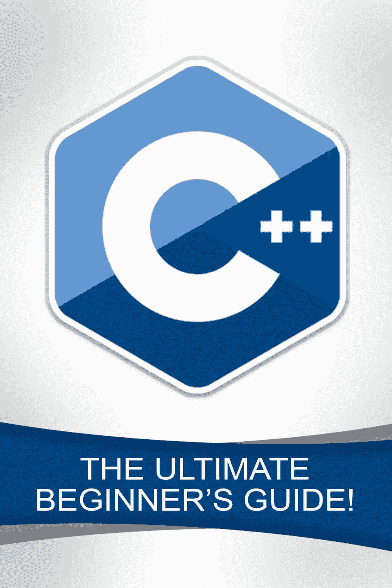

## 绪言

我想感谢并祝贺你买了我的书……

“C++：终极入门指南！”

这本书是为想要学习 C++ 编程语言基础的人士编写的。如果你正在寻找一本能够教你关于 C++ 所需一切知识的综合书籍，这可能正是你寻找的内容。

通过阅读这本书，你将学习 C++ 的基础知识。你将发现专家 C++ 程序员所使用的思想、概念、技术和方法。例如，本书将讨论变量、字符串、函数和数据结构。这意味着在阅读这些材料后，你将能够使用 C++ 语言编写程序。

再次感谢购买本书，希望你读得愉快！

## 第一章：C++ 编程语言 – 概述

C++ 是一种编译型、自由格式的、大小敏感的、多用途的静态类型编程语言。它支持泛型、过程和面向对象的编程。

计算机程序员将 C++ 视为一种中间级语言，因为它既具有低级特性又具有高级特性。

丹麦计算机科学家比雅恩·斯特斯特鲁普（Bjarne Stroustrup）于 1979 年创建了 C++。由于他将这种编程语言作为“C”（另一种计算机语言）的改进版本，因此他称其为“带有类的 C”。然而，在 1983 年，名称更改为 C++。

**重要提示：** 如果在编译期间进行类型检查，则该语言被认为是“静态类型”。

### C++ - 一种面向对象的编程语言

C++ 兼容面向对象编程。它还支持面向对象软件开发的四大基础：

- 继承
- 封装
- 多态
- 数据隐藏

### C++ 的三个主要部分

C++ 编程语言由三个大部分组成：

1. 核心语言 – 这部分是 C++ 程序的基础。它包含了字面量、变量、运算符等。
2. 标准库 – 这部分提供了广泛的函数，你可以使用它们来操作核心语言。
3. 标准模板库（也称为 STL）– 它提供了许多可以配合 C++ 使用的方法和技术。

### 学习这种编程语言

在学习 C++ 时，你应该专注于与编写代码相关的思想和概念。

毕竟，你试图学习一种编程语言是因为你想成为一名优秀的程序员。你希望在维护旧程序和创建新程序方面是高效的。

这种编程语言与广泛的编程技术兼容。你可以将其作为 C、Smalltalk、Fortran 等使用。无论你偏好哪种编程风格，你一定能实现创建优秀程序并保持运行效率的目标。

### 使用这种编程语言

世界各地许多人都在使用 C++。这意味着它是可靠且有效的。事实上，C++ 是编程行业领先的语言之一。

通常情况下，程序员在编写设备驱动程序和需要直接控制硬件的程序时使用 C++。研究人员和编程教师使用 C++ 来完成任务：这种语言强大且易用。即使是新手也能快速掌握这种语言的基础。

根据计算机专家的说法，如果你的计算机运行在 Windows 或 macOS，你已经在使用 C++ 了。因为这些操作系统是用 C++ 编写的。

## 第二章：C++ 环境

在阅读本书时，不需要建立自己的 C++ 环境。这是因为有很多工具可以用来编写和编译 C++。这些工具易于使用并且提供即时反馈。这意味着你可以迅速发现程序中的错误。最流行的在线工具之一是`www.compileonline.com`。在阅读本书时，你可以使用喜欢的浏览器访问该网站。

为了帮助你开始，这里有一个你可以配合`www.compileonline.com`使用的基础代码：

```

```

你应该能立即看到结果。

### 本地 C++ 环境

如果你仍然想为本地建立 C++ 环境，你的计算机必须具备以下程序：

1. 文本编辑器 – 你将使用文本编辑器编写 C++ 程序。以下是 C++ 程序员常用的文本编辑器：`vi`、`vim`、`Brief`、`EMACS` 和 Windows 记事本。

文本编辑器的名称和版本可能会根据你的操作系统而变化。例如，记事本是 Windows 计算机的默认文本编辑器。然而，`vi` 或 `vim` 适用于 UNIX、Linux 和 Windows。

你使用编辑器产生源文件。在 C++ 语言中，这些文件以以下后缀命名：`.c`、`.cp` 或 `.cpp`。

**重要提示：** 在本地使用 C++ 之前，确保你的计算机上有文本编辑器。没有这种计算机程序，你将无法编写任何 C++ 代码。

2. C++ 编译器 – 它是 C++ 编程语言的实际编译器。你将使用该软件将源代码编译为可执行程序。

通常情况下，编译器对你用于源代码的文件扩展名并不敏感。然而，如果你没有指定扩展名，C++ 编译器将分配`.cpp`（这是该语言的默认扩展名）。

如今，最流行的编译器是 GNU C/C++ 编译器。

### 如何安装 GNU C/C++ 编译器

*   对于 UNIX/Linux 计算机 – 首先，检查你的机器上是否安装了`GCC`（GNU 编译器集）。你可以访问计算机的命令行并输入此命令来检查：

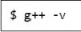

如果你的电脑安装了`GCC`，屏幕会显示此类信息：

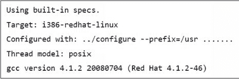

如果你的电脑没有安装`GCC`，你需要访问[`gcc.gnu.org/install`](http://gcc.gnu.org/install)下载并安装它。提供的网页包含了详细的说明，因此你不会遇到任何困难。

*   对于 Macintosh 计算机 – 获取`GCC`最快最简单的方法是从 Apple 网站下载 Xcode 编程环境。只需按照那里提供的详细说明操作即可。链接：[`developer.apple.com/technologies/tools`](http://developer.apple.com/technologies/tools)。

*   对于 Windows 计算机 – 你需要下载并安装名为`MinGW`的程序。为此，访问[www.mingw.org](http://www.mingw.org)并进入网站的下载页。获取最新版本的`MinGW`是最好的。

在获取`MinGW`的同时，你应该安装这些重要程序：`gcc-core`、`binutils`、`gcc-g++`和`MinGW runtime`。根据你的情况和喜好，下载其他辅助程序。

你应该将`MinGW`的 `bin` 子目录添加到`PATH`环境变量。这样做，你只需输入基本名称即可激活该子目录中的工具。

完成安装过程后，你的电脑将允许你通过命令行运行`ar`、`gcc`、`g++`、`dlltool`和`ranlib`等 GNU 工具。

## 第三章 C++ 编程语言基础语法

对于计算机专家来说，C++ 程序是通过调用方法相互作用的对象的集合。现在，让我们讨论一下这种语言的基本元素：

*   **对象 (Object)** – 对象具有不同的行为和状态。
*   **类 (Class)** – 被定义为一个蓝图/模板，用于定义对象的状态/行为。
*   **方法 (Method)** – 基本上，这是对象的行为。类可以包含各种方法。方法是语言中控制数据、编写逻辑和执行操作的部分。
*   **瞬时变量 (Instant Variable)** – 每个对象都有一组独特的瞬时变量。赋予瞬时变量的值创建了该对象相关的状态。

### C++ 中的程序结构

这是一个打印“Hello World”的简单 C++ 代码。

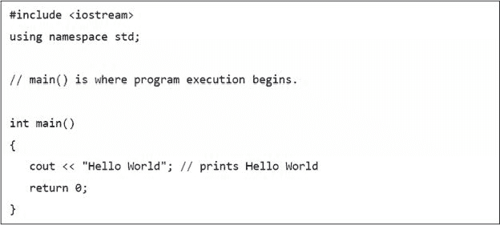

让我们分析这段代码的不同部分：

*   C++ 涉及不同的头文件，这些头文件包含了程序所需的有用或必要数据。在上面的代码中，需要`<iostream>`头文件。

*   `using namespace std;` - 这一行要求 C++ 编译器利用名为`std`的命名空间。

*   第三行（即 `// main () is… begins.`）是该编程语言的注释部分。C++ 注释以两个斜杠（即`//`）开头。

*   `int main()` 作为主函数，程序执行从这里开始。

*   第五行告诉屏幕显示“This is my first C++ program.”

*   最后一行（即`return 0;`）结束了`main()`函数并要求在调用过程中返回“0”。

### 编译和执行 C++ 程序

在本书的这一部分，你将学习如何编译和执行 C++ 程序。以下是你需要采取的步骤：

1. 打开你喜欢的文本编辑器并编写代码。此时，你可以输入上面的“Hello World”代码。
2. 将代码保存为兼容 C++ 的源文件。对于这次练习，使用文件名：`helloworld.cpp`。
3. 打开命令行提示符并检查存储源文件的位置。
4. 输入`g++ helloworld.cpp`并按回车键 – 此操作将编译代码。如果你的代码没有错误，命令行提示符将创建一个`a.out`文件。
5. 然后，输入`a.out`运行程序。
6. 你的电脑将打开新窗口并显示以下消息：

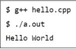

**注意：** 你必须确保`g++`在正确的路径中。同时，确保它在你保存源文件的位置运行。

### C++ 语言中的块和分号

在 C++ 语言中，你应该使用分号来结束语句。因此，你 C++ 代码中的每个语句都应该以该字符结尾。分号表示编程实体的结束。

例如，这里有四条不同的 C++ 语句：

*   `a + b;`
*   `add(a, b);`
*   `b = a+1;`
*   `a = b;`

另一方面，块（Blocks）是受花括号括起来的一组逻辑相关的语句。

块（Blocks）是受花括号括起来的一组逻辑相关的语句。

块（Blocks）是受花括号括起来的一组逻辑逻辑逻辑。

结尾的示例：

```cpp
{
    add(a)
}
```

### 标识符 (Identifiers)

标识符以字母或下划线开头。C++ 是区分大小写的。这意味着`SCIENCE`、`science`是不同的。

在语言中，标识符用于标识类、函数、变量。此外，使用使用符号符号（（符号））标识。。。显示显示了了有效的标识符：

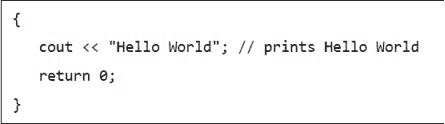

### 关键字 (Keywords)

与其他编程语言类似，C++ 有一组“保留”关键字（即不能用于命名变量、常量的单词）。下表显示了 C++ 的关键字：

| `new` | `asm` | `try` | `for` |
| `if` | `int` | `do` | `this` |
| `else` | `enum` | `auto` | `true` |
| `bool` | `case` | `char` | `goto` |
| `void` | `long` | `throw` | `break` |
| `false` | `catch` | `union` | `class` |
| `short` | `const` | `using` | `while` |
| `private` | `explicit` | `protected` | `export` |
| `typedef` | `public` | `register` | `extern` |
| `typeid` | `typename` | `reinterpret_cast` | `return` |
| `unsigned` | `friend` | `signed` | `const_cast` |
| `virtual` | `volatile` | `namespace` | `delete` |
| `default` | `inline` | `sizeof` | `static` |
| `struct` | `static_cast` | `wchar_t` | `switch` |
| `double` | `mutable` | | `dynamic_cast` |
| `template` | | | |

**注意：** 某些 C++ 编译器不兼容三连序列。此外，由于这些序列本质上很复杂，建议初学者避开它们。

### 三连序列 (Trigraphs)

在语言中，某些字符具有另一种表示方式，称为三连序列。三连序列是三个字符的序列，每个序列代表一个字符。此外，每个三连序列都以`??`开头。

以下是该语言中最流行的三连序列：

| 三连序列 | 替换 |
| :--- | :--- |
| `??-` | `~` |
| `??<` | `{` |
| `??>` | `}` |
| `??!` | `\|` |
| `??(` | `[` |
| `??)` | `]` |
| `??=` | `#` |
| `??’` | `^` |
| `??/` | `\` |

### 空格 (Whitespace)

C++ 编译器忽略包含空白的行。这些行被称为空行。

空白符（Whitespace）是该语言中用于描述制表符、空格、注释和换行符的词。基本上，空白符允许你将语句拆分为更小的部分。此外，它们帮助编译器识别代码元素的开始和结束（例如`int`）。请分析以下示例：

```cpp
int age;
```

上述语句在`age`和`int`之间需要一个空白字符。如果语句在编写时没有空白字符（即`intage;`），C++ 编译器将无法正常工作。

```cpp
tree = leaves + wood;
```

对于第二个示例，你不需要在`tree`和`=`之间，或在`=`和`leaves`之间放置空白字符。你可以添加空白字符来提高 C++ 代码的可读性。然而，这些字符不会影响最终生成的程序。

### C++ 语言中的注释

程序注释是你可以添加到代码中的解释性语句。注释可以帮助人们理解阅读你的源代码。总的来说，编程语言支持注释以提高所生成的计算机程序的可用性。

该语言允许你在代码中放置单行和多行注释。C++ 编译器会忽略放置在代码注释区域的字符。

你应该使用`/*`开始注释，并使用`*/`结束注释。例如：

```cpp
/* 这是一个非常棒的注释 */
```

你也可以使用`//`来开始注释。这里有一个示例：

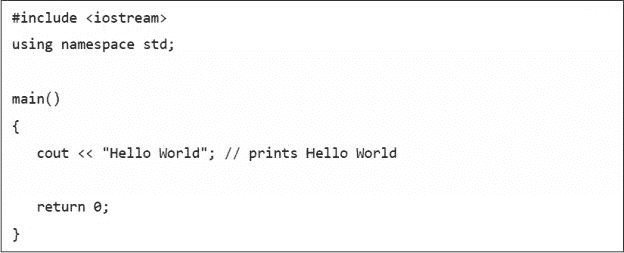

C++ 编译器将忽略“// prints Hello World”部分。完成后的程序一旦执行，将会为你输出 Hello World。

## 第 4 章：C++ 中不同的数据类型和变量类型

### 数据类型

与其他编程语言一样，C++ 支持不同类型的数据。这意味着在涉及存储信息时，你有广泛的选择。C++ 还允许你使用各种变量，变量是设计用于保留数值的内存位置。因此，“创建一个变量”等同于“预留一些内存空间”。

在编写 C++ 程序时，你需要存储不同类型的数据（即：整数、布尔值、字符、浮点数、宽字符、双精度浮点数等）。根据变量的数据类型，计算机的操作系统（即操作系统）会分配内存并决定在该内存中可以存储什么类型的数据。

### 原生类型（内置）

这种编程语言提供了一系列用户定义和内置的数据类型。以下是 C++ 中数据类型的主要分类：

| 数据类型 | 关键字 |
| :--- | :--- |
| 整数 | `int` |
| 无值 | `void` |
| 字符 | `char` |
| 布尔值 | `bool` |
| 宽字符 | `wchar_t` |
| 双精度浮点数 | `double` |
| 浮点数 | `float` |

你可以使用这些修饰符修改上述数据类型：

* `short`
* `long`
* `unsigned`
* `signed`

### typedef 声明

你可以使用`typedef`为现有的数据类型分配一个新名称。以下是你在进行`typedef`声明时应该使用的语法：

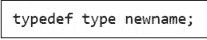

例如，以下语句告知 C++ 编译器`head`是字符的另一种备用术语：

```cpp
typedef char head;
```

一旦你执行了该语句，下面的声明将是 100% 有效的并产生一个名为`letters`的字符变量：

```cpp
head letters;
```

### 枚举类型

枚举类型声明了一个备用类型名和标识符数组。你可以使用这些标识符作为你正在处理的数据类型的值。所有枚举员都是常量，其数据类型为给定的枚举。

要生成一个枚举，你应该使用`enum`（一个 C++ 关键字）。以下是你应该使用的语法：

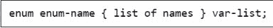

在此语法中，“enum-name”代表枚举的类型名。你应该使用逗号来分隔括号内的名称。

例如，给下面的代码创建了一个名为`sizes`的枚举，给它赋予了三个不同的尺寸，以及一个变量（即`c`）来确定类型的大小。最后，将“large”赋值给变量`c`。

```cpp
enum sizes { small, medium, large } c;
c = large;
```

默认情况下，第一个名称的值等于 0，第二个名称的值等于 1，第三个名称的值等于 2，以此此类推。然而，你可以添加一个初始化器来为所选的名称分配特定的值。

例如，在下面给出的枚举中，`medium`将获得值 100。

```cpp
enum sizes { small, medium=100, large };
```

一个名称的值比前一个大 1。因此，在最新的示例中，`large`的值等于 101。

### 变量类型

变量提供了可以由你的程序修改和控制的存储。每个变量都属于特定的类型，该类型规定了：

* 内存空间的布局和大小
* 你可以在内存空间中存储的值
* 你可以应用的操作

在命名变量时可以使用下划线、数字和字母。但是，你不能使用数字作为变量名的第一个字符。例如，`variable1`是有效的，但`1variable`则无效。此外，这种编程语言对大小写敏感。这意味着`VARIABLE`、`Variable`和`variable`被视为三个不同的实体。

| 变量类型 | 说明 |
| :--- | :--- |
| `int` | 整数大小。 |
| `bool` | 可以存储真或假。 |
| `void` | 表示无。 |
| `char` | 整数类型（通常为一个字节）。 |
| `float` | 单精度浮点。 |
| `wchar_t` | 表示宽字符。 |
| `double` | 变量类型。 |


此外，这种编程语言允许你使用某些工具定义其他类型（例如类、数组等）。本书的后续部分将介绍如何描述、声明和利用这些类型。

## 如何在 C++ 中定义变量

通过定义变量，你是在告知 C++ 编译器你想要使用的位置和存储空间。你的变量定义指定了数据类型并持有属于该类型的变量列表。以下是你应该使用的语法：

```cpp
type variable_list;
```

当你有多个可用文件并且在其中一个文件中指定变量时，你会发现变量声明非常有用。在语句中声明变量时，你应该使用另一个 C++ 关键字 `extern`。该语言允许你在程序中多次声明同一个变量。但是，你只能在函数、文件或代码块中定义它一次。

## Rvalues 和左值 Lvalues

C++ 语言支持两种类型的表达式：

* `rvalue` – 该术语指的是存储在内存某处的值。`Rvalues` 是不能包含赋值给它们的值的表达式。这意味着你可以将 `rvalue` 放在 C++ 语句的右侧，但永远不能放在左侧。
* `lvalue` – 它们是指向特定内存位置的表达式。你可以将 `lvalues` 放在 C++ 语句的任意一侧。

所有变量都被归类为 `lvalues`。这意味着它们可以出现在语句的右侧和左侧。另一方面，数字字面量被视为 `rvalues`。这意味着它们不能写在 C++ 语句的左侧。

## 第 5 章：变量的作用域

基本上，“作用域”一词指的是 C++ 程序的一部分。这里有三个你可以声明变量的地方：

* 你的程序函数外部。这些变量被称为全局变量，因为它们可以在程序的任何部分被访问。
* 块或函数内部。以这种方式声明的变量被称为局部变量。
* 函数参数定义内部。这些参数被称为形式参数。

在书的这一部分中，你将学习全局变量和局部变量。形式参数将在后面的章节中讨论。

### 全局变量

这些变量在函数外部声明。通常，全局变量被放置在 C++ 程序的顶部。属于这种类型的变量可以永久存储它们的值。

你可以使用任何函数访问全局变量；因此，你可以在程序的任何部分利用全局变量。

### 局部变量

这些变量在块或函数内部声明。由于这些变量被放在特定的函数或代码块中，你只能将它们用于相同函数或块中的语句。你不能将局部变量用于外部语句（即存储在函数或代码块之外的语句）。

### 如何初始化全局和局部变量

一旦定义了局部变量，系统就不会初始化它们。这意味着你必须手动初始化它们。另一方面，系统会自动初始化全局变量。以下是一些有效的数据类型及其对应的初始化器：

| 数据类型 | 初始化器 |
| :--- | :--- |
| `char` | `'\0'` |
| `int` | `o` |
| `float` | `0` |
| `pointer` | `NULL` |
| `double` | `0` |

**重要注意：** 在编写程序时，你应该妥善地初始化所有的变量。如果不这样做，你的程序可能会产生意外或不需要的结果。

## 第 6 章：字面量/常量

“常量”一词指的是固定值，它可以防止你的程序进行未来的更改。这种值也被称为字面量。

**重要注意：** C++ 程序将字面量视为普通变量。唯一的区别是程序无法以任何方式修改这些字面量。

字面量可以属于任何基本数据类型。专家级程序员将这些值分为五大类。这些是：

### 布尔值

C++ 编程语言有两个布尔常量，它们被认为是关键字：

* `false` – 代表虚的值。
* `true` – 代表真的值。

**重要注意：** `true` 不等于 `1` 且 `false` 不等于 `0`。

### 字符

你应当使用单引号将字符常量括起来。以 `L`（大写）开头的常量属于“宽字符”类别，必须存储在 `wchar_t` 变量中。另一方面，如果你的常量不是大写 `L` 开头，它被视为窄字符并可以放在简单的 `char` 变量中。

字符常量可以用普通字符（例如 `'y'`）、通用字符（例如 `'u01C0'`）或转义序列（例如 `'\n'`）的形式存在。

在 C++ 编程语言中，某些字符如果通过斜斜引入将获得特殊功能。这些字符被称为序列代码。查看以下示例：

| 转义序列 | 含义 |
| :--- | :--- |
| `\'` | 单引号 |
| `\?` | 问号 |
| `\"` | 双引号 |
| `\\` | 反斜杠 |
| `\b` | 退格 |
| `\f` | 换页 |
| `\a` | 铃声或警报 |
| `\n` | 换行 |
| `\000` | 具有 1–3 位的八进制数 |
| `\v` | 垂直制表符 |
| `\r` | 回车 |
| `\xhh` | 十进制数 |
| `\t` | 水平制表符 |

### 字符串

你必须使用双引号将字符串常量括起来。字符串包含与字符常量类似的字符：转义序列、通用字符和普通字符。

字符串常量允许将长行分成更短行。如果你使用此功能，应该在较短行之间添加空格以将它们分开。

### 浮点数

浮点常量有四个部分：(1) 指数，(2) 小数，(3) 整数，(4) 小数。你可以以指数或小数形式表示这些常量。

在小数形式编写浮点字面量时，包含指数、小数点或两者。另一方面，在指数形式编写时，你应该包含小数、整数或两者。使用 `E` 或 `e` 引入。

### 整数

整数常量可以是八进制、进制或十六进制字面量。你应该使用前缀来指定这些常数的基数（即值）。以下是整数及其对应的前缀：

* 十进制整数 – 无
* 八进制整数 – `o`
* 十六进制整数 – `X`

C++ 语言允许为你的整数字面量添加 `L/l` 或 `U` 作为后缀。这些后缀大小写不敏感。此外，你可以以任何顺序放置它们。下面的列表显示了一些整数：

* `0FL` 有效
* `16` 有效
* `15U` 有效
* `09` 无效 – `9` 不是八进制数
* `065` 有效

## 如何定义常量

在该语言中，你可以通过两种不同的方式定义字面量：

* 使用 `const`（C++ 关键字）
* 使用 `#define`（C++ 预处理器）

### 什么是 #define?

该预处理器在定义字面量时使用以下语法：

```
define CONSTANT value
```

下面的示例将帮助你理解这个预处理器：

```cpp
define PI 50
```

如果你编译并执行上述代码，你将得到结果：`50`。

### 什么是 const?

基本上，`const` 是一个 C++ 关键字，你可以用它声明具有特定类型的字面量。这是该关键字的语法：

```cpp
const type variable_name = value;
```

**重要注意：** 根据专家级程序员的建议，定义字面量时应使用大写字母。

## 第 7 章：修饰符与存储类型

## C++ 语言中不同的修饰符

在 C++ 语言中，你可以使用修饰符引入 `double`、`int` 和 `char` 数据类型。修饰符允许你更改数据类型的含义以满足你的需求。

本节将讨论以下修饰符：

* `short`
* `long`
* `unsigned`
* `signed`

处理整数常量时，你可以应用所有的修饰符。此外，你可以在 `char` 常量上应用 `unsigned` 和 `signed`。最后，你可以在双精度浮点字面量上应用 `long`。

**注意：** 该编程语言允许你组合修饰符。你可以使用 `signed` 和 `unsigned` 来引入 `short` 或 `long` 修饰符。例如：`signed short int`。

C++ 为声明 `long`、`short` 或 `unsigned` 整数提供了快捷方式。你只需分别输入 `long`、`short` 或 `unsigned`。该编程语言会自动添加 `int`。例如，下面的两个语句都声明了短整型变量：

```cpp
short a;
short int z;
```

接下来的截图了一个简单程序的代码。该程序将帮助你理解 C++ 如何解释有符号和无符号修饰符。

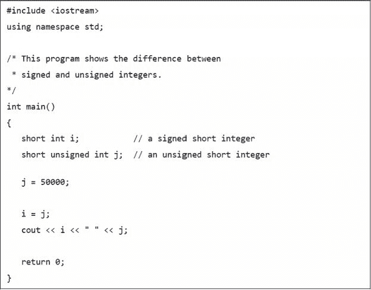

如果你正确输入并运行了程序，将得到以下结果：

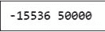

## 不同的限定符

类型限定符（Type qualifier）为其其前的变量提供有用数据。以下是你在使用 C++ 时会遇到的限定符：

| 限定符名称 | 含义 |
| :--- | :--- |
| `volatile` | 此修饰符告知 C++ 编译器，变量的值可以使用语句未指定的方法进行更改。 |
| `restrict` | 此修饰符为你提供了对对象的不同访问方法。 |
| `const` | 你可以使用此修饰符防止程序在执行阶段更改对象。 |

## C++ 中的存储类型

存储类型定义了程序内部函数和/或变量的可见性（也称为作用域）和生命周期。存储类型是位于其修饰的对象类型之前的修饰符。C++ 语言支持五种存储类型，即：

* `static`
* `auto`
* `extern`
* `mutable`
* `register`

让我们详细讨论每种存储类型：

### Static

此存储类型告诉 C++ 编译器只要程序处于活动状态，就保留局部变量。这是因为 C++ 程序有时会在持续循环中创建和销毁变量。因此，将局部变量标记为 `static` 可以这些这些即使进入/离开作用域也能保留其值。

你也可以将此修饰符应用于全局变量。一旦你应用了此修饰符，变量的作用域将限制在声明它的文件中。

### Auto

它是定义局部变量的默认类。这里有一个基本示例：

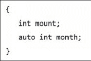

此示例代码定义了两个属于同一类的不同变量。你只能在函数内部使用 `auto`。这意味着你只能在局部变量上应用这种存储类型。

### Extern

通过这种存储类型，你可以引用全局变量，这些变量对你的程序所有文件都可见。使用 `extern` 时，不能初始化变量，因为它仅仅是将变量名指向你之前定义的内存位置。

如果你有多个文件并且定义了一个全局函数或变量（该变量可以在不同的文件中使用），你可以在另一个文件中使用 `extern` 来引用你预定义的函数或变量。

当程序员有多个共享相似全局函数或变量的文件时，通常使用此修饰符。

### Mutable

你只能将此修饰符应用于对象。`mutable` 存储类型允许对象的成员覆盖 `const` 函数。

### Register

当你定义必须保存在寄存器中（即不在机器的 RAM 中）的局部变量时，应该使用这种存储类型。因此，变量的最大大小等于寄存器的大小（通常为单个字长）。此外，这些变量不能拥有 `&` 运算符，因为它们在计算机内存中没有特定的位置。

通常，你应该使用此 `register` 来存储需要快速访问的变量（例如计数器）。需要注意的是，定义 `register` 与将变量存储在寄存器中是不同的。这意味着根据实现和硬件限制，你可以将快速访问的变量存储在寄存器中。

## 第 8 章：C++ 语言中的运算符

在这个编程语言中，运算符是需要编译器执行逻辑或数学操作的符号。C++ 语言提供了广泛的预装运算符。这些是：

## 逻辑运算符

下面的列表将向你展示 C++ 编程语言中可逻辑运算符。假设 `x = 2` 且 `y = 0`。

* `||` – 此运算符被称为“逻辑或”。如果其中一个操作数不等于零，则条件为真。例如：`(x || y)` 为真。
* `&&` – 这被称为“逻辑与”。如果两个操作数都不等于零，则条件为真。这是一个示例：`(x && y)` 为假。
* `!` – 程序员将此运算符称为“逻辑非”。你可以使用它来反转操作数的状态。如果条件为假，`!` 将给你真。例如：`!(x && y)` 为真。

## 算术运算符

在这一部分，你将学习 C++ 中提供的算术运算符。为了帮助你理解每个运算符如何工作，让我们使用两个变量：`x = 1; y = 3;`。

* `+` – 此运算符相加。`x + y = 4`。
* `-` – 你可以使用此运算符执行减法。`y - x = 2`。
* `*` – 此运算符允许执行乘法。`x * y = 3`。
* `/` – 通过此运算符，你可以执行除法。`y / x = 3`。
* `++` – 这被称为自增运算符。它增加一个值。`y++ = 4`。
* `--` – 这被称为递减运算符。通过它你可以减少操作数的值。`x-- = 0`。

## 赋值运算符

在这里，你将学习 C++ 提供的赋值运算符：

* `=` – 此运算符被称为“简单赋值”。它将右操作数的值赋值给左侧。例如：`z = x + y`。
* `+=` – 这被称为“相加”。它将两个操作数相加并将和赋给左。例如：`z += x` 等于 `z = z + x`。
* `*=` – 程序员称之为“相乘”。它将左操作数的值与右操作数的值相乘并将结果赋给左。例如：`z *= x` 等于 `z = z * x`。
* `-=` – 此运算符被称为“相减”。它从左操作数减去右操作数的值并将差赋给左。例如：`z -= x` 等于 `z = z – x`。
* `/=` – 此运算符被称为“相除”。它将左操作数的值除以右操作数的值并将商赋给左。例如：`z /= x` 等于 `z = z / x`。
* `&=` – 此运算符被称为“按位与”。接下来的示例将向你展示它是如何工作的：`z &= x` 等同于 `z = z & x`。
* `|=` – 程序员引用此运算符为“按位或”。它的工作原理如下：`z |= x` 等同于 `z = z | x`。
* `^=` – 这被称为“按位异或”。它的工作方式如下：`z ^= x` 等同于 `z = z ^ x`。
* `>>=` – 这被称为“右移并与”。它的工作原理如下：`(z >>= x)` 等同于 `(z = z >> x)`。
* `<<=` – 程序员将此称为“左移并与”。它的工作方式如下：`(z <<= x)` 等同于 `(z = z << x)`。

## 位运算符

你可以在比特位上应用位运算符。通常情况下，你必须使用它们来执行逐位操作。下方的截图显示了 `&`、`|` 和 `^` 的真值表。

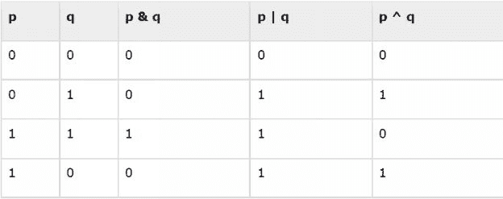

假设 `x = 60;` 且 `y = 13`。我们将这些值转换为二进制形式，将得到以下数据：

```
x = 0011 1100
y = 0000 1101
x|y = 0011 1101
~x = 1100 0011
x&y = 0000 1100
x^y = 0011 0001
```

下表将显示 C++ 中可用的位运算符。假设 `x = 60` 且 `y = 13`。

* `&` – 此运算符被称为“按位与”。如果两个操作数中都存在某个比特，按位与将将其复制到结果中。例如：`(x & y)` 产生 `12`（即 `0000 1100`）。
* `^` – 这被称为“按位异或”。如果一个比特存在于一个操作数中但不同于另一个，它将复制该比特。`(x ^ y)` 得到 `49`，或 `0011 0001`。
* `|` – 程序员将此称为“按位或”运算符。它将复制存在于操作数之一的比特。例如：`(x | y)` 将给你 `61`，即 `0011 1101`。
* `>>` – 此运算符被称为“按位右移”。它根据右侧操作数提供的比特移动左侧操作数的值。例如：`x >> 2` 得到 `15`，即 `0000 1111`。
* `<<` – 这被称为“按位左移”。它根据右侧操作数提供的比特数移动左侧操作数的值。例如：`x << 2` 得到 `240`，即 `1111 0000`。
* `~` – 程序员将此称为“按位取反”。这是一个一元运算符。此外，它会“翻转”所作用的比特。例如：由于是符号数，如果以补码格式书写，`(~x)` 得到 - 61，即 `1100 0011`。

## 关系运算符

本书的这一部分节将侧重于 C++ 编程语言中可用的关系运算符。假设 `x = 2` 且 `y = 4`。

* `==` – 此运算符检查两个操作数的相等性。如果操作数相等，则条件为真。例如：`(x == y)` 不为真。
* `>` – 此运算符检查两个操作数的值。如果左侧操作数的值大于右侧操作数的值，则条件为真。例如：`(y > x)` 为真。
* `<` – 此运算符是 `<` 的相反运算符。如果左侧操作数的值小于右侧操作数的值，则条件为真。例如：`(y < x)` 不为真。
* `!=` – 此运算符检查两个操作数之间的相等性。如果值不相等，则条件为真。例如：`(x != y)` 为真。
* `<=` – 通过此运算符，你可以检查左侧操作数的值是否小于等于右侧操作数的值。如果是，则条件为真。例如：`(x <= y)` 为真。
* `>=` – 在这里，你检查左侧操作数的值是否大于等于右侧操作数的值。如果是，则条件为真。例如：`(y >= x)` 为真。

## 杂项运算符

在本节中，你将学习 C++ 提供的其他运算符：

* `sizeof` - 你应该使用此运算符来确定变量的大小。例如，`sizeof(x)`（其中 `x` 是整数）将给你 `4`。
* `Cast` – 此运算符允许你转换数据类型。
* `,` – 程序员将此称为“逗号运算符”。它在你的语句中激活一组操作。逗号表达式的值等于逗号分隔集合中的最后一项。
* `.` 和 `->` – 这些运算符分别被称为“点”和“箭头”。你可以使用这些运算符引用联合体、类和结构的成员。
* `*` – 这被称为“指针”变量。例如：`*new;` 将生成一个指向名为 `new` 变量的指针。
* `&` – 此运算符可以给出地址。
* `? :` – 运算符优先级

运算符优先级决定了运算符执行的顺序。通常情况下，你必须使用它们来执行逐位操作。下方的截图显示了 `&`、`|` 和 `^` 的真值表。


假设 `x = 60;` 且 `y = 13`。我们将这些值转换为二进制形式，将得到以下数据：

```
x = 0011 1100
y = 0000 1101
x|y = 0011 1101
~x = 1100 0011
x&y = 0000 1100
x^y = 0011 0001
```


下表将显示 C++ 中可用的位运算符。假设 `x = 60` 且 `y = 13`。

- `&` – 此运算符被称为“按位与”。如果两个操作数中都存在某个比特，按位与将将其复制到结果中。例如：`(x & y)` 产生 `12`（即 `0000 1100`）。
- `^` – 这被称为“按位异或”。如果一个比特存在于一个操作数中但不同于另一个，它将复制该比特。`(x ^ y)` 得到 `49`，或 `0011 0001`。
- `|` – 程序员将此称为“按位或”运算符。它将复制存在于操作数之一的比特。例如：`(x | y)` 将给你 `61`，即 `0011 1101`。
- `>>` – 此运算符被称为“按位右移”。它根据右侧操作数提供的比特移动左侧操作数的值。例如：`x >> 2` 得到 `15`，即 `0000 1111`。
- `<<` – 这被称为“按位左移”。它根据右侧操作数提供的比特数移动左侧操作数的值。例如：`x << 2` 得到 `240`，即 `1111 0000`。
- `~` – 程序员将此称为“按位取反”。这是一个一元运算符。此外，它会“翻转”所作用的比特。例如：由于是符号数，如果以补码格式书写，`(~x)` 得到 - 61，即 `1100 0011`。

## 关系运算符

本书的这一部分节将侧重于 C++ 编程语言中可用的关系运算符。假设 `x = 2` 且 `y = 4`。

- `==` – 此运算符检查两个操作数的相等性。如果操作数相等，则条件为真。例如：`(x == y)` 不为真。
- `>` – 此运算符检查两个操作数的值。如果左侧操作数的值大于右侧操作数的值，则条件为真。例如：`(y > x)` 为真。
- `<` – 此运算符是 `<` 的相反运算符。如果左侧操作数的值小于右侧操作数的值，则条件为真。例如：`(y < x)` 不为真。
- `!=` – 此运算符检查两个操作数之间的相等性。如果值不相等，则条件为真。例如：`(x != y)` 为真。
- `<=` – 通过此运算符，你可以检查左侧操作数的值是否小于等于右侧操作数的值。如果是，则条件为真。例如：`(x <= y)` 为真。
- `>=` – 在这里，你检查左侧操作数的值是否大于等于右侧操作数的值。如果是，则条件为真。例如：`(y >= x)` 为真。

## 杂项运算符

在本节中，你将学习 C++ 提供的其他运算符：

- `sizeof` - 你应该使用此运算符来确定变量的大小。例如，`sizeof(x)`（其中 `x` 是整数）将给你 `4`。
- `Cast` – 此运算符允许你转换数据类型。
- `,` – 程序员将此称为“逗号运算符”。它在你的语句中激活一组操作。逗号表达式的值等于逗号分隔集合中的最后一项。
- `.` 和 `->` – 这些运算符分别被称为“点”和“箭头”。你可以使用这些运算符引用联合体、类和结构的成员。
- `*` – 这被称为“指针”变量。例如：`*new;` 将生成一个指向名为 `new` 变量的指针。
- `&` – 此运算符可以给出地址。
- `? :` – 运算符优先级

运算符优先级决定了运算符执行的顺序。通常情况下，你必须使用它们来执行逐位操作。下方的截图显示了 `&`、`|` 和 `^` 的真值表。


假设 `x = 60;` 且 `y = 13`。我们将这些值转换为二进制形式，将得到以下数据：

```
x = 0011 1100
y = 0000 1101
x|y = 0011 1101
~x = 1100 0011
x&y = 0000 1100
x^y = 0011 0001
```

下表将显示 C++ 中可用的位运算符。假设 `x = 60` 且 `y = 13`。

- `&` – 此运算符被称为“按位与”。如果两个操作数中都存在某个比特，按位与将将其复制到结果中。例如：`(x & y)` 产生 `12`（即 `0000 1100`）。
- `^` – 这被称为“按位异或”。如果一个比特存在于一个操作数中但不同于另一个，它将复制该比特。`(x ^ y)` 得到 `49`，或 `0011 0001`。
- `|` – 程序员将此称为“按位或”运算符。它将复制存在于操作数之一的比特。例如：`(x | y)` 将给你 `61`，即 `0011 1101`。
- `>>` – 此运算符被称为“按位右移”。它根据右侧操作数提供的比特移动左侧操作数的值。例如：`x >> 2` 得到 `15`，即 `0000 1111`。
- `<<` – 这被称为“按位左移”。它根据右侧操作数提供的比特数移动左侧操作数的值。例如：`x << 2` 得到 `240`，即 `1111 0000`。
- `~` – 程序员将此称为“按位取反”。这是一个一元运算符。此外，它会“翻转”所作用的比特。例如：由于是符号数，如果以补码格式书写，`(~x)` 得到 - 61，即 `1100 0011`。

## 关系运算符

本书的这一部分节将侧重于 C++ 编程语言中可用的关系运算符。假设 `x = 2` 且 `y = 4`。

- `==` – 此运算符检查两个操作数的相等性。如果操作数相等，则条件为真。例如：`(x == y)` 不为真。
- `>` – 此运算符检查两个操作数的值。如果左侧操作数的值大于右侧操作数的值，则条件为真。例如：`(y > x)` 为真。
- `<` – 此运算符是 `<` 的相反运算符。如果左侧操作数的值小于右侧操作数的值，则条件为真。例如：`(y < x)` 不为真。
- `!=` – 此运算符检查两个操作数之间的相等性。如果值不相等，则条件为真。例如：`(x != y)` 为真。
- `<=` – 通过此运算符，你可以检查左侧操作数的值是否小于等于右侧操作数的值。如果是，则条件为真。例如：`(x <= y)` 为真。
- `>=` – 在这里，你检查左侧操作数的值是否大于等于右侧操作数的值。如果是，则条件为真。例如：`(y >= x)` 为真。

## 杂项运算符

在本节中，你将学习 C++ 提供的其他运算符：

- `sizeof` - 你应该使用此运算符来确定变量的大小。例如，`sizeof(x)`（其中 `x` 是整数）将给你 `4`。
- `Cast` – 此运算符允许你转换数据类型。
- `,` – 程序员将此称为“逗号运算符”。它在你的语句中激活一组操作。逗号表达式的值等于逗号分隔集合中的最后一项。
- `.` 和 `->` – 这些运算符分别被称为“点”和“箭头”。你可以使用这些运算符引用联合体、类和结构的成员。
- `*` – 这被称为“指针”变量。例如：`*new;` 将生成一个指向名为 `new` 变量的指针。
- `&` – 此运算符可以给出地址。
- `? :` – 运算符优先级

运算符优先级决定了运算符执行的顺序。通常情况下，你必须使用它们来执行逐位操作。下方的截图显示了 `&`、`|` 和 `^` 的真值表。


假设 `x = 60;` 且 `y = 13`。我们将这些值转换为二进制形式，将得到以下数据：

```
x = 0011 1100
y = 0000 1101
x|y = 0011 1101
~x = 1100 0011
x&y = 0000 1100
x^y = 0011 0001
```

下表将显示 C++ 中可用的位运算符。假设 `x = 60` 且 `y = 13`。

- `&` – 此运算符被称为“按位与”。如果两个操作数中都存在某个比特，按位与将将其复制到结果中。例如：`(x & y)` 产生 `12`（即 `0000 1100`）。
- `^` – 这被称为“按位异或”。如果一个比特存在于一个操作数中但不同于另一个，它将复制该比特。`(x ^ y)` 得到 `49`，或 `0011 0001`。
- `|` – 程序员将此称为“按位或”运算符。它将复制存在于操作数之一的比特。例如：`(x | y)` 将给你 `61`，即 `0011 1101`。
- `>>` – 此运算符被称为“按位右移”。它根据右侧操作数提供的比特移动左侧操作数的值。例如：`x >> 2` 得到 `15`，即 `0000 1111`。
- `<<` – 这被称为“按位左移”。它根据右侧操作数提供的比特数移动左侧操作数的值。例如：`x << 2` 得到 `240`，即 `1111 0000`。
- `~` – 程序员将此称为“按位取反”。这是一个一元运算符。此外，它会“翻转”所作用的比特。例如：由于是符号数，如果以补码格式书写，`(~x)` 得到 - 61，即 `1100 0011`。

## 关系运算符

本书的这一部分节将侧重于 C++ 编程语言中可用的关系运算符。假设 `x = 2` 且 `y = 4`。

- `==` – 此运算符检查两个操作数的相等性。如果操作数相等，则条件为真。例如：`(x == y)` 不为真。
- `>` – 此运算符检查两个操作数的值。如果左侧操作数的值大于右侧操作数的值，则条件为真。例如：`(y > x)` 为真。
- `<` – 此运算符是 `<` 的相反运算符。如果左侧操作数的值小于右侧操作数的值，则条件为真。例如：`(y < x)` 不为真。
- `!=` – 此运算符检查两个操作数之间的相等性。如果值不相等，则条件为真。例如：`(x != y)` 为真。
- `<=` – 通过此运算符，你可以检查左侧操作数的值是否小于等于右侧操作数的值。如果是，则条件为真。例如：`(x <= y)` 为真。
- `>=` – 在这里，你检查左侧操作数的值是否大于等于右侧操作数的值。如果是，则条件为真。例如：`(y >= x)` 为真。

## 杂项运算符

在本节中，你将学习 C++ 提供的其他运算符：

- `sizeof` - 你应该使用此运算符来确定变量的大小。例如，`sizeof(x)`（其中 `x` 是整数）将给你 `4`。
- `Cast` – 此运算符允许你转换数据类型。
- `,` – 程序员将此称为“逗号运算符”。它在你的语句中激活一组操作。逗号表达式的值等于逗号分隔集合中的最后一项。
- `.` 和 `->` – 这些运算符分别被称为“点”和“箭头”。你可以使用这些运算符引用联合体、类和结构的成员。
- `*` – 这被称为“指针”变量。例如：`*new;` 将生成一个指向名为 `new` 变量的指针。
- `&` – 此运算符可以给出地址。
- `? :` – 运算符优先级

运算符优先级决定了运算符执行的顺序。通常情况下，你必须使用它们来执行逐位操作。下方的截图显示了 `&`、`|` 和 `^` 的真值表。


假设 `x = 60;` 且 `y = 13`。我们将这些值转换为二进制形式，将得到以下数据：

```
x = 0011 1100
y = 0000 1101
x|y = 0011 1101
~x = 1100 0011
x&y = 0000 1100
x^y = 0011 0001
```

下表将显示 C++ 中可用的位运算符。假设 `x = 60` 且 `y = 13`。

- `&` – 此运算符被称为“按位与”。如果两个操作数中都存在某个比特，按位与将将其复制到结果中。例如：`(x & y)` 产生 `12`（即 `0000 1100`）。
- `^` – 这被称为“按位异或”。如果一个比特存在于一个操作数中但不同于另一个，它将复制该比特。`(x ^ y)` 得到 `49`，或 `0011 0001`。
- `|` – 程序员将此称为“按位或”运算符。它将复制存在于操作数之一的比特。例如：`(x | y)` 将给你 `61`，即 `0011 1101`。
- `>>` – 此运算符被称为“按位右移”。它根据右侧操作数提供的比特移动左侧操作数的值。例如：`x >> 2` 得到 `15`，即 `0000 1111`。
- `<<` – 这被称为“按位左移”。它根据右侧操作数提供的比特数移动左侧操作数的值。例如：`x << 2` 得到 `240`，即 `1111 0000`。
- `~` – 程序员将此称为“按位取反”。这是一个一元运算符。此外，它会“翻转”所作用的比特。例如：由于是符号数，如果以补码格式书写，`(~x)` 得到 - 61，即 `1100 0011`。

## 关系运算符

本书的这一部分节将侧重于 C++ 编程语言中可用的关系运算符。假设 `x = 2` 且 `y = 4`。

- `==` – 此运算符检查两个操作数的相等性。如果操作数相等，则条件为真。例如：`(x == y)` 不为真。
- `>` – 此运算符检查两个操作数的值。如果左侧操作数的值大于右侧操作数的值，则条件为真。例如：`(y > x)` 为真。
- `<` – 此运算符是 `<` 的相反运算符。如果左侧操作数的值小于右侧操作数的值，则条件为真。例如：`(y < x)` 不为真。
- `!=` – 此运算符检查两个操作数之间的相等性。如果值不相等，则条件为真。例如：`(x != y)` 为真。
- `<=` – 通过此运算符，你可以检查左侧操作数的值是否小于等于右侧操作数的值。如果是，则条件为真。例如：`(x <= y)` 为真。
- `>=` – 在这里，你检查左侧操作数的值是否大于等于右侧操作数的值。如果是，则条件为真。例如：`(y >= x)` 为真。

## 杂项运算符

在本节中，你将学习 C++ 提供的其他运算符：

- `sizeof` - 你应该使用此运算符来确定变量的大小。例如，`sizeof(x)`（其中 `x` 是整数）将给你 `4`。
- `Cast` – 此运算符允许你转换数据类型。
- `,` – 程序员将此称为“逗号运算符”。它在你的语句中激活一组操作。逗号表达式的值等于逗号分隔集合中的最后一项。
- `.` 和 `->` – 这些运算符分别被称为“点”和“箭头”。你可以使用这些运算符引用联合体、类和结构的成员。
- `*` – 这被称为“指针”变量。例如：`*new;` 将生成一个指向名为 `new` 变量的指针。
- `&` – 此运算符可以给出地址。
- `? :` – 运算符优先级

运算符优先级决定了运算符执行的顺序。通常情况下，你必须使用它们来执行逐位操作。下方的截图显示了 `&`、`|` 和 `^` 的真值表。


假设 `x = 60;` 且 `y = 13`。我们将这些值转换为二进制形式，将得到以下数据：

```
x = 0011 1100
y = 0000 1101
x|y = 0011 1101
~x = 1100 0011
x&y = 0000 1100
x^y = 0011 0001
```


下表将显示 C++ 中可用的位运算符。假设`x = 60`且`y = 13`。

* `&` – 此运算符被称为“按位与”。如果两个操作数中都存在某个比特，按位与将将其复制到结果中。例如：`(x & y)` 产生`12`（即`0000 1100`）。
* `^` – 这被称为“按位异或”。如果一个比特存在于一个操作数中但不同于另一个，它将复制该比特。`(x ^ y)` 得到`49`，或`0011 0001`。
* `|` – 程序员将此称为“按位或”运算符。它将复制存在于操作数之一的比特。例如：`(x | y)` 将给你`61`，即`0011 1101`。
* `>>` – 此运算符被称为“按位右移”。它根据右侧操作数提供的比特移动左侧操作数的值。例如：`x >> 2` 得到`15`，即`0000 1111`。
* `<<` – 这被称为“按位左移”。它根据右侧操作数提供的比特数移动左侧操作数的值。例如：`x << 2` 得到`240`，即`1111 0000`。
* `~` – 程序员将此称为“按位取反”。这是一个一元运算符。此外，它会“翻转”所作用的比特。例如：由于是符号数，如果以补码格式书写，`(~x)` 得到`-61`，即`1100 0011`。

## 关系运算符

本书的这一部分节将侧重于 C++ 编程语言中可用的关系运算符。假设`x = 2`且`y = 4`。

* `==` – 此运算符检查两个操作数的相等性。如果操作数相等，则条件为真。例如：`(x == y)` 不为真。
* `>` – 此运算符检查两个操作数的值。如果左侧操作数的值大于右侧操作数的值，则条件为真。例如：`(y > x)` 为真。
* `<` – 此运算符是`<`的相反运算符。如果左侧操作数的值小于右侧操作数的值，则条件为真。例如：`(y < x)` 不为真。
* `!=` – 此运算符检查两个操作数之间的相等性。如果值不相等，则条件为真。例如：`(x != y)` 为真。
* `<=` – 通过此运算符，你可以检查左侧操作数的值是否小于等于右侧操作数的值。如果是，则条件为真。例如：`(x <= y)` 为真。
* `>=` – 在这里，你检查左侧操作数的值是否大于等于右侧操作数的值。如果是，则条件为真。例如：`(y >= x)` 为真。

## 杂项运算符

在本节中，你将学习 C++ 提供的其他运算符：

* `sizeof` - 你应该使用此运算符来确定变量的大小。例如，`sizeof(x)`（其中`x`是整数）将给你`4`。
* `Cast` – 此运算符允许你转换数据类型。
* `,` – 程序员将此称为“逗号运算符”。它在你的语句中激活一组操作。逗号表达式的值等于逗号分隔集合中的最后一项。
* `.` 和 `->` – 这些运算符分别被称为“点”和“箭头”。你可以使用这些运算符引用联合体、类和结构的成员。
* `*` – 这被称为“指针”变量。例如：`*new;` 将生成一个指向名为`new`变量的指针。
* `&` – 此运算符可以给出地址。
* `? :` – 运算符优先级

运算符优先级决定了运算符执行的顺序。通常情况下，你必须使用它们来执行逐位操作。下方的截图显示了`&`、`|`和`^`的真值表。


假设`x = 60;`且`y = 13`。我们将这些值转换为二进制形式，将得到以下数据：

```
x = 0011 1100
y = 0000 1101
x|y = 0011 1101
~x = 1100 0011
x&y = 0000 1100
x^y = 0011 0001
```

下表将显示 C++ 中可用的位运算符。假设`x = 60`且`y = 13`。

* `&` – 此运算符被称为“按位与”。如果两个操作数中都存在某个比特，按位与将将其复制到结果中。例如：`(x & y)` 产生`12`（即`0000 1100`）。
* `^` – 这被称为“按位异或”。如果一个比特存在于一个操作数中但不同于另一个，它将复制该比特。`(x ^ y)` 得到`49`，或`0011 0001`。
* `|` – 程序员将此称为“按位或”运算符。它将复制存在于操作数之一的比特。例如：`(x | y)` 将给你`61`，即`0011 1101`。
* `>>` – 此运算符被称为“按位右移”。它根据右侧操作数提供的比特移动左侧操作数的值。例如：`x >> 2` 得到`15`，即`0000 1111`。
* `<<` – 这被称为“按位左移”。它根据右侧操作数提供的比特数移动左侧操作数的值。例如：`x << 2` 得到`240`，即`1111 0000`。
* `~` – 程序员将此称为“按位取反”。这是一个一元运算符。此外，它会“翻转”所作用的比特。例如：由于是符号数，如果以补码格式书写，`(~x)` 得到`-61`，即`1100 0011`。

## 关系运算符

本书的这一部分节将侧重于 C++ 编程语言中可用的关系运算符。假设`x = 2`且`y = 4`。

* `==` – 此运算符检查两个操作数的相等性。如果操作数相等，则条件为真。例如：`(x == y)` 不为真。
* `>` – 此运算符检查两个操作数的值。如果左侧操作数的值大于右侧操作数的值，则条件为真。例如：`(y > x)` 为真。
* `<` – 此运算符是`<`的相反运算符。如果左侧操作数的值小于右侧操作数的值，则条件为真。例如：`(y < x)` 不为真。
* `!=` – 此运算符检查两个操作数之间的相等性。如果值不相等，则条件为真。例如：`(x != y)` 为真。
* `<=` – 通过此运算符，你可以检查左侧操作数的值是否小于等于右侧操作数的值。如果是，则条件为真。例如：`(x <= y)` 为真。
* `>=` – 在这里，你检查左侧操作数的值是否大于等于右侧操作数的值。如果是，则条件为真。例如：`(y >= x)` 为真。

## 杂项运算符

在本节中，你将学习 C++ 提供的其他运算符：

* `sizeof` - 你应该使用此运算符来确定变量的大小。例如，`sizeof(x)`（其中`x`是整数）将给你`4`。
* `Cast` – 此运算符允许你转换数据类型。
* `,` – 程序员将此称为“逗号运算符”。它在你的语句中激活一组操作。逗号表达式的值等于逗号分隔集合中的最后一项。
* `.` 和 `->` – 这些运算符分别被称为“点”和“箭头”。你可以使用这些运算符引用联合体、类和结构的成员。
* `*` – 这被称为“指针”变量。例如：`*new;` 将生成一个指向名为`new`变量的指针。
* `&` – 此运算符可以给出地址。
* `? :` – 运算符优先级

运算符优先级决定了运算符执行的顺序。通常情况下，你必须使用它们来执行逐位操作。下方的截图显示了`&`、`|`和`^`的真值表。


假设`x = 60;`且`y = 13`。我们将这些值转换为二进制形式，将得到以下数据：

```
x = 0011 1100
y = 0000 1101
x|y = 0011 1101
~x = 1100 0011
x&y = 0000 1100
x^y = 0011 0001
```

下表将显示 C++ 中可用的位运算符。假设`x = 60`且`y = 13`。

* `&` – 此运算符被称为“按位与”。如果两个操作数中都存在某个比特，按位与将将其复制到结果中。例如：`(x & y)` 产生`12`（即`0000 1100`）。
* `^` – 这被称为“按位异或”。如果一个比特存在于一个操作数中但不同于另一个，它将复制该比特。`(x ^ y)` 得到`49`，或`0011 0001`。
* `|` – 程序员将此称为“按位或”运算符。它将复制存在于操作数之一的比特。例如：`(x | y)` 将给你`61`，即`0011 1101`。
* `>>` – 此运算符被称为“按位右移”。它根据右侧操作数提供的比特移动左侧操作数的值。例如：`x >> 2` 得到`15`，即`0000 1111`。
* `<<` – 这被称为“按位左移”。它根据右侧操作数提供的比特数移动左侧操作数的值。例如：`x << 2` 得到`240`，即`1111 0000`。
* `~` – 程序员将此称为“按位取反”。这是一个一元运算符。此外，它会“翻转”所作用的比特。例如：由于是符号数，如果以补码格式书写，`(~x)` 得到`-61`，即`1100 0011`。

## 关系运算符

本书的这一部分节将侧重于 C++ 编程语言中可用的关系运算符。假设`x = 2`且`y = 4`。

* `==` – 此运算符检查两个操作数的相等性。如果操作数相等，则条件为真。例如：`(x == y)` 不为真。
* `>` – 此运算符检查两个操作数的值。如果左侧操作数的值大于右侧操作数的值，则条件为真。例如：`(y > x)` 为真。
* `<` – 此运算符是`<`的相反运算符。如果左侧操作数的值小于右侧操作数的值，则条件为真。例如：`(y < x)` 不为真。
* `!=` – 此运算符检查两个操作数之间的相等性。如果值不相等，则条件为真。例如：`(x != y)` 为真。
* `<=` – 通过此运算符，你可以检查左侧操作数的值是否小于等于右侧操作数的值。如果是，则条件为真。例如：`(x <= y)` 为真。
* `>=` – 在这里，你检查左侧操作数的值是否大于等于右侧操作数的值。如果是，则条件为真。例如：`(y >= x)` 为真。

## 杂项运算符

在本节中，你将学习 C++ 提供的其他运算符：

* `sizeof` - 你应该使用此运算符来确定变量的大小。例如，`sizeof(x)`（其中`x`是整数）将给你`4`。
* `Cast` – 此运算符允许你转换数据类型。
* `,` – 程序员将此称为“逗号运算符”。它在你的语句中激活一组操作。逗号表达式的值等于逗号分隔集合中的最后一项。
* `.` 和 `->` – 这些运算符分别被称为“点”和“箭头”。你可以使用这些运算符引用联合体、类和结构的成员。
* `*` – 这被称为“指针”变量。例如：`*new;` 将生成一个指向名为`new`变量的指针。
* `&` – 此运算符可以给出地址。
* `? :` – 运算符优先级

运算符优先级决定了运算符执行的顺序。通常情况下，你必须使用它们来执行逐位操作。下方的截图显示了`&`、`|`和`^`的真值表。


假设`x = 60;`且`y = 13`。我们将这些值转换为二进制形式，将得到以下数据：

```
x = 0011 1100
y = 0000 1101
x|y = 0011 1101
~x = 1100 0011
x&y = 0000 1100
x^y = 0011 0001
```

下表将显示 C++ 中可用的位运算符。假设`x = 60`且`y = 13`。

* `&` – 此运算符被称为“按位与”。如果两个操作数中都存在某个比特，按位与将将其复制到结果中。例如：`(x & y)` 产生`12`（即`0000 1100`）。
* `^` – 这被称为“按位异或”。如果一个比特存在于一个操作数中但不同于另一个，它将复制该比特。`(x ^ y)` 得到`49`，或`0011 0001`。
* `|` – 程序员将此称为“按位或”运算符。它将复制存在于操作数之一的比特。例如：`(x | y)` 将给你`61`，即`0011 1101`。
* `>>` – 此运算符被称为“按位右移”。它根据右侧操作数提供的比特移动左侧操作数的值。例如：`x >> 2` 得到`15`，即`0000 1111`。
* `<<` – 这被称为“按位左移”。它根据右侧操作数提供的比特数移动左侧操作数的值。例如：`x << 2` 得到`240`，即`1111 0000`。
* `~` – 程序员将此称为“按位取反”。这是一个一元运算符。此外，它会“翻转”所作用的比特。例如：由于是符号数，如果以补码格式书写，`(~x)` 得到`-61`，即`1100 0011`。

## 关系运算符

本书的这一部分节将侧重于 C++ 编程语言中可用的关系运算符。假设`x = 2`且`y = 4`。

* `==` – 此运算符检查两个操作数的相等性。如果操作数相等，则条件为真。例如：`(x == y)` 不为真。
* `>` – 此运算符检查两个操作数的值。如果左侧操作数的值大于右侧操作数的值，则条件为真。例如：`(y > x)` 为真。
* `<` – 此运算符是`<`的相反运算符。如果左侧操作数的值小于右侧操作数的值，则条件为真。例如：`(y < x)` 不为真。
* `!=` – 此运算符检查两个操作数之间的相等性。如果值不相等，则条件为真。例如：`(x != y)` 为真。
* `<=` – 通过此运算符，你可以检查左侧操作数的值是否小于等于右侧操作数的值。如果是，则条件为真。例如：`(x <= y)` 为真。
* `>=` – 在这里，你检查左侧操作数的值是否大于等于右侧操作数的值。如果是，则条件为真。例如：`(y >= x)` 为真。

## 杂项运算符

在本节中，你将学习 C++ 提供的其他运算符：

* `sizeof` - 你应该使用此运算符来确定变量的大小。例如，`sizeof(x)`（其中`x`是整数）将给你`4`。
* `Cast` – 此运算符允许你转换数据类型。
* `,` – 程序员将此称为“逗号运算符”。它在你的语句中激活一组操作。逗号表达式的值等于逗号分隔集合中的最后一项。
* `.` 和 `->` – 这些运算符分别被称为“点”和“箭头”。你可以使用这些运算符引用联合体、类和结构的成员。
* `*` – 这被称为“指针”变量。例如：`*new;` 将生成一个指向名为`new`变量的指针。
* `&` – 此运算符可以给出地址。
* `? :` – 运算符优先级

运算符优先级决定了运算符执行的顺序。通常情况下，你必须使用它们来执行逐位操作。下方的截图显示了`&`、`|`和`^`的真值表。


假设`x = 60;`且`y = 13`。我们将这些值转换为二进制形式，将得到以下数据：

```
x = 0011 1100
y = 0000 1101
x|y = 0011 1101
~x = 1100 0011
x&y = 0000 1100
x^y = 0011 0001
```

## 第 9 章：循环类型

在某些情况下，你可能需要重复代码块。C++ 提供了不同的结构：

| 循环类型 | 定义 |
| :--- | :--- |
| `for` loop | 此循环类型执行一组语句。它也控制变量。 |
| `while` loop | 此类型在指定条件为真时重复执行。 |
| `do… while` loop | 这类似于 `while` loop。唯一的区别是“`do… while` loop”在执行体后检查条件。 |
| `nested` loop | 你可以在现有的“`for`”、“`while`”或“`do… while`”循环中放置循环。 |

### while 循环

此循环类型在条件为真时重复执行语句。

#### 语法

这是 C++ `while` 循环的语法：

```cpp
while (condition) {
    statement
}
```

在此语法中，`statement` 可以单个语句或一组语句。另一方面，`condition` 可以采取任何 C++ 表达式的形式，且真是非零值。记住，只要条件为真，此循环就会重复选择的语句。

#### while 循环图


根据此图，`while` 循环可能永远不会运行。如果条件为假，系统将忽略循环体并执行循环后的语句。

#### for 循环

这种循环结构帮助你高效地编写循环。这种循环类型在需要执行多次循环时特别有用。

这种循环类型的语法为：

```cpp
for (init; condition; increment) {
    statement
}
```


以下列表解释了 `for 循环` 的控制流：

1. `init` – 系统首先执行此步骤（仅执行一次）。你可以使用这部分创建并激活用于控制的变量。
2. `condition` – 在此部分，你必须指定要使用的条件。如果条件的结果为真，则执行循环体。然而，如果结果为假，循环体将被忽略。然后，系统将控制流传递到循环后的语句。

### 3. 递增
你可以使用这部分来修改用于循环控制的变量。你可以简单在该部分放置一个分号——这并不是强制性的。基本上，一旦循环体执行完毕，递增就会变得有用。

### 4.
系统将重新检查条件的结果。如果结果为真，循环语句将激活，程序将重新开始。一旦结果变为假，该循环将终止。

#### For 循环的流程图
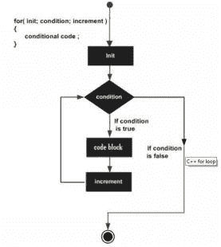

### Do… While 循环
与之前的循环类型（这些类型在执行循环体之前检查条件）不同，`do… while` 在循环执行后才检查指定的条件。

`do… while` 循环与 `while` 循环相似，唯一的区别是 `do… while` 循环至少执行一次（无论条件结果如何）。

C++ `do… while` 循环的语法是：

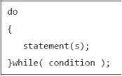

如你所见，条件位于循环的最后部分。这意味着循环将在测试指定的条件之前执行。

如果结果为真，控制流将重启，目标语句将再次重复。此过程将一直重复，直到条件的结果变为假。

#### Do… While 循环的流程图
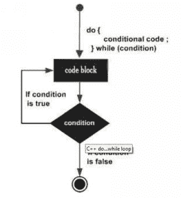

### 嵌套循环
C++ 允许你将循环放在另一个循环内部。这个过程被称为“嵌套”循环。这种类型的语法取决于你想要嵌套的循环：

#### 嵌套 For 循环的语法
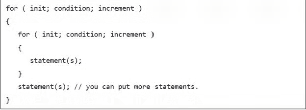

#### 嵌套 While 循环的语法
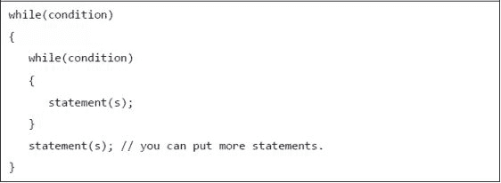

#### 嵌套 Do… While 循环的语法
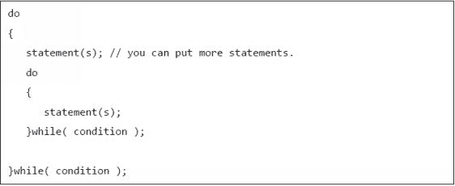

### 什么是循环控制语句？
循环控制语句可以改变循环体的执行。一旦执行被改变，你为之前的过程创建的所有自动对象都将被销毁。

C++ 编程语言支持这些循环控制语句：

| 控制语句 | 定义 |
| :--- | :--- |
| `goto` 语句 | 该语句可以将循环控制转移到目标语句。你不应该在 C++ 程序中使用这种循环控制语句。 |
| `continue` 语句 | 该语句可以导致循环忽略其主体的剩余部分，并在下次迭代前立即检查条件。 |
| `break` 语句 | `break` 语句可以终止 `switch` 或循环语句，并将控制传递给 `switch` 或循环之后的 C++ 语句。 |

让我们详细讨论每个循环控制语句：

#### “goto” 语句
基本上，`goto` 语句允许你在函数中设置无条件跳转。

**重要注意：** 通常，在使用 `goto` 语句时，追踪程序控制流是极其困难的。这意味着如果你使用 `goto` 语句，在读取或修改你的 C++ 程序时可能会遇到问题。由于这个原因，建议你远离这种循环控制语句。

这里是 C++ `goto` 语句的语法：

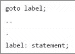

在上述语法中，`label` 是指定你的标记语句/语句的标识符。这里是 C++ `goto` 语句的语法：

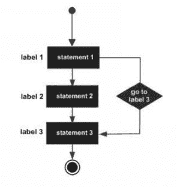

#### “continue” 语句
`continue` 语句强制激活循环。它们还会忽略可能影响循环功能的代码。

当涉及 `for` 循环时，这种强制继续会执行循环的条件检查和递增部分。然而，对于 `while` 和 `do… while` 循环，程序的控制权将传递给条件检查。

C++ `continue` 语句的语法是：

```cpp
continue;
```

这里是 `continue` 语句的流程图：

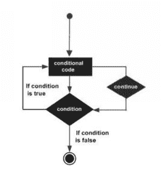

#### “break” 语句
该语句在 C++ 语言中有两个用途：

* 如果系统在循环内部遇到 `break` 语句，该循环将终止。然后，程序控制权将传递到循环之后的语句。
* 你可以用它来结束 `switch` 语句中的一个 case（你将在下一章学习它）。

对于嵌套循环，`break` 语句将终止最内层循环并执行代码块之后的行。

这里是 C++ `break` 语句的语法：

```cpp
break;
```

#### Break 语句的流程图
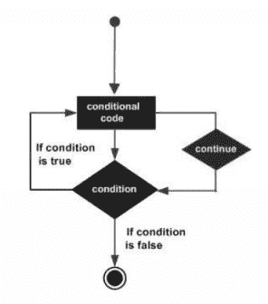

### 无限循环
如果循环的条件始终为真，循环就会变成无限循环。通常，程序员使用 `for` 循环来实现这个目标。由于 `for` 循环涉及的表达式是可选的，你只需留空条件部分就可以创建无尽循环。这里有一个例子：

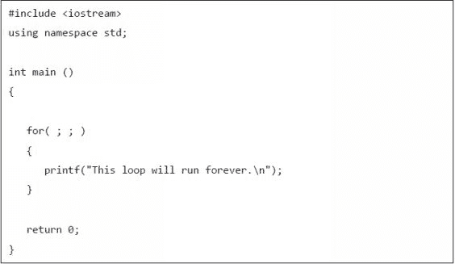

如果不存在，则条件表达式被认为是真的。C++ 用户通常使用 `for (;;)` 来表示无限循环。然而，你可以在你的 C++ 语句中包含递增和初始化表达式。

**重要注意：** 你可以按 `Ctrl + C` 来终止无限循环。

## 第 10 章：C++ 中的决策语句
决策结构需要你指示条件，这些条件可以由你的 C++ 程序进行测试或评估。你还应该提供根据条件的结果（即真或假）运行的语句。下面的图显示了 C++ 程序中普通决策语句的基本结构：

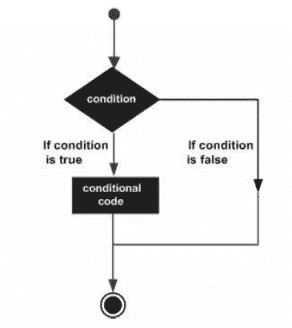

C++ 语言提供了以下决策语句：

| 语句名称 | 定义 |
| :--- | :--- |
| `switch` 语句 | 这种语句允许你针对一组值检查变量的相等性。 |
| `if` 语句 | 通常，“if”语句涉及一个布尔表达式和一个或多个语句。 |
| `if… else` 语句 | C++ 允许在“if”语句之后放置一个“else”语句。当指定的布尔条件为假时，该“else”语句运行。 |
| 嵌套 `switch` 语句 | 你可以在 `switch` 语句内部放置一个 `switch` 语句。 |
| 嵌套 | 你可以在 `if` 或 `else` 语句内部放置 `if` 或 `else` 语句。 |

让我们详细讨论每个决策语句：

#### Switch 语句
`switch` 语句允许你针对值检查变量的相等性。这些值被称为 case —— 你检查的变量将与每个 case 进行比较。

C++ `switch` 语句的语法是：

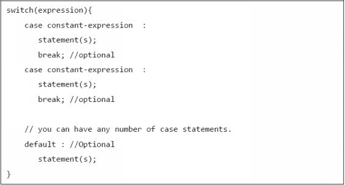

在使用 `switch` 语句时，需要记住某些规则。这些规则是：

* `switch` 的表达式应该是枚举类型或整数类型。或者，它可能属于具有枚举或整数类型转换函数的类型。
* C++ 对你向 `switch` 中添加的 case 语句数量没有限制。但请确保每个 case 都有冒号和一个可以比较的值。
* case 的常量表达式和 `switch` 的变量必须属于相同的数据类型。此外，你的常量表达式必须是一个字面量。
* 如果你正在切换的变量等同于某个 case，该 case 之后的语句将一直运行，直到系统遇到 `break` 语句。
* 一旦系统遇到 `break` 语句，`switch` 语句将停止。然后，控制流将传递到 `switch` 之后的语句。
* 你不需要在所有的 cases 中都放置 `break` 语句。如果某个 case 没有 `break`，控制流将传递到下一个 cases，直到系统找到 `break` 语句。
* 你可以为你的 `switch` 语句添加一个 `default` case。在 C++ 中，你应该将 `default` case 放在语句的末尾。程序员通常在需要执行任务但所有 case 都为假时使用默认 case。此外，默认 case 不需要 `break` 语句。

#### Switch 语句的流程图
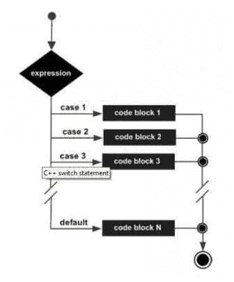

#### If 语句
基本上，一个 `if` 语句涉及一个布尔表达式和一个语句或一组语句。

这里是 C++ `if` 语句的语法：

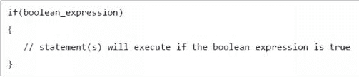

如果布尔表达式的结果为真（true），系统将执行“if”语句中的代码块。然而，如果结果为假（false），系统将执行“if”语句之后的代码。

“if”语句的流程图如下：

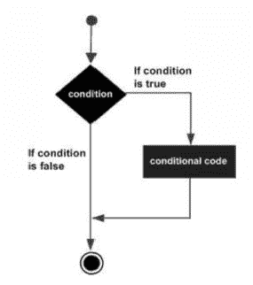

## If-Else 语句

你可以在“if”语句之后包含一个“else”语句。这个可选的“else”语句会在布尔表达式的结果为假时运行。

该语句的语法如下：

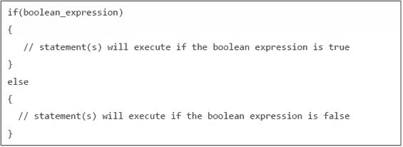

如果布尔表达式的结果为真，则代码的“if”部分将运行。另一方面，如果结果为假，则将运行代码的“else”部分。

### “If-Else”语句的流程图

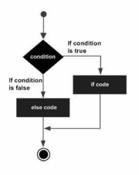

## 嵌套 switch 语句

C++ 允许你将一个 `switch` 作为另一个 `switch` 的一部分。即使外层和内部 `switch` 的常量具有相同的值，你也不会遇到任何问题。

在这一门编程语言中，你可以对 `switch` 语句使用约 256 层嵌套。

以下是 C++ 嵌套 `switch` 的语法：

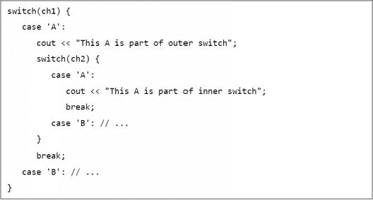

## 嵌套 if else 语句

你始终可以在代码中嵌套“if else”语句。这意味着你可以在另一个“if”或“if else”语句内部添加一个“if”或“if else”语句。

这是该 C++ 语句的语法：

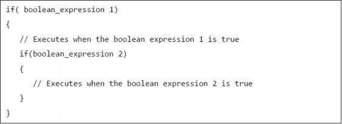

## 第 11 章：C++ 中的不同函数

函数是用于执行特定任务的语句组。每个使用 C++ 编写的程序都有一个函数，它存在于代码的 `main()` 部分。此外，即使是是最简单的 C++ 程序也可以有额外的函数。

C++ 允许你将代码划分为不同的函数。划分方法取决于你的需求和偏好，尽管你必须确保每个函数都能完成某项任务。

函数声明告知 C++ 编译器有关函数的名称、参数和返回类型。另一方面，函数定义提供了函数的实际体内容。

这门编程语言的标准库提供了不同的函数。以下是两个基本函数及其功能：

* `strcat()` – 此函数连接两个字符串。
* `memcpy()` – 此函数将一个内存位置复制到另一个内存位置。

**重要提示：** 有些程序员将函数称为方法、过程或子程序。

### 如何定义函数

以下是 C++ 中函数的语法：

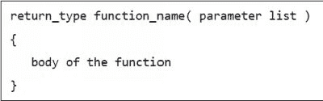

让我们讨论一下 C++ 函数的不同部分：

* **名称 (Name)** – 这是函数的实际名称。
* **参数 (Parameters)** – 程序员将参数视为占位符。每当你调用函数时，你都会给函数的参数赋值值。C++ 用户将此值称为参数（argument）或实际参数。参数列表指的是函数参数的顺序、数量和类型。记住，参数不是强制性的：即使没有任何参数，你的函数也可以运行。
* **返回类型 (Return Type)** – 函数可以获取值。函数返回的值属于名为“return_type”的数据类型。在某些情况下，函数执行所需任务而不获取任何值。在这里，数据的 `return_type` 是“void”。
* **函数体 (Function Body)** – 这部分包含一组 C++ 语句，决定了函数的用途和功能。

### 如何声明函数

函数声明告知 C++ 编译器有关函数的信息（即它们的名称以及如何调用它们）。你可以单独定义函数体。

函数声明包含这些部分：

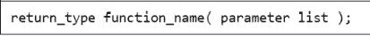

在声明函数时，你不需要担心参数名称。你只需要关注函数的类型。这意味着下面的声明是有效的：

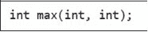

如果你要调用一个在另一个源文件中定义的函数，就必须使用函数声明。在这种情况下，你必须在需要该函数的源顶部声明所需的函数。

### 如何调用函数

当你在 C++ 中创建一个函数时，你定义了函数的用途。要运行函数，你应该调用（invoke or call）该函数。

当 C++ 程序运行函数时，系统会将程序控制权转移到被调用的函数。被调用的函数执行分配的任务。一旦它完全执行了 `return` 语句或到达其右括号，系统就会将程序控制权返回给 C++ 程序。

要调用函数，你只需要指定函数名称并传递参数。你可以存储函数返回的任何值。

### C++ 函数的参数 (Arguments)

如果你的函数有参数，你应该声明与参数值兼容的变量。程序员将这些变量称为“形式参数（formal parameters）”。

通常，形式参数的作用就像位于函数内的普通变量。一旦程序进入函数，它们就会出现。然后一旦程序退出函数，它们就会消失。

当你调用函数时，你可以通过三种不同的方式向函数传递参数。这些是：

| 调用类型 | 定义 |
| :--- | :--- |
| 通过指针 (By pointer) | 此技术将参数的地址发送到形式参数中。基本上，地址帮助你访问调用涉及的参数。因此，对参数的修改会影响实际参数。 |
| 通过值 (By value) | 在此技术中，参数的实际值被发送到函数的形式参数。在这种情况下，对参数的修改不会影响实际参数。 |
| 通过引用 (By reference) | 此技术将参数的引用发送到形式参数中。基本上，引用帮助你访问调用涉及的参数。因此，对参数的修改会影响实际参数。 |

### Functions

| `double tan(double);` | 使用此函数，你可以通过将角度作为 `double` 类型来获取其正切值。 |
| `double cos(double);` | 它允许你通过将任何角度作为 `double` 类型来获取余弦。 |
| `double log(double);` | 通过使用此函数，你可以确定一个数的自然对数。 |
| `double sin(double);` | 此函数允许你获取角度的正弦值。 |
| `double sqrt(double);` | 你可以通过将任何数字传递给此函数来获取平方根。 |
| `double pow(double, double);` | 此函数有两个元素：(1) 你想要求幂的数，(2) 你想要计算的幂次。 |
| `int abs(int);` | 使用此函数，你可以获取整数的绝对值。 |
| `double hypot(double, double);` | 此函数允许你获取直角三角形斜边的长度。但是，你必须提供另外两条边的长度。 |
| `double floor(double);` | 此函数寻找一个小于或等于给定参数的整数。 |
| `double fabs(double);` | 使用此函数，你可以获取小数的绝对值。 |

## 第 13 章：C++ 数组

这种编程语言提供了“数组”，这是一种数据结构。数组存储了一组属于相同类型的顺序元素。程序员使用数组来存储数据组，尽管将数组视为一组相同类型的变量集合会更有益。

与其逐一个地声明变量（例如 `number1`、`number2`、`number3` 等），你可以声明一个数组变量（例如 `number`），并使用 `number[1]`、`number[2]`、`number[3]` 等来表示变量。你可以使用索引访问数组内部的元素。

每个数组都具有相邻的内存位置。最低的内存位置指向数组中的第一个对象，而最高的内存位置则指向最后一个对象。

## 如何声明数组

在声明数组时，你应该指定数组中所需的元素类型和数量。以下是你应该使用的语法：

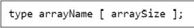

这种数组被称为“一维”数组。你的数组的“arraySize”部分应该包含一个大于零的整数字面量。另一方面，“type”部分应该包含 C++ 支持的任何数据类型。例如，你应该使用下面的语句来声明一个包含 10 个元素的数组。该数组名为 `balance`，数据类型为 `double`。

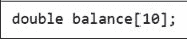

## 如何初始化数组

在 C++ 语言中，你可以通过两种方式初始化数组元素：(1) 单独地，或者 (2) 通过单个 C++ 语句（见下例）。

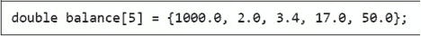

大括号之间的值必须小于或等于你在括号内声明元素数量。

## 如何访问数组元素

可以通过索引数组名称来访问数组元素。要这样做，在数组名称后的括号内输入元素的索引。

## 与数组相关的不同 C++ 概念

数组在用 C++ 编写程序起着巨大的作用。因此，你应该熟悉它们。下面的列表显示了 C++ 语言中最重要的数组相关概念。作为 C++ 用户，你必须掌握以下概念：

| 概念 | 解释 |
| :--- | :--- |
| 指向现有数组的指针 | C++ 允许你通过输入数组名称创建一个指向数组初始元素的指针。在这里，你不需要包含任何索引。 |
| 多维数组 | 这种编程语言允许你创建多维数组。显然，二维数组是你可以创建的最基础的多维数组。 |
| 将数组传递给函数 | 你可以将数组的指针传递给函数。要这样做，你只需要指定数组的名称。你不应该输入任何索引。 |
| 从函数获取数组 | 在 C++ 中，你可以从函数检索数组。 |

## 结论

我希望这本书能够帮助你学习 C++ 的基础知识。

下一步是使用 C++ 编写你自己的计算机程序。

你能帮我个忙吗？

最后，如果你喜欢这本书，请花时间分享你的想法并在 Amazon 上发表积极的评价。我将不胜感激！

感谢你并祝你好运！
