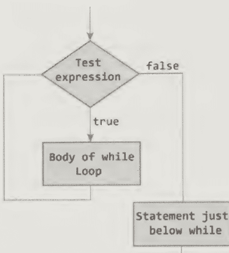
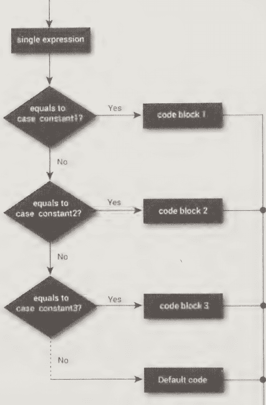
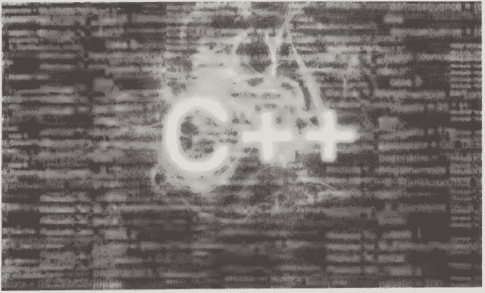
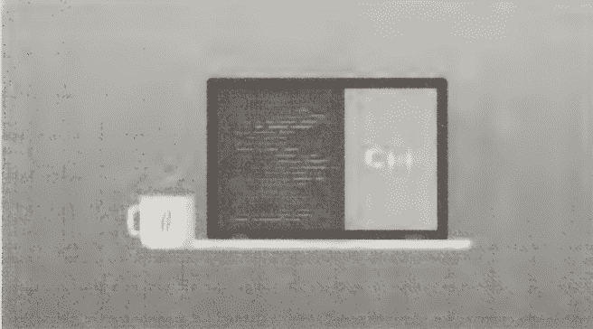

# C++：学习 C++ 基础终极速成课程（C 编程、易易上手 C++、C++ 编程、今天开始编码）

## 引言

如果你正在阅读这本书，意味着你正在主动学习 C++。C++ 由 Bjarne Stroustrup 于 1979 年首次开发。是一种通用且高效的编程语言，具有极高的不可替代性。

C++ 是 C 编程语言的扩展。Bjarne 对 SIMULA 语言及其面向对象模型的知识帮助他为 C 创建了类扩展。它最初被名为 C with Classes，后来被更名为 C++。

C++ 拥有多种特性。这些特性包括：

- C++ 是高效的。
- C++ 是一种静态编程语言。
- C++ 是一种面向对象的语言：对象的使用允许通过类和对象，将较大的程序划分为较小的子集。
- C++ 是多范式的：这让开发者能够自由选择他们想要的编程风格。共有 7 种不同的风格供选择。
- C++ 利用标准库：这意味着 C++ 可以通过库中的项来扩展其语言的功能。

学习 C++ 可以让你的简历提升到一个新水平。它仍然被用于许多主流应用程序、游戏、浏览器等。人们不断地开发和扩展 C++ 的功能。像 Github 这样的开源平台拥有数千个 C++ 仓库。

随着 C++ 的增长，C++ 开发者的机会也在增加。在这些职位中，平均薪资可达 100,000 美元，每月有数千个职位发布。

虽然这本书是一个完美的起点，但不要期望一夜之间学会 C++。这门语言需要练习、坚持和毅力。如果你在问，不，你不需要在掌握 C++ 之前知道 C。

将以下章节和练习作为你 C++ 编程之旅的路线图，知识在等待着。

## 第 1 章 – 开启 C++

在开始使用 C++ 开发之前，你必须先搭建一个能够高效运行的环境。话虽如此，你需要一种运行和编译 C++ 程序的方法。可以通过许多方式实现。这些方法包括：

1. **在线**：在网上运行和编译程序是避免过度下载或安装新软件的简单方法。它也是快速运行程序的良好选择。有很多网站可以实现这一点。由于易于使用，Ideone.com 是实现此目的的极佳选择。
2. **Mac OS X**：可以使用名为 `XCode` 的程序在 MAC 操作系统上运行。可以从 Apple 开发者页面下载。强烈建议使用最新版本。
3. **Linux**：为了在 Linux 机器上高效运行程序，你需要安装一个编译器。`GNU GCC` 是为初学者或在该操作系统上新学编程的用户推荐的编译器。你还必须下载一个文本编辑器。`Gedit` 就是一个例子。
4. **Windows**：由于 Windows 是一个标准且广泛的平台，有几种选项可以使用。这些可能包括 `Code::Blocks`、`JGrasp` 或 `Eclipse`。

为了更好地理解 C++ 程序的结构，将使用 Hello World 作为模板。Hello World 程序通常用于各种编程语言的初学者入门。

程序的第一行用于在程序中包含头文件。这允许你使用其中包含的操作。为了准确引用各种操作，需要 `namespace std`。它还可以帮助你避免在每个 `cout` 语句前面写 `std`。这一行基本上指的是使用标准命名空间。

```cpp
#include <iostream>
using namespace std;
int main()
{
    cout << "Hello World";
    return 0;
}
```

从第 9 页到第 10 页讨论了变量及其类型。

如果你熟悉其他编程语言，很容易理解变量可以有类型。变量类型包括：

- `bool`：存储真或假。
- `char`：通常是单字节（一个字节）。这是一种整数类型。
- `int`：机器上最自然的整数大小。
- `float`：单精度浮点值。
- `double`：双精度浮点值。
- `void`：表示类型的缺失。
- `wchar_t`：宽字符类型。

| 类型 | 说明 |
|---|---|
| `bool` | 存储真或假。 |
| `char` | 通常是单字节（一个字节）。这是一种整数类型。 |
| `int` | 机器上最自然的整数大小。 |
| `float` | 单精度浮点值。 |
| `double` | 双精度浮点值。 |
| `void` | 表示类型的缺失。 |
| `wchar_t` | 宽字符类型。 |

赋值语句将特定值赋给变量 `y`。在示例中，`y` 被赋值为值 20。

输出语句只是简单地打印特定项目或变量的值。上面的示例的输出将为 20。

变量的声明和赋值也可以同时进行；这被称为初始化。记住，初始化变量的唯一时间是在定义它时。

```cpp
// initialization Statement
double y = 20.5;
```

变量也可以使用一个语句同时声明多个，而不是使用多个语句。这可以通过遵循下面的语法即可实现。

```cpp
double x, y, z;
```

上述语句简单地将 `x`、`y` 和 `z` 都声明为 `double` 类型或小数数字。

### 练习题

使用下方的练习题来确保你理解了 C++ 编程的基础知识。

1. 下列哪种是 C++ 中编写注释的正确方式？
   a) `/**Here is a comment*/`
   b) `\Here is another comment\`
   c) `//Here is the last comment`

2. 在下面的选项中，哪一个显示了变量被正确声明并初始化为值 10？
   a) `int a 10;`
   b) `int b = 10;`
   c) `double c = 10;`

3. 在下面的选项中，哪一个显示了你如何声明一个名为 `number` 的 `double` 并将其初始化为 5？
   a) `double number 5;`
   b) `double number = 5`
   c) `double number = 5;`

4. 下列哪种是将名为 `sum` 的整数打印到屏幕上的正确方式？
   a) `cout << sum << endl;`
   b) `cout "sum" << endl;`
   c) `cout >> sum >> endl;`

5. 在 C++ 程序中可以同时声明多个数据类型吗？`sum, age, group;`
   a) 可以
   b) 不可以

6. C++ 中可以使用几种数据类型。`double` 类型的数据类型持有什么类型的信息？
   a) 整数
   b) 双精度整数
   c) 小数

7. 在名为 `check` 的 `int` 中读取用户输入的正确方式是？
   a) `cout >> "check";`
   b) `cin >> check;`
   c) `cin << check;`

8. 在名为 `sum` 的 `double` 中读取用户输入的正确方式是？
   a) `cin << sum;`
   b) `cout >> sum;`
   c) `cin >> sum;`

9. 整数不能除以它们自身的原因是什么？
   a) 它们的值将被截断
   b) 你将收到错误消息而不是实际答案
   c) 你的程序一遇到该语句就会崩溃

### 答案

1. 下列哪种是 C++ 中编写注释的正确方式？
   a) `/*Here is a comment*/`
   b) `\\Here is another comment\"`
   c) `//Here is the last comment`

2. 在下面的选项中，哪一个显示了变量被正确声明并初始化为值 10？
   a) `int a 10;`
   b) `int b = 10;`
   c) `double c = 10;`

3. 在下面的选项中，哪一个显示了你如何声明一个名为 `number` 的 `double` 并将其初始化为 5？
   a) `double number 5;`
   b) `double number = 5`
   c) `double number = 5;`

4. 下列哪种是将名为 `sum` 的整数打印到屏幕上的正确方式？
   a) `cout << sum << endl;`
   b) `cout "sum" << endl;`
   c) `cout >> sum >> endl;`

5. 在 C++ 程序中，像下面这样一次声明多个整数是合法吗？`int sum, age, group;`
   a) 可以
   b) 不可以

6. `double` 数据类型持有什么？
   a) 整数
   b) 双精度整数
   c) 小数

7. 在名为 `check` 的 `double` 中读取用户输入的正确方式是？
   a) `cout >> "check";`
   b) `cin >> check;`
   c) `cin << check;`

8. 在名为 `sum` 的 `double` 中读取用户输入的正确方式是？
   a) `cin << sum;`
   b) `cout >> sum;`
   c) `cin >> sum;`

9. 为什么整数不应该除以其他整数？
   a) 答案的值将被截断
   b) 你将收到错误消息而不是实际答案
   c) 你的程序一遇到该语句就会崩溃

### 使用修饰符与限定

修饰符也可以用于各种类型。修饰符可以指示数字的符号或提供关于变量更详细的信息。修饰符可以用于字符、整数和任何 `double` 类型。修饰符用于操作变量以适应精确的场景。

数据类型修饰符类型包括：

- 无符号 (`Unsigned`)
- 有符号 (`Signed`)
- 短型 (`Short`)
- 长型 (`Long`)

| 类型 | 典型位宽 | 典型范围 |
|---|---|---|
| `char` | 1-byte | -128 到 127 或 0 到 255 |
| `unsigned char` | 1 byte | 0 到 255 |
| `signed char` | 1 byte | -128 到 127 |
| `int` | 4 bytes | -2147483648 到 2147483647 |
| `unsigned int` | 4 bytes | 0 到 4294967295 |
| `signed int` | 4 bytes | -2147483648 到 2147483647 |
| `short` | 2 bytes | -32768 到 32767 |
| `unsigned short` | 2 bytes | 0 到 65535 |
| `signed short` | 2 bytes | -32768 到 32767 |
| `long` | 8 bytes | -9223372036854775808 到 9223372036854775807 |
| `unsigned long` | 8 bytes | 0 到 18446744073709551615 |
| `signed long` | 8 bytes | -9223372036854775808 到 9223372036854775807 |
| `float` | 4 bytes | -3.4e+38 到 3.4e+38 |
| `double` | 8 bytes | -1.7e+308 到 1.7e+308 |
| `wchar_t` | 2 bytes | -32768 到 32767 |

### 使用修饰符示例

```cpp
#include <iostream>
using namespace std;

/* 这是一个程序
 * 显示了修饰符的区别。
 */
int main() {
    const int variable1 = 10; // 常量
    volatile int variable2 = 20; // 变量，可能会被程序外部改变

    cout << variable1 << endl;
    cout << variable2 << endl;

    return 0;
}
```

### 关键字

C++ 像许多编程语言一样也使用一组关键字。关键字是语言中具有特殊含义的单词，不能在其他地方使用。它们具有特殊含义。

- `asm`
- `auto`
- `bool`
- `break`
- `case`
- `catch`
- `class`
- `const`
- `const_cast`
- `continue`
- `decltype`
- `default`
- `delete`
- `do`
- `else`
- `enum`
- `export`
- `extern`
- `false`
- `for`
- `friend`
- `goto`
- `if`
- `inline`
- `int`
- `mutable`
- `namespace`
- `operator`
- `new`
- `long long`
- `register`
- `return`
- `short`
- `private`
- `protected`
- `public`
- `reinterpret_cast`
- `signed`
- `sizeof`
- `static`
- `struct`
- `switch`
- `this`
- `throw`
- `true`
- `typedef`
- `typename`
- `union`
- `unsigned`
- `virtual`
- `void`
- `volatile`
- `while`
- `with`
- `using`

### 注释

注释是任何程序的组成部分，它们允许阅读者或其他开发者理解程序的意图以及每行代码的作用。

在代码中有两种创建注释的方法。

```cpp
/* 这是一个多行注释
 * 因为它可以跨越多行
 */
```

```cpp
// 这是一个单行注释。
```

### C++ 基础练习

1. `<iostream>` 在编程中被称为？
   a) 指令
   b) 预处理指令
   c) 文件

2. `using namespace` 在编码时有意义吗？如果没有它我们还能使用 `cout` 和 `cin` 吗？
   a) 是
   b) 否

3. 如果程序开头没有声明命名空间，使用 `cout` 需要什么？
   a) `std::cout << "Hello";`
   b) 没变化
   c) `std::namespace::cout << "Hello";`

4. 在 `int main()` 中，`int` 的缩写实际上代表什么？
   a) 集成
   b) 它没有值
   c) 整数

5. 打印到屏幕的正确方式是？
   a) `cout << "This is a displayed statement" << endl;`
   b) `cout << ("I can finally program");`
   c) `cin << "This is my 18th program of this type << endl;`

6. `endl` 是什么意思？它做什么？
   a) 结束整个程序
   b) 换行
   c) 无关

7. 所有 C++ 程序结束时返回什么数字？
   a) 0
   b) 04
   c) 3

### 练习题答案

1. `<iostream>` 在编程中被称为？
   a) 指令
   b) 预处理指令
   c) 文件

2. 在编码时使用 `namespace` 有任何意义吗？如果没有它，我们还能使用 `cout` 和 `cin` 吗？
   答案是一样的。
   a) 是
   b) 否

3. 如果在程序开头没有声明 `namespace`，使用 `cout` 打印需要什么？
   a) `std::cout << "Hello"`
   b) 没有任何变化
   c) `std::namespace::cout << "Hello";`

4. 在 `int main()` 中，`int` 的缩写代表什么？
   a) integrate（集成）
   b) 它没有值
   c) integer（整数）

5. 输出到屏幕的正确方式是什么？
   a) `cout << "This is a displayed statement" << endl;`
   b) `cout << ("I can finally program");`
   c) `cin << "This is my 18th program of this type << endl;`

6. `endl` 是什么意思/它的作用是什么？
   a) 结束整个程序
   b) 换新行
   c) 无所谓

7. 在所有 C++ 程序的末尾返回哪个数字？
   a) 0
   b) 04
   c) 3

## 第 2 章 – 基础输入与输出

编程中最常见的函数之一是输入和输出。在 C++ 中，输入输出发生在流（streams）中。流也被称为字节序列。

如果给定的字节来自键盘或磁盘驱动器并流向主内存，这被归类为输入操作。输出被归类为字节从主内存流向屏幕或显示器。


程序中的头文件对于输入输出至关重要。程序头的 `<iostream>` 是定义输入输出对象的头文件。其他头文件类型包括 `<iomanip>` 和 `<fstream>`。

## 使用 `cout`

`cout` 对象是 `ostream` 类的一个实例，它连接到输出设备或显示器。这是一个相当简单的命令，大多数时候它与 `cin` 配合使用，尽管它可以脱离开使用。

运行下面的程序以准确地看到 `cout` 语句的作用。

```cpp
#include <iostream>

using namespace std;

int main() {
    int a = 67;
    int b = 67;
    int c = a+b;

    cout << "Value of c is : " << c << endl;
}
```

上述程序的输出应该是 `c` 的正确值，并带有给定的语句。

此程序中注意的两个重要点包括插入运算符 `<<` 和 `endl`。`endl` 用于在给定的字符串行末尾添加新行。如我们在上面所示，`<<` 可以使用多次。

## 使用 `cin`

使用 `cin` 允许用户将信息输入到给定的变量中。该对象属于 `istream` 族，它连接到输入设备（通常是类似于键盘的设备）。提取运算符与插入运算符相反。它简单地是 `>>`，将在下面的程序示例中看到。

```cpp
#include <iostream>

using namespace std;
int main() {
    char petname[40];
    char yourname[60];
    cout << "Please enter the name of your pet: ";
    cin >> petname;
    cout << "Your name is: " << petname << endl;
    cout << "Please enter your full name: ";
    cin >> yourname;
    cout << "Your name is: " << yourname << endl;
}
```

运行程序后，系统将提示你输入宠物的名字。然后它会被打印出来。接着系统会提示你输入姓名，它也会被打印。

自己尝试这个练习以进行更多的输入输出练习。

1. 回答下面的提示，使输入量为 23, 55.7 和 12。

```cpp
#include <iostream>

using namespace std;

int main() {
    int X,Y;
    double Z;

    cin >> X;
    cin >> Y;
    cin >> Z;

    cout << " X" << X << endl;
}
```

# 第3章 – 条件语句

C++ 编程的另一个主要组件是条件语句的使用。条件语句是根据程序的当前值导致程序改变预期路径的语句。我们要讨论的最早且基本的条件语句之一是 `if` 语句。

在进入各种类型的条件语句之前，我们必须首先知道在语句中使用哪些关系操作符，以及它们代表什么。

| 运算符 | 含义 |
| --- | --- |
| `>` | 大于 |
| `<` | 小于 |
| `>=` | 大于等于 |
| `!=` | 不等于 |
| `&&` | 与 (AND) |
| `||` | 或 (OR) |
| `!` | 非 |

## 使用 `if`

为了完全理解 `if` 语句，你必须首先理解它们是如何运作的。`if` 语句的结构如下：

```
if (condition)
```

块本质上是括号 `{}` 的使用。使用括号允许用户告诉程序 `if` 语句的开始和结束。在没有指定块的情况下，程序足够智能可以隐式定义。

`if` 语句也可以像下面的程序那样链式连接。

```cpp
#include <iostream>

int main() {
    int number;
    cout << "Enter a number: ";
    cin >> number;

    if (number > 50) {
        cout << "Your number is greater than 50" << endl;
    } else {
        cout << "Your number is not greater than 50" << endl;
    }
    return 0;
}
```

除了链式 `if` 语句的能力，在 C++ 中嵌套 `if` 语句也是可能的。下面是嵌套函数的示例。

上面的代码之所以令人困惑，是因为缺少括号。添加块会让代码更清晰。这种歧义被称为悬空 else（dangling else）。

```cpp
#include <iostream>

int main()
{
    std::cout << "Please input a digit: ";
    int num;
    std::cin >> num;

    if (num > 10)
        cout << num<<"Your number is far greater than 10\n"
    else if (num < 10)
        cout << num << "The entered number is far less than 10\n"
    else
        cout << num << "Your number is 10!\n";
}
```

```cpp
#include <iostream>

int main()
{
    std::cout << "Entera digit: ";
    int num;
    std::cin >> num;

    if (num > 10) // 外层 if 语句
        // 嵌套 if 语句是糟糕的编码风格
        if (num < 20) // 内层 if 语句
            std::cout << num << " Your number is between the numbers 10 and 20\n";
    else
        // 哪个 If 语句对应下面的 else？
    else
        std::cout << num << "Woah! Your number is far greater than 20\n";

    return 0;
}
```

对于如何实现 `if` 或 `if-else` 语句仍然困惑。使用下面的问题进行练习。

1. 下列哪项提供了 `if` 语句的正确结构？

   A. if this then that

   B. if { expression }

   C. if ( expression )

   D. else expression if

2. 编写一个程序，允许用户向系统输入一个数字。该程序应根据数字是大于50 还是小于50 向用户输出两个不同的语句。这将通过输入（input）和条件（condition）语句来实现。如果数字大于 50，程序应该打印“Wow, this number is big”。如果数字小于 50，程序应该打印“Yikes, this number is too small”。

3. 如果 x 等于 10 且 y 等于 30，此条件会执行吗？`if(x > y)`

    - a) 是

    - b) 否

4. 条件对程序的作用是什么？

    - a) 提高处理能力

    - b) 在减少程序长度的同时增加程序的灵活性

    - c) 破坏程序

5. `else` 语句的作用是什么？

    - a) 为给定的条件提供替代路径

    - b) 永远不执行

    - c) 它在程序中看起来好看

6. 在条件语句的上下文中，以下条件是什么意思？`if (a!=b)`

    - a) a 等于 b

    - b) 检查 a 是否不 b

    - c) 以上均不对

7. 在 `if` 语句中，何时需要大括号？

    - a) 总是需要

    - b) 通常情况下，当条件语句中有 2 行或更多代码时应该使用。

    - c) 永远不需要

8. 以下条件用通俗英语表达是什么意思？`if (y!=x)`

    - a) 如果 y 不等于 x

    - b) 如果 x 不等于 y

    - c) 如果 x 小于 y

9. 如果 a 等于 20 且 b 等于 20，此条件会执行吗？`if (a!=b)`

    - a) 是

    - b) 否

10. 以下语句是什么意思？`if (a==b)`

    - a) 如果 a 大于 b

    - b) 如果 a 等于 b

    - c) 如果 b 大于或等于 a

11. 如果 x 等于 20 且 y 等于 8，以下条件能够执行吗？`if(x<=y)`？

    - a) 是

    - b) 否

## 答案

1. C.

```cpp
#include <iostream>

using namespace std;

int main()
{
    cout << "Enter your number " << endl;

    int number;

    cin >> number;

    if(value < 50)
    {
        cout << "Yikes, this number is too small";
    }
    else
    {
        cout << "Wow, this number is big.";
    }

    return 0;
}
```

3. 如果 x 等于 10 且 y 等于 30，此条件会执行吗？`if(x > y)`

    - a) 是

    - b) 否

4. 条件对程序的作用是什么？

    - a) 提高处理能力

    - b) 在减少程序长度的同时增加程序的灵活性

    - c) 破坏程序

5. `else` 语句的作用是什么？

    - a) 为给定的条件提供替代路径

    - b) 永远不执行

    - c) 它在程序中看起来好看

6. 在条件语句的上下文中，以下条件是什么意思？`if (a!=b)`

    - a) a 等于 b

    - b) 检查 a 是否不 b

    - c) 以上均不对

7. 在 `if` 语句中，何时需要大括号？

    - a) 总是需要

    - b) 通常情况下，当条件语句中有 2 行或更多代码时应该使用。

    - c) 永远不需要

8. 以下条件用通俗英语表达是什么意思？`if (y!=x)`

    - a) 如果 y 不等于 x

    - b) 如果 x 不等于 y

    - c) 如果 x 小于 y

9. 如果 a 等于 20 且 b 等于 20，此条件会执行吗？`if (a!=b)`

    - a) 是

    - b) 否

10. 以下语句是什么意思？`if (a==b)`

    - a) 如果 a 大于 b

    - b) 如果 a 等于 b

    - c) 如果 b 大于或等于 a

11. 如果 x 等于 20 且 y 等于 8，以下条件能够执行吗？`if(x<=y)`？

    - a) 是

    - b) 否

## 循环

除了条件语句外，当代码部分需要重复时，就会循环。与其重写或复制代码段，不如使用循环。循环允许用户重复执行某些代码直到其完成。

C++ 程序中存在的简单循环是 `for` 循环。`for` 循环的语法如下：

```cpp
for ( variable initialization; condition; variable update ) {
    只要括号内的条件为真，就会执行括号内的语句。
}
```

循环利用两个你必须熟悉的的操作数才能继续后续。这些是自增和自减符号（`++` 和 `--`）。

为了进一步拆解 `for` 循环的结构，请参见下例。

| 从开始 | 直到 | 计数器加1 |
| --- | --- | --- |
| `for (int i = 0; i < 5; i++) {` | | |
| `cout << "Please input a number: "; cin >> Num1; Total += Num1; cout << endl; }` | | |

上述 `for` 循环中的代码将执行到计数器变量达到 4。一旦变量达到5，它将不再执行，因为不再满足 `for` 循环的条件。

另一个常用的循环类型是 `while` 循环。只要 `while` 的测试语句为真，`while` 循环就会持续执行语句块。

```cpp
#include <iostream>
using namespace std;

int main ()
{
    for (int m=10; m>0; m--) {
        cout << m << " ", ";
    }
    cout << "The End!\n";
}
```

执行以下代码查看 `for` 循环的运行。

此 `for` 循环将产生以下输出：

10, 9, 8, 7, 6, 5, 4, 3, 2, 1, The End!

下面的图显示了 `while` 循环是如何工作的。



图：`while` 循环流程图

测试表达式可以是任何布尔表达式的组合。然而，只要该语句为真，循环体就会执行。

`while` 循环的语法如下：

```cpp
while ( w < 25 ) { // 当 w 小于 25 时
    cout<< w << endl;
    w++; // 修改 w 以满足条件
}
```

运行以下程序以查看 `continue` 语句在代码中的运行机制。

```cpp
#include <iostream>
using namespace std;
int main()
{
    for (int j = 1; j <= 10; ++j)
    {
        if (j == 6 || j == 9)
        {
            continue;
        }
        cout << j << "\t";
    }
    return 0;
}
```

## Switch 语句


当需要多个 `if else` 语句时，可以使用 `switch` 语句。`switch` 语句的执行速度通常比多个嵌套的 `if` 语句更快，而且更容易理解和编写。

`switch` 语句的语法如下：

```cpp
switch (n) {
    case constant1:
        // 如果 n 等于 constant1，执行的代码；
        break;
    case constant2:
        // 如果 n 等于 constant2，执行的代码；
        break;
    default:
        // 如果 n 不匹配任何常量，执行的代码
}
```



上面的语法和图表显示，当找到匹配 `n` 的 case 常量时，程序的控制权将传递到相关的 case 块。在程序到达 `break` 语句或块的结束之前，将执行该代码块。

## Switch 语句练习

使用这些问题练习 `switch` 语句及其用法。

1. 编写一个程序，根据学生的数字成绩确定其字母等级。程序应该输出学生的字母等级。使用 `switch` 来判断成绩是 A、B、C、D 还是 F。
2. 在 `switch` 的每个 `case` 后面都有一个特定的内容。那个项是什么？
3. 在 `case` 中包含条件语句是合法的？
4. 解释以下 `case` 的错误之处：`case (x > 3):`
5. 解释以下 `case` 的问题所在：`case 3:`
6. `case` 应该总是带有大括号吗？对或错的。

## 答案

```cpp
switch (grade) {
  case 1:
    if (numAvg < 60)
      grade = 'F';
    break;
  case 2:
    if (numAvg < 70)
      grade = 'D';
    break;
  case 3:
    if (grade < 80)
      grade = 'C';
    break;
  case 4:
    if (grade < 90)
      grade = 'B';
    break;
  default: grade = 'A';
}
```

2. C. Break
3. 不，`switch` 不能包含条件
4. 这是错误的，因为 `case` 不能包含条件。
5. 这条语句没有问题。
6. 错。

# 第 4 章 – 数组操作

数组不仅对于在单个变量名下存储数据极其有用，而且还可以以有序列表的格式存储元素。它们最终被用于组织大量的数据和信息。在尝试遍历数组时，循环是赋值和打印这些值非常有用的工具。



当你有像下面列出的多个变量时，直接使用数组会更简单。下面的信息仅显示了 5 个不同人的年龄。

```cpp
int Person1 = 15;
int Person2 = 24;
int Person3 = 54;
int Person4 = 33;
int Person5 = 120;
```

与其将每个人都声明为不同的变量，不如直接声明一个包含 5 个不同人年龄的数组来简化。

该数组的声明如下：`int person_ages[5];`

```cpp
int person_ages[5];
```

数组类型为 `int`，这是要存储的信息类型。第二个项仅仅是数组名称。在这种情况下，名称是 `person_ages`。括号内的最后一部分持有数组中项目的数量。

## 初始化数组

初始化数组有两种方法。第一种是简单地列出数组位置并设置值，如下所示。

```cpp
person_age[0] = 43;
person_age[1] = 49;
person_age[2] = 5;
person_age[3] = 10;
person_age[4] = 70;
```

在手动设置数组中的值时，你也可以像下面所示设置它们。

```cpp
// initialize
person_age[] = {43, 49, 5, 10, 70};
```

虽然手动设置数组对于只有 5 个元素的数组可能没问题。但当你的数组有 500 个元素时该怎么办？这就是 `for` 循环的用武之地。使用循环更高效且工作量少得多，尽管工作方式相同。下面的示例使用 `for` 循环遍历数组以打印，尽管也可以这样做。

```cpp
#include <iostream>
using namespace std;
int main() {
    int person_age[] = {43, 49, 5, 10, 70};
    for (int i = 0; i < 5; i++) {
        cout << person_age[i] << endl;
    }
    return 0;
}
```

# 第 5 章 – 指针

指针让某些复杂任务变得简单，而且它们的使用非常容易。指针被定义为存储另一个变量地址的变量。与变量一样，在使用之前必须对其进行定义。

```cpp
type *var-name;
```

当使用指针时，其类型取决于基础类型的类型。例如，如果我的指针指向一个 `double` 变量，那么我的指针必须是 `double` 类型。`var-name` 是你的指针名称。必须使用星号 `*` 来表示指针。

```cpp
int *int_point;   // 指向整数的指针
double *dou_point; // 指向双精度的指针
float *flo_point;  // 指向浮点的指针
char *ch_point;    // 指向字符的指针
```

下面的示例展示了指针中存储的信息，运行以下代码以更好地理解指针。

```cpp
#include <iostream>
using namespace std;

int main() {
    int variable = 10; // 实际变量声明
    int *ipointer;     // 指针变量

    cout << "Value of variable: ";
    cout << variable << endl;

    // 访问指针可用地址处的值
    cout << "Value of *ipointer variable: ";
    cout << *ipointer << endl;

    return 0;
}
```

## 空指针

被赋值为 `NULL` 的指针被称为空指针。空指针在声明时赋值。空指针通常是常量，且其值为零。

## 指针运算

由于指针存储的是数值，它们也具有执行基本算术运算的能力。

在某些程序中，开发者可能会选择使用指针代替数组。这部分是因为指针可以在没有循环帮助的情况下递增，而数组则不能。

下面的程序展示了如何成功增加变量指针以访问数组的每个后续元素：

```cpp
#include <iostream>
using namespace std;
const int MAX = 4;
int main() {
    int var[MAX] = {10, 100, 200, 300};
    int *ptr;
    // 让指针指向数组地址。
    ptr = var;
    for (int j = 0; j < MAX; j++) {
        cout << "Value of var[" << j << "] = ";
        cout << *ptr << endl;
        // 指向下一个位置
        ptr++;
    }
    return 0;
}
```

由于指针可以递增，它们也可以递减。运行以下代码展示指针是如何递减的。

```cpp
#include <iostream>
using namespace std;
const int MAX = 4;
int main() {
    int var[MAX] = {10, 100, 200, 300};
    int *ptr;

    ptr = &var[MAX - 1];
    for (int j = MAX; j > 0; j--) {
        cout << "Value of var[" << j << "] = " << endl;
        cout << *ptr << endl;

        // 指向上一个位置
        ptr--;
    }

    return 0;
}
```

除了递增和递减，指针还可以使用关系运算符进行比较。这包括如 `==`、`<` 和 `>` 等运算符。

# 第 6 章 – 函数

函数是极其有用的代码段，为了完成特定任务而编写。当它们被组合使用时，会创建一个更复杂、更清晰的程序。

函数的基本结构如下所示。请注意，原型（prototype）是函数声明的另一种表述或分类方式。

```
return type name (data type variable, data type variable....)
```

返回类型（Return type）：返回类型指的是函数完成后返回的内容。例如，如果我正在创建一个程序来计算大学生的平均年龄，我将使用 `int`，因为我不需要也不想要小数部分。因此，截断是可以接受的。我的返回类型将是 `int`。

名称（Name）：这只是函数的名称。使用同样的例子，我可以将此函数命名为 `average_age`。

数据类型（Data type）：数据类型简单指的是变量。这些是函数接收并使用的项。它可以是一个，也可以是多个。

函数的开头如下示例所示。

```cpp
int average_age(int x, int y)
```

原型的位置如下示例所示。

```cpp
#include <iostream>
int average_age(int x, int y);

int main() {
    // 主程序
    return 0;
}
```

```cpp
double mult(int x, int y) // 注意没有分号
{
    // 函数将写在这里
}
```

运行以下程序作为示例以查看函数是如何工作的。以下程序中的函数用于接收两个变量并返回它们的和。

```cpp
// 完整的程序
#include <iostream>
double summation(int a, int b); // 原型

int main() {
    int x, y;
    int c;
    cin >> x >> y;
    c = summation(x, y);
    cout << c;
}

double summation(int a, int b) {
    return a + b;
}
```

# 第 7 章 – 类与对象

C++ 的主要功能之一是在 C 语言的基础上增加了面向对象。由于，类（classes）是 C++ 程序涉及的特性之一。这些有时被称为用户定义类型。

## 为什么要使用类？

使用类是为了详细描述对象的结构。它还包含了操作对象及其任何属性所需的方法。类内部的函数和数据被称为它的成员（members）。

## C++ 类定义

实际上，类并没有定义任何形式的正式数据。它仅仅是一个大纲或蓝图。类定义了类名的含义以及它所代表的对象的组成。它还定义了对象可以执行哪些操作。

在定义类时，必须始终以 `class` 关键字开始。紧接着应该是类名。然后是类体，所有内容都必须包含在大括号内。类定义之后，根据用户的需要，必须跟一个分号或声明列表。以下是类声明的示例。

```cpp
class Person {
public:
    double weight; // 人的体重
    double height; // 人的身高（英寸）
    int age;       // 人的年龄
};
```

如所示，你将看到关键字 `public` 的使用。这用于确定类成员的访问级别。任何标记为 `public` 的内容都可以从类的外部任何地方访问，但仍在类对象的范围内。`public` 不是唯一的访问方法。成员也可以被描述为 `private`（私有）或 `protected`（保护），将在本章后面讨论。

## 定义 C++ 对象

既然类被认为是对象的蓝图，那么从类创建对象是合理的。对象的声明方式与声明变量相同。下面是上一节开始的 person 对象定义。

```cpp
Person Person1; // 声明类型为 Person 的 Person1
Person Person2; // 声明类型为 Person 的 Person2
```

Person1 和 Person2 两个对象都拥有自己的数据成员副本。

## 访问数据成员

任何公共访问类型的数据成员都可以简单地通过 `.` 使用。这就是访问运算符。

```cpp
#include <iostream>

using namespace std;

class Person {
public:
    double weight;
    double height;
    int age;
};

int main() {
    Person Person1;
    Person Person2;
    double bmi = 0.0;

    // Person
    Person1.weight = 60.0;
    Person1.height = 30.0;
    Person1.age = 7.0;

    Person2.weight = 300.0;
    Person2.height = 80.0;
    Person2.age = 30.0;

    // box 的 bmi
    bmi = (Person1.weight * 703) / (Person1.height * Person1.height);
    cout << bmi << endl;

    bmi = (Person2.weight * 703) / (Person2.height * Person2.height);
    cout << bmi << endl;

    return 0;
}
```

运行上面的程序查看如何使用访问运算符以及如何正确使用对象。请记住，私有和保护成员不能使用访问运算符 `.` 访问。

上述提供的信息仅是对象和类的基本概述。有几个概念需要深入复习。

## 类成员函数

成员函数在类对象上操作。它是定义在类内部的函数。在类定义之外，成员函数还可以使用作用域解析运算符 `::` 分别定义。这属于内联声明函数。

下面示例所示。

```cpp
class Box {
public:
    double length;  // 盒的长度
    double breadth; // 盒的宽度
    double height;  // 盒的高度

    double getVolume(void) {
        return length * breadth * height;
    }
};

double Box::getVolume(void) {
    return length * breadth * height;
}
```

## 类成员修饰符

`public`、`private` 和 `protected` 为类体内的各种成员提供了访问限制。这些关键字可以被称为限定符（specifiers）。类具有拥有多个不同访问级别块的能力。成员和类默认的访问类型为 `private`。

```cpp
class Base {
public:
    // 公共成员放在这里
protected:
    // 保护成员放在这里
private:
    // 私有成员放在这里
};
```

## 构造函数与析构函数

构造函数是类的一种函数，每当创建新对象时就会实现。它们的名称与类名相同，但没有任何返回类型或 `void`。下面的示例显示了如何使用构造函数。

```cpp
#include <iostream>

using namespace std;

class Line {
public:
    void setLength(double len);
    double getLength(void);
    Line(); // 这是一个构造函数

private:
    double length;
};

// 成员函数定义包括构造函数
Line::Line(void) {
    cout << "Object is being created" << endl;
}

void Line::setLength(double len) {
    length = len;
}

double Line::getLength(void) {
    return length;
}
```

## 友元函数

友元函数定义在类的作用域之外，但它能够访问所有的私有和保护成员。成员函数不能是友元函数。为了将函数声明为友元，必须在函数前加上 `friend` 关键字。下面的示例显示了如何使用友元函数。


```cpp
#include <iostream>
using namespace std;

class Box {
    double width;
public:
    friend void printWidth(Box box);
    void setWidth(double width);
};

// 成员函数定义
void Box::setWidth(double width) {
    width = width;
}

// 注意：printWidth() 不是任何类的成员函数。
void printWidth(Box box) {
    /* printWidth() 是 Box 的友元，它可以
    直接访问此类的任何成员 */
    cout << "Width of box: " << box.width << endl;
}

// 程序的的主函数
int main() {
    Box box;
    // 使用成员函数设置盒宽
    box.setWidth(10.0);
    // 使用友元函数打印宽度。
    printWidth(box);

    return 0;
}
```

## 静态类成员

静态类成员使用 `static` 关键字定义。这意味着无论存在多少对象，静态类成员只有一个副本。

下面的示例显示了如何使用静态类成员。

静态成员函数即使在没有类对象的情况下也可以被调用。重要的是记住

静态函数通过简单使用类名和作用域解析符 `::` 来访问。静态成员函数只能访问静态数据成员、静态成员函数以及类外的任何其他函数。

静态数据成员、静态成员函数以及类外的其他函数可以被静态成员函数访问。它还可以用于判断对象是否已经创建或尚未创建。

以下是一个使用静态函数成员的示例。


```cpp
#include <iostream>

using namespace std;

class Box {
public:
    static int objectCount;
    // 构造函数定义
    Box(double l = 2.0, double b = 2.0, double h = 2.0) {
        cout << "Constructor called." << endl;
        length = l;
        breadth = b;
        height = h;
        // 每次创建对象时增加计数
        objectCount++;
    }

    double Volume() {
        return length * breadth * height;
    }

    static int getCount() {
        return objectCount;
    }

private:
    double length; // 盒子的长度
    double breadth; // 盒子的宽度
    double height; // 盒子的高度
};

// 初始化Box类的静态成员
int Box::objectCount = 0;

int main(void) {
    // 在创建对象前打印对象总数。
    cout << "Initial Stage Count: " << Box::getCount() << endl;

    Box Box1(3.3, 1.2, 1.5); // 声明 box1
    Box Box2(8.5, 6.0, 2.0); // 声明 box2

    // 在创建对象后打印对象总数。
    cout << "Final Stage Count: " << Box::getCount() << endl;

    return 0;
}
```

```
Initial Stage Count: 0
Constructor called.
Constructor called.
Final Stage Count: 2
```

## 基础练习题

- 1. 使用类编写一个程序，从用户获取姓名和年龄并在屏幕上向用户打印这些信息。你的类应该包含该人的姓名和年龄。

- 2. 假设类是公继承的，下列陈述哪项是正确的？

A) 基类的公共成员将保持为派生类的保护成员。

B) 派生类的私有成员将变为派生类的私有成员。

C) 基类的私有成员将变为派生类的保护成员。

D) 基类的公共成员将变为派生类的公共成员。

- 3. 下列哪项是 C++ 中类的默认访问类型？

A) 私有 (Private)

B) 公有 (Public)

C) 静态 (Static)

D) 绑定 (Binding)

- 4. 类的实例也称为 ______？

A) 函数 (Function)

B) 类 (class)

C) 对象 (object)

## 练习题答案

```cpp
1. /* 在 C++ 中创建基础类
 */

#include <iostream>
using namespace std;

// 类 ---------------------------
class person
{
public:

// 变量声明
string name;
int age;
};
----------------------
// 主函数
int main()
{
person info;

// 为对象变量获取输入值
cout<<"Enter the Name: ";
cin>>info.name;

cout<<"Enter the Age: ";
cin>>info.age;

// 显示输出
cout << info.name << " : " << info.age << endl;

return 0;
}
```

- 2. 基类的公共成员将变为派生类的公共成员。

- 3. 下列哪项是 C++ 中类的默认访问类型？\nA) 私有 (Private)

B) 公有 (Public)

C) 静态 (Static)

D) 绑定 (Binding)

- 4. 类的实例也称为 ____?\nA) 函数 (Function)

B) 类 (class)

C) 对象 (object)

## 第8章 – 继承

像 C++ 这样的面向对象的编程语言是围绕对象而不是动作建模的。面向对象（OO）有7个主要组件。


这些组件包括：

- 抽象 (Abstraction) – 指隐藏与特征相关的细节，但显示本质的特征。

- 封装 (Encapsulation) – 指函数与变量的绑定。

- 继承 (Inheritance) – 允许重用代码而无需重复编写。这也允许类从基类继承信息。

- 多态 (Polymorhism) – 允许创建具有相同名称但使用各种参数的函数。尽管这些函数具有相似的命名规范，但的行为不同。

本章将关注继承以及在 C++ 中使用继承。继承你的代码更整洁、更容易理解。

## 派生类

类具有从多个类派生的能力。这意味着它可以从多个基类继承函数和数据。

类派生列表用于定义派生类。它指出了一个或多个基类。派生列表的形式所示。

```cpp
class derived-class: access-specifier base-class
```

## 访问控制与继承

派生类具有从多个类派生的能力。这意味着它可以从多个基类继承函数和数据。

| 访问权限 | 公有 (Public) | 保护 (protected) |
| --- | --- | --- |
| 同一类 | 是 | 是 |
| 派生类 | 是 | 否 |
| 外部 | 否 | 否 |

## 继承类型

像 C++ 这样的面向对象的编程语言是围绕对象而不是动作建模的。面向对象（OO）有7个主要组件。



这些组件包括：

- 抽象 (Abstraction) – 指隐藏与特征相关的细节，但显示本质的特征。

- 封装 (Encapsulation) – 指函数与变量的绑定。

- 继承 (Inheritance) – 允许重用代码而无需重复编写。这也允许类从基类继承信息。

- 多态 (Polymorhism) – 允许创建具有相同名称但使用各种参数的函数。尽管这些函数具有相似的命名规范，但的行为不同。

本章将关注继承以及在 C++ 中使用继承。继承你的代码更整洁、更容易理解。

## 派生类

类具有从多个类派生的能力。这意味着它可以从多个基类继承函数和数据。

类派生列表用于定义派生类。它指出了一个或多个基类。派生列表的形式所示。

```cpp
class derived-class: access-specifier base-class
```

## 访问控制与继承

派生类具有从多个类派生的能力。这意味着它可以从多个基类继承函数和数据。

类派生列表用于定义派生类。它指出了一个或多个基类。派生列表的形式所示。

```cpp
class derived-class: access-specifier base-class
```

## 多重继承

在 C++ 中，类具有从多个类派生的能力。这意味着它可以从多个基类继承函数和数据。

类派生列表用于定义派生类。它指出了一个或多个基类。派生列表的形式所示。

```cpp
class derived-class: access-specifier base-class
```

# 结语

恭喜你通过学习和应用每一章的内容到达了本书的末尾！记住这只是开始。为了真正精通 C++，你不断学习和应用。现在你已经开启了 C++ 之旅，保持警惕至关重要。

C++ 是一种通用语言，可以处理各种大型系统，也可以处理较小的系统。它是创建应用程序时突出的语言。有大量使用 C++ 编写的物品，包括：

- Linux 和 Mac OS X 等操作系统

- 《魔世界》和《暗黑破坏》系列游戏

- 流行的 Wii、PlayStation 和 XBOX 游戏

- 编程语言的虚拟机（这些语言包括 Python, Java, Rudy, PFP, Perl）

- 流行软件如 MS Office、Adobe Photoshop、Inventor 和 AutoCAD

- 始终提供过渡路径。

- C++ 是一种语言，而不是一个完整的系统。

- 为每个支持的风格提供全面的支持。

- 不要试图强迫人们使用特定的编程风格。

## 设计支持规则：

- 支持良好的设计。

- 为程序组织提供支持。

- 直言直言。

- 所有功能必须是负担得起的。

- 允许功能比防止误用更重要。

- 支持软件组合。

## 语言技术规则：

- 无对静态系统的隐式违反。

- 为自定义类型和内置类型提供良好的支持。

- 局部性良好。

- 避免依赖关系。

- 如果疑问，选择最易教学的变体。

- 语法很重要（以某种糟糕的方式）。

- 应消除预处理器的使用。

## C++

- 低级编程规则：

- 无传统的（愚的）链接器。

- 无与 C 的免费不兼容性。

- 不留 C++ 以下的低级语言（汇编除外）。

- 不使用的内容无需付费（零开销规则）。

- 如果疑问，提供手动控制手段。

总的来说，人们使用 C++ 有很多原因。简单来说，C++ 是：

- 灵活 —— C++ 是灵活的，因为它没有强制使用某种语言的限制。它可以毫不费地应用于各种领域。

- 高效 —— C++ 的基本概念与日常计算机相似。

- 可用 —— 所有计算机上都有可用的 C 编译器。还有其他工具和资源，开发者无需从头开始编写。

- 可移植 —— C++ 中使用的项目移植非常简单且可行。

感谢阅读。希望你喜欢。我请求你留下诚恳的反馈。

NYIT 图书馆

0 1955 014790 1

## WISSER 纪念图书馆

纽约科技学院学院

QA76.73.C153 L38 2017 c.1

Laurence, Paul,

C++

如果你一直在寻找一种新而简单学习 C++ 的方法，看这里就。这本书将教你关于 C++ 的基础知识以及如何开始。《C++ 基础学习终极课程》是一本学习基础 C++ 语法、C++ 用处的入门指南，并提供了有帮助的练习来扩展其内容。本教程适用于没有经验或没有通用编程知识的用户。

这本书面向想要学习 C++ 基础知识的人士。以下是你将学到的内容预览：

- 如何构建 C++ 程序

- 如何创建基础 I/O 程序

- 在不同操作系统上进行 C++ 编程时使用的程序

- 如何处理数组

- 如何使用函数

- C++ 如何配合面向对象编程


