# C++：学习 C++ 的终极快速课程（从基础到高级）（指南、C 编程、HTML、Javascript、编程、全部、互联网、编码、CSS、Java、PHP 书籍 2）

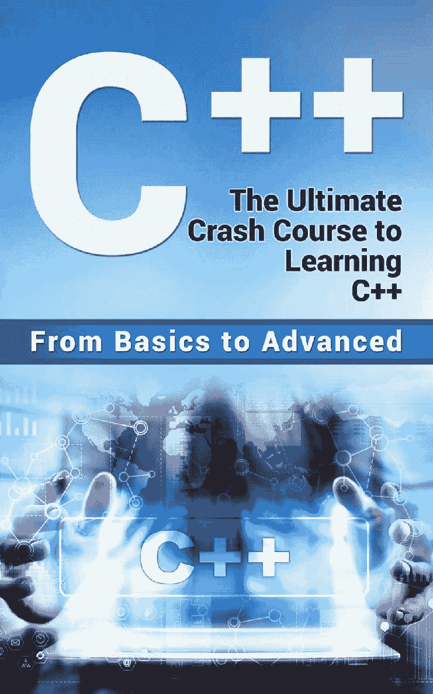

# 引言

如果你正在阅读这本书，意味着你正在主动学习`C++`。`C++`由 Bjarne Stroustrup 于 1979 年首次开发。它是一种通用且高效的编程语言，具有不可替代性。

`C++`是`C`编程语言的扩展。Bjarne 对`SIMULA`语言及其面向对象模型的知识帮助他为`C`创建了类扩展。它最初被名为`C with Classes`，后来更命名为`C++`。

`C++`具有多种特性。这些特性包括：

- `C++`是高效的。
- `C++`是一种静态编程语言。
- `C++`是一种面向对象的语言：对象的使用允许通过类和对象将较大的程序划分为较小的子集。
- `C++`是多范式的：这让开发者能够自由选择想要使用的编程风格。共有 7 种不同的风格供选择。
- `C++`利用标准库：这意味着`C++`能够通过利用库项来扩展其语言的功能。

学习`C++`可以让你的简历提升到一个新的水平。它仍然用于许多主流应用程序、游戏、浏览器等更多领域。人们不断地开发和扩展`C++`的功能。像`Github`这样的开源平台拥有成千上万个`C++`仓库。随着`C++`的增长，开发者机会也在增长。在这些职位中，平均薪资达到 100,000 美元，每月有数千个职位招聘广告。虽然这本书是一个完美的起点，但不要期望一夜就能学会`C++`。这门语言需要实践和坚持。如果你在疑惑，不需要在掌握`C++`之前了解`C`。请将以下章节和练习作为你旅程的路线图，知识在等着你。

# 第 1 章 – 开始 C++


在开始进行`C++`开发之前，你必须先设置一个允许你高效工作的环境。话虽如此，你需要一种运行和编译`C++`程序的方法。这可以通过多种方式实现。这些方法包括：

1. **在线**：在网上运行和编译程序是避免过量下载软件的简单方法。这也是快速运行程序时的一个很好的选择。有很多网站可以实现这一点。`Ideone.com`就是很好的选择。
2. **Mac OS X**：可以使用`Xcode`程序在 MAC 操作系统上运行。可以从苹果开发者页面下载。建议使用最新版本。
3. **Linux**：为了在 Linux 上高效运行程序，你需要安装一个编译器。`GCC`是推荐初学者或在该操作系统上新编程的用户使用的编译器。你还需要下载一个文本编辑器，例如`Gedit`。
4. **Windows**：由于 Windows 是一个标准且广泛的平台，有几个选项可用。这些包括`CodeBlocks`、`JGrasp`或`Eclipse`。

为了更好地理解`C++`程序的结构，将使用`Hello World`作为模板。`Hello World`程序通常用于各种编程语言的入门。

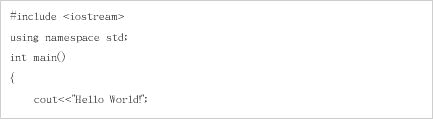

程序的第一行用于在程序中包含头文件。这允许我们使用其中包含的操作。需要`std`命名空间以便准确引用各种操作，而无需在每个`cout`语句前面编写`std`。这一行基本上是指使用标准命名空间。

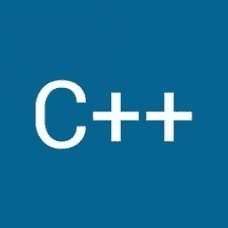

第三行简单指的是这是你程序的`main`函数。程序的体位于括号内部。`cout`语句只需打印引号内的项或在某些情况下打印变量名。这取决于`cout`语句中列出的内容。括号之前的最后一行很重要，因为它本质上关闭了或终止了程序的`main`函数。

如果你熟悉其他编程语言，很容易理解所有程序都只是为计算机执行的一系列有序的指令或命令。这些指令由语句组成。语句是编程语言的最小单元，相当于英语语言中的句子。在`C++`中，使用分号来完成一个语句，而不是句号。变量的概念也是广泛存在且在编程时被频繁使用的。变量是赋予内存中某个空间的名称，可以根据程序的指令进行更改。

变量可以有多种类型。这些类型指示了特定变量中可以存储什么。变量类型包括：

- 整数 (`int`)：这种变量类型只存储没有小数的单体整数。例如`5`或`4509`。它们必须至少有 16 位长。例如`7854`或`34`。
- 字符 (`char`)：这种类型指的是单个字符，如 'a'，且至少有 8 位长。
- `float`：存储浮点值，如`3.1555`。通常为 32 位长。
- `double`：与`float`类似但精度加倍。通常为 64 位长。
- 布尔值 (`bool`)：存储真/假值。
- `void`：不能直接存储数据，作用类似于占位符。


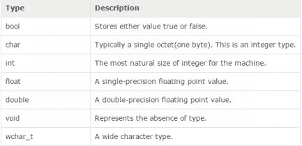

## 使用变量

变量是程序非常基础的一部分。它们可以使用字母数字命名法，但必须以字母开头。变量用于程序中的各种语句。

有 3 种语句。这些类型包括声明语句、赋值语句和输出语句。下面提供了所有这些示例。

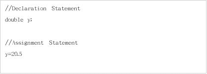

在程序中使用变量之前，必须先用声明语句对其进行声明。声明语句为内存中存放特定值的地方赋予名称和类型。在上面的示例中，名称是`y`，类型是`double`。

赋值语句将特定值赋予变量`y`。在示例中，`y`被赋值为`20.5`的值。

输出语句只需打印特定项或变量的值。上面的示例输出将为`20`。

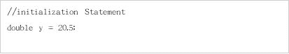

变量的声明和赋值也可以同时进行；这被称为初始化。重要的是记住，初始化变量的唯一时刻是在定义它时。


也可以使用一个语句同时声明多个变量，而不是多个语句。这只需遵循下面的语法即可实现。

上述语句简单地将`x`、`y`和`z`都声明为`double`类型或小数。

## 练习题

使用下方的练习题来确保你已经理解了 C++ 编程的基础知识。

1. 下列选项中，哪一个是 C++ 中写注释的正确方式？
   a) `/*Here is a comment*/`
   b) `\\Here](XXXXXXXXXXXXXXXXXXXXXXXXXXXXXXXXXX)` 是另一个注释\\
   c) `//Here is the last comment`

2. 在下述选项中，哪一个显示了变量的正确声明并初始化值为 10？
   a) `int a 10;`
   b) `int b=10;`
   c) `double c=10;`

3. 在下列选项中，哪一个显示了你将如何声明一个名为`number`的 double 类型并将其初始化为 5？
   a) `double number 5;`
   b) `double number =5`
   c) `double number =5;`

4. 下列选项中，哪一个是将名为`sum`的整数打印到屏幕的正确方式？
   a) `cout<<sum<<endl;`
   b) `cout"sum"<<endl;`
   c) `cout>>sum>>endl;`

5. 在 C++ 程序中，可以同时声明多个数据类型吗？`sum, age, group;`
   a) 是
   b) 否

6. C++ 中可以使用几种数据类型。`double`类型的数据存储的是什么类型的信息？
   a) 整数
   b) 双精度整数
   c) 小数

7. 从用户处读取到一个名为`check`的 double 变量的正确方式是什么？
   a) `cout>>"check";`
   b) `cin>>check;`
   c) `cin<<check;`

8. 从用户处读取到一个名为`sum`的 double 变量的正确方式是什么？
   a) `cin<<sum;`
   b) `cout>>sum;`
   c) `cin>>sum;`

9. 整数不能除以它们自身的原因是什么？
   a) 它们的值会被截断
   b) 你将收到错误信息而不是实际答案
   c) 一旦遇到该语句，你的程序就会崩溃

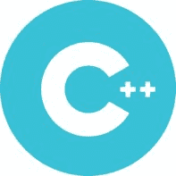

### 答案

1. 下列选项中，哪一个是 C++ 中写注释的正确方式？
   a) `/*Here is a comment*/`
   b) `\\Here](XXXXXXXXXXXXXXXXXXXXXXXXXXXXXXXXXX)` 是另一个注释\\
   c) `//Here is the last comment`

2. 在下述选项中，哪一个显示了变量的正确声明并初始化值为 10？
   a) `int a 10;`
   b) `int b=10;`
   c) `double c=10;`

3. 在下列选项中，哪一个显示了你将如何声明一个名为`number`的 double 类型并将其初始化为 5？
   a) `double number 5;`
   b) `double number =5`
   c) `double number =5;`

4. 下列选项中，哪一个是将名为`sum`的整数打印到屏幕的正确方式？
   a) `cout<<sum<<endl;`
   b) `cout"sum"<<endl;`
   c) `cout>>sum>>endl;`

5. 在 C++ 程序中，可以同时声明多个数据类型吗？`sum, age, group;`
   a) 是
   b) 否

6. C++ 中可以使用几种数据类型。`double`类型的数据存储的是什么类型的信息？
   a) 整数
   b) 双精度整数
   c) 小数

7. 从用户处读取到一个名为`check`的 double 变量的正确方式是什么？
   a) `cout>>"check";`
   b) `cin>>check;`
   c) `cin<<check;`

8. 从用户处读取到一个名为`sum`的 double 变量的正确方式是什么？
   a) `cin<<sum;`
   b) `cout>>sum;`
   c) `cin>>sum;`

9. 为什么整数不应该除以其他整数？
   a) 它们的值会被截断
   b) 你将收到错误信息而不是实际答案
   c) 一旦遇到该语句，你的程序就会崩溃

## 使用修饰符与限定符

修饰符也可以用于各种类型。修饰符可以表示数字符号或提供关于变量的更详细信息。修饰符用于字符、整数和任何`double`类型。修饰符用于将变量操作到精确场景。数据类型修饰符包括：

* 无符号 (Unsigned)
* 有符号 (Signed)
* 长型 (Long)

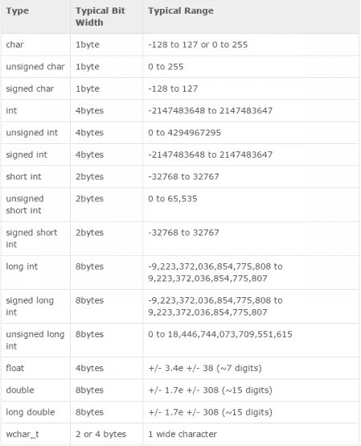运行以下程序以更好地理解。

程序的输出为：`-15536 <-- Variable 1 --> 50000`。上面的输出由于表示`50000`的`unsigned`整数位模式被`short`解释为`-15536`。

C++ 中有 3 种限定符。包括`const`、`volatile`和`restrict`。`const`用于对象。

## 限定符

`const`用于对象。`volatile`用于

## 关键字

`const`用于对象。`volatile`用于

## 注释

`const`用于对象。`volatile`用于

## C++ 基础

`const`用于对象。用于 

`cout`对象是`ostream`类的一个实例，它连接到输出设备或显示器。这是一个非常简单的命令，大多数时候与`cin`配合使用，尽管它也可以不带它使用。

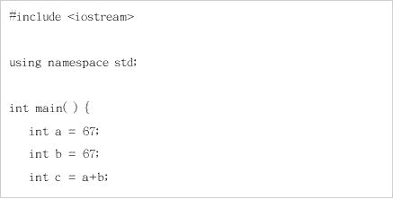运行下面的程序，以准确看到`cout`语句的运行情况。

上述程序的输出在给给定语句的情况下，应当是`c`的正确值。

该程序中需要注意的两个重要点包括插入运算符`<<`和`endl`。`endl`用于在给定的字符串行末尾添加新行。如上文所示，`<<`可以多次使用。

## 使用`cin`

使用`cin`允许用户向给定的变量中输入信息。该对象属于`istream`族，它连接到输入设备（通常是类似于键盘的设备）。提取运算符与插入运算符相反。它简单就是`>>`，你将在下面的程序示例中看到。

```cpp
#include  <iostream>

using  namespace std;

int main(  )  {
 char petname[40];
 char yourname[60];
cout <<  "Please enter the name of your pet: ";
cin >> petname;
cout <<  "Your name is: "  << petname << endl;
cout <<  "Please enter your full name: ";
cin >> yourname;
cout <<  "Your name is: "  << yourname << endl;
}
```

运行程序后，系统会提示你输入宠物的名字。然后它会被打印出来。接着系统会提示你输入你的名字，它也会被打印出来。

尝试自己完成这个练习，以进行更多的输入输出练习。

1. 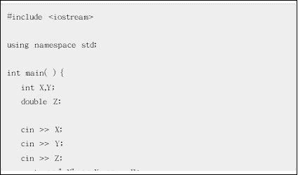回答下面的提示，使输入值分别为`23`、`55.7`和`12`。

# 第 3 章 – 条件语句

C++ 编程中的另一个主要组件是条件语句的使用。条件语句是根据程序的当前值改变其预定路径的语句。讨论的最早且基本的条件语句之一是`if`语句。

在介绍各种类型的条件语句之前，我们必须首先知道在语句中使用哪些关系操作符以及它们代表什么。


| 操作符 | 描述 | 示例 |
|--------|------|------|
| `>` | 大于 | `8 > 6` 为 TRUE |
| `<` | 小于 | `1 < 9` 为 TRUE |
| `>=` | 大于等于 | `3 >= 0` 为 TRUE |
| `<=` | 小于等于 | `6 <= 10` 为 TRUE |
| `==` | 等于 | `6 == 6` 为 TRUE |
| `!=` | 不等于 | `7 != 3` 为 TRUE |
| `&&` | 与逻辑 AND | - |
| `\|\|` | 或逻辑 OR | - |
| `!` | 非逻辑 NOT | - |

## 使用`if`语句

为了完全理解 C++ 中的`if`语句，你必须首先理解它们是如何工作的。

`if`语句的结构如下：

```cpp
if (TRUE)
{
执行下一个语句
}

if (TRUE)
{
    如果为真，执行此块语句
}
else
{
    如果为假，执行此块语句
}
```

在第一个示例中，如果给定表达式为真，则语句将实现。但在第二个语句中，如果语句为真，则执行该语句；但如果语句为假，将执行`else`语句。

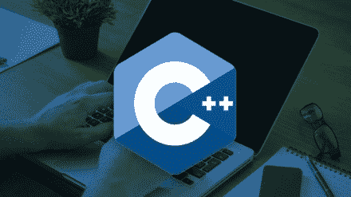

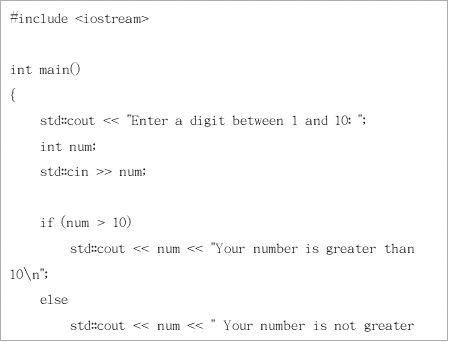下面的程序将演示`if`语句是如何运行和执行的。

正如你可能猜到的，有时也会需要多个`if`语句的情况。因此，可以使用多个`if`语句。

下面的示例程序展示了多个`if`语句是如何执行的。为了成功执行多个`if`语句，我们可以使用块。

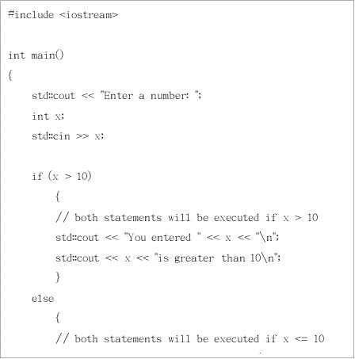

块本质上是括号`{}`的。使用这些括号允许用户告诉程序`if`语句从哪里开始和结束。在未指定块的情况下，程序足够智能可以隐式地定义块。

`if`语句还可以通过使用`else if`链式连接，如下程序所示。

除了能够输入链式`if`语句的能力外，在 C++ 中嵌套`if`语句也是完全可能的。以下是一个嵌套语句的示例。

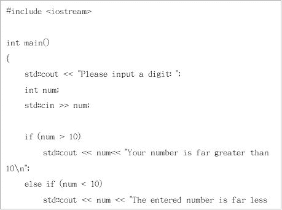上面的代码之所以令人困惑仅仅是因为缺少了括号。在`else`周围添加块会让代码更清晰。这种歧义性被称为"悬空 else"（dangling else）。

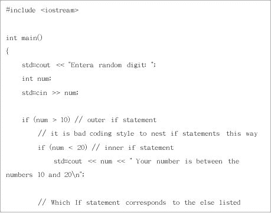

仍然不清楚如何实现`if`或`if-else`语句？使用以下问题进行练习。

1. 下列哪项提供了`if`语句的正确结构？
   A. `if this then that`
   B. `if { expression}`
   C. `if ( expression )`
   D. `else expression if`

2. 编写一个程序，允许用户向系统输入一个数字。程序应根据数字是大于还是小于 50 告诉用户 2 个独立的语句。这将通过输入和条件语句完成。如果数字大于 50，程序应该打印"Wow, this number is big"。如果数字小于 50，程序应该打印"This number is small"。

3. 如果`x`等于 10 且`y`等于 30，该条件会执行吗？`if(x > y)`

4. 条件的作用是什么？

5. `else`的作用是什么？

6. 下列在上下文中意味着什么？

7. 在`if`语句中何时需要大括号？

8. 下列在英语中是什么意思？

9. 如果`x`等于 20 且`y`等于 8，以下是否可以成立？`if(x<=y)`

答案

1. C


## 循环

除了条件语句外，循环被用于部分代码需要重复。与其重写或复制代码段，不如循环。循环允许用户反复执行某些代码直到其完成。

C++ 程序中存在简单的循环是`for`循环。`for`循环的语法如下：

```cpp
for ( 变量初始化; 条件; 变量更新 ) {
    只要括号内的条件为真，就会执行要执行的语句。
}
```

另一种经常使用的循环类型是`while`循环。只要`while`的测试语句为真，`while`循环就会持续执行一个语句块。

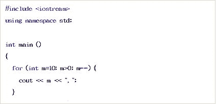

执行以下代码以查看`for`循环的运行情况。

此此`for`循环将有以下输出：

| 10, 9, 8, 7, 6, 5, 4, 3, 2, 1, 结束! | | |

下面的图显示了`while`循环是如何运行的。

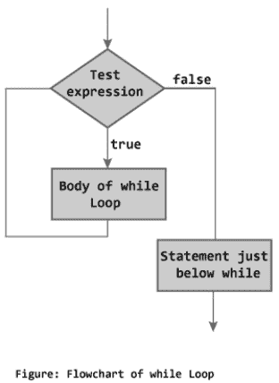

测试表达式可以是布尔表达式的任意组合。然而，只要该语句为真，循环体就会执行。

`while`循环的语法如下：

```cpp
while ( w < 25 ) { // 当 w 小于 25 时
    cout<< w <<endl;
    w++;              // 修改 w 以满足条件
}
```

与`while`循环相似的一种循环是`do while`循环。`do while`循环虽然与`while`循环相似，但在执行给定语句后检查条件。当某些需要至少完成一次时，将使用`do while`循环。`do while`循环的语法如下：

```cpp
do {
} while ( condition );
```

需要注意的是，当条件保持为真时，`do`内部的语句将继续执行。同样重要的是记住，`do while`必须以分号结束，也称为尾分号。

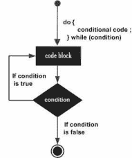

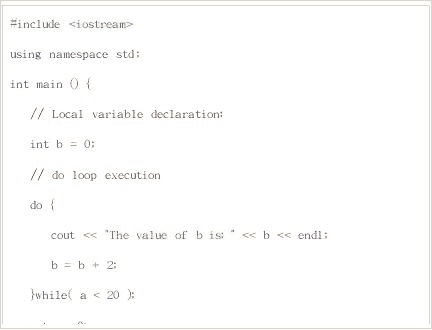 上面的图是`do while`循环运行方式的图形引用。顺序执行以下代码以查看`do while`循环的运行情况。

使用以下练习题来深你对循环的知识。

1. 下面代码将打印什么？

```cpp
var x = 0;
while (x < 3) {
    println("bye");
    x++;
}
```

2. 下面代码将打印什么？

```cpp
var x = 0;
while (x < 3) {
    println("hi");
    x++;
}
println("bye");
```

3. 下面代码将打印什么？

```cpp
var y = 0;
while (y < 0) {
    println("hi");
}
```

4. 哪个`for`循环无法工作？

a) `for (i=0; i<5; i++)`

b) `for (i=5; i<=10; i++)`

c) `for (i=5; i=10; i++)`

5. 哪种类型的循环至少执行一次？

### 练习题答案：

1. bye

bye

bye

2. hi

hi

hi

bye

3. 这段代码将不会打印任何内容，因为`y`等于零且永远小于零。

4. C。

5. `do while`循环至少执行一次。

## Break & Continue 语句

`break`和`continue`语句改变了程序的通常流程。`break`语句在出现时立即结束循环和`switch`语句（稍后将介绍）。`break`语句适用于`while`、`do while`和`for`循环。

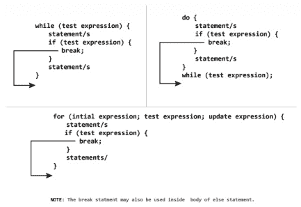 `continue`语句用于跳过循环中的某些条件。该语句用于条件内部。下面的图说明了`continue`语句的运行方式。

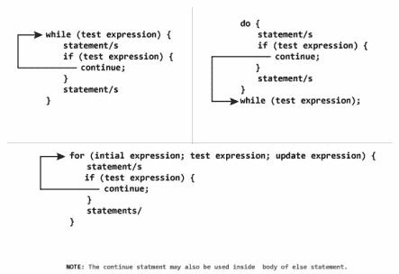 运行以下程序查看`continue`语句的运行方式。

```cpp
#include <iostream>
using namespace std;
int main()
{
    for (int j = 1; j <= 10; ++j)
    {
        if (j == 6 || j == 9) {
            continue;
        }
        cout << j << "\t";
    }
    return 0;
}
```

## Switch 语句

当需要多个`if`语句时使用`switch`语句。`switch`语句的执行速度通常比多个`if`语句快。它们更容易理解和编写。`switch`语句的语法如下：

```cpp
switch (n)
{
    case constant1:
        // 如果 n 等于 constant1 则执行代码
        break;
    case constant2:
        // 如果 n 等于 constant2 则执行代码
        break;
    default:
        // 如果 n 不匹配任何常量则执行代码
}
```

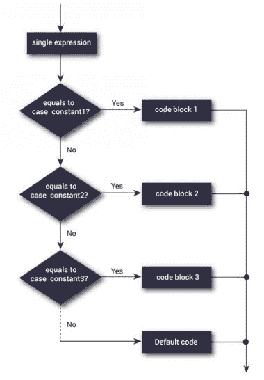 上面的语法和图显示，当位于匹配`n`的`case`时，程序的控制将传递到相关的`case`块。将执行一个代码块，直到程序遇到`break`语句或块的结束。

## 语句练习

使用这些问题练习`switch`语句及其用法。

1. 编写一个程序，根据数字成绩确定学生的字母等级。程序应该输出该学生的字母等级。`switch`应该判断成绩是 A、B、C、D 还是 F。

2. 在`switch`中，每个`case`后面都有特定的内容。那个项是什么？

3. `cases`包含条件语句是合法的吗？

4. 下列`for`哪里是错误的？

5. 下列`case`有什么问题？

6. `switch`必须有大括号吗？

### 答案

1. （代码实现略）

2. 冒号（:）。

3. 是。

4. 处使用了赋值运算符`=`而不是比较运算符`==`。

5. 错误。

6. 是。

```cpp
  }

return 0;

}
```

# 数组练习

使用这些问题来练习数组，并更好地理解该概念的应用。

1. 在下列选项中，数组是如何声明的？

   a) `this_array [15];`

   b) `this_array (15);`

   c) `this_array {15};`

2. 数组的一般用途是什么？它们起什么作用？

   a) 数组的目的是存储地址

   b) 数组的目的是在单个名称下存储多个值

   c) 数组的目的是存储一个值

3. `double test [8];` 这里声明的数组名称是什么？

   a) 数据类型`double`

   b) 数组没有名称

   c) `test`

4. 回到第 3 题。`test`持有多少个值？

   a) 它持有 7 个。

   b) 它持有 8 个

   c) 数组持有 6 个

5. 回到第 3 题。通过观察数组声明，最大的索引值将会是多少？

   a) 最大值将是 7。

   b) 最大值将是 6

   c) 最大值将是 8

6. 在给出的选项中，以下哪个选项显示了初始化数组值的正确方法？

   a) `sample_array [15] = (5,3,4,2,7);`

   b) `sample_array [15] = {5;3;4;2;7};`

   c) `sample_array [15] = {5,3,4,2,7};`

7. 回到第 6 题。`this_array [3]`所在位置的值是多少？

   a) 值是 7

   b) 值是 3

   c) 值是 4

![images/00033.jpeg)

8. 是否有方法一次性打印整个数组？

   a) 是

   b) 否

9. 在尝试打印或分配数组项时，必须使用什么？

   a) 指针

   b) 条件

   c) 循环

## 练习题答案

1. 在下列选项中，数组是如何声明的？

   a) `this_array [15];`

   b) `ths_array (15);`

   c) `this_array {15};`

2. 数组的一般用途是什么？它们起什么作用？

   a) 数组的目的是存储地址

   b) 数组的目的是在单个名称下存储多个值

   c) 数组的目的是存储一个值

3. `double number [8];` 这里声明的数组名称是什么？

   a) 数据类型`double`

   b) 数组没有名称

   c) `test`

4. 回到第 3 题。`test`持有多少个值？

   a) 它持有 7 个。

   b) 它持有 8 个

   c) 数组持有 6 个

5. 回到第 3 题。通过观察数组声明，最大的索引值将会是多少？

   a) 最大值将是 7。

   b) 最大值将是 6

   c) 最大值将是 8

6. 在给出的选项中，以下哪个选项显示了初始化数组值的正确方法？

   a) `sample_array [5] = (5,3,4,2,7);`

   b) `sample_array [5] = {5;3;4;2;7};`

   c) `sample_array [5] = {5,3,4,2,7};`

7. 回到第 6 题。`this_array [3]`所在位置的值是多少？

   a) 值是 7

   b) 值是 3

   c) 值是 4

8. 是否有方法一次性打印整个数组？

   a) 是

   b) 否

9. 在尝试打印或分配数组项时，必须使用什么？

   a) 指针

   b) 条件

   c) 循环

# 第 5 章 – 指针

指针让某些复杂任务变得简单，而且它们非常容易使用。指针被定义为存储变量地址的变量。与变量一样，指针在使用之前必须先定义。`type *var-name;`

使用指针时，类型取决于它所指向的类型。例如，如果我的指针指向一个`double`，那么我的指针必须是`double`。`var-name`是你指针的名称。必须使用星号来表示指针。

`int *int_point;` // 指向整数的指针

`double *dou_point;` // 指向 double 的指针

`float *flo_point; // 指向 float 的指针

`char *ch_point; // 指向字符的指针

以下示例展示了指针中存储的信息，运行以下代码以更好地理解指针。

```cpp
#include <iostream>
using namespace std;
int main () {
  int variable = 10; // 实际变量
  int *ipointer; // 指针变量
  cout << "Value of variable: ";
  cout << variable << endl; // 指针可用地址的值
  cout << "Value of ipointer: ";
  cout << *ipointer << endl;
  return 0;
}
```

## 空指针

赋值为`NULL`的指针被称为空指针。空指针在声明时赋值。它通常持有值为 0。

## 指针运算

由于指针持有的是数值，它们也具有执行基本算术的能力。在某些程序中，开发者可能会选择使用指针而不是数组。这在一定是因为指针可以递增，而数组在没有循环帮助的情况下不能。

以下程序展示了如何成功地增加变量指针以访问数组的每个元素：

```cpp
#include <iostream>
using namespace std;
const int MAX = 4;
int main () {
  int var[MAX] = {10, 100, 200, 300};
  int *ptr; // 让指针持有数组地址
  ptr = var;
  for (int j = 0; j < MAX; j++) {
    cout << *ptr << endl;
    ptr++;
  }
  return 0;
}
```

指针持有数值，它们也可以递减。运行以下代码展示指针如何递增：

```cpp
#include <iostream>
using namespace std;
const int MAX = 4;
int main () {
  int var[MAX] = {10, 100, 200, 300};
  int *ptr;
  ptr = var;
  for (int j = 0; j < MAX; j++) {
    cout << "Value of var[" << j << "]: ";
    cout << *ptr << endl;
    ptr++;
  }
  return 0;
}
```

除了递增，指针还可以使用关系运算符进行比较。这包括`==`、`<`和`>`。

# 第 6 章 – 函数

函数是为了完成特定任务而编写的有用代码段。当它们一起使用时可以创建更整洁的程序。函数的基本结构如下。请注意，原型是声明函数的另一种方式。

`返回值 名称 (数据类型变量, 数据类型变量...)`

- **返回值**：返回值指的是函数执行完成后返回的内容。例如，如果我创建一个计算学生平均年龄的程序，我会使用`int`，因为我不需要小数位。因此，截断是可以接受的。我的返回值类型应该是`int`。

- **名称**：这是函数的名称。在相同的示例中，我可以将此函数命名为`average_age`

- **数据类型**：数据类型简单指的是变量。这些是函数可以用来使用的项。它可以是一个，也可以是多个。

函数的开头看起来如下所示：

`int average_age(int x, int y)`

原型的位置如下所示所示：

```cpp
#include <iostream>
int average_age (int x, int y);
int main() {
  //主程序
  return 0;
}

int average_age (int x, int y) // 注意这里没有分号
{
  // 函数将写在这里
}
```

运行以下程序作为示例以观察函数是如何工作的。以下程序中的函数用于相两个变量并返回它们的和。

// 完整的工作程序

```cpp
#include <iostream>
double summation (int a, int b); // 原型
int main() {
  int x, y;
  int c;
  cin >> x; // 用户输入 x 的值
  cin >> y; // 用户输入 y 的值
  c = summation(x,y); // 调用函数 summation 并传递你读取的变量
  cout << "The sum of the 2 numbers is " << c << endl;
  return 0;
}
```

```cpp
double summation (int a, int b) //定义函数
{
    double z;
    //'a' 存储 'x' 的值，'b' 存储 'y' 的值
    z = a+b;
    return z; //将 'z' 的值返回给 main 函数中的变量 'c'
}
```

除了返回数字或变量的函数外，还有不返回任何内容的。这些是空函数。

```cpp
void sum (int x)
```

这仅仅意味着像最后所示的那样没有返回值。

## 练习

1. 当你使用函数时，要执行的操作是什么？

    a) 声明变量

    b) 原型

    c) 初始化

2. 原型位于程序的哪个位置？

    a) 在`int main()`之前

    b) 在`int main()`之后

    c) 程序的末

3. 如所示`int books (int y)`，函数的名称是什么？

    a) `int`

    b) `int y`

    c) `books`

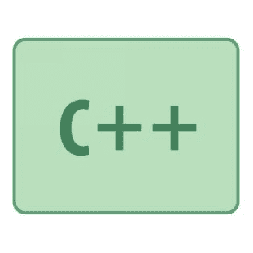

4. 根据第 3 题的示例，函数返回什么数据类型？

    a) `int`

    b) `string`

    c) `double`

5. 根据第 3 题的示例，函数接收什么数据类型？

    a) `char`

    b) `String`

    c) `int`

6. `char my_function (int a)`接收什么类型的数据？

    a) `double`

    b) `char`

    c) `int`

7. 如所示`double summation (double a, double b)`，从 main 程序调用该函数的正确方式是什么？

    a) `summation (x)`

    b) `summation (y)`

    c) `summation (x,y)`

8. 如果在函数内部声明了一个变量，这是哪种变量？

    a) 全局变量

    b) 局部变量

    c) 扩展变量

9. 如果有一个函数`double go (double b)`，我们可以在主 程序中向它发送不同的变量，还是必须是`b`？例如`go (x)`

    a) 是

    b) 否

## 函数练习答案

1. 当你使用函数时，要执行的操作是什么？


1. 变量声明
2. 原型
3. 初始化

## 2. 原型位于程序的哪个位置？

a) 在 `int main()` 之前

b) 在 `int main()` 之后

c) 程序的末

## 3. 如所示 `int books (int y)`，创建的名称是什么？

a) `int`

b) `int y`

c) `books`

## 4. 根据第 3 题的示例，函数返回什么数据类型？

a) `int`

b) `string`

c) `double`

## 5. 根据第 3 题的示例，函数接收什么数据类型？

a) `char`

b) `String`

c) `int`

## 6. `char my_function (int a)` 接收什么类型的数据？

a) `double`

b) `char`

c) `int`

## 7. 如所示 `double summation (double a, double b)`，从 main 程序调用该函数的正确方式是什么？

a) `summation (a)`

b) `summation (a,b)`

c) `summation (b)`

## 8. 如果在函数内部声明了一个变量，这是哪种变量？

a) 全局变量

b) 局部变量

c) 扩展变量

## 9. 如果有一个函数 `double go (double b)`，我们可以在主程序中向它发送不同的变量，还是必须是 `b`？例如 `go (x)`

a) 是

b) 否

# 第 7 章 – 类与对象

C++ 的主要功能之一是在 C 语言中引入面向对象。由于由于，类是 C++ 程序涉及特征之一。这些有时被称为用户定义类型。

## 为什么要使用类？

使用类是为了详细描述对象的结构。它们用于操作对象。

## C++ 定义

实际上，类是一个大纲。它是对象的蓝图。以下是类的示例：

```cpp
class Person {
public:
    double weight;
    double height;
    int age;
};
```

上面的信息仅仅是对象的的基本概述。有几个概念需要深入研究。

## 定义 C++ 对象

由于类被认为是蓝图，因此创建了对象。

```cpp
Person Person1;
Person Person2;
```

`Person1` 和 `Person2` 拥有它们的数据。

## 访问数据成员

/images/0003..)

类型的数据可以简单地使用访问运算符。

## 成员函数

成员函数对类对象进行操作。它是类定义内部的函数。在类定义之外，成员函数也可以使用作用域运算符 `::` 分别定义。这相当于内联声明函数。

上面的示例如下所示。

/images/00036.jpeg

## 类成员修饰符

`public`、`private` 和 `protected` 对类体内的各种类成员提供了访问限制。这些关键字可以称为指定符。类有能力拥有多个不同访问级别的块。

/images/0038.jpeg

## 构造函数与析构函数

构造函数是类的一个函数，每当创建新对象时都会实现。它们与类名相同，但没有返回类型或 `void`。下面的示例显示了如何使用构造函数。

/images/00039.jpeg

虽然构造函数通常没有参数，但它仍然具有这种能力。这有助于你在创建对象时赋值。带参数的构造函数的示例如下所示。

/images/00040.jpeg

析构函数在对象离开作用域时执行。当 `delete` 表达式应用于对象指针时，也会执行。

析构函数与类名相同，但以波浪号 `~` 为缀。它不能返回或接收参数。在释放资源时非常有用。以下是析构函数的示例。

/images/00041.jpeg

## 友元函数

友函数定义在类的作用范围之外，但它能够访问所有的私有和保护有成员。成员函数不能是友函数。为了将一个函数声明为友元，必须在函数名前前加上 `friend` 关键字。下面的示例展示了如何使用友函数。

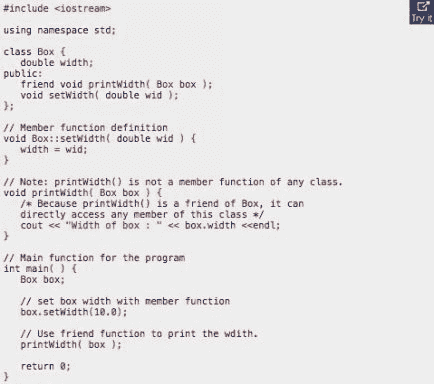

## 静态类成员

静态类成员使用 `static` 关键字定义。这意味着无论存在多少个对象，静态类成员都只有一个拷贝。

下面的示例展示了如何使用静态类成员。

即使在类不存在任何对象的情况下，也可以调用静态成员函数。需要注意的是，访问静态函数只需直接使用类名和作用域解析运算符 `::`。静态成员函数只能从类外部访问静态数据成员、静态成员函数以及类外部的任何函数。

静态成员函数可以访问静态数据成员、静态成员函数以及类外部的任何函数。它还可以被用于判断对象是否已经创建或是否尚未创建。

以下是使用静态函数成员的示例。


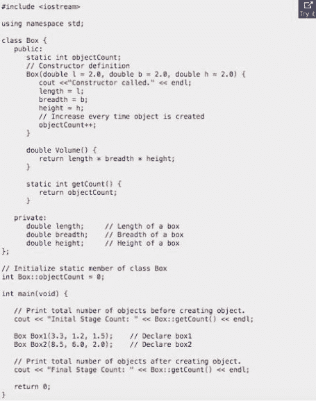

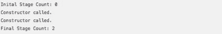

## 基础练习题

1. 使用类编写一个程序，从用户输入输入和年龄，并将这些信息在屏幕上显示给用户。你的类应该包含人的姓名和年龄。

2. 假设一个类被公继承，下列陈述中哪一个是正确的？

   A) 基类的公共成员将保持为派生类的保护有成员。

   B) 派生类的私有成员将变为派生类的私有成员。

   C) 基类的私有成员将变为派生类的保护有成员。

   D) 基类的公共成员将变为派生类的公共成员。

3. 下列哪种是 C++ 中类的默认访问类型类型?

   A) `Private`

   B) `Public`

   C) `Static`

   D) `Binding`

4. 类的实例也被称为 _____ ？

   A) `Function`

   B) `class`

   C) `object`

## 练习题答案

1. /* 在 C++ 中创建基础类 */

```cpp
#include <iostream>

using namespace std;

// 类 -------------------
class person
{
public:
// 变量声明
  string name;
  int age;
};

//----------------------
// 主函数
int main()
{
    person info;
    // 获取对象的变量输入值
    cout<<"Enter the Name :";
    cin>>info.name;
    cout<<"Enter the Age :";
    cin>>info.age;
    // 显示输出
    cout << info.name << ": " << info.age << endl;
    return 0;
}
```

2. 假设一个类被公继承，下列陈述中哪一个是正确的？

   A) 基类的公共成员将保持为派生类的保护有成员。

   B) 派生类的私有成员将变为派生类的私有成员。

   C) 基类的私有成员将变为派生类的保护有成员。

   D) 基类的公共成员将变为派生类的公共成员。

3. 下列哪种是 C++ 中类的默认访问类型类型?

   A) `Private`

   B) `Public`

   C) `Static`

   D) `Binding`

4. 类的实例也被称为 _____ ？

   A) `Function`

   B) `class`

   C) `object`

# 第 8 章 – 继承

像 C++ 这样的面向对象编程语言是以对象而非动作建模的。面向对象（OOO）有 7 个主要组件。

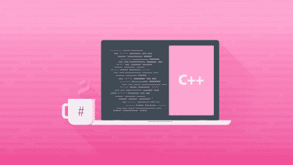

这些组件包括：

- 抽象——指的是隐藏与特征相关的细节，但显示本质特征。
- 封装——这是函数与变量的绑定。
- 继承——它允许重用代码而无需重复编写。这还允许类从基类继承信息。
- 多态——这允许创建名称相同但使用不同参数的函数。尽管这些函数具有相似的命名规范，但它们的行为不同。

本章将重点关注继承以及在 C++ 中继承。继承让你的代码更整洁、更容易理解。

## 派生类

一个类具有从多个类中派生的能力。这意味着它可以从不同的基类继承函数和数据。

类派生列表用于定义派生类。它命名了一个或多个基类。派生列表的形式如下所示。

```cpp
class derived-class: access-specifier base-class
```

## 访问控制与继承

派生类具有访问所有私有基类成员的能力，这意味着基类成员不应该能被派生类的函数访问。

不同的访问类型如下所示，取决于谁可以访问它们以及具体的访问方式。

| 访问 | Public | protected | private |
| :--- | :--- | :--- | :--- |
| 同一类 | Yes | yes | yes |
| 派生类 | Yes | yes | No |
| 外部类 | Yes | no | No |

## 继承类型

当类从基类派生时，可以通过 3 种不同的方式继承基类。可以通过公共、保护或私有继承来实现。继承类型由访问修符决定，访问修符在上一节中讨论过。

最常用的继承是公共继承。保护和私有继承很少使用但仍然需要了解。在使用这些继承时应遵循以下规则：

- 公共继承：在使用公共继承时，关键在于基类和子类都知晓。
- 保护继承：在使用保护继承时，必须记住只有基类及其子类知晓。
- 私有继承：在使用私有继承时，除了子类外无人知晓。

## 多重继承

在 C++ 中，一个类具有从多个类继承成员的能力。语法如下：

```cpp
class derived-class: accessA, accessB
```

在给定的语法中，访问可以是公共、保护或私有之一。每个基类都有假设的访问。

# 第 9 章 – 新版本：C++11

C++ 的第一次迭代大约发生在 1998 年。尽管经历了长时间的等待，但 C++11 在 2011 年 8 月通过了，这在第一次迭代之后 13 年。人们认为尽管版本 11 是相同语言的改进，但它的感觉是全新的。

C++11 可以支持许多新功能，包括：

- Lambda 表达式
- 委托构造函数
- 删除和默认的函数声明
- 空指针
- 右值引用
- C++ 标准库的革新
  - 新算法
  - 新容器类
  - 类型特质
  - 原子操作
  - 多线程库

在本章中，你将学习更多关于 C++11 的核心功能。

## Lambda 表达式


Lambda 表达式可以定义为大或小的可执行语句，就像函数一样，可以插入到函数调用的位置。这些表达式不仅高效而且安全。

高亮显示的语句以 lambda 引导符 `[]` 开始。`{}` 之间的语句作为要执行的函数，类似于普通函数。在上面的示例中，该表达式被用于判断当前会计师对象收到的工资是否高于给定的最低工资但低于上限。如上所示，由于这些表达式仅一行，因此它们更容易被整合到代码中。

lambda 表达式的形式如下：

`capture->return-type {body}`

该形式中显示的第一个项是 `capture`（捕获）子。lambda 表达式具有引用外部变量的能力。这意味着它能够访问来自“闭包作用域”的变量。在给示例中，`min_wage` 和 `upper_limit` 就在闭包作用域内。

外部引用可以通过两种方式捕获：按值捕获或按引用捕获。捕获的方法非常重要，因为它决定了表达式如何操作变量。每个编译器会将每个表达式转换为一个函数对象。


要转换该表达式，必须遵循若干准则。这些准则包括：

- 将 lambda 的体转换为重载运算符之一。
- 表达式的参数列表也变为重载运算符的参数列表。
- 被捕获的变量变为重载运算符的数据成员。

`closure`（闭包）对象是 lambda 表达式的重要部分。这是编译器生成的函数对象。

当变量被“按值捕获”时，它变成闭包作用域内变量的拷贝成员。当变量被“按引用捕获”时，它被绑定为闭包作用域内变量的引用。当某项被分类为默认捕获时，它是闭包作用域内所有项的捕获方法。

以下示例是按值捕获和按引用捕获的示例。提供了按值捕获示例：

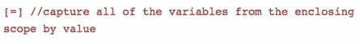

下面提供了按引用捕获示例：

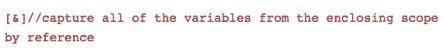

判断 lambda 是否有外部引用非常容易。空捕获子句表示没有外部引用。这意味着它只访问 lambda 的局部变量。

```cpp
[] (int a, int b) {return a*b;}
```


下面显示的 lambda 提供了各种捕获子句的示例。

```cpp
vector<int> v3={0,8,9}, v4={11,12,14,15}; //这是 C++11 中的新初始化符号

&v3 {vi.push_back(a); }; 

捕获引用的一个示例。捕获 v3。

[&]  (int m) {v1.push_back(m); v4.push_back(m) };

//这显示了按引用捕获 vi 和 vi2。

[v3]() //此示例显示了按值捕获 v3。

{for_each(auto y=v3.begin(), y!=v3.end(), y++) {cout<<y<<" ";}};
```

C++11 还允许将 lambda 表达式存储在变量中，就像存储普通函数和变量一样。下面展示了此功能的示例：

```cpp
auto fact = [](int e, int f) {return e * f;};
```

上述 `auto` 声明定义了 `fact`，这是一个 `closure` 类型。以后可以调用它，而无需输入整个 lambda 表达式。闭包类型是编译器生成的函数类。

```cpp
int arr{1,2,3,4,5,6,7,8,9,10,11,12};

long res = std::accumulate(arr, arr+12, 1, factorial);

cout<<"12!="<<res<<endl;
```

在上面的示例中，`factorial` 闭包每次迭代都会将当前元素的值与累加的值相乘。结果将是 12 的阶乘。当不使用 lambda 时，需要定义像下面列出的那样的单独函数。

```cpp
inline int factorial (int a, int b)
{
return a*b;
}
```

## 自动类型推导和 `decltype`

在之前的 C++ 版本（3）中，声明时必须指定类型。对象的声明通常会包含一个初始化器。C++11 允许在不指定类型的情况下声明对象。下面提供了一些示例：

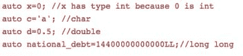

当对象自动生成时，类型推导经常用于模板中。它也可以在对象类型非常冗长时使用。

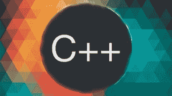

这个新版本提供了一种捕获表达式类型的机制。`decltype` 返回表达式的类型。

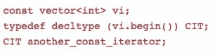

`decltype` 的主要预期用法是声明函数模板。这些函数模板类型取决于参数的类型。

## 删除函数和默认函数

下面显示的示例被称为默认函数。

```cpp
struct A
{
A()=default; //C++11
virtual ~A()=default; //C++11
};
```

代码的粗体部分 `=default` 告诉编译器创建默认实现。

默认函数有两个主要优势，包括：

- 与手动实现相比，默认函数的效率高得多。
- 默认函数还让开发者从定义中解放出来。

默认函数的相反面是删除函数。

```cpp
struct NoCopy
{
NoCopy ( const ) = delete;
NoCopy & ( ) = delete;
};

NoCopy a;
NoCopy(a); //构造函数已删除
```

## `nullptr`


自 C 语言诞生以来，`0` 不仅作为空指针，还作为常量整数。`nullptr` 现在取代了 `NULL`。换句话说，凡是你打算写 `NULL` 的地方可以使用 `nullptr`。C++11 引入了 `nullptr` 关键字作为新的空常量。该关键字的类型是 `nullptr_t`。该类型适用于所有指针类型。以下是使用空指针之前的程序示例：

```cpp
void g(int);
void g(char*);

void h()
{
 g(0); //调用 g(int)
}
```

在 C++11 创建空指针后，相同的语句如下：

```cpp
void h()
{
 g(nullptr); //调用 g(char*)
}
```

## 委托构造函数

![programming_code_overlay]

委托构造函数是指将多个构造函数链式在一起的能力，或者调用同一类的另一个构造函数。这些构造函数的示例如下所示：

```cpp
class Z //C++11 委托构造函数
{
int a, b;
char *p;

public:
Z(int v) : a(v), b(0), p(new char [MAX]) {} //1 目标构造函数
Z(): Z(0) {cout<<"delegating ctor"<<endl;} //2 委托构造函数
};
```

在示例中，委托构造函数是 2，而构造函数 1 是它调用的目标。

## 右值引用

右值引用是 C++11 的另一个项目。在之前的 C 版本（C3）中，引用类型只能绑定到左值（lvalue）。这些新的右值引用能够绑定到字面量或临时对象等右值（rvalue）。

![Programming-and-its-ways]

回顾一下，在 C 语言背景下，左值是可以位于赋值语句左侧或右侧的表达式。右值正如其名所示，只能出现在赋值的右侧。这里列了一些左值的示例。

```cpp
int c = 47;
```

```cpp
int d = 33;
```

在上面的示例中，`c` 和 `d` 都是左值（l-values）：


```cpp
c = d;
d = c;
c = c * d;
```

在上述项中，`c * d` 是一个右值（rvalue）。

```cpp
int e = c * d;
```

这条语句是正确的，因为右值位于赋值的右侧。

```cpp
c * d = 47;
```

这条语句是不允许的，因为右值位于赋值的左侧。


引入这些右值引用（rvalue references）的原因是移动语义（move semantics）。移动无法与对象的拷贝进行直接比较。在移动过程中，目标对象从源对象内部获取资源。这本质上使得源对象失去了任何资源或处于“空”状态。当不需要拷贝或拷贝开销可能时，通常使用移动操作。

为了充分发挥移动语义的潜力（包括利用性能提升），应该考虑字符串交换（string swapping）。

一个非常基础的实现类似于下例所示：

```cpp
void basicswap(string &b, string & c){
    string temporary = b;
    b=c;
    c= temporary;
}
```

上面的示例可以归类为基础或天真，因为这种实现被认为是开销巨大的。字符串的拷贝意味着必须分配原始内存。这意味着字符需要从源移动到目标。而当字符串被移动时，数据成员只是被简单地交换了。这在不分配内存、不删除内存且不拷贝字符的情况下完成。

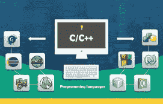

右值引用的行为与普通引用相似。然而，右值引用有几个例外。

除了解决移动语义问题外，它还试图解决完美转发（perfect forwarding）。完美转发允许开发者编写构造函数或函数，并将参数作为右值或左值进行转发。

以下代码展示了字符串的移动，它仅仅交换了两个数据成员。这种做法没有分配或删除内存，也没有拷贝字符数组。

```cpp
void moveswap(string& blank, string & full){
    //pseudo code
    size_t sz=blank.size();
    const char *p= blank.data();
    //将 full 的资源移动到 blank
    empty.setsize(full.size());
    empty.setdata(full.data());
    //full 变为 blank
    full.setsize(sz);
    full.setdata(p);
}
```

在实现支持移动的类时，可以声明移动构造函数和赋值运算符。这类似于下面：

```cpp
class Ablemove
{
    Ablemove (Ablemove &&); // 移动构造函数
    Ablemove && operator=( Ablemove &&); // 移动赋值运算符
};
```

需要注意的是，`C++11` 标准库大量利用了移动语义。因此，大量的算法和容器现在都经过移动优化。

## C++11 标准库

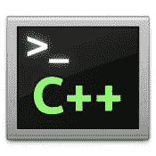

技术报告 1（Technical Report 1）首次在 C++03 中引入。随着该库的实现，C++ 经历了重大的重构。它包含了各种新的容器类以及用于正则表达式、函数包装器等组件的新库。随着 C++11 的到来，技术报告 1 正式并标准。这带来了许多新库。

C++11 为 C++ 语言引入了许多新库，包括：

* 正则表达式库

* 线程库

* 原子操作库

* 容器库中的各种特性

## 线程库

C++11 的一个显著新增是增加了并发（concurrency），即同时执行多条指令。C++11 现在为开发者提供了一个 `thread` 类，代表一个执行线程。这被称为承诺（promises）和未来（futures）。这些对象主要用于并发环境中的同步。

使用新的线程功能非常简单，将在下面的示例中演示。只需简单地添加线程头文件即可：

```cpp
#include <thread>
```

下面的示例仅利用了“Hello World”，这是编程教程中最基础的内容。

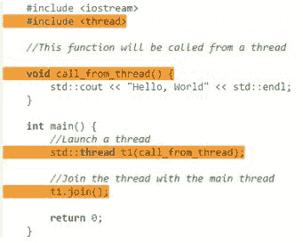

在你的机器上运行上述代码。C++11 还允许在线程中使用参数。我们有能力添加任意数量的参数。以下代码已修改为使用参数的形式，并展示了给定的输出。

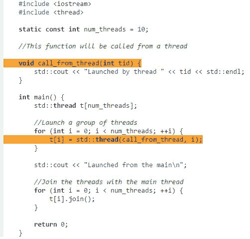

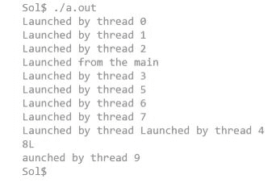

你可能会注意到某些结果是困惑或混乱的。这是因为所有线程恰好在竞争同一个资源。该资源是 `stdout`。

可以通过互斥锁（mutexes）或屏障（barriers）来避免这些混乱的结果。这些屏障允许开发者组织线程共享特定资源。

## 新智能指针类


如果你不知道，智能指针目前定义在内存头文件的 `std` 命名空间中。它们是 RAII 的要素。RAII 代表资源获取初始化（Resource Acquisition Initialization），确保资源获取与对象初始化的同时发生。

之前的 C++ 版本（如 C++98）有一个智能指针类。该类是 `auto_ptr`，现在已被废弃。C++11 带来了两个新的智能指针类，分别是 `shared_ptr` 和 `unique_ptr`。这两个新组件都与标准库的其他组件兼容。因此，指针可以存储在标准容器中并使用标准算法处理。

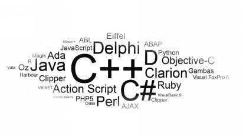

以下定义取自 MDSN.com，并准确解释了这些组件。

### unique_ptr

`unique_ptr` 的底层指针只允许一个所有者。除非你确定需要 `shared_ptr`，否则应作为默认选择。它可以移动到新的所有者，但不能拷贝或共享。对比 `boost::scoped_ptr`。支持右值引用以便从 STL 集合中快速插入和提取。头文件：`<memory>`。

下面的图说明了所有权如何在两个 `unique_ptr` 之间转移。

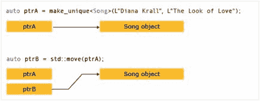

示例演示了如何在代码中传递和创建 `unique_ptr` 实例。

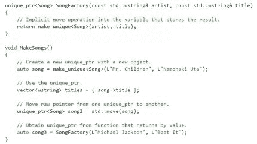

### shared_ptr

这种指针类型是引用智能指针。`shared_ptr` 用于多个指针需要拥有同一个原始指针的情况。例如，当你从容器返回指针副本但想保留原始指针时。当所有 `shared_ptr` 所有者离开作用域或放弃所有权时，原始指针可以被删除。它的大小为两个指针；对象使用其中一个指针，而共享控制块中的引用计数使用另一个。头文件：`<memory>`。

下图显示一个内存位置有多个指向它的 `shared pointers`。

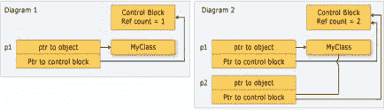

下面的代码示例说明了 `shared_ptr` 实例的声明和初始化。一旦分配了对象，这些实例将获得该对象的所有权。

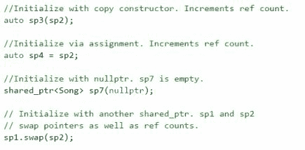

共享指针还可以被传递给其他函数。可以通过以下方式实现：

* 按值传递

* 按引用传递

* 传递给底层对象

## 新 C++ 算法

C++11 还引入了许多新算法。确切来说有 8 种。这些新算法包括：

* `all_of()`

* `any_of()`

* `none_of()`

* `is_sorted()`

* `is_sorted_until()`

* `is_partitioned()`

* `is_permutation()`

* `minmax_element()`

### All_of, any_of, none_of 算法

这三个算法非常相似。它们本质上是检查一元谓词是否对无元素、全部或部分元素返回真值。

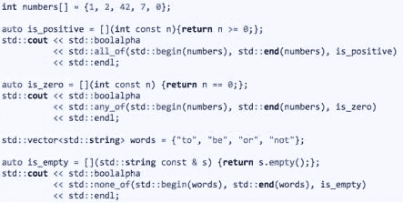

### is_sorted()

该算法本质上是检查特定范围内的元素是否按升序排列。该范围内的元素使用 `operator<` 进行比较。它们也会使用二进制比较函数 `comp` 进行比较。

下面是它的用法示例以及给出的输出。

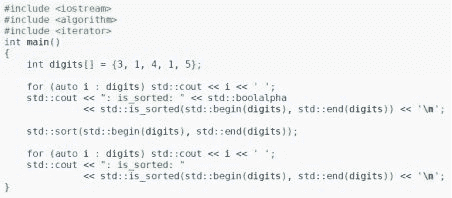

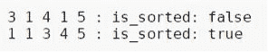

### Is_sorted_until()

该算法与 `is_sorted()` 算法类似。它通过检查一组元素是否按升序排列来执行相同的功能，但该算法返回一个迭代器。该迭代器指向上界，即最大的子范围的边界。这个范围显然是有序的。下面是一个使用 `is_sorted_until()` 的程序示例及其给出的输出。

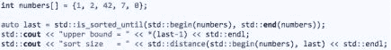


### Is_partitioned()

该算法的作用正如其名称所设的。它检查一个范围是否被分区。这意味着，它检查一个范围是否根据给定的一元谓词进行了排序。所有不满足给定谓词的元素必须在满足条件的元素之后。

以下程序是使用 `is_partitioned()` 算法的示例。

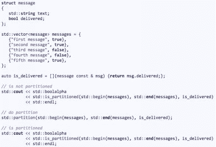

### Minmax_element()

`minmax_element()` 算法寻找给定范围内的最小值和最大值。一旦成功运行，它会返回一个指向对应元素的迭代器对。关于此算法我们必须记住的三点包括：

* 当给定的范围没有值或为空时，算法将简单地返回 `std::make_pair(first, first)`。

* 如果给定的值集中有多个最小值，它将仅返回第一个。

* 如果给定的值集中有多个最大值，它将仅返回最后一个。

在以下代码中可以看到该函数的用法，以及给出的输出：

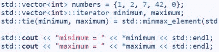

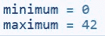

### Is_permutation ()

该算法用于确定一个元素范围是否是另一个元素范围的排列组合。下面是 `is_permutation` 的运行示例。

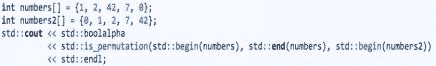

总的来说，C++11 包含了许多变化。变化之多以至于有些人认为它几乎是一门完全不同的语言。你需要时间来适应这些变化。不要指望一夜之间就能理解它们。C++14 对 C++11 引入的许多内容进行了重大修订。下一章将重点重点提供这些组件及其示例。

# 第 10 章 – 新版本：C++ 14

C++ 14 于 2014 年 12 月发布。在发布之前，它经常被称为“C++1y”。C++14 为核心语言添加了大量更新。在许多情况下，C++14 是在 C++11 功能的基础上构建的。总的来说，这是一个更精细的版本，对用户的影响较小。


## 返回类型推导

C++11 开启了 lambda 表达式，并允许它们根据表达式确定返回类型。这个新版本为所有函数赋予了这种能力。需要使用 `auto` 来确定返回类型。


## 放宽的 constexpr


C++11 还引入了 `constexpr` 声明函数的概念。这本质上是一个可以在编译时执行的函数。在 C++11 中，`constexpr` 函数只能有一个表达式。

C++14 减少了版本 11 中的限制。这些函数现在可以包含：

* 除了 `thread_local` 或 `static` 变量类型或任何未初始化的声明以外的所有声明

* 包括 `if` 语句和 `switch` 在条件

* 任何循环语句，包括 `for` 或 `while`

此版本的 C++ 禁止使用 `goto` 语句。

## 数字分隔符

C++14 现在为用户提供了使用数字分隔符的选项。这只是用于数值字面量中的单引号。这包括整数和浮点整数。

该功能并不是什么翻天地的变化，但对于阅读数字很有用。分隔符不会改变数字的计算，除了可读性外，没有特殊的编码优势。

下面的示例标识了如何使用它。


## 关键字：auto

`auto` 关键字是 C++14 中的新特性。

在 C++14 出现之前，并不支持如 `11111101` 这样的二进制字面量。为了使用它们，需要将它们转换为支持的类型。下面的代码段展示了如何在编程中使用它们。


二进制字面量以 `0b` 或 `0B` 开头。该前缀之后跟着一系列 0 和 1。类似的语法在许多其他编程语言中也可以找到。这些编程语言包括 `Java`、`Perl` 和 `Python`，它们都已提供对二进制字面量的支持。

二进制字面量的类型为 `int`。它可以在所有接受常量字面量的地方使用。

## 变量模板

变量模板的设计目的是为了使编码变得更简单，并简化常量的定义和使用。变量模板本质上是一组变量的定义。

变量模板是通过声明变量的地方使用模板声明创建的。


这些仅仅是 C++14 引入的一些特性。虽然引入了许多其他特性，但并不是强有力的进展。C++14 包含的一些小特性包括带尺寸的位置（sized deal locations）和一些语法清理。尽管 C++14 的版本更新与 C++11 的重大更新相比，但它是必要的。

## 结论

恭喜你，通过学习和应用每一章列出的内容，你已经到达这本书的末尾！记住，这只是一个开始。为了真正精通 C++，你必须不断学习并应用你所学的。既然你已经开启了 C++ 之之旅，保持警惕是十分重要的。

C++ 是一种通用语言，可以处理各种大型系统，也可以处理较小的系统。在创建商业应用时，它是一种主流语言。有大量使用 C++ 编写的项目，包括：

* 像 `Linux` 和 `Mac OS X` 等操作系统

* 如《魔兽世界》和《暗黑破坏》系列的游戏

* 流行的 `Wii`、`PlayStation` & `XBOX` 游戏

* 编程语言的虚拟机（这些语言包括 `Python`、`Java`、`Rudy`、`PFP`、`Perl`）

* 流行软件如 `MS Office`、`Adobe Photoshop`、`Inventor` 和 `AutoCAD`

* Web 浏览器（`Chrome`、`Internet Explorer` 和 `Firefox`）

* 许多 `Apple iOS` 应用

这个列表证明了 C++ 是一种能够做任何事情的通用语言。

如果你想知道 C++ 在明天或 10 年后是否仍然适用，答案是肯定的！

C++ 结合其前身 `C` 提供了对硬件的访问和高层次的抽象。它是仅次于 `C` 的第三常用语言（`Java` 则位居第一）。目前，还没有竞争对手可以取代 C++。

C++ 速度快，能够有效高效地利用资源。大多数高质量的嵌入式应用程序是用 `C` 和 `C++` 创建的。

C++ 最初于 1985 年 10 月实现商业化。C++ 在其整个生命周期内不断演进，并遵循一套独特的规则。这些规则包括以下。这些规则摘自 `Bjarne Stroustrup` 写的 *Evolving a language in and for the real world: C++ 1991-2006*。

### 通用规则

* C++ 的演进必须由真实的问题驱动。

* 不要陷入对完美的盲目追求中。

* C++ 现在必须是实用的。

* 每个特性都必须有合理且显见的实现。

* 始终提供过渡路径。

* C++ 是一种语言，而不是一个完整的系统。

* 为每种支持的风格提供支持。

### 设计支持规则

* 支持良好的设计理念。

* 为程序组织提供便利。

* 言之有物。

* 所有功能都必须是可以负担得起的。

* 允许一个实用的功能比防止所有的误用更重要。

* 支持从单独开发的部件组合成软件。

### 语言技术规则

* 不得隐式地违反静态类型系统。

* 为用户定义类型提供与内置类型一样优异的支持。

* 局部性是好的。

* 避免顺序依赖。

* 如果有疑问，选择最容易教学的特性变体。

* 语法很重要（往往以扭曲的方式）。

* 应该消除预处理器的使用。

### 低级编程支持规则

* 使用传统的（笨陋的）链接器。

* 不要与 `C` 产生无故的不兼容性。

* 在 C++ 之下不要留给更低级语言的空间（汇编除外）。

* 你不使用的无需付费（零开销规则）。

* 如果有疑问，提供手动控制的方法。

总的来说，人们使用 C++ 有许多理由。简单来说，C++ 是：

* **灵活** —— C++ 是灵活的，因为它没有强制使用某种编程语言的限制。它可以毫不费力地用于各种应用领域。

* **高效** —— 支配 C++ 的基本概念反映了日常计算机的概念。

* **可用** —— 在所有计算机上通常都有可用的 `C` 编译器。还有其他工具和其他资源，使得开发者不需要从头开始编写。

* **可移植** —— 移植使用 C++ 项目相当简单且通常可行。

你已经学习了 `C++11` 和 `C++14` 之间的区别，以及它们提供的功能。然而，你的知识并不止于此。

为了在高效地使用 `C++11` 和 `C++14` 进行编程时充分获得动力，你必须坚持下去。这涉及持续且一致地学习、阅读和应用这些内容。很快你就能精通 `C++17`。虽然它尚未发布，但向前展望并为即将到来的做好准备是重要的。


非常感谢购买这本书！

我希望你会喜欢阅读它。如果你想帮助我制作更多材料，请在 Amazon 上留下好评。

这确实会产生影响！

我想接几本书对你可能也会：

* [Windows 10](https://www.amazon.com/dp/B06XJ57Y5H)


* [Java](https://www.amazon.com/dp/B01G7U2VNK)


