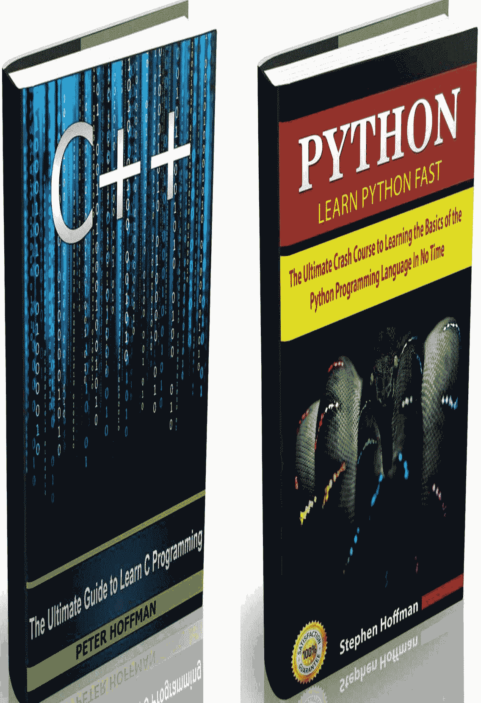
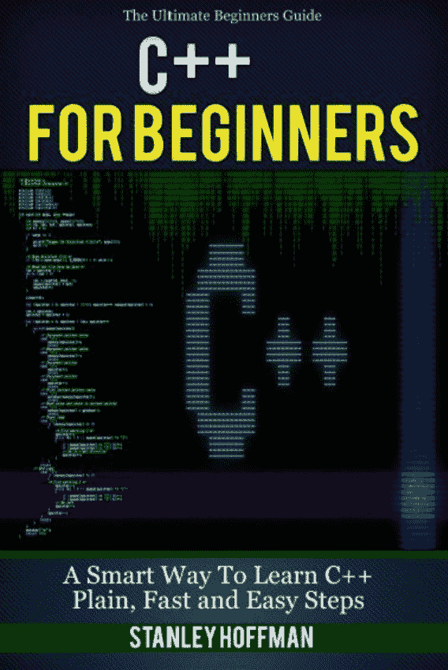
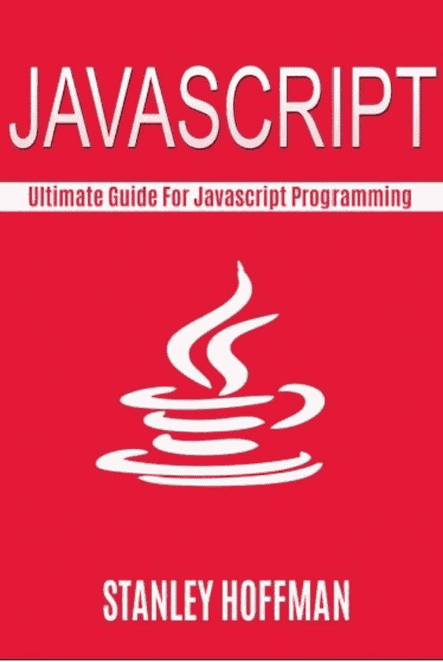
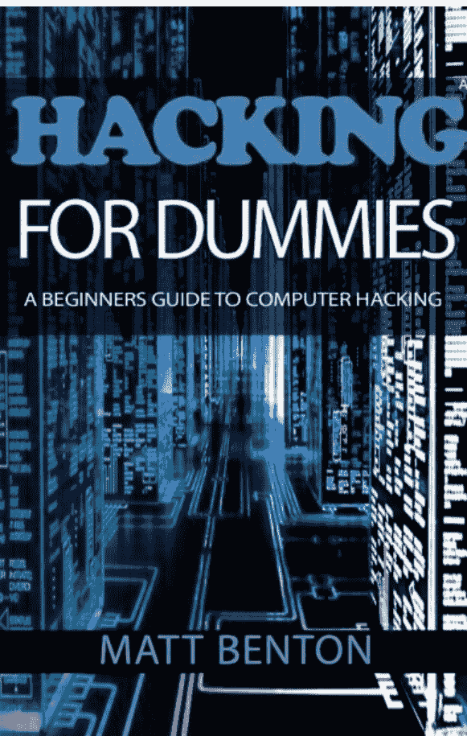

# C++：学习 C++ 基础与 Python 编程语言的终极课程 (C++，C++ 初学者指南，如何编程, C ... 编码, Web 开发,编码) (第 1 卷)



PETER HOFFMAN

PETER HOFFMAN

我认为接下来的书籍对你来说也会很有趣：








# 导言

C++ 程序简单来说就是一个文本文件，其中包含系列使用特定 C++ 文本的命令。我们可以将此文本文件源文件，它通常以 `.CPP` 扩展结尾（就像音频文件以 `.MP3` 结尾或 PDF 文档以 `.PDF` 结尾一样）。

编写 C++ 程序的目的是将一组特定的 C++ 命令组合在一起，计算机会将这些命令转换为机器语言，以执行我们想要完成的任何任务。这个转换过程被称为“编译”，由编译器执行。此外，我们编写的代码必须包含设置和拆除指令，这个过程被称为“链接”。编译和链接的过程合称为“构建”，它将我们的代码构建成机器可执行的 `.EXE` 文件，计算机可以像运行它理解的程序一样运行它。

为了用 C++ 编写程序

本书将使用示例，供你使用 Microsoft Visual Studio 进行跟练习学习——它是初学者和高级 C++ 程序员的完美伴侣。

## 第 1 章 编写你的第一个 C++ 程序

在我们编写第一个 C++ 程序之前，你需要下载一个名为 Microsoft Visual Studio 的软件，它允许你编写、编译和执行用 C++ 代码语言编写的命令和程序。它也是一个极的程序，当你的程序需要更改或出现问题时，可以使用它来调试和编辑程序。


作为你的第一个程序，我们将探索基本的“Hello World”（你好世界）程序，这是每个想要学习编写和编码 C++ 的人的必经之路。Hello World 程序将展示几乎每个用 C++ 编写的程序将共有的最基本的元素。无论程序多么简单或复杂，它仍然需要以下几行非常基础的代码。

你需要做的第一步是打开 Microsoft Visual Studio 并创建一个新项目。我们将此项目命名为“Hello World”，或者如果你喜欢，也可以命名为“First Program”。如果你还不理解这些代码，不要担心，我们稍后会详细查看，并在随后的章节中深入探讨。

首先，你应该在 Microsoft Visual Studio 中编写以下行：

```cpp
#include <iostream>
using namespace std;
```

这些第一行代码基本上被称为“预处理器指令”，或者换句话说，让代码知道我们要开始了。`<iostream>` 单词中的“i”和“o”代表输入和输出，这是每个编写的 C++ 程序所需要的。最后一行 `using namespace std;` 告诉编译器我们将使用标准库（这种情况下指的是我们正在使用的命令类型）。换句话说，我们告诉编译器（Microsoft Visual Studio）要包含名为 `<iostream>` 的库。该库包含了我们使用的所有函数，我们稍后会详细讨论。

接下来你应该编写的行是：

```cpp
int main () {
```

这两行告诉程序开始。基本上意味着我们正在向编译器展示程序的“开始”。`{` 在这里非常重要，被称为“左括号”。`}` 非常重要，被称为“右括号”。

接下来你应该编写的行是：

```cpp
cout << "Hello World" << endl;
```

`cout` 命令用于在屏幕上打印文本。`endl` 命令用于将光标移动到新行。

最后你应该编写的行是：

```cpp
return 0;
}
```

`return 0;` 语句用于退出程序并向操作系统返回值。值 0 表示程序成功完成。

```cpp
a = 5;
b = 2;
a = a + 1;
result = a - b;
```

这是一个非常简单的语句，你解决它的速度可能比写它还要快，但请记住，你的计算机具有每秒计算数十亿个这类问题的潜力，因此你应该能够看到这些变量对你以及更大型程序能做什么的宏大图景。

但如果我们想写一个小程序来练习声明和使用变量呢？我们有两种方法可以编写它。我们可以写在一个单一语句中，例如：

```cpp
int a, b, c;
```

这意味着 `a`, `b`, `c` 是类型为“int”的变量，这等同于：

```cpp
int a;
int b;
int c;
```

这取决于我们是否想输入多行，但这两者都代表相同的语句。为了在示例中使用这两种方法，并看到我们如何使用变量解决刚才的数学问题，让我们看看它在下一页的小程序中看起来是什么样。

// 变量操作

```cpp
#include <iostream>
using namespace std;
```

`int main ()`

{

  // 声明变量：

`int a, b;`

`int result;`

  // 处理：

  `a = 5;`

  `b = 2;`

  `a = a + 1;`

  `result = a - b;`

  // 打印结果：

  `cout << result;`

  // 终止程序：

  `return 0;`

}

当我们运行程序时，我们将看到它将为我们显示答案。非常简单，你应该能够根据我们目前为止讨论过的“Hello World”程序以及我们使用的变量，来解释它的每一部分的含义。然而，我们在这里确实有了一些新东西，那就是使用 "//" 后面跟着一些文本。第一个 "// operating with variables" 仅仅是我们程序的句标题，而随后的每个 "//" 仅仅是解释我们在程序某一点所做操作的子标题。如果你正在处理大量的代码，回过来检查行并寻找你想找的内容会比解码每一行代码要容易得多。

还有一种简单的方法来编写我们刚刚使用的示例代码。这种第二方法被称为变量的“初始化”（initialization），我们有三种方法可以实现。初始化变量基本上意味着我们在声明变量的同时声明它的值。实现此的三种方法是编写以下内容之一：

```cpp

int x = 0;

```

```cpp

int x (0);

```

```cpp

int x {0};

```

使用哪种方法并不重要，因为它们的作用是相同的。然而，最好的部分是，如果你愿意，可以同时使用所有三种类型。例如：

```cpp

// 变量初始化

#include <iostream>

using namespace std;

int main ()

{

    int a=5;

    int b(3);

    int c{2};

    int result;

    a = a + b;

    result = a - c;

    cout << result;

    return 0;

}

```

如你所见，程序将执行与我们之前让它执行完全相同的操作，不同在于现在我们在声明变量本身的同时声明了变量的值。

# 第 3 章 – 运算符 (OPERATORS)

现在我们已经熟悉了变量的使用，可以扩展我们的程序并开始使用所谓的“运算符”（operators）。运算符基本上是符号，它们告诉编译器（Microsoft Visual Studio）使用数学或逻辑来解决我们在代码中编写的问题。C++ 最常用的有 6 种运算符。这些是：

- 1. 算术运算符（Arithmetic Operators）。
- 2. 关系运算符（Relational Operators）。
- 3. 逻辑运算符（Logical Operators）。
- 4. 位运算符（Bitwise Operators）。
- 5. 赋值运算符（Assignment Operators）。
- 6. 杂项运算符（Misc Operators）。

我们将查看最常用的运算符类型，以及它们能做什么。

## 算术运算符 (ARITHMETIC OPERATORS)

想象我们 A 等于 10，我们可以使用以下算术运算符来实现：

| 运算符 | 作用 | 使用示例 |
| :--- | :--- | :--- |
| + | 相加 | B = 30 |
| - | 相减 | B = -10 |
| * | 相乘 | B = 20 |
| / | 除法 | B = 2 |
| % | 取模 | B = 0 |
| ++ | 整数加1 | A++ = |
| -- | 整数减1 | A-- = |

## 关系运算符 (RELATIONAL OPERATORS)

使用相同的变量，我们还可以使用：

| 运算符 | 作用 | 使用示例 |
| :--- | :--- | :--- |
| != | 不等于 | (A != B) 为真 |
| > | 大于 | (A > B) 为真 |
| < | 小于 | (A < B) 为真 |
| >= | 大于等于 | (A >= B) 为真 |
| <= | 小于等于 | (A <= B) 为真 |
| == | 等于 | (A == B) 为真 |

## 条件与函数 (CONDITIONS and FUNCTIONS)

条件分支（Conditionals）为程序提供选择。这并不意味着程序可以像人类一样思考并做决定，而是根据某些选项进行选择。这意味着，为了给我们的程序提供选择，我们将使用如下语法：

```cpp

if (条件)

{

    // 在此处插入代码

}

```

这基本上是在说，“如果发生这种情况，就执行此操作”。

```cpp

int x,y,z;

cin>>x;

cin>>y;

if(x>y)

{

    z = x+y;

    cout<<z;

}

```

一旦我们声明了变量 `x` 和 `y` 的值，程序将确定“x”是否真的大于“y”。如果程序发现为真，那么未声明的变量“z”将被声明为 x 和 y 之和，然后给出答案。然而，如果程序发现 x 不大于我们的变量 z，什么都不会发生。这就是我们为程序提供不同场景下的选择的地方。在这个示例中，我们现在必须告诉程序当 x 不等于大于变量 z 的数字时该。什么。

```cpp

int x,y,z;

cin>>x;

cin>>y;

if(x>y)

{

    z = x+y;

    cout<<z;

}else if (x<y)

{

    z=x-y;

    cout<<z;

}

```

现在我们告诉了问题，如果 x 不大于 z，就进入下一个选项，该选项告诉我们给出 x 减 y 的结果。你可以添加任意你喜欢的条件，这将允许你创建一个非常有多性的、可以应用于许多领域的程序。但是，根据我们的示例，如果变量 x 既不大于也不小于变量 y？什么都不会发生。我们仍然希望程序做*些什么*，所以我们可以包含：

```cpp

//完整工作程序

#include <iostream>

using namespace std;

int main()

{

int x,y,z;

}
```

```cpp

cin>>x;

cin>>y;

if(x>y)

{

    z=x+y;

    cout<<z;

}

else if (x<y)

{

    z=x-y;

    cout<<z;

}

else

{

    cout<<"x is not greater or less than y so they must be equal"<<endl;

}

return 0;

```

现在我们创建了一个程序，其中 x 既大于也不小于变量 y，那么 `if` 和 `else if` 条件将不会执行。程序现在可以选择执行第三种条件 `else`，因为前两个条件是无法满足的。我们还可以在这些系列条件字符串中使用许多不同类型的运算符。请参阅上一章关于运算符的章节以了解。

# 第 5 章 – 循环 (LOOPS)

我们已经学习了基础编程、变量、运算符和条件。现在我们必须来看一下循环。循环是编程中非常重要的一部分，因为它们让我们的程序能够按照你指定的次数多次运行代码行。你可能认为重复执行同一任务是毫无意义且没用的，但当我们查看接下来的章节时，循环背后的意义对你来说将非常清晰。

让我们来看程序中的以下几行代码。

```cpp

#include <iostream>

using namespace std;

int main()

{

  cout<<"1"<<endl;

  cout<<"2"<<endl;

  cout<<"3"<<endl;

  cout<<"4"<<endl;

  cout<<"5"<<endl;

  cout<<"6"<<endl;

  cout<<"7"<<endl;

  cout<<"8"<<endl;

  cout<<"9"<<endl;

  cout<<"10"<<endl;

  return 0;

}

```

正如你可能看到的，根据我们目前所学的，这个简单的程序将为我们显示从 1 到 10 的数字。你可能猜到，如果你在程序中包含很多这样的行，任务将变得非常无燥单。你能想象设计一个显示从 1 到 1000 数字的程序吗？

幸运的是，有一个让我们的工作变得简单多的解决方案。我们可以创建一种语法，将上面的示例转换为单行代码。这种语法将是一个循环，看起来如下：

`for (初始化; 条件; 递增/递减)`

这基本上是说：“对于以下内容，执行操作”。初始化是程序的开始（正如你现在应该知道的那样），条件是我们给程序去执行的任何选择，最后，递增和递减代表了在程序循环继续运行时我们想要从起始数字中增加或减少的数值。

下面与上面的示例相同，但这次我们包含了一个循环。

```cpp

#include <iostream>

using namespace std;

int main()

{

  int x;

  for (x=0; x<=10; x++)

  {

    cout<<x;

  }

  return 0;

}

```

这个程序的执行方式与上面的示例完全相同，用于打印数字，但在这个例子中，我们不需要为程序指定 1 到 10 之间的每一个数字。

让这组新代码更有效的是，我们可以看到使用了 `for(x=0; x<=10; x++)`，这是我们在上面看过的 `(初始化; 条件; 递增/递减)` 语句。在这里，我们在程序开始时声明 x 等于 0，并且程序会在 x 小于或等于 10 时结束。`x++` 的递增意味着 x 的值在每次循环结束时增加 1。

为了进一步解释，循环运行的条件是程序自问：x 等于 10 还是小于 10？如果是，就给 x 加 1。程序然后对自己加1，x 现在的值是 1，等于小于 10 吗？是的，那么我会再加 1。最终，程序会对自己说：“x 等于 10，等于或小于 10 吗？是的，我将不会再进行另一个循环并现在结束程序”。这基本上就是循环的工作原理。程序将有一组定义数量的条件会被不断检查，如果这些条件通过或满足，就会有另一个循环或序列的重复。

我们所看到的被称为 `"for"` 循环。我们还会看另外两种类型的循环。我们将看到的第一个新循环被称为 `"while"` 循环。`while` 循环允许你的程序在某些情况下更加灵活，其基本语法看起来如下：

`while (条件)`
{
    语句
}

这基本上是说，“当”条件为真或假时，我将运行已在语句中为我设置的循环。

我们的 `for` 循环程序如果改用 `while` 条件会是什么样？

// 完整运行程序

```cpp

#include <iostream>

using namespace std;

int main() {

    int x=0;

    while (x<=10) {

        cout<<x<<endl;

        x++;

    }

    return 0;

}

```

我们的程序将执行与之前相同的任务，只是这次它使用 `while` 代替 `for` 条件来进行循环。但在本示例中，我们声明了值 0，只是这次它的循环使用的是 `while` 代替 `for`。在这个例子中，我们在程序开始时声明了 x 的值为 0，这是因为我们在语句中声明了 10 的一组数字。我们可以通过以下方式简化这种循环：

```cpp

while (x<=10)

{

  cout<<x<<endl;

}

```

这表示当 x 小于或等于 10 时，它会增加一个数字。

我们可以看到的第三种循环类型被称为 `do-while` 循环。它将执行相同的任务，但条件放在了循环的末尾。例如：

```cpp

// 完整运行程序

#include <iostream>

using namespace std;

int main()

{

  int x=0;

  do

  {

    cout<<x<<endl;

    x++;

  } while(x<=10);

}

```

# 第 6 章 – 数组 (ARRAYS)

数组与变量相似，它们允许我们在一个名称下存储一组数据，这在处理大型程序时非常有用。想象一下如果你必须设计一个显示 500 个人的程序？幸运的是，正如我们在上一章看到的，有一种方法不需要手动输入每一行来实现。

数组的语法如下：

```

类型[索引];

```

这意味着我们想要列出一系列存储的值。为了创建一个类似于变量的数组，并在 5 个人的年龄示例中，我们会写：

```cpp

int ages[5];

```

这意味着我们我们有 5 个被程序称为 `ages` 的项。就像为字母 `x` 声明值一样，我们也必须为这个新变量 `ages` 声明值。我们可以通过这样做：

```cpp

int ages[5];

ages[0]=15;

ages[1]=24;

ages[2]=54;

ages[3]=33;

ages[4]=120;
```


虽然我提到过有一种更简单的方法来写这个索引，但上面的代码看起来完全一样。这样做的原因是我想向你展示如何声明这种新数据类型。当我们启动程序时，我们告诉它在开始时有一个 5 个元素的数组。我们的声明列表从 0 开始，是因为这是计算机读取数字列表的方式。0 总是意味着第一个。

然而，如果我们想以更简单的方式写上面的内容，我们可以写：

```cpp
int ages[5];
ages = {15,24,54,33,120};
```

这告诉程序的内容与上面相同，即 0 等于 15，1 等于 24，以此此类推。如果我们要在代码中完全写出来，它看起来是什么样？

```cpp
#include <iostream>
using namespace std;
int main()
{
    int ages [5];
    ages={15,24,54,33,120};
    cout<<ages<<end1;
    return 0;
}
```

你能发现上述代码中的错误吗？大多数人会认为我们可以像之前的示例中那样编写这个程序，即我们定义一组变量，然后让程序在执行时列出它们。然而，在处理数组时，情况并非如此。这段代码中的问题是，我们在定义数组之后，用 `cout<<ages<<end1,` 结束了程序。这样做的问题在于，C++ 无法打印整个数组，因为你必须告诉编译器（Microsoft Visual Studio）要显示哪个数组。例如，如果我们想显示年龄 120，我们需要告诉它显示 `age [4]`。然后，我们需要像下面列表列列出每一个变量：

```cpp
int main()
{
    int ages [5];
    ages={15,24,54,33,120};
    cout<<ages[0]<<end1;
    cout<<ages[1]<<end1;
    cout<<ages[2]<<end1;
    cout<<ages[3]<<end1;
    cout<<ages[4]<<end1;
    return 0;
}
```

但是我想，你说过有一种方法可以将整组整数存储在数组中吗？有的，我们的方法是声明一个变量，假设为“k”，并向程序声明它存储了要使用的整数。

例如：

```cpp
//完整的可运行程序
#include <iostream>
using namespace std;
int main ()
{
    int k;
    int ages [5];
    ages = {15,24,54,33,120};
    for (k=0; k<5; k++)
    {
        cout<<ages[k]<<end1;
    }
    return 0;
}
```

注意看我们是如何定义“k”是一个变量，并声明它持有上面整个字符串的？基本上，“k”被被声明为 0，只要“k” 小于 5，它就会执行数组（如果你注意到了使用了不同的运算符，则等于这个值）。程序基本上是在说，它将显示年龄，直到数据类型“age”达到 5，这时程序将停止显示年龄。

## 第 7 章 – 指针

指针是我们在之前的示例中尚未涉及的内容。它们之所以被留到现在，是因为要准确理解它们是什么是非常的。这并不意味着你不需要学习它们的工作原理以及如何使用它们，因为它们仍然是复杂程序结构中非常重要的组成部分。

让我们通过查看声明指针的语法来开始研究它们：

`double *p;`

在这条语句中，我们说我们有一个名为“p”的指针，它可以拥有浮点数的地址或位置。“double”一词是我们的新数据类型，之所以在 `p` 之前有一个 `*`，是因为这是我们声明指针的方式。

在代码中，我们通过编写以下内容来声明指针所指向的地址：

`p=&x;`

字母“p”现在将存储“x”的位置（在这种情况下，x 是一个变量）。简单来说，p 指向 x。我们在变量之前使用“&”是为了是为了给它分配一个地址（而不是值）。p 将指向 x，但 x 将不会有一个值。要给 x 赋值，我们需要对 p 进行修改，并编写像这样的代码来这样做：

`*p=25.3;`

这现在通过让 p 成为指针并让 p 指向 x，x 等于 25.3。由于 p 持有 x，现在 x 的值是 25.3（无论 p 的值是多少）。如果我们写一个使用指针并为其赋值的完整程序，我们可以写下如下代码：

```cpp
//完整的可运行程序
#include <iostream>
#include <stdlib.h>
using namespace std;
int main()
{
    double x;
    double *p;
    p=&x;
    *p=25.3;
    cout<<x<<end;
    system("pause");
    return 0;
}
```

## 第 8 章 – 动态内存

然而，这些代码行不会告诉我们内存是否成功分配。在这种情况下，为了让程序告诉我们内存已成功分配，我们会写：

```cpp
double* pvalue = NULL;
if(!pvalue = new double )
{
  cout << "Error: out of memory." <<endl;
  exit(1);
}
```

如果没有足够的内存分配给程序，程序现在会告诉我们：“Error: out of memory”。当我们程序中预期的内存需求不再需要内存时，我们使用 `delete` 运算符。例如：

`delete pvalue;`

简单如此。现在，让我们来看看一个先使用 `new` 运算符分配内存，执行指针指向内存分配，然后使用 `delete` 运算符释放内存的程序：

```cpp
#include <iostream>
using namespace std;
int main ()
{
    double* pvalue = NULL;
    pvalue = new double;
    *pvalue = 25677.99;
    cout << "value of pvalue : " <<*pvalue << endl;
    delete pvalue;
    return 0;
}
```

运行这段代码将显示：

Value of pvalue: 25678

这意味着我们将指针声明为 NULL，并且我们已经执行了一个新请求，为我们的 100 个字符分配内存。一旦我们不再需要这块分配好的内存，我们就会插入一个删除运算符：

```cpp
delete [] pvalue;
```

现在，我们已经告诉程序删除我们在之前的几行代码中指向的数组。但是，如果我们想同时为多个数组分配内存呢？我们不需要为每个数组都开始一个新运算符。相反，我们可以写如下代码：

```cpp
double ** pvalue = NULL;
pvalue = new double [4] [5];
```

在这里，我们首先声明指针值为 NULL，然后告诉程序，我们想要为一个维度为 4x5 的数组分配内存。删除方法与之前相同：

```cpp
delete [] pvalue;
```

## 第 9 章 – 类与对象

现在我们已经学习了 C++ 编程的基础知识，是时候来看一些稍微高级的内容了。类是我们所谓的“面向对象编程”的一部分。这允许我们通过使用对象在日常中使用程序。对象可以定义为日常生活中使用的任何东西——例如汽车、电脑、手机等。正如我们现在应该学到的，一个程序是由许多微小的部分组成的，这些部分共同工作以便汽车运行。这些组件中的某些是可以改变的，例如开启汽车上的灯；而另一些则通过我们所谓的“私有”和“公共”变量来区分，换句话说，就是你允许修改的内容和不允许修改的内容（我们稍后会介绍）。

学习 C++ 时，类处于稍微高级的水平，因为它们更复杂。然而，学习它们是非常的，因为它允许我们创建和开发日常使用的程序。它们还允许重用代码并应用于不同的场景。例如，足球队中的每个球员都有名字、年龄和收入，但这些对于每个球员来说都是不同的。在这种情况下，代码将创建类的属性，简单来说每个球员的名字、年龄和收入。

为了写这个例子，我们球员信息的代码看起来如下：

```cpp
Class Player
{
    string name;
    string age;
    double income;
}
```

我们的玩家类现在有了结构。从现在起，每当我们为每个玩家的每个变量声明值时，我们就会创建一个新的记录，或者一个存在于 Player 类中的新对象。每个对象将包含一个名字、年龄和收入。为了声明每个 Player 类型的变量，我们使用与声明任何其他变量相同的方法：

- `Player player1;`
- `Player player2;`
- `Player player3;`

为了在代码中看到这一点，我们将编写如下：

```cpp
Class Player
{
private:
    string name;
    string age;
    double income;
public:
    Player();
};
```

执行上述代码行将阻止程序修改名字、年龄和收入的私有类，但允许它修改个人玩家信息的公共类。我们在声明 private 和 public 之后使用冒号，是因为它们告诉程序之后的所有内容都被视为该类类型。

当我们实际输入和操作公共数据时，我们使用所谓的“构造函数”和“析构函数”。每当我们声明一个类对象时，构造函数就会执行以完成它被编写好的任务。要启动构造函数，我们将编写如下代码：

```cpp
Player();
Player(string,int,double);
```

这意味着我们已经告诉构造函数使用我们的名字、年龄和收入这三个参数。我们还有一个在顶行没有值的 Player 类，这给了构造函数为类类型分配或不分配参数的选项。但我们仍然需要告诉构造函数做什么，所以我们会写：

```cpp
Player()
{
    name = "";
    age = 0;
    income = 0;
}
```

```cpp
Player(string n, int a, double s)
{
    name = n;
    age = a;
    income = s;
}
```

第一个执行的构造函数除了将所有内容设为 0 之外无他事。然而，第二个执行的构造函数必须使用我们的名字、年龄和收入参数。然后，我们只需要按照要求实际声明每个 Player即可。

- `Player player1;`
- `Player player2("David",33,95.20);`

在代码中看到构造函数的作用时，理解起来要简单得多。基本上，它们根据我们提供的内容创建一个类或一个信息条目。它们在某种程度上为我们做了工作。然而，我们还需要看看析构函数。析构函数与构造函数相反，它们是删除而不是创建数据。例如：

```cpp
~Player();
```

这就是 C++ 中类和对象的基础。

## 总结

总而言，通过阅读这本书，你现在应该掌握了理解 C++ 基础所需的所需的技能，并且现在能够在日常生活中制作程序。这本书还向你展示了我们在制作程序时使用的许多不同类型的代码，这些知识将让你能够用简单的编程技能令家人和朋友印象深刻。在计算机编程这个奇妙而兴奋的世界之旅中，尽可能将这本书作为指南或参考，并永远记住，一旦掌握了基础，C++ 是很容易学习的。

Try ... Except ... Else 子句

Try ... Finally 子句

第十一章 - 字符串内置方法

第十二章 – 列表

第十三章 - 如何在 Python 中使用字典

示例 1 – 创建新字典

结论

# 引言

Python 可用于各种项目，许多程序员在选择任何其他编程语言之前都会选择 Python，这是有原因的。Python 可用于 Web 应用程序、系统任务自动化、图像颜色识别，以及许多其他不同的编程任务！

Python 是一种通用编程语言，创建于 80 年代后期，并以臭名昭著的“蒙提·派森剧团”（Monty Python）命名。成千上万的程序员使用它来完成各种任务，从在英特尔测试微芯片到使用 PyGame 库构建视频游戏。它是一门类似于英语的短小语言，并且已经存在数百个现成的第三方库。

程序员选择 Python 而不是许多其他编程语言主要有两个原因。

第一个原因是可可读性。因为它非常接近英语，使用 'not' 和 'in' 等单词让你在大声朗读脚本时，感觉不像像在阅读某种被遗忘已久的语言。Python 严格的标点符号规则也有助于此，你不需要在代码中到处都是大括号。

此外，Python 有一些被称为 PEP 8 的规则，告诉 Python 开发者如何格式化他们的代码。这意味着你总是知道在哪里换行，而且你从别人那里获取的每段代码看起来都很相似，并且和你的代码一样易读。这使得开发者之间的协作变得非常容易！

第二个原因是对于你在 Python 中想做的几乎任何事情都有现成的库。这门语言已经存在了二十多年，所以有很多程序员已经精通这门语言，并知道如何编写你想要的内容。所以如果你发现自己有疑问，尝试找一个已经做过的人吧！

所以，你应该学习 Python 的主要原因是它简单，而且你很容易与其他合作来磨练你的技能。那么，让我们开始吧！

# 第一章 – 安装 Python

在进行 Python 编程时，你应该知道的第一点是 Python 已经安装在许多操作系统上。除了 Windows 之外，大多数操作系统都默认安装了 Python。如果你想确认电脑上是否安装了它，请通过运行终端程序打开命令行，并输入 `python –V`。

如果你看到版本信息，说明你的电脑已经安装了 Python。但是，如果你收到 `bash: python: command not found` 提示，那么你的电脑可能没有安装。

按照指令在电脑上下载并安装 ActivePython。

## 安装

第一步是访问 Python 网站 `http://www.activestate.com/Products/ActivePython`，这将带你进入一个可以选择你所在操作系统的网站。如果你使用的是比 XP 旧的 Windows 版本，需要在继续之前安装 Windows Installer 2.0。

一旦你找到了所需的安装程序，双击它并完成安装步骤。安装完成后，进入“开始-程序-ActiveState-ActivePython (versions #)-PythonWin IDE”，你将看到一个小脚本，告诉你你使用的是哪个版本以及它安装在什么操作系统上。

### 解释器

一旦你启动 Python 的交互模式，它会提示你输入下一个命令。
这通过三个大于符号 `>>>` 显示。如果你想交互式运行 Python 解释器，需要在终端中输入 `python`。

它看起来像这样：

```
>>> python
Python 2.7.8 (default, Jun 28 2012, 16:23:35)
[GCC] 4.2.1 Compatible Apple Clang 6.0 (tags/apple-clang-6.8.0) on darwin
输入 "help", "copyright" 或 "license" 获取更多信息。
>>>
>>> 1 +1
2
>>> 你可以在这里输入表达式 _, 使用 ctrl-d 退出
```


### 如何运行程序

一旦 Python 设置好并且你知道了如何使用解释器，如何在 Python 中运行程序呢？运行程序最简单的方法是输入 `python helloworld.py`。如果你的可执行文件设置为 `.py`，那么就可以通过文件名运行文件，而不需要先输入 `python`。

现在，使用 `chmod` 命令设置执行位，如下：

- `chmod +x hello.py`

现在你可以通过 `./hello.py` 运行你的程序了。

### 文本编辑器

在源文件中编写 Python 程序之前，你需要一个编辑器。在 Python 编程方面，有很多编辑器可供选择。只需选择一个适用于你平台的即可。你选择的编辑器取决于你对计算机的经验以及你想做什么。

### 编写

（注意：55-58 页的 OCR 内容是重复且碎片化的，我已经清理了结构。）

# 第二章 – 变量

变量是区分大小写的。

你还可以通过多次赋值同时为多个变量分配单个值。变量 `a`、`b` 和 `c` 被分配到相同的内存位置，值为 1；`a = b = c = 1`。

这里有一些用于入门的变量类型：

| 整数 | X = 123 |
| 长整数 | X = 123L |
| 双精度浮点数 | X = 3.14 |
| 字符串 | X = "hello" |
| 列表 | X = [0,1,2] |
| 元组 | X = (0,1,2) |
| 文件 | X = open('hello.py', 'r') |

# 第三章 – 解释器

解释器通常安装在可可用机器的 `/usr/local/bin/python` 位置。将 `/usr/local/bin` 放在 Unix shell 的搜索路径中将使可以通过输入命令 `python` 来启动它。

## 交互式

当交互式使用时，拥有一些标准注释是一个好主意。你可以通过设置环境变量 `PYTHONSTART` 到一个包含启动命令的文件中来实现。

# 第四章 – 注释的重要性

Python 中的注释严格来说是为了阅读代码的人的，无论是你自己还是其他人。这是与团队成员沟通代码预期功能的一种良好方法，以便他们能够更好地协作。然而，在 Python 中添加注释有两种在编程行业中被通用的接受方式。

单行注释以 `#` 符号开始，并在行尾结束。Python 会忽略从 `#` 符号之后到该行末尾的所有文本，因为它认为这些内容不是命令的一部分。

跨越单行的注释通过在两端插入以 `"""` 作为分隔符的多行字符串来实现。它们旨在为任何阅读代码的人提供提供文档说明。

让我们来看两个例子，你就能明白我在说什么。

```python
## 这是一个 Python 中的注释

print("Hello World") # 这也是 Python 中的一个注释

"""这是一个多行

注释的示例，跨越了多行。

"""
```

现在既然你已经知道如何与他人协作，以及如何通过注释保持自己代码的整洁，让我们来看 Python 的 docstrings（文档字符串）。

# 第五章 - Python 文档字符串

Docstrings（或 Python 文档字符串）提供了一种将文档与 Python 函数、模块、方法和类关联的良好方法。对象的 docstring 由对象定义中第一个语句的字符串常量组成。

它是源代码中指定的，用于记录一段特定的代码。与普通的源代码注释不同，docstring 应该是对函数**做什么**的描述，而不是**如何做**。所有函数都应该有一个 docstring。

这使得程序在运行时检查注释，例如作为交互式帮助系统或元数据。你可以使用对象上的 `__doc__` 属性来访问 docstring。

## 它应该看起来什么样

`docstring` 行将以大写字母开头并以句号结束。第一行是一个简短的描述。不要写你的对象的名称。如果文档字符串有多多行，第二行应该是空的，以便在视觉上将摘要与描述的其余部分隔离开。`docstring` 的其余部分应该是一个或多个段，描述对象的调用约定和任何重要的内容。

一个 `docstring` 的示例所示：

```python
def my_function():
    """
    什么都不做，但把它记录下来。
    不，真的，它什么都没做。
    """
    pass
```

这是它被打印出来的样子。

```python
>>> print(my_function())
Do nothing, but document it.
No, really, it doesn't do anything.
```

## 声明

这个 Python 文件向了 Python 源文件中 `docstring` 的声明。

假设该文件是 `mymodule.py`，那么这个字符串作为文件的第一个语句，在文件被导入时将成为 "`mymodule`" 模块的 `docstring`。

```python
class MyClass(object):
    """类的 docstring"""
    def my_method(self):
        """方法的 docstring"""
    def my_function():
        """函数的 docstring"""
```

## 访问 docstring

接下来的将会向你展示如何访问 `docstring`：

```python
>>> import mymodule
>>> help(mymodule)
```

假设该文件是 `mymodule.py`，那么文件中的主声明字符串在文件引入时将是 `mymodule` element 的 `docstring`。

```python
>>> help(mymodule.MyClass)
类的 docstring
>>> help(mymodule.MyClass.my_method)
方法的 docstring
>>> help(mymodule.my_function)
函数的 docstring
```

现在你已经知道 `docstring` 是什么了，让我们更多地讨论一些你需要知道的 Python 关键字。

# 第六章 - Python 中的关键字

Python 中的关键字是保留字，不能作为普通的标识符使用。它们必须按照你看到的写法进行完全拼写。如果你想打印 Python 中的关键字列表，请使用以下命令。

```python
$ python
>>> 
>>> import keyword
>>> print(keyword.kwlist)
['and', 'assert', 'break', 'class', 'continue', 'def', 'del', 'elif', 'else', 'except', 'exec', 'finally', 'for', 'from', 'global', 'import', 'in', 'is', 'lambda', 'non', 'pass', 'print', 'raise', 'return', 'while', 'with', 'yield']
```

## 关键字定义

- `print`: 打印到控制台
- `while`: 控制平台的移动
- `for`: 按照它们出现的顺序遍历集合的部分
- `break`: 跳出循环周期
- `continue`: 用于中断当前循环而不退出整个循环。将开始一个新循环。
- `if`: 用于判断哪个语句将被执行
- `elif`: 是 else if 的缩写；如果第一个测试为假，则它将继续下一个。
- `else`: 这意味着命令是可选的。除非条件为真，否则执行 else 词后面的语句。
- `is`: (未提供定义)
- `and`: (未提供定义)
- `or`: (未提供定义)
- `not`: (未提供定义)
- `import`: (未提供定义)
- `from`: (未提供定义)
- `as`: (未提供定义)
- `return`: (未提供定义)
- `def`: (未提供定义)
- `class`: (未提供定义)
- `with`: (未提供定义)
- `lambda`: (未提供定义)
- `yield`: (未提供定义)
- `global`: (未提供定义)
- `nonlocal`: (未提供定义)
- `del`: (未提供定义)
- `raise`: (未提供定义)
- `assert`: (未提供定义)
- `pass`: (未提供定义)
- `exec`: (未提供定义)
- `try`: (未提供定义)
- `except`: (未提供定义)
- `finally`: (未提供定义)
- `in`: (未提供定义)
（注：根据你提供的文本，后续部分存在大量重复和逻辑混乱，此处已根据提供的文本结构进行对应翻译）

# 第七章 - 布尔值，真或假

内置的 Boolean 类型只能有一一或两种可能的答案：`True` 或 `False`。

## 布尔字符串

字符串可以进行真值测试。返回类型将是 `True` 或 `False`。让我们来看一个例子。首先，创建一个新变量并给它赋值。

```python
numberone_string = "Hello World"
print numberone_string.isalnum() # 检查是否为字母数字
print numberone_string.isalpha() # 检查是否全为字母
print numberone_string.isdigit() # 检查是否为数字
print numberone_string.istitle() # 检查是否为标题格式
print numberone_string.isupper() # 检查是否全为大写
print numberone_string.islower() # 检查是否全为小写
print numberone_string.isspace() # 检查是否全空格
print numberone_string.endswith('d') # 检查是否以 'd' 结尾
print numberone_string.startswith('H') # 检查是否以 'H' 开头
```

## 逻辑运算符

这些值倾向于响应逻辑运算符和/或

```python
>>>True and False
False
>>>True and True
True
>>>False and True
False
>>>False or True
True
>>>False or False
False
```

现在你更多地了解了布尔值以及如何使用它们，让我们谈谈 Python 运算符。

# 第八章 - Python 运算符

有几种不同类型的运算符。包括算术运算符、比较运算符和逻辑运算符。让我们详细查看每一个。

## 算术运算符

Python 拥有 `-`、`+`、`*`、`%` 和 `**` 运算符。假设变量 `a` 为十，变量 `b` 为二十。因此：

+
  a+b=30
-
  a-b=-10
*
  a*b=200
/
  b/a=2
%
  b%a=0
**
  a**b=10^20
//
  9//2=4

## 比较运算符

像 `==`、`<`、`>=` 等比较运算符用于各种值。字符串、数字、映射和序列都可以比较。下面的列表将向你展示比较运算符列表。

- `<` 小于
- `==` 等于
- `<=` 小于等于
- `>=` 大于等于
- `>` 大于
- `<>` 不等于
- `!=` 不等于

## 逻辑运算符

逻辑运算符 `and` 和 `or` 在用于决策结构时也会返回布尔值。三个逻辑运算符是 `or`、`and` 和 `not`。

例如，`x>0 and x<10` 只有当 `x` 大于 0 且小于 10 时才为。

运算符描述：

- `and`: 逻辑与
- `or`: 逻辑或
- `not`: 逻辑非

现在你已经知道了运算符，让我们更多地讨论如何在 Python 中使用数学。

# 第九章 - 在 Python 中使用数学

Python 语言拥有 Python 解释器，这是一个被称为 IDLE 的简单开发环境、工具、库和文档。它预装在几乎所有的 Linux 和 Mac 系统上，但可能是旧版本。

为了开始使用 Python 解释器中的计算器，请输入以下脚本：

```python
>>> 2 + 2
4
>>> 4 * 2
8
>>> 10 / 2
5
>>> 10 - 2
8
```

## 使用变量计数

要在变量中赋值以计算矩形的面积，请尝试这段代码：

```python
>>> length=2.20
>>> width =1.10
>>> area = length * width
>>> area
2.42000000000000004
```

### 计数器

计数器是编程中需要的工具，以便在每次运行时增加或减少一个值。以下代码是一个计数器：

```python
>>> i=0
>>> i=i+1
>>> i
1
>>> i=i+2
>>> i
3
```

### 使用 While 循环计数

这是一个使用计数器的有用用例示例。

```python
>>> i=0
>>> while i<5:
    print(i)
    i=i+1
0
1
2
3
4
```

上面的程序将从零计数到四。在 `while` 单词和冒号之间有一个表达式，最初真后变为假。只要该表达式为真，后续代码就会运行。必须运行的代码需要缩进。最后的声明是一个计数器，它每次循环都会将值加一。

### 乘法表

在 Python 中制作乘法表，请使用以下代码：

```python
table=8
start=1
max=10
print("The table of " + str(table))
print("*20")
i=start
while i <= max:
    print(str(i) + "*" + str(table) + "=" + str(i*table))
    i+=1
print("*20")
print("Done counting...")
```

该代码的输出如下：

输出：

The table of 8

1*8=8
2*8=16
3*8=24
4*8=32
5*8=40
6*8=48
7*8=56
8*8=64
9*8=72
10*8=80

Done counting.
这就是在 Python 中使用数学的方法。现在，让我们在下一章中查看 Python 中的异常处理。

# 第十章 - Python 中的异常处理

在深入了解异常可以做什么之前，你必须先知道它们是什么。异常是程序运行期间发生的错误。当该错误发生时，Python 将生成一个异常，用以避免程序崩溃。

异常对于处理程序中的特殊情况和错误非常方便。当你认为你的代码可能会产生错误时，就可以放入一个异常处理器。你可以使用 `raise exception` 声明自行抛出异常。抛出异常将中断当前代码执行并将异常返回给上一个代码，直到它可以被处理。

以下是你程序中可能会看到的常见错误：

- `IOError` – 无法打开文件。
- `ImportError` – Python 无法找到模块。
- `ValueError` – 当内置操作或函数获取的类型正确但值不正确的参数时抛出此错误。
- `KeyboardInterrupt` – 当用户中断程序时抛出此错误。
- `EOFError` – 当意外到达文件末时抛出此错误。
- `ZeroDivisionError` – 当你尝试除以零时抛出异常。

## 设置异常处理

为了使用异常处理，你需要使用 `try` 和 `except` 块。`try` 块包含可能抛出异常的代码，而 `except` 块包含处理异常的代码。

```python
try:
    number = int(input("Enter a number: "))
    result = 10 / number
except ValueError:
    print("That was not a valid number!")
except ZeroDivisionError:
    ...
```

你还可以使用 `finally` 块来确保无论是否发生异常，某些代码都会运行。

```python
try:
    number = int(input("Enter a number: "))
    result = 10 / number
except Exception:
    print("An error occurred")
finally:
    print("Execution complete.")
```

## 它是如何工作的？

Python 中的异常处理通过捕获通常会导致程序崩溃的错误来工作。当发生错误时，Python 创建异常对象并寻找该特定异常的处理器。如果没有找到处理器，程序将终止。

示例：

```python
try:
    # 这段代码可能会抛出错误
    x = 1 / 0
except ZeroDivisionError:
    # 处理错误
    print("Caught a division by zero!")
```


通过使用 `try` 和 `except` 块，你可以编写更健壮的程序，能够优雅地处理错误。

- `string.strip()`
  此字符串方法会移除字符串中所有的空格。因此，如果字符串是 'Hello Jane'，在程序中它将显示为 'HelloJane'。

- `string.lstrip()`
  这会移除左侧的空格。因此，如果字符串是 ‘Hello Jane’ 且 hello 之前和 Jane 之后都有空格，那么代码将输出 ‘Hello Jane’。

- `string.rstrip()`
  这将移除右侧所有的空格。因此，如果同一行代码读取 ‘Hello Jane’ 且在 Jane 之后有空格，那么 Jane 之后的空格将被删除，从而显示为 ‘Hello Jane’。

- `string.split()`
  此命令将分割单词。所以，如果代码读取为 ‘Hello Jane’，它将被分成 ‘Hello Jane’。

- `string.split(',')`
  这意味着意味着代码将通过逗号分割单词，因此后续字符串 ‘Hello Jane’ 将输出 ‘Hello, Jane’。

- `string.count('l')`
  这将统计数字 1 或你选择放入字符串的任何其他字母在字符串中出现的次数。因此，如果输入为 ‘Hello Jane’，程序将告诉你 2。

- `string.find('Ja')`
  此字符串方法将在字符串中查找单词 ‘Ja’。

- `string.index('Ja')`
  这将在字符串中找到字母 Ja。

- `".join(string)`
  这会在每个字符之间添加一个冒号。所以 ‘Hello Jane’ 将输出 ‘H:e:l:l:o:J:a:n:e’。

- `"".join(string)`
  这会在每个字符之间添加空格，所以 ‘Hello Jane’ 将读取为 ‘H e l l o J a n e’。

- `len(string)`
  这将找到字符串的字符长度，所以如果字符串是 ‘Hello Jane’，程序会说是十（ten）。

现在你已经了解了 Python 代码中内置的一些基础字符串，让我们在接下来的章节中看看列表的示例。

# 第十二章 – 列表 (Lists)

列表使用方括号 `[]` 创建，这些括号之间的元素就是程序将使用的内容。列表中的元素不需要是相同类型，因此，你可以在同一组括号中包含字母、数字和字符串。

让我们来看一个例子。

```python
myList=[1,2,3,4,5,6]

i=0

while i<len(myList):

    print(myList[i])

    i+=1
```

这个列表是做什么的？脚本将创建一个标记为 `(list1)` 的列表，值为 1, 2, 3, 5, 8, 2, 5, 2。`while` 循环将打印列表的每个部分。列表 `list1` 的每个部分将通过方括号中的索引或字母来获取。

`len` 函数将用于遍历列表的整个长度。最后一行告诉程序在每次循环运行时，将每个变量增加 1。

因此，该程序的输出将是：1 2 3 5 8 2 5。

让我们来看另一个例子。

这个例子将计算列表中元素的平均值。

```python
list = [1, 2, 3, 5, 8, 2, 5]

total = 0

i = 0

while i < len(list):

total = total + list[i]

i = i + 1

average = total / len(list)

print average
```

此代码的输出将为：

## 输出 >> 3.74285714286

如你所见，列表非常容易创建和操作。让我们来看看如何在 Python 中使用字典（dictionaries）。

# 第十三章 – 在 Python 中使用字典

字典使用花括号 `{}` 创建，括号之间的元素就是程序将使用的内容。列表中的元素不需要是相同类型，因此，你可以在同一组括号中包含字母、数字和字符串。

字典是键值对（key-value pairs）。字典是无序的，这意味着你不能通过索引来访问元素。相反，你必须通过键（key）来访问值（value）。

字典是可变的（mutable），这意味着你可以添加、更改或删除键值对。

创建一个字典的示例：

```python
mydict = {"name": "Alice", "age": 25, "city": "New York"}
```

你可以通过键来访问值：

```python
print(mydict["name"])
```

你可以向字典添加新的键值对：

```python
mydict["job"] = "Engineer"
```

你可以更改字典中的键值：

```python
mydict["age"] = 26
```

你可以删除字典中的键值对：

```python
del mydict["city"]
```

你可以使用 `keys` 方法来获取字典的所有键：

```python
print(mydict.keys())
```

你可以使用 `values` 方法来获取字典的所有值：

```python
print(mydict.values())
```

你可以使用 `items` 方法来获取字典的所有键值对：

```python
print(mydict.items())
```

你可以遍历字典：

```python
for key, value in mydict.items():
    print(key, ":", value)
```

字典可以嵌套其他字典：

```python
users = {
    "user1": {"name": "Alice", "age": 25},
    "user2": {"name": "Bob", "age": 30}
}
```

你可以访问嵌套字典的值：

```python
print(users["user1"]["name"])
```

字典也可以包含列表：

```python
data = {
    "fruits": ["apple", "banana", "cherry"],
    "vegetables": ["carrot", "potato"]
}
```

你可以访问字典中的列表：

```python
print(data["fruits"][0])
```

字典是 Python 中非常强大的数据结构。掌握了如何使用字典，你将能够处理更复杂的数据。
