# C++：快速学习 C++ 和 SQL 编程终极指南（C 初学者指南、C语言编程、JAVA、编码、CSS、PHP）（编程、计算机语言、编码、HTML、Javascript、开发者书籍 1）

我认为接几本书可能也会感兴趣：

[C++](http://www.amazon.com/Ultimate-Programming-programming-beginners-Javascript-ebook/dp/B018O4BDS6/ref=sr_1_8?s=digital-text&ie=UTF8&qid=1450353561&sr=1-8&keywords=c%2B%2B)

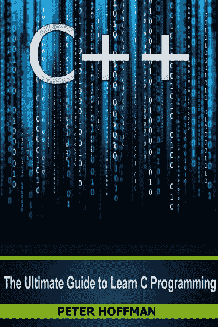

[Python](http://www.amazon.com/Python-Ultimate-Learning-Programming-Hands--ebook/dp/B014MV238Y/ref=sr_1_1?s=digital-text&ie=UTF8&qid=1442836729&sr=1-1&keywords=Python%3A+Learn+Python+FAST+-+The+Ultimate+Crash+Course+to+Learning+the+Basics+of+the+Python+Programming+)

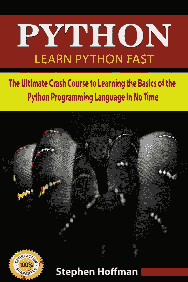

[Javascript](http://www.amazon.com/Javascript-javascript-programming-development-Developers-ebook/dp/B017YZ6CYG/ref=sr_1_7?s=digital-text&ie=UTF8&qid=1447666305&sr=1-7&keywords=javascript)

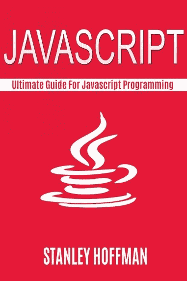

[计算机骇](http://www.amazon.com/Computer-Hacking-Essential-Beginners-internet-ebook/dp/B010965F36/ref=sr_1_fkmr1_3?s=digital-text&ie=UTF8&qid=1444557942&sr=1-3-fkmr1&keywords=Computer+Hacking%3A+The+Essential+Hacking+Guide+for+Beginners+%28+Hacking%2C+How+to+Hack%2C)


[小白黑客教程](http://www.amazon.com/Computer-Hacking-beginners-computer-security-ebook/dp/B015T8FZYI/ref=sr_1_1?s=digital-text&ie=UTF8&qid=1446193044&sr=1-1&keywords=hacking+for+dummies+matt+benton)


# 引言

结构化查询语言，或 `SQL`，最初是为关系模型设计的。它是用于定义多个数据之间关系的语言。它也是用于在 `relationalschema` 中查询数据的数据库编程语言。

## 数据库类型

不同类型的数据库如下：

* 关系型数据库
* 对象型数据库
* 文档数据库

在本电子书中，我将主要关注关系型数据库。尽管如此，如果有必要，我也不会包含其他类型。

你可能已经接触过诸如 `NoSQL` 等新类型。它们被归为文档数据库。

# 第 1 章 – 深入研究关系模型

结构化查询语言，或 `SQL`，最初是为关系模型设计的。它是用于定义多个数据之间关系的语言。它也是用于在 `relationalschema` 中查询数据的数据库编程语言。

第一个关系数据库创建于 60 年代，该模型中的编程主要由数学定义。事实上，这种数据库模型是基于`元组关系演算`和`关系代数`的。

不过担心，处理关系数据库不需要你跳入代数和演算。`SQL` 会让关系型数据库编程变得简单。

### 表、列与行

在关系型数据库中，数据存储在表中。在这个模型中，所有表都有名称。例如，你可以将一个表命名为 `people`，而将另一张表命名为 `sales`。


每张表都包含一组列。这些列定义了表中的不同数据项。这使得关系模型与其他类型的数据库有所不同之处。你会注意到，某些数据库将数据完全存储在一起。然而，在关系模型中，所有数据都通过列分隔开，且每一列都有一个名称。每列还可以限制添加到其中的数据类别和大小。例如，某些列只能存储字符串，而某些列只能存储数字。分配给每列的限制取决于数据库的创建者。

列还被分为“必填”和“非必填”两类。必填列意味着表中的每一行都必须有与该列要求对应的数据。另一方面，非必填列意味着我们可以为该列下的每行指定一个 `NULL` 值。在你学习 `SQL` 的过程中，你会发现 `NULL` 在数据库编程中有许多用途。

使用行的主要用点是拥有可检索的数据和存储数据的容器。我们为什么要存储数据？简单是因为我们希望在将来再次获取这些数据，并且只是想给它们提供一个临时存放的地方。这就是数据库的核心思想。

## 键 (Keys)

关系数据库的至关重要的元素之一是键。我们现在知道表有几列，每列都有名称。每列还具有相关的属性。我们可以在列中声明的属性之一就是键。

在关系数据库中，我们总是为每一行分配一个主键（primary key）。这种特殊类型的键用于唯一地确定某一行。这意味着该键的值必须保持唯一，且在表中不能有任何重复。当且仅当我们的关系模型中存在另一个包含该键的表时，我们可能可以将这两个表合并在一起。

在合并两个表时，总会有没有重复的主键。合并后，你会注意到表中会出现一个带有这些键的新列。这些键现在被称为 `Foreign keys`（外键）。它们充当通往第二张表主键的链接，允许你方便地连接来自两个分离的表中的行。

除了主键和外键之外，我们还有自然键（natural keys）。自然键是全局性的。这意味着你不能更改它们，因为它们在全球范围内被用于识别单个实体。例如，出版的书籍总有自然键，即我们所知的 `ISBN`。每本出版的书都有自己唯一的 `ISBN`，在处理书籍的关系数据库时，你需要将其作为主键。在处理像电子邮件、人员等具有非自然键的数据库时，情况会有不同，你需要为每一行发明自己的主键。

让我们用一个人员及其联系电话的数据库作为示例。我们不能将姓名视为主键。也不能将人员的电话号码视为主键。这是因为全球可能有两个或多个人具有相同的联系电话、名字，甚至姓氏。因此，我们应该自己创建主键。这就是标识列（identity column）派上用场的地方。

标识列作为一个自动递增列，当我们向表中添加数据时，它会继续生成唯一键。键的组合并不重要，因为我们只需要数据库中每个身份都有一个唯一键。

# 第 2 章 – 关系模型示例

由于我在上一章中使用了人员数据库，现在我将为你提供一个联系人数据库作为关系模型的完美示例。

一个简单的联系人数据库通常如下：

| 名字 (First Name) | 姓 (Last Name) | 电子邮件地址 (Email Address) |
| :--- | :--- | :--- |
| John | Doe | johndoe@email.com |
| Mae | Lee | maelee@email.com |

在此表中，我们有三列在寻找特定的数据。第一列请求名字。第二列请求姓，第三列请求该人的电子邮件地址。

我们的行（除第一行外）指的是单个实体。我们第一个实体的行指的是名为 John Doe 的人，他的电子邮件是 `johndoe@email.com`。我们第二个实体的行指的是 Mae Lee，电子邮件地址为 `maelee@email.com`。

这是一个由三列划分两个实体的数据库示例。

假设 John Doe 有两个电子邮件地址，而 Mae Lee 有三个。有些人最终会增加列来添加额外数据。因此，表最终会像这样：

| 名字 (First Name) | 姓 (Last Name) | 邮箱 1 | 邮箱 2 | 邮箱 3 |
| :--- | :--- | :--- | :--- | :--- |
| John | Doe | johndoe@... | johndoe2@... | `NULL` |
| Mae | Lee | maelee@... | maelee2@... | maelee3@... |

如果我们使用这种数据库设计就会出现问题。首先，如果我们面临的问题是找到每个人有多少个电子邮件地址怎么办？获取我们所需的答案将非常困难且繁琐。这就是使用列基础数据库的缺点。第二个问题是，对于那些只有一个电子邮件地址的人，我们将产生大量的 `NULL` 值。第三，这种设计是不实际的，你不需要数据库专家也能意识到这一点。

为了解决这三个问题，我们可以这样做：

| 键 (Key) | 名字 (First Name) | 姓 (Last Name) |
| :--- | :--- | :--- |
| 1 | John | Doe |
| 2 | Mae | Lee |

第一步是先为实体创建一个表。在这个表中，我们将第一列分配给主键。第二步是创建另一个表，我们可以存储这些人员电子邮件地址的值。第二个表看起来如下：

| 键 (Key) | 人员键 (Person’s Key) | 电子邮件地址 (Email Address) |
| :--- | :--- | :--- |
| 1 | 1 | johndoe@email.com |
| 2 | 1 | johndoe2@email.com |
| 3 | 2 | maelee@email.com |
| 4 | 2 | maelee2@email.com |
| 5 | 2 | maelee3@email.com |

在此表中，你会看到有两个列用于键。第一列引用分配给每个电子邮件地址的主键。第二列引用来自我们第一张表的外键。这是一个一对多关系模型的示例。

在这个模型中，我们能够以最实际的方式组织数据。现在，我们回答关于每个人有多少个电子邮件的查询也变得更容易了。这种方法被称为 `Normalization`（规范化）。

设计数据库有许多方法，高效的设计取决于你试图回答的哪些查询。

说了这么多，你现在准备好接触 `SQL` 了。

# 第 3 章 – SQL 语句

`SQL` 是一种特定的数据库语言。我们使用这种语言来创建语句。这些语句由有效的单词组成。某些单词应该由 `SQL` 定义，而另一些单词应该由你定义。你在这些语句中声明的某些单词是表名、列名以及你表内部变量或数据。

### SQL 事实

在继续之前，我想向你展示一些关于 `SQL` 的重要事实。

关于 `SQL` 你需要知道的第一点是，它是可读的，因为是用英语编写的。换句话说，学习 `SQL` 比任何其他编程语言都更容易。

其次是你可以使用 `SQL` 做更多事情。这与大多数人的印象相反，大多数人认为 `SQL` 仅用于数据查询。

第三是，有效的 `SQL` 语句应该以分号 `;` 结尾。尽管有些人会告诉你它不再需要了，但我建议在你的查询中添加它，因为它是 `ANSI` 标准的一部分。此外，它在旧版和现代数据库中都能正常工作。


第四点是 `SQL` 是不区分大小写的。你可以将变量写为小写或大写。在结构化查询语言中，两种方式都能正常工作。练习这一点的一种好方法是将 `SQL` 特定的关键字写为大写，用户定义的关键字写为小写。这将允许你高效、快速地识别语句中的不同关键字。

## SQL 命令

请记住，所有的 `SQL` 语句都以一个命令开头。该命令通常是一个动词，表示数据库需要执行的操作。`SQL` 语句中使用的命令的一个很好的例子是 `SELECT`。

`SELECT` 命令告诉数据库选择一组数据。如你所见，它是一个英语单词，系统将要的操作非常显而易见。这是该命令在 `SQL` 语句中的用法形式：

```
| SELECT VALUES FROM TABLE; |
```

上面的示例是一个 `SQL` 语句的通用示例，稍后我会逐一进行介绍。

请注意，在语句中需要指定的数值或变量集合取决于你尝试执行的命令。所有这些变量都跟在命令之后。

## 命名命名

正如我所说的，`SQL` 语句由 `SQL` 规范中的单词和用户创建名称组成。这意味着对键、表名、列等值进行命名在 `SQL` 中是非常重要的。

在 `SQL` 中命名事物没有绝对的规则。人们有自己命名变量的方法，但为了一致性，我建议你遵循我在书中使用的方法。以下是我将在本书中实施的两个命名规则：

- 所有表名必须是单数形式。（例如：`person`、`email`、`phone`、`user` 等）
- 列名在数据库中不应重复。

有些人倾向于使用复数名称作为表名。这并没有错。尽管如此，使用单数形式表名让我感到更舒服。至于列名，总会有来自不同表的两个或多个列具有相同的名称。因此，我的做法是为了消除歧义而为每个列命名唯一的名称。例如，与其在 `user` 表和 `email` 表中使用 `ID` 作为主键的列名；我宁愿使用 `user_ID` 和 `email_ID` 作为每个列的名字。

你还应该注意 `SQL` 中的名称是有作用域的。这意味着数据库本身必须有一个名称。数据库内的表也必须有名称。每个表内部的列也必须命名。当调用表时，必须通过点（`.`）使用数据库名来限定其的作用域。因此，它们在 `SQL` 语句中的表示形式如下：

- `Database.Table`
- `Table.Column`

## 在 SQL 中创建数据

我并不打算教你如何从零创建一个数据库。作为初学者，你们的任务应该只围绕向已有的数据库添加或更新值展开。然而，我感觉你们中的某些人仍然渴望学习 `SQL` 以创建包括数据库在内的整个应用程序。因此，我将介绍 `SQL` 的这部分，但仅足以帮助你快速上手。

创建新数据库的 `SQL` 关键字语句是 `CREATE DATABASE`，它属于 ANSI 规范。假设你想为人员的联系电话创建一个新数据库，并将此新数据库命名为 `Contacts`。以下是操作方法：

```
| CREATE DATABASE Contact; |
```

为了能够操作该数据库，你需要首先使用它。我们这里需要的关键字是 `USE DATABASE` 命令。这是我们执行它的方式：

```
| USE DATABASEContact; |
```

如果你想在 `Contact` 数据库中创建一个表，你需要执行的是 `CREATE TABLE` 命令，这里是操作方法：

```
| CREATE TABLE Contacts.User (…); |
```

之后，你现在就可以所有的列名、类型和定义了。

## 数据类型

数据类型很重要，因为它们遵循列的限制。每一列都有关于你可以在其中存储什么类型数据的规则。

以下是一些主要数据类型及其短描述。

| 数据类型 | 描述 |
| :--- | :--- |
| `CHARACTER` | 用于定义列中允许的字符数。不多也不少。 |
| `CHARACTER VARYING` | 用于定义列中允许的最大字符数。可以少于但不能超过特定值。 |
| `BINARY` | 将该列专门用于十六进制数据。 |
| `SMALLINT` | 用于存储从 -32, 768 到 32, 767 之间的数值数据。 |
| `INTEGER` | 用于存储从 -2, 147, 483, 648 到 2, 147, 483, 647 之间的数值数据。 |
| `BIGINT` | 用于存储从 -9, 223, 372, 036, 854, 775, 808 到 9, 223, 372, 036, 854, 775, 807 之间的数值数据。 |
| `BOOLEAN` | 用于存储 `TRUE` 或 `FALSE` 值。 |
| `DATE` | 用于存储 `DAY`、`MONTH` 和 `YEAR`。格式：YYYY-MM-DD。 |
| `TIME` | 用于存储 `SECOND`、`MINUTE` 和 `HOUR`。格式：HH:MM:SS。 |
| `TIMESTAMP` | 用于存储 `DATE` 和 `TIME`。格式：YYYY-MM-DD HH:MM:SS。 |
| `UNICODE` | 用于存储 Unicode 字符。 |

还有其他你可以在数据库中使用的类型，例如正则字符。

# 第 4 章 – 在 MySQL 中编码

我将教你如何使用 `MySQL` 编写 SQL。为什么选择 `MySQL`？第一是因为它是开源平台，你可以免费获取。第二是因为它兼容主要的操作系统：Linux、OSX 和 Windows。第三是因为它具有 ANSI 模式，适用于所有 RDM。

在本章中，我将教你如何高效地使用 `SELECT` 命令。这将允许你创建有趣且高效的查询。

## SELECT 命令结构

你现在应该已经了解到我们拥有 `SELECT` 命令，它是从数据库中获取特定数据的命令。在 `SELECT` 关键字之后，应该是我们从数据库中想要的项目列表。我们称之为“选择列表”。如果选择列表只包含变量，你可以按照这种方式编写语句：

```
| SELECT '[Variable]’,[Variable]’; |
```

大多数情况下，选择列表包含列名。当确实如此，定义我们在哪个表中查找这些列是非常重要的。这就是 `FROM` 命令出现的地方。

例如，我们的选择列表包含 `User`（列 A）和 `Email`（列 B），我们可以在名为 `Contact` 的表中找到这些列。为了定义要查找的表，我们应该这样做包含 `FROM` 命令：

```
| 格式:SELECT [COLUMN_NAME], [COLUMN_NAME] FROM [TABLE_NAME];示例:SELECTUser,EmailFROMContact; |
```

但是，如果我的表有很多列，我想选择所有的列怎么办？你问。。，这就是星号（`*`）发挥威力的地方。这被称为 `SQL` 语句中的通配符。为了选择表中的所有列，你需要执行如下格式的语句：

```
| SELECT* FROM [TABLE_NAME]; |
```

如你所见，通配符位于 `SELECT` 命令之后。现在这在选择所有列时非常有用。如果你不需要选择所有列，那么使用通配符可能会变得危险且低效。

FROM 命令

选择单个表编写 SQL 语句相当简单。如你从之前的示例所示，它遵循一个简单的格式：

```
| FROM [TABLE_NAME] |
```


在 `FROM` 子句中，你可以通过为表名创建别名来缩短表名。假设你的表名为“telecommunication”（电信），你正在查找表中“owner”（所有者）列下的名称列表。使用通用格式输入将得到如下结果：

```
| SELECTtelecommunication.ownerFROMtelecommunication; |
```

为什么在上面的格式中，我们需要在列名之前写上表名呢？这是因为我们必须通过表名对列进行限定（qualify）。此外，如果未来存在名称相似的列，这可以帮助你避免命名冲突。我建议你养成这个习惯。

回到主题，这样做实在太不方便了。我们可以通过在 `FROM` 子句中分配别名来缩短表名。格式如下：

```
| SELECT [TABLE_NAME_ALIAS].[COLUMN_NAME] FROM [TABLE_NAME] [TABLE_NAME_ALIAS]; |
```

继续使用 `owner` 列和 `telecommunication` 表，我们的新语句看起来像这样：

```
| SELECTt.ownerFROMtelecommunication t; |
```

如你所见，我将字母“t”分配为表的别名。这比反复重复完整名称要简单得多。请记住，没有必要使用表名的第一个字符作为别名。你可以为表名分配任何别名，也可以是字符组合。只需确保你使用的别名保持一致即可。

## 限制结果

每当你执行 `SELECT` 查询时，数据库都会返回你所指定列下的所有行。这意味着，如果你的表有 20,000 行，它将返回 20,000 个值来回答你的陈述。

解决这个问题有两种方法。一种是在 `FROM` 子句之后添加额外的子句。另一种是在选择列表之前添加 `DISTINCT` 限定符。如该格式所示所示：

```
| SELECT DISTINCT [SELECT LIST] FROM [TABLE_NAME]; |
```

这种格式只会向你返回唯一值（distinct values），而不是提供指定列下的所有值。这是获取该列下所有唯一值的完美方法。例如，你有一张联系人表，由于某些实体拥有多个电话号码，因此某些实体出现在了多行中。

依赖通用格式将给你带来重复的结果。如果你只想知道你的联系人是谁，这样效率并不高，对吧？使用 `DISTINCT` 限定符可以防止你为同一个实体接收多行数据。

这是我们的 `telecommunication` 表，它包含一个所有者列和另一个电信运营商的列。

| Key | Owner | Company |
|---|---|---|
| 1 | Jean Grey | AT&T |
| 2 | Luke Skywalker | Comcast |
| 3 | Mae Lee | AT&T |
| 4 | Stan Lee | AT&T |

假设我们想要找到数据库中的电信公司列表。使用通用格式将为我们提供三个关于 AT&T 的结果，这是没必要的。然而，使用 `DISTINCT` 限定符，我们只得到两个结果——一个 Comcast，另一个 AT&T，这才是我们真正需要的。

除了 `DISTINCT` 限定符外，你还可以在 `FROM` 子句之后添加 `WHERE` 子句来限制结果。`WHERE` 子句的作用就像精度更高的搜索引擎。这通过使用以下格式实现：

```
| SELECT [SELECT LIST] FROM [TABLE_NAME] WHERE [EXPRESSION]; |
```

为了给你举一个简单的例子，让我们使用另一个存储人们姓名和名字的表。我们将此表命名为“person”（人员）。

| Key | First | Last |
|---|---|---|
| 1 | Lee | Mortis |
| 2 | Mae | Lee |
| 3 | John | Doe |
| 4 | Stan | Lee |
| 5 | Bruce | Lee |

假设这是我们的客户数据库，我们想知道有多少客户的姓氏是 Lee。为了实现这一点，我们需要执行 `WHERE` 子句命令。

```
| SELECTp.lastFROMperson p WHEREp.last = ‘Lee’; |
```

这将要求数据库专门查找“last”（姓氏）列，并只关注该列中值为“Lee”的行。它将忽略该列中没有“Lee”值的行。换句话说，你只会获得姓为 Lee 的客户行。

理解 `WHERE` 子句的诀在于注意你可以在 `WHERE` 表达式中使用的不同运算符。这些运算符与数学运算符相似，这意味着它们很容易记忆。与数学不同的是，我们在这里使用的运算符也适用于非数值数据，例如我们在上面的 `WHERE` 子句中使用的等号（`=`）。以下是你可以用于 `WHERE` 子句的简单运算符列表。

| Operators | Name & Description |
|---|---|
| = | 等于 – 如果两边的数据相等，则返回 TRUE 值。 |
| <> | 不等于 – 如果两边的数据不相等，则返回 TRUE 值。 |
| > | 大于 – 如果左侧的数据大于右侧的数据，则返回 TRUE 值。 |
| < | 小于 – 如果左侧的数据小于右侧的数据，则返回 TRUE 值。 |
| >= | 大于等于 – 如果左侧的数据大于或等于右侧的数据，则返回 TRUE 值。 |
| <= | 小于等于 – 如果左侧的数据小于或等于右侧的数据，则返回 TRUE 值。 |

这些是在处理 `WHERE` 子句时可以获得布尔值的运算符。


# 引言
# 第一章 – 你的程序
# 第二章 – 变量
## 使用变量
# 第三章 - 扩展你的程序
## iostream 库
# 第四章 – 运算符
# 第五章– 条件判断
# 第六章– 循环
# 第七章– 数组
# 第八章– 函数
# 第九章– 指针
# 第十章 动态内存
# 第十一章 类与对象
# 结

# 引言
C++ 是一门新兴的编程语言，基于对象和编译。如果你是一个从未编程过的人，可能会对“对象”和“编译”这两个词感到困惑。

利用编译的程序是由计算机的 CPU 读取的，而不是通过安装在计算机上运行该程序的程序进行解释的。因此，程序更多的是与计算机的处理系统通信，而不是与某个程序。

你可能已经知道这一点，但计算机无法读取字母，必须读取二进制代码，因此代码必须翻译成计算机可读的形式。这个过程被称为编译。现在，面向对象的代码只是代码的结构方式。你将在后面的章节中更好地理解这一小知识。

所以这一切意味着什么，你为什么需要知道它？作为一名使用 C++ 的程序员，你需要的不仅仅是一个普通的文本编辑器。只有少数几种编程语言只需要这些，而它们并不是真正的编程语言。你需要的工具之一是编译器。

你可能想要的另一件事是集成开发环境，也称为 IDE。这是一种面向程序员的文本编辑器，具有语法高亮功能并集成了编译器。对于 Windows 和 Linux，你可以使用不同的选项。

你并不真的需要 IDE，因为一个基础的文本编辑器就可以了，但像记事本这样的工具会让事情变得稍微复杂。文字处理器也是一个糟糕的选择，因为它们有拼写和语法的自动纠正功能，如果不小心，它们会搞乱你的代码。

开始学习 C++ 之前，你应该理解它有一套严格的语法。这意味着代码是大小敏感的，所以输入‘Hello’会和输入‘hello’不同。此外，你应该知道这种编程语言并不在乎空格，所以不用担心它。

以上就是你初学 C++ 时需要知道的全部内容。让我们进入一些实际编码来带你上路吧！

# 第一章 – 你的程序
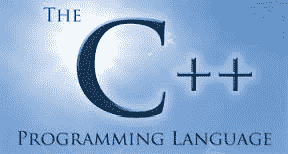 由于这是一份关于如何开始 C++ 的简短教程，我们将在第一章让你从一个程序开始。你的第一个程序将非常简单。你要做的只是在屏幕上写一个短语，但这不像在 Word 文档中写那么简单。首先，让我们看看代码，然后我们深入探讨它的含义。

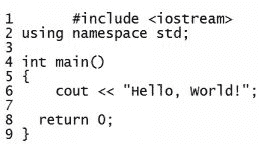

这一行将告诉编译器它必须为程序链接 `iostream` 库。库是一个存储代码片段的地方，这些片段被称为函数。库还存储其他东西，如变量和运算符。

`iostream` 库的代码允许你将字符发送到文本流中，然后将其传输到屏幕上。把它想象成一条河流。你是河流的源头，屏幕是海洋。从源头放入河流的任何东西都会出现在屏幕上。

下一行（第二行）让编译器你想你想名为 `std` 的命名空间，这是一个标准命名空间。命名空间是存储代码的区域。

（注：原文此处存在大量重复段落，已根据要求去重，仅保留核心逻辑说明）

```cpp
#include <iostream>
using namespace std;
int main() {
    cout << "Hello, World!" << endl;
    return 0;
}
```


这非常简单易用。变量名可以是任何内容，但要确保它是与内容相关的，而不是 C++ 中已保留且具有特定含义的关键字，并且不能以数字或特殊字符开头。你应该以小写字母开头，并用分号结束语句。

上述代码的第九行被称为赋值，它为变量分配了一个值。等号是赋值运算符，它是执行赋值操作的。左侧的变量被赋予右侧的值，`=` 是一个二运算符，因为它有两个操作数：一个在左侧，另一个在右侧。右侧的操作数不必是一个值，它可以是另一个变量。左侧必须是一个变量，而且你不能改变数字七的含义。在示例中，整数变量 `var` 的值为 42。

你可以看到 `cout` 语句的变量名周围没有引号。这是因为你想输出 `var` 的值，而不是显示字符串‘var’。如果你编译该程序，它将打印出‘42’，因为那是 `var` 对应的值。尝试将其更改另一个整数并查看输出。

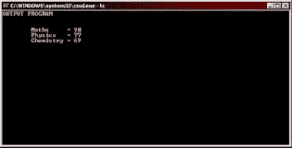

变量还有前缀，这些前缀被添加到声明中，会改变它们的运行方式。有些会改变大小，另一些不允许出现负数，还有一些可能会执行完全不同的操作。

现在你已经了解了变量，让我们来聊如何扩展程序吧！

# 第三章 - 扩展你的程序

现在你已经知道如何使用变量以及如何将它们放入程序中，让我们来看看如何扩展程序。你实际上需要做的只是使用变量并将它们放入程序中，所以你实际上能做的就是设置变量的输出和值。在创建真实程序时，这并没有用。


你需要的是一种操作变量并接收用户输入的方法。所以让我们来看看下一个！

## iostream 库

你已经知道 `iostream` 库可以输出数据，但它也可以获取输入数据。该命令与 `cout` 语句非常相似。命令是 `cin`。不过有一点不同，当你使用 `cin` 时，它后面的运算符是反向的。

它不是 `<<`，而是 `>>`。这在刚开始很难记住，但你最终会学会的。注意，当你运行程序时，在输入所需信息后需要按回车键，就像终端/cmd 提示符一样。

看看下面的程序以查看两者之间的区别。

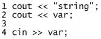

现在你可能可以看到，使用 `iostream` 库获取用户输入是非常简单的，它可以产生更多实用的程序。不过，`iostream` 要强大得多。你可以将许多语句合并为一条。

例如，为了输出两个字符串或变量，你通常需要两条语句，但你可以合并多个 `cout` 语句并产生短得多的代码。你只需要为你要输出或输入的项目添加另一个运算符即可。

例如：

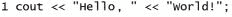

你也可以以同样的方式组合 `cin` 语句，就像你连续接收几部分输入一样。每个语句后都必须按回车，而且你不能在一行代码中混合输入和输出。

现在你已经知道如何合并代码并扩展你的程序，让我们更多地聊聊运算符。

# 第四章 – 运算符

你已经学习了如何输出文本、声明变量和获取输入，但你无法对变量进行任何操作。当然，你可以给它们赋值，但在现实世界中这有什么用呢？你真正需要的是一种在不费力的情况下操作变量的方法。幸运的是，运算符将拯救你！

你已经研究了两个与 `iostream` 库相关的运算符，输入和输出运算符 `>>` 和 `<<`。

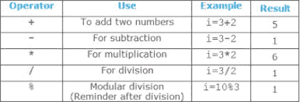

这些运算符可以归类，第一类是算术运算符。这些是 `-`、`+`、`/` 和 `*`。你使用它们的方式就像在数学中使用它们一样。例如，这段代码会将两个数字相加并显示结果。

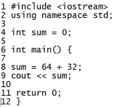

现在你已经知道如何使用运算符，让我们来看条件判断！

# 第五章– 条件

拥有一个执行单项线性任务的程序（比如说“Hello”）是很棒的，但你很少遇到需要只执行线性任务的程序。程序通常使用被称为“条件”的东西，或者说根据条件是否为真将代码分支到不同路径的语句。这基本上就像路上的叉路口。

C++ 条件具有 `if` 语句的形式。例如，如果某事为真，则执行这行代码；如果为假，则执行另一行代码。看看下面的代码段作为示例。

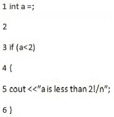

到目前为止，第一到五行对你来说应该是显而易见的，但第三行是你可能需要一点解释的。这是 `if` 语句的示例。它的原理是首先获取整数变量 `a` 的值，并检查它是否小于 2。

到这里你已经知道如何使用运算符，让我们来看条件判断。

拥有一个执行单项线性任务的程序是很棒的，但你很少遇到需要只执行线性任务的程序。

如果为真，就会执行大括号内的代码。正如 `while` 只要 `a` 小于 2。这里引入了另一个运算符小于 `<`。如果你熟悉数学，那么这个符号的使用是不言自懂的。注意 `while` 看起来像 `<<`，但它们完全不是一回事。

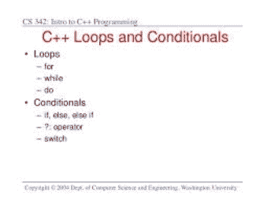

当然，C++ 是一门很强大的语言，因此可以使用这些条件执行更多操作。

总结一下，C++ 条件以 `if` 语句开始，它们后面还可以有 `else if`。你需要记住的一个重要点是，一旦其中一个被满足，剩下的就会被跳过。

# 第六章– 循环

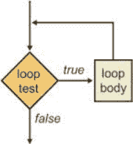现在你能够编写从用户处获取输入、根据输入执行不同操作并显示结果的程序，但如果你想对某些参数执行相同的事情并多次呢？反复编写相同的代码会很无聊，而且不知道需要运行多少次代码会很尴尬。如果取决于用户输入的某些东西呢？


为了完成此操作，你需要使用被称为“循环”的东西。循环是重复执行多次的代码，直到满足某个条件。C++ 有三种类型的循环：`while` 循环、`for` 循环和 `do while` 循环。让我们从 `while` 循环开始，因为它最简单的。

`while` 循环看起来像 `if` 语句，几乎如此。

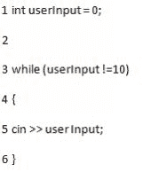

当你知道 while 循环实际上在做什么时，“while”的使用是显而易见的。在这里，代码的意思是“当变量 `userInput` 值不等于 10 时，从用户处获取某些输入”。此外，记住 `!` 在 C++ 中表示“不”，所以代码 `!=` 翻译为不等于。

如果 `userInput` 是十，那么代码将不会执行，循环将被跳过。`while` 循环可以看作是一个 `if` 语句，在代码运行完后会跳回自身的信息处。

在我们继续之前，重要的是知道以下代码可以在 C++ 中可以使用：

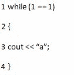


它实际上有自己的名字。它是一个无限循环，所以会无限循环下去。通过代码，你会得到类似“1 等于 1 吗？是的，相等，打印一个‘a’。”的内容。这会一次一次重复。创建无限循环还有其他方法，但你可能不想创建一个。

## Do While 循环

第二种循环是 `do while` 循环。`do while` 循环看起来如下：

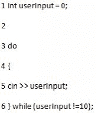

虽然它看起来与你刚刚看到的标准 `while` 循环不同，但它们几乎是一样的，只有一个区别。`while` 循环会评估条件以判断其是否为真，如果是则运行代码；而 `do while` 循环会先执行某些代码，然后检查条件是否为真。由于这种机制，无论你为大括号之间的代码初始化 `userInput` 为什么，它都会被执行。

## For 循环
第三种循环是 `for` 循环。这是三种循环中最复杂的，但一旦你理解了它，它就非常强大。现在，我们只需要了解它的用法。看看这个 `for` 循环。

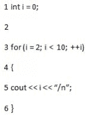

这段代码告诉程序首先将值 `i` 设置为 2，只要 `i` 小于 10，就将其值输出到屏幕上并递增。你可以轻松地使用 `while` 循环复制这个循环，但它会使用更多的代码，而且非常凌乱。

你还应该知道，`for` 循环第一行使用的变量必须是同一个变量。你还应该记住，第一个语句不是条件判断，而是一个赋值。当你想要遍历各种数据时，这种循环会非常有用，当你在下一章学习数组时就会看到它。

## 第七章 – 数组

数组是一组组合在一起的变量，因为它们有共同的用途。它们并不真的非要有共同点，但将不相关的东西放在一起并不是一个好主意。这就像向你的文件柜里填满随机纸张而却从不整理它们。如果你打算那样做，你还需要文件柜干什么呢？

这里是一个整数变量数组的声明。

```cpp
1 int a [5];
```

你可以看到数组看起来像普通变量，但它们末尾有一些方括号。当你声明数组时，括号内将填充你所需要的数组的大小。在这种情况下，你将存储五个整数变量。

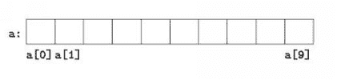

只要你有足够的 RAM 内存，数组可以是你想要的大小，但它一次只能包含一种类型的变量。变量类型可以是你通常使用的任何类型。

访问数组中的特定变量是非常简单的。你在方括号中放入你想要的变量数字。所以对于你想要的第一个变量使用 `[0]`，对于第二个使用 `[1]`，依此类推。看一眼下面的示例。

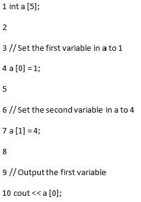

你不应该做的一件事是访问数组中不存在的变量，例如在一个只有五个位置的数组中访问第十个变量，或者访问没有给其分配变量的变量。如果没有分配变量，你将得到所谓的“垃圾值”（garbage value），因为它返回的值是无法使用的。

如果变量不存在，你可能会得到“段错误”（segmentation fault），因为程序将尝试访问它未被允许访问的内存段。这可能导致程序意外终止。现在你已经知道如何创建数组，让我们来看看如何创建函数！

## 第八章 – 函数

函数是编写复杂程序的好方法，而不需要重复代码。例如，假设你有一段复杂的代码，从用户处获取输入并进行解析。现在，假设你需要运行这段代码几次，但不在循环中运行。在此之前，你每次都必须写一遍。

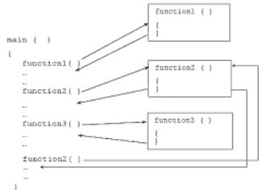

有了现代的复制粘贴，这并不是大问题，但它看起来会很糟糕，而且当你需要修复错误时，重复的代码可能会成为问题。为了解决这个问题，你可以创建函数，函数是你能够反复调用的代码段，而不需要每次都编写。

实际上，你已经用过函数了。`Main` 就是一个函数。所以，让我们来看看它是如何工作的。

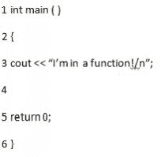

让我们检查第一行，包含 `main` 单词的行。这开始定义一个不带参数的函数，被称为 `main`，它将返回一个 `int` 类型的值。你已经知道 `int` 是什么（一种变量类型），但“返回一个值”意味着什么？

C++ 中的函数就像数学中的函数一样，你输入一个数字并对其进行某些操作，然后得到一个答案。在这里，`int` 是输出函数将要变成的变量。参数是放入函数的变量，函数在返回结果之前会执行操作。

让我们来看带有 `main` 的函数。

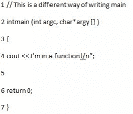

参数的写法类似于变量定义，并用逗号分隔。它们写在函数名后面，并放在括号内……（关于 `argc` 和 `argv` 的细节）……现在你已经知道什么是函数，让我们来看看指针。

## 第九章 – 指针

RAM 随机访问内存是计算机保存所有变量的地方，但有时自己了解这些转换是好的。考虑一下数组是如何工作的，它们只是长排的变量，其类型由程序员告诉编译器。

所以你可能认为这就像内存 一样，你是对的。当你标记数组且第五个值实际上是数字六（因为所有数组从零开始），你在第一个变量之后，结合你对整数占 4 个字节的了解，你可以看到数组中的第 n 个整数将具有这个地址：


因此，第六元素的地址是 1020。那么这为什么很有用呢？你可以在程序编译和运行时创建数组，并使其具有合适的。

指针是一个普通变量，但它不存储整数，而是存储另一个变量的地址。这是一个指针。


在这个指针中，你有一个存储整数地址的变量。`*` 是作为指针的变量，而不是普通变量。你已将其赋值为 0。


既然你已经了解了它们是什么，让我们在下一章中学习动态内存。

# 第十章 - 动态内存

到目前为止，你已经能够在编译时创建变量并在运行时修改它们；然而，当你使用动态内存分配时，你也可以在运行时创建它们。这种方法在程序运行期间对 RAM 进行分配和释放。由于你正在访问 RAM，推测你将通过指针来操作是理所当然的，但 `C++` 中的动态内存使用方式与 C 语言不同。

请看以下代码块。

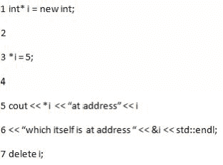

在这里，你创建了一个指向 `int` 的指针并为它预留了一些内存。由于 `i` 仍然是一个指针而不是变量，你必须将 `i` 所指向的值设置为 5，而不是设置 `i` 本身。这改变了 `i` 指向的位置，并导致 RAM 中某处预留的内存变成了“孤儿内存”。这种被遗忘的内存被称为内存泄漏。为了防止这种情况，请务必使用 `delete` 运算符符释放你最初预留的内存。

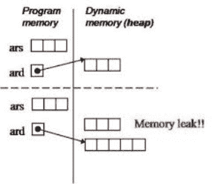

不过，将内存分配到单个变量并没有太大帮助。如果你预先知道变量将会存在，就可以正常地声明它。这种方法的作用是创建在编译时未知的变长数组。但你到底如何可能预知呢？你不能创建一个指针数组并在需要时访问它们，那只是在创建一个巨大的数组并希望一切顺利的基础上，变成了一种更消耗 RAM 的实现方式了。

现在你已经知道了什么是动态内存以及如何使用它，让我们在下一章中看看类和对象。

# 第十一章 - 类与对象

这实际上是 `C++` 设计的初衷：支持类和对象。没有了它们，`C++` 只是真正的 C 语言。但之前提到的类和对象是什么？类就像一种模具，而对象是从模具中产生的东西。这些模具是灵活的，可以制造你喜欢的任何类型的对象。模具可以是通用的也可以是特定的。

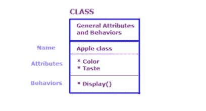

假设你想制造一辆汽车。这将是一个抽象的教程，因为代码实际上并没有执行任何操作。思考汽车需要哪些属性。它们需要速度、价格、颜色、制造商和型号。如果是四轮驱动还是不是呢？你能对它做什么？你可以启动引擎和停止它吗？

让我们来看看汽车外观的类定义。

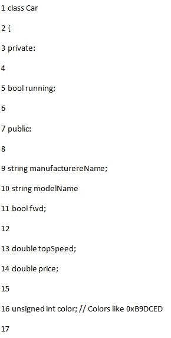 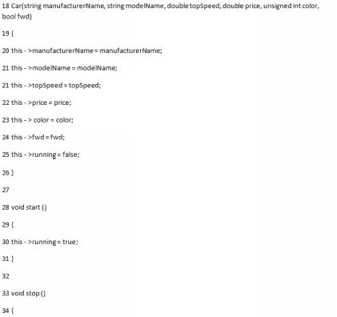

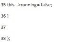

如你所见，类的定义与 `struct` 非常相似，这是很合理的，因为它们都是对数据分组的方法。但这个类包含了一些 `struct` 无法实现的内容：函数。

# 总结

到此时，你已经学会了如何创建你的第一个简单程序以及更多内容！你了解了变量是什么、如何扩展程序、如何使用运算符、条件、循环、数组、函数、指针、动态内存以及类和对象，从而将你的程序蜕变为一件杰作！你看，`C++` 并不像你曾经认为的那么困难，尽管它确实有难度。

下一步是收集你从书中汲取的知识，并继续阅读更多关于 `C++` 编程奇妙世界的内容。一旦你熟悉了，就搭建一台虚拟机来进行编程并开始吧！你将学习到一种在当今计算机行业中非常有价值的技能。

感谢阅读。希望你喜欢。我请你留下诚恳的反馈。
