# C++：快速掌握 C 语言的终极指南，第 1 卷


我认为接几本书对你也会感兴趣：

C++

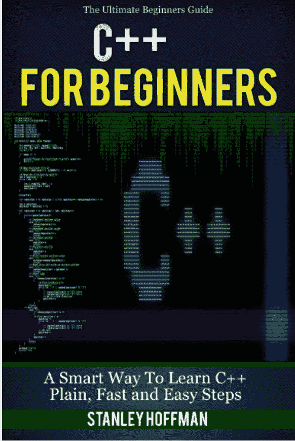

Python

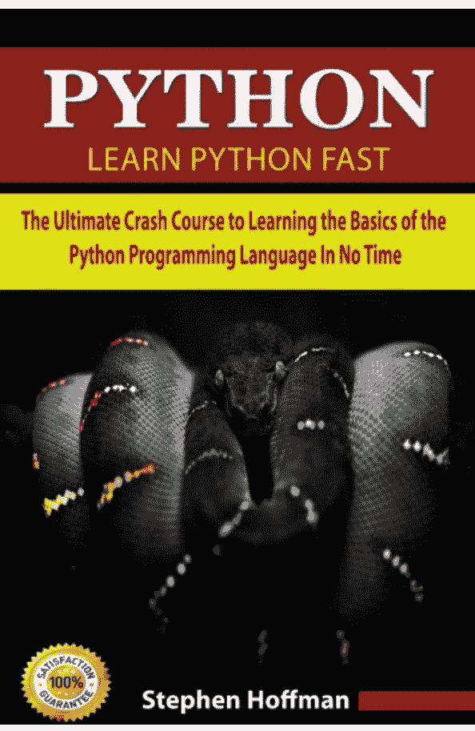

Javascript

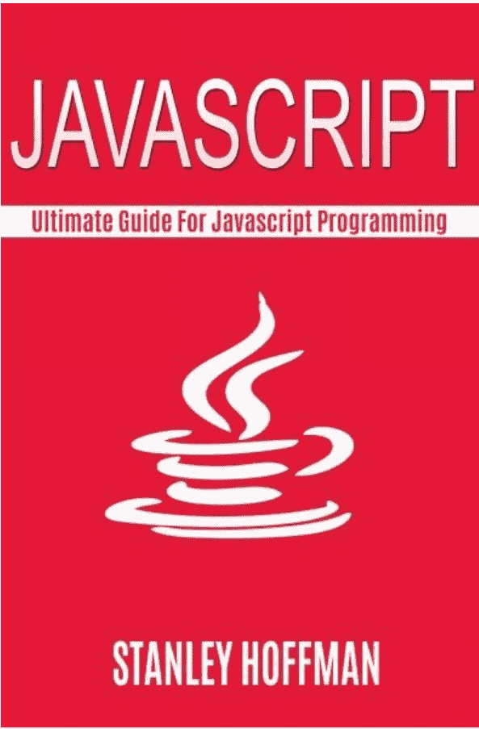

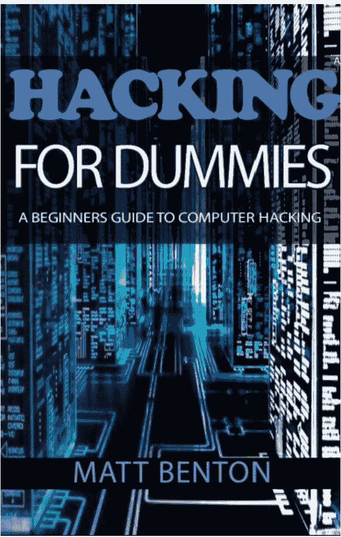


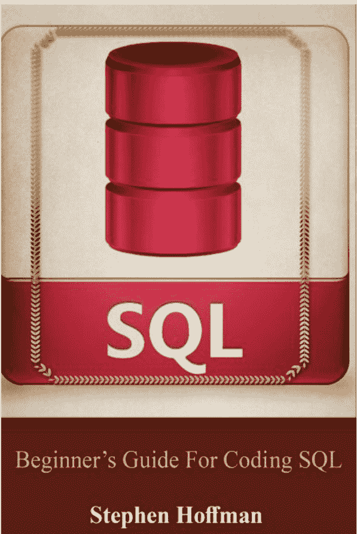

# 引言

C++ 的许多应用涉及更复杂的软件组件组织，包括图形处理和科学计算。这并不是说 Java 或其他语言缺乏处理这类问题的能力。C++ 在这些领域确实拥有历史，其祖先是 C 语言。看待它的最好方式是，C++ 在 C 语言的基础上增加了一些面向对象的原则 (OOP)，以便在当时变得更加现代化。

更具体地说，C++ 的语法总体与 C 非常相似，但它共享了 Java 同样使用的 OOP 概念。这包括类、多态、封装、继承以及许多其他概念。其核心在于，C++ 为新老程序员提供了一个易于理解的平台，以便于交流。

然而，本指南并不是让你陷入术语中。一旦你学会了任何编程语言，只要它属于同一个家族，下一种就会变得更容易。这意味着 C++ 将帮助你学习 Java，而 Java 将帮助你学习 C#，以此此类推。选择编程语言的最佳方法是找到你可能喜欢编程的感觉。这可能意味着在 QBASIC 中编写像语句一样的代码，或者像 Ook-Ook 那样编写晦涩的代码魔法。在这种情况下，我们需要一种既能介绍编程入门，又足够灵活以处理更高级主题的语言；因此，我们选择了 C++ 编程语言。

现在我们已经了解了编程语言的总体观点，可以开始处理设置编程环境的一些初步目标。这包括一个编辑器、一个编译器和一个文件目录结构。编辑器是你实际编写代码的地方。编译器将获取你的代码并生成一个可以在你的计算机上运行的可执行应用程序。文件目录结构的唯一目的是为了减少你在编码期间对文件保存在何处的困惑。我们开始好吗？

## 第一章：安装 Cygwin：类 Linux 开发

第一步是获取编译器。原因是，这将对你的程序在编译器处理后的运行方式产生一些限制。例如，某些特定的编译器宏，例如来自 gcc 编译器的 `__sync_synchronize`，它们会添加一些你不需要手动添加的额外指令。

撇开编译器的特性，在同一个程序上使用不同的编译器还有其他问题。每当你试图寻找代码中的问题时，编译器警告也会导致一些不必要的困惑。由于对某个特定编译器的共识，编译器的选择也可能会导致进一步研究的停滞。

使用 Cygwin 软件包的另一个好处是它遵循与默认 Linux 编译器类似的格式。我们将从 Cygwin 软件包中使用的特定编译器是 g++ 编译器，它会有一些特性，但它将帮助深入熟悉代码，使我们不必像某些其他集成开发环境 (IDE) 那样只需按一个大按钮来获取可执行代码。

关于编译器有大量的研究正在进行。应用于形式化语言、自动机以及其他许多高级主题的原理。如果你对编译器的底层工作原理有进一步兴趣，网上有很多资源，以及对最流行的编译器的易懂解释。

[点击此链接获取 Cygwin]。

一旦安装完成，你还可以做其他几件事。Linux 操作系统使用 bash 这种脚本语言，而 Windows 使用批处理（batch）。bash 和 batch 之间的差异有很多，但它们都共享一些通用功能。Cygwin 实际上添加了一些 bash 具有的命令，但 Windows 让其变得稍微复杂了一些。

**pwd** 命令稍后会有用，因为它会打印工作目录。命令提示符也是。

## 第二章：安装 Notepad++：从文本到代码

我们下载的下载项是代码编辑器。代码编辑器和简单文本编辑器之间的区别非常明显，前者将提供一些语法高亮等功能。

最好的部分是，这个代码编辑器不仅高亮 C++，还能高亮许多其他语言。Linux 也使用名为 gedit 的混合文本编辑器。

[点击此链接获取 Notepad++]。

## 第章：设置工作空间：文件结构是关键

最后的设置步骤在这里。这一步被认为是可选的；然而，请想一下这个简单的场景。假设你被要求开发一个非常大的项目。还有其他程序员和你一起工作。他们都有自己的办事方式，这可能在早期就会导致一些问题。其中一个人请求你帮助处理软件。这里有一个接口，那里有一个实现，伴随着他的一些工具。他试图快速解释它，但当你试图进入一个文件夹又另一个文件夹时，你已经迷失了。

现在。这个简单的例子似乎违背了对严格结构的需求，但倒数第二章将带你向程序中添加一些代码，以验证这种结构的必要性。我们要做的最多涉及 2 个文件夹。

对于主要的示例，我们需要创建一个名为“tutorials”的文件夹。如果你已经知道如何这样做，请继续阅读第 4 章。否则，这里是使用 Windows 创建新文件夹的逐步步骤：

第一步是前往桌面。这是你所有图标所在的地方。底部是任务栏，有开始按钮，右侧是时钟。请将光标悬停在桌面并点击右键。你应该看到与右侧图像类似的内容。


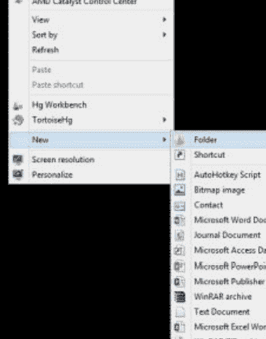

虽然这看起来很简单，但还有其他方法可以使用命令行操作来创建文件夹。在没有图形用户界面（GUI）的系统中（如大多数操作系统），确保你将文件和文件夹放在正确的位置是至关重要的。代码可以写得多么完美，但如果你或编译器找不到它，那么它就等同于不存在。

关于文件结构的最后一个注释是，创建它是一回事，而在整个开发过程中始终遵守它是大多数编码人员必须做的事情。这意味着要随时清楚什么东西在什么位置。如果你能向一个对系统了解或完全不了解的人解释你的代码是如何结构的，并且他们可以找到任何文件夹，或者更好一点，找到目录中的任何内容，那么我们就做对了。

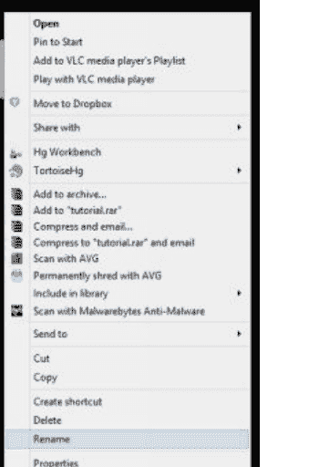

# 第 4 章：编程时间：向世界问候

吸气，然后呼气。现在我们可以编程了。我们应该做的第一件事是将命令行提示符进入正确的工作目录，也就是我们放置“tutorial”文件夹的地方。让我们开始吧。

点击底部任务栏上的“开始”按钮。在底部的搜索框中输入“cmd”，或者点击右侧的“运行...”选项。获取运行提示符的另一种方法是按住 Windows 键然后按“r”键。你应该遵循接下去的一系列屏幕操作。

`cd` 命令将把你的目录更改到命令后的单词所指定的目录。要获取“tutorial”文件的目录，双击它，并在弹出的窗口顶部找到地址栏。点击地址栏，然后按 [Ctrl] + [C] 复制其中的地址。然后，在命令行提示符上点击右键并粘贴代码以进入你的目录。接下来的两张图片将展示所有的操作过程。

接下来的几步将在命令行中完成。这是为了让你熟悉终端的外观，并让你对代码如何通过计算机有更好的感觉。你将执行的第一个命令是创建一个文件 `hello.cpp`，这是我们计划放置代码的地方。在 `tutorial` 文件夹内部创建它后，输入 `touch hello.cpp`。这应该会在当前工作目录中创建一个你指定的名称的文件。如果你不记得了，可以在命令行提示符中输入 `pwd` 来打印你当前的工作目录。

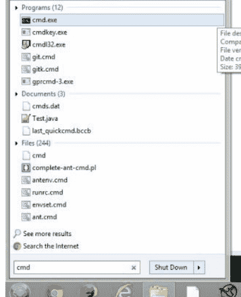

打印（Print）意味着它会将结果文本直接放在你的屏幕上。这里的最后一张图片显示了它的工作。

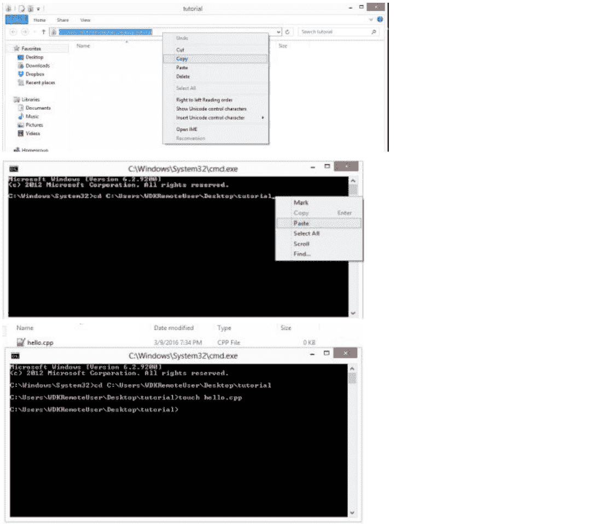

我们终于可以开始编写代码了。你成功地创建了一个 C++ 源文件，尽管现在它可能还没有内容。要打开它，你可以采用几种方法。最明显的方法是双击它；但是，你可能有其他应用程序可能会干扰并改为打开它们内部的文件。为了避免这种情况，右键点击新创建的文件，选择“打开方式”选项，并点击“选择默认程序...”。然后找到 Notepad++ 的安装位置。通常情况下，在 32 位系统上，它应该在 `C:\Program Files (x86)\Notepad++` 内部，而在 64 位系统上，它会在相同的位置，只是没有 `(x86)`。

下面提供的代码将在接下来的段落中解释。

为了获取代码，接下来的段落解释如下：

```cpp
#include <cstdio>
#include <iostream>

int main() {
    printf("BEGIN:\n");
    std::cout << "Hello, World!" << std::endl;
    printf("END:\n");
    return 0;
}
```


编译成功后立即运行程序。被绿色圈出的部分是实际输出。

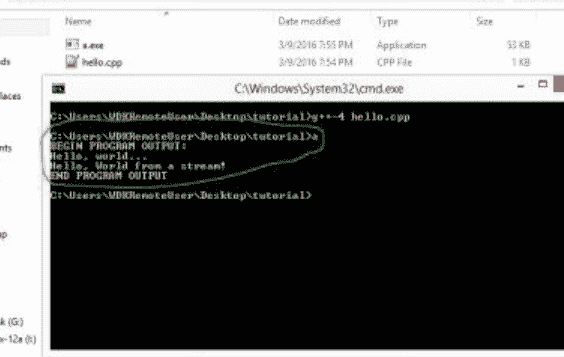

编译器理解我们何时需要去另一个文件来获取某些函数定义，这样我们只需要向编译器提供该文件的名称即可。既然我们已经知道了程序是如何运行的（绿灯），让我们继续，并顺便多添加一些内容。

既然我们已经完成了命名这部分，就可以将变量应用于我们当前的代码了。下面的图片在某种程度上总结了这些，但如果你需要文字说明，我稍后也会进行解释。

## hello.cpp

```cpp
#include <stdio.h>
#include <iostream>
#include <string>

using namespace std;

int main() {
    string hello = "Hello, World!";
    string prog_out = "Program Output:";

    printf("Begin %s:\n\n", prog_out);
    printf("%s\n\n", hello);
    cout << hello << " from a stream!" << endl;

    printf("End %s:\n\n", prog_out);
}
```

首先注意到的是顶部额外的 `include` 语句。这把 `string` 数据类型引入到我们的程序中供函数使用。接下来是函数定义之外的 `using namespace` 部分。这类似于使用变量名来使代码更简洁，因为现在我声明我正在使用 `std` 命名空间，所有与之相关的变量都会自动带入我们的程序中。

函数中新增的两个行是实际的变量声明。这是声明任何数据类型变量的标准写法。`String` 是一个特殊情况，它们实际上只是一个更容易理解的 `char*` 数据类型的概念，本质上表示该变量指向一个字符。

指针是 C/C++ 中的一个核心概念，它实际上出现在我们当前的代码中。出现在我们函数调用中的变量前的 `&` 基本上告诉函数不要使用变量本身，而是使用该变量所引的值。接下来的图片应该消除大多数初学者在最初理解时经常遇到的某些困惑。

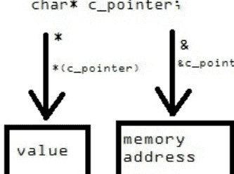

核心点在于，如果你有一个指向任何特定类型的指针变量，你可以使用前面的星号 `*` 将指针转换为值，或者使用前面的 ampersand `&` 获取变量的地址并将其传递给其他函数等。这只是指针的一个非常简化的介绍，仅供你了解。

现在，回到代码。在我们的函数中提到的变量前面应该有 ampersands，因为它们需要的是字符串的指针而不是值。这使得函数能够传递正确的字符串并打印出与上次相同的输出。

我们将向当前程序中添加的下项内容是编写多个函数的想法。这对于我们简单的示例来说可能不是必须的，让我们添加一些简单的计算来展示函数的威力。其主意是将两个数字相加并返回它们的和。作为一个挑战，尝试添加一个 `if` 语句来检查该值是否为负数，如果是则返回零。解决方案将在结论中。

至于我们要添加的函数，让我们取程序的中间部分并替换为我们想要添加的函数。为了方便起见，我们将其命名为 `calc_sum` 以保持简单。

下面的图片展示了如何添加它。想法是，我们在添加新功能的同时，尽可能保留旧程序的内容。我们只需说程序员喜欢节省时间。不同之处在于函数是负责将其输出到屏幕上还是不是，这影响了返回值是 `void` 还是 `int`。代码摘要如下：

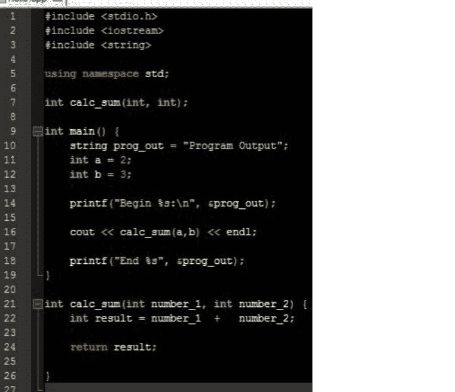

```cpp
#include <stdio.h>
#include <iostream>
#include <string>

using namespace std;

int calc_sum(int, int);

int main() {
    string prog_out = "Program Output";
    int a = 2;
    int b = 3;

    printf("Begin %s:\n", prog_out);
    cout << calc_sum(a,b) << endl;

    printf("End %s\n", prog_out);
}

int calc_sum(int number_1, int number_2) {
    int result = number_1 + number_2;

    return result;
}
```

注意 `main` 函数之前有一个原型，这告诉编译器稍后会在程序中定义一个函数。在这种情况下，它是 `calc_sum`，它接收两个整数值作为参数。定义本身非常简单，我们只需要返回两个整数的和。这与我们在数学中做的方式相似，不同在于我们现在将其返回给调用者。（注：此处原文存在大量重复的句子，已根据逻辑完成翻译并去重处理）。


通过代码查看你将学习的内容。无论何种方式，这至少能展示出你的一些编程习惯。下一个问题是：你未来将如何编程？

答案就在代码之中……

感谢阅读。希望你喜欢。恳请留下你诚实的反馈。
