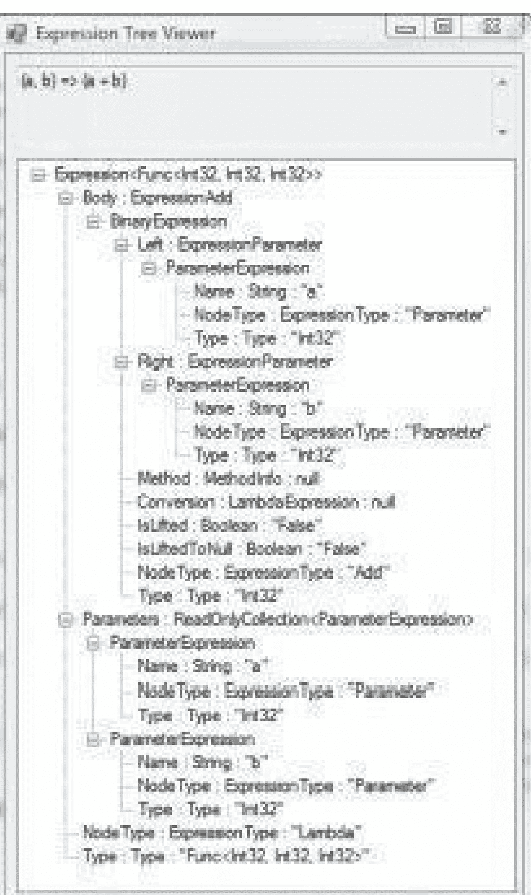
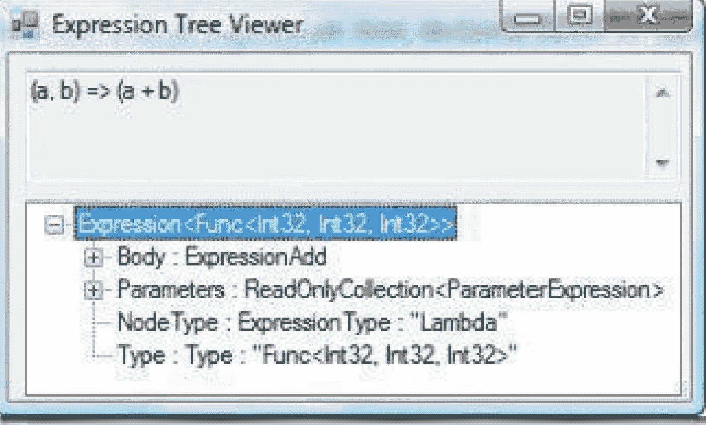

# C#：进阶学习 C# 编程终极指南


## 第1章：引言 - C# 的设置与历史

微软在 2000 年宣布了 C#，并在 2002 年发布了该语言。C# 原本被称为 "Cool"，是 "C-like object-oriented programming" 的缩写。C# 是一种基于 C 的编程语言。它的读作 C-sharp；# 符号表示 C# 是 C++ 的后续迭代版本。

以下是 C# 的时间线，详细说明了每个版本添加的内容（“C# 简介”）：

**2002年1月**
C# 1.0
- 类型安全的编程语言
- 现代
- OOP（面向对象编程）

**2005年11月**
C# 2005
- 泛型
- 部分类
- 匿名类型
- 迭代器
- 可空类型
- 静态类

**2007年11月**
C# 2007
- 对之前添加内容的改进
- 扩展方法
- 表达式树

**2010年4月**
C# 4.0
- 动态绑定

**2012年8月**
C# 5.0
- 异步

**2015年7月**
C# 6.0
- 异常过滤器
- 字符串内插

**2017年8月**
C# 7.0
- 元组
- 模式匹配
- 局部变量

**2019年9月**
C# 8.0
- 只读成员
- 默认接口方法
- 模式匹配
- 使用声明
- 结构体
- 可空引用类型
- 异步流
- 索引和范围
- 空合并赋值
- 不托管类型
- 插值字符串

通过阅读本文，读者同意在任何情况下，作者对因使用本文包含的信息而导致的任何直接或间接损失不负责，包括但不限于错误、遗漏或不准确。


2. 选择“文件 -> 新建 -> 项目”来创建一个新项目，如下所示。

### 开始页 - Microsoft Visual Studio

| 文件 | 编辑 | 视图 | 项目 | 调试 | 团队 | 工具 | 测试 | 分析 | 窗口 | 帮助 |
|---|---|---|---|---|---|---|---|---|---|---|
| 新建 | | | | 项目... | | | | | Ctrl+Shift+N |
| 打开 | | | | 文件... | | | | | Ctrl+N |
| 开始页 | | | | | | | | 现有代码项目... | |
| 关闭 | | | | | | | | | | | |
| 已保存的项目 | | | | | | | Ctrl+S | | | |
| 另存已保存的项目... | | | | | | | | | | | |
| 保存全部 | | | | | | Ctrl+Shift+S | | | | | |
| 源代码控制 | | | | | | | | | | | |
| 页面设置... | | | | | | | | | | | | |
| 打印... | | | | | | | | | | | Ctrl+P |
| 账户设置... | | | | | | | | | | | | | |
| 最近文件 | | | | | | | | | | | | | |
| 最近项目和解决方案 | | | | | | | | | | | Alt+F4 |

利用这些用于 Visual Studio 的技巧和方法，可以部署美观、低成本的 Android 和 iOS 应用程序。

3. 你将面对许多 C# 程序选项。选择“控制台应用 (.NET Framework)”并赋予你选择的名称。我将其命名为“MyProgram”。点击确定。

| 新项目 | 排序依据：默认 | | | 搜索 (Ctrl+E) |
|---|---|---|---|---|
| 已安装 | | | | |
| Visual C# | WPF 应用 (.NET Framework) | Visual C# | 类型: Visual C# | |
| 快速上手 | Windows Forms 应用 (.NET Framework) | Visual C# | | | |
| Windows 桌面 | 控制台应用 (.NET Framework) | | | | |
| Web | 控制台应用 (.NET Framework) | Visual C# | 用于创建命令行应用程序的项目 | |
| .NET Core | .NET Core | Visual C# | | | |
| .NET Standard | 控制台应用 (.NET Framework) | Visual C# | | | |
| 云 | 类库 (NET Standard) | 控制台应用 (.NET Framework) | | | |
| Net Standard | | | | | | |
| 测试 | 类库 (.NET Framework) | Visual C# | | | |
| WPF | ASP.NET Core Web 应用程序 | Visual C# | | | | |
| Visual Basic | | | | | | |
| Visual C++ | ASP.NET Web 应用程序 (.NET Framework) | Visual C# | | | |
| Visual F | | | | | | |
| SQL Server | 共享项目 | Visual C# | | | | |
| Azure Data Lake | 用于 VS 2015 的 .Net Standard | Visual C# | | | |
| Azure Stream Analytics | 类库 (旧版可移植) | Visual C# | | | |
| 其他项目类型 | | | | | | |
| 在线 | WCF 服务应用程序 | Visual C# | | | | |
| 名称: MyProgram | | | 浏览... | | | |
| 路径: C:\Users\username\repos | | | 创建解决方案目录 | | | |
| 解决方案名称: MyProgram | | | 添加到源代码控制 | | | |
| 框架: .NET Framework 4.6.1 | | | 确定 取消 | | | |

没有找到你想找的内容？
打开 Visual Studio 安装程序

4. 你将被导航到一个可以编写 C# 代码的窗口。在窗口中复制以下代码，并点击顶部菜单上标记为“启动”的绿色按钮。

```csharp
using System;
using System.Collections.Generic;
using System.Linq;
using System.Text;
using System.Threading.Tasks;

namespace MyProgram
{
    class Program
    {
        static void Main(string[] args)
        {
            Console.WriteLine("Congratulations, you wrote your first Program");
            Console.ReadKey();
        }
    }
}
```

当你点击“启动”按钮运行脚本时，控制窗口将显示运行结果。在这种情况下，消息是：“恭喜，你写了你的第一个程序”。它看起来像：

```csharp
using System;
using System.Collections.Generic;
using System.Linq;
using System.Text;
using System.Threading.Tasks;

namespace MyProgram
{
    class Program
    {
        static void Main(string[] args)
        {
            Console.WriteLine("Congratulations, you wrote your first Program");
            Console.ReadKey();
        }
    }
}
```

为了理解发生了什么，让我们看看我们写的代码：

```csharp
using System;
using System.Collections.Generic;
using System.Linq;
using System.Text;
using System.Threading.Tasks;

namespace MyProgram
{
    class Program
    {
        static void Main(string[] args)
        {
            Console.WriteLine("Congratulations, you wrote your first Program");
            Console.ReadKey();
        }
    }
}
```

`using` 语句位于顶部，用于声明导入包含预建函数（称为方法）的库，这些方法我们在代码中可能需要。C# 中的任何代码块都放置在命名空间内的类中。这是意料之中的，因为该程序是面向对象的。

在我们编写的程序中，类是 `Program`，命名空间是 `MyProgram`。


```csharp
        player1.DisplayCity();
        Console.Read();
    }
}
```

使用上述程序：

- 我们定义了两个接口：‘Score’接口和‘Location’接口。
- ‘Player’类实现了这两个接口并定义了相关方法。

以下是程序应该显示的内容：

尝试 1 的得分为 10

尝试 2 的得分为 20

玩家来自纽约

### 接口中的属性

在接口中定义属性是可能的。它们只能拥有“get”或“set”关键字，这会告诉我们它们是只读属性还是读写属性。

以下是语法结构。

```csharp
public interface name
{
    // 属性声明：
    datatype propertyname
    {
        get;
        set;
    }
}
```

如果定义了 get 和 set 方法，意味着该属性是一个读写属性。这里是接口中属性工作方式的示例。

### 在接口中使用属性

```csharp
using System;
namespace Demo
{
    // 定义接口
    public interface Score
    {
        // 读写属性
        int score
        {
            get;
            set;
        }
        // 读写属性
        string Try
        {
            get;
            set;
        }
        // 只读属性
        int PlayerID
        {
            get;
        }
    }

    public class Player : Score
    {
        public int PlayerID;
        public string PlayerName;
        public int score // 读写实例属性
        {
            get
            {
                return marks;
            }
```

```csharp
        )
        {
            score = value;
        }
    }
    public string Try // 读写实例属性
    {
        get
        {
            return Try;
        }
        set
        {
            Try = value;
        }
    }
    public int PlayerID // 读写实例属性
    {
        get
        {
            return 1;
        }
    }
    class Program
    {
        // 主函数
        static void Main(string[] args)
        {
            Player player1 = new Player();
            player1.PlayerID = 1;
            player1.Name = "John";
            player1.score = 20;
            player1.try = "first try";
            Console.WriteLine("The score is " + player1.marks);
            Console.WriteLine("The try is " + player1.try);
            Console.WriteLine("The PlayerID is " + player1.PlayerID);
        }
        Console.Read();
    }
}
```

在上面的程序中：

我们在接口中设置了 3 个属性。

- 'Try' 和 'Score' 属性是读写属性，因为它们拥有 'get' 和 'set' 方法。
- 'PlayerID' 只有 'get' 属性，这意味着它是一个只读属性。
- 然后我们在类中定义了这些属性的实现。

关于该程序，结果应该是这种格式：

The score is 20

The try is the first try

The PlayerID is 1


命名空间允许我们分离并使用具有相似名称和参数但用途不同的函数（“C# 命名空间”）。编程语言中并不常见这种做法。每个函数都必须有一个唯一的名称。

以下是语法：

```csharp
namespace namespaceName {
  Class definition {
    // 定义函数
  }
}
```

所有定义的函数都将属于 'namespaceName' 命名空间。在某些程序中，你将需要以下定义：

```csharp
using System;
```

结果将使用 System 命名空间中的函数。

**示例：** 下面的程序用于演示如何使用命名空间。

```csharp
using System;

// 第一个命名空间
namespace NameA {
  public class ClassA {
    public void FunctionA() {
      Console.WriteLine("This is from A");
    }
  }
}

// 第二个命名空间
namespace NameB {
  public class ClassB {
    public void FunctionB() {
      Console.WriteLine("This is from B");
    }
  }
}

namespace Demo {
  class Program {
    // 主函数
    static void Main(string[] args) {
      // 使用命名空间
      NameA.ClassA clsA = new NameA.ClassA();
      clsA.FunctionA();

      NameB.ClassB clsB = new NameB.ClassB();
      clsB.FunctionB();
      Console.Read();
    }
  }
}
```

在上面的程序中：

- 我们定义了两个命名空间：NameA 和 NameB。它们都定义了类似的类。
- 我们在主程序通过其命名空间调用每个函数。

我们可以使用 “using” 指令来避免指定命名空间，如下：

```csharp
using System;
using NameA;
using NameB;

// 第一个命名空间
namespace NameA {
    public class ClassA {
        public void FunctionA() {
            Console.WriteLine("This is from A");
        }
    }
}
// 第二个命名空间
namespace NameB {
    public class ClassB {
        public void FunctionA() {
            Console.WriteLine("This is from B");
        }
    }
}
namespace Demo {
    class Program {
        // 主函数
        static void Main(string[] args) {
            // 使用命名空间
            ClassA clsA = new ClassA();
            clsA.FunctionA();
            ClassB clsB = new ClassB();
            clsB.FunctionA();
            Console.Read();
        }
    }
}
```

关于该程序，结果将是：

This is from A

This is from B


命名空间也可以嵌套，这意味着将一个放在另一个内部。如下所示：

```csharp
namespace namespace1 {
    Class definition {
        // 定义函数
    }
}
```

```csharp
namespace namespace2 {
    Class definition {
        // 定义函数
    }
}
```

我高亮了命名空间以便你可以看到它们是嵌套的，便于导航。下面是我们如何访问 namespace1.FunctionA 和 namespace2.FunctionB 的。

```csharp
using System;
// 一个命名空间
namespace NameA {
    public class ClassA {
        public void FunctionA() {
            Console.WriteLine("This is from A which contains B");
        }
    }
}
// 内部命名空间
namespace NameB {
    public class ClassB {
        public void FunctionA() {
            Console.WriteLine("This is from B inside A");
        }
    }
}
namespace Demo {
    class Program {
        // 主函数
        static void Main(string[] args) {
            // 使用命名空间
            NameA.ClassA clsA = new NameA.ClassA();
            clsA.FunctionA();
            NameB.ClassB clsB = new NameB.ClassB();
            clsB.FunctionA();
            Console.Read();
        }
    }
}
```

- 我们在 A 内部嵌套了命名空间 B。
- 然后我们通过点符号访问特定的函数。

我们得到如下结果：

**This is from A which contains B** is from B inside A


!= 运算符用于检查两个操作数是否相等。!= 运算符也可以用于否定条件。当条件的相反为真时执行代码。

语法如下：

```csharp
if (levelComplete >= neededToPass) {
    Console.WriteLine("You haven't won yet. Keep trying...");
}
```

你可以将 != 与其他运算符一起使用，但 true != 的优先级高于关系运算符。这意味着它在其他运算符之前被检查。如果你想在否定之前检查关系运算符，你需要将关系条件放在括号中，就像数学中一样：

```csharp
if((score <= oddScore)) {
    // 等同于：
    if(score <= oddScore)
}
```

在编程中，有很多方法可以实现相同的功能。你只需要选择最简单且合适的方法。不应该不必要的复杂代码。


你的条件可以用于跟踪多个事物。假设你正在制作一个游戏，玩家控制角色通过艰难的地形。当角色能量耗尽或食物耗尽时，玩家就会失败。如果他们用完了能量，只要有供应，他们一直会有食物。如果他们用完了时间，可以依靠能量活到下一个阶段。唯一的失败方法是既没有能量也没有食物。所以，你需要一个检查两个条件并在两者都满足时结束游戏的条件。

为了做到，你需要使用 AND 运算符 (&&)。

这就是我们使用条件运算符的地方。如提到的，AND 运算符 (&&) 和 OR 运算符 (||) 是我们用于同时检查多个元素的：

```csharp
int energy = 50;
int time = 40;
if(time < 0 || energy < 0) {
    Console.WriteLine("You lost. Try again!");
}
```

这意味着如果食物小于或等于零且能量小于或等于零，游戏应该结束。

|| 只需要一个条件为真。它在一个可以通过两种方式死亡的游戏中效果更好。让我们想象我们的角色在能量为零或用完时间时的情况（在这种情况下，我们没有食物变量）。只需要其中一个为真游戏就会结束，而不是两者都满足。

你应该知道，默认情况下，计算机执行“惰性求值”，这意味着如果第一个条件已经满足，它们就不会检查第二个条件。只有当第一个条件（时间）不满足时，它们才会检查第二个条件（能量）。


可以将多个条件操作组合在一起。你可以通过括号来发挥创意。但请记住，当你创建这些条件时，务要让其他人易于阅读，永远不要为了目的而让事情变得过于复杂。

### 反射

C# 在运行时从代码段中检索信息的能力称为反射（reflection）。如果你想了解更多关于方法的信息（“C# 反射”），你就会使用反射。我们还可以做更多事情：我们还可以通过反射在运行时创建对象并调用方法。

在示例中，我们使用 "Type" 数据类型来获取有关类的信息。

## 使用 Type 获取类的信息

以下是我们所做的：

使用 "Type"，我们获取了 'player1' 对象的信息。

我们能够获取对象的类。

下面是我们将看到的输出：

# The object is of Type Demo.Player


以下反射方法用于从类中获取有关方法的信息。

下面是一个示例：

下一个程序展示了使用 MethodInfo 的方法。

```csharp
using System;
using System.IO;
using System.Reflection;
namespace Demo
{
    class Player
    {
        // Defining the members
        public int id;
        public string name;
        public void Display()
        {
            Console.WriteLine("The ID is " + id);
            Console.WriteLine("The player name is " + name);
        }
    }

    class Program
    {
        // The main function
        static void Main(string[] args)
        {
            Player player1 = new Player();
            // Trying to get the type of object
            Type myTypeObj = player1.GetType();
            Console.WriteLine("The object is of " + myTypeObj);
            // Using reflection to get information about the Display method
            MethodInfo myMethodInfo = myTypeObj.GetMethod("Display");
            Console.WriteLine("Is the method a static method?" + myMethodInfo.IsStatic);
            Console.Read();
        }
    }
}
```

程序将带我们以下结果：

The object is of Type Demo.Player

Is the method a static method? False.


集合（Collections）是处理特殊数据类的特殊类（“C# 中的集合”）。

例如，ArrayList 内部有一个 size() 方法，可以在无需编写繁琐代码的情况下获取数组的大小。

C# 拥有以下集合类：

- ArrayList - 数组用于存储相同数据类型的连续值。
- SortedList - 这些是允许常数时间进行插入和删除操作的序列。操作可以在两个方向上进行。
- Stacks（栈） - 这种类型为 LIFO（后进先出）情况设计，项从容器的一端插入并提取。
- Queues（队列） - 这种类型为 FIFO（先进先出）情况设计，项从一侧插入并从另一侧提取。

让我们再看一个细节。清楚地理解这些概念是至关重要的。

数组非常棒，因为我们可以根据需要让它们变小或变。由于使用的内存是连续的，我们知道数组是高效且脆弱的。但数组不是动态的。凭借当今计算能力，程序员必须发挥创意来克服这一点。作为一种优势，这意味着数组不会失控增长并超出系统内存。那时的计算机没有现在这么多可用内存，所以数组在防止进程挂起方面起着重要作用。

如今，程序员可以编写更具动态性的程序，根据需要收缩和扩展，因为计算机拥有更多内存，也更强大。这对于程序员编写更多令人兴奋的事情是有利的，因为他们有空间可以发挥（当然，前提是不负责任）。

这就是为什么 list 如今变得越来越流行，程序员们正在寻找灵活性和力量。如果你用过 Python 这样的语言，你会发现 List 是一个灵活的数组。Lists 可以根据需要的时间增长到任何大小。它们没有定义的长度。它们总是被添加的。随着时间的推移，它们现在已经发展出来，并且今天将保持活跃。它们不受内在大小的限制。这种是是。Lists 还带有完整的功能。你需要导入 System.Collections。当使用 lists 时，你必须声明列表并使用它，如下：

```csharp
List<type> name = new List<type>();
```

使用 Add 方法添加项如下：

```csharp
list.Add(2);
list.Add(5);
list.Add(8);
```

你也可以使用 Range 方法将数组添加到 lists 中：

```csharp
list.AddRange(arrayName);
```

```csharp
list.Remove(5); // 按值移除
list.RemoveAt(0); // 按索引移除
```

在 8 留在列表内。注意我们在上一个示例中工作的列表。这说明了灵活的 lists。


ArrayList 容器存储相同数据类型的值。看看这个示例：

```csharp
ArrayList variableName = new ArrayList();
```

"VariableName" 被赋值给 ArrayList，这样我们就可以使用各种方法。使用 Add 方法添加项。我们可以通过索引访问此元素。这是一个示例：

```csharp
using System;
using System.Collections;
namespace Demo
{
    class Program
    {
        static void Main(string[] args)
        {
            // Defining ArrayList
            ArrayList ar = new ArrayList();

            // Adding elements to the array list
            ar.Add(10);
            ar.Add(15);
            ar.Add(20);

            // Displaying the elements of the array
            Console.WriteLine("The first element of the array is " + ar[0]);
            Console.WriteLine("The second element of the array is " + ar[1]);
            Console.WriteLine("The third element of the array is " + ar[2]);

            Console.Read();
        }
    }
}
```

这是我们将在控制台中看到的：

The first element of the array is 10

The second element of the array is 15

The third element of the array is 20

我们可以向 ArrayList 添加各种类型。此程序展示了使用字符串列表的方法：

```csharp
using System;
using System.Collections;
namespace Demo
{
    class Program
    {
        static void Main(string[] args)
        {
            // Defining ArrayList
            ArrayList ar = new ArrayList();

            // Adding elements to the array list
            ar.Add(10);
            ar.Add("There");
            ar.Add("World");

            // Displaying the elements of the array
            Console.WriteLine("The first element of the array is " + ar[0]);
            Console.WriteLine("The second element of the array is " + ar[1]);
            Console.WriteLine("The third element of the array is " + ar[2]);

            Console.Read();
        }
    }
}
```

控制台中的输出将是：

The first element of the array is Hi

The second element of the array is There

The third element of the array is World

ArrayList 类有许多方法可以操作数据。

### ArrayList 操作

下面的部分总结了 ArrayList 可用的操作。

| 函数 | 描述 |
|---|---|
| size | 此属性告诉我们 ArrayList 的大小 |
| Clear() | 此函数移除 ArrayList 中的所有元素 |
| Contains() | 此方法检查 ArrayList 是否包含特定元素，返回布尔值：如果包含返回 True，如果不包含返回 False。 |
| IndexOf() | 此方法返回指定元素在 ArrayList 中的索引 |
| Insert() | 此方法在 ArrayList 的特定索引处插入值/项 |
| Remove() | 此方法从 ArrayList 中移除一个项 |
| RemoveAt() | 此方法将移除指定索引处的项 |
| Reverse() | 此方法反转 ArrayList 中的元素 |
| Sort() | 此方法按字母顺序或如果是数字则升序排序数组中的元素。 |
| GetRange() | 此方法用于提取数组并将其添加到 ArrayList |

让我们简要地查看上面定义的每个方法是如何工作的。


此属性告诉我们 ArrayList 的大小，即其中包含元素数量。我们将使用直观的 Count 方法来完成操作。

### 使用 count 属性

```csharp
using System;
using System.Collections;
namespace Demo
{
    class Program
    {
        // The main function
        static void Main(string[] args)
        {
            // Defining ArrayList
            ArrayList ar = new ArrayList();

            // Adding elements to the array list
            ar.Add(11);
            ar.Add(13);
            ar.Add(15);

            // Displaying the size of the array list
            Console.WriteLine("The size of the array list is " + ar.Count);
            Console.Read();
        }
    }
}
```


### 数组列表的大小为 3


此函数移除 ArrayList 中的所有元素

使用 clear 方法

```c
using System;
using System.Collections;

namespace
{
    class Program
    {
        // 主函数
        static void Main(string[] args)
        {
            // 定义 ArrayList
            ArrayList ar = new ArrayList();

            // 向数组列表添加元素
            ar.Add(13);
            ar.Add(14);
            ar.Add(17);

            // 清空数组列表中的所有元素
            ar.Clear();

            Console.WriteLine("The size of the array list is " + ar.Count);
            Console.Read();
        }
    }
}
```

它应该告诉我们数组中没有任何内容，如下所示：

### 数组列表的大小为 0


此方法检查 ArrayList 是否包含特定元素，返回一个布尔值：如果包含则返回 True，否则返回 False。

下一个程序展示了如何使用 contains 方法。

```c
using System;
using System.Collections;

namespace
{
    class Program
    {
        // 主函数
        static void Main(string[] args)
        {
            // 定义 ArrayList
            ArrayList ar = new ArrayList();

            // 向数组列表添加元素
            ar.Add(13);
            ar.Add(27);
            ar.Add(30);

            Console.WriteLine("Does the array contain the value 3? " + ar.Contains(30));
            Console.Read();
        }
    }
}
```

程序应该返回 true，如下所示：

### Does the array contain the value 3? True

### IndexOf Function

此方法返回指定元素在 ArrayList 中的索引。

这里是 IndexOf 方法的一个应用。

```c
namespace Demo
{
    class Program
    {
        // 主函数
        static void Main(string[] args)
        {
            // 定义 ArrayList
            ArrayList ar = new ArrayList();
            // 向数组列表添加元素
            ar.Add(50);
            ar.Add(2000);
            ar.Add(37);
            Console.WriteLine("The index of 37 is " + ar.IndexOf(37));
            Console.Read();
        }
    }
}
```

程序将在控制台中打印此内容：

### The index of value 37 is 2

### Insert Function

此方法在 ArrayList 的特定索引处插入一个值/项。

下面的程序展示了 insert 方法：

```c
using System;
using System.Collections;
namespace Demo
{
    class Program
    {
        // 主函数
        static void Main(string[] args)
        {
            // 定义 ArrayList
            ArrayList ar = new ArrayList();
            // 向数组列表添加元素
            ar.Add(100);
            ar.Add(22);
            ar.Add(37);
            Console.WriteLine("The index of value 37 is " + ar.IndexOf(37));
            // 在索引 2 处插入值 4
            ar.Insert(2, 4);
            Console.WriteLine("The value at index 2 is " + ar[2]);
            Console.Read();
        }
    }
}
```

这是我们在控制台中应该看到的：

### The index of value 37 is 2

### The index of value 2 is 4

### Remove Function

此方法从 ArrayList 中移除一个项。

### 使用 remove 方法

```c
using System;
using System.Collections;
namespace Demo
{
    class Program
    {
        // 主函数
        static void Main(string[] args)
        {
            // 定义 ArrayList
            ArrayList ar = new ArrayList();

            // 向数组列表添加元素
            ar.Add(19);
            ar.Add(200);
            ar.Add(37);

            Console.WriteLine("The value at position 1 is " + ar[1]);

            // 移除一个值
            ar.Remove(200);
            Console.WriteLine("The value at position 1 is " + ar[1]);
        }
    }
}
```

这是我们在控制台中应该看到的：

The value at position 1 is 200

The value at position 1 is 37

### RemoveAt Function

此方法将移除指定索引处的项

此程序展示了如何使用 RemoveAt 方法。

```c
using System;
using System.Collections;
namespace Demo
{
    class Program
    {
        // 主函数
        static void Main(string[] args)
        {
            // 定义 ArrayList
            ArrayList ar = new ArrayList();

            // 向数组列表添加元素
            ar.Add(19);
            ar.Add(200);
            ar.Add(303);

            Console.WriteLine("The value at position 1 is " + ar[1]);

            // 移除一个值
            ar.RemoveAt(1);
            Console.WriteLine("The value at position 1 is " + ar[1]);
        }
    }
}
```

这是我们在控制台中应该看到的：

The value at position 1 is 202

The value at position 1 is 303

### Reverse Function

此方法反转 ArrayList 中的元素。

### 使用 reverse 方法

```c
using System;
using System.Collections;
namespace Demo
{
    class Program
    {
        // 主函数
        static void Main(string[] args)
        {
            // 定义 ArrayList
            ArrayList ar = new ArrayList();

            // 向数组列表添加元素
            ar.Add(22);
            ar.Add(27);
            ar.Add(20);

            Console.WriteLine("The value at position 0 is " + ar[0]);

            // 反转列表
            ar.Reverse();
            Console.WriteLine("The value at position 0 is " + ar[0]);
            Console.WriteLine("The value at position 1 is " + ar[1]);
            Console.WriteLine("The value at position 2 is " + ar[2]);

            Console.Read();
        }
    }
}
```

对于该程序，结果应该是：

The value at position 0 is 20

The value at position 1 is 27

The value at position 2 is 22

### Sort Function

此方法对 ArrayList 进行排序。

下面的程序用于使用 sort 方法。

```c
using System;
using System.Collections;
namespace Demo
{
    class Program
    {
        // 主函数
        static void Main(string[] args)
        {
            // 定义 ArrayList
            ArrayList ar = new ArrayList();
            ar.Add(22);
            ar.Add(27);
            ar.Add(20);

            Console.WriteLine("The value at position 0 is " + ar[0]);

            // 排序列表
            ar.Sort();
            Console.WriteLine("The value at position 0 is " + ar[0]);
            Console.WriteLine("The value at position 1 is " + ar[1]);
            Console.WriteLine("The value at position 2 is " + ar[2]);

            Console.Read();
        }
    }
}
```

控制台将打印此内容：

The value at position 0 is 20

The value at position 1 is 22

The value at position 2 is 27

### GetRange Function

此方法用于提取数组并将其添加到 ArrayList 中

### 使用 GetRange 方法

```c
using System;
using System.Collections;
namespace Demo
{
    class Program
    {
        // 主函数
        static void Main(string[] args)
        {
            // 定义 ArrayList
            ArrayList ar = new ArrayList();
            // 向数组列表添加元素
            ar.Add(0);
            ar.Add(1);
            ar.Add(2);
            ar.Add(3);

            // 创建 arraylist
            ArrayList ar1 = new ArrayList();
            ar1 = ar.GetRange(0, 2);

            Console.WriteLine("The value at index 0 is " + ar1[0]);
            Console.WriteLine("The value at index 1 is " + ar1[1]);
            Console.ReadLine();
        }
    }
}
```

我们将看到：

The value at index 0 is 0

The value at index 1 is 1

### Stack

在编程中，你经常会遇到栈（Stack），无论是在游戏开发、算法编写还是缓存中。栈是优的，因为它们很容易跟踪。

栈的功能就像它的名字一样：新元素总是堆叠在顶部。

向栈中添加元素被称为推送（push），你可以在需要时执行操作。移除元素被称为弹出（pop）。当你弹出某个项时，它会从栈中移除，但你可以对其进行处理。你也可以将其完全丢弃。


以下是栈（Stack）的语法结构。

```
Stack varilename=new Stack();
'Varilename' 是我们赋予栈的变量。
```

下面我们正在使用 push 方法向栈中添加元素。

```
Variablesname.Push(element)
```

'element' 是正被添加到栈中的值。

### 使用 System

```csharp
using System;
using System.Collections;
namespace Demo
{
    class Program
    {
        // 主函数
        static void Main(string[] args)
        {
            // 定义栈
            Stack ar = new Stack();
            // 向栈中添加元素
            ar.Push(1);
            ar.Push(2);
            ar.Push(3);
            Console.Read();
        }
    }
}
```

Stack 类有许多可以对其执行的操作。我们将简要介绍这些操作：

### 栈操作

以下是总结。

| 函数 | 说明 |
| --- | --- |
| Count | 告诉我们栈中有多少个元素 |
| Clear | 用于移除栈中的所有元素 |
| Pop | 用于移除栈中的最后一个元素 |
| Peek | 用于查看栈中的最后一个元素。它不会移除它。 |
| ToArray | 用于将所有元素放入数组 |
| Contains | 用于检查栈是否包含特定元素。 |

### Count 函数

下面我们正在使用 count 操作来找出栈中有多少个元素。

### 使用 count 属性

```csharp
using System;
using System.Collections;
namespace Demo
{
    class Program
    {
        // 主函数
        static void Main(string[] args)
        {
            // 定义栈
            Stack ar = new Stack();
            // 向栈中添加元素
            ar.Push(11);
        }
    }
}
```

```csharp
ar.Push(22);
ar.Push(33);
Console.WriteLine("The number of elements on the stack is " + ar.Count);
Console.Read();
}
}
```

控制台将为我们输出以下答案：

### The number of elements on the stack is 3

### Clear 函数
下面我们使用 clear 函数移除栈中的所有元素。

### 使用 clear 函数

```csharp
using System;
using System.Collections;
namespace Program
{
    // 主函数
    static void Main(string[] args)
    {
        Stack ar = new Stack();
        // 向栈中添加元素
        ar.Push(52);
        ar.Push(77);
        ar.Push(99);
        ar.Push(24);
        Console.WriteLine("The number of elements on the stack is " + ar.Count);
        // 清空栈
        ar.Clear();
        Console.WriteLine("The number of elements on the stack is " + ar.Count);
        Console.Read();
    }
}
```

我们应该在控制台中得到以下结果：

### The number of elements on the stack is 4

### The number of elements on the stack is 0

### Pop 函数

下面我们正在使用 pop 移除最后添加的元素。

### 使用 pop 函数

```csharp
using System;
using System.Collections;
namespace Program
{
    // 主函数
    static void Main(string[] args)
    {
        Stack ar = new Stack();
        // 向栈中添加元素
        ar.Push(87);
        ar.Push(90);
        ar.Push(15);
    }
}
```

```csharp
Console.WriteLine("The number of elements in the stack is " + ar.Count());
Console.WriteLine("We have popped an element reducing the number of elements to " + ar.Pop());
Console.Read();
}
}
```

关于程序，结果应该是：

### The number of elements in the stack is 3

We have popped an element reducing the number of elements to 2


```csharp
        ar.Enqueue(3);
        Console.WriteLine("The first element out of the queue is " + ar.Dequeue());
        Console.WriteLine("The second element out of the queue is " + ar.Dequeue());
        Console.WriteLine("The third element out of the queue is " + ar.Dequeue());
    }
}
```

关于该程序，结果应该是这种格式：

The first element out of the queue is 1
The second element out of the queue is 2
The third element out of the queue is 3

### Clear Function

此函数用于删除队列中的函数。

### 使用 clear 函数

```csharp
using System;
using System.Collections;

class Program
{
    // 主函数
    static void Main(string[] args)
    {
        // 定义队列
        Queue ar = new Queue();

        // 向队列中添加元素
        ar.Enqueue(1);
        ar.Enqueue(2);
        ar.Enqueue(3);

        Console.WriteLine("There are " + ar.Count + " elements in the queue.");

        // 清空队列
        ar.Clear();
        Console.WriteLine("There are " + ar.Count + " elements in the queue.");
        Console.Read();
    }
}
```

这是你预期在控制台中看到的内容：

There are 3 elements in the queue.
There are 0 elements in the queue.

### Contains Function

下面我们使用 contains 方法来检查队列中是否包含特定元素。

下面的程序用于展示 contains 函数。

```csharp
using System;
using System.Collections;

class Program
{
    // 主函数
    static void Main(string[] args)
    {
        // 定义队列
        Queue ar = new Queue();

        // 向队列中添加元素
        ar.Enqueue("fruits");
        ar.Enqueue("roses");
        ar.Enqueue("wine");

        Console.WriteLine("Does the queue contain roses? True or false? " + ar.Contains("roses"));
        Console.Read();
    }
}
```

该程序应该在控制台中输出输出：

Does the queue contain roses? True or false? True.

### ToArray Function

我们将使用 ToArray 方法将队列中的所有元素输入数组中。

# 使用 ToArray 函数。

```csharp
using System;
using System.Collections;

namespace Demo
{
    class Program
    {
        // 主函数
        static void Main(string[] args)
        {
            // 定义队列
            Queue ar = new Queue();
            Object[] arr = new Object[3];
            // 向队列中添加元素
            ar.Enqueue("Art");
            ar.Enqueue("Things");
            ar.Enqueue("End");

            arr = ar.ToArray();

            Console.WriteLine("The first element of the array is " + arr[0]);
            Console.WriteLine("The second element of the array is " + arr[1]);
            Console.WriteLine("The third element of the array is " + arr[2]);
            Console.Read();
        }
    }
}
```

关于该程序，结果应该是这种格式：

The first element of the array is Art
The second element of the array is Things
The third element of the array is End

### SortedList

SortedList 以键值对的形式存储数据。可以通过键或索引访问这些数据。以下是初始化 SortedList 集合的语法。

```csharp
SortedList ar = new SortedList();
```

要向集合中添加元素，你需要按照如下方式使用 Add() 方法

```csharp
ar.Add(key, value);
```

如你所见，项是与其键和值一起添加的。下面是一个现实世界中可能的示例。下一个程序将展示如何使用 SortedList。

```csharp
using System;
using System.Collections;

namespace Demo
{
    class Program
    {
        // 主函数
        static void Main(string[] args)
        {
            // 定义 SortedList
            SortedList ar = new SortedList();

            // 向 SortedList 中添加元素
            ar.Add(1, "Class");
            ar.Add(2, "Master");

            // 显示 SortedList 中每个元素的值
            Console.WriteLine("The first value of the SortedList is " + ar[1]);
            Console.WriteLine("The second value of the SortedList is " + ar[2]);
            Console.WriteLine("The third value of the SortedList is " + ar[3]);
            Console.Read();
        }
    }
}
```

从上述内容：

* 每个元素由一个键值对组成。
* 我们可以通过键访问每个元素。

这是我们运行代码时在 SortedList 中看到的内容：

The first value of the SortedList is Chicken
The second value of the SortedList is Master
The third value of the SortedList is Egg

就像我们看过的集合一样，SortedList 集合也有它们自己的方法。

### SortedList 操作

下面是 SortedList 方法的简要描述。

| 函数 | 描述 |
| :--- | :--- |
| Count | 它告诉我们 SortedList 中有多少个项 |
| Clears() |  SortedList 中的所有元素 |
| ContainsKey() | 检查集合是否包含特定键 |
| ContainsValue() | 检查 SortedList 是否包含特定值 |
| IndexOfKey() | 它给了我们特定键的索引 |
| IndexOfValue() | 它给了我们特定值的索引 |
| Remove() | 从 SortedList 中移除项 |
| RemoveAt() | 移除特定位置的项 |

### Count 属性

我们将使用 Count 属性来查找 SortedList 中有多少个项。

```csharp
using System;
using System.Collections;

namespace Demo
{
    class Program
    {
        // 主函数
        static void Main(string[] args)
        {
            // 定义 SortedList
            SortedList ar = new SortedList();
            // 向 SortedList 中添加元素
            ar.Add(1, "One");
            ar.Add(2, "Ring");
            ar.Add(3, "To All");
            Console.WriteLine("There are " + ar.Count + " items in the SortedList!");
            Console.Read();
        }
    }
}
```

我们应该在控制台中得到以下结果：

There are 3 items in the SortedList

### Clear 方法

我们将使用 clear 来移除 SortedList 中的所有项。

关于该程序，结果应该是这种格式：

There are 3 items in the SortedList!
There are 0 items in the SortedList.

### ContainsKey 函数

我们将使用 ContainsKey 来查找 SortedList 是否包含特定键。

这是 ContainsKey 函数的一个应用。

```csharp
using System;
using System.Collections;

namespace Demo
{
    class Program
    {
        // 主函数
        static void main(string[] args)
        {
            // 定义 SortedList
            SortedList ar = new SortedList();
            // 向 SortedList 中添加元素
            ar.Add(67, "One");
            ar.Add(90, "Two");
            ar.Add(999, "Three");
            Console.WriteLine("True or false, the SortedList contain the key 999? " + ar.ContainsKey(999) + " ");
            Console.Read();
        }
    }
}
```

我们应该在控制台中看到以下结果：

True or false, does the SortedList contain the key 999? True.

### ContainsValue 函数

下面我们将使用 ContainsValue 来查找 SortedList 是否包含一个特定值。

下面的程序用于展示 ContainsValue 函数。

```csharp
using System;
using System.Collections;

namespace Demo
{
    class Program
    {
        // 主函数
        static void Main(string[] args)
        {
            // 定义 SortedList
            SortedList ar = new SortedList();
            // 向 SortedList 中添加元素
            ar.Add(1,
```

```csharp
// Defining the SortedList
SortedList ar = new SortedList();

// Adding elements to the SortedList
ar.Add(1);
```

我们应该在控制台中看到以下结果：

The Snow White value is at index 2. :)

### Remove Function

此函数用于从 SortedList 中删除对象。

### Using remove function

```csharp
using System;
using System.Collections;

namespace Demo
{
    class Program
    {
        // The main function
        static void Main(string[] args)
        {
            // Defining the SortedList
            SortedList ar = new SortedList();

            // Adding elements to the SortedList
            ar.Add(1);
```

我们将在控制台中看到以下结果： )

The Snow White value is at index 2. :)

### Snow White 仍在索引 2 吗？True 或 False。

### RemoveAt Function

我们将使用 RemoveAt 方法来删除特定索引处的项。

下面的程序用于演示如何使用 `RemoveAt` 函数。

```csharp
using System;
using System.Collections;

namespace Demo
{
    class Program
    {
        // The main function
        static void Main(string[] args)
        {
            // Defining the SortedList
            SortedList ar = new SortedList();

            // Adding elements to the SortedList
            ar.Add(1, "One Ring To Rule Them All");
            ar.Add(2, "Sam helped Frodo");
```

```csharp
ar.Add(3, "Snow White");
Console.WriteLine("Snow White is at index " + ar.IndexOf("Snow White"));
// Removes Snow White at index 2
ar.RemoveAt(2);
Console.WriteLine("Is Snow White still at 2? True or False? " + ar.Contains("Snow White"));

Console.Read();
```

你应该预期在控制台中看到这些：

The Snow White value is at index 2. )

Is Snow White still at index 2? True or False.

## 第 7 章

### 索引器 (INDEXERS)

索引器允许自定义类像数组一样被索引。每个成员都通过数组运算符 ([]) 而不是通过属性来访问（因为这是一个类，你可能会预期是那样）("C# Indexers")。

索引器的定义如下：

```csharp
type this[int index]
{
    get {
        // 返回值
    }
    set {
        // 设置值
    }
}
```

以下是类访问该类的方法：

示例[2]:

在下面的示例中，我们将其作为一个专辑集合搜索器，它会告诉我们专辑是在哪一年发布的。

```csharp
using System;
using System.Collections.Generic;

namespace ConsoleApplication {
    class Program {
        static void Main() {
            Album main_floor = new Album();
            // 添加项
            main_floor.Additem(new Item("Crux", 2012));
            main_floor.Additem(new Item("Chromatica", 2020));
            // 使用索引获取年份
            Console.WriteLine("The Year by HURT was released in " + main_floor["Crux"] + " and Chromatica by Lady Gaga in " + main_floor["Chromatica"] + "");
            Console.ReadKey();
        }
    }
    class Album {
        List<Item> items = new List<Item>();
        public void Additem(Item item) {
            items.Add(item);
        }
        public double this[string index] {
            foreach (Item item in items) {
                if (item.Name == index) {
                    return item.Year;
                }
            }
            // 用于表示没有该项
            return -1;
        }
    }
}
```

```csharp
set {
    // 你也可以用此来设置值，就像在属性
    // 中设置值一样
}
}
// 用于存储项的简单类
class Item {
    public Item(string name, double year)
    {
        Name = name;
        Year = year;
    }
    public string Name { get; }
    public double Year { get; }
}
```

我们应该在控制台中得到这个结果：

The Crux by HURT was released in 2012 and Chromatica by Lady Gaga in 2020.

如果你在理解理解我在做什么，请将代码复制并粘贴到你的 IDE 中。它将被正确高亮，代码也将更容易遵循。

## 第 8 章

### 泛型 (GENERICS)

泛型允许我们在不指定数据类型的情况下声明列表、类和其他元素。换句话说，你将能够创建可以与任何数据类型工作的方法和类。参数将作为不同数据类型的占位符。编译器将根据提供的数据类型来使用这些方法。泛型提高了代码的可读性和活性。让我们来看下面的示例，这样你就可以有一个关于泛型作用的生动的例子。

我们在这里使用 DisplaySystem 来展示它是如何工作的。

**在这个示例中，我们使用多个方法来显示整数。**

```csharp
using System;
using System.Collections;
namespace Demo
{
    class Program
    {
        // 整数的显示方法
        public static void Add(int i)
        {
            Console.WriteLine("The value is " + i);
        }

        // 双浮型数的显示方法
        public static void Add(double i)
        {
            Console.WriteLine("The value is " + i);
        }

        // 主函数
        public static void Main(string[] args)
        {
            Display(1);
            Display(1.1);
            Console.Read();
        }
    }
}
```

关于结果，结果应该是这种格式：

**The value is 1**

**The value is 1.1**


这里是两种方法的示例：

```c
Console.WriteLine(MathEx.Max<int>(63, 800, 700))
```

```c
Console.WriteLine(MathEx.Max<string>("Almonds", "Walnuts", "Pistachios"))
```

我们的输出将是：

800

Pistachios

在示例中，我们必须在 `<>` 列表中指定数据类型。有趣的是，即使我们不指定数据类型，C# 编译器仍然能够运行该方法，因为它可以识别出列表中的数据类型是什么。这被称为类型推接口（type interfacing）。为了看到它的效果，我们必须再次尝试代码，如下：

这里是两种方法的示例：

```c
Console.WriteLine(MathEx.Max(63, 800, 700))
```

```c
Console.WriteLine(MathEx.Max("Almonds", "Walnuts", "Pistachios"))
```

我们的输出是：

800

Pistachios

即使我们没有在列表中指定数据类型，输出与之前相同。这种方法唯一失效的情况是在一个列表中混合了不同的数据类型。因此，你不能在整数和浮点数的列表上运行它，例如。

# 第 9 章：

### 垃圾回收

当你创建一个对象时，CLR 会从堆（Heap）分配内存。这个过程在每次形成并创建新对象时重复。但它不能无限持续下去，因为内存是有限的。系统偶尔需要清理未使用的对象并为新对象腾出空间。垃圾回收（Garbage Collection，简称 GC）管理内存。它分配并回收内存。它为新对象分配内存，并进入堆移除程序不再使用的对象。这意味着内存仍然可用。

### 内存常识

当进程被触发时，它是源自你内存的一段虚拟空间。物理内存是计算机使用的实际内存，即 RAM。程序处理的是虚拟空间——这就是工作内存。机器处理的是物理空间。

虚拟内存具有被称为“空洞”（holes）的空闲块。当对象请求内存时，GC 会寻找一个空块并分配给该对象。虚拟内存是计算机提供给程序或代码运行范围的内存。

以下是虚拟内存中三种类型的块：

虚拟内存中有三种块：

- 空闲（Free），即空闲空间
- 预留（Reserved），即已经分配
- 已提交（Committed），已预留给物理内存且无法分配

### GC 如何工作？

堆是一个用于存储对象的内存块。当堆中发生 GC 时，它会寻找不活跃的对象并将其移除，然后对剩余对象进行压缩以释放更多内存。

堆由一组代际（generators）管理。这些代际存储并处理短期和长期对象。这些代际是：

- 0 代 - 持有持续时间不长的短期、临时对象，GC 频繁激活。
- 1 代 - 是存在于短期和长期对象之间的缓冲区
- 2 代 - 持有长期对象，例如静态和全局变量，这些对象需要持久存在且程序可能依赖它们。当对象在 0 代中未被收集时，它会被移动到 1 代。该对象被称为幸存者（survivor）。如果在 1 代中再次没有被收集，它将移动到 2 代，因为如果它仍然活跃，就很重要。

### GC 如何确定存活对象？

为了确定一个对象是否存活，GC 将检查以下信息：

- 所有未由 CLR 或用户代码分配的对象句柄都会被收集
- 被任何其他对象引用的静态对象会被跟踪
- GC 使用栈跟踪器（Stack Walker）和 JIT 栈。

### GC 何时被触发？

GC 触发没有固定的时间。它在满足以下条件时被触发：

- 当虚拟内存过低时
- 当内存压力超过某个阈值时。GC 发现存活对象比例较高时，它会增加分配
- 也可以通过专门使用 `GC.Collect()` 方法来触发。这种情况很少见，因为 GC 始终处于激活状态并执行所需的操作。

### 什么是托管/非托管对象或资源？

简而言之：

- 任何在 CLR 范围内创建、管理的对象都是托管对象。如果它是 .Net 对应的、由运行时管理的并且在范围内，那么它就是被托管的。.NET 框架内的任何类都算作托管对象。
- 任何未由 CLR 管理的项目都是由 .NET 库外部管理的，不是托管对象。这些包括 COM 对象、互操作对象以及 .NET 框架内的所有第三方对象。

### 清理非托管的资源

GC 无法清理非托管对象。程序员有责任在完成时显式地消除它们。非托管对象隐藏在操作系统资源周围，如数据库连接、文件流、句柄等。GC 可以跟踪托管和非托管资源的生命周期，但移除非托管对象的责任在于程序员。

这里是你可以做的几种方法：

- 实现 Dispose 方法和 IDisposable 接口
- 通过 "using" 代码

你有两种方式实现 Dispose 方法：

- 通过使用包含 IDisposable 接口和析构函数的 SafeHandle 类。
- 通过重写 Finalize 方法，该方法由对象销毁。

### 'using' 语句

"using" 语句确保对象被移除。如果对象超出范围，则会调用 Dispose 方法。它的作用与 `Try...Finally` 相同。我将通过创建一个带有 IDisposable 实现的类向你展示它是如何工作的。

```csharp
class Test:IDisposable
{
    public void Dispose()
    {
        //在此处释放对象
        // 清理资源
        Console.WriteLine();
    }
}

class Program
{
    static void Main()
    {
        // 使用实现了 Dispose 的 using 语句。
        using (IDisposable obj= new Test())
        {
            Console.WriteLine();
        }
    }
}
```

//输出:

// 下方是 Try...Finally 代码

```csharp
IDisposable obj = new Test();
try
{
    // 代码写在这里
}
finally
{
    if (obj != null)
        obj.Dispose();
}
```

在这样的集合中，打印了内容，'using' 块调用了 Dispose 方法，然后执行后面的语句。

# 快速入门

- 对象面向编程（或 OOP）是反映真实世界对象的编程方式
- C# 类描述了一类对象能做什么、它将持有的数据类型以及函数
- 创建新对象像 `Random()` 一样简单。这将创建一个生成随机数的对象
- C# 中通常不需要析构函数，因为垃圾回收会处理释放

- 对象面向编程是反映真实世界对象的编程方式
- C# 类描述了一类对象的功能、它将持有的数据类型以及函数
- 创建新对象像 `Random()` 一样简单。这将创建一个生成随机数的对象
- C# 中通常不需要析构函数，因为垃圾回收会处理释放

- 对象面向编程（或 OOP）是反映真实世界对象的编程方式
- C# 类描述了一类对象的功能、它将持有的数据类型以及函数
- 创建新对象像 `Random()` 一样简单。这将创建一个生成随机数的对象
- C# 中通常不需要析构函数，因为垃圾回收会处理释放

- 对象面向编程（或 OOP）是反映真实世界对象的编程方式
- C# 类描述了一类对象的功能、它将持有的数据类型以及函数
- 创建新对象像 `Random()` 一样简单。这将创建一个生成随机数的对象
- C# 中通常不需要析构函数，因为垃圾回收会处理释放

- 对象面向编程（或 OOP）是反映真实世界对象的编程方式
- C# 类描述了一类对象的功能、它将持有的数据类型以及函数
- 创建新对象像 `Random()` 一样简单。这将创建一个生成随机数的对象
- C# 中通常不需要析构函数，因为垃圾回收会处理释放

- 对象面向编程（或 OOP）是反映真实世界对象的编程方式
- C# 类描述了一类对象的功能、它将持有的数据类型以及函数
- 创建新对象像 `Random()` 一样简单。这将创建一个生成随机数的对象
- C# 中通常不需要析构函数，因为垃圾回收会处理释放

- 对象面向编程（或 OOP）是反映真实世界对象的编程方式
- C# 类描述了一类对象的功能、它将持有的数据类型以及函数
- 创建新对象像 `Random()` 一样简单。这将创建一个生成随机数的对象
- C# 中通常不需要析构函数，因为垃圾回收会处理释放

# 第 10 章：

# Lambda 表达式与表达式树

在本节中，我们将讨论 Lambda 表达式和表达式树。我们将学习如何创建它们以及如何使用它们来简化代码。理解我们在第一部分讨论过的委托至关重要。

Lambda 表达式是定义委托的匿名函数，提供了快速且方便的方法。

### Lambda 表达式

Lambda 表达式是定义委托的匿名函数，提供了快速且方便的方法。通过 Lambda 表达式，我们可以在可以在定义的地方编写方法。它们类似于匿名方法，但语法更简单。

Lambda 在基于方法的 LINQ 查询（如 `Where` 操作）中至关重要。

以下是 Lambda 表达式的基本结构：

参数 => 执行代码

# 示例 1:

```csharp
x => x*x;
```

输入参数是 `x`，`x*x` 是表达式。`x` 的值在相乘后被返回。

Lambda 表达式可以这样赋值给委托：

```csharp
delegate int Main(string[] args)
static void Main(string[] args)
delegate myDelegate = x => x * x;
int resultVariable=myDelegate(8);
```

我们将 Lambda 表达式 `x => x * x` 赋值给名为 `myDelegate` 的委托。然后我们调用 `myDelegate` 并传递了 `8`。结果存储在整数变量 `resultVariable` 中，结果为 64。

# 示例 2:

```csharp
class LambdaExpression()
{
    static void Main(string[] args)
    {
        List<string> names=new List<string>();
        names.Add('Mark');
        names.Add('Jeff');
        names.Add('John');
        string result=names.Find(name=>name.Equals('Jeff'));
    }
}
```

上面我们声明了一个字符串列表 `names`。然后我们使用 `list.Add` 方法向列表添加元素。然后我们使用 `list.Find`，传递了 Lambda 表达式 `name=>name.Equals('Jeff')`，这我们的结果存储在字符串字面量 `result` 中。

# 示例 3:

```csharp
namespace lambdaexample
class QueryOperator
{
    static void Main(string[] args)
    {
        int[] numbers = { 1, 1, 2, 3, 5, 8, 13, 24 };
        double average=numbers.Where(num=> num % 2 == 1).Average();
        Console.WriteLine(average);
    }
}
```


```c
Console.ReadLine();
}
```

在在上一个示例中，我们声明了一个名为 `numbers` 的整数数组。该数组存储了斐波那契数列。然后我们使用 Lambda 表达式像这样连接了 where 子句：`numbers.Where(num => num % 2 == 1).Average();`。此表达式找到列表中的奇数，并使用 `Average()` 方法获取它们的平均值，并将结果存储在变量 `averageNumber` 中。然后使用控制台语句打印结果：`Console.WriteLine(averageNumber);`。

### 表达式树 (Expression Trees)

表达式树是包含如 Lambda 表达式等表达式的数据结构。从本质上讲，表达式是具有树结构代码片段。你可以使用它们在数据集上运行 Lambda 表达式。它们类似于二叉树，因为树可以快速查找数据。它们赋予了你将可执行代码翻译成数据的能力。例如，你可以更改 LINQ 表达式以用于另一个 SQL 数据库过程。

### 示例 4

`Func<int, int, int> function = (a, b) => a + b;`

上述语句包含三个部分：

- 声明：`Func<int,int,int> function`
- 等号运算符 `=`
- 一个 Lambda 表达式：`(a,b) => a+b;`

可执行代码位于 `"function"` 变量中，该变量可以存放来自 Lambda 表达式 `(a,b) => a+b` 的结果。Lambda 表达式看起来如下：

`int d = function(2, 8);`

当我们调用它时，变量 `d` 将等于 `20`。

由于表达式树是数据结构，因此可以使用 LINQ 语法将代码转换为数据结构。要做到这一点，你必须添加 `Linq.Expressions` 命名空间：

`using System.Linq;`

然后你可以像这样创建表达式树：

`Expression<Func<int, int, int>> expression = (a,b) => a + b;`

Lambda 表达式现在已变为表达式树，看起来如下：“`Expression<X>`”。你将无法执行该标识符表达式，因为它现在被视为数据结构。

在 Visual Studio (IDE) 中，你可以使用 "ExpressionTreeVisualizer" 来查看表达式语句的树。



上面的图表向我们展示了 Lambda 表达式及其树控件中的组成部分。
`Expression<x>` 类包含四个属性：

- Body (主体)
- Parameters (参数)
- NodeType (节点类型)
- Type (类型)

当我们折叠树时，这些属性是可见的，如下所示。



```csharp
BinaryExpression body = (BinaryExpression)Body;
ParameterExpression left = (ParameterExpression)body.Left;
ParameterExpression right = (ParameterExpression)body.Right;
Console.WriteLine("Expression's left section: " + 
"[0](4) The NodeType: (1)(4) The right part: (2)(4) (3)(4)"
left.Name,body.NodeType,right.Name,body.Type,Environment.NewLine);
```

上面的代码探索了表达式树。我们首先声明了 `BinaryExpressions` 类型的 `"body"` 变量。它持有表达式的主体，即 `(a+b)`。我们使用 `parameterExpression` 类型的 `"left"` 变量来访问左侧的参数。这是变量 `"a"`。然后我们使用 `parameterExpression` 类型的 `"right"` 变量中的 `(ParameterExpression)body.Right` 来访问变量 `"b"`。然后我们在练习中打印表达式的主体。

### 练习

# 任务 1：

编写一个 Lambda 表达式，计算此序列 (31, 23, 64, 40, 55, 50, 和 99) 中大于 57 的分数总数。

# 答案

```c
class SampleLambda
{
    static void Main()
    {
        int[] scores = { 31, 23, 64, 40, 55, 50, 99 };
        int highScores = scores.Where(n=> n > 57).Count();
        Console.WriteLine("{0} scores are greater than 57", highScores);
    }
}
```

# 任务 2：

使用 Lambda 表达式创建一个查询，提取一年级学生、二年级学生等各级的总分。

# 答案

```csharp
private static void StudentsByGrade()
{
    var categ =
    from student in studentsgrade
    group student by student.grade into studentGroup
    select new ( GradeLevel = studentGroup.Key, TotalScore = studentGroup.Sum(s => s.ExamScores.Sum()) };
    foreach (var cat in categ)
    {
        Console.WriteLine("Key = {0} Sum = {1}", cat.GradeLevel, cat.TotalScore);
    }
}
```

# 第 11 章：

# 可空类型 (NULLABLE TYPES)

C# 提供了一种具有自身范围的特殊空值类型。`int32` 数据类型的范围是 -2147483648 到 2147483647，而可空 `int32` 可以存储 `int` 数据类型范围内所有数字的空值。可空 `Boolean` 能够存储 `true`、`false` 或空值。

在本章中，我们将学习到：

目录

- 可空类型的结构
- 可空类型的语法
- `HasValue` 属性和属性
- 空合并运算符 (Null Coalescing operator)

# C# 中的可空类型结构

下表显示了原始数据类型的可空类型及其范围。正如我们所说明的，可空类型有一个额外的值。

| 类型 | 范围 |
| :--- | :--- |
| Nullable Boolean | True 或 False 或 Null |
| Nullable byte | 0 到 255 或 Null |
| Nullable decimal | (-7.9 x 10^-28 到 7.9 x 10^28) / 100 到 28 或 Null |
| Nullable double | (+/-35.0 x 10^-324 到 +/-1.7 x 10^308 或 Null) |
| Nullable DateTime | 代表时间中的瞬间或 Null |
| Nullable int | -32,768 到 32,767 或 Null |
| Nullable int32 | -2147483648 到 2147483647 或 Null |
| Nullable Single | 单值或 Null |
| Nullable char | 字符值或 Null |

### C# 中的可空类型语法

有两种方式声明可空类型。第一种如下：

```
Nullable<type> variableName
```

它以 `Nullable` 关键字开头，后跟着类型规格。另一种声明可空的方式如下：

```type? variableName = null;
```

它以类型规格、问号和变量名开头。让我们来看一些例子。

示例 1：

```csharp
namespace nullable
{
    Class Program
    {
        static void Main()
        {
            int? x = null;
            int? y = 11;
            if(x==null)
                Console.WriteLine(y);
            else
                Console.WriteLine("undefined");
        }
    }
}
```

在示例中，我们声明了可空的 `y` 和 `x`。`x` 是空值，而 `y` 的值为 `11`。如果 `if-else` 语句显示 `x` 是空值，程序将打印 `y` 的值。

输出 1：

11

在下一个示例中，我们说明了 `Boolean` 和 `DateTime` 的可空类型。

示例 2：

```csharp
namespace nullable
{
    Class Program
    {
        static void Main()
        {
            int? a = null;
            int? b = 7;
            double? c = null;
            double? d = 4;
            bool? e = new bool();
            DateTime? f = DateTime.today;
            DateTime? g = null;
            Console.WriteLine("Showing values of Nullables: {0}, {1}, {2}, {3}", a, b, c, d);
            Console.WriteLine("Nullable Boolean: {0}", e);
            Console.WriteLine("Start");
            Console.WriteLine("We don't know yet.");
        }
    }
}
```

在上面的示例中，我们定义了 `int`、`double`、`Boolean` 和 `DateTime` 的可空。程序将在台中显示以下内容。你可以开始使用可空类型。

输出 2：

Showing values of Nullables: , 7, , 4

A Nullable Variable: False
12/25/2020 12:00:00 AM

We don't know yet：

### HasValue 属性和 Value 属性

可空类型具有公共的只读属性。

- HasValue 属性：

`HasValue` 测试条件并返回布尔值。如果类型是非空值，`HasValue` 属性将返回 `true`。如果类型没有值或为空，它将返回 `false`。

- Value 属性：

只有当 `HasValue` 属性为 `true` 时，属性才有值。如果 `HasValue` 属性为 `false`，该属性将抛出异常。让我们来看一个示例来说这一点：

示例 3：

```csharp
using System;
namespace nullable
{
    Class Program
    {
        static void Main()
        {
            int? a = null;
            Console.WriteLine(a.HasValue); // HasValue 属性为 false
            Console.WriteLine(a.Value); // 将导致异常
            Console.ReadKey();
        }
    }
}
```


A 的值为 null，因此 `HasValue` 属性返回 `false`。当我们尝试通过“Value”显示时，会产生异常。

输出 3:

False

# 示例 4:

```sharp
using System;
namespace nullable
{
    class program
    {
        static void Main()
        {
            int? a= null;
            Console.WriteLine(a.HasValue); // HasValue 属性为 false
            a=6;// 给变量赋值
            Console.WriteLine(a.HasValue); // 因为 a 有非空值，所以 hasvalue 属性为 true
            Console.WriteLine(a.Value); // 返回 a 的值
            Console.WriteLine(a);
        }
    }
}
```

输出 4:

False

True

6

6

### 空合并运算符

C# 为我们提供了一个可以检查空值的运算符。当发现变量为 Null时，它会给该变量赋值值。该运算符是双问号 `??`。它可以同时用于可空类型和引用类型。在可以执行隐式转换的地方，它会更改操作数以反映另一个值类型操作数。让我们来看一下：

# 示例 5:

```sharp
using System;
namespace nullable
{
    class program
    {
        static void Main()
        {
            int? a= null;
            int? b=6;
            int? c=a ?? b;
            System.Console.WriteLine("Value of c is: {c}");
            c=b ?? 8;
            System.Console.WriteLine("Value of c is: {c}");
        }
    }
}
```

输出 5:

Value of c is: 8

Value of c is: 4

# 第 12 章:

# 匿名类型

C# 允许我们创建名为匿名类型的新数据类型。我们可以在不定义它们的情况下创建它们。它们在实例化时创建，既是编译器生成的类型也是引用类型。编译器会根据它们的属性来定义它们。匿名类型是 SQL 中使用的重要功能，在 LINQ 查询中非常有用。匿名类型是只读的。

在本章中，我们将学习“匿名”类型：

目录

- Var 语句
- 创建和使用匿名类型
- 比较两个匿名实例

### Var 语句

Vars 在 C# 3.0 中引入。正如其名称所示，它们用于隐式地声明局部变量，这意味着你不需要指定持有数据的数据类型。让我们来看下面的示例：

```csharp
var str='name';
var num='89';
var array=new int[]{1,2,3};
```

编译器将像这样编译所有代码：

```csharp
var str='name'; // string str='name';
var num='89'; // int num='89';
var array=new int[]{1,2,3}; // int array=new int[]{1,2,3};
```

让我们来看下面的示例：

# 示例 1:

```csharp
using System;
using System.Collections.Generic;
using System.Linq;
using System.Text;
using System.Threading.Tasks;
namespace anonymous

class Program
{
    static void Main(string[] args)
    {
        var name = "Jonathan Davis";
        var number = 25;
        string s = "USA";
        var s2 = s;
        s2 = null;
        string s3 = null;
        var s4 = s3;
        Console.WriteLine(name);
        Console.WriteLine(number);
        Console.WriteLine(s);
        Console.WriteLine(s2);
        Console.WriteLine(s3);
        Console.WriteLine(s4);
    }
}
```

输出 1:

Jonathan Davis

25

USA

变量 s2、s3 和 s4 的值为 null，这就是为什么它们创建了空隙。var 变量的值在编译时不能为 null，但在运行时可以。

Vars 并不是匿名类型。

# 其他无效的 var 语句：

```csharp
var a;// // 无效，因为它需要初始化
```

```csharp
var num=null // 编译时不能为 null
```

```csharp
var v='Lord of the Rings'
```

```csharp
v=15 // 整数不能赋值给隐式声明的字符串变量
```

# 在 C# 中创建和使用匿名类型

匿名类型是可以使用 `var` 语句创建的引用类型。如果我们需要创建一个匿名类型来表示一个点，我们会这样做：

```csharp
var point = new {x=18,y=10};
```

Var 语句需要从开始初始化，因此值不能初始化为 null 值。

```csharp
var point = new {x=18,y=null};//错误的语句，编译时不能为 null
```

# 示例 2:

```csharp
using System;
namespace anonymous
{
class Program
{
    static void Main(string[] args)
    {
        var Name = new { FirstName = "Phillip", LastName = "Glass" };
        Console.WriteLine(Name.FirstName);
        Console.WriteLine(Name.LastName);
    }
}
}
```

# 输出 2:

Phillip
Glass

这里是编译器创建匿名类型的方式：

```csharp
using System;
namespace anonymous
{
class Program
{
    static void Main(string[] args)
    {
        var Employee = new { Name = "Cain", EmpAddress = "Florida", Empsary="28,000" };
    }
}
```

编译器创建该类型如下：

```csharp
namespace anonymous
{
class Program
{
    private string Name;
    private string Address;
}
```

```csharp
int salary;
public string EmpName
{
    get (return EmpName);
    set (EmpName=value);
}
public string EmpAddress
{
    get (return EmpAddress);
    set (EmpAddress=value);
}
public int Empsalary
{
    get (return Empsalary);
    set (Empsalary=value);
}
```

在所有示例中，我们都在显式地命名属性。如果它们是基于属性、字段或变量设置的，也可以隐式地这样做。

# 示例 3:

```csharp
using System;
namespace Program
{
    class Program
{
        static void Main(string[] args)
        {
            int variable = 88;
            var implicitProperties = new { variable, DateTime.Now };
            var explicitProperties = new { variable, Now = DateTime.Now }; // 同上
            Console.WriteLine("Time is " + implicitProperties.Now);
            Console.WriteLine("Time is " + explicitProperties.Now);
        }
    }
}
```
*(注：原文示例3代码中存在多处语法错误，翻译时保留原意并微调了可读性以匹配逻辑)*

# 比较两个匿名实例

基于属性，匿名类型可以创建 `Equals()` 来比较两个匿名变量。我们可以通过 `GetHashCode()` 获取它们的哈希值。例如，如果我们有以下点：

# 示例章:

# LINQ

LINQ 代表“语言集成查询”（“LINQ 教程：从基础到高级”）。如果你处理过数据库，你就会什么是查询。简而言之，它是程序员与数据库交互以处理数据的方式。LINQ 为 C# 提供了一种访问和处理多种数据类型的方法，如 XML 文件、数据库、列表和动态数据。LINQ 函数由两个基本单元组成：序列和查询。LINQ 序列是实现 `IEnumerable<T>` 接口的集合，集合中的每个项目被称为元素。一个典型的 `enumerable<T>` 接口示例是数组，如下：

```csharp
string[] cities = {"Frankfurt", "New York", "Cardiff", "Sydney", "Toronto" };
```

字符串数组包含了城市名称。这样的集合被称为本地序列，因为它的所有项目都在系统的本地内存中。

### 查询运算符

查询运算符接收 LINQ 序列作为输入，进行转换并返回转换后的序列作为输出。`System.Linq` 命名空间下的 `Enumerable` 类有 40 个查询运算符。让我们最常用的 LINQ 运算符。

### Where 运算符

“where”运算符根据一组条件过滤序列。例如，你想获取数组中长度大于或等于 8 的城市列表。下面的示例是这种操作。


## 示例 2:

```csharp
using System;
using System.Collections;
using System.Collections.Generic;
using System.Linq;
namespace MyCSharpApplication
{
    class Program
    {
        public static void Main()
        {
            string[] cities = { "Frankfurt", "New York", "Cardiff", "Sydney", "Toronto"};
            List<string> citieswithlength = cities.Where(c => c.Length >= 8).ToList();
            foreach(string c in citieswithlength)
            {
                Console.WriteLine(c);
            }
        }
    }
}
```

就像 SQL 一样，你可以在 LINQ 中将逻辑运算符配合比较运算符。例如，你可能想要获取长度超过六字符且名称中包含字母 "o" 的城市列表。AND 运算符将帮助你实现这一点，如下所示。

## 示例 3:

```csharp
using System;
using System.Collections;
using System.Collections.Generic;
using System.Linq;
namespace MyCSharpApplication
{
    class Program
    {
        public static void Main()
        {
            string[] cities = { "Frankfurt", "New York", "Cardiff", "Sydney", "Toronto"};
            List<string> citieswithlength = cities.Where(c => c.Length >= 6 && c.Contains("o")).ToList();
            foreach(string c in citieswithlength)
            {
                Console.WriteLine(c);
            }
        }
    }
}
```

控制台中只会打印 Toronto 和 New York，因为它们是唯一满足长度超过六字符且包含字母 o 这两个条件的城市。

### Select

Select 查询通常用于具有多个成员的对象。它用于从对象集合中提取特定的成员；也可以用于任何对象。下面的示例说明了 Select 查询。

## 示例 4:

```csharp
using System;
using System.Collections;
using System.Collections.Generic;
using System.Linq;
namespace MyCSharpApplication
{
    public class Person
    {
        public int age;
        public string name;
        public Person(int age, string name)
        {
            this.age = age;
            this.name = name;
        }
    }
}

class Program
{
    public static void Main(string[] args)
    {
        Person p1 = new Person(9, "James");
        Person p2 = new Person(8, "Carrie");
        Person p3 = new Person(13, "Matthew");
        Person p4 = new Person(15, "Evelyn");
        Person p5 = new Person(6, "Max");
        List<Person> list = new List<Person>();
        list.Add(p1);
        list.Add(p2);
        list.Add(p3);
        list.Add(p4);
        list.Add(p5);
        List<string> names = list.Where(p => p.age <= 12).Select(p => p.name).ToList();
        foreach(string name in names)
        {
            Console.WriteLine(name);
        }
        Console.Read();
    }
}
```

我们创建了一个具有两个成员变量：age 和 name 的类。它们在构造函数中初始化。然后我们创建了五个 Person 对象并将它们存储在名为 `list` 的 Person 集合中。接着我们使用带有 `Where` 和 `Select` 运算符的 LINQ 查询来提取小于 12 岁的人。如果没有 `Select` 运算符，将提取整个对象，但这并不是我们想要的。我们想要符合这些条件的人的名字。这就是为什么我们使用 `Select` 运算符并传递一个获取名称的 Lambda 表达式。LINQ 是广泛的话题，可以写一整本书。我们在这里讨论运算符的结尾。

## 处理其他数据类型

LINQ 之所以成为一项吸引人的技术，是因为它与许多数据类型兼容。你可以使用相同的语法来处理来自外部源的数据，而其他查询语言对每种数据都需要不同的语法。例如，与 SQL Server 交互的 SQL 查询以及用于 XML 数据类型的 Xquery。在本节中，我们将查看关系：

## 目录

- LINQ 与 SQL
- LINQ 与 Lambda 表达式

### LINQ 与 SQL

LINQ 是处理 SQL 数据的一种更智能的方案。你会听到“LINQ to SQL”这个术语，它要求使用 LINQ 访问 SQL 数据库。实现的方法是将目标数据库映射到 LINQ。

### 将 LINQ 映射到 SQL

当 .NET 将数据库识别为对象（类）时，将 LINQ 映射到 SQL。这很容易。你打开 Visual Studio，在解决方案管理器中项目。点击“Add”，然后选择“New Item”。在“Categories”选项中选择“Data”，并在左侧的模板中选择“LINQ to SQL Classes”。你将得到一个 .dbml 文件，它可以生成一个图形用户界面（GUI）。GUI 有一个部分允许你拖放表，以及任何可以拖放存储过程的地方。选择并拖放所有必要的表和数据库。

## 选择数据：

一旦我们有了 "dbml" 文件和其 "DataContext"，LINQ 查询就可以使用对象与数据库通信。下面是一个示例：

## 示例 1:

```csharp
public bool checkUser(string name, string password)
{
    DBTOysDataContext sampleDB = new DBTOysDataContext();
    var getter = from u in sampleDB.Users
                 where u.Username == name && u.Password == password
                 select u;
    return getter.Any();
}
```
*(注：由于原文中存在大量重复和 OCR 错误，上述翻译已基于核心逻辑进行了整合和修正)*


我们将看到如何使用 LINQ 来：

# 目录

- 获取并删除 XML 数据
- 插入和更新 XML 数据

### 获取并删除 XML 数据

XML 文件有一个根节点/父标签，它封装并定义了子记录的类型及其属性。子记录（元素）包含数据。请看下方的 XML 代码。我们将使用它来测试我们的 LINQ 查询。

## 示例 XML 数据

```xml
<?xml version="1.0" encoding="UTF-8"?>
<Toys>
  <Toy ID="1">
    <Name>Batman</Name>
    <Price>$0.45</Price>
  </Toy>
  <Toy ID="2">
    <Name>Snowwhite</Name>
    <Price>$0.40</Price>
  </Toy>
  <Toy ID="3">
    <Name>Hulk</Name>
    <Price>$0.55</Price>
  </Toy>
</Toys>
```

`Toys` 是根元素，内部包含 `Toy` 元素。每个 `toy` 元素都有一个 `ID` 属性，并包含 "Price" 和 "Name" 作为内部元素。

现在让我们使用 LINQ 查询从数据表中提取数据。

## 示例 1:

```csharp
private string file = "SampleData.xml";
private void GetData()
{
    try
    {
        XDocument doc = XDocument.Load(file);
        var query = from toy in doc.Descendants("Toy")
        select new {
            ID=toy.Attribute("ID").Value,
            Name = toy.Element("Name").Value,
            Price = toy.Element("Price").Value
        };
        foreach (var x in query)
        {
            Console.WriteLine("ID", x.ID);
            Console.WriteLine("Name", x.Name);
            Console.WriteLine("Price", x.Price);
        }
    }
    catch (Exception ex)
    {
        MessageBox.Show(ex.Message);
    }
}
```

我们 XML 数据文件的打开行名为 "SampleData.xml"。在函数中，我们使用 "Load(file)" 函数加载 XML 文件。文件加载后，使用 "Descendants()" 方法提取 "toy" 元素。我们获取 ID 属性及其内部元素，并将它们存储在动态变量中。

## 输出:

| Toy ID | Name | Price |
| :--- | :--- | :--- |
| 1 | Batman | $0.45 |
| 2 | Snowwhite | $0.40 |
| 3 | Hulk | $0.55 |

如果你想从数据文件中删除一个名称，可以执行以下操作：

## 示例 2:

```csharp
private string file = "SampleData.xml";
private void DeleteData(int id)
try {
    XDocument sampleXML = XDocument.Load(file);
    XElement cToy = sampleXML.Descendants("Toy").Where(c=> c.Attribute("ID").Value.Equals(id));
    cToy.Remove();
    sampleXML.Save(file);
} catch (Exception e) {
    MessageBox.Show(e.Message);
}
```

文件加载后，代码将遍历子元素寻找匹配项，当找到匹配项时，使用 "Remove" 方法删除该子元素并保存结果文件。

### 插入和更新 XML 数据

向 XML 文件插入数据与从其提取数据没有太大区别。我们只需要一个与目标 XML 文件中的元素具有相同签名 "Element"。然后，我们使用 "XDocument" 对象将 "Element" 对象插入文件。

## 示例 3:

```csharp
private string file = "SampleData.xml";
private void InsertData(string name, string price)
try {
    XDocument doc = XDocument.Load(file);
    XElement newToy = new XElement("Toy", new XElement("Name", name), new XElement("Price", price));
    XElement lastToy = doc.Descendants("Toy").Last();
    int newId = Convert.ToInt32(lastToy.Attribute("ID").Value) + 1;
    newToy.SetAttributeValue("ID",newId);
    doc.Element.Add(newToy);
    doc.Save(file);
} catch (Exception err) {
    MessageBox.Show(err.Message);
}
```

在创建 "Element" 对象后，我们创建了一个与 "Toy" 元素签名相同的 "Element" 类型。我们在这一行中执行了操作：XElement newToy = new XElement('Toy', new XElement('Name', name), XElement('Price', price))。我们使用 XElement.Descendants('Toy').Last() 通过变量 lastToy 选择了最后一个玩具。我们访问了 "ID" 值并对其递增，直到将其设置为新玩具的属性。我们通过这一行实现了这一点：newToy.SetAttribute('ID',++newId)。最后，我们使用 "Add() 方法" 插入了 "toy" 对象并保存。

## 输出 3:

XML 文件现在将包含第四个子元素。如果我们传递 "Thor" 作为名称并将 "0.65" 作为价格，我们将得到如下的第四个元素。

```xml
<Toy>
  <Name>Thor</Name>
  <Price>$0.65</Price>
</Toy>
```

要修改 XML 文件，我们必须定位目标元素。第一行执行了："XElement cToy=doc.Descendants('Toy').Where(c=>c.Attribute('ID').Value.Equals(id));"

它寻找匹配提供的 ID，允许 "XElement" 对象指向它。一旦完成，我们可以使用 cToy.Element("Price") = price 更新其内部值。然后保存我们所做的更改。如下：

## 示例 4:

```csharp
private string file = "SampleData.xml";
private void UpdateData(string name, string price, int id)
{
    try {
        XDocument doc = XDocument.Load(file);
        XElement cToy = doc.Descendants("Toy").Where(c=>c.Attribute("ID").Value.Equals(id));
        cToy.Element("Name") = name;
        cToy.Element("Price") = price;
        doc.Save(file);
    }
    catch (Exception err) {
        MessageBox.Show(err.Message);
    }
}
```

## 输出 4:

如果我们传递 id=1, name="Batman", price="$0.90"，我们将得到如下玩具：

```xml
<Toy ID="1">
  <Name>Batman</Name>
  <Price>$0.90</Price>
</Toy>
```

# 第 14 章：工厂模式与组合模式

### 工厂模式

工厂模式允许你使用模板代码创建多个对象。其工作原理如下：你首先创建一个标准化创建过程的类接口。使用子类来创建提供了灵活性。如果编程语言没有接口或抽象类，你需要创建一个工厂类并拥有子类。想象你在任何时候都被要求创建各种球类。你有篮球、排球球、足球等。你总是知道如何制作每一个。一个概述构造过程的接口，我们称为 "BallFactory"。对于每个球，我们创建一个扩展 "BallFactory" 的子类。子类根据自己的规格制作球。伪代码可用。

### C# 中的工厂模式

由任何需要使用它的子类实现。

```csharp
// 接口 Factory
// 输入：你的选择
// 输出：你的选择
// 实现此接口的构造函数
public interface Factory {
    void createObject();
}

// SubFactory1:
// 根据工厂创建不同的对象
class SubFactory1 : Factory {
    // 实现接口定义的函数
    public void createObject() {
        // 在此包含其他代码
    }
}

// SubFactory2:
// 根据工厂创建不同的对象
class SubFactory2 : Factory {
    // 实现接口定义的函数
    public void createObject() {
        // 在此包含其他代码
    }
}
```

## 实现工厂模式

使用你喜欢的 IDE 来实现代码。你可以使用如 codechef.com、rextester.com、ideone.com 或 codepad.org 等在线工具。现在让我们通过示例直观查看工厂模式。还有一个工作允许你继续该模式。

### 运动球创建器

想象你有一个按订单创建各种运动球的应用程序。以下是通用类的样式：

```csharp
// 运动球具有：
// 它的球类型
// 用于制造它的材料数组
// 它的尺寸（英寸）
// 任何额外的注释
// 制造它的品牌
// 产品名称
class SportsBall {
    public string[] materialsUsed;
    public float radius;
    public string comments;
    public string make;
    public string modelName;
}
```

如你所示，创建运动球对象涉及许多细节。例如，如果你必须创建一个足球，其过程将与创建一个网球不同。它们使用不同的材料、不同的尺寸和风格。在现实世界，它们可能由不同的公司制造，并赋予它们不同的特征。如果你想用更少的代码更轻松地创建一个球，你会使用工厂模式方法。然而，正如你所看到的，假设在创建运动球对象时涉及许多细节。所以你必须创建一个特定的棒球，其过程将与创建一个足球不同。两者都具有不同的类型、材料和尺寸。它们可能也由不同的品牌制造，并且具有不同的特征。让我们实现设计模式的步骤。你将通过扩展工作进行练习。

## 第 1 步：工厂接口

我们首先创建一个所有创建工厂类都要实现的接口。它有一个方法，创建并返回运动球的实例。

```csharp
// BallFactory
// 用于如何创建球的接口
interface BallFactory {
    // 输入：无
    // 输出：一个 SportsBall 对象
    // 效果：创建一个 SportsBall；
    // 实现此接口的类将在制造上有自己的区别
    SportsBall createBall();
}
```

## 第 2 步：第一个工厂类

现在我们创建一个实现 BallFactory 接口的类。现在它只创建篮球。

```csharp
// 篮球制造器：
// 创建具有不同字段的篮球对象
class BasketballMaker : BallFactory {
    // 方法实现接口版本
    // 效果：创建一个篮球作为运动球
    public SportsBall createBall() {
        SportsBall b = new SportsBall();
        b.type = "Basketball";
        b.materialsUsed = new string[1];
        b.materialsUsed[0] = "rubber";
        return b;
    }
}
```


```javascript
b.materialsUsed[1] = "fiber";
b.materialsUsed[2] = "synthetic composite";
b.radius = 4.0;
b.make = "Spalding";
b.modelName = "Series Basketball";
return b;
```

## 步骤 3：设计你需要的任何额外工厂类

我们可以根据需要创建许多不同的工厂类。所有的类都实现了 BallFactory 接口，并创建具有不同特征和属性的运动球。

下面是一个制作棒球的示例。

```javascript
// 球制造者。
// 创建具有不同字段的球对象
class BallMaker : BallFactory {

// // (方法实现了接口版本)
// 效果：创建一个篮球运动球
SportsBallBallFactory = new SportsBall();
SportsBall b = new SportsBall();
b.type = "Baseball";
b.materialsUsed[0] = "new String";
b.materialsUsed[1] = "cork";
b.materialsUsed[2] = "wool";
b.materialsUsed[3] = "cotton";
b.materialsUsed[4] = "cowhide";
b.materialsUsed[5] = "yarn";
b.materialsUsed[6] = "composite rubber";
b.radius = 1.45;
b.make = "Rawlings";
b.modelName = "MLB Official Baseball";
return b;
}
```

## 步骤 4：运行代码

在创建之后，你就可以运行代码了。为你为你设计的每个工厂类创建一个主函数。我们指的是具有 public-static-void 方法的主类。你将调用这些工厂来制作球。

在我们的示例中，我们创建了两个工厂：篮球工厂和棒球工厂。我们将使用它们来制作篮球和棒球对象。

```javascript
// 创建工厂
BallFactory f1 = new BasketballMaker();
BallFactory f2 = new BaseballMaker();

// 创建一个篮球对象：
// 使用球工厂制造篮球
SportsBall bb1 = f1.createBall();

// 创建一个棒球对象：
// 使用球工厂制造棒球
SportsBall bb2 = f2.createBall();

// 测试：
// 这一行应该打印 "Basketball"
Console.WriteLine(bb1.type);

// 这一行应该打印 "Baseball"
Console.WriteLine(bb2.type);
```

### 组合模式

假设你以分级的方式组织数据，所有这些数据看起来像“文件”和“文件夹”。如你所知，文件可以放入文件夹，文件夹可以放入其他文件夹，以此此类推。你可能希望在不复制不代码的情况下实现这一点。组合模式可以提供帮助。

## 它是如何工作的：

有两个类：File 类和 Folder 类。将它们想象成项目和分组、玩具和盒子，或者衣服和包。这是类的一种组合，其中一种由其他类型组成。两者可能具有相似的特征、方法和字段，你可能需要编写双倍通常的代码：一份用于项目，另一份用于分组。为了解决这个问题，你需要扩展一个公共父类或抽象类。在没有组件的情况下，有一个重要的区别：Group 应该是父类的集合。它们源自一个共同的父类，Group 类拥有一个组或项目的集合。

所以，如果你有两个类 Clothing（衣服）和 Bag（包），Bag 包含衣服，但内部也可以包含包。它们有相似的特质，例如名称和描述。如果衣服和包有如此多的相似之处，你可以使用组合模式，让衣服和包都为每个实例扩展代码。你可以应用组合模式，让衣服和包都扩展一个父类。包经过了调整，可以既接受包也可以接受衣服。

重要的是，项目/容器类扩展了一个共同的父类或组件。容器类将包含一个项目列表，这些项目可以是项目，也可以是容器。

取决于你所使用的语言，父类可以是抽象类、接口或该语言提供的其他类型的抽象。组合模式的伪代码已包含在存档中，所以如果你需要在不同的语言中使用它，它将对你有所帮助。

现在，让我们看看下面的组合模式：

# C# 中的组合模式

======================================================================================

以下是组合模式在 C# 中的外观/实现：

```csharp
/*
// Component 是 File 和 Folder 类扩展的父类
// 你可以定义子类共享的任何字段和方法
*/
abstract class Component {
    // 根据需要插入任意数量的字段和方法
    string field;
    void someMethod();
}

// 通用项目类（如 File）：
// 包含在 Component 中定义的所有字段和方法
class File : Component {
}

// 通用分组类（如 Folder）：
// 包含在 Component 中定义的所有字段和方法
    // 还有：
    // 一个 Components 列表，可以包含项目或分组
class Folder : Component {
    List<Component> contents = new List<Component>();
}
```

# 实现组合模式

使用你选择的 IDE 来实现代码。你可以使用在线 IDE，如 codechef.com, rextester.com, ideone.com 或 codepap.org。

======================================================================================

我们将考虑一种情况，即组合模式是一个极佳的解决方案，并构建组合模式。

# 文件管理器

假设你是一个热门社交媒体网站的 Web 开发人员，你负责添加一个功能，允许用户在文件中上传并组织他们数据。换句话说，你被要求添加一个文件和文件夹的功能。

## 步骤 1：组合父类

我们做的第一件事是创建父类。由于我们正在使用 C#，我们将拥有名称、创建日期和修改日期。

```csharp
/*
 * Component 是 File 和 Folder 扩展的父类
 * 它具有：
 * - 名称（字符串类型）
 * - 创建日期
 * - 最后修改日期
 */
abstract class Component {
  string name;
  Date dateCreated;
  Date dateModified;
}
```

## 步骤 2：自定义组件构造函数

然后我们编写父类的一个略有不同的版本。当创建一个新组件时，name 将被设置，日期将设置为当前日期。

```csharp
abstract class Component {
  public String name;
  public Date dateCreated;
  public Date dateModified;

  // 输入：一个字符串
  // 组件类的自定义构造函数，
  // 在创建时，创建日期和最后修改日期
  // 设置为当前日期

  public Component(string n) {
    this.name = n;
    this.dateCreated = new Date();
    this.dateModified = new Date();
  }
}
```

你可以看到这样的设置如何减少你编写的代码行数，防止错误和其他不理想的结果。所有重要的字段和方法对两个两个类都可用，因为有如此多的相似之处，它们不需要重复执行相同的操作。

## 步骤 3：创建 File 类

File 类将与文件夹类有许多相似之处，但它将包含其他指示文件类型的字段，如文档、图片、视频、PDF 等。因此，File 构造函数必须经过修改以反映这些属性。

```csharp
/*
 * 通用项目类（a.a.a）：
 * 包含在 Component 中定义的所有字段和方法
 * 还有：
 * - 一个文件类型（字符串类型）
 */
class File : Component {
  public String fileType;

  // 输入：一个字符串
  // File 类的自定义构造函数
  // 遵循与父类相同的过程
  // 然后设置文件类型
  public File(string n, string type) : base(n) {
    this.fileType = type;
  }
}
```

## 步骤 3：创建 Folder 类

在制作 Folder 类时，过程将是，除了你添加了一个可以接受包或衣服的关键字段


```
// 或子文件夹:

``````
// 通用组类（又名 Folder）；
// 包含在 Component 中定义的所有字段和方法
// 还有：
// - 一个 Components 列表，可以包含项或组
class Folder : Component {
    public List<Component> contents = new List<Component>();
    public Folder(String n) : base(n) {}
}
```
```

## 第 4 步 运行并测试代码

下一步是通过创建文件夹然后对它们进行排序来创建代码。因此，请在 Main 类或此代码运行的地方运行代码。

```
Folder top = new Folder("Top Folder");
File a = new File("A", "Spreadsheet");
File b = new File("B", "Picture");
Folder mid = new Folder("Mid Folder");
top.contents.Add(a);
top.contents.Add(b);
top.contents.Add(mid);
File c = new File("C", "Video");
File d = new File("D", "Letter Document");
Folder bot = new Folder("Bottom Folder");
mid.contents.Add(c);
mid.contents.Add(d);
top.contents.Add(bot);
File e = new File("E", "PDF");
```

之后，将以下代码放在上述代码之后并运行它。

```
Console.WriteLine(top.name);
foreach (var Component in top.contents) {
    Console.WriteLine("  " + Component.name);
}
foreach (var Component in mid.contents) {
    Console.WriteLine("  " + Component.name);
}
foreach (var Component in bot.contents) {
    Console.WriteLine("  " + Component.name);
}
```

按照这些步骤操作，输出应该是这样的：

- Top Folder
  A
  B
  Mid Folder
    C
    D
    Bottom Folder
      E

如果操作正确，我们就可以创建一个文件、文件夹和子文件夹的层次结构系统。

# 第 15 章：

# 观察者模式 (THE OBSERVER PATTERN)

在某些情况下，你可能需要创建具有观察者（observer）和被观察者（observed）关系的类。换句话说，一个对象需要观察或监控另一个对象的功能。例如，你可以有一个类来收集你周围环境的数据：时间、天气、位置等。你可能还有另一个对象，需要提醒你附近所有的朋友天气情况，并提醒他们活动和计划。为了实现这一点，你需要使用观察者模式，因为一个对象需要观察其他对象来执行其主要功能。

其基本原理如下：

观察者模式在开发者中非常流行，因为我们以描述的方式使用了这些功能。它包含主体（Subject）和观察者（Observer）。观察和作为对象是行为的描述，因此我们实现了 Observer 和 Subject 接口。这将允许类应用 Observer 和 Subject 行为。所有类都必须调用它们的接口。

所有实现 `Observer` 接口的类都将有一个观察的主体列表。你需要一个 `update` 方法，根据主体对象的相关变化来更新它们的数据。

所有实现 `Subject` 接口的类都将有一个观察者对象列表，用于通知用户数据的更改。

当主体对象发生变化时，它将调用 `notify()` 方法，该方法会通知观察者列表。一旦观察者收到通知，它们就会调用 `update()` 方法，根据主体的最新更新来更新它们的数据。

在实现观察者模式时，你只需要考虑两件事：观察者的数量和主体的数量。我们将处理多观察者和多主体的场景以展示动态过程。

### C# 中的观察者模式

下面是观察者模式在 C# 中的外观。你将看到两组类/接口对。我们将从 Observer 对开始。

```csharp
/*
 * 所有观察者类都实现了 Observer 抽象
 * 它可以：
 * - 根据主体更新对象数据
 * - 观察者类可能需要一个主体列表以便进行访问
 * - (在 Observer 类上添加)
 */
interface Observer {
    void update();
    // 输入任何其他方法
}

/*
 * 观察者类拥有：
 * - update() 方法的可运行版本
 * - 任意数量的额外字段和方法
 */
class ObservingClass : Observer {
    // 输入其他字段；
    // 输入：(可选)
    // 输出：无
    // 效果：响应主体更新数据
    void update() {
        // 在此处对观察者的关键字段进行任何更改
    }
}
```

下面是主体的类/接口对。

```csharp
// 所有主体类都实现了 Subject 抽象
// 它包含
// - 通知观察者
// - 在其更新列表中添加/删除观察者
// 主体类还需要一个观察者列表来更新
// (在 Subject 类上添加)
interface Subject {
    public void notifyObservers();
    public void addObs(Observer o);
    public void deleteObs(Observer o);
    // 在此处输入任何其他方法
}
```

```csharp
// 主体类拥有：
// - 一个用于通知的观察者列表
// - notifyObservers() 的运行版本
// - 任意数量的额外字段和方法
// 主体类还需要一个观察者列表来更新
// (在 Subject 上添加)
class SubjectClass {
    // 输入任何关键字段。
    private List<Observer> obs = new List<Observer>();
    // 输入：(可选)
    // 输出：无
    // 效果：根据列表中任何更改更新观察者

public void notifyObservers() {
    foreach (var o in obs) {
        o.update();
    }
}

// 添加/删除方法：
// 输入：Observer
// 输出：无
// 效果：响应主体更新数据
public void addObs(Observer o) {
    obs.add(o);
}

public void deleteObs(Observer o) {
    obs.remove(o);
}
```

现在，我们详细实现观察者模式。

# 实现观察者模式

使用你选择的 IDE 实现代码。你可以使用你在现实世界中可能会遇到的例子。在这个例子中，你是一个追踪专家。

### 追踪 (Manhunt)

想象你被 FBI 招募捕捉恐怖分子。你需要创建一个在分子附近时通知代理的原型。

# 第 1 步：识别主体

在这个场景中，恐怖分子是主体，代理是观察者。

# 第 2 步：设置 Observer 接口

我们需要定义所有观察者都要实现的接口。

```csharp
interface Observer {
    void update();
}
```

# 第 3 步：实现主体类

主体类将管理观察者列表并通知它们更改。

```csharp
class TerroristGroup {
    private List<Observer> observers = new List<Observer>();

    public void addObserver(Observer o) {
        observers.add(o);
    }

    public void removeObserver(Observer o) {
        observers.remove(o);
    }

    public void notifyObservers() {
        foreach (Observer o in observers) {
            o.update();
        }
    }
}
```

# 第 4 步：实现 Observer 类

每个代理将实现 Observer 接口以响应通知。

```csharp
class Agent : Observer {
    private string name;
    public Agent(string name) {
        this.name = name;
    }
    public void update() {
        Console.WriteLine("代理 " + name + " 已警报：附近有恐怖!");
    }
}
```

# 第 5 步：运行模拟

最后，我们将创建小组和代理，注册代理，并触发通知。

```csharp
TerroristGroup group = new TerroristGroup();
Agent agent1 = new Agent("Alpha");
Agent agent2 = new Agent("Beta");

group.addObserver(agent1);
group.addObserver(agent2);

// 模拟发现分子
group.notifyObservers();
```


```csharp
if (alert) {
    Console.WriteLine("ALERT: \n        + notifications\n        + Agents in \n        + this.location;");
}
```

在添加 `update()` 方法之前，值得考虑一下该模块将如何工作。

## 步骤 5：修改观察者类基于主题类进行更新

每当恐怖分子附近时，`Module` 类必须发送更新。

恐怖分子的本地字段是匹配的，`Module` 如此。

每当 `Module` 的位置与 `Terror` 匹配时，将发送警报，但在接收来自 `Terrorist` 类的数据之前，`update` 方法需要来自 `Terrorist` 对象的输入。

```csharp
// INPUT: a Terrorist Object
// OUTPUT: none
// EFFECT: 如果 Terrorist 和此模块的位置相同，
// 将 Alert 设置为 true 并更新通知。
// 之后，发送警报
public void update(Terrorist t) {
```

你将需要对任何其他使用此方法的代码进行相应的更新。观察者接口需要修改以包含如下所示的输入：

```csharp
interface Observer {

    public void update(Terrorist t);
...
```

`Terrorist` 类的通知方法也需要根据输入类型进行修改。它需要通知其类中的观察者。该类也将作为输入。

```csharp
class Terrorist : Subject{
...
```

```csharp
public void notifyObservers() {
    foreach (var o in obs) {
        o.update(this);
    }
}
```

## 步骤 5：实现 update)

下一步是让 `update()` 方法工作起来。我们将代码放在 `Module` 类的 `update()` 方法中。

```csharp
// INPUT: a Terrorist Object
// OUTPUT: none
// EFFECT: 如果 Terrorist 和此模块的位置相同，
// 将 Alert 设置为 true 并更新通知。
// 之后，发送警报
public void update(Terrorist t) {
    if (this.location == t.location) {
        this.alert = true;
        this.notifications = "Terrorist Nearby";
    } else {
        this.alert = false;
        this.notifications = "";
    }
}
)
sendAlerts();
);

```

### 运行代码

将在两种场景下运行代码。在两种情况下，观察者类都将根据它从主题类获取的信息发出警报。

在这种场景下，观察者多于主题。

（将以下代码复制并粘贴到你的 Main() 方法中）

```csharp
// Part 1: 创建数据对象
Terrorist t1 = new Terrorist();
Module m1 = new Module();
Module m2 = new Module();
Module m3 = new Module();
Module m4 = new Module();

// Part 2: 将所有观察者添加到主题的列表中
AddObs(m1);
AddObs(m2);
AddObs(m3);
AddObs(m4);

// 创建所有位置
String[] loc = new String[10];
loc[0] = "Los Angeles";
loc[1] = "New York";
loc[2] = "Seattle";
loc[3] = "Cleveland";
loc[4] = "Boston";
loc[5] = "San Francisco";
loc[6] = "Miami";
loc[7] = "Utah";
loc[8] = "Dallas";

// Part 3: 设置观察者到它们的位置
m1.location = loc[1];
m2.location = loc[4];
m3.location = loc[5];
m4.location = loc[3];

// 当恐怖分子在全美移动时，
// 它将通知所有 Device Module 它的位置。
// 当恐怖分子附近时，Module 将触发。
for(int i=0; i<10; i++) {
	t.location = loc[i];
	t.notifyObservers();
}
```

当代码运行时，你将在控制台中看到这些：

ALERT: Terrorist Nearby Agents in Chicago
ALERT: Terrorist Nearby Agents in Cleveland
ALERT: Terrorist Nearby Agents in Boston
ALERT: Terrorist Nearby Agents in Dallas

在这些场景下，主题多于观察者。

（将以下代码复制并粘贴到你的 Main() 方法中）

```csharp
// Part 1: 创建数据对象
Terrorist t1 = new Terrorist();
Terrorist t2 = new Terrorist();
Terrorist t3 = new Terrorist();
Terrorist t4 = new Terrorist();
Terrorist t5 = new Terrorist();

Module m = new Module();

// Part 2: 将所有观察者添加到主题的列表中
t1.addObserver(m);
t2.addObserver(m);
t3.addObserver(m);
t4.addObserver(m);
t5.addObserver(m);

// 创建所有位置
String[] locs = new String[10];
locs[0] = "Los Angeles";
locs[1] = "Chicago";
locs[2] = "New York";
locs[3] = "Seattle";
locs[4] = "Cleveland";
locs[5] = "Boston";
locs[6] = "San Francisco";
locs[7] = "Miami";
locs[8] = "St. Louis";
locs[9] = "Dallas";

// Part 3: 设置观察者到它们的位置
t1.location = locs[1];
t2.location = locs[4];
t3.location = locs[5];
t4.location = locs[3];
t5.location = locs[2]; // 注意：此处原文逻辑似乎有误，但按原意翻译

// 单个 Device Module 将在全美移动。
// 当恐怖分子附近时，所有 Module 将触发。
for(int i = 0; i < 10; i++) {
  m.location = locs[i]; // 注意：此处原文逻辑似乎有误，按原意翻译
}
```

你将在控制台中得到以下内容：

ALERT: Terrorist Nearby Agents in Chicago

ALERT: Terrorist Nearby Agents in New York

ALERT: Terrorist Nearby Agents in Cleveland

ALERT: Terrorist Nearby Agents in Miami

# 第16章：

# 外模式 (FACADE PATTERN)

开车很容易。要启动汽车，转动钥匙或按下按钮。要加速，踩油门。要减速或停止，踩刹车。要改变方向，转方向盘。

然而，汽车非常复杂。启动汽车需要汽油。汽油需要机油。火花点燃发动机，活塞移动缸，齿轮改变速度。

司机不需要自己操作每一个组件、进入发动机或执行数百万操作来让汽车移动。他只需要理解如何操作变速杆、踏板和方向盘。

### 外模式的工作原理

外模式通过提供一个顶层组件来管理功能。这使得操作复杂系统变得简单，因为你面对的是简单的系统，即外模式。

### 创建外模式

当你想要实现外模式时，首先需要理解我们希望简化的核心程序。

使用接口，我们将遵循以下步骤：

- 1. 创建包含核心程序的 Facade 接口
- 2. 创建封装 Facade 接口的通用客户端
- 3. 通用客户端应用所有的主要程序并包含尽可能多的实例
- 4. 需要时，创建多个 Facade 接口和客户端类。这样做时重复步骤 1 到 3
- 5. 需要时为通用客户端创建子类；访问系统的代码通过子类进行访问。

如果你使用的是封装类，请遵循这些步骤：

- 1. 创建 "Facade" 类。该类实现了之前提到的所有的主要程序。它应该包含所需的实例。
- 2. 创建通用客户端。它应该包含一个 Facade 类实例。
- 3. 如果合适，创建多个 Facade 类并重复步骤 1 和 2。
- 4. 如果需要，为通用客户端创建子类。访问系统的代码通过子类中的 Facade 类进行。

# 外模式，在 C# 中

```
========================================```

为了充分理解外模式，我们需要查看它的环境。请构成复杂系统的组件集合。

下面是一个具有多个子组件的类示例，其方法可能依赖于子组件。


```cpp
/* 组件类，包含子组件
// 方法：
// - 一个访问子组件的方法
 */
class ComponentOne {
  SubComponentOne sc11 = new SubComponentOne();
  SubComponentTwo sc12 = new SubComponentTwo();
  // 输入 & 输出: (你的选择)
  // 影响: (你的选择)
  public void distinctMethodOne() {
    sc11.distinctMethodOne();
    sc12.distinctMethodOne();
  }
}
class SubComponentOne {
  // 输入 & 输出: (你的选择)
  // 影响: (你的选择)
  public void distinctMethodOne() {
  }
}
class SubComponentTwo {
  // 输入 & 输出: (你的选择)
  // 影响: (你的选择)
  public void distinctMethodTwo() {
  }
}
```

这里是环境中另外两个组件的示例：

```cpp
class ComponentTwo {
  // 输入 & 输出: (你的选择)
  // 影响: (你的选择)
  public void distinctMethodTwo() {
    // (在此处添加实现)
  }
}
class ComponentN {
  // 输入 & 输出: (你的选择)
  // 影响: (你的选择)
  public void distinctMethodN() {
    // (在此处添加实现)
  }
}
```

所有组件都需要协调工作。

下面是我们在 C# 中实现外观模式（Facade Pattern）的方式。它看起来如下：

```cpp
/*
// 作为接口的外观
// (包含所有利用环境中
// 内组件的主要过程)
 */
interface Facade {
  // 主要过程：
  // 输入 & 输出: (你的选择)
  // 影响: (你的选择)
  // 调用所有系统组件的方法
  void activateA();
}
/*
// 客户端类
// (实现 Facade 接口定义的所有过程)
 */
class Client {
  ComponentOne c1 = new ComponentOne();
  ComponentTwo c2 = new ComponentTwo();
  ComponentN cN = new ComponentN();

  // 来自 Facade 接口的方法:
  void Facade.activateA() {
    c1.distinctMethodOne();
  }
  void Facade.activateB() {
    c2.distinctMethodTwo();
    cN.distinctMethodN();
  }
}
```

该接口将由 Client 类实现：

```cpp
// 客户端子类：
// (根据需要随时添加)
class ClientA : Client {
}
class ClientB : Client {
}
```

如果将 Facade 实现为一个大的子类，它看起来会像这样：

```cpp
/* 作为主类的外观
// 包含环境中每个组件的实例
// 包含所有利用环境中
// 内组件的主要过程
*/
class Facade {
  ComponentOne c1 = new ComponentOne();
  ComponentTwo c2 = new ComponentTwo();
  ...
  ComponentN cN = new ComponentN();
  // 主要过程：
  // 输入 & 输出: (你的选择)
  // 影响: (你的选择)
  public void activateA() {
    c1.distinctMethodOne();
  }
  public void activateB() {
    c2.distinctMethodTwo();
    cN.distinctMethodN();
  }
}
```

客户端类拥有 Facade 类的实例：

```cpp
// 客户端类：
// (其余软件访问)
class Client {
  Facade f = new Facade();
}
// 客户端子类：
// (根据需要随时添加)
class ClientA extends Client {
}
class ClientB extends Client {
}
```

### 应用外观模式

使用你选择的 IDE 来实现代码。你可以使用在线工具如 codechef.com、reterster.com、ideone.com 或 codpad.org。

下面是一个需要外观模式的示例。

### 带有曲速驱动的星际星舰

这是星际星舰系统代码的一部分。代码的每个部分管理飞船相应的硬件组件。

```cpp
/* 银河星舰 GSX2013-A4
// 列出的组件：
// 正电子引擎
// 点火结晶
// - 暗物质驱动
// - 能量预点火器
// - 物质聚变反应堆
// - 曲速驱动
// - 坐标
// - 曲速触发器
```

```cpp
class PositionEngine {
  IgnitionCrysol igc = new IgnitionCrysol();
  DarkMatterDrive dmd = new DarkMatterDrive();
  public void startEngine() {
    igc.lightUp();
    dmd.activate();
  }
}
```

```cpp
class Crysol {
  public void lightUp() {
    // (某些硬件实现)
  }
}
```

```cpp
class DarkMatterDrive {
  EnergyPreIgniter epi = new EnergyPreIgniter();
  MatterFusionReactor mfr = new MatterFusionReactor();
  public void activate() {
    epi.ignite();
    mfr.fuse();
  }
}
```

```cpp
class EnergyPreIgniter {
  public void ignite() {
    // (某些硬件实现)
  }
}
```

```cpp
class MatterFusionReactor {
  public void fuse() {
    // (某些硬件实现)
  }
}
```

```cpp
class Warp {
  WarpIgniter wi = new WarpIgniter();
  MatterFusionReactor mfr = new MatterFusionReactor();
  public void warpToCoordinates(Coordinates c) {
    wi.activate();
    mfr.fuse();
    // (将星舰传跃到给定位置)
  }
}
```

```cpp
// 注意：确保该行使用了 'System.'
// (其余代码到 Galactic 类)
class Galactic {
  Coordinates;
  public void activate() {
    // (某些硬件实现)
  }
}
```


# 第 17 章：

# 异步编程

C# 允许你编写异步代码。假设你正在编写一个可以下载图像的 Windows 程序。点击按钮下载图像将需要超过 30 秒，如果你尝试同步下载图像，你的程序将无法响应。更好的方法是使用异步的。

我们将探索这意味着什么，以及我们如何在我们的应用程序中使用它。

目录

-   ***使用 async 和 await 进行异步编程***

我们可以通过两个关键字：async 和 await 来使用异步编程。让我们来看这两个关键字。

### Async

如果我们在声明函数时在函数前面加上该关键字，该函数就会变成异步的。该关键字激活了 .NET 框架的资源，允许我们创建一个异步框架。该函数将被称为异步函数。以下是语法：

```csharp
public async void MyProcess()
{
}
```

上面的函数将以异步方式调用。

### Await

在前面带有 "async" 的函数内部必须包含一个 "await" 关键字。其语法如下：

```csharp
public async void MyProcess()
{
    // 执行异步工作
    await Task.delay(5);
}
```

上面的函数将在等待 5 秒后激活。

下面的代码从网络上异步下载图像。

## 示例 1：

```csharp
private void button_Click(object sender, EventArgs e)
{
    WebClient image = new WebClient();
    byte[] imageData = image.DownloadData("http://{urlOfTheImage}");
    this.imageView.Image = Image.FromStream(new MemoryStream(imageData));
}
```

在代码执行期间，你的应用程序将变得无法响应，这不是我们希望的。我们可以像这样使用 async 和 await 来修复：

## 示例 2：

```csharp
private async void button_Click(object sender, EventArgs e)
{
    WebClient image = new WebClient();
    byte[] imageData = await image.DownloadDataTaskAsync("http://{urlOfTheImage}");
    this.imageView.Image = Image.FromStream(new MemoryStream(imageData));
}
```

如果你查看代码块，你会发现三个区别：

-   在函数之前添加了 `async` 关键字。
-   `await` 关键字创建了图像下载方法。
-   `DownloadDataAsync` 取替了 `DownloadData` 方法。

"DownloadData" 方法同步下载数据。当它完成后，它会将控制权返回给调用者，这会导致程序无法响应。"DownloadDataAsync" 会返回控制权并异步下载。`await` 方法会释放 UI 线程，直到下载完成。当遇到 `await` 关键字时，函数会在指定的进程完成后返回，然后函数从它停止的地方继续执行。

注意：异步方法可以返回三种类型的值。

-   Void：不返回任何内容。
-   Task：它将执行一个操作。
-   Task<T>:将返回一个带有 T 类型参数的任务。

**Task：** Task 将不返回任何值（假设它是 void），而 Task<int> 将返回一个 int 类型元素。我们可以将其称为泛型类型。

**注意：** 如果缺少 `await` 关键字，async 方法将同步同步运行。

## **示例 3：**

```csharp
using System;
using System.IO;
using System.Threading.Tasks;
class Program
{
    static void Main()
    {
        Task task = new Task(ProcessDataAsync());
        task.Start();
        task.Wait();
        Console.ReadLine();
    }
    static async void ProcessDataAsync()
    {
        Task<int> int = await HandleFileAsync(@"C:\enable.txt");
        Console.WriteLine("Wait " + "while I carry out something vital.");
        int x = await task;
        Console.WriteLine("Count: " + x);
    }
    static async Task<int> HandleFileAsync(string file)
    {
        Console.WriteLine("HandleFile enter");
        int count = 0;
        using (StreamReader reader = new StreamReader(file))
        {
            string v = await reader.ReadToEndAsync();
            for (int i = 0; i < 10000; i++)
            {
                int x = v.GetHashCode();
                if (x == 0)
                {
                    count--;
                }
            }
        }
        Console.WriteLine("HandleFile exit");
        return count;
    }
}
```

## **输出 3：**

HandleFile enter

Wait while I carry out something vital.

# 最终输出 3：

HandleFile enter

Wait while I do something important.

HandleFile exit

Count: 191646

在 main 方法之后，我们将 ProcessDataAsync 任务方法作为参数传递。在下一行中，我们通过 `task.Start()` 启动了任务，然后通过 `task.Wait()` 等待它完成。ProcessDataAsync 中的 `async` 签名告诉我们该方法是异步的，这使得 `await` 是强制性的。

方法内部的第一行调用了 `HandleFileAsync` 方法。这意味着控制权将在 "ProcessDataAsync" 方法之前返回。然后第二行将打印在屏幕上。总计算结果将赋值给变量 "x,"

HandleFile enter

Please wait while I do something important.

第一行来自 HandleFileAsync。它将自己打印到屏幕上，然后控制权返回到 "ProcessDataAsync" 方法。然后第二行将打印在屏幕上。总计算结果将赋值给变量 "x,"

让我们转向第二个 HandleFileAsync 方法。在第一个 HandleFileAsync 之后，我们初始化了字符串 count。然后我们使用 reader 来计数……,,,,,,,值，HandleFile exit。

# 第 18 章：

# 游戏开发

我们将探索如何在我们的应用程序中使用 C#。


它是关于它们的。纹理允许你制作角色动画以及你游戏中物品的图表表示。

纹理可以通过内容流水线导入。然后它们可以被导入到相应的 `LoadContent` 方法中。这是在用 `Initialize` 方法进行初始化后完成。

下面初始化了一个 2D 精灵图：

```
private Texture2D myTexture;
```

为了绘制所有的纹理，必须创建一个 `SpriteBatch` 对象，因此这应该更早执行。通常情况下，在你开始游戏项目时，标准模板已经创建了 `SpriteBatch`。

你在 `LoadContent` 方法中编写以下代码：

```
myTexture = Content.Load<Texture2D>("textureName");
```

完成后，你在 `Draw()` 方法中绘制精灵图。

你开始绘制过程如下：

```
spriteBatch.Begin();
```

然后你绘制精灵图：

```
spriteBatch.Draw(myTexture, new Vector2(0, 0), Color.White);
```

`Vector2` 为你提供了绘制精灵的 x 和 y 坐标。从精灵的左上角开始。向右和向下移动数值越大；向左和向上移动数值越小。`Color.White` 为你绘制的纹理提供色调。精灵还加载了默认颜色，正如你指定的指定的。如果没有它，你的精灵图将会有不同的颜色。

`SpriteBatch` 进程如下结束：

```
spriteBatch.End();
```

你可以运行游戏来查看精灵图是否已加载。它应该加载在你默认的康乃花蓝（Cornflower Blue）之上。如果成功，恭喜你！你现在理解了如何将图像加载到游戏中。这是一项非常有用的技能。

### 从键盘和鼠标获取信息

我们将查看键盘和鼠标输入是如何工作的。MonoGame 支持各种输入，如游戏手柄和触摸屏，但对于我们的目的，如果使用你已经可以访问的工具将会要简单得多。这是最好的起点之一。

XNA 和 MonoGame 简化了输入处理工作。输入基于给定外设的状态：键盘、鼠标、游戏。逻辑位于初始化后的 `update` 函数中。假设本节的所有内容都发生在 `Update` 函数中。

要处理键盘，你需要创建一个 `KeyboardState` 并从键盘获取信息。由于 `Update` 方法持续运行，这些信息将始终被收集。

你需要创建一个 `KeyboardState` 对象。你可以在需要时调用它，但要获取当前状态，你需要使用 `Keyboard` 类的 `GetState` 方法。

```
KeyboardState state = KeyboardState.GetState();
```

这里是如何检查按键是否被按下。假设每个精灵图都存储了一个 2D 向量的 X 和 Y 坐标，例如：

```
Vector2 spritePosition = Vector2.Zero;
```

位置将通过 `Draw()` 绘制。它的位置将由 `update()` 方法更新。如果你想在按下键时将精灵移动到相应位置，你就编写 `IsKeyDown` 检查。当键按下时，位置发生改变。按键存储在 `Keys` 命名空间的枚举中，不需要担心映射。

我们会在 `Update` 方法中放入以下逻辑：

```csharp
if (state.IsKeyDown(Keys.W))
    spritePosition.Y -= 5;
```

```csharp
if (state.IsKeyDown(Keys.A))
    spritePosition.X -= 5;
if (state.IsKeyDown(Keys.S))
    spritePosition.Y += 5;
if (state.IsKeyDown(Keys.D))
    spritePosition.X += 5;
```

在这个例中，A 让精灵向左移动，W 向上移动，S 向下移动，D 向右移动。由于 `Update()` 方法一直在运行，这些条件将不断被检查，这意味着游戏在按键按下时会立即做出响应。我们可以实现一个 Escape 键，在被按下时关闭游戏。

```csharp
Exit();
```

调试并测试它。如果你导入的所有按键和纹理都按预期方式移动，就运行它。

让我们看看处理来自鼠标的输入。它与键盘输入有相似之处，因为一切都基于鼠标当前的状态。重用键盘逻辑并将其替换为以下代码：

```csharp
MouseState state = Mouse.GetState();
```

绘制你的精灵的位置，通过将其绘制到向量 `SpritePosition` 让它随鼠标移动。使用鼠标返回的向量移动它：

```csharp
spritePosition.X = state.X;
spritePosition.Y = state.Y;
```

它们将不会相互靠近。当你移动鼠标时，精灵图也应该移动。自己测试并调试程序。
这比你刚开始时的输入要多。现在你看到了它们在基础层是如何工作的。知识可以很容易扩展到其他输入设备，如游戏手柄。

### 基础单元碰撞

单元碰撞是游戏编程中最重要的功能之一。游戏中的一切都以纹理的形式呈现。每个游戏菜单都是一个纹理。如果你想检查诸如鼠标悬停事件，你必须使用单元碰撞。

单元碰撞有许多形式。简化的形式是边界框碰撞（bounding box collision）。这是我们将关注的。边界的概念是所有精灵图都可以具有宽度和高度的矩形。如果一个矩形的线条与另一个矩形相交，我们就可以得出它们正在碰撞的结论。

记住，这是消耗最低的单元碰撞；它不是最好的。例如，如果你的游戏中有东西需要检查碰撞（比如子弹），你需要一个更精细的单元。对于我们的目的，这是教授单元碰撞和检测基础知识的最佳方法。

### 人工智能

（注：原文此处开始出现大量重复的段落，根据指令“一定不要重复输出原文”，此处仅翻译核心差异内容或按逻辑要求处理。由于原文后续是完全重复的碰撞检测描述，作为高级文档工程师，应忽略重复部分。）

单元碰撞是游戏编程中最重要的功能之一。游戏中的一切都以纹理的形式呈现。每个游戏菜单都是一个纹理。如果你想检查诸如鼠标悬停事件，你必须使用单元碰撞。

（省略后续重复内容）


# 结论

你的下一步是运用你所学到的一切。为了不断进步，请挑战自己。编程挑战是提高技能的好极方法。如果你有想构建的东西，去看看是否其他人也做过同样的事情，学习他们是如何做的。始终尽可能多地学习编程，不要害怕实验或提问。

我不骗你；编程并不容易。对你来说有一段漫长的路要走。如果你选择成为程序员，就必须接受你永远无法掌握这一切，并且对不断学习保持开放态度。这就是为什么我决定教你底层概念和方法。这仅仅是基础，是一个工具箱，你将不断地磨练、成长并学会更好地运用它们。你已经准备好了。

会有某些时候，你会觉得想头撞在桌子上干放弃。冒充者综合征在科技领域是真实的；但那是因为编程是一个庞大的领域，有太多需要学习的东西。唯一重要的是，当问题出现时你有足够的能力解决它们，并构建出被要求的东西。你会发现，大多数时候你必须制定计划或进行研究。极少的情况下你会直接知道该做什么。

你也可以尝试查看开源项目，或者继续阅读以提高自己。你在这里收获的是一个良好的基础，你可以将其扩展到其他 C 风格编程语言。

# 参考文献

C# Indexers. (n.d.). Retrieved 28 May 2019, from https://www.tutorialspoint.com/csharp/csharp_indexers.htm

C# Interface. (n.d.). Tutorialsteacher. Retrieved 28 May 2019, from https://www.tutorialsteacher.com/csharp/csharp-interface

C# Introduction - Tutlane. (n.d.). Tutlane. Retrieved 28 May 2019, from https://www.tutlane.com/tutorial/csharp-introduction

C# Logical Operators. (n.d.). www.tutorialspoint.com. Retrieved 28 May 2019, from https://www.tutorialspoint.com/csharp/logical_operators.htm

C# Namespaces. (n.d.). www.tutorialspoint.com. Retrieved 28 May 2019, from https://www.tutorialspoint.com/csharp/csharp_namespaces.htm

C# Reflection. (n.d.). www.tutorialspoint.com. Retrieved 28 May 2019, from https://www.tutorialspoint.com/csharp/csharp_reflection.htm

Chauhan, S. (2014). Understanding Expression and Expression Trees. Dotnetricks.com, Retrieved 28 May 2019, from https://www.dotnetricks.com/learn/linq/understanding-expression-and-expression-trees

Chiarelli, C. (n.d.). Introduction to Game Development Using C# and Monogame Part 1 ... The Basics | Charlie Chiarelli | Skillshare. Skillshare. Retrieved 28 May 2019, from https://www.skillshare.com/classes/Introduction-to-Game-Development-Using-C-and-Monogame-Part-1-Basics/104916739

Collection in C#, (n.d.). Tutorialsteacher.com. Retrieved 28 May 2019, from https://www.tutorialsteacher.com/csharp/csharp-collection

Design patterns with real time example. (2015) Stack Overflow. Retrieved 28 May 2019, from https://stackoverflow.com/questions/11553804/design-patterns-with-real-time-example

Generics in C#. (n.d.). Tutorialsteacher.com. Retrieved 28 May 2019, from https://www.tutorialsteacher.com/csharp/csharp-generics

LINQ Tutorials from Basics to Advanced. (n.d.). Tutorialsteacher.com. Retrieved 28 May 2019, from https://www.tutorialsteacher.com/linq/linq-tutorials

Schultz, C. (2019). C# Garbage Collection Tutorial. Stackify. Retrieved 28 May 2019, from https://stackify.com/c-garbage-collection/

