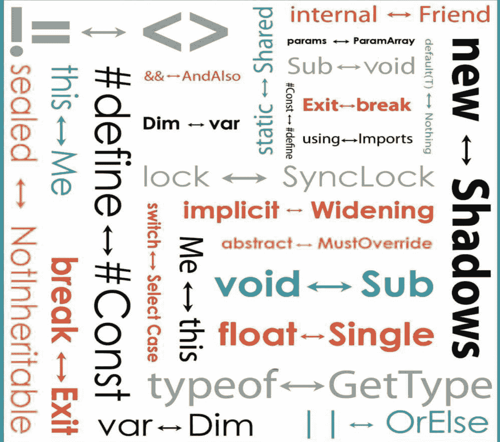
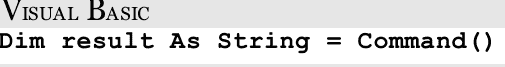
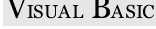

# C#-Visual Basic 双语词典：Visual Studio 2015 版





如需本书更新或了解 Tim Patrick 出版的其他书籍，请在线、电子邮件或社交媒体与他联系。

- **网站** wellreadman.com
- **邮箱** tim@timaki.com
- **Facebook** facebook.com/wellreadman
- **Twitter** twitter.com/thewellreadman
- **Goodreads** Goodreads.com/wellreadman


献给 Claudette Moore

一位老树和老旧技术书籍作者的朋友


# 引言

# 两种语言

用著名剧作家乔治·伯纳德·肖的话来说，C# 和 Visual Basic 是两种由共同的框架隔开的语言。从语法和目标受众来看，微软的这两个编程系统似乎彼此非常遥远。尽管如此，在编码能力、计算访问以及用户每天需要任务的自动化方面，它们是完全平等的。

VB 声称其语法谱源追溯到 BASIC 第一版，由 John Kemeny 和 Thomas Kurtz 在 1964 年开发，旨在为软件开发过程带来便利和清晰。五年年后，Dennis Ritchie 开始研究 C 编程语言——即 C# 的祖先——并创建了一个编译器，根据其作者的话，这个编译器对于许多任务比那些所谓的强大的语言更方便且高效。

在 .NET 中，微软将这两种计算方言结合在了一起：一种为凡人设计的软件语言的简单性，以及另一种为了解决从设备驱动程序到文字处理器等大量编码问题的语言的强大性。BASIC 和 C 的后代现在共同位于 .NET 框架的共同基础之上。通过这一共享资源，C# 和 Visual Basic 的开发者可以使用相同的工具、相同的平台和相同的用户社区。

然而，它们并不是相同的。Visual Basic 代码讨厌大括号，而你必须花费大量的时间和精力才能看到在 C# 中完全拼写的内容。这两种语言在促进快速应用开发和利用 ADO.NET 以及 XAML 等强大技术方面有很多共同之处，但它们通过源代码进行通信的方式非常不同。这正是本书的用武之地。

《C#-Visual Basic 双语对照字典》通过为两种语言之间所有的语法和特征差异提供清晰的等效项，帮助统一 Visual Basic 和 C#。这两种语法的连接从未像现在这样重要。

# 谁需要这本书？

几十年前，在 C 和 BASIC 上起家的开发者可以通过只精通一种通用语言来建立职业生涯。今天，软件公司要求程序员精通多种语言、脚本、数据格式和平台（包括移动和桌面）。如果你已经熟悉 VB，很有可能也需要熟悉 C#，反之亦然。

《C#-Visual Basic 双语对照字典》适用于所有需要学习 C# 的 Visual Basic 开发者，也适用于需要理解 Visual Basic 或将其集成到 C# 代码中的 C# 开发者。字典提供了 C# 特征的 Visual Basic 等效项，使得两种语言之间的翻译变得更容易。

对于那些在使用两种语言的项目并发现难以记忆每种语言语法的开发者来说，这本书特别有用。对于已经精通其中一种语言的人来说，这也是一个很好的资源。

# 书中包含内容

《C#-Visual Basic 双语对照字典》按 C# 特征或关键字字母顺序排列。每个条目都清晰地解释 C# 特征在 Visual Basic 中的等效项，并提供其如何工作的代码示例。

本书分为三个主要章节：

- 第1章：C# 到 Visual Basic。本章涵盖了 C# 特征和关键字在 Visual Basic 中的等效项。
- 第2章：Visual Basic 到 C#。本章涵盖了 Visual Basic 特征和关键字在 C# 中的等效项。
- 第3章：我的命名空间 (My Namespace) 到 C#。本章关注 Visual Basic 中的 "My" 命名空间及其 C# 中的 等效项。

"My" 命名空间是 Visual Basic (VB.NET) 的独特特征，在 C# 中没有直接等效项。然而，本书提供了如何使用 C# 实现相同结果的指导。

## Visual Studio 2015 新功能

本书包含了 Visual Studio 2015 和“Roslyn”编译器引入的语言特征。对于尚未升级最新版本的开发者，所有对新特征的讨论都明确了 Visual Studio 2015 之前存在的功能。

# 书不包含内容

尽管《C#-Visual Basic 双语对照字典》包含了 C# 和 Visual Basic 的语言关键字和语法元素，但它并不是 .NET 开发的详尽参考。除了在特定的代码解决方案中出现外，本书没有讨论 .NET 基类库。它还排除了其他语言无关的 .NET 技术，如 ADO.NET 和 Windows Communication Foundation (WCF)。

“Visual Basic”名称仅指该语言的 .NET 版本，而不是那些导致 Visual Basic 6.0 的版本。本书识别了 Visual Studio 2015（“Roslyn”）发布的新语言更新与 Visual Studio 2013 中生效版本之间的差异。然而，它没有记录 C# 和 Visual Basic 语言之前的版本引入的更改。例如，文本假设异步编程关键字（“async”和“await”运算符）已存在每种语言，尽管这些关键字直到 Visual Studio 2012 才被引入。

尽管第1章包含了动态 C# 语言关键字的涵盖，但本书没有讨论 System.Dynamic 命名空间或任何动态语言运行时（Dynamic Language Runtime）特征。


从头到尾读完参考书是一项艰巨的工作，但全球几位高深开发者同意接受挑战，结果书籍改进了很多。Eric Moreau 和 Jan Zárubara 对文本提供了大量的注释。额外的投入还来自 David Fulop、Marco Meijer、Fanie Reynders 和 Alex Sorokoletov。特别感谢 Lucian Wisch 以及所有让我能够旁听并参与他们技术交互的微软语言 MVP、作者和内部人士。

关于作者


Tim Patrick 是一位软件架构师和开发人员，拥有超过30年的设计和构建自定义软件解决方案的经验。他也是许多书籍和文章的作者，主要涵盖技术主题。此时此刻，你正在读他的他关于软件开发的第八本书。

2007年，微软将 Tim 选入其最有价值专业人员（MVP）计划，以感谢他对 Windows 编程社区的贡献。他还是一名微软认证解决方案专家。Tim 在西雅图太平洋大学获得了计算机科学学位。

你可以通过他的个人网站 [wellreadman.com](http://wellreadman.com) 与 Tim 联系。

本章中的 C# 条目根据关键字或功能按字母顺序排列。找到语言条目可以查看其对应的 Visual Basic 代码。符号标识的条目出现在字母开头的条目之前，并按以下顺序排列：
! # $ % & ( * + , - . / : < <= > ? @ [ \ ^ { | ~

## ! 否定运算符

C# 中以布尔值为中心的 ! 运算符在 Visual Basic 中的等效运算符是 Not 运算符。

```
C#
bool opposite = !originalValue;
VISUAL BASIC
Dim opposite As Boolean = Not originalValue
```

当 Not 运算符与整数操作数一起使用时，它也是位取反运算符。在 C# 中，该变化的等效运算符是 ~。

参见

- 位取反运算符

## != 比较运算符

在比较值时，Visual Basic 的不等运算符 <> 与 C# 的 != 运算符相同，并且出现在相同的二元运算符位置。

```
C#
if (teamPlayers != 9)
VISUAL BASIC
If (teamPlayers <> 9) Then
```

对于字符串比较，<>运算符再次复制了 C# 的 != 运算符。（注意：原始 OCR 文本中为 ===，但根据不等比较的上下文，这很可能是 != 的误笔或指代比较逻辑）。然而，VB 的 `Option Compare` 语句会影响字符串之间的比较方式。默认情况下，C# 和 Visual Basic 都对字符串进行二进制层面的比较。但是，如果 VB 项目或源文件使用了 `Option Compare Text`，则比较将使用特定于文化的排序规则。

对于字符串以外的引用类型，C# 的 != 运算符测试所比较的两个引用是否指向同一个底层实例。这种语法在 Visual Basic 中是无效的（至少当在使用 `Option Strict On` 时）。相反，VB 程序应该使用 `IsNot` 运算符配合第二个实例，或者配合 `Nothing`。

```
C#
// 标准实例比较。
if (firstInstance != secondInstance)

// 与 null 的比较。
if (anotherInstance != null)
VISUAL BASIC
' ----- 标准实例比较。
If (firstInstance IsNot secondInstance) Then

' ----- 与 null 的比较 (VB 中为 Nothing)。
If (anotherInstanceIsNot Nothing) Then
```

## #define 指令

在 C# 中，#define 指令声明预处理常量。这些常量本质上是布尔的，因为它们要么存在（类真要么不存在（类假）。相应的 #undef 指令用于移除之前通过 #define 声明的常量。

```C#
#define TestVersion
```

在 Visual Basic 中，使用 #Const 指令来开始使用预处理常量。与 C# 预处理常量的布尔性质不同，VB 中的并行常量可以是布尔、整数、浮点数、字符串或日期值。

```VISUAL BASIC
#Const TestVersion = "Beta 0.7"
```

要清除之前声明的 VB 常量，请将其赋值为 `Nothing`。

```VISUAL BASIC
#Const TestVersion = Nothing
```

## #error 指令

Visual Basic 中没有 #error 指令的等效物。

## #if 指令

Visual Basic 中预处理条件语句的通用语法与 C# 中的用法非常相似，仅有微小的拼写和大小写差异。

| C# 术语 | Visual Basic 术语 |
| --- | --- |
| #if | #If...Then |
| #elif | #ElseIf..Then |
| #else | #Else |
| #endif | #End If |

关键区别出现在条件本身。C# 中的预处理值像布尔值；它们要么存在要么不存在。在 Visual Basic 中，预处理值以布尔、整数、浮点数、字符串或日期的形式存在，你可以对这些值应用典型的 VB 运算符。

```C#
#if TestVersion
  // --- 此处为特定测试代码。
#elif (OldVersion == false)
  // --- 此处为向兼容代码。
#else
  // --- 此处为标准代码。
#endif

VISUAL BASIC
#If TestVersion Then
  ' --- 此处为特定测试代码。
#ElseIf (OldVersion = False) Or
  (TargetVersion < 2.5) Then
  ' --- 此处为向兼容代码。
#Else
  ' --- 此处为标准代码。
#End If
```

C# 允许在条件表达式中使用 =, !=, !, &&, || 以及运算符，true 和 false 常量以及括号。Visual Basic 表达式包括任何标准的 VB 比较运算符（=, <, >, <=, >=）；数学、字符串和逻辑运算符（+, *, /, ^, Mod, <<, >>, &, Not, And, Or, Xor, AndAlso, OrElse）；转换和转换函数（DirectCast, TryCast, CType, Bool, CByte, CChar, CDate, CDec, Double, ClInt, CLng, CObj, CSByte, CShort, CSng, CStr, CUInt, CULng, 和 UShort）；如果带有括号，最终结果为布尔值。这些表达式中的字符串值使用二进制层面的比较，而不是特定于文化的文本比较。

## #line 指令

Visual Basic 中没有 #line 指令的等效物。

## #pragma 指令

在 C# 中，#pragma 指令用于编译器指令。在 Visual Basic 中，#pragma 指令用于各种与编译相关的任务，与其在 C# 中的用法类似。（注意：该部分的 OCR 文本是碎片化/重复的；此重构遵循这些主题的标准文档结构）。


## 赋值运算符

## & 地址运算符
Visual Basic 不对指针操作提供直接支持，因此不包含为对象建立固定地址的运算符。

另请参
- 指针
- & 与运算符

通常情况下，Visual Basic 的 `And` 运算符与 C# 的 `&` 运算符相同，均适用于整数（位运算）和布尔（逻辑）操作。

```csharp
bool clapClaps = (happy & knowIt);
```

```visual basic
Dim cHands As Boolean = (happy And knowIt)
```

在 Visual Basic 项目或源文件中应用 `Option Strict Off` 时，一个整数操作数和一个布尔操作数的 `And` 运算符将强制布尔值转换为整数（或长型），然后执行位运算。C# 不允许这种操作数类型的混合。

Visual Basic 确实包含其自身的 `&` 运算符。然而，它用于字符串拼接；不处理逻辑或位运算。

## && 逻辑与运算符
Visual Basic 的 `기도` 运算符与 C# 的 `&&` 短路逻辑与运算符相同。

```csharp
if ((result != null) && (result.Length > 10))
```

```visual basic
If ((result Is Not Nothing) AndAlso
(result.Length > 10)) Then
```

## &= 赋值运算符
Visual Basic 不包含等同于 C# `&=` 运算符的操作。你必须在 VB 中分别执行逻辑与（And）和赋值操作。

```csharp
finalSet &= testFlag;
```

```visual basic
finalSet = finalSet And TestFlag
```

Visual Basic 包含其自身的 `&=` 运算符。然而，它结合了字符串拼接和赋值，不支持逻辑或位运算。

另请参
- 赋值运算符
- 转换表达式

另
- 转换与强制
- 表达式分组

当用于分组表达式时，Visual Basic 中的括号在语法上与 C# 中的分组括号相同。然而，在某些情况下，C# 要求对表达式加括号，但在 VB 中创建等效语句时括号是可选的。例如，C# 中 `if` 语句的条件必须括在括号内，但 Visual Basic 没有这一要求。

```csharp
// ----- C# 中必须使用括号。
if (totalCount >= 100)
```

```visual basic
' ----- Visual Basic 中括号可选可选。
If totalCount >= 100 Then
```

- 解引用运算符
Visual Basic 不对指针操作提供直接支持，因此不包含解引用运算符。

另请参
- 成员访问运算符，指针

## * 乘法运算符
Visual Basic 中的 `*` 乘法运算符在 C# 中使用相同的符号和语法。

```csharp
result = originalValue * 5;
```

```visual basic
result = originalValue * 5
```

## *= 赋值运算符
Visual Basic 的 `*=` 赋值运算符在语法和目的上与 C# 中的运算符相同。

```csharp
originalValue *= 5;
```

```visual basic
originalValue *= 5
```

另请参
赋值运算符

## + 加法运算符
C# 的 `+` 运算符既作为数值加法运算符，也作为字符串拼接运算符。

```csharp
int result = number1 + number2; // 加法
string greeting = "Hello, " + name; // 拼接
```

Visual Basic 中的 `+` 运算符也适用于加法和拼接。

```visual basic
Dim result As Integer = number1 + number2 ' 加法
Dim greeting As String =
  "Hello, " + name ' 拼接
```

然而，操作数的类型和 VB 中 `Option Strict` 语句的状态取决于其产生的影响。例如，当一个操作数是数值而另一个是字符串时，在使用 `Option Strict Off` 时 VB 会尝试将字符串转换为数字（即使是非数字字符串），而在使用 `Option Strict On` 时会产生编译错误。在遇到类似情况时，C# 会在拼接操作数之前将数字转换为字符串，而 VB 的 `+` 运算符并不这样做。为了避免此类语句产生歧义，Visual Basic 的 `&` 运算符是拼接字符串的首选工具，将运算符留给加法。

```visual basic
Dim result As Integer = number1 + number2 ' 加法
Dim greeting As String =
  "Hello, " & name ' 拼接
```

## + 一元运算符
运算符 允许在数字字面量和表达式前使用一元加运算符。两种语言的语法相同。

## ++ 递增运算符
Visual Basic 不包含等同于 C# `++` 递增运算符（无论是前缀还是后置符号）。请改用 `+` 加法运算符或 `+=` 赋值运算符。

```csharp
// ----- result 将为 5，originalValue 为 6。
originalValue = 5;
result = originalValue++;
```

```visual basic
' ----- 后置操作变为两个 VB 语句。
originalValue = 5
result = originalValue
originalValue += 1
```

另请参
- + 加法运算符，+= 赋值运算符,-- 递减运算符

## = 赋值运算符
Visual Basic 的 `+=` 赋值运算符在语法和目的上与 C# 中的运算符相同。

```csharp
originalValue += 5;
```

```visual basic
originalValue += 5
```

虽然 `+=` 运算符在 Visual Basic 中也能执行字符串拼接，但 `&` 赋值运算符是 VB 中连接字符串的更好选择。

另请参
赋值运算符

## = 事件订阅运算符
C# 使用 `+=` 运算符订阅事件。Visual Basic 则使用 `AddHandler`。

```csharp
object += MethodName;
```

```visual basic
AddHandler MyObject.Event, MyMethod
```


```
originalValue == 1
```

## == 赋值运算符

在典型用法中，C# 的 `==` 赋值运算符在语法和目的上与 Visual Basic 中的运算符完全相同。

```csharp
originalValue == 5;
```

```vb
VISUAL BASIC
originalValue = 5
```

另请

- = 事件取消订阅运算符， 赋值运算符

Visual Basic 使用 `RemoveHandler` 语句结合 `AddressOf` 运算符从对象实例中分离处理程序，或者通性地将方法与委托实例解耦。

```csharp
Form1.Click += ClickEventHandler;
```

```vb
VISUAL BASIC
RemoveHandler Form1.Click, AddressOf ClickEventHandler
```

另请

- = 赋值访问运算符

## -> 成员访问运算符

Visual Basic 不包含对指针的直接支持，因此无法通过指针解引用访问类型成员。

| VISUAL BASIC | 访问类型 |
| :--- | :--- |
| value = element.OneMember | 标准成员访问 |
| value = element!OneName | 字典成员访问 |
| value = element("OneName") | 字典成员访问 |

另请

- . 成员访问运算符， [ ] 成员访问运算符， 指针

## . 成员访问运算符

C# 和 Visual Basic 都使用点（.）成员访问语法，使用命名空间、类、实例和成员名。

```csharp
value = element.OneMember;
```

```vb
VISUAL BASIC
value = element.OneMember
```

## / 除法运算符

定义了一个单一运算符，处理整数和浮点数值的除法（当用于运算符重载时也适用于其他类型）。

```csharp
int wholeResult1 = 5 / 3;   // 1
int wholeResult2 = 6 / 3;   // 2
float realResult = 5 / 3f;   // 1.666666...
```

C# 中的返回类型通常遵循操作数的类型。在除法发生之前，需要将操作数转换为相同的类型。对于整数和浮点值确实如此。对于整数除法，舍入向零方向。

Visual Basic 也包含除法运算符。与 C# 指向操作数的返回类型不同，VB 中的 `/` 运算符始终返回浮点商数。

```vb
Visual Basic
Dim Result1 As Double = 5 / 3   ' 1.666666...
Dim wholeResult2 As Double = 6 / 3   ' 2.0
Dim realResult As Single = 5 / 3!   ' 1.666666...
```

在大多数情况下，VB 的除法运算符返回 `Double` 结果，即使操作数是整数。如果一个操作数是 `Single` 而另一个不是 `Double`，结果为 `Single`。如果一个操作数是 `Decimal` 而另一个不是 `Single` 或 `Double`，结果为 `Decimal`。

Visual Basic 还有一个 `\` 除法运算符。当用来替代 `/` 时，结果始终是一个整数值，向零方向舍入。

```vb
Visual Basic
Dim Result1 As Integer = 5 \ 3   ' 1
Dim wholeResult2 As Integer = 6 \ 3   ' 2
Dim realResult As Long = 5 \ 3!   ' 1
```

浮点值在处理之前被转换为 `Long` 数据类型，并使用银行家舍入法进行舍入（0.5 向最近的偶数舍入）。如果使用了 `Option Strict`，你必须手动将浮点值转换为适当的整数类型（`Byte`、`Short`、`Integer` 或 `Long`）。

两种语言对该运算符遵循相同的除零规则，对于 `Decimal` 操作数会抛出异常，对其他数据类型返回 `System.Double.NaN`。对于 VB 的 `/` 运算符，除以零始终抛出异常。

/* 注释定界符

Visual Basic 不包含定界符注释样式。注释始终以单引号（'）开始。`REM` 语句持续到当前行的结束。要在下一行继续注释，必须使用另一个符号。

```csharp
C# /* ----- This is a
multiline comment.
*/
```

```vb
VISUAL BASIC
' ----- This is a
multiline comment.
```

C# 的定界注释允许你在语句中间插入注释。

```csharp
C# if (salary >= 10000) /* This syntax has no equivalent in Visual Basic.
```

## // 符号

Visual Basic 中对应 C# `//` 注释的是单引号（'）。这两个符号都持续到当前物理行的结束。

```csharp
C# // This is a full-line comment.
result = DoWork(); // A trailing comment.
```

```vb
VISUAL BASIC
' A full-line comment.
result = DoWork() ' A trailing comment.
```

从 Visual Studio 2015 开始，C# 的尾随注释可以出现在逻辑行的中间。Visual Basic 从 2015 版本开始允许，在此之前不行。

```csharp
C# result = DoWork(firstArgument, // Always allowed in C#
secondArgument);
```

```vb
Visual BASIC
result = DoWork(firstArgument, ' VB 2015 and later only
secondArgument)
```

Visual Basic 还包含 `REM` 语句，其目的与单引号符号相似。在现代 VB 中很少使用。

```vb
VISUAL BASIC
REM ----- This is an old-style comment. Avoid it.
```

另请

XML 注释

## /= 赋值运算符

Visual Basic 的 `/=` 赋值运算符与 C# 中的相同运算符相似，尽管两者之间的数据类型不同。通常情况下，C# 保留相关的操作数类型，而在 VB 中结果始终是 `Double` 或 `Decimal`。

```csharp
C# originalValue /= 5;
```

```vb
VISUAL BASIC
originalValue /= 5 ' suffix indicates Double
```

另请

/ 除法运算符，赋值运算符

## : 声明

在 C# 中，类继承的接口出现在声明中，通过冒号与类型名分开。

```csharp
C# public class Dog : Animal, Interface }
```

在 Visual Basic 中通过 `Inherits` 和 `Implements` 语句识别这些源。对于基类型，`Inherits` 语句紧跟在定义之后。你可以使用 VB 的语句分离将 `Inherits` 语句附加到类的物理行末尾。这看起来更像 C#，尽管这不是常见做法。

```vb
VISUAL BASIC
Public Class Dog
Inherits Animal
End Class
```

```vb
Syntax using : symbol.
Public Class Dog : Inherits Animal
End Class
```

新类型实现的接口出现在 `Implements` 语句中，以逗号分隔的列表形式存在。与 `Inherits` 语句一样，`Implements` 语句出现在类型声明之后。当一个类需要一个基类型和一个更多的接口时，`Inherits` 语句位于 `Implements` 语句之前。

```vb
VISUAL BASIC
Public Class Dog
Inherits Animal
Implements Interface The rest of the class appears here.
End Class
```

VB 中的接口继承在新接口声明中使用 `Inherits` 语句。对于实现接口的结构体，使用 `Implements` 语句。

```vb
VISUAL BASIC
Interface IHuman
Inherits IBase
End Interface

Structure Person
Implements IHuman
End Structure
```

当 C# 类或结构体实现接口成员时，通过名称和参数签名隐式实现，或者通过在方法定义中包含接口显显实现。

```csharp
interface Interface
{
    void Train(int daysRequired);
}
```

```csharp
class Dog : Interface
{
    // Implicit implementation.
    public void Train(int daysRequired) { }

    // Explicit implementation.
    public void Interface.Train(
        int daysRequired) { }
}
```

在 Visual Basic 中，所有成员实现必须显式声明，并在方法声明中包含 `Implements` 子句。

```vb
VISUAL BASIC
Interface Interface
Sub Train (ByVal daysRequired As Integer)
End Interface

```vb
Class Dog
Implements Public Sub Train (ByVal daysRequired As Integer)
Implements Interface ' Implementation code here.
End Class
```

这种语法的一个优点（或缺点，取决于你的观点）是，在 Visual Basic 中，实现成员的名称不需要与实现的接口成员相同。

```vb
VISUAL BASIC
Public Sub TeachTheDog (ByVal daysRequired)
Implements Interface.Train
```

C# 不支持这种更改实现名称的能力。

## : 命名参数指示符

在方法调用中使用命名参数指示符时，Visual Basic 使用 `:=` 命名参数指示符的方式与 C# 使用等价物的方式相同：

```csharp
C# DefineAbbreviation(fullName="Montana", shortName="MT");
```

```vb
VISUAL BASIC
DefineAbbreviation(fullName="Montana", shortName="MT");
```

就像 C，VB 中的命名参数可以跟在之前的位置参数之后，但位置参数不能跟在命名参数之后。

```vb
VISUAL BASIC
------ This syntax is valid...
ProcessData(Date.Today, batchID:="12345")
```

```vb
------..but this is not.
ProcessData(batchID="12345", Date.Today)
```


# 符号、参数与参数

## 命名空间别名限定符
C# 中，`global::` 前缀表示某些完全限定的命名空间、类型或成员名称从命名空间层次结构的根开始，消除同名库成员之间的歧义。

```csharp
// ----- 可能在应用程序代码中定义了 MyApp.System.Exception
//      类。这让你清楚你想要的是 .NET 的
//      Exception 类。
global::System.Exception theProblem;
```

在 Visual Basic 中，使用 `Global` 作为完全限定类型成员路径的第一部分，以明确该路径是从命名空间根开始。

```visual-basic
Dim theProblem Global.System.Exception
```

在 C# 中，你可以定义其他命名空间别名，这些别名可以代替 "global"。当与外部别名语句结合使用时，这允许你的代码引用外部程序集中的方法。这种命名空间别名限定符的使用在 Visual Basic 中没有对应写法。

# ; 语句终止符

完整的 C# 语句以 `;` 语句终止符结束，允许单个语句根据需要跨越许多行。在 Visual Basic 中，语句在物理行的末尾终止，除非有迹象表明语句必须延续到下一行物理行。

```visual-basic
result = DoSomeWork(withThisData) <-- 在此处结束
```

VB 将语句延续到后续行的传统方法是以 `_` 换行符作为物理行的末尾（在它之前至少有一个空格）。

```visual-basic
result = DoSomeWork(withThisData)
+ SomeExtraWork(withMoreData)
```

Visual Basic 2010 引入了隐式换行，语句的语法提供了关于某行是否将延续到下一行物理行的提示。例如，以参数中的逗号结束某行，表示剩余参数在下一行。

```visual-basic
result = DoAdvancedWork(withThisData,
evenMoreData)
```

隐式换行只有当 Visual Basic 编译器清楚某个物理行结束在语句中间时才起作用。通常，这涉及以运算符结束某行，或者留下一组未完成的括号、打开括号或其他操作。

```visual-basic
' ---- 这些拆分行需要显式的
  换行符。
result = 3 -
  + 5
value = someObject
  .Member
```

```visual-basic
' ---- 这些拆分行是隐式延续的。
result = 3 +
  5
value = someObject.
  Member
```

在某些情况下，Visual Basic 允许多个语句出现在同一物理行上。使用 `:` 语句分隔符分隔语句。通常，此类语句被添加到单行 If 语句的末尾，允许根据单个布尔条件处理两个语句。

```visual-basic
If (problemMessage) Then
  RecordError(problemMessage) : Return
```

# < 泛型类型占位符

在 Visual Basic 中，泛型声明的类型出现在带有 `As` 子句的括号中。

```csharp
Dictionary<long, string> lookupSet;
```
```visual-basic
Dim lookupSet As Dictionary(Of Long, String)
```

此语法扩展到类定义以及 C# 通常在角括号中放置类型占位符的任何地方。

另

- 泛型

## < 比较运算符

比较值类型时，Visual Basic 的 `<` 运算符与 C# 的 `<` 运算符相同，出现在相同的二运算符位置。

```csharp
if (teamPlayers < 9)
```

```visual-basic
If (teamPlayers < 9) Then
```

对于字符串比较，C# 和 VB 默认使用相同的比较方法，检查字符串中每个字符的二进制值。然而，VB 的 `Option Compare Text` 语句在项目或源文件中使用时，会导致比较使用特定于文化的文本排序规则。

# << 左移运算符

Visual Basic 的 `<<` 运算符在语法和用法上与 C# 的 `<<` 运算符相同。

## <= 赋值运算符

Visual Basic 的 `<=` 运算符在语法和用法上与 C# 的 `<=` 运算符相同。

另

- 赋值运算符

## <= 比较运算符

Visual Basic 的 `<=` 运算符通常与 C# 的 `<=` 运算符相同。该运算符包含关于字符串比较的额外信息。

另

- 比较运算符

## = 赋值运算符

在独立赋值语句中，Visual Basic 的 `=` 运算符在语法上与 C# 的 `=` 运算符相同。

```csharp
taxAmount = subtotal * taxRate;
```

```visual-basic
taxAmount = subtotal * taxRate
```

C# 允许赋值发生在表达式内部，或者在单个语句中发生多次赋值。

```csharp
// ----- latestValue 将在调用方法
// 前更新。
ProcessValue(latestValue = incomingValue);

// -- 所有变量都具有 c 的值。
a = b = c;
```

这些形式在 Visual Basic 中都不存在；你必须在独立的语句中执行每次赋值。

另

- 赋值运算符

# == 比较运算符

比较值类型时，Visual Basic 的 `=` 等等运算符与 C# 的 `==` 运算符相同，出现在相同的二运算符位置。

```csharp
if (teamPlayers == 9)
```
```visual-basic
If (teamPlayers = 9) Then
```

对于字符串比较，`=` 运算符复制了 C# 的 `==` 运算符。然而，VB 的 `Option Compare` 语句影响字符串之间的比较方式。默认情况下，两者 C# 和 VB

## 左移运算符

Visual Basic 的 `<<` 运算符在语法和用法上与 C# 的 `<<` 运算符相同。

## <= 赋值运算符

Visual Basic 的 `<=` 运算符在语法和用法上与 C# 的 `<=` 运算符相同。

另

- 赋值运算符

## <= 比较运算符

Visual Basic 的 `<=` 运算符通常与 C# 的 `<=` 运算符相同。该运算符包含关于字符串比较的额外信息。

另

- 比较运算符

## = 赋值运算符

在独立赋值语句中，Visual Basic 的 `=` 运算符在语法和目的上与 C# 的 `=` 运算符相同。

```csharp
taxAmount = subtotal * taxRate;
```

```visual-basic
taxAmount = subtotal * taxRate
```

C# 允许赋值发生在表达式内部，或者在单个语句中发生多次赋值。

```csharp
// ----- latestValue 将在调用方法
// 前更新。
ProcessValue(latestValue = incomingValue);

// -- 所有变量都具有 c 的值。
a = b = c;
```

这些形式在 Visual Basic 中都不存在；你必须在独立的语句中执行每次赋值。

另

- 赋值运算符

# == 比较运算符

比较值类型时，Visual Basic 的 `=` 等等运算符与 C# 的 `==` 运算符相同，出现在相同的二运算符位置。

```csharp
if (teamPlayers == 9)
```
```visual-basic
If (teamPlayers = 9) Then
```

对于字符串比较，`=` 运算符复制了 C# 的 `==` 运算符。然而，VB 的 `Option Compare` 语句影响字符串之间的比较方式。默认情况下，两者 C# 和 VB

## 左移运算符

Visual Basic 的 `<<` 运算符在语法和用法上与 C# 的 `<<` 运算符相同。

## <= 赋值运算符

Visual Basic 的 `<=` 运算符在语法和用法上与 C# 的 `<=` 运算符相同。

另

- 赋值运算符

## <= 比较运算符

Visual Basic 的 `<=` 运算符通常与 C# 的 `<=` 运算符相同。该运算符包含关于字符串比较的额外信息。

另

- 比较运算符

## = 赋值运算符

在独立赋值语句中，Visual Basic 的 `=` 运算符在语法和目的上与 C# 的 `=` 运算符相同。

```csharp
taxAmount = subtotal * taxRate;
```

```visual-basic
taxAmount = subtotal * taxRate
```

C# 允许赋值发生在表达式内部，或者在单个语句中发生多次赋值。

```csharp
// ----- latestValue 将在调用方法
// 前更新。
ProcessValue(latestValue = incomingValue);

// -- 所有变量都具有 c 的值。
a = b = c;
```

这些形式在 Visual Basic 中都不存在；你必须在独立的语句中执行每次赋值。

另

- 赋值运算符

# == 比较运算符

比较值类型时，Visual Basic 的 `=` 等等运算符与 C# 的 `==` 运算符相同，出现在相同的二运算符位置。

```csharp
if (teamPlayers == 9)
```
```visual-basic
If (teamPlayers = 9) Then
```

对于字符串比较，`=` 运算符复制了 C# 的 `==` 运算符。然而，VB 的 `Option Compare` 语句影响字符串之间的比较方式。默认情况下，两者 C# 和 VB


## 赋值运算符

? 可空类型指示符
参见
可空类型

## ?. 空条件运算符

# 随 Visual Studio 2015 的的新功能

在 2015 年，C# 和 Visual Basic 都增加了一组空条件运算符。通常情况下，它们在两种语言中的用法完全相同，仅语法上略有不同。

| 用法 | C# 语法 | Visual Basic 语法 |
|---|---|---|
| 实例成员 | A?.B | A?.B |
| 字典成员 | 不支持 | A!B |
| 数组或索引成员 | A?[B] | A?(B) |
| XML 属性轴 | 不支持 | A?.@B |
| XML 子元素轴 | 不支持 | A?.<B> |
| XML 后代轴 | 不支持 | A...<B> |

## ?: 条件运算符

在 Visual Basic 中，条件运算符——传统上称为三元运算符——使用 `If` 运算符具有方法调用语法。它的语法与 C# 的 `:` 运算符不同，但产生的结果相同。

```csharp
string result = amount > 100 ? "Overflow" :
amount.ToString();
```

```vb
Dim result As String = If(amount > 100, "Overflow",
amount.ToString())
```

`If` 运算符接受三个参数：(1) 一个布尔测试条件，(2) 条件为真时返回的值，以及(3) 条件为假时返回的值。在 C# 中，`If` 运算符是短路计算；只会计算真部分或假部分，而不会两者都计算。

Visual Basic 还包含一个较旧的 `IIf` 函数，它与较新的 `If` 运算符有些相似，并且具有相同的语法。然而，`IIf` 不是短路的，且它的返回值始终是 `System.Object` 类型。

C# 的条件运算符是右结合的。考虑以下表达式，它们全都是等效的。

```csharp
result1 = a ? b : c ? d : e;
result2 = a ? b : (c ? d : e);
```

```vb
result1 = If(a, b, If(c, d, e))
```

## ?? 合并运算符

`??` 运算符如果值非空则返回该值，如果该第一个值为空，则返回第二个备用值。

```csharp
// --- 使用特定领域的默认值。
// 假设：string suppliedName;
string customerName = suppliedName ?? "Customer";

// -- 为可空类型使用默认值。
// 假设：int? countFromUser
int startingValue = countFromUser ?? default(int);
```

在 Visual Basic 中，使用带参数的 `If` 运算符在当第一个值为 `Nothing` 时回退到第二个值。

```vb
' ---- 使用特定领域的默认值。
' 假设：Dim suppliedName As String
Dim customerName As String = If(suppliedName, "Customer")

' --- 对于可空类型，你必须应用
' 一个完整的条件语句。假设：
' Dim countFromUser As Integer
Dim startingValue As Integer
If (countFromUser Is Nothing) Then
    startingValue = Nothing ' 将变为 零
Else
    startingValue = countFromUser
End If
```

## @ 逐字量指示符

C# 使用 `@verbatim` 逐字量指示符来引导编译器处理标识符和字符串。对于标识符，该符号允许其后的术语被视为标识符，即使该术语与 C# 语言关键字冲突。

```csharp
int @double = originalValue * 2;
```

在 Visual Basic 中限定此类名称时，请使用一组方括号将其括起来。

```vb
Dim [Double] As Integer = originalValue * 2
```

两种语言之间的关键字集不同，其中一种语言在某些工作中可能需要逐字量限定，而另一种语言则不需要。在进行跨语言开发时，请注意避免使用两种语言共同的关键字。

由于 C# 对标识符区分大小写，可能发生冲突的术语在使用小写字母时不会冲突。在 Visual Basic 中需要逐字量限定的术语在使用大写字母时需要。

在 C# 字符串之前放置 `@` 逐字量指示符会告诉编译器字面处理字符串。逐字字符串不使用转义序列。在字符串内部，使用双双引号来嵌入单个双引号。

# C#

```csharp
string standard = "C:\folder\file.txt"
string verbatim = @"C:\folder\file.txt";
string notice = """This string contains a """;
```

Visual Basic 仅包含一种字符串类型，与 C# 的逐字字符串相同。VB 字符串不支持转义序列。

```vb
Dim standard As String = "C:\folder\file.txt"
Dim notice As String = """This string contains a ""."""
```

参见 标识符，字面量

## [] 数组声明

数组在 C# 和 Visual Basic 中的用法是类似的，但它们的声明方式有所不同。

# C#

```csharp
// 未初始化的数组。
int[] numberSet;
string[] textSet;

// 按大小初始化。
int[] setFive = new int[5];

// 通过成员初始化。
string[] setOfThree = {"zero", "one", "two"};
```

# VISUAL BASIC

' 未初始化的数组。
Dim numberSet() As Integer
Dim textSet() As String

' 按大小初始化。
Dim setFive(5) As Integer

' 通过成员初始化。
Dim setOfThree() As String = {"zero", "one", "two"}
```

参见 数组，初始化


## = 赋值运算符

Visual Basic 不包含等于 C# 的 `^=` 运算符。在 VB 中，你必须分别执行异或 (Xor) 和赋值操作。

```csharp
C#
currentState ^= newInput;
```

```vb
VISUAL BASIC
currentState = currentState X newInput
```
Visual Basic 包含 `^=` 运算符，但它是被当作该语言的幂赋值运算符使用的。

另请
赋值运算符

## {} 块语句

在 C# 中，任何从属于另一个语句的两个或多个语句的块必须出现在大括号中。

```csharp
C#
if (warningMessage.Length > 0)
{
    RecordError (warningMessage);
    return -1;
}
```

Visual Basic 使用块语句（如 `If...End If`）来实现相同功能。

```vb
VISUAL BASIC
If (warningMessage.Length > 0) Then
    RecordError (warningMessage)
    Return -1
End If
```

在子块内声明的变量作用域仅限于该块。在 C# 中，你可以随时通过打开一组新的大括号来启动一个新的作用域块。

```csharp
C#
// ---- 这里没有发生什么，突然...
{
    // -- 在这里声明的任何变量作用域
    // 都限于该大括号。
}
```

Visual Basic 没有这种作用域构造的等效语法。

另请
生命周期作用域

## {} 实例化 参见初始化器

## | 析取运算符

通常，Visual Basic 的 `Or` 运算符与 C# 的 `|` 运算符相同，对于整数（位运算）和布尔（逻辑）操作均如此。

```csharp
C#
bool complain = (hot | humid);
```

```vb
VISUAL BASIC
Dim complain As Boolean = (hot Or humid);
```

当对 Visual Basic 项目或源文件应用 `Option Strict Off` 时，对一个整数操作数和一个布尔操作数使用 `Or` 运算符将强制布尔值转换为整数（或使用 `||`），然后执行位运算。C# 不允许这种操作数类型的混合。

## = 赋值运算符

Visual Basic 不包含等于 C# 的 `|=` 运算符。在 VB 中，你必须分别执行析取（Or）和赋值操作。

```csharp
C#
daysOpen |= mondayFlag;
```

```vb
VISUAL BASIC
daysOpen = daysOpen Or mondayFlag
```

另请 赋值运算符

## || 析取运算符

Visual Basic 的 `OrElse` 运算符与 C# 的 `||` 短路析取运算符相同。

```csharp
C#
if ((result == null) || (result.Length == 0))
```

```vb
VISUAL BASIC
If ((result Is Nothing) OrElse
(result.Length == 0)) Then
```

## ~ 位取反运算符

Visual Basic 中对应 C# `~` 位运算符运算符的等效物是 `Not` 运算符。

```csharp
C#
int complement = ~originalValue;
```

```vb
VISUAL BASIC
Dim complement As Integer = Not originalValue
```

`Not` 运算符在与布尔操作数配合使用时也是逻辑非运算符。C# 中该变体的等效运算符是 `!`。

另请

-   ! 取反运算符

~ 析构函数前缀

参见

-   析构函数

## abstract抽象 修饰符

当应用于类时，Visual Basic 的 `MustInherit` 修饰符等同于 C# 的类绑定 `abstract` 修饰符。

```csharp
abstract class Creature
{
    // 标记为 abstract 的成员。
}
```

```vb
VISUAL BASIC
MustInherit Class Creature
    ----- 包含标记为 MustOverride 的成员;
End Class
```

当应用于类成员时，C# 的 `abstract` 修饰符与 Visual Basic 的 `MustOverride` 修饰符相同。被装饰的成员将不包含实现。

```csharp
// 抽象方法。
public abstract void ProcessResults();

// 抽象属性。
public abstract int MaxLevel { get; set; }

// 抽象读取。
```


## Visual Basic Manager = TryCast(employeeRecord, Manager)

对于值类型，你需要使用内置转换表达式之一（如 CInt）、CType 表达式，或使用目标类型公开的 TryParse 方法之一（Integer.TryParse）。最后一种选项与 `as` 运算符最匹配，因为它指示的是一个布尔值成功状态码，而不是在转换失败时抛出异常。

另见

- 转换和类型转换

assembly 修饰符

参见

特性

## 赋值运算符

C# 和 Visual Basic 包含多个赋值运算符，每个运算符在赋值左侧结果之前，会对右侧的值执行特定的操作。

| 运算符 | C# | Visual Basic |
| --- | --- | --- |
| 加法 | += | += |
| 赋值 | = | = |
| 拼接 | += | &= |
| 逻辑与 | &= | 不支持 |
| 逻辑或 | |= | 不支持 |
| 除法 | /= | /= |
| 事件订阅 | += | 不支持 |
| 事件取消订阅 | -= | 不支持 |
| 异或 | ^= | 不支持 |
| 幂 | 不支持 | ^= |
| 整数除 | 不支持 | \= |
| 左移 | <<= | <<= |
| 取模 | %= | 不支持 |
| 乘法 | *= | *= |
| 右移 | >= | >= |
| 减法 | -= | -= |

有关这些运算符的信息，请参见本章中的条目。
C# 允许在语句中多次出现赋值运算符。

```csharp
// ----- b 和 c 都接收了 a 的值。
int a = 5, b = 10, c = 15;
c = b = a;

// ----- 这种不寻常的赋值
// 仍然有效。
int d = 5, e = 10, f = 15;
f -= e = - d;
// 结果: d-->5, e-->5, f-->10
```

Visual Basic 不允许一个语句包含多个赋值运算符。

## 结合性

参见

## 运算符优先级和结合性

## async 修饰符

Visual Basic 的 Async 修饰符在用法和目的与 C# 的修饰符相同，适用于标准方法和匿名方法。

```csharp
public async Task<int> ProcessBuffer()
{
    // ----- 代码中至少出现一次 await。
}
```

# Visual Basic

```vb
Public Async Function ProcessBuffer() _
As Task (Of Integer)
' ----- 代码中至少出现一次 Await。
End Function
```

参见

## await 运算符

## 异步处理

参见

async 修饰符, await 运算符

## 特性

C# 和 Visual Basic 都允许将特性附加到类型、成员或整个程序集上。C# 特性出现在方括号中；VB 使用角括号。在上述两种语言中，如果定义的特性名称以 "Attribute" 结尾，那么在使用该特性时可以省略该部分。

```csharp
[System.Obsolete("Use Creature Class Instead")]
class Animal
{}
```

```vb
<System.Obsolete("Use Creature Class Instead")>
Class Animal
End Class
```

在两种语言中，多个特性可以出现在不同的括号组中，或者在一个组括号内用逗号隔开。当特性接受参数时，你可以在 C# 中使用 `=` 符号指定命名参数或初始化器，而在 Visual Basic 中使用 `:=`。

```csharp
[AttributeUsage(AttributeTargets.Class,
AllowMultiple=true)]
```

```vb
<AttributeUsage(AttributeTargets.Class,
AllowMultiple=:True)>
```

通常，特性出现在它所修改的项之前。在某些情况下，可能需要指定特性的目标。在两种语言中，通过在左括号后立即使用前缀指示目标。

```csharp
// 此特性针对整个程序集。
[assembly: AssemblyVersion("1.0.0.0")]
```

```vb
' ---- 此特性针对整个程序集。
<Assembly:AssemblyVersion("1.0.0.0")>
```

C# 支持的句缀比 Visual Basic 多。下表列出了在两种语言中均可作为前缀的目标。

| C# | Visual Basic | 应用于 |
|---|---|---|
| assembly Assembly | 整个程序集 |
| module Module | 当前程序集模块（不是 VB 模块） |
| field | 不支持 | 类型级字段 |
| event | 不支持 | 事件 |
| method | 不支持 | 方法、属性访问器或设置器 |
| param | 不支持 | 方法或属性参数 |
| property | 不支持 | 属性 |
| return | 不支持 | 方法、索引器或属性的返回值 |
| type | 不支持 | 类、结构体、接口、枚举或委托 |

当 VB 中没有可用的前缀时，你只能通过将特性放置在目标正之前来将其关联。对于 Visual Basic 中的返回值，请将特性放在方法签名中 `As` 关键字和随其后的数据类型之间。

除了上表列出的目标外，C# 还允许将特性附加到泛型类型声明中的占位符变量上。

```csharp
public class FlexibleType<[CSharpOnly]T>
```

这在 Visual Basic 中不受支持。

## 自动属性

在 C# 中，自动属性（也称为“自动实现属性”）包含属性声明，但没有 getter 或 setter 实现。

```csharp
public string CoreName { get; set; }
```

这种精简的属性在 Visual Basic 中也存在。

```vb
Public Property CoreName As String
```

## Visual Studio 2015 中的新功能

C# 允许你创建只读自动属性。在 2015 年之前，Visual Basic 不支持只读属性，而是需要创建一个带有设置器的普通属性。2015 年，语言支持了只读属性。

```csharp
public string CoreName { get; }
```

```vb
' ----- 只读属性。
Public ReadOnly Property CoreName As String
```

## 属性

await 运算符
Visual Basic 的 await 运算符与 C# 的 await 运算符相同。

```csharp
// 长格式。
Task<string> theTask = SomeMethodAsync();
string result = await theTask;

// ----- 短格式。
string result = await SomeMethodAsync();
```

```vb
' ----- 长格式。
Dim theTask As Task (Of String) = SomeMethodAsync()
Dim result As String = Await theTask

' ----- 短格式。
Dim result As String = Await SomeMethodAsync()
```

## 属性

## 处理

从 2015 年开始，C# 的 await 运算符可以在 try 语句的 catch 和 finally 块中使用，尽管 Visual Basic 尚未支持此选项。

另见

async 修饰符

## 基构造函数声明

在 C# 中，基构造函数可以作为声明的一部分从派生构造函数进行调用。

```csharp
// ---- 假设 BaseClass 有默认构造函数，
//     以及接受 int 的构造函数。
class DerivedClass : BaseClass
{
    public DerivedClass() : base()
    {
        // ---- 默认构造函数逻辑。
    }
    public DerivedClass(int value) : base(value)
    {
        // ---- 构造函数逻辑。
    }
}
```

在 Visual Basic 中，对基类构造函数的调用发生在构造函数逻辑代码内部，使用 MyBase 访问关键字。

# VISUAL BASIC

```vb
' ---- 假设 BaseClass 有默认构造函数
'     以及接受 Integer 的构造函数。
Class DerivedClass
Inherits BaseClass

    Public Sub New()
        ' 显式调用 base 是可选的。
        MyBase.New()
        ' ---- 构造函数逻辑。
    End Sub

    Public Sub New(ByVal value As Integer)
        MyBase.New(value)
        ' ---- 构造函数逻辑。
    End Sub
End Class
```

另见

构造函数，此构造函数声明

base 访问表达式
Visual Basic 的 MyBase 表达式提供了对基类型成员的相同访问方式，类似于 C# 的 base 表达式。

```csharp
base.RefreshStatus();
```


# VISUAL Basic
MyBase.RefreshStatus ()

## 运算符运算符

参见

## 参见运算符

## bool 数据类型

Visual Basic 的内置布尔数据类型与 C# 的 bool 数据类型相同。这两种类型都是 .NET 中 System.Boolean 类型的别名。对于布尔字面量，C# 在所有情况下都使用全小写的 true 和 false。尽管 VB 不区分大小写，但传统的字面量通常是首字母大写的 True 和 False。

```csharp
bool finished = false;
```

```vb
VISUAL Basic
Dim finished As Boolean = False
```

在 C# 中，将布尔值转换或强制转换为整数时，false 始终变为 0（零），true 变为 1（一）。在 Visual Basic 中，False 总是变为 0，与 C# 一致。但由于历史原因，True 变为 1 或 -1，取决于用于转换或强制转换数值的方法。

```vb
VISUAL Basic
Dim DotNet As Integer                               ' -->1
Convert.ToInt32(True)
Dim Implicit As Integer = CInt(True)      ' -->1
```

```vb
' Next Option Strict On
Dim Math As Integer = Int(True)               ' -->-1
```

## break 语句

C# 使用单一的 break 语句立即退出 for、foreach 循环以及 switch 语句。

```csharp
for (counter = 0; counter < 10; counter++)
{
  // Some code...
  break;
  // More code.
}
```

Visual Basic 使用 Exit 语句的四种形式代替 break，取决于包含它的结构：
- For Each 循环使用 For。
- Do 循环使用 Exit Do。
- While 循环使用 Exit While。
- Select Case 语句使用 Exit Case。

# VISUAL BASIC

```vb
For counter = 0 To 9
  ' Some code...
  Exit For
  ' More code.
```

Next在 C# 中，switch 语句中的每个 case 或 default 块至少需要一个 break 语句（或类似的退出结构）来确认块的结束。

# C#

```csharp
switch (sides)
{
  case 3:
    name = "Triangle"
    break;
  case 4:
    name = "Rectangle"
    break;
}
```

Visual Basic 不强制此要求。Exit Select 是可选的，Case 块会在其最后一行逻辑后退出。

# VISUAL BASIC

```vb
Select Case sides
Case 3
  name = "Triangle"
Case 4
  name = "Rectangle"
```

## byte 数据类型
Visual Basic 的内置 Byte 数据类型与 C# 的 byte 类型相同。两种类型都是 .NET System.Byte 类型的别名。

# C#

```csharp
byte smallCount = 1;
```

# VISUAL BASIC

```vb
Dim smallCount As Byte = 1
```

## case 子句

参见

switch 语句

## 强制转换

参见

转换与强制转换

## catch 子句

参见

try 语句

## char 数据类型

Visual Basic 的内置 Char 数据类型与 C# 的 char 类型相同。两种类型都是 .NET System.Char 类型的别名。对于 char 字面量，C# 用双引号包裹字符；而在 Visual Basic 中，字符出现在双引号中，并以 c 后缀结尾。

```csharp
char digit = '1';
VISUAL BASIC
Dim digit As Char = "1"c ' 或 "1"C
```

## checked 表达式

C# 的 checked 关键字（无论是语句形式还是表达式形式）会对包含的语句或表达式启用整数溢出检查。Visual Basic 默认在项目范围内启用整数溢出检查。要启用或禁用溢出检查，请访问项目属性中的高级设置，并根据需要移除溢出检查字段。VB 不支持在语句或表达式级别控制整数溢出检查。

## class 语句

Visual Basic 的 Class 语句等于 C# 的 class 语句。声明派生类时，VB 的 Inherits 子句位于类声明块之后。同样，当类实现一个或多个接口时，Implements 子句列出这些接口，并出现在类的顶部，紧跟在 Inherits 子句（如果存在）之后。

```csharp
class ActiveCustomer : Customer, IDisposable
{
  // Members appear here.
}
```

# VISUAL BASIC
Class ActiveCustomer
Inherits Customer
Implements IDisposable  ' Members appear here.

两种语言中的类都包含相同类型的成员：构造函数、析构函数、字段、常量、属性、方法、事件、运算符重载和自定义转换、索引器（在 VB 中称为“默认属性”）以及嵌套类型（包括委托和枚举）。这些许多成员可以作为静态或实例成员存在。

每种语言的类支持以下修饰符：

| C# 修饰符 | Visual Basic 修饰符 |
| --- | --- |
| abstract | VisualInherit |
| internal | Friend |
| new | Shadows |
| partial | Partial |
| private | Private |
| protected | Protected |
| protected internal | Protected Friend |
| public | Public |
| sealed | NonInheritable |
| static | Unsupported |

C# 类默认是 internal，就像 Visual Basic 类默认是 Friend。在 C# 类内部，所有成员默认都是 private。在 Visual Basic 中，字段和常量默认为 Private，而所有其他成员默认为 Public。Visual Basic 不允许静态类（在 VB 中称为“shared 类”）。相反，必须使用 Module 语句创建一个包含所有静态（shared）成员的类。

# C#

```csharp
static class UsefulFunctions
{
    public static string Reverse(string originalText)
    {
        char[] buffer;
        if (originalText == null)
            return ""
        else
        {
            buffer = originalText.ToArray();
            Array.Reverse(buffer);
            return new string(buffer);
        }
    }
}
```

# VISUAL BASIC

```vb
Module UsefulFunctions
    Public Function Reverse(ByVal originalText As String) As String
        Dim buffer() As Char
        If originalText Is Nothing Then
            Return ""
        Else
            buffer = originalText.ToArray()
            Array.Reverse(buffer)
            Return New String(buffer)
        End If
    End Function
End Module
```

## 参见

访问修饰符、构造函数、析构函数

## 初始化器

参见

初始化器

## 注释

C# 包含行尾注释（以 // 符号开头）以及跨越连续行的注释（以 /* 和 */ 符号分隔）。Visual Basic 只支持第一种，使用单引号（' 或 REM 关键字。

# VISUAL BASIC

REM 这是一个行内注释。
' 另一个行内注释。

参见

注释分隔符、// 符号、XML 文档注释

## 编译常量

C# 和 Visual Basic 都包含项目级别的 DEBUG 和 TRACE 常量支持。.NET 框架中的代码会对这些常量做出响应，你可以在代码中使用它们。要更改默认设置，根据需要设置 Define DEBUG 和 Define TRACE 字段。在 C# 中，这些字段出现在项目属性的生成选项卡；在 VB 中，它们出现在编译高级区域。

虽然你可以定义项目特定的编译常量，但 C# 本身没有定义其他常量。Visual Basic 默认定义了四个（最多九个）额外的常量。

| 常量 | 描述 |
| --- | --- |
| CONFIG | 活动的配置。 |
| TARGET | 编译应用程序类型，："winex""exe""library" 或"module"。也有可能的自定义值。 |
| VBC_VER | 当前 Visual Basic 版本，采用主版本.次版本格式。以下值之一：8.0 (VB2005)、9.0 (VB2008 和 VB2010)、11.0 (VB2012)、12.0 (VB2013) 或 14.0 (VB2015)。 |
| _MYTYPE | 使用的 My-命名空间版本。根据此常量的值，编译器可能会定义以下一个或多个额外常量：_MYAPPLICATIONTYPE、_MYCOMPUTERTYPE、_MYFORMS、_MYUSER 和 _MYWEBSERVICES.|参见 MSDN 文档获取有关这些常量以及如何在代码中使用的完整信息。


# C#

```csharp
const int DefaultPort = 25;
```

# VISUAL BASIC

Const DefaultPort As Integer = 25
在在这两种语言中，你可以使用逗号将多个常量声明连接在一起。这两种语言也对可以赋值给常量的内容支持相似的规则：字面量、枚举值和其他常量，所有都可以通过基本运算符连接。VB 还允许你使用它的内置转换函数（如 `CInt`）。

在字段级别上，每个常量声明都可以包含一个访问修饰符。

# C#

```csharp
public const int DefaultPort = 25;
```

# VISUAL BASIC

Const DefaultPort As Integer = 25
如果使用了 `Option Infer On`，Visual Basic 将尽可能地推断表达式的数据类型，从而不再需要特定的类型。

# VISUAL BASIC

Const DefaultPort = 25
由于装箱（boxing）或其他引用问题，C# 中不允许进行某些常量声明。

# C#

```csharp
// ----- 此代码将无法编译：
const object objectUsingBoxing = 10;
const object implicitReference = "Message";
```

此类声明在 Visual Basic 中是被允许的。

## 函数

在 C# 中，构造函数根据它们出现的类型进行命名。在 Visual Basic 中，构造函数始终命名为 `New`。两种语言中的构造函数提供的功能通常是等的。

# C#

```csharp
class Employee
{
    public Employee()
    {
        // ----- 默认构造函数。
    }
    public Employee(string empName)
    {
        // ----- 自定义构造函数。
    }
}
```

# Visual Basic

```vb
Class Employee
    Public Sub New()
        ' 默认构造函数。
    End Sub
    Public Sub New(ByVal empName As String)
        ' 自定义构造函数。
    End Sub
End Class
```

默认情况下，如果存在，派生类的构造函数会调用基类的默认构造函数。要调用自定义的基类构造函数或使用另一个自定义构造函数作为构造函数的起点，请分别使用 `base` 和 `this` 声明。

# C#

```csharp
class Employee : Person
{
    public Employee(string empName) : base(empName)
    {
        // 基类处理人的姓名。
    }
    public Employee(string empName, decimal salary) : this(empName)
    {
        // 针对工资的代码。
    }
}
```

# Visual Basic

```vb
Class Employee
Inherits Person
    Public Sub New(ByVal empName As String)
        ' 基类处理人的姓名。
        Base.New(empName)
    End Sub
    Public Sub New(ByVal empName As String, ByVal salary As Decimal)
        ' 另一个构造函数处理姓名。
        Me.New(empName)
        ' 针对工资的代码。
    End Sub
End Class
```

两种语言除了实例构造函数外，还提供了静态构造函数。

# C#

```csharp
class Utility
{
    static Utility()
    {
        // ----- 此处进行静态初始化。
    }
}
```

# Visual Basic

```vb
Shared Sub New() Utility
```

构造函数在每种语言中都支持以下修饰符。

| C# 修饰符 | Visual Basic 修饰符 |
| :--- | :--- |
| Extern | 不支持 |
| Internal | Friend |
| Private | Private |
| protected | Protected |
| protected internal | Protected Friend |
| Static | Shared |

另见：构造函数声明，this 声明

## continue 语句

C# 使用单个 `continue` 语句开始循环的下一次迭代。

```csharp
for (counter = 0; counter < 10; counter++)
{
    // ---- 其他代码，然后...
    continue;
    // ---- 更多代码。
}
```

Visual Basic 根据循环类型使用其 `Continue` 语句的三种形式之一：

- `For` 循环和 `For Each` 循环使用 `Continue`。
- `Do` 循环使用 `Continue` 语句。
- `While` 循环使用 `Continue` 语句。

# Visual BASIC

```vb
For counter = 0 To 9
  ' ---- 其他代码，然后...
  Continue
  ' ---- 更多代码。
Next
```

因为 Visual Basic 允许你识别特定的循环，因此它可以自动处理。

# Visual BASIC

```vb
For counter = 0 To 9
  ' ---- 其他代码，然后...
  Continue
  ' ---- 更多代码。
Next
```

因为 Visual Basic 允许你识别特定的循环，因此它可以自动处理。

## 转换与强制转换

C# 支持 (1) 隐式（宽转换）转换和 (2) 显式（窄转换）强制转换，如 .NET 类。

## 隐式转换

从“较小”类型到“较大”数据类型的隐式转换在两种语言中自动进行。

# C#

```csharp
int smallValue = 25;
long largeValue = smallValue; // 
```

# VISUAL BASIC

```vb
Dim smallValue As Integer = 25
Dim largeValue As Long = smallValue
```

在 Visual Basic 中，当使用 `Option Strict` 模式时，显式（窄转换）转换也会发生，如果源数据不符合目标类型。

# VISUAL BASIC

```vb
' ----- 在顶部。
```

## Option Strict

```vb
' ----- 在方法。
Dim largeValue As Long = 100000
```

当使用 `Option Strict Off` 模式时，Visual Basic 还会执行字符串到数字和数字到字符串的转换，这是 C# 不支持的。

# VISUAL BASIC

```vb
' ----- 假设：Option Strict Off
Dim trueNumber As Integer = "123" ' 自动转换
Dim trueString As String = 123 ' 自动转换
' ----- VB 执行两个变量的转换和比较。
  ' 代码将到达此条件块。
End If
```

## 显式转换

C# 的显式强制转换通过在表达式前使用 `()` 强制转换运算符来实现。

```csharp
long largeValue = 100000;
int smallValue = (int)largeValue;
```

对于内置类型，Visual Basic 提供了内置转换运算符，因为某些提供了 C# 强制转换中没有的额外类型检查。但在 Visual Basic 中的用法与 C# 程序员使用运算符的方式相同。

# VISUAL BASIC

```vb
Dim largeValue As Long = 100000
Dim smallValue As Integer = CInt(largeValue)
```

下表列出了 Visual Basic 转换运算符及其与特定 C# 强制转换的关系。

| C# 强制转换 | Visual Basic 转换 |
| :--- | :--- |
| (bool) | CBool(expression) |
| (byte) | CByte(expression) |
| (char) | CChar(expression) |
| (DateTime) | CDate(expression) |
| (double) | CDbl(expression) |
| (decimal) | CDec(expression) |
| (int) | CInt(expression) |
| (long) | CLng(expression) |
| (object) | CObj(expression) |
| (sbyte) | CSByte(expression) |
| (short) | CShort(expression) |
| (float) | CSng(expression) |
| (string) | Cstr(expression) |
| (uint) | CUInt(expression) |
| (ulong) | CULng(expression) |
| (ushort) | CUShort(expression) |
| (type) | CType(expression, type) |


# VISUAL BASIC

```vb
Bring an elephant into the zoo.
Dim someElephant As Elephant
Dim someAnimal As Animal = GetNewAnimal()
If (TypeOf someAnimal Is Elephant) Then
    someElephant = DirectCast(someAnimal, Elephant)
```

C# 的运算符与强制转换类似，但转换失败时它返回 null 而不是抛出异常。Visual Basic 包含了 `TryCast` 运算符，它在失败时产生类似的 `Nothing`。

```csharp
// ----- 如果转换失败可能返回 null
someElephant = someAnimal as Elephant;
```

# VISUAL BASIC

```vb
' 如果转换失败可能返回 Nothing。
someElephant = TryCast(someAnimal, Elephant)
```

.NET Framework 包含了将数据从一种类型转换为另一种类型的功能。System.Convert` 类型托管了大部分此类静态函数。下表显示了 System.Convert 成员替代了大多数 VB 转换运算符。

| Visual Basic 转换 | System.Convert 方法 |
|---|---|
| CBool(expression) | ToBoolean(expression) |
| CByte(expression) | ToByte(expression) |
| CChar(expression) | ToChar(expression) |
| CDate(expression) | ToDateTime(expression) |
| CDbl(expression) | ToDouble(expression) |
| CDec(expression) | ToDecimal(expression) |
| CInt(expression) | ToInt32(expression) |
| CLng(expression) | ToInt64(expression) |
| CSByte(expression) | ToSByte(expression) |
| CShort(expression) | ToInt16(expression) |
| CSng(expression) | ToSingle(expression) |
| CStr(expression) | ToString(expression) |
| CUInt(expression) | ToInt32(expression) |
| CULng(expression) | ToInt64(expression) |
| CUShort(expression) | ToInt16(expression) |

每个 .NET 对象都包含的 `ToString` 方法在 Visual Basic 和 C# 中同样可用。

## 数据类型

Visual Basic 和 C# 共享一组共同的内置数据类型，有一个例外。下表显示了匹配的数据类型，每个内建数据类型对应的底层 .NET 数据类型都是别名。

| C# Type | Visual Basic Type | .NET Type |
| --- | --- | --- |
| bool | Boolean | System.Boolean |
| byte | Byte | System.Byte |
| char | Char | System.Char |
| decimal | Decimal | System.Decimal |
| double | Double | System.Double |
| float | Single | System.Single |
| int | Integer | System.Int32 |
| long | Long | System.Int64 |
| object | Object | System.Object |
| sbyte | SByte | System.SByte |
| short | Short | System.Int16 |
| string | String | System.String |
| uint | UInteger | System.UInt32 |
| ulong | ULong | System.UInt64 |
| ushort | UShort | System.UInt16 |
| 不支持 | Date | System.DateTime |

Visual Basic 包含内置的 `Date` 类型，它是框架 `System.DateTime` 类型的别名。C# 不包含行的日期/时间类型。相反，你必须在 C# 中直接使用 `System.DateTime`。

有关内置数据类型的更多信息，请参阅本章其他部分的单独条目。

decimal 数据类型

Visual Basic 的内置 `Decimal` 数据类型与 C# 的 `decimal` 数据类型相同。两种类型都是 .NET `System.Decimal` 类型的别名。对于十进制字面量，C# 在值后使用 `M` 或 `m` 后缀；在 Visual Basic 中，使用 `D`、`d` 或 `@`。

```csharp
decimal cost = 0m; // 或 0M
```
```vb
Dim cost As Decimal = 0@ ' 或 0D 或 0d
```

## default 子句

查看 switch 

## default 运算符

在 C# 中，`default` 运算符为变量实例分配默认值，通常用于泛型类型实例。

```csharp
// ----- 在 "class Flexible<T> {}" 内部
// 某个方法中。
T oneValue = default(T)
```

在 Visual Basic 中，`Nothing` 字面量实现了相同的功能。

```vb
' 在 "Class Flexible(Of T)." 内部。
' End Class, 在它的某个方法中。
Dim oneValue As T = Nothing
```

由于 Visual Basic 会自动为所有变量实例分配默认值，因此赋值在声明时并不是严格需要的。但你也可以在方法逻辑后期使用 `Nothing` 将实例重置为默认值。

在检查泛型实例的默认值时，使用 `EqualityComparer(Of T)` 类型的 `Default.Equals` 方法。

```vb
' ----- 假设：Imports System.Collections.Generic
If (EqualityComparer(Of T).Default.Equals(
oneValue, Nothing)) Then
```

## delegate 语句

Visual Basic 的 `Delegate` 语句等于 C# 的 `delegate` 语句。

```csharp
public delegate int PerformCalculation(int x, int y);
```
```vb
Public Delegate Function PerformCalculation(
    ByVal x As Integer, ByVal y As Integer) _
As Integer
```

与 Visual Basic 方法一样，旨在返回值的委托使用 `Function` 修饰符；不返回值的委托（C# 中的 `void` 返回）则使用 `Sub` 修饰符。

委托在每种语言中都支持以下修饰符。

| C# 修饰符 | Visual Basic 修饰符 |
|---|---|
| internal | Friend |
| new | Shadows |
| private | Private |
| protected | Protected |
| public | Public |
| static | Shared |

## 匿名方法

## 析构函数

在 C# 中，析构函数显示为波浪号 (~)。

```csharp
class Customer {
  // ----- 在此处编写清理逻辑
  ~Customer() {
  }
}
```

在 Visual Basic 中，C# 将此转换为以下更冗冗的等效形式：

```vb
Class Customer
  Protected Overrides Sub Finalize()
    Try
      ' ----- 在此处编写清理逻辑
    Finally
      Base.Finalize()
    End Try
  End Sub
End Class
```

在两种语言中，垃圾回收器决定何时调用析构函数。

## 指令

查看预处理指令

## do 语句

C# 的 `do` 语句在条件为真时循环，并保证至少循环一次，因为条件在循环完成之前不会评估。

```csharp
do {
  content = ProcessOfContent(content);
} while (content.Length > 0);
```

在 Visual Basic 中，当条件出现在循环底部时，`Do` 语句实现相同的功能。

```vb
Do
  content = ProcessOfContent(content)
Loop While content.Length > 0
```

这种循环的变体使用 `Until` 子句代替 `While`。

```vb
Do
  content = ProcessOfContent(content)
Loop Until content.Length = 0
```

在 Visual Basic 中，包裹条件的括号是可选的。在 C# 中是要求的。

## while 语句

double 数据类型

Basic 的内置 `Double` 类型与 C# 的 `double` 数据类型相同。两种类型都是 .NET `System.Double` 的别名。对于双精度字面量，C# 在值后使用 `D` 或 `d` 后缀；在 Visual Basic 中，使用 `R`、`r` 或 `#`。

```csharp
double factor = 0d;
```

## dynamic 类型

C# 的 `dynamic` 类型声明表达式启用动态绑定，这在 Visual Basic 中通常被称为“后期绑定”。

```csharp
dynamic basicValue = 20;
dynamic complexValue = new ExampleType();

// ----- 此方法在
// 编译时不会进行检查
complexValue.ProcessData();
```

## 动态绑定

在 Visual Basic 中，后期绑定的实例被创建为 `Object`，并且必须在使用了 `Option Strict Off` 的源文件或项目中定义。

```vb
' ----- 在文件顶部。
Option Strict Off

' 随后，在方法代码中。
Dim basicValue As Object = 20
Dim complexValue As Object = New ExampleType()

' ----- 此方法调用在
' 编译时不会进行检查
complexValue.ProcessData()
```


else 子句
参见

if 语句

## 入口点

参见

main 方法

enum 语句

Visual Basic 的 Enum 语句等于 C# 的 enum 语句。

```csharp
enum DoorState
{
    Closed = 1,
    Ajar,
    Open
}
```

```vb
VISUAL BASIC
enum DoorState
    Closed = 1
    Ajar
    Open
End Enum
```

这两种语言都将每个枚举成员的默认值为 0（对于第一个项目）或比前一个项目大 1，除非使用特定值进行覆盖（如前面的示例中对 `DoorState.Closed` 所做的那样）。C# 用逗号分隔成员， VB 则使用换行符。

Visual Basic 和 C# 支持基于八种核心整数类型（byte, byte, short, ushort, int, uint, long, long）以及它们在 Visual Basic 中对应的类型的枚举，并默认使用 `int` (C#) 和 `Integer` (VB)。

```csharp
enum DoorState : long
```
```vb
VISUAL BASIC
enum DoorState As Long
```

C# 的枚举可以出现在命名空间、类或结构中。除了这些，Visual Basic 还允许在接口内部嵌套枚举。

枚举在每种语言中支持以下修饰符。

| C# 修饰符 | Visual Basic 修饰符 |
| :--- | :--- |
| internal | Friend |
| new | Shadows |
| private | Private |
| protected | Protected |
| protected internal | Protected Friend |
| public | Public |

两种语言在代码访问枚举成员时都使用点符号法。

## Visual Studio 2015 新特性

在 2015 年，C# 增加了一个新的 `using static` 语句，当与枚举配合时，允许代码中不指定枚举名称的情况下使用枚举的成员。Visual Basic 通过其 `Imports` 语句实现了这一功能。

```csharp
// 2015 年之前。
DoorState frontDoor = DoorState.Closed;

// 从 2015 年开始，在文件顶部。
using static DoorNamespace;
using static DoorNamespace.DoorState;

// 随后，在方法内部。
DoorState backDoor = IsClosed;
```

```vb
' 在文件顶部。
Imports DoorNamespace
Imports DoorNamespace.DoorState

' 随后，在方法内部。
Dim frontDoor As DoorState = DoorState.Closed

' 得益于 Imports，这也可以工作。
Dim backDoor As DoorState = IsClosed
```

## 错误处理

参见
throw 语句, try 语句

## 事件处理程序

在 C# 中，`+=` 事件订阅运算符将对象的事件链接到兼容的事件处理程序。`-=` 事件取消订阅运算符稍后会断开这种关联。

```csharp
// 定义实例。
public Button button1 = new Button();

// 定义处理器。
void button1_Click(object sender, EventArgs e)
{
    // 此处编写事件处理代码。
}

// 其他地方...
button1.Click += button1_Click;
```

Visual Basic 的 `AddHandler` 和 `RemoveHandler` 语句在结合 `AddressOf` 运算符使用时，其功能与 C# 的 `+=` 和 `-=` 事件运算符相同。

```vb
' 定义实例。
Public Button1 As New Button()

' 定义处理器。
Sub Button1_Click(ByVal sender As Object,
    ByVal e As EventArgs)
    ' 此处编写事件处理代码。
End Sub

' 连接事件。
AddHandler Button1.Click, AddressOf Button1_Click

' 断开事件。
RemoveHandler Button1.Click, AddressOf Button1_Click
```

Visual Basic 还有另一种替代语法，即在对象声明上使用 `WithEvents`，并将 `AddHandler` 和 `RemoveHandler` 替换为事件处理程序中的 `Handles` 子句。

```vb
' 定义实例。
Public WithEvents Button1 As New Button

' 定义处理器。
Sub Button1_Click(ByVal sender As Object,
    ByVal e As EventArgs) Handles Button1.Click
End Sub
```

事件也可以使用 Lambda 表达式作为处理程序。

```csharp
# C#
Button1.Click += (sender, e) => { /* 代码在此 */ };
```

```vb
'UAL BASIC
AddHandler Button1.Click, Sub(sender, e)
    ' 代码在此。
End Sub
```

参见
- += 事件订阅运算符
- -= 取消订阅运算符
- event 语句

## event 修饰符

参见

## 特性

在 C# 中，事件指示从一种类型到另一种类型的转换必须显式进行。

```csharp
class BigType
{
    public static explicit operator SmallType(BigType source)
        return new SmallType(source);
}
```

等对应的 Visual Basic 使用 `Narrowing` 修饰符来表示这一点。

```vb
Class BigType
    Public Shared Narrowing Operator CType(
        ByVal source As BigType) As SmallType
        Return New SmallType(source)
End Class
```

参见
- implicit 修饰符
- operator 语句

## 扩展方法

在 C# 中，扩展方法出现在静态类中并使用修饰符指示被扩展的类型。

```csharp
internal static class LocalExtensions
{
    public static string DigitsOnly(
        this string originalText)
        // 返回字符串结果。
}
```

在 Visual Basic 中，扩展方法始终出现在模块中，模块类似于 C# 的静态类。该方法必须装饰 `Extension` 特性（来自 `System.Runtime.CompilerServices`）。虽然没有标记任何特殊修饰符，但方法的第一个参数是扩展的目标。

```vb
Imports System.Runtime.CompilerServices
Friend Module LocalExtensions
    <Extension> Public Function DigitsOnly(ByVal originalText As String) As String
        ' 返回字符串结果。
    End Function
End Module
```

extern alias 语句
Visual Basic 没有等于 C# 的 `alias` 语句。类似的替代方案是使用反射间接加载并访问外部程序集的成员，这一任务超出了本书的范围。

参见
-命名空间别名限定符

extern 修饰符
与 `DllImport` 特性（来自 `System.Runtime.InteropServices`）配合使用时，`extern` 修饰符指示源自外部文件。

```csharp
[DllImport("avifil32.dll")]
private static extern void AVIFilInit();
```

Visual Basic 支持此相同的功能，但不需要类似于 `extern` 的特定修饰符。

```vb
<DllImport("avifil32.dll")>
Private Shared Sub AVIFilInit()
End Sub
```

除了基于特性的声明，Visual Basic 的 `Declare` 语句提供了一种更正式的语法来识别来自外部源的方法。

```vb
Private Declare Sub InitAVI Lib "avifil32.dll"
Alias "AVIFilInit" ()
```


`Lib` 子句指示源文件，而可选的 `Alias` 子句用于当你想在代码中为方法指定不同名称时，标识库中的方法名。将 `Sub` 替换为 `Function` 以导入返回数据的方法，并根据需要更新签名。

使用 `Declare` 语句导入的方法默认是 `Public`（公共）的。此外，导入的方法假设与 ANSI 字符集工作。要更改此默认值，请在 `Default` 关键字后跟随 `Unicode`、`Auto` 或（为了明确默认值）`Ansi` 关键字。

另另引用

- 方法

### false 布尔字面量
Visual Basic 的 `False` 字面量与 C# 的 `false` 字面量相同。

### 字段 (Fields)
字段是在类或结构体（以及 VB 中的模块）内部声明的变量，它们位于任何方法之外。其语法与局部变量声明非常相似。（更多声明细节请参见本章的“变量”条目。）

```csharp
// ---- 使用初始化器声明的字段。
private int MonitoredValue = 0;
```

```visualbasic
' 使用初始化器声明的字段。
Private MonitoredValue As Integer = 0
```

> ' "Dim" 是可选的，但在未使用访问修饰符时是必须的。
Dim AnotherValue As Integer

字段声明中，访问修饰符是可选的。如果缺失，在 C# 类和结构体中，访问级别默认为 `private`。在 Visual Basic 类或模块中，字段默认是 `Private`；在结构体中使用时，默认是 `Public`。

字段在每种语言中支持以下修饰符。

| C# 修饰符 | Visual Basic 修饰符 |
| :--- | :--- |
| internal | Friend |
| new | Shadows |
| private | Private |
| protected | Protected |
| protected internal | Protected Friend |
| public | Public |
| readonly | ReadOnly |
| static | Shared |
| volatile | 不支持 |
| 不支持 | WithEvents |

另另引用
- 数组声明、访问修饰符、标识符、初始化器、new 运算符、static 修饰符、变量

## field 修饰符
参见
属性 (Attributes)

## finally 子句
参见
try 语句 (try Statement)

## fixed 修饰符
C# 的 `fixed` 修饰符用于创建固定大小的缓冲区，仅在 `unsafe` 上文中有效。由于 Visual Basic 不支持安全代码，因此 VB 中没有该修饰符的对应项。

## fixed 语句
C# 的 `fixed` 语句用于防止 .NET 垃圾收集移动内存块，仅在 `unsafe` 上文中有效。由于 Visual Basic 不支持安全代码，因此 VB 中没有该语句的对应项。

## float 数据类型
Visual Basic 的内置 `Single` 数据类型与 C# 的 `float` 数据类型相同。两种类型都是 .NET `System.Single` 类型的别名。对于单个字面量，C# 在值后使用 `F` 或 `f` 后缀；在 Visual Basic 中，请使用 `F`、`f` 或 `!`。

```csharp
float factor = 0F; // 或 0F
```

```visualbasic
Dim factor As Single = 0! // 或 0F 或 0f
```

## for 语句
对于从起始数字到结束值、每次按标准量递增的简单 C# 循环，Visual Basic 的 `For` 循环是一个实用的替代。

```csharp
for (int counter = 0; counter < 10; counter++)
{
    // 循环 10 次，从 0 到 9。
}
```

```csharp
// ----- 在循环外部声明 counter
// 也是有效的。
int counter;
for (counter = 0; counter < 10; counter++)
{}
```

```visualbasic
For counter As Integer = 0 To 9
' 循环 10 次，从 0 到 9（包含边界）。
Next counter

' 在循环外部声明 counter
' 也是有效的。
Dim counter As Integer
For counter = 0 To 9
Next counter
```

VB 语句中的循环计数器可以是整数（`Byte`、`Short`、`Integer` 或 `Long`，或它们的符号/无符号对应项）。

（注：原文后续文本似乎存在大量重复和乱码片段，此处已根据逻辑翻译了核心部分，并遵循了不重复原文的原则。）


## 垃圾回收

参见

## 析构函数

## 泛型 (Generics)

C# 和 Visual Basic 都支持泛型，也称为“构造类型”。两者的一个主要区别在于指定类型占位符的语法。在 C# 中，这些占位符出现在泛型名称后的尖括号内；而在 Visual Basic 中，它们以括号的形式作为 `Of` 子句的一部分出现。

```csharp
C#
// 作为泛型声明的一部分。
class SpecialList<T>
{
    private T InternalList;
}

// 作为泛型实例化的一部分。
SpecialList<int> trackNumbers = new SpecialList<int>();
```

```visualbasic
Visual Basic
' 作为泛型声明的一部分。
Class SpecialList (Of T)
    Private InternalList As T
End Class

' ---- 作为泛型实例化的一部分。
Dim trackNumbers As New SpecialList(Of Integer)
```

泛型构造可以应用于两种语言中的类、结构、接口、方法和委托。泛型方法可以出现在泛型或非泛型类型内部。

```csharp
C#
static void ReverseItems<T>(ref T firstItem, ref T secondItem)
{
    T holdingArea = firstItem;
    firstItem = secondItem;
    secondItem = holdingArea;
}
```

```visualbasic
Visual Basic
Shared Sub ReverseItems (Of T) (ByRef firstItem As T,
    ByRef secondItem As T)
    Dim holdingArea As T = firstItem
    firstItem = secondItem
    secondItem = holdingArea
End Sub
```

在 C# 和 Visual Basic 中，泛型类型参数列表都可以包含特定的修饰符，为每个参数提供限制。C# 的 `where` 子句类似于 VB 的 `As` 子句，允许您在实例化时限制用于类型参数的特定类型。更多信息请参阅本章中的“where Clause”条目。在定义泛型接口时，可选修饰符指定与每个类型参数相关的变型性。默认情况下，类型参数是不变的。每种语言中的“out”修饰符指定协变性，“in”指定逆变性。

# C#

```csharp
interface IVariant<TInvariant, out TCovariant,
  in TContravariant>
{
}
```

# VISUAL BASIC

```visualbasic
VISUAL BASIC
Interface IVariant(Of TInvariant, Out TCovariant,
  In TContravariant)
End Interface
```

另见

## where Clause

get Declaration

参见

## 属性

## 全局命名空间别名 (global Namespace Alias)

用于指示命名空间层次结构的根时，Visual Basic 的 Global 命名空间别名等同于 C# 的全局别名。

```csharp
C#
// 可能您在应用程序代码中定义了一个 MyApp.System.Exception
// 类。这使得明确您想要的是 .NET 的 Exception 类。
global:: System.Exception theProblem
```

# VISUAL BASIC

```visualbasic
VISUAL BASIC
Dim theProblem As Global.System.Exception
```

另见

``` :: 命名空间别名限定符

## goto 语句

对于到行标签的普通跳转，Visual Basic 的 GoTo 语句与 C# 的 goto 语句相同。

# VISUAL BASIC

## GoTo SkipProcessing

在 switch 语句内部，C# 允许使用 `goto case` 和 `goto default` 将处理重定向到 switch 语句内的另一个块。VB 不支持这种语法。相反，为目标块添加行标签，并使用标准的 Goto 语句跳转到其他代码。

## C# switch (token)

```csharp
C# switch
switch (token)
{
    case ">":
        term += "greater than";
        break;
    case ">=":
        term += "greater than or";
        goto case "=";
    case "=":
        term += "equal to";
        break;
}
```

# Visual Basic
```visualbasic
Visual Basic
Select Case token
Case ">"
    term &= "greater than"
Case ">="
    term &= "greater than or"
    GoTo EqualsTo
Case "="
EqualsTo:
    term &= "equal to"
End Select
```

另见
标签 (Labels)

## group 查询表达式运算符 (LINQ)

Visual Basic 的查询表达式运算符与 C# 的分组运算符并行。在 C# 中，单个表达式或范围变量由一个或多个分组表达式分组。在 Visual Basic 中，目标可以是表达式、范围变量、逗号分隔的表达式列表，或者完全缺失（这意味着所有范围变量或字段都应该是目标）。

```csharp
C#
// ----- 范围变量的分组。
var result = from item in Employees
    group item by item.Department;

// ----- 特定字段的分组。
var result = from item in Employees
// -- group item.FullName by item.Department;

// ----- 多个字段的分组。
var result = from item in Employees
    group new (item.FullName, item.HireDate)
    by item.Department;
```

```visualbasic
Visual Basic
-----
范围变量的分组。
Dim result = From item In Employees
    Group By item.Department Into Group

-----
特定字段的分组。
Dim result = From item In Employees
    Group item.FullName
    By item.Department Into Group

-----
多个字段的分组。
Dim result = From item In Employees
    Group item.FullName, item.HireDate
    By item.Department Into Group
```

为了对分组结果进行额外的处理，子句（C#）标识了后续子句中使用的临时标识符。在 Visual Basic 中，所有的 Group 表达式都要求 `Into` 部分，如之前的示例代码块所示。Group By 之后的子句引用分组元素，通常不需要标识。

```csharp
C#
var result = from item in Employees
    group item by item.Department into g
    select new { Dept = g.Key, Count = g.Count() };
```

```visualbasic
Visual Basic
Dim result = From item In Employees
    Group item By item.Department Into Group
    Select New { Dept = Group.Key, Count = Group.Count()
```

为了对分组结果进行额外的处理，子句（C#）标识了后续子句中使用的临时标识符。在 Visual Basic 中，所有支持聚合函数的 Group 表达式中都要求有 `Into` 部分。这种语法在 C# 中并不直接支持，而是需要一个。

```csharp
C#
var result = from item in Employees
    group item by item.Department into g
    select new { DeptName = g.Key, DeptMembers = g.Count() };
```

```visualbasic
Visual Basic
-----
在此变体中，结果还将包含
Dim result = From item In Employees
    Group item By item.Department Into Group
    Select New { DeptName = Group.Key, DeptMembers = Group.Count() }
```

另见
查询表达式

## 标识符 (Identifiers)

C# 和 Visual Basic 使用通用的命名规则，允许混合字母、数字和下划线，但也有限制，例如标识符不能以数字开头。

C# 中的标识符是区分大小的。在同一方法中命名为 `customerName` 和 `CustomerName` 的变量不会冲突。Visual Basic 中的标识符是不区分大小的。在 VB 中，如果两个标识符转换为全写后相同，则它们是相同的。在 C# 中创建一个具有两个公开或成员名称的程序集，当被 Visual Basic 项目调用时可能会产生问题，尽管 VB 有规则在冲突时尝试识别最可访问的项。

Visual Basic 允许为类型及其一个成员赋予相同的（不区分大小的）名称。

```visualbasic
Visual Basic
' ----- 这在 Visual Basic 中是有效的。
Public Class ItemData
    Public ItemText As String
    Public ItemData As Long
End Class
```

C# 不允许这种组合。与其封装类型相同。如果您创建一个具有这种类型和成员共享命名的 Visual Basic 程序集，C# 项目将无法直接访问该成员。

C# 允许标识符包含 `\hhhh` 形式的 Unicode 转义序列，其中 `hhhh` 是 4 位或 8 位的十六进制值。十六进制代码必须解析为被认为有效的字符，通常是字母数字字符的变体。

```csharp
C#
string p00E8e = "French for 'father";
MessageBox.Show(String.Format("{0} is {1}",
nameof(p00E8e), p00E8e));
// 显示：pére is French for 'father'
```

Visual Basic 不包含这些序列的支持。您可以在 VB 的标识符名称中使用 Unicode 字符，但必须作为标准字符输入代码中，而不是作为转义序列。

```visualbasic
Visual Basic
Dim pére As String = "French for 'father"
MessageBox.Show(String.Format("{0} is {1}",));
```


```cs
NameOf(père), père));
' ---- Displays: père is French for 'father'
```

两种语言都允许你创建与语言保留关键字冲突的标识符。要使用此类标识符，在 C# 中需要以 `@` 符号作为前缀，或者在 Visual Basic 中用方括号将其括起来。

```csharp
long @for = 0;
```

Visual Basic
```vb
Dim [For] As Long = 0&
```

微软建议标识符名称使用 Pascal 命名法（大驼峰命名）或 camel 命名法（驼峰命名）。在 Pascal 命名法中，名称中的每个独立单词的首字母都大写，包括标识符的开头。Camel 命名法类似，但首字母小写。

```csharp
int PascalCaseExample;
int camelCaseExample;
```

如 Visual Studio 文档所示，参数名、局部变量名和类型内的保护实例字段推荐 camel 命名法。所有其他标识符（包括行标签）应使用 Pascal 命名法。

## if 语句

Visual Basic 的 `if` 语句与 C# 中的 `if` 语句非常相似。

```csharp
if (testDate < DateTime.Now)
    era = "Past"
else if (testDate == DateTime.Now)
    era = "Present"
else
    era = "Future";
```

```vb
If (testDate < Now) Then
    era = "Past"
ElseIf (testDate = Now) Then
    era = "Present"
Else
    era = "Future"
End If
```

VB 中的每个条件都以 `If` 或 `ElseIf` 开始，并以 `Then` 结束相应的逻辑。整个语句以 `End If` 结束。Visual Basic 包含了该语句的压缩版本，将 `Then` 和 `Else` 部分放在同一逻辑行上。（这种语法在 C# 中也有效，但那是由于空格的使用方式，而不是因为 `if` 语句的语法，就像一样。）

# VISUAL BASIC

```vb
-- 没有 Else 组件的简单 If。
If problemOccurred then ErrorField.Visible = True

-- 带有 Else 组件的简单 If。
If (IsValid(zipCode)) = True Then
    city = GetZipCode(zipCode) Else city = "Unknown"
```

在这个语句的简单版本中，不使用 `End If` 标记。如第二个示例所示，如果逻辑行跨越了多个物理行，你可能需要包含一个行连续连接符 `_`。

与 C# 一样，Visual Basic 的条件语句可以包含表达式或逻辑运算符的任何混合，只要每个表达式的结果都是布尔值即可。在 C# 中，你必须用括号括起条件；这些括号在 VB 中是可选的。Visual Basic 支持任意数量的 `ElseIf` 子句，并且你可以像在 C# 中一样嵌套 `If` 语句。

## implicit 修饰符

C# 的 `implicit` 修饰符表示从一种类型到另一种重载转换可以隐式执行，因为目标类型足够宽，允许源类型的所有可能值。

# C#

```csharp
class SmallType
{
    public static implicit operator BigType(
        SmallType source
    )
    {
        return new BigType(source.GetValue());
    }
}
```

等效的 Visual Basic 重载使用 `Widening`（扩展）修饰符来表示这种转换。

# VISUAL BASIC

```vb
Class SmallType
    Public Shared Widening Operator CType(
        ByVal source as SmallType) As BigType
        Return New BigType(source.GetValue())
    End Operator
End Class
```

另请

Modifier 中的 `explicit` 修饰符、`operator` 语句

参见

泛型

## 索引器

参见

```cs
this Indexer Declaration
```

## 继承

C# 使用 `:` 符号来指示泛的基类。

```csharp
// ----- Dog 继承自 Animal，并且
//      实现了 IDocumentate。
public class Dog : Animal, IDocumentate
```

在 Visual Basic 中，在类定义的第一行使用 `Inherits` 语句。

```vb
' Dog 继承自 Animal，并且
' 实现了 IDocumentate.
Public Class Dog
    Inherits Animal
    Implements IDocumentate
```

C# 使用 `:` 符号指示派生类和实现的接口。在 VB 中，这些关系必须用 `Inherits` 和 `Implements` 语句隔开。另请：Base 声明、构造函数声明

## 初始化器

在 C# 中，你不需要在声明的时刻提供初始化，而在 Visual Basic 中，必须在代码中使用之前为这些变量初始化默认值（通常是 `Nothing`）。两种语言都允许在实例声明时进行内联初始化。

```csharp
const decimal closeToPi = 3.2m;
int startingZero = 0;
string startingUsed = null;
string startingEmpty = "";
string readyUse = null;
int fromExpression = 123;
```

# VISUAL BASIC

```vb
Const closeToPi As Decimal = 3.2
Dim startingZero As Integer = 0
Dim startingUsed As String = Nothing
Dim startingEmpty As String = ""
Dim readyUse As String = Nothing
Dim fromExpression As Integer = 123
```

对象初始化器允许你设置字段和属性。在 Visual Basic 中，这作为 `With` 子句的一部分出现，并且每个成员都带有 `.` 前缀。

# C#

```csharp
// 显式类型
Animal cat = new Animal {Age = 5, Name = "Fluffy"};

// 隐式类型
var kitten = new Animal {Age = 0, Name = "Kitty"};

// 自定义构造函数
Employee boss = new Employee("John Smith") {Title = "President"};
```

# VISUAL BASIC

```vb
' 显式类型
Dim cat As New Animal {.Age = 5, .Name = "Fluffy"}
' 隐式类型
Dim kitten As New Animal {.Age = 0, .Name = "Kitty"}
' 自定义构造函数
Dim boss As New Employee("John Smith") With {.Title = "President"}
```

C# 和 Visual Basic 均可以在实例声明时初始化数组和集合。注意 Visual Basic 在初始化集合时使用了 `From` 子句。

# C#

```csharp
// 数组。在 explicitSize 声明中引用上限而不是大小。
int[] implicitSize = new int[] {3, 5, 7};
int[] explicitSize = new int[] {13, 19, 23};
int[] simpler = {29, 31, 37};

List<int> basicList = new List<int>{1, 2, 3, 4, 5};
Dictionary<int, string> dayInfo = new Dictionary<int, string>{{0, "Sunday"}, {"Monday"}};
int[][] jagged = new int[][] {{1, 2}, {3, 4}, {5, 6}, {7, 8}};
```

```vb
' 数组
Dim implicitSize As Integer() = {3, 5, 7}
Dim explicitSize As Integer() = {13, 19, 23}
Dim simpler As Integer() = {29, 31, 37}

' 集合
Dim basicList As New List(Of Integer) From {1, 2, 3, 4, 5}
Dim dayInfo As New Dictionary(Of Integer, String) From {{0, "Sunday"}, {"Monday"}}
Dim jagged As Integer() = {{1, 2}, {3, 4}, {5, 6}, {7, 8}}
```

这是一个结合了集合和初始化器的复杂的示例。

```csharp
List<Cat> moreCats = new List<Cat>
{
    new Cat() {Name = "Furrytail", Age = 5},
    new Cat() {Name = "Peaches", Age = 4}
};
```

```vb
Dim moreCats As New List(Of Cat) From {
    New Cat() With {.Name = "Furrytail", .Age = 5},
    New Cat() With {.Name = "Peaches", .Age = 4}
}
```

集合初始化器可以作为表达式使用在任何期望集合或数组的地方。

```csharp
int result = CondenseArray(new int[] {1, 2, 3});
```

```vb
Dim result As Integer = CondenseArray(New Integer() {1, 2, 3})
```

两种语言中匿名类型的初始化遵循标准初始化语法。

```csharp
var pet = new {Age = 3, Name = "Rover"};
```

```vb
Dim pet = New With {.Age = 3, .Name = "Rover"}
```

在处理泛型时，C# 的 `default` 运算符允许你将默认值赋值给变量。在 Visual Basic 中，`Nothing` 字面量提供了相同的功能。

```csharp
class Special<T>
{
    public T watchValue = default(T);
}
```

```vb
Class Special(Of T)
    Public watchValue As T = Nothing
End Class
```

## Visual Studio 2015 新功能

最初，C# 不允许将自动属性作为声明本身的一部分初始化。在 2015 年，该语言为只读和可写属性都获得了这种功能。Visual Basic 已经包含了可写自动属性的此类初始化功能，但只读自动属性的初始化是在同一个 2015 版本中出现的。

```csharp
// 可写属性
public string CoreName { get; set; } = "Unknown";

// 只读属性
public string CoreName { get; } = "Unknown";
```

```vb
'----- 只读属性
Public Property CoreName As String = "Unknown"

'----- 只读属性
Public ReadOnly Property CoreName As String = "Unknown"
```


# 从2015年开始，C# 有了用于初始化索引集合的新语法。

```csharp
Dictionary<int, string> currencyFaces =
    new Dictionary<int, string> {
        [1] = "Washington",
        [5] = "Lincoln",
        [10] = "Hamilton"
    };
```

这种语法在 Visual Basic 中不可用。相反，你必须通过类型的标准项添加功能添加项，例如通过 `Add` 方法。

## int 类型

Visual Basic 的内置 `Integer` 数据类型与 C# 的 `int` 数据类型相同。两种类型都是 .NET.Int32 类型的别名。对于整数字面量，Visual Basic 在值之后使用 I、II 或 % 后缀；而 C# 则不包含此类后缀。

```csharp
int counter = 0;
```
```vb
Dim counter As Integer = 0% ' or I or OI
```

## interface 语句

Visual Basic 的 `Interface` 语句等于 C# 的 `interface` 语句。在声明派自一个或多个接口的接口时，VB 的 `Inherits` 会列出这些接口，作为 `Interface` 语句的第一行。

```csharp
interface ISomethingNew : ISomethingOld
{
    // 成员出现在这里。
}
```
```vb
Interface ISomethingNew
    Implements ISomethingOld
    '----- 成员出现在这里。
End Interface
```

C# 中的接口可以包含方法、属性、事件和索引器。Visual Basic 支持所有这些成员，还可以包含子接口、类和结构，而这些内容都无法包含在 C# 接口中。

# C#

```csharp
interface IOptions
{
    // 有返回值和无返回值的方法
    int MethodWithData(string incoming);
    void WorkOnlyMethod();

    // 属性和索引器
    string Name {get; set;}
    string this[int index] {get;}

    // 事件（委托在别处定义）
    event DelegateSignature EventName;
}
```

# VISUAL BASIC

```vb
Interface IOptions
    ' 有返回值和无返回值的方法
    Function MethodWithData(
        ByVal incoming As String) As Integer
    Sub WorkOnlyMethod()

    ' 属性和索引器
    Property() As String
    Default ReadOnly Property Item(
        ByVal index As Integer) As String

    ' 事件（定义和未定义委托）
    Event EventFromDelegate As DelegateSignature
    EventDefinedInline(ByVal source As Object)

    ' 类
    Class SubordinateClass
        ' ---- 成员在这里
    End Class

    ' 结构
    Structure SubordinateStructure
        ' ---- 成员在这里
    End Structure

    ' 接口
    Interface ISubordinate
        ' ---- 成员在这里
    End Interface
```

接口在每种语言中都支持以下修饰符。

| C# 修饰符 | Visual Basic 修饰符 |
| :--- | :--- |
| internal | Friend |
| new | Shadows |
| partial | Partial (从2015年开始) |
| private | Private |
| protected | Protected |
| protected internal | Protected Friend |
| public | Public |

C# 中的接口默认是 `internal` 的，就像 Visual Basic 中的接口默认是 `Friend` 一样。在两种语言中，所有成员在定义上都是 `public` 的。在实现接口时，Visual Basic 使用 `Implements` 修饰符，既用于类型本身，也显式地用于每个实现成员。

```csharp
class Employee : IPerson {
    public string IPerson.Name {
        // ----- 在此处实现。
    }
}
```
```vb
Class Employee
    Implements IPerson
    Public Property Name As String Implements IPerson.Name
    ' ----- 在此处实现。
End Class
```

由于成员上的 `Implements` 子包含了接口成员的名称，因此在 Visual Basic 中实现该项的类成员名称不需要相同。在 C# 中，实现成员的名称始终与实现的接口成员名称相同。

## internal 访问修饰符
Visual Basic 的访问修饰符等于 C# 的 `internal` 访问修饰符。

另另
访问修饰符

## is 比较运算符

C# 的 `is` 运算符和 Visual Basic 的 `TypeOf...Is` 运算符在测试对象属于指定类型或可以隐式转换为该类型时均返回 `true`。

```csharp
if (personVariable is Customer)
```

```vb
If (TypeOf personVariable Is Customer) Then
```

## Visual Studio 2015 新功能

从2015版发布开始，Visual Basic 添加了一个新的 `TypeOf...IsNot` 运算符，它返回 `TypeOf...Is` 运算符的布尔反值。
Visual Basic 包含一个 `Is` 运算符（不带 `TypeOf`），用于比较对象实例。它与 `TypeOf...Is` 或 C 的运算符不同。

## 迭代器

在 C# 中，迭代器是包含 `yield return` 语句的方法或属性。在 Visual Basic 中，迭代器同样由函数或属性构建，包含 `Yield` 语句，并使用 `Iterator` 修饰符声明。

```csharp
public IEnumerable<int> FirstFivePrimes()
{
    yield return 2;
    yield return 3;
    yield return 5;
    yield return 7;
    yield return 11;
}
```

```vb
Public Iterator Function FirstFivePrimes() As
IEnumerable(Of Integer)
    Yield 2
    Yield 3
    Yield 5
    Yield 7
    Yield 11
End Function
```

当实现为只读属性时，Visual Basic 使用 `Yield` 语句。

```csharp
public IEnumerable<int> FirstFivePrimes()
{
    yield return 2;
    yield return 3;
    yield return 5;
    yield return 7;
    yield return 11;
}
```
```vb
Public Iterator Function FirstFivePrimes() As
IEnumerable(Of Integer)
    Yield 2
    Yield 3
    Yield 5
    Yield 7
    Yield 11
End Function
```


## 字面量 (Literals)

C# 和 Visual Basic 都支持各种值类型字面量，尽管这些语言之间存在一些显著的功能差异。

## Unicode 序列

C# 中的字符串和字符字面量支持 Unicode 转义序列，以 `\U` 或 `\u` 转义代码前缀。

```csharp
// ----- \u00a3 是英镑符号。
char currencySymbol = '\u00a3';
```

Visual Basic 不支持此类序列。你必须直接在字面量中嵌入字符，或者使用 VB 的 `ChrW` 函数获取 Unicode 表示。

# Visual Basic

```vb
' ----- 直接嵌入符号。
Dim currencySymbol As Char = "&fnc"
```

```vb
' 使用 ChrW 函数。
Dim currencySymbol As Char = ChrW(&H00A3)
```

C# 的 `\x` 变长度十六进制字符转义序列在 Visual Basic 中不支持。

## 字符和字符串字面量

C# 支持两种字符串字面量：支持嵌入转义序列的标准字面量；以及以 `@` 符号开头的逐字字面量（verbatim string literals）。Visual Basic 的字符串与 C# 的逐字字面量相同，包括嵌入双引号符号的方法。

```csharp
string notice = @"This is verbatim ""text.""
```

# Visual Basic

```vb
Dim notice As String = ""This is verbatim"" text." 
```

C# 的标准字符串字面量在 Visual Basic 中没有直接对应物。要模拟 C# 的转义序列，你必须将这些特殊字符变体连接到目标字面量中。VB 包含这些符号的一些内置字面量（在 `Microsoft.VisualBasicConstants` 中，或者你可以使用 .NET 基类库提供的，例如 `System.Environment.NewLine`）。你还可以使用 Visual Basic 的 `Chr` 或 `ChrW` 函数根据其 ASCII 或 Unicode 数值返回字符。

# C#

```csharp
string endLine = "\r\n";
```

# VISUAL BASIC

```vb
Dim endLine As String = vbCrLf
```

下表列出了你可以替代 C# 转义序列的 VB 内置字面量。

| 字符 | 十进制 | C# | Visual Basic |
| --- | --- | --- | --- |
| 警报 (Alert) | 0x07 | \a | Chr(7) |
| 反斜杠 (Backslash) | 0x5c | \\ | \within text |
| 退格 (Backspace) | 0x08 | \b | vbBack |
| 回车 (Carriage Return) | 0x0 | \r | vbCr |
| 双引号 (Double Quote) | 0x22 | \" | "" within text |
| 换页 (Form Feed) | 0x0c | \f | vbFeed |
| 水平制表符 (Tab) | 0x09 | \t | vbTab |
| 换行 (Line Feed) | 0xa0 | \n | vbLf |
| MS-DOS 行结束 | 0xa0,0xa0 | \r\n | vbCrLf |
| 空字符 (Null Character) | 0x00 | \o | vbNullChar |
| 单引号 (Single Quote) | 0x27 | \' | \'within text |
| 垂直制表符 (Vertical Tab) | 0x0b | \v | vbVerticalTab |

## Visual Studio 2015 新功能

C# 的逐字字面量可以跨越物理行边界，导致在字面量字符串中嵌入换行符。从2015 年开始，Visual Basic 也支持此功能。

```csharp
string multiLine = @"First Line\nSecond Line";
```

# VISUAL BASIC

```vb
' ------ 仅限2015 及后续版本。
Dim multiLine As String = "First Line\nSecond Line"
```

2015 之前的 Visual Basic 版本不允许开放字符串跨越物理行。根据需要将行结束连接到字符串中。

# VISUAL BASIC

```vb
Dim multiLine As String = "First Line" & vbCrLf & _
"Second Line"
```

C# 中的字符字面量出现在单引号中。在 VB 中，使用双引号并跟随 `c` 后缀。

```csharp
char oneDigit = '0';
```

# VISUAL BASIC

```vb
Dim oneDigit As Char = "0"c
```

## Visual Basic 2015 新功能

C# 和 Visual Basic 都增加了字符串插值（string interpolation），一种使用字符串字面量生成格式化字符串的方法。两种语言对于此类字符串共享相同的语法，以 `$` 符号作为前缀，并使用大括号来包含插值部分。

## 整数字面量

在 C# 中，如果值符合该类型，普通整数字面量将被类型化为 `int`。否则，它会被强制转换为 `uint`、`long` 或 `ulong` 中的最小类型。在 Visual Basic 中，整数字面量默认是 `Integer`，如果对于该类型太大，则为 `Long`。每种语言都支持一组后缀来强制整数字面量变为特定类型。以下示例包含了每种语言中的长整数值。

```csharp
PassAlongValue(123L);
```

# VISUAL BASIC

```vb
PassAlongValue(123&)
```

下表列出了每个整数类型的后缀。每个后缀可以是大写、小写，或者对于多个字符的后缀采用混合大小写。

| 数据类型 | C# 后缀 | Visual Basic 后缀 |
|---|---|---|
| Short | No suffix | S |
| Unsigned Short | No suffix | US |
| Integer | No suffix | % or I |
| Unsigned Integer | U | UI |
| Long | L | & or L |
| Unsigned Long | UL or LU | UL |

## 浮点字面量

在 C# 中，如果值符合该类型，浮点字面量将被类型化为 `double`。否则，它会被强制转换为 `float`、`double` 或 `decimal` 中的最小类型。在 Visual Basic 中，浮点字面量默认是 `Double`，如果对于该类型太大，则为 `Single`。每种语言都支持一组后缀来强制浮点字面量变为特定类型。

| 数据类型 | C# 后缀 | Visual Basic 后缀 |
|---|---|---|
| Float | F | S |
| Double | D | None |
| Decimal | M | None |

## 布尔字面量

在 C# 中，布尔字面量是 `true` 和 `false`。在 Visual Basic 中，它们是 `True` 和 `False`。

## 十进制和八进制字面量

在 C# 中，十六进制字面量以 `0x` 前缀，八进制字面量以 `0o` 前缀。在 Visual Basic 中，十六进制字面量以 `&H` 前缀。

```csharp
int hex = 0x1A;
```

# VISUAL BASIC

```vb
Dim hex As Integer = &H1A
```


```csharp
{
  Application.Run(new Form1());
}
```

# VISUAL BASIC

```vbnet
Shared Friend Sub Main()
  Application.Run(New Form1())
End Sub
```

## 退出应用程序

应用程序通常在到达 `Main` 方法结束时退出。可以通过以下功能之一让程序提前退出，按从礼貌到最粗鲁的方式排序：

+   - 调用 `System.Windows.Forms.Application.Exit()`
-   调用 `System.Environment.Exit(exitCode)`
-   使用 Visual Basic 的 `End` 语句

Visual Basic 包含了其 Visual Basic 模型（Application Model），通过项目属性中的 `Enable Application Framework` 字段激活。激活后，该模型能够启用提供更结构化启动过程的功能，以及对整个应用程序范围内的未处理错误监控的支持。

有关这些功能的更多信息，请参阅 Visual Studio 文档。你还可以阅读本书第 3 章中的以下条目：

+   - `MinimumSplashScreenDisplayTime` 属性
-   `NetworkAvailabilityChanged` 事件 (My.Application)
-   `SplashScreen` 属性
-   `Startup` 事件
-   `StartupNextInstance` 事件
-   `UnhandledException` 事件

### method 修饰符
参见 特性 (Attributes)

## 方法

Visual Basic 的 `Sub` 语句等同于返回 `void` 值的 C# 方法。

```csharp
public void LogError(string errorText)
{
  // ----- 可选包含此语句：
  return;
}
```

# Visual Basic

```vbnet
Public Sub LogError(ByVal errorText As String)
    ' 可选包含此语句：
    Return
End Sub
```

`Sub` 关键字在方法名之前替换了 `void`。在两种语言中，任何参数定义都出现在括号中。该语句以 VB 的 `End` 子句结束。

类似地，Visual Basic 中的 `Function` 语句对应于 C# 中返回 `void` 以外任何类型的方法。其语法与 `Sub` 语句相似，但使用 `Function` 关键字代替 `Sub`。参数列表后面跟着一个带有返回类型的 `As` 子句。

# C#

```csharp
public bool ParseTime(string timeText)
{
    // 核心逻辑，然后...
    return success;
}
```

# Visual Basic

```vbnet
Public Function ParseTime(ByVal timeText As String,
    ByRef hours As Integer, ByRef minutes As Integer)
    As Boolean
    ' 核心逻辑，然后...
    Return success
End Function
```

在 C# 中对接口成员执行显式实现时，方法名带有接口名称的前缀。

# C#

```csharp
public void IVocal.Speak(string textToSpeak)
{
```

Visual Basic 使用 `Implements` 子句来指示方法正在显式实现哪个接口成员。

# Visual Basic

```vbnet
Public Sub Speak(ByVal textToSpeak As String)
    Implements IVocal.Speak
```

当用于对使用 VB 的 `WithEvents` 修饰符定义的对象实现事件处理器时，`Handles` 子句会识别源实例和事件。

# Visual Basic

```vbnet
Public Sub Button1_Click(ByVal sender As Object)
    ByVal e As EventArgs Handles Button1.Click
```

方法在每种语言中都支持以下修饰符。

| C# 修饰符 | Visual Basic 修饰符 |
|---|--|
| abstract | MustOverride |
| async | Async |
| extern | 不支持 |
| internal | Friend |
| new | Shadows |
| override | Overrides |
| partial | Partial |
| private | Private |
| protected | Protected |
| protected internal | Protected Friend |
| public | Public |
| sealed | NotOverridable Overrides, 或在基类中使用 NotOverridable |
| static | Shared |
| virtual | Overridable |
| 不支持 | Iterator |
| 不支持 | Overloads |

在没有定义访问修饰符的情况下，C# 类和结构体中的方法默认是 `private` 的。在 Visual Basic 中，所有方法默认都是 `Public` 的。在调用带有 `ref` (或 `out`) 修饰符的方法时，C# 要求调用代码中的关联参数也包含这些修饰符。

*(注：由于提供的原始文本存在大量重复和碎片，上述译文已根据要求提取了核心逻辑并翻译)*


(在数据库交互中处理“null”值时，请使用 System.Dbnull 而不是 null。) 在 Visual Basic 中，Nothing 字面量具有类似的作用。

```
VISUAL BASIC
Dim oneManager As Employee = Nothing  ' 没有实例
Dim optionalNumber As Integer = Nothing  ' 没有值
```

然而，Nothing 也可以赋值给标准的（非可空）值类型，在这种情况下，它的功能类似于 C# 的默认运算符，将默认值分配给变量。

```
VISUAL BASIC
Dim requiredNumber As Integer = Nothing  ' 设置为 0
```

在 C# 中，以这种方式方式为非可空值类型赋值 null 是无效的。

```c#
// ----- 这将无法编译。
int requiredNumber = null;
```

```c#
// ----- 请使用这种有效语法。
int requiredNumber = default(int);
```

当在 C# 中将变量或表达式与 null 进行比较时，请使用 == 和 != 比较运算符。

```c#
if (customerRecord == null)
```

你不能在 Visual Basic 中使用等价的比较运算符 (= 和 <>) 来检查 Nothing。相反，请使用 VB 的 Is 和 IsNot 运算符来将表达式与 Nothing 进行比较。

```
VISUAL BASIC
' ----- 检查实例是否存在。
If (customerRecord Is Nothing) Then
```

```
VISUAL BASIC
' ----- 检查实例是否存在。
If (customerRecord Is Nothing) Then
```

Visual Basic 传播或丢弃 Nothing 的方式与 C# 使用 null 的方式有所不同。既是为了 VB 的向后兼容性考虑，也是因为 Nothing 具有空引用和默认值类型的双重属性。比较以下示例以查看差异。

```c#
// ----- result 将被设置为 ""
string result = (5 + null).ToString();
```

```
VISUAL BASIC
' ----- result 将被设置为 "5"。
Dim result As String = (5 + Nothing).ToString()
```

Visual Basic 将空字符串和 Nothing 视为等效；C# 则区分 null 和空字符串。

```c#
// ----- result 将被设置为 "Not Empty"。
string testValue = null;
if (testValue == "")
    result = "Empty";
else
    result = "Not Empty";
```

VISUAL BASIC
' ----- result 将被设置为 "Empty"。
Dim testValue As String = Nothing
If (testValue = "") Then
Else
    result = "Not Empty"
End If
```

要测试 VB 字符串是否未赋值，请改用 Nothing。

```
Visual Basic
If (testValue Is Nothing) Then
```

另请参阅

default 运算符

## 可空类型

C# 和 Visual Basic 都在值类型名称后使用 ? 符号来表示可空值类型。

```c#
int? optionalNumber = null;
```

VISUAL BASIC
Dim optionalNumber As Integer? = Nothing

' ----- 这也是一种有效语法。
Dim optionalNumber? As Integer = Nothing
```

在 C# 中，将可空变量与 null 进行比较是有效的。

```c#
if (optionalNumber == null)
```

在 Visual Basic 中，你不能直接通过这种方式将实例与 Nothing 进行。相反，请使用 Is 或 IsNot 运算符，或者使用变量的 HasValue 方法。

Visual Basic

```vb
' ----- 这可以替代 = 或 <> 起作用。
If (optionalNumber Is Nothing) Then

' ----- 这在两种语言中都有效。
If (optionalNumber.HasValue() = False) Then
```

在两种语言中，可空语法都是 Nullable<T>（C# 中）或 Nullable(Of T）（Visual Basic 中）的别名。

## object 数据类型

Visual Basic 的内置 Object 数据类型与 C# 的 object 数据类型相同。两种类型都是 .NET System.Object 类型的别名。

```c#
object result = null;
```

VISUAL BASIC
Dim result As Object = Nothing
```

## 对象初始化器

参阅
初始化器

## 运算符重载

参阅
operator 语句

Visual Basic 的 Operator 语句等于 C# 的 operator 语句。在两种语言中，“operator”关键字后面都跟着被重载的具体运算符符号，操作数以参数的形式出现在方法风格定义中。

```c#
public static operator +(Team op1, Player op2)
{
    // ----- 将玩家添加到团队的逻辑，然后...
    return updatedTeam;
}
```

VISUAL BASIC
Public Shared Operator +(ByVal op1 As Team,
    ByVal op2 As Player) As Team
    ' 将玩家添加到团队的逻辑，然后...
    Return updatedTeam
End Operator
```

重载在 C# 中必须声明为 public static，在 Visual Basic 中等同于 Public Shared。VB 还允许 Overloads 修饰符出现在 Public 和 Shared 之间，但它对重载的逻辑没有影响。在两种语言中，对于一元运算符，参数列表将仅包含一个参数。

下表列出了种语言中可以重载的不同运算符。

| 类型 | C# | Visual Basic |
| --- | --- | --- |
| 加法 | + | + |
| And-also False  own | false | IsFalse |
| 位取反 | ~ | Not |
| 字符串拼接 | + | & |
| 逻辑与 | & | And |
| 转换 | | CType |
| 递减 | -- | Not |
| 逻辑或 | | Or |
| 除法 | / | / |
| 等于 | == | = |
| 异或 | ^ | Xor |
| 幂 | | ^ |
| 大于 | > | > |
| 大于等于 | | >= |
| 不等于 | != | <> |
| 左移 | << | << |
| 右移 | >> | >> |
| 减法 | - | - |
| 一元加法 | + | + |
| 取模 | % | Mod |
| 乘法 | * | * |
| 否定 | ! | Not |
| And-else True | true | IsTrue |
| 模式匹配 | | Like |

在两种语言中，必须重载的运算符成对出现。

| 类型 | C# | Visual Basic |
| --- | --- | --- |
| 等于 | == | = |
| 大于 | > | < |
| 大于等于 | >= | <= |
| 不等于 | != | <> |

运算符重载在每种语言中支持以下修饰符。

| C# 修饰符 | Visual Basic 修饰符 |
|---|---|
| explicit | Narrowing |
| extern | Not supported |
| implicit | Widening |
| public | Shared |
| static | Overloads |
| Not supported | Shadows |
| | | |

自定义转换在两种语言中都是作为运算符重载的一部分实现的。在 C# 中，源类型出现在参数列表中，目标类型作为运算符名。在 Visual Basic 中，CType 用作运算符名。源类型出现在参数列表中，目标类型作为返回类型。在两种语言中，包含转换的类型必须匹配源类型或目标类型。

```c#
class CountMonitor
{
public static operator int(
    CountMonitor source)
    {
    // 将 CountMonitor 转换为 int，然后...
    return newInt;
    }
public static operator CountMonitor(
    int source)
    {
    // 将 int 转换为 CountMonitor，然后...
    return newCountMonitor;
    }
}
```

VISUAL BASIC

```vb
Class CountMonitor
    Public Shared Narrowing Operator CType(
        ByVal source As CountMonitor) As Integer
        '--- 将 CountMonitor 转换为 Integer，然后...
        return newInt
    End Operator
    Public Shared Widening Operator CType(
        ByVal source As Integer) As CountMonitor
        '--- 将 Integer 转换为 CountMonitor，然后...
        return newCountMonitor
    End Operator
End Class
```

Visual Basic 的 Widening 修饰符等同于 C# 的 implicit 修饰符，而 VB 的 Narrowing 修饰符匹配 C# 的 explicit 修饰符。每个自定义转换声明中必须使用这些修饰符之一。

运算符优先级和结合性
当表达式包含多个运算符时，C# 和 Visual Basic 都使用特定的优先级和结合性规则来确定在没有分组括号的情况下，先应用哪些操作。下表列出了 C# 的优先级规则，顺序从最高（先应用）到最低（最后应用）。相同优先级的运算符在应用顺序上被视为相等。

| 类别 | 运算符 |
|---|---|
| 主要 | x, y, f(x), a[x], x++, x-, new, typeof, default, checked, unchecked, delegate, nameof |
| 一元 | +, -, !, ~, ++x, -x, (T)X |
| 乘法 | *, /, % |


| 加减法 | +, - |
| 移位 | <<, >> |
| 比较 | <, >, <=, >=, is, as |
| 等于 | ==, != |
| 逻辑与 | & |
| 异或 | ^ |
| 逻辑或 | | |
| 条件逻辑与 | && |
| 条件逻辑或 | || |
| 合并运算符 | ?? |
| 条件运算符 | ?: |
| 赋值和 lambda | =, *=, /= %, +=, -= <=, >=, &&, =, ^, |, =, => |

下表列出了按优先级从高到低的 Visual Basic 运算符。

| 类别 | 运算符 |
| :--- | :--- |
| Await | |
| 幂 | ^ |
| 一元 | +, - |
| 乘除法 | *, / |
| 整数除法 | \ |
| 取模 | Mod |
| 加减法 | +, - |
| 字符串连接 | & |
| 移位 | <<, >> |

| 比较 | <=, <>, <=, >, >=, Is, IsNot, Like, TypeOf...Is, TypeOfIsNot |
| 否定 | Not |
| 逻辑与 | And, AndAlso |
| 逻辑或 | Or, OrElse |
| 异或 | Xor |

在这两种语言中，赋值运算符都是右结合的；运算符的右侧先求值。对于相同优先级的其他二元运算符，操作是左结合的；从左到右先确定运算符左侧的表达式。例如，x + y + z 的求值方式为 (x + y) + z。两个例外是 C# 的 `?:` 条件运算符和 `??` 空合并运算符，两者都是右结合的。有关这如何影响条件操作的示例，请参见本章中的“?: 条件运算符”条目。

## 运算符
下表列出了两种语言中提供的运算符。使用表中的“参见”列可以定位本章中的相关条目。

| C# 运算符 | Visual Basic 运算符 | 参见 |
| :--- | :--- | :--- |
| ! | Not | ! 否定运算符 |
| != | <> | != 比较运算符 |
| % | Mod | % 取模运算符 |
| %= | 不支持 | %= 赋值运算符 |
| & | And (仅限逻辑与) | & 地址运算符 & 逻辑与运算符 |
| && | AndAlso | && 逻辑与运算符 |
| &= | 不支持 | &= 赋值运算符 |
| * | * (乘法运算符) | * 解引用运算符 * 乘法运算符 |
| *= | *= | *= 赋值运算符 |
| + | + or & | + 加法运算符, 一元加运算符 |
| ++ | 不支持 | ++ 递增运算符 |
| += | += (仅限赋值) | += 赋值运算符, += 事件订阅运算符 |
| - | - | - 减法运算符, - 一元负运算符 |
| -- | 不支持 | -- 递减运算符 |
| -= | -= (仅限赋值) | -= 赋值运算符 -= 事件取消订阅运算符 |
| -> | 不支持 | -> 成员访问运算符 |
| ? | ? | ?. 空条件运算符 |
| . | . | . 成员访问运算符 |
| / | / or \ | / 除法运算符 |
| /= | /= or \ | /= = 赋值运算符 |
| ?: | If(x,y,z) | ?: 条件运算符 |
| < | < | < 比较运算符 |
| << | << | << 左移位运算符 |
| <= | <= | <= = 赋值运算符 |
| <= | <= | <= = 比较运算符 |
| = | = | = = 赋值运算符 |
| == | = | == = 比较运算符 |
| => | Function(), Sub() | => > Lambda 运算符 |
| > | > | > 比较运算符 |
| >= | >= | >= = 比较运算符 |
| >> | >> | 右移位运算符 |
| >= | == | 赋值运算符 |
| ?? | If(x,y) | ?? 合并运算符 |
| [ ] | ] | 成员访问运算符 |
| ^ | | | ^ 异或运算符 |
| = | 不支持 | ^ = 赋值运算符 |
| | | Or | | 逻辑或运算符 |
| |= | 不支持 | = 赋值运算符 |
| || | OrElse | || 逻辑或运算符 |
| ~ | Not | ~ 位取反运算符 |

## 参见
- 赋值运算符、运算符优先级和结合性
- 可选参数

在 C# 方法签名中，任何包含赋值的参数都成为调用过程的可选参数。

```csharp
// ------ times 参数是可选的，默认值为 2。
public string CopyText(string original, int times = 2)
```

Visual Basic 的可选参数还包括此类常量表达式的赋值，以及 `Optional` 修饰符。

```vb
' The times 参数是可选的，默认值为 2。
Public Function CopyText(ByVal original As String,
OptionalVal times As Integer = 2) As String
```

两种语言中关于可选参数使用的规则是类似的：非可选参数不能出现在可选参数之后；参数数组和可选参数不能一起使用；以此此类推。

## 参见
- 标点符号、参数和变量、方法

## orderby 查询表达式运算符 (LINQ)
Visual Basic 的 Order By 表达式运算符与 C# 的 `orderBy` 运算符相同。两种语言都支持逗号分隔的排序字段列表。每个字段默认按升序排序，或者显式地使用 `ascending` (C#) 或 `Ascending` (VB) 选项。要按降序排序，请使用 `descending` (C#) 或 `Descending` (VB) 选项。

在 C# 中，`orderby` 子句必须出现在 `select` 子句之前。Visual Basic 在这些子句的位置提供了更大的灵活性。

```csharp
var result = from oneEmployee
orderby oneEmployee
select oneEmployee
```

```vb
Dim result = From oneEmployee in Employees
orderby oneEmployee
select oneEmployee.FullName
```


## params 修饰符

查看属性

参数数组

查看 params 修饰符

参数

查看参数和参数、方法

params 修饰符

Visual Basic 的 ParamArray 修饰符在功能上与 C# 的 params 修饰符相同。

```csharp
public int AverageValue(params int[] values)
```

```visual basic
Public Function AverageValue(
    ByVal ParamArray values() As Integer) As Integer
```

## partial 修饰符

应用于类、结构和接口时，C# 的 partial 修饰符允许你将类型拆分到多个文件中。每个部分必须包含 partial 修饰符。

```csharp
// ----- 来自第一个 *.cs 文件。
partial class ComplexContent
{
  // ----- 在此处定义了一些成员。
}
// ----- 来自第二个 *.cs 文件。
partial class ComplexContent
{
  // ----- 在此处定义了其他成员。
}
```

Visual Basic 的 Partial 修饰符具有相同的功能。你最多可以在部分中省略 Partial 关键字。

```visual basic
' 来自第一个 *.vb 文件。
Partial Class ComplexContent
'' --- 在此处定义了一些成员。

End Class

' ---- 来自第二个 *.vb 文件。

Class ComplexContent
' ---- 在此处定义了其他成员。该部分
"Partial" 修饰符被省略了，尽管它本是可以保留的。

End Class
```

## Visual Studio 2015 中的新功能

Basic 最初并不允许在接口声明中使用 Partial 修饰符。然而，此功能从 2015 年开始被添加。同样的更新还支持在 VB 自身的 Module 类型上使用 Partial 修饰符。

Partial 方法（部分方法）允许你在一个文件中定义方法，并在另一个文件中提供其实现，且这两个部分都属于同一个 partial 类。

```csharp
// 来自第一个 *.cs 文件。
partial class ComplexContent
{
    // 隐含为 "private"。
    partial void RecordTraceData(string data);
}
// ---- 来自第二个 *.cs 文件。
partial class ComplexContent
{
    // 相同的 "partial void" 和签名。
    partial void RecordTraceData(string data)
    {
        // ---- 在此处编写实现。
    }
}
```

# VISUAL BASIC

' 来自第一个 *.vb 文件。

Partial Class ComplexContent
' ---- 声明不包含方法体。
' 始终以 "Partial Private Sub" 开始。

```visual basic
Partial Private Sub RecordTraceData(
    ByVal data As String)
End Sub

End Class

' ---- 来自第二个 *.vb 文件。

Partial Class ComplexContent
' ----- 实现省略了 "Partial" 修饰符。
' 签名必须保持匹配。
Private Sub ReadTraceData(ByVal data As String)
' ----- 在此处编写实现。
End Sub
End Class
```

C# 允许在类和结构中使用部分方法。在 VB 中，只有类支持部分方法。

## 指针

Visual Basic 不支持指针操作，也不支持任何启用指针功能的 C# 特性。

另参


- * 解引用运算符, -> 成员访问运算符, & 地址运算符, fixed 修饰符, fixed 语句, stackalloc 修饰符, unsafe 修饰符, unsafe 语句

## 预处理指令

查看

- #define 指令, #error 指令, #if 指令, #line 指令, #pragma 指令, #region 指令, #undef 指令, #warning 指令

## private 访问修饰符

Visual Basic 的 private 访问修饰符等于 C# 的 private 访问修饰符。

另参

- 访问修饰符

## 项目属性

C# 和 Visual Basic 通过“项目属性”窗口提供几乎相同的设置。Visual Studio 提供了一个标签形式的设置集合，C# 中存在的大多数标签在 VB 中都能找到，且配置相同。可用标签和标签功能将根据项目类型而异。

此条目描述了当你从 C# 迁移到 Visual Basic 时会遇到的一些差异。若要查看从 Visual Basic 迁移到 C# 的差异列表，请参第 2 章中的“项目属性”条目。

## 应用程序选项卡

独立的 C# 程序通过 Main 方法启动。应用程序选项卡中的“启动对象”（Startup Object）包含了应用程序中所有可用 Main 方法的列表，可以作为程序的入口。在 Visual Basic 项目的应用程序选项卡中你可以找到类似的字段。然而，在 Windows Forms 中，默认显示允许你选择表单作为启动对象。即使你添加了 Main 方法，它默认也不会出现在“启动表单”（Startup Form）列表中（尽管如果你向启动表单添加了兼容的 Main 方法，将使用它而不是编译器生成的默认 Main 方法）。若要在 Visual Basic 程序中使用非表单 Main 方法作为入口，请取消勾选项目的“启用应用程序框架”（Enable Application Framework）字段。这将“启动表单”字段更改为“启动对象”，并显示所有合格的 Main 方法。C# 在应用程序选项卡上提供了多种资源管理选项，其中只有部分在 Visual Basic 中可用。对于图标（Icon）选项，VB 有一个字段允许你选择默认图标。要访问项目的 "app.manifest" 文件，请点击 VB 应用程序选项卡上的设置按钮。通过 Win32 资源文件管理资源的 C# 程序，Visual Basic 中的对应配置需要使用 VB 编译器的 /win32Resource 命令行。

## 生成选项卡

生成选项卡上的大多数功能出现在 Visual Basic 对应的编译（Compile）选项卡中，尽管名称有所更改。在大多数情况下，你应该能够快速确定相应的字段。两个选项卡都包含一个“高级”（Advanced）按钮，且某些名称已更改。


```visualbasic
VISUAL Basic
Public Property Status As Integer
Get
    ' ----- Publicly accessible getter code.
End Get
Private Set
    ' ----- Privately accessible setter code.
End Set
End Property
```

在 C# 中，当属性显式实现接口成员时，名称会被修改为包含接口名称。在 Visual Basic 中，`Implements` 子句出现在 `As` 子句之后。

```csharp
public int IMonitor.Status
```
```visualbasic
VISUAL BASIC
Public Property Status As Integer Implements IMonitor.Status
```

## Visual Studio 2015 新特性

2015 年，C# 增加了使用 lambda 定义属性的能力。

```csharp
public string fileName => LastName + " , " + FirstName;
```

Visual Basic 目前尚不支持使用 lambda 创建属性。

## Visual Studio 2015 新特性

C# 允许在接口中定义为只读的属性在实现类型中由完整的读写属性成员进行管理。Visual Basic 以前不允许这种组合，但该功能从 2015 年开始添加到该语言中。

属性在每种语言中支持以下修饰符。

| C# 修饰符 | Visual Basic Modifier |
| :--- | :--- |
| abstract | MustOverride |
| extern | Not supported |
| internal | Friend |
| new | Shadows |
| override | Overrides |
| private | Private |
| protected | Protected |
| protected internal | Protected Friend |
| public | Public |
| sealed | NotOverridable Overrides, or NotOverridable in base class |
| static | Shared |
| virtual | Overridable |
| Not supported | Default |
| Not supported | Overloads |
| Not supported | Iterator |
| Not supported | ReadOnly |
| Not supported | WriteOnly |

Visual Basic 中的属性可以包含参数，就像方法一样。参数列表出现在初始声明中的属性之后。这种创建带参数属性的方法在 C# 中不支持。

# VISUAL BASIC

```visualbasic
Public Property Status (ByVal day As DayOfWeek) As Integer
Get
    ' Return day-specific status.
End Get
Set(ByVal value As Integer)
    ' Set day-specific status to value.
End Set
End Property
```

在 Visual Basic 中，属性可以通过引用传递给方法，这在 C# 中是不支持的。

另参

- 自动属性
- 属性 Modifier
- 参见 Attributes

## protected 访问修饰符

Visual Basic 的 `Protected` 访问修饰符等于 C# 的 `protected` 访问修饰符。

另参

访问修饰符

## protected internal 访问修饰符

Visual Basic 的 `Protected Friend` 访问修饰符等于 C# 的 `protected internal` 访问修饰符。

另参

访问修饰符

## public 访问修饰符

Visual Basic 的 `Public` 访问修饰符等于 C# 的 `public` 访问修饰符。

另参

访问修饰符

## 查询表达式 (LINQ)

C# 和 Visual Basic 都对 LINQ 的许多功能提供了原生支持。每种语言都包含一组查询运算符，其中许多在另一种语言中有对应项。下表列出了 LINQ 的 `Queryable` 类支持的方法，并指示了每种语言中可用的对应查询运算符。

| Queryable 成员 | C# 运算符 | Visual Basic 运算符 |
| :--- | :--- | :--- |
| Aggregate | Not supported | Not supported |
| All | Not supported | Aggregate...Into All |
| Any | Not supported | Aggregate...Into Any |
| AsEnumerable | Not supported | Not supported |
| AsQueryable | from TypeName | From...As |
| Average | Not supported | Aggregate...Into Average |
| Cast | Not supported | Not supported |
| Concat | Not supported | Not supported |
| Contains | Not supported | Not supported |
| Count | Not supported | Aggregate...Into Count |
| DefaultIfEmpty | Not supported | Not supported |
| Distinct | Not supported | Distinct |
| ElementAt | Not supported | Not supported |
| ElementAtOrDefault | Not supported | Not supported |
| Empty | Not supported | Not supported |
| Except | Not supported | Not supported |
| First | Not supported | Not supported |
| FirstOrDefault | Not supported | Not supported |
| GroupBy | group | Group By |
| GroupJoin | join...into | Group Join |
| Intersect | Not supported | Not supported |
| Join | join | Join |
| Last | Not supported | Not supported |
| LastOrDefault | Not supported | Not supported |
| LongCount | Not supported | Aggregate...Into LongCount |
| Max | Not supported | Aggregate...Into Max |
| Min | Not supported | Aggregate...Into Min |
| OfType | Not supported | Not supported |
| OrderBy | orderby | Order By |
| OrderDescending | orderby | Order By |
| Range | Not supported | Not supported |
| Repeat | Not supported | Not supported |
| Reverse | Not supported | Not supported |
| Select | from and select | From and Select |
| SelectMany | from (multiple) | From (multiple) |
| SequenceEqual | Not supported | Not supported |
| Single | Not supported | Not supported |
| SingleOrDefault | Not supported | Not supported |
| Skip | Not supported | Skip |
| SkipWhile | Not supported | Skip While |
| Sum | Not supported | Aggregate...Into Sum |
| Take | Not supported | Take |
| TakeWhile | Not supported | Take While |
| ThenBy | orderby | Order By |
| ThenByDescending | orderby | Order By |
| ToArray | Not supported | Not supported |
| ToDictionary | Not supported | Not supported |
| ToList | Not supported | Not supported |
| ToLookup | Not supported | Not supported |
| Union | Not supported | Not supported |
| Where | Not supported | Where |


Visual Basic 的 `Return` 语句在用法和语法上与 C# 的 `return` 语句相同，适用于有返回值的方法和不返回值的方法。

```csharp
// ---- For methods with void return type.
return;

// ---- For methods with non-void return type
return someValue;
```

```vb
' ---- For methods with void return type (Sub)
Return

' ---- For methods (Function)
Return someValue
```

对于不返回值的方法（Sub 方法），Visual Basic 还支持 `Exit Sub` 语句，它在功能上等同于 `Return`。（对于属性，存在相关的 `Exit Property` 语句。）

```vb
VISUAL BASIC
' ---- For methods with void return type.
Exit Sub
```

对于 VB 中有返回值的方法（Function 方法），该值可以赋值给函数名，并可以使用 `Exit Function` 提前退出方法。

```vb
VISUAL BASIC
Public Function DetermineValue() As Integer
Dim theValue as Integer

' ---- Calculating logic, then...
DetermineValue = theValue
Exit Function

' ---- More logic can appear here.
End Function
```

这种变化是为了向后兼容。建议使用较新的语法。

## sbyte 数据类型
Visual Basic 的内置 `Sbyte` 数据类型与 C# 的 `sbyte` 数据类型相同。
两种类型都是 .NET `System.Int16` 类型的别名。

```csharp
sbyte offset = 0;
```

```vb
VISUAL BASIC
Dim offset As SByte = 0
```

## 范围

- 生命周期与作用域

## sealed 修饰符
应用于类时，C# 的 `sealed` 修饰符相当于 Visual Basic 的 `NotInheritable` 修饰符。

```csharp
sealed class CoreSettings
```
```vb
VISUAL BASIC Class CoreSettings
```

## NotInheritable 类
应用于派生类重写基类中匹配虚拟成员时，C# 的 `sealed` 修饰符在 Visual Basic 中被 `NotOverridable` 修饰符取代。在两种语言中，必须存在 `override` (C#) 或 `Overrides` (VB) 修饰符。

```csharp
sealed protected override void Refresh()
```
```vb
VISUAL BASIC
Protected NotOverridable Overrides Sub Refresh()
```

对于成员，C# 的 `sealed` 修饰符可以应用于方法、属性、索引器和事件。在 Visual Basic 中，事件不能标记为 `NotOverridable` 修饰符。

## select 查询表达式操作符 (LINQ)

Visual Basic 的 `Select` 查询表达式运算符与 C# 的 `select` 运算符相同。在 VB 中编写查询表达式时，`Select` 子句是可选的，即使在 C# 对应项需要它的情况下也是如此。如果省略 `Select`，则返回 `From`、`Aggregate` 或 `Group` 类中指定的成员。此外，Visual Basic 允许 `Select` 子句在查询表达式中的位置具有更大的灵活性。

```csharp
var result = from oneEmployee in Employees
where oneEmployee.IsManager == true
select oneEmployee;
```

# VISUAL BASIC

```vb
' --- The Select clause can also appear before Where.
Dim result = From oneEmployee In Employees
Where oneEmployee.IsManager = True
Select oneEmployee
```

与 C# 一样，Visual Basic 支持返回匿名类型，可以通过受限的选择列表隐式地，或通过 `New With` 语法显式地返回。你可以使用相同的语法创建命名类型的新实例。

# C#

```csharp
// --- Anonymous type.
var result = from oneEmployee in Employees
where oneEmployee.IsManager == true
select new {Name = oneEmployee.FullName,
oneEmployee.Salary, oneEmployee.HireDate};
```

```csharp
// ---- Named type.
var result = from oneEmployee in Employees
where oneEmployee.IsManager == true
select new Person {
Name = oneEmployee.FullName};
```

# VISUAL BASIC

```vb
' --- Anonymous type.
Dim result = From oneEmployee in Employees
Where oneEmployee.IsManager = True
Select New With {.Name = oneEmployee.FullName,
oneEmployee.Salary, oneEmployee.HireDate};
```

```vb
' --- Named type.
Dim result = From oneEmployee in Employees
Where oneEmployee.IsManager = True
Select New Person With {
.Name = oneEmployee.FullName}
```

另请

## 查询表达式

set 声明

## 属性

短路求值

## & 与运算符, || 逻辑析运算符, ?: 条件运算符

短数据类型
Visual Basic 的内置 `Short` 数据类型与 C# 的 `short` 数据类型相同。两种类型都是 .NET `System.Int16` 类型的别名。

```csharp
short offset = 0;
```
```vb
VISUAL BASIC
Dim offset As Int16 = 0
```

*(注：由于原始文本存在大量重复，此处已按要求提取并翻译核心内容。)*


If (counter > 100) Then overflow = True : counter = 0
在 C# 中，这些从语句必须包含在一组括号内。
使用与 VB 更为相似的语法将产生错误的结果。

# C#

```sharp
// --- 这等同于之前的 VB 代码。
if (counter > 100) { overflow = true; counter = 0; }

// 这段代码是错误的；counter 将被重置，
// 无论条件真是假。
if (counter > 100) overflow = true; counter = 0;
```

C# 允许你通过使用大括号来开始一个明显的范围块，而不需要关联的块结构。

# C#

```sharp
{
  // ----- 这里的代码是局部作用域的。
}
```

在 Visual Basic 中没有内置方法来实现这一点，尽管你可以通过使用多余的 If 语句来模拟。

# Visual Basic

```vb
If (True) Then
  ' ----- 这里的代码是局部作用域的。
End If
```

与其他 Visual Basic 语句一样，LINQ 查询可以跨多个物理行，显式使用换行符，或者当上下文导致隐式换行时隐式使用。然而，可能会设计出一个 VB 编译器无法轻易识别语句末尾的查询。在这种情况下，你必须在开始下一个逻辑语句之前在查询后留一个空行。

另见

- 语句字符

static 修饰符

C# 的 static 修饰符当附加到类或结构体或类的单个成员上时，用于标识可以在该类的任何特定实例之外访问的成员（或整个类的成员）。当类在声明中使用 static 作为其一部分时，它的所有成员也必须标记为 static。

# C#

```csharp
static class CoreFeatures
{
    public static void LogError(string errorText)
    {
        // ----- 可以作为 CoreFeatures.LogError() 调用
    }
}
```

在 Visual Basic 中，Shared 修饰符执行相同的功能。然而，它只能附加到类和结构体的成员上，而不能附加到类本身上。

# Visual BASIC

```vb
Class CoreFeatures
    Public Shared Sub LogError(ByVal errorText As String)
        ' ----- 可以作为 CoreFeatures.LogError() 调用
    End Sub
End Class
```

如果类的每个成员都是共享的，你可以使用 Visual Basic 语句。模块中的所有成员都是隐式共享的，就像 C# 中一样。因此，Shared 修饰符在上下文中出现。

```vb
Module CoreFeatures
    Public Sub LogError(ByVal errorText As String)
        ' ----- 隐式共享。
    End Sub
End Module
```

Visual Basic 不包含 Static 语句。它用于声明局部变量，因为静态变量的生命周期是实例的生命周期（当在类和结构体的方法中）或应用程序的生命周期（当在模块或静态方法中）。

# VISUAL BASIC

```vb
Public Sub ProcessData()
    ' ----- 跨多次调用跟踪错误。
    Static countErrors As Integer = 0
    Try
        ' ----- 在此处处理。
    Catch ex As System.Exception
        counterErrors += 1
        If (counterErrors >= 5) Then Throw
    End Try
End Sub
```

C# 不支持静态变量。此类变量表现为类型级字段。

类型

Visual Basic 的 String 类型与 C# 的 string 类型相同。这两种类型都是 System.String 的别名。

```csharp
string name = "";
```

```vb
Dim name As String = ""
```

从历史上看，Visual Basic 提供了一个可以附加到标识符或某些函数的 $ 后缀。虽然 .NET 版本的 Visual Basic 为了向后兼容性仍然支持此功能，但不建议使用它。

## struct

Visual Basic 的 Structure 语句等同于 C# struct 语句。在声明实现一个或多个接口的结构时，VB 的 Implements 子句列出了这些接口，其形式如下：

```csharp
struct DataPart
{
    // ----- 这里的代码。
}
```

```vb
Structure DataPart
    Implements Interface
    ' ----- 这里的代码。
End Structure
```

C# 结构包含：构造函数、字段、方法、重载、索引器、事件、委托和枚举。Visual Basic 支持以下修饰符：

| C# 修饰符 | Visual Basic 修饰符 |
| :--- | :--- |
| internal | Friend |
| new | Partial |
| private | Private |
| protected | Protected |
| protected internal | Public
| static | Shared |
| public | Public |
| virtual | |

另见

- 访问修饰符

switch 语句

Visual Basic 的 Select 语句通常等同于 C# 的 switch 语句。

```csharp
switch (position)
{
    case 1:
        positionName = "ones";
        break;
    case 10:
        positionName = "tens";
        break;
    case 100:
        positionName = "hundreds";
        break;
    default:
        positionName = "too large!";
}
```

```vb
Select Case position
    Case 1
        positionName = "ones"
    Case 10
        positionName = "tens"
    Case 100
        positionName = "hundreds"
    Case Else
        positionName = "too large!"
End Select
```

与其他 C# 语句一样，switch 关键字后面的条件必须在括号内。在 VB 中括号是可选的。C# 的 case 子句变为 Case 后面跟冒号，default 变为 Case Else。在两种语言中，都会使用第一个的匹配块；后续匹配的块将被跳过。

C# 的每个 case 块必须显式使用 break 语句退出。在 Visual Basic 中，匹配的块在其最后一个语句后自动退出；不需要 break。你也可以使用 goto case 或 goto default 退出 C# case 块。

```csharp
case DayOfWeek.Monday:
    // ----- 处理特定，然后...
    goto default;
default:
    // ----- 普通处理。
```

要在 Visual Basic 中执行相同操作，使用标准的 GoTo 语句并在目标 Case 块放置标签。

```vb
Case DayOfWeek.Monday:
    ' ----- 处理特定，然后...
    GoTo DoDefault
Case Else
DoDefault:
    ' ----- 普通处理。
```

在 C# 中，每个 case 包含一个比较值：整数、字符或字符串、布尔字量、枚举成员或空。Visual Basic 将浮点数、日期和通用 Object 实例添加到列表中。在 C# 中，通过将 case 子句相邻，可以让两个值触发相同的匹配块。

```csharp
case DayOfWeek.Monday:
case DayOfWeek.Wednesday:
    // ----- 处理特定。
```

在 Visual Basic 中，两个值可以出现在同一个 Case 子句中并用逗号分隔。此外，VB 支持值范围、表达式和相对比较。

```vb
Case 1, 2
    '----- 匹配逗号分隔的值之一
    tableSize = "small"
Case 3 To 6
    '----- 匹配闭区间范围。
    tableSize = "medium"
```

```vb
Case TableForSeven()
    '----- 匹配表达式或方法调用的结果。
    tableSize = "oddball"
Case Is > 7
    '----- 使用比较运算符进行匹配。
    tableSize = "large"
```


## 三元运算符

参见
?: 条件构造函数声明

# 标识 构造函数声明

C# 的构造函数声明当附加到实例构造函数上时，会在处理自身逻辑之前，先调用该类型的另一个实例构造函数。

```c#
class Person
{
    public string FullName;
    public int CurrentAge;

    public Person(string name)
    {
        FullName = name;
    }

    public Person(string name, int age) : this(name)
    {
        CurrentAge = age;
    }
}
```

Visual Basic 没有这种语法的直接等效写法。相反，你必须从一个构造函数中调用另一个。

```VISUAL BASIC
Class Person
    Public FullName As String
    Public CurrentAge As Integer

    Public Sub New (ByVal name As String)
        Me.FullName = name
    End Sub

    Public Sub New (ByVal name As String, ByVal age As Integer)
        Me.New(name)
        Me.CurrentAge = age
    End Sub
End Class
```

另另

base 构造函数声明、构造函数

this 扩展方法修饰符

# 
扩展方法

this 索引器声明
C# 使用 this 作为属性声明的一部分来定义索引器。

```C#
public string this[int index]
{
    get {
        return InternalStorage[index];
    }
    set {
        // ----- "value" 是隐式定义的。
        InternalStorage[index] = value;
    }
}
```

在 Basic 中，索引器更通地被称为“默认属性”，这部分是因为在属性定义上使用了 `Default` 修饰符。与其他属性修饰符不同，`Default` 出现在访问修饰符之前。

```VISUAL BASIC
你可以指定名称，在此例中为 "Item"。
Default Public Property Item(
ByVal index As Integer) As String
Get
    Return InternalStorage(index)
End Get
Set(ByVal value As String)
    ' 如果省略了 "value" 声明，
    ' "value" 将像 C# 那样被隐式定义。
    ' 如果存在，你可以更改它的名称。
    InternalStorage(index) = value
End Set
Property
```

两种语言都通过不同的参数签名支持索引器的重载。在 VB 中，所有重载的属性名称必须相同，且 `Default` 必须作为修饰符出现在每个重载中。两种语言都允许索引器出现在类、结构体或接口中。

```C#
// ----- 基于接口的索引器。
interface IIndexed
{
    string this[int index] {get; set;}
```

# Visual Basic

```-----
----- 基于接口的索引器。
Interface IIndexed
Default Property Item(ByVal index As Integer) As String
End Interface
```

## 使用 Visual Studio 2015 的 New

在 2015 年，C# 添加了使用 lambda 表达式定义索引器的功能。

```C#
public Order this[long orderID] =>
    LookupByID(orderID);
```

Visual Basic 不支持 lambda 创建默认属性。

除了 Visual Basic 的 `Default` 修饰符外，索引器在每种语言中都支持以下修饰符。

| C# 修饰符 | Visual Basic 修饰符 |
| :--- | :--- |
| abstract | MustOverride |
| extern | Not supported |
| internal | Friend |
| new | Shadows |
| override | Overrides |
| private | Private |
| protected | Protected |
| protected internal | Protected Friend |
| public | Public |
| sealed | NotOverridable Overrides, or NotOverridable in base class |
| virtual | Overridable |
| Not supported | ReadOnly |
| Not supported | WriteOnly |

另另

- [ ] 成员访问运算符、属性

this 实例表达式
Visual Basic 的 `Me` 表达式提供了访问本地类型的方法，就像 C# 的 `this` 表达式一样。

```C#
class SimpleAdder
{
    public int Value = 0;

    public void Increment()
    {
        this.Value++;
    }
}
```

VISUAL BASIC
Class SimpleAdder
Public Value As Integer = 0

Public Sub Increment()
Me.Value += 1
End Sub
```

Visual Basic 还包含一个与 `Me` 相似的 `MyClass` 表达式，但在相关时，`Me` 会引用派生类中的重写成员，而 `MyClass` 始终引用当前类中原始定义的成员。C# 中没有 `MyClass` 的等效物。

throw 语句
Visual Basic 的 `Throw` 语句与 C# 的 `throw` 语句相同。

```C#
throw new System.Exception("Something bad happened.")
VISUAL BASIC
Throw New System.Exception("Something bad happened.")
```

在 `try` 语句的 `catch` 块中，`throw` 语句可以单独使用（无任何操作数）来重新抛出 catch 块的异常。

```C#
catch (System.Exception ex)
{
    // ----- 本地逻辑，然后...
    throw;
}
```

Visual Basic 支持相同的语法。
VISUAL BASIC
Catch ex As System.Exception
Local logic, then...
```

# true 布尔字面量
Visual Basic 的 `True` 字面量与 C# 的 `true` 字面量相同。当将布尔值转换为或强制转换为整数时，C# 的 `true` 值将始终变为 1。而在 VB 中，`True` 会变为 1 或 -1，取决于强制转换或转换的类型。参见“bool 数据类型”。

另另

bool 数据类型

## try 语句
Visual Basic 的 `try` 语句与 C# 的 `try` 语句相同。

```C#
try
{
}
catch (System.Exception ex)
{
    // ----- 本地逻辑，然后...
    throw;
}
```

VISUAL BASIC
Try
Catch ex As System.Exception
Local logic, then...
```

两种语言都通过不同的参数签名支持索引器的重载。在 VB 中，所有重载的属性名称必须相同，且 `Default` 必须作为修饰符出现在每个重载中。两种语言都允许索引器出现在类、结构体或接口中。

```C#
// ----- 基于接口的索引器。
interface IIndexed
{
    string this[int index] {get; set;}
```

```-----
----- 基于接口的索引器。
Interface IIndexed
Default Property Item(ByVal index As Integer) As String
End Interface
```

在 2015 年，C# 添加了使用 lambda 表达式定义索引器的功能。

```C#
public Order this[long orderID] =>
    LookupByID(orderID);
```

Visual Basic 不支持 lambda 创建默认属性。

除了 Visual Basic 的 `Default` 修饰符外，索引器在每种语言中都支持以下修饰符。

| C# 修饰符 | Visual Basic 修饰符 |
| :--- | :--- |
| abstract | MustOverride |
| extern | Not supported |
| internal | Friend |
| new | Shadows |
| override | Overrides |
| private | Private |
| protected | Protected |
| protected internal | Protected Friend |
| public | Public |
| sealed | NotOverridable Overrides, or NotOverridable in base class |
| virtual | Overridable |
| Not supported | ReadOnly |
| Not supported | WriteOnly |

# true 布尔字面量
在布尔操作中，Visual Basic 的 `True` 字面量转换为或强制转换后与 C# 的 `true` 字面量相同。当将布尔值转换为或强制转换为整数时，C# 的 `true` 值将始终变为 1。而在 VB 中，`True` 会变为 1 或 -1，取决于强制转换或转换的类型。参见“bool 数据类型”。

## typeof 运算符
Visual Basic 的 `GetType` 运算符与 C# 的 `typeof` 运算符相同。

```C#
System.Type numberType = typeof(int);
```

VISUAL BASIC
Dim numberType As System.Type = GetType(Integer);


US 的大小写变体；C# 不包含此类后缀。

# C#

```csharp
ushort counter = 0;
```

视觉基础（VISUAL BASIC）

```vb
Dim counter As UShort = 0
```

using 指令

C# 的 `using` 指令用于识别当前源文件中将使用的命名空间，而无需为其成员提供完整的绝对命名空间路径。

# C#

```csharp
// 在源文件的顶部。
// using System.Text;
```

```csharp
// 稍后在同一文件的方法中，不需要
// 完整的 System.Text.StringBuilder 路径。
StringBuilder content = new StringBuilder();
```

Visual Basic 的 `Imports` 语句执行相同的命名空间识别。

视觉基础（VISUAL BASIC）

```vb
' 在源文件的顶部
Imports System.Text
```

```vb
' 稍后在同一文件的方法中，不需要
' 完整的 System.Text.StringBuilder 路径。
Dim content As New StringBuilder()
```

两种语言都支持为命名空间分配别名（在 Visual Basic 中为导入的类型分配别名）。

# C#

```csharp
using TextStuff = System.Text;
```

视觉基础（VISUAL BASIC）

```vb
Imports TextStuff = System.Text
```

别名可以作为该文件内成员名前缀。

# C#

```csharp
TextStuff.StringBuilder content =
new TextStuff.StringBuilder();
```

视觉基础（VISUAL BASIC）

```vb
Dim content As New TextStuff.StringBuilder()
```

Visual Basic 还提供了项目范围的命名空间导入功能，允许程序员在引用此类命名空间，而无需在每个文件中包含 `Imports` 语句。通过此功能，相关的命名空间默认导入到新项目中。要访问项目范围导入列表，请打开“项目属性”面板，访问“引用”选项卡，并使用“导入的命名空间”字段来选择应跨整个项目导入的命名空间。

## Visual Studio 2015 新功能

从 2015 年开始，C# 的 `static` 指令可以指定静态类型（或带有静态成员的实例类型），例如枚举或静态类。这允许您的代码在不使用完整命名空间限定的情况下引用这些类型的成员。Visual Basic 的 `Imports` 语句一直包含此相同的功能。

```csharp
using System.Drawing.SystemColors;

// ----- 稍后在同一文件的方法代码中，
// SystemColors 的成员可以直接使用。
displayColor = ControlText;
```

```vb
Imports System.Drawing.SystemColors

' 稍后在同一文件的方法代码中，
' SystemColors 的成员可以直接使用。
displayColor = ControlText
```

using 语句

Visual Basic 的 `Using` 语句通常等同于 C# 的 `using` 语句。C# 要求在块变量声明周围使用括号，而在 VB 中是可选的。

```csharp
using (SqlConnection mydb = new SqlConnection(dbPath))
{
    // ----- mydb 在退出 using 块时被释放。
}
```

```vb
using mydb As SqlConnection = New SqlConnection(dbPath)
' mydb 在退出 Using 块时被释放。
```

End Using
----- 支持这种压缩格式。
Using mydb As New SqlConnection(dbPath)
End Using

两种语言都允许在同一个 `using` 或 `Using` 语句中同时创建多个资源。编译器将这些转换为嵌套块，这在每种语言中都是允许的。在 C# 中，用同一个 `using` 语句声明的所有变量必须是相同的数据类型； VB 则允许变量类型不同。

# C#

```csharp
using (Type1 firstVal = new Type1(),
      secondVal = new Type1())
```

# 视觉基础（VISUAL BASIC）

```vb
' --- 相同类型的变量。
Using firstVal As New Type1, secondVal As New Type1
```

```vb
' ---- 不同类型的变量。
Using firstVal As New Type1, secondVal As New Type2
```

## var 隐式类型

C# 的 `var` 关键字允许创建一个强类型变量，其类型由上下文决定。此类值通常用作 LINQ 查询的接收者，因为这些语句返回匿名类型。

```csharp
// --- 这两个语句创建了一个 int 和一个
// 两个成员的匿名类型。
var basicValue = 10;
var moreComplex = new { ID = 10, Name = "Ten" };
```

在 Visual Basic 中，标准的 `Dim` 声明关键字在不带 `As` 子句使用时可以实现这一点。

（注：原始文本中包含大量关于 "var" 部分的重复，此处已去重保留核心逻辑。）


## 泛型

## 查询操作运算符 (LINQ)
Visual Basic 的 `Where` 查询表达式运算符与 C# 的 `where` 运算符相同。与 C# 类似，Visual Basic 的 `Where` 子句支持全语言特定的逻辑运算符。

```csharp
C#
var result = from oneEmployee in Employees
    where oneEmployee.IsManager == true
    select oneEmployee;
```

```visual basic
' ---- select 子句也可以出现在 Where 之前。
Dim result = From oneEmployee in Employees
    Where oneEmployee.IsManager = True
    Select oneEmployee
```

在 C# 中，`where` 子句必须出现在 `select` 子句之前。Visual Basic 在查询表达式子句的位置提供了更大的灵活性。

See Also

## 查询表达式

## while 语句
while 语句在条件为真时进行循环，如果条件初始为假，则可能完全不循环。

```csharp
C#
while (content.Length > 0)
{
    content = ProcessChunkOfContent(content);
}
```

在 Visual Basic 中，当条件出现在循环顶部时，`Do` 语句实现了相同的功能。

```visual basic
Visual Basic
Do content.Length > 0
    content = ProcessChunkOfContent(content)
Loop
```

这种循环的变体使用 `Until` 子句代替 `While`。

```visual basic
Until content.Length = 0
    content = ProcessChunkOfContent(content)
Loop
```

在两种情况下，条件条件周围的括号都是可选的，但在 C# 中是必须的。

See Also

- do 语句

## XML 文档注释

C# 和 Visual Basic 都支持 XML 注释，作为记录代码并提示 Visual Studio 的 IntelliSense 显示类型和类型成员的扩展信息的手段。在 C# 中，这些注释以 `///` 符号开头。

```csharp
C#
/// <summary>
/// 跟踪生物的详情。
/// </summary>
class Animal
{
}
```

在 Visual Basic 中，请使用 `'''` 符号。

```visual basic
VISUAL BASIC
''' <summary>
''' 跟踪生物的详情。
''' </summary>
Class Animal
End Class
```

C# 还允许在多行注释块中使用 XML 注释，通过以 `/**` 符号开头块。这种变体在 Visual Basic 中没有对应项。

```csharp
C#
/** <summary>
* */
```

两种语言都使用同一组推荐的 XML 标签来记录代码。请参考 Microsoft 的 MSDN 文档获取有关在项目中使用这些标签的信息。

## yield 语句
在定义方法迭代器或 访问器迭代器时，C# 的 `yield` 语句标识要发出的下一个值。相关的 `yield break` 语句提前终止迭代器，在迭代器代码中任何其他逻辑运行之前终止。

```csharp
C#
// 假设其他地方定义了 LimitedEdition 值。
public IEnumerable<int> SmallNumbers()
{
    yield return 1;
    yield return 2;
    yield return 3;
    if (LimitedEdition)
        yield break;
    yield return 4;
    yield return 5;
}
```

在 Visual Basic 中，`Yield` 语句返回下一个迭代器值，出现在包含 `Iterator` 修饰符的函数或属性中。VB 标准的 `Return` 语句（或旧的 `Exit Function` 和 `Exit Property` 语句）取代了 C# 的 `yield break` 语句。

```visual basic
VISUAL BASIC
' 假设其他地方定义了 LimitedEdition 值。
Public Iterator Function SmallNumbers() As _
    IEnumerable(Of Integer)
    Yield 1
    Yield 2
    Yield 3
    If (LimitedEdition) Then Return
        Yield 4
    Yield 5
End Function
```

如果 `yield` 语句出现在 C# 的 `try` 语句中，该语句不能有 `catch` 子句，只能有 `finally` 子句。Visual Basic 允许包含 `Yield` 语句的 `Try` 语句同时使用 `Catch` 和 `Finally` 子句。

See Also
Iterators

本章中的 Visual Basic 条按关键字或特征字母顺序排列。找到语言条以查看其 C# 等效项。以符号标识的项目出现在字母开头之前，按以下顺序排列：
! # $ % & ' ( * + , - . / : < = > ? @ [ \ ^ _ { 

 # ! 字典访问运算符

Visual Basic 的成员访问运算符是基于括号的字典查找的快捷方式。

```visual basic
Visual Basic
' 使用 ! 运算符的快捷语法。
customerName = CStr(allRecords!FullName)
```

```visual basic
'--- 标准字典语法。
customerName = CStr(allRecords("FullName"))
```

C# 使用这种完整版本的语法进行字典查找，将括号替换为方括号。

```csharp
C#
customerName = (string)allRecords["FullName"];
```

 # 类型字符
当作为数字字面量的后缀附加时，Visual Basic 的类型字符将值强制转换为 `Single` 数据类型。在 C# 中，使用 `F` 或 `f` 后缀将值强制转换为 `float` 数据类型。

```visual basic
Visual Basic
Dim value As Single = 123!
```

```csharp
C#
float value = 123F;
```

See Also
Single 数据类型

 # 日期字面量标记
C# 不支持日期字面量。相反，你必须创建一个 `System.DateTime` 实例，并将初始值传递给它的构造函数。

```visual basic
Visual Basic
Dim dateTime = #12/31/1999#
```

```csharp
C#
DateTime dateTime = new DateTime(1999, 12, 31);
```

 # 类型字符
当作为数字字面量的后缀附加时，Visual Basic 的类型字符将值强制转换为 `Single` 数据类型。在 C# 中，使用 `F` 或 `f` 后缀将值强制转换为 `float` 数据类型。

```visual basic
Visual Basic
Dim value As Single = 123!
```

```csharp
C#
double value = 123;
```

See Also
Double 数据类型

 # Const 指令
在 Visual Basic 中，使用 `#Const` 定义常量。可以是布尔、整数、浮点、字符串或日期。

```visual basic
VISUAL BASIC
#Const TestVersion = "Beta"
```

在 C# 中，`#define` 定义常量。这些本质上是布尔，因为它们存在（真）或不存在（假）。

要从 Visual Basic 中清除已定义的常量，请赋值 `Nothing`。在 C# 中，使用 `#undef` 赋予其假状态。

```visual basic
#Const TestVersion = Nothing
C#
#undef TestVersion
```

 # Disable 指令
## 2015 版
2015 年，Visual Basic 引入了新的 `#Disable` 指令，防止编译器报告特定的错误条件。C# 使用 `#pragma` 语句来实现相同的目的。

```visual basic
Visual Basic
' 关闭错误。
#Disable Warning BC24
C#
// 关闭错误。
#pragma warning disable CS24
```

两种语言都接受逗号分隔的列表。

 # Enable 指令
## Studio 2015 版
2015 年，Visual Basic 引入了新的 `#Enable` 指令，提示编译器再次报告特定的错误条件。C# 使用 `#pragma warning` 语句来实现相同的目的。

```visual basic
VISUAL BASIC
' 开启错误。
#Enable Warning BC24
C#
// 开启错误。
#pragma warning restore CS24
```

两种语言都接受逗号分隔的列表。

 # ExternalChecksum 指令
在生成的 ASP.NET 源文件中，C# 的 `#pragma checksum` 指令与 Visual Basic 的 `#ExternalChecksum` 指令的作用相同。这两个语句都不应直接在代码中使用，除非是由 .NET 框架生成的。

 # ExternalSource 指令
C# 中没有 `#ExternalSource` 指令的等效项。即使在 Visual Basic 中，它也仅用于生成的代码，通常不是由开发者添加。

 # If 指令
C# 中预处理条件语句的通用语法与 Visual Basic 中的用法相似，仅有细小的拼写和大小差异。

| Visual Basic 术语 | C# 术语 |
|---|---|
| #If...Then | #if |
| #Else...Then | #elif |
| #Else | #else |
| #End If | #endif |

关键差异出现在条件本身。在 Visual Basic 中，预处理值为布尔、整数、浮点、字符串或日期，你可以对这些值应用典型的 VB 运算符。C# 中的预处理值作用类似于布尔值；它们要么存在，要么不存在。


# VISUAL BASIC

```
#If TestVersion Then
  ' Test-specific code here.
#ElseIf (OldVersion = False) Or (TargetVersion < 2.5) Then
  ' Backward-compatible code here.
#Else
  ' Standard code here.
#End If
```

```csharp
#if TestVersion
  // --- Test-specific code here.
#elif (OldVersion == false)
  // --- Backward-compatible code here.
#else
  // --- Standard code here.
#endif
```

在这些预处理表达式中，Visual Basic 支持所有的标准比较操作符；数学、字符串和逻辑运算符；以及内置转换函数。在 C# 中，表达式的限制得多，仅允许使用 ==、!=、`&&`、`||` 操作运算符；true 和 false 常量以及条件表达式中的括号。所有表达式都假设你正在处理类布尔的常量。C# 不允许使用布尔类型的表达式。

## #Region 指令

C# 的 #Region 指令等同于 Visual Basic 的 #Region 指令。指令关键字后面的描述性标签在 VB 中用双引号括起来，但在 C# 中不使用引号。

# VISUAL BASIC

```
#Region "Utility Functions"
  ' --- Collapsible code here.
#End Region
```

```csharp
#region Utility Functions
  // --- Collapsible code here.
#endregion
```

两种语言都允许这些区域嵌套。

## $ 插值字符串指示符

## Visual Studio 2015 新增

在 2015 年，Visual Basic 和 C# 都增加了字符串插值，这是一种使用字符串字面量生成格式化字符串的方法。两种语言对此类字符串共享相同的语法：以 $ 符号作为前缀，并使用大括号包含插值部分。

```
VISUAL BASIC
message = $"Meet {name} on {meetDate:dddd}"
csharp
message = $"Meet {name} on {meetDate:dddd}";
```

## $ 类型字符

在 .NET 之前的 Visual Basic 版本中，$ 后缀用于区分“string”（字符串）和“variant”（变体）版本的标识符和函数。现代 Visual Basic 不再存在 Variant 数据类型，使得 $ 类型字符变得毫无意义。此外，在等效的 C# 代码中也无需需要它。

另参

## 字符串数据类型

## % 类型字符

当作为数字字面量的后缀附加时，Visual Basic 的 % 类型字符会将值强制转换为 Integer（整数）数据类型。在 C# 中，符合 `int` 数据类型的数字字面量默认为 `int`，尽管你也可以通过强制转换将值转换为 `int`。

```csharp
int someIntValue = (int)someLongValue;
```

另参

## 整数数据类型

## & 字符串连接操作符

C# 使用其 + 后缀加法进行连接。

```
VISUAL BASIC
Dim greeting = "Hello, " & name
csharp
string greeting = "Hello, " + name;
```

Visual Basic 也允许使用 + 进行连接，具体取决于操作数的数据类型以及当前生效的 Option Strict 语句的状态。因此，更倾向于使用它。在 C# 中，不存在这种差异；只要涉及字符串操作数，它总是会执行连接。

C# 包含了它自己的 & 运算符。然而，它等同于 VB 的 And 逻辑连接运算符；它并不执行字符串连接。

## & 类型字符

当作为数字字面量的后缀附加时，Visual Basic 的 & 类型字符会将值强制转换为 Long（长型）数据类型。在 C# 中，使用 L 或 l 后缀将值强制转换为 long 数据类型。

# VISUAL BASIC

```
Dim value As Long = 123&

csharp
long value = 123L;
```

另参

## 长型数据类型

## &= 赋值操作符

当用于字符串连接时，C# 的 += 赋值操作符提供的结果与 Visual Basic 的 &= 运算符相同。

# VISUAL BASIC

```
originalValue &= "The end."

csharp
originalValue += "The end.";
```

Visual Basic 允许使用 += 运算符进行连接。然而，关于何时连接的规则取决于操作数的数据类型以及当前生效的 Option Strict 语句的状态。为此，更倾向于使用 &=。在 C# 中，不存在此类差异；只要涉及字符串操作数，+= 运算符总是会执行连接。

尽管 C# 包含了 &= 运算符，但那是 & 逻辑运算符的赋值操作符，不应与外观相同的 VB 运算符混淆。

另参

## 赋值操作符

## ' 注释符号

C# 等同于 Visual Basic 注释符号的是 //。这两个符号都开始注释并持续到当前物理行的末尾。

# VISUAL BASIC

```
' This is a full-line comment.
result = DoWork() ' A trailing comment.

csharp
// This is a full-line comment.
result = DoWork(); // A trailing comment.
```

另参

## REM 语句，XML 文档注释

"" XML 文档注释符号
查看

## XML 文档注释

## () 数组声明

数组在 Visual Basic 和 C# 之间的用法相似，但在声明方式上存在差异。

# VISUAL BASIC

```
' ----- 未初始化的数组
Dim numberSet() As Integer
Dim textSet() As String

' 根据大小初始化
Dim setOffFive(4) As Integer

' 根据成员初始化
Dim setOfThree() As String = {"zero", "one", "two"}
csharp
// --- 未初始化的数组
int[] numberSet;
string[] textSet;

// 根据大小初始化
int[] setOffFive = new int[4];

// 根据成员初始化
string[] setOfThree = {"zero", "one", "two"};
```

Visual Basic 使用括号来声明数组。C# 使用方括号。例如，VB 中的 `Dim numberSet() As Integer` 等同于 C# 中的 `int[] numberSet;`。

Visual Basic 允许使用 += 运算符进行连接。然而，关于何时连接的规则取决于操作数的数据类型以及当前生效的 Option Strict 语句的状态。为此，更倾向于使用 &=。在 C# 中，不存在此类差异；只要涉及字符串操作数，+= 运算符总是会执行连接。


## () 成员运算符

字典的成员访问在两种语言中都非常相似，C# 使用一组方括号来代替 Visual Basic 的括号。

```
VISUAL BASIC
fullName = customerRecord("FullName")
```

```
C#
fullName = customerRecord["FullName"];
```

Visual Basic 使用 `!` 作为字典访问的快捷方式，这在 C# 中没有直接的等价物。相反，你使用相同的方括号语法来访问字典的成员。

另请

## 索引器

## * 乘法运算符

C# 中的乘法运算符与 Visual Basic 使用相同的符号和语法。

```
VISUAL BASIC
result = originalValue * 5
```

```
C#
result = originalValue * 5;
```

## *= 赋值运算符

C# 的 `*=` 赋值运算符与 Visual Basic 中找到的运算符完全相同，无论是在语法还是在目的上。

```
VISUAL BASIC
originalValue *= 5
```

```
C#
originalValue *= 5;
```

另请

## 赋值运算符

## + 加法运算符

对于数学运算，C# 的 `+` 运算符与 Visual Basic 中找到的运算符完全相同，无论是在语法还是在目的上。

```
VISUAL BASIC
Dim result As Integer = number1 + number2
```

```
C#
int result = number1 + number2;
```

在两种语言中，`+` 运算符也执行字符串拼接。然而，虽然 C# 对字符串操作数执行简单的拼接，但 Visual Basic 可能会根据操作数的数据类型和 `Option Strict` 的当前设置执行加法或拼接。因此，对于字符串拼接操作，C# 的运算符与 VB# 的运算符更一致。

# VISUAL BASIC

```
Dim greeting As String = "Hello, " & name

C#
string greeting = "Hello, " + name;
```

## + 一元加运算符

Visual Basic 和 C# 均允许在数字字面量和表达式之前使用前缀一元加运算符。两种语言之间的语法是相同的。

## = 赋值运算符

对于数学运算，C# 的 `+=` 赋值运算符与 Visual Basic 中找到的运算符完全相同，无论是在语法还是在目的上。

# VISUAL BASIC

```
originalValue += 5

C#
originalValue += 5;
```

在两种语言中，`+=` 运算符也对字符串操作数执行字符串拼接。然而，虽然 C# 对字符串操作数执行简单的拼接，但 Visual Basic 可能会根据操作数的数据类型和 `Option Strict` 的当前设置执行加法或拼接。因此，对于字符串拼接操作，C# 的 `+=` 运算符与 VB# 的赋值运算符更一致。

C# 还使用此运算符将事件处理程序附加到对象的事件，或者通常将方法与委托实例关联。

另请

赋值运算符

, 标点符号

通常情况下，C# 对逗号的使用与 Visual Basic 中的用法平行，但有两个显著的异常。第一个异常关于 C# 在语句中使用逗号来分隔赋值和条件，这种变化在 Visual Basic 以计数为中心的 `For` 语句中是不支持的。

```C#
for (counter = 1, mask = "*"; counter <= 10;
counter++, mask += "*") { /* ... */
```

第二个异常涉及可选参数。在 C# 中，当调用带有多个可选参数的方法时，如果你只想提供后续可选参数之一，则必须使用命名参数。

```C#
// ----- 函数 Task 有三个参数，
// (a, b, c)，其中只有 'a' 是必需的，如：
// void Task(int a, int b = 1, int c = 2)
Task(aValue, c: cValue);
```

这 Visual Basic 中的实现平行，后者使用 `:=` 符号作为命名参数指示符而不是 C# 的符号。然而，Visual Basic 允许通过位置传递参数，并根据需要让任何可选参数为空。

```
Visual Basic
// ----- b 将使用其默认值。
Task(aValue, , cValue)
```

这种参数跳过语法在 C# 中是不支持的。

另请

初始化器

- 减法运算符

C# 中的 `-` 减法运算符与 Visual Basic 使用相同的符号和语法。

```
Visual Basic
result = originalValue - 5
```

```
C#
result = originalValue;
```

- 一元减运算符

C# 中的 `-` 一元减运算符与 Visual Basic 使用相同的符号和语法。

```
Visual Basic
negativeVersion = -originalValue
```

```
C#
negativeVersion = -originalValue;
```

- 赋值运算符

对于数学运算，Visual Basic 的 `-=` 赋值运算符与 C# 中找到的运算符完全相同，无论是在语法还是在目的上。

```
VISUAL BASIC
originalValue -= 5
```

```
C#
originalValue -= 5;
```

C# 还使用此运算符从对象的事件中分离事件处理程序，或者通常将方法从委托实例解除关联。

另请

+   RemoveHandler 语句

## . 成员访问运算符

Visual Basic 和 C# 都使用点（`.`）语法在命名空间、类、实例和成员名称之间进行访问。

```
VISUAL BASIC
value = element.OneMember
```

```
C#
value = element.OneMember;
```

## / 除法运算符

Visual Basic 的 `/` 除法运算符返回浮点商。

```
VISUAL BASIC
Dim wholeResult1 As Double = 5 / 3    ' 1.666666...
Dim wholeResult2 As Double = 5 / 3    ' 1.666666...
```

在两种语言中，`/` 运算符也返回浮点商。然而，虽然 C# 对字符串操作数执行简单的除法，但 Visual Basic 可能会根据操作数的数据类型和 `Option Strict` 的当前设置执行整数除法或双除法。因此，对于除法操作，C# 的运算符与 VB# 的运算符更一致。

# VISUAL BASIC

```
Dim wholeResult1 As Double = 5 / 3    ' 1.666666...
Dim wholeResult2 As Double = 5 / 3    ' 1.666666...
```

```C#
double wholeResult1 = 5.0 / 3.0;
int wholeResult2 = 5 / 3;
```


```vb
Visual Basic
<System.Serializable>
Public Class EmployeeData
```

```csharp
// C#
[System.Serializable]
public class EmployeeData
```

另参

- 特性 (Attributes)

## < 比较运算符

比较值类型时，C# 的 < 运算符与 Visual Basic 的 < 运算符相同，并出现在相同的二元运算符位置。

Visual Basic

```vb
If (teamPlayers < 9) Then
```

```csharp
// C#
if (teamPlayers < 9)
```

对于字符串比较，VB 和 C# 默认使用相同的比较方法，即检查两个字符串中每个字符的二进制值。然而，VB 的 `Option Compare Text` 语句在项目或源文件中使用时，会导致比较使用特定区域的文本排序规则。C# 并不包含对这种风格比较的原生支持。相反，你可以使用字符串类型的 `Compare` 方法及其各种重载来指示特定区域的比较。

```csharp
// C#
if (string.Compare(title1, title2, StringComparison.CurrentCultureIgnoreCase) < 0)
```

## << 移运算符

C# 的 << 运算符在语法和用法上与 Visual Basic 的 << 运算符相同。

## <= 赋值运算符

C# 的 <= 运算符在语法和用法上与 Visual Basic 的 <= 运算符相同。

另参

- 赋值运算符 (Assignment Operators)

## <= 比较运算符

C# 的 <= 运算符通常与 Visual Basic 的 <= 运算符相同。< 运算符条目包含关于字符串比较的附加信息。

另参

- < 比较运算符

## <> 比较运算符

比较值类型时，C# 的 != 不等运算符与 Visual Basic 的 <> 运算符相同，并出现在相同的二元运算符位置。

VISUAL BASIC

```vb
If (teamPlayers <> 9) Then
```

# C#

```csharp
// C#
if (teamPlayers != 9)
```

对于字符串比较，!= 运算符再次复制了 VB 的 <> 运算符。然而，Visual Basic 的 `Option Compare` 语句影响字符串之间相互比较的方式。默认情况下，Visual Basic 和 C# 都对字符串进行二进制级比较。但是，如果 VB 项目或源文件使用了 `Option Compare Text`，则比较将用特定区域的文本排序规则。参见本章中的“< 比较运算符”条目，获取使用 .NET Framework 特性实现此点的 C# 示例。

对于字符串以外引用类型，Visual Basic 的 `IsNot` 替代 <>，特别是在比较实例与 `Nothing` 时候。在 C# 中， != 运算符也用于此类比较。

VISUAL BASIC

- --- 标准实例比较
If (firstInstance IsNot secondInstance) Then

- --- 与 null 比较（VB 中的 Nothing）
If (anotherInstance IsNot Nothing) Then

# C#

```csharp
// C#
//--- 标准实例比较。
if (firstInstance != secondInstance)

//--- 与 null 比较。
if (anotherInstance != null)
```

另参

- Nothing 字面量 (Nothing Literal)

## = 赋值运算符

在独立赋值语句中使用，C# 的 = 运算符在语法和目的上与 Visual Basic 中的 = 运算符相同。

## VISUAL Basic

```vb
// Visual Basic
taxAmount = subtotal * taxRate
```

```csharp
// C#
taxAmount = subtotal * taxRate;
```

C# 允许在表达式内发生赋值，或在语句内发生多次赋值，这种语法在 Visual Basic 中不受支持。

```csharp
// C#
// ----- latestValue 在方法调用之前将被更新。
ProcessValue(latestValue = incomingValue);

// a 和 b 都会接收 c 的值。
a = b = c;
```

另参

- 赋值运算符 (Assignment Operators)

## = 比较运算符

比较值类型时，C# 的 == 等于运算符与 Visual Basic 的 = 运算符相同，并出现在相同的二元运算符位置。

## VISUAL Basic

```vb
// VISUAL Basic
If (teamPlayers = 9) Then
```

```csharp
// C#
if (teamPlayers == 9)
```

对于字符串，== 运算符再次复制了 VB 的运算符。然而，VB 的 `Option Compare` 语句影响字符串之间相互比较的方式。默认情况下，Visual Basic 和 C# 都对字符串进行二进制级比较。但是，如果 VB 项目或源文件使用了 `Option Compare Text`，则比较将用特定区域的排序规则。C# 无法通过比较运算符指定这种风格的比较。参见本章中的“比较运算符”条目，获取使用 .NET Framework 特性实现此点的 C# 示例。

对于字符串以外的引用类型，Visual Basic 的 `Is` 运算符替代 =，特别是在比较实例与 `Nothing` 时候。在 C# 中，== 运算符也用于此类比较。

## VISUAL Basic

```vb
// VISUAL Basic
// ----- 标准实例比较。
If (firstInstance Is secondInstance) Then

// 与 null 比较（VB 中的 Nothing）。
If (anotherInstance Is Nothing) Then
```

```csharp
// C#
// ----- 标准实例比较。
if (firstInstance == secondInstance)

// ----- 与 null 比较。
if (anotherInstance == null)
```

另参

- Nothing 字面量 (Nothing Literal)

## > 比较运算符

比较值类型时，C# 的 运算符与 Visual Basic 的 > 运算符相同，并出现在相同的二元运算符位置。

```vb
// Visual Basic
If (teamPlayers > 9) Then
```

```csharp
// C#
if (teamPlayers > 9)
```

< 运算符条目包含关于字符串比较的附加信息。

## >= 比较运算符

C# 的 >= 运算符通常与 Visual Basic 的 >= 运算符相同。< 运算符条目包含关于字符串比较的附加信息。

另参

- > 比较运算符

## >> 移运算符

C# 的 >> 运算符在语法和用法上与 Visual Basic 的 >> 运算符相同。

## >> 赋值运算符

C# 的 >> 运算符在语法和用法上与 Visual Basic 的运算符相同。

另参

- 赋值运算符
- 可空类型 (Nullable Types)

## ? 条件运算符

2015 年，Visual Basic 和 C# 都增加了 ?. 运算符。通常情况下，它们的用法相同。

| 用法 | Visual Basic 语法 | C# 语法 |
|---|---|---|
| 实例成员 | A? | A? |
| 字典成员 | A? | A? |
| 数组 | A? | A? |
| 特性 | A? | A? |
| 后代轴 | A?> | A?> |
| 子轴 | A?> | A?> |

对于数值字面量，@ 后缀将值强制转换为 Decimal 类型。在 C# 中，使用 M 后缀进行强制转换。

```vb
// Visual Basic
Dim value As Decimal = 123@
```

```csharp
// C#
decimal value = 123M;
```

另参

- 标识符、字面量
- Decimal 类型
- 逐字指示 (Verbatim Indicator)

在 Visual Basic 中，术语可能在括号内需要限定。

```vb
// VISUAL BASIC
Dim double As Integer = originalValue * 2
```

```csharp
// C#
int double = originalValue * 2;
```

由于 C# 对标识符的大小写敏感，与小写关键字冲突的术语在大写输入时不会产生冲突。在进行跨语言开发时，请注意避免两种语言中的关键字。在一种语言中需要限定的术语在另一种语言中无需即可工作。


# 另请

-   除法运算符、整数除法运算符、赋值运算符

## ^ 幂运算符

C# 不包含专门的运算符来计算数值的幂次方。请改用 `System.Math.Pow` 方法。

```
VISUAL BASIC
Dim result As Double = base ^ power
C#
double result = Math.Pow(base, power);
```

C# 包含 `^` 运算符，但它是作为该语言的异或运算符使用的。

## = 赋值运算符

C# 不包含专门的赋值运算符来计算数值的幂次方。请改用 `System.Math.Pow` 方法。

```
VISUAL BASIC
base ^= power
C#
double base = Math.Pow(base, power);
```

C# 包含 `=` 运算符，但它是作为该语言的异或赋值运算符使用的。

# 另请

赋值运算符

# _ 换行延续延续符

C# 不需要要求使用任何特殊字符来将语句延续到下一行物理行。只要语句以分号结束，单行就可以跨越多行。

## { } 实例初始化

参见

初始化器

## 访问修饰符

C# 包含了与 Visual Basic 中找到对应的访问修饰符。

| Visual Basic 修饰符 | C# 修饰符 |
| :--- | :--- |
| Friend | internal |
| Private | private |
| Protected | protected |
| Protected Friend | protected internal |
| Public | public |

在大多数情况下，C# 中这些修饰符的使用与在 Visual Basic 中的用法相同，它们作为被声明类型或成员的前缀出现。

```
Visual Basic
Public Class Student
C#
public class Student
```

当使用 Visual Basic 的 `Dim` 语句在类型内声明字段时，访问修饰符作为声明的前缀出现。

```
Visual Basic
Class NameTracking
Private Dim OriginalName As String
```

然而，在这种声明中省略 `Dim` 关键字更为常见。事实上，Visual Studio 会自动从字段定义中移除 `Dim` 关键字，仅在局部变量中保留它。由于 C# 不包含这些声明的特殊关键字，因此访问修饰符作为可选的前缀存在。

```
Visual Basic
Class NameTracking
Private OriginalName As String
C#
class NameTracking
{
    private string OriginalName;
```

结构成员在两种语言中都不能使用 `Protected` (VB) 或 `protected` (C#) 修饰符。有关使用访问修饰符的更多信息，请参见本章中使用访问修饰符的特定语句（例如“类语句”）。

## EventHandler 自定义事件声明

参见

自定义事件语句

## EventHandler 语句

在 Visual Basic 中，`AddHandler`语句将事件处理器附加到对象的事件上。`AddressOf` 运算符出现在事件处理器名称之前。

```
VISUAL BASIC
' Button1_Click 方法在别处定义，
' 符合 Click 事件使用的相同的委托。
EventHandler Button1_Click, AddressOf Button1_Click
```

C# 使用 `+=` 订阅运算符将符合特定委托的事件处理器附加到对象的事件上。

```csharp
 // button1_Click 方法在别处定义，并且
// 符合 Click 事件使用的相同的委托。
button1.Click += button1_Click;
```

Visual Basic 使用 lambda 语句来建立内联事件处理器。

```
VISUAL BASIC
EventHandler Button1.Click, Sub(ByVal o As Object,
ByVal e As EventArgs)
----- 此处为事件代码。
End Sub
```

C# 使用其委托语句的变体来提供此功能，或者使用不带 `delegate` 关键字的简单语法。

```csharp
----- 委托语法。
button1.Click += delegate(object o, EventArgs e) {
/* 此处为事件代码。 */ };
```

```csharp
----- 不带 delegate 关键字的另一种语法。
button1.Click += (object o, EventArgs e)
/* 此处为事件代码。 */ };
```

## AddressOf 运算符

C# 不包含 Visual Basic `AddressOf` 运算符的等效物。然而，在将事件处理器附加到实例事件时，其功能是隐含的。

# VISUAL Basic

```vb
' ----- Button1_Click 方法在别处定义，
' 符合 Click 事件使用的相同的委托。
AddEventHandler Button1_Click, AddressOf Button1_Click
```

```csharp
// // ----- button1_Click 方法在别处定义，
// 符合 Click 事件使用的相同的委托。
button1.Click += button1_Click;
```

另请

AddHandler 语句、RemoveHandler 语句

## 聚合查询表达式运算符 (LINQ)

C# 不包含 Visual Basic 聚合表达式运算符的直接等效物。然而，你可以使用 LINQ 的聚合扩展方法（例如 `Sum`）生成聚合结果。

# VISUAL Basic

```vb
Dim taxPaid = Aggregate order In AllOrders
Into Sum(order.SalesTax)
```

```csharp
var taxPaid = (from order in AllOrders
select order.SalesTax).Sum();
```

对于按分组聚合，请使用 `group` 运算符，它与 Visual Basic 自身的 `Group` 运算符并行。

# VISUAL Basic

```vb
Dim stateCustomers = Aggregate order In AllOrders
Group By StateInto
```

```csharp
var stateCustomers = from customer in AllOrders
group customer by State
into new
{
    Total = customer.Count()
}
select results;
```

另请

查询表达式

And 逻辑运算符

通常情况下，C# 的 `&` 运算符与 Visual Basic 的 `And` 运算符用于整数和布尔操作时是相同的。

```vb
VISUAL BASIC
Dim clapHands As Boolean = (happy And
```
```csharp
bool clapHands = (happy &
```

## AndAlso 逻辑运算符

C# 的 `&` 运算符与 Visual Basic 的 `AndAlso` 短路运算符是相同的。

```vb
VISUAL BASIC
If ((result Is Nothing) AndAlso
```

```csharp
if ((result != null) &&


## 匿名方法

参见

Lambda 表达式

匿名类型

Visual Basic 使用 `New` 和 `With` 运算符定义新类型。

```vb
VISUAL BASIC
Dim samplePerson = New With {.Name = "John", .Age = 42}
```

C# 使用 `new` 运算符的类似语法。C# 中不包含每个字段的点。

```csharp
var samplePerson = new { "John", Age = 42 };
```

VB 允许指定匿名类型的“键”属性，即用于测试实例间等效性的属性。

```vb
VISUAL BASIC
Dim samplePerson = New With {Key.ID = 123,
.Name = "John", .Age = 42}
```

C# 不支持这些键字段。相反，你必须创建一个具名的类型，并为基方法 `Equals` 和 `GetHashCode` 提供自己的重写。

另请

初始化器、new 运算符

## AppActivate 方法

C# 不包含 Visual Basic `AppActivate` 方法的等效物。以下代码定义了与 `AppActivate` 提供的功能相当的方法。

```csharp
[System.Runtime.InteropServices]
[DllImport("user32.dll")]
private static extern int SetForegroundWindow(int hWnd);

private void AppActivate(string windowTitle)
{
    System.Diagnostics.Process[] allProcesses =
        System.Diagnostics.Process.GetProcesses();
    var targetProcess = from oneProcess in allProcesses
        where oneProcess.MainWindowTitle == windowTitle
        select oneProcess;
    if (targetProcess != null)
        SetForegroundWindow(targetProcess.First().
        MainWindowHandle.ToInt32());
}

private void AppActivate(int processID)
{
    System.Diagnostics.Process targetProcess =
        System.Diagnostics.Process
        GetProcessById(processID);
    if (targetProcess != null)
        SetForegroundWindow(targetProcess.
        MainWindowHandle.ToInt32());
}
```

## 参数和参数

参数是定义在方法中的标识符，通过它们可以将数据传递到方法中。参数是在调用方法时通过参数传递的数据元素或变量。

# VISUAL BASIC

```vb
' 参数：小时和分钟。
Public Function FormatTime(ByVal hour As Integer,
ByVal minute As Integer) As String
```


Return String.Format("{0:0}:{1:0}", hour, minute)
End Function

' 随后，将参数传递给方法。
businessStart = FormatTime(5, 30)

Visual Basic 和 C# 都支持用于处理参数和实的类似功能。默认情况下，所有逗号分隔的参数都以按值传递的方式传入匹配的参数中。若要在 Visual Basic 中更改此默认设置，请使用 `ByRef` 修饰符。在 C# 中，使用 `ref` 或 `out` 引用传递修饰符分别提供双向和仅输出的引用内容传递。在 VB 中，每个参数的数据类型出现在标识符后面的 `As` 子句中。而 C# 则将数据类型单独放在标识符之前。

# VISUAL BASIC

```vb
' 参数为：
' content: 输入/输出引用传递
' method: 按值传递
' warnings: 输入/输出引用传递
```

```vb
Public Function CorrectContent(ByRef content As String,
                              ByVal method As Integer,
                              ByRef warnings As String)
```

# C#

```csharp
// 参数为：
// content: 输入/输出引用传递
// method: 按值传递
// warnings: 仅输出引用传递
public bool CorrectContent(ref string content,
int method, out string warnings)
```

通常情况下，你可以直接用 C# 的 `ref` 修饰符代替 Visual Basic 的 `ByRef` 修饰符。如果你知道数据永远不会通过该参数传入，而只会被发送输出，可以使用相应的修饰符。在按引用传递值时，调用代码必须已经为传递的参数分配了值。在 C# 中，调用代码需要应用 `out` 或 `ref` 修饰符以匹配参数列表中的修饰符，这在 VB 中是不需要的。

# VISUAL BASIC

```vb
' userContent 必须已经赋值。
success = CorrectContent(userContent, 3, warningText)
```

# C#

```csharp
// userContent 必须已经赋值。
success = CorrectContent(ref userContent, 3,
out warningText);
```

两种语言都支持可选参数和参数数组。请参阅本章中的“可选修饰符（Optional Modifier）”和“ParamArray 修饰符（ParamArray Modifier）”章节。命名参数在两种语言中都是有效的。请参阅本章中的“:= 命名参数指示符（Named Argument Indicator）”章节。

另见：标点符号、:= 命名参数指示符、ByRef 修饰符、方法、可选修饰符、ParamArray 修饰符

参见 () 数组声明

## As Clause

> 注意
> 本条目讨论了出现在泛型声明中的 `As` 子句之后的句。关于用于变量和常量声明以及方法参数列表的 `As` 子句的信息，请参阅本章中的后续条目：“参数与实”、“Const 语句”、“Dim 语句”、“字段（Fields）”和变量”。

在 Visual Basic 中，可以使用 `As` 子句将泛型放置在类型参数上。

```vb
VISUAL BASIC
'-- 应用于一个类型参数的子句
Class SingleGeneric (Of T As IEnumerable)

'-- 应用于两个类型参数的约束
' 需要两个 As 子句。
Class DoubleGeneric (Of T As IEnumerable, U As IDDisposable)
```

在 C# 中，该子句复制了 VB 的 `As` 子句，并紧接在被约束的类型参数之后。

```csharp
// ---- 应用于一个类型参数的子句。
class SingleGeneric<T> where T : IEnumerable

// ---- 应用于两个类型参数的约束
// 需要两个 where 子句。
class DoubleGeneric<T, U>
    where T : IEnumerable
    where U : IDDisposable
```

多个约束以逗号分隔的列表形式出现。C# 不需要 Visual Basic 中使用的外大括号。

# Visual Basic

```vb
Class ComplexGeneric(Of T As {class, IDisposable})
```

```csharp
class ComplexGeneric<T> where T : class, IDisposable
```

两种语言对参数支持相同类型的约束。
下表列出了等效约束。

| 约束 | Visual Basic | C# |
| --- | --- | --- |
| 特定类型 | Customer | Customer |
| 特定接口 | Iumerable | IEnumerable |
| 另一个类型参数 | U | U |
| 任意类 | Class | class |
| 任意结构体 | Structure | struct |
| 带有默认构造函数的类 | New | new() |

另见：泛型

## Asc 方法

Visual Basic 的 `Asc` 方法将字符（或长字符串的第一个字符）转换为整数，并考虑当前平台和语言编码的单字节和双字节字符集规则。以下代码提供了 `Asc` 执行转换的 C# 等实现。

```csharp
C#
public int Asc(char oneChar)
{
      // 将字符转换为整数，
      // 并考虑字符集。
      int charAsInt;
      System.Text.Encoding charSize;
      char[] asArray;
      byte[] asBytes;
      int length;
      byte holdByte;

      // ----- 七位值是简单的。
      charAsInt = Convert.ToInt32(oneChar);
      if (charAsInt < 128)
          return charAsInt;
```

```csharp
      // ----- 将字符转换为字节。
      charSize = System.Encoding.Default;
      asArray = new char[] {oneChar};
      asBytes = new byte[2];
      length = charSize.GetBytes(asArray, 0, 1, asBytes, 0); // 此处逻辑似乎有误？让我们仔细重新阅读代码

      // -- SBSC 或双字节字符中的单字节字符。
      if ((charSize.IsSingleByte(asBytes[0])))
      {
          holdByte = asBytes[0];
      }
      else
      {
          holdByte = (byte)((asBytes[0] << 8) | asBytes[1]);
      }
      return (int)holdByte;
}
```


```csharp
[System.Obsolete("Use Creature Class Instead")]
class Animal
{
}
```

在两种语言中，多个属性可以出现在单独的括号集中，或者在单组括号内用逗号分隔。当属性接受参数时，你可以在 Visual Basic 中使用 `:=` 符号指定命名参数或初始化器，而在 C# 中则使用 `=`。

``````Visual Basic
<AttributeUsage(AttributeTargets.Class, AllowMultiple=True)>
```

```csharp
[AttributeUsage(AttributeTargets.Class, AllowMultiple=true)]
```

通常，属性出现在它所修饰的项目之前。在某些情况下，可能有需要指定属性的目标。在两种语言中，通过在左括号后立即紧跟一个前缀来指示目标。

```vb
Visual Basic
' 此属性针对整个程序集。
<Assembly: AssemblyVersion("1.0.0.0")>
```

```csharp
// 此属性针对整个程序集。
[assembly: AssemblyVersion("1.0.0.0")]
```

C# 支持的目标前缀比 Visual Basic 多。下表列出了两种语言中可用的前缀目标。

| Visual Basic | C# | 应用于 |
|---|---|---|
| Assembly | assembly | 整个程序集 |
| Module | module | 当前程序集模块（不是 VB 模块） |
| 不支持 | event | 事件 |
| 不支持 | field | 类型级字段 |
| 不支持 | method | 方法、属性访问器或设置器 |
| 不支持 | param | 方法或属性参数 |

| Visual Basic | C# | 应用于 |
|---|---|---|
| 不支持 | property | 属性 |
| 不支持 | return | 方法、索引器或属性的返回值 |
| 不支持 | type | 类、结构体等 |

当 VB 中无法使用某个前缀时，你只能通过将属性放置在目标目标之前来将其与目标相关联。对于 Visual Basic 中的返回值，将属性放置在方法签名中 `As` 关键字和随其后的数据类型之间。

## 自动属性

在 Visual Basic 中，自动属性（也称为“自动实现属性”）包含属性名称和数据类型，但没有实现代码。

```vb
Visual Basic
Public Property CoreName As String
```

C# 使用类似的精简的属性声明语法来创建自动属性。

```csharp
// C#
public string CoreName { get; set; }
```

## Visual Studio 2015 新功能

在 2015 年之前，Visual Basic 不支持只读自动属性。相反，必须创建一个带有 `ReadOnly` 修饰符的标准属性，并省略设置器代码。然而，其 2015 版本增加了对只读自动属性的支持。C# 已经支持此类只读自动属性。

```vb
Visual Basic
' ----- 2015 版本发布之前。
Public ReadOnly Property CoreName() As String
Get
    ' ----- 此处编写属性特定的逻辑。
End Property
```

```vb
' ----- 从 2015 版本开始。
Public ReadOnly Property CoreName As String
```

```csharp
// C#
public string CoreName { get; }
```

## Visual Studio 2015 新功能

在 Visual Basic 中，你可以在声明部分初始化读写自动属性，而无需在构造函数中执行该步骤。从 2015 年开始，VB 也支持只读自动属性的此类初始化。C# 在其 2015 版本发布中也获得了在声明部分同时初始化只读和读写自动属性的能力。

# VISUAL BASIC

```vb
Visual Basic
---- 读写属性。
Public Property CoreName As String = "Unknown"
```

```vb
'---- 只读属性。
Public ReadOnlyProperty CoreName As String = "Unknown"
```

```csharp
// C#
// 只读属性。
public string CoreName { get; set; } = "Unknown";
```

```csharp
// ---- 只读属性。
public string CoreName { get; } = "Unknown";
```

两种语言现在都允许在构造函数为只读属性赋值。

另参见 属性

## await 运算符

C# 的 `await` 运算符与 Visual Basic 的 `Await` 运算符相同。

# VISUAL BASIC

```vb
VISUAL BASIC
---- 长版本格式。
Dim theTask As Task(Of String) = SomeMethodAsync()
Dim result As String = Await theTask
```

```vb
---- 短版本格式。
Dim result As String = Await SomeMethodAsync()
```

```csharp
// C#
// ---- 长版本格式。
Task<string> theTask = SomeMethodAsync();
string result = await theTask;
```

```csharp
// ---- 短版本格式。
string result = await SomeMethodAsync();
```

## Visual Studio 2015 新功能

从 2015 年开始，C# 的 `await` 运算符可以使用 `try` 语句的 `catch` 和 `finally` 块，尽管该选项在 Visual Basic 中尚未支持。

参见 Async 修饰符

## Beep 方法

要在 C# 中触发系统提示音，请使用 `Console.Beep` 方法。

```vb
VISUAL BASIC
Beep ()
```

```csharp
// C#
System.Console.Beep();
```

## 位运算符

参见 运算符

## Boolean 数据类型

C# 内置的 `bool` 数据类型与 Visual Basic 的 `Boolean` 数据类型相同。它们都是 .NET `System.Boolean` 的别名。对于布尔字面量，C# 使用小写的 `true` 和 `false`。虽然 VB 不区分大小写，但 C# 区分。

## Byte 数据类型

C# 内置的 `byte` 数据类型与 Visual Basic 的 `Byte` 数据类型相同。它们都是 .NET `System.Byte` 的别名。

```vb
// Visual Basic
Dim smallCount As Byte = 1
```

```csharp
// C#
byte smallCount = 1;
```


参见
[Select Case 语句]

类型转换
参见
[转换与强制转换]

[Catch 子句
参见
[Try 语句]

## CBool 转换操作符

C# 没有与 Visual Basic 的 CBool 运算符完全对应的替代品。相反，它有几个相似的功能，可以将其他数据类型转换为 bool。

VISUAL BASIC

```
result = CBool(originalValue)
```

C#
// --- 转换失败时抛出异常
result = (bool)originalValue;
```

```csharp
// 转换失败时返回 null
nullableResult = originalValue as bool?;
```

```csharp
// --- System.Convert 函数提供了最// 灵活性
result = System.Convert.ToBoolean(originalValue);
```

```csharp
// --- Parse 适用于 "true" 或 "false" 字符串
result = System.Boolean.Parse(originalValue);
```

另请
转换与强制转换

## CByte 转换操作符

C# 没有与 Visual Basic 的 CByte 运算符完全对应的替代品。相反，它有几个相似的功能，可以将其他数据类型转换为 byte。

VISUAL BASIC

```
result = CByte(originalValue)
```

C#
// --- 转换失败时抛出异常
result = (byte)originalValue;
```

```csharp
// ----- 转换失败时返回 null。
nullableResult = originalValue as byte?;
```

```csharp
// ----- System.Convert 函数提供了最
// 灵活性。
result = System.Convert.ToByte(originalValue);
```

```csharp
// ----- Parse 适用于数字字符串。
result = System.Byte.Parse(originalValue);
```

另请

转换与强制转换

## CHar 转换操作符

C# 没有与 Visual Basic 的 CChar 运算符完全对应的替代品。相反，它有几个相似的功能，可以将其他数据类型转换为 char。

```
VISUAL BASIC
result = CChar(originalValue);
```

C#
// ----- 转换失败时抛出异常。
result = (char)originalValue;
```

```csharp
// ----- 转换失败时返回 null。
nullableResult = originalValue as char?;
```

```csharp
// ----- System.Convert 函数提供了最
// 灵活性。
result = System.Convert.ToChar(originalValue);
```

```csharp
// ----- Parse 适用于数字字符串。
result = System.Char.Parse(originalValue);
```

另请

转换与强制转换

## CDate 转换操作符

C# 没有与 Visual Basic 的 CDate 运算符完全对应的替代品。相反，它有几个相似的功能，可以将其他数据类型转换为 DateTime。

```
VISUAL BASIC
result = CDate(originalValue);
```

C#
// ----- 转换失败时抛出异常。
result = (DateTime)originalValue;
```

```csharp
// ----- 转换失败时返回 null。
nullableResult = originalValue as DateTime?;
```

```csharp
// ----- System.Convert 函数提供了最
// 灵活性。
result = System.Convert.ToDateTime(originalValue);
```

```csharp
// ----- Parse 适用于包含日期内容的字符串。
result = System.DateTime.Parse(originalValue);
```

另请

转换与强制转换

## CDbl 转换操作符

C# 没有与 Visual Basic 的 CDbl 运算符完全对应的替代品。相反，它有几个相似的功能，可以将其他数据类型转换为 double。

```
VISUAL BASIC
result = CDbl(originalValue);
```

C#
// 转换失败时抛出异常。
result = (double)originalValue;
```

```csharp
// ----- 转换失败时返回 null。
nullableResult = originalValue as double?;
```

```csharp
// ----- System.Convert 函数提供了最
// 灵活性。
result = System.Convert.ToDouble(originalValue);
```

```csharp
// ----- Parse 适用于数字字符串。
result = System.Double.Parse(originalValue);
```

另请

转换与强制转换

## CDec 转换操作符

C# 没有与 Visual Basic 的 CDec 运算符完全对应的替代品。相反，它有几个相似的功能，可以将其他数据类型转换为 decimal。

```
VISUAL BASIC
result = CDec(originalValue);
```

C#
// 转换失败时抛出异常。
result = (decimal)originalValue;
```

```csharp
// ----- 转换失败时返回 null。
nullableResult = originalValue as decimal?;
```

```csharp
// ----- System.Convert 函数提供了最
// 灵活性。
result = System.Convert.ToDecimal(originalValue);
```

```csharp
// ----- Parse 适用于数字字符串。
result = System.Decimal.Parse(originalValue);
```

另请

## Char 类型

C# 的内建 char 类型与 Visual Basic 的 Char 类型相同。这两个类型都是 .NET System.Char 的别名。在 Visual Basic 中，字符字面量用双引号括，并跟有 c 后缀。C# 使用单引号包裹字面量。

```
VISUAL BASIC
Dim digit As Char = "1c" Or "1"C
```

```csharp
char digit = '1';
```

## ChDir 方法

在 C# 中，.NET 框架的 SetCurrentDirectory 方法实现了与 Visual Basic ChDir 方法相同的结果。

```
VISUAL BASIC
ChDir("C:\temp")
```

```csharp
System.IO.Directory.SetCurrentDirectory("C:\\temp");
```

ChDir 方法将路径表达式调整为 Windows 识别的形式。例如，该方法接受反斜杠字符 (\)。


通过类名，而不是通过特定的 `Inherits`（继承）或 `Implements`（实现）语句。

# VISUAL BASIC

```
Class ActiveCustomer
  Inherits Customer
  Implements IDisposable
  ' ---- 成员在此处出现。
End Class
```

```
C#
class ActiveCustomer : Customer, IDisposable
{
  // ---- 成员在此处出现。
}
```

两种语言中的类都包含相同类型的成员：构造函数、析构函数、字段、常量、属性、方法、运算符重载和用户定义转换、默认属性（在 C# 中称为“索引器”/indexers）以及嵌套类型（包括委托和枚举）。这些成员中的许多可以以静态成员或实例成员的形式存在。

类在每种语言中支持以下修饰符。

| Visual Basic 修饰符 | C# 修饰符 |
| :--- | :--- |
| Friend | internal |
| MustInherit | abstract |
| NonInheritable | sealed |
| Partial | partial |
| Private | private |
| Protected | protected |
| Protected Friend | protected internal |
| Public | public |
| Shadows | new |
| Not supported | static |

Visual Basic 中的类默认是 `Friend`，就像 C# 中的类默认是 `internal` 一样。在 Visual Basic 中，类内部的字段和常量默认是 `Private`，而所有其他成员默认是 `Public`。在 C# 类中，所有成员默认都是 `private`。

另需查看

## 访问修饰符、构造函数、析构函数、模块语句 (Module Statement)

## CLng 转换运算符
C# 没有 Visual Basic `CLng` 运算符的精确替代品。
相反，它具有几个类似的特性，可以从其他数据类型转换为 `long`。

```
VISUAL BASIC
result = CLng(originalValue)
C#
// 失败时抛出异常的转换。
result = (long)originalValue;
// ----- 失败时返回空的转换。
nullableResult = originalValue as long?
// ----- System.Convert 函数提供了
// 最灵活的转换。
result = System.Convert.ToInt64(originalValue);
// ----- Parse 适用于数字字符串。
result = System.Int64.Parse(originalValue);
```

另需查看
转换与强制转换

## CObj 转换运算符
C# 没有 Visual Basic `CObj` 运算符的精确替代品。
相反，使用强制转换将任何实例视为底层的 `System.Object` 类型。

```
VISUAL BASIC
result = CObj(originalValue)
C#
result = (object)originalValue;
```

另需查看
转换与强制转换

## 集合初始化器 (Collection Initializers)
参见

Collection 类
Visual Basic 的 `Collection` 类是为了兼容语言 .NET 之前版本中同名的类。它的功能与 `System.Collections` 和 `System.Collections.Generic` 命名空间中的某些集合重叠。
对于需要字典键的集合，请考虑 `System.Collections` 命名空间中的 `Hashtable` 类。同一命名空间下的 `ArrayList` 集合提供了相当的功能，但不需要字典键。对于强类型集合，请考虑 `System.Collections.Generic` 命名空间中的类。

## Command 方法 (Command Method)

Visual Basic 的 `Command` 方法返回单个字符串，其中包含启动应用程序时的所有命令行参数。在 C# 中，使用 `System.Environment` 类的命令行相关功能来获取相同的内容。



```C#
string result = string.Join(" ", Environment.GetCommandLineArgs());
```

上一个 C# 示例删除了参数之间的冗余空格。如果您需要访问包括程序名在内的原始命令行文本，请使用 `CommandLine` 属性。

```C#
string result = Environment.CommandLine;
```

## 注释 (Comments)

在 Visual Basic 中，所有注释都以注释标记开始，可以是单引号符号 (`'`) 或 `REM` 关键字。注释一直持续到物理行的结束。C# 也包含这种类型的注释，使用双斜杠 (`//`) 作为标记。

```Visual BASIC
' 这是一个注释
REM 这也是一个注释
C#
// 这是一个注释
```

C# 还支持多行注释，使用一对斜杠字符（`/* ... */`）。

```Visual BASIC
' 这是释
C#
// 这是一个单行注释

/*
 这是一个多行注释
*/
```

另需查看

## 常量 (Constants)

Visual Basic 和 C# 都支持常量。在 Visual Basic 中，编译器可以推断常量的类型，而 C# 则需要标明数据类型。

```
Visual BASIC
Const DefaultPort = 25
C#
const int DefaultPort = 25;
```

## 常量类 (Constants Class)

`VisualBasic.Constants` 类包含了 Visual Basic 常用的杂项常量。这些常量中的许多在 C# 中并不需要。有关这些常量的信息，请参见本章的“ControlChars”。

## ControlChars 类 (ControlChars Class)

`VisualBasic.ControlChars` 类暴露了几个特殊字符，例如回车或退格。相关的 `VisualBasic.Constants` 类也包含这些字符，它们在 VB 代码中的出现频率高于 `ControlChars` 成员。这两组字段在 C# 中都有对应的转义序列。

```Visual BASIC
Dim backspace As String = vbBack
C#
string backspace = "\b";
```

下表列出了 `ControlChars` 类字段、`Constants` 类的成员以及 C# 字符串中对应的转义序列。

| ControlChars 字段 | Constants 字段 | C# 转义序列 |
| --- | --- | --- |
| Back | vbBack | \b |
| Cr | vbCr | \r |
| Clf | vbCrLf | \r\n |
| FormFeed | vbFormFeed | \f |
| Lf | vbLf | \n |
| NewLine | vbNewLine | \r\n |
| NullChar | vbNullChar | \xoo |
| Quote | Not available | \" |
| Tab | vbTab | \t |
| VerticalTab | vbVerticalTab | \v |
| Not available | vbNullString | null |

## 构造函数 (Constructors)

在 Visual Basic 中，构造函数始终命名为 `New`。在 C# 中，构造函数与其所在的类型同名。两种语言中的构造函数功能通常是等等的。与其他类型方法不同，C# 构造函数的 `void` 返回类型是隐式的，不要在声明中包含该关键字。

```
Visual BASIC
Class Employee
Public Sub New()
    ---- 默认构造函数。
    End Sub
Public Sub New(ByVal empName As String)
    ---- 自定义构造函数。
    End Sub
```

```
C#
class Employee
{
    public Employee() { }
    public Employee(string empName) { }
}
```


```cs
{
  public Employee ()
  {
    // 默认构造函数。
  }
  public Employee(string empName)
  {
    // 自定义构造函数。
  }
}
```

默认情况下，派生类中的构造函数会调用基类的默认构造函数（如果存在）。在 Visual Basic 中调用自定义基类构造函数，或调用派生类中的其他构造函数，请在新构造函数的第一行调用特定的构造函数。

# VISUAL BASIC
Class Employee
Inherits Person

```vb
Public Sub New (ByVal empName As String)
  ' 基类处理人员姓名。
  MyBase.New(empName)
End Sub
Public Sub New (ByVal empName As String,
  ByVal salary As Decimal)
  ' 另一个构造函数处理姓名。
  Me.New(empName)
  ' 此处处理特定工资的代码。
End Sub
End Class
```

在 C# 中调用基类构造函数，或使用另一个自定义构造函数作为构造函数的起点，分别使用 `base` 和 `this` 构造函数声明。它们出现在构造函数签名之后，用冒号分隔。

```csharp
class Employee : Person
{
  public Employee(string empName) : base(empName)
  {
    // 基类处理人员姓名。
  }
  public Employee(string empName,
    decimal salary) : this(empName)
  {
    // 此处处理特定工资的代码。
  }
}
```

两种语言都除了实例构造函数外还提供了静态构造函数。

```vb
VISUAL BASIC
Class Utility
  Shared Sub New()
    ---- 此处进行静态类初始化。
  End Sub
End Class
```

# C#

```csharp
class Utility
{
  static Utility()
  {
    // -- 此处进行静态类初始化。
  }
}
```

构造函数在每种语言中支持以下修饰符。

| Visual Basic 修饰符 | C# 修饰符 |
|---|---|
| Friend | internal |
| Private | private |
| Protected | protected |
| Protected Friend | protected internal |
| Public | public |
| Shared | static |
| 不支持 | extern |

## Continue 语句

Visual Basic 根据包含它的循环类型使用 `Continue` 语句的三种不同形式之一。

- `For` 和 `Each` 循环使用 `Continue For` 语句。
- `Do` 循环使用 `Continue Do` 语句。
- `While` 循环使用 `Continue While` 语句。

```vb
VISUAL BASIC
For counter = 0 To 9
  ---- 一些代码，然后...
  Continue For
  ---- 更多代码。
Next counter
```

C# 使用单一 `continue` 语句开始循环结构的下一次迭代。循环类型并不重要；语句始终启动最内层循环的下一次迭代。

```csharp
for (counter = 0; counter < 10; counter++)
{
    // 一些代码，然后...
    continue;
    // 更多代码。
}
```

由于 Basic 允许你识别特定的循环类型，因此移动到包含最内层循环的循环的下一次迭代。

```vb
For counter As Integer = 0 To 9
While (content.Length > 0)
    ' ---- 这将退出 Do 循环，并移动
    ' 到 For 循环的下一次迭代。
    Continue For
Next counter
```

C# 的组合 `continue` 语句不支持这种跳转。相反，你必须使用其他方法（例如 `goto` 语句）来退出最内层循环。

```csharp
for (int counter = 0; counter < 10; counter++)
{
    while (content.Length > 0)
    {
        // ---- 这将退出 while 循环，并移动
        // ---- 到 for 循环的下一次迭代。
        goto NextIteration;
    }
    // ---- 此处的任何代码都将被 goto 跳过。
    NextIteration:
} // 最内层跳转在此。
```

## 转换与强制转换

Visual Basic 支持 (1) 隐式（宽）强制转换或数据转换，例如从 `Integer` 到 `Long`；(2) 在 `Option Strict Off` 时的增强隐式转换；以及 (3) .NET 特性，如 `System.Convert`。

## 隐式转换

从“较小”到“较大”数据类型的转换在两种语言中都会自动发生。在 Visual Basic 中，在使用 `Option Strict` 时，不允许收窄转换。在 C# 中，这些必须显式转换。

```vb
VISUAL BASIC
Dim smallValue As Integer = 25
Dim largeValue = smallValue
```

```csharp
int smallValue = 25;
long largeValue = smallValue;
```

在 Visual Basic 中，在使用 `Option Strict` 时，不允许收窄转换。在 C# 中，这些是显式转换的。

```vb
VISUAL BASIC
Dim largeValue = 25
Dim smallValue As Integer = largeValue
```

```csharp
int largeValue = 25;
int smallValue = (int)largeValue;
```

## 显式转换

Visual Basic 提供了内置函数，例如 `CInt`。在 C# 中，这些与特定的强制转换相关。

```vb
VISUAL BASIC
Dim largeValue = 100000
Dim smallValue As Integer = CInt(largeValue)
```

```csharp
int smallValue = (int)100000; // System.Convert
```

下表列出了 Visual Basic 转换函数并显示了它们与 C# 强制转换的关系。

| Visual Basic 转换 | C# 强制转换 |
|---|---|
| CBool(expression) | bool |
| CByte(expression) | byte |
| CChar(expression) | char |
| CDate(expression) | DateTime |
| CDbl(expression) | double |
| CDec(expression) | decimal |
| CInt(expression) | int |
| CLng(expression) | long |
| CObj(expression) | object |
| CSByte(expression) | sbyte |
| CShort(expression) | short |
| CSng(expression) | float |
| CStr(expression) | string |
| CType(expression, type) | type |
| CUInt(expression) | uint |
| CULng(expression) | ulong |
| CUShort(expression) | ushort |


| CSByte(expression) | ToSByte(expression) |
| :--- | :--- |
| CShort(expression) | ToInt16(expression) |
| CSng(expression) | ToSingle(expression) |
| CStr(expression) | ToString(expression) |
| CUInt(expression) | ToInt32(expression) |
| CULng(expression) | ToInt64(expression) |
| CUShort(expression) | ToInt16(expression) |

每个 .NET 对象都包含的 ToString 方法在 C# 和 Visual Basic 中同样可用。

## CreateObject 方法

Visual Basic 的 CreateObject 方法从外部源返回 COM 实例。在 C# 中，一旦程序 ID（program ID）和可选的服务器名称转换为有效类型，System.Activator.CreateInstance 方法将实例化并返回 COM 内容。


```vb basic
' 使用程序 ID。
Dim external1 As Object = CreateObject(programID)

' ---- 同时使用程序 ID 和服务器名称。
Dim external2 As Object = CreateObject(programID, serverName)
```

# C#

```csharp
// ----- 仅使用程序 ID。
Type externalType = Type.GetTypeFromProgID(programID)
dynamic external1 =
Activator.CreateInstance(externalType)

// ----- 同时使用程序 ID 和服务器名称。
Type external2Type = Type.GetTypeFromProgID(programID, serverName);
dynamic external2 =
Activator.CreateInstance(external2Type)
```

## CSByte 转换运算符

C# 没有与 Visual Basic 的 CSByte 运算符完全对应的运算符。相反，它有几个相似的功能，可以将其他数据类型转换为 sbyte。


```csharp
result = CSByte(originalValue)
// C# // 转换失败时抛出异常
result = (sbyte)originalValue;

// 转换失败时返回 null。
nullableResult = originalValue as sbyte?

// System.Convert 函数提供了
// 最灵活的活性。
result = System.Convert.ToByte(originalValue);

// Parse 适用于数字字符串。
result = System.SByte.Parse(originalValue);
```

另见

# 转换与强制类型转换

# CShort 转换运算符

C# 没有与 Visual Basic 的 CShort 运算符完全对应的运算符。相反，它有几个相似的功能，可以将其他数据类型转换为 short。

```vb basic
result = CShort(originalValue)
```

```csharp
// C# // 转换失败时抛出异常
result = (short)originalValue;

// 转换失败时返回 null。
nullableResult = originalValue as short?

// System.Convert 函数提供了
// 最灵活的活性。
result = System.Convert.ToInt16(originalValue);

// Parse 适用于数字字符串。
result = System.Int16.Parse(originalValue);
```

另见

# 转换与强制类型转换

## CSng 转换运算符

C# 没有与 Visual Basic 的 CSng 运算符完全对应的运算符。相反，它有几个相似的功能，可以将其他数据类型转换为 float。

```vb basic
result = CSng(originalValue)
```

```csharp
// C# // 转换失败时抛出异常
result = (float)originalValue;

// 转换失败时返回 null
nullableResult = originalValue as float?;

// System.Convert 函数提供了
// 最灵活的活性。
result = System.Convert.ToSingle(originalValue);

// Parse 适用于数字字符串。
result = System.Single.Parse(originalValue);
```

另见

# 转换与强制类型转换

## CStr 转换运算符

C# 没有与 Visual Basic 的 CStr 运算符完全对应的运算符。相反，它有几个相似的功能，可以将其他数据类型转换为字符串。

```vb basic
result = CStr(originalValue)
```
```csharp
// C# // 转换失败时抛出异常
result = (string)originalValue;

// 转换失败时返回 null。
nullableResult = originalValue as string;

// System.Convert 函数提供了
// 最灵活的活性。
result = System.Convert.ToString(originalValue);

// Parse 适用于数字字符串.
result = System.String.Parse(originalValue);
```

另见

# 转换与强制类型转换

## CType 转换运算符

C# 没有与 Visual Basic 的 CType 运算符完全对应的运算符。相反，它有几个相似的功能，可以将其他数据类型转换为对象。

```vb basic
result = CType(originalValue, NewType)
```
```csharp
// C# // 转换失败时抛出异常
result = (object)originalValue;

// 转换失败时返回 null。
nullableResult = originalValue as object;

// System.Convert 函数提供了
// 最灵活的活性。
result = System.Convert.ChangeType(originalValue, typeof(NewType));

// Parse 适用于数字字符串。
result = (originalValue);
```

另见

# 转换与强制类型转换

# CUInt 转换运算符

C# 没有与 Visual Basic 的 CUInt 运算符完全对应的运算符。相反，它有几个相似的功能，可以将其他数据类型转换为 uint。

```vb basic
result = CUInt(originalValue)
```
```csharp
// C# // 转换失败时抛出异常
result = (uint)originalValue;

// 转换失败时返回 null。
nullableResult = originalValue as uint?;

// System.Convert 函数提供了
// 最灵活的活性。
result = System.Convert.To32(originalValue);

// Parse 适用于数字字符串。
result = System.UInt32.Parse(originalValue);
```

另见

# 转换与强制类型转换

# CULng 转换运算符

C# 没有与 Visual Basic 的 CULng 运算符完全对应的运算符。相反，它有几个相似的功能，可以将其他数据类型转换为 ulong。

```vb basic
result = CULng(originalValue)
```
```csharp
// C# // 转换失败时抛出异常
result = (ulong)originalValue;

// 转换失败时返回 null。
nullableResult = originalValue as ulong?;

// System.Convert 函数提供了
// 最灵活的活性。
result = System.Convert.ToUInt64(originalValue);

// Parse 适用于数字字符串。
result = System.UInt64.Parse(originalValue);
```

另见

# 转换与强制类型转换

# CurDir 方法

Visual Basic 的 CurDir 方法返回当前目录，可以是默认驱动器或指定的驱动器。在 C# 中，使用 System.IO.Path 类来获取这些。

```vb basic
' 默认驱动器。
Dim drivePath As String = CurDir()

' 指定的驱动器。
Dim drivePath As String = CurDir("E:")
```
```csharp
// 默认驱动器。
string drivePath = System.IO.Path.GetCurrentDirectory();

// "E" 驱动器。
string drivePath = System.IO.Path.GetFullPath("E:");
```

# CShort 转换运算符

C# 没有与 Visual Basic 的 CShort 运算符完全对应的运算符。相反，它有几个相似的功能，可以将其他数据类型转换为 ushort。

```vb basic
result = CShort(originalValue)
```
```csharp
// C# // 转换失败时抛出异常
result = (ushort)originalValue;

// 转换失败时返回 null。
nullableResult = originalValue as ushort?;

// System.Convert 函数提供了
// 最灵活的活性。
result = System.Convert.ToUInt16(originalValue);

// Parse 适用于数字字符串。
result = System.UInt16.Parse(originalValue);
```


```csharp
remove { /* Code using "value" here. }
}
```

C# 不包含等于 Visual Basic `RaiseEvent` 声明块。

自定义事件在每种语言中都支持以下修饰符。

| Visual Basic 修饰符 | C# 修饰符 |
| :--- | :--- |
| Friend | internal |
| Private | private |
| Protected | protected |
| Protected Friend | protected internal |
| Public | public |
| Shadows | new |
| Shared | static |
| Not supported | abstract |
| Not supported | extern |
| Not supported | override |
| Not supported | sealed |
| Not supported | virtual |

## 数据类型

C# 和 Visual Basic 共享一组内置数据类型，有一个例外。下表显示了匹配的数据类型，并且每个内置类型的底层 .NET 数据类型均为别名。

| Visual Basic 类型 | C# 类型 | .NET 类型 |
|---|---|---|
| Boolean | bool | System.Boolean |
| Byte | byte | System.Byte |
| Char | char | System.Char |
| Date | Not supported | System.DateTime |
| Decimal | decimal | System.Decimal |
| Double | double | System.Double |
| Integer | int | System.Int32 |
| Long | long | System.Int64 |
| Object | object | System.Object |
| SByte | sbyte | System.SByte |
| Short | short | System.Int16 |
| Single | float | System.Single |
| String | string | System.String |
| UInteger | uint | System.UInt32 |
| ULong | ulong | System.UInt64 |
| UShort | ushort | System.UInt16 |

Visual Basic 包含内置的 `Date` 类型，它是框架 `System.DateTime` 类型的别名。C# 不包含对应的日期/时间类型。相反，你必须在 C# 中直接使用 `System.DateTime`。

有关内置数据类型的更多信息，请参见此章中的各个条目。

## Date 数据类型

C# 不内置支持 Visual Basic 的 `Date` 数据类型。相反，你必须在 C# 代码中直接使用底层的 .NET 框架类型 `System.DateTime`。

## DateAdd 方法

Visual Basic 的 `DateAdd` 方法通过在另一个日期表达式上添加日期或时间组件来返回 `Date` 实例。间隔字符串或 `DateInterval` 枚举值表示要调整的组件类型。

```visualbasic
' ---- 添加三天。
Dim someLater As Date = DateAdd("d", 3, originalDate)

' 或者使用枚举值。
someTimeLater = DateAdd(DateInterval.Day, 3, originalDate)
```

在 C# 中，`DateTime` 类型的各种方法提供了类似的功能。下表显示了提供 `DateAdd` 方法间隔值相同功能的匹配 `DateTime` 类型方法。

```csharp
// 添加三天。
DateTime someLater = originalDate.AddDays(3);
```

| DateInterval 成员 | 间隔字符串 | DateTime 成员 (C) |
|---|---|---|
| Day | d | AddDays |
| DayOfYear | y | AddDays |
| Hour | h | AddHours |
| Minute | n | AddMinutes |
| Month | m | AddMonths |
| Quarter | q | 3 * AddMonths |
| Second | s | AddSeconds |
| Weekday | w | AddDays |
| WeekOfYear | ww | 7 * AddDays |
| Year | yyyy | AddYears |

## DateDiff 方法

C# 没有 Visual Basic `DateDiff` 方法的直接等方法。相反，可以通过从一个日期减去另一个日期获取许多日期组件。减法会创建一个 `TimeSpan` 实例，其成员表示不同的时间组件。

```visualbasic
' ----- 天、小时、分钟、秒、周、年。
Dim days As Long = DateDiff("d", date1, date2)
Dim hours As Long = DateDiff("h", date1, date2)
Dim minutes As Long = DateDiff("n", date1, date2)
Dim seconds As Long = DateDiff("s", date1, date2)
Dim weeks As Long = DateDiff("w", date1, date2)

Dim years As Long = DateDiff("yyyy", date1, date2)
Dim months As Long = DateDiff("m", date1, date2)
Dim quarters As Long = DateDiff("q", date1, date2)
```

```csharp
// ----- 天、小时、分钟、秒、周。
// 所有值都是小数，应该
// 截断或舍入以获得整数部分。
long days = (long)(date2 - date1).TotalDays;
long hours = (long)(date2 - date1).TotalHours;
long minutes = (long)(date2 - date1).TotalMinutes;
long seconds = (long)(date2 - date1).TotalSeconds;
long weeks = (long)((date2 - date1).TotalDays / 7);

// 年、月、季度不需要 TimeSpan。
long years = date2.Year - date1.Year;
long months = (date2.Month - date1.Month) * 12;
long quarters = ((date2.Year - date1.Year) * 4) +
((long)(date2.Month / 3) - (long)(date1.Month / 3));
```

`DateDiff` 还计算“一年中的周”差异。它与标准的周计算相似，但侧重于周的开始。

```visualbasic
' 使用周的开始。
Dim someLater = DateDiff("w", date1, date2, vbSunday)
```

```csharp
// 在 C# 中，使用 TimeSpan 属性。
long someLater = (long)((date2 - date1).TotalDays / 7;
```

## DateTime 方法

Visual Basic 的 `DatePart` 方法根据提供的间隔返回一个值。在 C# 中，使用 `DateTime` 对象的对应属性。

```visualbasic
' 返回年份。
Dim someYear As Integer = DatePart("yyyy", sourceDate)
```

```csharp
// 返回年份。
int someYear = sourceDate.Year;
```


```csharp
[DllImport("kernel32.dll")]
static extern void GetLocalTime(out SystemTime timeInfo);
[DllImport("kernel32.dll")]
static extern bool SetLocalTime(ref SystemTime timeInfo);

[StructLayout(LayoutKind.Sequential)]
struct SystemTime
{
    public ushort Year;
    public ushort Month;
    public ushort DayOfWeek;
    public ushort Day;
    public ushort Hour;
    public ushort Minute;
    public ushort Second;
    public ushort Milliseconds;
}
```

```csharp
// -- 一个类似于设置 DateString 的方法
static bool SetDate(string dateText)
{
    // -- 将字符串转换为真正的日期。
    DateTime newDate;
    if (DateTime.TryParse(dateText, out newDate) == false)
        return false;

    // ----- 获取当前日期。
    SystemTime timeInfo = new SystemTime();
    GetLocalTime(out timeInfo);

    // -- 修改日期并设置。
    timeInfo.Year = (ushort)newDate.Year;
    timeInfo.Month = (ushort)newDate.Month;
    timeInfo.Day = (ushort)newDate.Day;
    try {
        return SetLocalTime(ref timeInfo);
    }
    catch {
        return false;
    }
}
```

你必须拥有相应的系统权限才能从应用程序设置日期或时间。

## DateValue 方法

使用 `Convert.To` 方法返回类似于 Visual Basic 的 `DateValue` 方法返回的值。转换后，使用 `Date` 属性移除任何时间组件。

```visualsharp
VISUAL BASIC
Dim targetDate As Date = DateValue(dateAsString)
C#
DateTime targetDate = Convert.ToDateTime(dateAsString);
```

## Day 方法

DateTime 类型的 `Day` 属性返回与 Visual Basic 的 `Day` 方法相同的信息。

```visualsharp
VISUAL BASIC
Dim whichDay As Integer = Day(oneOrder.OrderDate)
C#
int whichDay = oneOrder.OrderDate.Day;
```

## DDB 方法

查看财务方法 (Financial Methods)

## Decimal 数据类型

C# 内置的 `decimal` 数据类型与 Visual Basic 的 `Decimal` 数据类型完全相同。两种类型都是 .NET 的 `System.Decimal` 类型的别名。对于小数字面量，VB 在值后使用 `D`、`d` 或 `@` 后缀；在 C# 中，则使用 `M` 或 `m`。

```visualsharp
VISUAL BASIC
Dim cost As Decimal = 0@ ' 或 OD 或 0d
C#
decimal cost = 0m; // 或 0M
```

## Declare 语句

Visual Basic 的 `Declare` 语句从外部源导入方法。

```visualsharp
VISUAL BASIC
Private Declare Sub InitAVI "avifil32.dll" -
Alias "AVFileInit" ()
```

VB 还支持另一种语法，它依赖属性（attributes）来处理许多声明细节。

```visualsharp
<DllImport("avifil32.dll")>
Private Shared Sub AVFileInit()
End Sub
```

这种第二种形式与 C# 中使用的导入方法相同。`extern` 关键字表示声明的方法来自所附属性中标识的外部源。

```csharp
[DllImport("avifil32.dll")]
private static extern void AVIFileInit();
```

另需阅读

## 方法 (Methods)

## Default 修饰符 (Default Modifier)

在 Visual Basic 中，`Default` 修饰符标识类型的默认属性。

```visualsharp
VISUAL BASIC
' 在这种情况下，你可以指定名称为 "Item"。
Default Public Property Item(
  ByVal index As Integer)
  Get
    Return InternalStorage(index)
  End Get
  Set(ByVal value As String)
    ' 如果省略了 "value" 声明，
    ' 它是隐式定义的。你可以根据需要
    ' 将名称更改为 "value"。
    InternalStorage(index) = value
  End Set
End Property
```

在 C# 中，默认属性被称为“索引器”（indexers），并使用 `this` 关键字作为属性声明的名称部分。

```csharp
// C# 不允许你重命名
// 默认属性。
public string this[int index]
{
  get
  {
    return InternalStorage[index];
  }
  set
  {
    // ----- "value" 是隐式定义的。
    InternalStorage[index] = value;
  }
}
```

如示例代码所示，Visual Basic 允许你为索引器指定自定义名称，而 C# 不提供此类命名机会。要分配一个可在其他 .NET 语言中使用的索引器名称，请在声明上应用 `IndexerName` 属性。

```csharp
[System.Runtime.CompilerServices.IndexerName("Item")]
public string this[int index]
{
```

```visualsharp
Visual Basic ' 基于接口的索引器。
Interface IIndexed
    Default Property Item(ByVal index As Integer) As String
End Interface
```

```csharp
// 基于接口的索引器。
interface IIndexed
{
    string this[int index] {get; set;}
}
```

| Visual Basic 修饰符 | C# 修饰符 |
|--- | --- |
| Friend | internal |
| MustOverride | abstract |
| NotOverridable | sealed |
| Overridable | virtual |
| Overrides | override |
| Private | private |
| Protected | protected |
| Protected | protected |
| Friend | internal |
| Public | public |
| Shadows | new |
| ReadOnly | static |

另需阅读

## 委托语句 (Delegate Statement)

Visual Basic 的 `delegate` 语句与 C# 等效。

```visualsharp
VISUAL BASIC
Class Customer
  Protected Overrides Sub Finalize()
    Try
      ' 清理逻辑在这里。
    Finally
      MyBase.Finalize()
    End Try
  End Sub
End Class
```

C# 也支持这种形式，尽管会自动提供基类的 `Finalize` 调用。

```csharp
class Customer
{
  protected override void Finalize()
  {
    try
    {
      // 清理逻辑在这里。
    }
    finally
    {
      base.Finalize();
    }
  }
}
```

然而，通常通过创建一个与类名相同并以波浪号 (~) 前缀的方法来实现 C# 析构函数。

```csharp
class Customer {
  ~Customer() {
    // 清理逻辑在这里。
  }
}
```

在两种语言中，垃圾回收器决定何时调用析构函数。

## Dim 语句

# 注意

| 虽然 `Dim` 语句可以用于在局部和类型级别声明变量，但本文仅关注局部变量。对于类型级别的声明，请参本章的“字段 (Fields)”条目。 |

在 Visual Basic 中，`Dim` 语句声明局部变量。

| VISUAL BASIC |
| Dim dimValue As Integer | 无初始化 |
| Dim greeting As String = "hi" | 有初始化 |
| Dim storage () As Byte | 数组 |

C# 局部变量声明不需要任何关键字。

```csharp
int basicValue; // 无初始化
string greeting = "hi"; // 有初始化
byte[] storage; // 数组
```

就像 VB 一，C# 允许在一个语句中声明多个变量，用逗号分隔标识符。

| VISUAL BASIC |
| ---- 两个变量均为 Date。 |
| Dim startDate, endDate As Date |
| ---- 三个 Integer，两个 Short。 |
| Dim i1, i2, i3 As s4, s5 As Short |
```


```cs
// ----- 两个变量类型均为 DateTime
DateTime startDate, endDate;
```

```cs
// ----- 不同的类型需要不同的语句
int i1, i2, i3;
short s4, s5;
```

在 Visual Basic 中，所有变量都会自动初始化为它们的默认值：对于引用类型为零；内置类型和枚举为零的某种变体；结构体则为具有已初始化成员的实例。在 C# 中，变量在代码的其他地方使用之前必须为其分配一个初始值。

在 Visual Basic 中，可以通过 `Dim` 语句省略 `As` 子句来声明具有推断类型的局部变量。此项工作必须在文件或项目级别使用 `Option Infer On`。

```vb
VISUAL BASIC
' 推断为字符串。
Dim message = "Hello, world."
```

C# 中的推断变量使用 `var` 实例类型。

```csharp
// 推断为字符串。
var message = "Hello, world.";
```

VB 中局部定义的变量可以作为 `For` 循环中的迭代变量。在 C# 中，迭代变量必须作为 `foreach` 循环声明本身的一部分。

另参见

- 数组声明、字段、标识符、初始化器、生命周期和作用域、查询表达式、静态修饰

## Dir 方法

Visual Basic 的 `Dir` 方法根据模式名称和属性掩码返回第一个匹配的文件或目录名称，或者在不带参数调用时返回后续的匹配项。C# 不包含等同于 `Dir` 方法。相反，可以使用 `System.IO` 命名空间中的成员来访问文件和目录结果。例如，以下代码将目录中的所有文件检索为字符串集合。

```csharp
// 返回目标目录下 .txt 后缀的文本文件
// 忽略子目录。
string[] result = 
System.IO.Directory.GetFiles("C:\WorkArea", "*.txt",
System.IO.SearchOption.TopDirectoryOnly);
```

相关的 `GetDirectories` 方法返回匹配的目录而不是文件。要返回受文件属性限制的结果，请获取目标目录的 `DirectoryInfo` 对象，使用其 `GetFiles` 方法返回所有文件，然后检查每个文件的属性是否匹配。

# C#

```csharp
// -- 假设：使用了 using System.IO;
DirectoryInfo targetFolder =
    new DirectoryInfo("C:\WorkArea");
FileInfo[] targetFiles = targetFolder.GetFiles();
foreach (FileInfo scanFile in targetFiles)
{
    if ((scanFile.Attributes & FileAttributes.Hidden) ==
        FileAttributes.Hidden)
{
        // 找到了隐藏文件。
    }
}
```

## 直接强制转换运算符

C# 包含一个强制转换运算符，其提供与 Visual Basic 的 `DirectCast` 运算符相同的结果。要执行此类类型转换，在要转换的对象前加上新类型的名称，并将类型括在括号中。

```vb
VISUAL BASIC
Dim someAnimal As Elephant = DirectCast(
someAnimal, Elephant)
```

```csharp
Elephant someElephant = (Elephant)someAnimal;
```

与 Visual Basic 一样，C# 转换操作使用的源类型或目标类型需要派生自另一种类型。

## 指令

参见
预处理指令

## Distinct 查询表达式 (LINQ)

C# 不包含等同于 Visual Basic 的 `Distinct` 查询表达式运算符。然而，你可以使用 LINQ 的 `Distinct` 扩展方法来实现该功能。

```vb
Dim lateCusts = From cust in customers, ord In
    Where cust.ID = ord.CustomerID
    And ord.PaymentOverdue = True
    Select cust.FullName
```

## Distinct

```csharp
var lateCusts = (from cust in customers
from ord in orders
where cust.ID == ord.CustomerID
where ord.PaymentOverdue == true
select new {cust.FullName}).Distinct();
```

另参见

## 查询表达式

## Do 语句

Visual Basic 的 `Do` 语句循环在条件为真（或直到）运行时运行。退出条件以 `While` 或 `Until` 子句出现，位于循环的顶部（`Do` 关键字之后）或底部（`Loop` 关键字之后）。

```vb
' ----- 在循环底部使用 While 的示例
Do
    content = ProcessChunkOfContent(content)
While content.Length > 0
Loop

' ----- 在循环顶部使用 Until 的示例
Do Until content.Length = 0
    content = ProcessChunkOfContent(content)
Loop
```

C# 包含两个相关的语句，一个条件在顶部（`while` 语句），另一个条件在底部（`do` 语句）。条件始终与 `while` 子句相关；要模拟 VB 的 `Until` 子句，请对条件的布尔值取反。

```csharp
// ----- 在循环底部使用条件的示例
do
    content = ProcessChunkOfContent(content)
} while (content.Length > 0);

// ----- 在循环顶部使用条件的示例
while (content.Length > 0)
{
    content = ProcessChunkOfContent(content);
}
```

C# 要求条件周围有括号，而这在 Visual Basic 中是可选的。

## Double 数据类型

C# 的内置 `double` 数据类型与 Visual Basic 的 `Double` 数据类型相同。两种类型都是 .NET `System.Double` 类型的别名。对于双精度字面量，Visual Basic 在值之后使用 `R`、`r` 或 `#` 后缀；C# 则使用 `D` 或 `d`。

# VISUAL BASIC

```vb
Dim factor As Double = 0# ' 或者 OR 或 Or
```
```csharp
double factor = 0d; // 或者 0D
```

## Else 子句

参见

If 语句

## ElseIf 子句

参见

If 语句

## End 块子句

Visual Basic 包含若干块语句。使用 `End` 子句来结束块。

```vb
一个示例
Class
End Class
```

Visual Basic 包含以下 `End` 子句：

- End AddHandler
- End Class
- End Enum
- End Event
- End Function
- End Get
- End If
- End Interface
- End Module
- End Namespace
- End Operator
- End Property
- End Raise
- End RemoveHandler
- End Select
- End Set
- End Structure
- End Sub
- End SyncLock
- End Try
- End While
- End With

在 C# 中，条件周围需要大括号，这在 Visual Basic 中是可选的。

```csharp
// --- 需要大括号的块语句。
{
}
// --- 单行语句 =
if (errorCount == 0)
    CompleteProcessing();
```

对于 C# 中 `End` 语句的等价项，请参见本章节。例如，要了解 `Enum` 语句，请参见相关项。

## End 语句

C# 不包含等同于 Visual Basic `End` 语句的语言语句。相反，在 C# 中你可以使用 .NET 方法。

在 Windows Forms 应用程序中，`Application.Exit` 方法请求每个表单关闭，并将控制权返回给 `Main` 方法。这通常会导致应用程序结束，尽管 `Main` 方法可以延迟终止。

```csharp
System.Windows.Forms.Application.Exit();
```

终止应用程序的更通用方法是通过 `Environment.Exit` 方法。该方法更加直接，会向最初调用应用程序的 shell 返回退出代码。Visual Basic `End` 语句在后台调用此方法。

```csharp
System.Environment.Exit(0);
```

## 入口

参见

## Main 方法

## Enum 语句

C# 的 `enum` 语句等同于 Visual Basic 的 `Enum` 语句。

```vb
Enum DoorState
    Closed = 1
    Ajar
    Open
End Enum
```

```csharp
enum DoorState
{
    Closed = 1,
    Ajar,
    Open
}
```

两种语言都默认将枚举成员初始化为零（对于第一个项目）或比前一个项目大一，除非用特定值覆盖，如之前的示例中 `DoorState.Closed` 所示。VB 使用换行符分隔成员，而 C# 使用逗号。

C# 和 Visual Basic 都支持基于八种核心整数类型的枚举（Byte、SByte、Short、UShort、Integer、UInteger、Long、ULong 以及它们的 C# 对应类型），默认使用 `Integer` (VB) 和 `int` (C#)。

```vb
Enum DoorState As Long
```
```csharp
enum DoorState : long
```

Visual Basic 枚举可以出现在命名空间、类、结构体或接口内部。C# 不允许枚举出现在接口内部，但支持在其他三种类型中包含。


## Visual Studio 2015 新特性

两种语言在代码中使用枚举成员时都使用点符号表示法。当与指定枚举的导入（Imports）语句结合使用时，Visual Basic 可以在不指定枚举名称的情况下使用枚举成员。C# 在 2015 年通过其新的静态 Direct令（static directive）添加了此功能。

# VISUAL BASIC

```
------ 在文件顶部。
Imports DoorNamespace
Imports DoorNamespace.DoorState
```

```
----- 稍后，在方法内部。
Dim frontDoor As DoorState = DoorState.IsClosed
```

```
----- 得益于 Imports，这行同样有效。
Dim backDoor As DoorState = IsClosed
```

# C#

```csharp
// 2015 年之前。
DoorState frontDoor = DoorState.IsClosed;
```

```csharp
// 从 2015 年开始，文件顶部。
using static DoorNamespace;
using static DoorNamespace.DoorState;
```

```csharp
// 稍后，在方法内部。
DoorState backDoor = IsClosed;
```

# Environ 方法

Environment 类的 GetEnvironmentVariable 方法在带环境变量名调用时，是 Visual Basic Environ 方法的精确替代品。

# VISUAL BASIC

```vb
Dim result As String = Environ("PATH")
```

# C#

```csharp
string result = Environment.GetEnvironmentVariable("PATH");
```

Environ 还可以添加一个从 1 开始的数值值，返回该位置的变量。在 C# 中，你必须检索所有元素并定位正确的项。

# VISUAL BASIC

```vb
result = Environ(oneBasedPosition)
```

# C#

```csharp
System.Collections.SortedList allVars =
new System.Collections.SortedList(
Environment.GetEnvironmentVariables());
if (oneBasedPosition <= allVars.Count)
    result = allVars[oneBasedPosition - 1].ToString();
```

# EOF 方法

Visual Basic 的 EOF 方法表示打开打开文件的当前读取或写入位置是否为该文件的末尾。

# VISUAL BASIC

```vb
Dim atEndFile As Boolean = EOF(fileNumber)
```

C# 并不包含与 VB 相同的文件管理功能。相反，通常是使用 System.IO.FileStream 类来读写文件。该类不包含 EOF 方法的直接等价物。相反，你可以比较文件长度与其当前位置（o-position），或者尝试从文件中读取数据。

# C#

```csharp
// --- 比较位置与长度。
bool atEndFile = (openedStream.Position >=
openedStream.Length);
```

```csharp
// --- 尝试读取更多数据。
int nextByte = openedStream.ReadByte();
atEndFile = (nextByte == -1);
```

如果你使用 System.IO.StreamReader 打开文件，TextReader 实例包含一个 Peek 方法，可以用它来检查文件末尾。

# C#

```csharp
atEndFile = (openedReader.Peek() == -1);
```

另请参

## FileOpen 方法

# Erase 语句

C# 没有类似于 Visual Basic Erase 语句的专用语句，你可以通过给数组赋值为 null 值来释放数组。

# VISUAL BASIC

```vb
Erase arrayOfData
```

# C#

```csharp
arrayOfData = null;
```

# Erl 属性

C# 方法不允许数字行标签，因此该语言没有 Visual Basic Erl 属性的对应项。

## Err 对象

Visual Basic 的 Err 对象用于识别错误详细信息，作为该语言非结构化错误处理系统的一部分。由于 C# 只包含结构化错误处理，因此它不包含 Err 的等价物。然而，由于 Err 内部使用对活动结构化 Exception 的引用，将你的非结构化错误处理代码转换为结构化等价物将为你提供类似的错误访问能力。

```vb
On Error GoToErrorHandler
  '----- 稍后...
ErrorHandler:
  LogError(Err.Description)
  Resume Next
```

```csharp
try {
  // ----- 这里是出错的代码。
}
catch (System.Exception ex)
{
  LogError(ex.Message);
}
```

另请参

- *On Error 语句*

## Err 属性

Visual Basic 的 Err 属性作为语言非结构化错误处理系统的一部分呈现最近的错误。C# 只包含对结构化错误处理的支持。Err 属性最接近等价物是 try 语句 catch 子句包含的异常。

```vb
On Error GoToErrorHandler
  '----- 在同一方法的稍后。
ErrorHandler:
  LogError(Err)
  Resume Next
```

```csharp
try {
  // ----- 这里是出错的语句。
}
catch (System.Exception ex)
{
  LogError (ex);
}
```

## 错误处理

查看
Err 对象，Error 语句，On Error 语句，Resume 语句，
Throw 语句，Try 语句

## Error 语句

Visual Basic 的 Error 语句仅为了向后兼容而存在。Visual Studio 文档建议用 Err.Raise 方法代替它。C# 中既没有 Error 也没有 Err.Raise。相反，请使用 C# 的 throw 语句在代码中抛出错误条件。

```vb
-- 已弃。
-- Error vbErrors.FileNotFound ' 或 53

-- 较新的等价物。
-- Err.Raise (vbErrors.FileNotFound)
```

```csharp
throw new System.IO.FileNotFoundException();
```

## ErrorToString 方法

Visual Basic 的 ErrorToString 方法根据数字代码返回错误消息。C# 不支持这种数字代码列表，因此不包含 ErrorToString 方法的等价物。最接近的等价物是 System.Exception 类或派生类的 Message 属性。

## Event 语句

与 Visual Basic 一样，C# 支持基于委托的事件声明。它的语句在此种用法下，与 VB 的 event 语句的功能非常相似。

```vb
Public Delegate Sub SampleEventHandler(
ByVal sender As Object, ByVal e As SampleEventArgs)
Public Event SampleEvent As SampleEventHandler
```

```csharp
public delegate void SampleEventHandler(
object sender, EventArgs e);
public event SampleEventHandler SampleEvent;
```

Visual Basic 还支持一种组合语法，委托的签名包含在事件声明中。

# VISUAL BASIC

```vb
Public Event SampleEvent(ByVal sender As Object,
ByVal e As SampleEventArgs)
```

这种独立语法在 C# 中可用。相反，你必须在事件语句中使用它之前声明委托。

事件在每种语言中都支持以下修饰符。

| Visual Basic 修饰符 | C# 修饰符 |
|---|---|
| Friend | internal |
| Private | private |
| Protected | protected |
| Protected Friend | protected internal |
| Public | public |
| Shadows | new |
| Shared | static |
| Not supported | abstract |
| Not supported | extern |
| Not supported | override |
| Not supported | sealed |
| Not supported | virtual |

异常
查看
Err 对象，Error 语句，On Error 语句，Resume 语句，
Throw 语句，Try 语句

Exit 语句
Visual Basic 的各种 Exit 语句允许你的代码退出块，例如循环或方法。下表显示了相应的 C# 语句。

| Visual Basic 语句 | C# 语句 |
|---|---|
| Exit Do | break |
| Exit For | break |
| Exit Function | return |
| Exit Property | return |
| Exit Select | break |
| Exit Sub | return |
| Exit Try | Not supported
| Exit While | break |

通常，C# 的 return 语句退出方法和属性，而 break 语句退出其他块。要在 C# 中退出 try 块，你需要 goto 语句跳转到外部标签；C# 没有 Exit Try 的直接等价物。

在 Visual Basic Case 语句中，使用 Exit Select 跳出 Case 块是可选的。仅当你需要提前退出块时才使用该语句。在 C# 中，你必须始终使用 break 语句（或其他退出语句，如 return 语句）来离开每个 Case 块。

- 在这些块中都不需要 Exit Select。
Select Case customerType
  Case Custype.New
    message = "Welcome!"
  Case Custype.Existing
    message = "Welcome back!"
End Select

# C#
// 两个块都需要 break。

switch (customerType)
{
  case Custype.New:
    message = "Welcome!"
    break;
  case Custype.Existing:
    message = "Welcome back!"
    break;
}
```

由于 Visual Basic 允许识别特定的退出类型，因此可以同时退出某些类型的嵌套结构。


# VISUAL BASIC

```vb
For counter As Integer = 0 To 9
  Do While (content.Length > 0)
    --- 这将同时退出两个循环
  Exit For
Loop
```

C# 的组合 `break` 语句不支持这种级别的跳转。相反，对于使用 `break` 退出代码块的结构，你必须使用其他方法（例如 `goto` 语句）来立即退出多个结构。

```csharp
C# for (int counter = 0; counter < 10; counter++)
{
  while (content.Length > 0)
  {
    // --- "break" 语句只会退出
    // while 循环。请使用 "goto" 代替。
    goto AfterAllLoops;
  }
}
```

## AfterAllLoops 方法

在 Visual Basic 中，扩展方法始终出现在 `Module` 语句中。该方法必须标记有 `Extension` 特性（来自 `System.Runtime.CompilerServices`）。虽然没有标记任何特殊的修饰符，但方法的第一个参数是扩展的目标。

# VISUAL BASIC

```vb
--- 假设：导入 System.Runtime.CompilerServices
Friend Module LocalExtensions
<Extension> Public Function DigitsOnly(
ByVal originalText As String) As String
  --- 返回一个字符串结果。
End Function
End Module
```

在 C# 中，扩展方法出现在静态类（类似于 VB 模块），并使用此修饰符来指示被扩展的目标类型。

```csharp
C# internal static class LocalExtensions
{
  public static string DigitsOnly(
    this string originalText)
  {
    // ----- 返回一个字符串结果。
  }
}
```

## False 布尔字面量

C# 的 `false` 字面量与 Visual Basic 的 `False` 字面量相同。

字段是在类或结构体（以及 Visual Basic 中的模块）内部、任何方法外部声明的变量。其语法与局部变量声明非常相似。（更多声明细节请参见本章的“变量”条目。）

> VISUAL BASIC
> ' ---- 使用初始化器声明的字段。
> Private MonitoredValue As Integer = 0

> ' "Dim" 关键字是可选的，但在没有使用访问修饰符时是必须的。
> Dim AnotherValue As Integer

```csharp
// --- 使用初始化器声明的字段。
private int MonitoredValue = 0;
```

字段声明中的访问修饰符是可选的。如果缺失，Visual Basic 类和模块中的访问级别默认为 `Private`，而结构体中默认为 `Public`。在 C# 类和结构体中，字段默认是 `private`。

字段在每种语言中支持以下修饰符：

| Visual Basic 修饰符 | C# 修饰符 |
|---|---|
| Friend | internal |
| Private | private |
| Protected | protected |
| Protected Friend | protected internal |
| Public | public |
| ReadOnly | readonly |
| Shadows | new |
| Shared | static |
| WithEvents | 不支持 |
| 不支持 | volatile |

另

- 数组声明、访问修饰符、标识符、初始化器、New 运算符、Shared 修饰符、变量

## FileAttr 方法

Visual Basic 的 `FileAttr` 方法指示了最初用于通过 `FileOpen` 方法打开文件的 `OpenMode` 枚举。可能的值有 `Append`、`Binary`、`Input`、`Output` 或 `Random`。

```vb
VISUAL BASIC
Dim whichMode As OpenMode = FileAttr(fileNumber)
```

C# 不包含与 VB 相同的文件管理功能。相反，通常使用 `System.IO.Stream` 类来读写文件。该类不包含 `FileAttr` 方法的直接等价物。它确实包含了 `CanRead`、`CanSeek` 和 `CanWrite` 属性，这些属性可能提供与 `FileAttr` 方法相似的有限信息。

另

- FileOpen 方法

## FileClose 方法

Visual Basic 的 `FileClose` 方法关闭之前通过 `FileOpen` 方法打开的一个、一些或所有文件。关闭方法接受零或多个文件编号，指示要关闭的文件。

```vb
VISUAL BASIC
FileClose()        ' 所有文件
FileClose(1)      ' 仅限 #1 号文件
FileClose(2, 3)   ' #2 和 #3 号文件
```

C# 不包含与 VB 相同的文件管理功能。相反，通常使用 `System.IO.Stream` 类来读写文件。要关闭已打开的文件流，请调用其 `Close` 方法。

```csharp
openedStream.Close();
```

另

- FileOpen 方法

## FileCopy 方法

`System.IO.File.Copy` 方法提供了与 Visual Basic 的 `FileCopy` 方法提供的类似的文件复制服务。

```vb
VISUAL BASIC
FileCopy (sourcePath, destinationPath)
```

```csharp
// C# 第三个参数是“overwrite”（覆盖）参数。
// Visual Basic 的 FileCopy 方法总是覆盖。
System.IO.File.Copy(sourcePath, destinationPath, true);
```

当使用 `FileCopy` 时，原始文件的属性将保留在新文件中。Visual Basic 的 `FileCopy` 方法会清除目标文件的属性，仅设置归档标记（archive）。以下 C# 语句在复制后使用时，可以模拟 VB 的行为。

```csharp
// C# System.IO.File.SetAttributes(destinationPath, FileAttributes.Archive);
```

## DateTime 方法

在 C# 中，使用 `System.IO.FileInfo` 类的 `LastWriteTime` 属性返回与 Visual Basic 的 `DateTime` 方法相同的信息。

# VISUAL BASIC

```vb
Dim updateDate As Date = DateTime(pathToFile)
```

```csharp
C# new FileInfo(pathToFile).LastWriteTime;
```

## FileGet 方法

Visual Basic 的 `FileGet` 方法从文件中读取使用流写入的类型实例。C# 没有 `FileGet` 方法的直接等价物。相反，通常使用 `System.IO.Stream` 类来读写文件。该类不包含 `FileAttr` 方法的直接等价物。它确实包含了 `CanRead`、`CanSeek` 和 `CanWrite` 属性，这些属性可能提供与 `FileAttr` 方法相似的有限信息。


在 VB 中，打开的文件会被锁定，以防止其他用户访问。为了覆盖这一默认设置，`OpenShare` 枚举包含了相关的选项。下表将这些值与 `System.IO.FileShare` 枚举中的值进行了比较，后者用于处理文件流时。

| OpenShare 成员 | FileShare 成员 |
|---|---|
| Default | None |
| LockRead | Write |
| LockReadWrite | None |
| LockWrite | Read |
| Shared | ReadWrite |

`FileOpen` 方法的一个额外功能允许你指定记录长度。流（Streams）并不包含用于以记录块读取和写入数据的等效功能。相反，你必须使用流的 `Seek` 方法或其他类似功能在文件中定位读取和写入的位置。在确定位置时，使用 Visual Basic 的 `FileOpen` 打开的文件的第一个位置是 1（一）。而在处理流时，第一个位置被标识为 0（零）。

另一种方法是使用 `StreamReader` 或 `StreamWriter` 类打开文件进行专用读取或写入，这些类也位于 `System.IO` 命名空间。这些类为文件提供了更利于文本的访问方式，允许你通过按指定的大小读取或写入数据来模拟固定大小的记录。

```csharp
// C# --- 打开文件进行读取。
System.IO.TextReader inputFile = new System.IO.StreamReader("C:\\work.txt");

// --- 打开文件进行写入。
System.IO.TextWriter outputFile = new System.IO.StreamWriter("C:\\output.txt");
```

## FilePut 方法

Visual Basic 的 `FilePut` 方法将一段数据写入一个用于二进制或随机访问输出的文件。在文件级别上，`FilePut` 首先输出一段代码以指示写入内容的类型或长度，然后是内容本身。

C# 没有与 `FilePut` 方法直接等价的方法。相反，可以使用流格式化器（stream formatter）将数据序列化到文件或其他任何流中。.NET Framework 包含了二进制格式化器和 XML 格式化器等。任何带有 `System.SerializableAttribute` 属性标记的对象都可以序列化到流中，C# 中包含的所有核心数据类型都自动支持此属性。

## 注意

通过 .NET 序列化方法写入的文件与使用 `FilePut` 方法写入的文件并不相同。`FilePut` 的输出格式是 Visual Basic 专有的。你可以访问 http://references.microsoft.com 并搜索“FilePut” 来了解使用 `FilePut` 写入的具体内容。关于其输出的完整讨论超出了本书的范围。

以下代码显示了如何以二进制格式将一些基础数值序列化到流中。

```csharp
// C#
// 在文件顶部。
using System.IO;
using System.Runtime.Serialization;
using System.Runtime.Serialization.Formatters.Binary;

// 在方法中。
bool booleanData = true;
int numericData = 123;
string textData = "Hello, World";

// 打开输出流。
IFormatter formatter = new BinaryFormatter();
Stream outputFile = new FileStream("C:\temp\output.dat", FileMode.Create, FileAccess.Write, FileShare.None);

// 写入数据值。
formatter.Serialize(outputFile, booleanData);
formatter.Serialize(outputFile, numericData);
formatter.Serialize(outputFile, textData);
outputFile.Close();
```

只要类型标记了 `Serializable` 属性，更复杂的类型也可以被序列化。

## FilePutObject 方法

Visual Basic 的 `FilePutObject` 方法将一个类型的实例写入一个用于二进制或随机访问输出的文件。在文件级别上，`FilePutObject` 同时写入了写入内容的描述以及内容本身。

C# 没有与 `FilePutObject` 直接等价的方法。相反，可以使用流格式化器将数据序列化到文件或其他任何流中。本章中的“FilePut 方法”条目包含一个使用二进制格式向文件写入数据的示例。

### 另请

- FilePut 方法

## FileWidth 方法

Visual Basic 的 `FileWidth` 方法指示使用 `FileOpen` 方法打开的文件中任何文本行的行宽。

# VISUAL BASIC

- 将行宽设置为 35 个字符。
FileWidth(lineNumber, 35)

C# 并不包含与 VB 相同的文件管理功能。相反，通常使用 `System.IO.StreamWriter` 类来输出文本数据。在使用该类时，你必须在输出文本数据时在适当的位置插入换行符。

### 另请

- FileOpen 方法, Print 方法, Write 方法

## Filter 方法

Visual Basic 的 `Filter` 方法返回字符串数组元素的子集，以匹配子字符串模式。

# VISUAL BASIC

- 仅限蒙大拿州的城市。
Dim montana() As String = Filter(allCities, " MT")

C# 没有与 `Filter` 方法直接等价的方法。相反，你可以在循环中手动提取匹配元素，或者使用 LINQ 在一个语句中检索匹配项。

```csharp
// C# 基于循环的过滤。
List<string> montanaOnly = new List<string>();
foreach (string oneCity in allCities)
{
    if (oneCity.Contains(", MT"))
        montanaOnly.Add(oneCity);
}
// 如果确实需要数组。
string[] montanaAsArray = montanaOnly.ToArray();

// ----- 基于 LINQ 的过滤。
string[] montanaOnly =
  (from oneCity in allCities
  where oneCity.Contains(", MT")
  select oneCity).ToArray();
```


```
// ----- This would also work.
counter <= 9

// ---- Or even this.
(counter * 2) < 19
```

第三部分是迭代表达式，提供了关于循环在开始新迭代之前以及检查条件表达式之前如何更改循环计数器的指令。简单的增会向计数器加 1。

# C#

```sharp
counter++
```

```
// ---- This will also work.
++counter
```

```sharp
// ---- As will this.
counter += 1
```

将所有内容结合在一起这三个表达式声明了循环生命周期的边界和阶段。

# C#

```sharp
for (int counter = 0; counter < 10; counter++)
{
// ---- 循环 10 次，从 0 到 9。
}
```

```sharp
// ---- 在循环外部声明计数器
// 也是有效的。
int counter;
for (counter = 9; counter >= 0; counter -= 1)
{
// ---- 循环 10 次，从 9 到 0。
}
```

Visual Basic 循环支持整数、浮点数或枚举值。由于其灵活的语法，C# 支持所有这些选项以及更多。例如，你可以设计一个使用语法进行循环监控的循环。

# C#

```sharp
for (string content = GetContent(); content.Length > 0;
content = (content.Length > 0 ?
content.Substring(1) : "")
{
// 只要 content 中包含字符就循环。
}
```

C# 的 for 语句允许更复杂的循环场景，支持多个由逗号分隔的初始化器（具有相同的数据类型）和迭代器。在 Visual Basic 中，此类循环通常使用 `Do` 语句或在循环体内也考虑其他变量的 `Loop` 来创建。C# 的 `for` 语句也可以通过留空条件部分（或所有部分）来创建无限循环，这种格式在 VB 中是允许的。

# C#

```sharp
for (); {
```

在两种语言中，你稍后可以在循环体内部修改计数器变量。

## Format 方法

通常情况下，字符串的 `Format` 方法是 Visual Basic `Format` 方法的良好替代方案。两种方法都接受格式化模板，并且共享一些自定义格式化代码。两种方法之间最大的区别是 VB 的 `Format` 方法接受一个要格式化的对象或表达式，后面跟是模板。在 `string.Format` 方法中，模板出现在参数列表的前部，后面是一个或多个根据模板进行格式化的对象或表达式。

# VISUAL BASIC

```vb
Dim displayName As String = "Christmas"
Dim targetDate As Date = New Date(2000, 12, 25)
Dim result As String = holidayName & _
" in " & targetDate.Year & " & occurs on " & _
Format(targetDate,"M/d/yyyy") & "."
```

# C#

```sharp
// 使用拼接构建字符串，如 VB 一所示。
string holidayName = "Christmas";
DateTime targetDate = new DateTime(2000, 12, 25);
string result = holidayName + " in " + targetDate.Year + \
" occurs on " + String.Format("{0:M/d/yyyy}", \
targetDate) + " ";
```

```sharp
// 使用复合模板构建字符串。
result = String.Format(
"{0} in {1:yyyy} occurs on {1:M/d/yyyy}",
holidayName, targetDate);
```

`string.Format` 模板中的占位符出现在大括号中，每个大括号包含要使用的参数的位置数字以及可选的格式化代码。可用格式化代码列表在 `Format` 方法中使用的和 `String.Format` 中使用的略有不同。关于后者使用的语法和预定义代码的完整描述，请参阅 Visual Studio String.Format 方法。

## FormatCurrency 方法

Visual Basic 的 `FormatCurrency` 方法将数值（或数字的字符串表示）转换为对应区域的货币格式。在格式化之前，所有数字都会强制转换为 `System.Double` 类型。
C# 中 double 类型的 `ToString` 方法接受格式化字符串。“"C"` 格式代码使用当前区域的默认货币格式输出值。

Visual Basic

```vb
Dim result As String = FormatCurrency(moneyValue)
```

```sharp
string result = moneyValue.ToString("C");
```

额外的格式化代码为货币内容的输出提供了更大的灵活性。`ToString` 方法还有重载，允许你指定特定区域的选项，其中某些与 `FormatCurrency` 方法的可选参数匹配。更多信息请参阅 .NET 文档中的 `System.Globalization.NumberFormat` 类。

## FormatDateTime 方法

Visual Basic 的 `FormatDateTime` 方法使用 `System.DateTime` 类的 `ToString` 方法来输出格式化的日期时间字符串。`FormatDateTime` 接受一个指示输出格式的格式枚举值。

Visual Basic

```vb
Dim result As String = _
DateTime(workDate, DateTime.LongDate)
```

```sharp
string result = workDate.ToString("D");
```

下表显示了每个 `DateFormat` 枚举值所需的 `ToString` 参数。

| DateFormat Value | ToString Argument |
| :--- | :--- |
| LongDate | "D" |
| ShortDate | "d" |
| LongTime | "T" |
| ShortTime | "HH:mm" |
| GeneralDate | 无日期的时间使用 "T"，带午夜时间的日期使用 "d"，否则使用 "G" |

## FormatNumber 方法

Visual Basic 的 `FormatNumber` 方法将数值（或数字的字符串表示）转换为对应区域的数字格式。在格式化之前，所有数字都会强制转换为 `System.Double` 类型。
C# 中 double 类型的 `ToString` 方法接受格式化字符串。“"N"` 格式代码使用当前区域的数字格式输出值。

Visual Basic

```vb
Dim result As String = FormatNumber(moneyValue)
```

```sharp
string result = moneyValue.ToString("N");
```

额外的格式化代码为数字内容的输出提供了更大的灵活性。`ToString` 方法还有重载，允许你指定特定区域的选项，其中某些与 `FormatNumber` 方法的参数匹配。更多信息请参阅 .NET 文档中的 `System.Globalization.NumberFormat` 类。

## FormatPercent 方法

Visual Basic 的 `FormatPercent` 方法将数值（或数字的字符串表示）转换为对应区域的百分比格式。在格式化之前，所有数字都会强制转换为 `System.Double` 类型。
C# 中 double 类型的 `ToString` 方法接受格式化字符串。“"P"` 格式代码使用当前区域的默认百分比格式输出值。

Visual Basic

```vb
Dim result As String = FormatPercent(moneyValue)
```

```sharp
string result = moneyValue.ToString("P");
```

## FormatTime 方法

Visual Basic 的 `FormatTime` 方法将数值（或数字的字符串表示）转换为对应区域的时间格式。在格式化之前，所有数字都会强制转换为 `System.Double` 类型。
C# 中 double 类型的 `ToString` 方法接受格式化字符串。“"T"` 格式代码使用当前区域的默认时间格式输出值。

Visual Basic

```vb
Dim result As String = FormatTime(moneyValue)
```

```sharp
string result = moneyValue.ToString("T");
```

## FormatDateTime 方法

Visual Basic 的 `FormatDateTime` 方法使用 `System.DateTime` 类的 `ToString` 方法输出格式化的日期时间字符串。`FormatDateTime` 接受一个指示输出格式的格式枚举值。

Visual Basic

```vb
Dim result As String = _
DateTime(workDate, DateTime.LongDate)
```

```sharp
string result = workDate.ToString("D");
```

下表显示了每个 `DateFormat` 枚举值所需的 `ToString` 参数。

| DateFormat Value | ToString Argument |
| :--- | :--- |
| LongDate | "D" |
| ShortDate | "d" |
| LongTime | "T" |
| ShortTime | "HH:mm" |
| GeneralDate | 无日期的时间使用 "T"，带午夜时间的日期使用 "d"，否则使用 "G" |

## FormatNumber 方法

Visual Basic 的 `FormatNumber` 方法将数值（或数字的字符串表示）转换为对应区域的数字格式。在格式化之前，所有数字都会强制转换为 `System.Double` 类型。
C# 中 double 类型的 `ToString` 方法接受格式化字符串。“"N"` 格式代码使用当前区域的数字格式输出值。

Visual Basic

```vb
Dim result As String = FormatNumber(moneyValue)
```

```sharp
string result = moneyValue.ToString("N");
```

## FormatPercent 方法

Visual Basic 的 `FormatPercent` 方法将数值（或数字的字符串表示）转换为对应区域的百分比格式。在格式化之前，所有数字都会强制转换为 `System.Double` 类型。
C# 中 double 类型的 `ToString` 方法接受格式化字符串。“"P"` 格式代码使用当前区域的默认百分比格式输出值。

Visual Basic

```vb
Dim result As String = FormatPercent(moneyValue)
```

```sharp
string result = moneyValue.ToString("P");
```

## FormatTime 方法

Visual Basic 的 `FormatTime` 方法将数值（或数字的字符串表示）转换为对应区域的时间格式。在格式化之前，所有数字都会强制转换为 `System.Double` 类型。
C# 中 double 类型的 `ToString` 方法接受格式化字符串。“"T"` 格式代码使用当前区域的默认时间格式输出值。

Visual Basic

```vb
Dim result As String = FormatTime(moneyValue)
```

```sharp
string result = moneyValue.ToString("T");
```

## FormatDateTime 方法

Visual Basic 的 `FormatDateTime` 方法使用 `System.DateTime` 类的 `ToString` 方法输出格式化的日期时间字符串。`FormatDateTime` 接受一个指示输出格式的格式枚举值。

Visual Basic

```vb
Dim result As String = _
DateTime(workDate, DateTime.LongDate)
```

```sharp
string result = workDate.ToString("D");
```

下表显示了每个 `DateFormat` 枚举值所需的 `ToString` 参数。

| DateFormat Value | ToString Argument |
| :--- | :--- |
| LongDate | "D" |
| ShortDate | "d" |
| LongTime | "T" |
| ShortTime | "HH:mm" |
| GeneralDate | 无日期的时间使用 "T"，带午夜时间的日期使用 "d"，否则使用 "G" |


## 垃圾回收

参见

## 析构函数

## 泛型

Visual Basic 和 C# 都支持泛型，也称为“构造类型”。一个关键区别在于指定类型占位符的语法。在 Visual Basic 中，这些占位符以括号的形式出现在 `Of` 子句中；而在 C# 中，它们出现在泛型名称后的角括号内。

# VISUAL BASIC

```visualbasic
***** 作为泛型声明的一部分。
Class SpecialList(Of T)
    Private InternalList As T
End Class
```

```visualbasic
***** 作为泛型实例化。
Dim trackNumbers As New SpecialList(Of Integer)
```

```csharp
// 作为泛型声明的一部分。
class SpecialList<T>
{
    private T InternalList;
}
```

```csharp
// 用于 <int> trackNumbers = new SpecialList<int>();
```

泛型构造可以应用于两种语言中的类、结构体、接口、方法和委托。泛型方法可以出现在泛型或非泛型类型内部。

# VISUAL BASIC

```visualbasic
Shared Sub ReverseItems(Of T) (ByRef firstItem As T,
    ByRef secondItem As T)
    Dim holdingArea As T = firstItem
    firstItem = secondItem
    secondItem = holdingArea
```

```visualbasic
End Sub
```

# C#

```csharp
static void ReverseItems<T>(ref T firstItem,
    ref T secondItem)
{
    T holdingArea = firstItem;
    firstItem = secondItem;
    secondItem = holdingArea;
}
```

在 Visual Basic 和 C# 中，泛型类型参数列表可以包含特定类型的修饰符，用于为每个参数提供限制。VB 的 `As` 子句类似于 C# 的 `where` 子句，允许你在实例化时限制参数可使用的特定类型。更多信息请参阅本章中的“As Clause”条目。

在定义接口时，可选修饰符指定了与每个类型参数关联的变性。默认情况下，类型参数是不变性的。每种语言中的 `out` 修饰符指定协变，而 `in` 指定逆协变。

```visualbasic
Interface IVariant(Of TInvariant, Out TCovariant)
    In TContravariant
End Interface
```

```csharp
interface IVariant<TInvariant, out TCovariant>
{
    in TContravariant;
}
```

## 参见

- As Clause

## Get Declaration

- 参见 属性 (Properties)

## GetAllSettings 方法

Visual Basic 的 `GetAllSettings` 方法从 Windows 注册表的标准的 Visual Basic 区域返回键值对的二维数组。

```visualbasic
As Clausen
Dim allSettings() As String = GetAllSettings(appName, sectionName)
```

```csharp
// 假设：使用 Microsoft.Win32
string[] results = results;
string[] keyNames =
const string settingRoot = "Software\\VB and VBA Program Settings";
string settingLocation = string.Format("{0}\\{1}\\{2}", settingRoot, appName, sectionName);
Registry keyAccess = Registry.Current.OpenSubKey(settingLocation);
if (keyAccess.ValueCount == 0)
```

```csharp
  results = null;
else
{
  keyNames = keyAccess.GetValueNames();
  results = new string[keyNames.Length, 2];
  for (int counter = 0; counter < keyNames.Length; counter++) {
    results[counter, 0] = keyNames[counter];
    results[counter, 1] = (string)keyAccess.GetValue(keyNames[counter], "");
  }
}
keyAccess.Close();
```

## GetAttr 方法

在 Visual Basic 中，`GetAttr` 方法检索文件路径的属性。在 C# 中，此操作通过 .NET 的 `File.GetAttributes` 方法完成。

```visualbasic
Dim result As FileAttribute = GetAttr(targetFile)
```

```csharp
System.IO.FileAttributes result = System.IO.GetAttributes(targetFile);
```

这两个变体使用不同的属性标志set。VB 使用语言特定的 `FileAttribute` 枚举，而 .NET 方法使用来自 `System.IO.FileAttributes` 枚举的成员。这两个枚举在目的上相似，但在成员值上是不兼容的。

## GetChar 方法

Visual Basic 的 `GetChar` 方法从字符串中返回单个字符，对于无效的从 1 开始计数的的位置引用会抛出异常。

```visualbasic
' 返回第五个字符。
Dim result As Char = GetChar(largeString, 5)
```

```csharp
// 返回第五个字符。
char result = largeString[4];
```

在 C# 中，你可以像访问从 0 开始计数的数组元素一样访问字符串的单个字符。

## GetObject 方法

Visual Basic 的 `GetObject` 方法根据其路径、类或两者返回一个 COM 组件。在 C# 中，使用 `System.Marshal` 类的成员来检索 COM 组件实例。

# VISUAL BASIC

- 假设：Option Strict Off
Dim comComponent As Object

```visualbasic
' 从路径、默认类创建组件。
comComponent = GetObject(pathName)

' ---- 获取指定类的运行实例。
comComponent = GetObject(, className)

' 为指定类创建新实例。
comComponent = GetObject("", className)

' 从路径、特定类创建组件。
comComponent = GetObject(pathName, className)
```

```csharp
// 位于文件顶部。
using System.Runtime.InteropServices;

// 从路径、默认类创建组件。
comComponent = Marshal.GetActiveObject(pathName);

// 获取指定类的运行实例。
comComponent = Marshal.GetActiveObject(className);

// 为指定类创建新实例。
comComponent = Activator.CreateInstance(className);

// 从路径、特定类创建组件。
comComponent = Type.GetTypeFromProgID(className).CreateInstance();
```

## Getting 方法

Visual Basic 的 `Getting` 方法从 Windows 注册表的标准的 Visual Basic 区域返回键值对的二维数组。

```visualbasic
As Clausen
Dim allSettings() As String = GetAllSettings(appName, sectionName)
```

```csharp
// 假设：使用 Microsoft.Win32
string[] results = results;
string[] keyNames =
const string settingRoot = "Software\\VB and VBA Program Settings";
string settingLocation = string.Format("{0}\\{1}\\{2}", settingRoot, appName, sectionName);
Registry keyAccess = Registry.Current.OpenSubKey(settingLocation);
if (keyAccess.ValueCount == 0)
```

```csharp
  results = null;
else
{
  keyNames = keyAccess.GetValueNames();
  results = new string[keyNames.Length, 2];
  for (int counter = 0; counter < keyNames.Length; counter++) {
    results[counter, 0] = keyNames[counter];
    results[counter, 1] = (string)keyAccess.GetValue(keyNames[counter], "");
  }
}
keyAccess.Close();
```

## GetType 方法

Visual Basic 的 `GetType` 方法等同于 C# 的 `typeof` 运算符。

```visualbasic
Dim numberType = GetType(Integer)
```

```csharp
var numberType = typeof(int);
```

## GetNamespace 运算符

Visual Basic 的 `GetNamespace` 运算符支持 XML 字面量。C# 不包含此功能，因此没有对应的运算符。

## Global 命名空间别名

当指定命名空间根时，C# 的 `global` 别名等于 Visual Basic 的 `Global`。

```visualbasic
Dim theProblem As Global.System.Exception
```

```csharp
// 可能你在应用程序中定义了 MyApp.System.Exception 类。
// 这表明你想要的是 .NET 的。
global::System.Exception theProblem;
```

## GoTo 语句

对于跳转到标签标签，C# 的 `goto` 语句等同于 Visual Basic 的 `GoTo` 语句。

```csharp
goto SkipProcessing;
```

## Group Join 查询表达式运算符 (LINQ)

C# 的 `join` 查询表达式运算符在配合 `into` 子句使用时，提供了与 Visual Basic `Group Join` 运算符并行的功能。

```visualbasic
Dim result = From dept in Departments
Group Join emp in Employees
On dept.ID Equals emp.Department Into Group
Select dept.DataName, RecentHires = Group
```

```csharp
var result = from dept in Departments
join emp in Employees
on dept.ID equals emp.Department into empSems
select new (dept.DataName, RecentHires = empSems);
```

## Group 查询表达式运算符 (LINQ)

C# 的 `group` 查询表达式运算符类似于 Visual Basic 的 `Group` 运算符。在 Visual Basic 中，分组的目标可以是表达式、范围变量、逗分隔的表达式列表，或者缺失（这意味着列表应包含所有范围变量或字段）。在 C# 中，分组的目标必须是单个表达式或范围变量。

```visualbasic
' 按范围变量分组。
Dim result = From Item In Employees
Group By.Item.Department Into Group
```

```visualbasic
' 按特定字段分组。
Dim result = From Item In Employees
Group By.Item.FullName
By item.Department Into Group
```

```visualbasic
' 按多个字段分组。
Dim result = From Item In Employees
Group By.Item.FullName, item.HireDate
By item.Department Into Group
```


```cs
var result = from item in Employees
group item by item.Department

// ----- 特定字段的分组。
var result = from item in Employees
group item by item.FullName by item.Department

// ----- 多个字段分组。
var result = from item in Employees
group new (item.FullName, item.HireDate)
by item.Department;
```

在 Visual Basic 中，必须使用 `Into` 子句，尽管你为后续处理指定了临时标识符。在 C# 中，`into` 子句仅在对分组后的结果进行额外处理时才需要。

# Visual Basic

```vb
Dim result = From item In Employees
Group By item.Department Into deptSets = Group
Order By Department
Select deptSets
```

# C#

```csharp
var result = from item in Employees
group item by item.Department into deptSets
orderby deptSets.Key
select deptSets;
```

Visual Basic 的 `Into` 子句支持额外的聚合函数。这种语法在 C# 中不被直接支持，而是需要额外的 `select` 子句。

# Visual Basic

```vb
在此变体中，结果也将包含
从属 "item" 记录，尽管 C# 版本
仅包含部门名称和计数。
Dim result = From item In Employees
Group By item.Department
Into Group, Count()
```

# C#

```csharp
var result = from item in Employees
group item by item.Department into deptSets
select new { DeptName = deptSets.Key,
DeptMembers = deptSets.Count() };
```

## 另另

- 查询表达式 (Query Expressions)

## Handles 子句

C# 没有等于 Visual Basic `Handles` 子句的语句。相反，必须手动使用 `+=` 事件订阅运算符将事件处理程序附加到实例事件。请参阅章节中的“AddHandler Statement”获取有关在 C# 中附加事件的信息。

## 另另

- AddHandler 语句 (AddHandler Statement)

## Hex 方法

Visual Basic 的 `Hex` 方法返回一个字符串，显示数值的十六进制表示。在 C# 中，向任何整数值类型的 `ToString` 方法传递 "X" 作为参数将生成相同的结果。

```vb
VISUAL BASIC
Dim result As String = Hex(someInteger)
C#
string result = someInteger.ToString("X");
```

## Hour 方法

DateTime 类型的 `Hour` 属性返回与 Visual Basic `Hour` 方法相同的信息。

```vb
VISUAL BASIC
Dim whichHour As Integer = Hour(oneOrder.OrderDate)
C#
int whichHour = oneOrder.OrderDate.Hour;
```

## 标识符 (Identifiers)

Visual Basic 和 C# 使用通用的标识符命名规则，允许混合字母、数字和下划线，但存在一些限制，例如标识符不能以数字开头。

在 Visual Basic 中，标识符是不区分大小写的。如果两个 VB 标识符在转换为所有小写字母后相同，则它们是相同的。C# 中的标识符是区分大小写的。同一个方法中的两个变量 `customerName` 和 `CustomerName` 不会冲突，因为第一个字母的大小不同。在 C# 中可以创建一个具有仅大小不同的类型或成员名称的程序集。这种命名在被 Visual Basic 项目调用时会产生问题，尽管 VB 拥有在发生冲突时尝试访问访问性最高的元素的规则。

Visual Basic 允许为类型和其中一个成员赋予相同的（不区分大小写的）名称。

```vb
***** 这在 Visual Basic 中是有效的。
Public Class ItemData
    Public ItemText As String
    Public ItemData As Long
End Class
```

C# 不允许这种组合。在 C# 中，你不能将类型成员命名为与其包含类型相同的名称。如果你创建一个具有这种类型和成员共享命名的 Visual Basic 程序集，C# 项目将无法直接访问该成员。

这两种语言都允许你创建与保留关键字冲突的标识符。在 Visual Basic 中，用方括号将它们括起来，在 C# 中则使用 `@` 符号作为前缀。

```vb
Dim [For] As Long = 0
C#
long @for = 0;
```

微软建议标识符使用帕斯卡命名法 (PascalCase) 或驼峰命名法 (camelCase)。根据文档，标识符使用 PascalCase 或 camelCase。在帕斯卡命名法 (Pascal casing) 中，名称中的每个独立单词的首字母都大写，包括标识符的开头。驼峰命名法 (camel casing) 类似，但首字母是小写。

```csharp
int PascalCaseExample;
```

```csharp
int camelCaseExample;
```

如 Visual Studio 文档所示，参数名、局部变量名和类型内部的实例字段推荐驼峰命名法。所有其他标识符（包括行标签）应使用帕斯卡命名法。

## If 语句 (If Statement)

C# 的 `if` 语句与 Visual Basic 中的 `If` 语句相似。

```vb
VISUAL BASIC
If (testDate < Now) Then
  era = "Past"
ElseIf (testDate = Now) Then
  era = "Present"
Else
  era = "Future"
End If
```

```csharp
if (testDate < DateTime.Now)
  era = "Past"
else if (testDate == DateTime.Now)
  era = "Present"
else
  era = "Future";
```


# Visual Basic

```vb
Public Sub TeachTheDog(ByValRequired As Integer) 
Implements IDomesticate.Train
```

C# 不支持更改实现名称的能力。

另请参见

Implements 语句

## Implements 语句

Visual Basic 类型在实现接口后，在类型声明之后会紧跟一个 `Implements` 语句。多个接口以逗号分隔的接口名称列表形式出现。

# Visual Basic

```vb
Public Class Dog
  Implements IDomesticate
```

在 C# 中，逗号分隔的接口名称列表紧跟在声明的类型名称之后，用冒号与名称分隔。如果新类型派生自基类，此列表还可能包含一个类名。

# C#

```csharp
public class Dog : IDomesticate
{
```

另请参见

Implements 子句

## Imports 语句

Visual Basic 的 `Imports` 语句用于识别当前源文件中使用的命名空间，而无需为其成员提供完整的绝对命名空间路径。

# Visual Basic

```vb
' ----- 在源代码文件的顶部。
Imports System.Text
```

```vb
' 稍后在同一文件的方法中，不需要
' 完整的 System.Text.StringBuilder 路径。
Dim content As New StringBuilder()
```

C# 的 `using` 指令执行此类命名空间识别。

# C#

```csharp
// ----- 在源文件的顶部。
using System.Text;
```

```csharp
// 稍后在同一文件的方法中，不需要
// 完整的 System.Text.StringBuilder 路径。
StringBuilder content = new StringBuilder();
```

两种语言都支持为导入的命名空间分配别名。

```vb
VISUAL BASIC
Imports TextStuff = System.Text
C#
using TextStuff = System.Text;
```

别名可以作为缀放在同一文件中的成员名称之前。

```vb
VISUAL BASIC
Dim content As New TextStuff.StringBuilder()
C#
TextStuff.StringBuilder content =
new TextStuff.StringBuilder();
```

Visual Basic 提供项目范围的命名空间导入，允许程序员引用这些命名空间，而无需在每个文件中包含 `Imports` 语句。C# 不支持这种项目级功能。相反，你必须在引用已导入命名空间的每个文件中包含适当的指令。

# 使用 Visual Studio 2015 的新功能

除了命名空间，VB 的 `Imports` 语句还允许你指定容器类型（类、结构体、模块、接口或枚举）的全名层次结构，使该类型的可用成员可以在当前文件中无需限定即可使用，至少当单独使用成员名称没有歧义时如此。C# 的 `using static` 指令复制了这一功能，但仅适用于 2015 版本及以后的语言。

```vb
VISUAL BASIC
Imports System.Drawing.SystemColors

' 稍后在同一文件的方法代码中，可以直接使用
' SystemColors 的成员。
displayColor = ControlText
C#
using static System.Drawing.SystemColors;
```

```csharp
// 稍后在同一文件的方法代码中，可以直接使用
// SystemColors 的成员。
displayColor = ControlText;
```

Visual Basic 在导入类型时允许别名赋值，但 C# 的 `static` 语句中是不允许的。

## 修饰符

# 参见泛型

## 索引器

# 参见默认修饰符

## 继承

# 参见 Inherits 语句

在 Basic 中，派生类使用 `Inherits` 语句指定其基类。该语句出现在类定义的第一行。

```vb
VISUAL BASIC
' Dog 派生自 Animal，并且
  实现了 IDomesticate。
Public Class Dog
  Inherits Animal
  Implements IDomesticate
```

在 C# 中，基类出现在声明的派生类名称之后，用冒号与名称分隔。已实现的接口也可以出现在此冒号之后，用逗号分隔多个接口和基类名。

```csharp
// Dog 派生自 Animal，并且
// 实现 IDomesticate。
public class Dog : Animal, IDomesticate
```

## 初始化器

当使用其他初始化时，Visual Basic 会将所有字段和局部变量初始化为默认值（通常是 `Nothing` 或 0）。在 C# 中，你必须在声明时初始化这些变量。两种语言对结构体的常量初始化都是通过赋值完成的。

# VISUAL BASIC

```vb
Const closePi As Decimal = 3.2
Dim implicitSize() As Integer = {2}
Dim startingZero As Integer = 0
Dim startingEmpty As String = ""
Dim readyUse As String = Nothing
Dim fromExpression As String = "3"
```

# C#

```csharp
const decimal closePi = 3.2m;
int[] implicitSize = {2};
int startingZero = 0;
string startingEmpty = "";
string readyUse = null;
string fromExpression = "3";
```

在语言中，对象初始化器允许在实例声明时设置字段和属性。在 Visual Basic 中，初始化集合时需要 `With` 子句，且每个成员都以点为缀；C# 则省略了 `With` 关键字和点。

# VISUAL BASIC

```vb
' 显式类型。
Dim cat1 As New Animal {.Age = 5, .Name = "Fluffy"}
Dim cat2 As New Animal {.Age = 10, .Name = "Fang"}

' 隐式类型。
Dim kitten = New Animal {.Age = 0, .Name = "Kitty"}
```

```vb
' 自定义构造函数。
Dim boss As New Employee("John Smith") With {.Title = "President"}
```

# C#

```csharp
// 显式类型。
Animal cat = new Animal {Age = 5, Name = "Fluffy"};
Animal cat2 = new Animal {Age = 10, Name = "Fang"};

// 隐式类型。
var kitten = new Animal {Age = 0, Name = "Kitty"};

// 自定义构造函数。
Employee boss = new Employee("John Smith") {Title = "President"};
```

Visual Basic 和 C# 均可以在实例声明时初始化数组和集合。Visual Basic 在初始化集合时需要 `With` 子句，而 C# 则不需要此类关键字。

# VISUAL BASIC

```vb
' 数组。在 explicitSize 声明中，“3"
' 指的是上限而不是大小。
Dim implicitSize() As Integer = {2, 3, 5, 7, 11}
Dim explicitSize() As Integer = New Integer(3) = {13, 17, 19, 23}
Dim simpler() As Integer = {29, 31, 37}
Dim multiDimension() As Integer = {{1, 2}, {3, 4}}
Dim jagged() As Integer = New Integer() {New Integer() {1, 2, 3}, New Integer() {4, 5, 6, 7, 8}}

' 集合。
Dim basicList As New List(Of Integer) From {1, 2, 3, 4, 5}
Dim dayInfo As New Dictionary(Of Integer, String) From {{0, "Sunday"}, {1, "Monday"}}
```

# C#

```csharp
// 数组。在 explicitSize 声明中，“4"
// 指的是大小而不是上限。
int[] implicitSize = new int[] {2, 3, 5, 7, 11};
int[] explicitSize = new int[] {13, 17, 19, 23};
int[] simpler = {29, 31, 37};
int[,] multiDimension = {{1, 2}, {3, 4}};
int[][] jagged = new int[][] {{1, 2, 3}, new[] {4, 5, 6, 7, 8}};


// 集合。
List<int> basicList = new List<int> {1, 2, 3, 4, 5};
Dictionary<int, string> dayInfo = new Dictionary<int, string> {{0, "Sunday"}, {"1", "Monday"}};
```

这是一个结合集合和初始化器的复杂示例。

# VISUAL BASIC

```vb
Dim moreCats As New List(Of Cat) From {
New Cat() With {.Name = "Furrytail", .Age = 5},
New Cat() With {.Name = "Peaches", .Age = 4}}
```

# C#

```csharp
List<Cat> moreCats = new List<Cat> {
new Cat() {Name = "Furrytail", Age = 5},
new Cat() {Name = "Peaches", Age = 4}
};
```

在期望集合数组的地方，集合初始化器可以使用表达式。

# VISUAL BASIC

```vb
Dim result As Integer = DenseArray(
New Integer() {1, 2, 3})
```

# C#

```csharp
int result = DenseArray(new int[] {1, 2, 3});
```

两种语言中匿名类型的初始化都遵循标准化的语法。

# VISUAL BASIC

```vb
Dim pet = New {.Age = 3, .Name = "Rover"}
```

# C#

```csharp
var pet = new {Age = 3, Name = "Rover"};
```


## InStr 方法

在 C# 中，使用字符串类型的 `IndexOf` 方法可以返回与 Visual Basic 的 `InStr` 方法相似的结果。如果未找到所需的子字符串，`IndexOf` 返回 -1，而 `InStr` 在没有匹配项时则返回 0。此外，`InStr` 的结果是基于 1 的（1-based），即字符串开头的匹配将返回 1。相比之下，`IndexOf` 方法是基于 0 的（0-based），当与源字符串的第一个字符匹配时返回 0。当使用 `InStr` 指定起始位置时，该值也是基于 1 的，而 `IndexOf` 中相关的索引是基于 0 的。

```
VISUAL BASIC
----- 结果是基于 1 开始的。
position = InStr(internetUrl, "//://")

----- 索引也是基于 1 开始的。
afterDomain = InStr(position + 3, internetUrl, "//")
C#
// 结果是基于 0 开始的。
position = internetUrl.IndexOf("://");

// 索引也是基于 0 开始的。
afterDomain = internetUrl.IndexOf("/", position + 3);
```

两种方法都允许你通过可选参数指定二进制（区分大小写）或文本（不区分大小写）搜索方法。

```
VISUAL BASIC
----- 执行不区分大小写的匹配。
position = InStr(originalText, pattern, CompareMethod);
C#
// 执行不区分大小写的匹配。
position = originalText.IndexOf(pattern, StringComparison.CurrentCultureIgnoreCase);
```

## InStrRev 方法

在 C# 中，使用字符串类型的 `LastIndexOf` 方法可以返回与 Visual Basic 的 `InStrRev` 方法相似的结果。如果未找到所需的子字符串，`LastIndexOf` 返回 -1，而 `InStrRev` 在没有匹配项时返回 0。此外，`InStrRev` 的结果是基于 1 的，即字符串开头的匹配将返回 1。相比之下，`LastIndexOf` 方法是基于 0 的，当与源字符串的第一个字符匹配时返回 0。当使用 `InStrRev` 指定起始位置时，该值也是基于 1 的，而 `LastIndexOf` 中相关的索引是基于 0 的。

```
VISUAL BASIC
' ----- 结果是基于 1 开始的。
filePart = InStrRev(fullPath, "\")
```

```
' ----- 索引也是基于 1 开始的。
directoryPart = InStrRev(fullPath, "\", filePart - 1)
```

```
C#
// 结果是基于 0 开始的。
filePart = fullPath.LastIndexOf("\");
```

两种方法都允许你通过可选参数指定二进制（区分大小写）或文本（不区分大小写）搜索方法。

```
VISUAL BASIC
' 执行不区分大小写的匹配。
position = InStrRev(originalText, pattern, CompareMethod.Text);
```

```
C#
// 执行不区分大小写的匹配。
position = originalText.LastIndexOf(pattern, StringComparison.CurrentCultureIgnoreCase);
```

## Input 方法

Visual Basic 的 `Input` 从通过 `FileOpen` 方法打开的文件读取内容。该方法通常检索之前通过 `Write` 和 `WriteLine` 方法写入的数据，这些数据是结构化的、以逗号分隔并用引号或类似的包裹字符进行限定的。

C# 没有 `Input` 语句的直接等效项，也没有整个 `Write` 和 `Input` 文件管理系统。相反，必须通过读取每个字符并恰当解释字段和行来手动解析分隔文件。关于如何读取此类文件的示例代码，请参阅第 3 章中的“OpenTextFieldParser 方法”条目。

## InputBox 方法

C# 不包含 Visual Basic `InputBox` 方法的等效项。在内部，`Input` 方法会创建一个派生自 `Form` 的标准实例，带有自己的 `TextBox`、`Label` 和 `Button` 控件。在 C# 中，你需要向项目中添加一个带有相关控件的自定义表单（Custom Form）。代码将需要实例化：

```csharp
public string InputBox(string prompt, string title = "", string defaultResponse = "", int xPos = -1, int yPos = -1)
{
    // 设置显示。许多这些可以改进。
    label1.Text = prompt;
    textBox1.Text = defaultResponse;
    if ((title == null) || title.Trim().Length == 0))
        this.Text = System.Reflection.Assembly.GetCallingAssembly().FullName;
    else
        this.Text = title;
    if ((xPos == -1) && (yPos == -1))
        this.StartPosition = FormStartPosition.CenterScreen;
    else
        this.StartPosition = FormStartPosition.Manual;
    this.DesktopLocation = new Point(xPos, yPos);

    // 提示用户。取消时返回 ""
    if (this.ShowDialog() == DialogResult.OK)
        return textBox1.Text;
    else
        return "";
}
```

调用代码与 `InputBox` 不太一样：

```csharp
C#
string result = (new InputBoxForm()).InputBox("输入名称");
```

## InputString 方法

Visual Basic 的 `InputString` 方法从使用 `FileOpen` 打开的文件返回一个最大长度的文本字符串。

```vb
Visual Basic
Dim zipCode As String = InputString(5)
```

C# 不包含 VB 中的文件管理功能。通常使用 `System.IO.Stream` 类来读取文本。该类不包含 `InputString` 方法的直接等效项。相反，你可以一次读取一个字节并将其连接以构建目标字符串。

```csharp
C#
string zipCode = "";
for (int counter = 0; counter < 5; counter++)
{
    if (openedStream.Peek() == -1)
        break;
    zipCode += (char)openedStream.Read();
}
```

## 另

## FileOpen 方法

## Int 方法

在 C# 中，使用 `System.Math.Floor` 方法产生与 Visual Basic `Int` 方法相同的结果。整数值始终返回原始值。对于小数输入，该方法返回整数部分，并向负无穷方向取整。

```vb
Visual Basic
result = Int(originalDecimal)
```

```csharp
C#
result = System.Math.Floor(originalDecimal);
```

## Integer 类型

C# 的内置类型与 Visual Basic 的 `Integer` 数据类型相同。这两个类型都是 `Int32` 的别名。

## Interface 语句

C# 的 `interface` 语句与 Visual Basic 的 `Interface` 等效。在声明派生自一个或多个接口时，Visual Basic 列出这些接口，出现在冒号之后。在 C# 中，实现成员以接口名称为前缀。

```vb
Visual Basic
Interface ISSethingNew
Inherits ISSethingOld
```

```csharp
C#
interface ISSethingNew : ISSethingOld
{
    // ----- 此处有成员。
}
```


名称始终与正在被实现的接口成员名称相同。

## IPmt 方法

查看

财务方法 (Financial Methods)

## IRR 方法

查看

财务方法 (Financial Methods)

## Is 比较运算符

C# 的 `==` 比较运算符在用于引用类型时，提供与 Visual Basic 的 `Is` 运算符相似的功能。在两种语言中，比较都可以在两个可能相同的实例之间进行，或者在一个类型与 Nothing (VB) 或 null (C#) 之间进行。


- 标准实例比较。
If (first Is secondInstance) Then

- 与 Nothing 的比较。
If (anotherInstance Is Nothing) Then

# C#

```c
// 标准实例比较。
if (firstInstance == secondInstance)
```

```c
// 与 Nothing 的比较 (C# 中为 null)。
if (anotherInstance == null)
```

## IsArray 方法

Visual Basic 的 `IsArray` 方法对于所有派自 `System.Array` 的非空实例都返回 true。



If (IsArray(someVariable)) Then

# C#

```csharp
if ((someVariable != null) &&
someVariable is System.Array))
```

## IsDBNull 方法

Visual Basic 的 `IsDBNull` 方法对于所有派自 `System.DBNull` 的非空实例都返回 true。


If (IsDBNull(someVariable)) Then

```csharp
C#
if ((someVariable != null) &&
(someVariable is System.DBNull))
```

## IsDate 方法

Visual Basic 的 `IsDate` 方法对于所有 `System.DateTime` 的非空实例都返回 true。

```vb
VISUAL BASIC
If (IsDate(someVariable)) Then
```

```csharp
C#
if ((someVariable != null) &&
(someVariable is System.DateTime))
```

`IsDate` 也对包含有效日期或时间内容的字符串返回 true。`DateTime` 结构的 `TryParse` 方法也可以指示明这一点。

```csharp
if (DateTime.TryParse(testString, out resultingDate))
```

## IsError 方法

Visual Basic 的 `IsError` 方法对于所有派自 `System.Exception` 的非空实例都返回 true。

```vb
VISUAL BASIC
If (IsError(someVariable)) Then
```

```csharp
C#
if ((someVariable != null) &&
(someVariable is System.Exception))
```

## IsFalse 运算符

查看

## 运算符比较

## IsNot 运算符

C# 的 `!=` 比较运算符在用于引用类型时，提供与 Visual Basic 的 `IsNot` 运算符相似的功能。在两种语言中，比较都可以在两个可能相同的实例之间进行，或者在一个类型与 Nothing (VB) 或 null (C#) 之间进行。

```vb
VISUAL BASIC
' ----- 标准实例比较。
If (firstInstance IsNot secondInstance) Then

' ----- 与 Nothing 的比较。
If (anotherInstance IsNot Nothing) Then
```

```csharp
C#
// ----- 标准实例比较。
if (firstInstance != secondInstance)
```

```csharp
// // ----- 与 Nothing 的比较 (C# 中为 null)
if (anotherInstance != null)
```

## IsNothing 方法

Visual Basic 的 `IsNothing` 方法指示引用实例是否有定义。在 C# 中，将实例与 `null` 比较以产生相同的结果。

```vb
VISUAL BASIC
If (IsNothing(someVariable)) Then
C#
if (someVariable == null)
```

# 另请参考

Nothing 字面量，可空类型 (Nullable Types)

## IsNumeric 方法

C# 缺乏 Visual Basic 的 `IsNumeric` 方法的等效方法。最接近的选项是：

```csharp
// 示例代码：使用 double.TryParse
double result;
if (double.TryParse(input, out result)) {
    // 是数字
}
```

*(注：由于原文中 IsNumeric 之后的内容截断且不完整，此处根据逻辑补充全了常见的等实现方式)*

# 另请参考 (See Also)

Nothing 字面量，可空类型 (Nullable Types)


```cs
// ----- 使用带类型的参数。
(int limit, string code) => code.Length > limit

// ----- 使用类型推断参数。
(first, second) => first! != second

// 无参数。
() => LogAction()
```

Visual Basic 中的多行匿名函数通过在参数列表后的下一行开始逻辑，并使用 `End Sub` 或 `End Function` 结束块。C# 则在 `=>` 运算符后使用一组大括号来实现此类逻辑块。

# VISUAL BASIC

Sub(ByVal someArgument As Integer)
    ' 这也可以是 Function...End Function.
End Sub

# C#

```csharp
(int someArgument) =>
{
  // ----- 代码在此处。
};
```

两种语言中的匿名函数都可以通过在整个表达式前加上 `Async` (Visual Basic) 或 `async` (C#) 来变为异步。

## 晚绑定 (Late Binding)

在 Visual Basic 中，晚绑定实例被创建为 `Object`，并且必须在使用了 `Option Strict Off` 的源文件或项目中定义。

# VISUAL BASIC

```vb
' 在文件顶部。
Option Strict Off
```

```vb
' 随后在方法代码中。
Dim basicValue As Object = 20
Dim complexValue As Object = New ExampleType
```

```vb
' 此方法调用在编译时不进行检查。
complexValue.ProcessData()
```

在 C# 中，晚绑定（在该语言中通常称为“动态绑定”）通过 `dynamic` 类型声明表达式实现。

# C#

```csharp
dynamic basicValue = 20;
dynamic complexValue = new ExampleType();
```

```csharp
// ----- 此方法调用在编译时不进行检查。
complexValue.ProcessData();
```

在两种语言中，当给动态变量赋值时，由于该值在整个代码中使用，会发生装箱（boxing）和拆箱（unboxing）。

## LBound 方法

`System.Array` 类的 `GetLowerBound` 方法返回与 Visual Basic 的 `LBound` 方法相同的信息。对于多维数组，除非指定了另一个从 1 开始的维度，否则 `LBound` 假设为第一维。`GetLowerBound` 方法要求从 0 开始的维度。

```vb
VISUAL BASIC
' ----- 默认假设第一维
result = LBound(someArray)
```

```vb
' 指定了从 1 开始的维度（第三维）
result = LBound(someArray, 3)
```

```csharp
// ----- 指定了从 0 开始的维度（第三维）
result = someArray.GetLowerBound(2);
```

对于标准的 .NET 数组，任何维度的下界始终为零。

## LCase 方法

C# 中的 `char` 和 `string` 类型各包含一个 `ToLower` 方法，它是 Visual Basic 内置 `LCase` 方法的精确替代品。

```vb
result = LCase(someStringChar)
```

```csharp
result = someStringChar.ToLower();
```

## Left 方法

Visual Basic 的 `Left` 方法返回源字符串左侧的字符。使用 C# `string` 类的 `Substring` 方法返回类似的内容。

```vb
' ----- 返回前三个字符。
Dim areaCode As String = Left(phoneNumber, 3)
```

```csharp
// ----- 返回前三个字符。
string areaCode = phoneNumber.Substring(0, 3);
```

如果请求的长度超过字符串的全长度，`Left` 方法将静默返回整个字符串。在 C# 中，如果请求的长度过长，`Substring` 方法将抛出异常。在使用 `Substring` 方法之前，务必验证字符串的长度。

## Len 方法

Visual Basic 的 `Len` 方法返回字符串的长度，或值类型占用的字节数。下表显示特定 Visual Basic 数据类型表达式的返回值。

| 表达式类型 | C# 数据类型 | 返回值 |
| :--- | :--- | :--- |
| Boolean | bool | 2 |
| Byte | byte | 1 |
| Char | char | 2 |
| Char array | char array | 长度 |
| Date | DateTime | 8 |
| Double | double | 8 |
| Integer | int | 4 |
| Long | long | 8 |
| SByte | sbyte | 1 |
| Short | short | 2 |
| Single | float | 4 |
| String | string | 长度 |
| UInteger | uint | 4 |
| ULong | ulong | 8 |
| UShort | ushort | 2 |


```csharp
string notice = @"verbatim text";
```

## Visual Studio 2015 新特性

C# 的逐字字符串（verbatim strings）可以跨行边界，从而在字面量字符串中嵌入换行符。这与 Visual Basic 从 2015 版本开始的行为一致。在该版本之前，VB 中的此类换行符通常使用内置字面量（如 `vbCrLf`）包含在字符串中。

```vb
' VISUAL BASIC
' ----2015及以后。
Dim multiLineAs As String = "First Line" & "Second Line"
```

```vb
' ---- 2015 版本之前。
Dim multiLineAs As String = "First Line" & vbCrLf & "Second Line"
```

```csharp
string multiLine = @"First Line
Second Line";
```

C# 支持第二种字符串格式，并将其作为定义字符串字面量的标准方法。虽然内容仍被双引号包围，但可以包含任意数量的转义序列，每个序列都以反斜杠（`\` 字符）开头。这些字符串不使用 `@` 符号开头。

```csharp
string notice = "This is \"regular\" text.";
```

下表列出了可以在这些字符串中使用的转义序列，以及每个序列对应的最兼容 VB 内置字面量（位于 `Microsoft.VisualBasic.Constants` 中）。

| 字符 | 十六进制 | C# | Visual Basic |
| :--- | :--- | :--- | :--- |
| 警报 | 0x07 | `\a` | Chr(7) |
| 反斜杠 | 0x05c | `\\` | 文本内 |
| 退格 | 0x08 | `\b` | vbBack |
| 回车符 | 0x0d | `\r` | vbCr |
| 双引号 | 0x22 | `\"` | 文本内 `""` |
| 换符 | 0x0c | `\f` | vbFormFeed |
| 水平表符 | 0x09 | `\t` | vbTab |
| 行符 | 0x0a | `\n` | vbLf |
| MS-DOS 行结束符 | 0x0d,0x0a | `\r\n` | vbCrLf |
| 空空字符 | 0x00 | `\0` | vbNullChar |
| 单引号 | 0x027 | `\'` | 文本内 |
| 垂直表符 | 0x0b | `\v` | vbVerticalTab |

在前节中描述的 Unicode (u) 和十六进制 (x) 序列也可以出现在字符串中。

Visual Basic 中的字符字面量出现在双引号中，后跟 `c` 字符。在 C# 中，它们出现在单引号中，且没有特殊后缀。

```vb
' VISUAL BASIC
Dim oneDigit As Char = "0"c
```

```csharp
char oneDigit = '0';
```

## Visual Studio 2015 新特性

2015 年，Visual Basic 和 C# 都添加了字符串插值（string interpolation），这是一种使用字符串字面量生成格式化字符串的方法。两种语言对于此类字符串共享相同的语法，即以 `$` 符号前缀，并使用大括号 `{}` 来包含插值部分。

## 整数字面量

在 Visual Basic 中，整数字面量默认是 `Integer`，如果超过该类型的范围，则为 `Long`。在 C# 中，如果普通整数字面量符合该类型，则会被类型化为 `int`。否则，它会被强制转换为 `uint`、`long` 或 `ulong` 中的最小类型。

每种语言支持一组后缀，强制整数字面量变为特定类型。以下示例包含了每种语言中的长整数值。

```vb
' VISUAL BASIC
PassLongValue(123&)
```

```csharp
PassLongValue(123L);
```

下表列出了每种整数类型的后缀。每个后缀可以是大写、小写，或者对于包含多个字符的后缀，可以是大小写混合。

| 数据类型 | Visual Basic 后缀 | C# 后缀 |
| :--- | :--- | :--- |
| Short | S | 无后缀 |
| Unsigned Short | US | 无后缀 |
| Integer | % 或 I | 无后缀 |
| Unsigned Integer | UI | U |
| Long | & 或 L | L |
| Unsigned Long | UL | UL 或 LU |

## 浮点字面量

在两种语言中，浮点字面量默认都是 `Double`/double`。你也可以通过在字面值后附加类型后缀来更改默认值。下表列出了每种浮点类型的后缀。每个后缀可以是大写或小写。

| 数据类型 | Visual Basic 后缀 | C# 后缀 |
| :--- | :--- | :--- |
| Single | ! 或 F | F |
| Double | # 或 R | D |
| Decimal | @ 或 D | M |

C# 和 Visual Basic 也接受指数格式（科学计数法）的数字。基数或指数都可以包含一个一元 +–，并且还可以出现可选的类型字符。

```vb
' Visual Basic
bigValue = 9.24E+22# ' Double
```
```csharp
// C#
double bigValue = 9.24E+22D; // double
```

### 布尔字面量
C# 的 `true` 和 `false` 字面量是 Visual Basic `True` 和 `False` 字面量的精确替换。请参考本章中的“布尔数据类型”条目，了解语言在将真值转换为整数时的差异。

### 十六进制和八进制字面量
Visual Basic 通过 `&H` 和 `&O` 前缀提供了十六进制和八进制字面量。C# 使用 `0x` 前缀支持十六进制字面量，但不支持八进制字面量。

# Visual Basic

```vb
' VISUAL BASIC
decimal25 = &H19
decimal25 = &O31
```

```csharp
// C#
int decimal25 = 0x19;
```

### 日期字面量
Visual Basic 使用字符串字面量表示日期和时间，然后转换为 `Date` 类型。C# 没有字面量日期类型；它使用 `DateTime.Parse` 或 `DateTime` 构造函数。

### 字符串字面量
Visual Basic 使用双引号字符串字面量（插值除外）。C# 使用双引号字符串字面量，并使用 `$` 前缀进行插值。


## Main 方法

在 Visual Basic 和 C# 中，应用程序都使用 `Main` 方法作为程序的入口点。这些程序始终是 `Shared`（VB 中如果方法出现在 Module 中，则假设使用了 `Shared` 修饰符）或 `static`（C#），返回无结果（Sub 或 void）或整数，并且可以定义一个参数，即命令行字符串数组。C# 允许这些方法为私有，尽管 Visual Basic 并不允许这样做。

```
VISUAL BASIC
' --- 无返回值或参数的基础版本。
Shared Friend Sub Main()
End Sub

' ---- 同时包含返回代码和参数的版本。
Shared Friend Function Main(
ByVal cmdArgs() As String) As Integer
End Function
```

```csharp
// ---- 无返回值或参数的基础版本。
static void Main()
{}

// --- 同时包含返回代码和参数的版本。
static int Main(string[] args)
{
}
```

在 Visual Basic Windows Forms 应用程序中，可以将窗定义为启动对象，在缺少 Main 方法的情况下，编译器将提供一个。在 C# 中，你必须自己提供该方法，并通过项目属性标识它。在 C# Windows Forms 应用程序中，Main 方法必须装饰有 `[STAThread]` 特性，这是 Visual Basic 编译器在后台提供的。

```csharp
[STAThread] static void Main()
```

在 C# 的 Windows Forms 应用程序中，你必须通过 Main 方法中的代码手动显示主窗体。

```csharp
static void Main()
{
    Application.Run(new Form1());
}
```

应用程序通常在到达 Main 方法结束时退出。可以使用以下功能之一让程序提前退出，按从礼貌到最直接的方式排序。注意 C# 不包含 VB End 语句的直接等效物。

- 调用 `System.Windows.Forms.Application.Exit()`
- 调用 `System.Environment.Exit(exitCode)`
- 使用 Visual Basic 的 End 语句

Visual Basic 包含了通过项目属性中的启用应用程序框架复选框激活的模型。激活后，该模型启用提供更结构化启动过程的功能，以及支持应用程序范围的未处理错误监控。C# 不包含对这些功能的项目级支持，但你可以在标准代码中模拟它。有关关于这些功能以及如何在 C# 中使用等效方案的更多信息，请参阅本书第 3 章中的以下条目：

- MinimumSplashScreenDisplayTime 属性
- NetworkAvailabilityChanged 事件 (My.Application)
- SplashScreen 属性
- Startup 事件
- StartupNextInstance 事件
- UnhandledException 事件

## Me 实例表达式

C# 的 `this` 表达式提供了对本地类型成员的访问，就像 Visual Basic 的 `Me` 表达式一样。

```
VISUAL BASIC
Class SimpleAdder
    Public Value As Integer = 0

    Public Sub Increment()
    Me.Value += 1
    End Sub
End Class
```

```csharp
class SimpleAdder
{
    public int Value = 0;

    public void Increment()
    {
        this.Value++;
    }
}
```

## 另请参阅

## MyClass 实例表达式

## 方法

Visual Basic 区分了 `Function` 和 `Sub` 语句，即区分返回值的方法和不返回值的方法。在 C# 中，这两种方法共享共同语法，主要区别在于用于退出方法的返回语句格式。

C# 中函数的语法与 Visual Basic 中出现的没有太大区别。每个函数都包含一个标识符名称，后跟一个括号内的参数列表。两种语言都支持相似的声明修饰符。在 C# 中，返回数据类型的声明从 `As` 子句移动到方法标识符正之前。

# Visual Basic

```
Public Function ParseText(ByVal timeText As String,
ByRef hours As Integer, ByRef minutes As Integer) _
As Boolean
  ' 核心逻辑，然后...
  Return success
End Function
```

# C#

```csharp
public bool ParseText(string timeText,
  ref int hours, ref int minutes)
{
  // ---- 核心逻辑，然后...
  return success;
}
```

不返回值的方法——Visual Basic 中的 `Sub` 语句——与有返回值的方法几乎完全相同。关键变化是将返回数据类型替换为 `void` 关键字。

# Visual Basic

```
Public Sub LogError(ByVal errorText As String)
  ' 可选包含此语句：
  Return
End Sub
```

# C#

```csharp
public void LogError(string errorText)
{
  // 可选包含此语句：
  return;
}
```

如示例所示，C# 方法的体位于一组大括号中。

在 Visual Basic 中实现特定接口的成员时，`Implements` 子句显式标识了方法正在实现的接口成员。

```
VISUAL BASIC
Public Sub Speak (ByVal textToSpeak As String) -
    Implements IVocal.Speak
```

在 C# 中，方法名以接口名称名前缀。

```csharp
public void IVocal.Speak(string textToSpeak)
{
}
```

当 Visual Basic `Handles` 子句附加到方法声明时，会将事件连接到事件处理程序。C# 不包含等效关键字。相反，你必须作为标准方法逻辑的一部分附加事件处理程序。参见本章的“AddHandler 语句”获取等效 C# 语法的详情。

方法在每种语言中支持以下修饰符。

| Visual Basic 修饰符 | C# 修饰符 |
|---|---|
| Async | async |
| Friend | internal |
| Iterator | 不支持 |
| MustOverride | abstract |
| NotOverridable | sealed |
| Overloads | override |
| Overrides | virtual |
| Partial | partial |
| Private | private |
| Protected | protected |
| Protected Friend | protected |
| Public | public |
| Shadows | new |
| Shared | static |
| 不支持 | extern |

在 Visual Basic 中，所有方法默认为 Public。在 C# 中，如果没有访问修饰符，则为 private。

另请参阅标点符号、参数和参数、访问修饰符、处理器、标识符

## Mid 赋值语句

C# 没有等效于 Visual Basic Mid 语句。要在 C# 中替换现有字符串的部分，使用字符串类型的 `Substring` 方法提取部分，并与新内容拼接。Visual Basic 的 Mid 语句对字符串长度非常宽，会静默修剪额外内容，并在原始字符串文本不足时不报错。`Substring` 方法更严格，如果尝试访问字符串的部分将抛出异常。你必须确保只检索有效的部分。

## Mid 方法

C# 字符串类型的 `Substring` 方法提供了与 Visual Basic `Mid` 方法相似的功能。Mid 使用从 1 开始的位置；Substring 使用从 0 开始的位置。

```
VISUAL BASIC
----- 获取 XXXYYYYZZZ 电话中的 YYY 部分。phoneExchange = Mid(phoneNumber, 4, 3)
```

```csharp
// 获取 XXXYYZZZZ 电话中的 YYY 部分。
phoneExchange = phoneNumber.Substring(3, 3);

// 获取末尾数字。
phoneSuffix = phoneNumber.Substring(6);
```

## Minute 方法

DateTime 的 Minute 属性返回 Visual Basic Minute 方法相同的信息。

```
VISUAL BASIC
Dim whichMinute As Integer = Minute(oneOrder.OrderDate)
C#n whichMinute = oneOrder.OrderDate.Minute;
```

## MIRR 方法

参见

财务方法

## MkDir 方法

Visual Basic 的 MkDir 方法创建目录。要在 C# 中执行相同操作，请使用 System.IO.Directory.CreateDirectory 方法。

```
VISUAL BASIC
MkDir(pathToDirectory)
C#nSystem.IO.Directory.CreateDirectory(pathToDirectory);
```


参见

## 属性

## 模块语句

C# 不包含与 Visual Basic `Module` 语句直接等价的内容。最接近的方法是使用带有 `static` 饰符的类语句。`static` 饰符类似于 VB 的 `Shared` 饰符，它将每个成员绑定到类本身，而不是特定的实例。

```
VISUAL BASIC
Module UsefulFunctions
    Public Function Reverse(ByVal originalText As String) - 
    As String
        Dim buffer() As Char
        If (originalText Is Nothing) Then
            Return ""
        Else
            buffer = originalText.ToCharArray()
            Array.Reverse(buffer)
            Return New String(buffer)
        End If
    End Function
End Module
```

```c#
static class UsefulFunctions
{
    public static string Reverse(string originalText)
    {
        char[] buffer;
        if (originalText == null)
            return ""
        else{
            buffer = originalText.ToCharArray();
            Array.Reverse(buffer);
            return new string(buffer);
        }
    }
}
```

如示例所示，`static` 饰符必须应用于每个成员。

## Visual Studio 2015 的新功能

在 Visual Basic 中使用模块成员时，“类型提升”允许直接访问这些成员，而无需将模块名作为限定符。在 2015 版本发布之前，C# 不支持这种无限定符的使用；

你需要在访问静态类成员时指定类名。从 2015 年开始，C# 允许在使用新的 `using static` 语句时进行无限定符访问。

# VISUAL BASIC

```visualbasic
----- 假设存在之前的代码示例。
Dim funText As String = Reverse(originalText)
```

# C#

```csharp
// ----- 假设存在之前的代码示例。
string funText = UsefulFunctions.Reverse(originalText)
```

```csharp
// ----- 从 2015 年开始，在文件顶部。
using static UsefulFunctions;
```

```csharp
// ----- 稍后，在方法内部。
string funText = Reverse(originalText)
```

有关在 C# 中创建静态类的更多信息，请参阅本章中的“类语句”（Class Statement）条目。

另见

- 类语句

## Month 方法

DateTime 类型的 `Month` 属性返回与 Basic 的 `Month` 方法相同的信息。

# VISUAL BASIC

```visualbasic
Dim whichMonth As Integer = Month(oneOrder.OrderDate)
```

# C#

```csharp
int whichMonth = oneOrder.OrderDate.Month;
```

## MonthName 方法

Basic 的 `MonthName` 方法在给定数值值时会返回完整或缩写的月份名称。在 C# 中，请使用运行程序集当前区域文化的 `DateTimeFormat` 成员。

# VISUAL BASIC

```visualbasic
----- 完整的月份名，en-US 语言下的 "January"。
result = MonthName(1)
```

```visualbasic
----- 缩写，en-US 语言下的 "Jan"。
result = MonthName(1, True)
```

# C#

```csharp
// ----- 完整的月份名，en-US 语言下的 "January"。
result = System.Threading.Thread.CurrentThread.CurrentCulture.DateTimeFormat.GetMonthName(1);
```

```csharp
// ----- 缩写，en-US 语言下的 "Jan"。
result = System.Threading.Thread.CurrentThread.
CurrentCulture.DateTime.GetAbbreviatedMonthName(1);
```

在处理 DateTime 类型的实例时，你可以使用其 `ToString` 方法配合格式代码来返回完整或缩写的月份名称。

```csharp
// ----- 完整名称，en-US 语言下的 "January"。
result = order.ToString("MMMM");

// ----- 缩写，en-US 语言下的 "Jan"。
result = order.ToString("MMM");
```

## MsgBox 方法

Visual Basic 的 `MsgBox` 方法是 Windows Form 中 `MessageBox` 的封装。通常情况下，在 C# 中你可以调用该方法，但请注意 `MsgBox` 方法的参数列表与 `MessageBox` 方法不同，尽管它们使用的枚举是相似的。

```visualbasic
MsgBox("Sample message text.",
MessageBox.OK Or MsgStyle.Exclamation,
"Message Title")
```

```csharp
System.Windows.MessageBox.Show(
"Sample message text.", "Message Title",
System.Windows.Forms.MessageBoxButtons.OK,
System.Windows.Forms.MessageBoxIcon.Exclamation);
```

`MessageBox` 方法提供的选项比 `MsgBox` 方法更多。.NET Framework 文档包含了 `Show` 方法的所有可用重载。

## MustInherit 饰符

当应用于类时，C# 的 `abstract` 饰符等同于 Visual Basic 的 `MustInherit` 饰符。

```visualbasic
MustInherit Class Creature
  ' 标记为 MustOverride 的成员
End Class
```

```csharp
abstract class Creature
{
  // 标记为 abstract 的成员。
}
```

C# 也使用 `abstract` 关键字作为类饰符。在这种情况下，它等同于 VB 的 `MustOverride` 饰符。

另见

## MustOverride 饰符

当应用于类成员时，C# 的 `abstract` 饰符与 Visual Basic 的 `MustOverride` 饰符相同。装饰的成员将包含实现。

# Visual Basic

```visualbasic
----- 方法。
Public MustOverride Sub ProcessResults()
```

```visualbasic
----- 属性。
Public MustOverride Property MaxLevel As Integer
```

```visualbasic
----- 只读索引器。
Public MustOverride ReadOnly Item(ByVal index As Integer) As String
```

# C#

```csharp
----- 方法。
public abstract void ProcessResults();
```

```csharp
----- 属性。
public abstract int MaxLevel { get; set; }
```

```csharp
----- 只读索引器。
public abstract string this[int index] { get; }
```

在 Visual Basic 中，`MustOverride` 饰符可以应用于方法和属性，但不能应用于事件。C# 的 `abstract` 成员饰符可以应用于方法、属性、索引器和事件。

C# 也使用 `abstract` 关键字作为类饰符。在这种情况下，它等同于 VB 的 `MustInherit` 饰符。就像 Visual Basic 的 `MustOverride` 成员只能出现在标记为 `MustInherit` 的类中，C# 的 `abstract` 成员只能出现在 `abstract` 类中。

另见

- MustInherit 饰符

## My Namespace

C# 不包含与 Visual Basic 的 `My namespace` 直接等价的内容。然而，可以使用 C# 和 .NET Framework 特性来实现其成员，有些通过单个语句或方法调用，另一些通过相关代码。

请参第 3 节“My Namespace”，了解如何在 C# 中复制 `My namespace` 的功能。

## MyBase 实例表达式

C# 的 `base` 表达式提供了与 Visual Basic `MyBase` 表达式相同的基类型访问。

```visualbasic
MyBase.RefreshStatus ()
```
```csharp
base.RefreshStatus();
```

在构造函数内部，Visual Basic 有时会将基构造函数的调用作为第一条语句。这种逻辑在 C# 中也可以实现。C# 还提供了一种特殊语法，在进入派生构造函数体之前自动调用基构造函数。要使用此实现，`base` 关键字出现在构造函数签名声明的末尾，并用冒号与签名隔开。

```csharp
// ---- 假设 BaseClass 有一个默认构造函数，
// 以及一个接受 int 的构造函数。
class DerivedClass : BaseClass
{
    public DerivedClass() : base ()
    {
        // ---- 此处是默认构造函数的逻辑。
    }
    public DerivedClass(int value) : base(value)
    {
        // ---- 此处是构造函数的逻辑。
    }
}
```

## MyClass 实例表达式

Visual Basic 的 `MyClass` 表达式类似于 `Me` 表达式，但即使派生类中存在重写成员，它也能提供对基类成员的访问。

C# 不包含 `MyClass` 的等价物，你必须在基类中添加公共或保护成员，并在派生代码中直接访问。

另见

- MyBase 实例表达式

## NameOf 运算符

## Visual Studio 2015 的新功能

C# 的 `nameof` 运算符与 Visual Basic 的 `NameOf` 运算符相同。

```visualbasic
Dim variableName As String = NameOf(customerName)
```
```csharp
string variableName = nameof(customerName);
```

## Namespace 语句

C# 包含一个 `namespace` 语句，其功能等同于 Visual Basic 的 `Namespace` 语句。两种语言都支持命名空间的嵌套，可以通过每个层级使用单独的命名空间或通过点命名语法实现。

```visualbasic
Namespace Level1
    Namespace Level2.Level3
    End Namespace
End Namespace
```
```csharp
namespace Level1
{
    namespace Level2.Level3
}
```

在项目属性中，Visual Basic 支持项目的“根命名空间”（Root Namespace），它是项目中所有代码的封装命名空间（除非文件中使用了 `Global` 命名空间别名）。C# 在其项目属性中包含“默认命名空间”（Default Namespace）选项，但该选项用于 Visual Studio 在向项目添加新源文件时创建初始 `namespace` 语句。它对项目内部类型的层次结构没有其他影响。

另见

- 全局命名空间别名

## Narrowing 饰符

Visual Basic 的 `Narrowing` 饰符表示从一种类型到另一种类型的重载转换必须显式执行，因为目标类型可能无法容纳源类型的所有可能值。

```visualbasic
```


# Class BigType
Public Shared Narrowing Operator CType(
    ByVal source As BigType As SmallType
    Return New SmallType(source.GetCondensed())
End Class

等效 C# 重载使用 `explicit` 修饰符表示相同的限制转换。

```
C#
class BigType
{
    public static explicit operator SmallType (
        BigType source)
    {
        return new SmallType(source.GetCondensed());
    }
}
```

## See Also

### Operator Statement, Widening Modifier

### New Constructor Declaration

在 Visual Basic 中，构造函数始终命名为 `New`。在 C# 中，构造函数根据其所属的类型命名；一个名为 `Employee` 的类其构造函数也命名为 `Employee`。两种语言中的构造函数提供的功能通常是。

```
VISUAL BASIC
Class Employee
    Public Sub New()
        ' 默认构造函数。
    End Sub
    Public Sub New(ByVal empName As String)
        ' 自定义构造函数。
    End Sub
End Class
```

```
C#
class Employee
{
    public Employee()
    {
        // 默认构造函数
    }
    public Employee(string empName)
    {
        // 自定义构造函数。
    }
}
```

默认情况下，派生类中的构造函数会调用基类的默认构造函数（如果存在）。在 Visual Basic 中，你可以在新构造函数的第一行更改此默认设置，调用基构造函数或另一个本地构造函数。

```
VISUAL BASIC
Class Employee
Inherits Person

Public Sub New(ByVal empName As String)
    ' 基类处理人员姓名。
    MyBase.New(empName)
End Sub
Public Sub New(ByVal empName As String,
    ByVal salary As Decimal)
    ' 另一个构造函数处理姓名。
    Me.New(empName)
    ' 此处是特定工资的代码。
End Sub
End Class
```

在 C# 中调用自定义构造函数，或使用另一个自定义构造函数作为构造函数的起点，请分别使用 `base` 和 `this` 构造函数声明。它们紧跟在构造签名之后，通过冒号与签名隔开。

```C#
class Employee : Person
{
    public Employee(string empName) : base(empName)
    {
        // 基类处理人员姓名。
    }
    public Employee(string empName,
    decimal salary) : this(empName)
    {
        // 此处是特定工资的代码。
    }
}
```

构造函数在每种语言中支持以下修饰符。

| Visual Basic Modifier | C# Modifier |
|--- |--- |
| Friend | internal |
| Private | private |
| Protected | protected |
| Protected Friend | protected internal |
| Public | public |
| Shared | static |
| Not supported | extern |

## New Operator

C# 的 `new` 运算符在创建新类型实例时，功能上等同于 Visual Basic 的 `New` 运算符。在两种语言中，被实例化的类型名称以及任何括号括的构造函数参数都跟在运算符之后。

> VISUAL BASIC
> --- 使用默认和自定义构造函数的示例
> Dim oneManager As Employee = New Employee
> Dim namedManager As Employee = New Employee ("Jones")

```
C#
// --- 使用默认和自定义构造函数的示例
Employee oneManager = new Employee();
Employee namedManager = new Employee ("Jones")
```

如上一个示例所示，在 C# 中，实例化的类型名称后始终需要括号，但在 VB 中使用默认构造函数时，括号是可选的。VB 支持一种将类型识别和新实例赋值结合在一起的紧凑格式。

> VISUAL BASIC
> Dim oneManager As New Employee

这种语法在 C# 中是不可用的。在 Visual Basic 中，使用 `new` 运算符进行的实例创建可以出现在表达式中。

> VISUAL BASIC
> authenticated = (New PasswordDialog).PromptUser()

```
C#
authenticated = (new PasswordDialog()).PromptUser();
```

Visual Basic 中的匿名类型使用 `New` 运算符，后跟 `With` 和用大括号括的属性列表。

> VISUAL BASIC
> Dim namedAndNumbered = New With { .ID = 5, .Name = "test" }

C# 采用了类似的语法，但省略了 `With` 关键字以及每个成员名称前的点号。

# C#

```
var namedAndNumbered = new { ID = 5, Name = "test" };
```

## VB 还允许你指定匿名类型属性为“键”（key）属性，即那些可以用于两个实例之间等效测试的属性。

# Visual Basic

```
Dim numberedById = New With { Key = 5, .Name = "test" };
```

C# 不包含这些键字段的支持。你必须创建一个标准的命名类型，并为 `Equals` 和 `GetHashCode` 方法提供自己的自定义重写。

## See Also

### Not Negation/Complement Operator

与布尔操作数配合使用时，C# 的否定运算符等同于 Visual Basic 的 `Not` 运算符。

# Visual Basic

```
Dim opposite As Boolean = Not originalValue
```

# C#

```cs
bool opposite = !originalValue;
```

与整数操作数配合使用时，C# 的 `~` 位取反运算符等同于 Visual Basic 的 `Not` 运算符。

# Visual Basic

```
Dim complement As Integer = Not originalValue
```

# C#

```cs
int complement = ~originalValue;
```

## Nothing Literal

Visual Basic 的 `Nothing` 字面量是引用类型和可空值类型的空引用。

# Visual Basic

```
Dim oneManager As Employee = Nothing ' 无实例
Dim optionalNumber As Integer?
```


```sharp
if (optionalNumber == null)
// ----- 这在两种语言中均有效。
if (optionalNumber.HasValue() == false)
```

在两种语言中，可空语法都是 `Nullable(Of T)`（Visual Basic）或 `Nullable<T>`（C#）的别名。

## 对象数据类型

C# 的内置对象数据类型与 Visual Basic 的 Object 数据类型相同。这两种类型都是 .NET System.Object 类型的别名。

```vb
VISUAL BASIC
Dim result As Object = Nothing

C#
object result = null;
```

## 对象初始化器

参见
初始化器 (Initializers)

## Oct 方法

`Convert.ToString` 方法的重载接受目标数值基数。向此方法传递基数 8 可以复制 Visual Basic 中 `Oct` 方法的输出。

```vb
VISUAL BASIC
Dim result As String = Oct(123) ' --> "173"

C#
string result = System.Convert.ToString(123, 8);
```

## Of 子句

Visual Basic 在括号内使用 `Of` 子句来指示泛型声明中的数据类型。在 C# 中，此声明出现在角括号中。

```vb
VISUAL BASIC
Dim lookupSet As Dictionary(Of Long, String)

C#
Dictionary<long, string> lookupSet;
```

此语法扩展到类定义，以及 Visual Basic 通常会在括号中放置 `Of` 子句的任何地方。

参见
泛型 (Generics)

## On Error 语句

C# 不支持非结构化错误处理，因此它没有对应 Visual Basic 的 `On Error` 语句。相反，你必须使用结构化错误处理结构。

另请

## Try 语句

### 运算符语句

C# 的运算符语句（operator statement）等同于 Visual Basic 的 `Operator` 语句。在两种语言中，“operator”关键字后面都跟着被重载的具体运算符符号，操作数以参数的形式出现在方法风格定义中。

```vb
Visual Basic
Public Shared Operator +(ByVal op1 As Team,
    ByVal op2 As Player) As Team
    ' 将玩家添加到团队的逻辑，然后...
    Return updatedTeam
End Operator
```

```csharp
public static Team operator +(Team op1, Player op2)
{
    // 将玩家添加到团队的逻辑，然后...
    return updatedTeam;
}
```

在 Visual Basic 中，重载必须声明为 `Public Shared`，在 C# 中对应为 `public static`。VB 还允许 `Overloads` 修饰符出现在 `Public` 和 `Shared` 之间，但它对重载逻辑没有影响；这个可选关键字在 C# 代码中是不需要的。在两种语言中，对于元运算符，参数列表将仅包含一个参数。下表列出了每种语言中可以重载的不同运算符。

| 类型 | Visual Basic | C# |
|---|---|---|
| 加法 | + | + |
| 与非假测试 | IsFalse | false |
| 按位取反 | Not | ~ |
| 拼接 | & | + |
| 逻辑与 | And | & |
| 转换 | CType | 见下文 -- |
| 递减 | 不支持 | |
| 逻辑或 | Or | |
| 除法 | / | / |
| 等于 | = | == |
| 异或 | Xor | ^ |
| 幂 | ^ | 不支持 |
| 大于 | > | > |
| 大于等于 | >= | >= |
| 递增 | 不支持 | ++ |
| 不等于 | <> | != |
| 整数除法 | \ | 不支持 |
| 左移 | << | << |
| 小于 | < | < |
| 小于等于 | <= | <= |
| 取模 | Mod | % |
| 乘法 | * | * |
| 否定 | Not | ! |
| 或真测试 | IsTrue | true |
| 模式匹配 | Like | 不支持 |
| 右移 | >> | >> |
| 减法 | - | - |
| 元运算符减 | - | - |
| 元运算符加 | + | + |

在两种语言中，上述某些运算符必须成对进行重载。

| 类型 | Visual Basic | C# |
|---|---|---|
| 等于测试 | = and <> | == and != |
| 大于 | > and < | > and < |
| 大于等于 | >= and <= | >= and <= |

## 与非假/或真测试

`Operator` 基本在每种语言中都支持以下修饰符。

| Visual Basic 修饰符 | C# 修饰符 |
| --- | --- |
| 窄化 (Narrowing) | explicit |
| 重载 (Overloads) | 不支持 |
| Public | public |
| Shadows | 不支持 |
| Shared | static |
| 扩展 (Widening) | implicit |
| 不支持 | extern |

用户定义的转换是运算符重载语法的一部分。在 Visual Basic 中，`CType` 用作所有转换的运算符名称。源类型出现在参数列表中，目标类型作为方法的返回值。在 C# 中，源类型出现在参数列表中，目标类型作为运算符名称。在两种语言中，转换声明的类型必须匹配源类型或目标类型。

```vb
VISUAL BASIC
Class CountMonitor
    Public Shared Narrowing Operator CType(
        ByVal source As CountMonitor) As Integer
        ----- 将 CountMonitor 转换为 int，然后...
        Return newInt
End Operator
    Public Shared Widening Operator CType(
        ByVal source As CountMonitor)
```


| <> | !== | 比较运算符 |
| :--- | :--- | :--- |
| = | = | = 赋值运算符 |
| = | == | == 比较运算符 |
| > | > | > 比较运算符 |
| >= | >= | >= 比较运算符 |
| >> | >> | >> 右移运算符 |
| >= | >= | >= 赋值运算符 |
| \ | / | \ 除法运算符 |
| \= | /= | \= 赋值运算符 |
| ^ | 不支持 | ^ 幂/指数运算符 |
| And | & | And 逻辑与运算符 |
| AndAlso | && | AndAlso 逻辑与运算符 |
| Function() | => | Lambda 表达式 |
| If(x,y) | ?? or ? | If 运算符 |
| Is | == | Is 比较运算符 |
| IsNot | != | IsNot 比较运算符 |
| Like | 不支持 | Like 比较运算符 |
| Mod | % | Mod 取模运算符 |
| Not | ! or ~ | Not 否定运算符, ~ 按位取反运算符 |
| Or | || | Or 逻辑或运算符 |
| OrElse | || | OrElse 逻辑或析运算符 |
| Sub() | => | Lambda 表达式 |
| Xor | ^ | Xor 异或运算符 |

另见
赋值运算符、运算符的优先级和结合性

# Option Compare 语句

默认情况下，Visual Basic 和 C# 中的所有文本比较都使用二进制排序规则，导致区分大小写的比较。Visual Basic 允许在源文件中中使用 `Option Compare Text` 语句，或在项目级别进行设置。C# 不包含此设置的等效选项。

某些 .NET 特性（例如 `String` 数据类型的 `Compare` 方法）允许您在进行比较或排序时指定是否考虑大小写。这些特性中的还允许您指定用于比较和排序数据的区域（Culture）。在 C# 中，您必须使用此类特性来启用与 `Option Compare Text` 相当的文本比较规则。

# Option Explicit 语句

C# 不包含 Visual Basic `Option Explicit` 语句的等效项（无论是文件级还是项目级）。C# 中的所有变量都必须声明。

# Option Infer 语句

C# 不包含 Visual Basic `Option Infer` 语句的等效项（无论是文件级还是项目级）。C# 中的类型推断是通过 `var` 语句完成的。详情请本章中“Dim 语句”条目的 C# 等效实现。

# Option Strict 语句

C# 不包含 Visual Basic `Option Strict` 语句的等效项（无论是文件级还是项目级）。通常，C# 中的收缩转换必须显式转换为适当的目标类型。

尽管 C# 缺乏 `Option Strict` 的等效项，但它通过 `dynamic` 类型关键字支持后期绑定。请参本章中的“后期绑定”项以了解如何在 C# 中使用该特性。

另见
- 转换与强制转换、后期绑定

# 可选参数

参见
- 可选修饰符 (Optional Modifier)

# 可选修饰符

在 Visual Basic 中，接受可选参数的参数包括 `Optional` 修饰符，并且在参数定义中需要分配一个常量表达式。

# VISUAL BASIC

```
--- The times 参数是可选的，默认值为 2。
Public Function CopyText(ByVal original As String,
Optional ByVal times As Integer = 2) As String
```

C# 在其方法签名中不需要类似于 `Optional` 的修饰符。
相反，任何包含赋值的参数都将成为调用过程的可选参数。

```csharp
// The times 参数是可选的，默认值为 2。
public string CopyText(string original, int times = 2)
```

这两种语言中关于可选参数使用的规则相似：非可选参数可以出现在可选参数之后；参数数组和可选参数不能一起使用；以此类推。

另见
- 标点符号、参数和参数、方法

# Or 逻辑析取运算符

通常情况下，C# 的析取运算符与 Visual Basic 的运算符相同，无论对于整数（位运算）还是布尔（逻辑）操作都是如此。

# VISUAL BASIC

```vb
Dim complain As Boolean = (hot Or humid)
```

```csharp
bool complain = (hot | humid);
```

当对 Visual Basic 项目或源文件应用 `Option Strict Off` 时，使用带有一个整数和一个布尔值操作数的 `Or` 运算符将强制将布尔值转换为整数（0 或 1），然后执行位运算。C# 不允许这种操作数类型的混合。

# Order By 查询表达式运算符 (LINQ)

C# 的查询表达式运算符与 Visual Basic 的 `Order By` 运算符相同。两种语言都支持用逗号分隔的排序字段列表。每个字段默认按升序排序，或显式使用 `Ascending` (VB) 或 `ascending` (C#) 选项。若要按降序排序，请使用 `Descending` (VB) 或 `descending` (C#) 选项。

# VISUAL BASIC

```vb
Dim result = From Employee OrderBy FullName Descending Select Name
```

```csharp
var result = from Employee in Employees order by Name descending select Name;
```

*(注：由于原文中大量重复的区块已根据指令剔除，仅保留核心逻辑翻译)*


```cs
partial class ComplexContent
{
    // ----- Other members defined here.
}
```

## Visual Studio 2015 新功能

Visual Basic 最初并不允许在接口声明中使用 `Partial`（部分）修饰符。此功能已从 2015 年开始添加到 VB 中，尽管在 C# 中早已就支持了。同样，从 2015 年开始，VB 的 `Partial` 修饰符也可以用于 Module（模块）类型，这一变化在 C# 中并没有对应的对应。

部分方法（Partial methods）允许你在一个文件中定义方法，并在另一个文件中提供其实现，这两个部分都属于同一个部分类。

```vb
VISUAL BASIC
' ----- 来自第一个 *.vb 文件。
Partial class ComplexContent
    ' 声明不包含任何方法体。
    ' 始终以 "Partial Private Sub." 开始。
    Private Sub RecordTraceData(ByVal data As String)
    End Sub
End Class
```

```vb
' ----- 来自第二个 *.vb 文件。
Partial class ComplexContent
    ' 实现排除了 "Partial" 修饰符。
    ' 签名必须保持一致。
    Private Sub RecordTraceData(ByVal data As String)
        ------ 在此处实现。
    End Sub
End Class
```

```csharp
// ----- 来自第一个 *.cs 文件。
partial class ComplexContent
{
    // "private" 是隐含的。
    partial void RecordTraceData(string data)
}
```

```csharp
// ----- 来自第二个 *.cs 文件。
partial class ComplexContent
{
    // ----- 相同的 "partial void" 和签名。
    partial void RecordTraceData(string data)
    {
        // ----- 在此处实现。
    }
}
```

在 VB 中，只有类支持部分方法。而 C# 允许在类和结构体中使用部分方法。

# 分区方法 (Partition Method)

C# 没有类似于 Visual Basic 的 `Partition` 方法的功能。以下代码返回与 `Partition` 类似的结果。

```csharp
public static string Partition(long number, long start,
    long stop, long interval)
{
    // 处理无效数据。
    if ((start < 0) | (stop < start) | (interval < 1))
        throw new ArgumentException();

    // 处理边界条件。
    if (number < start)
        return string.Format("{0}", start - 1);
    else if (number > stop)
        return string.Format("{0}", stop + 1);
    else if (interval == 1)
        return string.Format("{0}:{0}", stop);

    // 在有效范围内。
    for (long counter = start; counter <= stop;
        counter += interval)
    {
        if ((number >= counter) & (number <
            Math.Min(stop, counter + interval - 1)))
            return string.Format("{0}:{1}", counter,
                Math.Min(stop, counter + interval - 1)));
    }

    // 不应该无法到达。
    throw new ArgumentException();
}
```

VB 的 `Partition` 方法会对生成的值进行空格填充，以确保两个由冒号分隔的部分长度相同。这里显示的示例代码没有执行填充操作。

# Pmt 方法

参阅

# 财务方法 (Financial Methods)

# Pmt 方法

# 参见财务方法

# 预处理指令 (Preprocessing Directives)

参阅

```vb
#Const 指令, #ExternalWindow, #ExternalSource, #If, #Region
```

# Print 方法

Visual Basic 的 `Print` 方法（以及相关的 `PrintLine` 方法）输出到使用 `FileOpen` 方法打开的文件。输出可以通过 `SPC` 和 `TAB` 方法包含对齐数据。

```vb
VISUAL BASIC
' 输出一个字符串和一个数字，如：
'    Seattle 84
PrintLine(lineNumber, Tab(15), totalMatches)
```

C# 不包含 VB 中的文件管理功能。相反，通常使用 `System.IO.Stream` 来输出文本。该类提供了输出不同类型的 `Write` 和 `WriteLine` 方法。表格化输出必须手动处理。

```csharp
// 输出一个字符串和一个数字，如：
//    Seattle 84
outFile.Print(cityName)
outFile.Print(new String(' ', 15 - cityName.Length));
outFile.WriteLine(totalMatches)
```

## 参见

## FileOpen 方法

# PrintLine 方法

# Print 方法

# Private 修饰符

C# 的访问修饰符是# Visual Basic

## 参见

## 访问修饰符

# 项目属性 (Project Properties)

VB 的 Build Events 出现于 C# 属性的不同的 Build Events 选项卡中。VB 的 Build Events 出现于 C# 属性的不同的 Build Events 选项卡中。VB 的 Build Events 出现于 C# 属性的不同的 Build Events 选项卡中。VB 的 Build Events 出现于 C# 属性的不同的 Build Events 选项卡中。VB 的 Build Events 出现于 C# 属性的不同的 Build Events 选项卡中。

# 编译选项卡 (Compile Tab)

编译选项卡上的大部分功能出现在 Visual Basic 的 Build 中，尽管许多名称有所变化。在大多数情况下，你应该能够很快确定等对应的字段。两个选项卡都包含一个高级按钮，在 VB 中被认为是高级编译选项的字段（包括DEBUG、TRACE 和自定义常量）出现在 C# 的主 Build 选项卡中。

C# 的编译选项卡中没有包含 VB Option 设置（如 Option Explicit）的直接对应项。请参见本章节中的 Option 条目，如何在 C 中管理这些功能。

VB 的高级编译选项包含一个移除整数溢出检查选项。因为整数操作在 VB 中默认检查溢出/下溢，而在 C# 中默认不检查，选择这些选项会导致语言之间的行为差异。如果你在 VB 中勾选了该选项，在 C# 中应取消勾选，反之亦然。


单个 C# 源文件。

## 我的扩展选项卡
C# 不支持 Visual Basic 的 `My` 命名空间，因此没有对应的“我的扩展”选项卡。

## 属性

### 属性语句

C# 对属性的实现与 Visual Basic 的 Property 语句非常相似，尽管 C# 没有包含特定的语言关键字来标识属性声明。相反，这些声明类似于字段声明，后面紧跟在一组大括号内的 getter 和 setter 实现。


```vb
---- 许多属性使用后备字段。
Private _maxAmount As Integer = 0

---- 这里是属性本身。
Public Property Maximum As Integer
Get
    Return Me._maxAmount
End Get
Set(ByVal value As Integer)
    ' 虽然 "value" 是默认值，
    你也可以重命名此变量。
    If (value > 100) Then
        Me._maxAmount = 100
    ElseIf (value < 0) Then
        Me._maxAmount = 0
    Else
        Me._maxAmount = value
    End If
End Set
End Property
```

```csharp
// 许多属性使用后备字段。
private int _maxAmount = 0;

// 这里是属性本身。
public int Maximum
{
    get
{
        return this._maxAmount;
    }
    set {
      // ---- 隐含了一个名为 "value" 的输入变量。
      if (value > 100)
        this._maxAmount = 100;
      else if (value < 0)
        this._maxAmount = 0;
      else
        this._maxAmount = value;
    }
}
```

除了 `Return` 语句外，你可以在 Visual Basic 属性 getter 中通过将结果赋值给属性并使用 `Exit Property` 语句来指定返回值。

```vb
Visual Basic
' ----- 在 Get 块内部。
Maximum = Me._maxAmount
Exit Property
```

C# 只支持通过 `return` 语句返回属性值，这等于 VB 属性 getter 中的 `Return` 语句。

Visual Basic 中的只读和读写属性分别包含 `ReadOnly` 和 `WriteOnly` 修饰符，并省略不需要的 getter 或 setter。在 C# 中，省略不需要的 setter 或 getter足以指示属性的只读或只写状态。不需要特殊的修饰符。

```vb
Visual Basic
Public ReadOnly Property Status As Integer
Get
  ' ----- Return 语句出现在这里。
  End Get
  ' ----- 但没有出现 setter。
End Property
```

```csharp
public int Status {
  get {
    // ----- return 语句出现在这里。
  }
  // ----- 但没有出现 setter。
}
```

在构建读写属性时，两种语言都允许你对 getter 或 setter（但不同时是两者）应用与属性本身应用的修饰符不同的访问修饰符。在 Visual Basic 类和结构体中，属性默认是 `Public`，但在 C# 类型中默认是 `private`。

```vb
Public Property Status As Integer
Get
  ' ----- 公可访问的 getter 代码。
  End Get
Private Set
  ' ----- 私有可访问的 setter 代码。
```

```csharp
public int Status
{
  get
  {
    // ----- 公可访问的 getter 代码。
  }
  private set
  {
    // ----- 私有可访问的 setter 代码。
  }
}
```

在 Visual Basic 中，当属性显式实现接口成员时，`As` 子句之后会出现一个 `implements` 子句。在 C# 中，名称被修改为包含接口名称。

```vb
Public Property Status As Integer
implements IMonitor.Status
```

```csharp
public int IMonitor.Status
```

属性在每种语言中支持以下修饰符。

| Visual Basic 修饰符 | C# 修饰符 |
|---|---|
| Default | Not supported |
| Friend | internal |
| Iterator | Not supported |
| MustOverride | abstract |
| NotOverridable | sealed |
| Overloads | Not supported |
| Overridable | virtual |
| Overrides | override |
| Private | protected |
| Protected Friend | protected |
| Public | public |
| ReadOnly | Not supported |
| Shadows | new |
| Shared | static |
| WriteOnly | Not supported |
| Not supported | extern |

Visual Basic 中的属性可以包含参数，类似于方法。参数列表出现在属性之后。

```vb
Visual Basic
Public Property Status (ByVal day As DayOfWeek) As Integer
Get
    ' ----- 特定的 status。
Set(ByVal value As Integer)
    ' ----- 将特定的 status 赋值给 value。
End
```

这种创建属性的方法在 C# 中是不支持的。此外，Visual Basic 可以通过引用传递给方法，即包含 `ByRef` 修饰符。C# 不允许这样做。

- Automatic Properties
- Protected 修饰符：C# 的 `protected` 修饰符等于 Visual Basic 的 `Protected` 修饰符。
- Friend 修饰符：C# 的 `internal` 修饰符等于 Visual Basic 的 `Friend` 修饰符。
- Public 修饰符：C# 的 `public` 修饰符等于 Visual Basic 的 `Public` 修饰符。

Visual Basic 的 `Color` 方法根据一组定义的颜色 ID 返回 RGB 值。下表显示了每个颜色 ID 对应的 RGB 值。这些十六进制值用于 Visual Basic 和 C# 代码。

| Color ID | Color Name | Hexadecimal Value |
|---|---|---|
| 0 | Black | 0x000000 |
| 1 | Blue | 0x800000 |
| 2 | Green | 0x008000 |
| 3 | Cyan | 0x00000 |
| 4 | Red | 0x000080 |
| 5 | Magenta | 0xF00080 |
| 6 | Yellow | 0x00080 |
| 7 | White | 0xC00 |
| 8 | Grey | 0x808080 |
| 9 | Light Blue | 0xFF0000 |
| 10 | Light Green | 0x0FF0 |
| 11 | Light Cyan | 0xFFFFFF |
| 12 | Light Red | 0x0000FF |
| 13 | Light Magenta | 0xFFFF00 |
| 14 | Light Yellow | 0x0FFFF |
| 15 | Bright White | 0xFFFFFF |

对于对应颜色范围的值，以下 C# 代码将返回相应的十六进制值。

```csharp
var result = Color(colorID);
int[] ColorTable = {
  0x0, 0x800000, 0x8000, 0x8000,
  0x80, 0x0080, 0xc0c0,
  0x808080, 0xff0000, 0xff00, 0xffffff,
  0xff, 0xff00ff, 0xffff
};
```

## 查询表达式 (LINQ)

Visual Basic 和 C# 都原生支持许多 LINQ 功能。每种语言都包含一组查询运算符，其中许多在另一种语言中都有对应项。下表列出了 Queryable 类支持的方法，并指示了每种语言中可用的对应查询运算符。

| Queryable 成员 | Visual Basic 运算符 | C# 运算符 |
|---|---|---|
| Aggregate | Not supported | Not supported |
| All | Aggregate...Into All | Not supported |
| Any | Aggregate...Into Any | Not supported |
| AsEnumerable | Not supported | Not supported |
| AsQueryable | From...As | from with Type |
| Average | Aggregate...Into Average | Not supported |
| Cast | Not supported | Not supported |
| Concat | Not supported | Not supported |
| Contains | Not supported | Not supported |
| Count | Aggregate...Into Count | Not supported |
| DefaultIfEmpty | Not supported | Not supported |
| Distinct | Distinct | Not supported |
| ElementAt | Not supported | Not supported |
| ElementAtOrDefault | Not supported | Not supported |
| Empty | Not supported | Not supported |
| Except | Not supported | Not supported |
| First | Not supported | Not supported |
| FirstOrDefault | Not supported | Not supported |
| GroupBy | Group By Join | group join...into |
| Intersect | Not supported | Not supported |
| Join | Join | join |
| Last | Not supported | Not supported |
| LastOrDefault | Not supported | Not supported |
| LongCount | Aggregate...Into LongCount | Not supported |
| Max | Aggregate...Into Max | Not supported |
| Min | Aggregate...Into Min | Not supported |
| OfType | Not supported | Not supported |
| OrderBy | Order By | orderby |
| Desc | Order By | orderby |
| Range | Not supported | Not supported |
| Repeat | Not supported | Not supported |
| Reverse | Not supported | Not supported |
| Select | From and Select | from and select |
| SelectMany | From (multiple) | from (multiple) |
| SequenceEqual | Not supported | Not supported |
| Single | Not supported | Not supported |
| SingleOrDefault | Not supported | Not supported |
| Skip | Skip | Not supported |
| SkipWhile | Skip While | Not supported |
| Sum | Aggregate...Into Sum | Not supported |
| Take | Take | Not supported |
| TakeWhile | Take While | Not supported |
| ThenBy | Order By | orderby |


| ThenByDescending | Order By | orderby |
| :--- | :--- | :--- |
| ToArray | 不支持 | 不支持 |
| ToDictionary | 不支持 | 不支持 |
| ToList | 不支持 | 不支持 |
| ToLookup | 不支持 | 不支持 |
| Union | 不支持 | 不支持 |
| Where | Where | where |
| 不适用 | Let | let |

要查看这些原生操作符的具体示例，请使用本章末尾“另另”（See Also）区块来查找查询表达式条目。当特定的 LINQ 方法不受原生支持时，每种语言都允许将该方法直接作为查询表达式语法的一部分。

# Visual Basic

```vb
Dim allNames = (From set1 in OldCustomers
Select set1.FullName).Union(
From set2 in NewCustomers
Select set2.FullName);
```

# C#

```csharp
var allNames = (from set1 in OldCustomers
select set1.FullName).Union(
from set2 in NewCustomers
select set2.FullName);
```

两种语言都支持 Visual Studio 提供的 LINQ 提供程序：LINQ to Objects、LINQ to DataSet、LINQ to Entities 和 LINQ to XML。（LINQ to SQL 以前在两种语言中都支持，现在已被 LINQ to DataSet 和 LINQ to Entities 取代。）Visual Basic 与 LINQ to XML 的交互包含了作为其 XML 字面量支持的一部分来生成新 XML 内容的能力。C# 不包含此功能。

在 Visual Basic 中，编译器尝试从句法上检测 LINQ 语句的结束。然而，有时编译器可能无法正确判断跟在查询表达式后面的语句是否为查询的一部分。在这种情况下，在查询表达式和随后的语句之间必须留一个空行。由于 C# 中的所有语句（包括 LINQ 语句）都以分号结束，因此这种歧义不是问题。

## 另另

Aggregate 查询表达式操作符、Distinct 查询表达式操作符、From 查询表达式操作符、Group Join 查询表达式操作符、Group 查询表达式操作符、Join 查询表达式操作符、Let 查询表达式操作符、Order By 查询表达式操作符、Select 查询表达式操作符、Skip 查询表达式操作符、Skip While 查询表达式操作符、Take 查询表达式操作符、Take While 查询表达式操作符、Where 查询表达式操作符

## RaiseEvent 自定义事件声明

查看

### 自定义事件语句

### RaiseEvent 语句

C# 不包含等于 Visual Basic RaiseEvent 语句的内容。相反，你必须手动调用事件处理方法。

## Randomize 方法

C# 中的随机数通过 System.Random 类生成。创建该类的实例（无论是否带有种子值）都会重置生成器。不需要类似于 Visual Basic Randomize 方法的单独 distinct 语句。

```vb
VISUAL BASIC
' ---- 使用默认种子。
Randomize()

' ---- 使用自定义种子。
Randomize CInt(Now.Ticks & &H0000FFFF)
```
```csharp
// ---- 使用默认种子。
System.Random generator = new System.Random();

// ---- 使用自定义种子。
System.Random generator = new System.Random(
(int)DateTime.Now.Ticks & 0x0000FFFF);
```

## Rate 方法

查看

### 财务方法

## ReadOnly 修饰符

与字段定义配合使用时，C# 的 readonly 修饰符与 Basic 的 ReadOnly 修饰符相同。

```vb
VISUAL BASIC
Class TaxInformation
' ---- 必须在构造函数或声明中设置。
Private ReadOnly TaxYear As Integer
End Class
```
```csharp
class TaxInformation{
    // ---- 必须在构造函数或声明中设置。
    private readonly int TaxYear;
}
```

Visual Basic 的 ReadOnly 修饰符用于创建只读属性。在这些定义中，属性的 Set 部分被省略了。C# 也省略了 set 部分，但它不需要任何其他特殊修饰符来指示属性的只读格式。

# VISUAL BASIC

```vb
Public ReadOnly Property Status As Integer
Get
    ' ---- Return 语句出现在这里。
    End Get
    ' ---- 但没有出现 setter。
End Property
```

# C#

```csharp
public int Status
{
    get
    {
        // ---- return 语句出现在这里。
        // ---- 但没有出现 setter。
    }
}
```

## ReDim 语句

C# 不包含等于 Visual Basic ReDim 语句的内容。要调整数组大小，你需要创建一个具有所需维度的新数组，使用 System.Array Resize 方法（针对一维数组），或使用 Array 类的功能根据旧数组构建新数组。

## VIS BASIC

```vb
Dim infoArray(4, 8) As Integer
' 随后调整数组大小，丢弃旧内容。
ReDim infoArray(2, 10) ' 3x11 数组
```

# C#

```csharp
int[,] infoArray = new int[5, 9];
// 随后调整数组大小，丢弃旧内容。
infoArray = new int[3, 11];
```

ReDim 语句的 Preserve 方法保留新数组中的现有内容。在 C# 中，你必须手动将旧元素复制到新数组。对于一维数组，你可以使用 Array.Resize 方法更改数组的同时保留现有元素。

## VIS BASIC

```vb
ReDim Preserve storageArea(0 to 9)
```
```csharp
Array.Resize(ref storageArea, 10);
```

## REM 语句

当在源码中添加全行注释时，C# 的 // 相当于 Basic 的 REM 语句。

```vb
C# 的 // 相当于注释。
```
```csharp
// 
```

## 另另

RaiseEvent 自定义事件声明

查看

### 自定义事件语句

### RaiseEvent 语句

C# 不包含等于 Visual Basic RaiseEvent 语句的内容。相反，你必须手动调用事件处理方法。

## Randomize 方法

C# 中的随机数通过 System.Random 类生成。创建该类的实例（无论是否带有种子值）都会重置生成器。不需要类似于 Visual Basic Randomize 方法的单独 distinct 语句。

```vb
VISUAL BASIC
' ---- 使用默认种子。
Randomize()

' ---- 使用自定义种子。
Randomize CInt(Now.Ticks & &H0000FFFF)
```
```csharp
// ---- 使用默认种子。
System.Random generator = new System.Random();

// ---- 使用自定义种子。
System.Random generator = new System.Random(
(int)DateTime.Now.Ticks & 0x0000FFFF);
```

## Rate 方法

查看

### 财务方法

## ReadOnly 修饰符

与字段定义配合使用时，C# 的 readonly 修饰符与 Basic 的 ReadOnly 修饰符相同。

```vb
VISUAL BASIC
Class TaxInformation
' ---- 必须在构造函数或声明中设置。
Private ReadOnly TaxYear As Integer
End Class
```
```csharp
class TaxInformation{
    // ---- 必须在构造函数或声明中设置。
    private readonly int TaxYear;
}
```

Visual Basic 的 ReadOnly 修饰符用于创建只读属性。在这些定义中，属性的 Set 部分被省略了。C# 也省略了 set 部分，但它不需要任何其他特殊修饰符来指示属性的只读格式。

# VISUAL BASIC

```vb
Public ReadOnly Property Status As Integer
Get
    ' ---- Return 语句出现在这里。
    End Get
    ' ---- 但没有出现 setter。
End Property
```

# C#

```csharp
public int Status
{
    get
    {
        // ---- return 语句出现在这里。
        // ---- 但没有出现 setter。
    }
}
```

## ReDim 语句

C# 不包含等于 Visual Basic ReDim 语句的内容。要调整数组大小，你需要创建一个具有所需维度的新数组，使用 System.Array Resize 方法（针对一维数组），或使用 Array 类的功能根据旧数组构建新数组。

## VIS BASIC

```vb
Dim infoArray(4, 8) As Integer
' 随后调整数组大小，丢弃旧内容。
ReDim infoArray(2, 10) ' 3x11 数组
```

# C#

```csharp
int[,] infoArray = new int[5, 9];
// 随后调整数组大小，丢弃旧内容。
infoArray = new int[3, 11];
```

ReDim 语句的 Preserve 方法保留新数组中的现有内容。在 C# 中，你必须手动将旧元素复制到新数组。对于一维数组，你可以使用 Array.Resize 方法更改数组的同时保留现有元素。

## VIS BASIC

```vb
ReDim Preserve storageArea(0 to 9)
```
```csharp
Array.Resize(ref storageArea, 10);
```

## REM 语句 

当在源码中添加全行注释时，C# 的 // 相当于 Basic 的 REM 语句。

```vb
C# 的 // 相当于注释。
```
```csharp
// 
```

## 另另

RaiseEvent 自定义事件声明

查看

### 自定义事件语句

### RaiseEvent 语句 

C# 不包含等于 Visual Basic RaiseEvent 语句的内容。相反，你必须手动调用事件处理方法。


(greenValue * 0x100) + redValue;

# Right 方法

Visual Basic 的 Right 方法返回源字符串的右侧字符。使用 C# 字符串 类的 Substring 方法可以返回类似的内容。

```
VISUAL BASIC
' 返回最后两个字符。
Dim cents As String = Right(dollarsAndCents, 2)
```
```csharp
// 返回最后两个字符。
string cents = dollarsAndCents.Substring(dollarsAndCents.Length - 2, 2);
```

如果请求的长度超过了字符串的完整长度，Right 方法将静默返回字符串。在 C# 中，如果请求的起始位置或长度过长，Substring 方法将抛出异常。在使用 Substring 方法之前之前，请务必验证字符串的长度。

# RmDir 方法

Visual Basic 的 RmDir 用于删除目录。要在 C# 中实现相同功能，请使用 System.IO.Directory.Delete 方法。

```
VISUAL BASIC
RmDir(pathToDirectory)
```

```csharp
System.IO.Directory.Delete(pathToDirectory);
```

# Rnd 方法

C# 中的随机数是通过 System.Random 类生成的。该类的 NextDouble 方法返回一个 0 到 1 之间的值，类似于 Visual Basic 的 Rnd 方法返回的值。

```
VISUAL BASIC
Randomize()
Dim nextSample As Double = Rnd()
```

```csharp
System.Random generator = new System.Random();
double nextSample = generator.NextDouble();
```

Random 类还包括返回特定范围内随机整数的方法。

# RSet 方法

Visual Basic 的 RSet 方法返回原始字符串，该字符串会经过修剪或使用空格填充到特定长度。你可以在 C# 中实现这一点，尽管它没有等同于 RSet 的单一语言特性。

```
VISUAL BASIC
result = RSet(originalString, 10)
```
```csharp
if (originalString.Length < 10)
    result = originalString.PadLeft(10);
else
    result = originalString.Substring(0, 10);
```

# RTrim 方法

C# 字符串数据类型的 TrimEnd 方法与 Visual Basic 的 RTrim 方法的作用相同。

```
VISUAL BASIC
result = RTrim(someString)
```
```csharp
result = someString.TrimEnd();
```

# SaveSetting 方法

Visual Basic 的 SaveSetting 方法向 Windows 注册表中标准的 Visual Basic 部分添加单个键值。

```
VISUAL BASIC
SaveSetting(appName, sectionName, keyName, newValue)
```
```csharp
// 假设：使用 Microsoft.Win32;
const string stringRoot = "Software\\VB and VBA Program Settings";
string stringLocation = string.Format("{0}\\\{1}\\\{2}", stringRoot, appName, sectionName);

RegistryKey keyAccess = Registry.CurrentUser.CreateSubKey(stringLocation);
keyAccess.SetValue(keyName, newValue);
keyAccess.Close();
```

# Sbyte 数据类型

C# 的内置 sbyte 数据类型与 Visual Basic 的 sbyte 数据类型相同。两者都是 .NET System.SByte 类型的别名。

```
VISUAL BASIC
Dim offset as SByte = 0
```
```csharp
sbyte offset = 0;
```

# 范围 (Scope)

参见
- 周期与范围 (Lifetime and Scope)

### ScriptEngine 属性
Visual Basic 的 ScriptEngine 属性始终返回短文本 "VB" 以表示 Visual Basic 语言。它在 C# 中没有等效属性。

### ScriptEngineBuildVersion 属性
Visual Basic 的 ScriptEngineBuildVersion 属性在 C# 中没有等效属性。

### ScriptEngineMajorVersion 属性
Visual Basic 的 ScriptEngineMajorVersion 属性在 C# 中没有等效属性。

### ScriptEngineMinorVersion 属性
Visual Basic 的 ScriptEngineMinorVersion 属性在 C# 中没有等效属性。

# Second 方法

DateTime 类型的 Second 方法返回与 Visual Basic 的 Second 方法相同的信息。

```
VISUAL BASIC
Dim whichSecond As Integer = Second(OrderDate)
```
```csharp
int whichSecond = OrderDate.Second;
```

# Seek 方法

Visual Basic 的 Seek 方法获取或设置文件的读取或写入位置，这与 FileStream 类提供的功能相似。

```
VISUAL BASIC
' 设置当前位置。
Seek(fileNumber)
```
```csharp
// 设置当前位置。
openedStream.Position = targetPosition;
```

# 另请

FileOpen 方法

# Select Case 语句

C# 的 switch 语句通常相当于 Visual Basic 的 Select Case 语句。这些语句都包含“case”块，以及可选的 else/default 块。

```
VISUAL BASIC
Select Case position
  Case 1
    positionName = "ones"
  Case 10
    positionName = "tens"
  Case 100
    positionName = "hundreds"
  Case Else
    positionName = "too large!"
End Select
```
```csharp
switch (position)
{
  case 1:
    positionName = "ones";
    break;
  case 10:
    positionName = "tens";
    break;
  case 100:
    positionName = "hundreds";
    break;
  default:
    positionName = "too large!";
    break;
}
```

' ----- Select 子句也可以出现在 Where 之前。
Dim result = From oneEmployee in Employees
Where oneEmployee.IsManager = True
Select oneEmployee

```csharp
var result = from oneEmployee in Employees
where oneEmployee.IsManager == true
select oneEmployee;
```

与 Visual Basic 一样，C# 支持返回匿名类型，既可以通过受限列表隐式返回，也可以通过 `new` 算符显式返回。你也可以使用相同的语法创建命名类型的新实例。

# VISUAL BASIC

```vb
----- 匿名类型。
Dim result = From oneEmployee in Employees
Where oneEmployee.IsManager = True
Select New { .Name = oneEmployee.FullName,
oneEmployee.Salary, oneEmployee.HireDate}
```

```vb
----- 命名类型。
Dim result = From oneEmployee in Employees
Where oneEmployee.IsManager = True
Select New Person With (
.Name = oneEmployee.FullName)
```

```csharp
// ----- 匿名类型。
var result = from oneEmployee in Employees
where oneEmployee.IsManager == true
select new {Name = oneEmployee.FullName,
oneEmployee.Salary, oneEmployee.HireDate}
```

```csharp
// ----- 命名类型。
var result = from oneEmployee in Employees
where oneEmployee.IsManager == true
select new Person {
Name = oneEmployee.FullName};
```

# 另另

- 查询表达式 (Query Expressions)
- 集合声明 (Set Declaration)
- 查看 (See)
- 属性 (Properties)

# SetAttr 方法

在 Visual Basic 中，SetAttr 方法为文件路径设置属性。在 C# 中，此操作通过 .NET 的 `File.SetAttributes` 方法完成。

# VISUAL BASIC

```vb
SetAttr(targetFile, attributeFlags)
```

```csharp
System.IO.File.SetAttributes(targetFile, attributeFlags);
```

两种变可以使用不同的属性标志集。VB 使用语言特定的 `FileAttribute` 枚举，而 .NET 方法使用来自 `System.IO.FileAttributes` 枚举的成员。这两个枚举在目的上相似，但在成员值上不兼容。

# Shadows 修饰符

C# 的 `new` 修饰符会隐藏派生类中同名的基类成员，就像 Visual Basic 的 `Shadows` 修饰符一样。在这种情况下，`new` 修饰符是可选的，但应该包含它以显式隐藏。

# VISUAL BASIC

```vb
Class DerivedClass
Inherits BaseClass
  ' 隐藏 BaseClass.BaseElement 原什么。
  Public Shadows Sub BaseElement()
End Sub
End Class
```

```csharp
class DerivedClass : BaseClass
{
  // ----- 隐藏 BaseClass.BaseElement 原什么。
  new public void BaseElement()
}
```

# Shared 修饰符

在 Visual Basic 中，`Shared` 修饰符标识类或结构的成员，这些成员可以在类型的任何特定实例之外访问。

# VISUAL BASIC

```vb
Class CoreFeatures
  Public Shared Sub LogError(ByVal errorText As String)
  ' ----- 可通过 CoreFeatures.LogError() 调用
End Sub
End Class
```

在 C# 中，`static` 修饰符（与 VB 自身的 `Static` 修饰符无关）执行相同的功能。

# C#

```csharp
class CoreFeatures
{
    public static void LogError(string errorText)
    {
        // ----- 可通过 CoreFeatures.LogError 调用
    }
}
```

虽然这种语法适用于单个成员，但 C# 还允许将 `static` 修饰符应用于整个类或结构。此类类型的所有成员都将变成静态（共享）的，并且必须装饰有 `static` 修饰符。

```csharp
static class CoreFeatures
{
    // ----- 所有成员都将是静态的，包括-
    public static void LogError(string errorText)
    {
        // ----- 可通过 CoreFeatures.LogError 调用
    }
}
```

在 Visual Basic 中，`Module` 语句提供了所有成员的这种类型级共享。

# 另

# Module 语句 (Module Statement)

# Shell 方法

Visual Basic 的 `Shell` 方法启动一个外部应用程序。在 C# 中，可以使用 `System.Diagnostics` 命名空间中的 `Process.Start` 方法实现相同的功能。

# VISUAL BASIC

```vb
- ----- 启动应用程序。程序将最小化，但默认具有焦点。
Shell("Notepad.exe")

- ----- 使用不同的位置/焦点设置。
进程 ID 也被保留。
Dim processID As Integer =
Shell("Explorer.exe", AppStyle.Maximized)

- ----- 等待程序完成。
Shell("ComponentSetup.exe", AppStyle.NormalFocus, True, -1)
```

# C#

```csharp
// ----- 启动应用程序。程序将以默认方式显示并具有焦点。
// 假设使用了 System.Diagnostics;
Process.Start("Notepad.exe");
```

```csharp
// ----- 使用不同的位置/焦点设置。
Process browserProcess = new Process();
browserProcess.StartInfo.UseShellExecute = true;
browserProcess.StartInfo.FileName = "explorer.exe";
browserProcess.StartInfo.WindowStyle = ProcessWindowStyle.Maximized; // 也具有焦点。
browserProcess.Start();
int processID = browserProcess.Id;

// ----- 等待程序完成。
Process setupProcess = Process.Start("ComponentSetup.exe");
setupProcess.WaitForExit();
```

# 短路逻辑 (Short Circuiting)

参见 AndAlso 逻辑运算符、OrElse 逻辑或运算符、If 运算符

# Short 数据类型 (Short Data Type)

C# 的内置短整型类型与 Visual Basic 的 Short 是相同的。

# Single 类型 (Single Type)

C# 的内置单精度浮类型与 Visual Basic 的 Single 是相同的。

# 短路逻辑 (Short Circuiting (LINQ))

# Space 方法 (Space Method)

[content]
（等待，我之前的输出由于 OCR 文本碎片化导致重复。根据提供的文本提供整洁的最终版本。）

[content]
' ----- Select 子句也可以出现在 Where 之前。
Dim result = From oneEmployee in Employees
Where oneEmployee.IsManager = True
Select oneEmployee

```csharp
var result = from oneEmployee in Employees
where oneEmployee.IsManager == true
select oneEmployee;
```

与 Visual Basic 一样，C# 支持返回匿名类型，既可以通过受限列表隐式返回，也可以通过 `new` 算符显式返回。你也可以使用相同的语法创建命名类型的新实例。

# VISUAL BASIC

```vb
----- 匿名类型。
Dim result = From oneEmployee in Employees
Where oneEmployee.IsManager = True
Select New { .Name = oneEmployee.FullName,
oneEmployee.Salary, oneEmployee.HireDate}
```

```vb
----- 命名类型。
Dim result = From oneEmployee in Employees
Where oneEmployee.IsManager = True
Select New Person With (
.Name = oneEmployee.FullName)
```

```csharp
// ----- 匿名类型。
var result = from oneEmployee in Employees
where oneEmployee.IsManager == true
select new {Name = oneEmployee.FullName,
oneEmployee.Salary, oneEmployee.HireDate}
```

```csharp
// ----- 命名类型。
var result = from oneEmployee in Employees
where oneEmployee.IsManager == true
select new Person {
Name = oneEmployee.FullName};
```

# 另另

- 查询表达式 (Query Expressions)
- 集合声明 (Set Declaration)
- 查看 (See)
- 属性 (Properties)

# SetAttr 方法

在 Visual Basic 中，SetAttr 方法为文件路径设置属性。在 C# 中，此操作通过 .NET 的 `File.SetAttributes` 方法完成。

# VISUAL BASIC

```vb
SetAttr(targetFile, attributeFlags)
```

```csharp
System.IO.File.SetAttributes(targetFile, attributeFlags);
```

两种变可以使用不同的属性标志集。VB 使用语言特定的 `FileAttribute` 枚举，而 .NET 方法使用来自 `System.IO.FileAttributes` 枚举的成员。这两个枚举在目的上相似，但在成员值上不兼容。

# Shadows 修饰符

C# 的 `new` 修饰符会隐藏派生类中同名的基类成员，就像 Visual Basic 的 `Shadows` 修饰符一样。在这种情况下，`new` 修饰符是可选的，但应该包含它以显式隐藏。

# VISUAL BASIC

```vb
Class DerivedClass
Inherits BaseClass
  ' 隐藏 BaseClass.BaseElement 原什么。
  Public Shadows Sub BaseElement()
End Sub
End Class
```

```csharp
class DerivedClass : BaseClass
{
  // ----- 隐藏 BaseClass.BaseElement 原什么。
  new public void BaseElement()
}
```

# Shared 修饰符

在 Visual Basic 中，`Shared` 修饰符标识类或结构的成员，这些成员可以在类型的任何特定实例之外访问。

# VISUAL BASIC

```vb
Class CoreFeatures
  Public Shared Sub LogError(ByVal errorText As String)
  ' ----- 可通过 CoreFeatures.LogError() 调用
End Sub
End Class
```

在 C# 中，`static` 修饰符（与 VB 自身的 `Static` 修饰符无关）执行相同的功能。

# C#

```csharp
class CoreFeatures
{
    public static void LogError(string errorText)
    {
        // ----- 可通过 CoreFeatures.LogError 调用
    }
}
```

虽然这种语法适用于单个成员，但 C# 还允许将 `static` 修饰符应用于整个类或结构。此类类型的所有成员都变成静态（共享）的，并且必须装饰有 `static` 修饰符。

```csharp
static class CoreFeatures
{
    // ----- 所有成员都将是静态的，包括-
    public static void LogError(string errorText)
    {
        // ----- 可通过 CoreFeatures.LogError 调用
    }
}
```

在 Visual Basic 中，`Module` 语句提供了所有成员的这种类型级共享。

# 另

# Module 语句 (Module Statement)

# Shell 方法

Visual Basic 的 `Shell` 方法启动一个外部应用程序。在 C# 中，可以使用 `System.Diagnostics` 命名空间中的 `Process.Start` 方法实现相同的功能。

# VISUAL BASIC

```vb
- ----- 启动应用程序。程序将最小化，但默认具有焦点。
Shell("Notepad.exe")

- ----- 使用不同的位置/焦点设置。
进程 ID 也被保留。
Dim processID As Integer =
Shell("Explorer.exe", AppStyle.Maximized)

- ----- 等待程序完成。
Shell("ComponentSetup.exe", AppStyle.NormalFocus, True, -1)
```

# C#

```csharp
// ----- 启动应用程序。程序将以默认方式显示并具有焦点。
// 假设使用了 System.Diagnostics;
Process.Start("Notepad.exe");
```

```csharp
// ----- 使用不同的位置/焦点设置。
Process browserProcess = new Process();
browserProcess.StartInfo.UseShellExecute = true;
browserProcess.StartInfo.FileName = "explorer.exe";
browserProcess.StartInfo.WindowStyle = ProcessWindowStyle.Maximized; // 也具有焦点。
browserProcess.Start();
int processID = browserProcess.Id;

// ----- 等待程序完成。
Process setupProcess = Process.Start("ComponentSetup.exe");
setupProcess.WaitForExit();
```

# 短路逻辑 (Short Circuiting)

参见 AndAlso 逻辑运算符、OrElse 逻辑或运算符、If 运算符

# Short 数据类型 (Short Data Type)

C# 的内置短整型类型与 Visual Basic 的 Short 是相同的。

# Single 类型 (Single Type)

C# 的内置单精度浮类型与 Visual Basic 的 Single 是相同的。

# 短路逻辑 (Short Circuiting (LINQ))

# Space 方法 (Space Method)


对于块语句（例如 For 循环），起始、结束和从属部分分别在物理行的末尾终止。

# VISUAL BASIC

```vb
' ----- 一个简单的单行语句。
quotient = numerator / denominator

' 一个 If 条件，以及其从属语句。
If (totalPercent > 100) Then
totalPercent = 100
End If

' 一个带有从属块的 If 条件。
If (totalPercent > 100) Then
ReportOverage(totalPercent)
totalPercent = 100
End If
```

在 C# 中，分号表示语句的结束。从语句结构的角度来看，由大括号括的语句块被视为一个以分号结尾的单一语句。

# C#

```csharp
// ----- 一个简单的单行语句。
quotient = numerator / denominator;

// 一个 if 条件，以及其从属语句。
if (totalPercent > 100)
totalPercent = 100;

// 一个带有从属块的 if 条件。
if (totalPercent > 100)
{
ReportOverage(totalPercent);
totalPercent = 100;
}
```

Visual Basic 允许通过在最后一行之外的所有行添加换行延续符——行尾下划线——来使一个逻辑行跨越多个物理行。新版本的 VB 尝试通过上下文识别跨越行，而不需要下划线。

# VISUAL BASIC

```vb
' 显式：使用换行延续符。
expirationDate = String.Format("{0:00}/{1:0000}", \
monthPort, yearPortion)

' 隐式：逗号表示延续。
expirationDate = String.Format("{0:00}/{1:0000}", \
monthPort, yearPortion)
```

C# 允许通过使用所需的空白字符（只要整个语句以分号结束），就可以让单个逻辑行跨越物理行。

```csharp
expirationDate = string.Format("{0:00}/{1:0000}",
monthPortion, yearPortion);
```

Visual Basic 允许多个语句位于同一物理行，并用冒号字符分隔。

```vb
VISUAL BASIC
' ---- 一行中的两个简单语句。
firstName = "John" : lastName = "Doe"
```

```vb
' ----- 块语句也可以是单行的。
Do While (status > 0) : status = DoMoreWork() : Loop
```

在 C# 中，将多个语句放在同一行上是另一个决策。分号的位置是分离语句的决定因素。只要分号出现在正确的位置，是否换行逻辑行通常并不重要。

```csharp
// C#
// ---- 一行中的两个简单语句。
firstName = "John"; lastName = "Doe";

// ----- 块语句也可以是单行的
while (status > 0) : status = DoMoreWork();
```

VB 中语句合并（statement joining）的特殊情况发生在 If 语句的单行形式中，其中链接的语句将根据条件进行处理。

```vb
VISUAL BASIC
' ----- 如果为真，则将发生两次赋值。
If (counter > 100) then overflow = True : counter = 0
```

在 C# 中，这些从属语句必须封装在大括号中。使用与 VB 更为相似的语法将产生错误的结果。

```csharp
// C#
// ----- 这等同于之前的 VB 代码。
if (counter > 100) { overflow = true; counter = 0 };

// ----- 这段代码是错误的；无论条件真假，counter 都会被重置。
if (counter > 100) overflow = true; counter = 0;
```

C# 允许你通过使用一组没有关联块结构的大括号来启动一个独立作用域的块，这在 VB 中是不可用的。

```csharp
{
    // ---- 局部作用域。
}
```

## Static Modifier

C# 不支持局部变量，因此不包含 Visual Basic 的静态修饰符。一种解决方法是在类中定义一个需要静态的字段。

```vb
VISUAL BASIC
Class Example
    Public Sub WorkWithData()
        Static tracking As Integer = 0
        ' 操作变量...
    End Sub
End Class
```

```csharp
class Example
{
    private int tracking = 0;
    public void WorkWithData()
    {
        // ---- 操作变量...
    }
}
```

## Stop Statement

C# 不包含 Visual Basic Stop 语句的语言替代品。相反，你必须调用相应的 .NET 方法。

```vb
Stop
```
```csharp
System.Diagnostics.Debugger.Break();
```

## Str Method

Visual Basic 的 Str 方法返回数字的字符串表示。通常情况下，数值表达式的 ToString 方法提供相似的结果，尽管 Str 对于浮点数的输出格式可能与此不同。当向 Str 提供格式化数字时，它会尝试将源值转换为 Double 后重新输出为字符串。

```vb
Dim result As String = Str(sourceValue)
```

```csharp
// -- 有符号或无符号整数表达式。
string result = sourceValue.ToString();

// 浮点数表达式。
result = ((double)sourceValue).ToString();

// 数值值。
double convertedValue;
if (double.TryParse(sourceValue, out convertedValue))
    result = convertedValue;
```

Str 方法对特定表达式还包含一些非标准输出：
- 如果源是类型，输出为 "True"。
- 如果源是布尔值，输出为 "False"。

## StrComp Method

Visual Basic 的 StrComp 返回一个指示两个字符串相对顺序的整数。

```vb
VISUAL BASIC
' ----- 区分大小比较
Dim result As Integer = StrComp(firstName, lastName, Binary)
```

```csharp
// 区分大小比较
int result = string.Compare(firstName, lastName, StringComparison.Ordinal);

// 不区分大小写比较
int result = string.Compare(firstName, lastName, StringComparison.OrdinalIgnoreCase);
```

StrComp 始终根据项目的顺序返回 0、-1 或 1。Compare 方法根据顺序返回正值、负值或零。

## StrDup Method

Visual Basic 的 StrDup 方法创建一个具有特定数量的字符串


指定字符的重复。在 C# 中，创建字符串类的新实例，并使用其其中一个构造函数来指定基础字符和重复次数。

# VISUAL BASIC

```
 ' ---- 创建字符串 "*****"
Dim result As String = StrDup(5, "**")
C#
 // ---- 创建字符串 "*****"
string result = new string('*', 5);
```

## 字符串数据类型
C# 的内建字符串类型与 Visual Basic 的 String 数据类型相同。这两种类型都是 .NET System.String 类型的别名。

# VISUAL BASIC

```
C#
dim name As String = ""
string name = "";
```

从历史上来看，Visual Basic 提供了一个 $ 后缀，可以附加到字符串标识符或内置函数上。虽然 .NET 版本的 Visual Basic 为了向后兼容仍然支持这种写法，但 C# 中没有等效语法。

## StrReverse 方法

Visual Basic 的 StrReverse 方法返回一个字符顺序与源字符串反转的新字符串。在 C# 中实现这一点，需要将字符串转换为字符数组，反转数组，然后重新组装字符串。

# VISUAL BASIC

```
Dim result As String = StrReverse(originalString)
C#
char[] tempData = originalString.CharArray();
System.Array.Reverse(tempArray);
string result = new string(tempArray);
```

StrReverse 方法在处理扩展字符（如某些 Unicode 字符）的代理时会执行特殊处理。如果你处理某些国际字符集，StrReverse 的源代码可以提供如何执行此类反转的指导。访问源代码：http://referencesource.microsoft.com/#Microsoft.VisualBasic/Strings.vb

## Structure 语句

C# 的语句等同于 Visual Basic 的 Structure 语句。在 C# 中声明实现一个或多个接口的结构体时，结构名称后面会出现一个逗号分隔的接口列表，并用冒号与名称分隔：

```
Visual Basic
Structure Variable
Implements IDataPart
' ----- 成员在此出现。
End Structure
```

```
C#
struct Variable : IDataPart
{
    // ----- 成员在此出现。
}
```

两种语言中的结构都包含相同类型的成员：构造函数、字段、常量、属性、方法、运算符重载和用户定义转换、索引器、事件以及嵌套类型（包括委托和枚举）。结构中的实例字段不能在声明时包含初始化值，但静态（共享）字段可以。

结构在每种语言中都支持以下修饰符。

| Visual Basic 修饰符 | C# 修饰符 |
|--- |--- |
| Friend | internal |
| Partial | partial |
| Private | private |
| Protected | protected |
| Protected Friend | protected internal |
| Public | public |
| Shadows | new |

Visual Basic 中的结构默认是 Friend，就像 C# 中的结构默认是 internal 一。在 VB 中，结构成员默认是 Public；而在 C# 中默认是 private。结构成员不能使用 Protected (VB) 或 protected (C#) 修饰符。

## 另请参考

- 访问访问修饰符、构造函数

## Sub 语句

查看 方法 (Methods)

## Sub Lambda 语句

查看 Lambda 表达式 (Lambda Expressions)

## Switch 方法

Visual Basic 的 Switch 方法接受一个条件和匹配对象的参数数组，返回第一个条件为 True 的对象，或者在没有匹配条件时返回 Nothing。

```
Visual Basic
Dim playerMessage As String = Switch(
players < 9, "Too few players!",
players > 9, "Too many players!",
players = 9, "Play ball!")
```

C# 缺乏 Switch 方法的语言等语法。相反，你可以使用条件语句（如 select case 或 if 语句）来实现相同的结果。

```
C#
nstring playerMessage = null;
if (players < 9)
    playerMessage = "Too few players!"
else if (players > 9)
    playerMessage = "Too many players!"
else
    playerMessage = "Play ball!";
```

## SYD 方法

查看 财务方法 (Financial Methods)

## SyncLock 语句

C# 的 lock 语句等同于 Visual Basic 的 SyncLock 语句。

```go
Visual Basic
Class VitalMethods
    Private Holdlock As New Object
    Public Sub PerformVitalAction()
        SyncLock Holdlock
            ' ----- 此处为受保护代码。
        End SyncLock
End Sub
End Class
```

```C#
class VitalMethods
{
    private object HoldLock = new object();
    public void PerformVitalAction()
    {
        lock (HoldLock)
        {
            // 此处为受保护代码。
        }
}}
```

指定系统（在此例中为 .NET）类型等效名称。C# 中没有该方法的直接替换。然而，下表显示了此 SystemTypeName 方法产生的完整结果集。忽略输入项的大小写。

| 输入值 | 输出值 |
|---|---|
| Boolean | System.Boolean |
| Byte | System.Byte |
| Char | System.Int64 |
| Date | System.DateTime |
| Decimal | System.Decimal |
| Double | System.Double |
| Integer | System.Int32 |
| Long | System.Char |
| Object | System.Object |
| Short | System.Int16 |
| Single | System.Single |
| String | System.String |

所有其他输入均返回 Nothing，等同于 C# 中的 null。

## TAB 方法

C# 不包含 Visual Basic TAB 方法的等效项。在输出列文本时，你必须手动管理间距。

## 查询运算符 (LINQ)

C# 不包含 Visual Basic 查询运算符的直接等效项。然而，你可以使用 LINQ 实现相同的结果。

```
Visual Basic
Dim result As String = ...
```

## 查询表达式 (LINQ)

C# 不包含 Visual Basic 查询表达式的直接等效项。然而，你可以使用 LINQ 实现相同的结果。

## While 表达式 (LINQ)

C# 不包含 Visual Basic While 表达式的直接等效项。然而，你可以使用 LINQ 实现相同的结果。

## 三元运算符

C# 不包含 Visual Basic 三元运算符的直接等效项。然而，你可以使用条件运算符来实现相同的结果。

## Throw 语句

C# 的 throw 语句与 Visual Basic 的 throw 语句完全相同。

```
Visual Basic
Throw New System.Exception("Something bad.")
```

```C#
throw new System.Exception("Something bad.");
```

```csharp
// ----- 区域特定
string result = DateTime.Now.ToString("HH:mm:ss");
在 C# 中设置时间，你必须使用 Win32 API 暴露的特性。

// ----- 在文件顶部定义。
using System.InteropServices;

// ----- 在方法外部定义。
[DllImport("kernel32.dll")]
static extern void GetLocalTime(out SystemTime timeInfo);
[DllImport("kernel32.dll")]
static extern void SetLocalTime(ref SystemTime timeInfo);

[StructLayout(LayoutKind.Sequential)]
struct SystemTime
{
    public ushort Year;
    public ushort Month;
    public ushort DayOfWeek;
    public ushort Day;
    public ushort Hour;
    public ushort Minute;
    public ushort Second;
    public ushort Milliseconds;
}

// ----- 一个类似于设置 TimeString 的方法
static bool SetTime(string timeText)
{
    // ----- 将字符串转换为真实时间。
    DateTime newTime;
    if (DateTime.TryParse(timeText, out newTime) == false)
        return false;

    // ----- 获取当前时间。
    SystemTime timeInfo = new SystemTime();
    GetLocalTime(out timeInfo);

    // ----- 修改并设置时间。
    timeInfo.Hour = (ushort)newTime.Hour;
    timeInfo.Minute = (ushort)newTime.Minute;
    timeInfo.Second = (ushort)newTime.Second;
    timeInfo.Milliseconds = (ushort)newTime.Milliseconds;
    try {
        return SetLocalTime(ref timeInfo);
    }
    catch {
        return false;
    }
}
```

你必须拥有相应的系统权限才能从应用程序中设置日期或时间。

## TimeValue 方法

要在 C# 中模拟 Visual Basic 的 `TimeValue` 方法，可以将字符串转换为 `DateTime` 实例，然后只提取时间部分。

```visualbasic
Dim result As Date = TimeValue(timeAsString)
```

```csharp
DateTime result = new DateTime(Convert.ToDateTime(timeAsString).Ticks % TimeSpan.TicksPerDay);
```

.NET Framework 还包含一个 `TimeSpan` 结构，它为处理非日期时间值提供了额外功能。

```csharp
TimeSpan result = Convert.ToDateTime(timeAsString).OfDay;
```

## Today 属性

Visual Basic 的 `Today` 属性用于检索或设置当前日期。要在 C# 中作为 `DateTime` 实例获取当前时间，请访问该类型的 `Today` 属性。

```visualbasic
Dim result As Date = Today
```

```csharp
DateTime result = DateTime.Today;
```

在 C# 中设置日期，你必须使用 Win32 API 暴露的特性。本章中的“DateString Property”条目包含了设置系统日期的 C# 代码示例。

## 另请参

DateString Property

# Trim 方法

C# 字符串数据类型的 `Trim` 方法与 Visual Basic 的 `Trim` 方法功能相同。

```visualbasic
result = Trim(someString)
```

```csharp
result = someString.Trim();
```

# True 布尔字面量

当仅限于布尔操作时，C# 的 `true` 字面量与 Visual Basic 的 `true` 字面量相同。当布尔值被转换或转换为整数时，取决于转换类型，VB 的 `True` 值将变为 1 或 -1。而 C# 的 `true` 值将始终变为 1（one）。详情请参见本章的“Boolean Data Type”条目。

## 另请参

- Boolean Data Type

## Try 语句

C# 的 `try` 语句通常等同于 Visual Basic 的 `Try` 语句。

```visualbasic
Try
    customerRecord = RetrieveCustomer(customerID)
Catch ex As System.Exception
    LogError("Problem with customer record.", ex)
    Return
Finally
    InProcessField.Visible = False
End Try
```

```csharp
try
{
    customerRecord = RetrieveCustomer(customerID);
} catch (System.Exception ex)
{
    LogError("Problem with customer record.", ex);
    return;
} finally {
    InProcessField.Visible = false;
}
```

两种语言在用 `try/catch` 语句方面共享一套通用规则：必须至少出现一个 `catch` 或 `finally` 块；支持嵌套；限制从外部跳转到任何一个块内部；可以出现多个 `catch` 块并按顺序处理；以此类推。

## New (在 Visual Studio 2015 中的特性)

Visual Basic 的 `Catch` 子句可以包含条件，通过额外的 `When` 子句来限制对特定异常处理程序的访问。C# 在 2015 年引入 `if` 子句时添加了这一功能。在 2015 年之前编写的 C# 应用程序中，必须在 `catch` 块中使用标准条件代码来区分触发相同异常的不同情况。

# VISUAL BASIC

```visualbasic
Try
    customerRecord = RetrieveCustomer(customer)
Catch ex As System.Exception When (errorCount < 5)
    errorCount += 1
    LogWarning("Problem with customer record.", ex)
Catch ex As System.Exception When (errorCount >= 5)
    LogFatalError("Problem with customer record.", ex)
    Return
End Try
```

# C#

```csharp
try
{
    customerRecord = RetrieveCustomer(customer);
} catch (System.Exception ex) if (errorCount < 5)
{
    errorCount += 1;
    LogWarning("Problem with customer record.", ex);
} catch (System.Exception ex) if (errorCount >= 5)
{
    LogFatalError("Problem with customer record.", ex);
    return;
}
```

Visual Basic 包含 `Exit Try` 语句，可以在 `Try Catch` 块中（但不是 `Finally` 块）使用以退出内层 `Try`。执行将继续执行整个块之后的语句。


# C# ulong counter = 0ul;

## Unlock 方法

Visual Basic 的 `Unlock` 方法用于解锁通过 `FileOpen` 方法打开的文件中被锁的部分。可选参数指示了要解锁的起始和结束字节或记录。所有位置均从 1 开始。

VISUAL BASIC

```vb
-- 解锁整个文件。
Unlock(fileNumber)
```

```vb
-- 解锁一个字节或记录。
Unlock(fileNumber, targetPosition)
```

```vb
-- 解锁一个范围的字节或记录。
Unlock(fileNumber, startPosition, stopPosition)
```

C# 并不包含与 VB 相同的文件管理功能。相反，通常会使用 `System.IO.FileSystem` 类来读写文件。该类包含一个与 VB 的 `Unlock` 方法相似的 `Unlock` 方法。主要的区别在于，`FileStream` 的 `Unlock` 方法只识别字节位置而不是记录位置，且其位置是从 0 开始的。此外，在指定要解锁的数据范围时，流方法的最后一个参数表示锁的长度，而不是锁的最终位置。

```csharp
// 解锁整个文件。
openedStream.Unlock(0, openedStream.Length)
```

```csharp
// 解锁一个字节。
openedStream.Unlock(targetPosition - 1, 1)
```

```csharp
// 解锁一个范围的字节。
openedStream.Unlock(startPosition - 1,
stopPosition - startPosition + 1)
```

另见

- FileOpen 方法

## Until 子句

- 参阅
- Do 语句

## UShort 数据类型

C# 的内建 `ushort` 数据类型与 Visual Basic 的 `UShort` 数据类型相同。

这两个类型都是 .NET `System.UInt16` 类型的别名。对于无符号短整字面量，Visual Basic 在值后使用 `US` 后缀，或 `US` 的某些大小写变体；C# 则不包含此类后缀。

# Visual Basic

```vb
Dim counter As UShort = 0;
```

# C#

```csharp
ushort counter = 0;
```

## Using 语句

C# 的 `using` 语句通常等同于 Visual Basic 的 `Using` 语句。在 VB 中，块变量声明周围的括号是可选的，但在 C# 中是必须的。

# Visual Basic

```vb
Using myDB As SqlConnection = New SqlConnection(dbPath)
    ----- myDB 在退出 Using 块时会被释放。
End Using
```

```vb
----  也支持这种压缩格式
Using myDB As New SqlConnection(dbPath)
End Using
```

# C#

```csharp
using (SqlConnection myDB = new SqlConnection(dbPath))
{
    // ----- myDB 在退出 using 块时会被释放。
}
```

这两种语言都允许在同一个 `Using` 或 `using` 语句中同时创建多个资源。编译器会将这些转换为嵌套块，这在每种语言中都是允许的。在 VB 中，在同一个 `Using` 语句中声明每个变量可以是不同类型；而在 C# 中，所有此类变量共享相同的数据类型。

# Visual Basic

```vb
----- 同一类型的变量。
Using firstVal As New Type1, secondVal As New Type1
```

```vb
----- 不同类型的变量。
Using firstVal As New Type2, secondVal As New Type2
```

# C#

```csharp
using (Type1 firstVal = new Type1(),
secondVal = new Type1())
```

## Val 方法

C# 缺少 Visual Basic `Val` 方法的对应方法。最接近的选择是使用一个或多个数值数据类型的 `TryParse` 方法。例如，考虑使用 `double.TryParse` 来判断字符串是否包含有效的 `double`。

```csharp
double result;
if (double.TryParse(sourceText, out result) == false)
    // --- sourceText 包含无效数字。
```

VB 的 `Val` 方法在输入字符串的格式上允许更大的灵活性。例如，在使用 `Val` 时，像 "$100" 这样字符串中的货币符号可以正确转换为相应的非货币等价值，但在使用各种 `TryParse` 方法时会转换失败。

## 变量

参阅

- () 数组声明、Const 语句、Dim 语句、字段、标识符、初始化器、生命周期和作用域、Static 修饰

## VarType 方法

Visual Basic 的 `VarType` 方法返回一个枚举值，指示实例的变体类型（variant type）。变体类型是 Visual Basic .NET 版本的特性。虽然这些类型已不再支持，但出于后兼容考虑，`VarType` 仍被保留。

`VarType` 在 C# 中没有直接的对应物。然而，每个 .NET 内建的 `GetType` 方法提供了与 `VarType` 类似的通用功能，尽管它返回的是 .NET 类型而不是枚举值。

# VBFixedArrayAttribute 类

`VBFixedArrayAttribute` 类用于指示在与某些文件操作配合时，数组字段应被视为具有固定长度。例如，VB 的 `FileGet` 和 `FilePut` 方法在读写结构化数据时使用此属性。该属性本身不会更改其关联的数组，但通过反射为 `FileGet` 等方法中的代码提供信息。在这些特定方法之外，该属性对代码不产生影响。

# VBFixedStringAttribute 类

`VBFixedStringAttribute` 类用于指示在与某些文件操作配合时，字符串字段应被视为具有固定长度。例如，VB 的 `FileGet` 和 `FilePut` 方法在读写结构化数据时使用此属性。该属性本身不会更改其关联的字符串，但通过反射为 `FileGet` 等方法中的代码提供信息。在这些特定方法之外，该属性对代码不产生影响。

## VTypeName 方法

Visual Basic 的 `VTypeName` 方法接收来自 .NET 类型的输入，返回一个指示实例变体类型的枚举值。变体类型在 C# 中没有直接的对应物。然而，下表显示了 `VTypeName` 产生的完整 .NET 类型集。输入项的大小写是被忽略的。

| 输入值 | 输出值 |
| Boolean | System.Boolean |
| Byte | System.Byte |
| Char | System.Char |
| DateTime | System.DateTime |
| Decimal | System.Decimal |
| Double | System.Double |
| Short | System.Int16 |
| Integer | System.Int32 |
| Long | System.Int64 |
| Object | System.Object |
| Single | System.Single |
| String | System.String |

所有其他输入返回 `Nothing`，相当于 C# 中的 `null`。

# Weekday 方法

DateTime 类型的 `DayOfWeek` 属性返回与 Visual Basic `Weekday` 方法相同的信息。

```vb
VISUAL BASIC
-- 使用系统默认的第一周起始日时为该周的第一天返回 1。
Dim whichDay As Integer = Weekday (oneOrder.Order)

' 使用指定的第一周起始日。
whichDay = Weekday (oneOrder.Order,
       FirstDayOfWeek.Sunday)
```

# C#

System.DayOfWeek whichDay = oneOrder.OrderDate.DayOfWeek; `Weekday` 方法返回一个基于 1 的整数值，指示当前系统设置的第一周起始日或指定的周起始日。`DateTime.DayOfWeek` 属性始终返回 `System.DayOfWeek` 枚举值。在枚举中，0 代表 Sunday。

# WeekdayName 方法

Visual Basic 的 `WeekdayName` 方法根据数值返回完整或缩写的星期名称，其中 1 是周的第一天。在 C# 中，使用当前运行程序集的 `DateTimeFormat` 成员。

```vb
VISUAL BASIC
' 当系统默认的第一周起始日为周一时，返回 Sunday 值。
result = WeekdayName(1)

' 使用指定的第一周起始日的缩写。
result = WeekdayName(1, True, FirstDayOfWeek.Sunday)
```

```csharp
// 完整的月份名称（此处原文可能有误，应为星期名称）。
result = System.Threading.Thread.CurrentThread.
CurrentCulture.DateTimeFormat.GetName(
DayOfWeek.Sunday);

// ----- 缩写。
result = System.Threading.Thread.CurrentThread.
CurrentCulture.DateTimeFormat.GetAbbreviatedName(
DayOfWeek.Sunday)
```

`WeekdayName` 函数允许用于指示星期几的数值值具有一定的灵活性。在处显示的 C# 示例中，


DayOfWeek 枚举用于指定目标日期。在此枚举中，零等同于星期日。
当与 DateTime 类型实例一起工作时，可以使用其 ToString 方法并配合格式代码来返回完整或缩写的星期几名称。

```csharp
// C# // 完整的星期几名称。
result = orderDate.ToString("dddd");
```

```csharp
// ---- 缩写。
result = orderDate.ToString("ddd");
```

## Where-Query 表达式运算符 (LINQ)
C# 的 where 查询表达式运算符与 Visual Basic 的 Where 运算符相同。与 VB 一样，C# 的 where 子句支持全套语言特定的操作符。

```visual basic
VISUAL BASIC
----- The Select 子句也可以出现在 Where 之前。
Dim result = From oneEmployee in Employees
Where oneEmployee.IsManager = True
Select oneEmployee
```

```csharp
// C# var result = from oneEmployee in Employees
where oneEmployee.IsManager == true
select oneEmployee;
```

Visual Basic 在查询表达式中，where 子句相对于 select 子句的位置上具有一定的灵活性。在 C# 中，where 子句必须出现在 select 子句之前。

参见
查询表达式

While 子句
参见

Do 语句

## While 语句
Visual Basic 的 While 语句是 Do 语句的变体， While 子句位于循环顶部。关于在 C# 中使用此构造的信息，请参见本章中的“Do 语句”条目。

参见

## Do 语句

## Widening 修饰符
Visual Basic 的 Widening 修饰符表示可以隐式执行从一种类型到另一种类型的重载转换，因为目标类型足够宽，可以容源类型的所有可能值。

```visual basic
VISUAL BASIC
class SmallType
    Public Shared Widening Operator CType(
        ByVal source As SmallType) As BigType
        Return New BigType(source.GetValue())
    End Operator
End Class
```

相应的 C# 重载使用 implicit 修饰符来表达相同的转换。

```csharp
// C# class
class SmallType
{
    public static implicit operator BigType(
        SmallType source)
    return new BigType(source.GetValue());
}
```

## 参见
- Narrowing 修饰符, Operator Statement

## With 子句
- 参见
- Initializers

## With 语句
C# 不包含与 Visual Basic With 块语句等价的内容。

## WithEvents 修饰符
C# 不包含与 Visual Basic WithEvents 修饰符等价的内容。你不需要指示编译器变量将使用事件处理程序。相反，你必须在方法逻辑中通过 VB 中的 AddHandler 语句手动附加事件。有关在 C# 中附加事件的信息，请参见本章中的“AddHandler Statement”条目。

## 参见
- AddHandler Statement

## Write 方法
Visual Basic 的 Write 方法（以及相关的 WriteLine 方法）输出内容到使用 FileOpen 方法的文件。Write 为结构化数据设计，根据需要插入逗号和引号以分隔每条数据。WriteLine 添加一对回车符和换行符。

```visual basic
VISUAL BASIC
' 输出字符串和数字，例如：
' 'Seattle', 84
WriteLine(fileNumber, cityName, totalMatches)
```

C# 不包含 VB 中提供的相同文件管理功能。相反，通常使用 System.IO.StreamWriter 类来输出文本数据。该类包含 Write 和 WriteLine 方法，并带有输出不同类型数据的重载。你必须手动发出逗号和引号。

```csharp
// C#
// 输出字符串和数字，例如：
// "Seattle", 84
outFile.Write("\"" + cityName + "\"");
outFile.Write(",");
outFile.WriteLine(totalMatches);
```

 参见
- FileOpen 方法

## WriteLine 方法
- 参见
- Write 方法

## WriteOnly 修饰符
Visual Basic 的 WriteOnly 修饰符用于创建只写属性。在此类定义中，属性的 Get 部分被省略。C# 也省略了该部分，但它不需要其他特殊修饰符来指示属性的只写格式。

```visual basic
VISUAL BASIC
Public WriteOnly Property Status As Integer
Set(ByVal value As Integer)
----- 赋值语句在这里。
End Set
----- 但没有出现 getter。
End Property
```

```csharp
// C#
public int Status
{
  set
  {
    // ----- 赋值语句在这里。
  }
  // ---- 但没有 getter。
}
```

## XML 文档注释
Visual Basic 和 C# 都支持 XML 注释，作为记录代码的手段，并提示 Visual Studio 的 IntelliSense 显示类型和类型成员的扩展信息。在 VB 中，这些注释以 " 符号开头。

```visual basic
VISUAL BASIC
  /// <summary>
  /// 跟踪生物的详细信息。
  /// </summary>
Class Animal
End Class
```

在 C# 中，使用 /// 符号。

```csharp
// C#
/// <summary>
/// 跟踪生物的详细信息。
/// </summary>
class Animal
{
}
```

虽然 Visual Basic 中没有多行注释语法，但 C# 不允许在此类块中使用 XML 注释。使用 /** 符号开始该块。

```csharp
// C#
/** <summary>
*/
```

两种语言都使用同一组推荐的 XML 标签来记录代码。请参考 Microsoft 的 MSDN 文档获取有关在项目中使用这些标签的信息。

## XML 字面量
C# 中没有 Visual Basic XML 字面量的直接等价物。相反，你必须使用 .NET Framework 类来操作 XML，或者使用字符串特性处理 XML。

## Xor 异或运算符
C# 的 ^ 运算符是 Visual Basic Xor 运算符的精确替换，适用于整数和布尔操作数。

```visual basic
VISUAL BASIC
  currentState = currentState Xor newInput
```

```csharp
// C#
currentState = currentState ^ newInput;
```

## Year 方法
C# 中 DateTime 类型的 Year 属性返回与 Visual Basic Year 方法相同的信息。

```visual basic
VISUAL BASIC
Dim whichYear As Integer = Year(orderDate)
```

```csharp
// C#
int whichYear = orderDate.Year;
```

## Yield 语句
在使用 Iterator 修饰符定义方法迭代器或访问器时，Visual Basic 的 Yield 语句指定要发射的值。标准的 Return 语句（或旧的 Exit Function 和 Exit Property 语句）会提前终止迭代器，在迭代器代码中的其他逻辑之前。

```visual basic
VISUAL BASIC
' 假设其他处有 LimitedEdition。
Public Iterator Function SmallNumbers() As
  IEnumerable(Of Integer)
  Yield 1
  Yield 2
  Yield 3
  If (LimitedEdition) Then Return
  Yield 4
  Yield 5
End Function
```

```csharp
// C#
// 假设其他处有 LimitedEdition。
public IEnumerable<int> SmallNumbers()
{
  yield return 1;
  yield return 2;
  yield return 3;
  if (LimitedEdition)
    yield break;
  yield return 4;
  yield return 5;
}
```

Visual Basic 允许包含 Yield 语句的 Try 语句使用 Catch 和 Finally 子句。如果 yield 语句出现在 C# try 语句中，该语句不能有 catch 子句，只能有 finally 子句。

参见
- 迭代器


# AllUsersApplicationData 属性

◆ My.Computer.FileSystem.SpecialDirectories.AllUsersApplicationData
返回所有本地用户共享的“应用程序数据”文件夹路径。

```
VISUAL BASIC
Dim result As String = My.Computer.FileSystem.
SpecialDirectories.AllUsersApplicationData
```

```C#
string result = System.Environment.GetFolderPath(
System.Environment.SpecialFolder.
CommonApplicationData);
``````

# AltKeyDown 属性

◆ My.Computer.Keyboard.AltKeyDown
指示当前是否按下了 Alt 键

```
VISUAL BASIC
Dim result As Boolean = My.Computer.Keyboard.AltKeyDown
```

```C#
// 用于 Windows Forms 代码:
bool result = ((System.Windows.Forms.Control.ModifierKeys &
System.Windows.Keys.Alt) != 0);

// 用于以 XAML 为的代码:
bool result = ((System.Windows.Input.Keyboard.Modifiers &
System.Windows.Input.ModifierKeys.Alt) != 0);
```

# AppContext 属性

◆ My.Application.ApplicationContext
返回当前应用程序或线程的应用程序上下文。

```
VISUAL BASIC
Dim result As System.Windows.Forms.ApplicationContext =
My.Application.ApplicationContext
```

如果你通过传递自定义上下文启动 Windows Forms 应用程序，则该实例通常无法在应用程序内被访问。如果你想稍后访问它，必须在代码中保留它的引用。

```C#
static class Program
{
    // 假设在其他地方定义了派自
    // System.Windows.Forms.ApplicationContext
    // 的 LocalContext 类
    private static LocalContext TheContext = null;

    [STAThread]
    static void Main()
    {
        Program.TheContext = new LocalContext();
        Program.TheContext.MainForm = new Form1();
        Application.Run(Program.TheContext);
    }

    public static LocalContext GetContext()
    {
        get
        {
            return Program.TheContext;
        }
    }
}
```

# AssemblyName 属性

- ◆ My.Application.Info.AssemblyName
检索程序集的简单名称，并删除文件扩展名。

```
VISUAL BASIC
Dim result As String = My.Application.Info.AssemblyName
```

```C#
System.Reflection.Assembly currentAssembly =
    System.Reflection.Assembly.GetEntryAssembly();
if (currentAssembly == null) currentAssembly =
    System.Reflection.Assembly.GetCallingAssembly();
string result = currentAssembly.GetName().Name;
```

# Audio 对象

- ◆ My.Computer.Audio

参见
Play 方法，PhysicalSound 方法，Stop 方法

# AvailablePhysicalMemory 属性

- ◆ My.Computer.Info.AvailablePhysicalMemory
返回本地计算机上空闲内存的总字节数。

```
VISUAL BASIC
Dim result As ULong =
My.Computer.Info.AvailablePhysicalMemory
```

```C#
// ----- 下文讨论的 GetMemoryInfo 代码。
ulong result = MemoryQuery.GetInfo().AvailPhysical;
```

Visual Basic 通过 GlobalMemoryStatusEx Windows API 调用检索内存信息。以下代码在 C# 中封装了 API 调用，并返回一个包含内存信息的 Win32 兼容结构体。

# C#

```csharp
// --- 此代码仅适用于 Windows 2000 及更高版本。
public class MemoryQuery
{
    [System.Runtime.InteropServices.StructLayoutAttribute(
        System.Runtime.InteropServices.LayoutKind.
        Sequential)]
    public struct MemoryInfo
    {
        public uint DataLength;
        public uint MemoryLoad;
        public long TotalPhysical;
        public long AvailPhysical;
        public long TotalPageFile;
        public long TotalVirtual;
        public long AvailVirtual;
        public long AvailExtendedVirtual;
    }

    public void Initialize()
    {
        // --- API 必须知道返回的大小。
        this.DataLength = (uint)System.Runtime.Marshal.SizeOf(typeof(MemoryInfo));
    }

    [System.Runtime.InteropServices.DllImportAttribute(
        "kernel32.dll", EntryPoint="GlobalMemoryStatusEx")]
    [MarshalAsAttribute(System.Runtime.InteropServices.UnmanagedType.Bool)]
    public static extern bool GlobalMemoryStatusEx(
        [System.Runtime.InteropServices.OutAttribute()]
        out MemoryInfo memoryDetails);

    public static MemoryQuery.MemoryInfo GetMemoryInfo()
    {
        MemoryInfo memoryDetails = new MemoryInfo();
        memoryDetails.Initialize();
        if (MemoryQuery.GlobalMemoryStatusEx(
            out memoryDetails))
        {
            return memoryDetails;
        }
        else
            throw new System.Exception(
                "无法检索内存信息.");
        }
    }
}
```

# AvailableVirtualMemory 属性

- My.Computer.Info.AvailableVirtualMemory

返回本地计算机上空闲内存的总字节数。

```
VISUAL BASIC
Dim result As ULong =
My.Computer.Info.AvailableVirtualMemory
```

```C#
// ----- GetMemoryQuery.GetMemoryInfo().AvailVirtual;
ulong result = MemoryQuery.GetMemoryInfo();
```

Visual Basic 通过 GlobalMemoryStatusEx Windows API 调用检索内存信息。参见本章中的“AvailablePhysicalMemory 属性”条目，获取在 C# 中封装 API 用的示例 GetMemoryInfo 方法。

# ButtonsSwapped 属性

- ◆ My.Computer.Mouse.ButtonsSwapped
指示标准按钮布局是否已反转。

```
VISUAL BASIC
Dim result As Boolean = My.Computer.Mouse.ButtonsSwapped
```

```C#
// 用于 Windows Forms 代码:
bool result = System.Windows.Forms.Control.ModifierKeys &
System.Windows.Keys.Alt != 0;

// 用于以 XAML 为的代码:
bool result = System.Windows.Input.Keyboard.Modifiers &
System.Windows.Input.ModifierKeys.Alt != 0;
```

# CapsLock 属性

- ◆ My.Computer.Keyboard.CapsLock
指示大写锁定是否激活。

```
VISUAL BASIC
Dim result As Boolean = My.Computer.Keyboard.CapsLock
```

```C#
// 用于 Windows Forms 代码:
bool result = System.Windows.Forms.Control.ButtonsSwapped;

// 用于以 XAML 为的代码:
bool result = System.Windows.Input.CapsLock;
```

# ChangeCulture 方法

- ◆ My.Application.ChangeCulture
传递区域代码（如 en-US），更改格式化值（如数字和日期）的当前区域。

```
VISUAL BASIC
My.Application.ChangeCulture("en-US")
```

```C#
System.Threading.Thread.CurrentCulture =
new System.Globalization.CultureInfo("en-US");
```

# ChangeUIColor 方法

- ◆ My.Application.ChangeUICulture
传递区域代码（如 en-US），更改用户界面的当前区域。

```
VISUAL BASIC
My.Application.ChangeUICulture("en-US")
```

```C#
System.Threading.Thread.CurrentUICulture =
new System.Globalization.CultureInfo("en-US");
```

# ClassesRoot 属性

- ◆ My.Computer.Registry.ClassesRoot
返回 HKEY_CLASSES_ROOT 注册表位置引用。

```
VISUAL BASIC
Dim result As Microsoft.Win32.RegistryKey =
My.Computer.Registry.ClassesRoot
```

```C#
Microsoft.Win32.RegistryKey result =
Microsoft.Win32.Registry.ClassesRoot;
```

# Clear 方法

- ◆ My.Computer.Clipboard.Clear
从系统剪贴板清除所有数据。

```
VISUAL BASIC
My.Computer.Clipboard.Clear()
```

```C#
// 用于 Windows Forms 代码:
System.Windows.Forms.Clipboard.Clear();

// 用于以 XAML 为的代码:
System.Windows.Clipboard.Clear();
```

# Clipboard 对象

- ◆ My.Computer.Clipboard.Contains

参见

Clear 方法，ContainsAudio 方法，ContainsData 方法，Contains
FileDropList 方法，ContainsImage 方法，ContainsText
方法，GetAudioStream 方法，GetData 方法，DataObject
方法，GetFileList 方法，GetImage 方法，GetText 方法，
SetAudio 方法，SetData 方法，SetDataObject 方法，SetFileDropDownList
方法，SetImage 方法，SetText 方法

# Clock 对象

- ◆ My.Computer.Clock

参见

GmtTime 属性，LocalTime 属性，TickCount 属性

# CombinePath 方法

- ◆ My.Computer.FileSystem.CombinePath
将绝对路径（如目录）与额外的相对路径（如文件名）合并，并添加相应的符号。

```
VISUAL BASIC
Dim result As String = My.Computer.FileSystem.CombinePath(
"C:\temp", "OutputFile.txt")
```

```C#
string result = System.IO.Path.Combine(
"C:\temp", "OutputFile.txt");
```


## CommandLineArgs 属性

- * My.Application.CommandLineArgs
返回启动应用程序时使用的命令行参数集合。应用程序路径不作为第一个元素包含；如果有参数，则仅包含参数本身。

VISUAL BASIC

```vb
' 此代码返回一个只读集合，
' 命令行参数，排除了
' 程序本身。
Dim result As System.Collections.ObjectModel.
ReadOnlyCollection(Of String) =
My.Application.CommandLineArgs
```

C#

```csharp
// 此代码返回一个普通的字符串数组，
// 命令行参数，*包含*
// 程序本身作为数组的第零个元素。
string[] result = System.Environment.GetCommandLineArgs();
```

## CompanyName 属性

- * My.Application.Info.CompanyName
返回存储在程序集中的公司名称。

VISUAL BASIC

```vb
Dim result As String = My.Application.Info.CompanyName
```

C#
```csharp
string result;
System.Reflection.Assembly currentAssembly =
System.Reflection.Assembly.GetEntryAssembly();
if (currentAssembly == null) currentAssembly =
System.Reflection.Assembly.GetCallingAssembly();
object[] attrSet = currentAssembly.GetCustomAttributes(
    typeof(System.Reflection.AssemblyCompanyAttribute),
    inherit:true);
if (attrSet.Length == 0)
else
    result = ((System.Reflection.AssemblyCompanyAttribute)
attrSet[0]).Company;
```

## Computer 对象

- * My.Computer
参见音频对象、剪贴板对象、时钟对象、FileSystem对象、Info对象 (My.Computer)、键盘对象、鼠标对象、Name属性 (My.Computer)、网络对象、端口对象、注册表对象、Screen 属性。

## ContainsAudio 方法

- ◆ My.Computer.Clipboard.ContainsAudio
指示系统剪贴板是否包含音频数据。

VISUAL BASIC

```vb
Dim result As Boolean =
My.Computer.Clipboard.ContainsAudio()
```

C#

```csharp
// 用于 Windows Forms 代码：
bool result = System.Windows.Forms.Clipboard.ContainsAudio();

// 用于以 XAML 为中心的代码：
bool result = System.Windows.Clipboard.ContainsAudio();
```

## ContainsData 方法

- ◆ My.Computer.Clipboard.ContainsData
指示系统剪贴板是否包含具有特定数据格式的内容。

VISUAL BASIC

```vb
Dim result As Boolean = My.Computer.Clipboard.ContainsData(
    "CustomerRecord")
```

C#

```csharp
// 用于 Windows Forms 代码：
bool result = System.Windows.Forms.Clipboard.ContainsData(
    "CustomerRecord")

// 用于以 XAML 为中心的代码：
bool result = System.Windows.Clipboard.ContainsData(
    "CustomerRecord")
```

## ContainsFileDropList

- ◆ My.Computer.Clipboard.ContainsFileDropList
指示系统剪贴板是否包含目标文件路径列表。

VISUAL BASIC

```vb
Dim result As Boolean = My.Computer.Clipboard.
ContainsFileDropList()
```

C#

```csharp
// 用于 Windows Forms 代码：
bool result = System.Windows.Forms.Clipboard.
ContainsFileDropList();

// 用于以 XAML 为中心的代码：
bool result =
  System.Windows.Clipboard.ContainsFileDropList();
```

## ContainsImage 方法

- * My.Computer.Clipboard.ContainsImage
指示系统剪贴板是否包含图像数据。

VISUAL BASIC

```vb
Dim result As Boolean =
  My.Computer.Clipboard.ContainsImage();
```

C#
```csharp
// 用于 Windows Forms 代码：
bool result =
  System.Windows.Forms.Clipboard.ContainsImage();

// 用于以 XAML 为中心的代码：
bool result = System.Windows.Clipboard.ContainsImage();
```

## ContainsText 方法

- * My.Computer.Clipboard.ContainsText
指示系统剪贴板是否包含文本，可选的指定格式。

VISUAL BASIC

```vb
Dim result As Boolean =
  My.Computer.Clipboard.ContainsText()
```

C#

```csharp
// 用于 Windows Forms 代码：
bool result = System.Windows.Forms.Clipboard.ContainsText();

// 用于以 XAML 为中心的代码：
bool result = System.Windows.Clipboard.ContainsText();
```

Text 方法接受一个可选参数，指示要检查的文本类型，例如 HTML 或 Unicode。在 My 和 Windows 的代码中，该参数类型为 System.Windows.Forms.TextFormat；对于 XAML 代码，请使用 System.Windows.Forms.TextFormat 枚举。

## CopyDirectory 方法

- * My.Computer.FileSystem.CopyDirectory
将目录及其所有文件复制到新的目标目录。

VISUAL BASIC

```vb
' ----- 基本语法（可选）参数是
' 覆盖标志。
My.Computer.FileSystem.CopyDirectory(
    source, destination, True)

' ----- UI 调用语法。
My.Computer.FileSystem.CopyDirectory(source, destination,
    UIOption.OnlyErrorDialogs)
```

C# 不包含复制完整目录的功能。对于基本的目录复制操作，你的代码必须手动创建目标目录并使用 System.IO 命名空间中的功能将源目录中的每个文件和子目录复制到目标。

C#

```csharp
private void CopyDirectory(string source,
    string destination)
{
    string destItem;

    // 创建目标目录。
    System.IO.Directory.CreateDirectory(destination);

    // 扫描每个文件。
    foreach (string file in System.IO.Directory.GetFiles(source))
    {
        destItem = System.IO.Path.Combine(destination, System.IO.Path.GetFileName(file));
        System.IO.File.Copy(file, destItem, true);
    }

    // 扫描每个子目录。
    foreach (string dir in System.IO.Directory.GetDirectories(source))
    {
        string targetDir = System.IO.Path.Combine(destination, System.IO.Path.GetFileName(dir));
        System.IO.Directory.CreateDirectory(targetDir);
        CopyDirectory(dir, targetDir);
    }
}
```


```cs
try
{
    result = SHFileOperation(ref fileDetail);
    if (result != 0) {
        System.Windows.Forms.MessageBox.Show("Error occurred during copy.");
    }
} catch (Exception ex) {
    System.Windows.Forms.MessageBox.Show(ex.Message);
}
```

Microsoft 的 MSDN 网站 (msdn.microsoft.com) 包含了关于此以及其他“shell”功能的完整文档。

# Copyright 属性（版权属性）

- * My.Application.Info.Copyright

返回程序程序集中存储的版权所有者通知。

```VISUAL BASIC
Dim result As String = My.Application.Info.Copyright
```
```csharp
string result;
System.Reflection.Assembly currentAssembly =
    System.Reflection.Assembly.GetEntryAssembly();
if (currentAssembly == null)
    currentAssembly =
    System.Reflection.Assembly.GetCallingAssembly();
object[] attrSet = currentAssembly.GetCustomAttributes(
    inherit:true);
if (attrSet.Length == 0)
    result = ""
else
    result = ((System.Reflection.AssemblyCopyrightAttribute)attrSet[0]).Copyright;
```

# CreateDirectory 方法（创建目录）

- * My.Computer.FileSystem.CreateDirectory

在路径中创建目录和子目录。

```VISUAL BASIC
My.Computer.FileSystem.CreateDirectory("C:\temp")
```
```csharp
System.IO.Directory.CreateDirectory("C:\temp");
```

# CtrlKeyDown 属性（Ctrl 按按下）

◆ My.Computer.Keyboard.CtrlKeyDown

表示 Control 键当前按按下。

```VISUAL BASIC
Dim result As Boolean = My.Computer.Keyboard.CtrlKeyDown
```
```csharp
// ----- 用于 Windows Forms 代码:
bool result = (System.Windows.Forms.Control.ModifierKeys &
System.Windows.Forms.Keys.Control) != 0;

// ----- 用于以 XAML 为中心的代码:
bool result = (System.Windows.Input.ModifierKeys.Control) != 0);
```

# Culture 属性（区域）

◆ My.Application.Culture

返回一个描述用于数字、日期和其他值的活动数据格式化区域的对象。

```VISUAL BASIC
Dim result As System.Globalization.CultureInfo =
My.Application.Culture
```
```csharp
System.Globalization.CultureInfo result =
System.Threading.Thread.CurrentThread.CurrentCulture;
```

# CurrentConfig 属性（当前配置）

◆ My.Computer.Registry.CurrentConfig

返回指向 HKEY_CURRENT_CONFIG Windows 注册表位置的引用。

```VISUAL BASIC
Dim result As Microsoft.Win32.RegistryKey =
My.Computer.Registry.CurrentConfig
```
```csharp
Microsoft.Win32.RegistryKey result =
Microsoft.Win32.Registry.CurrentConfig;
```

# CurrentDirectory 属性（当前目录）

◆ My.Computer.FileSystem.CurrentDirectory

返回用于相对目录引用的目录完整路径。

```VISUAL BASIC
Dim result As String =
```

```csharp
string result = System.IO.Directory.GetCurrentDirectory();
```

# My.Computer.FileSystem.CurrentDirectory

# CurrentPrincipal 属性（当前主体）

- - My.Computer.CurrentPrincipal

返回生效的安全上下文。

```VISUAL BASIC
Dim result As System.Security.Principal.IPPrincipal =
My.Computer.CurrentPrincipal
```
```csharp
System.Security.Principal.IPPrincipal result =
System.Threading.CurrentPrincipal;
```

# CurrentUserProperty 属性（当前用户属性）

- - My.Computer.Registry.CurrentUser

返回指向 HKEY_CURRENT_USER Windows 注册表位置的引用。

```VISUAL BASIC
Dim result As Microsoft.Win32.RegistryKey =
My.Computer.Registry.CurrentUser
```
```csharp
Microsoft.Win32.RegistryKey result =
Microsoft.Win32.Registry.CurrentUser;
```

# CurrentUserApplicationData 属性（当前用户应用程序数据）

- - My.Computer.FileSystem.SpecialDirectories.CurrentUserApplicationData

返回当前用户“应用程序数据”的路径。

```VISUAL BASIC
Dim result As String = My.Computer.FileSystem.
SpecialDirectories.CurrentUserApplicationData
```
```csharp
string result = System.Environment.GetFolderPath(
System.Environment.SpecialFolder.ApplicationData);
```

# DefaultFileLogWriter 属性（默认日志写入器）

- - My.Application.Log.DefaultFileLogWriter（用于桌面应用程序）
- My.Log.DefaultFileLogWriter（用于 ASP.NET 应用程序）

C# 默认不配置日志功能。因此，没有用于日志目的的默认监听器。

另见

TraceSource 属性

# DeleteDirectory 方法（删除目录）

- - My.Computer.FileSystem.DeleteDirectory

删除目录或将其移动到回收站。

```VISUAL BASIC
' 基础语法。目录将被永久删除。
My.Computer.FileSystem.DeleteDirectory(targetDirectory,
  DeleteDirectoryOption.DeleteAllContents)
```
```csharp
' 句起 UI 调用的语法。
My.Computer.FileSystem.DeleteDirectory(targetDirectory,
  UIOption.OnlyErrorDialogs,
  RecycleOption.SendToRecycleBin
```

对于基本的删除操作，System.IO 命名空间中的 .Delete 方法提供了与基本 VB 语法相当的功能。

```csharp
// 目录将被永久删除。该
// 第二个参数在目标
// 不为空时也会删除。
System.IO.Directory.Delete(targetFile, true);
```

C# 不包含你调用的功能。相反，你必须访问 Win32 API 并调用相应的函数。对于基本的删除操作，System.IO 命名空间中的 .Delete 方法提供了与基本 VB 语法相当的功能。在区域删除和类似操作的情况下，你可以调用 SHFileOperation API。

# DeleteFile 方法（删除文件）

- - My.Computer.FileSystem.DeleteFile

删除文件或将其移动到回收站。

```VISUAL BASIC
' 基础语法。文件将被永久删除。
```
```csharp
```

# Deployment 属性（部署）

- - My.Application.Deployment

返回当前应用程序 ClickOnce（安装）部署。

```VISUAL BASIC
Dim result As System.Deployment.Application.
Deployment
```
```csharp
System.Deployment.Application.ApplicationDeployment
result = System.Application.Current;
```

# Description 属性（描述）

- - My.Application.Info.Description

返回程序集中存储的应用程序描述。

```VISUAL BASIC
Dim result As String = My.Application.Info.Description
```
```csharp
string result;
System.Reflection.Assembly currentAssembly =
System.Reflection.Assembly.GetEntryAssembly();
if (currentAssembly == null) currentAssembly =
System.Reflection.Assembly.GetCallingAssembly();
object[] attrSet = currentAssembly.GetCustomAttributes(
typeof(System.Reflection.AssemblyDescriptionAttribute),
inherit:true);
if (attrSet.Length == 0)
result = "";
```
```csharp
result = ((System.Reflection.
AssemblyDescriptionAttribute)
attrSet[0]).Description;
```

# Desktop 属性（桌面）

- - My.Computer.FileSystem.SpecialDirectories.Desktop

返回当前用户“桌面”文件夹的路径。

```VISUAL BASIC
Dim result As String = My.Computer.FileSystem.
SpecialDirectories.Desktop
```
```csharp
string result = System.Environment.GetFolderPath(
System.Environment.SpecialFolder.DesktopDirectory);
```

# DirectoryExists 方法（目录是否存在）

- - My.Computer.FileSystem.DirectoryExists

表示目录路径是否存在。

```VISUAL BASIC
Dim result As Boolean = My.Computer.FileSystem.
DirectoryExists("C:\temp");
```
```csharp
bool result = System.IO.Directory.Exists("C:\\temp");
```

# DirectoryPath（目录路径）

- - My.Application.Info.DirectoryPath

返回包含当前应用程序的目录路径。

```VISUAL BASIC
Dim result As String = My.Application.Info.DirectoryPath
```
```csharp
System.Reflection.Assembly currentAssembly =
System.Reflection.Assembly.GetEntryAssembly();
if (currentAssembly == null) currentAssembly =
System.Reflection.Assembly.GetCallingAssembly();
string result = System.IO.Path.GetDirectoryName(
Assembly.Location);
```

# DoEvents 方法（处理事件）

- - My.Application.DoEvents

在 Windows Forms 应用程序中，临时暂停当前代码，以允许其他线程和进程处理消息。

```VISUAL BASIC
```


## My.Application.DoEvents()

```
// --- 仅 Windows Forms 代码：
System.Windows.Forms.Application.DoEvents();
```

基于 XAML 的应用程序使用“调度器（dispatcher）”或“后台工作线程”来实现相同的目的。

## DownloadFile 方法

+   ◆ My.Computer.Network.DownloadFile

从网络地址下载文件到本地计算机。

```
VISUAL BASIC
My.Computer.Network.DownloadFile(sourceAddress,
destinationFile, userName, password);
```

```csharp
System.Net.WebClient client = new System.Net.WebClient();
System.Uri sourceUri = new System.Uri(sourceAddress);
```

```csharp
// --默认凭据。
client.UseDefaultCredentials = true;
```

```csharp
// 或者，提供特定的凭据。
client.UseDefaultCredentials = false;
client.Credentials = new System.Net.NetworkCredential(
userName, password);
```

```csharp
// --- 同步复制。
client.DownloadFile(sourceUri, destinationFile);
```

```csharp
// --- 或者，异步复制，提供你自己的
//自定义完成/取消事件处理程序。
client.DownloadFileCompleted += new
AsyncCompletedFileEventHandler(CompletedCallback);
client.DownloadFileAsync(sourceUri, destinationFile);
```

如果目标文件存在，WebClient 类方法将覆盖它。如果你不想覆盖该文件，则必须手动检查。此外，它没有提供关于传输状态的视觉提示。如果需要，你必须提供自己的进度对话框。

要覆盖默认超时值，请从 WebClient 类派生新类，并手动配置 HttpRequest 的 TimeOut 属性。使用此类 own标准的 WebClient 类来执行下载。

```csharp
class WebClientTimeout : System.Net.WebClient
{
    public int Timeout { get; set; }

    public WebClientTimeout(int timeoutOverride)
    {
        // ---- 保存用户指定的超时时间。
        this.Timeout = timeoutOverride;
    }

    protected override System.Net.WebRequest
    GetWebRequest(System.Uri sourceAddress)
    {
        // ---- 使用超时时间修改请求。
        System.Net.WebRequest coreRequest =
            base.GetWebRequest(sourceAddress);
        if (coreRequest != null)
            coreRequest.Timeout = this.Timeout;
        return coreRequest;
    }
}
```

## Drives 属性

+   ◆ My.Computer.FileSystem.Drives

返回一个描述工作站逻辑驱动器的对象的集合。

```VISUAL BASIC
' 此代码返回一个只读驱动器集合。
Dim result As System.Collections.ObjectModel.
    ReadOnlyCollection(Of System.IO.DriveInfo) =
    My.Computer.FileSystem.Drives
```

```csharp
// ---- 此代码返回一个普通的驱动器数组。
System.IO.DriveInfo[] result =
    System.IO.DriveInfo.GetDrives();
```

## DynData 属性

+   ◆ My.Computer.Registry.DynData

返回指向 HKEY_DN_DATA Windows注册表位置的引用。

```VISUAL BASIC
' 此代码已过时。
Dim result As Microsoft.Win32.RegistryKey =
    My.Computer.Registry.DynData
```

```csharp
// ---- 此代码已过时。
Microsoft.Win32.RegistryKey result =
    Microsoft.Win32.Registry.DynData;
```

此代码仅在 Windows 98 和 Windows ME 平台上有效。在基于 Windows NT 或更高版本的系统上无效。

## FileExists 方法

+   - My.Computer.FileSystem.FileExists

指示文件路径是否存在。

```VISUAL BASIC
Dim result As Boolean = My.Computer.FileSystem.FileExists(
"C:\temp\WorkFile.txt")
```

```csharp
bool result = System.IO.File.Exists(
"C:\temp\WorkFile.txt")
```

## FileSystemObject

+   - My.Computer.FileSystem

参见

CombinePath 方法, CopyDirectory 方法, CopyFile 方法,
CreateDirectory 方法, CurrentDirectory 属性, DeleteDirectory
方法, DeleteFile 方法, DirectoryExists 方法, Drives 属性,
FileExists 方法, FindFiles 方法, GetDirectories 方法,
GetDirectoryInfo 方法, GetDriveInfo 方法, GetFileInfo 方法,
GetFiles 方法, GetName 方法, GetPath 方法,
GetTempFileName 方法, MoveDirectory 方法, MoveFile 方法,
OpenTextFieldParser, OpenTextFileReader 方法,
OpenTextWriter 方法, ReadAllBytes 方法, ReadAllText 方法,
RenameDirectory 方法, RenameFile 方法, SpecialDirectories 对象,
WriteAllBytes 方法, WriteAll 方法

## FindFiles 方法

+   - My.Computer.FileSystem.FindFiles

从目标目录返回包含特定搜索字符串的文件路径集合。

```VISUAL BASIC
Dim result As System.Collections.ObjectModel.
ReadOnlyCollection(Of String) =
My.Computer.FileSystem.FindFiles(targetDirectory,
searchText, ignoreCase,
SearchOption.SearchAllSubDirectories, "*.txt")
```

C# 不包含与 VB 的 FindFiles 方法等效的方法。相反，你必须检查目标目录中的每个文件，以查看其是否包含搜索字符串。以下代码提供了如何搜索匹配项的一个示例。

```csharp
private static List<string> FindFiles(
    string targetDirectory, string searchText,
    bool ignoreCase, System.IO.SearchOption depthType,
    string fileMask = "*.*")
{
    List<string> results = new List<string>();
    bool foundMatch;
    string content;

    foreach (string oneFile
    in System.IO.Directory.GetFiles(
        targetDirectory, fileMask, depthType))
    {
        // 警告：大文件可能会填充内存。
        content = System.IO.File.ReadAllText(oneFile);
        if (ignoreCase)
            foundMatch = content.ToUpper().Contains(
                searchText.ToUpper());
        else
            foundMatch = content.Contains(searchText);
        if (foundMatch)
            results.Add(oneFile);
    }
    return results;
}
```

## Forms 对象

+   ◆ My.Forms

提供对当前 Windows Forms 项目中任何表的访问。

> VISUAL BASIC
' 完整语法
My.Forms.Form1.Show()

> '简化语法
Form1.Show()

用 C# 编写的 Windows Forms 应用程序不维护项目内当前活动或可用表的列表。每个表必须手动实例化，并且必须对所有活动表进行监控。

## GetAudioStream 方法

◆ My.Computer.Clipboard.GetAudioStream

返回来自系统剪贴板的数据对象。

```VISUAL BASIC
Dim result As System.IO.Stream =
    My.Computer.Clipboard.GetAudioStream()
```

```csharp
// --- Windows Forms 代码：
System.IO.Stream result = System.Windows.Forms.Clipboard.GetAudioStream();
```

## GetData 方法

◆ My.Computer.Clipboard.GetData

返回系统剪贴板中指定格式的对象。

```VISUAL BASIC
Dim result As Object = My.Computer.Clipboard.GetData("MyAppFormat")
```

```csharp
// --- Windows Forms 代码：
object result = System.Windows.Forms.Clipboard.GetData("MyAppFormat")
```

## GetDataObject 方法

◆ My.Computer.Clipboard.GetDataObject

返回支持DataObject 接口的剪贴板对象。当剪贴板包含多种格式时，该接口可以访问这些格式。

```VISUAL BASIC
Dim result As System.Windows.Forms.IDataObject =
    My.Computer.Clipboard.GetDataObject()
```

```csharp
// --- Windows Forms 代码：
System.Windows.Forms.IDataObject result =
System.Windows.Forms.Clipboard.GetDataObject();
```

## GetDirectories 方法

+   * My.Computer.FileSystem.GetDirectories

返回指定目录中的目录名称，可以检查子目录，并可以匹配模式。

```VISUAL BASIC
' 返回目标目录中以 "A" 开头的
目录，不检查子目录。
Dim result As ReadOnlyCollection(Of String) =
My.Computer.FileSystem.GetDirectories(
"C:\WorkArea", SearchOption.TopLevelOnly, "A*")
```

```csharp
// ----- 返回目标目录中
// 以 "A" 开头的目录，不检查子目录。
string[] result = System.IO.Directory.GetDirectories(
"C:\WorkArea", "A*")
System.IO.SearchOption.TopDirectoryOnly);
```

如代码所示，C# 等效方法返回的是数组而不是集合。

## GetDirectoryInfo 方法

+   * My.Computer.FileSystem.GetDirectoryInfo

返回指定目录的信息对象。

```VISUAL BASIC
Dim result As System.IO.DirectoryInfo =
My.Computer.FileSystem.GetDirectoryInfo("C:\temp")
```

```csharp
System.IO.DirectoryInfo result =
new System.IO.DirectoryInfo("C:\temp");
```

## GetDriveInfo 方法

+   * My.Computer.FileSystem.GetDriveInfo

返回指定驱动器号的信息对象。

```VISUAL BASIC
Dim result As System.IO.DriveInfo =
My.Computer.FileSystem.GetDriveInfo("C:")
```

```csharp
System.IO.DriveInfo result = new System.IO.DriveInfo("C:");
```


## ◆ My.Application.GetEnvironmentVariable

检索指定的 Windows 环境变量的值。

```
VISUAL BASIC
' 如果未找到变量则抛出异常。
Dim result As String =
    My.Application.GetEnvironmentVariable("PATH")
```

```csharp
// ----- 如果未找到变量则返回 null。
string result = System.Environment;
    GetEnvironmentVariable("PATH");
```

## GetFileDropList 方法
### ◆ My.Computer.Clipboard.GetFileDropList

从系统剪贴板返回文件路径的集合。

```
VISUAL BASIC
Dim result As System.Collections.
    Specialized.StringCollection =
    My.Computer.Clipboard.GetFileDropList()
```

```csharp
// 用于 Windows Forms 代码：
System.Collections.Specialized.StringCollection result =
    System.Windows.Forms.Clipboard.GetFileDropList();
```

```csharp
// ----- 用于以 XAML 为的代码：
System.Collections.Specialized.StringCollection result =
    System.Windows.Clipboard.GetFileDropList();
```

## GetFileInfo 方法
### ◆ My.Computer.FileSystem.GetInfo

返回指定文件的信息对象。

```
VISUAL BASIC
Dim result As System.IO.FileInfo =
    My.Computer.FileSystem.GetInfo(
        "C:\temp\WorkFile.txt")
```

```csharp
System.IO.FileInfo result =
    new System.IO.FileInfo("C:\temp\WorkFile.txt");
```

## GetFiles 方法
### ◆ My.Computer.FileSystem.GetFiles

返回指定目录中的文件名集合，可选地检查子目录，并可选地匹配模式。

- VISUAL BASIC 目标目录中 .txt 扩展名的文本文件，忽略子目录

```csharp
// 返回目标目录中 .txt 扩展名的文本文件，
// 忽略子目录
Dim result = ReadOnlyCollection(Of String) =
My.Computer.FileSystem.GetFiles("C:\WorkArea",
SearchOption.TopLevelOnly, "*.txt")
```

如此示例代码所示，C# 的等方法返回的是字符串数组而不是集合。

## GetImage 方法

- * My.Computer.Clipboard.GetImage
从系统剪贴板获取图像。

```
VISUAL BASIC
Dim result As System.Drawing.Image =
My.Computer.Clipboard.GetImage()
```

```csharp
// 用于 Windows Forms 代码：
System.Drawing.Image result =
System.Windows.Forms.Clipboard.GetImage();

// 用于以 XAML 为的代码：
System.Drawing.Image result =
System.Windows.Clipboard.GetImage();
```

## GetName 方法

- * My.Computer.FileSystem.GetName
返回路径中的文件名部分。

```
VISUAL BASIC
' 返回 "WorkFile.txt"
Dim result As String = My.Computer.FileSystem.GetName(
"C:\temp\WorkFile.txt")
```

```csharp
// 返回 "WorkFile.txt"
string result = System.IO.Path.GetFileName(
"C:\temp\WorkFile.txt");
```

## GetParentPath 方法

- * My.Computer.FileSystem.GetParentPath
返回指定文件或目录路径的父目录。

```
VISUAL BASIC
----- 返回 "C:\temp"
Dim result As String =
    My.Computer.FileSystem.GetParentPath(
    "C:\temp\WorkFile.txt")
```

```csharp
// 返回 "C:\temp"
string result = System.IO.Path.GetDirectoryName(
    "C:\temp\WorkFile.txt")
```

GetParentPath 接受绝对或相对路径。C# 的等方法返回绝对路径。

## GetTempFileName 方法

- * My.Computer.FileSystem.GetTempFileName
创建一个临时文件，并返回该文件的路径。

```
VISUAL BASIC
Dim result As String =
    My.Computer.FileSystem.GetTempFileName()
```

```csharp
string result = System.IO.Path.GetTempFileName();
```

## GetText 方法

- * My.Computer.Clipboard.GetText
从系统剪贴板获取文本。

```
VISUAL BASIC
Dim result As String = My.Computer.Clipboard.GetText()
```

```csharp
// 用于 Windows Forms 代码：
string result = System.Windows.Forms.Clipboard.GetText();

// 用于以 XAML 为的代码：
string result = System.Windows.Clipboard.GetText();
```

GetText 方法接受一个可选参数，指示要检查的文本类型，例如 HTML 或 Unicode。在 My 和 Windows Forms 版本的代码中，此参数的类型为 `System.Windows.Forms.TextDataFormat`；对于 XAML 代码，请使用 `System.Windows.TextDataFormat` 枚举。默认情况下从 Unicode 格式检索文本。

## GetValue 方法

- ◆ My.Computer.Registry.GetValue
从指定的 Windows 注册表值获取数据。

```
VISUAL BASIC
Dim result As Long = CLng(My.Computer.Registry.GetValue(
"HKEY_CURRENT_USER\Software\MyApp", 0))
```

```csharp
long result = (long)Microsoft.Win32.Registry.GetValue("HKEY_CURRENT_USER\Software\MyApp", 0);
```

## GmtTime 属性

- ◆ My.Computer.Clock.GmtTime
返回 UTC（协调时）日期和时间。

```
VISUAL BASIC
Dim result As Date = My.Computer.Clock.GmtTime
```

```csharp
DateTime result = DateTime.UtcNow;
```

## InstalledUICulture 属性

- ◆ My.Computer.Info.InstalledUICulture
返回一个描述系统界面文化的对象。

```
VISUAL BASIC
Dim result As Globalization.CultureInfo = My.Computer.Info.InstalledUICulture
```

```csharp
System.Globalization.CultureInfo result = System.Globalization.CultureInfo.CurrentUICulture;
```

## IsAuthenticated 属性

- ◆ My.User.IsAuthenticated
返回当前用户的身份状态。

```
VISUAL BASIC
Dim result As Boolean = My.User.IsAuthenticated
```

```csharp
bool result = System.Threading.Thread.CurrentPrincipal.Identity.IsAuthenticated;
```

## IsInRole 方法

- ◆ My.User.IsInRole
返回指示当前用户是否属于指定角色的值。

```
VISUAL BASIC
' 选项 1：Dim role As String = "Administrator"
' 选项 2：Dim role As BuiltInRole = BuiltInRole.Administrator
Dim result As Boolean = My.User.IsInRole(role)
```

```csharp
// ----- 选项 1：字符串查找。
string role = "Administrator";
bool result = System.Threading.Thread.CurrentPrincipal.IsInRole(role);

// ----- 选项 2：Windows 角色查找。
// 假设使用了：using System.Security.Principal;
bool result;
WindowsBuiltInRole role = WindowsBuiltInRole.Administrator;
IPrincipal activePrincipal = System.Threading.Thread.CurrentPrincipal;
if (activePrincipal is WindowsPrincipal)
    result = ((WindowsPrincipal)activePrincipal).IsInRole(role);
else
{
    TypeConverter converter = TypeDescriptor.GetConverter(typeof(WindowsBuiltInRole));
    result = activePrincipal.IsInRole(converter.ConvertToString(role));
}
```

## IsAvailable 属性

- ◆ My.Computer.Network.IsAvailable
指示连接到本地计算机的网络可用。

```
VISUAL BASIC
Dim result As Boolean = My.Computer.Network.IsAvailable
```

```csharp
bool result = System.Net.NetworkInformation.NetworkInterface.GetNetworkAvailable();
```

## IsNetworkDeployed 属性

- * My.Application.IsNetworkDeployed
返回一个指示应用程序是否通过 ClickOnce 从网络部署的值。

```
VISUAL BASIC
Dim result As Boolean = My.Application.IsNetworkDeployed
```

```csharp
bool result = System.Deployment.Application.ApplicationDeployment.IsNetworkDeployed;
```


## Keyboard 对象

- ◆ My.Computer.Keyboard

参见 AltKeyDown Property, CapsLock Property, CtrlKeyDown Property, NumLock Property, ScrollLock Property, SendKeys Method, ShiftKeyDown Property

## LoadedAssemblies 属性

- My.Application.Info.LoadedAssemblies

返回当前应用程序加载的程序集。

```vb
# VISUAL BASIC
' ----- 返回结果的只读集合。
Dim result As System.Collections.ObjectModel.
ReadOnlyCollection(System.Reflection.Assembly) =
My.Application.Info.LoadedAssemblies
```

```csharp
# C#
// ----- 返回结果的标准数组。
System.Reflection.Assembly[] result =
AppDomain.CurrentDomain.GetAssemblies();
```

## LocalMachine 属性

- My.Computer.Registry.LocalMachine

返回 HKEY_LOCAL_MACHINE Windows 注册表位置的引用。

```vb
# VISUAL BASIC
Dim result As Microsoft.Win32.RegistryKey =
My.Computer.Registry.LocalMachine
```

```csharp
# C#
Microsoft.Win32.RegistryKey result =
Microsoft.Win32.Registry.LocalMachine;
```

## LocalTime 属性

- My.Computer.Clock.LocalTime

返回当前时区内的当前日期时间。

```vb
# VISUAL BASIC
Dim result As Date = My.Computer.Clock.LocalTime
```

```csharp
# C#
DateTime result = DateTime.Now;
```

## Log 对象

- My.Application.Log（用于桌面应用程序）
- My.Log（用于 ASP.NET 应用程序）

参见 DefaultFileLogWriter Property, TraceSource Property, WriteEntry Method, WriteException Method

## MinimumSplashScreenDisplayTime 属性

- ◆ My.Application.MinimumSplashScreenDisplayTime

指定启动界面显示的时间（毫秒为单位）。

```vb
VISUAL BASIC
' 显示至少两秒。
My.Application.MinimumSplashScreenDisplayTime = 2000
```

此属性是 Visual Basic Windows 应用程序框架的一部分，该类集未包含在 C# 项目中。MinimumSplashScreenDisplayTime 没有直接的 C# 等价项。相反，你必须手动管理应用程序中任何启动界面的显示。更多信息请参阅本章中的“SplashScreen Property”条目。

另请
- SplashScreen Property

## Mouse 对象

- ◆ My.Computer.Mouse

参见 ButtonsSwapped Property, WheelExists Property, WheelScrollLines Property

## MoveDirectory 方法

- ◆ My.Computer.FileSystem.MoveDirectory

将目录移动到新位置。

```vb
# VISUAL BASIC
' 基础语法。第三个（可选）参数是覆盖标记。
My.Computer.FileSystem.MoveDirectory(source, destination, True)

'-- UI 调用语法。
My.Computer.FileSystem.MoveDirectory(source, destination, UIOption.OnlyErrorDialogs)
```

对于目录移动操作，System.IO 命名空间提供了与基本 VB 语法相当的功能。

```csharp
// C#
// Directory.Move 缺少覆盖选项。
System.IO.Directory.Move(source, destination);
```

C# 不包含调用 Windows 目录移动对话框的功能。相反，你必须直接访问 Win32 API 并调用相应的函数。在移动目录和类似的基于文件的操作中，你调用 SHFileOperation API。请参本章中的“CopyFile Method”条目获取调用此 API 的示例代码。

## MoveFile 方法

- My.Computer.FileSystem.MoveFile

将文件移动到新目录。

```vb
# VISUAL BASIC
' 基础语法。第三个（可选）参数
  ' 覆盖标记。
My.Computer.FileSystem.MoveFile(source, destination, True)

---- UI 调用语法。
My.Computer.FileSystem.MoveFile(source, destination,
  UIOption.OnlyErrorDialogs)
```

对于基本文件操作，System.IO 命名空间中的 File.Move 方法提供了与基本语法相当的功能。

```csharp
// C#
// File.Move 缺少覆盖选项。
System.IO.File.Move(source, destination);
```C# 不包含调用 Windows 文件移动对话框的功能。相反，你必须直接访问 Win32 API 并调用相应的函数。在移动文件和类似的基于文件的操作中，你调用 SHFileOperation API。请参阅本章中的“CopyFile Method”条目获取示例示例代码。

## My 命名空间

- My

参见 Application Object, Computer Object, Forms Object, Log Object (My), Request Object, Response Object, Settings Object, User Object, WebServices Object

## MyDocuments 属性

- My.Computer.FileSystem.SpecialDirectories.MyDocuments

返回当前用户的“文档”文件夹路径。

```vb
# VISUAL BASIC
Dim result As String = My.Computer.FileSystem.SpecialDirectories.MyDocuments
```

```csharp
# C#
string result = System.Environment.GetFolderPath(
Environment.SpecialFolder.MyDocuments);
```

## MyMusic 属性

- My.Computer.FileSystem.SpecialDirectories.MyMusic

返回当前用户的“音乐”文件夹路径。

```vb
# VISUAL BASIC
Dim result As String = My.Computer.FileSystem.SpecialDirectories.MyMusic
```

```csharp
# C#
string result = System.Environment.GetFolderPath(
Environment.SpecialFolder.MyMusic);
```

## MyPictures 属性

- My.Computer.FileSystem.SpecialDirectories.MyPictures

返回当前用户的“图片”文件夹路径。

```vb
# VISUAL BASIC
Dim result As String = My.Computer.FileSystem.SpecialDirectories.MyPictures
```

```csharp
# C#
string result = System.Environment.GetFolderPath(
Environment.SpecialFolder.MyPictures);
```

## Name 属性 (My.Computer)

- My.Computer.Name

返回本地计算机名称。

```vb
# VISUAL BASIC
Dim result As String = My.Computer.Name
```

```csharp
# C#
string result = System.Environment.MachineName;
```

## Name 属性 (My.User)

- My.User.Name

返回当前用户名。

```vb
# VISUAL BASIC
Dim result As String = My.User.Name
```

```csharp
# C#
string result = System.Threading.Thread.
CurrentPrincipal.Identity.Name;
```

## Network 对象

- My.Computer.Network

参见 DownloadFile, IsAvailable Property, NetworkAvailabilityChanged Event (My.Computer.Network), Ping Method, UploadFile

## NetworkAvailabilityChanged 事件 (My.Application)

- My.Application.NetworkAvailabilityChanged

此事件限于 Windows Forms 应用程序。通过 My.Computer.Network 类暴露的相同事件适用于所有应用程序类型。请参见该事件条目以获取 VB 的 C# 等效项。

另请
- NetworkAvailabilityChanged Event (My.Computer.Network)

## NetworkAvailabilityChanged 事件 (My.Computer.Network)

- My.Computer.Network.NetworkAvailabilityChanged

当网络可用性 way时调用事件处理程序。

```vb
# VISUAL BASIC
---- 事件处理逻辑。
Public Sub NetworkPresenceHandler(ByVal sender As Object, ByVal e As NetworkAvailableEventArgs)
' // 在其他地方，将程序与事件关联。
AddHandler My.Computer.Network.NetworkAvailabilityChanged
AddressOf NetworkPresenceHandler
```

```csharp
# C#
// --- 事件处理逻辑。
public static void NetworkPresenceHandler(object sender,
    System.Net.NetworkInformation.NetworkAvailabilityChangedEventArgs e)
{}

// --- 将程序与事件关联。
System.Net.NetworkInformation.NetworkAvailabilityChanged += NetworkPresenceHandler;
```

## NumLock 属性

- * My.Computer.Keyboard.NumLock

指示 Num Lock 当前是否激活。

```vb
# VISUAL BASIC
Dim result As Boolean = My.Computer.Keyboard.NumLock
```

```csharp
# C#
bool result = System.Windows.Forms.Form.IsLocked(
    System.Windows.Forms.Keys.NumLock);
```

```csharp
// --- 用于 Forms 代码：
bool result = System.Windows.Input.Keyboard.IsToggled(
    System.Windows.Input.Key.NumLock);
```

## OpenForms 属性

- My.Application.OpenForms

返回 Windows Forms 应用程序中当前打开的表集合。

```vb
# VISUAL BASIC
Dim result As System.Windows.Forms.FormCollection =
My.Application.OpenForms
```

```csharp
# C#
System.Windows.Forms.FormCollection result =
System.Windows.Forms.Application.OpenForms;
```

## OpenSerialPort 方法

- My.Computer.Ports.OpenSerialPort

在本地工作站在串口上打开连接。

```vb
# VISUAL BASIC
portAccess As System.IO.SerialPort =
My.Computer.Ports.OpenSerialPort(
portName, baudRate, parity, dataBits, stopBits)
```

```csharp
# C#
System.IO.Ports.SerialPort portAccess =
new System.IO.Ports.OpenSerialPort(
portName, baudRate, parity, dataBits, stopBits);
```

## OpenTextField 方法

- My.Computer.FileSystem.OpenTextFieldParser

C# 不包含 OpenTextField 方法的直接等价项，或其所使用的底层 TextField 类。可以在 C# 应用程序中对 Microsoft.VisualBasic 程序集的引用，并使用这些针对 VB 的功能。对于不需要访问所有 Visual Basic 组件的应用程序，需要从其他来源获取等效功能，或从开始开发。

要在 C# 中打开文件读取，使用相应的编码打开流。打开后，可以使用 StreamReader 类的 ReadLine 方法读取每行。

```csharp
#
string filePath = "C:\temp\FileFields.txt";
System.Text.Encoding useEncoding =
System.Text.Encoding.UTF8;
bool autoDetectEncoding = true;
System.IO.StreamReader inStream
new System.IO.StreamReader(
```


```csharp
filePath, useEncoding, autoDetectEncoding);
```

// ----- 稍后，在循环中。
string lineContent = inputStream.ReadLine();
对于固定宽度字段，提取行文本的部分。

# C#

```csharp
// ----- 行以 2 个字符的状态代码开头，
// 后面是 30 个字符的城市名称。
string stateShort = lineContent.Substring(0, 2);
string cityName = lineContent.Substring(2, 30).Trim();
```

对于不使用单列列文本限定符的定符字段，使用字符串对象的 `Split` 方法来获取各个字段。

# C#

```csharp
// ----- 一个制表符分隔的文件。
string[] allFields = lineContent.Split(new char[] {'\t'});
string stateShort = allFields[0];
cityName = allFields[1];
```

对于使用文本限定符的定符字段（并允许在引号字段内包含分隔符），您需要逐个处理行的字符，或者使用某些根据输入格式而变化的复杂正则表达式。以下代码表示了解析数据的一种方法，寻找带引号限定的、逗号分隔字符串。

# C#

```csharp
List<string> results = new List<string>();
int fieldPos = 0;
bool inQuote = false;
string tempField = " ";

for (int counter = 0; counter < lineContent.Length; counter++)
{
  if (lineContent[counter] == ',')
  {
    // 可能是新字段或在引号内。
    if (!inQuote)
    {
      // 完成一个字段。
      tempField = lineContent.Substring(
        fieldPos, counter - fieldPos);
      if ((tempField.Length >= 2) &&
        (tempField.Substring(0, 1) == "\\") &&
        tempField.Substring(
          tempField.Length - 1, 1) == "\\")
      tempField = tempField.Substring(
        1, tempField.Length - 2);
      results.Add(tempField);
      fieldPos = counter + 1;
    }
  else if (lineContent[counter] == '"')
  {
    // ----- 开始或结束一个引号字段。
    inQuote = !inQuote;
  }
}
```

此代码没有处理所有复杂情况。例如，如果引号字段被空白字符包围，引号将不会被移除。

## OpenTextFileReader 方法

- * My.Computer.FileSystem.OpenTextFileReader

打开一个现有文件进行文本输入。

```visual basic
Dim filePath As String = "C:\temp\WorkFile.txt"
Dim useEncoding As System.Text.Encoding =
    System.Text.UTF8
Dim result As System.IO.StreamReader =
    My.Computer.FileSystem.OpenTextFileReader(
        filePath, useEncoding)
```

# C#

```csharp
string filePath = @"C:\temp\WorkFile.txt";
System.Text.Encoding useEncoding =
    System.Text.UTF8;
bool autoDetectEncoding = true;
System.IO.StreamReader result = new System.IO.StreamReader(
    filePath, useEncoding, autoDetectEncoding);
```

在 Visual Basic 中，编码参数是可选的；如果缺失，输出默认为 UTF8 编码。等效的 `StreamReader` 类在其构造函数中接受更广泛的选项。请参考 Visual Studio 文档获取这些选项。

## OpenFileWriter 方法

- - My.Computer.FileSystem.OpenTextFile

打开一个现有文件或创建一个新文件进行文本输出。

```visual basic
Dim filePath As String = "C:\temp\WorkFile.txt"
Dim appendIfFound As Boolean = True
Dim useEncoding As System.Text.Encoding =
    System.Text.Encoding.UTF8
Dim result As System.IO.StreamWriter =
    My.Computer.FileSystem.OpenTextFileWriter(
    filePath, appendIfFound, useEncoding)
```

# C#

```csharp
string filePath = @"C:\temp\WorkFile.txt";
bool appendIfFound = true;
System.Text.Encoding useEncoding =
    System.Text.Encoding.UTF8;
System.IO.StreamWriter result = new System.IO.StreamWriter(
    filePath, appendIfFound, useEncoding);
```

在 Visual Basic 中，编码参数是可选的；如果缺失，输出默认为 UTF8 编码。等效的 `StreamWriter` 类在其构造函数中接受更广泛的选项。请参考 Visual Studio 文档获取这些选项。

## OSFullName 属性

- - My.Computer.Info.OSFullName

返回操作系统的全名。

```visual basic
Dim result As String = My.Computer.Info.OSFullName
```

// 假设：使用了 System.Management;

// ----- 默认等效于 My.Computer.Info.OSPlatform。
string result =
    System.Environment.OSVersion.ToString();
try
{
    SelectQuery querySet =
        new SelectQuery("Win32_OperatingSystem");
    ManagementObjectSearcher queryScan =
        new ManagementObjectSearcher(querySet);
    ManagementObjectCollection results = queryScan.Get();
    if (results.Count > 0)
    {
        ManagementObjectEnumerator resultsEnumerator = results.GetEnumerator();
        while (resultsEnumerator.MoveNext())
        {
            result = (string)resultsEnumerator.Current.Properties["Name"].Value;
            if (result.Contains('|') == true)
                result = result.Substring(0, result.IndexOf('|'));
        }
    }
} catch { }
```

## OSPlatform 属性

- * My.Computer.Info.OSPlatform

返回操作系统的平台名称。

```visual basic
Dim result As String = My.Computer.Info.OSPlatform
```

```csharp
string result = System.Environment.OSVersion.ToString();
```

## OSVersion 属性

- * My.Computer.Info.OSVersion

返回操作系统的版本号。

```visual basic
Dim result As String = My.Computer.Info.OSVersion
```

```csharp
string result = System.Environment.OSVersion.ToString();
```

## PerformanceData 属性

- - My.Computer.Registry.PerformanceData

返回 HKEY_PERFORMANCE_DATA 注册表位置引用。

```visual basic
Dim result As Microsoft.Win32.RegistryKey =
My.Computer.Registry.PerformanceData
```

```csharp
Microsoft.Win32.RegistryKey result = My.Computer.Registry.PerformanceData;
```

## Ping 方法

- - My.Computer.Network.Ping

通过发送 ICMP 请求测试网络上另一台计算机或设备是否存在。

```visual basic
// ----- 使用字符串或 IP 地址，默认超时。
Dim result As Boolean = My.Computer.Network.Ping("www.com")
```

```csharp
// ----- 使用字符串或 IP 地址，默认超时。
bool result = System.Net.NetworkInformation.Ping.Send("www.com");
```

```visual basic
// ----- 使用 Uri，特定超时。
Dim target As Uri = New Uri("http://www.com")
Dim result As Boolean = My.Computer.Network.Ping(target, 3000)
```

```csharp
// ----- 使用 Uri，特定超时。
Uri target = new Uri("http://www.com");
bool result = System.Net.NetworkInformation.Ping.Send(target, 3000);
```

## Play 方法

- - My.Computer.Audio.Play

播放文件、字节数组或流中的声音。

```visual basic
' ----- 在后台模式播放。
My.Computer.Audio.Play(soundFile, AudioPlayMode.Background)
```

```csharp
// ----- 在后台模式播放。
System.Media.SoundPlayer audioSource = new System.Media.SoundPlayer(soundFile);
audioSource.Play();
```

## PlaySystemSound 方法

- * My.Computer.Audio.PlaySystemSound
播放一次系统定义的声音。

```visual basic
Dim whichSound As System.Media.SystemSound =
System.Media.SystemSounds.Beep
My.Computer.Audio.PlaySystemSound(whichSound)
```

```csharp
System.Media.SystemSound whichSound = System.Media.SystemSounds.Beep;
whichSound.Play();
```


## ◆ My.Computer.Ports

参见 OpenSerialPort 方法、SerialNames 属性、ProductName 属性

### + ◆ My.Application.Info.ProductName

返回程序集中存储的程序名称。

VISUAL BASIC
```vb
Dim result As String = My.Application.Info.ProductName
```
```csharp
string result;
System.Reflection.Assembly currentAssembly =
  System.Reflection.Assembly.GetEntryAssembly();
if (currentAssembly == null) currentAssembly =
  System.Reflection.Assembly.GetCallingAssembly();
object[] attrSet = currentAssembly.GetCustomAttributes(typeof(System.Reflection.AssemblyProductAttribute,
inherit:true);
if (attrSet.Length == 0)
  result = "";
```

## ProgramFiles 属性

### + ◆ My.Computer.FileSystem.SpecialDirectories.ProgramFiles

返回本地系统中原生“程序文件”文件夹的路径。

VISUAL BASIC
```vb
Dim result As String = My.Computer.FileSystem.SpecialDirectories.ProgramFiles
```
```csharp
string result = System.Environment.GetFolderPath(
  System.Environment.SpecialFolder.ProgramFiles);
```

## Programs 属性

### + ◆ My.Computer.FileSystem.SpecialDirectories.Programs

返回当前用户“程序组”文件夹的路径。

VISUAL BASIC
```vb
Dim result As String = My.Computer.FileSystem.SpecialDirectories.Programs
```
```csharp
string result = System.Environment.GetFolderPath(
  System.Environment.SpecialFolder.Programs);
```

## ReadAllBytes 方法

### + ◆ My.Computer.FileSystem.ReadAllBytes

返回一个包含文件内容的字节数组。

VISUAL BASIC
```vb
Dim result As Byte() = My.Computer.FileSystem.ReadAllBytes(
  "C:\temp\RawData.dat"
)
```
```csharp
byte[] result = System.IO.File.ReadAllBytes(
  "C:\temp\RawData.dat"
)
```

## ReadAllText 方法

### + ◆ My.Computer.FileSystem.ReadAllText

返回一个包含文件内容的字符串。

VISUAL BASIC
```vb
Dim optionalEncoding As System.Text.Encoding =
  System.Text.UnicodeEncoding
Dim result As String = My.Computer.FileSystem.ReadAllText(
  "C:\temp\WorkFile.txt", optionalEncoding)
```
```csharp
System.Text.Encoding optionalEncoding =
  System.Text.UnicodeEncoding;
string result = System.IO.File.ReadAllText(
  "C:\temp\WorkFile.txt", optionalEncoding)
```

该方法的第二个参数指定了一个可选的文本编码系统。如果缺失，则将使用文件本身指定的编码读取文本（如果可用）。

## Registry 对象

### + ◆ My.Computer.Registry

参见 ClassesRoot 属性、CurrentConfig 属性、CurrentUser 属性、DynData 属性、GetValue 方法、LocalMachine 属性、PerformanceData 属性、SetValue 方法、Users 属性

## RenameDirectory 方法

### + ◆ My.Computer.FileSystem.RenameDirectory

重命名现有目录，并保持在原原始目录下。

VISUAL BASIC
```vb
My.Computer.FileSystem.RenameDirectory(
  "C:\temp\WorkArea", "BackupArea")
```
```csharp
System.IO.Directory.Move(
  "C:\temp\WorkArea", "C:\temp\BackupArea");
```
Rename 方法要求新名称只需要目录名称，不包含路径或驱动器信息。C# 的替代方案允许源路径或目标路径为相对或绝对路径。

## RenameFile 方法

### + ◆ My.Computer.FileSystem.RenameFile

将文件重命名为新名称，并保持在相同目录下。

VISUAL BASIC
```vb
My.Computer.FileSystem.RenameFile(
  "C:\temp\WorkFile.txt", "BackupWorkFile.old");
```
```csharp
System.IO.File.Move("C:\temp\WorkFile.txt",
  "C:\temp\BackupWorkFile.old");
```
Rename 方法要求新只需要只需要，不包含路径或驱动器信息。C# 的替代方案允许源路径或目标路径为相对或绝对路径。

## Request 对象

### + ◆ My.Request

公开当前 ASP.NET HTTP 请求的详情。

VISUAL BASIC
```vb
Dim currentRequest As System.Web.HttpRequest = My.Request
```
```csharp
var currentRequest = My.Request;
```

## Resources 对象

### + ◆ My.Resources

访问项目定义的定义的资源。

VISUAL BASIC
```vb
Dim template = My.Resources
```
```csharp
var template = My.Resources;
```

## Response 对象

### + ◆ My.Computer.Response

公开当前 ASP.NET HTTP 请求的响应。

VISUAL BASIC
```vb
Dim response = My.Computer.Response
```
```csharp
var response = My.Computer.Response;
```

## Run 方法

### + ◆ My.Computer.Run

启动应用程序。

VISUAL BASIC
```vb
My.Computer.Run()
```
```csharp
My.Computer.Run();
```

## SaveMySettings 属性

### + ◆ My.Computer.SaveOnExit

指示退出时是否保存设置。

VISUAL BASIC
```vb
Dim result = My.Computer.SaveOnExit
```
```csharp
bool result = My.Computer.SaveOnExit;
```

## Screen 属性

### + ◆ My.Computer.Screen

返回包含主显示器信息的对象。

VISUAL BASIC
```vb
Dim result = My.Computer.Screen
```
```csharp
var result = My.Computer.Screen;
```

## ScrollLock 属性

### + ◆ My.Computer.Keyboard.ScrollLock

指示滚动锁当前是否激活。

VISUAL BASIC
```vb
Dim result = My.Computer.Keyboard.ScrollLock
```
```csharp
bool result = My.Computer.Keyboard.ScrollLock;
```

## SendKeys 方法

### + ◆ My.Computer.Keyboard.SendKeys

向活动窗口发送按键，就像从键盘输入一样。

VISUAL BASIC
```vb
Dim waitForProcessing As Boolean = True
My.Computer.Keyboard.SendKeys("c", waitForProcessing)
```
```csharp
System.Windows.Forms.SendKeys.SendWait("c");
System.Windows.Forms.SendKeys("c");
```

## SerialPortNames 属性

### + ◆ My.Computer.Ports.SerialPortNames

返回本地计算机上的串口名称集合。

VISUAL BASIC
```vb
Dim result As System.Collections.Generic.
  ReadOnlyCollection(Of String) =
  My.Computer.Ports.SerialPortNames
```
```csharp
string[] result = System.IO.Ports.SerialPort.GetPortNames();
```

## SetAudio 方法

### + ◆ My.Computer.Clipboard.SetAudio

将音频数据写入系统剪贴板。提供的音频内容可以是字节数组或流 (System.IO.Stream) 的形式。


# VISUAL BASIC

选项 1: Dim audioContent() As Byte
选项 2: Dim audioContent As System.IO.Stream
My.Computer.Clipboard.SetAudio(audioContent)

```csharp
// Option 1: byte[] audioContent;
// Option 2: System.IO.Stream audioContent;

// ----- 用于 Windows Forms 代码:
System.Windows.Forms.Clipboard.SetAudio(audioContent);

// ----- 用于以 XAML 为中心的代码:
System.Windows.Clipboard.SetAudio(audioContent);
```

## SetData 方法

- ◆ My.Computer.Clipboard.SetData

将自定义命名格式的数据写入系统剪贴板。

```visualbasic
VISUAL BASIC
Dim formatName As String = "MyCustomFormat"
Dim customData As Object // 分配你选择的任何数据
My.Computer.Clipboard.SetData(formatName, customData)
```

```csharp
string formatName = "MyCustomFormat";
object customData; // 分配你选择的任何数据

// ----- 用于 Windows Forms 代码:
System.Windows.Forms.Clipboard.SetData(
formatName, customData);

// ----- 用于以 XAML 为中心的代码:
System.Windows.Clipboard.SetData(
formatName, customData);
```

## SetDataObject 方法

- ◆ My.Computer.Clipboard.SetDataObject

一次性以多种格式将数据写入系统剪贴板。

```visualbasic
VISUAL BASIC
Dim toClipboard As New System.Windows.Forms.DataObject
toClipboard.setText("Some basic text.")
toClipboard.SetData("Backwards", "text cisab emoS")
My.Computer.Clipboard.SetDataObject(toClipboard)
```

```csharp
// ----- 用于 Windows Forms 代码:
System.Windows.Forms.DataObject toClipboard =
    new System.Windows.Forms.DataObject();

toClipboard.SetText("Some basic text.");
toClipboard.setData("Backwards", ".text cisab emo");
System.Windows.Clipboard.SetDataObject(toClipboard);
```

```csharp
// ----- 用于以 XAML 为中心的代码:
System.Windows.DataObject clipboard = 
    new System.Windows.DataObject();
toClipboard.SetText("Some basic text.");
toClipboard.setData("Backwards", ".text cisab emo");
System.Windows.Clipboard.SetDataObject(toClipboard);
```

## SetFileDropList 方法

- ◆ My.Computer.Clipboard.SetFileDropList

将文件路径字符串集合写入系统剪贴板。

```visualbasic
VISUAL BASIC
Dim files As New
System.Collections.Specialized.StringCollection
files.Add("C:\tempFileToShare.txt")
My.Computer.Clipboard.SetFileDropList(files)
```

```csharp
System.Collections.Specialized.StringCollection files =
    system.Windows.Collections.Specialized.StringCollection();
files.Add("C:\temp\FileToShare.txt");
```

```csharp
// 用于 Windows Forms 代码:
System.Windows.Forms.Clipboard.SetFileDropList(files);

// ----- 用于以 XAML 为中心的代码:
System.Windows.Clipboard.SetFileDropList(files);
```

## SetImage 方法

- ◆ My.Computer.Clipboard.SetImage

将图像写入系统剪贴板。

```visualbasic
VISUAL BASIC
My.Computer.Clipboard.SetImage
```

```csharp
// 用于 Windows Forms 代码:
System.Windows.Forms.Clipboard.SetImage();

// ----- 用于以 XAML 为中心的代码:
System.Windows.Clipboard.SetImage();
```

## SetText 方法

- ◆ My.Computer.Clipboard.SetText

将文本字符串写入系统剪贴板。

```visualbasic
My.Computer.Clipboard.SetText
```

```csharp
// ----- 用于 Windows Forms 代码:
System.Windows.Forms.Clipboard.SetText(text);

// ----- 用于以 XAML 为中心的代码:
System.Windows.Clipboard.SetText(text);
``` SetText 方法接受一个第二个可选参数，用于指定存储文本的类型（HTML 或 Unicode）。在 My 和 Windows 版本的代码中，该参数的类型为 System.Windows.TextFormat。对于 XAML 代码，请使用 System.Windows.TextData 枚举。默认情况下，文本以 Unicode 格式存储。

## Settings 对象

- ◆ My.Settings

通过属性访问用户和应用程序设置。

```visualbasic
My.Settings
```

## SetValue 方法

- ◆ My.Computer.Registry.SetValue

将数据保存到指定的 Windows 注册表值中。

```visualbasic
My.Computer.Registry.SetValue(key, name, value, kind)
```

```csharp
Microsoft.Win32.Registry.SetValue(key, name, value, kind);
```

## ShiftKeyDown 属性

- **My.Computer.Keyboard.ShiftKeyDown**

指示 Shift 键是否按下。

```visualbasic
My.Computer.Keyboard.ShiftKeyDown
```

```csharp
// 用于 Windows Forms 代码:
bool result = ((System.Windows.Forms.ModifierKeys
    System.Windows.Keys.Shift) != 0);

// 用于以 XAML 为中心的代码:
bool result = ((System.Windows.Input.Keyboard.Modifiers
    System.Windows.Input.ModifierKeys.Shift) != 0);
```

## Shutdown 事件

- **My.Application.Shutdown**

在应用程序关闭时触发。

```visualbasic
Public Sub Shutdown(ByVal sender As Object,
  ByVal e As EventArgs) Handles Me.Shutdown
  ----- 此处是相关的关闭代码。
End Sub
```


手动启动后续实例。下面的 Main 方法提供了一个示例，展示了如何使用共享互斥锁对象来监控后续实例。

```csharp
// ---- 假设：using System.Threading;
public static void Main()
{
    System.Version versionInfo;
    string mutexName = null;
    Mutex appMutex = null;
    bool firstInstance = false;

    // 提供一个相对唯一的互斥锁名称。
    // GUID 同样有效。
    versionInfo = System.Reflection.Assembly.
    GetExecutingAssembly().GetName().Version;
    mutexName = string.Format("{VendorName/AppName({0}).{1}}",
    versionInfo.Major, versionInfo.Minor);

    try
    {
        // 检查另一个实例是否存在。
        appMutex = Mutex.OpenExisting(mutexName);
    }
    catch
    {
        // ---- 未找到或其他发生故障。
        // 尝试创建一个。
        try
        {
            appMutex = new Mutex(true, mutexName,
            out firstInstance);
        }
        catch
        {
            firstInstance = false;
        }
    }
    if (firstInstance)
    {
        // ---- 继续执行应用程序逻辑。
    }
    else
    {
        // ---- 这是后续实例。
        // ----- 当程序结束时，清理资源。
        if (appMutex != null)
            appMutex.Close();
    }
}
```

Visual Basic 的 StartupNextInstance 会关闭后续实例，并通过事件的参数将其任何命令行参数传递给第一个实例。这是通过进程间通信实现的，但其演示方法超出了本文条目的涵盖范围。

# Stop 方法

- *My.Computer.Audio.Stop*
停止正在播放的音频。

```vb
VISUAL BASIC
' ----- 在后台模式播放声音文件。
My.Computer.Audio.Play(soundFile, AudioMode.Background)

' ----- 稍后，停止声音。
My.Computer.Audio.Stop()
```

```csharp
// ----- 在后台模式播放声音文件。
System.Media.SoundPlayer audioSource =
    new System.Media.SoundPlayer(soundFile);
    audioSource.Play();

// ----- 稍后，停止声音。
audioSource.Stop();
```

# Temp 属性

- *My.Computer.FileSystem.SpecialDirectories.Temp*

返回当前用户的临时文件文件夹路径。

```vb
VISUAL BASIC
Dim result As String = My.Computer.FileSystem.
SpecialDirectories.Temp
```

```csharp
string result = System.IO.Path.GetPath();
```

# TextFieldParser 对象

参见

## OpenTextFieldParser 方法

# TickCount

- *My.Computer.Clock.TickCount*

返回自系统启动以来经过的毫秒数，或者计数器上次重置的时间（大约每 25 天重置一次）。

```vb
VISUAL BASIC
Dim result As Integer = My.Computer.Clock.TickCount
```

```csharp
int result = System.Environment.TickCount;
```

# Title 属性

- *My.Application.Info.Title*

返回存储在程序中的应用程序标题。

```vb
VISUAL BASIC
Dim result As String = My.Application.Info.Title
```

```csharp
string result;
System.Reflection.Assembly currentAssembly =
    System.Reflection.Assembly.GetEntryAssembly();
if (currentAssembly == null) currentAssembly =
    System.Reflection.Assembly.GetCallingAssembly();
object[] attrSet = currentAssembly.GetCustomAttributes(
    typeof(System.Reflection.AssemblyTitleAttribute),
    inherit:true);
if (attrSet.Length == 0)
    result = "";
else
    result = ((System.Reflection.AssemblyTitleAttribute)
    attrSet[0]).Title;
```

# TotalPhysicalMemory 属性

- *My.Computer.Info.TotalPhysicalMemory*

返回计算机上安装的物理内存总字节数。

```vb
VISUAL BASIC
Dim result As ULong = My.Computer.Info.TotalPhysicalMemory
```

```csharp
// // 下文讨论的 GetMemoryInfo 代码。
ulong result = MemoryQuery.GetMemoryInfo().TotalPhysical;
```

Visual Basic 通过 GlobalMemoryStatusEx API 调用检索内存信息。参见本章中的“AvailablePhysicalMemory 属性”条目，其中有一个在 C# 代码中封装 API 用的 GetMemoryInfo 方法示例。

# TotalVirtualMemory 属性

- *My.Computer.Info.TotalVirtualMemory*

返回计算机上配置的虚拟内存总字节数。

```vb
VISUAL BASIC
Dim result As ULong = My.Computer.Info.TotalVirtualMemory
```

```csharp
// // 下文讨论的 GetMemoryInfo 代码。
ulong result = MemoryQuery.GetMemoryInfo().TotalVirtual;
```

Visual Basic 通过 GlobalMemoryStatusEx API 调用检索内存信息。参见本章中的“AvailablePhysicalMemory 属性”条目，其中有一个在 C# 代码中封装 API 用的 GetMemoryInfo 方法示例。

# TraceSource 属性

- *My.Application.Log.TraceSource (适用于桌面应用程序)*
- *My.Log.TraceSource (适用于 ASP.NET )*

与 Visual Basic 不同，C# 默认不配置内置日志环境。相反，你可以从 Microsoft Enterprise Library 向应用程序添加日志 块。在应用程序中设置和使用跟踪日志所需的代码超出了本书的范围。

你可以在 MSDN 网站 mdn.microsoft.com 上找到有关 Logging Application Block 的完整信息，包括示例代码。在该网站上搜索“Enterprise Library 6”。第一个结果应该是指向 Microsoft Enterprise Library 开发者指南的链接。第 5 章“像掉下木上一样简单”提供了日志组件的概述。

Visual Basic 的日志工具包括 WriteEntry 和 Write 方法。在 Logging Application Block 的示例代码中，LogWriter 方法是 VB 自带 WriteEntry 方法的良好替代品。然而，Enterprise Library 不包含专门为 Exception 实例设计的写入方法。相反，你必须手动格式消息并将其传递给 LogWriter.Write 方法。

# Trademark 属性

- *My.Application.Info.Trademark*

返回存储在程序集中的法律商标。

```vb
Visual Basic
Dim result As String = My.Application.Info.Trademark
```

```csharp
string result;
System.Reflection.Assembly currentAssembly =
System.Reflection.Assembly.GetEntryAssembly();
if (currentAssembly == null) currentAssembly =
    System.Reflection.Assembly.GetCallingAssembly();
object[] attrSet = currentAssembly.GetCustomAttributes(
typeof(System.Reflection.AssemblyTrademarkAttribute),
inherit:true);
if (attrSet.Length == 0)
    result = "";
else
    result = ((System.Reflection.AssemblyTitleAttribute)
    attrSet[0]).Title;
```

# UICulture 属性

- *My.Application.UICulture*
返回描述用户界面的对象。

```vb
VISUAL BASIC
Dim result As String = My.Application.UICulture
```

```csharp
System.Globalization.CultureInfo result = System.Globalization.CurrentCulture;
```

# UnhandledEvent

- *My.Application.UnhandledException*
在 Windows Forms 框架内捕捉未处理的异常。

```vb
VISUAL BASIC
Public Sub Me_UnhandledException(ByVal sender As Object,
ByVal e As UnhandledEventArgs) Handles Me.UnhandledException
    ----- 相关代码。
End Sub
```

UnhandledEvent 仅适用于采用 Windows Forms 框架的程序。然而，你可以通过为当前域的 UnhandledEvent 添加处理器来管理任何应用程序中的未处理异常。

```csharp
static void SurpriseProblem(object sender, UnhandledEventArgs e)
{
    // ----- 相关代码。
}
```

```vb
// 在主程序中运行。
AppDomain.CurrentDomain.UnhandledException += SurpriseProblem;
```

你还可以添加一个特定线程的处理器来监控主（UI）线程中的未处理异常。

```csharp
static void ThreadProblem(object sender, ThreadExceptionEventArgs e)
{
    // ----- 相关代码。
}
```

```vb
// 在主程序中运行。
Application.Thread += ThreadProblem;
```

# UploadFile 方法

- *My.Computer.Network.UploadFile*

将文件从本地计算机到网络设备。

```vb
VISUAL BASIC
My.Computer.Network.UploadFile(sourceFile,
    destinationAddress, userName, password)
```

```csharp
System.Net.HttpClient client = new System.Net.HttpClient();
System.Uri destinationUri = new System.Uri(destinationAddress);

// ----- 默认凭据。
client.UseDefaultCredentials = true;

// 或者，提供特定的凭据
client.UseDefaultCredentials = false;
client.Credentials = new System.Net.NetworkCredential(
    userName, password);

// ----- 同步拷贝。
client.UploadFile(destinationUri, sourceFile);

// 或者，异步拷贝，提供自定义的
// 完成/取消事件处理器。
client.UploadFileCompleted += new
    UploadFileCompletedEventHandler(CompletedCallback);
client.UploadFileAsync(destinationUri, sourceFile);
```

WebClient 类上传方法未提供传输状态的视觉提示。你可以根据需要提供进度对话框。

要重写默认超时值，请从 WebClient 类派生新类，并手动配置 Request 的 Timeout 属性。然后使用此类代替标准的 WebClient 类来执行上传。有关 C# 中此重写的示例，请参见本章中的“DownloadFile 方法”条目。

另见

# DownloadFile 方法

# User 对象


- ◆ My.User

查看
CurrentPrincipal 属性，InitializeWithWindowsUser 方法，
Authenticated 属性，IsInRole 方法，Name 属性 (My.User)

Users 属性

- ◆ My.Computer.Registry.Users

返回指向 HKEY_USERS Windows 注册表位置的引用。

# VISUAL BASIC

```vb
Dim result As Microsoft.Win32.RegistryKey =
My.Computer.Registry.Users
```

# C#

```csharp
Microsoft.Win32.RegistryKey result =
Microsoft.Win32.Registry.Users;
```

# Version属性

- ◆ My.Application.Info.Version

返回程序集中存储的版本号。

```
VISUAL BASIC
Dim result As System.Version = My.Application.Info.Version

C#
System.Reflection.Assembly currentAssembly =
    System.Reflection.Assembly.GetEntryAssembly();
if (currentAssembly == null) currentAssembly =
    System.Reflection.Assembly.GetCallingAssembly();
System.Version result = currentAssembly.GetName().Version;
```

# WebServices 对象

◆ My.WebServices
从非 ASP.NET 应用程序访问 Web 服务及其成员。

# VISUAL BASIC

```vb
' 假设项目中包含一个具有
   GetNearestCity 成员的 MappingService Web 服务。
Dim result As String =
   My.WebServices.MappingService.GetNearestCity(
      targetLatitude, targetLongitude)
```

```csharp
// 假设项目中包含一个具有
// GetNearestCity 成员的 MappingService Web 服务。
MappingNamespace.MappingService.theService =
   new MappingNamespace.MappingService();
   string result = theService.GetNearestCity(
      targetLatitude, targetLongitude);
```

# WheelExists属性

◆ My.Computer.Mouse.WheelExists
返回一个值，指示安装的鼠标是否包含滚轮。

# VISUAL BASIC

```vb
Dim result As Boolean = My.Computer.Mouse.WheelExists
// ----- 用于 Windows Forms 代码:
bool result = System.Windows.Forms.SystemInformation;
MouseWheelPresent;
```

```csharp
// ----- 用于以 XAML 为中心的代码:
bool result = System.Windows.SystemParameters;
IsMouseWheelPresent;
```

# WheelScrollLines属性

◆ My.Computer.Mouse.WheelScrollLines
返回鼠标滚轮操作期间滚动的行数。

# VISUAL BASIC

```vb
Dim result As Integer = My.Computer.Mouse.WheelScrollLines
// ----- 用于 Windows Forms 代码:
int result = System.Windows.Forms.SystemInformation;
MouseWheelLines;
```

```csharp
// ----- 用于以 XAML 为中心的代码:
int result =
System.Windows.SystemParameters.WheelScrollLines;
```

# Set属性

- My.Application.Info.WorkingSet

返回映射到当前进程上下文的物理内存的大小（字节）。

```vb
Dim result As Long = My.Application.Info.WorkingSet
C#
long result = System.Environment.WorkingSet;
```

# WriteAllBytes 方法

- My.Computer.FileSystem.WriteAllBytes

将字节数组的内容写入指定的文件。

```vb
Dim whichFile As String = "C:\temp\SomeData.dat"
Dim data() As Byte = GetMyByteData()
Dim append As Boolean = False
My.Computer.FileSystem.WriteAllBytes(
whichFile, theData, append)
```

```csharp
string whichFile = "C:\temp\SomeData.dat"
byte[] theData = GetMyByteData();
bool append = false;
System.IO.FileStream outFile;
System.IO.FileMode outMethod;

if (append)
    outMethod = System.IO.FileMode.Append;
else
    outMethod = System.IO.FileMode.Create;

outFile = new System.IO.FileStream(whichFile, outMethod,
System.IO.FileAccess.Write, System.IO.FileShare.Read);
outFile.Write(theData, 0, theData.Length);
outFile.Close();
```

# WriteAllText 方法

- My.Computer.FileSystem.WriteAllText

将文本写入指定的文件。

```vb
Dim filePath As String = "C:\temp\Output.txt"
Dim content As String = "Hello, world!" + vbCrLf
Dim appendFlag As Boolean = False
Dim optionalEncoding As System.Text.Encoding =
  System.Text.UTF8Encoding
My.Computer.FileSystem.WriteAllText(
  filePath, content, appendFlag, optionalEncoding)
```

```csharp
string filePath = "C:\temp\Output.txt"
string content = "Hello, world!\r\n"
System.Text.Encoding optionalEncoding =
new System.Text.UTF8Encoding();

// 创建或覆盖文件
System.IO.WriteAllText(
  filePath, content, optionalEncoding);

// 附加到现有文件
System.IO.AppendAllText(
  filePath, content, optionalEncoding);
```

# WriteEntry 方法

- My.Application.Log.WriteEntry（桌面应用程序）
- My.Log.WriteEntry（ASP.NET 应用程序）

向日志系统写入消息。

查看
TraceSource 属性

# WriteException 方法

- My.Application.Log.WriteException（桌面应用程序）
- My.Log.WriteException（ASP.NET 应用程序）

向日志系统写入异常。

查看
TraceSource 属性

