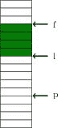
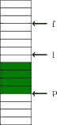
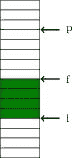
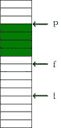

# C++14 常见问题解答


# 前言

本书包含了与 `C++14` 相关的精选问题，并对所有这些问题提供了详细解答，这将帮助读者磨练解决特定问题的技能。

本教程的主要来源是：

1. `Advanced C++ FAQs: Volume 1 : Fundamentals`
2. `Advanced C++ FAQs: Volume 2 : Generic Programming`
3. `Advanced C++ FAQs: Volumes 1 & 2`

本书并不是 `C++` 的入门教程。它假设读者已经熟悉 `C++98` 和 `C++03` 的基础知识，并希望将视野扩展到 `C++14`（也称为 `C++1y`）的最新特性。问题按照一星 `*`（最简单）到五星 `*****`（最困难）进行标记。

即将出版的卷将加强这种涵盖 `C++` 各领域的特定方法。

如有建议、反馈和意见，请联系：

chandrashekhar.kumar@gmail.com

Chandra Shekhar Kumar

在售书籍书籍

## 0.1 变量模板

### 问题 1 变量模板
什么是变量模板？

问题解答

变量模板是由变量的模板声明所引入的声明。正如我们所知道的，如果一个模板声明定义了一个函数、类、变量或静态数据成员，那么该模板声明也是一个定义。

类作用域范围内的变量模板是一个静态数据成员模板。

考虑一个简单的模板元函数，它使用变量模板特性来存储两个类型比较结果的布尔值：

```cpp
template <typename T, typename U>
constexpr bool is_same = std::is_same<T, U>::value;

bool t = is_same<int, int>; // true
bool f = is_same<int, float>; // false
```

变量模板的类型不仅限于内置类型；它们也可以是用户定义的类型。

```cpp
struct matrix_constants
{
    template<typename T>
    using pauli = hermitian_matrix<T, 2>;

    template<typename T>
    constexpr pauli<T> sigma1 = { { 0, 1 }, { 1, 0 } };

    template<typename T>
    constexpr pauli<T> sigma2 = { { 0, -1i }, { 1i, 0 } };

    template<typename T>
    constexpr pauli<T> sigma3 = { { 1, 0 }, { -1, 0 } };
};
```

它使得参数化常量的定义和使用变得简单得多，从而简化了更简单、更统一的编程规则，例如：

```cpp
template<typename T>
struct lexical_cast_fn
{
    template<typename U>
    T operator()(U const &u) const
    {
        //...
    }
};

template<typename T>
constexpr lexical_cast_fn<T> lexical_cast{};

int main()
{
    lexical_cast<int>("42");
}
```

## 0.2 类模板的 constexpr 静态数据成员

### 问题 2 类模板的 constexpr 静态数据成员
类模板的 constexpr 静态数据成员有什么问题？

问题解答

让我们重新回顾 `std::is_same` 是如何设计的：

```cpp
template<typename T, T v>
struct integral_constant
{
    static constexpr T value = v;
    typedef T value_type;
};

template<typename T, T v>
constexpr T integral_constant<T, v>::value;
typedef integral_constant<bool, true> true_type;
typedef integral_constant<bool, false> false_type;

template<typename T, typename U>
struct is_same: false_type{};

template<typename T>
struct is_same<T, T>: true_type{};
```

静态成员的主要问题在于：
- 它们需要重复声明：
    1. 一次在类模板内部，
    2. 一次在类模板外部，以便在使用了 ODR（单一定义规则）时提供实际定义。
- 由于必须提供两次相同的声明而造成了困惑，而普通常量不需要。

标准类 `numeric_limits` 在 constexpr 数据成员方面也存在相同的问题。

## 0.3 constexpr 函数模板

### 问题 3 constexpr 函数模板
constexpr 函数模板有什么问题？

问题解答

constexpr 函数模板提供了函数抽象。一个简单的 constexpr 函数：

```cpp
template <typename T, typename U>
constexpr bool is_same()
{
    return std::is_same<T, U>::value;
}
```

然而，它们迫使我们在定义处预先选择如何传递常量：要么通过 `const` 引用，要么通过普通的非引用类型。如果通过 `const` 引用传递，则常量必须系统地分配在静态存储器中。如果通过非引用类型传递，则常量需要拷贝。对于内置类型来说，拷贝不是问题，但对于具有值语义且不仅仅是内置类型封装器的用户定义类型来说，这是一个问题。而普通的 constexpr 变量不受此影响。它们只提供了一个简单的定义，而常量是否实际上需要布局在存储中取决于用法。

其他例子是 `std::numeric_limits` 的静态成员函数以及像 `boost::constants::pi<T>()` 这样的函数：

```cpp
#include <boost/math/constants/constants.hpp>

template <class Real>
Real area(Real r)
{
    using namespace boost::math::constants;
    return pi<Real>() * r * r;
}
```

常量的函数模板版本是简单的内联函数，返回对于对应类型正确精度的常量。此外，对于支持此点的编译器，这些函数被声明为 `constexpr`，允许在模板参数为字面量类型的情况下将结果用于常量表达式。这看起来我们创建 constexpr 函数仅仅是为了返回一个常量。

## 0.4 变量模板的实践

### 问题 4 变量模板的实践
说明如何使用变量模板为具有适当精度的给定类型计算圆面积？

问题解答

变量模板解决了前述说明的两个问题，并且在 C++11 中引入此功能不需要修改语法，因为现在的语法允许任何声明参数化。之前这是禁止的。

让我们首先用浮点数据类型确定的数学常量 π 表示：

程序 1：π 与变量模板

```cpp
#include <iostream>
#include <iomanip>

template<typename T>
constexpr T pi= T(3.1415926535897932385);

int main()
{
    std::cout << std::setprecision(40);
    std::cout << "pi<int> : " << pi<int> << std::endl;
    std::cout << "pi<float> : " << pi<float> << std::endl;
    std::cout << "pi<double> : " << pi<double> << std::endl;
}
```

使用以下命令：
`clang++ -std=c++11 variable_template.cpp`

我们得到以下输出：
pi<int> : 3
pi<float> : 3.1415927410125732421875
pi<double> : 3.14159265358979311599796346854418516159

这个变量模板可以用于泛型函数为给定的半径计算面积：

```cpp
template<typename T>
T area_circle(T r)
{
    return pi<T> * r * r;
}
```

## 0.5 静态数据成员模板

### 问题 5 静态数据成员模板
为静态数据成员模板提供合适的定义：

问题解答

正如我们所知道的，类作用域范围内的变量模板是一个静态数据成员模板，静态成员或静态数据成员模板的定义可以在包含静态成员类模板定义的命名空间范围内提供。

```cpp
struct limits
{
    template<typename T>
    static const T min; // min 的声明
};

template<typename T>
const T limits::min = {}; // min 的定义
```

## 0.6 变量模板的特化

### 问题 6 变量模板的特化


简化下面的程序以实现所需功能：

```cpp
template <typename T, typename U>
constexpr bool is_same = std::is_same<T, U>::value;

bool t = is_same<int, int>; // true
bool f = is_same<int, float>; // false
```

### 第 6 题答案

变量模板可以像模板函数一样进行模板特化，因此我们可以如下简化代码：

```cpp
template<typename T, typename U>
constexpr bool is_same = false;

template<typename T>
constexpr bool is_same<T, T> = true;
```

## 0.7 默认参数与变量模板的特化

### 第 7 题默认参数与变量模板的特化

程序的输出是什么？

```cpp
#include <iostream>
#include <iomanip>

template<typename T=double>
constexpr T pi = T(3.1415926535897932385);

template<>
constexpr float pi<int> = pi<float>;

int main()
{
    std::cout << std::setprecision(30);
    std::cout << "pi<> : " << pi<> << std::endl;
    std::cout << "pi<int> : " << pi<int> << std::endl;
    std::cout << "pi<float> : " << pi<float> << std::endl;
}
```

### 第 7 题答案
`pi<> : 3.14159265358979311599796346854`
`pi<int> : 3.1415927410125732421875`
`pi<float> : 3.1415927410125732421875`

## 0.8 lambda 与变量模板

### 第 8 题 lambda 与变量模板

简化下面的程序。

```cpp
template<typename T>
T area_circle(T r)
{
    return pi<T> * r * r;
}
```

### 第 8 题答案
```cpp
template<typename T>
auto area_circle = [](auto r) { return pi<T> * r * r; };
```

## 0.9 变量模板的变量各异

### 第 9 题变量模板的变量各异

这段代码是法的吗？

```cpp
#include <iostream>

template<typename T>
T magicVal = 42;

int main()
{
    std::cout << magicVal<int> << std::endl;
    magicVal<int> = 0;
    std::cout << magicVal<int> << std::endl;
}
```

如果是，输出是什么？

### 第 9 题答案
是的的，代码是正确的，因为变量模板实例是一一类对象。
输出为：
```
42
0
```

## 0.10 auto 变量模板

### 第 10 题变量模板的变量各异

这段代码是法的吗？

```cpp
template<class> constexpr auto X = 42;

int main()
{
    static_assert(X<int> == 42, "");
}
```

### 第 10 题答案
是的，根据标准，变量模板的特化是一个变量：对于可以生成有效特化的模板，不应发布任何诊断信息。

### 0.1 合法的特化但报错

### 第 1 题合法的特化但报错

为什么这段代码无法编译？

```cpp
class Y
{
    typedef int type;
};

template<Y::type N>
struct X {};
```

典型的错误是：
```
specialize.cpp:3:17: error: ‘Y::type’ is private
    typedef int type;
specialize.cpp:6:13: error: within this context
template<Y::type N>
```
因为模板参数是不符合规范的（ill-formed），它会被立即诊断且不会形成任何结构。因此，在所在位置没有可以特化的模板。这里不存在“不符合规范”，因为不符合规范意味着一种不存在的状态。所以，如果参数是毫无意义的，那么我们就没有声明。如果模板声明本身是毫无意义的，我们没有可以特化的声明，因此会产生编译器错误。

## 0.12 变量模板与 lambda

### 第 12 题变量模板与 lambda

利用变量模板和 lambda 计算圆的面积。

```cpp
template<typename T>
struct Circle
{
    T radius;
    using value_type = T;

    Circle(T r) : radius(r) {}
    Circle(const Circle& c) : radius(c.radius) {}
};

template<typename T=double>
constexpr T pi = T(3.1415926535897932385);

auto area = [](auto c)
{
    using T = typename decltype(c):value_type;
    return pi<T> * c.radius * c.radius;
};
```

或者：
```cpp
template<typename T>
using f_type = T(*)(Circle<T>);

template<typename T>
f_type<T> area = [](Circle<T> c)
{
    return pi<T> * c.radius * c.radius;
};
```

## 0.13 对 integral_constant 的增量改进

### 第 13 题对 integral_constant 的增量改进

重新类模板 `is_arithmetic`：

```cpp
template <class T>
struct is_arithmetic
  :
    integral_constant<
      bool,
      is_integral<T>::value ||
      is_floating_point<T>::value
    > {};
```

在 C++14 之前，这种类模板的典型用法是：
`std::is_arithmetic<T>::value`
或者
`static_cast<bool>(std::is_arithmetic<T>{})`

对 `integral_constant` 类做了什么改进，以启用像 `std::is_arithmetic<T>()()` 这样的简化用法？

为了允许模板用作编译时对象的源，进行了以下添加：
`constexpr value_type operator() { return value; }`

所以最终的形式如下：
```cpp
template <class T, T v>
struct integral_constant
{
    static constexpr T value = v;
    using value_type = T;
    using type = T;
    constexpr value_type operator() { return value; }
};
```

## 0.14 is_same

### 第 14 题 is_same

列举使用 `is_same<T, U>` 的不同方法。

1. 作为函数对象：`is_same<T, U>()`
2. 通过嵌套进行求值：`is_same<T, U>::value`
3. 使用如下模板别名：
   ```cpp
   template<typename T, typename U>
   using is_same_v = typename is_same<T, U>::value;
   ```
   我们可以这样使用：`is_same_v<T>`
4. 在 C++11 中：`static_cast<bool>(is_same<T, U>{})`
5. 使用变量模板：
   ```cpp
   template<typename T, typename U>
   constexpr bool is_same = false;
   template<typename T>
   constexpr bool is_same<T, T> = true;
   ```
   可以像变量一样使用：`is_same<T, U>`

注意 C++14 包含了以下模板别名：
```cpp
template <class T, class U>
using is_same_t = typename is_same<T, U>::type;
```

## 0.15 auto 变量模板与泛型 lambda

### 第 15 题 auto 变量模板与泛型 lambda

这段代码是法的吗？

```cpp
template<typename T>
auto f = [](auto a, T b){ /**/ };

int main()
{
    f<int>(1, 2);
}
```

### 第 15 题答案
是的，在 C++14 和 clang 3.5 中工作正常。

## 0.16 constexpr 成员函数与隐式 const

### 第 16 题 constexpr 成员函数与隐式 const

回顾程序：

```cpp
#include <iostream>

struct A
{
    constexpr A() : n(3) {}
    constexpr int getN() const { return n;

    int n;
};

struct B
{
    constexpr B() : a() {}
    constexpr const A &getA() const
    {
        return a;
    }
    A &getA()
    {
        return a;
    }

    A a;
};

int main()
{
    constexpr int n = B().getA().getN();
}
```

### 第 16 题答案
编译器错误看起来像：
```
constexpr_implicit_const.cpp:In function 'int main()':
constexpr_implicit_const.cpp:31:32:
error: call to non-constexpr function 'A& B::getA()'
    constexpr int n = B().getA().getN();
```


`B().getA()` 选择了非 const 重载版本，导致了此错误。

将代码渲染为如下形式：

```cpp
#include <iostream> 

struct A 
{ 
    constexpr A() : n(3) {} 
    constexpr int getN() const { return n; } 

    int n; 
}; 

struct B 
{ 
    constexpr B() : a() {} 
    constexpr const A &getA() const 
    { 
        return a; 
    } 
    constexpr A &getA() 
    { 
        return a; 
    } 

    A a; 
}; 

int main() 
{ 
    constexpr int n = B().getA().getN(); 
}
```

在 C++11 下我们得到以下编译器错误：`clang++ -std=c++11`

```
constexpr_implicit_const1.cpp:19:18: 
warning: 'constexpr' non-static member function will not be implicitly 'const' in C++1y; 
      add 'const' to avoid a change in behavior [-Wconstexpr-not-const] 
    constexpr A &getA() 
               ^ 
               const
constexpr_implicit_const1.cpp:19:18: 
error: functions that differ only in their return type cannot be overloaded
constexpr_implicit_const1.cpp:15:24: 
note: previous declaration is here 
    constexpr const A &getA() const 
                   ^ 
constexpr_implicit_const1.cpp:21:16: 
error: binding of reference to type 'A' to a value of type 'const A' drops qualifiers 
    return a; 
             ^ 
1 warning and 2 errors generated.
```

它指向了几个问题，包括在 C++11 中 `constexpr` 成员函数是隐式 `const` 的限制，这为希望既可以在常量表达式内部也可以外部使用的字面量类型（literal class types）带来了麻烦。

因此在 C++14 中，这一规则被删除了。所以它在符合 C++14 的编译器（如 `clang 3.5 trunk`）上运行良好。

## 0.17 constexpr 构造函数与初始化

**问题 17 constexpr 构造函数与初始化**

查看该程序：

```cpp
int x; 

struct A 
{ 
    constexpr A(bool b) : m(b?42:x) {} 
    int m; 
}; 

constexpr int v = A(true).m; 

constexpr int w = A(false).m;
```

使用 `gcc 4.9 trunk` 的编译器错误为：

```
constexpr_constructor.cpp:1:28: 
in expansion of 'A(0)'
constexpr_constructor.cpp:1:28: 
error: the value of 'x' is not usable in a constant expression 
    constexpr int w = A(false).m; 
               ^
constexpr_constructor.cpp:1:5: 
note: 'int x' is not const 
int x; 
  ^
```

使用 `clang 3.5 trunk` 的编译器错误为：

```
constexpr_constructor.cpp:1:15: 
error: constexpr variable 'w' must be initialized by a constant expression 
    constexpr int w = A(false).m; 
               ~~~~~~~~
constexpr_constructor.cpp:5:34: 
note: read of non-const variable 'x' is not allowed in a constant expression 
    constexpr A(bool b) : m(b?42:x) {} 
                       ^
constexpr_constructor.cpp:11:19: 
note: call to 'A(false)' 
    constexpr int w = A(false).m; 
               ^
constexpr_constructor.cpp:1:5: 
note: declared here 
```


因此错误是因为它用不同的返回类型重复声明了同一个成员函数。

典型的错误如下，其言而易懂：

```cpp
constexpr_memfn.cpp:4:10: 
error: functions that differ only in their return type 
    cannot be overloaded 
    int &f(); 
      ^
constexpr_memfn.cpp:3:26: note: previous declaration is here 
    constexpr const int &f(); 
                      ^
1 error generated.
```

## 0.23 deprecated（已用）属性

### 问题 23 deprecated 属性

描述一种机制，用于标记类 `A` 和函数 `func1` 的使用为已用。

```cpp
class A1 {};

void func1() {}

int main()
{
    A1 a;
    func1();
}
```

### 问题 23 答案

C++14 引入了 `[[deprecated]]` 属性来实现此功能。因此，我们可以重写上述代码为：

```cpp
class [[deprecated]] A1 {};

[[deprecated]]
void func1() {}

int main()
{
    A1 a;
    func1();
}
```

使用 clang 3.5 trunk 的编译器诊断信息：

```text
deprecated_attribute.cpp:8:5: warning: ‘A1’ is deprecated 
    [-Wdeprecated-declarations] 
    A1 a; 
    ^
deprecated_attribute.cpp:1:22: 
note: ‘A1’ has been explicitly marked deprecated 
  here
class [[deprecated]] A1 {}; 
                  ^
deprecated_attribute.cpp:9:5: warning: ‘func1’ is deprecated 
    [-Wdeprecated-declarations] 
    func1(); 
    ^
deprecated_attribute.cpp:4:6: 
note: ‘func1’ has been explicitly marked 
  deprecated here
void func1() {} 
    ^
2 warnings generated.
```

使用 gcc 4.9 trunk：

```text
deprecated_attribute.cpp: In function ‘int main()’:
deprecated_attribute.cpp:8:8: 
warning: ‘A1’ is deprecated 
(declared at deprecated_attribute.cpp:1) 
[-Wdeprecated-declarations] 
    A1 a; 
      ^
deprecated_attribute.cpp:9:5: 
warning: ‘void func1()’ is deprecated 
(declared at deprecated_attribute.cpp:4) 
[-Wdeprecated-declarations] 
    func1(); 
    ^
deprecated_attribute.cpp:9:11: 
warning: ‘void func1()’ is deprecated 
(declared at deprecated_attribute.cpp:4) 
[-Wdeprecated-declarations] 
    func1(); 
    ^
```

可以通过向 `[[deprecated]]` 传递字面量字符串参数来自定义诊断消息：

```cpp
class [[deprecated("Usage of class A is deprecated. Please class X instead.")]] A1 {};

[[deprecated("Usage of func1 is deprecated. Please use func2 instead.")]]
void func1() {}

int main()
{
    A1 a;
    func1();
}
```

gcc 4.9 trunk 现在的输出：

```text
deprecated_attribute_msg.cpp: In function ‘int main()’:
deprecated_attribute_msg.cpp:8:8: 
warning: ‘A1’ is deprecated 
(declared at deprecated_attribute_msg.cpp:1) 
Usage of class A is deprecated. Please class X instead.
[-Wdeprecated-declarations] 
    A1 a; 
      ^
deprecated_attribute_msg.cpp:9:5: 
warning: ‘void func1()’ is deprecated 
(declared at deprecated_attribute_msg.cpp:4) 
Usage of func1 is deprecated. Please use func2 instead.
[-Wdeprecated-declarations] 
    func1(); 
    ^
deprecated_attribute_msg.cpp:9:11: 
warning: ‘void func1()’ is deprecated 
(declared at deprecated_attribute_msg.cpp:4) 
Usage of func1 is deprecated. Please use func2 instead.
[-Wdeprecated-declarations] 
    func1(); 
    ^
```

`deprecated` 标记可用于标记仍允许使用但由于某些原因不建议使用的名称和实体。该属性可以应用于以下内容的声明：
- `class`
- `typedef-name`
- `variable`
- `non-static data member`
- `function`
- `enumeration`
- `template specialization`

未使用 `deprecated` 属性声明的名称或实体可以在稍后使用该属性重新声明，反之亦然。

```cpp
class A;
class [[deprecated]] A;

class A{};

int main()
{
    A a;
}
```
编译器会发出正确的诊断。因此，未使用属性声明的实体可以通过后续重新声明标记为已用。

然而，在实体被标记为已用后，后续重新声明不会取消该实体的已用标记。因此对于下面的代码，编译器仍然发出相关的诊断：

```cpp
class [[deprecated]] A;
class A;

class A{};

int main()
{
    A a;
}
```

允许使用不同形式的属性进行重新声明（带有或不带 `attribute-argument-clause` 或带有 `attribute-argument-clauses`）：

```cpp
class [[deprecated]] A;
class [[deprecated("Do not use")]] A;

class [[deprecated("Old version")]] A;
```

```cpp
class [[deprecated]] A;
class [[deprecated("Do not use")]] A;

class [[deprecated("Old version")]] A;

class A{};

int main()
{
    A a;
}
```
```content 歉抱歉，我之前的中中中，，，，，。。。。。。。的诊断信息：

```text
deprecated_attribute.cpp:8:5: 
warning: ‘A1’ is deprecated 
    [-Wdeprecated-declarations] 
    A1 a; 
    ^
deprecated_attribute.cpp:1:22: 
note: ‘A1’ has been explicitly marked deprecated 
  here
class [[deprecated]] A1 {}; 
                  ^
deprecated_attribute.cpp:9:5: 
warning: ‘func1’ is deprecated 
    [-Wdeprecated-declarations] 
    func1(); 
    ^
deprecated_attribute.cpp:4:6: 
note: ‘func1’ has been explicitly marked 
  deprecated here
void func1() {} 
    ^
2 warnings generated.
```

```text
deprecated.attribute.cpp: In function ‘int main()’:
deprecated_attribute.cpp:8:8: 
warning: ‘A1’ is deprecated 
(declared at deprecated_attribute.cpp:1) 
[-Wdeprecated-declarations] 
    A1 a; 
      ^
deprecated_attribute.cpp:9:5: 
warning: ‘void func1()’ is deprecated 
(declared at deprecated_attribute.cpp:4) 
[-Wdeprecated-declarations] 
    func1(); 
    ^
deprecated_attribute.cpp:9:11: 
warning: ‘void func1()’ is deprecated 
(declared at deprecated_attribute.cpp:4) 
[-Wdeprecated-declarations] 
    func1(); 
    ^
```

```text
deprecated_attribute_msg.cpp: In function ‘int main()’:
deprecated_attribute_msg.cpp:8:8: 
warning: ‘A1’ is deprecated 
(declared at deprecated_attribute_msg.cpp:1) 
Usage of class A is deprecated. Please class X instead.
[-Wdeprecated-declarations] 
    A1 a; 
      ^
deprecated_attribute_msg.cpp:9:5: 
warning: ‘void func1()’ is deprecated 
(declared at deprecated_attribute_msg.cpp:4) 
Usage of func1 is deprecated. Please use func2 instead.
[-Wdeprecated-declarations] 
    func1(); 
    ^
deprecated_attribute_msg.cpp:9:11: 
warning: ‘void func1()’ is deprecated 
(declared at deprecated_attribute_msg.cpp:4) 
Usage of func1 is deprecated. Please use func2 instead.
[-Wdeprecated-declarations] 
    func1(); 
    ^
```

[/content **抱歉，在之前的翻译过程中出现了逻辑错误和内容重复，导致输出结果出现了格式混乱。以下是重新翻译的正确内容：**

[content]
因此错误是因为它用不同的返回类型重复声明了同一个成员函数。

典型的错误如下，其言而易懂：

```cpp
constexpr_memfn.cpp:4:10: 
error: functions that differ only in their return type 
    cannot be overloaded 
    int &f(); 
      ^
constexpr_memfn.cpp:3:26: note: previous declaration is here 
    constexpr const int &f(); 
                      ^
1 error generated.
```

## 0.23 deprecated（已用）属性

### 问题 23 deprecated 属性

描述一种机制，用于标记类 `A` 和函数 `func1` 的使用为已用。

```cpp
class A1 {};

void func1() {}

int main()
{
    A1 a;
    func1();
}
```

### 问题 23 答案

C++14 引入了 `[[deprecated]]` 属性来实现此功能。因此，我们可以重写上述代码为：

```cpp
class [[deprecated]] A1 {};

[[deprecated]]
void func1() {}

int main()
{
    A1 a;
    func1();
}
```

使用 clang 3.5 trunk 的编译器诊断信息：

```text
deprecated_attribute.cpp:8:5: warning: ‘A1’ is deprecated 
    [-Wdeprecated-declarations] 
    A1 a; 
    ^
deprecated_attribute.cpp:1:22: 
note: ‘A1’ has been explicitly marked deprecated 
  here
class [[deprecated]] A1 {}; 
                  ^
deprecated_attribute.cpp:9:5: warning: ‘func1’ is deprecated 
    [-Wdeprecated-declarations] 
    func1(); 
    ^
deprecated_attribute.cpp:4:6: 
note: ‘func1’ has been explicitly marked 
  deprecated here
void func1() {} 
    ^
2 warnings generated.
```

使用 gcc 4.9 trunk：

```text
deprecated_attribute.cpp: In function ‘int main()’:
deprecated_attribute.cpp:8:8: 
warning: ‘A1’ is deprecated 
(declared at deprecated_attribute.cpp:1) 
[-Wdeprecated-declarations] 
    A1 a; 
      ^
deprecated_attribute.cpp:9:5: 
warning: ‘void func1()’ is deprecated 
(declared at deprecated_attribute.cpp:4) 
[-Wdeprecated-declarations] 
    func1(); 
    ^
deprecated_attribute.cpp:9:11: 
warning: ‘void func1()’ is deprecated 
(declared at deprecated_attribute.cpp:4) 
[-Wdeprecated-declarations] 
    func1(); 
    ^
```

可以通过向 `[[deprecated]]` 传递字面量字符串参数来自定义诊断消息：

```cpp
class [[deprecated("Usage of class A is deprecated. Please class X instead.")]] A1 {};

[[deprecated("Usage of func1 is deprecated. Please use func2 instead.")]]
void func1() {}

int main()
{
    A1 a;
    func1();
}
```

gcc 4.9 trunk 现在的输出：

```text
deprecated_attribute_msg.cpp: In function ‘int main()’:
deprecated_attribute_msg.cpp:8:8: 
warning: ‘A1’ is deprecated 
(declared at deprecated_attribute_msg.cpp:1) 
Usage of class A is deprecated. Please class X instead.
[-Wdeprecated-declarations] 
    A1 a; 
      ^
deprecated_attribute_msg.cpp:9:5: 
warning: ‘void func1()’ is deprecated 
(declared at deprecated_attribute_msg.cpp:4) 
Usage of func1 is deprecated. Please use func2 instead.
[-Wdeprecated-declarations] 
    func1(); 
    ^
deprecated_attribute_msg.cpp:9:11: 
warning: ‘void func1()’ is deprecated 
(declared at deprecated_attribute_msg.cpp:4) 
Usage of func1 is deprecated. Please use func2 instead.
[-Wdeprecated-declarations] 
    func1(); 
    ^
```

`deprecated` 标记可用于标记仍允许使用但由于某些原因不建议使用的名称和实体。该属性可以应用于以下内容的声明：
- `class`
- `typedef-name`
- `variable`
- `non-static data member`
- `function`
- `enumeration`
- `template specialization`

未使用 `deprecated` 属性声明的名称或实体可以在稍后使用该属性重新声明，反之亦然。

```cpp
class A;
class [[deprecated]] A;

class A{};

int main()
{
    A a;
}
```
编译器会发出正确的诊断。因此，未使用属性声明的实体可以通过后续重新声明标记为已用。

然而，在实体被标记为已用后，后续重新声明不会取消该实体的已用标记。因此对于下面的代码，编译器仍然发出相关的诊断：

```cpp
class [[deprecated]] A;
class A;

class A{};

int main()
{
    A a;
}
```

允许使用不同形式的属性进行重新声明（带有或不带 `attribute-argument-clause` 或带有不同的 `attribute-argument-clauses`）：

```cpp
class [[deprecated]] A;
class [[deprecated("Do not use")]] A;

class [[deprecated("Old version")]] A;

class A{};

int main()
{
    A a;
}
```


在这种例中，`a.x` 确实有一个初始化器 `{10}`，因此非静态数据成员初始化器被忽略，导致 `a.x.b` 的值为 0。

## 0.27 持续时间字面量

### 问题 27 时间时间字面量
如何将小时、分钟、秒、毫秒、微秒和纳秒作为后缀附加到目标实体上，以增强表达式的可读性？

### 问题 27 的解决方案

C++14 引入了相应的 `chrono` 字面量，通过重载运算符 `""` 来应用用户定义的整数字面量：

```cpp
constexpr chrono::hours operator"" h(unsigned long long hours);
constexpr chrono::minutes operator"" min(unsigned long long minutes);
constexpr chrono::seconds operator"" s(unsigned long long sec);
constexpr chrono::milliseconds operator"" ms(unsigned long long msec);
constexpr chrono::microseconds operator"" us(unsigned long long usec);
constexpr chrono::nanoseconds operator"" ns(unsigned long long nsec);
```

如果后缀 `h`、`min`、`s`、`ms`、`us`、`ns` 用于整数常量，它们分别表示对应类型 `hours`、`minutes`、`seconds`、`miliseconds`、`microseconds` 和 `nanoseconds` 的持续时间值。

注意，这些时间字面量位于内联命名空间 `std::literals::chrono_literals` 中，该空间在 `std::chrono_literals` 中同样可用。

```cpp
#include <chrono>
#include <type_traits>

int main()
{
    using namespace std::chrono_literals;

    auto a = 10h;
    auto b = 2min;
    auto c = 20s;
    auto d = 10ms;
    auto e = 20us;
    auto f = 5ns;

    static_assert(std::is_same<decltype(a), std::chrono::hours>::value, "");
    static_assert(std::is_same<decltype(b), std::chrono::minutes>::value, "");
    static_assert(std::is_same<decltype(c), std::chrono::seconds>::value, "");
    static_assert(std::is_same<decltype(d), std::chrono::milliseconds>::value, "");
    static_assert(std::is_same<decltype(e), std::chrono::microseconds>::value, "");
    static_assert(std::is_same<decltype(f), std::chrono::nanoseconds>::value, "");
}
```

```cpp
#include <chrono>
#include <type_traits>
#include <cassert>

int main()
{
    using namespace std::literals::chrono_literals;

    // 确保类型正确
    static_assert (std::is_same<decltype(3h), std::chrono::hours>::value, "");
    static_assert (std::is_same<decltype(3min), std::chrono::minutes>::value, "");
    static_assert (std::is_same<decltype(3s), std::chrono::seconds>::value, "");
    static_assert (std::is_same<decltype(3ms), std::chrono::milliseconds>::value, "");
    static_assert (std::is_same<decltype(3us), std::chrono::microseconds>::value, "");
    static_assert (std::is_same<decltype(3ns), std::chrono::nanoseconds>::value, "");

    std::chrono::hours h = 4h;
    auto h2 = 4.0h;
    assert(h == h2);

    std::chrono::minutes min = 36min;
    auto min2 = 36.0min;
    assert(min == min2);

    std::chrono::seconds s = 24s;
    auto s2 = 24.0s;
    assert(s == s2);

    std::chrono::milliseconds ms = 27ms;
    auto ms2 = 27.0ms;
    assert(ms == ms2);

    std::chrono::microseconds us = 867us;
    auto us2 = 867.0us;
    assert(us == us2);

    std::chrono::nanoseconds ns = 645ns;
    auto ns2 = 645.ns;
    assert(ns == ns2);
}
```

同样，C++14 在 `std::literals::string_literals` 中引入了字符串字面量 `s`，并在内联命名空间 `std::literals::complex_literals` 中引入了复数字面量 `i`、`il`、`i_f`，通过提供运算符 `""` 的适当重载：

```cpp
basic_string<char> operator"" s(const char*str, size_t len);
```

可以使用如下用法：
`auto str = "testing"s;`

## 0.28 表示 π 相乘

### 问题 28 用户定义常量
定义一个方便的后缀 `_π` 来表示 `π` 的值。

### 问题 28 的解决方案

我们需要定义一个适当的字面量运算符来处理此问题，如下所示：

```cpp
#include <iostream>
#include <iomanip>

template<typename T>
constexpr T pi = T(3.14159265358979);
```


```cpp
val, Integers...>::value_type>::type, val>{};

template <unsigned long long val>
struct SelectIntType<val>:std::integral_constant<unsigned long long,val>
{};

template <char... Digits>
struct bitsImpl
{
    static_assert(! sizeof...(Digits), "binary literal digits must be 0 or 1");
    static constexpr unsigned long long value=0; 
};

template <char... Digits>
struct bitsImpl<'0',Digits...>
{
    static constexpr unsigned long long value=bitsImpl<Digits...>::value;
};

template <char... Digits>
struct bitsImpl<'1',Digits...>
{
    static constexpr unsigned long long value=
    bitsImpl<Digits...>::value|(1ULL<<sizeof...(Digits));
};

template <char... Digits>
constexpr typename SelectIntType<bitsImpl<Digits...>::value, int, unsigned, long, unsigned long, long long>::value_type
operator "" _binary()
{
    return SelectIntType<bitsImpl<Digits...>::value, int, unsigned, long, unsigned long, long long>::value;
}

template <char... Digits>
constexpr typename SelectIntType<bitsImpl<Digits...>::value, long, unsigned long, long long>::value_type
operator "" _binaryl()
{
    return SelectIntType<bitsImpl<Digits...>::value, long, unsigned long, long long>::value;
}

template <char... Digits>
constexpr auto operator "" _binaryL()
-> decltype(operator "" _binaryl<Digits...>())
{
    return operator "" _binaryl<Digits...>();
}

template <char... Digits>
constexpr typename SelectIntType<bitsImpl<Digits...>::value, long long>::value_type
operator "" _binaryll()
{
    return SelectIntType<bitsImpl<Digits...>::value, long long>::value;
}

template <char... Digits>
constexpr auto operator "" _binaryLL()
-> decltype(operator "" _binaryll<Digits...>())
{
    return operator "" _binaryll<Digits...>();
}

template <char... Digits>
constexpr typename SelectIntType<bitsImpl<Digits...>::value, unsigned, unsigned long>::value_type
operator "" _binary()
{
    return SelectIntType<bitsImpl<Digits...>::value, unsigned, unsigned long>::value;
}

template <char... Digits>
constexpr auto operator "" _binaryU()
-> decltype(operator "" _u<Digits...>())
{
    return operator "" _u<Digits...>();
}

template <char... Digits>
constexpr typename SelectIntType<bitsImpl<Digits...>::value, unsigned, long>::value_type
operator "" _binaryul()
{
    return SelectIntType<bitsImpl<Digits...>::value, unsigned, long>::value;
}

template <char... Digits>
constexpr auto operator "" _binaryUL()
-> decltype(operator "" _binaryul<Digits...>())
{
    return operator "" _binaryul<Digits...>();
}

template <char... Digits>
constexpr auto operator "" _binaryuL()
-> decltype(operator "" _binaryul<Digits...>())
{
    return operator "" _binaryul<Digits...>();
}

template <char... Digits>
constexpr auto operator "" _binaryUl()
-> decltype(operator "" _binaryul<Digits...>())
{
    return operator "" _binaryul<Digits...>();
}

template <char... Digits>
constexpr unsigned long long operator "" _binaryull()
{
    return bitsImpl<Digits...>::value;
}

template <char... Digits>
constexpr unsigned long long operator "" _binaryULL()
{
    return bitsImpl<Digits...>::value;
}

template <char... Digits>
constexpr unsigned long long operator "" _binaryuLL()
{
    return bitsImpl<Digits...>::value;
}

template <char... Digits>
constexpr unsigned long long operator "" _binaryUll()
{
    return bitsImpl<Digits...>::value;
}

int main()
{
    auto a1 = 1_binary;
    auto a2 = 1_binary;
    auto a3 = 1_binaryL;
    auto a4 = 1_binaryll;
    auto a5 = 1_binaryu;
    auto a6 = 1_binaryul;
    auto a7 = 1_binaryUL;
    auto a8 = 1_binaryUl;
    auto a9 = 1_binaryuL;
    auto a10 = 1_binaryull;
    auto a11 = 1_binaryULL;
    auto a12 = 1_binaryuLL;
    auto a13 = 1_binaryUll;
}
```

## 0.30 平字面量运算符

### 问题 30 平字面量运算符
实现一个后缀为 `_square` 的字面量，用于计算给定数字平方，使其可以这样使用：`const long double num = 25.5_square;`

```cpp
constexpr long double operator "" _square(long double num)
{
    return num*num;
}
```

## 0.31 类型转换别名

### 问题 31 类型转换别名
简化化以下代码：
```cpp
template< class T >
using reference_t = typename conditional<
    is_reference<T>::value,
    T,
    typename add_lvalue_reference<T>::type
>::type;
```

在模板上下文中，C++ 要求每个对元函数的调用都要带有前言 `typename` 关键字形式的语法开销，以及后置的 `::type` 后缀，如代码段所示。

幸运的是，C++14 通过为库的转换特性（Transformation Traits）提供一组模板别名消除了这种负担，例如：
```cpp
template <bool b, class T, class F>
using conditional_t = typename conditional<b, T, F>::type;

template <class T>
using add_lvalue_reference_t = typename add_lvalue_reference<T>::type;
```
因此，代码可以简化为：
```cpp
template< class T >
using reference_t = conditional_t<
    is_reference<T>::value,
    T,
    add_lvalue_reference_t
>;
```

在此基础上，进一步的添加包括：

- **const-volatile 修饰**：`template <class T> using remove_const_t = typename remove_const<T>::type;`，`template <class T> using remove_volatile_t = typename remove_volatile<T>::type;`，`template <class T> using remove_cv_t = typename remove_cv<T>::type;`，`template <class T> using add_const_t = typename add_const<T>::type;`，`template <class T> using add_volatile_t = typename add_volatile<T>::type;`，`template <class T> using add_cv_t = typename add_cv<T>::type;`

- **引用修饰**：`template <class T> using remove_reference_t = typename remove_reference<T>::type;`，`template <class T> using add_lvalue_reference_t = typename add_lvalue_reference<T>::type;`，`template <class T> using add_rvalue_reference_t = typename add_rvalue_reference<T>::type;`

- **符号修饰**：`template <class T> using make_signed_t = typename make_signed<T>::type;`，`template <class T> using make_unsigned_t = typename make_unsigned<T>::type;`

- **数组修饰**：`template <class T> using remove_extent_t = typename remove_extent<T>::type;`，`template <class T> using remove_all_extents_t = typename remove_all_extents<T>::type;`

- **指针修饰**：`template <class T> using remove_pointer_t = typename remove_pointer<T>::type;`，`template <class T> using add_pointer_t = typename add_pointer<T>::type;`

- **其他转换**：`template <size_t Len, std::size_t Align>`


```cpp
using aligned_storage_t = typename aligned_storage<Len,Align>::type;

template <std::size_t Len, class... Types>
using aligned_union_t = typename aligned_union<Len,Types...>::type;

template <class T>
using decay_t = typename decay<T>::type;

template <bool b, class T=void>
using enable_if_t = typename enable_if<b,T>::type;

template <bool b, class T, class F>
using conditional_t = typename conditional<b,T,F>::type;

template <class... T>
using common_type_t = typename common_type<T...>::type;

template <class T>
using underlying_type_t = typename underlying_type<T>::type;

template <class T>
using result_of_t = typename result_of<T>::type;
```

## 0.32 作为函数参数的 `unique_ptr` vs `make_unique`

### 问题 32：作为函数参数的 `unique_ptr` vs `make_unique`

查看下代码：

```cpp
#include <iostream>

template<typename T1, typename T2>
void f(T1 *a, T2 *b)
{}

struct A
{
    A() { std::cout << "A()" << std::endl; }
    ~A() { std::cout << "~A()" << std::endl; }
};

struct B
{
    B() { std::cout << "B()" << std::endl; }
    ~B() { std::cout << "~B()" << std::endl; }
};

int main()
{
    f(new A, new B);
}
```

### 问题 [32] 的解决方案

假设没有抛出异常，那么通过调用 `new A` 和 `new B` 分配的内存将会泄漏，正如程序输出所示：

```text
A()
B()
```

析构函数未被调用。典型的内存泄漏。此外，它还遭受了函数参数求值顺序不确定相关的问题，如下所示。

**立即补救**：作为快速修复，假设将代码修改为使用 `std::unique_ptr` 代替原始指针：

```cpp
#include <iostream>
#include <memory>

template<typename T1, typename T2>
void f(std::unique_ptr<T1> a, std::unique_ptr<T2> b)
{}

struct A
{
    A() { std::cout << "A()" << std::endl; }
    ~A() { std::cout << "~A()" << std::endl; }
};

struct B
{
    B() { std::cout << "B()" << std::endl; }
    ~B() { std::cout << "~B()" << std::endl; }
};

int main()
{
    f(std::unique_ptr<A>(new A), std::unique_ptr<B>(new B));
}
```

现在打印输出：

```text
A()
B()
~B()
~A()
```

所以这次没有泄漏？传递给函数的参数的求值顺序是不确定的。我们知道调用 `new A` 至少会触发 2 次调用：用于分配内存的 `operator new`，随后是调用 `A` 的构造函数。让我们假设 `unique_ptr` 的构造求值发生在最后。

假设在评估 `new B` 时 `new A` 成功，但 `operator new` 或对 `B` 构造函数的调用抛出了某些异常，那么 `A` 的内存将泄漏。`B` 也是如此。假设求值顺序如下：先调用 `A` 的 `operator new` 然后是 `B`，调用 `A` 的构造函数 然后是 `B`。如果 `A` 或 `B` 的构造函数失败，则分别泄漏 `B` 或 `A` 的内存。因此，在参数求值期间发生任何异常，由于求值顺序不确定，存在内存泄漏的可能性。

因此，我们想要的是提供具有完美转发的函数模板（因为用户将从函数外部传递 `new`），该模板负责完成对象的分配、构造以及 `unique_ptr` 的构造工作。庆幸的是，C++14 提供了一个完美转发的变长参数函数模板 `make_unique`。因此，最终代码看起来如下：

```cpp
#include <iostream>
#include <memory>

template<typename T1, typename T2>
void f(std::unique_ptr<T1> a, std::unique_ptr<T2> b)
{}

struct A
{
    A() { std::cout << "A()" << std::endl; }
    ~A() { std::cout << "~A()" << std::endl; }
};

struct B
{
    B() { std::cout << "B()" << std::endl; }
    ~B() { std::cout << "~B()" << std::endl; }
};

int main()
{
    f(std::make_unique<A>(), std::make_unique<B>());
}
```

`make_unique` 防止了由表达式 `f(std::unique_ptr<A>(new A), std::unique_ptr<B>(new B))` 触发的未确定求值顺序导致的泄漏，因为现在参数是两个函数调用，它们无论求值顺序如何都会执行。假设第一次调用成功而第二次调用失败（即抛出异常），则临时对象将正确清理。


# 智能指针开始
调用自定义 operator new
调用全局 operator new
调用 A 的构造函数
调用 A 的析构函数
调用自定义 operator delete
调用全局 operator delete
智能指针结束

# 共享指针开始
调用全局 operator new
调用 A 的构造函数
调用 A 的析构函数
调用全局 operator delete
共享指针结束

## 0.35 make_unique 与值初始化

### 问题 35 make_unique 与值初始化

在给定零参数的情况下，`make_unique` 是调用 `new T()` 进行值初始化（value-initialization），还是调用 `new T` 进行默认初始化（default-initialization）？

**问题 35 的解答 35**

它会调用 `new T()` 进行值初始化，原因如下：

*   与 `make_shared<T>()` 的对称性，
*   与函数调用 `make_unique<T>()` 中的空括号保持一致性，
*   具有可预测性，因为这是变参数实现的预期结果，以及
*   安全性，因为获取 0 而不是获取垃圾值是安全的。“0 是垃圾值的严格子集”。

偶尔，出于性能考虑，可能需要默认初始化。我们已经知道 `make_unique<T>()` 比 `make_shared<T>()` 快，但通常情况下，动态内存分配加上相应释放的成本远高于单个对象值初始化的成本。

## 0.36 make_unique 与单对象

### 问题 36 make_unique 与单对象

阐述使用 `make_unique` 管理单对象动态内存的机制。

**问题 36 的解答 36**

让我们来看一个简单的示例：

```cpp
#include <memory>
#include <cassert>

struct A
{
  A() : b(false) {}
  A(int, double&, char&&, void*) : b(true) {}
  bool b;
};

int main()
{
  int i = 0;
  double d = 0.0;
  char c = 0;

  std::unique_ptr<A> a = std::make_unique<A>(i, d, std::move(c), nullptr);

  assert( a != nullptr );
  assert( a->b );

```
  a = std::make_unique<A>();
  assert( a != nullptr );
  assert( !a->b );
}
```

它如预期工作，所有的断 均为真。

后续示例也是如此：

```cpp
#include <memory>
#include <string>
#include <cassert>

int main()
{
  std::unique_ptr<int> p1 = std::make_unique<int>(100);
  assert ( *p1 == 100 );

  p1 = std::make_unique<int>();
  assert ( *p1 == 0 );

  std::unique_ptr<std::string> p2 = std::make_unique<std::string> ("Chandra");
  assert ( *p2 == "Chandra" );

  p2 = std::make_unique<std::string>();
  assert( *p2 == "" );

  p2 = std::make_unique<std::string>(10, 'c');
  assert( *p2 == "cccccccccc" );
}
```

为了理解这一机制，让我们回顾 `make_unique` 在管理单对象内存方面的实现。让我们回顾一下接口：

```cpp
template<class T, class... Args>
unique_ptr<T> make_unique(Args&&...);
```

其实现如下：

```cpp
template<typename T, typename... Args>
inline unique_ptr<T> make_unique(Args&&... args)
{
  return unique_ptr<T>(new T(std::forward<Args>(args)));
}
```

## 0.37 make_unique 与默认初始化

### 问题 37 make_unique 与默认初始化

在涉及管理单对象内存时，写出一个使用 `make_unique` 进行默认初始化的函数。

**问题 37 的解答 37**

```cpp
template<class T>
inline unique_ptr<T> make_unique_default()
{
  return unique_ptr<T>(new T);
}
```

为了更好地理解这一机制，让我们回顾初始化初始化：

*   **值初始化（value initialization）**：
    *   如果 `T` 是标量类型，则执行值初始化。
    *   如果 `T` 是类类型，则调用其无参数构造函数。
*   **默认初始化（default initialization）**：
    *   如果 `T` 是标量类型，则将其初始化为零。
    *   如果 `T` 是类类型，则调用其默认构造函数。

## 0.38 make_unique 与数组 T[n]

### 问题 38 make_unique 与数组 T[n]

以下程序的输出是什么？

```cpp
#include <memory>
#include <iostream>

int main()
{
  auto up = std::make_unique<int[5]>();

  for(int i = 0; i < 5; ++i)
  {
    std::cout << up[i] << " ";
  }
  std::cout << std::endl;
}
```

**问题 38 的解答 38**

该程序无法编译。使用 4.9 的错误如下：

```
make_unique_array1.cpp:6:40:
error: use of deleted function 
’typename std::_MakeUniq<_Tp>::__invalid_type 
std::make_unique(Args&&...) 
[with _Tp = int [5]; _Args = {};] 
typename std::_MakeUniq<_Tp>::__invalid_type 
= std::_MakeUniq<int [5]>::__invalid_type]’
    auto up = std::make_unique<int[5]>();
                            ^
In file included from 
/usr/local/include/c++/4.9.0/memory:81:0, 
  from make_unique_array1.cpp:1: 
/usr/local/include/c++/4.9.0/bits/unique_ptr.h:773:5: 
note: declared here 
  make_unique(_Args&&...) = delete; 
  ^
```


此错误引出了对于已知边界的数组 `T == U[N]`，`std::make_unique` 被禁用的这一点：

```cpp
template <class T, class... Args> unspecified make_unique(Args&&...) = delete;
```

为了更好地理解返回类型 `unspecified`，让我们深入研究一下实现细节：

```cpp
template<class T> 
struct unique_type 
{ 
    typedef unique_ptr<T> single_object; 
}; 

template<class T, size_t N> 
struct unique_type<T[N]> 
{ 
    typedef void array_known_bound; 
}; 

template<class T, class... Args> 
typename unique_type<T>::array_known_bound 
    make_unique(Args&&...) = delete;
```

或者，我们可以将 `array_known_bound` 定义为一个空结构体，而不是 `typedef to void`。

### 禁用 T[n] 的理由

目前，`unique_ptr` 还没有为 `T[n]` 提供部分特化。

然而，用户会强烈地想要编写 `make_unique< T[n] > ()`。

- 返回 `unique_ptr< T[N] >` 将选择用于单个对象的主模板，这是非常奇怪的。
- 返回 `unique_ptr< T[] >` 将成为“`make_unique< something > ()` 返回 `unique_ptr< something >`”这一铁律般规则的例外。

因此，`T[N]` 被禁用了。

或者，也可以将 `T[N]` 设置为非法形式：

```cpp
template<class T> struct Never_True : std::false_type { }; 

template<class T> 
struct unique_type 
{ 
    typedef unique_ptr<T> single_object; 
}; 

template<class T, size_t N> struct unique_type<T[N]> 
{ 
    static_assert(Never_True<T>::value, "make_unique 禁止使用 T[N]。请使用 T[]."); 
};
```

## 0.39 make_unique 和数组 T[]

### 问题 39 make_unique 和数组 T[]

重写之前的程序。描述 `make_unique` 如何与运行时长度的数组工作。

问题 [39] 的答案：

```cpp
#include <memory> 
#include <iostream> 

int main() 
{ 
    auto up = std::make_unique<int[]>(5); 

    for(int i = 0; i < 5; ++i) 
    { 
        std::cout << up[i] << " "; 
    } 
    std::cout << std::endl; 
}
```

它输出为：
0 0 0 0 0

实现可能如下：

```cpp
template<class T> 
struct unique_type 
{ 
    typedef unique_ptr<T> single_object; 
}; 

template<class T> 
struct unique_type<T[]> 
{ 
    typedef  unique_ptr<T[]> array_unknown_bound; 
}; 

template<class T> 
typename unique_type<T>::array_unknown_bound 
make_unique(size_t n) 
{ 
    typedef typename std::remove_extent<T>::type Up; 

    return unique_ptr<T>(new Up[n]()); 
}
```

我们可以丢弃 `typedef`，直接为函数体编写单行代码：

```cpp
template<class T>
typename unique_type<T>::array_unknown_bound
make_unique(size_t n) 
{ 
    return unique_ptr<T>(new std::remove_extent<T>::type[n]()); 
}
```

让我们再举另一个例子来说明它的用法（它可以运行良好）：

```cpp
#include <memory> 
#include <assert> 

struct A
{ 
    A() : b(true) { } 
    A(int) : b(false) { } 
    bool b; 
}; 

int main()
{ 
    std::unique_ptr<A[]> a = std::make_unique<A[]>(3); 
    assert(a != nullptr); 
    assert(a[0].b && a[1].b && a[2].b); 
}
```

同样，以下调用是无效的：

```cpp
struct A { };

// 没有匹配的函数
auto p1 = std::make_unique<A[]>();

// 没有匹配的函数
auto p2 = std::make_unique<A[]>(1, 2); 

// 已删除
auto p3 = std::make_unique<A[1]>();
auto p4 = std::make_unique<A[1]>(1, 2);
```

总结来说，`make_unique<T[]>(n)` 调用 `new T[n]()`，请求值初始化。

## 0.40 make_unique 和 T[] 的默认初始化

### 问题 40 make_unique 和 T[] 的默认初始化

当调用 `make_unique` 时，你如何支持 `T[]` 的默认初始化？

问题 [40] 的答案：

非常简单。我们只需要将 `new T[n]()` 替换为 `new T[n]`。

详细来说，带有值初始的代码为：

```cpp
template<class T>
typename unique_type<T>::array_unknown_bound
make_unique(size_t n) 
{ 
    return unique_ptr<T>(new std::remove_extent<T>::type[n]()); 
}
```

通过这样，下面的代码将对数组进行值初始化，即数组的所有五个元素都将为零：
`make_unique<int[]>(5);`

而，带有默认初始化的代码将是

```cpp
template<class T>
typename unique_type<T>::array_unknown_bound
make_unique(size_t n) 
{ 
    return unique_ptr<T>(new std::remove_extent<T>::type[n]); 
}
```

通过这样，下面的代码将对数组进行默认初始化，即数组的所有五个元素将带有某些垃圾值：
`make_unique<int[]>(5);`

通过此更改，以下代码也将使用某些垃圾值对整数默认初始化：
`make_unique<int>();`

## 0.41 扩展 make_unique：支持 T[] 的列表初始化

### 问题 41 扩展 make_unique：支持 T[] 的列表初始化

目前，`make_unique` 不支持列表初始化，因此以下是不可能的：
`make_unique_auto_size<int[]>(1, 2, 3, 4, 5);`
这将使用提供的值列表对整数数组进行值初始化。

开发一个工具来实现此功能。

问题 [41] 的答案：

根据我们目前对 `make_unique` 的经验，实现这一扩展并不困难。

```cpp
#include <memory> 
#include <type_traits> 
#include <iostream> 

template<class T, class... Args> 
typename std::unique_ptr<T[]>
make_unique_deduce_length(Args&&... args) 
{ 
    return std::unique_ptr<T>(new std::remove_extent<T>::type[sizeof...(Args)]{std::forward<Args>(args)...}); 
}

int main()
{ 
    auto up = make_unique_deduce_length<int[]>(1, 2, 3, 4, 5); 

    for (int i = 0; i < 5; ++i) 
    { 
        std::cout << up[i] << " "; 
    } 
    std::cout << std::endl; 
}
```

由于，这没有编译。编译器错误为：
`make_unique_utils.cpp:15:15: error: no matching function for call to ‘make_unique_deduce_length'`
`auto up = make_unique_deduce_length<int[]>(1, 2, 3, 4, 5);`
`make_unique_utils.cpp:7:1: note: candidate template ignored: substitution failure [with T = int[]]: array has incomplete type ‘int[]’
`^`
`error generated.`

由于 `int[]` 是不完全类型，因此无法对其应用 `sizeof`。所以我们需要找到一种规避此的方法：

```cpp
#include <memory> 
#include <type_traits> 
#include <iostream> 

template<class T>
struct unique_type 
{ 
    typedef std::unique_ptr<T> single_object; 
}; 

template<class T>
struct unique_type<T[]> 
{ 
    typedef std::unique_ptr<T[]> array_unknown_bound; 
}; 

template<class T, class... Args>
typename unique_type<T>::array_unknown_bound
make_unique_deduce_length(Args&&... args) 
{ 
    return std::unique_ptr<T>(new std::remove_extent<T>::type[sizeof...(Args)]{std::forward<Args>(args)...}); 
}

int main()
{ 
    auto up = make_unique_deduce_length<int[]>(1, 2, 3, 4, 5); 

    for (int i = 0; i < 5; ++i) 
    { 
        std::cout << up[i] << " "; 
    } 
    std::cout << std::endl; 
}
```

这输出为：
1 2 3 4 5

## 0.42 扩展 make_unique：值初始化 T[]

### 问题 42 扩展 make_unique：值初始化 T[]

开发一个工具 `make_unique_value_init<T[]>(n, args...)`，它会对末尾的额外元素进行值初始化，使得编写这样的代码是可能的：
`make_unique_value_init<int[]>(5, 100, 200, 300);`


这将创建一个长度为 5 的整数数组，并将前三个元素分别初始化为 100、200、300。最后两个元素被被值初始化为 `T()`，即 `int()`，即为零。

### 题目 42 的解答

```cpp
#include <memory>
#include <type_traits>
#include <iostream>

template<class T>
struct unique_type
{
    typedef std::unique_ptr<T> single_object;
};

template<class T>
struct unique_type<T[]>
{
    typedef std::unique_ptr<T[]> array_unknown_bound;
};

template<class T, class... Args>
typename unique_type<T>::array_unknown_bound
make_unique_value_init(size_t n, Args&&... args)
{
    return std::unique_ptr<T>(new typename std::remove_extent<T>::type[n]{std::forward<Args>(args)...});
}

int main()
{
    auto up = make_unique_value_init<int[]>(5, 100, 200, 300);

    for (int i = 0; i < 5; ++i)
    {
        std::cout << up[i] << " ";
    }
    std::cout << std::endl;
}
```

输出为：
100 200 300 0 0

注意，提供零个元素使其等同于现有的 `make_unique`，即以下两行执行的是等的工作：
`make_unique_value_init<int[]>(5);`
`std::make_unique<int[]>(5);`

### 0.43  make_unique : T[N]

### 题目 43  make_unique : T[N]

开发一个工具类，允许 `unique_ptr` 能够与给定长度 `N` 的数组 `T[N]` 配合。

### 题目 43 的解答

```cpp
#include <memory>
#include <type_traits>
#include <iostream>

template<class T>
struct unique_type
{
    typedef std::unique_ptr<T> single_object;
};

template<class T, std::size_t N>
struct unique_type<T[N]>
{
    typedef std::unique_ptr<T[]> fixed_array;

    template <typename... Args>
    static inline fixed_array make(Args&&... args)
    {
        static_assert(N >= sizeof...(Args),
            "make_unique<T[N]> : 参数的数量不能超过 N");
        return fixed_array(new T[N]{std::forward<Args>(args)...});
    }
};

template<typename T, class... Args>
typename unique_type<T>::fixed_array
make_unique_fixed_array(Args&&... args)
{
    return unique_type<T>::make(std::forward<Args>(args)...);
}

int main()
{
    auto up = make_unique_fixed_array<int[5]>();
    for (int i = 0; i < 5; ++i)
    {
        std::cout << up[i] << " ";
    }
    std::cout << std::endl;

    auto up1 = make_unique_fixed_array<int[5]>(1, 2);
    for (int i = 0; i < 5; ++i)
    {
        std::cout << up1[i] << " ";
    }
    std::cout << std::endl;

    auto up2 = make_unique_fixed_array<int[5]>(1, 2, 3, 4, 5);
    for (int i = 0; i < 5; ++i)
    {
        std::cout << up2[i] << " ";
    }
    std::cout << std::endl;
}
```

输出为：
0 0 0 0 0
1 2 0 0 0
1 2 3 4 5

而下面的调用将由于 `static_assert` 消息导致编译错误：
`auto up = make_unique_fixed_array<int[5]>(1, 2, 3, 4, 5, 6);`

错误如下：
```
make_unique_utils4.cpp:19:9:
error: static_assert failed "make_unique<T[N]> : 参数的数量不能超过 N"
  static_assert(N >= sizeof...(Args),
               ~~~~~~~~~~~~~~~~~~~~
make_unique_utils4.cpp:29:28:
note: 在模板实例化期间
  特化函数 ‘unique_type<int [5]>::make<int, int, int, int, int>’
  在此处
  return unique_type<T>::make(std::forward<Args>(args)...);
                               ^
make_unique_utils4.cpp:35:15:
note: 在模板实例化期间
  特化函数 ‘make_unique_fixed_array<int [5], int, int, int, int>’
  在此处
  auto up = make_unique_fixed_array<int[5]>(1, 2, 3, 4, 5, 6);
                           ^
generated.
```

### 0.4 allocate_unique

### 题目 44 allocate_unique

`std::shared_ptr` 提供了 `std::allocate_shared`，但 `std::unique_ptr` 并没有提供 `allocate_unique`。但某些用户可能希望使用自定义分配器来创建 `unique_ptr`。在不修改 `unique_ptr` 实现的情况下，为通用的 `allocate_unique` 提供一个实现。

### 44 的解答

`allocate_unique` 的情况与 `std::allocate_shared` 完全不同。与其深入细节，我们强调以下关键点：

*   `make_shared` 和 `allocate_shared` 在底层包含了一些易于用户实现的技巧。
*   `shared_ptr` 使用 `allocate_shared` 来帮助分配引用计数器，而 `unique_ptr` 只管理对象。
*   `allocate_unique` 的情况不同，因为 `shared_ptr` 是通过类型擦除实现的。因此，考虑到 `allocate_unique` 的返回类型，它必须仔细设计。
*   我们不能使用默认删除器，因此需要设计合适的删除器。
*   `shared_ptr` 不处理数组，而 `unique_ptr` 可以。`allocate_unique` 必须考虑到这一点。
*   编写完美的变长参数模板可能是繁琐的。

记住这些点，以下是 `allocate_unique` 的两种实现：

#### 第一种实现

```cpp
#include <memory>
#include <iostream>

template<typename Allocator>
struct alloc_deleter
{
    alloc_deleter(const Allocator& a) : a(a) {}

    typedef typename std::allocator_traits<Allocator>::pointer pointer;

    void operator()(pointer p) const
    {
        Allocator aa(a);
        std::allocator_traits<Allocator>::destroy(aa, p);
        std::allocator_traits<Allocator>::deallocate(aa, p, 1);
    }

private:
    Allocator a;
};

template<typename T, typename Allocator, typename... Args>
auto allocate_unique(const Allocator& alloc, Args&&... args)
{
    using AT = std::allocator_traits<Allocator>;
    static_assert(std::is_same<typename AT::value_type, std::remove_cv_t<T>>(),
        "分配器具有错误的 value_type");

    Allocator a(alloc);
    auto p = AT::allocate(a, 1);
    try
    {
        AT::construct(a, std::addressof(*p), std::forward<Args>(args)...);
        using D = alloc_deleter<Allocator>;
        return std::unique_ptr<T, D>(p, D(a));
    }
    catch (...)
    {
        AT::deallocate(a, p, 1);
        throw;
    }
}

struct A
{
    A() { std::cout << "A() called\n"; }
    ~A() { std::cout << "~A() called\n"; }
    void f() { std::cout << "A::f() called\n"; }
};

int main()
{
    auto up = allocate_unique<A>(std::allocator<A>());
    up->f();

    std::allocator<int> a;
    auto p = allocate_unique<int>(a, 0);
    return *p;
}
```

输出为：
A() called
A::f() called
~A() called

#### 第二种实现

```cpp
#include <type_traits>
#include <utility>
#include <memory>
#include <iostream>

template <class T>
inline T* to_raw_pointer(T* p) noexcept
{
    return p;
}

template <class Pointer>
inline typename std::pointer_traits<Pointer>::element_type*
to_raw_pointer(Pointer p) noexcept
{
    return to_raw_pointer(p.operator->());
}
```


```cpp
    void operator()(pointer p) 
    { 
        traits::destroy(*this, to_raw_pointer(p)); 
        traits::deallocate(*this, p, 1); 
    }; 

template <class T, class Allocator, class ...Args>
std::unique_ptr<T, alloc_deleter<Allocator>>
allocate_unique(const Allocator& a, Args&& ...args)
{ 
    typedef alloc_deleter<Allocator> A; 
    static_assert(sizeof(T) == sizeof(typename A::value_type), 
                  "Allocatorator has incorrect value_type"); 
    A alloc(a);
    auto p = std::allocator_traits<A>::allocate(alloc, 1); 
    try 
    { 
        std::allocator_traits<A>::construct( 
              alloc, to_raw_pointer(p), std::forward<Args>(args)... 
                                             ); 
    } 
    catch (...) 
    { 
        std::allocator_traits<A>::deallocate(alloc, p, 1); 
        throw; 
    } 
    return std::unique_ptr<T, A>(p, alloc); 
}

struct A
{ 
    A() {std::cout << "A() called \n";} 
    ~A() {std::cout << "~A() called \n";} 

    void f() {std::cout << "A::f() called\n";} 
}; 

int main()
{ 
    auto up = allocate_unique<A>(std::allocator<A>()); 
    up->f(); 

    std::allocator<int> a; 
    auto p = allocate_unique<int>(a, 0); 
    return *p; 
}
```
它还会打印：
A() called
A::f() called
~A() called

## 0.45 编译时整数序列

### 问题 45 编译时整数序列
描述库提供的可以在编译时表示整数序列的类模板。

**[问题 45] 的解答](#part0000_split_008.html_x1-50001r45)**

该类模板是 `std::integer_sequence`，当它作为函数模板的参数时，定义序列的参数包可以被推导并在包展开中使用的。

```cpp
template<class T, T... I>
struct integer_sequence 
{ 
    typedef T value_type; 
    static constexpr size_t size() noexcept
    { 
      return sizeof...(I); 
    } 
};
```
注意 `T` 是一个整数类型。
```cpp
#include <utility>
#include <type_traits>

// 生成空整数序列
static_assert(std::integer_sequence<int>::size() == 0, "size of integer_sequence<int> should be zero");

// 生成 int: 0, 1, 2, 3, 4, 5
static_assert(std::integer_sequence<int, 0, 1, 2, 3, 4, 5>::size() == 6, "");
static_assert(std::is_same<std::integer_sequence<int>::value_type, int>::value, "");

// 生成 unsigned short: 3, 8
using ushort = std::integer_sequence<unsigned short, 3, 8>;
static_assert(std::is_same<ushort::value_type, unsigned short>::value, "");
static_assert(ushort::size() == 2, "");
static_assert(std::is_same<std::integer_sequence<bool>::value_type, bool>::value, "");
```
遗憾的是，以下程序在 gcc 4.9 和 clang 4.5 trunk 中都可以编译（在本文写作时的 `libstdc++` 和 `libc++` 均如此）：
```cpp
#include <utility>
using float_seq = std::integer_sequence<float>;
float_seq::value_type fv;
```
这会导致编译失败，因为 `float` 不是整数类型。我希望未来能通过引入类似 `static_assert` 和 `std::is_integral` 的简单代码来解决这个问题：
```cpp
template<class T, T... I>
struct integer_sequence 
{ 
    typedef T value_type; // 或 using value_type = T; 

    static_assert(std::is_integral<T>::value, "std::integer_sequence can only be instantiated with an integral type"); 

    static constexpr size_t size() noexcept
    { 
      return sizeof...(I); 
    } 
};
```

## 0.46 简化 std::integer_sequence 的创建

### 问题 46 简化 std::integer_sequence 的创建
描述一种简化 `std::integer_sequence` 创建的机制。

**[问题 46] 的解答](#part0000_split_008.html_x1-51001r46)**

幸运的是，有一个别名模板 `std::make_integer_sequence`，它表示 `std::integer_sequence` 特化，具有 `N` 个模板非类型参数。

```cpp
template<class T, T N>
using make_integer_sequence = std::integer_sequence<T, /* 一个序列 0, 1, 2, ..., N-1 */ >;
```
类型 `std::make_integer_sequence<T, N>` 表示 `std::integer_sequence<T, 0, 1, ..., N-1>`。`std::make_integer_sequence<int, 0>` 表示 `std::integer_sequence<int>`。

```cpp
#include <utility>
#include <type_traits>

static_assert(std::is_same<std::make_integer_sequence<int, 0>, std::integer_sequence<int>>::value, "make empty int");
static_assert(std::is_same<std::make_integer_sequence<int, 2>, std::integer_sequence<int, 0, 1>>::value, "make non-empty int");
static_assert(std::is_same<std::make_integer_sequence<unsigned, 0>, std::integer_sequence<unsigned>>::value, "make empty unsigned");
static_assert(std::is_same<std::make_integer_sequence<unsigned, 2>, std::integer_sequence<unsigned, 0, 1>>::value, "make non-empty unsigned");
static_assert(std::is_same<std::make_integer_sequence<unsigned_long, 0>, std::integer_sequence<unsigned_long>>::value, "");
static_assert(std::is_same<std::make_integer_sequence<unsigned_long, 1>, std::integer_sequence<unsigned_long, 0>>::value, "");
static_assert(std::is_same<std::make_integer_sequence<unsigned_long, 2>, std::integer_sequence<unsigned_long, 0, 1>>::value, "");
static_assert(std::is_same<std::make_integer_sequence<unsigned_long, 3>, std::integer_sequence<unsigned_long, 0, 1, 2>>::value, "");
```

### 内部实现
典型的实现如下：
```cpp
namespace integer_sequence_internals
{ 
    template <typename T, size_t... Extra>
    struct repeat; 

    template <typename T, T... Is, size_t... Extra>
    struct repeat<integer_sequence<T, Is...>, Extra...> 
    { 
      using type = integer_sequence<T, Is..., 
        1*sizeof...(Is) + Is..., 
        2*sizeof...(Is) + Is..., 
        3*sizeof...(Is) + Is..., 
        4*sizeof...(Is) + Is..., 
        5*sizeof...(Is) + Is..., 
        6*sizeof...(Is) + Is..., 
        7*sizeof...(Is) + Is..., 
        Extra...>; 
    } 
}
```


```cpp
template <> struct parity<4> { template <size_t N> struct pmake : repeat<typename make<N / 8>::type, N - 4, N - 3, N - 2, N - 1> {}; };
template <> struct parity<5> { template <size_t N> struct pmake : repeat<typename make<N / 8>::type, N - 5, N - 4, N - 3, N - 2, N - 1> {}; };
template <> struct parity<6> { template <size_t N> struct pmake : repeat<typename make<N / 8>::type, N - 6, N - 5, N - 4, N - 3, N - 2, N - 1> {}; };
template <> struct parity<7> { template <size_t N> struct pmake : repeat<typename make<N / 8>::type, N - 7, N - 6, N - 5, N - 4, N - 3, N - 2, N - 1> {}; };

template <typename T, typename U>
struct convert
{
    template <typename>
    struct result;

    template <T ...Is>
    struct result<integer_sequence<T, Is...>>
    {
        using type = integer_sequence<U, Is...>;
    };
};

template <typename T>
struct convert<T, T>
{
    template <typename U>
    struct result
    {
        using type = U;
    };
};

template <typename T, T N>
using make_integer_sequence_unchecked =
    typename convert<size_t, T>::template result<typename make<N>::type>::type;

template <typename T, T N>
struct make_integer_sequence
{
    static_assert(std::is_integral<T>::value, "std::make_integer_sequence can only be instantiated with an integral type");
    static_assert(0 <= N, "std::make_integer_sequence input shall not be negative");

    using type = make_integer_sequence_unchecked<T, N>;
}; // namespace integer_sequence_internals

template <typename T, T N>
using make_integer_sequence = typename integer_sequence_internals::make_integer_sequence<T, N>::type;
```

## 0.47 std::index_sequence

### 什么是 `std::index_sequence`？

问题解答 (#part00_split_08.html_x1-5301r47)

如我们所知，在类模板 `integer_sequence` 中，类型 `T` 应该是一个整数类型（用于参数包中）。`index_sequence` 是一个别名模板，在 `size_t` 的情况下代表 `integer_sequence`：

```cpp
template<size_t... I>
using index_sequence = integer_sequence<size_t, I...>;
```

它有助于处理元组（tuples）、数组等元素的索引。

```cpp
#include <utility>
#include <type_traits>

// 生成 size_t : 1, 2, 3, 5
using indices = index_sequence<1, 2, 3, 5>;
using indices1 = integer_sequence<size_t, 1, 2, 3, 5>;
static_assert(std::is_same<indices::value_type, size_t>);
static_assert(indices::size() == 5);
static_assert(std::is_same<indices, indices1>);
```

为了简化创建 `index_sequence`，有一个模板别名 `make_index_sequence`：

```cpp
template<size_t N>
using make_index_sequence = make_integer_sequence<size_t, N>;

#include <utility>
#include <type_traits>

static_assert(std::is_same<make_index_sequence<0>, integer_sequence<size_t>>);
static_assert(std::is_same<make_index_sequence<2>, integer_sequence<size_t, 0, 1>>);
static_assert(std::is_same<make_index_sequence<3>, integer_sequence<size_t, 0, 1, 2>>);
```

还有另一个模板别名 `std::index_sequence_for`，使得 `std::index_sequence_for<A,B,C>` 是 `std::index_sequence<0, 1, 2>` 的别名。

```cpp
template<class... T>
using index_sequence_for = make_index_sequence<sizeof...(T)>;

#include <utility>
#include <type_traits>

// 生成 size_t : 0, 1, 2, 3
using indices = index_sequence_for<char, int, std::size_t, unsigned long>;
static_assert(std::is_same<indices, make_index_sequence<4>>);

struct A {};
struct B {};
static_assert(std::is_same<index_sequence_for<A, B>, index_sequence<0, 1>>);
```

### 0.48 自定义序列：加法

通过给给定整数序列的所有元素加上一个常数来生成自定义序列，即 `integer_sequence<T, I...>` 转换为 `integer_sequence<T, N+I...>`，其中 `N` 是一个编译时常量。

问题解答 (#part00_split_08.html_x1-5301r48)

```cpp
#include <utility>

template<int N, typename T, T... I>
constexpr integer_sequence<T, N+I...> add(integer_sequence<T, I...>)
{
    return {};
}

using orig_seq = integer_sequence<size_t, 1, 2, 3, 4, 5>;
using expected_seq = integer_sequence<size_t, 6, 7, 8, 9, 10>;
auto add_seq = add<5>(orig_seq);
static_assert(std::is_same<decltype(add_seq), expected_seq>);
```

### 0.49 自定义序列：乘法

通过常量乘以给定整数序列的所有元素来生成自定义序列，即 `integer_sequence<T, I...>` 转换为 `integer_sequence<T, N*I...>`，其中 `N` 是一个编译时常量。

问题解答 (#part00_split_08.html_x1-5301r49)

```cpp
#include <utility>

template<int N, typename T, T... I>
constexpr integer_sequence<T, N*I...> multiply(integer_sequence<T, I...>)
{
    return {};
}

using orig_seq = integer_sequence<size_t, 1, 2, 3, 4, 5>;
using expected_seq = integer_sequence<size_t, 5, 10, 15, 20, 25>;
auto mult_seq = multiply<5>(orig_seq);
static_assert(std::is_same<decltype(mult_seq), expected_seq>);
```

### 0.50 自定义序列：分割

通过分割给定整数序列生成两个自定义序列，使得 `integer_sequence<T, I0, I...>` 转换为 `integer_sequence<T, I0>` 和 `integer_sequence<T, I...>`。

问题解答 (#part00_split_08.html_x1-5301r50)

```cpp
#include <utility>

template<typename T, T I0, T... I>
constexpr integer_sequence<T, I0> split1(integer_sequence<T, I0, I...>)
noexcept
{
    return {};
}

template<typename T, T I0, T... I>
constexpr integer_sequence<T, I...> split2(integer_sequence<T, I0, I...>)
{
    return {};
}

using orig_seq = integer_sequence<size_t, 1, 2, 3, 4, 5>;
using expected_seq1 = integer_sequence<size_t, 1>;
using expected_seq2 = integer_sequence<size_t, 2, 3, 4, 5>;
auto seq1 = split1(orig_seq);
auto seq2 = split2(orig_seq);
static_assert(std::is_same<decltype(seq1), expected_seq1>);
static_assert(std::is_same<decltype(seq2), expected_seq2>);
```

### 0.51 从元组提取

开发一个工具，根据给定的元组索引序列提取元组元素。

问题解答 (#part00_split_08.html_x1-5301r51)

```cpp
#include <tuple>
#include <utility>
#include <type_traits>
#include <cassert>

template<typename Container, typename T, T... I>
auto extract(const Container &t, const std::integer_sequence<T, I...> idx)
    -> decltype(std::make_tuple(std::get<I>(t)...))
{
    return std::make_tuple(std::get<I>(t)...);
}

int main()
{
    // 创建一些序列
    using int3 = std::make_integer_sequence<int, 3>; // 生成 int : 0,1,2
}
```


```cpp
using size7 = std::make_integer_sequence<size_t, 7>;  // 生成 size_t: 0,1,2,3,4,5,6
using size4 = std::make_index_sequence<4>;             // 生成 size_t: 0,1,2,3
using size2 = std::index_sequence_for<int, size_t>;   // 生成 size_t: 0,1
using intmix = std::integer_sequence<int, 9, 8, 7, 2>; // 生成 int:    9,8,7,2
using sizemix = std::index_sequence<1, 1, 2, 3, 5>;     // 生成 size_t: 1,1,2,3,5

// 确保它们符合我们的预期
static_assert ( std::is_same<int3::value_type, int>::value, "int3 type wrong" );
static_assert ( int3::size () == 3, "int3 size wrong" );

static_assert ( std::is_same<size7::value_type, size_t>::value, "size7 type wrong" );
static_assert ( size7::size () == 7, "size7 size wrong" );

static_assert ( std::is_same<size4::value_type, size_t>::value, "size4 type wrong" );
static_assert ( size4::size () == 4, "size4 size wrong" );

static_assert ( std::is_same<size2::value_type, size_t>::value, "size2 type wrong" );
static_assert ( size2::size () == 2, "size2 size wrong" );

static_assert ( std::is_same<intmix::value_type, int>::value, "intmix type wrong" );
static_assert ( intmix::size () == 4, "intmix size wrong" );

static_assert ( std::is_same<sizemix::value_type, size_t>::value, "sizemix type wrong" );
static_assert ( sizemix::size () == 5, "sizemix size wrong" );

auto tup = std::make_tuple ( 10, 11, 12, 13, 14, 15, 16, 17, 18, 19, 20 );

// 使用它们
auto t3 = extract ( tup, int3() );
static_assert ( std::tuple_size<decltype(t3)>::value == int3::size (), "t3 size wrong" );
assert ( t3 == std::make_tuple( 10, 11, 12 ) );

auto t7 = extract ( tup, size7() );
static_assert ( std::tuple_size<decltype(t7)>::value == size7::size (), "t7 size wrong" );
assert ( t7 == std::make_tuple( 10, 11, 12, 13, 14, 15, 16 ) );

auto t4 = extract ( tup, size4() );
static_assert ( std::tuple_size<decltype(t4)>::value == size4::size (), "t4 size wrong" );
assert ( t4 == std::make_tuple( 10, 11, 12, 13 ) );

auto t2 = extract ( tup, size2() );
static_assert ( std::tuple_size<decltype(t2)>::value == size2::size (), "t2 size wrong" );
assert ( t2 == std::make_tuple( 10, 11 ) );

auto tintmix = extract ( tup, intmix() );
static_assert ( std::tuple_size<decltype(tintmix)>::value == intmix::size (), "tintmix size wrong" );
assert ( tintmix == std::make_tuple( 19, 18, 17, 12 ) );

auto tsizemix = extract ( tup, sizemix() );
static_assert ( std::tuple_size<decltype(tsizemix)>::value == sizemix::size (), "tsizemix size wrong" );
assert ( tsizemix == std::make_tuple( 11, 11, 12, 13, 15 ) );
```

### 0.52 将 std::array 转换为 std::tuple

#### 问题 52 将 std::array 转换为 std::tuple
编写一个程序将 `std::array` 转换为 `std::tuple`。

```cpp
#include <utility>
#include <tuple>
#include <array>
#include <cassert>

template<typename Array, size_t... I>
auto array_to_tuple_(const Array& a, std::index_sequence<I...>)
  -> decltype(std::make_tuple(a[I]...))
{
  return std::make_tuple(a[I]...);
}

template<typename T, std::size_t N, typename Indices = std::make_index_sequence<N>>
auto array_to_tuple(const std::array<T, N>& a)
  -> decltype(array_to_tuple_(a, Indices()))
{
  return array_to_tuple_(a, Indices());
}

int main()
{
  std::array<int, 5> a = {1, 2, 3, 4, 5};
  auto t = array_to_tuple(a);
  auto t1 = std::make_tuple(1, 2, 3, 4, 5);
  assert(t == t1);
}
```

### 0.53 std::pair 的分量构造

#### 问题 53 std::pair 的分量构造
解释 `std::pair` 的分量构造（piecewise construction）是如何工作的。

`struct piecewise_construct_t` 是一个空结构体，用于区分构造函数重载。
```cpp
struct piecewise_construct_t {};
constexpr piecewise_construct_t piecewise_construct = piecewise_construct_t();
```
具体而言，`pair` 有一个构造函数，其第一个参数为 `piecewise_construct_t`，随后是两个 tuple 参数，用于对 pair 的元素进行分量化构造：
```cpp
template<class... Args1, class... Args2>
pair(piecewise_construct_t, tuple<Args1...> first_args, tuple<Args2...> second_args);
```
该构造函数通过转发 `first_args` 的元素来初始化类型为 `Args1...` 的 `first`，通过转发 `second_args` 的元素来初始化类型为 `Args2...` 的 `second`。注意，在 tuple 内转发类型为 `U` 的元素 `x` 意味着调用 `std::forward<U>(x)`。

这种构造形式（`first` 和 `second` 的参数在独立的 tuple 中提供）被称为分量构造。其中一种技术是委托给一个接受类似于 `std::index_sequence` 的类型的私有构造函数：
```cpp
private:
template<class... A1, class... A2, size_t... I1, size_t... I2>
pair(tuple<A1...>& a1, tuple<A2...>& a2, std::index_sequence<I1...>, std::index_sequence<I2...>)
  : first(std::get<I1>(std::move(a1))...),
    second(std::get<I2>(std::move(a2))...)
{}
```

### 0.54 编译时序列

#### 问题 54 编译时序列
为之前讨论的整数序列提供一个简化的实现。

```cpp
#include <cstddef>
#include <type_traits>

// 表示零或多个整数包的类型。
template<typename T, T... I>
struct integer_sequence {
  static_assert(std::is_integral<T>::value, "Integral type");
  using type = T;
  static constexpr T size = sizeof...(I);

  // 生成带额外元素的 integer_sequence。
  template<T N>
  using append = integer_sequence<T, I..., N>;

  using next = append<size>;
};

template<typename T, T... I>
constexpr T integer_sequence<T, I...>::size;

template<std::size_t... I>
using index_sequence = integer_sequence<std::size_t, I...>;

// 生成包含 [0, N) 的 T 的 integer_sequence 元函数
template<typename T, T Nt, std::size_t N>
struct iota {
  static_assert(Nt >= 0, "N cannot be negative");
  using type = typename iota<T, Nt-1, N-1>::type::next;
};

// 递归元函数的终止情况。
template<typename T, T Nt>
struct iota<T, Nt, 0ul> {
  using type = integer_sequence<T>;
};

// make_integer_sequence<T, N> 是 integer_sequence<T, 0,...N-1> 的别名
template<typename T, T N>
using make_integer_sequence = typename iota<T, N, N>::type;

// make_index_sequence<N> 是 make_integer_sequence<std::size_t, N> 的别名
template<int N>
using make_index_sequence = make_integer_sequence<std::size_t, N>;

// index_sequence_for<A, B, C> 是 index_sequence<0, 1, 2> 的别名
template<typename... Args>
using index_sequence_for = make_index_sequence<sizeof...(Args)>;
```

### 0.55 sfinae 和表示函数类型


# 问题 55 sfinae 与函数的表示类型

开发一个泛型函数对象 `increment_me`，用于递增可递增类型的传入值，使得以下调用能够打印出 6：

```cpp
std::cout << increment_me()(5) << std::endl;
```

说明如何像普通函数函数调用 `call_increment_me` 一样使用它：

```cpp
std::cout << call_increment_me(5) << std::endl;
```

同时，请考虑让它调用另一个同名的函数，以便用于不可递增的类型，且不会产生任何编译器错误。

## 第 55 题解答

```cpp
struct increment_me {
    template<typename T>
    auto operator()(T t) const
        -> decltype(++t)
    {
        return ++t;
    }
};

template <typename T>
typename std::result_of<increment_me(T)>::type
call_increment_me(T t)
{
    return increment_me()(t);
}
```

`std::result_of` 本质上是一个用于返回表达式类型的元函数。

或者，我们可以将上述函数重写为：

```cpp
template <typename T>
decltype(std::declval<increment_me>()(std::declval<T>()))
call_increment_me(T t)
{
    return increment_me()(t);
}
```

现在，如果尝试对不可递增的类型（如 `std::string`）使用此函数，会导致编译器错误，并引用替换失败（substitution failure）。

我们希望利用在 C++14 中 `std::result_of` 是对 SFINAE 友这一特性。

```cpp
template <typename T>
typename std::result_of<increment_me(T)>::type
call_increment_me(T t)
{
    return increment_me()(t);
}

struct A {};
struct B { template<typename T> B(T const&) {} };

A call_increment_me(B)
{
    std::cout << "A call_increment_me() called" << std::endl;
    return A();
}
```

因此，接下来的客户端代码：

```cpp
std::cout << increment_me()(5) << std::endl;
std::cout << call_increment_me(5) << std::endl;
call_increment_me(std::string("5"));
```

将打印：

```
6
6
A call_increment_me() called
```

请注意，在 C++14 之前的时代，`std::result_of` 并不是 SFINAE 友好的，会导致硬错误。因此用户别无选择，只能依赖 decltype 变体，这在这种情况下有些复杂。

# 问题 56 元函数：检查类型成员的存在

开发一个类似于类特征（trait-like）元函数形式的工具，用于确定类型 `T` 是否拥有名为 `type` 的类型成员。

## 第 56 题解答

```cpp
#include <type_traits>
#include <iomanip>
#include <iostream>

template< class T >
    using void_t = void;
//using void_t = std::conditional_t<true, void, T>;

template< class, class = void >
struct has_type_member : std::false_type
{
};

template< class T >
struct has_type_member<T, void_t<typename T::type>> : std::true_type even{};

struct A
{
    typedef int type;
};

struct B
{
};

int main()
{
    static_assert(has_type_member<A>::value, "");
    static_assert(!has_type_member<B>::value, "");

    std::cout << std::boolalpha;
    std::cout << has_type_member<A>() << std::endl;
    std::cout << has_type_member<B>() << std::endl;
    std::cout << has_type_member<common_type<int, double>>() << std::endl;
    std::cout << has_type_member<common_type<int, std::string>>() << std::endl;
}
```

它打印：

```
true
false
true
false
```

与计算此类结果传统代码相比，这个版本似乎明显简单得多，而且没有特殊情况（例如，避免任何指针到引用的情况）。`void_t` 别名模板的目的仅仅是将任何给定类型映射到 `void`。

在某些平台上，它可能会在别名特化中发出关于未使用 `T` 的错误，因此我们可能需要使用以下代码：

```cpp
using void_t = std::conditional_t<true, void, T>;
```

`conditional_t` 作为变通方法确保我们的模板参数被使用。代码恰好包含两种情况，每种情况都很直观：

1. 当存在名为 `type` 的成员时，特化是良好的（以 `void` 作为第二个参数）并会被选中，产生 `true_type`。
2. 当没有此类成员时，SFINAE 将起作用，特化将是不可行的，相反将选择主模板，产生 `false_type`。

因此，每个情况都获得了适当的结果。请注意，我们可以扩展 `void_t` 代码，用于将类型序列映射到 `void`。

```cpp
template< class... >
struct voider { using type = void; };

template< class... T0N >
using void_t = typename voider<T0N...>::type;
```

# 问题 57 common_type 和 sfinae

提供 `common_type` 特性的合适实现，以便在没有公共类型时避免硬错误，并使该特征在 SFINAE 上文中方便使用。

## 第 57 题解答

首先，让我们开发一个别名模板，用于在类型 `T` 和 `U` 有任何公共类型时确定类型：

```cpp
template< class T, class U >
    using common_type_helper = decltype(declval<bool>() ? declval<T>() : declval<U>());
```

`common_type_helper` 的特化当条件表达式无效时是错误的，即当 `T` 和 `U` 没有公共类型时。这种情况也发生在类型列表为空时。

```cpp
template< class... >
struct ctype {};
```

让我们特化处理单个类型的情况：

```cpp
template< class T >
struct ctype<void,T>
{
    using type = decay_t<T>;
};
```

第二个特化处理两个或更多类型的通用情况：

```cpp
template< class T, class U, class... V >
struct ctype<void_t<common_type_helper<T,U>>, T, U, V >
    : ctype<void, common_type_helper<T,U>, V...> {};
```

该特化只有当类型列表的前两个类型具有 `common_type` 定义的公共类型时可行。

如果前两个类型没有公共类型，两个特化都将失效，因此选择主模板以结束递归。否则，一旦列表被递归归约为单个类型，第一个特化将被选中。

```cpp
template <class... T>
struct common_type : ctype<void, T...> {};
```

* 如果 `sizeof...(T)` 为零，则没有成员类型。
* 如果 `sizeof...(T)` 为一，让 `T0` 表示组成 `T` 的唯一类型。成员定义类型与 `decay_t<T0>` 相同。
* 如果 `sizeof...(T)` 大于一，让 `T1`、`T2` 和 `R` 分别表示组成 `T` 的第一个、第二个和剩余包。`sizeof...(R)` 可能为零。最后，让 `C` 表示一个未求值的条件表达式的类型（如果有），其第一个操作数是 `bool` 类型的任意值，第二个操作数是类型 `T1` 的右值，第三个操作数是类型 `T2` 的右值。如果存在这样的类型 `C`，成员定义类型与 `common_type_t<C,R>` 相同（如果有）。否则，则没有成员类型。


# 题目 [58] 答案

目标类的简单设计如下：

## 程序 2：类模板：算术类型或指针类型的封装

```cpp
#include <cassert>
#include <type_traits>

template<
    class T,
    class = typename
              std::enable_if<
                          std::is_arithmetic<T>::value
                          || std::is_pointer<T>::value
              >::type
>
struct zero_init
{
    zero_init( )
    : val( static_cast<T>(0) )
    { }

    zero_init( T val ):val( val )
    { }

    operator T & ()
    { return val; }

    operator T() const
    { return val; }

private:
    T val;
};
```

请注意，提供了两个转换运算符以涵盖 const 和非 const 对象被区别对待的情况。

简化的用法如下：

## 程序 3：指针与值的转换

```cpp
int main()
{
    zero_init<int*> p;
    assert( p == 0 );

    p = new int(7);
    assert( *p == 7 );

    delete p;

    zero_init<int> i; assert( i == 0 );
    i = 7;
    assert( i == 7 );

    switch( i )
    {
        case 7 :
        std::cout << "7" << std::endl;
        default:
        exit(0);
    }
}
```

它仅会打印：7。

### 注意事项
某些不符合 C++14 标准的编译器可能会导致以下场景：

- `delete p` 可能会产生诊断信息。
- `switch` 中的表达式 `i` 可能是格式错误的（ill-formed）。

这里出现问题的原因是因为在 C++14 之前，单个非显式（non-explicit）转换函数存在隐含的限制。此外，某些上下文转换规则限制了类只能有一个转换运算符，同时允许将类类型的值转换为上下文指定的对应类型的值。

### 针对预 C++14 编译器的变通方法
为了解决这些尴尬的情况，简单的变通方法可能是 `delete (p+0)` 或 `delete +p` 代替 `delete p`。

同样，我们可以使用 `switch(i + 0)` 或 `switch(+i)` 代替 `switch(i)`。

展望未来，C++14 通过支持已证明的上下文转换为 bool 方法，消除了这些对上下文转换的限制。这一变化不仅避免了尴尬的变通方法，还通过消除上下文转换的特例，带来了更一致的行为优势，使其与 C++11 转换为 bool 保持一致。

## 0.59 单引号作为数字分隔符

### 题目 59：单引号作为数字分隔符

以下程序的输出是什么？

## 程序 4：单引号作为数字分隔符

```cpp
#include <iostream>

#define M(x,...) __VA_ARGS__

int main()
{
/*auto million = 1'000'000;
    auto pi = 3.14159'26535'8973;
    std::cout << "million is: " << million << std::endl;
    std::cout << "pi is: " << pi << std::endl;*/
    int x[2] = { M(1'2,3'4) };

    for(auto e : x)
        std::cout << e << std::endl;
}
```

### 题目 [59] 答案

该代码在 C++11 下是可以编译的，因为单引号在 C++11 中用于界定字符字面量。

clang++ 3.5 的错误：
`clang++ -std=c++11 digit_separator.cpp` 输出如下：

```
digit_separator.cpp:7:21:
error: expected ';' at end of declaration
    auto million = 1'000'000;
               ^
digit_separator.cpp:8:22:
error: expected ';' at end of declaration
    auto pi = 3.14159'26535'89793;
             ^
```

生成了 2 个错误。让我们移除包含这些错误的行，然后 C++11 编译器就能正常编译，但输出是：

```
0
0
```

而在使用 C++14 编译器时，
`clang++ -std=c++14 digit_separator.cpp`，它会正确打印 million 和 pi 的值，数组 x 为：

```
34
0
```

因为在 C++14 中单引号是数字分隔符。因此，单引号字符 `'` 现在可以用于数值字面量中的任何地方，以提高视觉可读性。它不会影响数值。

同样，浮点字面量 `1.602'176'565e-19` 和 `1.602176565e-19` 具有相同的值。在确定数值时，数字序列中可选的分隔单引号会被忽略。

同理：
字面量 `10485764`、`1'048'576`、`0X100000`、`0x10'0000` 和 `0'004'000'000` 都具有相同的值。

## 0.60 二进制字面量

### 题目 60：二进制字面量

什么是二进制字面量？

### 题目 [60] 答案

二进制整数字面量（二进）以 `0b` 或 `0B` 开始，由一系列二进制数字组成。

整数常量可以写为二进制常量，由一系列 `'0'` 和 `'1'` 数字组成，并以前缀 `'0b'` 或 `'0B'` 开。这在大量进行位操作的环境中（如微控制器）特别有用。以下语句是相同的：

- `i = 4`
- `i = 0x2`
- `i = 05`
- `i = 0b10101`

这些常量的类型遵循与八进制或十六进制常量相同的规则，因此可以使用 `L` 或 `UL` 等后缀。整数可以用进制、二进制、八进制或十六进制。

- 十进制整数是数字。
- 二进制整数是以 `'0b'` 开头的二进制数字序列。
- 八进制整数是以 `'0'` 开头的八进制数字序列。
- 十六进制整数是以 `'0x'` 开头的十六进制数字序列。

在数字序列中可选的分隔单引号在确定其值时会被忽略。
同样：
字面量 `10485764`、`1'048'576`、`0X100000`、`0x10'0000` 和 `0'004'000'000` 都具有相同的值。 (注：此处原文似乎有重复描述，已按逻辑翻译)

在相同逻辑下：
- 二进制整数是以 `'0b'` 开头的二进制数字。
- 八进制整数是以 `'0'` 开头的八进制数字。
- 十六进制整数是以 `'0x'` 开头的十六进制数字。

整数可以嵌入 `_` 字符，这用于格式化，例如：

- `123_456`
- `123_456`

数字十二可以表示为：

程序 5：表示十二

```cpp
#include <assert>

int main()
{
    auto x1 = 12; // 十进制
    auto x2 = 04; // 八进制
    auto x3 = XC // 十六进制
    auto x4 = 0b100; // 二进制
    auto x5 = 0B100; // 二进制

    assert(x1 == x2);
    assert(x2 == x3);
    assert(x3 == x4);
    assert(x4 == x5);
}
```

## 0.61 函数声明中的返回类型

### 题目 61：函数声明中的返回类型

查看以下代码片段：

```cpp
struct A
{
    auto f();
};
auto A::f() { return 42; }
```

```cpp
auto f();
auto f() { return 42; }
auto f();
int f();
```

```cpp
template<class T> auto g(T t);
template<class T> auto g(T t) { return t; }
template<class T> auto g(T t);
```

```cpp
auto f();
int i = f();
```

```cpp
template<class T> auto f(T t) { return t; }
template auto f(int);
template char f(char);
template<> auto f(double);

template<class T> T f(T t) { return t; }
template char f(char);
template auto f(float);
```

### 题目 [61] 答案

允许带有 `auto` 返回类型的非定义函数声明并非必须，但对于倾向于在类外定义成员函数的编码风格非常有用：

```cpp
struct A
{
    auto f(); // 前置声明
};
auto A::f() { return 42; }
```

只要所有声明的声明类型相同（不考虑推导类型），就允许非定义声明：

```cpp
auto f(); // 返回类型未知
auto f() { return 42; } // 返回类型为 int
auto f(); // 重复声明
int f(); // 错误，声明了不同的函数
```

类似的规则也适用于函数模板：

```cpp
template<class T> auto g(T t); // 前置声明
template<class T> auto g(T t) { return t; } // 返回类型在实例化时推导
template<class T> auto g(T t); // 重复声明
```

在只看到前置声明时在表达式中使用此类函数是格式错误的：

```cpp
auto f(); // 返回类型未知
int i = f(); // 错误，f 的返回类型未知
```


`auto` 模板的显式特化或实例化必须使用 `auto`。非 `auto` 模板的显式特化或实例化不能使用 `auto`。

```cpp
template <class T> auto f(T t) { return t; } // #1 
template auto f(int); // OK
template char f(char); // error, no matching template
template<> auto f(double); // OK, 未知返回类型的提前声明

template <class T> T f(T t) { return t; } // OK, 功能上与 #1 不等
template char f(char); // OK, 现在有匹配的模板
template auto f(float); // OK, 匹配 #1
```

### 0.62 函数的返回类型推导

#### 问题 62 函数的返回类型推导

以下代码有效吗？

程序 6：函数的返回类型推导

```cpp
auto iterate(int len) 
{ 
  for (int i = 0; i < len; ++i) 
    if (i == 10) 
      return i; 
  return -1; 
}
int main() 
{ 
  iterate(15); 
}
```

**问题 62 的答案**

在 C++11 中无效。典型的错误可能是：

```
multiple_return.cpp:1:1: 
error: ‘auto' return without trailing return type; 
      deduced return types are a C++1y extension 
auto iterate(int len) 
^ 
error generated.
```

在 C++11 中，对于仅包含单个返回语句的函数体，返回类型推导存在限制。但在 C++14 中是有效的。由于此处的两个返回语句都返回 `int`，我们可以完美地确定返回类型。

如果一个声明了返回类型且包含占位类型 `auto` 的函数有多个返回语句，则返回类型将对每个返回语句进行推导。在任何一种情况下，如果每次推导出的类型不相同，则程序将是不规范的（ill-formed）。

如果一个声明了返回类型且使用了占位类型的函数没有返回语句，则返回类型的推导方式就像在函数体结束括号处有一个没有操作数的返回语句。

```cpp
auto f() { } // OK, 返回类型是 void
auto* g() { } // error, 无法从 void() 推导出 auto*
```

如果需要一个具有未推导占位类型的实体类型来确定表达式的类型，则程序将是不规范的。但一旦在函数看到了返回语句，从该语句推导出的返回类型就可以在函数的其余部分使用，包括其他返回语句。

```cpp
auto n = n; // error, n 的类型未知 
auto f();
void g() { &f; } // error, f 的返回类型未知
auto sum(int i) { 
  if (i == 1) 
    return i; // sum 的返回类型是 int 
  else 
    return sum(i-1)+i; // OK, sum 的返回类型已完成推导 
}
```

### 0.63 Lambda 表达式的返回类型推导

#### 问题 63 Lambda 的返回类型推导

以下代码有效吗？有效，lambda 的返回类型是什么？

程序 7：lambda 的返回类型推导

```cpp
struct A {
  int f();
  const int& g();
};

template <class T>
void h () {
  [](T t, bool b) {
    if (b)
      return t.f();
    else
      return t.g();
  };
}
template void h<A>();
```

**问题 63 的答案**

是的，这是法的代码，lambda 的返回类型为 `int`。之前“lambda 的返回类型只有在正体由单个返回语句组成时才能被推导”的限制已被取消。特别是，如果多个返回语句都返回相同类型，则允许多个返回语句。

### 0.64 Lambda 表达式的返回类型推导

#### 问题 64 Lambda 的返回类型

以下 lambda 的返回类型是什么？

程序 8：lambda 的返回类型推导

```cpp
auto x1 = [](int i){ return i; };
auto x2 = [] { return {1, 2}; };
int j;
auto x3 = []()->auto&&{ return j; };
```

`clang++ 3.5` 给出了以下错误：

```
lambda_return.cpp:2:22: 
error: cannot deduce lambda return type from initializer list
auto x2 = [] { return {1, 2}; }; 
             ~~~~~~~ 
error generated.
```

lambda 的返回类型是 `auto`，它将通过尾随返回类型替换，或者或从返回语句中推导。因此，`auto` 在尾随返回类型中是被允许的，因为这是指定 lambda 返回推导出的引用类型的唯一方法：

```cpp
[]()->auto&{ return f(); }
```

对于 `x1`，返回类型是 `int`。对于 `x3`，返回类型是 `int&`。禁止从初始化列表（initializer-list）推导。尽管声明为 `auto` 并用大括号初始化列表初始化的变量会获得 `std::initializer_list` 类型，但它不允许作为函数返回类型，因为底层数组分配在栈上，它在返回时会立即泄漏，且对返回值的任何使用都将未定义行为。

## 0.65 decltype(auto)

#### 问题 65 decltype(auto)

`decltype(auto)` 是什么？

对于表达式 `e`，`decltype(auto)` 的定义如下：

- 如果 `e` 是未带括号的标识符或成员访问，`decltype(auto)` 是 `e` 的类型。如果没有这样的实体，或者 `e` 指向重载函数，则程序是不规范的；
- 如果 `e` 是右值（xvalue），`decltype(auto)` 是 `T&&`，其中 `T` 是 `e` 的类型；
- 如果 `e` 是左值（lvalue），`decltype(auto)` 是 `T&`，其中 `T` 是 `e` 的类型；
- 否则，`decltype(auto)` 是 `e` 的类型。

```cpp
const int&& foo();
int i;
struct A { double x; };
const A* a = new A();
decltype(foo()) x1; // 类型是 const&&
decltype(i) x2; // 类型是 int
decltype(a) x3; // 类型是 A*
decltype(auto) x;
```

`auto` 和 `decltype(auto)` 类型指定了一个占位类型，该类型将由初始化器或显式的尾随返回类型替换。如果函数声明符包含尾随返回类型，则它指定函数的返回类型。如果返回类型包含占位类型，则函数的返回类型从函数体中的返回语句推导。

变量 `auto` 或 `decltype(auto)` 类型由初始化器推导。这在块内、命名空间范围内以及初始化语句中是允许的。

```cpp
auto x = 5; // OK: x 类型为 int
const auto* v = &x, u = 6; // OK: v 类型为 int*, u 类型为 int
static auto y = 0.0; // OK: y 类型为 double
auto int r; // error: auto 不是存储类说明符
auto f() -> int; // OK: 返回 int
auto g() { return 0.0; } // OK: 返回 double
auto h(); // OK, h 的返回类型将在定义时推导
auto x1 = {1, 2}; // decltype(x1) 是 std::initializer_list<int>
auto x2 = {1, 2.0}; // error: 无法推导元素类型
```

如果占位符是 `decltype(auto)` 类型说明符，则变量的声明类型或函数的返回类型应为占位符本身：

```cpp
int i;
int&& f();
auto x3a = i; // decltype(x3a) 是 int
decltype(auto) x3d = i; // decltype(x3d) 是 int
auto x4a = (i); // decltype(x4a) 是 int
decltype(auto) x4d = (i); // decltype(x4d) 是 int&
auto x5a = f(); // decltype(x5a) 是 int
decltype(auto) x5d = f(); // decltype(x5d) 是 int&&
auto x6a = {1, 2}; // decltype(x6a) 是 std::initializer_list<int>
decltype(auto) x6d = {1, 2}; // error, {1, 2} 不是表达式
auto *x7a = &i; // decltype(x7a) 是 int*
decltype(auto)*x7d = &i; // error, 声明类型不是纯 decltype(auto)
```


# 0.66 函数模板的返回类型推导

## 问题 66：函数模板的返回类型推导

对于带有占位符的函数模板，其返回类型的推导规则是什么？

### 问题 66 的答案

对于在声明类型中包含占位符的函数模板，其返回类型的推导发生在定义被实例化时，即使函数体中包含一个带有非类型依赖操作数的 return 语句。

因此，任何对函数模板特化版本的使用都会导致隐式实例化。由于此实例化产生的任何错误不在函数类型的直接范围内，并可能导致程序不合法（ill-formed）。

```cpp
template <class T> auto f(T t) { return t; } // 返回类型在实例化时推导
typedef decltype(f(1)) fint_t; // 实例化 f<int> 以推导返回类型
template<class T> auto f(T* t) { return *t; }
void g() { int (*p)(int*) = &f; } // 实例化两个 ‘f’ 以确定返回类型，选择第二个
```

对于使用占位符类型的已声明返回类型的函数或函数模板的重声明或特化，也应使用该占位符，而不是推导出的类型。

```cpp
auto f();
auto f() { return 42; } // 返回类型为 int
auto f(); // OK
int f(); // 错误，不能与 auto f() 重载
decltype(auto) f(); // 错误，auto 和 decltype(auto) 不匹配

template <typename T> auto g(T t) { return t; } // #1
template auto g(int); // OK，返回类型为 int
template char g(char); // 错误，没有匹配的模板
template<> auto g(double); // OK，未知返回类型的前向声明
template <class T> T g(T t) { return t; } // OK，功能上不等同于 #1
template char g(char); // OK，现在有匹配的模板
template auto g(float); // 仍然匹配 #1
void h() { return g(42); } // 错误，歧义

template <typename T> struct A {
  friend T frf(T);
};
auto frf(int i) { return i; } // 不是 A<int> 的友
```

## 0.67 显式实例化与 auto

## 问题 67：显式实例化与 auto

查看下面的代码：

```cpp
template <typename T> auto f(T t) { return t; }
extern template auto f(int);
int (*p)(int) = f;
```

显式实例化声明不会导致使用占位符类型声明的实体实例化，但它并阻止该实体在确定其类型需要时被实例化。因此，下面这一行并没有实例化 `f<int>`：`extern template auto f(int);`。

而下一行实例化了 `f<int>` 以确定其返回类型，但某些处仍需要一个显式定义：`int (*p)(int) = f;`。

就像 `constexpr` 函数一样，即使 `auto` 函数没有被使用，也有必要实例化：
```cpp
template <class T> auto f(T t) { return t; } // 返回类型在实例化时推导
typedef decltype(f(1)) fint_t; // 实例化 f<int> 以推导返回类型
```

请注意，就 SFINAE（替换失败不是错误）而言，由于返回类型是通过实例化模板推导的，如果实例化是不合法的，这会导致错误而不是替换失败。这允许 `auto` 函数返回 lambda，而这在使用 `decltype` 模式是不可能的。

用 `auto` 声明的变量声明符在形式上不受限制；对于具有推导类型的函数也应如此。特别是，这是通过引用进行推导的唯一方法：

```cpp
template <class T> struct A {
  static T t;
};
template <class T> auto& f() { return A::t; } // 返回引用
```

为了允许这一点，我们应该对函数和 lambda 类型使用与处理 `auto` 变量相同的 `auto` 推导规则。然而，这种函数必须有一个 return 语句，因为无法从 `auto&` 获得 `void`：
```cpp
auto& f() {} // 错误，没有 return 语句
```

## 0.68 返回类型推导与虚函数

## 问题 68：返回类型推导与虚函数

返回类型推导如何作用于 `virtual` 函数？

使用使用占位符类型的返回类型声明的函数不能是 `virtual` 的。允许 `virtual` 函数进行返回类型推导是可能的，但这会复杂重写检查和虚表布局，因此禁止这种做法似乎是优的。顺便研究这段非法代码：

```cpp
auto h() { return h(); } // 错误，h 的返回类型未知
```

## 0.69 推导返回类型

## 问题 69：推导返回类型

以下函数 `f1` 和 `g1` 的返回类型是什么？

```cpp
std::string f();
std::string& g();

decltype(auto) f1() {
  auto str = f();
  return str;
}

decltype(auto) g1() {
  auto str = g();
  return(str);
}
```

`f1` 返回 `std::string`。`g1` 返回 `std::string&`，它是局部变量 `str` 的引用。

## 0.70 泛化 lambda 捕获

## 问题 70：泛化 lambda 捕获

下面程序的输出是什么？

程序 9：泛化捕获
```cpp
#include <iostream>

int main() {
  int x = 4;
  auto y = [&r = x, x = x+1]() {
    r += 2;
    std::cout << "r is " << r << std::endl;
    return x+2;
  }();
```

输出 `r is 6`, `y is 7`。在 C++14 中，lambda 捕获已泛化，可以在 lambda 对象内部定义任意变量。第二个 `x` 必须绑定到周围上下文。

## 0.71 泛型 lambda 与向量

## 问题 71：泛型 lambda 与向量

编写一个泛型代码来乘以给定向量的所有元素。使其适用于任意类型向量的任意。

在 C++11 之前，我们可以这样编写整数向量的乘：

程序 10：函数对象
```cpp
#include <vector>
#include <algorithm>
#include <iostream>

int main() {
  std::vector<int> v{1, 2, 3, 4, 5};
  auto prod = std::accumulate(v.begin(), v.end(), 1, std::multiplies<int>());
  std::cout << "product: " << prod << std::endl;
}
```

在 C++11 中，我们可以使用 lambda 如下编写：

程序 11：lambda 与向量
```cpp
#include <vector>
#include <algorithm>
#include <iostream>

int main() {
  std::vector<int> v{1, 2, 3, 4, 5};
  auto prod = std::accumulate(v.begin(), v.end(), 1,
    [](int x, int y) { return x * y; }
  );
  std::cout << "product: " << prod << std::endl;
}
```

为了泛化到任意类型，让我们写一个多态函数对象：

程序 12：多态函数对象与向量
```cpp
#include <vector>
#include <algorithm>
#include <iostream>

constexpr struct {
  template< class X, class Y>
  auto operator () (X x, Y y) -> decltype(x*y) {
    return x * y;
  }
} multOp{};

int main() {
  std::vector<int> v{1, 2, 3, 4, 5};
  auto prod = std::accumulate(v.begin(), v.end(), 1, multOp);
  std::cout << "product: " << prod << std::endl;
}
```


```cpp
std::accumulate(v.begin(), v.end(), 1, multOp);
std::cout << "product : " << prod << std::endl;
}
```

使用 C++14 泛型 lambda，我们可以写出简洁的代码：

程序 13：泛型 lambda 和向量积
```cpp
#include <vector>
#include <algorithm>
#include <iostream>

int main()
{ 
    std::vector<int> v{1, 2, 3, 4, 5};

    auto prod = 
        std::accumulate(v.begin(), v.end(), 
                        1,
                        [](auto x, auto y) { return x * y; } 
                        );
    std::cout << "product : " << prod << std::endl;
}
```

或者

程序 14：泛型 lambda 和向量积
```cpp
#include <vector>
#include <algorithm>
#include <iostream>

auto mult = [](auto x, auto y) { return x * y; };

int main()
{ 
    std::vector<int> v{1, 2, 3, 4, 5};

    auto prod = 
        std::accumulate(v.begin(), v.end(), 
                        1,
                        mult 
                        );
    std::cout << "product : " << prod << std::endl;
}
```

在 C++14 中，`auto` 类型说明符被允许用于指示泛型 lambda 参数。

注意，这个包含语句的泛型 lambda 表达式：
```cpp
auto mult = [](auto x, auto y) { return x * y; };
```
可能会导致闭包类型的创建，以及一个行为类似于下面结构体的对象：

```cpp
struct /* 匿名 */ 
{ 
    template <typename T, typename U> 
    auto operator()(T x, U y) const { return x * y; }
} mult;
```
如果 lambda 声明中定义限定符序列（declifier-seq）的初始类型说明符是 `auto`，则该表达式会创建一个泛型闭包。泛型闭包与熟悉的 C++11 闭包类型相似，不同在于它的函数调用运算符是一个成员模板。在运算符的参数中，每个 `auto` 的使用都会被替换为一个唯一的模板参数，该参数被添加到运算符的模板列表中。

## 0.72 泛型 lambda

问题 72 泛型 lambda
编写一个泛型代码，它接受任意类型的参数并返回该参数的值。

程序 15：泛型 lambda 的用法
```cpp
#include <iostream>

int main()
{
// 'Identity' 是一个接受任意类型参数并
// 返回其参数值的 lambda 。
    auto Identity = [](auto a) { return a; };

    int three_int = Identity(3);
    char const three_str = Identity("three");

    std::cout << "three as integer : " << three_int << std::endl;
    std::cout << "three as char* : " << three_str << std::endl;
}
```
它输出：
three as integer : 3
three as char* : three

对于无捕获 lambda，其转换为函数指针的形式如下：
```cpp
int (*fpi)(int) = Identity;
char (*fpc)(char) = Identity;
```

## 0.73 泛型 lambda 定义

问题 73 泛型 lambda 定义
什么是泛型 lambda？

如果 `auto` 类型说明符出现在 lambda 表达式参数声明的声明限定符序列（decl-specifier-seq）的声明限定符之一中，则该 lambda 是泛型 lambda。例如，以下代码就是一个泛型 lambda：
```cpp
auto glambda = [](int i, auto a) { return i; };
int& (*fpi)(int*) = [](auto* a) -> auto& { return *a; };
```
这生成了一个带有模板化 `operator()` 的 lambda 类型，使得同一个 lambda 对象可以使用任何合适的类型进行调用，并且会自动生成一个具有正确参数类型的类型安全函数。

```cpp
std::for_each(std::begin(v), std::end(v), [](const auto& x) { std::cout << x; });
std::sort(std::begin(v), std::end(v), [](const auto& a, const auto& b) { return *a<*b; });
auto size = [](const auto& c) { return c.size(); };
auto glambda = [](auto a, auto&& b) { return a < b; };
bool b = glambda(3, 3.14); // OK

auto vglambda = [](auto printer)
{
    return = // OK: ts 是一个函数参数包
    {
        printer(std::forward<decltype(ts)>(ts)...);
        return [=]()
        {
            printer(ts...);
        };
    };
};

auto p = vglambda([](auto v1, auto v2, auto v3) { std::cout << v1 << v2 << v3; });
auto q = p(1, 'a'); // OK: 输出 1a
q(); // OK: 输出 1a
```

## 0.74 泛型 lambda 的转换函数

问题 74 泛型 lambda 的转换函数
下面泛型 lambda 可能的表示形式是什么：
```cpp
auto glambda = [](auto a) { return a; };
int (*fp)(int) = glambda;
```
上述泛型 lambda 的一种表示形式如下：
程序 16：glambda 的转换函数
```cpp
struct Closure
{
    template <class T>
    auto operator()(T a) const { }

    template <class T>
    using fptr_t = decltype(&operator())(T);
};
```
如果泛型 lambda 没有尾返回类型（trailing-return-type），则其转换函数需要通过推导来生成。

## 0.75 泛型 lambda 测试

问题 75 泛型 lambda 测
以下代码的输出是什么？

程序 17：泛型 lambda 重测
```cpp
#include <iostream>

void f1(int (*f)(int)) { }
void f2(char (*f)(int)) { }
// ... (省略部分定义)

int main()
{
// 'Identity' 是一个接受任意类型参数并
// 返回其参数值的 lambda 。
    auto Identity = [](auto a) { return a; };

    f1(Identity);
    f2(Identity);
    g(Identity);
    h(Identity);
}
```
编译器 clang++ 3.5 产生以下错误：
```
generic_lambda1.cpp:42:3:
error: no matching function for call to 'f2'
  f2(Identity);
  ^~
generic_lambda1.cpp:8:6:
note: candidate function not viable: no known conversion
  from '(lambda at generic_lambda1.cpp:36:16)'
  to 'char (*)(int)'
for 1st argument
void f2(char (*)(int))
  ^
generic_lambda1.cpp:43:3:
error: call to 'g' is ambiguous
  g(Identity);
  ^
generic_lambda1.cpp:13:6:
note: candidate function
void g(int (*)(int))
  ^
generic_lambda1.cpp:18:6:
note: candidate function
void g(char (*)(char))
  ^
```
生成 2 个错误。

注释掉 f2(Identity) 和 g(Identity) 的调用后，它输出：
f1 
h(int (*)(int))


让我们尝试开发一个范围结构，以帮助从给定序列的开始导航到结束：

```cpp
namespace rng_utils
{
    template <class Itr>
    struct range
    {
        Itr begin_, end_;
    };

    template <class Itr>
    Itr begin(range<Itr> const &rg)
    {
        return rg.begin_;
    }

    template <class Itr>
    Itr end(range<Itr> const &rg)
    {
        return rg.end_;
    }
}
```

以便可以如下使用：

```cpp
rng_utils::range<int *> r;

for(int i : r)
{
    std::cout << i << std::endl;
}
```

受此设计启发，一个给定任务的典型使用框架可能如下所示：

```cpp
namespace tasks
{
    template <class TaskLike>
    void begin(TaskLike &&t)
    {
        t.begin();
    }

    struct Task
    {
        void Begin()
    {}
    };
}
```

随后是其使用场景：

```cpp
rng_utils::range<tasks::Task *> r1;

for(tasks::Task t : r1)
{
    t.Begin();
}
```

你能看出这段代码哪里出了问题吗？

### 问题解答 76

它无法编译。

clang 3.5 的错误为：

```text
adl_overload.cpp:51:23: 
error: cannot use type ‘void’ as an iterator
    for(tasks::Task t : r1)
               ^ 
adl_overload.cpp:27:10: 
note: selected ‘begin’ template [with TaskLike = rng_utils::range<tasks::Task *> &] with iterator type ‘void’
    void begin(TaskLike &&t)
    ^ 
adl_overload.cpp:29:11: error: no member named ’begin’ in ‘rng_utils::range<tasks::Task *>’
    t.begin();
    ^ 
adl_overload.cpp:1:23: 
note: in instantiation of function template tasks::begin<rng_utils::range<tasks::Task *>>& requested here
for(tasks::Task t : r1)
  ^ 
2 errors generated.
```

gcc 4.9 的错误为：

```text
adl_overload.cpp:In function ‘main()’:
adl_overload.cpp:1:25: 
error: inconsistent begin/end types in range-based for statement: ‘void’ and ‘tasks::Task’
    for(tasks::Task t : r1)
    ^
adl_overload.cpp:1:25: 
error: ‘for_begin’ has incomplete type
adl_overload.cpp:1:25: 
error: ‘for_end’ has incomplete type
adl_overload.cpp:In instantiation of ‘void tasks::begin(TaskLike)’ [with TaskLike = rng_utils::range<tasks::Task>*]: required from here
adl_overload.cpp:29:9: 
error: ‘struct rng_utils::range<tasks::Task>*’ has no member named ’begin’
    t.begin();
    ^
```

这两个错误都指出了由于无意的 ADL 导致选择了错误的重载的问题。我们必须找到一种方法防止名称劫持。

#### 使用非内联的 ADL 阻塞命名空间

```cpp
namespace tasks
{
    template <class TaskLike>
    void begin(TaskLike &&t)
    {
        t.begin();
    }

    namespace block_adl
    {
        struct Task
        {
            void Begin()
        {}
        };
    }
    using block_adl::Task;
}
```

注意，我们将 `Task` 的类型定义放在了一个 ADL 阻塞命名空间中。因此，教训是：将类型定义放在 ADL 阻塞（非内联的！）命名空间中，并用 `using` 声明导出它们。

#### 使用全局函数对象代替自由函数

幸运的是，还有解决这个问题的方法。我们可以使用全局函数对象代替自由函数：

```cpp
namespace tasks
{
    constexpr struct begin_fn
    {
        template <class TaskLike>
        void operator()(TaskLike &&t) const
        {
            t.Begin();
        }
    } begin {};

    struct Task
    {
        void Begin()
    {}
    };
}
```

注意，`begin` 对象永远不会被 ADL 找到。因此在这种情况下函数对象是很好的：
- 它们永远不会被 ADL 找到。
- 如果第 1 阶段找到的是对象而非函数，ADL 会被禁用。
- 它们是类对象：容易绑定且容易传递给如 `std::accumulate` 等高阶函数。

所以教训是，优先使用 `constexpr` 函数对象而非命名的自由函数。在 C++14 中，我们可以使用变量模板：

```cpp
namespace tasks
{
    template <typename T>
    struct begin_fn
    {
        template <class TaskLike>
        void operator()(TaskLike &&t) const
        {
            t.Begin();
        }
    };

    template <typename T>
    constexpr begin_fn<T> begin{};

    struct Task
    {
        void Begin()
    {}
    };
}
```

## 0.77 在容器中查找空指针

**问题 77 在容器中查找空指针**

编写一个函数 `findNull`，它将针对给定的指针容器返回一个指向第一个空指针的迭代器，如果没有找到，则返回结束迭代器。

问题解答 77

在 C++98 中，典型的代码看起来如下：

```cpp
#include <iostream>
#include <vector>

template<typename Container>
typename Container::const_iterator findNull(const Container &c)
{
    typename Container::const_iterator iter;
    for (iter = c.begin(); iter != c.end(); ++iter)
        if (*iter == 0)
            break;

    return iter;
}

int main()
{
    int a = 10, b = 20, c = 30, d = 40;

    std::vector<int *> v;

    v.push_back(&a);
    v.push_back(&b);
    v.push_back(&c);
    v.push_back(0);
    v.push_back(&d);

    std::vector<int *>::const_iterator cit = findNull(v);

    if (cit == v.end())
        std::cout << "null pointers in v" << std::endl;
    else {
        std::vector<int *>::difference_type pos = cit - v.begin();
        std::cout << "null pointer found at " << pos << std::endl;
    }
}
```

输出 `null pointer found at 3`。这很繁琐。在 C++11 中，我们可以简化这一点。客户端代码如下：

```cpp
int main()
{
    int a = 10, b = 20, c = 30, d = 40;

    std::vector<int *> v {&a, &b, &c, 0, &d};

    auto cit = findNull(v);

    if (cit == v.end())
    std::cout << "null pointers in v" << std::endl;
    else {
        auto pos = cit - v.begin();
        std::cout << "null pointer found at " << pos << std::endl;
    }
}
```

让我们回顾一个与标记返回类型相关的经典问题，因为有时返回类型无法以通常的方式表示：

```cpp
// 返回两个未知类型乘积的函数模板
template<typename T, typename U>
??? product(const T &t, const U &u)
{
    return t * u;
}
```

在这种情况下，`auto`、`decltype` 和尾随返回类型提供了 C++11 的唯一解决方案：

```cpp
// 返回两个未知类型乘积的函数模板
template<typename T, typename U>
auto product(const T &t, const U &u)
  -> decltype(t * u)
{
    return t * u;
}
```

所以我们可以这样用 C++11 重写我们的 `findNull` 函数：

```cpp
template<typename Cont>
auto findNull(const Cont &c)
  -> decltype(c.begin())
{
    auto it = c.begin();
    for (; it != c.end(); ++it)
        if (*it == 0)
            break;
    return it;
}
```

这就是我们在 C++11 中能做的全部了吗？

幸运的是，有非成员 `begin`/`end`，它们是 `begin()` 和 `end()` 的新形式，甚至适用于原生数组，因此更具通用性。

```cpp
#include <iostream>
#include <cstring>
#include <vector>
#include <algorithm>

bool strLenGT4(const char *s) { return std::strlen(s) > 4; }

int main()
{
    // 应用于 STL 容器：
```


```cpp
std::vector<int> v {-5, -16, 3, 10, 15, 50, 200};

auto first3 = std::find(std::begin(v), std::end(v), 3);

if (first3 != std::end(v))
    std::cout << "First 3 in v = " << *first3 << std::endl;

// 应用于原生数组：
const char *names[] {"Chan", "Chandra", "Shekhar"};

auto firstGT4 = std::find_if(std::begin(names), std::end(names), strLenGT4);

if (firstGT4 != std::end(names))
    std::cout << "First long name: " << *firstGT4 << std::endl;
```

在 C++14 中，存在非成员 `begin`/`end` 变体：
- 返回 `const_iterators`：`cbegin`/`cend`
- 返回 `reverse_iterators`：`rbegin`/`rend`
- 返回 `const_reverse_iterators`：`crbegin`/`crend`

这使得我们可以编写如下代码：
```cpp
template <typename Container>
void process_container(Container &c) // 注意：没有 const
{
    typename C::const_iterator ci = std::begin(c); // C++11
    auto ci2 = std::cbegin(c); // C++14
    ...
}
```

哦，我们忽略了与空指针表示相关的问题。在旧的 C++ 中，空指针的概念可能是混惑和歧义的来源。`NULL` 是如何定义的？`0` 指的是 `int` 还是指针？

```cpp
void f(long) { cout << "f(long)\n"; }
void f(char *) { cout << "f(char *)\n";}

int main()
{
    f(0L); // 调用 f(long)
    f(0); // 错误：歧义！
    f(static_cast<char *>(0)); // 正确
}
```

在 C++14 中，我们可以使用 `nullptr` 代替 `0` 来帮助消除歧义：
```cpp
void f(long) { cout << "f(long)\n"; }
void f(char *) { cout << "f(char *)\n";}
int main()
{
    f(0L); // 像以前一样，调用 f(long)
    f(nullptr); // 好的，调用 f(char *)
    f(0); // 仍然存在歧义
}
```

所以我们可以重写 C++11 中的函数 `findNull` 为：
```cpp
template<typename Cont>
auto findNull(const Cont &c)
    -> decltype(begin(c))
{
    auto it = begin(c);
    for (; it != end(c); ++it)
        if (*it == nullptr)
            break;
    return it;
}
```

在 C++14 中，支持泛化返回类型，允许从表达式（或多个表达式）推导出返回类型：
```cpp
template<typename Cont>
auto findNull(const Cont &c) // 我们不需要 decltype!
{
    auto it = begin(c);
    for (; it != end(c); ++it)
    if (*it == nullptr)
        break;
    return it;
}
```

在 C++14 中，函数类型推导实际上有两种方法：
1. 声明返回 `auto` 的函数（或带有修饰的 `auto`）：采用模板推导，丢弃表达式类型中的引用和 `volatile`（当 `auto` 被修饰时可以重新加回）。
2. 声明返回 `decltype(auto)` 的函数：无修饰，采用 `decltype` 推导，表达式的实际类型即为返回类型。

### 0. 泛型函数对象

对一个整数向量进行降序排序。将该逻辑分别扩展到无符号 32 位整数向量、64 位整数向量和 `const char` 向量。

听起来像是一个轻而易的操作。我们可以如下使用函数对象 `std::greater`：
```cpp
#include <functional>
#include <vector>
#include <assert>

int main()
{
    std::vector<int> v {5, 1, 6, 3, 4, 2};
    std::sort(v.begin(), v.end(), std::greater<int>());
    assert( v == std::vector<int>({6, 5, 4, 3, 2, 1}));
}
```

快速查看 `std::greater` 的内部实现：
```cpp
template <class T>
struct greater : binary_function<T, T, bool>
{
    bool operator()(const T &x, const T& y) const {return x > y;}
};
```

典型用法：
```cpp
typedef std::greater<int> F;
const F f = F();

static_assert((std::is_base_of<std::binary_function<int, int, bool>, F>::value), "");

assert(!f(36, 36));
assert(f(36, 6));
assert(!f(6, 36));
```

我们也可以利用 Lambda 函数：
```cpp
#include <vector>
#include <algorithm>
#include <cassert>

int main()
{
    std::vector<int> v {5, 1, 6, 3, 4, 2};
    std::sort(v.begin(), v.end(), [](int a, int b) { return a > b; });
    assert( v == std::vector<int>({6, 5, 4, 3, 2, 1}));
}
```
（注：此处由于原文中 Lambda 示例不完整，翻译时保持了逻辑对应）


```cpp
return std::forward<T>(t) > std::forward<U>(u); 
} 
};
```

所有完美转发（perfectly forwarding）函数调用运算符也是完美返回（perfectly returning），甚至是比较器也是如此。

C++14 将此扩展到其他函数对象，如 `plus`、`minus`、`equal_to` 等，允许我们编写如下代码：

```cpp
#include <algorithm>
#include <iostream>
#include <iterator>
#include <ostream>
#include <set>
#include <string>
#include <vector>

int main() 
{ 
    std::vector<const char *> v {"3", "2", "1"};

    std::set<std::string, std::greater<>> s {"a", "aaa", "aa"};

    std::vector<std::string> dest;

    std::transform(v.begin(), v.end(), s.begin(), 
        std::back_inserter(dest), std::plus<>()); 

    for (const auto& elem : dest) 
    { 
        std::cout << elem << std::endl; 
    } 
}
```

输出结果：
```
3aaa
2aa
1a
```

C++14 还提供了一个新增的 `std::bit_xor`：

```cpp
template <class T = void> struct bit_xor;

template <> struct bit_xor<void>
{ 
    template <class T, class U> auto operator()(T&& t, U&& u) const 
        -> decltype(std::forward<T>(t) ^ std::forward<U>(u)) 
    { 
        return std::forward<T>(t) ^ std::forward<U>(u); 
    } 
};
```

敏锐的读者可能会注意到，选择默认模板参数对 `void` 的显式特化这种技术是因为其非侵入性。此外，在 C++11 中 `std::greater< void >` 是无效的，因为它会尝试形成对 `void` 的引用，而这是被禁止的。

## # 0.79 交换工具类 (Exchange Utility)

### 问题 79 交换工具类

开发一个工具类，它为提供的对象分配一个新值并返回旧值，同时满足：

*   当类型定义了移动构造函数时，避免拷贝旧值
*   接受任何类型作为新值，利用任何转换赋值运算符
*   如果新值是临时变量或已被移动的，则避免拷贝新值。

#### 问题 79 的答案

C++14 提供了 `std::exchange` 工具，满足了这些标准。

典型的实现如下：

```cpp
template<class T1, class T2 = T1> 
inline T1 exchange(T1 &obj, T2 &&new_value) 
{ 
    T1 old_value = std::move(obj);

    obj = std::forward<T2>(new_value);

    return old_value; 
}
```

典型的用法：

```cpp
#include <utility>
#include <cassert>
#include <string>

int main() 
{ 
    { 
        int v = 12; 
        assert( exchange(v, 23) == 12); 
        assert( v == 23);

        assert( exchange(v, 6.2) == 23); 
        assert( v == 7);

        assert((exchange<int, float>(v, {})) == 7); 
        assert( v == 0); 
    }

    { 
        bool b = false; 
        assert( !exchange(b, true)); 
        assert( b); 
    }

    { 
        const std::string s1 ("Hi!"); 
        const std::string s2 ("Yo!");

        std::string s3 = s1;

        assert( exchange(s3, s2) == s1); 
        assert( s3 == s2);

        assert( exchange(s3, "Hi!") == s2); 
        assert( s3 == s1);

        s3 = s2;

        assert( exchange(s3, {}) == s2); 
        assert( s3.size() == 0);

        s3 = s2;

        assert( exchange(s3, "") == s2); 
        assert( s3.size() == 0); 
    }

    { 
        const unsigned val = 4; 
        int i = 1; 
        auto prev = std::exchange(i, val);

        static_assert( std::is_same<decltype(prev), int>::value, "return type" ); 
        assert( i == 4); 
        assert( prev == 1);

        prev = std::exchange(i, 3);

        assert( i == 3); 
        assert( prev == 4); 
    }
}
```

它与用户定义类型配合良好良好：

```cpp
#include <utility>
#include <cassert>

struct Defaultible
{
    Defaultible(int i = 0) : value(i) {} 
    int value;
};

struct From {};

struct To
{
    int value = 0;

    To() = default;
    To(const To&) = default;
    To(const From&) = delete;

    To& operator=(const From&) 
    { 
        value = 1; return *this; 
    }

    To& operator=(From&&) 
    { 
        value = 2; return *this; 
    } 
};

int main() 
{ 
    Defaultible x = 1;

    auto old = std::exchange(x, {});

    assert( x.value == 0); 
    assert( old.value == 1);

    To t;
    From f;

    auto prev = std::exchange(t, f);

    assert( t.value == 1); 
    assert( prev.value == 0);

    prev = std::exchange(t, From{});

    assert( t.value == 2);
}
```


```cpp
auto result = funcs(vals); // result 为 tuple<double, size_t, double>(3, 3, 7.3)
```

以及：

```cpp
auto funcs = 
    make_tuple(bind(std::multiplies<int, int>, _1, _1), 
               function(&string::size), 
               [](char const *cp)->double 
               { 
                   istringstream is(cp); 
                   double d; 
                   is >> d; 
                   return d; 
               }); 
```

```cpp
auto vals = make_tuple(9, "foo", "7.3"); 
auto result = funcs(vals); // result 为 tuple<int, size_t, double>(81, 3, 7.3)
```

## 0.81 quoted 操符 (quoted)

### 问题 81: quoted 操符

下面程序的输出是什么？如果需要，请修改程序以纠正任何问题。

```cpp
#include <sstream> 
#include <iostream> 

int main() 
{ 
    std::stringstream ss; 
    std::string original = "Chandra Shekhar Kumar"; 

    std::string round_trip; 

    ss << original; 
    ss >> round_trip; 

    std::cout << original << std::endl; 
    std::cout << round_trip << std::endl; 
}
```

### 问题 81 的答案

输出为：
```
Chandra Shekhar Kumar
Chandra
```

输出并不是我们预期的，看起来标准库流 IO 在处理嵌入空格的字符串时存在问题。

幸运的是，C++14 引入了 `quoted` 流 IO 操符，它在输出时在字符串周围加上分隔符（默认为双引号 `"`），并在输入时去除分隔符。这确保了嵌入空格的字符串可以按预期进行往返处理。

因此，符合我们预期的修改程序如下：

```cpp
#include <sstream> 
#include <iomanip> 
#include <iostream> 

int main() 
{ 
    std::stringstream ss; 
    std::string original = "Chandra Shekhar Kumar"; 

###    std::string round_trip; 

    ss << quoted(original); 
    ss >> quoted(round_trip); 

    std::cout << original << std::endl; 
    std::cout << round_trip << std::endl; 
}
```

`quoted` 操符提供了带引号字符串的插入和提取，并确保如果对嵌入空格的字符串通过流 IO 插入后再次提取，其内容保持不变。

```cpp
template<typename CharT>
inline auto quoted(const CharT *s, CharT delim = '"', CharT escape = '\\'); 

template<typename CharT, typename Traits, typename Alloc>
inline auto quoted(const basic_string<CharT, Traits, Alloc>& s, CharT delim = '"', CharT escape = '\\');
```

如果 `out` 是一个成员类型 `char_type` 为 `CharT` 的 `basic_ostream` 实例，则表达式 `out << quoted(s, delim, escape)` 的行为是，它使用字符插入器模板向 `out` 插入以下字符：
- `delim`。
- `s` 中的每个字符。如果要输出的字符通过 `==` 判断等于 `escape` 或 `delim`，则先输出 `escape`。`delim`。

表达式 `out << quoted(s, delim, escape)` 的类型为 `std::basic_ostream<CharT, Traits>&`，值为 `out`。

```cpp
template<typename CharT, typename Traits, typename Alloc>
inline auto quoted(basic_string<CharT, Traits, Alloc>& s, CharT delim = '"', CharT escape = '\\');
```

如果 `in` 是一个成员类型 `char_type` 为 `CharT` 的 `basic_istream` 实例，则表达式 `in >> quoted(s, delim, escape)` 的行为是，它使用 `basic_istream::operator>>` 从 `in` 提取以下字符：
- 如果提取的第一个字符通过 `==` 判断等于 `delim`，则：
    - 忽略 `skipws` 标志。
    - `s.clear()`。
    - 直到遇到未转义的 `delim` 或 `!in`，从 `in` 提取字符并将其追加到 `s` 中，但如果遇到转义字符，则忽略它并将下一个字符追加到 `s`。
    - 丢弃最后的 `delim` 字符。
    - 将 `skipws` 标志恢复到其原始值。
- 否则，`in >> s`。

如果 `out` 是一个成员类型 `char_type` 为 `CharT` 的 `basic_ostream` 实例，则表达式 `out << quoted(s, delim, escape)` 的行为如 `quoted` 函数的 `const basic_string<charT, traits, Allocator>&` 载载版本所示。

#### quoted 操符的实现

典型的实现可能如下：

**程序 18: 分隔符字符串结构**
```cpp
template<typename String, typename CharT>
struct Quotedstring
{
    static_assert(std::is_reference<String>::value || std::is_pointer<String>::value, "String 必须是指针或引用");
    Quotedstring(String str, CharT del, CharT esc) : M_string(str), M_delim{del}, M_escape{esc} {}
    Quotedstring& operator=(Quotedstring&) = delete;
    String M_string;
    CharT M_delim;
    CharT M_escape;
};
```
注意左侧和右侧的分符可以不同。**程序 19: 分隔符插入器**
```cpp
template<typename CharT, typename Traits>
auto& operator<<(std::basic_ostream<CharT, Traits>& os, const Quotedstring<const CharT*, CharT>& str)
{
    os << str.M_delim;
    for (const CharT* c = str.M_string; *c; ++c) {
        if (*c == str.M_delim || *c == str.M_escape)
            os << str.M_escape;
        os << *c;
    }
    os << str.M_delim;
    return os;
}

template<typename CharT, typename Traits, typename String>
auto& operator<<(std::basic_ostream<CharT, Traits>& os, const Quotedstring<CharT*, CharT>& str)
{
    os << str.M_delim;
    for (auto &c = str.M_string; c; ++c) {
        if (c == str.M_delim || c == str.M_escape)
            os << str.M_escape;
        os << *c;
    }
    os << str.M_delim;
    return os;
}
```

**程序 20: 分隔符提取器**
```cpp
template<typename CharT, typename Traits, typename Alloc>
auto& operator>>(std::basic_istream<CharT, Traits>& is, Quotedstring<basic_string<CharT, Traits, Alloc>&, CharT>& str)
{
    CharT c;
    is >> c;
    if (!is.good())
        return is;
    if (c != str.M_delim) {
        is.get();
        is >> str.M_string;
        return is;
    }
    str.M_string.clear();
    std::ios_base::fmtflags flags = is.flags() & ~std::ios_base::skipws;
    do {
        is >> c;
        if (!is.good())
            break;
        if (c == str.M_escape) {
            is >> c;
            if (!is.good()) break;
        } else if (c == str.M_delim)
            break;
        str.M_string += c;
    } while (true);
    is.setf(flags);
    return is;
}
```

它允许编写如下代码：


```cpp
std::string quote (const char *p, char delim='"', char escape='\\') )
{
    std::stringstream ss;
    ss << std::quoted(p, delim, escape);
    std::string s;
    ss >> s;   // no quote
    return s;
}
```

```cpp
assert (quote ("Hi", '!') == "!Hi!");
assert (quote ("Hi!", '!') == R"(!Hi\!!)");
assert (quote ("") == "\"\"");
assert (quote ("a") == "\"a\"");
```

## 0.82 空迭代器 Null Iterator

**问题 82：空迭代器**

设计一个类层次结构，为成员 vector 提供迭代器访问，并带有其他功能。基类本身并不实际包含 vector，但某些派生类包含。

**问题 82 的解答**

典型的接口可能如下：

```cpp
struct A
{
    virtual std::vector<int>::const_iterator begin();
    virtual std::vector<int>::const_iterator end();
};

struct B : A
{
    virtual std::vector<int>::const_iterator begin();
    virtual std::vector<int>::const_iterator end();

    std::vector<int> v;
};
```

完成派生类 B 设计并不并不：

```cpp
struct B : A
{
    explicit B(std::vector<int> & _v) : v(_v) {}

    virtual std::vector<int>::const_iterator begin()
    {
        return v.begin();
    }

    virtual std::vector<int>::const_iterator end()
    {
        return v.end();
    }

    std::vector<int> v;
};
```

但是如何在基类 A 上实现类似的操作呢，因为没有 vector 可以指向。所以，真正的挑战是在没有容器实例的情况下创建一个有效的迭代器。

C++14 为空迭代器提供了支持，允许对值初始化的正向迭代器进行比较，并确保针对特定容器类型的所有值初始迭代器比较结果都相等。将值初始化的迭代器与具有非奇异值的迭代器进行比较的结果是未定义的。

因此，我们的基类看起来如下：

```cpp
struct A
{
    A() {}
    virtual std::vector<int>::const_iterator begin()
    {
        return {};
    }

    virtual std::vector<int>::const_iterator end()
    {
        return {};
    }
};
```

它允许编写如下代码：

```cpp
#include <vector>
#include <cassert>

int main()
{
    typedef std::vector<int> C;
    C::iterator ii1{}, ii2{};
    C::iterator ii4 = ii1;
    C::const_iterator cii{};
    assert (ii1 == ii2);
    assert (ii1 == ii4);

    assert (!(ii1 != ii2));
    assert (ii1 == cii);
    assert (cii == ii1);
    assert (!(ii1 != cii));
    assert (!(ii1 < cii));
    assert (!(cii < ii1));
    assert (ii1 <= cii);
    assert (cii <= ii1);
    assert (!(ii1 > cii));
    assert (!(cii > ii1));
    assert (cii - ii1 == 0);
    assert (ii1 - cii == 0);
}
```

## 0.83 std::move 是 rvalue_cast

**问题 83：std::move 是 rvalue_cast**

解释 `std::move` 的工作原理并提供实现细节。

**问题 83 的解答**

`std::move` 并不保证移动，它无条件地转换为右值（rvalue），因此它可以被视为 `rvalue_cast`。

一种可能的实现如下：

```cpp
template<typename T>
constexpr std::remove_reference<T>::type&&
move(T&& t) noexcept
{
    return static_cast<typename std::remove_reference<T>::type&&>(t);
}
```

在 C++14 中，它可以进一步简化为：

```cpp
template<typename T>
decltype(auto)
move(T&& t) noexcept
{
    return static_cast<std::remove_reference_t<T>>&&>(t);
}
```

建议不要使用 `std::move` 将对象声明为 `const`。

让我们来看一个例子：

```cpp
A a;
std::move(a); // a 是左值 (lvalue)
```

记住，左值（lvalue）是一个我们可以使用 `&` 运算符的表达式。右值（rvalue）是一个不是左值的表达式。

声明为右值引用 `&&` 的对象可以是左值也可以是右值。如果它有名称，那么它就是左值。否则，它就是右值。

引用折叠（Reference collapsing）：如果一个 `typedef` 名称或 `decltype` 限定符指向一个表示为对类型 `T` 的引用的类型 `TR`，则尝试创建指向 `cv TR` 的左值引用类型将创建指向 `T` 的左值引用，而尝试创建指向 `cv TR` 的右值引用类型将创建 `TR`。

* `T&&` 变为 `T&`
* `T&&&` 变为 `T&`
* `T&&&` 变为 `T&`
* `T&&&&` 变为 `T&&`

```cpp
int i;
typedef int& LRI;
typedef int&& RRI;

LRI& r1 = i; // r1 的类型为 int&
const LRI& r2 = i; // r2 的类型为 int&
LRI& r3 = i; // r3 的类型为 int&
RRI& r4 = i; // r4 的类型为 int&
RRI& r5 = i; // r5 的类型为 int&
LRI& r6 = i; // r6 的类型为 int&
RRI& r7 = i; // r7 的类型为 int&
```


为了更好地理解这种方法，让我们来看以下其中一个问题：

#### 问题 7 通用滑动函数

实现一个通用的滑动函数，将像 `vector`这样的顺序容器中连续选择的项移动到指定的区域（向前或向后）。

**问题 7 的答案**

 `rotate{f, l, p}`; 

 `rotate{p, f, l}`; 

将这些结合起来，我们得到：

```cpp
if (p < f) rotate(p, f, l);
if (l < p) rotate(f, l, p);
```

假设我们对最终位置也感兴趣，那么用 C++11 编写代码如下：

```cpp
if (p < f) return { p, rotate(p, f, l) };
if (l < p) return { rotate(f, l, p), p };
```

让我们加上第三种情况（完全不移动）来完成代码：


```cpp
return {f, l};
// I models RandomAccessIterator 
template <typename I> 
auto slide(I f, I l, I p) -> pair<I, I> 
{ 
    if (p < f) return { p, rotate(p, f, l) }; 
    if (l < p) return { rotate(f, l, p), p }; 

    return { f, l }; 
}
```

即将出版的章节将加强这种跨 C++ 各领域的特定方法。

### 高级 C++ FAQ：卷 2： 泛型编程

本书是第一卷《高级 C++ FAQ：卷 1：基础》的续作。它假设读者熟悉 C++98 和 C++03 的基础知识，并希望扩展视野，学习 C++ 现在和未来最新最强大的技术，包括 C++11 和 C++1y（即 C++14）。它包含了精选的泛型编程问题，并对所有这些问题提供了详细解答，这将帮助读者磨练解决特定问题的技能。问题按照从一星(*）（最简单）到五星（*****）（最困难）的标准进行标记。

为了更好地理解这种方法，让我们来看以下其中一个问题：

#### 问题 56 元函数：检查类型成员是否存在

开发一个类似于类特征（trait-like）元函数的实用程序，用于判断类型 `T` 是否具有名为 `type` 的类型成员。

**问题 56 的答案**

```cpp
#include <type_traits> 
#include <iomanip> 
#include <iostream> 

template< class T > 
    using void_t = void; 
    //using void_t = std::conditional_t<true, void, T>; 

template< class, class = void >
struct has_type_member : std::false_type 
{}; 

template< class T > 
struct has_type_member<T, void_t<typename T::type>> : std::true_type 
}; 

struct A 
{
    typedef int type; 
}; 

struct B 
{
}; 

int main() 
{ 
    static_assert(has_type_member<A>::value, ""); 
    static_assert(!has_type_member<B>::value, ""); 

    std::cout << std::boolalpha;
    std::cout << has_type_member<A>() << std::endl; 
    std::cout << has_type_member<B>() << std::endl; 
    std::cout << has_type_member<std::common_type<int, double>>() << std::endl; 
    std::cout << has_type_member<std::common_type<int, std::string>>() << std::endl; 
}
```

输出结果：
true
false
true
false

与计算此类结果的传统代码相比，这个版本似乎简单得多，而且没有特殊情况（例如避免形成指向引用的类型）。

`void_t` 别名模板的作用仅仅是将任何给定的类型映射到 `void`。

在某些平台上，它可能会因为别名特化中引用未使用参数 `T` 而发出错误，因此我们可能需要使用以下代码：

`using void_t = std::conditional_t<true, void, T>;`

`conditional_t` 作为变通方法确保我们的模板参数始终被使用。

代码恰包含两种情况，每种情况都很直观：

1. 当存在名为 `type` 的类型成员时，特化是有效的（以 `void` 作为第二个参数）并会被选中，产生 `true_type` 结果。
2. 当没有此类类型成员时，将应用 SFINAE，特化将无效，转而选择主模板，产生 `false_type`。

因此，每种情况都获得了适当的结果。

请注意，我们可以扩展 `void_t` 代码，用于将一系列类型映射到 `void`。

```cpp
template< class... > 
struct voider { using type = void; }; 

template< class... T0toN > 
using void_t = typename voider<T0toN...>::type;
```
