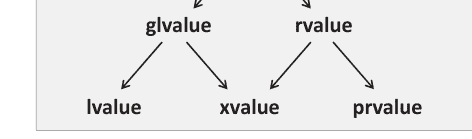
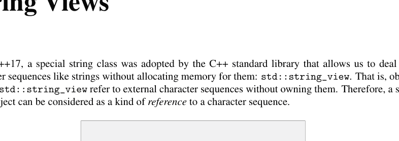

# C++17 完全指南


# 前言

本书在两个方面都是一个实验：

- 我在没有核心语言专家作为合著者的直接帮助下撰写了一本深入介绍语言特性的书籍。然而，我可以提问，而且我确实会提问。
- 我自己在 Leanpub 上出版这本书，并在按需印刷。我是说，这本书是逐步撰写的，我会在有显著改进使其值得出版新版本时尽快发布新版本。

好的一面是：

- 你可以从一位经验丰富的应用程序员那里获得对语言特性的看法——某人会感受到特性可能带来的痛苦，并提出相关问题，以便能够说明设计及其对实践编程的影响。
- 你可以在我仍在学习和写作的同时受益于我对 C++17 的经验。

然而，你也是实验的一部分。所以请帮我：提供关于缺陷、错误、解释不好的特性或空白的反馈，以便我们都能从这些改进中受益。

# 本书版本

由于本书是增量编写的，以下是其“发布”历史记录（最新在前）：

- **2019-12-20**：由于读者的反馈进行了各种小修复
- **2019-09-06**：校对完全完成并处理完毕
- **2019-08-20**：发布首个印刷版本，并根据读者的反馈和校对进行了多项修复和改进
- **2019-08-11**：描述处理信号处理器的保证
- **2019-08-10**：描述与 C11 的兼容性
- **2019-07-07**：描述已移除和已弃用的功能
- **2019-07-06**：字符串视图改进
- **2019-07-04**：描述所有共享指针改进
- **2019-06-28**：各种校对更新和次要修复
- **2019-05-31**：描述 chrono 扩展、noexcept 扩展、constexpr 扩展
- **2019-05-30**：根据反馈和评审进行大量修复
- **2019-05-29**：修复超对齐堆内存等，源于 C++17 培训
- **2019-05-12**：为超对齐堆内存添加“就地删除”
- **2019-05-02**：描述 __cplusplus 的新值
- **2019-04-26**：描述所有新类型特征和 std::invoke()
- **2019-04-24**：描述 std::launder() 问题动机的描述
- **2019-04-24**：关联/无序容器的 merge()
- **2019-04-23**：发布新电子版本，并进行了多项修复和改进
- **2019-04-23**：采用 create_directory() 的标准修复
- **2019-04-22**：(无序) 映射的 try_emplace() 和 insert_or_assign()
- **2019-04-21**：字符串的 data()
- **2019-03-28**：详细记录所有新的（并行）STL 算法
- **2019-03-18**：uncaught_exceptions()
- **2019-03-10**：由于读者反馈进行大量小修复
- **2019-02-14**：accumulate() 与 reduce() 与 transform_reduce()
- **2019-02-12**：for_each_n() 算法
- **2019-02-12**：sample() 算法
- **2019-02-11**：clamp() 实用函数
- **2019-02-03**：执行策略和并行算法列表
- **2019-02-02**：to_chars() 和 from_chars() 的往返支持文档
- **2019-01-11**：并行算法上的新示例和性能测量
- **2018-12-26**：使用 std::variant<> 的多态性
- **2018-12-25**：使用 std::tie() 进行结构化绑定
- **2018-12-24**：描述 Boyer-Moore(-Horspool) 搜索器
- **2018-11-24**：描述通用的 size()、empty()、data()
- **2018-10-14**：发布新电子版本，并进行了多项修复和改进
- **2018-08-14**：添加多态内存资源 (pmr)
- **2018-08-07**：添加 as_const()
- **2018-07-15**：文件系统库章节完全撰写完成
- **2018-05-30**：添加 scoped_lock 和 shared_mutex
- **2018-05-29**：添加 is_always_lock_free() 和硬件干扰大小
- **2018-05-28**：添加带占位符的变量模板
- **2018-05-27**：添加不完整类型的容器支持
- **2018-05-11**：为关联和无序容器添加节点句柄
- **2018-05-11**：文件系统上并行算法的第一个完整支持示例
- **2018-04-04**：开始初步介绍（新的）并行算法
- **2018-04-03**：改进 std::optional<> 以及关于文件系统库的更多内容
- **2018-03-15**：发布新电子版本，并进行了一些小修复
- **2018-01-12**：发布新电子版本，并进行了多项修复和改进
- **2018-01-11**：添加新属性特性
- **2018-01-03**：添加新属性
- **2018-01-02**：添加 new 和 delete 用于超对齐数据
- **2017-12-25**：发布 **新电子版本**，并进行了多项修复和改进
- **2017-12-24**：添加异常规范成为类型的一部分
- **2017-12-23**：添加用于 UTF-8 字符文字的 u8 前缀
- **2017-12-22**：添加十六进制浮点文字
- **2017-12-15**：发布 **首个电子版本**

# 致谢

首先，我要感谢你们，C++ 社区，让这本书成为可能。令人难以置信的新特性设计、有帮助的反馈和好奇心是成功语言演进的基础。特别是，感谢你们告诉我所有的问题并解释它们，以及你们提供的反馈。

我特别要感谢所有审阅过本书草稿或相应幻灯片并提供宝贵反馈和澄清的人。这些评审显著提高了本书的质量，再次证明好东西需要许多“智者”的输入。为此，迄今为止（此列表仍在增长）衷心感谢 Roland Bock、Marshall Clow、Matthew Dodkins、Javier Estrada、Andreas Fertig、Bartlomiej Filipek、Davis Herring、Tom Honermann、Thomas Köppe、Daniel Krügler、Graham Haynes、Austin McCartney、Alex Nash、Billy O’Neal、Paul Reilly、Barry Revzin、Vittorio Romeo、David Sankel、Tim Song、Zachary Turner 和 Tony Van Eerd。

此外，我还要感谢 C++ 社区和 C++ 标准委员会中的每一个人。除了添加新语言和库特性所需的所有工作外，这些专家花费了许多、许多小时耐心而热情地向我解释和讨论他们的工作。

特别感谢 LaTeX 社区提供的出色文本系统，以及 Frank Mittelbach 解决我的 LaTeX 问题（几乎总是我的错）。

最后，衷心感谢我的校对 Tracey Duffy，她出色地将我的“德式英语”改写成了地道的英语。


# 关于本书

C++17 是现代 C++ 编程的下一个演进，其最新版本的 gcc、clang 和 Visual C++ 已至少部分支持。虽然转向 C++17 并非像转向 C++11 那样具有颠覆性，但 C++17 包含大量小型而有价值的语言和库特性，这些特性将再次改变我们用 C++ 编程的方式。这适用于应用程序程序员和提供基础库的程序员。

本书将介绍 C++17 中的所有新语言和库特性。它将通过示例和背景信息介绍每个新特性的动机和上下文。与我以往的书籍一样，重点在于新特性在实践中的应用，本书将演示这些特性如何影响日常编程，以及你如何在项目中受益于它们。

# 阅读本书前应具备的知识

要充分利用本书，你应已熟悉 C++，理想情况下是 C++11 和/或 C++14。然而，你不必是专家。我的目标是让内容对普通 C++ 程序员来说易于理解，而不必一定了解最新特性的所有细节。你应熟悉类和继承的概念，并应能够使用 IOStreams 和 C++ 标准库中的容器等组件编写 C++ 程序。你还应熟悉“现代 C++”的基本特性，例如 auto、decltype、移动语义和 lambda。

尽管如此，随着需要出现，我仍会讨论基本特性并回顾更微妙的问题，即使这些问题与 C++17 没有直接关系。这确保了文本对专家和中级程序员都具有可读性。

请注意，我通常使用现代形式的初始化（在 C++11 中作为统一初始化引入）使用花括号：

```
int i{42};
std::string s{"hello"};
```

这种初始化形式称为列表初始化，其优点是可以用于基本类型、类类型、聚合体（C++17 中扩展）、枚举类型（C++17 中添加）和 auto（C++17 中修复），并且能够检测窄化错误（例如用浮点值初始化 int）。如果大括号为空，则调用（子）对象的默认构造函数，基本数据类型将用 0/false/nullptr 初始化。

# 书籍整体结构

本书涵盖了 C++17 引入的 C++ 的 *所有* 变更。这既适用于语言和库特性，也适用于影响日常应用程序编程的特性和用于（基础）库的复杂实现的特性。然而，更通用的情况和示例通常排在前面。

各章节被分组，但分组没有更深层次的教学理由，只是先介绍语言特性是有意义的，因为它们可能会被后续的库特性使用。原则上，你可以按任意顺序阅读章节。如果不同章节的特性被组合使用，则会有相应的交叉引用。

因此，本书包含以下部分：

- **第一部分** 涵盖新的非模板语言特性。
- **第二部分** 涵盖用于模板泛型编程的新语言特性。
- **第三部分** 介绍新的标准库组件。
- **第四部分** 涵盖对标准库现有组件的扩展和修改。
- **第五部分** 涵盖面向专家（如基础库程序员）的语言和库特性。
- **第六部分** 包含有关 C++17 的一些总结性通用提示。

# 如何阅读本书

根据我的经验，学习新事物的最佳方式是查看示例。因此，你将在全书中找到大量示例。有些只是几行代码，用于说明抽象概念，而另一些则是完整的程序，提供材料的具体应用。后一种示例将由 C++ 注释引入，描述包含程序代码的文件。你可以在本书网站上找到这些文件，网址为 `http://www.cppstd17.com`。

# 错误术语

请注意，我经常谈论编程错误。如果没有特别提示，术语 *error* 或诸如

```
…    // ERROR
```

这样的注释意味着编译时错误。相应的代码不应编译（使用符合标准的编译器）。

如果我使用术语 *runtime error*，程序可能可以编译但行为不正确或导致未定义行为（因此可能或可能不按预期执行）。

> 唯一的例外是原子数据类型（类型 `std::atomic<>`），其中即使列表初始化也不能保证正确初始化。希望这将在 C++20 中得到修复。

# C++17 标准

原始的 C++ 标准于 1998 年发布，随后在 2003 年通过技术勘误进行了修订，对原始标准提供了小的更正和澄清。这个“旧 C++ 标准”被称为 C++98 或 C++03。

“现代 C++”的世界始于 C++11，并通过 C++14 进行了扩展。国际 C++ 标准委员会现在旨在每三年发布一个新标准。显然，这留给大规模添加的时间更少，但它能更快地将变更带给更广泛的编程社区。因此，大型特性的开发需要时间，可能跨越多个标准。

C++17 只是下一步。它不是一场革命，但它带来了大量改进和扩展。

在撰写本书时，C++17 已至少被主要编译器部分支持。然而，与往常一样，编译器在对新语言特性的支持上差异很大。有些编译器可以编译本书中的大部分甚至全部代码，而其他编译器可能只能处理重要子集。然而，我预计这个问题很快就会得到解决，因为世界各地的程序员都在要求其供应商提供标准支持。

# 示例代码和附加信息

你可以通过本书的网站访问所有示例程序并找到有关本书的更多信息，其 URL 如下：

```
http://www.cppstd17.com
```

# 反馈

我欢迎你的建设性意见——无论是负面还是正面。我非常努力地为你带来我希望你会认为是一本优秀的书籍。然而，在某个时刻，我必须停止写作、审阅和调整以“发布新版本”。因此，你可能会发现错误、不一致、可以改进的呈现方式，或完全缺失的主题。你的反馈给了我一个机会来修复这些问题，通过本书网站通知所有读者变更，并改进任何后续修订或版本。

联系我的最佳方式是通过电子邮件。你可以在本书网站上找到电子邮件地址：

```
http://www.cppstd17.com
```

请确保你拥有本书的最新版本（请记住它是以增量方式编写和发布的），并在提供反馈时参考此版本的出版日期。当前出版日期为 2022-01-11（你也可以在第 ii 页找到它，即封面后的页面）。

非常感谢。

此页 intentionally left blank

# 第一部分

# 基础语言特性

本书的这一部分介绍了 C++17 的新核心语言特性，这些特性不是特定于泛型编程（即模板）的。它们对应用程序程序员的日常编程特别有帮助，因此每个使用 C++17 的 C++ 程序员都应该了解它们。

特定于模板编程的核心语言特性在第二部分中介绍。

此页 intentionally left blank

## 第 1 章

## 结构化绑定

结构化绑定允许你使用对象的元素或成员初始化多个实体。

例如，假设你定义了一个具有两个不同成员的结构：

```
struct MyStruct {
    int i = 0;
    std::string s;
};
```

```
MyStruct ms;
```

你可以通过以下声明直接将此结构的成员绑定到新名称：

```
auto [u, v] = ms;
```

这里，名称 u 和 v 被称为结构化绑定。在某种程度上，它们分解了用于初始化传递的对象（在某个时候它们被称为分解声明）。

每种初始化语法都受支持：

```
auto [u2, v2] {ms};
auto [u3, v3] (ms);
```

结构化绑定对于返回结构或数组的函数尤其有用。例如，考虑一个返回结构的函数

```
MyStruct getStruct() {
    return MyStruct{42, "hello"};
}
```

你可以直接将结果分配给两个实体，为返回的数据成员赋予局部名称：

```
auto[id,val] = getStruct(); // id 和 val 为返回结构体的 i 和 s 命名
```

这里，id 和 val 是返回结构体的成员 i 和 s 的名称。它们具有相应的类型，int 和 std::string，可以用作两个不同的对象：

```
if (id > 30) {
    std::cout << val;
}
```


好处是直接访问，并且能够通过将值直接绑定到传达其用途的语义含义的名称，使代码更具可读性。¹

以下代码演示了使用结构化绑定后代码如何显著改进。要在不使用结构化绑定的情况下遍历 `std::map<>` 的元素，你必须编写：

```
for (const auto& elem : mymap) {
    std::cout << elem.first << ": " << elem.second << '\n';
}
```

元素是键和值类型的 `std::pair`，而 `std::pair` 的成员是 `first` 和 `second`，因此你必须使用这些名称来访问键和值。通过使用结构化绑定，代码变得更加可读：

```
for (const auto& [key,val] : mymap) {
    std::cout << key << ": " << val << '\n';
}
```

我们可以直接使用每个元素的键和值成员，使用清楚地展示其语义含义的名称。

### 1.1 结构化绑定的详细说明

为了理解结构化绑定，重要的是要意识到其中涉及一个隐藏的匿名变量。作为结构化绑定引入的新名称引用的是该匿名变量的成员/元素。

#### 绑定到匿名实体

初始化

```
auto [u,v] = ms;
```

的确切行为就好像我们用 `ms` 初始化了一个新的实体 `e`，并让结构化绑定 `u` 和 `v` 成为该新对象的成员的别名名称，类似于定义：

```
auto e = ms;
aliasname u = e.i;
aliasname v = e.s;
```

这意味着 `u` 和 `v` 只是 `ms` 的本地副本的成员的另一个名称。然而，我们没有 `e` 的名称，这意味着我们无法直接通过名称访问已初始化的实体。请注意 `u` 和 `v` 并不是分别引用 `e.i` 和 `e.s`。`decltype(u)` 是成员 `i` 的类型，`decltype(v)` 是成员 `s` 的类型。

因此，

```
std::cout << u << ' ' << v << '\n';
```

打印 `e.i` 和 `e.s` 的值，它们是 `ms.i` 和 `ms.s` 的副本。

> ¹ 感谢 Zachary Turner 指出这一点。

`e` 存在的时间与绑定到它的结构化绑定存在的时间一样长。因此，当结构化绑定超出作用域时，它将被销毁。

作为后果，除非使用引用，否则修改用于初始化的值不会影响由结构化绑定初始化的名称，反之亦然：

```
MyStruct ms{42,"hello"};
auto [u,v] = ms;
ms.i = 77;
std::cout << u;      // 打印 42
u = 99;
std::cout << ms.i;   // 打印 77
```

`u` 和 `ms.i` 也有不同的地址。

使用结构化绑定返回值的原理也适用。诸如

```
auto [u,v] = getStruct();
```

的初始化就好像我们用 `getStruct()` 的返回值初始化了一个新的实体 `e`，使得结构化绑定 `u` 和 `v` 成为 `e` 的两个成员/元素的别名名称，类似于定义：

```
auto e = getStruct();
aliasname u = e.i;
aliasname v = e.s;
```

也就是说，结构化绑定绑定到一个新实体，该实体由返回值初始化，而不是直接绑定到返回值。

对于匿名实体 `e` 的类型，通常的布局保证适用。结构化绑定与它们绑定的相应成员一样对齐。

#### 使用限定符

我们可以使用限定符，例如 `const` 和引用。同样，这些限定符整体应用于匿名实体 `e`。通常，其效果类似于直接将限定符应用于结构化绑定，但请注意这并不总是如此，请参见下文。

例如，我们可以声明对 `const` 引用的结构化绑定：

```
const auto& [u,v] = ms;   // 一个引用，因此 u/v 引用 ms.i/ms.s
```

这里，匿名实体被声明为 `const` 引用，这意味着 `u` 和 `v` 是对 `ms` 的 `const` 引用的初始化的成员 `i` 和 `s` 的名称。作为后果，对 `ms` 成员的任何更改都会影响 `u` 和/或 `v` 的值。

```
ms.i = 77;               // 影响 u 的值
std::cout << u;           // 打印 77
```

声明为非 `const` 引用时，你甚至可以修改用于初始化的对象/值 的成员：

```
MyStruct ms{42,"hello"};
auto& [u,v] = ms;         // 已初始化的实体是对 ms 的引用
ms.i = 77;                // 影响 u 的值
std::cout << u;           // 打印 77
```

```
u = 99;                 // 修改 ms.i
std::cout << ms.i;      // 打印 99
```

如果用于初始化结构化绑定引用的值是一个临时对象，则与通常情况一样，临时对象的生命周期会延长到绑定结构的生命周期：

```
MyStruct getStruct();
...
const auto& [a,b] = getStruct();
std::cout << "a: " << a << '\n';    // OK
```

#### 限定符不一定适用于结构化绑定

如所写，限定符应用于新的匿名实体。它们不一定适用于作为结构化绑定引入的新名称。事实上，在

```
const auto& [u,v] = ms;  // 一个引用，因此 u/v 引用 ms.i/ms.s
```

之后，`u` 和 `v` 都不是被声明为引用。这只指定匿名实体 `e` 是一个引用。`u` 和 `v` 具有 `ms` 的成员的类型，但这些成员在这里都变为 `const` 了，就像你不能修改作为常量引用传递的对象的成员一样。以我们的初始声明为例，这意味着 `decltype(u)` 是 `const int`，`decltype(v)` 是 `const std::string`。

这在指定对齐时也会产生差异：

```
alignas(16) auto [u,v] = ms;  // 对齐对象，而不是 v
```

这里，我们对齐已初始化的匿名实体，而不是结构化绑定 `u` 和 `v`。这意味着作为第一个成员的 `u` 被强制对齐到 16，而 `v` 则不是。

出于同样的原因，即使使用 `auto`，结构化绑定也不会衰减。例如，如果我们有一个原始数组的结构：

```
struct S {
    const char x[6];
    const char y[3];
};
```

那么在

```
S s1{};
auto [a, b] = s1;   // a 和 b 获取确切的成员类型
```

之后，`a` 的类型仍然是 `const char[6]`。再次，`auto` 应用于匿名实体，整体上不会衰减。这与使用 `auto` 初始化新对象不同，在那里类型会衰减：

```
auto a2 = a;        // a2 获取 a 的衰减类型
```

#### 移动语义

移动语义按照刚刚介绍的规则得到支持。在以下声明中：

```
MyStruct ms = { 42, "Jim" };
auto&& [v,n] = std::move(ms);            // 实体是对 ms 的右值引用
```

结构化绑定 `v` 和 `n` 引用一个匿名实体，该实体是对 `ms` 的右值引用，而 `ms` 仍然保留其值：

```
std::cout << "ms.s: " << ms.s << '\n';  // 打印 "Jim"
```

然而，你可以移动赋值 `n`，它引用 `ms.s`：

```
std::string s = std::move(n);           // 将 ms.s 移动到 s
std::cout << "ms.s: " << ms.s << '\n';   // 打印未指定的值
std::cout << "n:    " << n << '\n';      // 打印未指定的值
std::cout << "s:    " << s << '\n';      // 打印 "Jim"
```

与往常一样，被移动的对象处于有效状态但具有未指定的值。因此，打印值是可以的，但不能对打印的内容做出任何假设。

这与使用 `ms` 的移动值初始化新实体略有不同：

```
MyStruct ms = { 42, "Jim" };
auto [v,n] = std::move(ms);              // 使用来自 ms 的移动值初始化的新实体
```

这里，已初始化的匿名实体是一个使用来自 `ms` 的移动值初始化的新对象。因此，`ms` 已经丢失了其值：

```
std::cout << "ms.s: " << ms.s << '\n';  // 打印未指定的值
std::cout << "n:    " << n << '\n';      // 打印 "Jim"
```

你仍然可以移动赋值 `n` 的值或在那里赋予新值，但这不会影响 `ms.s`：

```
std::string s = std::move(n);           // 将 n 移动到 s
n = "Lara";
std::cout << "ms.s: " << ms.s << '\n';  // 打印未指定的值
std::cout << "n:    " << n << '\n';      // 打印 "Lara"
std::cout << "s:    " << s << '\n';      // 打印 "Jim"
```

### 1.2 结构化绑定可以使用的位置

原则上，结构化绑定可用于具有公共数据成员的结构、原始 C 风格数组和“类 tuple 对象”：

- 对于 **结构和类**，其中所有非静态数据成员都是公共的，你可以将每个非静态数据成员绑定到恰好一个名称。
- 对于 **原始数组**，你可以将名称绑定到数组的每个元素。
- 对于任何类型，你可以使用 **类 tuple API** 将名称绑定到 API 定义的“元素”。对于类型 *type*，API 大致要求以下组件：


+   - std::tuple_size<type>::value 必须返回元素的数量。
+   - std::tuple_element<idx,type>::type 必须返回第 idx 个元素的类型。
+   - 全局或成员 get<idx>() 必须产生第 idx 个元素的值。

标准库类型 std::pair<>, std::tuple<>, 和 std::array<> 是提供此 API 的类型的示例。

如果结构或类提供了类似元组的 API，则会使用该 API。

在所有情况下，元素的数量或数据成员的数量必须与结构化绑定声明中的名称数量匹配。你不能跳过一个名称，也不能重复使用一个名称。然而，你可以使用非常短的名称例如 '_'（有些程序员喜欢但其他人讨厌，并且在全局命名空间中不允许），但这在同一作用域内只能使用一次：

```
auto [_,val1] = getStruct(); // OK
auto [_,val2] = getStruct(); // ERROR: name _ already used
```

不支持嵌套或非平坦分解。

下一小节将详细介绍结构化绑定的所有这些用法。

#### 1.2.1 结构和类

上面各节中结构化绑定的介绍性示例已经描述了一些用于具有公共成员的结构和类的简单用法。典型的应用是直接使用存储在一个数据结构中的多个返回值（例如，参见用于节点句柄的 insert()）。然而，有一些边缘情况需要注意。

请注意，仅能有限地使用继承。所有非静态数据成员必须是同一类定义中的成员（因此，它们必须是类型的直接成员或同一无歧义公共基类的成员）：

```
struct B {
    int a = 1;
    int b = 2;
};

struct D1 : B {
};
auto [x, y] = D1{};      // OK

struct D2 : B {
    int c = 3;
};
auto [i, j, k] = D2{};   // compile-time ERROR
```

请注意，你只有在其顺序得到保证稳定的情况下才应对公共成员使用结构化绑定。否则，如果 B 内部 int a 和 int b 的顺序发生变化，x 和 y 突然会被不同的值初始化。为了支持这种稳定性，C++17 为某些标准库结构定义了成员的顺序（例如，insert_return_type）。

不允许对联合使用结构化绑定。

#### 1.2.2 原始数组

以下代码使用原始 C 风格数组的两个元素初始化 x 和 y：

```
int arr[] = { 47, 11 };
auto [x, y] = arr;  // x and y are the int elems of a copy of arr
auto [z] = arr;    // ERROR: number of elements doesn't fit
```

请注意，这是 C++ 中少数几个按值复制原始数组的地方之一。

初始化只有在数组仍具有已知大小时才可能。对于按值作为参数传递的数组，这是不可能的，因为数组会衰减为相应的指针类型。

请注意，C++ 允许我们通过引用返回带大小的数组，因此此特性也适用于返回数组的函数，前提是数组的大小是返回类型的一部分：

```
auto getArr() -> int(&)[2];  // getArr() returns reference to raw int array
...
auto [x, y] = getArr();      // x and y are the int elems of a copy of the returned array
```

你也可以对 std::array 使用结构化绑定，它使用下一节中描述的类似元组的 API。

#### 1.2.3 std::pair, std::tuple, 和 std::array

结构化绑定机制是可扩展的，这意味着你可以为任何类型添加对结构化绑定的支持。标准库将其用于 std::pair<>, std::tuple<>, 和 std::array<>。

##### std::array

例如，以下代码将 a、b、c 和 d 初始化为 getArray() 返回的 std::array<> 的四个元素的别名名称：

```
std::array<int,4> getArray();
...
auto [a,b,c,d] = getArray();  // a,b,c,d name the 4 elements of the copied return value
```

这里，a、b、c 和 d 是对 getArray() 返回的 std::array 的元素的结构化绑定。

也支持写访问，前提是初始化的值不是临时返回值并且我们使用非 const 引用。例如：

```
std::array<int,4> stdarr { 1, 2, 3, 4 };
...
auto& [a,b,c,d] = stdarr;
a += 10;                  // OK: modifies stdarr[0]

const auto& [e,f,g,h] = stdarr;
e += 10;                  // ERROR: reference to constant object

auto&& [i,j,k,l] = stdarr;
i += 10;                  // OK: modifies stdarr[0]
```

```
auto [m,n,o,p] = stdarr;
 m += 10;    // OK: but modifies copy of stdarr[0]
```

然而，和往常一样，我们不能从临时对象（prvalue）初始化非 const 引用：

```
auto& [a,b,c,d] = getArray();  // ERROR
```

##### std::tuple

以下代码将 a、b 和 c 初始化为 getTuple() 返回的 std::tuple<> 的三个元素的别名名称：

```
std::tuple<char,float,std::string> getTuple();
...
auto [a,b,c] = getTuple();    // a,b,c have types and values of returned tuple
```

也就是说，a 得到类型 char，b 得到类型 float，c 得到类型 std::string。

##### std::pair

作为另一个示例，处理对关联/无序容器调用 insert() 的返回值的代码

```
std::map<std::string, int> coll;
```

可以通过避免使用结果 std::pair<> 对象中的通用名称 first 和 second 来使其更易读：

```
auto ret = coll.insert({"new",42});
if (!ret.second){
    // if insertion failed, handle error using iterator ret.first
    ...
}
```

而是绑定到传达其用途语义含义的名称：

```
auto [pos,ok] = coll.insert({"new",42});
if (!ok) {
    // if insertion failed, handle error using iterator pos:
    ...
}
```

请注意，在这种特定情况下，C++17 提供了使用带初始化器的 if 进一步改进此方法的方法。

#### 为 pair 和 tuple 分配新值给结构化绑定

声明结构化绑定后，通常你不能一起修改所有绑定，因为结构化绑定只能声明而不能一起使用。然而，如果分配的值可以分配给 std::pair<> 或 std::tuple<>，你可以使用 std::tie()。
也就是说，你可以实现以下操作：

```
std::tuple<char,float,std::string> getTuple();
```

```
auto [a,b,c] = getTuple();    // a,b,c have types and values of returned tuple
std::tie(a,b,c) = getTuple();  // a,b,c get values of next returned tuple
```

特别是，这可用于实现处理返回一对值的循环，例如在使用循环中的搜索器时：

```
std::boyer_moore_searcher bmsearch{sub.begin(), sub.end()};
for (auto [beg, end] = bmsearch(text.begin(), text.end());
    beg != text.end();
    std::tie(beg,end) = bmsearch(end, text.end())) {
    ...
}
```

### 1.3 为结构化绑定提供类似元组的 API

你可以通过提供类似元组的 API 为任何类型添加对结构化绑定的支持，就像标准库为 std::pair<>, std::tuple<>, 和 std::array<> 所做的那样。

#### 启用只读结构化绑定

以下示例演示了如何为类型 Customer 启用结构化绑定，该类型可能定义如下：

lang/customer1.hpp

```
#include <string>
#include <utility>  // for std::move()

class Customer {
private:
    std::string first;
    std::string last;
    long val;
public:
    Customer (std::string f, std::string l, long v)
        : first{std::move(f)}, last{std::move(l)}, val{v} {
    }
    std::string getFirst() const {
        return first;
    }
    std::string getLast() const {
        return last;
    }
    long getValue() const {
```

```
    return val;
}
};
```

我们可以按如下方式提供类似元组的 API：

lang/structbind1.hpp

```
#include "customer1.hpp"
#include <utility>  // for tuple-like API

// provide a tuple-like API for class Customer for structured bindings:
template<>
struct std::tuple_size<Customer> {
    static constexpr int value = 3;    // we have 3 attributes
};

template<>
struct std::tuple_element<2, Customer> {
    using type = long;                 // last attribute is a long
};
template<std::size_t Idx>
struct std::tuple_element<Idx, Customer> {
    using type = std::string;          // the other attributes are strings
};

// define specific getters:
template<std::size_t> auto get(const Customer& c);
template<> auto get<0>(const Customer& c) { return c.getFirst(); }
template<> auto get<1>(const Customer& c) { return c.getLast(); }
template<> auto get<2>(const Customer& c) { return c.getValue(); }
```

这里，我们为客户的三个属性定义了类似元组的 API，我们本质上将其映射到客户的三个 getter（任何其他用户定义的映射都是可能的）：

- 第一个名字作为 std::string
- 姓氏作为 std::string
- 值作为 long

属性的数量定义为 type Customer 的 std::tuple_size 的特化：

```
template<>
struct std::tuple_size<Customer> {
    static constexpr int value = 3;    // we have 3 attributes
};
```

属性的类型定义为 std::tuple_element 的特化：

```
template<>
```


```
struct std::tuple_element<2, Customer> {
    using type = long;            // last attribute is a long
};
template<std::size_t Idx>
struct std::tuple_element<Idx, Customer> {
    using type = std::string;     // the other attributes are strings
};
```

第三个属性的类型为 `long`，以索引 2 的全特化形式指定。其他属性的类型为 `std::string`，以偏特化的形式指定（偏特化的优先级低于全特化）。这里指定的类型就是 `decltype` 对结构化绑定所推导出的类型。

最后，我们定义相应的 getter，作为与类型 `Customer` 位于同一命名空间中的函数 `get<>()` 的重载：

```
template<std::size_t> auto get(const Customer& c);
template<> auto get<0>(const Customer& c) { return c.getFirst(); }
template<> auto get<1>(const Customer& c) { return c.getLast(); }
template<> auto get<2>(const Customer& c) { return c.getValue(); }
```

在这种情况下，我们有一个主函数模板声明，以及针对所有情况的完全特化。

请注意，函数模板的所有完全特化必须使用相同的签名（包括完全相同的返回类型）。这是因为我们只提供了具体的“实现”，而不是新的声明。下面这段代码将无法编译：

```
template<std::size_t> auto get(const Customer& c);
template<> std::string get<0>(const Customer& c) { return c.getFirst(); }
template<> std::string get<1>(const Customer& c) { return c.getLast(); }
template<> long get<2>(const Customer& c) { return c.getValue(); }
```

通过使用新的编译期 if 特性，我们可以将 `get<>()` 的实现合并到一个函数中：

```
template<std::size_t I> auto get(const Customer& c) {
    static_assert(I < 3);
    if constexpr (I == 0) {
        return c.getFirst();
    }
    else if constexpr (I == 1) {
        return c.getLast();
    }
    else { // I == 2
        return c.getValue();
    }
}
```

有了这个 API，我们可以对 `Customer` 类型的对象使用结构化绑定，如下所示：

`lang/structbind1.cpp`

```
#include "structbind1.hpp"
#include <iostream>

int main()
{
    Customer c{"Tim", "Starr", 42};

    auto [f, l, v] = c;

    std::cout << "f/l/v:    " << f << ' ' << l << ' ' << v << '\n';

    // modify structured bindings:
    std::string s{std::move(f)};
    l = "Waters";
    v += 10;
    std::cout << "f/l/v:    " << f << ' ' << l << ' ' << v << '\n';
    std::cout << "c:        " << c.getFirst() << ' '
              << c.getLast() << ' ' << c.getValue() << '\n';
    std::cout << "s:        " << s << '\n';
}
```

使用如下初始化：

```
auto [f,l,v] = c;
```

和通常一样，`Customer` 对象 `c` 会被拷贝到一个隐藏的匿名实体中。当结构化绑定超出作用域时，该实体被销毁。

此外，对于每个结构化绑定 `f`、`l` 和 `v`，会调用其 `get<>()` 函数，从而调用 `Customer` 类型的相应 getter。由于 `get<>()` 的返回类型是 `auto`，这些 getter 返回成员的副本，这意味着结构化绑定的地址与所创建的 `c` 的副本地址不同。因此，在结构化绑定初始化之后，修改 `c` 对它们没有影响（反之亦然）。

使用结构化绑定就等同于使用 `get<>()` 返回的值。因此：

```
std::cout << "f/l/v:    " << f << ' ' << l << ' ' << v << '\n';
```

仅仅输出这些值（不会再次调用 getter）。而

```
std::string s{std::move(f)};
l = "Waters";
v += 10;
std::cout << "f/l/v:    " << f << ' ' << l << ' ' << v << '\n';
```

上述代码修改了结构化绑定，因为这些绑定已被初始化为 `std::string` 和 `long`。

因此，该程序通常输出如下：

```
f/l/v:      Tim Starr 42
f/l/v:      Waters 52
c:      Tim Starr 42
s:      Tim
```

第二行的输出取决于被移动后的字符串（moved-from string）的值，它通常为空字符串，但也可能是任何其他有效的字符串值。

使用这些结构化绑定，你还可以遍历 vector 中的 `Customer` 元素：

```
std::vector<Customer> coll;
...
for (const auto& [first, last, val] : coll) {
    std::cout << first << ' ' << last << ": " << val << '\n';
}
```

在循环内部，由于使用了 `const auto&`，不会拷贝任何 Customer 对象。然而，结构化绑定的初始化会通过 `get<>()` 调用 getter，返回名和姓的副本。然后在循环体内，只是使用已初始化绑定的值，而不会再次调用 getter。每次迭代结束时，拷贝的字符串会被析构。

请注意，结构化绑定的 `decltype` 仍然会得到其自身的类型，而不是其背后的匿名实体的类型。这意味着在这里，`decltype(first)` 是 `const std::string`，而不是引用。

#### 启用具有写访问权限的结构化绑定

类 tuple API 可以使用返回非 const 引用的函数。这使得结构化绑定支持写访问。假设 `Customer` 类提供了一个读写其成员的 API：

`lang/customer2.hpp`

```
#include <string>
#include <utility> // for std::move()

class Customer {
private:
    std::string first;
    std::string last;
    long val;
public:
    Customer (std::string f, std::string l, long v)
    : first{std::move(f)}, last{std::move(l)}, val{v} {
    }
    const std::string& firstname() const {
        return first;
    }
    std::string& firstname() {
        return first;
    }
    const std::string& lastname() const {
        return last;
    }
    std::string& lastname() {
        return last;
    }
    long value() const {
        return val;
    }
    long& value() {
        return val;
    }
};
```

为了实现读写访问，我们必须为常量引用和非常量引用重载 getter：

`lang/structbind2.hpp`

```
#include "customer2.hpp"
#include <utility>  // for tuple-like API

// provide a tuple-like API for class Customer for structured bindings:
template<>
struct std::tuple_size<Customer> {
    static constexpr int value = 3;    // we have 3 attributes
};

template<>
struct std::tuple_element<2, Customer> {
    using type = long;                 // last attribute is a long
};
template<std::size_t Idx>
struct std::tuple_element<Idx, Customer> {
    using type = std::string;          // the other attributes are strings
};

// define specific getters:
template<std::size_t I> decltype(auto) get(Customer& c) {
    static_assert(I < 3);
    if constexpr (I == 0) {
        return c.firstname();
    }
    else if constexpr (I == 1) {
        return c.lastname();
    }
    else { // I == 2
        return c.value();
    }
}
template<std::size_t I> decltype(auto) get(const Customer& c) {
    static_assert(I < 3);
    if constexpr (I == 0) {
        return c.firstname();
    }
    else if constexpr (I == 1) {
        return c.lastname();
    }
    else { // I == 2
        return c.value();
    }
}
template<std::size_t I> decltype(auto) get(Customer&& c) {
    static_assert(I < 3);
    if constexpr (I == 0) {
        return std::move(c.firstname());
    }
    else if constexpr (I == 1) {
        return std::move(c.lastname());
    }
    else { // I == 2
        return c.value();
    }
}
```

请注意，你应该提供全部三个重载，以便能够处理常量、非常量和可移动对象。⁶ 要使返回值成为引用，你应该使用 `decltype(auto)`。⁷

同样，我们使用新的编译期 if 特性，这使得在 getter 返回不同类型时实现变得简单。如果没有这个特性，我们又需要完全特化，例如：

```
template<std::size_t> decltype(auto) get(const Customer& c);
template<std::size_t> decltype(auto) get(Customer& c);
template<std::size_t> decltype(auto) get(Customer&& c);
template<> decltype(auto) get<0>(const Customer& c) { return c.firstname(); }
template<> decltype(auto) get<0>(Customer& c) { return c.firstname(); }
```

⁶ 标准库为 `const&&` 提供了第四个 `get<>()` 重载，这是出于其他原因提供的（参见 http://wg21.link/lwg2485），不一定是为了支持结构化绑定。

⁷ `decltype(auto)` 是在 C++14 中引入的，允许（返回）类型根据表达式的值类别推导。大致来说，将它用作返回类型时，引用会按引用返回，而临时量会按值返回。


```
template<> decltype(auto) get<0>(Customer&& c) {
    return std::move(c.firstname()); }
template<> decltype(auto) get<1>(const Customer& c) { return c.lastname(); }
template<> decltype(auto) get<1>(Customer& c) { return c.lastname(); }
...
```

再次，注意主函数模板声明和完全特化必须具有相同的签名（包括相同的返回类型）。以下代码无法编译：

```
template<std::size_t> decltype(auto) get(Customer& c);
template<> std::string& get<0>(Customer& c) { return c.firstname(); }
template<> std::string& get<1>(Customer& c) { return c.lastname(); }
template<> long& get<2>(Customer& c) { return c.value(); }
```

现在你可以使用结构化绑定来读取和修改 Customer 的成员：

lang/structbind2.cpp

```
#include "structbind2.hpp"
#include <iostream>

int main()
{
    Customer c{"Tim", "Starr", 42};
    auto [f, l, v] = c;
    std::cout << "f/l/v:    " << f << ' ' << l << ' ' << v << '\n';

    // modify structured bindings via references:
    auto&& [f2, l2, v2] = c;
    std::string s{std::move(f2)};
    f2 = "Ringo";
    v2 += 10;
    std::cout << "f2/l2/v2: " << f2 << ' ' << l2 << ' ' << v2 << '\n';
    std::cout << "c:        " << c.firstname() << ' '
              << c.lastname() << ' ' << c.value() << '\n';
    std::cout << "s:        " << s << '\n';
}
```

该程序的输出如下：

```
f/l/v:      Tim Starr 42
f2/l2/v2: Ringo Starr 52
c:          Ringo Starr 52
s:          Tim
```

### 1.4 Afternotes

结构化绑定最初由 Herb Sutter、Bjarne Stroustrup 和 Gabriel Dos Reis 在 http://wg21.link/p0144r0 中提出，使用大括号而不是方括号。最终被接受的该特性的措辞由 Jens Maurer 在 http://wg21.link/p0217r3 中制定。

## Chapter 2: if and switch with Initialization

if 和 switch 控制结构现在允许我们在通常的条件或选择子句之前指定一个初始化子句。

例如，你可以写：

```
if (status s = check(); s != status::success) {
    return s;
}
```

其中初始化

```
status s = check();
```

初始化 s，后者对整个 if 语句有效（包括可选的 else 部分）。

### 2.1 if with Initialization

在 if 语句内部初始化的任何值都有效直到 then 部分和 else 部分（如果存在）的末尾。例如：

```
if (std::ofstream strm = getLogStrm(); coll.empty()) {
    strm << "<no data>\n";
}
else {
    for (const auto& elem : coll) {
        strm << elem << '\n';
    }
}
// strm no longer declared
```

strm 的析构函数在整个 if 语句结束时被调用（如果有则在 else 部分结束时，否则在 then 部分结束时）。

另一个例子是在执行某些任务时使用锁，具体取决于条件：

```
if (std::lock_guard<std::mutex> lg{collMutex}; !coll.empty()) {
    std::cout << coll.front() << '\n';
}
```

由于类模板参数推导，现在也可以写成：

```
if (std::lock_guard lg{collMutex}; !coll.empty()) {
    std::cout << coll.front() << '\n';
}
```

无论如何，这段代码等价于：

```
{
    std::lock_guard<std::mutex> lg{collMutex};
    if (!coll.empty()) {
        std::cout << coll.front() << '\n';
    }
}
```

唯一的区别是 lg 在 if 语句的作用域中定义，因此条件在同一作用域（声明区域）中。

请注意，此特性与传统 for 循环的初始化语句的工作方式相同。为了使保护生效，初始化器需要声明一个名称的变量。否则，初始化本身就是一个表达式，它会创建并立即销毁一个临时对象。因此，以无名方式初始化锁保护是一个逻辑错误，因为在检查条件时保护将不再锁定：

```
if (std::lock_guard<std::mutex>{collMutex}; // runtime ERROR:
    !coll.empty()) {                 // - no longer locked
    std::cout << coll.front() << '\n'; // - no longer locked
}
```

原则上，单个 _ 作为名称就足够了（有些程序员喜欢但其他人讨厌，并且在全局命名空间中不允许）：

```
if (std::lock_guard<std::mutex> _{collMutex}; // OK, but...
    !coll.empty()) {
    std::cout << coll.front() << '\n';
}
```

你可以有多个声明并带有可选的初始化：

```
if (auto x = qqq1(), y = qqq2(); x != y) {
    std::cout << "return values " << x << " and " << y << " differ\n";
}
```

或：

```
if (auto x{qqq1()}, y{qqq2()}; x != y) {
    std::cout << "return values " << x << " and " << y << " differ\n";
}
```

作为另一个例子，考虑向 map 或 unordered map 插入新元素。你可以按如下方式检查是否成功：

```
std::map<std::string, int> coll;
...
if (auto [pos,ok] = coll.insert({"new",42}); !ok) {
    // if insert failed, handle error using iterator pos:
    const auto& [key,val] = *pos;
    std::cout << "already there: " << key << '\n';
}
```

这里，我们还使用结构化绑定为返回值和返回位置 pos 处的元素提供有用的名称，而不是仅仅使用 first 和 second。在 C++17 之前，对应的检查必须表述如下：

```
auto ret = coll.insert({"new",42});
if (!ret.second){
    // if insert failed, handle error using iterator ret.first
    const auto& elem = *(ret.first);
    std::cout << "already there: " << elem.first << '\n';
}
```

请注意，该扩展也适用于新的编译时 if 特性。

### 2.2 switch with Initialization

使用带初始化的 switch 语句允许我们在制定决定控制流继续位置的条件之前为 switch 的作用域初始化一个对象/实体。

例如，我们可以在处理其类别之前初始化一个文件系统路径：

```
namespace fs = std::filesystem;
...
switch (fs::path p{name}; status(p).type()) {
    case fs::file_type::not_found:
        std::cout << p << " not found\n";
        break;
    case fs::file_type::directory:
        std::cout << p << ":\n";
        for (const auto& e : std::filesystem::directory_iterator{p}) {
            std::cout << "- " << e.path() << '\n';
        }
        break;
    default:
        std::cout << p << " exists\n";
        break;
}
```

这里，初始化的路径 p 可以在整个 switch 语句中使用。

### 2.3 Afternotes

if 和 switch with initialization 最初由 Thomas Köppe 在 http://wg21.link/p0305r0 中提出，最初仅扩展 if 语句。最终被接受的措辞由 Thomas Köppe 在 http://wg21.link/p0305r1 中制定。

## Chapter 3: Inline Variables

为了可移植性和易于集成，通常有意义提供完全包含在头文件中的类和库。然而，直到 C++17，这只有在不需要或不提供此类库的全局变量/对象时才有可能。

自 C++17 起，你可以在头文件中将变量/对象定义为 inline：

```
class MyClass {
    inline static std::string msg{"OK"};  // OK since C++17
    ...
};
```

```
inline MyClass myGlobalObj;  // OK even if included/defined by multiple CPP files
```

不需要在某个翻译单元中进一步定义，如果该定义被多个翻译单元使用，它们都引用同一个唯一对象。

### 3.1 Motivation for Inline Variables

在 C++ 中，在类结构内部初始化非 const 静态成员是不允许的：

```
class MyClass {
    static std::string msg{"OK"};  // compile-time ERROR
    ...
};
```

如果该定义是被多个 CPP 文件包含的头文件的一部分，则在类结构外部定义变量也是错误的：

```
class MyClass {
    static std::string msg;
    ...
};
std::string MyClass::msg{"OK"};  // Link ERROR if included by multiple CPP files
```


根据单一定义规则（ODR），一个变量或实体必须在恰好一个翻译单元中被定义——除非该变量或实体被声明为内联。

即使使用包含保护也不起作用：

```
#ifndef MYHEADER_HPP
#define MYHEADER_HPP

class MyClass {
    static std::string msg;
    ...
};
std::string MyClass::msg{"OK"};    // Link ERROR if included by multiple CPP files

#endif
```

问题不在于头文件可能会被多次包含；问题在于两个不同的 CPP 文件都包含了该头文件，从而导致两者都定义了 MyClass::msg。

出于同样的原因，如果你在头文件中定义了类的对象，也会得到链接错误：

```
class MyClass {
    ...
};
MyClass myGlobalObject;            // Link ERROR if included by multiple CPP files
```

#### Workarounds

对于某些情况，存在变通方法：

- 你可以在类/struct 中初始化整型和枚举类型的 static const 数据成员：

```
class MyClass {
    static const bool trace = false;  // OK, literal type
    ...
};
```

然而，这仅允许用于字面量类型，例如基本整型、浮点型或指针类型，或仅用常量表达式初始化非静态数据成员且没有用户定义或虚析构函数的类。此外，一旦你需要成员的位置（例如将其绑定到引用），你仍需要在一个翻译单元中提供定义。

- 你可以定义一个返回静态局部变量的内联函数：

```
inline std::string& getMsg() {
    static std::string msg{"OK"};
    return msg;
}
```

- 你可以定义一个返回值的静态成员函数：

```
class MyClass {
    static std::string& getMsg() {
        static std::string msg{"OK"};
        return msg;
    }
    ...
};
```

- 你可以使用变量模板（自 C++14 起）：

```
template<typename T = std::string>
T myGlobalMsg{"OK"};
```

- 你可以为静态成员定义一个类模板：

```
template<typename = void>
class MyClassStatics
{
    static std::string msg;
};

template<typename T>
std::string MyClassStatics<T>::msg{"OK"};
```

然后甚至可以从它派生：

```
class MyClass : public MyClassStatics<>
{
    ...
};
```

然而，所有这些方法都会导致显著的开销、可读性降低和/或使用全局变量的不同方式。此外，全局变量的初始化可能会推迟到首次使用时，这会禁用在程序启动时初始化对象的应用（例如使用对象来监控进程）。

### 3.2 Using Inline Variables

现在，有了 inline，你可以通过仅在头文件中定义它来拥有一个全局可用的对象，而该头文件可能会被多个 CPP 文件包含：

```
class MyClass {
    inline static std::string msg{"OK"};  // OK since C++17
    ...
};
```

```
inline MyClass myGlobalObj;  // OK even if included/defined by multiple CPP files
```

形式上，这里使用的 inline 与声明为 inline 的函数具有相同的语义：

- 它可以在多个翻译单元中被定义，前提是所有定义都相同。
- 它必须在每个使用它的翻译单元中被定义。

两者都通过从同一个头文件包含定义来实现。 resulting 程序的行为就好像只有一个变量一样。

### 3.3 constexpr Now Implies inline for Static Members

对于静态数据成员，constexpr 现在意味着 inline，因此自 C++17 起，以下声明定义了静态数据成员 n：

```
struct D {
    static constexpr int n = 5; // C++11/C++14: declaration
    // since C++17: definition
};
```

也就是说，它等同于：

```
struct D {
    inline static constexpr int n = 5;
};
```

请注意，在 C++17 之前，你通常只需要声明而不需要对应的定义。考虑以下声明：

```
struct D {
    static constexpr int n = 5;
};
```

如果不需要 D::n 的定义，这就足够了，而在 D::n 仅按值传递时就是这种情况：

```
std::cout << D::n; // OK (ostream::operator<<(int) gets D::n by value)
```

如果 D::n 按引用传递给非内联函数和/或调用未被优化掉，则这是无效的。例如：

```
int twice(const int& i);
std::cout << twice(D::n);    // was often an ERROR
```

此代码违反了单一定义规则（ODR）。使用优化编译器构建时，它可能按预期工作，也可能因缺少定义而给出链接错误。使用无优化构建时，它几乎肯定会被拒绝，因为缺少 D::n 的定义。¹ 创建指向静态成员的指针更可能导致因缺少定义而链接错误（但在某些编译器模式下仍可能工作）：

```
const int* p = &D::n;          // was usually an ERROR
```

因此，在 C++17 之前，你必须在恰好一个翻译单元中定义 D::n：

```
constexpr int D::n;            // C++11/C++14: definition
                               // since C++17: redundant declaration (deprecated)
```

现在，使用 C++17 构建时，类内部的声明本身就是一个定义，因此上述所有示例现在在没有前述定义的情况下都是有效的。前述定义仍然有效，但是一个已弃用的冗余声明。

### 3.4 Inline Variables and thread_local

通过使用 thread_local，你还可以使一个内联变量对每个线程唯一：

```
struct ThreadData {
    inline static thread_local std::string name;      // unique name per thread
    ...
};

inline thread_local std::vector<std::string> cache;   // one cache per thread
```

作为一个完整示例，考虑以下头文件：

`lang/inlinethreadlocal.hpp`

```
#include <string>
#include <iostream>

struct MyData {
    inline static std::string gName = "global";          // unique in program
    inline static thread_local std::string tName = "tls"; // unique per thread
    std::string lName = "local";                          // for each object
    ...
    void print(const std::string& msg) const {
        std::cout << msg << '\n';
        std::cout << "- gName: " << gName << '\n';
        std::cout << "- tName: " << tName << '\n';
        std::cout << "- lName: " << lName << '\n';
    }
};

inline thread_local MyData myThreadData;  // one object per thread
```

你可以在包含 main() 的翻译单元中使用它：

`lang/inlinethreadlocal1.cpp`

```
#include "inlinethreadlocal.hpp"
#include <thread>

void foo();

int main()
{
    myThreadData.print("main() begin:");

    myThreadData.gName = "thread1 name";
    myThreadData.tName = "thread1 name";
    myThreadData.lName = "thread1 name";
    myThreadData.print("main() later:");

    std::thread t(foo);
    t.join();
    myThreadData.print("main() end:");
}
```

你也可以在另一个定义 foo() 的翻译单元中使用头文件，该函数在不同的线程中被调用：

`lang/inlinethreadlocal2.cpp`

```
#include "inlinethreadlocal.hpp"

void foo()
{
    myThreadData.print("foo() begin:");

    myThreadData.gName = "thread2 name";
    myThreadData.tName = "thread2 name";
    myThreadData.lName = "thread2 name";
    myThreadData.print("foo() end:");
}
```

程序的输出如下：

```
main() begin:
```


- gName: global
- tName: tls
- lName: local
main() later:
- gName: thread1 name
- tName: thread1 name
- lName: thread1 name
foo() begin:
- gName: thread1 name
- tName: tls
- lName: local
foo() end:
- gName: thread2 name
- tName: thread2 name
- lName: thread2 name
main() end:
- gName: thread2 name
- tName: thread1 name
- lName: thread1 name

### 3.5 Afternotes

内联变量由 David Krauss 在 http://wg21.link/n4147 中提出动机，并首次由 Hal Finkel 和 Richard Smith 在 http://wg21.link/n4424 中提出。最终被接受的措辞由 Hal Finkel 和 Richard Smith 在 http://wg21.link/p0386r2 中制定。

此页 intentionally left blank

## Chapter 4

## Aggregate Extensions

C++ 有不同的方法和规则来初始化对象。其中一种方法称为 *aggregate initialization*，它描述了聚合体的初始化。¹ 如 C 中引入的那样，你必须使用大括号来传递多个初始化值：

```
struct Data {
    std::string name;
    double value;
};
```

```
Data x = {"test1", 6.778};
```

自 C++11 起，你不再需要等号：

```
Data x{"test1", 6.778};
```

自 C++17 起，聚合体可以有基类，这意味着对于派生自其他类/结构的结构，列表初始化是允许的：

```
struct MoreData : Data {
    bool done;
};
```

```
MoreData y{{"test1", 6.778}, false};
```

正如你所见，聚合初始化现在可用于向基类的成员传递初始值。基类成员被视为子聚合体，这意味着你可以使用嵌套大括号来初始化这些值。

然而，你也可以甚至跳过大括号：

```
MoreData y{"test1", 6.778, false};
```

这遵循初始化嵌套聚合体的通用规则，其中你根据基结构/类和成员的顺序使用初始值。

> ¹ 聚合体要么是数组，要么是简单的 C 风格类，该类没有用户提供的构造函数，没有私有或受保护的非静态数据成员，没有虚函数，并且在 C++17 之前，没有基类。

### 4.1 Motivation for Extended Aggregate Initialization

如果没有此功能，从另一种类型派生结构会禁用聚合初始化，这意味着你必须定义一个构造函数：

```
struct Cpp14Data : Data {
    bool done;
    Cpp14Data (const std::string& s, double d, bool b)
        : Data{s,d}, done{b} {
    }
};
```

```
Cpp14Data y{"test1", 6.778, false};
```

现在我们可以在不声明任何构造函数的情況下获得此能力。该功能使用嵌套大括号的语法，如果至少传递一个值，则可以省略：

```
MoreData x{{"test1", 6.778}, false};  // OK since C++17
MoreData y{"test1", 6.778, false};    // OK
```

请注意，因为现在这是一个聚合体，所以其他初始化也是可能的：

```
MoreData u;      // OOPS: value/done are uninitialized
MoreData z{};    // OK: value/done have values 0/false
```

如果这太危险，请在可能的情况下使用默认成员初始化器：

```
struct Data {
    std::string name;
    double value{0.0};
};
```

```
struct Cpp14Data : Data {
    bool done{false};
};
```

或者，继续提供构造函数。

### 4.2 Using Extended Aggregate Initialization

聚合初始化的一个典型应用是能够初始化由类派生的 C 风格结构的成员，以添加额外的成员或操作。例如：

```
struct Data {
    const char* name;
    double value;
};
```

```
struct CppData : Data {
    bool critical;
```

```
void print() const {
    std::cout << '[' << name << ',' << value << "]\n";
}
```

```
CppData y{{"test1", 6.778}, false};
y.print();
```

这里，内部大括号中的参数传递给基类型 Data。

请注意，你可以跳过初始值。在这种情况下，元素是从默认成员初始化器初始化的，或者它们是从 {} 复制初始化的（通常会得到元素类型的默认构造值，或者如果类型是基本数据类型，则为 0、false 或 nullptr）。例如：

```
CppData x1{};            // zero-initialize all elements
CppData x2{{"msg"}};    // same as {{"msg",0.0},false}
CppData x3{{}, true};    // same as {{nullptr,0.0},true}
CppData x4;              // values of fundamental types are unspecified
```

注意使用空大括号和完全不使用大括号之间的区别：

- x1 的定义初始化了所有成员，因此字符指针 name 由 nullptr 初始化，双精度值 value 由 0.0 初始化，而布尔标志由 false 初始化。
- x4 的定义没有初始化任何成员。所有成员都有未指定的值。

你也可以从非聚合类派生聚合体。例如：

```
struct MyString : std::string {
    void print() const {
        if (empty()) {
            std::cout << "<undefined>\n";
        }
        else {
            std::cout << c_str() << '\n';
        }
    }
};
```

```
MyString x{"hello"};
MyString y{"world"};
```

请注意，这不是通常用于多态的公共继承。因为 std::string 没有虚成员函数，你应该非常小心并避免混合这两种类型。

你甚至可以从多个基类和/或聚合体派生聚合体：

```
template<typename T>
struct D : std::string, std::complex<T>
{
    std::string data;
};
```

然后你就可以像下面这样使用和初始化它：

```
D<float> s{"hello"}, {4.5,6.7}, "world"};      // OK since C++17
D<float> t{"hello", {4.5, 6.7}, "world"};            // OK since C++17
std::cout << s.data;                                   // outputs: "world"
std::cout << static_cast<std::string>(s);              // outputs: "hello"
std::cout << static_cast<std::complex<float>>(s);      // outputs: (4.5,6.7)
```

内部初始化列表按基类声明的顺序传递给基类。

新功能还有助于用很少的代码定义 lambda 的重载。

### 4.3 Definition of Aggregates

总之，自 C++17 起，聚合体定义为

- 要么是数组
- 要么是类类型（class、struct 或 union），具有：
  - 没有用户声明或显式构造函数
  - 没有通过 using 声明继承的构造函数
  - 没有私有或受保护的非静态数据成员
  - 没有虚函数
  - 没有虚、私有或受保护的基类

然而，聚合体要能够初始化它们，还存在额外的约束：

- 没有私有或受保护的基类成员
- 没有私有或受保护的构造函数

请参阅下一节，了解由于这些额外约束而导致编译失败的示例。

C++17 还引入了新的类型特征 is_aggregate<> 来测试一个类型是否为聚合体：

```
template<typename T>
struct D : std::string, std::complex<T> {
    std::string data;
};
D<float> s{"hello"}, {4.5,6.7}, "world"};          // OK since C++17
std::cout << std::is_aggregate<decltype(s)>::value; // outputs: 1 (true)
```

### 4.4 Backward Incompatibilities

请注意，以下示例不再编译：

```
lang/aggr14.cpp

struct Derived;

struct Base {
    friend struct Derived;
    private:
        Base() {
        }
};

struct Derived : Base {
};

int main()
{
    Derived d1{};    // ERROR since C++17
    Derived d2;      // still OK (but might not initialize)
}
```

在 C++17 之前，Derived 不是一个聚合体。因此，

    Derived d1{};

调用了 Derived 的隐式定义的默认构造函数，该构造函数默认调用基类 Base 的默认构造函数。尽管基类的默认构造函数是私有的，但通过派生类的默认构造函数调用它是有效的，因为派生类被定义为友元类。

自 C++17 起，此示例中的 Derived 是一个聚合体，完全没有隐式默认构造函数（构造函数没有通过 using 声明继承）。因此，初始化是聚合初始化，这意味着表达式

    std::is_aggregate<Derived>::value

产生 true。

然而，你不能使用大括号初始化，因为基类具有私有构造函数（参见上一节）。基类是否为友元无关紧要。

### 4.5 Afternotes

扩展聚合初始化首次由 Oleg Smolsky 在 http://wg21.link/n4404 中提出。最终被接受的措辞也由 Oleg Smolsky 在 http://wg21.link/p0017r1 中制定。

类型特征 std::is_aggregate<> 是作为美国国家机构评论引入的，用于 C++17 的标准化（参见 http://wg21.link/lwg2911）。


## 第 5 章
## 强制复制省略，或传递未实例化对象

本章的主题可以从两个角度来看：

- 从技术上讲，C++17 引入了一条关于*强制复制省略*的新规则：在按值传递或返回临时对象时，原先可以消除复制操作的可选项，现在变成了强制性要求。
- 其效果是，我们传递的是用于初始化的*未实例化对象*的值。
- 我将在技术上介绍这一特性，之后会谈到*实例化*的效果和术语。

### 5.1 临时对象强制复制省略的动机

自第一个标准以来，C++ 就允许省略某些复制操作，即使这可能影响程序的行为（例如，跳过复制构造函数中的打印语句）。其中一种情况是用临时对象初始化新对象时。这尤其发生在将临时对象按值传递给函数或从函数返回时。例如：

```
class MyClass
{
    ...
};

void foo(MyClass param) { //param 由传入的参数初始化
    ...
}

MyClass bar() {
    return MyClass{};      // 返回临时对象
}
```

```
int main()
{
    foo(MyClass{});      // 传递临时对象以初始化 param
    MyClass x = bar();   // 使用返回的临时对象初始化 x
    foo(bar());          // 使用返回的临时对象初始化 param
}
```

但是，由于这些优化不是强制性的，因此必须能够通过隐式或显式提供复制或移动构造函数来复制对象。也就是说，尽管复制/移动构造函数通常不会被调用，但它必须存在。当没有定义复制/移动构造函数时，这样的代码无法编译。

因此，使用以下 MyClass 类的定义时，上面的代码无法编译：

```
class MyClass
{
public:
    ...
    // 未定义复制/移动构造函数：
    MyClass(const MyClass&) = delete;
    MyClass(MyClass&&) = delete;
    ...
};
```

只要没有复制构造函数就足够了，因为只有当用户未声明复制构造函数（或赋值运算符或析构函数）时，移动构造函数才会隐式可用。

从临时对象初始化对象的复制省略自 C++17 起成为强制性要求。事实上，我们稍后会看到，我们只是将一个用于初始化的值作为参数或返回值传递，然后该值被用来实例化一个新的对象。

这意味着，即使类 MyClass 的定义完全禁止复制，上面的示例也能编译通过。

然而，请注意，所有其他可选的复制省略仍然是可选的，并且需要可调用的复制或移动构造函数。例如：

```
MyClass foo()
{
    MyClass obj;
    ...
    return obj;  // 仍然需要复制/移动支持
}
```

在这里，foo() 包含一个名为 obj 的变量（使用时是左值）。因此，使用了具名返回值优化（NRVO），这仍然需要复制/移动支持。即使 obj 是一个参数，情况也是如此：

```
MyClass bar(MyClass obj)  // 传入临时对象时发生复制省略
{
    ...
    return obj;  // 仍然需要复制/移动支持
}
```

虽然将临时对象（使用时是纯右值）传递给函数不再是复制/移动操作，但返回参数需要复制/移动支持，因为返回的对象具有名称。

作为此更改的一部分，值类别术语中也进行了若干修改和澄清。

### 5.2 临时对象强制复制省略的好处

该特性的一个好处当然是，当返回复制代价高昂的值时，现在可以保证更好的性能（尽管所有主流编译器本来就会执行复制省略）。虽然移动语义显著降低了复制成本，但不执行复制仍然可以带来显著的改进（例如，当对象包含许多基本类型数据成员时）。这可能会减少使用输出参数而不是直接返回值（前提是通过返回语句创建返回的值）的需求。

另一个好处是，现在可以定义一个始终有效的工厂函数，因为它既可以返回对象，即使既不允许复制也不允许移动。例如，考虑以下通用工厂函数：

lang/factory.hpp

```
#include <utility>

template<typename T, typename... Args>
T create(Args&&... args)
{
    ...
    return T{std::forward<Args>(args)...};
}
```

这个函数现在甚至可以用于诸如 std::atomic<> 这样的类型，其中既未定义复制构造函数也未定义移动构造函数：

lang/factory.cpp

```
#include "factory.hpp"
#include <memory>
#include <atomic>

int main()
{
    int i = create<int>(42);
    std::unique_ptr<int> up = create<std::unique_ptr<int>>(new int{42});
    std::atomic<int> ai = create<std::atomic<int>>(42);
}
```

另一个效果是，对于显式删除移动构造函数的类，现在可以按值返回临时对象并用它们初始化对象：

```
class CopyOnly {
public:
    CopyOnly() {
    }
    CopyOnly(int) {
    }
    CopyOnly(const CopyOnly&) = default;
    CopyOnly(CopyOnly&&) = delete;  // 显式删除
};

CopyOnly ret() {
    return CopyOnly{};  // 自 C++17 起 OK
}

CopyOnly x = 42;      // 自 C++17 起 OK
```

x 的初始化在 C++17 之前是无效的，因为复制初始化（使用 `=` 的初始化）需要将 42 转换为临时对象，而该临时对象原则上需要移动构造函数，尽管它从未被调用。（复制构造函数作为移动构造函数的后备仅适用于移动构造函数不是用户声明的这种情况。）

### 5.3 澄清后的值类别

作为要求临时对象在初始化新对象时进行复制省略的提议变更的副作用，值类别方面也作了一些调整。

#### 5.3.1 值类别

C++ 程序中的每个表达式都有一个值类别。特别是，该类别描述了可以对表达式执行的操作。

##### 值类别的发展历史

历史上（源自 C），我们只有左值和右值，基于赋值来区分：

```
x = 42;
```

其中作为表达式使用的 x 是左值，因为它可以出现在赋值的左侧，而作为表达式使用的 42 是右值，因为它只能出现在右侧。然而，随着 ANSI-C 的出现，事情已经变得更加复杂，因为声明为 const int 的 x 不能出现在赋值的左侧，但它仍然是一个（不可修改的）左值。

然后，C++11 引入了可移动对象，从语义角度来看，这些对象只用于赋值的右侧，但可以被修改，因为赋值运算符可以窃取其值。因此，引入了 xvalue（将亡值）类别，而原来的 rvalue（右值）类别被重命名为 prvalue（纯右值）。

##### 自 C++11 以来的值类别

自 C++11 以来，值类别如图 5.1 所示：我们有主要的类别：左值（lvalue）、纯右值（prvalue，“纯右值”）和将亡值（xvalue，“过期值”）。复合类别是：泛左值（glvalue，“广义左值”，即左值和将亡值的并集）和右值（rvalue，即将亡值和纯右值的并集）。



图 5.1. 自 C++11 以来的值类别

左值的示例：

- 仅仅是一个变量、函数或数据成员的名称的表达式（除非是右值的普通值成员）
- 仅仅是字符串字面量的表达式（例如，"hello"）
- 如果函数声明为返回左值引用（返回类型 Type&），则该函数的返回值
- 对函数的任何引用，即使使用 std::move() 标记
- 内置一元 * 运算符的结果（即解引用原始指针所得的结果）

纯右值的示例：

- 由非字符串字面量的内置字面量组成的表达式（例如，42、true 或 nullptr）
- 如果函数声明为按值返回（返回类型 Type），则该函数的返回类型
- 内置一元 & 运算符的结果（即取表达式地址所得的结果）
- lambda 表达式

将亡值的示例：

- 使用 std::move() 标记对象的结果
- 到对象类型（非函数类型）的右值引用的强制转换
- 如果函数声明为返回右值引用（返回类型 Type&&），则该函数的返回的值
- 右值的非静态值成员

粗略来说：

- 所有用作表达式的名称都是左值。
- 所有用作表达式的字符串字面量都是左值。
- 所有其他字面量（4.2、true 或 nullptr）都是纯右值。
- 所有无名的临时对象（特别是按值返回的对象）都是纯右值。
- 所有使用 std::move() 标记的对象及其值成员都是将亡值。


An xvalue is then considered a special location, representing an object whose resources can be reused (usually because the object is near the end of its lifetime).

C++17 then introduces a new term, called materialization (of a temporary), for the moment a prvalue becomes a temporary object. Thus, a temporary materialization conversion is a prvalue-to-xvalue conversion.

Any time a prvalue validly appears where a glvalue (lvalue or xvalue) is expected, a temporary object is created and initialized with the prvalue (remember that prvalues are primarily “initializing values”), and the prvalue is replaced by an xvalue designating the temporary. So in the example above, strictly speaking, we have:

```
void f(const X& p);  // accepts an expression of any value category,
                     // but expects a glvalue

f(X());              // passes a prvalue materialized as xvalue
```

Because f() in this example has a reference parameter, it expects a glvalue argument. However, the expression X() is a prvalue. The “temporary materialization” rule therefore kicks in, and the expression X() is “converted” into an xvalue designating a temporary object initialized with the default constructor.

Note that materialization does not mean that we create a new/different object. The lvalue reference p still binds to both an xvalue and a prvalue, although the latter now always involves a conversion to an xvalue.

With this modification (that prvalues are no longer objects but are instead expressions that can be used to initialize objects), the required copy elision makes perfect sense because the prvalues no longer need to be movable in order to initialize a variable using assignment syntax. We simply pass an initial value around that, sooner or later, is materialized to initialize an object.

### 5.4 Unmaterialized Return Value Passing

Unmaterialized return value passing applies to all forms of returning a temporary object (prvalue) by value:

- When we return a literal that is not a string literal:
```
int f1() {  // return int by value
    return 42;
}
```
- When we return a temporary object by its type or auto:
```
auto f2() {  // return deduced type by value
    ...
    return MyType{...};
}
```
- When we return a temporary object by decltype(auto):
```
decltype(auto) f3() {  // return temporary from return statement by value
    ...
    return MyType{...};
}
```

## Chapter 5: Mandatory Copy Elision or Passing Unmaterialized Objects

Remember that a declaration with decltype(auto) operates by value if the expression used for initialization (here the return statement) is an expression that creates a temporary (a prvalue).

Because we return a prvalue in all these cases by value, we do not require any copy/move support at all.

The mandatory copy elision for initializations from temporaries was first proposed by Richard Smith in http://wg21.link/p0135r0. The finally accepted wording was also formulated by Richard Smith in http://wg21.link/p0135r1.

## Chapter 6

## Lambda Extensions

Lambdas, introduced with C++11, and generic lambdas, introduced with C++14, are a success story. They allow us to specify functionality as arguments, which makes it a lot easier to specify behavior right where it is needed.

- In constant expressions (i.e., at compile time)
- In places where you need a copy of the current object (e.g., when calling lambdas in threads)

Since C++17, lambdas are implicitly constexpr if possible. That is, any lambda can be used in compile-time contexts provided the features it uses are valid for compile-time contexts (e.g., only literal types, no virtual, no try/catch, no new/delete).

```
auto squared = [](auto val) {
    return val*val;
};
std::array<int,squared(5)> a; // OK since C++17 => std::array<int,25>
```

Using features that are not allowed in constexpr contexts disables this ability but you can still use the lambda in runtime contexts

```
auto squared2 = [](auto val) {
    static int calls = 0; // OK, but disables lambda for constexpr contexts
    ...
    return val*val;
};
std::array<int,squared2(5)> a; // ERROR: static variable in compile-time context
std::cout << squared2(5) << '\n'; // OK
```

## Chapter 6: Lambda Extensions

To find out at compile time whether a lambda is valid for a compile-time context, you can declare it as constexpr:

```
```cpp
auto squared3 = [] (auto val) constexpr {
return val*val;
};
```
```

With specified return types, the syntax looks as follows:

```
```cpp
auto squared3i = [] (int val) constexpr -> int {
return val*val;
};
```
```

The usual rules regarding constexpr for functions apply: if the lambda is used in a runtime context, the corresponding functionality is performed at run time.

However, using features in a constexpr lambda that are not valid in a compile-time context results in a compile-time error:

```
```cpp
auto squared4 = [] (auto val) constexpr {
static int calls=0;
... // ERROR: static variable in compile-time context
return val*val;
};
```
```

For an implicit or explicit constexpr lambda, the function call operator is constexpr. That is, the definition of

```
```cpp
auto squared = [] (auto val) {
return val*val;
};
```
```

converts into the closure type:

```
```cpp
class CompilerSpecificName {
public:
...
template<typename T>
constexpr auto operator() (T val) const {
return val*val;
}
};
```
```

Note that the function call operator of the generated closure type is automatically constexpr. In general, since C++17, the generated function call operator is constexpr if either the lambda is explicitly defined to be constexpr or the lambda is implicitly constexpr (as is the case here).

Note that there is a difference between

```
```cpp
auto squared1 = [] (auto val) constexpr {
return val*val;
};
```
```

> ¹ Features not allowed in compile-time context are, for example, static variables, virtual functions, try and catch, and new and delete.

and

```
constexpr auto squared2 = [](auto val) {  // compile-time initialization
    return val*val;
};
```

If (only) the lambda is constexpr it can be used at compile time, but squared1 might be initialized at run time, which means that some problems might occur if the static initialization order matters (e.g., causing the static initialization order fiasco). If the (closure) object initialized by the lambda is constexpr, the object is initialized when the program starts but the lambda might still be a lambda that can only be used at run time (e.g., using static variables). Therefore, you might consider declaring:

```
constexpr auto squared = [](auto val) constexpr {
    return val*val;
};
```

#### 6.1.1 Using constexpr Lambdas

Here is an example using constexpr lambdas. Assume we have a generic hash function for character sequences which is still parameterized according to the way a hash value is combined with the next character value:²

```
auto hashed = [](const char* str) {
    std::size_t hash = 5381;        // initial hash value
    while (*str != '\0') {
        hash = hash * 33 ^ *str++;  // combine hash value with next character
    }
    return hash;
};
```

With that lambda, we can initialize enumeration values for different strings at compile time:

```
enum Hashed { beer = hashed("beer"),
                wine = hashed("wine"),
                water = hashed("water"), ... };  // OK, compile-time hashing
```

We can also compute case labels at compile time:

```
switch (hashed(argv[1])) {      // runtime hashing
    case hashed("beer"):         // OK, compile-time hashing
        ...
        break;
    case hashed("wine"):
        ...
        break;
    ...
}
```

## Chapter 6: Lambda Extensions

Note that we use the lambda hashed in the case labels at compile time, but inside the switch expression we use it at run time.

If we initialize a container using a compile-time lambda, it becomes more likely that an optimizing compiler will compute the initial values at compile time (here, also using class template argument deduction for std::array):

```
for std::array:
std::array arr{hashed("beer"), hashed("wine"), hashed("water")};
```

You can even parameterize such a constexpr lambda with another constexpr lambda. Assume that we parameterized the lambda hashed according to the way a hash value is combined with the next character value:

```
auto hashed = [](const char* str, auto combine) {
  std::size_t hash = 5381; // initial hash value
  while (*str != '\0') {
    hash = combine(hash, *str++); // combine hash value with next character
  }
  return hash;
};
```

The lambda can then be used at compile time as follows:

```
constexpr std::size_t hv1{hashed("wine", [](auto h, char c){return h*3 + c;});}
constexpr std::size_t hv2{hashed("wine", [](auto h, char c){return h^3 + c;});}
```

Here, we initialize two different hash values for "wine" at compile time using different sub-algorithms for combining a hash value with the value of the next character. Both the lambda hashed and the passed lambdas are called at compile time.

### 6.2 Passing Copies of this to Lambdas

When using lambdas in non-static member functions, you have no implicit access to the object the member function is called for. That is, inside the lambda, you cannot use members of the object without capturing this in some form (whether you qualify the members with this-> does not matter):

```
class C {
  private:
    std::string name;
  public:
    ...
    void foo() {
      auto l1 = []( ){ std::cout << name << '\n'; }; // ERROR
      auto l2 = []( ){ std::cout << this->name << '\n'; }; // ERROR
      ...
    }
  ...
}
```


在 C++11 和 C++14 中，你必须按值或按引用传递 this：

```cpp
class C {
private:
std::string name;
public:
...
void foo() {
auto l1 = [this] { std::cout << name << '\n'; }; // OK
auto l2 = [] { std::cout << name << '\n'; }; // OK
auto l3 = [&] { std::cout << name << '\n'; }; // OK
...
}
};
```

然而，这里的问题在于，即使拷贝 this，捕获的仍然是底层对象的引用（因为只拷贝了指针）。如果 lambda 的生命周期超过了调用该成员函数的对象的生命周期，这就会成为问题。一个关键的示例是，lambda 定义了新线程的任务，而该线程应该使用对象自身的拷贝，以避免任何并发或生命周期问题。另一个原因可能只是传递带有当前状态的对象副本。

自 C++14 起就有了一种变通方法，但可读性和效果都不太好：

```cpp
class C {
private:
std::string name;
public:
...
void foo() {
auto l1 = [thisCopy=*this] { std::cout << thisCopy.name << '\n'; };
...
}
};
```

例如，程序员在同时使用 = 或 & 捕获其他对象时，仍然可能会意外地使用 this：

```cpp
auto l1 = [&, thisCopy=*this] {
thisCopy.name = "new";
std::cout << name << '\n'; // OOPS: still the old name
};
```

从 C++17 开始，你可以通过捕获 *this 来显式请求捕获当前对象的拷贝：

```cpp
class C {
private:
std::string name;
public:
...
}
```

```cpp
void foo() {
    auto l1 = [*this] { std::cout << name << '\n'; };
    ...
};
```

也就是说，捕获 *this 意味着当前对象的一个拷贝被存储在 lambda 定义的闭包对象中。

你仍然可以将捕获 *this 与其他捕获方式结合使用，只要在处理 this 时不产生矛盾：

```cpp
auto l2 = [&, *this] { ... }; // OK

auto l3 = [this, *this] { ... }; // ERROR
```

下面是一个完整的示例：

```cpp
#include <iostream>
#include <string>
#include <thread>

class Data {
private:
    std::string name;
public:
    Data(const std::string& s) : name(s) {
    }
    auto startThreadWithCopyOfThis() const {
        // start and return new thread using this after 3 seconds:
        using namespace std::literals;
        std::thread t([*this] {
            std::this_thread::sleep_for(3s);
            std::cout << name << '\n';
        });
        return t;
    }
};

int main() {
    std::thread t;
    {
        Data d{"c1"};
        t = d.startThreadWithCopyOfThis();
        // d is no longer valid
    }
    t.join();
}
```

该 lambda 捕获 *this 的一个拷贝，这意味着传递的是 d 的副本。因此，即使线程可能在 d 的析构函数被调用之后才使用传入对象，也不会产生问题。

如果我们使用 [this]、[=] 或 [&] 捕获 this，线程将遭遇未定义行为，因为在传递给线程的 lambda 中打印 name 时，lambda 会使用已销毁对象的成员。

### 6.3 通过 const 引用捕获

使用新的库工具，你现在还可以通过 const 引用捕获对象。

### 6.4 后记

constexpr lambda 最初由 Faisal Vali、Ville Voutilainen 和 Gabriel Dos Reis 在 http://wg21.link/n4487 中提出。最终接受的标准文本由 Faisal Vali、Jens Maurer 和 Richard Smith 在 http://wg21.link/p0170r1 中拟定。

在 lambda 中捕获 *this 最初由 H. Carter Edwards、Christian Trott、Hal Finkel、Jim Reus、Robin Maffeo 和 Ben Sander 在 http://wg21.link/p0018r0 中提出。最终接受的标准文本由 H. Carter Edwards、Daveed Vandevoorde、Christian Trott、Hal Finkel、Jim Reus、Robin Maffeo 和 Ben Sander 在 http://wg21.link/p0180r3 中拟定。

## 第7章

## 新的属性及属性特性

自 C++11 起，就可以指定属性（启用或禁用警告的正式注解）。C++17 引入了新的属性。此外，属性现在可以在更多的地方使用，并带来了一些额外便利。

### 7.1 属性 [[nodiscard]]

新属性 [[nodiscard]] 可用于在函数返回值未被使用时促使编译器发出警告（但编译器并非必须发出警告）。

[[nodiscard]] 通常应用于在未使用返回值时提示行为不当。行为不当可能包括：

-   内存泄漏，例如未使用返回的已分配内存
-   意外或非直观的行为，例如未使用返回值时得到不同/意外的行为
-   不必要的开销，例如在未使用返回值时调用了一个空操作

下面是一些使用该属性有用的示例：

-   分配资源且必须由另一个函数调用释放的函数应标记为 [[nodiscard]]。一个典型示例是分配内存的函数，例如 malloc() 或分配器的成员函数 allocate()。
-   然而，请注意某些函数可能返回一个值，但意味着不需要进行补偿调用。例如，程序员调用 C 函数 realloc() 并传入零字节大小来释放内存，这样就不必保存返回值以便稍后调用 free()。因此，将 realloc() 标记为 [[nodiscard]] 会适得其反。
-   一个很好的函数示例是 std::async()（C++11 引入），当不使用其返回值时，其行为会不直观地改变。std::async() 在后台异步启动一个功能，并返回一个句柄，可用于等待所启动功能的结束（并访问任何返回值或异常）。然而，当返回值未被使用时，调用会变成同步调用，因为未使用的返回值的析构函数会立即被调用，等待所启动功能结束。因此，不使用返回值会静默地与调用 std::async() 的整个目的相矛盾。当 std::async() 被标记为 [[nodiscard]] 时，编译器可以对此发出警告。
-   另一个示例是成员函数 empty()，它检查对象（容器/字符串）是否没有元素。程序员经常调用这个函数来“清空”容器（移除所有元素）：

```
cont.empty();
```

这种对 empty() 的错误应用通常可以通过未使用其返回值来检测到。因此，相应地标记该成员函数：

```
class MyContainer {
    ...
    public:
        [[nodiscard]] bool empty() const noexcept;
    ...
};
```

有助于检测这种逻辑错误。

如果出于任何原因你不想使用标记为 [[nodiscard]] 的返回值，你可以将返回值强制转换为 void：

```
(void)coll.empty();  // disable [[nodiscard]] warning
```

注意，如果函数被覆盖，函数声明中的属性不会被继承：

```
struct B {
    [[nodiscard]] int* foo();
};

struct D : B {
    int* foo();
};
```

```
B b;
b.foo();        // warning
(void)b.foo();  // no warning
```

```
D d;
d.foo();        // no warning
```

因此，你必须再次用 [[nodiscard]] 标记派生成员函数（除非在派生类中不使用返回值是有意义的）。

像往常一样，你可以将应用于函数的属性放在所有声明说明符之前或函数名之后：

```
class C {
    ...
    [[nodiscard]] friend bool operator== (const C&, const C&);
    friend bool operator!= [[nodiscard]] (const C&, const C&);
```

};

将属性放在 friend 和 bool 之间或 bool 和 operator== 之间是不正确的。

尽管该语言特性是在 C++17 中引入的，但标准库中尚未使用它。在该库中应用此特性的提案来得太晚，未能赶上 C++17。因此，该特性的关键动机之一——将其添加到 std::async() 的声明中——尚未实现。不过，对于上面讨论的所有示例，相应的修复将在下一个 C++ 标准中到来（参见 http://wg21.link/p0600r1 提案，已为 C++20 接受）。

然而，为了使你的代码更具可移植性，你应该使用 [[nodiscard]]，而不是使用非可移植的手段（例如 gcc 和 clang 的 [[gnu: warn_unused_result]] 或 Visual C++ 的 _Check_return_）来相应地标记函数。

在定义 operator new() 时，你应该用 [[nodiscard]] 标记这些函数，例如在定义头文件以跟踪所有 new 调用时就是这样做的。

### 7.2 属性 [[maybe_unused]]

新属性 [[maybe_unused]] 可用于避免编译器因未使用名称或实体而发出警告。

该属性可应用于类、使用 typedef 或 using 的类型定义、变量、非静态数据成员、函数、枚举类型或枚举项（枚举值）的声明。

一个应用场景是给参数命名，但（不一定）使用它：

```
void foo(int val, [[maybe_unused]] std::string msg)
{
#ifdef DEBUG
    log(msg);
#endif
    ...
}
```

另一个示例是拥有一个未使用的成员：

```
class MyStruct {
    char c;
    int i;
    [[maybe_unused]] char makeLargerSize[100];
    ...
};
```

注意，你不能将 [[maybe_unused]] 应用于语句。因此，你不能直接用 [[maybe_unused]] 来抵消 [[nodiscard]]：

```
[[nodiscard]] void* foo();
```

```
int main()
```


## 第8章：其他语言特性

C++17 对 C++ 核心语言进行了一些微小或较小的修改，本章将介绍这些修改。

### 8.1 嵌套命名空间

嵌套命名空间最早于 2003 年提出，C++ 标准委员会最终允许按如下方式指定嵌套命名空间：

```
namespace A::B::C {
    ...
}
```

这等价于：

```
namespace A {
    namespace B {
        namespace C {
            ...
        }
    }
}
```

注意，（目前）尚不支持嵌套内联命名空间。原因很简单：无法明确 inline 是应用于最后一个命名空间还是应用于所有命名空间（两种方式都可能同样有用）。

新的表达式求值顺序的另一个应用是：在传递参数之前插入空格的函数。

#### 向后不兼容性

新的保证求值顺序可能会影响现有程序的输出。这不仅仅是理论问题。例如，请考虑以下程序：

lang/evalexcept.cpp

```
#include <iostream>
#include <vector>

void print10elems(const std::vector<int>& v) {
    for (int i=0; i<10; ++i) {
        std::cout << "value: " << v.at(i) << '\n';
    }
}

int main()
{
    try {
        std::vector<int> vec{7, 14, 21, 28};
        print10elems(vec);
    }
    catch (const std::exception& e) {    // handle standard exception
        std::cerr << "EXCEPTION: " << e.what() << '\n';
    }
    catch (...) {                        // handle any other exception
        std::cerr << "EXCEPTION of unknown type\n";
    }
}
```

由于程序中的 vector<> 只有四个元素，因此在 print10elems() 的循环中，当调用 at() 作为对无效索引的输出语句的一部分时，程序会抛出异常：

```
std::cout << "value: " << v.at(i) << "\n";
```

在 C++17 之前，输出可能是：

```
value: 7
value: 14
value: 21
value: 28
EXCEPTION: ...
```

因为 at() 可以在写入 "value:  " 之前被求值，因此对于无效索引，输出会被完全跳过。[^2]

从 C++17 开始，输出保证为：

```
value: 7
value: 14
value: 21
value: 28
value: EXCEPTION: ...
```

因为必须先输出 "value:  "，然后才能对 at() 进行求值。

### 8.3 放宽枚举从整数值初始化

对于具有固定底层类型的枚举，从 C++17 开始，可以使用该类型的整数值进行直接列表初始化。这适用于具有指定类型的无作用域枚举以及所有有作用域枚举，因为它们总是有默认底层类型：

```
// unscoped enum with underlying type:
enum MyInt : char { };
MyInt i1{42};        // OK since C++17 (ERROR before C++17)
MyInt i2 = 42;      // still ERROR
MyInt i3(42);       // still ERROR
MyInt i4 = {42};    // still ERROR
```

```
// scoped enum with default underlying type:
enum class Weekday { mon, tue, wed, thu, fri, sat, sun };
Weekday s1{0};      // OK since C++17 (ERROR before C++17)
Weekday s2 = 0;     // still ERROR
Weekday s3(0);      // still ERROR
Weekday s4 = {0};   // still ERROR
```

如果 Weekday 具有指定的底层类型，情况也是如此：

```
// scoped enum with specified underlying type:
enum class Weekday : char { mon, tue, wed, thu, fri, sat, sun };
Weekday s1{0};      // OK since C++17 (ERROR before C++17)
Weekday s2 = 0;     // still ERROR
Weekday s3(0);      // still ERROR
Weekday s4 = {0};   // still ERROR
```

对于未指定底层类型的无作用域枚举（不带 class 的 enum），仍然不能对数值使用列表初始化：

```
enum Flag { bit1=1, bit2=2, bit3=4 };
Flag f1{0};         // still ERROR
```

还要注意，列表初始化仍然不允许窄化转换，这意味着不能传递浮点值：

```
enum MyInt : char { };
MyInt i5{42.2};    // still ERROR
```

这一特性是为了支持这样一种技巧：只需定义一个映射到现有整数类型的枚举类型（如这里对 MyInt 所做的），就可以定义新的整数类型。如果没有这一特性，就无法在不进行强制转换的情况下初始化新对象。

实际上，从 C++17 开始，C++ 标准库还提供了 std::byte，它直接使用了这一特性。

### 8.4 修正 auto 的直接列表初始化

在 C++11 引入花括号统一初始化之后，发现当使用 auto 而不是特定类型时，存在一些不幸且不直观的不一致之处：

```
int x{42};      // initializes an int
int y{1,2,3};    // ERROR
auto a{42};      // initializes a std::initializer_list<int>
auto b{1,2,3};   // OK: initializes a std::initializer_list<int>
```

对于直接列表初始化（不带 = 的花括号初始化），这些不一致之处已被修正，因此现在行为如下：

```
int x{42};      // initializes an int
int y{1,2,3};    // ERROR
auto a{42};      // initializes an int now
auto b{1,2,3};   // ERROR now
```

请注意，这是一个破坏性变更，甚至可能导致程序行为在静默中发生变化（例如打印 a 时）。因此，采用此变更的编译器通常即使在 C++11 模式下也会采用它。对于主流编译器，Visual Studio 2015、g++ 5 和 clang 3.8 已在所有模式下采用了此修复。

还要注意，复制列表初始化（带 = 的花括号初始化）在使用 auto 时仍然是初始化 std::initializer_list<>：

```
auto c = {42};      // still initializes a std::initializer_list<int>
auto d = {1,2,3};    // still OK: initializes a std::initializer_list<int>
```

因此，我们现在在直接初始化（不带 =）和复制初始化（带 =）之间有了另一个显著差异：

```
auto a{42};      // initializes an int now
auto c = {42};    // still initializes a std::initializer_list<int>
```

默认情况下，这也是在初始化变量和对象时优先使用直接列表初始化（不带 = 的花括号初始化）的又一个理由。

### 8.5 十六进制浮点字面量

C++17 将指定十六进制浮点字面量的能力标准化（某些编译器在 C++17 之前就已经支持）。当需要精确的浮点表示时，这种记法尤其有用（对于十进制浮点值，通常无法保证精确值存在）。

例如：

lang/hexfloat.cpp

```
#include <iostream>
#include <iomanip>

int main()
{
    // init list of floating-point values:
    std::initializer_list<double> values {
        0x1p4,      // 16
        0xA,        // 10
        0xAp2,      // 40
        5e0,        // 5
        0x1.4p+2,   // 5
        1e5,        // 100000
        0x1.86Ap16, // 100000
        0xC.68p+2,  // 49.625
    };

    // print all values both as decimal and hexadecimal value:
    for (double d : values) {
        std::cout << "dec: " << std::setw(6) << std::defaultfloat << d
                  << "  hex: " << std::hexfloat << d << '\n';
    }
}
```

该程序通过使用不同的现有记法和新的十六进制浮点记法来定义不同的浮点值。新记法是一种以 2 为基数的科学记法：

- 有效数字（尾数）以十六进制格式书写。
- 指数以十进制格式书写，并相对于基数 2 来解释。

例如，0xAp2 是表示十进制值 40 的一种方式（10 乘以“2 的 2 次方”）。该值也可以表示为 0x1.4p+5，即 1.25 乘以 32（0.4 是十六进制的四分之一，2 的 5 次方是 32）。

程序的输出如下：

```
dec:      16  hex: 0x1p+4
dec:      10  hex: 0x1.4p+3
dec:      40  hex: 0x1.4p+5
dec:       5  hex: 0x1.4p+2
```

[^2]: 例如，这就是旧版 GCC 或 Visual C++ 版本的行为。


dec:      5    hex: 0x1.4p+2
dec:  10000    hex: 0x1.86ap+16
dec: 100000    hex: 0x1.86ap+16
dec: 49.625    hex: 0x1.8dp+5

正如示例程序所示，使用 std::hexfloat 操纵符的输出流已支持十六进制浮点表示法（自 C++11 起可用）。

### 8.6 UTF-8 字符字面量

自 C++11 起，C++ 支持用于 UTF-8 字符串字面量的前缀 u8。然而，该前缀并未启用字符字面量。C++17 修复了这一空白，因此你可以写成：

```
auto c = u8 '6';  // character 6 with UTF-8 encoding value
```

在 C++17 中，u8 '6' 的类型是 char，这可能会在 C++20 更改为 char8_t，因此在此使用 auto 可能较为合适。

这样你就能保证你的字符值是字符 '6' 在 UTF-8 中的值。你可以使用所有 7 位 US-ASCII 字符，其 UTF-8 编码值与之相同。也就是说，u8 '6' 指定了根据 7 位 US-ASCII（因此也适用于 ISO Latin-1、ISO-8859-15 以及基本 Windows 字符集）对字符 '6' 的正确字符值。³ 通常，你的源代码无论如何都会以 US-ASCII/UTF-8 解释字符，因此前缀并非必要。c 的值几乎总是 54（十六进制 36）。

为了让你了解前缀可能必要的背景：对于源代码中的字符和字符串字面量，C++ 标准化了可使用的字符，但未标准化其值。值取决于源字符集。而当编译器为可执行程序生成代码时，它使用执行字符集。源字符集几乎总是 7 位 US-ASCII，执行字符集通常相同；这意味着在任何 C++ 程序中，所有字符和字符串字面量（带或不带 u8 前缀）都有相同的值。

然而，在非常罕见的场景下，这可能并非如此。例如，在使用 EBCDIC 字符集的旧 IBM 主机上，字符 '6' 的值将为 246（十六进制 F6）。因此，在使用 EBCDIC 字符集的程序中，上述字符 c 的值将为 246 而非 54，并且在 UTF-8 编码平台上运行程序时可能会因此打印字符 δ，即在 ISO/IEC 8859-x 编码中值为 246 的字符（如果可用）。在这种情况下，前缀可能就是必要的。

请注意，u8 只能用于单个字符以及在 UTF-8 中具有单个字节（代码单元）的字符。如下初始化是不允许的：

```
char c = u8 'ö';
```

这是因为德语变音字符 ö 在 UTF-8 中的值是两个字节的序列，195 和 182（十六进制 C3 B6）。

因此，字符和字符串字面量现在接受以下前缀：

³ ISO Latin-1 正式名称为 ISO-8859-1，而为包含欧洲欧元符号 € 而引入的 ISO 字符集 ISO-8859-15 也被称为 ISO Latin-9（是的，这不是拼写错误）。

- u8 用于单字节 US-ASCII 和 UTF-8 编码
- u 用于双字节 UTF-16 编码
- U 用于四字节 UTF-32 编码
- L 用于无特定编码的宽字符，可能具有两个或四个字节

### 8.7 异常规范作为类型的一部分

自 C++17 起，异常处理规范已成为函数类型的一部分。也就是说，以下两个函数现在具有两种不同的类型：

```cpp
void fMightThrow();
void fNoexcept() noexcept;
// different type
```

在 C++17 之前，两个函数具有相同的类型。一个后果是，将可能抛出异常的函数传递给保证不抛出的函数指针现在是错误：4

```cpp
void (*fp)() noexcept; // pointer to function that doesn't throw
fp = fNoexcept; // OK
fp = fMightThrow; // ERROR since C++17
```

将不抛出异常的函数传递给不保证不抛出异常的函数指针仍然有效，当然：

```cpp
void (*fp2)(); // pointer to function that might throw
fp2 = fNoexcept; // OK
fp2 = fMightThrow; // OK
```

因此，新的特性不会破坏尚未为函数指针使用 noexcept 的程序，但确保你现在不能再在函数指针中违反 noexcept 要求（这可能会出于正当理由破坏现有程序）。

为同一签名重载函数名并使用不同的异常规范是不允许的（正如仅返回类型不同而重载函数是不允许的）：

```cpp
void f3();
void f3() noexcept; // ERROR
```

请注意，所有其他规则均不受影响。例如，你仍然不允许忽略基类的 noexcept 规范：

```cpp
class Base {
public:
  virtual void foo() noexcept;
  ...
};

class Derived : public Base {
public:
  ...
};
```

```
void foo() override;  // ERROR: does not override
...
};
```

这里，派生类中的成员函数 foo() 具有不同的类型，因此它不会重写基类的 foo()。此代码仍然无法编译。即使没有 override 说明符，此代码也不会编译，因为我们仍然不能使用更宽松的抛出规范进行重载。

> 4 看起来这在以前是错误，但至少 g++ 即使在 pedantic 模式下也允许它。

#### 使用条件异常规范

使用条件 noexcept 规范时，函数的类型取决于条件为真还是假：

```
void f1();
void f2() noexcept;
void f3() noexcept(sizeof(int)<4);   // same type as either f1() or f2()
void f4() noexcept(sizeof(int)>=4);   // different type to f3()
```

这里，f3() 的类型取决于代码编译时条件的类型：

- 如果 sizeof(int) 为 4（或更大），生成的签名是
  void f3() noexcept(false);   // same type as f1()
- 如果 sizeof(int) 的值小于 4，生成的签名是
  void f3() noexcept(true);   // same type as f2()

由于 f4() 的异常条件使用了 f3() 的否定异常条件，f3() 和 f4() 的类型始终不同（即其中一个指定可能抛出，而另一个指定不抛出）。

“老式”的空 throw 规范仍然可以使用，但自 C++11 起已弃用：

```
void f5() throw();   // same as void f5() noexcept but deprecated
```

带参数的动态异常规范不再受支持（它们也已自 C++11 起弃用）：

```
void f6() throw(std::bad_alloc);   // ERROR: invalid since C++17
```

#### 对通用库的影响

使 noexcept 声明成为类型的一部分可能会对通用库产生一些影响。例如，以下程序在 C++14 之前有效，但在 C++17 下不再编译：

lang/noexceptcalls.cpp

```
#include <iostream>

template<typename T>
void call(T op1, T op2)
{
    op1();
    op2();
}
void f1() {
    std::cout << "f1()\n";
}
void f2() noexcept {
    std::cout << "f2()\n";
}
int main() {
    call(f1, f2); // ERROR since C++17
}
```

问题在于，自 C++17 起，f1() 和 f2() 具有不同的类型，因此编译器在实例化函数模板 call() 时不再能为两种类型找到共同的类型 T。

自 C++17 起，你必须使用两种不同的模板参数类型以确保仍然可以编译：

```
template<typename T1, typename T2>
void call(T1 op1, T2 op2)
{
    op1();
    op2();
}
```

如果你想要或必须对所有可能的函数类型进行重载，现在也必须将重载数量加倍。这适用于例如标准类型特征 std::is_function<> 的定义。主模板被定义为一般情况下类型 T 不是函数：

```
// primary template (in general type T is no function):
template<typename T> struct is_function : std::false_type { };
```

模板派生自 std::false_type，因此 is_function<T>::value 一般对任何类型 T 产生 false。

对于所有是函数的类型，存在部分特化，它们派生自 std::true_type，因此其成员 value 对它们产生 true：

```
template<typename Ret, typename... Params>
struct is_function<Ret (Params...)> : std::true_type { };
```

```
template<typename Ret, typename... Params>
struct is_function<Ret (Params...) const> : std::true_type { };
```

```
template<typename Ret, typename... Params>
struct is_function<Ret (Params...) &> : std::true_type { };
```

```
template<typename Ret, typename... Params>
struct is_function<Ret (Params...) &&> : std::true_type { };
```


```
struct is_function<Ret (Params...) const &> : std::true_type { };
...
```

在 C++17 之前，由于函数类型可以具有 const 和 volatile 限定符，以及左值 (&) 和右值 (&&) 引用限定符，并且需要为具有可变参数列表的函数提供重载，因此已经存在 24 个偏特化。

现在，随着 C++17 的引入，通过为所有这些偏特化添加 noexcept 限定符，部分特化的数量翻倍，现在我们有 48 个偏特化：

// 所有带 noexcept 的函数类型的偏特化：
template<typename Ret, typename... Params>
struct is_function<Ret (Params...) noexcept> : std::true_type { };

template<typename Ret, typename... Params>
struct is_function<Ret (Params...) const noexcept> : std::true_type { };

template<typename Ret, typename... Params>
struct is_function<Ret (Params...) & noexcept> : std::true_type { };

template<typename Ret, typename... Params>
struct is_function<Ret (Params...) const& noexcept> : std::true_type { };
...

未实现 noexcept 重载的库可能不再能够编译使用它们将函数或函数指针传递到需要 noexcept 的地方的代码。

### 8.8 单参数 static_assert

自 C++17 起，static_assert() 之前必需的消息参数现在是可选的。这意味着 resulting 诊断消息完全取决于平台。例如：

```
#include <type_traits>

template<typename T>
class C {
    // 自 C++11 起有效：
    static_assert(std::is_default_constructible<T>::value,
        "class C: elements must be default-constructible");

    // 自 C++17 起有效：
    static_assert(std::is_default_constructible_v<T>);
    ...
};
```

新的不带消息的断言也使用了新的类型特征后缀 _v。

### 8.9 预处理器条件 __has_include

C++17 扩展了预处理器，允许你检查是否可以包含特定的头文件。例如：

```
#if __has_include(<filesystem>)
#   include <filesystem>
#   define HAS_FILESYSTEM 1
#elif __has_include(<experimental/filesystem>)
#   include <experimental/filesystem>
#   define HAS_FILESYSTEM 1
#   define FILESYSTEM_IS_EXPERIMENTAL 1
#elif __has_include("filesystem.hpp")
#   include "filesystem.hpp"
#   define HAS_FILESYSTEM 1
#   define FILESYSTEM_IS_EXPERIMENTAL 1
#else
#   define HAS_FILESYSTEM 0
#endif
```

__has_include(...) 内部的条件如果对应的 #include 命令有效则求值为 1（true）。其他都不重要（例如，答案不取决于文件是否已被包含）。

此外，文件存在并不能证明其具有预期的内容。它可能为空或无效。

__has_include 是一个纯预处理器特性。在源代码中使用 __has_include 作为条件是不可能的：

```
if (__has_include(<filesystem>)) {  // ERROR
}
```

### 8.10 尾注

嵌套命名空间定义最早由 Jon Jagger 于 2003 年在 http://wg21.link/n1524 中提出。Robert Kawulak 于 2014 年在 http://wg21.link/n4026 中提出了新提案。最终被接受的措辞由 Robert Kawulak 和 Andrew Tomazos 在 http://wg21.link/n4230 中制定。

精简的表达式求值顺序最早由 Gabriel Dos Reis、Herb Sutter 和 Jonathan Caves 在 http://wg21.link/n4228 中提出。最终被接受的措辞由 Gabriel Dos Reis、Herb Sutter 和 Jonathan Caves 在 http://wg21.link/p0145r3 中制定。

宽松的枚举初始化最早由 Gabriel Dos Reis 在 http://wg21.link/p0138r0 中提出。最终被接受的措辞由 Gabriel Dos Reis 在 http://wg21.link/p0138r2 中制定。

修复使用 auto 的列表初始化最早由 Ville Voutilainen 在 http://wg21.link/n3681 和 http://wg21.link/3912 中提出。使用 auto 的列表初始化的最终修复由 James Dennett 在 http://wg21.link/n3681 中提出。

十六进制浮点字面量最早由 Thomas Köppe 在 http://wg21.link/p0245r0 中提出。最终被接受的措辞由 Thomas Köppe 在 http://wg21.link/p0245r1 中制定。

UTF-8 字符字面量的前缀最早由 Richard Smith 在 http://wg21.link/n4197 中提出。最终被接受的措辞由 Richard Smith 在 http://wg21.link/n4267 中制定。

使异常规范成为函数类型的一部分最早由 Jens Maurer 在 http://wg21.link/n4320 中提出。最终被接受的措辞由 Jens Maurer 在 http://wg21.link/p0012r1 中制定。

单参数 static_assert 按 Walter E. Brown 在 http://wg21.link/n3928 中的提案被接受。

预处理器子句 __has_include() 最早由 Clark Nelson 和 Richard Smith 作为 http://wg21.link/p0061r0 的一部分提出。最终被接受的措辞由 Clark Nelson 和 Richard Smith 在 http://wg21.link/p0061r1 中制定。

# Part II

# 模板特性

本书的这一部分介绍了 C++17 为泛型编程（即模板）提供的新的语言特性。

我们从类模板参数推导开始，这也影响到模板的简单使用，后续章节将提供给泛型代码程序员的特性（函数模板、类模板和泛型库）。

## Chapter 9

## 类模板参数推导

在 C++17 之前，你总是必须显式指定类模板的所有模板参数。例如，你不能省略这里的 double：

std::complex<double> c{5.1,3.3};
或省略这里需要第二次指定 std::mutex：

std::mutex mx;
std::lock_guard<std::mutex> lg(mx);

自 C++17 起，总是必须显式指定模板参数的限制已被放宽。通过使用类模板参数推导（CTAD），如果你可以从构造函数推导出所有模板参数，则可以省略模板参数的显式定义。

例如：

- 你现在可以声明：
  
  std::complex c{5.1,3.3}; // OK: 推导出 std::complex<double>

- 你现在可以实现：
  
  std::mutex mx;
  std::lock_guard lg{mx}; // OK: 推导出 std::lock_guard<std::mutex>

- 你甚至可以让容器推导出元素类型：
  
  std::vector v1 { 1, 2, 3 } // OK: 推导出 std::vector<int>
  
  std::vector v2 {"hello", "world"}; // OK: 推导出 std::vector<const char*> deduced

只要传递给构造函数的参数可以用来推导出类模板参数，就可以使用类模板参数推导。推导支持所有初始化方法（前提是初始化本身有效）：

```
std::complex c1{1.1, 2.2}; // 推导出 std::complex<double>
std::complex c2{2.2, 3.3}; // 推导出 std::complex<double>
```

std::complex c3 = 3.3; // 推导出 std::complex<double>
std::complex c4 = {4.4}; // 推导出 std::complex<double>
c3 和 c4 可以被初始化，因为你可以通过只传递一个参数来初始化一个 std::complex<>，这足以推导出模板参数 T，然后该参数同时用于实部和虚部：

```
namespace std {
  template<typename T>
  class complex {
    constexpr complex(const T& re = T(), const T& im = T());
    ...
  };
};
```

对于声明 std::complex c1{1.1, 2.2};，编译器会找到构造函数 constexpr complex(const T& re = T(), const T& im = T()); 作为可能的调用函数。对于两个参数，T 都是 double。因此，编译器推导出 T 为 double，并编译对应的代码：complex<double>::complex(const double& re = double(), const double& im = double());

```
complex<double>::complex(const double& re = double(), const double& im = double());
```

请注意，模板参数必须能够无歧义地推导出来。因此，以下初始化不起作用：std::complex c5{5,3.3}; // ERROR: 尝试将 int 和 double 作为 T

与模板一样，通常不会使用类型转换来推导模板参数。

可变参数模板的类模板参数推导也受支持。例如，对于定义为 std::tuple<> 的：

```
namespace std {
  template<typename... Types>
  class tuple {
  public:
    constexpr tuple(const Types&...);
    ...
  };
};
```

声明：std::tuple t{42, 'x', nullptr}; 推导出 t 的类型为 std::tuple<int, char, std::nullptr_t>。

你也可以推导非类型模板参数。例如，我们可以从传递的初始数组中推导出元素类型和大小这两个模板参数，如下所示：


```
auto x1 = make_vector(v, v);  //vector<vector<int>>
auto x2 = make_vector(v);      //vector<int> or vector<vector<int>> ?
```

目前，不同的编译器对此处理不同，该问题正在讨论中。

#### 9.1.2 推导 Lambda 的类型

使用类模板参数推导，我们可以用 lambda 的类型（更精确地说：lambda 的闭包类型）实例化类模板。例如，我们可以提供一个通用的类来包装并计数任意回调的调用：

tmpl/classarglambda.hpp

```
#include <utility>      //for std::forward()

template<typename CB>
class CountCalls
{
private:
    CB callback;        //callback to call
    long calls = 0;     //counter for calls
public:
    CountCalls(CB cb) : callback(cb) {
    }
    template<typename... Args>
    decltype(auto) operator() (Args&&... args) {
        ++calls;
        return callback(std::forward<Args>(args)...);
    }
    long count() const {
        return calls;
    }
};
```

这里，接收要包装的回调的构造函数使能够将其类型推导为模板参数 CB。例如，我们可以传递 lambda 作为参数来初始化一个对象：

```
CountCalls sc[]{[](auto x, auto y) {
        return x > y;
    }};
```

这意味着排序准则 sc 的类型被推导为 CountCalls<TypeOfTheLambda>。这样，我们就可以统计传递的排序准则的调用次数：

```
std::sort(v.begin(), v.end(),  //range
          std::ref(sc));        //sorting criterion
std::cout << "sorted with " << sc.count() << " calls\n";
```

这里，包装的 lambda 被用作排序准则。它必须通过引用传递，因为否则，std::sort() 只会使用传递的计数器的自己的拷贝，而 std::sort() 是按值接收排序准则的。

然而，我们可以将包装的 lambda 传递给 std::for_each()，因为该算法（在非并行版本中）会返回传递回调的自己的拷贝，以便能够使用其结果状态：

```
auto fo = std::for_each(v.begin(), v.end(),
    CountCalls[](auto i) {
        std::cout << "elem: " << i << '\n';
    });
std::cout << "output with " << fo.count() << " calls\n";
```

输出将类似于以下内容（排序的计数可能会有所不同，因为 sort() 的实现可能会有所不同）：

```
sorted with 39 calls
elem: 19
elem: 17
elem: 13
elem: 11
elem: 9
elem: 7
elem: 5
elem: 3
elem: 2
output with 9 calls
```

如果调用的计数器是原子的，你也可以使用并行算法：

```
std::sort(std::execution::par,
    v.begin(), v.end(),
    std::ref(sc));
```

#### 9.1.3 不允许部分类模板参数推导

请注意，与函数模板不同，类模板参数不能通过仅显式指定部分模板参数来进行部分推导。甚至传递空的参数列表 <> 也不允许。例如：

```
template<typename T1, typename T2, typename T3 = T2>
class C
{
public:
    C (T1 x = {}, T2 y = {}, T3 z = {}) {
        ...
    }
    ...
```

};

// 全部推导：
C c1(22, 44.3, "hi"); // OK: T1 is int, T2 is double, T3 is const char*
C c2(22, 44.3); // OK: T1 is int, T2 and T3 are double
C c3("hi", "guy"); // OK: T1, T2, and T3 are const char*

// 仅部分推导：
C<string> c4("hi", "my"); // ERROR: only T1 explicitly defined
C<> c5(22, 44.3); // ERROR: neither T1 not T2 explicitly defined
C<> c6(22, 44.3, 42); // ERROR: neither T1 nor T2 explicitly defined

// 全部指定：
C<string,string,int> c7; // OK: T1,T2 are string, T3 is int
C<int,string> c8(52, "my"); // OK: T1 is int,T2 and T3 are strings
C<string,string> c9("a", "b", "c"); // OK: T1,T2,T3 are strings

请注意，第三个模板参数有一个默认值。因此，如果指定了第二个类型，则无需显式指定最后的类型。

如果你想知道为什么不支持部分特化，这里是导致这一决定的示例：

```
std::tuple<int> t(42, 43); // still ERROR
```

std::tuple 是一个变参模板，因此你可以指定任意数量的参数。在这种情况下，因此不清楚仅指定一种类型是错误还是有意为之。至少看起来很可疑。

不幸的是，无法部分特化意味着一个常见的令人不快的编码需求没有得到解决。我们仍然无法轻松使用 lambda 来指定关联容器的排序准则或无序容器的哈希函数：

```
std::set<Cust> coll([] (const Cust& x, const Cust& y) {
return x.getName() > y.getName();
});
```

我们仍然必须指定 lambda 的类型。例如：

```
auto sortcrit = [] (const Cust& x, const Cust& y) {
return x.getName() > y.getName();
};

std::set<Cust, decltype(sortcrit)> coll(sortcrit); // OK
```

仅指定类型不起作用，因为这样容器会尝试创建给定类型的 lambda，而在 C++17 中这是不允许的，因为默认构造函数只能由编译器调用。使用 C++20 时，如果 lambda 不捕获任何内容，则可以做到这一点。

#### 9.1.4 使用类模板参数推导代替便利函数

原则上，通过使用类模板参数推导，我们可以摆脱几个仅为允许从传递的调用参数中推导类模板参数而存在的便利函数模板。

最明显的例子是 std::make_pair()，它避免了指定传递参数类型的需求。例如，在：

```
std::vector<int> v;
```

之后，我们使用：

```
auto p = std::make_pair(v.begin(), v.end());
```

而不是写：

```
std::pair<typename std::vector<int>::iterator,
    typename std::vector<int>::iterator> p(v.begin(), v.end());
```

这里，std::make_pair() 不再需要，因为我们现在可以直接声明：

```
std::pair p(v.begin(), v.end());
```

或

```
std::pair p{v.begin(), v.end()};
```

然而，std::make_pair() 也是一个很好的例子来说明有时便利函数不仅仅是推导模板参数。事实上，std::make_pair() 会衰减传递的参数（在 C++03 中按值传递，在 C++11 中使用 traits）。这导致传递的字符串字面量（字符数组）的类型被推导为 const char*：

```
auto q = std::make_pair("hi", "world");  // deduces pair of pointers
```

在这种情况下，q 的类型为 std::pair<const char*, const char*>。

使用类模板参数推导会使事情变得更复杂。看一下像 std::pair 这样简单类声明的相关部分：

```
template<typename T1, typename T2>
struct Pair1 {
  T1 first;
  T2 second;
  Pair1(const T1& x, const T2& y) : first{x}, second{y} {
  }
};
```

元素是按引用传递的，并且根据语言规则，当按引用传递模板类型的参数时，参数类型不会衰减，衰减是指将原始数组类型转换为相应的原始指针类型的机制。因此，在调用时：

```
Pair1 p1{"hi", "world"};  // deduces pair of arrays of different size, but...
```

T1 被推导为 char[3]，T2 被推导为 char[6]。原则上，这种推导是有效的。然而，我们使用 T1 和 T2 来声明成员 first 和 second。作为结果，它们被声明为

```
char first[3];
char second[6];
```

并且从数组的左值初始化数组是不允许的。它就像尝试编译：

```
const char x[3] = "hi";
const char y[6] = "world";
char first[3] {x};      // ERROR
char second[6] {y};    // ERROR
```

请注意，如果我们将参数声明为按值传递，我们就不会有这个问题：

```
template<typename T1, typename T2>
struct Pair2 {
  T1 first;
  T2 second;
  Pair2(T1 x, T2 y) : first{x}, second{y} {
  }
};
```

如果我们按如下方式创建此类型的对象：

```
Pair2 p2{"hi", "world"};  // deduces pair of pointers
```

T1 和 T2 都将被推导为 const char*。

然而，因为类 std::pair<> 的构造函数按引用接收参数，所以以下初始化通常不应编译：

```
std::pair p{"hi", "world"};  // seems to deduce pair of arrays of different size, but...
```

然而它确实可以编译，因为类 std::pair<> 有推导指南，我们将在下一节讨论。

### 9.2 推导指南

你可以定义特定的推导指南来提供额外的类模板参数推导或修复构造函数定义的现有推导。例如，你可以定义每当推导 Pair3 的类型时，类型推导应像按值传递类型一样操作：

```
template<typename T1, typename T2>
struct Pair3 {
  T1 first;
  T2 second;
  Pair3(const T1& x, const T2& y) : first{x}, second{y} {
  }
};
```

```
// deduction guide for the constructor:
template<typename T1, typename T2>
Pair3(T1, T2) -> Pair3<T1, T2>;
```

这里，在 -> 的左侧，我们声明想要推导的内容。在这种情况下，它是从两个任意类型 T1 和 T2 的对象按值传递创建 Pair3。在 -> 的右侧，我们定义结果推导。在此示例中，Pair3 使用两个类型 T1 和 T2 实例化。


你可能会认为，这已经是构造函数所做的了。然而，构造函数是通过引用传递参数，这是不一样的。一般来说，即使在模板之外，按值传递的参数会衰减，而按引用传递的参数不会衰减。衰减意味着原始数组转换为指针，并且顶级限定符（如 const）和引用被忽略。

Without the deduction guide, for example, when declaring the following:

```
Pair3 p3{"hi", "world"};
```

the type of parameter x is const char(&)[3] and therefore T1 is char[3], and the type of parameter y is const char(&)[6] and therefore T2 is char[6].

Due to the deduction guide, the template parameters decay, which means that passed arrays or string literals decay to the corresponding pointer types. Now, when declaring the following:

```
Pair3 p3{"hi", "world"};
```

the deduction guide is used that takes the parameters by value. Therefore, both types decay to const char*, which is used a deduced template parameters. The declaration has the same effect as if we had declared:

```
Pair3<const char*, const char*> p3{"hi", "world"};
```

Note that the constructor still takes the arguments by reference. The deduction guide is relevant only for the deduction of the template types; it is irrelevant for the actual constructor call after the types T1 and T2 are deduced.

#### 9.2.1 使用推导指引强制衰减

As the previous example demonstrates, in general, a very useful application of these overloading rules is to ensure that a template parameter T decays while it is deduced. Consider a typical class template:

```
template<typename T>
struct C {
  C(const T&) {
  }
  ...
};
```

Here, if we pass a string literal "hello", we pass type const char(&)[6] so that T is deduced as const char[6]:

```
C x{"hello"};    // T deduced as char[6]
```

The reason for this is that template parameter deduction does not decay to the corresponding pointer type when arguments are passed by reference.

With a simple deduction guide

```
template<typename T> C(T) -> C<T>; 
```

we can fix this problem:

```
C x{"hello"};    // T deduced as const char*
```

The deduction guide takes its argument by value and therefore its type decays, which means that "hello" deduces T to be of type const char*.

For this reason, a corresponding deduction guide sounds very reasonable for any class template that has a constructor that takes an object of its template parameter by reference. The C++ standard library provides corresponding deduction guides for pairs and tuples.

#### 9.2.2 非模板推导指引

Deduction guides do not have to be templates and do not have to apply to constructors. For example, implementing the following structure and deduction guide is valid:

```
template<typename T>
struct S {
    T val;
};
```

```
S(const char*) -> S<std::string>;  // map S<> for string literals to S<std::string>
```

Here, we have a deduction guide without a constructor. The deduction guide is used to deduce parameter T, but then the structure is used as if the template parameter had been specified explicitly.

For this reason, the following declarations are possible and deduce std::string as class template parameter T:

```
S s1{"hello"};              // OK, same as: S<std::string> s1{"hello"};
S s2 = {"hello"};            // OK, same as: S<std::string> s2 = {"hello"};
S s3 = S{"hello"};           // OK, both S deduced to be S<std::string>
```

All initializations are valid because the passed string literals implicitly convert to std::string

Note that aggregates need list initialization. The following deductions work, but the initializations are not allowed because no braces are used:

```
S s4 = "hello";             // ERROR: can’t initialize aggregates without braces
S s5("hello");              // ERROR: can’t initialize aggregates without braces
```

#### 9.2.3 推导指引与构造函数

Deduction guides compete with the constructors of a class. Class template argument deduction uses the constructor/guide that has the highest priority according to overload resolution. If a constructor and a deduction guide match equally well, the deduction guide is preferred.

Consider the following definition:

```
template<typename T>
struct C1 {
    C1(const T&) {
    }
};
C1(int) -> C1<long>;
```

When passing an int, the deduction guide is used because it is preferred by overload resolution.² Therefore, T is deduced as long:

```
C1 x1{42};        // T deduced as long
```

However, if we pass a char, the constructor is a better match (because no type conversion is necessary), which means that we deduce T to be char:

```
C1 x3{'x'};        // T deduced as char
```

In overload resolution, there is no preference between call-by-value and call-by-reference. However, deduction guides are preferred for equally good matches. Therefore, it is usually fine to let the deduction guide take the argument by value (which also has the advantage of decaying).

#### 9.2.4 显式推导指引

A deduction guide can be declared as explicit. It is then ignored for cases where the explicit would disable initializations or conversions. For example, given:

```
template<typename T>
struct S {
    T val;
};
```

```
explicit S(const char*) -> S<std::string>;
```

a copy initialization (using the =) ignores the deduction guide. In this case, it means that the initialization becomes invalid:

```
S s1 = {"hello"};        // ERROR (deduction guide ignored and otherwise invalid)
```

Direct initialization or an explicit deduction on the right-hand side is still possible:

```
S s2{"hello"};        // OK, same as: S<std::string> s2{"hello"};
S s3 = S{"hello"};      // OK
S s4 = {S{"hello"}};    // OK
```

As another example, we could do the following:

```
template<typename T>
struct Ptr
{
    Ptr(T) { std::cout << "Ptr(T)\n"; }
    template<typename U>
    Ptr(U) { std::cout << "Ptr(U)\n"; }
};
```

```
template<typename T>
explicit Ptr(T) -> Ptr<T*>;
```

which would have the following effect:

```
Ptr p1{42};    // deduces Ptr<int*> due to deduction guide
Ptr p2 = 42;   // deduces Ptr<int> due to constructor
int i = 42;
Ptr p3{&i};    // deduces Ptr<int**> due to deduction guide
Ptr p4 = &i;   // deduces Ptr<int*> due to constructor
```

#### 9.2.5 聚合的推导指引

Deduction guides can be used in generic aggregates to enable class template argument deduction. For example, for:

```
template<typename T>
struct A {
    T val;
};
```

any attempt of class template argument deduction without a deduction guide is an error:

```
A i1{42};        // ERROR
A s1("hi");      // ERROR
A s2{"hi"};      // ERROR
A s3 = "hi";     // ERROR
A s4 = {"hi"};   // ERROR
```

You have to pass the argument for type T explicitly:

```
A<int> i2{42};
A<std::string> s5 = {"hi"};
```

However, after a deduction guide such as:

```
A(const char*) -> A<std::string>;
```

you can initialize the aggregate as follows:

```
A s2{"hi"};      // OK
A s4 = {"hi"};   // OK
```

Note that (as usual for aggregate initialization) you still need curly braces. Otherwise, type T is successfully deduced but the initialization is an error:

```
A s1("hi");      // ERROR: T is string, but no aggregate initialization
A s3 = "hi";      // ERROR: T is string, but no aggregate initialization
```

The deduction guides for std::array are further examples of deduction guides for aggregates.

#### 9.2.6 标准推导指引

The C++ standard library introduces a couple of deduction guides with C++17.

##### 成对和元组的推导指引

As introduced in the motivation for deduction guides, std::pair needs deduction guides to ensure that class template argument deduction uses the decayed type of the passed argument:³

```
namespace std {
    template<typename T1, typename T2>
    struct pair {
        ...
        constexpr pair(const T1& x, const T2& y);  // take argument by-reference
        ...
    };

    template<typename T1, typename T2>
    pair(T1, T2) -> pair<T1, T2>;  // deduce argument types by-value
}
```

As a consequence, the declaration

```
std::pair p{"hi", "world"};  // takes const char [3] and const char [6]
```

is equivalent to:

```
std::pair<const char*, const char*> p{"hi", "world"};
```

For the variadic class template std::tuple, the same approach is used:

```
namespace std {
    template<typename... Types>
    class tuple {
    public:
        constexpr tuple(const Types&...);  // take arguments by-reference
        template<typename... UTypes> constexpr tuple(UTypes&&...);
        ...
    };

    template<typename... Types>
    tuple(Types...) -> tuple<Types...>;  // deduce argument types by-value
};
```

As a consequence, the declaration:

```
std::tuple t{42, "hello", nullptr};
```

 deduces the type of t as std::tuple<int, const char*, std::nullptr_t>.


##### 从迭代器推导类型

为了能够从定义初始化范围的迭代器中推导出元素类型，容器有一个推导指引，例如针对 `std::vector<>` 的如下推导指引：

```
// 让 std::vector<> 从初始化迭代器推导元素类型：
namespace std {
    template<typename Iterator>
    vector(Iterator, Iterator)
        -> vector<typename iterator_traits<Iterator>::value_type>;
}
```

这允许，例如：

```
std::set<float> s;
std::vector v1(s.begin(), s.end());    // 正确，推导出 std::vector<float>
```

注意，这里使用带括号的初始化非常重要。如果你使用花括号：

```
std::vector v2{s.begin(), s.end()};    // 注意：不会推导出 std::vector<float>
```

这两个参数会被当作初始化列表的元素（根据重载解析规则，其优先级更高）。也就是说，它等价于：

```
std::vector<std::set<float>::iterator> v2{s.begin(), s.end()};
```

这意味着我们初始化一个包含两个元素的 vector，第一个元素指向源容器第一个元素，第二个元素表示最后一个元素之后的位置。

另一方面，考虑：

```
std::vector v3{"hi", "world"};    // 正确，推导出 std::vector<const char*>
std::vector v4("hi", "world");    // 糟糕：致命的运行时错误
```

声明 `v3` 也是用两个元素（两个字符串字面量）初始化 vector，而第二个声明会导致致命的运行时错误，但愿能导致核心转储。问题是字符串字面量会转换为字符指针，而字符指针是合法的迭代器。因此，我们传递了两个不指向同一对象的迭代器。换句话说：我们传递了一个无效范围。我们推导出 `std::vector<const char>`，但根据两个字面量在内存中的位置，我们可能得到一个 `bad_alloc` 异常，或者因为完全没有距离而得到核心转储，或者得到存储在两者之间的某些未定义字符的范围。

总而言之，使用花括号始终是初始化 vector 元素的最佳方式。唯一的例外是传递单个 vector 时（此时优先使用拷贝构造函数）。当传递其他内容时，最好使用括号。

无论如何，对于像 `std::vector<>` 和其他 STL 容器这样具有复杂构造函数的类型，强烈建议不要使用类模板参数推导，而是显式指定元素类型。

##### std::array<> 的推导

一个更有趣的例子是 `std::array<>` 类。为了能够同时推导元素类型和元素个数：

```
std::array a{42, 45, 77};    // 正确，推导出 std::array<int,3>
```

定义了以下推导指引（间接地）：

```
typename Allocator = allocator<pair<const Key, T>>
map(initializer_list<pair<const Key, T>>,
    Compare = Compare(),
    Allocator = Allocator())
-> map<Key, T, Compare, Allocator>;
}
```

所有参数均按值传递，因此这个推导指引使得传递的比较器或分配器的类型能够按前文讨论的方式发生退化。然而，我们天真地使用了相同的参数类型，这意味着初始化列表使用了 const 键类型。结果，下面的代码无法工作（正如 Ville Voutilainen 在 http://wg21.link/lwg3025 中指出的）：

```
std::pair elem1{1,2};
std::pair elem2{3,4};
...
std::map m1{elem1, elem2};    // 使用原始 C++17 推导指引时出错
```

因为 `elem1` 和 `elem2` 被推导为 `std::pair<int,int>`，而要求 pair 中第一个类型为 const 类型的推导指引不匹配。因此，你仍然必须这样写：

```
std::map<int,int> m1{elem1, elem2};  // 正确
```

因此，在推导指引中，必须去掉 const：

```
namespace std {
template<typename Key, typename T,
        typename Compare = less<Key>,
        typename Allocator = allocator<pair<const Key, T>>>
map(initializer_list<pair<Key, T>>,
    Compare = Compare(),
    Allocator = Allocator())
-> map<Key, T, Compare, Allocator>;
}
```

然而，为了仍然支持比较器和分配器的退化，我们还必须为具有 const 键类型的 pair 重载推导指引。否则，当传递具有 const 键类型的 pair 时，构造函数将被用于类模板参数推导，这意味着传递 const 键和非 const 键的 pair 时推导结果会略有不同。

##### 智能指针没有推导指引

请注意，C++ 标准库中的某些地方没有推导指引，尽管你可能期望它们存在。

你可能期望 shared 和 unique 指针有推导指引，这样就不必写：

```
std::shared_ptr<int> sp{new int(7)};
```

而可以直接写：

```
std::shared_ptr sp{new int(7)};      // 不支持
```

这不能自动工作，因为相应的构造函数是一个模板，这意味着没有隐式推导指引适用：

```
namespace std {
    template<typename T> class shared_ptr {
        public:
            ...
            template<typename Y> explicit shared_ptr(Y* p);
            ...
    };
}
```

`Y` 是与 `T` 不同的模板参数，这意味着从构造函数推导出 `Y` 并不意味着我们能推导出类型 `T`。这是为了能够调用类似下面的代码：

```
std::shared_ptr<Base> sp{new Derived(...)};
```

提供相应的推导指引很简单：

```
namespace std{
    template<typename Y> shared_ptr(Y*) -> shared_ptr<Y>;
}
```

然而，这也意味着在分配数组时会使用该指引：

```
std::shared_ptr sp{new int[10]};      // 糟糕：会推导出 shared_ptr<int>
```

正如在 C++ 中经常遇到的那样，我们陷入了令人讨厌的 C 语言问题：指向单个对象的指针和指向对象数组的指针具有或退化为相同的类型。

这个问题看起来很危险，因此 C++ 标准委员会决定不支持它。

对于单个对象，你仍然必须调用：

```
std::shared_ptr<int> sp1{new int};      // 正确
auto sp2 = std::make_shared<int>();      // 正确
```

对于数组：

```
std::shared_ptr<std::string> p(new std::string[10],
    [](std::string* p) {
        delete[] p;
    });
```

或者，使用为原始数组实例化共享指针的新特性，直接写：

```
std::shared_ptr<std::string[]> p{new std::string[10]};
```

### 9.3 补充说明

类模板参数推导最早由 Michael Spertus 在 2007 年于 http://wg21.link/n2332 提出。该提案在 2013 年由 Michael Spertus 和 David Vandevoorde 在 http://wg21.link/n3602 重新讨论。最终被接受的形式由 Michael Spertus、Faisal Vali 和 Richard Smith 在 http://wg21.link/p0091r3 中拟定，并经过 Michael Spertus、Faisal Vali 和 Richard Smith 在 http://wg21.link/p0512r0、Jason Merrill 在 http://wg21.link/p0620r0 以及 Michael Spertus 和 Jason Merrill 在 http://wg21.link/p702r1（作为针对 C++17 的缺陷报告）中的修改。

标准库中对类模板参数推导的支持由 Michael Spertus、Walter E. Brown 和 Stephan T. Lavavej 在 http://wg21.link/p0433r2 和 http://wg21.link/p0739r0（作为针对 C++17 的缺陷报告）中添加。

## 第 10 章

## 编译期 if

使用 `if constexpr(...)` 语法，编译器使用编译期表达式在编译时决定使用 if 语句的 then 分支还是 else 分支（如果有的话）。另一个分支（如果有）会被丢弃，意味着不会生成代码。这并不意味着被丢弃的部分被完全忽略。它仍然会像未使用的模板代码一样被检查。

例如：

tmp l/ifcomptime.hpp

```
#include <string>

template<typename T>
std::string asString(T x)
{
    if constexpr(std::is_same_v<T, std::string>) {
        return x;        // 如果无法转换为 string，则该语句无效
    }
    else if constexpr(std::is_arithmetic_v<T>) {
        return std::to_string(x); // 如果 x 不是数值，则该语句无效
    }
    else {
        return std::string(x);    // 如果无法转换为 string，则该语句无效
    }
}
```

通过使用 `if constexpr`，我们在编译期决定是直接返回传入的字符串，对传入的整型或浮点值调用 `to_string()`，还是使用构造函数将传入参数转换为 `std::string` 类型。无效的调用会被丢弃，因此以下代码能够编译（如果使用普通的运行时 if 则无法编译）：


#include "ifcomptime.hpp"
#include <iostream>

int main()
{
    std::cout << asString(42) << '\n';
    std::cout << asString(std::string("hello")) << '\n';
    std::cout << asString("hello") << '\n';
}

### 10.1 编译期 if 的动机

如果在上面的示例中使用运行时 if，对应的代码将永远无法编译：

```
#include <string>

template<typename T>
std::string asString(T x)
{
    if (std::is_same_v<T, std::string>) {
        return x;
    }
    else if (std::is_numeric_v<T>) {
        return std::to_string(x);
    }
    else {
        return std::string(x);
    }
}
```

这是函数模板在实例化时作为整体编译的规则所导致的后果。if 条件检查是一个运行时特性。即使在编译期可以确定某个条件必定为假，then 部分也必须能够编译。因此，当传递 std::string 或字符串字面量时，编译会失败，因为对传递参数的 std::to_string() 调用是无效的。此外，当传递数值时，编译也会失败，因为第一个和第三个 return 语句将是无效的。

使用编译期 if，无法使用的 then 和 else 部分会变成被丢弃的语句：

- 当传递 std::string 值时，第一个 if 的 else 部分会被丢弃。
- 当传递数值时，第一个 if 的 then 部分和最终的 else 部分会被丢弃。
- 当传递字符串字面量（即类型 const char*）时，第一个和第二个 if 的 then 部分会被丢弃。

因此，在每次实例化时，每个无效组合都会在编译期被丢弃，代码能够成功编译。

请注意，被丢弃的语句并非被忽略。即使对于被丢弃的语句，其语法也必须正确，并且不依赖于模板参数的调用也必须有效。事实上，第一阶段翻译（定义时）总是会执行，它会检查语法是否正确以及所有不依赖于模板参数的名称是否有效。所有 static_assert 也必须有效，即使在未被编译的分支中也是如此。

例如：

```
template<typename T>
void foo(T t)
{
    if constexpr(std::is_integral_v<T>) {
        if (t > 0) {
            foo(t-1); // OK
        }
    }
    else {
        undeclared(t);   // 如果未声明且未被丢弃（即 T 不是整型）则报错
        undeclared();    // 如果未声明则报错（即使被丢弃）
        static_assert(false, "no integral");  // 总是断言（即使被丢弃）
    }
}
```

使用符合标准的编译器，此示例永远无法编译，原因有二：

- 即使 T 是整型类型，被丢弃的 else 部分中的调用
  undeclared();      // 如果未声明则报错（即使被丢弃）
  如果没有声明该函数就会报错，因为此调用不依赖于模板参数。
- 断言
  static_assert(false, "no integral");  // 总是断言（即使被丢弃）
  即使它是被丢弃的 else 部分的一部分，也总是会失败，因为它同样不依赖于模板参数。重复编译期条件的 static_assert 即可：
  static_assert(!std::is_integral_v<T>, "no integral");

请注意，某些编译器（如 Visual C++ 2013 和 2015）并未正确实现或执行模板的两阶段翻译。它们将大部分第一阶段（定义时）推迟到第二阶段（实例化时），这意味着无效的函数调用甚至某些语法错误可能会编译通过。

### 10.2 使用编译期 if

原则上，只要条件是编译期表达式，你就可以像使用运行时 if 一样使用编译期 if。你也可以混合使用编译期和运行时 if：

```
if constexpr (std::is_integral_v<std::remove_reference_t<T>>) {
    if (val > 10) {
        if constexpr (std::numeric_limits<char>::is_signed) {
            ...
        }
        else {
            ...
        }
    }
    else {
        ...
    }
}
else {
    ...
}
```

请注意，你不能在函数体之外使用 if constexpr。因此，你不能用它来替代条件预处理器指令。

#### 10.2.1 编译期 if 的注意事项

即使可以采用编译期 if，仍可能存在一些不明显的影响。这些在以下小节中讨论。²

##### 编译期 if 影响返回类型

编译期 if 可能会影响函数的返回类型。例如，以下代码总是可以编译，但返回类型可能会不同：

```
auto foo()
{
    if constexpr (sizeof(int) > 4) {
        return 42;
    }
    else {
        return 42u;
    }
}
```

2 感谢 Graham Haynes、Paul Reilly 和 Barry Revzin 指出编译期 if 的这些方面。

这里，由于我们使用 auto，函数的返回类型取决于 return 语句，而 return 语句又取决于 int 的大小：

- 如果大小大于 4，则只有一个有效的 return 语句返回 42，意味着返回类型为 int。
- 否则，只有一个 return 语句返回 42u，意味着返回类型变为 unsigned int。

以这种方式，带有 if constexpr 的函数的返回类型可能差异更大。例如，如果我们跳过 else 部分，返回类型可能是 int 或 void：

```
auto foo()
{
    if constexpr (sizeof(int) > 4) {
        return 42;
    }
}
// 返回类型可能是 int 或 void
```

请注意，如果在此处使用运行时 if，此代码永远无法编译，因为此时两个 return 语句都会被考虑，导致返回类型推导不明确。

##### 即使 then 返回，else 仍然重要

对于运行时 if 语句，存在一种不适用于编译期 if 语句的模式：如果 then 和 else 部分都包含 return 语句的代码可以编译，你总可以跳过运行时 if 语句中的 else。也就是说，代替

```
if (...) {
    return a;
}
else {
    return b;
}
```

你总可以写：

```
if (...) {
    return a;
}
return b;
```

此模式不适用于编译期 if，因为在第二种形式中，返回类型取决于两个 return 语句而不是一个，这可能会产生差异。例如，修改上面的示例会得到可能编译也可能不编译的代码：

```
auto foo()
{
    if constexpr (sizeof(int) > 4) {
        return 42;
    }
    return 42u;
}
```

```
if constexpr (T::i == 42) {
    ...
}
}
而非仅仅：
    if constexpr (std::is_same_v<MyType, T> && T::i == 42) {
    ...
}
```

#### 10.2.2 其他编译期 if 示例

##### 完美返回通用值

编译期 if 的一个应用是返回值的完美转发，在返回前需要对其进行处理。由于在声明变量时 decltype(auto) 不能为 void 推导（因为 void 是不完整类型），你必须写成如下形式：

tmpl/perfectreturn.hpp

```
#include <functional>  // for std::forward()
#include <type_traits>  // for std::is_same<> and std::invoke_result<>

template<typename Callable, typename... Args>
decltype(auto) call(Callable op, Args&&... args)
{
    if constexpr(std::is_void_v<std::invoke_result_t<Callable, Args...>>) {
        // 返回类型为 void:
        op(std::forward<Args>(args)...);
        ... // 在返回前做一些事情
        return;
    }
    else {
        // 返回类型不是 void:
        decltype(auto) ret{op(std::forward<Args>(args)...)};
        ... // 在返回前对 ret 做一些事情
        return ret;
    }
}
```

返回类型声明对 void 有效，但 ret 的声明无效，因此我们必须在该情况下跳过对 ret 的使用。

##### 编译期 if 用于标签分发

编译期 if 的典型应用是标签分发。在 C++17 之前，你必须为每个想要处理的类型提供一个重载集合，每个类型一个单独的函数。现在，有了编译期 if，你可以将所有逻辑放在一个函数中。

例如，代替重载 std::advance() 算法：

```
template<typename Iterator, typename Distance>
void advance(Iterator& pos, Distance n) {
    using cat = typename std::iterator_traits<Iterator>::iterator_category;
    advanceImpl(pos, n, cat{});    // 通过迭代器类别进行标签分发
}
```

```
template<typename Iterator, typename Distance>
void advanceImpl(Iterator& pos, Distance n,
                std::random_access_iterator_tag) {
    pos += n;
}
```

```
template<typename Iterator, typename Distance>
void advanceImpl(Iterator& pos, Distance n,
                std::bidirectional_iterator_tag) {
    if (n >= 0) {
        while (n--) {
            ++pos;
        }
    }
    else {
        while (n++) {
            --pos;
        }
    }
}
```

```
template<typename Iterator, typename Distance>
void advanceImpl(Iterator& pos, Distance n, std::input_iterator_tag) {
    while (n--) {
        ++pos;
    }
}
```

我们现在可以在一个函数中实现所有行为：

```
template<typename Iterator, typename Distance>
void advance(Iterator& pos, Distance n) {
    using cat = typename std::iterator_traits<Iterator>::iterator_category;


### 10.3 编译期 if 与初始化

```cpp
if constexpr (std::is_convertible_v<cat, std::random_access_iterator_tag>) {
	pos += n;
}
```

这里，在某种程度上，我们有一个编译期开关，其中不同的情况必须表述为 `if constexpr` 子句。然而，请注意一个可能重要的区别：

- 重载函数集合为你提供最佳匹配语义。
- 使用编译期 if 的实现为你提供首次匹配语义。

另一个例子是使用编译期 if 为 `get<>()` 重载实现结构化绑定接口。
第三个例子是在 `std::variant<>` 访问者中处理通用 lambda 中的不同类型。

请注意，编译期 if 也可以使用带初始化的新 `if` 形式。例如，如果存在 `constexpr` 函数 `foo()`，你可以使用：

```cpp
template<typename T>
void bar(const T x)
{
	if constexpr (auto obj = foo(x); std::is_same_v<decltype(obj), T>) {
		std::cout << "foo(x) yields same type\n";
		...
	} else {
		std::cout << "foo(x) yields different type\n";
		...
	}
}
```

如果对于传入的类型存在 `constexpr` 函数 `foo()`，你可以使用此代码根据 `foo(x)` 是否产生与 `x` 相同的类型提供不同的行为。

要决定 `foo(x)` 返回的值，你可以写：

```cpp
constexpr auto c = ...;
if constexpr (constexpr auto obj = foo(c); obj == 0) {
	std::cout << "foo() == 0\n";
	...
}
```

请注意，`obj` 必须声明为 `constexpr`，你才能在条件中使用其值。

### 10.4 在模板之外使用编译期 if

`if constexpr` 可以在任何函数中使用，而不仅仅是在模板中。我们只需要一个产生可转换为 `bool` 的编译期表达式即可。然而，在这种情况下，在 `then` 和 `else` 两部分中，所有语句始终必须有效，即使它们被丢弃。

例如，以下代码将始终无法编译，因为 `undeclared()` 的调用必须有效，即使 `char` 有符号且 `else` 部分被丢弃：

```cpp
#include <limits>

template<typename T>
void foo(T t);

int main()
{
	if constexpr(std::numeric_limits<char>::is_signed) {
		foo(42);        // OK
	}
	else {
		undeclared(42);  // ALWAYS ERROR if not declared (even if discarded)
	}
}
```

以下代码永远无法成功编译，因为其中一个静态断言将始终失败：

```cpp
if constexpr(std::numeric_limits<char>::is_signed) {
	static_assert(std::numeric_limits<char>::is_signed);
}
else {
	static_assert(!std::numeric_limits<char>::is_signed);
}
```

在通用代码之外使用编译期 if 的（唯一）好处是，被丢弃语句中的代码，虽然必须有效，但不会成为最终程序的一部分，这减少了生成的可执行文件的大小。例如，在此程序中：

```cpp
#include <limits>
#include <string>
#include <array>

int main()
{
	if constexpr (!std::numeric_limits<char>::is_signed) {
		static std::array<std::string,1000> arr1;
		...
	} else {
		static std::array<std::string,1000> arr2;
		...
	}
}
```

### 10.5 附注

编译期 if 最初由 Walter Bright、Herb Sutter 和 Andrei Alexandrescu 在 http://wg21.link/n3329 中提出，以及 Ville Voutilainen 在 http://wg21.link/n4461 中提出，建议 `static if` 语言特性。在 http://wg21.link/p0128r0 中，Ville Voutilainen 首次以 `constexpr_if` 提出该特性（这就是该特性名称的由来）。最终被接受的措辞由 Jens Maurer 在 http://wg21.link/p0292r2 中制定。

### 11.1 折叠表达式的动机

折叠表达式避免了递归实例化模板以对参数包的所有参数执行操作的需要。在 C++17 之前，你必须实现：

```cpp
template<typename T>
auto foldSumRec (T arg) {
	return arg;
}

template<typename T1, typename... Ts>
auto foldSumRec (T1 arg1, Ts... otherArgs) {
	return arg1 + foldSumRec(otherArgs...);
}
```

这种实现不仅繁琐，而且也会给 C++ 编译器带来压力。借助

```cpp
template<typename... T>
auto foldSum (T... args) {
	return (... + args);  // arg1 + arg2 + arg3...
}
```

对程序员和编译器的负担都显著降低。

### 11.2 使用折叠表达式

给定参数 `args` 和运算符 `op`，C++17 允许我们写

- 要么是 一元左折叠 `(... op args)`，展开为 `((arg1 op arg2) op arg3) op ...`
- 要么是 一元右折叠 `(args op ...)`，展开为 `arg1 op (arg2 op ... (argN-1 op argN))`

需要括号。然而，括号和省略号（`...`）之间不需要用空格分隔。

左折叠和右折叠之间的差异比预期更重要。例如，即使使用运算符 `+`，也可能产生不同的效果。使用左折叠表达式：

```cpp
template<typename... T>
auto foldSumL(T... args){
	return (... + args);  // ((arg1 + arg2) + arg3)...
}
```

调用

```cpp
foldSumL(1, 2, 3)
```

求值为：

```cpp
((1 + 2) + 3)
```

这也意味着以下示例可以编译：

```cpp
std::cout << foldSumL(std::string("hello"), "world", "!") << '\n'; // OK
```

记住，`operator +` 为标准字符串定义，前提是至少一个操作数是 `std::string`。因为使用了左折叠，调用首先求值

```cpp
std::string("hello") + "world"
```

它返回一个 `std::string`，因此随后添加字符串字面量 `"!"` 也是有效的。

然而，像这样的调用

```cpp
std::cout << foldSumL("hello", "world", std::string("!")) << '\n'; // ERROR
```

将无法编译，因为它求值为

```cpp
("hello" + "world") + std::string("!")
```

而添加两个字符串字面量是不允许的。

然而，如果我们将实现改为：

```cpp
template<typename... T>
auto foldSumR(T... args){
	return (args + ...);  // (arg1 + (arg2 + arg3))...
}
```

调用

```cpp
foldSumR(1, 2, 3)
```

求值为：

```cpp
(1 + (2 + 3))
```

这意味着以下示例不再可以编译：

```cpp
std::cout << foldSumR(std::string("hello"), "world", "!") << '\n';  // ERROR
```

而以下调用现在可以编译：

```cpp
std::cout << foldSumR("hello", "world", std::string("!")) << '\n';  // OK
```

在几乎所有情况下，从左到右的求值是意图。因此，通常应优先使用参数包在末尾的左折叠语法：

```cpp
(... + args);  // 折叠表达式的首选语法
```

#### 11.2.1 处理空参数包

如果折叠表达式与空参数包一起使用，则适用以下规则：

- 如果使用运算符 `&&`，值是 `true`。
- 如果使用运算符 `||`，值是 `false`。
- 如果使用逗号运算符，值是 `void()`。
- 对于所有其他运算符，调用是不良形成的。

对于所有其他情况（以及通常），你可以添加初始值：给定参数包 `args`、初始值 `value` 和运算符 `op`，C++17 还允许我们写

- 要么是 *二元左折叠* `(value op ... op args)`，展开为 `(((value op arg1) op arg2) op arg3) op ...`
- 要么是 *二元右折叠* `(args op ... op value)`，展开为 `arg1 op (arg2 op ... (argN op value))`

运算符 `op` 必须在省略号两侧相同。

例如，以下定义允许你在添加值时传递空参数包：

```cpp
template<typename... T>
auto foldSum (T... s){
	return (0 + ... + s);    // even works if sizeof...(s)==0
}
```

从概念角度看，我们将 `0` 添加为第一个或最后一个操作数应该无关紧要：

```cpp
template<typename... T>
auto foldSum (T... s){
	return (s + ... + 0);    // even works if sizeof...(s)==0
}
```

然而，与一元折叠表达式一样，不同的求值顺序比预期更重要，应优先使用二元左折叠：

```cpp
(val + ... + args);    // 二元折叠表达式的首选语法
```

此外，第一个操作数可能是特殊的，例如在此示例中：

```cpp
template<typename... T>
void print (const T&... args)
{
	(std::cout << ... << args) << '\n';
}
```

这里很重要，第一次调用是向 `print()` 输出第一个传入参数，它返回流以执行其他输出调用。其他实现可能无法编译，甚至可能产生意外的行为。例如，使用

```cpp
std::cout << (args << ... << '\n');
```

调用 `print(1)` 将编译但打印值 `1` 左移 `'\n'` 的值，通常为 `10`，因此输出结果为 `1024`。

请注意在此 `print()` 示例中，没有空格分隔参数包的所有元素。调用 `print("hello", 42, "world")` 将打印：

```cpp
hello42world
```

要使用空格分隔传入元素，你需要一个确保除第一个参数之外的任何参数的输出都以前导空格扩展的辅助函数。这可以通过例如辅助函数模板 `spaceBefore()` 来完成：

`tmpl/addspace.hpp`


```cpp
template<typename T>
const T& spaceBefore(const T& arg) {
    std::cout << ' ';
    return arg;
}

template<typename First, typename... Args>
void print (const First& firstarg, const Args&... args) {
    std::cout << firstarg;
    (std::cout << ... << spaceBefore(args)) << '\n';
}
```

这里，

`(std::cout << ... << spaceBefore(args))`

是一个折叠表达式，展开为：

`std::cout << spaceBefore(arg1) << spaceBefore(arg2) << ...`

因此，对于参数包 `args` 中的每个元素，该表达式会调用一个辅助函数，该函数在返回传入的参数之前打印一个空格字符，并将其写入 `std::cout`。为了确保这不适用于第一个参数，我们添加了一个不使用 `spaceBefore()` 的额外首参数。

注意，参数包输出的求值要求所有左侧输出在实际元素调用 `spaceBefore()` 之前完成。得益于 `operator <<` 和函数调用的定义求值顺序，自 C++17 起这得到了保证。

我们也可以在 `print()` 内部使用 lambda 来定义 `spaceBefore()`：

```cpp
template<typename First, typename... Args>
void print (const First& firstarg, const Args&... args) {
    std::cout << firstarg;
    auto spaceBefore = [](const auto& arg) -> const auto& {
        std::cout << ' ';
        return arg;
    };
    (std::cout << ... << spaceBefore(args)) << '\n';
}
```

如果不能将其全部合并到一条语句中，C++ 就不是 C++ 了：

```cpp
template<typename First, typename... Args>
void print (const First& firstarg, const Args&... args) {
    std::cout << firstarg;
    (std::cout << ... << [](const auto& arg) -> decltype(auto) {
        std::cout << ' ';
        return arg;
    }(args)) << '\n';
}
```

不过，实现 `print()` 的一个更简单的方法是使用一个 lambda 同时打印空格和参数，然后将其传递给一元折叠：

```cpp
template<typename First, typename... Args>
void print(First first, const Args&... args) {
    std::cout << first;
    auto outWithSpace = [](const auto& arg) {
        std::cout << ' ' << arg;
    };
    (... , outWithSpace(args));
    std::cout << '\n';
}
```

通过使用以 `auto` 声明的额外模板参数，我们可以使 `print()` 更加灵活，从而可以对分隔符进行参数化，使其可以是字符、字符串或任何其他可打印类型。

#### 11.2.2 支持的运算符

除 `.`、`->` 和 `[]` 之外，你可以在折叠表达式中使用所有二元运算符。

##### 折叠函数调用

折叠表达式还可以与逗号运算符一起使用，将多个函数调用合并为一条语句。也就是说，你现在可以简单地实现：

```cpp
template<typename... Types>
void callFoo(const Types&... args)
{
    ...
    (... , foo(args));        // calls foo(arg1), foo(arg2), foo(arg3), ...
}
```

以便对所有传入的参数调用函数 `foo()`。

或者，如果需要支持移动语义：

```cpp
template<typename... Types>
void callFoo(Types&&... args)
{
    ...
    (... , foo(std::forward<Types>(args)));   // calls foo(arg1), foo(arg2), ...
}
```

为了确保该代码在调用函数返回具有重载逗号运算符的类型的值时安全，你应该将返回类型强制转换为 `void`：

```cpp
template<typename... Types>
void callFoo(Types&&... args)
{
    ...
    (... , (void)foo(std::forward<Types>(args)));   // calls foo(arg1), foo(arg2), ...
}
```

请注意，由于逗号运算符的性质，我们使用左折叠还是右折叠运算符通常无关紧要。函数总是从左到右调用。对于

`(foo(args) , ...);`

括号只是将调用分组，使得第一个 `foo()` 调用与接下来的两个 `foo()` 调用的结果组合如下：

`foo(arg1) , (foo(arg2) , foo(arg3));`

然而，由于逗号运算符的求值顺序通常是从左到右，第一次调用仍然发生在括号内两个调用组成的组之前，而在括号内部，中间的调用仍然发生在最右边的调用之前。²

² 通过重载逗号运算符，你可以改变其求值顺序，这可能会影响左折叠和右折叠的调用顺序。

然而，由于左折叠表达式与“原生”求值顺序相匹配，如果你使用折叠表达式进行多次函数调用，仍然建议使用左折叠表达式。

##### 组合哈希函数

使用逗号运算符进行折叠表达式的另一个示例是组合哈希值。可以这样做：

```cpp
template<typename T>
void hashCombine (std::size_t& seed, const T& val)
{
    seed ^= std::hash<T>()(val) + 0x9e3779b9 + (seed<<6) + (seed>>2);
}

template<typename... Types>
std::size_t combinedHashValue (const Types&... args)
{
    std::size_t seed = 0;            // initial seed
    (... , hashCombine(seed,args));  // chain of hashCombine() calls
    return seed;
}
```

通过调用

`combinedHashValue ("Hi", "World", 42);`

中间的语句展开为：

`hashCombine(seed,"Hi"), hashCombine(seed,"World"), hashCombine(seed,42);`

有了这些定义，我们可以很容易地为诸如 `Customer` 这样的类型定义一个新的哈希函数对象，以用于 unordered set 或作为 unordered map 的键：

```cpp
struct CustomerHash
{
    std::size_t operator() (const Customer& c) const {
        return combinedHashValue(c.getFirstname(), c.getLastname(),
            c.getValue());
    }
};

std::unordered_set<Customer, CustomerHash> coll;
std::unordered_map<Customer, std::string, CustomerHash> map;
```

##### 基类的折叠函数调用

折叠函数调用甚至可以用于更复杂的表达式。例如，你可以折叠逗号运算符来调用可变数量基类的成员函数：

`tmp/foldcalls.cpp`

```cpp
#include <iostream>

// template for variadic number of base classes
template<typename... Bases>
class MultiBase : private Bases...
{
public:
    void print() {
        // call print() of all base classes:
        (... , Bases::print());
    }
};

struct A {
    void print() { std::cout << "A::print()\n"; }
```

```cpp
}
int getValue() const {
    return value;
}
...
// traverse helpers:
static constexpr auto left = &Node::subLeft;
static constexpr auto right = &Node::subRight;

// traverse tree, using fold expression:
template<typename T, typename... TP>
static Node* traverse (T np, TP... paths) {
    return (np ->* ... ->* paths);    // np ->* paths1 ->* paths2 ...
};
```

这里，

`(np ->* ... ->* paths)`

使用折叠表达式从 `np` 开始遍历 `paths` 的可变元素，可以按如下方式使用：

`tmpl/foldtraverse.cpp`

```cpp
#include "foldtraverse.hpp"
#include <iostream>

int main()
{
    // init binary tree structure:
    Node* root = new Node{0};
    root->subLeft = new Node{1};
    root->subLeft->subRight = new Node{2};
    ...
    // traverse binary tree:
    Node* node = Node::traverse(root, Node::left, Node::right);
    std::cout << node->getValue() << '\n';
    node = root ->* Node::left ->* Node::right;
    std::cout << node->getValue() << '\n';
    node = root -> subLeft -> subRight;
    std::cout << node->getValue() << '\n';
}
```

当调用

`Node::traverse(root, Node::left, Node::right);`

时，折叠表达式的调用展开为：


```
root ->* Node::left ->* Node::right
```

which results in:

```
root -> subLeft -> subRight
```

#### 11.2.3 Using Fold Expressions for Types

通过使用类型特征，我们也可以使用折叠表达式来处理模板参数包（作为模板参数传递的任意数量的类型）。例如，你可以使用折叠表达式来判断一个类型列表是否同质：

tmp/iishomogeneous.hpp

```
#include <type_traits>

// check whether passed types are homogeneous:
template<typename T1, typename... TN>
struct IsHomogeneous {
    static constexpr bool value = (std::is_same_v<T1,TN> && ...);
};

// check whether passed arguments have the same type:
template<typename T1, typename... TN>
constexpr bool isHomogeneous(T1, TN...)
{
    return (std::is_same_v<T1,TN> && ...);
}
```

类型特征 IsHomogeneous<> 可以例如如下使用：

```
IsHomogeneous<int, Size, decltype(42)>::value
```

在这种情况下，初始化成员 value 的折叠表达式展开为：

```
std::is_same_v<int, Size> && std::is_same_v<int, decltype(42)>
```

函数模板 isHomogeneous<>() 可以例如如下使用：

```
isHomogeneous(43, -1, "hello", nullptr)
```

在这种情况下，初始化成员 value 的折叠表达式展开为：

```
std::is_same_v<int,int> && std::is_same_v<int,const char*> && std::is_same_v<int,std::nullptr_t>
```

与往常一样，运算符 && 会短路（在第一次出现 false 后中止求值）。

std::array<> 的推导指引在标准库中使用了这一特性。

### 11.3 Afternotes

折叠表达式最初由 Andrew Sutton 和 Richard Smith 在 http://wg21.link/n4191 中提出。最终被接受的措辞由 Andrew Sutton 和 Richard Smith 在 http://wg21.link/n4295 中制定。空序列的支持后来对运算符 *, +, &, 和 | 被移除，正如 Thibaut Le Jehan 在 http://wg21.link/p0036 中所提议的那样。

## Chapter 12

## Dealing with String Literals as Template Parameters

随着时间的推移，不同版本的 C++ 放宽了可作为模板参数使用的规则，而 C++17 再次发生了这种情况。现在模板可以在不必在当前作用域之外定义的情况下使用。

### 12.1 Using Strings in Templates

非类型模板参数只能是常量积分值（包括枚举）、指向对象/函数/成员的指针、指向对象或函数的左值引用，或 std::nullptr_t（nullptr 的类型）。

对于指针，在 C++17 之前，需要外部或内部链接。然而，自 C++17 起，你可以使用所谓的“无链接”的指针。但是，你仍然不能直接传递字符串字面量。例如：

```
template<const char* str>
class Message {
...
};
```

```
extern const char hello[] = "Hello World!";      // external linkage
const char hello11[] = "Hello World!";            // internal linkage
```

```
void foo()
{
    Message<hello>   msg;      // OK (all C++ versions)
    Message<hello11> msg11;    // OK since C++11

    static const char hello17[] = "Hello World!";  // no linkage
```

```
```cpp
Message<"hello17"> msg17; // OK since C++17
Message<"hi"> msgError; // ERROR
}
```
```

也就是说，自 C++17 起，你仍然需要两行才能将字符串字面量传递给模板。但是，你可以将第一行放在与类实例化相同的作用域中。

这一能力也解决了令人遗憾的限制：虽然自 C++11 起可以将指针传递给类模板：

```
```cpp
template<int* p> struct A {
};

int num;
A<&num> a; // OK since C++11
```
```

但无法使用返回地址的编译时函数，而现在这是受支持的：

```
```cpp
int num;
...
constexpr int* pNum() {
return &num;
}

A<pNum()> b; // ERROR before C++17, now OK
```
```

### 12.2 Afternotes

允许对所有非类型模板参数进行常量求值最初由 Richard Smith 在 http://wg21.link/n4198 中提出。最终被接受的措辞由 Richard Smith 在 http://wg21.link/n4268 中制定。

## Chapter 13

## Placeholder Types like auto as Template Parameters

自 C++17 起，你可以使用占位符类型（auto 和 decltype(auto)）作为非类型模板参数类型。这意味着我们可以为不同类型的非类型参数编写通用代码。

### 13.1 Using auto for Template Parameters

自 C++17 起，你可以使用 auto 声明非类型模板参数。例如：

```
template<auto N> class S {
    ...
};
```

这使我们能够为不同类型实例化非类型模板参数 N：

```
S<42> s1;  // OK: type of N in S is int
S<'a'> s2;  // OK: type of N in S is char
```

然而，你不能使用此特性来获取通常不允许作为模板参数的类型实例化：

```
S<2.5> s3;  // ERROR: template parameter type still cannot be double
```

我们甚至可以有一个特定类型的偏特化：

```
template<int N> class S<N> {
    ...
};
```

甚至类模板参数推导也是受支持的。例如：

```
template<typename T, auto N>
class A {
public:
    A(const std::array<T,N>&) {
```

```
}
A(T(&)[N]) {
}
...
};
```

此类可以推导出 T 的类型、N 的类型以及 N 的值：

```
A a2{"hello"};  // OK, deduces A<const char, 6> with N being std::size_t

std::array<double,10> sa1;
A a1{sa1};      // OK, deduces A<double, 10> with N being std::size_t
```

你也可以限定 auto，例如要求模板参数的类型为指针：

```
template<const auto* P> struct S;
```

此外，通过使用变参模板，你可以将模板参数化为使用异构常量模板参数列表：

```
template<auto... VS> class HeteroValueList {
};
```

或同构常量模板参数列表：

```
template<auto V1, decltype(V1)... VS> class HomoValueList {
};
```

例如：

```
HeteroValueList<1, 2, 3> vals1;      // OK
HeteroValueList<1, 'a', true> vals2;  // OK
HomoValueList<1, 2, 3> vals3;        // OK
HomoValueList<1, 'a', true> vals4;   // ERROR
```

#### 13.1.1 Parameterizing Templates for Characters and Strings

此特性的一个应用是允许你将字符或字符串作为模板参数传递。例如，我们可以改进使用折叠表达式输出任意数量参数的方式如下：

tmpl/printauto.hpp

```
#include <iostream>

template<auto Sep = ' ', typename First, typename... Args>
void print(const First& first, const Args&... args) {
    std::cout << first;
    auto outWithSep = [](const auto& arg) {
        std::cout << Sep << arg;
    };
    (... , outWithSep(args));
    std::cout << '\n';
```

我们仍然可以打印参数，其中模板参数 Sep 的默认值为空格：

```
template<auto Sep = ' ', typename First, typename... Args>
void print (const First& firstarg, const Args&... args) {
    ...
}
```

也就是说，我们仍然可以调用：

```
std::string s{"world"};
print(7.5, "hello", s);        // prints: 7.5 hello world
```

然而，由于 print() 对分隔符 Sep 参数化，我们现在可以显式地将不同的字符作为第一个模板参数传递：

```
print<'-'>(7.5, "hello", s);        // prints: 7.5-hello-world
```

此外，由于使用了 auto，我们甚至可以使用变通方法传递字符串字面量，通过将其声明为无链接的对象：

```
static const char sep[] = ", ";
print<sep>(7.5, "hello", s);        // prints: 7.5, hello, world
```

或者，我们可以传递任何其他可作为模板参数的类型作为分隔符（这在这里可能更有意义）：

```
print<-11>(7.5, "hello", s);        // prints: 7.5-11hello-11world
```

#### 13.1.2 Defining Metaprogramming Constants

使用 auto 作为模板参数的另一个应用是使定义编译时常量更容易。¹ 而不是定义：

```
template<typename T, T v>
struct constant
{
    static constexpr T value = v;
};
```

```
using i = constant<int, 42>;
using c = constant<char, 'x'>;
using b = constant<bool, true>;
```

你现在可以这样做：

```
template<auto v>
struct constant
{
```

> ¹ Thanks to Bryce Adelstein Lelbach for providing these examples.


```
static constexpr auto value = v;
};
```

```
using i = constant<42>;
using c = constant<'x'>;
using b = constant<true>;
```

而不是：

```
template<typename T, T... Elements>
struct sequence {
};
```

```
using indexes = sequence<int, 0, 3, 4>;
```

现在你可以这样实现：

```
template<auto... Elements>
struct sequence {
};
```

```
using indexes = sequence<0, 3, 4>;
```

现在你甚至可以定义编译期对象来表示异构值列表（类似于精简版 tuple）：

```
using tuple = sequence<0, 'h', true>;
```

### 13.2 使用 auto 作为变量模板参数

你也可以在变量模板中将 auto 用作模板参数。² 例如，下面的声明可能会出现在头文件中，它定义了一个变量模板 arr，其参数化依据是元素的类型以及元素个数的类型和值：

```
template<typename T, auto N> std::array<T,N> arr;
```

在每个翻译单元中，所有对 `arr<int,10>` 的使用共享同一个全局对象，而 `arr<long,10>` 和 `arr<int,10u>` 则是不同的全局对象（再说一次，它们都可以在所有翻译单元中使用）。

作为完整示例，请考虑下面的头文件：

`tmpl/vartmplauto.hpp`

```
#ifndef VARTMPLAUTO_HPP
#define VARTMPLAUTO_HPP

#include <array>

template<typename T, auto N> std::array<T,N> arr{};

void printArr();

#endif // VARTMPLAUTO_HPP
```

> ² 不要将变量模板（即模板化的变量）与可变参数模板（即拥有任意数量参数的模板）混淆。

这里，一个翻译单元可以修改此变量模板的两个不同实例的值：

`tmpl/vartmplauto1.cpp`

```
#include "vartmplauto.hpp"

int main()
{
    arr<int,5>[0] = 17;
    arr<int,5>[3] = 42;
    arr<int,5u>[1] = 11;
    arr<int,5u>[3] = 33;
    printArr();
}
```

另一个翻译单元可以打印这两个变量：

`tmpl/vartmplauto2.cpp`

```
#include "vartmplauto.hpp"
#include <iostream>

void printArr()
{
    std::cout << "arr<int,5>:  ";
    for (const auto& elem : arr<int,5>) {
        std::cout << elem << ' ';
    }
    std::cout << "\narr<int,5u>: ";
    for (const auto& elem : arr<int,5u>) {
        std::cout << elem << ' ';
    }
    std::cout << '\n';
}
```

程序的输出将是：³

```
arr<int,5>:  17 0 0 42 0
arr<int,5u>: 0 11 0 33 0
```

> ³ g++ 7 中有一个 bug，即它们被当作同一个对象处理。这个 bug 在 g++ 8 中已修复。

同样，你可以声明一个任意类型的常量变量，其类型由初始值推导而来：

```
template<auto N> constexpr auto val = N;      // OK since C++17
```

并在之后使用它，例如像下面这样：

```
auto v1 = val<5>;                 // v1 == 5, v1 is int
auto v2 = val<true>;               // v2 == true, v2 is bool
auto v3 = val<'a'>;                // v3 == 'a', v3 is char
```

为了说明这里发生了什么：

```
std::is_same_v<decltype(val<5>), int>          // yields false
std::is_same_v<decltype(val<5>), const int>    // yields true
std::is_same_v<decltype(v1), int>;             // yields true (because auto decays)
```

### 13.3 使用 decltype(auto) 作为模板参数

你还可以将另一种占位类型 `decltype(auto)`（C++14 引入）用作模板参数。但要注意，这种类型在类型推导方式上有非常特殊的规则。根据 `decltype` 的规则，如果传递给 `decltype(auto)` 的是表达式而不是名字，则推导出的类型取决于表达式的值类别：

-   `type` 用于纯右值（例如临时对象）
-   `type&` 用于左值（例如有名字的对象）
-   `type&&` 用于将亡值（例如用 `std::move()` 标记的对象）

这意味着你可以很容易地将模板参数推导为引用类型，这可能会产生令人惊讶的效果。

例如：

`tmpl/decltypeauto.cpp`

```
#include <iostream>

template<decltype(auto) N>
struct S {
    void printN() const {
        std::cout << "N: " << N << '\n';
    }
};

static const int c = 42;
static int v = 42;

int main()
{
    S<c> s1;        // deduces N as const int 42
    S<(c)> s2;      // deduces N as const int& referring to c
    s1.printN();
    s2.printN();

    S<(v)> s3;    // deduces N as int& referring to v
    v = 77;
    s3.printN();  // prints: N: 77
}
```

### 13.4 后记

非类型模板参数的占位类型最早由 James Touton 和 Michael Spertus 在 http://wg21.link/n4469 中提出。最终被接受的措辞由 James Touton 和 Michael Spertus 在 http://wg21.link/p0127r2 中拟定。

## 第 14 章

## 扩展的 using 声明

using 声明被扩展为允许使用逗号分隔的名字列表。这样，using 声明就可以应用于参数包。

例如，现在你可以编写如下代码：

```
class Base {
    public:
        void a();
        void b();
        void c();
};
```

```
class Derived : private Base {
    public:
        using Base::a, Base::b, Base::c;
};
```

在 C++17 之前，你需要使用三个不同的 using 声明。

### 14.1 使用可变参数 using 声明

逗号分隔的 using 声明允许你从可变数量的基类列表中泛化地继承所有同类操作。

这项技术一个很酷的应用是创建一组 lambda 重载。通过定义以下内容：

`tmpl/overload.hpp`

```
// "inherit" all function call operators of passed base types:
template<typename... Ts>
struct overload : Ts...
{
    using Ts::operator()...;
};

// base types are deduced from passed arguments:
template<typename... Ts>
overload(Ts...) -> overload<Ts...>;
```

你可以像下面这样重载两个 lambda：

```
auto twice = overload {
    [](std::string& s) { s += s; },
    [](auto& v) { v *= 2; }
};
```

这里，我们创建了一个类型为 `overload` 的对象，其中我们使用推导指引将 lambda 的类型推导为模板类型 `overload` 的基类，并使用聚合初始化，以每个 lambda 闭包类型的拷贝构造函数来初始化基类的子对象。

然后，using 声明使两个函数调用运算符在类型 `overload` 中都可用。如果没有 using 声明，基类将有两个同名成员函数 `operator()` 的不同重载，这会产生歧义。

因此，你可以传入字符串，它会调用第一个重载；或者传入其他类型，在 `operator *=` 合法的情况下会使用第二个重载：

```
int i = 42;
twice(i);
std::cout << "i: " << i << '\n';  // prints: 84
std::string s = "hi";
twice(s);
std::cout << "s: " << s << '\n';  // prints: hihi
```

这项技术的一个应用是 std::variant 的访问器。

### 14.2 可变参数 using 声明用于继承构造函数

再配合对继承构造函数的一些澄清，现在还可以实现以下功能：你可以声明一个可变参数类模板 `Multi`，它为其每个传入类型派生一个基类：

`tmpl/using2.hpp`

```
template<typename T>
class Base {
    T value{};
public:
    Base() {
        ...
    }
    Base(T v) : value{v} {
        ...
    }
    ...
};

template<typename... Types>
class Multi : private Base<Types>...
{
public:
    // derive all constructors:
    using Base<Types>::Base...;
    ...
};
```

借助对全部基类构造函数的 using 声明，你可以为每个类型派生一个相应的构造函数。

现在，当为三种不同类型的值声明 `Multi<>` 类型时：

```
using MultiISB = Multi<int,std::string,bool>;
```

你可以使用对应的构造函数分别声明对象：

```
MultiISB m1 = 42;
MultiISB m2 = std::string("hello");
MultiISB m3 = true;
```

根据新的语言规则，每次初始化都会调用匹配基类对应的构造函数，并为所有其他基类调用默认构造函数。因此

```
MultiISB m2 = std::string("hello")
```

会调用 `Base<int>` 的默认构造函数、`Base<std::string>` 的 string 构造函数，以及 `Base<bool>` 的默认构造函数。

原则上，你还可以通过指定以下内容在 `Multi<>` 中启用所有赋值运算符：

```
template<typename... Types>
class Multi : private Base<Types>...
{
    ...
    // derive all assignment operators:
    using Base<Types>::operator=...;
};
```


### 14.3 Afternotes

使用逗号分隔的 using 声明由 Robert Haberlach 在 http://wg21.link/p0195r0 中提出。最终被接受的措辞由 Robert Haberlach 和 Richard Smith 在 http://wg21.link/p0195r2 中制定。

多个核心问题要求澄清继承构造函数。修复这些问题的最终被接受措辞由 Richard Smith 在 http://wg21.link/n4429 中制定。

Vicente J. Botet Escriba 提出了一个将通用重载函数添加到重载 lambda 的提案，但也适用于普通函数和成员函数。然而，该论文未能进入 C++17。详情请参阅 http://wg21.link/p0051r1。

# 第三部分：新库组件

本书的这一部分介绍了 C++17 的新库组件。

*本页 intentionally left blank。*

## 第 15 章：std::optional<>

在编程中，我们经常遇到可能返回/传递/使用某种类型对象的情形。也就是说，我们可能有某种类型的值，或者我们可能根本没有值。因此，我们需要一种模拟指针语义的方式，在其中我们可以通过使用 `nullptr` 来表达没有值。处理方法是定义一个具有额外布尔成员/标志的某种类型对象，该标志表示是否存在值。`std::optional<>` 以类型安全的方式提供此类对象。

可选对象仅在内部为包含对象保留内存，外加一个布尔标志。因此，大小通常比包含对象大一个字节（外加可能的对齐开销）。不会分配堆内存。对象使用与包含类型相同的对齐方式。

然而，可选对象不仅仅是向值成员添加布尔标志功能的结构。例如，如果没有值，则不会为包含类型调用构造函数（这样，没有默认构造函数的对象也可以获得默认状态）。

与 `std::variant<>` 和 `std::any` 一样，结果对象具有值语义。也就是说，复制被实现为深拷贝，创建一个独立的对象，其标志和包含值（如果有）在其自己的内存中。复制没有包含值的 `std::optional<>` 很便宜；复制包含值的 `std::optional<>` 与复制包含类型/值一样便宜/昂贵。支持移动语义。

### 15.1 使用 std::optional<>

`std::optional<>` 模拟任意类型的可空实例。该实例可能是成员、参数或返回值。

#### 15.1.1 可选返回值

以下程序通过将其用作返回值来演示 `std::optional<>` 的一些能力：

lib/optional.cpp

```cpp
#include <optional>
#include <string>
#include <iostream>

// convert string to int if possible:
std::optional<int> asInt(const std::string& s)
{
    try {
        return std::stoi(s);
    }
    catch (...) {
        return std::nullopt;
    }
}

int main()
{
    for (auto s : {"42", " 077", "hello", "0x33"}) {
        // try to convert s to int and print the result if possible:
        std::optional<int> oi = asInt(s);
        if (oi) {
            std::cout << "convert '" << s << "' to int: " << *oi << "\n";
        }
        else {
            std::cout << "can't convert '" << s << "' to int\n";
        }
    }
}
```

该程序包含一个函数 `asInt()`，用于将传入的字符串转换为整数。然而，这可能不成功。因此，使用了 `std::optional<>`，这样我们就可以返回“没有 int”，而不是为此返回值定义一个特殊的 int 值或向调用者抛出异常。

因此，我们要么返回调用 `stoi()` 的结果，该结果用 int 初始化返回值，要么返回 `std::nullopt`，表示我们没有 int 值。

我们也可以按如下方式实现行为：

```cpp
std::optional<int> asInt(const std::string& s)
{
    std::optional<int> ret;  // initially no value
    try {
        ret = std::stoi(s);
    }
    catch (...) {
    }
    return ret;
}
```

在 `main()` 中，我们对不同的字符串调用此函数：

```cpp
for (auto s : {"42", " 077", "hello", "0x33"}) {
    // convert s to int and use the result if possible:
    std::optional<int> oi = asInt(s);
    ...
}
```

对于每个返回的 `std::optional<int> oi`，我们评估是否具有值（通过将对象作为布尔表达式求值）并通过“解引用”可选对象访问值：

```cpp
if (oi) {
    std::cout << "convert '" << s << "' to int: " << *oi << "\n";
}
```

请注意，对于字符串 `"0x33"`，`asInt()` 产生 `0`，因为 `stoi()` 不会将字符串解析为十六进制值。

处理返回值的替代方法例如：

```cpp
std::optional<int> oi = asInt(s);
if (oi.has_value()) {
    std::cout << "convert '" << s << "' to int: " << oi.value() << "\n";
}
```

这里，`has_value()` 用于检查是否返回了值。`value()` 用于访问值。`value()` 比运算符 `*` 更安全：如果没有值则抛出异常。运算符 `*` 只有在确定可选对象包含值时才应使用，否则程序将具有未定义行为。

请注意，我们可以通过使用新的类型 `std::string_view` 和新的便捷函数 `std::from_chars()` 来改进 `asInt()`。

> 请注意，您可能看不到此未定义行为，因为运算符 `*` 产生内存位置的值，该位置可能（仍然）有意义。

#### 15.1.2 可选参数和数据成员

使用 `std::optional<>` 的另一个示例是可选地传递参数和/或可选地设置数据成员：

lib/optionalmember.cpp

```cpp
#include <string>
#include <optional>
#include <iostream>

class Name
{
private:
    std::string first;
    std::optional<std::string> middle;
    std::string last;
public:
    Name (std::string f,
            std::optional<std::string> m,
            std::string l)
        : first{std::move(f)}, middle{std::move(m)}, last{std::move(l)} {
    }
    friend std::ostream& operator << (std::ostream& strm, const Name& n) {
        strm << n.first << ' ';
        if (n.middle) {
            strm << *n.middle << ' ';
        }
        return strm << n.last;
    }
};

int main()
{
    Name n{"Jim", std::nullopt, "Knopf"};
    std::cout << n << '\n';

    Name m{"Donald", "Ervin", "Knuth"};
    std::cout << m << '\n';
}
```

类 `Name` 表示由名字、可选中间名和姓氏组成的名字。成员 `middle` 相应地定义，构造函数使您可以在没有中间名时传递 `std::nullopt`。这与中间名为空字符串的状态不同。

请注意，如同具有值语义的类型一样，定义初始化相应成员的构造函数的最佳方法是按值获取参数并将参数移动到成员。

还请注意，`std::optional<>` 改变了成员 `middle` 的值的语法用法。将 `n.middle` 用作布尔表达式会产生是否有中间名。`*n.middle` 用于访问当前值（如果有）。

访问值的另一种选项是通过使用成员函数 `value_or()`，它使您能够在不存在值时指定回退值。例如，在类 `Name` 内部，我们也可以实现：

```cpp
std::cout << middle.value_or("");  // print middle name or nothing
```

然而，在这种情况下，我们会在名字和姓氏之间得到两个空格而不是一个。

### 15.2 std::optional<> 类型和操作

本节详细描述 `std::optional<>` 的类型和操作。

#### 15.2.1 std::optional<> 类型

在头文件 `<optional>` 中，C++ 标准库将类 `std::optional<>` 定义如下：

```cpp
namespace std {
    template<typename T> class optional;
}
```

此外，还定义了以下类型和对象：

- `nullopt`，类型为 `std::nullopt_t`，作为没有值的可选对象的“值”。
- 异常类 `std::bad_optional_access`，派生自 `std::exception`，用于在没有值时进行值访问。

可选对象还使用 `<utility>` 中定义的 `std::in_place` 对象（类型为 `std::in_place_t`）来使用多个参数初始化可选对象的值（见下文）。

#### 15.2.2 std::optional<> 操作

表 `std::optional` 操作列出了为 `std::optional<>` 提供的所有操作。

| 操作 | 效果 |
|---|---|
| 构造函数 | 创建可选对象（可能会或可能不会为包含类型调用构造函数） |
| `make_optional<>()` | 创建由传入值初始化的可选对象 |
| 析构函数 | 销毁可选对象 |
| `=` | 分配新值 |
| `emplace()` | 为包含类型分配新值 |
| `reset()` | 销毁任何值（使对象为空） |
| `has_value()` | 返回对象是否有值 |
| 转换为 bool | 返回对象是否有值 |
| `*` | 值访问（如果没有值则未定义行为） |
| `->` | 访问值的成员（如果没有值则未定义行为） |
| `value()` | 值访问（如果没有值则异常） |
| `value_or()` | 值访问（如果没有值则回退参数） |
| `swap()` | 在两个对象之间交换值 |
| `==`, `!=`, `<`, `<=`, `>`, `>=` | 比较可选对象 |
| `hash<>` | 用于计算哈希值的函数对象类型 |

表 15.1. `std::optional<>` 操作


#### 构造

特殊的构造函数使你可以直接将参数传递给所包含的类型。

- 你可以创建一个没有值的 optional 对象。在这种情况下，你必须指定所包含的类型：
```
std::optional<int> o1;
std::optional<int> o2(std::nullopt);
```
这不会为所包含的类型调用任何构造函数。

- 你可以传递一个值来初始化所包含的类型。由于推导指引的存在，你不必指定所包含的类型：
```
std::optional o3{42};      // 推导为 optional<int>
std::optional o4{"hello"}; // 推导为 optional<const char*>
using namespace std::string_literals;
std::optional o5{"hello"s}; // 推导为 optional<string>
```

- 要用多个参数初始化 optional 对象，你必须传递一个已有的对象，或者将 std::in_place 作为第一个参数（此时无法推导所包含的类型）：
```
std::optional o6{std::complex{3.0, 4.0}};
std::optional<std::complex<double>> o7{std::in_place, 3.0, 4.0};
```
注意后一种形式避免了临时对象的创建。使用这种形式，你甚至可以传递一个初始化列表以及额外的参数：
```
// 使用 lambda 作为排序准则来初始化 set：
auto sc = [] (int x, int y) {
    return std::abs(x) < std::abs(y);
};
std::optional<std::set<int,decltype(sc)>> o8{std::in_place,
    {4, 8, -7, -2, 0, 5},
    sc};
```

然而，这仅在所有初始值都精确匹配容器的元素类型时才有效。否则，你必须显式传递一个 std::initializer_list<>：
```
// 使用 lambda 作为排序准则来初始化 set：
auto sc = [] (int x, int y) {
    return std::abs(x) < std::abs(y);
};
std::optional<std::set<int,decltype(sc)>> o8{std::in_place,
    std::initializer_list<int>{4, 5L},
    sc};
```

- 只要底层类型支持拷贝，你就可以拷贝 optional 对象（包括类型转换）：
```
std::optional o9{"hello"};      // 推导为 optional<const char*>
std::optional<std::string> o10{o9}; // 可行
```

然而，注意如果所包含的类型本身可以从 optional 对象构造，那么从 optional 对象的构造会被优先选择：²

```
std::optional<int> o11;
std::optional<std::any> o12{o11};    // o12 包含一个封装了空 optional int 的 any 对象
```

注意还有一个便捷函数 make_optional<>()，它允许用单个或多个参数进行初始化（无需 in_place 参数）。与通常的 make.. 函数一样，其参数会发生退化：

```
auto o13 = std::make_optional(3.0);        // optional<double>
auto o14 = std::make_optional("hello"); // optional<const char*>
auto o15 = std::make_optional<std::complex<double>>(3.0, 4.0);
```

然而，注意不存在这样一个构造函数：它接收一个值，并根据该值决定是用值还是 nullopt 来初始化 optional。此时必须使用运算符 ?:。³ 例如：

```
std::multimap<std::string, std::string> englishToGerman;
...
auto pos = englishToGerman.find("wisdom");
auto o16 = pos != englishToGerman.end()
    ? std::optional{pos->second}
    : std::nullopt;
```

这里，o16 的类型是 std::optional<std::string>，这是通过类模板参数推导对 std::optional{pos->second} 实现的。仅针对 std::nullopt 本身无法进行类模板参数推导，但通过使用运算符 ?:，std::nullopt 也会转换为 optional<string>，成为两个分支的公共类型。

##### 访问值

要检查 optional 对象是否含有值，你可以调用 has_value() 或在布尔表达式中使用它：

```
std::optional o{42};

if (o) ...                // 为 true
if (!o) ...               // 为 false
if (o.has_value()) ...    // 为 true
```

没有定义 I/O 运算符（因为当 optional 对象没有值时，显然没有明确的输出）：

```
std::cout << o;          // 错误
```

提供了指针语法来访问值。也就是说，通过 operator* 你可以直接访问 optional 对象的底层值，而 operator-> 可以访问该值的成员：

```
std::optional o{std::pair{42, "hello"}};
```

```
auto p = *o;            // 将 p 初始化为 pair<int,string>
std::cout << o->first;   // 打印 42
```

注意这些运算符要求 optional 包含一个值。在没有值时使用它们属于未定义行为：

```
std::optional<std::string> o{"hello"};
```

```
std::cout << *o;        // 可行：打印 "hello"
o = std::nullopt;
std::cout << *o;        // 未定义行为
```

注意在实践中，第二次输出仍然可以编译并产生一些输出，比如再次打印 "hello"，因为 optional 对象用于存放值的底层内存没有被修改。但你不能也不应该依赖这一点。如果你不知道 optional 对象是否含有值，你必须改用以下方式：

```
if (o) std::cout << *o;  // 可行（可能什么都不输出）
```

或者，你可以使用 value()，如果没有包含的值，它会抛出 std::bad_optional_access 异常：

```
std::cout << o.value();   // 可行（如果没有值则抛出异常）
```

std::bad_optional_access 直接派生自 std::exception。

请注意，operator* 和 value() 都以引用的方式返回所包含的对象。因此，当直接对临时返回值调用这些操作时，你必须格外小心。例如，对于返回 optional<string> 的函数：

```
std::optional<std::string> getString();
```

将任何 optional 返回值赋给一个新对象总是安全的：

```
auto a = getString().value();          // 可行：所包含对象的拷贝或抛出异常
```

然而，直接使用返回值（除了将其作为参数传递之外）则是问题的根源：

```
auto b = *getString();                 // 错误：如果为 std::nullopt 则未定义行为
const auto& r1 = getString().value(); // 错误：引用已销毁的所包含对象
auto&& r2 = getString().value();       // 错误：引用已销毁的所包含对象
```

引用的问题在于，根据规则，它们会延长 value() 返回值的生命周期，但不会延长 getString() 返回的 optional 对象的生命周期。因此，r1 和 r2 所引用的值已不复存在，使用它们会导致未定义行为。

注意在使用范围 for 循环时，这个问题很容易出现：

```
std::optional<std::vector<int>> getVector();
```

```
...
for (int i : getVector().value()) {  // 错误：遍历已销毁的 vector
    std::cout << i << '\n';
}
```

注意如果遍历一个返回的非 optional 的 int vector 是可以工作的。因此，不要盲目地将函数 foo() 的返回类型替换为相应的 optional 类型；而应改用 foo().value()。

```
o1 == 42        // 结果为 true
o0 < o1        // 结果为 true
```

这意味着对于 unsigned int 的 optional 对象，存在一个小于 0 的值：

```
std::optional<unsigned> uo;
    uo < 0        // 结果为 true
    uo < -42      // 结果为 true
```

对于 bool 的 optional 对象，存在一个小于 false 的值：

```
std::optional<bool> bo;
    bo < false      // 结果为 true
```

为了让你的代码更具可读性，你应该使用

```
if (!uo.has_value())
```

而不是

```
if (uo < 0)
```

只要底层类型支持混合类型比较，就支持使用 optional 对象与底层类型的混合类型比较：

```
std::optional<int> o1{42};
std::optional<double> o2{42.0};
```

```
o2 == 42      // 结果为 true
o1 == o2      // 结果为 true
```

如果底层类型支持隐式类型转换，混合类型比较也可以使用隐式类型转换。

注意 optional 的布尔值或原始指针值可能会带来一些意外。

##### 改变值

赋值和 emplace() 操作与初始化相对应：

```
std::optional<std::complex<double>> o;  // 没有值
std::optional ox{77}; // optional<int>，值为 77
```

```
o = 42;               // 值变为 complex(42.0, 0.0)
o = {9.9, 4.4};        // 值变为 complex(9.9, 4.4)
o = ox;               // 可行，因为 int 可转换为 complex<double>
o = std::nullopt;     // o 不再有值
o.emplace(5.5, 7.7);  // 值变为 complex(5.5, 7.7)
```

赋值 std::nullopt 会移除值，如果之前有值，这会调用所包含类型的析构函数。你可以通过调用 reset() 获得相同的效果：

```
o.reset();            // o 不再有值
```

或者赋值为空花括号：

```
o = {};               // o 不再有值
```


最后，我们也可以使用运算符*来修改值，因为它通过引用产生值。但是请注意，这要求存在可修改的值：

```
std::optional<std::complex<double>> o;
*o = 42;                // undefined behavior
...
if (o) {
    *o = 88;            // OK: value becomes complex(88.0, 0.0)
    *o = {1.2, 3.4};    // OK: value becomes complex(1.2, 3.4)
}
```

##### Move Semantics

std::optional<> 也支持移动语义。如果整体移动对象，则状态会被复制，且包含的对象（如果存在）会被移动。因此，被移动的对象仍然具有相同的状态，但任何值都变得不确定。

然而，你也可以将值移动到包含的对象中或从中移出。例如：

```
std::optional<std::string> os;
std::string s = "a very very very long string";
os = std::move(s);            // OK, moves
std::string s2 = *os;         // OK, copies
std::string s3 = std::move(*os); // OK, moves
```

请注意，在最后一次调用之后，os 仍然有一个字符串值，但与通常的被移动对象一样，值是不确定的。因此，只要你不对它的值做出任何假设，就可以使用它。你甚至可以在其中分配一个新的字符串值。

还请注意，一些重载确保临时 optional 会被移动。⁵ 考虑一个返回 optional 字符串的函数：

```
std::optional<std::string> func();
```

在这种情况下，以下移动值是明确定义的：

```
std::string s4 = func().value(); // OK, moves
std::string s5 = *func();        // OK, moves
```

这种行为是通过为相应的成员函数提供右值重载实现的：

```
namespace std {
    template<typename T>
    class optional {
        ...
        constexpr T& operator*() &;
        constexpr const T& operator*() const&;
        constexpr T&& operator*() &&;
        constexpr const T&& operator*() const&&;
    }
}
```

```
constexpr T& value() &;
constexpr const T& value() const&;
constexpr T&& value() &&;
constexpr const T&& value() const&&;
};
}
```

换句话说，你也可以执行以下操作：

```
std::optional<std::string> os;
std::string s6 = std::move(os).value();  // OK, moves
```

##### Hashing

optional 对象的哈希值是包含的非 const 类型的哈希值（如果存在）。

空 optional 对象的哈希值计算为不确定的值。

### 15.3 Special Cases

特定的 optional 值类型可能导致特殊或意外的行为。

#### 15.3.1 Optional of Boolean or Raw Pointer Values

请注意，使用比较运算符的语义与将 optional 对象用作布尔值不同。如果包含的类型是 bool 或指针类型，这可能会令人困惑。例如：

```
std::optional<bool> ob{false};  // has value, which is false
if (!ob) ...                 // yields false
if (ob == false) ...        // yields true
```

```
std::optional<int*> op{nullptr};
if (!op) ...                 // yields false
if (op == nullptr) ...      // yields true
```

#### 15.3.2 Optional of Optional

原则上，你也可以定义一个 optional 的 optional 值：

```
std::optional<std::optional<std::string>> oos1;
std::optional<std::optional<std::string>> oos2 = "hello";
std::optional<std::optional<std::string>>
oos3{std::in_place, std::in_place, "hello"};
```

```
std::optional<std::optional<std::complex<double>>>
ooc{std::in_place, std::in_place, 4.2, 5.3};
```

你也可以通过隐式转换分配新值：

```
oos1 = "hello";        // OK: assign new value
ooc.emplace(std::in_place, 7.2, 8.3);
```

由于存在两个层级的无值，optional of optional 使你能够在外部或内部拥有“无值”，这可能具有不同的语义含义：

```
*oos1 = std::nullopt;  // inner optional has no value
oos1 = std::nullopt;   // outer optional has no value
```

这意味着你必须特别小心处理 optional 值：

```
if (!oos1) std::cout << "no value\n";
if (oos1 && !*oos1) std::cout << "no inner value\n";
if (oos1 && *oos1) std::cout << "value: " << **oos1 << '\n';
```

然而，从语义角度来看，这是一种具有两种不同状态的类型，两者都表示没有值。因此，使用具有两个布尔或 monostate 替代项的 std::variant<> 可能更合适。

### 15.4 Afternotes

optional 对象最初由 Fernando Cacciola 于 2005 年在 http://wg21.link/n1878 中提出，参考 Boost.Optional 作为参考实现。该类作为 Library Fundamentals TS 的一部分被采用，由 Fernando Cacciola 和 Andrzej Krzemienski 在 http://wg21.link/n3793 中提出。

该类连同其他组件一起作为 C++17 的一部分被采用，由 Beman Dawes 和 Alisdair Meredith 在 http://wg21.link/p0220r1 中提出。

Tony Van Eerd 通过 http://wg21.link/n3765 和 http://wg21.link/p0307r2 显著改进了比较运算符的语义。Vicente J. Botet Escriba 通过 http://wg21.link/p0032r3 使 API 与 std::variant<> 和 std::any 保持一致。Jonathan Wakely 通过 http://wg21.link/p0504r0 修复了 in_place 标签类型的行为。

本页特意留空

## Chapter 16

## std::variant<>

使用 std::variant<>，C++ 标准库提供了一种新的联合类，其中包括其他优点，支持一种新的实现多态性的方法，用于处理异构集合。也就是说，它允许我们在不需要公共基类和指针（原始或智能）的情况下处理不同数据类型的元素。

### 16.1 Motivation for std::variant<>

C++ 从 C 继承了对联合的支持，联合是可用于保存列表中一种可能类型的值的对象。然而，这种语言特性存在一些缺点：

- 对象不知道它们当前保存的是哪种类型的值。
- 因此，你不能拥有非平凡的成员，例如 std::string（没有特定努力的情况下）。¹
- 你不能从联合派生。

使用 std::variant<>，C++ 标准库提供了一个封闭的判别联合（这意味着有一个指定的可能类型列表）

- 当前值的类型始终已知
- 可以保存任何指定类型的<|message|>
- 你可以从中派生

事实上，std::variant<> 持有各种替代项的值，这些替代项通常具有不同的类型。然而，两个替代项也可以具有相同的类型，这在语义含义不同的替代项具有相同类型时很有用（例如，保存两个字符串，表示不同的数据库列，这样你仍然知道值代表哪一列）。

¹ 自 C++11 起，原则上联合可以拥有非平凡的成员，但你必须实现特殊的成员函数，例如拷贝构造函数和析构函数，因为你只能通过编程逻辑知道哪个成员处于活动状态。

Variant 仅为底层类型的最大大小加上管理使用哪个替代项的固定开销提供内部内存。不会分配堆内存。

通常，variant 不能为空，除非你使用特定的替代项来表示空。然而，在非常罕见的情况下（例如在分配不同类型的新值期间由于异常），variant 可能进入一种完全没有值的状态。

与 std::optional<> 和 std::any 一样，结果对象具有值语义。也就是说，拷贝被实现为深拷贝，创建一个具有当前替代项当前值的独立对象，其内存独立。然而，拷贝 std::variant<> 比拷贝当前替代项的类型/值稍贵，因为 variant 必须找出要拷贝哪个值。移动语义得到支持。

### 16.2 Using std::variant<>

以下示例演示了 std::variant<> 的核心能力：

lib/variant.cpp

```
#include <variant>
#include <iostream>

int main()
{
    std::variant<int, std::string> var{"hi"};    // initialized with string alternative
    std::cout << var.index() << '\n';             // prints 1
    var = 42;                                      // now holds int alternative
    std::cout << var.index() << '\n';             // prints 0
    ...
    try {
        int i = std::get<0>(var);                  // access by index
        std::string s = std::get<std::string>(var); // access by type (throws exception here)
        ...
    }
    catch (const std::bad_variant_access& e) {     // in case a wrong type/index is used
        std::cerr << "EXCEPTION: " << e.what() << '\n';
        ...
    }
}
```

成员函数 index() 可用于查找当前设置的是哪个替代项（第一个替代项的索引为 0）。

2 这与 Boost.Variant 不同，在 Boost.Variant 中，必须分配内存以便在值更改期间从异常中恢复。


初始化和赋值总是使用最佳匹配来选择新的备选类型。如果类型不是完全匹配，可能会出现意外情况。

注意：不允许空 variant、包含引用成员的 variant、包含 C 风格数组成员的 variant，以及包含不完整类型（如 void）的 variant。³

不存在空状态。这意味着对于每个构造的对象，至少必须调用一个构造函数。默认构造函数会使用第一个类型的默认构造函数来初始化它：

```
std::variant<std::string, int> var;        // => var.index() == 0, value == ""
```

如果第一个类型没有定义默认构造函数，那么为 variant 调用默认构造函数将导致编译期错误：

```
struct NoDefConstr {
    NoDefConstr(int i) {
        std::cout << "NoDefConstr::NoDefConstr(int) called\n";
    }
};
```

```
std::variant<NoDefConstr, int> v1;    // ERROR: can't default construct first type
```

辅助类型 std::monostate 提供了处理这种情况的能力，也提供了模拟空状态的能力。

#### std::monostate

为了支持第一个类型没有默认构造函数的 variant，C++ 标准库提供了一个特殊的辅助类型：std::monostate。std::monostate 类型的对象始终具有相同的状态。因此，它们比较起来总是相等。它们的目的就是表示一个备选类型，使 variant 不持有任何其他类型的值。

也就是说，结构体 std::monostate 可以作为第一个备选类型，使 variant 类型可以默认构造。例如：

```
std::variant<std::monostate, NoDefConstr, int> v2;    // OK
std::cout << "index: " << v2.index() << '\n';          // prints 0
```

在某种程度上，你可以将此状态解释为表示空状态的信号。⁴

有多种方法可以检查 monostate，这些方法也展示了你可以对 variant 调用的其他一些操作：

```
if (v2.index() == 0) {
    std::cout << "has monostate\n";
}
if (!v2.index()) {
    std::cout << "has monostate\n";
}
if (std::holds_alternative<std::monostate>(v2)) {
```

³ 这些特性可能会在以后添加，但对于 C++17 来说，还没有足够的经验来支持它。

⁴ 原则上，std::monostate 可以作为任何备选类型，不仅仅是第一个。然而，这个备选类型并不能帮助 variant 成为默认可构造的。

```
std::cout << "has monostate\n";
}
if (std::get_if<0>(&v2)) {
    std::cout << "has monostate\n";
}
if (std::get_if<std::monostate>(&v2)) {
    std::cout << "has monostate\n";
}
```

get_if<>() 接受一个指向 variant 的指针，如果当前备选类型是 T，则返回指向当前备选类型的指针；否则返回 nullptr。这一点与 get<T>() 不同，get<T>() 接受一个 variant 的引用，如果提供的类型正确，则按值返回当前备选类型，但在所有其他情况下会抛出异常。

和往常一样，你可以赋值另一个备选类型的值，甚至可以赋值 monostate，再次表示空状态：

```
v2 = 42;
std::cout << "index: " << v2.index() << '\n';  // index: 1

v2 = std::monostate{};
std::cout << "index: " << v2.index() << '\n';  // index: 0
```

#### 从 variant 派生

你可以从 variant 派生。例如，你可以定义一个从 std::variant<> 派生的聚合类，如下所示：

```
class Derived : public std::variant<int, std::string> {
};
```

```
Derived d = {{"hello"}};
std::cout << d.index() << '\n';      // prints: 1
std::cout << std::get<1>(d) << '\n'; // prints: hello
d.emplace<0>(77);                  // initializes int, destroys string
std::cout << std::get<0>(d) << '\n'; // prints: 77
```

### 16.3 std::variant<> 类型与操作

本节详细介绍 std::variant<> 的类型和操作。

#### 16.3.1 std::variant<> 的类型

在头文件 `<variant>` 中，C++ 标准库定义了类 std::variant<>，如下所示：

```
namespace std {
    template<typename Types...> class variant;
}
```

也就是说，std::variant<> 是一个可变参数类模板（这是 C++11 引入的特性，允许你处理任意数量的类型）。

此外，定义了以下类型和对象：

-   类模板 std::variant_size
-   类模板 std::variant_alternative
-   值 std::variant_npos
-   类型 std::monostate
-   异常类 std::bad_variant_access，派生自 std::exception。

Variant 还使用两个变量模板 std::in_place_type<> 和 std::in_place_index<>，它们有自己的类型 std::in_place_type_t 和 std::in_place_index_t，定义在头文件 `<utility>` 中。

#### 16.3.2 std::variant<> 的操作

表 std::variant 操作列出了为 std::variant<> 提供的所有操作。

| 操作 | 效果 |
|---|---|
| constructors | 创建一个 variant 对象（可能调用底层类型的构造函数） |
| destructor | 销毁一个 variant 对象 |
| = | 赋值一个新值 |
| emplace<T>() | 销毁旧值，并将新值赋给类型为 T 的备选类型 |
| emplace<Idx>() | 销毁旧值，并将新值赋给索引为 Idx 的备选类型 |
| valueless_by_exception() | 返回 variant 是否因异常而没有值 |
| index() | 返回当前备选类型的索引 |
| swap() | 交换两个对象之间的值 |
| ==, !=, <, <=, >, >= | 比较 variant 对象 |
| hash<> | 用于计算哈希值的函数对象类型 |
| holds_alternative<T>() | 返回是否存在类型为 T 的值 |
| get<T>() | 返回类型为 T 的备选类型的值 |
| get<Idx>() | 返回索引为 Idx 的备选类型的值 |
| get_if<T>() | 返回指向类型为 T 的备选类型值的指针，或返回 nullptr |
| get_if<Idx>() | 返回指向索引为 Idx 的备选类型值的指针，或返回 nullptr |
| visit() | 对当前备选类型执行操作 |

表 16.1. std::variant<> 的操作

#### 构造

默认情况下，variant 的默认构造函数会调用第一个备选类型的默认构造函数：

```
std::variant<int, int, std::string> v1;  // sets first int to 0, index()=0
```

备选类型会被值初始化，这意味着对于基础类型，它是 0、false 或 nullptr。

如果传入一个值用于初始化，将使用最佳匹配的类型：

```
std::variant<long, int> v2{42};
std::cout << v2.index() << '\n';  // prints 1
```

然而，如果两个类型匹配程度相同，调用将产生歧义：

```
std::variant<long, long> v3{42};          // ERROR: ambiguous
std::variant<int, float> v4{42.3};        // ERROR: ambiguous
std::variant<int, double> v5{42.3};       // OK
std::variant<int, long double> v6{42.3};  // ERROR: ambiguous
```

```
std::variant<std::string, std::string_view> v7{"hello"}; // ERROR: ambiguous
std::variant<std::string, std::string_view, const char*> v8{"hello"}; // OK
std::cout << v8.index() << '\n';  // prints 2
```

若要传递一个以上的值进行初始化，必须使用 in_place_type 或 in_place_index 标签：

```
std::variant<std::complex<double>> v9{3.0, 4.0};      // ERROR
std::variant<std::complex<double>> v10{{3.0, 4.0}};  // ERROR
std::variant<std::complex<double>> v11{std::in_place_type<std::complex<double>>, 3.0, 4.0};
std::variant<std::complex<double>> v12{std::in_place_index<0>, 3.0, 4.0};
```

你也可以使用 in_place_index 标签来解决初始化过程中的歧义或覆盖优先级：

```
std::variant<int, int> v13{std::in_place_index<1>, 77};  // init 2nd int
std::variant<int, long> v14{std::in_place_index<1>, 77};  // init long, not int
std::cout << v14.index() << '\n';  // prints 1
```

你甚至可以传递一个初始化器列表，后面跟随额外的参数：

```
// initialize variant with a set with lambda as sorting criterion:
auto sc = [] (int x, int y) {
    return std::abs(x) < std::abs(y);
};
std::variant<std::vector<int>, std::set<int,decltype(sc)>> v15{std::in_place_index<1>, {4, 8, -7, -2, 0, 5}, sc};
```

然而，这仅在所有初始值完全匹配容器的元素类型时才能工作。否则，你必须显式传递一个 std::initializer_list<>：

```
// initialize variant with a set with lambda as sorting criterion:
```


auto sc = [] (int x, int y) {
    return std::abs(x) < std::abs(y);
};
std::variant<std::vector<int>,
    std::set<int,decltype(sc)>> v16{std::in_place_index<1>,
        std::initializer_list<int>{4, 5L},
        sc};

对于 `std::variant<>`，你不能使用类模板参数推导，也没有 `make_variant<>()` 便利函数（与 `std::optional<>` 和 `std::any` 不同）。这两种做法都没有意义，因为 variant 的整个目标就是处理多种备选方案。

你可以复制 variant 对象，前提是所有备选方案都支持复制：

```
struct NoCopy {
    NoCopy() = default;
    NoCopy(const NoCopy&) = delete;
};
```

```
std::variant<int, NoCopy> v1;
std::variant<int, NoCopy> v2{v1};    // ERROR
```

##### 访问值

通常的访问值方式是调用对应备选方案的 `get<>()` 或 `get_if<>()`。你可以传入其索引，或者在类型未重复使用时传入其类型。使用无效索引或无效/模糊类型会导致编译时错误。如果传入的类型或索引请求的值对应当前未设置的备选方案，variant 对象会抛出 `std::bad_variant_exception`。

例如：

```
std::variant<int, int, std::string> var;    // 设置第一个 int 为 0，index()==0

auto a = std::get<double>(var);             // 编译时 ERROR：没有 double
auto b = std::get<4>(var);                  // 编译时 ERROR：没有第 4 个备选方案
auto c = std::get<int>(var);                // 编译时 ERROR：int 重复
```

```
try {
    auto s = std::get<std::string>(var);    // 抛出异常（当前设置的是第一个 int）
    auto i = std::get<0>(var);              // OK，i==0
    auto j = std::get<1>(var);              // 抛出异常（当前设置的是另一个 int）
}
catch (const std::bad_variant_access& e) {    // 无效访问时
    std::cout << "Exception: " << e.what() << '\n';
}
```

还有一种 API 可以在检查是否存在的情况下访问值。你需要向 `get_if<>()` 传递 variant 的指针，它会返回指向当前值的指针或 `nullptr`。

```
if (auto ip = std::get_if<1>(&var); ip != nullptr) {
    std::cout << *ip << '\n';
}
else {
    std::cout << "索引为 1 的备选方案未设置\n";
}
```

这里使用了带初始化的 if 语句，将初始化与条件检查分开。
你也可以直接将初始化作为条件使用：

```
if (auto ip = std::get_if<1>(&var)) {
    std::cout << *ip << '\n';
}
else {
    std::cout << "索引为 1 的备选方案未设置\n";
}
```

访问不同备选方案的值的另一种方式是使用 variant 访问者。

##### 修改值

赋值和 `emplace()` 操作与初始化相对应：

```
std::variant<int, int, std::string> var; // 设置第一个 int 为 0，index()==0
var = "hello";                         // 设置字符串，index()==2
var.emplace<1>(42);                    // 设置第二个 int，index()==1
```

请注意，`operator=` 会在 variant 当前持有匹配备选方案时直接为新值赋值。`emplace()` 总是销毁旧值并分配新值。

你也可以使用 `get<>()` 或 `get_if<>()` 为当前备选方案分配新值：

```
std::variant<int, int, std::string> var; // 设置第一个 int 为 0，index()==0
std::get<0>(var) = 77;                  // OK，因为第一个 int 已设置
std::get<1>(var) = 99;                  // 抛出异常（当前设置的是另一个 int）
```

```
if (auto p = std::get_if<1>(&var); p) { // 如果第二个 int 已设置
    *p = 42;                            // 修改它
}
```

修改不同备选方案值的另一种方式是使用 variant 访问者。

##### 比较

对于相同类型的两个 variant（即它们具有相同顺序的相同备选方案），你可以使用常规比较运算符。运算符按以下规则运行：

- 具有较早备选方案值的 variant 小于具有较晚备选方案值的 variant。

```
std::visit(Twice(), var);  // 对匹配类型调用 operator()
```

只有类型才重要。你不能对具有相同类型的备选方案有不同的行为。

请注意，上例中函数调用运算符应标记为 const，因为它们是无状态的（它们不会改变行为，只改变传入的值）。

##### 使用通用 Lambda 作为访问者

使用通用 lambda 是使用此功能最简单的方式，通用 lambda 是任意类型的函数对象：

```
auto printvariant = [](const auto& val) {
    std::cout << val << '\n';
};

...
std::visit(printvariant, var);
```

这里，通用 lambda 定义了一个闭包类型，该闭包类型具有作为成员模板的函数调用运算符：

```
class CompilerSpecificClosureTypeName {
public:
    template<typename T>
    auto operator() (const T& val) const {
        std::cout << val << '\n';
    }
};
```

因此，传递给 `std::visit()` 的 lambda 的调用在生成的函数调用运算符中的语句有效时才编译（即调用输出运算符有效）。

你也可以使用 lambda 修改当前备选方案的值：

```
// 加倍当前备选方案的值：
std::visit([](auto& val) {
    val = val + val;
},
    var);
```

或：

```
// 恢复为当前备选方案的默认值：
std::visit([](auto& val) {
    val = std::remove_reference_t<decltype(val)>{};
},
    var);
```

你甚至仍可使用编译时 if 语言特性来对不同备选方案进行不同处理。
例如：

```
auto dblvar = [](auto& val) {
    if constexpr(std::is_convertible_v<decltype(val),
        std::string>) {
        val = val + val;
    }
    else {
        val *= 2;
    }
};
...
std::visit(dblvar, var);
```

这里，对于 `std::string` 备选方案，通用 lambda 的调用会实例化其通用函数调用模板以计算：

```
val = val + val;
```

而对于其他备选方案，如 int 或 double，lambda 的调用会实例化其通用函数调用模板以计算：

```
val *= 2;
```

请注意，必须小心检查 val 的类型。这里，我们检查类型是否可转换为 `std::string`。检查

```
if constexpr(std::is_same_v<decltype(val), std::string>) {
```

将不起作用，因为 val 的类型声明为 int&、std::string& 或 long double&。

##### 访问者中的返回值

访问者中的函数调用可以返回值，前提是它们具有相同的返回类型。例如：

```
using IntOrDouble = std::variant<int, double>;

std::vector<IntOrDouble> coll { 42, 7.7, 0, -0.7};

double sum{0};
for (const auto& elem : coll) {
    sum += std::visit([] (const auto& val) -> double {
        return val;
    },
    elem);
}
```

上面的代码会将每个备选方案的值加到 sum 上。如果没有 lambda 中返回类型的显式指定，则不会编译，因为返回类型会不同。

##### 使用重载 Lambda 作为访问者

通过使用函数对象和 lambda 的重载器，你也可以定义一组 lambda，其中最佳匹配用作访问者。

假设重载器 overload 定义如下：

```
tmpi/overload.hpp
```

```
// "继承"所有传递基类型的函数调用运算符：
template<typename... Ts>
struct overload : Ts...
{
    using Ts::operator()...;
};

// 基类型从传递的参数中推导：
template<typename... Ts>
overload(Ts...) -> overload<Ts...>; 
```

你可以使用 overload 通过为每个备选方案提供 lambda 来访问 variant：

```
std::variant<int, std::string> var(42);
...
std::visit(overload{    // 对当前备选方案调用最佳匹配的 lambda
    [](int i) { std::cout << "int: " << i << '\n'; },
    [](const std::string& s) {
        std::cout << "string: " << s << '\n'; },
},
    var);
```

你也可以使用通用 lambda。始终使用最佳匹配。例如，要修改 variant 的当前备选方案，你可以使用 overload 对字符串和其他类型的“值加倍”：

```
auto twice = overload{
    [](std::string& s) { s += s; },
    [](auto& i) { i *= 2; },
};
```

使用此重载器，对于字符串备选方案，当前值会被追加，而对于所有其他类型，值会被乘以 2，这演示了 variant 的以下应用：

```
std::variant<int, std::string> var(42);
std::visit(twice, var);  // 值 42 变为 84
...
var = "hi";
std::visit(twice, var);  // 值 "hi" 变为 "hihi"
```

#### 16.3.4 异常时的无值

当你修改 variant 使其获得新值，而此修改抛出异常时，variant 可能进入非常特殊的状态：variant 已经丢失旧值，但尚未收到新值。例如：

```
struct S {
    operator int() { throw "EXCEPTION"; }  // 任何转换为 int 都会抛出
};
```


```cpp
std::variant<double,int> var{12.2};    // initialized as double
var.emplace<1>(S{});                  // OOPS: throws while set as int
```

如果发生这种情况，则：

- var.valueless_by_exception() 返回 true
- var.index() 返回 std::variant_npos

这表示 variant 完全不持有任何值。
确切的保证如下：

- 如果 emplace() 抛出异常，valueless_by_exception() 可能会被设为 true。
- 如果 operator=() 抛出异常且修改不会改变备选类型，则 index() 和 valueless_by_exception() 保持其旧状态。值的状态取决于值类型的异常保证。
- 如果 operator=() 抛出异常且新值会设置不同的备选类型，则 variant 可能不持有任何值（valueless_by_exception() 可能变为 true）。这取决于异常的确切抛出时机。如果它发生在实际修改值开始之前的类型转换期间，variant 仍将持有其旧值。

通常，只要不再使用你尝试修改的 variant，这种行为就不是问题。如果即使使用它导致了异常你仍想使用 variant，你应该检查其状态。例如：

```cpp
std::variant<double,int> var{12.2};    // initialized as double
try {
    var.emplace<1>(S{});               // OOPS: throws while set as int
}
catch (...) {
    if (!var.valueless_by_exception()) {
        ...
    }
}
```

### 16.4 使用 std::variant 实现多态性和异构集合

std::variant 使得一种新的多态形式和处理异构（也称为非同质）集合成为可能。它是一种具有封闭数据类型集合的运行时多态形式。

关键思路是 variant<> 可以持有多种备选类型的值。通过创建 variant 的集合，集合变得异构，持有不同备选类型的值。因为每个 variant 都知道它持有哪个备选类型，并且由于 visitor 接口，我们可以在运行时为不同类型编程调用不同的函数/方法。由于 variant 具有值语义，我们不需要指针（以及相应的内存管理）或虚函数。

#### 16.4.1 使用 std::variant 的几何对象

例如，假设我们必须编写一个几何对象系统：

lib/variantpoly1.cpp

```cpp
#include <iostream>
#include <variant>
#include <vector>
#include "coord.hpp"
#include "line.hpp"
#include "circle.hpp"
#include "rectangle.hpp"

// common type of all geometric object types:
using GeoObj = std::variant<Line, Circle, Rectangle>;

// create and initialize a collection of geometric objects:
std::vector<GeoObj> createFigure()
{
    std::vector<GeoObj> f;
    f.push_back(Line{Coord{1,2},Coord{3,4}});
    f.push_back(Circle{Coord{5,5},2});
    f.push_back(Rectangle{Coord{3,3},Coord{6,4}});
    return f;
}

int main()
{
    std::vector<GeoObj> figure = createFigure();
    for (const GeoObj& geoobj : figure) {
        std::visit([] (const auto& obj) {
            obj.draw(); // polymorphic call of draw()
        },
        geoobj);
    }
}
```

首先，我们为所有可能的类型定义一个公共数据类型：

```cpp
using GeoObj = std::variant<Line, Circle, Rectangle>;
```

这三种类型不需要任何特殊关系。事实上它们不必有共同的基类，任何虚函数，它们的接口甚至可能不同。例如：

lib/circle.hpp
```cpp
#ifndef CIRCLE_HPP
#define CIRCLE_HPP

#include "coord.hpp"
#include <iostream>

class Circle {
    private:
        Coord center;
        int rad;
    public:
        Circle (Coord c, int r)
            : center{c}, rad{r} {
        }

        void move(const Coord& c) {
            center += c;
        }

        void draw() const {
            std::cout << "circle at " << center
                      << " with radius " << rad << '\n';
        }
};

#endif
```

我们现在可以通过创建相应对象并按值传递到容器中，将这些类型的元素放入集合中：

```cpp
std::vector<GeoObj> createFigure()
{
    std::vector<GeoObj> f;
    f.push_back(Line{Coord{1,2},Coord{3,4}});
    f.push_back(Circle{Coord{5,5},2});
    f.push_back(Rectangle{Coord{3,3},Coord{6,4}});
    return f;
}
```

如果使用继承的多态性，这种代码就不可能，因为那样类型必须有 GeoObj 作为共同基类，我们需要一个 GeoObj 元素的指针 vector，并且，由于使用指针，我们必须使用 new 创建对象，这样我们就必须跟踪何时调用 delete 或使用智能指针（unique_ptr 或 shared_ptr）。

通过使用 visitor，我们可以遍历元素并“做正确的事情”取决于元素类型：

```cpp
std::vector<GeoObj> figure = createFigure();
for (const GeoObj& geoobj : figure) {
    std::visit([] (const auto& obj) {
        obj.draw();  // polymorphic call of draw()
    },
    geoobj);
}
```

这里，visit() 使用一个通用 lambda 为每个可能的 GeoObj 类型实例化。那就是，当编译 visit() 调用时，lambda 会被实例化并编译为三个函数：

- 为类型 Line 编译代码：
  - [] (const Line& obj) {
    obj.draw();  // call of Line::draw()
  }
- 为类型 Circle 编译代码：
  - [] (const Circle& obj) {
    obj.draw();  // call of Circle::draw()
  }
- 为类型 Rectangle 编译代码：
  - [] (const Rectangle& obj) {
    obj.draw();  // call of Rectangle::draw()
  }

如果其中一个实例化无法编译，visit() 的调用就完全无法编译。如果全部编译，则会生成代码，对每种元素类型调用相应的函数。请注意，生成的代码不是 if-else 链。标准保证调用的性能不依赖于备选类型的数量。

也就是说，我们有效地获得了与虚函数表相同的行为（对于每个 visit() 有一个类似的局部虚函数表）。请注意，被调用的 draw() 函数不必是虚函数。

如果类型接口不同，我们可以使用编译时 if 或 visitor 重载来处理这种情况（参见下面的第二个示例）。

#### 16.4.2 使用 std::variant 的其他异构集合

作为使用 std::variant<> 异构集合的另一个示例，考虑以下示例：

lib/variantpoly2.cpp

```cpp
#include <iostream>
#include <string>
#include <variant>
#include <vector>
#include <type_traits>

int main()
{
    using Var = std::variant<int, double, std::string>;

    std::vector<Var> values {42, 0.19, "hello world", 0.815};

    for (const Var& val : values) {
        std::visit([] (const auto& v) {
            if constexpr(std::is_same_v<decltype(v),
                const std::string&>) {
                std::cout << '"' << v << "\" ";
            }
            else {
                std::cout << v << ' ';
            }
        },
        val);
    }
}
```

再次，我们为代表多个可能类型之一的对象定义自己的类型：

```cpp
using Var = std::variant<int, double, std::string>;
```

我们也可以用它们创建和初始化一个异构集合：

```cpp
std::vector<Var> values {42, 0.19, "hello world", 0.815};
```

请注意，我们可以用异构元素集合初始化 vector，因为它们都可以转换为 variant 类型。然而，如果我们传递一个 long，初始化将无法编译，因为编译器不知道应将其转换为 int 还是 double。

当我们遍历元素时，我们使用 visitor 为它们调用函数。这里使用了一个通用 lambda。lambda 为备选可能拥有的三种不同类型实例化函数调用操作符。为了对字符串有不同的行为（在其值周围加上引号），我们使用编译时 if：

```cpp
for (const Var& val : values) {
    std::visit([] (const auto& v) {
        if constexpr(std::is_same_v<decltype(v),
            const std::string&>) {
            std::cout << '"' << v << "\" ";
        }
        else {
            std::cout << v << ' ';
        }
    },
    val);
}
```


这意味着输出变为：

```
42 0.19 "hello world" 0.815
```

通过使用访问器重载，我们也可以这样实现：

```
for (const auto& val : values) {
    std::visit(overload{
        [] (const auto& v) {
            std::cout << v << ' ';
        },
        [] (const std::string& v) {
            std::cout << '"' << v << "\" ";
        }
    },
    val);
}
```

不过，要当心重载决议中的陷阱。有些情况下，泛型 lambda（即函数模板）会比隐式类型转换更匹配，这可能导致调用错误的函数。

#### 16.4.3 比较 variant 多态

让我们总结一下使用 std::variant<> 实现多态和异质集合的优缺点。

优点如下：

-   可以使用任何类型，不需要共同的基类型（这种方式是非侵入式的）
-   异质集合不必使用指针
-   不需要虚成员函数
-   值语义（不会访问已释放的内存，也不会发生内存泄漏）
-   vector 中的元素存放在一起（而不是通过指针分散在堆内存中）

约束和缺点如下：

-   类型集合是封闭的（必须在编译期知道所有备选类型）
-   所有元素都占用最大元素类型的大小（如果各元素类型大小差异很大，这会成为一个问题）
-   复制元素可能代价更高

总的来说，我不确定是否应该默认推荐使用 std::variant<> 来编写多态代码，因为这种方法安全得多（没有指针，也就是没有 new 和 delete），而且不需要虚函数。然而，使用访问器有些笨拙，有时你需要引用语义（在多个位置使用同一对象），而且在某些场景下，并非所有类型在全部代码的编译期都是已知的。

性能也可能差异很大。不调用 new 和 delete 可能会节省大量时间。另一方面，按值传递对象可能会花费大量时间。实践中，你需要通过测量来确定哪种方法对你的代码更快。在不同平台上，我见过性能存在显著差异。

### 16.5 std::variant<> 的特殊情况

特定的 variant 可能会导致特殊或意外的行为。

#### 16.5.1 同时具有 bool 和 std::string 备选类型

如果 std::variant<> 同时具有 bool 和 std::string 两种备选类型，赋值字符串字面量可能会带来意外，因为字符串字面量转换为 bool 比转换为 std::string 更匹配。例如：

```
std::variant<bool, std::string> v;
v = "hi";  // OOPS: sets the bool alternative
std::cout << "index: " << v.index() << '\n';
std::visit([](const auto& val) {
    std::cout << "value: " << val << '\n';
},
v);
```

这段代码的输出如下：

```
index: 0
value: true
```

因此，该字符串字面量被解释为用布尔值 true 来初始化 variant（因为指针不为 0，所以为 true）。

这里有几种“修复”此处赋值的方法：

```
v.emplace<1>("hello");          // explicitly assign to second alternative

v.emplace<std::string>("hello");  // explicitly assign to string alternative

v = std::string{"hello"};         // make sure a string is assigned

using namespace std::literals;     // make sure a string is assigned
v = "hello"s;
```

关于这个问题的进一步讨论，参见 http://wg21.link/p0608。

### 16.6 后记

Variant 对象最早由 Axel Naumann 于 2005 年在 http://wg21.link/n4218 中提出，并以 Boost.Variant 作为参考实现。最终被接受的措辞由 Axel Naumann 在 http://wg21.link/p0088r3 中拟定。

Tony Van Eerd 通过 http://wg21.link/p0393r3 显著改进了比较运算符的语义。Vicente J. Botet Escriba 通过 http://wg21.link/p0032r3 使 API 与 std::optional<> 和 std::any 保持一致。Jonathan Wakely 通过 http://wg21.link/p0504r0 修复了 in_place 标签类型的行为。禁止引用、不完整类型、数组和空 variant 的限制由 Erich Keane 在 http://wg21.link/p0510r0 中拟定。

C++17 发布后，Mike Spertus、Walter E. Brown 和 Stephan T. Lavavej 通过 http://wg21.link/p0739r0 修复了一个小缺陷。

## 第 17 章：std::any

一般来说，C++ 是一种具有类型绑定和类型安全的语言。值对象被声明为具有特定类型，该类型定义了哪些操作是可能的以及对象如何表现。此外，对象不能改变其类型。

std::any 是一种值类型，可以在保持类型安全的同时改变类型。也就是说，对象可以保存任意类型的值，并且知道当前保存的值属于哪种类型。在声明这种类型的对象时，无需指定可能的类型。

其技巧在于，对象既包含所保存的值，也包含所保存值的类型。由于值可以有任意大小，因此内存可能在堆上分配。但是，对于 int 等较小的所保存值，实现应避免使用堆内存。

也就是说，如果你赋一个字符串，对象会为值分配内存并复制该字符串，同时保存“已赋值一个字符串”这一事实。之后可以在运行时进行检查，以确定当前值的类型。要按其类型使用当前值，必须使用 any_cast<>。

与 std::optional<> 和 std::variant<> 一样，生成的对象具有值语义。也就是说，复制是通过深复制实现的，会创建独立对象，在其自身内存中保存当前类型的当前值。因为可能涉及堆内存，复制 std::any 通常代价较高。你应当优先按引用传递对象或移动它们。移动语义得到部分支持。

### 17.1 使用 std::any

下面的示例演示了 std::any 的核心能力：

```
std::any a;            // a is empty
std::any b = 4.3;       // b has value 4.3 of type double
a = 42;                // a has value 42 of type int
b = std::string{"hi"}; // b has value "hi" of type std::string
```

```
if (a.type() == typeid(std::string)) {
    std::string s = std::any_cast<std::string>(a);
    useString(s);
}
else if (a.type() == typeid(int)) {
    useInt(std::any_cast<int>(a));
}
```

你可以将 std::any 声明为空，或用特定类型的值初始化。如果传入了初始值，所保存值的类型就是所传入值的类型。

通过成员函数 type()，你可以将所保存值的类型与任意类型的类型 ID 进行比较。如果对象为空，则类型 ID 为 typeid(void)。

要访问所保存的值，必须使用 std::any_cast<> 将其转换为其类型：

```
auto s = std::any_cast<std::string>(a);
```

如果转换失败（因为对象为空或所保存的类型不匹配），会抛出 std::bad_any_cast。因此，在不检查或不知道类型的情况下，最好实现如下代码：

```
try {
    auto s = std::any_cast<std::string>(a);
    ...
}
catch (std::bad_any_cast& e) {
    std::cerr << "EXCEPTION: " << e.what() << '\n';
}
```

注意，std::any_cast<> 会创建所传类型的对象。如果你将 std::string 作为模板参数传给 std::any_cast<>，它会创建一个临时字符串（纯右值），然后用于初始化新对象 s。如果没有这样的初始化，通常最好转换为引用类型，以避免创建临时对象：

```
std::cout << std::any_cast<const std::string&>(a);
```

要修改值，需要转换为相应的引用类型：

```
std::any_cast<std::string&>(a) = "world";
```

你也可以对 std::any 对象的地址调用 std::any_cast。在这种情况下，如果类型匹配，转换会返回相应的指针；如果不匹配，则返回 nullptr：

```
auto p = std::any_cast<std::string>(&a);
if (p) {
    ...
}
```

或者，使用带初始化语句的新 if 形式：

```
if (auto p = std::any_cast<std::string>(&a); p != nullptr) {
    ...
}
```

或者直接：

```
if (auto p = std::any_cast<std::string>(&a)) {
    ...
}
```

要清空现有的 std::any 对象，可以调用：


a.reset();  // makes it empty

or:

```
a = std::any{};
```

or just:

```
a = {};
```

You can also check directly whether the object is empty:

```
if (a.has_value()) {
    ...
}
```

Note also that values are stored using their decayed type (arrays convert to pointers, and top-level references and const are ignored). For string literals, this means that the value type is const char*. To check against type() and use std::any_cast<>, you have to use exactly this type:

```
std::any a = "hello";  // type() is const char*
if (a.type() == typeid(const char*)) {          // true
    ...
}
if (a.type() == typeid(std::string)) {          // false
    ...
}
std::cout << std::any_cast<const char*>(a) << '\n';  // OK
std::cout << std::any_cast<std::string>(a) << '\n';  // EXCEPTION
```

These are more or less all the operations. No comparison operators are defined (which means that you cannot compare or sort objects), no hash function is defined, and no value() member functions are defined. Furthermore, because the type is only known at run time, no generic lambdas can be used to deal with the current value independently of its type. You always need the runtime function std::any_cast<> to be able to deal with the current value, which means that you need some type-specific code to reenter the C++ type system when dealing with values.

However, you can put std::any objects in a container. For example:

```
std::vector<std::any> v;

v.push_back(42);
std::string s = "hello";
v.push_back(s);

for (const auto& a : v) {
    if (auto pa = std::any_cast<const std::string>(&a); pa != nullptr) {
        std::cout << "string: " << *pa << '\n';
    }
    else if (auto pa = std::any_cast<const int>(&a); pa != nullptr) {
        std::cout << "int: " << *pa << '\n';
    }
}
```

## Chapter 18

## std::byte

With std::byte, C++17 introduces a type which represents the “natural” type of the elements of memory: bytes. std::byte essentially represents all the values a byte can hold but places no numeric or character interpretation on them, other than their bit-wise representation. For cases where numeric computing or character sequence are not the goal, this results in more type safety.

However, note that std::byte is implemented with the size of an unsigned char, meaning that it is not guaranteed to have 8 bits. It may be more.

### 18.1 Using std::byte

The following example demonstrates the core abilities of std::byte:

```
#include <cstddef> // for std::byte

std::byte b1{0x3F};
std::byte b2{0b1111'0000};

std::byte b3[4] {b1, b2, std::byte{1}};  // 4 bytes (last is 0)

if (b1 == b3[0]) {
    b1 <<= 1;
}

std::cout << std::to_integer<int>(b1) << '\n';  // outputs: 126
```

Here, we define two bytes with two different initial values. b2 is initialized using two features available since C++14:

- The prefix 0b enables the definition of binary literals.
- The digit separator ’ allows you to make numeric literals more readable in source code (it can be placed between any two digits of numeric literals).

Note that list initialization (using curly braces) is the only way you can directly initialize a single value of a std::byte object. All other forms do not compile:

```
std::byte b1{42};      // OK (as for all enums with fixed underlying type since C++17)
std::byte b2(42);      // ERROR
std::byte b3 = 42;     // ERROR
std::byte b4 = {42};   // ERROR
```

This is a direct consequence of the fact that std::byte is implemented as an enumeration type, using the new way of initializing scoped enumerations with integral values.

There is also no implicit conversion, which means that you have to initialize the byte array with an explicitly converted integral literal:

```
std::byte b5[] {1};           // ERROR
std::byte b6[] {std::byte{1}};  // OK
```

Without any initialization, the value of a std::byte is undefined for objects on the stack:

```
std::byte b;          // undefined value
```

As usual (except for atomics), you can force an initialization with all bits set to zero with list initialization:

```
std::byte b{};        // same as b{0}
```

std::to_integer<>() allows you to use a std::byte object as an integral value (including bool and char). Without the conversion, the output operator would not compile. Note that because it is a template, you even need the conversion fully qualified with std::

```
std::cout << b1;                     // ERROR
std::cout << to_integer<int>(b1);     // ERROR (ADL doesn't work here)
std::cout << std::to_integer<int>(b1);  // OK
```

A using declaration would work too (but use it in a local scope only):

```
using std::to_integer;
...
std::cout << to_integer<int>(b1);     // OK
```

Such a conversion is also necessary to use a std::byte as a Boolean value. For example:

```
if (b2) ...                     // ERROR
if (b2 != std::byte{0}) ...      // OK
if (to_integer<bool>(b2)) ...    // ERROR (ADL doesn't work here)
if (std::to_integer<bool>(b2)) ...  // OK
```

Because std::byte is defined as an enumeration type with unsigned char as the underlying type, its size is always 1:

```
std::cout << sizeof(b);     // always 1
```

The number of bits depends on the number of bits of the underlying type unsigned char, which you can find out with the standard numeric limits:

```
std::cout << std::numeric_limits<unsigned char>::digits; // number of bits of std::byte
```

which is the same as:

```
std::cout << std::numeric_limits<std::underlying_type_t<std::byte>>::digits;
```

Most of the time it is 8, but there are platforms where this is not the case.

### 18.2 std::byte Types and Operations

This section describes the types and operations of std::byte in detail.

#### 18.2.1 std::byte Types

In the header file <cstddef>, the C++ standard library defines type std::byte as follows:

```
namespace std {
  enum class byte : unsigned char {
  };
}
```

That is, std::byte is nothing but a scoped enumeration type with some supplementary bit-wise operators defined:

```
namespace std {
  ...
  template<typename IntType>
    constexpr byte operator<< (byte b, IntType shift) noexcept;
  template<typename IntType>
    constexpr byte& operator<<= (byte& b, IntType shift) noexcept;
  template<typename IntType>
    constexpr byte operator>> (byte b, IntType shift) noexcept;
  template<typename IntType>
    constexpr byte& operator>>= (byte& b, IntType shift) noexcept;

  constexpr byte& operator|= (byte& l, byte r) noexcept;
  constexpr byte operator| (byte l, byte r) noexcept;
  constexpr byte& operator&= (byte& l, byte r) noexcept;
  constexpr byte operator& (byte l, byte r) noexcept;
  constexpr byte& operator^= (byte& l, byte r) noexcept;
  constexpr byte operator^ (byte l, byte r) noexcept;
  constexpr byte operator~ (byte b) noexcept;

  template<typename IntType>
    constexpr IntType to_integer (byte b) noexcept;
}
```

#### 18.2.2 std::byte Operations

Table std::byte Operations lists all operations that are provided for std::byte.

| Operation | Effect |
|---|---|
| constructors | Creates a byte object (value undefined with default constructor) |
| destructor | Destroys a byte object (nothing to be done) |
| = | Assigns a new value |
| ==, !=, <, <=, >, >= | Compares byte objects |
| <<, >>, |, &, ^, ~ | Binary bit-operations |
| <<=, >>=, |=, &=, ^= | Modifying bit-operations |
| to_integer<T>() | Converts a byte object into the integral type T |
| sizeof() | Yields 1 |

Table 18.1. std::byte Operations

#### Conversion to Integral Types

Using to_integer<>(), you can convert a std::byte into any fundamental integral type (bool, a character type, or an integer type). This is necessary, for example, to compare a std::byte with a numeric value or to use it in a condition:

```
if (b2) ...                      // ERROR
if (b2 != std::byte{0}) ...      // OK
if (to_integer<bool>(b2)) ...    // ERROR (ADL doesn't work here)
if (std::to_integer<bool>(b2)) ...  // OK
```

Another example usage is std::byte I/O.

to_integer<>() uses the rules for static casts from an unsigned char to the destination type. For example:

```
std::byte ff{0xFF};
std::cout << std::to_integer<unsigned int>(ff);     // 255
std::cout << std::to_integer<int>(ff);                 // also 255 (no negative value)
std::cout << static_cast<int>(std::to_integer<signed char>(ff));   // -1
```

#### I/O with std::byte

There are no input and output operators defined for std::byte, so you have to convert them into an integral value:

```
std::byte b;
...
std::cout << std::to_integer<int>(b);               // prints value as decimal value
std::cout << std::hex << std::to_integer<int>(b);    // prints value as hexadecimal value
```

By using a std::bitset<>, you can also output the value as a binary value (a sequence of bits):


#include <cstddef>  //for std::byte
#include <bitset>  //for std::bitset
#include <limits>  //for std::numeric_limits

std::byte b1{42};
using ByteBitset = std::bitset<std::numeric_limits<unsigned char>::digits>;
std::cout << ByteBitset{std::to_integer<unsigned>(b1)};

using 声明定义了一个 bitset 类型，其位数与 std::byte 相同，然后我们创建并输出这样一个对象，用字节的整型值进行初始化。结果，值 42 被写成如下形式（假设 char 有 8 位）：

```
00101010
```

同样，你也可以使用 std::underlying_type_t<std::byte> 代替 unsigned char，以使 using 声明的意图更清晰。

你也可以用它将 std::byte 的二进制表示写入字符串：

```
std::string s = ByteBitset{std::to_integer<unsigned>(b1)}.to_string();
```

如果你已经有一个字符序列，也可以使用 std::to_chars() 如下：

```
#include <charconv>

int value = 42;
char str[100];
std::to_chars_result res = std::to_chars(str, str+99, std::to_integer<int>(b1), 2);
*res.ptr = '\0';  // ensure a trailing null character is behind
```

请注意，此形式不会写入任何前导 0，这意味着对于值 42，写入的内容如下：

```
1111110
```

输入也可以以类似的方式进行：只需将值作为整型、字符串或 bitset 值读取然后转换即可。例如，你可以编写一个输入运算符，从二进制表示中读取字节，如下所示：

```
std::istream& operator>> (std::istream& strm, std::byte& b)
{
    // read into a bitset:
    std::bitset<std::numeric_limits<unsigned char>::digits> bs;
    strm >> bs;
    // without failure, convert to std::byte:
    if (!strm.fail()) {
        b = static_cast<std::byte>(bs.to_ulong());  // OK
    }
    return strm;
}
```

## 第 19 章

## 字符串视图

从 C++17 开始，C++ 标准库采用了一种特殊的字符串类，它允许我们在不为其分配内存的情况下处理字符序列：std::string_view。也就是说，类型为 std::string_view 的对象引用外部字符序列而不拥有它们。因此，字符串视图对象可以被视为对字符序列的一种引用。



使用这样的字符串视图是廉价且快速的（按值传递 string_view 总是廉价的）。然而，它也可能很危险，因为与原始指针一样，是程序员的责任确保在使用 string_view 时所引用的字符序列仍然有效。

与 std::string 相比，std::string_view 对象具有以下属性：

- 底层字符序列是只读的。没有任何操作可以修改字符。你只能分配新值、交换值，并将视图缩小为字符序列的子集。
- 字符序列不保证以 null 结尾。因此，字符串视图不是 null 终止字节流（NTBS）。
- data() 返回的值可以为 nullptr。例如，使用默认构造函数初始化字符串视图后会返回 nullptr。
- 没有分配器支持。

由于可能出现 nullptr 值以及可能缺少 null 终止符，在通过 operator [] 或 data() 访问字符之前，你应始终使用 size()，除非你更清楚情况。

### 19.2 使用字符串视图

字符串视图主要有两个应用：

- 1. 你可能已分配或映射了带有字符序列或字符串的数据，并希望在不分配更多内存的情况下使用这些数据。典型示例是使用内存映射文件或处理大型文本中的子字符串。
- 2. 你希望提高接收字符串以便仅只读处理、且不需要尾随 null 终止符的函数/操作的性能。

其中一种特殊形式是把字符串字面量当作具有类似字符串的 API 的对象来处理：
std::string_view hello{"hello world"};

```
std::string_view hello{"hello world"};
```

第一种应用通常意味着只传递字符串视图，而编程逻辑必须确保底层字符序列保持有效（即映射的文件内容未被取消映射）。你可以在任何时候使用字符串视图将其值初始化或赋值给 std::string。

请注意不要仅把字符串视图当作“更好的字符串”来使用。这可能导致性能问题和严重的运行时错误。请仔细阅读以下小节。

### 19.3 字符串视图作为参数使用

使用字符串视图作为只读字符串的一个例子是打印元素集合并带前缀的函数，前缀以字符串视图传递：

```
#include <string_view>
template<typename T>
void printElems(const T& coll, std::string_view prefix = {})
{
  for (const auto& elem : coll) {
    if (prefix.data()) { // check against nullptr
      std::cout << prefix << ' ';
    }
    std::cout << elem << '\n';
  }
}
```

这里，仅通过声明函数将接受一个 std::string_view，我们可能就节省了一次在堆上分配内存的调用，而如果函数接受 std::string 则需要分配。细节取决于是否传递短字符串以及是否使用短字符串优化（SSO）。例如，如果我们将函数声明如下：

```
template<typename T>
void printElems(const T& coll, const std::string& prefix = {});
```

并且我们传递一个字符串字面量，则调用会创建一个临时字符串，除非使用短字符串优化，否则会在堆上分配内存。通过使用字符串视图，则无需分配，因为字符串视图仅引用字符串字面量。

请注意，在使用任何未知值的字符串视图之前，应先将 data() 与 nullptr 进行检查。这里的检查只是为了避免写入额外的空格字符。具有值为 nullptr 的字符串视图在写入流时可以使用，但不会写入字符。

使用字符串视图作为只读字符串的另一个例子是 std::optional<> 的 asInt() 示例的改进版本，该示例最初为字符串参数声明：

```
lib/asint.cpp

#include <optional>
#include <string_view>
#include <charconv>    // for from_chars()
#include <iostream>

// convert string to int if possible:
std::optional<int> asInt(std::string_view sv)
{
    int val;
    // read character sequence into the int:
    auto [ptr, ec] = std::from_chars(sv.data(), sv.data()+sv.size(),
                                    val);
    // if we have an error code, return no value:
    if (ec != std::errc{}) {
        return std::nullopt;
    }
    return val;
}

int main()
{
    for (auto s : {"42", " 077", "hello", "0x33"} ) {
        // try to convert s to int and print the result if possible:
        std::optional<int> oi = asInt(s);
        if (oi) {
            std::cout << "convert '" << s << "' to int: " << *oi << "\n";
        }
        else {
            std::cout << "can't convert '" << s << "' to int\n";
        }
    }
}
```

`asInt()` 现在按值接受字符串视图这一事实具有重要影响。首先，使用 `std::stoi()` 来创建整数不再有意义，因为 `stoi()` 接受字符串，而从字符串视图创建字符串是一项相对昂贵的操作。

相反，我们将字符范围传递给新的标准库函数 `std::from_chars()`。该函数接受一对原始字符指针，表示要转换的字符的开始和结束。请注意，这意味着我们可以跳过对空字符串视图的特殊处理，其中 `data()` 为 `nullptr` 且 `size()` 为 0，因为从 `nullptr` 到 `nullptr+0` 的范围是一个有效的空范围（对于任何指针类型，加 0 都是支持的且没有效果）。

`std::from_chars()` 返回一个 `std::from_chars_result`，它是一个包含两个成员的结构：指针 `ptr` 指向未处理的第一个字符，以及 `std::errc ec`，其中 `std::errc{}` 表示无错误。因此，在使用结构化绑定将返回值的 `ec` 成员初始化为 `ec` 之后，以下检查在转换失败时返回 `nullptr`：

```
if (ec != std::errc{}) {
    return std::nullopt;
}
```

使用字符串视图在对子字符串进行排序时也能提供显著的性能提升。

#### 19.3.1 字符串视图被认为有害

通常，“智能对象”如智能指针被认为比相应的语言特性更安全（或至少不更危险）。因此，人们可能会认为字符串视图，即一种字符串引用，比使用字符串引用更安全或至少一样安全。不幸的是，情况并非如此。字符串视图实际上比字符串引用或智能指针更危险。它们的行为更像原始字符指针。

#### 不要将临时字符串赋值给字符串视图

考虑声明一个返回新字符串的函数：

```
std::string retString();
```

使用返回值通常是相当安全的：

- 用返回值初始化字符串或用 `auto` 声明的对象是安全的：
  
  ```
  std::string s1 = retString();        // safe
  ```
  
- 用返回值初始化字符串引用，如果可能的话，只要我们在本地使用对象，通常是相当安全的，因为引用会延长返回值的生命周期到其生命周期结束：
  
  ```
  std::string& s2 = retString();       // compile-time ERROR (const missing)

  const std::string& s3 = retString(); // s3 extends lifetime of returned string
  std::cout << s3 << '\n';              // OK

  auto&& s4 = retString();              // s4 extends lifetime of returned string
  std::cout << s4 << '\n';              // OK
  ```

对于字符串视图，这种安全性是不存在的。它*既不复制也不延长*返回值的生命周期：


这里，返回的字符串在第一个语句结束时被销毁，这意味着从字符串视图 `sv` 引用它会导致致命的运行时错误，从而产生未定义行为。

问题与调用时相同：

```
const char* p = retString().c_str();
```

或：

```
auto p = retString().c_str();
```

因此，在返回字符串视图时你也应格外小心：

```
// 非常危险：
std::string_view substring(const std::string& s, std::size_t idx = 0);
```

```
// 因为：
auto sub = substring("very nice", 5);  // 返回对传递的临时字符串的视图
// 但临时字符串在调用后被销毁
std::cout << sub << '\n';               // 运行时错误：临时字符串 s 被销毁
```

#### 不要向字符串返回字符串视图

让字符串成员的 getter 返回字符串视图是一种特别危险的设计。因此，你不应该实现以下内容：

```
class Person {
    std::string name;
public:
    ...
    std::string_view getName() const {  // 不要这样做
        return name;
    }
};
```

这是因为，同样，结果以下代码会成为导致未定义行为的致命运行时错误：

```
Person createPerson();

auto n = createPerson().getName();    // 糟糕：临时字符串被删除
std::cout << "name: " << n << '\n';  // 致命运行时错误
```

```
std::string_view sv = retString(); // sv 不会延长返回字符串的生命周期
std::cout << sv << '\n';               // 运行时错误：返回的字符串被销毁
```

| 操作 | 效果 |
|---|---|
| *构造函数* | 创建或复制一个字符串视图 |
| *析构函数* | 销毁一个字符串视图 |
| `=` | 分配一个新值 |
| `swap()` | 在两个字符串视图之间交换值 |
| `==, !=, <, <=, >, >=, compare()` | 比较字符串视图 |
| `empty()` | 返回字符串视图是否为空 |
| `size(), length()` | 返回字符数 |
| `max_size()` | 返回最大可能的字符数 |
| `[], at()` | 访问字符（只读） |
| `front(), back()` | 访问第一个或最后一个字符（只读） |
| `<<` | 将值写入流 |
| `copy()` | 复制或将内容写入字符数组 |
| `data()` | 以 nullptr 或常量字符数组形式返回该值（注意：没有终止的空字符） |
| *查找函数* | 搜索某个子字符串或字符 |
| `begin(), end()` | 提供迭代器支持（仅 const_iterator） |
| `cbegin(), cend()` | 提供常量迭代器支持 |
| `rbegin(), rend()` | 提供常量反向迭代器支持 |
| `crbegin(), crend()` | 提供常量反向迭代器支持 |
| `substr()` | 返回某个子字符串 |
| `remove_prefix()` | 删除前导字符 |
| `remove_suffix()` | 删除尾随字符 |
| `hash<>` | 用于计算哈希值的函数对象类型 |

表 19.1. 字符串视图操作

#### 构造

你可以使用默认构造函数、作为副本、从原始字符数组（以 null 结尾或指定长度）创建字符串视图，从一个 `std::string` 创建，或使用后缀 `sv` 作为字面量创建。然而，请注意以下几点：

- 使用默认构造函数创建的字符串视图的 `data()` 为 `nullptr`。因此，`operator[]` 没有有效的调用。
  ```
  std::string_view sv;
  auto p = sv.data();        // 得到 nullptr
  std::cout << sv[0];       // 错误：没有有效字符
  ```
- 当用以 null 结尾的字节流初始化字符串视图时，结果的大小是不包含 `'\0'` 的字符数，并且使用终止空字符的索引是不合法的：
  ```
  std::string_view sv{"hello"};
  std::cout << sv;          // OK
  std::cout << sv.size();   // 5
  ```

```
std::cout << sv.at(5);    // 抛出 std::out_of_range 异常
std::cout << sv[5];       // 未定义行为
std::cout << sv.data();   // 糟糕：仅因 `'\0'` 在 sv 后面才有效
```

你也可以通过传递包含空终止符在内的字符数，将空终止符作为其值的一部分来初始化字符串视图：

```
std::string_view sv{"hello", 6};   // 注意：6 以包含 `'\0'`
std::cout << sv.size();            // 6
std::cout << sv.at(5);             // OK，打印 `'\0'` 的值
std::cout << sv[5];                // OK，打印 `'\0'` 的值
std::cout << sv.data();            // OK
```

- 要从字符串创建字符串视图，类 `std::string` 中提供了隐式转换运算符。同样，对于字符串来说通常保证的在最后一个字符后紧跟空终止符，对于字符串视图则不保证存在：

```
std::string s = "hello";
std::cout << s.size();     // 5
std::cout << s.at(5);      // 抛出 std::out_of_range
std::cout << s[5];         // OK，打印 `'\0'` 的值
std::cout << s.data();     // OK
```

```
std::string_view sv{s};
std::cout << sv.size();    // 5
std::cout << sv.at(5);     // 抛出 std::out_of_range 异常
std::cout << sv[5];        // 未定义行为
std::cout << sv.data();    // 糟糕：仅因 `'\0'` 在 sv 后面才有效
```

- 因为为后缀 `sv` 定义了字面量运算符，所以你也可以如下创建字符串视图：

```
using namespace std::literals;
auto s = "hello"sv;
```

请注意 `std::char_traits` 成员已被更改为 `constexpr`，因此你可以在编译时从字符串字面量初始化字符串视图：

```
constexpr string_view hello = "Hello World!";
```

#### 空终止

创建字符串视图的不同方式展示了字符串视图的一个显著方面，理解这一点很重要：通常，字符串视图的值不是以 null 结尾的，甚至可以是 `nullptr`。因此，在访问字符串视图的字符之前，你应始终检查 `size()`，除非你知道有关该值的具体信息。

然而，你可能有两种特殊情况，这两种情况都可能令人困惑：

- 1. 你可以确保字符串视图的值是以 null 结尾的，尽管空终止符不是值的一部分。这就是从字符串字面量初始化字符串视图时得到的结果：

```
std::string_view sv1{"hello"};      // `'\0'` 紧跟在 sv1 的值后面
```

```
void foo(std::string_view);
```

```
foo("hello");  // 错误：不明确
```

最后，请记住之前提到的注意事项：

- 不要将临时字符串视图赋给字符串。
- 不要返回字符串视图。
- 不要在调用链中使用字符串视图来初始化/设置字符串。

在考虑到这一点后，让我们来看一些使用字符串视图是改进的示例。

#### 19.5.1 使用字符串视图代替字符串

考虑以下代码：

```
// 打印带前缀的时间点：
void print (const std::string& prefix,
            const std::chrono::system_clock::time_point& tp)
{
    // 转换为日历时间：
    auto rawtime{std::chrono::system_clock::to_time_t(tp)};
    std::string ts{std::ctime(&rawtime)};  // 注意：非线程安全

    ts.resize(ts.size()-1);  // 跳过尾随换行符

    std::cout << prefix << ts;
}
```

这可以很容易地被以下内容替换：

```
void print (std::string_view prefix,
            const std::chrono::system_clock::time_point& tp)
{
    auto rawtime{std::chrono::system_clock::to_time_t(tp)};
    std::string_view ts{std::ctime(&rawtime)};  // 注意：非线程安全

    ts.remove_suffix(1);      // 跳过尾随换行符

    std::cout << prefix << ts;
}
```

第一个简单的修复是，只要我们不使用在没有值或没有空终止符时失败的操作，就将只读字符串 `prefix` 作为字符串视图传递。在这种情况下，我们打印字符串视图的值，这是可以的。如果字符串视图没有值（`data()` 为 `nullptr`），则不会写入任何字符。请注意，字符串视图按值传递，因为复制字符串视图是廉价的。

我们也可以在这里对 `ctime()` 返回的值内部使用字符串视图。然而，我们必须小心确保在我们使用字符串视图时该值仍然存在。因此，该值仅在有效


直到下一次调用 `ctime()` 或 `asctime()`。因此，在多线程代码中，此函数存在问题（在使用字符串时也是如此）。

如果函数返回由前缀和时间点拼接而成的字符串，代码可如下所示：

// convert time point with prefix to string:
std::string toString (std::string_view prefix,
    const std::chrono::system_clock::time_point& tp)
{
    auto rawtime{std::chrono::system_clock::to_time_t(tp)};
    std::string_view ts{std::ctime(&rawtime)};  // NOTE: not thread safe

    ts.remove_suffix(1);      // skip trailing newline

    return std::string{prefix} + ts;  // unfortunately no operator + yet
}

请注意，我们不能通过简单调用 operator+ 来拼接两个 string_view。相反，我们必须将其中一个操作数转换为 std::string（这不幸地可能会不必要地分配额外的内存）。如果 string_view 没有值（data() 为 nullptr），则字符串为空。

string_view 的另一个应用示例是在使用并行算法按子字符串排序时演示的：使用 string_view 的子字符串：

```
sort(std::execution::par,
    coll.begin(), coll.end(),
    [] (const auto& a, const auto& b) {
        return std::string_view{a}.substr(2) < std::string_view{b}.substr(2);
    });
```

比使用字符串的子字符串要快得多：

```
sort(std::execution::par,
    coll.begin(), coll.end(),
    [] (const auto& a, const auto& b) {
        return a.substr(2) < b.substr(2);
    });
```

这是因为对于字符串，子字符串是一个新的字符串，会分配自己的内存。

### 19.6 Afternotes

第一个具有引用语义的字符串类由 Jeffrey Yasskin 在 http://wg21.link/n3334 中提出（使用名称 string_ref）。该类作为 Jeffrey Yasskin 在 http://wg21.link/n3921 中提出的 Library Fundamentals TS 的一部分被采纳。

该类连同其他组件一起作为 Beman Dawes 和 Alisdair Meredith 在 http://wg21.link/p0220r1 中提出的 C++17 的一部分被采纳。为更好地集成所做的一些修改由 Marshall Clow 在 http://wg21.link/p0254r2 和 http://wg21.link/p0403r1 中以及 Nicolai Josuttis 在 http://wg21.link/p0392r0 中添加。

constexpr 支持作为 Antony Polukhin 在 http://wg21.link/p0426r1 中提出的方案添加。Daniel Krügler 的额外修复包含在 http://wg21.link/lwg2946 中（该修复作为对 C++17 的缺陷在 C++20 中被接受）。

## Chapter 20

## The Filesystem Library

随着 C++17，Boost.Filesystem 库终于被采纳为 C++ 标准库。在此过程中，库被调整以适应新的语言特性，与库的其他部分保持一致，进行了清理，并扩展以提供一些缺失的部分（例如计算文件系统路径之间相对路径的操作）。

### 20.1 Basic Examples

让我们从一些基本示例开始。

#### 20.1.1 Print Attributes of a Passed Filesystem Path

以下程序允许我们使用传递的字符串作为文件系统路径来打印路径根据其文件类型的一些方面：

```
```cpp
#include <iostream>
#include <filesystem>
#include <cstdlib>      // for EXIT_FAILURE

int main(int argc, char* argv[])
{
    if (argc < 2) {
        std::cout << "Usage: " << argv[0] << " <path>\n";
        return EXIT_FAILURE;
    }

    std::filesystem::path p{argv[1]};  // represents a filesystem path (might not exist)
    if (is_regular_file(p)) {          // is path a regular file?
        std::cout << p << " exists with " << file_size(p) << " bytes\n";
```
```

```
}
else if (is_directory(p)) {        // is path p a directory?
    std::cout << p << " is a directory containing:\n";
    for (const auto& e : std::filesystem::directory_iterator{p}) {
        std::cout << "   " << e.path() << '\n';
    }
}
else if (exists(p)) {                // does path p actually exist?
    std::cout << p << " is a special file\n";
}
else {
    std::cout << "path " << p << " does not exist\n";
}
}
```

我们首先将传递的命令行参数转换为文件系统路径：

```
std::filesystem::path p{argv[1]};    // p represents a filesystem path (might not exist)
```

然后，我们执行以下检查：

- 如果路径表示一个存在的普通文件，我们打印其大小：
  if (is_regular_file(p)) {  // is path p a regular file?
      std::cout << p << " exists with " << file_size(p) << " bytes\n";
  }

按如下方式调用此程序：

```
checkpath checkpath.cpp
```

将输出类似：

```
"checkpath.cpp" exists with 907 bytes
```

请注意，路径的输出运算符会自动用引号写出路径名（用双引号括起来，反斜杠通过另一个反斜杠转义，这对于 Windows 路径是一个问题）。

- 如果文件系统路径存在为目录，我们遍历目录中的文件并打印路径：
  if (is_directory(p)) {    // is path p a directory?
      std::cout << p << " is a directory containing:\n";
      for (auto& e : std::filesystem::directory_iterator(p)) {
          std::cout << "   " << e.path() << '\n';
      }
  }

这里，我们使用 directory_iterator，它以允许我们使用基于范围的 for 循环遍历 directory_entry 元素的方式提供 begin() 和 end()。在这种情况下，我们使用 directory_entry 成员函数 path()，它产生条目的文件系统路径。

按如下方式调用此程序：

```
checkpath .
```

将输出类似：

```
" . " is a directory containing:
"./checkpath.cpp"
"./checkpath.exe"
...
```

- 最后，我们检查传递的文件系统路径是否存在：
  if (exists(p)) {        // does path p actually exist?
    ...
  }

由于 *argument dependent lookup (ADL)*，你不必限定 `is_regular_file()`、`file_size()`、`is_directory()` 和 `exists()` 的调用。函数属于命名空间 `std::filesystem`，但由于它们接受该命名空间类型的参数，会自动在那里查找。然而，请注意 ADL 存在陷阱。

##### Path Handling under Windows

默认情况下路径被写成带引号的事实在 Windows 下是一个问题，因为通常的目录分隔符反斜杠随后总是被转义并写成两倍。因此，在 Windows 下按如下方式调用此程序：

```
checkpath C:\
```

将输出类似：

```
"C:\\" is a directory containing:
...
"C:\\Users"
"C:\\Windows"
```

写出带引号的路径可确保写入的文件名可以读回程序中以恢复原始文件名。然而，对于标准输出，这通常是不可接受的。

因此，可移植的版本也应在 Windows 下良好运行，应避免将路径带引号写入标准输出，通过使用成员函数 string()：

*filesystem/checkpath2.cpp*

```
#include <iostream>
#include <filesystem>
#include <cstdlib>    // for EXIT_FAILURE

int main(int argc, char* argv[])
{
    if (argc < 2) {
        std::cout << "Usage: " << argv[0] << " <path> \n";
        return EXIT_FAILURE;
    }
}
```

```
std::filesystem::path p{argv[1]};    // p represents a filesystem path (might not exist)
if (is_regular_file(p)) {            // is path p a regular file?
    std::cout << '"' << p.string() << "\" exists with "
              << file_size(p) << " bytes\n";
}
else if (is_directory(p)) {          // is path p a directory?
    std::cout << '"' << p.string() << "\" is a directory containing:\n";
    for (const auto& e : std::filesystem::directory_iterator{p}) {
        std::cout << "  \"" << e.path().string() << "\"\n";
    }
}
else if (exists(p)) {                // does path p actually exist?
    std::cout << '"' << p.string() << "\" is a special file\n";
}
else {
    std::cout << "path \"" << p.string() << "\" does not exist\n";
}
```

现在，在 Windows 下按如下方式调用此程序：

```
checkpath C:\
```

将输出类似：

```
"C:\" is a directory containing:
...
"C:\Users"
"C:\Windows"
```

提供了其他转换以使用通用字符串格式或将字符串转换为本机编码。

#### 20.1.2 Switch Over Filesystem Types

我们仍然可以按如下方式修改和改进之前的程序：

filesystem/checkpath3.cpp

```
#include <iostream>
#include <filesystem>
#include <cstdlib>    // for EXIT_FAILURE

int main(int argc, char* argv[])
{
    if (argc < 2) {
        std::cout << "Usage: " << argv[0] << " <path> \n";
        return EXIT_FAILURE;
    }
```


```
namespace fs = std::filesystem;

switch (fs::path p{argv[1]}; status(p).type()) {
    case fs::file_type::not_found:
        std::cout << "path \"" << p.string() << "\" does not exist\n";
        break;
    case fs::file_type::regular:
        std::cout << '\'' << p.string() << "\" exists with "
                  << file_size(p) << " bytes\n";
        break;
    case fs::file_type::directory:
        std::cout << '\'' << p.string() << "\" is a directory containing:\n";
        for (const auto& e : std::filesystem::directory_iterator{p}) {
            std::cout << "  " << e.path().string() << '\n';
        }
        break;
    default:
        std::cout << '\'' << p.string() << "\" is a special file\n";
        break;
}
}
```

##### Namespace fs

首先，我们做一件非常常见的事情：我们将 fs 定义为 namespace std::filesystem 的简写：

```
namespace fs = std::filesystem;
```

使用这个命名空间，我们在 switch 语句中初始化，例如路径 p：

```
fs::path p{argv[1]};
```

switch 语句是新 switch 带初始化的应用，我们在其中初始化路径并为其类型提供不同的 case：

```
switch (fs::path p{argv[1]}; status(p).type()) {
    ...
}
```

表达式 status(p).type() 创建一个 file_status，而 type() 为其创建 file_type。这样我们就可以直接处理不同的类型，而不必遵循像 is_regular_file()、is_directory() 等一系列调用的链。类型是有意分多步提供的（先调用 status() 再调用 type()），这样如果我们不关心所有信息，就不必付出操作系统调用的代价。

还请注意，可能存在实现特定的 file_type。例如，Windows 提供了特殊的链接文件类型 junction。然而，使用它并不是可移植的。

#### 20.1.3 创建不同类型的文件

在仅对文件系统具有只读访问权限之后，让我们现在给出一个修改它的第一个示例。以下程序在子目录 tmp 中创建不同种类文件：

filesystem/createfiles.cpp

```
#include <iostream>
#include <fstream>
#include <filesystem>
#include <cstdlib>    // for std::exit() and EXIT_FAILURE

int main ()
{
namespace fs = std::filesystem;
try {
    // create directories tmp/test/ (if they don't exist yet):
    fs::path testDir{"tmp/test"};
    create_directories(testDir);

    // create data file tmp/test/data.txt:
    auto testFile = testDir / "data.txt";
    std::ofstream dataFile{testFile};
    if (!dataFile) {
        std::cerr << "OOPS, can't open \"" << testFile.string() << "\"\n";
        std::exit(EXIT_FAILURE);  // exit program with failure
    }
    dataFile << "The answer is 42\n";

    // create symbolic link from tmp/slink/ to tmp/test/:
    create_directory_symlink("test", testDir.parent_path() / "slink");
}
catch (const fs::filesystem_error& e) {
    std::cerr << "EXCEPTION: " << e.what() << '\n';
    std::cerr << "    path1: \"" << e.path1().string() << "\"\n";
}

    // recursively list all files (also following symlinks)
    std::cout << fs::current_path().string() << ":\n";
    auto iterOpts{fs::directory_options::follow_directory_symlink};
    for (const auto& e : fs::recursive_directory_iterator(".", iterOpts)) {
        std::cout << "  " << e.path().lexically_normal().string() << '\n';
    }
}
```

让我们也一步步讲解这个程序。

##### Namespace fs

首先，同样地，我们将 fs 定义为 namespace std::filesystem 的常用简写：

```
namespace fs = std::filesystem;
```

使用这个命名空间，我们初始化用于临时文件的基本子目录的路径：

```
fs::path testDir{"tmp/test"};
```

##### 创建目录

然后我们尝试创建子目录：

```
create_directories(testDir);
```

通过使用 create_directories()，我们创建传递路径的整个缺失目录（也有 create_directory() 仅在现有目录内创建目录）。

如果目录已存在，执行此调用不是错误。然而，任何其他问题都是错误并会引发相应的异常。

如果 testDir 已存在，create_directories() 返回 false。因此，你也可以调用：

```
if (!create_directories(testDir)) {
    std::cout << "\"" << testDir.string() << "\" already exists\n";
}
```

##### 创建常规文件

然后我们使用一些内容创建新文件 /tmp/test/data.txt：

```
auto testFile = testDir / "data.txt";
std::ofstream dataFile{testFile};
if (!dataFile) {
    std::cerr << "OOPS, can't open \"" << testFile.string() << "\"\n";
    std::exit(EXIT_FAILURE);  // exit program with failure
}
dataFile << "The answer is 42\n";
```

这里，我们使用运算符 / 扩展路径，然后将其作为参数传递给文件流的构造函数。正如你所见，常规文件的创建仍然只能通过现有的 I/O 流库来完成。然而，为构造函数提供了新的重载，以便我们可以直接传递文件系统路径（这也适用于 open() 等函数）。

请注意，你仍然应该始终检查文件创建/打开是否成功。这里可能会出现很多问题（见下文）。

##### 创建符号链接

下一个语句尝试创建指向目录 tmp/test 的符号链接 tmp/slink：

```
create_directory_symlink("test", testDir.parent_path() / "slink");
```

请注意，第一个参数定义了从创建的链接的视角看的路径。因此，你必须传递 "test" 而不是 "tmp/test"，以便有效地从 tmp/slink 链接到 tmp/test。如果你调用：

```
std::filesystem::create_directory_symlink("tmp/test", "tmp/slink");
```

你将有效地创建 tmp/slink 作为指向 tmp/tmp/test 的符号链接。

请注意，通常调用 create_symlink() 而不是 create_directory_symlink() 也能工作。然而，一些操作系统对目录的符号链接有特殊处理或在知道文件是目录时性能更好，这意味着如果你知道符号链接指向目录，就应该使用 create_directory_symlink()。

最后，请注意此调用在 Windows 系统上可能会失败并导致错误处理，因为你可能需要管理员权限才能在那里创建符号链接。

##### 递归目录迭代

最后，我们递归列出当前目录：

```
auto iterOpts = fs::directory_options::follow_directory_symlink;
for (auto& e : fs::recursive_directory_iterator(".", iterOpts)) {
    std::cout << "   " << e.path().lexically_normal().string() << '\n';
}
```

请注意，我们使用递归目录迭代器并传递选项 follow_directory_symlink 以便也跟随符号链接。因此，在基于 POSIX 的系统上，我们应该得到如下输出：

/home/nico:
...
tmp
tmp/slink
tmp/slink/data.txt
tmp/test
tmp/test/data.txt
...

而在 Windows 系统上输出如下：

C:\Users\nico:
...
tmp
tmp\slink
tmp\slink\data.txt
tmp\test
tmp\test\data.txt
...

请注意，我们在打印所有目录条目的路径时使用 lexically_normal()。如果我们跳过它，目录条目的路径将包含迭代器初始化时所用目录的前缀。因此，仅在循环内打印路径：

```
auto iterOpts = fs::directory_options::follow_directory_symlink;
```

```
for (auto& e : fs::recursive_directory_iterator(".", iterOpts)) {
    std::cout << "   " << e.path() << '\n';
}
```

将在基于 POSIX 的系统上输出以下内容：

all files:
...
"./testdir"
"./testdir/data.txt"
"./tmp"
"./tmp/test"
"./tmp/test/data.txt"

而在 Windows 上，输出将为：

all files:
...
".\\testdir"
".\\testdir\\data.txt"
".\\tmp"
".\\tmp\\test"
".\\tmp\\test\\data.txt"

因此，通过调用 lexically_normal() 我们得到规范化路径，它会删除当前目录的开头的点。此外，如前所述，通过调用 string() 我们避免每个路径都被写成带引号，这对于基于 POSIX 的系统来说是可以的（只是名称在双引号中），但在 Windows 系统上看起来会非常奇怪（因为每个反斜杠都被另一个反斜杠转义）。

##### 错误处理

文件系统是麻烦的来源。你可能由于文件名使用无效字符、没有必要的权限，或其他进程在你处理时修改文件系统而无法执行操作。因此，取决于平台和权限，此程序中可能会出现一些问题。

对于未被返回值覆盖的情况（例如目录已存在的情况），我们捕获相应的异常并打印通用消息和其中的第一个路径：

```
try {
    ...
}
catch (const fs::filesystem_error& e) {
    std::cerr << "EXCEPTION: " << e.what() << '\n';
    std::cerr << "      path1: \"" << e.path1().string() << "\"\n";
}
```

例如，如果我们无法创建目录，可能会打印如下消息：

```
EXCEPTION: filesystem error: cannot create directory: [tmp/test]
    path1: "tmp/test"
```


如果我们无法创建符号链接，例如它已存在或我们需要特殊权限时，你会得到类似以下的消息：

```
EXCEPTION: create_directory_symlink: Can’t create a file when it already exists: "tmp\test\data.txt", "testdir"
path1: "tmp\test\data.txt"
```

或：

```
EXCEPTION: create_directory_symlink: A required privilege is not held by the client.: "test", "tmp\slink"
path1: "test"
```

无论如何，请注意在多用户/多进程操作系统中，情况可能随时发生变化，这意味着你在创建后创建的目录甚至可能被删除、重命名或被普通文件替换。因此，仅通过了解当前情况就无法确保未来请求的有效性。出于这个原因，通常最好的做法是尝试做你想做的事情（即创建目录、打开文件）并处理异常和错误或验证预期的行为/结果。

然而，有时尝试对文件系统执行某些操作可能会成功，但结果并非你所想的那样。例如，如果你想在特定目录中创建文件，而指向另一个目录的符号链接已存在，则文件将在意外的位置创建或被覆盖。这可能是可以接受的（用户可能有充分的理由在预期目录的位置创建符号链接），但如果你想检测这种情况，你必须在创建之前检查文件的存在（这比你最初想象的要复杂一些）。

再次强调：文件系统检查的结果在你处理它们时可能不再有效。

#### 20.1.4 使用并行算法处理文件系统

请参阅 dirsize.cpp 以了解另一个使用并行算法累积目录树中所有普通文件大小的示例。

### 20.2 原则和术语

在讨论文件系统库的细节之前，我们必须介绍一些设计原则和一些术语。这是因为标准涵盖了不同的操作系统并将它们映射到一个通用 API。

#### 20.2.1 通用可移植性免责声明

C++ 标准不仅仅标准化了所有可能操作系统的文件系统共有的内容；在许多情况下，C++ 标准遵循 POSIX 标准并要求实现尽可能紧密地遵循 POSIX。只要合理，行为仍应存在，但会有一定的限制。如果没有合理的行为可能，实现应报告错误。可能出现此类错误的示例有：

- 特定字符不适用于用作文件名
- 创建不受支持的文件系统元素（例如，符号链接）
- 特定文件系统之间的差异可能仍然相关：
  - 大小写敏感性：
    "hello.txt" 和 "Hello.txt" 和 "hello.TXT" 可能指的是同一个（Windows）或三个不同的文件（基于 POSIX）。
  - 绝对路径与相对路径：
    在某些系统上，“/bin” 是绝对路径（基于 POSIX），而在其他系统上则不是（Windows）。

#### 20.2.2 命名空间

文件系统库在 std 内部有自己的子命名空间 filesystem。这是一种相当常见的约定，为其引入快捷方式 fs：

```
namespace fs = std::filesystem;
```

这使我们可以使用 fs::current_path() 而不是 std::filesystem::current_path()。
本章中的进一步代码示例通常会使用 fs 作为相应的快捷方式。
请注意，你应始终明确限定文件系统调用的命名空间，尽管使用基于参数的查找（ADL）通常有效。不限定文件系统调用有时可能会导致意外的行为。

#### 20.2.3 路径

文件系统库的关键元素是路径。它是表示文件在文件系统中的（潜在）位置的名称。它由可选的根名称、可选的根目录以及由目录分隔符分隔的文件名序列组成。路径可以是相对的（因此文件位置取决于当前工作目录）或绝对的。

存在不同的格式：

- 通用格式，可移植
- 原生格式，特定于底层文件系统

在基于 POSIX 的操作系统上，通用格式和原生格式之间没有区别。在 Windows 上，通用格式 /tmp/test.txt 是除 \tmp\test.txt 之外的有效原生格式（因此，/tmp/test.txt 和 \tmp\test.txt 是同一路径的两个原生版本）。在 OpenVMS 上，对应的原生格式可能是 [tmp]test.txt。

存在特殊文件名：

- "." 表示当前目录
- ".." 表示父目录

| Path | POSIX normalized | Windows normalized |
|---|---|---|
| foo/.///bar/../ | foo/ | foo\ |
| //host/../foo.txt | //host/foo.txt | \\host\foo.txt |
| ./f/../.f/ | .f/ | .f\ |
| C:/bar/../ | . | C: |
| C:/bar/.. | C:/ | C:\ |
| C:\bar\.. | C:\bar\.. | C:\ |
| /./../data.txt | /data.txt | \data.txt |
| ././ | . | . |

表 20.1. 路径规范化的效果

文件系统库为词法规范化（不考虑文件系统）和依赖文件系统的规范化提供了函数。

#### 20.2.5 成员函数与自由函数

文件系统库提供了多个函数，它们可以是成员函数也可以是自由函数。一般做法是：

- **成员函数是廉价的。** 这是因为它们是纯词法操作，不考虑实际文件系统，这意味着不需要操作系统调用。
  例如：

```
mypath.is_absolute()        // 检查路径是绝对还是相对
```

- **自由函数是昂贵的** 因为它们通常会考虑实际文件系统，这意味着需要操作系统调用。
  例如：

```
equivalent(path1, path2);    // true 如果两个路径引用同一文件
```

有时，文件系统库甚至提供相同的功能，既在词法上操作，也考虑实际文件系统：

```
std::filesystem::path fromP, toP;
...
toP.lexically_relative(fromP);    // 从 fromP 到 toP 的词法路径
relative(toP, fromP);             // 从 fromP 到 toP 的实际路径
```

由于基于参数的查找（ADL），在许多情况下，当调用自由文件系统函数且参数具有文件系统特定类型时，你不必指定完整的命名空间 std::filesystem。只有在使用从其他类型隐式转换时才需要限定调用。例如：

```
create_directory(std::filesystem::path{"tmpdir"});    // OK
remove(std::filesystem::path{"tmpdir"});               // OK
std::filesystem::create_directory("tmpdir");           // OK
std::filesystem::remove("tmpdir");                     // OK
```

```
create_directory("tmpdir");        // ERROR
```

最后一次调用将无法编译，因为我们没有传递文件系统命名空间的参数，这意味着符号 create_directory 未在该命名空间中查找。

然而，这里有一个著名的陷阱：

```
remove("tmpdir");      // OOPS: 调用 C 函数 remove()
```

根据你包含的头文件（间接），此调用可能会编译并找到 C 函数 remove()，其行为略有不同：它可能会删除指定的文件，但可能不会删除空目录。

因此，强烈建议显式限定所有自由文件系统调用。例如：

```
namespace fs = std::filesystem;
...
fs::remove("tmpdir");  // OK: 调用 C++ 文件系统函数 remove()
```

#### 20.2.6 错误处理

如第二个示例所讨论的，文件系统是错误来源。你必须考虑到必要的文件可能不存在，文件操作可能不被允许，或操作可能违反资源限制。此外，在程序运行时，其他进程可能会创建、修改或删除文件，这意味着预先检查并不能保证没有错误。

问题在于原则上，你无法提前确保下一个文件系统操作会成功。任何检查的结果在你处理它时可能不再有效。因此，通常最好的方法是执行一个或多个文件系统操作并处理由此产生的异常或错误。

还请注意，当使用普通文件进行读写时，默认情况下 I/O 流库不会在错误时抛出异常。它会将任何操作转换为无操作。因此，建议至少检查文件是否能够成功打开。

由于处理异常并不总是合适（例如当你想直接对失败的文件系统调用做出反应时），文件系统库在处理文件系统时采用混合方法：

- 默认情况下，文件系统错误作为异常处理。
- 然而，如果你有或想要，你可以就地处理特定错误。

因此，文件系统操作通常为每个操作提供两个重载：

1. 默认情况下（没有额外的错误处理参数），操作在错误时抛出 filesystem_error 异常。
2. 通过传递额外的输出参数，你可以在出错时获取错误代码而不是异常。

请注意，在后一种情况下，你可能仍会有特殊的返回值，表示未作为异常处理的特定错误。

##### 使用 filesystem_error 异常

例如，你可以尝试创建目录如下：

```
if (!create_directory(p)) {
    std::cout << p << " already exists\n";    // 路径已存在
}    // 错误时抛出异常（除非路径已存在）
```


这里，没有传递错误代码参数，这意味着错误通常会引发异常。然而，需要注意的是，目录已存在的特殊情况通过返回 false 来处理。因此，由于其他问题（如创建目录的权限不足、无效的路径 p，或文件系统资源违规（例如超过路径长度限制））而引发异常。

以下代码应直接或间接包含在 try-catch 子句中，该子句处理类型为 std::filesystem::filesystem_error 的异常：

```
try {
    ...
    if (!create_directory(p)) {                // exception on error (unless path exists)
        std::cout << p << " already exists\n"; // path exists
    }
    ...
}
catch (const std::filesystem::filesystem_error& e) {  // derived from std::exception
    std::cout << "EXCEPTION: " << e.what() << '\n';
    std::cout << "      path: " << e.path1() << '\n';
}
```

正如你所见，文件系统异常提供了通常的标准异常 API，通过 what() 返回实现特定的错误消息。然而，API 还提供了 path1() 来调用，如果涉及路径，并且如果涉及第二个路径，甚至提供 path2()。

##### 使用 error_code 参数

调用创建目录函数的另一种方式如下：

```
std::error_code ec;
create_directory(p, ec);                        // set error code on error
if (ec) {                                       // if error code set (due to error)
    std::cout << "ERROR: " << ec.message() << "\n";
}
```

之后，我们还可以检查特定的错误代码：

```
if (ec == std::errc::read_only_file_system) {    // if specific error code set
    std::cout << "ERROR: " << p << " is read-only\n";
}
```

请注意，在这种情况下，我们仍然可以检查 create_directory() 的返回值：

```
std::error_code ec;
if (!create_directory(p, ec)) {                 // set error code on error
    std::cout << "can't create directory " << p << "\n"; // any error occurred
    std::cout << "error: " << ec.message() << "\n";
}
```

然而，并非所有文件系统操作都提供此功能（因为它们在正常情况下会返回某个值）。

类型 error_code 在 C++11 中引入，其中包含一组可移植的错误条件，例如 std::errc::read_only_filesystem。在基于 POSIX 的系统上，这些映射到 errno 值。

#### 20.2.7 文件类型

不同的操作系统支持不同的文件类型。标准文件系统库考虑到了这一点。原则上，存在一个枚举类型 file_type，其标准化为具有以下值：

```
namespace std::filesystem {
  enum class file_type {
    regular, directory, symlink,
    block, character, fifo, socket,
    ...
    none, not_found, unknown,
  };
}
```

表 file_type 值 列出了这些值的含义。

| Value | Meaning |
|-------|---------|
| regular | Regular file |
| directory | Directory file |
| symlink | Symbolic link file |
| block | Block-special file |
| character | Character-special file |
| fifo | FIFO or pipe file |
| socket | Socket file |
| ... | Additional implementation-defined file type |
| none | The type of the file is not known (yet) |
| unknown | The file exists but the type could not be determined |
| not_found | Pseudo-type indicating the file was not found |

Table 20.2. File Type Values

平台可能提供额外的文件类型值。然而，使用它们不是可移植的。例如，Windows 提供文件类型值 junction，用于 NTFS 文件系统的 NTFS 连接点（也称为软链接）。这些用作指向同一台计算机上不同本地卷上的目录的链接。

除了常规文件和目录之外，最常见的其他类型是符号链接，这是一种引用另一个文件系统位置的文件类型。在该位置可能存在文件，也可能不存在。请注意，一些操作系统和/或文件系统（例如 FAT 文件系统）根本不支持符号链接。一些操作系统仅对常规文件支持它们。请注意，在 Windows 上，你需要特殊权限来创建符号链接，可以使用 mklink 命令来完成。

字符特殊文件、块特殊文件、FIFO 和套接字来自 UNIX 文件系统。目前，这四种类型在 Visual C++ 中均未使用。

正如你所见，存在特殊值用于文件不存在或其文件类型未知或无法检测的情况。

在本章的其余部分，我使用两个通用类别来表示一些文件类型：

- *Other files*: Files with any file type other than regular file, directory, and symbolic link. The library function `is_other()` matches this term.
- *Special files*: Files with any of the following file types: character-special files, block-special files, FIFOs, and sockets.

Together, the *special* file types plus the implementation-defined file types form the *other* file types.

### 20.3 路径操作

你可以调用许多操作来处理文件系统。处理文件系统的关键类型是类型 `std::filesystem::path`，它可以用作可能存在或不存在的文件的绝对或相对路径。

你可以创建路径、检查它们、修改它们并比较它们。因为这些操作通常不考虑文件系统（忽略文件是否存在、不跟随符号链接等），所以调用成本很低。因此，它们通常是成员函数（如果它们既不是构造函数也不是运算符）。

#### 20.3.1 路径创建

表 *Path Creation* 列出了创建新路径对象的方法。

| Call | Effect |
|---|---|
| `path{charseq}` | Initializes a path from a character sequence |
| `path{beg,end}` | Initializes a path from a range |
| `u8path(u8string)` | Yields a path from a UTF-8 string |
| `current_path()` | Yields the path of the current working directory |
| `temp_directory_path()` | Yields the path for temporary files |

*Table 20.3. Path Creation*

第一个构造函数，接受字符序列，表示传递字符序列的几种有效方式：

- A `string`
- A `string_view`
- An array of characters ending with a null terminator
- An input iterator (pointer) to characters ending with the null terminator

请注意，`current_path()` 和 `temp_directory_path()` 都是更昂贵的操作，因为它们基于操作系统调用。通过传递参数，`current_path()` 也可以用来 **修改当前工作目录**。

使用 `u8path()` 你可以使用 UTF-8 字符创建可移植路径。例如：

```
// initialize path p with "Köln" (German name for Cologne):
std::filesystem::path p{std::filesystem::u8path(u8"K\\u00F6ln")};
...

// create directory from returned UTF-8 string:
std::string utf8String = readUTF8String(...);
create_directory(std::filesystem::u8path(utf8String));
```

#### 20.3.2 路径检查

表 *Path Inspection* 列出了你可以调用来检查路径 p 的函数。请注意，这些操作不考虑文件系统，因此是路径的成员函数。

| Call | Effect |
|---|---|
| `p.empty()` | Yields whether a path is empty |
| `p.is_absolute()` | Yields whether a path is absolute |
| `p.is_relative()` | Yields whether a path is relative |
| `p.has_filename()` | Yields whether a path is neither a directory nor a root name |
| `p.has_stem()` | Same as `has_filename()` (as any file name has a stem) |
| `p.has_extension()` | Yields whether a path has an extension |
| `p.has_root_name()` | Yields whether a path has a root name |
| `p.has_root_directory()` | Yields whether a path has a root directory |
| `p.has_root_path()` | Yields whether a path has a root name or a root directory |
| `p.has_parent_path()` | Yields whether a path has a parent path |
| `p.has_relative_path()` | Yields whether a path consists of more than just root elements |
| `p.filename()` | Yields the file name (or the empty path) |
| `p.stem()` | Yields the file name without extension (or the empty path) |
| `p.extension()` | Yields the extension (or the empty path) |
| `p.root_name()` | Yields the root name (or the empty path) |
| `p.root_directory()` | Yields the root directory (or the empty path) |
| `p.root_path()` | Yields the root elements (or the empty path) |
| `p.parent_path()` | Yields the parent path (or the empty path) |
| `p.relative_path()` | Yields the path without root elements (or the empty path) |
| `p.begin()` | Yields the begin of the path elements |
| `p.end()` | Yields the end of the path elements |

*Table 20.4. Path Inspection*


每个路径要么是绝对路径，要么是相对路径。如果路径没有根目录（根名称是可能的；例如，在 Windows 下 C:\hello.txt 是一个相对路径），则该路径是相对的。

`has_...( )` 函数检查对应的不带 `has_` 的函数是否产生一个非空路径。

请注意以下事项：

- 如果路径中包含根元素或目录分隔符，则总是有父路径。如果路径仅由根元素组成（即相对路径为空），则 `parent_path()` 会产生相同的路径。也就是说，“/” 的父路径是“/”。只有纯文件名（如 "hello.txt"）的父路径为空。
- 如果路径有文件名，则它始终有 stem。
- 空路径是相对路径（对于 `is_empty()` 和 `is_relative()` 之外的所有其他操作，产生 false 或空路径）。

这些操作的结果可能取决于操作系统。例如，路径 C:/hello.txt

- 在 Unix 系统上
  - 是相对的
  - 没有根元素（既没有根名称也没有根目录），因为 C: 只是一个文件名
  - 有父路径 C:
  - 有相对路径 C:/hello.txt
- 在 Windows 系统上
  - 是绝对的
  - 有根名称 C: 和根目录 /
  - 没有父路径
  - 有相对路径 hello.txt

##### Path Iteration

你可以遍历一个路径，它会产生路径的元素：根名称（如果有），根目录（如果有），以及所有文件名。如果路径以目录分隔符结尾，最后一个元素是一个空文件名。

迭代器是一个双向迭代器，这意味着你可以递减它。迭代器的值类型为 `path` 类型。然而，遍历同一路径的两个迭代器可能不会引用同一个路径对象，即使它们引用的是同一个元素。

例如，考虑：

```
void printPath(const std::filesystem::path& p)
{
    std::cout << "path elements of \"" << p.string() << "\":\n";
    for (std::filesystem::path elem : p) {
```

```
std::cout << "  \\" << elem.string() << "";
}
std::cout << '\n';
}
```

其效果与以下相同：

```
void printPath(const std::filesystem::path& p)
{
    std::cout << "path elements of \\" << p.string() << "\":\n";
    for (auto pos = p.begin(); pos != p.end(); ++pos) {
        std::filesystem::path elem = *pos;
        std::cout << "  \\" << elem.string() << "";
    }
    std::cout << '\n';
}
```

如果该函数被如下调用：

```
printPath("../sub/file.txt");
printPath("/usr/tmp/test/dir/");
printPath("C:\\usr\\tmp\\test\\dir\\");
```

在基于 POSIX 的系统上的输出为：

```
path elements of "../sub/file.txt":
    ".."  "sub"  "file.txt"
path elements of "/usr/tmp/test/dir/":
    "/"  "usr"  "tmp"  "test"  "dir"  ""
path elements of "C:\\usr\\tmp\\test\\dir\\":
    "C:\\usr\\tmp\\test\\dir\\"
```

请注意，最后一个路径只有一个文件名，因为在基于 POSIX 的系统下，C: 不是有效的根名称，反斜杠也不是有效的目录分隔符。

在 Windows 系统上的输出为：

```
path elements of "../sub/file.txt":
    ".."  "sub"  "file.txt"
path elements of "/usr/tmp/test/dir/":
    "/"  "usr"  "tmp"  "test"  "dir"  ""
path elements of "C:\\usr\\tmp\\test\\dir\\":
    "C:"  "\\"  "usr"  "tmp"  "test"  "dir"  ""
```

要检查路径 p 是否以目录分隔符结尾，可以实现：

```
if (!p.empty() && (--p.end())->empty()) {
    std::cout << p << " has a trailing separator\n";
}
```

#### 20.3.3 Path I/O and Conversions

表 *Path I/O and Conversions* 列出了用于读取或写入以及产生转换后路径的操作。这些函数不考虑实际文件系统。如果需要处理符号链接相关的路径，可能需要使用 *filesystem-dependent path conversions*。

| Call | Effect |
|---|---|
| strm << p | 以带引号的字符串形式写入路径的值 |
| strm >> p | 以带引号的字符串形式读取路径的值 |
| p.string() | 以 `std::string` 的形式给出路径 |
| p.wstring() | 以 `std::wstring` 的形式给出路径 |
| p.u8string() | 以 `std::u8string` 类型的 UTF-8 字符串形式给出路径 |
| p.u16string() | 以 `std::u16string` 类型的 UTF-16 字符串形式给出路径 |
| p.u32string() | 以 `std::u32string` 类型的 UTF-32 字符串形式给出路径 |
| p.string<...>() | 以 `std::basic_string<...>` 的形式给出路径 |
| p.lexically_normal() | 以规范化路径的形式给出 p |
| p.lexically_relative(p2) | 给出从 p2 到 p 的路径（如果没有则为空路径） |
| p.lexically_proximate(p2) | 给出从 p2 到 p 的路径（如果没有则为 p） |

表 20.5. Path I/O and Conversions

`lexically_...()` 函数返回一个新的路径，而其他转换函数产生相应的字符串类型。这些函数都不修改它们被调用的路径。

例如，以下代码：

```
std::filesystem::path p{"/dir/./sub//sub1/../sub2"};
std::cout << "path:" << "          " << p << '\n';
std::cout << "string():" << "          " << p.string() << '\n';
std::wcout << "wstring():" << "          " << p.wstring() << '\n';
std::cout << "lexically_normal(): " << p.lexically_normal() << '\n';
```

前三行的输出相同：

```
path:               "/dir/./sub//sub1/../sub2"
string():           /dir/./sub//sub1/../sub2
wstring():          /dir/./sub//sub1/../sub2
```

但最后一行的输出取决于目录分隔符。在基于 POSIX 的系统上为：

```
lexically_normal(): "/dir/sub/sub2"
```

而在 Windows 上为：

```
lexically_normal(): "\\dir\\sub\\sub2"
```

##### Path I/O

首先请注意，I/O 运算符以带引号的字符串形式写入和读取路径。你需要将其转换为字符串以便不带引号地写入：

```
std::filesystem::path file{"test.txt"}
std::cout << file << '\n';        // writes: "test.txt"
std::cout << file.string() << '\n';  // writes: test.txt
```

在 Windows 上，这种影响更糟。以下代码：

```
std::filesystem::path tmp{"C:\\Windows\\Temp"};
std::cout << tmp << '\n';
std::cout << tmp.string() << '\n';
std::cout << '"' << tmp.string() << "\"\n";
```

输出如下：

```
"C:\\Windows\\Temp"
C:\Windows\Temp
"C:\Windows\Temp"
```

请注意，读取文件名同时支持两种形式（带前导 " 的带引号和不带引号）。因此，所有打印形式都将使用路径的标准输入运算符正确读回：

```
std::filesystem::path tmp;
std::cin >> tmp;  // reads quoted and non-quoted paths correctly
```

##### Normalization

当处理可移植代码时，规范化可能会产生更令人惊讶的结果。例如：

```
std::filesystem::path p2{"//dir\\subdir/subsubdir\\./.\\"};
std::cout << "p2:"                     << p2 << '\n';
std::cout << "lexically_normal(): " << p2.lexically_normal() << '\n';
```

在 Windows 系统上具有以下可能预期的输出：

```
p2:                "//host\\dir/sub\\./.\\"
lexically_normal(): "\\\\host\\dir\\sub\\"
```

然而，在基于 POSIX 的系统上，输出变为：

```
p2:                "//host\\dir/sub\\./.\\"
lexically_normal(): "/host\\dir/sub\\\\"
```

原因在于，对于基于 POSIX 的系统，反斜杠既不是目录分隔符也不是根名称的有效字符，这意味着我们有一个绝对路径，包含三个文件名 host\dir、sub\ 和 \。在基于 POSIX 的系统上，没有办法检测反斜杠作为可能的目录分隔符（`generic_string()` 也不 `make_preferred()` 在这种情况下没有帮助）。因此，对于可移植代码，你应该始终在处理路径时使用通用路径格式。

尽管如此，使用 `lexically_normal()` 来在遍历当前目录时移除前导点是一个很好的做法。

##### Relative Path

`lexically_relative()` 和 `lexically_proximate()` 都可以被调用来计算两个路径之间的相对路径。唯一的区别是如果没有路径时的行为，这只能发生在其中一个路径是相对的而另一个是绝对的，或者根名称不同时。在这种情况下：

- `p.lexically_relative(p2)` 如果从 p2 到 p 没有相对路径，则产生空路径。
- `p.lexically_proximate(p2)` 如果从 p2 到 p 没有相对路径，则产生 p。

由于这两个操作在词法上进行，实际文件系统（可能包含符号链接）和 `current_path()` 都不会被考虑。如果两个路径相等，则相对路径为 "."。例如：

```
fs::path{"/a/d"}.lexically_relative("/a/b/c")      // "../../d"
fs::path{"/a/b/c"}.lexically_relative("/a/d")      // "../../b/c"
fs::path{"/a/b"}.lexically_relative("/a/b/")       // "."
fs::path{"/a/b"}.lexically_relative("/a/b/")       // "."
fs::path{"/a/b"}.lexically_relative("/a/b\\")     // "."
fs::path{"/a/b"}.lexically_relative("/a/d/../c")   // "../b"
fs::path{"a/d/../b"}.lexically_relative("a/c")      // "../../d/../b"
fs::path{"a//d/../b"}.lexically_relative("a/c")     // "../../d/../b"
```

在 Windows 系统上，我们有：

```
fs::path{"C:/a/b"}.lexically_relative("c:/c/d") ;   // ""
fs::path{"C:/a/b"}.lexically_relative("D:/c/d") ;   // ""
fs::path{"C:/a/b"}.lexically_proximate("D:/c/d") ;   // "C:/a/b"
```

##### Conversions to Strings

使用 `u8string()` 你可以将路径用作 UTF-8 字符串，这如今是存储数据的常见格式。例如：

```
// store paths as a UTF-8 string:
std::vector<std::string> utf8paths;  // std::u8string with C++20
for (const auto& entry : fs::directory_iterator(p)) {
    utf8paths.push_back(entry.path().u8string());
}
```

请注意，`u8string()` 的返回值很可能会从 `std::string` 更改为 `std::u8string`，这是 C++20 中的新 UTF-8 字符串类型，与为 UTF-8 字符提出的 `char8_t` 一起在 http://wg21.link/p0482 中提出。


成员模板 string<>() 可用于转换成特殊的字符串类型，例如不区分大小写的字符串类型：

```
struct ignoreCaseTraits : public std::char_traits<char> {
    // case-insensitively compare two characters:
    static bool eq(const char& c1, const char& c2) {
        return std::toupper(c1) == std::toupper(c2);
    }
    static bool lt(const char& c1, const char& c2) {
        return std::toupper(c1) < std::toupper(c2);
    }
    // compare up to n characters of s1 and s2:
    static int compare(const char* s1, const char* s2, std::size_t n);
    // search character c in s:
    static const char* find(const char* s, std::size_t n, const char& c);
};
```

```
// define a special type for such strings:
using icstring = std::basic_string<char, ignoreCaseTraits>;
```

```
std::filesystem::path p{"/dir\\subdir/subsubdir\\./\\"};
icstring s2 = p.string<char,ignoreCaseTraits>();
```

另请注意，不应该使用同样提供的 c_str() 函数，因为它会转换为原生字符串格式，该格式可能是 wchar_t，因此，例如要将其写入流时，你必须使用 std::wcout 而不是 std::cout。

#### 20.3.4 原生格式与通用格式之间的转换

“原生格式与通用格式之间的转换”表列出了可用于在通用路径格式与实际平台的实现特定格式之间进行转换的操作。

在基于 POSIX 的系统上，这些函数应该无效，因为原生路径格式与通用路径格式没有区别。在其他平台上调用这些函数可能会产生影响：

- generic...() 路径函数会按通用格式返回转换为相应字符串格式的路径。
- native() 使用原生字符串编码返回路径，该编码由类型 std::filesystem::path::string_type 定义。在 Windows 下，该类型是 std::wstring，这意味着你必须使用 std::wcout 而不是 std::cout 直接将其写入标准输出流。新的重载允许我们将原生字符串传给文件流的新重载。
- c_str() 做同样的事，但返回以空字符结尾的字符序列。注意，使用此函数也是不可移植的，因为在 Windows 上使用 std::cout 打印该序列不会产生正确输出。你必须使用 std::wcout。
- make_preferred() 用原生目录分隔符替换除根名称以外的任何目录分隔符。注意，这是唯一会修改被调用路径的函数。因此，严格来说，此函数属于下一节“修改路径的函数”，但由于它涉及原生格式的转换，因此也列在这里。

| 调用 | 效果 |
|---|---|
| p.generic_string() | 以通用 std::string 返回路径 |
| p.generic_wstring() | 以通用 std::wstring 返回路径 |
| p.generic_u8string() | 以通用 std::u8string 返回路径 |
| p.generic_u16string() | 以通用 std::u16string 返回路径 |
| p.generic_u32string() | 以通用 std::u32string 返回路径 |
| p.generic_string<...>() | 以通用 std::basic_string<...> 返回路径 |
| p.native() | 以 path::string_type 类型的原生格式返回路径 |
| conversionToNativeString | 隐式转换为原生字符串类型 |
| p.c_str() | 以原生字符串格式返回路径的字符序列 |
| p.make_preferred() | 就地用原生格式替换 p 中的目录分隔符，并返回修改后的 p |

*表20.6 原生格式与通用格式之间的转换*

例如，在 Windows 上，以下代码：

```
std::filesystem::path p{"/dir\\subdir/subsubdir\\./\\"};
std::cout << "p:" << p << '\n';
std::cout << "string():" << p.string() << '\n';
std::wcout << "wstring():" << p.wstring() << '\n';
std::cout << "lexically_normal(): " << p.lexically_normal() << '\n';
std::cout << "generic_string(): " << p.generic_string() << '\n';
std::wcout << "generic_wstring(): " << p.generic_wstring() << '\n';
// because it's Windows and the native string type is wstring:
std::wcout << "native():" << p.native() << '\n'; // Windows!
std::wcout << "c_str():" << p.c_str() << '\n';
std::cout << "make_preferred(): " << p.make_preferred() << '\n';
std::cout << "p:" << p << '\n';
```

输出如下：

```
p:          "/dir\\subdir/subsubdir\\./\\"
string():   /dir\subdir/subsubdir\./\
wstring():  /dir\subdir/subsubdir\./\
lexically_normal(): "\\dir\\subdir\\subsubdir\\"
generic_string():  /dir/subdir/subsubdir//./
generic_wstring(): /dir/subdir/subsubdir//./
native():   /dir\subdir/subsubdir\./\
c_str():    /dir\subdir/subsubdir\./\
make_preferred():  "\\dir\\subdir\\subsubdir\\\...\\"
p:          "\\dir\\subdir\\subsubdir\\\...\\"
```

再次注意：

- 原生字符串类型并不可移植。在 Windows 上它是 `wstring`，在基于 POSIX 的系统上它是 `string`，这意味着你必须使用 `cout` 而不是 `wcout` 打印 `native()` 和 `c_str()` 的结果。只有 `wstring()` 和 `generic_wstring()` 的返回值使用 `wcout` 才是可移植的。
- 只有调用 `make_preferred()` 会修改被调用的路径。所有其他调用都不会影响 p。

#### 20.3.5 路径修改

表 *路径修改* 列出了允许我们直接修改路径的操作。

| 调用 | 效果 |
|---|---|
| p = p2 | 赋值一个新路径 |
| p = sv | 将字符串（视图）赋值作为新路径 |
| p.assign(p2) | 赋值一个新路径 |
| p.assign(sv) | 将字符串（视图）赋值作为新路径 |
| p.assign(beg, end) | 将 beg 到 end 范围内的元素赋值给路径 |
| p1 / p2 | 返回将 p2 作为 p1 的子路径追加后得到的路径 |
| p /= sub | 将 sub 作为子路径追加到路径 p |
| p.append(sub) | 将 sub 作为子路径追加到路径 p |
| p.append(beg, end) | 将 beg 到 end 范围内的元素作为子路径追加到路径 p |
| p += str | 将 str 的字符追加到路径 p |
| p.concat(str) | 将 str 的字符追加到路径 p |
| p.concat(beg, end) | 将 beg 到 end 范围内的元素追加到路径 p |
| p.remove_filename() | 从路径中移除尾部的文件名 |
| p.replace_filename(repl) | 替换尾部的文件名（如果有） |
| p.replace_extension() | 移除任何尾部的文件扩展名 |
| p.replace_extension(repl) | 替换尾部的文件扩展名（如果有） |
| p.clear() | 将路径置空 |
| p.swap(p2) | 交换两个路径的值 |
| swap(p1, p2) | 交换两个路径的值 |
| p.make_preferred() | 用原生格式替换 p 中的目录分隔符并返回修改后的 p |

*表20.7 路径修改*

+= 和 concat() 只是向路径追加新字符，而 /、/= 和 append() 则添加一个以当前目录分隔符分隔的子路径：

```
std::filesystem::path p{"myfile"};
p += ".git";              //p:myfile.git
p /= ".git";              //p:myfile.git/.git
p.concat("1");            //p:myfile.git/git1
p.append("1");            //p:myfile.git/git1/1
```

```
std::cout << p << '\n';
std::cout << p / p << '\n';
```

在基于 POSIX 的系统上，输出为：

```
"myfile.git/.git1/1"
"myfile.git/.git1/1/myfile.git/.git1/1"
```

在 Windows 系统上，输出为：

```
"myfile.git\\.git1\\1"
"myfile.git\\.git1\\1\\myfile.git\\.git1\\1"
```

注意，追加绝对子路径意味着替换现有路径。例如，在以下操作之后：

```
namespace fs = std::filesystem;
auto p1 = fs::path("/usr") / "tmp";      // path is /usr/tmp or /usr\tmp
auto p2 = fs::path("/usr/") / "tmp";      // path is /usr/tmp
auto p3 = fs::path("/usr") / "/tmp";      // path is /tmp
auto p4 = fs::path("/usr/") / "/tmp";     // path is /tmp
```

我们有4个路径，分别指向两个不同的文件：

- p1 和 p2 相等，并指向文件 /usr/tmp（注意，在 Windows 上它们也相等，其中 p1 为 /usr\tmp）。
- p3 和 p4 相等，并指向文件 /tmp，因为追加的是绝对路径。

对于根元素，是否分配了新元素也很重要。例如，在 Windows 上，我们有：

```
auto p1 = fs::path("usr") / "C:/tmp";    // path is C:/tmp
auto p2 = fs::path("usr") / "C:";        // path is C:
auto p3 = fs::path("C:") / "";          // path is C:
auto p4 = fs::path("C:usr") / "/tmp";   // path is C:/tmp
auto p5 = fs::path("C:usr") / "C:tmp";  // path is C:usr\tmp
auto p6 = fs::path("C:usr") / "c:tmp";  // path is c:tmp
auto p7 = fs::path("C:usr") / "D:tmp";  // path is D:tmp
```

函数 make_preferred() 将路径内的目录分隔符转换为原生格式。例如：

```
std::filesystem::path p{"//server/dir//subdir///file.txt"};
p.make_preferred();
std::cout << p << '\n';
```

在基于 POSIX 的平台上的输出为：

```
//server/dir/subdir/file.txt
```

在 Windows 上，输出如下：

```
"\\\server\\dir\\\subdir\\\\file.txt"
```

注意，开头的根名称不会被修改，因为它必须由两个斜杠或反斜杠组成。还要注意，此函数无法在基于 POSIX 的系统上将反斜杠转换为斜杠，因为反斜杠不被识别为目录分隔符。


replace_extension() 替换、添加或移除扩展名：

- 如果文件有扩展名，则会被替换。
- 如果文件没有扩展名，则会添加新的扩展名。
- 如果跳过新扩展名或新扩展名为空，则会移除任何已存在的扩展名。

是否在替换时放置前导点并不重要。该函数确保结果文件名的词干和扩展名之间恰好有一个点。例如：

```
fs::path("file.txt").replace_extension("tmp")      // file.tmp
fs::path("file.txt").replace_extension(".tmp")     // file.tmp
fs::path("file.txt").replace_extension("")         // file
fs::path("file.txt").replace_extension()            // file
fs::path("dir").replace_extension("tmp")           // dir.tmp
fs::path(".git").replace_extension("tmp")          // .git.tmp
```

请注意，“纯扩展名”文件（如 .git）不计为扩展名。

#### 20.3.6 路径比较

表 Path Comparisons 列出了可用于比较两个不同路径的操作。

| 调用 | 效果 |
|---|---|
| p1 == p2 | 判断两个路径是否相等 |
| p1 != p2 | 判断两个路径是否不相等 |
| p1 < p2 | 判断一个路径是否小于另一个 |
| p1 <= p2 | 判断一个路径是否小于或等于另一个 |
| p1 >= p2 | 判断一个路径是否大于或等于另一个 |
| p1 > p2 | 判断一个路径是否大于另一个 |
| p.compare(p2) | 判断 p2 是否小于、等于或大于 p |
| p.compare(sv) | 判断 p2 是否小于、等于或大于转换为路径的字符串（视图）sv |
| equivalent(p1, p2) | 考虑文件系统的昂贵路径比较 |

表 20.8. 路径比较

请注意，大多数比较不考虑文件系统，这意味着它们仅按词法操作，这很便宜但可能导致令人惊讶的返回值：

- 使用 ==、!= 和 compare()，以下路径都不同：

```
tmp1/f
./tmp1/f
tmp1/./f
tmp1/tmp11/../f
```

### 20.3 路径操作

• 仅检测指定目录分隔符的不同格式。因此，以下路径都相等（前提是反斜杠是有效的目录分隔符）：

```
tmp1/f
/tmp1/f
tmp1\f
tmp1\/f
```

只有当你对每个路径调用 lexically_normal() 时，以上所有路径才相等（前提是反斜杠是有效的目录分隔符）。例如：

```
std::filesystem::path p1{"tmp1/f"};
std::filesystem::path p2{"../tmp1/f"};
```

```
p1 == p2 //true
p1.compare(p2) //not 0
p1.lexically_normal() == p2.lexically_normal() //true
p1.lexically_normal().compare(p2.lexically_normal()) //0
```

如果你想考虑文件系统以便正确处理符号链接，可以使用 equivalent()。然而，请注意，此函数要求两个路径都代表已存在的文件。因此，尽可能准确地比较路径（性能不佳）的通用方法是如下：

```
bool pathsAreEqual(const std::filesystem::path& p1, const std::filesystem::path& p2)
{
	return exists(p1) && exists(p2) ? equivalent(p1, p2)
		: p1.lexically_normal() == p2.lexically_normal();
}
```

#### 20.3.7 其他路径操作

表 Other Path Operations 列出了尚未列出的剩余路径操作。

| 调用 | 效果 |
|------|--------|
| p.hash_value() | 返回路径的哈希值 |

请注意，只有相等的路径才保证具有相同的哈希值。以下路径会产生不同的哈希值：

- tmp1/f
- ./tmp1/f
- /tmp1/./f
- tmp1/tmp11/../f

因此，你可能希望在将路径放入哈希表之前对其进行规范化。

##### 检查文件是否存在

exists() 回答是否存在可打开的文件这一问题。因此，正如刚才所讨论的，它会跟随符号链接。因此，如果符号链接指向不存在的文件，则返回 false。

因此，像这样的代码不会按预期工作：

```
// 如果尚未完成，创建指向文件的符号链接：
if (!exists(p)) {            // OOPS: 检查 p 引用的文件是否不存在
    std::filesystem::create_symlink(file, p);
}
```

如果 p 已作为指向不存在文件的符号链接存在，create_symlink() 将尝试在符号链接已存在的<|message|>
位置创建符号链接并引发相应的异常。

由于在多用户/多进程文件系统中情况可能随时发生变化，通常最好的方法是尝试执行操作并在失败时处理错误。因此，我们可以简单地调用操作并处理相应的异常或处理作为额外参数传递的错误代码。

然而，有时你需要在执行文件系统操作之前检查文件是否存在。例如，如果你想在特定位置创建文件，而该位置已存在符号链接，则文件将在（可能）意外的<|message|>
位置创建或被覆盖。在这种情况下，你应按如下方式检查文件是否存在：

```
if (!exists(symlink_status(p))) {  // OK: 检查 p 是否尚未存在（作为符号链接）
    ...
}
```

这里，我们使用 symlink_status()，它返回不跟随符号链接的状态，来检查 p 位置是否存在任何文件。

##### 其他文件属性

表 Operations for File Attributes 列出了一些用于检查附加文件属性的自由函数。

| 调用 | 效果 |
|---|---|
| is_empty(p) | 判断文件是否为空 |
| file_size(p) | 返回文件的大小 |
| hard_link_count(p) | 返回硬链接数 |
| last_write_time(p) | 返回文件最后一次写入的时间点 |

表 20.11. 文件属性操作

请注意，路径是否为空与路径指定的文件是否为空之间存在区别：

```
p.empty()     // true 如果路径 p 为空（廉价操作）
is_empty(p)   // true 如果路径 p 所在的文件为空（文件系统操作）
```

6 感谢 Billy O'Neal 指出这一点。

`file_size(p)` 如果文件 p 存在且为普通文件，则返回文件 p 的大小（以字节为单位）（在 POSIX 系统上，该值与 `stat()` 返回值成员 `st_size` 相同）。对于所有其他文件，结果是实现定义的且不可移植。

`hard_link_count(p)` 返回文件在文件系统中存在的次数。通常，该数字为 1，但在某些文件系统中，同一个文件可以在文件系统的不同位置存在（即具有不同的路径）。这与符号链接不同，符号链接中一个文件引用另一个文件。这里我们有一个文件，通过不同的路径直接访问它。文件本身只有在最后一个硬链接被移除时才会被删除。

##### 处理最后修改时间

`last_write_time(p)` 返回文件最后一次修改或写入访问的时间点。返回类型是标准 chrono 库用于时间点的一种特殊 time_point 类型：

```
namespace std::filesystem {
    using file_time_type = chrono::time_point<trivialClock>;
}
```

时钟类型 `trivialClock` 是一种实现特定的时钟类型，反映了文件系统时间值的分辨率和范围。例如，你可以按如下方式使用它：

```
void printFileTime(const std::filesystem::path& p)
{
    auto filetime = last_write_time(p);
    auto diff = std::filesystem::file_time_type::clock::now() - filetime;
    std::cout << p << " is "
              << std::chrono::duration_cast<std::chrono::seconds>(diff).count()
              << " Seconds old.\n";
}
```

可能输出：

```
"fileattr.cpp" is 4 Seconds old.
```

代替示例中的

```
std::filesystem::file_time_type::clock::now()
```

你也可以写：

```
decltype(filetime)::clock::now()
```

请注意，文件系统时间点使用的时钟不保证是标准的 system_clock。因此，目前没有标准化的支持将文件系统时间点转换为类型 time_t 以在字符串或输出中用作绝对时间。⁷ 然而，有一种变通方法。以下函数“粗略地”将任何时钟的时间点转换为 time_t 对象：

```
template<typename TimePoint>
std::time_t toTimeT(TimePoint tp)
{
```


```
using system_clock = std::chrono::system_clock;
return system_clock::to_time_t(tp + (system_clock::now()
    - decltype(tp)::clock::now()));
}
```

技巧在于将文件系统时间点计算为相对于当前时间的持续时间，然后将该差值加到系统时钟的当前时间上。此函数并不精确，因为两个时钟可能具有不同的分辨率，并且我们在略有不同的时间调用了两次 now()。然而，通常情况下，这种方法效果相当不错。

例如，对于路径 p，我们可以调用：

```
auto ftime = std::filesystem::last_write_time(p);
std::time_t t = toTimeT(ftime);
// 转换为日历时间（包括跳过尾随换行符）：
std::string ts = std::ctime(&t);
ts.resize(ts.size()-1);
std::cout << "last access of " << p << ": " << ts << '\n';
```

可能打印：

```
last access of "fileattr.exe": Sun Jun 24 10:41:12 2018
```

要按我们想要的方式格式化字符串，我们可以调用：

```
std::time_t t = toTimeT(ftime);
char mbstr[100];
if (std::strftime(mbstr, sizeof(mbstr), "last access: %B %d, %Y at %H:%M\n",
    std::localtime(&t))) {
    std::cout << mbstr;
}
```

可能输出：

```
last access: June 24, 2018 at 10:41
```

一个将任意文件系统时间点转换为字符串的有用辅助函数是：

filesystem/ftimeAsString.hpp

```
#include <string>
#include <chrono>
#include <filesystem>

std::string asString(const std::filesystem::file_time_type& tp)
{
    using system_clock = std::chrono::system_clock;
    auto t = system_clock::to_time_t(tp + (system_clock::now()
        - decltype(tp)::clock::now()));

    // 转换为日历时间（包括跳过尾随换行符）：
    std::string ts = std::ctime(&t);
    ts.resize(ts.size()-1);
    
return ts;
}
```

请注意 ctime() 和 strftime() 不是线程安全的，不能并发调用。

参见“修改现有文件”部分，了解修改最后写入访问的相应 API。

#### 20.4.2 文件状态

为了避免文件系统访问，有一种特殊类型 file_status 可以用来保存和修改缓存的文件类型和权限。此状态可以设置

- 当按文件状态操作表所列的方式请求特定路径的文件状态时
- 当遍历目录时

| 调用 | 效果 |
|---|---|
| status(p) | 返回文件 p 的 file_status（会跟随符号链接） |
| symlink_status(p) | 返回 p 的 file_status（不会跟随符号链接） |

表 20.12. 文件状态操作

区别在于，如果路径 p 解析为符号链接，status() 会跟随链接并打印该处文件的属性（状态可能为无文件），而 symlink_status(p) 打印符号链接本身的状态。

表 file_status 操作列出了 file_status 对象 fs 的可能调用。

| 调用 | 效果 |
|---|---|
| exists(fs) | 返回文件是否存在 |
| is_regular_file(fs) | 返回文件是否存在且为普通文件 |
| is_directory(fs) | 返回文件是否存在且为目录 |
| is_symlink(fs) | 返回文件是否存在且为符号链接 |
| is_other(fs) | 返回文件是否存在且既不是普通文件也不是目录也不是符号链接 |
| is_block_file(fs) | 返回文件是否存在且为块特殊文件 |
| is_character_file(fs) | 返回文件是否存在且为字符特殊文件 |
| is_fifo(fs) | 返回文件是否存在且为 FIFO 或管道文件 |
| is_socket(fs) | 返回文件是否存在且为套接字 |
| fs.type() | 返回文件的 file_type |
| fs.permissions() | 返回文件的权限 |

表 20.13. file_status 操作

文件状态操作的一个好处是，你可以为同一文件节省多次操作系统调用。

例如，而不是

```
if (!is_directory(path)) {
```

```
if (is_character_file(path) || is_block_file(path)) {
    ...
}
...
}
```

你最好实现以下方式：

```
auto pathStatus{status(path)};
if (!is_directory(pathStatus)) {
    if (is_character_file(pathStatus) || is_block_file(pathStatus)) {
        ...
    }
    ...
}
```

另一个关键好处是，通过使用 symlink_status()，你可以检查路径的状态而不跟随任何符号链接。这有助于例如，如果你想检查特定路径是否存在任何文件。

由于文件状态不使用操作系统，因此不提供返回错误代码的重载。

用于路径参数的 exists() 和 is_...() 函数是调用并检查 file_status 的 type() 的快捷方式。例如，

```
is_regular_file(mypath)
```

是

```
is_regular_file(status(mypath))
```

的快捷方式，

```
status(mypath).type() == file_type::regular
```

的快捷方式。

#### 20.4.3 权限

处理文件权限的模型采用自 UNIX/POSIX 世界的方式。有位表示文件所有者、同组成员或所有其他人对文件的读、写和/或执行/搜索访问权限。此外，还有“执行时设置用户 ID”、“执行时设置组 ID”和粘滞位（或另一个系统相关含义）的特殊位。

表 Permission Bits 列出了位掩码作用域枚举类型 perms 的值，定义在命名空间 std::filesystem 中，表示一个或多个权限位。

你可以请求当前权限并作为结果检查返回的 perms 对象的位。要组合标志，你必须使用位运算符。例如：

```
// 如果可写：
if ((fileStatus.permissions()
    & (fs::perms::owner_write | fs::perms::group_write
    | fs::perms::others_write))
    != fs::perms::none) {
```

| 枚举 | 八进制 | POSIX | 含义 |
|---|---|---|---|
| none | 0 |  | 未设置权限 |
| owner_read | 0400 | S_IRUSR | 所有者的读权限 |
| owner_write | 0200 | S_IWUSR | 所有者的写权限 |
| owner_exec | 0100 | S_IXUSR | 所有者的执行/搜索权限 |
| owner_all | 0700 | S_IRWXU | 所有者的所有权限 |
| group_read | 040 | S_IRGRP | 组的读权限 |
| group_write | 020 | S_IWGRP | 组的写权限 |
| group_exec | 010 | S_IXGRP | 组的执行/搜索权限 |
| group_all | 070 | S_IRWXG | 组的所有权限 |
| others_read | 04 | S_IROTH | 所有其他人的读权限 |
| others_write | 02 | S_IWOTH | 所有其他人的写权限 |
| others_exec | 01 | S_IXOTH | 所有其他人的执行/搜索权限 |
| others_all | 07 | S_IRWXO | 所有其他人的所有权限 |
| all | 0777 |  | 所有人的所有权限 |
| set_uid | 04000 | S_ISUID | 执行时设置用户 ID |
| set_gid | 02000 | S_ISGID | 执行时设置组 ID |
| sticky_bit | 01000 | S_ISVTX | 操作系统相关 |
| mask | 07777 |  | 所有可能位的掩码 |
| unknown | 0xFFFF |  | 权限未知 |

表 20.14. 权限位

} ...

一种更简短（但可能可读性较差）的方式来初始化位掩码是使用相应的八进制值并直接使用宽松的枚举初始化：

```
// 如果可写：
if ((fileStatus.permissions() & fs::perms{0222}) != fs::perms::none) {
  ...
}
```

请注意，你必须在将结果与特定值进行比较之前对 & 表达式加上括号。请注意，你也不能跳过比较，因为位掩码作用域枚举类型没有隐式转换为 bool。

作为另一个示例，要将文件的权限转换为与 UNIX 命令 ls -l 相同的表示法的字符串，你可以使用以下辅助函数：

filesystem/permaAsString.hpp

```
#include <string>
#include <chrono>
#include <filesystem>

std::string asString(const std::filesystem::perms& pm)
{
    using perms = std::filesystem::perms;
    std::string s;
    s.resize(9);
    s[0] = (pm & perms::owner_read) != perms::none ? 'r' : '-';
    s[1] = (pm & perms::owner_write) != perms::none ? 'w' : '-';
    s[2] = (pm & perms::owner_exec) != perms::none ? 'x' : '-';
    s[3] = (pm & perms::group_read) != perms::none ? 'r' : '-';
    s[4] = (pm & perms::group_write) != perms::none ? 'w' : '-';
    s[5] = (pm & perms::group_exec) != perms::none ? 'x' : '-';
    s[6] = (pm & perms::others_read) != perms::none ? 'r' : '-';
    s[7] = (pm & perms::others_write) != perms::none ? 'w' : '-';
    s[8] = (pm & perms::others_exec) != perms::none ? 'x' : '-';
    return s;
}
```

这允许你作为标准 ostream 命令的一部分打印文件的权限：

```
std::cout << "permissions: " << asString(status(mypath).permissions())
            << '\n';
```

对于一个对所有者具有所有权限、对所有其他人具有读/执行权限的文件，可能的输出为：

```
permissions: rwxr-xr-x
```

然而，请注意，Windows ACL（访问控制列表）方法并不真正适合这种方案。因此，使用 Visual C++ 时，可写文件始终具有所有读、写和执行位设置（即使它们不是可执行文件），并且具有只读标志的文件始终具有所有读和可执行位设置。这也影响了可移植地修改权限时的 API。

#### 20.4.4 文件系统修改

你也可以通过创建和删除文件或修改现有文件来修改文件系统。

##### 创建和删除文件

表 Creating and Deleting Files 列出了用于创建和删除文件的路径 p 的操作。

没有用于创建普通文件的函数。这由 I/O 流标准库覆盖。例如，以下语句创建新的空文件（如果尚未存在）：

```
std::ofstream{"log.txt"};
```


| 调用 | 效果 |
|---|---|
| `create_directory(p)` | 创建目录 |
| `create_directory(p, attrPath)` | 使用attrPath的属性创建目录 |
| `create_directories(p)` | 创建目录及其所有尚不存在的上级目录 |
| `create_hard_link(to, new)` | 为现有文件to创建另一个文件系统条目new |
| `create_symlink(to, new)` | 创建从new指向to的符号链接 |
| `create_directory_symlink(to, new)` | 创建从new指向目录to的符号链接 |
| `copy(from, to)` | 复制任意类型的文件 |
| `copy(from, to, options)` | 复制任意类型的文件，并可指定选项 |
| `copy_file(from, to)` | 复制文件（但不复制目录或符号链接） |
| `copy_file(from, to, options)` | 复制文件，并可指定选项 |
| `copy_symlink(from, to)` | 复制符号链接（to指向from所指向的位置） |
| `remove(p)` | 删除文件或空目录 |
| `remove_all(p)` | 删除p并递归删除其子树中的所有文件（如果有） |

表20.15 创建和删除文件

用于创建一个或多个目录的函数返回是否创建了新目录。因此，发现目录已存在并不算是错误。⁸

copy...() 函数不适用于特殊文件类型。默认情况下，它们：

- 如果覆盖现有文件则报告错误
- 不进行递归操作
- 遵循符号链接

此默认行为可以通过参数options覆盖，options是作用域枚举类型copy_options的位掩码，定义在命名空间std::filesystem中。表“复制选项”列出了可能的值。

创建指向目录的符号链接时，最好使用create_directory_symlink()而不是create_symlink()，因为某些操作系统要求明确指定目标是目录。请注意，第一个参数必须是符号链接从其自身视角所引用的路径。因此，要创建从sub/slink到sub/file.txt的符号链接，你必须调用：

```
std::filesystem::create_symlink("file.txt",  "sub/slink");
```

以下语句：

```
std::filesystem::create_symlink("sub/file.txt",  "sub/slink");
```

会创建从sub/slink到sub/sub/file.txt的符号链接。

| copy_options | 效果 |
|---|---|
| none | 默认值（值0） |
| skip_existing | 跳过覆盖现有文件 |
| overwrite_existing | 覆盖现有文件 |
| update_existing | 如果新文件较新则覆盖现有文件 |
| recursive | 递归复制子目录及其内容 |
| copy_symlinks | 将符号链接作为符号链接复制 |
| skip_symlinks | 忽略符号链接 |
| directories_only | 仅复制目录 |
| create_hard_links | 创建额外的硬链接而不是文件副本 |
| create_symlinks | 创建符号链接而不是文件副本（除非目标路径在当前目录中，否则源路径必须是绝对路径） |

表20.16 复制选项

用于删除文件的函数具有以下行为：

- remove() 删除文件或空目录。如果不存在该文件/目录或无法删除，则返回false，并且不抛出异常。
- remove_all() 删除文件或递归删除目录。它以uintmax_t值返回被删除的文件数。如果不存在该文件，则返回0；如果发生错误且未抛出异常，则返回uintmax_t(-1)。

在这两种情况下，删除的是符号链接本身，而不是它们所引用的任何文件。

请注意，当传递字符串字面量作为参数时，你应始终正确限定remove()，否则将调用C函数remove()。

##### 修改现有文件

表“文件修改”列出了用于修改现有文件的操作。

| 调用 | 效果 |
|---|---|
| rename(old, new) | 重命名和/或移动文件 |
| last_write_time(p, newtime) | 更改上次写入访问的时间点 |
| permissions(p, prms) | 用prms替换文件的权限 |
| permissions(p, prms, mode) | 根据mode修改文件的权限 |
| resize_file(p, newSize) | 更改常规文件的大小 |

表20.17 文件修改

rename()可以处理任何类型的文件，包括目录和符号链接。对于符号链接，重命名的是链接本身，而不是它所指的对象。请注意，rename()需要完整的包含文件名的目标路径才能将其移动到不同的目录：

```
// 将 "tmp/sub/x" 移动到 "tmp/x"：
std::filesystem::rename("tmp/sub/x", "tmp");    // 错误
```

```
std::filesystem::rename("tmp/sub/x", "tmp/x");  // 正确
```

last_write_time()使用“处理最后修改”一节中描述的时间点格式。例如：

```
// touch文件p（更新上次文件访问时间）：
std::filesystem::last_write_time(p,
    std::filesystem::file_time_type::clock::now());
```

permissions()使用“权限”一节中描述的权限API格式。可选的mode是位图枚举类型perm_options，定义在命名空间std::filesystem中。一方面，它允许你在replace、add和remove之间选择。另一方面，使用nofollow可以修改符号链接本身的权限，而不是它们所引用文件的权限。
例如：

```
// 移除组的写权限和其他用户的全部访问权限：
permissions(mypath,
    std::filesystem::perms::group_write
  | std::filesystem::perms::others_all,
    std::filesystem::perm_options::remove);
```

再次注意，Windows支持不同的权限概念。其ACL权限概念仅支持两种模式：

- 所有用户可读、写和执行/搜索（rwxrwxrwx）
- 所有用户可读和执行/搜索（r-xr-xr-x）

要在这两种模式之间可移植地切换，你必须一起启用或禁用全部三个写标志（逐个移除是无效的）：

```
// 可移植地启用/禁用写访问权限的值：
auto allWrite = std::filesystem::perms::owner_write
  | std::filesystem::perms::group_write
  | std::filesystem::perms::others_write;
// 可移植地移除写访问权限：
permissions(file, allWrite, std::filesystem::perm_options::remove);
```

初始化allWrite的另一种较短（但可能可读性稍差）的方式（使用宽松的枚举初始化）如下：

```
std::filesystem::perms allWrite{0222};
```

resize_file()可用于缩小或扩展常规文件的大小。例如：

```
// 使文件为空：
resize_file(file, 0);
```

#### 20.4.5 符号链接和依赖文件系统的路径转换

表“文件系统路径转换”列出了处理考虑文件系统的文件路径的操作。当需要处理符号链接时，这一点尤其重要。对于不涉及文件系统的廉价路径转换，请使用纯路径转换。

### 20.4 文件系统操作

| 调用 | 效果 |
|---|---|
| `read_symlink(symlink)` | 生成现有符号链接所引用的文件 |
| `absolute(p)` | 生成现有p的绝对路径（不跟随符号链接） |
| `canonical(p)` | 生成现有p的绝对路径（跟随符号链接） |
| `weakly_canonical(p)` | 生成p的绝对路径（跟随符号链接） |
| `relative(p)` | 生成从当前目录到p的相对（或空）路径 |
| `relative(p, base)` | 生成从base到p的相对（或空）路径 |
| `proximate(p)` | 生成从当前目录到p的相对（或绝对）路径 |
| `proximate(p, base)` | 生成从base到p的相对（或绝对）路径 |

*表20.18 文件系统路径转换*

请注意，这些函数在文件是否必须存在、是否进行规范化以及是否跟随符号链接方面具有不同的行为。表“文件系统路径转换属性”概述了这些函数的要求及其执行方式。

| 调用 | 必须存在 | 规范化 | 跟随符号链接 |
|---|---|---|---|
| `read_symlink()` | 是 | 是 | 一次 |
| `absolute()` | 否 | 是 | 否 |
| `canonical()` | 是 | 是 | 全部 |
| `weakly_canonical()` | 否 | 是 | 全部 |
| `relative()` | 否 | 是 | 全部 |
| `proximate()` | 否 | 是 | 全部 |

*表20.19 文件系统路径转换属性*

以下函数演示了处理符号链接时这些操作中大多数的用法和效果：

```
*filesystem/symlink.hpp*

```cpp
#include <filesystem>
#include <iostream>

void testSymLink(std::filesystem::path top)
{
    top = absolute(top);       // 使用绝对路径，因为我们要改变当前路径
    create_directory(top);     // 确保top存在
    current_path(top);         // 这样我们就可以将当前目录切换为它
    std::cout << std::filesystem::current_path() << '\n';  // 打印top的路径

    // 定义我们的子目录（不创建它们）：
    std::filesystem::path px{top / "a/x"};
    std::filesystem::path py{top / "a/y"};
```

```


## 第20章：文件系统库

```cpp
std::filesystem::path ps{top / "a/s"};

// print some relative paths (for non-existing files):
std::cout << px.relative_path() << '\n'; // relative path from top
std::cout << px.lexically_relative(py) << '\n'; // to px from py: "../x"
std::cout << relative(px, py) << '\n'; // to px from py: "../x"
std::cout << relative(px) << '\n'; // to px from curr. path: "a/x"
std::cout << px.lexically_relative(ps) << '\n'; // to px from ps: "../x"
std::cout << relative(px, ps) << '\n'; // to px from ps: "../x"

// now create all sub-directories and the symbolic link:
create_directories(px); // create "top/a/x"
create_directories(py); // create "top/a/y"
if (!is_symlink(ps)) {
create_directory_symlink(top, ps); // create "top/a/s" -> "top"
}
std::cout << "ps: " << ps << '\n'
<< " -> " << read_symlink(ps) << '\n';

// and see the difference between lexically and filesystem relative:
std::cout << px.lexically_relative(ps) << '\n'; // to px from ps: "../x"
std::cout << relative(px, ps) << '\n'; // to px from ps: "a/x"
```

请注意，我们首先将可能的相对路径转换为绝对路径，因为否则更改当前路径会影响路径变量的位置。relative_path() 和 lexically_relative() 是廉价的路径成员函数，它们不考虑实际文件系统。因此，它们会忽略符号链接。

自由函数 relative() 会考虑文件系统。只要我们还没有文件，它的行为就如同 lexically_relative()。然而，在创建符号链接 ps 之后（作为指向 top 的 top/a/s），它会跟随符号链接并给出不同的结果。

在 POSIX 系统上，从当前目录 "/tmp" 调用该函数并传入参数 "top" 会产生以下输出：

```
"/tmp/top"
"tmp/top/a/x"
"../x"
"../x"
"a/x"
"../x"
"../x"
"ps: \"/tmp/top/a/s\" -> \"/tmp/top\""
"../x"
"a/x"
```

在 Windows 系统上，从当前目录 "C:/temp" 调用该函数并传入参数 "top" 会产生以下输出：

```
"C:\\temp\\top"
"temp\\top\\a/x"
"..\\x"
"..\\x"
"a\\x"
"..\\x"
"..\\x"
ps: "C:\\temp\\top\\a/s" -> "C:\\temp\\top"
"..\\x"
"a\\x"
```

请再次注意，在 Windows 上创建符号链接需要管理员权限。

#### 20.4.6 其他文件系统操作

表 *其他操作* 列出了尚未提及的其他文件系统操作。

| Call | Effect |
|---|---|
| equivalent(p1, p2) | Yields whether p1 and p2 refer to the same file |
| space(p) | Yields information about the disk space available at path p |
| current_path(p) | Sets the path of the current working directory to p |

*表 20.20. 其他操作*

equivalent() 函数在关于路径比较的部分中讨论。

space() 的返回值是以下结构：

```
namespace std::filesystem {
    struct space_info {
        uintmax_t capacity;
        uintmax_t free;
        uintmax_t available;
    };
}
```

因此，使用结构化绑定，你可以按如下方式打印根目录的可用磁盘空间：

```
auto [cap, _, avail] = std::filesystem::space("/");
std::cout << std::fixed << std::precision(2)
          << avail/1.0e6 << " of " << cap/1.0e6 << " MB available\n\n";
```

输出可能例如为：

```
43019.82 of 150365.79 MB available
```

对带路径参数的 current_path() 的调用会修改整个程序的当前工作目录（因此它适用于所有线程）。使用以下代码，你可以在离开作用域时切换到另一个工作目录并恢复旧的工作目录：

```
// save current path:
auto currentDir{std::filesystem::current_path()};

try {
    // change current path temporarily:
    std::filesystem::current_path(subdir);
    ...    // perform some operations
}
catch (...) {
    // restore current path on exception:
    std::filesystem::current_path(currentDir);
    throw;  // rethrow
}
// restore current path without exception:
std::filesystem::current_path(currentDir);
```

### 20.5 遍历目录

文件系统库的一个关键应用是遍历目录或文件系统（子）树中的所有文件。

最方便的方法是使用基于范围的 for 循环。你可以遍历目录中的所有文件：

```
for (const auto& e : std::filesystem::directory_iterator(dir)) {
    std::cout << e.path() << '\n';
}
```

或递归遍历文件系统（子）树中的所有文件：

```
for (const auto& e : std::filesystem::recursive_directory_iterator(dir)) {
    std::cout << e.path() << '\n';
}
```

传递的参数 dir 可以是路径或任何可隐式转换为路径的类型（尤其是所有字符串形式）。

请注意 e.path() 会给出包含从迭代开始的目录的文件名。因此，如果我们遍历 "."，文件名 file.txt 变为 ./file.txt 或 .\file.txt。

此外，该路径会以引号形式写入流，这意味着该文件名的输出变为 "./file.txt" 或 ".\file.txt"。因此，如之前在初始示例中讨论的那样，以下循环更具可移植性：

```
for (const auto& e : std::filesystem::directory_iterator(dir)) {
    std::cout << e.path().lexically_normal().string() << '\n';
}
```

要遍历当前目录，将 "." 传递为当前目录而不是 ".."。传递空路径在 Windows 上有效但不可移植。

#### 目录迭代器是范围

你可能会惊讶于可以将迭代器传递给基于范围的 for 循环，因为通常需要一个范围。

诀窍在于 directory_iterator 和 recursive_directory_iterator 都是为其提供了全局 begin() 和 end() 重载的类：
- begin() 返回迭代器本身，
- end() 返回结束迭代器，你也可以用默认构造函数创建

```cpp
std::filesystem::directory_iterator di{};
for (auto pos = begin(di); pos != end(di); ++pos) {
    std::cout << pos->path() << '\n';
}
```

或如下：

```cpp
for (std::filesystem::directory_iterator pos{};
     pos != std::filesystem::directory_iterator{};
     ++pos) {
    std::cout << pos->path() << '\n';
}
```

#### 目录迭代器选项

遍历目录时，你可以传递 directory_options 类型的数值，其在表 目录迭代器选项 中列出。该类型是定义在命名空间 std::filesystem 中的位掩码作用域枚举类型。

| directory_options | Effect |
| --- | --- |
| none | Default (value 0) |
| follow_directory_symlink | Follow symbolic links (rather than skipping them) |
| skip_permission_denied | Skip directories where permission is denied |

默认行为是不跟随符号链接，如果你没有足够的权限遍历（子）目录则抛出异常。使用 skip_permission_denied，迭代会忽略你无权遍历的目录。

filesystem/createfiles.cpp 显示了选项 follow_directory_symlink 的应用。

#### 20.5.1 目录条目

目录迭代器遍历的元素类型为 std::filesystem::directory_entry。因此，如果目录迭代器有效，operator*() 会产生该类型。这意味着基于范围的 for 循环的正确类型如下：

```
for (const std::filesystem::directory_entry& e
    : std::filesystem::directory_iterator(p)) {
    std::cout << e.path() << '\n';
}
```

目录条目包含路径对象和额外的属性，例如硬链接计数、文件状态、文件大小、上次写入时间、是否为符号链接以及如果为符号链接则指向的位置。

请注意迭代器是输入迭代器。这是因为遍历目录可能会产生不同的结果，因为目录条目可能随时发生变化。在并行算法中使用目录迭代器时必须考虑这一点。

表 目录条目操作 列出了可对目录条目 e 调用的操作。它们或多或少是你可调用以查询文件属性、获取文件状态、检查权限并比较路径的操作。

assign() 和 replace_filename() 调用相应的修改路径操作，但不会修改底层文件系统中的文件。

##### 目录条目缓存

实现被鼓励缓存此类额外的文件属性，以避免在使用条目时进行额外的文件系统访问。然而，实现不必缓存数据，这意味着这些通常廉价的操作可能会变得更昂贵。

因为所有值通常都被缓存，所以这些调用通常很便宜，因此是成员函数：

```
for (const auto& e : std::filesystem::directory_iterator{"."})
{
    auto t = e.last_write_time();    // usually cheap
    ...
}
```

无论是否缓存，在多用户或多进程操作系统中，所有这些迭代都可能产生关于不再有效的文件的数据。文件内容因此大小可能会改变，文件可能会被删除或替换（因此即使文件类型也可能改变），权限也可能被修改。

在这种情况下，你可以请求刷新目录条目保存的数据：

```
for (const auto& e : std::filesystem::directory_iterator{"."})
{
    ...                 // data becomes old
    e.refresh();    // refresh cache data for the file
    if (e.exists()) {
```


### 20.6 附注

文件系统库在 Beman Dawes 的带领下多年作为 Boost 库开发。2014 年，它首次成为正式的 beta 标准，即 *文件系统技术规范*（见 http://wg21.link/n4100）。

通过 http://wg21.link/p0218r0，*文件系统技术规范* 被 Beman Dawes 提议作为标准库的一部分被采纳。Beman Dawes、Nicolai Josuttis 和 Jamie Allsop 在 http://wg21.link/p0219r1 中添加了计算相对路径的支持。Beman Dawes 在 http://wg21.link/p0317r1 中提出的若干次要修复、Nicolai Josuttis 在 http://wg21.link/p0392r0 中提出的修复、Jason Liu 和 Hubert Tong 在 http://wg21.link/p0430r2 中提出的修复，以及尤其是文件系统小型组（Beman Dawes、S. Davis Herring、Nicolai Josuttis、Jason Liu、Billy O’Neal、P.J. Plauger 和 Jonathan Wakely）的成员在 http://wg21.link/p0492r2 中提出的修复。

C++17 发布后，Nicolai Josuttis 在 http://wg21.link/p1164r1 中修复了 `make_directory()` 相对于 C++17 的行为，作为对 C++17 的缺陷修复。

# 第四部分

# 库扩展和修改

本书的这一部分介绍了 C++17 对现有库组件的扩展和修改。

此页 intentionally left blank

## 第 21 章

## 类型特征的扩展

C++17 扩展了使用类型特征（标准类型函数）的通用能力，并引入了一些新的类型特征。

### 21.1 类型特征后缀 _v

自 C++17 起，你可以为所有产生值的类型特征使用后缀 _v（就像你可以为所有产生类型的类型特征使用后缀 _t 一样）。例如，对于任意类型 T，你现在可以写：

```
std::is_const_v<T>      // since C++17
```

而不是

```
std::is_const<T>::value  // since C++11
```

这适用于所有类型特征。方法是为每个标准类型特征定义一个对应的变量模板。例如：

```
namespace std {
    template<typename T>
    constexpr bool is_const_v = is_const<T>::value;
}
```

这样的类型特征可用于在运行时表述布尔条件：

```
if (std::is_signed_v<char>) {
    ...
}
```

然而，由于类型特征在编译时求值，你也可以在编译时使用其结果（例如，在编译时 if 语句中）：

```
if constexpr (std::is_signed_v<char>) {
    ...
}
```

另一个应用是支持模板的不同实例化：

```
// primary template for class C<T>
template<typename T, bool = std::is_pointer_v<T>>
class C {
    ...
};
```

```
// partial specialization for pointer types:
template<typename T>
class C<T, true> {
    ...
};
```

这里，类 C 为指针类型提供特殊的实现。

后缀 _v 也可以在类型特征产生非布尔值时使用，例如 std::extent<>，它产生原始数组维度的大小：

```
int a[5][7];
std::cout << std::extent_v<decltype(a)> << '\n';    // prints 5
std::cout << std::extent_v<decltype(a),1> << '\n';  // prints 7
```

### 21.2 新的类型特征

表 新的类型特征 列出了 C++17 引入的新类型特征。

此外，is_literal_type<> 和 result_of<> 自 C++17 起已弃用。

以下各段详细讨论了这些特征。

#### 类型特征 is_aggregate<>

```
std::is_aggregate<T>::value
```

产生 T 是否为聚合类型：

```
template<typename T>
struct D : std::string, std::complex<T> {
    std::string data;
};
```

```
D<float> s{"hello", {4.5,6.7}, "world"};        // OK since C++17
std::cout << std::is_aggregate<decltype(s)>::value;  // outputs: 1 (true)
```

| Trait | Effect |
|---|---|
| is_aggregate<T> | Is aggregate type |
| is_swappable<T> | Can call swap() for this type |
| is_nothrow_swappable<T> | Can call swap() for this type and that operation cannot throw |
| is_swappable_with<T,T2> | Can call swap() for these two types with specific value category |
| is_nothrow_swappable_with<T,T2> | Can call swap() for these two types with specific value category and that operation cannot throw |
| has_unique_object_representations<T> | Any two objects with same value have same representation in memory |
| is_invocable<T,Args...> | Can be used as callable for Args... |
| is_nothrow_invocable<T,Args...> | Can be used as callable for Args... without throwing |
| is_invocable_r<RT,T,Args...> | Can be used as callable for Args... returning RT |
| is_nothrow_invocable_r<RT,T,Args...> | Can be used as callable for Args... returning RT without throwing |
| invoke_result<T,Args...> | Result type if used as callable for Args... |
| conjunction<B...> | Logical and for Boolean traits B... |
| disjunction<B...> | Logical or for Boolean traits B... |
| negation<B> | Logical not for Boolean trait B |
| is_execution_policy<T> | Is execution policy type |

表 21.1. 新的类型特征

#### 类型特征 is_swappable<> 和 is_swappable_with<>

```
std::is_swappable<T>::value
std::is_nothrow_swappable<T>::value
std::is_swappable_with<T1,T2>::value
std::is_nothrow_swappable_with<T1,T2>::value
```

如果

- 类型 T 的左值可以交换，或
- 值类别和类型 T1 和 T2 的值可以交换

则产生 true（使用 nothrow 形式保证不会抛出异常）。

请注意，is_swappable<> 和 is_nothrow_swappable<> 通常检查你是否可以交换指定类型的数值（检查左值的操作）。相比之下，is_swappable_with<> 和 is_nothrow_swappable_with<> 会考虑值类别。也就是说，

```
is_swappable_v<int>        // yields true
```

等价于

```
is_swappable_with_v<int&,int&>    // yields true (equivalent)
```

而：
    is_swappable_with_v<int,int>        // yields false
产生 false，因为你不能调用 std::swap(42, 77)。
例如：

```
is_swappable_v<std::string>        // yields true
is_swappable_v<std::string&>        // yields true
is_swappable_v<std::string&&>       // yields true
is_swappable_v<void>                // yields false
is_swappable_v<void*>               // yields true
is_swappable_v<char[]>              // yields false
```

```
is_swappable_with_v<std::string, std::string>      // yields false
is_swappable_with_v<std::string&, std::string&>    // yields true
is_swappable_with_v<std::string&&, std::string&&> // yields false
```

#### 类型特征 has_unique_object_representations<>

```
std::has_unique_object_representations<T>::value
```

如果类型 T 的任意两个对象在内存中具有相同的对象表示，则产生 true。也就是说，两个相同的值始终使用相同的字节序列表示。

具有此属性的对象可以通过对关联的字节序列进行哈希来产生可靠的哈希值（不存在某些不参与对象值的位可能在一种情况和另一种情况之间不同的风险）。

#### 类型特征 is_invocable<> 和 is_invocable_r<>

```
std::is_invocable<T,Args...>::value
std::is_nothrow_invocable<T,Args...>::value
std::is_invocable_r<Ret,T,Args...>::value
std::is_nothrow_invocable_r<Ret,T,Args...>::value
```

如果你可以使用 T 作为 Args... 的可调用对象，返回可转换为类型 Ret 的值，则产生 true（保证不会抛出异常）。也就是说，我们可以使用这些特征来测试我们是否可以直接或通过 std::invoke() 调用类型 T 的可调用对象以 Args... 的参数类型，并将返回值用作类型 Ret。

例如，给定：

```
struct C {
    bool operator() (int) const {
        return true;
    }
};
```

我们得到以下结果：

```
std::is_invocable<C>::value        // false
std::is_invocable<C,int>::value    // true
```

```
std::is_invocable<int*>::value                // false
std::is_invocable<int(*)()>::value             // true

std::is_invocable_r<bool,C,int>::value         // true
std::is_invocable_r<int,C,long>::value         // true
std::is_invocable_r<void,C,int>::value         // true
std::is_invocable_r<char*,C,int>::value        // false
std::is_invocable_r<long,int(*)(int)>::value   // false
std::is_invocable_r<long,int(*)(int),int>::value   // true
std::is_invocable_r<long,int(*)(int),double>::value // true
```

#### 类型特征 invoke_result<>

```
std::invoke_result<T,Args...>::type
```

产生使用 T 作为 Args... 的可调用对象的返回类型。也就是说，我们可以使用此特征来获取调用（直接或通过 std::invoke()）类型 T 的可调用对象以 Args... 的参数时获得的返回类型。

该特征取代了 result_of<>，后者不应再使用。

例如：

```
std::string foo(int);

using T1 = std::invoke_result_t<decltype(foo), int>;    // T1 is std::string

struct ABC {
    virtual ~ABC() = 0;
    void operator() (int) const {
    }
};

using T2 = typename std::invoke_result<ABC, int>::type;  // T2 is void
```

#### 布尔类型特征的逻辑运算

表 用于组合其他类型特征的类型特征 列出了用于逻辑组合或应用布尔类型特征（几乎所有产生值的标准类型特征）的类型特征。

| Traits | Effect |
|---|---|
| conjunction<B...> | Logical and for Boolean traits B... |
| disjunction<B...> | Logical or for Boolean traits B... |
| negation<B> | Logical not for Boolean trait B |

表 21.2. 用于组合其他类型特征的类型特征


一个应用是通过逻辑组合现有类型特征来定义新的类型特征。例如，你可以轻松定义一个特征，用于检查一个类型是否为“指针”（原始指针、成员指针或空指针）：

```cpp
template<typename T>
struct IsPtr
: std::disjunction<std::is_null_pointer<T>,
                  std::is_member_pointer<T>,
                  std::is_pointer<T>>
{};
```

我们现在可以使用这个新特征，例如在编译时 if 表达式中：

```cpp
template<typename T>
void foo(T x)
{
    if constexpr(IsPtr<T>) {
        ...  // handle as pointer
    }
    else {
        ...  // handle as no pointer
    }
}
```

另一个例子中，我们可以定义一个类型特征，用于检查特定类型是否为积分类型或枚举类型，但不是 bool：

```cpp
template<typename T>
struct IsIntegralOrEnum
: std::conjunction<std::disjunction<std::is_integral<T>,
                                   std::is_enum<T>>,
                   std::negation<std::is_same<T, bool>>>
{};
```

这里，我们大致计算

```cpp
(is_integral<T> || is_enum<T>) && !is_same<T,bool>
```

一个好处是 `std::conjunction<>` 和 `std::disjunction<>` 会短路布尔求值，这意味着它们会在 conjunction 第一个 false 或 disjunction 第一个 true 后停止求值。这节省了编译时间，但甚至可以帮助使特征有效。

例如，如果不完整类型被如下使用：

```cpp
struct X {
    X(int);  // converts from int
};
struct Y;  // incomplete type
```

以下静态断言会失败，因为 `is_constructible` 对不完整类型会导致未定义行为（某些编译器接受此代码）：

```cpp
// undefined behavior:
static_assert(std::is_constructible<X,int>{}
    || std::is_constructible<Y,int>{},
    "can't init X or Y from int");
```

相反，使用 `std::disjunction`，静态断言保证不会失败，因为在 `is_constructible<X,int>` 得到 true 后求值就会停止：

```cpp
// OK:
static_assert(std::disjunction<std::is_constructible<X, int>,
    std::is_constructible<Y, int>>{},
    "can't init X or Y from int");
```

### 21.3 尾注

标准类型特征的变量模板首次由 Stephan T. Lavavej 于 2014 年在 http://wg21.link/n3854 中提出。它们最终作为库基础 TS 的一部分被采纳，由 Alisdair Meredith 在 http://wg21.link/p0006r0 中提出。

类型特征 `std::is_aggregate<>` 是作为 C++17 标准化的美国国家机构评论文件引入的（参见 http://wg21.link/lwg2911）。

`is_swappable` 特征族首次由 Andrew Morrow 在 http://wg21.link/n3619 中提出。最终被接受的措辞由 Daniel Krügler 在 http://wg21.link/p0185r1 中制定。

`std::has_unique_object_representations<>` 最初由 Michael Spencer 在 http://wg21.link/p0258r0 中以 `is_contiguous_layout` 的名称提出。最终被接受的措辞由 Michael Spencer 在 http://wg21.link/p0258r2 中制定。

`is_invocable` 特征族首次由 Agustin Berge 在 http://wg21.link/n4446 中提出。连同 `std::invoke_result_t<>`，最终被接受的措辞由 Daniel Krügler、Pablo Halpern 和 Jonathan Wakely 在 http://wg21.link/p0604r0 中制定。

布尔类型特征的逻辑操作首次由 Jonathan Wakely 在 http://wg21.link/p0013r0 中提出。最终被接受的措辞由 Jonathan Wakely 在 http://wg21.link/p0013r1 中制定。

## 第 22 章：并行 STL 算法

为了从现代多核架构中受益，C++17 标准库引入了允许 STL 标准算法使用多个线程并行处理不同元素的机制。

许多算法通过新增的第一个参数来扩展，以指定是否以及如何以并行线程运行算法（当然，旧的方式不带此参数仍然受支持）。此外，还引入了一些专门支持并行处理的补充算法。

#### 一个简单的计时器助手

本章中的示例有时需要一个计时器来衡量算法的速度。为此，我们使用一个简单的助手类，它初始化计时器并提供 `printDiff()` 来打印消耗的毫秒数并重新初始化计时器：

lib/timer.hpp

```cpp
#ifndef TIMER_HPP
#define TIMER_HPP

#include <iostream>
#include <string>
#include <chrono>

/************************************************
* timer to print elapsed time
************************************************/

class Timer
{
private:
    std::chrono::steady_clock::time_point last;
public:
```

```cpp
for (int i=0; i<numElems; ++i) {
    coll.push_back(Data{i * 4.37, 0});
}

// parallel computation of square roots:
for_each(std::execution::par,
        coll.begin(), coll.end(),
        [](auto& val) {
            val.sqrt = std::sqrt(val.value);
        });
```

正如你所见，使用并行算法在原则上非常容易：

- 包含头文件 `<execution>`
- 以通常调用算法的方式调用算法，只是额外增加第一个参数，通常就是 `std::execution::par`。

在此例中，我们使用标准算法 `for_each()` 来计算传递的向量 `coll` 中所有元素的成员 `value` 的平方根。由于额外的第一个参数 `std::execution::par`，我们要求算法以并行模式运行：

```cpp
#include <algorithm>
#include <execution>
...
for_each(std::execution::par,
        coll.begin(), coll.end(),
        [](auto& val) {
            val.sqrt = std::sqrt(val.value);
        });
```

与往常一样，`coll` 这里可以是任意范围。然而请注意，所有并行算法都要求迭代器至少是前向迭代器（我们在不同线程中遍历相同的元素，如果迭代器不遍历相同的值则毫无意义）。

算法如何并行运行是实现相关的。当然，使用多个线程并不总是更快，因为启动和处理多个线程本身也需要时间。

#### 性能收益

为了了解如何运行以及何时值得以并行方式运行此算法，让我们按如下方式修改示例：

lib/parforeachloop.cpp

```cpp
#include <vector>
#include <iostream>
#include <algorithm>
#include <numeric>
#include <execution>  //for the execution policy
#include <cstdlib>    //for atoi()
#include "timer.hpp"

int main(int argc, char* argv[])
{
    // initialize numElems from command line (default: 1000)
    int numElems = 1000;
    if (argc > 1) {
        numElems = std::atoi(argv[1]);
    }

    struct Data {
        double value;    // initial value
        double sqrt;     // parallel computed square root
    };

    // initialize numElems values without square root:
    std::vector<Data> coll;
    coll.reserve(numElems);
    for (int i=0; i<numElems; ++i) {
        coll.push_back(Data{i * 4.37, 0});
    }

    // loop to make measurements mature:
    for (int i{0}; i < 5; ++i) {
        Timer t;
        // sequential execution:
        for_each(std::execution::seq,
            coll.begin(), coll.end(),
            [](auto& val) {
                val.sqrt = std::sqrt(val.value);
            });
        t.printDiff("sequential: ");

        // parallel execution:
        for_each(std::execution::par,
            coll.begin(), coll.end(),
            [](auto& val) {
                val.sqrt = std::sqrt(val.value);
            });
        t.printDiff("parallel:  ");
        std::cout << '\n';
    }
}
```

关键修改如下：

- 通过命令行，我们可以传递操作的数值个数。
- 我们使用类 `Timer` 来测量调用算法的持续时间。
- 我们在循环中执行多次测量以使持续时间更成熟。

结果在很大程度上取决于使用的硬件、C++ 编译器和 C++ 库。在我的笔记本电脑上（使用 Visual C++，Intel i7，2 核带超线程），我们得到以下结果：

- 对于 100 个元素，顺序算法明显（超过 10 倍）更快。因为启动和管理线程花费太多时间，对于少量元素不值得。
- 对于 10,000 个元素，我们接近收支平衡。
- 对于 1,000,000 个元素，并行执行大约快三倍。

再次，这并不是并行算法何时值得使用的普遍证明，但它展示了即使对于非平凡的数值运算，使用它们也可能是值得的。

关键是使用并行算法是值得的：

- 长操作
- 非常多的元素

例如，使用并行版本的算法 `count_if()`，在 int 向量中计数偶数个元素的数量从未值得，即使有 1,000,000,000 个元素：

```cpp
auto num = std::count_if(std::execution::par,      // execution policy
    coll.cbegin(), coll.cend(),    // range
    [](int elem){                  // criterion
        return elem % 2 == 0;
    });
```

事实上，对于一个简单的算法和一个快速的谓词（如本例），并行运行可能永远不会带来回报。为了证明使用并行算法是合理的，每个元素上发生的事情应该花费显著的时间，并且与对其他元素的处理无关。

然而，你无法预测任何事情，因为 C++ 标准库的实现者何时以及如何使用并行线程是其决定。事实上，你无法控制使用多少线程，实现可能会决定只有在元素数量达到一定数量时才使用多个线程。

请在目标平台上使用典型场景进行测量。

### 22.1.2 使用并行 sort()

排序是并行算法可以提供帮助的另一个例子。因为排序标准对每个元素使用多次，你可以节省显著的时间。

考虑按如下方式初始化一个字符串向量：

```cpp
std::vector<std::string> coll;
for (int i=0; i < numElems / 2; ++i) {
    coll.emplace_back("id" + std::to_string(i));
    coll.emplace_back("ID" + std::to_string(i));
}
```


也就是说，我们创建一个以 "id" 或 "ID" 开头后跟一个整数的元素向量：

```
id0 ID0 id1 ID1 id2 ID2 id3 ... id99 ID99 id100 ID100 ...
```

通常，我们可以按顺序对元素进行排序，如下所示：

```
sort(coll.begin(), coll.end());
```

现在可以通过显式传递“顺序”执行策略来完成此操作：

```
sort(std::execution::seq,
    coll.begin(), coll.end());
```

如果在运行时决定是顺序运行还是并行运行，并且你不想使用不同的函数调用，则将顺序执行作为参数传递可能会很有用。

请求并行排序则很容易：

```
sort(std::execution::par,
    coll.begin(), coll.end());
```

请注意，还有另一种并行执行策略：

```
sort(std::execution::par_unseq,
    coll.begin(), coll.end());
```

我稍后会解释它们的区别。

因此，问题再次是，（何时）使用并行排序更好？在我的笔记本电脑上，仅有 10,000 个字符串时，你可以看到并行排序花费的时间是顺序排序的一半。而且即使排序 1000 个字符串，使用并行执行也略有改善。

#### 结合其他改进

请注意，进一步的修改可能会给你带来更多或额外的好处。例如，如果我们仅按数字排序，使用去掉前两个字符的子字符串，我们可以在谓词内部使用字符串操作，并且再次看到并行执行带来的两倍改进：

```
sort(std::execution::par,
    coll.begin(), coll.end(),
    [] (const auto& a, const auto& b) {
        return a.substr(2) < b.substr(2);
    });
```

然而，`substr()` 对于字符串来说是一个相当昂贵的成员函数，因为它会创建一个并返回一个新的临时字符串。通过使用类 `string_view`，即使使用顺序执行，我们也能看到三倍的改进：

```
sort(coll.begin(), coll.end(),
    [] (const auto& a, const auto& b) {
        return std::string_view{a}.substr(2) < std::string_view{b}.substr(2);
    });
```

我们可以轻松地结合使用并行算法和字符串视图：

```
```cpp
sort(std::execution::par,
     coll.begin(), coll.end(),
     [](const auto& a, const auto& b) {
         return std::string_view{a}.substr(2) < std::string_view{b}.substr(2);
     });
```
```

结果，与使用 `string` 的 `substr()` 成员的顺序执行相比，我们的速度快了最高 10 倍：

```
```cpp
sort(coll.begin(), coll.end(),
     [](const auto& a, const auto& b) {
         return a.substr(2) < b.substr(2);
     });
```
```

### 22.2 执行策略

你可以将不同的 *执行策略* 作为第一个参数传递给并行 STL 算法。它们在头文件 `<execution>` 中定义。表 *执行策略* 列出了标准化的 *执行策略*。

| Policy | Meaning |
|---|---|
| `std::execution::seq` | Sequential execution |
| `std::execution::par` | Parallel sequenced execution |
| `std::execution::par_unseq` | Parallel unsequenced (vectorized) execution |

*Table 22.1. Execution Policies*

让我们详细讨论执行策略：

- **Sequential execution** with `seq`

  这意味着，与非并行算法一样，当前执行线程按元素顺序依次执行必要的操作。使用此策略的行为应类似于使用不接受任何执行策略的算法的非并行调用方式。然而，对于接受此参数的并行算法，可能会有额外的限制，例如 `for_each()` 不返回任何值或所有迭代器都必须至少是前向迭代器。

  提供此策略是为了让你只需传递不同的参数而不是使用不同的签名即可请求顺序执行。但是请注意，使用此策略的并行算法的行为可能与相应的非并行算法略有不同。

- **Parallel sequenced execution** with `par`

  这意味着多个线程可能会顺序执行元素的必要操作。当算法开始执行必要操作时，它会在处理其他元素之前完成此元素的执行。

  与 `par_unseq` 相比，这确保了在处理一个元素的第一个特定步骤需要调用该元素的后续步骤时，不会在同一线程对另一个元素执行第一个特定步骤时出现问题或死锁。

- **Parallel unsequenced execution** with `par_unseq`
  这意味着多个线程可能会为多个元素执行必要的操作，但不保证一个线程会为该元素执行所有步骤而不切换到其他元素。特别是，这使得向量化执行成为可能，其中一个线程可能会先对多个元素执行执行的第一个步骤，然后再执行下一步。

并行无序执行需要编译器/硬件的特殊支持来检测操作可以在何处以及如何进行向量化。

所有执行策略都是 `constexpr` 对象，属于 `std` 命名空间中对应的新唯一类（`sequenced_policy`、`parallel_policy` 和 `parallel_unsequenced_policy`）。提供了新的类型特征 `std::is_execution_policy<>` 以支持需要对作为执行策略的模板参数进行特殊处理的通用编程。

### 22.3 异常处理

所有并行算法在元素访问函数通过未捕获的异常退出时都会调用 `std::terminate()`。

请注意，这也适用于选择顺序执行策略的情况。如果这不可接受，使用算法的非并行版本可能是更好的选择。

还请注意，并行算法仍可能抛出异常。如果它们无法获取并行执行所需的临时内存资源，则可能会抛出 `std::bad_alloc`。但不能抛出其他异常。

### 22.4 不使用并行算法的好处

有了调用并行算法的能力，并且它们甚至提供了一个顺序执行策略，就可能出现我们是否仍然需要非并行算法的问题。

然而，除了向后兼容性之外，使用非并行算法可能会带来显著的好处：

- 可以使用输入和输出迭代器。
- 算法在出现异常时不会 `terminate()`。
- 算法可能避免因元素被意外使用而产生的副作用。
- 算法可能提供额外的功能，例如 `for_each()` 返回传递的可调用对象，以便能够处理其结果状态。

1 例如，如果 CPU 支持 512 位的寄存器，编译器可能会通过将八个 64 位值或四个 128 位值同时加载到寄存器中并并行对它们执行多个计算来进行计算。

### 22.5 并行算法概述

表 *STL Algorithms with Unrestricted Parallelization* 列出了标准化为无需任何修改即可支持并行处理的算法。

表 *STL Algorithms Without Parallelization* 列出了不支持并行处理的算法。

| Algorithms with Unrestricted Parallelization |
|---| 
| `find_end(), adjacent_find()` |
| `search(), search_n()` except with "searcher" |
| `swap_ranges()` |
| `replace(), replace_if()` |
| `fill()` |
| `generate()` |
| `remove(), remove_if(), unique()` |
| `reverse(), rotate()` |
| `partition(), stable_partition()` |
| `sort(), stable_sort(), partial_sort()` |
| `is_sorted(), is_sorted_until()` |
| `nth_element()` |
| `inplace_merge()` |
| `is_heap(), is_heap_until()` |
| `min_element(), max_element(), min_max_element()` |

*Table 22.2. STL Algorithms with Unrestricted Parallelization*

| Algorithms Without Parallelization |
|---| 
| `accumulate()` |
| `partial_sum()` |
| `inner_product()` |
| `search()` with "searcher" |
| `copy_backward(), move_backward()` |
| `sample(), shuffle()` |
| `partition_point()` |
| `lower_bound(), upper_bound(), equal_range()` |
| `binary_search()` |
| `is_permutation(),` |
| `next_permutation(), prev_permutation()` |
| `push_heap(), pop_heap(), make_heap(), sort_heap()` |

*Table 22.3. STL Algorithms Without Parallelization*


请注意，对于 `accumulate()`、`partial_sum()` 和 `inner_product()`，提供了新的并行算法，其要求有所放宽（原因如下所述）：

- 要并行运行 `accumulate()`，请使用 `reduce()` 或 `transform_reduce()`。
- 要并行运行 `partial_sum()`，请使用 `...scan()` 算法。
- 要并行运行 `inner_product()`，请使用 `transform_reduce()`。

**表 22.4. 具有受限并行化的 STL 算法** 列出了标准化为支持并行处理但需做某些修改的算法。

| Algorithms | Restriction |
|---|---|
| `for_each()` | Return type void and forward iterators |
| `for_each_n()` | Forward iterators (NEW) |
| `all_of()`, `any_of()`, `none_of()` | Forward iterators |
| `find()`, `find_if()`, `find_if_not()` | Forward iterators |
| `find_first_of()` | Forward iterators |
| `count()`, `count_if()` | Forward iterators |
| `mismatch()` | Forward iterators |
| `equal()` | Forward iterators |
| `is_partitioned()` | Forward iterators |
| `partial_sort_copy()` | Forward iterators |
| `includes()` | Forward iterators |
| `lexicographical_compare()` | Forward iterators |
| `fill_n()` | Forward iterators |
| `generate_n()` | Forward iterators |
| `reverse_copy()` | Forward iterators |
| `rotate_copy()` | Forward iterators |
| `copy()`, `copy_n()`, `copy_if()` | Forward iterators |
| `move()` | Forward iterators |
| `transform()` | Forward iterators |
| `replace_copy()`, `replace_copy_if()` | Forward iterators |
| `remove_copy()`, `remove_copy_if()` | Forward iterators |
| `unique_copy()` | Forward iterators |
| `partition_copy()` | Forward iterators |
| `merge()` | Forward iterators |
| `set_union()`, `set_intersection()` | Forward iterators |
| `set_difference()`, `set_symmetric_difference()` | Forward iterators |
| `inclusive_scan()`, `exclusive_scan()` | Forward iterators (NEW) |
| `transform_inclusive_scan()`, `transform_exclusive_scan()` | Forward iterators (NEW) |

### 22.6 并行处理新算法的动机

引入了一些补充算法来处理自 C++98 起可用的标准算法的并行处理。

#### 22.6.1 reduce()

例如，`reduce()` 被引入作为 `accumulate()` 的并行形式，它“累积”所有元素（你可以定义执行“累积”的操作）。例如，考虑以下对 `accumulate()` 的使用：

```
#include <iostream>
#include <vector>
#include <numeric> // for accumulate()

void printSum(long num)
{
 // create coll with num sequences of 1 2 3 4:
 std::vector<long> coll;
 coll.reserve(num * 4);
 for (long i=0; i < num; ++i) {
 coll.insert(coll.end(), {1, 2, 3, 4});
 }
 
 auto sum = std::accumulate(coll.begin(), coll.end(), 0L);
 std::cout << "accumulate(): " << sum << '\n';
}

int main()
{
 printSum(1);
 printSum(1000);
 printSum(1000000);
 printSum(10000000);
}
```

我们计算所有元素的和，其输出为：

```
accumulate(): 10
accumulate(): 10000
accumulate(): 1000000
accumulate(): 10000000
```

#### 关联且交换操作的并行化

该程序可通过切换到 `reduce()` 来并行化：

```
#include <iostream>
#include <vector>
#include <numeric> // for reduce()
#include <execution>

void printSum(long num)
{
 // create coll with num sequences of 1 2 3 4:
 std::vector<long> coll;
 coll.reserve(num * 4);
 for (long i=0; i < num; ++i) {
  coll.insert(coll.end(), {1, 2, 3, 4});
 }
 auto sum = std::reduce(std::execution::par,
  coll.begin(), coll.end(),
  0L);
 std::cout << "reduce(): " << sum << '\n';
}

int main()
{
 printSum(1);
 printSum(1000);
 printSum(1000000);
 printSum(100000000);
}
```

输出相同，程序现在可能会更快或更慢（取决于是否支持启动多个线程，以及启动线程所需的时间是否比通过并行运行算法所节省的时间更多或更少）。这里使用的操作是 `+`，它是可交换且可结合的，这意味着相加积分元素的顺序无关紧要。

#### 非交换操作的并行化

然而，对于浮点值，顺序会产生差异，下面的程序就演示了这一点：

```
#include <iostream>
#include <vector>
#include <numeric>
#include <execution>

void printSum(long num)
{
    // create coll with num sequences of 0.1 0.3 0.00001:
    std::vector<double> coll;
    coll.reserve(num * 4);
    for (long i=0; i < num; ++i) {
        coll.insert(coll.end(), {0.1, 0.3, 0.00001});
    }

    auto sum1 = std::accumulate(coll.begin(), coll.end(),
                                0.0);
    std::cout << "accumulate(): " << sum1 << '\n';
    auto sum2 = std::reduce(std::execution::par,
                            coll.begin(), coll.end(),
                            0.0);
    std::cout << "reduce(): " << sum2 << '\n';
    std::cout << (sum1==sum2 ? "equal\n" : "differ\n");
}

int main()
{
    printSum(1);
    printSum(1000);
    printSum(1000000);
    printSum(10000000);
}
```

这里我们同时使用 `accumulate()` 和 `reduce()` 并比较结果。可能的输出为：

```
accumulate(): 0.40001
reduce():      0.40001
equal
accumulate(): 400.01
reduce():      400.01
differ
accumulate(): 400010
reduce():      400010
differ
accumulate(): 4.0001e+06
reduce(): 4.0001e+06
differ
```

尽管结果看起来相同，但有时会不同。这是由于以不同顺序相加浮点值可能产生的后果。

如果我们更改浮点值的打印精度：

```
std::cout << std::setprecision(20);
```

```
accumulate(): 0.40001000000000003221
reduce(): 0.40001000000000003221
equal
accumulate(): 400.01000000000533419
reduce(): 400.010000000010459
differ
accumulate(): 400009.99999085225863
reduce(): 400009.9999999878346
differ
accumulate(): 4000100.0004483023658
reduce(): 4000100.000019222498
differ
```

由于没有规定并行算法是否、何时以及如何使用，结果在某些平台上可能看起来相同（直到某个元素数量）。

有关 `reduce()` 的更多详细信息，请参阅其参考部分。

#### 非结合操作的并行化

现在让我们将操作改为始终通过对每个值的平方后再相加来累积值：

```
#include <iostream>
#include <vector>
#include <numeric> // for accumulate()
#include <execution>

void printSum(long num)
{
 // create coll with num sequences of 1 2 3 4:
 std::vector<long> coll;
 coll.reserve(num * 4);
 for (long i=0; i < num; ++i) {
 coll.insert(coll.end(), {1, 2, 3, 4});
 }

 auto squaredSum = [] (auto sum, auto val) {
     return sum + val * val;
 };

 auto sum = std::reduce(std::execution::par,
                     coll.begin(), coll.end(),
                     0L,
                     squaredSum);
 std::cout << "reduce():    " << sum << '\n';
}

int main()
{
    printSum(1);
    printSum(1000);
    printSum(1000000);
    printSum(10000000);
}
```

输出可能如下所示：

```
reduce():      30
reduce():      30000
reduce():      -425251612
reduce():      705991074
```

是的，结果有时可能会错误。问题在于该操作不可结合。如果我们将此操作应用于元素 1、2 和 3，我们可能会先计算 `0+1*1` 和 `2+3*3`。然而，当我们随后合并中间结果时，我们会再次对 3 进行平方，本质上计算为：

```
(0+1*1) + (2+3*3) * (2+3*3)
```

但为什么结果有时是正确的呢？看起来在这个平台上，`reduce()` 只有在元素数量达到一定程度时才并行运行。这完全符合标准。因此，请使用足够多的元素进行测试用例以检测此类问题。

解决此问题的办法是使用另一个新算法 `transform_reduce()`。它将我们希望对每个元素执行的操作与结果的累积分离开来，前者可以并行化，后者要求可交换。

`lib/paratransformreduce.cpp`

```
#include <iostream>
#include <vector>
#include <numeric>  // for transform_reduce()
#include <execution>
#include <functional>
```


```cpp
void printSum(long num)
{
    // create coll with num sequences of 1 2 3 4:
    std::vector<long> coll;
    coll.reserve(num * 4);
    for (long i=0; i < num; ++i) {
        coll.insert(coll.end(), {1, 2, 3, 4});
    }

    auto sum = std::transform_reduce(std::execution::par,
                                    coll.begin(), coll.end(),
                                    0L,
                                    std::plus{},
                                    [] (auto val) {
                                        return val * val;
                                    });
    std::cout << "transform_reduce(): " << sum << '\n';
}

int main()
{
    printSum(1);
    printSum(1000);
    printSum(1000000);
    printSum(10000000);
}
```

调用 transform_reduce() 时，我们传入

- 执行策略以（允许我们）并行运行
- 要处理的数值范围
- 0L 作为外部累积的初始值
- 操作 + 作为外部累积的操作
- 一个在累积之前处理每个值的 lambda

transform_reduce() 很可能将是最重要的并行算法，因为我们经常在合并之前修改值（也称为 map reduce 原则）。

有关 transform_reduce() 的更多详细信息，请参阅其参考部分。

#### transform_reduce() 用于文件系统操作

下面是并行运行 transform_reduce() 的另一个示例：

```
lib/dirsize.cpp
#include <vector>
#include <iostream>
#include <numeric>      // for transform_reduce()
#include <execution>    // for the execution policy
#include <filesystem>   // filesystem library
#include <cstdlib>      // for EXIT_FAILURE

int main(int argc, char* argv[])
{
    // root directory is passed as command line argument:
    if (argc < 2) {
        std::cout << "Usage: " << argv[0] << " <path> \n";
        return EXIT_FAILURE;
    }
    std::filesystem::path root{argv[1]};

    // init list of all file paths in passed file tree:
    std::vector<std::filesystem::path> paths;
    try {
        std::filesystem::recursive_directory_iterator dirpos{root};
        std::copy(begin(dirpos), end(dirpos),
                  std::back_inserter(paths));
    }
    catch (const std::exception& e) {
        std::cerr << "EXCEPTION: " << e.what() << std::endl;
        return EXIT_FAILURE;
    }

    // accumulate size of all regular files:
    auto sz = std::transform_reduce(
                std::execution::par,                 // parallel execution
                paths.cbegin(), paths.cend(),        // range
                std::uintmax_t{0},                   // initial value
                std::plus<>(),                       // accumulate ...
                [](const std::filesystem::path& p) { // file size if regular file
                    return is_regular_file(p) ? file_size(p)
                              : std::uintmax_t{0};
                });
    std::cout << "size of all " << paths.size()
              << " regular files: " << sz << '\n';
}
```

首先，我们递归收集作为命令行参数给出的目录中的所有文件系统路径：

```
std::filesystem::path root{argv[1]};

std::vector<std::filesystem::path> paths;
std::filesystem::recursive_directory_iterator dirpos{root};
std::copy(begin(dirpos), end(dirpos),
    std::back_inserter(paths));
```

请注意，因为我们可能会传入无效路径，所以会捕获可能的（文件系统）异常。

然后，我们遍历文件系统路径的集合以累积其大小（如果它们是常规文件）：

```
auto sz = std::transform_reduce(
    std::execution::par,                 // parallel execution
    paths.cbegin(), paths.cend(),        // range
    std::uintmax_t{0},                   // initial value
    std::plus<>(),                       // accumulate ...
    [](const std::filesystem::path& p) { // file size if regular file
        return is_regular_file(p) ? file_size(p)
            : std::uintmax_t{0};
    });
```

新的标准算法 transform_reduce() 的操作方式如下：

- 最后一个参数应用于每个元素。在这里，传递的 lambda 会为每个路径元素调用并查询其大小（如果它是常规文件）。
- 倒数第二个参数是合并所有大小的操作。因为我们想要累积大小，所以我们使用标准函数对象 std::plus<>。
- 倒数第三个参数是合并所有大小的操作的初始值。此值的类型是函数的返回类型。我们将 0 转换为 file_size() 的返回值的类型 std::uintmax_t。否则，如果我们简单地传递 0，我们会将结果缩小为 int。因此，如果路径列表为空，整个调用将返回 0。

请注意，请求文件的大小是一项相当昂贵的操作，因为它需要操作系统调用。因此，使用一种算法以多线程并行以任意顺序调用此转换（从路径到大小）并计算总和会很快得到回报。初步测量显示出明显的提升（程序速度最高可提高一倍）。

还请注意，您不能直接将目录迭代器迭代的路径传递给并行算法，因为目录迭代器是输入迭代器，而并行算法需要前向迭代器。

最后，请注意 transform_reduce() 定义在头文件 <numeric> 中，而不是 <algorithm>（就像 accumulate() 一样，它被视为数值算法）。

### 22.7 Afternotes

STL 算法的并行化最早由 Jared Hoberock、Michael Garland、Olivier Giroux、Vinod Grover、Ujval Kapasi 和 Jaydeep Marathe 于 2012 年在 http://wg21.link/n3408 中提出。它成为正式的 beta 标准，即 *Technical Specification for C++ Extensions for Parallelism*（参见 http://wg21.link/n3850）。Jared Hoberock、Grant Mercer、Agustin Berge 和 Harmut Kaiser 在 http://wg21.link/n4276 中添加了额外的算法。凭借 http://wg21.link/p0024r2，*Technical Specification for C++ Extensions for Parallelism* 被 Jared Hoberock 提出的标准库所采纳。异常处理的方案被 JF Bastien 和 Bryce Adelstein Lelbach 在 http://wg21.link/p0394r4 中提出的方案所接受。

## Chapter 23

## New STL Algorithms in Detail

C++17 引入了一些新的 STL 算法。主要原因是支持并行化，但你也可以顺序使用这些算法。

### 23.1 std::for_each_n()

作为并行 STL 算法的一部分，提出了新的算法 for_each_n()，它也在传统的非并行形式中可用。同样对于 copy_n()、fill_n() 和 generate_n()，需要一个积分参数来指定对传递范围的多少个元素调用传递的可调用对象。

```
InputIterator
for_each_n (ExecutionPolicy&& pol,  // optional
    InputIterator beg,
    Size count,
    UnaryProc op)
```

- 对从 beg 开始的范围中的前 count 个元素调用 op(elem)。
- 返回对 op() 调用的最后一个元素的后一个位置。
- 调用者必须确保从 beg 开始的范围包含足够的元素。
- 传递的 op 的任何返回值都被忽略。
- 如果未传递执行策略，for_each_n() 保证按顺序为每个元素调用传递的可调用对象。
- 如果传递了第一个可选执行策略：
  - 对所有元素使用操作符 op 没有保证的顺序。
  - 调用者有责任确保操作并行调用不会导致数据竞争。
  - 迭代器必须是前向迭代器。
- 复杂度：线性（count 次 op() 调用）。

例如：

lib/foreachn.cpp

```
#include <iostream>
#include <vector>
#include <string>
#include <algorithm>  //for for_each_n()

int main()
{
    // initialize a vector of 10,000 string values:
    std::vector<std::string> coll;
    for (int i=0; i < 10000; ++i) {
        coll.push_back(std::to_string(i));
    }

    // modify first 5 elements:
    for_each_n(coll.begin(), 5,
        [] (auto& elem) {
            elem = "value" + elem;
        });

    // print first 10 elements:
    for_each_n(coll.begin(), 10,
        [] (const auto& elem) {
            std::cout << elem << '\n';
        });
}
```

在用大量字符串值（value0、value1、...）初始化一个向量后，我们首先修改前五个字符串：

```
for_each_n(coll.begin(), 5,
    [] (auto& elem) {
        elem = "value" + elem;
    });
```

然后打印前 10 个字符串：

```
for_each_n(coll.begin(), 10,
    [] (const auto& elem) {
        std::cout << elem << '\n';
    });
```

因此，程序的输出如下：


### 23.2 新增数值 STL 算法

本节列出了在头文件 `<numeric>` 中定义的新 STL 算法。请注意，这些新算法的动机之前已讨论过。

#### 23.2.1 std::reduce()

```
typename iterator_traits<InputIterator>::value_type
reduce (ExecutionPolicy&& pol,  // optional
        InputIterator beg, InputIterator end)

T
reduce (ExecutionPolicy&& pol,  // optional
        InputIterator beg, InputIterator end,
        T initVal)

T
reduce (ExecutionPolicy&& pol,  // optional
        InputIterator beg, InputIterator end,
        T initVal,
        BinaryOp op)
```

- 前两种形式计算并返回范围 `[beg,end)` 内所有元素与一个初始值的总和。因此，初始化之后：
  result = initialValue
  对于每个元素调用以下操作：
  result = result + elem
- 对于第一种形式，初始值是元素类型的“值初始化的默认值”（默认构造的值，或对于 0、0.0、false、nullptr 的等价值）。
- 对于第二种形式，初始值是 initVal。
- 因此，对于值
  a1 a2 a3 a4 ...
  这些形式计算并返回：
  initVal + a1 + a2 + a3 + ...
- 第三种形式计算并返回对 initVal 和范围 `[beg,end)` 中所有元素调用 op 的结果。具体来说，它对于每个元素调用以下操作：
  result = op(result, elem)
  因此，对于值
  a1 a2 a3 a4 ...
  该形式计算并返回：
  initVal op a1 op a2 op a3 op ...
- 如果范围为空（beg==end），所有形式都返回初始值。
- op 不得修改传入的参数。
- 复杂度：线性（分别调用 operator + 或 op() numElems 次）。
- 该算法是为结合操作调用的 std::accumulate() 的并行版本。如果传入了第一个可选的执行策略：
  - 不保证使用操作符 op 的顺序，这意味着 op 必须是可交换且可结合的。
  - 由调用者负责确保并行调用这些操作不会导致数据竞争。
  - 迭代器必须是前向迭代器。

例如，以下程序：

lib/reduce.cpp

```
#include <array>
#include <iostream>
#include <numeric>

int main()
{
    std::array coll{3, 1, 7, 5, 4, 1, 6, 3};

    // process sum of elements
    std::cout << "sum: "
              << std::reduce(coll.cbegin(), coll.cend())  // range
              << '\n';

    // process sum of elements with initial value:
    std::cout << "sum: "
              << std::reduce(coll.cbegin(), coll.cend(),  // range
                             0)                           // initial value
              << '\n';
    
// process product of elements
std::cout << "product: "
    << std::reduce (coll.cbegin(), coll.cend(),  // range
                    1LL,                         // initial value
                    std::multiplies{})
    // operation
    << '\n';

// process product of elements (use 0 as initial value)
std::cout << "product: "
    << std::reduce (coll.cbegin(), coll.cend(),  // range
                    0,                           // initial value
                    std::multiplies{})
    // operation
    << '\n';
}
```

输出如下：

```
sum: 30
sum: 30
product: 7560
product: 0
```

有关此算法的更详细动机，请参阅并行算法的动机部分。

#### 23.2.2 std::transform_reduce()

std::transform_reduce() 有两种变体：

##### 用于单一范围的 std::transform_reduce()

```
T
transform_reduce (ExecutionPolicy&& pol,  // optional
                  InputIterator beg, InputIterator end,
                  T initVal,
                  BinaryOp op2, UnaryOp op1)
```

- 计算并返回范围 `[beg,end)` 中所有已转换元素与初始值 initVal 的组合/累加结果。
- 因此，对于值
  a1 a2 a3 a4 ...
  它计算并返回
  initVal op2 op1(a1) op2 op1(a2) op2 op1(a3) op2 ...
- 如果范围为空（*beg==end*），它返回 *initVal*。
- *op1* 和 *op2* 不得修改传入的参数。
- 复杂度：线性（分别调用操作符 *op1* 和 *op2* 各 *numElems* 次）。
- 该算法是为*非结合*操作调用的 *std::accumulate()* 的*并行*版本。如果传入了第一个可选的*执行策略*：
  - 不保证使用操作符 *op2* 的顺序，这意味着 *op2* 必须是*可交换*且*可结合*的。
  - 由调用者负责确保并行调用这些操作不会导致数据竞争。
  - 迭代器必须是前向迭代器。

例如，以下程序：

*lib/transformreduce1.cpp*

```
#include <array>
#include <iostream>
#include <numeric>

int main()
{
    std::array coll{3, 1, 7, 5, 4, 1, 6, 3};

    auto twice = [] (int v) { return v*2; };

    // process sum of doubled values of elements:
    std::cout << "sum of doubles: "
        << std::transform_reduce(coll.cbegin(), coll.cend(),  // range
            0,
            std::plus{}, twice)
        << '\n';

    // process sum of squared values:
    std::cout << "sum of squared: "
        << std::transform_reduce(coll.cbegin(), coll.cend(),  // range
            0L,
            std::plus{},
            [] (auto v) {
                return v * v;
            })
        << '\n';
}
```

输出如下：

```
sum of doubles: 60
sum of squared: 146
```

有关此算法及其它示例的更详细动机，请参阅并行算法的动机部分。

##### 用于两个范围的 std::transform_reduce()

```
T
transform_reduce (ExecutionPolicy&& pol, // optional
    InputIterator1 beg1, InputIterator1 end1,
    InputIterator2 beg2,
    T initVal)

T
transform_reduce (ExecutionPolicy&& pol, // optional
    InputIterator1 beg1, InputIterator1 end1,
    InputIterator2 beg2,
    T initVal,
    BinaryOp1 op1, BinaryOp2 op2)
```

- 第一种形式计算并返回 initVal 与范围 `[beg,end)` 中所有元素乘以从 beg2 开始的范围内对应元素的乘积的总和。具体来说，它针对所有对应元素调用以下操作：
  initVal = initVal + elem1 * elem2
- 第二种形式计算并返回对 initVal 与范围 `[beg1,end1)` 中所有元素结合从 beg2 开始的范围内元素后调用 op 的结果。具体来说，它针对所有对应元素调用以下操作：
  initVal = op1(initVal, op2(elem1, elem2))
- 因此，对于值
  a1 a2 a3 ...
  b1 b2 b3 ...
  这些形式分别计算并返回
  initVal + (a1 * b1) + (a2 * b2) + (a3 * b3) + ...
  或
  initVal op1 (a1 op2 b1) op1 (a2 op2 b2) op1 (a3 op2 b3) op ...
- 如果范围为空（beg==end），所有形式都返回 initVal。
- 调用者必须确保从 beg2 开始的范围包含足够多的元素以供覆盖（实际上至少要与范围 `[beg,end)` 中的元素一样多），或者使用了插入迭代器。
- op1 和 op2 不得修改传入的参数。
- 复杂度：线性（分别调用操作符 op1 和 op2 numElems 次）。
- 该算法是为结合操作调用的 std::inner_product() 的并行版本。如果传入了第一个可选的执行策略：
- 不保证使用操作符 `op1` 的顺序，这意味着 `op1` 必须是可交换且可结合的。
- 由调用者负责确保并行调用这些操作不会导致数据竞争。
- 迭代器必须是前向迭代器。

例如，以下程序：

```
```cpp
#include <array>
#include <iostream>
#include <numeric>
#include <string>

int main()
{
    std::array coll1{3, 1, 7, 5, 4, 1, 6, 3};
    std::array coll2{1, 2, 3, 4, 5, 6, 7, 8};

    // process sum of squared values:
    std::cout << "sum of squared: "
        << std::transform_reduce(coll1.cbegin(), coll1.cend(),  // 1st range
                                 coll1.cbegin(),                 // 2nd range
                                 0L)
        << '\n';

    // process product of differences of corresponding arguments:
    std::cout << "product of differences: "
        << std::transform_reduce(coll1.cbegin(), coll1.cend(),  // 1st range
                                 coll2.cbegin(),                 // 2nd range
                                 1L,
                                 std::multiplies{}, std::minus{})
        << '\n';

    // process sum (concatenation) of concatenated digits:
    std::cout << "sum of combined digits: "
        << std::transform_reduce(coll1.cbegin(), coll1.cend(),  // 1st range
                                 coll2.cbegin(),                 // 2nd range
                                 std::string{},
                                 std::plus{},
                                 [](auto x, auto y) {
                                     return std::to_string(x) +
                                            std::to_string(y) + " ";
                                 })
        << '\n';
}
```
```


有以下输出：
    平方和：          146
    差值乘积：  -200
    组合数字的和： 31 12 73 54 45 16 67 38

#### 23.2.3 std::inclusive_scan() 和 std::exclusive_scan()

```
OutputIterator
inclusive_scan (ExecutionPolicy&& pol,  // optional
                InputIterator inBeg, InputIterator inEnd,
                OutputIterator outBeg,
                BinaryOp op,            // optional
                T initVal)              // optional

OutputIterator
exclusive_scan (ExecutionPolicy&& pol,  // optional
                InputIterator inBeg, InputIterator inEnd,
                OutputIterator outBeg,
                T initVal,              // mandatory
                BinaryOp op)            // optional
```

- 所有形式都计算将源范围 [beg,end) 中的每个元素与所有先前元素组合的部分结果，并将它们写入以 outBeg 开始的目标范围。
- inclusive_scan() 和 exclusive_scan() 的区别在于，exclusive_scan() 以初始值开始，并且从结果中排除最后一个输入元素。注意，尾部函数参数的顺序不同，并且对于 exclusive_scan()，初始值是必需的。
- 因此，对于值
    a1 a2 a3 ... aN
  inclusive_scan() 计算
    initVal op a1, initVal op a1 op a2, initVal op a1 op a2 op a3, ... aN
  而 exclusive_scan() 计算
    initVal, initVal op a1, initVal op a1 op a2, ... op aN-1
  这意味着对于 inclusive_scan()，initVal 作为每个输出值的偏移量，而对于 exclusive_scan()，它作为第一个输出值（但如果输入范围为空，则不会写入）。
- 所有形式都返回目标范围中最后一个写入值之后的位置（即第一个未被覆盖的元素）。
- 如果未传递 op，则使用 std::plus，从而计算所有元素的和。
- 如果未传递 initVal（仅限 inclusive_scan()），则不添加初始值。因此，第一个输出值就是第一个输入值。
- 如果范围为空（beg==end），所有形式都不会写入任何元素。
- 调用者必须确保以 *outBeg* 开头的范围包含足够的元素以供覆盖（实际上，至少与源范围中的元素数量相同），或者使用插入迭代器。
- *op* 不得修改传入的参数。
- 复杂度：线性（对运算符 *op* 调用 *numElems* 次）。
- 这些算法作为 std::partial_sum() 的并行版本提供，用于结合性操作。如果传入了第一个可选执行策略：
  - 使用运算符 *op1* 没有保证的顺序，这意味着 *op1* 必须是可交换且可结合的。
  - 调用者需要确保并行调用这些操作不会导致数据竞争。
  - 迭代器必须是前向迭代器。

例如，以下程序：

*lib/scan.cpp*

```
#include <numeric>
#include <iostream>
#include <iterator>
#include <array>

int main()
{
    std::array coll{3, 1, 7, 0, 4, 1, 6, 3};

    std::cout << " inclusive_scan():   ";
    std::inclusive_scan(coll.begin(), coll.end(),
                        std::ostream_iterator<int>(std::cout, " "));

    std::cout << "\n exclusive_scan(): ";
    std::exclusive_scan(coll.begin(), coll.end(),
                        std::ostream_iterator<int>(std::cout, " "),
                        0);  // mandatory

    std::cout << "\n exclusive_scan(): ";
    std::exclusive_scan(coll.begin(), coll.end(),
                        std::ostream_iterator<int>(std::cout, " "),
                        100);  // mandatory

    std::cout << "\n inclusive_scan():   ";
    std::inclusive_scan(coll.begin(), coll.end(),
                        std::ostream_iterator<int>(std::cout, " "),
                        std::plus{}, 100);

    std::cout << "\n exclusive_scan(): ";
    std::exclusive_scan(coll.begin(), coll.end(),
                        std::ostream_iterator<int>(std::cout, " ",
```

```
100, std::plus{});  // note: different order
}
```

有以下输出：

```
inclusive_scan():   3 4 11 11 15 16 22 25
exclusive_scan():  0 3 4 11 11 15 16 22
exclusive_scan():  100 103 104 111 111 115 116 122
inclusive_scan():      103 104 111 111 115 116 122 125
exclusive_scan():  100 103 104 111 111 115 116 122
```

请注意，这两种算法总是输出与输入范围相同数量的元素。然而，对于 inclusive_scan()，我们从第一个元素的值开始，以所有元素的和/组合（加上任何作为偏移量传递的初始值）结束；而对于 exclusive_scan()，我们从初始值开始，以除最后一个元素外的所有元素的和/组合结束。

#### 23.2.4 std::transform_inclusive_scan() 和 std::transform_exclusive_scan()

```
OutputIterator
transform_inclusive_scan (ExecutionPolicy&& pol,  // optional
                          InputIterator inBeg, InputIterator inEnd,
                          OutputIterator outBeg,
                          BinaryOp op2,            // mandatory
                          UnaryOp op1,             // mandatory
                          T initVal)               // optional

OutputIterator
transform_exclusive_scan (ExecutionPolicy&& pol,  // optional
                          InputIterator inBeg, InputIterator inEnd,
                          OutputIterator outBeg,
                          T initVal,               // mandatory
                          BinaryOp op2,            // mandatory
                          UnaryOp op1)             // mandatory
```

- 所有形式都计算将源范围 [beg,end) 中每个元素的变换值与所有先前变换值组合的部分结果，并将它们写入以 outBeg 开始的目标范围。
- transform_inclusive_scan() 和 transform_exclusive_scan() 的区别在于，transform_exclusive_scan() 以初始值开始，并从结果中排除最后一个输入元素。注意，尾部函数参数的顺序不同，并且对于 exclusive_scan()，初始值是必需的。
- 因此，对于值
  a1 a2 a3 ... aN

transform_inclusive_scan() 计算
    initVal op2 op1(a1), initVal op2 op1(a1) op2 op1(a2), ... op2 op1(aN)
而 transform_exclusive_scan() 计算
    initVal, initVal op2 op1(a1), initVal op2 op1(a1) op2 op1(a2), ... op2 op1(aN-1)
这意味着对于 inclusive_scan()，initVal 作为每个输出值的偏移量，而对于 exclusive_scan()，它作为第一个元素（但如果输入范围为空，则不会写入）。
- 所有形式都返回目标范围中最后一个写入值之后的位置（即第一个未被覆盖的元素）。
- 如果未传递 initVal（仅限 transform_inclusive_scan()），则不添加初始值。因此，第一个输出值就是第一个变换后的输入值。
- 如果范围为空（beg==end），所有形式都不会写入任何元素。
- 调用者必须确保以 outBeg 开头的范围包含足够的元素以供覆盖（实际上，至少与源范围中的元素数量相同），或者使用插入迭代器。
- op1 和 op2 不得修改传入的参数。
- 复杂度：线性（对运算符 op1 和 op2 调用 numElems 次）。
- 如果传入了第一个可选执行策略：
  - 使用运算符 op2 没有保证的顺序，这意味着 op2 必须是可交换且可结合的。
  - 调用者需要确保并行调用这些操作不会导致数据竞争。
  - 迭代器必须是前向迭代器。

例如，以下程序：

lib/transformscan.cpp

```
#include <numeric>
#include <algorithm>
#include <iostream>
#include <iterator>
#include <array>

int main()
{
    std::array coll{3, 1, 7, 0, 4, 1, 6, 3};

    auto twice = [] (int v) { return v*2; };

    std::cout << " source:               ";
    std::copy(coll.begin(), coll.end(),
              std::ostream_iterator<int>(std::cout, " "));

    std::cout << "\n transform_inclusive_scan():   ";
    std::transform_inclusive_scan(coll.begin(), coll.end(),
                                  std::ostream_iterator<int>(std::cout, " "),
```


```cpp
std::plus{}, twice);

std::cout << "\n transform_inclusive_scan():     ";
std::transform_inclusive_scan(coll.begin(), coll.end(),
                              std::ostream_iterator<int>(std::cout, " "),
                              std::plus{}, twice, 100);

std::cout << "\n transform_exclusive_scan(): ";
std::transform_exclusive_scan(coll.begin(), coll.end(),
                              std::ostream_iterator<int>(std::cout, " "),
                              100, std::plus{}, twice); // note the other param order
}
```

输出如下：

```
source:                         3 1 7 0 4 1 6 3
transform_inclusive_scan():       6 8 22 22 30 32 44 50
transform_inclusive_scan():       106 108 122 122 130 132 144 150
transform_exclusive_scan():       100 106 108 122 122 130 132 144
```

请注意，两种算法总是输出与输入范围相同数量的元素。然而，使用 `transform_inclusive_scan()` 时，我们从第一个元素的转换值开始，并以所有转换元素值的总和/组合结束（加上作为偏移量使用的任何传递的初始值），而使用 `transform_exclusive_scan()` 时，我们从初始值开始，并以除最后一个元素之外所有转换值的总和/组合结束。

### 23.3 附注

for_each_n()、...reduce() 和 ...scan() 算法最早由 Jared Hoberock、Michael Garland、Olivier Giroux、Vinod Grover、Ujval Kapasi 和 Jaydeep Marathe 在 2012 年提出 STL 算法并行化的通用提案时提出，见 http://wg21.link/n3408。它成为正式的 Beta 标准，即 C++ 并行扩展技术规范（见 http://wg21.link/n3850）。额外的 transform...scan() 形式由 Jared Hoberock、Grant Mercer、Agustin Berge 和 Harmut Kaiser 在 http://wg21.link/n4276 中添加。借助 http://wg21.link/p0024r2，C++ 并行扩展技术规范由 Jared Hoberock 提出并被采纳为标准库。异常处理的方案由 JF Bastien 和 Bryce Adelstein Lelbach 在 http://wg21.link/p0394r4 中提出并被接受。

本页特意留空

## 第 24 章

## 子串和子序列搜索器

自 C++98 以来，C++ 标准库已提供用于在范围中查找元素子序列的搜索算法。然而，还有其他搜索算法。例如，通过预先计算有关要搜索模式的统计信息，这些算法对于诸如在大文本中查找子串等特殊任务可以显著更快。

因此，C++17 引入了 Boyer-Moore 和 Boyer-Moore-Horspool 搜索算法以及使用它们的各种接口。特别是，它们用于在大型文本中搜索子串，但也可以使在容器或范围中查找子序列更快。

### 24.1 使用子串搜索器

新的搜索器专门为在大型文本中搜索字符串（例如单词或短语）而开发。因此，让我们首先演示如何在这种场景下使用它们，以及你如何从中受益。

#### 24.1.1 使用 search() 使用搜索器

我们现在有以下几种在字符串 text 中搜索子串 sub 的选项：

- 1. 字符串成员 find()：
```
std::size_type idx = text.find(sub);
```
- 2. 算法 search()：
```
auto pos = std::search(text.begin(), text.end(),
                      sub.begin(), sub.end());
```
- 3. 并行算法 search()：
```
auto pos = std::search(std::execution::par,
                      text.begin(), text.end(),
                      sub.begin(), sub.end());
```
- 4. 使用 default_searcher：
```
auto pos = std::search(text.begin(), text.end(),
std::default_searcher{sub.begin(), sub.end()};
```

- 5. 使用 boyer_moore_searcher：
```
auto pos = std::search(text.begin(), text.end(),
    std::boyer_moore_searcher{sub.begin(), sub.end()});
```

- 6. 使用 boyer_moore_horspool_searcher：
```
auto pos = std::search(text.begin(), text.end(),
    std::boyer_moore_horspool_searcher{sub.begin(),
        sub.end()});
```

新的搜索器定义在 <functional> 中。

Boyer-Moore 和 Boyer-Moore-Horspool 搜索器是众所周知的算法，它们在搜索开始前预先计算表（哈希值），以提高搜索速度，如果搜索覆盖的文本和/或子串大小显著。为使用这些搜索器，算法需要随机访问迭代器（而不是朴素 search() 足够的前向迭代器）。

在 lib/searcher1.cpp 中，你可以找到一个完整程序，演示使用这些不同方式搜索子串。

请注意，search() 的所有应用都产生指向匹配子序列第一个字符的迭代器。

如果没有匹配的子序列，则返回传递的文本末尾。这使我们能够按如下方式搜索子串的所有出现：

```
std::boyer_moore_searcher bmsearch{sub.begin(), sub.end()};
for (auto pos = std::search(text.begin(), text.end(), bmsearch);
    pos != text.end();
    pos = std::search(pos+sub.size(), text.end(), bmsearch)) {
    std::cout << "found '" << sub << "' at index " << pos - text.begin() << '\n';
}
```

##### 搜索器的性能

哪种方式搜索子串最好（最快和/或最省内存）？这个问题的特殊之处在于，我们也可以以并行模式使用传统的 search()（使用新搜索器时不可行）。

答案取决于具体情况：

- 仅使用（非并行）search() 通常是最慢的方法，因为对于 text 中的每个字符，我们都开始判断子串是否匹配。
- 使用 default_searcher 应该产生等效结果，但我注意到运行时间慢了最高达 3 倍。
- 使用 find() 可能更快，但这取决于库中的实现质量。以我做的测量来看，与 search() 相比，运行时间改善在 20% 到 100 倍之间。
- 对于大小显著的文本和子串，boyer_moore_searcher 应该是最高效的方法。与 search() 相比，我注意到改善因子为 50 甚至 100。在大型文本中具有显著子串的情况下，这始终是最快的搜索。
- `boyer_moore_horspool_searcher` 以空间换取时间。它通常比 `boyer_moore_searcher` 慢，但不应使用太多内存。我注意到的改善在不同平台上差异很大。在一个平台上，它接近 `boyer_moore`（比 `search()` 快 50 倍，比 `find()` 快 10 倍），在其他平台上，与 `search()` 相比改善因子仅为 2 或 3，而使用 `find()` 则快得多。
- 在已支持的情况下，使用并行 `search()` 使我获得了相比普通 `search()` 3 倍的因子，这表明使用 Boyer-Moore 搜索器通常仍会快得多。

因此，我只能给出一个建议：**测量！** 在目标平台上测试典型场景。这很值得，因为你可能会获得 100 倍的改善（例如，我在搜索长度为 1000 个字符的子串时得到，位于长度为 1000 万字符的字符串末尾附近）。

`lib/searcher1.cpp` 中的代码也会打印不同搜索选项的测量结果，以便你可以在自己的平台上比较数值。

#### 24.1.2 直接使用搜索器

或者，你可以使用搜索器的函数调用运算符，它返回找到的任何子序列的开始和结束的 pair。

代码如下所示：

```
std::boyer_moore_searcher bmsearch{sub.begin(), sub.end()};
...
for (auto begend = bmsearch(text.begin(), text.end());
    begend.first != text.end();
    begend = bmsearch(begend.second, text.end())) {
  std::cout << "found " << sub << "" at index "
            << begend.first - text.begin() << '-'
            << begend.second - text.begin() << '\n';
}
```

然而，因为你可以使用 `std::tie()` 将新值重新赋给 `std::pair<>` 的结构化绑定，你可以按如下方式简化代码：

```
std::boyer_moore_searcher bmsearch{sub.begin(), sub.end()};
...
for (auto [beg, end] = bmsearch(text.begin(), text.end());
    beg != text.end();
    std::tie(beg,end) = bmsearch(end, text.end())) {
  std::cout << "found " << sub << "" at index "
            << beg - text.begin() << '-'
            << end - text.begin() << '\n';
}
```

要使用搜索器直接查找子串的首次出现，你可以使用带初始化的 `if` 和结构化绑定：

```
std::boyer_moore_searcher bmsearch{sub.begin(), sub.end()};
...
```


```
if (auto [beg, end] = bmsearch(text.begin(), text.end()); beg != text.end()) {
    std::cout << "found '" << sub << "' first at index "
              << beg - text.begin() << '-' 
              << end - text.begin() << '\n';
}
```

### 24.2 使用通用子序列搜索器

Boyer-Moore 和 Boyer-Moore-Horspool 最初是作为字符串搜索器开发的。然而，C++17 将它们作为通用算法采用，这意味着你可以用它们在容器或范围中查找元素子序列。

也就是说，你现在可以实现以下操作：

```
std::vector<int> coll;
...
std::deque<int> sub{0, 8, 15, ...};
pos = std::search(coll.begin(), coll.end(),
                  std::boyer_moore_searcher{sub.begin(), sub.end()});
```

并且同样地，你也可以使用搜索器的函数调用运算符：

```
std::vector<int> coll;
...
std::deque<int> sub{0, 8, 15, ...};
std::boyer_moore_searcher bm{sub.begin(), sub.end()};
auto [beg, end] = bm(coll.begin(), coll.end());
if (beg != coll.end) {
    std::cout << "found subsequence at " << beg - coll.begin() << '\n';
}
```

要使这成为可能，必须能够使用哈希表使用元素（即必须提供默认哈希函数，并且使用 == 比较两个元素必须得到支持）。如果不是这种情况，你可以使用谓词（如下所述）：

再次强调：进行测量以了解性能（速度和内存）的收益。我在尝试一些示例时注意到有更多种类的因素。例如，使用 boyer_moore_searcher 可能使搜索提高 100 倍的因子（这再次比使用并行算法更快）。然而，使用 boyer_moore_horspool_searcher 可能使搜索快 50 倍，但也可能慢 2 倍。进行测量！

lib/searcher2.cpp 中的代码演示了针对 vector 中的子序列的不同搜索器，并打印了不同搜索选项的测量结果，以便你可以在自己的平台上比较数字。

### 24.3 使用搜索器谓词

使用搜索器时，你可以使用谓词，可能出于两个原因：

- 1. 你想要定义比较两个元素自己的方式。
- 2. 你想要提供哈希函数，这是 Boyer-Moore(-Horspool) 搜索器所必需的。

你必须将谓词作为搜索器构造函数的额外参数提供。例如，这里我们在不区分大小写的情况下搜索子字符串：

```
std::boyer_moore_searcher bmic{substr.begin(), substr.end(),
    [](char c){
        return std::hash<char>{}(std::toupper(c));
    },
    [](char c1, char c2){
        return std::toupper(c1)==std::toupper(c2);
    }
};
auto begend = bmic(sub.begin(), sub.end());
```

不要忘记在哈希值之前调用 toupper()，因为否则你会违反哈希值必须对 operator== 产生 true 的所有值都相同的要求。

并且这里，如果我们按如下方式定义类 Customer：

```
class Customer {
    ...
public:
    Customer() = default;
    std::string getID() const {
        return id;
    }
    friend bool operator== (const Customer& c1, const Customer& c2) {
        return c1.id == c2.id;
    }
};
```

我们可以按如下方式在客户 vector 中搜索客户子序列：

```
std::vector<Customer> customers;
...
std::vector<Customer> sub{...};
...
std::boyer_moore_searcher bmcust(sub.begin(), sub.end(),
    [](const Customer& c) {
        return std::hash<std::string>{}(c.getID());
    });
auto pos = bmcust(customers.begin(), customers.end());
if (pos.first != customers.end()) {
    ...
}
```

然而，请注意，使用谓词可能会给使用搜索器带来显著的开销，这意味着只有当你有大量元素并且正在搜索具有显著大小的子序列时才值得使用（例如，在 100 万个客户的集合中查找 1000 个客户的子序列）。

再次强调：想大一点并进行测量。

### 24.4 尾注

搜索器最初由 Marshall Clow 在 http://wg21.link/n3411 中提出，参考 Boost.Algorithm 作为参考实现。它们成为第一个 Library Fundamentals TS 的一部分。对于 C++17，它们随后与 Beman Dawes 和 Alisdair Meredith 在 http://wg21.link/p0220r1 中提出的其他组件一起被采用，其中包括 Marshall Clow 在 http://wg21.link/p0253R1 中提出的接口修复。

```
if (size > 5) {
    std::advance(pos, size - 5);
    std::cout << "... ";
}
// print remaining elements:
for ( ; pos != std::end(coll); ++pos) {
    std::cout << *pos << ' ';
}
std::cout << '\n';
}

#endif // LAST5_HPP
```

这里，使用

```
auto size{std::size(coll)};
```

我们用传递集合的大小初始化 size，这要么映射到 coll.size()，要么映射到传递的原始数组的大小。因此，如果我们调用：

```
std::array arr{27, 3, 5, 8, 7, 12, 22, 0, 55};
std::vector v{0.0, 8.8, 15.15};
std::initializer_list<std::string> il{"just", "five", "small", "string", "literals"};
```

```
printLast5(arr);
printLast5(v);
printLast5(il);
```

输出是：

```
9 elems: ... 7 12 22 0 55
3 elems: 0 8.8 15.15
5 elems: just five small string literals
```

并且因为支持原始 C 数组，我们也可以调用

```
printLast5("hello world");
```

它打印：

```
12 elems: ... o r l d
```

请注意，这个函数模板因此取代了使用 countof 或 ARRAYSIZE 计算数组大小的通常方法，定义为类似：

```
#define ARRAYSIZE(a) (sizeof(a)/sizeof(*(a)))
```

还要注意，你不能将内联定义的 initializer list 传递给 printLast5()。这是因为模板参数不能推导出 std::initializer_list()。为此，你必须使用以下声明重载 printLast5()：

```
template<typename T>
void printLast5(const std::initializer_list<T>& coll)
```

```
#endif // DATA_HPP
```

因此，如果我们调用：

```
std::array arr{27, 3, 5, 8, 7, 12, 22, 0, 55};
std::vector v{0.0, 8.8, 15.15};
std::initializer_list<std::string> il{"just", "five", "small", "string", "literals"};

printData(arr);
printData(v);
printData(il);
printData("hello world");
```

输出是：

```
27 5 7 22 55
0 15.15
just small literals
h l o w r d
```

### 25.2 as_const()

新的辅助函数 std::as_const() 将值转换为相应的 const 值，而无需使用 static_cast<> 或 add_const_t<> 类型特征。

它允许我们在非 const 对象上强制调用 const 重载的函数，如果这会产生差异：

```
std::vector<std::string> coll;
```

```
foo(coll); // prefers a non-const overload
foo(std::as_const(coll)); // forces using a const overload
```

如果 foo() 是一个函数模板，这也将强制模板为 const 类型而不是原始非 const 类型实例化。

#### 25.2.1 通过 Const 引用捕获

as_const() 的一个应用是能够通过 const 引用捕获 lambda 参数。例如：

```
std::vector<int> coll {8, 15, 7, 42};

auto printColl = [&coll = std::as_const(coll)] {
    std::cout << "coll: ";
    for (int elem : coll) {
        std::cout << elem << ' ';
```

```
}
std::cout << '\n';
};
```

现在，调用

```
printColl();
```

将打印 coll 的当前状态，而不会有意外修改其值的危险。

### 25.3 clamp()

C++17 提供了一个新的实用函数 clamp()，它使你能够将值“限制”在传递的最小值和最大值之间。它是 min() 和 max() 的组合调用。例如：

lib/clamp.cpp

```
#include <iostream>
#include <algorithm>  //for clamp()

int main()
{
    for (int i : {-7, 0, 8, 15}) {
        std::cout << std::clamp(i, 5, 13) << '\n';
    }
}
```

调用 clamp(i, 5, 13) 的效果与调用 std::min(std::max(i, 5), 13) 相同，这意味着程序的输出如下：

5
5
8
13

与 min() 和 max() 一样，clamp() 要求所有按 const 引用传递的参数具有相同的类型 T：

```
namespace std {
    template<typename T>
    constexpr const T& clamp(const T& value, const T& min, const T& max);
}
```

返回值是对传递参数之一的 const 引用。

如果你传递不同类型的参数，可以显式指定模板参数 T：

```
double d{4.3};
int max{13};
...
std::clamp(d, 0, max);        // compile-time ERROR
```


std::clamp<double>(d, 0, max);  // OK

你也可以传递浮点值，前提是它们的值不是 NaN。

与 min() 和 max() 类似，你可以传递一个谓词作为比较操作。例如：

```
for (int i : {-7, 0, 8, 15}) {
    std::cout << std::clamp(i, 5, 13,
        [] (auto a, auto b) {
            return std::abs(a) < std::abs(b);
        })
        << '\n';
}
```

输出如下：

-7
5
8
13

因为 -7 的绝对值介于 5 和 13 的绝对值之间，所以在这种情况下 clamp() 会返回 -7。

clamp() 没有接受值初始化列表的重载（min() 和 max() 有）。

### 25.4 sample()

借助 sample()，C++17 提供了一个从给定值范围（总体）中提取随机子集（样本）的算法。这有时被称为蓄水池抽样或选择抽样。

考虑以下示例程序：

lib/sample1.cpp

```
#include <iostream>
#include <vector>
#include <string>
#include <iterator>
#include <algorithm>  // for sample()
#include <random>     // for default_random_engine

int main()
{
    // initialize a vector of 10,000 string values:
    std::vector<std::string> coll;
    for (int i=0; i < 10000; ++i) {
        coll.push_back("value" + std::to_string(i));
    }

    // print 10 randomly selected values of this collection:
    std::sample(coll.begin(), coll.end(),
```

```
std::ostream_iterator<std::string>{std::cout, "\n"},
10,
std::default_random_engine{});
```

在初始化一个包含大量字符串值（value0、value1、...）的向量后，我们使用 sample() 从这些字符串值中提取一个随机子集：

// print 10 randomly selected values of this collection:
sample(coll.begin(), coll.end(),
    std::ostream_iterator<std::string>{std::cout, "\n"},
    10,
    std::default_random_engine{});

我们传递：

- 提取子集值范围的开始和结束
- 用于将提取的值写入的迭代器（这里是一个 ostream 迭代器，将它们写入标准输出）
- 要提取的最大值数量（如果范围太小，可能提取更少的值）
- 用于计算随机子集的随机引擎

结果，我们打印 coll 的 10 个元素的随机子集。输出可能是，例如：

```
value132
value349
value796
value2902
value3267
value3553
value4226
value4820
value5509
value8931
```

正如你所见，元素的顺序是稳定的（与 coll 中的顺序匹配）。然而，这只有在传递范围的迭代器至少是前向迭代器时才有保证。

该算法声明如下：
namespace std {
    template<typename InputIterator, typename OutputIterator,
             typename Distance, typename UniformRandomBitGenerator>
    OutputIterator sample(InputIterator sourceBeg, InputIterator sourceEnd,
                          OutputIterator destBeg,
                          Distance num,
                          UniformRandomBitGenerator&& eng);
}

它具有以下规范和约束：

- 源范围的迭代器必须至少是输入迭代器，目标范围的迭代器必须至少是输出迭代器。如果源迭代器不是至少前向迭代器，则目标迭代器必须是随机访问迭代器。
- 与往常一样，目标迭代器会覆盖，这会导致未定义行为，如果没有足够的元素可供覆盖且未使用插入器。
- 该算法返回最后一个复制元素之后的位置。
- 目标迭代器不得在传递的源范围内。
- *num* 可以具有积分类型。如果源范围中的元素不足，则提取源范围中的所有元素。
- 提取元素的顺序是稳定的，除非源范围中的迭代器是输入迭代器。

下面是另一个演示 `sample()` 用法的示例：

```cpp
#include <iostream>
#include <vector>
#include <iterator>
#include <algorithm>  //for sample()
#include <random>     //for random devices and engines

int main()
{
    // initialize a vector of 10,000 string values:
    std::vector<std::string> coll;
    for (int i=0; i < 10000; ++i) {
        coll.push_back("value" + std::to_string(i));
    }

    // initialize a Mersenne Twister engine with a random seed:
    std::random_device rd;    // random seed (if supported)
    std::mt19937 eng{rd()};   // Mersenne twister engine

    // initialize destination range (must be big enough for 10 elements):
    std::vector<std::string> subset;
    subset.resize(100);

    // copy 10 randomly selected values from the source range to the destination range:
    auto end = std::sample(coll.begin(), coll.end(),
                           subset.begin(),
                           10,
                           eng);

    // print extracted elements (using return value as new end):
    std::for_each(subset.begin(), end,
                  [] (const auto& s) {
```

```
std::cout << "random elem: " << s << '\n';
});
}
```

在初始化一个包含大量字符串值（value0、value1、...）的向量后，我们初始化一个使用随机种子初始化的随机数引擎：

// initialize a Mersenne Twister engine with a random seed:
std::random_device rd;  // random seed (if supported)
std::mt19937 eng{rd()};  // Mersenne Twister engine

以及一个目标范围：

// initialize destination range (must be big enough for 10 elements):
std::vector<std::string> subset;
subset.resize(100);

对 sample() 的调用现在将（最多）10 个源范围的元素复制到目标范围：

// copy 10 randomly selected values from the source range to the destination range:
auto end = sample(coll.begin(), coll.end(),
                subset.begin(),
                10,
                eng);

end 初始化的返回值包含最后一个随机提取元素之后的<|message|>位置，可以在之后用来打印提取的元素：

// print extracted elements (using return value as new end):
for_each(subset.begin(), end,
    [] (const auto& s) {
        std::cout << "random elem: " << s << '\n';
    });

### 25.5 Afternotes

size()、empty() 和 data() 最初由 Riccardo Marcangelo 在 http://wg21.link/n4017 中提出。最终被接受的措辞由 Riccardo Marcangelo 在 http://wg21.link/n4280 中制定。

as_const() 最初由 ADAM David Alan Martin 和 Alisdair Meredith 在 http://wg21.link/n4380 中提出。最终被接受的措辞由 ADAM David Alan Martin 和 Alisdair Meredith 在 http://wg21.link/p0007r1 中制定。

clamp() 最初由 Martin Moene 和 Niels Dekker 在 http://wg21.link/n4536 中提出。最终被接受的措辞由 Martin Moene 和 Niels Dekker 在 http://wg21.link/p002501 中制定。

sample() 最初由 Walter E. Brown 在 http://wg21.link/n3842 中提出。最终被接受的措辞由 Walter E. Brown 在 http://wg21.link/n3925 中制定。

本页特意留空

## Chapter 26

## Container and String Extensions

C++ 标准库的标准容器有一些细微或小的更改，这些更改在本章中描述。

- 修改（无序）映射的键或（无序）集合的值
- 在（无序）集合和映射中使用移动语义
- 在（无序）集合和映射之间移动元素
- 将元素从一个（无序）集合或映射合并到另一个

例如，考虑以下程序：

```
```cpp
#include <iostream>
#include <string>
#include <map>

int main()
{
    std::map<int, std::string> m{1, "mango"},
    {2, "papaya"},
    {3, "guava"}};

auto nh = m.extract(2); // nh has type decltype(m)::node_type
nh.key() = 4;
}
```
```

#### 26.1.2 Moving Nodes Between Containers

你也可以使用节点句柄将元素（拼接）从一个容器移动到另一个容器。容器甚至可以在以下方面有所不同：

- 一个支持重复而另一个不支持（例如，你可以将元素从 multimap 移动到 map）
- 比较函数和哈希函数可能不同

例如，考虑以下程序：

lib/nodemove.cpp

```
#include <iostream>
#include <string>
#include <map>

template<typename T1, typename T2>
void print(const T1& coll1, const T2& coll2)
{
    std::cout << "values:\n";
    for (const auto& [key, value] : coll1) {
        std::cout << " [" << key << ":" << value << "]";
    }
    std::cout << '\n';
    for (const auto& [key, value] : coll2) {
        std::cout << " [" << key << ":" << value << "]";
    }
    std::cout << '\n';
}

int main()
{
    std::multimap<double, std::string> src {{1.1, "one"},
                                            {2.2, "two"},
                                            {3.3, "three"}};

    std::map<double, std::string> dst {{3.3, "old data"}};

    print(src, dst);

    // move some elements from multimap src to map dst:
    dst.insert(src.extract(src.find(1.1)));  // splice using an iterator
    dst.insert(src.extract(2.2));            // splice using the key

    print(src, dst);
}
```


我们从 src 中两次提取一个元素（一次传递键，一次传递迭代器）并将其插入到 dst 中。因此，程序有以下输出：

```
values:
    [1.1:one]  [2.2:two]  [3.3:three]
    [3.3:old data]
values:
    [3.3:three]
    [1.1:one]  [2.2:two]  [3.3:old data]
```

请注意，当不允许重复时（set、map、unordered set、unordered map），接受节点句柄的 insert() 成员函数返回一个结构 `container::insert_return_type`，包含三个元素（按以下顺序）：

- 一个迭代器 **position**，引用新插入的元素，或如果由于已存在相同键的元素而插入失败，则引用现有元素
- 一个 bool **inserted**，用于指示插入是否成功
- `container::node_type` **node**，如果插入不可行，则包含节点句柄

也就是说，关键信息是第二个成员 `inserted`。使用结构化绑定，你可以按如下方式使用返回值：

```cpp
auto [pos,done,node] = dst.insert(src.extract(3.3));
if (!done) {
    std::cout << "insert() of node handle failed:"
              << " tried to insert key '" << node.key()
              << "' with value '" << node.mapped()
              << "' but key exists with value '" << pos->second << "'\n";
}
```

如果一个节点被提取但从未插入，则节点句柄的析构函数将释放为其分配的内存。因此，在此代码中，即使插入失败，也不会出现内存泄漏。

#### 26.1.3 合并容器

基于节点句柄 API，所有关联和无序容器现在都提供了一个 merge() 成员函数，允许我们将一个容器的所有元素合并到另一个容器中。

同样，容器甚至可以在以下方面有所不同：

- 一个支持重复而另一个不支持（例如，你可以将元素从 multimap 合并到 map）
- 比较函数和哈希函数可能不同

如果由于已存在相同键的元素而无法移动节点，则该元素仍保留在源容器中。

例如，以下程序：

`lib/nodemerge.cpp`

```cpp
#include <iostream>
#include <string>
#include <map>

template<typename T1, typename T2>
void print(const T1& coll1, const T2& coll2)
{
    std::cout << "values:\n";
    for (const auto& [key, value] : coll1) {
        std::cout << " [" << key << ":" << value << "]";
    }
    std::cout << '\n';
    for (const auto& [key, value] : coll2) {
        std::cout << " [" << key << ":" << value << "]";
    }
    std::cout << '\n';
}

int main()
{
    std::multimap<double, std::string> src {{1.1, "one"},
                                            {2.2, "two"},
                                            {3.3, "three"}};
    std::map<double, std::string> dst {{3.3, "old data"}};

    print(src, dst);

    // merge all elements from src into dst:
    dst.merge(src);

    print(src, dst);
}
```

有以下输出：

```
values:
    [1.1:one]  [2.2:two]  [3.3:three]
    [3.3:old data]
values:
    [3.3:three]
    [1.1:one]  [2.2:two]  [3.3:old data]
```

指向合并元素的指针和引用仍然有效，但所引用的容器会发生变化。

```cpp
auto pos = m.find(42);
if (pos == m.end()) {
    m.insert({42, std::move(t1)});    // insert
}
else {
    pos->second = std::move(t1);      // update
}
```

这与以下类似

```cpp
m[42] = std::move(t1);            // same with value initialization first
```

好处是新元素的位置只需查找一次，且新元素的值不会先用默认值初始化然后再被覆盖。

因此，此成员函数也允许我们在无法调用默认构造函数时插入或更新元素。

请注意 insert_or_assign() 将键和值作为单独参数接收，而 insert() 将它们作为一个接收。此外，还可以传递一个额外的第一个参数作为提示，指示新元素应查找的位置：

```cpp
std::map<int, std::string> m;
...
std::string s1{"s1"};
m.insert({42, std::move(s1)});
```

```cpp
std::string s2{"s2"};
auto pos = m.insert_or_assign(42, std::move(s2));
```

```cpp
std::string s3{"s3"};
m.insert_or_assign(pos, 42, std::move(s3));
```

### 26.3 容器对不完整类型的支持

这也适用于具有私有成员和公共 API 的类。

这里有一个完整示例：

```cpp
#ifndef NODE_HPP
#define NODE_HPP
#include <vector>
#include <iostream>
#include <string>

class Node
{
private:
    std::string value;
    std::vector<Node> children; // OK since C++17 (Node is an incomplete type here)
public:
    // create Node with value:
    Node(std::string s) : value(std::move(s)), children{} {
    }

    // add child node:
    void add(Node n) {
        children.push_back(std::move(n));
    }

    // access child node:
    Node& operator[](std::size_t idx) {
        return children.at(idx);
    }

    // print node tree recursively:
    void print(int indent = 0) const {
        std::cout << std::string(indent, ' ') << value << '\n';
        for (const auto& n : children) {
            n.print(indent+2);
        }
    }

    ...
};

#endif // NODE_HPP
```

- 对于字符串，现在支持多态内存资源，这意味着你可以声明：

  ```cpp
  std::pmr::string s1;
  std::pmr::wstring ws1;
  std::pmr::u16string u16s1;
  std::pmr::u32string u32s1;
  ```

  详见 PMR 章节。

### 26.5 附注

节点句柄最初由 Alan Talbot 间接提出，要求作为库问题 http://wg21.link/lwg839 的拼接操作，以及由 Alisdair Meredith 提出作为库问题 http://wg21.link/lwg1041 的节点元素的移动支持。最终被接受的措辞由 Alan Talbot、Jonathan Wakely、Howard Hinnant 和 James Dennett 在 http://wg21.link/p0083r3 中制定。API 由 Howard E. Hinnant 在 http://wg21.link/p0508r0 中作为最终版本略微澄清。

emplace 成员函数的新的返回值最初由 Alan Talbot 在 http://wg21.link/p0084r0 中提出。最终被接受的措辞由 Alan Talbot 在 http://wg21.link/p0084r2 中制定。

insert_or_assign() 和 try_emplace() 用于（无序）映射最初由 Thomas Köppe 在 http://wg21.link/n3873 中提出。最终被接受的措辞由 Thomas Köppe 在 http://wg21.link/n4279 中制定。

容器对不完整类型的支持最初由 Matt Austern 在 http://drdobbs.com/184403814 中讨论，并由 Zhihao Yuan 在 http://wg21.link/n3890 中首次提出。最终被接受的措辞由 Zhihao Yuan 在 http://wg21.link/n4510 中制定。

字符串的 data() 最初由 Michael Bradshaw 作为库问题 http://wg21.link/lwg2391 提出。最终被接受的措辞由 David Sankel 在 http://wg21.link/p0272r1 中制定。

## 第 27 章：多线程与并发

在多线程与并发领域引入了一些小的扩展和改进。

### 27.1 补充互斥量和锁

#### 27.1.1 std::scoped_lock

C++11 引入了简单的 std::lock_guard，以允许以简单的 RAII 风格锁定互斥量：

- 构造函数锁定
- 析构函数解锁（可能由异常引起）

不幸的是，这并未标准化为可变参数模板，以允许使用单个声明锁定多个互斥量。

std::scoped_lock<> 填补了这一空白。它允许我们锁定一个或多个互斥量。互斥量可以具有不同的互斥量类型。

例如：

```cpp
#include <mutex>
...
std::vector<std::string> allIssues;
std::mutex allIssuesMx;
std::vector<std::string> openIssues;
std::timed_mutex openIssuesMx;

// lock both issue lists:
{
    std::scoped_lock lg(allIssuesMx, openIssuesMx);
    ...  // manipulate both allIssues and openIssues
}
```


## 第27章：多线程与并发

请注意，由于类模板参数推导，声明 `lg` 时无需指定互斥量的类型。

此示例用法等价于以下代码，自 C++11 起即可调用：

```cpp
// lock both issue lists:
{
    std::lock(allIssuesMx, openIssuesMx);    // lock with deadlock avoidance
    std::lock_guard<std::mutex> lg1(allIssuesMx, std::adopt_lock);
    std::lock_guard<std::mutex> lg2(openIssuesMx, std::adopt_lock);
    ...  // manipulate both allIssues and openIssues
}
```

因此，如果传递多个互斥量，`scoped_lock` 的构造函数会使用可变参数的便捷函数 `lock(...)`，该函数保证调用不会导致死锁（标准指出：“必须使用诸如尝试并回退之类的死锁避免算法，但具体的算法未指定，以避免过度限制实现”）。

如果仅向 `scoped_lock` 的构造函数传递一个互斥量，它就简单地锁定该互斥量。因此，在只有一个互斥量的 `scoped_lock` 中，构造函数参数的作用类似于 `lock_guard`。它甚至定义了成员 `mutex_type`，而对于多个互斥量则未定义。¹ 因此，你可以用 `scoped_lock` 替换所有 `lock_guard` 的使用。

如果未传递互斥量，锁保护将不起作用。

请注意你也可以采用多个锁：

```cpp
// lock both issue lists:
{
    std::lock(allIssuesMx, openIssuesMx);    // Note: deadlock avoidance algorithm used
    std::scoped_lock lg{std::adopt_lock, allIssuesMx, openIssuesMx};
    ...  // manipulate both allIssues and openIssues
}
```

然而，请注意，采用已锁定互斥量的构造函数现在将 `adopt_lock` 参数放在前面。²

#### 27.1.2 std::shared_mutex

C++14 添加了 `std::shared_timed_mutex` 以支持读写锁，其中多个线程可以并发读取值，而偶尔会有线程更新该值。然而，在某些平台上，不支持定时锁的互斥量可以实现得更高效。因此，现在引入了类型 `std::shared_mutex`（自 C++11 起 `std::mutex` 已存在，同时还有 `std::timed_mutex`）。

`std::shared_mutex` 在头文件 `<shared_mutex>` 中定义，并支持以下操作：

如果 `is_always_lock_free` 对原子类型返回 true，则 `is_lock_free()` 对该类型的任何对象都返回 true：

```cpp
if constexpr(std::atomic<T>::is_always_lock_free) {
  assert(std::atomic<>{}.is_lock_free()); // never fails
}
```

该值对应于 C++17 之前必须使用的宏。例如，`std::atomic<int>::is_always_lock_free` 的值为 true 当且仅当 `ATOMIC_INT_LOCK_FREE` 的值为 2（表示“总是”）：

```cpp
if constexpr(std::atomic<int>::is_always_lock_free) {
  // ATOMIC_INT_LOCK_FREE == 2
  ...
}
else {
  // ATOMIC_INT_LOCK_FREE == 0 || ATOMIC_INT_LOCK_FREE == 1
  ...
}
```

用静态成员替换宏的原因是为了提供更强的类型安全并支持在复杂的通用代码中使用这些检查（例如使用 SFINAE）。

请记住，`std::atomic<>` 也可以用于可平凡复制的类型。因此，你也可以检查自己的结构在使用原子时是否需要锁。例如：

```cpp
template<auto SZ>
struct Data {
  bool set;
  int values[SZ];
  double average;
};

if constexpr(std::atomic<Data<4>>::is_always_lock_free) {
  ...
}
else {
  ...
}
```

### 27.3 缓存行大小

程序有时需要处理缓存行大小：

- 一方面，为并发考虑，不同线程访问的不同对象不应属于同一缓存行。否则，当对象并发访问时，缓存行的内存需要在不同线程之间同步。
- 另一方面，你的目标可能是将多个对象放在同一缓存行中，这样访问第一个对象时可以直接访问其他对象，而无需在缓存中加载它们。

为此，C++ 标准库在头文件 `<new>` 中引入了两个内联变量：

```cpp
namespace std {
    inline constexpr size_t hardware_destructive_interference_size;
    inline constexpr size_t hardware_constructive_interference_size;
}
```

这些对象具有以下实现定义的值：

- `hardware_destructive_interference_size` 是在不同线程可能并发访问的两个对象之间推荐的最小偏移，以避免因同一 L1 缓存行受影响而导致性能下降。
- `hardware_constructive_interference_size` 是将两个对象放置在同一 L1 缓存行内的推荐最大连续内存大小。

这两个值只是提示，因为理想值可能取决于具体架构。这些常量是编译器在处理生成代码支持的各种平台时可以提供的最佳值。因此，如果你知道更好，请使用特定值，但使用这些值总比为支持多平台的代码假设任何固定的大小要好。

这两个值都至少为 `alignof(std::max_align_t)`。该值通常相同。然而，从语义上讲，它们代表使用不同对象的不同目的，因此你应按如下方式相应使用它们：

- 如果你想用不同线程访问两个不同的（原子）对象：

  ```cpp
  struct Data {
      alignas(std::hardware_destructive_interference_size) int valueForThreadA;
      alignas(std::hardware_destructive_interference_size) int valueForThreadB;
  };
  ```

- 如果你想用同一线程访问两个不同的（原子）对象：

  ```cpp
  struct Data {
      int valueForThreadA;
      int otherValueForTheThreadA;
  };

  // double-check we have best performance due to shared cache line:
  static_assert(sizeof(Data) <= std::hardware_constructive_interference_size);

  // ensure objects are properly aligned:
  alignas(sizeof(Data)) Data myDataForAThread;
  ```

因此，使用 Request 时，离开作用域将根据是否抛出异常而 `commit()` 或 `rollback()`：

```cpp
{
Request r1{...}; // usually destructor calls commit()
...
if (...) {
throw ...; // let destructor call rollback()
}
...
} // calls commit() in the good case and rollback() on exception
```

然而，此 API 对以下用例不起作用：如果我们在已经处理异常时创建一个新的 Request 对象，该请求将始终 `rollback()`，即使在其使用期间未（进一步）发生异常：

```cpp
try {
...
}
catch (...) {
Request r2{...};
...
} // calls rollback() even if without any additional exception in the catch clause
```

新的标准库函数 `uncaught_exceptions()`（注意名称末尾多了一个 s）解决了这个问题。不同于返回是否正在处理异常，它返回当前未处理的（嵌套）异常的数量。这使我们能够判断出（即使在处理异常时）是否引发了额外的异常。

```cpp
class Request {
private:
...
int initialUncaught{std::uncaught_exceptions()};
public:
...
~Request() {
if (std::uncaught_exceptions() > initialUncaught) {
rollback();
}
else {
commit();
}
}
};
```

现在两个示例场景都能正常工作：

```cpp
try {
    Request r1{...}; // usually destructor calls commit()
    ...
    if (...) {
        throw ...; // let destructor call rollback()
    }
    ...
} // calls commit() in the good case and rollback() on exception
catch (...) {
    Request r2{...};
    ...
} // calls commit() if no additional exception
```

这里，`r2` 的构造函数用 1 初始化 `initialUncaught`，因为我们已在 `catch` 子句内处理异常。然而，当 `r2` 的析构函数被调用且未引发额外异常时，`initialUncaught` 仍为 1，因此会调用 `commit()`。只有在 `catch` 子句内引发第二个未处理异常时，`std::uncaught_exceptions()` 才会返回 2。结果是，`r2` 的析构函数将调用 `rollback()`。

请参阅 `lib/uncaught.cpp` 获取完整示例。

旧的 API `std::uncaught_exception()`（末尾没有 s）自 C++17 起已弃用，不应再使用。

### 28.2 共享指针改进

C++17 为共享指针添加了一些改进。

请注意，此外成员函数 `unique()` 已被弃用。

#### 28.2.1 对原始 C 数组共享指针的特殊处理

自 C++17 起，你可以显式为数组实例化共享指针，以确保析构器调用 `delete[]`（自 C++11 起 `unique` 指针已可实现）。现在你可以简单地调用：

```cpp
std::shared_ptr<std::string[]> p{new std::string[10]};
```

而不是：

```cpp
std::shared_ptr<std::string> p{new std::string[10], std::default_delete<std::string>()};
```

或：

```cpp
std::shared_ptr<std::string> p{new std::string[10], [](std::string* p) { delete[] p; }};
```

以数组形式实例化后，API 也略有变化：你必须使用 `operator[]` 而不是 `operator*`（与原始数组的 `unique` 指针相同）：

```cpp
std::shared_ptr<std::string> ps{new std::string};
*ps = "hello"; // OK
```


```
ps[0] = "hello";    // ERROR

std::shared_ptr<std::string[]> parr{new std::string[10]};
*parr = "hello";    // ERROR (unspecified behavior)
parr[0] = "hello";  // OK
```

请注意，对于分配的原始数组，operator* 是否受支持以及 operator[] 是否在其他情况下受支持，并没有正式规范。然而，通常调用这些未指定的操作不会编译。

#### 28.2.2 reinterpret_pointer_cast for Shared Pointers

除了 static_pointer_cast、dynamic_pointer_cast 和 const_pointer_cast 之外，现在可以调用 reinterpret_pointer_cast 来重新解释共享指针所指位的类型。

#### 28.2.3 weak_type for Shared Pointers

为了支持在通用代码中使用弱指针，共享指针现在提供成员 weak_type。
例如：

```
template<typename T>
void observe(T sp)
{
    // 从传递的共享指针初始化弱指针：
    typename T::weak_type wp{sp};
    ...
}
```

#### 28.2.4 weak_from_this for Shared Pointers

有时你需要在没有访问现有共享指针的情况下为现有对象获取另一个共享指针。为此问题，C++11 引入了基类 enable_shared_from_this，它提供了成员函数 shared_from_this：

```
#include <memory>

class Person : public std::enable_shared_from_this<Person>
{
    ...
};

Person* pp = new Person{...};
std::shared_ptr<Person> sp1{pp};  // sp1 获取所有权
std::shared_ptr<Person> sp2{pp};  // 致命运行时错误：sp2 获取独立所有权
std::shared_ptr<Person> sp3{pp->shared_from_this()}; // OK：sp1 和 sp3 共享所有权
```

此功能特别需要如果对象的成员函数应产生指向该对象的共享指针：

```
class Person : public std::enable_shared_from_this<Person>
{
    ...
    std::shared_ptr<Person> sharedPtrTo() {
        return shared_from_this();
    }
};
```

从 C++17 开始，有一个额外的帮助函数来产生指向对象的弱指针：

```
Person* pp = new Person{...};
std::shared_ptr<Person> sp{pp};                 // sp 获取所有权
...
std::weak_ptr<Person> wp{pp->weak_from_this()}; // wp 观察 sp 所拥有的所有权
```

在 C++17 之前，你可以用以下方式获得相同的功能

```
weak_ptr<Person> wp{pp->shared_from_this()}
```

但 weak_from_this() 以更少的引用计数修改实现了相同的效果。

此外，特定角落情况的行为已得到澄清：如果原始指针传递给两个不同的共享指针（如果只有一个真正删除相关资源，则有效），则 shared_from_this() 和 weak_from_this() 与最先创建的共享指针共享所有权。这意味着以下情况是可能的：

```
struct Person : public std::enable_shared_from_this<Person>
{
    ...
};
```

```
Person* p = new Person;
std::shared_ptr<Person> sp1(p);      // 创建第一个共享指针

{
    std::shared_ptr<Person> sp2(p,      // 创建第二个不共享所有权的共享指针
        [](void*) {
        });
    auto sp3{p->shared_from_this()};   // sp3 与 sp1 共享所有权
}

auto sp4{p->shared_from_this()};      // sp4 与 sp1 共享所有权
```

在此澄清之前，一些实现允许 sp3 和 sp4 与最后创建的共享指针共享所有权，这在初始化 sp4 时会抛出 std::bad_weak_ptr。

### 28.3 Numeric Extensions

以下数值函数也在 C++17 中添加。

#### 28.3.1 Greatest Common Divisor and Least Common Multiple

在头文件 <numeric> 中：

- gcd(x, y)
  返回 x 和 y 的最大公约数
- lcm(x, y) 返回 x 和 y 的最小公倍数

两个参数都必须是整数类型，除了 bool。类型可能不同。在这种情况下，返回值具有两个参数的公共类型。

例如：

```
#include <numeric>

int i{42};
long l{30};

auto x{std::gcd(i, l)};  // x 是 long 6
auto y{std::lcm(i, l)};  // y 是 long 210
```

#### 28.3.2 Three-Argument Overloads of std::hypot()

在头文件 <cmath> 中：

- hypot(x, y, z)
  返回传递参数的平方的平方根

与 <cmath> 中的函数一样，此函数具有重载以支持所有浮点类型。这些重载未在 math.h 或 std 命名空间之外提供。

例如：

```
#include <cmath>

// 计算 3D 空间中两点之间的距离：
auto dist = std::hypot(p2.x - p1.x, p2.y - p1.y, p2.z - p1.z);
```

在 C++17 之前，你必须调用类似以下内容：

```
auto dist = std::hypot(p2.x - p1.x, std::hypot(p2.y - p1.y, p2.z - p1.z));
```

#### 28.3.3 Mathematical Special Functions

一 collection of table Mathematical Special Functions 已经在国际标准 IS 29124:2010 中标准化，现在要求在 C++ 标准中无条件地在头文件 <cmath> 中可用。

使用原始名称，函数接受浮点参数并声明返回值为 double。所有这些函数也存在

| Name | Meaning |
|---|---|
| assoc_laguerre() | Associated Laguerre polynomials |
| assoc_legendre() | Associated Legendre functions |
| beta() | Beta function |
| comp_ellint_1() | Complete elliptic integral of the first kind |
| comp_ellint_2() | Complete elliptic integral of the second kind |
| comp_ellint_3() | Complete elliptic integral of the third kind |
| cyl_bessel_i() | Regular modified cylindrical Bessel functions |
| cyl_bessel_j() | Cylindrical Bessel functions of the first kind |
| cyl_bessel_k() | Irregular modified cylindrical Bessel functions |
| cyl_neumann() | Cylindrical Neumann functions (cylindrical Bessel functions of the second kind) |
| ellint_1() | Incomplete elliptic integral of the first kind |
| ellint_2() | Incomplete elliptic integral of the second kind |
| ellint_3() | Incomplete elliptic integral of the third kind |
| expint() | Exponential integral |
| hermite() | Hermite polynomials |
| laguerre() | Laguerre polynomials |
| legendre() | Legendre polynomials |
| riemann_zeta() | Riemann zeta function |
| sph_bessel() | Spherical Bessel functions of the first kind |
| sph_legendre() | Spherical associated Legendre functions |
| sph_neumann() | Spherical Neumann functions (spherical Bessel functions of the second kind) |

表 28.1. Mathematical Special Functions

- 用于处理 float 作为浮点参数和返回类型的后缀 f
- 用于处理 long double 作为浮点参数和返回类型的后缀 l

例如：

```
// exponential integral:
double      expint(double x);
float       expintf(float x);
long double expintl(long double x);
```

```
// Laguerre polynomials:
double      laguerre(unsigned n, double x);
float       laguerref(unsigned n, float x);
long double laguerrel(unsigned n, long double x);
```

它具有以下输出：

```
3330ms
  abs():    3330ms
  cast:     3000ms
  floor(): 3000ms
  ceil():   4000ms
  round(): 3000ms
3770ms
  abs():    3770ms
  cast:     3000ms
  floor(): 3000ms
  ceil():   4000ms
  round(): 4000ms
-3770ms
  abs():    3770ms
  cast:     -3000ms
  floor():  -4000ms
  ceil():   -3000ms
  round():  -4000ms
```

### 28.5 constexpr Extensions and Fixes

与自 C++11 以来每个新 C++ 版本一样，在一些地方添加和/或修复了对 constexpr 的支持。

最重要的修复是：

- 对于 std::array，以下函数现在是 constexpr：
  - begin(), end(), cbegin(), cend(), rbegin(), rend(), crbegin(), 和 crend()
  - operator[], at(), front(), back() 也适用于非 const 数组
  - data()
- 通用的自由函数范围访问函数（std::begin()、std::end()、std::rbegin() 和 std::rend()），以及帮助函数（std::advance()、std::distance()、std::prev() 和 std::next()）现在也是 constexpr。
- 对于类 std::reverse_iterator 和 std::move_iterator，所有操作现在都是 constexpr。
- 在 C++ 标准库的整个 chrono 部分（time_point、duration、clocks 和 ratio）中，所有操作和变量现在都是 constexpr，除了时钟成员函数 now()、to_time_t() 和 from_time_t()。
- std::char_traits 的所有特化现在都有 constexpr 成员函数。特别是，这使我们能够在编译时初始化字符串视图。

例如，你现在可以编程：

```
constexpr std::array arr{0, 8, 15, 42};
constexpr auto val = arr[2];          // OK
static_assert(val == 15);             // OK 且不会失败
```


请注意，对于迭代器，我们需要全局或静态对象，因为在编译时我们不能获取栈上对象的地址：

```
constexpr static std::array arr{0, 8, 15, 42};
constexpr auto pos = std::next(arr.rbegin());  // OK
static_assert(*pos == 15);                      // OK and doesn't fail
```

### 28.6 noexcept 扩展与修复

与自 C++11 以来每个新 C++ 版本的情况一样，在一些地方添加和/或修复了对 noexcept 的支持。

最重要的修复如下：

- 对于 std::vector<> 和 std::string（std::basic_string<>），C++17 保证不抛出异常
  - 在默认构造函数中（前提是分配器的默认构造函数不抛出异常）
  - 在移动构造函数中
  - 在接受分配器的构造函数中

- 对于所有容器（包括 std::string/std::basic_string<>），C++17 保证不抛出异常
  - 在移动赋值运算符中（前提是分配器可互换）
  - 在 swap() 函数中（前提是分配器可互换）

#### 对向量重新分配的影响

请注意，noexcept 修复中有一个非常特殊且引人注目：现在只有向量和字符串保证在移动构造函数中不抛出异常。其他容器仍可能抛出异常。

如果这些类型用于向量中，这会产生重大影响，因为在重新分配时，只有当元素的移动构造函数保证不抛出异常时，向量才能使用移动语义。

换句话说：

- 现在保证重新分配 string/vector 的向量是快速的。
- 重新分配其他容器类型的向量可能会很慢。

这是将向量作为默认容器的又一个充分理由，除非你有充分的理由不这样做。

### 28.7 后记

std::uncaught_exceptions() 的动机最初由 Herb Sutter 在 http://wg21.link/n3614 中提出。该特性的最终接受措辞由 Herb Sutter 在 http://wg21.link/n4259 中制定。

扩展共享指针以支持数组类型并添加 reinterpret_pointer_cast 最初由 Peter Dimov 在 http://wg21.link/n3640 中提出。该特性的最终接受措辞由 Jonathan Wakely 在 http://wg21.link/p0414r2 中制定。

获取共享指针的弱指针类型的问题最初由 Arthur O’Dwyer 在 http://wg21.link/n4537 中提出。该特性的最终接受措辞由 Arthur O’Dwyer 在 http://wg21.link/p0163r0 中制定。

weak_from_this 最初由 Jonathan Wakely 和 Peter Dimov 在 http://wg21.link/p0033r0 中提出。该特性的最终接受措辞由 Jonathan Wakely 和 Peter Dimov 在 http://wg21.link/p0033r1 中制定。

数值 GCD 和 LCM 函数最初由 Walter E. Brown 在 http://wg21.link/n3845 中提出。它们成为第一个 Library Fundamentals TS 的一部分。对于 C++17，它们随后按照 Walter E. Brown 在 http://wg21.link/p0295r0 中的提议被采纳。

std::hypot() 的三参数重载最初由 Benson Ma 在 http://wg21.link/p0030r0 中提出。该特性的最终接受措辞由 Benson Ma 在 http://wg21.link/p0030r1 中制定。

添加特殊数学函数最初由 Walter E. Brown 于 2003 年在 http://wg21.link/n1422 中提出。通过采用国际标准 IS 29124:2010 使它们在 C++17 中成为强制性的提议由 Walter E. Brown、Axel Naumann 和 Edward Smith-Rowland 在 http://wg21.link/p0226r1 中提出。

chrono 扩展最初由 Howard Hinnant 在 http://wg21.link/p0092r0 中提出。该特性的最终接受措辞由 Howard Hinnant 在 http://wg21.link/p0092r1 中制定。

为 chrono 添加 constexpr 最初由 Howard Hinnant 在 http://wg21.link/p0505r0 中提出并被接受。该特性的最终接受措辞由 Howard Hinnant 在 http://wg21.link/p0092R1 中制定。

在其他多个地方添加 constexpr 的提议由 Antony Polukhin 在 http://wg21.link/p0031r0 和 http://wg21.link/p0426r1 中提出并被接受。

noexcept 的修复最初由 Nicolai Josuttis 在 http://wg21.link/4002 中提出。该修改的最终接受措辞由 Nicolai Josuttis 在 http://wg21.link/n4258 中制定。

# 第五部分

# 专家工具

本书的这一部分介绍了普通应用程序程序员通常不需要了解的新语言和库特性。它涵盖了为基础库程序员设计的特性，以及可能用于处理特殊问题（例如修改堆内存的处理方式）的特性。

此页有意留空

## 第 29 章

## 多态内存资源（PMR）

自 C++98 以来，标准库一直支持配置类分配其内部（堆）内存的方式。因此，标准库中几乎所有分配内存的类型都有一个分配器参数。这允许你配置容器、字符串和其他类型在需要比栈上分配的空间更多时分配其内部内存的方式。

分配此内存的默认方式是从堆中分配。然而，有多种原因需要修改这种默认行为：

- 你可以使用自己的内存分配方式来减少系统调用的次数。
- 你可以确保内存连续分配，以利用 CPU 缓存。
- 你可以将容器及其元素放入可供多个进程使用的共享内存中。
- 你甚至可以将这些堆内存调用重定向到先前在栈上分配的内存。

因此，修改默认行为可能有性能和功能上的原因。

然而，在 C++17 之前，（正确地）使用分配器在许多方面既棘手又笨拙（由于一些缺陷、过于复杂以及为了向后兼容所做的修改）。

C++17 现在为预定义和用户自定义的内存分配方式提供了一种相当易于使用的方法，可用于标准类型和用户自定义类型。

因此，本章讨论：

- 使用标准库提供的标准内存资源
- 定义自定义内存资源
- 为自定义类型提供内存资源支持

如果没有 Pablo Halpern、Arthur O’Dwyer、David Sankel 和 Jonathan Wakely 的大力帮助，本章是不可能完成的。

1 分配器最初的用途是为了能够处理不同大小的指针（“近”指针和“远”指针）。

### 29.1 使用标准内存资源

本节介绍标准内存资源及其使用方式。

#### 29.1.1 动机示例

让我们首先比较使用和不使用标准内存资源时的内存消耗。

#### 为容器和字符串分配内存

假设在你的程序中，有一个由一些字符串组成的向量，你用相当长的字符串初始化它：

```
```cpp
#include <iostream>
#include <string>
#include <vector>
#include "../lang/tracknew.hpp"

int main()
{
	TrackNew::reset();
	std::vector<std::string> coll;
	for (int i=0; i < 1000; ++i) {
		coll.emplace_back("just a non-SSO string");
	}
	TrackNew::status();
}
```
```

请注意，我们使用一个跟踪所有 ::new 调用的类来跟踪内存分配次数，该类通过以下循环执行：

```
```cpp
std::vector<std::string> coll;
for (int i=0; i < 1000; ++i) {
	coll.emplace_back("just a non-SSO string");
}
```
```

会有大量分配，因为向量在内部使用内存来存储元素。此外，字符串元素本身可能会在堆上分配内存来保存其当前值（对于通常实现的小字符串优化，这通常仅在字符串超过 15 个字符时发生）。

程序的输出可能类似于以下内容：

1018 次分配，共 134,730 字节

这意味着每个元素一次分配，加上向量内部 18 次分配，因为向量分配了 18 次（更多）内存来容纳其元素。²

这种行为可能会变得至关重要，因为内存（重新）分配需要时间，并且在某些上下文中（例如嵌入式系统），分配堆内存本身可能就是一个问题。

我们可以要求向量提前预留足够的内存，但一般来说，除非你提前知道要处理的数据量，否则无法避免重新分配。如果你不确定要处理多少数据，你总是需要在避免重新分配和不浪费太多内存之间找到折衷方案。而且你至少需要 1001 次分配（一次分配用于容纳向量中的元素，以及每个不使用小字符串优化的字符串各一次分配）。

#### 不为容器分配内存

我们可以通过使用多态分配器轻松改善这种情况。首先，我们可以使用 std::pmr::vector，并允许向量在栈上分配其内存：

pmr/pmr1.cpp

```
#include <iostream>
#include <string>
#include <vector>
#include <array>
#include <cstdlib>  // for std::byte
#include <memory_resource>
#include "../../lang/tracknew.hpp"

int main()
{
    TrackNew::reset();

    // allocate some memory on the stack:
    std::array<std::byte, 200000> buf;

    // and use it as initial memory pool for a vector:
    std::pmr::monotonic_buffer_resource pool{buf.data(), buf.size()};
    std::pmr::vector<std::string> coll{&pool};

    for (int i=0; i < 1000; ++i) {
        coll.emplace_back("just a non-SSO string");
    }

    TrackNew::status();
}
```

2 重新分配的次数可能因平台而异，因为重新分配更多内存的算法不同。如果当前内存容量不足，一些实现会将其扩大 50%，而另一些实现会将内存大小加倍。


首先，我们在栈上分配自己的内存（使用新的类型 `std::byte`）：

```
// allocate some memory on the stack:
std::array<std::byte, 200000> buf;
```

你也可以使用 `char` 来代替 `std::byte`。

然后，我们用这块内存初始化一个 `monotonic_buffer_resource`，传入其地址和大小：

```
std::pmr::monotonic_buffer_resource pool{buf.data(), buf.size()};
```

最后，我们使用一个 `std::pmr::vector`，它将使用该内存资源进行所有分配：

```
std::pmr::vector<std::string> coll{&pool};
```

这个声明只是以下写法的简写：

```
std::vector<std::string,
    std::pmr::polymorphic_allocator<std::string>> coll{&pool};
```

也就是说，我们声明该 vector 使用多态分配器（polymorphic allocator），它可以在运行时切换不同的内存资源。类 `monotonic_buffer_resource` 派生自类 `memory_resource`，因此可以用作多态分配器的内存资源。所以，通过传入我们内存资源的地址，我们确保 vector 使用我们的内存资源作为多态分配器。

如果我们测量这个程序分配的内存，输出可能会变成：

```
1000 allocations for 32000 bytes
```

vector 的那 18 次分配不再在堆上进行，而是使用我们初始化的缓冲区 `buf`。

如果预分配的 200,000 字节不够用，vector 仍会在堆上分配更多内存。这是因为 `monotonic_memory_resource` 使用默认分配器，它会以 `new` 作为回退来分配内存。

##### 完全不分配内存

我们甚至可以通过将 `std::pmr::vector` 的元素类型定义为 `std::pmr::string` 来完全避免使用堆内存：

pmr/pmr2.cpp

```
#include <iostream>
#include <string>
#include <vector>
#include <array>
#include <cstdlib>  // for std::byte
#include <memory_resource>
#include "../lang/tracknew.hpp"

int main()
{
    TrackNew::reset();
```

```
// allocate some memory on the stack:
std::array<std::byte, 200000> buf;

// and use it as initial memory pool for a vector and its strings:
std::pmr::monotonic_buffer_resource pool{buf.data(), buf.size()};
std::pmr::vector<std::pmr::string> coll{&pool};

for (int i=0; i < 1000; ++i) {
    coll.emplace_back("just a non-SSO string");
}

TrackNew::status();
}
```

由于 vector 的如下定义：

```
std::pmr::vector<std::pmr::string> coll{&pool};
```

程序的输出变成：

```
0 allocations for 0 bytes
```

这是因为 pmr vector 会尝试将其分配器传播给其元素。当元素不使用多态分配器时，比如 `std::string` 类型，这种传播不会成功。然而，通过使用 `std::pmr::string` 类型（即使用多态分配器的 string），传播就可以毫无问题地进行。

同样地，只有当缓冲区中没有更多内存时，内存池才会在堆上分配新内存。例如，以下修改可能会导致这种情况：

```
for (int i=0; i < 50000; ++i) {
    coll.emplace_back("just a non-SSO string");
}
```

此时输出可能突然变成：

```
8 allocations for 14777448 bytes
```

##### 重用内存池

我们甚至可以重用我们的栈内存池。例如：

pmr/pmr3.cpp

```
#include <iostream>
#include <string>
#include <vector>
#include <array>
#include <cstdlib>  // for std::byte
#include <memory_resource>
#include "../lang/tracknew.hpp"
```

```
int main()
{
    // allocate some memory on the stack:
    std::array<std::byte, 200000> buf;

    for (int num : {1000, 2000, 500, 2000, 3000, 50000, 1000}) {
        std::cout << "-- check with " << num << " elements:\n";
        TrackNew::reset();

        std::pmr::monotonic_buffer_resource pool{buf.data(), buf.size()};
        std::pmr::vector<std::pmr::string> coll{&pool};
        for (int i=0; i < num; ++i) {
            coll.emplace_back("just a non-SSO string");
        }

        TrackNew::status();
    }
}
```

这里，在栈上分配 200,000 字节后，我们反复使用这块内存来为 vector 及其元素初始化新的资源池。

输出可能变成：

```
-- check with 1000 elements:
0 allocations for 0 bytes
-- check with 2000 elements:
1 allocations for 300000 bytes
-- check with 500 elements:
0 allocations for 0 bytes
-- check with 2000 elements:
1 allocations for 300000 bytes
-- check with 3000 elements:
2 allocations for 750000 bytes
-- check with 50000 elements:
8 allocations for 14777448 bytes
-- check with 1000 elements:
0 allocations for 0 bytes
```

每次当 200,000 字节足够时，我们不需要任何额外分配（这里最多 1000 个元素时如此）。这 200,000 字节在使用后，当内存池析构时可供下一轮迭代使用。

每次内存不够时，内存池会在堆上分配额外内存，这些内存在内存池析构时被释放。

这样，你可以轻松地编写内存池，只需一次分配内存（在栈上或堆上），然后在每个新任务（服务请求、事件、要处理的数据文件等）中重用这块内存。

稍后我们将讨论更复杂的内存池示例。

#### 29.1.2 标准内存资源

为了支持多态分配器，C++ 标准库提供了表 “标准内存资源” 中列出的内存资源。

| 内存资源 | 行为 |
|---|---|
| new_delete_resource() | 返回一个调用 new 和 delete 的内存资源的指针 |
| synchronized_pool_resource | 用于创建碎片较少的内存资源的类，线程安全 |
| unsynchronized_pool_resource | 用于创建碎片较少的内存资源的类，非线程安全 |
| monotonic_buffer_resource | 用于创建从不释放内存的内存资源的类，可选择使用传入的缓冲区，非线程安全 |
| null_memory_resource() | 返回一个每次分配都会失败的内存资源的指针 |

表 29.1：标准内存资源

`new_delete_resource()` 和 `null_memory_resource()` 是返回全局内存资源指针的函数，该资源被定义为单例。另外三种内存资源是类，你需要创建对象并将指向这些对象的指针传给多态分配器。一些使用示例：

```
std::pmr::string s1{"my string", std::pmr::new_delete_resource()};
```

```
std::pmr::synchronized_pool_resource pool1;
std::pmr::string s2{"my string", &pool1};
```

```
std::pmr::monotonic_buffer_resource pool2{...};
std::pmr::string s3{"my string", &pool2};
```

通常，内存资源以指针形式传递。因此，重要的是确保这些指针所指向的资源对象在最后一次释放被调用之前一直存在（如果你移动对象并且内存资源是可互换的，这可能比你预期的要晚）。

##### 默认内存资源

多态分配器有一个默认内存资源，如果没有传入其他内存资源，就会使用它。表 “默认内存资源的操作” 列出了为其定义的操作。

你可以获取当前默认资源并传入以初始化多态分配器，使用 `std::pmr::get_default_resource()`。你可以全局设置一个不同的默认内存资源

| 内存资源 | 行为 |
|---|---|
| get_default_resource() | 返回当前默认内存资源的指针 |
| set_default_resource(memresPtr) | 设置默认内存资源（传入指针）并返回前一个默认内存资源的指针 |

表 29.2：默认内存资源的操作

通过 `std::pmr::set_default_resource()`。在下次调用 `std::pmr::set_default_resource()` 之前，该资源在任何作用域内都作为默认资源使用。例如：

```
static std::pmr::synchronized_pool_resource myPool;
```

```
// set myPool as new default memory resource:
std::pmr::memory_resource* old = std::pmr::set_default_resource(&myPool);
...
// restore old default memory resource as default:
std::pmr::set_default_resource(old);
```

如果你在程序中创建自定义内存资源并将其用作默认资源，一个好的做法是在 `main()` 中任何其他操作之前将其创建为静态对象：

```
int main()
{
    static std::pmr::synchronized_pool_resource myPool;
    ...
}
```

或者，提供一个返回静态对象形式的资源的全局函数：

```
memory_resource* myResource()
{
    static std::pmr::synchronized_pool_resource myPool;
    return &myPool;
}
```

返回类型 `memory_resource` 是所有内存资源的基类。

请注意，即使默认资源已被替换，先前的默认资源可能仍在使用。除非你知道（并能够确保）并非如此，也就是说没有静态对象使用该资源创建，否则你应该让资源尽可能长时间存活（同样，理想情况下在 `main()` 开头就创建它，以便它最后被销毁）。³


#### 29.1.3 详细的标准内存资源

让我们详细讨论不同的标准内存资源。

##### new_delete_resource()

new_delete_resource() 是默认的内存资源。它由 get_default_resource() 返回，除非你通过调用 set_default_resource() 定义了不同的默认内存资源。该资源以使用默认分配器时的方式处理分配：

- 每次分配都调用 new
- 每次释放都调用 delete

然而要注意，使用此内存资源的 polymorphic allocator 与默认分配器不可互换，因为它们只是类型不同。因此

```
std::string s{"my string with some value"};
std::pmr::string ps{std::move(s), std::pmr::new_delete_resource()}; // copies
```

不会移动（将 s 分配的内存传递给 ps）。相反，s 的内存将被复制到使用 new 为 ps 分配的新内存中。

##### (un)synchronized_pool_resource

synchronized_pool_resource 和 unsynchronized_pool_resource 是用于内存资源的类，它们试图使所有内存尽可能靠近。于是，它们强制内存的最小碎片化。

区别在于 synchronized_pool_resource 是线程安全的（代价是性能更高），而 unsynchronized_pool_resource 不是。因此，如果你知道该池的内存仅由单个线程处理（或（去）分配是同步的），unsynchronized_pool_resource 是更好的选择。

这两个类仍然使用底层内存资源来实际执行分配和释放。它们仅充当包装器，确保这些分配更好地聚类。因此，

```
std::pmr::synchronized_pool_resource myPool;
```

等同于

```
std::pmr::synchronized_pool_resource myPool{std::pmr::get_default_resource()};
```

此外，它们在池被销毁时释放所有内存。

这些池的一个主要应用是确保基于节点的容器中的元素彼此相邻。这也可能显著提高容器的性能，因为 CPU 缓存会将元素一起加载到缓存行中。效果是，在访问一个元素后，访问其他元素变得非常快，因为它们已经在缓存中了。然而，你应该进行测量，因为性能取决于内存资源的实现。例如，如果内存资源使用互斥锁来同步内存访问，性能可能会显著变差。

让我们用一个简单的例子来看一下效果。下面的程序创建一个将整数值映射到字符串的 map。

```cpp
#include <iostream>
#include <string>
#include <map>
#include <memory_resource>

int main()
{
    std::pmr::synchronized_pool_resource pool;
    std::pmr::map<long, std::pmr::string> coll{&pool};

    for (int i=0; i<10; ++i) {
        std::string s{"Customer" + std::to_string(i)};
        coll.emplace(i, s);
    }

    // print element distances:
    for (const auto& elem : coll) {
        static long long lastVal = 0;
        long long val = reinterpret_cast<long long>(&elem);
        std::cout << "diff: " << (val-lastVal) << '\n';
        lastVal = val;
    }
}
```

正如你所见，我们只需创建资源并将其作为参数传递给容器的构造函数：

```
std::pmr::synchronized_pool_resource pool;
std::pmr::map<long, std::pmr::string> coll{&pool};
```

输出现在看起来例如如下：

```
2548552461600
128
128
105216
128
128
128
128
128
128
```

正如你所见，元素现在彼此靠近。然而，它们仍然没有位于同一块内存中。当池发现第一块不够容纳所有元素时，它会为更多元素分配更多内存。因此，我们分配的内存越多，内存块越大，于是有更多元素彼此靠近。这些算法的细节是实现特定的。

当然，这个输出是特殊的，因为我们以它们在容器内部排序的顺序创建元素。因此，实际上，如果你使用随机值创建对象，元素将不会按顺序一个接一个地位于彼此之后（在不同的内存块中）。然而，它们仍然彼此靠近，这对于处理该容器的元素以获得良好性能很重要。

还要注意，我们没有查看元素值的内存是如何排列的。这里，使用小字符串优化通常不会为元素分配内存。然而，一旦我们增大字符串值，池也会尝试将它们放在一起。注意池为不同分配大小管理不同的内存块。也就是说，一般来说，元素彼此相邻，并且相同字符串大小的元素字符串值也彼此靠近。

##### monotonic_buffer_resource

类 monotonic_buffer_resource 也提供将所有内存放在大块内存中的能力。然而它还有另外两种能力：

- 你可以传递一个用作内存的缓冲区。特别是，这可以是在栈上分配的内存。
- 内存资源在整个资源被释放之前永远不会释放。

也就是说，这个内存资源非常快，因为释放是无操作，并且你跳过了跟踪已释放内存以供进一步使用的需求。每当有分配内存的请求时，资源只是返回下一个空闲的内存块，直到所有内存耗尽为止。

注意对象仍然会被析构。只有它们的内存不会被释放。如果你删除对象，这通常会释放它们的内存，释放没有任何效果。

如果要么没有 delete，要么你有足够的内存可以浪费（不重用之前由另一个对象使用的内存），则推荐此资源。

我们已经在第一个动机示例中看到了 monotonic_buffer_resource 的应用，在那里我们将栈上分配的内存传递给池：

```
std::array<std::byte, 200000> buf;
std::pmr::monotonic_buffer_resource pool{buf.data(), buf.size()};
```

你也可以使用此池允许任何内存资源跳过释放（可选地传递初始大小）。默认情况下，这将应用于默认内存资源，默认情况下是 new_delete_resource()。也就是说，使用

```
// 使用默认内存资源但只要池存在就跳过释放：
{
    std::pmr::monotonic_buffer_resource pool;

    std::pmr::vector<std::pmr::string> coll{&pool};
    for (int i=0; i < 100; ++i) {
        coll.emplace_back("just a non-SSO string");
    }
    coll.clear();  // 析构但不释放
} // 释放所有已分配的内存
```

不时地，带有循环的内部块将为 vector 及其元素分配内存。因为我们使用的是池，分配被合并成内存块。这可能例如导致 14 次分配。通过先调用 coll.reserve(100)，这通常只变成两次分配。

如所写，只要池存在，就不会进行释放。因此，如果 vector 的创建和使用在循环中完成，池分配的内存将不断增加。

monotonic_buffer_resource 还允许我们传递初始大小，它将其用作第一次分配的最小大小（在第一次内存请求时完成）。此外，你可以定义资源用于执行分配的底层内存资源。这使我们能够链接内存资源以提供更复杂的内存资源。

考虑以下示例：

```
{
    // 分配内存块（从 10k 开始）而不释放：
    std::pmr::monotonic_buffer_resource keepAllocatedPool{10000};
    std::pmr::synchronized_pool_resource pool{&keepAllocatedPool};
    for (int j=0; j < 100; ++j) {
        std::pmr::vector<std::pmr::string> coll{&pool};
        for (int i=0; i < 100; ++i) {
            coll.emplace_back("just a non-SSO string");
        }
    }
    // 释放被交还给 pool，但尚未被释放
    // 到目前为止什么也没有被释放
} // 释放所有已分配的内存
```

使用此代码，我们首先为所有内存创建一个池，只要它存在就永远不会释放，并通过开始分配 10,000 字节进行初始化（使用默认内存资源分配）：

```
std::pmr::monotonic_buffer_resource keepAllocatedPool{10000};
```

然后，我们创建一个使用此非释放池来分配内存块的另一个池：

```
std::pmr::synchronized_pool_resource pool{&keepAllocatedPool};
```

综合效果是我们拥有一个用于所有内存的池，其分配从 10,000 字节开始，如果必要则以少量碎片化分配更多内存，并且可以被使用该池的所有 pmr 对象使用。

已分配的内存，可能包括初始的 10,000 字节加上为更大的块进行的几次额外分配，将在 keepAllocatedPool 离开作用域时全部释放。

这里到底发生了什么将在我们将此示例扩展为跟踪此嵌套池的所有分配时稍后演示。

##### null_memory_resource()

null_memory_resource() 处理分配，使得每次分配都抛出 bad_alloc 异常。

最重要的应用是确保使用栈上分配内存的内存池不会突然在堆上分配额外内存。


考虑以下示例：

pmr/pmrnul.l.cpp

```
#include <iostream>
#include <string>
#include <unordered_map>
#include <array>
#include <cstddef>  // for std::byte
#include <memory_resource>

int main()
{
    // use memory on the stack without fallback on the heap:
    std::array<std::byte, 200000> buf;
    std::pmr::monotonic_buffer_resource pool{buf.data(), buf.size(),
                                            std::pmr::null_memory_resource()};

    // and allocate too much memory:
    std::pmr::unordered_map<long, std::pmr::string> coll {&pool};
    try {
        for (int i=0; i<buf.size(); ++i) {
            std::string s{"Customer" + std::to_string(i)};
            coll.emplace(i, s);
        }
    }
    catch (const std::bad_alloc& e) {
        std::cerr << "BAD ALLOC EXCEPTION: " << e.what() << '\n';
    }
    std::cout << "size: " << coll.size() << '\n';
}
```

我们在栈上分配内存并将其传递给单调缓冲区作为内存资源：

```
std::array<std::byte, 200000> buf;
std::pmr::monotonic_buffer_resource pool{buf.data(), buf.size(),
                                        std::pmr::null_memory_resource()};
```

通过同时将 null_memory_resource() 作为后备内存资源传递，我们确保任何尝试分配更多内存都会抛出异常，而不是在堆上分配内存。

其效果是 sooner or later 程序会结束，例如，以下输出：

```
BAD ALLOC EXCEPTION: bad allocation
size: 2048
```

当堆内存分配不是一个选项时，这有助于获得合理的反馈，而不是陷入需要避免的行为。

### 29.2 定义自定义内存资源

你可以提供自定义内存资源。为此，你需要：

- 派生自 std::pmr::memory_resource
- 实现私有成员
  - do_allocate() 用于分配内存
  - do_deallocate() 用于释放内存
  - do_is_equal() 用于定义你的类型何时可以与其他内存资源对象互换分配的内存

下面是一个完整的示例，它只是允许我们跟踪任何其他内存资源的分配和释放：

```
pmr/tracker.hpp
#include <iostream>
#include <string>
#include <memory_resource>

class Tracker : public std::pmr::memory_resource
{
private:
    std::pmr::memory_resource* upstream; // wrapped memory resource
    std::string prefix{};
public:
    // we wrap the passed or default resource:
    explicit Tracker(std::pmr::memory_resource* us)
        : upstream{us} {
    }
    explicit Tracker(std::string p, std::pmr::memory_resource* us)
        : prefix{std::move(p)}, upstream{us} {
    }
private:
    void* do_allocate(size_t bytes, size_t alignment) override {
        std::cout << prefix << "allocate " << bytes << " Bytes\n";
        void* ret = upstream->allocate(bytes, alignment);
        return ret;
    }
    void do_deallocate(void* ptr, size_t bytes, size_t alignment) override {
        std::cout << prefix << "deallocate " << bytes << " Bytes\n";
        upstream->deallocate(ptr, bytes, alignment);
    }
    bool do_is_equal(const std::pmr::memory_resource& other) const noexcept
    {
        return upstream->is_equal(other);
    }
};
```

```
// track allocating chunks of memory (starting with 10k) without deallocating:
Tracker track1{"keeppool:"};
std::pmr::monotonic_buffer_resource keeppool{10000, &track1};
{
    Tracker track2{"  syncpool:", &keeppool};
    std::pmr::synchronized_pool_resource pool{&track2};

    for (int j=0; j < 100; ++j) {
        std::pmr::vector<std::pmr::string> coll{&pool};
        coll.reserve(100);
        for (int i=0; i < 100; ++i) {
            coll.emplace_back("just a non-SSO string");
        }
        if (j==2) std::cout << "--- third iteration done\n";
    } // deallocations are given back to pool, but not deallocated
    // so far nothing was allocated
    std::cout << "--- leave scope of pool\n";
}
std::cout << "--- leave scope of keeppool\n";
} // deallocates all allocated memory
}
```

输出可能看起来像这样：

```
syncpool:allocate 48 Bytes
keeppool:allocate 10000 Bytes
syncpool:allocate 16440 Bytes
keeppool:allocate 16464 Bytes
syncpool:allocate 96 Bytes
keeppool:allocate 24696 Bytes
syncpool:deallocate 48 Bytes
syncpool:allocate 312 Bytes
syncpool:allocate 568 Bytes
syncpool:allocate 1080 Bytes
syncpool:allocate 2104 Bytes
syncpool:allocate 4152 Bytes
syncpool:deallocate 312 Bytes
syncpool:deallocate 568 Bytes
syncpool:deallocate 1080 Bytes
syncpool:deallocate 2104 Bytes
syncpool:allocate 8248 Bytes
syncpool:deallocate 4152 Bytes
--- third iteration done
--- leave scope of pool
syncpool:deallocate 8248 Bytes
syncpool:deallocate 16440 Bytes
syncpool:deallocate 96 Bytes
--- leave scope of keeppool
keeppool:deallocate 24696 Bytes
keeppool:deallocate 16464 Bytes
keeppool:deallocate 10000 Bytes
```

输出演示了以下内容：

- 通过对象的第一次分配，syncpool 分配 48 字节，这导致 keeppool 分配其初始的 10,000 字节。这 10,000 字节在堆上分配，使用 keeppool 初始化时来自 get_default_resource() 的资源。
- 后续对象分配和释放内存，这导致 syncpool 不时从中分配更多内存块，但也释放内存块。如果 syncpool 有效分配的内存多于 keeppool 已分配的内存，keeppool 再次从堆分配更多内存。也就是说，只有 keeppool 分配才会成为（相当昂贵的）系统调用。
- 通过额外跟踪第三次迭代结束，你可以看到所有这些分配都在外部循环的前三次迭代期间发生。然后（重新）使用的内存量保持稳定。因此，后续的 97 次迭代根本不会从操作系统分配内存。
- 即使 syncpool 已释放其所有内存，keeppool 也不会释放任何内存。
- 只有在 keeppool 被销毁时，已分配的六个内存块才会被真正释放，调用 ::delete（或使用 set_default_resource() 在 keeppool 初始化时定义的内容）。

如果我们在此程序中引入第三个跟踪器，我们也可以跟踪对象何时从 syncpool 分配和释放内存：

```
// track each call, the effect in the sync pool, and the effect in the mono pool:
Tracker track1{"keeppool:"};
std::pmr::monotonic_buffer_resource keepAllocatedPool{10000, &track1};
Tracker track2{"  syncpool:", &keepAllocatedPool};
std::pmr::synchronized_pool_resource syncPool{&track2};
Tracker track3{"     objects:", &syncPool};
...
std::pmr::vector<std::pmr::string> coll{&track3};
```

#### 29.2.1 内存资源的相等性

让我们简要讨论 do_is_equal()，该函数定义了两个内存资源何时可以互换。此函数需要比最初预期的更多思考。

在我们的跟踪器中，我们定义了如果它们都是 Tracker 类型并且使用相同的 prefix，则分配器是可互换的：

```
bool do_is_equal(const std::pmr::memory_resource& other) const noexcept override {
    // same object?:
    if (this == &other) return true;
    // same type and prefix and equal upstream?:
    auto op = dynamic_cast<const Tracker*>(&other);
    return op != nullptr && op->prefix == prefix
        && upstream->is_equal(other);
}
```

这具有以下效果：

```
Tracker track1{"track1:"};
Tracker track2{"track2:"};

std::pmr::string s1{"more than 15 chars", &track1};    // allocates with track1
std::pmr::string s2{std::move(s1), &track1};            // moves (same tracker)
std::pmr::string s3{std::move(s2), &track2};            // copies (different prefix)
std::pmr::string s4{std::move(s3)};                     // moves (allocator copied)
std::string s5{std::move(s4)};                          // copies (other allocator)
```

也就是说，只有当源和目标具有可互换的分配器时，移动才作为移动执行。这是使用多态分配类型时移动构造函数的情況（新对象复制了分配器）。然而，如果需要不可互换的分配器（如这里前缀不同的跟踪器）或如果使用不同分配器类型（如移动到使用默认分配器的 std::string），内存将被复制。因此，可互换性会影响移动的性能。

如果我们只通过检查类型使所有 Tracker 类型的内存资源可互换：

```
bool do_is_equal(const std::pmr::memory_resource& other) const noexcept override {
    // all Tracker's are interchangeable if they have the same type:
    return this == &other || dynamic_cast<const Tracker*>(&other) != nullptr;
}
```

我们将得到以下行为：

```
Tracker track1{"track1:"};
Tracker track2{"track2:"};

std::pmr::string s1{"more than 15 chars", &track1};    // allocates with track1
std::pmr::string s2{std::move(s1), &track1};            // moves (same tracker type)
std::pmr::string s3{std::move(s2), &track2};            // moves (same tracker type)
std::pmr::string s4{std::move(s3)};                     // moves (allocator copied)
std::string s5{std::move(s4)};                          // copies (other allocator)
```

正如你所见，其效果将是使用 track1 分配的内存通过 s3 传递给 s4，两者都使用 track2，从而得到：

```
track1:allocate 32 Bytes
track2:deallocate 32 Bytes
```

如果我们的内存资源没有不同的状态（即没有前缀），这将是一个良好的实现，因为它提高了移动的性能。

因此，使内存资源可互换是值得的，因为较少的移动会转换为复制。然而，你不应该使其比其用途需要的更可互换。


### 29.3 为自定义类型提供内存资源支持

现在我们已经介绍了标准内存资源和用户定义的内存资源，只剩下一个主题：如何使我们的自定义类型具有多态分配器感知能力，以便它们可以像 `pmr::string` 一样作为 `pmr` 容器的元素使用？

#### 29.3.1 PMR 类型的定义

支持多态分配器的配方出奇地简单，前提是你对所有需要堆内存的数据都使用 `pmr` 成员。你需要：
- 将 `allocator_type` 定义为公共成员，定义为多态分配器
- 为所有构造函数添加重载，以将分配器作为额外参数传递（这包括拷贝和移动构造函数）
- 让没有分配器参数的初始化构造函数使用 `allocator_type`（如果已实现，这不适用于拷贝和移动构造函数）

这里有一个第一个例子：

```
pmr/pmrcustomer.hpp
#include <string>
#include <memory_resource>

// Customer as polymorphic-allocator-aware type
// - the allocator is stored in the string member
class PmrCustomer
{
private:
    std::pmr::string name;  // also used to store the allocator
public:
    using allocator_type = std::pmr::polymorphic_allocator<char>;

    // initializing constructor(s):
    PmrCustomer(std::pmr::string n, allocator_type alloc = {})
    : name{std::move(n), alloc} {
    }

    // copy/move with allocators:
    PmrCustomer(const PmrCustomer& c, allocator_type alloc)
    : name{c.name, alloc} {
    }
    PmrCustomer(PmrCustomer&& c, allocator_type alloc)
    : name{std::move(c.name), alloc} {
    }

    // setters/getters:

void setName(std::pmr::string s) {
    name = std::move(s);
}
std::pmr::string getName() const {
    return name;
}
std::string getNameAsString() const {
    return std::string{name};
}
};
```

首先要注意的是，我们使用 `pmr` 字符串作为成员。这不仅保存值（这里是名称），它还保存当前使用的分配器：

```
std::pmr::string name; // also used to store the allocator
```

然后，我们必须指定此类型支持多态分配器，我们可以通过提供相应的 `allocator_type` 类型声明来简单地做到这一点：

```
using allocator_type = std::pmr::polymorphic_allocator<char>;
```

传递给 `polymorphic_allocator` 的类型无关紧要（使用时分配器会被重新绑定到必要的类型）。例如，你也可以在那里使用 `std::byte`。⁴ 或者，你也可以使用字符串成员的 `allocator_type`：

```
using allocator_type = decltype(name)::allocator_type;
```

接下来我们定义通常的构造函数，并带有一个额外的可选分配器参数：

```
PmrCustomer(std::pmr::string n, allocator_type alloc = {})
  : name{std::move(n), alloc} {
}
```

你可能会考虑将此类构造函数声明为 `explicit`。至少，如果你有一个默认构造函数，你应该这样做以避免从分配器到客户的隐式转换：

```
explicit PmrCustomer(allocator_type alloc = {})
  : name{alloc} {
}
```

然后，我们必须提供请求特定分配器的拷贝和移动操作。这是 `pmr` 容器确保其元素使用容器分配器的主要接口：

```
PmrCustomer(const PmrCustomer& c, allocator_type alloc)
  : name{c.name, alloc} {
}
PmrCustomer(PmrCustomer&& c, allocator_type alloc)
  : name{std::move(c.name), alloc} {
}
```

⁴ http://wg21.link/p0339r0 建议也允许在此处指定 `polymorphic_allocator<void>` 或仅 `polymorphic_allocator<>`，但该建议被否决了。

当我们创建客户时，跟踪器未被使用：

```
PmrCustomer c1{"Peter, Paul & Mary"};  // allocates with get_default_resource()
```

然而，当我们将客户的拷贝推入向量时，向量确保所有元素也使用其多态分配器。因此，`PmrCustomer` 的扩展拷贝构造函数会被调用，并将向量分配器作为第二个参数，以便元素使用跟踪器进行初始化。

```
std::pmr::vector<PmrCustomer> coll(&tracker);
...
PmrCustomer c1{"Peter, Paul & Mary"};  // allocates with get_default_resource()
coll.push_back(c1);                      // allocates with vector allocator (tracker)
```

如果我们移动客户到向量中也会发生同样的情况，因为向量的分配器（跟踪器）与客户的分配器（使用默认资源）不可互换：

```
std::pmr::vector<PmrCustomer> coll(&tracker);
...
PmrCustomer c1{"Peter, Paul & Mary"};  // allocates with get_default_resource()
...
coll.push_back(std::move(c1));           // copies (allocators not interchangeable)
```

如果我们也用跟踪器初始化客户，移动就会起作用：

```
std::pmr::vector<PmrCustomer> coll(&tracker);
...
PmrCustomer c1{"Peter, Paul & Mary", &tracker};  // allocates with tracker
...
coll.push_back(std::move(c1));           // moves (same allocator)
```

如果我们完全不使用任何跟踪器也是一样的：

```
std::pmr::vector<PmrCustomer> coll;           // allocates with default resource
...
PmrCustomer c1{"Peter, Paul & Mary"};        // allocates with default resource
...
coll.push_back(std::move(c1));           // moves (same allocator)
```

#### 29.3.3 处理不同类型

虽然使用 `PmrCustomer` 与 `pmr` 类型相当不错，但我们有一个问题：通常，程序使用类型为 `std::string` 的字符串。那么我们如何处理同时使用 `std::string` 和 `std::pmr::string` 的情况？

首先，不同字符串类型之间存在显式但没有隐式转换：

```
std::string s;
std::pmr::string t1{s};    // OK
std::pmr::string t2 = s;   // ERROR
s = t1;                    // ERROR
s = std::string(t1);       // OK
```

支持显式转换是因为任何字符串都隐式转换为 `std::string_view`，而 `std::string_view` 对任何字符串类型都有显式转换。前者是廉价的，但后者需要分配内存（如果小字符串优化不适用）。

在我们的示例中，这意味着：

```
std::string s{"Paul Kalkbrenner"};
PmrCustomer c1 = s;                 // ERROR: no implicit conversion
PmrCustomer c2{s};                 // ERROR: no implicit conversion
PmrCustomer c3{std::pmr::string{s}};   // OK (implicitly converts s to string_view)
```

我们可能想要提供额外的构造函数，但不提供它们的优点是程序员被迫实现昂贵的转换。此外，如果你为不同字符串类型重载（`std::string` 和 `std::pmr::string`），你会得到额外的歧义（例如，接受 `string_view` 或字符串字面量），这意味着需要更多重载。

无论如何，一个 getter 只能返回一种类型（因为我们不能仅根据不同的返回类型重载）。因此，我们只能提供一个 getter，它通常应返回 API 的“原生”类型（这里是 `std::pmr::string`）。这意味着如果我们返回一个 `std::pmr::string` 并需要名称作为 `std::string`，我们再次需要显式转换：

```
PmrCustomer c4{"Mr. Paul Kalkbrenner"};     // OK: allocates with default resource
std::string s1 = c4.getName();                // ERROR: no implicit conversion
std::string s2 = std::string{c4.getName()};   // OOPS: two allocations
```

这不仅不方便，而且也是性能问题，因为在最后一条语句中发生了两次分配：
- 首先为返回值分配内存
- 然后从类型 `std::pmr::string` 到 `std::string` 的转换需要另一次分配

因此，提供一个额外的 getter `getNameAsString()` 直接创建并返回请求的类型可能是一个好主意：

```
std::string s3 = c4.getNameAsString();      // OK: one allocation
```

### 29.4 尾注

多态分配器最初由 Pablo Halpern 在 http://wg21.link/n3525 中提出。这种方法作为 Pablo Halpern 在 http://wg21.link/n3916 中提出的库基础 TS 的一部分被采纳。该方法连同其他组件一起作为 Beman Dawes 和 Alisdair Meredith 在 http://wg21.link/p0220r1 中提出的 C++17 被采纳。


## 第30章
## 使用对齐数据的 new 和 delete

自 C++11 起，你可以使用 alignas 说明符指定超对齐类型，即对齐要求大于默认对齐的类型。例如：

```
struct alignas(32) MyType32 {
	int i;
	char c;
	std::string s[4];
};
```

MyType32 val1; // 32 字节对齐
alignas(64) MyType32 val2; // 64 字节对齐

请注意，对齐值必须是 2 的幂，并且指定小于该类型默认对齐的任何值都是错误。¹

然而，在 C++11 和 C++14 中，对超对齐数据的动态/堆分配处理不正确。默认情况下使用 operator new 为超对齐类型分配内存时忽略了请求的对齐，这意味着通常为 64 字节对齐的类型可能例如仅为 8 字节或 16 字节对齐。

这一差距在 C++17 中得到解决。新的行为提供了带有对齐参数的重载，允许你为超对齐数据提供自己的 operator new 实现。

通过使用如下的超对齐类型：

```
struct alignas(32) MyType32 {
	int i;
	char c;
	std::string s[4];
};
```

新的表达式现在保证请求的堆内存按请求对齐（前提是支持超对齐）：

```
MyType32* p = new MyType32;    // 自 C++17 起保证为 32 字节对齐
...
```

在 C++17 之前，请求不保证为 32 字节对齐。²

与往常一样，如果没有初始化值，对象将被默认初始化，这意味着可用的构造函数会被调用，但基本类型的（子）对象具有未定义值。因此，建议使用花括号进行列表初始化，以确保（子）对象具有默认值或 0/false/nullptr：

```
MyType32* p = new MyType32{};    // 对齐且已初始化
```

#### 30.1.1 不同的动态/堆内存区域

请注意，对齐内存的请求可能会导致调用从不相交的内存分配机制获取内存。因此，对齐内存的请求可能需要特定的对应请求来释放对齐数据。内存可能是使用 C11 函数 aligned_alloc() 分配的（该函数现在也在 C++17 中可用）。在这种情况下，使用 free() 释放仍然是可以接受的，这意味着与使用 malloc() 分配的内存相比没有区别。

然而，平台允许对 new 和 delete 的其他实现，这导致需要使用不同的内部函数来释放默认对齐数据和超对齐数据。例如，在 Windows 上，通常使用 _aligned_malloc()，这需要使用 _aligned_free() 作为对应函数。³

与 C 标准相反，C++ 标准尊重这种情况，因此概念上假设存在两个不相交、不可互操作的内存区域，一个用于默认对齐数据，一个用于超对齐数据。编译器通常知道如何正确处理：

```
std::string* p1 = new std::string;    // 使用默认对齐内存操作
MyType32* p2 = new MyType32;          // 使用超对齐内存操作
...
delete p1;                            // 使用默认对齐内存操作
delete p2;                            // 使用超对齐内存操作
```

然而，有时程序员必须做正确的事情，正如我们在本章剩余部分将看到的那样。

² 编译器/平台不必支持超对齐数据。如果不支持，对超对齐的请求不应编译。

³ 这是因为 Windows 操作系统没有请求对齐存储的能力，这意味着调用会过度分配并手动对齐。因此，由于仍需要支持现有 Windows 平台，aligned_alloc() 的支持在不久的将来不太可能。

#### 30.1.2 通过 new 表达式传递对齐方式

还有一种方法可以为 new 的特定调用请求特定的超对齐。例如：

```
#include <new>  //for align_val_t
...

std::string* p = new(std::align_val_t{64}) std::string;  //64 字节对齐
MyType32* p = new(std::align_val_t{64}) MyType32{};      //64 字节对齐
...
```

类型 std::align_val_t 在头文件 <new> 中定义如下：

```
namespace std {
  enum class align_val_t : size_t {
  };
}
```

std::align_val_t 用于允许你现在将对齐请求传递给 operator new() 的相应实现。

##### 使用 new 传递对齐会影响 delete

请记住，operator new() 可以在 C++ 中以不同方式实现：

- 作为全局函数（默认提供不同的重载，可以由程序员替换）
- 作为类型特定的实现，可以由程序员提供，并且优先级高于全局重载

由于实现可能在使用的不同内存区域上有所不同，⁴ 必须特别注意正确处理它们。问题在于，当使用 new 表达式指定特殊对齐时，编译器无法使用类型来知道是否以及请求了哪种对齐。因此，程序员必须指定要调用哪个 delete。⁵

不幸的是，没有可以传递额外参数的 placement delete 运算符：

```
delete(std::align_val_t{64}) p;  //ERROR: no placement delete supported
```

因此，你必须直接调用相应的 operator delete()，这意味着：

- 你必须知道实现了哪些多个重载，以便调用正确的重载。
- 在调用 operator delete() 之前，你必须显式调用析构函数。

事实上，如果没有定义类型特定的 delete，你必须调用析构函数和全局 delete：

```
std::string* p = new(std::align_val_t{64}) std::string;  //64 字节对齐
...
```

⁴ 内存区域确实不同。例如，Windows 没有 HeapAlloc() 的超对齐版本，这意味着它们必须过度分配并在返回的空间内对齐。

⁵ 这不是第一次类型系统不足以调用 delete 的正确实现。第一个例子是，如果分配了数组，则由程序员确保调用 delete[] 而不是 delete。

```
p->~basic_string();
::operator delete(p, std::align_val_t{64});
// 销毁值
// 释放内存
```

请注意，对于 std::string()，析构函数的名称为 ~basic_string。

如果定义了类型特定的 delete，你必须在调用析构函数后调用它：

```
MyType32* p = new(std::align_val_t{64}) MyType32{}; // 64 字节对齐
...
p->~MyType32(); // 销毁值
MyType32::operator delete(p, std::align_val_t{64}); // 释放内存
```

如果你不知道类型的细节，对于类型 T 的对象，可以调用以下函数之一：

```
void T::operator delete(void* ptr, std::size_t size, std::align_val_t align);
void T::operator delete(void* ptr, std::align_val_t align);
void T::operator delete(void* ptr, std::size_t size);
void T::operator delete(void* ptr);
void ::operator delete(void* ptr, std::size_t size, std::align_val_t align);
void ::operator delete(void* ptr, std::align_val_t align);
void ::operator delete(void* ptr, std::size_t size);
void ::operator delete(void* ptr);
```

是的，就是这么复杂，我稍后会详细解释何时调用哪一个。暂时，我建议你遵循以下指导原则：

- 1. 完全不要直接在 new 表达式中使用超对齐。相反，创建自己的辅助类型。
- 2. 提供 operator new() 和 operator delete() 的实现，使用相同的内存区域（以便调用普通的 delete 总是有效）。
- 3. 提供与 operator new() 匹配的类型特定的 operator delete() 实现，并直接调用它们而不是使用 delete 表达式。

请注意，你不能使用 typedef 或 using 声明来代替：

```
using MyType64 = alignas(64) MyType32; // ERROR
typedef alignas(64) MyType32 MyType64; // ERROR
...
MyType64* p = new MyType64; // 因此不可能
```

这是因为 typedef 或 using 声明只是原始类型的新的名称/别名，而这里请求的是遵循不同对齐规则的不同类型。

如果你想调用一个在分配失败时返回 nullptr 而不是抛出 std::bad_alloc 的对齐 new，可以这样做：

```
// 分配一个 64 字节对齐的字符串（如果没有则为 nullptr）：
std::string* p = new(std::align_val_t{64}, std::nothrow) std::string;
if (p != nullptr) {
...
}
```


#### 实现 placement delete

如果你必须编写（泛型）代码，不得不使用超对齐的 new 调用，并且无法确定这些类型是否定义了自己的 operator delete，那么你可能想实现自己的 placement delete。⁶

你可以简单地实现一个类型萃取，用来判断是否定义了 operator delete：

lang/hasdelete.hpp

```cpp
#include <type_traits> // for true_type, false_type, and void_t

// primary template:
template<typename, typename = std::void_t<>>
struct HasDelete
: std::false_type {
};

// partial specialization (may be SFINAE'd away):
template<typename T>
struct HasDelete<T, std::void_t<decltype(T::operator delete(nullptr))>>
: std::true_type {
};
```

这里，我们使用 `std::void_t<>`，在调用类型特定的 operator delete 的表达式无效时，通过 SFINAE 移除了这个特化。

通过使用 `std::void_t<>`，我们可以定义自己的 placement delete 辅助函数：

```cpp
template<typename TP, typename... Args>
void placementDelete(TP* tp, Args&&... args)
{
    // destruct value:
    tp->~TP();

    // free memory using the right operator delete:
    if constexpr(HasDelete<TP>::value) {
        TP::operator delete(tp, std::forward<Args>(args)...);
    }
    else {
        ::operator delete(tp, std::forward<Args>(args)...);
    }
}
```

并按如下方式使用这个辅助函数：

```cpp
std::string* p1 = new(std::align_val_t{64}) std::string;   // 64-byte aligned
MyType32* p2 = new(std::align_val_t{64}) MyType32{};       // 64-byte aligned
```

```cpp
...
    static void* operator new (std::size_t size) {
        // allocate memory for requested alignment:
#if __STDC_VERSION >= 201112L
        // use API of C11:
        return aligned_alloc(alignof(MyType32), size);
#else
#ifdef _MSC_VER
        // use API of Windows:
        return _aligned_malloc(size, alignof(MyType32));
#else
        // use API of Linux:
        return memalign(alignof(MyType32), size);
#endif
#endif
    }

    static void operator delete (void* p) {
        // deallocate memory for requested alignment:
#ifdef _MSC_VER
        // use special API of Windows:
        _aligned_free(p);
#else
        // C11/Linux can use the general free():
        free(p);
#endif
    }
    // since C++14:
    static void operator delete (void* p, std::size_t size) {
        MyType32::operator delete(p);  // use the non-sized delete
    }
    ...
    // also for arrays (new[] and delete[])
};
```

请注意，从 C++14 开始，你可以为 delete 运算符提供一个 size 参数。然而，size 可能不可用（例如处理不完整类型时），而且在某些情况下，平台可以选择是否将 size 参数传递给 `operator delete()`。因此，从 C++14 开始，你应该同时替换不带 size 和带 size 的 `operator delete()` 重载。让其中一个调用另一个通常可行。

有了这个定义，下面的代码就能正确运行：

lang/alignednew11.cpp

```cpp
#include "alignednew11.hpp"

int main()
{
    auto p = new MyType32;
    ...
    delete p;
}
```

如前所述，从 C++17 开始，你可以省去实现分配/释放对齐数据的操作开销。即使不为你的类型定义 `operator new()` 和 `operator delete()`，这个例子也能正常工作：

lang/alignednew17.cpp

```cpp
#include <string>

struct alignas(32) MyType32 {
    int i;
    char c;
    std::string s[4];
    ...
};

int main()
{
    auto p = new MyType32;  // allocates 32-byte aligned memory since C++17
    ...
    delete p;
}
```

#### 30.2.2 实现类型特定的 operator new()

如果你必须自己实现 `operator new()` 和 `operator delete()`，那么现在已经有了对超对齐数据的支持。实际上，自 C++17 起，类型特定实现的相应代码如下所示：

lang/alignednew.hpp

```cpp
#include <cstddef>    // for std::size_t
#include <new>       // for std::align_val_t
#include <cstdlib>   // for malloc(), aligned_alloc(), free()
#include <string>

struct alignas(32) MyType32 {
    int i;
    char c;
    std::string s[4];
```

```cpp
static void* operator new (std::size_t size) {
	// called for default-aligned data:
	std::cout << "MyType32::new() with size " << size << '\n';
	return ::operator new(size);
}

static void* operator new (std::size_t size, std::align_val_t align) {
	// called for over-aligned data:
	std::cout << "MyType32::new() with size " << size
	<< " and alignment " << static_cast<std::size_t>(align)
	<< '\n';
	return ::operator new(size, align);
}

static void operator delete (void* p) {
	// called for default-aligned data:
	std::cout << "MyType32::delete() without alignment\n";
	::operator delete(p);
}

static void operator delete (void* p, std::size_t size) {
	MyType32::operator delete(p); // use the non-sized delete
}

static void operator delete (void* p, std::align_val_t align) {
	// called for default-aligned data:
	std::cout << "MyType32::delete() with alignment\n";
	::operator delete(p, align);
}

static void operator delete (void* p, std::size_t size,
	std::align_val_t align) {
	MyType32::operator delete(p, align); // use the non-sized delete
}

// also for arrays (operator new[] and operator delete[])
...
```

原则上，我们只需要为额外的对齐参数提供重载，并调用相应函数来分配和释放对齐内存。要做到这一点，最可移植的方式是调用全局为超对齐分配/释放提供的函数。

```cpp
static void* operator new (std::size_t size, std::align_val_t align) {
	...
	return ::operator new(size, align);
}
...
```

```cpp
static void operator delete (void* p, std::align_val_t align) {
    ...
    ::operator delete(p, align);
}
```

你也可以直接调用 C11 提供的对齐分配函数：

```cpp
static void* operator new (std::size_t size, std::align_val_t align) {
    ...
    return std::aligned_alloc(static_cast<size_t>(align), size);
}
...
static void operator delete (void* p, std::align_val_t align) {
    ...
    std::free(p);
}
```

然而，由于 Windows 在 `aligned_alloc()` 上存在问题，在实际操作中我们需要特殊处理以保证可移植性：

```cpp
static void* operator new (std::size_t size, std::align_val_t align) {
    ...
#ifdef _MSC_VER
    // Windows-specific API:
    return aligned_malloc(size, static_cast<size_t>(align));
#else
    // standard C++17 API:
    return std::aligned_alloc(static_cast<size_t>(align), size);
#endif
}
```

```cpp
static void operator delete (void* p, std::align_val_t align) {
    ...
#ifdef _MSC_VER
    // Windows-specific API:
    _aligned_free(p);
#else
    // standard C++17 API:
    std::free(p);
#endif
}
```

注意，所有分配函数都将对齐参数作为 `size_t` 类型接收，这意味着我们必须使用 `static_cast` 将该值从 `std::align_val_t` 类型转换过来。

此外，你应该用 `[[nodiscard]]` 属性来声明 `operator new()`：

```cpp
[[nodiscard]] static void* operator new (std::size_t size) {
    ...
}
```

```cpp
[[nodiscard]] static void* operator new (std::size_t size,
    std::align_val_t align) {
    ...
}
```

直接调用 `operator new()`（而不是使用 new 表达式）虽然很少见，但（正如你在这里看到的）也是可能的。借助 `[[nodiscard]]`，编译器将检测调用者是否忘记使用返回值，而忘记使用返回值会导致内存泄漏。

##### 何时调用 operator new()？

如前所述，现在我们可以有两个 `operator new()` 重载：

- 只有 size 参数的重载在 C++17 之前也受支持，通常用于请求默认对齐数据的情况。不过，如果没有提供用于超对齐数据的版本，它也可以作为回退。
- 带有额外 align 参数的重载自 C++17 起可用，通常用于请求超对齐数据的情况。

使用哪个重载并不一定取决于是否使用了 `alignas`，而是取决于平台对超对齐数据的具体定义。

编译器根据一个通用对齐值从默认对齐切换到超对齐，你可以在新的预处理常量中找到这个值：

```cpp
__STDCPP_DEFAULT_NEW_ALIGNMENT__
```

也就是说，对于任何大于该常量的对齐值，`new` 调用会从尝试调用

```cpp
operator new(std::size_t)
```

改为尝试调用

```cpp
operator new(std::size_t, std::align_val_t)
```

因此，下面代码的输出可能因平台而异：

```cpp
struct alignas(32) MyType32 {
    ...
    static void* operator new (std::size_t size) {
        std::cout << "MyType32::new() with size " << size << '\n';
        return ::operator new(size);
    }
    static void* operator new (std::size_t size, std::align_val_t align) {
        std::cout << "MyType32::new() with size " << size
                  << " and alignment " << static_cast<std::size_t>(align) << '\n';
        return ::operator new(size, align);
    }
    ...
```


```cpp
};
```

```cpp
auto p = new MyType32;
```

如果默认对齐为 32（或更大）并且代码可以编译，则表达式 `new MyType32` 将只带大小参数调用 `operator new()` 的第一个重载，因此输出类似于：⁸

```text
MyType32::new() with size 128
```

如果默认对齐小于 32，则将调用两个参数的 `operator new()` 的第二个重载，因此输出变为类似于：

```text
MyType32::new() with size 128 and alignment 32
```

##### 类型特定的回退

如果未为类型特定的 `operator new()` 提供 `std::align_val_t` 重载，则不带此参数的重载用作回退。因此，一个类（正如 C++17 之前所支持的那样）仅提供 `operator new()` 重载仍然可以编译并且行为相同（请注意，对于全局 `operator new()` 情况并非如此）：

```cpp
struct NonalignedNewOnly {
    ...
    static void* operator new (std::size_t size) {
        ...
    }
    ...    // no operator new(std::size_t, std::align_val_t align)
};
```

```cpp
auto p = new NonalignedNewOnly;  // OK: operator new(size_t) used
```

反之则不成立。如果类型仅提供带对齐参数的重载，任何使用默认对齐的 `new` 分配存储的尝试都将失败：

```cpp
struct AlignedNewOnly {
    ...    // no operator new(std::size_t)
    static void* operator new (std::size_t size, std::align_val_t align) {
        return std::aligned_alloc(static_cast<std::size_t>(align), size);
    }
};
```

```cpp
auto p = new AlignedNewOnly;  // ERROR: no operator new() for default alignment
```

如果请求的类型对齐小于默认对齐，也会是错误。

如果你在 new 表达式中传递请求的对齐，则传递的对齐参数始终会被传递并且必须由 `operator new()` 支持。事实上，对齐参数的处理方式与你能传递给 new 表达式的任何其他附加参数一样：它们按原样传递，作为 `operator new()` 的附加参数。

```cpp
std::string* p = new(std::align_val_t{64}) std::string; //64-byte aligned
```

将始终尝试调用：

```cpp
operator new(std::size_t, std::align_val_t)
```

大小-only 重载在此不会作为回退。

如果你对一个超对齐类型有特定的对齐请求，行为甚至更有趣。例如，如果你调用：

```cpp
MyType32* p = new(std::align_val_t{64}) MyType32{};
```

并且 `MyType32` 是超对齐的，编译器首先尝试调用

```cpp
operator new(std::size_t, std::align_val_t, std::align_val_t)
```

其中第二个参数为 32（类型的一般超对齐），第三个参数为 64（请求的具体对齐）。只有作为回退，才会

```cpp
operator new(std::size_t, std::align_val_t)
```

以 64 作为请求的具体对齐被调用。原则上，你可以为三个请求的参数提供重载，以实现当为超对齐类型请求特定对齐时的特定行为。

再次注意，如果你需要为超对齐数据提供特殊的释放函数，当在 new 表达式中传递对齐时，你必须调用正确的释放函数：

```cpp
std::string* p1 = new(std::align_val_t{64}) std::string{};
MyType32* p2 = new(std::align_val_t{64}) MyType32{};

...
p1->~basic_string();
::operator delete(p1, std::align_val_t{64}); // !!!
p2->~MyType32();
MyType32::operator delete(p2, std::align_val_t{64}); // !!!
```

这意味着此示例中的 new 表达式将调用 `operator new(std::size_t size, std::align_val_t align);`，而 delete 表达式将为默认对齐数据调用以下两个操作之一：

- `operator delete(void* ptr, std::align_val_t align);`
- `operator delete(void* ptr, std::size_t size, std::align_val_t align);`

以及为超对齐数据调用以下四个操作之一：

- `operator delete(void* ptr, std::align_val_t align);`
- `operator delete(void* ptr, std::size_t size, std::align_val_t align);`
- `operator delete(void* ptr, std::align_val_t typealign, std::align_val_t align);`
- `operator delete(void* ptr, std::size_t size, std::align_val_t typealign, std::align_val_t align);`

再次，用户定义的放置 delete 可能会有所帮助。

```cpp
std::align_val_t align);
```

### 30.3 实现全局 operator new()

默认情况下，C++ 平台现在为 `operator new()` 和 `delete()` 提供了大量全局重载（包括相应的数组版本）：

```cpp
void* ::operator new(std::size_t);
void* ::operator new(std::size_t, std::align_val_t);
void* ::operator new(std::size_t, const std::nothrow_t&) noexcept;
void* ::operator new(std::size_t, std::align_val_t,
    const std::nothrow_t&) noexcept;

void ::operator delete(void*) noexcept;
void ::operator delete(void*, std::size_t) noexcept;
void ::operator delete(void*, std::align_val_t) noexcept;
void ::operator delete(void*, std::size_t, std::align_val_t) noexcept;
void ::operator delete(void*, const std::nothrow_t&) noexcept;
void ::operator delete(void*, std::align_val_t,
    const std::nothrow_t&) noexcept;

void* ::operator new[](std::size_t);
void* ::operator new[](std::size_t, std::align_val_t);
void* ::operator new[](std::size_t, const std::nothrow_t&) noexcept;
void* ::operator new[](std::size_t, std::align_val_t,
    const std::nothrow_t&) noexcept;

void ::operator delete[](void*) noexcept;
void ::operator delete[](void*, std::size_t) noexcept;
void ::operator delete[](void*, std::align_val_t) noexcept;
void ::operator delete[](void*, std::size_t, std::align_val_t) noexcept;
void ::operator delete[](void*, const std::nothrow_t&) noexcept;
void ::operator delete[](void*, std::align_val_t,
    const std::nothrow_t&) noexcept;
```

如果你想实现自己的内存管理（例如允许你调试动态内存调用），你不必重写所有这些重载。实现以下基本函数就足够了，因为默认情况下，所有其他函数（包括所有数组版本）都会调用这些基本函数之一：

```cpp
void* ::operator new(std::size_t);
void* ::operator new(std::size_t, std::align_val_t);
void ::operator delete(void*) noexcept;
void ::operator delete(void*, std::size_t) noexcept;
void ::operator delete(void*, std::align_val_t) noexcept;
void ::operator delete(void*, std::size_t, std::align_val_t) noexcept;
```

原则上，`operator delete()` 的带大小版本的默认值也只是调用不带大小的版本。然而，这将来可能会改变，因此你必须同时实现两者（如果不这样做，一些编译器会发出警告）。

#### 30.3.1 向后不兼容

请注意，以下程序的行为在 C++17 中会静默改变：

`lang/alignednewincomp.cpp`

```cpp
#include <cstddef>    // for std::size_t
#include <cstdlib>    // for std::malloc()
#include <cstdio>     // for std::printf()

void* operator new (std::size_t size)
{
    std::printf("::new called with size: %zu\n", size);
    return ::std::malloc(size);
}

int main()
{
    struct alignas(64) S {
        int i;
    };

    S* p = new S;  // calls our operator new only before C++17
}
```

在 C++14 中，全局 `::operator new(size_t)` 重载会为所有 new 表达式调用，这意味着程序始终具有以下输出：

```text
::new called with size: 64
```

自 C++17 以来，此程序的行为已发生变化，因为现在为超对齐数据调用了默认重载

```cpp
::operator new(size_t, align_val_t)
```

它未被替换。因此，程序将不再输出上述行。

9 可能还有其他初始化在堆上分配内存的额外输出。

10 在 C++17 之前，一些编译器会警告对超对齐数据调用 new，因为在 C++17 之前对齐未被正确处理。

请注意，此问题仅适用于全局 `operator new()`。如果为 `S` 定义了类型特定的 `operator new()`，该运算符仍用作超对齐数据的回退，这意味着此类程序的行为与 C++17 之前相同。

还请注意，这里有意使用 `printf()` 以避免输出到 `std::cout` 在我们分配内存时分配内存，这可能会导致糟糕的错误（至少是核心转储）。

### 30.4 跟踪所有 ::new 调用

以下程序演示了如何使用新的 `operator new()` 重载结合内联变量和 `[[nodiscard]]` 来通过包含此头文件简单地跟踪所有 `::new` 调用：

`lang/tracknew.hpp`

```cpp
#ifndef TRACKNEW_HPP
#define TRACKNEW_HPP

#include <new>      // for std::align_val_t
#include <cstdio>   // for printf()
#include <cstdlib>  // for malloc() and aligned_alloc()
#ifdef _MSC_VER
#include <malloc.h> // for _aligned_malloc() and _aligned_free()
#endif

class TrackNew {
private:
    static inline int numMalloc = 0;      // num malloc calls
    static inline std::size_t sumSize = 0;     // bytes allocated so far
    static inline bool doTrace = false;   // tracing enabled
    static inline bool inNew = false;     // don't track output inside new overloads
public:
    static void reset() {                 // reset new/memory counters
        numMalloc = 0;
        sumSize = 0;
    }

    static void trace(bool b) {           // enable/disable tracing
        doTrace = b;
    }

    // implementation of tracked allocation:
    static void* allocate(std::size_t size, std::size_t align,
                          const char* call) {
        // track and trace the allocation:
        ++numMalloc;
        sumSize += size;
```


```cpp
return TrackNew::allocate(size, 0, "::new[]");
}

[[nodiscard]]
void* operator new[] (std::size_t size, std::align_val_t align) {
    return TrackNew::allocate(size, static_cast<size_t>(align),
        "::new[] aligned");
}

// ensure deallocations match:
void operator delete (void* p) noexcept {
    std::free(p);
}
void operator delete (void* p, std::size_t) noexcept {
    ::operator delete(p);
}
void operator delete (void* p, std::align_val_t) noexcept {
#ifdef _MSC_VER
    _aligned_free(p);  // Windows API
#else
    std::free(p);      // C++17 API
#endif
}
void operator delete (void* p, std::size_t,
    std::align_val_t align) noexcept {
    ::operator delete(p, align);
}

#endif // TRACKNEW_HPP
```

考虑在以下 CPP 文件中使用此头文件：

lang/tracknew.cpp

```cpp
#include "tracknew.hpp"
#include <iostream>
#include <string>

int main()
{
    TrackNew::reset();
    TrackNew::trace(true);
    std::string s = "string value with 26 chars";
    auto p1 = new std::string{"an initial value with even 35 chars"};
    auto p2 = new(std::align_val_t(64)) std::string[4];
    auto p3 = new std::string[4] { "7 chars", "x", "or 11 chars",
```

### 31.2 示例用法

提供了两个重载函数：

- std::from_chars() 将给定的字符序列转换为数值。
- std::to_chars() 将数值转换为给定的字符序列。

#### 31.2.1 from_chars()

std::from_chars() 将给定的字符序列转换为数值。例如：

```cpp
#include <charconv>

const char* str = "12 monkeys";
int value;
std::from_chars_result res = std::from_chars(str, str+10,
    value);
```

解析成功后，value 包含解析出的值（本例中为 12）。结果值为以下结构：

```cpp
struct from_chars_result {
    const char* ptr;
    std::errc ec;
};
```

调用后，ptr 指向作为数字一部分未被解析的第一个字符（如果所有字符都被解析，则为传入的第二个参数），而 ec 包含类型为 std::errc 的错误条件，或等于 std::errc{} 表示转换成功。因此，你可以按如下方式检查结果：

```cpp
if (res.ec != std::errc{}) {
    ...  // 错误处理
}
```

请注意，std::errc 没有隐式转换为 bool，这意味着你不能按如下方式检查值：

```cpp
if (res.ec) {  // 错误：没有隐式转换为 bool
```

或：

```cpp
if (!res.ec) { // 错误：未定义 operator!
```

然而，通过使用结构化绑定和带初始化的 if，你可以写成：

```cpp
if (auto [ptr, ec] = std::from_chars(str, str+10, value); ec != std::errc{}) {
    ...  // 错误处理
}
```

对于整数值，你可以作为可选的最后一个参数传递读取值的基数。基数可在 2 到 36 之间（包含）。例如：

```cpp
#include <charconv>

const char* str = "12 monkeys";
int value;
std::from_chars_result res = std::from_chars(str, str+10, value, 16);
                             // 要读取的字符序列
                             // 要设置的值
                             // 可选基数
```

- 将位序列转换为 std::byte
- 解析传入的字符串视图

#### 31.2.2 to_chars()

std::to_chars() 将数值转换为给定的字符序列。例如：

```cpp
#include <charconv>

int value = 42;
char str[10];
std::to_chars_result res = std::to_chars(str, str+9, value);
*res.ptr = '\0'; // 确保末尾有空字符
```

转换成功后，str 包含表示传入值（本例中为 42）的字符序列，且不带尾随空字符。

同样，对于整数值，你可以作为可选的最后一个参数传递值的基数。基数可在 2 到 36 之间（包含）。例如：

```cpp
#include <charconv>

int value = 42;
char str[10];
std::to_chars_result res = std::to_chars(str, str+9, value, 16);
                           // 要写入的字符序列
                           // 要转换的值
                           // 可选基数
```

另一个示例，请参阅将 std::byte 转换为位序列。

结果值为以下结构：

```cpp
struct to_chars_result {
    char* ptr;
    std::errc ec;
};
```

请注意，C++17 中接受的措辞将 ec 声明为 std::error_code，这在 C++17 标准化后通过缺陷报告进行了更改（参见 http://wg21.link/p0682r1）。

```cpp
#include <iostream>
#include <charconv>
#include <cassert>

void d2str2d(double value1)
{
    std::cout << "in:  " << value1 << '\n';

    // 转换为字符序列：
    char str[1000];
    std::to_chars_result res1 = std::to_chars(str, str+999,
                                            value1);
    *res1.ptr = '\0';  // 添加尾随空字符

    std::cout << "str: " << str << '\n';
    assert(res1.ec == std::errc{});

    // 从字符序列读取回来：
    double value2;
    std::from_chars_result res2 = std::from_chars(str, str+999,
                                            value2);

    std::cout << "out: " << value2 << '\n';
    assert(res2.ec == std::errc{});

    assert(value1 == value2);  // 绝不应该失败
}
```

这里我们将传入的 double 值转换为字符序列并解析回来。最后的断言再次检查值是否相同。

以下程序演示了该效果：

lib/charconv.cpp

```cpp
#include "charconv.hpp"
#include <iostream>
#include <iomanip>
#include <vector>
#include <numeric>

int main()
{
    std::vector<double> coll{0.1, 0.3, 0.00001};

    // 创建两个略有不同的浮点值：
    auto sum1 = std::accumulate(coll.begin(), coll.end(),
                                0.0, std::plus<>());
    auto sum2 = std::accumulate(coll.rbegin(), coll.rend(),
                                0.0, std::plus<>());

    // 看起来相同：
    std::cout << "sum1:  " << sum1 << '\n';
    std::cout << "sum2:  " << sum2 << '\n';

    // 但不同：
    std::cout << std::boolalpha << std::setprecision(20);
    std::cout << "equal: " << (sum1==sum2) << '\n';  //false !!
    std::cout << "sum1:  " << sum1 << '\n';
    std::cout << "sum2:  " << sum2 << '\n';
    std::cout << '\n';

    // 检查往返：
    d2str2d(sum1);
    d2str2d(sum2);
}
```

我们以不同顺序累加两个小的浮点序列。sum1 是从左到右累加的总和，而 sum2 是从右到左累加的总和（使用反向迭代器）。因此，值看起来相同但并不相同：

```
sum1:  0.40001
sum2:  0.40001
equal: false
sum1:  0.4000100000000003221
sum2:  0.4000099999999997669
```

将值传递给 d2str2d() 时，你可以看到值以必要的粒度存储为不同的字符序列：

```
in:  0.40001000000000003221
str: 0.40001000000000003
out: 0.40001000000000003221

in:  0.40000999999999997669
str: 0.40001
out: 0.40000999999999997669
```

再次注意，粒度（因此字符序列所需的必要大小）取决于平台。

往返支持应适用于所有浮点数，包括 NAN 和 INFINITY。例如，将 INFINITY 传递给 d2str2d() 应具有以下效果：

```
in:  inf
```

由于标准中相应的措辞，我们必须确保 placement new 的返回值在使用该内存的每次访问时始终被使用，如果其中的对象具有常量或引用成员：

```cpp
struct X {
    const int n;
    double d;
};
X* p = new X{7, 8.8};
p = new (p) X{42, 9.9};  // 注意：将 placement new 的返回值赋给 p
int i = p->n;           // OK，i 被保证为 42
auto d = p->d;          // OK，d 被保证为 9.9
```

不幸的是，这一规则并不广为人知且未被使用。更糟糕的是，实践中你并不总是能轻松使用 placement new 的返回值。你可能需要额外的对象，而当前分配器接口并不支持这一点。

使用返回值导致开销的一个示例是存储为现有成员的情况。这对于 std::optional 和 std::variant 来说就是这种情况。

下面是实现类似 std::optional 的简化示例：

```cpp
template<typename T>
class optional
{
private:
    T payload;
public:
    optional(const T& t)
    : payload(t) {}

    template<typename... Args>
    void emplace(Args&&... args) {
        payload.~T();
        ::new (&payload) T(std::forward<Args>(args)...); // *
    }

    const T& operator*() const & {
        return payload;  // OOPS: 返回未重新初始化的 payload
    }
};
```

如果这里，T 是一个具有常量或引用成员的结构：

```cpp
struct X {
    const int _i;
    X(int i) : _i(i) {}
};
friend std::ostream& operator<< (std::ostream& os, const X& x) {
    return os << x._i;
```


那么下面的代码将导致未定义行为：

```
optional<X> optStr{42};
optStr.emplace(77);
std::cout << *optStr;    // undefined behavior (probably outputs 42 or 77)
```

这是因为输出操作调用了operator*，它返回payload；而emplace()中调用的placement new仅仅在payload内存中放置了一个新值，却没有使用其返回值。

对于这样的类，你必须添加一个额外的指针成员，用来保存placement new的返回值，并在需要该值时使用它：

```
template<typename T>
class optional
{
private:
    T payload;
    T* p;           // to be able to use the return value of placement new
public:
    optional(const T& t)
    : payload(t) {
        p = &payload;
    }

    template<typename... Args>
    void emplace(Args&&... args) {
        payload.~T();
        p = ::new (&payload) T(std::forward<Args>(args)...);
    }

    const T& operator*() const {
        return *p;  // don't use payload here!
    }
};
```

基于分配器的容器（如std::vector）也存在类似的问题，因为它们在内部通过分配器使用placement new。例如，像vector这样的类大致实现如下：

```
template<typename T, typename A = std::allocator<T>>
class vector
{
public:
    typedef typename std::allocator_traits<A> ATR;
    typedef typename ATR::pointer pointer;
private:
    A _alloc;        // current allocator
```

```
pointer _elems;  // array of elements
size_t _size;    // number of elements
size_t _capa;    // capacity
public:
    void push_back(const T& t) {
        if (_capa == _size) {
            reserve((_capa+1)*2);
        }
        ATR::construct(_alloc, _elems+_size, t);  // calls placement new
        ++_size;
    }

    T& operator[] (size_t i){
        return _elems[i];  // UB for replaced elements with constant members
    }
    ...
};
```

再次注意，ATR::construct()不会返回所调用的placement new的返回值。因此，我们不能用这个返回值来代替_elems。

请注意，这仅仅是从C++11开始才成为问题。在C++11之前，使用带有常量成员的元素要么不可能（std::vector），要么不被正式支持，因为元素必须是可复制构造（CopyConstructible）和可赋值（Assignable）的（尽管像list这样基于节点的容器对于具有const成员的元素完全正常工作）。然而，随着C++11引入移动语义，带有常量成员的元素（如上文的类X）得到了支持，并导致了这种未定义行为。

引入std::launder()的目的是解决这些问题。然而，正如我将在下面描述的，事实证明我们根本无法用std::launder()解决vector的问题。

### 32.2 launder()如何解决问题

C++标准委员会的核心工作组决定通过引入std::launder()来解决这个问题，如下所示（参见 http://wg21.link/cwg1776）：如果你有一个指针，由于底层内存已被替换，对其访问属于未定义行为：

```
struct X {
    const int n;
    double d;
};
X* p = new X{7, 8.8};
new (p) X{42, 9.9};    // request to place a new value into p
int i = p->n;          // undefined behavior (i is probably 7 or 42)
auto d = p->d;         // also undefined behavior (d is probably 8.8 or 9.9)
```

你可以在使用指针时调用std::launder()，以确保对底层内存进行重新求值：

```
int i = std::launder(p)->n;  // OK, i is 42
```

```
auto d = std::launder(p)->d;  // OK, d is 9.9
```

请注意，launder()并不能修复之后使用p时的问题，它只解决它所使用的特定表达式中的问题：

```
int i2 = p->n;                 // still undefined behavior
```

任何时候访问调用了placement new的数据，都必须使用std::launder()。

对于前面引入的optional之类的类，可以这样实现：

```
template<typename T>
class optional
{
    private:
        T payload;
    public:
        optional(const T& t)
            : payload(t) {
        }

        template<typename... Args>
        void emplace(Args&&... args) {
            payload.~T();
            ::new (&payload) T(std::forward<Args>(args)...); // *
        }

        const T& operator*() const {
            return *(std::launder(&payload));  // OK
        }
};
```

请注意，我们必须确保对原始payload的每次访问都要经过std::launder()的“洗白”处理，就像这里operator*所做的那样。

### 32.3 为什么/何时launder()不起作用

然而，对于像vector这样基于分配器的容器，该解决方案并不奏效。这是因为如果我们尝试这样做：

```
template<typename T, typename A = std::allocator<T>>
class vector
{
    public:
        typedef typename std::allocator_traits<A> ATR;
        typedef typename ATR::pointer pointer;
    private:
        A _alloc;        // current allocator
        pointer _elems;  // array of elements
```

```
size_t _size;    // number of elements
size_t _capa;    // capacity
public:
    void push_back(const T& t) {
        if (_capa == _size) {
            reserve((_capa+1)*2);
        }
        ATR::construct(_alloc, _elems+_size, t);  // calls placement new
        ++_size;
    }

    T& operator[] (size_t i){
        return std::launder(_elems)[i];  // OOPS, still UB
    }
    ...
};
```

在operator[]中调用launder()并没有帮助，因为指针可能是一个智能指针（即类类型），而对于智能指针，launder()没有效果。¹

尝试 std::launder(this)->_elems[i]; 也不起作用，因为launder()只适用于指向生命周期已结束对象的指针。²

因此，如果你拥有带常量/引用成员的元素，std::launder()并不能解决基于分配器的容器中避免未定义行为的问题。看来需要一个通用的核心修复方案（参见我的论文 http://wg21.link/p0532）。

### 32.4 后续说明

std::launder()是作为C++14的国家机构评论的结果而引入的（参见 http://wg21.link/n3903），并首次作为核心工作组问题1776进行讨论（参见 http://wg21.link/cwg1776）。作为解决方案，它最早由Richard Smith和Hubert Tong在 http://wg21.link/n4303 中提出。最终被接受的措辞由Richard Smith在 http://wg21.link/p0137r1 中拟定。

### 33.2 std::bool_constant<>

还要注意，调用函数模板需要显式实例化。如果print()是一个模板：

```
```cpp
template<typename T>
void print(const T &coll)
{
    std::cout << "elems: ";
    for (const auto& elem : coll) {
        std::cout << elem << ' ';
    }
    std::cout << '\n';
}
```
```

那么你必须以显式指定的模板参数来传递对它的调用：

> // ERROR: can't deduce template parameter T
> call(print, vals);

```
call(print<std::vector<int>>, vals); // OK
```

最后，请注意，根据移动语义的规则，返回调用结果需要decltype(auto)来完美地将返回值返回给调用者：

```
```cpp
template<typename Callable, typename... Args>
decttype(auto) call(Callable&& op, Args&&... args)
{
    return std::invoke(std::forward<Callable>(op),   // call passed callable with
        std::forward<Args>(args)...); // all additional passed args
}
```
```

### 33.2 std::bool_constant<>

如果trait产生布尔值，它们现在使用别名模板bool_constant<>：

```
```cpp
namespace std {
    template<bool B>
    using bool_constant = integral_constant<bool, B>; // since C++17
    using true_type = bool_constant<true>;
    using false_type = bool_constant<false>;
}
```
```

在C++17之前，你必须直接使用integral_constant<>，这意味着true_type和false_type定义如下：

```
```cpp
namespace std {
    using true_type = integral_constant<bool, true>;
    using false_type = integral_constant<bool, false>;
}
```
```

尽管如此，布尔trait通常应该在特定属性适用时继承std::true_type，在不适用时继承std::false_type。例如：


```cpp
// primary template: in general T is not a void type
template<typename T>
struct IsVoid : std::false_type {
};
```

```cpp
// specialization for type void:
template<>
struct IsVoid<void> : std::true_type {
};
```

然而，如果你能将相应的编译期表达式表述为布尔条件，现在就可以通过从 `bool_constant<>` 派生来定义自己的类型萃取。例如：

```cpp
template<typename T>
struct IsLargerThanInt
  : std::bool_constant<(sizeof(T) > sizeof(int))> {
};
```

这样你就可以根据某个类型是否大于 `int` 来决定如何编译：

```cpp
template<typename T>
void foo(T x)
{
  if constexpr(IsLargerThanInt<T>::value) {
    ...
  }
}
```

通过为 `_v` 后缀添加相应的变量模板（作为内联变量）：

```cpp
template<typename T>
inline static constexpr auto IsLargerThanInt_v = IsLargerThanInt<T>::value;
```

你还可以像下面这样简化该萃取的使用：

```cpp
template<typename T>
void foo(T x)
{
  if constexpr(IsLargerThanInt_v<T>) {
    ...
  }
}
```

再举一个例子，我们可以定义一个萃取，检查类型 `T` 的移动构造函数是否保证不抛出异常，大致如下：

```cpp
template<typename T>
struct IsNothrowMoveConstructibleT
  : std::bool_constant<noexcept(T(std::declval<T>()))> {
};
```

### 33.3 std::void_t<>

C++17 中标准化了一个小巧但非常有用的辅助工具，用于定义类型萃取：`std::void_t<>`。它的定义非常简单：

```cpp
namespace std {
    template<typename...> using void_t = void;
}
```

也就是说，对于任意可变参数模板参数列表，它都会产生 `void`。当我们只想在参数列表中单纯地处理类型时，这非常有用。

其主要应用在于定义新的类型萃取时能够检查条件。以下示例演示了这一辅助工具的应用：

```cpp
#include <utility>      // for declval<>
#include <type_traits>  // for true_type, false_type, and void_t

// primary template:
template<typename, typename = std::void_t<>>
struct HasVarious : std::false_type {
};

// partial specialization (may be SFINAE'd away):
template<typename T>
struct HasVarious<T, std::void_t<decltype(std::declval<T>().begin()),
                    typename T::difference_type,
                    typename T::iterator>>
    : std::true_type {
};
```

这里，我们定义了一个新的类型萃取 `HasVarious<>`，它检查三件事：

- 该类型是否有成员函数 `begin()`？
- 该类型是否有类型成员 `difference_type`？
- 该类型是否有类型成员 `iterator`？

只有当所有相应的表达式对于类型 `T` 都有效时，才会使用部分特化。在这种情况下，它比主模板更特化，并且由于我们派生于 `std::true_type`，对该萃取值的检查结果为 true：

```cpp
if constexpr(HasVarious<T>::value) {
    ...
}
```

如果任一表达式导致无效代码（即 `T` 没有 `begin()`，或没有类型成员 `difference_type`，或没有类型成员 `iterator`），部分特化就会被 SFINAE 掉，这意味着由于“替换失败不是错误”的规则，它会被忽略。此时，只有主模板可用，而主模板派生于 `std::false_type`，这意味着对该萃取值的检查结果为 false。

同样地，你可以使用 `std::void_t` 轻松定义其他检查一个或多个条件的萃取，在这些条件中，成员或操作的存在性/能力很重要。示例参见 `HasDelete<>`。

### 33.4 后记

`std::invoke<>()` 最初由 Tomasz Kamiński 在 http://wg21.link/n3727 中提出。最终接受的措辞由 Tomasz Kamiński 在 http://wg21.link/n4169 中拟定。其返回类型后来使用 `invoke_result<>` 类型萃取进行了更改，该萃取由 Daniel Krügler、Pablo Halpern、Jonathan Wakely 在 http://wg21.link/p0604r0 中提出。

`std::bool_constant<>` 最初由 Zhihao Yuan 在 http://wg21.link/n4334 中提出。最终接受的措辞由 Zhihao Yuan 在 http://wg21.link/n4389 中拟定。

`std::void_t<>` 按照 Walter E. Brown 在 http://wg21.link/n3911 中的提议被采纳。

# 第六部分：最后的通用提示

本书的这一部分介绍了一些关于 C++17 的最终通用提示，例如与 C 的更新兼容性以及已弃用的特性。

此页有意留白。

## 第 34 章：C++17 通用设置

本章包含 C++17 的一些总结性通用方面。

表示当前 C++ 版本的预处理器值 `__cplusplus` 现在应定义为 `201703L`。但请注意，Visual C++ 在所有模式下默认仍然使用 `199711` 这个值。要激活正确的行为，请使用 `/Zc:__cplusplus` 选项，具体讨论见：http://docs.microsoft.com/en-us/cpp/build/reference/zc-cplusplus

C++17 基于 C11 而非 C99（C99 是 C++14 的基础）。原则上，这意味着 C++17 受益于 C11 引入的修改，并且必须遵循这些修改。然而，存在各种限制：

- C11 标准引入了一些用于“更安全、更可靠的编程”的函数和宏，用以取代那些可能带来问题（例如覆盖无限量的内存）的传统 C 函数和宏。它们中的大多数只是多了 `_s` 后缀。例如，引入 `strcpy_s()`、`sprintf_s()` 是为了接受额外的尺寸参数，以确保它们不会覆盖对于操作来说太短的字符序列。

  在 C11 中，这些函数在存在相应不安全版本的头文件中引入。在相应的 C++17 头文件中，它们不会被引入到命名空间 `std` 中。当包含任何 C++ 头文件时，它们是否可用并在全局命名空间中声明，由实现定义。

- 新的 C 头文件 `<stdatomic.h>`、`<stdnoreturn.h>` 和 `<threads.h>` 都会被忽略，并且没有相应的 C++ 版本。

- 使用头文件 `<ccomplex>`、`<cstdalign>`、`<cstdbool>` 和 `<ctgmath>` 已被弃用。

### 34.3 处理信号处理器

作为与 C11 兼容的附带效果，C++17 明确了在信号处理器中哪些调用和功能是可行的。

C++17 引入了*信号安全*求值这一术语。根据其定义，以下操作在信号处理器中是不允许的：

- 调用任何标准库函数（除非明确指定为信号安全）
- 调用 `new` 或 `delete`（除非使用了安全的内存分配器）
- 使用 `thread_local` 对象
- 使用 `dynamic_cast`
- 抛出异常或进入 `try` 块
- 执行或等待具有静态存储期的变量的首次初始化

以下函数是信号安全的，可以被调用：

- `abort()` 和 `_Exit()`
- `quick_exit()`，前提是用 `at_quick_exit()` 注册的函数是信号安全的
- `memcpy()` 和 `memmove()`
- `std::numeric_limits<>` 的所有成员函数
- `std::initializer_list<>` 的所有函数
- 所有类型萃取

### 34.4 前向进展保证

C++17 明确了程序“取得进展”或“阻塞”的含义。

关于此主题的动机讨论，请参阅 http://wg21.link/p0072r1。

### 34.5 后记

C++17 引用 C11 而非 C99，最初由 Hans-J. Boehm 和 Clark Nelson 在 http://wg21.link/p0063r0 中提出（基于 Thomas Plum 在 http://wg21.link/n3631 中分析该情况的论文）。此特性的最终措辞由 Clark Nelson 和 Hans-J. Boehm 在 http://wg21.link/p0063r3 中拟定。

关于处理信号处理器的澄清最初由 Hans-J. Boehm 在 http://wg21.link/p0270r0 中提出。此特性的最终措辞由 Hans-J. Boehm 在 http://wg21.link/p0270r3 中拟定。

前向进展保证按照 Torvald Riegel 在 http://wg21.link/p0296r2 中的提议被采纳。

## 第 35 章：已弃用和已移除的特性

有一些特性在 C++17 中被弃用或最终被移除。
实现可能仍然提供已移除的特性，但你不能依赖于此。如果你使用已弃用的特性，实现可能会也可能不会发出警告。

### 35.1 已弃用和已移除的核心语言特性

#### 35.1.1 抛出规格说明

动态异常规格说明不再受支持（自 C++11 起它们已被弃用）：

```cpp
void f6() throw(std::bad_alloc);  // ERROR: invalid since C++17
```

空的抛出规格说明仍然可以使用，但依然是被弃用的：

```cpp
void f5() throw();  // deprecated since C++11
```

请改用 `noexcept`（它现在是函数类型的一部分）：

```cpp
void f5() noexcept;  // OK
```

#### 35.1.2 关键字 register

关键字 `register` 不再具有任何标准化的语义，但仍然被保留：

```cpp
register int x = 42;  // ERROR since C++17
```

```cpp
std::string register;  // still ERROR in all C++ versions
```

`register` 仍然被保留的一个原因是，它在 C 中仍然是具有标准化语义的关键字（例如，它可以出现在函数参数列表中）。

由于该关键字在 C++11 和 C++14 中已被弃用，如果因使用 `register` 而导致编译失败，只需移除该关键字即可。


#### 35.2.3 unary_function 和 binary_function

用于实现函数对象的辅助类型 `std::unary_function` 和 `std::binary_function` 最终被移除。它们是为了在定义函数对象时提供一种简单、标准化的类型定义方式而提供的。然而，随着 C++11 的所有新语言特性（lambda、decltype、...）的出现，它们不再必要或在某些情况下不适用。

移除基类并手动提供必要的类型定义。

#### 35.2.4 ptr_fun()、mem_fun() 和 Binders

用于创建更复杂的函数调用适配器的绑定器和包装器最终被移除：

- 取而代之的是 `std::ptr_fun()`，现在可以使用 lambda、类模板 `std::function<>`，以及函数模板 `std::bind()`。
- 取而代之的是 `std::mem_fun()` 和 `std::mem_fun_ref()`，现在可以使用 lambda 和 `std::mem_fn()`。
- 取而代之的是 `std::bind1st()` 和 `std::bind2nd()`，现在可以使用 lambda 和函数模板 `std::bind()`。

#### 35.2.5 std::function<> 的分配器支持

最初，类模板 `std::function<>` 是带分配器支持标准化的。然而，没有任何主要编译器完全实现了该支持，并且规范在行为方面引发了一些有趣的问题（参见库问题 2385、2386、2062、2370、2501、2502）。

因此，`std::function<>` 的分配器支持在 C++17 中被移除。

#### 35.2.6 已弃用的 IOStream 别名

在 C++98 中已弃用的用于类型和函数的 IOStream 别名最终被移除：

- `std::ios_base` 中的类型 `io_state`
- `std::ios_base` 中的类型 `open_mode`
- `std::ios_base` 中的类型 `seek_dir`
- `std::ios_base` 中的类型 `streamoff`
- `std::ios_base` 中的类型 `streampos`
- `std::basic_streambuf<>` 中的 `stossc()`
- `std::basic_ios<>` 中的 `clear(io_state)`
- `std::basic_ios<>` 中的 `setstate(io_state)`
- `std::basic_ios<>` 中的 `exceptions(io_state)`
- `std::basic_streambuf<>` 中的 `pubseekoff(off_type, ios_base::seek_dir, ios_base::open_mode)`
- `std::basic_streambuf<>` 中的 `pubseekpos(pos_type, ios_base::open_mode)`
- `std::basic_filebuf<>`、`std::basic_ifstream<>` 和 `std::basic_ofstream<>` 中的 `open(const char*, ios_base::open_mode)`

#### 35.2.7 已弃用的库特性

以下库特性自 C++17 起被弃用，不应再使用：

- 类型特征 `result_of<>`。
  - 改用 `invoke_result<>`。
- 类型特征 `is_literal_type<>` 已被弃用。
- 对于共享指针，成员函数 `unique()` 已被弃用。
  - 改用 `use_count()`。
- 字符代码转换的支持（头文件 `<codecvt>` 的全部内容以及标准类 `wstring_convert<>` 和 `wbuffer_convert<>`）已被弃用。
  - 该功能是在 C++11 中引入的，但事实证明该方法在实践中帮助不大且存在安全漏洞。为了为 C++20 更好地支持字符编码腾出空间，`<codecvt>` 的全部内容以及用于字符类型转换的标准类在 C++17 中被弃用。
- 类 `std::iterator<>` 已被弃用。
- 类 `std::raw_storage_iterator<>` 已被弃用。
- `std::get_temporary_buffer()` 已被弃用。
- `std::allocator<void>`，标准分配器的 void 特化，已被弃用。
- 使用头文件 `<ccomplex>`、`<cstdalign>`、`<cstdbool>` 和 `<ctgmath>` 已被弃用。
- 使用 `std::uncaught_exception()` 已被弃用。
  - 改用 `std::uncaught_exceptions()`。
- 内存同步顺序 `memory_order_consume` 暂时被劝阻。现在指定的方式下，它没有用处，但以后可能会修复。
  - 在此期间，改用 `memory_order_acquire`。

### 35.3 尾注

最终接受了 Alisdair Meredith 在 http://wg21.link/p0003r5 中提出的措辞，移除抛出规范。

最终接受了 Alisdair Meredith 在 http://wg21.link/p0001r1 中提出的措辞，移除关键字 register 的使用。

最终接受了 Alisdair Meredith 在 http://wg21.link/p0002r1 中提出的措辞，移除 bool 的 `++` 和 `--`。

Richard Smith 在 http://wg21.link/n4086 中提出的措辞被接受，移除三字符组。

`auto_ptr<>` 最初由 Billy Baker 在 http://wg21.link/n4168 中提出。最终接受的移除措辞由 Stephan T. Lavavej 在 http://wg21.link/n4190 中制定。

最终接受了 Stephan T. Lavavej 在 http://wg21.link/n4190 中提出的措辞，移除 `random_shuffle()` 和用于函数对象的功能助手。

最终接受了 Jonathan Wakely 在 http://wg21.link/p0302r1 中提出的措辞，移除 `std::function<>` 的分配器支持。

最终接受了 Alisdair Meredith 在 http://wg21.link/p0004r1 中提出的措辞，移除已弃用的 IOStream 别名。

Daniel Krügler、Pablo Halpern 和 Jonathan Wakely 在 http://wg21.link/p0604r0 中提出的弃用 `result_of<>` 被接受。

Stephan T. Lavavej 在 http://wg21.link/p0521r0 中提出的弃用共享指针的 `unique()` 被接受。

Alisdair Meredith 在 http://wg21.link/p0618r0 中提出的弃用 `<codecvt>` 被接受。

Alisdair Meredith 在 http://wg21.link/p0174r2 中提出的弃用 `is_literal_type<>`、类 `iterator<>`、类 `raw_storage_iterator<>`、`get_temporary_buffer()` 和 `std::allocator<void>` 被接受。

Clark Nelson 和 Hans-J. Boehm 在 http://wg21.link/p0063r3 中提出的弃用头文件 `<ccomplex>`、`<cstdalign>`、`<cstdbool>` 和 `<ctgmath>` 的使用被接受。

Hans-J. Boehm 在 http://wg21.link/p0371r1 中提出的暂时劝阻 `memory_order_consume` 被接受。

本页故意留空

# 术语表

本术语表提供了本书中使用的最重要的非平凡技术术语的简短定义。

## bitmask type

一种积分或作用域枚举类型（`enum class`），其中不同的值代表不同的位。如果它是一个作用域枚举类型，则只定义位运算符，并且你需要 `static_cast<>` 来使用其积分值或将其用作布尔值。

## full specialization

对（主）模板的一种替代定义，该定义不再依赖于任何模板参数。

## incomplete type

已声明但未定义的类、结构体或无作用域枚举类型、未知大小的数组、`void`（可选带 `const` 和/或 `volatile`），或不完整元素类型的数组。

## partial specialization

对（主）模板的一种替代定义，该定义仍依赖于一个或多个模板参数。

## S

**small/short string optimization (SSO)**

一种通过始终为少量字符预留内存来节省为短字符串分配内存的方法。标准库实现中的典型值是始终预留 16 或 24 字节的内存，以便字符串可以在不分配内存的情况下具有 15 或 23 个字符（加上 1 字节的空终止符）。这使得所有字符串对象变大，但通常可以节省大量运行时间，因为在实践中，字符串通常短于 16 或 24 个字符，而在堆上分配内存是一项相当昂贵的操作。

## V

**variable template**

模板化的变量。它允许我们通过将模板参数替换为特定类型或值来定义变量或静态成员。

**variadic template**

具有表示任意数量类型或值的模板参数的模板。

# 索引

- `=`
  - for path 226
- `.` directory 211
- `..` directory 211
- `++` for bool 410
- `/=`
  - for path 226
- `!=`
  - for directory entry 246
  - for path 228
- `+=`
  - `+` for path 226
- `/`
  - for path 226
- `<`
  - for directory entry 246
  - for path 228
- `<<`
  - for path 221
- `<=`
  - for directory entry 246
  - for path 228
- `==`
  - for directory entry 246
  - for path 228
- `>`
  - for directory entry 246
  - for path 228
- `>=`
  - for directory entry 246
  - for path 228
- `>>`
  - for path 221

## A

- AAA 192
- about the book xix
- `abs()`
  - for durations 334
- `absolute()`
  - for path 240
- Access Control List 237
- `accumulate()`
  - parallel 281
- ACL 237
- add
  - `perm_options` 240
- aggregate 33
  - definition 36
- algorithm
  - associative 270
  - `clamp()` 303
  - commutative 270
  - `exclusive_scan()` 287
  - `for_each_n()` 279
  - `inclusive_scan()` 287
  - new in C++17 279
  - non-associative 272
  - non-commutative 270
  - parallel 259
  - `reduce()` 269, 281


sample() 304
searcher 293
transform_exclusive_scan() 289
transform_inclusive_scan() 289
transform_reduce() 274, 283
alignas 365
aligned_alloc() 366
_aligned_free() 366
_aligned_malloc() 366
- alignment
  - with new and delete 365
align_val_t 367
- all
  - file permission 235
- allocation
  - over-aligned 365
- allocator
  - polymorphic 341
allocator_type 360
allocator<void> 412
almost always auto 192
- any 171
  - in_place_type 175
any_cast<>() 171
- append()
  - for path 226
- argument deduction
  - for class templates 77
  - with auto 121
- array
  - deduction guide 90
  - number of elements 300
  - shared pointers to 329
  - structured bindings 9
- arrays
  - structured bindings 9
ASCII 68
as_const() 302
- assign()
  - for directory entry 246
  - for path 226
- associative container
  - node handle 309
associative parallel algorithm 270
assoc_laguerre() 332
assoc_legendre() 332
- atomic<>
  - is_always_lock_free 323
- attribute 55
  - deprecated 58
  - fallthrough 58
  - for enumerator 58
  - for namespace 58
  - maybe_unused 57
  - nodiscard 55
  - using prefix 58
- auto
  - almost always 192
  - as template parameter 121
  - for variable templates 124
  - for variadic templates 122
  - list initialization 66
auto_ptr<> 410
- available
  - space_info 243

## B

bad_optional_access 139
- basic_string
  - improvements 318
- begin()
  - for directory iterators 245
  - for path 218
Bessel functions 332
beta() 332
binary_function 411
bind1st() 411
bind2nd() 411
- bindings
  - structured 3
bitmask type 415
block file type 216
- bool
  - +++ 410
bool_constant 401
Boyer-Moore 293
Boyer-Moore-Horspool 293
boyer_moore_horspool_searcher 293
boyer_moore_searcher 293

- byte 179
  - to_integer<>() 180

## C

C 407
<ccomplex> 412
cache line sizes 324
- canonical()
  - for path 240
- capacity
  - space_info 243
- capture
  - *this 50
  - by const reference 302
- case sensitive
  - file names 211
<ccomplex> 412
- ceil()
  - for durations and time points 334
character file type 216
character literals 68
- character sequence
  - to numeric values 385
character set 68
_Check_return_ 57
- chrono
  - constexpr 335
  - extensions 334
clamp() 303
- class
  - structured bindings 8
- class template argument deduction 77
  - for std::variant 155
- clear()
  - for path 226
<codecvt> 412
- collection
  - with variant 162
- comma operator
  - in fold expression 112
commutative parallel algorithm 270
- compare()
  - for path 228
comp_ellint_1() 332
comp_ellint_2() 332
comp_ellint_3() 332
compile-time if 95
- concat()
  - for path 226
concurrency 321
conjunction<> 255
- const reference
  - capture 302
- constexpr 335
  - CTAD 91
  - if 95
  - inline 28
  - lambdas 47
  - string_view 194
- container
  - deduction guide 90
  - subsequence search 296
- conversion
  - between string types 363
- copy()
  - for path 237
copy elision 39
- copy_file()
  - for path 237
copy_options 238
- copy_symlink()
  - for path 237
- copy_symlinks
  - copy option 238
__cplusplus 407
- create_directories()
  - for path 237
- create_directory()
  - for path 237
- create_directory_symlink() 207
  - for path 237
- create_hard_link()
  - for path 237
- create_hard_links
  - copy option 238
- create_symlink()
  - for path 237
- create_symlinks
  - copy option 238
<cstdalign> 412

<cstdbool> 412
- c_str()
  - for path 224
- CTAD 77
  - constexpr 91
  - deduction guide 84
  - lambda 80
  - make_pair() 83
<ctgmath> 412
curly braces xix
current directory 211
- current_path() 217
  - for path 243
cyl_bessel_i() 332
cyl_bessel_j() 332
cyl_bessel_k() 332
cyl_neumann() 332

## D

- data()
  - for strings 318
data() global 301
- decay 6
  - with deduction guides 85
decltype(auto) 401
  - as template parameter 126
- deduction
  - class template arguments 77
- deduction guide 84
  - decay 85
  - for iterators 90
  - for pairs and tuples 89
  - std::array 90
default_searcher 293
- delete
  - placement 369
  - user-defined 370
  - with alignment 367
deprecated 58
deprecated features 409
- directories_only
  - copy option 238
- directory
  - .. 211
  - . 211
  - current 211
directory_entry 246
directory file type 216
directory_iterator 202, 244
directory iterator range 245
directory_options 245
disjunction<> 255
- do_allocate()
  - for memory resources 355
- do_deallocate()
  - for memory resources 355
- do_is_equal()
  - for memory resources 355, 358
- double
  - round-trip support 388
- dynamic allocation
  - over-aligned 365

## E

EBCDIC 68
- elision
  - mandatory 39
ellint_1() 332
ellint_2() 332
ellint_3() 332
elliptic integrals 332
email to the authors xxi
- emplace()
  - for any 174
  - for containers 314
  - for optional<> 139
  - for variant<> 153
emplace_back() 314
emplace_front() 314
- empty()
  - for path 218
empty() global 301
- end()
  - for directory iterators 245
  - for path 218
- enum
  - initialization 65
- enumerator
  - attributes 58
- equivalent()
  - for path 228, 243
ERROR xx
error_code 215
- error handling
  - filesystem 214
evaluation order 62
- exception
  - filesystem_error 214
- exception handling
  - noexcept specifications 69
  - parallel algorithms 266
exception specification 409
exclusive_scan() 287
execution character set 68
execution policy 260, 265
- exists()
  - for directory entry 246
  - for file_status 234
  - for path 202, 230
expint() 332
- extension()
  - for path 218
- extract()
  - for node handles 309

## F

fallthrough 58
false_type 401
fifo file type 216
- file
  - other 217
  - special 217
- filename()
  - for path 218
- file_size() 202
  - for directory entry 246
  - for path 231
- filesystem 201
  - case sensitive 211
  - error_code 215

error handling 214
filesystem_error 214
file types 216
functions 213
normalization 212
output on Windows 203
path 201, 211
performance 213
permissions 235
- filesystem_error 209, 214
  - path1() 215
  - path2() 215
file_type 216
- floating-point
  - hexadecimal literals 67
  - round-trip support 388
- floor()
  - for durations and time points 334
- fold expression 107
  - comma operator 112
  - hash function 113
- follow_directory_symlink 208
  - directory option 245
- for_each()
  - parallel 260
for_each_n() 279
forward progress guarantees 408
- free
  - space_info 243
from_chars() 386
- fs
  - namespace 205, 207
fs namespace 211
full specialization 415
- function
  - noexcept specifications 69
function<> 411

## G

gcd() 332
- generic lambda
  - as visitor 159
- generic path 211
  - conversions 224

- generic_string()
  - for path 224
- generic_u16string()
  - for path 224
- generic_u32string()
  - for path 224
- generic_u8string()
  - for path 224
- generic_wstring()
  - for path 224
- get()
  - for variant<> 153
get_default_resource() 347
- get_if()
  - for variant<> 153
get_temporary_buffer() 412
glossary 415
glvalue 43
greatest common divisor 332
- group_all
  - file permission 235
- group_exec
  - file permission 235
- group_read
  - file permission 235
- group_write
  - file permission 235
guarantees for forward progress 408

__has_include 73
- has_parent_path()
  - for path 218
- has_relative_path()
  - for path 218
- has_root_directory()
  - for path 218
- has_root_name()
  - for path 218
- has_root_path()
  - for path 218
- has_stem()
  - for path 218
has_unique_object_representations<> 254
- has_value()
  - for any 174
  - for optional<> 139
- heap allocation
  - over-aligned 365
hermite() 332
- heterogeneous collection
  - with variant 162
hexadecimal floating-point literals 67
hexfloat 67
- holds_alternative()
  - for variant<> 153
hypot() 332

## H

## I

- hard_link_count()
  - for directory entry 246
  - for path 231
hardware_constructive_interference_size 324
hardware_destructive_interference_size 324
- has_extension()
  - for path 218
- has_filename()
  - for path 218
hash function 113
- hash_value()
  - for path 229

- if
  - compile-time 95
  - with initialization 21
inclusive_scan() 287
- incomplete type 415
  - for containers 316
- index()
  - for variant<> 153
  - for variants 150
INFINITY 390
- inhomogeneous collection
  - with variant 162
- initialization xix
  - of aggregates 33
  - of enumerations 65
  - with auto 66
  - with if 21
  - with switch 23
- inline
  - constexpr 28
  - thread_local 29
  - variable 25
- inner_product()
  - parallel 285, 287
- in_place
  - for std::optional<> 140
- in_place_index
  - for variant<> 154
- in_place_type
  - for std::any 175
  - for variant<> 154
- insert()
  - for node handles 309
insert_or_assign() 315
insert_return_type 312
invoke<>() 399
invoke_result<> 255
- is_absolute()
  - for path 218
is_aggregate<> 252
is_always_lock_free 323
- is_block_file()
  - for directory entry 246
  - for file_status 234
  - for path 230
- is_character_file()
  - for directory entry 246
  - for file_status 234
  - for path 230
- is_directory() 202
  - for directory entry 246
  - for file_status 234
  - for path 230
- is_empty()
  - for path 231
is_execution_policy<> 265
- is_fifo()
  - for directory entry 246
  - for file_status 234
  - for path 230
is_invocable<> 254
is_invocable_r<> 254
is_literal_type<> 412
is_nothrow_invocable<> 254
is_nothrow_invocable_r<> 254
is_nothrow_swappable<> 253
is_nothrow_swappable_with<> 253
ISO-Latin-1 68
- is_other()
  - for directory entry 246
  - for file_status 234
  - for path 230
- is_regular_file() 202
  - for directory entry 246
  - for file_status 234
  - for path 230
- is_relative()
  - for path 218
- is_socket()
  - for directory entry 246
  - for file_status 234
  - for path 230
is_swappable<> 253
is_swappable_with<> 253
- is_symlink()
  - for directory entry 246
  - for file_status 234
  - for path 230
- iterator
  - as range 245
  - deduction guide 90
<iterator> 299
iterator<> 412

## J

junction file type 216

## K

- key
  - modification 309
- key()
  - for node handles 309


## L

laguerre() 332

lambda
  *this 捕获 50
  as_const() 302
  作为访问器 159
  constexpr 47
  CTAD 80
  重载 129

last_write_time()
  用于目录条目 246
  用于路径 231, 239

Latin-1 68

launder() 393

## M

make_any() 174

make_optional<>() 139

map
  extract() 309

## N

namespace
  属性 58
  fs 205, 207, 211
  嵌套 61

NAN 390

native()
  用于路径 224

嵌套命名空间 61
new
    跟踪 380
    用户定义 370
    带对齐 365
new_delete_resource() 347, 349
节点句柄 309
node_type 309
nodiscard 55
noexcept 336
    说明 69
nofollow
    perm_options 240
none
    复制选项 238
    目录选项 245
    文件权限 235
    文件类型 216
规范化 212
not_found 文件类型 216
NTBS 185
null_memory_resource() 347, 353
nullopt 139
nullopt_t 139
空终止字节流 185
numeric
    转换为字符序列 385

## O

operator
    折叠表达式中的逗号 112
    求值顺序 62
optional 135
    bad_optional_access 139
    in_place 140
    launder() 393
    nullopt 139
optional<>
    value() 142
    value_or() 142
求值顺序 62
其他文件 217
others_all
    文件权限 235
others_exec
    文件权限 235
others_read
    文件权限 235
others_write
    文件权限 235
过度对齐类型 365
lambda 的重载 129
overwrite_existing
    复制选项 238
owner_all
    文件权限 235
owner_exec
    文件权限 235
owner_read
    文件权限 235
owner_write
    文件权限 235

## P

pair
    推导指南 89
    结构化绑定 10
par 265
    执行策略 260
并行
    accumulate() 281
    可结合性 270
    可交换性 270
    inner_product() 285, 287
    不可结合性 272
    不可交换性 270
并行算法 259
    异常处理 266
    par 260
    排序 263
    与非并行的比较 266
parallel_policy 265
parallel_unsequenced_policy 265
参数包
    折叠表达式 107
    函数调用 112
父目录 211
parent_path()
  用于路径 218
部分特化 415
par_unseq 265
path 201, 211
  转换 221
  创建 217
  通用转换 224
  I/O 221
  原生转换 224
  Windows 上的输出 203
  string_type 224
  UTF-8 217
path()
  用于目录条目 246
path1() 215
path2() 215
权限
  访问控制列表 237
  用于文件 235
permissions()
  用于 file_status 234
  用于路径 239
perm_options 240
perms 235
占位符类型
  作为模板参数 121
placement delete 367, 369
placement new
  launder() 393
pmr 341
  string 343
  字符串类型 363
  用户定义的内存资源 355
  用户定义的类型 360
  vector 343
多态分配器 341
polymorphic_allocator 343
多态
  与 variant 162
多项式 332
总体子集 304
预处理器
  __cplusplus 407
  __has_include 73
进展保证 408
proximate()
  用于路径 240
prvalue 43
ptr_fun() 411

## R

RAII
  uncaught_exceptions() 327
random_shuffle() 410
目录迭代器的范围 245
raw_storage_iterator<> 412
read_symlink()
  用于路径 240
重新分配
  vector 的 336
递归
  复制选项 238
recursive_directory_iterator 208, 244, 276
reduce() 269, 281
refresh()
  用于目录条目 246
register 409
常规文件类型 216
reinterpret_pointer_cast 329, 330
relative()
  用于路径 240
relative_path()
  用于路径 218
remove
  perm_options 240
remove()
  用于路径 237
remove_all()
  用于路径 237
已移除的特性 409
remove_filename()
  用于路径 226
rename()
  用于路径 239
replace
  perm_options 240
replace_extension()
  用于路径 226

## S

stem()
  用于路径 218
sticky_bit
  文件权限 235
STL
  算法 279
  并行 259
  子序列搜索 296
string
  作为模板参数 119
  不同类型 363
  查找子串 293
  改进 318
  pmr::string 343
  重新分配 336
  转换为数值 385
  与 string_view 的对比 185
string()
  用于路径 221
string_type
  用于路径 224
string_view 185
  类 192
  constexpr 194
  sort() 264
  sv 后缀 194
  与 string 的对比 185
struct
  结构化绑定 8
结构化绑定 3
  数组 9
  类 8
  移动语义 7
  pair 10
  原始数组 9
  struct 8
  tie() 10
  tuple 10
  类 tuple API 11
子序列搜索 296
子串搜索 293
suffix_v 251
sv 后缀 194
swap()
  用于路径 226
switch
  带初始化 23
符号链接 216
  创建 207
symlink 文件类型 216
symlink_status() 231
  用于目录条目 246
  用于路径 234
synchronized_pool_resource 347, 349

## T

temp_directory_path() 217
template
  字符串参数 119
模板参数
  decltype(auto) 126
临时量
  复制省略 39
术语 415
*this
  捕获 50
thread
  前向进展保证 408
thread_local
  内联 29
throw() 409
throw 规格 409
throw() 规格 69
tie()
  用于结构化绑定 10
Timer 259
to_chars() 387
to_integer<>()
  用于 byte 180
sort()
  并行 263
跟踪 new 380
traits 251
  bool_constant 401
  suffix_v 251
  void_t 403
transform_exclusive_scan() 289
transform_inclusive_scan() 289
transform_reduce() 274, 283
trigraph 410
true_type 401
try_emplace() 314
  用于 map 314
tuple
  推导指南 89
  结构化绑定 10
用于结构化绑定的类 tuple API 11
type()
  用于 any 174
  用于 file_status 234
  用于 optional<> 139
类型系统
  noexcept 说明 69
类型特征 251
  bool_constant 401
  suffix _v 251
  void_t 403

## U

u16string()
  用于路径 221
u16string_view 192
u32string()
  用于路径 221
u32string_view 192
u8 68
u8path() 217
u8string()
  用于路径 221
unary_function 411
uncaught_exception() 412
uncaught_exceptions() 327
统一初始化 xix
unique()
  用于共享指针 412
unknown
  文件权限 235
未知文件类型 216
无序容器
  extract() 309
  哈希函数 113
  insert() 309
  merge() 312
node handle 309
unsynchronized_pool_resource 347, 349
update_existing
  复制选项 238
using
  扩展声明 129
  用于属性 58
UTF-16
  u16string() 221
UTF-32
  u32string() 221
UTF-8 68, 217
  u8string() 221

## V

_v 后缀 251
value()
  用于节点句柄 309
  用于 optional<> 139, 142
值类别 42
valueless_by_exception() 161
  用于 variant<> 153
value_or()
  用于 optional<> 139, 142
变量
  内联 25
变量模板 416
  使用 auto 124
可变参数模板 416
  折叠表达式 107
  函数调用 112
  使用 auto 122
variant 149
  类模板实参推导 155
  异构集合 162
  index() 150
  in_place_index 154
  in_place_type 154
  launder() 393
  monostate 151
  多态 162
  valueless_by_exception() 161
  visitor 157
vector
  不完整类型 316
  launder() 393
  pmr::vector 343
  重新分配 336
  visit()
    用于 variant<> 157
  visitor
    用于 variant 157
    通用 lambda 159
    返回值 160
  void_t 403

## W

warn_unused_result 57
wbuffer_convert<> 412
weak_from_this 330
weakly_canonical()
  用于路径 240
weak_type 330
Windows
  访问控制列表 237
  文件系统路径处理 203
wstring()
  用于路径 221
wstring_convert<> 412
wstring_view 192

## X

xvalue 43

