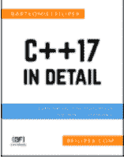

# C++17 详解：学习新 C++ 标准的精彩特性！

学习新 C++ 标准中令人兴奋的特性！

（BF）

## C++ 故事

学习新 C++ 标准中令人兴奋的特性！

## 关于作者

Bartłomiej（Bartek）Filipek 是一位拥有超过 12 年专业经验的 C++ 开发者。2010 年，他毕业于克拉科夫雅盖隆大学，获得计算机科学硕士学位。

Bartek 目前在 Xara 工作，开发文档编辑器的功能。他在桌面图形、游戏开发、大规模系统以及编写显卡驱动程序方面拥有经验。自 2011 年以来，Bartek 经常在 `bfilipe.com` 上写博客。最初的话题围绕图形编程展开，但现在博客的核心是原生 C++。他还是克拉科夫 C++ 用户组的联合组织者。你可以在 CppCast 节目中听到 Bartek 谈论 C++17、博客和文本处理。

在空闲时间，他喜欢和儿子一起收集乐高模型。

## 技术评审员

Jacek Galowicz 是一位拥有十年左右 C++ 专业经验的软件工程师。他在德国亚琛工业大学获得了电气工程硕士学位。

Jacek 在 2017 年初创立了 Cyberus Technology GmbH，致力于底层网络安全、虚拟化、微内核和高级测试基础设施的产品。在之前的工作中，他在德国 Intel 和 FireEye 为 Intel x86 虚拟化实现了性能和安全敏感的微内核操作系统。总而言之，他在内核驱动开发、3D 图形编程、数据库、网络通信和物理仿真方面积累了经验，主要使用 C 或 C++。

业余时间，Jacek 维护着一个小小的 C++ 博客，在编写《C++17 STL Cookbook》期间，该博客曾缺乏关注。他是汉诺威和布伦斯瑞克 C++ 用户小组的常客。为了更好地进行元编程和泛型编程，他还学习并使用了 Haskell，这反过来激发了他将纯函数式编程的优势引入 C++ 的兴趣。

## 额外评审员与支持者

如果没有许多优秀人士的支持，这本书将无法达到今天的规模。我非常感谢他们。许多人阅读了草稿、发现了错误、指出了令人困惑的解释、建议了不同的措辞、测试了程序，并提供了支持和鼓励。许多评审员慷慨地提供了见解和评论，我将这些整合到了书中。书中仍然存在的任何错误当然都是我自己的。

特别感谢以下评审员，他们对书的大部分、较小部分进行了评论，或为整个项目提供了总体方向。

- Patrice Roy - Patrice 使用 C++ 已经超过 20 年，无论是出于职业还是出于兴趣（大多数时候是兴趣）。在从事多年研发和军事飞行模拟器工作后，他转向了学术界，并从 1998 年起一直教授计算机科学。自 2005 年以来，他更具体地帮助来自实时系统和游戏编程领域的研究生和专业人士开发应对今日挑战所需的技能。近年来 C++ 的快速演进让他的工作更加有趣。

- Jonathan Bocara - Jonathan 是一位热情的 C++ 开发者，从事大型金融软件代码库的工作。他的兴趣围绕着提高代码的表达能力。他创建并定期在 Fluent C++ 上写博客，在博客中他探索如何使用 C++ 语言编写具有表达力的代码，如何让现有代码更清晰，以及在面对晦涩的代码时如何保持理智。

- Łukasz Rachwalski - 软件工程师、克拉科夫 C++ 用户组创始人。

- Michał Czaja - C++ 软件开发者和网络工程师。自 2009 年起一直于电信行业工作。

- Arne Mertz - 来自德国汉堡的软件工程师。他是 C++ 和整洁代码的爱好者，也是 Simplify C++ 博客的作者。

- JFT - 参与计算机编程和“计算机技术性事务”已超过 45 年——包括操作系统开发和在 20 世纪 90 年代中期教授 C++。

- Victor Ciura - CAPHYON 的高级软件工程师，以及 Advanced Installer 团队的技术主管。十多年来，他设计并实现了 Advanced Installer 的多个核心组件和库。他是母校克拉约瓦大学计算机系的常驻嘉宾，在那里为学生举办关于“使用 C++ STL 进行竞争性编程和软件开发”的讲座和工作坊。目前，他大部分时间与团队一起改进和扩展 Advanced Installer IDE 中的重新封装和虚拟化技术，帮助客户将 Win32 桌面应用迁移到 Windows Store（MSIX）。

- Karol Gasiński - Apple GPU 软件架构团队 macOS VR 技术负责人。作为 KRONOS 组的成员，他为 OpenGL 4.4 和 OpenGL ES 3.1 规范做出了贡献。除了工作之外，Karol 最大的热情是游戏开发和底层编程。他在 VR、新接口和游戏引擎领域进行研究。在游戏行业，他因创立 WGK 会议而闻名。过去，他曾负责《中世纪总量》《实况足球》和《寂静岭》等游戏的移动版本。

- Marco Arena - 软件工程师和 C++ 专家，在 F1 行业构建任务关键型和高性能软件产品。Marco 在 C++ 生态系统中非常活跃，担任博客作者、演讲者和组织者：他在 2013 年创立了意大利 C++ 社区，2014 年加入 isocpp.org 编辑团队，多年来一直参与社区活动。Marco 自 2016 年起获得微软 MVP 奖。访问 `marcoarena.com` 发现更多信息。

- Konrad Jaaskwiec - C++ 专家，当时拥有近 8 年的专业经验，侧重于系统设计和优化。你可以在 LinkedIn 上找到他的简介。

[^5]: [http://www.advancedinstaller.com](http://www.advancedinstaller.com)

[^6]: [http://isocpp.org/](http://isocpp.org/)

[^7]: [http://marcoarena.com/](http://marcoarena.com/)

[^8]: [https://www.linkedin.com/in/konrad-ja%C5%9Bkowiec-84585159/](https://www.linkedin.com/in/konrad-ja%C5%9Bkowiec-84585159/)

- Daniel Khoshnoudrad - 一位热情的 C++ 开发者。Daniel 于 2016 年毕业于巴黎东部大学，获得计算机科学博士学位，由 Hugues Talbot 教授指导。Daniel 还拥有波尔多大学的数学工程硕士学位。他是迈特·Scott Meyers 所著的《现代高效 C++》（Effective Modern C++）法语版的校译者。他在 Qt、Python、Fortran、机器学习和教学方面拥有经验。Daniel 还对 Java、Rust、JavaScript、HTML、网络以及许多其他技术感兴趣。你可以关注他 `@DanielKhoshnoudrad`。

- Rob Stewart - 高中时在 Commodore VIC-20 上开始编程。他自学了 BASIC、6502 机器码、Forth、C、C++、JavaScript、Python 和其他编程语言（他在大学还上过 Fortran 课程）。30 年来，他在美国空军、初创公司和 Susquehanna International Group 工作期间，一直使用 C++，用于驾驶舱模拟器、房地产工具、浏览器加速器、计算机桌面替代方案、金融交易、网络通信等领域。他实际上为自己的库编写文档（！），并帮助过许多 Boost 库的文档工作。他参与了多本著名 C++ 书籍的编写，并指导了许多开发者。他是 Boost 指导委员会的创始成员。他与结婚 33 年的妻子有九个孩子。

> https://twitter.com/DanielKhoshnoudrad

## 前言

如果你曾经问过“C++17 里有什么，它对我意味着什么？”，那么这本书就是为你准备的。现在 C++ 标准每三年发布一次，我们作为社区成员面临的挑战之一就是学习和吸收新特性。新特性的意义并不是为了它们本身而存在，而是为了了解它们如何比以往任何时候都更清晰地表达我们的意图。这种直接表达我们意图而非纠结于实现细节的能力，是决定我们代码是否整洁、可维护性的首要因素。对于使用最新编译器从事真实项目的 C++ 程序员来说，C++17 是当今行业的主流选择。

## 关于本书

C++11 是该语言的一次重大更新。凭借 lambda、`constexpr`、变长模板、多线程、基于范围的 `for` 循环、智能指针等许多强大元素和现代特性，它标志着该语言的巨大进步。即使在现在（2019 年），许多团队仍在努力使他们的项目现代化，以利用这些现代特性。后来又有了一个小版本更新——C++14，它改进了之前标准中的某些内容并添加了一些较小的元素。

虽然 C++17 不如 C++11 那么大，但它比 C++14 大，并带来了许多令人兴奋的新增和改进。本书将引导你了解所有这些！

本书提供了关于 C++17 的独家内容，并借鉴了出现在 `cppfilepek.com` 上大量文章的经验。素材从头开始重写，并用最新信息进行了更新。所有内容都配备了大量新示例和实用技巧。此外，本书还提供了当前实现状态、编译器支持、性能问题和其他相关知识的见解，以助力你当前的项目。

## 本书适合读者

本书适用于所有对 C++11/14 至少具有基础经验的 C++ 开发者。

本书的主要目标是让你具备关于 C++17 的实用知识。阅读完本书后，你将能够超越 C++11，并在日常任务中利用最新的 C++ 技术。

如果你不是 C++11/14 专家，请不要担心。本书提供了必要的背景知识，使你能够在适当的语境中获取这些信息。

## 本书的整体结构

C++17 为语言和标准库带来了许多变化。在书中，所有新特性被归类为几个部分，以便理解。

因此，本书包含以下章节：

- 第一部分 - C++17 语言特性
  - 修复与弃用
  - 语言说明
  - 通用语言特性
  - 模板
  - 属性

- 第二部分 - C++17 标准库（仅限完整版）
  - `std::optional`
  - `std::variant`
  - `std::any`
  - `std::string_view`
  - 字符串操作
  - 文件系统
  - 并行 STL
  - 其他更改

- 第三部分 - 更多示例和用例（仅限完整版）
  - 使用 `std::optional` 和 `std::variant` 进行重构
  - 使用 `[[nodiscard]]` 强制代码约束
  - 用 `constexpr` 替换 `enable_if`
  - 如何并行化 CSV Reader

- 附录 A - 编译器支持

- 附录 B - 资源与链接

第一部分关于语言特性较短，将让你快速浏览最重要的变化。你可以按照喜欢的任何顺序阅读。

第二部分（仅限完整版）描述了添加到标准库中的系列新类型和实用工具。这些辅助类型为 C++ 代码创建了潜在的新词汇：例如当你使用 `optional`、`any` 或 `string_view` 时。此外，你还拥有了强大的能力，特别是并行算法和标准文件系统的形式。此部分的许多示例将使用 C++17 的许多其他特性。

第三部分（仅限完整版）汇总了语言的所有更改，并展示了同时使用许多新特性的示例。你将看到关于重构、使用新模板技术简化代码以及与并行 STL 和文件系统工作的讨论。虽然第一、二部分也可以作为单个更改的参考，但第三部分展示了更多结合许多特性的大型 C++17 模式。

本书的一个显著优势是，对于每个新特性，你都会获得有关编译器支持和当前实现状态的信息。你能够检查最流行的编译器（MSVC、GCC 或 Clang）的特定版本是否实现了它。本书还提供了关于如何在你当前的代码库中应用技术的实用提示。

## 读者反馈

如果你发现错误、拼写错误、语法错误……或任何其他需要修正的内容（尤其是逻辑问题！），请向 `bartlomiej.filipek.com` 提交你的反馈。

你也可以通过两个地方留下反馈：

- Leanpub 书籍反馈页[^8]

- GoodReads 书籍页面[^9]

## 示例代码

你可以在书籍网站上找到包含所有示例的 ZIP 包：

`cppindetail.com/data/cpp17indetail.zip`[^10]

> [^8]: https://leanpub.com/cpp17indetail/feedback
>
> [^9]: https://www.goodreads.com/book/show/4147221-c-17-in-detail
>
> [^10]: https://www.cppindetail.com/data/cpp17indetail.zip

同一个 ZIP 包也应该附带在电子书中。

书中的许多示例相对短。你可以将这些行复制并粘贴到你喜欢的编译器/IDE 中，然后运行代码段。

## 编译

要使用 C++17，请确保为你的编译器提供正确的标记：

- 对于 GCC（至少 7.1 或 8.0 或更高版本）：使用 `-std=c++17` 或 `-std=c++2a`

- 对于 Clang（至少 4.0 或更高版本）：使用 `-std=c++17` 或 `-std=c++2a`

### 格式化

代码以等宽字体示例呈现：

（此处省略重复代码块翻译，保持原始格式要求）

```cpp
#include <iostream>
#include <string>

int main() {
    std::string text = "Hello World";
    std::cout << text << '\n';
    return 0;
}
```

### 代码高亮

代码以等宽字体示例呈现：

```cpp
#include <iostream>
#include <string>

int main() {
    std::string text = "Hello World";
    std::cout << text << '\n';
    return 0;
}
```

### 代码高亮

代码以等宽字体示例呈现：

```cpp
#include <iostream>
#include <string>

int main() {
    std::string text = "Hello World";
    std::cout << text << '\n';
    return 0;
}
```

### 代码高亮

代码以等宽字体示例呈现：

```cpp
#include <iostream>
#include <string>

int main() {
    std::string text = "Hello World";
    std::cout << text << '\n';
    return 0;
}
```

### 代码高亮

代码以等宽字体示例呈现：

```cpp
#include <iostream>
#include <string>

int main() {
    std::string text = "Hello World";
    std::cout << text << '\n';
    return 0;
}
```

### 代码高亮

代码以等宽字体示例呈现：

```cpp
#include <iostream>
#include <string>

int main() {
    std::string text = "Hello World";
    std::cout << text << '\n';
    return 0;
}
```

### 代码高亮

代码以等宽字体示例呈现：

```cpp
#include <iostream>
#include <string>

int main() {
    std::string text = "Hello World";
    std::cout << text << '\n';
    return 0;
}
```

### 代码高亮

代码以等宽字体示例呈现：

```cpp
#include <iostream>
#include <string>

int main() {
    std::string text = "Hello World";
    std::cout << text << '\n';
    return 0;
}
```

### 代码高亮

代码以等宽字体示例呈现：

```cpp
#include <iostream>
#include <string>

int main() {
    std::string text = "Hello World";
    std::cout << text << '\n';
    return 0;
}
```

### 代码高亮

代码以等宽字体示例呈现：

```cpp
#include <iostream>
#include <string>

int main() {
    std::string text = "Hello World";
    std::cout << text << '\n';
    return 0;
}
```

## 在线编译器

与其创建本地项目来玩代码示例，你也可以利用在线编译器。它们提供基础编辑器，通常只允许你编译一个文件。如果你想玩代码并使用各种编译器检查结果，它们非常方便。

例如，本书的许多代码示例是使用 Coliru Online 和 Wandbox 编译器创建，然后针对书籍进行了调整。

这里是一些有用服务的列表：

- Coliru[^15]——使用 GCC 8.2.0（截至 2019 年 7 月），提供链接共享和基础编辑器，简单但有效。

- Wandbox[^16]——提供许多编译器，包括大多数 Clang 和 GCC 版本，可以使用 Boost 库；提供链接共享和多文件编译。

- Compiler Explorer[^7]——提供许多编译器，显示编译器输出，可以执行代码。

- CppBench[^8]——运行简单的 C++ 性能测试（使用 Google Benchmark 库）。

- C++ Insights[^9]——一个基于 Clang 的源代码转换工具。它展示了编译器如何查看代码，例如通过展开 lambda、`auto`、结构化绑定或基于范围的 `for` 循环。

该网站上还有一个收集好的实用的在线编译器列表：[在线 C++ 编译器列表][^20]。

[^15]: http://coliru-stacked-crooked.com/

[^16]: https://wandbox.org/

[^7]: https://gcc.godbolt.org/

[^8]: http://quick-bench.com/

[^9]: https://cppinsights.io/

[^20]: https://arnemertz.github.io/online-compilers/

# 第一部分 - 语言特性


我们可以说 C++ 由两部分组成：语言和标准库。第一个元素是语言，它侧重于具有表现力的代码和简洁的语法。第二个元素则为你提供了工具、实用程序程序和算法。例如，在 C++11 中，我们获得了 lambdas，它简化了短函数对象的编写。C++14 允许对函数返回类型使用 `auto` 类型推导，这同样缩短并简化了代码。

C++17 作为标准的一次重大更新，带来了许多惊人的语言元素，这些元素通常使得语言更加清晰、直观。例如，你可以利用 `constexpr` 来减少对 `enable_if` 和标签分发（tag dispatching）技术的需求。得益于结构化绑定，你可以将元组视为一等语言公民，依赖并理解表达式求值顺序，编写自然使用拷贝消除（copy-elision）机制的代码，等等！

在本部分中你将学习到：

- 语言中删除了哪些内容，哪些是已弃用的
- 语言变得更加精确：例如，得益于表达式求值顺序的保证
- 模板的新特性有哪些：如 `if` 或折叠表达式（fold expressions）
- 新的标准属性有哪些
- 你如何通过结构化绑定、内联变量、编译时 `if` 或类的模板参数推导来编写更整洁、更具表现力的代码

## 1. 快速上手

为了让你对新标准产生更多好奇，下面提供了一些展示组合语言特性的代码示例。

如果你发现这些示例令人困惑或太复杂，请不要担心。所有新特性将在接下来的章节中进行详细的解释。

### 使用 Maps 操作

`Part I/demo_map.cpp`

```cpp
#include <iostream>
#include <map>

int main() {
    std::map<std::string, int> mapUsersAge { "Alex", 45 }, { "John", 25 };

    std::map mapCopy(mapUsersAge);

    if (auto [iter, wasAdded] = mapCopy.insert_or_assign("John", 26); !wasAdded)
        std::cout << iter->first << " reassigned...\n";

    for (const auto& [key, value] : mapCopy)
        std::cout << key << ": " << value << "\n";

}
```

代码将输出：

```
John reassigned...
Alex, 45
John, 26
```

上述示例使用了以下特性：

- 第 7 行：类模板的模板参数推导 - `mapCopy` 的类型从 `mapUsersAge` 的类型推导得出。不需要声明 `std::map<std::string, int> mapCopy{...}`。
- 第 9 行：map 的新插入成员函数 - `insert_or_assign`。
- 第 9 行：结构化绑定 - 将 `insert_or_assign` 返回的 pair 捕获到独立的名称中。
- 第 9 行：带初始化的 if 语句 - `iter` 和 `wasAdded` 仅在周围语句的作用域内可见。
- 第 12 行：范围循环内的结构化绑定 - 我们可以使用 `key` 和 `value` 进行迭代，而不是使用 `pair.first` 和 `pair.second`。

### 调试打印

`Part/demo_print.cpp`

```cpp
#include <iostream>

template<typename T> void linePrinter(const T& x) {
    if constexpr (std::is_integral_v<T>) {
        std::cout << "num: " << x << '\n';
    } else if constexpr (std::is_floating_point<T>) {
        const auto frac = x - static_cast<long>(x);
        std::cout << "flt: " << x << ", " << frac << '\n';
    } else if constexpr (std::is_pointer_v<T>) {
        std::cout << "ptr: " << x << '\n';
        linePrinter(x);
    } else {
        std::cout << x << '\n';
    }
}

template<typename... Args> void printWithInfo(Args... args) {
    (linePrinter(args), ...); // 逗号操作符折叠表达式
}

int main() {
    int i = 10;
    float f = 2.56f;
    printWithInfo(&i, &f, 30);
}
```

代码将输出：

```
ptr, num: 10
ptr, flt: 2.56, frac 0.56
num: 30
```

在这里你可以看到以下特性：

- 第 4, 6, 10 行：`if constexpr` 在编译时丢弃代码，用于匹配模板参数。
- 第 4, 6, 10 行：变量属性（traits） - 不需要编写 `std::type_name<T>::value`。
- 第 19 行：`printWithInfo` 内部折叠表达式。这一特性简化了变长模板。

你到目前为止看到的代码只是冰山一角！继续阅读以查看更多：语言的修复、移除的内容（如 `auto`）以及新内容：`constexpr`、结构化绑定、内联变量、类的模板参数推导。

# 修复 (Fixes)

我们可以争论语言标准中什么是修复，哪些不是。以下有三项内容看起来像是对之前规则中缺失或无法正常工作的修复。

## 用于直接列表初始化的新 auto 规则

自 C++11 以来，存在一个奇怪的问题，即：

```cpp
auto x = { 1 };
```

被推导为 `std::initializer_list<int>`。这种行为是不直观的，因为在某些情况下，你期望它运行像 `x { 1 };` 一样。

大括号初始化（Braceisation）是现代 C++ 中的首选模式，但此类异常使得该特性变得薄弱。

有了新标准，我们可以修复这个问题，使其推导为 `int`。

为了实现这一点，我们需要理解两种初始化方式——拷贝初始化和直接初始化：

```cpp
// foo() 是一个按值返回某些 Type 的函数
auto x = foo();           // 拷贝初始化
auto x(foo());            // 直接初始化，初始化一个
                                 // initializer_list (直到 C++17)
```

```cpp
int x = foo();           // 拷贝初始化
int x{foo()};          // 直接初始化
```

对于直接初始化，C++17 引入了新规则：

- 对于只有单个元素的大括号初始化列表（braced-init-list），`auto` 推导将从该元素进行推导。
- 对于包含多个元素的大括号初始化列表，`auto` 推导将是违法的（ill-formed）。

### 已移除或修复的语言特性

例如：

```cpp
auto x1 = { 1, 2 };    // decltype(x1) 为 std::initializer_list<int>
auto x2 = { 1, 2.0 };   // 错误：无法推导元素类型
auto x3{ 1, 2 };      // 错误：不是元素
auto x4 = { 3 };       // decltype(x4) 为 std::initializer_list<int>
auto x5{ 3 };         // decltype(x5) 为 int
```

### 额外信息 (Extra Info)

该更改提议：N3922* 和 N3681。编译器很早就修复了这个问题，该改进在 GCC 5.0 (2015年中期) 中可用。Clang 3.8 (2016年初) 和 MSVC 2015 (2015年中) 也可用。这早于 C++17 的获批准得多。

### 不带消息的 static_assert

此特性为 `static_assert` 增加了一个新的重载。它允许你在 `static_assert` 内部编写条件而不必传递消息。

它将与如 `BOOST_STATIC_ASSERT` 等其他断言兼容。具有 boost 经验的程序员现在切换到 C++17 `static_assert` 将没有任何问题。

```cpp
static_assert(std::is_arithmetic<T>, "T must be arithmetic");
static_assert(std::is_arithmetic_v<T>); // C++17 起不需要消息
```

在很多情况下，你检查的条件已经足够明确，不需要在消息字符串中提到它。

### 额外信息 (Extra Info)

该更改提议：N3928。

^6 http://wg21.link/n3922

7 http://wg21.link/n3681

8 https://wg21.link/n3928

### 基于范围的 for 循环中不同的开始和结束类型

C++11 增加了基于范围的 for 循环：

```cpp
for (for-range-declaration : for-range-initializer)
    statement;
```

根据 C++14 标准，循环等同于以下代码：

```cpp
auto __range = for-range-initializer;
for ( auto __begin = begin-expr, __end = end-expr;
    __begin != __end ) {
    for-range-declaration = *__begin;
    statement;
}
```

你可以看到，`__begin` 和 `__end` 具有相同类型。这种方式运行良好，但扩展性不足。例如，你可能希望迭代到某个与范围起点类型不同的哨兵值（sentinel value）。

在 C++17 中，基于范围的 for 循环被定义等同于以下代码：

```cpp
auto __range = for-range-initializer;
auto __begin = begin-expr;
auto __end = end-expr;
for ( ; __begin != __end; ) {
    for-range-declaration = *__begin;
    statement;
}
```

`__begin` 和 `__end` 的类型可能不同；只需要比较运算符。该更改对现有循环没有影响，但它为库提供了更多选项。例如，这允许 Range TS（以及 C++20 中的 Ranges）与基于范围的 for 循环配合。

### 额外信息 (Extra Info)

该更改提议：P0184R0。

### 编译器支持 (Compiler Support)

| 特性 | GCC | Clang | MSVC | C++ Builder |
|---|---|---|---|---|
| 移除 register 关键字 | 7.0 | 3.8 | VS 2017 | |
| 移除废用的 operator++(bool) | 7.0 | 3.8 | VS 2017 15.3 | 10.3 Rio |
| 移除废弃的异常规格 | 7.0 | 4.0 | VS 2017 15.5 | 10.3 Rio |
| 移除三连字 (trigraphs) | 5.1 | 3.5 | VS 2017 | |
| 直接列表初始化的新 auto 规则 | 7.0 | 3.8 | VS 2017 | |
| 不带消息的 static_assert | 7.0 | 3.8 | VS 2017 | |
| 基于范围的 for 循环中不同的开始和结束类型 | 7.0 | 3.8 | VS 2017 | |

*表格行是碎片化的；我已根据特性进行了重构。*

### 澄清 (Clarification)

C++17 解决了函数链调用的问题。在 C++14 中，函数链调用被指定从左到右（因此 `addInt()` 在 `addFloat()` 之后），但内部表达式的求值顺序可能不同。

准确来说：表达式之间是不确定顺序的。


|---|---|---|---|---|---|
| 移除 `register` 关键字 | 7.0 | 3.8 | VS 2017 | | |
| 移除废用的 `operator++(bool)` | 7.0 | 3.8 | VS 2017 15.3 | 10.3 Rio |
| 移除废弃的异常规格 | 7.0 | 4.0 | VS 2017 15.5 | 10.3 Rio |
| 移除三连字（trigraphs） | 5.1 | 3.5 | VS 2017 | | |
| 直接列表初始化的新 `auto` 规则 | 7.0 | 3.8 | VS 2017 | | |
| 不带消息的 `static_assert` | 7.0 | 3.8 | VS 2017 | | |
| 基于范围的 `for` 循环中不同的开始和结束类型 | 7.0 | 3.8 | VS 2017 | | |

### 澄清（Clarification）

C++17 解决了函数链调用的问题。在 C++14 中，函数链调用被指定从左到右（因此 `addInt()` 在 `addFloat()` 之后），但内部表达式的求值顺序可能不同。

准确来说：

表达式之间是不确定顺序的。

## 更严格的求值顺序（Stricter Evaluation Order）

你可能期望在使用 C++14 时 `computeInt()` 发生在 `addFloat()` 之后。然而，事实并非如此。例如，这是 GCC 4.7.3 的输出：

```text
computing int...
computing float...
addFloat: 10.1
addInt: 8
```

## 更改（The Changes）

在一个表达式中：

```cpp
f(a, b, c);
```

如果编译器首先求值 `a(x)`，那么它在求值 `c(y)` 之前求值 `x`。

考虑以下情况：

`Chapter_order.cpp`

```cpp
#include <iostream>

class Query {
public:
    Query& addInt(int i) {
        std::cout << "AddInt: " << i << '\n';
        return *this;
    }

    Query& addFloat(float f) {
        std::cout << "AddFloat: " << f << '\n';
        return *this;
    }
};

float computeFloat() {
    std::cout << "computing float... \n";
    return 10.1f;
}

float computeInt() {
    std::cout << "computing int... \n";
    return 8;
}

int main() {
    Query q;
    q.addFloat(computeFloat()).addInt(computeInt());
}
```

你可能期望在使用 C++14 时 `computeInt()` 发生在 `addFloat()` 之后。然而，事实并非如此。例如，这是 GCC 4.7.3 的输出：

函数链调用已经被指定从左到右（因此 `addInt()` 在 `addFloat()` 之后），但内部表达式的求值顺序可能不同。

在 C++17 中，当函数链调用包含内部表达式时，它们将按预期工作，即它们从左到右求值：

```cpp
operator<<((operator<<(std::cout, a()), b())), c);
```

在 C++17 之前，`a()` 和 `c()` 可以任意顺序求值。在 C++17 中，`a()` 将先求值，然后是 `b()` 和 `c()`。

以下是论文 P0145R3 中描述的更多规则：

- 下列表达式按先 `a`、后 `b` 的顺序求值：
  1. `a.b`
  2. `a->*b`
  3. `a->*b`
  4. `a(b1, b2, b3)`（`b1`、`b2`、`b3` 的顺序任意）
  5. `b @=`（`@` 意味着任何运算符）
  6. `a[b]`
  7. `a << b`
  8. `a >> b`

如果你不确定代码可能如何求值，最好让它简单，并将其拆分为几个清晰的语句。你可以在 Core C++ Guidelines 中找到一些指南，例如 ES.44 和 ES.44。

### 额外信息

该变更提于：P0145R3。

[^1]: <https://wg21.link/p0145r3>
[^2]: <http://isocpp.github.io/CppCoreGuidelines/Res-order>
[^3]: <http://isocpp.github.io/CppCoreGuidelines/CppCoreGuidelines#es44-depend-on-order-of-evaluation-of-function-arguments>
[^4]: <https://wg21.link/p0145r3>

## 保证拷贝消除（Guaranteed Copy Elision）

拷贝消除（Copy Elision）是一种常见的优化，用于避免产生不必要的临时对象。

例如：

`Chapter Clarification/copy_elision.cpp`

```cpp
#include <iostream>

struct Test {
Test() { std::cout << "Test\n"; }
Test(const Test&) { std::cout << "Test(const Test&)\n"; }
Test(const Test&&) { std::cout << "Test(const Test&&)\n"; }
~Test() { std::cout << "~Test\n"; }
};

Test Create() {
    return Test();
}

int main() {
    auto n = Create();
}
```

在上述调用中，你可能假设使用了临时拷贝来存储 `Create` 的返回值。在 C++14 中，大多数编译器都能识别出临时对象可以很容易地优化，它们可以“直接”从 `Create()` 的调用创建。因此你可能会看到以下输出：

```text
Test::Test // 创建 n
~Test // main 结束时销毁 n
```

在基本形式上，拷贝消除优化被称为返回值优化（RVO）。作为一个实验，在 GCC 中你可以添加编译器标记 `-fno-elide-constructors`，使用 `-std=c++14`（或更早的语言标准）。在这种情况下，你会看到不同的输出：

```cpp
// 编译命令为 "g++CopyElision.cpp -std=c++14 -fno-elide-constructors"
Test::Test
Test(Test&&)
~Test
Test(Test&&)
~Test
~Test
```

在这种情况下，我们有两个额外的拷贝，编译器用它们将返回值传递给 `n`。

编译器甚至更智能，在返回具名对象时也可以进行消除——这被称为命名返回值优化——NRVO。

```cpp
Test Create() {
  Test t;
  // 初始化 't' 的几条指令...
  return t;
}
```

```cpp
auto n = Create(); // 临时通常会被消除
```

目前，标准允许在以下情况进行消除：

- 使用临时对象初始化另一个对象（包括函数返回的对象，或由 `throw` 表达式创建的异常对象）。
- 当即将离开作用域的变量被返回或抛出时。
- 当按值捕获异常时。

然而，是否消除取决于编译器/实现。在实践中，所有构造函数的定义都是需要的。

有了 C++17，我们得到了关于何时必须消除的规则，因此构造函数可能完全省略。事实上，编译器并不是消除拷贝，而是延迟了对象的“实例化”。为什么这可能有用？

- 允许返回不可移动/不可拷贝的对象——提高代码的可移植性，因为每个符合标准的编译器都支持相同的规则。
- 支持“按值返回”模式而非使用参数。
- 提高性能。

下面是一个基于 P0135R0 的不可移动/拷贝类型示例：

`Chapter Clarification/copy_elision_non_movable.cpp`

```cpp
struct NonMoveable {
    NonMoveable(int x) : v(x) {}
    NonMoveable(const NonMoveable&) = delete;
    NonMoveable(NonMoveable&&) = delete;

    std::array<int, 1024> arr;
    int v;
}
```

```cpp
NonMoveable make(int val) {
    if (val > 0)
        return NonMoveable(val);

    return NonMoveable(-val);
}

int main() {
    auto largeMoveableObj = make(90); // 构建对象
    return largeMoveableObj.v;
}
```

上述代码在 C++14 下由于缺少拷贝和移动构造函数无法编译。在 C++17 中不需要，因为 `largeMoveableObj` 将就地构造。请注意，C++17 的拷贝消除仅适用于匿名临时对象，而命名 RVO 是强制的。要理解标准中定义的拷贝消除/延迟实例化，我们必须理解下一节介绍的值类别。

## 更新的值类别（Value Categories）

在 C++98/03 中，表达式有两种基本值类别：

- 左值（lvalue）：可以出现在赋值左侧的表达式。
- 右值（rvalue）：只能出现在赋值右侧的表达式。

C++11 扩展了这一分类法（由于移动语义），增加了三个类别：

- 将值（xvalue）：即将消失的左值。
- 原值（prvalue）：纯右值、临时对象或子对象，或与对象关联的值。
- 广义左值（glvalue）：一个对象。

示例：

```cpp
std::string str;
str;             // 左值
42;              // 原值
str + "10";       // 原值
std::move(str);   // 将值
```

这是一张显示类别之间关系的图表：


## 语言说明

以下是三个核心类别：

- 左值（lvalue）：具有恒性标识的表达式，我们可以获取其地址。
- 将值（xvalue）：“即将消失的左值”——我们可以移动的对象，通常其生命周期很快结束。
- 原值（prvalue）：纯右值——没有名称、我们无法获取其地址、我们可以移动的东西。

为了支持拷贝消除，提议作者提供了 glvalue 和 prvalue 的更新定义：

- glvalue：求值计算对象、位域或函数位置的表达式。
- prvalue：求值初始化对象、位域或运算符操作数的表达式，具体取决于其所处的上下文。

例如：

```cpp
class X { int a; };
X{10}; // 此表达式是原值
x;     // 左值
x.a;   // 左值（位置）
```

简而言之：prvalues 执行初始化，glvalues 描述位置。C++17 标准规定了，当 prvalue 初始化某个 glvalue 时，就不需要创建临时对象，我们可以延迟其实例化。

在 C++17 中，拷贝消除/延迟实例化发生在：

- 从原值初始化对象时：`Type T()`
- 在返回原值的函数中——如我们的示例。

### 额外信息

该变更提于：P0135R0（推理）和 P0135R1（措辞）。

[^5]: <https://timsong-cpp.github.io/cpppp/n4659/basic.level>
[^6]: <https://wg21.cpp.link/p0135r>
[^7]: <https://wg21.cpp.link/p0135r1>

## 超对齐数据的内存分配（Dynamic Memory Allocation for Over-Aligned Data）

嵌入式环境、内核、驱动程序、游戏开发等领域可能需要非默认的内存对齐。遵守这些要求可能会影响性能或满足某些硬件接口。

例如，使用 SIMD 指令执行几何数据处理时，你可能需要对持有 3D 坐标的结构体进行 16 字节或 32 字节对齐：

```cpp
struct alignas(32) Vec3d { // alignas 从 C++11 开始
  double x, y, z;
}
auto pVectors = new Vec3d[1000];
```

`Vec3d` 包含 `double` 字段，通常自然对齐应该是 8 字节。现在通过 `alignas` 关键字，我们将此对齐改为 32。这种方法允许编译器将对象放入 SIMD 寄存器中（如 AVX）。

遗憾的是，在 C++14 中，你无法保证 `new[]` 后的内存是对齐的。通常，你必须使用如 `std::aligned_alloc()` 或 MSVC 的 `_aligned_malloc()` 等例程来确保对齐。这并不理想，因为它们很难与智能指针配合，并让内存管理变得代码可见。

C++17 通过引入带有 `align_val_t` 参数的 `new()` 和 `delete()` 内存分配函数重载修复了这个漏洞。示例函数签名如下：

```cpp
void* operator new(size_t, align_val_t);
void operator delete(void*, size_t, align_val_t);
```

标准定义了 `__STDCPP_DEFAULT_NEW_ALIGNMENT__` 宏，指定动态内存分配的默认对齐。在常用平台上，Clang、GCC 和 MSVC 指定其为 16 字节。

现在，在 C++17 中，你分配：

```cpp
auto pVectors = new Vec3d[1000];
```

> 单指令多数据流，例如 SSE2、AVX，详见 <https://en.wikipedia.org/wiki/Streaming_SIMD_Extensions>。

查看所有 22 个 `new()` 重载请访问 <https://en.cppreference.com/w/cpp/memory/new/operator_new>。

## 语言说明

`Vecd3` 的对齐方式大于 `__STCPP_DEFAULT_NEW_ALIGNMENT__`，因此编译器将选择带有 `align_val_t` 参数的重载。

> 在 Clang 和 GCC 中，你可以通过 `new-alignment` 开关来控制对齐（参见 Clang 文档[^10]）。MSVC 编译器暴露了 `/Z:alignedNew`[^11] 标志开启或关闭该功能。

我们也可以提供自定义实现，让我们来看一下：

`章节说明/aligned_new.cpp`

```cpp
void* operator new(size_t size, std::align_val_t align) {
#if defined(__WIN32) || defined(__CYWIN__)
    auto ptr = _aligned_malloc(size, static_cast<std::size_t>(align));
#else
    auto ptr = std::aligned_alloc(static_cast<std::size_t>(align), size);

    if (!ptr) throw std::bad_alloc();

    std::cout << "new: " << size << ", "
              << static_cast<std::size_t>(align) << ", " << ptr << std::endl;
    return ptr;
#endif
}

void operator delete(void* ptr, std::size_t size, std::align_val_t align) noexcept {
#if defined(__WIN32) || defined(__CYWIN__)
    _aligned_free(ptr);
#else
    if (ptr) {
        std::cout << "delete: " << size << ", "
                  << static_cast<std::size_t>(align) << ", " << ptr << std::endl;
        std::free(ptr);
    }
#endif
}

void operator delete(void* ptr) noexcept {
#if defined(__WIN32) || defined(__CYWIN__)
    _aligned_free(ptr);
#else
    std::free(ptr);
#endif
}
```

Windows 版本使用了 `_aligned_malloc()` 和 `_aligned_free()`[^1]，因为 Windows 平台对过度对齐数据使用了不同的分配机制。

[^10]: <https://clang.llvm.org/docs/ClangReference.html#option-alignment>
[^11]: <https://docs.microsoft.com/en-us/cpp/build/cpp/alignednew?vs=19>

[^12]: 适用于 MSVC、MinGW、Windows Clang 或 Cygwin，这就是为什么 `std::free()` 无法正确释放内存。在符合 C++11 的其他平台上可以使用 `std::aligned_alloc()`，因为 C++17 标准基于 C++11 规范。

这项新功能可以显著改进代码，你现在可以在标准容器中持有对齐对象，而无需编写自定义分配器或自定义析构器。例如：

`章节说明/aligned_new.cpp`


```cpp
std::vector<Vecd3> vec;
vec.push_back({});
vec.push_back({});
assert(reinterpret_cast<uintptr_t>(vec.data()) % alignof(Vecd3) == 0);
```

执行时，分配可能会记录以下内容：

```
new: 32, align: 32, ptr: 0x000001F86625960
new: 64, align: 32, ptr: 0x000001F86625680
delete: 32, align: 32, ptr: 0x000001F86625960
new: 96, align: 32, ptr: 0x000001F86625EA0
delete: 64, align: 32, ptr: 0x000001F86625680
delete: 96, align: 32, ptr: 0x000001F86625EA0
```

该示例为单个条目分配内存，然后删除并增加 `vector` 的大小以为所有元素留空间。在最后，我们检查指针对齐情况是否为 32 字节。你可以在`New() - Alignment Parameter for operator()³`了解更多关于新功能的实验。这篇博客文章还展示了当你使用`placement new`请求非标准对齐时危险的一面。

### 额外信息

该更改提现在：`P0035⁴`。

## 类型系统中的异常规范

函数的异常规范（Exception Specification）不再属于函数类型，但现在将成为类型的一部分。你现在可以有两个重载：一个带有`noexcept`，另一个不带。如下所示：

章节说明/func_noexcept_type.cpp

```cpp
using TnoexceptFunc = void() noexcept;
void SimpleNoexceptCall(TnoexceptFunc f) { f(); }

using TVoidFunc = void();
void SimpleCall(TVoidFunc f) { f(); }

void fnoexcept() noexcept { }
void fRegular() { }

int main() {
  SimpleNoexceptCall(fnoexcept);
  // SimpleNoexceptCall(fRegular); // 无法转换
  SimpleCall(fnoexcept); // 转换为普通函数
  SimpleCall(fRegular);
}
```

指向`noexcept`函数的指针可以转换为普通函数的指针（这对于成员函数指针也有效）。但反过来是不可能的（从普通函数指针转换为标记为`noexcept`的函数指针）。

原因之一是，引入`noexcept`是为了让编译器更好地优化代码。一个`noexcept`函数保证不会抛出异常。正如上文描述的，结构化绑定可以利用这种特性。

### 额外信息

该更改提现在：`P0035⁵`。

`¹⁵` https://en.cppreference.com/w/cpp/language/exception_specifier

`¹⁶` 提现在：`P012`

### 编译器支持

| 特性 | GCC | Clang | MSVC | C++ |
|---|---|---|---|---|
| 保证拷贝消除 | 7.0 | 4.0 | 17 | 10.3 |
| 异常规范化 | 7.0 | 4.0 | 17 | 15.6 |
| 类型系统中的异常规范 | 7.0 | 4.0 | 17 | 15.5 |
| 内存分配 | 7.0 | 4.0 | 17 | 15.5 |

# 通用特性

在本节中，我们将查看能够让代码更紧凑、易用的通用特性。在 Python 等语言中很容易的操作现在在 C++17 中可行。在本章中，你将学习：

- 结构化绑定/分解声明
- 如何为自定义类提供结构化绑定接口
- `if`/`switch` 中的初始化语句
- 内联变量及其影响
- 可能用于 lambda 表达式的 `constexpr`
- 如何正确包装该指针
- 嵌套命名空间的简化使用
- 如何测试头部是否存在

## 结构化绑定声明

你经常处理元组或对吗？如果没有，你应该开始关注。结构化绑定允许将数据绑定到变量。考虑一个返回两个结果的函数：

```cpp
std::pair<int, bool> InsertElement(int el) { ... }
```

你可以写：

```cpp
auto ret = InsertElement();
```

然后引用`.first`或`.second`。然而，通过`.first`或`.second`引用并不直观。或者，你可以使用`std::tie`将元组/对解包到局部变量：

```cpp
int index { 0 };
bool flag { false };
std::tie(index, flag) = mySet.insert(10);
```

```cpp
if (inserted)
    std::cout << "Value was inserted\n";
```

### 语法

结构化绑定的基础语法如下：

```cpp
auto [a, b, c, ...] = expression;
auto [a, b, c, ...] { expression };
auto [a, b, c, ...] ( expression );
```

编译器将`a, b, c, ...`列表中的所有标识符引入到周围作用域，并将它们绑定到`expression`所表示对象的子对象或元素。

在底层，编译器可能会生成如下伪代码：

```cpp
auto tempTuple = expression;
using a = tempTuple.first;
using b = tempTuple.second;
using c = tempTuple.third;
```

例如：

```
std::pair(a, 1.0f);
auto [x, y] = a;
```

`x`绑定到生成对象中存储的`int`，该对象是`a`的拷贝。同样地，`y`绑定到`float`。

### 修饰符

结构绑定可以使用多种修饰符：

`const`修饰符：

```
const auto [a, b, c, ...] = expression;
```

引用：

```
auto& [a, b, c, ...] = expression;
auto&& [a, b, c, ...] = expression;
```

例如：

```cpp
std::pair(a, 1.0f);
auto [x, y] = a;
x = 10; // 可写访问
// a.first 现在是相同的
```

在示例中中，`x`绑定到生成对象中的元素，该元素是`a`的引用。

现在获取元组成员的引用非常简单：

```cpp
auto& [ refA, refB, refC, refD ] = myTuple;
```

你也可以为结构绑定添加`[[attribute]]`：

```cpp
[[maybe_unused]] auto [a, b, c, ...] = expression;
```

### 结构化绑定还是解构声明？

你可能见过用于该特性的另一个名称：“解构声明（decomposition declaration）”。在标准化过程中，考虑了这两个名称，但选择了“结构化绑定（structured bindings）”。


### 结构绑定局限性

结构绑定有一些局限性。它们不能被声明为`static`或`constexpr`，且不能在 lambda 函数中使用。例如：

```cpp
constexpr auto [x, y] = std::pair(a, 0);
// 生成：
error: structured binding declaration cannot be 'constexpr'
```

绑定的链接（linkage）此前也不明确。编译器可以自由选择实现方式（因此某些编译器可能允许在 lambda 中捕获结构绑定）。幸运的是，这些局限性可能会被 C++20 提议移除：`P1091`：扩展结构绑定以使其更像变量声明。

### 绑定

结构绑定不仅限于元组（tuples），我们有三种情况可以进行绑定：

1. 如果初始化器是数组：

```cpp
// 适用于数组：
double myArray[3] = { 1.0, 2.0, 3.0 };
auto [a, b, c] = myArray;
```

在这种情况下，数组被拷贝到一个临时对象中，`a`、`b`和`c`引用数组中拷贝的元素。

2. 如果初始化器支持`std::tuple_size<`、提供了`get<N>()`并暴露了`std::tuple_element`函数：

```cpp
std::pair myPair(a, 1.0f);
auto [a, b] = myPair; // 绑定到 myPair.first/second
```

在上面的代码段中，我们绑定到`myPair`。这也意味着只要你添加了`get<N>`接口实现，你就可以支持自己的类。参见后文章节中的示例。

> https://wg21.link/P1091

3. 如果初始化器的类型仅包含非静态数据成员：

```cpp
struct Point {
    double x;
    double y;
};
```

```cpp
Point GetPoint() {
    return { 0.0, 0.0 };
}
```

```cpp
const auto [x, y] = GetPoint();
```

`x`和`y`引用`Point`结构中的`Point::x`和`Point::y`。

该类不需要是 POD（纯数据），但标识符的数量必须等于非静态数据成员的数量。这些成员在给定上下文中必须是可以的。

> 注意：在 C++17 中，最初你可以使用结构绑定绑定类成员，只要它们是公有的。当你想要在友元函数环境甚至结构体实现内部访问此类成员时，可能会出现问题。这个问题很快被识别为一个缺陷，并在 C++17 中已修复。参见 `P0969R0`。

### 示例

本节将向你展示几个结构绑定很有用的示例。在第一个示例中，我们将使用它们来编写更具表现力的代码；在下一个示例中，你将看到如何为你的类提供 API 以支持结构绑定。

### 使用结构绑定的表现力代码

如果你有一个元素 `map`，你可能知道它们在内部被存储为`<const Key, ValueType>`键对。

# 通用语言特性

现在，你遍历该 `map` 的元素：

```cpp
for (const auto& elem : myMap) { ... }
```

你需要编写`elem.first`和`second`来引用键和值。结构绑定最酷的用法之一是在基于范围的 for 循环（range based for loop）中使用：

```cpp
std::map<KeyType, ValueType> myMap;
// C++14:
for (const auto& elem : myMap) {
  // elem.first - 是键
  // elem.second - 是值
}
// C++17:
for (const auto& [key,val] : myMap) {
  // 直接使用 key/value
}
```

在上面的示例中，我们绑定到键对`[key, val]`，这样我们可以在循环中使用这些名称。在 C++17 中，你不需要操作迭代器。

```cpp
#include <map>
#include <iostream>
#include <string>

int main() {
  std::map<std::string, int> myMap = {{"apple", 1}, {"banana", 2}};

  // C++14 风格
  for (const auto& elem : myMap) {
    // std::cout << elem.first << ": " << elem.second << "\n";
  }

  // C++17 风格（使用结构绑定）
  for (const auto& [key,val] : myMap) {
    // 直接使用 key/value
    std::cout << key << ": " << val << "\n";
  }
  return 0;
}
```

## 普通语言特性

```cpp
const std::string myString = "My Hello World Wow";
```

```cpp
const auto pos = myString.find("Hello");
if (pos != std::string::npos)
std::cout << " Hello\n";
```

```cpp
const auto pos2 = myString.find("World");
if (pos2 != std::string::npos)
std::cout << pos2 << " World\n";
```

你可以为`pos`使用不同的名称，或者将其封装在独立的作用域中：

```cpp
{
const auto pos = myString.find("Hello");
if (pos != std::string::npos)
std::cout << " Hello\n";
}
```

```cpp
{
const auto pos = myString.find("World");
if (pos2 != std::string::npos)
std::cout << pos << " World\n";
}
```

新的`if`语句可以在行内创建额外的作用域：

```cpp
if (const auto pos = myString.find("Hello"); pos != std::string::npos)
std::cout << " Hello\n";
```

```cpp
if (const auto pos = myString.find("World"); pos != std::string::npos)
std::cout << " World\n";
```

如前提到的，在`if`语句中定义的变量在`else`块中也是可见的。因此你可以写：

```cpp
if (const auto pos = myString.find("World"); pos != std::string::npos)
std::cout << pos << " World\n"
else
std::cout << pos << " not found!!\n";
```

此外，你可以将其与结构化绑定（遵循 Herb Sutter 的代码）：

```cpp
// 结合更好：结构化绑定 + if 初始化器
if (auto [iter, succeeded] = mymap.insert(value); succeeded) {
    use(iter); // ok
// ...
} // iter 和 succeeded 被销毁
```

在上面的示例中，你可以引用`iter`和`succeeded`，而不是`mymap.insert`返回的`pair.first`和`pair.second`。

如你所见，结构化绑定和元组（tuples）允许你在`if`语句的初始化部分创建更多变量。但这样写代码会更易读吗？

例如：

```cpp
string str = "Hi World";
if (auto [pos, size] = pair(str.find("Hi"), str.size()); pos != string::npos)
std::cout << pos << " Hello, size is " << size;
```

我们可以认为，将更多代码放入初始化部分会降低代码的可读性，请注意此类情况。

### 额外信息

该更改提议源于：`P0305R1`。

### 内联变量

随着 C++11 引入的非静态数据成员初始化（Non-Static Data Member Initialisation），你现在可以在一个地方声明并初始化成员变量：

```cpp
class User {
    int _age{};
    std::string _name{"unknown"};
};
```

然而，对于静态变量（或常量静态变量），你需要在实现文件中进行声明，然后定义。

C++11 的`constexpr`关键字允许你在一个地方声明并定义静态变量，但它仅限于常量表达式。

以前，只有方法/函数可以被指定为内联（inline），但现在你可以在头文件中对变量执行相同的操作。

根据提议`P0386R2`：

> 内联声明的变量具有与内联声明的函数相同的语义：它可以在多个翻译单元中以相同的方式进行定义，必须在使用它的每个翻译单元中都被定义，并且程序的行为就像恰好存在一个变量。

例如：

```cpp
// 在头文件内部：
struct MyClass {
    static const int sValue;
};
```

```cpp
// 随后在同一个头文件中：
inline int const MyClass::sValue = 777;
```

或者直接在一个地方进行声明和定义：

http://wg21.link/p0386r2

```cpp
struct MyClass {
    inline static const int sValue = 777;
};
```

此外，注意`constexpr`变量是隐式内联的，因此不需要使用`constexpr inline myVar = 10`。

内联变量比`constexpr`变量更灵活，因为它不需要用常量表达式初始化。例如，你可以用`rand()`初始化内联变量，但`constexpr`变量无法做到。

### 如何简化代码？


许多仅头文件（header-only）库可以限制黑科技（如使用内联函数模板）的数量，并切换到使用内联变量。

例如：

```cpp
class MyClass {
    static inline int Seed(); // 静态方法
};
inline int MyClass::Seed() {
    static const int seed = rand();
    return seed;
}
```

可以改为：

```cpp
class MyClass {
    static inline int seed = rand();
}
```

C++17 保证 `MyClass::seed` 在所有编译单元具有相同的值（在运行时生成）！

> 额外信息

该更改提议源于：P0386R2。

### constexpr Lambda 表达式

Lambda 表达式是在 C++11 中引入的，从那时起它们已成为现代 C++ 不可缺的一部分。C++11 的另一个显著特性是 `constexpr` 限定符，用于表示函数或值可以在编译时计算。在 C++17 中，这两个元素允许共存。

在 C++17 中，如果 Lambda 表达式在常量文中被调用，则必须是 `constexpr`：

```cpp
constexpr auto square = [](int n) { return n * n; };
static_assert(square(3) == 9);
```

`constexpr` Lambda 表达式的限制如下：

- 它们不能是虚函数
- 它们的返回类型应该是常量类型
- 它们的参数类型应该是常量类型
- 它们不能包含：`asm` 语句、`try` 块或静态存储期

在实践中，如果 Lambda 是 `constexpr`，可以使用 `constexpr` 关键字。

该更改提议源于：P0386。

### 在 Lambda 中捕获 this

当你在类内部编写 Lambda 时，可以引用成员变量。例如：

`General Features/capture_this.cpp`

```cpp
struct Test {
    void foo() {
        std::cout << m_str << '\n';
        auto addLambda = [this]() { m_str += "World"; };
        addLambda();
        std::cout << m_str << '\n';
    }

    std::string m_str{"Hello "};
};
```

在 `auto addLambda = [this]() {}` 这一行中，我们捕获了此指针。请注意 `[=]` 建议捕获值，但如果你在 Lambda 表达式中访问成员，它会隐式通过此指针进行捕获。因此，一旦超过了对象的生命周期，该指针就会变成悬指针。

在 C++17 中，你可以使用 `[*this]` 来捕获整个对象：

```cpp
auto lam = [*this]() { std::cout << s; };
```

在 C++14 中，使代码安全的办法是捕获 `[*this]`：

```cpp
auto lam = [self=*this] { std::cout << self.s; };
```

### 从方法返回 Lambda

```cpp
#include <iostream>

struct Baz {
    auto foo() {
        return [=] { std::cout << s << '\n'; };
    }
    std::string s;
};

int main() {
    auto f1 = Baz{"ala"}.foo();
    f1();
}
```

代码声明了一个 `Baz` 对象并调用了 `foo()`。请注意 `foo()` 返回了一个捕获块 `[=]`，（`[=]` 建议捕获值，但如果你在 Lambda 表达式中访问成员，它会隐式通过此指针进行捕获）。因此，一旦超过了 `Baz` 对象的生命周期，该指针就会变成悬指针。

在 C++17 中，你可以使用 `[*this]` 来捕获整个对象。

捕获 `this` 当 Lambda 的生命周期超过对象本身时可能会变得棘手。这可能发生在使用异步调用或多线程时。

在 C++20 中（参见 P0806¹），如果你在方法中捕获 `[=]`，你还会看到额外的警告。这种表达式捕获此指针，而这可能不是你想要的。

### 嵌套命名空间 (Nested Namespaces)

命名空间允许将类型和函数分组到独立的逻辑单元中。

例如，通常可以看到库 XY 的每个类型或函数都存储在命名空间 `xy` 中。如下例所示，其中有一个 `SuperCompressionLib`，它暴露了调用 `Compress()` 和 `Decompress()` 的方法：

```
namespace SuperCompressionLib {
    bool Compress();
    bool Decompress();
}
```

如果你有两个或多个嵌套的命名空间，情况就会变得有趣起来。

```
namespace MySuperCompany {
    namespace SecretProject {
        namespace SafetySystem {
            class SuperArmor {
                // ...
            }
            class SuperShield {
                // ...
            }
        } // SafetySystem
    } // SecretProject
} // MySuperCompany
```

在 C++17 中，嵌套命名空间可以写得更紧凑：

```cpp
namespace MySuperCompany::SecretProject::SafetySystem {
    class SuperArmor {
        // ...
    }
    class SuperShield {
        // ...
    }
}
```

这种语法非常简洁，并且对于具有 C# 或 Java 等语言经验的开发者来说会更容易使用。

## 通用语言特性 (General Language Features)

在 C++17 中，标准库也通过新的嵌套命名空间功能在多个处进行了“紧凑化”：

例如，正则表达式（regex）。

在 C++17 中，它的定义如下：

```cpp
namespace std::regex_constants {
  typedef T1 syntax_option_type;
  // ...
}
```

在 C++17 之前，同样的声明为：

```cpp
namespace std {
  namespace regex_constants {
    typedef T1 syntax_option_type;
    // ...
  }
}
```

上述嵌套声明出现在 C++ 规范中，但在 STL 实现中它们看起来可能有所不同。

### 额外信息 (Extra Info)

该更改提议：N4230¹⁵。

## __has_include 预处理器表达式

如果你的代码必须在两个不同的编译器下运行，那么你可能会遇到两套可用特性集和特定平台的更改。

在 C++17 中，你可以使用 `__has_include` 预处理器常量表达式来检查给定的头文件是否存在：

```cpp
#if __has_include(<header_name>)
#if __has_include("header_name")
```

`__has_include` 多年来一直作为 Clang 的扩展可用，但现在它已被加入标准中。它是“特性测试”的一部分，可以帮助你检查特定的 C++ 特性或头文件是否可用。如果编译器支持此宏，即使没有开启 C++17 标志也可以访问，这就是为什么即使你处于 C++11 或 C++14 “模式”下也可以检查某个特性。

例如，我们可以测试平台是否具有 `<charconv>` 头文件，该头文件声明了 C++17 的低级转换程序：

`Chapter General Language Features/has_include.cpp`

```cpp
#if defined __has_include
### if __has_include(<charconv>)
    define has_charconv 1
    include <charconv>
#endif
#endif
```

```cpp
std::optional<int> ConvertToInt(const std::string& str) {
    int value = {};
#ifdef has_charconv
    const auto last = str.data() + str.size();
    const auto res = std::from_chars(str.data(), last, value);
    if (res.ec == std::errc{} && res.ptr == last)
        return value;
#else
    // 替代实现...
#endif

    return std::nullopt;
}
```

## 通用语言特性 (General Language Features)

在上述代码中，我们根据 `__has_include` 条件声明了 `has_charconv`。如果头文件不存在，我们需要为 `ConvertToInt` 提供一个替代实现。你可以使用 GCC 7.1 和 GCC 7.1 检查此代码。

## 推导指南

编译器使用一种称为“推导指南”（Deduction Guides）的特殊规则来确定参数类型。

指南有两种类型：编译器生成的（隐式生成）和用户定义的。

为了理解编译器如何使用推导指南，让我们来看一个简化的推导指南¹

`std::array`;

```cpp
template<typename T, typename... U>
array(T, U...) ->
array<enable_if_t<is_same_v<T, U...>,>, 1 + sizeof...(U)>;
```

这种语法看起来像是一个带有尾随返回类型的模板函数。编译器将“虚拟”函数视为参数的候选。如果模式匹配，则从推导中返回找到的类型。

在我们案例中，当你写下：

```cpp
std::array arr{1, 2, 3, 4};
```

那么，假设 `T` 和 `U...` 是相同类型的参数，我们可以构建一个类型为 `std::array<int, 4>` 的数组对象。

在大多数情况下，你可以依赖编译器生成自动推导指南。它们会为主类模板的每个构造函数（以及拷贝/移动构造函数）创建。请注意，特化或部分特化的类在这里不起作用。

如前所述，你可能还会编写自定义的推导指南。一个经典的例子是推导 `std::string` 而不是 `const char*`：

```cpp
template<typename T> struct MyType {
T str;
};
```

```cpp
// 自定义推导指南
MyType(const char *) -> MyType<std::string>;
MyType t{"Hello World"}; // 推导出 std::string
```

如果没有这个自定义推导，`T` 将被推导为 `const char*`。

另一个自定义推导指南的例子来自重载模式：

```cpp
template<class... Ts>
struct overload : Ts... { using Ts::operator()... };
```

```cpp
template<class... Ts>
load(Ts...) -> overload<Ts...>; // 推导指南
```

该 `overload` 类继承自其他类 `Ts...`，然后暴露它们的 `operator()`。

在这里，自定义推导指南用于“转换”一个可调用类型列表到我们可以派生的类列表。

### 类模板参数推导 (CTAD) 的限制

类模板参数推导有以下限制：

- 不适用于聚合类型（aggregate types）
- 不包含继承构造函数
- 不适用于类型别名

这些限制将在 C++20 中已接受的提案 P1021 中移除。

### 额外信息

CTAD 特性是在 P0091 和 P0433 中提出的。请注意，虽然编译器可能对类模板参数推导提供完整支持，但某些 STL 实现可能仍然缺少自定义推导指南。参见本文末尾的标准库章节。

> ²关于此模式的更多信息请参见 `std::visit()` 章节³https://wg21.link/P1021⁴https://wg21.link/p0091⁵https://wg21.link/p0433

## 折叠表达式

C++11 引入了变长模板，这是一个强大的功能，特别是当你想要处理可数量的输入参数时。例如，以前（C++11 之前）你必须编写多个版本的模板函数（一个参数、两个参数、三个参数……）。

仍然，当你实现像 `sum`、`all` 这样的“递归”函数时，变长模板需要一些额外的代码。

例如：

```cpp
auto Sum11() {
    return 0;
}

template<typename ...Args>
auto Sum11(T s, T... ts) {
    return s + ts...;
}
```

使用 C++17我们可以编写更简单的代码：

```cpp
template<typename ...Args> auto sum(Args ...args) {
    return (args + ... + 0);
}

// 或者：
template<typename ...Args> auto sum2(Args ...args) {
    return (args + ...);
}
```

二元运算符的折叠表达式变体如下：

| 表达式 | 名称 | 展开 |
|---|---|---|
| (... op e) | 一元左折叠 | ((e1 op e2) ... opN) |
| (init op ... e) | 二元左折叠 | (((init e1) op e2) ... opN) |
| (e op ... op) | 一元右折叠 | e op (... (eN-1 op)) |
| (e op ... init) | 二元右折叠 | e op (... (eN-1 op init)) |

> *op 是以下任何二元运算符之一：`+ - / % << >> *= %= |= <= != >=`。在二元折叠中，运算符必须相同。

例如，当你写下：

```cpp
template<typename...Args> auto sum2(Args...args) {
    return (args + ...); // 对 '+' 的一元折叠
}

auto value = sum2(1, 2, 3, 4); // 模板函数展开为：auto value = 1 + (2 + (3));
```

此外，对于空包我们默认获得以下值：

| 运算符 | 默认值 |
|---|---|
| && | true |
| \|\| | false |
| , | 格式错误 |

这就是为什么你不能带任何参数调用 `sum2()`，一元折叠运算符没有默认值。

### 更多示例

这是一个使用 P0036R0 进行折叠的良好实现：

```cpp
template<typename ...Args>
void FoldPrint(Args&&... args) {
  (std::cout << ... << std::forward<Args>(args));
}

FoldPrint("hello", 10, 30);
```

然而，上面的 `FoldPrint` 将逐个打印参数，没有任何分隔符。对于上面的调用，你会看到 "hello1030"。如果你想要分隔符更多的格式选项，你必须修改技术并使用逗号折叠：

```cpp
template<typename ...Args>
void FoldSeparate(Args&&... args) {
  auto separateLine = [](const auto& v) {
    std::cout << v << '\n';
  };

  (..., separateLine(std::forward<Args>(args))); // 逗号运算符
}
```

使用逗号运算符折叠的技术非常方便。它的另一个例子可能是 `push_back` 的特殊版本：

```cpp
template<typename T, typename ...Args>
void push_back_vec(std::vector<T>& v, Args&&... args) {
  (v.push_back(std::forward<Args>(args)), ...);
}
```

```cpp
std::vector<float> vf;
push_back_vec(vf, 10.5f, 0.7f, 1.1f, 0.8f);
```

通常情况下，折叠表达式允许你编写更整洁、更短且可能更易读的代码。

> 额外信息
> 该更改是在 N4295 和 P0036R0 中提出的。
> https://wg21.link/n4295
> https://wg21.link/p0036r0

## if constexpr

这是一个大！C++ 的编译时 if！！

该功能允许你根据常量表达式条件在编译时丢弃 `if` 语句的分支。

```cpp
if constexpr (cond)
    statement1; // cond 为 false 时丢弃
else
    statement2; // cond 为 true 时丢弃
```


例如：

```cpp
template <typename T>
auto get_value(T t) {
    if constexpr (std::is_pointer_v<T>)
        return *t;
    else
        return t;
}
```

`if constexpr` 具有简化大量模板代码，特别是在使用标签分发、SFINAE 或预处理器技术时。

### 为什么要在编译时？

起初你可能会问，为什么我们需要 `if constexpr` 和那些复杂的模板表达式……普通的 `if` 不行吗？

这里有一个代码示例：

```cpp
template <typename Concrete, typename... Ts>
std::unique_ptr<Concrete> constructArgs(Ts&&... params) {
    if (std::is_constructible_v<Concrete, Ts...>) // 普通 'if'
        return std::make_unique<Concrete>(std::forward<Ts>(params)...);
    else
        return nullptr;
}
```

上面的例程是 `std::make_unique` 的一个更新版本：当参数允许构造包装对象时，它返回 `std::unique_ptr`，否则返回 `nullptr`。

下面是测试 `constructArgs` 的简单代码：

```cpp
class Test {
public:
    Test(int, int) {}
};

int main() {
    auto p = constructArgs<Test>(10, 10, 10); // 3 个参数
}
```

代码尝试构建具有三个参数的 `Test`，但请注意 `Test` 只有一个接受两个 `int` 参数的构造函数。

编译时，你可能会得到类似的编译器错误：

> 实例化 <typename std::MakeUniq<Tp>::__single_object
> std::make_unique(_Args&&...) [with _Tp = Test; _Args = {int, int, int}];
> typeename std::MakeUniq<Tp>::__single_object
> std = std::unique_ptr<Test, std::default_delete<Test>>':

```cpp
main.cpp:8:40: 源自 'std::unique_ptr<Tp>
constructArgs(Ts&&...) [with Concrete = Test; Ts = {int, int, int}]'
```

让我们尝试理解这个错误信息。在模板推导后，编译器编译以下代码：

```cpp
if (std::is_constructible_v<Concrete, int, int, int>)
    return std::make_unique<Concrete>(10, 10, 10);
else
    return nullptr;
```

在运行时，如果某个分支不会被执行——因为 `is_constructible_v` 返回 false，但该分支中的代码必须通过编译。

这就是为什么我们需要 `constexpr`，用来“丢弃”代码并只编译匹配的语句。

要修复代码，你需要添加 `constexpr`：

```cpp
template <typename Concrete, typename... Ts>
std::unique_ptr<Concrete> constructArgs(Ts&&... params) {
    if constexpr (std::is_constructible_v<Concrete, Ts...>) { // 修复了！
        return std::make_unique<Concrete>(std::forward<Ts>(params)...);
    } else {
        return nullptr;
    }
}
```

现在，编译器在编译时评估 `if constexpr` 条件，对于表达式 `auto p = constructArgs<Test>(10, 10, 10);`，整个 `if` 分支将在编译过程的第二步被“移除”。

准确来说，被丢弃的分支并没有完全从编译阶段中移除。只有依赖于条件中使用的模板参数的表达式才不会实例化。语法必须始终保持有效。

例如：

```cpp
template <typename T>
void Calculate(T t) {
    if constexpr (std::is_integral_v<T>) {
        // /
        static_assert(sizeof(int) == 100);
    } else {
        execute(t);
    }

    strange syntax
}
```

在上面的示例代码中，如果类型 `T` 是 `int`，则 `else` 分支会被丢弃，这意味着 `execute(t)` 不会被实例化。但 `strange syntax` 这一行仍然会被编译（因为它不依赖于 `T`），这就是为什么你会收到关于它的编译错误。此外，`static_assert` 还会产生另一个编译错误，该表达式也不依赖于 `T`，因此它总是会被求值。

## C++17 模板简化

在 C++17 之前，如果你有多个版本的算法——取决于类型要求——你可以使用 SFINAE 或标签分发（tag dispatching）来生成专门的重载解析集。

例如，`Chapter Templates/sfinae_example.cpp`：

```cpp
template <typename T>
std::enable_if_t<std::is_integral_v<T>, T> simpleTypeInfo(T t) {
    std::cout << "integral T > " << t << '\n';
    return t;
}
```

```cpp
template <typename T>
std::enable_if_t<!std::is_integral_v<T>, T> simpleTypeInfo(T t) {
    std::cout << "not integral \n";
    return t;
}
```

在上面的示例中，我们有两个实现，但只有其中一个会进入重载解析集。如果 `is_integral_v` 对于类型 `T` 为真，则采用第一个函数，第二个则被 SFINAE 拒绝。

使用标签分发也可以发生相同的情况：

`Chapter Templates/tag_dispatching_example.cpp`：

```cpp
template <typename T>
void simpleTypeImpl(T t, std::true_type) {
    std::cout << "integral T > " << t << '\n';
}
```

```cpp
template <typename T>
void simpleTypeImpl(T t, std::false_type) {
    std::cout << "not integral \n";
}
```

```cpp
template <typename T>
void simpleTypeInfo(T t) {
    simpleTypeImpl(t, is_integral<T>{});
}
```

与其使用 SFINAE，我们生成一个唯一的标签：`true_type` 或 `false_type`。根据实现情况，只有一个会被选中。我们现在可以使用 `constexpr` 简化这种模式：

```cpp
template <typename T>
void simpleTypeInfo(T t) {
    if constexpr (std::is_integral_v<T>) {
        std::cout << "integral T > " << t << '\n';
    } else {
        std::cout << "not integral \n";
    }
}
```

编写模板代码变得“自然”，不再需要许多“技巧”。

### 示例

来看几个例子：

### 打印器

你可能已经在书的开头见过这个例子了。让我们深入查看 `linePrinter` 是如何工作的。

```cpp
template <typename T>
void linePrinter(const T& x) {
    if constexpr (std::is_integral_v<T>) {
        std::cout << "num: " << x << '\n';
    } else if constexpr (std::is_floating_point_v<T>) {
        auto frac = static_cast<long>(x);
        std::cout << "float: " << frac << '\n';
    } else {
        linePrinter(*x);
    }
}
```

`linePrinter` 使用 `constexpr` 来检查输入类型。基于此我们可以输出额外信息。有趣的事情发生在指针类型上——它解引用并递归调用 `linePrinter`。

### 声明 `get<N>` 函数

结构绑定适用于具有成员的简单结构：

```cpp
struct S {
    int n;
    std::string s;
    float d;
};
```

```cpp
S s;
auto [a, b, c] = s;
```

然而，如果你有一个自定义类型（带有私有成员），也可以通过重载 `get<N>` 函数使结构绑定工作。以下是演示此点的代码：

```cpp
class MyClass {
public:
    int GetA() const { return a; }
    float GetB() const { return b; }

private:
    int a;
    float b;
};
```

```cpp
template<std::size_t I>
auto get(MyClass& c) {
    if constexpr (I == 0) return c.GetA();
    else if constexpr (I == 1) return c.GetB();
}
```

```cpp
// 支持 tuple 类接口的特化
namespace std {
    template <> struct tuple_size<MyClass> : integral_constant<size_t, 2> {};
    template <> struct tuple_element<0, MyClass> { using type = int; };
    template <> struct tuple_element<1, MyClass> { using type = float; };
}
```

在上面的代码中，优点是将所有内容放在一个函数中。可以通过模板特化来实现：

```cpp
template <> auto& get<0>(MyClass& c) { return c.GetA(); }
template <> auto& get<1>(MyClass& c) { return c.GetB(); }
```

欲更多示例，可以阅读关于用 `constexpr` 替换 `std::enable_if` 的章节，以及结构绑定章节中关于 `get<N>` 特化的部分。你也可以查看以下文章：使用 C++17 中的 constexpr 简化代码。

### 使用 `auto` 声明非类型模板参数

这是处处使用 `auto` 策略的另一部分。在 C++11 和 C++14 中，你可以让它自动推导变量或返回类型，还有泛型 lambda。现在你也可以用它来推导非类型模板参数。

例如：

```cpp
template <auto value> void f() {
    f<10>(); // 推导出 int
}
```

这很有用，因为你不需要为非类型参数的类型准备单独的参数。在 C++11/14 中：

```cpp
template <typename Type, Type value>
constexpr Type TConstant = value;

constexpr auto MySuperConst = TConstant<int, 100>;
```

在 C++17 中变得简单了：

```cpp
template <auto value>
constexpr auto TConstant = value;

constexpr auto MySuperConst = TConstant<100>;
```

不需要显式编写。作为其高级用法之一，有很多论文、文章指向了异构编译时列表的示例：

```cpp
template <auto ... vs> struct HeterogeneousValueList {};

using MyList = HeterogeneousValueList<'a', 100, 'b'>;
```

在 C++17 之前无法直接声明此列表，必须先提供某些包装类。

> 额外信息  
> 该更改体现在 P0127R12。在 P0127R13 中，你可以找到一些示例和推理。

## 其他更改

在 C++17 中还有其他与模板相关的语言和库特性值得提及：

### 在模板模板参数中使用 `typename`

允许在声明模板参数时使用 `typename` 代替 `class`。普通类型参数可以互换使用，但模板模板参数以前被限制为 `class`。

更多信息见 N4051。

### 允许对所有非类型模板参数进行常量求值

移除了指针、引用和成员指针作为非类型模板参数的语法限制。

更多信息见 N4268。

## 用于特性的变量模板

所有产生 `::value` 的特性都伴随 `_v` 变量模板。例如：

```cpp
std::is_integral<T>::value 有 std::is_integral_v<T>
```

```cpp
std::is_class<T>::value 有 std::is_class_v<T>
```

这种改进已经遵循了 C++14 为返回 `::type` 的特性添加 `_t` 后缀的做法。这种更改可以显著缩短模板代码。

更多信息见 P0006。

### 使用声明中的包展开

该特性是针对变长模板和参数包的一项增强。编译器现在支持在包展开中使用 `using` 关键字：

```cpp
template<class... Ts> struct overloaded : Ts... {
    using Ts::operator()...;
};
```

`overloaded` 类暴露了来自基类的所有对 `operator()` 的重载版本。在 C++17 之前，你必须对参数包使用递归来实现相同的结果。`overloaded` 模式是 `std::visit` 一个非常实用的增强，更多信息请参见“Variant”章节中的“Overload”部分。

这是 P0195 中的一个示例。

### 逻辑操作元函数

C++17 增加了一些实用的模板元函数：

- `template<class... B> struct conjunction`：逻辑与（AND）
- `template<class... B> struct disjunction`：逻辑或（OR）
- `template<class B> struct negation`：逻辑非（NOT）

这里有一个基于提议代码的示例：

```cpp
template<typename... Ts>
std::enable_if_t<std::conjunction_v<std::is_same<int, Ts...>>>
PrintIntegers(Ts... args) {
    (std::cout << args) << '\n';
}
```

上面的函数 `PrintIntegers` 可以处理任意数量的参数，但它们都必须是 `int` 类型。辅助元函数增加了高级模板代码的可读性。它们定义在 `<type_traits>` 头文件中。

更多信息请参考 P00138。

[^17]: https://wg21.link/P0195  
[^18]: https://wg21.link/P00138

### `std::void_t` 转换特性

一个异常简单的[^19] 元函数，它将一个类型列表映射为 `void`：

```cpp
template<class...>
using void_t = void;
```

`void_t` 非常擅长处理 SFINAE 错误类型。例如，它可以被用于检测函数重载：

```cpp
void Compute(int &) { } // 示例函数

template<typename T>
struct is_compute_available : std::false_type {};

template<typename T>
struct is_compute_available<
    decltype(Compute(std::declval<T>()))
> : std::true_type {};

static_assert(is_compute_available<int&>::value);
```

[^19]: 原文脚注编号。


```cpp
static_assert(!is_compute_available<double&>::value);
```

`is_compute_available` 检查对于给定的模板参数是否存在 `Compute()` 重载。如果表达式 `decltype(Compute(std::declval<T>()))` 有效，编译器将选择模板特化版本。否则，将触发 SFINAE，并选择主模板。

更多信息见 N3911⁰。

### 编译器支持

| 特性 | GCC | Clang | MSVC | C++ Builder |
|---|---|---|---|---|
| 类模板的参数推导 | 7.0/8.0²¹ | 5.0 | VS 2017 15.7 | 10.3 Rio |
| 标准库中的推导引导 | 8.0²² | 7.0/进行中²³ | VS 2017 15.7 | 10.3 Rio |
| 使用 `auto` 声明非类型参数 | 7.0 | 4.0 | VS 2017 15.7 | 10.3 Rio |
| `if constexpr` 的折叠表达式 | 6.0 | 3.9 | VS 2017 15.5 | 10.3 Rio |
|  | 7.0 | 3.9 | VS 2017 | 10.3 Rio |

> ²¹ 类模板参数推导的额外改进已在 GCC 8.0 中实现，见 P0512R0。  
> ²² 推导引导未列在 LibSTDC++ 的状态页上，因此我们可以假设它们是作为类模板参数推导的一部分实现的。  
> ²³ LibC++ 的状态页提到 `<string>`、序列容器、容器适配器和 `<regex>` 部分已经实现。

# 6. 标准属性

代码注解——属性（attributes）——可能不是 C++ 最为人知的特性。然而，它们对于为编译器以及其他程序员表达额外信息可能非常有用。从 C++11 开始，已经有了标准的方法来指定属性。而在 C++17 中，我们得到了更有用的补充。

在本章中，你将学习：

- C++ 中的属性是什么
- 厂商特定代码与标准格式
- 属性在什么情况下有用
- C++11 和 C++14 属性
- C++17 的新特性

## 为什么我们需要属性

你是否在代码中使用过 `__declspec`、`__attribute__` 或 `#pragma` 指令？

例如：

```cpp
// 设置对齐方式

struct S { short f[3]; } __attribute__ ((aligned (8)));

// 此函数不会返回

void fatal () __attribute__ ((noreturn));
```

或者用于 MSVC 的 DLL 导入/导出：

```cpp
#ifdef COMPILING_DLL

#define DLLEXPORT __declspec(dllexport)

#else

#define DLLEXPORT __declspec(dllimport)

#endif
```

那么什么是属性呢？

属性是编译器用于生成代码的额外信息。它可以被用于某些代码生成（如 OpenMP 等）。此外，注解允许你编写具有表达性的语法并帮助其他开发者。

与其他语言不同，属性允许你编写具有表达性的语法并帮助其他开发者。

从 C++11 开始，已经有了标准的方法来指定属性。而在 C++17 中，我们得到了更有用的补充。

属性是编译器用于生成代码的额外信息。它可以被用于某些代码生成（如 OpenMP 等）。此外，注解允许你编写具有表达性的语法并帮助其他开发者。

（注：此处原文重复内容）

### 使用声明中的包展开

该特性是针对变长模板和参数包的一项增强。编译器现在支持在包展开中使用 `using` 关键字：

```cpp
template<class... Ts> struct overloaded : Ts... {
    using Ts::operator()...;
};
```

`overloaded` 类暴露了来自基类的所有对 `operator()` 的重载版本。在 C++17 之前，你必须对参数包使用递归来实现相同的结果。`overloaded` 模式是 `std::visit` 一个非常实用的增强，更多信息请参见“Variant”章节中的“Overload”部分。

这是 P0195 中的一个示例。

### 逻辑操作元函数

C++17 增加了一些实用的模板元函数：

- `template<class...> B> struct conjunction;`——逻辑与（AND）
- `template<class...> B> struct disjunction;`——逻辑或（OR）
- `template<class B> struct negation;`——逻辑非（NOT）

这里有一个基于提议代码的示例：

```cpp
template<typename... Ts>
std::enable_if_t<std::conjunction_v<std::is_same<int, Ts...>>>
PrintIntegers(Ts... args) {
    (std::cout << args) << '\n';
}
```

上面的函数 `PrintIntegers` 可以处理任意数量的参数，但它们都必须是 `int` 类型。辅助元函数增加了高级模板代码的可读性。它们定义在 `<type_traits>` 头文件中。

更多信息请参考 P00138。

^17 https://wg21.link/P0195  
^18 https://wg21.link/P00138

### `std::void_t` 转换特性

一个异常简单的¹⁹ 元函数，它将一个类型列表映射为 `void`：

```cpp
template<class...>
using void_t = void;
```

`void_t` 非常擅长处理 SFINAE 错误类型。例如，它可以被用于检测函数重载：

```cpp
void Compute(int&) { } // 示例函数

template<typename T>
struct is_compute_available : std::false_type {};

template<typename T>
struct is_compute_available<decltype(Compute(std::declval<T>()))>
    : std::true_type {};

static_assert(is_compute_available<int&>::value);
static_assert(!is_compute_available<double&>::value);
```

`is_compute_available` 检查对于给定的模板参数是否存在 `Compute()` 重载。如果表达式 `decltype(Compute(std::declval<T>()))` 有效，编译器将选择模板特化版本。否则，将触发 SFINAE，并选择主模板。

更多信息见 N3911⁰。

## 属性示例

### `[[fallthrough]]` 属性

表示 `switch` 语句中的穿透（fall-through）是刻意的，且不应对此发出警告。

```cpp
switch (c) {
  case 'a':
    f(); // 警告！穿透可能是一个错误

  case 'b':
    g(); // 穿透是可以的

  case 'c':
    h();
}
```

通过此属性，编译器可以理解程序员的意图。它比使用注释更具可读性。

### `[[maybe_unused]]` 属性

抑制编译器关于未使用实体的警告：

```cpp
static void impl1() { ... } // 当未被调用时，编译器可能会警告

[[maybe_unused]] static void impl2() { ... } // 警告被抑制
```

```cpp
void foo() {
  int x = 42; // 当 x 未被使用时，编译器可能会警告
  [[maybe_unused]] int y = 42; // 警告被抑制
}
```

这种行为在某些变量和函数仅用于调试时非常有用。例如在 `assert()` 宏中：

```cpp
void doSomething(std::string_view a, std::string_view b) {
  assert(a.size() < b.size());
}
```

如果之后 `a` 或 `b` 在此函数中未被使用，编译器将在发布构建中生成警告。将参数标记为 `[[maybe_unused]]` 将解决此警告。

### `[[nodiscard]]` 属性

`[[nodiscard]]` 可以应用于函数或类型声明，以标记返回值的重要性：

```cpp
[[nodiscard]] int Compute();

void Test() {
    Compute(); // 警告！返回值被丢弃
}
```

如果你忘记将结果赋值给变量，编译器应该发出警告。如果你想处理来自 `new` 或 `std::async()` 的错误怎么办？

此外，该属性也可以应用于类型。一种用例是错误码：

```cpp
enum [[nodiscard]] ErrorCode {
    OK,
    Fatal,
    System
};
```

```cpp
ErrorCode OpenFile(std::string_view fileName);
ErrorCode Send(std::string_view to, std::string_view text);
ErrorCode Call(std::string_view text);
```

现在，每当你想要调用此类函数时，你都被“强制”检查返回值。使用 `[[nodiscard]]` 可能会为你避免一些 bug。

你可能还会问“不使用”返回值意味着什么。在标准中，它被定义为“丢弃值表达式”（Discarded value expressions）。这意味着你调用函数仅是为了它的副作用。换句话说，当类型被标记为 `[[nodiscard]]` 时，编译器鼓励报告警告。

然而，为了抑制它，你可以显式将返回值强制转换为 `void` 或使用 `[[maybe_unused]]`：

http://en.cppreference.com/w/cpp/language/expressions#Discarded-value

```cpp
[[nodiscard]] int Compute();

void Test() {
    static_cast<void>(Compute()); // 没问题
    [[maybe_unused]] auto ret = Compute();
}
```

此外，在 C++20 中，标准库将在某些地方使用 `[[nodiscard]]`，例如 `operator new`、`std::async()`、`std::allocate()` 和 `std::empty()`。该特性已经在 C++20 中通过 P0600* 合并。

C++20 的第二个新增是 `[[nodiscard("reason")]]`，参见 P1301*。这允许指定为什么不使用返回值可能会产生问题——例如，某些资源泄漏。

### 命名空间和枚举器的属性

C++11 中属性的初想是能够将它们应用于所有合理的地方，如类、函数、变量、类型定义、枚举等……但规范中存在一个问题，导致属性在应用于命名空间或枚举器时被阻塞。这在 C++17 中得到了修复。我们现在可以这样写：

```cpp
namespace [[deprecated("use BetterUtils")]] GoodUtils {
    void DoStuff() { }
}
```

```cpp
namespace BetterUtils {
    void DoStuff() { }
}
```

```cpp
// 使用：
GoodUtils::DoStuff();
```

Clang 报告：

```text
warning: 'GoodUtils' is deprecated: use BetterUtils
```

### 编译器支持

| 特性 | GCC | Clang | MSVC | C++ Builder |
|---|---|---|---|---|
| 类模板的参数推导 | 7.0/8.0²¹ | 5.0 | VS 2017 15.7 | 10.3 Rio |
| 标准库中的推导引导 | 8.0²² | 7.0/进行中²³ | VS 2017 15.7 | 10.3 Rio |
| 使用 `auto` 声明非类型参数 | 7.0 | 4.0 | VS 2017 15.7 | 10.3 Rio |
| `if constexpr` 的折叠表达式 | 6.0 | 3.9 | VS 2017 15.5 | 10.3 Rio |
|  | 7.0 | 3.9 | VS 2017 | 10.3 Rio |

> ²¹ 类模板参数推导的额外改进已在 GCC 8.0 中实现，见 P0512R0。  
> ²² 推导引导未列在 LibSTDC++ 的状态页上，因此我们可以假设它们是作为类模板参数推导的一部分实现的。  
> ²³ LibC++ 的状态页提到 `<string>`、序列容器、容器适配器和 `<regex>` 部分已经实现。

在本章中，你将学习：

- C++ 中的属性是什么
- 厂商特定代码与标准格式
- 属性在什么情况下有用
- C++11 和 C++14 属性
- C++17 的新特性

属性是编译器用于生成代码的额外信息。它可以被用于某些代码生成（如 OpenMP 等）。此外，注解允许你编写具有表达性的语法并帮助其他开发者。

与其他语言不同，属性允许你编写具有表达性的语法并帮助其他开发者。

（注：由于原文中存在大量重复内容，此处仅保留核心逻辑并统一排版。）

```cpp
if (condVar > someVal) {console.log("xxx")}
```


`[-deprecated-declarations]`

另一个例子是在枚举器上使用`[[deprecated]]`属性：

```cpp
enum class ColorModes {
  RGB [[deprecated("use RGB8")]],
  RGBA [[deprecated("use RGBA8")]],
  RGB8
  RGBA8
};
```

使用：

```cpp
auto mode = ColorModes::RGBA;
```

在 GCC 下，我们将得到：

```text
warning: 'RGBA' is deprecated: use RGBA8
[-deprecated-declarations]
```

该更改已在 N4266（措辞）和 N4196（理由）中描述。

### 忽略未知属性

该特性主要用于澄清说明。在 C++17 之前，如果你尝试使用某些编译器特定的属性，在不支持它的其他编译器中编译时甚至可能会得到错误。现在，编译器会省略属性规范且不会报告任何内容（或只是一个警告）。这在标准中并未提到，需要澄清。

```cpp
// 不支持 MyCompilerSpecificNamespace 的编译器将忽略此属性
[[MyCompilerSpecificNamespace::do_special_thing]];

void foo();
```

例如，在 GCC 7.1 中有一个警告：

```text
warning: 'MyCompilerSpecificNamespace::do_special_thing'
scoped attribute directive ignored [-Wattributes]

void foo();
```

### 在不重复的情况下使用命名空间

该特性简化了使用多个属性的情况，例如：

```cpp
void foo() {
  int x = 42; // 当 x 未被使用时，编译器可能会警告

  [[maybe_unused]] int y = 42; // y 的警告被抑制
}
```

## 编译器支持

| 特性 | GCC | Clang | MSVC |
|---|---|---|---|
| `[[fallthrough]]` | yes | yes | yes |
| `[[maybe_unused]]` | yes | yes | yes |
| `[[nodiscard]]` | yes | yes | yes |
| `[[deprecated]]` | yes | yes | yes |

### C++17 及后续版本的特性状态

| 特性 | GCC | Clang | MSVC |
|---|---|---|---|
| `[[fallthrough]]` | yes | yes | yes |
| `[[maybe_unused]]` | yes | yes | yes |
| `[[nodiscard]]` | yes | yes | yes |
| `[[deprecated]]` | yes | yes | yes |

### C++20 中的特性状态

| 特性 | GCC | Clang | MSVC |
|---|---|---|---|
| `[[fallthrough]]` | yes | yes | yes |
| `[[maybe_unused]]` | yes | yes | yes |
| `[[nodiscard]]` | yes | yes | yes |
| `[[deprecated]]` | yes | yes | yes |

### C++23 中的特性状态

| 特性 | GCC | Clang | MSVC |
|---|---|---|---|
| `[[fallthrough]]` | yes | yes | yes |
| `[[maybe_unused]]` | yes | yes | yes |
| `[[nodiscard]]` | yes | yes | yes |
| `[[deprecated]]` | yes | yes | yes |

### C++26 中的特性状态

| 特性 | GCC | Clang | MSVC |
|---|---|---|---|
| `[[fallthrough]]` | yes | yes | yes |
| `[[maybe_unused]]` | yes | yes | yes |
| `[[nodiscard]]` | yes | yes | yes |
| `[[deprecated]]` | yes | yes | yes |

与编译器版本的最新资源：CppReference

### C++17 中的特性状态

| 特性 | GCC | Clang | MSVC |
|---|---|---|---|
| `[[fallthrough]]` | yes | yes | yes |
| `[[maybe_unused]]` | yes | yes | yes |
| `[[nodiscard]]` | yes | yes | yes |
| `[[deprecated]]` | yes | yes | yes |

### C++20 中的特性状态

| 特性 | GCC | Clang | MSVC |
|---|---|---|---|
| `[[fallthrough]]` | yes | yes | yes |
| `[[maybe_unused]]` | yes | yes | yes |
| `[[nodiscard]]` | yes | yes | yes |
| `[[deprecated]]` | yes | yes | yes |

# C++17 特性的编译器支持

## 修复与弃用

| 特性 | GCC | Clang | MSVC | C++ Builder |
|---|---|---|---|---|
| 移除 `register` 关键字 | 7.0 | 3.8 | VS 2017 15.3 | 10.3 Rio |
| 移除已弃用的 `operator++(bool)` | 7.0 | 3.8 | VS 2017 15.3 | 10.3 Rio |
| 移除已弃用的异常规范 | 7.0 | 4.0 | VS 2017 15.5 | 10.3 Rio |
| 新的三连字符符号（trigraphs） | 5.1 | 3.5 | VS 2010 | 10.3 Rio |
| 直接列表初始化的新 `auto` 规则 | 5.0 | 3.8 | VS 2015 | 10.3 Rio |
| 不带消息的 `static_assert` | 6.0 | 2.5 | VS 2017 | 10.3 Rio |
| 基于范围的 `for` 循环中不同的开始和结束类型 | 6.0 | 3.6 | VS 2017 | 10.3 Rio |

## 澄清

| 特性 | GCC | Clang | MSVC | C++ Builder |
|---|---|---|---|---|
| 更严格的表达式求顺序 | 7.0 | 4.0 | VS 2017 | 10.3 Rio |
| 保证拷贝消除（copy elision） | 7.0 | 4.0 | VS 2017 15.6 | 10.3 Rio |
| 异常规范作为类型系统的一部分 | 7.0 | 4.0 | VS 2017 15.5 | 10.3 Rio |
| 越对齐数据的动态内存分配 | 7.0 | 4.0 | VS 2017 15.5 | 10.3 Rio |

## 普通语言特性

| 特性 | GCC | Clang | MSVC | C++ Builder |
|---|---|---|---|---|
| 结构化绑定声明 | 7.0 | 4.0 | VS 2017 15.3 | 10.3 Rio |
| `if`/`switch` 的初始化语句 | 7.0 | 3.9 | VS 2017 15.3 | 10.3 Rio |
| 内联变量（Inline variables） | 7.0 | 3.9 | VS 2017 15.5 | 10.3 Rio |
| `constexpr` Lambda 表达式 | 7.0 | 5.0 | VS 2017 15.3 | 10.3 Rio |
| 对 `*this` 的 Lambda 捕获 | 7.0 | 3.9 | VS 2017 15.3 | 10.3 Rio |
| 嵌套命名空间 | 6.0 | 3.6 | VS 2015 | 10.3 Rio |
| `has_include` | 5 | Yes | VS 2017 15.3 | 10.3 Rio |

## 模板

| 特性 | GCC | Clang | MSVC | C++ Builder |
|---|---|---|---|---|
| 类模板的模板参数推导 | 7.0/8.0 | 5.0 | VS 2017 15.7 | 10.3 Rio |
| 标准库中的推导指南（Deduction Guides） | 8.0 | 7.0 | VS 2017 15.7 | 10.3 Rio |
| 使用 `auto` 声明非类型参数 | 7.0 | 4.0 | VS 2017 15.7 | 10.3 Rio |
| 折叠表达式（Fold expressions） | 6.0 | 3.9 | VS 2017 15.5 | 10.3 Rio |
| `if constexpr` | 7.0 | 3.9 | VS 2017 | 10.3 Rio |

## 特性（Attributes）

| 特性 | GCC | Clang | MSVC | C++ Builder |
|---|---|---|---|---|
| `[[fallthrough]]` | 7.0 | 3.9 | VS 2015 15.0 | 10.3 Rio |
| `[[nodiscard]]` | 7.0 | 3.9 | VS 2015 15.3 | 10.3 Rio |
| `[[maybe_unused]]` | 7.0 | 3.9 | VS 2015 15.3 | 10.3 Rio |
| 命名空间和枚举器的特性 | 4.9（enums） | 3.4 | VS 2015 14.0 | 10.3 Rio |
| 忽略未知特性 | yes | 3.9 | VS 2015 14.0 | 10.3 Rio |
| 不重复使用特性 | 7.0 | 3.9 | VS 2015 15.3 | 10.3 Rio |

## 标准库

| 特性 | GCC | Clang | MSVC | C++ Builder |
|---|---|---|---|---|
| `std::optional` | 7.1 | 4.0 | VS 2017 15.0 | 10.3 Rio |
| `std::variant` | 7.1 | 4.0 | VS 2017 15.0 | 10.3 Rio |
| `std::any` | 7.1 | 4.0 | VS 2017 15.0 | 10.3 Rio |
| `std::string_view` | 7.1 | 4.0 | VS 2017 15.0 | 10.3 Rio |
| 字符串搜索（String Searchers） | 7.1 | 5.0 | VS 2017 15.3 | no |
| 字符串转换（String Conversions） | 8（仅限整数类型） | 进行中 | VS 2017 15.8 | no |
| 并行算法（Parallel Algorithms） | 9.1 | 进行中 | VS 2017 15.7 | no |
| 文件系统（Filesystem） | 8.0 | 7.0 | VS 2017 15.7 | 10.3 Rio |

## 其他 STL 变化

| 特性 | GCC | Clang | MSVC | C++ Builder |
|---|---|---|---|---|
| `std::byte` | 7.1 | 5.0 | VS 2017 15.3 | 10.3 Rio |
| Map 和 Set 的改进 | 7.0 | 3.9 | VS 2017 15.5 | no |
| Map 的 `insert_or_assign()`/`try_emplace()` | 6.1 | 3.7 | VS 2017 15 | no |
| Emplace 返回类型 | 7.1 | 4.0 | VS 2017 15.3 | no |
| 采样算法（Sampling algorithms） | 7.1 | 进行中 | VS 2017 15 | no |
| `gcd` 和 `lcm` | 7.1 | 4.0 | VS 2017 15.3 | 10.3 Rio |
| `clamp` | 7.1 | 3.9 | VS 2015.3 | 10.3 Rio |
| 特殊数学函数（Special Mathematical Functions） | 7.1 | 无 | VS 2017 15.7 | 10.3 Rio |
| 共享指针和数组 | 7.1 | 进行中 | VS 2017 15.5 | no |
| 成员函数 `size()`、`data()` 和 `empty()` | 6.1 | 3.6 | VS 2015 | no |
| 标准库的 `constexpr` 扩展 | 7.1 | 4.0 | VS 2017 15.3 | no |
| `scoped_lock` | 7.1 | 5.0 | VS 2017 15.3 | no |
| 多态分配器与内存资源（Polymorphic Allocator & Memory Resource） | 9.1 | 进行中 | VS 2017 15.6 | no |

## 附录 B：资源

你可以在 ISO 网站购买官方的 C++17 标准：

ISO/IEC 14882:2017 - Programming languages - C++^25

然而，你也可以阅读接近发布版本的免费草案：

4687, 2017-07-30, Working Draft, Standard for Programming Language C++^26

此 PDF 来自 isocpp.^{27}，另请参阅：

# 字符串转换与搜索

- 如何在 C++ 中将字符串转换为 `int` - Fluent C++
- 如何在 C++ 中高效地将字符串转换为 `int` - Fluent C++
- 如何将字符编码为 2 位？ - Stack Overflow

# 关于文件系统（Filesystem）

- 《Modern C++ Programming Cookbook》中的第 7 章，“文件与流操作”。
- 示例如：处理文件系统路径、创建、复制和删除文件及目录、移除文件内容、检查现有文件或目录的属性、搜索。
- 《C++17 STL Cookbook》中的第 10 章“文件系统”。
- 示例：路径归一化、实现一个类似 grep 的文本搜索工具、实现自动文件重命名、实现磁盘占用计数器、文件类型统计、实现一个通过符号链接替换重复文件来缩小文件夹大小的工具。
- C++17-`std::byte` 和 `std::filesystem` - ModernesCpp.com
- Boost 文件系统库与标准 C++ 文件系统库有多相似？ - SO
- bfilipe.com：从 Boost 转换为 `std::filesystem`

# 并行算法

- Bryce Adelstein 关于并行算法的演讲。包含许多 map reduce（transform reduce）示例：CCon 2016: Bryce Adelstein Lelbach "The C++17 Parallel Algorithms Library and Beyond" - YouTube
- Sean Parent – 更好的代码：并发 - code::dive 2016
- Simon Brand - `std::accumulate` vs. `std::reduce`
- 使用 C++17 并行算法获得更好的性能 | Visual C++ Team Blog
- bfilipe.com：C++17 并行算法惊人的性能，这可能吗？

# 书籍完整版

你阅读的内容仅包含最终书籍的提取部分。然而，你可以通过三种方式购买完整版：纸质版、电子书或交互式课程。

## Amazon（纸质版）



Amazon.us、Amazon.co.uk、Amazon.de、Amazon.fr、Amazon.es、Amazon.jp、Amazon.ca

## Leanpub（电子书）享 75 折优惠！

C++17 In Detail @Leanpub - 享 75 折优惠！

## Educative 交互式课程


C++17 in Detail: A Deep Dive @Educative

它包含超过 220 节课程、许多测验、代码片段，最棒的是它拥有 123 个沙场！这意味着你可以直接在浏览器中编译和编辑代码示例，因此无需在编译器/IDE 之间来回切换。
