# C++20：细节详解（2023 版）

## 读者评价

Sandor Dargo


*Amadeus 高级软件开发工程师*

> 如果你想沉浸于最新版本的 C++，“C++20: Get the Details”正是你现在需要的书。它是一本完整的指南，Rainer 不仅讨论了 C++20 的旗舰特性，还讨论了该语言的每一项细微新增内容。幸运的是，书中包含了大量示例代码，因此即使你目前还无法直接使用最新编译器，也能很好地了解不同特性会带来什么。强烈推荐阅读！

**Adrian Tam**


*Synchron Inc. 数据科学总监*

> C++ 自诞生以来已经演进了很多。到了 C++20，它现在就像一门新语言。当然，这本书不是教你继承或重载的入门书，但如果你需要更新自己的 C++ 知识，这就是正确的书。你会对 C++20 为 C++ 带来的新特性感到惊讶。本书以简洁的示例给出清晰的解释。它的组织结构让你之后可以把它当作参考书使用。它可以帮助你将这门旧语言释放到强大的未来。

程序，你必须指定所应用的 C++ 标准。这意味着，使用 GCC 或 Clang 时必须提供标志 `-std=c++20`，使用 MSVC 时则提供 `/std:c++latest`。使用并发特性时，与 MSVC 不同，GCC 和 Clang 编译器要求使用 `-pthread` 链接 pthread 库。

如果你手边没有合适的 C++ 编译器，请使用在线编译器，例如 [Wandbox](https://wandbox.org) 或 [Compiler Explorer](https://godbolt.org)。如果你在 GCC 或 Clang 下使用 Compiler Explorer，还可以执行程序。首先，你应该启用 Run the compiled output (1)，然后打开 Output 窗口 (2)。

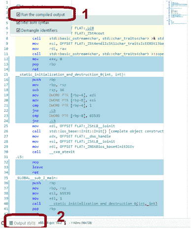

在 Compiler Explorer 中运行代码

你可以在 [cppreference.com](https://en.cppreference.com/w/cpp/compiler_support) 上获取有关各种 C++ 编译器对 C++20 符合性的更多详细信息。

[^4]: https://wandbox.org/  
[^5]: https://godbolt.org/  
[^6]: https://en.cppreference.com/w/cpp/compiler_support

## 你应该如何阅读本书？

如果你不熟悉 C++20，请从最开头开始，先快速浏览一遍以了解整体图景。

一旦了解了整体图景，你就可以继续学习核心语言。每个特性的讲解都应当是自包含的，但从头到尾阅读本书会是更好的方式。首次阅读时，你可以跳过快速概览章节中未提及的特性。

### 个人说明

#### 致谢

我开始在我的英文博客 ModernesCpp¹ 上发起校对请求，并收到了超出预期的回复。特别感谢你们所有人。以下是校对者名单（按字母顺序）：Bob Bird、Nicola Bombace、Dave Burchill、Sandor Dargo、James Drobina、Frank Grimm、Kilian Henneberger、Nicola Josuttel、Ivan "espk" Kondakov、Peter Kardos、Rakesh Mane、Jonathan O'Connor、John Plaice、Iwan Smith、Paul Targosz、Steve Vinoski 和 Greg Wagner。

也特别感谢我的女儿 Juliette 和我的妻子 Beatrix。Juliette 改进了我的措辞并修正了许多笔误。Beatrix 创作了 Cippi 并为本书绘制插图。

#### Cippi

让我介绍一下 Cippi。Cippi 将在本书中陪伴你。我希望你喜欢她。

¹http://www.modernescpp.com


我是 Cippi，C++ 版的长袜子皮皮：充满好奇、聪明伶俐——是的——还很有女人味！

## 关于我

自1999年以来，我一直担任软件架构师、团队负责人和讲师。2002年，我创办了公司内部的继续教育会议。自2002年起，我开始提供培训课程。我的第一批教程是关于专有管理软件的，但不久之后我就开始教授 Python 和 C++。在业余时间，我喜欢撰写关于 C++、Python 和 Haskell 的文章。我也喜欢在会议上发言。我每周在英文博客 Modernes C++³ 和由 Heise Developer 托管的德语博客⁴上发表文章。

³ https://www.modernescpp.com/  
⁴ https://www.grimm-jaud.de/index.php/blog


Rainer Grimm

# 关于 C++

## 1. 历史背景

C++20 是继 C++11 之后下一个重要的 C++ 标准。与 C++11 一样，C++20 改变了我们在现代 C++ 中的编程方式。这一变化主要源于向语言中加入了概念（Concepts）、模块（Modules）、范围（Ranges）和协程（Coroutines）。为了理解 C++ 演化过程中的这一重大步骤，让我先简单谈谈 C++20 的历史背景。

| 版本 | C++98 | C++11 | C++14 | C++17 | C++20 |
| --- | --- | --- | --- | --- | --- |
| 年份 | 1998 | 2011 | 2014 | 2017 | 2020 |
| 特性 | 模板；带有容器和算法的 STL；字符串；IO 流 | 移动语义；统一初始化；auto 和 decltype；Lambda 函数；constexpr；多线程与内存模型；正则表达式；智能指针；可变参数模板；std::array | 读写锁；泛型 Lambda 函数 | 折叠表达式；constexpr if；结构化绑定；std::string_view；STL 并行算法；文件系统库；std::optional、std::variant 和 std::any | 概念；模块；范围库；协程 |

*C++ 历史*

C++ 已有约 40 年历史。以下是往年变化的简要概述。

### 1.1 C++98

在 20 世纪 80 年代末，Bjarne Stroustrup 和 Margaret A. Ellis 撰写了著名的《Annotated C++ Reference Manual（带注解的 C++ 参考手册）》[^1]（ARM）。这本书有两个目的：在存在许多实现的环境中定义 C++ 的功能，并为第一个 C++ 标准 C++98（ISO/IEC 14882）奠定基础。C++98 的一些基本特性包括：模板、带有容器和算法的标准模板库（STL）、字符串以及 IO 流。

### 1.2 C++03

C++03（14882:2003）仅对 C++98 进行了技术性修正，改动之小以至于在上面的时间线中并未体现。在社区中，C++03（包含 C++98）被称为传统 C++（legacy C++）。

[^1]: https://www.stroustrup.com/arm.html

## 2. 标准化

C++ 的标准化过程是民主的：名为 WG21（第 21 工作组）的委员会成立于 1990–91 年。WG21 的负责人有：

- **召集人：** 主持 WG21，制定会议日程，并任命研究组
- **项目编辑：** 将修改应用到 C++ 标准的工作草案中
- **秘书：** 分配 WG21 会议的纪要

下图展示了委员会的各子组和研究组。


*C++ 标准化过程中的研究组*

该委员会采用包含多个子组的三阶段流水线组织。SG 代表研究组（Study Group）。

### 2.1 阶段 3

阶段 3 负责措辞及变更提案的一致性，分为两组：核心语言措辞组（CWG）和库措辞组（LWG）。

### 2.2 阶段 2

阶段 2 分为两组：核心语言演化组（EWG）和库演化组（LEWG）。EWG 和 LEWG 分别负责涉及语言扩展和标准库扩展的新特性。

### 2.3 阶段 1

阶段 1 旨在进行领域特定的调查和孵育。研究组的成员在面对面会议中会面，会议之间通过电话或视频会议进行交流。中心小组可以审查研究组的工作以确保一致性。

以下是领域特定的研究组：

- **SG1，并发：** 并发与并行主题，包括内存模型
- **SG2，模块：** 与模块相关的主题
- **SG3，文件系统**
- **SG4，网络：** 网络库的开发
- **SG5，事务内存：** 为将来添加而设计的事务内存结构
- **SG6，数值计算：** 数值主题，如定点数、浮点数和分数
- **SG7，编译期编程：** 一般的编译期编程
- **SG8，概念**
- **SG9，范围**
- **SG10，特性测试：** 可移植的检查，用于测试特定 C++ 是否支持某项特性
- **SG11，数据库：** 与数据库相关的库接口
- **SG12，UB 与漏洞：** 针对标准中的漏洞及未定义/未指定行为的改进
- **SG13，HMI 与 I/O（人/机接口）：** 对输入输出设备的支持
- **SG14，游戏开发与低延迟：** 游戏开发者及（其他）低延迟编程需求
- **SG15，工具：** 开发者工具，包括模块和包
- **SG16，Unicode：** C++ 中的 Unicode 文本处理
- **SG17，EWG 孵化器：** 关于核心语言演化的早期讨论
- **SG18，LEWG 孵化器：** 关于库语言演化的早期讨论
- **SG19，机器学习：** 人工智能（AI）相关主题，也包括线性代数
- **SG20，教育：** 为 C++ 教育提供现代课程材料的指导
- **SG21，契约：** 对“契约式设计”（Design by Contract）的语言支持
- **SG22，C/C++ 联络：** 讨论 C 与 C++ 的协调

本节让你对 C++ 的标准化，特别是 C++ 委员会，有了简要了解。你可以在 https://isocpp.org/std¹ 找到更多标准化的细节。

¹ https://isocpp.org/std

# C++20 快速概览

### 使用管道符进行函数组合

```cpp
int main() {
    std::vector<int> ints{0, 1, 2, 3, 4, 5};
    auto even = [](int i) { return i % 2 == 0; };
    auto square = [](int i) { return i * i; };

    for (int i : ints | std::views::filter(even) |
                    std::views::transform(square)) {
        std::cout << i << ' ';          // 0 4 16
    }
}
```

Lambda 表达式 `even`（第 3 行）是一个 lambda 表达式，如果参数 `i` 是偶数，则返回 `true`。Lambda 表达式 `square`（第 4 行）将参数 `i` 映射为其平方。第 6 行和第 7 行演示了函数组合，你需要从左到右阅读：`for (int i : ints | std::views::filter(even) | std::views::transform(square))`。先对 `ints` 的每个元素应用偶数过滤器，再将每个剩余元素映射为其平方。如果你熟悉函数式编程，这读起来就像散文。

### 3.1.4 协程

协程是广义函数，可以在保持其状态的同时暂停并在之后恢复。协程是编写事件驱动应用程序的便捷方式。事件驱动应用程序可以是模拟、游戏、服务器、用户界面，甚至算法。协程通常也用于协作式多任务处理。

C++20 没有提供具体的协程，但 C++20 提供了一个实现协程的框架。该框架由 20 多个函数组成，其中一些你必须实现，另一些你可以重写。因此，你可以根据需求定制协程。

下面的代码片段使用生成器创建一个潜在无限的数据流。协程章节提供了 Generator 的实现。

### 用于无限数据流的生成器

```cpp
Generator<int> getNext(int start = 0, int step = 1) {
    auto value = start;
    while (true) {
        co_yield value;
        value += step;
    }
}

int main() {

}
```


## 3.2 核心语言

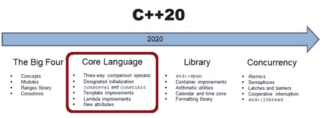

### 3.2.1 三路比较运算符

**三路比较运算符**（`<=>`），也称为飞船运算符，用于判断两个值 A 和 B 之间是 A < B、A == B，还是 A > B。

通过将三路比较运算符声明为 `default`，编译器会尝试为该类生成一致的关系运算符。在这种情况下，你将获得全部六个比较运算符：`==`、`!=`、`<`、`<=`、`>` 和 `>=`。

**自动生成三路比较运算符**

```cpp
struct MyInt {
    int value;
    MyInt(int value) : value(value) { }
    auto operator<=>(const MyInt&) const = default;
};
```

编译器生成的运算符 `<=>` 会执行字典序比较，从基类开始，并按照声明顺序考虑所有非静态数据成员。下面是来自微软博客的一个相当复杂的示例：[用火箭科学简化代码：C++20 的飞船运算符](https://devblogs.microsoft.com/cppblog/simplify-your-code-with-rocket-science-c20s-spaceship-operator/)。

1 https://devblogs.microsoft.com/cppblog/simplify-your-code-with-rocket-science-c20s-spaceship-operator/

**用于派生类的飞船运算符**

```cpp
struct Basics {
    int i;
    char c;
    float f;
    double d;
    auto operator<=>(const Basics&) const = default;
};

struct Arrays {
    int ai[1];
    char ac[2];
    float af[3];
    double ad[2][2];
    auto operator<=>(const Arrays&) const = default;
};

struct Bases : Basics, Arrays {
    auto operator<=>(const Bases&) const = default;
};

int main() {
    constexpr Bases a = { { 0, 'c', 1.f, 1 },
        { { 1 }, { 'a', 'b' }, { 1.f, 2.f, 3.f }, {{ 1., 2. }, { 3., 4. } } } };
    constexpr Bases b = { { 0, 'c', 1.f, 1 },
        { { 1 }, { 'a', 'b' }, { 1.f, 2.f, 3.f }, {{ 1., 2. }, { 3., 4. } } } };
    static_assert(a == b);
    static_assert(!(a != b));
    static_assert(a <= b);
    static_assert(!(a > b));
    static_assert(a >= b);
}
```

我认为这段代码中最复杂的部分不是飞船运算符，而是使用聚合初始化来初始化 `Bases`。聚合初始化本质上意味着，如果所有成员都是 public，你就可以直接初始化类类型（class、struct 或 union）的成员。在这种情况下，你可以像示例中那样使用花括号初始化列表。

在讨论指定初始化之前，让我再展示一些关于聚合初始化的内容。下面是一个简单的示例。

**聚合初始化**

```cpp
struct Point2D{
  int x;
  int y;
};

class Point3D{
public:
  int x;
  int y;
  int z;
};

int main(){

  std::cout << "\n";

  Point2D point2D {1, 2};
  Point3D point3D {1, 2, 3};

  std::cout << "point2D: " << point2D.x << " " << point2D.y << "\n";
  std::cout << "point3D: " << point3D.x << " "
            << point3D.y << " " << point3D.z << "\n";

  std::cout << '\n';

}
```

这是该程序的输出：

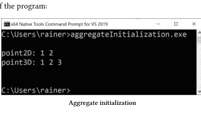

聚合初始化很容易出错，因为你可能会在不知不觉中交换构造函数参数。显式优于隐式。让我们看看这意味着什么。请看一看来自 C99、现在已成为 C++ 标准一部分的指定初始化器是如何介入的。

### 3.2.2 指定初始化

**指定初始化**

```cpp
struct Point2D{
    int x;
    int y;
};

class Point3D{
public:
    int x;
    int y;
    int z;
};

int main(){

    Point2D point2D {.x = 1, .y = 2};
    // Point2D point2D {.y = 2, .x = 1};          // error
    Point3D point3D {.x = 1, .y = 2, .z = 2};
    // Point3D point3D {.x = 1, .z = 2}           // {1, 0, 2}

    std::cout << "point2D: " << point2D.x << " " << point2D.y << "\n";
    std::cout << "point3D: " << point3D.x << " " << point3D.y << " " << point3D.z
              << "\n";

}
```

`Point2D` 和 `Point3D` 实例的参数都被显式命名了。该程序的输出与前一个程序的输出相同。被注释掉的第 16 行和第 18 行相当有趣。第 16 行会报错，因为指定符的顺序与数据成员的声明顺序不匹配。至于第 18 行，缺少了 `y` 的指定符。在这种情况下，`y` 会被初始化为 0，就像使用花括号初始化列表 `{1, 0, 2}` 时那样。

### 3.2.3 consteval 与 constinit

C++20 中新增的 `consteval` 说明符会创建一个立即函数。对于立即函数，每次调用该函数都必须产生一个编译期常量表达式。立即函数隐式地是一个 constexpr 函数，但反过来不一定成立。

**立即函数**

```cpp
consteval int sqr(int n) {
    return n*n;
}
constexpr int r = sqr(100);  // OK

int x = 100;
int r2 = sqr(x);             // Error
```

最后一条赋值语句会报错，因为 `x` 不是常量表达式，因此 `sqr(x)` 无法在编译期执行。

`constinit` 确保具有静态存储期或线程存储期的变量在编译期完成初始化。静态存储期意味着对象在程序开始时分配，并在程序结束时释放。线程存储期意味着对象的生命周期与线程的生命周期绑定。

`constinit` 确保这类变量（具有静态存储期或线程存储期）在编译期完成初始化。`constinit` 并不意味着常量性。

### 3.2.4 模板改进

C++20 为模板编程提供了各种改进。泛型构造函数是一种万能构造函数，因为你可以用任意类型调用它。

**隐式与显式泛型构造函数**

```cpp
struct Implicit {
    template <typename T>
    Implicit(T t) {
        std::cout << t << '\n';
    }
};

struct Explicit {
    template <typename T>
    explicit Explicit(T t) {
        std::cout << t << '\n';
    }
};

Explicit exp1 = "implicit";  // Error
Explicit exp2{"explicit"};
```

## 3.3 标准库


- **四大特性**
  - 概念
  - 模块
  - 范围库
  - 协程

- **核心语言**
  - 三路比较运算符
  - 指定初始化器
  - consteval 与 constinit
  - 模板改进
  - Lambda 改进
  - 新属性

- **库**
  - std::span
  - 容器改进
  - 原子工具
  - 日历与时区
  - 格式化库

- **并发**
  - 原子操作
  - 信号量
  - 闩锁与屏障
  - 协作式中断
  - std::jthread

### 3.3.1 std::span

`std::span` 表示一个可以引用一段连续对象序列的对象。`std::span` 有时也称为视图，它永远不拥有数据。这个视图可以是 C 数组、`std::array`、带大小的指针或 `std::vector`。`std::span` 的典型实现需要一个指向其第一个元素的指针和一个大小。使用 `std::span` 的主要原因是：普通数组在传递给函数时会退化为指针，因此其大小会丢失。`std::span` 会自动推导数组、`std::array` 或 `std::vector` 的大小。如果你使用指针来初始化 `std::span`，则必须在构造函数中提供大小。

**作为函数参数的 std::span**

```cpp
void copy_n(const int* src, int* des, int n){}

void copy(std::span<const int> src, std::span<int> des){}

int main(){

    int arr1[] = {1, 2, 3};
    int arr2[] = {3, 4, 5};

    copy_n(arr1, arr2, 3);
    copy(arr1, arr2);

}
```

与函数 `copy_n` 相比，`copy` 不需要元素数量。因此，使用 `std::span<T>` 后，一个常见的错误原因就消失了。


```cpp
std::string message = std::format("The answer is {}.", 42);
```

std::format 使用 Python 的格式化语法。以下示例展示了一些典型用例：

- 格式化并使用位置参数

```cpp
std::string s = std::format("I'd rather be {1} than {0}.", "right", "happy");
// s == "I'd rather be happy than right"
```

- 以安全方式将整数转换为字符串

```cpp
memory_buffer buf;
std::format_to(buf, "{}", 42);      // replaces itoa(42, buffer, 10)
std::format_to(buf, "{:x}", 42);    // replaces itoa(42, buffer, 16)
```

- 格式化用户定义类型

### 3.3.5 日历和时区

来自 C++11 的 chrono 库[^5] 扩展了日历和时区功能。日历由表示年、月、星期几以及某月第 n 个星期几的类型组成。这些基本类型可以组合成复杂类型，例如 year_month、year_month_day、year_month_day_last、year_month_weekday 和 year_month_weekday_last。运算符 "/" 被重载，以便方便地指定时间点。此外，我们获得了新的字面量：d 表示一天，y 表示一年。

时间点可以在各种时区中显示。由于扩展了 chrono 库，以下用例现在很容易实现：

- 以特定格式表示日期
- 获取某月的最后一天
- 获取两个日期之间的天数
- 在各种时区中打印当前时间

以下程序显示不同时区中的本地时间。

`std::atomic_flag`⁴ 类型的值是一种原子布尔值。它有一个清除状态和设置状态。为简单起见，我将清除状态称为 `false`，将设置状态称为 `true`。`clear()` 成员函数使你可以将其值设置为 `false`。使用 `test_and_set()` 成员函数，你可以将值设置为 `true` 并获取先前的值。没有成员函数用于查询当前值。这在 C++20 中会改变，因为 `std::atomic_flag` 有一个 `test()` 方法。

此外，`std::atomic_flag` 可以通过成员函数 `notify_one()`、`notify_all()` 和 `wait()` 用于线程同步。在 C++20 中，通知和等待可用于 `std::atomic` 和 `std::atomic_ref` 的所有部分特化和完全特化。特化可用于布尔值、整数、浮点数和指针。

### 3.4.2 信号量

信号量是一种同步机制，用于控制对共享资源的并发访问。计数信号量（例如 C++20 中新增的信号量）是一种特殊信号量，其初始计数器大于零。计数器在构造函数中初始化。获取信号量使计数器递减，释放信号量使计数器递增。如果线程在计数器为零时尝试获取信号量，该线程会阻塞，直到另一个线程通过释放信号量使计数器递增。

### 3.4.3 闩锁和屏障

闩锁和屏障是简单的线程同步机制，使一些线程能够阻塞直到计数器变为零。这两种同步线程的机制之间有什么区别？`std::latch` 只能使用一次，但 `std::barrier` 可以多次使用。`std::latch` 适用于管理多个线程执行一个任务；`std::barrier` 适用于管理多个线程重复执行任务。此外，`std::barrier` 可以在每次迭代中调整计数器。

以下内容基于提案 N4204⁵ 中的代码片段。我修正了一些拼写错误并重新格式化了它。

**使用 `std::latch` 进行线程同步**

```cpp
void DoWork(threadpool* pool) {
  std::latch completion_latch(NTASKS);
  for (int i = 0; i < NTASKS; ++i) {
    pool->add_task([&] {
      // perform work

      completion_latch.count_down();
    });
  }
  // Block until work is done
  completion_latch.wait();
}
```

⁴ https://en.cppreference.com/w/cpp/atomic/atomic_flag

⁵ http://www.open-std.org/jtc1/sc22/wg21/docs/papers/2014/n4204.html

`std::latch` 的计数器 `completion_latch` 被设置为 `NTASKS`（第 3 行）。线程池执行 `NTASKS` 个作业（第 4 至 10 行）。每个作业结束时，计数器递减（第 8 行）。运行函数 `DoWork` 的线程在第 12 行阻塞，直到所有任务完成。

### 3.4.4 协作式中断

得益于 `std::stop_token`，`std::jthread` 可以被协作式中断。

**中断 `std::jthread`**

```cpp
int main() {
    std::cout << '\n';

    std::jthread nonInterruptible([]{
        int counter{};
        while (counter < 10){
            std::this_thread::sleep_for(0.2s);
            std::cerr << "nonInterruptible: " << counter << '\n';
            ++counter;
        }
    });

    std::jthread interruptible([](std::stop_token stoken){
        int counter{};
        while (counter < 10){
            std::this_thread::sleep_for(0.2s);
            if (stoken.stop_requested()) return;
            std::cerr << "interruptible: " << counter << '\n';
            ++counter;
        }
    });

    std::this_thread::sleep_for(1s);

    std::cerr << '\n';
    std::cerr << "Main thread interrupts both jthreads" << std::endl;
    nonInterruptible.request_stop();
    interruptible.request_stop();

    std::cout << '\n';
}
```

主程序启动两个线程：nonInterruptible 和 interruptible（第 5 行和第 14 行）。只有线程 interruptible 获得 `std::stop_token`，它在第 18 行使用该令牌检查是否被中断。如果发生中断，lambda 会立即返回。调用 `interruptible.request_stop()` 会触发该线程的取消。调用 `nonInterruptible.request_stop()` 没有任何效果。

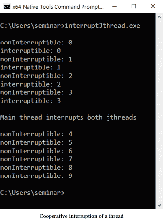

### 3.4.5 `std::jthread`

`std::jthread` 代表可汇合线程。`std::jthread` 通过自动汇合已启动的线程来扩展 `std::thread`。`std::jthread` 也可以被中断。

[^10]: https://en.cppreference.com/w/cpp/thread/jthread

std::jthread 被加入 C++20 标准，是因为 std::thread 的行为不直观。如果 std::thread 仍可汇合，则其析构函数中会调用 std::terminate()。如果既没有调用 thr.join() 也没有调用 thr.detach()，则线程 thr 可汇合。

**线程 thr 仍可汇合**

```cpp
int main() {
    std::cout << '\n';

    std::cout << std::boolalpha;
    std::thread thr{[] { std::cout << "Joinable std::thread" << '\n'; }};
    std::cout << "thr.joinable(): " << thr.joinable() << '\n';

    std::cout << '\n';

}
```

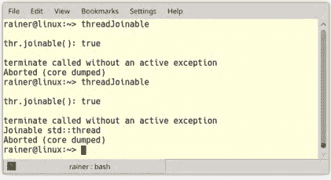

仍可汇合线程时的 std::terminate

程序的两次执行都会终止。在第二次运行中，线程 thr 有足够时间显示其消息："Joinable std::thread"。

在修改后的示例中，我使用 C++20 标准中的 std::jthread。

[^11]: https://en.cppreference.com/w/cpp/error/terminate

**线程 thr 自动汇合**

```cpp
int main() {
    std::cout << '\n';

    std::cout << std::boolalpha;
    std::jthread thr([] { std::cout << "Joinable std::jthread" << '\n'; });
    std::cout << "thr.joinable(): " << thr.joinable() << '\n';

    std::cout << '\n';

}
```

现在，thr 会在必要时在其析构函数中自动汇合。

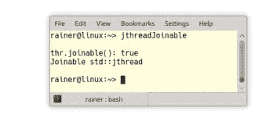

线程 thr 自动汇合

### 3.4.6 同步输出流

在 C++20 中，我们获得了同步输出流。当更多线程在没有同步的情况下并发写入 std::cout 时会发生什么？

**对 std::cout 的未同步写入**

```cpp
void sayHello(std::string name) {
    std::cout << "Hello from " << name << '\n';
}

int main() {
    std::cout << "\n";

    std::jthread t1(sayHello, "t1");
    std::jthread t2(sayHello, "t2");
    std::jthread t3(sayHello, "t3");
    std::jthread t4(sayHello, "t4");
    std::jthread t5(sayHello, "t5");
    std::jthread t6(sayHello, "t6");
    std::jthread t7(sayHello, "t7");
    std::jthread t8(sayHello, "t8");
    std::jthread t9(sayHello, "t9");
    std::jthread t10(sayHello, "t10");

    std::cout << '\n';
}
```

你可能会得到一团乱麻。

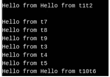

对 std::cout 的未同步写入

将函数 sayHello 中的 std::cout 切换为 std::osyncstream(std::cout)，就能把混乱变为和谐。

**对 std::cout 的同步写入**

```cpp
void sayHello(std::string name) {
    std::osyncstream(std::cout) << "Hello from " << name << '\n';
}
```


```text
Hello from t1
Hello from t2
Hello from t3
Hello from t4
Hello from t5
Hello from t6
Hello from t7
Hello from t8
Hello from t9
Hello from t10
```

同步写入 std::cout

## 细节

## 4. 核心语言


### 四大特性

- 概念
- 模块
- 范围库
- 协程

### 核心语言

- 三路比较运算符
- 指定初始化
- consteval 和 constinit
- 模板改进
- Lambda 改进
- 新属性

### 库

- std::span
- 容器改进
- 算术工具
- 日历和时区
- 格式化库

### 并发

- 原子操作
- 信号量
- 闩锁与屏障
- 协作式中断
- std::jthread

概念是 C++20 最具影响力的特性之一。因此，它是介绍 C++20 核心语言特性的理想起点。

### 4.1 概念


Cippi 研究星星

为了充分理解概念的影响，我想先简要说明引入概念的动机。

#### 4.1.1 两种错误的方法

在 C++20 之前，我们有两种相反的思考函数或类的方式：针对特定类型定义它们，或针对泛型类型定义它们。在后一种情况下，我们称它们为函数模板或类模板。这两种方法各有其问题：

##### 4.1.1.1 过于具体

为每种类型重载函数或重新实现类是乏味的工作。为了避免这种负担，类型转换常常来救场。但看似救场的东西往往是祸根。

###### 4.1.1.1.1 窄化转换

用 double 调用 `getInt(int a)` 会产生窄化转换。窄化转换是一种包含精度损失的转换。我假设这不是你想要的。

###### 4.1.1.1.2 整型提升

但反过来也好不到哪里去。用 bool 调用 `getInt(int a)` 会将 bool 提升为 int。感到惊讶吗？许多 C++ 开发者并不知道把两个 bool 相加会得到哪种数据类型。

###### 两个 bool 相加

```cpp
template <typename T>
auto add(T first, T second){
    return first + second;
}

int main(){
    add(true, false);
}
```

[C++ Insights](https://cppinsights.io/)¹ 可视化了上述源代码在编译器将函数模板转换为实例化后的结果。

¹https://cppinsights.io/s/9bd14f99

```cpp
1 template <typename T>
2 auto add(T first, T second) {
3     return first + second;
4 }
5
6 #ifdef INSIGHTS_USE_TEMPLATE
7 template<>
8 int add<bool>(bool first, bool second)
9 {
10     return static_cast<int>(first) + static_cast<int>(second);
11 }
12 #endif
13
14
15 int main()
16 {
17     add(true, false);
18 }
```

bool 到 int 的提升

在这张 C++ Insights² 的截图中，第 6 至 12 行是关键部分。函数模板 add 的模板实例化创建了一个返回类型为 int 的完全特化。两个 bool 都被隐式提升为 int。

我认为，我们为了便利而依赖转换的魔法，因为不想为每种类型重载函数或重新实现类。

让我尝试另一种方式，使用泛型函数。也许这才是我们的救星？

##### 4.1.1.2 过于泛化

对容器排序是一个通用的想法。如果容器的元素支持排序，那么它应该适用于每个容器。在下面的示例中，我将标准算法 std::sort 应用于标准容器 std::list。

###### 对 `std::list` 排序

```cpp
// tooGeneric.cpp

#include <algorithm>
#include <list>

int main(){

    std::list<int> myList{1, 10, 2, 5};

    std::sort(myList.begin(), myList.end());

}
```

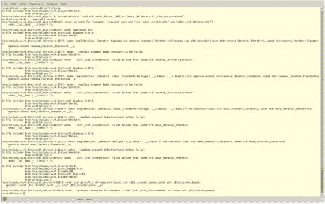

尝试对 `std::list` 排序时的编译器错误

我甚至不想解读这条冗长的消息。哪里出错了？让我们看看此示例中使用的 `std::sort` 特定重载的签名。

```cpp
template< class RandomIt >
constexpr void sort( RandomIt first, RandomIt last );
```

std::sort 使用了名称奇怪的参数类型，例如 RandomIt。RandomIt 代表随机访问迭代器，并为这条令人不知所措的错误消息提供了决定性线索。std::list 只提供双向迭代器，而 std::sort 要求随机访问迭代器。下图说明了为什么 std::list 不支持随机访问迭代器。


如果你研究 cppreference.com 上 std::sort 的文档，你会发现一些令人兴奋的内容：对模板参数的类型要求。它们对类型施加了概念性要求，这些要求已被形式化为 C++20 的特性：概念。

##### 4.1.1.3 概念来救场

概念是编译时谓词。它们对模板参数施加语义约束。std::sort 有接受比较器的重载。

```cpp
template< class RandomIt, class Compare >
constexpr void sort( RandomIt first, RandomIt last, Compare comp);
```

以下是 std::sort 功能更强大的重载的类型要求：

- RandomIt 必须满足 ValueSwappable 和 LegacyRandomAccessIterator 的要求。
- 解引用后的 RandomIt 的类型必须满足 MoveAssignable 和 MoveConstructible 的要求。
- 解引用后的 RandomIt 的类型必须满足 Compare 的要求。

诸如 ValueSwappable 或 LegacyRandomAccessIterator 这样的要求是所谓的具名要求。其中一些要求已在 C++20 的概念⁴中被形式化。

特别地，std::sort 要求 LegacyRandomAccessIterator。让我们更仔细地看看具名要求 LegacyRandomAccessIterator，它在 C++20 中被称为 random_access_iterator（属于 <iterator> 的一部分）：


#### 泛型编程的本质

我想用一段引文开始这段简短的历史回顾，它来自 Alexander Stepanov（标准模板库的创造者）和 Daniel Rose（信息检索研究员）合著的无价之书 *从数学到泛型编程*：“*泛型编程的本质在于概念的思想。概念是描述一组相关对象类型的方式。*”这些相关对象类型可以是整型类型，例如 `bool`、`char` 或 `int`。概念体现了一组对相关类型的要求，例如它们支持的操作、语义以及时间和空间复杂度。例如，平均而言，访问无序关联容器的元素具有常数时间复杂度。

标准模板库（STL）作为一个泛型库，建立在概念之上。从鸟瞰的角度看，STL 由三个组件组成。它们是容器、运行在容器上的算法，以及连接两者的迭代器。

每个容器提供遵守其结构的迭代器，算法则在这些迭代器上操作。容器，例如序列容器或关联容器，建模一个半开范围。容器的元素通过迭代器访问，并通过迭代器遍历它们以及比较它们是否相等。STL 的抽象基于半开范围和迭代器等概念，并允许透明地使用 STL 的容器和算法。

更一般地说，概念有哪些优势？

#### 4.1.2 概念的优势

- 模板参数的要求是接口的一部分。
- 概念是可执行的文档。它们记录了编译器所验证的泛型代码的限制。
- 函数重载和类模板特化可以基于概念。
- 概念可用于函数模板、类模板以及类或类模板的泛型成员函数，也可用于变量模板⁴和别名模板⁵
- 由于编译器会将模板参数的要求与给定的模板实参进行比较，因此你会得到改进的错误消息。
- 你可以使用预定义概念，也可以定义自己的概念。
- auto 和概念的使用是统一的。你可以使用概念代替 auto。
- 如果函数声明使用了概念，它会自动成为函数模板。因此，编写函数模板就像编写函数一样容易。

³https://www.fmi2gp.com/  
⁴https://en.cppreference.com/w/cpp/language/variable_template  
⁵https://en.cppreference.com/w/cpp/language/type_alias


#### 4.1.3 漫长、漫长的历史

我第一次听说概念大约是在 2005 到 2006 年。它们让我想起了 Haskell 的类型类。Haskell 中的类型类是相似类型的接口。以下是 [Haskell 的](https://en.wikipedia.org/wiki/Haskell_(programming_language)) 类型类层次结构的一部分。

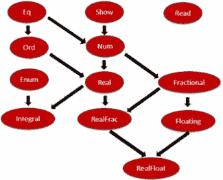

Haskell 类型类层次结构

但 C++ 概念有所不同。以下是一些观察。

- 在 Haskell 中，任何类型都必须是某个类型类的实例。在 C++20 中，类型必须满足概念的要求。
- 概念可用于 C++ 中模板的非类型实参。例如，像值 5 这样的数字就是非类型实参。例如，当你想要一个包含 5 个 int 的 `std::array` 时，你使用非类型实参 `5:std::array<int, 5> myArray`。
- 概念不会增加运行时开销。

最初，概念将成为 C++11 的主要特性，但它们在 2009 年 7 月于法兰克福举行的一次标准化会议上被移除。Bjarne Stroustrup 的话本身就说明了一切：“*C++0x 的概念设计演变成了一个复杂性的怪物。*”几年后，下一次尝试也未成功：concepts lite 被从 C++17 标准中移除。它们最终成为 C++20 的一部分。

#### 4.1.4 概念的使用

本质上，使用概念有四种方式。

[^1]: https://en.wikipedia.org/wiki/Haskell_(programming_language)
[^2]: https://isocpp.org/blog/2013/02/concepts-lite-constraining-templates-with-predicates-andrew-sutton-bjarne-s

##### 4.1.4.1 使用概念的四种方式

我在程序 `conceptsIntegralVariations.cpp` 中以全部四种方式应用了预定义概念 `std::integral`。

##### 使用概念 `std::integral` 的四种变体

```cpp
// conceptsIntegralVariations.cpp

#include <concepts>
#include <iostream>

template<typename T>
requires std::integral<T>
auto gcd(T a, T b) {
    if( b == 0 ) return a;
    else return gcd(b, a % b);
}

template<typename T>
auto gcd1(T a, T b) requires std::integral<T> {
    if( b == 0 ) return a;
    else return gcd1(b, a % b);
}

template<std::integral T>
auto gcd2(T a, T b) {
    if( b == 0 ) return a;
    else return gcd2(b, a % b);
}

auto gcd3(std::integral auto a, std::integral auto b) {
    if( b == 0 ) return a;
    else return gcd3(b, a % b);
}

int main(){

    std::cout << '\n';

    std::cout << "gcd(100, 10)= " << gcd(100, 10) << '\n';
    std::cout << "gcd1(100, 10)= " << gcd1(100, 10) << '\n';
    std::cout << "gcd2(100, 10)= " << gcd2(100, 10) << '\n';
    std::cout << "gcd3(100, 10)= " << gcd3(100, 10) << '\n';

    std::cout << '\n';
}
```

由于第 3 行的头文件 `<concepts>`，我可以使用概念 `std::integral`。如果 T 是整型[^10]，则该概念得到满足。函数名 gcd 代表基于欧几里得[^11]算法的最大公约数算法。

以下是使用概念的四种方式：

- requires 子句（第 6 行）
- 尾随 requires 子句（第 13 行）
- 受约束的模板参数（第 19 行）
- 缩写函数模板（第 25 行）

为了简单起见，每个函数模板都返回 auto。函数模板 gcd、gcd1、gcd2 与函数 gcd3 之间存在语义差异。对于 gcd、gcd1 或 gcd2，实参 a 和 b 必须具有相同类型。函数 gcd3 则不然。参数 a 和 b 可以具有不同类型，但都必须满足概念 `integral`。

```text
gcd(100, 10) = 10
gcd1(100, 10) = 10
gcd2(100, 10) = 10
gcd3(100, 10) = 10
```

概念 `std::integral` 的使用

函数 gcd 和 gcd1 使用 requires 子句。requires 子句比你想象的更强大。让我进一步讨论 requires 子句的更多细节。

##### 4.1.4.2 requires 子句

前一个程序 conceptsIntegralVariations.cpp 例证了你可以使用概念来定义函数或函数模板。当然，还有更多用例。为完整起见，我想补充一点：你可以使用概念指定函数或函数模板的返回类型。

关键字 requires 引入一个 requires 子句，用于指定对模板实参（gcd）或函数声明（gcd1）的约束。requires 后面必须跟一个编译期谓词、一个具名概念（gcd）或一个 requires 表达式。当然，你可以组合上述三者。

编译期谓词也可以是一个表达式：

[^10]: https://en.cppreference.com/w/cpp/types/is_integral
[^11]: https://en.wikipedia.org/wiki/Euclid

##### 在 requires 子句中使用编译期谓词

```cpp
// requiresClause.cpp

#include <iostream>

template <unsigned int i>
requires (i <= 20)
int sum(int j) {
    return i + j;
}

int main() {
    std::cout << '\n';

    std::cout << "sum<20>(2000): " << sum<20>(2000) << '\n';
    // std::cout << "sum<23>(2000): " << sum<23>(2000) << '\n';  // ERROR

    std::cout << '\n';
}
```

第 6 行使用的编译期谓词例证了一个有趣的点：该要求应用于非类型 i，而不是像通常那样应用于类型。


requires 子句中的编译期谓词

当你使用第 17 行时，clang 编译器会报告以下错误：

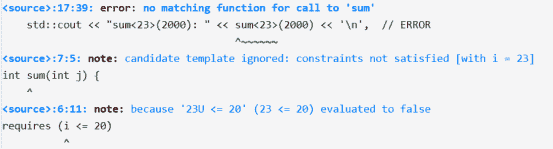

requires 子句中的编译期谓词失败


**避免在 requires 子句中使用编译期谓词**

当你使用概念约束模板参数或函数模板时，应使用具名概念或它们的组合。概念意在成为语义类别，而不是像 `i <= 20` 这样的语法约束。为概念命名可以使其可复用。

##### 4.1.4.3 概念作为函数返回类型

以下是使用概念作为返回类型的函数模板 gcd 和函数 gcd1 的定义。

##### 使用概念作为返回类型

```cpp
template<typename T>
requires std::integral<T>
std::integral auto gcd(T a, T b) {
    if( b == 0 ) return a;
    else return gcd(b, a % b);
}

std::integral auto gcd1(std::integral auto a, std::integral auto b) {
    if( b == 0 ) return a;
    else return gcd1(b, a % b);
}
```

##### 4.1.4.4 概念的用例

首先，概念是编译期谓词。编译期谓词是在编译期执行并返回布尔值的函数。在深入探讨概念的各种用例之前，我想揭开概念的神秘面纱，将它们简单地呈现为在编译期返回布尔值的函数。

###### 4.1.4.4.1 编译期谓词

概念可用于控制结构中，而该控制结构在运行时或编译期执行。

##### 概念作为编译期谓词

```cpp
1    // compileTimePredicate.cpp
2
3    #include <compare>
4    #include <iostream>
5    #include <string>
6    #include <vector>
7
8    struct Test {};
9
10   int main() {
11
12       std::cout << '\n';
13
14       std::cout << std::boolalpha;
15
16       std::cout << "std::three_way_comparable<int>: "
17                 << std::three_way_comparable<int> << '\n';
18
19       std::cout << "std::three_way_comparable<double>: ";
20       if (std::three_way_comparable<double>) std::cout << "True";
21       else std::cout << "False";
22
23       std::cout << "\n\n";
24
25       static_assert(std::three_way_comparable<std::string>);
26
27       std::cout << "std::three_way_comparable<Test>: ";
28       if constexpr(std::three_way_comparable<Test>) std::cout << "True";
29       else std::cout << "False";
30
31       std::cout << '\n';
32
33       std::cout << "std::three_way_comparable<std::vector<int>>: ";
34       if constexpr(std::three_way_comparable<std::vector<int>>) std::cout << "True";
35       else std::cout << "False";
36
37       std::cout << '\n';
38
39   }
```

在上面的程序中，我使用了概念 `std::three_way_comparable<T>`，它在编译期检查 T 是否支持六个比较运算符。作为编译期谓词意味着，`std::three_`

three_way_comparable 可用于运行时（第 16 行和第 20 行）或编译时。`static_assert`（第 25 行）和 `constexpr if`（第 28 行和第 34 行）在编译时求值。

```text
std::three_way_comparable<int>: true
std::three_way_comparable<double>: true

std::three_way_comparable<Test>: false
std::three_way_comparable<std::vector<int>>: true
```

概念作为编译时谓词


## 概念测试

在 `static_assert(Concept<T>)` 中使用概念，本质上就是测试类型 T 是否满足该概念。下面这个简短程序检查 int 是否为 regular 类型。regular 类型的行为类似于 int。regular 的正式定义在“定义概念”一节中给出。

测试 int 是否满足概念 regular

```cpp
#include <concepts>

int main() {

    static_assert(std::regular<int>); // int is a regular type

}
```

在简要讨论概念作为编译时谓词之后，让我继续本节，介绍概念的各种用例。概念的应用并不太复杂，我主要使用预定义概念，并会在“预定义概念”一节中更深入地描述它们。

###### 4.1.4.4.2 类模板

类模板 `MyVector` 要求其模板参数 T 为 regular。

```cpp
int main() {

    MyVector<int> myVec1;
    myVec1.push_back(2020);

    MyVector<NotCopyable> myVec2;
    myVec2.push_back(NotCopyable());  // ERROR because not copyable

}
```

第 22 行的编译会故意失败。`NotCopyable` 的实例不可复制，因为其复制构造函数被声明为 deleted。

###### 4.1.4.4.4 可变参数模板

可以在可变参数模板中使用概念。

### 将概念应用于可变参数模板

```cpp
// allAnyNone.cpp
#include <concepts>
#include <iostream>

template<std::integral... Args>
bool all(Args... args) { return (... && args); }

template<std::integral... Args>
bool any(Args... args) { return (... || args); }

template<std::integral... Args>
bool none(Args... args) { return not(... || args); }

int main(){

    std::cout << std::boolalpha << '\n';

    std::cout << "all(5, true, false): " << all(5, true, false) << '\n';

    std::cout << "any(5, true, false): " << any(5, true, false) << '\n';

    std::cout << "none(5, true, false): " << none(5, true, false) << '\n';

}
```

上述函数模板的定义基于折叠表达式。C++11 支持可变参数模板，它可以接受任意数量的模板实参。任意数量的模板参数由所谓的参数包持有。此外，在 C++17 中，你可以用二元运算符直接归约一个参数包。这种归约称为折叠表达式^14。在这个例子中，逻辑与 &&（第 7 行）、逻辑或 ||（第 10 行）以及逻辑或的否定（第 13 行）被用作二元运算符。此外，all、any 和 none 要求其类型参数必须支持概念 std::integral。

```text
all(5, true, false): false
any(5, true, false): true
none(5, true, false): false
```

**将概念应用于折叠表达式**

###### 4.1.4.4.5 重载

std::advance^15 是标准模板库中的一个算法。它将给定迭代器前进 n 个元素。根据给定迭代器的能力，可以使用不同的前进策略。例如，std::forward_list 支持的迭代器只能单向前进，而 std::list 支持双向迭代器，std::vector 支持随机访问迭代器。因此，对于由 std::forward_list 或 std::list 提供的迭代器，调用 std::advance(iter, n) 必须递增 n 次（参见 std::list 的结构）。这种时间复杂度不适用于由 std::vector 提供的 std::random_access_iterator。数字 n 可以直接加到迭代器上。因此，线性时间复杂度 O(n) 变成了常数复杂度 O(1)。为了区分迭代器类型，可以使用概念。程序 conceptsOverloadingFunctionTemplates.cpp 应该能让你了解总体思路。

**基于概念重载函数模板**

```cpp
// conceptsOverloadingFunctionTemplates.cpp

#include <concepts>
#include <iostream>
#include <forward_list>
#include <list>
#include <vector>

template<std::forward_iterator I>
void advance(I& iter, int n){
    std::cout << " forward_iterator" << '\n';
}

template<std::bidirectional_iterator I>
void advance(I& iter, int n){
    std::cout << "bidirectional_iterator" << '\n';
}

template<std::random_access_iterator I>
void advance(I& iter, int n){
    std::cout << "random_access_iterator" << '\n';
}

int main() {

    std::cout << '\n';

    std::forward_list forwlist{1, 2, 3};
    std::forward_list<int>::iterator itFor = forwlist.begin();
    advance(itFor, 2);

    std::list li{1, 2, 3};
    std::list<int>::iterator itBi = li.begin();
    advance(itBi, 2);

    std::vector vec{1, 2, 3};
    std::vector<int>::iterator itRa = vec.begin();
    advance(itRa, 2);

    std::cout << '\n';
}
```

函数 advance 的三个变体分别基于概念 `std::forward_iterator`（第 9 行）、`std::bidirectional_iterator`（第 14 行）和 `std::random_access_iterator`（第 19 行）进行重载。编译器会选择最匹配的重载。这意味着，对于 `std::forward_list`（第 28 行），使用基于概念 `std::forward_iterator` 的重载；对于 `std::list`（第 32 行），使用基于概念 `std::bidirectional_iterator` 的重载；对于 `std::vector`（第 36 行），使用基于概念 `std::random_access_iterator` 的重载。

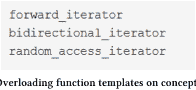

`std::random_access_iterator` 是一种 `std::bidirectional_iterator`，而 `std::bidirectional_iterator` 是一种 `std::forward_iterator`。

```cpp
Vector<std::regular>
Vector<T>
```

概念的部分模板特化

###### 4.1.4.4.7 使用多个概念

到目前为止，使用概念一直很简单，但大多数时候会同时使用多个概念。

使用多个概念

```cpp
template<typename Iter, typename Val>
    requires std::input_iterator<Iter>
             && std::equality_comparable<Value_type<Iter>, Val>
Iter find(Iter b, Iter e, Val v)
```

find 要求迭代器 Iter 及其与 Val 的比较满足：

- 迭代器必须是输入迭代器；
- 迭代器的值类型必须与 Val 可进行相等比较。

对迭代器的相同限制也可以表达为受约束的模板参数。

使用多个概念

```cpp
template<std::input_iterator Iter, typename Val>
    requires std::equality_comparable<Value_type<Iter>, Val>
Iter find(Iter b, Iter e, Val v)
```

#### 4.1.5 受约束和不受约束的占位符

首先，让我告诉你 C++14 中的一个不对称现象。

##### 4.1.5.1 C++14 中的重大不对称

我在课堂上经常进行如下讨论。在 C++14 中，我们有了泛型 lambda。泛型 lambda 是使用 auto 而不是具体类型的 lambda。

在 C++20 中，你可以在函数声明中使用不受约束的占位符（auto）或受约束的占位符（概念），从而自动获得函数模板。应用规则非常简单：凡是能使用不受约束占位符 auto 的地方，都可以使用概念。我会在“缩写函数模板”一节中详细解释这一点。

##### 4.1.5.2 占位符

使用受约束占位符代替不受约束占位符

```cpp
// placeholders.cpp

#include <concepts>
#include <iostream>
#include <vector>

std::integral auto getIntegral(int val){
    return val;
}

int main(){

    std::cout << std::boolalpha << '\n';

    std::vector<int> vec{1, 2, 3, 4, 5};
    for (std::integral auto i: vec) std::cout << i << " ";
    std::cout << '\n';

    std::integral auto b = true;
    std::cout << b << '\n';

    std::integral auto integ = getIntegral(10);
    std::cout << integ << '\n';

    auto integ1 = getIntegral(10);
    std::cout << integ1 << '\n';

    std::cout << '\n';

}
```

概念 std::integral 可用作返回类型（第 7 行）、用于基于范围的 for 循环（第 16 行），或作为变量 b（第 19 行）或变量 integ（第 22 行）的类型。为了看出 auto 与概念之间的对称性，第 25 行单独使用 auto，而不是第 22 行使用的 std::integral auto。因此，integ1 可以接受任意类型的值。


```text
1 2 3 4 5
true
10
10
```

使用受约束占位符而非未受约束占位符

#### 4.1.6 缩写函数模板

在 C++20 中，你可以在函数声明中使用未受约束的占位符（`auto`）或受约束的占位符（概念），包括成员函数和运算符。该函数声明会自动成为一个函数模板。

缩写函数模板

```cpp
// abbreviatedFunctionTemplates.cpp

#include <concepts>
#include <iostream>

template<typename T>
requires std::integral<T>
T gcd(T a, T b) {
    if( b == 0 ) return a;
    else return gcd(b, a % b);
}

template<typename T>
T gcd1(T a, T b) requires std::integral<T> {
    if( b == 0 ) return a;
    else return gcd1(b, a % b);
}

template<std::integral T>
T gcd2(T a, T b) {
    if( b == 0 ) return a;
    else return gcd2(b, a % b);
}

std::integral auto gcd3(std::integral auto a, std::integral auto b) {
    if( b == 0 ) return a;
    else return gcd3(b, a % b);
}

30   auto gcd4(auto a, auto b){
31       if( b == 0 ) return a;
32       return gcd4(b, a % b);
33   }
34
35   int main() {
36
37       std::cout << '\n';
38
39       std::cout << "gcd(100, 10)= " << gcd(100, 10) << '\n';
40       std::cout << "gcd1(100, 10)= " << gcd1(100, 10) << '\n';
41       std::cout << "gcd2(100, 10)= " << gcd2(100, 10) << '\n';
42       std::cout << "gcd3(100, 10)= " << gcd3(100, 10) << '\n';
43       std::cout << "gcd4(100, 10)= " << gcd4(100, 10) << '\n';
44
45       std::cout << '\n';
46
47   }
```

函数模板 `gcd`（第 6 行）、`gcd1`（第 13 行）和 `gcd2`（第 19 行）的定义，是我在 *使用概念的四种方式* 一节中已经介绍过的。`gcd` 使用了 requires 子句，`gcd1` 使用了尾置 requires 子句，`gcd2` 使用了受约束的模板参数。现在介绍一些新内容：函数模板 `gcd3` 将概念 `std::integral` 作为类型参数，因此成为一个具有受限类型参数的函数模板。相比之下，`gcd4` 等价于对其类型参数没有限制的函数模板。`gcd3` 和 `gcd4` 中用于创建函数模板的语法称为缩写函数模板语法。

```text
gcd(100, 10)= 10
gcd1(100, 10)= 10
gcd2(100, 10)= 10
gcd3(100, 10)= 10
gcd4(100, 10)= 10
```

受约束的

*让我在下面的另一个示例中强调这种对称性。*

使用 `auto` 作为类型参数，函数 `add` 成为一个函数模板，并且等价于同名的函数模板 `add`。

### 等价的函数和函数模板 add

```cpp
template<typename T, typename T2>
auto add(T fir, T2 sec) {
    return fir + sec;
}

auto add(auto fir, auto sec) {
    return fir + sec;
}
```

相应地，由于使用了概念 `std::integral`，函数 `sub` 等价于函数模板 `sub`。

### 等价的函数和函数模板 sub

```cpp
template<std::integral T, std::integral T2>
std::integral auto sub(T fir, T2 sec) {
    return fir - sec;
}

std::integral auto sub(std::integral auto fir, std::integral auto sec) {
    return fir - sec;
}
```

函数和函数模板可以具有任意类型。这意味着两个类型可以不同，但都必须是整型。例如，调用 `sub<100, 10>` 和 `sub<100, true>` 都是有效的。

此外，你还可以显式指定模板参数：

### 显式模板参数

```cpp
add<int>(100, 10);   // equivalent to add(100, 10)
sub<int>(100, 10);   // equivalent to sub(100, 10)
```

缩写函数模板语法中还有一个有趣的功能尚未介绍：你可以基于 `auto` 或概念进行重载。

##### 4.1.6.1 重载

下面的函数在 `auto`、概念 `std::integral` 和类型 `long` 上重载。

### 缩写函数模板与重载

```cpp
// conceptsOverloading.cpp

#include <concepts>
#include <iostream>

void overload(auto t){
    std::cout << "auto : " << t << '\n';
}

void overload(std::integral auto t){
    std::cout << "Integral : " << t << '\n';
}

void overload(long t){
    std::cout << "long : " << t << '\n';
}

int main(){

    std::cout << '\n';

    overload(3.14);
    overload(2010);
    overload(2020L);

    std::cout << '\n';

}
```

编译器对 double 选择 `auto` 重载（第 6 行），对 int 选择概念 `std::integral` 重载（第 10 行），对 long 选择 `long` 重载（第 14 行）。

```text
auto : 3.14
Integral : 2010
long : 2020
```

**缩写函数模板与重载**


### 我们未能获得的功能：模板引入

在本章关于概念的内容中，你可能会觉得缺少一个特性：模板引入。模板引入曾是概念技术规范 TS ISO/IEC TS 19217:2015¹³ 的一部分，也是概念的一个实验性实现。GCC 6¹⁴ 完整实现了 concepts TS。除了与 C++20 中的概念存在语法差异外，concepts TS 还支持一种简洁的模板定义方式。

在下面的示例中，假设 `Integral` 是一个概念。

concepts TS 中的模板引入

```cpp
Integral{T}
Integral gcd(T a, T b){
    if( b == 0 ){ return a; }
    else{
        return gcd(b, a % b);
    }
}

Integral{T}
class ConstrainedClass{};
```

上面这个小代码片段以两种方式使用了模板引入。第一种，定义一个带有受约束模板参数的函数模板；第二种，定义一个带有受约束模板参数的类模板。模板引入有一个限制：你只能将它用于受约束的模板参数（概念），而不能用于未受约束的模板参数（auto）。通过定义一个总是返回 true 的概念，可以轻松克服这种不对称性：

概念 `Generic` 总是被满足

```cpp
template <typename T>
concept bool Generic(){
    return true;
}
```

不要感到奇怪，我在示例中使用了 concepts TS 语法来定义 `Generic` 概念。C++20 的语法更简洁一些。更多 C++20 语法的细节请参阅 *定义概念* 一节。

#### 4.1.7 预定义概念

“不要重复造轮子”这条黄金法则同样适用于概念。C++ 核心指南¹⁵ 对这一规则非常明确：T.11：只要可能，就使用标准概念。因此，我想给出

- ¹³ https://www.iso.org/standard/40341.html
- ¹⁴ https://en.wikipedia.org/wiki/GNU_Compiler_Collection
- ¹⁵ https://isocpp.github.io/CppCoreGuidelines/CppCoreGuidelines

- `std::convertible_to`：`std::convertible_to<T, U>` 保证 `T` 可以隐式或显式转换为 `U`
- `std::common_reference_with`：`std::common_reference_with<T, U>` 必须是良构的，且 `T` 和 `U` 必须可转换为某个引用类型 `C`，其中 `C` 与 `std::common_reference_t<T, U>` 相同
- `std::common_with`：与 `std::common_reference_with` 类似，但公共类型 `C` 与 `std::common_type_t<T, U>` 相同，并且不能是引用类型
- `std::assignable_from`
- `std::swappable`

###### 4.1.7.2.2 算术概念

- `std::integral`
- `std::signed_integral`
- `std::unsigned_integral`
- `std::floating_point`

标准对算术概念的定义很直接：

```cpp
template<class T>
concept integral = is_integral_v<T>;

template<class T>
concept signed_integral = integral<T> && is_signed_v<T>;

template<class T>
concept unsigned_integral = integral<T> && is_unsigned_v<T>;

template<class T>
concept floating_point = is_floating_point_v<T>;
```

###### 4.1.7.2.3 生命周期概念

- `std::destructible`
- `std::constructible_from`
- `std::default_initializable`
- `std::move_constructible`
- `std::copy_constructible`

###### 4.1.7.2.4 比较概念

- `std::equality_comparable`
- `std::totally_ordered`

也许你在数学学习中已经了解过它。对于类型 `T` 的值 `a`、`b` 和 `c`，当且仅当以下条件成立时，`T` 满足 `std::totally_ordered`：

- `bool(a < b)`、`bool(a > b)` 和 `bool(a == b)` 中有且仅有一个为 true
- 如果 `bool(a < b)` 且 `bool(b < c)`，那么 `bool(a < c)`
- `bool(a > b) == bool(b < a)`
- `bool(a <= b) == !bool(b < a)`
- `bool(a >= b) == !bool(b > a)`

###### 4.1.7.2.5 对象概念

- `std::movable`
- `std::copyable`
- `std::semiregular`
- `std::regular`

以下是这四个概念的简洁定义：

```cpp
template<class T>
concept movable = is_object_v<T> && move_constructible<T> &&
                  assignable_from<T&, T> && swappable<T>;

template<class T>
concept copyable = copy_constructible<T> && movable<T> &&
                   assignable_from<T&, T&> &&
                   assignable_from<T&, const T&> && assignable_from<T&, const T>;

template<class T>
concept semiregular = copyable<T> && default_initializable<T>;

template<class T>
concept regular = semiregular<T> && equality_comparable<T>;
```

我不得不补充几句。概念 `std::movable` 要求 `T` 满足 `std::is_object_v<T>`。根据类型萃取 `std::is_object_v<T>` 的定义，这意味着 `T` 要么是标量、数组、联合体，要么是类。

我会在 *定义概念* 一节中实现 `semiregular` 和 `regular` 这两个概念。非正式地说，`semiregular` 类型的行为类似于 `int`，而 `regular` 类型的行为类似于 `int`，并且可以使用 `==` 进行比较。


###### 4.1.7.2.6 可调用概念

- `std::invocable`
- `std::regular_invocable`：一个类型满足 `std::invocable` 且保持相等性，并且不修改函数参数；保持相等性意味着在给定相同输入时产生相同输出
- `std::predicate`：一个类型如果满足 `std::invocable` 并返回布尔值，则它满足谓词概念

##### 4.1.7.3 通用工具库

标准中的这一章只包含特殊内存概念；因此我在这里不涉及它们。

##### 4.1.7.4 迭代器库

迭代器库有许多重要的概念。它们定义在 `<iterator>` 头文件中。以下是迭代器类别：

- `std::input_or_output_iterator`
- `std::input_iterator`
- `std::output_iterator`
- `std::forward_iterator`
- `std::bidirectional_iterator`
- `std::random_access_iterator`
- `std::contiguous_iterator`

这六类迭代器对应于各自的迭代器概念。下表提供了两条有趣的信息。对于四个最主要的迭代器类别，表中展示了它们的属性和关联的标准库容器。

### 每个迭代器类别的属性和容器

| 迭代器类别 | 属性 | 容器 |
|---|---|---|
| `std::forward_iterator` | `++It, It++`<br>`It == It2, It != It2` | `std::unordered_set`<br>`std::unordered_map`<br>`std::unordered_multiset`<br>`std::unordered_multimap`<br>`std::forward_list` |
| `std::bidirectional_iterator` | `--It, It--` | `std::set`<br>`std::map`<br>`std::multiset`<br>`std::multimap` |
| `std::random_access_iterator` | `It[i]`<br>`It += n, It -= n`<br>`It + n, It - n`<br>`n + It`<br>`It - It2`<br>`It < It2, It <= It2`<br>`It > It2, It >= It2` | `std::list`<br>`std::deque` |
| `std::contiguous_iterator` | `It[i]`<br>`It += n, It -= n`<br>`It + n, It - n`<br>`n + It`<br>`It - It2`<br>`It < It2, It <= It2`<br>`It > It2, It >= It2` | `std::array`<br>`std::vector`<br>`std::string` |

`std::input_or_output_iterator` 支持 `++It`、`It++` 和 `*It` 操作。`std::input_iterator` 和 `std::output_iterator` 都是 `std::input_or_output_iterator`。以下关系成立：连续迭代器是随机访问迭代器，随机访问迭代器是双向迭代器，双向迭代器是前向迭代器。连续迭代器要求容器的元素在内存中连续存储。

###### 4.1.7.4.1 算法概念

- `std::permutable`：可以原地重排元素
- `std::mergeable`：可以将已排序序列合并到输出序列中
- `std::sortable`：可以将序列排列为有序序列

##### 4.1.7.5 范围库

范围库包含了对于范围（ranges）和视图（views）特性至关重要的概念。它们与迭代器库中的概念类似，并定义在 `<ranges>` 头文件中。

###### 4.1.7.5.1 范围

- `std::ranges::range`：范围指定了一组你可以迭代的元素。它提供了开始迭代器和结束哨兵。当然，STL 的容器都是范围。

### range 概念

```cpp
template<typename T>
concept range = requires(T& t) {
    ranges::begin(t);
    ranges::end(t);
};
```

对于 `std::ranges::range` 有进一步的细化。

- `std::ranges::input_range`：指定了一个其迭代器类型满足 `std::input_iterator` 的范围（例如，至少可以从头到尾迭代一次）
- `std::ranges::output_range`：指定了一个其迭代器类型满足 `std::output_iterator` 的范围
- `std::ranges::forward_range`：指定了一个其迭代器类型满足 `std::forward_iterator` 的范围（可以多次从头到尾向前迭代）
- `std::ranges::bidirectional_range`：指定了一个其迭代器类型满足 `std::bidirectional_iterator` 的范围（可以多次向前和向后迭代）
- `std::ranges::random_access_range`：指定了一个其迭代器类型满足 `std::random_access_iterator` 的范围（可以使用下标运算符 `[]` 在常数时间内跳到任意元素）
- `std::ranges::contiguous_range`：指定了一个其迭代器类型满足 `std::contiguous_iterator` 的范围（元素在内存中连续存储）

标准模板库的每个容器都支持特定的范围。所支持的范围指定了其迭代器的能力。

**每个范围概念的属性和容器**

| 概念 | 属性 | 容器 |
|---|---|---|
| `std::ranges::input_range` | `++It, It++`<br>`It == It2, It != It2` | `std::unordered_set`<br>`std::unordered_map`<br>`std::unordered_multiset`<br>`std::unordered_multimap`<br>`std::forward_list` |
| `std::ranges::bidirectional_range` | `--It, It--` | `std::set`<br>`std::map`<br>`std::multiset`<br>`std::multimap`<br>`std::list` |
| `std::ranges::random_access_range` | `It[i]`<br>`It += n, It -= n` | `std::deque` |

### view 概念

```cpp
template <typename T>
concept view = range<T> &&
              movable<T> &&
              enable_view<T>;

template <class T>
inline constexpr bool enable_view = derived_from<T, view_base>;
```

视图通常是应用于某个范围并执行某种操作的东西。视图不拥有数据，并且视图进行复制、移动或赋值所需的时间是常数。它应该是只读、无状态且保持相等性的。这里引用 Eric Niebler 的 range-v3 实现中的一句话，该实现是 C++20 ranges 的基础：“视图是范围的可组合适配，适配在视图被迭代时惰性发生。”

因此，STL 的容器是范围而不是视图。

##### 4.1.7.6 数值库

数值库提供了 `std::uniform_random_bit_generator` 概念，该概念定义在 `<random>` 头文件中。类型为 `G` 的 `std::uniform_random_bit_generator` `g` 必须返回均匀分布的无符号整数。此外，类型为 `G` 的均匀随机位生成器必须支持成员函数 `G::min` 和 `G::max`。

#### 4.1.8 定义概念

当你需要查找的概念不是 C++20 中的预定义概念之一时，你必须定义自己的概念。在本节中，我将定义几个概念，通过使用驼峰式语法来与预定义概念区分。因此，我为有符号整型定义的概念命名为 `SignedIntegral`，而 C++ 标准概念的名称为 `signed_integral`。

定义概念的语法非常直接：

概念定义

```cpp
template <template-parameter-list>
concept concept-name = constraint-expression;
```

概念定义以关键字 `template` 开头，并有一个模板参数列表。第二行更有趣。它使用关键字 `concept`，后跟概念名和约束表达式。

约束表达式是一个编译期谓词，它可以是：

- 其他概念或编译期谓词的逻辑组合
  - 逻辑组合可以由合取（&&）、析取（||）或否定（!）构成
  - 编译期谓词是在编译期返回布尔值的可调用对象
- 一个 requires 表达式
  - 简单要求
  - 类型要求
  - 复合要求
  - 嵌套要求

在接下来的两节中，我将演示定义概念的各种方法。

##### 4.1.8.1 其他概念与编译期谓词的逻辑组合

你可以使用合取（&&）和析取（||）来组合概念和编译期谓词。可以使用感叹号（!）对组件进行否定。这种概念和编译期谓词的逻辑组合的求值遵循短路求值²⁰。短路求值意味着当逻辑表达式的整体结果已经确定时，其求值会自动停止。

多亏了类型特征库²¹中的众多编译期谓词，你可以使用所需的所有工具来构建强大的概念。

²⁰ https://en.wikipedia.org/wiki/Short-circuit_evaluation
²¹ https://en.cppreference.com/w/cpp/header/type_traits


## 不要递归定义概念，也不要试图约束概念

概念的递归定义是无效的：

**递归定义概念**
```cpp
template <typename T>
concept Recursive = Recursive<T>;
```

在这种情况下，GCC 编译器会报错，提示 `Recursive` 未在此作用域中声明。

当你尝试约束一个概念时，例如在下面的代码片段中，GCC 编译器会明确报错，指出概念不能被约束。

**约束概念**
```cpp
template <typename T>
concept AlwaysTrue = true;

template <typename T>
requires AlwaysTrue<T>
concept Error = true;
```

让我们从概念 Integral、SignedIntegral 和 UnsignedIntegral 开始。

**概念 Integral、SignedIntegral 和 UnsignedIntegral**
```cpp
template <typename T>
concept Integral = std::is_integral<T>::value;

template <typename T>
concept SignedIntegral = Integral<T> && std::is_signed<T>::value;

template <typename T>
concept UnsignedIntegral = Integral<T> && !SignedIntegral<T>;
```

我使用类型特征函数 `std::is_integral` 来定义概念 Integral（第 2 行）。借助函数 `std::is_signed`，我将概念 Integral 细化为概念 SignedIntegral（第 4 行）。最后，对概念 SignedIntegral 取反，就得到了概念 UnsignedIntegral（第 7 行）。

好，让我们试一试。

**使用概念 Integral、SignedIntegral 和 UnsignedIntegral**
```cpp
// SignedUnsignedIntegrals.cpp

#include <iostream>
#include <type_traits>

template <typename T>
concept Integral = std::is_integral<T>::value;

template <typename T>
concept SignedIntegral = Integral<T> && std::is_signed<T>::value;

template <typename T>
concept UnsignedIntegral = Integral<T> && !SignedIntegral<T>;

void func(SignedIntegral auto integ) {
    std::cout << "SignedIntegral: " << integ << '\n';
}

void func(UnsignedIntegral auto integ) {
    std::cout << "UnsignedIntegral: " << integ << '\n';
}

int main() {

    std::cout << '\n';

    func(-5);
    func(5u);

    std::cout << '\n';

}
```

我使用简写函数模板语法，在概念 SignedIntegral（第 15 行）和 UnsignedIntegral（第 19 行）上重载函数 `func`。编译器会选择预期的重载：

```text
SignedIntegral: -5
UnsignedIntegral: 5
```

**使用概念 SignedIntegral 和 UnsignedIntegral**

出于完整性考虑，下面的概念 Arithmetic 使用了析取。

**概念 Arithmetic**
```cpp
template <typename T>
concept Arithmetic = std::is_integral<T>::value || std::is_floating_point<T>::value;
```

##### 4.1.8.2 Requires 表达式

借助 requires 表达式，你可以定义强大的概念。requires 表达式具有以下形式：

**Requires 表达式**
```cpp
requires (parameter-list(optional)) {requirement-seq}
```

- `parameter-list`：以逗号分隔的参数列表，就像在函数声明中那样
- `requirement-seq`：由简单需求、类型需求、复合需求或嵌套需求组成的需求序列

当需要编译期谓词时，requires 表达式也可以作为独立特性使用。要了解更多关于此特性的内容，请阅读“Requires 表达式”一节。

###### 4.1.8.2.1 简单需求

下面的概念 Addable 是一个简单需求。

**概念 Addable**
```cpp
template <typename T>
concept Addable = requires (T a, T b) {
    a + b;
};
```

概念 Addable 要求同一类型 T 的两个值可以进行 a + b 加法运算。

###### 4.1.8.2.2 类型需求

在类型需求中，必须将关键字 typename 与类型名一起使用。

**概念 TypeRequirement**
```cpp
template<typename T>
concept TypeRequirement = requires {
    typename T::value_type;
    typename Other<T>;
};
```

概念 TypeRequirement 要求类型 T 具有嵌套成员 value_type，并且类模板 Other 可以用 T 实例化。

让我们试一下：

**使用概念 TypeRequirement**
```cpp
 1  #include <iostream>
 2  #include <vector>
 3
 4  template <typename>
 5  struct Other;
 6
 7  template <>
 8  struct Other<std::vector<int>> {};
 9
10  template<typename T>
11  concept TypeRequirement = requires {
12      typename T::value_type;
13      typename Other<T>;
14  };
15
16  int main() {
17
18      TypeRequirement auto myVec = std::vector<int>{1, 2, 3};
19
20  }
```

表达式 `TypeRequirement auto myVec = std::vector<int>{1, 2, 3}`（第 18 行）是有效的。`std::vector`²³ 具有内部成员 `value_type`（第 12 行），并且类模板 `Other` 可以用 `std::vector<int>` 实例化（第 13 行）。

²³ https://en.cppreference.com/w/cpp/container/vector

###### 4.1.8.2.3 复合需求

复合需求的形式为

```cpp
34    */
35
36    std::cout << '\n';
37
38 }
```

概念 Equal（第 6 行）要求其类型参数 T 支持相等和不相等运算符。此外，这两个运算符都必须返回可转换为 bool 的值。当然，int 满足概念 Equal，但类型 WithoutEqual（第 16 行）和 WithoutUnequal（第 20 行）则不满足。因此，当我使用类型 WithoutEqual（第 31 行）时，使用 GCC 编译器会得到以下错误消息。

```text
<source>:6:17:   in requirements with 'T a', 'T b' [with T = WithoutEqual]
<source>:7:9: note: the required expression '(a == b)' is invalid
    7 |     { a == b } -> std::convertible_to<bool>;
      |       ^~~~~~~~
<source>:8:9: note: the required expression '(a != b)' is invalid
    8 |     { a != b } -> std::convertible_to<bool>;
      |       ^~~~~~~~
```

WithoutEqual 不满足概念 Equal

###### 4.1.8.2.4 嵌套需求

嵌套需求的形式为

**嵌套需求**
```cpp
requires constraint-expression;
```

嵌套需求用于指定对类型参数的需求。

下面是定义概念 UnsignedIntegral 的另一种方式（参见概念和谓词的逻辑组合）：

**概念 Integral、SignedIntegral 和 UnsignedIntegral**
```cpp
 1  // nestedRequirements.cpp
 2
 3  #include <type_traits>
 4
 5  template <typename T>
 6  concept Integral = std::is_integral<T>::value;
 7
 8  template <typename T>
 9  concept SignedIntegral = Integral<T> && std::is_signed<T>::value;
10  // template <typename T>
11  // concept UnsignedIntegral = Integral<T> && !SignedIntegral<T>;
12
13  template <typename T>
14  concept UnsignedIntegral = Integral<T> &&
15  requires(T) {
16      requires !SignedIntegral<T>;
17  };
18
19  int main() {
20
21      UnsignedIntegral auto n = 5u;  // works
22      // UnsignedIntegral auto m = 5;  // compile time error, 5 is a signed literal
23
24  }
```

第 14 行将概念 SignedIntegral 用作嵌套需求，以细化概念 Integral。老实说，第 11 行中被注释掉的概念 UnsignedIntegral 更便于阅读。

下一节中的概念 Ordering 演示了嵌套需求的使用。

#### 4.1.9 Requires 表达式

当需要编译期谓词时，requires 表达式也可以作为独立特性使用。因此，requires 表达式的用例可以是 [static_assert]、constexpr if 或 requires 子句。

##### 4.1.9.1 static_assert

static_assert 需要一个编译期谓词，以及编译期谓词失败时显示的消息。在 C++17 中，该消息是可选的。在 C++20 中，这个编译期谓词可以是一个 requires 表达式。

**将 requires 表达式作为 `static_assert` 的谓词**
```cpp
 1  // staticAssertRequires.cpp
 2
 3  #include <concepts>
 4  #include <iostream>
 5
 6  struct First {
 7      int count() const {
 8          return 2020;
 9      }
10  };
11
12  struct Second {
13      int size() const {
14          return 2021;
15      }
16  };
17
18  int main() {
19
20      std::cout << '\n';
21
22      First first;
23      static_assert(requires(First first) { { first.count() } -> std::convertible_to<int>; });
24
25      Second second;
26      static_assert(requires(Second second) { { second.count() } -> std::convertible_to<int>; });
27
28      int third;
29      static_assert(requires(int third) { { third.count() } -> std::convertible_to<int>; });
30
31      std::cout << '\n';
32
33  }
```

requires 表达式（第 23、26 和 29 行）检查对象是否具有成员函数 count，并且其结果可转换为 int。此检查仅对类 First（第 6 - 10 行）有效。相反，第 26 行和第 29 行中的检查会失败。


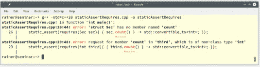

## 将 requires 表达式用作 static_assert 的谓词

也许，你想根据编译期检查来编译代码。在这种情况下，*constexpr if* 与 requires 表达式结合，为你提供了必要的工具。

##### 4.1.9.2 constexpr if

C++17 中的 *constexpr if* 允许有条件地编译源代码。对于条件，requires 表达式可以发挥作用。if 语句的所有分支都必须有效。

借助 *constexpr if*，你可以定义在编译期检查其参数的函数，并根据分析结果生成不同的功能。

将 requires 表达式用作 *constexpr if* 的谓词

```cpp
 1 // constexprIfRequires.cpp
 2
 3 #include <concepts>
 4 #include <iostream>
 5
 6 struct First {
 7     int count() const {
 8         return 2020;
 9     }
10 };
11
12 struct Second {
13     int size() const {
14         return 2021;
15     }
16 };
17
18 template <typename T>
19 int getNumberOfElements(T t) {
20
21     if constexpr (requires(T t) { t.count() } -> std::convertible_to<int>;) {
22         return t.count();
23     }
24     if constexpr (requires(T t) { t.size() } -> std::convertible_to<int>;) {
25         return t.size();
26     }
27     else return 42;
28
29 }
30
31 int main() {
32     std::cout << '\n';
33
34     First first;
35     std::cout << "getNumberOfElements(first): " << getNumberOfElements(first) << '\n';
36
37     Second second;
38     std::cout << "getNumberOfElements(second): " << getNumberOfElements(second) << '\n';
39
40     int i;
41     std::cout << "getNumberOfElements(i): " << getNumberOfElements(i) << '\n';
42
43     std::cout << '\n';
44
45 }
```

第 21 行和第 24 行是这个代码示例的关键。在第 21 行，requires 表达式判断变量 t 是否有一个返回 int 的成员函数 count。相应地，第 24 行判断变量 t 是否有一个成员函数 size。第 27 行的 else 语句用作回退。

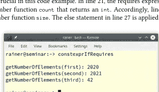

将 requires 表达式用作 *constexpr if* 的谓词

##### 4.1.9.3 requires 或匿名概念

你可以定义一个匿名概念并直接使用它。一般来说，你不应该这样做。匿名概念会使代码难以阅读，而且你无法复用你的概念。

### 用于相加两个概念的匿名概念

```cpp
template<typename T>
    requires requires (T x) { x + x; }
T add1(T a, T b) { return a + b; }
```

该函数模板临时定义了它的概念。add1 在 requires 子句中使用了一个 requires 表达式。这个匿名概念等价于之前定义的概念 Addable，下面使用具名概念 Addable 的函数模板 add2 也是如此。

### 概念 Addable 的使用

```cpp
template<Addable T>
T add2(T a, T b) { return a + b; }
```

概念应当封装通用思想，并赋予其自解释的名称以便复用。它们对维护代码非常宝贵。匿名概念读起来更像对模板参数的语法约束，因此应避免使用。

#### 4.1.10 用户定义的概念

在前面的章节中，我回答了关于概念的两个基本问题：“如何使用概念？”以及“如何定义你自己的概念？”。在本节中，我想应用这些章节提供的理论知识来定义更高级的概念，例如 Ordering、SemiRegular 和 Regular。

##### 4.1.10.1 概念 Equal 和 Ordering

在简要回顾概念漫长历史的短途旅程中，我已经展示了 Haskell 类型类层次结构的一部分：

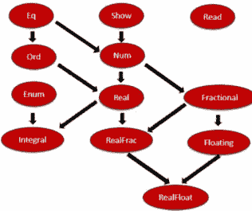

### Haskell 类型类层次结构

该类型类层次结构表明，类型类 Ord 是类型类 Eq 的细化。Haskell 优雅地表达了这一点。

### Haskell 类型类层次结构的一部分

```haskell
 1 class Eq a where
 2   (==) :: a -> a -> Bool
 3   (/=) :: a -> a -> Bool
 4
 5 class Eq a => Ord a where
 6   compare :: a -> a -> Ordering
 7   (<) :: a -> a -> Bool
 8   (<=) :: a -> a -> Bool
 9   (>) :: a -> a -> Bool
10   (>=) :: a -> a -> Bool
11   max :: a -> a -> a
```

每个支持类型类 Eq 的类型 a（第 1 行）都必须支持相等（第 2 行）和不等（第 3 行）。现在来看这个定义中有趣的部分。每个支持类型类 Ord 的类型 a 都必须支持类型类 Eq（第 5 行中的 class Eq a => Ord a）。此外，类型 a 还必须支持四个比较运算符以及函数 compare 和 max（第 6 - 11 行）。

这是我的挑战。我们能否用 C++20 中的概念来表达 Haskell 中类型类 Eq 和 Ord 之间的关系？为简单起见，我忽略 Haskell 的函数 compare 和 max。

###### 4.1.10.1.1 概念 Ordering

多亏了 `requires` 表达式，概念 `Ordering` 的定义看起来与 Haskell 中类型类 `Ord` 的定义非常相似。

**概念 Ordering**

```cpp
template <typename T>
concept Ordering =
    Equal<T> &&
    requires(T a, T b) {
        { a < b } -> std::convertible_to<bool>;
        { a <= b } -> std::convertible_to<bool>;
        { a > b } -> std::convertible_to<bool>;
        { a >= b } -> std::convertible_to<bool>;
    };
```

`Ordering` 概念在底层使用了**嵌套要求**。如果类型 `T` 支持概念 `Equal`，并且还支持四个比较运算符，那么它就支持概念 `Ordering`。让我们试一试。

**概念 Ordering 的定义与用法**

```cpp
// conceptsDefinitionOrdering.cpp

#include <concepts>
#include <iostream>
#include <unordered_set>

template <typename T>
concept Equal =
    requires(T a, T b) {
        { a == b } -> std::convertible_to<bool>;
        { a != b } -> std::convertible_to<bool>;
    };


template <typename T>
concept Ordering =
    Equal<T> &&
    requires(T a, T b) {
        { a < b } -> std::convertible_to<bool>;
        { a <= b } -> std::convertible_to<bool>;
        { a > b } -> std::convertible_to<bool>;
        { a >= b } -> std::convertible_to<bool>;
    };
```

现在来看更有趣的情况。当我们编译第 48 行：`auto smallerSet = getSmaller(firSet, secSet);` 时会发生什么？GCC 编译器明确报错，指出 `std::unordered_set` 不是函数模板 `getSmaller` 的有效实参。

```text
<source>:48:68:   required from here
<source>:48:39:   required for the satisfaction of 'getSmaller<...>' [with T = std::unordered_set<int, std::hash<int>, std::equal_to<int>, std::allocator<int> >]
<source>:48:19:   in requirements with 'T a', 'T b' [with T = std::unordered_set<int, std::hash<int>, std::equal_to<int>, std::allocator<int> >]
   19 |     requires(T a, T b) {
      |              ~~~~~~~~
<source>:48:19:   note: the required expression '(a < b)' is invalid
   20 |         { a < b } -> std::convertible_to<bool>;
      |           ~~~~^~~
<source>:48:19:   note: the required expression '(a == b)' is invalid
   21 |         { a == b } -> std::convertible_to<bool>;
      |           ~~~~^~~
<source>:48:19:   note: the required expression '(a != b)' is invalid
   22 |         { a != b } -> std::convertible_to<bool>;
      |           ~~~~^~~
```

**函数模板 `getSmaller` 的错误用法**

`Ordering` 概念已经是 C++20 标准的一部分。

- `std::three_way_comparable`：等价于上面介绍的概念 `Ordering`
- `std::three_way_comparable_with`：允许比较不同类型的值；例如：`1.0 < 1.0f`

在 C++20 中，我们有了三路比较运算符，也称为宇宙飞船运算符 `<=>`。我将在相等运算符和三路比较章节中深入完整地介绍它。

##### 4.1.10.2 概念 `SemiRegular` 和 `Regular`

当你想定义一个在 C++ 生态系统中良好工作的具体类型时，你应该定义一个“行为像 `int`”的类型。形式上，你的具体类型应该是一个正规类型。在本节中，我定义概念 `SemiRegular` 和 `Regular`。

`SemiRegular` 和 `Regular` 是 C++ 中的基本思想。抱歉，我应该说概念。例如，下面是 C++ 核心准则中的规则 T.46：T.46：要求模板实参至少为 `Regular` 或 `SemiRegular`²²。现在，只剩下一个重要问题需要回答：什么是 `Regular` 或 `SemiRegular` 类型？在深入细节之前，先给出非正式答案：

- 正规类型“行为像 `int`”。它可以被复制，复制操作的结果独立于原对象，并具有相同的值。

好，让我更正式一些。正规类型同时也是半正规类型，所以让我们开始吧。

²² https://isocpp.github.io/CppCoreGuidelines/CppCoreGuidelines#Rt-regular


## 常规**类型**

[亚历山大·斯特潘诺夫](https://en.wikipedia.org/wiki/Alexander_Stepanov)，标准模板库的设计者，定义了常规类型（regular type）和半常规类型（semiregular type）这两个术语。根据他的定义，如果一个类型支持以下函数，那么它就是常规的：

- 复制构造
- 赋值
- 相等性
- 析构
- 全序

复制构造意味着默认构造，相等性意味着不相等性。当斯特潘诺夫定义上述要求时，C++ 中还没有移动语义。亚历山大·斯特潘诺夫与[保罗·麦克琼斯](https://www.mcjones.org/paul/)合著的《[编程元素](http://elementsofprogramming.com/)》一书专门讨论了常规类型。

###### 4.1.10.2.1 `SemiRegular` 概念

半常规类型 X 必须支持“六大函数”（Big Six）并且可交换（swappable）。六大函数包括以下函数：

- 默认构造函数：`X()`
- 拷贝构造函数：`X(const X&)`
- 拷贝赋值：`X& operator = (const X&)`
- 移动构造函数：`X(X&&)`
- 移动赋值：`X& operator = (X&&)`
- 析构函数：`~X()`

此外，X 必须是可交换的：`swap(X&, X&)`

多亏了[类型萃取库](https://en.cppreference.com/w/cpp/header/type_traits)，定义相应的概念变得轻而易举。首先，我定义类型萃取 isSemiRegular，然后用它来定义概念 SemiRegular。

- 28. https://en.wikipedia.org/wiki/Alexander_Stepanov
- 29. http://elementsofprogramming.com/
- 30. https://www.mcjones.org/paul/
- 31. https://en.cppreference.com/w/cpp/header/type_traits

### std::semiregular 和 std::regular 概念的定义

```cpp
template<class T>
concept movable = is_object_v<T> && move_constructible<T> &&
                  assignable_from<T&, T> && swappable<T>;

template<class T>
concept copyable = copy_constructible<T> && movable<T> &&
                  assignable_from<T&, T&> &&
                  assignable_from<T&, const T&>;

template<class T>
concept semiregular = copyable<T> && default_initializable<T>;

template<class T>
concept regular = semiregular<T> && equality_comparable<T>;
```

有趣的是，`std::regular` 概念的定义方式与概念 Regular 类似。另一方面，`std::semiregular` 概念与更基础的概念相结合，例如 `std::copyable` 和 `std::movable`。`std::movable` 概念基于类型萃取函数 `std::is_object`<sup>32</sup>。`cppreference.com` 也提供了这个编译期谓词的一种可能实现。

### 类型萃取 std::is_object 的一种可能实现

```cpp
template <class T>
struct is_object : std::integral_constant<bool,
                         std::is_scalar<T>::value ||
                         std::is_array<T>::value ||
                         std::is_union<T>::value ||
                         std::is_class<T>::value > {};
```

如果类型是标量、数组、联合体或类，那么它就是对象类型。

在本节结束之前，我想应用用户自定义的概念 Regular 和 C++20 概念 `std::regular`。程序 regularSemiRegular.cpp 完成了这项工作。

```cpp
45 }
46
47 struct NotEqualityComparable { };
48
49 int main() {
50
51     int myInt{};
52     behavesLikeAnInt(myInt);
53     behavesLikeAnInt2(myInt);
54
55     std::vector<int> myVec{};
56     behavesLikeAnInt(myVec);
57     behavesLikeAnInt2(myVec);
58
59     EqualityComparable equComp;
60     behavesLikeAnInt(equComp);
61     behavesLikeAnInt2(equComp);
62
63     NotEqualityComparable notEquComp;
64     behavesLikeAnInt(notEquComp);
65     behavesLikeAnInt2(notEquComp);
66
67 }
```

我将前面代码片段中的各个部分组合在一起，定义了概念 Regular（第 27 行）。函数模板 behavesLikeAnInt（第 31 行）和 behavesLikeAnInt2（第 36 行）检查参数是否“表现得像 int”。这意味着用户自定义的概念 Regular 和 C++20 概念 std::regular 被用来建立条件。正如名称所暗示的，类型 EqualityComparable（第 41 行）支持相等性，但类型 NotEqualityComparable（第 47 行）不支持。在两个函数调用（第 64 行和第 65 行）中使用类型 NotEqualityComparable 是程序中最有趣的部分。

虽然我正处于概念实现的早期阶段，但我想比较一下新的 GCC 和 MSVC 编译器给出的错误消息。

- GCC

我在 Compiler Explorer³ 上使用了当前的 GCC 10.2，命令行参数为 `-std=c++20`。以下基本上是我使用用户自定义概念 Regular（第 64 行）时得到的错误消息：

³) https://godbolt.org/

```text
<source>:23:13: note: the required expression `(a = b)` is invalid
  23 |     (a = b) -> std::convertible_to<bool>;
     |     ^~~~~~~
<source>:24:13: note: the required expression `(a != b)` is invalid
  24 |     (a != b) -> std::convertible_to<bool>;
     |     ^~~~~~~~
```

使用概念 Regular 时的错误消息

C++20 概念 `std::regular` 更加全面。因此，第 65 行的调用给出了更全面的错误消息：

```text
/opt/compiler-explorer/gcc-10.2.0/include/c++/10.2.0/concepts:28:10: note: the required expression `__t == __u` is invalid
  282 |     { __t == __u } -> __boolean_testable;
      |       ~~~~^~~~~~
/opt/compiler-explorer/gcc-10.2.0/include/c++/10.2.0/concepts:28:10: note: the required expression `__t != __u` is invalid
  283 |     { __t != __u } -> __boolean_testable;
      |       ~~~~^~~~~~
/opt/compiler-explorer/gcc-10.2.0/include/c++/10.2.0/concepts:28:10: note: the required expression `__u == __t` is invalid
  284 |     { __u == __t } -> __boolean_testable;
      |       ~~~~^~~~~~
/opt/compiler-explorer/gcc-10.2.0/include/c++/10.2.0/concepts:28:10: note: the required expression `__u != __t` is invalid
  285 |     { __u != __t } -> __boolean_testable;
      |       ~~~~^~~~~~
```

使用概念 `std::regular` 时的错误消息

- MSVC

MSVC 编译器给出的错误消息过于不具体。

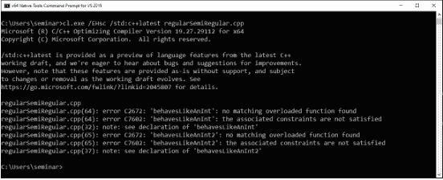

使用概念 Regular 和 std::regular 时的错误消息

从截图中可以看到，我使用了 x64 版本 19.27.29112，命令行参数为 `/EHSC /std:c++latest`。


## **C++20 中的概念：演进还是革命？**

这个小小的迂回表达了我的观点。首先，我陈述事实，然后得出我的结论。这些事实基于本章前面所讲的内容。那么，哪些论据支持演进，哪些支持革命呢？

### **演进**

- 概念促进了在**更高抽象层级**上使用泛型代码进行工作。
- 当模板编译失败时，概念能提供**易于理解的错误消息**。它们所提供的一切，你都可以通过类型萃取库⁷、SFINAE⁸ 和 static_assert⁹ 实现。
- `auto` 是一种无约束的占位符。借助 C++20，我们可以将概念用作**受约束的占位符**。
- 通过 C++14，我们可以使用泛型 lambda 作为定义函数模板的便捷方式。

### **革命**

- 概念第一次让我们能够**验证模板需求**。当然，你也可以通过结合类型萃取库¹⁰、SFINAE¹¹ 和 static_assert¹² 来实现模板参数的验证，但这种技术过于高级，不能被视为通用解决方案。
- 得益于简化的函数模板语法，模板的定义得到了彻底改进。
- 概念代表**语义类别**，而非语法约束。我们不应使用像 `Addable` 这样要求类型支持 + 运算符的概念，而应当从概念 `Number` 的角度思考，其中 `Number` 是一个语义类别，如 `Equal` 或 `Ordering`。

### **我的结论**

关于概念究竟是演进的一步还是革命性的飞跃，存在许多争论。主要因为语义类别，我站在革命这一边。像 `Number`、`Equal`ity（相等性）或 `Ordering`（排序）这样的概念让我想起了柏拉图¹³的理念世界。我们现在能够以这些类别来思考编程，这是***革命性***的。

- 7. https://en.cppreference.com/w/cpp/header/type_traits
- 8. https://en.cppreference.com/w/cpp/language/sfinae
- 9. https://en.cppreference.com/w/cpp/language/static_assert
- 10. https://en.cppreference.com/w/cpp/header/type_traits
- 11. https://en.cppreference.com/w/cpp/language/sfinae
- 12. https://en.cppreference.com/w/cpp/language/static_assert
- 13. https://en.wikipedia.org/wiki/Plato


## 提炼信息

- 在特定类型或类型参数上定义的函数或类会带来一系列问题。概念通过对类型参数施加语义约束来克服这些问题。
- 概念可用于 requires 子句、尾随 requires 子句、作为受约束的模板参数，或用于缩写函数模板中。
- 概念是编译期谓词，可用于各种模板。你可以基于概念进行重载、基于概念特化模板、将概念用于成员函数或可变参数模板。
- 得益于 C++20 和概念，无约束占位符（`auto`）和受约束占位符（概念）的使用得到了统一。在 C++20 中，每当你使用 `auto` 时，就可以使用概念。
- 得益于新的缩写函数模板语法，定义函数模板变得轻而易举。
- 不要重复造轮子。在定义自己的概念之前，请研究 C++20 标准中丰富的预定义概念集合。定义概念时，你可以运用两种技术：组合概念与编译期谓词，或使用 requires 表达式。
- requires 表达式可在 `static_assert` 或 `if constexpr` 中用作编译期谓词。

### 4.2 模块


Cippi 准备软件包

模块是 C++20 的四大特性之一：概念、模块、范围（ranges）和协程。模块承诺了很多：更短的编译时间、宏隔离、废除头文件，以及避免丑陋的变通方法。在深入模块之前，我想先提供一个初步示例。

#### 4.2.1 第一个示例

让我们从一个简单的数学模块开始。

```cpp
// math.hxx

export module math;

export int add(int fir, int sec){
    return fir + sec;
}
```

表达式 `export module math` 是模块声明。通过将 `export` 放在函数 `add` 的声明之前，`add` 被导出，因此可以被模块使用者使用。

### 使用简单的 math 模块

```cpp
// client.cpp

import math;

int main() {

    add(2000, 20);

}
```

`import math` 导入模块 `math`，并使客户端中导出的名称可见。

让我从模块声明文件开始。

##### 4.2.1.1 模块声明文件

你注意到这个模块的奇怪名称了吗：`math.ixx`。

- Microsoft 编译器使用扩展名 `ixx`。后缀 `ixx` 表示模块接口源文件。
- Clang 编译器使用扩展名 `cppm`。后缀中的 `m` 很可能代表模块（module）。
- GCC 编译器不使用特殊扩展名。

全局模块片段以关键字 `module` 开始，并以模块声明结束。全局模块片段是使用 `#include` 等预处理指令的地方，以便模块单元能够编译。全局模块片段内使用的预处理实体仅在模块内部可见。

第二个 `math` 模块版本支持 `add` 和 `getProduct` 两个函数。

### 带有全局模块片段的模块定义

```cpp
// math1.ixx

module;

#include <numeric>
#include <vector>

export module math;

export int add(int fir, int sec){
    return fir + sec;
}

export int getProduct(const std::vector<int>& vec) {
    return std::accumulate(vec.begin(), vec.end(), 1, std::multiplies<int>());
}
```

我在全局模块片段（第 3 行）和模块声明（第 8 行）中包含了必要的头文件。

### 使用改进后的 math 模块

```cpp
// client1.cpp

#include <iostream>
#include <vector>

import math;

int main() {

    std::cout << '\n';

    std::cout << "add(2000, 20): " << add(2000, 20) << '\n';

    std::vector<int> myVec{1, 2, 3, 4, 5, 6, 7, 8, 9, 10};

    std::cout << "getProduct(myVec): " << getProduct(myVec) << '\n';

    std::cout << '\n';

}
```

客户端导入模块 math 并使用其功能：

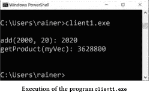

模块有哪些优势？

#### 4.2.2 优势

让我从一个简单的可执行文件开始。出于显而易见的原因，我创建一个 `helloWorld.cpp` 程序。

### 一个简单的 hello world 程序

```cpp
// helloWorld.cpp

#include <iostream>

int main() {
    std::cout << "Hello World" << '\n';
}
```

使用 GCC<sup>1</sup> 从程序 `helloWorld.cpp` 生成可执行文件 `helloWorld`，会使其大小增加 130 倍。

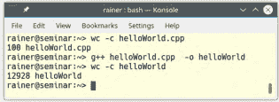

目标文件的大小

截图中的数字 100 和 12928 表示字节数。好了。我们应该对底层发生的事情有一个基本了解。

##### 4.2.2.1 经典构建过程

构建过程包括三个步骤：预处理、编译和链接。

###### 4.2.2.1.1 预处理

预处理器处理诸如 `#include` 和 `#define` 之类的指令。预处理器用相应的头文件替换 `#include` 指令，并替换宏（`#define`）。得益于 `#if`、`#else`、`#elif`、`#ifdef`、`#ifndef` 和 `#endif` 等指令，源代码的某些部分可以被包含或排除。

你可以通过在 GCC/Clang 上使用编译器标志 `-E`，或在 Windows 上使用 `/E`，来观察这个直接的文本替换过程。

> <sup>1</sup>http://gcc.gnu.org/

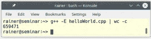

预处理器输出

哇！！！预处理步骤的输出超过五十万字节。我不想责怪 GCC；其他编译器也同样冗长。预处理器的输出是编译器的输入。

这个预处理步骤的结果是翻译单元。

###### 4.2.2.1.2 编译

编译会分别对预处理器的每个输出执行。编译器解析 C++ 源代码，并将其转换为汇编代码。生成的文件称为目标文件，包含二进制形式的已编译代码。目标文件可以构建归档文件以供以后重用，并且可以引用没有定义的符号。这些归档文件称为静态库。

编译器生成的目标文件是链接器的输入。

###### 4.2.2.1.3 链接

链接器的输出是可执行文件、静态库或共享库。链接器的工作是解析对未定义符号的引用。符号在目标文件或库中定义。此阶段的典型错误是符号未定义或多次定义。

C++ 从 C 继承了构建过程。如果你只有一个翻译单元，它能很好地工作。但当你拥有多个翻译单元时，可能会出现许多问题。

##### 4.2.2.2 构建过程的问题

以下是经典构建过程中缺陷的不完整列表。模块解决了这些缺陷。

###### 4.2.2.2.1 重复替换

预处理器用相应的头文件替换 `#include` 指令。让我修改最初的 `helloWorld.cpp` 程序，使这种重复变得可见。

我重构了程序，并添加了两个源文件 `hello.cpp` 和 `world.cpp`。源文件 `hello.cpp` 提供函数 `hello`，源文件 `world.cpp` 提供函数 `world`。两个源文件都包含相应的头文件。重构意味着程序具有与之前的程序 `helloWorld.cpp` 相同的外部行为，但内部结构得到了改进。

以下是新文件：

- `hello.cpp` 和 `hello.h`

### hello 的实现

```cpp
// hello.cpp

#include "hello.h"

void hello() {
    std::cout << "hello ";
}
```

### hello 的头文件

```cpp
// hello.h

#include <iostream>

void hello();
```

- `world.cpp` 和 `world.h`

### world 的实现

```cpp
// world.cpp

#include "world.h"

void world() {
    std::cout << "world";
}
```

### world 的头文件

```cpp
// world.h

#include <iostream>

void world();
```

- `helloWorld2.cpp`


### hello 和 world 的使用

```cpp
// helloWorld2.cpp

#include <iostream>

#include "hello.h"
#include "world.h"

int main() {

    hello();
    world();
    std::cout << '\n';

}
```

构建并执行该程序可按预期工作：

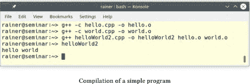

问题就在这里。预处理器会在每个源文件上运行。因此，头文件 `<iostream>` 被包含了三次。因此，每个源文件膨胀到超过五十万行。

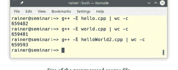

这浪费了编译时间。

与头文件不同，*模块*只被导入一次，而且实际上不产生额外开销。

###### 4.2.2.2.2 与预处理器宏隔离

如果 C++ 社区有一个共识，那就是：我们应该消除预处理器宏。为什么？使用宏只是文本替换，不包含任何 C++ 语义。当然，这会带来许多负面后果：例如，它可能取决于你包含宏的顺序，或者宏可能与应用程序中已定义的宏或名称冲突。

假设你有两个头文件 `webcolors.h` 和 `productinfo.h`。

**宏 RED 的第一个定义**

```c
// webcolors.h

#define RED   0xFF0000
```

**宏 RED 的第二个定义**

```c
// productinfo.h

#define RED   0
```

当源文件 `client.cpp` 包含这两个头文件时，宏 RED 的值取决于所包含头文件的顺序。这种依赖非常容易出错。

**使用模块时，导入顺序没有区别。**

###### 4.2.2.2.3 符号的多个定义

ODR 代表单一定义规则，对于函数而言，它规定：

- 一个函数在任何翻译单元中不能多于一个定义。
- 一个函数在程序中不能有多个定义。

具有外部链接的内联函数可以在多个翻译单元中定义。这些定义必须满足所有定义都相同的要求。

让我们看看当我尝试链接一个违反单一定义规则的程序时，链接器会说什么。下面的代码示例有两个头文件 `header.h` 和 `header2.h`。主程序两次包含头文件 `header.h`，违反了单一定义规则，因为包含了 `func` 的两个定义。

### 函数 func 的定义

```cpp
// header.h

void func() {}
```

### 间接包含 func 的函数定义

```cpp
// header2.h

#include "header.h"
```

### 函数 func 的双重定义

```cpp
// main.cpp

#include "header.h"
#include "header2.h"

int main() {}
```

链接器抱怨 func 的多个定义：

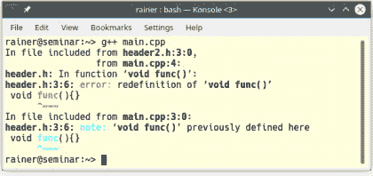

**破坏单一定义规则**

我们习惯于丑陋的变通方法，例如在头文件周围放置包含守卫。将包含守卫 `FUNC_H` 添加到头文件 `header.h` 可以解决该问题。

#### 4.2.3 细节

模块引入了一些新术语，我想在使用它们之前先介绍这些术语。

##### 4.2.3.1 术语

模块由一个或多个模块单元组成。**模块单元**是带有模块声明的特殊翻译单元。除了全局模块片段之外，模块声明必须是这个特殊翻译单元的第一个声明。每个模块单元都与一个 `ModuleName` 关联：

```text
Module declaration ModuleName
[export] module ModuleName [:ModulePartition]
```

关键字 `export` 和模块分区 `:ModulePartition` 是可选的。

- **ModuleName**：ModuleName 可以包含点。点没有特殊含义，但有助于表达层次化模块。
- **export**：使用关键字 **export** 的模块声明称为**模块接口单元**；否则，它们称为**模块实现单元**。
- **ModulePartition**：模块分区要么是**内部分区**，要么是**接口分区**。内部分区从模块外部不可见，并提供模块的声明和定义。接口分区参与并扩展模块的导出接口。
- **命名模块**：命名模块是具有相同模块名的模块单元的集合。
- **主模块接口**：每个命名模块必须恰好有一个不是模块分区的模块接口单元。这个模块接口单元称为主模块接口单元。其导出内容将对导入它的客户端可用。

##### 4.2.3.2 编译器支持

使用模块时，必须使用非常新的 Clang、GCC 或 Microsoft 编译器。即使你拥有最新的 C++ 编译器，也并非支持 C++20 中模块的所有特性。这对 Clang 和 GCC 编译器尤其如此。

模块的编译具有挑战性。因此，我以三大编译器为例展示模块的编译：Microsoft 编译器、Clang 编译器和 GCC 编译器。此外，我还介绍成功使用模块必须使用的各种标志。


### 模块的编译

通常，模块由声明和定义组成。因此，编译模块包括两个步骤。

- 将模块的声明预编译为编译器特定的格式。
- 将模块的定义编译为目标文件。

由于三大编译器对模块的支持只是部分的，我将在适当的时候更新本节。

###### 4.2.3.2.1 Microsoft Visual C++ 编译器

首先，我使用面向 x64 编译器的 cl.exe 19.29.30133。

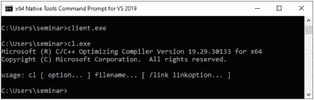

这些是使用 Microsoft 编译器编译和使用模块的步骤。我只展示最小命令行。如之前承诺，更多细节将随后给出。此外，对于较旧的 Microsoft 编译器，必须使用标志 `/std:c++latest`。

### 使用 Microsoft 编译器构建可执行文件

```text
cl.exe /std:c++latest /c math.ixx
cl.exe /std:c++latest client.cpp math.obj
```

- 第 1 行创建 obj 文件 `math.obj` 和一个 IFC 文件 `math.ifc`。IFC 就是模块，包含描述模块接口的元数据。IFC 的二进制格式模仿了 Gabriel Dos Reis 和 Bjarne Stroustrup（2004/2005）的[内部程序表示](https://www.stroustrup.com/gdr-bs-macsi9.pdf)。
- 第 2 行创建可执行文件 `client.exe`。如果没有第一步隐式使用的 `math.ifc` 文件，链接器就无法找到该模块。

[⁴⁵](https://www.stroustrup.com/gdr-bs-macsi9.pdf)

```text
Microsoft (R) C/C++ Optimizing Compiler Version 19.29.30133 for x64
Copyright (C) Microsoft Corporation. All rights reserved.

/std:c++latest is provided as a preview of language features from the latest C++
working draft, and we're eager to hear about bugs and suggestions for improvements.
However, note that these features are provided as-is without support, and subject
to changes or removal as the working draft evolves. See
https://go.microsoft.com/fwlink/?linkid=2045807 for details.

math.ixx
C:\Program Files\Microsoft Visual Studio\2022\Community\VC\Tools\MSVC\14.29.30133\bin\HostX86\x64>dir
 Volume in drive C has no label.
 Volume Serial Number is 5CE7-E875

 Directory of C:\Users\seminar\build\empty

2021/08/21  11:10    <DIR>          .
2021/08/21  11:10    <DIR>          ..
2021/08/21  11:10             1,173 math.ifc
2021/08/21  11:10                90 math.ixx
2021/08/21  11:10               742 math.obj
2021/08/21  11:10               819 math.ixx
               3 File(s)          1,973 bytes
               2 Dir(s)  529,758,650,368 bytes free

C:\Users\seminar>
```

**隐式创建的 IFC 文件**

出于明显的原因，我不展示程序执行的输出。

Microsoft Visual C++ 编译器提供了多种用于创建模块的选项。

###### 4.2.3.2.2 模块选项

下表概述了模块编译器选项。

**模块编译器选项**

| 模块编译器选项 | 描述 |
| --- | --- |
| /interface | 指定输入文件是模块接口单元。 |
| /internalPartition | 指定输入文件是内部分区单元。 |
| /reference | 指定输入文件是 IFC 文件。 |
| /ifcSearchDir | 指定 IFC 文件的搜索路径。 |
| /ifcOutput | 指定 IFC 文件的名称。如果名称是目录，则编译器根据 IFC 文件名或头单元名生成名称。 |
| /ifcOnly | 指定编译器只生成 IFC 文件。 |


## 模块编译器选项

| 模块编译器选项 | 描述 |
| --- | --- |
| /exportheader | 指定编译器从输入文件创建头文件单元。 |
| /headerName | 指定输入文件是头文件。 |
| /headerUnit <header name>=(ifc file name) | 导入头文件单元。 |
| /translateInclude | 指定如果头文件名是可导入头文件，则编译器执行 #include -> import 转换。 |
| /showResolvedHeader | 显示编译后头文件单元的完整解析路径。 |
| /validateIfcChecksum[-] | 指定使用 IFC 中存储的内容哈希进行额外安全检查。默认关闭。 |

此外，通常还需要以下通用编译器选项。


## 常见的 cl.exe 编译器选项

### cl.exe 编译器选项

| 编译器选项 | 描述 |
| --- | --- |
| /EHsc | 指定 C++ 标准异常处理模型。 |
| /TP | 指定所有源文件均为 C++ 源文件。 |
| /std:c++latest | 使用最新的 C++ 标准。 |

在以下命令行中，我针对模块和 ifc 文件使用了各种编译器选项。

- 使用模块 `math.cppm` 创建 obj 和 ifc 文件。

**创建 obj 和 ifc 文件**

```text
cl.exe /c /std:c++latest /interface /TP math.cppm
```

- 使用模块 `math.cppm` 仅创建 ifc 文件。

**仅创建 ifc 文件**

```text
cl.exe /c /std:c++latest /ifcOnly /interface /TP math.cppm
```

- 使用模块 `math.cppm` 创建 obj 文件 math.obj 和 ifc 文件 mathematic.ifc。

**创建 ifc 文件 mathematic.ifc**

```text
cl.exe /c /std:c++latest /interface /TP math.cppm /ifcOutput mathematic.ifc
```

- 创建可执行文件 client.exe，并显式使用 ifc 文件 math.inter。

**使用 ifc 文件 math.inter**

```text
cl.exe /std:c++latest client.cpp math.obj /reference math.inter
```

- 创建可执行文件 client.exe，并显式使用位于目录 ifcFiles 中的 ifc 文件 math.inter。

**使用 ifc 文件 math.inter**

```text
cl.exe /std:c++latest client.cpp math.obj /ifcSearchDir ifcFiles /reference math.inter
```

###### 4.2.3.2.3 Clang 编译器

我使用 Clang 16.0.5 编译器。

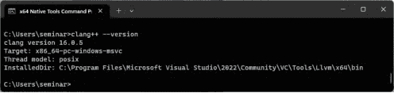

用于模块的 Clang 编译器

使用 clang 编译器时，模块声明文件应具有 cppm 扩展名。因此，我必须将 math.ixx 文件重命名为 math.cppm。

### 一个简单的数学模块

```cpp
// math.cppm

export module math;

export int add(int fir, int sec){
    return fir + sec;
}
```

客户端文件 client.cpp 保持不变。以下是创建可执行文件的必要步骤。

**使用 Clang 编译器构建可执行文件**

```bash
clang++ -std=c++20 -c math.cppm -fprecompile -o math.pcm

clang++ -std=c++20 client.cpp -fprebuilt-module-path=. math.pcm -o client.exe
```

- 第 1 行创建模块 math.pcm。后缀 pcm 表示预编译模块，相当于 Microsoft Visual Compiler 的 ifc 文件。此外，生成的模块已经包含模块定义。因此，Clang 编译器不会生成对象文件 math.o。选项 `-fprecompile` 是创建预编译模块所必需的。
- 第 3 行创建可执行文件 client.exe，它使用模块 math.pcm。Clang 编译器要求你使用 `-fprebuilt-module-path` 标志指定模块路径。否则，链接过程会失败。

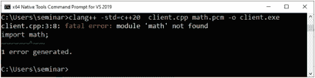

**缺少模块路径**

Clang 编译器为模块的创建提供了多种选项。

###### 4.2.3.2.4 模块选项

Clang 支持三类用于创建和使用模块的选项。

###### 4.2.3.2.5 创建模块

模块可以通过两种方式创建：从命名模块或从头文件单元创建。Clang 编译器要求你始终指定模块路径。下表展示了处理模块的选项。

### 模块编译器选项

| 模块编译器选项 | 描述 |
| --- | --- |
| `--precompile` | 创建模块。 |
| `-fmodule-output` | 在工作目录中创建模块，名称为输入文件名并扩展名为 `.pcm`。 |
| `-fmodule-output=<ModuleName>` | 创建名为 ModuleName 的模块。 |
| `-fmodule-header` | 允许从头文件单元创建模块。使用用户搜索路径。 |
| `-fmodule-header=user` | 允许从头文件单元创建模块。使用用户搜索路径。 |
| `-fmodule-header=system` | 允许从头文件单元创建模块。使用系统搜索路径。 |
| `-xc++-header` | 无后缀的头文件可标记为头文件。 |
| `-xc++-user-header` | 无后缀的用户头文件可标记为头文件。 |
| `-xc++-system-header` | 无后缀的系统头文件可标记为头文件。 |
| `-x c++-module` | 允许使用后缀不是 `.cppm` 的可导入模块单元。 |
| `-fprebuilt-module-path=<ModuleDirectory>` | 编译器在目录 ModuleDirectory 中查找模块。 |
| `-fmodule-file=<ModuleName>=<ModulePath>` | 编译器在路径 ModulePath 中查找模块 ModuleName。选项 `-fprebuilt-module-path` 具有更高优先级。 |

可导入模块是可以被导入的模块单元。头文件单元的有效后缀是 `h` 或 `hh`。

有关更多细节，请参阅官方 *标准 C++ 模块* 文档。在以下命令行中，我使用模块的编译器选项以及文件 `math.pcm`。

- 使用模块声明文件 `math.cppm` 创建 pcm 文件（`math.pcm`）。

### 一个简单的数学模块

```cpp
// math.cxx

export module math;

export int add(int fir, int sec){
    return fir + sec;
}
```

客户端文件 client.cpp 保持不变。以下是创建可执行文件的必要步骤。

**使用 GCC 编译器构建可执行文件**

```bash
1  g++ -c -std=c++20 -fmodules-ts math.cxx
2
3  g++ -std=c++20 -fmodules-ts client.cpp math.o -o client
```

- 第 1 行创建模块 math.gcm 和对象文件 math.o。我必须指定 -fmodules-ts。扩展名 -fmodules-ts 让我感到困惑，因为 ts 代表技术规范。相反，Clang 将同一标志命名为 -fmodules。模块 math.gcm 位于目录 gcm.cache 中。math.gcm 是编译后的模块接口。据推测，gcm 代表 GCC compiled module。
- 第 3 行创建可执行文件 client.exe。它隐式使用模块 math.gcm。

GCC 仅支持少量模块选项。

###### 4.2.3.2.7 模块选项

下表展示了 GCC 的少数选项。

**模块编译器选项**

| 模块编译器选项 | 描述 |
| --- | --- |
| -fmodules-ts | 启用模块。GCC 必需。 |
| -fmodule-header | 编译头文件单元。 |
| -fmodule-mapper=VALUE | 指定模块映射器。 |
| -fno-module-lazy | 禁用延迟加载。 |

###### 4.2.3.2.8 使用的编译器

本书主要使用 Microsoft 的 cl.exe 编译器。Microsoft 目前（2023 年底）对模块的支持最好<sup>47</sup>。Microsoft 博客提供了一些关于模块的优秀文章：C++ 中的模块概述<sup>48</sup>、Visual Studio 2019 16.5 中 MSVC 的 C++ 模块一致性改进<sup>49</sup>，以及从命令行在 MSVC 中使用 C++ 模块第 1 部分：主模块接口<sup>50</sup>。Clang 和 GCC 都没有提供类似的介绍，这使得使用这些编译器处理模块相当困难。

我将在相应章节中举例说明头文件单元的用法。

##### 4.2.3.3 导出

在模块接口单元中导出名称有三种方式：导出说明符、导出组和导出命名空间。

##### 4.2.3.4 导出说明符

你可以显式导出每个名称。

| 导出说明符 |
| --- |
| `export module math;` |
| `export int mult(int fir, int sec);` |
| `export void doTheMath();` |

##### 4.2.3.5 导出组

导出组会导出其所有名称。

<sup>47</sup> https://en.cppreference.com/w/cpp/compiler_support  
<sup>48</sup> https://docs.microsoft.com/en-us/cpp/cpp/modules-cpp?view=msvc-160&viewFallbackFrom=vs-2019  
<sup>49</sup> https://devblogs.microsoft.com/cppblog/c-modules-conformance-improvements-with-msvc-in-visual-studio-2019-16-5/  
<sup>50</sup> https://devblogs.microsoft.com/cppblog/using-cpp-modules-in-msvc-from-the-command-line-part-1/


### 导出组

```cpp
export module math;

export {

    int mul(int fir, int sec);
    void doTheMath();

}
```

##### 4.2.3.6 导出命名空间

除了使用导出组，你还可以使用导出命名空间。

### 导出命名空间

```cpp
export module math;

export namespace math {

    int mul(int fir, int sec);
    void doTheMath();

}
```

当客户端使用来自导出命名空间的名称时，必须对它们进行限定。


### 选择性导出命名空间

你还可以在命名空间内使用导出说明符、导出组和导出命名空间。在这种情况下，只有导出的名称对模块使用者可见。以下示例使用了在命名空间内导出名称的三种方式。

### 在命名空间内选择性导出

```cpp
export module math;

namespace math {

    export int mult(int fir, int sec); // use with math::mult
    export {
        void doTheMath();            // use with math::doTheMath
    }
    export namespace mathDetails {   // use with math::mathDetails::add
        int add(int fir, int sec);
    }
    int div(int fir, int sec);       // no use outside the module

}
```

函数 div 不能在模块 math 外部使用，并且必须完全限定：math::div(6, 2)。

只有不具有内部链接的名称才能被导出。

##### 4.2.3.7 导入

借助 import，你可以导入模块、模块分区或头文件单元。

上下文关键字 import

```cpp
export module math;

import math.sin;
import math::cos;
import <vector>;
```

import 是上下文关键字。这意味着 import 是一个标识符，只在某些上下文中才是关键字。在导入一个可导入实体之前，你应该先编译它。否则，你可能会导入该可导入实体的旧版本。

##### 4.2.3.8 模块结构指南

让我们考察一下如何组织模块的指南。

### 模块结构的指南

```cpp
module;                        // starts the global module fragment

#include <headers for libraries not modularized so far>

export module math;            // exporting module declaration; starts the module preamble

import <importing of other modules>

<non-exported declarations>    // names only visible inside the module

export namespace math {

    <exported declarations>    // exported names

}

module :private;               // not part of the interface

// part of the module implementation that does not cause a recompilation
```

本指南只有一个目的：为你提供一个模块结构，并让你了解我接下来要写的内容。那么，这个模块结构有什么新意呢？

- 以关键字 `module` 开头的*全局模块片段*是可选的。在它之后、模块声明之前，这里是包含头文件的正确位置。这里只允许出现预处理指令。
- 必需的导出模块声明 `export module math` 会启动所谓的*模块前导*，随后是*模块范围*，其结束于翻译单元的末尾。模块前导由导入声明组成，而模块范围主要由导出声明组成。
- 模块范围可以包含 `private module fragment`。私有模块片段是模块实现的一部分，并且只能在主模块接口单元中使用。对私有模块片段的修改不需要重新编译该模块。
- 你可以在模块范围的开头导入模块。被导入的模块具有模块链接，并且在模块外部不可见。这一观察同样适用于未导出的声明。
- 我将导出的名称放在命名空间 `math` 中，它与模块同名。
- 该模块只声明了名称。下面我们来讨论模块接口与实现的分离。

本质上，模块结构可归结为三个部分。

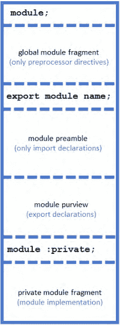

##### 4.2.3.9 模块接口单元与模块实现单元

当模块变大时，你应该将其组织为一个模块接口单元和一个或多个模块实现单元。遵循前面提到的模块结构指南，我将重构 math 模块的前一版本。

###### 4.2.3.9.1 模块接口单元

### 模块接口单元

```cpp
// mathInterfaceUnit.ixx

module;

#include <vector>

export module math;

export namespace math {

    int add(int fir, int sec);

    int getProduct(const std::vector<int>& vec);

}
```

- 模块接口单元包含导出模块声明：`export module math`（第 7 行）。
- 名称 `add` 和 `getProduct` 被导出（第 11 行和第 13 行）。
- 一个模块只能有一个模块接口单元。

###### 4.2.3.9.2 模块实现单元

### 模块实现单元

```cpp
// mathImplementationUnit.cpp

module math;

#include <numeric>

namespace math {

    int add(int fir, int sec) {
        return fir + sec;
    }

    int getProduct(const std::vector<int>& vec) {
        return std::accumulate(vec.begin(), vec.end(), 1, std::multiplies<int>());
    }

}
```

- 模块实现单元包含非导出模块声明：`module math;`（第 3 行）。
- 一个模块可以有多个模块实现单元。

###### 4.2.3.9.3 主程序

客户端使用模块 math

```cpp
// client3.cpp

#include <iostream>
#include <vector>

import math;

int main() {

    std::cout << '\n';

    std::cout << "math::add(2000, 20): " << math::add(2000, 20) << '\n';

    std::vector<int> myVec{1, 2, 3, 4, 5, 6, 7, 8, 9, 10};

    std::cout << "math::getProduct(myVec): " << math::getProduct(myVec) << '\n';

    std::cout << '\n';

}
```

从用户的角度看，包含了模块 math（第 6 行），并添加了命名空间 math。

当我的解释变得依赖于编译器时，我会将它们放在单独的提示框中。如果你决定尝试，这些信息通常很宝贵。

### 带有私有模块片段的模块声明文件

```cpp
// mathInterfaceUnit2.ixx

module;

#include <numeric>
#include <vector>

export module math;

export namespace math {

    int add(int fir, int sec);

    int getProduct(const std::vector<int>& vec);

}

module :private;

int add(int fir, int sec) {
    return fir + sec;
}

int getProduct(const std::vector<int>& vec) {
    return std::accumulate(vec.begin(), vec.end(), 1, std::multiplies<int>());
}
```

第 18 行中的 `module :private;` 表示私有模块片段的开始。修改模块声明文件的这个可选最后部分不会导致该模块的导入者重新编译。

##### 4.2.3.11 子模块与模块分区

当你的模块增长时，你会希望将其功能划分为可管理的组件。C++20 模块提供了两种方法：子模块和分区。

###### 4.2.3.11.1 子模块

一个模块可以导入模块，然后重新导出它们。在以下示例中，模块 math 导入了子模块 math.math1 和 math.math2。

### 模块 math

```cpp
// mathModule.ixx

export module math;

export import math.math1;
export import math.math2;
```

表达式 `export import math.math1` 导入模块 `math.math1`，并将其作为模块 `math` 的一部分重新导出。

为完整起见，下面给出模块 `math.math1` 和 `math.math2`。我使用句点将模块 `math` 与其子模块分隔开。这个句点不是必需的。

### 子模块 math.math1

```cpp
// mathModule1.ixx

export module math.math1;

export int add(int fir, int sec) {
    return fir + sec;
}
```

### 子模块 math.math2

```cpp
// mathModule2.ixx

export module math.math2;

export {
    int mul(int fir, int sec) {
        return fir * sec;
    }
}
```

如果仔细看，你会注意到模块 `math` 中的导出语句有一个细微差别。`math.math1` 使用导出说明符，而 `math.math2` 使用导出组或导出块。

从客户端的角度看，使用 `math` 模块很直接。


### 主程序

```cpp
// mathModuleClient.cpp

#include <iostream>

import math;

int main() {

    std::cout << '\n';

    std::cout << "add(3, 4): " << add(3, 4) << '\n';
    std::cout << "mul(3, 4): " << mul(3, 4) << '\n';

}
```

编译并执行程序，会得到预期的行为。

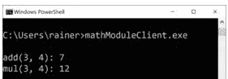

函数模块和子模块的使用

## 使用 Microsoft 编译器编译模块及其子模块

### 由模块及其子模块构建可执行文件

```cpp
cl.exe /c /std:c++latest mathModule1.ixx /EHsc
cl.exe /c /std:c++latest mathModule2.ixx /EHsc
cl.exe /c /std:c++latest mathModule.ixx /EHsc
cl.exe /c /std:c++latest mathModuleClient.cpp /EHsc
cl.exe mathModuleClient.obj mathModule1.obj mathModule2.obj mathModule.obj /EHsc
```

三个模块的每个编译过程都会创建两个产物：IFC 文件（接口文件）`*.ifc`，在最后一行隐式使用；以及 `*.obj` 文件，在最后一行显式使用。

我之前已经提到过，子模块也是一个模块。每个子模块都有一个模块声明。因此，我可以创建第二个客户端，它只对 `math:math1` 模块感兴趣。

### 主接口文件

```cpp
// mathPartition.ixx

export module math;

export import :math1;
export import :math2;
```

主接口文件由导出模块声明（第 3 行）组成。它使用冒号导入并重新导出分区 `math1` 和 `math2`（第 5 行和第 6 行）。分区的名称必须以模块的名称开头。因此，你不必指定它们。

### 第一个模块分区

```cpp
// mathPartition1.ixx

export module math:math1;

export int add(int fir, int sec) {
    return fir + sec;
}
```

### 第二个模块分区

```cpp
// mathPartition2.ixx

export module math:math2;

export {
    int mul(int fir, int sec) {
        return fir * sec;
    }
}
```

与模块声明类似，表达式 `export module math:math1` 和 `export module math:math2`（第 3 行）声明了一个模块接口分区。模块接口分区也是一个模块接口单元。`math` 代表模块，`math1` 或 `math2` 代表分区。

### 导入模块分区

```cpp
// mathModuleClient.cpp

import math;

int main() {
    std::cout << '\n';

    std::cout << "add(3, 4): " << add(3, 4) << '\n';
    std::cout << "mul(3, 4): " << mul(3, 4) << '\n';
}
```

你可能已经猜到了：客户端程序与我之前使用子模块时是一样的。可执行文件的创建和程序的执行也有相同的观察结果：

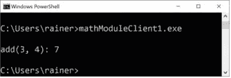

##### 4.2.3.12 可达性与可见性

使用模块时，必须区分可达性和可见性。当模块导出某个实体时，导入它的客户端可以看到并使用该实体。未导出的实体不可见，但可能是可达的。

### 模块 bar

```cpp
// bar.cpp

module;

#include <iostream>

export module bar;

struct Foo {
    void writeName() {
        std::cout << "\nFoo\n";
    }

};

export struct Bar {
    Foo getFoo() {
        return Foo{};
    }
};
```

模块 bar 导出了类 Bar。Bar 是可见且可达的。相反，Foo 是不可见的。

### 使用模块 bar

```cpp
#include <utility>

import bar;

int main() {

    Bar b;
    // Foo f;
    auto f = b.getFoo();
    f.writeName();

    using FooAlias = decltype(std::declval<Bar>().getFoo());
    FooAlias f2;
    f2.writeName();

}
```

类 Foo 没有被导出，因此不可见。在第 6 行使用它会导致链接错误。相反，Foo 是可达的，因为成员函数 `getFoo`（bar.cpp 第 18 行）返回了它。因此，可以调用 `writeName` 函数（第 8 行）。此外，我可以为 Foo 创建类型别名（第 12 行），使用它实例化 Foo（第 13 行），并在其上调用 writeName（第 14 行）。第 12 行中的表达式 `std::declval<Bar>().getFoo()` 返回调用 `Bar.getFoo()` 会返回的对象。最后，`decltype` 返回这个假设对象的类型。


使用模块 bar

##### 4.2.3.13 模块链接

在 C++20 之前，C++ 支持两种链接：内部链接和外部链接。

- **内部链接：** 具有内部链接的名称在翻译单元外部不可访问。内部链接主要包括声明为 `static` 的命名空间作用域名称和匿名命名空间的成员。
- **外部链接：** 具有外部链接的名称在翻译单元外部可访问。外部链接包括未声明为 `static` 的名称、类类型及其成员、变量和模板。


### 语言链接

外部链接意味着语言链接。语言链接提供了不同编程语言之间的链接。C++ 是默认的语言链接，但你可以指定其他语言链接，例如 C 链接。

语言链接

```cpp
extern "C" {
    int openFile(const char* path);       // C 函数声明
}
int main() {
    int fileHandle = openFile("grimm.txt");  // 从 C++ 调用 C 函数
}
```

C 函数声明 `openFile` 具有 C 语言链接，可以从 C++ 程序中调用。它支持 C 调用约定和名称修饰。

模块引入了模块链接：

- **模块链接：** 具有模块链接的名称只能在模块内部访问。如果名称不具有外部链接且未被导出，则它们具有模块链接。

对之前模块声明 `mathModuleTemplate.ixx` 稍加改动即可说明我的观点。假设我想向函数模板 `sum` 的用户返回的不仅仅是加法的结果，还包括编译器推导出的返回类型。

### 改进后的函数模板 sum 定义

```cpp
// mathModuleTemplate1.ixx

module;

#include <iostream>
#include <typeinfo>
#include <utility>

export module math;

template <typename T>
auto showType(T&& t) {
    return typeid(std::forward<T>(t)).name();
}

export namespace math {

    template <typename T, typename T2>
    auto sum(T fir, T2 sec) {
        auto res = fir + sec;
        return std::make_pair(res, showType(res));
    }
}
```

函数模板 `sum` 不再返回数字之和，而是返回一个 `std::pair`¹（第 21 行），由总和以及值 `res` 的类型字符串表示组成。注意，我将函数模板 `showType`（第 11 行）放在了导出的命名空间 `math`（第 16 行）之外。因此，从模块 `math` 外部调用它是不可能的。函数模板 `showType` 使用完美转发² 来保留函数参数 `t` 的值类别。`typeid`³ 运算符在运行时查询有关类型的信息（运行时类型识别（RTTI））⁴。

¹ https://en.cppreference.com/w/cpp/utility/pair
² https://www.modernescpp.com/index.php/perfect-forwarding
³ https://en.cppreference.com/w/cpp/language/typeid
⁴ https://en.cppreference.com/w/cpp/types

### 改进后的函数模板 sum 的使用

```cpp
// clientTemplate1.cpp

#include <iostream>
import math;

int main() {

  std::cout << '\n';

  auto [val, message] = math::sum(2000, 11);
  std::cout << "math::sum(2000, 11): " << val << "; type: " << message << '\n';

  auto [val1, message1] = math::sum(2013.5, 0.5);
  std::cout << "math::sum(2013.5, 0.5): " << val1 << "; type: " << message1
            << '\n';

  auto [val2, message2] = math::sum(2017, false);
  std::cout << "math::sum(2017, false): " << val2 << "; type: " << message2
            << '\n';

}
```

现在，程序会显示求和的值以及自动推导类型的字符串表示。

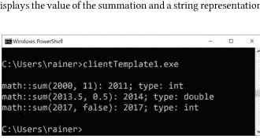

##### 4.2.3.14 头文件单元

头文件单元是头文件的一种二进制表示形式，可以方便地从头文件过渡到模块。你必须将 `#include` 指令替换为新的 `import` 语句，并添加分号（`;`）。


**导入头单元的源文件 `head.cpp`**

```cpp
// head.cpp

import "head.h";

void hello() {

    std::cout << '\n';

    std::cout << "Hello World: header unit\n";

    std::cout << '\n';

}
```

**使用该模块的主程序 `helloWorld13.cpp`**

```cpp
// helloWorld13.cpp

import "head.h";

int main() {

    hello();

}
```

我将为 Microsoft Visual C++ 编译器和 GCC 编译器创建并使用来自头文件 `head.h` 的头单元。与官方文档[标准 C++ 模块](https://clang.llvm.org/docs/StandardCPlusPlusModules.html#header-units)不同，我无法在 Clang 编译器上掌握头单元。

## Microsoft Visual C++ 编译器

以下是使用头单元的必要步骤。

### 创建模块 `head.h.ifc` 并使用它

```bat
cl.exe /std:c++latest /EHsc /exportHeader head.h
cl.exe /std:c++latest /EHsc /headerUnit head.h=head.h.ifc head.cpp
cl.exe /std:c++latest /EHsc /headerUnit head.h=head.h.ifc helloWorld13.cpp head.obj
```

-   第 1 行中的标志 `/exportHeader` 会根据头文件 `head.h` 创建 ifc 文件 `head.h.ifc`。
-   实现文件 `head.cpp`（第 2 行）和客户端文件 `helloWorld13.cpp`（第 3 行）使用该头单元。标志 `/headerUnit head.h=head.h.ifc` 导入该头文件，并告诉编译器/链接器指定头文件对应的 ifc 文件名。

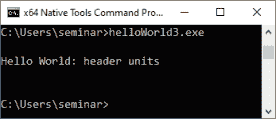

使用模块 `head.h.ifc`

## GCC 编译器

创建和使用该模块包括三个步骤。

### 创建模块 `head.h.gcm` 并使用它

```text
g++ -fmodules-ts -fmodule-header head.h -std=c++20
g++ -fmodules-ts -c -std=c++20 head.cpp
g++ -fmodules-ts -std=c++20 head.h.gcm helloWorld13.cpp -o helloWorld13
```

-   第 1 行创建模块 `head.h.gcm`。标志 `-fmodule-header` 指定 `head.h` 是一个头单元。
-   下一行创建对象文件 `head.o`。
-   最后，第 3 行创建可执行文件，它隐式引用模块 `head.h.gcm`。

## 一个缺点

头单元有一个缺点。并非所有头文件都是可导入的。哪些头文件可导入由实现定义[^5]，但 C++ 标准保证所有标准库头文件都是可导入的头文件。可导入的范围不包括 C 头文件。它们被包装在 `std` 命名空间中。例如，`<cstring>` 是 `<string.h>` 的 C++ 包装器。你可以快速识别被包装的 C 头文件，因为模式是：`xxx.h` 变成 `cxxx`。

[^5]: https://en.cppreference.com/w/cpp/language/ub

## 其他方面

### 宏

头单元支持宏，但模块会忽略它们。以下程序由模块 `macro`、用作头单元的头文件 `macro.h` 以及主程序 `macroMain.cpp` 组成。

**主程序 `macroMain.cpp`**

```cpp
// macroMain.cpp

#include <iostream>

import macro;
import "macro.h";

int main() {

    std::cout << '\n';

    std::cout << MACRO_HEADER_UNIT << '\n';
    std::cout << MACRO_MODULE << '\n';

    std::cout << '\n';
}
```

程序 `macroMain.cpp` 使用两个宏 `MACRO_HEADER_UNIT`（第 12 行）和 `MACRO_MODULE`（第 13 行）。`MACRO_HEADER_UNIT` 定义在头单元 `macro.h` 中，而 `MACRO_MODULE` 定义在模块 `macro` 中。

**头单元 `macro.h`**

```cpp
// macro.h

#define MACRO_HEADER_UNIT "macro header unit"
```

**模块 `macro.ixx`**

```cpp
// macro.ixx

module;

#define MACRO_MODULE "macro module"

export module macro;
```

该程序的编译包括以下三个步骤：

### 导入头单元和宏

```bat
cl.exe /std:c++latest /EHsc /exportHeader macro.h
cl.exe /std:c++latest /EHsc /c macro.ixx
cl.exe /std:c++latest /EHsc /headerUnit macro.h=macro.h.ifc macroMain.cpp macro.obj
```

第 1 行创建头单元，第 2 行编译模块，最后一行同时使用两者。正如预期的那样，最终编译步骤失败，因为宏 `MACRO_MODULE`（`macroMain.cpp` 中的第 13 行）在主程序中不可见。

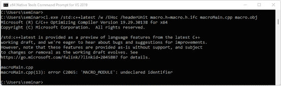

宏 `MACRO_MODULE` 不可见

你不能从模块中导出宏，但可以将头文件包含到模块中。这个头文件可以含有宏。全局模块片段是插入头文件并因此插入宏的正确位置。

```cpp
// macro.ixx

module;

#include "macro.h"

export module macro;
```

### 模块中的模板

我经常听到这样的问题：模块如何导出模板？当你实例化一个模板时，其定义必须可用。因此，模板定义存放在头文件中。从概念上讲，模板的使用具有以下结构。

### 不使用模块

**`templateSum.h`**

**函数模板 `sum` 的定义**

```cpp
// templateSum.h

template <typename T, typename T2>
auto sum(T fir, T2 sec) {
    return fir + sec;
}
```

**`sumMain.cpp`**

**模板 `sum` 的使用**

```cpp
// sumMain.cpp

#include "templateSum.h"

int main() {

    sum(1, 1.5);

}
```

主程序包含头文件 `templateSum.h`。调用 `sum(1, 1.5)` 会触发模板实例化。在这种情况下，编译器会根据函数模板 `sum` 生成具体的函数 `sum`，它接受一个 `int` 和一个 `double` 作为参数。如果你想可视化这个过程，请使用 [C++ Insights](https://cppinsights.io/) 上的示例。

[https://cppinsights.io/](https://cppinsights.io/)

编译该程序的命令行与前面的命令行没有不同。因此，我跳过它，直接展示程序的输出：

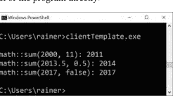

函数模板 `sum` 的使用

使用模块后，我们得到一种新的链接方式。

### 从头文件迁移到模块

广义上讲，从头文件迁移到模块时有两种选择。你可以使用头单元代替头文件，或者在一个模块或一个模块分区中重新实现你的头文件。从实现者和使用者的角度来看，这两种选择都非常方便。

为方便起见，在本节剩余部分，我将模块和模块分区统称为模块。

头单元对实现者来说无需多虑。头文件是模块的良好起点，因为它们已经提供了系统所需的模块化。头单元的用户必须将 `#include` 指令替换为新的 `import` 语句，并添加一个分号（`;`）。

**用头单元替换头文件**

```text
#include <vector> => import <vector>;
#include "math.h" => import "math.h";
```

使用模块对用户来说没有显著区别。导入模块与包含头文件非常相似。

**用模块替换头文件**

```text
#include <vector> => import vector;
#include "math.h" => import math;
```

模块的负担落在实现者身上，但借助头单元，实现者可以成功完成这种迁移。因此，一个合理的迁移策略是从头单元开始迁移。只有不可导入的头文件才必须实现为模块。此外，新功能应实现为具名模块。

## 提炼信息

-   模块克服了头文件和宏的缺陷。导入它们确实没有额外成本，而且与宏不同，导入顺序无关紧要。此外，它们还克服了名称冲突。
-   一个模块由一个模块接口单元和任意多个模块实现单元组成。模块接口必须具有导出模块声明，模块实现单元必须具有非导出模块声明。模块接口中未导出的名称具有模块链接，不能在模块外部使用。
-   模块可以包含头文件，也可以导入并重新导出其他模块。
-   C++20 中的标准库尚未模块化。在 C++20 中，构建你的模块是一项具有挑战性的任务。
-   为了组织大型软件系统，模块提供了两种方式：子模块和分区。与分区不同，子模块可以独立存在。
-   借助头单元，你可以将 include 语句替换为 import 语句，编译器会自动生成一个模块。
-   头单元确实支持宏，但模块不支持。
-   从头文件迁移到模块或模块分区的一个合理策略是从头单元开始迁移。只有不可导入的头文件才必须实现为模块。此外，新功能应实现为具名模块。


### 4.3 相等比较与三路比较


C++20 使您能够定义或自动生成相等运算符。相等运算符判断两个值 A 和 B 是否满足 A == B 或 A != B。此外，如果您的值 A 和 B 需要支持排序，请使用三路比较运算符 <=>。三路比较运算符通常被称为太空船运算符。太空船运算符判断两个值 A 和 B 是 A < B、A == B 还是 A > B。与相等运算符一样，您可以定义太空船运算符，也可以让编译器自动生成它。

为了理解三路比较运算符的优点，让我先从经典的做法开始。

#### 4.3.1 C++20 之前的比较

我实现了一个简单的 int 包装器 MyInt。当然，我想比较 MyInt。下面是我使用函数模板 `isLessThan` 的解决方案。

#### MyInt 支持小于比较

```cpp
// comparisonOperator.cpp

#include <iostream>

struct MyInt {
    int value;
    explicit constexpr MyInt(int val): value{val} { }
    bool operator < (const MyInt& rhs) const {
        return value < rhs.value;
    }
};

template <typename T>
constexpr bool isLessThan(const T& lhs, const T& rhs) {
    return lhs < rhs;
}

int main() {

    std::cout << std::boolalpha << '\n';

    MyInt myInt2011(2011);
    MyInt myInt2014(2014);

    std::cout << "isLessThan(myInt2011, myInt2014): "
              << isLessThan(myInt2011, myInt2014) << '\n';

    std::cout << '\n';

}
```

程序按预期运行：

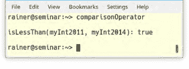

使用小于运算符

说实话，MyInt 不是一个直观的类型。当你定义了六种比较关系中的一种时，你应该将它们全部定义。直观的类型至少应该是半正则的。现在，我必须编写大量样板代码。下面是缺失的五个运算符。

#### 缺失的五个比较运算符

```cpp
bool operator == (const MyInt& rhs) const {
    return value == rhs.value;
}

bool operator != (const MyInt& rhs) const {
    return !(*this == rhs);
}

bool operator <= (const MyInt& rhs) const {
    return !(rhs < *this);
}

bool operator > (const MyInt& rhs) const {
    return rhs < *this;
}

bool operator >= (const MyInt& rhs) const {
    return !(*this < rhs);
}
```

现在，让我们跳到 C++20，看看相等运算符和三路比较运算符。

#### 4.3.2 C++20 以来的比较

您可以定义比较运算符或三路比较运算符，也可以使用 = default 请求编译器生成。让我从相等运算符开始。

##### 4.3.2.1 相等运算符

当您定义相等运算符或使用 = default 请求编译器生成相等运算符时，您会自动获得相等和不等运算符：== 和 !=。

##### 实现或请求生成相等运算符

```cpp
// equalityComparison.cpp

#include <iostream>

struct MyInt {
    int value;
    explicit constexpr MyInt(int val): value{val} { }
    bool operator==(const MyInt& rhs) const {
        return value == rhs.value;
    }
};

struct MyDouble {
    double value;

    explicit constexpr MyDouble(double val) : value{val} { }
    bool operator==(const MyDouble& rhs) const = default;
};

template <typename T>
constexpr bool areEqual(const T& lhs, const T& rhs) {
    return lhs == rhs;
}

int main() {

    std::cout << std::boolalpha << '\n';

    MyInt myInt1(2011);
    MyInt myInt2(2014);

    std::cout << "areEqual(myInt1, myInt2): "
              << areEqual(myInt1, myInt2) << '\n';

    MyDouble myDouble1(2011);
    MyDouble myDouble2(2014);

    std::cout << "areEqual(myDouble1, myDouble2): "
              << areEqual(myDouble1, myDouble2) << '\n';

    std::cout << '\n';

}
```

用户定义的（第 8 行）和编译器生成的（第 16 行）相等运算符都按预期工作。两者都返回布尔值。

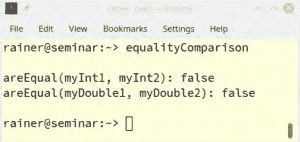

使用用户定义和编译器生成的相等运算符

##### 4.3.2.2 三路比较运算符

当您定义三路比较运算符或使用 = default 请求编译器生成它时，您会自动获得所有六个比较运算符：==、!=、<、<=、> 和 >=。该成员函数必须是 const，且参数必须是 const 左值引用。

##### 实现或请求生成三路比较运算符

```cpp
1  // threeWayComparison.cpp
2
3  #include <compare>
4  #include <iostream>
5
6  struct MyInt {
7    int value;
8    explicit MyInt(int val): value{val} { }
9    auto operator<=>(const MyInt& rhs) const {
10     return value <=> rhs.value;
11   }
12 };
13
14 struct MyDouble {
15   double value;
16   explicit constexpr MyDouble(double val): value{val} { }
17   auto operator<=>(const MyDouble&) const = default;
18 };
19
20 template <typename T>
21 constexpr bool isLessThan(const T& lhs, const T& rhs) {
```


##### 指针的自动比较

编译器生成的比较运算符比较的是指针，而不是引用的对象。

```cpp
// spaceshipPointer.cpp

#include <iostream>
#include <compare>
#include <vector>

struct A {
    std::vector<int>* pointerToVector;
    auto operator <=> (const A&) const = default;
};

int main() {

    std::cout << '\n';

    std::cout << std::boolalpha;

    A a1{new std::vector<int>()};
    A a2{new std::vector<int>()};

    std::cout << "(a1 == a2): " << (a1 == a2) << "\n\n";

}
```

令人惊讶的是，a1 == a2（第 21 行）的结果是 false 而不是 true，因为比较的是 `std::vector<int>` 的地址。

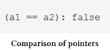

有三种比较类别。

#### 4.3.3 比较类别

三种比较类别的名称分别是：强排序（std::strong_ordering），也称为全序，弱排序（std::weak_ordering）和偏排序（std::partial_ordering）。

强排序也称为全序。

对于类型 T，以下三个属性区分了三种比较类别：

- 1. T 支持所有六个关系运算符：==、!=、<、<=、> 和 >=（简称：关系运算符）
- 2. 所有等价的值都是不可区分的（简称：等价）
- 3. T 的所有值都是可比较的：对于 T 的任意值 a 和 b，三个关系 a < b、a == b 和 a > b 中必有一个为真（简称：可比较）

整型或字符串是强排序的典型示例。当比较有符号整型的绝对值或不区分大小写地比较字符串时，这种排序被称为弱排序。强排序决定了值的同一性，而弱排序决定了值的等价性。此外，两个任意的浮点值不一定是可比较的：对于 a = 5.5 和 b = NaN（非数值），以下表达式都不返回 true：a < NaN、a == NaN 或 a > NaN。这意味着浮点值支持偏排序。

基于这三个属性，区分三种比较类别就很简单了：

强、弱和偏排序

| 比较类别 | 关系运算符 | 等价 | 可比较 |
| --- | --- | --- | --- |
| 强排序 | 是 | 是 | 是 |
| 弱排序 | 是 |  | 是 |
| 偏排序 | 是 |  |  |

支持强排序的类型隐式地支持弱排序和偏排序。弱排序也是如此。支持弱排序的类型也支持偏排序。其他方向则不适用。

```cpp
// FINE
// std::partial_ordering operator <=> (const StrongWeakPartial&) const = default;

// ERROR
// std::strong_ordering operator <=> (const StrongWeakPartial&) const = default;
// std::weak_ordering operator <=> (const StrongWeakPartial&) const = default;

};

int main() {
    StrongWeakPartial a1, a2;

    a1 < a2;
}
```

类型 `StrongWeakPartial` 具有支持强排序（第 6 行）、弱排序（第 10 行）和偏排序（第 14 行）的子类型。因此，类型 `StrongWeakPartial`（第 17 行）的共同比较类别是 `std::partial_ordering`。使用更强大的比较类别，如强排序（第 29 行）或弱排序（第 30 行），会导致编译时错误。

##### 4.3.3.1 比较类别的值

三个比较类别 `std::strong_ordering`、`std::weak_ordering` 和 `std::partial_ordering` 各有三个值，用于表示小于、等于或大于。

###### 4.3.3.1.1 `std::strong_ordering`

```cpp
std::strong_ordering::less
std::strong_ordering::equal, or std::strong_ordering::equivalent
std::strong_ordering::greater
```

###### 4.3.3.1.2 `std::weak_ordering`

```cpp
std::weak_ordering::less
std::weak_ordering::equivalent
std::weak_ordering::greater
```

###### 4.3.3.1.3 `std::partial_ordering`


```
std::partial_ordering::less
std::partial_ordering::equivalent
std::partial_ordering::greater
std::partial_ordering::unordered
```

支持 `std::strong_ordering` 的值的相等性既可以用 `std::strong_ordering::equal` 表示，也可以用 `std::strong_ordering::equivalent` 表示。`std::partial_ordering::unordered` 表示支持 `std::partial_ordering` 的值，这些值既不小于、相等，也不大于。

你可以使用比较类别及其值来显式定义三路比较运算符。下面的代码片段针对简单类型 `MyInt` 展示了这一点。

三路比较运算符的显式定义

```cpp
struct MyInt {
  int value;
  explicit MyInt(int val): value{val} { }
  std::strong_ordering operator<=>(const MyInt& rhs) const {
    return value == rhs.value ? std::strong_ordering::equal :
           value < rhs.value ? std::strong_ordering::less :
           std::strong_ordering::greater;
  }
};
```

现在，我想把重点放在编译器生成的太空船运算符上。

#### 4.3.4 编译器生成的相等运算符和太空船运算符

编译器生成的比较运算符是隐式 `constexpr` 和 `noexcept`<sup>44</sup> 的，并执行字典序比较。对于所有定义了关系运算符的基础类型，该比较运算符同样被定义。此外，编译器生成的三路比较运算符需要包含头文件 `<compare>`。

你甚至可以直接使用三路比较运算符。

##### 4.3.4.1 三路比较运算符的直接使用

程序 `spaceship.cpp` 直接使用了太空船运算符。

### 实现或请求三路比较运算符

```cpp
// spaceship.cpp

#include <compare>
#include <iostream>
#include <string>
#include <vector>

int main() {

    std::cout << '\n';

    int a(2011);
    int b(2014);
    auto res = a <=> b;
    if (res < 0) std::cout << "a < b" << '\n';
    else if (res == 0) std::cout << "a == b" << '\n';
    else if (res > 0) std::cout << "a > b" << '\n';

    std::string str1("2014");
    std::string str2("2011");
    auto res2 = str1 <=> str2;
    if (res2 < 0) std::cout << "str1 < str2" << '\n';
    else if (res2 == 0) std::cout << "str1 == str2" << '\n';
    else if (res2 > 0) std::cout << "str1 > str2" << '\n';

    std::vector<int> vec1{1, 2, 3};
    std::vector<int> vec2{1, 2, 3};
    auto res3 = vec1 <=> vec2;
    if (res3 < 0) std::cout << "vec1 < vec2" << '\n';
    else if (res3 == 0) std::cout << "vec1 == vec2" << '\n';
    else if (res3 > 0) std::cout << "vec1 > vec2" << '\n';

    std::cout << '\n';

}
```

该程序对 `int`（第 14 行）、`string`（第 21 行）和 `vector`（第 28 行）使用了太空船运算符。以下是程序的输出。

```cpp
29    std::cout << '\n';
30
31 }
```

我请求在编译期获得比较的结果（第 24 行），并且确实得到了。

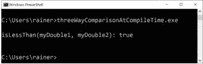

使用 constexpr 编译器生成的太空船运算符

##### 4.3.4.3 字典序比较

编译器生成的比较运算符执行字典序比较。这里的字典序比较意味着，所有基类按从左到右的顺序进行比较，类的所有非静态成员按声明顺序进行比较。我需要补充一下：出于性能原因，C++20 中编译器生成的相等运算符行为有所不同。我将在“优化的 == 和 != 运算符”一节中介绍这一例外情况。

微软 C++ 团队博客上的文章“Simplify Your Code With Rocket Science: C++20’s Spaceship Operator”[^61] 提供了一个令人印象深刻的字典序比较示例。为了便于阅读，我添加了一些注释。

字典序比较

```cpp
struct Basics {
    int i;
    char c;
    float f;
    double d;
    auto operator<=>(const Basics&) const = default;
};

struct Arrays {
    int ai[1];
    char ac[2];
    float af[3];
    double ad[2][3];
    auto operator<=>(const Arrays&) const = default;
};
```

[^61]: https://devblogs.microsoft.com/cppblog/simplify-your-code-with-rocket-science-c20s-spaceship-operator/

```cpp
struct Bases : Basics, Arrays {
    auto operator<=>(const Bases&) const = default;
};

int main() {
    constexpr Bases a = { { 0, 'c', 1.f, 1 },                    // Basics
                          { { 1 }, { 'a', 'b' }, { 1.f, 2.f, 3.f }, { { 1, 2, 0 }, { 3, 4 } } } }; // Arrays

    constexpr Bases b = { { 0, 'c', 1.f, 1 },                    // Basics
                          { { 1 }, { 'a', 'b' }, { 1.f, 2.f, 3.f }, { { 1, 2 }, { 3, 4 } } } }; // Arrays

    static_assert(a == b);
    static_assert(!(a != b));
    static_assert(!(a < b));
    static_assert(a <= b);
    static_assert(!(a > b));
    static_assert(a >= b);
}
```

我认为该程序最具挑战性的部分不是太空船运算符，而是通过聚合初始化来初始化 `Bases`（第 22 行和第 25 行）。当类类型（class、struct、union）的所有成员都是公有的时，聚合初始化使我们能够直接初始化其成员。在这种情况下，你可以使用花括号初始化。C++20 中关于指定初始化器的章节会更详细地讨论聚合初始化。


### 优化的 == 和 != 运算符

对于类似字符串或类似向量的类型，存在优化的潜力。在这种情况下，`==` 和 `!=` 可能比编译器生成的比较运算符更快。如果被比较的两个值长度不同，`==` 和 `!=` 运算符可以提前停止。否则，如果一个值是另一个值的前缀，字典序比较将会一直比较所有元素，直到较短的那个值结束。因此，对于类似字符串或类似向量的类型，编译器生成的 `==` 和 `!=` 运算符会首先比较它们的长度，如需再比较内容。标准化委员会意识到了这个性能问题，并通过论文 [P1185R2](http://www.open-std.org/jtc1/sc22/wg21/docs/papers/2019/p1185r2.html) 解决了它。

现在，是时候看看 C++ 中的一些新内容了。C++20 引入了重写表达式的概念。

#### 4.3.5 重写表达式

当编译器看到类似 `a < b` 的表达式时，它会使用太空船运算符将其重写为 `(a <=> b) < 0`。

[^62]: http://www.open-std.org/jtc1/sc22/wg21/docs/papers/2019/p1185r2.html

当然，这条规则适用于全部六个比较运算符：`a OP b` 变成 `(a <=> b) OP 0`。甚至更好：如果无法从 `type(a)` 转换为 `type(b)`，编译器会生成新表达式 `0 OP (b <=> a)`。

例如，对于小于运算符，如果 `(a <=> b) < 0` 不可行，编译器会生成 `0 < (b <=> a)`。本质上，编译器负责处理比较运算符的对称性。

下面是一些重写表达式的示例：

### 使用 MyInt 重写表达式

```cpp
// rewritingExpressions.cpp

#include <compare>
#include <iostream>

class MyInt {
public:
    constexpr MyInt(int val): value(val) { }
    auto operator<=>(const MyInt& rhs) const = default;
private:
    int value;
};

int main() {

    std::cout << '\n';

    constexpr MyInt myInt2011(2011);
    constexpr MyInt myInt2014(2014);

    constexpr int int2011(2011);
    constexpr int int2014(2014);

    if (myInt2011 < myInt2014) std::cout << "myInt2011 < myInt2014" << '\n';
    if ((myInt2011 <=> myInt2014) < 0) std::cout << "myInt2011 < myInt2014" << '\n';

    std::cout << '\n';

    if (myInt2011 < int2014) std::cout << "myInt2011 < int2014" << '\n';
    if ((myInt2011 <=> int2014) < 0) std::cout << "myInt2011 < int2014" << '\n';

    std::cout << '\n';

    if (int2011 < myInt2014) std::cout << "int2011 < myInt2014" << '\n';
```


```cpp
private:
    int value;
};

template <typename T, typename T2>
constexpr bool isLessThan(const T& lhs, const T2& rhs) {
    return lhs < rhs;
}

int main() {

    std::cout << std::boolalpha << '\n';

    constexpr MyInt myInt2011(2011);
    constexpr MyInt myInt2014(2014);

    std::cout << "isLessThan(myInt2011, myInt2014): "
              << isLessThan(myInt2011, myInt2014) << '\n';

    std::cout << "isLessThan(int2011, myInt2014): "
              << isLessThan(int2011, myInt2014) << '\n';

    std::cout << "isLessThan(myInt2011, int2014): "
              << isLessThan(myInt2011, int2014) << '\n';

    constexpr auto res = isLessThan(myInt2011, int2014);

    std::cout << '\n';

}
```

我在（第10行）定义了三路比较运算符，并将其声明为 constexpr。与编译器生成的比较运算符不同，用户定义的比较运算符并非隐式 constexpr。MyInt 和 int 的比较可以在每种组合中进行（第34、37和40行）。

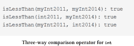

老实说，各种三路比较运算符的实现非常优雅。编译器自动生成 MyInt 的比较，而用户显式定义与 int 的比较。此外，只需定义两个运算符，就能通过重排得到 18 == 3 * 6 种比较运算符组合。3 代表组合 `int OP MyInt`、`MyInt OP MyInt` 和 `MyInt OP int`，6 代表六种比较运算符。

#### 4.3.6 用户定义与自动生成的比较运算符

当你定义六个比较运算符中的一个，并使用太空船运算符自动生成所有运算符时，会出现一个问题：哪一个具有更高的优先级？例如，这个 MyInt 实现有一个用户定义的小于和等于运算符，以及编译器生成的六个比较运算符。

让我们看看会发生什么。

**用户定义与自动生成运算符的相互作用**

```cpp
// UserDefinedAutoGeneratedOperators.cpp

#include <compare>
#include <iostream>

class MyInt {
public:
    constexpr explicit MyInt(int val): value{val} { }
    bool operator == (const MyInt& rhs) const {
        std::cout << "==" << '\n';
        return value == rhs.value;
    }
    bool operator < (const MyInt& rhs) const {
        std::cout << "<" << '\n';
        return value < rhs.value;
    }

    auto operator<=>(const MyInt& rhs) const = default;

private:
    int value;
};

int main() {

    MyInt myInt2011(2011);
    MyInt myInt2014(2014);

    myInt2011 == myInt2014;
    myInt2011 != myInt2014;
    myInt2011 < myInt2014;
    myInt2011 <= myInt2014;
}
```

```cpp
myInt2011 <=> myInt2014;
myInt2011 <=> myInt2014;
}
```

为了查看用户定义的 == 和 < 运算符的实际效果，我向 std::cout 写入相应的消息。这两个运算符都不能是 constexpr，因为 std::cout 是运行时操作。

让我们看看会发生什么：


在这种情况下，编译器使用用户定义的 ==（第29和30行）和 < 运算符（第31行）。此外，编译器从 == 运算符合成 != 运算符（第30行）。另一方面，编译器不会从 != 运算符合成 == 运算符。


#### 与 Python 的相似性

在 Python 3 中，编译器会在必要时从 == 生成 !=，但反过来不行。在 Python 2 中，所谓的富比较（用户定义的六个比较运算符）比 Python 的三路比较运算符 __cmp__ 具有更高的优先级。我必须提到 Python 2，因为三路比较运算符 __cmp__ 在 Python 3 中已被移除。


#### 要点提炼

- 通过将运算符 `==` 设为默认，编译器自动生成相等和不相等运算符：`==` 和 `!=`。
- 通过将运算符 `<=>` 设为默认，编译器自动生成六个比较运算符：`==`、`!=`、`<`、`<=`、`>`、`>=`。
- 编译器生成的比较运算符是 `noexcept` 和 `constexpr`。它们采用字典序比较：所有基类从左到右进行比较，所有非静态成员按声明顺序进行比较。
- 当同时存在自动生成的比较运算符和用户定义的比较运算符时，用户定义的比较运算符具有更高的优先级。
- 编译器会重写表达式以处理比较运算符的对称性。例如，如果 `(a <=> b) > 0` 不可行，编译器会生成 `0 < (b <=> a)`。

### 4.4 指定初始化


*Cippi 受到神圣触摸*

指定初始化是聚合初始化的一种特殊情况。因此，讨论指定初始化实际上就是讨论聚合初始化。

#### 4.4.1 聚合初始化

首先：什么是聚合？聚合是数组或类类型。类类型是指类、结构体或联合体。

使用 C++20，对于作为聚合且因此支持聚合初始化的类类型，必须满足以下条件：

- 没有私有或受保护的非静态数据成员
- 没有用户声明或继承的构造函数
- 没有虚基类、私有或受保护的基类
- 没有虚成员函数

下面的程序示例演示了聚合初始化。

**聚合初始化**

```cpp
// aggregateInitialization.cpp

#include <iostream>

struct Point2D{
    int x;
    int y;
};
```

指定初始化

```cpp
// designatedInitializer.cpp

#include <iostream>

struct Point2D{
    int x;
    int y;
};

class Point3D{
public:
    int x;
    int y;
    int z;
};

int main(){

    std::cout << '\n';

    Point2D point2D{.x = 1, .y = 2};
    Point3D point3D{.x = 1, .y = 2, .z = 3};

    std::cout << "point2D: " << point2D.x << " " << point2D.y << '\n';
    std::cout << "point3D: " << point3D.x << " " << point3D.y << " "
              << point3D.z << '\n';

    std::cout << '\n';

}
```

第21和22行使用指定初始化器来初始化聚合。像 .x 或 .y 这样的初始化器通常称为指示符。

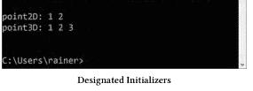

指定初始化器

聚合的成员可以已经具有默认值。当初始化器缺失时，将使用该默认值。这一点不适用于联合体。

**带默认值的指定初始化器**

```cpp
// designatedInitializersDefaults.cpp

#include <iostream>

class Point3D{
public:
    int x;
    int y = 1;
    int z = 2;
};

void needPoint(Point3D p) {
    std::cout << "p: " << p.x << " " << p.y << " " << p.z << '\n';
}

int main(){

    std::cout << '\n';

    Point3D point1{.x = 0, .y = 1, .z = 2};
    std::cout << "point1: " << point1.x << " " << point1.y << " "
                              << point1.z << '\n';

    Point3D point2;
    std::cout << "point2: " << point2.x << " " << point2.y << " "
                              << point2.z << '\n';

    Point3D point3{.x = 0, .z = 20};
    std::cout << "point3: " << point3.x << " " << point3.y << " "
                              << point3.z << '\n';

    // Point3D point4{.z = 20, .y = 1}; ERROR

    needPoint({.x = 0});

    std::cout << '\n';
}
```

第20行初始化了所有成员，但第24行没有为成员 x 提供值。因此，x 未被初始化。如果你只初始化没有默认值的成员，例如第28行或第34行，那是可以的。第32行的表达式无法编译，因为 z 和 y 的顺序错误。

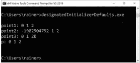

指定初始化器会检测窄化转换。窄化转换会导致精度损失。

**指定初始化器检测窄化转换**

```cpp
// designatedInitializerNarrowingConversion.cpp

#include <iostream>

struct Point2D{
    int x;
    int y;
};

class Point3D{
public:
    int x;
    int y;
    int z;
};

int main(){

    std::cout << '\n';

    Point2D point2D{.x = 1, .y = 2.5};
    Point3D point3D{.x = 1, .y = 2, .z = 3.5f};

    std::cout << "point2D: " << point2D.x << " " << point2D.y << '\n';
    std::cout << "point3D: " << point3D.x << " "
              << point3D.y << " "
              << point3D.z << '\n';

    std::cout << '\n';
}
```


```cpp
}
```

第 21 行和第 22 行会产生编译期错误，因为初始化 `.y = 2.5` 和 `.z = 3.5f` 会导致到 `int` 的窄化转换。

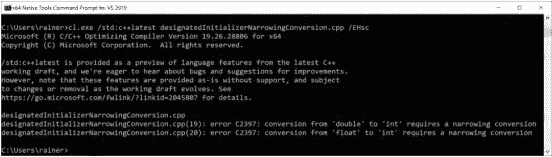

指定初始化器检测窄化转换

有趣的是，C 中的指定初始化器与 C++ 中的指定初始化器行为不同。


## C 与 C++ 之间的差异

C 的指定初始化器支持 C++ 不支持的用例。C 允许

- 乱序初始化聚合体的成员
- 初始化嵌套聚合体的成员
- 混合使用指定初始化器和常规初始化器
- 数组的指定初始化

提案 [P0329R4](#fn63) 为这些用例提供了不言自明的示例：

**C 与 C++ 之间的差异**

```c
struct A { int x, y; };
struct B { struct A a; };
struct A a = { .y = 1, .x = 2}; // valid C, invalid C++ (out of order)
int arr[3] = {[1] = 5};         // valid C, invalid C++ (array)
struct B b = {.a.x = 0};        // valid C, invalid C++ (nested)
struct A a = {.x = 1, 2};       // valid C, invalid C++ (mixed)
```

C 与 C++ 之间这种差异的理由也是该提案的一部分：“在 C++ 中，成员按构造的逆序销毁，初始化列表的元素按词法顺序求值，因此字段初始化器必须按顺序指定。数组指示符与 lambda 表达式语法冲突。嵌套指示符很少使用。” 该论文接着论证，只有聚合体的乱序初始化是常用的。

<sup>63</sup> [http://www.open-std.org/jtc1/sc22/wg21/docs/papers/2017/p0329r4.pdf](http://www.open-std.org/jtc1/sc22/wg21/docs/papers/2017/p0329r4.pdf)


## 提炼信息

- 指定初始化是聚合初始化的一种特殊情况，它使程序能够使用成员名称来初始化类成员。初始化顺序必须与声明顺序一致。

### 4.5 consteval 与 constinit


在 C++20 中，我们得到了两个新关键字：consteval 和 constinit。关键字 consteval 产生一个在编译期执行的函数，而 constinit 保证具有静态存储期或线程存储期的变量在编译期初始化。现在，你可能觉得这两个说明符与 constexpr 非常相似。简而言之，你是对的。在比较关键字 consteval、constinit、constexpr 以及老牌的 const 之前，我必须先介绍新说明符 consteval 和 constinit。

#### 4.5.1 consteval

consteval 会创建所谓的立即函数。

**一个 consteval 函数**

```cpp
consteval int sqr(int n) {
    return n * n;
}
```

立即函数的每次调用都会创建一个编译期常量。更直接地说，consteval（立即）函数在编译期执行。

consteval 不能应用于析构函数，也不能应用于分配或释放内存的函数。在一条声明中，你最多只能使用 consteval、constexpr 或 constinit 说明符中的一个。立即函数（consteval）隐式内联，并且必须满足 constexpr 函数的要求。C++14 中 constexpr 函数的要求，因此也是 consteval 函数的要求：

- consteval（constexpr）可以

```text
sqr(5): 25
sqr(a): 25
```

consteval 函数的使用

有趣的是，你可以在 consteval 函数中拥有运行期功能，但执行这种运行期功能会产生编译期错误。下面的 consteval 函数使用了 std::cerr，而它只能在运行期执行。

**一个使用 std::cerr 的 consteval 函数**

```cpp
// constevalRuntime.cpp

#include <iostream>

consteval void validMonth(int m) {
    if (m < 0 || m > 12) {
        std::cerr << "Compile-time error if executed";
    }
}

int main() {

    validMonth(5);
    validMonth(15);
}
```

调用 validMonth(5)（第 13 行）没有问题，但调用 validMonth(15)（第 14 行）会产生编译期错误，因为它导致执行运行期函数 std::cerr（第 7 行）。

```text
<source>: In function 'int main()':
<source>:14:15:   in 'constexpr' expansion of 'validMonth(15)'
<source>:7:22: error: call to non-'constexpr' function 'std::basic_ostream<char, _Traits>& std::operator<<(basic_ostream<char, _Traits>&, const char*) [with _Traits = char_traits<char>]'
    7 |         std::cerr << "Compile-time error if executed";
      |         ~~~~~~~~~~^~~~~~~~~~~~~~~~~~~~~~~~~~~~~~~~~~~~
In file included from /opt/compiler-explorer/gcc-13.2.0/include/c++/13.2.0/iostream:41,
                 from <source>:3:
/opt/compiler-explorer/gcc-13.2.0/include/c++/13.2.0/ostream:662:5: note: 'std::basic_ostream<char, _Traits>& std::operator<<(basic_ostream<char, _Traits>&, const char*) [with _Traits = char_traits<char>]' declared here
  662 |     operator<<(basic_ostream<char, _Traits>& __out, const char* __s)
      |     ^~~~~~~~
Compiler returned: 1
```

在 consteval 函数中使用 std::cerr

#### 4.5.2 constinit

constinit 可以应用于具有静态存储期或线程存储期的变量。

- 全局（命名空间）变量、静态变量或静态类成员具有**静态存储期**。这些对象在程序启动时分配，在程序结束时释放。
- `thread_local` 变量具有**线程存储期**。线程局部数据会为使用该数据的每个线程创建。`thread_local` 数据专属于该线程。它们在其首次使用时创建，其生存期绑定到所属线程的生存期。线程局部数据通常被称为线程局部存储。

constinit 保证这类变量（静态存储期或线程存储期）在编译期初始化。constinit 不隐含 const 性。这有两个有趣的后果：constinit 变量需要一个编译期常量值，并且不能初始化另一个 constinit 变量。

#### 用 constinit 初始化

```cpp
// constinitSqr.cpp

#include <iostream>

constexpr int sqr(int n) {
    return n * n;
}

constexpr auto res1 = sqr(5);
constinit auto res2 = sqr(5);

int main() {

    std::cout << "sqr(5): " << res1 << '\n';
    std::cout << "sqr(5): " << res2 << '\n';

    constinit thread_local auto res3 = sqr(5);
    std::cout << "sqr(5): " << res3 << '\n';

}
```

res1 和 res2 具有静态存储期。res3 具有线程存储期。

```cpp
}
```

顾名思义：普通函数 `sqrRunTime`（第 5 行）在运行期运行，`consteval` 函数 `sqrCompileTime` 在编译期运行（第 9 行），`constexpr` 函数 `sqrRunOrCompileTime` 可以在编译期或运行期运行。因此，在编译期用 `sqrRunTime` 请求结果（第 19 行）是错误的；同样，将非常量表达式用作 `sqrCompileTime` 的参数（第 26 行）也是错误的。

`constexpr` 函数 `sqrRunOrCompileTime` 与 `consteval` 函数 `sqrCompileTime` 的区别在于，当上下文要求编译期求值时，`sqrRunOrCompileTime` 必须在编译期执行。

#### 编译期与运行期执行

```cpp
static_assert(sqrRunOrCompileTime(100) == 100);                  // compile time
int arrayNewWithConstExpressionFunction[sqrRunOrCompileTime(100)]; // compile time
constexpr int prod = sqrRunOrCompileTime(100);                    // compile time

int a = 100;
int runTime = sqrRunOrCompileTime(a);                             // run time

int runTimeOrCompileTime = sqrRunOrCompileTime(100);              // run time or compile time

int alwaysCompileTime = sqrCompileTime(100);                     // compile time
```

第 1 - 3 行需要编译期求值。第 6 行只能在运行期求值，因为 a 不是常量表达式。关键行是第 8 行。该函数可以在编译期或运行期执行。它是在编译期还是运行期执行，可能取决于编译器或优化级别。这一观察不适用于第 10 行。`consteval` 函数始终在编译期执行。

##### 4.5.3.2 变量初始化

程序 `constexprConstinit.cpp` 比较了 const、constexpr 和 constinit。


### const、constexpr 和 constinit 的比较

```cpp
 1  // constexprConstinit.cpp
 2
 3  #include <iostream>
 4
 5  constexpr int constexprVal = 1000;
 6  constinit int constinitVal = 1000;
 7
 8  int incrementMe(int val){ return ++val;}
 9
10  int main() {
11
12      auto val = 1000;
13      const auto res = incrementMe(val);
14      std::cout << "res: " << res << '\n';
15
16      // std::cout << "res: " << ++res << '\n';          ERROR
17      // std::cout << "++constexprVal: " << ++constexprVal << '\n'; ERROR
18      std::cout << "++constinitVal: " << ++constinitVal << '\n';
19
20      constexpr auto localConstexpr = 1000;
21      // constinit auto localConstinit = 1000; ERROR
22
23  }
```

只有 const 变量（第 13 行）在运行时初始化。constexpr 和 constinit 变量在编译时初始化。

constinit（第 18 行）并不像 const（第 16 行）或 constexpr（第 17 行）那样意味着常量性。用 constexpr（第 20 行）或 const（第 13 行）声明的变量可以创建为局部变量，但用 constinit 声明的变量（第 21 行）不行。


const、constexpr 和 constinit 声明的变量


### 在编译时初始化局部非 const 变量

在前面的程序 `constexprConstinit.cpp` 之后，你可能会觉得无法在编译时初始化局部（自动存储期）非 const 变量：

- `constinit` 仅对具有静态存储期的对象启用编译时初始化。
- `constexpr` 意味着该变量是常量。

借助 `consteval`，具有自动存储期的局部变量可以在编译时初始化，并在之后修改。

```cpp
// compileTimeInitializationLocal.cpp

consteval auto doubleMe(auto val) {
    return 2 * val;
}

int main() {
    auto res = doubleMe(1010);
    ++res;              // 2021
}
```

局部变量 `res` 在编译时初始化（第 9 行），并在运行时修改（第 10 行）。

#### 4.5.4 解决静态初始化顺序灾难

根据 isocpp.org 上的 FAQ，静态初始化顺序灾难是“一种导致程序崩溃的隐蔽方式”。该 FAQ 继续写道：“静态初始化顺序问题是 C++ 中一个非常隐蔽且常被误解的方面。”

在继续之前，我想作一个简短声明。对不同翻译单元中具有静态存储期的变量（简称：静态变量）的依赖，通常是一种代码异味，应成为重构的理由。因此，如果你听从我的建议进行重构，可以跳过本节。

##### 4.5.4.1 静态初始化顺序灾难

一个翻译单元中的静态变量按照其定义顺序初始化。

相比之下，翻译单元之间的静态变量初始化存在一个严重问题。当一个静态变量 `staticA` 在一个翻译单元中定义，另一个静态变量 `staticB` 在另一个翻译单元中定义，并且 `staticB` 需要 `staticA` 来初始化自身时，你就会遇到静态初始化顺序灾难。该程序是非良构的，因为你无法保证在（动态）运行时哪个静态变量先初始化。

在介绍解决方案之前，让我展示一下实际发生的静态初始化顺序灾难。

###### 4.5.4.1.1 有 50:50 的几率正确

静态变量的初始化有什么独特之处？静态变量的初始化顺序分为两步：静态初始化和动态初始化。

当一个静态变量无法在编译时进行常量初始化时，它会被零初始化。在运行时，会对这些已被零初始化的静态变量执行动态初始化。

**静态初始化顺序灾难**

```cpp
// sourceSIOF1.cpp

int square(int n) {
    return n * n;
}

auto staticA = square(5);
```

**静态初始化顺序灾难**

```cpp
// mainSIOF1.cpp

#include <iostream>

extern int staticA;
auto staticB = staticA;

int main() {

    std::cout << '\n';

    std::cout << "staticB: " << staticB << '\n';

    std::cout << '\n';

}
```

第 5 行声明了静态变量 `staticA`。`staticB` 的初始化依赖于 `staticA` 的初始化。但 `staticB` 在编译时被零初始化，在运行时被动态初始化。问题在于，无法保证 `staticA` 或 `staticB` 的初始化顺序，因为 `staticA` 和 `staticB` 属于不同的翻译单元。`staticB` 为 0 或 25 的几率各占一半。为了演示这个问题，我可以更改目标文件的链接顺序。这也会改变 `staticB` 的值！

```console
rainer@seminar:~> g++ -c mainSIOF1.cpp
rainer@seminar:~> g++ -c sourceSIOF1.cpp
rainer@seminar:~> g++ mainSIOF1.o sourceSIOF1.o -o mainSource
rainer@seminar:~> g++ sourceSIOF1.o mainSIOF1.o -o sourceMain
rainer@seminar:~> mainSource

staticB: 0

rainer@seminar:~> sourceMain

staticB: 25

rainer@seminar:~>
```

**实际发生的静态初始化顺序灾难**

真是灾难！可执行文件的结果取决于目标文件的链接顺序。当我们无法使用 C++20 时，该怎么办？

###### 4.5.4.1.2 具有局部作用域的静态变量的惰性初始化

具有局部作用域的静态变量在首次使用时创建。局部作用域本质上意味着该静态变量在某种程度上被花括号包围。这种惰性创建是 C++98 提供的保证。在 C++11 中，具有局部作用域的静态变量也会以线程安全的方式初始化。线程安全的 Meyers⁴² 单例正是基于这一额外保证。惰性初始化也可以用来克服静态初始化顺序灾难。

**具有局部作用域的静态变量的惰性初始化**

```cpp
// sourceSIOF2.cpp

int square(int n) {
    return n * n;
}

int& staticA() {

    static auto staticA = square(5);
    return staticA;
}
```

**具有局部作用域的静态变量的惰性初始化**

```cpp
// mainSIOF2.cpp

#include <iostream>

int& staticA();

auto staticB = staticA();

int main() {

    std::cout << '\n';

    std::cout << "staticB: " << staticB << '\n';

    std::cout << '\n';

}
```

在这种情况下，staticA（文件 sourceSIOF2.cpp 中的第 9 行）是局部作用域中的静态变量。文件 mainSIOF2.cpp 中的第 5 行声明了函数 staticA，它用于初始化下一行的 staticB。staticA 的这种局部作用域保证 staticA 在首次使用时于运行时创建并初始化。在这种情况下，更改链接顺序不会改变 staticB 的值。

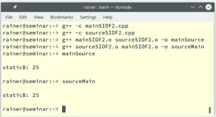

用局部静态变量解决静态初始化顺序灾难

在最后一步，我使用 C++20 解决静态初始化顺序灾难。

###### 4.5.4.1.3 静态变量的编译时初始化

让我将 constinit 应用于 staticA。constinit 保证 staticA 在编译时初始化。

**静态变量的编译时初始化**

```cpp
// sourceSIOF3.cpp

constexpr int square(int n) {
    return n * n;
}

constinit auto staticA = square(5);
```

**静态变量的编译时初始化**

```cpp
// mainSIOF3.cpp

#include <iostream>

extern constinit int staticA;

auto staticB = staticA;

int main() {

10    std::cout << '\n';

12    std::cout << "staticB: " << staticB << '\n';

14    std::cout << '\n';

17 }
```

文件 mainSIOF3.cpp 中的第 5 行声明了变量 staticA，它在编译时初始化（文件 sourceSIOF3.cpp 中的第 7 行）。顺便说一句，使用 `constexpr`（文件 mainSIOF3.cpp 中的第 5 行）代替 `constinit` 将无效，因为 `constexpr` 需要定义，而不仅仅是声明。

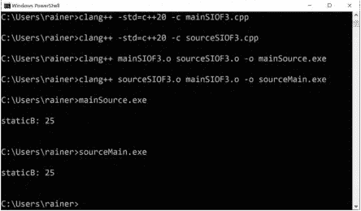

用 constinit 解决静态初始化顺序灾难

与使用局部静态变量进行惰性初始化的情况一样，staticB 的值为 25。


### 要点提炼

- 在 C++20 中，我们获得了两个新关键字：`consteval` 和 `constinit`。`consteval` 生成一个在编译时执行的函数，而 `constinit` 保证变量在编译时初始化。
- 与 C++11 中的 `constexpr` 相比，`consteval` 保证函数在编译时执行。
- `const`、`constexpr` 和 `constinit` 之间存在细微差异。`const` 和 `constexpr` 创建常量变量。`constexpr` 和 `constinit` 在编译时执行。


### 4.6 模板改进


模板的改进使 C++20 更加一致，因此在编写泛型程序时更不容易出错。

#### 4.6.1 条件显式构造函数

有时你需要一个类，其构造函数接受不同类型。例如，你有一个类 VariantWrapper，它持有一个接受多种类型的 std::variant。

一个持有 std::variant 属性的 VariantWrapper 类

```cpp
class VariantWrapper {
    std::variant<bool, char, int, double, float, std::string> myVariant;
};
```

要用 bool、char、int、double、float 或 std::string 初始化 VariantWrapper，类 VariantWrapper 需要为每种列出的类型提供构造函数。懒惰是一种美德——至少对程序员而言——因此你决定让构造函数变成泛型的。

类 Implicit 展示了一个泛型构造函数。

#### 泛型构造函数

```cpp
1  // implicitExplicitGenericConstructor.cpp
2  
3  #include <iostream>
4  #include <string>
5  
6  struct Implicit {
7      template <typename T>
8      Implicit(T t) {
9          std::cout << t << '\n';
10     }
11 };
12 
13 struct Explicit {
14     template <typename T>
15     explicit Explicit(T t) {
16         std::cout << t << '\n';
17     }
18 };
19 
20 int main() {
21 
22     std::cout << '\n';
23 
24     Implicit imp1 = "implicit";
25     Implicit imp2("explicit");
26     Implicit imp3 = 1998;
27     Implicit imp4(1998);
28 
29     std::cout << '\n';
30 
31     // Explicit exp1 = "implicit";
32     Explicit exp2("explicit");
33     // Explicit exp3 = 2011;
34     Explicit exp4(2011);
35 
36     std::cout << '\n';
37 
38 }
```

现在，你遇到了一个问题。泛型构造函数（第 7 行）是一个“万能”构造函数，因为你可以用任何类型调用它。这个构造函数过于贪婪。通过在构造函数前加上 `explicit`（第 14 行），隐式转换（第 31 行和第 33 行）不再有效。只有显式调用（第 32 行和第 34 行）是有效的。

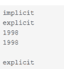

隐式和显式泛型构造函数

在 C++20 中，explicit 更加有用。假设你有一个类型 MyBool，它只应该支持从 bool 的隐式转换，而不支持其他隐式转换。在这种情况下，explicit 可以被有条件地使用。

#### 允许从 bool 进行隐式转换的泛型构造函数

```cpp
// conditionallyConstructor.cpp

#include <iostream>
#include <type_traits>
#include <typeinfo>

struct MyBool {
    template <typename T>
    explicit(!std::is_same<T, bool>::value) MyBool(T t) {
        std::cout << typeid(t).name() << '\n';
    }
};

void needBool(MyBool b) { }

int main() {

    MyBool myBool1(true);
    MyBool myBool2 = false;

    needBool(myBool1);
    needBool(true);
    // needBool(5);
    // needBool("true");

}
```

`explicit(!std::is_same<T, bool>::value)` 表达式保证了 MyBool 只能从 bool 值被隐式创建。函数 std::is_same 是来自 `type_traits` 库的编译期谓词^66。编译期谓词（如 `std::is_same`）在编译时求值并返回布尔值。因此，从 `bool` 的隐式转换（第 19 行和第 22 行）是可行的，但被注释掉的从 `int` 和 `C-string` 的转换（第 23 行和第 24 行）则不行。

#### 4.6.2 非类型模板参数（NTTP）

C++ 支持非类型作为模板参数。本质上，非类型可以是

- 整数和枚举器
- 指向对象、函数和类成员的指针
- 左值引用
- `std::nullptr_t`


#### 典型的非类型模板参数

当我在课堂上问学生是否曾经使用过非类型作为模板参数时，他们说：没有！当然，我回答这个棘手的问题，并展示一个经常使用的非类型模板参数示例：

定义一个 `std::array`

```cpp
std::array<int, 5> myVec;
```

常量 5 是一个用作模板参数的非类型。

自首个 C++ 标准 C++98 以来，C++ 社区一直在讨论支持浮点模板参数。现在，我们有了它们，而且更多：C++20 支持浮点类型、字面量类型和字符串字面量作为非类型。

##### 4.6.2.1 浮点类型

下面的程序使用浮点类型作为非类型模板参数。

#### 将浮点类型作为非类型模板参数

```cpp
// nonTypeTemplateParameterFloating.cpp

#include <iostream>
#include <typeinfo>

template <double d>
auto getDouble() {
    return d;
}

template <auto NonType>
auto getNonType() {
    return NonType;
}

int main() {

    std::cout << '\n';

    auto d1 = getDouble<5.5>();
    auto d2 = getDouble<6.5>();

    auto i = getNonType<2017>();
    std::cout << i << " " << typeid(i).name() << '\n';

    auto f = getNonType<2020.1f>();
    std::cout << f << " " << typeid(f).name() << '\n';

    auto d = getNonType<2020.2>();
    std::cout << d << " " << typeid(d).name() << '\n';

    std::cout << '\n';
}
```

函数模板 getDouble（第 6 行）只接受 double 值。我想强调的是，每次调用函数模板 getDouble（第 21 行和第 22 行）都会创建一个新的函数 getDouble。该函数是针对给定 double 值的完全特化。自 C++17 起，你可以使用 auto 作为非类型模板参数。因此，第 23 行在 C++17 下是有效的。在 C++20 中，你也可以对浮点类型使用 auto。下面的程序可视化了 C++20 编译器的类型推导过程。编译器对非类型模板参数推导出类型 int（第 24 行）、float（第 27 行）和 double（第 30 行）。

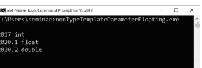

浮点类型作为非类型模板参数

##### 4.6.2.2 字面量类型

字面量类型具有以下两个属性：

- 所有基类和非静态数据成员都是公有且非 mutable 的
- 所有基类和非静态数据成员的类型都是结构类型或这些类型的数组

字面量类型必须具有一个 constexpr 构造函数。

字面量类型作为非类型模板参数

```cpp
// nonTypeTemplateParameterLiteral.cpp

struct ClassType {
    constexpr ClassType(int) {}
};

template <ClassType c1>
auto getClassType() {
    return c1;
}

int main() {

    auto c1 = getClassType<ClassType(2020)>();

}
```

自 C++20 起，字符串可以作为非类型模板参数使用。

##### 4.6.2.3 字符串字面量

类 StringLiteral 具有一个 constexpr 构造函数。

## 编译期正则表达式

字符串字面量一个非常令人印象深刻的使用场景是正则表达式的编译期解析[^1]。目前已经有一个针对 C++23 的提案在推进中：P1433R0：编译期正则表达式[^2]。该提案的作者 Hana Dusíková 在 C++ 中倡导编译期正则表达式：“*当前 `std::regex` 的设计和实现[正则表达式库]很慢，主要是因为 RE[正则表达式]模式在运行时被解析和编译。许多常见用例中，模式在编译期间就已经已知，因此用户通常不需要运行时 RE[正则表达式]解析引擎。我认为这违背了 C++ 的承诺：‘不为你不使用的东西付费’。*”

*如果 RE[正则表达式]在编译时已知，那么模式应在编译期间进行检查。`std::regex` 的设计不允许这种[编译期求值]，因为 RE 输入是运行时的字符串，语法错误以异常形式报告[^3]。*

## 精华摘要

- 条件显式构造函数允许你为泛型构造函数显式控制哪些类型可以在构造函数中使用。
- C++20 进一步支持浮点类型、字面量类型和字符串字面量作为非类型模板参数。

[^1]: https://github.com/hanickadot/compile-time-regular-expressions
[^2]: https://www.open-std.org/jtc1/sc22/wg21/docs/papers/2019/p1433r0.pdf
[^3]: https://en.cppreference.com/w/cpp/regex


### 4.7 Lambda 改进


Cippi 从滑梯上滑下来

在 C++20 中，lambda 表达式支持模板参数，因而也支持概念。当 lambda 没有状态时，它们可以被默认构造并支持拷贝赋值。此外，一项语法限制被取消了：初始化捕获中的包展开。另外，lambda 表达式可以用于未求值上下文。在 C++20 中，它们会检测你何时隐式拷贝 `this` 指针。这意味着 lambda 中一个导致未定义行为的重要原因消失了。

让我们从 lambda 的模板参数开始。

#### 4.7.1 Lambda 的模板参数

诚然，有类型 lambda（C++11）、泛型 lambda（C++14）和模板 lambda（C++20 中 lambda 的模板参数）之间的差异很细微。

#### 有类型 lambda、泛型 lambda 和模板 lambda

```cpp
// templateLambda.cpp

#include <iostream>
#include <string>
#include <vector>

auto sumInt = [](int fir, int sec) { return fir + sec; };
auto sumGen = [](auto fir, auto sec) { return fir + sec; };
auto sumDec = [](auto fir, decltype(fir) sec) { return fir + sec; };
auto sumTem = []<typename T>(T fir, T sec) { return fir + sec; };

int main() {

    std::cout << '\n';

    std::cout << "sumInt(2000, 11): " << sumInt(2000, 11) << '\n';
    std::cout << "sumGen(2000, 11): " << sumGen(2000, 11) << '\n';
    std::cout << "sumDec(2000, 11): " << sumDec(2000, 11) << '\n';
    std::cout << "sumTem(2000, 11): " << sumTem(2000, 11) << '\n';

    std::cout << '\n';

    std::string hello = "Hello";
    std::string world = "world";
    // std::cout << "sumInt(hello, world): " << sumInt(hello, world) << '\n';
    std::cout << "sumGen(hello, world): " << sumGen(hello, world) << '\n';
    std::cout << "sumDec(hello, world): " << sumDec(hello, world) << '\n';
    std::cout << "sumTem(hello, world): " << sumTem(hello, world) << '\n';

    std::cout << '\n';

    std::cout << "sumInt(true, 2010): " << sumInt(true, 2010) << '\n';
    std::cout << "sumGen(true, 2010): " << sumGen(true, 2010) << '\n';
    std::cout << "sumDec(true, 2010): " << sumDec(true, 2010) << '\n';
    // std::cout << "sumTem(true, 2010): " << sumTem(true, 2010) << '\n';

    std::cout << '\n';

}
```

在展示这个程序大概会令人惊讶的输出之前，我想先比较这四个 lambda。

- sumInt
  - C++11
    - 有类型 lambda
      - 仅接受可转换为 int 的类型
- sumGen
  - C++14
    - 泛型 lambda
      - 接受所有类型
- sumDec
  - C++14
    - 泛型 lambda
      - 第二个类型必须可转换为第一个类型
- sumTem
  - C++20
    - 模板 lambda
      - 第一个类型和第二个类型必须相同

这对具有不同类型的模板实参意味着什么？当然，每个 lambda 都接受 int（第 16～19 行），而有类型 lambda sumInt 不接受字符串（第 25 行）。

用 bool 值 true 和 int 值 2010 调用这些 lambda 可能会令人惊讶（第 33～36 行）。

- sumInt 返回 2011，因为 true 是整型，会被提升为 int。
- sumGen 返回 2011，因为 true 是整型，会被提升为 int。sumInt 和 sumGen 之间存在细微差别，我将在几行后说明。
- sumDec 返回 2。为什么？第二个参数 sec 的类型变成第一个参数 fir 的类型：借助 decltype(fir) sec，编译器推导出 fir 的类型，并把它作为 sec 的类型。因此，2010 被转换为 true。在表达式 fir + sec 中，fir 是整型，会被提升为 1。最终结果是 2。
- sumTem 无效。

```text
sumInt(2000, 11): 2011
sumGen(2000, 11): 2011
sumDec(2000, 11): 2011
sumTem(2000, 11): 2011

sumGen(hello, world): Hello world
sumDec(hello, world): Hello world
sumTem(hello, world): Hello world

sumInt(true, 2010): 2011
sumGen(true, 2010): 2011
sumDec(true, 2010): 2
```

#### 有类型 lambda、泛型 lambda 和模板 lambda 之间的细微差别

模板 lambda 更典型的用例是在 lambda 中使用容器。下面的程序展示了三个接受容器的 lambda。每个 lambda 返回容器的大小。

#### 三个接受容器的 lambda

```cpp
// templateLambdaVector.cpp

#include <concepts>
#include <deque>
#include <iostream>
#include <string>
#include <vector>

auto lambdaGeneric = [](const auto& container) { return container.size(); };
auto lambdaVector = []<typename T>(const std::vector<T>& vec) { return vec.size(); };
auto lambdaVectorIntegral = []<std::integral T>(const std::vector<T>& vec) {
    return vec.size();
};

int main() {

    std::cout << '\n';

    std::deque deq{1, 2, 3};
    std::vector vecDouble{1.1, 2.2, 3.3, 4.4};
    std::vector vecInt{1, 2, 3, 4, 5};

    std::cout << "lambdaGeneric(deq): " << lambdaGeneric(deq) << '\n';
    // std::cout << "lambdaVector(deq): " << lambdaVector(deq) << '\n';
    // std::cout << "lambdaVectorIntegral(deq): "
    //             << lambdaVectorIntegral(deq) << '\n';

    std::cout << '\n';

    std::cout << "lambdaGeneric(vecDouble): " << lambdaGeneric(vecDouble) << '\n';
    std::cout << "lambdaVector(vecDouble): " << lambdaVector(vecDouble) << '\n';
    // std::cout << "lambdaVectorIntegral(vecDouble): "
    //             << lambdaVectorIntegral(vecDouble) << '\n';

    std::cout << '\n';

    std::cout << "lambdaGeneric(vecInt): " << lambdaGeneric(vecInt) << '\n';
    std::cout << "lambdaVector(vecInt): " << lambdaVector(vecInt) << '\n';
    std::cout << "lambdaVectorIntegral(vecInt): "
              << lambdaVectorIntegral(vecInt) << '\n';

    std::cout << '\n';
}
```

函数 `lambdaGeneric`（第 9 行）可以用任何具有成员函数 `size()` 的数据类型调用。函数 `lambdaVector`（第 10 行）更具体：它只接受 `std::vector`。函数 `lambdaVectorIntegral`（第 11 行）使用 C++20 概念 `std::integral`。因此，它只接受使用整型（例如 `int`）的 `std::vector`。要使用概念 `std::integral`，我必须包含头文件 `<concepts>`。我认为这个小程序不言自明。

```text
lambdaGeneric(deq): 3

lambdaGeneric(vecDouble): 4
lambdaVector(vecDouble): 4

lambdaGeneric(vecInt): 5
lambdaVector(vecInt): 5
lambdaVectorIntegral(vecInt): 5
```

Lambda，接受一个容器和一个 `std::vector`


#### 类模板实参推导

程序 `templateLambdaVector.cpp` 中有一个你很可能忽略的特性。自 C++17 起，编译器可以从实参推导类模板的类型（第 20～22 行）。因此，不必冗长地写 `std::vector<int> myVec{1, 2, 3}`，你可以简单地写 `std::vector myVec{1, 2, 3}`。

#### 4.7.2 检测 `this` 指针的隐式拷贝

C++20 编译器会检测你何时隐式拷贝 `this` 指针。通过拷贝隐式捕获 `this` 指针可能导致未定义行为。未定义行为本质上意味着程序的行为没有任何保证，例如以下情况：

#### 通过拷贝隐式捕获 this 指针

```cpp
// lambdaCaptureThis.cpp

#include <iostream>
#include <string>

struct LambdaFactory {
    auto foo() const {
        return [=] { std::cout << s << '\n'; };
    }
    std::string s = "LambdaFactory";
    ~LambdaFactory() {
        std::cout << "Goodbye" << '\n';
    }
};

auto makeLambda() {
    LambdaFactory lambdaFactory;

    return lambdaFactory.foo();
}

int main() {

    std::cout << '\n';

    auto lam = makeLambda();
    lam();

    std::cout << '\n';


}
```

该程序的编译按预期工作，但程序的执行并非如此。

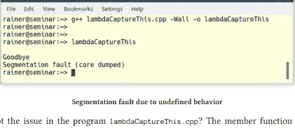

未定义行为导致段错误

你发现程序 lambdaCaptureThis.cpp 中的问题了吗？成员函数 foo（第 7 行）返回 lambda `[=] { std::cout << s << '\n'; }`，它隐式拷贝了 this 指针。这个隐式拷贝在第 17 行不是问题，但到了作用域结束时就成了问题。作用域结束意味着局部 LambdaFactory 的生命周期结束（第 19 行）。因此，调用 lam()（第 28 行）会触发未定义行为。

在这种情况下，C++20 编译器必须发出警告。

```text
<source>:8:18: warning: implicit capture of 'this' via '[=]' is deprecated in C++20 [-Wdeprecated]
    8 |         return [=] { std::cout << s << std::endl; };
      |                 ^
<source>:8:18: note: add explicit 'this' or '*this' capture
Execution build compiler returned: 0
Program returned: 139

Goodbye
```

C++20 诊断出一条警告

C++20 最后两个 lambda 特性在结合使用时非常方便：C++20 中的 lambda 在无状态时可以默认构造并支持拷贝赋值。此外，lambda 可以用于未求值上下文。

#### 4.7.3 未求值上下文中的 Lambda，以及无状态 Lambda 的默认构造与拷贝赋值

##### 4.7.3.1 未求值上下文

以下代码片段包含一个函数声明和一个函数定义。


## 函数的声明与定义

```cpp
int add1(int, int);                 // declaration
int add2(int a, int b) { return a + b; } // definition
```

函数 `add1` 被声明，而 `add2` 被定义。这意味着，如果你在求值上下文中使用 `add1`，例如通过调用它，就会得到链接时错误。关键观察是，你可以在未求值上下文中使用 `add1`，例如 `typeid`[^70] 或 `decltype`[^71]。这两个运算符都接受未求值操作数。

## 未求值上下文

```cpp
 1    // unevaluatedContext.cpp
 2
 3    #include <iostream>
 4    #include <typeinfo>  // typeid
 5
 6    int add1(int, int);                 // declaration
 7    int add2(int a, int b) { return a + b; } // definition
 8
 9    int main() {
10
11        std::cout << '\n';
12
13        std::cout << "typeid(add1).name(): " << typeid(add1).name() << '\n';
14
15        decltype(*add1) add = add2;
16
17        std::cout << "add(2000, 20): " << add(2000, 20) << '\n';
18
19        std::cout << '\n';
20    }
```

`typeid(add1).name()`（第 13 行）返回该类型的字符串表示，而 `decltype`（第 15 行）推导其参数的类型。

[^70]: https://en.cppreference.com/w/cpp/language/typeid
[^71]: https://en.cppreference.com/w/cpp/language/decltype

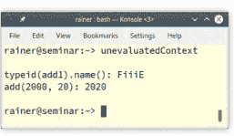

##### 4.7.3.2 无状态 Lambda

无状态 lambda 是不从环境中捕获任何内容的 lambda。或者换句话说，无状态 lambda 是 lambda 定义中初始方括号 `[]` 为空的 lambda。例如，lambda 表达式 `auto add = [](int a, int b){ return a + b; };` 是无状态的。

##### 4.7.3.3 适配标准模板库的关联容器

在我向你展示示例之前，我必须补充几点说明。容器 `std::set` 以及标准模板库中的所有其他有序关联容器（`std::map`、`std::multiset` 和 `std::multimap`）都使用函数对象 `std::less` 对键进行排序。默认情况下，`std::less` 按字典序升序对所有键进行排序。`std::set`[^28] 的声明展示了 `std::less` 的隐式使用。

`std::set` 的声明

```cpp
template<
    class Key,
    class Compare = std::less<Key>,
    class Allocator = std::allocator<Key>
> class set;
```

[^28]: https://en.cppreference.com/w/cpp/container/set

### 在未求值上下文中使用的 Lambda

```cpp
 1    // lambdaUnevaluatedContext.cpp
 2
 3    #include <cmath>
 4    #include <iostream>
 5    #include <memory>
 6    #include <set>
 7    #include <string>
 8
 9    template <typename Cont>
10    void printContainer(const Cont& cont) {
11        for (const auto& c: cont) std::cout << c << " ";
12        std::cout << "\n";
13    }
14
15    int main() {
16
17        std::cout << '\n';
18
19        std::set<std::string> set1 = {"Scott", "Bjarne", "Herb", "Dave", "michael"};
20        printContainer(set1);
21
22        using SetDecreasing = std::set<std::string,
23                                      decltype([](const auto& l, const auto& r) {
24                                          return l > r;
25                                      })>;
26        SetDecreasing set2 = {"scott", "Bjarne", "Herb", "Dave", "michael"};
27        printContainer(set2);
28
29        using SetLength = std::set<std::string,
30                                  decltype([](const auto& l, const auto& r) {
31                                      return l.size() < r.size();
32                                  })>;
33        SetLength set3 = {"scott", "Bjarne", "Herb", "Dave", "michael"};
34        printContainer(set3);
35
36        std::cout << '\n';
37
38        std::set<int> set4 = {-10, 5, 3, 100, 0, -25};
39        printContainer(set4);
40
41        using SetAbsolute = std::set<int, decltype([](const auto& l, const auto& r) {
42            return std::abs(l) < std::abs(r);
43        })>;
44        SetAbsolute set5 = {-10, 5, 3, 100, 0, -25};
45        printContainer(set5);
46
47        std::cout << "\n\n";
48
49    }
```

下面是程序的输出。

```
Bjarne Dave Herb michael scott
scott michael Herb Dave Bjarne
Herb scott Bjarne michael

-25  -10  0  3  5  100
0  3  5  -10  -25  100
```

### 在未求值上下文中使用 lambda

当你研究程序的输出时，可能会感到惊讶。特殊的 `set3` 使用 lambda `[](const auto& l, const auto& r){ return l.size() < r.size(); }` 作为谓词，却忽略了名字 Dave。原因很简单。Dave 与先添加的 Herb 长度相同。`std::set` 支持唯一键，而在这种情况下，使用特殊谓词后这些键是相同的。如果我使用 `std::multiset`，就不会发生这种情况。

#### 4.7.4 consteval Lambda

C++20 支持 `consteval`。`consteval` lambda 意味着该 lambda 是一个在编译时执行的立即函数。

一个 `consteval` lambda

```cpp
 1    // constevalLambda.cpp
 2
 3    #include <algorithm>
 4    #include <iostream>
 5    #include <vector>
 6
 7    int main() {
 8
 9        std::cout << '\n';
10
11        auto constevalLambda = [] () consteval {
12            std::vector myVec = {1, 2, 4, 3};
13            std::sort(myVec.begin(), myVec.end());
14            return myVec.back();
15        };
16
17        std::cout << "constevalLambda: " << constevalLambda() << '\n';
18
19        std::cout << '\n';
20
21    }
```

lambda `constevalLambda`（第 11 行）被声明为 `consteval`。因此，lambda 调用（第 17 行）在编译时执行。

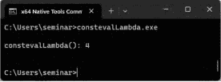

### 空参数子句

当你将 lambda 声明为 `consteval` 时，在 C++20 中仍然需要冗余的空参数子句 `[] () consteval`。到了 C++23，这一限制取消了，你可以定义不带参数子句的 `consteval` lambda：

```cpp
// A consteval lambda with empty parameter clause
auto constevalLambda = [] () consteval {
    std::vector myVec = {1, 2, 4, 3};
    std::sort(myVec.begin(), myVec.end());
    return myVec.back();
};
```

#### 4.7.5 初始化捕获中的包展开

C++20 修复了 lambda 表达式的一个语法限制：初始化捕获中的包展开。C++ 中的 lambda 表达式支持捕获子句中的参数包。自 C++14 起，广义捕获允许它从外围作用域初始化捕获变量，并在 lambda 中使用它们。以下简短代码示例说明了这两个特性。

### 捕获子句中的参数包

```cpp
// parameterPacksLambda.cpp

void hello(int, double, bool) { }

template<typename... Args>
void func(Args... args) {
    auto newFunc = [args...] { return hello(args...); };
    newFunc();
}

int main() {

    func(5, 5.5, true);

}
```

### 广义捕获

```cpp
// generalizedCaptures.cpp

#include <memory>
#include <utility>

int main() {

    auto uniq = std::make_unique<int>(5);

    auto lamb = [newUniq = std::move(std::move(uniq))] {
        int val = *newUniq;
    };

    lamb();

}
```

在 C++20 之前，无法将这两个特性结合起来。自 C++20 起，这种不对称性消失了。

### 初始化捕获中的包展开

```cpp
// packExpansionInitCapture.cpp

#include <iostream>
#include <memory>
#include <utility>

template<typename Callable, typename ... Args>
auto packExpansion(Callable call, Args ... args) {
    return [call, ...args = std::move(args)] {
        return call(args...);
    };
}

void func(int fir, double sec, bool thi) {
    std::cout << std::boolalpha;
    std::cout << "fir: " << fir << '\n';
    std::cout << "sec: " << sec << '\n';
    std::cout << "thi: " << thi << '\n';
}

int main() {

    std::cout << '\n';

    auto lamb1 = packExpansion(func, 1, 2, true);
    lamb1();

    std::cout << '\n';

}
```

在第 10 行，我在初始化捕获中应用了包展开。由于语法限制，省略号位于 `args` 之前：`[call, ...args = std::move(args)]`。


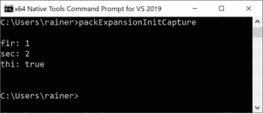

初始化捕获中的包展开

## 核心信息

- 在 C++20 中，lambda 可以拥有模板参数。因此，导致 lambda 未定义行为的一个重要原因消失了。
- lambda 能检测到 `this` 指针被隐式引用的情况。
- 你可以在未求值上下文中使用 lambda 表达式。
- lambda 可以是 `consteval` 的，并允许在初始化捕获中进行包展开。


Cippi 准备好参加比赛了

### 4.8 新属性

在 C++20 中，我们获得了新的和改进的属性，例如 [[nodiscard("reason")]]、[[likely]]、[[unlikely]] 和 [[no_unique_address]]。特别是 [[nodiscard("reason")]] 可用于明确表达我们接口的意图。

```cpp
template <typename T, typename ... Args>
T* create(Args&& ... args) {
    return new T(std::forward<Args>(args)...);
}

enum class ErrorCode {
    Okay,
    Warning,
    Critical,
    Fatal
};

ErrorCode errorProneFunction() { return ErrorCode::Fatal; }

int main() {
    int* val = create<int>(5);
    delete val;

    create<int>(5);

    errorProneFunction();

    MyType(5, true);
}
```

得益于完美转发和参数包，工厂函数 `create`（第 11 行）可以调用任何构造函数并返回一个堆分配的对象。

这个程序存在许多问题。首先，第 30 行有内存泄漏，因为在堆上创建的 int 从未被删除。其次，函数 `errorProneFunction`（第 32 行）的错误码未被检查。最后，构造函数调用 `MyType(5, true)`（第 34 行）创建了一个临时对象，该对象被创建后立即销毁。这至少是资源的浪费。现在，[[nodiscard]] 登场了。

[[nodiscard]] 可以用于函数声明、枚举声明或类声明。如果你丢弃了声明为 [[nodiscard]] 的函数的返回值，编译器应当发出警告。对于按值返回声明为 [[nodiscard]] 的枚举或类的函数，也是如此。如果你仍然想忽略返回值，可以将其转换为 void。

让我们看看这意味着什么。在下面的示例中，我使用了 C++17 中 [[nodiscard]] 属性的语法。

### 在 C++17 中使用 [[nodiscard]] 属性

```cpp
// nodiscard.cpp

#include <utility>

struct MyType {

    MyType(int, bool) {}

};

template <typename T, typename ... Args>
[[nodiscard]]
T* create(Args&& ... args){
    return new T(std::forward<Args>(args)...);
}

enum class [[nodiscard]] ErrorCode {
    Okay,
    Warning,
    Critical,
    Fatal
};

ErrorCode errorProneFunction() { return ErrorCode::Fatal; }

int main() {

    int* val = create<int>(5);
    delete val;

    create<int>(5);

    errorProneFunction();

    MyType(5, true);

}
```

工厂函数 `create`（第 13 行）和枚举 `ErrorCode`（第 17 行）被声明为 [[nodiscard]]。因此，第 31 行和第 33 行的调用会产生警告。

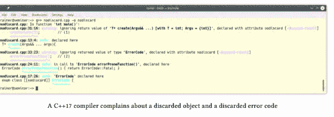

C++17 编译器会对被丢弃的对象和被丢弃的错误码发出警告

好多了，但程序仍有一些问题。[[nodiscard]] 不能用于构造函数这类不返回值的函数。因此，临时对象 `MyType(5, true)`（第 35 行）仍然会在没有警告的情况下创建。其次，错误消息过于笼统。作为函数的使用者，我想要知道为什么丢弃结果会是一个问题的原因。

这两个问题都可以用 C++20 解决。构造函数可以被声明为 [[nodiscard]]，并且警告可以带有附加信息。

### 在 C++20 中使用 [[nodiscard]] 属性

```cpp
// nodiscardString.cpp

#include <utility>

struct MyType {

    [[nodiscard("Implicit destroying of temporary MyType.")]] MyType(int, bool) {}

};

template <typename T, typename ... Args>
[[nodiscard("You have a memory leak.")]]
T* create(Args&& ... args)
{
    return new T(std::forward<Args>(args)...);
}

enum class [[nodiscard("Don't ignore the error code.")]] ErrorCode {
    Okay,
    Warning,
    Critical,
    Fatal
};
ErrorCode errorProneFunction() { return ErrorCode::Fatal; }
```


### std::async 的问题

C++ 中的许多现有函数都可以从 [[nodiscard]] 属性中受益。一个理想候选是 `std::async` 函数。当你没有使用 `std::async` 的返回值时，本意是异步的 `std::async` 调用会隐式地变为同步。应该在独立线程中运行的代码反而表现得像一个阻塞式函数调用。更多关于 `std::async` 这种反直觉行为的细节，请参阅我的文章《特殊的 Futures》⁷⁶。

在研究 cppreference.com/nodiscard⁷⁷ 上的 [[nodiscard]] 语法时，我注意到 `std::async`⁷⁸ 的声明在 C++20 中发生了变化。以下是其中一个声明：

`std::async` 在 C++20 中使用 [[nodiscard]] 属性。

```cpp
template<class Function, class... Args>
[[nodiscard]]
std::future<std::invoke_result_t<std::decay_t<Function>,
                                 std::decay_t<Args>...>>
  async( Function&& f, Args&&... args );
```

`std::async` 的返回类型声明中使用了 [[nodiscard]]。

接下来的两个属性 [[likely]] 和 [[unlikely]] 与优化有关。

#### 4.8.2 [[likely]] 和 [[unlikely]]

关于 [[likely]] 和 [[unlikely]] 属性的提案 P0479R5⁷⁹ 是我所知最短的提案。为了让你有个概念，以下是该提案中一条有趣的注释：“*使用 likely 属性是为了允许实现针对执行路径进行优化，这些路径包含该属性时，比任何不包含该属性在语句或标签上的替代执行路径都要可能得多。使用 unlikely 属性则是为了优化这样的情形：包含该属性的执行路径比任何不包含该属性在语句或标签上的替代执行路径都更不可能。一条执行路径包含某个标签，当且仅当它包含跳转到该标签的语句。过度使用这两种属性都可能导致性能下降。*”

总之，这两个属性允许向优化器提供关于预期执行路径可能性高低的提示。

### 使用 `[[likely]]` 向优化器提供提示

```cpp
for(size_t i=0; i < v.size(); ++i){
    if (v[i] > 0) [[likely]] sum -= sqrt(v[i]);
    else sum += sqrt(v[i]);
}
```

优化之旅继续，这次是新的属性 `[[no_unique_address]]`。这一次，优化关注的是空间而非执行时间。

#### 4.8.3 `[[no_unique_address]]`

`[[no_unique_address]]` 表示类的这个数据成员不必拥有与其类中所有其他非静态数据成员不同的地址。因此，如果该成员具有空类型，编译器可以将其优化为不占用内存。

下面的程序举例说明了这一新属性的用法。

### 使用 `[[no_unique_address]]` 属性

```cpp
// uniqueAddress.cpp

#include <iostream>

struct Empty {};

struct NoUniqueAddress {
    int d{};
    [[no_unique_address]] Empty e{};
};

struct UniqueAddress {
    int d{};
    Empty e{};
};

int main() {

    std::cout << '\n';

    std::cout << std::boolalpha;

    std::cout << "sizeof(int) == sizeof(NoUniqueAddress): "
              << (sizeof(int) == sizeof(NoUniqueAddress)) << '\n';
}
```

### 4.9 进一步改进


本节介绍 C++20 核心语言中剩余的小改进。

#### 4.9.1 `volatile`

提案 P1152R0[^78] 的摘要简要描述了 `volatile` 将经历的变化：“*提议的弃用保留了 `volatile` 有用的部分，并移除了可疑/已经损坏的部分。本文旨在让那些目前可能在运行时或通过编译器更新而微妙损坏的代码在编译期就被破坏。*”

在深入探讨 `volatile` 之前，我想回答一个关键问题：何时应该使用 `volatile`？C++ 标准中的一条注释指出：“*`volatile` 是对实现的一种提示，要求避免涉及该对象的激进优化，因为该对象的值可能通过实现无法检测的方式被改变。*”这意味着对于单个执行线程，编译器必须按照这些操作在源代码中出现的次数，在可执行文件中执行相应的加载或存储操作。因此，`volatile` 操作不能被消除或重排。因此，你可以使用 `volatile` 对象与信号处理器进行通信，但不能用于与另一个执行线程通信。

在展示 `volatile` 的哪些语义被保留之前，我想先介绍被弃用的特性：

- 1. 弃用 `volatile` 复合赋值，以及前置/后置自增/自减
- 2. 弃用函数参数或返回类型上的 `volatile` 限定
- 3. 弃用结构化绑定声明中的 `volatile` 限定符

[^78]: http://www.open-std.org/jtc1/sc22/wg21/docs/papers/2018/p1152r0.html


如果你想了解所有复杂的细节，我强烈建议你观看 JF Bastien 在 CppCon 2019 上的演讲“Deprecating volatile”。以下是他演讲中的几个例子。此外，我修正了源代码中的几个拼写错误。以下代码片段中的编号对应前面列出的三个弃用项。

### volatile 的弃用用例

```cpp
// (1)
int neck, tail;
volatile int brachiosaur;
brachiosaur = neck;      // OK, a volatile store
tail = brachiosaur;      // OK, a volatile load

// deprecated: does this access brachiosaur once or twice
tail = brachiosaur = neck;

// deprecated: does this access brachiosaur once or twice
brachiosaur += neck;

// OK, a volatile load, an addition, a volatile store
brachiosaur = brachiosaur + neck;

***********************************************
// (2)
// deprecated: a volatile return type has no meaning
volatile struct amber jurassic();

// deprecated: volatile parameters aren't meaningful to the
//             caller, volatile only applies within the function
void trex(volatile short left_arm, volatile short right_arm);

// OK, the pointer isn't volatile, the data it points to is
void fly(volatile struct pterosaur* pteranodon);

***********************************************
(3)
struct linhenykus { volatile short forelimb; };
void park(linhenykus alvarezsauroid) {
    // deprecated: does the binding copy the forelimbs?
    auto [what_is_this] = alvarezsauroid; // structured binding
    // ...
}
```


### volatile 与多线程语义

volatile 通常用于表示可以独立于常规程序流而改变的对象。例如，在嵌入式编程中表示外部设备（内存映射 I/O）的对象。由于这些对象可以独立于常规程序流而变化，并且它们的值直接写入主内存，因此不会在缓存中进行优化存储。换句话说，volatile 避免激进的优化，并且没有多线程语义。

#### 4.9.2 带初始化器的基于范围的 for 循环

在 C++20 中，你可以直接使用带初始化器的基于范围的 for 循环。

带初始化器的基于范围的 for 循环

```cpp
// rangeBasedForLoopInitializer.cpp

#include <iostream>
#include <string>
#include <vector>

int main() {

    for (auto vec = std::vector{1, 2, 3}; auto v : vec) {
        std::cout << v << " ";
    }

    std::cout << "\n\n";

    for (auto initList = {1, 2, 3}; auto e : initList) {
        e *= e;
        std::cout << e << " ";
    }

    std::cout << "\n\n";

    using namespace std::string_literals;
    for (auto str = "Hello World"s; auto c : str) {
        std::cout << c << " ";
    }

    std::cout << '\n';
}
```

基于范围的 for 循环在第 9 行使用 `std::vector`，在第 15 行使用 `std::initializer_list`，在第 23 行使用 `std::string`。此外，在第 9 行和第 15 行，我应用了自 C++17 以来就有的类模板自动类型推导。我只需写 `std::vector`，而不是 `std::vector<int>`。


带初始化器的基于范围的 for 循环的使用

#### 4.9.3 虚 constexpr 函数

constexpr 函数有可能在编译时运行，但也可以在运行时执行。因此，在 C++20 中，你可以将 constexpr 函数声明为 virtual。两个方向都是可能的。虚 constexpr 函数可以覆盖非 constexpr 函数，而虚非 constexpr 函数可以覆盖虚 constexpr 函数。我想强调，override 意味着基类的相关函数是 virtual。

程序 virtualConstexpr.cpp 展示了两种组合：

```cpp
// virtualConstexpr.cpp

#include <iostream>

struct X1 {
    virtual int f() const = 0;
};

struct X2: public X1 {
    constexpr int f() const override { return 2; }
};

struct X3: public X2 {
    int f() const override { return 3; }
};

struct X4: public X3 {
    constexpr int f() const override { return 4; }
};

int main() {
    X1* x1 = new X4;
    std::cout << "x1->f(): " << x1->f() << '\n';

    X4 x4;
    X1& x2 = x4;
    std::cout << "x2.f(): " << x2.f() << '\n';
}
```

第 24 行通过指针使用虚分派（晚绑定），第 28 行通过引用使用虚分派。

```text
X1->f(): 4
X2.f(): 4
```

虚 constexpr 函数的使用

#### 4.9.4 UTF-8 字符串的新字符类型：`char8_t`

除了 C++11 中的字符类型 `char16_t` 和 `char32_t` 之外，C++20 还新增了字符类型 `char8_t`。类型 `char8_t` 足够大，可以表示任何 UTF-8 代码单元（8 位）。它与 unsigned char 具有相同的大小、符号性和对齐方式，但属于不同类型。


### char 与 char8_t

char 有一个字节。与 char8_t 不同，一个字节的位数（因而 char 的位数）并未定义。几乎所有实现都使用 8 位作为一个字节。`std::string` 是 `std::basic_string` 字符类型的别名。

### `std::string` 与 `std::string` 字面量

```cpp
std::string std::basic_string<char>
"Hello World"s
```

因此，C++20 为字符类型 `char8_t` 新增了一个 typedef（第 1 行），并新增了 UTF-8 字符串字面量（第 2 行）。

### 新的 `char8_t` 字符类型与 UTF-8 字符串字面量

```cpp
std::u8string std::basic_string<char8_t>
u8"Hello World"
```

程序 char8Str.cpp 展示了新字符类型 char8_t 的简单用法。

### 新字符类型 char8_t 的直观用法

```cpp
// char8Str.cpp

#include <iostream>
#include <string>

int main() {

    const char8_t* char8Str = u8"Hello world";
    std::basic_string<char8_t> char8String = u8"helloWorld";
    std::u8string char8String2 = u8"helloWorld";

    char8String2 += u8".";

    std::cout << "char8String.size(): " << char8String.size() << '\n';
    std::cout << "char8String2.size(): " << char8String2.size() << '\n';

    char8String2.replace(0, 5, u8"Hello");

    std::cout << "char8String2.size(): " << char8String2.size() << '\n';
}
```

废话不多说，以下是程序的输出：

```
char8String.size(): 10
char8String2.size(): 11
char8String2.size(): 12
```

新字符类型 char8_t 的使用

C++20 没有针对 char8_t 字符串的输出运算符。因此，一种方便的方法是对 char8_t 字符串应用 `reinterpret_cast<const char*>(...)`。

### char8_t 字符串的输出

```cpp
// char8StrOutput.cpp

#include <iostream>
#include <string>

int main() {

    std::cout << '\n';

    const char8_t* char8Str = u8"Dollar: \u20AC";
    std::basic_string<char8_t> char8String = u8"Euro: \u0024";
    std::u8string char8String2 = u8"Pound: \u00A3";

    std::cout << reinterpret_cast<const char*>(char8Str) << '\n';
    std::cout << reinterpret_cast<const char*>(char8String.c_str()) << '\n';
    std::cout << reinterpret_cast<const char*>(char8String2.c_str()) << '\n';

    std::cout << '\n';
}
```

该程序显示美元（第 14 行）、欧元（第 15 行）和英镑（第 16 行）符号。

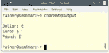

char8_t 字符串的输出

#### 4.9.5 在局部作用域中使用 using enum

using enum 声明将指定枚举的枚举项引入局部作用域。

### 在局部作用域中引入枚举项

```cpp
// enumUsing.cpp

#include <iostream>
#include <string_view>

enum class Color {
    red,
    green,
    blue
};

std::string_view toString(Color col) {
    switch (col) {
        using enum Color;
        case red: return "red";
        case green: return "green";
        case blue: return "blue";
    }
    return "unknown";
}

int main() {

    std::cout << '\n';

    std::cout << "toString(Color::red): " << toString(Color::red) << '\n';

    using Color::green;

    std::cout << "toString(green): " << toString(green) << '\n';

    using enum Color;

    std::cout << "toString(blue): " << toString(blue) << '\n';

    std::cout << '\n';

}
```

using enum 声明（第 14 行和第 32 行）将作用域枚举 Color 的枚举项引入局部作用域。从那时起，枚举项就可以不加作用域限定使用（第 15-17 行和第 34 行）。此外，你还可以为特定枚举值应用 using 声明（第 28 行）。

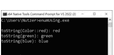

#### 4.9.6 位域的默认成员初始化器

首先，什么是位域？以下是维基百科⁸⁰ 的定义：“位域是计算机编程中使用的一种数据结构。它由若干相邻的计算机内存位置组成，这些位置被分配用于保存一个位序列，其存储方式使得其中的任何单个位或一组位……

⁸⁰https://en.wikipedia.org/wiki/Bit_field


位集可以被寻址。位域最常用于表示已知固定位宽的整型。

在 C++20 中，我们可以对位域的成员进行默认初始化：

### 位域成员的默认初始化器

```cpp
// bitField.cpp

#include <iostream>

struct Class11 {
    int i = 1;
    int j = 2;
    int k = 3;
    int l = 4;
    int m = 5;
    int n = 6;
};

struct BitField20 {
    int i : 3 = 1;
    int j : 4 = 2;
    int k : 5 = 3;
    int l : 6 = 4;
    int m : 7 = 5;
    int n : 7 = 6;
};

int main () {

    std::cout << '\n';

    std::cout << "sizeof(Class11): " << sizeof(Class11) << '\n';
    std::cout << "sizeof(BitField20): " << sizeof(BitField20) << '\n';

    std::cout << '\n';

}
```

参照 C++11 中类成员（第 6 - 11 行）的做法，在 C++20 中位域成员可以拥有默认初始化器（第 15 - 20 行）。将数字 3、4、5、6、7 和 7 相加，得到 32。因此，32 位即 4 字节正好是 BitField20 的大小：


### 提炼信息

- `volatile` 的含义在 C++20 中得到澄清。`volatile` 没有多线程语义，只应被用于避免激进优化，因为对象可能会独立于常规程序流而改变。
- 基于范围的 for 循环可以使用初始化器。
- 新字符类型 `char8_t` 足够大，可以表示 8 位。
- `using enum` 声明将命名枚举的枚举项引入局部作用域。
- 位域的成员可以被默认初始化。
- `constexpr` 函数可以是虚函数。

## 5. 标准库


- **四大特性**
  - 概念
  - 模块
  - 范围库
  - 协程

- **核心语言**
  - 三路比较运算符
  - 指定初始化
  - `consteval` 和 `constinit`
  - 模板改进
  - Lambda 改进
  - 新属性

- **库**
  - `std::span`
  - 容器改进
  - 算术工具
  - 日历和时区
  - 格式化库

- **并发**
  - 原子操作
  - 信号量
  - 闩锁和屏障
  - 协作式中断
  - `std::jthread`

除了范围库之外，C++20 标准库还提供了许多新特性。`std::span` 作为对连续内存区域的非拥有引用，改进的字符串和容器实现，以及改进的算法。此外，C++11 的 `chrono` 库扩展了日历和时区功能。最后但同样重要的是，文本可以被安全且强大地格式化。

你必须从左到右阅读该表达式。管道符号表示函数组合：
首先，所有偶数可以通过（`std::views::filter([](int n){ return n % 2 == 0; })`）。
之后，每个剩余数字被映射为其两倍（`std::views::transform([](int n){ return n * 2; })`）。这个小例子展示了范围库的两个新特性：函数组合被应用于整个容器。

现在你应该已经准备好了解细节了。让我们回到起点：范围和视图是概念。

#### 5.1.1 范围

我已经在概念章节中介绍了 [范围] 概念。因此，这里简要回顾一下。

由起始迭代器和结束哨兵提供的范围指定了一组可以迭代的项。

STL 的容器是范围，但不是视图。

哨兵指定范围的结尾。

##### 5.1.1.1 哨兵

对于 STL 的容器，结束迭代器就是哨兵。在 C++20 中，哨兵的类型可以与起始迭代器的类型不同。根据范围的不同，空终止符 `\0` 可以结束一个字符串，空字符串 `std::string{}` 可以结束一个单词列表，`std::nullptr` 可以结束一个链表，或者数字 `-1` 可以结束一个非负数列表。

下面的示例为 C 字符串和 `std::vector<int>` 使用哨兵。

**空格和负数作为哨兵**

```cpp
// sentinel.cpp

#include <iostream>
#include <algorithm>
#include <compare>
#include <vector>

struct Space {
    bool operator==(auto pos) const {
        return *pos == ' ';
    }
};

struct NegativeNumber {
    bool operator==(auto num) const {
        return *num < 0;
    }
};

struct Sum {
    void operator()(auto n) { sum += n; }
    int sum{};
};

int main() {

    std::cout << '\n';

    const char* rainerGrimm = "Rainer Grimm";

    std::ranges::for_each(rainerGrimm, Space{}, [](char c) { std::cout << c; });
    std::cout << '\n';
    for (auto c : std::ranges::subrange(rainerGrimm, Space{})) std::cout << c;
    std::cout << '\n';

    std::ranges::subrange rainer{rainerGrimm, Space{}};
    std::ranges::for_each(rainer, [](char c) { std::cout << c << ' '; });
    std::cout << '\n';
    for (auto c : rainer) std::cout << c << ' ';
    std::cout << '\n';

    std::cout << "\n";

    std::vector<int> myVec{5, 10, 33, -5, 10};

    for (auto v : myVec) std::cout << v << " ";
    std::cout << '\n';

    auto [tmp1, sum1] = std::ranges::for_each(myVec, Sum{});
    std::cout << "Sum: " << sum1.sum << '\n';

    auto [tmp2, sum2] = std::ranges::for_each(std::begin(myVec), NegativeNumber{},
                                               Sum{});
    std::cout << "Sum: " << sum2.sum << '\n';

    std::ranges::transform(std::begin(myVec), NegativeNumber{},
                           [](auto num) { return num * num; });
    std::ranges::for_each(std::begin(myVec), NegativeNumber{},
                          [](int num) { std::cout << num << " "; });
    std::cout << '\n';
    for (auto&& v : std::ranges::subrange(std::begin(myVec), NegativeNumber{})) {
        std::cout << v << " ";
    }

    std::cout << "\n\n";

}
```

该程序定义了两个哨兵：`Space`（第 8 行）和 `NegativeNumber`（第 14 行）。两者都定义了相等运算符。得益于 `<compare>` 头文件，编译器会自动生成不相等运算符。当将 `std::ranges::for_each` 或 `std::ranges::transform` 等算法与哨兵一起使用时，需要不相等运算符。让我从哨兵 `Space` 开始。

第 31 行将哨兵 `Space{}` 直接应用于字符串 `rainerGrimm`。创建一个 `std::ranges::subrange`（第 33 行）使它能够在基于范围的 for 循环中使用该哨兵。你也可以定义一个 `std::ranges::subrange`，并直接在算法 `std::ranges::for_each`（第 37 行）或基于范围的 for 循环（第 39 行）中使用它。

我的第二个示例使用一个 `std::vector<int>`，其中填充了值 `{5, 10, 33, -5, 10}`。哨兵 `NegativeNumber` 检查数字是否为负数。首先，我使用函数对象 `Sum`（第 20 - 23 行）对所有值求和。`std::ranges::for_each` 返回一个对 `(it, func)`。`it` 是哨兵的后继，`func` 是应用于该范围的函数对象。得益于结构化绑定¹，我可以直接定义变量 `sum` 和 `sum2` 并显示它们的值（第 52 和 56 行）。`std::ranges::for_each` 使用哨兵 `NegativeNumber`。因此，`sum2` 保存的是到哨兵为止的和。调用 `std::ranges::transform`（第 58 行）将每个元素转换为其平方：`[](auto num){ return num * num}`。转换在哨兵 `NegativeNumber` 处停止。第 60 行和第 63 行显示转换后的值。

最后，下面是程序的输出。

¹https://en.cppreference.com/w/cpp/language/structured_binding


##### 5.1.1.2 新迭代器和哨兵

C++20 支持新的迭代器和特殊哨兵。要使用它们，必须包含头文件 `<iterator>`。

让我从迭代器开始。

**新迭代器**

| 迭代器 | 描述 |
|---|---|
| `std::counted_iterator(it, count)` | 使用 count 指定范围的结尾 |
| `std::common_iterator(it, sent)` | 统一迭代器/哨兵对 |

范围还具有三个特殊哨兵：

### 特殊哨兵

| 迭代器 | 描述 |
| --- | --- |
| `std::default_sentinel` | 用于知道其范围边界的迭代器 |
| `std::unreachable_sentinel` | 用于永远无法到达的结束迭代器 |
| `std::move_sentinel` | 用于将复制映射为移动的结束迭代器 |

以下示例应用了新的迭代器和特殊哨兵。

新迭代器和哨兵

```cpp
// iteratorSentinels.cpp

#include <iterator>
#include <algorithm>
#include <iostream>
#include <vector>

int main() {

    std::cout << '\n';

    std::vector<int> vec{1, 2, 3, 4, 5, 6, 7, 8, 9};

    std::ranges::copy(vec.begin(),
        vec.begin() + 4, std::ostream_iterator<int>{std::cout, " "});    // 1 2 3 4

    std::cout << '\n';

    std::ranges::copy(std::counted_iterator(vec.begin(), 4),
        vec.end(), std::ostream_iterator<int>{std::cout, " "});    // ERROR

    std::cout << '\n';

    std::ranges::copy(std::counted_iterator(vec.begin(), 4),
        std::default_sentinel, std::ostream_iterator<int>{std::cout, " "}); // 1 2 3 4

    std::cout << '\n';

}
```

该程序使用两种方式显示 std::vector vec 的前四个元素。第 14 行使用起始迭代器和结束迭代器。第 24 行应用 `std::counted_iterator` 和 `std::default_sentinel`。使用 `std::counted_iterator` 和结束迭代器无法编译（第 19 行）。

#### 5.1.2 视图

视图是轻量级范围。视图不拥有数据，其复制、移动或赋值的时间复杂度为常数。STL 和 `std::ranges` 的容器是范围但不是视图。视图允许你访问范围、遍历范围，或修改或过滤范围中的元素。

##### 5.1.2.1 `std::ranges::view_interface`

视图派生自类 `std::ranges::view_interface<View>`，该类派生自类 `std::ranges::view_base`。

`std::ranges::view_interface` 支持一些基本操作：

### `std::ranges::view_interface` 的操作

| 操作 | 要求 | 描述 |
|---|---|---|
| `v.empty()` | 至少为前向迭代器 | 返回 v 是否为空 |
| `if (v)` | 至少为前向迭代器 | 返回 v 是否非空 |
| `v.size()` |  | 返回元素数量 |
| `v.front()` | 至少为前向迭代器 | 返回第一个元素 |
| `v.back()` | 至少为双向迭代器<br>begin 和 end 具有相同类型 | 返回最后一个元素 |
| `v[i]` | 至少为随机访问迭代器 | 返回第 i 个元素 |
| `v.data()` | 返回指向元素的原始指针 | 元素位于连续内存中 |

你可能已经猜到，视图也是一个概念。有关 view 这一概念的更详细讨论，请阅读关于概念的章节：视图。

##### 5.1.2.2 `std::ranges::subrange`

类模板 `std::ranges::subrange` 将迭代器和哨兵组合成单个视图。得益于 `std::ranges::subrange`，用起始迭代器和哨兵创建视图非常直接。

创建子范围

```cpp
// subrange.cpp

#include <iterator>
#include <algorithm>
#include <iostream>
#include <ranges>
#include <vector>

int main() {

    std::cout << '\n';

    std::vector vec{0, 1, 2, 3, 4, 5, 6, 7, 8, 9};

    auto [first, last] = std::ranges::subrange(vec.begin() + 2, vec.end() - 2);

    std::cout << "[first, last]: " << "[" << *first << ", " << *last << "]";

    std::cout << '\n';

    std::ranges::subrange sub1{std::ranges::find_if(vec, [](int i){ return i > 3; }),
                               std::ranges::find_if(vec, [](int i){ return i > 8; })};

    for (auto v: sub1) std::cout << v << " ";

    std::cout << '\n';

    auto transVec = sub1 | std::views::transform([](int i) { return i * i; });

    for (auto v: transVec) std::cout << v << " ";

    std::cout << "\n\n";
}
```

调用 `std::ranges::subrange(vec.begin() + 2, vec.end() - 2)`（第 15 行）返回一个迭代器和一个哨兵。第 21 行创建一个包含大于 3 且小于 8 的元素的子范围（第 21 行）。你可以直接将范围适配器应用到子范围 sub1 上（第 28 行）。

### `std::ranges::subrange` 的操作

| 操作 | 要求 | 描述 |
|---|---|---|
| `sub.next(n = 1)` |  | 返回从第 n 个元素开始的子范围 |
| `sub.prev(n = 1)` |  | 返回从第一个元素之前的第 n 个元素开始的子范围 |
| `sub.advance(n)` |  | 返回从后移 n 个元素处开始的子范围（若 n < 0，则从前移 n 个元素处开始） |
| `auto[beg, end] = sub` |  | 用 sub 的 begin 和 end 创建 beg 和 end |

视图的概念与范围适配器密切相关。

#### 5.1.3 范围适配器

范围适配器将范围转换为视图。

以下代码片段展示了对范围进行操作的范围适配器。

对范围进行操作的范围适配器

```cpp
std::vector<int> numbers = {1, 2, 3, 4, 5, 6};

auto results = numbers | std::views::filter([](int n){ return n % 2 == 0; })
                      | std::views::transform([](int n){ return n * 2; });
```

在此代码片段中，numbers 是范围，范围适配器 `std::views::filter` 和 `std::views::transform` 创建视图。此外，`std::string_view`² 和 `std::span` 也是视图。

得益于范围适配器，C++20 允许以函数式风格编程。范围适配器可以组合，并且生成的视图是惰性的。我已经介绍了两个范围适配器，但 C++20 提供了更多。

### C++20 中的范围适配器

| 视图 | 描述 |
|---|---|
| `std::views::all_t`<br>`std::views::all` | 将范围转换为视图。 |
| `std::ranges::ref_view` | 获取另一个范围的所有元素。 |
| `std::ranges::owning_view` | 唯一拥有另一个范围。 |
| `std::ranges::iota_view`<br>`std::views::iota` | 生成递增值的视图。 |
| `std::ranges::single_view`<br>`std::views::single` | 拥有单个值。 |
| `std::ranges::empty_view`<br>`std::views::empty` | 没有元素的视图。 |
| `std::ranges::basic_istream_view`<br>`std::ranges::istream_view` | 从流中读取元素。 |
| `std::ranges::filter_view`<br>`std::views::filter` | 获取满足谓词的元素。 |
| `std::ranges::transform_view`<br>`std::views::transform` | 转换每个元素。 |
| `std::ranges::take_view`<br>`std::views::take` | 获取另一个视图的前 *n* 个元素。 |
| `std::ranges::take_while_view`<br>`std::views::take_while` | 只要谓词返回 true，就获取另一个视图的元素。 |
| `std::ranges::drop_view`<br>`std::views::drop` | 跳过另一个视图的前 *n* 个元素。 |
| `std::ranges::drop_while_view`<br>`std::views::drop_while` | 跳过另一个视图的初始元素，直到谓词返回 false。 |
| `std::ranges::join_view`<br>`std::views::join` | 连接由范围组成的视图。 |
| `std::ranges::split_view`<br>`std::views::split` | 使用分隔符拆分视图。 |
| `std::ranges::lazy_split_view`<br>`std::views::lazy_split` | 使用分隔符拆分视图。 |
| `std::views::counted` | 根据起始迭代器和计数创建视图。 |
| `std::ranges::common_view`<br>`std::views::common` | 将视图转换为 `std::ranges::common_range`。 |
| `std::ranges::reverse_view`<br>`std::views::reverse` | 按逆序迭代。 |
| `std::ranges::elements_view`<br>`std::views::elements` | 创建基于元组第 n 个元素的视图。 |
| `std::ranges::keys_view`<br>`std::views::keys` | 创建基于类似 pair 值第一个元素的视图。 |
| `std::ranges::values_view`<br>`std::views::values` | 创建基于类似 pair 值第二个元素的视图。 |

严格来说，命名空间 `std::views` 中的函数（如 `std::views::values`）是范围适配器，而命名空间 `std::ranges` 中的类型（如 `std::ranges::values_view`）是视图。范围适配器 `range | std::views::values` 对范围进行操作并返回视图，但视图将范围作为参数：`std::ranges::values_view{range}`。

`std::ranges::ref_view` 存储对底层范围的引用。它是一个借用范围，只要底层范围有效，就可以引用它。底层范围的重新分配不会使 `std::ranges::ref_view` 失效。

`std::ranges::owning_view` 取得另一个范围元素的所有权。它只能由右值构造，且不能复制。

`std::ranges::owning_view`

```cpp
1 std::vector<int> vec{1, 2, 3, 4, 5};
2
3 std::ranges::owning_view vec2{vec};       // ERROR
4 std::ranges::owning_view vec3{std::move(vec)}; // OK
5
6 std::ranges::owning_view vec4{vec2};      // ERROR
7 std::ranges::owning_view vec5{std::move(vec2)}; // OK
```


用左值初始化 `std::ranges::owning_view`（例如第 3 行或第 6 行）是错误的。第一种情况下，左值是 `std::vector<int>`；第二种情况下，左值是 `std::ranges::owning_view`。

`std::ranges::split_view` 与 `std::ranges::lazy_split_view` 之间的微妙区别在于：`std::ranges::split_view` 不能遍历常量视图，并且要求前向迭代器。`std::ranges::split_view` 不知道自身大小。

**拆分字符串**

```cpp
 1 // splitView.cpp
 2
 3 #include <iostream>
 4 #include <string>
 5 #include <ranges>
 6
 7 int main() {
 8
 9   std::string myString = "Hello:world!";
10
11   for (auto subRange: myString | std::views::split(':')) {
12     for (auto c: subRange) {
13       std::cout << c;
14     }
15     std::cout << ' ';
16   }
17
18   std::cout << '\n';
19
20   myString = "ThisTestisTestaTestTest.";
21
22   for (auto subRange: myString | std::views::split(std::string("TEST"))) {
23     for (auto c: subRange) {
24       std::cout << c;
25     }
26     std::cout << ' ';
27   }
28
29 }
```

拆分范围时，会得到一个子范围。首先，我按冒号 `:` 拆分 `myString`（第 11 行）；其次，按字符串 `TEST` 拆分（第 22 行）。此外，我在每个得到的子范围后添加一个空格 `' '`。


拆分字符串

##### 5.1.3.1 使用范围适配器的三种方式

一般来说，可以使用范围适配器，例如 `std::views::drop`，或对应的视图 `std::ranges::drop_view`。因此，必须以下面不同的方式使用函数调用的参数：

**`std::views::drop` 和 `std::ranges::drop_view` 的调用**

```cpp
const auto numbers = {1, 2, 3, 4, 5};

auto firstThree = numbers | std::views::drop(3);
std::ranges::drop_view firstThree(numbers, 3);
auto firstThree = std::views::drop(3)(numbers);
```

更正式地说，以下是使用范围适配器或其对应视图的三种语法形式。其中的行号指前一个使用 `std::views::drop` 和 `std::ranges::drop_view` 的示例中的行号。

**`std::views::drop` 和 `std::ranges::drop_view` 的调用**

```text
Range | RangeAdaptor(args...) (line 3)
View(Range, args...) (line 4)
RangeAdaptor(...)(Range) (line 5)
```

范围适配器或视图可以接受任意数量的参数：`args...`。

有三种范围适配器，用于从范围创建视图或创建特殊视图。

##### 5.1.3.2 `std::views::all`

范围适配器 `std::views::all` 可方便地将范围转换为视图。

**将范围转换为视图**

```cpp
// allView.cpp

#include <iostream>
#include <ranges>
#include <vector>
#include <unordered_map>

int main() {
    std::cout << '\n';

    std::vector<int> myVec{0, 1, 2, 3, 4, 5, 6, 7, 8, 9};
    for (auto v : std::views::all(myVec) | std::views::take(5)) {
```


将范围转换为视图

诚然，第 33 至 35 行和第 41 至 43 行过于复杂。只需使用视图 `std::views::keys` 和 `std::views::values`，即可获得关联容器键和值的视图。

**关联容器键和值的视图**

```cpp
for (auto k : std::views::keys(myMap)) {
    std::cout << k << " ";
}

for (auto v : std::views::values(myMap)) {
    std::cout << v << " ";
}
```

有一种更简单的方法可以获取范围前五个或后五个元素的视图。

##### 5.1.3.3 `std::views::counted`

`std::views::counted` 从起始迭代器和计数创建视图。

**从起始迭代器和计数创建视图**

```cpp
// countedview.cpp

#include <iostream>
#include <ranges>
#include <vector>

int main() {

    std::cout << '\n';

    std::vector<int> myVec{0, 1, 2, 3, 4, 5, 6, 7, 8, 9};
    for (auto v : std::views::counted(std::begin(myVec), 5)) {
        std::cout << v << " ";
    }

    std::cout << '\n';

    for (auto v : std::views::counted(std::begin(myVec) + 5, 5)) {
        std::cout << v << " ";
    }

    std::cout << "\n\n";
}
```

第 12 行和第 18 行直接从起始迭代器和计数创建视图。如果计数过大，会出现未定义行为。


**从起始迭代器和计数创建视图**

##### 5.1.3.4 `std::views::common`

当已有视图但需要 `std::ranges::common_range` 时，函数 `std::views::common` 非常方便。在以下程序 `commonView.cpp` 中，我求 100 到 200 之间所有数字的平方和。

**将视图转换为 `std::views::common`**

```cpp
// commonView.cpp

#include <iostream>
#include <numeric>
#include <ranges>
#include <vector>

int main() {

    std::cout << '\n';

    auto results = std::views::iota(100) |
                   std::views::take_while([](int i) { return i <= 200; }) |
                   std::views::transform([](int i) { return i * i; });

    /*
    auto results = std::views::iota(100) |
                   std::views::take_while([](int i) { return i <= 200; }) |
                   std::views::transform([](int i) { return i * i; }) |
                   std::views::common;
    */

    auto sum = std::accumulate(results.begin(), results.end(), 0);

    std::cout << "sum: " << sum << '\n';

    std::cout << '\n';
}
```

ranges 库只为算法³库和内存⁴库的算法提供了对应版本，但没有为数值⁵库的算法提供对应版本。因此，我使用数值库中的 `std::accumulate` 来求所有平方之和（第 24 行）。程序编译失败，并给出晦涩的错误消息：

- 3. https://en.cppreference.com/w/cpp/header/algorithm
- 4. https://en.cppreference.com/w/cpp/header/memory
- 5. https://en.cppreference.com/w/cpp/numeric


使用视图调用 `std::accumulate` 时的编译错误

编译错误的原因简单却又令人意外。范围适配器算法的组合（第 12 - 14 行）返回一个视图。而 `std::accumulate` 要求起始和结束迭代器具有一致的类型。将视图转换为 `std::views::common`（第 17 - 20 行）可解决该问题。现在，我可以直接将结果传入 `std::accumulate`（第 24 行）。


求 100 到 200 之间所有平方之和


## 临时范围上的视图

视图不拥有数据。因此，视图不会延长其数据的生命周期。因此，视图只能在左值上创建。如果在临时范围上创建视图，编译会失败。

**在临时范围上创建视图**

```cpp
// temporaryRange.cpp

#include <initializer_list>
#include <ranges>

int main() {

    const auto numbers = {1, 2, 3, 4, 5};

    auto firstThree = numbers | std::views::drop(3);
    // auto firstThree = {1, 2, 3, 4, 5} | std::views::drop(3); ERROR

    std::ranges::drop_view firstFour{numbers, 4};
    // std::ranges::drop_view firstFour{{1, 2, 3, 4, 5}, 4}; ERROR

}
```

第 12 行和第 15 行会导致编译错误。第 11 行和第 14 行对左值 numbers 的使用是有效的。

#### 5.1.4 直接作用于容器

标准模板库（STL）的算法有时略显不便。它们需要起始迭代器和结束迭代器。这通常比你愿意写的要多。

**STL 算法需要起始和结束迭代器**

```cpp
// sortClassical.cpp

#include <algorithm>
#include <iostream>
#include <vector>

int main() {

    std::vector<int> myVec{-3, 5, 0, 7, -4};
    std::sort(myVec.begin(), myVec.end());
    for (auto v : myVec) std::cout << v << " "; // -4, -3, 0, 5, 7
}
```

如果 `std::sort` 能作用于整个容器，岂不是很好？多亏 ranges 库，这在 C++20 中成为可能。

**ranges 库的算法直接作用于容器**

```cpp
// sortRanges.cpp

#include <algorithm>
#include <iostream>
#include <vector>

int main() {
    std::vector<int> myVec{-3, 5, 0, 7, -4};
    std::ranges::sort(myVec);
    for (auto v : myVec) std::cout << v << " "; // -4, -3, 0, 5, 7
}
```

[算法库](https://en.cppreference.com/w/cpp/header/algorithm)⁶和[内存库](https://en.cppreference.com/w/cpp/header/memory)⁷的算法有 ranges 对应版本。它们的名称以命名空间 `std::ranges` 开头。[数值库](https://en.cppreference.com/w/cpp/header/numeric)⁸的算法没有 ranges 对应版本。

研究 `std::ranges::sort` 的重载时，你会注意到它们支持投影。

##### 5.1.4.1 投影

`std::ranges::sort` 有两个重载：


```cpp
template <std::random_access_iterator I, std::sentinel_for<I> S,
    class Comp = ranges::less, class Proj = std::identity>
requires std::sortable<I, Comp, Proj>
constexpr I sort(I first, S last, Comp comp = {}, Proj proj = {});

template <ranges::random_access_range R, class Comp = ranges::less,
    class Proj = std::identity>
requires std::sortable<ranges::iterator_t<R>, Comp, Proj>
constexpr ranges::borrowed_iterator_t<R> sort(R&& r, Comp comp = {}, Proj proj = {});
```

当你研究第二个重载时，会注意到它接受一个可排序范围 `R`、一个谓词 `Comp` 和一个投影 `Proj`。谓词 `Comp` 默认使用 `std::less`，投影 `Proj` 默认使用恒等 `std::identity`，它会原样返回其参数。投影是将一个集合映射到其子集的映射。投影可以是

- 可调用对象，例如 lambda
- 指向成员函数或数据成员的指针

下面展示这意味着什么：

## 对数据类型应用投影

```cpp
// rangeProjection.cpp

#include <algorithm>
#include <functional>
#include <iostream>
#include <vector>

struct PhoneBookEntry {
    std::string name;
    int number;
};

void printPhoneBook(const std::vector<PhoneBookEntry>& phoneBook) {
    for (const auto& entry : phoneBook) std::cout << "(" << entry.name << ", "
                                                  << entry.number << ")";
    std::cout << "\n\n";
}

int main() {

    std::cout << '\n';

    std::vector<PhoneBookEntry> phoneBook{ {"Brown", 111}, {"Smith", 444},
                                           {"Grimm", 666}, {"Butcher", 222},
                                           {"Taylor", 555}, {"Wilson", 333} };

    std::ranges::sort(phoneBook, {}, &PhoneBookEntry::name);  // ascending by name
    printPhoneBook(phoneBook);

    std::ranges::sort(phoneBook, std::ranges::greater(),
                      &PhoneBookEntry::name);                 // descending by name
    printPhoneBook(phoneBook);

    std::ranges::sort(phoneBook, {}, &PhoneBookEntry::number); // ascending by number
    printPhoneBook(phoneBook);

    std::ranges::sort(phoneBook, std::ranges::greater(),
                      &PhoneBookEntry::number);                // descending by number

    printPhoneBook(phoneBook);
}
```

phoneBook（第 23 行）包含 `PhoneBookEntry` 类型的结构体（第 8 行）。一个 `PhoneBookEntry` 由名称和号码组成。得益于投影，phoneBook 可以按名称升序（第 26 行）、按名称降序（第 29 行）、按号码升序（第 33 行）以及按号码降序（第 36 行）排序。表达式 `std::ranges::sort(phoneBook, {}, &PhoneBookEntry::name)` 中的空花括号会触发排序条件的默认构造，在本例中该条件为 `std::less`。

```text
(Brown, 111) (Butcher, 222) (Grimm, 666) (Smith, 444) (Taylor, 555) (Wilson, 333)

(Wilson, 333) (Taylor, 555) (Smith, 444) (Grimm, 666) (Butcher, 222) (Brown, 111)

(Brown, 111) (Butcher, 222) (Wilson, 333) (Smith, 444) (Taylor, 555) (Grimm, 666)

(Grimm, 666) (Taylor, 555) (Smith, 444) (Wilson, 333) (Butcher, 222) (Brown, 111)
```

当投影要求更高时，可以使用可调用对象，例如 lambda 表达式。

## 使用可调用对象作为投影

```cpp
// rangeProjectionCallable.cpp

#include <algorithm>
#include <functional>
#include <iostream>
#include <vector>

struct PhoneBookEntry {
    std::string name;
    int number;
};

void printPhoneBook(const std::vector<PhoneBookEntry>& phoneBook) {
    for (const auto& entry : phoneBook) std::cout << "(" << entry.name << ", "
                                                  << entry.number << ")";

    std::cout << "\n\n";
}

int main() {

    std::cout << '\n';

    std::vector<PhoneBookEntry> phoneBook{ {"Brown", 111}, {"Smith", 444},
        {"Grimm", 666}, {"Butcher", 222}, {"Taylor", 555}, {"Wilson", 333} };

    std::ranges::sort(phoneBook, {}, &PhoneBookEntry::name);
    printPhoneBook(phoneBook);

    std::ranges::sort(phoneBook, {}, [](auto p) { return p.name; });
    printPhoneBook(phoneBook);

    std::ranges::sort(phoneBook, {}, [](auto p) {
        return std::to_string(p.number) + p.name;
    });
    printPhoneBook(phoneBook);

    std::ranges::sort(phoneBook, [](auto p, auto p2) {
        return std::to_string(p.number) + p.name <
               std::to_string(p2.number) + p2.name;
    });
    printPhoneBook(phoneBook);
}
```

第 26 行的 `std::ranges::sort` 使用成员 `PhoneBookEntry::name` 作为投影。第 29 行展示了等价的 lambda 表达式 `[](auto p) { return p.name; }` 作为投影。第 32 行的投影要求更高。它使用转换为字符串的号码与 `p.name` 拼接。当然，你可以直接将拼接后的字符串化号码和名称用作排序条件。在这种情况下，第 32 行的算法调用比第 37 行的更易读。


*使用可调用对象作为范围投影*

大多数 ranges 算法支持投影。

##### 5.1.4.2 键和值的直接视图

此外，你可以为 `std::unordered_map` 的键（第 16 行）和值（第 24 行）创建直接视图。

**对 std::unordered_map 的键和值的视图**

```cpp
// rangesEntireContainer.cpp

#include <iostream>
#include <ranges>
#include <string>
#include <unordered_map>


int main() {

    std::unordered_map<std::string, int> freqWord{ {"witch", 25}, {"wizard", 33},
                                                   {"tale", 45}, {"dog", 4},
                                                   {"cat", 34}, {"fish", 23} };

    std::cout << "Keys:" << '\n';

    auto names = std::views::keys(freqWord);
    for (const auto& name : names) std::cout << name << " ";
    std::cout << '\n';
    for (const auto& name : std::views::keys(freqWord)) std::cout << name << " ";

    std::cout << "\n\n";

    std::cout << "Values: \n";
    auto values = std::views::values(freqWord);
    for (const auto& value : values) std::cout << value << " ";
    std::cout << '\n';
    for (const auto& value : std::views::values(freqWord)) {
        std::cout << value << " ";
    }
}
```

当然，键和值可以直接显示（第 19 行和第 27 行）。输出相同。


*直接操作容器可能并不那么令人兴奋，但函数组合和惰性求值则很令人兴奋。*

#### 5.1.5 函数组合

### 视图的组合

```cpp
// rangesComposition.cpp

#include <iostream>
#include <ranges>
#include <string>
#include <map>

int main() {

    std::map<std::string, int> freqWord{ {"witch", 25}, {"wizard", 33},
                                         {"tale", 45}, {"dog", 4},
                                         {"cat", 34}, {"fish", 23} };

    std::cout << "All words: ";
    for (const auto& name : std::views::keys(freqWord)) { std::cout << name << " "; }

    std::cout << '\n';

    std::cout << "All words, reversed: ";
    for (const auto& name : std::views::keys(freqWord)
                             | std::views::reverse) { std::cout << name << " "; }

    std::cout << '\n';

    std::cout << "The first 4 words: ";
    for (const auto& name : std::views::keys(freqWord)
                             | std::views::take(4)) { std::cout << name << " "; }

    std::cout << '\n';

    std::cout << "All words starting with w: ";
    auto firstw = [](const std::string& name) { return name[0] == 'w'; };
    for (const auto& name : std::views::keys(freqWord)
                             | std::views::filter(firstw)) { std::cout << name << " "; }

    std::cout << '\n';
}
```

我只对键感兴趣。我显示了所有键（第 15 行）、所有键的反向顺序（第 20 行）、前四个键（第 26 行），以及以字母 ‘w’ 开头的键（第 32 行）。

最后，以下是程序的输出。

```text
All words: cat dog fish tale witch wizard
All words, reversed: wizard witch tale fish dog cat
The first 4 words: cat dog fish tale
All words starting with w: witch wizard
```

管道符号 `|` 是函数组合的语法糖¹⁴。你可以写 `R | C`，而不是 `C(R)`。因此，接下来三行是等价的。

**函数组合的三种语法形式**

```cpp
auto rev1 = std::views::reverse(std::views::keys(freqWord));
auto rev2 = std::views::keys(freqWord) | std::views::reverse;
auto rev3 = freqWord | std::views::keys | std::views::reverse;
```

¹⁴ https://en.wikipedia.org/wiki/Syntactic_sugar

#### 5.1.6 惰性求值

`std::views::iota` 是一个范围工厂，通过依次递增初始值来创建元素序列。该序列可以是有限的或无限的。程序 `rangesIota.cpp` 用 10 个整数填充一个 `std::vector`，从 0 开始。

**使用 std::views::iota 填充 std::vector**

```cpp
1  // rangesIota.cpp
2
3  #include <iostream>
4  #include <numeric>
5  #include <ranges>
6  #include <vector>
7
8  int main() {
9
10     std::cout << std::boolalpha;
11
12     std::vector<int> vec;
13     std::vector<int> vec2;
14
15     for (int i : std::views::iota(0, 10)) vec.push_back(i);
16
17     for (int i : std::views::iota(0) | std::views::take(10)) vec2.push_back(i);
18
```


```
19      std::cout << "vec == vec2: " << (vec == vec2) << '\n';
20
21      for (int i : vec) std::cout << i << " ";
22
23  }
```

第一次 iota 调用（第 15 行）创建从 0 到 9 的所有数字，增量为 1。第二次 iota 调用（第 17 行）创建一个无限数据流，从 0 开始，增量为 1。std::views::iota(0) 是惰性的。只有我请求时，我才会得到一个新值。我请求了十次。因此，两个向量完全相同。

```
vec == vec2: true
0 1 2 3 4 5 6 7 8 9
```

使用 std::views::iota 填充 std::vector

现在，我想解决一个小挑战：找出从 1,000,000 开始的前 20 个质数。

## 从 1'000'000 开始的前 20 个质数

```
1   // rangesLazy.cpp
2
3   #include <iostream>
4   #include <ranges>
5
6
7   bool isPrime(int i) {
8       for (int j=2; j*j <= i; ++j){
9           if (i % j == 0) return false;
10      }
11      return true;
12  }
13
14  int main() {
15
16      std::cout << "Numbers from 1'000'000 to 1'001'000 (displayed each 100th): "
17                << '\n';
18      for (int i: std::views::iota(1'000'000, 1'001'000)) {
19          if (i % 100 == 0) std::cout << i << " ";
20      }
21
22      std::cout << "\n\n";
23
24      auto odd = [](int i){ return i % 2 == 1; };
25      std::cout << "Odd numbers from 1'000'000 to 1'001'000 (displayed each 100th): "
26                << '\n';
for (int i: std::views::iota(1'000'000, 1'001'000) | std::views::filter(odd)) {
    if (i % 100 == 1) std::cout << i << " ";
}

std::cout << "\n\n";

std::cout << "Prime numbers from 1'000'000 to 1'001'000: " << '\n';
for (int i : std::views::iota(1'000'000, 1'001'000) | std::views::filter(odd)
                                             | std::views::filter(isPrime)) {
    std::cout << i << " ";
}

std::cout << "\n\n";

std::cout << "20 prime numbers starting with 1'000'000: " << '\n';
for (int i : std::views::iota(1'000'000) | std::views::filter(odd)
                                          | std::views::filter(isPrime)
                                          | std::views::take(20)) {
    std::cout << i << " ";
}

std::cout << '\n';
```

这是我的迭代策略：

- **第 18 行：** 当然，我不知道什么时候才能得到 20 个大于 1000000 的质数。为了稳妥起见，我创建了 1000 个数字。出于显而易见的原因，我只显示了每第 100 个。
- **第 27 行：** 我只对奇数感兴趣；因此，我移除了偶数。
- **第 34 行：** 现在，是时候应用下一个过滤器了。谓词 isPrime（第 7 行）返回一个数字是否为质数。正如你在下面的截图中看到的，我太急切了。我得到了 75 个质数。
- **第 42 行：** 惰性是一种美德。我将 std::views::iota 用作无限数字工厂，从 1000000 开始，并且精确地请求 20 个质数。

#### 5.1.7 定义视图

你可以定义自己的视图。

##### 5.1.7.1 `std::ranges::view_interface`

多亏了 `std::ranges::view_interface` 辅助类，定义视图很容易。为了满足 view 概念，你的视图至少需要一个默认构造函数，以及成员函数 `begin()` 和 `end()`：

你自己的视图

```cpp
class MyView : public std::ranges::view_interface<MyView> {
public:
    auto begin() const { /*...*/ }
    auto end() const { /*...*/ }
};
```

通过让 MyView 公有派生自辅助类 `std::ranges::view_interface`，并将自身作为模板参数，MyView 就成为了一个视图。这种类模板将自身作为模板参数的技术称为[奇异递归模板模式](https://en.wikipedia.org/wiki/Curiously_recurring_template_pattern)（简称 CRTP）。

在下一个示例中，我使用这种技术从标准模板库的容器创建视图。

##### 5.1.7.2 容器视图

视图 `ContainerView` 在任意容器上创建视图。

从容器创建视图

```cpp
// containerView.cpp

#include <iostream>
#include <ranges>
#include <string>
#include <vector>

template<std::ranges::input_range Range>
requires std::ranges::view<Range>
class ContainerView : public std::ranges::view_interface<ContainerView<Range>> {
private:
    Range range_{};
    std::ranges::iterator_t<Range> begin_{ std::begin(range_) };
    std::ranges::iterator_t<Range> end_{ std::end(range_) };
15
16 public:
17     ContainerView() = default;
18
19     constexpr ContainerView(Range r) : range_(std::move(r)) ,
20                                     begin_(std::begin(r)), end_(std::end(r)) {}
21
22     constexpr auto begin() const {
23         return begin_;
24     }
25     constexpr auto end() const {
26         return end_;
27     }
28 };
29
30 template <typename Range>
31 ContainerView(Range&& range) -> ContainerView<std::ranges::views::all_t<Range>>;
32
33 int main() {
34
35     std::vector<int> myVec{1, 2, 3, 4, 5, 6, 7, 8, 9};
36
37     auto myContainerView = ContainerView(myVec);
38     for (auto c : myContainerView) std::cout << c << " ";
39     std::cout << '\n';
40
41     for (auto i : std::views::reverse(ContainerView(myVec))) std::cout << i << ' ';
42     std::cout << '\n';
43
44     for (auto i : ContainerView(myVec) | std::views::reverse) std::cout << i << ' ';
45     std::cout << '\n';
46
47     std::cout << '\n';
48
49     std::string myStr = "Only for testing purpose.";
50
51     auto myContainerView2 = ContainerView(myStr);
52     for (auto c : myContainerView2) std::cout << c << " ";
53     std::cout << '\n';
54
55     for (auto i : std::views::reverse(ContainerView(myStr))) std::cout << i << ' ';
56     std::cout << '\n';
57
58     for (auto i : ContainerView(myStr) | std::views::reverse) std::cout << i << ' ';
59     std::cout << '\n';
}
```

类模板 ContainerView（第 8 行）派生自辅助类 std::ranges::view_interface，并要求容器支持概念 std::ranges::view（第 9 行）。其余的最小实现很直接。ContainerView 有一个默认构造函数（第 17 行）。由于 C++20 标准对视图的更改，这个默认构造函数不再必要，但许多编译器仍然要求它。相反，两个成员函数 begin()（第 22 行）和 end()（第 25 行）是必需的。最初，视图必须是默认可构造的。这一要求已被移除，但许多编译器仍然要求默认构造函数。因此，ContainerView 有一个默认构造函数。为了方便起见，我为类模板参数推导添加了一个用户定义推导指引（第 32 行）。

在 main 函数中，我将 ContainerView 应用于一个 std::vector（第 37 行）和一个 std::string（第 49 行），并正向和反向遍历它们。


从容器创建视图

让我对类模板参数推导指引再补充几句。


### 类模板参数推导指引

自 C++17 起，编译器可以从模板实参推导模板形参。模板推导指引是供编译器推导模板实参的一种模式。

当你使用 ContainerView(myVec) 时，编译器会应用以下用户定义推导指引：

**ContainerView 的用户定义推导指引**

```cpp
template <class Range>
ContainerView(Range&& range) -> ContainerView<std::ranges::views::all_t<Range>>;
```

本质上，调用 ContainerView(myVec) 会使编译器实例化箭头 -> 右侧的代码：

**将推导指引应用于 ContainerView(myVec)**

```cpp
ContainerView<std::ranges::views::all_t<std::vector<int>>>{myVec};
```

cppreference.com[^12] 提供了关于类模板的用户定义推导指引的更多信息。

##### 5.1.7.3 一个 TrimByView

当你研究前面的示例 containerView.cpp 时，你会注意到成员函数 begin 和 end 对于实现新视图至关重要。下面的视图 TrimByView 通过忽略其范围开头和末尾的 count 个元素来调整视图的边界。

**从容器创建视图，排除开头和末尾的 count 个元素**

```cpp
1  // trimByView.cpp
2
3  #include <iostream>
4  #include <ranges>
5  #include <string>
6  #include <vector>
7
8  template<std::ranges::input_range Range>
9  requires std::ranges::view<Range>
10 class TrimByView : public std::ranges::view_interface<TrimByView<Range>> {
11 private:
12   Range range_{};
13   std::ranges::iterator_t<Range> begin_{ std::begin(range_) };
14   std::ranges::iterator_t<Range> end_{ std::end(range_) };
```

[^1]: https://www.modernescpp.com/index.php/c-is-still-lazy

[^12]: https://en.cppreference.com/w/cpp/language/class_template_argument_deduction


`TrimByView` 与之前的 `ContainerView` 几乎完全相同。区别在于 `TrimByView` 的构造函数需要计数（第 20 行），并且 `begin`（第 24 行）和 `end` 成员函数（第 27 行）会根据计数进行调整。因此，`myTrimByView1`（第 40 行）是容器的一个视图，排除了其首尾元素。第 44 行和第 47 行的视图类似。它们分别忽略了开头和结尾的两个元素（第 44 行）以及开头和结尾的三个元素（第 47 行）。对于字符串 `myStr` 上的后续视图（第 54、58 和 61 行），同理成立。


创建视图，从容器中忽略计数指定的开头和结尾元素

#### 5.1.8 `std::` 算法与 `std::ranges` 算法

[算法库](https://en.cppreference.com/w/cpp/header/algorithm)¹³ 和[内存库](https://en.cppreference.com/w/cpp/header/memory)¹⁴ 中的算法都有相应的 ranges 版本。它们以命名空间 `std::ranges` 开头。[数值库](https://en.cppreference.com/w/cpp/header/numeric)¹⁵ 没有对应的 ranges 版本。现在，你可能会问：应该使用传统的 `std` 算法还是新的 `std::ranges` 算法？

让我先对传统的 `std::sort` 和新的 `std::ranges::sort` 进行比较。首先，这里是 `std::sort` 和 `std::ranges::sort` 的各种重载。

¹³ https://en.cppreference.com/w/cpp/header/algorithm
¹⁴ https://en.cppreference.com/w/cpp/header/memory
¹⁵ https://en.cppreference.com/w/cpp/header/numeric

```cpp
template< class RandomIt >
constexpr void sort( RandomIt first, RandomIt last );

template< class ExecutionPolicy, class RandomIt >
void sort( ExecutionPolicy&&,
           RandomIt first, RandomIt last );

template< class RandomIt, class Compare >
constexpr void sort( RandomIt first, RandomIt last, Compare comp );

template< class ExecutionPolicy, class RandomIt, class Compare >
void sort( ExecutionPolicy&& policy,
           RandomIt first, RandomIt last, Compare comp );
```

`std::sort` 在 C++20 中有四个重载。让我们看看从函数声明的名称中能推断出什么。所有四个重载都接受一个由开始迭代器和结束迭代器指定的范围。迭代器必须是随机访问迭代器。第一个和第三个重载（第 1 行和第 8 行）被声明为 `constexpr`，可以在编译时运行。第二个和第四个重载（第 4 行和第 11 行）需要执行策略⁽¹⁶⁾。执行策略允许你指定程序是顺序执行、并行执行还是向量化执行。此外，最后两个重载（第 8 行和第 11 行）允许你指定排序策略。`Compare` 必须是二元谓词。二元谓词是一种可调用对象，它接受两个参数并返回可转换为 `bool` 的值。

我想我的分析让你想起了概念。但有一个很大的区别。`std::sort` 中的名称并不代表概念，而仅仅是为了文档目的。在 `std::ranges::sort` 中，这些名称是概念。

```cpp
template <std::random_access_iterator I, std::sentinel_for<I> S,
          class Comp = ranges::less, class Proj = std::identity>
requires std::sortable<I, Comp, Proj>
constexpr I sort(I first, S last, Comp comp = {}, Proj proj = {});

template <ranges::random_access_range R, class Comp = ranges::less,
          class Proj = std::identity>
requires std::sortable<ranges::iterator_t<R>, Comp, Proj>
constexpr ranges::borrowed_iterator_t<R> sort(R&& r, Comp comp = {}, Proj proj = {});
```

当你研究这两个重载时，你会注意到它们接受一个可排序的范围 `R`（第 3 行和第 8 行），要么通过开始迭代器和结束哨兵（第 1 行），要么通过 `ranges::random_access_range`（第 6 行）。迭代器和范围必须支持随机访问。此外，重载接受一个谓词 `Comp` 和一个投影 `Proj`。谓词 `Comp` 默认使用 `less`，投影 `Proj` 默认是恒等函数 `std::identity`。投影是将一个集合映射到其子集的操作。`std::ranges::sort` 不支持执行策略。

¹⁶ https://www.modernescpp.com/index.php/parallel-algorithms-of-the-stl-with-gcc

从实际角度来看，让我展示 `std::sort` 和 `std::ranges::sort` 之间的区别。在我的比较中，我忽略了执行策略。

```cpp
// sortVersusRangesSort.cpp

#include <algorithm>
#include <functional>
#include <iostream>
#include <utility>
#include <vector>

struct PhoneBookEntry {
    std::string name;
    int number;
    auto operator<=>(const PhoneBookEntry&) const = default;
};

void printPhoneBook(const std::vector<PhoneBookEntry>& phoneBook) {
    for (const auto& entry : phoneBook) std::cout << "(" << entry.name << ", "
                                                   << entry.number << ")";
    std::cout << "\n";
}

int main() {

    std::cout << '\n';

    std::vector<PhoneBookEntry> phoneBook{ {"Brown", 1}, {"Smith", 4},
    {"Grimm", 6}, {"Butcher", 2}, {"Taylor", 5}, {"Wilson", 3} };

    printPhoneBook(phoneBook);

    std::cout << '\n';

    std::cout << "Entire container\n";
    std::sort(phoneBook.begin(), phoneBook.end());
    printPhoneBook(phoneBook);
    std::ranges::sort(phoneBook.begin(), phoneBook.end());
    printPhoneBook(phoneBook);

    38  phoneBook.insert(phoneBook.begin() + 5, {"Adam", 0});
    39
    40  std::cout << "\nFirst three pairs\n";
    41  std::sort(phoneBook.begin(), phoneBook.begin() + 3);
    42  printPhoneBook(phoneBook);
    43  std::ranges::sort(phoneBook.begin(), phoneBook.begin() + 3);
    44  printPhoneBook(phoneBook);
    45
    46  std::cout << "\nBy name\n";
    47  std::sort(phoneBook.begin(), phoneBook.end(),[](auto p, auto p2) {
    48    return p.name < p2.name;
    49  });
    50  printPhoneBook(phoneBook);
    51  std::ranges::sort(phoneBook.begin(), phoneBook.end(), {}, &PhoneBookEntry::name);
    52  printPhoneBook(phoneBook);
    53
    54  std::cout << "\nBy number decreasing\n";
    55  std::sort(phoneBook.begin(), phoneBook.end(),[](auto p, auto p2) {
    56    return p.number > p2.number;
    57  });
    58  printPhoneBook(phoneBook);
    59  std::ranges::sort(phoneBook.begin(), phoneBook.end(), std::ranges::greater(),
    60    &PhoneBookEntry::number);
    61  printPhoneBook(phoneBook);
    62
    63  std::cout << '\n';
    64
    65  }
```

从实际角度来看，没有显著区别。`std::sort`（第 33、41、47 和 55 行）必须使用开始迭代器和结束迭代器调用，而 `std::ranges::sort`（第 35、43、51 和 59 行）同样可以使用开始迭代器和结束迭代器调用。为了方便，我重载了三路比较运算符（第 12 行）。第一次排序操作作用于整个容器（第 33 和 35 行），第二次作用于前三个元素（第 41 和 43 行），第三次仅按名称排序（第 47 和 51 行），最后一次按数字降序排序（第 55 和 59 行）。主要区别在于，使用 `std::ranges::sort` 可以表达排序的对象和排序的方式。排序对象由投影（`&PhoneBookEntry::number`）提供，排序方式由排序标准（`std::ranges::greater()`）（第 59 行）提供。相比之下，第 55 行的 lambda 函数为 `std::sort` 实现了投影和排序标准。两种算法产生相同的结果：


## std::sort 与 std::ranges::sort

到目前为止，可能还无法说服你优先选择 `std::ranges::sort` 而不是 `std::sort`。因此，让我写一写它们的差异，并从概念开始。

##### 5.1.8.1 概念

当你对一个仅支持双向迭代器的容器调用 `std::sort` 或 `std::ranges::sort` 时会发生什么？

- `std::sort`

作为双向链表的 `std::list` 提供双向迭代器，但不提供随机访问迭代器。

对 `std::list` 应用 `std::sort`

```cpp
// sortVector.cpp

#include <algorithm>
#include <list>

int main() {

    std::list<int> myList{1, -5, 10, 20, 0};
    std::sort(myList.begin(), myList.end());

}
```

编译程序 sortVector.cpp 会产生长达 1090 行的史诗级错误消息。


std::sort：使用 GCC 时的错误行数

- `std::ranges::sort`

对前一个程序 sortVector.cpp 的修改很小。只需将 std::sort 替换为 std::ranges::sort。

对 std::list 应用 std::ranges::sort

```cpp
// sortRangesVector.cpp

#include <algorithm>
#include <list>

int main() {

    std::list<int> myList{1, -5, 10, 20, 0};
    std::ranges::sort(myList.begin(), myList.end());

}
```

使用 std::ranges::sort 代替 std::sort 会大幅减少错误消息。现在，我得到 57 行错误。


std::ranges::sort：使用 GCC 时的错误行数

老实说，GCC 的错误消息本应更容易阅读。以下是这 57 行中的前 10 行。我用红色标出了关键消息。


GCC 的前十行错误

##### 5.1.8.2 统一查找规则

假设你想实现一个泛型函数，对给定容器调用 begin。问题是，对容器调用 begin 的函数应当假定使用自由函数 begin，还是成员函数 begin。

### 自由函数 begin 与成员函数 begin

```cpp
// begin.cpp

#include <cstddef>
#include <iostream>
#include <ranges>

struct ContainerFree {
    ContainerFree(std::size_t len): len_(len), data_(new int[len]){}
    size_t len_;
    int* data_;
};
int* begin(const ContainerFree& conFree) {
    return conFree.data_;
}

struct ContainerMember {
    ContainerMember(std::size_t len): len_(len), data_(new int[len]){}
    int* begin() const {
        return data_;
    }
    size_t len_;
    int* data_;
};

void callBeginFree(const auto& cont) {
    begin(cont);
}

void callBeginMember(const auto& cont) {
    cont.begin();
}

int main() {

    const ContainerFree contFree(2020);
    const ContainerMember contMemb(2023);

    callBeginFree(contFree);
    callBeginMember(contMemb);

    callBeginFree(contMemb);
    callBeginMember(contFree);
}
```

ContainerFree（第 7 行）有一个自由函数 begin（第 12 行），而 ContainerMember（第 16 行）有一个成员函数 begin（第 18 行）。相应地，我们可以使用泛型函数 callBeginFree，它使用自由函数调用 begin(cont)（第 26 行）；而 contMemb 可以使用泛型函数 callBeginMember，它使用成员函数调用 cont.begin（第 30 行）。当我在第 41 行和第 42 行用不合适的容器调用 callBeginFree 和 callBeginMember 时，编译失败。


使用错误的 begin 实现时的编译错误

我可以通过两种方式提供两个不同的 begin 实现来解决这个问题：经典方式和基于范围的方式。

### 自由函数 begin 与成员函数 begin

```cpp
#include <cstddef>
#include <iostream>
#include <ranges>

struct ContainerFree {
    ContainerFree(std::size_t len): len_(len), data_(new int[len]){}
    size_t len_;
    int* data_;
};
int* begin(const ContainerFree& conFree) {
    return conFree.data_;
}

struct ContainerMember {
    ContainerMember(std::size_t len): len_(len), data_(new int[len]){}
    int* begin() const {
        return data_;
    }
    size_t len_;
    int* data_;
};

void callBeginClassical(const auto& cont) {
    using std::begin;
    begin(cont);
}

void callBeginRanges(const auto& cont) {
    std::ranges::begin(cont);
}

int main() {
    const ContainerFree contFree(2020);
    const ContainerMember contMemb(2023);

    callBeginClassical(contFree);
    callBeginRanges(contMemb);

    callBeginClassical(contMemb);
    callBeginRanges(contFree);
}
```

44
45   }

解决这个问题的经典方式是通过所谓的 using 声明将 `std::begin` 引入作用域（第 26 行）。得益于 ranges，你可以直接使用 `std::ranges::begin`（第 31 行）。`std::ranges::begin` 会同时考虑 `begin` 的两种实现：自由函数版本和成员函数版本。

最后，让我谈谈安全性。

##### 5.1.8.3 安全性

ranges 库提供了直接遍历或访问范围的预期操作。这些操作需要头文件 `<ranges>`。

迭代器

| 操作 | 描述 |
| --- | --- |
| std::ranges::begin | 返回指向范围开头的迭代器 |
| std::ranges::end | 返回一个哨兵，指示范围的末尾 |
| std::ranges::cbegin | 返回指向只读范围开头的迭代器 |
| std::ranges::cend | 返回一个哨兵，指示只读范围的末尾 |
| std::ranges::rbegin | 返回指向范围末尾的反向迭代器 |
| std::ranges::rend | 返回一个哨兵（反向），指示范围的开头 |
| std::ranges::crbegin | 返回指向只读范围末尾的反向迭代器 |
| std::ranges::crend | 返回一个哨兵（反向），指示只读范围的开头 |
| std::ranges::data | 返回指向连续范围开头的指针 |
| std::ranges::cdata | 返回指向连续只读范围开头的指针 |

当你使用这些操作访问底层范围时，会有很大的区别。如果参数是右值，那么当你对 `std::ranges` 变体使用范围访问时，编译会失败。相反，使用经典 `std` 命名空间中的相同操作则是未定义行为。⁹

> ⁹)https://en.cppreference.com/w/cpp/language/value_category

```cpp
// rangesAccess.cpp

#include <iterator>
#include <ranges>
#include <vector>

int main() {

    auto beginIt1 = std::begin(std::vector<int>{1, 2, 3});
    auto beginIt2 = std::ranges::begin(std::vector<int>{1, 2, 3});

}
```

std::ranges::begin 仅为左值<sup>20</sup>提供重载。临时 vector `std::vector<int>{1, 2, 3}`（第 10 行）是右值<sup>21</sup>。因此，该程序的编译失败。

<sup>20</sup> https://en.cppreference.com/w/cpp/language/value_category  
<sup>21</sup> https://en.cppreference.com/w/cpp/language/value_category


std::ranges::begin 在临时对象上导致编译错误

你也可以询问范围是否为空以及范围的大小。它们接受左值和右值。

| 操作 | 描述 |
|---|---|
| `std::ranges::empty` | 检查范围是否为空 |
| `std::ranges::size` | 返回等于范围大小的整数 |
| `std::ranges::ssize` | 返回等于范围大小的有符号整数 |

此外，ranges 支持比较。它们定义在头文件 `<functional>` 中。

### 比较

| 操作 | 描述 |
| --- | --- |
| `std::ranges::equal_to(fir, sec)` | 返回 `fir` 是否等于 `sec` |
| `std::ranges::not_equal_to(fir, sec)` | 返回 `fir` 是否不等于 `sec` |
| `std::ranges::less(fir, sec)` | 返回 `fir` 是否小于 `sec` |
| `std::ranges::greater(fir, sec)` | 返回 `fir` 是否大于 `sec` |
| `std::ranges::less_equal(fir, sec)` | 返回 `fir` 是否小于或等于 `sec` |
| `std::ranges::greater_equal(fir, sec)` | 返回 `fir` 是否大于或等于 `sec` |

这些比较器可以操作左值和右值。要使用这些比较器，你必须实例化它们。

### 范围的比较

```cpp
// comparisonRanges.cpp

#include <iostream>
#include <ranges>
#include <functional>
#include <vector>

int main() {

    std::cout << std::boolalpha << '\n';

    auto vec1 = std::vector{1, 2, 3, 4};

    std::cout << "std::ranges::equal_to{}(vec1, std::vector{1, 2, 3}): "
              << std::ranges::equal_to{}(vec1, std::vector{1, 2, 3}) << '\n';

    std::cout << "std::ranges::not_equal_to{}(vec1, std::vector{1, 2, 3}): "
              << std::ranges::not_equal_to{}(vec1, std::vector{1, 2, 3}) << '\n';

    std::cout << "std::ranges::less{}(vec1, std::vector{1, 2, 3}): "
              << std::ranges::less{}(vec1, std::vector{1, 2, 3}) << '\n';

    std::cout << "std::ranges::greater{}(vec1, std::vector{1, 2, 3}): "
              << std::ranges::greater{}(vec1, std::vector{1, 2, 3}) << '\n';
```


```cpp
std::cout << "std::ranges::less_equal{}(vec1, std::vector{1, 2, 3}): "
          << std::ranges::less_equal{}(vec1, std::vector{1, 2, 3}) << '\n';

std::cout << "std::ranges::greater_equal{}(vec1, std::vector{1, 2, 3}): "
          << std::ranges::greater_equal{}(vec1, std::vector{1, 2, 3}) << '\n';

std::cout << std::boolalpha << '\n';

}
```

以下截图展示了程序的输出。


范围的比较

ranges 库做出了一些独特的设计选择。

#### 5.1.9 设计选择

出于效率原因，ranges 库有一些独特的设计选择。了解并遵循这些规则很重要。

当你研究 `std::ranges::filter_view` 的 begin 成员函数时，你会发现与下面代码等价的代码：

### `std::ranges::filter_view::begin` 的定义

```cpp
if constexpr (ranges::forward_range<V>)
    return /* iterator */{*this, ranges::find_if(base_, std::ref(*pred_))};
else
{
    if (!begin_has_value())
        begin_ = ranges::find_if(base_, std::ref(*pred_)); // caching
    return /* iterator */{*this, begin_value()};
}
```

让我们分析第 5 - 7 行。首先，编译器检查 `begin_has_value()` 是否为 true。如果不是，则确定 `begin_`。这意味着该成员函数将结果缓存在 `std::ranges::filter_view` 对象中，以便后续调用使用。这种缓存有严重的后果。让我用一个代码片段来说明。

### `std::views::filter` 的效率

```cpp
// cachingRanges.cpp

#include <numeric>
#include <iostream>
#include <ranges>
#include <vector>

int main() {

    std::vector<int> vec(1'000'000);
    std::iota(vec.begin(), vec.end(), 0);

    for (int i : vec | std::views::filter([](auto v) { return v > 1000; })
                       | std::views::take(5)) {
        std::cout << i << " ";   // 1001 1002 1003 1004 1005
    }

}
```

对 `std::views::filter([](auto v) { return v > 1000; })` 的第一次调用确定了 begin 迭代器，并在后续调用中复用它。这种缓存的好处显而易见。管道的许多后续迭代被省去了。但也有一些严重缺点：缓存问题和常量性问题。

##### 5.1.9.1 缓存

以下是 ranges 的两条重要缓存规则：

- 不要在已修改的 ranges 上使用视图。
- 不要复制视图。

让我拿前面的程序 cachingRanges.cpp 来玩一下，并打破这两条规则：

### std::views::filter 的效率

```cpp
// cachingIssuesRanges.cpp

#include <concepts>
#include <forward_list>
#include <iostream>
#include <numeric>
#include <ranges>
#include <vector>

void printElements(std::ranges::input_range auto&& rang) {
    for (int i : rang) {
        std::cout << i << " ";
    }
    std::cout << '\n';
}

int main() {

    std::cout << '\n';

    std::vector<int> vec{-3, 10, 4, -7, 9, 0, 5, -5};
    std::forward_list<int> forL{-3, 10, 4, -7, 9, 0, 5, -5};

    auto first5Vector = vec | std::views::filter([](auto v) { return v > 0; })
                             | std::views::take(5);

    auto first5ForList = forL | std::views::filter([](auto v) { return v > 0; })
                              | std::views::take(5);

    printElements(first5Vector);        // 10 4 9 5
    printElements(first5ForList);       // 10 4 9 5

    std::cout << '\n';

    vec.insert(vec.begin(), 10);
    forL.insert_after(forL.before_begin(), 10);


    printElements(first5Vector);        // -3 10 4 9 5
    printElements(first5ForList);        // 10 4 9 5

    std::cout << '\n';

    auto first5VectorCopy{first5Vector};
    auto first5ForListCopy{first5ForList};

    printElements(first5VectorCopy);      // -3 10 4 9 5
    printElements(first5ForListCopy);     // 10 4 9 5

    std::cout << '\n';

}
```

为了更容易理解问题，我直接在源代码中写出了输出。该程序对 `std::vector` 和 `std::forward_list` 执行以下步骤。首先，两个容器都用初始化列表 {-3, 10, 4, -7, 9, 0, 5, -5} 初始化（第 21 和 22 行）。然后，我创建两个视图（第 24 和 27 行）。两个视图 first5Vector 和 first5ForList 都由前 5 个大于 0 的元素组成。第 30 和 31 行显示相应的值。

现在，我打破第一条规则：“不要在已修改的 ranges 上使用视图。”我在两个容器的开头插入 10。之后，first5Vector 显示 -3，而 first5ForList 忽略添加的 10。在第 44 和 45 行打破第二条规则“不要复制视图”后，first5ForListCopy 的缓存失效。first5VectorCopy 仍然显示错误的数字。最后，以下是程序的输出。


这里有一条简单的经验法则：在定义视图后直接使用它们。

你可能已经注意到，函数 `printElements` 通过通用引用（又称转发引用）接收其参数。

##### 5.1.9.2 常量性

视图的成员函数可能缓存位置。这有两个有趣的后果：

- 接收任意视图的函数应通过通用引用接收其参数。
- 并发读取两个视图可能发生数据竞争。

让我们讨论第一个后果。

###### 5.1.9.2.1 通过通用引用接收任意视图

前面的函数 `printElements` 通过通用引用接收其视图。

**打印任意视图**

```cpp
void printElements(std::ranges::input_range auto&& rang) {
    for (int i : rang) {
        std::cout << i << " ";
    }
    std::cout << '\n';
}
```

`print` 通过通用引用接收其参数。一般来说，通过左值引用或按值接收都不是选项。

通过 const 左值引用接收参数可能不起作用，因为对视图的隐式 `begin` 调用可能会修改它。相反，非 const 左值引用无法处理右值。

按值接收参数可能会使缓存失效。

###### 5.1.9.2.2 视图的并发读取访问

以下程序举例说明了视图的并发问题：

### 视图上的数据竞争

```cpp
// dataRaceRanges.cpp

#include <numeric>
#include <iostream>
#include <ranges>
#include <thread>
#include <vector>

int main() {

    std::vector<int> vec(1'000);
    std::iota(vec.begin(), vec.end(), 0);

    auto first5Vector = vec | std::views::filter([](auto v) { return v > 0; })
                           | std::views::take(5);

    std::jthread thr1([&first5Vector]{
        for (int i: first5Vector) {
            std::cout << i << " ";
        }
    });

    for (int i: first5Vector) {
        std::cout << i << " ";
    }

    std::cout << "\n\n";
}
```

在程序 dataRaceRanges.cpp 中，我以非修改方式并发地遍历一个视图两次。首先，我在 `std::jthread` thr1 中遍历（第 17 行），其次在 main 函数中遍历（第 24 行）。这会产生数据竞争，因为两次迭代都隐式使用了成员函数 begin，而它可能缓存位置。[ThreadSanitizer](https://clang.llvm.org/docs/ThreadSanitizer.html) 可视化了此数据竞争，并报告第 24 行存在先前的写入。

22 https://clang.llvm.org/docs/ThreadSanitizer.html


视图上的数据竞争

相反，遍历诸如 std::vector 之类的经典范围是线程安全的。经典范围和视图之间还有一个额外的区别。

###### 5.1.9.2.3 const 的传播

经典范围建模深常量性。它们将常量性传播到其元素。这意味着无法修改常量容器的元素。

std::vector 的常量传播

```cpp
// constPropagationContainer.cpp

#include <iostream>
#include <vector>

template <typename T>
void modifyConstRange(const T& cont) {
    cont[0] = 5;
}

int main() {

    std::vector myVec{1, 2, 3, 4, 5};
    modifyConstRange(myVec);          // ERROR

}
```

调用 modifyConstRange(myVec) 会导致编译时错误。

相反，视图建模浅常量性。它们不会将常量性传播到其元素。它们仍然可以被修改。


## `std::vector` 的常量传播

```cpp
 1 // constPropagationViews.cpp
 2
 3 #include <iostream>
 4 #include <ranges>
 5 #include <vector>
 6
 7 template <typename T>
 8 void modifyConstRange(const T& cont) {
 9   cont[0] = 5;
10 }
11
12 int main() {
13
14   std::vector myVec{1, 2, 3, 4, 5};
15
16   modifyConstRange(std::views::all(myVec)); // OK
17
18 }
```

调用 `modifyConstRange(std::views::all(myVec))` 没有问题。


## 提炼信息

- ranges 库为我们提供了 STL 算法的额外版本，这些算法作用于范围。范围是一组可以迭代的项。范围通常由两个迭代器、一个迭代器和一个大小，或 C 数组给出。
- ranges 库的算法
  - 是惰性的，因此可以用于无限数据流。
  - 可以直接作用于容器。
  - 可以使用管道（|）符号组合。
  - 支持投影，以便只处理已处理项的一个子集。
- 视图实现了一些独特的设计选择。它们可能会缓存其 begin 迭代器，并且通常不能声明为 const。

## 具有静态和动态 extent 的 std::span

```cpp
// staticDynamicExtentSpan.cpp

#include <iostream>
#include <span>
#include <vector>

void printMe(std::span<int> container) {

    std::cout << "container.size(): " << container.size() << '\n';
    for (auto e : container) std::cout << e << ' ';
    std::cout << "\n\n";
}

int main() {

    std::cout << '\n';

    std::vector myVec1{1, 2, 3, 4, 5};
    std::vector myVec2{6, 7, 8, 9};

    std::span<int> dynamicSpan(myVec1);
    std::span<int, 4> staticSpan(myVec2);

    printMe(dynamicSpan);
    printMe(staticSpan); // implicitly converted into a dynamic span

    // staticSpan = dynamicSpan; ERROR
    dynamicSpan = staticSpan;

    printMe(staticSpan);

    std::cout << '\n';

}
```

dynamicSpan（第 21 行）具有动态 extent，而 staticSpan（第 22 行）具有静态 extent。两个 std::spans 都在 printMe 函数（第 9 行）中返回其大小。具有静态 extent 的 std::span 可以赋值给具有动态 extent 的 std::span，反之则不行。第 27 行会导致错误，但第 7、25 和 28 行是有效的。


具有静态和动态 extent 的 std::span

### 区分 std::span、std::ranges::range、std::ranges::view 和 std::string_view

你可能记得，`std::span` 有时被称为视图。

`std::ranges::range` 和 `std::ranges::view`

`std::span` 建模了范围的概念，因此可以用于 ranges 库的算法中。

```
A std::span is a range
---
std::vector<int> myVec{-5, 7, 10, 0, 8};
std::ranges::sort(std::span{myVec});
```

此外，具有动态 extent 的 `std::span` 有一个默认构造函数，并建模了视图的概念。

### `std::string_view`

`std::span` 和 `std::string_view`²² 是非拥有视图，可以处理字符串。`std::span` 与 `std::string_view` 之间的主要区别在于，`std::span` 可以修改其引用的对象。`string_view` 也建模了视图的概念。

#### 5.2.2 创建

有多种方式可以创建 `std::span`。

²²https://en.cppreference.com/w/cpp/string/basic_string_view

##### 5.2.2.1 默认构造函数

你只能对具有动态 extent 的 `std::span` 进行默认构造（`std::span<int>` sp）。如果大小不为 0，则创建具有静态 extent 的 `std::span` 会导致编译期错误（`std::span<int, 5>` sp）：`std::span<int, 0>` sp。

##### 5.2.2.2 构造与初始化

一般来说，可以使用连续 range、定义连续 range 的两个迭代器、一个迭代器和一个长度，或数组来初始化 `std::span`。数组可以是 C 数组或 C++ 数组（`std::array`）。让我展示所有变体。

**构造和初始化具有静态和动态 extent 的 `std::span`**

```cpp
// constructingInitializingSpan.cpp

#include <array>
#include <list>
#include <vector>
#include <span>

int main() {

    std::vector<int> myVec{1, 2, 3, 4, 5};
    std::list<int> myList{1, 2, 3, 4, 5};

    // Direct from a container

    std::span<int> mySpan1{myVec};
    std::span<int, 5> mySpan2{myVec};
    std::span<int, 3> mySpan3{myVec}; // undefined behavior
    // std::span<int> mySpan4{myList};  // compile-time error

    // Two iterators defining a contiguous range

    std::span<int> mySpan11{std::begin(myVec), std::end(myVec)};
    std::span<int, 5> mySpan12{std::begin(myVec), std::end(myVec)};
    std::span<int, 3> mySpan13{std::begin(myVec), std::end(myVec)}; // undefined
    // std::span<int> mySpan14{std::begin(myList), std::end(myList)}; // error

    std::span<int> mySpan15{std::begin(myVec) + 2, std::end(myVec)};
    std::span<int, 3> mySpan16{std::begin(myVec), std::end(myVec) - 2};

    // An iterator and a size

    std::span<int> mySpan31{std::begin(myVec), 5};

}
33    std::span<int, 5> mySpan32{std::begin(myVec), 5};
34    std::span<int, 3> mySpan33{std::begin(myVec), 5};     // undefined behavior
35    // std::span<int> mySpan34{std::begin(myList), 5};   // compile-time error
36
37    std::span<int> mySpan35{myVec.data(), 5};
38    std::span<int, 5> mySpan36{myVec.data(), 5};
39
40    // A C-array and a C++-array
41
42    int cArray[]{1, 2, 3, 4, 5};
43    std::array<int, 5> cppArray{1, 2, 3, 4, 5};
44
45    std::span<int> mySpan41{cArray};              // creates std::span<int, 5>
46    std::span<int> mySpan42{cppArray};            // creates std::span<int, 5>
47    // std::span<int, 3> mySpan43{cArray};        // compile-time error
48    // std::span<int, 3> mySpan43{cppArray};      // compile-time error
49
50 }
```

我使用 std::vector 和 std::list 来初始化具有动态和静态 extent 的 std::span。第 15 - 18 行直接使用容器，第 22 - 28 行使用由两个迭代器定义的连续 range，第 32 - 38 行使用一个迭代器和一个大小，最后第 42 - 48 行使用 C 数组和 C++ 数组。当你用 C 数组（第 45 行）或 std::array（第 46 行）初始化具有动态 extent 的 std::span 时，你会得到一个具有静态 extent 的 std::span（std::span<int, 5>）。在所有其他情况下，具有动态 extent 的 std::span 在初始化后仍保持为具有动态 extent 的 std::span。示例中的所有其他用例都会导致未定义行为或编译期错误。

如果大小错误，则使用容器（第 17 行）、两个迭代器（第 23 行）或一个迭代器和一个大小来初始化具有静态 extent 的 std::span 是未定义行为。

迭代器必须是 std::contiguous_iterator。尝试直接使用 std::list（第 18 行），或通过迭代器（第 25 和 35 行）使用，会导致编译期错误。std::list 建模了 std::bidirectional_iterator。尝试使用大小不正确的容器初始化具有静态 extent 的 std::span，会导致编译期错误（第 47 和 48 行）。

为了完成关于 std::span 创建和初始化的这一节，我在下面的程序中使用一个容器、一个迭代器和一个大小来创建具有动态 extent 的 std::span。

### 创建 `std::span`

```cpp
// createSpan.cpp

#include <algorithm>
#include <iostream>
#include <span>
#include <vector>

int main() {

    std::cout << '\n';
    std::cout << std::boolalpha;

    std::vector myVec{1, 2, 3, 4, 5};

    std::span mySpan1{myVec};
    std::span mySpan2{myVec.data(), myVec.size()};

    bool spansEqual = std::equal(mySpan1.begin(), mySpan1.end(),
                                 mySpan2.begin(), mySpan2.end());

    std::cout << "mySpan1 == mySpan2: " << spansEqual << '\n';

    std::cout << '\n';

}
```

如你所料，由 `std::vector` 创建的 mySpan1（第 15 行）和由指针和大小创建的 mySpan2（第 16 行）是相等的（第 21 行）。


从指针和大小创建 `std::span`

`std::span` 以受限方式支持转换。


##### 5.2.2.3 转换

`std::span` 不支持应用于底层元素的隐式转换。它只支持通过向元素添加额外限定符来进行转换。当你使用具有静态或动态跨度的 `std::span` 来初始化一个具有静态跨度的 `std::span` 时，其大小必须匹配。

### 具有静态和动态跨度的 `std::span` 的转换

```cpp
// conversionSpans.cpp

#include <array>
#include <list>
#include <vector>
#include <span>

int main() {

    std::vector<int> myVec{1, 2, 3, 4, 5};

    // conversion of underlying elements

    std::span<int> sp1{myVec};
    std::span<const int> sp2{myVec};
    std::span<int, 5> sp3{myVec};
    std::span<const int, 5> sp4{sp3};
    // std::span<int> sp5{sp2};    // compile-time error
    // std::span<long> sp6{sp1};   // compile-time error

    // static extent => dynamic extent

    std::span<int, 5> sp11{myVec};
    std::span<int> sp12{myVec};

    // dynamic extent => static extent

    std::span<int, 5> sp21{sp12};
    std::span<int, 6> sp22{sp12};    // undefined behavior

    // static extent => static extent

    // std::span<int, 6> sp31{sp21};  // compile-time error
    // std::span<int, 4> sp32{sp22};  // compile-time error

}
```

你可以使用具有非 const 底层元素的 `std::span` 来初始化具有 const 底层元素的 `std::span`。这适用于动态跨度的 `std::span`（第 15 行）和静态跨度的 `std::span`（第 17 行）。反过来做（第 18 行）或试图用 `std::span<int>` 初始化 `std::span<long>` 会导致编译错误。

你可以使用具有静态跨度的 `std::span` 来初始化具有动态跨度的 `std::span`（第 28 行）。如果两个 `std::span` 的大小不同，用具有动态跨度的 `std::span` 初始化具有静态跨度的 `std::span` 是未定义行为（第 29 行）。此外，当使用具有静态跨度的 `std::span` 初始化具有静态跨度的 `std::span`，且两者大小不同时，会导致编译错误。

拥有 `std::span<T>` 的一个重要原因是，普通的 C 数组在传递给函数时会退化为指针，因此会丢失大小信息。这种退化是 C/C++ 中出错的典型原因。

#### 5.2.3 自动推导连续对象序列的大小

与 C 数组相比，`std::span<T>` 会自动推导连续对象序列的大小。

### `std::span` 自动推导其引用的对象序列的大小

```cpp
1  // printSpan.cpp
2  
3  #include <iostream>
4  #include <vector>
5  #include <array>
6  #include <span>
7  
8  void printMe(std::span<int> container) {
9  
10     std::cout << "container.size(): " << container.size() << '\n';
11     for (auto e : container) std::cout << e << ' ';
12     std::cout << "\n\n";
13 }
14 
15 int main() {
16 
17     std::cout << '\n';
18 
19     int arr[]{1, 2, 3, 4};
20     printMe(arr);
21 
22     std::vector vec{1, 2, 3, 4, 5};
23     printMe(vec);
24     std::array arr2{1, 2, 3, 4, 5, 6};
25     printMe(arr2);
26
27
28 }
```

C 数组（第 19 行）、`std::vector`（第 22 行）和 `std::array`（第 25 行）包含 int 值。因此，`std::span` 也包含 int 值。这个简单示例中还有更有趣的地方。对于每个容器，`std::span` 都能推导其大小（第 10 行）。


#### 5.2.4 修改被引用的对象

你可以修改整个 span，也可以只修改其中的一个子 span。当你修改 span 时，你修改的是被引用的对象。

下面的程序展示了如何使用子 span 来修改 `std::vector` 中引用的对象。

### 修改由 `std::span` 引用的对象

```cpp
// spanTransform.cpp

#include <algorithm>
#include <iostream>
#include <vector>
#include <span>

void printMe(std::span<int> container) {

    std::cout << "container.size(): " << container.size() << '\n';
    for (auto e : container) std::cout << e << ' ';
    std::cout << "\n\n";
}

int main() {

    std::cout << '\n';

    std::vector vec{1, 2, 3, 4, 5, 6, 7, 8, 9, 10};
    printMe(vec);

    std::span span1(vec);
    std::span span2(span1.subspan(1, span1.size() - 2));


    std::transform(span2.begin(), span2.end(),
                   span2.begin(),
                   [](int i){ return i * i; });


    printMe(vec);
    printMe(span1);

}
```

span1 引用了 `std::vector` vec（第 22 行）。相比之下，span2 仅引用了底层的 vec 元素，不包括第一个和最后一个元素（第 23 行）。因此，将每个元素映射为其平方的操作只处理这些元素（第 26 行）。

## `std::span` `sp` 的接口

| 操作 | 描述 |
|---|---|
| `sp.subspan<first>()` | 返回一个子 span，其跨度与从 `first` 开始的元素跨度相同。 |
| `sp.subspan(first)` | 返回一个动态跨度的子 span，包含从 `first` 开始的元素。 |
| `sp.subspan<first, count>()` | 返回一个静态跨度的子 span，包含从 `first` 开始的 `count` 个元素。 |
| `sp.subspan(first, count)` | 返回一个动态跨度的子 span，包含从 `first` 开始的 `count` 个元素。 |
| `as_bytes` | 将序列作为只读 `std::byte` 的 span 返回。 |
| `as_writable_bytes` | 将序列作为可写 `std::byte` 的 span 返回。 |

程序 `subspan.cpp` 展示了成员函数 subspan 的用法。

### 成员函数 `subspan` 的使用

```cpp
// subspan.cpp

#include <iostream>
#include <numeric>
#include <span>
#include <vector>

int main() {

    std::cout << '\n';

    std::vector<int> myVec(20);
    std::iota(myVec.begin(), myVec.end(), 0);
    for (auto v: myVec) std::cout << v << " ";

    std::cout << "\n\n";

    std::span<int> mySpan(myVec);
    auto length = mySpan.size();

    std::size_t count = 5;
    for (std::size_t first = 0; first <= (length - count); first += count) {
        for (auto ele: mySpan.subspan(first, count)) std::cout << ele << " ";
        std::cout << '\n';
    }
}
```

第 13 行使用算法 `std::iota`²⁵ 将 0 到 19 的所有数字填充到 vector 中（第 13 行）。

²⁵https://en.cppreference.com/w/cpp/algorithm/iota

此外，这个 vector 初始化了一个 `std::span`（第 18 行）。最后，`for` 循环（第 22 行）使用 `subspan` 函数创建所有从 `first` 开始、包含 `count` 个元素的子 span，直到 `mySpan` 被消耗完。


成员函数 subspan 的使用

Kilian Henneberger 让我想起 `std::span` 的一个特殊用例。`std::span` 可以是一个可修改元素的常量范围。

#### 5.2.6 可修改元素的常量范围

为简单起见，我将 `std::vector` 和 `std::span` 称为范围。`std::vector` 就像 `std::string` 一样，表示一个可修改元素的可修改范围：`std::vector<T>`。当你将这个 `std::vector` 声明为 const 时，范围表示常量对象的常量范围：`const std::vector<T>`。你无法表示可修改元素的常量范围。这正是 `std::span` 发挥作用的地方。`std::span` 表示可修改对象的常量范围：`std::span<T>`。下表强调了（常量/可修改）范围和（常量/可修改）元素的各种组合。

|  | 可修改元素 | 常量元素 |
|---|---|---|
| 可修改范围 | `std::vector<T>` |  |
| 常量范围 | `std::span<T>` | `const std::vector<T>`<br>`std::span<const T>` |

程序 `constRangeModifiableElements.cpp` 演示了每种组合。

### （常量/可修改）元素的（常量/可修改）范围

```cpp
// constRangeModifiableElements.cpp

#include <iostream>
#include <span>
#include <vector>

void printMe(std::span<int> container) {

    std::cout << "container.size(): " << container.size() << '\n';
    for (auto e : container) std::cout << e << ' ';
    std::cout << "\n\n";
}

int main() {

    std::cout << '\n';

    std::vector<int> origVec{1, 2, 4, 5};

    // Modifiable range of modifiable elements
    std::vector<int> dynamVec = origVec;
    dynamVec[2] = 3;
    dynamVec.push_back(6);
    printMe(dynamVec);

    // Constant range of constant elements
    const std::vector<int> constVec = origVec;
    // constVec[2] = 3;     ERROR
    // constVec.push_back(6); ERROR
    std::span<const int> constSpan(origVec);
    // constSpan[2] = 3;    ERROR

    // Constant range of modifiable elements
    std::span<int> dynamSpan{origVec};
    dynamSpan[2] = 3;
    printMe(dynamSpan);

    std::cout << '\n';

}
```

dynamVec 向量（第 21 行）是一个可修改元素的可修改范围。这一观察不适用于 constVec 向量（第 27 行）。constVec 既不能更改其元素，也不能更改其大小。constSpan


（第30行）相应表现。`dynamSpan` 模拟了可修改元素的常量范围的独特用例。

*(常量/可修改) 元素的 (常量/可修改) 范围*

最后，我想提到使用 `std::span` 时应了解的两个危险。

#### 5.2.7 `std::span` 的危险

`std::span` 的典型问题有两方面。首先，`std::span` 不应作用于临时对象；其次，不应修改 `std::span` 底层连续范围的大小。

##### 5.2.7.1 临时对象上的 `std::span`

`std::span` 从不是所有者。因此，`std::span` 不会延长其数据的生命周期。因此，`std::span` 应只对左值操作。在临时对象上使用 `std::span` 是未定义行为。

**临时数据上的 `std::span`**

```cpp
// temporarySpan.cpp

#include <iostream>
#include <span>
#include <vector>

std::vector<int> getVector() {
    return {1, 2, 3, 4, 5};
}

int main() {

    std::cout << '\n';

    std::vector<int> myVec{1, 2, 3, 4, 5};
    std::span<int, 5> mySpan1(myVec);
    std::span<int, 5> mySpan2(getVector().begin(), 5);

    for (auto v : std::span{myVec}) std::cout << v << " ";
    std::cout << '\n';
    for (auto v : std::span{getVector().begin(), 5}) std::cout << v << " ";

    std::cout << "\n\n";
}
```

在左值上使用具有静态范围的 `std::span`（第16行）或具有动态范围的 `std::span`（第19行）没问题。当我从第15行的左值 `std::vector<int>` 切换到由函数 `getVector`（第7 - 9行）给出的临时 `std::vector<int>` 时，程序具有未定义行为。第17行和第21行都无效。因此，执行该程序会暴露未定义行为。第21行的输出与函数 `getVector()` 生成的 `std::vector<int>` 不匹配。


##### 5.2.7.2 更改底层连续范围的大小

当您更改底层连续范围的大小时，该连续范围可能会重新分配，而 `std::span` 会引用失效数据。只有具有动态范围的 `std::span` 才能拥有可调整大小的底层连续范围，因此可能成为这个微妙问题的受害者。

**底层连续范围可能重新分配**

```cpp
std::vector<int> myVec{1, 2, 3, 4, 5};

std::span<int> sp1{myVec};

myVec.push_back(6); // undefined behavior
```

语句 `myVec.push_back(6)` 可能触发容器的重新分配。因此，`myVec.push_back()` 会导致未定义行为。


**提炼信息**

- `std::span` 是一个引用连续对象序列的对象。`std::span` 也称为视图，从不是所有者，因此不分配内存。连续对象序列可以是普通 C 数组、带大小的指针、`std::array`、`std::vector` 或 `std::string`。
- `std::span` 可以具有静态范围或动态范围。具有静态范围的 `std::span` 的大小在编译时已知，且不能更改。
- 与 C 数组不同，`std::span` 会自动推导其所引用对象序列的大小。
- 当 `std::span` 修改其元素时，被引用的对象也会被修改。
- 在临时对象上使用 `std::span` 或更改底层范围的大小是未定义行为。

## 5.3 容器和算法改进


C++20 在标准模板库的容器方面有许多改进。首先，`std::vector` 和 `std::string` 具有 constexpr 构造函数，可在编译时使用。所有容器都支持一致的容器删除操作，关联容器具有成员函数 contains。得益于新算法 `std::shift_left` 和 `std::shift_right`，您可以移位容器的内容。此外，`std::string` 允许您检查前缀或后缀。执行策略 `std::execution::unseq` 允许算法的向量化执行。

#### 5.3.1 constexpr 容器和算法

C++20 支持 constexpr 容器 `std::vector` 和 `std::string`，其中 constexpr 意味着两个容器的成员函数可以在编译时应用。此外，标准模板库中超过 100 个算法^26 被声明为 constexpr。

因此，您可以在编译时对 int 的 `std::vector` 进行排序。

**在编译时排序 std::vector**

```cpp
// constexpr/vector.cpp

#include <algorithm>
#include <iostream>
#include <vector>

constexpr int maxElement() {
    std::vector myVec = {1, 2, 4, 3};
    std::sort(myVec.begin(), myVec.end());
    return myVec.back();
}
int main() {

    std::cout << '\n';

    constexpr int maxValue = maxElement();
    std::cout << "maxValue: " << maxValue << '\n';

    constexpr int maxValue2 = [] {
        std::vector myVec = {1, 2, 4, 3};
        std::sort(myVec.begin(), myVec.end());
        return myVec.back();
    }();

    std::cout << "maxValue2: " << maxValue2 << '\n';

    std::cout << '\n';

}
```

两个容器 std::vector（第8行和第20行）使用 constexpr 声明的函数在编译时排序。在第一种情况下，函数 maxElement 返回向量 myVec 的最后一个元素，即其最大值。在第二种情况下，我使用一个声明为 constexpr 的立即调用 lambda。


*在编译时排序 std::vector*

constexpr 容器的关键思想是瞬态分配。

##### 5.3.1.1 瞬态分配

瞬态分配意味着在编译时分配的内存也必须在编译时释放。因此，编译器可以检测 constexpr 函数中分配和释放的不匹配。

**constexpr 函数中分配和释放不匹配**

```cpp
// transientAllocation.cpp

#include <memory>

constexpr auto correctRelease() {
    auto* p = new int[2020];
    delete [] p;
    return 2020;
}

constexpr auto forgottenRelease() {
    auto* p = new int[2020];
    return 2020;
}

constexpr auto falseRelease() {
    auto* p = new int[2020];
    delete p;
    return 2020;
}

int main() {
    constexpr int res1 = correctRelease();
    constexpr int res2 = forgottenRelease();
    constexpr int res3 = falseRelease();
}
```

这个小程序有两个严重问题。首先，constexpr 函数 forgottenRelease（第11行）中的内存未释放。其次，constexpr 函数 falseRelease（第16行）中的非数组释放（第18行）与数组分配不匹配。


*constexpr 函数中分配和释放不匹配*

瞬态分配的一个结果是，您不能在编译时创建 `std::vector` 并在运行时使用它。

**`std::vector` 的瞬态分配失败**

```cpp
// transientAllocationFailed.cpp

#include <vector>

constexpr std::vector<int> getVector() {
    std::vector vec{1, 2, 3};
    return vec;
}

int main() {

    constexpr std::vector vec1{1, 2, 3};      // ERROR
    constexpr std::vector vec2 = getVector(); // ERROR
}
```

您既不能在运行时函数（第12行）中创建 constexpr 向量，也不能从 constexpr 函数（第13行）返回 `std::vector`。

#### 5.3.2 `std::array`

C++20 提供了两种方便的创建数组的方法。`std::to_array` 创建 `std::array`，而 `std::make_shared` 允许您创建数组的 `std::shared_ptr`。

##### 5.3.2.1 `std::to_array`

`std::to_array` 从现有的一维数组创建 `std::array`。所创建的 `std::array` 的元素从现有的一维数组进行复制初始化。

现有的一维数组可以是 C 字符串、std::initializer_list 或 std::pair 的一维数组。以下示例来自 cppreference.com/to_array²。

**从各种一维数组创建 std::array**

```cpp
// toArray.cpp

#include <iostream>
#include <utility>
#include <array>
#include <memory>

int main() {

    std::cout << '\n';

    auto arr1 = std::to_array("A simple test");
    for (auto a: arr1) std::cout << a;
    std::cout << "\n\n";

    auto arr2 = std::to_array({1, 2, 3, 4, 5});
    for (auto a: arr2) std::cout << a;
    std::cout << "\n\n";

    auto arr3 = std::to_array<double>({0, 1, 3});
    for (auto a: arr3) std::cout << a;
    std::cout << '\n';
    std::cout << "typeid(arr3[0]).name(): " << typeid(arr3[0]).name() << '\n';
    std::cout << '\n';

    auto arr4 = std::to_array<std::pair<int, double>>({ {1, 0.0}, {2, 5.1},
                                                       {3, 5.1} });
    for (auto p: arr4) {
        std::cout << "(" << p.first << ", " << p.second << ")" << '\n';
    }

    std::cout << "\n\n";
}
```

我从 C 字符串（第12行）、std::initializer_list（第16行和第20行）以及 std::pair 的 std::initializer_list（第26行）创建了 std::array。通常，编译器可以推导 std::array 的类型。您也可以选择指定类型（第20行和第26行）。

²https://en.cppreference.com/w/cpp/container/array/to_array


```
A simple test

12345

013
typeid(arr[0]).name(): d

(1, 0)
(2, 5.1)
(3, 5.1)
```

从现有的一维数组创建各种 `std::array`

##### 5.3.2.2 `std::make_shared`

自 C++11 起，C++ 支持通过工厂函数 `std::make_shared`^28 创建 `std::shared_ptr`。到了 C++20，该工厂函数还支持创建 `std::shared_ptr` 数组。

- `std::shared_ptr<double[]> shar = std::make_shared<double[]>(1024);` 创建一个包含 1024 个默认初始化的 double 的 shared_ptr
- `std::shared_ptr<double[]> shar = std::make_shared<double[]>(1024, 1.0);` 创建一个包含 1024 个初始化为 1.0 的 double 的 shared_ptr

#### 5.3.3 一致的容器擦除

在 C++20 之前，从容器中移除元素过于复杂。让我来展示原因。

##### 5.3.3.1 erase-remove 惯用法

从容器中移除一个元素看起来相当容易。对于 `std::vector`，你可以使用 `std::remove_if` 函数。

### 使用 `std::remove_if` 从容器中移除元素

```cpp
// removeElements.cpp

#include <algorithm>
#include <iostream>
#include <vector>

int main() {

    std::cout << '\n';

    std::vector myVec{-2, 3, -5, 10, 3, 0, -5};

    for (auto ele: myVec) std::cout << ele << " ";
    std::cout << "\n\n";

    std::remove_if(myVec.begin(), myVec.end(), [](int ele){ return ele < 0; });
    for (auto ele: myVec) std::cout << ele << " ";

    std::cout << "\n\n";
}
```

程序 removeElements.cpp 从 std::vector 中移除所有小于零的元素。很容易，对吧？也许不是；现在，你落入了许多经验丰富的 C++ 程序员所熟知的陷阱。


使用 `std::remove_if` 从容器中移除元素

`std::remove_if`（第 16 行）实际上并没有移除任何东西。std::vector 仍然有相同数量的元素。这两个算法都返回修改后容器的新逻辑末尾。

要修改容器，你必须将新的逻辑末尾应用到容器上。

### 将 erase-remove 惯用法应用于容器

```cpp
1  // eraseRemoveElements.cpp
2
3  #include <algorithm>
4  #include <iostream>
5  #include <vector>
6
7  int main() {
8
9      std::cout << '\n';
10
11     std::vector myVec{ -2, 3, -5, 10, 3, 0, -5 };
12
13     for (auto ele: myVec) std::cout << ele << " ";
14     std::cout << "\n\n";
15
16     auto newEnd = std::remove_if(myVec.begin(), myVec.end(),
17         [](int ele){ return ele < 0; });
18     myVec.erase(newEnd, myVec.end());
19     // myVec.erase(std::remove_if(myVec.begin(), myVec.end(),
20     //         [](int ele){ return ele < 0; }), myVec.end());
21     for (auto ele: myVec) std::cout << ele << " ";
22
23     std::cout << "\n\n";
24
25 }
```

第 16 行返回容器 myVec 的新逻辑末尾 newEnd。这一新的逻辑末尾在第 18 行被用于移除从 newEnd 开始的所有 myVec 元素。当你像第 19 行那样在同一个表达式中应用 remove 和 erase 函数时，你就会明白为什么这种构造被称为 erase-remove 惯用法。


使用 erase-remove 惯用法

得益于 C++20 中新增的 erase 和 erase_if 函数，从容器中擦除元素变得方便得多。

##### 5.3.3.2 C++20 中的 erase 和 erase_if

使用 erase 和 erase_if，你可以直接对容器进行操作。相比之下，前面介绍的 erase-remove 惯用法相当冗长：它需要两次迭代。

让我们看看新函数 erase 和 erase_if 在实践中意味着什么。下面的程序会从几个容器中擦除元素。

```cpp
// eraseCpp20.cpp

#include <iostream>
#include <numeric>
#include <deque>
#include <list>
#include <string>
#include <vector>

template <typename Cont>
void eraseVal(Cont& cont, int val) {
    std::erase(cont, val);
}

template <typename Cont, typename Pred>
void erasePredicate(Cont& cont, Pred pred) {
    std::erase_if(cont, pred);
}

template <typename Cont>
void printContainer(Cont& cont) {
    for (auto c: cont) std::cout << c << " ";
    std::cout << "\n";
}

template <typename Cont>
void doAll(Cont& cont) {
    printContainer(cont);
    eraseVal(cont, 5);
    printContainer(cont);
    erasePredicate(cont, [](auto i) { return i >= 3; });
    printContainer(cont);
}

int main() {

    std::cout << '\n';

    std::string str{"A Sentence with an E."};
    std::cout << "str: " << str << '\n';
    std::erase(str, 'e');
    std::cout << "str: " << str << '\n';
    std::erase_if(str, [](char c) { return std::isupper(c); });
    std::cout << "str: " << str << '\n';

    std::cout << "\nstd::vector" << '\n';
    std::vector vec{1, 2, 3, 4, 5, 6, 7, 8, 9};
    doAll(vec);

    std::cout << "\nstd::deque" << '\n';
    std::deque deq{1, 2, 3, 4, 5, 6, 7, 8, 9};
    doAll(deq);

    std::cout << "\nstd::list" << '\n';
    std::list lst{1, 2, 3, 4, 5, 6, 7, 8, 9};
    doAll(lst);

}
```

第 41 行从给定的字符串 str 中擦除所有 'e' 字符。第 43 行将 lambda 表达式应用于同一个字符串，擦除所有大写字母。

在程序的其余部分，序列容器 std::vector（第 47 行）、std::deque（第 51 行）和 std::list（第 55 行）中的元素被擦除。对每个容器都调用了函数模板 doAll（第 26 行）。

### 从容器中擦除元素

```cpp
1  // checkExistence.cpp
2
3  #include <set>
4  #include <iostream>
5
6  int main() {
7
8      std::cout << '\n';
9
10     std::set mySet{3, 2, 1};
11     if (mySet.find(2) != mySet.end()) {
12         std::cout << "2 inside" << '\n';
13     }
14
15     std::multiset myMultiSet{3, 2, 1, 2};
16     if (myMultiSet.count(2)) {
17         std::cout << "2 inside" << '\n';
18     }
19
20     std::cout << '\n';
21
22 }
```

这些函数产生了预期的结果。


使用 `find` 和 `count` 检查容器是否包含给定元素

这两种调用都有问题。`find` 调用（第 11 行）过于冗长。`count` 调用（第 16 行）也存在同样的问题。`count` 调用还有性能问题。当你想知道一个元素是否在容器中时，你应该在找到它时就停止，而不是一直计数到末尾。在具体示例中，`myMultiSet.count(2)` 返回了 2。

与 `find` 和 `count` 不同，C++20 中的 `contains` 成员函数使用起来非常方便。

### C++20 中的 contains

```cpp
1  // containsElement.cpp
2
3  #include <iostream>
4  #include <set>
5  #include <map>
6  #include <unordered_set>
7  #include <unordered_map>
8
9  template <typename AssocCont>
10 bool containsElement5(const AssocCont& assocCont) {
11     return assocCont.contains(5);
12 }
13
14 int main() {
15
16     std::cout << std::boolalpha;
17
18     std::cout << '\n';
19
20     std::set<int> mySet{1, 2, 3, 4, 5, 6, 7, 8, 9, 10};
21     std::cout << "containsElement5(mySet): " << containsElement5(mySet);
22
23     std::cout << '\n';
24
25     std::unordered_set<int> myUnordSet{1, 2, 3, 4, 5, 6, 7, 8, 9, 10};
26     std::cout << "containsElement5(myUnordSet): " << containsElement5(myUnordSet);
27
28     std::cout << '\n';
29
30     std::map<int, std::string> myMap{ {1, "red"}, {2, "blue"}, {3, "green"} };
31     std::cout << "containsElement5(myMap): " << containsElement5(myMap);
32
33     std::cout << '\n';
34
35     std::unordered_map<int, std::string> myUnordMap{ {1, "red"},
36                                                      {2, "blue"}, {3, "green"} };
37     std::cout << "containsElement5(myUnordMap): " << containsElement5(myUnordMap);
38
39     std::cout << '\n';
40
41 }
```

这个示例没什么可补充的。如果关联容器包含键 5，函数模板 containsElement5 就返回 true。在我的示例中，我只使用了关联容器 `std::set`、`std::unordered_set`、`std::map` 和 `std::unordered_map`，它们都不能重复持有同一个键。


使用新的 contains 函数

#### 5.3.5 移动容器内容

得益于新的算法 `std::shift_left` 和 `std::shift_right`，你可以将容器内容向左或向右移动 n 个位置。以下规则适用于范围 [begin, end)。

- `std::shift_left(begin, end, n)`：将元素向左移动 n 个位置。
- `std::shift_right(begin, end, n)`：将元素向右移动 n 个位置。

如果 n 为零（n == 0），或者 n 等于或大于容器的大小（n >= end − begin），这些调用将没有效果。原始范围中不在新范围内的元素，之后会处于有效但未指定的状态。这基本上意味着这些元素是有效的，但你不知道它们的值。下面的程序对 `std::vector` 和 `std::string` 应用移位操作。

### 将 `std::shift_left` 和 `std::shift_right` 应用于两个容器

```cpp
// shiftLeftRight.cpp

#include <algorithm>
#include <iostream>
#include <string>
#include <vector>

void printBoth(const std::vector<int>& myVec, const std::string& myStr,
               const std::string& mess) {

    std::cout << mess << '\n';
    for (auto v: myVec) std::cout << v;
    std::cout << " ";
    for (auto s: myStr) std::cout << s;
    std::cout << "\n\n";
```


```cpp
}
}

int main() {

    std::cout << '\n';

    std::vector<int> myVec{0, 1, 2, 3, 4, 5, 6, 7, 8, 9};
    std::string myStr{"Hello World"};

    printBoth(myVec, myStr, "Original containers");

    std::shift_left(std::begin(myVec), std::end(myVec), 2);
    std::shift_left(std::begin(myStr), std::end(myStr), 2);

    printBoth(myVec, myStr, "Shift left by 2");

    std::shift_right(std::begin(myVec), std::end(myVec), 2);
    std::shift_right(std::begin(myStr), std::end(myStr), 2);

    printBoth(myVec, myStr, "Shift right by 2");

    std::shift_right(std::begin(myVec), std::end(myVec), 20);
    std::shift_right(std::begin(myStr), std::end(myStr), 20);

    printBoth(myVec, myStr, "Shift right by 20 => no effect");

    std::cout << '\n';

}
```

在程序 shiftLeftRight.cpp 中，`std::vector` 和 `std::string` 被左移 2 位（第 28 和 29 行）和右移 2 位（第 33 和 34 行）。左移 2 位操作会将最后两个元素置于有效但未指定的状态。相应地，右移操作对前两个元素也是如此。第 38 和 39 行的左移操作没有效果，因为 20 大于容器的大小。


`std::shift_left` 和 `std::shift_right` 应用于两个容器

#### 5.3.6 字符串前缀和后缀检查

`std::string` 获得了新的成员函数 `starts_with` 和 `ends_with`。它们允许你检查一个 `std::string` 是否以指定的子字符串开头或结尾。

检查一个字符串是否以给定的字符串开头或结尾

```cpp
// stringStartsWithEndsWith.cpp

#include <iostream>
#include <string_view>
#include <string>

template <typename PrefixType>
void startsWith(const std::string& str, PrefixType prefix) {
    std::cout << "           starts with " << prefix << " "
              << str.starts_with(prefix) << '\n';
}

template <typename SuffixType>
void endsWith(const std::string& str, SuffixType suffix) {
    std::cout << "             ends with " << suffix << " "
              << str.ends_with(suffix) << '\n';
}

int main() {

    std::cout << '\n';

    std::cout << std::boolalpha;

    std::string helloWorld("Hello World");

    std::cout << helloWorld << '\n';

    startsWith(helloWorld, helloWorld);

    startsWith(helloWorld, std::string_view("Hello"));

    startsWith(helloWorld, 'H');

    std::cout << "\n\n";

    std::cout << helloWorld << '\n';

    endsWith(helloWorld, helloWorld);

    endsWith(helloWorld, std::string_view("World"));

    endsWith(helloWorld, 'd');

}
```

成员函数 `starts_with` 和 `ends_with` 都是**谓词**，因此返回布尔值。你可以使用 `std::string`（第 29 和 39 行）、`std::string_view`（第 31 和 41 行）以及一个字符（第 33 和 43 行）来调用新的成员函数 `starts_with` 和 `ends_with`。

```
    Hello World

        starts with Hello World: true
        starts with Hello: true
        starts with H: true


    Hello World

        ends with Hello World: true
        ends with World: true
        ends with d: true
```

检查一个字符串是否以给定的字符串开头或结尾

#### 5.3.7 向量化执行策略：`std::execution::unseq`

在 C++17 中使用执行策略，你可以指定算法是顺序运行、并行运行，还是并行并向量化运行。

策略标签指定了算法是顺序运行、并行运行，还是并行并向量化运行。

- `std::execution::seq`：顺序运行算法
- `std::execution::par`：在多个线程上并行运行算法
- `std::execution::par_unseq`：在多个线程上并行运行算法，并允许各个循环交错执行；允许使用 SIMD<sup>22</sup>（单指令多数据）扩展的向量化版本。

C++20 支持一种新的执行策略：`std::execution::unseq`；

- `std::execution::unseq`：在**单线程**上运行算法；允许使用 SIMD<sup>23</sup>（单指令多数据）扩展的向量化版本。

以下代码片段展示了这些执行策略的应用。

### 执行策略

```cpp
std::vector<int> v = {1, 2, 3, 4, 5, 6, 7, 8, 9};

// sequential execution (C++98)
std::sort(v.begin(), v.end());

// sequential execution (C++17)
std::sort(std::execution::seq, v.begin(), v.end());

// permitting parallel execution (C++17)
std::sort(std::execution::par, v.begin(), v.end());

// permitting parallel and vectorized execution (C++17)
std::sort(std::execution::par_unseq, v.begin(), v.end());

// permitting vectorized execution (C++20)
std::sort(std::execution::unseq, v.begin(), v.end());
```

应用向量化执行策略（`std::execution::par_unseq` 或 `std::execution::unseq`）并不能保证向量化执行。你需要祈祷你的架构能以向量化方式执行。此外，你不应使用互斥锁等阻塞机制，这可能会导致死锁。


## 信息摘要

- `std::vector` 和 `std::string` 拥有 `constexpr` 构造函数，因此可以在编译时实例化。感谢标准模板库（STL）的 `constexpr` 算法，你可以在编译时操作它们。
- C++20 提供了两种便捷的数组创建方式。`std::to_array` 创建 `std::array`，`std::make_shared` 允许创建包装 C 数组的 `std::shared_ptr`。
- 新算法 `std::erase` 和 `std::erase_if` 用于从 STL 任意容器中擦除特定元素（erase）或满足谓词的元素（erase_if）。
- 借助成员函数 `contains`，你可以检查关联容器是否包含请求的键。
- 新算法 `std::shift_left` 和 `std::shift_right` 可以将容器内容移动 n 个位置。
- `std::string` 支持新的成员函数 `starts_with` 和 `ends_with`，用于检查容器是否具有特定的前缀或后缀。
- 新的执行策略 `std::execution::unseq` 允许算法的向量化执行。

## 5.4 算术工具


Cippi 正在学习算术

比较有符号整数和无符号整数是引发意外行为并因此导致 bug 的一个微妙原因。得益于新的整数安全比较函数 `std::cmp_*`，一个微妙的 bug 来源消失了。此外，C++20 还包含了数学常量，如 *e*、π 或 φ，借助函数 `std::midpoint` 和 `std::lerp`，你可以计算两个数的中点或它们的线性插值。新的位操作允许你访问和修改单个位或位序列。

#### 5.4.1 整数的安全比较

当你比较有符号整数和无符号整数时，可能得不到期望的结果。感谢 C++20 中的六个 `std::cmp_*` 函数，这一问题有了解决方法。为了说明整数安全比较的动机，我想从不安全的变体开始。


> **整型（Integral）与整数（Integer）**
> 
> 在 C++ 中，integral 和 integer 这两个术语是同义词。这是标准中关于基本类型的措辞：“类型 `bool`、`char`、`char8_t`、`char16_t`、`char32_t`、`wchar_t` 以及有符号和无符号整数类型统称为整型类型。整型类型的同义词是整数类型”。在本书中，我更喜欢使用术语 integer。

##### 5.4.1.1 不安全的比较

当然，下面这个程序命名为 `unsafeComparison.cpp` 是有原因的。

### 整数的不安全比较

```cpp
// unsafeComparison.cpp

#include <iostream>

int main() {

    std::cout << '\n';

    std::cout << std::boolalpha;

    int x = -3;
    unsigned int y = 7;

    std::cout << "-3 < 7: " << (x < y) << '\n';
    std::cout << "-3 <= 7: " << (x <= y) << '\n';
    std::cout << "-3 > 7: " << (x > y) << '\n';
    std::cout << "-3 >= 7: " << (x >= y) << '\n';

    std::cout << '\n';

}
```

当我执行这个程序时，输出可能并不符合你的预期。


整数不安全比较带来的意外

如果你阅读程序的输出，你会看到 -3 大于 7。你大概知道原因。我用有符号的 x（第 11 行）与无符号的 y（第 12 行）进行了比较。底层到底发生了什么？下面这个程序给出了答案。


### 整数的不安全比较已解决

```cpp
// unsafeComparison2.cpp

int main() {
    int x = -3;
    unsigned int y = 7;

    bool val = x < y;
    static_assert(static_cast<unsigned int>(-3) == 4'294'967'293);
}
```

在示例中，我重点关注小于运算符。C++ Insights^11 给了我以下输出：

```cpp
int main()
{
    int x = -3;
    unsigned int y = 7;
    bool val = static_cast<unsigned int>(x) < y;
    /* PASSED: static_assert(static_cast<long>(static_cast<unsigned int>(-3)) == 4294967293L); */
}
```

### 不安全比较分析

以下是正在发生的事情：

- 编译器将表达式 x < y（第 7 行）转换为 static_cast<unsigned int>(x) < y。特别是，有符号的 x 被转换为 unsigned int。
- 由于这次转换，-3 变成 4'294'967'293。
- 4'294'967'293 等于 -3 mod 2^32。
- 在 C++ Insights 上，32 是 unsigned int 的位数。

得益于 C++20，我们有了安全的整数比较。

##### 5.4.1.2 整数安全比较

C++20 为整数支持六个比较函数：

### 六个安全比较函数

| 比较函数 | 含义 |
|---|---|
| `std::cmp_equal` | `==` |
| `std::cmp_not_equal` | `!=` |
| `std::cmp_less` | `<` |
| `std::cmp_less_equal` | `<=` |
| `std::cmp_greater` | `>` |
| `std::cmp_greater_equal` | `>=` |

得益于这六个比较函数，我可以轻松地将之前的程序 unsafeComparison.cpp 转换为程序 safeComparison.cpp。新的比较函数需要头文件 `<utility>`。

### 整数的安全比较

```cpp
// safeComparison.cpp

#include <iostream>
#include <utility>

int main() {

    std::cout << '\n';

    std::cout << std::boolalpha;

    int x = -3;
    unsigned int y = 7;

    std::cout << " -3 == 7: " << std::cmp_equal(x, y) << '\n';
    std::cout << " -3 != 7: " << std::cmp_not_equal(x, y) << '\n';
    std::cout << " -3 < 7: " << std::cmp_less(x, y) << '\n';
    std::cout << " -3 <= 7: " << std::cmp_less_equal(x, y) << '\n';
    std::cout << " -3 > 7: " << std::cmp_greater(x, y) << '\n';
    std::cout << " -3 >= 7: " << std::cmp_greater_equal(x, y) << '\n';

    std::cout << '\n';

}
```

此外，我还应用了相等和不相等运算符。


用非整数（例如 double）调用安全比较函数会导致编译期错误。

### unsigned int 与 double 的安全比较

```cpp
// safeComparison.cpp

#include <iostream>
#include <utility>

int main() {

    double x = -3.5;
    unsigned int y = 7;

    std::cout << "-3.5 < 7: " << std::cmp_less(x, y);  // ERROR
}
```

另一方面，你可以用传统方式比较 double 和 unsigned int。程序 `classicalComparison.cpp` 对 double 和 unsigned int 应用传统比较。

### unsigned int 与 double 的传统比较

```cpp
// classicalComparison.cpp

int main() {

    double x = -3.5;
    unsigned int y = 7;

    auto res = x < y;    // true
}
```

这样可行。unsigned int 会被浮点提升[^32]为 double。C++ Insights[^33] 展示了真相：

[^32]: https://en.cppreference.com/w/cpp/language/implicit_conversion  
[^33]: https://cppinsights.io/s/44216566

```cpp
int main()
{
    double x = -3.5;
    unsigned int y = 7;
    bool yes = x < static_cast<double>(y);
}
```

### 浮点提升为 double

此外，函数 `std::in_range<R>(t)` 在 `t` 可以用类型 `R` 表示时返回 true。`std::in_range` 在 `t` 大于或等于类型 `R` 的最小值且小于或等于类型 `R` 的最大值时返回 true。

以下代码片段展示了来自 [cppreference.com/std::in_range](https://en.cppreference.com/w/cpp/utility/in_range) 的一种可能实现。

### `std::in_range` 的可能实现

```cpp
template<class R, class T>
constexpr bool in_range(T t) noexcept {
    return std::cmp_greater_equal(t, std::numeric_limits<R>::min()) &&
           std::cmp_less_equal(t, std::numeric_limits<R>::max());
}
```

[^34]: https://en.cppreference.com/w/cpp/utility/in_range

#### 5.4.2 数学常量

首先，这些常量需要头文件 `<numbers>` 和命名空间 `std::numbers`。下表为你提供概览。

### 数学常量

| 数学常量 | 描述 |
|---|---|
| `std::numbers::e` | *e* |
| `std::numbers::log2e` | `log₂ e` |
| `std::numbers::log10e` | `log₁₀ e` |
| `std::numbers::pi` | `π` |
| `std::numbers::inv_pi` | `1/π` |
| `std::numbers::inv_sqrtpi` | `1/√π` |
| `std::numbers::ln2` | `ln 2` |

```cpp
    std::cout << '\n';
    }
```

以下是使用 MSVC 编译器时程序的输出。


使用所有数学常量

数学常量可用于 float、double 和 long double。默认使用 double，但你也可以指定 float（`std::numbers::pi_v<float>`）或 long double（`std::numbers::pi_v<long double>`）。

#### 5.4.3 中点和线性插值

- `std::midpoint(a, b)`：计算整数、浮点数或指针的中点 `(a + (b - a) / 2)`。如果 a 和 b 是指针，它们必须指向同一个数组对象。该函数需要头文件 `<numeric>`。
- `std::lerp(a, b, t)`：计算线性插值 `(a + t(b - a))`。当 t 超出范围 `[0, 1]` 时，它计算线性外插。该函数需要头文件 `<cmath>`。

程序 midpointLerp.cpp 应用了这两个函数。

### 计算数字的中点和线性插值

```cpp
// midpointLerp.cpp

#include <cmath>
#include <numeric>
#include <iostream>

int main() {

    std::cout << '\n';

    std::cout << "std::midpoint(10, 20): " << std::midpoint(10, 20) << '\n';

    std::cout << '\n';

    for (auto v: {0.0, 0.1, 0.2, 0.3, 0.4, 0.5, 0.6, 0.7, 0.8, 0.9, 1.0}) {
        std::cout << "std::lerp(10, 20, " << v << "): " << std::lerp(10, 20, v)
                  << '\n';
    }

    std::cout << '\n';
}
```

该程序连同其输出应该不言自明。

```text
std::midpoint(10, 20): 15

std::lerp(10, 20, 0): 10
std::lerp(10, 20, 0.1): 11
std::lerp(10, 20, 0.2): 12
std::lerp(10, 20, 0.3): 13
std::lerp(10, 20, 0.4): 14
std::lerp(10, 20, 0.5): 15
std::lerp(10, 20, 0.6): 16
std::lerp(10, 20, 0.7): 17
std::lerp(10, 20, 0.8): 18
std::lerp(10, 20, 0.9): 19
std::lerp(10, 20, 1): 20
```

计算数字的中点和线性插值

与使用表达式 `(first + second) / 2` 朴素地计算两个数 first 和 second 的中点相比，`std::midpoint(first, second)` 会自动处理溢出错误。

### 无溢出地计算两个大数的中点

```cpp
// midpoint.cpp

#include <limits>
#include <numeric>
#include <iostream>

int main() {

    std::cout << '\n';

    int first = std::numeric_limits<int>::max();
    int second = std::numeric_limits<int>::max() - 2;

    std::cout << "first: " << first << '\n';
    std::cout << "second: " << second << '\n';

    std::cout << '\n';

    std::cout << "(first + second) / 2: " << (first + second) / 2 << '\n';
    std::cout << "std::midpoint(first, second): " << std::midpoint(first, second) << '\n';

    std::cout << '\n';

}
```

计算 `(first + second) / 2`（第 19 行）会导致溢出，因为变量 `first`（第 19 行）是类型 `int` 的最大可能值，而变量 `second`（第 20 行）与之非常接近。相反，`std::midpoint(first, second)`（第 20 行）返回正确值。


无溢出地计算两个大数的中点

#### 5.4.4 位操作

头文件 `<bit>` 支持各种 `constexpr` 函数，用于访问和操作单个位或位序列。

##### 5.4.4.1 `std::endian`

得益于新类型 `std::endian`，你可以获得标量类型的字节序。字节序可以是大端序或小端序。大端序意味着最高有效字节在最左边，小端序意味着最低有效字节在最左边。标量类型要么是算术类型、枚举、指针、成员指针，要么是 `std::nullptr_t`。

类 `endian` 提供所有标量类型的字节序：

```cpp
enum class endian
{
    little = /*implementation-defined*/,
    big    = /*implementation-defined*/,
    native = /*implementation-defined*/
};
```

- 如果所有标量类型都是小端序，则 `std::endian::native` 等于 `std::endian::little`。
- 如果所有标量类型都是大端序，则 `std::endian::native` 等于 `std::endian::big`。

甚至边界情况也受支持：

- 如果所有标量类型的 `sizeof` 都为 1，因此字节序无关紧要，则枚举值 `std::endian::little`、`std::endian::big` 和 `std::endian::native` 相同。
- 如果平台使用混合字节序，则 `std::endian::native` 既不等于 `std::endian::big`，也不等于 `std::endian::little`。

当我在 x86 架构上运行以下程序 `getEndianness.cpp` 时，我得到答案 `little-endian`。

```cpp
// getEndianness.cpp

#include <bit>
#include <iostream>

int main() {

    if constexpr (std::endian::native == std::endian::big) {
        std::cout << "big-endian" << '\n';


```cpp
}
else if constexpr (std::endian::native == std::endian::little) {
    std::cout << "little-endian" << '\n';       // little-endian
}
}
```

constexpr if 使编译器能够有条件地编译源代码。也就是说，编译取决于你的架构的字节序。

##### 5.4.4.2 访问或操作位或位序列

下表概述了所有函数。你可以在头文件 `<bit>` 中找到这些函数。

**位操作**

| 函数 | 描述 |
|---|---|
| `std::bit_cast` | 重新解释对象表示 |
| `std::has_single_bit` | 检查一个数是否为 2 的幂 |
| `std::bit_ceil` | 查找不小于给定值的最小 2 的整数次幂 |
| `std::bit_floor` | 查找不大于给定值的最大 2 的整数次幂 |
| `std::bit_width` | 查找表示给定值所需的最少位数 |
| `std::rotl` | 计算按位左旋转 |
| `std::rotr` | 计算按位右旋转 |
| `std::countl_zero` | 从最高有效位开始，统计连续 0 的个数 |
| `std::countl_one` | 从最高有效位开始，统计连续 1 的个数 |
| `std::countr_zero` | 从最低有效位开始，统计连续 0 的个数 |
| `std::countr_one` | 从最低有效位开始，统计连续 1 的个数 |
| `std::popcount` | 统计无符号整数中 1 的个数 |

除 `std::bit_cast` 外，所有函数都要求使用无符号整数类型（unsigned char、unsigned short、unsigned int、unsigned long 或 unsigned long long）。`std::bit_cast` 保证位数适配。当使用负数调用旋转函数 `std::rotl` 或 `std::rotr` 时，旋转方向会改变。

程序 `bit.cpp` 展示了这些函数的应用。

### 位操作

```cpp
// bit.cpp

#include <bit>
#include <bitset>
#include <cstdint>
#include <iostream>

int main() {

    std::uint8_t num{ 0b00110010 };

    std::cout << std::boolalpha;

    std::cout << "std::has_single_bit(0b00110010): " << std::has_single_bit(num)
              << '\n';

    std::cout << "std::bit_ceil(0b00110010): " << std::bitset<8>(std::bit_ceil(num))
              << '\n';
    std::cout << "std::bit_floor(0b00110010): "
              << std::bitset<8>(std::bit_floor(num)) << '\n';

    std::cout << "std::bit_width(5u): " << std::bit_width(5u) << '\n';

    std::cout << "std::rotl(0b00110010, 2): " << std::bitset<8>(std::rotl(num, 2))
              << '\n';
    std::cout << "std::rotr(0b00110010, 2): " << std::bitset<8>(std::rotr(num, 2))
              << '\n';

    std::cout << "std::countl_zero(0b00110010): " << std::countl_zero(num) << '\n';
    std::cout << "std::countl_one(0b00110010): " << std::countl_one(num) << '\n';
    std::cout << "std::countr_zero(0b00110010): " << std::countr_zero(num) << '\n';
    std::cout << "std::countr_one(0b00110010): " << std::countr_one(num) << '\n';
    std::cout << "std::popcount(0b00110010): " << std::popcount(num) << '\n';
}
```

以下是该程序的输出。

```text
std::has_single_bit(0b00110010): false
std::bit_ceil(0b00110010): 01000000
std::bit_floor(0b00110010): 00100000
std::bit_width(5u): 3
std::rotl(0b00110010, 2): 11001000
std::rotr(0b00110010, 2): 10001100
std::countl_zero(0b00110010): 2
std::countl_one(0b00110010): 0
std::countr_zero(0b00110010): 1
std::countr_one(0b00110010): 0
std::popcount(0b00110010): 3
```

### 位操作

下面的程序展示数字 2 到 7 的 `std::bit_floor`、`std::bit_ceil`、`std::bit_width` 和 `std::popcount`。

对几个数字显示 `std::bit_floor`、`std::bit_ceil`、`std::bit_width` 和 `std::popcount`

```cpp
// bitFloorCeil.cpp
#include <bit>
#include <bitset>
#include <iostream>

int main() {

    std::cout << '\n';

    std::cout << std::boolalpha;

    for (auto i = 2u; i < 8u; ++i) {
        std::cout << "bit_floor(" << std::bitset<8>(i) << ") = "
                  << std::bit_floor(i) << '\n';

        std::cout << "bit_ceil(" << std::bitset<8>(i) << ") = "
                  << std::bit_ceil(i) << '\n';

        std::cout << "bit_width(" << std::bitset<8>(i) << ") = "
                  << std::bit_width(i) << '\n';

        std::cout << "popcount(" << std::bitset<8>(i) << ") = "
                  << std::popcount(i) << '\n';

        std::cout << '\n';
    }

    std::cout << '\n';
}
```

```text
bit_floor(00000010) = 2
bit_ceil(00000010) = 2
bit_width(00000010) = 2
popcount(00000010) = 1

bit_floor(00000011) = 2
bit_ceil(00000011) = 4
bit_width(00000011) = 2
popcount(00000011) = 2

bit_floor(00000100) = 4
bit_ceil(00000100) = 4
bit_width(00000100) = 3
popcount(00000100) = 1

bit_floor(00000101) = 4
bit_ceil(00000101) = 8
bit_width(00000101) = 3
popcount(00000101) = 2

bit_floor(00000110) = 4
bit_ceil(00000110) = 8
bit_width(00000110) = 3
popcount(00000110) = 2

bit_floor(00000111) = 4
bit_ceil(00000111) = 8
bit_width(00000111) = 3
popcount(00000111) = 3
```

对几个数字显示 `std::bit_floor`、`std::bit_ceil`、`std::bit_width` 和 `std::popcount`


## 要点提炼

- C++20 中的 `cmp_*` 函数支持整数的安全比较，因为它们能检测有符号整数与无符号整数之间的比较。在比较不安全的情况下，编译会失败。
- 现在定义了许多数学常量，例如 $e$、$\log_2 e$ 或 $\pi$。
- C++20 提供了用于计算两个值的中点或线性插值的工具函数。
- 新增了用于访问和操作单个位或位序列的函数。

## 5.5 格式化库


#### 5.5.1 格式化函数

C++20 支持以下格式化函数：

**格式化函数**

| 函数 | 描述 |
|---|---|
| `std::format` | 返回格式化后的字符串 |
| `std::format_to` | 将结果写入输出迭代器 |
| `std::format_to_n` | 最多将 n 个字符写入输出迭代器 |
| `std::vformat` | 返回格式化后的字符串 |
| `std::vformat_to` | 将结果写入输出迭代器 |

函数 `std::format` 和 `std::format_to` 在功能上分别等同于对应的 `std::vformat` 和 `std::vformat_to`，但它们在以下几个方面有所不同：

- `std::format`、`std::format_to` 和 `std::format_to_n`：它们要求格式字符串为编译期值。该格式字符串可以是 constexpr 字符串或字符串字面量。`std::formatted_size` 返回完整格式化字符串的字符数。
- `std::vformat` 和 `std::vformat_to`：其格式字符串可以是左值。参数必须传递给可变参数函数 `std::make_format_args`，例如：`std::vformat(formatString, std::make_format_args(args))`。

这些格式化函数接受任意数量的参数。下面的程序 `format.cpp` 初步展示了函数 `std::format`、`std::format_to` 和 `std::format_to_n` 的用法。

### `std::format`、`std::format_to` 和 `std::format_to_n` 初探

```cpp
// format.cpp

#include <format>
#include <iostream>
#include <iterator>
#include <string>

int main() {

    std::cout << '\n';

    std::cout << std::format("Hello, C++{}\n", "20") << '\n';

    std::string buffer;

    std::format_to(
        std::back_inserter(buffer),
        "Hello, C++{}\n",
        "20");

    std::cout << buffer << '\n';

    buffer.clear();

    std::format_to_n(
        std::back_inserter(buffer), 5,
        "Hello, C++{}\n",
        "20");

    std::cout << buffer << '\n';

    std::cout << '\n';

}
```

该程序在第 12 行直接显示格式化后的字符串。然而，第 16 行和第 25 行的调用使用字符串作为缓冲区。此外，`std::format_to_n` 只将五个字符推入缓冲区。


格式化输出

相应地，下面是使用 `std::vformat` 和 `std::vformat_to` 的对应程序。

### `std::vformat` 和 `std::vformat_to` 初探

```cpp
// formatRuntime.cpp

#include <format>
#include <iostream>
#include <iterator>
#include <string>

int main() {

    std::cout << '\n';

    std::string formatString = "Hello, C++{}!\n";

    std::cout << std::vformat(formatString, std::make_format_args("20")) << '\n';

    std::string buffer;

    std::vformat_to(
        std::back_inserter(buffer),
        formatString,
        std::make_format_args("20"));

    std::cout << buffer << '\n';

}
```

第 12 行和第 18 行中的 `formatString` 是左值。


格式化输出

格式化函数中最令人兴奋的部分大概是格式字符串 `("Hello, C++{}!\n")`。

#### 5.5.2 格式字符串

格式字符串语法对于格式化函数 `std::format`、`std::format_to`、`std::format_to_n`、`std::vformat` 和 `std::vformat_to` 是相同的。我在示例中使用 `std::format`。

- 语法：`std::format(FormatString, Args)`

格式字符串 `FormatString` 由以下部分组成：

- 普通字符（`{` 和 `}` 除外）
- 转义序列（`{{` 和 `}}`），它们会被替换为 `{` 和 `}`
- 替换字段

替换字段的格式为 `{...}`

- 你可以在替换字段内使用参数 ID 和冒号，后跟格式说明。这两个组成部分都是可选的。

参数 ID 允许你指定 `Args` 中参数的索引。ID 从 0 开始。当你未提供参数 ID 时，字段会按照参数给定的顺序填充。要么所有替换字段都使用参数 ID，要么都不使用；也就是说，`std::format("{} {}", "Hello", "World")` 和 `std::format("{1} {0}", "World", "Hello")` 都能编译，但 `std::format("{1} {}", "World", "Hello")` 不能编译。

`std::formatter` 及其特化定义了参数类型的**格式说明**。

- 基本类型和 `std::string`：标准格式说明¹⁰，基于 Python 的格式说明¹¹
- Chrono 类型：Chrono 格式说明¹²。我会在“日历和时区”一章的“Chrono I/O”部分介绍它们。
- 其他可格式化类型：用户定义的 `std::formatter` 特化

格式字符串是编译期变量这一事实有两个有趣的后果：性能和安全性。

> ¹⁰ https://en.cppreference.com/w/cpp/utility/format/formatter#Standard_format_specification  
> ¹¹ https://docs.python.org/3/library/string.html#str.format  
> ¹² https://en.cppreference.com/w/cpp/chrono/system_clock/formatter#Format_specification

##### 5.5.2.1 编译期

- 性能：如果格式字符串在编译期被检查，那么运行时就没有什么要做。因此，`std::format`、`std::format_to` 和 `std::format_to_n` 这三个函数有望提供出色的性能。原型库 `fmt`⁴⁷ 有一些令人兴奋的基准测试。
- 安全性：在编译期使用错误的格式字符串会导致编译错误。相反，在运行时通过 `std::vformat` 或 `std::vformat_to` 使用格式字符串会引发 `std::format_error` 异常。

我将在接下来的几节中用实践来充实理论。让我从参数 ID 开始，然后继续介绍格式说明。

##### 5.5.2.2 参数 ID

借助参数 ID，你可以重新排序或指定特定参数。

使用参数 ID

```cpp
// formatArgumentID.cpp

#include <format>
#include <iostream>
#include <string>

int main() {

  std::cout << '\n';

  std::cout << std::format("{} {}: {}!\n", "Hello", "World", 2020);

  std::cout << std::format("{1} {0}: {2}!\n", "World", "Hello", 2020);

  std::cout << std::format("{0} {0} {1}: {2}!\n", "Hello", "World", 2020);

  std::cout << std::format("{0}: {2}!\n", "Hello", "World", 2020);

  std::cout << '\n';

}
```

第 11 行按给定顺序显示参数。相反，第 13 行重新排列了第一个和第二个参数，第 15 行两次显示第一个参数，第 17 行忽略了第二个参数。

为了完整起见，下面是该程序的输出：

> ⁴⁷ https://github.com/fmtlib/fmt


应用参数 ID

将参数 ID 与格式说明一起应用，会使 C++20 中的文本格式化非常强大。

##### 5.5.2.3 格式说明

我不会介绍基本类型、字符串类型或 Chrono 类型的正式格式说明。对于基本类型和 `std::string`，请在此处阅读完整细节：标准格式说明¹¹。相应地，你可以在此处找到 Chrono 类型的细节：Chrono 格式说明¹²。

相反，我会对基本类型、字符串类型和 Chrono 类型的格式字符串进行实用描述。Chrono 类型的介绍在“日历和时区”一章中。

基本类型和字符串类型的简化格式说明

```text
fill_align(opt) sign(opt) #(opt) 0(opt) width(opt) precision(opt) L(opt) type(opt)
```

所有部分都是可选的（opt）。接下来的几节将介绍此格式说明的特性。

###### 5.5.2.3.1 填充字符和对齐

填充字符是可选的（`{` 或 `}` 之外的任意字符），后面跟一个对齐说明。要使用填充字符，必须指定对齐方式。

- 填充字符：默认使用空格
- 对齐方式：
  - `<`：左对齐（非数字的默认值）
  - `>`：右对齐（数字的默认值）
  - `^`：居中对齐

应用填充字符和对齐方式

```cpp
// formatFillAlign.cpp

#include <format>
#include <iostream>

int main() {

    std::cout << '\n';

    int num = 2020;

    std::cout << std::format("{:6}", num) << '\n';
    std::cout << std::format("{:6}", 'x') << '\n';
    std::cout << std::format("{:*^6}", 'x') << '\n';
    std::cout << std::format("{:*<6}", 'x') << '\n';
    std::cout << std::format("{:*>6}", 'x') << '\n';
    std::cout << std::format("{:6d}", num) << '\n';
    std::cout << std::format("{:6}", true) << '\n';

    std::cout << '\n';
}
```

默认对齐方式取决于所使用的类型。与 iostream 运算符不同，布尔值显示为 true 或 false。


应用填充字符和对齐方式

###### 5.5.2.3.2 符号、# 和 0

符号、`#` 和 `0` 字符仅在使用了整数或浮点类型时才有效。

符号可以具有以下值：

- `+`：零和正数使用符号
- `-`：仅负数使用符号（默认）
- 空格：非负数使用前导空格，负数使用负号

应用符号字符

```cpp
// formatSign.cpp

#include <format>
#include <iostream>

int main() {

    std::cout << '\n';

    std::cout << std::format("{0:},{0:+},{0:-},{0:}", 0) << '\n';
    std::cout << std::format("{0:},{0:+},{0:-},{0:}", 0) << '\n';
    std::cout << std::format("{0:},{0:+},{0:-},{0:}", 1) << '\n';
    std::cout << std::format("{0:},{0:+},{0:-},{0:}", -1) << '\n';

    std::cout << '\n';
}
```


应用符号字符

`#` 会启用替代形式：

- 对于整数类型，二进制、八进制或十六进制表示的类型会使用前缀 `0b`、`0` 或 `0x`
- 对于浮点类型，始终使用小数点
- `0`：用前导零填充

```cpp
// formatAlternate.cpp

#include <format>
#include <iostream>

int main() {

    std::cout << '\n';

    std::cout << std::format("{:#015}", 0x78) << '\n';
    std::cout << std::format("{:#015b}", 0x78) << '\n';
    std::cout << std::format("{:#015x}", 0x78) << '\n';

    std::cout << '\n';

    std::cout << std::format("{:g}", 120.0) << '\n';
    std::cout << std::format("{:#g}", 120.0) << '\n';

    std::cout << '\n';

}
```


###### 5.5.2.3.3 宽度和精度

你可以指定参数的宽度和精度。宽度说明符可应用于数字，精度可应用于浮点数和字符串。对于浮点类型，精度指定格式化精度；对于字符串，精度指定使用多少个字符，并因此最终截断字符串。如果精度大于字符串长度，则不会影响字符串。

- **宽度**：你可以使用正十进制数或替换字段（`{}` 或 `{n}`）。给定 `n` 时，它指定最小宽度。


- 精度：可以使用句点（.）后跟一个非负十进制数或替换字段。

几个示例应有助于你掌握基础知识：

### 应用宽度和精度说明符

```cpp
// formatWidthPrecision.cpp

#include <format>
#include <iostream>
#include <string>

int main() {

    int i = 123456789;
    double d = 123.456789;

    std::cout << "---" << std::format("{}", i) << "---\n";
    std::cout << "---" << std::format("{:15}", i) << "---\n"; // (w = 15)
    std::cout << "---" << std::format("{:{}}", i, 15) << "---\n"; // (w = 15)

    std::cout << '\n';

    std::cout << "---" << std::format("{}", d) << "---\n";
    std::cout << "---" << std::format("{:15}", d) << "---\n"; // (w = 15)
    std::cout << "---" << std::format("{:{}}", d, 15) << "---\n"; // (w = 15)

    std::cout << '\n';

    std::string s = "Only a test";

    std::cout << "---" << std::format("{:10.50}", d) << "---\n"; // (w = 10, p = 50)
    std::cout << "---" << std::format("{:{}.{}}", d, 10, 50) << "---\n"; // (w = 10, p = 50)
    std::cout << "---" << std::format("{:10.5}", d) << "---\n";  // (w = 10, p = 5)
    std::cout << "---" << std::format("{:{}.{}}", d, 10, 5) << "---\n"; // (w = 10, p = 5)

    std::cout << '\n';

    std::cout << "---" << std::format("{:.500}", s) << "---\n";    // (p = 500)
    std::cout << "---" << std::format("{:.{}}", s, 500) << "---\n"; // (p = 500)
    std::cout << "---" << std::format("{:.5}", s) << "---\n";      // (p = 5)

}
```

源代码中的 w 字符表示宽度；类似地，p 字符表示精度。关于这个程序，我有一些有趣的观察。使用替换字段指定宽度时不会添加额外空格（第 14 行）。当指定的精度高于所显示 double 的长度时（第 26 和 27 行），所显示值的长度会反映该精度。这一观察不适用于字符串（第 35 和 36 行）。


应用宽度和精度说明符

此外，你还可以参数化宽度和精度。

### 应用参数化的宽度和精度说明符

```cpp
// formatWidthPrecisionParameterized.cpp

#include <format>
#include <iostream>

int main() {

    std::cout << '\n';

    double doub = 123.456789;

    std::cout << std::format("{}\n", doub);

    std::cout << '\n';

    for (auto precision: {3, 5, 7, 9}) {
        std::cout << std::format("{:.{}f}\n", doub, precision);
    }

    std::cout << '\n';

    int width = 10;
    for (auto precision: {3, 5, 7, 9}) {
        std::cout << std::format("{:{}.{}f}\n", doub, width, precision);
    }

    std::cout << '\n';

}
```

程序 `formatWidthPrecisionParameterized.cpp` 以多种方式显示 double 变量 `doub`。第 12 行应用默认设置。第 17 行将精度从 3 变化到 9。格式字符串的最后一个参数进入格式说明符 `{:{}.{}f}` 的内层 `{}`。最后，第 24 行将所显示 double 的宽度设置为 10。


应用参数化的宽度和精度说明符

###### 5.5.2.3.4 类型

一般来说，编译器会推导所使用值的类型。但有时，你希望指定类型。以下是最重要的类型说明符：

- 字符串：`s`
- 整数：
  - `b`：二进制格式
  - `B`：与 `b` 相同，但基数前缀为 `0B`
  - `d`：十进制格式
  - `o`：八进制格式
  - `x`：十六进制格式
  - `X`：与 `x` 相同，但基数前缀为 `0X`
- `char` 和 `wchar_t`：
  - `b`、`B`、`d`、`o`、`x`、`X`：与整数类似
- `bool`：
  - `s`：`true` 或 `false`
  - `b`、`B`、`d`、`o`、`x`、`X`：与整数类似
- 浮点数：
  - `e`：指数格式
  - `E`：与 `e` 相同，但指数用 `E` 表示
  - `f`、`F`：定点格式；精度为 6
  - `g`、`G`：精度为 6，但指数用 `E` 表示
- 指针：
  - `p`：其地址的十六进制表示法

只有 `void*`、`const void*` 和 `std::nullptr_t` 指针类型是有效的。如果你想显示任意指针的地址，必须将其转换为 `(const) void*`。

#### 指针的输出

```cpp
double d = 123.456789;

std::format("{}", &d);                          // ERROR
std::format("{}", static_cast<void*>(&d));      // okay
std::format("{}", static_cast<const void*>(&d));// okay
std::format("{}", nullptr);                     // okay
```

当你未指定类型时，值的显示方式如下。字符串按字符串显示，整数按十进制格式显示，字符按字符显示，浮点值使用 `std::to_chars`[^32] 显示。

类型说明符让你可以轻松地以不同进制显示 `int`。

[^32]: https://en.cppreference.com/w/cpp/utility/to_chars

#### 应用类型说明符

```cpp
// formatType.cpp

#include <format>
#include <iostream>

int main() {

    int num{2020};

    std::cout << "default:    " << std::format("{}", num) << '\n';
    std::cout << "decimal:    " << std::format("{:d}", num) << '\n';
    std::cout << "binary:     " << std::format("{:b}", num) << '\n';
    std::cout << "octal:      " << std::format("{:o}", num) << '\n';
    std::cout << "hexadecimal: " << std::format("{:x}", num) << '\n';

}
```


到目前为止，我已经格式化了基本类型和字符串。此外，你还可以格式化用户定义类型。

#### 5.5.3 用户定义类型

我必须为用户定义类型特化类 `std::formatter`[^43]。特别地，我必须实现成员函数 `parse` 和 `format`。

- **parse**：此函数解析格式字符串，并在出错时抛出 `std::format_error`。函数 `parse` 应为 `constexpr`，以支持编译期解析。它接受一个解析上下文（`std::format_parse_context`），并应返回格式说明符的最后一个字符（即闭合的 `}`）。当你未使用格式说明符时，这也是格式说明符的第一个字符。

  以下几行展示了格式说明符第一个字符的几个示例：

  ```text
  "{}"      // context.begin() points to '}'
  "{:}"     // context.begin() points to '}'
  "{:d}"    // context.begin() points to 'd'
  "{:5.3f}" // context.begin() points to '5.3f'
  "{:x}"    // context.begin() points to 'x'
  "{0} {0}" // context.begin() points to '}'
  ```

  `context.begin()` 指向格式说明符的第一个字符，`context.end()` 指向整个格式字符串的最后一个字符。当你提供格式说明符时，必须解析 `context.begin()` 和 `context.end()` 之间的所有内容，并返回闭合 `}` 的位置。

- **format**：此函数应为 `const`。它接收值 `val` 和 `std::format_context` 上下文。`format` 根据解析后的格式格式化值 `val`，并将其写入 `context.out()`。`context.out()` 的返回值可以直接传给 `std::format_to`。`std::format_to` 必须返回新位置以便继续输出。它返回一个表示输出末尾的迭代器。

[^43]: https://en.cppreference.com/w/cpp/utility/format/formatter

让我应用这些理论，并从第一个示例开始。

##### 5.5.3.1 单值的格式化器

```cpp
// formatSingleValue.cpp

#include <format>
#include <iostream>

class SingleValue {
public:
    SingleValue() = default;
    explicit SingleValue(int s) : singleValue(s) {}
    int getValue() const {
        return singleValue;
    }
private:
    int singleValue;
};

template<>
struct std::formatter<SingleValue> {
    constexpr auto parse(std::format_parse_context& context) {
        return context.begin();
    }
};
```


```cpp
auto format(const SingleValue& sVal, std::format_context& context) const {
    return std::format_to(context.out(), "{}", sVal.getValue());
}
};

int main() {

    std::cout << '\n';

    SingleValue sVal0;
    SingleValue sVal2020[2020];
    SingleValue sVal2023[2023];

    std::cout << std::format("Single Value: {} {} {}\n", sVal0, sVal2020, sVal2023);
    std::cout << std::format("Single Value: {1} {1} {0}\n", sVal0, sVal2020, sVal2023);
    std::cout << std::format("Single Value: {2} {1} {0}\n", sVal0, sVal2020, sVal2023);

    std::cout << '\n';

}
```

SingleValue（第 6 行）是一个只有一个值的类。成员函数 getValue（第 10 行）返回这个值。我为 SingleValue 特化了 std::formatter（第 17 行）。这个特化具有成员函数 parse（第 19 行）和 format（第 22 行）。parse 返回格式说明的结尾。格式说明的结尾是右花括号 }。format 格式化该值，而 context.out 创建一个传递给 std::format_to 的对象。format_to 返回用于进一步输出的新位置。

执行这个程序会得到预期结果。


单值格式化器

这个格式化器有一个严重缺陷。它不支持格式说明符。让我改进这一点。

###### 5.5.3.1.1 支持格式说明符的格式化器

当你的格式化器基于标准格式化器时，为用户定义类型实现格式化器相当直接。将用户定义的格式化器基于标准格式化器可以通过两种方式完成。

###### 5.5.3.1.2 委托

下面的格式化器将其工作委托给标准格式化器。

支持格式说明符的单值格式化器（委托）

```cpp
// formatSingleValueDelegation.cpp

#include <format>
#include <iostream>

class SingleValue {
public:
    SingleValue() = default;
    explicit SingleValue(int s): singleValue{s} {}
    int getValue() const {
        return singleValue;
    }
private:
    int singleValue;
};

template<>
struct std::formatter<SingleValue> {

    std::formatter<int> formatter;

    constexpr auto parse(std::format_parse_context& context) {
        return formatter.parse(context);
    }

    auto format(const SingleValue& singleValue, std::format_context& context) const {
        return formatter.format(singleValue.getValue(), context);
    }

};

int main() {

    std::cout << '\n';

    SingleValue singleValue0;
    SingleValue singleValue2020{2020};
    SingleValue singleValue2023{2023};


    std::cout << std::format("{:*<10}", singleValue0) << '\n';
    std::cout << std::format("{:*>10}", singleValue2020) << '\n';
    std::cout << std::format("{:*^10}", singleValue2023) << '\n';


    std::cout << '\n';
}
```

std::formatter<SingleValue>（第 17 行）有一个用于 int 的标准格式化器：std::formatter<int> formatter（第 20 行）。我将解析工作（第 23 行）委托给该格式化器（第 23 行）。相应地，格式化工作 format 也被委托给该格式化器（第 27 行）。

该程序的输出表明，这个格式化器支持填充字符和对齐。


###### 5.5.3.1.3 继承

得益于继承，为用户定义类型 SingleValue 实现格式化器轻而易举。

支持格式说明符的单值格式化器（继承）

```cpp
// formatSingleValueInheritance.cpp

#include <format>
#include <iostream>

class SingleValue {
public:
    SingleValue() = default;
    explicit SingleValue(int s): singleValue{s} {}
    int getValue() const {
        return singleValue;
    }
private:
    int singleValue{};
};

template<>
struct std::formatter<SingleValue> : std::formatter<int> {
    auto format(const SingleValue& singleValue, std::format_context& context) const {
        return std::formatter<int>::format(singleValue.getValue(), context);
    }
};

int main() {

    std::cout << '\n';

    SingleValue singleValue{};
    SingleValue singleValue2020{2020};
    SingleValue singleValue2023{2023};

    std::cout << std::format("{:*>10}", singleValue) << '\n';
    std::cout << std::format("{:*>10}", singleValue2020) << '\n';
    std::cout << std::format("{:*>10}", singleValue2023) << '\n';

    std::cout << '\n';

}
```

我从 `std::formatter<int>` 派生 `std::formatter<SingleValue>`（第 18 行）。只需实现 format 函数。该程序的输出与前一个程序 `formatSingleValueDelegation.cpp` 的输出相同。

委托给标准格式化器或从标准格式化器继承，是实现用户定义格式化器的直接方式。此策略仅适用于只有一个值的用户定义类型。

##### 5.5.3.2 用于多个值的格式化器

Point 是一个有三个成员的类。

支持格式说明符的 Point 格式化器

```cpp
// formatterPoint.cpp

#include <format>
#include <iostream>
#include <string>

struct Point {
    int x{2017};
    int y{2020};
    int z{2023};
};

template <>
struct std::formatter<Point> : std::formatter<std::string> {
    auto format(Point const& point, std::format_context& context) const {
        return std::formatter<std::string>::format(
            std::format("({}, {}, {})", point.x, point.y, point.z), context);
    }
};

int main() {

    std::cout << '\n';

    Point point;

    std::cout << std::format("{:*<25}", point) << '\n';
    std::cout << std::format("{:*^25}", point) << '\n';
    std::cout << std::format("{:*>25}", point) << '\n';

    std::cout << '\n';

    std::cout << std::format("({} {} {})", point.x, point.y, point.z) << '\n';
    std::cout << std::format("{0:*<10} {0:*^10} {0:*>10}", point) << '\n';

    std::cout << '\n';
}
```

在这种情况下，我从标准格式化器 `std::formatter<std::string>` 派生。也可以使用 `std::string_view`。`std::formatter<Point>` 通过对 `std::formatter` 调用 `format` 来创建格式化输出。这个函数调用已经获得一个格式化字符串作为值。因此，`std::string` 的所有格式说明符都适用（第 27 – 29 行）。相反，你也可以格式化 `Point` 的每个值。这正是第 33 和 34 行发生的情况。


#### 5.5.4 国际化

格式化函数 `std::format*` 和 `std::vformat*` 具有接受 locale 的重载。这些重载允许你本地化格式字符串。

下面的代码片段展示了 `std::format` 的对应重载：

接受 locale 的 std::format 重载

```cpp
template< class... Args >
std::string format( const std::locale& loc,
                    std::format_string<Args...> fmt, Args&&... args );
```

要使用给定的 locale，请在格式字符串中的类型说明符前指定 L。现在，你在每次调用 `std::format` 时应用该 locale，或者用 `std::locale::global` 全局设置它⁴⁴。

在下面的示例中，我在每次 `std::format` 调用中显式应用德语 locale。

⁴⁴ https://en.cppreference.com/w/cpp/locale/locale/global

```cpp
45
46        const auto now = std::chrono::system_clock::now();
47        std::cout << "Default locale: " << std::format("{}\n", now);
48        std::cout << "German locale:  " << std::format(loc, "{:L}\n", now);
49
50        std::cout << '\n';
51
52 }
```

函数 createLocale（第 8 行）创建德语 locale。如果失败，则返回使用美式格式的默认 locale。我在第 26、31、42 和 48 行使用德语 locale。为了看到差异，我还在其后立即应用了 std::format 调用。因此，整数值（第 26 行）使用依赖 locale 的千位分隔符，浮点值（第 31 行）使用依赖 locale 的小数点和千位分隔符。相应地，时间长度（第 42 行）和时间点（第 48 行）使用给定的德语 locale。

下面的截图显示了该程序的输出。


使用德语 locale


## 提炼信息

- 格式化库为 `printf` 家族提供了一种安全且可扩展的替代方案，并扩展了 I/O 流。
- 格式说明允许你指定填充字符和文本对齐方式、设置符号、指定数字的宽度和精度，以及指定数据类型。
- 借助 `parse` 和 `format` 函数，可以按需定制用户定义类型的格式化。
- 格式化函数 `std::format*` 和 `std::vformat*` 具有接受 locale 的重载。

### 5.6 日历和时区


Cippi 研究日历

要充分利用关于日历和时区的这一章，基本了解 chrono 术语至关重要。

#### 5.6.1 基本 chrono 术语

本质上，时区功能（C++20）基于日历功能（C++20），而日历功能又基于 chrono 功能（C++11）。因此，这些基本 chrono 术语从 C++11 的三个组件开始：时间点、时长和时钟。

- **时间点**由一个起点（即所谓纪元）以及自纪元以来经过的额外时长定义。
- **时长**是两个时间点之间的差值。时钟的滴答数定义了时长。
- **时钟**由一个起点（纪元）和一个用于计算当前时间点的滴答组成。

你可以相减时间点并得到时长。将时长加到时间点上会得到新的时间点。年是时钟的典型精度，也是时长的度量单位。


我将用这三个概念来展示 C 语言之父 Dennis Ritchie 的一生，他于 2011 年去世。为简单起见，我只关注年份。Dennis Ritchie 享年 70 岁。基督诞生是纪元。将纪元与时长结合，得到时间点 1941 和 2011。从 2011 减去时间点 1941，得到以年为精度的时长。

C++11 有三个时钟：`std::chrono::system_clock`、`std::chrono::steady_clock` 和 `std::chrono::high_resolution_clock`。时长可以为正，也可以为负。这三个时钟都有一个成员函数 `now`，用于返回当前时间点。

C++20 为 chrono 库增加了新组件：

- 一天中的时间是从午夜开始的时长，分为小时、分钟、秒和秒的小数部分。
- 日历表示各种日历日期，例如年、月、星期几或一周中的第 n 天。
- 时区表示特定地理区域的时间。
- 带时区的时间将时间点与时区组合。

> **时间是个谜**
> 
> 说实话，对我来说，时间是个谜。一方面，我们每个人都有对时间的直观认识；另一方面，要正式定义它却异常困难。例如，时间点、时长和时钟这三个组成部分相互依赖。

首先，让我介绍基本类型和字面量。

#### 5.6.2 基本类型和字面量

为完整起见，本节包含之前 C++ 标准的基本类型和字面量。

##### 5.6.2.1 时钟

除了 C++11 中的挂钟 `std::chrono::system_clock`⁴⁵、单调时钟 `std::chrono::steady_clock`⁴⁶ 和最精确的时钟 `std::chrono::high_resolution_clock`⁴⁷ 之外，C++20 还支持另外五种时钟。下表显示所有 C++ 时钟的特性及其纪元。

**时钟及其纪元（省略命名空间 `std::chrono`）**

| 时钟 | 描述 | 纪元 | 闰秒 | C++ 标准 |
|---|---|---|---|---|
| `steady_clock` | 用于测量的单调时钟 | 实现特定 |  | C++11 |
| `system_clock` | 操作系统的时钟 | 1970 年 1 月 1 日 | 不包含 | C++11 |
| `file_clock` | `file_time_type`⁴⁸ 的别名 | 实现特定 |  | C++20 |
| `gps_clock` | GPS 时间（全球定位系统⁴⁹） | 1980 年 1 月 6 日 | 不包含 | C++20 |
| `local_t` | 本地时间的伪时钟 | 无纪元 |  | C++20 |
| `tai_clock` | TAI 时间（国际原子时⁵⁰） | 1958 年 1 月 1 日 | 不包含 | C++20 |
| `utc_clock` | 协调世界时（UTC） | 1970 年 1 月 1 日 | 包含 | C++20 |

`std::chrono::steady_clock` 和 `std::chrono::file_clock` 的纪元由实现指定。`std::chrono::system_clock`、`std::chrono::gps_clock`、`std::chrono::tai_clock` 和 `std::chrono::utc_clock` 的纪元从 00:00:00 开始。`std::chrono::file_clock` 是用于文件系统条目的时钟。

此外，C++11 支持 `std::chrono::high_resolution_clock`。该时钟并非在所有实现上都实现，并且是 `std::chrono::steady_clock` 或 `std::chrono::system_clock` 的别名。

你可以在时钟之间转换时间点。

###### 5.6.2.1.1 时钟之间时间点的转换

借助函数 `std::chrono::clock_cast`，你可以在具有纪元的时钟之间转换时间点。这些时钟是 `std::chrono::system_clock`、`std::chrono::utc_clock`、`std::chrono::gps_clock` 和 `std::chrono::tai_clock`。此外，`std::chrono::file_clock` 也支持转换。

- ⁴⁵ https://www.modernescpp.com/index.php/the-three-clocks
- ⁴⁶ https://www.modernescpp.com/index.php/the-three-clocks
- ⁴⁷ https://www.modernescpp.com/index.php/the-three-clocks
- ⁴⁸ https://en.cppreference.com/w/cpp/filesystem/file_time_t
- ⁴⁹ https://en.wikipedia.org/wiki/Global_Positioning_System
- ⁵⁰ https://en.wikipedia.org/wiki/International_Atomic_Time

以下程序在各种时钟之间转换时间点 2021-8-5 17:00:00。

**在各种时钟之间转换时间点**

```cpp
// convertClocks.cpp

#include <iostream>
#include <sstream>
#include <chrono>

int main() {

    std::cout << '\n';

    using namespace std::literals;

    std::chrono::utc_time<std::chrono::utc_clock::duration> timePoint;
    std::istringstream{"2021-8-5 17:00:00"} >> std::chrono::parse("%F %T", timePoint);

    auto timePointUTC = std::chrono::clock_cast<std::chrono::utc_clock>(timePoint);
    std::cout << "UTC_time:  " << std::format("{:%F %X %Z}", timePointUTC) << '\n';

    auto timePointSys = std::chrono::clock_cast<std::chrono::system_clock>(timePoint);
    std::cout << "sys_time:  " << std::format("{:%F %X %Z}", timePointSys) << '\n';

    auto timePointFile = std::chrono::clock_cast<std::chrono::file_clock>(timePoint);
    std::cout << "file_time: " << std::format("{:%F %X %Z}", timePointFile) << '\n';

    auto timePointGPS = std::chrono::clock_cast<std::chrono::gps_clock>(timePoint);
    std::cout << "GPS_time:  " << std::format("{:%F %X %Z}", timePointGPS) << '\n';

    auto timePointTAI = std::chrono::clock_cast<std::chrono::tai_clock>(timePoint);
    std::cout << "TAI_time:  " << std::format("{:%F %X %Z}", timePointTAI) << '\n';

    std::cout << '\n';

}
```

函数 `std::chrono::parse`（第 14 行）从流中解析 chrono 对象。在第 16、19、22、25 和 28 行，`std::chrono::clock_cast` 将 `timePoint` 转换为指定的时钟。下一行显示该时间点，指定其日期（`%F`）、其本地时间表示（`%X`）及其时区缩写（`%Z`）。Chrono I/O 一节提供了有关格式字符串的详细信息。


输出可能会让你惊讶。GPS 时间比 UTC 时间快 18 秒。TAI 时间比 UTC 时间快 37 秒，比 GPS 时间快 19 秒。

##### 5.6.2.2 时长和字面量

C++14 为时长引入了辅助类型，如 `std::chrono::seconds`，以及相应的时间字面量，如 `5s`。C++20 增加了新的辅助类型。为完整起见，下表列出了所有内容。

**时长和时间字面量**

| 辅助类型 | 后缀 | 示例 | 时长 | C++ 标准 |
|---|---|---|---|---|
| std::chrono::nanoseconds | ns | 5ns | | C++14 |
| std::chrono::microseconds | us | 5us | | C++14 |
| std::chrono::milliseconds | ms | 5ms | | C++14 |
| std::chrono::seconds | s | 5s | | C++14 |
| std::chrono::minutes | min | 5min | | C++14 |
| std::chrono::hours | h | 5h | | C++14 |
| std::chrono::days | | | | C++20 |
| std::chrono::weeks | | | | C++20 |
| std::chrono::months | | | 30.436875 天 | C++20 |
| std::chrono::years | | | 365.2425 天（包括闰年） | C++20 |

时长 `std::chrono::days` 和日历日期 `std::chrono::day` 经常被混淆。时长 `std::chrono::years` 和日历日期 `std::chrono::year` 也是如此。

###### 5.6.2.2.1 区分时长 std::chrono::days、std::chrono::years 与日历类型 std::chrono::day、std::chrono::year

C++20 为新的日历类型 `std::chrono::day` 和 `std::chrono::year` 增加了两个字面量。字面量 `d` 和 `y` 分别指代 `std::chrono::day` 和 `std::chrono::year`。


## 日历类型与字面量

| 类型 | 后缀 | 示例 | 可用版本 |
|---|---|---|---|
| `std::chrono::day` | `d` | `5d` | C++20 |
| `std::chrono::year` | `y` | `5y` | C++20 |

- day 字面量表示一个月中的某一天；若超出范围 `[0, 255]`，则其值未指定。
- year 字面量表示[公历](https://en.wikipedia.org/wiki/Gregorian_calendar)中的某一年；若超出范围 `[-32767, 32767]`，则其值未指定。

以下程序强调了 `std::chrono::days` 与 `std::chrono::day` 之间的区别，以及相应地，`std::chrono::years` 与 `std::chrono::year` 之间的区别。

### day/days 与 year/years 类型

```cpp
// dayDays.cpp

#include <iostream>
#include <chrono>

int main() {
    std::cout << '\n';

    using namespace std::chrono_literals;

    std::chrono::days days1 = std::chrono::day(30) - std::chrono::day(25);
    std::chrono::days days2 = 30d - 25d;
    if (days1 == days2 &&
        days1 == std::chrono::days(5)) std::cout << "Five days\n";

    std::chrono::years years1 = std::chrono::year(2021) - std::chrono::year(1998);
    std::chrono::years years2 = 2021y - 1998y;
    if (years1 == years2 &&
        years1 == std::chrono::years(23)) std::cout << "Twenty-three years\n";

    std::cout << '\n';
}
```

当你减去两个 `std::chrono::day` 类型的对象时（第 12 行），你会得到一个 `std::chrono::days` 类型的对象。`std::chrono::year`（第 17 行）和 `std::chrono::years` 也是如此。

[^51]: https://en.wikipedia.org/wiki/Gregorian_calendar

得益于 using 声明 using namespace `std::chrono_literals`（第 13 行和第 18 行），我可以直接为 `std::chrono::day` 和 `std::chrono::year` 指定时间字面量。


###### 5.6.2.2.2 包含字面量

有多种方式可以包含这些字面量。

```
using namespace std::literals;
using namespace std::chrono;
using namespace std::chrono_literals;
using namespace std::literals::chrono_literals;
```

- `using namespace std::literals;` 包含所有 C++ 字面量
- `using namespace std::chrono;` 包含整个命名空间 `std::chrono`
- `using namespace std::chrono_literals;` 包含所有时间字面量
- `using namespace std::literals::chrono_literals;` 包含所有时间字面量

程序 `literals.cpp` 展示了不同 using 声明的用法。

```cpp
// literals.cpp

#include <chrono>
#include <string>

int main() {

    {
        using namespace std::literals;

        std::string cppString = "C++ string literals";
        auto aMinute = 60s;
}
```

## 时间点别名

### 时间点别名

| 时间点 | 描述 |
|---|---|
| `std::chrono::local_time<duration>` | 本地时间点 |
| `std::chrono::local_seconds` | 以秒表示的本地时间点 |
| `std::chrono::local_days` | 以天表示的本地时间点 |
| `std::chrono::sys_time<duration>` | 系统时间点 |
| `std::chrono::sys_seconds` | 以秒表示的系统时间点 |
| `std::chrono::sys_days` | 以天表示的系统时间点 |
| `std::chrono::utc_time<duration>` | UTC 时间点 |
| `std::chrono::utc_seconds` | 以秒表示的 UTC 时间点 |
| `std::chrono::tai_time<duration>` | TAI 时间点 |
| `std::chrono::tai_seconds` | 以秒表示的 TAI 时间点 |
| `std::chrono::gps_time<duration>` | GPS 时间点 |
| `std::chrono::gps_seconds` | 以秒表示的 GPS 时间点 |
| `std::chrono::file_time<duration>` | 文件系统时间点 |

除 `std::chrono::steady_clock` 外，你可以用指定的时间持续时间定义时间点。除时钟 `std::chrono::file_clock` 之外，其他所有时钟都允许按秒指定时间点。此外，`std::chrono::local_t` 和 `std::chrono::system_clock` 允许按天指定时间点。

#### 5.6.3 一天中的时间

`std::chrono::hh_mm_ss` 表示从午夜起的时间持续时间，拆分为小时、分钟、秒和小数秒。该类型通常用作格式化工具。首先，下表简要概述了 `std::chrono::hh_mm_ss` 实例 `tOfDay`。

### 一天中的时间

| 函数 | 描述 |
|---|---|
| `tOfDay.hours()` | 返回自午夜起的小时部分 |
| `tOfDay.minutes()` | 返回自午夜起的分钟部分 |
| `tOfDay.seconds()` | 返回自午夜起的秒部分 |
| `tOfDay.subseconds()` | 返回自午夜起的小数秒部分 |

### 一天中的时间

| 函数 | 描述 |
|---|---|
| `tOfDay.is_negative()` | 返回时间持续时间是否为负 |
| `tOfDay.to_duration()` | 返回自午夜起的时间持续时间<br>如果 `tOfDay.is_negative()`，返回 -(h + m + s + ss)，<br>否则返回 h + m + s + ss |
| `tOfDay::fractional_width` | 小数十进制位数 |
| `std::chrono::make12(hour)` | 返回 24 小时制时间的 12 小时制等价形式 |
| `std::chrono::make24(hour)` | 返回 12 小时制时间的 24 小时制等价形式 |
| `std::chrono::is_am(hour)` | 检测 24 小时制时间是否为上午 |
| `std::chrono::is_pm(hour)` | 检测 24 小时制时间是否为下午 |

根据所使用的时间持续时间，该静态成员提供合适的 `tOfDay::fractional_width`。如果区间 [0, 18] 中不存在这样的 fractional_width 值，则 fractional_width 为 6。例如，参见下表中的 `std::chrono::duration<int, std::ratio<1, 3>>`。

### fractional_width

| 时间持续时间 | fractional_width 的值 |
|---|---|
| `std::chrono::hours` | 0 |
| `std::chrono::minutes` | 0 |
| `std::chrono::seconds` | 0 |
| `std::chrono::milliseconds` | 3 |
| `std::chrono::microseconds` | 6 |
| `std::chrono::nanoseconds` | 9 |
| `std::chrono::duration<int, std::ratio<1, 2>>` | 1 |
| `std::chrono::duration<int, std::ratio<1, 3>>` | 6 |

chrono 类型 `std::chrono::hh_mm_ss` 的用法很直接。

借助 C++14 的字面量，我可以添加几个时间持续时间来初始化一个一天中的时间对象。使用 C++20，你可以直接输出 `timeOfDay`（第 14 行）。其余内容读起来应该很直接。第 18 - 21 行以小时、分钟、秒和小数秒显示自午夜起的时间的各个组成部分。第 22 行返回自午夜起以秒为单位的时间持续时间。第 26 行更有意思：给定的秒数对应于第 15 行显示的时间。第 31 和 32 行返回给定小时是否为上午。第 36 和 37 行返回给定小时的 12 小时制等价形式。

以下是程序的输出：


一天中的时间

#### 5.6.4 日历日期

C++20 中 chrono 扩展的一个新类型是日历日期。C++20 支持多种创建日历日期并与之交互的方式。首先：什么是日历日期？

- **日历日期**是由年、月、日组成的日期。因此，C++20 有一个特定的数据类型 `std::chrono::year_month_day`。C++20 提供的功能远不止这些。在我向你展示各种用例之前，下表应能让你对日历类型有一个概览。

### 各种日历类型

| 日历类型 | 描述 |
|---|---|
| `std::chrono::day` | 表示一个月中的某一天 |
| `std::chrono::month` | 表示一年中的某个月 |
| `std::chrono::year` | 表示公历中的某一年 |
| `std::chrono::weekday` | 表示公历中的星期几 |
| `std::chrono::weekday_indexed` | 表示某个月的第 n 个星期几 |
| `std::chrono::weekday_last` | 表示某个月的最后一个星期几 |
| `std::chrono::month_day` | 表示某个特定月份的特定日期 |
| `std::chrono::month_day_last` | 表示某个特定月份的最后一天 |
| `std::chrono::month_weekday` | 表示某个特定月份的第 n 个星期几 |
| `std::chrono::month_weekday_last` | 表示某个特定月份的最后一个星期几 |
| `std::chrono::year_month` | 表示某个特定年份的特定月份 |
| `std::chrono::year_month_day` | 表示某个特定年份、月份和日期 |
| `std::chrono::year_month_day_last` | 表示某个特定年份和月份的最后一天 |
| `std::chrono::year_month_weekday` | 表示某个特定年份和月份的第 n 个星期几 |
| `std::chrono::year_month_weekday_last` | 表示某个特定年份和月份的最后一个星期几 |
| `std::chrono::last` | 表示一个月的最后一天或最后一个星期几 |

得益于这种巧妙的语法，你可以使用 `std::chrono::operator /` 创建公历日期。

这些日历数据类型支持各种操作。下表给出了概览。为了可读性，我忽略了命名空间 `std::chrono`。

### 日历类型上的操作

| 日历类型 | ++/-- | +/- | 差值 | ==/!= | <=> |
|---|---|---|---|---|---|
| `std::chrono::day` | 是 | 天 | 是 | 是 | 是 |
| `std::chrono::month` | 是 | 月、年 | 是 | 是 | 是 |
| `std::chrono::year` | 是 | 年 | 是 | 是 | 是 |
| `std::chrono::weekday` | 是 | 天 | 是 | 是 | 是 |
| `std::chrono::weekday_indexed` |  |  |  | 是 |  |
| `std::chrono::weekday_last` |  |  |  | 是 |  |
| `std::chrono::month_day` |  |  |  | 是 | 是 |
| `std::chrono::month_day_last` |  |  | 是 | 是 |  |
| `std::chrono::month_weekday` |  |  |  | 是 |  |
| `std::chrono::month_weekday_last` |  |  |  | 是 |  |


## 日历类型上的操作

| 日历类型 | ++/-- | +/- | 差值 | ==/!= | <=> |
|---|---|---|---|---|---|
| `std::chrono::year_month` |  | 月、年 | 是 | 是 | 是 |
| `std::chrono::year_month_day` |  | 月、年 |  | 是 | 是 |
| `std::chrono::year_month_day_last` |  | 月、年 |  | 是 | 是 |
| `std::chrono::year_month_weekday` |  | 月、年 |  | 是 |  |
| `std::chrono::year_month_weekday_last` |  | 月、年 |  | 是 |  |

自增和自减运算<sup>52</sup>++/-- 支持前缀和后缀版本。加法和减法 +/- 需要 `std::chrono::duration` 类型的对象作为参数。你可以计算具有相同日历类型的两个对象的差值。结果是一个 `std::chrono::duration` 类型的对象。这意味着当你计算两个 `std::chrono::day` 日历类型对象的差值时，会得到一个 `std::chrono::days` 类型的对象。<=> 是新的三路比较运算符。

以下程序使用了日历类型上的操作。

### 日历类型上的操作

```cpp
// calendarOperations.cpp

#include <chrono>
#include <iostream>

int main() {

    std::cout << '\n';

    using std::chrono::Monday;
    using std::chrono::Saturday;

    using std::chrono::March;
    using std::chrono::June;
    using std::chrono::July;

    using std::chrono::days;
    using std::chrono::months;
    using std::chrono::years;

    using std::chrono::last;

    using namespace std::chrono_literals;

    std::cout << std::boolalpha;

    std::cout << "March: " << March << '\n';
    std::cout << "March + months(3): " << March + months(3) << '\n';
    std::cout << "March - months(25): " << March - months(25) << '\n';
    std::cout << "July - June: " << July - June << '\n';
    std::cout << "June < July: " << (June < July) << '\n';

    std::cout << '\n';

    std::cout << "Saturday: " << Saturday << '\n';
    std::cout << "Saturday + days(3): " << Saturday + days(3) << '\n';
    std::cout << "Saturday - days(22): " << Saturday - days(22) << '\n';
    std::cout << "Saturday - Monday: " << Saturday - Monday << '\n';

    std::cout << '\n';

    std::cout << "2021/March: " << 2021y/March << '\n';
    std::cout << "2021/March + years(3): " << 2021y/March + years(3) << '\n';
    std::cout << "2021/March + years(3) - months(35): " << 2021y/March + years(3) - months(35) << '\n';
    std::cout << "2021/July - 2021/June: " << (2021y/July - 2021y/June) << '\n';
    std::cout << "2021/June > 2021y/July: " << (2021y/June > 2021y/July) << '\n';

    std::cout << '\n';

    std::cout << "2021/March/Saturday[last]: " << 2021y/March/Saturday[last] << '\n';
    std::cout << "2021/March/Saturday[last] + months(13) + years(3): "
              << 2021y/March/Saturday[last] + months(13) + years(3) << '\n';
    std::cout << "2021/July/Saturday[last] - months(1) == 2021y/June/Saturday[last]: "
              << (2021y/July/Saturday[last] - months(1) == 2021y/June/Saturday[last])
              << '\n';

    std::cout << '\n';
}
```

<sup>52</sup> https://en.cppreference.com/w/cpp/language/operator_incdec

该程序对 `std::chrono::month`（第27行）、`std::chrono::weekday`（第35行）、`std::chrono::year_month`（第42行）和 `std::chrono::year_month_weekday_last`（第50行）执行操作。

| `std::chrono::weekday` |
|---|
| `std::chrono::Monday` |
| `std::chrono::Tuesday` |
| `std::chrono::Wednesday` |
| `std::chrono::Thursday` |
| `std::chrono::Friday` |
| `std::chrono::Saturday` |
| `std::chrono::Sunday` |

| `std::chrono::month` |
|---|
| `std::chrono::January` |
| `std::chrono::February` |
| `std::chrono::March` |
| `std::chrono::April` |
| `std::chrono::May` |
| `std::chrono::June` |
| `std::chrono::July` |
| `std::chrono::August` |
| `std::chrono::September` |
| `std::chrono::October` |
| `std::chrono::November` |
| `std::chrono::December` |

C++20 为日历类型 `std::chrono::day` 和 `std::chrono::year` 支持两个新字面量：`d` 和 `y`。你可以在**时间时长和字面量**一节中阅读更多细节。

让我开始创建几个日历日期。

##### 5.6.4.2 创建日历日期

程序 createCalendar.cpp 展示了创建日历相关日期的各种方式。

```cpp
// createCalendar.cpp

#include <chrono>
#include <iostream>

int main() {

    std::cout << '\n';

    std::cout << yearMonthWeekdayLast << " ";
    std::cout << year_month_weekday_last(2019, month(March), weekday_last(Monday));

    std::cout << "\n\n";

    constexpr auto day_{19};
    std::cout << day_ << " ";
    std::cout << day(19) << '\n';

    constexpr auto month_{1};
    std::cout << month_ << " ";
    std::cout << month(1) << '\n';

    constexpr auto year_{1988};
    std::cout << year_ << " ";
    std::cout << year(1988) << '\n';

    constexpr auto weekday_{weekday(5)};
    std::cout << weekday_ << " ";
    std::cout << weekday(5) << '\n';

    constexpr auto yearMonth{year(1988)/1};
    std::cout << yearMonth << " ";
    std::cout << year_month(year(1988), January) << '\n';

    constexpr auto monthDay{October/22};
    std::cout << monthDay << " ";
    std::cout << month_day(October, day(22)) << '\n';

    constexpr auto monthDayLast{June/last};
    std::cout << monthDayLast << " ";
    std::cout << month_day_last(month(6)) << '\n';

    constexpr auto monthWeekday{February/Monday[3]};
    std::cout << monthWeekday << " ";
    std::cout << month_weekday(February, Monday[3]) << '\n';

    constexpr auto monthWeekdayLast{June/Sunday[last]};
    std::cout << monthWeekdayLast << " ";
    std::cout << month_weekday_last(June, weekday_last(Sunday)) << '\n';

    std::cout << '\n';
}
```

创建日历日期有两种方式。可以使用所谓的可爱语法 `yearMonthDay(year(1940)/month(6...`（第40行），或使用显式类型 `std::chrono::year_month_day(year(1940), June, 26d)`（第42行）。为了避免让你不堪重负，我将把可爱语法的解释推迟到下一节。显式类型很有意思，因为它使用了日期时间字面量 `1940y`、`26d` 和预定义常量 `June`。这是程序中显而易见的部分。

第46行、第50行和第54行提供了创建日历日期的其他方式。

- 第46行：2010年3月的最后一天：`year(2010)/March/last` 或 `year_month_day_last(2010y, month_day_last(month(3)))`
- 第50行：2020年3月的第二个星期四：`year(2020)/March/Thursday[2]` 或 `year_month_weekday(2020y, month(March), Thursday[2])`
- 第54行：2010年3月的最后一个星期一：`year(2010)/March/Monday[last]` 或 `year_month_weekday_last(2010y, month(March), weekday_last(Monday))`

其余日历类型分别表示一天（第60行）、一个月（第64行）或一年（第68行）。你可以将它们组合起来，作为完整指定日历日期的基础构建块，如第46、50或54行所示。

这是程序的输出：


各种日历日期

如约，让我来写写可爱语法。

##### 5.6.4.3 可爱语法

可爱语法由重载的除法运算符组成，用于指定日历日期。重载运算符支持日期字面量（例如 `2020y`、`3d`）以及 `std::chrono::month` 常量，如 `std::chrono::January`、`std::chrono::February`、…… `std::chrono::December`。

使用可爱语法可以有以下三种年、月、日的组合。

| 可爱语法 |
|---|
| 年/月/日 |
| 日/月/年 |
| 月/日/年 |

这些组合并非随意选择。它们是全世界使用的组合。不允许任何其他组合。

因此，当你为第一个参数选择年、月或日类型时，其余两个参数的类型不再必要，用数字即可。

```cpp
// cuteSyntax.cpp

#include <chrono>
#include <iostream>

int main() {

    std::cout << '\n';

    constexpr auto yearMonthDay{std::chrono::year(1966)/6/26};
    std::cout << yearMonthDay << '\n';

    constexpr auto dayMonthYear{std::chrono::day(26)/6/1966};
    std::cout << dayMonthYear << '\n';

    constexpr auto monthDayYear{std::chrono::month(6)/26/1966};
    std::cout << monthDayYear << '\n';

    constexpr auto yearDayMonth{std::chrono::year(1966)/std::chrono::day(26)/6};
    std::cout << yearDayMonth << '\n';

    std::cout << '\n';
}
```


year/day/month 的组合（第 19 行）是不允许的，并且会导致运行时消息。


### 使用 cute 语法

我假设你想以可读形式显示日历日期（`year(2010)/March/last`），例如 2020-03-31。这正是 `local_days` 或 `sys_days` 运算符的用武之地。

##### 5.6.4.4 显示日历日期

借助 `std::chrono::local_days` 或 `std::chrono::sys_days`，你可以将日历日期转换为本地或系统的 `std::chrono::time_point`。在我的示例中，我使用 `std::chrono::sys_days`。`std::chrono::sys_days` 基于 `std::chrono::system_clock`^33。让我转换上一个程序 `createCalendar.cpp` 中的日历日期（第 18、22 和 26 行）。

**显示日历日期**

```cpp
// sysDays.cpp

#include <chrono>
#include <iostream>

int main() {

    std::cout << '\n';

    using std::chrono::last;

    using std::chrono::year;
    using std::chrono::sys_days;

    using std::chrono::March;
    using std::chrono::February;

    using std::chrono::Monday;
    using std::chrono::Thursday;

    constexpr auto yearMonthDayLast(year(2010)/March/last);
    std::cout << "sys_days(yearMonthDayLast): "
              << sys_days(yearMonthDayLast) << '\n';

    constexpr auto yearMonthWeekday(year(2020)/March/Thursday[2]);
    std::cout << "sys_days(yearMonthWeekday): "
              << sys_days(yearMonthWeekday) << '\n';

    constexpr auto yearMonthWeekdayLast(year(2010)/March/Monday[last]);
    std::cout << "sys_days(yearMonthWeekdayLast): "
              << sys_days(yearMonthWeekdayLast) << '\n';

    std::cout << '\n';

    constexpr auto leapDate(year(2012)/February/last);
    std::cout << "sys_days(leapDate): " << sys_days(leapDate) << '\n';

    constexpr auto noLeapDate(year(2013)/February/last);
    std::cout << "sys_days(noLeapDate): " << sys_days(noLeapDate) << '\n';

    std::cout << '\n';

}
```

`std::chrono::last` 常量（第 21 行）让我可以快速确定一个月有多少天。输出显示 2012 年是闰年（第 36 行），但 2013 年不是（第 39 行）。


显示日历日期

假设你有一个类似 year(2100)/2/29 的日历日期。你的第一个问题可能是：这个日期有效吗？

##### 5.6.4.5 检查日期是否有效

C++20 中的各种日历类型都有函数 ok。如果日期有效，该函数返回 true。

**检查日期是否有效**

```cpp
// leapYear.cpp

#include <chrono>
#include <iostream>

int main() {

    std::cout << std::boolalpha << '\n';

    std::cout << "Valid days" << '\n';
    std::chrono::day day31(31);
    std::chrono::day day32 = day31 + std::chrono::days(1);
    std::cout << " day31: " << day31 << '\n';
    std::cout << " day31.ok(): " << day31.ok() << '\n';
    std::cout << " day32: " << day32 << '\n';
    std::cout << " day32.ok(): " << day32.ok() << '\n';

    std::cout << '\n';

    std::cout << "Valid months" << '\n';
    std::chrono::month month1(1);
    std::chrono::month month0(0);
    std::cout << " month1: " << month1 << '\n';
    std::cout << " month1.ok(): " << month1.ok() << '\n';
    std::cout << " month0: " << month0 << '\n';
    std::cout << " month0.ok(): " << month0.ok() << '\n';

    std::cout << '\n';

    std::cout << "Valid years" << '\n';
    std::chrono::year year2020(2020);
    std::chrono::year year32768(-32768);
    std::cout << " year2020: " << year2020 << '\n';
    std::cout << "year2020.ok(): " << year2020.ok() << '\n';
    std::cout << " year32768: " << year32768 << '\n';
    std::cout << "year32768.ok(): " << year32768.ok() << '\n';

    std::cout << '\n';

    std::cout << "Leap Years" << '\n';

    constexpr auto leapYear2016{std::chrono::year(2016)/2/29};
    constexpr auto leapYear2020{std::chrono::year(2020)/2/29};
    constexpr auto leapYear2024{std::chrono::year(2024)/2/29};

    std::cout << " leapYear2016.ok(): " << leapYear2016.ok() << '\n';
    std::cout << " leapYear2020.ok(): " << leapYear2020.ok() << '\n';
    std::cout << " leapYear2024.ok(): " << leapYear2024.ok() << '\n';

    std::cout << '\n';

    std::cout << "No Leap Years" << '\n';

    constexpr auto leapYear2100{std::chrono::year(2100)/2/29};
    constexpr auto leapYear2200{std::chrono::year(2200)/2/29};
    constexpr auto leapYear2300{std::chrono::year(2300)/2/29};

    std::cout << " leapYear2100.ok(): " << leapYear2100.ok() << '\n';
    std::cout << " leapYear2200.ok(): " << leapYear2200.ok() << '\n';
    std::cout << " leapYear2300.ok(): " << leapYear2300.ok() << '\n';

    std::cout << '\n';

    std::cout << "Leap Years" << '\n';

    constexpr auto leapYear2000{std::chrono::year(2000)/2/29};
    constexpr auto leapYear2400{std::chrono::year(2400)/2/29};
    constexpr auto leapYear2800{std::chrono::year(2800)/2/29};

    std::cout << " leapYear2000.ok(): " << leapYear2000.ok() << '\n';
    std::cout << " leapYear2400.ok(): " << leapYear2400.ok() << '\n';
    std::cout << " leapYear2800.ok(): " << leapYear2800.ok() << '\n';

    std::cout << '\n';
}
```

我在程序中检查给定的日（第 10 行）、给定的月（第 21 行）或给定的年（第 31 行）是否有效。日的范围是 [1, 31]，月的范围是 [1, 12]，年的范围是 [−32767, 32767]。因此，对相应值调用 `ok()` 会返回 false。当我显示各种值时，有两个有趣的事实。首先，如果值无效，输出会显示：“is not a valid day”、“is not a valid month”、“is not a valid year”。其次，月份值以字符串表示形式显示。


检查日期是否有效

你可以对日历日期应用 `ok` 调用。现在很容易检查某个特定日历日期是否为闰日，从而检查对应年份是否为闰年。在世界范围内使用的格里高利历³中，适用以下规则：

- 能被 4 整除的年份是闰年。
- 但能被 100 整除的年份除外。它们不是闰年。
  - 但能被 400 整除的年份除外。它们是闰年。

太复杂了？程序 `leapYears.cpp` 演示了这条规则。

扩展的 `chrono` 库使得查询日历日期之间的时间间隔相对容易。

##### 5.6.4.6 查询日历日期

不再赘述，以下程序 `queryCalendarDates.cpp` 查询了几个日历日期。

³https://en.wikipedia.org/wiki/Gregorian_calendar

**查询日历日期**

```cpp
// queryCalendarDates.cpp

#include <chrono>
#include <iostream>

int main() {

    std::cout << '\n';

    using std::chrono::floor;

    using std::chrono::January;

    using std::chrono::years;
    using std::chrono::days;
    using std::chrono::hours;

    using std::chrono::year_month_day;
    using std::chrono::year_month_weekday;

    using std::chrono::sys_days;

    auto now = std::chrono::system_clock::now();
    std::cout << "The current time is: " << now << " UTC\n";
    std::cout << "The current date is: " << floor<days>(now) << '\n';
    std::cout << "The current date is: " << year_month_day(floor<days>(now))
              << '\n';
    std::cout << "The current date is: " << year_month_weekday(floor<days>(now))
              << '\n';

    std::cout << '\n';


    auto currentDate = year_month_day(floor<days>(now));
    auto currentYear = currentDate.year();
    std::cout << "The current year is " << currentYear << '\n';
    auto currentMonth = currentDate.month();
    std::cout << "The current month is " << currentMonth << '\n';
    auto currentDay = currentDate.day();
    std::cout << "The current day is " << currentDay << '\n';

    std::cout << '\n';

    auto hAfter = floor<hours>(now) - sys_days(January/1/currentYear);
    std::cout << "It has been " << hAfter << " since New Year!\n";
    auto nextYear = currentDate.year() + years(1);
    auto nextNewYear = sys_days(January/1/nextYear);
    auto hBefore = sys_days(January/1/nextYear) - floor<hours>(now);
    std::cout << "It is " << hBefore << " before New Year!\n";

    std::cout << '\n';

    std::cout << "It has been " << floor<days>(hAfter) << " since New Year!\n";
    std::cout << "It is " << floor<days>(hBefore) << " before New Year!\n";

    std::cout << '\n';

}
```

借助 C++20 扩展，你可以直接显示时间点，例如 now（第 24 行）。`std::chrono::floor` 将时间点向下取整到天：`std::chrono::sys_days`。这个值可用于初始化日历类型 `std::chrono::year_month_day`。最后，当我将该值放入 `std::chrono::year_month_weekday` 日历类型时，我得到的答案是：这个特定日期是十月的第三个星期二。

当然，我也可以查询日历日期的各个组成部分，例如当前年、月或日（第 34 行）。

第 44 行是最有趣的一行。当我以小时精度从当前日期中减去今年 1 月 1 日时，得到自新年以来经过的小时数。反过来，当我从明年 1 月 1 日（第 48 行）中减去当前日期时，得到以小时精度表示的距新年还有多少小时。也许你不喜欢小时精度。第 54 和 55 行使用天精度显示这些值。


查询日历日期


现在，我想知道我的生日是星期几。

##### 5.6.4.7 查询星期几

得益于扩展的 chrono 库，获取给定日历日期是星期几非常容易。

```cpp
// weekdaysOfBirthdays.cpp

#include <chrono>
#include <cstdlib>
#include <iostream>

int main() {

    std::cout << '\n';

    int y;
    int m;
    int d;

    std::cout << "Year: ";
    std::cin >> y;
    std::cout << "Month: ";
    std::cin >> m;
    std::cout << "Day: ";
    std::cin >> d;

    std::cout << '\n';

    auto birthday = std::chrono::year(y)/std::chrono::month(m)/std::chrono::day(d);

    if (not birthday.ok()) {
        std::cout << "Invalid birthday: " << birthday << '\n';
        std::exit(EXIT_FAILURE);
    }

    std::cout << "Birthday: " << birthday << '\n';
    auto birthdayWeekday = std::chrono::year_month_weekday(birthday);
    std::cout << "Weekday of birthday: " << birthdayWeekday << '\n';

    auto currentDate = std::chrono::year_month_day(
        std::chrono::floor<std::chrono::days>(std::chrono::system_clock::now()));
    auto currentYear = currentDate.year();

    auto age = (int)currentDate.year() - (int)birthday.year();
    std::cout << "Your age: " << age << '\n';

    std::cout << '\n';

    std::cout << "Weekdays for your next 10 birthdays" << '\n';

    for (int i = 1, newYear = (int)currentYear; i <= 10; ++i, ++newYear) {
        std::cout << "  Age " << ++age << '\n';
        auto newBirthday = std::chrono::year{newYear}/
            std::chrono::month(m)/std::chrono::day(d);
        std::cout << "    Birthday: " << newBirthday << '\n';
        std::cout << "    Weekday of birthday: "
            << std::chrono::year_month_weekday(newBirthday).weekday() << '\n';
    }

    std::cout << '\n';
}
```

首先，程序要求你输入生日的年、月、日（第 15 行）。根据输入，程序会创建一个日历日期（第 24 行），并检查其有效性（第 26 行）。现在，我显示你生日是星期几。我使用该日历日期来填充日历类型 `std::chrono::year_month_weekday`（第 32 行）。要获得日历类型年份的 int 表示，我必须将其转换为 int（第 39 行）。现在我可以显示你的年龄。最后，对于你接下来的十个生日（第 46 行），for 循环会显示以下信息：你的年龄、日历日期和星期几。我必须递增 age 和 `newYear` 变量。

下面是用我的生日运行该程序的结果。


生日的星期几

##### 5.6.4.8 计算序数日期

作为新日历功能的最后一个示例，我想介绍 Howard Hinnant 的在线资源 Examples and Recipes⁵⁵，其中包含约 40 个新 chrono 功能的示例。想必 C++20 中的 chrono 扩展并不容易掌握；有这么多示例是十分必要的。你应当把这些示例作为进一步实验的起点，从而加深理解。你也可以添加自己的配方。

为了了解 Examples and Recipes，我想介绍 Roland Bock⁵⁶ 一个稍作修改的程序，它用于计算序数日期。

> *“序数日期由年份和一年中的第几天组成（1 月 1 日为第 1 天，12 月 31 日为第 365 天或第 366 天）。年份可以直接从 year_month_day 获得。计算这一天也非常简单。在下面的代码中，我们利用了 year_month_day 可以处理像 1 月 0 日这样的无效日期这一事实。”（Roland Bock）*

我在 Roland 的程序中添加了必要的头文件。

**计算序数日期**

```cpp
// ordinalDate.cpp

#include <cassert>
#include <chrono>
#include <iomanip>
#include <iostream>

int main() {

    std::cout << '\n';

    using std::chrono::system_clock;

    using std::chrono::floor;

    using std::chrono::days;

    using std::chrono::January;

    using std::chrono::year_month_day;
    using std::chrono::sys_days;

    const auto time = system_clock::now();
    const auto daypoint = floor<days>(time);
    const auto ymd = year_month_day(daypoint);

    // calculating the year and the day of the year
    const auto year = ymd.year();
    const auto year_day = daypoint - sys_days{year/January/0};

    std::cout << year << '-' << std::setfill('0') << std::setw(3)
              << year_day.count() << '\n';

    // inverse calculation and check
    assert(ymd == year_month_day{sys_days{year/January/0} + year_day});

    std::cout << '\n';
}
```

我想对该程序作几点说明。第 24 行截断当前时间点。该值在下一行中用于初始化日历日期。第 29 行计算两个时间点之间的时长。两个时间点的分辨率都是天。最后，第 31 行中的 `year_day.count()` 返回以天为单位的时长。


计算序数日期

- 35 https://github.com/HowardHinnant/date/wiki/Examples-and-Recipes

- 36 https://github.com/rhack

#### 5.6.5 时区

首先，时区是一个区域及其完整的日期历史，例如夏令时或闰秒。

### 时区数据类型

| 类型 | 描述 |
|---|---|
| `std::chrono::zoned_traits` | 用于时区指针的类 |
| `std::chrono::zoned_time` | 表示一个时区和一个时间点 |
| `std::chrono::leap_second` | 包含有关插入闰秒的信息 |
| `std::chrono::time_zone_link` | 表示时区的替代名称 |
| `std::chrono::nonexistent_local_time` | 当本地时间不存在时抛出的异常 |

使用时区数据库需要操作系统。因此，在独立（freestanding）系统上使用时区数据库通常会导致异常。时区数据库会在操作系统更新期间更新，例如重启时。当你的系统支持在不重启的情况下更新 [IANA 时区数据库](https://www.iana.org/time-zones) 时，你可以使用 `std::chrono::reload_tzdb()`。新数据库会以原子方式添加到链表前端。诸如 `std::chrono::get_tzdb_list()` 或 `std::chrono::get_tzdb()` 之类的调用会解析链表前端。因此，数据库查询会获得更新后的数据库条目，而 `std::chrono::get_tzdb().version` 会返回所用数据库的版本。

时区的两个基本类型是 `std::chrono::time_zone` 和 `std::chrono::zoned_time`。

可能的时区由 [IANA 时区数据库](https://www.iana.org/time-zones) 预定义。调用 `std::chrono::current_zone()` 和 `std::chrono::locate_zone(name)` 会返回指向当前时区或所请求的命名时区的指针。调用 `std::chrono::locate_zone(name)` 会在数据库中搜索 name。如果搜索不成功，你会得到 `std::runtime_error` 异常。

`std::chrono::zoned_time()` 表示一个时区与一个时间点的组合。你可以使用系统时间点或本地时间点作为时间点。系统时间点使用 `std::chrono::system_clock`，本地时间点使用伪时钟 `std::chrono::local_t`。

我的第一个示例很直接。它显示 UTC 时间和本地时间。

##### 5.6.5.1 UTC 时间和本地时间

[UTC 时间或协调世界时](https://www.iana.org/time-zones) 是全球主要的时间标准。计算机使用 [Unix 时间](https://www.iana.org/time-zones)，它是 UTC 的非常接近的近似值。UNIX 时间是自 Unix 纪元以来的秒数。Unix 纪元是 1970 年 1 月 1 日 00:00:00 UTC。

在程序 localTime.cpp 中，`std::chrono::system_clock::now()` 返回 Unix 时间。


显示 UTC 时间和本地时间

我的最后一个示例回答了我在不同时区教学时的一个关键问题：我应该什么时候开始在线课程？

##### 5.6.5.2 在线课程的各种时区

程序 onlineClass.cpp 回答了以下问题：当我在本地时间（德国）7 点、13 点或 17 点开始在线课程时，在给定时区中分别是几点？

在线课程应于 2021 年 2 月 1 日开始，持续四个小时。由于夏令时，日历日期对于得到正确答案至关重要。

计算不同时区的时间

```cpp
// onlineClass.cpp

#include <chrono>
#include <algorithm>
#include <iomanip>
#include <iostream>

using namespace std::chrono_literals;

template <typename ZoneTime>
auto getMinutes(const ZoneTime& zoneTime) {
    return std::chrono::floor<std::chrono::minutes>(zoneTime.get_local_time());
}

void printStartEndTimes(const std::chrono::local_days& localDay,
                        const std::chrono::hours& h,
                        const std::chrono::hours& durationClass,
                        const std::initializer_list<std::string>& timeZones ) {
```


```cpp
std::chrono::zoned_time startDate(std::chrono::current_zone(), localDay + h);
std::chrono::zoned_time endDate(std::chrono::current_zone(),
                                             localDay + h + durationClass);
std::cout << "Local time: [" << getMinutes(startDate) << ", "
            << getMinutes(endDate) << "]" << '\n';

auto longestStringSize = std::max(timeZones, [](const std::string& a,
                                         const std::string& b) { return a.size() < b.size(); }).size();
for (auto timeZone: timeZones) {
    std::cout << "  " << std::setw(longestStringSize + 1) << std::left
              << timeZone
              << " [" << getMinutes(std::chrono::zoned_time(timeZone, startDate))
              << ", " << getMinutes(std::chrono::zoned_time(timeZone, endDate))
              << "]" << '\n';
}

}

int main() {

    using namespace std::string_literals;

    std::cout << '\n';

    constexpr auto classDay(std::chrono::year(2021)/2/1);
    constexpr auto durationClass = 4h;
    auto timeZones = {"America/Los_Angeles"s, "America/Denver"s,
                      "America/New_York"s, "Europe/London"s,
                      "Europe/Minsk"s, "Europe/Moscow"s,
                      "Asia/Kolkata"s, "Asia/Novosibirsk"s,
                      "Asia/Singapore"s, "Australia/Perth"s,
                      "Australia/Sydney"s};

    for (auto startTime: {7h, 13h, 17h}) {
        printStartEndTimes(std::chrono::local_days(classDay), startTime,
                           durationClass, timeZones);
        std::cout << '\n';
    }

    std::cout << '\n';

}
```

在深入讲解函数 `getMinutes`（第 10 行）和 `printStartEndTimes`（第 15 行）之前，我先简单说说 main 函数。main 函数定义了上课日期、课程时长以及所有时区。最后，基于范围的 for 循环（第 53 行）遍历在线课程的所有可能开始时间点。借助函数 `printStartEndTimes`（第 15 行），所有必要信息都会显示出来。

从第 20 行开始的代码通过将开始时间和课程时长加到日历日期上，计算出我这次培训的 `startDate` 和 `endDate`。这两个值借助函数 `getMinutes`（第 10 行）显示出来。`floor<std::chrono::minutes>(zonedTime.get_local_time())` 从 `std::chrono::zoned_time` 中取出存储的时间点，并将该值向下舍入到分钟精度。第 26 行确定所有时区名称中最长名称的长度，以便正确对齐程序输出。第 28 行遍历所有时区，并显示时区名称以及每个在线课程的开始和结束时间。有些日历日期甚至会跨越日期边界。


显示不同时区中的开始和结束时间

#### 5.6.6 Chrono 输入/输出

输入/输出包括 chrono 类型的读取和写入。各种 chrono 类型既支持未格式化写入，也支持使用新格式化库的格式化写入。该库还提供函数 `std::chrono::parse()`，使从流中读取变得相当强大。

##### 5.6.6.1 输出

大多数 chrono 类型（例如时间时长、时间点和日历日期）都支持无需格式说明的直接写入。

###### 5.6.6.1.1 未格式化

下表展示了默认输出格式。我们先从时间时长开始。

###### 5.6.6.1.2 时间时长

**时间时长和时间字面量**

| 时间时长 | 字面量 | 输出 |
|---|---|---|
| std::chrono::nanoseconds | ns | 5ns |
| std::chrono::microseconds | us | 5us |
| std::chrono::milliseconds | ms | 5ms |
| std::chrono::seconds | s | 5s |
| std::chrono::minutes | min | 5min |
| std::chrono::hours | h | 5h |
| std::chrono::days | | 5[604800]s |
| std::chrono::weeks | | 5[2629746]s |
| std::chrono::months | | 5[31556952]s |
| std::chrono::years | | |

该程序显示每个时间时长的值。

**时间时长及其字面量**

```cpp
// timeDurationsOutput.cpp

#include <chrono>
#include <iostream>

int main() {

    std::cout << '\n';

    using namespace std::chrono_literals;

    std::cout << "5ns: " << 5ns << '\n';
    std::cout << "std::chrono::nanoseconds(5): "
              << std::chrono::nanoseconds(5) << '\n';

    std::cout << '\n';

    std::cout << "5ms: " << 5ms << '\n';
    std::cout << "std::chrono::milliseconds(5): "
                 << std::chrono::milliseconds(5) << '\n';

    std::cout << '\n';

    std::cout << "5us: " << 5us << '\n';
    std::cout << "std::chrono::microseconds(5): "
                 << std::chrono::microseconds(5) << '\n';

    std::cout << '\n';

    std::cout << "5s: " << 5s << '\n';
    std::cout << "std::chrono::seconds(5): " << std::chrono::seconds(5) << '\n';

    std::cout << '\n';

    std::cout << "5min: " << 5min << '\n';
    std::cout << "std::chrono::minutes(5): " << std::chrono::minutes(5) << '\n';

    std::cout << '\n';

    std::cout << "5h: " << 5h << '\n';
    std::cout << "std::chrono::hours(5): " << std::chrono::hours(5) << '\n';

    std::cout << '\n';

    std::cout << "std::chrono::days(5): " << std::chrono::days(5) << '\n';

    std::cout << '\n';

    std::cout << "std::chrono::weeks(5): " << std::chrono::weeks(5) << '\n';

    std::cout << '\n';

    std::cout << "std::chrono::months(5): " << std::chrono::months(5) << '\n';

    std::cout << '\n';

    std::cout << "std::chrono::years(5): " << std::chrono::years(5) << '\n';

    std::cout << '\n';

}
```


时间时长及其字面量

`std::chrono::weeks`、`std::chrono::months` 和 `std::chrono::years` 方括号中的自然数表示秒数。

###### 5.6.6.1.3 时间点

使用 C++20 时钟的静态成员函数 `now` 时，会得到以下格式的日期和时间。

```
Current Time with the C++20 clocks
year-month-day hours:minutes:seconds
```

以下程序使用所有 C++20 时钟显示当前时间。

### 使用 C++20 时钟显示当前时间

```cpp
// timePointsOutput.cpp

#include <chrono>
#include <iostream>

int main() {

    std::cout << '\n';

    auto nowSystemClock = std::chrono::system_clock::now();
    std::cout << "nowSystemClock: " << nowSystemClock << '\n';

    auto nowSteadyClock = std::chrono::steady_clock::now();
    // std::cout << "nowSteadyClock: " << nowSteadyClock << '\n';     ERROR

    auto nowFileClock = std::chrono::file_clock::now();
    std::cout << "nowFileClock:  " << nowFileClock << '\n';

    auto nowGPSClock = std::chrono::gps_clock::now();
    std::cout << "nowGPSClock: " << nowGPSClock << '\n';

    // auto nowLocal_Clock = std::chrono::local_t::now();             ERROR

    auto nowTAIClock = std::chrono::tai_clock::now();
    std::cout << "nowTAIClock:   " << nowTAIClock << '\n';

    auto nowUTCClock = std::chrono::utc_clock::now();
    std::cout << "nowUTCClock:  " << nowUTCClock << '\n';

    std::cout << '\n';

}
```

该程序展示了两个有趣的事实。首先，由 `std::chrono::steady_clock::now()` 给出的当前时间无法显示（第 14 行）。其次，伪时钟 `std::chrono::local_t` 没有静态成员函数 `now()`（第 22 行）。


使用 C++20 时钟的当前时间

GPS 时间比 UTC 时间快 18 秒。TAI 时间比 UTC 时间快 37 秒，比 GPS 时间快 19 秒。

得益于 C++17 的 std::chrono::floor⁴，你可以按不同粒度显示时间点。在这种情况下，时间点必须是 std::chrono::local_time 类型。

**以不同分辨率显示的本地时间**

```cpp
// timePointsOutputGranularity.cpp

#include <chrono>
#include <iostream>

int main() {

    std::cout << '\n';

    auto now = std::chrono::system_clock::now();

    auto zonedTime = std::chrono::zoned_time(std::chrono::current_zone(), now);
    auto localTime = zonedTime.get_local_time();

    std::cout << "local_time: "
              << localTime << '\n';

    std::cout << "std::chrono::floor<std::chrono::microseconds>(localTime): "
              << std::chrono::floor<std::chrono::microseconds>(localTime) << '\n';

    std::cout << "std::chrono::floor<std::chrono::milliseconds>(localTime): "
              << std::chrono::floor<std::chrono::milliseconds>(localTime) << '\n';

    std::cout << "std::chrono::floor<std::chrono::seconds>(localTime): "
              << std::chrono::floor<std::chrono::seconds>(localTime) << '\n';
}
```

⁴https://en.cppreference.com/w/cpp/chrono/duration/floor


```cpp
std::cout << "std::chrono::floor<std::chrono::minutes>(localTime)     "
          << std::chrono::floor<std::chrono::minutes>(localTime) << '\n';

std::cout << "std::chrono::floor<std::chrono::hours>(localTime)       "
          << std::chrono::floor<std::chrono::hours>(localTime) << '\n';

std::cout << "std::chrono::floor<std::chrono::days>(localTime)        "
          << std::chrono::floor<std::chrono::days>(localTime) << '\n';

std::cout << "std::chrono::floor<std::chrono::weeks>(localTime)       "
          << std::chrono::floor<std::chrono::weeks>(localTime) << '\n';

// std::cout << std::chrono::floor<std::chrono::months>(localTime) << '\n'; // ERROR
// std::cout << std::chrono::floor<std::chrono::years>(localTime) << '\n';  // ERROR

std::cout << '\n';

}
```

该程序以不同的精度显示 localTime，从时间长度 `std::chrono::microseconds`（第 18 行）开始，到 `std::chrono::weeks`（第 36 行）结束。奇怪的是，`std::chrono::months` 和 `std::chrono::years` 的时间长度无法显示，但这将在 C++23 中得到修复。


以不同分辨率显示的本地时间

###### 5.6.6.1.4 日历日期

下表展示了格式说明符，包括简短描述和示例。完整描述请参阅 cppreference.com/chrono/parse³⁶ 页面。

³⁶https://en.cppreference.com/w/cpp/chrono/parse

### 各种日历类型

| 日历类型 | 描述 | 输出示例 |
|---|---|---|
| `std::chrono::day` | 日 | `09` |
| `std::chrono::month` | 月 | `Aug` |
| `std::chrono::year` | 年 | `2021` |
| `std::chrono::weekday` | 星期几 | `Mon` |
| `std::chrono::weekday_indexed` | 第 n 个星期几 | `Mon[2]` |
| `std::chrono::weekday_last` | 最后一个星期几 | `Mon[last]` |
| `std::chrono::month_day` | 某月中的某日 | `Aug/09` |
| `std::chrono::month_day_last` | 某月最后一天 | `Aug/last` |
| `std::chrono::month_weekday` | 某月第 n 个星期几 | `Aug/Mon[2]` |
| `std::chrono::month_weekday_last` | 某月最后一个星期几 | `Aug/Mon[last]` |
| `std::chrono::year_month` | 某年中的某月 | `2021/Aug` |
| `std::chrono::year_month_day` | 某年某月某日 | `2021-08-09` |
| `std::chrono::year_month_day_last` | 某年某月最后一天 | `2021/Aug/last` |
| `std::chrono::year_month_weekday` | 某年某月第 n 个星期几 | `2021/Aug/Mon[2]` |
| `std::chrono::year_month_weekday_last` | 某年某月最后一个星期几 | `2021/Aug/Mon[last]` |

程序 `createCalendar.cpp` 输出各种日历日期。

###### 5.6.6.1.5 格式化

下表展示了格式说明符，包括简短描述和示例。完整描述请参阅 cppreference.com/chrono/parse 页面。

### 日历日期的格式说明符

| 说明符 | 描述 | 示例 |
|---|---|---|
| **日历日期：** |  |  |
| `%c` | 区域设置的日期和时间表示 | `Mon Aug 9 22:58:04 2021` |
| `%x` | 区域设置的日期表示 | `09/08/21` |
| `%F` | 年-月-日 | `2021-08-08` |
| `%D` | 月/日/年 | `09/08/21` |
| **年** |  |  |
| `%Y` | 年 | `2021` |
| `%y` | 不带世纪的年份 | `21` |
| `%C` | 用两位数字表示的世纪 | `20` |
| **月：** |  |  |
| `%b`，或 `%h` | 缩写的月份名称 | `Aug` |
| `%B` | 月份名称 | `August` |
| `%m` | 月 | `08` |
| **周：** |  |  |
| `%W` | 一年中的第几周（01 到 53，周一开始） | `31` |
| `%U` | 一年中的第几周（01 到 53，周日开始） | `31` |
| **星期几：** |  |  |
| `%a` | 缩写的星期几名称 | `Mon` |
| `%A` | 星期几名称 | `Monday` |
| `%w` | 以数字表示的星期几（周日（0）到周六（6）） | `1` |
| `%u` | 以数字表示的星期几（周一（1）到周日（7）） | `1` |
| **日：** |  |  |
| `%e` | 日（必要时带前导空格） | `9` |
| `%d` | 用两位数字表示的日 | `09` |

### 时间的格式说明符

| 说明符 | 描述 | 示例 |
|---|---|---|
| `%c` | 日期和时间表示 | `Mon Aug 9 22:58:04 2021` |
| `%X` | 时间表示 | `22:58:04` |
| `%r` | 12 小时制时间 | `10:58:04 PM` |
| `%T` | 小时:分钟:秒 | `22:58:04` |
| `%R` | 小时:分钟 | `22:58` |
| `%H` | 24 小时制 | `22` |
| `%I` | 12 小时制 | `10` |
| `%p` | AM 或 PM（12 小时制） | `PM` |
| `%M` | 分钟 | `58` |
| `%S` | 秒.亚秒 | `04.453` |

### Chrono 的其他格式说明符

| 说明符 | 描述 | 示例 |
|---|---|---|
| `%Z` | 时区缩写 | `CEST` |
| `%z` | 相对于 UTC 的偏移（小时和分钟） | `+0200` |
| `%j` | 一年中的第几天（从 001 开始） | `221` |
| `%q` | 根据时间长度确定的单位后缀 | `ms` |
| `%n` | 换行符 | `\n` |
| `%t` | 制表符 | `\t` |
| `%%` | % 字符 | `%` |

以下程序使用了时间说明符和日历日期说明符。

### 时间说明符和日历日期说明符的使用

```cpp
// formattedOutputChrono.cpp

#include <chrono>
#include <iostream>
#include <thread>

int main() {

    std::cout << '\n';

    using namespace std::literals;

    auto start = std::chrono::steady_clock::now();
    std::this_thread::sleep_for(33ms);
    auto end = std::chrono::steady_clock::now();
    std::cout << std::format("The job took {} seconds\n", end - start);
    std::cout << std::format("The job took {:%S} seconds\n", end - start);

    std::cout << '\n';

    auto now = std::chrono::system_clock::now();
    std::cout << "now: " << now << '\n';
    std::cout << "Specifier {%c}: " << std::format("{:%c}\n", now);
    std::cout << "Specifier {%x}: " << std::format("{:%x}\n", now);
    std::cout << "Specifier {%X}: " << std::format("{:%X}\n", now);
    std::cout << "Specifier {%D}: " << std::format("{:%D}\n", now);
    std::cout << "Specifier {%d}: " << std::format("{:%d}\n", now);
    std::cout << "Specifier {%y}: " << std::format("{:%y}\n", now);
    std::cout << "Specifier {%Y}: " << std::format("{:%Y}\n", now);
    std::cout << "Specifier {%B}: " << std::format("{:%B}\n", now);
    std::cout << "Specifier {%m}: " << std::format("{:%m}\n", now);
    std::cout << "Specifier {%w}: " << std::format("{:%w}\n", now);
    std::cout << "Specifier {%d}: " << std::format("{:%d}\n", now);
    std::cout << "Specifier {%a}: " << std::format("{:%a}\n", now);
    std::cout << "Specifier {%A}: " << std::format("{:%A}\n", now);
    std::cout << "Specifier {%w}: " << std::format("{:%w}\n", now);
    std::cout << "Specifier {%U}: " << std::format("{:%U}\n", now);
    std::cout << "Specifier {%W}: " << std::format("{:%W}\n", now);
    std::cout << "Specifier {%z}: " << std::format("{:%z}\n", now);

    std::cout << '\n';

}
```

调用 `std::chrono::steady_clock::now()`（第 13 行和第 15 行）确定当前时间。进行测量时应使用 `std::chrono::steady_clock`，因为该时钟是单调的，不能像 `std::chrono::system_clock`（第 21 行）那样被调整。


时间说明符和日历日期说明符的使用

你也可以将格式说明符用于格式化输入。

### 使用 `std::chrono::from_stream` 从输入流读取 chrono 对象

```cpp
// inputChrono.cpp

#include <chrono>
#include <iostream>
#include <string>
#include <sstream>

int main() {

    std::cout << '\n';

    std::chrono::sys_seconds timePoint;
    std::istringstream iStream1{"2021-08-11 21:49:35"};
    std::chrono::from_stream(iStream1, "%x %T", timePoint);
    if (iStream1) std::cout << "timePoint: " << timePoint << '\n';
    else std::cerr << "timePoint: Reading failed\n";

    std::chrono::year_month_day date1;
    std::istringstream iStream2{"11/08/21"};
    std::chrono::from_stream(iStream2, "%x", date1);
    if (iStream2) std::cout << "date1: " << date1 << '\n';
    else std::cerr << "date1: Reading failed\n";

    std::chrono::year_month_day date2;
    std::istringstream iStream3{"11/15/21"};
    std::chrono::from_stream(iStream3, "%x", date2);
    if (iStream3) std::cout << "date2: " << date2 << '\n';
    else std::cerr << "date2: Reading failed\n";

    std::cout << '\n';

}
```

在第 13 行和第 14 行，输入流（`iStream1`）中的数据与格式字符串 `"%x %T"` 匹配。输入流 `iStream2`（第 19 行）及相应格式字符串 `"%x"`（第 20 行）也是如此。相反，不存在第 15 个月，因此第 26 行的解析步骤失败。于是，`iStream3` 的 failbit 被设置。在布尔表达式中使用 `iStream3` 会求值为 false。


使用 `std::chrono::from_stream` 从输入流读取 chrono 对象

##### 5.6.6.2 `std::chrono::parse`

根据 `std::chrono::from_stream`，你可以使用函数 `std::chrono::parse` 来解析输入。以下代码片段展示了它们的等价关系。

| `std::chrono::from_stream` 与 `std::chrono::parse` 的等价关系 |
|---|
| `std::chrono::from_stream(is, fmt, chro)` |
| `is >> std::chrono::parse(fmt, chro)` |

`std::chrono::parse` 不是通过 `std::chrono::from_stream` 调用，而是直接在输入流 `is` 上调用。`std::chrono::parse` 同样需要一个格式字符串 fmt 和一个 chrono 对象 chro。

因此，我可以直接把之前使用 `std::chrono::from_stream` 的程序 inputChrono.cpp 改写为使用 `std::chrono::parse` 的程序 inputChronoParse.cpp。

使用 `std::chrono::parse` 从输入流读取 chrono 对象

```cpp
// inputChronoParse.cpp

#include <chrono>
#include <iostream>
#include <string>
#include <sstream>

int main() {

    std::cout << '\n';

    std::chrono::sys_seconds timePoint;
    std::istringstream iStream{"2021-08-11 21:49:35"};
    iStream >> std::chrono::parse("%F %T", timePoint);
    if (iStream) std::cout << "timePoint: " << timePoint << '\n';
    else std::cerr << "timePoint: Reading failed\n";

    std::chrono::year_month_day date1;
    std::stringstream isStream2{"11/08/21"};
    isStream2 >> std::chrono::parse("%x", date1);
    if (isStream2) std::cout << "date1: " << date1 << '\n';
    else std::cerr << "date1: Reading failed\n";

    std::chrono::year_month_day date2;
    std::stringstream isStream3{"11/15/21"};
    isStream3 >> std::chrono::parse("%x", date2);
    if (isStream3) std::cout << "date2: " << date2 << '\n';
    else std::cerr << "date2: Reading failed\n";

    std::cout << '\n';
}
```


### 格式字符串必须是 C++ 字符串

`std::chrono::parse` 中的格式字符串必须是 C++ 字符串，不能是 C 字符串。此问题已被视为疏漏，并将得到修复。

```cpp
std::chrono::parse("%F %T", timePoint);

std::chrono::parse(std::string("%F %T"), timePoint);

using namespace std::literals;
std::chrono::parse("%F %T"s, timePoint);
```

针对此问题（第 1 行）的直接修复方法是使用 `std::string`（第 3 行）或字符串字面量（第 6 行）。


### 要点提炼

- C++20 为 chrono 库增加了新组件：一天中的时间、日历和时区。
- 一天中的时间是从午夜开始经过的时长，分为小时、分钟、秒和秒的小数部分。
- 日历表示各种日历日期，例如年、月、星期几，或一周中的第 n 天。
- 时区表示特定地理区域的时间。
- 得益于新的格式化库，你可以从输入流读取 chrono 对象，也可以将 chrono 对象格式化后写入流。

## 5.7 进一步改进


Cippi 向上

#### 5.7.1 `std::bind_front`

`std::bind_front(Func&& func, Args&&... args)` 为可调用对象 func 创建一个可调用包装器。

`std::bind_front` 可以接受任意数量的参数，并将其参数绑定到前面。


### `std::bind_front` 与 `std::bind` 的对比

自 C++11 起，我们就有了 `std::bind` 和 lambda 表达式。到了 C++20，我们又有了 `std::bind_front`。这可能会让你感到疑惑。严格来说，`std::bind` 自技术报告 1（TR1）起就已可用，`std::bind` 和 lambda 表达式可以用作 `std::bind_front` 的替代品。此外，`std::bind_front` 看起来像是 `std::bind` 的小妹妹，因为只有 `std::bind` 支持重新排列参数。当然，未来使用 `std::bind_front` 是有理由的：与 `std::bind` 不同，`std::bind_front` 会传播底层可调用运算符的异常规范。

下面的程序展示了你可以用 `std::bind` 或 lambda 表达式替换 `std::bind_front`。

- https://en.cppreference.com/w/cpp/utility/functional/bind
- https://en.cppreference.com/w/cpp/language/lambda
- https://en.cppreference.com/w/cpp/utility/functional/bind_front
- https://en.wikipedia.org/wiki/C%2B%2B%20Technical_Report_1

### 比较 std::bind_front、std::bind 和 lambda 表达式

```cpp
// bindFront.cpp

#include <functional>
#include <iostream>

int plusFunction(int a, int b) {
    return a + b;
}

auto plusLambda = [](int a, int b) {
    return a + b;
};

int main() {

    std::cout << '\n';

    auto twoThousandPlus1 = std::bind_front(plusFunction, 2000);
    std::cout << "twoThousandPlus1(20): " << twoThousandPlus1(20) << '\n';

    auto twoThousandPlus2 = std::bind_front(plusLambda, 2000);
    std::cout << "twoThousandPlus2(20): " << twoThousandPlus2(20) << '\n';

    auto twoThousandPlus3 = std::bind_front(std::plus<int>(), 2000);
    std::cout << "twoThousandPlus3(20): " << twoThousandPlus3(20) << '\n';

    std::cout << "\n\n";

    using namespace std::placeholders;

    auto twoThousandPlus4 = std::bind(plusFunction, 2000, _1);
    std::cout << "twoThousandPlus4(20): " << twoThousandPlus4(20) << '\n';

    auto twoThousandPlus5 = [](int b) { return plusLambda(2000, b); };
    std::cout << "twoThousandPlus5(20): " << twoThousandPlus5(20) << '\n';

    std::cout << '\n';

}
```

每次调用（第 18、21、24、31 和 34 行）都会得到一个接受两个参数的可调用对象，并返回一个只接受一个参数的可调用对象，因为第一个参数已绑定到 2000。该可调用对象分别是一个函数（第 18 行）、一个 lambda 表达式（第 21 行）和一个预定义函数对象（第 24 行）。参数 _1 是所谓的占位符（第 31 行），代表缺失的参数。使用 lambda 表达式（第 34 行）时，你可以直接传入一个参数，并为缺失的参数提供实参。从可读性角度看，`std::bind_front` 可能比 `std::bind` 或 lambda 表达式更易读。

```
twoThousandPlus1(20): 2020
twoThousandPlus2(20): 2020
twoThousandPlus3(20): 2020

twoThousandPlus4(20): 2020
twoThousandPlus5(20): 2020
```

应用 `std::bind`、`std::bind_front` 和 lambda 表达式

#### 5.7.2 `std::is_constant_evaluated`

函数 `std::is_constant_evaluated` 用于判断函数调用是否发生在常量求值上下文中。为什么我们需要类型特征库中的这个函数？在 C++20 中，粗略地说，我们有三种函数：

- 用 `consteval` 声明的函数在编译期运行：`consteval int alwaysCompiletime();`
- 用 `constexpr` 声明的函数可以在编译期或运行期运行：`constexpr int itDepends();`
- 普通函数在运行期运行：`int alwaysRuntime();`

现在，我必须谈谈复杂的情况：constexpr。constexpr 函数可以在编译期或运行期运行。有时这些函数应根据函数调用是否发生在常量求值上下文中而表现出不同行为。像 getSum 这样的 constexpr 函数有可能在编译期运行。

### 用 constexpr 声明的函数

```cpp
constexpr int getSum(int l, int r) {
    return l + r;
}
```

constexpr 函数可以在常量求值上下文中调用，也可以不在其中调用。

- 常量求值上下文
  - 隐式：在 constexpr 函数或 static_assert 内部的调用。
  - 显式：函数的使用方明确希望在编译期得到结果：`constexpr auto res = getSum(2000, 1)`。此时，getSum() 必须在编译期运行。
- 非常量求值上下文
  - 如果参数不是 `constexpr`，则 `constexpr` 函数只能在运行期执行。如果函数 `getSum(a, 11)` 使用一个未声明为 `constexpr` 的变量调用，就属于这种情况：`int a = 2000`。

你可以检测函数调用是否发生在常量求值上下文中，并执行不同的操作。[cppreference.com/is_constant_evaluated](https://en.cppreference.com/w/cpp/types/is_constant_evaluated)⁷¹ 展示了一个巧妙的使用案例。在编译期，你显式计算两个数的幂；在运行期，你使用 `std::pow`。

### 在编译期和运行期执行不同的代码

```cpp
// constantEvaluated.cpp

#include <type_traits>
#include <cmath>
#include <iostream>

constexpr double power(double b, int x) {
    if (std::is_constant_evaluated() && !(b == 0.0 && x < 0)) {
        if (x == 0)
            return 1.0;
        double r = 1.0, p = x > 0 ? b : 1.0 / b;
        auto u = unsigned(x > 0 ? x : -x);
        while (u != 0) {
            if (u & 1) r *= p;
            u /= 2;
            p *= p;
        }
        return r;
    }
    else {
        return std::pow(b, double(x));
    }
}

int main() {
    std::cout << '\n';

    constexpr double kilo1 = power(10.0, 3);
    std::cout << "kilo1: " << kilo1 << '\n';

    int n = 3;
}
```


```cpp
double kilo2 = power(10.0, n);
std::cout << "kilo2: " << kilo2 << '\n';

std::cout << '\n';

}
```

有两个有趣的观察我想分享。

- 你可以在函数 `constantEvaluated.cpp` 的运行时分支中使用非 `constexpr` 函数，例如 `std::pow`<sup>22</sup>。
- 可以在声明为 `consteval` 的函数中，或只能在运行时运行的函数中使用 `std::is_constant_evaluated`。在这种情况下，将执行编译时分支或运行时分支。

#### 5.7.3 `std::ssize`

根据 `std::ranges::ssize`，C++20 中的 `std::ssize` 返回有符号值。相比之下，容器的成员函数 `size` 返回无符号值。

`size`、`std::size` 和 `std::ssize`

```cpp
std::vector myVec{1, 2, 3};

for (int i = 0; i <= myVec.size(); i++) { }
for (int i = 0; i <= std::size(myVec); i++) { }
for (int i = 0; i <= std::ssize(myVec); i++) { }
```

表达式 `myVec.size()`（第 3 行）和 `std::size(myVec)`（第 4 行）返回无符号值，而 `std::ssize(myVec)`（第 5 行）返回有符号值。因此，取决于编译器选项，编译器可能会对第 3 行和第 4 行产生警告。该警告是由于比较 `i` 的有符号值和向量大小的无符号值。此外，如果容器的大小超过有符号 `int i` 的最大值，这种比较就会失败。

得益于实参依赖查找<sup>23</sup>，你可以不加限定地使用 `std::size` 和 `std::ssize`：

<sup>22</sup> https://en.cppreference.com/w/cpp/numeric/math/pow
<sup>23</sup> https://www.modernescpp.com/index.php/argument-dependent-lookup-and-hidden-friends/

不加限定地使用 `std::size` 和 `std::ssize`

```cpp
std::vector myVec{1, 2, 3};

for (int i = 0; i <= size(myVec); i++) { }
for (int i = 0; i <= ssize(myVec); i++) { }
```

#### 5.7.4 `std::source_location`

`std::source_location` 表示关于源代码的实现定义信息。这些信息包括文件名、行号、列号和函数名。如果你需要调用点信息用于调试、日志记录或测试目的，这些信息非常宝贵。类 `std::source_location` 是比预定义 C++11 宏 `__FILE__` 和 `__LINE__` 更好的替代方案，应改用它。

`std::source_location` 可以为你提供以下信息。

| 函数 | 描述 |
| --- | --- |
| `std::source_location::current()` | 创建一个新的 source_location 对象 src |
| `src.line()` | 返回行号 |
| `src.column()` | 返回列号 |
| `src.file_name()` | 返回文件名 |
| `src.function_name()` | 返回函数名 |

静态 `consteval` 函数 `std::source_location::current()` 创建一个新的源位置对象 `src`，它表示调用点的信息。你可以将该对象存储在容器 `std::vector<std::source_location>` 中，或显示其信息。

### 用 `std::source_location` 显示调用点信息

```cpp
// sourceLocation.cpp

#include <format>
#include <iostream>
#include <string_view>
#include <source_location>

void log(std::string_view message,
         const std::source_location& logMessage = std::source_location::current()) {
    std::cerr << std::format("{}\n{}:{}:{}\n",
                message,
                logMessage.file_name(), logMessage.function_name(),
                logMessage.line(), logMessage.column());
}

void func() {
    log("Hello world from func");
}

int main() {
    log("Hello world from main");
    func();
}
```

程序 sourceLocation.cpp 会为每条日志消息（第 17 行和第 21 行）显示源文件、函数名以及行号和列号。

首先，以下是 MSVC 编译器的输出：


使用 MSVC 编译器显示日志信息

此外，以下是 GCC 在 Compiler Explorer 上的输出：

```text
Hello world from main: /app/example.cpp:int main() in (21, 8)

Hello world from func: /app/example.cpp:void func() in (17, 8)
```

使用 GCC 编译器显示日志信息

#### 5.7.5 `std::to_address`

`std::to_address(p)` 返回 p 的地址，而不会形成对 p 所指向对象的引用。工具函数 `std::to_address` 能以统一方式处理原始指针和花式指针（智能指针）。

以一种独特方式显示原始指针和智能指针的地址

```cpp
// toAddress.cpp

#include <iostream>
#include <memory>

int main() {

    std::cout << '\n';

    int myInt[5];

    int* pMyInt{&myInt};
    std::cout << "std::to_address(pMyInt): " << std::to_address(pMyInt) << '\n';

    auto uniq = std::make_unique<int>(5);
    std::cout << "std::to_address(uniq): " << std::to_address(uniq) << '\n';
    std::cout << "std::to_address(uniq.get()): " << std::to_address(uniq.get()) << '\n';

    auto shar = std::make_shared<int>(5);
    std::cout << "std::to_address(shar): " << std::to_address(shar) << '\n';
    std::cout << "std::to_address(shar.get()): " << std::to_address(shar.get()) << '\n';

    std::cout << '\n';

}
```


以一种独特方式显示原始指针和智能指针的地址

与 `std::addressof(*p)`<sup>24</sup> 相比，即使 `p` 未引用已构造对象的存储，也可以使用 `std::to_address(p)`。

### 提炼信息

- `std::bind_front` 是 `std::bind`（C++11）更易用的变体。与 `std::bind` 相比，`std::bind_front` 不允许重新排列其参数。
- 函数 `std::is_constant_evaluated` 判断函数是在编译时还是运行时执行。
- `std::source_location` 表示关于源代码的信息。这些信息包括文件名、行号和函数名，对调试、日志记录或测试非常有价值。
- `std::to_address(p)` 返回 `p` 的地址，而不会形成对 `p` 所指向对象的引用。

<sup>24</sup>https://en.cppreference.com/w/cpp/memory/addressof

## 6. 并发


随着 C++11 标准的发布，C++ 获得了多线程库和内存模型。该库包含原子变量、线程、锁和条件变量等基本构建块。这是 C++20 等 C++ 标准建立更高层抽象的基础。

### 6.1 协程


协程是能够在保持状态的同时暂停和恢复执行的函数。C++ 中函数的演进又向前迈进了一步。

### 理解协程的挑战

理解协程对我来说相当具有挑战性。我强烈建议你不要按顺序阅读本章的各节。在第一遍阅读时跳过“框架”“可等待对象与等待器”和“工作流程”这几节。此外，阅读案例研究“Future 的变体”“生成器的修改与泛化”和“各种作业工作流”。阅读、研究并动手尝试所提供的示例，应该能让你获得深入理解协程细节和工作流程所需的初步直觉。

我在本节中作为 C++20 新思想介绍的内容其实相当古老。“协程”一词由梅尔文·康威¹ 创造。他在 1963 年关于编译器构造的出版物中使用了该词。唐纳德·克努特² 称过程是协程的一种特例。有时，让自己的想法被接受只是需要一段时间。

¹https://en.wikipedia.org/wiki/Melvin_Conway
²https://en.wikipedia.org/wiki/Donald_Knuth


你只能调用函数并从函数返回，而你可以调用协程、暂停和恢复它，并销毁一个已暂停的协程。

借助新关键字 `co_await` 和 `co_yield`，C++20 用两个新概念扩展了 C++ 函数的执行。

得益于 `co_await` 表达式，可以暂停和恢复该表达式的执行。如果在函数 `func` 中使用 `co_await` 表达式，那么当函数结果尚不可用时，对 `getResult = func()` 的调用不会阻塞。你不再进行消耗资源的阻塞，而是进行对资源友好的等待。

`co_yield` 表达式支持生成器函数。生成器函数每次被调用时都会返回一个新值。生成器函数是一种可以从中提取值的数据流。该数据流可以是无限的。因此，我们正处于 C++ 惰性求值的核心。

#### 6.1.1 生成器函数

以下程序尽可能简单。函数 `getNumbers` 返回从 `begin` 到 `end` 的所有整数，按 `inc` 递增。值 `begin` 必须小于 `end`，且 `inc` 必须为正。


## 一个贪婪的生成器函数

```cpp
// greedyGenerator.cpp

#include <iostream>
#include <vector>

std::vector<int> getNumbers(int begin, int end, int inc = 1) {

    std::vector<int> numbers;
    for (int i = begin; i < end; i += inc) {
        numbers.push_back(i);
    }

    return numbers;

}

int main() {

    std::cout << '\n';

    const auto numbers = getNumbers(-10, 11);

    for (auto n: numbers) std::cout << n << " ";

    std::cout << "\n\n";

    for (auto n: getNumbers(0, 101, 5)) std::cout << n << " ";

    std::cout << "\n\n";

}
```

当然，我用 getNumbers 重新发明了轮子，因为这项任务可以用 std::iota³ 完成。为了完整起见，这里是输出。

³http://en.cppreference.com/w/cpp/algorithm/iota


## 一个生成器函数

对 greedyGenerator.cpp 程序的两点观察至关重要。一方面，第 8 行的 vector numbers 总是获取所有值。即使我只关心一个有 1000 个元素的 vector 的前 5 个元素，情况也是如此。另一方面，很容易将函数 getNumbers 转换为惰性生成器。以下程序故意不完整。生成器的定义仍然缺失。

## 一个惰性生成器函数

```cpp
// lazyGenerator.cpp

#include <iostream>

generator<int> generatorForNumbers(int begin, int inc = 1) {

    for (int i = begin; i += inc) {
        co_yield i;
    }

}

int main() {

    std::cout << '\n';

    const auto numbers = generatorForNumbers(-10);

    for (int i = 1; i <= 20; ++i) std::cout << numbers() << " ";

    std::cout << "\n\n";

    for (auto n: generatorForNumbers(0, 5)) std::cout << n << " ";

    std::cout << "\n\n";

}
```

虽然 greedyGenerator.cpp 文件中的函数 getNumbers 返回 std::vector<int>，但 `lazyGenerator.cpp` 中的协程 `generatorForNumbers` 返回一个生成器。第 17 行的生成器 `numbers` 或第 23 行的 `generatorForNumbers(0, 5)` 在请求时返回一个新数字。基于范围的 for 循环触发查询。准确地说，协程的查询通过 `co_yield` 返回值 i 并立即暂停其执行。如果请求新值，协程将恰好在该位置恢复执行。

第 23 行的表达式 `generatorForNumbers(0, 5)` 是生成器的就地使用。

我想明确强调一点。协程 `generatorForNumbers` 创建一个无限数据流，因为第 8 行的 for 循环没有结束条件。如果我只需要有限数量的值，例如第 20 行，这没问题。第 23 行则不然，因为没有结束条件。因此，该表达式会 *永远* 运行。

#### 6.1.2 特性

协程有一些独特的特性。

##### 6.1.2.1 典型用例

协程是编写事件驱动应用程序¹的常用方式，这些应用程序可以是模拟、游戏、服务器、用户界面，甚至算法。协程通常也用于协作式多任务²。协作式多任务的关键在于每个任务按需花费时间，但避免睡眠或等待，而是允许其他任务运行。协作式多任务与抢占式多任务形成对比，后者有一个调度器决定每个任务获得 CPU 的时间。

协程有不同类型。

##### 6.1.2.2 底层概念

C++20 中的协程是**非对称的**、**一等公民的**和**无栈的**。

**非对称**协程的工作流返回给调用者。**对称**协程则不然。**对称**协程可以将其工作流委托给另一个协程。

**一等公民**协程类似于一等函数，因为协程的行为像数据。行为像数据意味着你可以将它们用作函数参数或返回值，或将它们存储在变量中。

**无栈**协程可以暂停和恢复顶层协程。协程的执行和从协程的让出会返回给调用者。协程将其状态存储在栈之外以便恢复。**无栈**协程通常被称为可恢复函数。

¹ https://en.wikipedia.org/wiki/Event-driven_programming
² https://en.wikipedia.org/wiki/Computer_multitasking

##### 6.1.2.3 设计目标

Gor Nishanov 在提案 N4402^4 中描述了协程的设计目标。

协程应该

- 具有高可扩展性（可扩展到数十亿个并发协程）
- 具有高效的恢复和暂停操作，其成本与函数开销相当
- 与现有设施无缝交互且无额外开销
- 具有开放的协程机制，允许库设计者开发暴露各种高级语义的协程库，例如生成器、协程^5、任务等
- 可用于禁止或不可用异常的环境

由于可扩展性和与现有设施无缝交互的设计目标，协程是无栈的。相比之下，有栈协程在 Windows 上保留 1MB 的默认栈，在 Linux 上保留 2MB 的默认栈。

函数成为协程有四种方式。

##### 6.1.2.4 成为协程

函数使用以下内容时成为协程

- `co_return`，或
- `co_await`，或
- `co_yield`，或
- 基于范围的 for 循环中的 `co_await` 表达式。

^4 https://isocpp.org/files/papers/N4402.pdf
^5 https://tour.golang.org/concurrency/1

## 区分协程和协程句柄

术语“协程”通常用于两个不同的事物：调用 `co_return`、`co_await` 或 `co_yield` 的函数，以及协程句柄。对两个不同实体使用同一个术语可能会让你困惑（就像我一样）。让我澄清这两个术语。

**一个产生 2021 的简单协程**

```cpp
MyFuture<int> createFuture() {
    co_return 2021;
}

int main() {

    auto fut = createFuture();
    std::cout << "fut.get(): " << fut.get() << '\n';

}
```

这个简单的示例有一个函数 `createFuture`，并返回一个 `MyFuture<int>` 类型的对象。两者都被称为协程。具体来说，函数 `createFuture` 是返回协程句柄 `MyFuture<int>` 的协程。协程句柄是指向一个对象的句柄，该对象实现了框架以对特定行为建模。我在 `co_return` 一节中介绍了这个简单协程的实现和使用。

###### 6.1.2.4.1 限制

协程不能有 `return` 语句或占位符返回类型。这适用于无约束占位符（`auto`）和受约束占位符（概念）。

此外，具有可变参数^8 的函数、`constexpr` 函数、`consteval` 函数、构造函数、析构函数和 `main` 函数不能是协程。

#### 6.1.3 框架

用于实现协程的框架包含 20 多个函数，其中一些必须实现，一些可以覆盖。因此，你可以根据需要定制协程。

一个协程与三个部分相关联：承诺对象、协程句柄和协程帧。客户端获取协程句柄以与承诺对象交互，承诺对象将其状态保存在协程帧中。

##### 6.1.3.1 承诺对象

承诺对象在协程内部被操作，并通过承诺对象传递其结果或异常。

承诺对象支持以下接口。其中一些函数必须实现，一些是可选的。

**承诺对象**

| 成员函数 | 描述 |
|---|---|
| `Constructor` | 承诺需要一个构造函数。 |
| `initial_suspend()` | 确定协程在运行前是否暂停。 |
| `final_suspend() noexcept` | 确定协程在结束前是否暂停。 |
| `unhandled_exception()` | 当发生未处理异常时调用。 |
| `get_return_object()` | 初始化返回给调用者的协程句柄。 |
| `get_return_object_on_allocation_failure()` | 定义内存分配失败时的行为。 |
| `return_value(val)` | 由 `co_return val` 调用。 |
| `return_void()` | 由 `co_return` 或协程结束调用。 |
| `yield_value(val)` | 由 `co_yield val` 调用。 |
| `await_transform(val)` | 返回一个可等待对象。 |
| `operator new(size)` | 定义协程如何分配内存。 |
| `operator delete(ptr, size)` | 定义协程如何释放内存。 |

编译器在执行协程期间自动调用这些函数。工作流一节详细介绍了此工作流。

函数 get_return_object 初始化客户端用于与协程交互的协程句柄。


三个函数 `yield_value`、`initial_suspend` 和 `final_suspend` 返回一个等待器。通常使用预定义的等待器 `std::suspend_always` 和 `std::suspend_never`。这个等待器可以以急切或惰性方式启动。如果协程最终被挂起，函数 `final_suspend` 可以执行一些逻辑。一个承诺对象至少需要成员函数 `return_value`、`return_void` 或 `yield_value` 之一。此外，必须提供 `return_value` 或 `return_void` 之一。当你针对不同类型重载承诺对象的 `yield_value` 或 `return_value` 时，协程可以使用 `co_yield` 或 `co_return` 返回不同的值。

静态函数 `get_return_object_on_allocation_failure` 保证协程的内存分配永不抛出异常。当实现这个静态成员函数时，会调用重载的 `::operator new(std::size_t sz, std::nothrow_t)`。因此，当你实现自己的 `operator new` 时，它必须是 `noexcept`，并在内存分配失败时返回 `nullptr`。

借助 `operator new(size)` 和 `operator delete(ptr, size)` 这两个函数，你可以实现特定于协程的内存分配策略。这种策略可以避免在堆上分配内存。

对于协程中未处理的异常，会调用函数 `unhandled_exception`。现在，你可以用多种方式处理异常：可以忽略异常，使用例如 `std::exit⁹` 终止程序，处理异常，或使用 `std::current_exception¹⁰` 存储它。要处理异常，你必须在 `try` 块中重新抛出它：

**在协程中处理异常**

```cpp
void unhandled_exception() {
    try {
        throw; // rethrow the exception
    }
    catch (const std::exception& except) {
        std::cerr << "Exception in the coroutine: " << except.what() << '\n';
    }
}
```

##### 6.1.3.2 协程句柄

协程句柄是一个非拥有型句柄，用于从外部恢复或销毁协程帧。协程句柄是可恢复函数的一部分。下表展示了协程句柄的接口。

| 函数 | 描述 |
|---|---|
| `Constructor{}` | 创建一个不引用协程的句柄。 |
| `Constructor{nullptr}` | 创建一个不引用协程的句柄。 |
| `Constructor{handle}` | 复制该句柄。 |
| `handle1 = handle2` | 给 handle2 赋值。 |
| `coroutine_handle<PromType>::from_promise(prom)` | 创建一个带有承诺对象 prom 的句柄。 |
| `coroutine_handle<PromType>::from_address(addr)` | 返回地址 addr 对应的句柄。 |
| `operator bool` | 检查该句柄是否表示一个协程。 |
| `operator coroutine_handle<>` | 创建一个类型擦除的协程句柄。 |
| `handle.done()` | 检查协程是否已完成。 |
| `==, !=` | 检查两个句柄是否引用同一个协程。 |
| `<, <=, >, >=, <=>` | 启用句柄的排序。 |
| `handle.resume()` | 恢复协程。 |
| `handle()` | 恢复协程。 |
| `handle.destroy()` | 销毁协程。 |
| `handle.promise()` | 返回协程的承诺对象。 |
| `handle.address()` | 返回协程数据的底层地址。 |

通常，承诺对象会在其成员函数 `get_return_object` 中调用静态成员函数 `coroutine_handle<PromType>::from_promise(prom)` 来初始化协程句柄。

- 销毁协程：`coro.destroy()`（第 11 行）；
- 检查协程状态：`coro`（第 11 行）。

当协程的函数体结束时，协程会被自动销毁。在最终挂起点调用 `coro` 会返回 true。

默认初始化或 nullptr 初始化的协程句柄不引用任何协程。在逻辑表达式中使用此句柄会返回 false。协程句柄通常会被复制，因为复制或赋值它们的开销很小。

函数 `address` 返回指向协程的 void 指针（`void*`）。这个 void 指针可用于通过静态函数 `from_address` 创建句柄：

### 从协程地址创建协程句柄

```cpp
auto handle = std::coroutine_handle<Promise>::from_promise(prm);
void* handlePointer = handle.address();
auto handle2 = std::coroutine_handle<Promise>::from_address(handlePointer);
```

借助重载的 `coroutine_handle<>` 运算符，你可以将协程句柄转换为 `std::coroutine_handle<void>`。类型擦除的协程句柄可用于接受任何协程句柄，但会丢失承诺对象。

### 从协程地址创建协程句柄

```cpp
auto handle = std::coroutine_handle<Promise>::from_promise(prm);
std::coroutine_handle<> handle2 = handle;
handle2.resume();
```

在类型擦除的协程句柄 `handle2` 上调用 `promise` 是错误的：`handle2.promise()`。

通常，协程会返回协程句柄。

###### 6.1.3.2.1 std::coroutine_traits

coroutine_traits 允许将协程句柄注入协程。

### 注入协程句柄

```cpp
// coroutineTraits.cpp

#include <coroutine>
#include <memory>
#include <iostream>

struct GeneratorVerbose {

    struct promise_type;
    using handle_type = std::coroutine_handle<promise_type>;

    handle_type coro;
    GeneratorVerbose() {
        std::cout << "        GeneratorVerbose::GeneratorVerbose" << '\n';
    }

    ~GeneratorVerbose() {
        std::cout << "        GeneratorVerbose::~GeneratorVerbose" << '\n';
        if ( coro ) coro.destroy();
    }

    int getNextValue() {
        std::cout << "        GeneratorVerbose::getNextValue" << '\n';
        coro.resume();
        return coro.promise().current_value;
    }

    struct promise_type {
        promise_type(int, GeneratorVerbose& genVerbose) {
            std::cout << "        promise_type::promise_type" << '\n';
            genVerbose.coro = handle_type::from_promise(*this);
        }

        ~promise_type() {
            std::cout << "        promise_type::~promise_type" << '\n';
        }

        std::suspend_always initial_suspend() {
            std::cout << "        promise_type::initial_suspend" << '\n';
            return {};
        }
        std::suspend_always final_suspend() noexcept {
            std::cout << "        promise_type::final_suspend" << '\n';
            return {};
        }

        auto get_return_object() { }

        std::suspend_always yield_value(int value) {
            current_value = value;
            return {};
        }
        void return_void() {}
        void unhandled_exception() {
            std::exit(1);
        }

        int current_value;
    };
};

template<>
struct std::coroutine_traits<void, int, GeneratorVerbose> {
    using promise_type = GeneratorVerbose::promise_type;
};

template<>
struct std::coroutine_traits<void, int, Generator&> {
    using promise_type = Generator::promise_type;
};

template <typename CoroutineInterface>
void getNext(int start, CoroutineInterface&) {
    auto value = start;
    while (true) {
        co_yield value;
        value += 1;
    }
}

int main() {

    std::cout << '\n';

    {
        GeneratorVerbose genVerbose;
        getNext(0, genVerbose);
        for (int i = 0; i < 3; ++i) {
            auto val = genVerbose.getNextValue();
            std::cout << "main: " << val << '\n';
        }
    }

    std::cout << "\n\n";

    Generator gen;
    getNext(0, gen);
    for (int i = 0; i < 20; ++i) {
        auto val = gen.getNextValue();
        std::cout << val << ' ';
    }

    std::cout << "\n\n";

}
```

程序 coroutineTraits.cpp 有两个生成器。二者都是默认构造的（第 132 行和第 142 行）。GeneratorVerbose（第 7 行）和 Generator（第 64 行）具有可在协程内部使用的最小功能。为简单起见，我将它们称为协程接口。GeneratorVerbose 会在每个函数被调用时显示信息。函数模板 getNext 是协程。这个协程不返回协程，而是被注入。在第 133 行，我注入 GeneratorVerbose；在第 143 行，注入 Generator。借助完全特化的协程特征（第 107 行）和（第 112 行），编译器知道应使用哪种承诺类型。void、int、GeneratorVerbose 是函数模板 getNext 第一次实例化的签名，而 void、int、Generator& 是第二次实例化的签名。第一个参数 void 表示 getNext 的返回类型。GeneratorVerbose 和 Generator 的 promise_type 需要一个与函数 getNext 的参数完全相同的构造函数。通常，成员函数 get_return_object 会初始化并返回协程句柄。当协程接口被注入时，这一步不是必需的。

以下程序展示了该程序的输出。在第一种情况下，你可以研究各种函数调用。


**特殊的可等待对象**

##### 6.1.3.3 协程帧

协程帧是一种内部的、通常分配在堆上的状态。它由前面提到的 promise 对象、协程复制后的参数、挂起点的表示、生命周期在当前挂起点之前结束的局部变量，以及生命周期超过当前挂起点的局部变量组成。

协程通常分配在堆上，但编译器可能避免堆分配。以下特性会提高协程不被分配在堆上的可能性。

- 1. 协程的生命周期必须嵌套在调用者的生命周期内。
- 2. 内联函数能让编译器更深入地了解帧的大小。
- 3. `std::final_suspend` 返回 `std::suspend_always`。这简化了生命周期管理。

协程框架中的关键抽象是可等待对象（Awaitables）和等待器（Awaiters）。

#### 6.1.4 可等待对象与等待器

promise 对象 `promise.yield_value`、`initial_suspend` 和 `final_suspend` 这三个函数返回可等待对象。

##### 6.1.4.1 可等待对象

可等待对象就是你可以等待的对象。它是 `co_await` 的参数：`co_await` Awaitable。可等待对象决定协程是否暂停。

本质上，编译器使用 promise prom 和 `co_await` 运算符生成以下函数调用。

| 调用 | 编译器生成的调用 |
|---|---|
| 开始协程执行 | `co_await prom.initial_suspend()` |
| `co_yield` 值 | `co_await prom.yield_value(value)` |
| `co_return` 值 | `co_await prom.return_value(value)` |
| 结束协程执行 | `co_await prom.final_suspend()` |

得益于成员函数 `await_transform`，promise 成为可等待对象。

**6.1.4.1.1 await_transform**

下面的可等待对象从不挂起。这个示例还展示了可等待对象如何获取参数。

**特殊的可等待对象**

```cpp
// suspendsNeverWithSleep.cpp

#include <coroutine>
#include <chrono>
#include <format>
#include <iostream>
#include <thread>

struct MySuspendNever {
    MySuspendNever(std::chrono::duration<double, std::milli> sleep): sleepDuration(sleep) {}
    std::chrono::duration<double, std::milli> sleepDuration;

    bool await_ready() const noexcept {
        std::cout << " MySuspendNever::await_ready " << '\n';
        std::this_thread::sleep_for(sleepDuration);
        return true;
    }
    void await_suspend(std::coroutine_handle<>) const noexcept {
        std::cout << " MySuspendNever::await_suspend " << '\n';
    }
    void await_resume() const noexcept {
        std::cout << " MySuspendNever::await_resume " << '\n';
    }
};

struct Job {
    struct promise_type;
    using handle_type = std::coroutine_handle<promise_type>;
    handle_type coro;
    Job(handle_type h): coro(h){}
    ~Job() {
        if (coro) coro.destroy();
    }
    void start() {
        coro.resume();
    }
};

struct Job::promise_type {
    auto get_return_object() {
        return Job{handle_type::from_promise(*this)};
    }
    std::suspend_always initial_suspend() {
        std::cout << " Job prepared" << '\n';
        return {};
    }
    std::suspend_always final_suspend() noexcept {
        std::cout << " Job finished" << '\n';
        return {};
    }
    void return_void() {}
    void unhandled_exception() {}

};

Job prepareJob() {
    using namespace std::chrono_literals;
    co_await 0.1ms;
}
```

**co_await 具有时间时长**

```cpp
// suspendsNeverWithSleepAwaitTransform.cpp

...

Job prepareJob() {
    using namespace std::chrono_literals;
    co_await 0.1ms;
}
```

其次，promise 类型支持成员函数 `await_transform`，它接收时间时长并返回可等待对象。

**带有成员函数 await_transform 的 promise**

```cpp
// suspendsNeverWithSleepAwaitTransform.cpp

...

struct promise_type {
    ...
    auto await_transform(std::chrono::duration<double, std::milli> sleepDuration) {
        return MySuspendNever(sleepDuration);
    }
    ...
};
```

`co_await` 运算符需要一个可等待对象作为参数。通常，可等待对象会变成等待器。

##### 6.1.4.2 等待器

等待器（Awaiter）概念要求三个成员函数 `await_ready`、`await_suspend` 和 `await_resume`。

**等待器**

| 成员函数 | 描述 |
|---|---|
| `Constructor` | 初始化等待器。可以接收参数。 |
| `await_ready` | 指示协程是否已准备好挂起。 |
| `await_suspend(coroutineHandle)` | 处理协程的挂起。 |
| `await_resume` | 处理协程的恢复。 |

这三个成员函数 `await_ready`、`await_suspend` 和 `await_resume` 通常是 `const`、`noexcept` 和 `constexpr`。

**6.1.4.2.1 await_ready**

函数 `await_ready` 返回一个布尔值，并在协程挂起之前立即被调用。如果 `await_ready` 返回 true，则协程挂起；否则，协程不挂起并继续其控制流。通常，`await_ready` 返回 false，但如果挂起的原因不再存在，它可能返回 true。

**6.1.4.2.2 await_suspend**

函数 `await_suspend(coroutineHandle)` 处理协程的挂起。`await_suspend` 是等待器的关键函数。它根据参数和返回类型支持各种控制流：

**参数**

- `std::coroutine_handle<PromiseType>`：协程句柄
- `std::coroutine_handle<>`：一个类型擦除的协程句柄，它无法访问 promise
- `auto`：自动推导的返回类型

**返回类型**

- `void`：控制流立即返回给调用者。协程保持挂起。
- `bool`：
  - `true`：控制流立即返回给调用者
  - `false`：协程恢复执行
- `std::coroutine_handle<>`：
  - 如果它返回另一个协程的协程句柄 `coroHandle`，则恢复此协程：`coroHandle.resume()`。这种策略称为对称转移。
  - `std::noop_coroutine`：不恢复任何协程。等价于返回 true。

**6.1.4.2.3 await_resume**

通常，在调用 `await_suspend` 之后，会调用 `await_resume`。`await_resume` 的返回值是 `co_await` 可等待表达式的值。返回值也可以是 void。

**6.1.4.2.4 对称转移**

如果调用 `std::await_suspend` 返回一个协程句柄，就发生对称转移。这意味着协程被挂起，但返回的协程会立即恢复执行。借助这种技术，立即恢复的协程使用给定协程的栈。

以下代码片段展示了协程的关键思想，以及一个实现协程延续的等待器。

**使用对称转移的延续**

```cpp
struct Task {
    struct promise_type;
    using handleType = std::coroutine_handle<promise_type>;
    handleType origHandle;

    struct promise_type {
        std::coroutine_handle<> continuationHandle = nullptr;
        ...
        auto final_suspend() noexcept {
            return ContinuationAwaiter{};
        }
    };
};
...
struct ContinuationAwaiter {
    bool await_ready() noexcept {
        return false;
    }

    std::coroutine_handle<> await_suspend(Task::handleType handle) noexcept {
        if (handle.promise().continuationHandle) {
            return handle.promise().continuationHandle;
        }
        else {
            return std::noop_coroutine();
        }
    }

    void await_resume() noexcept { }
};
```

如果一个协程应继续执行另一个协程，它必须在其 `final_suspend` 调用中返回一个特殊的等待器（第 9 行）。此外，`promise_type` 必须存储要延续的协程句柄（第 7 行）。如果没有延续，应将延续句柄设置为 `nullptr`：`std::coroutine_handle<> continuationHandle = nullptr;`

特殊等待器 `ContinuationAwaiter` 在成员函数 `await_suspend` 中继续执行。它获取协程句柄，检查是否设置了延续句柄（第 22 行），并返回该延续句柄。在这种情况下，协程被挂起，但返回的协程会立即恢复执行。如果未设置协程句柄，则返回 `std::noop_coroutine`。这意味着控制流立即返回给调用者，而不恢复任何协程。调用 `std::noop_coroutine` 会创建一个协程句柄 `std::noop_coroutine_handle`。对 `std::noop_coroutine_handle` 调用 `resume`、`destroy`、`address` 或 `done` 没有任何效果。

##### 6.1.4.3 `std::suspend_always` 与 `std::suspend_never`

C++20 标准已经定义了两个基本的等待器：`std::suspend_always` 和 `std::suspend_never`。

顾名思义，等待器 `suspend_always` 总是挂起。因此，调用 `await_ready` 返回 false。

**等待器 `std::suspend_always`**

```cpp
struct suspend_always {
  constexpr bool await_ready() const noexcept { return false; }
  constexpr void await_suspend(std::coroutine_handle<>) const noexcept {}
  constexpr void await_resume() const noexcept {}
};
```

相反的情况适用于 `suspend_never`。它从不挂起，因此调用 `await_ready` 返回 true。

**等待器 `std::suspend_never`**

```cpp
struct suspend_never {
  constexpr bool await_ready() const noexcept { return true; }
  constexpr void await_suspend(std::coroutine_handle<>) const noexcept {}
  constexpr void await_resume() const noexcept {}
};
```

等待器 `std::suspend_always` 和 `std::suspend_never` 是 `initial_suspend` 和 `final_suspend` 等函数的基本构建块。这两个函数会在协程执行时自动执行：`initial_suspend` 在协程开始时执行，`final_suspend` 在协程结束时执行。


##### 6.1.4.4 获取 Awaitable 和 Awaiter

本质上，有两种获取 Awaiter 的方式。

- 定义了 `co_await` 运算符。
- Awaitable 成为 Awaiter。

请记住，当调用 `co_await` 表达式时，该表达式会被转换为 Awaitable：

1. 如果表达式由初始挂起点（来自 `initial_suspend()`）、最终挂起点（来自 `final_suspend()`）或 yield 表达式（来自 `yield_value(value)`）创建，则 Awaitable 就是该表达式。
2. 如果当前协程的 promise 类型具有成员函数 `await_transform`，则 Awaitable 来自 `await_transform(expression)`。
3. Awaitable 就是该表达式。

现在，编译器执行以下查找规则来获取 Awaiter：

1. 它在 promise 对象上查找 `co_await` 运算符，并返回一个 Awaiter：

   ```cpp
   awaiter = awaitable.operator co_await();
   ```

2. 它查找一个独立的 `co_await` 运算符，并返回一个 Awaiter：

   ```cpp
   awaiter = operator co_await(awaitable);
   ```

3. 如果没有定义 `co_await` 运算符，则 Awaitable 成为 Awaiter：

   ```cpp
   awaiter = awaitable;
   ```


```text
awaiter = awaitable
```

> 当你学习本章中我的协程实现时，可能会注意到，大多数时候我使用 Awaitable 隐式成为 Awaiter 的方式。只有线程同步的示例使用 `co_await` 运算符来获取 Awaiter。

在介绍完协程的这些静态方面之后，我想继续介绍它们的动态方面。

#### 6.1.5 工作流程

编译器会转换你的协程，并运行两个工作流程：外部的 promise 工作流程和内部的 Awaiter 工作流程。

##### 6.1.5.1 Promise 工作流程

当你在函数中使用 `co_yield`、`co_await` 或 `co_return` 时，该函数会变成协程，编译器会将其函数体转换为等价于以下代码行的形式。

**转换后的协程**

```c
{
    Promise prom;
    co_await prom.initial_suspend();
    try {
        <function body having co_return, co_yield, or co_await>
    }
    catch (...) {
        prom.unhandled_exception();
    }
FinalSuspend:
    co_await prom.final_suspend();
}
```

编译器使用 promise 对象的函数自动运行转换后的代码。简而言之，我将此工作流程称为 promise 工作流程。以下是该工作流程的主要步骤。

- 协程开始执行
  - 如有必要，分配协程帧
  - 将所有函数参数复制到协程帧
  - 创建 promise 对象 `prom`（第 2 行）
  - 调用 `prom.get_return_object()` 创建协程句柄，并将其保存在局部变量中。当协程首次挂起时，该调用的结果将返回给调用方。
  - 调用 `prom.initial_suspend()` 并对其结果进行 co_await。对于急切启动的协程，promise 类型通常返回 `suspend_never`；对于惰性启动的协程，则返回 `suspend_always`。（第 3 行）
  - 当 `co_await prom.initial_suspend()` 恢复时，执行协程体
- 协程到达挂起点
  - 返回对象（`prom.get_return_object()`）被返回给恢复该协程的调用方
- 协程到达 `co_return`
  - 对于 `co_return` 或 `co_return expression`（其中 expression 的类型为 `void`），调用 `prom.return_void()`
  - 对于 `co_return expression`（其中 expression 的类型为非 void 类型），调用 `prom.return_value(expression)`
  - 销毁所有在栈上创建的变量
  - 调用 `prom.final_suspend()` 并对其结果进行 co_await
- 协程被销毁（通过 `co_return` 终止、通过未捕获异常终止，或通过协程句柄销毁）
  - 调用 promise 对象的析构函数
  - 调用函数参数的析构函数
  - 释放协程帧使用的内存
  - 将控制权交还给调用方

当协程因未捕获异常而结束时，会发生以下情况：

- 捕获异常，并从 catch 块中调用 `prom.unhandled_exception()`
- 调用 `prom.final_suspend()` 并对结果进行 co_await（第 11 行）

当你在协程中使用 `co_await expr`，或者编译器隐式调用 `co_await prom.initial_suspend()`、`co_await prom.final_suspend()` 或 `co_await prom.yield_value(value)` 时，第二个内部 Awaitable 工作流程就会启动。

##### 6.1.5.2 Awaiter 工作流程

使用 `co_await expr` 会使编译器基于 `await_ready`、`await_suspend` 和 `await_resume` 这些函数来转换代码。因此，我将转换后代码的执行称为 Awaiter 工作流程。

编译器使用 awaiter 生成大致如下代码。为简单起见，我忽略异常处理，并通过注释描述该工作流程。

**生成的 Awaiter 工作流程**

```text
awaiter.await_ready() returns false:

    suspend coroutine

    awaiter.await_suspend(coroutineHandle) returns:

        void:
            awaiter.await_suspend(coroutineHandle);
            coroutine keeps suspended
            return to caller

        bool:
            bool result = awaiter.await_suspend(coroutineHandle);
            if result:
                coroutine keeps suspended
                return to caller
            else:
                go to resumptionPoint

    another coroutine handle:
        auto anotherCoroutineHandle = awaiter.await_suspend(coroutineHandle);
        anotherCoroutineHandle.resume();
        return to caller

resumptionPoint:

return awaiter.await_resume();
```

仅当 `awaiter.await_ready()` 返回 false 时（第 1 行），才会执行该工作流程。如果它返回 true，则协程已就绪，并返回调用 `awaiter.await_resume()` 的结果（第 27 行）。

假设 `awaiter.await_ready()` 返回 false。首先，协程被挂起（第 3 行），紧接着会求值 `awaiter.await_suspend()` 的返回值。返回类型可以是 void（第 7 行）、布尔值（第 12 行）或另一个协程句柄（第 20 行），例如 anotherCoroutineHandle。根据返回类型的不同，程序流会返回，或执行另一个协程。

**`awaiter.await_suspend()` 的返回值**

| 类型 | 描述 |
|---|---|
| `void` | 协程保持挂起并返回给调用方。 |
| `bool` | `bool == true`：协程保持挂起并返回给调用方。<br>`bool == false`：协程恢复执行，并且不返回给调用方。 |
| `anotherCoroutineHandle` | 另一个协程恢复执行并返回给调用方。 |

如果抛出异常会发生什么？异常发生在 `await_ready`、`await_suspend` 还是 `await_resume` 中，情况会有所不同。

- `await_ready`：协程不会挂起，并且不会求值对 `await_suspend` 或 `await_resume` 的调用。
- `await_suspend`：异常被捕获，协程恢复执行，并重新抛出该异常。不会调用 `await_resume`。
- `await_resume`：会求值 `await_ready` 和 `await_suspend`，并返回所有值。当然，调用 `await_resume` 不会返回结果。

让我们把理论付诸实践。

#### 6.1.6 co_return

协程使用 **co_return** 作为其返回语句。

##### 6.1.6.1 一个 Future

诚然，下面程序 eagerFuture.cpp 中的协程是我能想象到的最简单的协程。但它仍然做了一些有意义的事情：它会自动存储其调用的结果。

**一个 eager future**

```cpp
// eagerFuture.cpp

#include <coroutine>
#include <iostream>
#include <memory>

template<typename T>
struct MyFuture {
    std::shared_ptr<T> value;
    MyFuture(std::shared_ptr<T> p): value(p) {}
    ~MyFuture() { }
    T get() {
        return *value;
    }

    struct promise_type {
        std::shared_ptr<T> ptr = std::make_shared<T>();
        ~promise_type() { }
        MyFuture<T> get_return_object() {
            return ptr;
        }
        void return_value(T v) {
            *ptr = v;
        }
        std::suspend_never initial_suspend() {
            return {};
        }
        std::suspend_never final_suspend() noexcept {
            return {};
        }
        void unhandled_exception() {
            std::exit(1);
        }
    };
};

MyFuture<int> createFuture() {
    co_return 2021;
}

int main() {
    std::cout << '\n';
```


```cpp
45 auto fut = createFuture();
46 std::cout << "fut.get(): " << fut.get() << '\n';
47
48 std::cout << '\n';
49
50 }
```

MyFuture 的行为类似于一个立即运行的 future[^12]。对协程 createFuture 的调用（第45行）返回 future，而 `fut.get`（第46行）的调用获取关联 promise 的结果。

与 future 相比有一个微妙的差别：协程 createFuture 的返回值在调用之后即可用。由于生命周期问题，返回值由 `std::shared_ptr` 管理（第9行和第17行）。协程始终使用 `std::suspend_never`（第25行和第28行），因此无论在运行前还是运行后都不会挂起。这意味着协程在调用函数 `createFuture` 时就被执行。成员函数 `get_return_object`（第19行）创建并存储协程对象的句柄，而 `return_value`（第22行）存储协程的结果，该结果由 `co_return 2021`（第38行）提供。客户端调用 `fut.get`（第46行），将 future 用作 promise 的句柄。成员函数 `get` 将结果返回给客户端（第13行）。


你可能会认为，实现一个行为与普通函数完全相同的协程并不值得。你说得对！然而，这个简单的协程是编写各种 future 实现的理想起点。在“案例研究”一章中，可以阅读更多关于“Future 的变体”的内容。

#### 6.1.7 co_yield

借助 `co_yield`，你可以实现一个生成器，生成无限数据流，并可以从中依次查询值。生成器 `generatorForNumbers(int begin, int inc = 1)` 的返回类型是 `generator<int>`，其中生成器内部持有一个特殊的 promise `p`，使得调用 `co_yield i` 等价于调用 `co_await p.yield_value(i)`。语句 `co_yield i` 可以被任意次调用。每次调用之后，协程的执行立即挂起。

##### 6.1.7.1 无限数据流

程序 `infiniteDataStream.cpp` 产生一个无限数据流。协程 `getNext` 使用 `co_yield` 创建一个数据流，该数据流从 `start` 开始，并在请求时给出下一个值，该值按 `step` 递增。

[^12]: https://en.cppreference.com/w/cpp/thread/future

#### 无限数据流

```cpp
// infiniteDataStream.cpp

#include <coroutine>
#include <memory>
#include <iostream>

template <typename T>
struct Generator {

    struct promise_type;
    using handle_type = std::coroutine_handle<promise_type>;

    Generator(handle_type h): coro(h) {}                         // (3)
    handle_type coro;

    ~Generator() {
        if ( coro ) coro.destroy();
    }
    Generator(const Generator&) = delete;
    Generator& operator = (const Generator&) = delete;
    Generator(Generator&& oth) noexcept : coro(oth.coro) {
        oth.coro = nullptr;
    }
    Generator& operator = (Generator&& oth) noexcept {
        coro = oth.coro;
        oth.coro = nullptr;
        return *this;
    }
    T getValue() {
        return coro.promise().current_value;
    }
    bool next() {                                               // (5)
        coro.resume();
        return not coro.done();
    }
    struct promise_type {
        promise_type() = default;                               // (1)

        ~promise_type() = default;

        auto initial_suspend() {                                // (4)
            return std::suspend_always{};
        }
        auto final_suspend() noexcept {
            return std::suspend_always{};
        }
        auto get_return_object() {                         // (2)
            return Generator(handle_type::from_promise(*this));
        }

        auto return_void() {
            return std::suspend_never{};
        }

        auto yield_value(const T value) {                  // (6)
            current_value = value;
            return std::suspend_always{};
        }
        void unhandled_exception() {
            std::exit(1);
        }
        T current_value;
    };

};

Generator<int> getNext(int start = 0, int step = 1) {
    auto value = start;
    while (true) {
        co_yield value;
        value += step;
    }
}

int main() {

    std::cout << '\n';

    std::cout << "getNext():";
    auto gen = getNext();
    for (int i = 0; i <= 10; ++i) {
        gen.next();
        std::cout << " " << gen.getValue();             // (7)
    }

    std::cout << "\n\n";

    std::cout << "getNext(100, -10):";
    auto gen2 = getNext(100, -10);
    for (int i = 0; i <= 20; ++i) {
90            gen2.next();
91            std::cout << " " << gen2.getValue();
92        }
93
94        std::cout << '\n';
95
96    }
```

主程序创建两个协程。第一个 `gen`（第79行）返回从 0 到 10 的值，第二个 `gen2`（第88行）返回从 100 到 -100 的值。在深入工作流程之前，感谢在线编译器 Wandbox¹¹，这里是程序的输出。


程序 `infiniteDataStream.cpp` 中的数字代表工作流第一次迭代中的步骤。

- 1. 创建 promise
- 2. 调用 `promise.get_return_object()` 并将结果保存在局部变量中
- 3. 创建生成器
- 4. 调用 `promise.initial_suspend()`。生成器是惰性的，因此总是挂起。
- 5. 请求下一个值，如果生成器已被消费则返回
- 6. 由 `co_yield` 调用触发。此后下一个值可用。
- 7. 获取下一个值

在后续的迭代中，只执行步骤 5、6 和 7。

案例研究一章中的“线程的修改与泛化”一节讨论了生成器 `infiniteDataStream.cpp` 的进一步改进和修改。

#### 6.1.8 co_await

`co_await` 最终会导致协程的执行被挂起或恢复。`co_await exp` 中的表达式 `exp` 必须是所谓的 Awaitable 表达式，即它必须实现一个特定的接口，由 `await_ready`、`await_suspend` 和 `await_resume` 三个函数组成。

`co_await` 的典型用例是等待事件的服务器。

#### 阻塞式服务器

```cpp
Acceptor acceptor(443);
while (true) {
    Socket socket = acceptor.accept();        // blocking
    auto request = socket.read();             // blocking
    auto response = handleRequest(request);
    socket.write(response);                   // blocking
}
```

这个服务器非常简单，因为它在同一个线程中顺序处理每个请求。服务器监听 443 端口（第1行），接受连接（第3行），读取来自客户端的传入数据（第4行），并将答案写入客户端（第6行）。第3、4、6行的调用是阻塞的。

借助 `co_await`，阻塞调用现在可以被挂起和恢复。

#### 等待式服务器

```cpp
Acceptor acceptor{443};
while (true) {
    Socket socket = co_await acceptor.accept();
    auto request = co_await socket.read();
    auto response = handleRequest(request);
    co_await socket.write(response);
}
```

在介绍使用协程进行线程同步这个具有挑战性的示例之前，我想先从简单的内容开始：按请求启动一个任务。

##### 6.1.8.1 按请求启动任务

下面示例中的协程再简单不过了。它等待预定义的 Awaitable `std::suspend_never()`。

#### 按请求启动任务

```cpp
// startJob.cpp

#include <coroutine>
#include <iostream>

struct Job {
    struct promise_type;
    using handle_type = std::coroutine_handle<promise_type>;
    handle_type coro;
    Job(handle_type h): coro(h){}
    ~Job() {
        if (coro) coro.destroy();
    }
    void start() {
        coro.resume();
    }

    struct promise_type {
        auto get_return_object() {
            return Job{handle_type::from_promise(*this)};
        }
        std::suspend_always initial_suspend() {
            std::cout << "    Preparing job" << '\n';
            return {};
        }
        std::suspend_always final_suspend() noexcept {
            std::cout << "    Performing job" << '\n';
            return {};
        }
        void return_void() {}
        void unhandled_exception() {}
    };
};

Job prepareJob() {
    co_await std::suspend_never();
}

int main() {
    std::cout << "Before job" << '\n';

    auto job = prepareJob();
    job.start();

    std::cout << "After job" << '\n';
}
```

你可能会认为协程 `prepareJob`（第37行）毫无意义，因为 Awaitable 从不挂起。不！函数 `prepareJob` 至少是一个使用 `co_await`（第38行）并返回协程对象的协程工厂。第45行的函数调用 `prepareJob()` 创建了协程对象的


```cpp
Event(Event&&) = delete;
Event& operator=(const Event&) = delete;
Event& operator=(Event&&) = delete;

class Awaiter;
Awaiter operator co_await() const noexcept;

void notify() noexcept;

private:

friend class Awaiter;

mutable std::atomic<void*> suspendedWaiter{nullptr};
mutable std::atomic<bool> notified{false};

};

class Event::Awaiter {
public:
    Awaiter(const Event& eve): event(eve) {}

    bool await_ready() const;
    bool await_suspend(std::coroutine_handle<> corHandle) noexcept;
    void await_resume() noexcept;

private:
    friend class Event;

    const Event& event;
    std::coroutine_handle<> coroutineHandle;
};

bool Event::Awaiter::await_ready() const {
    // allow at most one waiter
    if (event.suspendedWaiter.load() != nullptr) {
        throw std::runtime_error("More than one waiter is not valid");
    }

    // event.notified == false; suspends the coroutine
    // event.notified == true; the coroutine is executed like a normal function
    return event.notified;
}

bool Event::Awaiter::await_suspend(std::coroutine_handle<> corHandle) noexcept {
    coroutineHandle = corHandle;

    const Event& ev = event;
    ev.suspendedWaiter.store(this);

    if (ev.notified) {
        void* thisPtr = this;

        if (ev.suspendedWaiter.compare_exchange_strong(thisPtr, nullptr)) {
            return false;
        }
    }

    return true;
}

void Event::notify() noexcept {
    notified = true;

    void* waiter = suspendedWaiter.load();

    if (waiter != nullptr && suspendedWaiter.compare_exchange_strong(waiter, nullptr)) {
        static_cast<Awaiter*>(waiter)->coroutineHandle.resume();
    }
}

Event::Awaiter Event::operator co_await() const noexcept {
    return Awaiter{*this};
}

struct Task {
    struct promise_type {
        Task get_return_object() { return {}; }
        std::suspend_never initial_suspend() { return {}; }
        std::suspend_never final_suspend() noexcept { return {}; }
        void return_void() {}
        void unhandled_exception() {}
    };
};

Task receiver(Event& event) {
    auto start = std::chrono::high_resolution_clock::now();
    co_await event;
    std::cout << "Got the notification!" << '\n';
}
```

event.notified 为 false。这个 false 值导致协程挂起。从技术上说，方法 `await_suspend`（第 63 - 78 行）会被执行。`await_suspend` 获取协程句柄 `coroutine`，并将其存储到变量 `coroutineHandle`（第 64 行）中，以供稍后调用。当然，稍后调用意味着恢复。其次，等待者被存储到变量 `suspendedWaiter` 中。当稍后 `event.notify` 触发其通知时，方法 `notify`（第 80 行）会被执行。与第一个工作流的区别在于，条件 `waiter != nullptr` 求值为 true。结果是，等待者使用 `coroutineHandle` 来恢复协程。


### 提炼信息

- 协程是广义函数，可以在保持状态的同时暂停和恢复执行。
- 在 C++20 中，我们得到的不是具体的协程，而是用于实现协程的框架。该框架由 20 多个函数组成，其中一部分必须由你实现，另一部分可以重写。
- 借助新关键字 `co_await` 和 `co_yield`，C++20 用两个新概念扩展了 C++ 函数的执行。
- 得益于 `co_await` 表达式，可以暂停和恢复该表达式的执行。如果在函数 `func` 中使用 `co_await` 表达式，那么当函数结果尚不可用时，调用 `getResult = func()` 不会阻塞。你得到的是资源友好的等待，而不是消耗资源的阻塞。
- `co_yield` 使你能够编写无限数据流。

### 6.2 原子操作


Cippi 研究原子操作

原子操作在 C++20 中获得了若干重要扩展。其中最重要的可能是原子引用和原子智能指针。

#### 6.2.1 `std::atomic_ref`

类模板 `std::atomic_ref` 将原子操作应用于被引用的对象。

对原子对象的并发写入和读取可确保没有数据竞争。被引用对象的生命周期必须长于 `atomic_ref` 的生命周期。如果任何 `atomic_ref` 访问某个对象，那么对该对象的所有其他访问都必须使用 `atomic_ref`。此外，被 `atomic_ref` 访问的对象的任何子对象都不得被另一个 `atomic_ref` 访问。

##### 6.2.1.1 动机

停。你可能会认为在原子类型内部使用引用就能解决问题。不幸的是，并不能。

在下面的程序中，我有一个类 `ExpensiveToCopy`，其中包含一个 `counter`。几个线程并发递增 `counter`。因此，必须保护 `counter`。

##### 使用原子引用

```cpp
// atomicReference.cpp

#include <atomic>
#include <iostream>
#include <random>
#include <thread>
#include <vector>

struct ExpensiveToCopy {
    int counter{};
};

int getRandom(int begin, int end) {

    std::random_device seed;        // initial seed
    std::mt19937 engine(seed());     // generator
    std::uniform_int_distribution<> uniformDist(begin, end);

    return uniformDist(engine);
}

void count(ExpensiveToCopy& exp) {

    std::vector<std::thread> v;
    std::atomic<int> counter{exp.counter};

    for (int n = 0; n < 10; ++n) {
        v.emplace_back([&counter] {
            auto randomNumber = getRandom(100, 200);
            for (int i = 0; i < randomNumber; ++i) { ++counter; }
        });
    }

    for (auto& t : v) t.join();
}

int main() {

    std::cout << '\n';

    ExpensiveToCopy exp;
    count(exp);
    std::cout << "exp.counter: " << exp.counter << '\n';
}
```

```cpp
45
46    std::cout << '\n';
47
48 }
```

变量 exp（第 42 行）是复制开销很大的对象。出于性能原因，函数 count（第 22 行）以引用方式接收 exp。函数 count 用 exp.counter（第 25 行）初始化 std::atomic<int>。接下来的几行创建十个线程（第 27 行），每个线程执行 lambda 表达式，该表达式以引用方式接收 counter。lambda 表达式获取一个 100 到 200 之间的随机数（第 29 行），并将 counter 递增恰好那么多次。函数 getRandom（第 13 行）从初始种子开始，并通过随机数生成器梅森旋转算法¹⁷创建一个 100 到 200 之间的均匀分布随机数。

最终，exp.counter（第 44 行）的值应约为 1500，因为十个线程平均各递增 150 次。在 Wandbox 在线编译器¹⁸上执行该程序，却给了我一个令人惊讶的结果。


counter 为 0。发生了什么？问题出在第 25 行。表达式 std::atomic<int> counter{exp.counter} 中的初始化创建了一个副本。下面这个小程序示例说明了该问题。

¹⁷https://en.wikipedia.org/wiki/Mersenne_Twister  
¹⁸https://wandbox.org/

##### 复制引用

```cpp
// atomicRefCopy.cpp

#include <atomic>
#include <iostream>

int main() {

  std::cout << '\n';

  int val{5};
  int& ref = val;
  std::atomic<int> atomicRef(ref);
  ++atomicRef;
  std::cout << "ref: " << ref << '\n';
  std::cout << "atomicRef.load(): " << atomicRef.load() << '\n';

  std::cout << '\n';

}
```


第 13 行的递增操作并未作用于引用 ref（第 11 行）。ref 的值没有改变。

##### 使用 `std::atomic_ref`

```cpp
// atomicRef.cpp

#include <atomic>
#include <iostream>
#include <random>
#include <thread>
#include <vector>

struct ExpensiveToCopy {
    int counter{};
};

int getRandom(int begin, int end) {

    std::random_device seed;        // initial randomness
    std::mt19937 engine(seed());    // generator
    std::uniform_int_distribution<> uniformDist(begin, end);

    return uniformDist(engine);
}

void count(ExpensiveToCopy& exp) {

    std::vector<std::thread> v;
    std::atomic_ref<int> counter(exp.counter);

    for (int n = 0; n < 10; ++n) {
        v.emplace_back([&counter] {
            auto randomNumber = getRandom(100, 200);
            for (int i = 0; i < randomNumber; ++i) { ++counter; }
        });
    }

    for (auto& t : v) t.join();
}

int main() {

    std::cout << '\n';

    ExpensiveToCopy exp;
    count(exp);
    std::cout << "exp.counter: " << exp.counter << '\n';
}
```


```cpp
    std::cout << '\n';
}
```

现在，counter 的值符合预期：


使用 `std::atomic_ref` 的预期结果

与 `std::atomic`<sup>19</sup> 保持一致，类型 `std::atomic_ref` 可以被特化，并支持对内置数据类型的特化。

##### 6.2.1.2 `std::atomic_ref` 的特化（C++20）

你可以为用户定义类型特化 `std::atomic_ref`，为指针类型使用偏特化，或为算术类型（如整数类型或浮点类型）使用完全特化。

###### 6.2.1.2.1 主模板

主模板 `std::atomic_ref` 可以用 `TriviallyCopyable`<sup>20</sup> 类型 T 实例化。

```cpp
struct Counters {
    int a;
    int b;
};

Counters counter;
std::atomic_ref<Counters> cnt(counter);
```

###### 6.2.1.2.2 指针类型的偏特化

标准为指针类型提供了偏特化：`std::atomic_ref<T*>`。

- 19. https://en.cppreference.com/w/cpp/atomic/atomic
- 20. https://en.cppreference.com/w/cpp/types/is_trivially_copyable

###### 6.2.1.2.3 算术类型的特化

标准为整数类型和浮点类型提供了特化：`std::atomic_ref<arithmetic type>`。

- 字符类型：`char`、`char8_t`（C++20）、`char16_t`、`char32_t` 和 `wchar_t`
- 标准有符号整数类型：`signed char`、`short`、`int`、`long` 和 `long long`
- 标准无符号整数类型：`unsigned char`、`unsigned short`、`unsigned int`、`unsigned long` 和 `unsigned long long`
- 头文件 `<cstdint>` 中定义的其他整数类型：
  - `int8_t`、`int16_t`、`int32_t` 和 `int64_t`（恰好 8、16、32 和 64 位的有符号整数）
  - `uint8_t`、`uint16_t`、`uint32_t` 和 `uint64_t`（恰好 8、16、32 和 64 位的无符号整数）
  - `int_fast8_t`、`int_fast16_t`、`int_fast32_t` 和 `int_fast64_t`（至少 8、16、32 和 64 位的最快有符号整数）
  - `uint_fast8_t`、`uint_fast16_t`、`uint_fast32_t` 和 `uint_fast64_t`（至少 8、16、32 和 64 位的最快无符号整数）
  - `int_least8_t`、`int_least16_t`、`int_least32_t` 和 `int_least64_t`（至少 8、16、32 和 64 位的最小有符号整数）
  - `uint_least8_t`、`uint_least16_t`、`uint_least32_t` 和 `uint_least64_t`（至少 8、16、32 和 64 位的最小无符号整数）
  - `intmax_t` 和 `uintmax_t`（最大有符号和无符号整数）
  - `intptr_t` 和 `uintptr_t`（用于保存指针的有符号和无符号整数）
- 标准浮点类型：`float`、`double` 和 `long double`

###### 6.2.1.2.4 所有原子操作

首先，以下是 `atomic_ref` 上的所有操作列表。

### `atomic_ref` 上的所有操作

| 函数 | 描述 |
|---|---|
| `is_lock_free`<br>`atomic_ref<T>::is_always_lock_free` | 检查 `atomic_ref` 对象是否无锁。<br>在编译时检查原子类型是否始终无锁。 |
| `load`<br>`operator T` | 原子地返回所引用对象的值。<br>原子地返回原子对象的值。等价于 `atom.load()`。 |
| `store` | 原子地用非原子值替换所引用对象的值。 |
| `exchange` | 原子地用新值替换所引用对象的值。 |
| `compare_exchange_strong` | 原子地比较并最终交换所引用对象的值。 |
| `compare_exchange_weak` |  |
| `fetch_add, +=` | 原子地将值加到所引用对象上（从所引用对象中减去）。 |
| `fetch_sub, -=` |  |
| `fetch_or, \|=` | 原子地对所引用对象执行按位（AND、OR 和 XOR）操作。 |
| `fetch_and, &=` |  |
| `fetch_xor, ^=` |  |
| `++, --` | 递增或递减（前置和后置递增/递减均可）所引用对象。 |
| `notify_one` | 通知一个原子等待操作。 |
| `notify_all` | 通知所有原子等待操作。 |
| `wait` | 阻塞直到被通知。<br>将自身与旧值比较，以防止虚假唤醒。<br>如果值不同于旧值，则返回。 |

复合赋值运算符（`+=`、`-=`、`|=`、`&=` 或 `^=`）返回新值；fetch 变体返回旧值。

得益于 constexpr 函数 `atomic_ref<type>::is_always_lock_free`，你可以检查每种原子类型在可执行文件可能运行的所有受支持硬件上是否无锁。仅当对所有受支持硬件都为 true 时，该检查才返回 true。该检查在编译时执行，并且自 C++17 起可用。

每个函数都支持一个额外的内存顺序参数。内存顺序参数的默认值是 `std::memory_order_seq_cst`，但你也可以使用 `std::memory_order_relaxed`、`std::memory_order_consume`、`std::memory_order_acquire`、`std::memory_order_release` 或 `std::memory_order_acq_rel`。`compare_exchange_strong` 和 `compare_exchange_weak` 成员函数可以用两个内存顺序进行参数化，一个用于成功情况，另一个用于失败情况。两次调用在相等时执行原子交换，在不等时执行原子加载。它们在成功情况下返回 true，否则返回 false。如果你只显式提供一个内存顺序，则它同时用于成功和失败情况。有关[内存顺序](https://en.cppreference.com/w/cpp/atomic/memory_order)的详细信息如下。

当然，并非所有操作都适用于 `std::atomic_ref` 引用的所有类型。下表显示了所有原子操作的列表，具体取决于 `std::atomic_ref` 引用的类型。

**所有原子操作（取决于 `std::atomic_ref` 引用的类型）**

| 函数 | `atomic_ref<T>` | `atomic_ref<float>` | `atomic_ref<T*>` | `atomic_ref<integral>` |
|---|---:|---:|---:|---:|
| `is_lock_free` | 是 | 是 | 是 | 是 |
| `load` | 是 | 是 | 是 | 是 |
| `operator T` | 是 | 是 | 是 | 是 |
| `store` | 是 | 是 | 是 | 是 |
| `exchange` | 是 | 是 | 是 | 是 |
| `compare_exchange_strong` | 是 | 是 | 是 | 是 |
| `compare_exchange_weak` | 是 | 是 | 是 | 是 |
| `fetch_add, +=` |  | 是 | 是 | 是 |
| `fetch_sub, -=` |  | 是 | 是 | 是 |
| `fetch_or, \|=` |  |  |  | 是 |
| `fetch_and, &=` |  |  |  | 是 |
| `fetch_xor, ^=` |  |  |  | 是 |
| `++, --` |  |  | 是 | 是 |
| `notify_one` | 是 | 是 | 是 | 是 |
| `notify_all` | 是 | 是 | 是 | 是 |
| `wait` | 是 | 是 | 是 | 是 |

#### 6.2.2 原子智能指针

一个 [`std::shared_ptr`](https://en.cppreference.com/w/cpp/memory/shared_ptr) 由控制块及其资源组成。控制块是线程安全的，但对资源的访问不是。这意味着修改引用计数器是原子操作，并且你可以保证资源恰好被删除一次。这些就是 `std::shared_ptr` 为你提供的保证。

- 22. https://en.cppreference.com/w/cpp/atomic/memory_order
- 23. https://en.cppreference.com/w/cpp/memory/shared_ptr


### 线程安全的重要性

我想稍微绕个弯，强调 `std::shared_ptr` 具有明确定义的多线程语义有多么重要。乍看之下，在多线程代码中使用 `std::shared_ptr` 似乎并不是一个明智的选择。从定义上讲，它是共享且可变的，是非同步读写操作的理想候选，因而也是未定义行为的理想候选。另一方面，现代 C++ 中有一条准则：**不要使用原始指针。** 因此，这意味着你应该在多线程程序中使用智能指针。

关于原子智能指针的提案 N4162<sup>24</sup> 直接解决了当前实现的缺陷。这些缺点可归结为三点：一致性、正确性和性能。

- **一致性**：`std::shared_ptr` 的原子操作是唯一针对非原子数据类型的原子操作。
- **正确性**：使用全局原子操作很容易出错，因为正确用法依赖于纪律。很容易忘记使用原子操作——例如使用 `ptr = localPtr` 而不是 `std::atomic_store(&ptr, localPtr)`。由于数据竞争，结果是未定义行为。如果我们改用原子智能指针，类型系统将不允许这样做。
- **性能**：与非原子版本相比，原子智能指针具有显著优势。原子版本针对特定用例设计，并且内部可以使用 `std::atomic_flag` 作为廉价的自旋锁<sup>25</sup>。将指针函数的非原子版本设计为线程安全，在单线程场景中使用它们时会显得过度设计。它们会有性能损失。

正确性论证可能是最重要的一个。为什么？答案就在提案中。该提案给出了一个线程安全的单向链表，支持元素的插入、删除和搜索。这个单向链表以无锁方式实现。

- 24. https://wg21.link/n4162
- 25. https://en.wikipedia.org/wiki/Spinlock


##### 6.2.2.1 线程安全的单向链表

```cpp
template<typename T> class concurrent_stack {
    struct Node { T t; shared_ptr<Node> next; };
    atomic_shared_ptr<Node> head;
    // in C++11: remove "atomic_" and remember to use the special
    // functions every time you touch the variable
    concurrent_stack(concurrent_stack &) =delete;
    void operator=(concurrent_stack&) =delete;

public:
    concurrent_stack() =default;
    ~concurrent_stack() =default;
    class reference {
        shared_ptr<Node> p;
    public:
        reference(shared_ptr<Node> p_) : p{p_} { }
        T& operator* () { return p->t; }
        T* operator->() { return &p->t; }
    };

    auto find( T t ) const {
        auto p = head.load();  // in C++11: atomic_load(&head)
        while( p && p->t != t )
            p = p->next;
        return reference(move(p));
    }
    auto front() const {
        return reference(head); // in C++11: atomic_load(&head)
    }
    void push_front( T t ) {
        auto p = make_shared<Node>();
        p->t = t;
        p->next = head;        // in C++11: atomic_load(&head)
        while( !head.compare_exchange_weak(p->next, p) ){ }
        // in C++11: atomic_compare_exchange_weak(&head, &p->next, p);
    }
    void pop_front() {
        auto p = head.load();
        while( p && !head.compare_exchange_weak(p, p->next) ){ }
        // in C++11: atomic_compare_exchange_weak(&head, &p, p->next);
    }
};
```

线程安全的单向链表

使用 C++11 编译器编译该程序所需的所有更改均以红色标出。使用原子智能指针的实现要简单得多，因此也更不容易出错。C++20 的类型系统不允许对原子智能指针使用非原子操作。

提案 N4162<sup>18</sup> 提出了新类型 std::atomic_shared_ptr 和 std::atomic_weak_ptr 作为原子智能指针。通过将它们合并到 ISO C++ 主线标准中，它们成为 std::atomic 的部分模板特化，即 std::atomic<std::shared_ptr<T>> 和 std::atomic<std::weak_ptr<T>>。

下面的程序展示了五个线程在无同步的情况下修改 std::atomic<std::shared_ptr<std::string>>。

```cpp
// atomicSharedPtr.cpp

#include <iostream>
#include <memory>
#include <atomic>
#include <string>
#include <thread>

int main() {

    std::cout << '\n';

    std::atomic<std::shared_ptr<std::string>> sharedString(
        std::make_shared<std::string>("Zero"));

    std::thread t1([&sharedString]{
        sharedString.store(std::make_shared<std::string>(*sharedString.load() + "One"));
    });
    std::thread t2([&sharedString]{
        sharedString.store(std::make_shared<std::string>(*sharedString.load() + "Two"));
    });
    std::thread t3([&sharedString]{
        sharedString.store(std::make_shared<std::string>(*sharedString.load() + "Three"));
    });
    std::thread t4([&sharedString]{
        sharedString.store(std::make_shared<std::string>(*sharedString.load() + "Four"));
    });
    std::thread t5([&sharedString]{
        sharedString.store(std::make_shared<std::string>(*sharedString.load() + "Five"));
    });

    t1.join();
    t2.join();
    t3.join();
    t4.join();
    t5.join();

    std::cout << *sharedString.load() << '\n';

}
```

> <sup>18</sup> http://wg21.link/n4162

原子 `std::shared_ptr<std::string>` `sharedString`（第 13 行）用字符串“Zero”初始化。五个线程 t1 到 t5（第 16 - 28 行）各自向 `sharedString` 添加一个字符串，并在第 38 行显示。使用 `std::shared_ptr` 而不是 `std::atomic<std::shared_ptr>` 会导致数据竞争。

执行该程序会显示线程的交错执行。


对 `std::string` 的线程安全修改

因此，针对 `std::shared_ptr` 的原子操作在 C++20 中已被弃用。

#### 6.2.3 `std::atomic_flag` 扩展

在介绍 C++20 中的 `std::atomic_flag` 扩展之前，我想简要回顾一下 C++11 中的 `std::atomic_flag`。如果你想了解更多细节，请阅读我关于 C++11 中 `std::atomic_flag` 的文章。

##### 6.2.3.1 C++11

`std::atomic_flag` 是一种原子布尔值。它具有清除状态和设置状态的函数。为简单起见，我将清除状态称为 false，将设置状态称为 true。它的 clear 成员函数使你能够将其值设为 false。使用 `test_and_set` 方法，你可以在一个原子步骤中将值设为 true 并返回先前的值。`ATOMIC_FLAG_INIT` 使 `std::atomic_flag` 能够初始化为 false。

`std::atomic_flag` 有两个令人兴奋的特性；它们是：

- 唯一保证无锁的原子类型。
- 构建更高层线程抽象的基础模块。

在 C++11 中，没有成员函数可以在不修改 `std::atomic_flag` 的情况下查询其当前值。C++20 改变了这一点。

27 [https://www.modernescpp.com/index.php/the-atomic-flag](https://www.modernescpp.com/index.php/the-atomic-flag)

##### 6.2.3.2 C++20 扩展

下表展示了 C++20 中更强大的 `std::atomic_flag` 接口。

**`std::atomic_flag` 对象 atomicFlag 的所有操作**

| 方法 | 描述 |
|---|---|
| `atomicFlag.clear()` | 清除原子标志。 |
| `atomicFlag.test_and_set()`<br>`atomicFlag.test()` (C++20) | 设置原子标志并返回旧值。<br>返回该标志的值。 |
| `atomicFlag.notify_one()` (C++20)<br>`atomicFlag.notify_all()` (C++20) | 通知一个正在等待该原子标志的线程。<br>通知所有正在等待该原子标志的线程。 |
| `atomicFlag.wait(bo)` (C++20) | 阻塞线程，直到收到通知且原子值发生改变。 |

调用 `atomicFlag.test()` 会返回 `atomicFlag` 的值而不改变它。此外，你可以将 `std::atomic_flag` 用于线程同步：`atomicFlag.wait()`、`atomicFlag.notify_one()` 和 `atomicFlag.notify_all()`。成员函数 `notify_one` 或 `notify_all` 会通知一个或所有正在等待的原子标志。`atomicFlag.wait(bo)` 需要一个布尔值 `bo`。调用 `atomicFlag.wait(bo)` 会阻塞，直到下一次通知或虚假唤醒。它会检查 `atomicFlag` 的值是否等于 `bo`，如果不相等则解除阻塞。值 `bo` 用作防止虚假唤醒的谓词。虚假唤醒是一种错误通知。

与 C++11 相比，`std::atomic_flag` 的默认构造会初始化为 `false` 状态。

其余更强大的原子类型可以通过使用互斥量来提供其功能。这是根据 C++ 标准。因此这些原子类型有一个成员函数 `is_lock_free`，用于检查该原子类型是否在内部使用互斥量。在常见平台上，我得到的答案总是 false。但你应该意识到这一点。借助 constexpr 函数 `atomic<T>::is_always_lock_free`，你可以检查任意原子类型在可执行文件可能运行的所有受支持硬件上是否无锁。仅当对所有受支持硬件都为 true 时，该检查才返回 true。该检查在编译期执行，并且自 C++17 起可用。

##### 6.2.3.3 线程的一次性同步

发送方-接收方工作流在线程中相当常见。在这种工作流中，接收方会等待发送方的通知，然后才继续工作。实现这些工作流有多种方式。在 C++11 中，你可以使用条件变量或 promise/future 对；在 C++20 中，你可以使用 `std::atomic_flag`。每种方式都有其优缺点。因此，我想比较它们。我假设你还不了解条件变量或 promise 与 future 的细节。因此，我做一个简短回顾。

###### 6.2.3.3.1 条件变量

条件变量可以充当发送方或接收方。作为发送方，它可以通知一个或多个接收方。

**使用条件变量进行线程同步**

```cpp
// threadSynchronizationConditionVariable.cpp

#include <iostream>
#include <condition_variable>
#include <mutex>
#include <thread>
#include <vector>

std::mutex mut;
std::condition_variable condVar;

std::vector<int> myVec;

void prepareWork() {

    {
        std::lock_guard<std::mutex> lck(mut);
        myVec.insert(myVec.end(), {0, 1, 0, 3});
    }
    std::cout << "Sender: Data prepared." << '\n';
    condVar.notify_one();
}

void completeWork() {

    std::cout << "Waiter: Waiting for data." << '\n';
    std::unique_lock<std::mutex> lck(mut);
    condVar.wait(lck, []{ return not myVec.empty(); });
    myVec[2] = 2;
    std::cout << "Waiter: Complete the work." << '\n';
    for (auto i: myVec) std::cout << i << " ";
    std::cout << '\n';

}

int main() {

    std::cout << '\n';
```


### 使用条件变量进行线程同步

```cpp
std::thread t1(prepareWork);
std::thread t2(completeWork);

t1.join();
t2.join();

std::cout << '\n';

}
```

该程序有两个子线程：t1 和 t2。它们分别在第 40 行和第 41 行获得各自的任务负载 prepareWork 和 completeWork。函数 prepareWork（第 14 行）通知工作准备已完成：`condVar.notify_one()`。线程 t2 在持有锁的情况下等待通知：`condVar.wait(lock, [] { return not myVec.empty(); });`。等待线程始终执行相同的步骤。被唤醒时，它在持有锁的情况下检查谓词（`[] { return not myVec.empty(); }`）。如果谓词不成立，它就让自己重新休眠。如果谓词成立，它继续执行工作。在具体工作流中，发送线程将初始值放入 `std::vector`（第 18 行），接收线程完成这些值（第 29 行）。

```text
rainer@seminar:-> threadSynchronizationConditionVariables

Waiter: Waiting for data.
Sender: Data prepared.
Waiter: Complete the work.
0 1 2 3

rainer@seminar:-> threadSynchronizationConditionVariables

Sender: Data prepared.
Waiter: Waiting for data.
Waiter: Complete the work.
0 1 2 3

rainer@seminar:-> threadSynchronizationConditionVariables

Waiter: Waiting for data.
Sender: Data prepared.
Waiter: Complete the work.
0 1 2 3

rainer@seminar:-> threadSynchronizationConditionVariables

Sender: Data prepared.
Waiter: Waiting for data.
Waiter: Complete the work.
0 1 2 3

rainer@seminar:->
```

### 使用条件变量进行线程同步

条件变量有许多固有问题。例如，接收方可能在没有通知的情况下被唤醒，或者可能丢失通知。第一个问题称为虚假唤醒，第二个问题称为丢失唤醒。谓词可以防止这两个缺陷。如果发送方在接收方进入等待状态之前发送通知，并且没有使用谓词，通知就可能丢失。因此，接收方会等待一件永远不会发生的事情。这就是死锁。当你研究程序的输出时，你会看到，如果我不使用谓词，每隔一次运行就会导致死锁。当然，也可以在不使用谓词的情况下使用条件变量。

如果你想了解发送方-接收方工作流的细节以及条件变量的陷阱，请阅读我的文章“C++ Core Guidelines：注意条件变量的陷阱”。

22) https://www.modernescpp.com/index.php/c-core-guidelines-be-aware-of-the-traps-of-condition-variables

让我使用 future/promise 对实现相同的工作流。

###### 6.2.3.3.2 Future 与 Promise

一个 promise 可以向其关联的 future 发送一个值、一个异常或一个通知。以下是使用 promise 和 future 的相应工作流。

使用 promise/future 对进行线程同步

```cpp
// threadSynchronizationPromiseFuture.cpp

#include <iostream>
#include <future>
#include <thread>
#include <vector>

std::vector<int> myVec{};

void prepareWork(std::promise<void> prom) {

    myVec.insert(myVec.end(), {0, 1, 0, 3});
    std::cout << "Sender: Data prepared." << '\n';
    prom.set_value();

}

void completeWork(std::future<void> fut){

    std::cout << "Waiter: Waiting for data." << '\n';
    fut.wait();
    myVec[2] = 2;
    std::cout << "Waiter: Complete the work." << '\n';
    for (auto i : myVec) std::cout << i << " ";
    std::cout << '\n';

}

int main() {

    std::cout << '\n';

    std::promise<void> sendNotification;
    auto waitForNotification = sendNotification.get_future();

    std::thread t1(prepareWork, std::move(sendNotification));
    std::thread t2(completeWork, std::move(waitForNotification));

    t1.join();
    t2.join();

    std::cout << '\n';

}
```

当你研究工作流时，你会认识到同步被简化为其本质部分：`prom.set_value()`（第 14 行）和 `fut.wait()`（第 21 行）。我跳过这次运行的截图，因为它与之前使用条件变量的运行基本相同。

以下是关于 promise 和 future 的更多信息，它们通常简称为任务<sup>29</sup>。

<sup>29</sup> https://www.modernescpp.com/index.php/tag/tasks

### 6.2.3.3 `std::atomic_flag`

现在，我直接从 C++11 跳到 C++20。

使用 `std::atomic_flag` 进行线程同步

```cpp
// threadSynchronizationAtomicFlag.cpp

#include <atomic>
#include <iostream>
#include <thread>
#include <vector>

std::vector<int> myVec{};

std::atomic_flag atomicFlag{};

void prepareWork() {

    myVec.insert(myVec.end(), {0, 1, 0, 3});
    std::cout << "Sender: Data prepared." << '\n';
    atomicFlag.test_and_set();
    atomicFlag.notify_one();

}

void completeWork() {

    std::cout << "Waiter: Waiting for data." << '\n';
    atomicFlag.wait(false);
    myVec[2] = 2;
    std::cout << "Waiter: Complete the work." << '\n';
    for (auto i: myVec) std::cout << i << " ";
    std::cout << '\n';

}

int main() {

    std::cout << '\n';

    std::thread t1(prepareWork);
    std::thread t2(completeWork);

    t1.join();
    t2.join();

    std::cout << '\n';

}
```

准备工作线程（第 16 行）将 atomicFlag 设置为 true 并发送通知。完成工作的线程正在等待通知。只有当 atomicFlag 等于 true 时，它才会解除阻塞。

以下是使用 Microsoft 编译器运行该程序的几次结果。


使用 `std::atomic_flag` 进行线程同步

#### 6.2.4 `std::atomic` 扩展

在 C++20 中，`std::atomic`<sup>30</sup> 像 `std::atomic_ref` 一样，可以用 float、double 和 long double 等浮点类型实例化。此外，`std::atomic_flag` 和 `std::atomic` 可以通过成员函数 `notify_one`、`notify_all` 和 `wait` 用于线程同步。通知和等待功能适用于 `std::atomic` 的所有部分特化和完全特化（bool、整数、浮点和指针）以及 `std::atomic_ref`。

得益于 atomic\<bool\>，之前的程序 `threadSynchronizationAtomicFlag.cpp` 可以直接重新实现。

<sup>30</sup> https://en.cppreference.com/w/cpp/atomic/atomic

### 使用 `std::atomic<bool>` 进行线程同步

```cpp
// threadSynchronizationAtomicBool.cpp

#include <atomic>
#include <iostream>
#include <thread>
#include <vector>

std::vector<int> myVec{};

std::atomic<bool> atomicBool(false);

void prepareWork() {

    myVec.insert(myVec.end(), {0, 1, 0, 3});
    std::cout << "Sender: Data prepared." << '\n';
    atomicBool.store(true);
    atomicBool.notify_one();

}

void completeWork() {

    std::cout << "Waiter: Waiting for data." << '\n';
    atomicBool.wait(false);
    myVec[2] = 2;
    std::cout << "Waiter: Complete the work." << '\n';
    for (auto i : myVec) std::cout << i << " ";
    std::cout << '\n';

}

int main() {

    std::cout << '\n';

    std::thread t1(prepareWork);
    std::thread t2(completeWork);

    t1.join();
    t2.join();

    std::cout << '\n';

}
```

调用 `atomicBool.wait(false)` 会在 `atomicBool == false` 成立时阻塞。因此，调用 `atomicBool.store(true)`（第 16 行）会将 `atomicBool` 设置为 true 并发送通知。

和之前一样，以下是使用 Microsoft 编译器运行的四次结果。


### 6.3 信号量


Cippi 指挥火车

信号量是一种同步机制，用于控制对共享资源的并发访问。计数信号量是一种特殊信号量，其计数器大于零。计数器在构造函数中初始化。获取信号量会使计数器递减，释放信号量会使计数器递增。如果线程在计数器为零时尝试获取信号量，该线程将阻塞，直到另一个线程通过释放信号量使计数器递增。


### Edsger W. Dijkstra 发明了信号量

荷兰计算机科学家 Edsger W. Dijkstra<sup>31</sup> 于 1965 年提出了信号量的概念。信号量是一种带有队列和计数器的数据结构。计数器被初始化为大于或等于零的值。它支持 wait 和 signal 两个操作。wait 操作获取信号量并使计数器递减。如果计数器为零，它会阻塞线程获取信号量。signal 操作释放信号量并使计数器递增。被阻塞的线程会被加入队列，以避免饥饿<sup>32</sup>。

最初，信号量是一种铁路信号。

<sup>31</sup> https://en.wikipedia.org/wiki/Edsger_W._Dijkstra
<sup>32</sup> https://en.wikipedia.org/wiki/Starvation_(computer_science)


原始上传者为英文维基百科上的 AmosWolfe。 - 从 en.wikipedia 转移至 Commons。，CC BY 2.0.^33

C++20 支持 `std::binary_semaphore`，它是 `std::counting_semaphore<1>` 的别名。在这种情况下，最小的最大值是 1。`std::binary_semaphore` 可用于实现锁^34。

```cpp
using binary_semaphore = std::counting_semaphore<1>;
```

与 `std::mutex` 不同，`std::counting_semaphore` 不与线程绑定。这意味着信号量的获取和释放调用可以发生在不同线程上。下表展示了 `std::counting_semaphore` 的接口。

**`std::counting_semaphore sem` 的成员函数**

| 成员函数 | 描述 |
|---|---|
| `std::counting_semaphore sem(num)` | 创建一个计数器为 num 的信号量。cnt 必须是有符号整数。 |
| `sem.max() (static)` | 返回计数器的最大值。 |
| `sem.release(upd = 1)` | 将计数器增加 upd，随后解除正在获取信号量 sem 的线程的阻塞。 |
| `sem.acquire()` | 将计数器减 1，或阻塞直到计数器大于 0。 |
| `sem.try_acquire()` | 如果计数器大于 0，则尝试将计数器减 1。 |
| `sem.try_acquire_for(relTime)` | 如果计数器为 0，则尝试将计数器减 1，或最多阻塞 relTime。 |
| `sem.try_acquire_until(absTime)` | 如果计数器为 0，则尝试将计数器减 1，或最多阻塞到 absTime。 |

^33 https://commons.wikimedia.org/w/index.php?curid=1972304

^34 https://en.cppreference.com/w/cpp/named_req/BasicLockable

构造函数调用 `std::counting_semaphore<10> sem(5)` 创建一个信号量 `sem`，其最大值至少为 10，计数器为 5。调用 `sem.max()` 返回内部计数器的最大可能值。对于 `sem.release(upd = 1)` 中的 upd，必须满足以下关系：upd >= 0 且 upd + counter <= sem.max()。`sem.try_acquire_for(relTime)` 需要时间长度；成员函数 `sem.try_acquire_until(absTime)` 需要时间点。`sem.try_acquire`、`sem.try_acquire_for` 和 `sem.try_acquire_until` 这三个调用返回一个布尔值，表示调用是否成功。

信号量通常用于发送方-接收方工作流。例如，将信号量 `sem` 初始化为 0 会阻塞接收方的 `sem.acquire()` 调用，直到发送方调用 `sem.release()`。因此，接收方等待发送方的通知。使用信号量可以轻松实现线程的一次性同步。

**使用 `std::counting_semaphore` 进行线程同步**

```cpp
// threadSynchronizationSemaphore.cpp

#include <iostream>
#include <semaphore>
#include <thread>
#include <vector>

std::vector<int> myVec{};

std::counting_semaphore<1> prepareSignal(0);

void prepareWork() {

    myVec.insert(myVec.end(), {0, 1, 0, 3});
    std::cout << "Sender: Data prepared." << '\n';
    prepareSignal.release();
}

void completeWork() {
    std::cout << "Waiter: Waiting for data." << '\n';
    prepareSignal.acquire();
    myVec[2] = 2;
    std::cout << "Waiter: complete the work." << '\n';
    for (auto i: myVec) std::cout << i << " ";
    std::cout << '\n';

}

int main() {

    std::cout << '\n';

    std::thread t1(prepareWork);
    std::thread t2(completeWork);

    t1.join();
    t2.join();

    std::cout << '\n';

}
```

`std::counting_semaphore` `prepareSignal`（第 10 行）可以取值为 0 和 1。在这个具体示例中，它被初始化为 0（第 10 行）。这意味着，调用 `prepareSignal.release()` 会将值设为 1（第 16 行），并解除 `prepareSignal.acquire()` 调用（第 22 行）的阻塞。


使用信号量进行线程同步


### 提炼信息

- 信号量是一种同步机制，用于控制对共享资源的并发访问。
- C++20 中的计数信号量有一个计数器。获取信号量会减少计数器，释放信号量会增加计数器。如果某个线程在计数器为零时尝试获取信号量，该线程会阻塞，直到另一个线程通过释放信号量来增加计数器。

### 6.4 闩锁与屏障


Cippi 在屏障处等待

闩锁和屏障是协调类型，可使一些线程阻塞，直到计数器变为零。在 C++20 中，我们有两种变体的闩锁和屏障：`std::latch` 和 `std::barrier`。并发调用 `std::latch` 或 `std::barrier` 的成员函数不会产生数据竞争。

首先，有两个问题：

1. 这两种协调线程的机制之间有什么区别？`std::latch` 只能使用一次，但 `std::barrier` 可以使用多次。`std::latch` 有助于由多个线程管理一个任务。`std::barrier` 有助于由多个线程管理重复任务。此外，`std::barrier` 使您能够在所谓的完成步骤中执行一个函数。完成步骤是计数器变为零时的状态。
2. 闩锁和屏障支持哪些在 C++11 和 C++14 中无法通过 future、线程或条件变量结合锁完成的用例？闩锁和屏障并未解决新的用例，但它们更易于使用。它们还更高效，因为它们在内部通常使用无锁机制。

#### 6.4.1 `std::latch`

现在，让我们更仔细地看看 `std::latch` 的接口。

**`std::latch` 的成员函数**

| 成员函数 | 描述 |
|---|---|
| `std::latch latch(cnt)` | 创建一个计数器为 `cnt` 的 `std::latch`。`cnt` 必须是有符号整数。 |
| `lat.count_down(upd = 1)` | 以原子方式将计数器减少 `upd`，而不阻塞调用者。 |
| `lat.try_wait()` | 如果 counter == 0，则返回 true。 |
| `lat.wait()` | 如果 counter == 0，则立即返回。否则阻塞，直到 counter == 0。 |
| `lat.arrive_and_wait(upd = 1)` | 等价于 `count_down(upd); wait();`。 |
| `std::latch::max` | 返回实现所支持的计数器的最大值 |

upd 的默认值为 1。如果 upd 大于计数器或为负数，则行为未定义。顾名思义，调用 `lat.try_wait()` 实际上从不等待。

以下程序 `bossWorkers.cpp` 使用两个 `std::latch` 构建一个老板-工作者工作流。我使用函数 `synchronizedOut`（第 13 行）将输出同步到 `std::cout`。这种同步使工作流更易于跟踪。

**使用两个 `std::latch` 的老板-工作者工作流**

```cpp
// bossWorkers.cpp

#include <iostream>
#include <mutex>
#include <latch>
#include <thread>

std::latch workDone(6);
std::latch goHome(1);

std::mutex coutMutex;

void synchronizedOut(const std::string& s) {
    std::lock_guard<std::mutex> lo(coutMutex);
    std::cout << s;
}

class Worker {
public:
    Worker(std::string n): name(n) { }

    void operator()() {
        // notify the boss when work is done
        synchronizedOut(name + " : " + "Work done!\n");
        workDone.count_down();

        // waiting before going home
        goHome.wait();
        synchronizedOut(name + " : " + "Good bye!\n");
    }
private:
    std::string name;
};

int main() {

    std::cout << '\n';

    std::cout << "BOSS: START WORKING!" << '\n';

    Worker herb("Herb");
    std::thread herbWork(herb);

    Worker scott("Scott");
    std::thread scottWork(scott);

    Worker bjarne("Bjarne");
    std::thread bjarneWork(bjarne);

    Worker andrei("Andrei");
    std::thread andreiWork(andrei);

    Worker andrew("Andrew");
    std::thread andrewWork(andrew);

    Worker david("David");
    std::thread davidWork(david);

    workDone.wait();

    std::cout << '\n';

    goHome.count_down();

    std::cout << "BOSS: GO HOME!" << '\n';
}
```


```cpp
67    herbWork.join();
68    scottWork.join();
69    bjarneWork.join();
70    andreiWork.join();
71    andrewWork.join();
72    davidWork.join();

74 }
```

这个工作流程的想法很简单。六个工人 herb、scott、bjarne、andrei、andrew 和 david（第 41-57 行）必须完成他们的工作。当每个人完成工作后，它就对 `std::latch` workDone 进行递减计数（第 25 行）。老板（主线程）在第 59 行被阻塞，直到计数器变为 0。当计数器变为 0 时，老板使用第二个 `std::latch` goHome 通知其工人回家。在这种情况下，初始计数器为 1（第 9 行）。调用 `goHome.wait()` 会一直阻塞，直到计数器变为 0。


当你思考这个工作流程时，你可能会注意到没有老板也能完成。如下所示。

### 使用 std::latch 的工人工作流程

```cpp
// workers.cpp

#include <iostream>
#include <latch>
#include <mutex>
#include <thread>

std::latch workDone(6);
std::mutex coutMutex;

void synchronizedOut(const std::string& s) {
    std::lock_guard<std::mutex> lo(coutMutex);
    std::cout << s;
}

class Worker {
public:
    Worker(std::string n): name(n) { }

    void operator() () {
        synchronizedOut(name + ": " + "Work done!\n");
        workDone.arrive_and_wait(); // wait until all work is done
        synchronizedOut(name + ": " + "See you tomorrow!\n");
    }
private:
    std::string name;
};

int main() {

    std::cout << '\n';

    Worker herb("  Herb");
    std::thread herbWork(herb);

    Worker scott("    Scott");
    std::thread scottWork(scott);

    Worker bjarne("      Bjarne");
    std::thread bjarneWork(bjarne);

    Worker andrei("        Andrei");
    std::thread andreiWork(andrei);

45    Worker andrew("Andrew");
46    std::thread andrewWork(andrew);

48    Worker david("David");
49    std::thread davidWork(david);

51    herbWork.join();
52    scottWork.join();
53    bjarneWork.join();
54    andreiWork.join();
55    andrewWork.join();
56    davidWork.join();

58 }
```

对于这个简化的工作流程，无需多加说明。调用 `workDone.arrive_and_wait()`（第 22 行）等价于调用 `count_down()` 和 `wait()`。因此，工人之间自我协调，不再需要老板，正如之前的 bossWorkers.cpp 程序中的情况。


std::barrier 与 std::latch 相似。

#### 6.4.2 std::barrier

std::latch 和 std::barrier 之间有两个区别。首先，std::barrier 可以使用多次；其次，你可以为下一阶段调整计数器。计数器设置在

### 全职和兼职工人

```cpp
// FullTimePartTimeWorkers.cpp

#include <iostream>
#include <barrier>
#include <mutex>
#include <string>
#include <thread>

std::barrier workDone(6);
std::mutex coutMutex;

void synchronizedOut(const std::string& s) {
    std::lock_guard<std::mutex> lg(coutMutex);
    std::cout << s;
}

class FullTimeWorker {
public:
    FullTimeWorker(std::string n): name(n) { }

    void operator()() {
        synchronizedOut(name + ": " + "Morning work done!\n");
        workDone.arrive_and_wait();  // Wait until morning work is done
        synchronizedOut(name + ": " + "Afternoon work done!\n");
        workDone.arrive_and_wait();  // Wait until afternoon work is done
    }

private:
    std::string name;
};

class PartTimeWorker {
public:
    PartTimeWorker(std::string n): name(n) { }

    void operator()() {
        synchronizedOut(name + ": " + "Morning work done!\n");
        workDone.arrive_and_drop();  // Wait until morning work is done
    }

private:
    std::string name;
};

int main() {

45
46  std::cout << '\n';
47
48  FullTimeWorker herb("  Herb");
49  std::thread herbWork(herb);
50
51  FullTimeWorker scott("  Scott");
52  std::thread scottWork(scott);
53
54  FullTimeWorker bjarne("  Bjarne");
55  std::thread bjarneWork(bjarne);
56
57  PartTimeWorker andrei("  Andrei");
58  std::thread andreiWork(andrei);
59
60  PartTimeWorker andrew("  Andrew");
61  std::thread andrewWork(andrew);
62
63  PartTimeWorker david("  David");
64  std::thread davidWork(david);
65
66  herbWork.join();
67  scottWork.join();
68  bjarneWork.join();
69  andreiWork.join();
70  andrewWork.join();
71  davidWork.join();
72
73 }
```

这个工作流程由两种工人组成：全职工人（第 17 行）和兼职工人（第 32 行）。兼职工人只在上午工作，全职工人上午和下午都工作。因此，全职工人调用 `workDone.arrive_and_wait()`（第 23 和 25 行）两次。相反，兼职工人只调用一次 `workDone.arrive_and_drop()`（第 38 行）。这个 `workDone.arrive_and_drop()` 调用使兼职工人跳过下午的工作。因此，在第一阶段（上午）计数器值为 6，在第二阶段（下午）值为 3。


全职和兼职工人

### 要点总结

- Latch 和 barrier 是协调类型，允许一些线程阻塞直到计数器变为零。`std::latch` 只能使用一次，但 `std::barrier` 可以使用多次。
- `std::latch` 适用于管理由多个线程执行的单个任务；`std::barrier` 有助于管理由多个线程执行的重复任务。

影响所有关联的 `std::stop_token`。这三个类 `std::stop_source`、`std::stop_token` 和 `std::stop_callback` 共享关联停止状态的所有权。该停止状态在堆上分配，并在不再需要时自动释放。这种协作式中断机制在设计上是线程安全的。

在以下小节中，我将更详细地介绍协作式中断。

#### 6.5.1 `std::stop_source`

你可以通过两种方式构造 `std::stop_source`：

`std::stop_source` 的构造函数

```cpp
std::stop_source();
explicit std::stop_source(std::nostopstate_t) noexcept;
```

默认构造函数（第 1 行）创建一个带有相关停止状态的 `std::stop_source`。接受 `std::nostopstate_t` 的构造函数（第 2 行）构造一个空的 `std::stop_source`，没有关联的停止状态。

组件 `std::stop_source src` 提供了以下成员函数来处理停止请求。

**`std::stop_source src` 的成员函数**

| 成员函数 | 描述 |
|---|---|
| `std::stop_source src` | 创建带有相关停止状态的停止源。 |
| `std::stop_source(std::nostopstate_t)` | 创建没有相关停止状态的停止源。 |
| `std::stop_source src{nostopstate}` | 创建没有相关停止状态的停止源。 |
| `src.get_token()` | 如果 `src.stop_possible()` 为 true，则返回关联停止状态的停止令牌。否则，返回默认构造的（空）stop_token，没有关联的停止状态。 |
| `src.stop_possible()` | 如果可以向 src 请求停止，则为 true。 |
| `src.stop_requested()` | 如果 `src.stop_possible()` 且某个所有者调用了 `request_stop()`，则为 true。 |
| `src.request_stop()` | 如果 `src.stop_possible()` 且 `!src.stop_requested()`，则调用停止请求。否则，该调用无效。 |

调用 `src.get_token()` 返回停止令牌 `stoken`。借助 `stoken`，你可以检查是否已经发出或可以通过其关联的停止源 `src` 发出停止请求。停止令牌 `stoken` 观察停止源 `src`。

当 `src` 具有关联的停止状态并且之前已被请求停止时，`src.stop_requested()` 返回 true。

如果不存在关联的停止状态或不再有停止源，或者已经发出了停止请求，则 `src.stop_possible()` 返回 false。

调用 `src.stop_possible()`、`src.stop_requested()` 和 `src.request_stop()` 是线程安全的。

停止源 `src` 的 `src.request_stop()` 对所有具有相同关联停止状态的 `std::stop_token` 和 `std::stop_callback` 可见。此外，任何等待关联 `std::stop_token` 的 `std::condition_variable_any` 都会被唤醒。一旦请求停止，就不能撤回。如果 `src` 具有关联的停止状态且之前未被请求停止，则 `src.request_stop()` 成功并返回 true。

#### 6.5.2 `std::stop_token`

`std::stop_token` 本质上是对关联停止状态的线程安全“视图”。它通常通过 `src.get_token()` 从 `std::jthread` 或 `std::stop_source` 获取。这使它们与 `std::jthread` 或 `std::stop_source` 共享相同的关联停止状态。

借助 `std::stop_token`，你可以检查关联的 `std::stop_source` 是否已经发出停止请求。

`std::stop_token` 也可以传递给 `std::stop_callback` 的构造函数或 `std::condition_variable_any` 的可中断等待函数。

**`std::stop_token` 的成员函数**

| 成员函数 | 描述 |
|---|---|
| `std::stop_token stoken` | 创建没有关联停止状态的停止令牌。 |
| `stoken.stop_possible()` | 如果 `stoken` 具有关联的停止状态且尚未发出停止请求，则返回 true，否则返回 false。 |
| `stoken.stop_requested()` | 如果对关联的 `std::stop_source src` 调用了 `request_stop()`，则为 true，否则为 false。 |

如果不再有停止源，`stoken.stop_possible()` 也会返回 false。

如果希望临时禁用 `std::stop_token`，可以用默认构造的令牌替换它。默认构造的令牌没有关联的停止状态。下面的代码片段演示了如何禁用和启用线程接受停止请求的能力。


### 临时禁用一个停止令牌

```cpp
std::jthread jthr([](std::stop_token stoken) {
    ...
    std::stop_token interruptDisabled;
    std::swap(stoken, interruptDisabled);
    ...
    std::swap(stoken, interruptDisabled);
    ...
});
```

`std::stop_token interruptDisabled` 没有关联的停止状态。这意味着线程 jthr 可以在除第 4 行和第 5 行之外的所有行中接受停止请求。

#### 6.5.3 `std::stop_callback`

`std::stop_callback` 对 RAII 进行建模。其构造函数为一个停止令牌注册一个可调用对象，其析构函数将其注销。以下示例展示了 `std::stop_callback` 的用法。

### 回调的使用

```cpp
// invokeCallback.cpp

#include <atomic>
#include <chrono>
#include <iostream>
#include <thread>
#include <vector>

using namespace std::literals;

auto func = [](std::stop_token stoken) {
    int counter{0};
    auto thread_id = std::this_thread::get_id();
    std::stop_callback callback(stoken, [&counter, thread_id] {
        std::cout << "Thread id: " << thread_id
                  << "; counter: " << counter << '\n';
    });
    while (counter < 10) {
        std::this_thread::sleep_for(0.2s);
        ++counter;
    }
};

int main() {
```

注册的回调将永远不会被调用。

你可以使用同一个 `std::stop_token` 为一个或多个线程注册多个回调。C++ 标准不保证它们的执行顺序。

### 在多个线程上多次使用 `std::stop_token`

```cpp
// invokeAllCallbacks.cpp

#include <chrono>
#include <iostream>
#include <thread>

using namespace std::literals;

void func(std::stop_token stopToken) {
    std::this_thread::sleep_for(100ms);
    for (int i = 0; i <= 9; ++i) {
        std::stop_callback cb(stopToken, [i] { std::cout << i; });
    }
    std::cout << '\n';
}

int main() {

    std::cout << '\n';

    std::jthread thr1 = std::jthread(func);
    std::jthread thr2 = std::jthread(func);
    thr1.request_stop();
    thr2.request_stop();

    std::cout << '\n';
}
```


在多个线程上多次使用 std::stop_token

#### 6.5.4 发送信号的通用机制

`std::stop_source` 和 `std::stop_token` 这一对可以被视为发送信号的通用机制。通过复制 `std::stop_token`，你可以将信号发送给任何正在执行某些内容的实体。在下面的示例中，我以各种组合使用了 `std::async`、`std::promise`、`std::thread` 和 `std::jthread`。

### 向各种执行实体发送信号

```cpp
// signalStopRequests.cpp

#include <iostream>
#include <thread>
#include <future>

using namespace std::literals;

void function1(std::stop_token stopToken, const std::string& str){
    std::this_thread::sleep_for(1s);
    if (stopToken.stop_requested()) std::cout << str << ": Stop requested\n";
}

void function2(std::promise<void> prom,
               std::stop_token stopToken, const std::string& str) {
    std::this_thread::sleep_for(1s);
    std::stop_callback callBack(stopToken, [&str] {
        std::cout << str << ": Stop requested\n";
    });
    prom.set_value();
}

int main() {

    std::cout << '\n';

    std::stop_source stopSource;

    std::stop_token stopToken = std::stop_token(stopSource.get_token());

    std::jthread thr1 = std::jthread(function1, stopToken, "std::thread");

    std::jthread jthr = std::jthread(function1, stopToken, "std::jthread");

    auto fut1 = std::async([stopToken] {
        std::this_thread::sleep_for(1s);
        if (stopToken.stop_requested()) std::cout << "std::async: Stop requested\n";
    });

    std::promise<void> prom;
    auto fut2 = prom.get_future();
    std::jthread thr2(function2, std::move(prom), stopToken, "std::promise");

    stopSource.request_stop();
    if (stopToken.stop_requested()) std::cout << "main: Stop requested\n";

    thr1.join();
    thr2.join();

    std::cout << '\n';

}
```

借助 stopSource（第 27 行），我可以为每个正在运行的实体创建 stopToken（第 29 行），例如 `std::thread`（第 31 行）、`std::jthread`（第 33 行）、`std::async`（第 35 行）或 `std::promise`（第 42 行）。`std::stop_token` 的复制成本很低。第 44 行触发 `stopSource.request_stop`。此外，主线程（第 45 行）也会收到信号。在这个示例中，我使用了 `std::jthread`。`std::jthread` 具有显式成员函数，可以更方便地处理协作式中断。请在下一节“汇合线程”中阅读更多相关内容。


向各种执行实体发送信号

你可能想知道，在上一个程序 `signalStopRequests.cpp` 中，为什么各种执行实体会睡眠一秒（第 10、16 和 36 行）？我想确保第 44 行对 `stopSource.request_stop()` 的调用会生效。当停止请求被发出信号时，作为执行实体的 `std::thread`（第 31 行）、`std::jthread`（第 33 行）、`std::async`（第 35 行）或 `std::promise`（第 42 行）可能处于以下状态之一。

- **未启动：** 执行时，调用 `stopToken.stop_requested()` 返回 true。当 `stopSource.request_stop()` 发出信号时，回调会被执行。
- **执行中：** 执行实体收到信号。为了生效，`stopSource.request_stop()` 必须发生在正在运行的实体调用 `stopToken.stop_requested` 之前。相应地，`stopSource.request_stop()` 必须发生在回调初始化之前。
- **已完成：** 调用 `stopSource.request_stop()` 没有效果。回调不会被执行。

让我们看看，在上一个程序 `signalStopRequests.cpp` 中，如果我在调用 `stopSource.request_stop` 之前汇合线程 `thr1` 和 `thr2`，会发生什么。这里将第 44 行和第 45 行与第 47 行和第 48 行交换了。

### 发送信号太晚

```cpp
thr1.join();
thr2.join();

stopSource.request_stop();
if (stopToken.stop_requested()) std::cout << "main: Stop requested\n";
```

行的交换意味着只有主线程会对信号作出反应。


如果信号太晚则忽略它

#### 6.5.5 汇合线程

`std::jthread` 是一种 `std::thread`，额外具有发出中断信号和自动 `join()` 的功能。为了支持此功能，它拥有一个 `std::stop_token`。

`std::jthread` 用于处理停止令牌的成员函数

| 成员函数 | 描述 |
|---|---|
| `t.get_stop_source()` | 返回与共享停止状态关联的 `std::stop_source` 对象。 |
| `t.get_stop_token()` | 返回与共享停止状态关联的 `std::stop_token` 对象。 |
| `t.request_stop()` | 通过共享停止状态请求停止执行。 |

#### 6.5.6 `condition_variable_any` 的新 `wait` 重载

`std::condition_variable_any` 是 `std::condition_variable`^35 的泛化。`std::condition_variable` 需要 `std::unique_lock<std::mutex>`，但 `std::condition_variable_any` 可以操作任何锁类型，支持 `lock()` 和 `unlock()`。`std::condition_variable_any` 的三种等待变体 `wait`、`wait_for` 和 `wait_until` 获得了新的重载。它们接受一个 `std::stop_token`。

^35 https://en.cppreference.com/w/cpp/thread/condition_variable

### 三个新的 wait 重载

```cpp
template <class Predicate>
bool wait(Lock& lock,
          stop_token stoken,
          Predicate pred);

template <class Rep, class Period, class Predicate>
bool wait_for(Lock& lock,
              stop_token stoken,
              const chrono::duration<Rep, Period>& rel_time,
              Predicate pred);

template <class Clock, class Duration, class Predicate>
bool wait_until(Lock& lock,
                stop_token stoken,
                const chrono::time_point<Clock, Duration>& abs_time,
                Predicate pred);
```

这些重载需要一个谓词。所展示的版本确保：如果针对传入的 `std::stop_token` stoken 的停止请求被发出信号，则线程会收到通知。这些函数返回一个布尔值，指示谓词是否求值为 true。返回 false 意味着已请求停止，或者（如果适用）触发了超时。这三个重载等价于以下表达式：

### 三个重载的等价表达式

```cpp
// wait in lines 1 - 4
while (!stoken.stop_requested()) {
    if (pred()) return true;
    wait(lock);
}
return pred();

// wait_for in lines 6 - 10
return wait_until(lock,
                  std::move(stoken),
                  chrono::steady_clock::now() + rel_time,
                  std::move(pred)
                 );

// wait_until in lines 12 - 16
while (!stoken.stop_requested()) {
    if (pred()) return true;
    if (wait_until(lock, timeout_time) == std::cv_status::timeout) return pred();
}
```


```cpp
}
return pred();
```

在等待调用之后，你可以检查是否发生了停止请求。

### 通过等待处理中断

```cpp
cv.wait(lock, stoken, predicate);
if (stoken.stop_requested()) {
    // interrupt occurred
}
```

下面的示例展示了带停止请求的条件变量的使用。

### 带停止请求的条件变量的使用

```cpp
// conditionVariableAny.cpp

#include <condition_variable>
#include <thread>
#include <iostream>
#include <chrono>
#include <mutex>
#include <thread>

using namespace std::literals;

std::mutex mut;
std::condition_variable_any condVar;

bool dataReady;

void receiver(std::stop_token stopToken) {

    std::cout << "Waiting" << '\n';

    std::unique_lock<std::mutex> lck(mut);
    bool ret = condVar.wait(lck, stopToken, []{return dataReady;});
    if (ret){
        std::cout << "Notification received: " << '\n';
    }
    else{
        std::cout << "Stop request received" << '\n';
    }
}

void sender() {

    std::this_thread::sleep_for(5ms);
    {
        std::lock_guard<std::mutex> lck(mut);
        dataReady = true;
        std::cout << "Send notification" << '\n';
    }
    condVar.notify_one();

}

int main() {


    std::cout << '\n';

    std::thread t1(receiver);
    std::thread t2(sender);

    t1.request_stop();

    t1.join();
    t2.join();

    std::cout << '\n';

}
```

receiver 线程（第 17 - 29 行）正在等待 sender 线程（第 31 - 41 行）的通知。在 sender 线程于第 39 行发送通知之前，主线程在第 50 行触发了停止请求。程序的输出显示停止请求发生在通知之前。


向条件变量发送停止请求


### 提炼信息

- 得益于 `std::stop_source`、`std::stop_token` 和 `std::stop_callback`，线程和条件变量可以被协作式中断。协作式中断意味着线程会收到一个停止请求，它可以接受或忽略该请求。
- `std::stop_token` 可以传递给某个操作，然后用于主动轮询该令牌以获取停止请求，或通过 `std::stop_callback` 注册回调。
- `std::stop_source` 和 `std::stop_token` 这一对可以被视为发送信号的通用机制。
- 除了 `std::jthread` 之外，`std::condition_variable_any` 也可以接受停止请求。

### 6.6 `std::jthread`


Cippi 编辫子

`std::jthread` 代表 joining thread（汇合线程）。除了 C++11 中的 `std::thread`<sup>36</sup> 之外，`std::jthread` 会在其析构函数中自动汇合，并且可以被协作式中断。`std::jthread` 对 RAII 建模，因此当发生异常时也会汇合。

`std::jthread` 构造函数会创建一个 `std::stop_source`，并将其存储为线程对象的成员。如果被调用函数接受一个额外的 `std::stop_token` 作为第一个参数，它就会把对应的 `std::stop_token` 传递给该函数。这些函数可以使用 `std::stop_token` 来检查是否已发出停止请求。

下表简要概述了 `std::jthread` 的功能。更多细节请参阅 cppreference.com<sup>37</sup>。

### `std::jthread` t 的功能

| 方法 | 描述 |
| --- | --- |
| t.~jthread() | 如果 joinable()，则调用 request_stop()，然后调用 join()。 |
| t.join() | 等待线程 t 完成执行。 |
| t.detach() | 使创建的线程 t 独立于创建者执行。 |
| t.joinable() | 如果线程 t 仍可汇合，则返回 true。 |
| t.get_id() 和 std::this_thread::get_id() | 返回线程的 id。 |
| std::jthread::hardware_concurrency() | 指示可并发运行的线程数。 |
| std::this_thread::sleep_until(absTime) | 让线程 t 休眠到时间点 absTime。 |
| std::this_thread::sleep_for(relTime) | 让线程 t 休眠时长 relTime。 |
| std::this_thread::yield() | 允许系统运行另一个线程。 |
| t.swap(t2) | 交换线程。与 std::swap(t, t2) 相同。 |
| t.get_stop_source() | 返回与共享停止状态关联的 std::stop_source 对象。 |
| t.get_stop_token() | 返回与共享停止状态关联的 std::stop_token 对象。 |
| t.request_stop() | 通过共享停止状态请求停止执行。如果停止请求成功，则返回 true。 |

用 `t.detach()` 分离一个 `std::jthread` t 后，仍然允许它调用 `t.get_stop_source()` 和 `t.get_stop_token()` 函数。

#### 6.6.1 自动汇合

这是 `std::thread` 的*非直观*行为。如果 `std::thread` 仍可汇合，则会在其析构函数中调用 `std::terminate`<sup>39</sup>，而它会调用 `std::abort`<sup>40</sup>。如果既没有调用 `thr.join()` 也没有调用 `thr.detach()`，则线程 thr 是可汇合的。

### 终止仍可汇合的 `std::thread`

```cpp
// thread_joinable.cpp

#include <iostream>
#include <thread>

int main() {

    std::cout << '\n';
    std::cout << std::boolalpha;

    std::thread thr{[]{ std::cout << "Joinable std::thread" << '\n'; }};

    std::cout << "thr.joinable(): " << thr.joinable() << '\n';

    std::cout << '\n';

}
```

执行时，程序会终止。


终止可汇合的 `std::thread`

两次 `std::thread` 的执行都会终止。在第二次运行中，线程 thr 有足够时间显示其消息："Joinable std::thread"。

在下一个示例中，我使用当前 C++20 标准中的 `std::jthread`。

### 终止仍可汇合的 `std::jthread`

```cpp
// jthreadJoinable.cpp

#include <iostream>
#include <thread>

int main() {

    std::cout << '\n';
    std::cout << std::boolalpha;

    std::jthread thr{[]{ std::cout << "Joinable std::thread" << '\n'; }};

    std::cout << "thr.joinable(): " << thr.joinable() << '\n';

    std::cout << '\n';

}
```

现在，如果线程 thr 仍可汇合，它会在其析构函数中自动汇合。


使用自动汇合的 `std::jthread`

下面是 `std::jthread` 析构函数的典型实现。

### `std::jthread` 析构函数的典型实现

```cpp
jthread::~jthread() {
    if(joinable()) {
        request_stop();
        join();
    }
}
```

首先，线程检查自己是否仍可汇合（第 2 行）。如果既没有对线程调用 `join()` 也没有调用 `detach()`，则该线程仍可汇合。如果线程仍可汇合，它会请求停止执行（第 3 行），随后调用 `join()`（第 4 行）。join 调用会阻塞，直到线程执行完成。

#### 6.6.2 `std::jthread` 的协作式中断

为了理解总体思路，让我给出一个简单示例。

### 中断不可中断和可中断的 `std::jthread`

```cpp
// interruptJthread.cpp

#include <chrono>
#include <iostream>
#include <thread>

using namespace std::literals;

int main() {

    std::cout << '\n';

    std::jthread nonInterruptible([]{
        int counter{};
        while (counter < 10){
            std::this_thread::sleep_for(0.2s);
            std::cerr << "nonInterruptible: " << counter << '\n';
            ++counter;
        }
    });

    std::jthread interruptible([](std::stop_token stoken){
        int counter{};
        while (counter < 10){
            std::this_thread::sleep_for(0.2s);
            if (stoken.stop_requested()) return;
            std::cerr << "interruptible: " << counter << '\n';
            ++counter;
        }
    });

    std::this_thread::sleep_for(1s);

    std::cerr << '\n';
    std::cerr << "Main thread interrupts both jthreads" << '\n';
    nonInterruptible.request_stop();
    interruptible.request_stop();

    std::cout << '\n';
}
```

在主程序中，我启动两个线程 nonInterruptible 和 interruptible（第 13 行和第 22 行）。与线程 nonInterruptible 不同，线程 interruptible 获得一个 `std::stop_token`，并在第 26 行使用它来检查自己是否被中断：`token.stop_requested()`。如果发生停止请求，lambda 函数会返回，因此线程结束。调用 `interruptible.request_stop()`（第 37 行）会触发停止请求。前一个调用 `nonInterruptible.request_stop()` 并非如此。该调用没有效果。


中断不可中断和可中断的 `std::jthread`


## 要点速览

- `std::jthread` 代表可汇合线程（joining thread）。除了 C++11 中的 `std::thread`，`std::jthread` 会在其析构函数中自动汇合，并且可以被协作式中断。
- 这是 `std::thread` 的一种反直觉行为：如果 `std::thread` 仍处于可汇合状态，其析构函数会调用 `std::terminate`，而 `std::terminate` 会调用 `std::abort`。相比之下，`std::jthread` 会在必要时于析构函数中自动汇合。
- `std::jthread` 可以使用 `std::stop_token` 进行协作式中断。协作式意味着 `std::jthread` 可以忽略停止请求。


### 6.7 同步输出流


Cippi 在合唱团中唱歌


#### 编译器对同步输出流的支持

截至 2020 年底，只有 GCC 11 支持同步输出流。

当你不同步地写入 `std::cout` 时会发生什么？

对 `std::cout` 的非同步访问

```cpp
// coutUnsynchronized.cpp

#include <chrono>
#include <iostream>
#include <thread>

class Worker{
public:
  Worker(std::string n):name(n) {};
  void operator() () {
    for (int i = 1; i <= 3; ++i) {
      // begin work
      std::this_thread::sleep_for(std::chrono::milliseconds(200));
      // end work
      std::cout << name << ": " << "Work " << i << " done !!!" << '\n';
    }
  }
private:
    std::string name;
};


int main() {

    std::cout << '\n';

    std::cout << "Boss: Let's start working.\n\n";

    std::thread herb= std::thread(Worker("Herb"));
    std::thread andrei= std::thread(Worker("  Andrei"));
    std::thread scott= std::thread(Worker("  Scott"));
    std::thread bjarne= std::thread(Worker("  Bjarne"));
    std::thread bart= std::thread(Worker("  Bart"));
    std::thread jenne= std::thread(Worker("  Jenne"));


    herb.join();
    andrei.join();
    scott.join();
    bjarne.join();
    bart.join();
    jenne.join();

    std::cout << "\n" << "Boss: Let's go home." << '\n';

    std::cout << '\n';

}
```

老板有六名工人（第 29-34 行）。每个工人负责三个工作包，每个工作包耗时 1/5 秒（第 13 行）。工人完成一个工作包后，会大声向老板喊叫（第 15 行）。一旦老板收到所有工人的通知，就让他们回家（第 44 行）。

对于如此简单的工作流程来说，真是一团糟！每个工人都不顾同事，各自喊出自己的消息！


非同步写入 `std::cout`


#### `std::cout` 是线程安全的

C++11 标准保证你无需保护 `std::cout`。每个字符都会原子地写入。像示例中那样的多条输出语句可能会交错。这种交错只是视觉上的问题；程序是良定义的。这一说明适用于所有全局流对象。对全局流对象（`std::cout`、`std::cin`、`std::cerr` 和 `std::clog`）的插入和提取是线程安全的。更正式地说：写入 `std::cout` 并不参与数据竞争，但确实会产生竞争条件。这意味着输出取决于线程的交错情况。

我们如何解决这个问题？在 C++11 中，答案很直接：使用像 `lock_guard`⁴⁰ 这样的锁来同步对 `std::cout` 的访问。

#### 同步访问 `std::cout`

```cpp
// coutSynchronized.cpp

#include <chrono>
#include <iostream>
#include <mutex>
#include <thread>

std::mutex coutMutex;

class Worker{
public:
    Worker(std::string n):name(n) {};

    void operator()() {
        for (int i = 1; i <= 3; ++i) {
            // begin work
            std::this_thread::sleep_for(std::chrono::milliseconds(200));
            // end work
            std::lock_guard<std::mutex> coutLock(coutMutex);
            std::cout << name << ": " << "Work " << i << " done !!!\n";
        }
    }
private:
    std::string name;
};

int main() {

    std::cout << '\n';

    std::cout << "Boss: Let's start working." << "\n\n";

    std::thread herb= std::thread(Worker("Herb"));
    std::thread andrei= std::thread(Worker("Andrei"));
    std::thread scott= std::thread(Worker("Scott"));
    std::thread bjarne= std::thread(Worker("Bjarne"));
    std::thread bart= std::thread(Worker("Bart"));
    std::thread jenne= std::thread(Worker("Jenne"));
```


*对 `std::cout` 的同步访问*

有了 C++20，同步写入 `std::cout` 就变成了小菜一碟。`std::basic_syncbuf` 是 `std::basic_streambuf`⁴¹ 的一个包装器。它会在自己的缓冲区中累积输出。当包装器被析构时，它会将内容设置到被包装的缓冲区中。因此，内容会以连续的字符序列出现，不会发生字符交错。

借助 `std::basic_osyncstream`，你可以直接同步写入 `std::cout`。

C++20 为 `char` 和 `wchar_t` 定义了 `std::basic_osyncstream` 的两种特化。

⁴¹https://en.cppreference.com/w/cpp/io/basic_streambuf

|  |  |
|---|---|
| `std::osyncstream` | `std::basic_osyncstream<char>` |
| `std::wosyncstream` | `std::basic_osyncstream<wchar_t>` |

你可以创建一个具名的同步输出流。现在，之前的程序 coutUnsynchronized.cpp 被重构为同步写入 `std::cout`。

#### 使用 `std::basic_osyncstream` 同步访问 `std::cout`

```cpp
// synchronizedOutput.cpp

#include <chrono>
#include <iostream>
#include <syncstream>
#include <thread>

class Worker{
public:
    Worker(std::string n): name(n) {};
    void operator() (){
        for (int i = 1; i <= 3; ++i) {
            // begin work
            std::this_thread::sleep_for(std::chrono::milliseconds(200));
            // end work
            std::osyncstream syncStream(std::cout);
            syncStream << name << ": " << "Work " << i << " done !!!" << '\n';
        }
    }
private:
    std::string name;
};


int main() {

    std::cout << '\n';

    std::cout << "Boss: Let's start working.\n\n";

    std::thread herb= std::thread(Worker("Herb"));
    std::thread andrei= std::thread(Worker("  Andrei"));
    std::thread scott= std::thread(Worker("    Scott"));
    std::thread bjarne= std::thread(Worker("      Bjarne"));
    std::thread bart= std::thread(Worker("        Bart"));
    std::thread jenne= std::thread(Worker("          Jenne"));

    herb.join();
    andrei.join();
    scott.join();
    bjarne.join();
    bart.join();
    jenne.join();

    std::cout << "\n" << "Boss: Let's go home." << '\n';

    std::cout << '\n';

}
```

与之前的程序 coutUnsynchronized.cpp 唯一的不同是，`std::cout` 被包装在 `std::osyncstream` 中（第 16 行）。为了使用 `std::osyncstream`，我添加了头文件 `<syncstream>`。当 `std::osyncstream` 在第 18 行离开作用域时，字符会被转移，并刷新 `std::cout`。值得一提的是，主程序中对 `std::cout` 的调用不会引入数据竞争，因此无需同步。

因为我只使用了一次在第 17 行声明的 syncStream，所以使用临时对象可能更合适。以下代码片段展示了修改后的调用运算符。

```cpp
void operator()() {
  for (int i= 1; i <= 3; ++i) {
    // begin work
    std::this_thread::sleep_for(std::chrono::milliseconds(200));
    // end work
    std::osyncstream(std::cout) << name << " : " << "Work " << i << " done !!!"
                                << '\n';
  }
}
```

`std::basic_osyncstream syncStream` 提供了两个有趣的成员函数。

- `syncStream.emit()` 会发出所有缓冲的输出，并执行所有挂起的刷新。
- `syncStream.get_wrapped()` 返回指向被包装缓冲区的指针。

此外，`std::flush_emit` 标志允许你显式刷新同步输出流的缓冲区。


```cpp
void operator()() {
    std::osyncstream syncStream(std::cout);
    for (int i = 1; i <= 3; ++i) {
        // begin work
        std::this_thread::sleep_for(std::chrono::milliseconds(200));
        // end work
        syncStream << name << ": " << "Work " << i << " done !!!"
                   << '\n' << std::flush;
    }
}
```

修改后的调用运算符产生与之前相同的输出。这一次，同步输出流是一个左值，并显式刷新其内容（第 8 行）。

[cppreference.com](https://en.cppreference.com/w/cpp/io/basic_osyncstream/get_wrapped) 展示了如何使用 get_wrapped 成员函数对不同输出流的输出进行排序。

## 序列输出

```cpp
// sequenceOutput.cpp

#include <syncstream>
#include <iostream>
int main() {

    std::osyncstream bout1(std::cout);
    bout1 << "Hello, ";
    {
        std::osyncstream(bout1.get_wrapped()) << "Goodbye, " << "Planet!" << '\n';
    } // emits the contents of the temporary buffer

    bout1 << "World!" << '\n';

} // emits the contents of bout1
```


[^2]: https://en.cppreference.com/w/cpp/io/basic_osyncstream/get_wrapped

## 提炼信息

- 尽管 `std::cout` 是线程安全的，但当多个线程并发写入 `std::cout` 时，可能会出现输出操作交错的情况。这只是一个视觉上的问题，而不是数据竞争。
- C++20 支持同步输出流。它们将输出累积到内部缓冲区中，并以原子步骤写入其内容。因此，不会发生输出操作交错的情况。

### 7.1 Python 的一瞥


编程语言 Python¹ 具有便捷的函数 `filter` 和 `map`。

- **filter**：对可迭代对象的所有元素应用谓词，并返回谓词返回 `true` 的那些元素
- **map**：对可迭代对象的所有元素应用函数，并返回包含转换后元素的新可迭代对象

在 C++ 中，可迭代对象是一种可以在基于范围的 for 循环中使用的类型。

此外，Python 允许你在列表推导式中组合这两个函数。

- **列表推导式**：对可迭代对象应用过滤和映射阶段，并返回一个新的可迭代对象

我的挑战是：我想使用 ranges 库在 C++20 中实现类似 Python2 的函数 `filter`、`map` 和列表推导式。

#### 7.1.1 `filter`

Python 的 `filter` 函数有一个对应的 ranges 函数。

**C++ 中的 Python filter 函数**

```cpp
// filterRanges.cpp

#include <iostream>
#include <numeric>
#include <ranges>
#include <string>
#include <vector>

template <typename Func, typename Seq>
auto filter(Func func, const Seq& seq) {

    typedef typename Seq::value_type value_type;

    std::vector<value_type> result{};
    for (auto i : seq | std::views::filter(func)) result.push_back(i);

    return result;
}


int main() {

    std::cout << '\n';

    std::vector<int> myInts(50);
    std::iota(myInts.begin(), myInts.end(), 1);
    auto res = filter([](int i){ return (i % 3) == 0; }, myInts);
    for (auto v: res) std::cout << v << " ";


    std::vector<std::string> myStrings{"Only", "for", "testing", "purposes"};
    auto res2 = filter([](const std::string& s){ return std::isupper(s[0]); },
                       myStrings);

    std::cout << "\n\n";

    for (auto word: res2) std::cout << word << '\n';

    std::cout << '\n';

}
```

在我就这个程序写几句话之前，先让我展示一下输出。

```text
3 6 9 12 15 18 21 24 27 30 33 36 39 42 45 48

Only
```

应用 filter 函数后

filter 函数（第 9 行）应该很容易阅读。第 12 行检测底层元素的类型。我只是将 `callable` `func` 应用于序列的每个元素，并将这些元素返回到 `std::vector` 中。第 27 行选择从 1 到 50 中所有满足 `(i % 3) == 0` 的数字 `i`。只有以大写字母开头的字符串才能通过第 32 行的过滤。

#### 7.1.2 map

`map` 将 `callable` 应用于输入序列的每个元素。

**C++ 中的 Python map 函数**

```cpp
1  // mapRanges.cpp
2
3  #include <iostream>
4  #include <list>
5  #include <ranges>
6  #include <string>
7  #include <vector>
8  #include <utility>
9
10 template <typename Func, typename Seq>
11 auto map(Func func, const Seq& seq) {
12
13     typedef typename Seq::value_type value_type;
14     using return_type = decltype(func(std::declval<value_type>()));
15
16     std::vector<return_type> result{};
17     for (auto i : seq | std::views::transform(func)) result.push_back(i);
18
19     return result;
20 }
21
22 int main() {
23
24     std::cout << '\n';
25
26     std::list<int> myInts{1, 2, 3, 4, 5, 6, 7, 8, 9, 10};
27     auto res = map([](int i){ return i * i; }, myInts);
28
29    for (auto v: res) std::cout << v << " ";
30
31    std::cout << "\n\n";
32
33    std::vector<std::string> myStrings{"Only", "for", "testing", "purposes"};
34    auto res2 = map([](const std::string& s){ return std::make_pair(s.size(), s); },
35                    myStrings);
36
37    for (auto p: res2) std::cout << "(" << p.first << ", " << p.second << ") ";
38
39    std::cout << "\n\n";
40
41
42 }
```

map 函数定义中的第 15 行相当有趣。表达式 `decltype(func(std::declval<value_type>()))` 推导出 `return_type`。`return_type` 是如果函数 `func` 应用于所有输入序列元素时，这些元素被转换成的类型。`std::declval<value_type>()` 返回一个右值引用，`decltype` 可以使用它来推导类型。这意味着调用 `map([](int i){ return i * i; }, myInts)`（第 28 行）将 `myInts` 的每个元素映射到其平方，而调用 `map([](const std::string& s){ return std::make_pair(s.size(), s); }, myStrings)` 将 `myStrings` 的每个字符串映射为一个 pair。每个 pair 的第一个元素是字符串的长度。

```text
1 4 9 16 25 36 49 64 81 100

(4, Only) (3, for) (7, testing) (8, purposes)
```

应用 map 函数后

#### 7.1.3 列表推导式

程序 listComprehensionRanges.cpp 包含 Python 列表推导式算法的一个简化版本。

map 将 callable 应用于输入序列的每个元素。

**C++ 中 Python 列表推导式的简化变体**

```cpp
// listComprehensionRanges.cpp

#include <algorithm>
#include <cctype>
#include <functional>
#include <iostream>
#include <ranges>
#include <string>
#include <vector>
#include <utility>

template <typename T>
struct AlwaysTrue {
    constexpr bool operator()(const T&) const {
        return true;
    }
};

template <typename Map, typename Seq, typename Filt = AlwaysTrue<
        typename Seq::value_type>>
auto mapFilter(Map map, Seq seq, Filt filt = Filt()) {

    typedef typename Seq::value_type value_type;
    using return_type = decltype(map(std::declval<value_type>()));

    std::vector<return_type> result{};
    for (auto i : seq | std::views::filter(filt)
                    | std::views::transform(map)) result.push_back(i);
    return result;
}

int main() {

    std::cout << '\n';

    std::vector myInts{1, 2, 3, 4, 5, 6, 7, 8, 9, 10};

    auto res = mapFilter([](int i){ return i * i; }, myInts);
    for (auto v: res) std::cout << v << " ";

    std::cout << "\n\n";

    res = mapFilter([](int i){ return i * i; }, myInts,
                    [](auto i){ return i % 2 == 1; });
    for (auto v: res) std::cout << v << " ";
    std::cout << "\n\n";

    std::vector<std::string> myStrings {"Only", "for", "testing", "purposes"};
    auto res2 = mapFilter([](const std::string& s){
        return std::make_pair(s.size(), s);
    }, myStrings);
    for (auto p: res2) std::cout << "(" << p.first << ", " << p.second << ") ";
    std::cout << "\n\n";

    myStrings = {"Only", "for", "testing", "purposes"};
    res2 = mapFilter([](const std::string& s){
        return std::make_pair(s.size(), s);
    }, myStrings,
        [](const std::string& word){ return std::isupper(word[0]); });

    for (auto p: res2) std::cout << "(" << p.first << ", " << p.second << ") ";
    std::cout << "\n\n";
}
```

filter 函数应用的默认谓词（第 19 行）总是返回 true（第 12 行）。总是为 true 意味着函数 mapFilter 默认情况下只是作为 map 函数运行。因此，mapFilter 函数在第 37 行和第 49 行的行为与之前的 map 函数相同。第 42 行和第 55 行在一次调用中同时应用 map 和 filter 两个函数。

```text
1  4  9  16  25  36  49  64  81  100

1  9  25  49  81

(4, Only) (3, for) (7, testing) (8, purposes)

(4, Only)
```

**同时应用 map 和 filter 函数后**


### 7.2 future 的变体


Cippi 启动工作流

在创建第 `co_return` 节中 future 的变体之前，我们应该理解它的控制流。注释使控制流变得清晰。此外，我提供了指向在线编译器上所示程序的链接。

### 急切 future 的控制流

```cpp
// eagerFutureWithComments.cpp

#include <coroutine>
#include <iostream>
#include <memory>

template<typename T>
struct MyFuture {
    std::shared_ptr<T> value;
    MyFuture(std::shared_ptr<T> p): value(p) {
        std::cout << "    MyFuture::MyFuture" << '\n';
    }
    ~MyFuture() {
        std::cout << "    MyFuture::~MyFuture" << '\n';
    }
    T get() {
        std::cout << "    MyFuture::get" << '\n';
        return *value;
    }

    struct promise_type {
        std::shared_ptr<T> ptr = std::make_shared<T>();
        promise_type() {
            std::cout << "        promise_type::promise_type" << '\n';
        }
        ~promise_type() {
            std::cout << "promise_type::~promise_type" << '\n';
        }
        MyFuture get_return_object() {
            std::cout << "promise_type::get_return_object" << '\n';
            return ptr;
        }
        void return_value(T v) {
            std::cout << "promise_type::return_value" << '\n';
            *ptr = v;
        }
        std::suspend_never initial_suspend() {
            std::cout << "promise_type::initial_suspend" << '\n';
            return {};
        }
        std::suspend_never final_suspend() noexcept {
            std::cout << "promise_type::final_suspend" << '\n';
            return {};
        }
        void unhandled_exception() {
            std::exit(1);
        }
    };
};

MyFuture<int> createFuture() {
    std::cout << "createFuture" << '\n';
    co_return 2021;
}

int main() {

    std::cout << '\n';

    auto fut = createFuture();
    auto res = fut.get();
    std::cout << "res: " << res << '\n';

    std::cout << '\n';

}
```

调用 createFuture（第 60 行）会导致创建 MyFuture 的实例（第 59 行）。在 MyFuture 的构造函数调用（第 10 行）完成之前，promise promise_type 会被创建、执行并销毁（第 20 - 48 行）。该 promise 在其控制流的每一步使用可用的 `std::suspend_never`（第 36 和 40 行），因此从不暂停。为了将 promise 的结果保存下来供稍后的 `fut.get()` 调用（第 60 行）使用，必须对其进行分配。此外，所使用的 `std::shared_ptrs` 确保（第 9 和 21 行）程序不会造成内存泄漏。作为局部变量，`fut` 在第 65 行离开作用域，C++ 运行时会调用其析构函数。

你可以在[编译器资源管理器](https://godbolt.org/z/Y9naEx)上试用该程序。


所示协程会立即运行，因此是急切的。此外，该协程在调用者的线程中运行。

让我们让该协程变为惰性。

#### 7.2.1 惰性 future

惰性 future 是一种仅在请求值时才会运行的 future。让我们看看需要如何修改 `EagerFutureWithComments.cpp` 中给出的急切协程，才能使其变为惰性。

**惰性 future 的控制流**

```cpp
// lazyFuture.cpp

#include <coroutine>
#include <iostream>
#include <memory>

template<typename T>
struct MyFuture {
    struct promise_type;
    using handle_type = std::coroutine_handle<promise_type>;

    handle_type coro;

    MyFuture(handle_type h): coro(h) {
        std::cout << "    MyFuture::MyFuture" << '\n';
    }
    ~MyFuture() {
        std::cout << "    MyFuture::~MyFuture" << '\n';
        if (coro) coro.destroy();
    }

    T get() {
        std::cout << "    MyFuture::get" << '\n';
        coro.resume();
        return coro.promise().result;
    }

    struct promise_type {
        T result;
        promise_type() {
            std::cout << "    promise_type::promise_type" << '\n';
        }
        ~promise_type() {
            std::cout << "    promise_type::~promise_type" << '\n';
        }
        auto get_return_object() {
            std::cout << "    promise_type::get_return_object" << '\n';
            return MyFuture(handle_type::from_promise(*this));
        }
        void return_value(T v) {
            std::cout << "    promise_type::return_value" << '\n';
            result = v;
        }
        std::suspend_always initial_suspend() {
            std::cout << "    promise_type::initial_suspend" << '\n';
            return {};
        }
        std::suspend_always final_suspend() noexcept {
            std::cout << "    promise_type::final_suspend" << '\n';
            return {};
        }
        void unhandled_exception() {
            std::exit(1);
        }
    };
};
```

```cpp
promise_type::promise_type
promise_type::get_return_object
MyFuture::MyFuture
promise_type::initial_suspend
MyFuture::get
createFuture
promise_type::return_value
promise_type::final_suspend
res: 2021

MyFuture::~MyFuture
promise_type::~promise_type
```

**惰性 future**

如果客户端不关心 future 的结果，会发生什么？让我们试一下。

### 客户端不恢复协程

```cpp
int main() {

    std::cout << '\n';

    auto fut = createFuture();
    // auto res = fut.get();
    // std::cout << "res: " << res << '\n';

    std::cout << '\n';

}
```

你可能已经猜到，promise 从不运行，成员函数 return_value 和 final_suspend 也不会执行。

```cpp
promise_type::promise_type
promise_type::get_return_object
MyFuture::MyFuture
promise_type::initial_suspend

MyFuture::~MyFuture
promise_type::~promise_type
```

**未启动的惰性 future**

```cpp
std::thread t([this] { coro.resume(); });
t.join();
return coro.promise().result;
}

struct promise_type {
    promise_type() {
        std::cout << "promise_type::promise_type: "
                  << std::this_thread::get_id() << '\n';
    }

    ~promise_type() {
        std::cout << "promise_type::~promise_type: "
                  << "std::this_thread::get_id(): "
                  << std::this_thread::get_id() << '\n';
    }

    T result;
    auto get_return_object() {
        return MyFuture(handle_type::from_promise(*this));
    }
    void return_value(T v) {
        std::cout << "promise_type::return_value: "
                  << "std::this_thread::get_id(): "
                  << std::this_thread::get_id() << '\n';
        std::cout << v << std::endl;
        result = v;
    }
    std::suspend_always initial_suspend() {
        return {};
    }

    std::suspend_always final_suspend() noexcept {
        std::cout << "promise_type::final_suspend: "
                  << "std::this_thread::get_id(): "
                  << std::this_thread::get_id() << '\n';
        return {};
    }
    void unhandled_exception() {
        std::exit(1);
    }
};
};

MyFuture<int> createFuture() {
    co_return 2021;
69 }
70
71 int main() {
72
73     std::cout << '\n';
74
75     std::cout << "main: "
76               << "std::this_thread::get_id(): "
77               << std::this_thread::get_id() << '\n';
78
79     auto fut = createFuture();
80     auto res = fut.get();
81     std::cout << "res: " << res << '\n';
82
83     std::cout << '\n';
84
85 }
```

我在程序中添加了一些注释，用于显示正在运行的线程的 id。程序 lazyFutureOtherThread.cpp 与之前的程序 lazyFuture.cpp 非常相似。主要区别在于成员函数 get（第 19 行）。调用 std::thread t([this] { coro.resume(); });（第 24 行）会在另一个线程上恢复协程。

你可以在 Wandbox 在线编译器上试用该程序。


在另一个线程上执行

我想补充几点关于成员函数 get 的说明。关键在于，在单独线程中恢复的 promise 必须在该函数返回 coro.promise().result 之前完成。

### 使用 std::thread 的成员函数 get

```cpp
T get() {
    std::thread t([this] { coro.resume(); });
    t.join();
    return coro.promise().result;
}
```

如果我在调用 return coro.promise().result 之后才 join 线程 t，程序会有未定义行为。在下面的 get 函数实现中，我使用 std::jthread。由于 std::jthread 在离开作用域时会自动 join，这已经太晚了。

### 使用 std::jthread 的成员函数 get

```cpp
T get() {
    std::jthread t([this] { coro.resume(); });
    return coro.promise().result;
}
```

在这种情况下，客户端很可能在 promise 通过成员函数 return_value 准备好结果之前就获取了结果。此时，result 具有任意值，因此 res 也是如此。


在另一个线程上执行

还有其他方法可以确保线程在 return 调用之前完成。

- 在其作用域内创建一个 std::jthread。

```cpp
T get() {
    {
        std::jthread t([this] { coro.resume(); });
    }
    return coro.promise().result;
}
```

- 将 std::jthread 设为临时对象


### 7.3 生成器的修改与泛化


Cippi 处理数据流

在我修改并泛化用于无限数据流的生成器之前，我想把它作为我们旅程的起点来展示。我特意在源代码中放了许多输出操作，并且只请求三个值。这种简化和可视化应有助于理解控制流。

**生成无限数据流的生成器**

```cpp
// infiniteDataStreamComments.cpp

#include <coroutine>
#include <memory>
#include <iostream>

template <typename T>
struct Generator {

    struct promise_type;
    using handle_type = std::coroutine_handle<promise_type>;

    Generator(handle_type h): coro(h) {
        std::cout << "        Generator::Generator" << '\n';
    }
    handle_type coro;
}
void return_void() {}
void unhandled_exception() {
    std::exit(1);
}

T current_value;
};

};

Generator<int> getNext(int start = 10, int step = 10) {
    std::cout << " getNext: start " << '\n';
    auto value = start;
    while (true) {
        std::cout << " getNext: before co_yield " << '\n';
        co_yield value;
        std::cout << " getNext: after co_yield " << '\n';
        value += step;
    }
}

int main() {

    auto gen = getNext();
    for (int i = 0; i < 2; ++i) {
        auto val = gen.getNextValue();
        std::cout << " main: " << val << '\n';
    }
}
```

在 Compiler Explorer⁵ 上执行该程序，可以使控制流变得清晰。

⁵https://godbolt.org/z/cTW9Gq

```text
        promise_type::promise_type
        promise_type::get_return_object
    Generator::Generator
        promise_type::initial_suspend
        Generator::getNextValue
getNext: start
getNext: before co_yield
            promise_type::yield_value
main: 10
            Generator::getNextValue
getNext: after co_yield
getNext: before co_yield
            promise_type::yield_value
main: 20
            Generator::getNextValue
getNext: after co_yield
getNext: before co_yield
            promise_type::yield_value
main: 30
            Generator::~Generator
            promise_type::~promise_type
```

**生成无限数据流的生成器**

让我们分析控制流。

调用 getNext()（第87行）会触发 Generator<int> 的创建。首先，创建 promise_type（第38行），随后的 get_return_object 调用（第54行）创建生成器（第56行），并将其存储在局部变量中。当协程第一次暂停时，该调用的结果返回给调用者。初始暂停立即发生（第48行）。因为成员函数 initial_suspend 返回可等待对象 std::suspend_always（第48行），控制流继续执行协程 getNext，直到指令 co_yield value（第79行）。该调用映射为对 yield_value(int value) 的调用（第59行），并准备当前值 current_value = value（第61行）。成员函数 yield_value(int value) 返回可等待对象 std::suspend_always（第59行）。因此，协程的执行暂停，控制流返回主函数，for 循环开始（第89行）。调用 gen.getNextValue()（第89行）通过使用 coro.resume()（第34行）恢复协程来启动协程的执行。此外，函数 getNextValue() 返回使用先前调用的成员函数 yield_value(int value)（第59行）准备的当前值。最后，生成的数字在第90行显示，for 循环继续。最终，生成器和 promise 被析构。

经过这一详细分析后，我想对控制流做第一次修改。

#### 7.3.1 修改

代码片段和行号基于之前的程序 `infiniteDataStreamComments.cpp`。我只展示修改部分。

##### 7.3.1.1 协程未被恢复

当我禁用协程的恢复（第89行的 `gen.getNextValue()`）及其值的显示（第90行）时，协程会立即暂停。

**不恢复协程**

```cpp
int main() {

    auto gen = getNext();
    for (int i = 0; i <= 2; ++i) {
        // auto val = gen.getNextValue();
        // std::cout << "main: " << val << '\n';
    }

}
```

协程从未运行。因此，生成器及其 promise 会被创建并销毁。


##### 7.3.1.2 `initial_suspend` 从不挂起

在程序中，成员函数 `initial_suspend` 返回可等待对象 `std::suspend_always`（第46行）。顾名思义，可等待对象 `std::suspend_always` 会使协程立即暂停。让我改为返回 `std::suspend_never`，而不是 `std::suspend_always`。

**initial_suspend 从不挂起**

```cpp
std::suspend_never initial_suspend() {
    std::cout << " promise_type::initial_suspend" << '\n';
    return {};
}
```

在这种情况下，协程立即运行，并在调用函数 `yield_value`（第59行）时暂停。随后调用 `gen.getNextValue()`（第89行）会恢复协程，并再次触发成员函数 `yield_value` 的执行。结果是起始值 10 被忽略，协程返回值 20、30 和 40。

```text
promise_type::promise_type
promise_type::get_return_object
Generator::Generator
promise_type::initial_suspend
getNext: start
getNext: before co_yield
    promise_type::yield_value
Generator::getNextValue
getNext: after co_yield
getNext: before co_yield
    promise_type::yield_value
main: 20
    Generator::getNextValue
getNext: after co_yield
getNext: before co_yield
    promise_type::yield_value
main: 30
    Generator::getNextValue
getNext: after co_yield
getNext: before co_yield
    promise_type::yield_value
main: 40
    Generator::~Generator
    promise_type::~promise_type
```

**不恢复协程**

##### 7.3.1.3 `yield_value` 从不挂起

成员函数 `yield_value`（第59行）由调用 `co_yield value` 触发，并准备 `current_value`（第61行）。该函数返回可等待对象 `std::suspend_always`（第62行），因此会暂停协程。于是，随后调用 gen.getNextValue()（第89行）必须恢复协程。当我将成员函数 yield_value 的返回值改为 std::suspend_never 时，让我看看会发生什么。

**yield_value 从不挂起**

```cpp
std::suspend_never yield_value(int value) {
    std::cout << "        promise_type::yield_value" << '\n';
    current_value = value;
    return {};
}
```

你可能已经猜到，while 循环（第77 - 82行）会永远运行，协程不会返回任何内容。

```text
promise_type::promise_type
promise_type::get_return_object
Generator::Generator
promise_type::initial_suspend
Generator::getNextValue
getNext: start
getNext: before co_yield
        promise_type::yield_value
getNext: after co_yield
getNext: before co_yield
        promise_type::yield_value
getNext: after co_yield
getNext: before co_yield
        promise_type::yield_value
getNext: after co_yield
getNext: before co_yield
        promise_type::yield_value
getNext: after co_yield
getNext: before co_yield
        promise_type::yield_value
getNext: after co_yield
getNext: before co_yield
        promise_type::yield_value
getNext: after co_yield
```

**yield_value 从不挂起**

重构生成器 infiniteDataStreamComments.cpp 使其产生有限数量的值是很直接的。

#### 7.3.2 泛化

你可能想知道为什么我从未使用 Generator 的完整泛型潜力。让我调整其实现，以生成标准模板库中任意容器的连续元素。

**生成器依次返回每个元素**

```cpp
// coroutineGetElements.cpp

#include <coroutine>
#include <memory>
#include <iostream>
#include <string>
#include <vector>

template<typename T>
struct Generator {

    struct promise_type;
    using handle_type = std::coroutine_handle<promise_type>;

    Generator(handle_type h) : coro(h) {}

    handle_type coro;

    ~Generator() {
        if (coro) coro.destroy();
    }
    Generator(const Generator&) = delete;
    Generator& operator = (const Generator&) = delete;
    Generator(Generator&& oth) : coro(oth.coro) {
        oth.coro = nullptr;
    }
    Generator& operator = (Generator&& oth) {
        coro = oth.coro;
        oth.coro = nullptr;
        return *this;
    }
    T getNextValue() {
        coro.resume();
        return coro.promise().current_value;
    }
    struct promise_type {
        promise_type() {}

```


```cpp
        std::cout << gen2.getNextValue() << " ";
    }

    std::cout << "\n\n";

    std::vector myVec{1, 2, 3, 4, 5};
    auto gen3 = getNext(myVec);
    for (int i = 0; i < myVec.size(); ++i) {
        std::cout << gen3.getNextValue() << " ";
    }

    std::cout << '\n';

}
```

在这个示例中，生成器被实例化并使用了三次。前两种情况下，`gen`（第 76 行）和 `gen2`（第 83 行）用 `std::string helloWorld` 初始化，而 `gen3` 使用 `std::vector<int>`（第 91 行）。程序的输出应该不会令人意外。第 78 行依次返回字符串 `helloWorld` 的所有字符，第 85 行只返回前五个字符，第 93 行返回 `std::vector<int>` 的元素。

你可以在 Compiler Explorer³ 上试用该程序。


一个依次返回每个元素的生成器

简而言之，`Generator<T>` 的实现与上一个几乎相同。与上一个程序的关键区别在于协程 `getNext`。

## getNext

```cpp
template <typename Cont>
Generator<typename Cont::value_type> getNext(Cont cont) {
    for (auto c: cont) co_yield c;
}
```

`getNext` 是一个函数模板，它接受一个容器作为参数，并在基于范围的 for 循环中遍历所有容器元素。每次迭代后，该函数模板会暂停。返回类型 `Generator<typename Cont::value_type>` 可能会让你感到意外。`Cont::value_type` 是一个依赖模板参数，解析器需要提示。默认情况下，如果某个名称可以被解释为类型或非类型，编译器会假定它是非类型。因此，我必须在 `Cont::value_type` 前面加上 `typename`。

³https://godbolt.org/z/jozmva

这个通用协程仍然有一些缺陷。在最后的迭代中，我修复了这些缺陷，并扩展了它的接口，使其可用于基于范围的 for 循环。

#### 7.3.3 迭代器协议

### 支持迭代器协议的生成器

```cpp
// coroutineRange.cpp

#include <concepts>
#include <coroutine>
#include <exception>
#include <iostream>
#include <string>
#include <vector>


template<typename T>
struct Generator {

    struct promise_type;
    using handle_type = std::coroutine_handle<promise_type>;


    Generator(handle_type h) : coro(h) { }
    handle_type coro;
    ~Generator() { if (coro) coro.destroy(); }

    Generator(const Generator&) = delete;
    Generator& operator=(const Generator&) = delete;
    Generator(Generator&& oth) : coro(oth.coro) {
        oth.coro = nullptr;
    }
    Generator& operator= (Generator&& oth) {
        coro = oth.coro;
        oth.coro = nullptr;
        return *this;
    }

    struct promise_type {
        T coroValue;

        std::suspend_always yield_value(const T val) {
            coroValue = val;
            return {};
        }

        auto get_return_object() {
            return std::coroutine_handle<promise_type>::from_promise(*this);
        }
        std::suspend_always initial_suspend() { return {}; }
        void return_void() { }
        void unhandled_exception() { std::terminate(); }
        std::suspend_always final_suspend() noexcept { return {}; }
    };

    struct Iterator {
        handle_type coro;
        Iterator(auto p) : coro(p) { }
        void getNext() {
            if (coro) {
                coro.resume();
                if (coro.done()) {
                    coro = nullptr;
                }
            }
        }
        T operator*() const {
            return coro.promise().coroValue;
        }
        Iterator operator++() {
            getNext();
            return *this;
        }
        bool operator==(const Iterator& i) const = default;
    };

    Iterator begin() const {
        if (!coro || coro.done()) {
            return Iterator(nullptr);
        }
        Iterator itor{coro};
        itor.getNext();
        return itor;
    }

    Iterator end() const {
        return Iterator(nullptr);
    }
};

template <std::ranges::forward_range Cont>
Generator<typename Cont::value_type> getCoroutine(Cont cont) {

    for (const auto& c : cont) {
        co_yield c;
    }
}

int main() {

    std::string helloWorld = "Hello world";
    auto genChar = getCoroutine(helloWorld);
    for (const auto& val : genChar) {
        std::cout << val << " ";
    }

    std::cout << "\n\n";

    std::vector myVec{1, 2, 3, 4, 5};
    auto genNumbers = getCoroutine(myVec);
    for (const auto& val : genNumbers) {
        std::cout << val << " ";
    }

    std::cout << "\n\n";
}
```

得益于成员函数 begin（第 72 行）和 end（第 81 行），Generator 支持迭代器协议。这两个成员函数都返回迭代器对象。begin 返回容器中的第一个元素，而结束迭代器为 Iterator{nullptr}。为了获取第一个值，begin 通过调用 getNext()（第 77 行）恢复协程一次。Iterator 是一个最小迭代器，支持三个基本成员函数：operator*（第 61 行）、operator++（第 64 行）和 operator==（第 68 行）。

- operator* 返回当前值
- operator++ 递增当前值
- operator!= 将当前值与结束迭代器进行比较。编译器根据 operator== 生成 operator!=。

程序 coroutineRange.cpp 中的 Generator 明显比程序 coroutineGetElements.cpp 中的上一个更健壮。这种健壮性主要归功于迭代器。成员函数 getNext（第 53 行）会检查句柄 coro 是否表示一个协程（第 54 行）。此外，成员函数 begin（第 72 行）保证只有在协程未完成时才恢复它：coro.done()（第 73 行）。恢复一个已经完成的协程是未定义行为。

### 恢复已完成的协程

```cpp
std::string helloWorld = "Hello world";
auto genChar = getCoroutine(helloWorld);
for (const auto& val : genChar) {
    std::cout << val << " ";
}

for (const auto& val : genChar) {
    std::cout << val << " ";
}
```

如果没有程序 coroutineRange.cpp 中的 coro.done()（第 73 行）检查，那么第二个基于范围的 for 循环（第 7 行）将触发协程恢复，因此会导致未定义行为。

泛型函数 getCoroutine（第 86 行）使用了概念 std::ranges::forward_range。

最后，以下是程序的输出：


一个支持迭代器协议的生成器

### 7.4 各种任务工作流


Cippi 在挖花园

在修改 `co_await` 一节中的工作流之前，我想让 `awaiter` 工作流更加透明。

#### 7.4.1 透明的 Awaiter 工作流

我在程序 startJob.cpp 中添加了一些输出消息。

按请求启动任务（包括注释）

```cpp
// startJobWithComments.cpp

#include <coroutine>
#include <iostream>

struct MySuspendAlways {
    bool await_ready() const noexcept {
        std::cout << "        MySuspendAlways::await_ready" << '\n';
        return false;
    }

    void await_suspend(std::coroutine_handle<>) const noexcept {
        std::cout << "        MySuspendAlways::await_suspend" << '\n';
    }
    void await_resume() const noexcept {
        std::cout << " MySuspendAlways::await_resume" << '\n';
    }
};

struct MySuspendNever {
    bool await_ready() const noexcept {
        std::cout << " MySuspendNever::await_ready" << '\n';
        return true;
    }
    void await_suspend(std::coroutine_handle<>) const noexcept {
        std::cout << " MySuspendNever::await_suspend" << '\n';
    }
    void await_resume() const noexcept {
        std::cout << " MySuspendNever::await_resume" << '\n';
    }
};

struct Job {
    struct promise_type;
    using handle_type = std::coroutine_handle<promise_type>;
    handle_type coro;
    Job(handle_type h): coro(h){}
    ~Job() {
        if (coro) coro.destroy();
    }
    void start() {
        coro.resume();
    }
};

struct Job::promise_type {
    auto get_return_object() {
        return Job{handle_type::from_promise(*this)};
    }
    MySuspendAlways initial_suspend() {
        std::cout << " Job prepared" << '\n';
        return {};
    }
    MySuspendAlways final_suspend() noexcept {
        std::cout << " Job finished" << '\n';
        return {};
    }
};
```


```cpp
void return_void() { }
void unhandled_exception() { }

};
};

Job prepareJob() {
    co_await MySuspendNever();
}

int main() {

    std::cout << "Before job" << '\n';

    auto job = prepareJob();
    job.start();

    std::cout << "After job" << '\n';
}
```

首先，我将预定义的 awaitable `std::suspend_always` 和 `std::suspend_never` 替换为 awaitable MySuspendAlways（第 6 行）和 MySuspendNever（第 20 行）。我在第 51、55 和 66 行使用它们。这些 awaitable 模仿预定义 awaitable 的行为，但额外写入一条注释。由于使用了 `std::cout`，成员函数 await_ready、await_suspend 和 await_resume 不能声明为 constexpr。

程序执行的截图很好地展示了控制流，你可以直接在 [Compiler Explorer] 上观察。

⁷https://godbolt.org/z/T5rcE4

```text
Before job
    Job prepared
        MySuspendAlways::await_ready
        MySuspendAlways::await_suspend
        MySuspendAlways::await_resume
        MySuspendNever::await_ready
        MySuspendNever::await_resume
    Job finished
        MySuspendAlways::await_ready
        MySuspendAlways::await_suspend
After job
```

按请求启动任务（包括注释）

函数 `initial_suspend`（第 51 行）在协程开始时执行，函数 `final_suspend` 在其结束时执行（第 55 行）。调用 `prepareJob()`（第 73 行）会触发协程对象的创建，而函数调用 `job.start()` 是恢复，因此也是完成（第 74 行）。于是，MySuspendAlways 的成员 await_ready、await_suspend 和 await_resume 会执行。当你没有恢复 awaitable（例如由成员函数 final_suspend 返回的协程对象）时，函数 await_resume 不会被处理。相反，awaitable 的 MySuspendNever 函数会立即就绪，因为 await_ready 返回 true，因此不会挂起。

借助这些注释，你应该对 [awaiter 工作流](#) 有了初步理解。现在，是时候对它做些变化了。

#### 7.4.2 自动恢复 Awaiter

在前面的工作流中，我显式启动了任务。

显式启动任务

```cpp
int main() {

    std::cout << "Before job" << '\n';

    auto job = prepareJob();
    job.start();

    std::cout << "After job" << '\n';

}
```

显式调用 `job.start()` 是必要的，因为 awaitable MySuspendAlways 中的 `await_ready` 总是返回 false。现在假设 `await_ready` 可以返回 true 或 false，并且任务不会被显式启动。简短提醒：当 `await_ready` 返回 true 时，会直接调用函数 `await_resume`，而不会调用 `await_suspend`。

### 自动恢复 Awaiter

```cpp
// startJobWithAutomaticResumption.cpp

#include <coroutine>
#include <functional>
#include <iostream>
#include <random>

std::random_device seed;
auto gen = std::bind_front(std::uniform_int_distribution<>(0,1),
                           std::default_random_engine(seed()));

struct MySuspendAlways {
    bool await_ready() const noexcept {
        std::cout << "MySuspendAlways::await_ready" << '\n';
        return gen();
    }
    bool await_suspend(std::coroutine_handle<> handle) const noexcept {
        std::cout << "MySuspendAlways::await_suspend" << '\n';
        handle.resume();
        return true;
    }

    void await_resume() const noexcept {
        std::cout << "MySuspendAlways::await_resume" << '\n';
    }
};

struct Job {
    struct promise_type;
    using handle_type = std::coroutine_handle<promise_type>;
    handle_type coro;
    Job(handle_type h): coro(h){}
    ~Job() {
        if ( coro ) coro.destroy();
    }

    struct promise_type {
        auto get_return_object() {
            return Job{handle_type::from_promise(*this)};
        }
        MySuspendAlways initial_suspend() {
            std::cout << "Job prepared" << '\n';
            return {};
        }

        std::suspend_always final_suspend() noexcept {
            std::cout << "Job finished" << '\n';
            return {};
        }
        void return_void() {}
        void unhandled_exception() {}

    };
};

Job performJob() {
    co_await std::suspend_never();
}

int main() {
    std::cout << "Before jobs" << '\n';

    performJob();
    performJob();
    performJob();
    performJob();

    std::cout << "After jobs" << '\n';
}
```

首先，协程现在名为 performJob 并自动运行。gen（第 9 行）是一个生成数字 0 或 1 的随机数生成器。它使用默认随机引擎来完成工作，该引擎用 seed 初始化。借助 `std::bind_front`，我可以将它和 `std::uniform_int_distribution` 绑定在一起，得到一个可调用对象，使用时给我一个 0 或 1 的随机数。

在这个示例中，我移除了 C++ 标准中预定义的 awaitable，只保留了 awaitable mySuspendAlways 作为成员函数 initial_suspend 的返回类型（第 41 行）。`await_ready`（第 13 行）返回一个布尔值。如果该布尔值为 true，控制流直接跳到 `await_resume` 成员函数（第 23 行）；如果为 false，协程立即挂起，并执行函数 `await_suspend`（第 17 行）。函数 `await_suspend` 获得协程的句柄，并用它恢复协程（第 19 行）。`await_suspend` 也可以返回 void，而不是返回值 true。

下面的截图显示：当 `await_ready` 返回 true 时，会调用函数 `await_resume`；当 `await_ready` 返回 false 时，也会调用函数 `await_suspend`。

你可以在 Compiler Explorer<sup>8</sup> 上试用该程序。

```text
Before jobs
    Job prepared
        MySuspendAlways::await_ready
        MySuspendAlways::await_suspend
        MySuspendAlways::await_resume
    Job finished
    Job prepared
        MySuspendAlways::await_ready
        MySuspendAlways::await_resume
    Job finished
    Job prepared
        MySuspendAlways::await_ready
        MySuspendAlways::await_resume
    Job finished
    Job prepared
        MySuspendAlways::await_ready
        MySuspendAlways::await_resume
    Job finished
After jobs
```

**自动恢复 Awaiter**

让我进一步改进所展示的程序，并在单独的线程上恢复 awaiter。

#### 7.4.3 在单独线程上自动恢复 Awaiter

下面的程序基于前一个程序。

### 在单独线程上自动恢复 Awaiter

```cpp
// startJobWithAutomaticResumptionOnThread.cpp

#include <coroutine>
#include <functional>
#include <iostream>
#include <random>
#include <thread>
#include <vector>

std::random_device seed;
auto gen = std::bind_front(std::uniform_int_distribution<>(0,1),
                        std::default_random_engine(seed()));

struct MyAwaiter {
    std::jthread& outerThread;
    bool await_ready() const noexcept {
        auto res = gen();
        if (res) std::cout << " (executed)" << '\n';
        else std::cout << " (suspended)" << '\n';
        return res;
    }
    void await_suspend(std::coroutine_handle<> h) {
        outerThread = std::jthread([h] { h.resume(); });
    }
    void await_resume() {}
};


struct Job{
    static inline int JobCounter{};
    Job() {
        ++JobCounter;
    }

    struct promise_type {
        int JobNumber{JobCounter};
        Job get_return_object() { return {}; }
        std::suspend_never initial_suspend() {
            std::cout << "   Job " << JobNumber << " prepared on thread "
                      << std::this_thread::get_id();
            return {};
        }
        std::suspend_never final_suspend() noexcept {
            std::cout << "   Job " << JobNumber << " finished on thread "
                      << std::this_thread::get_id() << '\n';
            return {};
        }
        void return_void() {}
        void unhandled_exception() {}
    };
};

Job performJob(std::jthread& out) {
    co_await MyAwaiter{out};
}

int main() {

    std::vector<std::jthread> threads(8);
    for (auto& thr : threads) performJob(thr);

}
```

与上一个程序的主要区别是新的 awaitable MyAwaiter，它在协程 performJob 中使用（第 54 行）。相反，从协程 performJob 返回的协程对象很直接。本质上，它的成员函数 initial_suspend（第 38 行）和 final_suspend（第 43 行）返回预定义的 awaitable std::suspend_never。此外，这两个函数都会显示所执行任务的 JobNumber 及其运行的线程 ID。截图显示了哪些协程立即运行、哪些被挂起。借助线程 ID，你可以观察到被挂起的协程会在不同的线程上恢复。

你可以在 Wandbox^a 上试用该程序。

^a <https://wandbox.org/permalink/kkHgWKF0SYAwp8Dm>


```text
Job 1 prepared on thread 140434982274944 (executed)
Job 1 finished on thread 140434982274944
Job 2 prepared on thread 140434982274944 (suspended)
Job 3 prepared on thread 140434982274944 (suspended)
Job 4 prepared on thread 140434982274944 (suspended)
Job 2 finished on thread 140434877310720
Job 5 prepared on thread 140434982274944 (executed)
Job 5 finished on thread 140434982274944
Job 6 prepared on thread 140434982274944 (suspended)
Job 7 prepared on thread 140434982274944 (suspended)
Job 3 finished on thread 140434868981016
Job 8 prepared on thread 140434982274944 (executed)
Job 8 finished on thread 140434982274944
Job 4 finished on thread 140434860525312
Job 6 finished on thread 140434852132608
Job 7 finished on thread 14043443789904
```

## 在单独线程上自动恢复 awaiter

让我讨论一下这个程序中有趣的控制流。第 59 行创建了八个默认构造的线程，协程 performJob（第 53 行）以引用方式接收它们。此外，这个引用成为创建 MyAwaitable{out}（第 54 行）的参数。根据 res（第 17 行）的值，也就是函数 await_ready 的返回值，awaitable 会继续运行（res 为 true）或被挂起（res 为 false）。如果 MyAwaitable 被挂起，就会执行函数 await_suspend（第 22 行）。由于对 outerThread（第 23 行）的赋值，它成为一个正在运行的线程。这些运行中的线程必须比协程的生命周期更长。因此，这些线程的作用域是 main 函数。

### 7.5 线程的快速同步


Cippi 打乒乓球


### 参考 PC

你应该对这些性能数据持保留态度。我并不关心在 Linux 和 Windows 上每种算法变体的精确数字。我更感兴趣的是直观感受哪些算法可能有效、哪些可能无效。我不是在比较我的 Linux 台式机与 Windows 笔记本电脑上的绝对数字，而是想知道某些算法在 Linux 或 Windows 上是否表现更好。

当你需要多次同步线程时，可以使用条件变量、`std::atomic_flag`、`std::atomic<bool>` 或信号量。在本节中，我想回答这个问题：哪种变体最快。

为了获得可比较的数据，我实现了一个乒乓球游戏。一个线程执行 ping 函数（简称 ping 线程），另一个线程执行 pong 函数（简称 pong 线程）。ping 线程等待 pong 线程的通知，并将通知发送回 pong 线程。游戏在 1,000,000 次球权变更后停止。我将每局游戏执行五次，以获得可比较的性能数据。

### 关于这些数据

我在 2020 年底使用全新的 Visual Studio 编译器 19.28 进行了性能测试，因为它已经支持使用原子操作（`std::atomic_flag` 和 `std::atomic`）以及信号量进行同步。此外，我使用最高优化（`/Ox`）编译了这些示例。这些性能数据只应粗略说明各种线程同步方式的相对性能。如果你想在自己的平台上获得精确数字，就必须重复这些测试。

让我从 C++11 开始比较。

#### 7.5.1 条件变量

使用条件变量进行多次同步

```cpp
1  // pingPongConditionVariable.cpp
2  
3  #include <condition_variable>
4  #include <iostream>
5  #include <atomic>
6  #include <thread>
7  
8  bool dataReady{false};
9  
10  std::mutex mutex_;
11  std::condition_variable condVar1;
12  std::condition_variable condVar2;
13  
14  std::atomic<int> counter{};
15  constexpr int countLimit = 1'000'000;
16  
17  void ping() {
18  
19      while(counter <= countLimit) {
20          {
21              std::unique_lock<std::mutex> lck(mutex_);
22              condVar1.wait(lck, []{return dataReady == false;});
23              dataReady = true;
24          }
25          ++counter;
26          condVar2.notify_one();
27      }
28  }
29  
30  void pong() {
31
32      while(counter <= countLimit) {
33          {
34              std::unique_lock<std::mutex> lck(mutex_);
35              condVar2.wait(lck, []{return dataReady == true;});
36              dataReady = false;
37          }
38          condVar1.notify_one();
39      }
40
41  }
42
43  int main() {
44
45      auto start = std::chrono::system_clock::now();
46
47      std::thread t1(ping);
48      std::thread t2(pong);
49
50      t1.join();
51      t2.join();
52
53      std::chrono::duration<double> dur = std::chrono::system_clock::now() - start;
54      std::cout << "Duration: " << dur.count() << " seconds" << '\n';
55  }
```

我在程序中使用两个条件变量：`condVar1` 和 `condVar2`。ping 线程等待 `condVar1` 的通知，并通过 `condVar2` 发送自己的通知。变量 `dataReady` 用于防止虚假唤醒和丢失唤醒。当 `counter` 达到 `countLimit` 时，乒乓球游戏结束。`notify_one` 调用（第 26 行和第 38 行）以及 `counter` 是线程安全的，因此位于临界区之外。

以下是数据。


使用条件变量进行多次同步

平均执行时间为 0.52 秒。

将这一工作流移植到 C++20 中的 `std::atomic_flag` 是很直接的。

#### 7.5.2 `std::atomic_flag`

下面先使用两个原子标志，然后使用一个原子标志，实现相同的工作流。

##### 7.5.2.1 两个原子标志

在下面的程序中，我将对条件变量的等待替换为对原子标志的等待，并将条件变量的通知替换为设置原子标志后发送通知。

使用两个原子标志进行多次同步

```cpp
// PingPongAtomicFlags.cpp

#include <iostream>
#include <atomic>
#include <thread>

std::atomic_flag condAtomicFlag1{};
std::atomic_flag condAtomicFlag2{};

std::atomic<int> counter{};
constexpr int countLimit = 1'000'000;

void ping() {
    while(counter <= countLimit) {
        condAtomicFlag1.wait(false);
        condAtomicFlag1.clear();

        ++counter;

        condAtomicFlag2.test_and_set();
        condAtomicFlag2.notify_one();
    }
}

void pong() {
    while(counter <= countLimit) {
        condAtomicFlag2.wait(false);
        condAtomicFlag2.clear();

        ++counter;

        condAtomicFlag1.test_and_set();
        condAtomicFlag1.notify_one();
    }
}

int main() {

    auto start = std::chrono::system_clock::now();

    condAtomicFlag1.test_and_set();
    std::thread t1(ping);
    std::thread t2(pong);

    t1.join();
    t2.join();

    std::chrono::duration<double> dur = std::chrono::system_clock::now() - start;
    std::cout << "Duration: " << dur.count() << " seconds" << '\n';

}
```

调用 `condAtomicFlag1.wait(false)`（第 15 行）时，如果原子标志的值为 false，就会阻塞；如果 `condAtomicFlag1` 的值为 true，则返回。这个布尔值充当一种谓词，因此必须重新设置为 false（第 16 行）。在向 pong 线程发送通知（第 21 行）之前，`condAtomicFlag2` 被设置为 true（第 20 行）。将 `condAtomicFlag1`（第 39 行）初始设置为 true 会启动游戏。

得益于 `std::atomic_flag`，游戏结束得更快。


使用两个原子标志进行多次同步

平均而言，一局游戏耗时 0.32 秒。

当你分析这个程序时，可能会发现一个原子标志就足以完成该工作流。

##### 7.5.2.2 一个原子标志

使用一个原子标志会让工作流更容易理解。

使用一个原子标志进行多次同步

```cpp
// pingPongAtomicFlag.cpp

#include <iostream>
#include <atomic>
#include <thread>

std::atomic_flag condAtomicFlag{};

std::atomic<int> counter{};
constexpr int countlimit = 1'000'000;

void ping() {
    while (counter <= countlimit) {
        condAtomicFlag.wait(true);
        condAtomicFlag.test_and_set();

        ++counter;
```


```cpp
19        condAtomicFlag.notify_one();
20    }
21 }
22
23 void pong() {
24     while(counter <= countLimit) {
25         condAtomicFlag.wait(false);
26         condAtomicFlag.clear();
27         condAtomicFlag.notify_one();
28     }
29 }
30
31 int main() {
32
33     auto start = std::chrono::system_clock::now();
34
35     condAtomicFlag.test_and_set();
36     std::thread t1(ping);
37     std::thread t2(pong);
38
39     t1.join();
40     t2.join();
41
42     std::chrono::duration<double> dur = std::chrono::system_clock::now() - start;
43     std::cout << "Duration: " << dur.count() << " seconds" << '\n';
44
45 }
```

在这种情况下，ping 线程阻塞在 true 上，而 pong 线程阻塞在 false 上。从性能角度看，使用一个或两个原子标志没有区别。


使用一个原子标志进行多次同步

平均执行时间为 0.31 秒。

在这个例子中，我像使用原子布尔值一样使用了 `std::atomic_flag`。让我们用 `std::atomic<bool>` 再试一次。

#### 7.5.3 `std::atomic<bool>`

下面的 C++20 实现基于 `std::atomic`。

使用原子布尔值进行多次同步

```cpp
// pingPongAtomicBool.cpp

#include <iostream>
#include <atomic>
#include <thread>

std::atomic<bool> atomicBool{};

std::atomic<int> counter{};
constexpr int countLimit = 1'000'000;

void ping() {
    while(counter <= countLimit) {
        atomicBool.wait(true);
        atomicBool.store(true);

        ++counter;
```


使用原子布尔值进行多次同步

平均执行时间为 0.38 秒。

从可读性角度看，这种基于 `std::atomic` 的实现很容易理解。这一观察同样适用于下一个基于信号量的乒乓游戏实现。

#### 7.5.4 信号量

信号量有望比条件变量更快。让我们看看这是否属实。

程序 `pingPongSemaphore.cpp` 使用了两个信号量：`signal2Ping` 和 `signal2Pong`（第 7 行和第 8 行）。两者都可以取 0 或 1 这两个值，并且都初始化为 0。这意味着当信号量 `signal2Ping` 的值为 0 时，调用 `signal2Ping.release()`（第 24 行和第 32 行）会将值设为 1，因此这是一次通知。`signal2Ping.acquire()`（第 15 行）调用会阻塞，直到值变为 1。第二个信号量 `signal2Pong` 也是同样的道理。


平均执行时间为 0.33 秒。

#### 7.5.5 所有数据

正如预期，条件变量是同步线程最慢的方式，而原子标志是最快的方式。介于两者之间的是 `std::atomic<bool>` 的性能。`std::atomic<bool>` 有一个缺点：`std::atomic_flag` 是唯一始终无锁的原子数据类型。信号量给我留下的印象最深，因为它们几乎和原子标志一样快。

**执行时间**

| | 条件变量 | 两个原子标志 | 一个原子标志 | 原子布尔值 | 信号量 |
|---|---:|---:|---:|---:|---:|
| 执行时间 | 0.52 | 0.32 | 0.31 | 0.38 | 0.33 |


### 要点提炼

- 协程那一节介绍了一个使用 `co_return` 的急切求值 future。这个 future 是使其变为惰性、并最终让它在自己的线程上运行的理想起点。
- 得益于范围库，我可以在 C++20 中实现 Python 的 `filter`、`map` 和列表推导式函数。
- 为无限数据流修改生成器揭示了它的本质。当成员函数 `initial_suspend` 返回 `std::suspend_never` 时，协程会立即启动并忽略第一个值。相反，从函数 `yield_value` 返回 `std::suspend_never` 会导致无限循环。当你忘记恢复协程时，它将永远不会运行。生成器 `Generator<T>` 具有普遍适用性。它可以依次返回标准模板库中任意容器的元素，而不是只用于无限数据流。
- 实现你自己的可等待类型 `MySuspendNever` 和 `MySuspendAlways` 可以让等待器工作流程变得透明。改造现有的 `MySuspendAlways` 可以创建一个在必要时自行恢复的等待器。修改可等待类型可以让你在单独的线程上自动恢复协程。
- 如果你想多次同步线程，有很多选择。你可以使用条件变量、`std::atomic_flag`、`std::atomic<bool>` 或信号量。本案例研究回答了这个问题：哪种变体最快？数据表明，条件变量是同步线程最慢的方式，原子标志是最快的方式。`std::atomic<bool>` 的性能介于两者之间。信号量几乎和原子标志一样快。

## 后记

恭喜！如果你正在阅读这些内容，说明你已经掌握了富有挑战且令人兴奋的 C++20 标准。C++20 这一 C++ 标准很可能与另外两个重要的 C++ 标准 C++98 和 C++11 一样，对 C++ 产生同等影响。由于 C++11，C++ 社区使用以下名称来称呼 C++ 标准。

- **旧式 C++：** C++98 和 C++03
- **现代 C++：** C++11、C++14 和 C++17
- **<占位符>：** C++20

我不确定未来 C++20 会使用什么名称。我只确定 C++20 开启了一个新的 C++ 时代。让我提醒你，尤其是*四大特性*为何改变了我们编写 C++ 程序的方式。

- **概念：** 概念正在彻底改变我们思考和编写泛型代码的方式。得益于它们，我们首次能够以 `Number` 或 `Ordering` 等语义类别来推理我们的程序。
- **模块：** 模块是软件组件的起点。模块有助于克服旧式头文件和宏的缺陷。
- **范围：** 范围库以函数式思想扩展了标准模板库。算法可以直接作用于容器，进行惰性求值，并可组合。
- **协程：** 得益于协程，异步编程成为 C++ 中的一等公民。协程将阻塞式函数调用转换为等待，在仿真、服务器或用户界面等事件驱动系统中极具价值。

C++20 只是一个起点。在关于 C++23 及未来的章节中，我会更详细地介绍 C++ 的近期未来。

简而言之：C++ 的未来光明灿烂。


## 更多信息

### 8.1 C++23

本章关于 C++23 的内容应让你获得初步印象，而不是对 C++23 的详细介绍。

让我从核心语言开始。

#### 8.1.1 核心语言

##### 8.1.1.1 推导 this

推导 this，有时也称为显式对象参数，允许将成员函数中隐式的 `this` 指针显式化。与 [Python](https://www.python.org/) 类似，显式对象参数必须是第一个函数参数，并且在 C++ 中按惯例称为 `self`。

```cpp
struct Test {
    void implicitParameter();                 // implicit this pointer
    void explicitParameter(this Self& self);  // explicit this pointer
};
```

推导 this 在 C++23 中支持新的编程技术：根据对象的左值/右值类别及其 const 性来去重函数重载。此外，你还可以引用一个 lambda 并递归调用它。而且，推导 this 简化了 [CRTP](https://en.cppreference.com/w/cpp/language/crtp) 的实现。

###### 8.1.1.1.1 去重函数重载

假设你想根据调用对象的左值/右值类别和 const 性来重载成员函数。这意味着你必须将该成员函数重载四次。

**去重函数重载**

```cpp
// deducingThis.cpp

#include <iostream>

struct Test {
    template <typename Self>
    void explicitCall(this Self& self, const std::string& text) {
        std::cout << text << '\n';
        std::cout << std::forward<Self>(self).implicitCall();
        std::cout << '\n';
    }
};
```

[1] https://www.python.org/  
[2] https://www.modernescpp.com/index.php/c-is-still-lazy


```cpp
void implicitCall1() & {
    std::cout << "non const lvalue";
}

void implicitCall1() const& {
    std::cout << "const lvalue";
}

void implicitCall1() && {
    std::cout << "non const rvalue";
}

void implicitCall1() const&& {
    std::cout << "const rvalue";
}

};

int main() {
    std::cout << '\n';

    Test test;
    const Test constTest;

    test.explicitCall1("test");
    constTest.explicitCall1("constTest");
    std::move(test).explicitCall1("std::move(test)");
    std::move(constTest).explicitCall1("std::move(constTest)");

    std::cout << '\n';
}
```

第13、17、21和25行是所需的函数重载。第13行和第17行接受非const和const左值对象；第21行和第25行接受非const和const右值对象。第7行中的推导this使其能够在一个成员函数中去重这四个重载，并完美转发 `self`（第9行）并调用 `implicitCall1`。

```cpp
    std::string name;
};

class Body {};

class Engine {};

class Car;

using CarElement = std::variant<Wheel, Body, Engine, Car>;

class Car {
public:
    Car(std::initializer_list<CarElement*> carElements) :
        elements(carElements) {}

    template<typename T>
    void visitCarElements(T&& visitor) const {
        for (auto elem : elements) {
            std::visit(visitor, *elem);
        }
    }

private:
    std::vector<CarElement*> elements;
};

overloaded carElementPrintVisitor {
    [](const Body& body)      { std::cout << "Visiting body" << '\n'; },
    [](this auto const& self, const Car& car) {
        car.visitCarElements(carElementPrintVisitor(self));
        std::cout << "Visiting car" << '\n';
    },
    [](const Wheel& wheel)    { std::cout << "Visiting "
                              << wheel.getName() << " wheel" << '\n'; },
    [](const Engine& engine)  { std::cout << "Visiting engine" << '\n'; }
};

overloaded carElementDoVisitor {
    [](const Body& body)      { std::cout << "Moving my body" << '\n'; },
    [](this auto const& self, const Car& car) {
        car.visitCarElements(carElementDoVisitor(self));
        std::cout << "Starting my car" << '\n';
    },
    [](const Wheel& wheel)    { std::cout << "Kicking my "
                              << wheel.getName() << " wheel" << '\n'; },
    [](const Engine& engine)  { std::cout << "Starting my engine" << '\n'; }
};
```

```cpp
64  int main() {
65
66      std::cout << '\n';
67
68      CarElement wheelFrontLeft  = Wheel("front left");
69      CarElement wheelFrontRight = Wheel("front right");
70      CarElement wheelBackLeft   = Wheel("back left");
71      CarElement wheelBackRight  = Wheel("back right");
72      CarElement body            = Body();
73      CarElement engine          = Engine();
74
75      CarElement car = {&wheelFrontLeft, &wheelFrontRight,
76                        &wheelBackLeft, &wheelBackRight,
77                        &body, &engine};
78
79      std::visit(carElementPrintVisitor, engine);
80      std::visit(carElementPrintVisitor, car);
81      std::cout << '\n';
82
83      std::visit(carElementDoVisitor, engine);
84      std::visit(carElementDoVisitor, car);
85      std::cout << '\n';
86
87  }
```

car（第75行）代表对象层次结构，两个操作访问它，即 `carElementPrintVisitor`（第45行）和 `carElementDoVisitor`（第54行）。推导this使得第47行和第58行中访问汽车的lambda表达式能够引用隐式lambda对象来访问汽车的组件：`car.visitCarElements(self)`。


## 重载模式

###### 8.1.1.1.3 简化 CRTP

但CRTP是什么意思？CRTP是C++惯用法“奇异递归模板模式”（Curiously Recurring Template Pattern）的缩写，指的是C++中的一种技术：类 `Derived` 从类模板 `Base` 派生。关键在于 `Base` 将 `Derived` 作为模板参数。

```cpp
template <typename T>
class Base{
    ...
};

class Derived : public Base<Derived>{
    ...
};
```

CRTP通常用于在编译时实现多态。更多信息，请阅读我的文章[关于动态和静态多态的更多内容](https://www.modernescpp.com/index.php/more-about-dynamic-and-static-polymorphism)。

得益于显式对象参数，我可以从CRTP缩略词中去掉C和R。

#### 简化CRTP

```cpp
// deducingThisCRTP.cpp

#include <iostream>

struct Base{
    template <typename Self>
    void interface(this Self&& self){
        std::forward<Self>(self).implementation();
    }
    void implementation(){
        std::cout << "Implementation Base\n";
    }
};

struct Derived1 : Base {
    void implementation(){
        std::cout << "Implementation Derived1\n";
    }
};

struct Derived2 : Base {
    void implementation(){
    23    std::cout << "Implementation Derived2\n";
    24  }
    25 };

    27 struct Derived3 : Base {};

    29 template <typename T>
    30 void execute(T& base){
    31     base.interface();
    32 }


    35 int main(){

    37     std::cout << '\n';

    39     Derived1 d1;
    40     execute(d1);

    42     Derived2 d2;
    43     execute(d2);

    45     Derived3 d3;
    46     execute(d3);

    48     std::cout << '\n';

    50 }
```

显式对象参数允许推导出派生类型并完美转发它（第7行）。使用了第32行中的具体类型——`Derived1`（第39行）、`Derived2`（第42行）和`Derived3`（第45行）。因此，会调用相应的虚函数实现：`std::forward<Self>(self).implementation();`


简化CRTP

#### 8.1.2 标准库

##### 8.1.2.1 范围扩展

在C++23中，ranges库获得了强大的扩展。这一扩展包括一种构造容器的便捷方式、各种新视图，以及随 `std::generator` 出现的第一个具体协程。

###### 8.1.2.1.1 ranges::to

`std::ranges::to` 是一种从范围构造容器的便捷方式：

```cpp
std::vector<int> range(int begin, int end, int stepsize = 1) {
    auto boundary = [end](int i){ return i < end; };
    std::vector<int> result = std::ranges::views::iota(begin)
                            | std::views::stride(stepsize)
                            | std::views::take_while(boundary)
                            | std::ranges::to<std::vector>();
    return result;
}
```

函数 `range` 创建一个 `std::vector<int>`，其中包含从 `begin` 到 `end` 的所有元素，步长为 `stepsize`。`begin` 必须小于 `end`。得益于 `std::ranges::to`，这些元素可以直接推入 `std::vector`。

###### 8.1.2.1.2 新视图

C++23 支持额外的视图：

#### C++23 中的视图

| 视图 | 描述 |
|---|---|
| `std::ranges::zip_view`<br>`std::views::zip` | 创建元组视图。 |
| `std::ranges::zip_transform_view`<br>`std::views::zip_transform` | 通过应用转换函数创建元组视图。 |
| `std::ranges::adjacent_view`<br>`std::views::adjacent` | 创建相邻元素的视图。 |
| `std::ranges::adjacent_transform_view`<br>`std::views::adjacent_transform` | 通过应用转换函数创建相邻元素的视图。 |
| `std::ranges::join_with_view`<br>`std::views::join_with` | 通过应用分隔符将现有范围连接成视图。 |
| `std::ranges::slide_view`<br>`std::views::slide` | 通过接受一个视图和数字 N 创建 N 元组。 |
| `std::ranges::chunk_view`<br>`std::views::chunk` | 通过接受一个视图和数字 N 创建 N 块。 |
| `std::ranges::chunk_by_view`<br>`std::views::chunk_by` | 基于谓词创建视图的块。 |
| `std::ranges::as_const_view`<br>`std::views::as_const` | 将视图转换为常量范围。 |
| `std::ranges::as_rvalue_view`<br>`std::views::as_rvalue` | 将每个元素转换为右值。 |
| `std::ranges::stride_view`<br>`std::views::stride` | 创建另一个视图的第 N 个元素的视图。 |

以下代码片段应用了新视图。


## C++23 中的新视图

```cpp
// cpp23Ranges.cpp

#include <ranges>

...

std::vector vec = {1, 2, 3, 4};

for (auto i : vec | std::views::adjacent<2>) {
    std::cout << '(' << i.first << ", " << i.second << ") "; // (1, 2) (2, 3) (3, 4)
}

for (auto i : vec | std::views::adjacent_transform<2>(std::multiplies<>())) {
    std::cout << i << ' ';                                  // 2 6 12
}

std::print("{}\n", vec | std::views::chunk(2));             // [[1, 2], [3, 4]]
std::print("{}\n", vec | std::views::slide(2));             // [[1, 2], [2, 3], [3, 4]]

for (auto i : vec | std::views::slide(2)) {
    std::cout << '[' << i[0] << ", " << i[1] << "] ";      // [1, 2] [2, 3] [3, 4] [4, 5]
}

std::vector vec2 = {1, 2, 3, 0, 5, 2};
std::print("{}\n", vec2 | std::views::chunk_by(std::ranges::less_equal{}));
                                                              // [[1, 2, 3], [0, 5], [2]]

for (auto i : vec | std::views::slide(2)) {
    std::cout << '[' << i[0] << ", " << i[1] << "] ";      // [1, 2] [2, 3] [3, 4] [4, 5]
}
```

###### 8.1.2.1.3 `std::generator`

`std::generator` 是 C++23 中第一个具体的协程生成器。`std::generator` 通过反复恢复协程来生成元素序列。该元素序列可以是无限的。

##### 8.1.2.2 模块化标准库

C++23 拥有模块化的标准库。`import std` 导入整个标准库。因此，你必须用 C++23 重写你的 hello world 程序。

```cpp
import std;

int main() {
    std::print("Hello world!");        // "Hello world!"
}
```

##### 8.1.2.3 `std::print` 和 `std::println`

C++23 的便捷函数 `std::print` 和 `std::println` 用于向输出控制台写入内容。`std::println` 会在输出中添加换行符。此外，这两个函数还支持写入输出流，并支持 Unicode⁴。你必须包含头文件 `<print>`，或导入模块化的标准库。

```cpp
#include <print>                  // or import std;
...
std::print("{} {}!", "world", "Hello"); // prints "Hello world!"

std::ofstream outFile("testfile.txt");
std::print(outFile, "{} {}!", "world", "Hello"); // writes "Hello world!" into outFile
```

⁴ https://en.wikipedia.org/wiki/Unicode

##### 8.1.2.4 格式化范围

C++23 支持格式化范围。

**将格式规范应用于 `std::vector` 的元素**

```cpp
// FormatVector.cpp

#include <format>
#include <iostream>
#include <string>
#include <vector>

int main() {

    std::vector<int> myInts{1, 2, 3, 4, 5, 6, 7, 8, 9, 10};
    std::cout << std::format("{}\n", myInts);
    std::cout << std::format("{:+}\n", myInts);
    std::cout << std::format("{:03}\n", myInts);
    std::cout << std::format("{:b}\n", myInts);

    std::cout << '\n';

    std::vector<std::string> myStrings{"Only", "for", "testing", "purpose"};
    std::cout << std::format("{}\n", myStrings);
    std::cout << std::format("{:.3}\n", myStrings);

}
```

默认情况下（第 11 行和第 19 行），`std::vector` 以带方括号的形式显示。你也可以通过额外的冒号 `:` 将格式说明符应用于范围内的元素。

```text
[1, 2, 3, 4, 5, 6, 7, 8, 9, 10]
[+1, +2, +3, +4, +5, +6, +7, +8, +9, +10]
[001, 002, 003, 004, 005, 006, 007, 008, 009, 010]
[1, 10, 11, 100, 101, 110, 111, 1000, 1001, 1010]

[Only, for, testing, purpose]
[Onl, for, tes, pur]
```

**将格式规范应用于 `std::vector` 的元素**

##### 8.1.2.5 容器适配器

C++23 中的四个关联容器 std::flat_map、std::flat_multimap、std::flat_set 和 std::flat_multiset 是有序关联容器^9 std::map、std::multimap、std::set 和 std::multiset 的直接替代品。更准确地说，std::flat_map 是 std::map 的直接替代品，std::flat_multimap 是 std::multimap 的直接替代品，以此类推。

扁平有序关联容器需要独立的序列容器^10 来存储它们的键和值。这些序列容器必须支持随机访问迭代器。默认使用 std::vector^11，但 std::array^12 或 std::deque^13 也是合法的。

以下代码片段展示了 std::flat_map 和 std::flat_set 的声明。

```cpp
template<class Key, class T,
         class Compare = less<Key>,
         class KeyContainer = vector<Key>, class MappedContainer = vector<T>>
class flat_map;

template<class Key,
         class Compare = less<Key>,
         class KeyContainer = vector<Key>>
class flat_set;
```

扁平有序关联容器比有序关联容器具有更好的时间和空间特性。与非扁平有序版本相比，扁平版本需要更少的内存，读取速度也更快。下面的比较将更详细地介绍扁平与非扁平有序关联容器。

#### 扁平有序关联容器与其非扁平版本之间的比较

扁平版本提供更好的读取性能，例如遍历容器，并且需要更少的内存。它们还要求元素必须可复制或可移动。扁平版本支持随机访问迭代器^14。

非扁平版本在插入或删除元素时具有更好的写入性能。此外，非扁平版本保证在插入或删除元素后迭代器仍然有效。非扁平版本支持双向迭代器^15。

- ^9 https://en.cppreference.com/w/cpp/container
- ^10 https://en.cppreference.com/w/cpp/container
- ^11 https://en.cppreference.com/w/cpp/container/vector
- ^12 https://en.cppreference.com/w/cpp/container/array
- ^13 https://en.cppreference.com/w/cpp/container/deque
- ^14 https://en.cppreference.com/w/cpp/random_access_iterator
- ^15 https://en.cppreference.com/w/cpp/iterator/bidirectional_iterator

##### 8.1.2.6 std::expected

std::expected<T, E> 提供了一种存储两个值之一的方式。std::expected 的实例始终持有一个值：要么是类型 T 的期望值，要么是类型 E 的非预期值。这个词汇类型需要头文件 <expected>。借助 std::expected，你可以实现要么返回值要么返回错误的函数。存储的值直接分配在 expected 对象所占用的存储空间内，不会发生动态内存分配。

std::expected 拥有与 std::optional 类似的接口。与 std::optional 相比，std::expected 可以返回错误消息。

各种构造函数允许你定义一个带有期望值的 expected 对象 exp。exp.emplace 会在原地构造包含的值。你可以显式询问 std::expected 是否有值，也可以在逻辑表达式中检查它。exp.value 返回期望值，exp.value_or 返回期望值或默认值。如果 exp 含有非预期值，调用 exp.value 将抛出 std::bad_expected_access 异常。

std::unexpected 表示存储在 std::expected 中的非预期值。

#### **std::expected**

```cpp
1  // expected.cpp
2
3  #include <iostream>
4  #include <expected>
5  #include <vector>
6  #include <string>
7
8  std::expected<int, std::string> getInt(std::string arg) {
9      try {
10        return std::stoi(arg);
11    }
12    catch (...) {
13        return std::unexpected(std::string(arg + ": Error"));
14    }
15 }
16
17
18 int main() {
19
20    std::vector<std::string> strings = {"66", "foo", "-5"};
21
22    for (auto s : strings) {
23        auto res = getInt(s);
24        if (res) {
25            std::cout << res.value() << ' ';    // 66 -5
26        }
27        else {
28            std::cout << res.error() << '\n';    // foo: Error
29        }
30    }
31
32    std::cout << '\n';
33
34    for (auto s : strings) {
35        auto res = getInt(s);
36        std::cout << res.value_or(2023) << ' ';    // 66 2023 -5
37    }
38 }
```

函数 getInt 将每个字符串转换为整数，并返回一个 `std::expected<int, std::string>`。`int` 表示期望值，`std::string` 表示非预期值。两个基于范围的 for 循环（第 22 行和第 34 行）遍历 `std::vector<std::string>`。在第一个基于范围的 for 循环（第 22 行）中，会显示期望值（第 25 行）或非预期值（第 28 行）。在第二个基于范围的 for 循环（第 34 行）中，会显示期望值或默认值 2023（第 36 行）。

`std::expected` 支持方便函数组合的单子操作：`exp.and_then`、`exp.transform`、`exp.or_else` 和 `exp.transform_error`。`exp.and_then` 在给定函数调用存在时返回其结果，否则返回一个空的 `std::expected`。`exp.transform` 返回包含变换后值的 `std::expected`，否则返回空的 `std::expected`。此外，`exp.or_else` 在 `expected` 包含值时返回该值，否则返回给定函数的结果。

#### 对 `std::expected` 的单子操作

```cpp
// expectedMonadic.cpp

#include <expected>

std::expected<int, std::string> getInt(std::string arg) {
    try {
        return std::stoi(arg);
    }
    catch (...) {
        return std::unexpected<std::string>(arg + " : Error");
    }
}

std::vector<std::string> strings = {"66", "foo", "-5"};

for (auto s : strings) {
    auto res = getInt(s);
```


```cpp
18          .transform( [](int n) { return n + 100; })
19               .transform( [](int n) { return std::to_string(n); });
20      std::cout << *res << '\n';       // 166 foo: Error 95
21  }
```

基于范围的 for 循环（第 23 行）遍历 std::vector<std::string>。首先，函数 getInt() 将每个字符串转换为整数（第 24 行），给它加上 100（第 25 行），再转换回字符串（第 26 行），最后显示该字符串（第 27 行）。如果初始转换为 int 失败，则返回字符串 arg + ": Error"（第 14 行）并显示。

## 两个二维数组

```cpp
1  // mdspan.cpp
2
3  #include <mdspan>
4  #include <iostream>
5  #include <vector>
6
7  int main() {
8
9      std::vector myVec{1, 2, 3, 4, 5, 6, 7, 8};
10
11     std::mdspan m{myVec.data(), 2, 4};
12     std::cout << "m.rank(): " << m.rank() << '\n';
13
14     for (std::size_t i = 0; i < m.extent(0); ++i) {
15         for (std::size_t j = 0; j < m.extent(1); ++j) {
16             std::cout << m[i, j] << ' ';
17         }
18         std::cout << '\n';
19     }
20
21     std::cout << '\n';
22
23     std::mdspan m2{myVec.data(), 4, 2};
24     std::cout << "m2.rank(): " << m2.rank() << '\n';
25
26     for (std::size_t i = 0; i < m2.extent(0); ++i) {
27         for (std::size_t j = 0; j < m2.extent(1); ++j) {
28             std::cout << m2[i, j] << ' ';
29         }
30         std::cout << '\n';
31     }
32
33 }
```

在这个示例中，我三次应用了类模板实参推导。第 9 行将它用于 std::vector，第 11 和 23 行用于 std::mdspan。第一个二维数组 m 的形状为 (2, 4)，第二个 m2 的形状为 (4, 2)。第 12 和 24 行显示两个 std::mdspan 的秩。借助每个维度的范围（第 14 和 15 行）以及第 16 行的索引运算符，遍历多维数组变得很直接。

```
m.rank(): 2
1 2 3 4
5 6 7 8

m2.rank(): 2
1 2
3 4
5 6
7 8
```

两个二维数组

如果你的多维数组应具有*静态范围*，则必须指定模板实参。

## 显式指定 `std::mdspan` 的模板实参

```cpp
// staticDynamicExtent.cpp

#include <mdspan>
...

std::mdspan<int, std::extents<std::size_t, 2, 4>> m(myVec.data()); // (1)
std::cout << "m.rank(): " << m.rank() << '\n';

for (std::size_t i = 0; i < m.extent(0); ++i) {
    for (std::size_t j = 0; j < m.extent(1); ++j) {
        std::cout << m[i, j] << ' ';
    }
    std::cout << '\n';
}

std::mdspan<int, std::extents<std::size_t, std::dynamic_extent, std::dynamic_extent>>
    m2(myVec.data(), 4, 2);                                  // (2)
std::cout << "m2.rank(): " << m2.rank() << '\n';

for (std::size_t i = 0; i < m2.extent(0); ++i) {
    for (std::size_t j = 0; j < m2.extent(1); ++j) {
        std::cout << m2[i, j] << ' ';
    }
    std::cout << '\n';
}
```

程序 staticDynamicExtent.cpp 基于前一个程序 mdspan.cpp，并产生相同的输出。区别在于，std::mdspan m (1) 具有*静态*范围。为完整起见，std::mdspan m2 (2) 具有*动态范围*。因此，m 的形状由模板实参指定，而 m2 的形状由函数实参指定。

std::mdspan 允许你指定布局策略来访问底层内存。默认使用 std::layout_right（C、C++ 或 Python 风格），但你也可以指定 std::layout_left（Fortran 或 MATLAB 风格）。下图示例说明了 std::mdspan 元素的访问顺序。


**std::layout_right 与 std::layout_left**

使用布局策略 std::layout_right 和 std::layout_left 遍历两个 std::mdspan 可以展示这种差异。

### 使用带有 std::layout_right 和 std::layout_left 的 std::mdspan

```cpp
// mdspanLayout.cpp

#include <mdspan>

std::vector myVec{1, 2, 3, 4, 5, 6, 7, 8};

std::mdspan<int,
    std::extents<std::size_t, std::dynamic_extent, std::dynamic_extent>,
    std::layout_right> m{myVec.data(), 4, 2};                    // (1)

std::cout << "m.rank(): " << m.rank() << '\n';

for (std::size_t i = 0; i < m.extent(0); ++i) {
    for (std::size_t j = 0; j < m.extent(1); ++j) {
        std::cout << m[i, j] << ' ';
    }
    std::cout << '\n';
}

std::cout << '\n';

std::mdspan<int,
23    std::extents<std::size_t, std::dynamic_extent, std::dynamic_extent>,
24    std::layout_left> m2{myVec.data(), 4, 2};                         // (2)
25    std::cout << "m2.rank(): " << m2.rank() << '\n';

27    for (std::size_t i = 0; i < m2.extent(0); ++i) {
28        for (std::size_t j = 0; j < m2.extent(1); ++j) {
29            std::cout << m2[i, j] << ' ';
30        }
31        std::cout << '\n';
32    }
```

第一个 std::mdspan 使用 std::layout_right (1)，另一个 std::mdspan 使用 std::layout_left (2)。得益于类模板实参推导，std::mdspan (2) 的构造函数调用无需显式模板实参，写起来容易得多：std::mdspan m2{myVec.data(), 4, 2}。

该程序的输出展示了两种不同的布局策略。


带 std::layout_left 和 std::layout_right 的 std::mdspan

下表概述了 std::mdspan 的接口。

### std::mdspan md 的函数

| 函数 | 描述 |
|---|---|
| `md[i]` | 访问第 i 个元素。 |
| `md.size` | 返回多维数组的大小。 |
| `md.rank` | 返回多维数组的维数。 |
| `md.extents(i)` | 返回第 i 维的大小。 |
| `md.data_handle` | 返回指向连续元素序列的指针。 |

### 8.2 超越 C++23

“预测非常困难，尤其是涉及未来的时候。”（尼尔斯·玻尔²³）。因此，你应当把本章看作我预测 C++ 未来的最佳尝试。

反射、模式匹配和契约这四项特性极有可能从 C++26 开始相继加入 C++ 标准。

#### 8.2.1 契约

契约原计划成为 C++20 的第五大特性。由于设计问题，它们在 2019 年 7 月于科隆举行的标准化委员会会议上被移除。与此同时，负责契约²⁴的研究组 21 成立。

- **什么是契约？**

契约以精确且可检查的方式规定软件组件的接口。这些软件组件通常是必须满足前置条件、后置条件或不变式的函数和成员函数。以下是这三个术语的简化定义：

- 一个**前置条件**：一个在进入函数时应成立的谓词
- 一个**后置条件**：一个在退出函数时应成立的谓词
- 一个**断言**：一个在其计算点应成立的谓词

前置条件和后置条件放在函数定义之外，而不变式（断言）放在函数定义之内。谓词是一个返回布尔值的函数。

以下是第一个示例：

函数 `push` 使用契约

```cpp
int push(queue& q, int val)
{
    [[ expects: !q.full() ]]
    [[ ensures: !q.empty() ]]
    ...
    [[ assert: q.is_ok() ]]
    ...
}
```

属性 `expects` 是前置条件，属性 `ensures` 是后置条件，属性 `assert` 是断言。函数 `push` 的契约是：在添加元素之前队列未满，添加之后队列不为空，并且断言 `q.is_ok()` 成立。

前置条件和后置条件是函数接口的一部分。这意味着它们不能访问函数的局部成员，也不能访问类的私有或受保护成员。然而，断言是实现的一部分，因此可以访问函数的局部成员或类的私有或受保护成员：

### 访问私有属性

```cpp
class X {
public:
    void f(int n)
        [[ expects: n < m ]] // error; m is private
    {
        [[ assert: n < m ]]; // OK
        // ...
    }
private:
    int m;
};
```

属性 m 是私有的，因此不能作为前置条件的一部分。默认情况下，违反契约会终止程序。

你可以调整这些属性的行为。

##### 8.2.1.1 微调属性

适配属性的语法相当精细：`[[contract-attribute modifier: conditional-expression]]`

- contract-attribute：expects、ensures 和 assert
- modifier：指定契约级别或契约的执行；可能的值是 default、audit 和 axiom
  - default：运行时检查的成本应该很小；它是默认修饰符
  - audit：假定运行时检查的成本很大
  - axiom：谓词在运行时不检查
- conditional-expression：契约的谓词

对于 ensures 属性，还额外有一个可用的标识符：`[[ensures modifier identifier: conditional-expression]]`

该标识符让你可以引用函数的返回值。

### 访问返回值

```cpp
int mul(int x, int y)
    [[expects: x > 0]]        // implicit default
    [[expects default: y > 0]]
    [[ensures audit res: res > 0]] {
    return x * y;
}
```

res 作为标识符是一个任意名称。如示例所示，你可以使用更多同类的契约。

下面让我更深入地探讨契约违规的处理。

##### 8.2.1.2 处理契约违规

一次编译有三个断言构建级别：

- off：不检查任何契约
- default：检查默认契约；这是默认值
- audit：检查默认契约和审计契约

当谓词返回 false 而发生契约违规时，会调用违规处理程序。违规处理程序会获得一个类型为 `std::contract_violation` 的值。该值提供有关契约违规的详细信息。

### 类 contract_violation

```cpp
namespace std {
    class contract_violation {
    public:
        uint_least32_t line_number() const noexcept;
        string_view file_name() const noexcept;
        string_view function_name() const noexcept;
        string_view comment() const noexcept;
        string_view assertion_level() const noexcept;
    };
}
```

- line_number：契约违规的行号
- file_name：契约违规的文件名
- function_name：契约违规的函数名
- comment：契约的谓词
- assertion_level：契约的断言级别

#### 8.2.2 反射

反射是程序分析和修改自身的能力。反射发生在编译期，因此遵循 C++ 元规则：“不为你不使用的东西付出代价”。[类型特征库] 是用于反射的强大工具，但关于静态反射的提案 P0385 走得更远。

以下代码片段应能让你初步了解反射：

### 反射运算符

```cpp
template <typename T>
T min(const T& a, const T& b) {
  log() << "function: min"
        << get_base_name_v<get_aliased_t<$reflect(T)>>
        << "("
        << get_base_name_v<$reflect(a)> << ": "
        << get_base_name_v<get_aliased_t<get_type_t<$reflect(a)>>>
        << ", " << get_base_name_v<$reflect(b)> << ": "
        << get_base_name_v<get_aliased_t<get_type_t<$reflect(b)>>>
        << " = " << a << ", "
        << ")" << '\n';
  return a < b ? a : b;
}
```

新的反射运算符 `$reflect` 是该示例中的关键表达式。首先，这个新运算符会创建一种特殊的数据类型，它提供关于模板参数 T（第 4 行）以及值 a（第 6 行）和 b（第 9 行）的元信息。得益于函数组合，这些元信息可用于提供更多信息：`get_base_name_v<get_aliased_t<...`（第 7 行和第 10 行）。

当你以参数 min(12.34, 23.45) 调用函数 min 时，会得到以下输出：

```text
function: min<double>(a: double = 12.34, b: double = 23.45)

Calling min(12.34, 23.45)
```

你可能好奇并想知道：通过反射可以获得哪些元信息？以下几点给出了答案：

- 对象：源代码的行号和列号以及文件名
- 类：私有和公有数据成员以及成员函数
- 别名：解析后的别名名称

P0385 提案中的下一个示例展示了反射如何帮助确定类的私有和公有成员。

[26] https://en.cppreference.com/w/cpp/header/type_traits
[27] http://www.open-std.org/jtc1/sc22/wg21/docs/papers/2017/p0385r2.pdf

### 确定类 foo 的公有和私有成员

```cpp
#include <reflect>
#include <iostream>

struct foo {
private:
    int _i, _j;
public:
    static constexpr const bool b = true;
    float x, y, z;
private:
    static double d;
};

template <typename ... T>
void eat(T ... ) { }

template <typename MetaObjects, std::size_t I>
int do_print_data_member(void) {
    using namespace std;
    typedef reflect::get_element_t<MetaObjects, I> metaobj;
    cout << '\n'
        << (reflect::is_public_v<metaobj> ? "public" : "non-public")
        << (reflect::is_static_v<metaobj> ? "static" : "")
        << " "
        << reflect::get_base_name_v<reflect::get_type_t<metaobj>>
        << " "
        << reflect::get_base_name_v<metaobj>
        << '\n';
    return 0;
}

template <typename MetaObjects, std::size_t I>
void do_print_data_members(std::index_sequence<I...>) {
    eat(do_print_data_member<MetaObjects, I>()...);
}

template <typename MetaObjects>
void do_print_data_members(void) {
    using namespace std;

    do_print_data_members<MetaObjects>(
        make_index_sequence<
            reflect::get_size_v<MetaObjects>
```

```text
Public data members of foo
0: public static bool b
1: public float x
2: public float y
3: public float z
All data members of foo
0: non-public int _i
1: non-public int _j
2: public static bool b
3: public float x
4: public float y
5: public float z
6: non-public static double d
```

显示类 foo 的公有和私有成员

#### 8.2.3 模式匹配

诸如 `std::tuple`<sup>28</sup> 或 `std::variant`<sup>29</sup> 之类的新数据类型需要处理其元素的新方式。简单的 if 或 switch 条件，或者像 `std::apply`<sup>30</sup> 或 `std::visit`<sup>31</sup> 这样的函数，只能提供基本功能。模式匹配在函数式编程中被大量使用，它允许更高效地处理这些新数据类型。

以下来自关于模式匹配的提案 P1371R2<sup>32</sup> 的代码片段，将经典控制结构与模式匹配进行了比较。模式匹配使用关键字 `inspect` 和 `__` 作为占位符。

- switch 语句

### switch 语句与模式匹配对比

```cpp
switch (x) {
    case 0: std::cout << "got zero"; break;
    case 1: std::cout << "got one"; break;
    default: std::cout << "don't care";
}

inspect (x) {
    0: std::cout << "got zero";
    1: std::cout << "got one";
    __: std::cout << "don't care";
}
```

- if 条件

### if 语句与模式匹配对比

```cpp
if (s == "foo") {
    std::cout << "got foo";
} else if (s == "bar") {
    std::cout << "got bar";
} else {
    std::cout << "don't care";
}

inspect (s) {
    "foo": std::cout << "got foo";
    "bar": std::cout << "got bar";
    __: std::cout << "don't care";
}
```

模式匹配在 `std::tuple`、`std::variant` 或多态上的应用展示了它的威力。

- `std::tuple`

### std::tuple 与模式匹配对比

```cpp
auto& [x, y] = p;
if (x == 0 && y == 0) {
    std::cout << "on origin";
} else if (x == 0) {
    std::cout << "on y-axis";
} else if (y == 0) {
    std::cout << "on x-axis";
} else {
    std::cout << x << ',' << y;
}

inspect (p) {
    [0, 0]: std::cout << "on origin";
    [0, y]: std::cout << "on y-axis";
    [x, 0]: std::cout << "on x-axis";
    [x, y]: std::cout << x << ',' << y;
}
```

- `std::variant`

### std::variant 与模式匹配对比

```cpp
struct visitor {
    void operator()(int i) const {
        os << "got int: " << i;
    }
    void operator()(float f) const {
        os << "got float: " << f;
    }
    std::ostream& os;
};
std::visit(visitor{strm}, v);

inspect (v) {
    <int> i: strm << "got int: " << i;
    <float> f: strm << "got float: " << f;
}
```

- 多态数据类型


## 多态与模式匹配

```cpp
struct Shape {
    virtual ~Shape() = default;
    virtual int get_area() const = 0;
};
struct Circle : Shape { int radius; };
struct Rectangle : Shape { int width, height; };

int Circle::get_area() const override {
    return 3.14 * radius * radius;
}
int Rectangle::get_area() const override {
    return width * height;
}

int get_area(const Shape& shape) {
    return inspect (shape) {
        <Circle> [r] => 3.14 * r * r,
        <Rectangle> [w, h] => w * h
    }
}
```

关于模式匹配的提案 P1371R2 提供了更高级的用例。例如，模式匹配可用于遍历表达式树¹³。

¹³https://en.wikipedia.org/wiki/Binary_expression_tree

## 9. 特性测试

头文件 `<version>` 允许你向编译器查询其对 C++11 或更高版本的支持。你可以查询属性、核心语言特性或库特性。`<version>` 定义了约 200 个宏，当相应特性实现后，这些宏会展开为一个数字。该数字表示该特性被加入 C++ 标准的年份和月份。以下是 static_assert、lambda 和 concepts 对应的数字。

**用于 static_assert、lambda 和 concepts 的宏**

|  |  |
| --- | --- |
| `__cpp_static_assert` | 200410L |
| `__cpp_lambdas` | 200907L |
| `__cpp_concepts` | 201907L |


### 特性支持

当我尝试全新的 C++ 特性时，我会检查哪个编译器实现了我感兴趣的特性。这时我会访问 cppreference.com/compiler_support，搜索我想尝试的特性，并希望三大编译器（GCC、Clang、MSVC）中至少有一个实现了该新特性。

只得到部分答案并不能令人满意。到头来，当某个全新特性的编译失败时，我不知道该联系谁。

¹https://en.cppreference.com/w/cpp/compiler_support


### C++20 核心语言的特性支持

cppreference.com 的特性测试页面在一个非常长的源文件中集中使用了所有宏。

### 使用所有特性测试宏

```cpp
// featureTest.cpp
// from cppreference.com

#if __cplusplus < 201100
#  error "C++11 or better is required"
#endif

#include <algorithm>
#include <cstring>
#include <iomanip>
#include <iostream>
#include <string>

#ifdef __has_include
#  if __has_include(<version>)
#    include <version>
#  endif
#endif

#define COMPILER_FEATURE_VALUE(value) +value
#define DEFINE_COMPILER_FEATURE_ENTRY(name) { #name, COMPILER_FEATURE_VALUE(name) },

#ifdef __has_cpp_attribute
};
static CompilerFeature cxx11[] = {
COMPILER_FEATURE_ENTRY(__cpp_alias_templates)
COMPILER_FEATURE_ENTRY(__cpp_attributes)
COMPILER_FEATURE_ENTRY(__cpp_constexpr)
COMPILER_FEATURE_ENTRY(__cpp_decltype)
COMPILER_FEATURE_ENTRY(__cpp_delegating_constructors)
COMPILER_FEATURE_ENTRY(__cpp_inheriting_constructors)
COMPILER_FEATURE_ENTRY(__cpp_initializer_lists)
COMPILER_FEATURE_ENTRY(__cpp_lambdas)
COMPILER_FEATURE_ENTRY(__cpp_nsmi)
COMPILER_FEATURE_ENTRY(__cpp_range_based_for)
COMPILER_FEATURE_ENTRY(__cpp_raw_string)
COMPILER_FEATURE_ENTRY(__cpp_ref_qualifiers)
COMPILER_FEATURE_ENTRY(__cpp_rvalue_references)
COMPILER_FEATURE_ENTRY(__cpp_static_assert)
COMPILER_FEATURE_ENTRY(__cpp_threadsafe_static_init)
COMPILER_FEATURE_ENTRY(__cpp_unicode_characters)
COMPILER_FEATURE_ENTRY(__cpp_unicode_literals)
COMPILER_FEATURE_ENTRY(__cpp_user_defined_literals)
COMPILER_FEATURE_ENTRY(__cpp_variadic_templates)
};
static CompilerFeature cxx14[] = {
COMPILER_FEATURE_ENTRY(__cpp_aggregate_nsdmi)
COMPILER_FEATURE_ENTRY(__cpp_binary_literals)
COMPILER_FEATURE_ENTRY(__cpp_constexpr)
COMPILER_FEATURE_ENTRY(__cpp_decltype_auto)
COMPILER_FEATURE_ENTRY(__cpp_generic_lambdas)
COMPILER_FEATURE_ENTRY(__cpp_init_captures)
COMPILER_FEATURE_ENTRY(__cpp_return_type_deduction)
COMPILER_FEATURE_ENTRY(__cpp_sized_deallocation)
COMPILER_FEATURE_ENTRY(__cpp_variable_templates)
};
static CompilerFeature cxx14lib[] = {
COMPILER_FEATURE_ENTRY(__cpp_lib_chrono_udls)
COMPILER_FEATURE_ENTRY(__cpp_lib_complex_udls)
COMPILER_FEATURE_ENTRY(__cpp_lib_exchange_function)
COMPILER_FEATURE_ENTRY(__cpp_lib_generic_associative_lookup)
COMPILER_FEATURE_ENTRY(__cpp_lib_integer_sequence)
COMPILER_FEATURE_ENTRY(__cpp_lib_integral_constant_callable)
COMPILER_FEATURE_ENTRY(__cpp_lib_is_final)
COMPILER_FEATURE_ENTRY(__cpp_lib_is_null_pointer)
COMPILER_FEATURE_ENTRY(__cpp_lib_make_reverse_iterator)
COMPILER_FEATURE_ENTRY(__cpp_lib_make_unique)
COMPILER_FEATURE_ENTRY(__cpp_lib_null_iterators)
COMPILER_FEATURE_ENTRY(__cpp_lib_quoted_string_io)
COMPILER_FEATURE_ENTRY(__cpp_lib_result_of_sfinae)
COMPILER_FEATURE_ENTRY(__cpp_lib_robust_nonmodifying_seq_ops)
COMPILER_FEATURE_ENTRY(__cpp_lib_shared_timed_mutex)
COMPILER_FEATURE_ENTRY(__cpp_lib_string_udls)
COMPILER_FEATURE_ENTRY(__cpp_lib_transformation_trait_aliases)
COMPILER_FEATURE_ENTRY(__cpp_lib_transparent_operators)
COMPILER_FEATURE_ENTRY(__cpp_lib_tuple_element_t)
COMPILER_FEATURE_ENTRY(__cpp_lib_tuples_by_type)
};

static CompilerFeature cxx17[] = {
COMPILER_FEATURE_ENTRY(__cpp_aggregate_bases)
COMPILER_FEATURE_ENTRY(__cpp_aligned_new)
COMPILER_FEATURE_ENTRY(__cpp_capture_star_this)
COMPILER_FEATURE_ENTRY(__cpp_constexpr)
COMPILER_FEATURE_ENTRY(__cpp_deduction_guides)
COMPILER_FEATURE_ENTRY(__cpp_enumerator_attributes)
COMPILER_FEATURE_ENTRY(__cpp_fold_expressions)
COMPILER_FEATURE_ENTRY(__cpp_guaranteed_copy_elision)
COMPILER_FEATURE_ENTRY(__cpp_hex_float)
COMPILER_FEATURE_ENTRY(__cpp_if_constexpr)
COMPILER_FEATURE_ENTRY(__cpp_inheriting_constructors)
COMPILER_FEATURE_ENTRY(__cpp_inline_variables)
COMPILER_FEATURE_ENTRY(__cpp_namespace_attributes)
COMPILER_FEATURE_ENTRY(__cpp_noexcept_function_type)
COMPILER_FEATURE_ENTRY(__cpp_nontype_template_args)
COMPILER_FEATURE_ENTRY(__cpp_nontype_template_parameter_auto)
COMPILER_FEATURE_ENTRY(__cpp_range_based_for)
COMPILER_FEATURE_ENTRY(__cpp_static_assert)
COMPILER_FEATURE_ENTRY(__cpp_structured_bindings)
COMPILER_FEATURE_ENTRY(__cpp_template_template_args)
COMPILER_FEATURE_ENTRY(__cpp_variadic_using)
};
static CompilerFeature cxx17lib[] = {
COMPILER_FEATURE_ENTRY(__cpp_lib_addressof_constexpr)
COMPILER_FEATURE_ENTRY(__cpp_lib_allocator_traits_is_always_equal)
COMPILER_FEATURE_ENTRY(__cpp_lib_any)
COMPILER_FEATURE_ENTRY(__cpp_lib_apply)
COMPILER_FEATURE_ENTRY(__cpp_lib_array_constexpr)
COMPILER_FEATURE_ENTRY(__cpp_lib_as_const)
COMPILER_FEATURE_ENTRY(__cpp_lib_atomic_is_always_lock_free)
COMPILER_FEATURE_ENTRY(__cpp_lib_bool_constant)
COMPILER_FEATURE_ENTRY(__cpp_lib_boyer_moore_searcher)
COMPILER_FEATURE_ENTRY(__cpp_lib_byte)
COMPILER_FEATURE_ENTRY(__cpp_lib_chrono)
COMPILER_FEATURE_ENTRY(__cpp_lib_clamp)
COMPILER_FEATURE_ENTRY(__cpp_lib_enable_shared_from_this)
COMPILER_FEATURE_ENTRY(__cpp_lib_execution)
COMPILER_FEATURE_ENTRY(__cpp_lib_filesystem)
COMPILER_FEATURE_ENTRY(__cpp_lib_gcd_lcm)
COMPILER_FEATURE_ENTRY(__cpp_lib_hardware_interference_size)
COMPILER_FEATURE_ENTRY(__cpp_lib_has_unique_object_representations)
COMPILER_FEATURE_ENTRY(__cpp_lib_hypot)
COMPILER_FEATURE_ENTRY(__cpp_lib_incomplete_container_elements)
COMPILER_FEATURE_ENTRY(__cpp_lib_invoke)
COMPILER_FEATURE_ENTRY(__cpp_lib_is_aggregate)
COMPILER_FEATURE_ENTRY(__cpp_lib_is_invocable)
COMPILER_FEATURE_ENTRY(__cpp_lib_is_swappable)
COMPILER_FEATURE_ENTRY(__cpp_lib_launder)
COMPILER_FEATURE_ENTRY(__cpp_lib_logical_traits)
COMPILER_FEATURE_ENTRY(__cpp_lib_make_from_tuple)
COMPILER_FEATURE_ENTRY(__cpp_lib_map_try_emplace)
COMPILER_FEATURE_ENTRY(__cpp_lib_math_special_functions)
COMPILER_FEATURE_ENTRY(__cpp_lib_memory_resource)
COMPILER_FEATURE_ENTRY(__cpp_lib_node_extract)
COMPILER_FEATURE_ENTRY(__cpp_lib_nonmember_container_access)
COMPILER_FEATURE_ENTRY(__cpp_lib_not_fn)
COMPILER_FEATURE_ENTRY(__cpp_lib_optional)
COMPILER_FEATURE_ENTRY(__cpp_lib_parallel_algorithm)
COMPILER_FEATURE_ENTRY(__cpp_lib_raw_memory_algorithms)
COMPILER_FEATURE_ENTRY(__cpp_lib_sample)
COMPILER_FEATURE_ENTRY(__cpp_lib_scoped_lock)
COMPILER_FEATURE_ENTRY(__cpp_lib_shared_mutex)
COMPILER_FEATURE_ENTRY(__cpp_lib_shared_ptr_arrays)
COMPILER_FEATURE_ENTRY(__cpp_lib_shared_ptr_weak_type)
COMPILER_FEATURE_ENTRY(__cpp_lib_string_view)
COMPILER_FEATURE_ENTRY(__cpp_lib_to_chars)
COMPILER_FEATURE_ENTRY(__cpp_lib_transparent_operators)
COMPILER_FEATURE_ENTRY(__cpp_lib_type_trait_variable_templates)
COMPILER_FEATURE_ENTRY(__cpp_lib_uncaught_exceptions)
COMPILER_FEATURE_ENTRY(__cpp_lib_unordered_map_try_emplace)
COMPILER_FEATURE_ENTRY(__cpp_lib_variant)
COMPILER_FEATURE_ENTRY(__cpp_lib_void_t)
};

static CompilerFeature cxx20[] = {
COMPILER_FEATURE_ENTRY(__cpp_aggregate_paren_init)
COMPILER_FEATURE_ENTRY(__cpp_char8_t)
COMPILER_FEATURE_ENTRY(__cpp_concepts)
```


```cpp
COMPILER_FEATURE_ENTRY(__cpp_conditional_explicit)
COMPILER_FEATURE_ENTRY(__cpp_consteval)
COMPILER_FEATURE_ENTRY(__cpp_constexpr)
COMPILER_FEATURE_ENTRY(__cpp_constexpr_dynamic_alloc)
COMPILER_FEATURE_ENTRY(__cpp_constexpr_in_decltype)
COMPILER_FEATURE_ENTRY(__cpp_constinit)
COMPILER_FEATURE_ENTRY(__cpp_deduction_guides)
COMPILER_FEATURE_ENTRY(__cpp_designated_initializers)
COMPILER_FEATURE_ENTRY(__cpp_generic_lambdas)
COMPILER_FEATURE_ENTRY(__cpp_impl_coroutine)
COMPILER_FEATURE_ENTRY(__cpp_impl_destroying_delete)
COMPILER_FEATURE_ENTRY(__cpp_impl_three_way_comparison)
COMPILER_FEATURE_ENTRY(__cpp_init_captures)
COMPILER_FEATURE_ENTRY(__cpp_modules)
COMPILER_FEATURE_ENTRY(__cpp_nontype_template_args)
COMPILER_FEATURE_ENTRY(__cpp_using_enum)
};
static CompilerFeature constexprs[] = {
COMPILER_FEATURE_ENTRY(__cpp_lib_array_constexpr)
COMPILER_FEATURE_ENTRY(__cpp_lib_assume_aligned)
COMPILER_FEATURE_ENTRY(__cpp_lib_atomic_flag_test)
COMPILER_FEATURE_ENTRY(__cpp_lib_atomic_float)
COMPILER_FEATURE_ENTRY(__cpp_lib_atomic_lock_free_type_aliases)
COMPILER_FEATURE_ENTRY(__cpp_lib_atomic_ref)
COMPILER_FEATURE_ENTRY(__cpp_lib_atomic_shared_ptr)
COMPILER_FEATURE_ENTRY(__cpp_lib_atomic_value_initialization)
COMPILER_FEATURE_ENTRY(__cpp_lib_atomic_wait)
COMPILER_FEATURE_ENTRY(__cpp_lib_barrier)
COMPILER_FEATURE_ENTRY(__cpp_lib_bind_front)
COMPILER_FEATURE_ENTRY(__cpp_lib_bit_cast)
COMPILER_FEATURE_ENTRY(__cpp_lib_byteswap)
COMPILER_FEATURE_ENTRY(__cpp_lib_bounded_array_traits)
COMPILER_FEATURE_ENTRY(__cpp_lib_char8_t)
COMPILER_FEATURE_ENTRY(__cpp_lib_chrono)
COMPILER_FEATURE_ENTRY(__cpp_lib_concepts)
COMPILER_FEATURE_ENTRY(__cpp_lib_constexpr_algorithms)
COMPILER_FEATURE_ENTRY(__cpp_lib_constexpr_complex)
COMPILER_FEATURE_ENTRY(__cpp_lib_constexpr_dynamic_alloc)
COMPILER_FEATURE_ENTRY(__cpp_lib_constexpr_functional)
COMPILER_FEATURE_ENTRY(__cpp_lib_constexpr_iterator)
COMPILER_FEATURE_ENTRY(__cpp_lib_constexpr_memory)
COMPILER_FEATURE_ENTRY(__cpp_lib_constexpr_numeric)
COMPILER_FEATURE_ENTRY(__cpp_lib_constexpr_string)
COMPILER_FEATURE_ENTRY(__cpp_lib_constexpr_string_view)
COMPILER_FEATURE_ENTRY(__cpp_lib_constexpr_tuple)
294 };
295
296 static CompilerFeature attributes[] = {
297     COMPILER_ATTRIBUTE_ENTRY(carries_dependency)
298     COMPILER_ATTRIBUTE_ENTRY(deprecated)
299     COMPILER_ATTRIBUTE_ENTRY(fallthrough)
300     COMPILER_ATTRIBUTE_ENTRY(likely)
301     COMPILER_ATTRIBUTE_ENTRY(maybe_unused)
302     COMPILER_ATTRIBUTE_ENTRY(nodiscard)
303     COMPILER_ATTRIBUTE_ENTRY(noreturn)
304     COMPILER_ATTRIBUTE_ENTRY(no_unique_address)
305     COMPILER_ATTRIBUTE_ENTRY(unlikely)
306 };
307
308 constexpr bool is_feature_supported(const CompilerFeature& x) {
309     return x.value[0] != '_' && x.value[0] != '0';
310 }
311
312 inline void print_compiler_feature(const CompilerFeature& x) {
313     constexpr static int max_name_length = 44; // Update if necessary
314     std::string value{ is_feature_supported(x) ? x.value : "-------" };
315     if (value.back() == 'L') value.pop_back(); // 201603L -> 201603
316     // value.insert(4, 1, '-'); // 201603 -> 2016-03
317     if ((print_supported_features && is_feature_supported(x))
318         || (print_unsupported_features && !is_feature_supported(x))) {
319         std::cout << std::left << std::setw(max_name_length)
320                   << x.name << " " << value << '\n';
321     }
322 }
323
324 template<size_t N>
325 inline void show(char const* title, CompilerFeature (&features)[N]) {
326     if (print_titles) {
327         std::cout << '\n' << std::left << title << '\n';
328     }
329     if (print_sorted_by_value) {
330         std::sort(std::begin(features), std::end(features),
331             [](CompilerFeature const& lhs, CompilerFeature const& rhs) {
332                 return std::strcmp(lhs.value, rhs.value) < 0;
333             });
334     }
335     for (const CompilerFeature& x : features) {
336         print_compiler_feature(x);
337     }
338 }

int main() {
    if (print.general_features) show("C++ GENERAL", cxx);
    if (print.cxx11 && print.core_features) show("C++11 CORE", cxx11);
    if (print.cxx14 && print.core_features) show("C++14 CORE", cxx14);
    if (print.cxx14 && print.lib_features) show("C++14 LIB", cxx14lib);
    if (print.cxx17 && print.core_features) show("C++17 CORE", cxx17);
    if (print.cxx17 && print.lib_features) show("C++17 LIB", cxx17lib);
    if (print.cxx20) show("C++20 CORE", cxx20);
    if (print.cxx20 && print.lib_features) show("C++20 LIB", cxx20lib);
    if (print.cxx23 && print.lib_features) show("C++23 LIB", cxx23lib);
    if (print.attributes) show("ATTRIBUTES", attributes);
}
```

当然，源文件的长度令人望而生畏。如果你想进一步了解每个宏，请访问[功能测试]³页面。特别地，该页面为每个宏提供了链接，以便你获取某个特性的更多信息。例如，下面是关于属性的表格：

| 属性标记 | 属性 | 值 | 标准 |
|---|---|---|---|
| `carries_dependency` | `[[carries_dependency]]` | `200809L` | (C++11) |
| `deprecated` | `[[deprecated]]` | `201309L` | (C++14) |
| `fallthrough` | `[[fallthrough]]` | `201603L` | (C++17) |
| `likely` | `[[likely]]` | `201803L` | (C++20) |
| `maybe_unused` | `[[maybe_unused]]` | `201603L` | (C++17) |
| `no_unique_address` | `[[no_unique_address]]` | `201803L` | (C++20) |
| `nodiscard` | `[[nodiscard]]` | `201603L` | (C++17) |
|  |  | `201907L` | (C++20) |
| `noreturn` | `[[noreturn]]` | `200809L` | (C++11) |
| `unlikely` | `[[unlikely]]` | `201803L` | (C++20) |

*用于属性的宏*

下面演示了 `<version>` 头文件及其宏。我在全新的 GCC、Clang 和 MSVC 编译器上执行了该程序。对于 GCC 和 Clang 编译器，我使用了 Compiler Explorer。`/Zc:__cplusplus` 标志使 `__cplusplus` 宏报告最新的 C++ 语言标准支持情况。此外，我在所有三个平台上都启用了 C++20 支持。出于显而易见的原因，我只展示 C++20 核心语言的支持情况。

- GCC 10.2

³https://en.cppreference.com/w/cpp/feature_test

| C++20 核心语言 | |
| --- | --- |
| __cpp_aggregate_paren_init | 201902 |
| __cpp_char8_t | 201811 |
| __cpp_concepts | 201907 |
| __cpp_conditional_explicit | 201806 |
| __cpp_consteval | ------ |
| __cpp_constexpr | 201907 |
| __cpp_constexpr_dynamic_alloc | 201907 |
| __cpp_constexpr_in_decltype | 201711 |
| __cpp_constinit | 201907 |
| __cpp_deduction_guides | 201907 |
| __cpp_designated_initializers | 201707 |
| __cpp_generic_lambdas | 201707 |
| __cpp_impl_coroutine | ------ |
| __cpp_impl_destroying_delete | 201806 |
| __cpp_impl_three_way_comparison | 201907 |
| __cpp_init_captures | 201803 |
| __cpp_modules | ------ |
| __cpp_nontype_template_args | 201411 |
| __cpp_using_enum | ------ |

GCC 编译器上可用的 C++20 核心语言支持

- Clang 11.0

| C++20 核心语言 | |
| --- | --- |
| __cpp_aggregate_paren_init | ------ |
| __cpp_char8_t | 201811 |
| __cpp_concepts | 201907 |
| __cpp_conditional_explicit | 201806 |
| __cpp_consteval | ------ |
| __cpp_constexpr | 201907 |
| __cpp_constexpr_dynamic_alloc | 201907 |
| __cpp_constexpr_in_decltype | 201711 |
| __cpp_constinit | 201907 |
| __cpp_deduction_guides | 201703 |
| __cpp_designated_initializers | 201707 |
| __cpp_generic_lambdas | 201707 |
| __cpp_impl_coroutine | ------ |
| __cpp_impl_destroying_delete | 201806 |
| __cpp_impl_three_way_comparison | 201907 |
| __cpp_init_captures | 201803 |
| __cpp_modules | ------ |
| __cpp_nontype_template_args | 201411 |
| __cpp_using_enum | ------ |

Clang 编译器上可用的 C++20 核心语言支持

- MSVC 19.27


MSVC 编译器上可用的 C++20 核心语言支持

这三张截图清楚地传达了关于三大编译器厂商的信息：在 2020 年底，它们的 C++20 核心语言支持已经相当不错。


## 10. 术语表

本术语表的目的绝不是详尽无遗，而是为基本术语提供参考。

### 10.1 聚合体

聚合体是数组和类类型。类类型是类、结构体或联合体。在 C++20 中，类类型必须满足以下条件才能成为聚合体。

- 没有私有或受保护的非静态数据成员
- 没有用户声明或继承的构造函数
- 没有虚基类、私有基类或受保护基类
- 没有虚成员函数

### 10.2 自动存储期

具有自动存储期的对象存储在其所在作用域开始时自动分配，并在作用域结束时自动释放。除具有静态存储期的对象外，所有局部变量都具有自动存储期。

### 10.3 可等待体

可等待体是可以在其上等待的东西。它是 `co_await` 的参数：`co_await awaitable`。可等待体决定协程是否暂停。

### 10.4 等待器

`co_await` 运算符需要可等待体作为参数。通常，可等待体就是等待器。`Awaiter` 概念需要三个函数。

**Awaiter 概念**

| 函数 | 说明 |
|---|---|
| `await_ready` | 指示结果是否就绪。当返回 false 时，将调用 `await_suspend`。 |
| `await_suspend` | 调度协程恢复或销毁。 |
| `await_resume` | 为 `co_await` 表达式提供结果。 |

C++20 标准已经定义了两种基本可等待体：`std::suspend_always` 和 `std::suspend_never`。

### 10.5 可调用体

参见可调用单元。

### 10.6 可调用单元

可调用单元，简称可调用体，是行为类似函数的东西。不仅包括命名函数，还包括函数对象或 lambda 表达式。如果可调用体接受一个参数，则称为一元可调用体；如果接受两个参数，则称为二元可调用体。

谓词是特殊的可调用体，返回布尔值作为结果。

### 10.7 并发

并发意味着多个任务的执行在时间上重叠。并发是并行的超集。

### 10.8 临界区

临界区是包含共享变量的代码段，必须加以保护以避免数据竞争。任意时刻，至多一个线程应进入临界区。

### 10.9 数据竞争

数据竞争是至少两个线程同时访问共享变量的情况。至少一个线程尝试修改变量，而另一个线程尝试读取或修改该变量。如果程序存在数据竞争，则其行为未定义。这意味着所有结果都可能发生。

```cpp
struct Square{
  void operator()(int& i){i= i*i;}
};

std::vector<int> myVec{1, 2, 3, 4, 5, 6, 7, 8, 9, 10};

std::for_each(myVec.begin(), myVec.end(), Square());

for (auto v: myVec) std::cout << v << " "; // 1 4 9 16 25 36 49 64 81 100
```


**实例化函数对象以使用它们**

一个常见错误是在算法中使用函数对象的名称（`Square`）而不是函数对象的实例（`Square()`）本身：`std::for_each(myVec.begin(), myVec.end(), Square)`。当然，这是典型错误。你必须使用实例：`std::for_each(myVec.begin(), myVec.end(), Square())`。

### 10.15 Lambda 表达式

Lambda 表达式就地提供其功能。编译器能获得所有必要信息，从而最优地优化代码。Lambda 函数可以按值或按引用接收参数。它们也可以按值或按引用捕获其定义环境中的变量。

```cpp
std::vector<int> myVec{1, 2, 3, 4, 5, 6, 7, 8, 9, 10};
std::for_each(myVec.begin(), myVec.end(), [](int& i){ i= i*i; });
                                // 1 4 9 16 25 36 49 64 81 100
```

### 10.16 惰性求值

对于惰性求值³，表达式仅在需要时才被求值。这种求值策略与急切求值相反。惰性求值通常称为按需调用。

### 10.17 字面量类型

根据 cppreference.com/LiteralType⁴，字面量类型是 C++20 中的以下任何类型：

- 标量类型；
- 引用类型；
- 字面量类型的数组；
- 可能带有 cv 限定符的类类型，且具有以下所有属性：
  - 具有 `constexpr` 析构函数，
  - 属于以下情况之一：
    - 聚合类型，
    - 具有至少一个非复制或移动构造函数的 `constexpr`（可能是模板）构造函数的类型，
    - 闭包类型（lambda），
  - 对于联合体，至少有一个非静态数据成员为非易失字面量类型，
  - 对于非联合体，所有非静态数据成员和基类均为非易失字面量类型。

### 10.18 无锁

如果一个非阻塞算法保证整个系统范围内有进展，则它是无锁的。

### 10.19 丢失唤醒

丢失唤醒是指线程由于[竞争条件](#race-condition)而错过其唤醒通知的情况。

### 10.20 数学定律

某个集合 X 上的二元运算（`*`）：

- **可结合的**，如果它满足结合律：对 X 中的所有 x，y，z，有 (x * y) * z = x * (y * z)
- **可交换的**，如果它满足交换律：对 X 中的所有 x，y，有 x * y = y * x
- **可分配的**，如果它满足分配律：对 X 中的所有 x，y，z，有 x(y + z) = xy + xz

### 10.21 内存位置

根据 [cppreference.com](https://en.cppreference.com/w/cpp/language/memory_model)⁷，内存位置是：

- 标量类型的对象（算术类型、指针类型、枚举类型或 `std::nullptr_t`），
- 或最大的非零长度位域连续序列。

⁷ [http://en.cppreference.com/w/cpp/language/memory_model](http://en.cppreference.com/w/cpp/language/memory_model)

### 10.22 内存模型

内存模型定义了对象与[内存位置]之间的关系，并处理一个问题：如果两个线程访问相同的内存位置会发生什么？

### 10.23 非阻塞

如果任何线程的失败或挂起不会导致另一个线程失败或挂起，则算法称为非阻塞。此定义来自优秀书籍 [Java 并发编程实战](https://jcip.net)。

### 10.24 对象

如果某个类型是[标量]、数组、联合体或类，则它是对象类型。

### 10.25 并行

并行意味着多个任务同时执行。并行是[并发]的子集。与并发不同，并行需要多核支持。

### 10.26 POD（普通旧数据）

POD 类型是[平凡]的且具有[标准布局]。

### 10.27 谓词

谓词是返回可转换为布尔值的结果的[可调用单元]。如果谓词有一个参数，则称为一元谓词；如果有两个参数，则称为二元谓词。

### 10.28 RAII

资源获取即初始化，简称 RAII，是 C++ 中一种流行的技术：资源获取和释放与对象的生命周期绑定。对于锁而言，这意味着互斥量在构造函数中锁定，在析构函数中解锁。

C++ 中的典型用例包括管理底层[互斥量]生命周期的[锁]、管理其资源（内存）生命周期的智能指针，或管理其元素生命周期的[标准模板库容器]。

¹ https://jcip.net  
² https://en.cppreference.com/w/cpp/container

### 10.29 竞争条件

竞争条件是指操作结果取决于某些单独操作的交替执行（操作顺序）的情况。

竞争条件很难发现。它们是否出现取决于线程的交替执行。这意味着你的核心数量、系统利用率或可执行文件的优化级别都可能是竞争条件出现或不出现的原因。

### 10.30 常规类型

除了 `SemiRegular` 概念的要求外，`Regular` 概念还要求该类型可进行相等比较。

### 10.31 标量类型

标量类型是算术类型（参见 `std::is_arithmetic`¹⁹）、枚举、指针、成员指针或 `std::nullptr_t`。

### 10.32 半常规类型

半常规类型 `X` 必须支持六大特殊成员函数，并且必须可交换：`swap(X&, X&)`

### 10.33 短路求值

短路求值意味着当逻辑表达式的总体结果已经确定时，其求值会自动停止。

### 10.34 标准布局类型

标准布局类型不使用 C 语言中不可用的特性。其所有成员必须具有相同的访问说明符。允许用户定义的特殊成员。标准布局类型具有以下特征。

标准布局类型只能有：

- 非虚函数或非虚基类

¹⁹https://en.cppreference.com/w/cpp/types/is_arithmetic


- 具有相同访问说明符的非静态数据成员
- 是标准布局类型的非静态成员或基类
- 满足以下条件之一：
  - 最派生类中没有非静态数据成员，且至多有一个基类含有非静态数据成员，或者
  - 没有含有非静态数据成员的基类

标准布局类型与平凡类型（trivial type）相对，并且与 C 语言兼容。

### 10.35 静态存储期

全局（命名空间）变量、静态变量或静态类成员具有静态存储期。这些对象在程序启动时分配，在程序结束时释放。

### 10.36 虚假唤醒

虚假唤醒是一种错误的通知。条件变量或原子标志的等待组件可能收到通知，即使通知组件并未发送该信号。

### 10.37 四大特性

“四大特性”是 C++20 的四个关键特性：概念（concepts）、模块（modules）、范围库（ranges library）和协程（coroutines）。

- **概念**改变了我们对模板的思考方式和编程方式。它们是模板参数的语义类别。它们使您能够直接在类型系统中表达您的意图。如果出现问题，编译器会给出清晰的错误消息。
- **模块**克服了头文件的限制。它们带来了诸多好处。例如，头文件和源文件的分离以及预处理器都变得不再必要。最终，我们获得了更快的构建时间和更简单的包构建方式。
- 新的**范围**库支持直接在容器上执行算法、使用管道符号组合算法，以及在无限数据流上惰性应用算法。
- 得益于**协程**，C++ 中的异步编程成为主流。协程是协作任务、事件循环、无限数据流或流水线的基础。

### 10.38 六大特殊成员函数

六大特殊成员函数包括以下函数：

- 默认构造函数：`X()`
- 拷贝构造函数：`X(const X&)`
- 拷贝赋值运算符：`X& operator = (const X&)`
- 移动构造函数：`X(X&&)`
- 移动赋值运算符：`X& operator = (X&&)`
- 析构函数：`~X()`

### 10.39 线程

在计算机科学中，执行线程是由调度器独立管理的最小的编程指令序列。它通常是操作系统的一部分。线程和进程的实现因操作系统而异，但在大多数情况下，线程是进程的一个组成部分。一个进程内可以存在多个线程，它们并发执行并共享内存等资源，而不同的进程则不共享这些资源。详细信息请阅读维基百科上关于线程的文章¹。

### 10.40 线程存储期

`thread_local` 变量具有线程存储期。使用这些数据的每个线程都会创建各自的线程局部数据。`thread_local` 数据只属于该线程本身。它们在使用时创建，其生命周期与所属线程的生命周期绑定。线程局部数据通常被称为线程局部存储（thread-local storage）。

### 10.41 时间复杂度

*O(i)* 表示操作的时间复杂度（运行时间）。对于 *O(1)*，容器上操作的运行时间是常数，因此与容器大小无关。相反，*O(n)* 表示运行时间与容器元素数量成线性关系。

### 10.42 翻译单元

翻译单元是经过 C 预处理器处理后的源文件。C 预处理器使用 `#include` 指令包含头文件，使用 `#ifdef` 或 `#ifndef` 等指令进行条件包含，并展开宏。编译器使用翻译单元来生成目标文件。

### 10.43 平凡类型

平凡类型是这样一种类型：编译器隐式创建其所有特殊成员函数，或者用户显式将其设为默认（defaulted）。平凡类型的成员可以具有不同的访问说明符，并且占用连续的内存块。

平凡类型不能有：

- 虚函数或虚基类。
- 非平凡的基类。
- 非平凡的成员。

平凡类型与标准布局类型¹² 相对，并且与 C 语言不兼容。

### 10.44 类型擦除

类型擦除是一种类型安全的通用方式，为不同类型提供统一的接口。这些不同类型不需要共同的基类，并且彼此无关。

### 10.45 未定义行为

一切皆有可能。您的程序可能产生正确或错误的结果，可能在运行时崩溃，甚至可能无法编译。当移植到新平台、升级到新编译器或进行无关代码更改时，这种行为可能会改变。

## 索引

大写字母条目代表章节和子章节。

- `** **`
- `(operator)`
- `#`
- `# (formatting)`
- `'`
- `jthread (jthread)`
- `-`
- `-fmodule-header`
- `-fmodule-mapper`
- `-fmodules-ts`
- `/`
- `/exportHeader`
- `/headerName`
- `/headerUnit`
- `/ifcOnly`
- `/ifcOutput`
- `/ifcSearchDir`
- `/interface`
- `/internalPartition`
- `/reference`
- `/std=c++latest`
- `/TP`
- `/translateInclude`
- `/validateIfcChecksum[-]`
- `0`
- `0 (formatting)`
- `[`
- `[carries_dependency]`
- `[deprecated]`
- `[fallthrough]`
- `[likely]`
- `[maybe_unused]`
- `[nodiscard]`
- `[noreturn]`
- `[[unlikely]]`
- `[i] (mdspan in C++23)`
- `[i] (span)`
- `[i] (subrange)`
- `[i] (view_interface)`
- `__cplusplus`
- `__cpp_aggregate_bases`
- `__cpp_aggregate_nsdmi`
- `__cpp_aggregate_paren_init`
- `__cpp_alias_templates`
- `__cpp_aligned_new`
- `__cpp_attributes`
- `__cpp_binary_literals`
- `__cpp_capture_star_this`
- `__cpp_char8_t`
- `__cpp_concepts`
- `__cpp_conditional_explicit`
- `__cpp_consteval`
- `__cpp_constexpr`
- `__cpp_constinit`
- `__cpp_decltype`
- `__cpp_decltype_auto`
- `__cpp_deduction_guides`
- `__cpp_delegating_constructors`
- `__cpp_designated_initializers`
- `__cpp_enumerator_attributes`
- `__cpp_exceptions`
- `__cpp_fold_expressions`
- `__cpp_generic_lambdas`
- `__cpp_generic_lambdas`
- `__cpp_guaranteed_copy_elision`
- `__cpp_hex_float`
- `__cpp_if_constexpr`
- `__cpp_impl_coroutine`
- `__cpp_impl_destroying_delete`
- `__cpp_impl_three_way_comparison`
- `__cpp_inheriting_constructors`
- `__cpp_inheriting_constructors`
- `__cpp_init_captures`
- `__cpp_init_captures`
- `__cpp_initializer_lists`
- `__cpp_inline_variables`
- `__cpp_lambdas`
- `__cpp_lib_address_constexpr`
- `__cpp_lib_allocator_traits_is_always_equal`
- `__cpp_lib_any`
- `__cpp_lib_apply`
- `__cpp_lib_array_constexpr`
- `__cpp_lib_as_const`
- `__cpp_lib_assume_aligned`
- `__cpp_lib_atomic_flag_test`
- `__cpp_lib_atomic_float`
- `__cpp_lib_atomic_is_always_lock_free`
- `__cpp_lib_atomic_lock_free_type_aliases`
- `__cpp_lib_atomic_ref`
- `__cpp_lib_atomic_shared_ptr`
- `__cpp_lib_atomic_value_initialization`
- `__cpp_lib_atomic_wait`
- `__cpp_lib_barrier`
- `__cpp_lib_bind_front`
- `__cpp_lib_bit_cast`
- `__cpp_lib_bitops`
- `__cpp_lib_bool_constant`
- `__cpp_lib_bounded_array_traits`
- `__cpp_lib_boyer_moore_searcher`
- `__cpp_lib_byte`
- `__cpp_lib_char8_t`
- `__cpp_lib_chrono`
- `__cpp_lib_chrono_udls`
- `__cpp_lib_clamp`
- `__cpp_lib_complex_udls`
- `__cpp_lib_concepts`
- `__cpp_lib_constexpr_algorithms`
- `__cpp_lib_constexpr_complex`
- `__cpp_lib_constexpr_dynamic_alloc`
- `__cpp_lib_constexpr_functional`
- `__cpp_lib_constexpr_iterator`
- `__cpp_lib_constexpr_memory`
- `__cpp_lib_constexpr_numeric`
- `__cpp_lib_constexpr_string`
- `__cpp_lib_constexpr_string_view`
- `__cpp_lib_constexpr_tuple`
- `__cpp_lib_constexpr_utility`
- `__cpp_lib_constexpr_vector`
- `__cpp_lib_coroutine`
- `__cpp_lib_destroying_delete`
- `__cpp_lib_enable_shared_from_this`
- `__cpp_lib_endian`
- `__cpp_lib_erase_if`
- `__cpp_lib_exchange_function`
- `__cpp_lib_execution`
- `__cpp_lib_filesystem`
- `__cpp_lib_format`
- `__cpp_lib_gcd_lcm`
- `__cpp_lib_generic_associative_lookup`
- `__cpp_lib_generic_unordered_lookup`
- `__cpp_lib_hardware_interference_size`
- `__cpp_lib_has_unique_object_representations`
- `__cpp_lib_hypot`
- `__cpp_lib_integer_container_elements`
- `__cpp_lib_int_pow2`
- `__cpp_lib_integer_comparison_functions`
- `__cpp_lib_integer_sequence`
- `__cpp_lib_integral_constant_callable`
- `__cpp_lib_interpolate`
- `__cpp_lib_invoke`
- `__cpp_lib_is_aggregate`
- `__cpp_lib_is_constant_evaluated`
- `__cpp_lib_is_final`
- `__cpp_lib_is_invocable`
- `__cpp_lib_is_layout_compatible`
- `__cpp_lib_is_nothrow_convertible`
- `__cpp_lib_is_null_pointer`
- `__cpp_lib_is_pointer_interconvertible`
- `__cpp_lib_is_swappable`
- `__cpp_lib_jthread`


## 符号

- __cpp_lib_latch
- __cpp_lib_launder
- __cpp_lib_remove_return_type
- __cpp_lib_logical_traits
- __cpp_lib_make_from_tuple
- __cpp_lib_make_reverse_iterator
- __cpp_lib_make_unique
- __cpp_lib_map_try_emplace
- __cpp_lib_math_constants
- __cpp_lib_math_special_functions
- __cpp_lib_memory_resource
- __cpp_lib_node_extract
- __cpp_lib_nonmember_container_access
- __cpp_lib_not_fn
- __cpp_lib_null_iterators
- __cpp_lib_optional
- __cpp_lib_parallel_algorithm
- __cpp_lib_polymorphic_allocator
- __cpp_lib_quoted_string_io
- __cpp_lib_ranges
- __cpp_lib_raw_memory_algorithms
- __cpp_lib_remove_cvref
- __cpp_lib_result_of_sfinae
- __cpp_lib_robust_nonmodifying_seq_ops
- __cpp_lib_sample
- __cpp_lib_scoped_lock
- __cpp_lib_semaphore
- __cpp_lib_shared_mutex
- __cpp_lib_shared_ptr_arrays
- __cpp_lib_shared_ptr_weak_type
- __cpp_lib_shared_timed_mutex
- __cpp_lib_shift
- __cpp_lib_smart_ptr_for_overwrite
- __cpp_lib_source_location
- __cpp_lib_span
- __cpp_lib_ssize
- __cpp_lib_starts_ends_with
- __cpp_lib_string_uds
- __cpp_lib_string_view
- __cpp_lib_syncbuf
- __cpp_lib_three_way_comparison
- __cpp_lib_to_address
- __cpp_lib_to_array
- __cpp_lib_to_chars
- __cpp_lib_transformation_trait_aliases
- __cpp_lib_transparent_operators
- __cpp_lib_tuple_element_t
- __cpp_lib_types_by_type
- __cpp_lib_type_identity
- __cpp_lib_type_trait_variable_templates
- __cpp_lib_uncaught_exceptions
- __cpp_lib_unordered_map_try_emplace
- __cpp_lib_unwrap_ref
- __cpp_lib_variant
- __cpp_lib_void_t
- __cpp_modules
- __cpp_namespace_attributes
- __cpp_noexcept_function_type
- __cpp_nontype_template_args
- __cpp_nontype_template_parameter_auto
- __cpp_nsdmi
- __cpp_range_based_for
- __cpp_raw_strings
- __cpp_ref_qualifiers
- __cpp_return_type_deduction
- __cpp_rtti
- __cpp_rvalue_references
- __cpp_sized_deallocation
- __cpp_static_assert
- __cpp_structured_bindings
- __cpp_template_template_args
- __cpp_threadsafe_static_init
- __cpp_unicode_characters
- __cpp_unicode_literals
- __cpp_user_defined_literals
- __cpp_using_enum
- __cpp_variable_templates
- __cpp_variadic_templates
- __cpp_variadic_using
- _dynamic_alloc
- _in_decltype

## A

- Python 的一种风格
- 发送信号的通用机制
- 生成器函数
- 快速概览
- 线程安全的单向链表
- 缩写函数模板
- acquire
- 可相加
- address
- adjacent_transform_view
- adjacent_view
- advance（subrange）
- 聚合（术语表）
- 聚合初始化
- 对齐
- all（views）
- 所有原子操作（std::atomic_ref）
- all_t（views）
- 无限数据流
- and_then（expected）
- 匿名概念
- 四月
- 参数 ID
- 算术
- arrive
- arrive_and_drop
- arrive_and_wait（barrier）
- arrive_and_wait（latch）
- as_bytes（span）
- as_const_view
- as_rvalue_view
- as_writable_bytes（span）
- 断言（契约）
- assignable_from（concepts）
- 关联（术语表）
- 原子扩展
- 原子智能指针
- `atomic-shared_ptr<T>`
- `atomic-weak_ptr<T>`
- atomic_flag 扩展
- ATOMIC_FLAG_INIT
- atomic_ref
- atomic_shared_ptr
- atomic_weak_ptr
- 原子操作
- 八月
- auto[beg, end]（subrange）
- 自动存储期（术语表）
- 自动汇合
- await_ready
- await_resume
- await_suspend
- await_transform
- 可用（术语表）
- 可等待对象（协程）
- 可等待对象与等待器（协程）
- 等待器（协程）
- 等待器（术语表）
- 等待器

## B

- back（span）
- back（subrange）
- back（view_interface）
- bad_expected_access（expected）
- barrier
- basic_istream（views）
- basic_istream_view
- basic_osyncstream
- basic_streambuf
- basic_syncbuf
- 成为协程
- begin（format_parse_context）
- begin（ranges）
- begin（subrange）
- bidirectional_iterator（concepts）
- bidirectional_range（concepts）
- big（endian）
- 大端
- binary_semaphore
- bind_front
- 位域
- 位操作
- bit_cast
- bit_ceil
- bit_floor
- bit_width
- borrowed_range（concepts）

## C

- C++03
- C++11
- C++14
- C++17
- C++23 及以后
- C++23
- C++98
- 日历与时区
- 日历日期
- calendar
- 可调用（术语表）
- 可调用（术语表）
- 可调用单元
- 案例研究
- cbegin（ranges）
- cdata（ranges）
- cend（ranges）
- char16_t
- char32_t
- char8_t
- char
- chunk_by_view
- chunk_view
- Cippi
- 类模板实参推导指南
- clear（atomic_flag）
- clock
- clock_cast
- cmp_equal
- cmp_greater
- cmp_greater_equal
- cmp_less
- cmp_less_equal
- cmp_not_equal
- co_await 运算符
- co_await
- co_return
- co_yield
- 列
- common（views）
- common_iterator（iterator）
- common_range（concepts）
- common_reference_with（concepts）
- common_view
- common_with（concepts）
- 可交换（术语表）
- 可比较
- 比较
- 编译（源代码）
- 编译时谓词
- 编译器支持（模块）
- 复合要求
- 概念
- 并发（术语表）
- 并发
- condition_variable_any
- 有条件显式构造函数
- 一致的容器删除
- consteval lambda
- consteval
- constexpr 容器
- constexpr if（concepts）
- constinit
- 受约束占位符
- 受约束模板参数
- 约束表达式
- constructible_from（concepts）
- 容器适配器（C++23）
- 容器与算法改进
- contains
- contiguous_iterator（concepts）
- contiguous_range（concepts）
- contract_violation（契约）
- 契约（C++23 之后）
- convertible_to（concepts）
- copy_constructible（concepts）
- copyable（concepts）
- 核心语言
- 协程工厂
- 协程帧（协程）
- 协程句柄（协程）
- 协程句柄（协程）
- 协程句柄
- 协程对象
- 协程状态
- coroutine_traits
- 协程
- count（span）
- count_down
- counted（views）
- counted_iterator（iterator）
- counting_semaphores
- countl_one
- countl_zero
- countr_one
- countr_zero
- cppm（文件扩展名）
- crbegin（ranges）
- crend（ranges）
- 临界区（术语表）
- current
- current_zone
- 简洁语法
- CWG

## D

- d（内建字面量）
- data（ranges）
- data（span）
- data（subrange）
- data（view_interface）
- 数据竞争（术语表）
- data_handle（C++23 中的 mdspan）
- day
- 死锁（术语表）
- 十二月
- 推导 this（C++23）
- 默认成员初始化器与位域
- default_constructible（concepts）
- default_initializable（concepts）
- default_sentinel（sentinel）
- define（宏）
- 定义概念
- derived_from（concepts）
- 设计目标（协程）
- 指定初始化
- 指示符
- destroy
- destructible（concepts）
- detach
- 细节（协程）
- 分配（术语表）
- done
- drop（views）
- drop_view
- drop_while（views）
- drop_while_view
- 动态范围（C++23 中的 mdspan）
- 动态范围（span）
- 动态存储期（术语表）

## E

- e
- 急切求值（术语表）
- Edsger W. Dijkstra
- egamma
- elements（views）
- elements_view
- elif（宏）
- else（宏）
- emit
- emplace（expected）
- empty（ranges）
- empty（span）
- empty（subrange）
- empty（view_interface）
- empty（views）
- empty_view
- end（format_parse_context）
- end（ranges）
- end（subrange）
- endian
- endif（宏）
- ends_with
- 后记
- 纪元
- Equal
- equal_to（ranges）


## E–G

### E

-   相等比较和三路比较
-   相等运算符
-   相等
-   equality_comparable（概念）
-   等价
-   erase-remove 惯用法
-   erase
-   erase_if
-   EWG
-   exchange（atomic_ref）
-   Executor（术语表）
-   expected（C++23）
-   export 组
-   export import
-   export 命名空间
-   export 说明符
-   export
-   exportHeader（编译器选项）
-   extension（C++23 中的 mdspan）
-   extents（C++23 中的 mdspan）
-   外部链接

### F

-   线程的快速同步
-   特性测试
-   二月
-   fetch_add（atomic_ref）
-   fetch_and（atomic_ref）
-   fetch_or（atomic_ref）
-   fetch_sub（atomic_ref）
-   fetch_xor（atomic_ref）
-   file_clock
-   file_name
-   file_time [duration]
-   fill_character
-   filter（Python）
-   filter（视图）
-   filter_view
-   final_suspend
-   first（span）
-   flat_map（C++23）
-   flat_multimap（C++23）
-   flat_multiset（C++23）
-   flat_set（C++23）
-   floating_point（概念定义）
-   flush_emit
-   format（用户定义类型）
-   格式字符串
-   format
-   format_error
-   format_parse_context（用户定义类型）
-   format_to（用户定义类型）
-   format_to
-   format_to_n
-   格式化输入（chrono）
-   格式化输出（chrono）
-   formatted_size
-   formatter（用户定义类型）
-   格式化库
-   forward_iterator（概念）
-   forward_range（概念）
-   使用概念的四种方式
-   fractional_width
-   星期五
-   从数学到泛型编程
-   from_address
-   from_promise
-   from_stream（chrono）
-   front（span）
-   front（subrange）
-   front（view_interface）
-   函数对象（术语表）
-   function_name
-   进一步改进
-   更多信息

### G

-   generator（C++23 中的 ranges）
-   泛型 lambda
-   get_id
-   get_return_object
-   get_return_object_on_allocation_failure
-   get_stop_source
-   get_stop_token
-   get_token（stop_source）
-   get_tzdb
-   get_tzdb_list
-   get_wrapped
-   全局模块片段
-   术语表
-   gps_clock
-   gps_seconds
-   gps_time（duration）
-   greater（ranges）
-   greater_equal（ranges）
-   模块结构指南

## H–L

### H

-   h（内置字面量）
-   has_single_bit
-   has_value（expected）
-   Haskell 类型类
-   头文件单元
-   headerName（编译器选项）
-   headerUnit（编译器选项）
-   hh_mm_ss
-   high_resolution_clock
-   C++ 的历史背景
-   hours

### I

-   identity（算法）
-   if（宏）
-   ifc（文件扩展名）
-   IFC 文件
-   ifcOnly（编译器选项）
-   ifcOutput（编译器选项）
-   ifcSearchDir（编译器选项）
-   ifdef（宏）
-   ifndef（宏）
-   立即函数
-   import
-   in_range
-   include（宏）
-   初始化器
-   initial_suspend
-   input_iterator（概念）
-   input_output_iterator（概念）
-   input_range（概念）
-   inspect
-   integral（概念定义）
-   integral（概念）
-   Integral
-   interface（编译器选项）
-   接口分区
-   内部链接
-   内部分区
-   internalPartition（编译器选项）
-   国际化
-   inv_pi
-   inv_sqrt3
-   inv_sqrtpi
-   invariant（契约）
-   invocable（概念）
-   iota（视图）
-   iota_view
-   is_always_lock_free（atomic_ref）
-   is_am
-   is_constant_evaluated
-   is_lock_free（atomic_ref）
-   is_negative
-   is_pm
-   迭代器
-   ixx（文件扩展名）

### J

-   一月
-   join（视图）
-   join
-   join_view
-   join_with_view
-   joinable
-   加入线程
-   jthread
-   七月
-   六月

### K

-   keys（视图）
-   keys_view

### L

-   Lambda 函数（术语表）
-   Lambda 改进
-   语言链接
-   last（span）
-   last
-   last
-   latch
-   闩锁和屏障
-   layout_left（C++23 中的 mdspan）
-   layout_right（C++23 中的 mdspan）
-   惰性求值（术语表）
-   lazy_split（视图）
-   lazy_split_view
-   leap_second
-   LegacyRandomAccessIterator
-   lerp
-   less（ranges）
-   less_equal（ranges）
-   LEWG
-   字典序比较
-   line
-   链接
-   列表推导式（Python）
-   字面量类型（术语表）
-   little（字节序）
-   小端序
-   ln10
-   ln2
-   load（atomic_ref）
-   local_days（时间点）
-   local_days
-   local_info
-   local_seconds
-   local_t
-   local_time [duration]
-   locale::global
-   locale
-   本地化
-   locate_zone
-   无锁（术语表）
-   log10e
-   log2e
-   丢失唤醒（术语表）
-   lsys_days
-   LWG

## M

### M

-   make12
-   make14
-   make_format_args
-   make_shared
-   map（Python）
-   三月
-   数学定律（术语表）
-   数学常量
-   max（barrier）
-   max（counting_semaphore）
-   max（latch）
-   五月
-   内存位置（术语表）
-   内存模型（术语表）
-   mergeable（概念）
-   midpoint
-   min（内置字面量）
-   minutes
-   生成器的修改和泛化
-   模块化标准库（C++23）
-   模块声明文件
-   模块声明
-   模块实现单元
-   模块接口分区
-   模块接口单元
-   模块链接
-   模块分区
-   模块范围
-   模块单元
-   module-header（编译器选项）
-   module-mapper（编译器选项）
-   module-ts（编译器选项）
-   模块
-   星期一
-   month
-   month_day
-   month_day_last
-   month_weekday
-   month_weekday_last
-   movable（概念）
-   move_constructible（概念）
-   move_sentinel（哨兵）
-   ms（内置字面量）
-   多维访问（C++23）

## N–R

### N

-   命名模块
-   NaN
-   嵌套要求
-   新属性
-   next（subrange）
-   no-module-lazy（编译器选项）
-   no_unique_address（属性）
-   非阻塞（术语表）
-   非类型模板参数
-   nonexistent_local_time
-   noop_coroutine
-   noop_coroutine_handle
-   nostopstate_t
-   非数
-   not_equal_to（ranges）
-   notify_all（atomic_flag）
-   notify_all（atomic_ref）
-   notify_one（atomic_flag）
-   notify_one（atomic_ref）
-   十一月
-   ns（内置字面量）
-   NTTP

### O

-   对象（术语表）
-   十月
-   ODR
-   ok
-   单一定义规则
-   线程的一次性同步
-   operator bool（协程）
-   operator coroutine_handle<>（协程）
-   operator delete（协程）
-   operator new（协程）
-   operator T（atomic_ref）
-   优化的 == 和 <=> 运算符
-   or_else（expected）
-   序数日期
-   osyncstream
-   output_iterator（概念）
-   output_range（概念）
-   owning_view

### P

-   Init-Capture 中的包展开
-   并行性（术语表）
-   parse（chrono）
-   parse（用户定义类型）
-   偏序
-   partial_ordering
-   分区接口文件
-   模式匹配（C++23 之后）
-   PCH
-   permutable（概念）
-   phi
-   pi
-   占位符
-   纯旧数据（术语表）
-   POD
-   popcount
-   后置条件（契约）
-   精度
-   预编译头
-   前置条件（契约）
-   预定义概念
-   predicate（概念）
-   谓词（术语表）
-   预处理
-   prev（subrange）
-   主接口文件
-   主模块接口单元
-   主模块接口
-   print（C++23）
-   println（C++23）
-   私有模块片段
-   投影
-   promise 对象（协程）
-   Promise 对象（协程）
-   promise
-   拉取管道

### R

-   竞态条件（术语表）
-   RAII（术语表）
-   random_access_iterator（概念）
-   random_access_range（概念）
-   range（概念）
-   范围适配器
-   范围适配器
-   基于范围的 for 循环
-   Ranges 扩展（C++23）
-   Ranges 库
-   rank（C++23 中的 mdspan）
-   rbegin（ranges）
-   可达性
-   ref_view
-   reference（编译器选项）
-   参考 PCS
-   反射（C++23 之后）
-   反射运算符
-   regular（概念）
-   正则类型（术语表）
-   regular_invocable（概念）
-   关系运算符
-   release（counting_semaphore）
-   reload_tzdb
-   remote_version
-   rend（ranges）
-   request_stop（jthread）
-   request_stop（stop_source）
-   requires 子句
-   requires 表达式
-   requires requires
-   限制（协程）
-   可恢复函数
-   可恢复对象
-   resume
-   return_value
-   return_void
-   reverse（视图）
-   reverse_view
-   rotl
-   rotr

## S

### S

-   s（内置字面量）
-   整数的安全比较 integral
-   same_as（概念）
-   星期六
-   标量类型（术语表）
-   标量类型
-   seconds
-   信号量
-   semiregular（概念）
-   SemiRegular（术语表）
-   九月
-   SG10
-   SG11
-   SG12
-   SG13
-   SG14
-   SG15
-   SG16
-   SG17
-   SG18
-   SG19
-   SG1
-   SG20
-   SG21
-   SG22
-   SG2
-   SG3
-   SG4
-   SG5
-   SG6
-   SG7
-   SG8
-   SG9
-   SG
-   shift_left
-   shift_right
-   短路求值类型（术语表）
-   sign
-   signed_integral（概念定义）
-   SignedIntegral
-   简单要求


## T

- single (views)
- single_view
- size (C++23中的mdspan)
- size (ranges)
- size (span)
- size (subrange)
- size (view_interface)
- size
- size_bytes (span)
- sized_range (concepts)
- slide_view
- sortable (concepts)
- sorted_unique (C++23)
- source_location
- 太空船运算符 (concepts)
- 太空船
- span
- std::atomic_ref 的规范
- split (views)
- split_view
- 伪唤醒 (术语表)
- sqrt2
- sqrt3
- ssize (ranges)
- ssize
- 标准库
- 标准布局类型 (术语表)
- 标准化
- starts_with
- 无状态 lambda
- 静态范围 (C++23中的mdspan)
- 静态范围 (span)
- 静态初始化顺序问题
- 静态存储期 (术语表)
- static_assert (concepts)
- std:c++latest (编译器选项)
- steady_clock
- stop_callback
- stop_possible (stop_source)
- stop_possible (stop_token)
- stop_requested (stop_source)
- stop_requested (stop_token)
- stop_source
- stop_token
- store (atomic_ref)
- stride_view
- 强排序
- strong_ordering
- 研究组
- 子模块
- 亚秒
- subspan (span)
- 星期日
- suspend_always
- suspend_never
- swappable (concepts)
- 对称转移
- 同步输出流
- sys_days
- sys_info
- sys_seconds
- sys_time[duration]
- system_clock
- T
- tai_clock
- tai_seconds
- tai_time[duration]
- take (views)
- take_view
- take_while (views)
- take_while_view
- tdz_list
- 模板改进
- 模板介绍
- 模板 lambda
- 模块中的模板
- test (atomic_flag)
- 概念测试
- test_and_set (atomic_flag)
- 等待器工作流
- 四大函数 (术语表)
- 六大函数 (术语表)
- 相等和排序概念
- 半正则和正则概念

## UV

- 细节
- 框架 (协程)
- 承诺工作流
- std::list 的结构
- 工作流
- this_thread::get_id
- this_thread::sleep_for
- this_thread::sleep_until
- this_thread::yield
- 线程 (术语表)
- 线程存储期 (术语表)
- thread::hardware_concurrency
- 三路比较运算符
- 三路比较运算符
- 星期二
- 星期四
- 时间复杂度 (术语表)
- 时长
- 时刻
- 时间点
- 时区
- time_zone
- time_zone_link
- to (ranges)
- to_address
- to_array
- to_duration
- 全排序
- totally_ordered (concepts)
- TP (编译器选项)
- TR1
- 尾部 requires 子句
- transform (expected)
- transform (views)
- transform_error (expected)
- transform_view
- 临时分配
- translateInclude (编译器选项)
- 翻译单元 (术语表)
- 平凡类型 (术语表)
- try_acquire
- try_acquire_for
- try_acquire_until
- try_wait
- 类型擦除 (术语表)
- 类型要求
- 典型用例 (协程)
- tzdb
- U
- 不受约束的占位符
- 未定义行为 (术语表)
- 底层概念 (协程)
- 不求值上下文
- unexpected
- 统一输出 (chrono)
- unhandled_exception
- Unix 时间
- unreachable_sentinel (sentinel)
- unseq (execution)
- unsigned_integral (概念定义)
- UnsignedIntegral
- us (内置字面量)
- 在局部作用域中使用 using enum
- UTC 时间
- utc_clock
- utc_seconds
- utc_time[duration]
- V
- validateIfcChecksum[-] (编译器选项)
- value (expected)
- value_or (expected)
- values (views)
- values_view
- 变体
- 各种任务工作流
- vformat
- vformat_to
- view (concepts)
- view
- view_interface
- viewable_range (concepts)
- 临时范围上的视图
- views::adjacent
- views::adjacent_transform

