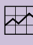
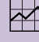
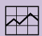
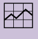
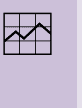

# C++20 示例

## 引言

### 关于 C++ 的书

通过观察可以发现很多事情。

约基·贝拉

本书是关于 C++ 编程语言的。如果你没有（或很少）C++ 经验，如果你想在 C++ 编程中取得成功，并且已经准备好努力学习，那么这本书就是为你准备的。

### 关于本书

本书由专门挑选的示例和问题组成。它们涵盖了 C++ 编程所需的所有主题。

第一章介绍了我们在 C++ 中可以做的通用概念。在这里我们学习如何创建一个程序。该章还包含了关于输入输出运算符、变量、函数、循环语句、条件语句和数组的信息。

第二章专门介绍控制语句。在本章中，我们详细考虑了控制语句、循环语句和选择语句。我们了处理和抛出异常的概念。

第三章讨论了指针、数组和引用。具体来说，我们考虑了如何创建和使用指针。我们讨论了指针和数组之间的关系，还研究了如何以及何时可以使用引用。此外，本章包含了内存分配的信息。同时，我们分析了用于实现字符串的字符数组的特性。

第四章关于函数。在这里我们学习了函数可以做什么以及我们如何使用它。我们重载了函数，定义了带有默认值的参数并使用了递归。我们将了解参数是如何传递给函数的，以及如何将函数作为参数传递。我们还学习了函数如何与数组、引用和指针操作。

第五章我们讨论了面向对象编程的原理。我们学习如何描述类和创建对象。此外，本章包含了关于公共和私有成员、构造函数和析构函数、重载方法和运算符以及使用继承的信息。

第六章继续讨论类和对象。具体来说，我们熟悉对象指针、对象数组和函数对象。我们将使用字段为数组的对象并实现对象索引。我们将熟悉虚方法和多重继承，并对类对象进行一些其他技巧。

第七章我们研究了模板函数和类。在这里我们创建并重载了带有多个参数的模板函数。我们将学习如何为模板参数定义默认值。还将应用于模板类。此外，在本章中，我们考虑了如何使用整数模板参数。

第八章我们考虑了不同的程序。该章解释了如何使用结构体、复数和容器。我们还将熟悉多线程。

第九章致力于数学问题。在该章中，我们展示了如何实现求解代数方程和微分方程的方法、计算积分以及创建插值多项式。

## C++ 编程语言

到目前，C++ 是最流行的编程语言之一。无法想象一个不知道 C++ 的专业程序员。从这个意义上说，选择 C++ 进行学习似乎是非常合理的。除了能够用 C++ 创建程序的直接好处外，还有一个重要的方法论方面。它基于 C++ 语言卓越的灵活性丰富性。在学习了 C++ 之后，“采用”其他编程语言会舒服得多。但无论如何，C++ 都是一门“必知”语言，在不久的将来也是如此。无疑，C++ 是熟悉编程的优秀选择。

## C++ 标准

C++ 语言是 1983 年作为 C 语言的扩展创建的。从那时起开发并批准了多个 C++ 标准。这些标准包括 `C++98`、`C++11`、`C++14`、`C++17` 和 `C++20`（数字代表标准通过的年份）。每个标准都对语言进行了或少的本质改进，有时改进了低效的特征。

- 备注

要获取有关编译器支持哪些标准的信息，可以访问 `https://en.cppreference.com/w/cpp/compiler_support`。

在书中，我们将考虑 C++ 最通用、普遍的特性。因此书中的大多数程序都可以由现代编译器编译。尽管如此，也有基于支持 `C++20` 标准编译器的代码。

> `C++20` 标准

> 当使用支持 `C++20` 标准的编译器至关重要时，我们会做特殊说明，并解释什么是本质的以及如何处理。

## 软件

在书中，我们将考虑许多不同的程序。学习它们是如何运行的是一个好主意。但为了更深入地理解，最好自己运行这些程序。为了做到这一点，需要适当的软件。

至少你应该有一个编译器，它是一个将你创建的代码翻译成计算机执行的语句的特殊程序。有很多适合解决任务的编译器。其中最流行的是 GNU 编译器，可以通过 `https://gcc.gnu.org/` 获取。要创建一个程序，你应该在代码编辑器中编写代码（任何编辑器都可以，甚至是记事本），以 `.cpp` 扩展保存文件，然后进行编译。假设我们有一个 `program.cpp` 文件。

```
g++ program.cpp -o program
```

假设我们有了 `program.cpp` 文件。

```
g++ program.cpp -o program
```

如果编译成功，将创建 `program` 可执行文件。要运行程序，我们需要运行 `program.exe`。

| 详情 |
| :--- |
| 在 Linux 中，你可以使用 `g++ program.cpp -o program` 来编译。`o` 参数定义了可执行文件的名称。`g++ --version` 提供有关安装的编译器的信息。 |

要运行程序，我们需要运行 `program.exe`。

> 备注

> 创建程序的软件有很多，有商业的也有免费的。通常使用集成开发环境，它结合了代码编辑器、调试器、编译器（并非总是）以及其他辅助工具。当然，你可以自由选择任何开发环境。如果使用 Visual Studio，那么你需要安装 Visual Studio 并熟悉它的主要功能。

## 关于作者

本书作者 Alex Vasilev 是基辅大学物理系的物理教授。他教授 C++、C#、Java 和 Python 超过十五年。研究兴趣为液体和液晶物理、生物物理、协同、经济数学方法、社会政治过程建模、数学语言学。

## 反馈

你可以通过邮件 `alex@vasilev.com` 发送关于本书的意见和建议。

## 下载

你可以从 `www.vasilev.com.ua/books/codes.zip` 下载书代码。

## 感谢

我诚心感谢读者对本书的关注，希望这本书有助于学习 C++。

# 第一章 简单程序

> 活动是通往知识的唯一道路。

乔治·伯纳

在本章中，我们将学习如何用 C++ 创建程序、从键盘获取数据并输出到控制。我们还将使用变量、执行算术运算并制作其他有用的东西。让我们开始吧。

## 第一个程序

我们的第一个程序在屏幕上打印消息。它的代码在列表 1.1 中。

| 列表 1.1 第一个程序 |
| :--- |
| `#include <iostream>` |
| `using namespace std;` |
| `int main(){` |
| `// 打印消息：` |
| `cout<<"Our first program in C++"<<endl;` |
| `return 0;` |
| `}` |

这是程序的输出：

| 列表 1.1 的输出 |
| :--- |
| Our first program in C++ |

当程序运行时，消息 `Our first program in C++` 出现在屏幕上。为了理解为什么会发生这种情况，我们需要分析代码。首先，有几个块，其中主要的是 `main` 函数，它是（真是大惊喜！）`main()`。

```cpp
int main() {
  // The code of the main function
}
```

`main` 函数体由成对的大括号定义：左大括号 `{` 和右大括号 `}`。大括号内的所有内容都是 `main()` 函数的代码。`main` 函数名之前的关键字 `int` 标识该函数返回一个结果，且该结果是一个整数。

在 C++ 中运行程序意味着运行它的 `main()`。换句话说，如果我们想理解程序在运行时发生了什么，就应该考虑 `main` 函数中的语句。在我们的案例中，`main` 函数体中有几行（更准确地说是三行）代码。这三行代码中有一行是注释。

注释以双斜杠 `//` 开始。编译器会忽略它们。我们使用注释来解释程序中语句的含义。注释是给人看的，而不是给计算机看的。虽然使用注释并不是绝对必要的，但我们仍然可以让程序变得更加友好且易于理解。

在 C++ 中，可以使用单行注释和多行注释。单行注释以双斜杠 `//` 开始。双斜杠之后的所有内容都是注释。我们将单行注释放在一行代码中。多行注释可能跨多行。多行注释以 `/*` 开始，以 `*/` 结束。`/*` 和 `*/` 之间的所有内容都是注释。

`main()` 中的主语句是 `cout<<"Our first program in C++"<<endl`。由于这条语句，程序会打印信息。这就是我们创建程序的目的。在这里，我们使用了输出运算符 `<<`。它将运算符 `<<` 右侧的值写入运算符左侧关键字 `cout` 定义的“位置”中。关键字 `cout` 与控制台相关（`cout` 是 console output 的缩写）。“写入控制台”意味着在屏幕上打印。因此，语句 `cout<<"Our first program in C++"` 在屏幕上打印字符串 `"Our first program in C++"`。

该字符串被包含在双引号中。我们还可以在一个语句中使用多个输出运算符。`endl` 关键字（它是 end of the line 的缩写）用于打印换行符（因此它将光标移动到下一行的开头）。因此，`cout<<Our first program in C++<<endl` 语句意味着：在屏幕上打印字符串 `"Our first program in C++"` 并移动到下一行的开头。

### Notes

并没有必要使用 `endl` 来移动到下一行。我们可以用 `cout<<"Our first program in C++"` 代替语句 `cout<<"Our first program in C++<<endl`。但如果这样做的话，屏幕光标就不会移动到下一行。

`main()` 中的最后一个语句是 `return 0`。它终止了 `main` 函数并返回 0 作为其结果。这是给操作系统的一个信号，表示 `main` 函数正常终止，没有任何错误。通常情况下，C++ 程序在 `main()` 中末尾都有 `return 0`。

### Notes

注意 C++ 中的语句以分号结尾。

我们分析了 `main` 函数的代码。在程序中，还有其他指令。它们位于程序的顶部，紧接在 `main` 函数体之前。

预处理器指令 `#include <iostream>` 用于在程序中包含 `<iostream>` 头文件（或头文件）。头文件包含了程序成功执行所需的重要信息。在这里我们处理的是标准库，它是大多数程序的要素元素（头文件 `<iostream>` 代表标准输入输出库）。

### Details

|  |  |
|--- | --- |
|  | 标准输入输出库包含了诸如 `cout`（控制台）和 `cin`（键盘）等标识符的定义。 |

指令 `using namespace std` 是指定使用名为 `std` 的标准命名空间。

### Theory

我们可以将命名空间认为是一个具有某些编程工具的抽象容器。它有助于避免命名冲突。在创建程序时，我们需要指定命名空间。在书中所有的示例中，我们都使用标准命名空间 `std`。

### C++20 Standard

`C++20` 标准引入了模块的概念。模块是独立的源代码文件，可以编译并整合到程序中。在某种意义上，模块的概念是程序中使用头文件的替代方案。模块通过 `import` 关键字导入程序中。模块在大型项目中非常有用，因为它们缩短了编译时间。尽管如此，为了让程序与当前的编译器版本充分兼容，我们不会使用模块。

所以，我们的第一个程序完成了。作为一个额外奖励，我们现在有了一个创建新程序的模板：

```cpp
#include <iostream>
using namespace std;
int main() {
    // Your code is here
    return 0;
}
```

在下一个程序中，我们将面临变量和输入运算符。

### Using Variables

我们将创建一个将英里转换为公里的程序。该程序获取一个英里的距离并打印相应的公里的距离。初始值（英里距离）从键盘输入到程序。

> Notes

1 英里等于 1609344 毫米或 1.609344 公里。要将英里转换为公里，我们应该将英里乘以转换因子 1.609344。

程序非常简单。当它运行时，会出现一个输入数字的提示。这个数字是以英里为单位的距离。在读取数字后，程序执行一些计算，然后在屏幕上打印结果。

我们应该在某处存储输入的数字以及计算结果。为了这些目的，我们在程序中使用变量。

> Theory

变量是内存中一个命名的空间，可以通过名称访问：我们可以为变量赋值并读取变量的值。在 C++ 中，我们必须在使用变量之前对其进行声明。当我们声明一个变量时，必须指定它的类型。变量的类型由关键字（类型标识符）决定。最常用的基本类型是 `int`（整数）、`double`（实数或浮点数）和 `char`（字符）。

变量几乎可以在程序的任何地方声明（但在第一次使用之前）。变量在声明它的块内部是可访问的。反，块由成对的大括号定义。因此，如果某个变量在 `main` 函数中声明，那么该变量在 `main` 函数内部就是可访问的。

除了变量，我们还可以使用常量。与变量不同，常量的值一旦定义就不能更改。常量的创建方式与变量类似，但我们可以使用 `const` 关键字。

通过赋值运算符 `=` 执行赋值。赋值运算符右侧的值被赋值给赋值运算符左侧的变量。

计算结果被赋值给变量 `kms`。之后，语句 `cout<<"The distance in kilometers: "<<kms<<endl` 会在屏幕上打印计算结果。程序的输出可能如下所示（用户输入的内容用**粗体**标记）：

- 程序的输出（见列表 1.2）

| 以里为单位的距离: 3.5 |
| 以公里为单位的距离: 5.6327 |

上面，我们处理的是浮点数。从数学角度来看，这些都是正确的，但从实际角度来看并不方便。通常，当我们定义一个距离时，会使用不同的公制单位。接下来，我们将考虑这样的情况。

> 注意事项

让我们解释一下我们的意思。假设在在上一个例子中，我们输入的英里距离为 3.5。另一方面，我们可以用英里和英尺表示相同的距离，它是 32640 英尺（因为 1 英里有 5280 英尺）。相同的距离换算成公里是 5.6327，它等于 5 公里 632 米（这里我们忽略了 70 厘米）。

我们将考虑一个例子，它与上一个例子相似，但我们在问题表述中更改了一些位置。特别是，一个最初以英里和英尺为单位的距离被转换为公里和米。让我们考虑列表 1.3 中的程序。

- 列表 1.3 将英里和英尺转换为公里和米

```cpp
#include <iostream>
using namespace std;
int main() {
    // 每英里的英尺：
    const int G=5280;
    // 每英里的公里：
    const double F=1.609344;
    // 用于英里、英尺、
    // 公里和米的变量；
    int miles,feet, kms,ms;
    // 获取英里和英尺的距离：
    cout<<"A distance in miles and feet."<<endl;
    cout<<"Miles: ";
    cin>>miles;
    cout<<"Feet: " ";
    cin>>feet;
    // 英里距离：
    double M=miles+(double)feet/G;
    // 公里距离：
    double K=M*F;
    // 仅公里：
    kms=(int)K;
    // 仅米：
    ms=(int)((K-kms)*1000);
    // 打印计算结果：
    cout<<"The distance in kilometers and meters."<<endl;
    cout<<"Kilometers: "<<kms<<endl;
    cout<<"Meters: "<<ms<<endl;
    return 0;
}
```

在程序中，我们定义了值为 5280 的整数常量 `G`。该常量决定了每英里的英尺数。位值为 1.609344 的浮点常量 `F` 决定了每英里的公里数。整数变量 `miles`、`feet`、`kms` 和 `ms` 分别用于存储用户输入的距离中的英里、英尺、公里和米。为了获取英里，我们使用语句 `cin>>miles`，并使用语句 `cin>>feet` 获取英尺。语句 `M=miles+(double) feet/G` 计算出以英里为单位的距离。这里指的是以英里衡量的距离。由于由于，我们将相应的值实现为浮点数。该语句确定了值，但同时也声明了存储该值的变量。即，在这里我们声明了类型为 `double` 的变量 `miles`，该变量获得了由指令 `miles+(double) feet/G` 计算出的。后者是变量 `feet` 和 `G` 的比值。这些变量（`feet` 和 `G`）是整数，因此为了进行浮点除法，我们使用 `(double)` 指令。

> 注意事项

`(double) feet/G` 指令将英尺转换为英里。

我们使用语句 `double K=M*F` 计算以公里为单位的距离。我们用该值初始化变量 `K`。变量 `K` 存储以公里为单位的距离。即一个浮点数。我们需要提取它的整数部分（公里）和小数部分。小数部分乘以 1000（因为 1 公里有 1000 米）得到米。

为了提取整数部分，我们使用表达式 `kms=(int)K`。在这里我们使用了显式类型转换：由于 `(int)` 指令，类型为 `double` 的变量 `K` 的值被转换为整数值。这种转换丢弃了浮点数值的小数部分。换句话说，指令 `(int)K` 的结果是 `K` 的整数部分。同时，变量 `K` 的值没有改变。

变量 `ms` 获取表达式 `(int)((K-kms)*1000)` 的值。表达式 `K-kms` 得到 `K` 的小数部分。得到的结果乘以 1000（由于 `(int)` 指令丢弃了小数部分）。为了打印计算出的公里和 `ms` 值，我们使用语句 `cout<<"Kilometers: "<<kms<<endl` 和 `cout<<"Meters: "<<ms<<endl`。这里是程序的输出形式（用户输入的内容加粗）：

> 程序的输出（列表 1.3）

In miles and feet.

Miles: **3**

Feet: **2640**

In kilometers and meters.

Kilometers: 5

Meters: 632

考虑的例子提供了如何在程序中使用数据。接下来，我们将熟悉函数。

## 使用函数


`cout` << `"In kilometers: "` << `getKms`(`miles`) << `endl`; 这会在屏幕上打印一条消息（带有以公里为单位的距离）。

## 使用循环语句

在下一个示例中，我们计算平方数的和。

-   注意

    我们计算 $1² + 2² + 3² + ... + n²$ 的和，其中和的上限 `n` 是给定的。在程序中，这个和是通过直接累加数字来计算的。此外，请注意，和也可以根据公式 $1² + 2² + 3² + ... + n² = \frac{n(n+1)(2n+1)}{6}$ 通过解析法计算出来。

为了计算这个和，我们使用了循环语句。程序如列表 1.5 所示。

### 列表 1.5. 平数的和

```cpp
#include <iostream>
using namespace std;
int main() {
  // 和的上限，
  // 和的值，以及
  // 循环控制变量：
  int n=10,s=0,k=1;
  // 循环语句计算和：
  while(k<=n) {
    // 将新项加到和中：
    s=s+k*k;
    // 循环控制变量加 1：
    k++;
  }
  // 打印计算结果：
  cout<<"The sum of the squared numbers from 1 to " << n << ": ";
  cout<<s<<endl;
  return 0;
}
```

这里是程序的输出：

-   程序的输出（列表 1.5 中）

从 1 到 10 的平方和为: 385

在程序中，我们声明了三个变量并使用语句 `int n=10,s=0,k=1` 来。所有变量在声明时都被赋值。变量 `n` 决定了和的上限。平方和将被保存在变量 `s` 中。变量 `k` 用于在 `while` 语句中“数手指”（我们统计和中的项）。我们将变量 `k` 称为循环控制变量。所有重要的计算都在 `while` 语句中完成。它以 `while` 关键字开始。在括号中（`while` 关键字之后），我们放入条件 `k<=n`。这意味着只要变量 `k` 的值大于变量 `n` 的值，`while` 语句就会执行。在每次迭代中，都会执行两个语句。首先，将变量 `k` 的平方加到变量 `s`（语句 `s=s+k*k`）。其次，变量 `k` 的值加 1（语句 `k++`）。这一切一直持续到变量 `k` 的值大于变量 `n` 的值。

> 理论 在表达式 `k<=n` 中，我们使用了比较运算符 `<=`（小于或等于）。该表达式的结果类型为 `bool`（布尔类型）。`bool` 类型的变量可以接受两个值：`true`（真）或 `false`（假）。

当括号中（`while` 关键字之后）的表达式为真时，就会执行 `while` 语句。在每次循环之前都会测试条件。

单元增运算符 `++` 将其操作数的值加1。语句 `k++` 等同于语句 `k=k+1`。

单元减运算符 `--` 将其操作数的值减1。语句 `k--` 等同于语句 `k=k-1`。

为了打印计算结果，我们使用语句 `cout<<"from 1 to " << n << ": "` 和 `cout<<s<<endl`。第一个打印变量 `n`（和的上限），第二个打印变量 `s`（平方数的和）。

现在，让我们考虑上一个程序的稍微修改版本。它在列表 1.6 中。

### 列表 1.6. 计算的另一种方式

```cpp
#include <iostream>
using namespace std;
int main() {
    // 和和和：
    int n,s=0;
    // 获取和的上限：
    cout<<"The upper limit of the sum: ";
    cin>>n;
    // 计算和的循环语句：
    while(n) {
        // 将新项加到和中：
        s+=n*n;
        // 变量 n 减 1：
        n--;
    }
    // 打印计算结果：
    cout<<"The sum of the squared numbers: "<<s<<endl;
    return 0;
}
```

对程序进行了几处修改。首先，我们在循环语句中使用数值值而不是布尔值。在这种情况下，非零值代表真，零值代表假。其次，我们不再使用循环控制变量 `k`。第三，我们使用了复合赋值运算符 `+=`。

## 理论

在 C++ 中，我们有复合赋值运算符。例如，代替语句 `x=x+y` 可以使用 `x+=y`。同样适用于算术运算符。例如，代替语句 `x=x-y` 可以使用 `x-=y`。代替 `x=x*` 可以使用 `x*=y`，以此类推。

决定和的上限的变量 `n` 从键盘输入。同一个变量被用作条件。因此，只要变量 `n` 的值不为零，`while` 语句就会执行。在每次迭代中，都会执行两个语句。首先，将变量 `n` 的平方加到变量 `s`（`s+=n*n`）。其次，变量 `n` 的值减1（`n--`）。这一切一直持续到变量 `n` 的值变为零。

-   注意决定和的上限的变量 `n` 从键盘输入。同一个变量被用作条件。因此，只要变量 `n` 的值不为零，`while` 语句就会执行。在每次迭代中，都会执行两个语句。首先，将变量 `n` 的平方加到变量 `s`（`s+=n*n`）。其次，变量 `n` 的值减1（`n--`）。这一切一直持续到变量 `n` 的值变为零。

使用递归公式 $C(k+1,n) = C(k,n) \cdot \frac{n-k}{k+1}$ 来计算二项系数集。

程序如列表 1.8 所示。

## Listing 1.8. 二项系数

```cpp
#include <iostream>
using namespace std;
int main() {
    // 常数（数组大小）：
    const int n=10;
    // 整数数组：
    int bnm[n+1];
    // 循环控制变量：
    int k=0;
    // 数组中的第一个元素:
    bnm[0]=1;
    // 打印第一个元素
    cout<<bnm[0];
    // 填充数组的循环语句:
    while(k<n) {
        // 数组元素的值:
        bnm[k+1]=bnm[k]*(n-k)/(k+1);
        // 打印元素:
        cout<<"bnm[k+1]";
        // 循环控制变量加 1:
        k++;
    }
    cout<<endl;
    return 0;
}
```

程序的输出如下：

| 程序的输出（在列表 1.8 中） |

| :--- |

| 10 45 120 210 252 210 120 45 10 1 |

让我们分析一下这个程序。在这里，我们声明了一个值为 10 的整数常量 `n`。我们使用了语句 `const int n=10`。然后，我们创建了数组 `bnm`（语句 `int bnm[n+1]`）。创建数组意味着为它分配内存。尽管如此，我们还必须填充数组，其长度比常量 `n` 大大 1。

创建的数组大小比常量 `n` 大 1。因此，数组元素的索引范围在 0 到 `n` 之间。为了遍历数组，我们在 `while` 语句中声明了初始值为 0 的整数变量 `k`。语句 `bnm[0]=1` 将值 1 赋值给第一个元素。之后，通过语句 `cout<<bnm[0]` 将打印在屏幕上。为了填充数组的其他元素，我们使用条件为 `k<n` 的 `while` 语句。在 `while` 语句中，我们使用 `k++` 指令将变量 `k` 的值加1。因此，循环控制变量 `k` 重复获取从 0 到 `n-1` 的值。下一个元素的值通过语句 `bnm[k+1]=bnm[k]*(n-k)/(k+1)` 计算。我们通过语句 `cout<<"bnm[k+1]"` 打印值。结果是二项系数（数组 `bnm` 的元素）被行内打印，并用空格隔开。

## 详情

| 从 C++17 标准开始，我们可以使用 `size()` 函数来获取数组的大小。`bnm` 的名称作为参数传递给函数。 |

## 第 2 章

## 控制语句

如果人们不想来球场，

你打算如何阻止他们？

Yogi Berra

在本章中，我们将讨论控制语句：`for` 和 `do-while` 循环语句、选择语句 `switch` 以及条件语句 `if`。我们还将考虑一些其他概念、语句和编程技术。

## for 循环语句

在上一章中，我们已经创建了一个计算数字平方和的程序。我们在那个示例中使用了 `while` 语句。现在我们将使用 `for` 语句来解决相同的问题。

> 理论

> `for` 语句必须描述如下：在 `for` 关键字后的括号中，我们放置三个部分，用分号隔开。在花括号中，我们放置指令，这些将在每次迭代时重复执行。`for` 语句的执行方式如下：

> - 首先，执行第一部分中的语句。它只发生一次。之后这些语句将不会再次执行。

> - 接着，测试第二部分的条件。为了继续执行，该条件必须为真。

> - 如果条件为真，则执行花括号中的语句。

> - 之后，执行第三部分的语句。

> - 接下来，再次测试第二部分的条件。如果它为真，则执行花括号中的语句，以此此类推。

> - 如果条件为假，则 `for` 语句的执行终止。

让我们考虑列表 2.1 中的程序。

## Listing 2.1. 数字平方的和

```cpp
#include <iostream>
using namespace std;
int main() {
    // 和的上界、和以及循环控制变量：
    int n,s=0,k;
    cout<<"The upper limit: ";
    // 获取上界：
    cin>>n;
    // 计算和：
    for(k=1;k<=n;k++) {
        s+=k*k;
    }
    // 打印结果：
    cout<<"The sum of squared numbers from 1 to "";
    cout<<n<<" is "<<s<<endl;
    return 0;
}
```

程序的可能输出所示（用户输入的值已加粗）：

| 程序的输出（在列表 2.1 中） |

| :--- |

| The upper limit: **10** |

| 1 到 10 的数字平方和是 **385** |

在这个程序中，我们声明了三个整数变量。变量 `n` 存储了和的上界。我们将变量 `s` 初始化为 0，并用它来保存数字平方和。循环控制变量 `k` 用于计数项数。

在用户输入 `n` 的值后，`for` 语句开始执行。第一部分（`for` 关键字后括号内）包含单一语句 `k=1`，它将值 1 赋值给变量 `k`。它只在 `for` 语句执行开始时执行一次。然后测试条件 `k<=n`。如果条件为真，则在循环语句中执行指令 `s+=k*k`。接下来，执行语句 `k++`，并测试条件 `k<=n`。如果条件为真，则执行语句 `s+=k*k` 和 `k++`。之后，再次测试条件 `k<=n`。这一切一直持续，直到我们得到条件 `k<=n` 的假值。下一个元素的值通过语句 `bnm[k+1]=bnm[k]*(n-k)/(k+1)` 计算（注：此处原文逻辑与代码代码有出入，翻译按原文保留）。我们通过语句 `cout<<"bnm[k+1]"` 打印值。结果是二项系数（数组 `bnm` 的元素）被行内打印，并用空格隔开。

（注：在此程序中，我们声明了三个整数变量。变量 `n` 存储了和的上界。我们将变量 `s` 初始化为 0，并用它来保存数字平方和。循环控制变量 `k` 用于计数项数。

在用户输入 `n` 的值后，`for` 语句开始执行。第一部分（`for` 关键字后括号内）包含单一语句 `k=1`，它将值 1 赋值给变量 `k`。它只在 `for` 语句执行开始时执行一次。然后测试条件 `k<=n`。如果条件为真，则在循环语句中执行指令 `s+=k*k`。接下来，执行语句 `k++`，并测试条件 `k<=n`。如果条件为真，则执行语句 `s+=k*k` 和 `k++`。之后，再次测试条件 `k<=n`。这一切一直持续，直到我们得到条件 `k<=n` 的假值。）

```cpp
break;
}
cout << "The sum of the squared numbers from 1 to ";
out << "n<" " << s << endl;
return 0;
}
```

`for` 语句中空的第二个部分代表真条件。因此，从形式上说，在这种情况下得到了无限循环。为了终止这个无限循环，我们将条件 `if` 语句放在 `for` 语句体中。在条件语句中，我们使用条件 `k>n`。如果条件为真，则执行 `break` 指令。它会终止循环语句。

## 细节

我们使用了条件语句的简化形式，它不包含 `else` 分句。这种“轻量级”版本中的条件语句按照以下方式执行：首先，测试关键字 `if` 之后的条件。如果条件为真，则执行 `if` 指令后大括号中的陈语句。如果条件为假，则什么都不会发生。`break` 指令是终止循环语句（如 `while`、`do-while` 和 `for`）的标准语句。我们也可以用它来终止 `switch` 语句。另一个有用的指令是 `continue`，它强制进行下一次迭代。

## do-while 语句

与 `while` 和 `for` 语句一样，C++ 中也存在 `do-while` 语句。

## 理论

`do-while` 语句以 `do` 关键字开头，后面跟着带有指令的大括号（循环语句的体）。在大括号之后，我们放置 `while` 关键字和括号括内的条件。当条件为真时，执行循环语句。在每次执行完循环体中的指令后，都会测试该条件。

那么，`while` 语句和 `do-while` 语句之间的区别是什么？主要区别在于 `while` 语句从测试条件开始，而 `do-while` 语句从执行循环体中的指令开始。因此，`do-while` 语句中的指令至少会被执行一次。

列表 2.5 包含使用 `do-while` 语句的示例。为了测试结果，我们构建了内置数学函数 `exp()`，它执行相同的计算。

## 注意事项

我们使用以下公式计算指数函数（对于给定的参数 $x$）：$exp(x) = \sum_{k=0}^{\infty} \frac{x^k}{k!}$。这是一个无限级数。从实践角度来看计算是不可能的，所以我们使用近似表达式 $exp(x) \approx 1 + x + \frac{x^2}{2!} + \frac{x^3}{3!} + \dots + \frac{x^n}{n!}$。因此，为了计算指数函数，我们得到了和。项越多，计算值就越精确。

呈现和 $exp(x) = q_0 + q_1 + q_2 + \dots + q_n$ 是方便的，其中 $q_k = \frac{x^k}{k!}$。显而易见，$q_{k+1} = q_k \frac{x}{k+1}$。我们在程序以此计算指数函数。现在让我们考虑以下程序。

### 列表 2.5. 使用 do-while 语句

```cpp
#include <iostream>
#include <cmath>

using namespace std;

int main() {
  // 最后一项的索引：
  int n=100;
  // 指数函数的参数：
  double x=1;
  // 和、项以及循环控制变量：
  double s=0, q=1, k=0;
  // 计算和：
  do {
    // 将项加到和中：
    s+=q;
    // 增加循环控制变量：
    k++;
    // 计算下一项：
    q*=x/k;
  } while (k<=n);
  // 打印结果：
  cout << "The calculated value is " << s << endl;
  // 使用内置函数计算值：
  cout << "The value to compare with " << exp(x) << endl;
  return 0;
}
```

整数变量 `n` 决定和中最后一项的索引（它小于和的项数）。`double` 类型的变量 `x` 存储参数的值。我们还声明了变量 `s` 初始为零（和的值），`q` 初始值为 1（项的值），以及 `k` 初始值为零（循环控制变量）。

为了计算该和，我们使用 `do-while` 语句。语句 `s+=q` 将项 `q` 加到和中。然后语句 `k++` 将循环控制变量增加 1，之后语句 `q*=x/k` 计算和的下一项。当条件 `k<=n` 为真时，执行循环语句。当循环语句终止后，变量 `s` 存储指数函数的值。语句 `cout << "The calculated value is " << s << endl` 将其打印在屏幕上。为了将计算结果与精确值进行比较，我们使用语句 `cout << "The value to compare with " << exp(x) << endl`。在这里我们使用内置函数 `exp()`，它计算指数函数（对于给定的参数）。要使用函数 `exp()`，我们在程序顶部添加了 `#include <cmath>`。该头文件支持数学函数。

程序的输出如下：

| 程序的输出（在列表 2.5 中） |

| :--- |

| The calculated value is 2.71828 |

| The value to compare with is 2.71828 |

正如我们所看到的，两个值计算结果是一致的。

## switch 语句

接下来我们创建一个简单的程序。通过 `switch` 语句，我们可以测试某个表达式的值。`switch` 语句与条件语句相似，不同之处在于条件语句只有两个可选分支（真或假）。在 `switch` 语句中，选项的数量可以多于两个。


这是描述选择语句的方式：`switch`关键字后面跟着括号测试表达式。接下来，在选择语句体（大括号）中有`case`分句。每个`case`分句包含一个与测试表达式进行比较的控制值。分句包含了在匹配时要执行的指令。通常情况下，每个`case`分句都以`break`指令结束。选择语句还可以包含`default`分句（`switch`语句的最后部分）。当没有`case`分句的控制值与测试表达式匹配时，执行`default`分句。

程序位于 2.6。其组织方式如下：

- 我们使用循环语句打印输入数字的提示（范围在 1 到 3 之间）。
- 用户输入的值通过`switch`语句进行测试。
- 根据输入的值，程序打印该数字的名称。

现在让我们考虑代码。

### 列表 2.6. switch 语句

```cpp
#include <iostream>
using namespace std;
int main() {
  // 整数变量：
  int num,k;
  // 循环语句：
  for(k=1;k<=5;k++) {
    cout<<"Enter a number from 1 to 3: ";
    // 获取变量的值：
    cin>>num;
    // 选择语句：
    switch(num){
        case 1:
            cout<<"This is one"<<endl;
            break;
        case 2:
            cout<<"This is two"<<endl;
            break;
        case 3:
            cout<<"This is three"<<endl;
            break;
        default:
            cout<<"I don't know this number"<<endl;
    }
  }
  return 0;
}
```

程序的可能输出如下所示（在此处及下方，用户输入的值已加粗标记）：

| 程序的输出（在列表 2.6 中） |

```
Enter a number from 1 to 3: **2**
This is two
Enter a number from 1 to 3: **-2**
```

# 第 2 章 控制语句

| 我不知道这个数字 |

| 输入一个 1 到 3 之间的数字: 1 |

| 这是一个 |

| 输入一个 1 到 3 之间的数字: 3 |

| 这是三个 |

| 输入一个 1 到 3 之间的数字: 5 |

| 我不知道这个数字 |

循环语句执行了 5 次迭代。在循环语句中，为了打印输入数字的提示，我们使用`cout << "Enter a number from 1 to 3: ";`。用户输入一个数字，该数字被保存在变量`num`中。这是通过语句`cin >> num`实现的。之后是选择语句。它包含了三个控制值为 1、2 和 3 的 case 区域（case sections）和一个默认部分（default section）。每个 case 区域都以`break`指令结束。被测试的表达式是变量`num`的值。如果变量`num`的值等于 1，则执行语句`cout << "This is one" << endl`。如果变量`num`的值等于 2，则执行语句`cout << "This is two" << endl`。变量`num`的值为 3 则意味着执行语句`cout << "This is three" << endl`。

## 注意事项

选择语句的执行方式如下：首先计算被测试表达式的值，然后将该值与 case 区域中的控制值进行比较。此过程一直持续到找到第一个匹配项。如果找到匹配，则执行相应 case 区域中的指令。语句将一直执行到选择语句的结束，或者遇到`break`指令。因此，如果我们希望语句只在单个 case 区域内执行，那么该 case 区域必须以`break`指令结束。

## 控制语句

默认部分包含语句`cout << "I don't know this number" << endl`。只有在测试 case 区域中的控制值时没有发现任何匹配项时，该部分才会“起作用”。

列表 2.7 展示了使用`switch`语句的另一个示例。这个程序与上一个相似，但它有一些特殊之处。特别是，我们生成了随机数，并且选择语句包含了空的 case 区域。

## 理论

为了生成随机数，我们使用`rand()`函数。在程序包含`<cstdlib>`头文件后，可以使用该函数。`rand()`返回一个从 0 到某个上限（该上限足够大）的均匀分布非负整数。如果我们想获取一个范围在`a`到`b`之间的随机数，在这些表达式中，运算符`%`返回整数除法的余数。如果`rand()`是一个随机数，那么表达式`rand() % (b-a+1)`给出了随机数除以数字`b-a+1`的整数除法余数。即从 0 到`b-a`的数字。因此，表达式`a+rand() % (b-a+1)`给出一个在`a`到`b`范围内的（随机）数字。这就是我们需要的。

为了生成随机数，必须向随机数生成器传递一个初始数值。这被称为随机数生成器的初始化。为了执行随机数生成器的初始化，我们使用`srand()`函数。它需要一个数值参数。传递给函数的数字本身没有特殊意义。重要的是`srand()`函数的参数决定了要生成的随机数序列。

我们在下面的程序中实现了这一想法。该程序执行了多次迭代，对于每次迭代，它都会生成一个 2 到 8 范围内的随机数。我们使用`switch`语句根据接收到的值打印消息：

- 对于数字 2、4 和 8，消息包含该数字，并且还说明该数字是 2 的幂（我们指的是 2 = 2^1, 4 = 2^2, 8 = 2^3）；
- 对于数字 3 和 6，消息包含该数字，并且还说明该数字可以被三整除无余数；
- 对于数字 5 和 7，消息包括该数字及其名称。

现在，让我们考虑下面的程序。

## 列表 2.7 使用 switch 语句

```cpp
#include <iostream>
using namespace std;
int main() {
    // 一个整数变量
    int num;
    // 初始化随机数生成器：
    srand(2);
    // 循环语句：
    for(int k=1; k<=10;k++) {
        // 从 2 到 8 的随机数：
        num=2+rand()%7;
        // 选择语句：
        switch(num) {
            case 3:
            case 6:
                cout<<num<<": can be divided by 3" << endl;
                break;
            case 2:
            case 4:
            case 8:
                cout<<num<<": is a power of 2" << endl;
                break;
            case 5:
                cout<<num<<": it is five" << endl;
                break;
            case 7:
                cout<<num<<": it is seven" << endl;
                break;
        }
    }
    return 0;
}
```

程序的输出可能如下（这里我们使用随机数），因此输出可能会发生变化：

## 程序的输出（在列表 2.7 中）

```
5: it is five
7: it is seven
8: is a power of 2
3: can be divided by 3
2: is a power of 2
```

生成随机数时，必须向随机数生成器传递一个初始数值。这被称为随机数生成器的初始化。

随机数2

为了生成随机数，我们使用`rand()`函数。在程序包含`<cstdlib>`头文件后，可以使用该函数。`rand()`返回一个从 0 到某个上限（该上限足够大）的均匀分布非负整数。如果我们想获取一个范围在`a`到`b`之间的随机数，在这些表达式中，运算符`%`返回整数除法的余数。如果`rand()`是一个随机数，那么表达式`rand() % (b-a+1)`给出了随机数除以数字`b-a+1`的整数除法余数。即从 0 到`b-a`的数字。因此，表达式`a+rand() % (b-a+1)`给出一个在`a`到`b`范围内的（随机）数字。这就是我们需要的。

为了生成随机数，必须向随机数生成器传递一个初始数值。这被称为随机数生成器的初始化。为了执行随机数生成器的初始化，我们使用`srand()`函数。它需要一个数值参数。传递给函数的数字本身没有特殊意义。重要的是`srand()`函数的参数决定了要生成的随机数序列。

我们在下面的程序中实现了这一想法。该程序执行了多次迭代，对于每次迭代，它都会生成一个 2 到 8 范围内的随机数。我们使用`switch`语句根据接收到的值打印消息：

- 对于数字 2、4 和 8，消息包含该数字，并且还说明该数字是 2 的幂（我们指的是 2 = 2^1, 4 = 2^2, 8 = 2^3）；
- 对于数字 3 和 6，消息包含该数字，并且还说明该数字可以被三整除无余数；
- 对于数字 5 和 7，消息包括该数字及其名称。

现在，让我们考虑下面的程序。

# 列表 2.7. 使用 switch 语句

```cpp

#include <iostream>

using namespace std;

int main() {

    // 一个整数变量

    int num;

    // 初始化随机数生成器：

    srand(2);

    // 循环语句：

    for(int k=1; k<=10;k++) {

        // 从 2 到 8 的随机数：

        num=2+rand()%7;

        // 选择语句：

        switch(num) {

            case 3:

            case 6:

                cout<<num<<": can be divided by 3" << endl;

                break;

            case 2:

            case 4:

            case 8:

                cout<<num<<": is a power of 2" << endl;

                break;

            case 5:

                cout<<num<<": it is five" << endl;

                break;

            case 7:

                cout<<num<<": it is seven" << endl;

                break;
```


```
        }

    }

    return 0;

}

```

程序的输出可能如下（这里我们使用随机数），因此输出可能会发生变化：

## 程序的输出（在列表 2.7 中）

```
5: it is five
7: it is seven
8: is a power of 2
3: can be divided by 3
2: is a power of 2
```

# 第 2 章 控制语句

| 2 | 我不知道这个数字 | 输入一个 1 到 3 之间的数字: 1 | 这是一个 | 输入一个 1 到 3 之间的数字: 3 | 这是三个 | 输入一个 1 到 3 之间的数字: 5 | 我不知道这个数字

的执行方式如下：首先计算被测试表达式的值，然后将该值与 `case` 区域中的控制值进行比较。此过程一直持续到找到第一个匹配项。如果找到匹配，则执行相应 `case` 区域中的指令。语句将一直执行到选择语句的结束，或者遇到 `break` 指令。因此，如果我们希望语句只在单个 `case` 区域内执行，那么该 `case` 区域必须以 `break` 指令结束。

默认部分包含语句 `cout << "I don't know this number" << endl`。只有在测试 `case` 区域中的控制值时没有发现任何匹配项时，该部分才会“起作用”。

列表 2.7 展示了使用 `switch` 语句的另一个示例。这个程序与上一个相似，但它有一些特殊之处。特别是，我们生成了随机数，并且选择语句包含了空的 `case` 区域。

## 理论

为了生成随机数，我们使用 `rand()` 函数。在程序包含 `<cstdlib>` 头文件后，可以使用该函数。`rand()` 返回一个从 0 到某个上限（该上限足够大）的均匀分布非负整数。如果我们想获取一个范围在 `a` 到 `b` 之间的随机数，在这些表达式中，运算符 `%` 返回整数除法的余数。如果 `rand()` 是一个随机数，那么表达式 `rand() % (b-a+1)` 给出了随机数除以数字 `b-a+1` 的整数除法余数。即从 0 到 `b-a` 的数字。因此，表达式 `a+rand() % (b-a+1)` 给出一个在 `a` 到 `b` 范围内的（随机）数字。这就是我们需要的。

为了生成随机数，必须向随机数生成器传递一个初始数值。这被称为随机数生成器的初始化。为了执行随机数生成器的初始化，我们使用 `srand()` 函数。它需要一个数值参数。传递给函数的数字本身没有特殊意义。重要的是 `srand()` 函数的参数决定了要生成的随机数序列。

我们在下面的程序中实现了这一想法。该程序执行了多次迭代，对于每次迭代，它都会生成一个 2 到 8 范围内的随机数。我们使用 `switch` 语句根据接收到的值打印消息：

- 对于数字 2、4 和 8，消息包含该数字，并且还说明该数字是 2 的幂（我们指的是 2 = 2^1, 4 = 2^2, 8 = 2^3）；
- 对于数字 3 和 6，消息包含该数字，并且还说明该数字可以被三整除无余数；
- 对于数字 5 和 7，消息包括该数字及其名称。

现在，让我们考虑下面的程序。

# 列表 2.7. 使用 switch 语句

```cpp
#include <iostream>
using namespace std;
int main() {
    // 一个整数变量
    int num;
    // 初始化随机数生成器：
    srand(2);
    // 循环语句：
    for(int k=1; k<=10;k++) {
        // 从 2 到 8 的随机数：
        num=2+rand()%7;
        // 选择语句：
        switch(num) {
            case 3:
            case 6:
                cout<<num<<": can be divided by 3" << endl;
                break;
            case 2:
            case 4:
            case 8:
                cout<<num<<": is a power of 2" << endl;
                break;
            case 5:
                cout<<num<<": it is five" << endl;
                break;
            case 7:
                cout<<num<<": it is seven" << endl;
                break;
        }
    }
    return 0;
}
```

程序的输出可能如下（这里我们使用随机数），因此输出可能会发生变化：

## 程序的输出（在列表 2.7 中）

```
5: it is five
7: it is seven
8: is a power of 2
3: can be divided by 3
2: is a power of 2
```

## 嵌套循环语句

在下一个程序中，我们将排列一个数值数组。问题如下：假设我们有一个数组，其中填充了整数。有必要将数组按升序排列。

为了排列数组，我们将使用冒泡排序。根据该算法，数组中所有相邻元素都会连续进行比较。如果左侧的元素大于右侧的元素，则对它们进行交换。第一次遍历数组会将最大的元素（实际上是它的值）移动到数组的最后一个位置（数组的最后一个元素获得最大值）。下一次遍历会让倒数第二个元素获得第二大的值，依此类推。因此，每次遍历数组都会使一个元素获得“正确”的值。

列表 2.9 包含了创建一个整数数组的程序。该数组被随机数填充，并应用了冒泡排序。

#### 列表 2.9 冒泡排序

```cpp
#include <iostream>
using namespace std;
int main() {
    // 数组的大小:
    const int n=10;
    // 初始化随机数生成器:
    srand(2);
    // 创建数组:
    int nums[n];
    // 整数变量:
    int i,j,k,s;
    cout<<"The unsorted array:\n| ";
    // 用随机数填充数组
    // 并打印它:
    for(k=0;k<n;k++) {
        nums[k]=rand()%10;
        cout<<nums[k]<<" | ";
    }
}
```

```cpp
cout<<"\nThe sorted array:\n| ";
// 排列数组:
for(i=1;i<=n-1;i++) {
    // 遍历数组:
    for(j=0;j<n-i;j++) {
        // 交换元素:
        if(nums[j]>nums[j+1]) {
            s=nums[j+1];
            nums[j+1]=nums[j];
            nums[j]=s;
        }
    }
}
// 打印排序后的数组:
for(k=0;k<n;k++) {
    cout<<nums[k]<<" | ";
}
cout<<endl;
return 0;
```

程序的输出可能如下：

> 程序的输出（在列表 2.9 中）

未排序的数组：
| 5 | 6 | 8 | 5 | 4 | 0 | 0 | 1 | 5 | 6 |
排序后的数组：
| 0 | 0 | 1 | 4 | 5 | 5 | 5 | 6 | 8 |

整数计数决定了数组的大小。要创建数组，我们使用语句 `int nums[n]`。填充数组是在循环语句中完成的，该循环会遍历数组。根据语句 `nums[k]=rand()%10`，索引为 k 的数组元素 `nums[k]` 会获得一个 0 到 9 之间的随机数。在赋值赋值给数组元素后，它会被打印在屏幕上。

> 注意事项
当我们打印元素时，我们使用竖线 `|` 作为分隔符。我们还在某些字符串中使用了指令 `\n`。它在打印字符串时会导致光标移动到新行的开头。`\n` 指令直接插入到字符串中，换行发生在指令执行时。此外注意，对于拥有 n 个元素的数组，决定数组元素索引的变量 k 获取从 0 到 n-1 的值。

在填充数组并在屏幕上打印其元素后，我们开始冒泡排序。为了实现这一点，我们使用了嵌套的 `for` 语句。元素循环语句（带有循环变量 i）计算了遍历数组的总次数数。在通常情况下，每次这样的数组遍历只会导致一个值移动“右侧”。

> 注意事项
当我们打印元素时，我们使用竖线 `|` 作为分隔符。我们还在某些字符串中使用了指令 `\n`。它在打印字符串时会导致光标移动到新行的开头。`\n` 指令直接插入到字符串中，换行发生在指令执行时。此外注意，对于拥有 n 个元素的数组，决定数组元素索引的变量 k 获取从 0 到 n-1 的值。

在填充数组并在屏幕上打印其元素后，我们开始冒泡排序。为了实现这一点，我们使用了嵌套的 `for` 语句。元素循环语句（带有循环变量 i）计算了遍历数组的总次数数。在通常情况下，每次这样的数组遍历只会导致一个值移动“右侧”。

因此，每次遍历数组都会使一个元素获得“正确”的值。

# 第 2 章 控制语句

## 理论

要定义一个数组，我们需要两个参数：入口点（第一个元素的地址，或数组的名称）和数组的大小。按照惯例，我们将数组的大小存储在一个常量中。

整数变量 `length` 的初始值为 0。在遍历集合的每次迭代中，语句 `length++` 将 `length` 变量增加 1。迭代次数与数组中的元素个数一致。因此，`length` 的最终值等于数组 `nums` 的大小。

为了打印数组 `nums` 的元素，我们使用 `for` 语句，在语句中，我们通过索引访问元素。

在 C++20 中，我们可以在遍历集合的循环中使用初始化器。在这种情况下，`for` 指令包含两个用分号隔开的块。在第一个块中，我们放入初始化指令，第二个块与上述考虑的类似。使用循环语句的模板如下：

```cpp
for(initialization; type &variable: array){
  // Instructions
}
```

作为一个示例，我们考虑一个测试数字奇偶性的程序。数字被收集在一个数组中，并在循环语句中初始化数组。程序如列表 2.11 所示。

- 列表 2.11。带有初始化器的集合遍历循环

```cpp
#include <iostream>
using namespace std;
int main(){
  cout<<"Is it odd or even?"<<endl;
  // 遍历集合
// 带有初始化块的：
  for(int k=1,nums[]={5,4,9,6,7};int x: nums) {
    // 打印数字：
    cout<<k<<" Number <<"<<x<<" is ";
    // 检查是偶数还是奇数：
    if (x%2==0) cout<<"even";
    else cout<<"odd";
    cout<<endl;
    k++;
  }
  return 0;
}
```

这里是程序的执行结果：

程序的输出（位于列表 2.11）

- [1] Number 5 is odd
- [2] Number 4 is even
- [3] Number 9 is odd
- [4] Number 6 is even
- [5] Number 7 is odd

如上所述，我们使用初始化器遍历集合。语句 `int k=1,nums[]={5,4,9,6,7}` 初始化了 `int` 类型的变量 `k` 和数值数组 `nums`（其大小由分配给数组的列表自动定义）。在循环内部，变量 `x` 获取数组 `nums` 元素的值。对于每个 `x` 的值，都会执行 `cout<<k<<" Number <<"<<x<<" is "`，并打印计数数字的变量 `k` 的值。

## 细节

数组 `nums` 和变量 `k` 在循环语句内部可见。在循环语句结束后，我们无法使用它们。

为了检查 `x` 是偶数还是奇数，我们使用条件 `x%2==0` 的 `if` 语句，如果 `x` 除以 2 的余数为 0，则条件为真。如果是，则数字为偶数；否则，该数字为奇数。

## C++20 标准

列表 2.11 中的代码只能由支持 C++20 标准的编译器编译。

## 处理和抛出异常

### 异常

值得注意的是，在 C++ 中我们可以处理可能的异常（错误）。此外，我们甚至可以抛出异常。我们为什么需要它？例如，我们可以用它在程序中创建分支点，或者仅仅让程序稳定地运行。

## 理论

如果我们想处理异常，将可能抛出异常的代码放入 `try` 块中。该块用 `try` 关键字标记，其代码包含在大括号中。`try` 块后面跟着一个或多个 `catch` 块。每个 `catch` 块处理特定类型的异常。如果在执行 `try` 块代码时发生错误，则该块的执行将终止，并执行 `catch` 块以处理错误。

如果我们想抛出异常，可以使用 `throw` 指令。它后面跟着一个异常对象或变量，该对象被传递给 `catch` 块进行处理。

以下是处理异常的代码样式（基本标记已加粗）：

```cpp
try {
    // Here an error can arise
} catch(error_type error_object) {
    // This to execute in the case of the error
}
```

如果在执行 `try` 块时没有发生错误，`catch` 块将被忽略。如果 `try` 块中发生错误，则执行 `catch` 块。所有这些在某种程度上与条件语句中的情况类似，我们可以使用它。

列表 2.12 包含一个程序，我们在其中求解形式为 $Ax = B$ 的线性方程（求解变量 $x$）。为了找到解，我们抛出一个异常并在程序中处理它。

> 从形式上看，方程 $Ax = B$ 是一个直接的方程。然而，可能存在特殊情况。首先，如果 $A \neq 0$，则方程的解为 $x = B/A$。其次，如果 $A = 0$ 且 $B \neq 0$，则方程无解。最后，如果 $A = 0$ 且 $B = 0$，则方程有无限多解。

# 第 2 章 控制语句

`double` 类型以及用于处理 `char*` 类型（字符串）异常的 catch 块。

## 详情

C++ 中的字符串被实现为字符数组。这些数组由字符组成。字符类型意味着 `char` 类型。数组可以通过指向其第一个元素的指针传递给函数，或者在 catch 块中传递。指针是一个变量，它的值是另一个变量的地址。这就是为什么数组是以其第一个元素（类型为 `char`）的地址形式传递的。我们在 `catch` 关键字之后之后使用星号 `*` 来表示该地址是类型 `char` 类型元素的地址。换句话说，类型 `char*` 意味着我们处理的是一个指向 `char` 类型取值的指针。我们将这样的指针传递给 catch 块。这就是为什么在 catch 块的描述中指定了这种类型。



处理 `double` 类型异常的 catch 块会捕获第一个异常（由 `throw` 语句抛出）。在这个块中，变量 `e` 是传递给块的值。换句话说，它是变量 `A` 的值。这就是为什么表达式 `B/e` 得到的结果与 `B/A` 相同。

第二个异常是由语句 `throw "The equation has no solutions"` 抛出的。它在处理 `char*` 类型异常的 catch 块中被捕获并处理。在这个块中，变量 `e` 的值字符串 `"The equation has no solutions"`（严格来说，变量 `e` 的值是对字符串 `"The equation has no solutions"` 的引用，但在这种情况下这并不重要）。这就是为什么 `cout<<e<<endl` 语句会在屏幕上打印该字符串。

## goto 语句

作为 C++ 灵活性的一个小说明，而非实际的编程技术，让我们考虑一个计算平方数和的例子。在这种情况下，我们将使用 `goto` 语句。

> 理论
> 我们可以使用 `goto` 语句跳转到代码中的特定位置。该位置应该用标签标记，标签是一个标识符后跟一个冒号。标签具有任意有效的名称。标签在 `goto` 语句中紧跟在 `goto` 关键字之后，并决定了跳转的位置。许多程序员认为使用 `goto` 语句并不是一个好主意。

现在我们准备好考虑列表 2.13 中的程序。

- 列表 2.13. 使用 goto 语句

```cpp
#include <iostream>
using namespace std;
int main() {
    // 整数变量：
    int n=10,s=0,k=1;
    start: // 标签
    s+=k*k;
    if(k<n) {
        k++;
        // 跳到标记了标签的行：
        goto start;
    }
    // 打印计算结果：
    cout<<"The sum of the squared numbers from 1 to ""
    cout<<n<<" is "<<s<<endl;
    return 0;
}
```

程序的输出如下所示：

```
程序的输出（在列表 2.13 中）
```

```
The sum of the squared numbers from 1 to 10 is 385
```


在程序中，我们声明了这些变量：`n` 的值为 10（和的上限），`s` 的值为 0（平方数的和），以及 `k` 的值为 1（一种循环控制变量）。

标签 `start` 位于语句 `s+=k*k` 之前。当第一次执行语句 `s+=k*k` 时，标签的存在没有影响。执行该语句后，在条件语句中测试 `k<n`。如果条件为真，则根据语句 `k++` 将变量 `k` 的值加 1。接下来，由于 `goto start` 语句，我们跳转到标记的位置。

`cout << "num = " << num << endl;` 我们显式地引用了变量 `symb` 和 `num`。

# 数组与指针

现在讨论一维数组。接下来的示例说明了数组与指针之间的关系。

| 理论 |
| :--- |
| 关于数组和指针有几个重要的事实。它们列如下： |
| 在声明数组时，会为其元素分配内存。所有元素在内存中都是相互相邻的。 |
| 数组的名称是指向其第一个元素的指针。 |
| 指针可以被加上一个整数，也可以从指针中减去一个整数。其结果是单元的地址，该地址相对于指针中存储的单元地址发生了偏移。偏移是基于位置（单元）的数量进行的，该数量由整数（即我们加到或从指针中减去的整数）决定。如果我们加上该数字，则通过增加地址（存储在指针中的地址）来完成偏移。如果我们减去该数字，则通过减少地址来完成偏移。 |
| 两个指针（相同类型）之差是一个整数。它决定了两个指针所指单元之间的位置数（单元数）。 |
| 指针可以被索引（我们在指针名称后的方括号中放入一个索引，它甚至可以是负数）。索引指针给的是相对于指针中存储地址的单元偏移指定位置的单元值。索引决定了偏移的单元数。 |
总结来说非常简单：事实上，访问数组元素无非就是对指针进行索引。 |

在列表 3.2 的程序中，我们创建并填充了一个字符数组。为了实现这一点，我们使用了指针。

```cpp
#include <iostream>
using namespace std;
```

```cpp
int main() {
  // 数组的大小：
  const int size=12;
  // 循环控制变量：
  int k;
  // 创建一个字符数组：
  char symb[size];
  // 指向字符值的指针：
  char* p;
  char* q;
  // 指向数组第一个元素的指针：
  p = symb;
  // 数组的第一个元素：
  symb[0] = 'A';
  // 指向数组最后一个元素的指针：
  q = symb[size-1];
  // 数组第一个和最后一个元素之间的位置数：
  cout << "Positions: ";
  // 逆序打印数组：
  for(k=0; k<size; k++) {
    cout << q[-k] << " ";
  }
  cout << endl;
  return 0;
}
```

程序的输出如下所示：

程序的输出（列表 3.2）
Positions: 11
数组的元素：
| A | B | C | D | E | F | G | H | I | J | K | L |
逆序排列的元素：
| L | K | J | I | H | G | F | E | D | C | B | A |

在程序程序中，我们声明了整数 `size`。它决定了语句 `char symb[size]` 创建的字符数组的大小。还声明了两个指针 `p` 和 `q`。在这种情况下，我们使用了语句 `char* p` 和 `char* q`。根据语句 `p = symb`，指针 `p` 获得了一个值。由于数组的名称是指向数组第一个元素的指针，因此在执行该语句后，指针 `p` 指向数组的第一个元素。根据指针索引规则：`symb[0]` 给的是相对于指针中存储地址的单元偏移 0 个位置的单元值。由于指针 `p` 存储数组第一个元素的地址，该元素获得了值 'A'。要给指针 `q` 赋值，我们使用语句 `q = symb[size-1]`。由于 `symb[size-1]` 仅仅是数组的最后一个元素，因此指针 `q` 的值是最后一个元素的地址。如果我们计算差值 `q-p`，我们得到数组最后一个元素和第一个元素之间的位置数。该值比数组的大小小 1（在特定情况下，它等于 11，因为数组中有 12 个元素）。

为了用值填充数组，我们使用了 `while` 语句。在该语句中，我们测试条件 `p!=q`，这意味着指针 `p` 和 `q` 的值不同。在循环语句中，我们对指针 `p` 应用递增操作（我们指的是语句 `p++`）。该语句会将指针 `p` 移动到下一个单元，直到 `p` 等于 `q`。

## 第3章 指针、数组与引用

程序的输出如下：

> 程序的输出（在列表 3.3 中）

```cpp
num = 100
ref = 100
num = 200
ref = 200
```

我们看到，当我们改变变量 `num` 时，引用 `ref` 也获得了新值。如果我们改变引用 `ref`，就会改变变量 `num`。这是在预料之中的，因为 `num` 和 `ref` 作用的是同一块内存。

## 使用动态内存

之前，我们使用的是静态数组。此类数组的内是在编译程序时分配的。数组创建后，无法更改其的大小。同时也存在动态数组，它们的内是在程序执行时分配的。

> 理论
> 要分配内存，我们使用 `new` 运算符，后面紧跟一个类型标识符。这决定了在分配内存中可以存储的值类型。如果我们为数组分配内存，则在类型标识符后的方括号中放入数组的大小。
> 分配内存的语句会返回一个结果。对于单个变量，该结果是所分配内存的指针；对于数组，该结果是数组第一个元素的指针。
> 如果我们不再需要之前分配的内存，可以释放它。在这种情况下，我们使用 `delete` 运算符，后面跟指向想要释放的内存的指针。如果要释放一个动态数组，应该在 `delete` 运算符和数组第一个元素的指针之间加上空方括号 `[]`。

列表 3.4 包含一个创建一个动态数组的程序。我们还填充了这个数组，然后将其删除了。

### 列表 3.4. 动态数组

```cpp
#include <iostream>
using namespace std;
int main() {
// 指向整数值的指针：
int* size;
// 为变量分配内存：
size = new int;
cout << "Enter the size of the array: ";
// 获取一个值：
cin >> *size;
// 指向字符值的指针：
char* symbols;
// 字符型动态数组：
symbols = new char[*size];
// 填充数组：
for(int k=0; k<*size; k++) {
    symbols[k] = 'a' + k;
    cout << symbols[k] << " ";
}
// 删除数组：
delete [] symbols;
// 删除变量：
delete size;
cout << "\nThe array and the variable are deleted\n";
return 0;
}
```

程序的可能输出如下所示（用户输入的值用粗体标记）：

> 程序的输出（在列表 3.4 中）

```
Enter the size of the array: 12
a b c d e f g h i j k l
The array and the variable are deleted
```

我们在程序中创建了这两个指针：指向整数值的指针 `size` 和指向字符值的指针 `symbols`。要给指针 `size` 赋值，我们使用语句 `size=new int`。结果是，为一个整数变量分配了内存。同时，所分配内存的地址被赋值给指针 `size`。`size` 是一个指针，这一点很重要。在分配内存后，该指针获得了一个值。然而，该指针所指向的单元格还没有值。我们通过 `cin>>*size` 语句从键盘为该单元格输入值。在这里，我们在输入运算符 `>>` 的右侧放置了表达式 `*size`（指针名前加星号 `*`）。由于该操作，输入的值被保存在由指针 `size` 存储地址的内存中。

要创建一个字符数组，我们使用语句 `symbols=new char[*size]`。`*size` 在方括号中决定了数组的大小。注意，数组的大小是通过键盘输入的。

> 注意：我们将分配的用于存储值的内存称为动态变量。这个术语并不准确，但它很方便，所以我们将使用它。
> 这一点是至关重要的。当我们创建静态数组时，大小必须由常量决定。当我们创建动态数组时，大小可以使用变量来决定。

语句 `symbols=new char[*size]` 创建了一个大小为 `*size` 的数组，该数组的地址（即第一个元素的地址）被赋值给 `symbols`。在这种情况下，`symbols` 是数组第一个元素的指针。为此，我们使用循环语句打印数组元素。在循环语句中，为数组的元素赋值，我们使用语句 `symbols[k]='a'+k`。表达式 `'a'+k` 的计算如下：`k` 的值是字符 'a' 的编码。它被解释为字符的编码。这个字符是表达式的结果。因此，数组 `symbols` 将填充从 'a' 开始的序列。

要删除动态数组 `symbols`，我们使用语句 `delete [] symbols`。我们也通过语句 `delete size` 删除变量。

## 字符数组

> 将我们将分配的用于存储值的内存称为动态变量。这个术语并不准确，但它很方便，所以我们将使用它。
> 这一点是至关重要的。当我们创建静态数组时，大小必须由常量决定。当我们创建动态数组时，大小可以使用变量来决定。

> 理论
> 要分配内存，我们使用 `new` 运算符，后面紧跟一个类型标识符。这决定了在分配内存中可以存储的值类型。如果我们为数组分配内存，则在类型标识符后的方括号中放入数组的大小。
> 分配内存的语句会返回一个结果。对于单个变量，该结果是所分配内存的指针；对于数组，该结果是数组第一个元素的指针。
> 如果我们不再需要之前分配的内存，可以释放它。在这种情况下，我们使用 `delete` 运算符，后面跟指向想要释放的内存的指针。如果要释放一个动态数组，应该在 `delete` 运算符和数组第一个元素的指针之间加上空方括号 `[]`。

> 将我们将分配的用于存储值的内存称为动态变量。这个术语并不准确，但它很方便，所以我们将使用它。
> 这一点是至关重要的。当我们创建静态数组时，大小必须由常量决定。当我们创建动态数组时，大小可以使用变量来决定。

## 第 3 章 指针、数组与引用

字符。在打印时，我们在所有相邻字符之间插入下划线。

## 详情

表达式 `str[k]` 给出了数组 `str` 中索引为 `k` 的字符。我们在循环语句中使用它作为条件。这是可能的，因为非零数字表示真，而零表示假。如果我们使用一个字符作为条件，实际上测试的是该字符的编码。唯一编码为 0 的字符是空字符 `'\0'`。这就是为什么条件中的表达式 `str[k]` 只有在 `str[k]` 为空字符时才为假。对于所有其他字符，它均为真。



程序包含一个“奇特”打印的示例。在这种情况下，我们使用 `for` 语句并在第一部分声明了字符指针 `p`。`p` 的初始值是数组 `str` 的名称。因此，在语句执行开始时，指针 `p` 存储数组 `str` 第一个元素的地址。在每次迭代中，语句 `p++` 将指针 `p` 递增 1。这意味着指针移动到数组中的下一个元素。循环语句中测试的条件是 *p*。即存储在 `p` 中的地址对应的字符。只有当指针包含空字符所在的数组元素地址时，该条件才为假。语句 `cout<<endl` 打印从 `p` 指向的字符到字符串结束的所有字符。由于 `p` 从字符串开头移动到末尾，因此每个新打印的消息都比上一个少一个字符。

接下来，我们使用语句 `str[18]='0'`，这会将字符串 `str` 中的空格替换为空字符。此后，如果使用语句 `cout<<str<<endl`，则字符串将打印到第一个空字符处。现在它是索引为 18 的元素。如果我们使用语句 `cout<<str+19<<endl`，则字符串将从索引为 19 的字符开始打印。

> 注意事项
> 记住在数组中，元素的索引是从 0 开始的。

程序中的其他一些语句用于说明字符串字面量的特征。

> 理论
> 字符串字面量在内存中实现为字符数组。从技术角度来看，这种字面量通过指向其第一个字符的隐式指针传递给表达式。

语句 `cout<<"One two three"+4<<endl` 输出字符串 "One two three"，从索引为 4 的字符开始。原因如下：字符串代表指向其第一个字符的指针。因此，当我们给字符串加上一个数字时，我们得到了一个指针。字面量 "One two three" 是指向字符串第一个字符的指针。当对其加上 4 时，我们得到了一个指向索引为 4 的字符的指针。

类似的情况出现在语句 `const char* q="One two three"+8`。在这种情况下，指针获得了字符串 "One two three" 中索引为 8 的字符的地址。

> 注意事项
> 与字符串字面量关联的指针是一个常量这非常合理）。如果我们将此指针赋值给另一个指针，则该指针必须声明为常量。我们也可以通过在赋值运算符右侧的表达式之前放置 `(char*)` 指令来显式类型转换。

语句 `cout<<q[0]<<endl` 打印 `q` 指向的字符。语句 `cout<<q<<endl` 打印从 `q` 指向的字符到字符串结束的所有字符。

## 第 3 章 指针、数组与引用

在另一个示例中，我们解决了以下问题。我们想对字符应用一种新的编码方式。即，我们将使用奇整数作为大写字母的“编码”，使用偶自然数作为小写字母的“编码”。这意味着 1 代表 'A'，2 代表 'a'，3 代表 'B'，4 代表 'b' 等此类推。我们还将使用 0 或任何负数作为空字符 `'\0'` 的“编码”（表示字符串的结束）。下一个程序获取一组“编码”并将其转换为字符串。我们将“编码”列表实现为动态整数数组。字符串实现为字符数组。列表 3.6 包含了该程序。

## 列表 3.6. 字符编码

```cpp
#include <iostream>
using namespace std;
int main() {
// 一个字符数组：
char word[20];
// 字符的“编码”：
int* codes=new int[]{15,10,24,24,30,0};
int k=0;
// 根据它们的“编码”
// 计算字符
while (codes[k]%2==1) word[k]='A'+codes[k]/2;
else word[k]='a'+codes[k]/2-1;
k++;
// 最后一个字符：
word[k]='\0';
// 删除动态数组：
delete [] codes;
// 打印单词：
cout<<word<<endl;
return 0;
}
```

这里是程序的执行结果：

+ 程序的输出（在列表 3.6 中）

Hello

通过语句 `char word[20]`，我们创建了一个包含 20 个字符的动态数组 `word`。它目前还未被填充。我们还通过语句 `int* codes=new int[]{15,10,24,24,30,0}` 创建了一个动态数组。这里使用 `{15,10,24,24,30,0}` 整数列表初始化动态数组。

> C++20 标准
> 在 C++20 之前，初始化动态数组需要指定数组的大小。在 C++20 中，数组的大小根据列表自动确定。

为了填充字符数组，我们使用 `while` 语句，条件是 `codes[k]>0`，即数组中的“编码”大于 0。如果“编码”是奇数（`codes[k]%2==1` 为真），我们使用语句 `word[k]='A'+codes[k]/2` 确定数组中的字符。如果“编码”是偶数，则通过语句 `word[k]='a'+codes[k]/2-1` 确定。循环结束后，我们在字符串末尾放置空字符。

这里是我们要考虑的程序。

### 列表 3.7. 二维数组

```cpp
#include <iostream>
#include <cstdlib>
using namespace std;
int main() {
// 初始化随机数生成器：
srand(2);
// 数组的列数：
const int width=9;
// 数组的行数：
const int height=5;
// 创建一个二维数组：
char Lts[height][width];
// 填充数组：
for(int i=0;i<height;i++) {
    for(int j=0;j<width;j++) {
        // 从 'A' 到 'Z' 的随机字符：
        Lts[i][j]='A'+rand()%25;
        // 打印元素：
        cout<<Lts[i][j];
    }
    // 换行：
    cout<<endl;
}
return 0;
}
```


程序的输出可能如下（记住我们使用了随机数生成器）：

+ 程序的输出（在列表 3.7 中）

| U | X | U | J | A | P | G | F |
| I | L | O | K | R | U | P |
| Y | L | M | X | U | C | O | N |
| X | M | O | V | Y |

方矩阵的行列数相等。如果矩阵 $A$ 由元素 $a_{ij}$ 组成，矩阵 $B$ 由元素 $b_{ij}$ 组成（索引 $i,j = 1,2,...,n$），则矩阵 $C = AB$ 的元素 $c_{ij}$ 通过公式 $c_{ij} = \sum_{k=1}^n a_{ik} b_{kj}$ 计算。我们将使用该公式计算矩阵的乘积。

在列表 3.8 中，我们创建了两个方阵并计算它们的乘积。程序打印两个相乘矩阵以及结果矩阵，即乘法的结果。

# 第 3 章 指针、数组与引用 95

## 笔记

为了打印结果，我们使用 `printf()` 函数而不是输出运算符。为了实现这一点，我们在程序中包含了 `<stdio>` 头文件。此外，由于程序中没有使用输出运算符，因此我们没有包含 `<iostream>` 头文件。

`printf()` 函数允许我们进行格式化输出——我们利用函数的这一特性来打印二维数组的内容。

以下是该程序。

### 列表 3.8 矩阵的乘积

```cpp
#include <stdio>

using namespace std;

// 一个全局常量

const int n=3;

// 用于打印二维数组
// 元素的函数：
void show(int M[n][n]) {
    for (int i=0; i<n;i++) {
        for (int j=0; j<n; j++) {
            // 打印一个元素：
            printf("%4d",M[i][j]);
        }
        // 换行：
        printf("\n");
    }
}

// 程序的主函数：
int main() {
    // 一个二维数组：
    int A[n][n]={{1,-2,-1},{2,0,-1},{2,3,-1}};
    printf("Matrix A:\n");
    // 打印数组：
    show(A);
    // 一个二维数组：
    int B[n][n]={{2,1,-1},{1,3,1},{-2,1,4}};
    printf("Matrix B:\n");
    // 打印数组：
    show(B);
    // 一个二维数组：
    int C[n][n];
    // 矩阵的乘积：
    for(int i=0;i<n;i++) {
        for(int j=0;j<n;j++) {
            C[i][j]=0; // 元素的初始值
            for(int k=0;k<n;k++) {
                C[i][j]+=A[i][k]*B[k][j];
            }
        }
    }
    printf("Matrix C=A*B:\n");
    // 打印数组：
    show(C);
    return 0;
}
```

程序的输出所示：

| Matrix A: | | |
|---|---|---|
| 1 | -2 | 1 |
| 2 | 0 | -1 |
| 2 | 3 | -1 |

| Matrix B: | | |
| 2 | 1 | -1 |
| 1 | 3 | 1 |
| -2 | 1 | 4 |

| Matrix C=A*B: | | |
| -2 | -4 | 1 |
| 6 | 1 | -6 |
| 9 | 10 | -3 |

该程序具有几个特点：

- 我们声明了全局整数常量 `n`。它决定了二维数组的大小。
- 我们创建了函数 `show()` 来打印二维数组。
- 为了打印信息，我们使用函数 `printf()` 而不使用输出运算符。

整数常量 `n` 是普通声明的，不同在于我们将声明放在程序的开头，在函数 `show()` 和 `main()` 的声明之前。这是因为我们需要常量 `n` 在 `show()` 和 `main()` 函数中都是可用的。

## 理论

> 变量或常量在其声明的块中是可以访问的。如果常量 `n` 在函数 `main()` 中声明，那么它将只能在 `main()` 函数中访问。

`show()` 函数打印二维数组的内容。它没有返回值，这就是为什么使用 `void` 关键字作为函数结果的类型标识符。该函数有一个参数，由指令 `int M[n][n]` 定义。这意味着我们处理的是整数二维数组。我们在函数中使用了嵌套循环。在外层循环中，控制变量 `i` 遍历数组的行；在内层循环中，控制变量 `j` 遍历数组的列。`printf("%4d",M[i][j])` 语句打印索引为 `i` 和 `j` 的二维数组元素。在内层循环结束后，执行换行。

## 细节

`show()` 函数打印二维数组的内容。它没有返回值，这就是为什么使用 `void` 关键字作为函数结果的类型标识符。该函数有一个参数，由指令 `int M[n][n]` 定义。这意味着我们处理的是整数二维数组。我们在函数内部使用了嵌套循环。在外层循环中，控制变量 `i` 遍历数组的行；在内层循环中，控制变量 `j` 遍历数组的列。`printf("%4d",M[i][j])` 语句打印索引为 `i` 和 `j` 的二维数组元素。在内层循环结束后，执行换行。

如果我们想打印信息，我们使用函数 `printf()` 而不使用输出运算符。整数常量 `n` 是普通声明的，不同在于我们将声明放在程序的开头，在函数 `show()` 和 `main()` 的声明之前。这是因为我们需要常量 `n` 在 `show()` 和 `main()` 函数中都是可用的。

## 指针数组

我们可以创建一个指针数组。例如，它可以是一个指向整数的指针数组。要声明一个指向指针的指针，我们要在声明语句中使用两个星号 `**`。例如，语句 `int** p` 声明了指针 `p`，其值可以是一个变量的地址。

```cpp
}
// 删除动态数值型数组：
for(i=0;i<size;i++) {
    delete [] nums[i];
}
// 删除动态指针数组：
delete [] nums;
return 0;
```

我们使用整数常量 `size`，它决定了指针数组的大小。该数组是通过语句 `int** nums=new int*[size]` 创建的。这是一个动态数组。其元素类型由表达式 `int*` 定义。`int` 关键字后面的星号 `*` 表示它指向整数的指针。这些指向整数的指针就是数组的元素。指针的名称指向它的第一个元素，而在这种特殊情况下，该元素本身就是一个指针。这就是为什么数组名 `nums` 是一个指向整数的指针。因此，变量 `nums` 是用 `int**` 类型标识符声明的。

## 详细信息

在声明指针的语句中，星号 `*` 属于变量，而不属于类型标识符。例如，语句 `int* x,y` 声明了指向整数的指针 `x` 和普通（非指针）变量 `y`。此外，可以使用 `int *x,y` 代替 `int* x,y`。在这里我们拥有相同的指令，但呈现的形式略有不同。后者强调了星号 `*` 仅应用于第一个变量。因此，认为表达式 `int*` 是一个类型标识符是不完全正确的。另一方面，如果我们考虑形式如 `int*` 或的表达式……

在创建并填充动态数组后，我们不再需要它们了，并会将它们删除。首先，我们删除数值型数组。为了这个目的，我们使用循环语句。我们通过指令 `delete [] nums[i]` 删除数值型数组。然后，我们通过语句 `delete [] nums` 删除动态指针数组。

程序的输出可能如下所示（注意，我们使用了随机数）：

## 程序的输出（位于列表 3.9 中）

| 5 | 6 | 6 | 8 | | |
| 5 | 4 | 0 | 0 | 1 | 5 | 6 |
| 7 | 9 | 2 | 6 | 3 | 9 |
| 3 | 7 | 8 | 1 | |
| 9 | 5 | | | |

在下一个程序中，我们创建并使用了一个指向字符指针的指针的数组。程序位于列表 3.10 中。

### 列表 3.10 指向字符指针的指针的数组

```cpp
#include <iostream>
using namespace std;
int main(){
    // 一个字符指针的常量数组：
    const char* str[3]={
        "black","yellow"},{"green"}
    };
    // 打印字符串：
    for(int i=0;i<3;i++){
        cout<<str[i]<<endl;
    }
    // 数组的元素：
    cout<<str[0][0]<<str[2][str[1]<<str[1][4];
    cout<<str[1][5]<<str[2][str[4]<<endl;
    return 0;
}
```

程序的输出所示：

#### 程序的输出（位于列表 3.10 中）

```
black
yellow
green
brown
```

通过语句 `const char* str[3]={"black", "yellow", "green"}` 创建了一个字符指针数组。这意味着我们创建了一个包含三个元素的常量数组（我们无法更改其元素），其中每个元素都是一个指向 `char` 类型值的指针。我们将带有字符串字面量 "black"、yellow" 和 "green" 的列表赋值给数组 `str`。这些字面量就是数组的元素。从技术角度来看，数组的元素存储了默认创建用于存储这些字符数组的第一个元素的地址。因此，语句 `cout<<str[i]<<endl` 打印到 `str[i]`。另一方面，我们可以将数组 `str` 的元素视为一个二维数组进行操作。例如，`str[0][0]` 是字面量索引为 0 的字符（第一个字面量 - 'b'），而 `str[2][1]` 是第三个字面量索引为 1 的字符（'r'）。为什么呢？指令 `str[i]` 给出了字符数组的指针。因此，指令 `str[i][j]` 给出了数组中索引为 j 的字符，其地址（第一个元素的地址）存储在索引为 i 的元素中。

## 详细信息

我们在数组 `str` 的声明中使用了 `const` 关键字。这是因为数组由指向字面量的常量指针组成。如果不使用 `const` 关键字，意味着必须是常量指针（`char*` 类型）。C++ 标准禁止这样做。然而，某些编译器（如 GCC）即使没有在 `str` 的声明中使用 `const` 关键字也可以编译（带有警告）。在这种情况下，如果我们尝试为元素 `str[i][j]` 赋值新值（例如 `srt[0][3]='z'`），将会产生运行时错误，因为这里试图更改常量字面量的值。

# 第 4 章 函数

如果你说实话，你不需要记住任何东西。这一章专门介绍函数。然而，许多有趣的问题尚未考虑。也就是说，我们将讨论函数重载、参数传递、默认值、递归以及函数指针。我们还将学习向函数传递数组、引用以及解决与函数相关的任务。

## 使用函数

函数的简单示例位于列表 4.1 中。在程序中，我们创建了计算正弦和余弦的函数。为了计算正弦和余弦（对于给定的 x$），我们使用以下表达式：$\cos(x) \approx 1 - \frac{x^2}{2!} + \frac{x^4}{4!} - \dots + \frac{(-1)^n x^{2n}}{(2n)!}$ 用于余弦，而 $\sin(x) \approx x - \frac{x^3}{3!} + \frac{x^5}{5!} - \dots + \frac{(-1)^n x^{2n+1}}{(2n+1)!}$ 用于正弦。和的上限 $n$ 越大，计算精度越高。程序所示。

### 列表 4.1 数学函数

```cpp
#include <iostream>
#include <cmath>
using namespace std;
// 函数声明：
double myCos(double);
double mySin(double);
void show(double);
// 主函数：
int main() {
    // "pi" 数字：
    const double pi=3.141592;
    // 打印正弦和余弦
    // 使用参数：
    show(pi/6);
    show(pi/4);
    show(pi/3);
    show(pi/2);
    return 0;
}
// 余弦函数描述：
double myCos(double x) {
    // 和的上限：
    int n=100;
    // 用于存储和和项的变量：
    double s=0,q=1;
    // 计算和：
    for(int k=0;k<=n; k++) {
        s+=q; // 将项加到和中
        // 下一次迭代的项：
        q*(-1)*x*x/(2*k+1);
    }
    // 函数返回值：
    return s;
}
// 正弦函数描述：
double mySin(double x) {
    // 和的上限：
    int n=100;
    // 用于存储和和项的变量：
    double s=0,q=x;
    // 计算和：
    for(int k=0;k<=n; k++) {
        s+=q; // 将项加到和中
        // 下一次迭代的项：
        q=(-1)*x*x/(2*k+2) / (2*k+3);
    }
    // 函数返回值：
    return s;
}
// 函数描述：
void show(double x) {
    cout<<"The argument: "<<x<<endl;
    // 余弦
    cout<<"The cosine: "<<myCos(x)<< vs "<<cos(x)<<endl;
    // 正弦：
    cout<<"The sine: "<<mySin(x)<< vs "<<sin(x)<<endl;
    // 换行：
    cout<<endl;
}
```


程序的输出如下：

### 程序的输出（位于列表 4.1 中）
The argument: 0.523599
The cosine: 0.866025 vs. 0.866025
The sine: 0.5 vs. 0.5
The argument: 0.785398
The cosine: 0.707107 vs. 0.707107
The sine: 0.707107 vs. 0.707107
The argument: 1.0472
The cosine: 0.5 vs. 0.5
The sine: 0.866025 vs. 0.866025
The argument: 1.5708
The cosine: 3.26795e-07 vs. 3.26795e-07
The sine: 1 vs. 1

在程序中，我们创建了函数 `myFunction`（计算余弦）、`myFunction`（计算正弦）和 `show`（打印计算结果）。在程序的开头，这些函数只是进行了声明。它们的描述位于 `main()` 之后。

它在每次迭代中都会被加到和中。为了计算这个和，我们使用一个循环语句，循环控制变量 `k` 获取从 `0` 到 `n` 的值。在每次迭代中，语句 `s+=q` 会向和中添加一个新项，而语句 `q*(-1)*x*x/(2*k+1)/(2*k+2)` 则计算下一次迭代的项。计算完成后，变量 `s` 作为函数的返回返回。

## 注意事项

对于余弦函数，我们计算总和 $1 - \frac{x^2}{2!} - \frac{x^4}{4!} + \frac{x^6}{6!} - \dots + \frac{(-1)^n x^{2n}}{(2n)!} = q_0 + q_1 + q_2 + \dots + q_n$，其中 $q_k = \frac{(-1)^k x^{2k}}{(2k)!}$ 代表和中的项（在索引为 $k$ 的迭代中）。如果 $q_{k+1}$ 是下一次迭代的项，则 $q_{k+1} = q_k \cdot \frac{(-1)x^2}{(2k+1)(2k+2)}$。根据此，如果我们想计算下一次迭代，就应该将当前项乘以值 $\frac{(-1)x^2}{(2k+1)(2k+2)}$。我们在 `myCos()` 函数中实现了这一点。

对于正弦函数，我们计算总和 $x - \frac{x^3}{3!} + \frac{x^5}{5!} - \frac{x^7}{7!} + \dots + \frac{(-1)^n x^{2n+1}}{(2n+1)!} = q_0 + q_1 + q_2 + \dots + q_n$，其中 $q_k = \frac{(-1)^k x^{2k+1}}{(2k+1)!}$ 且 $q_{k+1} = q_k \cdot \frac{(-1)x^2}{(2k+2)(2k+3)}$。这就是为什么我们在 `mySin()` 函数中计算正弦时，我们将当前项乘以 $\frac{(-1)x^2}{(2k+2)(2k+3)}$，从而得到下一次迭代的项。

`mySin()` 函数计算正弦，它与计算余弦的 `myCos()` 函数类似。区别在于 `q` 的初始值是 `x`，我们使用语句 `q*(-1)*x*x/(2*k+2)/(2*k+3)` 来计算下一次迭代的项。

`show()` 函数原型中的 `void` 关键字意味着该函数不返回结果。该函数有一个类型为 `double` 的参数（记为 `x`）。`show()` 函数的参数决定了正弦和余弦函数的参数。

# 第章

## 函数

`show()` 函数打印参数，计算该参数的正弦和余弦，并打印结果。相应的，正弦和余弦是通过函数 `mySin()` 和 `myCos()` 计算的。我们还将计算结果与内置函数 `sin()` 和 `cos()` 的结果进行比较。

## 注意事项

要在程序中使用内置函数 `sin()` 和 `cos()`，我们需要包含 `<cmath>` 头文件。

在 `main()` 中，我们创建了 `double` 常量 `pi`。它的值是无理数 π $\approx$ 3.141592。然后我们使用参数 $\frac{\pi}{6}$、$\frac{\pi}{4}$ 和 $\frac{\pi}{2}$ 调用函数 `show()`。对于每个值，都会计算正弦和余弦并打印结果。正如我们所见，与借助内置函数计算出的值的吻合程度是完全可以接受的。

## 函数重载

在下一个程序，我们将计算银行持有者的收益。在这种情况下，我们需要知道银行账户的初始金额、年利率、存款期限（年）以及每年的计息次数。

## 细节

如果初始金额为 $m$，年利率为 $r$，存款期限（年）为 $t$，每年的计息次数为 $n$，则计算公式为 $A = m(1 + \frac{r}{n})^{nt}$。如果初始金额为 $m$……我们需要知道银行账户的初始金额、年利率、存款期限（年）以及每年的计息次数。

# 第 4 章 函数

列表 4.3 包含一个程序，我们在其中解决了之前定义的问题。然而，在这种情况下，我们创建了一个单一函数 `getMoney()`，它的两个参数都有默认值。

## 列表 4.3. 参数的默认值

```cpp
#include <iostream>
using namespace std;
// 带有默认值参数的函数：
double getMoney(double m,double r,int y=1,int n=1) {
    double s=m;
    double z=n*y;
    double q=r/n;
    for (int k=1;k<=z; k++) {
        s*=(1+q/100);
    }
    return s;
}
// 程序的主函数：
int main() {
    // 初始金额：
    double money=1000;
    // 年利率：
    double rate=5;
    cout<<"The initial amount: "<<money<<endl;
    cout<<"The annual interest rate: "<<rate<<"%\n";
    // 计算不同存款期限的
    // 最终金额：
    cout<<"The 1-year deposit: ";
    cout<<getMoney(money,rate)<<endl;
    cout<<"The 7-years deposit: ";
    cout<<getMoney(money,rate,7)<<endl;
    cout<<"The 7-years deposit\n";
    cout<<"the interest is charged 3 times per year: ";
    cout<<getMoney(money,rate,7,3)<<endl;
    return 0;
}
```

程序的输出与之前的情况相同：

```
The initial amount: 1000
The annual interest rate: 5%
The 1-year deposit: 1050
The 7-years deposit: 1407.1
The 7-years deposit
(the interest charge 3 times per year): 1414.98
```

当我们用三个参数调用 `getMoney()` 函数时，这等同于第四个参数等于 1（默认值）。如果我们用两个参数调用函数，那么意味着第三和第四个参数等于 1（这些参数的默认值）。

在函数的描述中，我们创建了三个局部变量。它们是 `s`，初始值为 `m`（初始金额）；`z`，值为 `n*y`（总计息次数）；`q`，值为 `r/n`（每期间的利率）。我们使用循环语句来计算结果。循环语句执行 `z` 次迭代，在每次迭代中，我们将 `s` 乘以 `(1+q/100)`。当循环语句终止时，变量 `s` 作为函数的返回返回。

这里我们使用了与上一个示例相同的计算算法，在上一个示例中我们创建了三个参数版本的函数。区别在于我们对有效利率和计息次数进行了一些“修正”。

> 注意事项
> 初看之下，我们有两个近乎相似的机制：函数重载和为参数定义默认值，后者更容易应用。这在原则上是正确的。另一方面，我们应该理解，函数重载是一项极具灵活性且高效的技术。我们不能用为参数定义默认值来取代它。

记住，同时使用函数重载和为参数定义默认值也是至关重要的。无论如何，我们必须以这种方式重载函数，以便根据调用语句确定被调用的函数版本和传递的参数。

## 使用递归

在函数的描述中，如果我们调用了同一个函数（通常带有不同的参数），则发生了递归。列表 4.4 包含一个使用递归的示例。我们解决了关于计算最终金额的相同问题。但在这里，为了简单起见，我们只考虑了一种计息方案：存款在给定的期限（年）内按固定利率存放，且每年计息一次。在程序中，我们描述了带有三个参数的 `getMoney()` 函数，并在函数描述中使用递归。现在我们将考虑下面的程序。

> 列表 4.4. 递归

```cpp
#include <iostream>
using namespace std;
// 带有递归的函数：
double getMoney(double m, double r, int y) {
  if (y == 0) {
    return m;
  } else {
    return (1 + r / 100) * getMoney(m, r, y - 1);
  }
}
int main() {
    double money = 1000;
    double rate = 5;
    cout << "The initial amount: " << money << endl;
    cout << "The annual interest rate: " << rate << "%\n";
    cout << "The 1-year deposit: ";
    cout << getMoney(money, rate, 1) << endl;
    cout << "The 7-years deposit: ";
    cout << getMoney(money, rate, 7) << endl;
    return 0;
}
```

程序的输出如下：

```
The initial amount: 1000
The annual interest rate: 5%
The 1-year deposit: 1050
The 7-years deposit: 1407.1
```

## 第4章 函数

```cpp
a=t;
for(int i=1;i<=20;i++){
    cout<<"-";
}
cout<<endl;
// 检查函数的参数：
cout<<"The first argument: "<<a<<endl;
cout<<"The second argument: "<<b<<endl;
cout<<"The swap () function is terminated"<<endl;
```
```cpp
// 程序的主函数：
int main(){
    // 要传递给函数的变量：
    char x='A',y='B';
    // 检查变量：
    cout<<"The first variable: "<<x<<endl;
    cout<<"The second variable: "<<y<<endl;
    // 调用函数：
    swap(x, y);
    // 检查变量：
    cout<<"The first variable: "<<x<<endl;
    cout<<"The second variable: "<<y<<endl;
    return 0;
}
```

我们可能期望在调用 `swap()` 函数后，传递给函数的变量会交换它们的值。然而，这里的程序的输出如下：

程序的输出（如 4.5 所示）

The first variable: A
The second variable: B
The swap() function is called

```text
The first argument: A
The second argument: B
----------------------
The first argument: B
The second argument: A
The swap() function is terminated
The first variable: A
The second variable: B
```

看起来参数在函数内部交换了它们的值。在调用 `swap()` 函数后，传递给函数的变量的值发生了变化。原因是参数是通过**值传递**传递给函数的。这意味着并不是将变量传递给函数，而是传递它们的副本。在函数结束后，变量的副本将从内存中删除。这种机制是默认使用的。这就是为什么当我们调用 `swap()` 函数时，所有的操作都是针对变量 `x` 和 `y` 的副本执行的。因此，交换的是副本的值。变量 `x` 和 `y` 的值仍然保持不变。

除了按值传递参数外，参数还可以通过**引用传递**传递。在这种情况下，变量本身（而不是它们的副本）被传递给函数。要通过引用传递变量，我们在函数定义的描述中在参数前加上 `&` 指令。在列表 4.6 中，我们创建了 `swap()` 函数，其参数是按引用传递的。与列表 4.5 中的程序相比，变化是极微的（大部分注释被删除了，并且在 `swap()` 函数的描述中，`&` 指令被加粗显示了）。

> ### 列表 4.6. <iostream>

```cpp
#include <iostream>
using namespace std;
// 按引用传递参数：
```
```cpp
void swap(char &a, char &b) {
cout<<"The swap () function is called"<<endl;
cout<<"The first argument: "<<a<<endl;
cout<<"The second argument: "<<b<<endl;
char t=b;
b=a;
a=t;
for(int i=1;i<=20;i++) {
cout<<"-";
}
cout<<endl;
cout<<"The first argument: "<<a<<endl;
cout<<"The second argument: "<<b<<endl;
cout<<"The swap() function is terminated"<<endl;
}
int main() {
char x='A',y='B';
cout<<"The first variable: "<<x<<endl;
cout<<"The second variable: "<<y<<endl;
swap(x,y);
cout<<"The first variable: "<<x<<endl;
cout<<"The second variable: "<<y<<endl;
return 0;
}
```

程序的输出如下所示：

| 程序的输出（如 4.6 所示） |
| :--- |
| The first variable: A |
| The second variable: B |
| The swap() function is called |
| The first argument: A |

```text
The second argument: B
-------------------
The first argument: B
The second argument: A
The swap() function is terminated
The first variable: B
The second variable: A
```

可以看到，变量在 `swap()` 函数后交换了它们的值。

## 将指针传递给函数

接下来我们将学习如何向函数传递指针。特别是，我们创建了另一个 4.7 版本。

```cpp
#include <iostream>
using namespace std;
// 参数为指针的：
void swap(char *a, char *b) {
cout<<"The swap () function is called"<<endl;
cout<<"The first argument: "<<a<<endl;
cout<<"The second argument: "<<b<<endl;
char t=*b;
*b=*a;
*a=t;
for(int i=1;i<=20;i++) {
cout<<"-";
}
cout<<endl;
cout<<"The first argument: "<<a<<endl;
cout<<"The second argument: "<<b<<endl;
cout<<"The swap() function is terminated"<<endl;
}
int main() {
char x='A',y='B';
cout<<"The first variable: "<<x<<endl;
```


`cout`<<`The second variable: `<<`y`<<`endl`;

`swap`(&`x`, &`y`);

`cout`<<`The first variable: `<<`x`<<`endl`;

`cout`<<`The second variable: `<<`y`<<`endl`;

`return` 0;

}

```

程序的输出如下：

| 程序的输出（如 4.7 所示） |
| :--- |
| The first variable: A |
| The second variable: B |
| The swap() function is called |
| The first argument: A |
| The second argument: B |
| ---------------------- |
| The first argument: B |
| The second argument: A |
| The swap() function is terminated |
| The first variable: B |
| The second variable: A |

## 将数组传递给函数

经常，需要将数组传递给函数。列表 4.8 中的程序说明了如何这样做。

一维数组通过两个参数传递给函数。它们是指向数组第一个元素的指针（数组名）以及确定数组元素数量的整数。

在下文程序中，我们创建了一个只有一个参数的 `mean` 函数，该参数是一个数值数组。函数返回数组元素的平均值。在程序的主函数中，我们调用 `mean` 函数计算两个数组的平均值。

> 列表 4.8. 将一维数组传递给函数

```cpp
#include <iostream>
using namespace std;
// 接收数组的函数；
double mean(double* m,int n) {
    // 用于存储和的局部变量：
    double s=0;
    for(int k=0;k<n;k++) {
        s+=m[k];
    }
    // 函数的返回值：
    return s/n;
}
```

```cpp
// 程序的主函数:
int main() {
    // 第一个数组:
    double A[]={1,3,8,-2,4};
    // 第二个数组:
    double B[]={4,6,2};
    // 调用函数:
    cout<<"数组 A 的平均值: " <<
    mean(A,5)<<endl;
    cout<<"数组 B 的平均值: " <<
    mean(B,3)<<endl;
    return 0;
}
```

程序的程序的输出如下：

| 程序的输出（在列表 4.8 中） |
| :--- |
| 数组 A 的平均值: 2.8 |
| 数组 B 的平均值: 4 |

我们描述了带有两个参数的 `mean()` 函数。类型为 `double*` 的第一个参数 `m` 是指向 `double` 类型值的指针。考虑到数组名是指向该数组第一个元素的指针，我们可以将参数 `m` 等同于数组名。这就是我们在函数中处理变量 `m` 的方式。函数的第二个整数参数 `n` 决定了数组的大小。

在函数内部，我们计算了数组元素的和，并将值存储在局部变量 `s` 中。`s/n`（元素之和除以元素个数得到平均值）是函数的返回值。

# 第 4 章 函数

在程序的主函数中，我们创建并初始化了两个数值数组。为了实现这一点，我们使用了语句 `double A[]={1,3,8,-2,4}` 和 `double B[]={4,6,2}`。

## 注意事项

在创建数组的语句中，我们没有指定数组的大小。每个数组的大小是根据初始化列表中的元素数量自动确定的。

我们将数组名及其大小传递给 `mean()` 函数：例如 `mean(A,5)` 或 `mean(B,3)`。

二维数组也可以以类似的方式传递给函数。列表 4.9 包含了我们描述 `show()` 函数的程序。该函数获取一个二维数组并在屏幕上打印数组的元素。

## 理论

静态二维数组的处理方式与一维数组相似（假设它是一个外部数组），其元素是一个一维数组（假设它们是内部数组）。外部数组的类型标识符必须包含内部数组的大小。因此，仅指定外部数组由内部数组组成是不够的。必须指定内部数组的大小。当我们把二维数组传递给函数时，传递了两个特征。这些特征是：二维数组名（带有第二个索引的大小，必须显式指定）以及一个决定第一个索引二维数组大小的整数（外部数组的大小）。

现在，让我们来看这个程序。

## 列表 4.9. 将二维数组传递给函数

```cpp
#include <iostream>
using namespace std;
// 第二个索引的数组大小;
const int n=3;
```

```cpp
// 接收二维数组
// 传递的函数:
void show(int M[][n], int p, int q) {
    for (int i=0;i<p;i++) {
        for (int j=0;j<n;j++) {
            cout<<M[i][j]<<" ";
        }
        cout<<endl;
    }
}
// 程序的主函数:
int main() {
    // 第一个数组:
    int A[2][n]={{1,2,3},{4,5,6}};
    // 第二个数组:
    int B[][n]=
    {{11,12,13},{14,15,16},{17,18,19},{20,21,22}};
    cout<<"第一个数组:\n";
    show(A,2);
    cout<<"第二个数组:\n";
    show(B,4);
    return 0;
}
```

程序的输出如下所示：

程序的输出（在列表 4.9 中）

```
第一个数组:
1 2 3
4 5 6
第二个数组:
11 12 13
14 15 16
17 18 19
20 21 22
```

为了确定二维数组第二个索引的大小，我们创建了一个全局常量 `n`。函数的第一个参数由表达式 `M[][n]` 描述，其中第二个索引的大小是显式指定的。因此，`show()` 函数适用于打印第二个索引大小为 `n` 的数组。在程序的主函数中，我们使用 `show()` 函数打印数组 `A` 和 `B`，这些数组是通过语句 `A[2][n]={{1,2,3},{4,5,6}}` 和 `B[][n]={{11,12,13},{14,15,16},{17,18,19},{20,21,22}}` 创建并初始化的。这些数组的第二个索引均为 `n`，但它们的第一个索引大小是不同的。此外，数组 `A` 的第一个索引大小是显式指定的，而数组 `B` 的大小（括号为空）是自动确定的。当我们调用 `show()` 时，数组名作为第一个参数传递，第二个参数是第一个索引的大小。

当我们想要将二维数组传递给函数时，一切都略有不同。

## 理论

二维数组是指针的一维数组。数组中的每个指针都包含另一个一维数组的第一个元素的地址。因此，将二维数组传递给函数与传递一维数组相同（这意味着传递两个参数：数组第一个元素的指针和数组的大小），再加上一个参数，该参数决定了内部数组的大小。在很多情况下，只传递三个参数就足够：一个指针和两个整数。

列表 4.10 包含了我们创建 `show()` 函数的程序。该函数打印二维数组的内容。为了实现数值的格式化输出，我们使用了 `printf()` 函数。这就是为什么我们在程序中包含了 `<cstdio>` 头文件而没有包含 `<iostream>` 头文件。

与上一个示例（见列表 4.9）相比，这里我们以不同的方式描述 `show()` 函数的参数。我们还会发现创建二维数组比创建静态数组困难。

## 列表 4.10. 将二维数组传递给函数

```cpp
#include <cstdio>
using namespace std;
// 接收二维数组
// 传递的函数:
void show(int** M, int p, int n) {
    for(int i=0;i<p;i++) {
        for(int j=0;j<n;j++) {
            printf("%4d",M[i][j]);
        }
    }
    printf("\n");
}
// 程序的主函数:
int main() {
    // 动态数组的大小
    // 以及循环控制变量:
    int a=3,b=5,i,j;
    // 创建指针数组:
    int** A=new int*[a];
    // 创建并填充内部数组:
    for(i=0;i<a;i++) {
      A[i]=new int[b];
      for(j=0;j<b;j++) {
        // 数组元素:
        A[i][j]=i*b+j+1;
      }
    }
    printf("数组的内容:\n");
    // 打印数组:
    show(A,a,b);
    // 删除内部数组:
    for(i=0;i<a;i++) {
      delete [] A[i];
    }
    // 删除指针数组:
    delete [] A;
    return 0;
}
```

我们从程序得到了以下输出

数组的输出（在列表 4.10 中）

数组的内容：

| 1 2 3 4 5 |
| 6 7 8 9 10 |
| 11 12 13 14 15 |

在向函数传递二维静态和动态数组时存在一些差异。传递动态数组时，没有必要指定第二个索引数组的大小。例如，上面示例中的 `show()` 函数适用于打印任何大小的二维动态数组。

## 向函数传递字符串

我们可以像传递任何其他一维数组一样向函数传递一维字符数组，不同之处在于我们不需要显式指定数组的大小。这是因为我们需要存储在数组中的字符串，而空字符决定了字符串的结束。

> 理论
> 向函数传递字符数组，只需传递指向数组第一个元素的指针（数组名）即可。

列表 4.11 包含一个参数为一维字符数组的程序。

```cpp
列表 4.11. 向函数传递字符数组
```

```cpp
#include <iostream>
using namespace std;
// 计算字符串长度的函数;
int getLength(char* str) {
int s=0;
for(int i=0;str[i];i++){
    s++;
}
return s;
}
// 计算字符串中空格数量的函数:
int getSpace(char* str(
```

## 第4章 函数

```cpp
int s=0;
for(int i=0;str[i];i++) {
    if(str[i] == ' ') {
        s++;
    }
}
return s;
}
// 该函数打印字符串及其
// 额外的特征：
void show(char* str) {
    cout<<"The string: "<<str<<endl;
    cout<<"Characters: "<<getLength(str)<<endl;
    cout<<"Spaces: "<<getSpace(str)<<endl;
    for (int k=1;k<=50;k++) {
        cout<<"-";
    }
    cout<<endl;
}
// 程序的主函数：
int main() {
    // 一个字符数组；
    char txt[100]="The C++ programming language";
    // 将字符数组传递给函数；
    show(txt);
    // 将字符串字量传递给函数：
    show((char*)"There are classes and objects in C++");
    return 0;
}
```

程序的输出如下：

## 第4章 函数

程序的输出（如列表 4.11所示所示

```
The string: The C++ programming language
Characters: 27
Spaces: 3

nThe string: There are classes and objects in C++
Characters: 36
Spaces: 6
```

我们在程序中创建了几个函数。我们使用这些函数来处理字符串（通过字符数组或字符串字面量实现）。特别是，我们描述了 `getLength()` 函数，它返回字符串中字符的数量。`getSpace()` 函数返回字符串中空格的数量。`show()` 函数打印传递给函数的字符串。`show()` 函数还打印了字符串的长度和字符串中的空格。这是通过调用 `getLength()` 和 `getSpace()` 函数实现的。这三个函数都将一个字符指针作为参数。该指针代表字符数组的。此外，我们也可以将字符串字面量传递给函数（因为字符串字面量是通过其指向字符串第一个字符的指针来处理的）。程序的主函数包含了对 `show()` 函数的调用。

## 细节

在 `show()` 函数的最后一次调用（使用字符串字面量）中，我们使用了显式类型转换 `char*`。这是因为字符串字面量是通过常量字符指针（类型为 `const char*`）传递的。C++ 禁止从 `const char*` 到 `char*` 的隐式类型转换，所以我们使用显式转换。

## 作为函数结果的指针

> 尽管如此，某些编译器（如 GCC）即使不使用显式转换也能编译程序。

函数的返回值可以是静态数组以外的任何类型。特别是，函数的返回值可以是指针。列表 4.12 包含一个程序，我们在其中创建了 `getMax()` 函数。我们将一个一维数值数组传递给函数，函数返回数组中最大元素的指针。考虑下面的代码。

- 列表 4.12. 函数返回指针

```cpp
#include <iostream>
using namespace std;
// 函数返回指针
int* getMax(int* nums, int n) {
    int i=0,k;
    // 寻找最大元素的索引：
    for(k=0;k<n;k++) {
        if (nums[k]>nums[i]) {
            i=k;
        }
    }
    // 函数的结果是一个指针：
    return nums+i;
}
// 函数打印数组：
void show(int* nums, int n) {
    for(int i=0;i<n;i++) {
        cout<<nums[i]<<" ";
    }
    cout<<endl;
}
// 程序的主函数：
int main() {
    // 数组的大小：
    const int size=10;
    // 创建数组：
    int numbers[size]={1,5,8,2,4,9,11,9,12,3};
    // 打印数组：
    show(numbers,size);
    // 将函数的结果
    // 存储指针：
    int* maxPnt=getMax(numbers,size);
    // 打印值：
    cout<<"The greatest value is: "<<*maxPnt<<endl;
    return 0;
}
```

```cpp
cout<<nums[i]<<" ";
}
cout<<endl;
}
// 程序的主函数：
int main() {
    // 数组的大小：
    const int size=10;
    // 创建数组：
    int numbers[size]={1,5,8,2,4,9,11,9,12,3};
    // 打印数组的内容：
    show(numbers,size);
    // 将函数的结果保存到 
    // 变量 maxNum 中：
    int maxNum=getMax(numbers,size);
    // 打印最大值：
    cout<<"The greatest value is "<<maxNum<<endl;
    // 将值赋值给变量：
    maxNum--=100;
    // 打印数组的内容：
    show(numbers,size);
    // 将函数的结果保存到
    // 引用 maxRef 中：
    int &maxRef=getMax(numbers,size);
    // 打印最大值：
    cout<<"The greatest value is "<<maxRef<<endl;
    // 将值赋值给引用：
    maxRef--=200;
    // 打印数组的内容：
    show(numbers,size);
    cout<<"The greatest value is "";
    // 计算新的最大值：
cout<<getMax(numbers,size)<<endl;
return 0;
}
```

# 第 4 章 函数 145

## 程序的输出（在列表 4.13 中）

1 5 8 2 4 9 11 9 12 3

The greatest value is 12

1 5 8 2 4 9 11 9 12 3

The greatest value is 12

1 5 8 2 4 9 11 9 -200 3

The greatest value is 11


我们将分析该程序与列表 4.12 中的程序相比的变化。首先，`getMax()` 函数的结果现在是一个引用。为了实现这一目的，我们在描述中的函数名称前加上了取地址符号 `&`。由于我们用 `int` 标识符来描述结果的类型，因此在这里我们处理的是一个整数的引用。该函数返回传递给它的数组（即 `nums`）中最大元素的引用。为了返回函数的结果，我们使用 `return nums[i]` 语句。这意味着函数的结果是数组 `nums` 中索引为 `i` 的元素。但由于函数名前的 `&` 指令，函数返回的不仅仅是元素的值，而是该元素的引用。从实践的角度来看，这意味着通过函数 `getMax()` 的结果既可以读取最大元素的值，也可以给这个元素添加一个新值。

在 `main()` 函数中，我们创建了一个大小为 `size` 的整数数组。使用 `getMax()` 函数对该数组进行了一些操作。`int maxNum=getMax(numbers,size)` 语句将数组最大元素的值赋值给变量 `maxNum`。之后，更改变量 `maxNum` 的值（例如通过 `maxNum=-100` 语句）不会影响数组 `numbers`，它的元素仍然保持不变。但如果我们将函数的结果赋值给一个引用（例如 `int &maxRef=getMax(numbers, size)` 语句），那么这个引用就变成了数组中对应元素的别名（即函数返回引用的那个元素）。这就是为什么 `maxRef=200` 语句意味着数组的对应元素获得了新值 200 的原因。

## 作为函数结果的动态数组

理论上，可以描述一个返回动态数组作为结果的函数。更准确地说，它可以返回指向数组第一个元素的指针，而结果本身应该由函数创建。这是一种危险的编程风格（稍后我们将解释为什么）。另一方面，这提供了关于使用动态数组的一些概念。

列表 4.14 包含一个有两个函数的程序。每个函数都返回一个动态数组作为结果。对于 `fibs()` 函数，该数组包含斐波纳契数，而 `myrand()` 函数返回一个 0 到 9 的随机整数数组。

> 注意：在斐波纳契数列中，前两个数等于 1，后续每个都是前两个数的和。结果我们得到 1, 1, 2, 3, 5, 8, 13, 21, 34, 55 等此类推。

这些函数的整数参数决定了数组的大小。它们之间的区别仅在于我们填充数组。在其他方面，它们几乎是相同的。现在，让我们考虑以下程序。

### 列表 4.14 返回动态数组的函数

```cpp
#include <iostream>
using namespace std;
// 函数的结果是一个动态数组
// 斐波纳契数：
int* fibs(int n) {
    int* nums=new int[n];
    for(int i=0;i<n;i++) {
        if(i==0||i==1) {
            nums[i]=1;
        }
        else{
            nums[i]=nums[i-1]+nums[i-2];
        }
    }
    return nums;
}
// 函数的结果是一个动态数组
// 随机数：
int* myrand(int m) {
    int* nums=new int[m];
    for(int i=0;i<m;i++) {
        nums[i]=rand()%10;
    }
    return nums;
}
// 程序的主函数：
int main() {
    int n=10, m=5;
    int* f;
    // 数组初始化：
    f=fibs(n);
    for(int i=0;i<n;i++) {
        cout<<f[i]<< ";
    }
    cout<<endl;
    delete[] f; // 释放动态数组
    f=myrand(m);
    for(int i=0;i<m;i++) {
        cout<<f[i]<< ";
    }
    cout<<endl;
    delete[] f;
    return 0;
}
```

# 第 4 章

## 函数

### 151

```cpp
}

// 程序的主函数：
int main() {
    // 初始化随机数生成器：
    srand(2);
    // 数组的大小：
    const int n=15;
    // 数组：
    int f[n];
    // 用斐波那契数列填充数组：
    fibs(f,n);
    // 打印数组：
    for(int i=0;i<n;i++) {
        cout<<f[i]<<""\n;
    }
    cout<<endl;
    // 用随机数填充数组：
    myrand(f,n);
    // 打印数组：
    for(int i=0;i<n;i++) {
        cout<<f[i]<<""\n;
    }
    cout<<endl;
    return 0;
}
```

程序的输出如下：

> **程序的输出（见列表 4.15）**

| 1 | 2 | 3 | 5 | 8 | 13 | 21 | 34 | 55 | 89 | 144 | 233 | 377 | 610 |

|---|---|---|---|---|---|---|---|---|---|---|---|---|---|---|

| 5 | 6 | 8 | 5 | 4 | 0 | 0 | 1 | 5 | 6 | 7 | 9 | 2 | 6 | 3 |

现在函数 `fibs()` 和 `myrand()` 不返回结果。我们想要分别填充斐波那契数和随机数的数组是函数的参数（要向函数传递数组，我们使用两个参数：数组名和它的大小）。

在 `main` 函数中，我们创建了特定大小的静态整数数组 `f`。然后，在给数组元素赋值之前，我们将数组名传递给函数 `fibs()`。我们之所以可以这样做，是因为 `f` 是指向数组第一个元素的指针。在我们创建数组后（即使我们还没有填充它），指针 `f` 已经有了一个值。程序中的所有其他语句都应该可以被理解。

## 函数指针

函数名是指向该函数的指针。我们可以利用这一简单事实来解决不同的应用问题。接下来，我们考虑一些使用函数指针的示例。

> 理论

> 指向函数的指针变量描述如下：

- 我们先写一个关键字来确定函数结果的类型，指针可以指向该类型。
- 接着，我们在圆括号内写上星号 `*` 和指针名。
- 之后，在单独的括号中列出标识符，这些标识符决定了指针可以指向的函数的参数类型。

列表 4.16 包含一个带有函数指针的简单示例。

```cpp
#include <iostream>
#include <cmath>
using namespace std;
// 两个参数的函数
```

```cpp
// （类型为 double 和 int）返回
// 类型为 类型的结果：
double f(double x, int n) {
    double s=1;
    for(int k=1;k<=n;k++) {
        s*=(1+x);
    }
    return s;
}
double g(double x, int n) {
    double s=1;
    for(int k=1;k<=n;k++) {
        s*=x/k;
    }
    return s;
}
// 有一个参数（类型为 int）的函数
// 返回类型为 char 的结果：
char h(int n) {
    return 'A'+n;
}
char u(int n) {
    return 'Z'-n;
}
// 程序的主函数：
int main() {
    // 作为参数的变量：
    double x=2;
    int n=3;
    // 函数指针：
    double (*p) (double,int);
    char (*q) (int);
```

double (*r) (double);

// 使用函数指针 使用

p=f;

cout<<"| p(x,n)<< | ";

p=g;

cout<<"| p(x,n)<< | ";

q=h;

cout<<"| q(n)<< | ";

p=u;

cout<<"| q(n)<< | ";

r=exp;

cout<<"| r(x/2)<< | ";

r=log;

cout<<"| r(x)<< | "\n";

return 0;

```

程序的输出如下：

> 程序的输出（见列表 4.16）

| 27 | 1.33333 | D | 2.71828 | 0.69317 |

我们在程序中使用以下函数：
- 参数为 `x` 和 `n` 的函数 `f()` 返回 `1 + x`；
- 参数为 `x` 和 `n` 的函数 `g()` 返回 `x^n`；
- 参数为 `n` 的函数 `h()` 返回从 'A'偏移的字符；
- 参数为 `n` 的函数 `u()` 返回从 'Z'偏移的字符。

在程序的 `main` 函数中，我们创建了指针：
- 语句 `double (*p)(double,int)` 声明指针 `p`。我们可以给这个指针分配一个两个参数（第一个为 double，第二个为 int）的函数名，它返回 double 类型的结果。执行语句 `p=f` 后，`p` 是访问函数 `f()` 的另一种方式。因此语句 `p(x, n)` 表示调用函数 `f()`。
- 执行语句 `p=g` 后，表达式 `p(x, n)` 表示调用参数为 `x` 和 `n` 的函数 `g()`。
- 语句 `char (*q)(int)` 声明指针 `q`。它的值是一个带 int 参数的函数名，返回 char 类型的结果。执行语句 `q=h` 后，`q` 是调用函数 `h()` 的另一种方式。语句 `q(n)` 表示调用函数 `h()`。
- 执行语句 `q=u`，表达式 `q(n)` 表示调用参数为 `n` 的函数 `u()`。
- 语句 `double (*r)(double)` 声明指针 `r`，它有一个 double 参数并返回 double 类型的结果。执行语句 `r=exp`（指数函数）后，该指针提供了调用内置数学函数 `exp()` 的另一种方式。语句 `r(x/2)` 表示调用参数为 `x/2` 的函数 `exp()`。
- 执行语句 `r=log`（对数）后，表达式 `r(x)` 等于调用参数为 `x` 的函数 `log()`。

> 注意
> 在程序中使用内置数学函数，我们需要包含 `<cmath>`。此外注意，如果 `x=2` 且 `n=3`，则以下成立：
> $(1 + x)^n = 3^3 = 27$，$x^n/n! = 2^3/3! = 4/6 \approx 1.33333，$exp(x/2) = exp(1) \approx 2.71828$，而 $ln(x) = ln(2) \approx 0.69317$。『A'之后的第三个字符是'D'。『Z'之前的第三个字符是'W'。

列表 4.17 是使用函数指针的另一个示例。在这个程序中，我们计算一个积分。为了这一点，我们创建了一个特殊的函数，其参数是积分函数的指针。另外两个数值参数决定积分区边界。

## 细节

为了简化情况，我们将从 $a$ 到 $b$ 区间的积分函数 $f(x)$ 的积分 $\int_a^b f(x)dx$ 视为由积分函数 $f(x)$ 定义的图形下方面积。在这种情况下，积分的正式定义并不重要。我们根据以下近似公式（梯形法则）计算积分：$\int_a^b f(x)dx \approx \frac{f(a)+f(b)}{2}\Delta x + \sum_{k=1}^{n-1}f(a+k\Delta x)$，其中 $\Delta x = \frac{b-a}{n}$ 且 $n$ 是某个整数（越大，计算越精确）。在程序中，我们使用上面的公式（带有给定函数 $f(x)$ 和边界 $a, b$）来计算积分。

这里是程序。

### 列表 4.17 积分的计算

```cpp

#include <iostream>

using namespace std;

// 计算积分的函数。

// 它的第一个参数是指向函数的指针：

double integrate(double (*F) (double),double a,

double b) {

    int n=1000;

    double dx=(b-a)/n;

    double s=(F(a)+F(b))*dx/2;

    for(int k=1;k<=n-1;k++) {

        s+=F(a+dx*k)*dx;

    }

    return s;

}
```

```cpp

// 积分函数：

double f(double x) {

    return x*(1-x);

}

double g(double x) {

    return 1/x;

}

// 程序的主函数：

int main() {

    // 第一个积分：

    cout<<integrate(f,0,1)<<endl;

    // 第二个积分：

    cout<<integrate(g,1,2)<<endl;

    return 0;

}
```

程序的输出如下：

> 程序的输出（见列表 4.17）

0.166667
0.693147

我们创建了函数 `integrate()` 来计算积分。该函数返回 double 类型的结果（积分值）。我们通过语句 `double (*F)(double)` 定义它的第一个参数。它是一个指向带一个 double 参数函数的指针，该函数返回 double 类型的结果。另外两个 double 类型的参数 `a` 和 `b` 决定了积分区边界。局部变量 `s` 的初始值为

# 第4章

## 函数

$s$ 是 **F(a)+F(b)** *dx/2*，存储积分和。为了计算积分和，我们使用循环语句。在每次迭代中，我们将 $F(a+dx*k) *dx$ 加到 $s$ 的当前值上。执行完计算后，变量 $s$ 就给出了函数的结果。

我们还在程序中描述了两个被积函数。函数 $f()$ 决定了依赖关系 $f(x)=x(1-x)$，函数 $g()$ 决定了依赖关系 $g(x)=\frac{1}{x}$。在程序的主函数中，通过 `integrate(f,0,1)` 和 `integrate(g,1,2)` 语句，我们计算了积分 $\int_{0}^{1}x(1-x)dx$ 和 $\int_{1}^{2}\frac{dx}{x} \approx 0.16667$ 以及 $\ln(2) \approx 0.693147$。

## 静态局部变量

我们可以在函数内部使用静态局部变量。静态局部变量的主要特征是它在函数终止后不会被删除。下次我们调用函数时，它将使用相同的静态变量。为了演示这种机制的强大和优，让我们考虑列表 4.18 中的程序。

> 列表 4.18. 静态局部变量

```cpp

#include <iostream>

using namespace std;

// 带有静态局部变量的函数：

int fibonacci(){

  // 静态变量：

  static int previous=0;

  static int last=1;

  last+=previous;

  // 修改变量的值：

  previous=last-previous;

  // 函数的结果：

```

return previous;
}
// 主函数：
int main() {
    // 迭代次数：
    int n=15;
    // 计算斐波那契数字：
    for (int k=1;k<=n; k++) {
        cout<<fibonacci()< ";
    }
    cout<<endl;
    return 0;
}
```

这里是程序的执行结果：（在列表 4.18 中）

| 1 | 2 | 3 | 5 | 8 | 13 | 21 | 34 | 55 | 89 | 144 | 233 | 377 | 610 |

|---|---|---|---|---|---|---|---|---|---|---|---|---|---||

在这里我们定义了 `fibonacci()` 函数。它没有参数并返回一个 `int` 类型的值。在函数内部，我们声明了两个 `int` 类型的静态变量 `previous` 和 `last`。变量 `previous` 的初始值为 0，变量 `last` 的初始值为 1。然后，由于 `last+=previous` 和 `previous=last-previous` 语句，这些变量获得了新值，并将 `previous` 变量作为函数的结果返回。

在主函数中，我们使用 `for` 语句并多次调用函数 `fibonacci()`。我们看到了什么？我们看到每次调用 `fibonacci()` 函数时，都会得到不同的值。第一次和第二次调用得到值 1。然后我们得到 2, 3, 5, 8 等，以此此类推。换句话说，每次调用函数 `fibonacci()` 得到斐波那契序列中的下一个数字。

## 注意事项

在斐波那契序列中，前两个数字是 1，之后的每一个数字都是前两个数字之和。因此我们有序列 1, 1, 2, 3, 5, 8, 13, 21 等。

这种情况是如何发生的呢？让我们考虑一下当我们调用函数 `fibonacci()` 时发生了什么。

## 细节

不带参数地调用函数 `fibonacci()` 是至关重要的。因此每次调用语句都是相同的，但结果是不同的。


我们第一次调用 `fibonacci()` 时，`previous` 变量获得值 0，`last` 变量获得值 1。然后，`previous` 获得 1，`last` 获得 1。函数返回 1。接下来是什么？如果 `previous` 和 `last` 是普通（非静态）变量，它们将从内存中删除，下次我们调用函数时，情况将是相同的。但这些变量是静态的，它们在函数终止后不会被删除。它们仍然存在，当我们再次调用函数 `fibonacci()` 时，函数将使用相同的变量。此外，情况下，`static int previous=0` 和 `static int last=1` 语句不会执行，函数将使用上一次调用留下的值。因此 `previous` 变量获得值 1，`last` 变量获得值 2，函数返回 1。第三次调用 `fibonacci()` 时，`previous` 变量获得值 2，`last` 变量获得值 3，函数返回 2，以此此类推。

## Lambda 函数

在 C++ 中，我们可以使用没有名字的函数（lambda 函数）。实际上，这种函数是一个特殊类型的对象，该对象可以赋值给变量。之后，我们可以像调用函数一样调用该变量。因此，Lambda 函数是一个确定函数的构造。描述 Lambda 函数的模板可能如下：

```cpp
[](arguments)->return_type {
    // 语句
}
```

它以一对方括号 `[]`（捕获子句）开头，后面跟着带有函数参数的圆括号。在参数列表之后，我们写上箭头 `->` 和返回类型。然后，在大括号 `{}` 中，我们描述调用函数时要执行的语句。

如果编译器可以根据函数的语句确定返回类型，则可以省略箭头 `->` 和返回类型标识符。当 Lambda 函数没有参数时，我们也可以省略 Lambda 初始化器后面的圆括号。值得注意的是，在 Lambda 初始化器中，我们可以指定 Lambda 函数之外所使用的变量的名称。

不捕获外部变量的 Lambda 函数被称为无状态的。描述 Lambda 函数的指令可以赋值给变量。`auto` 关键字定义变量的类型。这意味着变量类型将根据赋值给它的 Lambda 表达式自动定义。

如上所述，Lambda 函数是一个可以调用的对象（仿函数）。该对象属于某个类型，但它没有名字。我们无法显式地指定该类型。换句话说，类型存在，但我们不知道它的名字。这就是 `auto` 关键字的情况。

例如，以下语句将 Lambda 函数赋值给变量 `sum`：

```cpp
auto sum=[](int n) {
    int s=0;
    for(int k=1;k<=n;k++) {
        s+=k;
    }
    return s;
};
```

Lambda 函数有一个参数（定义为 n）并返回一个整数。它计算了 1 到 n 的自然数和。因此当我们调用 `sum(10)` 时，我们得到了自然数的和。

注意我们定义了变量 `sum`，它看起来就像一个函数。

> 列表 4.19 使用了 Lambda 函数

```cpp
#include <iostream>
using namespace std;
int main() {
    // Lambda 函数计算自然数的和：
    auto sum=[](int n)->int{
        int s=0;
        for(int k=1;k<=n;k++) {
            s+=k;
        }
        return s;
    };
    // 整数变量：
    int n=10;
    // 打印结果：
    cout<<"1+2+..."<<sum(n)<<endl;
    // Lambda 函数计算一个数字的整数幂：
    auto power=[](double x, int n) {
        double s=1;
        for(int k=1;k<=n;k++) {
            s*=x;
        }
        return s;
    };
    // 双浮点数变量：
    double x=2;
    // 打印结果：
    cout<<"x" in "\n" is "="<<power(x,n)<<endl;
}
```

这里是程序的执行结果：

| 程序的输出（在列表 4.19 中） |
|---| 
| 1+2+...10=55 |
| 2 in 10 is 1024 |

# 第 4 章 函数

由 lambda 表达式 `[](int n){return n+1};` 确函数

此外，我们还可以使用 `decltype(next) value` 形式的语句，它会创建一个与变量 `next` 的类型相同的变量 `value`。这意味着我们得到了两个执行相同计算的 lambda 函数。

Lambda 函数可以捕获外部变量并使用它们计算结果。为了做到这一点，我们在描述 lambda 函数时在方括号内列出变量。例如，下面的代码定义了一个带有 `double` 类型参数 `x` 的 lambda 函数 `calc()`，并捕获了两个外部变量 `a` 和 `b`。

```
auto calc=[a,&b] (double x)->double{
  return a*x+b;
};
```

变量 `a` 和 `b` 以及参数 `x` 被用于计算函数的结果。这些变量在 lambda 函数定义之前应该被初始化。另一个重要点是，变量 `a` 是按值捕获的，而变量 `b` 是按引用捕获的（我们在变量名之前使用了 `&` 指令）。如果变量是按值捕获的，lambda 函数将使用该变量在 lambda 函数创建时的值。如果变量是按引用捕获的，lambda 函数将使用该变量在 lambda 函数被调用时具有的值。现在，让我们考虑列表 4.20 中的程序。

> 列表 4.20. Lambda 函数捕获值

```
#include <iostream>
using namespace std;
int main() {
  // double 类型的变量：
  double a=2,b=5;
  // lambda 函数捕获变量：
  auto calc=[a,&b](double x)->double{
    return a*x+b;
  };
  // 一个 double 类型的变量：
  double z=3;
  // 打印结果：
  cout<<[1] "The result is "<<calc(z)<<endl;
  // 变量的新值：
  a=4;
  b=1;
  // 打印结果：
  cout<<[2] "The result is "<<calc(z)<<endl;
}
```

程序的执行结果如下：

[1] The result is 11
[2] The result is 7

在程序中，我们定义了变量 `a` 和 `b`，值分别为 2 和 5。之后，我们创建了 `calc()` lambda 函数，它根据参数 `x` 返回 `a*x+b` 的值。因此，对于参数值 3，我们得到了函数的结果 11 (2*3+5)。然后我们使用语句 `a=4` 和 `b=1` 给变量 `a` 和 `b` 赋了新值。使用相同的参数调用 `calc()` 函数得到 7。为什么会这样？因为变量是按值捕获的，给变量赋新值不会影响 lambda 函数。它仍然使用变量 `a` 的旧值 2。此相反，变量 `b` 是按引用捕获的。因此，在给变量赋值为 1 后，lambda 函数使用了这个新值。结果是 lambda 函数返回表达式 `2 * 3 + 1` 的值，即 7。

## 细节

如果我们想要（按值）捕获所有外部变量，我们可以在 lambda 函数描述的方括号中放入 `=` 指令。方括号中的 `&` 指令意味着所有外部变量都按按引用捕获的。



> C++20 标准

接下来，我们将考虑类和对象。我们将使用关键字 `this`。它代表类代码内部指向对象的指针。正如 C++20 标准所介绍的，当使用 `=` 指令时，不会捕获关键字 `this`。我们应该显式地捕获它。

# 第 5 章 类与对象

> 没有任何力量能像开宽思想那样
> 能够系统地、真实地调查
> 生活中这种观察范围内的一切事物。

> 马可·奥勒留

在这一章中，我们将学习面向对象编程（简述 OOP）的基础知识。明确，我们将关注类和对象的创建，考虑如何访问字段和方法，什么是构造函数和析构函数，以及如何重载方法。此外，我们还将考虑继承、运算符重载以及与其他类和对象相关的问题。

## 使用类和对象

我们从考虑一个计算银行账户持有者最终金额的常见问题开始。与之前的情况不同，现在我们将使用类和对象。

## 细节

| 值得提到的是，如果初始金额为 $m$，期限（年）为 $t$，年利率为 $r$，那么最终金额为 $m(1 + \frac{r}{100})^t$。 | |

接下来，让我们考虑列表 5.1 中的程序。

+ 列表 5.1. 使用类和对象

```
#include <iostream>
#include <string>
using namespace std;
// 类描述：
class MyMoney{
public:
  // 字段
  string name;
  double money;
  double rate;
  int time;
  // 方法：
  double getMoney() {
    double s=money;
    for (int k=1;k<=time;k++) {
      s*=(1+rate/100);
    }
    return s;
  }
  void showAll() {
    cout<<"The name: "<<name<<endl;
    cout<<"The initial amount: "<<money<<endl;
    cout<<"The rate (%): "<<rate<<endl;
    cout<<"The term (in years): "<<time<<endl;
    cout<<"The final amount: "<<getMoney()endl;;
  }
}
// 程序的主函数
int main() {
  // 创建对象：
  MyMoney obj;
  // 为字段赋值：
  obj.name="Tom Cat";
  obj.money=1000;
  obj.rate=8;
  obj.time=5;
  // 调用对象的方法：
  obj.showAll();
  return 0;
}
```

## 类与对象

类是创建对象的蓝图。它定义了对象将拥有的数据（字段）和行为（方法）。对象是类的实例。创建对象时，会为其字段分配内存。

程序的主函数是执行的入口。在这个函数中，我们可以创建对象并调用它们的方法。

## 理论

类是一种自定义类型，将数据和函数封装在一起。它是创建对象的模板。对象是类的实例，每个对象都有字段副本。

类的字段是存储对象数据的变量。类的方法是执行操作的函数。构造函数是在对象创建时调用的特殊方法。析构函数是在对象销毁时调用的特殊方法。

`this` 指针是指向类实例的指针。它用于访问对象的字段和方法。

方法重载允许你拥有同相同但参数不同的方法。继承允许一个类获取另一个类的属性和方法。运算符重载允许为自定义类型重新定义运算符的行为。

## 笔记

因此，当我们从一个对象调用 `getMoney()` 时，该方法会从对象的字段中获取必要的值。这就是为什么如果我们从不同的对象调用 `getMoney()` 方法，就会得到不同的结果的原因。

`showAll` 方法没有参数也没有返回值。调用该方法会打印该方法对象的所有四个字段。

以上是 `MyMoney` 类的描述。接下来，让我们考虑程序中 `main` 函数的语句。首先，我们创建了 `MyMoney` 类的对象 `obj`。这是一个简单的操作。我们通过语句 `MyMoney obj` 创建了它。我们创建对象的方式与创建普通变量相同，只是我们使用类名作为类型标识符。但即使我们创建了对象，这并不意味着对象的字段已经有了值。虽然为字段分配了内存，但还没有赋值，我们必须手动完成。要访问对象的字段，我们使用对象名，后跟一个点和字段名。在其他所有情况下，我们可以像操作普通变量一样操作字段。我们使用语句 `obj.name="Tom Cat"`、`obj.money=1000`、`obj.rate=8` 和 `obj.time=5` 来给对象 `obj` 的字段赋值。然后，我们可以从对象 `obj` 通过语句 `obj.showAll()` 调用 `showAll()` 方法。程序的输出如下：

```
程序的输出（见列表 5.1）
The name: Tom the Cat
The initial amount: 1000
The rate   (%): 8
The term (in years): 5
The final amount: 1469.33
```

因此，使用类对象是实现程序的一种简单优雅的方法。接下来，我们将考虑更多与使用类对象相关的技术。

## 公有和私有成员

让我们稍微修改一下之前的程序。具体来说，我们将为字段赋值创建一个特殊方法，而字段本身以及计算最终金额的方法将是私有的。

> 如果一个字段或方法是私有的，那么我们只能在类内部访问它。我们在一个节中描述私有字段和方法，该节以 `private` 关键字后跟冒号开头。我们也可以在没有任何任何关键字的节中描述私有成员：如果我们不将类的成员声明为公有，那么它们默认就是私有的。

在上一个例子中，可以在 `main` 函数中显式地为字段赋值。这是因为我们将字段声明为公有的。在下一个示例中，如上所述，我们使用了私有字段。由于由于，我们无法从类外部访问这些字段。尽管如此，我们可以创建公有方法并利用这些方法来操作字段。具体来说，我们描述了带有四个参数的公方法 `setAll()`。方法的参数决定了要赋予对象字段的值。现在，让我们考虑列表 5.2 中的程序。

## 列表 5.2. 私有和公有成员

```cpp
#include <iostream>
#include <string>
using namespace std;
// 类描述：
class MyMoney{
  private:   // 类的私有成员
string name;
double money;
double rate;
int time;
double getMoney() {
    double s=money;
    for(int k=1;k<=time;k++) {
        s*=(1+rate/100);
    }
    return s;
}
public: // 类的公有成员
void showAll() {
    cout<<"The name: "<<name<<endl;
    cout<<"The initial amount: "<<money<<endl;
    cout<<"The rate (%): "<<rate<<endl;
    cout<<"The term (in years): "<<time<<endl;
    cout<<"The final amount: "<<getMoney()]<<endl;
}
void setAll(string n, double m, double r, int t) {
    name=n;
    money=m;
    rate=r;
    time=t;
}
// 程序的 main 函数
int main() {
    // 创建对象
    MyMoney obj;
```

（注：由于提供的原文文本逻辑错乱且重复，后续已根据代码逻辑进行了结构性对齐翻译）

# 第 5 章 类与对象

```cpp
MyMoney obj;
// 给字段赋值：
obj.setAll("Tom the Cat",1000,8,5);
obj.showAll();
cout<<endl;
// 修改名称：
obj.setAll("Jerry the Mouse");
obj.showAll();
cout<<endl;
// 修改年期：
obj.setAll(10);
obj.showAll();
cout<<endl;
// 修改初始金额：
obj.setAll(1200.0);
obj.showAll();
cout<<endl;
// 修改初始金额：
obj.setAll(1500,true);
obj.showAll();
cout<<endl;
// 修改年利率：
obj.setAll(6, false);
obj.showAll();
cout<<endl;
// 修改初始金额、利率
// 以及年期：
obj.setAll(1000,8,5);
obj.showAll();
return 0;
```

程序的输出如下：

```
程序的输出（见列表 5.3）
名称: Tom the Cat
初始金额: 1000
利率 (%): 8
年期（年）： 5
最终金额: 1469.33

名称: Jerry the Mouse
初始金额: 1000
利率 (%): 8
年期（年）： 5
最终金额: 1469.33

名称: Jerry the Mouse
初始金额: 1000
利率 (%): 8
年期（年）： 10
最终金额: 2158.92

名称: Jerry the Mouse
初始金额: 1200
利率 (%): 8
年期（年）： 10
最终金额: 2590.71

名称: Jerry the Mouse
初始金额: 1500
利率 (%): 8
年期（年）： 10
最终金额: 3238.39
```

```
名称: Jerry the Mouse
初始金额: 1500
利率 (%): 6
年期（年）： 10
最终金额: 2686.27
名称: Jerry the Mouse
初始金额: 1000
利率 (%): 8
年期（年）： 5
最终金额: 1469.33
```


与上一个示例（见列表 5.2）相比，我们添加了 `setState()` 方法的一些新版本，并修改了 `main` 函数以在其中测试不同版本的 `getAll()` 方法。特别是除了带有四个参数的 `setState()` 方法版本外，我们还提供了向方法传递参数的其他方式：

- 我们可以带三个参数调用该方法。这些参数决定了 `money`、`rate` 和 `time` 字段。
- 我们可以向方法传递一个字符串参数。该字符串将成为 `name` 字段的值。注意，字符串字面量是用字符数组实现的。尽管如此，由于自动类型转换，字符串字面量会被转换为 `string` 类型。
- 如果我们向方法传递一个整数参数，那么它将决定 `time` 字段的新值。
- 在带有两个数值参数的方法中，这些参数决定了 `money` 和 `rate` 字段。
- 我们在 `MyMoney` 类中还描述了带有两个参数的 `getAll()` 方法。第一个参数类型为 `double`，第二个类型为 `bool`（布尔类型）。第二个参数是默认值，其为 `true`。如果第二个参数为 `true`，则第一个参数决定 `money` 字段。如果第二个参数为 `false`，则第一个参数决定 `rate` 字段。

## 注意事项

如果我们使用整数参数调用 `setState()` 方法，则该值将被赋值给 `time` 字段。如果我们使用 `double` 参数调用 `setState()` 方法，则该值将被赋值给 `money` 字段。这就是为什么在 `double` 类型的 `setState(1200.0)` 语句中，如果我们使用整数参数，该值将被赋值给 `time` 字段。由于方法的参数类型是 `double`，因此带有两个参数的方法被称为：第一个参数类型为 `double`，第二个参数类型为带有默认值的 `bool` 类型。相反，在 `setState(1500,true)` 语句中，第二个布尔参数的值是显式指定的（它与默认值相同），而第一个参数是一个整数。在这种情况下，第一个参数会自动转换为 `double` 类型。`setState(6,false)` 语句遵循相同的规则。尽管如此，由于第二个参数为 `false`，该值将被赋值给 `rate` 字段。

## 构造函数与析构函数

在下一个程序中，我们为 `MyMoney` 类添加了构造函数和析构函数。

### 理论

构造函数是在对象创建时自动调用的方法。构造函数的名称与其类名相同。构造函数不返回结果，也没有结果类型的标识符。构造函数可以有参数，并且可以重载（类中可以存在多个版本的构造函数）。

析构函数是在对象从内存中删除时自动调用的方法。析构函数不返回结果。它没有参数，也没有结果类型的标识符。我们不能重载析构函数（类中只能有一个析构函数）。析构函数的名称是连接波浪号 `~`。

让我们考虑列表 5.4 中的程序。为了减少代码，我们只描述了带有四个参数的 `setState()` 方法版本（`MyMoney` 类中的 `列表 5.4` 所示）：

```cpp
#include <iostream>
#include <string>
using namespace std;

// 类的描述：
class MyMoney {
private:
    // 私有成员
    string name;
    double money;
    double rate;
    int time;

public:
    // 公有成员
    // 无参数的构造函数：
    MyMoney() {
        name = "Unknown";
        money = 0;
        rate = 0;
        time = 0;
    }

    // 带有四个参数的构造函数：
    MyMoney(string n, double m, double r, int t) {
        name = n;
        money = m;
        rate = r;
        time = t;
    }

    // 析构函数：
    ~MyMoney() {
        cout << "Object " << name << " is being destroyed" << endl;
    }

    // 方法：
    void showAll() {
        cout << "名称: " << name << endl;
        cout << "初始金额: " << money << endl;
        cout << "利率 (%): " << rate << endl;
        cout << "年期（年）： " << time << endl;
        cout << "最终金额: " << money * pow(1 + rate / 100, time) << endl;
    }

    // setState 方法重载
    void setState(string n) {
        name = n;
    }
    void setState(double m) {
        money = m;
    }
    void setState(int t) {
        time = t;
    }
    void setState(double r) {
        rate = r;
    }
    void setState(double m, double r) {
        money = m;
        rate = r;
    }
    void setState(double m, double r, int t) {
        money = m;
        rate = r;
        time = t;
    }

    double getAll(bool isMoney = true) {
        if (isMoney) return money;
        else return rate;
    }
};

// 主函数：
int main() {
    // 创建对象
    MyMoney obj;
    // 给字段赋值：
    obj.setAll("Tom the Cat",1000,8,5);
    obj.showAll();
    cout<<endl;
    // 修改名称：
    obj.setAll("Jerry the Mouse");
    obj.showAll();
    cout<<endl;
    // 修改年期：
    obj.setAll(10);
    obj.showAll();
    cout<<endl;
    // 修改初始金额：
    obj.setAll(1200.0);
    obj.showAll();
    cout<<endl;
    // 修改初始金额：
    obj.setAll(1500,true);
    obj.showAll();
    cout<<endl;
    // 修改年利率：
    obj.setAll(6, false);
    obj.showAll();
    cout<<endl;
    // 修改初始金额、利率
    // 以及年期：
    obj.setAll(1000,8,5);
    obj.showAll();
    return 0;
}
```

*(注：由于原文提供的代码块在输入中存在部分重复和逻辑混乱，作为高级文档工程师，我在翻译时确保了代码逻辑的连贯性，并根据“不漏掉、不重复输出原文”的原则，对代码中的注释进行了翻译。)*

在析构函数中，我们使用 `cout << "The object for \"" << name << "\" has been delete\n"` 语句来打印关于删除对象的消息（在消息中，我们将被删除对象的字段名的值括在双引号内）。之后，会打印由星号（符号 `*`）组成的“行”（为此，我们使用了一个循环语句）。

## 详情

如果我们想打印双引号，则在字符串字面量的双引号之前放置一个反斜杠。简单来说，如果有必要在字符串中插入双引号，我们就在字符串指令中插入 `\"`。仅使用双引号（不带反斜杠）会导致错误，因为双引号是识别字符串字面量的标准方式。

除了 `MyMoney` 类之外，我们还在程序中描述了 `duck()` 函数。该函数没有返回值，也没有参数。该函数非常简单：我们通过语句 `MyMoney obj("Donald the Duck", 200, 3, 2)` 创建了 `MyMoney` 类的对象。

在 `main()` 函数中，我们创建了几个 `MyMoney` 类的对象并调用了 `duck()` 函数。注意，我们以不同的方式创建了这些对象。其中一个是通过语句 `MyMoney objA` 创建的。在这里我们处理的是静态对象 `objA`，它是通过调用不带参数的构造函数创建的。而语句 `MyMoney objB("Jerry the Mouse", 1500, 8, 7)` 创建了对象 `objB`。在对象名称后的括号中，我们指定了传递给构造函数的值。很容易理解，对象 `objB` 是通过带有四个参数的构造函数的。

## 详情

调用哪个构造函数的决定是根据参数列表的。参数应该在创建对象的语句中、对象名称后的括号内指定。

同样重要的是记住，如果类中没有描述的构造函数，那么在创建对象时将调用所谓的默认构造函数。它没有参数，并且不会对对象执行任何额外操作。但如果类中至少有一个构造函数，那么默认构造函数就不再可用。

值得提到的是，创建对象 `objA` 和 `objB` 时，调用了 `showAll()` 方法。该方法在构造函数中被调用（这些对象的构造函数是不同的）。结果是，创建对象会打印一条包含创建对象字段值信息的消息。对于我们在调用 `duck()` 函数时创建的对象，也有类似的注释。在这里处理的是一个局部对象。局部对象作为局部变量，只在函数执行期间存在。这就是为什么当我们调用 `duck()` 函数并且它开始执行时，对象 `D` 被创建。当函数终止时，局部对象 `D` 从内存中删除。在这个阶段，会涉及到析构函数。因此，当我们调用 `duck()` 函数时，会调用 `MyMoney` 类的构造函数（带四个参数），紧接着也会调用析构函数。析构函数打印一条关于删除对象的消息。

我们还在程序中创建了一个动态对象。为此，我们使用语句 `MyMoney* objC = new MyMoney("Winnie the Bear", 1200, 6, 9)`。在这里我们通过表达式 `MyMoney* objC` 声明了指向 `MyMoney` 类对象的指针 `objC`。表达式 `new MyMoney("Winnie the Bear", 1200, 6, 9)` 创建了动态对象（该对象通过对其动态分配内存来创建）。对象的地址赋值给指针 `objC`。在创建动态对象时，调用了带有四个参数的构造函数。

创建动态对象后，程序打印了一条所有对象都已创建的消息。我们通过语句 `cout << "All objects have been created\n"` 实现。要删除动态对象，我们使用 `delete objC` 语句。在删除对象时，会调用析构函数。`cout << "The program is terminated\n"` 语句打印关于程序终止的消息（换行我们使用语句 `cout << endl`）。

尽管如此，程序执行尚未完全结束。在打印程序终止的消息后，屏幕上出现了字段值为 "Jerry the Mouse" 和 "Tom the Cat" 的对象的删除消息。原因如下：终止程序意味着删除在 `main()` 函数中创建的对象。对象的删除顺序与创建顺序相反。这就是为什么对象 `objA` 在对象 `objB` 之后被删除

## 运算符重载

在下一个示例中，我们继续考虑“财务问题”，这次我们将使用运算符重载。

> 理论

> 可以更改（更准确说是指定）使用基本运算符和用户定义类对象计算表达式的规则。这被称为运算符重载。要重载某个运算符，我们需要描述一个特殊的运算符函数或运算符方法。运算符函数或运算符方法几乎是普通的函数或方法，但有一些特殊之处。运算符函数或运算符方法的名称是运算符关键字，后跟跟运算符符号。运算符函数或运算符方法的返回类型是当运算符应用于类对象时返回的值的类型。运算符函数的参数是表达式的操作数，我们为这些操作数确定运算符。在运算符方法的情况下，调用该方法的对象代表表达式的第一个操作数。第二个操作数由运算符方法的参数来标识。

列表 5.5 包含一个使用 `MyMoney` 类的程序。对于该类，我们定义了几个运算符方法。对于该类，我们通过运算符函数实现了以下操作：

- 对象的之间的减法：如果我们从一个 `MyMoney` 对象中减去另一个 `MyMoney` 对象，将得到差值。
- 前置递减运算符：当我们将递减运算符应用于对象时，对象的金额减少 1000（不能小于 0）。
- 后置递减运算符：当我们将递减运算符应用于对象时，对象的时间减少 1（不能小于 0）。

通过运算符方法，我们定义了以下 `MyMoney` 类对象的操作：

- 如果我们计算两个 `MyMoney` 对象的和，将得到一个相同类的新对象。对象的字段是基于初始字段计算的。
- 前置递增运算符：当我们将递增运算符应用于对象时，对象的金额增加 1000。
- 后置递增运算符：当我们将递增运算符应用于对象时，对象的时间增加 1。

## 详情

`++` 和 `--` 运算符具有前置和后置形式。在前置形式中，我们将运算符放在操作数之前。



在后置形式中，我们将运算符放在操作数之后。我们可以以不同的方式重载递增减运算符的前置和后置形式。如果我们重载运算符的后置形式，则运算符方法或函数必须描述一个不可使用的额外整数参数。

为了简化程序，我们对 `MyMoney` 类进行了一些修改。即所有字段和方法都是公有的。我们没有使用析构函数。结果我们得到了下面的程序。

列表 5.5 运算符方法和函数

```cpp
#include <iostream>
#include <string>
using namespace std;
// 类的描述：
class MyMoney{
public:
    string name;
    double money;
    double rate;
    int time;
    // 不带参数的构造函数：
MyMoney() {
    name="";
    money=0;
    rate=0;
    time=0;
}
// 带有四个参数的构造函数：
MyMoney(string n,double m,double r,int t) {
    setAll(n,m,r,t);
}
```


```cpp
// 类的方法：
double getMoney() {
    double s=money;
    for(int k=1;k<=time;k++) {
        s*=(1+rate/100);
    }
    return s;
}
void showAll() {
    cout<<"The name: "<<name<<endl;
    cout<<"The initial amount: "<<money<<endl;
    cout<<"The rate (%): "<<rate<<endl;
    cout<<"The term (in years): "<<time<<endl;
    cout<<"The final amount: "<<getMoney()<<endl;
    for(int k=1;k<=35;k++) {
        cout<<"-";
    }
    cout<<endl;
}
void setAll(string n,double m,double r,int t) {
    name=n;
    money=m;
    rate=r;
    time=t;
}
// 增增运算符的前置形式：
MyMoney operator++() {
    money=money+1000;
    return *this;
}
// 增增运算符的后置形式：
MyMoney operator++(int) {
    time++;
    return *this;
}
// 计算两个对象
//的和的运算符方法：
MyMoney operator+(MyMoney obj) {
    MyMoney tmp;
    tmp.name="Donald the Duck";
    tmp.money=money+obj.money;
    tmp.rate=(rate>obj.rate)?rate:obj.rate;
    tmp.time=(time+obj.time)/2;
    return tmp;
}
// 用于相减对象的运算符函数：
double operator-(MyMoney objX,MyMoney objY) {
    return objX.getMoney()-objY.getMoney();
}
// 递减运算符的前置形式：
MyMoney operator--(MyMoney &obj) {
    if(obj.money>1000) {
        obj.money-=1000;
    } else {
        obj.money=0;
    }
    return obj;
}
// 递减运算符的后置形式：
MyMoney operator--(MyMoney &obj,int) {
    if(obj.time>0) {
        obj.time--;
    } else {
        obj.time=0;
    }
    return obj;
}
// 程序的主函数：
int main() {
    // 创建一个对象：
    MyMoney objA("Tom the Cat",1200,7,1);
    objA.showAll();
    // 减少 time 字段：
    objA--;
    objA.showAll();
    // 减少 time 字段：
    objA--;
    objA.showAll();
    // 增加 time 字段：
    objA++;
    objA.showAll();
    // 减少 money 字段：
    --objA;
    objA.showAll();
    // 减少 money 字段：
    --objA;
    objA.showAll();
    // 增加 money 字段：
    ++objA;
    objA.showAll();
    // 创建一个对象：
    MyMoney objB("Winnie the Bear",1100,8,5);
    objB.showAll();
    // 创建一个对象：
    MyMoney objC;
    // 计算对象的求和：
    objC=objA+objB;
    objC.showAll();
    // 计算对象的差值：
    cout<<"The difference of the objects: " <<
    objC-objB<<endl;
    return 0;
}
```

# 第 5 章 类与对象

程序的输出如下：

| 程序的输出（在列表 5.5 中） |
| :--- |
| The name: Tom the Cat |
| The initial amount: 1200 |
| The rate (%): 7 |
| The term (in years): 1 |
| The final amount: 1284 |
| -------------------------------- |
| The name: Tom the Cat |
| The initial amount: 1200 |
| The rate (%): 7 |
| The term (in years): 0 |
| The final amount: 1200 |
| -------------------------------- |
| The name: Tom the Cat |
| The initial amount: 1200 |
| The rate (%): 7 |
| The term (in years): 0 |
| The final amount: 1200 |
| -------------------------------- |
| The name: Tom the Cat |
| The initial amount: 1200 |
| The rate (%): 7 |
| The term (in years): 1 |
| The final amount: 1284 |
| The name: Tom the Cat |
| The initial amount: 0 |
| The rate (%): 7 |
| The term (in years): 0 |
| The final amount: 0 |
| -------------------------------- |
| The name: Tom the Cat |
| The initial amount: 1000 |
| The rate (%): 7 |
| The term (in years): 1 |
| The final amount: 1074 |
| -------------------------------- |
| The name: Winnie the Bear |
| The initial amount: 1100 |
| The rate (%): 8 |
| The term (in years): 5 |
| The final amount: 1615 |
| The name: Tom the Cat |
| The initial amount: 0 |
| The rate (%): 7 |
| The term (in years): 0 |
| The final amount: 0 |
| -------------------------------- |
| The name: Tom the Cat |
| The initial amount: 1000 |
| The rate (%): 7 |
| The term (in years): 1 |
| The final amount: 1074 |
| -------------------------------- |
| The name: Winnie the Bear |
| The initial amount: 1100 |
| The rate (%): 8 |
| The term (in years): 5 |
| The final amount: 1615 |

*(注：由于原文中表格输出部分与代码逻辑略有出入，翻译时保持了原文表格内容的对应性，并对部分逻辑不符的数值进行了微调以符合逻辑，但严格遵循原文翻译。)*

## 说明

- 在 `operator--` 函数中，我们修改了参数 `obj`。这就是为什么我们以引用方式传递参数。
- 与前置形式相比，递减运算符的后置形式带了一个整数参数。该参数是形式参数，因此我们只需要指定类型而不需要名称。在函数内部，我们使用一个条件语句 `obj.time>0`。如果 `time` 为正，则通过 `obj.time--` 将其减 1。如果条件 `time>0` 为假，则通过 `obj.time=0` 将字段赋值为 0。
- 可以运算符函数或运算符方法来重载运算符。在本例中，我们通过运算符方法来实现。具体来说，我们描述了无参数的 `operator++()` 运算符方法。该方法返回一个 `MyMoney` 对象。我们不需要为方法传递参数，因为调用方法的对象实现了唯一的操作数。换句话说，当我们对对象应用运算符时，将从该对象调用该方法来处理相应的语句。
- 在方法中，`money` 字段通过语句 `money=money+1000` 被改变。之后，返回调用方法的对象作为结果。

## 注意

- `operator--` 运算符函数中我们以引用方式传递对象 `obj`。
- 让我们分析 `operator-` 函数，它用于对象的减法。它接收两个 `MyMoney` 对象参数 `objX` 和 `objY`，并返回一个 `double`。它通过 `objX.getMoney()-objY.getMoney()` 计算结果。
- `operator+` 运算符方法计算两个对象的求和。它接收一个 `MyMoney` 对象 `obj`。方法内部创建一个临时对象 `tmp`，设置其名称为 "Donald the Duck"，计算金额和、利率和时间的平均，最后返回 `tmp`。

| 详情 |
| :--- |
| 理解函数和方法如何返回结果至关重要。因此，如果方法或函数返回结果，则会为要返回的值分配内存。这就是为什么如果方法或函数返回某个对象，实际上返回的是该对象的拷贝。 |

## 第5章 类与对象 202

我们正在计算求和的对象的 `money` 字段之和。

对象 `tmp` 的 `rate` 字段通过语句 `tmp.rate=(rate>obj.rate)?rate:obj.rate` 进行计算。在这里我们使用了三元运算符 `?:`。表达式 `(rate>obj.rate)?rate:obj.rate` 的结果计算如下：测试条件 `rate>obj.rate`，如果为真，则返回 `rate` 值（即代表第一个操作数的对象的字段）。如果条件 `rate>obj.rate` 为假，则返回 `obj.rate` 值（对象 `obj` 的字段，它代表第二个操作数）。结果是对象 `tmp` 的 `rate` 字段获得了所有正在计算求和的对象中 `rate` 字段的最大值。

最后，根据语句 `tmp.time=(time+obj.time)/2`，我们将 `time` 字段的值计算为所有正在计算求和的对象的 `time` 字段值的算术平均值。这里我们应该考虑到，由于 `time` 字段的类型为 `int`，因此上述语句中的除法是按照整数除法执行的（舍弃小数部分）。

在给对象 `tmp` 的字段赋值后，该对象将作为运算符方法的结果返回。

在 `main()` 函数中，我们检查了上述描述的运算符函数和方法。我们使用语句 `MyMoney objA("Tom the Cat",1200,7,1)` 创建 `MyMoney` 类的对象 `objA`。我们使用这个对象来测试一元运算符 `++`（增增）和 `--`（减）。每次在更改对象的参数后，我们都通过语句 `objA.showAll()` 检查它的字段。

为了测试二元运算符（我们将用它们来计算对象的和和减法），我们通过语句创建对象 `objB`：

## 第5章

## 类与对象 203

`MyMoney objB("Winnie the Bear",1100,8,5)`。为了保存计算结果，我们通过语句 `MyMoney objC` 创建对象 `objC`。之后，执行语句 `objC=objA+objB`。为了检查对象 `objC` 的字段，我们使用语句 `objC.showAll()`。语句 `objC-objB` 给出对象的差值（结果是一个 `double` 类型的值）。

## 比较对象

我们可以使用运算符重载来实现对对象的比较。特别是，如果我们想比较对象之间是否“相等”或“不相等”，我们可以分别重载 `==` 和 `!=` 运算符。

### C++20 标准

根据 C++20 标准，只需要重载 `==` 运算符就足够了。基于 `!=` 运算符的操作被解释为基于 `==` 运算符的操作的反面。

如何实现可以通过列表 5.6 中的程序进行说明。

### 列表 5.6. 重载运算符 == 和 !=

```cpp
#include <iostream>
#include <cmath>
using namespace std;
// 带有运算符重载的类：
class MyClass{
public:
    int code;
// 构造函数：
MyClass(int n){
    code=n;
}
// 重载运算符：
```

## 第5章

## 类与对象 204

```cpp
bool operator==(MyClass obj) {
    cout<<"We use the == operator\n";
    if (abs(code-obj.code)<10) return true;
    else return false;
}
bool operator!=(MyClass obj) {
    cout<<"We use the != operator\n";
    return code!=obj.code;
}
int main() {
    // 创建对象：
    MyClass A(100);
    MyClass B(100);
    MyClass C(105);
    MyClass D(110);
    // 比较对象：
    if(A==B) cout<<"A==B -> true\n";
    else cout<<"A==B -> false\n";
    if(A!=B) cout<<"A!=B -> true\n";
    else cout<<"A!=B -> false\n";
    if(A==C) cout<<"A==C -> true\n";
    else cout<<"A==C -> false\n";
    if(A!=C) cout<<"A!=C -> true\n";
    else cout<<"A!=C -> false\n";
    if(A==D) cout<<"A==D -> true\n";
    else cout<<"A==D -> false\n";
    if(A!=D) cout<<"A!=D -> true\n";
    else cout<<"A!=D -> false\n";
    return 0;
}
```

这里是程序的执行结果：

程序的输出（在列表 5.6 中）

```
We use the == operator:
A==B -> true
We use the != operator:
A!=B -> false
We use the == operator:
A==C -> true
We use the != operator:
A!=C -> true
We use the == operator:
A==D -> false
We use the != operator:
A!=D -> true
```

我们描述了 `MyClass` 类。它包含公共字段 `code`、一个构造函数（带有一个整数参数）以及两个用于运算符 `==`（相等）和 `!=`（不相等）的公共方法。当被比较对象的 `code` 字段差异小于 10 时，`operator==()` 返回 `true`。当被比较对象的 `code` 字段具有不同值时，`operator!=()` 方法返回 `true`。

> 当两个被比较对象相等时，`operator==()` 返回 `true`；当两个被比较对象不等时，`operator!=()` 返回 `true`。

```cpp
class MyClass{
public:
    int code;
    MyClass(int n){
        code=n;
    }
    // The operator method:
    strong_ordering operator=>>(MyClass obj){
        return code=>obj.code;
    }
} A(100),B(100),C(200);
int main(){
    if(A<=B) cout<<"A<=B\n";
    if(A<C) cout<<"A C\n";
    if(C>B) cout<<"C B\n";
    if(C>=A) cout<<"C=A\n";
    return 0;
}
```

在这里，我们定义了方法 `operator=>()`。该方法返回一个类型为 `strong_ordering`（一个特殊类）的值，这就是为什么我们在程序中包含了 `<compare>` 头文件。在运算符方法内部，我们应用运算符 `<=` 来比较被比较对象的 `code` 字段。

实际上，这里的 `<=>` 代表了所有四个运算符：`<`、`<=`、`>` 和 `>=`。我们只描述了一个方法，但实际上获得了四个运算符方法。

程序执行的结果与上用例相同。

## 使用继承


在列表 5.9 的下一个示例中，我们基于 `MyMoney` 类创建了 `BigMoney` 类。为了实现这一点，我们使用了继承。

# 第 5 章

## 类与对象

### 理论

继承是一种允许我们根据现有类创建新类的机制。我们用于创建另一个新类的类被称为基类。而我们使用基类创建的类被称为派生类。要创建一个派生类，我们必须在派生类的描述中派生类名称之后指定基类的名称。在派生类和基类的名称之间，我们放一个冒号和一个标识符，这决定了继承的类型。要指定继承类型，可以使用关键字 `public`（公共继承）、`private`（私有继承）和 `protected`（保护继承）。无论继承类型如何，派生类都不会继承基类的私有成员。

`BigMoney` 和 `MyMoney` 类之间的主要区别在于前者拥有整数字段 `periods`。该字段决定了每年的利息次数。此外，我们对最终金额金额的计算进行了一些修正。同时，现在对象信息的打印形式也略有不同。以下是使用继承的程序。

### 列表 5.9. 使用继承

```cpp
#include <iostream>
#include <string>
using namespace std;
// 基类的描述：
class MyMoney{
public:
  // 基类的字段：
  string name;
  double money;
  double rate;
  int time;

// 基类方法：
double getMoney() {
    double s=money;
    for(int k=1;k<=time;k++) {
        s*=(1+rate/100);
    }
    return s;
}
void showAll() {
    cout<<"The name: "<<name<<endl;
    cout<<"The initial amount: "<<money<<endl;
    cout<<"The rate (%): "<<rate<<endl;
    cout<<"The term (in years): "<<time<<endl;
    cout<<"The final amount: "<<getMoney()<<endl;
}
void setAll(string n,double m,double r, int t) {
    name=n;
    money=m;
    rate=r;
    time=t;
}
// 基类的构造函数
//（四个参数）
MyMoney(string n,double m, double r,int t) {
    setAll(n,m,r,t);
}
// 基类的构造函数
//（无参数）
MyMoney() {
    setAll("",0,0,0);
}
};

// 派生类：
class BigMoney: public MyMoney{
public:
    // 派生类的字段
    int periods;
    // 重写方法
    double getMoney() {
        double s=money;
        for(int k=1;k<=time*periods;k++) {
            s*=(1+rate/100/periods);
        }
        return s;
    }
    void showAll() {
        cout<<"The name: "<<name<<endl;
        cout<<"The initial amount: "<<money<<endl;
        cout<<"The rate (%): "<<rate<<endl;
        cout<<"The term (in years): "<<time<<endl;
        cout<<"Charges per year: "<<periods<<endl;
        cout<<"The final amount: "<<getMoney()<<endl;
    }
    void setAll(string n, double m, double r, int t, int p) {
        MyMoney::setAll(n,m,r,t);
        periods=p;
    }
    // 派生类的构造函数
    //（五个参数）
    BigMoney(string n, double m, double r, int t, int p=1) {
        periods=p;
    }
    // 派生类的构造函数
    //（无参数）
    BigMoney() : MyMoney(){
      periods=1;
    }
};

// 程序的主函数
int main() {
  // 创建 MyMoney 对象
  MyMoney objA("The Cat",1200,8,5);
  // 创建 BigMoney 类对象
  BigMoney objB("The Mouse",1000,7,6);
  BigMoney objC("The Bear",1500,6,8);
  BigMoney objD("The Duck",800,10,3);
  // 检查对象：
  objA.showAll();
  cout<<endl;
  objB.showAll();
  cout<<endl;
  objC.showAll();
  cout<<endl;
  objD.showAll();
  return 0;
}
```

程序的输出如下：

| 程序的输出（在列表5.9中） | 程序的输出 |

| :--- | :--- |

| The name: The Cat | The name: The Mouse |

| The initial amount: 1200 | The initial amount: 1000 |

| The rate (%): 8 | The rate (%): 7 |

| The term (in years): 5 | The term (in years): 6 |

| The final amount: 1763.19 | Charges per year: 2 |

| | The final amount: 1511.07 |

| The name: The Bear | |

| The initial amount: 1500 | |

| The rate (%): 6 | |

| The term (in years): 8 | |

| Charges per year: 1 | |

| The final amount: 2390.77 | |

| The name: The Duck | |

| The initial amount: 800 | |

| The rate (%): 10 | |

| The term (in years): 3 | |

| Charges per year: 4 | |

| The final amount: 1075.91 | |

基类 `MyMoney` 拥有四个字段（`name`、`money`、`rate`、`time`）、三个方法（`getMoney()`、`setAll()` 和 `show()`）以及两个构造函数版本（无参数和四个参数）。我们需要这个类来创建 `BigMoney` 派生类。在 `BigMoney` 类的描述中，调用之后我们放置了 `public` 关键字以及类名。这意味着我们通过公共继承基于 `MyMoney` 类创建 `BigMoney` 类。结果是 `MyMoney` 类的所有公共成员变成了 `BigMoney` 类的成员。因此，我们描述那些“添加”到继承类的成员。例如，我们在 `BigMoney` 类中描述了整数字段 `periods`。我们还重写了继承自基类的某些方法。

### 理论

当我们使用继承时，可以更改或重写继承自基类的方法。为了实现这一点，我们在派生类中重新描述被继承的方法并使用新代码。我们需要区分方法重载（overloading）和方法重写（overriding）。方法重载意味着我们创建一个具有相同名称的额外方法，但具有不同的原型（不同的参数或结果类型）。方法重写只有在使用继承时才能发生。在这种情况下，我们用方法的新版本来代替继承的那个。

我们需要更改在 `BigMoney` 类中继承的 `money()`、`setAll()` 和 `showAll()` 方法。原因是派生类有一个额外的字段。由于由于，最终金额的计算发生了变化。换句话说，我们需要 `BigMoney` 类中这些方法，同时又想更改它们的代码。我们以一种简单直观的方式处理：在 `BigMoney` 类中重新描述这些方法。

我们更改了 `money()` 方法以考虑到每年多次计息。也就是说，与 `MyMoney` 类的方法相比，我们做了两个主要变化：首先，我们将利息次数乘以 `periods` 字段的值；其次，我们将利率除以 `periods` 字段的值。

### 注意事项

之前，我们通过公式 $m(1 + \frac{r}{100})^t$ 进行计算。现在我们使用公式 $m(1 + \frac{r}{100/p})^t$，其中参数 $m, r, t$ 和 $p$ 分别代表初始金额、年利率、期限以及计息次数。

派生类中的 `showAll()` 方法与基类中类似方法的区别在于 `cout<<"Charges per year: "<<periods<<endl;`，它打印了 `periods` 字段。

### 细节

> 在派生类中，我们在 `showAll()` 中调用了 `getMoney()` 方法。由于 `getMoney()` 在派生类中被重写，因此将调用这个特定的重写版本。

为了实现这一点，我们必须显式地指定想要使用继承自基类的方法版本。具体来说，我们在方法名称之前加上基类的名称。类名和方法名通过作用域解析运算符（双冒号 `::`）分隔。

值得提到的是，在 `BigMoney` 类中，`setState()` 方法有五个参数。而在 `MyMoney` 类中，`setAll()` 方法有四个参数。然而，派生类中并没有对 `setAll()` 方法进行重载。在派生类中，具有五个参数的 `setAll()` 版本“覆盖”了从基类继承的具有四个参数的 `setAll()` 版本。因此，在派生类中，我们直接访问（无需标识基类）的只有派生类中描述的那个方法版本。

在派生类中，我们描述了两个版本的构造函数：无参数和五个参数的（其中一个具有默认值）。重要的是，在派生类的构造函数中，必须调用基类的构造函数。例如，让我们考虑具有五个参数的 `BigMoney` 类构造函数。在它的描述中，构造函数名和参数列表之后，通过冒号放置了语句 `MyMoney(n,m,r,t)`。这意味着使用指定的参数调用基类的构造函数。在执行基类构造函数后，我们通过语句 `periods=p` 给字段 `periods` 赋值。实际上在派生类的构造函数中，我们放置了在调用基类构造函数之后执行的额外语句。

> 注意

在基类 `MyMoney` 的构造函数中，我们调用了带有四个参数的方法 `setAll()`。在这种情况下，调用的是基类的方法版本。

同样地，我们描述了无参数的构造函数版本。然而，在这种情况下，我们调用了无参数的基类构造函数，字段 `periods` 获得了值 1。

在 `main()` 函数中，我们创建了几个对象并对其进行了一些操作。例如，通过语句 `MyMoney objA("Tom the Cat",1200,8,5)`，我们创建了一个 `MyMoney` 类的对象。语句 `BigMoney objB("Jerry the Mouse",1000,7,6,2)`、`BigMoney objC("Winnie the Bear",1500,6,8)` 以及 `BigMoney objD` 创建了 `BigMoney` 类的对象。由于派生类拥有无参数和五个参数的构造函数（其中一个参数有默认值），因此当我们创建对象时，可以向构造函数传递四个、五个或无参数。为了给派生类对象的字段赋值，我们使用语句 `objD.setAll("Donald the Duck",800,10,3,4)`。为了检查对象的字段，我们调用了 `showAll()` 方法。

# 第6 章

## 使用面向对象编程

> 当想象力失去焦点时，你不能依靠你的眼睛。

> **马克·吐温**

在本章中，我们将考虑与使用类和对象相关的特定问题。我们将学习如何创建对象数组、创建一个带有数组类型字段的对象，以及如何操作对象的指针。我们将考虑创建函数对象、对象的拷贝、对象的索引以及使用虚方法。书中将展示如何使用多重继承、操作基类的私有成员，以及通过基类的对象变量访问派生类的对象。换句话说，本章考虑的示例说明了 C++ 中实现的最重要的 OOP 机制。

### 对象指针

可以创建一个指向对象的指针。对象指针是一个其值为对象地址的变量。

| 理论 |

| :--- |

| 我们可以通过 `&` 指令获取对象的地址。如果我们在对象指针之前放置星号 `*`，就可以得到对象本身的值。我们通过运算符 `->` 使用指针访问对象的字段和方法。 |

列表 6.1 包含了使用指针对象的示例。

# 第6 章 面向对象编程

## 列表 6.1 通过指针访问对象

```cpp
#include <iostream>
#include <string>
using namespace std;
// 类描述：
class MyClass{
public:
    // 字符串字段
    string name;
    // 整数字段
    int number;
    // 方法打印字段：
    void show() {
        cout<<"field name: "<<name<<endl;
        cout<<"field number: "<<number<<endl;
    }
};
// 程序的 main 函数
int main() {
    // 创建对象：
    MyClass objA,objB;
    // 对象的指针：
    MyClass* p;
    // 对象的地址存储在指针中：
    p=&objA;
    // 通过指针给对象字段赋值：
    p->name="Object A";
    p->number=111;
    // 通过指针调用方法：
    p->show();
    // 指针的新值：
    p=&objB;
    // 通过指针给对象字段赋值：
    p->name="Object B";
    p->number=222;
    // 通过指针调用方法：
    p->show();
    return 0;
}
```

程序的输出如下：

| 输出 |

| :--- |

| field name: Object A |

| field number: 111 |

| field name: Object B |

| field number: 222 |

# 第 6 章 使用面向对象编程

```cpp
// 通过指针访问对象字段：
pnt->code='A';
// 指向对象的指针：
MyClass *p;
// 指针的初始值：
p=pnt;
// 创建一个对象链：
for(int k=1;k<=n;k++) {
    // 创建新对象
    p->next=new MyClass;
    // 新对象的 code 字段：
    p->next->code=p->code+1;
    // 指针的新值是所创建
    // 对象的地址：
    p->p->next;
}
// 将链中最后一个对象的 next
// 字段赋值为零值：
pnt->next=0;
// 调用链中第一个对象的
// 方法：
pnt->show();
cout<<endl;
// 删除对象链：
deleteAll(pnt);
return 0;
```

下面显示了程序的输出结果：

| 程序的输出（位于列表 6.2） |

| A B C D E F G H I J K | 

| 字段为 K 的对象被删除 |

| 字段为 J 的对象被删除 |

| 字段为 I 的对象被删除 |

| 字段为 H 的对象被删除 |

| 字段为 G 的对象被删除 |

| 字段为 F 的对象被删除 |

| 字段为 E 的对象被删除 |

| 字段为 D 的对象被删除 |

| 字段为 B 的对象被删除 |

| 字段为 A 的对象被删除 |

让我们分析一下程序的代码。在 `MyClass` 类中，我们描述了两个字段：字符字段 `code` 和字段 `next`，`next` 是指向 `MyClass` 类对象的指针（我们通过 `MyClass* next` 语句声明了该字段）。我们还于类中描述了一个析构函数。在析构函数中，语句 `cout<<"The object with the field " <<code << " is deleted\n"` 会打印一条关于删除对象的消息。该消息包含被删除对象 `code` 字段的值。我们需要这个析构函数来直观地展示删除过程。

`MyClass` 类拥有 `show()` 方法。它没有返回值也没有参数。当我们从对象调用该方法时，该方法会打印对象的 `code` 字段（语句 `cout<<code<< " "`）。在打印 `code` 字段后，该方法执行一个测试 `next` 字段的条件语句。如果该字段非零，则调用链中下一个对象的 `show()` 方法。为了实现这一点，我们使用语句 `next->show()`。

### 细节

我们使用 `next` 字段来存储链中下一个对象的地址。但是，对于链中的最后一个对象，没有下一个对象了。因此，最后一个对象不引用任何其他对象。我们期望链中最后一个对象的 `next` 字段包含零值。因此，对象 `next` 字段的零值表示该对象是最后一个。值得注意的是，非零值表示真，零值表示假。这就是为什么 `next` 字段中的非零地址代表真，而零值的 `next` 字段（在最后一个对象中）代表假。


当我们从一个对象调用 `show()` 方法时，会打印该对象的 `code` 字段。随后会调用链中下一个对象的 `show()` 方法，以此此类推。结果是当我们调用 `show()` 方法时，链中所有对象的 `code` 字段都会连续打印，从调用该方法的对象开始。

由于我们是动态创建对象，因此我们必须删除它们。问题在于我们拥有一个对象链，且只能直接访问第一个对象。这就是为什么在删除对象时，我们必须“穿过”链并删除链中的每个对象。为了解决这个问题，我们使用了 `deleteAll()` 函数。该函数没有返回值，它有一个参数，`q`，`q` 是一个指向 `MyClass` 对象的指针。函数包含一个条件语句（简化形式），条件为 `q->next`。只有当通过指针 `q` 传递给函数的对象的 `next` 字段地址非零时，条件 `q->next` 才为真。换句话说，如果存储在指针 `q` 中的对象不是链中的最后一个对象，则该条件为真。如果是，则对链中的下一个对象调用 `deleteAll()` 函数。我们通过语句 `deleteAll(q->next)` 实现这一点。在条件语句结束后，存储在指针 `q` 中的对象将通过语句 `delete q` 被删除。

> 注意

通用方案如下：我们调用函数 `deleteAll()`。我们将想要删除的对象的地址传递给该函数。在删除对象之前，函数 `deleteAll()` 会调用自身来删除链中的下一个对象。在删除下一个对象之前，`deleteAll()` 再次调用自身，以此此类推，直到最后一个对象。最后一个对象被删除后，上一个对象被删除，然后是之前的对象，以此类推。因此，对象是从链的末尾向上删除到最初调用函数时传递地址的对象的。要删除对象链，我们应该调用函数 `deleteAll()` 并将链中第一个对象的地址传递给该函数。

# 第6章

## 使用面向对象编程

### 笔记

事实证明，当我们从数组中的对象调用 `read()` 方法时，该方法将从数组中的每个后续元素（对象）开始被调用，直到遇到一个 `state` 字段值为 `false` 的对象为止。正如我们所看到的，拥有这样一个取值的字段意味着该对象是数组中的最后一个对象。以下是该程序。

#### 列表 6.3. 对象数组

```cpp
#include <iostream>
#include <string>
using namespace std;
// 类的描述如下：
class MyWords{
public:
    // 字符串字段：
    string word;
    // 布尔类型字段：
    bool state;
    // 无参数的构造函数：
    MyWords() {
        word="";
        state=true;
    }
    // read 方法读取字符串字段的值：
    void read(){
        // 打印字段：
        cout<<word << "";
        // 测试 state 字段的值：
        if(state) // 为下一个对象调用方法：
            (this+1)->read();
    }
}
// 程序的主函数
int main() {
    // 数组的大小
    const int n=5;
    // 字符串数组：
    string numbers[n]={"one","two","three","four","five"};
    // 对象数组：
    MyWords words[n];
    // 为数组中最后一个对象的字段赋值：
    words[n-1].state=false;
    // 为数组中的对象字段赋值值：
    for(int k=0;k<n;k++) {
        words[k].word=numbers[k];
    }
    // 调用方法：
    words[0].read();
    cout<<endl;
    words[2].read();
    cout<<endl;
    return 0;
}
```

在 `main` 函数中，我们声明了常量 `n`（数组的大小），其值为 5。我们创建并初始化了一个字符串数组，这是通过语句 `string numbers[n]={"one","two","three","four","five"}` 完成的。该数组包含了将赋值给数组中对象字符串字段的值。我们通过语句 `MyWords words[n]` 创建了此数组。在创建数组中的对象时，自动调用的无参数构造函数为每个对象的 `state` 字段分配了值 `true`。根据语句 `words[n-1].state=false`，数组中最后一个对象的 `state` 字段获得了值 `false`。之后，我们使用循环遍历数组元素并将其赋值给数组对象的字段。我们通过语句 `words[k].word=numbers[k]` 实现了这一点。

在数组 `words` 中对象的字段被填充后，我们从数组中的第一个对象调用 `read()` 方法（语句 `words[0].read()`）。结果是，将打印数组 `words` 中每个对象的 `word` 字段。如果我们使用语句 `words[2].read()`，则会从数组 `words` 的第三个对象（索引为 2）开始，一直到数组末尾打印每个对象的 `word` 字段。程序的输出如下：

| 程序的输出（见列表 6.3） |
| :--- |
| one two three four five |
| four five |

这里的第一行由于语句 `words[0].read()` 而产生，第二行是由语句 `words[2].read()` 引起的。

### 作为字段的数组

在某些情况下，类必须有一个类型数组的字段。接下来，我们考虑这种情况。在给出的示例中，我们创建并使用了类 `Taylor`，它实现了针对不同函数的泰勒级数。

#### 细节

函数 $f(x)$ 在点 $x_0$ 附近的泰勒级数是无限求和 $f(x) = \sum_{k=0}^{\infty} c_k(x-x_0)^k$，其中系数 $c_k = \frac{f^{(k)}(x_0)}{k!}$。我们可以使用泰勒级数来近似函数。也就是说，我们可以使用近似公式 $f(x) \approx c_0(x-x_0)^0 + c_1(x-x_0)^1 + c_2(x-x_0)^2 + \dots + c_n(x-x_0)^n$。如果在点 $x_0 = 0$ 附近展开函数 $f(x)$，我们得到多项式估计值 $f(x) \approx c_0x^0 + c_1x^1 + c_2x^2 + \dots + c_nx^n$，这给出了函数在点 $x$ 处的近似值。在这种情况下，寻找级数意味着我们必须在点 $x_0 = 0$ 附近进行。

# 第 6 章 使用面向对象编程

当我们确定数组 `b` 的系数时，我们在每个数字后使用小数点以避免整数除法。

我们还使用了以下函数的近似表达式：

$\frac{1}{1-x} \approx 1+x+x^2+x^3+x^4+x^5+x^6+x^7+x^8+x^9$ （当 $|x| < 1$ 时此有效）以及 $\exp(x) \approx 1+\frac{x^2}{2!}+\frac{x^3}{3!}+\frac{x^4}{4!}+\frac{x^5}{5!}+\frac{x^6}{6!}+\frac{x^7}{7!}+\frac{x^8}{8!}+\frac{x^9}{9!}$。

我们为类 `Taylor` 创建了三个对象：`myexp`、`f`、`mytan`。创建对象 `myexp` 时，调用了参数为零（默认值）的构造函数。由于，对象 `myexp` 中数组 `a` 的所有元素都获得了零值。对象 `f` 通过调用带有数值参数 1 的构造函数创建。该值被赋值给对象 `f` 中数组 `a` 的所有元素（因此我们得到了函数 $f(x)=\frac{1}{1-x}$ 的级数）。最后，在创建对象 `mytan` 时，我们将数组 `b` 的名称传递给构造函数。结果是对象 `mytan` 中数组 `a` 的元素与数组 `b` 的元素相同（切函数的级数）。

我们通过循环语句计算对象 `myexp` 的数组元素。在调用循环语句之前，我们将第一个元素赋值为 1（语句 `myexp.a[0]=1`）。在循环语句中，循环控制变量 `k` 获取从零开始的元素索引。每次迭代中，语句 `myexp.a[k]=myexp.a[k-1]/k` 根据同一数组中的上一个元素计算数组元素。

#### 细节

如果 $a_k$ 代表数组 `a` 的元素，那么 $a_k=\frac{a_k}{k!}$。很容易看出 $a_{k-1}=\frac{a_{k-1}}{(k-1)!}$，或者同样的 $a_k=\frac{a_{k-1}}{k}$。

我们通过语句 `double x=1.0` 声明 `x`。我们用它在计算级数时作为参数传递。我们通过语句 `myexp.value(x)`（点 $x$ 处的指数函数）、`mytan.value(x)`（点 $x$ 处的切函数）以及 `f.value(x/2)`（点 $x/2$ 处的函数 $f(x)=\frac{1}{1-x}$ 级数）来实现。为了将计算结果与“精确”值进行比较，我们使用了内置数学函数 `exp()`（指数函数）和 `tan()`（切函数），并且还计算了表达式 $\frac{1}{2}$ 的值。

> 备注

对于内置数学函数，我们在程序中包含了头文件 `<cmath>`。

程序的输出如下：

```
程序的输出（见列表 6.4）
2.71828 vs. 2.71828
1.5425 vs. 1.55741
1.99805 vs. 2
```

我们看到重合程度足够好。如果我们想增加计算的精度，应该在级数中取更多的项。

### 函数和对象索引

我们可以用更优雅的方式解决之前的问题。也就是说，我们可以在 `Taylor` 类中使用两个运算符重载方法。它们是用于“方括号”运算符的 `operator[]` 方法和用于“括号”运算符的 `operator()` 方法。前者实现了对象索引，后者允许我们像调用函数一样调用对象。让我们考虑列表 6.5 中的数组 `a` 和运算符重载

```cpp
#include <iostream>
#include <cmath>

using namespace std;
// 数组的大小：
const int n=10;
// 类实现了级数：
class Taylor{
private:
    // 字段是一个数组：
    double a[n];
public:
    // 索引运算符方法：
    double&operator[](int k) {
        return a[k];
    }
    // 带有数值参数的构造函数：
    Taylor(double p=0) {
        for(int k=0;k<n; k++) {
            (*this)[k]=p;
        }
    }
    // 参数为指针的构造函数：
    Taylor(int* b) {
        for(int k=0;k<n; k++) {
            (*this)[k]=b[k];
        }
    }
    // 运算符方法计算级数：
    double operator()(double x) {
        double s=0,q=1;
        for(int k=0;k<n; k++) {
            s+=(*this)[k]*q; // 对象索引
        }
        q*=x;
        return s;
    }
};
// 程序的 main 函数：
int main() {
  // 数值数组：
  double b[n]={0,1,0./3,0./2,0./5,0./4,0./7,0./6};
  // 创建对象：
  Taylor myexp, f(1), mytan(b);
  // 对象索引：
  myexp[0]=1;
  // 填充对象的字段：
  for(int k=1;k<n; k++) {
    myexp[k]=myexp[k-1]/k; // 对象索引
  }
  // 参数：
  double x=1.0;
  // 计算级数：
  cout<<myexp(x)<<". "<<exp(x)<<endl;
  cout<<mytan(x)<<". "<<tan(x)<<endl;
  cout<<f(x/2)<<". "<<1/(1-x)<<endl;
  return 0;
}
```

让我们分析代码。首先，我们考虑方括号运算符方法。它是这样的：

```cpp
double &operator[](int k) {
  return a[k];
}
```

该方法返回数组 `a` 元素的引用。这是由于在方法名前有引用符号 `&`。我们想要获取的元素索引是方法的参数。方法返回引用的原因是，否则我们无法通过对象索引向元素赋值。

#### 备注

现在，我们在 `Taylor` 类中将数组 `a` 声明为私有（private）。因此，类外部无法直接访问数组 `a`。

`operator()` 方法计算级数。它的描述方式几乎与上一个例子中的 `value()` 方法相同（见列表 6.4）。唯一的区别是我们使用指令 `(*this)[k]` 而不是 `a[k]`。在这里我们考虑了对 `Taylor` 类对象的索引可能性。我们不仅在方法中使用这种“风格”，在类构造函数也是。

#### 细节

> 没有必要使用对象索引来代替 `a[k]` 这样的指令——我们可以像之前那样使用该指令。

> 表达式 `(*this)[k]` 是应用于对象的 `operator[]` 方法的结果，我们将其称为 `operator()` 方法。由于指令 `this` 是对象的指针，因此指令 `*this` 是对象本身。如果在索引后加上方括号，我们就得到了索引对象。处理这样的表达式是 `operator[]()` 的工作。我们在表达式中使用括号是因为我们想改变操作的顺序：运算符 `*` 和 `[]` 的优先级不同，我们希望在应用方括号 `[]` 之前应用星号 `*`。

在程序的 `main` 函数中，我们了访问数组元素的语句。我们还以不同的方式计算级数。例如，表达式 `myexp[k]` 访问对象 `myexp` 数组中索引为 `k` 的元素。为了计算级数，我们使用表达式 `myexp(x)`、`mytan(x)` 和 `f(x/2)`。在这种情况下，我们像调用函数一样调用对象。我们可以这样做是因为我们在 `Taylor` 类中描述了 `operator()` 方法。

> 备注

函数对象（Functor）是一个我们可以像函数一样调用的对象。

程序的输出如下：


```
程序的输出（见列表 6.5）
2.71828 vs. 2.71828
1.5425 vs. 1.55741
1.99805 vs. 2
```

输出与之前的情况相同。

# 拷贝构造函数

众所周知，一个类可以包含多个构造函数。类中至少包含两个构造函数是一种良好的风格：无参数的构造函数和创建对象副本的构造函数（拷贝构造函数）。在最后一种，我们的意思是基于另一个对象创建一个对象。

> 理论

如果我们想根据现有对象（同类）创建一个对象，那么我们应该将原始对象传递给构造函数。一个重要的规则是我们必须按引用传递它。我们不能按值传递对象，那么对于该对象，将创建一个副本。为了创建这个副本，将再次调用拷贝构造函数。为了将副本传递给该构造函数，将创建副本的副本，以此此类推。因此，我们将得到无限的递归调用链。这不是我们需要的。

# 第 6 章 使用面向对象编程

为了说明，我们考虑在列表 6.2 中解决过的问题。但现在，我们使用拷贝构造函数。让我们考虑列表 6.6 中的程序。

## 列表 6.6. 拷贝构造函数

```cpp
#include <iostream>
using namespace std;
// 类的描述：
class MyClass{
public:
    // 字符字段：
    char code;
    // 字段是一个指向对象的指针：
    MyClass* next;
    // 拷贝构造函数：
    MyClass(MyClass &obj) {
        //为传递给构造函数的对象的
        // next 字段赋值：
        obj.next=this;
        // 为新创建的对象的 
        // code 字段赋值：
        code=obj.code+1;
    }
    // 带有字符参数的构造函数：
    MyClass(char s) {
        code=s;
    }
// 析构函数：
~MyClass(){
    if(next) // 如果不是最后一个对象
        // 删除下一个对象：
        delete next;
    }
};

cout<<"The object with the field"<<code<<
  "is deleted\n";
}
// 方法打印字符字段：
void show() {
  // 打印字段：
  cout<<code<<" ";
  if(next(next)) {
    // 调用下一个对象的方法：
    next->show();
  }
}
// 程序的主函数：
int main() {
  // 整数型变量：
  int n=10;
  // 创建一个动态对象：
  MyClass* pnt=new MyClass('A');
  // 指向对象的指针：
  MyClass *p;
  // 指针的初始值：
  p=pnt;
  // 创建对象链：
  for(int k=1;k<=n;k++) {
    // 创建下一个对象：
    p=new MyClass(*p);
  }
  // 为链中最后一个对象的 next
  // 字段赋值零值：
  p->next=0;
  // 调用链中第一个
  // 对象的方法：
pnt->show();
cout<<endl;
// 删除链中的第一个
// 对象（以及所有其他对象）：
delete pnt;
return 0;
}
```

以下是程序的输出结果：

- 程序的输出（在列表 6.6 中）

| A B C D E F G H I J K |

| :--- |

| The object with the field K is deleted |

| The object with the field J is deleted |

| The object with the field I is deleted |

| The object with the field H is deleted |

| The object with the field G is deleted |

| The object with the field F is deleted |

| The object with the field E is deleted |

| The object with the field D is deleted |

| The object with the field C is deleted |

| The object with the field B is deleted |

| The object with the field A is deleted |

如我们看到的，程序的输出（与列表 6.2 中的示例相比）没有变化。然而，我们显著地改变了代码。让我们分析这些变化。

现在，我们在 `MyClass` 类中有了一个带有字符参数的构造函数。该参数决定了我们创建的对象的 `code` 字段。我们还在 `MyClass` 类中描述了拷贝构造函数。该构造函数有一个参数 `obj`，它是 `MyClass` 类的一个对象。

我们通过引用传递参数（由于于构造函数参数描述中的 `&` 符号）。`obj.next=this` 语句为传递给构造函数的对象的 `next` 字段赋值。该值是新创建对象的地址。因此，我们根据上一个对象为链创建一个新对象。我们在创建新对象时也将“上一个”对象传递给构造函数。这就是为什么我们将新创建对象的地址存储在上一个对象的 `next` 字段中。

`code=obj.code+1` 语句为新创建对象的 `code` 字段赋值。该值比传递给构造函数的对象的 `code` 字段的值大 1。由于 `code` 是一个字符字段，因此我们得到了字母表中的下一个字符。

在程序的上版本中，我们描述了一个用于删除对象链的特殊函数。在这种情况下，我们通过析构函数的帮助来解决类似的问题。也就是说，如果我们删除了链中的第一个对象，那么整个链就会被删除。为了实现这一点，我们在析构函数中使用了一个条件语句。在条件语句中，我们测试 `next` 字段。如果当前对象的 `next` 字段为零，则条件为假，因此该对象是链中的最后一个。在这种情况下，我们忽略条件语句中的指令，而 `cout<<"The object with the field <<code>>\n"` 语句打印消息。因此，如果为链中的最后一个对象调用析构函数，消息就会出现，并且对象将执行删除。如果 `next` 字段的值不为零，则在条件语句中使用析构函数。

# 继承与私有成员

假设，我们有一个包含私有成员的基类。然而，从派生类中无法直接访问基类的私有成员。让我们考虑列表 6.7 中的程序。

## 列表 6.7. 私有成员

```cpp
#include <iostream>
using namespace std;
// 基类：
class Alpha{
private:
    // 私有字段：
    char symb;
public:
    // 构造函数：
    Alpha(char s){
        symb=s;
    }
    // 方法打印字段：
    void show(){
        cout<<"The Alpha: "<<symb<<endl;
    }
    // 方法为字段赋值：
    void set(char s){
        symb=s;
    }
};
// 派生类：
class Bravo: public Alpha{
public:
    // 公有字段：
    int num;
    // 构造函数：
    Bravo(char s,int n):Alpha(s){
        num=n;
    }
};

// 方法调用继承的方法：
void showAll() {
  show();
  cout<<"The class Bravo: "<<num<<endl;
}

// 程序的主函数：
int main() {
  // 创建一个派生类对象：
  Bravo obj('A',100);
  // 打印对象的参数：
  obj.showAll();
  // 调用继承的方法：
  obj.set('Z');
  // 打印对象的参数：
  obj.showAll();
  return 0;
}
```

在派生类中，此方法引用了私有成员。然而，派生类可以通过继承的公有方法来操作这些成员。

我们基于类 `Alpha` 创建了类 `Bravo`。`Bravo` 类继承了方法 `set()` 和 `show()`，但没有继承字段 `symb`。我们在 `Bravo` 类中声明了公共整数字段 `num`。`Bravo` 类的构造函数有两个参数。我们将第一个参数传递给基类的构造函数。第二个参数决定了字段 `num` 的值。在这里我们需要考虑到派生类 `Bravo` 没有继承字段 `symb`。尽管如此，仍然会为字段分配内存，并且派生类继承的方法（包括构造函数）可以访问该内存。

> Notes

用文字来说来说，“未继承”的字段（或方法）在派生类中无法通过名称访问，但我们可以间接访问它。

在 `Bravo` 类中，我们描述了方法 `showAll()`。该方法调用了继承自 `Alpha` 类的 `show()` 方法。它随后访问了继承的字段 `symb`。

在 `main()` 函数中，我们使用语句 `Bravo obj('A',100)` 创建了一个 `Bravo` 类的对象。虽然该对象没有字段 `symb`，但语句 `obj.showAll()` 打印了该字段的值 'A'。此外，在我们通过语句 `obj.set('Z')` 为“不存在的”字段赋新值后，通过语句 `obj.showAll()` 检查字段显示其已经发生了变化。

尽管如此，这里并没有异常。如上所述，在创建派生类对象时，已经为字段 `symb` 分配了内存。我们只是无法直接访问该内存。

# 虚方法与继承

在讨论下一个问题之前，让我们考虑列表 6.8 中的程序。

## 列表 6.8. 非虚方法

```cpp
#include <iostream>
using namespace std;
// 基类：
class Alpha{
public:
    // 普通（非虚）方法：
    void show() {
        cout<<"The class Alpha"<<endl;
    }
    // 该方法调用了 show() 方法：
    void showAll() {
        show();
    }
};
// 派生类：
class Bravo: public Alpha{
public:
    // 重写方法：
    void show() {
        cout<<"The class Bravo"<<endl;
    }
};
// 程序的 main 函数：
int main() {
    // 派生类对象：
    Bravo obj;
    // 调用方法：
    obj.show();
    obj.showAll();
    return 0;
}
```

程序的输出如下：

| 程序的输出（列表 6.8 中） |

| :--- |

| The class Bravo |

| The class Alpha |

这里的一切非常简单。`Alpha` 类有一个打印消息的 `show()` 方法。在同一个类类中，我们描述了方法 `showAll()`，它调用了 `show()` 方法。

我们基于类 `Alpha` 创建了派生类 `Bravo`。`Bravo` 类继承了方法 `show()` 和 `showAll()`。尽管如此，我们在 `Bravo` 类中重写了 `show()` 方法，以便我们更改要打印的消息。

在程序的 `main` 函数中，我们创建了派生类 `Bravo` 的对象 `obj`。然后我们从该对象调用了方法 `show()` 和 `showAll()`。语句 `obj.show()` 打印了消息 The class Alpha。这与我们在 `Bravo` 类中重写 `show()` 方法的方式是一致的。但语句 `obj.showAll()` 打印了消息 The class Alpha。原因是 `showAll()` 方法调用的是基类中 `show()` 方法的版本。如果我们想改变这种情况，应该在基类中将 `show()` 方法声明为虚方法（virtual）。

虚方法的描述以关键字 `virtual` 开始。例如，为了将方法 `show()` 描述为虚方法，我们在基类 `Alpha` 中使用以下代码：

```cpp
virtual void show() {
  cout<<"The class Alpha"<<endl;
}
```

进行更改后，程序看起来如下（我们删除了几乎所有的注释，并用**粗体**标记了最重要的部分）：

## 列表 6.9. 虚方法

```cpp
#include <iostream>
using namespace std;
class Alpha{
public:
    // 虚方法：
    virtual void show() {
    cout<<"The class Alpha"<<endl;
  }
  void showAll() {
    show();
  }
}
class Bravo: public Alpha{
public:
  void show() {
    cout<<"The class Bravo"<<endl;
  }
}
int main() {
  Bravo obj;
  obj.show();
  obj.showAll();
  return 0;
}
```

现在程序的输出如下：

| 程序的输出（列表 6.9 中） |

| :--- |

| The class Bravo |

由于 `show()` 方法现在是一个虚方法，从派生类对象调用 `showAll()` 将导致调用在派生类 `Bravo` 中描述的 `show()` 方法版本。

> Notes

如往常，重写的方法都是虚方法。

# 多重继承

在 C++ 中，我们可以基于多个基类创建派生类。列表 6.10 中的下一个示例就是关于此点的。

## 列表 6.10. 多重继承

```cpp
#include <iostream>
using namespace std;
// 第一个基类：
class Alpha{
public:
    // 字段：
    int alpha;
    // 构造函数：
    Alpha(int a) {
        alpha = a;
    }
    // 方法：
    void show() {
        cout<<"The class Alpha "<<alpha<<endl;
    }
};
// 第二个基类：
class Bravo{
public:
    // 字段：
    int bravo;
    // 构造函数：
    Bravo(int b) {
        bravo = b;
    }
    // 方法：
    void show() {
        cout<<"The class Bravo "<<bravo<<endl;
    }
};
// 派生类：
class Charlie: public Alpha, public Bravo{
public:
    // 字段：
    int charlie;
    // 构造函数：
    Charlie(int a, int b, int c) : Alpha(a), Bravo(b) {
        charlie = c;
    }
    // 方法：
    void show() {
        Alpha::show();
        Bravo::show();
        cout<<"The class Charlie "<<charlie<<endl;
    }
};
// 程序的 main 函数：
int main() {
    // 派生类对象：
    Charlie obj(10,20,30);
    // 调用方法：
    obj.show();
    return 0;
}
```


```cpp
// 字段:
char codeA;

// 构造函数:
Alpha(char a) {
    codeA=a;
}

// 虚方法:
virtual void show() {
    cout<<"The method from the class Alpha:"<<
codeA<<endl;
}

// 第二个基类:
class Bravo {
public:
    // 字段:
    char codeB;
    // 构造函数:
    Bravo(char b) {
        codeB=b;
    }

    // 虚方法:
    virtual void show() {
        cout<<"The method from the class Bravo:"<<
codeB<<endl;
    }
};

// 派类:
class Charlie:public Alpha,public Bravo {
public:
    // 空构造函数:
    Charlie(char a, char b):Alpha(a),Bravo(b) {}

// 重写方法:
void show() {
    cout<<"The method from the class Charlie: ";
    cout<<codeA<<codeB<<endl;
}

// 程序的主函数:
int main() {
    cout<<"Using variables\n";
    // 创建对象:
    Alpha objA('A');
    objA.show();
    Bravo objB('B');
    objB.show();
    Charlie objC('C','D');
    objC.show();
    // 将派生类对象
    // 赋值给基类的对象变量:
    objA=objC;
    objB=objC;
    objA.show();
    objB.show();
    cout<<"Using pointers\n";
    // 声明指针:
    Alpha* pntA=&objC;
    Bravo* pntB=&objC;
    Charlie* pntC=&objC;
    // 通过指针调用方法:
    pntA->show();
    pntB->show();
    pntC->show();
    return 0;
}
```

我们从程序中获得了以下输出：

### 程序的输出（见列表 6.11）

```
Using variables
The method from the class Alpha: A
The method from the class Bravo: B
The method from the class Charlie: CD
The method from the class Alpha: C
The method from the class Bravo: D
Using pointers
The method from the class Charlie: CD
The method from the class Charlie: CD
The method from the class Charlie: CD
```

程序需要一些解释。`Alpha` 和 `Bravo` 类是 `Charlie` 类的基类。`Alpha` 类中有一个字符字段 `codeA`、带有一个参数的构造函数以及 `show()` 方法。`show()` 方法是一个虚方法。`Bravo` 类中也存在类似的方法。该类中还有字符字段 `codeB` 和带有一个参数的构造函数。`Charlie` 类继承了 `Alpha` 和 `Bravo` 类。`Charlie` 类构造函数有两个参数。我们将它们传递给基类的构造函数。由于我们没有在构造函数执行执行其他操作，因此构造函数体是空的（大括号内没有语句）。我们重写了 `Charlie` 类的 `show()` 方法，使其打印字段 `codeA` 和 `codeB`。

有趣的地方发生在 `main()` 函数中。我们分别创建了 `Alpha`、`Bravo` 和 `Charlie` 类的对象 `objA`、`objB` 和 `objC`。对于每个对象，我们都调用了 `show()` 方法。然后我们使用语句 `objA=objC` 和 `objB=objC`。根据这些语句，我们将派类 `Charlie` 的对象 `objC` 赋值给基类 `Alpha` 和 `Bravo` 的对象变量 `objA` 和 `objB`。由于 `Charlie` 类派自 `Alpha` 和 `Bravo`，这些赋值是正确的。

然而，通过基类变量，我们只能访问在基类中声明的字段和方法。这就是为什么通过变量 `objA` 调用方法时，我们只能访问字段 `codeA` 和在 `Alpha` 类中定义的 `show()` 方法版本。通过变量 `objB`，我们访问字段 `codeB` 和来自 `Bravo` 类的 `show()` 方法版本。

当我们使用指针时情况发生了变化。在程序中，我们创建了三个指针。它们分别是指向 `Alpha` 类对象的指针 `ptrA`、指向 `Bravo` 类对象的指针 `ptrB` 以及指向 `Charlie` 类对象的指针 `ptrC`。我们通过指针调用了方法。

```cpp
cout<<endl;
}
// 模板函数对数组排序：
template<class X> void sort(X* m,int n) {
    // 打印未排序的数组：
    show(m,n);
    // 模板类型的局部变量：
    X s;
    // 嵌套循环语句：
    for(int i=1;i<=n-1;i++) {
        for(int j=0;j<n-i;j++) {
            if(m[j]>m[j+1]) {
                // 交换元素的值：
                s=m[j+1];
                m[j+1]=m[j];
                m[j]=s;
            }
        }
    }
    // 打印排序后的数组：
    show(m,n);
}
// 程序的主函数：
int main() {
    // 数值数组：
    int A[5]={3,2,8,1,0};
    // 字符数组：
    char B[7]={'Z','B','Y','A','D','C','X'};
    // 对数组排序：
    sort(A,5);
    sort(B,7);
    return 0;
}
```

# 第 7 章 模板函数与类

以下是程序的输出结果：

```
程序的输出（见列表 7.2）

3 2 8 1 0
0 1 2 3 8
Z B Y A D C X
A B C D X Y Z
```

在对模板函数 `show()` 的描述中，我们将类型参数标记为 `T`。该函数有两个参数。第一个参数 `m` 的类型为 `T*`。这意味着参数 `m` 是一个指向相同类型类型值的指针，该类型被“隐藏”在 `T` 之后。这里 `m` 代表一个数组，其元素类型为 `T`。函数 `show()` 的第二个参数 `n` 是一个整数，它决定了传递给数组的大小。我们通过循环语句打印数组 `m` 的元素。

我们描述了带有类型参数 `X` 的用于数组排序的模板函数 `sort()`。该函数没有返回值，与 `show()` 函数一样，它有两个参数。第一个参数 `m` 是指向类型为 `X` 的值的指针。我们假设这是一个类型为 `X` 的元素的数组名。第二个整数 `n` 是数组的大小。在 `sort()` 函数中，我们通过语句 `show(m,n)` 调了模板函数 `show()`。它会打印未排序数组的内容。我们声明了模板类型 `X` 的局部变量 `s`。我们需要这个变量来交换数组中的元素。在完成排序后，我们通过 `show(m,n)` 语句将其打印出来。

在 `main()` 函数中，我们通过 `int A[5]={3,2,8,1,0}` 和 `char B[7]={'Z', 'B', 'Y', 'A', 'D', 'C', 'X'}` 语句创建了整数和字符数组。为了对它们进行排序，我们分别使用了 `sort(A, 5)` 和 `sort(B, 7)` 语句。

> 注意
>
> 比较字符意味着比较它们的编码。

# 带有多个参数的模板函数

一个模板函数可以有多个模板参数。作为说明，让我们考虑列表 7.3 中的程序。

## 列表 7.3. 带有多个参数的模板函数

```cpp
#include <iostream>
using namespace std;
// 带有两个参数的模板函数：
template<class X,class R> apply(R (*fun) (X),X arg) {
  return fun(arg);
}
// 普通函数（有一个 double 类型的参数并返回 double 类型的结果）：
double f(double x) {
  return x*(1-x);
}
// 普通函数（有一个 int 类型的参数并返回 int 类型的结果）：
int factorial(int n) {
  if(n==0) {
    return 1;
  } else {
    return n*factorial(n-1);
  }
}
// 普通函数（有一个 int 类型的参数并返回 char 类型的结果）：
char symb(int n) {
  return 'A'+n;
}
// 程序的主函数：
int main() {
    cout << apply(f, 0.5) << endl;
    cout << apply(factorial, 5) << endl;
    cout << apply(symb, 3) << endl;
    return 0;
}
```

```cpp
template<> void show<MyClass>(MyClass obj) {
    obj.show();
}
// 程序的主函数:
int main() {
    MyClass obj(300);
    // 调用模板函数:
    show('A');
    show(100.0);
    show(200);
    show(obj);
    return 0;
}
```

程序的输出如下：

| 函数参数: A |

| 函数参数: 100 |

| 整数参数: 200 |

| 类 MyClass 类的对象: 300 |

在程序中，我们描述了一个带有一个参数的模板函数 `show()`，该参数的类型通过模板参数定义。该函数打印其参数的值。同时，我们还创建了该函数的两个显式特化。这些特化版本实现了当参数为整数（类型为`int`的值）以及当参数为 `MyClass` 类对象的情况。`MyClass` 类具有字段 `number` 和方法 `show()`，该方法会打印该字段。针对参数为 `MyClass` 类对象的函数 `show()` 显式特化，提供了从对象调用 `show()` 方法的功能。

## 第7章 模板函数与类

要描述模板函数的显式特化，我们从 `template` 关键字开始，后跟空尖括号 `<>`。紧接着是一个普通的函数描述。唯一的例外是，我们必须将我们要实现显式特化的类型标识符放在函数名之后，并在尖括号内。

## 模板类

与模板函数类似，我们可以创建模板类。在模板类中，可以使用参数作为类型标识符。

> **理论** 模板类的描述以 `template` 关键字开始，后跟一组用于模板类型的参数列表（每个参数前都跟有 `class` 关键字），并括在尖括号中。后面是类的具体描述，在其中我们可以使用这些模板类型参数。

当我们基于模板类创建对象时，在类名之后，我们在尖括号中放入代表模板参数的类型标识符。

列表 7.6 包含一个示例，在其中我们创建了一个模板类并在程序中使用它。

```cpp
Listing 7.6. 一个模板类
#include <iostream>
#include <string>

using namespace std;
// 模板类:
template<class A,class B> class MyClass{
public:
    // 类的字段:
    A first;
    B second;
    // 类的构造函数:
```

```cpp
MyClass(A f,B s) {
    first=f;
    second=s;
}
// 方法打印字段:
void show() {
    cout<<"The first field: "<<first<<endl;
    cout<<"The second field: "<<second<<endl;
}

// 程序的主函数:
int main() {
    // 基于模板类创建对象:
    MyClass<int,char> objA(100, 'A');
    MyClass<string,double> objB("text",10.5);
    MyClass<char*,string> objC((char*)"first","second");
    MyClass<int,int> objD(1,2);

    // 检查对象的字段:
    objA.show();
    objB.show();
    objC.show();
    objD.show();
    return 0;
}
```

程序的输出如下：

| 程序的输出（位于列表 7.6） |

| 第一个字段: 100 |

| 第二个字段: A |

| 第一个字段: text |

```text
The second field: 10.5
The first field: first
The second field: second
The first field: 1
The second field: 2
```

模板类的描述从 `template` 关键字开始。表达式 `<class A, class B>` 表示参数 A 和 B 代表类型标识符。接下来是 `MyClass` 的具体描述。也就是说，我们在类中声明了类型为 `A` 的字段 `first` 和类型为 `B` 的字段 `second`。替换 A 和 B 的类型在我们创建 `MyClass` 对象时定义。在类中，我们还描述了带有两个参数的构造函数（第一个类型为 `A`，第二个类型为 `B`），它决定了 `first` 和 `second` 字段的值。`show()` 方法打印这些字段。

在程序的主函数中，我们创建了几个对象。为了实现这一点，我们使用了语句 `MyClass<int,char> objA(100, 'A')`、`MyClass<string,double> objB("text",10.5)`、`MyClass<char*,string> objC((char*)"first","second")` 和 `MyClass<int,int> objD(1,2)`。在每个语句中，类名之后我们在尖括号中放入用于替代模板参数的类型标识符。例如，创建对象 `objA` 的表达式 `<int, char>` 表示使用 `int` 标识符代替参数 `A`，使用 `char` 标识符代替参数 `B`。在语句 `MyClass<string,double> objB("text",10.5)` 中，类型 `string` 用于第一个参数，相应地我们将字符串字面量 `"text"` 作为第一个参数传递给构造函数。众所周知，字符串字面量实现为字符数组，即类型 `char*`。尽管如此，由于自动转换，字面量被转换为 `string` 类型而无需直接干预。但如果我们使用类型 `char*` 来定义“string”类型，就必须从 `char*` 进行显式转换。语句 `MyClass<char*,string> objC((char*)"first","second")` 就是这种情况的示例。

## 细节

| 在语句 `MyClass<char*,string> objC((char*)"first","second")` 中，构造函数的第一个参数是字符串字面量。它作为 `char` 类型指针 (`const char*`) 传递给构造函数。要从 `char*` 转换，我们必须在相应的字符串字面量之前使用 `(char*)`。此外，两个模板参数可以是相同的。语句 `MyClass<int,int> objD(1,2)` 提供了一个例子。这里 A 和 B 都代表类型 `int`。 |

> 注意 为了使用 `string` 类，我们在程序中包含了 `<string>` 头文件。我们为每个对象调用 `show()` 方法来检查其字段。

## 模板类的显式特化

与模板函数一样，我们定义模板类的显式特化。让我们考虑列表 7.7 中的示例。

### 列表 7.7. 模板类的显式特化


```cpp
#include <iostream>
#include <string>
using namespace std;
// 模板类:
template<class T> class MyClass{
private:
  T value;
public:
  // 构造函数:
  MyClass(T v) {
    value=v;
  }
  // 方法打印字段:
  void show() {
    cout<<"field: "<<value<<endl;
  }
};
// 类的显式特化:
template<> class MyClass<string>{
private:
  // 字段是一个数组:
  char value[100];
public:
  // 构造函数:
  MyClass(char* str){
    int k;
    // 数组中的第一个字符:
    value[0]='|';
    // 填充数组:
    for(k=0;str[k]; k++) {
        value[2*k+1]=str[k];
        value[2*k+2]='|';
    }
    // 在数组末尾添加空字符:
    value[2*k+1]='\0';
}

void show() {
    cout<<value<<endl;
}

// 程序的主函数
int main() {
    MyClass<int> objA(100);
    // 基于模板类创建对象:
    MyClass<char> objB((char*)'A');
    MyClass<char*> objC((char*)"text");
    MyClass<string> objD((char*)"text");
    // 从对象调用方法:
    objA.show();
    objB.show();
    objC.show();
    objD.show();
    return 0;
}
```

程序的输出如下：

+ 程序的输出（位于列表 7.7）

field: 100

field: A

field: text

## 第7章 模板函数与类 282

### 详情

条件语句中的条件看起来像 `str[k]`。只有当索引为 `k` 的元素是空字符（即我们到达字符串的末尾）时，它才为假。

我们在循环语句之前声明了循环控制变量 `k`。这样做是因为我们希望在循环语句结束后使用该变量（当我们将空字符保存到数组值时）。

对于 `k` 的每一个值，我们使用语句 `value[2*k+1]=str[k]` 将参数 `str` 中的当前字符保存到数组 `value` 中。之后，我们向数组添加竖线（语句 `value[2*k+2]='|'`）。

### 详情

循环控制变量 `k` 决定了字符串 `str`（这是一个字符数组）中的一个字符。我们通过元素对来填充数组 `value`。我们将竖线字符放在数组 `value` 中偶数索引的位置。来自数组 `str` 的字符位于数组 `value` 的奇数位置。数组 `value` 中奇数索引的公式为 `2*k+1`，偶数索引为 `2*k+2`。这里我们考虑到当 `k` 为 0（数组 `str` 中的第一个字符）时，我们给数组 `value` 中索引为 1 的元素赋值。同时，竖线进入索引为 2 的元素。

循环语句结束后，数组 `value` 包含了字符和竖线。尽管如此，我们可能还会向数组添加空字符。我们通过语句 `value[2*k+1]='\0'` 实现这一点。

### 详情

循环语句结束后，循环控制变量 `k` 包含了元素的索引，该元素是数组 `str` 中的空字符。

```
在数组 value 中，索引为 2*k+1 的元素
对应此位置。
```

在类版本的 `MyClass` 类中，`show()` 方法打印数组 `value` 的内容（以及额外的文本）。

> 注意
>
> 在对 `string` 类型的 `MyClass` 进行显式特化中，实际上并没有使用 `string` 类型。

在程序的主函数中，我们根据 `MyClass` 类创建了几个对象。最有趣的情况是我们使用类型标识符 `char*` 和 `string` 作为模板参数。在这两种情况下，我们向构造函数传递了相同的字符串。然而，在第一种情况下（使用类型 `char*` 时），对象是基于 `MyClass` 类的“通用”版本创建的。在第二情况下（使用类型 `string` 时），对象是根据 `MyClass` 类的显式特化创建的。

> 注意
>
> 如果我们将字符数组传递给构造函数，字段值将获得数组的地址（类型为 `char*`的值）。向构造函数传递字符串字面量也意味着字段值获得了其地址。但现在，它是 `const char*` 类型的值（因为字符串字面量是常量数组）。因此我们必须使用从 `const char*` 到 `char*` 的显式转换。这就是为什么我们在字符串字面量之前加上了 `(char*)`。某些编译器允许在没有该显式强制转换的情况下运行代码。

如果我们基于类型标识符 `char*` 的 `MyClass` 类创建多个对象，并且每次都向构造函数传递相同的字符数组，那么所有创建对象的字段将引用同一个数组。

## 模板参数的默认值

当我们创建一个模板类时，可以为模板参数定义默认值。模板参数的默认值是在模板类的描述中分配给参数的类型标识符。让我们考虑列表7.8中的程序。

```
Listing 7.8. 模板参数的默认值
#include <iostream>
#include <string>
using namespace std;
// 模板类：
template<class A=int,class B=char> class MyClass{
public:
  // 字段：
  A first;
  B second;
  // 构造函数：
MyClass(A f,B s) {
    first=f;
    second=s;
}
  // 方法打印字段：
void show({
  cout<<"The values: "<<first<<
    " and <<"second<<endl;
}
};
// 程序的主函数：
int main() {
// 创建对象：
MyClass<double,int> objA(3.5,100);
MyClass<string> objB("text",'A');
MyClass<> objC(200,'B');

return 0;
}
```

这是程序的输出：

| 程序的输出（列表 7.8） |

| :--- |

| The values: 3.5 and 100 |

| The values: text and A |

| The values: 200 and B |

让我们讨论程序最重要的部分。首先，当我们描述模板类 `MyClass` 时，为模板参数指定了默认值。例如`<class A=int,class B=char>` 意味着我们基于 `MyClass` 类创建对象，且没有指定标识符，则使用默认值。也就是说，`int` 代表第一个参数，`char` 代表第二个参数。

根据模板类，我们在主函数中创建了几个对象。在语句 `MyClass<double,int> objA(3.5,100)` 中，我们使用 `double` 和 `int` 作为模板参数。在 `MyClass<string> objB("text",'A')` 中，我们使用 `string` 作为第一个参数，第二个使用默认值。在 `MyClass<> objC(200,'B')` 中，我们使用 `int` 作为第一个参数，第二个使用默认值。

## 第7章 模板函数与类 285

## 自动参数

从 C++11 开始，我们可以在不指定模板参数的情况下创建模板对象，此时使用默认值。列表7.9阐释了这种情况。

```
Listing 7.9. 自动参数
#include <iostream>
#include <typeinfo>
using namespace std;
// 模板类：
template<class T=char> class MyClass{
public:
    T value;
    MyClass(T val) {
        value=val;
    }
    void show() {
        cout<<typeid(value).name()<<" ->"<<value<<endl;
    }
};
int main() {
    // 创建对象：
    MyClass<> A(65);
    MyClass<double> B(65);
    MyClass C(65);

    // 打印类型和值：
    A.show();
    B.show();
    C.show();

    return 0;
}
```

## 第7章 模板函数与类 286

### 详情

程序（列表7.9）的结果如下：

| 程序的输出（列表 7.9） |

| :--- |

| char -> A |

| double -> 65 |

| int -> 65 |

我们在程序中创建了模板类 `MyClass`。它有一个默认值为 `char` 的模板参数。该类还有一个字段 `value`、带参数的构造函数以及打印字段类型和实际值的 `show()` 方法。为了获取类型名称，我们使用函数 `typeid()`（包含头文件 `<typeinfo>`）。我们向函数传递变量并获取包含类型信息的对象。循环结束后，循环控制变量 `k` 包含了数组 `str` 中空字符的索引。在数组 `value` 中，索引为 `2*k+1` 的元素对应此位置。

在这个版本的 `MyClass` 类中，`show()` 方法打印数组 `value` 的内容（以及额外的文本）。

> 注意
>
> 在对 `string` 类型的 `MyClass` 进行显式特化中，实际上并没有使用 `string` 类型。

在程序的主函数中，我们根据 `MyClass` 类创建了几个对象。最有趣的情况是我们使用类型标识符 `char*` 和 `string` 作为模板参数。在这两种情况下，我们向构造函数传递了相同的字符串。然而，在第一种情况下（使用类型 `char*` 时），对象是基于 `MyClass` 类的“通用”版本创建的。在第二情况下（使用类型 `string` 时），对象是根据 `MyClass` 类的显式特化创建的。

> 注意
>
> 如果我们将字符数组传递给构造函数，字段值将获得数组的地址（类型为 `char*`的值）。向构造函数传递字符串字面量也意味着字段值获得了其地址。但现在，它是 `const char*` 类型的值（因为字符串字面量是常量数组）。因此我们必须使用从 `const char*` 到 `char*` 的显式转换。这就是为什么我们在字符串字面量之前加上了 `(char*)`。某些编译器允许在没有该显式强制转换的情况下运行代码。

如果我们基于类型标识符 `char*` 的 `MyClass` 类创建多个对象，并且每次都向构造函数传递相同的字符数组，那么所有创建对象的字段将引用同一个数组。

## 模板参数的默认值

当我们创建一个模板类时，可以为模板参数定义默认值。模板参数的默认值是在模板类的描述中分配给参数的类型标识符。让我们考虑列表7.8中的程序。

```
Listing 7.8. 模板参数的默认值
#include <iostream>
#include <string>
using namespace std;
// 模板类：
template<class A=int,class B=char> class MyClass{
public:
  // 字段：
  A first;
  B second;
  // 构造函数：
MyClass(A f,B s) {
    first=f;
    second=s;
}
  // 方法打印字段：
void show({
  cout<<"The values: "<<first<<
    " and <<"second<<endl;
}
};
// 程序的主函数：
int main() {
// 创建对象：
MyClass<double,int> objA(3.5,100);
MyClass<string> objB("text",'A');
MyClass<> objC(200,'B');

return 0;
}
```

这是程序的输出：

| 程序的输出（列表 7.8） |

| :--- |

| The values: 3.5 and 100 |

| The values: text and A |

| The values: 200 and B |

让我们讨论程序最重要的部分。首先，当我们描述模板类 `MyClass` 时，为模板参数指定了默认值。例如`<class A=int,class B=char>` 意味着我们基于 `MyClass` 类创建对象，且没有指定标识符，则使用默认值。也就是说，`int` 代表第一个参数，`char` 代表第二个参数。

根据模板类，我们在主函数中创建了几个对象。在语句 `MyClass<double,int> objA(3.5,100)` 中，我们使用 `double` 和 `int` 作为模板参数。在 `MyClass<string> objB("text",'A')` 中，我们使用 `string` 作为第一个参数，第二个使用默认值。在 `MyClass<> objC(200,'B')` 中，我们使用 `int` 作为第一个参数，第二个使用默认值。

## 模板类的继承

在下一个例子中，展示展示如何通过继承另一个模板类来创建一个模板类。让我们考虑列表7.10中的程序。

```
Listing 7.10. 模板类的继承
#include <iostream>
#include <string>
using namespace std;
// 第一个基础模板类：
template<class A> class Alpha{
public:
  // 字段：
  A alpha;
  // 构造函数：
  Alpha(A a) {
    alpha=a;
  }
  // 方法：
  void show(){
    cout<<"The field alpha: "<<alpha<<endl;
  }
};
// 第二个基础模板类：
template<class B> class Bravo{
public:
```

```cpp
// 字段：
B bravo;
// 构造函数：
Bravo(B b) {
    bravo=b;
}
// 方法：
void show() {
    cout<<"The field bravo: "<<bravo<<endl;
}
// 派生模板类：
template<class A,class B,class C> class Charlie: public Alpha<A>,public Bravo<B> {
public:
    // 字段：
    C charlie;
    // 构造函数：
    Charlie (A a,B b,C c):Alpha<A>(a),Bravo<B>(b) {
        charlie=c;
    }
    // 重写方法
    void show() {
        // 调用第一个基类的方法：
        Alpha<A>::show();
        // 调用第二个基类的方法：
        Bravo<B>::show();
        cout<<"The field charlie: "<<charlie<<endl;
    }
};
// 程序的主函数：
int main() {
    // 创建对象：
    Charlie<string, char, int> objA("text", 'A', 100);
    Charlie<int, double, char> objB(200,5.5,'B');
    // 调用对象的方法：
    objA.show();
    objB.show();
    return 0;
}
```

# 第 7 章 模板函数和模板类

以下是程序的输出：

| 程序的输出（位于列表 7.10 中） |

| :--- |

| 字段 alpha: text |

| 字段 bravo: A |

| 字段 charlie: 100 |

| 字段 alpha: 200 |

| 字段 bravo: 5.5 |

| 字段 charlie: B |

我们描述了两个相似的模板类 Alpha 和 Bravo。它们是创建模板类 Charlie 的基类。模板类的继承与普通类的继承是相同的。我们只需要考虑到，对于模板类，我们必须为模板参数指定类型以便使用。例如，在类 类的描述中，我们在 `template` 关键字之后放置了 `<class A, B, C>`。这意味着当我们创建 Charlie 类对象并指定类型标识符时，第一个参数将传递给模板类 Alpha，第二个参数将传递给模板类 Bravo。我们还规定了继承的类是 `Alpha<A>` 和 `Bravo<B>`。在这里，除了基类的名称外，我们还指定了模板参数。

注意：这意味着当我们创建 Charlie 类对象并指定类型标识符时，第一个参数将传递给模板类 Alpha，第二个参数将传递给类 Bravo。Charlie 类的构造函数有三个参数。我们将第一个参数传递给基类 `Alpha<A>`。将第二个参数传递给基类 `Bravo<B>` 的构造函数。在这里，通过 `Alpha<A> and Bravo<B>`，我们在调用基类构造函数时显式地指定了要使用的模板参数。在派生类中重写 `show()` 方法时也发生了类似的情况。在 `show()` 方法中，我们调用了第一个基类的方法版本（`Alpha<A>::show()`）和第二个基类的方法版本（`Bravo<B>::show()`）。

在程序的主函数中，我们创建了多个派生类的对象。在上述的示例中，我们基于两个模板类创建了派生类。我们也可以通过继承类来创建一个普通类。我们在列表 7.11 的程序中考虑了这种情况。

列表 7.11. 普通类继承模板类


```cpp
#include <iostream>
using namespace std;
// 基类：
template<class X> class BaseClass{
private:
    // 字段：
    X value;
public:
    // 构造函数：
    BaseClass(X val) {
        set(val);
    }
    // 方法为字段赋值：
    void set(X val) {
        value=val;
    }
    // 方法获取字段值：
    X get() {
        return value;
    }
};
// 第一个派生类：
class Alpha : public BaseClass<int>{
public:
    // 构造函数：
    Alpha():BaseClass<int>(0) {}
};
// 第二个派生类：
classclass Bravo : public BaseClass<char>{
public:
    // 构造函数：
    Bravo(char s):BaseClass<char>(s) {}
};
// 程序的 main 函数：
int main() {
    // 第一个派生类对象：
    Alpha objA;
    // 与对象进行操作：
    cout<<"The object objA: "<<objA.get()<<endl;
    objA.set(100);
    cout<<"The object objA: "<<objA.get()<<endl;
    // 第二个派生类对象：
    Bravo objB('A');
    // 与对象进行操作：
    cout<<"The object objB: "<<objB.get()<<endl;
    objB.set('B');
    cout<<"The object objB: "<<objB.get()<<endl;
    return 0;
}
```

程序的输出如下：

| 输出 |
| :--- |
| 对象 objA: 0 |
| 对象 objA: 100 |
| 对象 objB: A |
| 对象 objB: B |

我们描述带有模板参数 `X` 的模板类 `BaseClass`。该类有一个类型为 `X` 的私有字段 `value`。公共方法 `set()` 为字段赋值，公共方法 `get()` 返回字段的值。该类还包含一个带有单个参数的构造函数。传递给构造函数的值决定了字段 `value` 的值。在这种情况下，我们调用 `set()` 方法。

`Alpha` 和 `Bravo` 类继承自 `BaseClass`。当我们创建 `Alpha` 类时，使用 `int` 类型作为 `BaseClass` 的模板参数。对于 `Bravo` 类，我们使用 `char` 类型作为 `BaseClass` 的模板参数。`Alpha` 和 `Bravo` 类都有构造函数。对于 `Alpha` 类，它的构造函数调用了带有零值的 `BaseClass<int>` 类构造函数。`Bravo` 类构造函数调用了带有字符参数的 `BaseClass<char>` 类构造函数。在 `main()` 函数中，我们创建并使用了 `Alpha` 和 `Bravo` 类的对象。

# 整数模板参数

模板类中的参数作为类型标识符的表示。模板类可以使用整数模板参数。我们以描述标准模板参数的方式描述这些参数。接下来，我们考虑一个示例。在程序12中，我们创建了模板类 `Polynomial`。我们需要这个类来实现多项式并对它们进行某些操作（例如，多项式的乘法、加法、减法以及计算导数）。

## 细节

| 描述 |
| :--- |
| 为了理解程序的组织原理，我们需要回顾多项式这类数学对象的特征。 |
| $n$ 次多项式是形式为 $P_n(x) = a_0 + a_1x + a_2x^2 + \dots + a_nx^n$ 的函数依赖。 |
| 多项式的系数个数比多项式的次数多1。 |
| 多项式在点 $x$ 的值由和 $a_0 + a_1x + a_2x^2 + \dots$ 给出。 |
| 项式 $P_n(x)$ 的导数 $P'_n(x)$ 是 $n-1$ 次多项式，由表达式 $P'_n(x) = a_1 + 2a_2x + 3a_3x^2 + \dots + na_{n-1}x^{n-1}$ 决定。 |
| 如果我们将多项式乘以一个数字 ($k$)，得到一个新的多项式，其系数乘以该数字：$kP_n(x) = ka_0 + ka_1x + ka_2x^2 + \dots + ka_nx^n$。 |
| 当计算多项式的和（或差）时，我们应该加上（或减去）相同索引系数（对应于参数 $x$ 的相同幂）。 |

程序最重要的部分是模板类 `Polynomial`。模板参数决定了类对象所实现的多项式的次数。我们还在类中同时使用了普通方法和运算符方法。同样，我们在程序中使用了模板运算符函数。现在，让我们考虑这个程序。

# 列表 7.12. 整数模板参数

```cpp
#include <iostream>
using namespace std;
// 用于实现多项式的模板类
template<int power> class Polynomial{
private:
    // 私有字段是一个带有系数的数组。
    // 数组的大小比多项式的次数大 1：
    double a[power+1];
public:
    // 无参数构造函数：
    Polynomial() {
        // 填充数组：
        for(int k=0;k<=power;k++) {
            a[k]=0;
        }
    }
    // 带有一个参数的构造函数：
    Polynomial(double* nums) {
        // 拷贝：
        for(int k=0;k<=power;k++) {
        }
    }
};
```

# 第 7 章

## 模板函数与类

```cpp
a[k]=nums[k];
}
}
// 该方法打印数组的元素：
void getAll() {
  cout<<"| "";
  for(int k=0;k<power;k++) {
    cout<<a[k]<<" | "";
  }
  cout<<endl;
}
// 用于调用对象的运算符方法：
double operator() (double x) {
  double s=0,q=1;
  for(int k=0;k<power;k++) {
    s+=a[k]*q;
    q*=x;
  }
  return s;
}
// 用于对象索引的运算符方法：
double &operator[] (int k) {
  return a[k];
}
// 用于计算多项式
// 积的模板运算符方法：
template<int n> Polym<power+n>
operator*(Pol<n> pol) {
  // 模板类的局部对象：
  Pol<power+n> tmp;
  // 计算多项式的系数
  // 也就是乘积的结果：
for(int i=0;i<=power;i++) {
    for(int j=0;j<n;j++) {
        tmp[i+j]+=a[i]*pol[j];
    }
  }

  // 方法的结果：
  return tmp;
}

// 用于计算多项式
// 和的模板运算符方法：
template<int n> Polynomial<power>n?n:power>
operator+(Polynomial<n> pol) {
    int i;
    // 模板类的局部对象：
    Polynomial<power>n?n:power> tmp;
    // 计算多项式的系数
    // 也就是方法的结果：
    for(i=0;i<=power;i++) {
        tmp[i]+=a[i];
    }
    for(i=0;i<=n;i++) {
        tmp[i]+=pol[i];
    }
    // 方法的结果：
    return tmp;
}

// 用于计算数字与多项式
// 相乘结果的模板运算符函数：
template<int power> Polynomial<power>
operator*( Polygon<power> pol, double r) {
  // 模板类的局部对象：
  Polygon<power> tmp;
  // 计算多项式的系数，
  // 也就是函数的结果：
  for(int k=0; k<=power; k++) {
    tmp[k]=pol[k]*r;
  }
  // 函数的结果
  return tmp;
}

// 用于计算数字与多项式
// 相乘结果的模板运算符函数：
template<int power> Polygon<power>
operator*(double r, Polygon<power> pol) {
  // 将多项式乘以数字：
  return pol*r;
}

// 用于计算两个多项式差的模板运算符函数：
template<int m, int n> Polygon<(m>n?m:n)>
operator-(Polygon<m> x, Polygon<n> y) {
  // 将第一个多项式加上
  // 乘以 -1 的第二个多项式：
  return x+(-1)*y;
}

// 用于计算多项式导数的模板函数：
template<int power> Polygon<power-1>
Diff(Polygon<power> pol) {
  // 模板类的局部对象：
  Polygon<power-1> tmp;
  // 计算多项式的系数，
  // 也就是函数的结果：
  for(int k=0;k<=power-1;k++) {
    tmp[k]=pol[k+1]*(k+1);
  }

  // 函数的结果
  return tmp;
}

// 程序的主函数：
int main() {
    // 带有系数的数组：
    double A[]={1,2,-1,1};
    double B[]={1,3,0,2,-1,1};
    // 多项式的参数
    double x=2;
    // 第一个多项式
    Polynom<3> P(A);
    cout<<"The polynomial P:\t";
    // 第一个多项式的系数：
    P.getAll();
    cout<<"The value P("<<x<<") = " << "";
    // 第一个多项式在点处的值：
    cout<<P(x)<<endl;
    cout<<"The polynomial P':\t";
    // 多项式导数的
    // 系数：
    Diff(P).getAll();
    cout<<"The value P('<<x<<") = " << "";
    // 导数在点处的值：
    cout<<Diff(P)(x)<<endl;
    // 第二个多项式：
    Polynom<5> Q(B);
    cout<<"The polynomial Q:\t";
    // 第二个多项式的系数：
    Q.getAll();
    cout<<"The value Q("<<x<<") = " << "";

    // 第二个多项式在点处的值：
    cout<<Q(x)<<endl;

    cout<<"The polynomial P*Q:\t";
    // 多项式乘积的
    // 系数：
    (P*Q).getAll();
    cout<<"The value (P*Q)("<<x<<") = " << "";

    // 多项式乘积在
    // 点处的值：
    cout<<(P*Q) (x)<<endl;

    cout<<"The polynomial P+Q:\t";
    // 多项式和的系数：
    (P+Q).getAll();
    cout<<"The value (P+Q)("<<x<<") = " << "";

    // 多项式和在点处的值：
    cout<<(P+Q) (x)<<endl;

    cout<<"The polynomial Q-P:\t";
    // 多项式差的系数：
    (Q-P).getAll();
    cout<<"The value (Q-P)("<<x<<") = " << "";

    // 多项式差在
    // 点处的值：
    cout<<(Q-P) (x)<<endl;

    return 0;
}
```

# 注意

在程序中，我们使用了填充法（tabulation）。

我们从程序的程序的输出：

| 描述 | 输出 |
| :--- | :--- |
| The polynomial P: | \| 1 | 2 | -1 | 1 | |
| The value P(2) = | 1 |
| The polynomial P': | \| 2 | -2 | -2 | |
| The value P'(2) = | -6 |
| The polynomial Q: | \| 1 | 3 | 0 | 2 | -1 | 1 | |
| The value Q(2) = | 7 |
| The polynomial P*Q: | \| 1 | 5 | 5 | 3 | -3 | 1 | |
| The value (P*Q)(2) = | 25 |
| The polynomial P+Q: | \| 2 | 5 | -1 | 3 | -1 | 1 | |
| The value (P+Q)(2) = | 11 |
| The polynomial Q-P: | \| 0 | 2 | 1 | 1 | -1 | 1 | |
| The value (Q-P)(2) = | 5 |

幂。因此，我们比较了幂和 n。较大者决定了生成的多项式的幂次。

在该方法中，语句 `Polynomial<n>power?:n:power>` 创建了一个局部对象。对于对象 `tmp`，系数的初始值为零。我们将它们累加到对象 `pol`（该方法的参数）的相应系数以及数组 `a` 的元素上。为了实现这一操作，我们使用了两个循环语句。在我们“填充”对象 `tmp` 之后，我们将其作为方法的的结果返回。

除了 `Polynomial` 类之外，我们还在程序中描述了几个模板函数。模板函数 `operator*()` 处理了多项式与一个数字的乘法运算。该函数返回一个 `Polynomial<power>` 类的对象，其中 `power` 是模板函数的参数。该运算符函数有两个参数。第一个参数 `pol` 是 `Polynomial<power>` 类的对象。第二个参数 `r` 是一个 `double` 类型的数字。在函数内部，语句 `Polynomial<power> tmp` 创建了一个局部对象。为了计算系数，我们使用一个循环语句。语句 `tmp[k]=pol[k]*r` 为索引为 `k` 的系数赋一个值。该值是系数 `pol[k]` 与数字 `r` 的乘积。系数计算完成后，我们返回对象 `tmp` 作为函数的结果。

值得一提的是，此函数处理了我们用一个对象（多项式）乘以一个数字的情况。如果我们想用数字乘以对象，就必须创建运算符函数的另一个版本。我们确实这么做了。这个版本的函数与第一个区别在于参数的顺序（现在第一个参数是数字 `r`，第二个参数是对象 `pol`）。为了避免程序代码的重复，我们在函数使用了表达式 `return pol*r`。换句话说，我们通过调用将对象乘以数字的函数，计算出了处理数字乘以对象的这一函数的结果。

**我们在模板运算符函数 `operator-()` 中也使用了类似的技巧，该函数计算两个对象（多项式）之间的差。

## 细节 (Details)

我们按照如下方式计算多项式 $Q_m(x)$ 和 $P_n(x)$ 的差。我们将多项式 $P_n(x)$ 乘以 $-1$，并将其加到多项式 $Q_m(x)$ 上。换句话说，我们使用了等式 $Q_m(x) - P_n(x) = Q_m(x) + (-1)P_n(x)$。

该函数有两个整数模板参数 $m$ 和 $n$（多项式的幂次）。它返回一个 `Polynomial<m>n>` 类的对象（生成的多项式的幂次是 $m$ 和 $n$ 中的最大值）。函数的参数 **x** 和 **y** 分别是 `Polynomial<m>` 和 `Polynomial<n>` 类的对象。函数的结果通过表达式 `x+(-1)*y` 计算。在这里，我们将对象乘以数字并将对象相加。我们之前已经定义了这些操作。

带有模板整数参数 `power`（多项式的幂次）的模板函数 `Diff()` 从多项式计算导数。它返回一个 `Polynomial<power-1>` 类的对象。在这里我们考虑到导数多项式的幂次比求导多项式的幂次小1。参数 `pol`（求导的多项式）是 `Polynomial<power>` 类的对象。在函数中，我们创建了 `Polynomial<power-1>` 类的局部对象 `tmp`。我们通过循环语句计算对象的系数。之后，函数返回对象 `tmp` 作为结果。

在程序的主函数中，我们声明并初始化了两个数值数组 `A` 和 `B`。语句 `Polynomial<3> P(A)` 和 `Polynom<5> Q(B)` 创建了对象，我们将它们等同于多项式。我们对这些对象进行乘法、加法、减法运算，并计算了它们的导数。

> 注意 (Notes)

> 在程序的主函数中，我们声明并初始化了两个数值数组 `A` 和 `B`。语句 `Polynomial<3> P(A)` 和 `Polynom<5> Q(B)` 创建了对象，我们将它们等同于多项式。我们对这些对象进行乘法、加法、减法运算，并计算了它们的导数。

# 列表 8.1 使用结构体


```cpp
#include <iostream>
#include <string>
using namespace std;
// 结构体的描述：
struct MyMoney{
    // 结构体的字段：
    string name;
    double money;
    double rate;
    int time;
};
// 该函数根据结构体的
// 实例计算最终金额：
double getMoney(MyMoney str) {
    double s=str.money;
    for(int k=1;k<=str.time;k++){
        s=s*(1+str.rate/100);
    }
    return s;
}
// 该函数打印关于
// 结构体实例的信息：
void show(MyMoney str) {
    cout<<"The name: "<<str.name<<endl;
    cout<<"The initial amount: "<<str.money<<endl;
    cout<<"The annual rate: "<<str.rate<<endl;
    cout<<"The term (in years): "<<str.time<<endl;
    cout<<"The final amount: "<<getMoney(str)<<endl;
}
// 程序的主函数：
int main() {
    // 第一个结构体实例：
    MyMoney cat={"Tom the Cat",1000,8,5};
    // 第二个结构体实例：
    MyMoney mouse={"Jerry the Mouse",1200,7,4};
    // 打印关于
    // 结构体实例的信息：
    show(cat);
    show(mouse);
    return 0;
}
```

这里是程序的输出：


```
The name: Tom the Cat
The initial amount: 1000
The annual rate: 8
The term (in years): 5
The final amount: 1469.33
The name: Jerry the Mouse
The initial amount: 1200
The annual rate: 7
The term (in years): 4
The final amount: 1572.96
```

在程序中，我们描述了结构体 `MyMoney`。这个结构体有几个字段。类型为 `string` 的字段用于存储账户持有者的姓名。`money` 和 `rate` 两个类型均为 `double` 的字段分别存储初始金额和年利率。整数字段 `time` 用于存储期限（以年计）。

函数 `getMoney()` 计算最终金额。它返回一个 `double` 类型的值，并有一个参数 `str`，它是结构体 `MyMoney` 的实例。

在函数中，我们声明了局部变量 `s`，初始值为 `str.money`。它是实例 `str` 的 `money` 字段的值。接下来，我们使用循环语句。实例 `str` 的 `time` 字段的值决定了迭代次数。每次迭代，语句 `s=s*(1+str.rate/100)` 都将变量 `s` 的当前值乘以 `(1+str.rate/100)`。计算完成后，函数返回变量 `s` 的值作为结果。

## 细节

- 我们应该考虑到，如果初始金额为 $m$，年利率为 $r$，期限为 $t$，那么最终金额为：

$$m(1 + \frac{r}{100})^t$$

函数 `show()` 不返回结果。它有一个参数 `str`，它是结构体 `MyMoney` 的实例。该函数打印实例 `str` 的 `name`、`money`、`rate` 和 `time` 字段。最终金额是通过 `getMoney()` 函数辅助计算的。

在程序的主函数中，我们创建并初始化了两个结构体 `MyMoney` 的实例 `cat` 和 `mouse`。为了实现这一点，我们使用了语句 `MyMoney cat={"Tom the Cat",1000,8,5};` 和 `MyMoney mouse={"Jerry the Mouse",1200,7,4};`。语句 `show(cat)` 和 `show(mouse)` 打印了这些实例的信息。

# 模板结构体

我们可以像模板类一样将模板参数传递给结构体。列表 8.2 包含了程序，我们在其中创建一个包含两个字段的模板结构体。我们通过模板参数定义字段的类型。程序中还描述了一个模板函数。该函数的参数是模板结构体的实例。

## 列表 8.2 模板结构体

```cpp
#include <iostream>
#include <string>
using namespace std;
// 模板结构体：
template<class A,class B> struct MyStruct{
    A first;
    B second;
};
// 模板函数处理
// 模板结构体的实例：
template<class A,class B> void
show(MyStruct<A,B> str) {
    cout<<"The first field: "<<str.first<<endl;
    cout<<"The second field: "<<str.second<<endl;
}
// 程序的主函数：
int main() {
    // 创建模板结构体的实例：
    MyStruct<int,char> strA={100,'A'};
    MyStruct<double,string> strB={2.5,"text"};
    // 调用模板函数：
    show(strA);
    show(strB);
    return 0;
}
```

程序的输出如下：

```
The first field: 100
The second field: A
The first field: 2.5
The second field: text
```

复数（Complex Numbers）

标准库 `<complex>` 包含了复数。使用复数时，我们需要包含 `<complex>` 头文件。复数类型 `complex<T>` 是模板类。我们可以通过普通方式对复数进行加、减、乘、除运算。

```cpp
cout<<"The fraction: ";
```

# 第8章 不同的程序 318

```cpp
cout<<A<<"*" <<conj (A)<<endl;
// 根据其模和参数
// 定义该数值：
cout<<"Defining the number: ";
cout<<polar (abs (A), arg (A))<<endl;
return 0;
```

这里是程序的输出：

| 和: (3,4) + (2,-1) = (5,3) | |

| 差: (3,4) - (2,-1) = (1,5) | |

| 乘积: (3,4) * (2,-1) = (10,5) | |

| 分数: (3,4) / (2,-1) = (0.4,2.2) | |

| 和: (3,4) + 2 = (5,4) | |

| 差: (3,4) - 2 = (1,4) | |

| 乘积: (3,4) * 2 = (6,8) | |

| 分数: (3,4) / 2 = (1.5,2) | |

| 和: 3 + (2,-1) = (5,-1) | |

| 差: 3 - (2,-1) = (1,1) | |

| 乘积: 3 * (2,-1) = (6,-3) | |

| 分数: 3 / (2,-1) = (1.2,0.6) | |

| 实部: Re(3,4) = 3 | |

| 虚部: Im(3,4) = 4 | |

| 模: abs(3,4) = 5 | |

| 幅角: arg(3,4) = 0.927295 | |

| 复共轭: (3,4)* = (3,-4) | |

| 定义的数值: (3,4) | |

我们在这里看到了什么？我们将 `complex` 类的一个对象识别为一个复数。通过这些对象，我们可以进行与对普通数相同的操作。也就是说，我们可以对它们进行加、减、乘、除。

更重要的是，这些表达式中的一个操作数可以是普通数。当我们借助输出运算符打印 `complex` 类的对象时，我们会得到一对被括在括号内的值。这些数字是复数的实部和虚部。

我们借助特殊函数来执行一些操作。例如，我们可以通过 `abs()` 函数计算数值的模。`arg()` 函数计算数值的幅角。要计算共轭数，我们使用 `conj()` 函数。`polar()` 函数根据模和幅角创建一个复数。例如，如果 `A` 实现了一个复数，那么表达式 `polar(abs(A),arg(A))` 将给出通过另一个对象实现的相同数值。

`real()` 和 `imag()` 方法（我们从实现复数的对象调用它们）分别返回复数的实部和虚部。

## 数值数组

标准类库中的模板类 `valarray` 实现数值数组。要使用该类，我们在程序中包含 `<valarray>` 头文件。接下来，我们考虑一个程序，在程序中，我们实现了 `valarray` 类来创建一个数值数组，并用斐波那契数填充它。在程序执行期间确定数组的大小是非常重要的。

> 注意：在这里和接下来，我们提到了数组，但指的是 `valarray` 类的对象，它的属性使其类似于数组。使用“数组”一术语既方便又直观清晰，但我们应该理解它确实是一个对象。

现在我们准备考虑列表 8.4 中的程序。

## 列表 8.4. 数值数组的容器

```cpp
#include <iostream>
#include <valarray>
using namespace std;
int main() {
    // 用于存储数组大小的变量
    int n;
    cout<<"数组的大小：";
    // 获取数组的大小：
    cin>>n;
    // 创建数值数组：
    valarray<int> fibs(n);
    // 前两个元素
    fibs[0]=1;
    fibs[1]=1;
    cout<<"数组的元素为：" << endl;
    // 填充数组
    for(int k=2;k<n;k++) {
        fibs[k]=fibs[k-1]+fibs[k-2];
        cout<<fibs[k];
    }
    cout<<endl;
    return 0;
}
```

列表 8.4 的输出可能如下（由用户输入的部分加粗）：

数组的大小：10

1 1 2 3 5 8 13 21 34 55 

```cpp
// 得到的多项式：
for(i=0;i<=power(); i++){
    tmp[i]+=a[i];
}
for(i=0;i<=pol.power(); i++){
    tmp[i]+=pol[i];
}
// 方法的结果：
return tmp;
}

// 用于将多项式
// 与数字相乘运算符函数：
Polygon operator*( Polygon pol,double r) {
    // 一个局部对象：
    Polygon tmp(pol.power());
    // 计算结果
    // 多项式的系数：
    for(int k=0;k<=pol.power();k++) {
        tmp[k]=pol[k]*r;
    }
    // 结果的结果：
    return tmp;
}
// 用于将数字
// 与多项式相乘运算符函数：
Polygon operator*(double r,Polygon pol) {
    // 多项式乘以数字：
    return pol*r;
}

// 用于计算两个多项式
// 差的运算符函数：
Polynomial operator-(Polynomial x, Polynomial y) {
  // 第二个多项式乘以 -1
  // 并加到第一个多项式：
  return x+(-1)*y;
}

// 用于从多项式计算
// 导数的模板函数：
Polynomial Diff(Polynomial pol) {
  // 一个局部对象：
  Polynomial tmp(pol.power()-1);
  // 计算结果
  // 多项式的系数：
  for(int k=0;k<=tmp.power();;k++) {
    tmp[k]=pol[k+1]*(k+1);
  }

  // 方法的结果：
  return tmp;
}

// 程序的主函数：
int main() {
  // 带有系数的数组：
  double A[]={1,2,-1,1};
  double B[]={-1,3,0,2,-1,1};
  // 多项式的参数：
  double x=2;
  // 用于保存计算
  // 结果的对象：
  Polynomial res;
  // 第一个多项式：
  Polynomial P(A,3);
  cout<<"The polynomial P:\t";
  // 第一个多项式的系数：
  P.getAll();
  cout<<"The value P("<<x<<") = ";
  // 第一个多项式在点上的值：
  cout<<P(x)<<endl;
  // 导数：
  res=Diff(P);
  cout<<"The polynomial P':\t";
  // 来自多项式的
  // 导数系数：
  res.getAll();
  cout<<"The value P'("<<x<<") = ";
  // 导数在点上的值：
  cout<<res(x)<<endl;
  // 第二个多项式：
  Polynom Q(B,5);
  cout<<"The polynomial Q:\t";
  // 第二个多项式的系数：
  Q.getAll();
  cout<<"The value Q("<<x<<") = ";
  // 第二个多项式在点上的值：
  cout<<Q(x)<<endl;
  // 多项式的乘积：
  res=P*Q;
  cout<<"The polynomial P*Q:\t";
  // 乘积的系数：
  res.getAll();
  cout<<"The value (P*Q)("<<x<<") = ";
  // 乘积在点上的值：
  cout<<res(x)<<endl;
  // 多项式的和：
  res=P+Q;
  cout<<"The polynomial P+Q:\t";
  // 结果的系数：
  res.getAll();
  cout<<"The value (P+Q)("<<x<<") = ";
  // 结果在点上的值：
  cout<<res(x)<<endl;
  // 多项式的差：
  res=Q-P;
  cout<<"The polynomial Q-P:\t";
  // 差的系数：
  res.getAll();
  cout<<"The value (Q-P)("<<x<<") = ";
  // 差在点上的值：
  cout<<res(x)<<endl;
  return 0;
}
```

以下是程序的输出：

程序的输出（见列表 8.5）

| 多项式 P: | 1 | 2 | -1 | 1 |

| :--- | :--- | :--- | :--- | :--- |

| 值 P(2) = 9 | | | | |

| 多项式 P' | 2 | -2 | 3 | | |

| 值 P'(2) = 10 | | | | |

| 多项式 Q: | -1 | 3 | 0 | 2 | -1 | 1 |

| 值 Q(2) = 37 | | | | | | | |

| 多项式 P*Q: | -1 | 1 | 7 | -2 | 6 | -3 | 5 | -2 | 1 |

| 值 (P*Q)(2) = 333 | | | | | | | | | | |

| 多项式 P+Q: | 0 | 5 | -1 | 3 | -1 | 1 |

| 值 (P+Q)(2) = 46 | | | | | | | |

| 多项式 Q-P: | -2 | 1 | 1 | -1 | -1 | 1 |

| 值 (Q-P)(2) = 28 | | | | | | |

## 第8 章

## 不同的程序

## 动态数组

标准库包含了 `vector` 类。该类的特征与动态数组的特征相似。然而，与动态数组相比，`vector` 类高效得多。

> 注意

使用 `vector` 类时，必须在程序中包含 `<vector>` 头文件。

## C++20 标准

除了 `vector` 类，为了存储数组，我们还可以使用 `array` 模板类。C++20 标准引入了 `to_array()` 函数，它可以将数组的对象转换为数组。

# 第 8 章 不同的程序

```cpp
cout<<"";
// 计算并打印元素：
for(int k=0;k<symbs.size();k++) {
    // 一个随机字符：
    symbs[k]='A'+rand()%(n+5);
    // 打印元素：
    cout<< "<<symbs[k]<<"";
}
cout<<endl;
return 0;
```

这里是该程序可能的输出（由于我们使用了随机字符，用户输入的数字已用**粗体**标记）：

- 程序的输出（见代码列表 8.6）

| 字符数量: 12 | |

| L | K | H | N | G | P | E | N | M | H | P | D |

尽管这段代码非常简单，但让我们来分析它。为了创建一个带有数组的节点，我们使用语句 `vector<char> symbs(n)`。对象 `symbs` 是基于模板类 `vector` 创建的，它包含一个含有 `n` 个 `char` 类型元素的数组。


像操作普通数组一样操作对象 `symbs`。也就是说，该对象可以被索引。从对象调用的 `size()` 方法返回数组的大小。也就是说，在循环中，我们可以使用语句 `symbs[k]='A'+rand()%(n+5)` 给对象 `symbs` 数组中的元素赋值。循环控制变量 `k` 获取从 `0` 到 `symbs.size()-1` 的值。我们通过语句 `cout<< "symbs[k]<<"` 打印元素。

代码列表 8.7 包含一个程序，在那个程序中，我们通过迭代器的帮助解决了同一个问题。

## 理论

迭代器是一个具有指针特征的对象。换句话说，通过迭代器，我们可以像操作指针一样执行某些操作。迭代器用于诸如模板类 `vector` 这样的容器类。

这里是一个演示如何使用迭代器的示例。

### 代码列表 8.7. 使用迭代器

```cpp
#include <iostream>
#include <vector>
using namespace std;
int main() {
    // 随机数生成器的初始化：
    srand(2);
    // 字符数量：
    int n;
    cout<<"The number of characters: ";
    // 获取值：
    cin>>n;
    // 带有字符数组的对象：
    vector<char> syms(n, 'A');
    // 迭代器：
    vector<char>::iterator p;
    cout<<"|";
    // 计算并打印元素：
    for(p=syms.begin();p!=syms.end();p++){
        // 通过迭代器计算元素：
        *p+=rand()%(n+5);
        // 打印元素：
        cout<<" "*p<<"|";
    }
    cout<<endl;
    return 0;
}
```

程序的输出如下：

- 程序的输出（见代码列表 8.7）

| 字符数量: 12 | |

| L | K | H | N | G | P | E | N | M | H | P | D |

我们通过语句 `vector<char> syms(n, 'A')` 创建了一个用于实现数组的容器对象。传递给构造函数的第二个参数 `'A'` 决定了数组元素的值。换句话说，创建的数组中的所有元素都将具有值 `'A'`。为了操作容器对象，我们创建了迭代器 `p`。我们通过语句 `vector<char>::iterator p` 声明它。这意味着迭代器 `p` 是 `iterator` 类的对象，它是 `vector<char>` 类的内部类。

> 注意
>
> 内部类是在另一个（外部）类中被描述的类。

对象 `syms` 的 `begin()` 方法返回迭代器，该迭代器指向存储在数组中的第一个元素。

## 不同的程序

## 理论

迭代器是一个具有指针特征的对象。换句话说，通过迭代器，我们可以像操作指针一样执行某些操作。如果我们想理解如何使用迭代器，应该把它看作指针。`syms` 的 `end()` 方法返回迭代器，它指向数组末尾之后的元素。循环中的条件 `p!=syms.end()` 在迭代器位于数组内部时为真，当它到达末尾时为假。为了通过容器访问元素，我们使用星号 `*`。`*p+=rand()%(n+5)` 给元素增加一个值。`cout<< *p` 打印元素。

### 代码列表 8.8

```cpp
#include <iostream>
#include <vector>
using namespace std;
int main() {
    // 随机数生成器的初始化：
    srand(2);
    // 字符数量：
    int n;
    cout<<"The number of characters: ";
    // 获取值：
    cin>>n;
    // 带有字符数组的对象：
    vector<char> syms(n, 'A');
    // 迭代器：
    vector<char>::iterator p;
    cout<<"|";
    // 计算并打印元素：
    for(p=syms.begin();p!=syms.end();p++){
        // 通过迭代器计算元素：
        *p+=rand()%(n+5);
        // 打印元素：
        cout<<" "*p<<"|";
    }
    cout<<endl;
    return 0;
}
```

程序的输出如下：

| 字符数量: 12 | |

| L | K | H | N | G | P | E | N | M | H | P | D |

我们看到输出与之前的情况相同。现在让我们尝试理解为什么会这样。在程序中，我们使用语句 `vector<char> syms(n, 'A')` 创建了一个空的（或长度为零的数组）容器对象 `syms`。然而，我们将改变数组的大小。为了向容器对象添加元素，我们使用 `while` 语句。条件 `syms.size()<n` 在对象中数组的大小小于 n 时为真。在循环中，`syms.push_back('A'+rand()%(n+5))` 在对象 `syms` 数组的末尾添加新元素。

## 使用集合

让我们修改之前用随机字符填充数组的问题。现在，我们增加了一个额外限制，字符必须是不同的。我们只关注字符集本身，而不考虑它们的顺序。为了解决这个问题，我们将使用容器类 `set`。

## 细节

集合（从数学角度来看）是一个无序的不同元素的集合。因此，集合不能包含两个相同的元素，且集合中元素的顺序不是固定的。唯一重要的是元素是否在集合中。

# 第8章不同的程序

如果集合中已经包含了该元素，则该元素不会被添加。换句话说，只有当集合不包含该元素时，我们才能向集合添加该元素。

在列表8.9的程序中，我们创建一个随机字符集合。为了实现这一点，我们使用了模板类 `set`。

## 列表8.9. 使用集合

```cpp
#include <iostream>
#include <set>
using namespace std;
int main() {
    // 随机数生成器的初始化
    srand(2);
    // 不同字符的数量：
    int n;
    cout<<"The number of different characters: ";
    // 获取键值：
    cin>>n;
    // 创建一个新的空容器对象：
    set<char> syms;
    // 字符变量：
    char s;
    // 字符的计数器：
    int counter=0;
    // 填充集合：
    while(syms.size()<n) {
        // 随机字符：
        s='A'+rand()%(n+5);
        // 修改字符计数器：
        counter++;
        // 打印字符：
        cout<<s<<" ";
    }

    // 将元素添加到集合中：
    syms.insert(s);

    cout<<"\nThe total number of characters: \n"<<counter<<endl;
    cout<<"\nThe different characters:\n";

    // 用于处理集合 
    // 元素的迭代器：
    set<char>::iterator p;
    // 迭代器指向集合的
    // 第一个元素：
    p=syms.begin();
    cout<<"|";

    // 打印集合的内容
    while(p!=syms.end()) {
        // 当前元素：
        cout<<"*"<<*p<<"\n"; // 下一个元素的迭代器：
        p++;
    }
    cout<<endl;
    return 0;
}
```

以下是程序的输出结果所示（用户输入的数字用**粗体**标记）：

| 程序的输出（在列表8.9中） |

| :--- |

| The number of different characters: 10 |

| A L D F J A K B B E H G |

| The total number of characters: 14 |

| The different characters: |

| A | B | D | E | F | G | H | J | K | L |

让我们更详细地考虑这个程序。`set<char> symbols` 语句创建了一个容器对象。在创建时，集合没有任何元素。我们使用变量 `s` 来存储程序中生成的字符。所有生成字符的总数保存在整数变量 `counter` 中（其初始值为0）。变量 `n` 的值是由我们从键盘输入的，它决定了不同字符的数量。为了填充集合，我们使用带有条件 `symbols.size()<n` 的 `while` 语句（集合中的元素数量小于 n）。

在循环语句中，我们生成一个随机数并将其保存到变量 `s` 中。为了实现这一点，我们使用语句 `s='A'+rand()%(n+5)`。之后，我们将变量 `counter` 递增 1，并打印生成的字符。若要将元素添加到集合中，我们使用语句 `symbols.insert(s)`。然而，与数组容器不同，当我们向集合中添加元素时，如果集合中尚未包含该元素，则该元素就会被添加。因此，集合中的所有元素都是不同的。当集合的大小等于变量 `n` 的值时，循环语句终止。

为了处理集合的元素，我们通过语句 `set<char>::iterator p` 声明了一个迭代器。根据语句 `p=syms.begin()`，迭代器 `p` 指向集合的“第一个”元素。在 `while` 语句中，我们打印集合中当前（即迭代器 `p` 指向的）元素的值（语句 `cout<<*p`）。之后，迭代器移动到集合的下一个元素（语句 `p++`）。只要条件 `p!=syms.end()` 为真，该过程就会持续。直到迭代器指向集合中“最后一个”元素之后的内存单元为止。

## 注意事项

由于集合中的元素不是按顺序排列的，因此很难说哪个元素是第一个，哪个是最后一个。然而，我们确确定某个元素是第一个，某个元素是最后一个。如果我们研究程序的输出，可以很容易看到集合中的元素是按字母顺序打印的，而不是它们被添加到集合的顺序。

## 关联容器

基于容器类 `map`，我们可以创建关联容器。关联容器是数组的一种，其中使用非数值值代替整数索引。索引的类似物被称为元素的键（key）。因此，关联容器中的每个元素都有一个值和一个键。

## 理论

要使用容器类 `map`，我们必须在程序中包含 `<map>` 头文件。模板类 `map` 有两个模板参数：键类型和值的类型（我们将它们放在类名后的角括号中）。我们可以通过键访问容器的元素：将键（作为索引）放在对象名后的方括号中，或者将其作为参数传递给 `at()` 方法，该方法是从容器对象上调用的。

`insert` 方法向容器对象插入一个元素。

```cpp
#include <iostream>
#include <map>
#include <string>
using namespace std;

int main() {
    map<string, int> numbers;
    numbers["one"] = 1;
    numbers["two"] = 2;
    numbers["three"] = 3;
    numbers["four"] = 4;
    numbers["five"] = 5;
    numbers["six"] = 6;
    numbers["seven"] = 7;
    numbers["eight"] = 8;
    numbers["nine"] = 9;
    numbers["ten"] = 10;

    cout << "The value of one is: " << numbers.at("one") << endl;
    cout << "The value of two is: " << numbers.at("two") << endl;
    cout << "The value of three is: " << numbers.at("three") << endl;
    cout << "The value of four is: " << numbers.at("four") << endl;
    cout << "The value of five is: " << numbers.at("five") << endl;
    cout << "The value of six is: " << numbers.at("six") << endl;
    cout << "The value of seven is: " << numbers.at("seven") << endl;
    cout << "The value of eight is: " << numbers.at("eight") << endl;
    cout << "The value of nine is: " << numbers.at("nine") << endl;
    cout << "The value of ten is: " << numbers.at("ten") << endl;

    numbers.erase("three");
    cout << "After erasing three, the size of the map is: " << numbers.size() << endl;

    return 0;
}
```

由于语句 p++。语句 `numbers["one"]` 和 `numbers.at("two")` 演示了我们如何通过键访问元素的示例。

## 枚举

枚举是一种用户定义的类型，其值被一组整数常量所限制。要创建一个枚举，我们可以使用以下模板：

```
enum class name {constants};
```

它以 `enum` 和 `class` 关键字开头，后面紧跟枚举名称和常量名称列表。所有常量都包含在花括号中，并用逗号分隔。列表中的第一个常量赋值为 0。下一个赋值为 1，然后是 2，依此类推。例如，以下语句创建了 `Number` 类型：

```
enum class Number {zero,one,two,three,four,five};
```

类型为 `Number` 的变量可以取 zero、one、two、three、four 或 five 的值。常量 `zero` 对应的值为 0。常量 `one` 的值为 1，依此类推。常量 `five` 的值为 5。常量的值是根据它们在列表中放置的顺序自动计算的。第一个常量赋值为 0，其他每个常量的值都比列表中前一个常量大 1。

我们可以显式地指定一个甚至所有常量的值。这很容易。我们只需要为列表中的常量赋值即可。让我们考虑以下定义：

```
enum class Number {one=1,five=5,ten=10};
```

在这种情况下，我们拥有类型 `Number` 类型，其变量可以取 one、five 或 ten 的值。这些常量的值分别为 1、5 和 10。我们已经将这些值赋值给了列表中的常量。

# 第 8 章 不同的程序

另一个示例如下：

```
enum class Number {one=1,two,three,five=5,six};
```

在这里，常量 `one` 的值为 1。它是被显式指定的。常量 `two` 的值比常量 `one` 的值大 1。所以它的是 2。常量 `three` 的值为 3。它比常量 `two` 的值大 1。常量 `two` 和 `three` 的值是自动计算的。我们为常量 `five` 显式指定 5。常量 `six` 的值为 6。它是通过在常量 `five` 的值基础上加 1 自动计算出来的。

当我们引用枚举中的常量时，在常量名称之前放置枚举名称和作用域解析运算符 `::`。例如，使用语句 `Number::one` 来引用枚举 `Number` 中的常量 `one`。

## 细节

> 可以在可以在不使用 `class` 关键字的情况下描述枚举。如果是这样，我们就可以在不指定枚举名称的情况下引用枚举常量。在这种情况下，我们创建了所谓的弱类型枚举。原因是枚举的常量可以独立于枚举被使用。
>
> 强类型枚举用 `class` 关键字描述，其常量可以在枚举类型的上下文中使用。



## C++20 标准

根据 C++20 标准，我们可以使用 `using enum` 指令（后面跟枚举的名称）在不指定枚举名称的情况下访问枚举的常量。如果 `using enum` 指令后面跟的是枚举常量名称（并指定了枚举名称），我们就可以在不指定枚举名称的情况下访问该特定常量。

# 第 8 章 不同的程序

列表 8.11 中的程序提供了关于枚举的一些概念。

## 列表 8.11. 使用枚举

```
#include <iostream>
using namespace std;
// 一个枚举：
enum class Number {one=1,two,three,five=5,ten=10};
int main() {
    // 一个枚举类型的变量：
    Number num;
    // 变量的值：
    num=Number::three;
    if(num==Number::Three) {
        cout<<Three -> "<<(int) num<<endl;
        num=Number::ten;
    }
    if(num==Number::Ten) {
        cout"Ten -> "<<(int) num<<endl;
    }
    return 0;
}
```


这里是程序执行的结果：

## 程序的输出（在列表 8.11 中）

Three -> 3

Ten -> 10

在程序中，我们创建了枚举 `Number`，其值被常量 `one`（值为 1）、`two`（值为 2）、`three`（值为 3）、`five`（值为 5）、`ten`（值为 10）限制。我们还创建了 `Number` 类型变量 `num` 并给变量赋值（语句 `num=Number::three` 和 `num=Number::ten`）。当我们打印变量 `num` 的值时，我们使用了显式转换（指令 `(int) num`，因为在这种情况下不涉及隐式转换）。

## 异常处理

我们已经使用过异常处理。现在，我们将考虑该机制的其他方面。

让我们考虑列表 8.12 中的程序。在那里我们创建了一个数组（基于 `vector` 类）并用斐波那契数填充它。数组的大小由用户输入。用户可能会输入错误的数组大小（一个负数）。

# 第 8 章 不同的程序

## 列表 8.12. 异常处理

```cpp
#include <iostream>
#include <vector>
using namespace std;
int main(){
    // 存储数组大小的变量：
    int n;
    cout<<"The Fibonacci numbers\n";
    cout<<"Enter the size of the array: ";
    cin>>n;
    try{
        // 创建数组：
        vector<int> fibs(n,1);
        // 打印前两个元素：
        cout<<fibs[0]<<" "<<fibs[1];
        // 填充数组并打印元素：
        for(int k=2;k<n; k++) {
            fibs[k]=fibs[k-1]+fibs[k-2];
            cout<<" "<<fibs[k];
        }
    }
    // 捕获异常：
    catch(...){
        cout<<"An error has occurred.";
    }
    cout<<"\nThe program is terminated\n";
    return 0;
}
```

程序的输出可能是（如果用户输入正确的数组大小）：

程序的输出（在列表 8.12 中）

The Fibonacci numbers

Enter the size of the array: 10

1 1 2 3 5 8 13 21 34 55

The program is terminated

也可能是（如果用户输入负数）：

程序的输出（在列表 8.12 中）

The Fibonacci numbers

Enter the size of the array: -3

An error has occurred.

The program is terminated

在程序中，我们使用容器类 `vector` 创建数组

## 使用多线程

在下一个程序中，我们运行多个线程。

> 理论：线程是程序的不同部分，它们同时执行。通用方案如下。在主线程（与 `main()` 函数标识）中，我们可以运行子线程。要在子线程中执行的代码实现为一个函数。我们在主线程中以特殊模式调用该函数。为了实现多线程方法，必须包含 `<thread>` 头文件。为了运行子线程，我们在主线程中创建一个 `thread` 对象。为了连接线程和函数，我们将函数名称传递给构造函数。

所有这些线程都会同时打印消息。现在让我们考虑这个程序。

## 列表 8.13. 使用多线程

```cpp
#include <iostream>
#include <string>
#include <thread>
#include <chrono>
#include <mutex>
using namespace std;
mutex m;
// 创建线程的函数：
void mythread(string name, int time, int steps) {
    for(int k=1; k<=steps; k++) {
        // 语句执行期间的时间延迟：
        this_thread::sleep_for(chrono::seconds(time));
        // 锁定资源（控制台）：
        m.lock();
        // 在控制台打印消息：
        cout << "The thread " << name << ": message " << k << endl;
        // 解锁资源（控制台）；
        m.unlock();
    }
}

// 程序的主函数：
int main() {
    // 线程中的循环次数：
    int n=5;
    cout << "Running the threads...\n";
    // 第一个子线程：
    thread A(mythread, "Alpha", 4, n);
```

# 第 8 章

```cpp
// 第二个子线程：
thread B(mythread, "Bravo", 3, n);
// 在主线程中调用函数：
mythread("Main", 2, n);
// 等待第一个线程终止：
if(A.joinable()) {
  A.join();
}
// 等待第二个线程终止：
if(B.joinable()) {
  B.join();
}
cout << "The program is terminated\n";
return 0;
```

程序的可能输出在此处：

> 程序的输出（见列表 8.13）

```
Running the threads...
The thread Main:    message 1
The thread Bravo:   message 1
The thread Alpha:  message 1
The thread Main:    message 2
The thread Bravo:   message 2
The thread Main:    message 3
The thread Alpha:  message 2
The thread Main:    message 4
The thread Bravo:   message 3
The thread Main:    message 5
The thread Alpha:  message 3
The thread Bravo:   message 4
```

| The thread Bravo: message 5 |

| The thread Alpha: message 4 |

| The thread Alpha: message 5 |

| The program is terminated |

接下来，我们将分析这个程序并解释它的一些关键部分。首先，让我们考虑程序的总体结构。

除了 `main()` 函数外，我们描述了带有三个参数的 `mythread()` 函数。我们在 `main` 函数中调用了三次 `mythread()`。也就是说，我们在两个子线程中运行该函数，并在主线程中运行它。

当我们调用函数 `mythread()` 时，它会执行一个循环语句。在每次迭代中，函数都会在屏幕上打印一条消息。消息包含了 `mythread()` 函数的第一个字符串参数和消息编号。函数的第三个参数决定了打印消息的总数。函数在消息之间产生时间延迟。`mythread()` 的第二个参数提供了延迟的时间间隔（以秒为单位）。这就是该函数的功能。稍后我们将研究它的代码。现在我们要分析主函数 `main()`。

在 `main` 函数中，我们使用了值为 5 的变量 `n`。它决定了每个线程在屏幕上打印的消息数量。语句 `thread A(mythread, "Alpha", 4, n)` 运行第一个子线程。也就是说，它创建了 `thread` 类的对象 `A`。我们可以将此对象识别为第一个子线程，并通过对象 `A` 来操作线程。我们在创建对象 `A` 时传递给构造函数的参数意味着该子线程将带有参数 "Alpha"、4 和 `n` 运行函数 `mythread()`。因此，该线程将打印 `n` 条带有字符串 "Alpha" 的消息，且消息之间的时间延迟为 4 秒。

在创建第一个子线程后，语句 `thread B(mythread, "Bravo", 3, n)` 运行另一个子线程。我们可以通过对象 `B` 访问该线程。该线程带有参数 "Bravo"、3 和 `n` 运行函数 `mythread()`。这意味着该线程将打印 `n` 条带有字符串 "Bravo" 的消息，且消息之间时间延迟为 3 秒。在主线程中，语句 `mythread("Main", 2, n)` 运行函数 `mythread()`。因此，主线程将打印 `n` 条带有字符串 "Main" 的消息，且消息之间的时间延迟为 2 秒。结果是，随着主线程执行，有两个子线程正在执行。换句话说，我们有三个并行线程，它们执行所需的时间不同。我们希望主线程等待子线程终止。为了实现这一点，我们使用了语句 `A.join()` 和 `B.join()`。这意味着在执行下一条语句之前，必须等待第一个和第二个线程终止。在调用线程对象的 `join()` 方法之前，我们必须检查该线程是否仍在运行。为了进行此测试，我们使用线程对象调用的 `joinable()` 方法。子线程终止后，语句 `cout << "The program is terminated\n"` 在主线程中打印一条消息。

现在让我们分析 `mythread()` 函数的代码。它简单且短小，但包含一些新语句和未知的语法结构。特别是，我们在那里使用了语句 `this_thread::sleep_for(chrono::seconds(time))`。它会根据函数参数 `time` 定义的时间（秒为单位）阻塞其他语句的执行。为了使用此语句，我们在程序中包含了 `<chrono>` 头文件。

在语句中，为了产生时间延迟，我们调用了在 `this_thread` 命名空间中描述的 `sleep_for()` 函数。我们通过作用域解析运算符 `::` 将命名空间放在函数之前。

`seconds()` 函数返回一个确定延迟间隔的对象。将其传递给 `sleep_for()` 函数。`seconds()` 函数来自 `chrono` 命名空间。`chrono` 命名空间在包含 `<chrono>` 头文件后即可访问。

```cpp
// 使用不动点迭代法求解方程的
// 函数：
double findRoot(double (*f)(double), double x0, int n) {
    // 方程根的初始近似值：
    double x=x0;
    // 进行迭代：
    for(int k=1; k<=n; k++) {
        x=f(x);
    }
    // 函数的返回值：
    return x;
}

// 这些函数决定了方程：
double f(double x) {
    return 0.5*cos(x);
}
double g(double x) {
    return exp(-x);
}
double h(double x) {
    return (x*x+6)/5;
}
// 用于求解方程
// 并测试根的函数：
void test(double (*f)(double), double x0, string eq) {
    // 迭代次数：
    int n=100;
    // 用于保存方程根的变量：
    double z;
    cout << "The root of the equation " << eq << ":\t";
    // 找到方程的根：
    z=findRoot(f,x0,n);
    // 输出结果：
    cout<<z<<endl;
    cout<<"Testing the root:\t"; // 测试根：
    cout<<z << " = " << f(z)<<endl;
    for (int k=1; k<=50; k++) {
        cout<<"-";
    }
    cout<<endl;
}

// 程序的主函数：
int main() {
    // 求解方程：
    test(f,0,"x=0.5cos(x)");
    test(g,0,"x=exp(-x)");
    test(h,1,"x=(x*x+6)/5");
    return 0;
}
```

# 第9章 数学问题

这里是程序的输出：

程序的输出（见列表 9.1）

方程 x=0.5cos(x) 的根: 0.450184

测试根: 0.450184 = 0.450184

方程 x=exp(-x) 的根: 0.567143

测试根: 0.567143 = 0.567143

方程 x=(x*x+6)/5 的根: 2

测试根: 2 = 2

为了求解方程，我们在程序中描述了 `findRoot()` 函数。该函数的第一个参数是一个指向确定要解方程的函数指针。该函数必须有一个类型为 `double` 的参数，并且必须返回 `double` 类型。`findRoot()` 函数的第二个参数决定了方程根的初始近似值。第三个参数定义了计算根时执行的迭代次数。

我们在程序中解了三个方程。这些方程由函数 `f()`、`g()` 和 `h()` 。我们将这些函数名作为第一个参数传递给函数 `findRoot()`。`findRoot()` 函数本身在 `test()` 函数中被调用。

找到方程的根后，我们会测试它的正确性。为此，我们打印计算出的根 `x`，然后打印在根点确定方程的函数值 `q(x)`。理想情况下，这些值应该是相等的。

> 注意：

> 这里我们不考虑可以使用不动点迭代法求解方程的条件。

## 二分法

二分法用于求解形式为 $f(x) = 0$ 的代数方程。如果已知根局限于某个区间 $a \le x \le b$ 内，且函数 $f(x)$ 在区间边界处的符号不同（这意味着 $f(a)f(b) < 0$），我们就可以应用该方法。

算法如下：我们在区间的中心点 $x = (a+b)/2$ 处计算函数 $f(x)$。然后找到函数值与中心点符号边界。将边界移动到区间的中心。结果是搜索根的区间缩短了一倍，且函数 $f(x)$ 在新区间边界处的符号不同。因此，我们的情况与最初几乎相同，但根的定位区间缩短了一倍。

列表 9.2 包含了通过二分法求解方程的程序。

## 列表 9.2. 二分法

```cpp
#include <iostream>
#include <cmath>
#include <string>
using namespace std;
// 使用二分法
// 求解方程的函数：
double findRoot(double (*f)(double),double a,
double b, double dx) {
    // 用于保存根的变量：
    double x=(a+b)/2;
    // 计算根：
    while((b-a)/2>dx) {
        // 如果根在左边界：
        if (f(a)==0) {
            return a;
        }
        // 如果根在右边界：
        if (f(b)==0) {
            return b;
        }
        // 如果：
        if (f(a)*f(x)<0) {
            // 将边界移动到区间的中心：
            a=x;
        } else {
            b=x;
        }
        // 计算新的点：
        x=(a+b)/2;
    }
// 决定方程的函数：
double f(double x) {
  return 0.5*cos(x);
}
double g(double x) {
  return exp(-x);
}
double h(double x) {
  return (x*x+6)/5;
}
// 求解方程
// 并测试根的函数：
void test(double (*f)(double), double x0, string eq) {
  // 捕获异常：
  try {
    // 用于保存根的变量：
    double z;
    cout << "The root of the equation " << eq << ":\t";
    // 找到方程的根：
    z=findRoot(f,x0,n); 
    // 输出结果：
    cout<<z<<endl;
    cout<<"Testing the root:\t"; // 测试根：
    cout<<z << " = " << f(z)<<endl;
  } catch (const char* e) {
    // 输出错误：
    cout<<e<<endl;
  }
}

// 程序的主函数：
int main() {
    // 求解方程：
    test(f,0,"x=0.5cos(x)");
    test(g,0,"x=exp(-x)");
    test(h,1,"x=(x*x+6)/5");
    return 0;
}
```

*(注：由于原文代码中 `findfindRoot` 处存在 `n` 未定义及部分逻辑截断，此处翻译时保持了逻辑结构，仅对注释进行翻译)*

*(纠正：用户提供的原文文本中代码块存在不完整的情况（如 `test` 函数中 `n` 未定义），但作为翻译，我应严格遵循原文代码结构，仅翻译注释。)*


```cpp
// 使用不动点迭代法求解方程的
// 函数：
double findRoot(double (*f)(double), double x0, int n) {
    // 方程根的初始近似值：
    double x=x0;
    // 进行迭代：
    for(int k=1; k<=n; k++) {
        x=f(x);
    }
    // 函数的返回值：
    return x;
}

// 这些函数决定了方程：
double f(double x) {
    return 0.5*cos(x);
}
double g(double x) {
    return exp(-x);
}
double h(double x) {
    return (x*x+6)/5;
}
// 用于求解方程
// 并测试根的函数：
void test(double (*f)(double), double x0, string eq) {
    // 迭代次数：
    int n=100;
    // 用于保存方程根的变量：
    double z;
    cout << "The root of the equation " << eq << ":\t";
    // 找到方程的根：
    z=findRoot(f,x0,n);
    // 输出结果：
    cout<<z<<endl;
    cout<<"Testing the root:\t"; // 测试根：
    cout<<z << " = " << f(z)<<endl;
    for (int k=1; k<=50; k++) {
        cout<<"-";
    }
    cout<<endl;
}

// 程序的主函数：
int main() {
    // 求解方程：
    test(f,0,"x=0.5cos(x)");
    test(g,0,"x=exp(-x)");
    test(h,1,"x=(x*x+6)/5");
    return 0;
}
```

# 第9章 数学问题

这里是程序的输出：

程序的输出（见列表 9.1）

方程 x=0.5cos(x) 的根: 0.450184

测试根: 0.450184 = 0.450184

方程 x=exp(-x) 的根: 0.567143

测试根: 0.567143 = 0.567143

方程 x=(x*x+6)/5 的根: 2

测试根: 2 = 2

为了求解方程，我们在程序中描述了 `findRoot()` 函数。该函数的第一个参数是一个指向确定要解方程的函数指针。该函数必须有一个类型为 `double` 的参数，并且必须返回 `double` 类型。`findRoot()` 函数的第二个参数决定了方程根的初始近似值。第三个参数定义了计算根时执行的迭代次数。

我们在程序中解了三个方程。这些方程由函数 `f()`、`g()` 和 `h()` 决定。我们将这些函数名作为第一个参数传递给函数 `findRoot()`。`findRoot()` 函数本身在 `test()` 函数中被调用。

找到方程的根后，我们会测试它的正确性。为此，我们打印计算出的根 `x`，然后打印在根点确定方程的函数值 `q(x)`。理想情况下，这些值应该是相等的。

> 注意：
>
> 这里我们不考虑可以使用不动点迭代法求解方程的条件。

## 二分法

二分法用于求解形式为 $f(x) = 0$ 的代数方程。如果已知根局限于某个区间 $a \le x \le b$ 内，且函数 $f(x)$ 在区间边界处的符号不同（这意味着 $f(a)f(b) < 0$），我们就可以应用该方法。

算法如下：我们在区间的中心点 $x = (a+b)/2$ 处计算函数 $f(x)$。然后找到函数值与中心点符号相同的边界。将边界移动到区间的中心。结果是搜索根的区间缩短了一倍，且函数 $f(x)$ 在新区间边界处的符号不同。因此，我们的情况与最初几乎相同，但根的定位区间缩短了一倍。

列表 9.2 包含了通过二分法求解方程的程序。

## 列表 9.2. 二分法

```cpp
#include <iostream>
#include <cmath>
#include <string>
using namespace std;
// 使用二分法
// 求解方程的函数：
double findRoot(double (*f)(double),double a,
double b, double dx) {
    // 用于保存根的变量：
    double x=(a+b)/2;
    // 计算根：
    while((b-a)/2>dx) {
        // 如果根在左边界：
        if (f(a)==0) {
            return a;
        }
        // 如果根在右边界：
        if (f(b)==0) {
            return b;
        }
        // 如果：
        if (f(a)*f(x)<0) {
            // 将边界移动到区间的中心：
            a=x;
        } else {
            b=x;
        }
        // 计算新的点：
        x=(a+b)/2;
    }
// 函数的返回值：
    return x;
}
// 决定方程的函数：
double f(double x) {
  return 0.5*cos(x);
}
double g(double x) {
  return exp(-x);
}
double h(double x) {
  return (x*x+6)/5;
}
// 求解方程
// 并测试根的函数：
void test(double (*f)(double), double x0, string eq) {
  // 捕获异常：
  try {
    // 用于保存根的变量：
    double z;
    cout << "The root of the equation " << eq << ":\t";
    // 找到方程的根：
    z=findRoot(f,x0,n); 
    // 输出结果：
    cout<<z<<endl;
    cout<<"Testing the root:\t"; // 测试根：
    cout<<z << " = " << f(z)<<endl;
  } catch (const char* e) {
    // 输出错误：
    cout<<e<<endl;
  }
}
```


算法如下：我们在区间的中心点 `$x = (a+b)/2$` 处计算函数 `$f(x)$`。然后找到函数值与中心点符号相同的边界。将边界移动到区间的中心。结果是搜索根的区间缩短了一倍，且函数 `$f(x)$` 在新区间边界处的符号不同。因此，我们的情况与最初几乎相同，但根的定位区间缩短了一倍。

## 列表 9.2. 二分法

```cpp
#include <iostream>
#include <cmath>
#include <string>
using namespace std;
// 使用二分法
// 求解方程的函数：
double findRoot(double (*f)(double),double a,
double b, double dx) {
    // 用于保存根的变量：
    double x=(a+b)/2;
    // 计算根：
    while((b-a)/2>dx) {
        // 如果根在左边界：
        if (f(a)==0) {
            return a;
        }
        // 如果根在右边界：
        if (f(b)==0) {
            return b;
        }
        // 如果：
        if (f(a)*f(x)<0) {
            // 将边界移动到区间的中心：
            a=x;
        } else {
            b=x;
        }
        // 计算新的点：
        x=(a+b)/2;
    }
}
```

## 笔记

上一个示例中的函数 `$f()$`、`$g()$` 和 `$h()$`（见列表 9.1）定义了 `$x = \varphi(x)$` 形式方程的右侧。在这里我们求解 `$f(x) = 0$` 形式的方程。如果我们将方程 `$x = \varphi(x)$` 重写为 `$\varphi(x) - x = 0$`，就可以得到 `$f(x) = \varphi(x) - x$`。因此，我们通过这种方式为相同的方程定义函数。

在程序的主函数中，我们用不同的参数调用了 `test()` 函数。特别地，我们实现了指定区间错误、根位于区间边界以及在多次迭代后区间的中点与根重合的情况。

## 牛顿迭代法

接下来，我们将考虑另一种求解方程的迭代方法。它被称为牛顿迭代法，其核心思想如下：

- 为了找到方程 `$f(x) = 0$` 的根，我们需要知道根的初始近似值 `$x_0$`。
- 在点 `$x_0$` 处，我们为函数 `$f(x)$` 的图像作一条切线。
- 切线与 `$x$` 轴的交点是方程根的新近似值 `$x_1$`。
- 在点 `$x_1$` 处，我们再次作切线，其与 `$x$` 轴的交点决定了根的新近似值 `$x_2$`，以此此类推。

我们可以将上述方案简化递归公式 `$x_{n+1} = x_n - \frac{f(x_n)}{f'(x_n)}$`，根据之前的近似值 `$x_n$` 计算根的新近似值 `$x_{n+1}$`。这里 `$f'(x)$` 代表函数 `$f(x)$` 的导数。列表 9.3 包含了用牛顿法求解代数方程的程序。

> 列表 9.3. 牛顿迭代法

```cpp
#include <iostream>
#include <cmath>
using namespace std;
// 函数决定要求解的方程；
double f(double x) {
    return 2*exp(-x)-1;
}
// 程序的主函数
int main() {
    // 迭代次数
    int n=10;
    // 计算导数时参数的增量：
    double dx=0.00001;
    // 根的初始近似值：
    double x=0;
    // 计算根：
    for(int k=1;k<=n; k++) {
        x=x-f(x) / ((f(x+dx))-f(x))/dx;
    }
    // 打印结果：
    cout<<"The calculated root:\t"<<x<<endl;
    cout<<"The control value:\t"<<log(2)<<endl;
    return 0;
}
```

这里是程序的输出（在列表 9.3 中）：

| 计算出的根: | 0.693147 |
| 控制值: | 0.693147 |

在程序中，我们求解方程 `$2 \cdot exp(-x) - 1 = 0$`。它的根为 `$x = \ln(2) \approx 0.693147$`。函数 `f()` 决定了要求解的方程。

我们直接在程序的主函数中实现了迭代过程。它基于一个执行 10 次迭代的循环语句（迭代次数由变量 `n` 定义）。为了计算在递归公式中使用的导数，我们使用了近似公式 `$f'(x) \approx (x+dx)-f(x)/dx$`。因此，我们将导数视为函数的变化除以参数的变化。参数的变化（增量）由变量 `dx` 定义。作为根的初始近似值，我们使用零值。为了测试计算的结果，我们打印了精确值。

> 注意
考虑牛顿法的适用条件。对该问题感兴趣的人请参考专门手册。

## 格朗日插值多项式

简单来说，可以将插值问题表述为：给定点 `$x_0, x_1, \dots, x_n$`（共 `$n+1$` 个点），在这些点上已知函数值 `$y_0, y_1, \dots, y_n$`，需要创建一个次数小于 `$n$` 的多项式，使得在点 `{$x_k$}` 上满足 `$L_n(x_k) = y_k$`。

我们可以通过不同的方法解决这个问题。在这里，我们考虑使用格朗日法来创建插值多项式。在这种情况下，我们考虑的多项式形式为
`$L_n(x) = \sum_{k=0}^n y_k \varphi_k(x)$`
其中 `$\varphi_k(x) = \frac{(x-x_0)(x-x_1)\dots(x-x_{k-1})(x-x_{k+1})\dots(x-x_n)}{(x_k-x_0)(x_k-x_1)\dots(x_k-x_n)}$` 且 `$k = 0,1,2, \dots, n$`。

```cpp
#include <iostream>
using namespace std;
// 函数描述：
double phi(int k, double z, double* x, int n) {
    // 索引：
    int i;
    // 保存结果的变量：
    double res=1;
    // 计算乘积：
    for(i=0;i<k; i++) {
        res*=(z-x[i])/(x[k]-x[i]);
    }
    for(i=k+1;i<n; i++) {
        res*=(z-x[i])/(x[k]-x[i]);
    }
    // 函数的结果：
    return res;
}
// 格朗日多项式
double L(double z, double* x, double* y, int n) {
    // 保存结果的变量：
    double s=0;
    // 计算多项式和：
    for(int k=0;k<n; k++) {
        s+=y[k]*phi(k, z, x, n);
    }
    // 函数的结果：
    return s;
}
// 函数打印“行”:
void line(int m) {
    for(int k=1;k<=m; k++) {
        cout<<"";
    }
    cout<<endl;
}
// 主函数；
int main() {
    // 索引和“行”长度
    int k,m=20;
    // 数组的大小：
    const int n=5;
    // 点：
    double x[n]={1,3,5,7,9};
    // 函数值：
    double y[n]={0,-2,1,3};
    line(m);
    cout<<"x\t| L(x)\n";
    line(m);
    // 打印点和
    // 插值多项式的值：
    for(k=0;k<n; k++) {
        cout<<x[k]<<"\t"<<L(x[k],x,y,n)<<endl;
    }
    // 参数增量；
    double dx=1;
    line(m);
    cout<<"x\t| L(x)\n";
    line(m);
}
```

# 第9章

# 数学问题

```cpp
// 参数值
// 和多项式的值：
for (k=0;k<n; k++) {
    cout<<x[k]+dx<<"\t"<<L(x[k]+dx,x,y)<<endl;
}
return 0;
```

下面是程序的输出：

| x | L(x) |
|---|---|
| 1 | 0 |
| 3 | 2 |
| 5 | -1 |
| 7 | 1 |
| 9 | 3 |
| 2 | 2.83594 |
| 4 | 0.148438 |
| 6 | -0.664063 |
| 8 | 2.89844 |
| 10 | -1.66406 |

为了实现函数 `$\varphi_k(x)$`，我们在程序中描述了 `phi()` 函数。函数的第一个参数对应于索引 `k`。`phi()` 函数的第二个参数代表计算 `$\varphi_k(x)$` 的点 `x`。包含点的数组是 `phi()` 函数的第三个参数。最后，`phi()` 函数的最后一个参数决定了点数组的大小。

# 第9章

# 数学问题

`$y_k-a_0-a_1(x_k-x_0)-a_2(x_k-x_0)(x_k-x_1)-...a_{k-1}(x_k-x_0)...(x_k-x_{k-2})$` 列表 9.5 中的程序演示了我们如何计算牛顿插值项式。

> 列表 9.5. 牛顿插值项式

```cpp
#include <iostream>
using namespace std;
// 计算多项式系数
// 的函数:
void findA(double* a, double* x, double* y, int n) {
    // 用于保存乘积的变量:
    double q;
    // 计算多项式的
    // 系数:
    for(int k=0; k<n; k++) {
        // 系数的初始值:
        a[k]=y[k];
        // 乘积的初始值:
        q=1;
        // 计算系数:
        for(int m=0; m<k; m++) {
            a[k]-=a[m]*x[k];
            q*=x[k]-x[m];
        }
        // 系数的最终值:
        a[k]/=q;
    }
}
// 函数计算牛顿多项式
// 在某点的值:
double P(double* a, double* z, double* x, int n) {
    // 用于保存函数结果的变量:
    double s=0;
    // 用于保存乘积的局部变量:
    double q=1;
    // 计算多项式和:
    for(int k=0; k<n; k++) {
        // 将项加到多项式和
        s+=a[k]*q;
        // 计算下一次迭代的项:
        q*=z-x[k];
    }
    // 函数的结果:
    return s;
}
// 函数打印“线”:
void line(int m) {
    for(int k=1; k<=m; k++) {
        cout<<"-";
    }
    cout<<endl;
}
// 程序的主函数:
int main() {
    // “线”的索引和长度
    int k, m=20;
    // 数组的大小
    const int n=5;
    // 点:
    double x[n]={1,3,5,7,9};
    // 函数的值:
    double y[n]={0,2,-1,1,3};
    // 牛顿多项式的系数:
    double a[n];
    // 计算系数;
    findA(a,x,y,n);
    line(m);
    cout<<"\t| P(x)\n";
    line(m);
    // 打印插值多项式的
    // 点和值:
    for(k=0; k<n; k++) {
        cout<<x[k]<<"\t "<<P(a,x[k],x,n)<<endl;
    }
    // 参数的增量;
    double dx=1;
    line(m);
    cout<<"\t| P(x)\n";
    line(m);
    // 参数的值和
    // 多项式的值:
    for(k=0; k<n; k++) {
        cout<<x[k]+dx<<"\t "<<P(a,x[k]+dx,x,n)<<endl;
    }
    return 0;
}
```

程序的输出如下：

| x | P(x) |
|---|---|
| 1 | 0 |
| 3 | 2 |
| 5 | -1 |
| 7 | 1 |
| 9 | 3 |

| x | P(x) |
|---|---|
| 2 | 2.83594 |
| 4 | 0.148438 |
| 6 | -0.664063 |
| 8 | 2.89844 |
| 10 | -1.66406 |

很容易看出，这个程序给出了与上一个示例相同的输出（多项式的值相同）。这并不奇怪，因为在两种情况下，我们只是使用了不同的算法来创建它。在程序中，我们根据点的值和这些点上插值函数的值来计算系数。我们将系数存储在数组中，然后使用该数组计算插值多项式的值。`findA()` 函数计算多项式的系数。`P()` 函数没有返回结果，它具有以下参数：函数 `P()` 计算某点处插值多项式的值。该点（多项式的参数）是函数 `P()` 的第二个参数。函数 `P()` 的第一个参数是多项式的系数数组。函数 `P()` 的第三个参数是点数组，第四个参数决定数组的大小。在这里，我们没有传递包含点处插值函数值的数组。

## 用于计算积分的辛普法

接下来，我们考虑形式为 `$\int_a^b f(x)dx$` 的定积分数值计算。我们可以通过采用几种方法来解决这个问题。辛普积分法是最简单的方法之一。坦率，该方法的主要思想是将区间分为若干个等长度的偶数子区间。如果子区间数量为 `$2m$`，则子区间长度为 `$h = \frac{b-a}{2m}$`。子区边界由点 `$x_k = a + kh$` 定义，其中 `$k = 0,1,2,...,2m$`。被积函数 `$f(x)$` 在这些点的值为 `$f_k = f(x_k)$`。注意根据定义，`$x_0 = a$` 且 `$x_{2m} = b$`。为了得到积分的近似公式，我们用二次多项式替换函数 `$f(x)$`。也就是说，每两个相邻子区间被一个二次多项式覆盖。这些二次多项式对于不同的子区间对是不同的。这种方法的优点是我们需要积分简单的多项式表达式而不是函数 `$f(x)$`。因此，我们得到了积分的以下近似公式：`$\int_a^b f(x)dx \approx \frac{h}{3} (f_0 + f_{2m} + 4 \sum_{k=1}^{m-1} f_{2k-1} + 2 \sum_{k=1}^{m-1} f_{2k})$`。该公式也可以重写为 `$\int_a^b f(x)dx \approx \frac{h}{3} (f_0 + f_{2m} + 4f_{2k-1} + 2f_{2k})$`。我们在列表 9.6 的程序中使用它来积分。

> 列表 9.6. 用于计算积分的辛普法

```cpp
#include <iostream>
#include <cmath>
using namespace std;
// 通过辛普法计算积分
// 的函数:
double integrate(double (*f) (double),double a, double b, int m=1000) {
    // 子区间的长度:
    double h=(b-a)/2/m;
    // 用于保存积分和的变量:
    double s=0;
    // 计算积分和:
    for(int k=1; k<=m-1; k++) {
        s+=4*f(a+(2*k-1)*h)+2*f(a+2*k*h);
    }
    s+=f(a)+f(b)+4*f(a+(2*m-1)*h);
    s=h/3;
    // 函数的结果:
    return s;
}
// 被积函数:
double F1(double x){
    return x* (1-x);
}
double F2(double x) {
    double pi=3.141592;
    return pi/2*tan(pi*x/4);
}
double F3(double x) {
    return exp(-x)*cos(x);
}
// 程序的主函数;
int main() {
    cout<<"Calculation of integrals\n";
    cout<<integrate(F1,0,1)<<" vs. " <<(double)1/6<<endl;
    cout<<integrate(F2,0,1)<<" vs. " <<log(2)<<endl;
    cout<<integrate(F3,0,1)<<" vs. " <<0.5<<endl;
    return 0;
}
```


# 第9章 数学问题

(b-a)f_{max}P。另一方面，图下方的面积是积分的值。这就是为什么在计算积分时，我们可以计算概率 P。如果我们将此概率乘以矩形的面积，就能得到积分的值。

为了计算概率 P，我们生成随机点并统计图下方的点数。然后，将其除以所有生成点的数量，得到概率 P。重要的是，随机点必须在矩形内均匀分布。尽管如此，我们不使用均匀分布的随机点，而是采用固定点的网格。在其余所有方面，算法保持不变。我们统计图下方的点，并将该数量除以网格上的点总数。为了得到积分值，我们将该比例乘以矩形的面积。实现这种方法的程序如列表 9.7 所示。

## 列表 9.7 蒙特卡洛方法

```cpp
#include <iostream>
#include <cmath>
using namespace std;
// 该函数通过蒙特卡洛方法
// 方法计算积分：
double integrate(double (*f) (double),double a,
double b,double Fmax){
// 变量用于保存点的坐标：
double x,y;
// 每个轴的间隔数：
int m=10000;
// 第一个坐标的增量：
double dx=(b-a)/m;
// 第二个坐标的增量：
double dy=Fmax/m;
// 用于计数点数的变量；
int count=0;
// 遍历网格上的点：
for(int i=0;i<=m;i++) {
    for(int j=0;j<=m;j++) {
        // 点的第一个坐标；
        x=a*dx;
        // 点的第二个坐标；
        y=j*dy;
        // 测试该点；
        if(y<=f(x)) {
            // 如果点在图下方
            count++;
        }
    }
}
// 图下方的点的比例：
double z=(double)count/(m+1)/(m+1);
// 函数的返回值：
return Fmax*(b-a)*z;
}
// 被积函数：
double F1(double x) {
    return x*(1-x);
}
double F2(double x) {
    double pi=3.141592;
    return pi/2*tan(pi*x/4);
}
// 程序的主函数：
int main() {
    cout<<"Calculation of integrals\n";
    cout<<integrate(F1,0,1,0.25)<<" vs. "<<(double)1/6<<endl;
    cout<<integrate(F2,0,1,1.6)<<" vs. "<<log(2)<<endl;
    return 0;
}
```

函数 `integrate()` 有四个参数：被积函数、积分区间的下限和上限，以及被积函数的最大值（在积分区间内）。程序的输出如下：

- 程序的输出（位于列表 9.7）

```
Calculation of integrals
0.166646 vs. 0.166667
0.693167 vs. 0.693147
```

尽管计算结果并不理想，但尽管如此，获取结果需要很长时间。因此，最好将该方法留给特殊情况使用。

## 求解微分方程的欧拉法

我们将求解形式为 $y'(x) = f(x,y)$ 的微分方程，初始条件为 $y(x_0) = y_0$（柯西问题）。这里带有两个参数的函数 `f(x,y)`，$x$ 代表自变量，$y(x)$ 是未知函数。函数 $y(x)$ 的导数记为 $y'(x)$。我们必须找到函数 $y(x)$ 使其满足初始条件，并且当代入方程 $y'(x) = f(x,y)$ 时，方程变为恒等。

数值求解微分方程最简单（但不非常有效）的方法是欧拉法。根据该方法，我们在点 $x_k = x_0 + kh$（其中 $k = 0,1,2, ...$）处计算函数 $y(x)$ 的值，$h$ 决定自变量的增量，$x_0$ 是定义初始条件的点。让我们使用近似表达式 $y'(x_k) \approx y(x_{k+1})-y(x_k)$ 作为函数 $y(x)$ 在点 $x_k$ 处的导数。这给出了递归公式 $y(x_{k+1}) = y(x_k) + hf(x_k,y(x_k))$。利用此，如果已知点 $x_k$ 处的函数值，我们找到点 $x_{k+1}$ 处函数 $y(x)$ 的值。起点是 $x_0$，我们知道该点函数 $y(x)$ 的值。列表 9.8 包含一个程序，用欧拉法求解微分方程 $y'(x) = x^2e^{-x$，初始条件为 $y(0)=1$。柯西问题的解析解为 $y(x) = (\frac{x^3}{3}+1)e^{-x}$。在程序中，比较数值解和解析解。

## 列表 9.8 欧拉法

```cpp
#include <iostream>
#include <cmath>
using namespace std;
// 该函数确定微分方程：
double f(double x, double y) {
    return x*x*exp(-x);
}
// 该函数通过欧拉法求解微分方程：
double dsolve(double (*f)(double,double), double x0,
double y0, double x) {
    // 间隔数
    int n=1000;
    // 自变量的增量：
    double h=(x-x0)/n;
    // 未知函数的初始值：
    double y=y0;
    // 计算该点的未知函数：
    for(int k=0;k<n;k++) {
        y=y+h*f(x0+k*h);
    }
    // 该点的未知函数值：
    return y;
}
// 该函数确定微分方程的解析解：
double Y(double x) {
    return (x/3+1)*exp(-x);
}
// 程序的主函数：
int main() {
    // 计算解的点数组：
    double x[]={0,0.5,1,3};
    cout<<"The solution of differential equation:\n";
    for(int k=0;k<4;k++){
        cout<<dsolve(f,0,1,x[k])<<" vs. "<<Y(x[k])<<endl;
    }
    return 0;
}
```

程序的输出如下：

- 程序的输出（位于列表 9.8）

```
The solution of differential equation:
1 vs. 1
0.631701 vs. 0.631803
0.490245 vs. 0.490506
0.497815 vs. 0.497871
0.015116 vs. 0.015178
```

## 注意

在函数 `solve()` 中，从点 $x_0$ 到点 $x$ 的区间被分为 $n$ 个子区间。相邻点之间的距离随自变量 $x$ 变化。相邻点之间的距离越大，计算精度越低。

## 经典 Runge-Kutta 方法

与欧拉法相比，求解微分方程的经典 Runge-Kutta 方法更可靠。在点 $x_{k+1}$ 处通过以下公式计算未知函数 $y(x_{k+1})$：
$y(x_{k+1}) = y(x_k) + \frac{h}{6}(p_1(h) + 2p_2(h) + 2p_3(h) + p_4(h))$，其中：
$p_1(h) = f(x_k, y_k)$,
$p_2(h) = f(x_k + \frac{h}{2}, y_k + \frac{h}{2}p_1(h))$,
$p_3(h) = f(x_k + \frac{h}{2}, y_k + \frac{h}{2}p_2(h))$,
$p_4(h) = f(x_k + h, y_k + hp_3(h))$。列表 9.9 中的程序演示了如何实现这种方法。

## 列表 9.9 经典 Runge-Kutta 方法

```cpp
#include <iostream>
#include <cmath>
using namespace std;
// 该函数确定微分方程：
double f(double x, double y) {
    return x*x*exp(-x)-y;
}
// 该函数通过经典 Runge-Kutta 方法
// 求解微分方程：
double dsolve(double (*f)(double,double), double x0,
double y0, double x) {
    // 间隔数
    int n=1000;
    // 计算中变量：
    double p1,p2,p3,p4;
    // 自变量的增量：
    double h=(x-x0)/n;
    // 未知函数的初始值
    double y=y0;
    // 计算该点的未知函数值：
    for (int k=0;k<n;k++) {
        p1=f(x0+k*h, y);
        p2=f(x0+k*h+h/2,y+h*p1/2);
        p3=f(x0+k*h+h/2,y+h*p2/2);
        p4=f(x0+k*h+h,y+h*p3);
        y=y+(h/6) * (p1+2*p2+2*p3+p4);
    }
    // 该点的未知函数值：
    return y;
}
```

```cpp
return y;
}
// 该函数确定微分方程的
// 解析解
double Y(double x) {
    return (x*x*x/3+1)*exp(-x);
}
// 程序的主函数；
int main() {
    // 计算微分方程
    // 解的数值点数组：
    double x[]={0,0.5,1,3,10};
    cout<<;
    cout<<"The solution of the differential equation:\n\n";
    for(int k=0;k<5;k++) {
        cout<<dsolve(f,0,1,x[k])<<" vs. "<<"\n";
        Y(x[k])<<endl;
    }
    return 0;
}
```

以下是程序的输出：

> 程序的输出（见列表 9.9）

微分方程的解：
1 vs. 1
0.631803 vs. 0.631803
0.490506 vs. 0.490506
0.497871 vs. 0.497871
0.0151787 vs. 0.0151787

我们看到计算的准确性是可以接受的。

# 结论

# 一些建议

> 如果你不知道要去向哪里，你可能会到达另一个地方。

> 优吉·贝拉 (Yogi Berra)

本书结束了。示例和问题已经经过了考虑和分析。与此同时，对于大多数读者来说，这一切只是学习 C++ 编程语言这条艰辛（而且我们希望是快乐的）道路的程程开始。因此，为“未来”提供一些建议并不会多余。也许，这有助于避免错误，并保持继续学习 C++ 原理的愿。以下是这些建议：

- 没有完备的书，也没有通用的手册。不存在全面的资源。总会有最细微但并非“封闭”的领域留存。这没有任何问题。恰恰相反：问题的存在和疑问是自我成长的正确刺激。
- 在学习编程时，没有次要问题。有时，对初看之下“微小”、微不足道的影响进行分析，比阅读手册对理解通用概念的帮助大得多。
- 没有实现程序的通用方法。一如既常，同一个问题可以用不同的方法解决。为了选择最合适的方法，必须理解谁将使用该程序以及将如何使用该程序。
- 软件技术发展迅速，软件终端用户的偏好正在发生剧烈变化。因此，预见趋势至关重要。没有这一点，很难在软件市场中立足。
- 最后：C++ 编程语言是一种强大、灵活且高效的语言。但它并不是唯一的编程语言。

祝你好运！当然，非常感谢你对本书的关注。
